# Android Studio Iguana 核心：Java 版——使用 Android Studio 2023.2.1 和 Java 开发 Android 应用


ISBN: 978-1-951442-89-7


访问 [`www.payloadbooks.com`](https://www.payloadbooks.com) 获取更多书籍。

## 2. 设置 Android Studio 开发环境

在开始开发 Android 应用之前，第一步是配置计算机系统作为开发平台。这涉及多个步骤，包括安装 Android Studio 集成开发环境（IDE），包括 Android 软件开发包（SDK）和 OpenJDK Java 开发环境。

本章将涵盖在 Windows、macOS 和基于 Linux 的系统上安装 Android 应用开发所需组件的步骤。

### 2.1 系统要求

Android 应用开发可以在任何系统类型上进行：

- Windows 8/10/11 64 位
- 运行 Intel 或 Apple 芯片的 macOS 10.14 或更高版本
- 配置 Intel i5 或更高处理器的 Chrome OS 设备
- 带有 2.31 或更高版本 GNU C Library (`glibc`) 的 Linux 系统
- 至少 8GB 内存
- 约 8GB 可用磁盘空间
- 最小屏幕分辨率 1280 x 800

### 2.2 下载 Android Studio 软件包

开发 Android 应用的大部分工作将在 Android Studio 环境中完成。本书的内容和示例是基于 Android Studio Iguana 2023.2.1 并使用 Android API 34 SDK (UpsideDownCake) 创建的，在编写时，这些是最新的稳定发布版本。

然而，Android Studio 频繁更新，因此自本书出版以来可能已经发布了新版本。

可以从主页面下载最新版本的 Android Studio，该页面位于以下 URL：

[`developer.android.com/studio/index.html`](https://developer.android.com/studio/index.html)

如果该页面提供了下载新版本 Android Studio 的说明，那么本书与软件之间可能存在差异。如果这些差异成为问题，搜索“Android Studio Iguana”应该提供下载旧版本的选项。或者，访问以下网页在存档中找到 Android Studio Iguana 2023.2.1：

[`developer.android.com/studio/archive`](https://developer.android.com/studio/archive)

### 2.3 安装 Android Studio

下载完成后，安装 Android Studio 的具体步骤取决于执行安装的操作系统。

#### 2.3.1 在 Windows 上安装

在 Windows 资源管理器中找到下载的 Android Studio 安装可执行文件（命名为 `android-studio-<version>-windows.exe`），并双击它开始安装过程，如果弹出用户账户控制对话框，请点击 `Yes` 按钮。

一旦 Android Studio 安装向导出现，请按照各个屏幕进行操作，以根据您的需求配置安装，包括 Android Studio 的文件系统位置，以及它是否应对其他系统用户可用。在提示选择要安装的组件时，请确保选中 Android Studio 和 Android Virtual Device（Android 虚拟设备）所有选项。

虽然对于 Android Studio 安装在系统中的位置没有严格规定，但本书的其余部分将假设安装路径为 `C:\Program Files\Android\Android Studio`，并且 Android SDK 程序包已安装在用户的 `AppData\Local\Android\sdk` 子文件夹中。配置好选项后，点击 `Install` 按钮开始安装过程。

在带有开始菜单的 Windows 版本上，可以从安装期间添加到该菜单的项目中启动新安装的 Android Studio。可以通过导航到 `Android Studio\bin` 目录，右键点击 `studio64` 可执行文件，并选择 `Pin to Taskbar` 选项将其固定到任务栏以便快速访问（在 Windows 11 上，可以通过选择菜单中的 `Show more options` 找到此选项）。

#### 2.3.2 在 macOS 上安装

macOS 版的 Android Studio 以磁盘镜像 (.dmg) 文件格式下载。下载 `android-studio-<version>-mac.dmg` 文件后，在 Finder 窗口中找到它并双击打开，如图 2-1 所示：

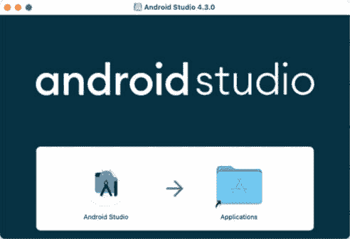

图 2-1

要安装此包，将 Android Studio 图标拖动到 `Applications` 文件夹。Android Studio 包将安装到系统的 `Applications` 文件夹中，此过程通常需要几秒钟完成。

要启动 Android Studio，在 Finder 窗口中找到 `Applications` 文件夹中的可执行文件并双击它。

为了以后方便访问该工具，可以将 Android Studio 图标从 Finder 窗口拖动到 dock 中。

#### 2.3.3 在 Linux 上安装

下载好 Linux 版 Android Studio 包后，打开终端窗口，进入要安装 Android Studio 的目录，并执行以下命令：

```
tar xvfz /<path to package>/android-studio-<version>-linux.tar.gz
```

请注意，Android Studio 压缩将安装到名为 `android-studio` 的子目录中。因此，假设上述命令是在 `/home/demo` 中执行的，软件包将解压到 `/home/demo/android-studio`。

要启动 Android Studio，打开终端窗口，进入 `android-studio/bin` 子目录，并执行以下命令：

```
./studio.sh
```

### 2.4 Android Studio 安装向导

如果您之前安装过较早版本的 Android Studio，在首次启动此新版本时，可能会弹出一个对话框，提供从之前的 Android Studio 版本导入设置的选项。如果您有以前版本的设置并希望将其导入到最新安装中，请选择相应的选项和位置。或者，也可以指明您不需要导入任何之前的设置并点击 `OK` 按钮继续。

如果您是首次安装 Android Studio，在安装过程开始后出现的初始对话框可能类似于下方的图 2-2 所示：

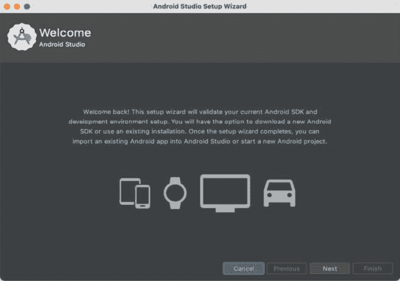

图 2-2

如果出现此对话框，点击 `Next` 按钮显示 `Install Type`（安装类型）屏幕（图 2-3）。在此屏幕上，点击 `Next` 之前选择 `Standard`（标准）安装选项。

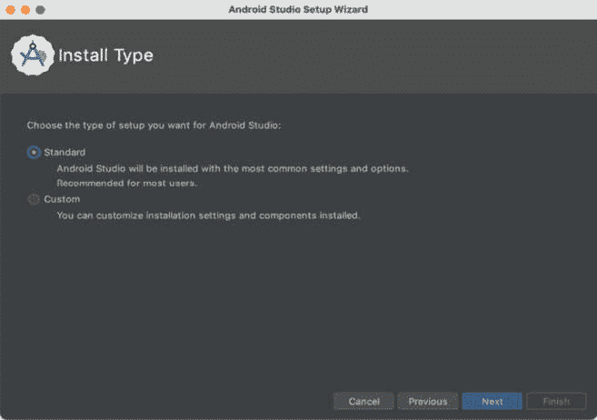

图 2-3

在 `Select UI Theme`（选择 UI 主题）屏幕上，根据您的喜好选择 `Darcula` 或 `Light` 主题。选择后，点击 `Next`，并在 `Verify Settings`（验证设置）屏幕上检查选项，然后进入 `License Agreement`（许可协议）屏幕。选择每个许可类别并启用 `Accept` 复选框。最后，点击 `Finish` 按钮启动安装。

完成这些初始设置步骤后，点击 `Finish` 按钮显示使用您所选 UI 主题的 Android Studio 欢迎界面：

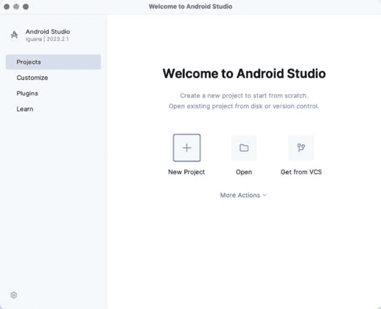

图 2-4

### 2.5 安装额外的 Android SDK 程序包

到为止执行的步骤安装了 Android Studio IDE 和当前的默认 Android SDK 程序包。在继续之前，值得花些时间验证安装了哪些程序包，并安装任何缺失或更新的程序包。

可以通过点击欢迎对话框中的 `More Actions` 链接并从下拉菜单中选择 `SDK Manager` 来执行此任务。一旦调用，将显示 `Settings` 对话框中的 `Android SDK` 屏幕，如图 2-5 所示：

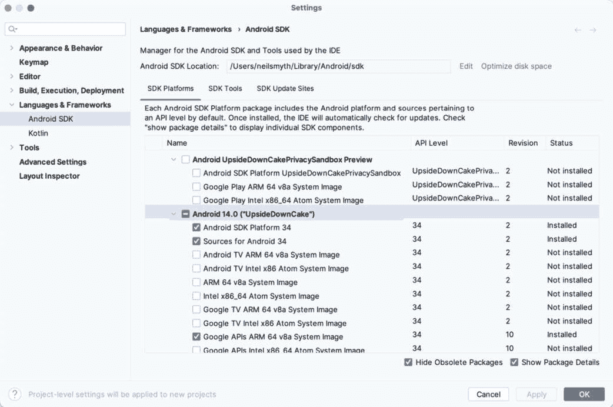

图 2-5

Google 每个 Android Studio 版本都与 Android SDK 的最高支持应用程序接口（API）级别配对。对于 Android Studio Iguana，该级别是 Android UpsideDownCake（API Level 34）。可以通过以下链接确认此信息：

[`developer.android.com/studio/releases#api-level-support`](https://developer.android.com/studio/releases#api-level-support)

首次安装 Android Studio 之后，可能只安装了最新版本的 Android SDK 版本。要安装旧版本的 Android SDK，请选择相应的复选框并点击 `Apply` 按钮。本书的其余部分假设已安装 Android UpsideDownCake（API Level 34）SDK。

本书大部分示例将支持直到 Android 8.0 (Oreo) 的旧版本 Android。这确保了程序可以在广泛的 Android 设备上运行。在 SDK 版本列表中，启用 Android 8.0 (Oreo) 旁的复选框并点击 `Apply` 按钮。在生成的确认对话框中点击 `OK` 安装 SDK。随后的对话框将在执行安装前寻求接受许可和条款。安装完成后，点击 `Finish`。

最新 SDK 也可能列出可用更新。要访问有关更新包的详细信息，请启用屏幕右下角的 `Show Package Details`（显示包详情）选项。这将显示图 2-6 所示的信息：

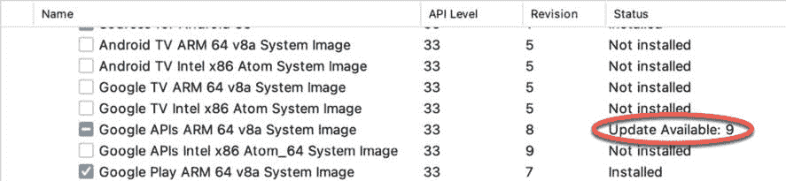

图 2-6

上图了可用更新。要安装更新，启用项目名称左侧的复选框并点击 `Apply` 按钮。

除了 Android SDK 程序包，还安装了多个用于构建 Android 程序的工具。要查看已安装的包并检查更新，请留在 SDK 设置屏幕并选择 `SDK Tools` 卡，如图 2-7 所示：

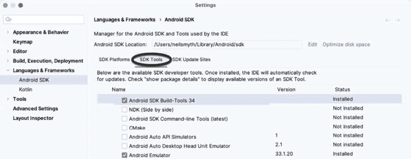

图 2-7

在 Android SDK Tools 屏幕中，请确保以下包在“Status”列中显示为“Installed”：

- Android SDK Build-tools
- Android Emulator
- Android SDK Platform-tools
- Google Play Services
- Intel x86 Emulator Accelerator (HAXM installer)*
- Google USB Driver（仅限 Windows）
- Layout Inspector image server for API 31-34

*注意：Intel x86 Emulator Accelerator (HAXM installer) 无法基于 Apple 芯片的 Mac 上安装。

如果上述任何软件包被列为“未安装”（Not Installed）或需要更新，请勾选这些包旁边的复选框并点击 `Apply` 按钮启动安装过程。如果出现 `HAXM` 模拟器设置对话框，请选择推荐的内存分配：

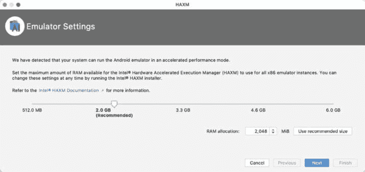

图 2-8

安装完成后，检查软件包列表并确保选中的包在 `Status`（状态）列中显示为`Installed`（已安装）。如果任何包被列为“未安装”（Not installed），请确保它们已勾选并再次点击 `Apply` 按钮。

### 2.6 安装 Android SDK 命令行工具

Android Studio 包含了一些允许从操作系统命令行执行某些任务的工具。要在你的系统中安装这些工具，请打开 `SDK Manager`，选择 `SDK Tools` 选项卡，并找到图 2-9 所示的 `Android SDK Command-line Tools (latest)` 软件包：

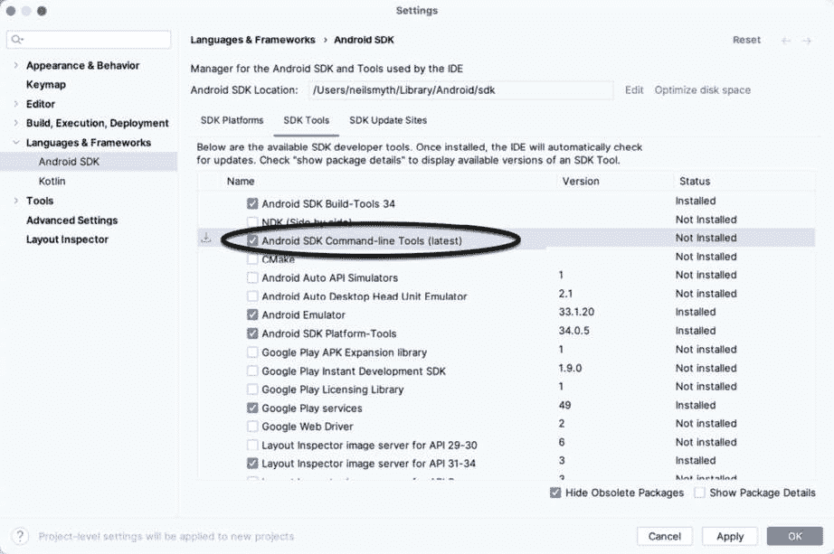

图 2-9

如果 `command-line tools` 软件包尚未安装，请启用它并点击 `Apply`，然后点击 `OK` 完成安装。安装完成后，点击 `Finish` 并关闭 `SDK Manager` 对话框。

为了使你正在开发的操作系统能够找到这些工具，有必要将它们添加到系统的 `PATH` 环境变量中。

无论你使用哪种操作系统，你都需要配置 `PATH` 环境变量以包含以下路径（其中 `<path_to_android_sdk_installation>` 代表你安装 Android SDK 的文件系统位置）：

`<path_to_android_sdk_installation>/sdk/cmdline-tools/latest/bin`

`<path_to_android_sdk_installation>/sdk/platform-tools`

你可以通过启动 `SDK Manager` 并参考设置面板顶部的 `Android SDK Location:` 字段来识别 SDK 在你系统上的位置，如图 2-10 高亮所示：

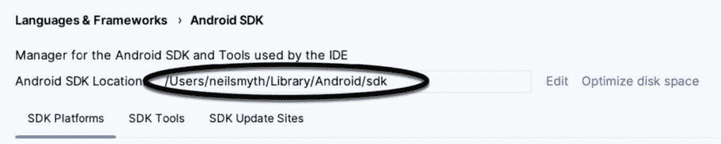

图 2-10

一旦确定了 SDK 的位置，将其添加到 `PATH` 变量的步骤取决于操作系统：

#### 2.6.1 Windows 8.1

1. 在启动屏幕上，将鼠标移动到屏幕右下角并从生成的菜单中选择 `Search`（搜索）。在搜索框中输入 `Control Panel`（控制面板）。当 `Control Panel` 图标出现在结果区域时，点击它在桌面上启动该工具。

2. 在 `Control Panel` 中，使用 `Category` 菜单将显示改为 `Large Icons`（大图标）。从图标列表中选择标记为 `System`（系统）的项目。

3. 在 `Environment Variables`（环境变量）对话框中，在 `System variables`（系统变量）列表中找到 `Path` 变量，选中它并点击 `Edit…` 按钮。在编辑对话框中使用 `New` 按钮向路径中添加两个新条目。例如，假设 Android SDK 安装在 `C:\Users\demo\AppData\Local\Android\Sdk`，需要添加以下项：

`C:\Users\demo\AppData\Local\Android\Sdk\cmdline-tools\latest\bin`

`C:\Users\demo\AppData\Local\Android\Sdk\platform-tools`

4. 在每个对话框中点击 `OK` 并关闭系统属性控制面板。

通过按下键盘上的 `Windows + R` 并在 `Run` 对话框中输入 `cmd` 打开命令提示符窗口。在 `Command Prompt` 窗口输入：

```
echo %Path%
```

返回的路径变量值应包含 Android SDK platform tools 文件夹的路径。通过尝试如下所示运行 `adb` 工具来验证 `platform-tools` 值是否正确：

```
adb
```

执行该工具时，应输出命令行选项列表。

同样，通过尝试运行 `AVD Manager` 命令行工具来检查工具路径设置（不要担心 `avdmanager` 工具报告 Java 问题——这稍后会处理）：

```
avdmanager
```

如果其中一个或两个命令出现类似下面的消息，那么很可能是向 `Path` 环境变量中添加了错误的路径：

`'adb' is not recognized as an internal or external command, operable program or batch file.`

#### 2.6.2 Windows 10

右键点击 `Start` 菜单，从生成的菜单中选择 `Settings`（设置），并在 `Find a setting`（查找设置）文本框中输入“Edit the system environment variables”。在 `System Properties` 对话框中，点击 `Environment Variables...` 按钮。按照 Windows 8.1 列出的步骤从第 3 步开始。

#### 2.6.3 Windows 11

右键点击任务栏上的 `Start` 图标，从生成的菜单中选择 `Settings`。当 `Settings` 对话框出现时，向下滚动类别列表并选择“About”（关于）选项。在 `About` 界面，从 `Related links`（相关链接）部分选择 `Advanced system settings`（高级系统设置）。当 `System Properties` 窗口出现，点击 `Environment Variables...` 按钮。按照 Windows 8.1 列出的步骤从第 3 步开始。

#### 2.6.4 Linux


此配置可以通过向主目录下的`.bashrc`文件中添加命令来实现（具体细节可能取决于特定的 Linux 发行版）。假设 Android SDK 软件包安装在`/home/demo/Android/sdk`，`.bashrc`中的内容如下：

```
export PATH=/home/demo/Android/sdk/platform-tools:/home/demo/Android/sdk/cmdline-tools/latest/bin:/home/demo/Android/sdk/android-studio/bin:$PATH
```

注意，上述命令将`android-studio/bin`目录添加到`PATH`。

## macOS

在 macOS 上可以使用多种技术修改`PATH`环境变量。最干净的方法是在`/etc/paths.d`中创建一个新文件，包含要添加到`$PATH`的路径。假设 Android SDK 位于`/Users/demo/Library/Android/sdk`，可以通过包含以下内容配置：

`/Users/demo/Library/Android/sdk/cmdline-tools/latest/bin`

`/Users/demo/Library/Android/sdk/platform-tools`

注意，由于这是系统目录，需要使用`sudo`命令。例如：

```
sudo vi /etc/paths.d/android-sdk
```

## 内存管理

Android Studio 是一个大型且复杂的应用程序，具有许多后台进程。尽管 Android Studio 过去被批评性能不利，但 Google 在最近的版本中进行了重大改进，并在每个新版本中持续改进。这些改进包括允许用户配置 Android Studio IDE 以及用于构建和运行应用的后台进程所使用的内存。这使得软件能够利用更大内存的系统。

如果你在具有足够空闲内存的系统上运行 Android Studio（此功能适用于具有 5GB 或更多内存的 64 位系统）并发现 Android Studio 性能下降，那么值得尝试这些内存设置。Android Studio 还可能通过类似所示的对话框提示你可以提高性能：

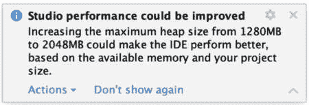

图 2-11

要查看并修改内存配置，选择主菜单选项`File -> Settings...`（macOS 上为`Android Studio -> Settings...`），并在生成的对话框中，选择`Appearance & Behavior`，然后选择左侧导航面板中`System Settings`下的`Memory Settings`选项，如下图 2-12 所示：

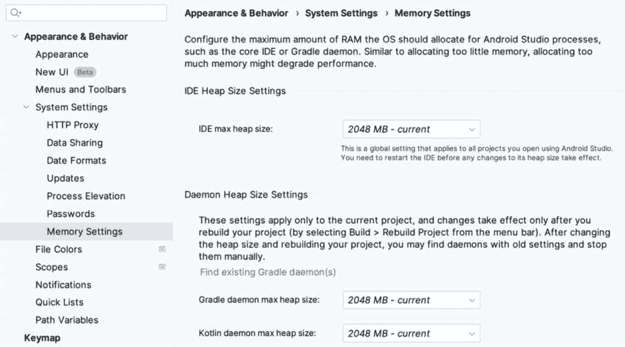

图 2-12

更改内存分配时，请不要分配超过必要的内存或超过在不影响其他进程的情况下系统能提供的内存。

IDE 堆内存（heap size）设置会调整分配给 Android Studio 的内存，无论当前加载的项目均有效。另一方面，当在 Android Studio 内部构建并运行项目时，几个后台进程（称为守护进程 daemon）会执行编译和运行应用的任务。在编译和运行大型复杂项目时，可以通过调整守护进程的堆设置来改进构建时间。与 IDE 堆内存设置不同，这些守护进程设置仅适用于当前项目，并且只有在 Android Studio 中打开项目时才能访问。若要在打开的项目中显示 SDK Manager，请从主菜单中选择`Tools -> SDK Manager...`菜单选项。

## 更新 Android Studio 和 SDK

Android Studio 和 Android SDK 会不定期发布新版本。新版本的 SDK 通过 Android SDK Manager 进行安装。当有更新版本准备好进行安装时，Android Studio 通常会通知你。

要手动检查 Android Studio 的更新，请使用 Android Studio 主窗口的`Help -> Check for Updates...`菜单选项（macOS 上为`Android Studio -> Check for Updates...`）。

## 总结

在开始开发 Android 应用程序之前，第一步是搭建合适的开发环境。这包括 Android SDK 和 Android Studio IDE（其中包含 OpenJDK 开发环境）。本章涵盖了在 Windows、macOS 和 Linux 上安装这些包的必要步骤。

## 在 Android Studio 中创建一个示例 Android 应用

本书的前几个章节已经解释了如何使用 Android Studio IDE 配置适用于开发 Android 应用程序的环境。在进入稍为高级的话题之前，现在是验证所有所需的开发包已安装并运行良好的良好时机。实现这一目标的最好方法是创建一个 Android 应用程序并编译运行它。本章将涵盖如何使用 Android Studio 创建 Android 应用程序项目。项目创建完成后，稍后的章节将探索如何使用 Android 模拟器环境对应用程序进行测试运行。

### 关于项目

在本章创建的项目是一个基础的货币转换计算器（事实上它非常简单，只支持从美元到欧元的转换，并使用估算汇率进行）。该项目还将使用 Android Studio 最基础的项目模板之一。这种简单性允许我们介绍 Android 应用开发的一些关键方面，而不会因为一次性引入过多的概念（例如推荐的应用程序架构和 Android 架构组件）让初学者无从适从。在遵循本章的教程时，请放心，初始示例项目中所使用的技术和代码将在稍后进行更详细的介绍。

### 创建新的 Android 项目

应用程序开发过程的第一步是在 Android Studio 环境中创建一个新项目。因此，首先启动 Android Studio，直到出现“Welcome to Android Studio”屏幕，如图 3-1

图 3-1

一旦此窗口出现，Android Studio 就已准备好创建一个新项目。要创建新项目，点击`New Project`选项显示新项目向导的第一个屏幕。

### 创建 Activity

下一步是为应用程序定义要创建的初始 Activity 类型。提供了为手机和平板电脑、Wear OS、电视或汽车创建项目的选项。在开发 Android 应用程序时，有多种 Activity 类型可供选择，许多将在后续章节中进行详细介绍。然而，对于本示例，请从从版（Templates）面板中选择`Phone and Tablet`选项，然后选择创建`Empty Views Activity`选项。Empty Views Activity 选项会创建一个由单个`TextView`对象组成的模板用户界面。

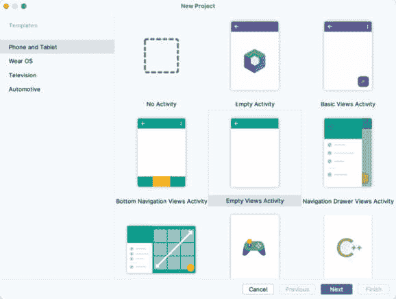

图 3-2

选中 Empty Views Activity 选项后，点击`Next`继续项目配置。

### 定义项目和 SDK 设置

在项目配置窗口（图 3-3 中的`Help me choose`按钮，以查看 Android 版本的详细说明：

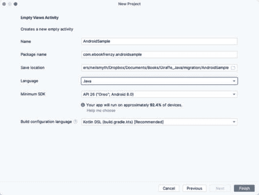

图 3-3

最后，将`Language`（语言）菜单更改为`Java`并选择`Kotlin DSL (build.gradle.kts)`作为构建配置语言，然后点击`Finish`创建项目。

### 使用新的 Android Studio UI

Android Studio 正在转向新的现代用户界面，该界面在 Iguana 版本中默认未启用。如果你的 Android Studio 安装如图 3-4 所示，则你需要在继续之前启用新 UI：

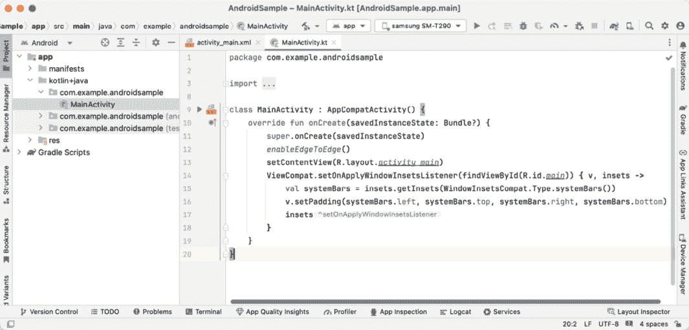

图 3-4

通过选择`File -> Settings...`菜单选项（macOS 上为`Android Studio -> Settings...`）并选择左面板中`Appearance and Behavior`下的`New UI`选项来启用新 UI。在主面板中勾选`Enable new UI`复选框，然后点击`Apply`，最后点击`OK`提交更改：


图 3-5

根据提示，重启 Android Studio 以激活新用户界面。

### 修改示例应用程序

当 Android Studio 重启后，主窗口将使用新 UI 再次出现，并包含我们的`AndroidSample`项目，如图 3-6 所示：

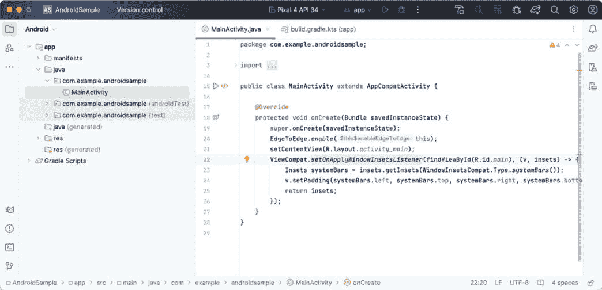

图 3-6

新创建的项目以及相关文件的引用列在主项目窗口左侧的`Project`工具窗口中。`Project`工具窗口有多种可以显示信息的模式。默认情况下，此面板应处于 Android 模式。此设置由面板顶部的菜单控制，如图 3-7 所示。如果该面板当前未处于 Android 模式，请使用菜单切换模式：

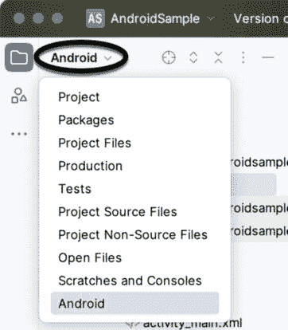

图 3-7

## 修改用户界面

我们此活动的用户界面设计存储在一个名为`activity_main.xml`的文件中，该文件位于`Project`工具窗口文件层级结构中的`app -> res -> layout`下。在`Project`工具窗口中找到该文件后，双击文件即可将其加载到用户界面布局编辑器（Layout Editor）工具中，该工具将显示在 Android Studio 主窗口的中间面板中：

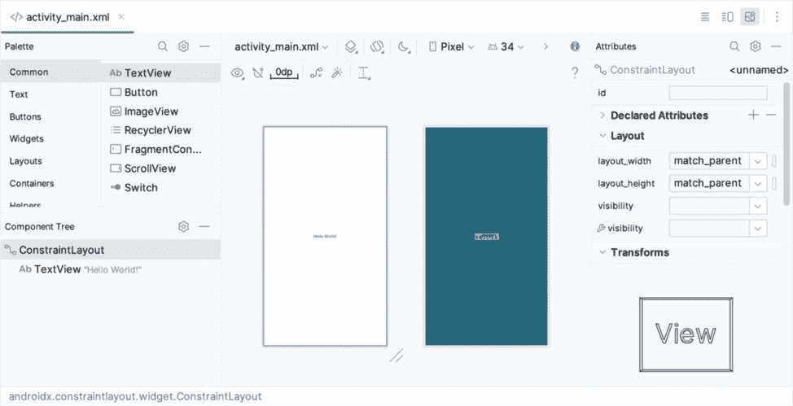

图 3-8

布局编辑器窗口顶部工具栏上有一个菜单（在上方图中设置为`Pixel`），该设置反映在布局编辑器面板内设备的视觉表示上。点击此菜单可以使用一系列其他设备选项。

使用`System UI Mode`按钮``为设备屏幕布局开启或关闭夜间模式（Night mode）。要在设备表示的横屏和竖屏之间切换方向，请使用显示``图标的下拉菜单。

从设备屏幕中看到，内容布局已经包含了一个显示“Hello World!”消息的标签。面板左侧是一个调色板，包含不同类别的用户界面组件，这些组件可用于构建用户界面，例如按钮、标签和文本字段。然而，需要注意的是并非所有的用户界面组件对用户都是可见的。其中一类就是布局。Android 支持多种布局，它们对视觉用户界面组件在屏幕上的定位和管理提供了不同程度的控制。虽然从用户界面的视觉表示上很难看出，但当前设计是使用`ConstraintLayout`创建的。这可以通过查看`Component Tree`面板信息来确认，该面板默认位于布局编辑器面板的左下角，如图 3-9 所示：

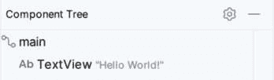

图 3-9

从组件树层级结构可以看出，用户界面布局由一个名为`main`的`ConstraintLayout`父布局和一个`TextView`子对象组成。

在继续之前，检查布局编辑器的`Autoconnect`（自动连接）模式是否启用。这意味着当组件添加到布局中时，布局编辑器会自动添加约束，以确保组件在不同的屏幕尺寸和设备方向上正确定位（该主题将在后续章节中进行更详细的介绍）。`Autoconnect`按钮位于布局编辑器工具栏中，用 U 形图标表示。当禁用时，图标上会显示一条对斜线（图 3-10）。如有必要，请通过点击此按钮重新启用`Autoconnect`模式。

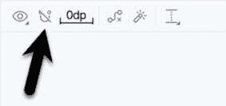

图 3-10

修改应用的下一步是向布局中添加一些额外的组件，其中第一个是一个`Button`，供用户点击以启动货币转换。

`Palette`面板由两列组成，左列包含视图组件类别的列表。右列列出当前选择类别包含的组件。例如，在图 3-11 中，在`Buttons`类别中当前选择了`Button`视图：

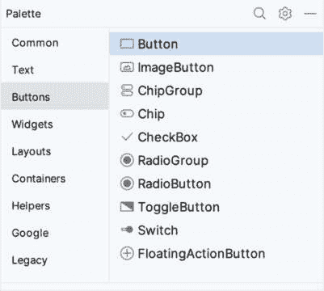

图 3-11

从`Buttons`列表中点击并拖拽`Button`对象，将其到用户界面设计的水平中心，使其位于现有`TextView`小部件下方：


图 3-12

下一步是更改`Button`组件当前显示的文本。位于设计区域右侧的面板是`Attributes`（属性）面板。该面板显示分配给布局中当前选择组件的属性。在该面板内，在`Common Attributes`（常用属性）部分找到`text`属性并将当前值从“Button”更改为“Convert”，如图 3-13 所示：

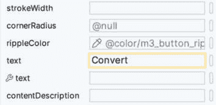

图 3-13

第二个带有扳手图标的文本属性允许设置一个文本属性，该属性仅在布局编辑器工具中显示，但在运行时不显示。这对于测试视觉组件和布局在不同设置下的表现如何非常用，而无需反复运行应用程序。

以万一`Autoconnect`系统未能设置所有布局连接，请点击`Infer Constraints`（推断约束）按钮（图 3-14）来添加任何缺失的约束：


图 3-14

重要的是解释布局编辑器右上角的警告按钮，如图 3-15 所示。此警告表示布局可能存在问题。点击该按钮查看问题的详情：


图 3-15

点击后，将弹出`Problems`（问题）工具窗口（图 3-16），描述问题的性质：


图 3-16

此工具窗口分为两个面板。左面板（在图中标记为 A）列出了布局文件中检测到的问题。在我们的示例中，列出了以下问题：

`button <Button>: Hardcoded text`

当从列表中选择一个项目（B）时，右面板将更新以提供有关问题的详细信息（C）。在这种情况下，解释如下：

硬编码字符串 "Convert"，应使用`@string`资源

工具窗口还包含一个预览编辑器（D），允许对布局文件进行手动修正。

此 I18N 消息告我们项目未来的国际化存在潜在问题（“I18N”源于“internationalization”一词以 I 开头，以 N 结尾，中间有 18 个字母）。该警告提醒我们，在开发 Android 应用程序时，尽可能将属性和文本字符串值存储为资源。这样做可以通过修改资源文件来更改应用程序的外观，而无需更改源代码。这在将用户界面翻译成不同的语言时可能特别有价值。如果用户界面中的所有文本都包含在一个资源文件中（例如），可以将该文件交给翻译人员，他们将执行翻译工作并返回翻译文件包含在应用程序。这使得能够针对多种语言，而无需进行任何源代码更改。在此实例，我们将创建一个名为`convert_string`的新资源，并为其分配字符串“Convert”。

首先点击`Show Quick Fixes`（显示快速修复）按钮（E），从菜单中选择`Extract string resource`（提取字符串资源）选项，如图 3-17 所示：


图 3-17

选择此选项后，将出现提取资源（Extract Resource）面板（图 3-18）。在此面板中，将资源名称字段更改为`convert_string`，并将资源值保留为`Convert`，然后点击 OK 按钮：

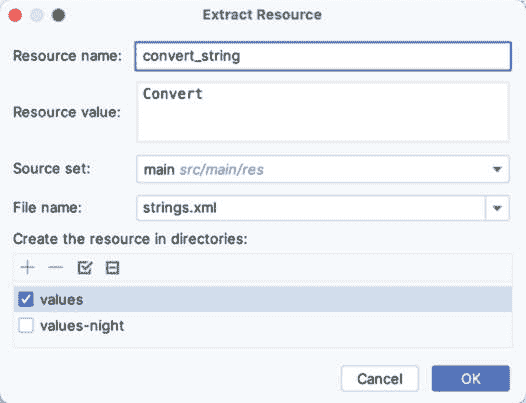

图 3-18

下一个要添加的组件是`EditText`组件，用户将在其中输入要转换的美元金额。从`Palette`（调色板）面板选择`Text`类别，点击并拖动一个`Number (Decimal)`组件到布局中，使其水平居中，并放置在现有的`TextView`组件上方。选中该组件后，使用`Attributes`（属性）工具窗口将`hint`属性设置为“dollars”。点击警告图标并将字符串提取为命名为`dollars_hint`的资源。

本章稍后编写的代码需要访问用户在`EditText`字段中输入的美元值。它将通过引用分配给用户界面布局中组件的`id`来实现这一点。Android Studio 为组件分配的默认`id`可以在布局中选中组件时从`Attributes`工具窗口进行查看和更改，如图 3-19 所示：

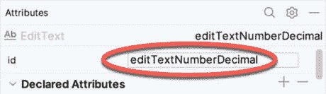

图 3-19

将`id`改为`dollarText`，并在`Rename`（重命名）对话框中点击`Refactor`（重构）按钮。这将确保项目其他地方对旧`id`的任何引用都会自动更新为新的`id`：

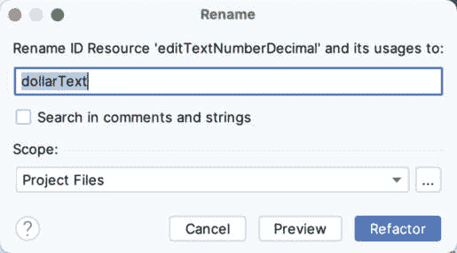

图 3-20

如有必要，重复步骤将`TextView`组件的`id`设置为`textView`。

点击`Infer Constraints`（推断约束）按钮添加任何缺失的布局约束。此时，布局应该类似于图 3-21 所示所示：


图 3-21

### 审查布局和资源文件


在继续下一步之前，我们将查看用户界面设计和资源处理的一些内部方面。在上一节中，我们通过使用`Layout Editor`（布局编辑器）工具修改`activity_main.xml`文件来更改用户界面。事实上，`Layout Editor`提供了一种编辑文件底层XML内容的用户友好方法。在实践中，没有理由不直接修改XML来更改用户界面，在某些情况下，这实际上比使用`Layout Editor`工具更快。在`Layout Editor`面板的右上角是`View Modes`（视图模式）按钮，在下方图3-22中标记为A到C：

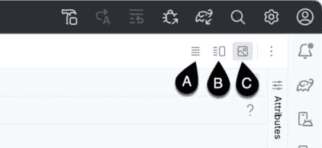

图3-22

默认情况下，编辑器将处于`Design`（设计）模式（C按钮），此时只显示布局的视觉表示。在`Code`（代码）模式（A）下，编辑器将显示布局的XML，而在`Split`（分屏）模式（B）下，布局和XML都会显示，如图3-23所示：

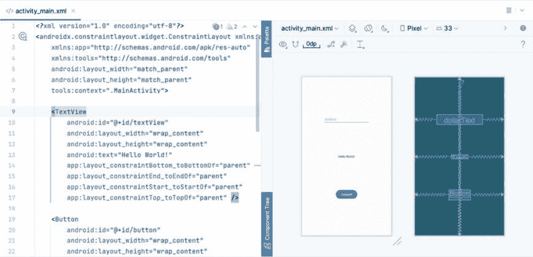

图3-23

`View Modes`按钮左侧的按钮（在上方图3-22中标记为B）用于快速在`Code`和`Split`模式之间切换。

从XML文件的结构可以看出，用户界面由`ConstraintLayout`组件组成，该组件又是`TextView`、`Button`和`EditText`对象的父。我们还可以看到，例如，`Button`的`text`属性设置为我们的`convert_string`资源。尽管复杂性和内容各异，但所有用户界面布局都是这种分层的、基于XML的结构。

随着XML布局的更改，这些更改将反映在布局画布上。也可以在布局画布面板内从视觉上修改布局，更改将显示在XML列表中。要查看此效果，切换到`Split`模式并修改XML布局，将`ConstraintLayout`的背景颜色更改为红色调如下：

```xml
<?xml version="1.0" encoding="utf-8"?>
<androidx.constraintlayout.widget.ConstraintLayout xmlns:android="http://schemas.android.com/apk/res/android"
    xmlns:app="http://schemas.android.com/apk/res-auto"
    xmlns:tools="http://schemas.android.com/tools"
    android:id="@+id/main"
    android:layout_width="match_parent"
    android:layout_height="match_parent"
    tools:context=".MainActivity"
    android:background="#ff2438" >

.

.
</androidx.constraintlayout.widget.ConstraintLayout>
```

注意布局颜色实时更改以匹配XML文件中的新设置。同样注意，XML编辑器左侧边距（也称为行槽）中包含颜色设置的行会出现一个小红色正方形。点击红色正方形将提示设置了颜色，这将显示颜色选择器以便选择颜色：

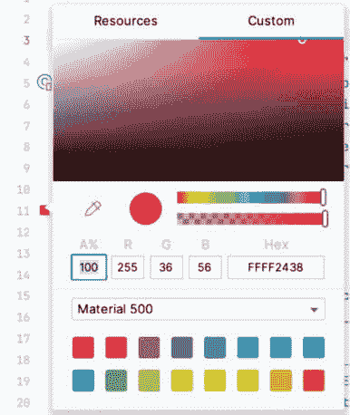

图24

在继续之前，删除布局中的`background`属性使背景恢复默认。最后，使用`Project`面板找到`app` -> `values` -> `strings.xml`文件并双击它将其加载到编辑器。目前XML显示为：

```xml
<resources>
    <string name="app_name">AndroidSample</string>
    <string name="convert_string">Convert</string>
    <string name="dollars_hint">dollars</string>
</resources>
```

为了演示资源的使用，将分配给`convert_string`的字符串更改为"Convert to Euros"，然后通过选择布局返回布局编辑器。注意布局已获取字符串的新资源。

还有一种快速方法可以访问XML文件引用的资源值。在`Split`或`Code`模式下，点击`@string/convert_string`属性使其高亮，然后按下键盘上的`Ctrl-B`（macOS上为`Cmd-B`）。Android Studio随后将打开`strings.xml`文件并带您进入该资源定义的行。利用此机会将字符串恢复为原始文本"Convert"，并添加后续应用程序代码中引用的附加条目：

```xml
<resources>
    <string name="app_name">AndroidSample</string>
    <string name="convert_string">Convert</string>
    <string name="dollars_hint">dollars</string>
    <string name="no_value_string">No Value</string>
</resources>
```

资源字符串也可以通过点击编辑器右上角的`Open editor`链接使用Android Studio翻译编辑器进行编辑。这将显示Studio窗口主面板中的翻译编辑器：

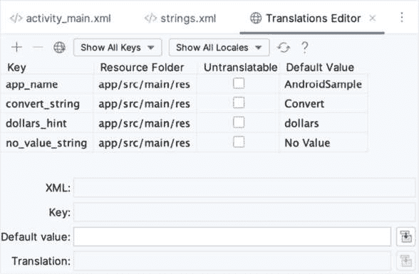

图25允许编辑分配给资源键的字符串并管理多种语言的翻译。

### 3.9 添加交互

此示例项目的最后一步是使应用程序具有交互性，当用户在`EditText`字段中输入美元并点击转换按钮时，转换后的欧元金额显示在`TextView`上。这涉及对`Button`组件实现某些事件处理。具体来说，需要配置`Button`以在触发`onClick`事件时调用应用程序代码中的方法。事件处理可以通过多种方式实现，并在后续标题为"Android事件处理概述与示例"的章节中介绍。返回布局编辑器的`Design`模式，在布局编辑器中选择`Button`组件，参考`Attributes`工具窗口，并指定名为`convertCurrency`的方法如下所示：

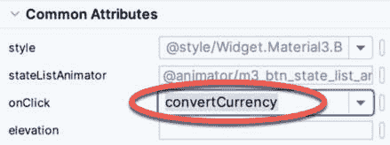

图3-26

接下来，在Project工具窗口中，双击`MainActivity.java`文件（`app` -> `java` -> `<package name>` -> `MainActivity`）将其加载到代码编辑器中，并在类文件中添加`convertCurrency`方法的代码，使其读取如下。请注意，还需要导入一些额外的Android程序包：

```java
package com.ebookfrenzy.androidsample;

import androidx.appcompat.app.AppCompatActivity;

import android.os.Bundle;

import android.view.View;

import android.widget.EditText;

import android.widget.TextView;

.
.

import java.util.Locale;

public class MainActivity extends AppCompatActivity {
    @Override
    protected void onCreate(Bundle savedInstanceState) {
        super.onCreate(savedInstanceState);
        setContentView(R.layout.activity_main);
    }

    public void convertCurrency(View view) {
        EditText dollarText = findViewById(R.id.dollarText);
        TextView textView = findViewById(R.id.textView);
        if (!dollarText.getText().toString().isEmpty()) {
            float dollarValue = Float.parseFloat(dollarText.getText().toString());
            float euroValue = dollarValue * 0.85F;
            textView.setText(String.format(Locale.ENGLISH,"%.2f", euroValue));
        } else {
            textView.setText(R.string.no_value_string);
        }
    }
}
```

该方法首先通过调用名为`findViewById`的方法并传递布局文件中分配的`id`来获取`EditText`和`TextView`对象的引用。随后会进行检查以确保用户已输入了美元金额，如果是，则提取该值，将其从`String`转换为浮点值，并转换为欧元。最后，结果将显示在`TextView`组件上。

如果对这些内容有任何不清楚的地方，请放心，这些概念将在后面的章节中进行更详细介绍。特别是关于在代码内部使用`findByViewId`访问控件的主题，以及对称为"视图绑定"（view binding）的替代技术的介绍，将在标题为"Android View Binding概述"的章节中讲解。

## 3.10 总结

虽然并不极端复杂，但设置Android开发环境涉及多个步骤。在完成这些步骤后，值得运行一个示例以确保环境已正确安装和配置。在本章中，我们创建了一个示例应用程序，并使用Android Studio布局编辑器工具修改了用户界面布局。在此过程中，我们探索了尽可能使用资源（特别是字符串值）的重要性，并简要提到了布局。接下来，我们查看了用于存储Android应用程序界面设计的底层XML。

最后，在连接到`Button`上添加了`onClick`事件，该事件连接到一个实现的方法，用于从`EditText`组件中提取用户输入，将其从美元转换为欧元，并将结果显示在`TextView`上。

由于应用程序已准备好测试，用于测试所需的模拟器设置将在下一章中详细介绍。

## 4. 在 Android Studio 中创建 Android 虚拟设备 (AVD)

尽管Android Studio的预览面板允许我们看到正在设计的布局，但仍需通过编译和运行整个应用程序来彻底测试其运行情况。可以通过在物理设备上安装并运行Android应用程序，或者在Android虚拟设备(AVD)模拟器环境中运行来测试Android应用程序。在使用AVD之前，必须先创建并配置以匹配特定设备模型的规格。在本章中，我们将以Pixel 4手机作为参考示例，创建一个这样一个虚拟设备。

### 4.1 关于 Android 虚拟设备

AVD是模拟器，允许在无需将应用程序安装到物理Android设备的情况下测试Android应用程序。AVD可以配置为模拟各种硬件功能，包括屏幕尺寸、内存容量以及是否存在摄像头、GPS导航支持或加速度计等功能。标准Android Studio安装的一部分包含几个模拟器模板，允许为各种设备配置AVD。可以通过指定处理器类型、内存容量以及屏幕的尺寸和像素密度等属性，创建自定义配置以匹配任何物理Android设备。

AVD会话可以作为独立窗口出现，也可以嵌入在Android Studio窗口中。

新的AVD使用Android虚拟设备管理器（Android Virtual Device Manager）创建和管理，可以使用命令行模式或更具用户友好图形用户界面。创建新AVD的第一步是启动AVD Manager。这可以通过Android Studio环境中点击"设备管理器"（Device Manager）来实现，如图4-1所示：

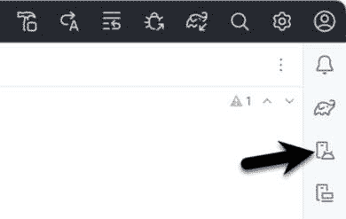

图4-1

打开后，管理器将作为工具窗口出现，如图4-2所示：

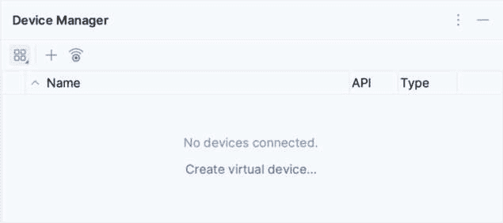

图4-2

如果你是首次安装Android Studio（而不是升级现有安装），安装程序可能已经创建了一个可用的初始AVD，如图4-3所示：

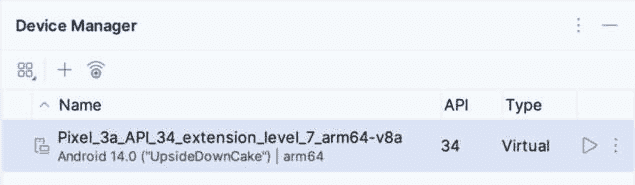

图4-3

如果系统中存在此AVD，你可以可以使用它。如果没有AVD，或者你想为不同的设备类型创建AVD，请按照本章步骤操作。要添加新AVD，点击设备管理器工具栏上的"创建设备..."链接或`+`按钮打开虚拟设备配置框，如图4-4所示：


图4-4

在对话框中，执行以下步骤创建Pixel 4兼容模拟器：

1. 从类别面板选择"手机"选项以显示可用AVD模板。

2. 选择`Pixel 4`设备选项并点击"下一步"。

3. 在系统镜像屏幕上，选择最新版本的Android。如果尚未安装镜像，"发布名称"旁边将提供"下载"链接。点击此链接下载并安装系统镜像。如果没有所需的镜像，点击"x86镜像"（如果是运行Apple芯片的Mac则点击"ARM镜像"）和"其他镜像"选项卡查看替代列表。

4. 点击"下一步"继续，并在名称字段中输入描述性名称（例如`Pixel 4 API 34`）或接受默认名称。

5. 点击"完成"创建AVD。

6. 如果以后需要对AVD进行修改，重新打开设备管理器，从列表中选择AVD，并点击操作列中的笔图标编辑设置。

### 4.2 启动模拟器

要测试新创建的AVD模拟器，从设备管理器中选择模拟器并点击操作列中的启动按钮（三角形）。模拟器将嵌入到Android Studio主窗口中并开始启动过程。模拟器启动所需的时间取决于AVD及其运行系统的配置：

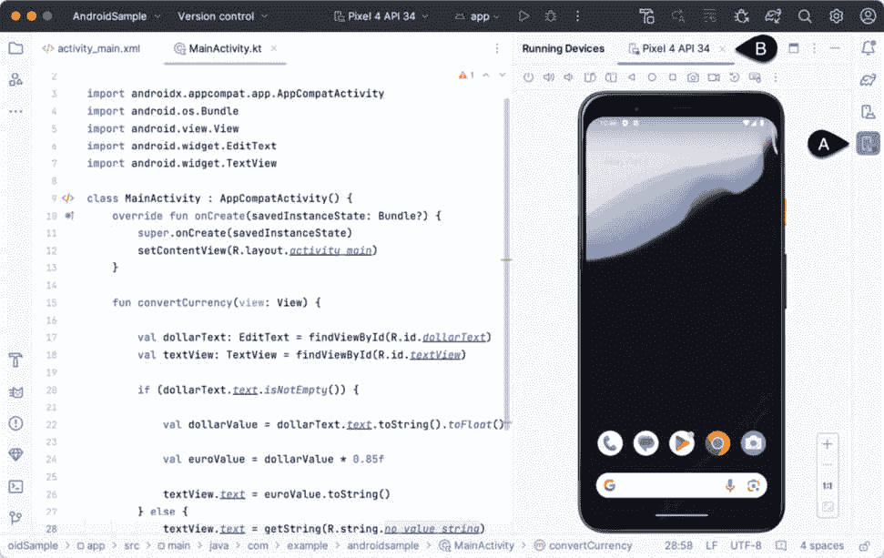

图4-5

要隐藏和显示模拟器工具窗口，点击"运行设备"工具窗口按钮（如上方A所示）。点击标签旁边的"x"关闭按钮（B）退出模拟器。模拟器工具窗口可以容纳多个模拟器会话，每个会话由一个标签表示。例如，图4-6显示了一个具有两个模拟器会话的工具窗口。


**图4-6**

点击相应的标签页可以在会话之间切换。

虽然模拟器可能默认以竖屏方向显示，但可以更改此选项和其他默认选项。在`Device Manager`（设备管理器）中，选择新的`Pixel 4`条目，并点击设备行`Actions`（操作）列中的铅笔图标。在配置屏幕中，找到`Startup orientation`（启动方向）部分并更改方向设置。退出并重启模拟器会话以使此更改生效。关于模拟器的更多详细信息，请参阅下一章节："使用和配置Android Studio AVD模拟器"。

为了在本节章的后续部分节省时间，请在继续之前保持模拟器运行。

## 4.3 在 AVD 中运行应用程序

配置好AVD模拟器后，之前章节中创建的示例应用程序`AndroidSample`现在可以编译并运行了。将`AndroidSample`项目加载到`Android Studio`后，确保新创建的`Pixel 4` AVD显示在设备菜单中（如下方图4-7标记A所示），然后点击由三角形表示的运行按钮(B)、选择`Run -> Run 'app'`菜单选项，或使用键盘快捷键`Ctrl-R`：

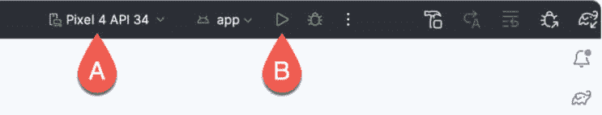

**图4-7**

设备菜单(A)可用于选择不同的AVD实例或物理设备作为运行目标，并并在多个设备上运行应用。该菜单还提供了访问`Device Manager`以及设备连接配置和故障排除选项get：

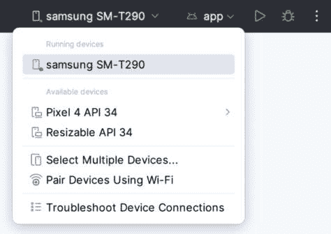

**图4-8**

一旦应用程序安装并运行，第一个fragment（片段）的用户界面将出现在模拟器中（fragment是Android项目中一个可重用的部分，通常由用户界面布局和一些代码组成，该主题将在后文名为"Android Fragment简介"](#Fragments.xhtml__idTextAnchor712)的章节中介绍）：

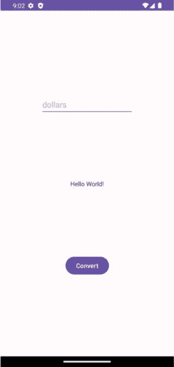

**图4-9**

一旦运行过程开始，`Run`工具窗口将会出现。`Run`工具窗口将在应用程序包安装和启动时显示诊断信息。图4-10显示了典型成功启动应用程序时`Run`工具窗口的输出：

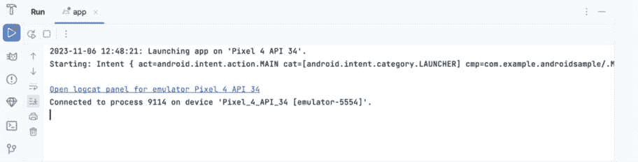

**图4-10**

如果在启动过程中遇到问题，`Run`工具窗口将提供信息以帮助隔离问题原因。

假设应用程序加载到模拟器并按预期运行，我们已经安全地验证了Android开发环境已正确安装和配置。在应用运行时，尝试进行货币兑换以验证应用是否按预期工作。

## 4.4 在多个设备上运行

上文的图4-8所示的运行目标菜单包含一个并行在多个模拟器和设备上运行应用程序的选项。选择该选项后，将显示图4-11中的对话框，列出系统上配置的AVD以及任何连接的物理设备。在点击`Run`按钮之前，勾选目标模拟器或设备旁的复选框：

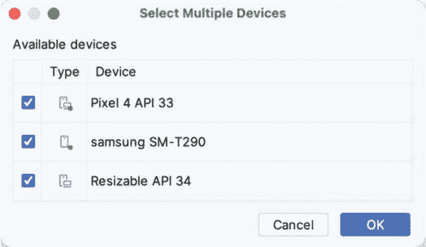

**图4-11**


点击`Run`按钮后，`Android Studio`将所选模拟器和设备上启动应用。

## 4.5 停止运行的应用程序

要停止运行的应用程序，点击位于主工具栏上的停止按钮，如图 4-12 所示：

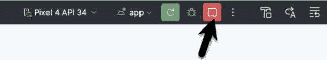

**图 4-12**

也可以`Run`工具窗口终止应用。首先，通过应用运行时变为可窗栏按钮显示`Run`工具窗口。一旦`Run`工具窗口出现，点击下方图 4-13 中高亮显示的停止按钮：

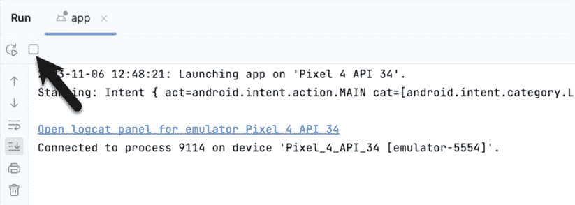

**图 4-13**

## 4.6 支持深色主题

要测试应用启用深色主题时的行为，请在模拟器运行的 Android 实例中打开`Settings`应用，选择`Display`类别，并启用`Dark theme`选项，如图 4-14 所示：


**图 4-14**

启用深色主题后，运行`AndroidSample`应用，注意它显示深色主题，包括黑色背景和按钮上的紫色背景色，如图 4-15 所示：

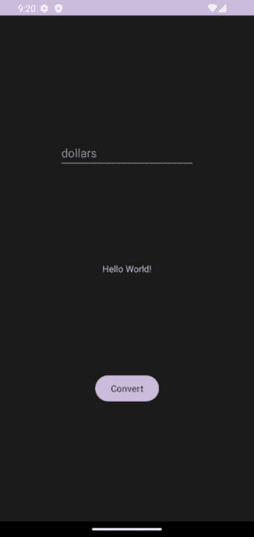

**图 4-15**

在继续之前，返回`Settings`应用并关闭深色主题。

## 4.7 在单独窗口中运行模拟器

到本章为止，我们仅将模拟器用作嵌入在主`Android Studio`窗口内的工具窗口。模拟器可以配置为在`Settings`对话框中的单独窗口中出现，可以通过点击`IDE`和`Project`设置来显示，如图 4-16 所示：

（注：根据文本上下文隐含了图像 16 的引用）

在`Settings`对话框中，在侧边栏中导航到`Tools -> Emulator`，并禁用`Launch in the Running Devices`选项：


**图 4-17**

禁用该选项后，点击`Apply`按钮随后点击`OK`以提交更改，然后点击图 4-5 中标记为 B 的按钮退出模拟器会话。

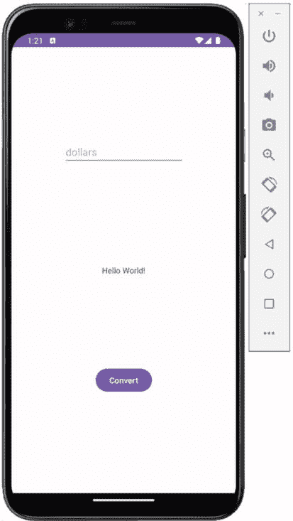

**图 4-18**

选择独立窗口还是工具窗口取决于个人喜好。如果你希望模拟器在工具窗口中运行，返回设置屏幕并重新启用`Launch in the Running Devices`选项。然而，在提交独立模式之前，请记住`Running Devices`工具窗口也可以从主`Android Studio`窗口中分离，这可以通过在工具窗口内点击图 4-19 所示的按钮来实现：


**图 4-19**

在选项菜单中，选择`View Mode -> Float`将工具窗口从`Android Studio`窗口分离：


**图 4-20**

要重新停靠`Running Devices`工具窗口，点击图 4-21 所示的`Dock`按钮：

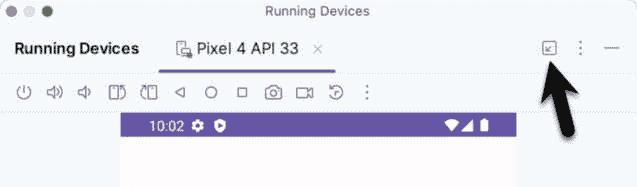

**图 4-21**

## 4.8 移除设备框

模拟器可以配置为显示或不显示设备框。要更改设置，退出模拟器，打开`Device Manager`，选择列表中的 AVD，并点击图 4-22 中箭头所示的菜单按钮：

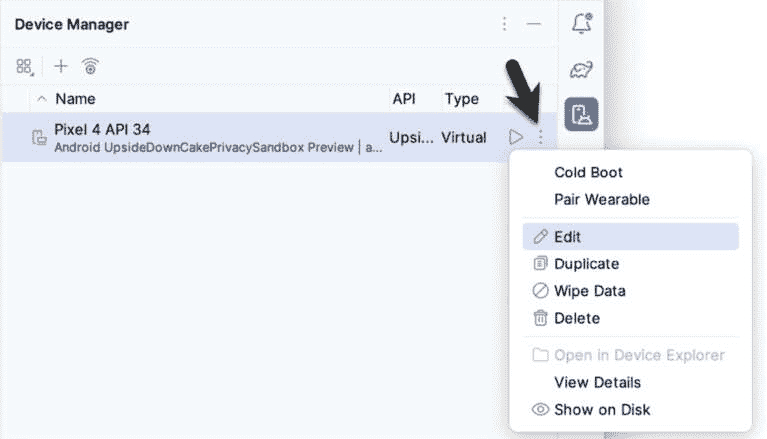

**图 4-22**

选择`Edit`选项，并在设置屏幕定位并关闭`Enable device frame`选项，然后点击`Finish`按钮：

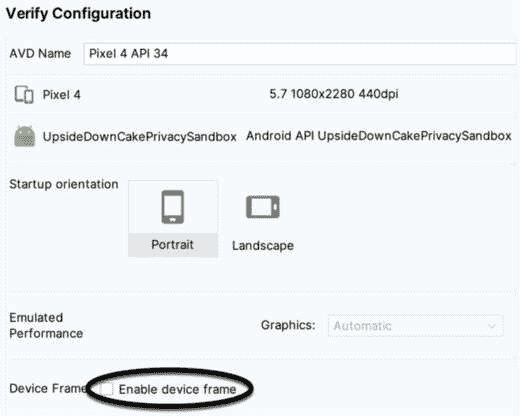

**图 4-23**

一旦禁用了设备框，模拟器下次启动时将如图 4-24 所示：

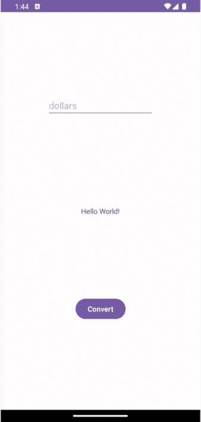

**图 4-24**

## 4.9 总结

典型的应用开发流程遵循测试环境中的“编码、编译和运行”循环。Android 应用程序可以在物理 Android 设备或 Android 虚拟设备（`AVD`）模拟器上进行测试。`AVD`使用`Android Studio Device Manager`工具创建和管理，该工具可以作为命令行工具使用，也可以通过图形用户界面使用。在创建`AVD`以模拟特定的 Android 设备模型时，虚拟设备的配置应具有与物理设备匹配的硬件规格。

`AVD`模拟器会话可以独立窗口的形式显示，也可以嵌入到 Android Studio 主用户界面中。

## 5 使用和配置 Android Studio AVD 模拟器

在下一章探索在物理 Android 设备上进行测试之前，本章将花费一些时间概述 Android Studio AVD 模拟器，并突出许多可用的配置功能，这些功能可以在独立模式和工具窗口模式下自定义环境。

## 5.1 模拟器环境

当以独立模式启动时，模拟器在加载过程中会显示一个初始启动屏幕。加载完成后，会出现主模拟器窗口，其中包含所选设备类型的表示（在图 5-1 中，这是一个 Pixel 4 设备）：

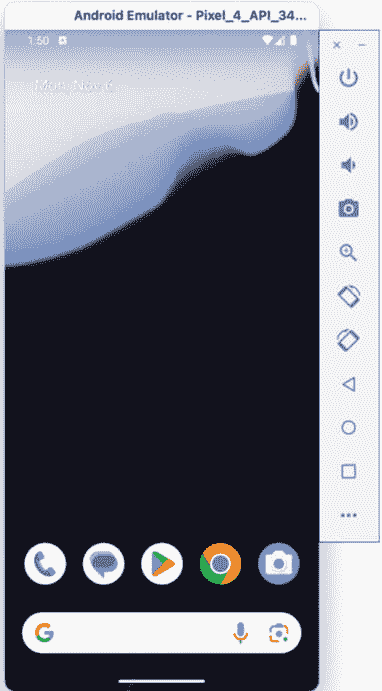

图 5-1

位于窗口右边缘的工具栏提供了快速访问模拟器控制和配置选项的通道。

## 5.2 模拟器工具栏选项

模拟器工具栏（图 5-2）提供了与模拟器环境外观和行为相关的系列选项。

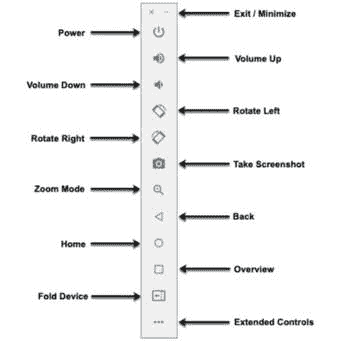

图 5-2

工具栏中的每个按钮都关联有一个键盘快捷键，可以通过将鼠标指针悬停在按钮上并等待工具提示出现，或者通过扩展控制面板的帮助选项来识别。

尽管工具栏中包含许多选项是自言易懂的，但为了完整起见，将对每个选项进行介绍：

* **退出 / 最小化 (Exit / Minimize)** – 工具栏最顶部的“x”按钮选中后会退出模拟器会话，而“-”选项则会将整个窗口最小化。

* **电源 (Power)** – 电源按钮模拟物理 Android 设备上的硬件电源按钮。点击并释放此按钮将锁定设备并关闭屏幕。按住此按钮将启动设备的“关机”请求序列。

* **音量增大 / 减小 (Volume Up / Down)** – 用于控制模拟器环境内播放音量的两个按钮。

* **左转/右转 (Rotate Left/Right)** – 模拟的设备在竖屏和横屏方向之间旋转。

* **截图 (Take Screenshot)** – 对设备屏幕上显示的内容截图。捕获的图像存储在扩展控制面板设置屏幕中指定的位置，本章稍后会对此进行概述。

* **缩放模式 (Zoom Mode)** – 此按钮切换进入和退出缩放模式，细节将在本章稍后部分介绍。

* **返回 (Back)** – 执行标准的 Android“返回”导航回到上一个屏幕。

* **主页 (Home)** – 显示设备的主屏幕。

* **概览 (Overview)** – 模拟标准的 Android“概览”导航，显示设备上正在运行的应用程序。

* **折叠设备 (Fold Device)** – 模拟折叠设备的折叠和展开。此选项仅在模拟器运行折叠设备系统镜像时才可用。

* **扩展控制 (Extended Controls)** – 显示扩展控制面板，允许配置如模拟位置和电话活动、电池强度、蜂窝网络类型和指纹识别等选项。

## 5.3 在缩放模式下工作

位于模拟器工具栏的缩放按钮切换进入和退出缩放模式。当缩放模式激活时，工具栏按钮处于按下状态，鼠标指针悬停在设备屏幕上将显示为放大镜。点击左键将导致显示相对于屏幕上的选定点放大，重复点击将增加缩放级别。相反，点击右键将降低缩放级别。关闭缩放按钮将显示恢复到默认大小。

在缩放模式下点击并拖动将定义一个矩形区域，释放鼠标按钮时视图将缩放到该区域。

在缩放模式下，可以使用模拟器窗口内的水平和垂直滚动条来移动屏幕可视区域。

## 5.4 调整模拟器窗口大小

模拟器窗口的大小（以及设备相应的表示）可以通过启用缩放模式，并在窗口的任何角或边上点击和拖动来随时更改。

## 5.5 扩展控制选项

扩展控制工具栏按钮显示如图 5-3 所示的面板。默认情况下将显示位置设置。从左侧面板选择不同的类别将显示相应的控制组：

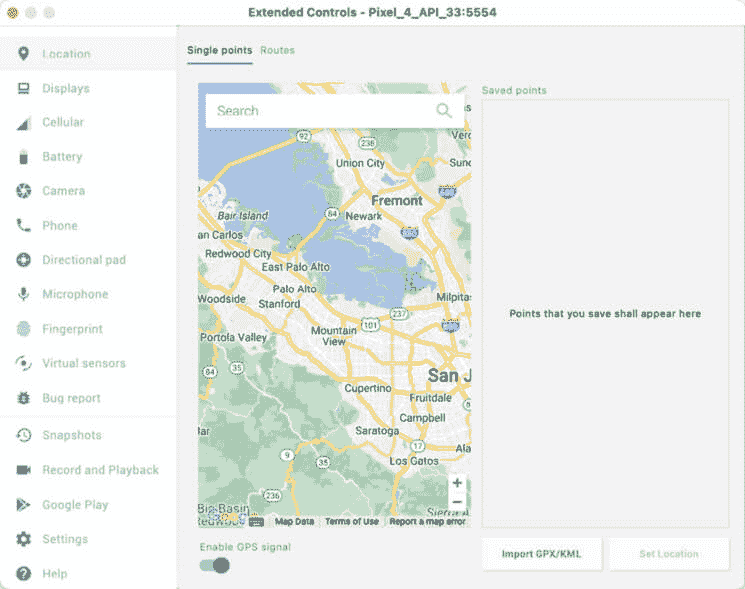

图 5-3

### 5.5.1 位置 (Location)

位置控制允许以十进制或六进制坐标将模拟位置信息发送到模拟器。位置信息可以是单个位置的形式，也可以代表设备移动的点序列，后者通过 GPS 交换 (`GPX`) 或 Keyhole 标记语言 (`KML`) 格式的文件提供。或者，也可以使用集成的 Google Maps 面板视觉化地选择单点或旅行路线。

### 5.5.2 显示 (Displays)

除了模拟器屏幕内显示的主显示外，`Displays`选项允许在同一实例中运行额外的显示器。这对于测试双屏设备（如 Microsoft Surface Duo）非常有用。这些额外的屏幕可以配置为任何大小，并出现在与主屏幕相同的模拟器窗口中。

### 5.5.3 蜂窝 (Cellular)

可以在蜂窝设置内更改模拟的蜂窝连接类型。除了各种语音和数据场景（如漫游和拒绝访问）外，还有选项可以模拟不同的网络类型（CSM、EDGE、HSDPA 等）。

### 5.5.4 电池 (Battery)

可以在扩展控制屏幕上模拟各种电池状态和充电条件，包括电池电量、电池健康以及是否连接了交流充电器。

### 5.5.5 摄像头 (Camera)

当摄像头激活时，模拟器会模拟一个 3D 场景。它表现为虚拟建筑内部，您可以在录视频或拍照之前按住`Option`键（Windows 上为`Alt`）并使用鼠标指针和键盘进行导航。此扩展选项允许上传不同的图像并在虚拟环境中显示。

### 5.5.6 电话 (Phone)

电话扩展为模拟器提供了两个简单实用的模拟。第一个选项模拟来自指定电话的入电。这在测试应用程序如何处理高级中断时特别有用。

第二个选项允许在模拟器会话中模拟接收短信。与现实世界一样，这些消息将出现在消息应用中，并在模拟器内触发标准通知。

### 5.5.7 方向键 (Directional Pad)

方向键 (`D-Pad`) 是内置在 Android 设备中或外部连接（如游戏控制器）的另一组额外控件，提供方向控制（左、右、上、下）。方向键设置允许在模拟器中模拟`D-Pad`交互。

### 5.5.8 麦风 (Microphone)

麦克风设置允许启用麦克风，并模拟虚拟耳机和麦克风连接。此外还提供了一个按钮，用于在模拟器上启动语音助手。

### 5.5.9 指纹

许多 Android 设备现在都配备了内置指纹检测硬件。`AVD`模拟器使得无需在包含指纹传感器的物理设备上测试应用即可进行指纹身份验证测试。有关在模拟器中配置指纹测试的细节将在本章后续部分介绍。

### 5.5.10 虚拟传感器

虚拟传感器选项允许模拟加速度计和磁力计以模拟设备的物理运动效果，例如通过`yaw`（偏航）、`pitch`（俯仰）和`roll`（滚滚）设置模拟旋转、移动和倾斜。

### 5.5.11 快照

快照包含当前运行的`AVD`会话的状态，可以保存并快速恢复，从而使模拟器轻松返回精确状态。快照将在本章稍后部分介绍。

### 5.5.12 录制与回放

允许对模拟器屏幕和音频进行录制并保存为`WebM`或`animated GIF`格式。

### 5.5.13 Google Play

如果模拟器运行的是安装了`Google Play Services`的 Android 版本，此选项将显示当前的`Google Play`版本。它还提供了将模拟器更新到最新版本的选项。

### 5.5.14 设置

设置面板提供了一组配置选项。使用此面板为工具栏和扩展控制面板选择较深颜色的主题，指定保存截图的文件系统位置，配置`OpenGL`支持级别，并配置模拟器窗口显示在桌面上其他窗口之上。

### 5.5.15 帮助

帮助屏幕包含三个子面板，其中列出了键盘快捷键列表、访问模拟器在线文档的链接、报告文件错误并发送反馈的链接，以及模拟器版本信息。

### 5.6 使用快照

当模拟器首次启动时，它会执行冷启动，就像物理 Android 设备开机一样。由于需要加载操作系统并启动所有后台进程，此冷启动过程可能需要一些时间才能完成。为了避免每次启动模拟器时都要经过这一过程，系统被配置为每次退出时自动保存模拟器当前状态的快照（称为快速启动快照）。下次启动模拟器时，快速启动快照将加载到内存中，并从上次离开的地方继续执行，允许模拟器在冷启动完成所需的一部分时间内重启。

扩展控制面板的`Snapshots`屏幕可以在模拟器执行期间的任何点存储额外的快照。这保存了整个模拟器的精确状态，允许模拟器恢复到拍摄快照时的精确时间点。在屏幕中，可以使用`Take Snapshot`按钮（在图 5-4 中标记为`A`）拍摄快照。要恢复现有快照，从列表 (`B`) 中选择它并点击屏幕底部的运行按钮 (`C`)。还提供了编辑 (`D`) 快照名称和描述以及删除 (`E`) 当前选中快照的选项：


图 5-4

你还可以通过从主工具栏的运行目标菜单中选择，决定使用冷启动、最近的快速启动快照或之前的快照来启动模拟器，如图图 5-5 所示：


图 5-5

### 5.7 配置指纹模拟

模拟器允许配置多达 10 个模拟指纹，并用于测试 Android 应用中的指纹身份验证。配置模拟指纹始于启动模拟器、打开`Settings`应用并选择`Security`选项。

在`Security`设置屏幕中，选择`fingerprint`选项。在弹出的信息屏幕上，点击`Next`按钮进入`Fingerprint`设置屏幕。在启用指纹安全之前，必须配置备份屏幕解锁方法（如`PIN`）。输入并确认合适的`PIN`，并通过接受默认通知选项完成`PIN`输入过程。

继续通过剩余屏幕，直到`Settings`应用请求在传感器上指纹。此时，显示扩展控制对话框，在左侧面板中选择`Fingerprint`类别，并确保主设置面板中选中了`Finger 1`：


图 5-6

点击`Touch Sensor`按钮以模拟`Finger 1`触摸指纹传感器。模拟器将报告成功添加指纹：


图 5-7

要添加更多指纹，在再次点击`Touch Sensor`按钮之前，点击`Add Another`按钮并在扩展控制面板菜单中选择另一个手指。

### 5.8 工具窗口模式下的模拟器

如上一章所述（“在 Android Studio 中创建 Android 虚拟设备 (AVD)”），Android Studio 可以配置为在嵌入式工具窗口中启动模拟器，使其不会显示在独立窗口中。在在此模式下运行时，工具栏中提供了与独立模式下相同的控件，如图图 5-8 所示：


图 5-8

从左到右，这些按钮执行的操作如下（详情与独立模式相同）：

- 电源

- 音量增大

- 音量减小

- 向左旋转

- 向右旋转

- 返回

- 桌面

- 概述

- 截图

- 快照

- 扩展控制

### 5.9 创建可缩放模拟器

除了匹配特定设备模型的模拟器外，Android Studio 还提供了一个可缩放的`AVD`，允许你在手机、平板电脑和折叠屏尺寸之间切换。要创建可缩放模拟器，打开`Device Manager`并点击`+`按钮。接下来，选择如图图 5-9 所示的`Resizable`设备定义，并按照通常步骤创建新的`AVD`：


图 5-9

当你在工具窗口在新模拟器上运行应用时，工具栏中会出现`Display`模式，允许你切换模拟器配置，如图图 5-10 所示：


图 5-10

如果模拟器在独立模式下运行，可以在侧工具栏中找到`Display`模式选项，如下：


图 5-11

一旦选择了折叠屏显示模式，可以使用`Change posture`菜单在打开、关闭和半折叠状态下测试应用：


图 5-12

### 5.10 总结

Android Studio 包含一个 Android 虚拟设备模拟器环境，旨在使无需在物理 Android 设备上运行即可测试测试应用程序。本章对模拟器进行了简要介绍，并强调了用于配置和自定义环境以模拟不同测试条件的关键功能。

## 6 Android Studio 用户界面导览

虽然急切想运行上一章中创建的示例应用，但它涉及 Android Studio 用户界面的某些方面，最好在此之前对其进行描述。

Android Studio 是一个强大且功能丰富的开发环境，在很大程度上，它的使用是非常直观的。尽管如此，现在花时间熟悉 Android Studio 用户界面的布局和结构，将缩短书中书中后续章节的学习曲线。基于此考虑，本章将提供 Android Studio 环境中各种区域和组件的概览。

# 6.1 欢迎界面

欢迎界面（图 6-1）会在 Android Studio 运行但当前没有打开任何项目时显示（可以通过选择`File` -> `Close Project`菜单选项随时关闭已打开的项目）。如果 Android Studio 在项目仍打开的状态下退出，该工具在下次启动时将跳过欢迎界面，自动打开之前活动的项目。


图 6-1


除了最近项目列表外，欢迎界面还提供了执行各项任务的选项，例如打开和创建项目，并可以访问当前受版本控制的项目。此外，`Customize`（自定义）屏幕提供了更改 IDE 和编辑器使用的主题和字体设置的选项。可以使用 `Plugins`（插件）选项查看、安装和管理 Android Studio 插件。

当最近项目列表替换 `More Actions`（更多操作）链接时，可以通过选择 `More Actions` 链接或使用图 6-2 中显示的菜单可用其他选项：


图 6-2

## 6.2 菜单栏

当创建新项目或打开现有项目时，将显示 Android Studio 主窗口。当同时打开多个项目时，每个项目都将分配自己的主窗口。窗口的精确配置取决于 Android Studio 运行的操作系统，以及项目上次打开时显示的工具和面板。例如，主菜单栏的外观将根据宿主操作系统而有所不同。在 macOS 上，Android Studio 遵循将菜单栏放置在桌面顶部边缘的标准惯例，如图 6-3 所示：


图 6-3

然而，当 Android Studio 在 Windows 或 Linux 上运行时，可以通过图 6-4 中高亮的按钮访问主菜单：


图 6-4

## 6.3 主窗口

一旦打开项目，Android Studio 主窗口通常类似于图 6-5 所示：


图 6-5

主窗口的各种元素可以总结如下：

**A – 工具栏（Toolbar）** – 一组用于频繁执行操作的快捷键。工具栏按钮提供了快速访问特定某组菜单栏操作的通道。可以通过右键点击工具栏并选择 `Customize Toolbar...`（自定义工具栏...）菜单选项来自定义工具栏。图 6-6 所示的工具栏菜单提供了一种方便执行任务的方法，例如创建和打开项目以及在多个项目打开时在窗口之间切换：


图 6-6

**B – 导航栏（Navigation Bar）** – 导航栏提供了在组成项目的文件和文件夹之间移动的方便方法。点击导航栏中的元素将弹出一个菜单，列出该位置的子文件夹和文件以供选择。同样，点击类名将显示列出该类包含方法的菜单：


图 6-7

从列表中选择一个方法将跳转到代码编辑器中的对应位置。你可以使用 `View` -> `Appearance` -> `Navigation Bar` 菜单选项来隐藏、显示和更改此栏的位置。

**C – 编辑器窗口（Editor Window）** – 编辑器窗口显示开发者当前正在工作的文件。当打开了多个文件时，每个文件由位于编辑器顶部边缘的标签表示，如图 6-8 所示：


图 6-8

**D – 状态栏（Status Bar）** – 状态栏显示有关项目和 Android Studio 活动的信息性消息。悬停在状态栏项目上将显示该字段的描述。许多字段是交互式的，允许用户点击以执行任务或获取更详细的状态信息。


图 6-9

状态栏中显示的小部件可以使用 `View` -> `Appearance` -> `Status Bar Widgets`（状态栏组件）菜单进行更改。

**E – 项目工具窗口（Project Tool Window）** – 项目工具窗口提供了项目文件结构的分级概述，允许对特定文件和文件夹进行导航。可以使用工具栏以几种不同的方式显示项目。默认设置是 `Android` 视图，这是本书其余部分主要使用的模式。

项目工具窗口只是 Android Studio 环境中许多可用工具之一。

## 6.4 工具窗口（Tool Windows）

除了项目视图工具窗口外，Android Studio 还包含许多其他窗口，这些窗口在启用后显示为位于主窗口左右边缘的工具窗口栏，并包含显示和隐藏每个窗口的按钮。图 6-10 显示了典型的工具窗口配置，但按钮及其布局可能会根据你的 Android Studio 安装情况有所不同。


图 6-10

点击按钮将显示相应的工具窗口，再次点击则将隐藏窗口。按钮在工具窗口栏中的位置指示了窗口将出现在哪侧。这些位置可以通过点击并拖拽按钮到不同位置来更改。

Android Studio 提供了大量的工具窗口，最常用的如下：

**项目（A）** – 项目视图提供了项目结构的概述，允许在文件之间进行快速导航。通常，双击项目视图中的文件将导致该文件加载到相应的编辑工具中。

**资源管理器（B）** – 用于添加和管理项目中的资源和资产的工具，例如图像、颜色和布局文件。

**更多工具窗口（C）** – 显示包含当前未在工具窗口栏中显示的额外工具窗口的菜单。从此菜单选择工具窗口后，它将作为工具窗口栏中的按钮出现。

**运行（D）** – 运行窗口在应用程序当前运行时可用，并提供运行结果的视图以及停止或重启运行进程的选项。如果应用程序无法在设备或模拟器上安装和运行，此窗口通常会提供有关问题的诊断信息。

**Logcat（E）** – `Logcat` 工具窗口提供了访问运行应用程序的监控日志输出的权限，并提供了对应用程序截图、视频以及停止和重启进程的选项。

**问题（F）** – 查看项目内所有当前错误或警告的中心位置。双击问题列表中的项将带你跳转到问题所在的文件和位置。

**App Quality Insights（G）** – 提供访问云端 Firebase 质量和崩溃分析平台的权限。

- **终端 (H)** – 提供对运行 Android Studio 的系统上的终端窗口的访问。在 Windows 系统上，这是命令提示符（Command Prompt）界面，而在 Linux 和 macOS 系统上，它表现为终端（Terminal）提示符。

- **版本控制 (I)** - 当项目文件受源代码版本控制管理时，使用此工具窗口访问 Git 仓库和代码更改历史。

- **通知 (J)** - 当项目文件受源代码版本控制管理时，使用此工具窗口访问 Git 仓库和代码更改历史。

- **Gradle (K)** – `Gradle` 工具窗口提供了构成项目构建配置的 Gradle 任务视图。该窗口列出了将项目各种元素编译为可执行应用程序的任务。右键点击顶层 Gradle 任务并选择 `Open Gradle Config`（打开 Gradle 配置）菜单选项，可以将当前项目的 Gradle 构建文件加载到编辑器中。本书的后部分部分将详细介绍 Gradle。

- **设备管理器 (L)** - 提供对设备管理器（Device Manager）工具窗口的访问，可以在其中添加、删除和管理物理 Android 设备连接以及模拟器。

- **运行中的设备 (M)** - 如果已启用了在工具窗口中运行模拟器的选项（如“在 Android Studio 中创建 Android 虚拟设备 (AVD)”章节所述），则该处包含 AVD 模拟器。

- **应用检查 (App Inspection)** - 提供对数据库和后台任务检查器的访问。数据库检查器允许你在应用运行时检查、查询和修改应用数据库。后台任务检查器允许对使用 `WorkManager` 创建的后台工作任务进行监控和管理。

- **书签 (Bookmarks)** – 书签工具窗口快速访问已标记的文件和代码行。例如，在项目视图中右键点击文件可以访问 `Add to Bookmarks`（添加书签）菜单选项。同样，您可以通过将光标移动到源文件的某行并按 `F11` 键（macOS 上为 `F3`）为该行书签。所有书签项都可以通过工具窗口访问。

- **构建 (Build)** - 构建工具窗口显示项目编译和打包过程中构建过程的信息，以及遇到的任何错误详细信息。

- **构建变体 (Build Variants)** – 构建变体工具窗口提供了一种为当前应用程序项目配置不同构建目标快速方法（例如，为应用程序的调试和发布版本构建不同的构建，或针对不同设备类别构建多个构建）。

- **设备文件管理器 (Device File Explorer)** – 通过 `View` -> `Tool Windows` -> `Device File Explorer`（视图 -> 工具窗口 -> 设备文件管理器）菜单可用，此工具窗口直接访问当前连接的 Android 设备或模拟器的文件系统，允许浏览系统并将文件复制到本地文件系统。

- **布局检查器 (Layout Inspector)** - 提供构成用户界面布局的组件层次的可视化 3D 渲染。

- **结构 (Structure)** – 结构工具提供当前编辑器源文件结构的高级视图。此信息包含了文件中的类、方法和变量等项列表。从结构列表中选择一个项将带您进入编辑器窗口中源文件中的对应位置。

- **TODO** – 如名所示，此工具提供了一个查看项目中尚未完成的项的地方。Android Studio 通过扫描构成项目的源文件并查找匹配指定 `TODO` 模式的注释来编译此列表。可以通过打开 `Settings`（设置）对话框并导航到 `Editor`（编辑器）下的 `TODO` 条目来查看和更改这些模式。

## 6.5 工具窗口菜单

每个工具窗口在顶部边缘都有自己的工具栏。这些工具栏中的菜单按钮随工具而异，但所有工具窗口都包含一个 `Options`（选项）菜单（在图 6-11 中标记为 A）：


图 6-11

`Options` 菜单允许更改窗口的各个方面。例如图 6-12 显示了 `Project`（项目）工具窗口的 `Options` 菜单。可以使用 `Settings`（设置）取消窗口锁定并允许其浮动在 Android Studio 主窗口边界之外，以及移动和调整工具面板的大小：


图 6-12

所有工具窗口在工具栏上还包含一个位于右远的按钮（在上方图 6-11 中标记为 B），提供了隐藏工具窗口的额外方法。可以通过点击该窗口使其获得焦点然后输入搜索词来对工具窗口内的项进行搜索（例如 `Project` 工具窗口中的文件名）。窗口的工具栏中会出现一个搜索框，并高亮显示匹配的项。

## 6.6 Android Studio 键盘快捷键

Android Studio 包含了许多键盘快捷键，以便在执行常用任务时节省时间。可以在 Android Studio 项目窗口内选择 `Help` -> `Keyboard Shortcuts PDF`（帮助 -> 键盘快捷键 PDF）菜单选项查看并打印完整的键盘快捷键映射列表。您还可以通过打开 `Settings`（设置）对话框并点击 `Keymap`（键映射）条目来列出和修改键盘快捷键，如下图 6-13 所示：


图 6-13

## 6.7 切换器和最近文件导航

在 Android Studio 主窗口内导航的另一种实用机制是使用 `Switcher`（切换器）。通过 `Ctrl-Tab` 快捷键访问的切换器是一个列出工具窗口和已打开文件的面板（图 6-14）。


图 6-14

一旦显示，只要按住 `Ctrl` 键，切换器就会可见。在按住 `Ctrl` 键的同时反复点击 `Tab` 键可以在各个选项之间循环，释放 `Ctrl` 键将选中高亮项。

除了 `Switcher`，`Recent Files`（最近文件）面板提供了最近打开文件的导航（图 6-15）。可以使用 `Ctrl-E` 快捷键（macOS 上为 `Cmd-E`）访问。一旦显示，可以使用鼠标指针选择选项，或使用键盘箭头键滚动。按下 `Enter` 键将选中高亮项：


图 6-15

## 6.8 更改 Android Studio 主题

可以使用 `Settings` 对话框更改 Android Studio 环境的主题。一旦显示设置对话框，在左侧面板中选择 `Appearance & Behavior`（外观与行为）选项，然后选择 `Appearance`（外观）。然后，更改 `Theme`（主题）菜单的设置，最后点击 `OK` 按钮。可用主题取决于平台，但通常包括 `Light`、`IntelliJ`、`Windows`、`High Contrast` 和 `Darcula` 等选项。图 6-16 显示了选择 `Dark` 主题的主窗口示例：


图 6-16

要将 Android Studio 主题与操作系统同步，请启用 `Sync with OS`（与操作系统同步）选项并使用下拉菜单控制每种模式使用的主题：


图 6-17

## 6.9 总结

Android Studio 环境的主要元素包括欢迎界面和主窗口。每个打开的项目都分配了自己的主窗口，主窗口反过来包含菜单栏、工具栏、编辑和设计区域、状态栏以及一组工具窗口。工具窗口出现在主窗口侧面。

在 Android Studio 中，极少数的操作是无法通过快捷键触发的。你可以随时从 Android Studio 主窗口访问默认快捷键的键位映射。

## 7. 在实体 Android 设备上测试 Android Studio 应用

虽然使用 Android 虚拟设备 (AVD) 测试应用程序可以实现许多功能，但在实体 Android 设备上进行真实世界中的应用测试是不可替代的，而且某些 Android 特性仅在实体 Android 设备上可用。

与 AVD 实例和已连接的 Android 设备之间的通信均由 Android 调试桥 (ADB) 处理。本章将解释如何配置 `adb` 环境，以便在基于 macOS、Windows 和 Linux 的系统上对 Android 设备进行应用测试。

## 7.1 Android 调试桥 (ADB) 概述

`ADB` 的主要目的是促进开发系统（在此例中为 Android Studio）与 AVD 模拟器以及 Android 设备之间的交互，以运行和调试应用程序。`ADB` 允许你通过 WiFi 或 USB 数据线连接到设备。

`ADB` 由一个客户端、一个运行在开发系统后台的服务器进程，以及一个运行在 AVD 或实体 Android 设备（如手机和平板）上的守护进程（daemon）组成。

`ADB` 客户端可以有多种形式。例如，Android SDK 的 `platform-tools` 子目录下提供了一个名为 `adb` 的命令行工具作为客户端。同样，Android Studio 也拥有一个内置的客户端。

可以使用 `adb` 命令行工具执行多种任务。例如，可以使用 `devices` 命令行参数列出活跃的虚拟或实体设备。以下命令输出表示系统中存在一个 AVD，但没有实体设备：

```
$ adb devices
List of devices attached
emulator-5554 device
```

## 7.2 在 Android 设备上启用 USB 调试 ADB

在 `ADB` 连接到 Android 设备之前，必须配置该设备以允许连接。在运行 Android 6.0 或更高版本的手机和平板电脑设备上，实现此目的的步骤如下：

1. 打开设备上的 `Settings`（设置）应用并选择 `About tablet`（关于平板）或 `About phone`（关于手机）选项（在某些 Android 版本中，可以在 `Settings` 应用的 `System` 页面找到它）。

2. 在 `About`（关于）屏幕上，向下滚动到 `Build number`（编译号）字段并连续点击七次，直到消息显示开发者模式已启用。如果 `About` 屏幕上没有列出 `Build number`，可以通过 `Software information`（软件信息）选项找到。或者，如果可以展开列表中的 `Advanced`（高级）部分。


图 7-1

3. 返回主 `Settings` 屏幕，注意出现名为 `Developer options`（开发者选项）的新选项（在较新版本的 Android 中，此选项被列在 `System` 设置屏幕上）。选择此选项，并在生成的屏幕上找到如图 7-2 所示的 `USB debugging`（USB 调试）选项：


图 7-2

4. 启用 `USB debugging` 选项并在请求确认时点击 `Allow`（允许）按钮。

如果你使用的是三星 Galaxy 设备，可能需要在启用调试选项之前在 `Settings` 应用中关闭 `Auto Blocker`（自动锁定）功能。

现在设备已配置为接受通过 USB 连接来自开发系统上 `adb` 的调试连接。剩下的工作是配置开发系统以便在设备连接时检测到它。虽然这是一个简单的过程，但步骤取决于开发系统运行的是 Windows、macOS 还是 Linux。注意，以下步骤假设 Android SDK `platform-tools` 目录已包含在系统的 `PATH` 环境变量，这在“设置 Android Studio 开发环境”章节中有描述。

### 7.2.1 macOS ADB 配置

要在 macOS 系统上配置 `ADB` 环境，请使用 USB 线将设备连接到计算机系统，打开终端窗口并执行以下命令以重启 `adb` 服务器：

```
$ adb kill-server
$ adb start-server
* daemon not running. starting it now on port 5037 *
* daemon started successfully *
```

一旦服务器成功运行，执行以下命令验证设备是否已检测到：


执行`adb devices`命令：

```
$ adb devices
List of devices attached
74CE000600000001 offline
```

如果设备被列为`offline`（离线），请查看 Android 设备并检查图 7-3 所示的请求`Allow USB debugging`权限的对话框。在点击 OK 之前，勾选`Always allow from this computer`（始终允许来自此计算机）旁边的选项。


图 7-3

现在重复`adb devices`命令应该会将设备列为可用：

```
List of devices attached
015d41d4454bf80c device
```

如果设备未列出，请尝试注销并重新登录 macOS 桌面，或者重启系统。

### 7.2.2 Windows ADB 配置

配置基于 Windows 的开发系统使用`ADB`连接到 Android 设备的第一步是在系统上安装相应的 USB 驱动程序。要安装的 USB 驱动取决于 Android 设备的型号。如果你有 Pixel 手机等 Google 设备，则需要在 Windows 系统上安装并配置`Google USB Driver`包。实现此目的的详细步骤列在以下网页上：

[`developer.android.com/sdk/win-usb.html`](https://developer.android.com/sdk/win-usb.html)

对于不支持 Google USB 驱动的 Android 设备，需要下载设备制造商提供的驱动程序。可以在此处获取驱动列表及安装信息：

[`developer.android.com/tools/extras/oem-usb.html`](https://developer.android.com/tools/extras/oem-usb.html)

驱动程序安装且设备现在识别为正确类型后，打开命令提示符窗口并执行以下命令：

```
adb devices
```

该命令应输出有关连接设备的信息，如下：

```
List of devices attached
01906 offline
```

如果设备被列为`offline`或`unauthorized`（未授权），请查看设备屏幕并检查图 7-3 所示的请求`Allow USB debugging`权限的对话框。在点击 OK 之前，勾选`Always allow from this computer`（始终允许来自此计算机）旁边的选项。重复`adb devices`命令现在会将设备列为就绪：

```
List of devices attached
01906 device
```

如果设备未列出，请执行以下命令重启 ADB 服务器：

```
adb kill-server
adb start-server
```

如果设备仍然未列出，尝试执行以下命令：

```
android update adb
```

注意，可能还需要重启系统。

### 7.2.3 Linux ADB 配置

在本章中，我们再次以 Ubuntu Linux 为例，在 Linux 上配置`adb`连接到实体设备。

在 Ubuntu Linux 上进行实体设备测试需要安装名为`android-tools-adb`的软件包，这要求 Android Studio 用户是`plugdev`组的成员。这是大多数 Ubuntu 版本中用户账户的默认设置，可以通过运行`id`命令进行验证。如果没有列出`plugdev`组，运行以下命令将您的账户添加到组组：

```
sudo usermod -aG plugdev $LOGNAME
```

满足组成员要求后，可以通过执行以下命令安装`android-tools-adb`软件包：

```
sudo apt-get install android-tools-adb
```

完成上述更改后，重启 Ubuntu 系统。系统重启后，打开终端窗口，启动`adb`服务器，并检查已连接设备列表：

```
$ adb start-server
* daemon not running. starting it now on port 5037 *
* daemon started successfully *
$ adb devices
```

已连接设备列表

`015d41d4454bf80c offline`

如果设备显示为`offline`（离线）或`unauthorized`（未授权），请前往 Android 设备并检查是否有图 7-3 所示的对话框，请求允许 USB 调试权限。

## 7.3 解决 USB 连接问题

如果你无法通过上述步骤成功连接到设备，请显示运行目标菜单（图 7-4）并选择`Troubleshoot Device Connections`（排除设备连接）选项：


图 7-4

连接助手将扫描设备并报告问题及可能的解决方案。

## 7.4 在 Android 设备上启用无线调试

按照上述章节 7.2 中的步骤 1 到 3 进行操作，这次要启用图 7-5 所示的`Wireless Debugging`（无线调试）选项：


图 7-5

接下来，点击上述`Wireless debugging`条目，以显示图 7-6 所示的屏幕：


图 7-6

如果你的设备带有摄像头，选择`Pair device with QR code`（通过二维码配对设备），否则选择`Pair device with pairing code`（通过配对码配对设备）选项。根据你的选择，`Settings`应用将启动摄像头或显示配对码，如图 7-7 所示：


图 7-7

选择选项后，返回 Android Studio 并在运行目标菜单中选择图 7-8 所示的`Pair Devices Using WiFi`（通过 WiFi 配对设备）选项：


图 7-8

在配对对话框中，根据你之前在设备`Settings`应用中的选择，选择`Pair using QR code`（使用二维码配对）或`Pair using pairing code`（使用配对码配对）：


图 7-9

使用 Android 设备扫描二维码，或者将设备屏幕上显示的配对码输入 Android Studio 对话框（图 7-10）中以完成配对过程：


图 7-10

如果配对过程失败，请尝试重启开发系统和 Android 设备并重试。

## 7.5 测试 adb 连接

假设在所选的开发平台上已成功配置了`adb`，下一步是尝试在设备上运行“在 Android Studio 中创建示例 Android 应用”章节中创建的测试应用程序。启动 Android Studio，打开`AndroidSample`项目，并验证设备是否出现在设备选择菜单中，如图 7-11 所示：


图 7-11

从列表中选择设备并点击运行按钮安装并运行应用。

## 7.6 设备镜像

设备镜像（Device mirroring）允许你在物理设备上运行应用，同时在 Android Studio 的`Running Devices`工具窗口中查看显示内容。也就是说，尽管你的应用运行在物理设备上，但它在 Android Studio 中的显示方式与`AVD`实例相同。

当设备连接到 Android Studio 时，显示`Running Devices`工具窗口并点击`Device Mirror`设置链接以显示`Settings`对话框。在`Settings`对话框中，启用物理 Android 设备的镜像并点击`OK`。下次运行应用时，Android Studio 将`Running Devices`工具窗口中镜像物理设备的显示。

## 7.7 总结

虽然 Android 虚拟设备模拟器提供了一个极佳的测试环境，但必须记住，确保应用程序在物理 Android 设备上正常运行的方法没有真正的替代品。

但是，默认情况下，Android Studio 环境并未配置为将 Android 设备识别为目标测试设备。因此，需要执行一些步骤，通过 USB 线缆或 WiFi 网络从 Android Studio 开发环境直接将应用程序加载到 Android 设备上。实现这一目标的确切步骤取决于开发平台。在本章中，我们涵盖了适用于 Linux、macOS 和 Windows 平台的这些步骤。

## 8. Android Studio 代码编辑器基础

为 Android 开发应用程序涉及大量的编程工作，根据定义，这涉及输入、审查和修改代码行。毫不意外的是，开发者在使用 Android Studio 的大部分时间通常都在编辑器窗口内编写代码。

现代代码编辑器的功能远超输入、删除、复制和粘贴的基础。今天，代码编辑器的实用性通常通过以下因素衡量：减少程序员所需的输入量、大文件的导航易用性，以及编辑器在编写代码时实时检测并突出显示错误的能力。正如本章将所示，这些只是编辑器擅长的少数领域之一。

### 8.1 Android Studio 编辑器

当选择 Java、Kotlin、XML 或其他文本文件时，Android Studio 编辑器出现在主窗口中央。例如，图 8-1 显示了一个典型的 Java 源文件会话：


图 8-1

编辑器窗口的元素总结如下：

A – 文档标签（Document Tabs）——Android Studio 可以同时打开多个文件。每打开一个文件，都会在编辑器顶部的标签栏分配一个显示文件名的标签。当空间不足显示所有标签时，远右角会出现一个小下拉菜单。点击此菜单将列出其他打开的文件列表。标签中文件名下方的红色波浪线表示文件代码包含错误，在编译和运行项目之前需要解决。

在文件之间切换只需点击相应的标签或使用`Alt-Left`和`Alt-Right`快捷键。也可以通过切换器机制（通过`Ctrl-Tab`快捷键访问）进行文件间的导航。

要将编辑器面板从 Android Studio 主窗口分离并使其在独立窗口中显示，请点击标签将其拖到主窗口之外的桌面区域。要将编辑器返回主窗口，请点击分离编辑器窗口中的文件标签，并将其拖放到主窗口原始的编辑器标签栏中。

### B – 编辑器行距区域（Gutter Area）

行距区域用于编辑器显示信息图标和控件。该区域的一些典型项目包括调试断点标记、折叠和展开代码块的控件、书签、更改标记和行号。行号默认开启，但可以通过在行距处点击右键并选择`Appearance -> Show Line Numbers`（外观 -> 显示行号）菜单选项来禁用。

### C – 代码结构位置（Code Structure）

编辑器底部的此栏显示光标当前位置与代码整体结构的关系。例如在图中，该栏表示当前正在编辑`convertCurrency`方法，且该方法位于`MainActivity`类中：


图 8-2

双击该栏内的任意元素会将光标移动到代码文件中的相应位置。例如，双击`convertCurrency`条目会将光标移动到源代码中`convertCurrency`方法的顶部。同样，点击`MainActivity`条目将显示一个可用的代码导航点列表以供选择：


图 8-3

### D – 编辑器区域（Editor Area）

用户查看、输入和编辑代码的主要区域。本章的后续章节将详细介绍编辑区域的各项功能。

### E – 验证与标记侧边栏（Validation and Marker Sidebar）

Android Studio 集成了一项名为“即时代码分析”（on-the-fly code analysis）的功能。这意味着当您输入代码时，编辑器会分析代码以检查警告和语法错误。验证侧边栏顶部的指示器会随着代码的添加实时更新，显示发现的错误和警告数量。点击此指示器将弹出一个窗口，包含编辑器代码问题的总结，如图 8-4 所示：


图 8-4

向上和向下箭头可以在代码中的错误位置之间移动。绿色勾钩表示未检测到任何警告或错误。

侧边栏还会使用相同的颜色编码在检测到问题的位置显示标记。当编辑器区域显示代码行时，将鼠标指针悬停在标记上，将显示一个包含问题描述的弹出窗口：


图 8-5

将鼠标指针悬停在当前滚动出编辑器视图区域的代码行标记上时，将显示一个“透镜”（lens）覆盖层，包含问题所在的代码块（图 8-6），从而无需滚动到编辑器的相应位置即可查看代码：


图 8-6

值得注意的是，透镜覆盖层不仅限于侧边栏中的警告和错误。悬停在侧边栏的任何部分上，都会出现一个透镜，其中包含源文件中对应位置的代码。

### F – 状态栏（Status Bar）

虽然状态栏是主窗口的一部分而非编辑器，但它确实包含有关当前活动编辑会话的信息。这些信息包括光标在行和字符维度上的当前位置，以及文件的编码格式（UTF-8、ASCII 等）。点击状态栏中的这些值可以更改相应的设置。例如，点击行号会显示`Go to Line:Column`（转到行:列）对话框。使用`View -> Appearance -> Status Bar Widgets`菜单选项添加或删除小部件。例如，如果您遇到 Android Studio 的性能问题，`Memory Indicator`（内存指示）是一个非常有用的小部件。

在概述组成 Android Studio 编辑器的元素后，本章的剩余部分将更详细探讨编辑环境的关键功能。

## 8.2 分割编辑器窗口

默认情况下，编辑器将显示一个显示当前选中文件内容的面板。在同时处理多个源文件时，一个实用的功能是将编辑器拆分为多个窗格。要拆分编辑器，可以在编辑器窗口内的文件标签页上点击右键，选择`Split Right`（向右拆分）或`Split Down`（向下拆分）菜单选项。例如图 8-7 显示了拆分器的工作，编辑器被拆分为三个面板：


图 8-7

可以通过右键点击相应的标签页并选择`Change Splitter Orientation`（更改拆分器方向）菜单选项随时更改拆分面板的方向。重复这些步骤可以取消单个面板的拆分，此时从菜单中选择`Unsplit`（取消拆分）选项。可以通过右键点击任何标签页并选择`Unsplit All`（取消所有拆分）菜单选项移除所有拆分面板。

窗口分割可显示不同的文件，或为同一个文件提供多个窗口，允许同时查看和编辑同一文件的不同区域。

## 8.3 代码补全

Android Studio 编辑器拥有 Java 编程语法、构成 Android SDK 的类和方法，以及您自己的代码库的大量知识。随着代码的输入，编辑器会扫描输入内容，并在适当的情况下就完成语句或引用可能的内容提供建议。当编辑器检测到补全建议时，将出现一个包含建议列表的面板。在图 8-8 中，例如，编辑器正在为`String`声明提供建议：


图 8-8

### 8.4 语句补全

代码补全功能也可以用来在编码时添加缺失的语法。例如，在输入代码时，忘记闭合右括号或大括号是常见的疏忽。另一个常见的错误是忘记在语句末尾添加分号。语句补全功能会自动添加缺少的语法。例如，在 Swift 中，考虑一个未闭合的方法声明：

`myMethod()`

在编辑器中输入此代码后，触发语句补全将导致编辑器自动为方法添加大括号：

```
myMethod() {

}
```

### 8.5 参数信息

你也可以要求编辑器提供方法所接受的参数的信息。当光标置于方法调用的大括号之间时，按下`Ctrl-P`（macOS 上为`Cmd-P`）组合键将显示该方法已知的接受的参数，并对最可能的建议以**粗体**形式高亮显示：


图 8-10

### 8.6 参数名称提示

代码编辑器可以配置为在方法调用内部显示参数名称提示。例如，图 8-11 显示了`Snackbar`类调用`make()`和`setAction()`方法时的参数名称提示：


图 8-11

此模式的设置可以通过打开设置（Settings）对话框，并在侧边栏导航到`Editor -> Inlay Hints -> Java`来配置。在生成的屏幕上，为你选择的编程语言开启或关闭`Parameter names`。要调整提示设置，点击`Exclude list...`链接并进行任何必要的调整。

### 8.7 代码生成

除了在输入时补全代码外，编辑器在某些条件下还可以为你生成代码。图 8-12 所示的可用代码生成选项列表可以通过`Alt-Insert`（macOS 上为`Cmd-N`）快捷键访问，前提是光标位于文件中需要生成代码的位置。


图 8-12

例如，考虑这样一种情况：我们希望在项目中的`Activity`即将被操作系统销毁时收到通知。正如本书后续章节概述的那样，这可以通过重写`Activity`超类的`onStop()`生命周期方法来实现。要让 Android Studio 为此生成一个存根方法，请从代码生成列表中选择`Override Methods…`选项，并从生成的可用方法列表中选择`onStop()`方法。


图 8-13

选择好要重写的方法后，点击 `OK` 将在 Java 源文件的当前光标位置生成如下存根方法：

```java
@Override
protected void onStop() {
    super.onStop();
}
```

### 8.8 代码折叠

一旦源代码文件达到了一定的尺寸，即使是格式化最整齐、组织最好的代码也可能变得难以处理和导航。Android Studio 认为，并不总是需要让每个代码块的内容始终可见。通过使用 Android Studio 编辑器的代码折叠功能，可以让代码导航变得更加简单。

代码折叠使用折叠箭头控制，当鼠标指针悬停在源文件行间距（gutter）区域时，这些箭头会出现在每个代码块的开头。例如，图 8-14 高亮了当前未折叠的方法声明的折叠箭头：


图 8-14

点击此标记将折叠语句，使只可见签名行，如图 8-15 所示：


图 8-15

要展开已折叠的代码段，请点击编辑器行间距（gutter）中的折叠箭头。要在不展开的情况下查看隐藏代码，请将鼠标指针悬停在 `“{…}”` 指示上，如图 8-16 所示。编辑器随后将显示包含折叠代码块的透镜覆盖层：


图 8-16

文件中的所有代码块可以使用 `Ctrl-Shift-Plus` 和 `Ctrl-Shift-Minus` 组合键（macOS 上为 `Cmd-Shift-Plus` 和 `Cmd-Shift-Minus`）进行折叠或展开。

默认情况下，Android Studio 编辑器在打开源文件时会自动折叠某些代码。要配置发生这种情况的情况，请在设置对话框中导航到 `Editor` -> `General` -> `Code Folding` 项（图 8-17）：


图 8-17

### 8.9 快速文档查询

通过将光标置于需要文档的声明上并按下 `Ctrl-Q` 快捷键（macOS 上为 `Ctrl-J`），可以访问与上下文相关的 Java 和 Android 文档。这将显示一个包含该项目相关参考文档的弹出窗口。例如，图 8-18 显示了 `Android FloatingActionButton` 类文档。


图 8-18

### 8.10 代码格式化

通常情况下，Android Studio 编辑器会自动根据缩进、空格和嵌套来格式化代码。在需要格式化代码的情况下（例如从网站剪切代码时），可以使用 `Ctrl-Alt-L`（macOS 上为 `Cmd-Opt-L`）触发代码格式化功能。

要显示格式化代码对话框（图 8-19），使用 `Ctrl-Shift-L`（macOS 上为 `Cmd-Shift-L`）。此对话框提供了仅格式化选定代码、整个文件或仅更改代码的选项：


图 8-19

代码样式偏好可以通过打开设置对话框并在侧边面板选择 `Code Style` 来访问支持的语言。选择一种语言将提供大量的格式样式选项，所有选项都可以从 Android Studio 默认值进行修改以匹配你的代码样式。

例如，要配置 `Rearrange code` 选项的设置，展开 `Code Style` 部分，选择 `Java`，然后从 Java 设置中选择 `Arrangement` 选项卡。


图 8-20

使用上方图 8-20 中标记为 A 的按钮添加、删除、复制或重置模板。要修改模板，请从列表（B）中选择它并在标记为 C 的面板中更改设置。

## 8.13 总结

Android Studio 编辑器尽力减少编写代码所需的输入，并使代码更易阅读和导航。本章涵盖了关键编辑器功能，包括代码补全、代码生成、编辑器分分、代码折叠、格式化、文档查询和实时模板（live templates）。

## 9. Android 架构概览

到目前为止，本书已经采取了步骤，建立了适用于使用 Android Studio 开发 Android 应用程序的环境。通过创建一个 Android Studio 应用项目，也已经在应用开发过程中迈出了第一步。

然而，在深入研究 Android 应用开发的实际问题之前，理解 Android SDK 以及通用的 Android 开发的一些较为抽象的概念是非常关重要的。现在清晰地理解这些概念将为进一步构建知识打下坚实的基础。

本章将从 Android 架构的概述开始，并在接下来的几章中继续，目标是提供 Android 开发基础的详细概述。

### 9.1 Android 软件栈

Android 结构为一个软件栈，由应用程序、操作系统、运行时环境、中间件、服务库组成。这种架构可以通过视觉方式完美表示，如图 9-1 所示。软件栈的每一层以及每层中相应的元素都紧密集成并经过仔细调整，为移动设备提供最佳的应用开发和执行环境。本章的剩余部分将逐层介绍 Android 栈，从底部的 `Linux Kernel` 开始。


图 9-1

### 9.2 Linux 内核

`Linux Kernel` 位于 Android 软件栈的底部，在设备硬件和 Android 软件栈上层之间提供了抽象。内核提供了抢占式多任务处理、低级核心系统服务（如内存、进程和电源管理），以及用于显示器、WiFi 和音频等硬件的网络栈和设备驱动程序。

原始的 `Linux kernel` 由 Linus Torvalds 于 1991 年开发。它与 Richard Stallman 在自由软件基金开发的一系列工具、实用程序和编译器相结合，创建了一个名为 `GNU/Linux` 的完整操作系统。各种 `Linux` 发行版都是从这些基础衍生出来的，例如 `Ubuntu` 和 `Red Hat Enterprise Linux`。

然而，需要注意的是，Android 只使用了 `Linux kernel`。尽管如此，值得注意的是，`Linux kernel` 最初是为传统的桌面和服务器计算机系统设计的。事实上，`Linux` 现在最广泛地部署在关键型企业服务器环境中。我们发现这种软件位于 Android 软件栈的核心，这既证明了今天移动设备的强大，也证明了 `Linux kernel` 的效率和性能。

### 9.3 硬件抽象层

`Hardware Ab Layer`（`HAL`）由一组库模块组成，与摄像头、麦克风和加速度计等设备组件接口。当 Android 栈需要访问硬件组件时，它使用 `HAL` 库模块。

每个 Android 设备制造商都针对其特定的硬件配置有一个抽象层，允许标准的 Android 库和框架在任何设备上运行，而无需针对特定硬件进行修改。

### 9.4 Android 运行时 – ART

当 Android 应用在 Android Studio 中构建时，它会被编译为一种中间字节码格式（`DEX format`）。当随后将应用程序加载到设备时，`Android Runtime`（`ART`）使用称为 `Ahead-of-Time`（`AOT`）编译的过程将字节码翻译为设备处理器所需的原生指令。这种格式被称为 `Executable and Linkable Format`（`ELF`）。

每当随后启动应用程序时都会运行 `ELF` 可执行版本，从而获得更的应用性能并延长电池寿命。

这与旧版 Android 实现中使用的 `Just-in-Time`（`JIT`）编译方法形成对比，在那种方法中，字节码每次启动应用程序时都在虚拟机（`VM`）中进行翻译。

### 9.5 Android 库

除了一组标准的 Java 开发库（提供对字符串处理、网络和文件操作等通用任务的支持）外，Android 开发环境还包含 `Android Libraries`。这些是专门用于 Android 开发的 Java 库。该类库的示例包括应用框架库，以及促进用户界面构建、图形绘制和数据库访问的库。

Android 开发者可用的某些核心 Android 库摘要如下：

- `android.app` – 提供对应用模型的访问，是所有 Android 应用的基石。
- `android.content` – 促进应用程序与应用组件之间的内容访问、发布和消息传递。
- `android.database` – 用于访问内容提供者发布的数据，并在 `SQLite` 数据库管理类。
- `android.graphics` – 一个低级 2D 图形绘制 API，包括颜色、点、过滤器、矩形和画布。
- `android.hardware` – 提供一个访问加速度计和光传感器等硬件的 API。
- `android.opengl` – 用于 `OpenGL ES` 3D 图形渲染 API 的 Java 接口。
- `android.os` – 为应用程序提供标准操作系统的访问，包括消息、系统服务和进程间通信。
- `android.media` – 提供用于音频视频播放的类。
- `android.net` – 提供一组访问网络栈的 API。包括 `android.net.wifi`，它提供对设备无线栈的访问。
- `android.print` – 包括一组从 Android 应用程序将内容发送到配置打印机的类。
- `android.provider` – 一组便利类，提供对标准 Android 内容提供者数据库的访问，例如日历和联系人应用维护的。
- `android.text` – 用于在设备显示上渲染和处理文本。
- `android.util` – 用于执行任务的工具类，如字符串和数字转换、XML 处理以及日期和时间操作。
- `android.view` – 用户界面的基础构建块。
- `android.widget` – 丰富的预构建用户界面组件集合，如按钮、标签、列表视图、布局管理器、单选按钮等。
- `android.webkit` – 一组旨在在应用程序中构建浏览器功能的类。

在涵盖了 Android 运行时的 Java 库之后，现在是我们将注意力转向 Android 软件栈这一层中的 C/C++ 库了。

#### 9.5.1 C/C++ 库

上一节概述的 Android 运行时核心库是基于 Java 的，为 Android 开发者提供了主要的 API。然而，需要注意的是，核心库并没有执行许多实际工作，事实上，它们本质上是一组基于 C/C++ 库的 Java“封装器”。

例如，在调用 `android.opengl` 库在设备显示器上绘制 3D 图形时，该库最终会调用 `OpenGL ES` C++ 库，而该库又与底层 Linux 内核协作执行绘图任务。

包含 C/C++ 库是为了实现广泛且多样的功能，包括 2D 和 3D 图形绘制、安全套接层（SSL）通、`SQLite` 数据库管理、音频视频播放、位图和矢量字体渲染、显示子系统和图形层管理，以及标准 C 系统库（`libc`）的实现。

在实践中，典型的 Android 开发者将仅通过基于 Java 的 Android 核心库 API 访问这些库。如果需要直接访问这些库可以使用 Android 原生开发工具包（`NDK`）实现，其目的是通过 Java 原生接口（`JNI`）在 Java 代码中调用非 Java 或 Kotlin 编程语言（如 `C` 和 `C++`）的原生方法。

## 9.6 应用框架

应用框架是一组服务，共同组 Android 应用程序运行和管理的环境。该框架实现了 Android 应用程序是由可重用、可交换和可替换组件构建的概念。这一概念更进一步，应用程序还可以发布其功能以及任何相关数据，以便其他应用程序可以找到并重用它们。

Android 框架包含以下关键服务：

- Activity 管理器（Activity Manager）– 控制应用程序生命周期和活动栈的所有方面。
- `Content Providers` – 允许应用程序与其他应用程序之间发布并共享数据。
- 资源管理器（Resource Manager）– 提供对非代码嵌入资源的访问，如字符串、颜色设置和用户界面布局。
- 通知管理器（Notifications Manager）– 允许应用程序向用户显示警告和通知。
- 视图系统（View System）– 用于创建应用程序界面的扩展视图集。
- 包管理器（Package Manager）– 查找设备上已安装的其他应用程序信息的系统。
- 电话管理器（Telephony Manager）– 向应用程序提供设备上可用电话服务的信息，例如状态和订阅者信息。
- 位置管理器（Location Manager）– 提供对位置服务的访问，允许应用程序接收位置更改的更新。

## 9.7 应用程序

位于 Android 软件栈顶端的是应用程序。它们由特定的 Android 实现提供的原生应用程序（例如网络浏览器和电子邮件应用程序）以及用户购买设备后安装的第三方应用程序组成。

## 9.8 总结

良好的 Android 开发知识基础需要理解 Android 的整体架构。Android 实现为一种软件栈架构，由 Linux 内核、运行时环境、相应的库、应用框架和一组应用程序组成。

应用程序主要用 `Java` 或 `Kotlin` 编写，并在 Android Studio 构建环境中编译为字节码格式。当应用程序随后安装到设备上时，这些字节码将由 Android 运行时（`ART`）编译为 CPU 使用的原生格式。Android 架构的关键目标是性能和效率，既体现在应用程序执行中，也体现在应用程序设计的重用中。

## 10. Android 剖析

无论你之前的编程经验是基于 Windows、macOS、Linux 甚至 iOS 的，Android 开发可能与你以前遇到过的任何事物都不同。

因此，本章的目标是让你理解 Android 应用程序架构背后的高层概念。在此，我们将详细探讨可用于构建应用程序的各种组件，以及允许这些组件协同工作以创建一个凝聚应用程序的机制。

### 10.1 Android Activity

熟悉 `Java`、`Kotlin`、`C++` 或 `C#` 等面向对象编程语言的人熟悉将应用程序功能元素封装在类中的概念，然后将其实例化为对象并进行操作以创建应用程序。这仍然适用，因为 Android 应用程序是用 `Java` 和 `Kotlin` 编写的。然而，Android 将重用组件的概念推向了更高。

Android 应用程序是通过组合一个或多个称为 `Activities` 的组件创建的。Activity 是应用程序功能的单个独立模块，通常直接对应单个用户界面屏幕及其相应的功能。例如，一个预约应用程序可能会有一个显示当天预约的 Activity 屏幕。应用程序可能还会使用第二个 Activity，由一个用户可以在其中输入新预约的屏幕组成。

Activity 设计为完全可重用和可交换的构建块，可以在不同应用程序之间共享。一个现有的电子邮件应用程序可能包含一个编写和发送电子邮件消息的 Activity。开发者可能正在编写一个也需要发送电子邮件消息的应用程序。开发者无需为新应用程序专门开发一个邮件编写 Activity，而是可以使用现有电子邮件应用程序中的 Activity。

Activity 是作为 `Android Activity` 类的子类创建的，并且必须实现为完全独立于应用程序中的其他 Activity。换句话说，共享的 Activity 不能依赖在程序流的已知点被调用（因为其他应用程序可能会以意想不到的方式使用该 Activity），而且一个 Activity 不能直接调用另一个 Activity 的方法或访问其实例数据。相反，这是通过 `Intents` 和 `Content Providers` 实现的。

默认情况下，Activity 无法向调用它的 Activity 返回结果。如果需要此功能，则必须显式地启动为源 Activity 的子 Activity。

### 10.2 Android Fragment

如上所述，一个 Activity 通常代表应用内部的单个用户界面屏幕。一种方案是使用单个用户界面布局和一个相应的 Activity 类文件来构建 Activity。然而，更好的替代方案是将 Activity 分为不同的部分。每个部分都是一个 Fragment，由用户界面布局的一部分和匹配的类文件（声明为 `Android Fragment` 类的子类）组成。在这种情况下，Activity 变成一个容器，其中嵌入一个或多个 Fragment。

Fragment 为每个用户界面屏幕由单独 Activity 表示提供了一种高效的替代方案。相反，应用可以有一个在 Fragment 之间切换的 Activity，每个 Fragment 代表不同的应用屏幕。

### 10.3 Android Intent

Intent 是一个 Activity 启动另一个 Activity 并实现构成应用程序的 Activity 流的机制。Intent 由对要执行的操作描述以及可选的要执行操作的数据组成。

`Intents` 可以是显式的（explicit），即通过类名引用 activity 来请求启动特定的 activity；也可以是隐式的（implicit），通过说明要执行的操作类型或提供要对执行操作的特定类型数据来实现。

在隐式意图的情况下，Android 运行时将使用一种被称为 `Intent Resolution`（意图解析）的过程，选择与 `Intent` 指定标准最匹配的 activity 进行启动。

### 10.4 广播意图（Broadcast Intents）


另一种 `Intent` 类型是 `Broadcast Intent`，它是一种发送给所有注册了“感兴趣”的 `Broadcast Receiver` 的系统级意图。例如，Android 系统通常发送 `Broadcast Intents` 来指示设备状态的变化，例如系统启动完成、外部电源连接到设备或屏幕开启或关闭。

`Broadcast Intent` 可以是普通的（异步的），即它在几乎相同的时间内发送给所有感兴趣的 `Broadcast Receivers`；也可以是有序的，即它一次发送给一个接收器，由其进行处理，然后可以被中止或允许传递给下一个 `Broadcast Receiver`。

### 10.5 广播接收器 (Broadcast Receivers)

`Broadcast Receivers` 是应用程序响应 `Broadcast Intents` 的机制。`Broadcast Receiver` 必须由应用程序注册，并配置 `Intent Filter`（意图过滤器）以指示它感兴趣的广播类型。当广播匹配的意图时，无论注册该接收器的应用程序当前是否运行，Android 运行时都会调用该接收器。接收器有 5 秒钟来完成所需任务（如启动 `Service`、更新数据或向用户发出通知），然后返回。`Broadcast Receivers` 在后台运行，并且没有用户界面。

### 10.6 Android 服务 (Android Services)

`Android Services` 是在后台运行且没有用户界面的进程。它们可以从 activities、`Broadcast Receivers` 或其他 `Services` 启动并管理。`Android Services` 非常适用于应用程序需要继续执行任务但不一定需要向用户可见用户界面的情况。虽然 `Services` 缺乏用户界面，但它们仍然可以使用通知（notifications）和吐司（toasts，出现在屏幕上且不中断当前可见活动的小型通知消息）来通知用户事件，并且能够发布 `Intents`。

Android 运行时赋予了 `Services` 比许多其他进程更高的优先级，系统只有在释放资源的最后手段下才会将其终止。然而，如果运行时需要杀死一个 `Service`，一旦有了足够的资源，它将自动重启。`Service` 可以通过声明自己需要在以前台运行来降低被终止的风险。这是通过调用 `startForeground()` 实现的。这仅建议用于终止会对用户体验产生影响的情况（例如，如果用户正在收听由 `Service` 传输的音频）。

`Service` 作为实际解决方案的示例情况包括（如之前提到的）：当应用程序不再活动时仍应继续的音频流，或者在股票达到指定价格时需要通知用户的股票市场跟踪应用程序。

### 10.7 内容提供者 (Content Providers)

`Content Providers` 实现了一种在应用程序之间共享数据的机制。任何应用程序都可以通过实现 `Content Provider` 为其他应用程序提供对其底层数据的访问权限，包括添加、删除和查询数据的能力（受权限限制）。对数据的访问通过 `Content Provider` 定义的通用资源标识符（Universal Resource Identifier `URI`）提供。数据可以以文件或整个 `SQLite` 数据库的形式进行共享。

### 10.8 应用清单 (The Application Manifest)

`Application Manifest` 文件是组成应用程序的各种元素的胶合剂。在这个基于 XML 的文件中，应用程序概述了组成完整应用程序的活动、服务、广播接收器、数据提供者和权限。

### 10.9 资源 (Application Resources)

除了清单文件和包含字节码的 `Dex` 文件外，Android 包通常包含一组资源文件。这些文件包含了出现在用户界面中的字符串、图像、字体和颜色等资源，以及用户界面布局的 XML 表示。默认情况下，这些文件存储在应用程序项目层次结构的 `/res` 子目录中。

### 10.10 应用程序上下文 (Application Context)

当应用程序被编译时，会创建一个名为 `R` 的类，其中包含对应用程序资源的引用。应用程序清单文件和这些资源结合在一起，创建了所谓的 `Application Context`（应用程序上下文）。该上下文由 `Android Context` 类表示，可以在应用程序代码中使用以在运行时访问应用程序资源。此外，可以在应用程序的上下文中调用广泛的方法来收集信息并在运行时更改应用程序的环境。

### 10.11 总结

许多不同的元素可以组合在一起创建一个 Android 应用程序。在本章中，我们提供了 `Activities`、`Fragments`、`Services`、`Intents` 和 `Broadcast Receivers` 的高级概述，以及对清单文件和应用程序资源的概述。

通过以活动和意图的形式创建单个、独立的功能模块，并实现 `content providers` 以实现应用程序之间的数据共享，可以促进最大的重用和互操作性。

虽然活动专注于用户与应用程序交互的区域（一个活动本质上等同于单个用户界面屏幕，通常由一个或多个 `fragments` 组成），但后台处理通常由 `Services` 和 `Broadcast Receivers` 处理。

构成应用程序的组件在清单文件中为 Android 运行时概述，该文件与应用程序资源结合代表了应用程序的上下文。

本章涵盖了许多对普通开发者来说可能是新的内容。但请放心，在后续章节中将对这些概念进行深入的探索和实际应用，以确保构建自己的应用程序奠定坚实的知识基础。

# 11. Android 视图绑定概述 (Android View Binding)

开发 Android 应用的一个基本部分是代码与组成用户界面布局的视图之间的交互。本章将查看访问布局视图的选项，重点介绍一种名为视图绑定（view binding）的方法。在涵盖视图绑定的基础后，本章将概述如何将 `AndroidSample` 项目转换为使用这种方法。

### 11.1 通过 ID 查找视图 (Find View by Id)

正如在“Android 应用的结构”章节中所述的，组成应用程序的所有资源都被编译到名为 `R` 的类中。在这些资源中包含了布局资源。在 `R` 类内部有一个名为 `layout` 的子类，它包含了布局资源，包括视图。大多数应用程序都需要实现代码与这些视图之间的交互，例如，当读取输入 `EditText` 视图的值或更改 `TextView` 显示的内容时。

在引入 Android Studio 3.6 之前，在 App 代码中获取视图的最常用方法是编写代码，通过 `findViewById()` 方法根据 ID 手动查找视图。例如：

```java
TextView exampleView = findViewById(R.id.exampleView);
```

获取引用后，就可以访问视图的属性了。例如：

```java
exampleView.setText("Hello");
```

虽然通过 ID 查找视图仍然是一个可行的方案，但它存在一些局限性，`findViewById()` 最显著的缺点是，可能会获取到一个尚未在布局中创建的视图引用，从而导致在尝试访问视图属性时抛出空指针异常。

从 Android Studio 3.6 开始，已经提供了一种以视图绑定（view binding）形式从 App 代码中访问视图的替代方法。

## 11.2 视图绑定 (View Binding)

当 App 模块中启用视图绑定时，Android Studio 会为每个布局文件自动生成一个绑定类。代码可以使用此绑定类访问布局视图，而无需使用 `findViewById()`。

Android Studio 生成的绑定类名称基于布局文件名，将其转换为所谓的“驼峰命名法”，并在末尾添加“Binding”单词。例如，对于 `activity_main.xml` 文件，绑定类将名为 `ActivityMainBinding`。

Android Studio Iguana 在项目模板中使用视图绑定的情况是不一致的。例如，我们在创建 `AndroidSample` 项目时使用的 Empty Views Activity 模板没有使用视图绑定。另一方面，Basic Views Activity 模板是使用视图绑定实现的。如果你使用的模板没有使用视图绑定，那么了解如何将其将其添加到你的项目中是至关重要的。

## 11.3 转换 AndroidSample 项目

在本章的剩余部分中，我们将通过将 `AndroidSample` 项目转换为使用视图绑定代替 `findViewById()`，来练习迁移到视图绑定。

首先，启动 Android Studio 并打开在在 Android Studio 中创建示例 Android App 章节中创建的 `AndroidSample` 项目。

## 11.4 启用视图绑定

要使用视图绑定，必须先对需要视图绑定的模块的 `build.gradle.kts` 文件进行一些更改。对于 `AndroidSample` 项目，这需要对 `Gradle Scripts -> build.gradle.kts (Module: app)` 文件进行细微更改。将此文件加载到编辑器中，找到 `android` 部分，并添加如下项以启用 `viewBinding` 属性：

```kotlin
plugins {
    alias(libs.plugins.androidApplication)
}

android {
    buildFeatures {
        viewBinding = true
    }
}
```

完成此更改后，点击编辑器面板顶部的 `Sync Now` 链接，然后使用 `Build` 菜单清理并重建项目，以确保绑定类已生成。下一步是在代码中使用绑定类。

## 11.5 使用视图绑定

此过程的第一步是“膨胀”（inflate）视图绑定类以访问布局内的根视图。该根视图将用作布局的内容视图。

执行这些任务的逻辑位置位于与布局关联的 `onCreate()` 方法中。一个典型的 `onCreate()` 方法如下：

```java
@Override
protected void onCreate(Bundle savedInstanceState) {
    super.onCreate(savedInstanceState);
    EdgeToEdge.enable(this);
    setContentView(R.layout.activity_main);
    ViewCompat.setOnApplyWindowInsetsListener(findViewById(R.id.main),
              (v, insets) -> {
        Insets systemBars =
                    insets.getInsets(WindowInsetsCompat.Type.systemBars());
        v.setPadding(systemBars.left, systemBars.top,
                     systemBars.right, systemBars.bottom);
        return insets;
    });
}
```

要切换到使用视图绑定，需要导入绑定类并按如下方式修改类。注意，由于布局文件名为 `activity_main.xml`，我们可以推断 Android Studio 生成的绑定类名为 `ActivityMainBinding`。注意，如果你在创建项目时使用了 `com.example` 以外的域名，则下方的导入语句需要更改以反映这一点：

```java
import android.widget.EditText;
import android.widget.TextView;
import com.example.androidsample.databinding.ActivityMainBinding;

public class MainActivity extends AppCompatActivity {
    private ActivityMainBinding binding;

    @Override
    protected void onCreate(Bundle savedInstanceState) {
        super.onCreate(savedInstanceState);
        EdgeToEdge.enable(this);
        setContentView(R.layout.activity_main);
        binding = ActivityMainBinding.inflate(getLayoutInflater());
        View view = binding.getRoot();
        setContentView(view);
        ViewCompat.setOnApplyWindowInsetsListener(binding.main, (v, insets) -> {
            Insets systemBars =
                    insets.getInsets(WindowInsetsCompat.Type.systemBars());
            v.setPadding(systemBars.left, systemBars.top, systemBars.right,
                         systemBars.bottom);
            return insets;
        });
    }
```

现在我们已经有了 `binding` 的引用，就可以通过名称访问视图了：

```java
public void convertCurrency(View view) {
    EditText dollarText = findViewById(R.id.dollarText);
    TextView textView = findViewById(R.id.textView);
    if (!binding.dollarText.getText().toString().isEmpty()) {
        Float dollarValue = Float.valueOf(binding.dollarText.getText().toString());
        Float euroValue = dollarValue * 0.85F;
        textView.setText(String.format(Locale.ENGLISH,"%.2f", euroValue));
    } else {
        textView.setText(R.string.no_value);
    }
}
```

编译并运行应用，验证货币转换是否正常工作。

## 11.6 选择方案

尽管项目模板中没有采用视图绑定，但 Google 强烈建议尽可能使用视图绑定。因此，在开发自己的项目时应使用视图绑定。

## 11.7 本书示例中的视图绑定

书中任何依赖未实现视图绑定的章节将首先进行迁移。然而，不需要每次需要迁移时都重复这些步骤，这些章节将引导你回到此处刷新记忆（担心，几个章节之后，这些操作将变得自然）。为了方便操作，下文简要地总结了迁移步骤。

## 11.8 将项目迁移到视图绑定

将项目模块转换为视图绑定涉及以下步骤：

1. 编辑项目窗口中的 `Gradle Scripts -> build.gradle.kts (Module :app)` 模块级 Gradle 构建脚本。

2. 找到文件的 `android` 部分，并添加如下项以启用 `viewBinding` 属性：

```kotlin
android {
    buildFeatures {
        viewBinding = true
    }
}
```

3. 点击顶部的 `Sync Now` 链接以这些新的构建设置重新同步项目。

4. 按如下方式修改 `MainActivity.java` 文件（其中 `<reverse domain>` 代表创建项目时使用的域名，`<project name>` 替换为项目的小写名称，例如 `androidsample`）且 `<binding name>` 是对应布局资源文件的绑定名称（例如，`activity_main.xml` 的绑定为 `ActivityMainBinding`）：

```java
import android.view.View;
import com.<reverse domain>.<project name>.databinding.<binding name>;

public class MainActivity extends AppCompatActivity {
    private <binding name> binding;

    @Override
```


```java
protected void onCreate(Bundle savedInstanceState) {
    super.onCreate(savedInstanceState);
    EdgeToEdge.enable(this);
    setContentView(R.layout.activity_main);
    binding = <binding name>.inflate(getLayoutInflater());
    View view = <binding name>.getRoot();
    setContentView(view);
    ViewCompat.setOnApplyWindowInsetsListener(binding.main,
        (v, insets) -> {
            Insets systemBars =
                insets.getInsets(WindowInsetsCompat.Type.systemBars());
            v.setPadding(systemBars.left, systemBars.top, systemBars.right, systemBars.bottom);
            return insets;
        });
}
```

5. 通过绑定对象的属性按名称访问视图。

## 11.9 总结

在 Android Studio 3.6 引入之前，在应用的代码中访问布局视图需要使用`findViewById()`方法。现在提供了一种视图绑定（view bindings）的替代方案。视图绑定由 Android Studio 为每个 XML 布局文件自动生成的类组成。这些类包含了对应布局中每个视图的绑定，比`findViewById()`方法提供了更安全的选项。然而，从 Android Studio Iguana 开始，某些项目模板默认未启用视图绑定。需要手动在每个项目模块中执行额外步骤来启用并配置支持。

## 12 理解 Android 应用和 Activity 生命周期

在早期的章节中，我们学习了 Android 应用运行在进程中，并以活动（activities）、服务（services）和广播接收器（broadcast receivers）的形式组成多个组件。本章旨在通过查看 Android 运行时应用程序和 Activity 的生命周期来扩展这些知识。

无论如今移动设备与过去的桌面系统相比拥有多少内存和计算能力，重要的一点是请记住，根据现代桌面和笔记本电脑系统的标准，这些设备仍然被认为是“资源受限”的，特别是在内存方面。因此，Android 系统的一项核心职责是确保这些有限资源得到有效管理，并确保运行其上的操作系统和应用程序始终对用户保持响应。为了实现这一点，Android 对运行应用程序的进程以及构成这些应用程序的单个组件的生命周期和状态拥有完全控制权。

因此，开发 Android 应用的一个重要因素是理解 Android 的应用和 Activity 生命周期管理模型，以及应用如何响应在其执行生命周期内可能强加的状态变化。

### 12.1 Android 应用与资源管理

操作系统将每个运行中的 Android 应用视为一个独立的进程。如果系统识别到设备资源正在达到容量，它将采取措施终止进程以释放内存。

在决定终止哪个进程以释放内存时，系统会同时考虑所有正在运行进程的优先级和状态，结合这些因素创建 Google 所说的“重要性层次结构”（importance hierarchy）。然后进程会被终止，从最低优先级开始按层次结构向上移动，直到系统释放了足够的资源供其运行。

### 12.2 Android 进程状态

进程托管应用程序，而应用程序由组件组成。在 Android 系统中，进程的当前状态由其所托管的应用中排名最高的活动组件定义。正如 图 12-1 所示，一个进程在任何时刻都可以处于以下五种状态之一：


图 12-1

#### 12.2.1 前台进程 (Foreground Process)

这些进程被分配了最高级别的优先级。在任何时候，活跃的前台进程不太可能超过一个或两个，它们通常是系统最后被终止的进程。一个进程必须满足以下一个或多个标准才能获得前台状态：

- 托管一个用户正在与之交互的 Activity。
- 托管一个与用户正在交互的 Activity 关联的`Service`。
- 托管一个通过调用`startForeground()`表明终止将破坏用户体验的`Service`。
- 托管一个执行其`onCreate()`、`onResume()`或`onStart()`回调的`Service`。
- 托管一个正在执行其`onReceive()`方法的`Broadcast Receiver`（广播接收器）。

#### 12.2.2 可见进程 (Visible Process)

包含对用户可见但不是用户正在交互的 Activity 的进程被归类为“可见进程”。这通常发生在进程中的某个 Activity 对用户可见，但另一个 Activity（例如部分屏幕或对话框）处于前台时。如果一个进程托管的是一个本身绑定到可见或前台 Activity 的`Service`，该进程也具备获得可见状态的资格。

#### 12.2.3 服务进程 (Service Process)

包含已启动并正在执行的`Service`的进程。

#### 12.2.4 后台进程 (Background Process)

包含一个或多个当前对用户不可见的 Activity，且未托管符合服务进程状态的`Service`的进程。属于此类别的进程如果需要为高优先级进程释放额外内存，则面临被终止的高风险。Android 维护着后台进程的动态列表，按时间顺序终止进程，使得最近未处于前台的进程首先被杀死。

#### 12.2.5 空进程 (Empty Process)

空进程不再包含活动应用程序，但被保留在内存中，准备好作为新启动应用程序的托管者。这比比预计乘客到达时保持公交车门开启并引擎运行。此类进程被认为优先级最低，是第一个被杀死以释放资源的。

### 12.3 进程间依赖 (Inter-Process Dependencies)

确定最高优先级进程比上一节描述要复杂，因为进程之间通常是相互依赖的。因此，在确定进程的优先级时，Android 系统还会考虑该进程是否以某种方式为另一个高优先进程提供服务（例如作为前台的内容提供的服务进程）。作为一个基本规则，Android 文档规定，进程的排名永远不会低于它当前正在服务的进程。

### 12.4 Activity 生命周期 (The Activity Lifecycle)

正如我们之前确定的，Android 进程的状态主要由构成其托管应用的 Activity 和组件的状态决定的。因此，重要的是这些 Activity 在应用程序的执行生命周期内也会切换不同的状态。Activity 的当前状态在部分取决于它在“Activity 栈”（Activity Stack）中的位置。

### 12.5 Activity 栈 (The Activity Stack)

运行时系统为运行在 Android 设备上的每个应用程序都维护一个`Activity Stack`（活动栈）。当应用程序启动时，第一个要启动的应用程序活动被放置在栈中。当启动第二个活动时，它会被放置在栈的顶部，而之前的活动会被向下推。栈顶部的活动被称为活跃活动（或正在运行的活动）。当活跃活动退出时，运行时系统会将其从栈中弹出，而位于栈中紧邻其下方的活动将成为当前的活跃活动。例如，栈顶部的活动可能会因为其所负责的任务已完成而退出。或者，用户可能选择了屏幕上的“返回”按钮以返回到上一个活动，这会导致当前活动被运行时系统从栈中弹出并销毁。Android`Activity Stack`的视觉化表示如图图 12-2 所示。

如图所示，新活动在启动时会被推入栈的顶部。当前活跃活动一直位于栈顶部，直到它被新活动推入栈下方，或者在退出或用户导航到上一个活动时从栈中弹出。如果资源变得受限，运行时将杀死活动，从栈底部的活动开始。

`Activity Stack`就是编程术语中所说的“后进先出”（LIFO）栈，因为最后一个被推入栈的项是第一个被弹出的项。


图 12-2

### 12.6 活动状态

在应用程序内部的执行过程中，活动可以处于以下几种状态之一：

*   **活跃 / 运行中（Active / Running）** – 该活动位于`Activity Stack`的顶部，是设备屏幕上可见的前台任务，拥有焦点，并且当前与用户进行交互。在资源短缺的情况下，这种活动最可能被终止。

*   **已暂停（Paused）** – 该活动对用户可见，但目前没有焦点（通常是因为当前活跃活动部分遮挡了此活动）。暂停的活动保留在内存中，保持与窗口管理器的连接，保留所有状态信息，并在移动到`Activity Stack`顶部时可以快速恢复到活跃状态。

*   **已停止（Stopped）** – 该活动目前对用户不可见（换句话说，它被设备显示上的其他活动遮挡了）。与暂停的活动一样，它保留所有状态和成员信息，但在低内存情况下有更高的终止风险。

*   **已杀死（Killed）** – 运行时系统已终止该活动以释放内存，该活动不再存在于`Activity Stack`上。如果应用程序需要，必须重新启动此类活动。

### 12.7 配置更改

到本章为止，我们已经查看了 Android 活动状态变化的两个原因，即活动在前台和后台之间的移动，以及运行时系统终止活动以释放内存。事实上，还有第三种活动状态可能发生剧烈变化的情景，即涉及对设备配置的更改。

默认情况下，任何影响活动外观的配置更改（例如在竖屏和横屏之间旋转设备方向或更改系统字体设置）都会导致活动被销毁并重建。这背后的逻辑是，此类更改会影响用户界面布局等资源，而销毁并重建受影响的活动是活动响应配置更改的最快方法。然而也可以对活动进行配置，使用户不会响应特定的配置更改重启它。

### 12.8 处理状态变化

从本章中应该清楚地看出，一个应用程序以及根据定义包含在其中的组件在其生命周期内将经历过许多状态。特别重要的一点是，这些状态变化（包括完全终止）是 Android 运行时根据用户操作和设备上资源的可用性施加给应用程序的。

但在实践中，这些状态变化并非完全在无人通知的情况下强制发生，在大多数情况下，应用程序将收到运行时系统的更改通知，并获得做出相应反应的机会。这通常涉及保存或恢复内部数据结构和用户界面状态，从而允许用户在应用程序之间无缝切换，并至少提供多个应用程序并发运行的现象。

Android 提供了两种处理应用内对象生命周期状态变化的方法。一种方法涉及响应操作系统的状态更改方法调用，并在下一章“处理 Android 活动状态更改”中进行详细介绍。

Google 推荐的新方法涉及包含在 Jetpack Android 体系组件中的生命周期类，这些类在“使用 Jetpack 构建现代 Android 架构”中引入，并在名为“与 Android 生命周期感知组件一起工作”的章节中进行了更详细的解释。

### 12.9 总结

移动设备通常被认为是资源受限的，特别是在内存容量方面。因此，Android 操作系统的一个主要职责是确保应用程序以及整个操作系统对用户保持响应能力。

应用程序托管在 Android 的进程中。每个应用程序反过来由活动和`Services`形式的组件组成。

Android 运行时系统有权终止进程和单个活动以释放内存。运行时系统在决定一个进程是否为终止的合适候选者时，会考虑进程状态。

直到最近，在应用中构建生命周期感知一直有一种标准方法。这种方法在本章中介绍，涉及在 activity 或 fragment 实例中实现一组方法（每个生命周期状态对应一个方法），操作系统会在该对象的生命周期状态发生时调用这些方法。这种方法自 Android 操作系统早期以来一直没有改变，虽然在今天仍然是一个可行选项，但它确实存在一些局限性，将在本章稍后部分进行解释。

随着 Jetpack 架构组件引入了生命周期类，现在有了更好的生命周期处理方法。这种现代生命周期管理方法（结合 Jetpack 组件和架构指南）将在后面的章节中进行详细介绍。然而，出于以下原因，理解传统的生命周期方法仍然至关重要。首先，作为 Android 开发者，你无法完全隔离开传统的生命周期方法，并且仍然会使用其中一些。更重要的是，理解处理生命周期的旧方法将为书中后续学习新方法提供坚实的基础。

## 13.2 Activity 和 Fragment 类

在极少数情况下，应用程序的 activity 和 fragment 分别作为 Android`AppCompatActivity`类和`Fragment`类的子类创建。

例如，考虑在在 Android Studio 中创建示例 Android 应用中创建并随后转换为 view binding（视图绑定）的`AndroidSample`项目。将此项目加载到 Android Studio 环境并找到`MainActivity.java`文件（位于`app` -> `java` -> `<your domain>` -> `androidsample`）。找到文件后，双击它将其加载到编辑器中，内容如下：

```java
package com.example.androidsample;

import androidx.appcompat.app.AppCompatActivity;

import android.os.Bundle;

import androidx.core.view.ViewCompat;

import androidx.core.view.WindowInsetsCompat;

import androidx.activity.EdgeToEdge;

import androidx.core.graphics.Insets;

import android.view.View;

import com.example.androidsample.databinding.ActivityMainBinding;

import java.util.Locale;

public class MainActivity extends AppCompatActivity {

    private ActivityMainBinding binding;

    @Override
    protected void onCreate(Bundle savedInstanceState) {
        super.onCreate(savedInstanceState);
        EdgeToEdge.enable(this);
        binding = ActivityMainBinding.inflate(getLayoutInflater());
        View view = binding.getRoot();
        setContentView(view);
        ViewCompat.setOnApplyWindowInsetsListener(binding.main, (v, insets) -> {
            Insets systemBars = insets.getInsets(WindowInsetsCompat.Type.systemBars());
            v.setPadding(systemBars.left, systemBars.top, systemBars.right, systemBars.bottom);
            return insets;
        });
    }

    public void convertCurrency(View view) {
        if (!binding.dollarText.getText().toString().isEmpty()) {
            float dollarValue = Float.parseFloat(binding.dollarText.getText().toString());
            float euroValue = dollarValue * 0.85F;
            binding.textView.setText(String.format(Locale.ENGLISH,"%.2f", euroValue));
        } else {
            binding.textView.setText(R.string.no_value_string);
        }
    }
}
```

在创建项目时，我们指示 Android Studio 同时创建了一个名为`MainActivity.java`的初始 activity。如上述代码所示，`MainActivity`类是`AppCompatActivity`类的子类。

查阅`AppCompatActivity`类的参考文档可以发现它本身也是`Activity`类的子类。可以在 Android Studio 编辑器中使用层次结构（Hierarchy）工具窗口验证这一点。在编辑器中加载`MainActivity.java`文件后，点击类声明行中的`AppCompatActivity`并按下快捷键`Ctrl-H`。层次结构工具窗口随后出现，显示所选类的类层次结构。如图 13-1 所示，`AppCompatActivity`继承自`Fragment`类，而`Fragment`最终是`Activity`类的子类：


 图 13-1 `Activity` 和 `Fragment` 类包含一系列方法，供运行时在状态发生变化时调用。在本章中，我们将这些方法称为生命周期方法。其中一个方法命名为`onCreate()`，再次回到上述代码，我们可以看到该方法已经为我们重写并实现了。在稍后的章节中，我们将探索`onCreate()`以及其他生命周期方法。

## 13.3 动态状态 vs. 持久状态

生命周期管理的核心目标是确保在适当的时间保存并恢复 activity 的状态。在此语境下，我们所说的状态指的是当前 activity 持有的数据。例如，activity 可能会维护一个需要保存到数据库、内容提供程序或文件的数据模型。由于它跨越应用程序的多次调用而存在，这种状态信息被称为持久状态（persistent state）。

用户界面的显示（例如输入到字段但未提交到数据模型的文本）被称为动态状态（dynamic state），因为它们通常只在应用程序的单次调用期间保留（也称为实例状态）。理解这两种状态之间的差异很重要，因为它们的保存方式以及保存的原因各不同。

保存持久状态的目的是避免 activity 在后台被杀死时可能导致的数据丢失。另一方面，动态状态的保存和恢复有着稍微复杂的原因。

例如，假设一个应用程序包含一个 activity（我们将其称为 Activity A），该应用包含一个文本框和一些单选按钮。在使用程序的过程中，用户在文本框中输入了一些文本，并在单选按钮中进行了选择。然而，在执行保存这些更改的操作之前，用户切换到了另一个 activity，导致 Activity A 被推入 Activity 栈并置于后台。一段时间后，运行时系统确定内存不足并杀掉了 Activity A 以释放资源。然而，对于用户而言，Activity A 被放在了后台，并准备好随时移动到前台。当返回 Activity A 到前台时，用户理所预期输入的文本和单选按钮的选择已被保留。但在这种情况下，将创建一个 Activity A 的新实例，如果没有保存和恢复状态，之前的用户输入就会丢失。

因此，保存动态状态的主要目的是提供一种在前台和后台 activity 之间无缝切换的感知，无论 activity 是否在用户不知情的情况下被杀死并重启。

保存持久状态和动态状态的机制在本章后续章节中将变得明显。

## 13.4 Android 生命周期周期方法

如前所述，`Activity` 和 `Fragment` 类包含几个生命周期方法，这些方法在实例状态发生时充当事件处理程序。Android `Activity` 和 `Fragment` 类支持的主要方法如下：

* `onCreate(Bundle savedInstanceState)` – activity 首次创建时调用的方法，是执行大多数初始化任务的理想位置。该方法接收一个 `Bundle` 对象形式的参数，该对象可能包含来自 activity 上次被调用的动态状态信息（通常与用户界面状态有关）。

* `onRestart()` – 当 activity 在之前被运行时系统停止后、准备重新启动时调用。

* `onStart()` – 始终在调用`onCreate()`或`onRestart()`方法后立即调用。此方法通知 activity 它即将变得对用户可见。此调用之后，如果 activity 移动到 activity 栈的顶部，则将调用`onResume()`；如果它被另一个 activity 推入栈中下方，则将调用`onStop()`。

* `onResume()` – 表示 activity 现在处于 activity 栈的顶端，并且是用户正在交互的 activity。

* `onPause()` – 表示之前的 activity 即将成为前台 activity。此调用之后将调用`onResume()`或`onStop()`方法，取决于 activity 是移回前台还是对用户不可见。在此方法中可以采取措施存储尚未应用保存的持久化状态信息。为了避免切换 activity 延迟，应避免在此方法中执行将数据存储到数据库或执行网络操作等耗时操作。此方法还应该停止任何 CPU 密集型任务（如动画）。

* `onStop()` – activity 不再对用户可见。此调用后的两种可能场景是：如果 activity 再次回到前台，则调用`onRestart()`；如果 activity 被终止，则调用`onDestroy()`。

* `onDestroy()` – activity 即将被销毁，可能是因为 activity 已完成任务并调用了`finish()`方法，也可能是运行时为了释放内存或由于配置更改（如设备方向改变）而终止它。需要注意的是，activity 终止时并不总是会调用`onDestroy()`。

* `onConfigurationChanged()` – 当发生配置更改且该 activity 已指示不需要重启时调用。该方法接收一个 `Configuration` 对象，该对象概述了新的设备配置，然后由 activity 负责对更改做出响应。

以下生命周期方法仅适用于 `Fragment` 类：

* `onAttach()` - 当 fragment 分配给 activity 时调用。

* `onCreateView()` - 用于创建并返回 fragment 的用户界面布局视图层次结构。

* `onViewCreated()` - 在`onCreateView()`返回后调用。

* `onViewStatusRestored()` - fragment 保存的视图层次结构已恢复。

除了上述的生命周期方法外，还有两个方法专门用于保存和恢复 activity 的动态状态：

* `onRestoreInstanceState(Bundle savedInstanceState)` – 如果 activity 从之前保存了状态的调用重新启动，则该方法会在调用`onStart()`方法后立即调用。与`onCreate()`类似，此方法传递一个包含之前的状态数据的 `Bundle` 对象。当在在`onCreate()`和`onStart()`中完成 activity 初始化后，恢复之前的状态更有意义时，通常会使用此方法。

* `onSaveInstanceState(Bundle outState)` – 在 activity 销毁之前调用，以便保存当前的动态状态（通常与用户界面有关）。该方法接收一个 `Bundle` 对象，状态应保存到其中，并在 activity 重启时，该对象会被随后传递给`onCreate()`和`onRestoreInstanceState()`方法。请注意，只有当运行时确定需要保存动态状态时，才会调用此方法。

在重写上述方法时，重要的是，除了`onRestoreInstanceState()`和`onSaveInstanceState()`之外，方法实现必须包含对父类中对应方法的调用。例如，以下方法重写了`onRestart()`方法，但也包含了对父类实例该方法的调用：

```java
protected void onRestart() {
    super.onRestart();
    Log.i(TAG, "onRestart");
}
```

在方法重写中未调用此父类方法将导致运行时在执行期间抛出异常。虽然在`onRestoreInstanceState()`和`onSaveInstanceState()`方法中对父类的调用是可选的（例如，在实现自定义的保存和恢复行为时可以省略），但使用它们有许多益处，主题将在名为 "保存和恢复 Android Activity 状态”(#Activity_Restore_State.xhtml__idTextAnchor350) 的章节中讨论。

## 13.5 生命周期

最后一个要涵盖的主题是关于 activity 或 fragment 在执行期间将经历的整个、可见和前台生命周期的概述：

* **整个生命周期 (Entire Lifetime)** – “整个生命周期”一词用于描述从首次调用`onCreate()`方法到对象终止前调用`onDestroy()`之间发生的一切。

* **可见生命周期 (Visible Lifetime)** – 涵盖了调用`onStart()`和`onStop()`之间的执行期间。在此期间，activity 或 fragment 对用户可见的，尽管它可能不是用户正在交互的对象。

* **前台生命周期 (Foreground Lifetime)** – 指调用`onResume()`和`onPause()`方法之间的执行期间。

需要注意的是，activity 或 fragment 在整个生命周期内可能会多次通过前台和可见生命周期。

生命周期和方法的概念在[图 13-2 中所示：


图 13-2

## 13.6 折叠屏设备与多恢复

如前所述，当发生某些配置更改时，可以指示一个活动在这些情况下不应重启。这通过在项目清单文件中的 `activity` 元素中添加 `android:configChanges` 指令来实现。例如，下面的清单文件片段表明，当发生与方向或设备字体大小相关的配置更改时，该活动不应重启：

```xml
<activity android:name=".MainActivity"
          android:configChanges="orientation|fontScale"
          android:label="@string/app_name">
```

## 13.8 生命周期方法的局限性

正如本章开头所讨论的，生命方法已经使用了多年，直到最近，它们一直是处理活动和 fragment 生命周期周期状态变化的唯一机制。然而，这种方法仍然有改进空间。

生命方法的一个问题是，它们没有为活动或 fragment 提供一种简单的方法，使其能够在程序执行的任何时刻发现其当前的生命周期状态。相反，对象必须在内部跟踪状态，或者等待下一次生命方法的调用。

此外，这些方法没有提供一种让一个对象观察应用内其他对象生命周期状态的方法。这是一个严肃的问题，因为给定活动或 fragment 的生命周期状态变化可能会影响应用中的许多其他对象。

生命方法也仅适用于 `Fragment` 和 `Activity` 类的子类。因此，无法构建真正感知生命周期的自定义类。

最后，生命方法导致大多数生命周期处理代码被写在活动或 fragment 中，这可能导致复杂且易出错的代码。理想情况下，这些代码大部分应该位于状态变化影响的其他类中。例如，一个流媒体视频的应用可能会包含一个专门用于管理输入流的类。如果应用需要在主活动停止时暂停流，那么执行此操作的代码应该位于流管理类中，而不是主活动。

所有这些以及更多问题都可以使用生命感知组件来解决，该主题将从标题为使用 Jetpack 构建现代 Android 应用架构的章节开始介绍。

## 13.9 总结

所有活动都派自 `Android Activity` 类，该类反过来包含了若干生命方法，这些方法旨在在活动状态发生变化时由运行时系统调用。同样，`Fragment` 类也包含几个类似的方法。通过重写这些方法，活动和 fragment 可以对状态变化做出，并在必要时采取步骤保存并恢复活动以及应用程序的当前状态。生命周期状态可以被认为有两种形式。持久状态是指在应用调用之间需要存储的数据（例如存储到文件或数据库）。动态状态则与用户界面的当前显示有关。

尽管生命方法具有可以使用生命感知组件避免的某些局限性，但理解这些方法对于充分理解书中后面介绍的生命周期管理新方法至关重要。

在本章中，我们强调了活动可用的生命方法，并涵盖了活动生命周期的概念。在下一章标题为示例说明 Android 活动状态变化的章节中，我们将实现一个示例应用，将许多这些理论付诸实践。

## 14. 示例说明 Android 活动状态变化

之前的章节详细讨论了组成 Android 应用的活动的不同状态和生命周期。在本章中，我们将通过创建一个示例应用，将处理活动状态变化的理论付诸实践。该示例应用的目的是提供活动在 Android 运行时通过各种状态的真实世界演示。在下一章标题为保存和恢复 Android 活动的状态的章节中，本章构建的示例项目将得到扩展，以演示动态活动状态的保存和恢复。

### 14.1 创建状态变化示例项目

此练习的第一步是创建一个新项目。启动 `Android Studio`，如有必要，使用 `File -> Close Project` 菜单选项关闭当前打开的项目，以便显示欢迎界面。

从欢迎界面选择 `New Project` ，并在生成的新项目对话框中点击 `Next` 按钮之前选择 `Empty Views Activity` 模板。

在 `Name` 字段中输入 `StateChange` 并指定 `com.ebookfrenzy.statechange` 为包名。在点击 `Finish` 按钮之前，将 `Minimum API level` 设置为 `API 26: Android 8.0 (Oreo)`，并将 `Language` 菜单改为 `Java`。完成项目创建过程后，`StateChange` 项目应列位于 `Android Studio` 主窗口左侧的 `Project` 工具窗口中。使用节 11.8 将项目迁移到 View Binding 中概述的步骤将项目转换为使用 view binding。

下一步操作涉及活动用户界面的设计。它存储在名为 `activity_main.xml` 的文件中，该文件应该已经加载到 `Layout Editor` 工具中。如果没有，在 `Project` 工具窗口中导航到它，可以在 `app -> res -> layout` 文件夹找到它。一旦找到，双击文件将将其加载到 `Android Studio Layout Editor` 工具中。


图 14-1

### 14.2 设计用户界面

当用户界面布局加载到 `Layout Editor` 工具后，是时候为示例应用设计用户界面了。与其当前用户界面中的“Hello World!” `TextView`，活动需要一个 `EditText` 。在 `Component Tree` 面板中选择 `TextView` 对象并按下键盘上的 `Delete` 键将其删除。

从 `Layout Editor` 左侧的 `Palette` 中，选择 `Text` 类别，然后从文本列表中点击并拖动 `Plain Text` 组件到画布上。将组件移动到显示中心，使居中线出现，然后将其放置到位，使布局类似于图 14-2。


图 14-2

在使用 `EditText` 小部件时，需要为视图指定输入类型。这定义了用户将输入的文本或数据类型。例如，如果输入类型设置为 `Phone`，用户将仅限制在视图中输入数字。或者，如果输入类型设置为 `TextCapCharacters`，输入将默认为大写字母。输入类型设置也可以组合。

对于本示例，我们将使用默认输入类型以支持通用文本输入。如果以后需要选择不同的设置，选择布局中的 `EditText` 小部件，并在 `Attributes` 工具窗口中找到 `inputType` 条目。接下来，点击当前设置左侧的标志图标以打开选项列表，如下方的图 14-3 所示。`Type` 菜单提供了将输入限制为文本、数字、日期时间和电话号码的选项。`Variations` 菜单为当前选择的输入类型提供额外的选项。例如，文本输入类型有一个用于电子邮件地址输入的变体。

一旦选择了类型和变体，可以使用复选框标志列表进一步自定义输入类型：


图 14-3

在 `Attributes`（属性）工具窗口中，将视图的 `id` 更改为 `editText`，然后点击弹出对话框中的 `Refactor`（重构）按钮。

默认情况下，`EditText` 显示的内容为“Name”（注：**此处原文意为显示为“Name”**）。继续留在 `Attributes` 面板中，删除 `text` 属性字段中的此内容，使视图在布局中保持空白。

继续之前，点击布局编辑器工具栏上的 `Infer Constraints`（推断约束）按钮以添加任何缺失的约束。

### 14.3 重写 Activity 生命周期方法

此时，项目已包含一个名为 `MainActivity` 的单个 activity，它派自 `AppCompatActivity` 类。该 activity 的源代码包含在 `MainActivity.java`文件中，该文件应该已经在编辑器会话中打开，并在编辑器标签栏中以标签页的形式显示。如果文件未打开，请在 `Project` 工具窗口面板中导航到它（`app -> java -> com.ebookfrenzy.statechange -> MainActivity`）并双击将其加载到编辑器。

到为止，activity 重写的唯一生命方法是 `onCreate()` 方法，它已被实现为在为 activity 设置用户界面之前调用父类的实例方法。我们现在将修改此方法，以便在每次执行时都在 Android Studio 的 `Logcat` 面板中输出一条诊断消息。为了实现这一点，我们将使用 `Log` 类，这要求导入 `android.util.Log` 并声明一个标签（tag），以便我们在日志输出中过滤这些消息：


# MainActivity 代码示例

首先，我们有一个基础的 Android Activity 示例代码，包含 `onCreate()` 方法的日志调用：

```java
package com.ebookfrenzy.statechange;

import android.util.Log;
import androidx.annotation.NonNull;
import android.view.View;

public class MainActivity extends AppCompatActivity {
    private ActivityMainBinding binding;
    private static final String TAG = "StateChange";

    @Override
    protected void onCreate(Bundle savedInstanceState) {
        super.onCreate(savedInstanceState);
        Log.i(TAG, "onCreate");
    }
}
```

## 添加生命周期方法

下一个任务是重写更多方法，每个方法都包含一个相应的日志调用。这些重写方法可以手动添加，也可以使用 `Alt-Insert` 键盘快捷键生成，正如标题为“Android Studio 代码编辑器基础”的章节概述的。注意，如果方法是自动生成的，仍需要手动添加 `Log` 调用：

```java
@Override
protected void onStart() {
    super.onStart();
    Log.i(TAG, "onStart");
}

@Override
protected void onResume() {
    super.onResume();
    Log.i(TAG, "onResume");
}

@Override
protected void onPause() {
    super.onPause();
    Log.i(TAG, "onPause");
}

@Override
protected void onStop() {
    super.onStop();
    Log.i(TAG, "onStop");
}

@Override
protected void onRestart() {
    super.onRestart();
    Log.i(TAG, "onRestart");
}

@Override
protected void onDestroy() {
    super.onDestroy();
    Log.i(TAG, "onDestroy");
}

@Override
protected void onSaveInstanceState(@NonNull Bundle outState) {
    super.onSaveInstanceState(outState);
    Log.i(TAG, "onSaveInstanceState");
}

@Override
protected void onRestoreInstanceState(@NonNull Bundle savedInstanceState) {
    super.onRestoreInstanceState(savedInstanceState);
    Log.i(TAG, "onRestoreInstanceState");
}
```

### 14.4 过滤 Logcat 面板

在 `MainActivity.java` 的重写方法中添加代码的目的是将日志信息输出到 `Logcat` 工具窗口，该窗口通过图 14-4 所示的按钮显示：


图 14-4

`Logcat` 工具窗口可以配置为显示与设备或模拟器会话的所有事件，或者限制为与当前所选应用相关的事件。输出也可以被限制为仅匹配特定过滤器的日志事件。

当在当前应用运行时显示时，`Logcat` 工具窗口将如下方的图 14-5 所示：


图 14-5

上图中标记为 A 的菜单允许您选择显示日志输出的设备或模拟器。此输出出现在标记为 C 的输出面板中。可以通过在标记为 B 的字段中输入选项来过滤日志输出。默认键设置 `package:mine` 将输出限制为当前应用包生成的日志消息（在本例中为 `com.ebookfrenzy.statechange`）。留空此字段将允许显示所选设备或模拟器的日志输出，包括操作系统生成的诊断消息。也可以组合键来进一步过滤输出。例如，我们可以如下配置 `Logcat` 面板，仅显示与我们的 `StateChange` 标签相关的消息：

```
package:mine tag:StateChange
```

我们可以通过在键前加上减号（`-`）来排除输出。

## 14.5 状态变化的观察

很显然，初始状态的变化完全与“理解 Android 应用和 Activity 生命周期”中概述的一样。然而，请注意，并没有调用 `onRestoreInstanceState()`，因为 Android 运行时检测到在这种情况下没有需要恢复的状态。

点击设备显示屏底部状态栏上的 `Home` 图标，并在日志中报告的方法调用序列如下所示：

```
onPause
onStop
onSaveInstanceState
```

在这种情况下，运行时注意到 activity 已不再处于前台，对用户不可见，并停止了该 activity，但它并没有给 activity 提供保存动态状态的机会。取决于运行时最终是销毁了 activity 还是重新启动了它，该 activity 将通过调用 `onRestart()` 方法被通知其已重启，或者在用户返回 activity 时再次经历创建序列。

## 14.6 配置更改

正如“理解 Android 应用和 Activity 生命周期”中概述的那样，activity 的销毁和重建可以通过对设备进行配置更改（例如从竖屏旋转到横屏）来触发。要查看这一过程，请在 `StateChange` 应用程序处于前台时旋转设备。当使用模拟器时，可以使用模拟器工具栏上的旋转按钮来模拟设备旋转。为了完成旋转，可能还需要点击旋转按钮。这显示在设备或模拟器屏幕的底部，如图 14-9 所示：


图 14-9

日志中生成的方法调用序列如下：

```
onPause
onStop
onSaveInstanceState
onDestroy
onCreate
onStart
onRestoreInstanceState
onResume
```

很显然，运行时系统在 activity 被销毁和重启之前允许其保存了状态。

### 14.7 总结

“画胜千言”的谚语在学习新编程范式的示例中同样适用。在本章中，我们创建了一个 Android 应用程序示例，演示 activity 可能会经过的不同生命周期状态。在开发本章的项目期间，我们还查看了从 activity 内部生成诊断日志信息的机制。

在下一章中，我们将扩展 `StateChange` 示例项目，以演示如何保存和恢复 activity 的动态状态。

## 15. 保存和恢复 Android Activity 状态

如果前面的几章已经实现了目标，那么现在应该更清楚在 activity 生命周期内的特定时间点保存和恢复用户界面状态的重要性。

在本章中，我们将扩展在“示例示例 Android Activity 状态更改”中创建的示例应用程序，演示当运行时系统销毁和重建 activity 时保存和恢复状态的步骤。

保存和恢复动态状态的关键组件涉及使用 Android SDK 中的 `Bundle` 类，该主题将在本章中涵盖。

### 15.1 保存动态状态

正如我们所学的，activity 可以通过运行时调用 activity 的 `onSaveInstanceState()` 方法实现来保存动态状态信息。作为方法的参数传递的是一个 `Bundle` 对象的引用，该方法必须将任何需要保存的动态数据存储在该其中。随后，运行时系统代表 activity 存储该 `Bundle` 对象，并在这些方法调用时将其作为参数传递给 activity 的 `onCreate()` 和 `onRestoreInstanceState()` 方法。然后，可以在这些方法中从 `Bundle` 对象中检索数据，并用于恢复 activity 的状态。

### 15.2 用户界面状态的默认保存

在上一章中，`StateChange` 示例应用程序的诊断输出显示，当运行它的设备旋转得足够大以触发方向变化时，activity 会经历几次状态变化。

再次启动 `StateChange` 应用程序，并在执行设备旋转之前在 `EditText` 字段中输入一些文本（在运行 Android 9 或更高版本的设备或模拟器上，可能需要点击状态栏中的旋转按钮来完成旋转）。旋转设备后，`Logcat` 窗口中应该会出现以下状态变化序列：

```
onPause
onStop
onSaveInstanceState
onDestroy
onCreate
onStart
onRestoreInstanceState
onResume
```

很显然，这导致了 activity 的销毁和重建。然而，检查正在运行的应用程序的用户界面应该显示输入到 `EditText` 字段中的文本已被保留。鉴于 activity 被销毁并重建了，且我们没有添加任何特定代码来确保文本被保存和恢复，这种行为需要一些解释。

事实上，Android SDK 包含的大多数视图小部件已经实现了 activity 自动重启时保存和恢复状态所需的行为。启用此行为的唯一要求是 activity 中的 `onSaveInstanceState()` 和 `onRestoreInstanceState()` 重写方法必须包含对父类等效方法的调用：

```java
@Override
protected void onSaveInstanceState(@NonNull Bundle outState) {
    super.onSaveInstanceState(outState);
}

@Override
protected void onRestoreInstanceState(@NonNull Bundle savedInstanceState) {
    super.onRestoreInstanceState(savedInstanceState);
}
```

可以在 XML 布局文件中通过将 `android:saveEnabled` 属性设置为 `false` 来禁用用户界面视图的自动状态保存。对于此示例，我们将禁用用户界面布局中 `EditText` 视图的自动状态保存机制，然后在应用程序中添加代码手动保存和恢复视图的状态。

为了配置 `EditText` 视图以便在 activity 重启时不保存和恢复状态，请编辑 `activity_main.xml` 文件，使视图条目如下（注意可以通过在 Android Studio 中创建示例 Android 应用中概述的方法，将布局编辑器切换到代码模式来编辑 XML）：

```xml
<EditText
    android:id="@+id/editText"
    android:layout_width="wrap_content"
    android:layout_height="wrap_content"
    android:ems="10"
    android:inputType="text"
    android:saveEnabled="false"
    app:layout_constraintBottom_toBottomOf="parent"
    app:layout_constraintEnd_toEndOf="parent"
    app:layout_constraintStart_toStartOf="parent"
    app:layout_constraintTop_toTopOf="parent" />
```

更改后，运行应用程序，输入文本并旋转设备，以验证文本不再被保存和恢复。

### 15.3 Bundle 类

对于用户界面视图组件提供的默认功能之外需要保存状态的情况，`Bundle` 类提供了一个使用键值对机制存储数据的容器。键的形式为字符串值，而与键关联的值可以是原始值，也可以是任何实现了 Android `Parcelable` 接口的对象。许多类已经实现了 `Parcelable` 接口。自定义类可以通过实现 `Parcelable` 接口定义的方法集来使其变为“可序列化的”，详细信息可以在 Android 文档中找到：

[`developer.android.com/reference/android/os/Parcelable.html`](http://developer.android.com/reference/android/os/Parcelable.html)

`Bundle` 类还包含一组方法，可用于获取和设置各种数据类型的键值对，包括原始数据类型（包括 `Boolean`、`char`、`double` 和 `float` 值）和对象（如 `String` 和 `CharSequence`）。

在本示例中，由于已经禁用了 `EditText` 视图的文本自动保存，我们需要确保用户输入到 `EditText` 字段中的文本被保存到 `Bundle` 对象并在随后恢复。这将演示如何在 Android 应用程序中手动保存和恢复状态，并将分别通过 `Bundle` 类的 `putCharSequence()` 和 `getCharSequence()` 方法来实现。

### 15.4 保存状态

扩展 `StateChange` 应用程序的第一步是确保在 `MainActivity` 实例的 `onSaveInstanceState()` 方法中从 `EditText` 组件中提取用户输入的文本，然后将其作为键值对保存到 `Bundle` 对象中。

若要从 `EditText` 对象中提取文本，我们必须首先在用户界面中识别出该对象。显然，这涉及到在 Activity 的 Java 代码（包含在 `MainActivity.java` 源代码文件中）与用户界面的 XML 表示（包含在 `activity_main.xml` 资源文件中）之间建立桥梁。为了提取输入到 `EditText` 组件的文本，我们需要获得该用户界面对象的访问权限。

用户界面中的每个组件都关联着一个唯一标识符。默认情况下，布局编辑器（Layout Editor）工具根据对象类型为新添加的组件构建 `id`。如果布局中包含多个相同类型的视图，则类型名后面会跟一个顺序数字（尽管开发者可以并且应该将其更改为更有意义的内容）。通过在选中 `activity_main.xml` 文件并显示布局编辑器工具时，检查 Android Studio 主窗口中的组件树（Component Tree）面板可以看到，`EditText` 组件被分配了 `id` `editText`：


图 15-1

我们现在可以通过对象的 `getText()` 方法获取 `editText` 视图包含的文本，该方法会返回当前文本：

```
CharSequence userText = binding.editText.getText();
```

最后，我们可以使用 `Bundle` 对象的 `putCharSequence()` 方法保存文本，传递键（可以是任何字符串值，但在本例中，我们将声明为“savedText”）和 `userText` 对象作为参数：

```
outState.putCharSequence("savedText", userText);
```

将所有内容整合在一起，我们在 `MainActivity.java` 文件中得到了修改后的 `onSaveInstanceState()` 方法，内容如下：

```java
package com.ebookfrenzy.statechange;

import android.util.Log;
import androidx.annotation.NonNull;
import android.view.View;

public class MainActivity extends AppCompatActivity {
    private ActivityMainBinding binding;
    private static final String TAG = "StateChange";

    @Override
    protected void onSaveInstanceState(@NonNull Bundle outState) {
        super.onSaveInstanceState(outState);
        Log.i(TAG, "onSaveInstanceState");
        CharSequence userText = binding.editText.getText();
        outState.putCharSequence("savedText", userText);
    }
}
```

现在已经有了保存状态的步骤，下一阶段是在需要时恢复它。

### 15.5 恢复状态

保存的动态状态可以在传递 `Bundle` 对象作为参数的生命周期方法中恢复。这让开发者可以选择使用 `onCreate()` 或 `onRestoreInstanceState()`。使用哪个方法取决于 Activity 的性质。在状态在 Activity 初始化任务完成后最适合恢复的情况下，通常 `onRestoreInstanceState()` 方法更合适。在本示例中，我们将向 `onRestoreInstanceState()` 方法中添加代码，使用“savedText”键从 `Bundle` 中提取保存的状态。然后我们可以使用对象的 `setText()` 方法将文本显示在 `editText` 组件上。


```java
@Override
protected void onRestoreInstanceState(@NonNull Bundle savedInstanceState) {
    super.onRestoreInstanceState(savedInstanceState);
    Log.i(TAG, "onRestoreInstanceState");
    CharSequence userText =
            savedInstanceState.getCharSequence("savedText");
    binding.editText.setText(userText);
}
```

## 15.6 测试应用程序

剩下的工作只是再次构建并运行`StateChange`应用程序。运行并处于前台时，触摸`EditText`组件并在旋转设备到另一种方向之前输入一些文本。以前文本更改会丢失，但得益于我们在本章向`Activity`中添加的代码，新文本将保留在`editText`组件中。

验证代码运行符合预期后，注释掉两个方法中的`super.onSaveInstanceState()`和`super.onRestoreInstanceState()`调用，重新启动应用并注意在设备旋转后文本仍然被保留。默认的保存和恢复系统本质上被自定义实现取代，从而提供了一种在`Activity`中动态且选择性保存和恢复状态的方法。

## 15.7 总结

在 Android 应用程序中保存和恢复动态状态是在适当的生命周期方法实现适当的代码。对于大多数用户界面视图，这由`Activity`超类自动处理。在其他情况下，这通常包括在`onSaveInstanceState()`方法中提取值，并将数据作为键值对保存到运行时传递给`Activity`的`Bundle`对象中。

状态可以在`Activity`的`onCreate()`或`onRestoreInstanceState()`方法中通过从`Bundle`提取值并更新`Activity`来恢复。

## 16. 理解 Android 、组和布局

除了听流音频外，用户与 Android 设备的交互主要是视觉和触觉的。所有这些交互都发生在设备上安装的应用界面中，包括内置应用程序和用户安装的任何第三方应用程序。因此，开发 Android 应用程序的一个关键要素涉及设计和创建用户界面并不意外。

本章涵盖了 Android 用户界面结构，包括组成用户界面的元素概述：`Views`、`View Groups`和`Layouts`。

## 16.1 为不同的 Android 设备设计

“Android 设备”一词涵盖了许多具有不同屏幕尺寸和分辨率的平板和平手机。因此，现在的应用程序用户界面必须经过仔细设计，以确保在尽可能广泛的显示范围内正确呈现。其中的关键部分是确保用户界面布局在不同设备上运行时正确调整大小。这很大程度上可以通过仔细规划和使用本章概述的布局管理器来实现。

还需要重要的是，大多数基于 Android 的智能手机和平电脑都可以用户竖持或横持。良好的用户界面应该能够适应这种变化并进行合理的布局调整，以利用每个方向的可用屏幕空间。

## 16.2 Views 和 View Groups

用户界面中的每个项目都是`Android View`类的子类（准确地说是`android.view.View`）。Android SDK 提供了一系列预构建的视图，用于构建用户界面。典型示例包括标准项，如`Button`、`CheckBox`、`ProgressBar`和`TextView`类。这些视图也被称为小部件（widgets）或组件（components）。对于 SDK 提供的部件无法满足的需求，可以通过子类和扩展现有类来创建新视图，或者通过直接在`View`类之上构建一个全新的组件。

视图还可以包含多个其他视图（也称为复合视图，composite view）。此类视图派生自`Android ViewGroup`类（`android.view.ViewGroup`），而`ViewGroup`本身是`View`的子类。这种视图的一个示例是`RadioGroup`，它旨在包含多个`RadioButton`对象，使得在任何时刻只有一个对象可以处于“开启”状态。在结构上，复合视图由单个父视图（派生自`ViewGroup`类，也称为容器视图或根元素）组成，它可以包含其他视图（称为子视图）。

### 另一类基于`ViewGroup`的容器视图是布局管理器。

### 16.3 Android 布局管理器

除了上一节讨论的小部件风格视图外，SDK 还包含了一组被称为布局（layouts）的视图。布局是容器视图（因此派生自`ViewGroup`），用于控制子视图在屏幕上的定位方式。

Android SDK 包含了以下可能在 Android 用户界面设计中使用的布局视图：

* `ConstraintLayout`：在 Android 7 中引入，该布局管理器被推荐用于大多数布局需求。`ConstraintLayout`允许通过为每个子视图分配简单的约束设置，定义布局中视图的位置和行为。这种布局的灵活性允许快速、方便地创建复杂布局，而无需在内部嵌套其他布局类型，从而提高了布局性能。`ConstraintLayout`同样紧密集成到 Android Studio 布局编辑器工具中。除非另有说明，它是书中大多数示例的优选布局。

* `LinearLayout`：根据所选的方向将子视图置在单行或单列中。可以在每个子视图上设置权重（weight）值，以指定该子视图相对于其他子视图占据多少布局空间。

* `TableLayout`：将子视图按行和列的网格格式排列。表格中的每一行由一个`TableRow`对象子表示，而该对象又包含每个单元格的视图对象。

* `FrameLayout`：`FrameLayout`的目的是分配屏幕的一个区域，通常用于显示单个视图。如果添加了多个子视图，它们默认将堆叠在一起，并位于布局区域的左上角。通过在每个子视图上设置重力（gravity）值可以实现单个子视图的交替定位。例如，在子视图上设置`center_vertical`重力值将使其位于包含包含的`FrameLayout`视图的垂直中心。

* `RelativeLayout`：`RelativeLayout`允许通过在子视图上指定对齐方式和边距，使子视图相对于彼此以及包含的布局视图进行定位。例如，可以将子`View A`配置为位于包含的`RelativeLayout`视图的垂直和水平中心。另一方面，`View B`也可以配置为在布局视图中水平居中，但位于`View A`顶部上方 30 像素处，从而使其垂直位置相对于`View A`相关。在设计必须适应各种屏幕尺寸和方向的用户界面时，`RelativeLayout`管理器非常有帮助。

* `AbsoluteLayout`：允许子视图定位在包含布局视图内特定的`X`和`Y`坐标上。不建议使用此布局，因为它缺乏响应屏幕尺寸和方向变化的灵活性。

* `GridLayout`：`GridLayout`实例由不可见的实线划分，形成一个包含行和列单元格的网格。子视图被放置在单元格中，并可以配置为水平和垂直方向覆盖多个单元格，从而能够快速方便地实现各种布局选项。`GridLayout`中组件之间的间隙可以通过在相邻单元格中放置一种名为`Space`的特殊类型视图或设置边距参数来实现。

* `CoordinatorLayout`：作为 Android Design Support Library 的一部分随 Android 5.0 引入，`CoordinatorLayout`专门用于协调应用程序屏幕顶部的应用栏与其他视图元素的外观和行为。当使用`Basic Views Activity`模板创建新活动时，主布局中的父视图将使用`CoordinatorLayout`实例实现。该布局管理器将从与浮动操作按钮和 Snackbar 进行工作章节开始进行详细介绍。

在考虑 Android 应用程序的用户界面布局时，值得记住，正如下一节所述，这些布局可以相互嵌套，以创建几乎任何所需复杂程度的用户界面设计。

### 16.4 视图层次结构

用户界面中的每个视图都代表显示器的一个矩形区域。视图负责在该矩形内绘制内容，并响应屏幕该部分内的事件（例如触摸事件）。

用户用户界面屏幕由视图层次结构组成，其中根视图位于树的顶部，子视图位于下方的分支上。容器视图的子视图显示在其父视图之上，并被限制在父视图显示区域的边界内。例如，考虑图 16-1 所示的用户界面：

Android 应用用户界面屏幕中的每个元素都是视图（view），它们最终都继承自`android.view.View`类。每个视图代表设备显示器上的矩形区域，负责显示该矩形区域内的内容，并处理在该边界内发生的事件。可以将多个视图组合创建一个单一复合视图。复合视图中的视图是容器视图（container view）的子，容器视图通常是`android.view.ViewGroup`的子类（它本身又是`android.view.View`的子类）。用户界面是由以视图层次结构构建的视图组成的。

Android SDK 包含系列预构建的视图，可用于创建用户界面。这些包括文本字段和按钮等基本组件，以及一系列可用于控制子视图位置的布局管理器。如果提供的视图不能满足特定需求，可以通过扩展或组合现有视图，或者通过子类`android.view.View`并创建一个全新的视图类来创建自定义视图。

可以使用 Android Studio 布局编辑器（Layout Editor）工具、手写 XML 布局资源文件或编写 Java 代码来创建用户界面。这些每方法都将在接下来的章节中进行介绍。

# 17. Android Studio 布局编辑器工具指南

很难想象一个不需要某种形式用户界面的 Android 应用概念。大多数 Android 设备都配有触摸屏和键盘（虚拟或物理），点击和滑动是用户与应用程序之间的主要交互方式。这些交互不可避免地通过应用程序的用户界面进行。

设计良好且实现的用户界面是创建成功且流行的 Android 应用的关键因素，它可以根据单个应用程序的设计需求从简单到极其复杂。无论复杂程度如何，Android Studio 布局编辑器工具都显著简化了设计和实现 Android 用户界面的任务。

## 17.1 基础视图活动与空视图活动模板

正如“Android 应用剖析”章节所概述的那样，Android 应用包含一个或多个活动（activity）。活动是应用程序功能的独立模块，通常直接对应于单个用户界面屏幕。因此，当使用 Android Studio 布局编辑器工作时，我们始终在为活动编写布局。

在创建新的 Android Studio 项目时，有多个模板可以作为主活动用户界面的起点。最基础的模板是基础视图活动（Basic Views Activity）和空视图活动（Empty Views Activity）模板。尽管它们初看起来相似，但这两个选项之间存在显著差异。要在布局编辑器中查看这些差异，请使用视图选项（View Options）菜单启用显示系统 UI（Show System UI），如下图 17-1 所示：


图 17-1*

空视图活动模板创建一个单一布局文件，由一个`ConstraintLayout`管理器实例组成，其中包含一个`TextView`对象，如图 17-2 所示：


图 17-2*

另一方面，基础视图活动包含多个布局文件。顶层布局文件具有`CoordinatorLayout`作为根视图，一个可配置的应用程序栏（包含`toolbar`）显示在设备屏幕顶部（图 17-3 中的标记 A），以及一个浮动操作按钮（标记为 B 的电子邮件按钮）。这些项目之外，`activity_main.xml`布局文件包含指向名为`content_main.xml`的第二个文件的引用，该文件包含内容布局（标记为 C）：


图 17-3*

基础视图活动包含两个屏幕的布局，包含一个按钮和一个文本视图。此模板旨在演示如何在应用内的多个屏幕之间实现导航。如果运行使用基础视图活动模板的未修改应用，将出现这两个屏幕中的第一个屏幕（图 17-4 中的标记 A）。点击“Next”（下一步）按钮将导航到第二个屏幕（B），该屏幕反过来包含一个返回第一个屏幕的按钮：


图 17-4*

此应用行为使用了两个名为片段（fragments）和导航（navigation）的 Android 功能，它们将分别从“Android 片段简介”和“导航架构组件概览”章节开始介绍。

`content_main.xml`文件包含一个特殊的片段，称为导航宿主片段（Navigation Host Fragment），它允许根据`res -> layout -> nav_graph.xml`文件中配置的设置，在视图中切换不同的内容。在基础视图活动模板案例中，`nav_graph.xml`文件被配置为根据用户对“Next”和“Previous”按钮的选择，在`fragment_first.xml`和`fragment_second.xml`文件中定义的用户界面布局之间切换。

如果你在活动中既不需要浮动操作按钮也不需要菜单，并且不需要`CoordinatorLayout`提供的特殊应用栏行为（例如在某些滚动操作期间使应用栏和工具栏从视图中折叠的功能，该主题在“使用 AppBar 和折叠工具栏布局”章节中介绍），那么空视图活动模板将很有帮助。然而，基础视图活动非常有帮助，因为它默认提供了这些元素。事实上，使用基础视图活动模板创建一个新活动并删除不需要的元素，通常比使用空视图活动模板并手动实现折叠工具栏、菜单或浮动操作按钮等行为要快得多。

由于本书中的并非所有示例都需要基础视图活动模板的功能，因此除非示例需要基础视图活动模板提供的一个或其他功能，否则本章的大多数示例将使用空视图活动模板。

为了以后参考，如果你需要菜单但不需要浮动操作按钮，请使用基础视图活动并按照以下步骤删除浮动操作按钮：

1. 在项目窗口的`app -> res -> layout`下双击主`activity_main.xml`布局文件，将其加载到布局编辑器中。在布局加载到布局编辑器后，选择浮动操作按钮并按下键盘`Delete`键从布局中删除该对象。

2. 找到并编辑活动的 Java 代码（位于`app -> java -> <package name> -> <activity class name>`），并如下从`onCreate`方法中删除浮动操作按钮代码：

```java
@Override
protected void onCreate(Bundle savedInstanceState) {
    super.onCreate(savedInstanceState);
    binding = ActivityMainBinding.inflate(getLayoutInflater());
    setContentView(binding.getRoot());
    setSupportActionBar(binding.toolbar);
    NavController navController = Navigation.findNavController(this, R.id.nav_host_fragment_content_main);
    appBarConfiguration = new AppBarConfiguration.Builder(navController.getGraph()).build();
    NavigationUI.setupActionBarWithNavController(this, navController, appBarConfiguration);
    binding.fab.setOnClickListener(new View.OnClickListener() {
        @Override
        public void onClick(View view) {
```

```java
Snackbar.make(view, "Replace with your own action", Snackbar.LENGTH_LONG)
    .setAction("Action", null).show();
}
});
}
```

如果你需要悬浮操作按钮但不需要菜单，请使用`Basic Views Activity`模板并遵循以下步骤：

1. 编辑主`Activity`类文件并删除`onCreateOptionsMenu`和`onOptionsItemSelected`方法。

2. 在 Project 工具窗口中选择`res -> menu`选项，并按下键盘上的`Delete`键从项目中删除该文件夹和相应的菜单资源文件。

如果你需要使用`Basic Views Activity`模板，但既不需要导航功能也不需要第二个内容片段，请遵循以下步骤：

1. 在 Project 工具窗口中，导航并双击`app -> res -> navigation -> nav_graph.xml`文件，将其加载到导航编辑器中。

2. 在编辑器中，选择图面板中的`SecondFragment`条目，并按下键盘删除键将其从图中移除。

3. 找到并删除`SecondFragment.java`（`app -> java -> <package name> -> SecondFragment`）和`fragment_second.xml`（`app -> res -> layout -> fragment_second.xml`）文件。


4. 最后的任务是从`FirstFragment`类中删除某些代码，以便`Button`视图在被点击时不再导航到已不存在的第二个片段。找到`FirstFragment.java`文件，双击将其加载到编辑器中，并移除`onViewCreated()`方法中的代码，使其内容如下：

```java
public void onViewCreated(@NonNull View view, Bundle savedInstanceState) {
    super.onViewCreated(view, savedInstanceState);
    binding.buttonFirst.setOnClickListener(new View.OnClickListener() {
        @Override
        public void onClick(View view) {
            NavHostFragment.findNavController(FirstFragment.this)
                .navigate(R.id.action_FirstFragment_to_SecondFragment);
        }
    });
}
```

## 17.2 Android Studio 布局编辑器

如前面的章节所示，布局编辑器工具提供了一个“所见即所得”（WYSIWYG）环境，在该环境中，可以从调色板中选择视图，然后将其放置在代表 Android 设备显示的画布上。一旦视图被放置在画布上，就可以进行移动、删除和调整大小（受父视图约束限制）。此外，可以使用属性（`Attributes`）工具窗口修改与所选视图相关的各种属性。

在底层，布局编辑器工具构建了一个包含正在设计的用户界面定义的 XML 资源文件。因此，布局编辑器以三种不同的模式运行：设计（Design）、代码（Code）和拆分（Split）。

## 17.3 设计模式

在设计模式下，可以直接通过视图调色板和布局的图形表示来可视化地操作用户界面。图 17-5 展示了 Android Studio 布局编辑器在设计模式下的关键区域：


图 17-5

* **A – 调色板（Palette）** – 调色板提供了 Android SDK 提供的系列视图组件范围。这些组件被分类以便导航。可以通过从调色板中拖动视图组件并将其放到布局所需位置来向布局中添加项。
* **B – 设备屏幕（Device Screen）** – 设备屏幕提供了设计过程中用户界面布局的视觉化“所见即所得”表示。该布局允许通过选择、删除、移动和调整视图的大小来允许直接的设计操作。可以使用工具栏中的菜单随时更改布局所代表的设备模型。
* **C – 组件树（Component Tree）** – 如上一章所述（“理解 Android 视图、视图组和布局”](#Views_and_Layouts.xhtml__idTextAnchor359)），用户界面是使用分级结构构建的。组件树提供了用户界面设计层次结构的视觉概览。从组件树中选择元素将导致布局中相应的视图选中。同样，从设备屏幕布局中选择视图将选中组件树层次结构中的该视图。
* **D – 属性（Attributes）** – 调色板中列出的所有组件视图都有一组关联属性，用于调整该视图的行为和外观。布局编辑器的属性面板提供了对布局中当前选中视图属性的访问，允许进行更改。
* **E – 工具栏（Toolbar）** – 布局编辑器工具栏提供了各种选项的快速访问，包括但不限于缩放设备屏幕布局、更改当前显示的设备模型、在竖屏和横屏模式之间旋转布局，以及切换到不同的 Android SDK API 级别。工具栏还有一组上下文敏感按钮，这些按钮会在选择相关视图类型时出现。
* **F – 模式切换控制（Mode Switching Controls）** – 这三个按钮提供了用于设计、代码和拆分模式之间来回的方法。
* **G – 缩放和平移动控制（Zoom and Pan Controls）** – 此控制面板允许你对设计画布进行缩放和平移。

## 17.4 调色板

布局编辑器调色板组织为两个面板，旨在方便查找和预览要添加到布局中的组件。类别面板（在图 17-6 中标记为 A）列出了 Android SDK 支持的不同视图类别。当从列表中选择一个类别时，第二个面板 (B) 会更新以显示该类别的组件列表：


图 17-6

要从调色板将组件添加到画布，从组件列表或预览面板中选择该项，将其拖到画布所需的位置并释放。

在所选类别内搜索特定组件的方法是点击调色板工具栏上的搜索按钮（在图 17-6 中标记为 C）并输入名称。随着字符的输入，列表中会显示匹配的结果。如果不确定组件的类别，可以在搜索前或期间选择所有结果类别。

## 17.5 设计模式与视图

布局编辑器默认以设计模式出现，如图 17-5 所示。此模式提供了用户界面的视觉表示。可以通过点击图 17-7 中标记为 C 的按钮选择设计模式：


图 17-7

当布局编辑器工具处于设计模式时，可以通过两种方式查看布局。图 17-5 所示的视图是设计视图，显示了在运行应用程序中的布局和控件。第二种模式是蓝图视图（Blueprint View），可以替代或与设计视图同时显示。图 17-8 中的工具栏菜单提供了显示设计视图、蓝图视图或两者的选项。还有针对色盲的设置。第五种选项强制刷新布局（`Force Refresh Layout`）会导致布局重新构建并重绘。当布局进入意外状态或未能准确反映当前设计设置时，这非常有用：


图 17-8

显示布局视图、设计视图还是两者取决于个人喜好。一种方法是从同时显示两者开始，如图 17-9 所示。


图 17-9

## 17.6 夜间模式

在设计工作期间以夜间模式查看布局，请选择下方图 17-10 所示的菜单，并将设置更改为 Night（夜间）：


图 17-10

模式菜单还包括测试动态颜色的选项，该主题在“Material Design 3 主题与动态颜色教程”章节中有所介绍。

## 17.7 代码模式

在使用 Android Studio 布局编辑器（Layout Editor）工具时，务必记住它所做的只是提供了一种易于用户的方法来创建 XML 布局资源文件。在设计过程中，可以通过选择上方的图 17-7 中标记为 A 的按钮，查看并直接编辑底层的 XML。

图 17-11 显示了代码模式下的 Android Studio 布局编辑器，允许通过修改 XML 修改用户界面声明：


图 17-11

## 17.8 分屏模式

在分屏模式（Split Mode）下，编辑器并排显示设计（Design）和代码（Code）视图，允许使用设计画布可视化地修改用户界面，并直接对 XML 声明进行更改。使用上方标记为 B 的按钮图 17-7 来选择分屏模式。

对 XML 的任何更改都会反映在设计画布上，反之亦然。图 17-12 显示了分屏模式下的编辑器：


图 17-12

## 17.9 设置属性

属性（Attributes）面板提供了对当前选中组件的所有可用设置的访问。例如，图 17-13 显示了`TextView`小部件的一些属性：


图 17-13

属性工具窗口分为以下不同部分：

- `id` – 包含`id`属性，定义了当前选中对象在应用源码中引用的名称。
- `Declared Attributes`（已声明属性） – 包含所有已赋值的属性。
- `Layout`（布局） – 定义当前视图对象相对于屏幕和其他布局中对象的定位和大小的设置。
- `Transforms`（变换） – 包含允许当前选中对象旋转、缩放和偏移的控件。
- `Common Attributes`（常用属性） – 当前选中视图对象类通常需要更改的属性列表。
- `All Attributes`（所有属性） – 当前选中对象所有可用属性的完整列表。

也可以通过选择属性窗口工具栏中的搜索按钮并输入属性名称来搜索特定属性。

某些属性在值字段右侧有一个窄按钮。这表示可以使用资源（Resources）对话框来帮助选择合适的属性值。要显示对话框，请点击该按钮。此按钮的外观会根据相应的属性值是存储在资源文件中还是硬编码而变化。如果值存储在资源文件中，文本属性字段右侧的按钮将填充，以指示该值不是硬编码的，如下方的图 17-14 所示：


图 17-14

对于具有有限有效选项的属性，将显示下拉菜单（图 17-15），可以从中进行选择。


图 17-15

可以点击吸管图标显示颜色调色板。同样，当出现旗帜图标时，可以点击它显示该属性的选项列表，而图像图标会打开资源管理器面板，允许为该属性选择图像和其他资源类型。

## 17.10 变换

属性工具窗口中的变换面板（图 17-16）提供了一组控件和属性，控制当前选中对象在旋转、透明度（alpha，用于视图的淡入淡出）、缩放（尺寸）和平移（相对于当前位置的偏移）视觉方面：


图 17-16

面板包含视图的视觉表示，随着属性的更改而更新。这些更改也会反映在布局画布中的视图中。

## 17.11 工具可见性切换

在代码模式下查看 Android Studio XML 布局文件的内容时，你会发现许多定义视图外观和行为的属性以`android:`前缀开头。这表示属性是在`android`命名空间内设置的，并在运行时生效。以下是布局文件的片段，显示了在`Button`视图上设置的属性：

```xml
<Button
    android:id="@+id/button"
    android:layout_width="wrap_content"
    android:layout_height="wrap_content"
    android:text="Button"/>
```

除了`android`命名空间外，Android Studio 还提供了`tools`命名空间。当属性设置在此命名空间内时，它们仅在布局编辑器中生效。在设计布局时，你可能会发现对于`EditText`显示某些文本很有帮助，但在运行时需要视图为空。为了实现这一点，你会使用`tools`命名空间设置`EditText`的文本：

```xml
<EditText
    android:id="@+id/editTextPersonName"
    android:layout_width="wrap_content"
    android:layout_height="wrap_content"
    android:ems="10"
    android:inputType="textPersonName"
    tools:text="Sample Text"/>
```

这种类型的工具属性是在属性窗口中通过输入值字段设置的，如图 17-17 所示：


图 17-17

工具属性在设计过程中更改视图的可见性非常有用。布局可能包含一个在运行时根据用户操作显示或隐藏的视图。为了模拟隐藏视图，可以在视图 XML 声明中添加以下工具属性：

```xml
tools:visibility="invisible"
```

尽管使用`invisible`设置时视图不再可见，但它仍然存在于布局中并占据它可见时的相同空间。要让布局表现就像该视图不存在，应将可见性属性设置为`gone`：

```xml
tools:visibility="gone"
```

在上述两个示例中，可见性设置仅适用于布局编辑器，对应用程序运行没有影响。为了在布局编辑器和运行时都控制可见性，将使用`android`命名空间设置相同的属性：

```xml
android:visibility="gone"
```

虽然这些可见性工具属性很有用，但手动编辑 XML 布局文件是一个麻烦的过程。为了方便更改这些设置，Android Studio 在布局器的组件树（Component Tree）面板中提供了一组切换按钮。要访问这些控件，请点击面板中对应视图右侧边缘。例如，图 17-18 显示了名为`myButton`的`Button`视图的工具可见性切换控件：


图 17-18

这些切换开关控制`android`和`tools`命名空间对应视图的可见性，并提供`not set`（未设置）、`visible`（可见）、`invisible`（隐藏）和`gone`（移除）选项。当设置了冲突属性时（例如，将`android`命名空间开关设置为`visible`，而`tools`值设置为`invisible`），在布局预览中`tools`命名空间具有优先级。当选择切换选项时，Android Studio 会自动将相应的属性添加到布局文件的 XML 视图元素中。

除了`Component Tree`（组件树）面板中的可见性切换开关外，布局编辑器还包含`tools`可见性和位置切换按钮，如下文 图 17-19 所示的高亮显示状态：


图 17-19

此按钮用于切换当前的`tools`可见性设置。例如，如果上方显示的`Button`视图当前`tools`可见性属性设置为`gone`，切换此按钮将使其变为可见。这使得在视图添加到布局或从布局中移除时，能够快速检查布局行为。此切换开关也用于检查布局中的视图是否正确约束，该主题在“在 Android Studio 中使用 ConstraintLayout 的指南”#Constraint_ Layout_in_Studio.xhtml__idTextAnchor469)章节中有所介绍。

### 17.12 转换视图

在布局中将视图从一种类型转换为另一种类型（例如将`TextView`转换为`EditText`），可以在 Android Studio 布局编辑器中轻松实现。只需在屏幕布局或`Component tree`窗口中右键点击视图，并选择`Convert view...`（转换视图...）菜单选项（图 17-20）：


图 17-20

选中后，将弹出一个对话框，其中包含所选对象可以转换的兼容视图类型列表。例如，图 17-21 显示了现有`TextView`视图可以转换的类型：


图 17-21

这种技术也有助于将布局从一种类型转换为另一种类型（例如，将`ConstraintLayout`转换为`LinearLayout`）。

### 17.13 显示示例数据

在 Android Studio 中设计布局时，会出现这样一种情况：用户界面内要显示的内容在应用完成并运行之前无法可用。这有时会使得很难从布局编辑器内部评估布局在应用运行时的外观。为了解决这个问题，布局编辑器允许指定示例数据，这将用示例图像和数据填充布局编辑器中的视图。这些示例数据仅在布局编辑器中显示，在应用运行时不会显示。可以通过直接编辑布局的 XML，也可以通过视觉化使用设计时助手——即在设计区域右键点击小部件并选择`Set Sample Data`（设置示例数据）菜单选项来配置示例数据。设计时助手面板将为所选的视图项显示一系列预配置的示例数据选项，包括各种配置的文本和图像组合。例如，图 17-22 显示了选择让示例数据出现在`RecyclerView`列表中时显示的示例数据选项：


图 17-22

或者，可以在布局设计过程中提供用于显示的自定义文本和图像。在布局编辑器中使用示例数据的示例包含在随后的章节，标题为[“布局编辑器示例数据教程”#Sample_Data.xhtml__idTextAnchor1027]的章节。由于示例数据是通过`tools`属性实现的，预览中数据的可见性可以使用上方图 17-19 中高亮显示的切换按钮进行控制。

### 17.14 创建自定义设备定义

布局编辑器工具栏中的`device`（设备）菜单（图 17-23）提供了设备类型列表。除了预配置的设备类型外，之前在 Android Studio 中配置的任何`AVD`实例也会列在这里。要添加设备定义，请参考[“在 Android Studio 中创建安卓虚拟设备 (AVD)”#AVD_Creation.xhtml__idTextAnchor84]章节。


图 17-23

### 17.15 更改设备

作为设备选择的替代方案，可以通过从`device`菜单中选择`Custom`（自定义），并拖动位于屏幕右下角的缩放柄来更改当前设备格式（图 17-24），标记将显示可用选项：


图 17-24

### 17.16 布局验证


布局验证允许在多个屏幕上同时预览用户界面布局。要访问布局验证窗口，点击右侧边缘或使用左下角的`Tool Window`（工具窗口）菜单。一旦加载，面板将如图17-25所示显示在多个设备配置上：


图17-25

## 17.17 总结

开发Android应用的关键部分是创建用户界面。这在Android Studio环境中通过布局编辑器完成，该编辑器有三种模式。在设计模式下，从调板中选择组件并放置在代表安卓设备的布局上，并使用属性列表进行配置。底层XML可以在代码模式下直接编辑。分割模式则允许通过视觉方式创建布局。这些模式结合提供了一个丰富且直观的用户界面设计环境。

布局验证允许在各种尺寸上预览用户界面布局。

# 18 ConstraintLayout指南

正如理解Android视图、视图组和布局章节中所讨论的，Android提供了布局管理器来设计用户界面。从Android 7开始，Google引入了一种解决了许多旧布局管理器缺陷的布局。这种布局被称为`ConstraintLayout`，它将简单、灵活且灵活的布局系统与内置的强大功能相结合，以便创建能够适应不同屏幕尺寸和设备方向变化的响应式用户界面布局。

本章将概述`ConstraintLayout`的基本概念，下一章将详细概述如何在Android Studio布局编辑器工具中使用`ConstraintLayout`创建约束布局。

## 18.1 ConstraintLayout如何工作

与所有其他布局一样，`ConstraintLayout`管理其包含的视觉组件（也称为小部件）的位置和大小行为。它是通过在每个小部件上设置的约束连接来实现的。

为了充分理解并使用`ConstraintLayout`，掌握以下核心概念至关重要：

- 约束 (Constraints)
- 边距 (Margins)
- 相对的约束 (Opposing Constraints)
- 约束偏置 (Constraint Bias)
- 链 (Chains)
- 链样式 (Chain Styles)
- 辅助 (Guidelines)
- 组 (Groups)
- 屏障 (Barriers)
- 流 (Flow)

### 18.1.1 约束

约束是决定组件相对于其他组件、`ConstraintLayout`边缘以及名为`guidelines`的特殊元素的对齐和距离的规则。约束还决定了Activity的界面布局如何响应设备方向的变化或在不同屏幕尺寸的设备上的显示。为了进行充分的配置，组件必须具有足够的约束连接，以便`ConstraintLayout`布局引擎能够在水平和垂直平面上都解析其位置。

### 18.1.2 边距

边距是一种指定固定距离的约束形式。考虑一个需要放置在设备屏幕右上角的`Button`对象。这可以通过实现从`Button`顶部和右边缘的边距约束来实现，并将它们连接到父级`ConstraintLayout`的相应侧，如图18-1所示：


图18-1

如上图所示，这些约束连接中的每一个都关联有一个边距值，规定了组件距离父布局两侧的固定距离。在这种配置下，无论屏幕大小或设备方向如何，`Button`对象将始终根据两个约束连接指定的，距离父级`ConstraintLayout`的顶部和右边缘分别为20和15个设备独立像素（`dp`）。

虽然上述配置在某些情况下是可以接受的，但它在允许`ConstraintLayout`布局引擎通过调整组件位置来响应设备旋转以及支持不同尺寸屏幕方面没有提供任何灵活性。要向布局中添加这种响应性，则需要实现相对的约束。

### 18.1.3 相对的约束

在单个组件上沿同一轴运行的两个约束被认为是相对约束。换句话说，在左侧和右侧都有约束的组件被认为具有水平相对约束。图18-2为例，展示了在之前的布局中同时了水平和垂直相对约束：


图18-2

这里需要理解的关键点是，一旦在特定轴上实现了相对约束，组件的定位将基于百分比而非基于坐标。例如，组件不再被固定在距离布局顶部的20dp处，而是位于距离顶部30%的位置。在不同的方向上以及在更大或更小的屏幕上运行时，`Button`将始终位于相对于父布局尺寸的相同位置。

现在重要的是要理解到，图18-2中概述的布局不仅使用了相对约束，还通过应用约束偏置实现的。

### 18.1.4 约束偏置

现在已经确定，`ConstraintLayout`中的组件可能会受到相对约束连接的影响。默认情况下，相对约束是相等的，导致相应的组件在相对轴上居中。图18-3为例，展示了一个使用相对水平和垂直约束在包含的`ConstraintLayout`中居中的组件：


图18-3

为了在存在相对约束的情况下调整组件位置，`ConstraintLayout`实现了一种名为“约束偏置”的功能。约束偏置允许组件沿相对轴的定位根据指定的百分比向某一个约束倾斜。图18-4为例，展示了先前的的约束布局，其具有75%的水平偏置和10%的垂直偏置：


图18-4

下一章题为“在Android Studio中使用ConstraintLayout指南`，将更详细地涵盖这些概念，并解释这些功能是如何集成到Android Studio布局编辑器工具中的。然而，在此还需要涵盖`ConstraintLayout`类的几个领域。

### 18.1.5 链

`ConstraintLayout`链提供了一种将两个或多个组件的布局行为定义为一组的方法。链可以在垂直或水平轴上声明，并配置为定义链中组件的间距和大小。

当组件通过双向约束连接时，它们就构成了链。图18-5为例，展示了三个以这种方式链链的组件：


图18-5

链中的第一个元素是链头（chain head），它在垂直链中翻译为顶部组件，在水平链中则对应最左侧的组件。整个链的布局行为主要通过设置链头组件上的属性来配置。

### 18.1.6 链样式

`ConstraintLayout`链的布局行为由应用到链头组件上的链样式决定。`ConstraintLayout`类目前支持以下链样式：

- 散布链 (Spread Chain) —— 链中的组件在可用空间内均匀分布。这是链的默认行为。


图18-6

- 内部散布链 (Spread Inside Chain) —— 链中的组件在链头和最后一个组件之间均匀分布。头部和最后一个组件不包含在间距。


图18-7

- 权重链 (Weighted Chain) —— 允许通过权重属性定义链中每个组件占据。


图18-8

- 聚集链 (Packed Chain) —— 构成链的组件无间距聚集。可以应用偏置来控制链相对于容器的水平或垂直位置。


图18-9

## 18.2 基线对齐

到为止，本章仅提到了相对于组件侧边的约束（通常称为侧约束）。然而，一种常见的需求是让组件相对于其显示的内容进行对齐，而不是组件本身的边界。为了满足这一需求，`ConstraintLayout`提供了基线对齐支持。

例如，假设之前的图18-1中的理论布局需要一个`TextView`组件放置在`Button`左侧40dp处。在这种情况下，`TextView`需要与`Button`视图基线对齐。这意味着`Button`内的文本需要在垂直上与`TextView`内的文本对齐。该布局的额外约束需要如图18-10所示连接：


图18-10

`TextView`现在沿`Button`的基线垂直对齐，并在水平上距离`Button`对象左边缘40dp。

## 18.3 配置组件尺寸

控制控件的尺寸是用户界面设计过程中的关键元素。`ConstraintLayout`提供了三个可以设置在单个控件上的选项，用于管理尺寸行为。这些设置针对高度和宽度维度进行单独配置：

- `Fixed`（固定）——控件固定为指定的尺寸。
- `Match Constraint`（匹配约束）——允许布局引擎调整控件的大小，以满足主导约束条件。也称为`AnySize`或`MATCH_CONSTRAINT`选项。
- `Wrap Content`（包裹内容）——控件的大小由其内容（即文本或图形）决定。

## 18.4 辅助线 (Guideline)

辅助线（Guidelines）是`ConstraintLayout`中可用的特殊元素，为约束提供了可以连接的额外目标。一个`ConstraintLayout`实例中可以添加多个辅助线，这些辅助线可以被配置为水平或垂直方向。一旦添加，就可以从布局中的控件到辅助线建立约束连接。当多个控件必须沿某个轴对齐时，这特别有用。例如，在图18-11中，包含在`ConstraintLayout`中的三个`Button`对象沿着一条垂直辅助线进行约束：


图18-11

## 18.5 组 (Group) Helper

`ConstraintLayout`的此功能允许将控件放置在逻辑组中，并作为一个单一实体控制这些控件的可见性。`Group`是布局中其他控件的引用列表。一旦定义，更改组实例的可见性属性（`visible`、`invisible`或`gone`）会将此更改应用到所有组成员。这使得通过更改单个属性来隐藏和显示多个控件变得非常简单。单个布局可以包含多个组，一个控件也可以属于多个组。如果组之间发生冲突，则在XML文件中最后声明的组具有优先级。

## 18.6 屏障 (Barrier) Helper

与辅助线类似，屏障（Barriers）是虚拟视图，可用于约束布局内的视图。与辅助线一样，屏障可以是垂直的或水平的，并且一个或多个视图可以被约束在它（为了避免混淆，这些被称为“受约束视图”）。与辅助线不同，辅助线在布局中保持固定位置，而屏障的位置是由一组所谓的“参考视图”定义的。屏障的引入是为了解决某些频繁发生的视图重叠问题。例如，考虑下面的图18-12所示的布局：


图18-12

上述布局需要注意的关键点是：`View 3`的宽度设置为匹配约束模式，且该视图的左边缘连接到`View 1`的右边缘。按照目前的实现方式，增加`View 1`的宽度将产生缩小`View 3`宽宽预期效果：


图18-13

然而，如果增加`View 2`的宽度而不是`View 1`，就会出现问题：


图18-14

由于`View 3`仅受到`View 1`的约束，它不会为了适应`View 2`宽度的增加而调整大小，导致视图重叠。

解决此问题的方案是添加一个垂直屏障并将`View 1`和`View 2`分为屏障的参考视图，以便它们控制屏障的位置。这样`View 3`的左边缘将相对于屏障进行约束，使其成为受约束视图。

现在，当`View 1`或`View 2`的任一宽度增加时，屏障将移动以适应两个视图中较宽的一个，导致`View 3`的宽度相对于新的屏障位置发生变化：


图18-15

在使用屏障时，与单个屏障关联的参考视图和约束视图的数量没有限制。

## 18.7 流 (Flow) Helper

`ConstraintLayout` Flow允许以流式网格样式布局显示视图组。与`Group` Helper类似，`Flow`包含了对其负责定位的视图的引用，并提供了各种配置选项，包括垂直和水平方向、换行行为（包括换行之前的最大控件数量）、间距和对齐属性。链（Chain）行为也可以应用于`Flow`布局，包括扩散（spread）、内部扩散（spread inside）和打包（packed）选项。

图18-16表示了使用`Flow` Helper实例在水平模式下定位的五个大小相同的按钮的布局，且没有换行设置：


图18-16

图18-17显示了相同的按钮在水平流配置中的情况，并设置为每第三个控件后进行换行：


图18-17

另一方面，图18-18显示了换行设置为使用内部扩散的链模式的按钮（其效果仅在第二行可见，因为第一行已满）。该配置还设置了`gap`属性以添加按钮之间的间距：


图18-18

作为Flow Helper灵活性的最后一个演示，图18-19显示了在水平模式下每三个换行的五个大小不同的按钮。此外，通过将`horizontal-bias`值设置为`1.0`，网格内容实现了右对齐（设置为`0.5`则将网格内容居中）：


图18-19

## 18.8 比例

控件的尺寸可以使用比例设置定义。例如，一个控件可以使用比例设置进行约束，使得无论如何调整大小，宽度始终是高度的两倍。

## 18.9 ConstraintLayout的优势

`ConstraintLayout`提供的灵活性允许通过单个布局实现许多旧布局的功能，而以前这需要嵌套多个布局。通过允许设计所谓的“扁平”或“浅层”布局层级，避免了布局嵌套带来的固有问题，既减少了布局的复杂性，又提高了运行时用户界面的性能。

`ConstraintLayout`的实现也是为了解决当今各种Android设备屏幕尺寸的问题。`ConstraintLayout`的灵活性使得设计能够响应并适应运行应用程序设备的用户界面变得更加容易。

最后，正如“如何在Android Studio中使用ConstraintLayout”章节将演示的，Android Studio布局编辑器工具已专门针对ConstraintLayout的用户界面设计进行了增强。

## 18.10 ConstraintLayout的可用性

尽管`ConstraintLayout`是随着Android 7引入的，但它是作为主Android SDK的独立支持库提供的，兼容直到API 9（Gingerbread）的旧Android版本。这使得使用此布局的应用程序可以在运行较旧版本Android的设备上运行。

## 18.11 总结

`ConstraintLayout`是随Android 7引入的一种布局管理器。它的设计旨在简化创建灵活的布局，以适应市场上多种Android设备的尺寸和方向。`ConstraintLayout`使用约束来控制控件相对于父`ConstraintLayout`实例、辅助线（guidelines）、屏障（barriers）以及布局与其他控件的对齐和定位。`ConstraintLayout`是新创建的Android Studio项目的默认布局，并在设计用户界面布局时推荐使用。这种简单而灵活的布局管理方法可以轻松实现复杂的响应式用户界面。

# 19. 在Android Studio中使用ConstraintLayout指南

正如在前面的章节中多次提到的，Google对`Android Studio-Layout Editor`工具进行了重大更改，其中许多更改仅是为了支持使用`ConstraintLayout`进行用户界面布局设计。既然上一章已经概述了`ConstraintLayout`的基本概念，本章将详细探讨这些概念，同时概述`Layout Editor`工具如何允许设计和实现基于`ConstraintLayout`的用户界面。

## 19.1 设计与布局视图

名为《Android Studio布局编辑器指南》的章节解释了`Android Studio Layout Editor`工具提供了两种方式来查看Activity的用户界面布局，即`Design`（设计）和`Layout`（布局，也称为蓝图）视图。这些视图可以单独显示，也可以像图19-1所示并排显示：


图19-1

`Design`视图（位于上图左侧）呈现布局的“所见即所得”表示，其中布局以其在运行应用程序中的形式显示。另一方面，`Layout`视图显示蓝图风格的视图，其中阴影轮廓表示控件。如上面的图19-1所示，`Layout`视图还显示约束连接（在本例中，用于将按钮居中于布局的对立约束）。当选择布局中的特定控件或鼠标指针悬停在设计区域上时，这些约束也会叠加到`Design`视图上，如图19-2所示：


图19-2

两种视图中约束连接的外观可以使用如图19-3所示的`View Options`菜单进行更改：


图19-3

除了显示用户界面布局的两种模式外，`Layout Editor`工具提供了三种方式来建立特定布局设计所需的约束。

## 19.2 自动连接模式 (Autoconnect)

`Autoconnect`正如其名，会在项目添加到布局中时自动建立约束连接。可以使用图19-4所示的工具栏按钮开启或关闭`Autoconnect`模式：


图19-4


`Autoconnect` 模式使用算法来确定最佳约束。如果任何自动连接未能提供预期的行为，可以对其进行更改。

## 19.3 推断模式 (Inference)

`Inference` 模式在关闭 `Autoconnect` 功能时，使用启发式方法来填充缺失的约束。这种模式通常用于“绘制”布局。当点击 `Infer` 按钮时，约束会自动添加到布局中，如图 19-5 所示：


图 19-5

## 19.4 手动操作约束

实现约束连接的第三种选择是手动进行。这样做时，理解控件周围出现的各种句柄将很有帮助。例如，考虑图 19-6 所示的控件：


图 19-6

弹簧状线条 (`A`) 代表从控件侧边引出的已建立的约束连接。对象每个角的小正方形标记 (`B`) 是缩放句柄，点击并拖动它们可以缩放控件。位于每侧的小圆圈句柄 (`C`) 是侧边锚点。要创建约束连接，点击句柄并将生成的连线拖到另一个控件的目标侧边，如图 19-7 所示。当控件和句柄被高亮时：


图 19-7

如果将约束线拖动到控件并释放但未附加到句柄，布局编辑器将显示一个菜单，包含约束可以附加的边列表。例如，在图 19-8 中，约束可以附加到目标按钮的顶部或底部边缘：


图 19-8

额外的标记指示基线约束的锚点，其中控件内部的内容（而非边缘）被用作对齐点。要显示此标记，右键点击控件并选择 `Show Baseline` 选项。要从基线约束句柄建立连接，将鼠标指针悬停在句柄上直到其高亮，然后拖动到目标（例如另一个控件的基线锚点，如图 19-9 所示）：


图 19-9

要隐藏基线锚点，再次右键点击控件并选择 `Hide Baseline` 选项。

## 19.5 在检查器中添加约束

也可以使用 `Android Studio Layout Editor` 工具中 `Attributes` 窗口的 `Inspector` 面板为视图添加约束，如图 19-10 所示。中间的正方形表示当前选中的视图，正方形周围的区域表示应用于视图对应侧的约束（如果有的话）：


图 19-10

视图一侧缺少约束由一条指向包含加号的蓝色圆圈的虚线表示（如上图中的视图底部所示）。要添加约束，请点击此蓝色圆圈，布局编辑器将添加一个连接到它认为的布局内最合适目标的约束。

### 19.6 在属性窗口中查看约束

通过显示 `Attributes` 工具窗口中的 `Constraints` 部分，可以查看在当前选中的小部件上配置的约束列表，下方的图 19-11 所示：


图 19-11

点击列表中的约束将在设计布局中选中该约束。

### 19.7 删除约束

要删除单个约束，请在设计布局内或 `Attributes` 工具窗口中选择该约束使其高亮（例如，在图 19-12 中，最右侧的约束已被选中），然后按下键盘上的 `delete` 键。该约束将从布局中移除。


图 19-12

另一种选项是在按住 `Ctrl`（macOS 上为 `Cmd`）键的同时将鼠标指针悬停在约束锚点上，并在变红后点击锚点：


图 19-13

或者，通过右键点击小部件并选择 `Clear Constraints of Selection` 菜单选项来移除小部件上的所有约束。

要移除布局中每个小部件的所有约束，请使用图 19-14 中高显示的工具栏按钮：


图 19-14

### 19.8 调整约束偏置

上一节概述了使用偏置（bias）设置来偏向一个对立约束而非另一个约束的概念。`Android Studio` 布局编辑器工具中的偏置通过 `Attributes` 工具窗口中的 `Inspector` 进行调整，如图 19-15 所示。图中箭头指示的两个滑块用于控制当前选中小部件的垂直和水平对立约束的偏置。


图 19-15

### 19.9 理解 ConstraintLayout 边距

约束可以配合边距（margins）来实现小部件与另一个元素（如另一个小部件、辅助线或父布局侧边）之间的固定间隙。例如，考虑应用于图 19-16 中 `Button` 对象上的水平约束：


图 19-16

按照目前的配置，水平约束运行到父级 `ConstraintLayout` 的左右边缘。因此，该小部件具有对立的水平约束，表明 `ConstraintLayout` 布局引擎在运行时对小部件的实际位置具有裁量权。这使得布局具有一定的灵活性以适应不同的屏幕尺寸和设备方向。水平偏置设置也可以控制小部件的位置一直到布局的右侧。图 19-17 例如显示了同一个按钮应用了 100% 的水平偏置：


图 19-17

`ConstraintLayout` 边距可能会出现在约束连接的末端，代表一个固定间隙，在该间隙内即使调整偏置或响应活动中其他地方的布局变化，小部件也无法移动。在图 19-18 中，右侧约束现在包含一个 `50dp` 的边距，即使偏置仍设置为 100%，小部件也无法移动此处。


图 19-18

小部件上现有的边距值可以在 `Inspector` 中进行修改。如图 19-19 所示，正在使用下拉菜单将当前选中小部件的右边距更改为 `16dp`。或者，点击当前值也允许在字段中输入数字。


图 19-19

新约束的默认边距可以随时使用图 19-20 中高显示的工具栏选项进行更改：


图 19-20

### 19.10 对立约束和偏置的重要性

如上一节所述，在使用 `ConstraintLayout` 时，对立约束、边距和偏置构成了 Android 响应式布局设计的核心基石。当小部件在没有对立约束连接的情况下被约束时，这些约束本质上是边距约束。在布局编辑器中通过带有测量值的实线表示，如图 19-21 所示：


图 19-21

上述约束固定了位置。结果是，当设备旋转到横屏模式时，由于垂直约束将其推出了设备边缘（如图 19-22 所示）。如果要在比设计时更小的屏幕上运行，会出现类似的问题。


图 19-22

当实现对立约束时，约束连接由弹簧状线表示（弹簧比喻旨在指示小部件的位置没有固定在绝对的 `X` 和 `Y` 坐标上）：


图 19-23

在上述布局中，偏置设置使得小部件始终位于距离底部 90% 处，距离左边缘 35% 处。因此，当旋转时，小部件相对于屏幕尺寸仍然可见并处于相同位置：


图 19-24

在设计响应式且自适应的用户布局时，手动设计布局和修正自动创建的约束时，考虑偏置和对立约束是非常重要的。

### 19.11 配置小部件尺寸

`ConstraintLayout` 中小部件的内部维度也可以通过 `Inspector` 进行配置。如上一节概述，小部件维度可以设置为包裹内容、固定或匹配约束。当前选中小部件每个维度的设置显示在 `Inspector` 中代表小部件的正方形内，如图 19-25 所示：


图 19-25

上述图形将水平和垂直维度设置为包裹内容模式（由向内的箭头指示）。检查器使用以下视觉指示来表示三种维度模式：

| 固定尺寸 |  |
| :--- | :--- |
| 匹配约束 |  |
| 包裹内容 |  |

表 19-1

要更改当前设置，点击指示器以循环切换三种设置。

此外，可以使用 `Expand Horizontally`（水平扩展）和 `Expand Vertically`（垂直扩展）选项将组件的大小按水平或垂直方向扩展到约束以及布局中其他组件允许的最大范围。可以通过右键点击布局中的组件，并在弹出的菜单中选择 `Organize`（组织）选项来访问这些功能（图 19-26）。使用时，当前选中的组件将水平或垂直增大以填充其周围的可用空间。


图 19-26

## 19.12 设计时工具定位

名为“Android Studio 布局编辑器工具指南”的章节介绍了 `tools` 命名空间的概念，并解释了如何使用它来设置仅在布局编辑器中生效的可见性属性。在后台，`Android Studio` 还会使用 `tools` 属性在组件放置于没有约束的布局中时保持其位置。例如，想象在禁用自动连接模式时将一个 `Button` 放置在布局上。虽然组件在预览画布中看起来处于正确位置，但运行应用时，它将出现在屏幕左上角。这是因为组件没有约束来告诉 `ConstraintLayout` 父布局应该将其放置在哪里。

组件在布局编辑器中看起来位于正确位置，是因为 `Android Studio` 设置了绝对 `X` 和 `Y` 定位工具属性，以便在添加约束之前将其保持在正确位置。在 XML 布局文件中，其内容可能如下：

```xml
<Button
    android:id="@+id/button4"
    android:layout_width="wrap_content"
    android:layout_height="wrap_content"
    android:text="Button"
    tools:layout_editor_absoluteX="111dp"
    tools:layout_editor_absoluteY="88dp" />
```

一旦为组件添加了足够的约束，布局编辑器将移除这些 `tools` 属性。一种快速识别哪些组件缺少约束而无需等待应用运行的实用技巧是：点击图 19-27 中被高亮的按钮来切换工具位置的可见性。任何跳转到左上角的组件都未被完全约束，它们正由临时的工具绝对 `X` 和 `Y` 定位属性固定位置。


图 19-27

## 19.13 添加辅助线

辅助线（Guidelines）提供了可以作为约束锚点的额外元素。可以通过右键点击布局，并选择 `Vertical Guideline`（垂直辅助线）或 `Horizontal Guideline`（水平辅助线）菜单选项，或使用工具栏菜单选项添加辅助线，如图 19-28 所示：


图 19-28

或者，也可以从 `Palette`（调色板）的 `Helpers`（助手）部分拖动水平和垂直的 `Guidelines` 到布局画布或 `Component Tree`（组件树）面板上，如图 19-29 中的箭头所示：


图 19-29

添加后，辅助线将以虚线的形式显示在布局中，可以通过点击并拖动该线来移动。要建立到辅助线的约束连接，点击组件的约束句柄并在释放前将其拖动到辅助线上。在图 19-30 中，两个 `Buttons` 的左侧通过约束连接到一条垂直辅助线。

垂直辅助线的位置可以指定为距离父布局左侧或右侧的绝对距离（水平辅助线则为距离顶部或底部）。例如，下图中的垂直辅助线位于父布局左边缘 `97dp` 处：


图 19-30

或者，辅助线可以定位为父布局总宽度或高度的百分比。要在这三种模式之间切换，请选择辅助线并点击辅助线底部或末端的圆（取决于辅助线是垂直还是水平的）。例如，图 19-31 显示了一个基于百分比定位的辅助线：


图 19-31

## 19.14 添加屏障

屏障（Barriers）可以通过右键点击布局，并在 `Add helpers`（添加助手）菜单中选择 `Vertical`（垂直）或 `Horizontal Barrier`（水平屏障）选项，或使用工具栏菜单选项添加，如图 19-28 所示。或者，在 `Palette` 的 `Helpers` 部分找到 `Barrier` 类型并将其拖放到布局画布或 `Component Tree` 面板上。

一旦在布局中添加了屏障，它将作为 `Component Tree` 面板中的一项显示：


图 19-32

要将视图作为参考视图（即控制屏障位置的视图），从 `Component Tree` 中将组件拖到屏障上。在图 19-33 中，例如，`textView2` 和 `textView3` 已被分配为屏障的参考视图：


图 19-33

添加参考视图后，需要配置屏障以指定相对于这些视图的方向。当 `Component Tree` 中选中屏障时，这是 `Attributes` 窗口定义的屏障方向设置：


图 19-34

下图显示了一个包含屏障的布局，`textView1` 和 `textView2` 作为参考视图，`textview3` 作为约束视图。由于屏障从参考视图的 `end` 推向约束视图，屏障方向设置为 `end`：


图 19-35

## 19.15 添加分组

要在布局中添加 `Group`，右键点击布局，并在 `Add helpers` 菜单中选择 `Group` 选项，或使用图 19-28 所示的工具栏选项。

要将组件添加到分组，在 `Component Tree` 中选中它们并拖到 `Group` 条目上。图 19-36 中显示了三个选中的组件被添加到组中：


图 19-36

分组引用的任何组件将以斜体显示在 `Component Tree` 中分组条目的下方，如图 19-37 所示。要从分组中移除组件，选择它并按下键盘删除键：


图 19-37

一旦组件分配给分组，使用 `Attributes` 工具窗口的 `Constraints` 部分来修改可见性设置：


图 19-38

## 19.16 使用 Flow 助手

可以通过菜单或 `Palette`（调色板）添加 `Flow` 助手，正如前文对其他助手概述的那样。与 `Group` 助手（图 19-36）一样，通过将组件从 `Component Tree`（组件树）拖动到 `Flow` 条目即可添加到 `Flow` 实例。添加 `Flow` 助手并为其分配组件后，在 `Component Tree` 中选中它，并使用 `Attribute` 工具窗口的 `Common Attributes`（常用属性）部分配置流布局行为：


图 19-39

### 19.17 组件组对齐与分布

`Android Studio` 布局编辑器工具提供了一系列对齐和分布操作，当在布局中选择两个或多个组件时可以执行这些操作。按 `Shift` 点击要参与操作的每个组件，在布局上点击右键，从 `Align`（对齐）菜单中显示的许多选项中进行选择：


图 19-40

如下方的图 19-41 所示，这些选项也可以通过 `Layout Editor` 工具栏上的 `Align` 按钮访问：


图 19-41

同样，`Pack`（打包）菜单（图 19-42）可以用于共同重新定位所选组件，使它们在垂直或水平方向上紧密排列在一起。它通过更改组件的绝对 `x` 和 `y` 坐标来实现，但不会应用任何约束。另一方面，`Pack` 菜单中的两个分布选项会移动所选组件，使其在垂直或水平轴上均匀间距分布，并在视图之间应用约束以保持这种间距：


图 19-42

### 19.18 将其他布局转换为 ConstraintLayout

对于使用一个或多个其他 Android 布局类（如 `RelativeLayout` 或 `LinearLayout`）的现有用户界面布局，布局编辑器工具提供了将用户界面转换为使用 `ConstraintLayout` 的选项。


当 `Layout Editor` 工具打开并处于设计模式时，`Component Tree` 面板显示在 `Palette` 下。要将布局转换为 `ConstraintLayout`，在 `Component Tree` 中找到它，右键点击它，并选择 `Convert <current layout> to Constraint Layout` 菜单选项：


图 19-43

选择此菜单选项时，Android Studio 将将所选布局转换为 `ConstraintLayout`，并使用推理建立设计以匹配原始布局类型行为的约束。

### 19.19 总结

重新设计的 `Layout Editor` 工具结合 `ConstraintLayout`，使用 Android Studio 设计复杂的用户界面布局变成了一个相对快速且直观的过程。本章详细介绍了约束（constraints）、外边距（margins）和偏移（bias）的概念，同时探索了基于 `ConstraintLayout` 的设计如何集成到 `Layout Editor` 工具中。

## 20. 在 Android Studio 中使用 ConstraintLayout 链和比例

之前的章节已经介绍了 `ConstraintLayout` 类的关键功能，并概述了在 Android Studio `Layout Editor` 中基于 `ConstraintLayout` 的用户界面设计的最佳实践。尽管 `ConstraintLayout` 链（chains）和比例（ratios）的概念在标题为 “Android ConstraintLayout 指南”（Guide to the Android ConstraintLayout）的章节中概述过，但我们尚未讨论如何在 `Layout Editor` 中使用这些功能。因此，本章的重点是提供在使用 `ConstraintLayout` 类时创建和管理链和比例的实用步骤。

## 20.1 创建链

链可以通过在 Activity 的 XML 布局资源文件中添加几行代码，或通过使用 `Layout Editor` 的某些链特定功能来实现。

考虑一个由三个 `Button` 组件组成的布局，它们被约束定位在 `ConstraintLayout` 父布局的左上角、顶部中央和右上角，如图 [20-1](#Chains_and_Ratios.xhtml__idTextAnchor532) 所示：


图 20-1

为了表示此类布局，XML 资源布局文件可能包含以下按钮组件的条目：

```xml
<Button
    android:id="@+id/button1"
    android:layout_width="wrap_content"
    android:layout_height="wrap_content"
    android:layout_marginStart="8dp"
    android:layout_marginTop="16dp"
    android:text="Button"
    app:layout_constraintHorizontal_bias="0.5"
    app:layout_constraintStart_toStartOf="parent"
    app:layout_constraintTop_toTopOf="parent" />
<Button
    android:id="@+id/button2"
    android:layout_width="wrap_content"
    android:layout_height="wrap_content"
    android:layout_marginEnd="8dp"
    android:layout_marginStart="8dp"
    android:text="Button"
    app:layout_constraintHorizontal_bias="0.5"
    app:layout_constraintEnd_toStartOf="button3"
    app:layout_constraintStart_toEndOf="button1"
    app:layout_constraintTop_toTopOf="parent" />
<Button
    android:id="@+id/button3"
    android:layout_width="wrap_content"
    android:layout_height="wrap_content"
    android:layout_marginEnd="8dp"
    android:layout_marginTop="16dp"
    android:text="Button"
    app:layout_constraintHorizontal_bias="0.5"
    app:layout_constraintEnd_toEndOf="parent"
    app:layout_constraintStart_toEndOf="button2"
    app:layout_constraintTop_toTopOf="parent" />
```

按照目前的配置，没有双向约束将这些组件分组成链。为了解决这个问题，需要添加从 `button1` 右侧到 `button2` 左侧，以及从 `button3` 左侧到 `button2` 右侧的额外约束，如下所示：

```xml
<Button
    android:id="@+id/button1"
    android:layout_width="wrap_content"
    android:layout_height="wrap_content"
    android:layout_marginStart="8dp"
    android:layout_marginTop="16dp"
    android:text="Button"
    app:layout_constraintHorizontal_bias="0.5"
    app:layout_constraintStart_toStartOf="parent"
    app:layout_constraintTop_toTopOf="parent"
    app:layout_constraintEnd_toStartOf="button2" />
<Button
    android:id="@+id/button2"
    android:layout_width="wrap_content"
    android:layout_height="wrap_content"
    android:layout_marginEnd="8dp"
    android:layout_marginStart="8dp"
    android:layout_marginTop="16dp"
    android:text="Button"
    app:layout_constraintHorizontal_bias="0.5"
    app:layout_constraintEnd_toStartOf="button3"
    app:layout_constraintStart_toEndOf="button1"
    app:layout_constraintTop_toTopOf="parent" />
<Button
    android:id="@+id/button3"
    android:layout_width="wrap_content"
    android:layout_height="wrap_content"
    android:layout_marginEnd="8dp"
    android:layout_marginTop="16dp"
    android:text="Button"
    app:layout_constraintHorizontal_bias="0.5"
    app:layout_constraintEnd_toEndOf="parent"
    app:layout_constraintStart_toEndOf="button2"
    app:layout_constraintTop_toTopOf="parent" />
```

通过这些更改，组件现在配置了双向水平约束。这构成了 `ConstraintLayout` 链，通过链连接在 `Layout Editor` 中视觉化表示，如下方的图 20-2 所示。注意，在此配置下，链默认使用了扩散链（spread chain）样式。


图 20-2

### 20.2 更改链样式

也可以通过右键点击一个视图并选择 `Chains -> Create Horizontal Chain`（创建水平链）或 `Chains -> Create Vertical Chain`（创建垂直链）菜单选项来创建链。

如果没有配置链的样式，`ConstraintLayout` 将默认使用散开链（spread chain）样式。可以通过右键点击链中的任何组件并选择 `Cycle Chain Mode`（循环链模式）菜单选项来更改链样式。每点击一次菜单选项，样式就会按照散开（spread）、链内散开（spread inside）和聚集（packed）的顺序切换到另一种设置。

或者，也可以在属性（Attributes）工具窗口中指定样式，展开 `layout_constraints` 属性，并根据链的方向更改 `horizontal_chainStyle` 或 `vertical_chainStyle` 属性：


图 20-3

### 20.3 链内散开链样式

图 20-4 阐述了使用上述技术将链样式更改为链内散开链样式的效果：


图 20-4

### 20.4 聚集链样式

使用相同的技术，将链样式属性更改为聚集（packed）会导致布局发生变化，如图 20-5 所示：


图 20-5

### 20.5 带有偏移的聚集链

聚集链的位置可能会受到应用偏移值（bias value）的影响。偏移值可以在 0.0 到 1.0 之间，其中 0.5 代表父容器的中心。偏移通过选择链的头部组件并在属性面板中为 `layout_constraintHorizontal_bias` 或 `layout_constraintVertical_bias` 属性分配一个值来控制。图 20-6 显示了一个水平偏移量设置为 0.2 的聚集链：


图 20-6

### 20.6 加权重链

最后一个需要探索的链区域涉及对单个组件进行加权，以控制链中每个组件在可用空间中所占的比例。加权重链只能使用散开链样式实现，并且链中任何响应权重属性的组件必须将其相应的尺寸属性（垂直链为高度，水平链为宽度）配置为“匹配约束”（match constraint）模式。组件尺寸的匹配约束模式可以通过选择该组件、显示属性面板并将尺寸更改为 `match_constraint`（等同于 `0dp`）来配置。例如，在图 20-7 中，一个按钮的 `layout_width` 约束已设置为 `match_constraint`（`0dp`），表示该组件的宽度将根据现有的约束设置来确定：


图 20-7

假设已选择散开链样式且所有三个按钮都已配置为宽度维度设置为匹配约束，则链中的组件将等比例扩展以填充可用空间：


图 20-8

每个组件相对于链中其他组件所占的空间量可以通过向组件添加权重属性来控制。图 20-9 显示了将 `button1` 的 `layout_constraintHorizontal_weight` 属性设置为 4，将 `button2` 和 `button3` 的属性均设置为 2 的效果：


图 20-9

由于这些权重值，`button1` 占据了空间的一半（4/8），而 `button2` 和 `button3` 各占据了空间的四分之一（2/8）。

### 20.7 使用比例

`ConstraintLayout` 比例（ratios）允许一个组件的尺寸相对于该组件的另一个维度进行调整（也称为宽高比）。例如，可以对 `ImageView` 应用宽高比设置，以确保其宽度始终是高度的两倍。

尺寸比例约束通过将受约束的维度设置为匹配约束模式，并将该组件上的 `layout_constraintDimensionRatio` 属性配置为所需的比例来完成。该比例值可以以浮点值或宽:高比例设置的形式指定。例如，下面的 XML 代码段为 `ImageView` 组件配置了 2:1 的比例：

```xml
<ImageView
    android:layout_width="0dp"
    android:layout_height="100dp"
    android:id="@+id/imageView"
    app:layout_constraintDimensionRatio="2:1" />
```

上面的示例演示了当仅设置一个维度为匹配约束时如何配置比例。当两个维度都设置为匹配约束模式时，也可以应用比例。这涉及到在比例前加上 `H` 或 `W`，以指示哪一个维度是相对于另一个维度受约束的。

例如，考虑以下 `ImageView` 对象的 XML 代码段：

```xml
<ImageView
    android:layout_width="0dp"
    android:layout_height="0dp"
    android:id="@+id/imageView"
    app:layout_constraint_toBottomOf="parent"
    app:layout_constraintRight_toOf="parent"
    app:layout_constraintLeft_toOf="parent"
    app:layout_constraintTop="parent"
    app:layout_constraintDimensionRatio="W:3" />
```

在上面的示例中，高度将根据其所应用的约束来定义。在这种情况下，约束已配置为相对于父容器，使其延伸到整个父容器的高度。另一方面，宽度维度被约束为高度的三分之一。因此，无论布局在什么尺寸或方向上显示，`ImageView` 的高度始终与父容器相同，宽度为高度的三分之一。

### 20.8 总结

链和比例都是 `ConstraintLayout` 的强大功能，旨在为 Android 应用程序中设计灵活且响应式的用户界面布局提供额外的选项。如本文所述，Android Studio 编辑器已经过增强，以便在用户界面设计过程中使用这些功能。

## 21. Android Studio 编辑器教程

设计 Android 应用程序的用户界面最简单且有效的方法是使用 Android Studio 编辑器工具。本章将概述如何使用这种方法创建基于 `ConstraintLayout` 的用户界面。本章包含的练习也将作为一个机会，引导从一个“空白”的 Android Studio 项目开始创建一个 Activity。

在介绍了 Android Studio 编辑器的用法后，本章还将介绍布局检查器（Layout Inspector）工具。

### 21.1 Android Studio 编辑器示例

此示例阶段的第一步是创建一个新的 Android Studio 项目。启动 Android Studio 并通过选择 File -> Close Project 菜单选项关闭任何之前打开的项目。

从欢迎屏幕选择 New Project（新建项目）选项，选择 Empty Views Activity（空视图活动）模板，并点击 Next（下一步）。在 Name（名称）字段中输入 `LayoutSample` 并指定 `com.ebookfrenzy.layoutsample` 为包名。在点击 Finish（完成）按钮之前，将 Minimum API level（最低 API 级别）设置改为 `API 26`：`Android 8.0 (Oreo)`，并将 Language（语言）菜单设置为 `Java`。

## 21.2 准备布局编辑器环境

在 `app -> res -> layout` 文件夹中找到并双击 `activity_main.xml` 布局文件，将其加载到 Layout Editor（布局编辑器）工具中。由于本教程旨在积累约束的使用经验，请使用工具栏上的按钮关闭 Autoconnect（自动连接）功能。禁用后，按钮将出现一条删除线，如图 21-1 所示：


图 21-1

如果 Autoconnect 按钮右侧的默认边距值未设置为 `8dp`，请点击并在生成的面板中选择 `8dp`。

用户界面设计还将使用 `ImageView` 对象来显示图像。在继续之前，应将此图像添加到项目中，以便稍后在章节中使用。该文件名为 `GalaxyS23.webp`，可以在以下 URL 下载的示例代码 `project_icons` 文件夹中找到：

[`www.payloadbooks.com/product/iguanajava`](https://www.payloadbooks.com/product/iguanajava)


在 Android Studio 中，显示 `Resource Manager`（资源管理器）工具窗口（`View -> Tool Windows -> Resource Manager`）。在操作系统的文件导航器中找到 `GalaxyS23.webp` 图像，并将其拖放到 `Resource Manager` 工具窗口中。在弹出的对话框中，点击 `Next`，然后点击 `Import`（导入）按钮将图像添加到项目中。图像现在应出现在 `Resource Manager` 中，如下方的图 21-2 所示：


图 21-2

图像还将出现在 `Project` 工具窗口的 `res -> drawables` 部分：


图 21-3

## 21.3 向用户界面添加小部件

从 `Common`（常用）调色板类别中，将 `ImageView` 对象拖入显示视图的中心。注意，此时会出现水平和垂直虚线，这表示显示的中心轴。居中后，释放鼠标按钮将视图放置在目标位置。一旦放置在布局中，将出现 `Resources`（资源）对话框，请求选择要在在视图中显示的图像。在对话框顶部的搜索栏中，输入“galaxy”以定位 `galaxys6.png` 资源，如图 21-4 所示：


图 21-4

选择该图像并点击 `OK`（确定）将其分配给 `ImageView` 对象。如有必要，使用调整手柄调整 `ImageView` 的大小并将其重新定位到布局的中心。此时，布局应与图 21-5 保持一致：


图 21-5

从调色板的 `Common` 部分点击并拖动 `TextView` 对象，将其放置在 `ImageView` 之上，如图 21-6 所示。

使用 `Attributes`（属性）面板，展开 `Common Attributes`（常用属性）部分中的 `textAppearance` 属性项，将 `textSize` 属性改为 `24sp`，`textAlignment`（文本对齐）设置改为 `center`（居中），并将文本改为“Samsung Galaxy S23”。


图 21-6

接下来，在布局底部添加三个 `Button` 小部件，并将这些视图的 `text` 属性设置为“Buy Now”（立即购买）、“Pricing”（定价）和“Details”（详情）。完成后的布局现在应与图 21-7 一致：


图 21-7

此时，小部件的约束尚不足，以至于布局引擎能够在运行时对小部件进行定位和调整大小。如果现在运行应用，所有小部件都将位于在显示器的左上角。

在布局中添加小部件后，使用 `Layout Editor` 工具栏上的设备旋转菜单（如图 21-8 中的箭头所示）以横屏模式查看用户界面：


图 21-8

由于缺少约束，布局无法适应设备方向的变化，导致内容偏离中心，并且图像的一部分以及三个按钮都位于屏幕的可视区域之外。为了使此界面正常工作，还需要进行一些工作。

## 21.4 添加约束

约束是创建能够适应设备方向变化的布局的关键。首先将布局旋转回竖屏模式，并选择 `ImageView` 之上的 `TextView` 小部件。在选中 `TextView` 的情况下，在其左侧、右侧和顶部建立相对于父布局的约束，如图 21-9 所示。将顶部间距设置为 `16`：


图 21-9

约束 `TextView` 后，选择 `ImageView` 实例，在其左右两侧建立到父布局相应边的约束。接下来，建立从 `ImageView` 顶部到 `TextView` 底部的约束，以及从 `ImageView` 底部到中心 `Button` 小部件顶部的约束。如有必要，点击并拖动 `ImageView` 以保持在布局的垂直中心。

在选中 `ImageView` 时，使用属性面板中的 `Inspector`（检查器）将 `ImageView` 的顶部和底部边缘分别改为 `24` 和 `8`，并将组件的高度和宽度属性改为 `match_constraint`（匹配约束），以便组件能够匹配约束。这些设置将允许布局引擎在需要时或缩小 `ImageView` 的尺寸：


图 21-10

图 21-11 显示了 `ImageView` 相对于布局中其他元素的现有约束：


图 21-11

最后一个任务是对三个 `Button` 小部件添加约束。在本例中，按钮将放置在链中。首先，通过点击图 21-1 所示的工具栏在 `Layout Editor` 中开启 `Autoconnect`。

接下来，点击 `Buy Now` 按钮，然后 `Shift` 点击另外两个按钮以选择所有按钮。右键点击 `Buy Now` 按钮并在生成的菜单中选择 `Chains -> Create Horizontal Chain`（链 -> 创建水平链）。默认情况下，链将使用 `spread` 样式显示，这是本例的正确行为。

最后，在 `Buy Now` 按钮与布局底部之间建立约束，边缘设置为 `8`。对剩余按钮重复此步骤。

完成这些步骤后，按钮应按照图 21-12 所示进行约束：


图 21-12

## 21.5 测试布局

在布局中添加约束后，将屏幕旋转到横屏模式并验证布局是否适应新的屏幕尺寸。

虽然 `Layout Editor` 工具为设计用户界面布局提供了一个良好的可视化环境，但在涉及测试时，没有什么可以替代对运行中的应用程序进行测试。请在物理 Android 设备或模拟器会话上启动应用，并验证用户界面是否反映了在 `Layout Editor` 中创建的布局。例如 图 21-13 显示了在横屏模式下运行的应用：


图 21-13

用户界面设计现在已经完成。设计更复杂的用户界面布局是上述步骤的延续。将视图（views）拖放到显示器上，根据需要进行定位、约束，并设置属性。

## 21.6 使用 Layout Inspector

构成用户界面布局的组件层级结构可以使用 `Layout Inspector` 工具进行查看。应用必须在运行 `Android API 29` 或更高版本的设备或模拟器上运行，才能访问此类信息。应用运行后，选择 `Tools -> Layout Inspector` 菜单选项，然后使用下方 图 21-14 中标记为 `A` 的菜单选择要检查的进程。

检查器加载后，左侧的面板（`A`）显示组成用户界面布局的组件层级结构。中间面板（`B`）视觉化地表示布局设计。点击视觉布局中的控件会导致该项在层级列表中突出显示，从而轻松找到视觉组件相对于整体布局层级的位置。

最右侧的面板（图 21-14 中标记为 `C`）包含当前选中组件的所有属性设置，允许对组件的内部配置进行深入分析。在适当的情况下，值单元格将包含指向项目源码中属性设置位置的链接。


图 21-14

要查看 3D 布局，点击标记为 `D` 的按钮。这将显示层级的“爆炸式”表示，以便对其进行旋转和检查。这对于识别遮挡的视图等任务非常有用：


图 21-15

点击并拖动渲染内容以进行三维旋转，使用上方箭头指示的滑块增加层之间的间距。再次点击标记为 `D` 的按钮返回 2D 视图。

## 21.7 总结

`Android Studio` 中的 `Layout Editor` 工具与 `ConstraintLayout` 类已紧密集成。本章通过创建一个示例用户界面，概述了如何使用 `Layout Editor` 工具添加控件和设置约束，来实现基于 `ConstraintLayout` 的用户界面。本章还介绍了 `Live Layout Inspector` 工具，它对于分析用户界面布局的结构组成非常有用。

## 22 在 Android Studio 中手动设计 XML 布局

虽然使用 `Android Studio Layout Editor` 工具设计布局极大提高了效率，但仍然可以通过手动编辑底层 `XML` 来创建 `XML` 布局。本章将介绍 Android `XML` 布局文件的基础。

### 22.1 手动创建 XML 布局

`XML` 布局文件的结构非常简单，遵循视图树的层级方法。`XML` 资源文件的第一行理想情况下应包含以下标准声明：

```xml
<?xml version="1.0" encoding="utf-8"?>
```

声明之后应紧跟布局的根元素，通常是一个容器视图（例如布局管理器）。这由起始标签和结束标签以及任何需要在视图上设置的属性来表示。例如，接下来的 `XML` 将 `ConstraintLayout` 视图声明为根元素，并设置 `match_parent` 属性，使其填充设备显示的所有可用空间：

```xml
<?xml version="1.0" encoding="utf-8"?>
<androidx.constraintlayout.widget.ConstraintLayout
    xmlns:android="http://schemas.android.com/apk/res/android"
    xmlns:app="http://schemas.android.com/apk/res-auto"
    xmlns:tools="http://schemas.android.com/tools"
    android:layout_width="match_parent"
    android:layout_height="match_parent"
    android:paddingLeft="16dp"
    android:paddingRight="16dp"
    android:paddingTop="16dp"
    android:paddingBottom="16dp"
    tools:context=".MainActivity">
</androidx.constraintlayout.widget.ConstraintLayout>
```

在上面的示例中，布局元素还配置了每侧 `16dp`（密度无关像素）的内边距。Android 布局中的任何间距规范都必须使用以下测量单位之一：

- `in` – 英寸。
- `mm` – 毫米。
- `pt` – 磅（1/72 英寸）。
- `dp` – 密度无关像素。一种基于设备显示物理密度相对于 `160dpi` 基准的抽象测量单位。
- `sp` – 缩放无关像素。与 `dp` 类似，但根据用户的字体偏好进行缩放。
- `px` – 实际像素。不建议使用，因为不同的显示器的像素不同。

需要添加到 `ConstraintLayout` 的子元素必须嵌套在起始和结束标签之间。在以下示例中，`Button` 作为 `ConstraintLayout` 的子元素添加：

```xml
<?xml version="1.0" encoding="utf-8"?>
<androidx.constraintlayout.widget.ConstraintLayout
    xmlns:android="http://schemas.android.com/apk/res/android"
    xmlns:app="http://schemas.android.com/apk/res-auto"
    xmlns:tools="http://schemas.android.com/tools"
    android:layout_width="match_parent"
    android:layout_height="match_parent"
    tools:context=".MainActivity">
    <Button
        text="My Button" />
</androidx.constraintlayout.widget.ConstraintLayout>
```

实现后，按钮没有连接。在运行时，按钮将出现在左上角（根据父元素的内边距缩进了 `16dp`）。如果为按钮添加了两侧的约束，它将位于布局居中：

```xml
<Button
    text="My Button"
    android:layout_width="wrap_content"
    android:layout_height="wrap_content"
    android:id="@+button"
    app:layout_constraintBottom_toBottomOf="parent"
    app:layout_constraintEnd_toEndOf="parent"
    app:layout_constraintStart_toStartOf="parent"
    app:layout_constraintTop_toTopOf="parent" />
```

要向布局添加第二个控件，请将其嵌入 `ConstraintLayout` 元素的正文中。例如，下面的修改向布局中添加了 `TextView`：

```xml
<?xml version="1.0" encoding="utf-8"?>
<androidx.constraintlayout.widget.ConstraintLayout
    xmlns:android="http://schemas.android.com/apk/res/android"
    xmlns:app="http://schemas.android.com/apk/res-auto"
    xmlns:tools="http://schemas.android.com/tools"
    android:layout_width="match_parent"
    android:layout_height="match_parent"
    android:paddingLeft="16dp"
    android:paddingTop="16dp"
    android:paddingRight="16dp"
    android:paddingBottom="16dp"
    tools:context=".MainActivity">
    <Button
        text="@string/button_string"
        android:layout_width="wrap_content"
        android:layout_height="wrap_content"
        android:id="@+button"
        app:layout_constraintBottom_toBottomOf="parent"
        app:layout_constraintEnd_toEndOf="parent"
        app:layout_constraintStart_toStartOf="parent"
        app:layout_constraintTop_toTopOf="parent" />
    <TextView
        text="My Text"
        android:layout_width="wrap_content"
        android:layout_height="wrap_content"
        android:id="@+id/textView" />
</androidx.constraintlayout.widget.ConstraintLayout>
```

再次强调，新添加的 `TextView` 缺少约束会导致它在运行时出现在布局的左上角。以下修改添加了连接到父布局的对立约束，以使组件水平居中，同时包含了一个将 `TextView` 连接到按钮顶部的约束：

```xml
<TextView
    android:text="My Text"
    android:layout_width="wrap_content"
    android:layout_height="wrap_content"
    android:id="@+id/textView"
    android:layout_marginTop="8dp"
    android:layout_marginBottom="8dp"
    app:layout_constraintBottom_toTopOf="@+id/button"
    app:layout_constraintEnd_toEndOf="parent"
    app:layout_constraintStart_toStartOf="parent"
    app:layout_constraintTop_toTopOf="parent" />
```

此外，请注意 `Button` 和 `TextView` 视图声明了多个属性。这两个视图都被分配了 ID，并配置为显示由名为 `button_string` 和 `text_string` 的字符串资源表示的文本字符串。此外，两个对象都声明了 `wrap_content` 高和宽属性，以便它们的大小能够适应内容（在本例中，为字符串资源值引用的文本）。


在设计模式下的布局编辑器预览面板中查看，上述布局将渲染为如图 22-1 所示：


图 22-1

## 22.2 手动 XML 与可视觉布局设计

手动编写 XML 还是使用设计模式下的布局编辑器取决于个人喜好。然而，使用设计模式具有其优势。

首先，设计模式通常会更快，因为它避免了输入 XML 行的需要。此外，设计模式避免了学习 Android SDK 视图类各种属性值的复杂细节。不需要不断参考 Android 文档来查找正确的关键字和值，大多数属性可以通过参考属性（Attributes）面板来找到。

抛开设计模式的所有优势不谈，重要的是记住，这两种用户界面设计方法完全不是互斥的。作为应用程序开发者，你可能会在设计模式下创建用户界面，同时通过直接编辑生成的 XML 资源对设计进行精调和布局调整。界面设计的两种视图在 Android Studio 环境中并排显示，使得在 XML 和视觉布局之间进行无缝工作变得简单。

## 22.3 总结

Android Studio 布局编辑器工具为设计用户界面提供了一种视觉上直观的方法。通过使用拖放范式结合一组属性编辑器，该工具为应用程序开发者带来了显著的生产力优势。

用户界面设计也可以通过手动编写 XML 布局资源文件来实现，其结构良好且易于理解。

布局编辑器工具生成 XML 资源文件的这一事实意味着，这两种界面设计方法可以结合起来，为用户界面开发提供一种“兼者之长”的方法。

## 23. 使用约束集管理约束

到本书为止，所有的用户界面设计任务都是使用 Android Studio 布局编辑器工具完成的，无论是使用文本模式还是设计模式。编写 XML 资源文件或使用 Android Studio 布局编辑器的替代方案是编写 Java 代码来直接创建、配置和操作组成 Android Activity 用户界面的视图对象。本章将在描述视图属性以及布局约束的创建和管理等关键概念之前，探索编写 Java 代码创建用户界面的优缺点。

在下一章中，将创建并使用一个示例项目，以演示这种创建 Android 用户界面的方法中涉及的一些典型步骤。

### 23.1 Java 代码与 XML 布局文件

使用 XML 资源文件设计用户界面比编写 Java 代码有许多优势。事实上，Google 在 Android 文档中尽花费了大量精力来赞扬 XML 资源优于 Java 代码的优点。正如前一节所讨论的，XML 方法的一个关键优势是使用 Android Studio 布局编辑器工具，它可以生成 XML 资源。另一个优势是，一旦创建了应用程序，就可以通过修改 XML 文件对用户界面屏幕进行更改，从而避免重新编译应用程序。此外，即使是手动编写 XML 布局，也可以使用 Android Studio 布局编辑器的预览功能对用户界面的外观获得即时反馈。要测试 Java 创建的用户界面的外观，开发者不可避免地将循环编写代码、编译和测试，以完成设计工作。

关于使用 Java 代码创建布局的优势，Java 相比 XML 资源文件最显著的优势在处理动态用户界面时发挥作用。XML 资源文件在定义静态布局时本质上最有用，静态布局在 Activity 的每次调用之间不太可能发生显著变化。而 Java 代码非常适合在运行时动态创建用户界面。当用户界面可能受外部因素影响每次 Activity 执行时显示不同时，这一点尤为有用。

当在 Activity 运行时必须实时对基于 XML 的静态布局进行动态更改时，在 Java 代码中处理用户界面组件的知识也会有用。

最后，无论后者提供哪些优势，某些开发者仍然倾向于编写 Java 代码而不是使用布局工具和 XML。

### 23.2 创建视图

如前所述，Android SDK 包含一个视图工具箱来满足大多数基本用户界面设计需求。在 Java 中创建视图就是实例化这些类，并作为参数传递与该视图关联的 Activity 引用。

第一个视图（通常是一个可以添加其他视图的容器视图）通过调用 Activity 的`setContentView()`方法显示给用户。额外的视图可以通过对象的`addView()`方法添加到根视图中。

当使用 Java 代码操作位于 XML 布局资源文件视图时，需要获取视图的 ID。对于 Java 创建的视图，规则相同。因此，对于后续 Java 代码可能需要某些访问类型的视图，都必须分配一个 ID。这是通过调用该视图对象的`setId()`方法实现的。在随后的代码中，可以通过对象的`getId()`方法获取视图的 ID。

### 23.3 视图属性

每个视图类都关联有一系列属性。这些属性设置直接作用在视图实例上，通常定义了视图对象的显示方式或行为。属性的示例包括在`Button`对象上显示的文本，或`ConstraintLayout`视图的背景颜色。Android SDK 中的每个视图类都有一组预定义的方法，允许用户设置和获取这些属性值。例如，`Button`类有一个`setText()`方法，可以在 Java 代码中调用该方法，将按钮上显示的文本设置为特定的字符串值值。另一方面，`ConstraintLayout`对象的背景颜色可以通过调用该对象的`setBackground()`方法来设置。

## 23.4 约束集 (Constraint Sets)

属性设置是视图对象内部的，并决定了视图的显示和行为，而约束集则控制视图相对于其父视图和其他兄弟视图的显示方式。每个`ConstraintLayout`实例都关联有一组约束条件，定义了其子视图的定位和受约束方式。

在 Java 代码中处理约束集的关键是`ConstraintSet`类。该类包含一系列方法，允许执行创建、配置以及将约束应用到`ConstraintLayout`实例等任务。此外，`ConstraintLayout`实例的当前约束可以复制到`ConstraintSet`对象中，并应用到其他布局（可以经过修改）。

`ConstraintSet`实例的创建就像创建任何其他 Java 对象一样：

```java
ConstraintSet set = new ConstraintSet();
```

一旦创建了约束集，就可以在该实例上调用方法来执行广泛的任务。

### 23.4.1 建立连接

`ConstraintSet`类的`connect()`方法用于在视图之间建立约束连接。以下代码配置了一个约束集，其中`Button`视图的左侧连接到`EditText`视图的右侧，间距为 70dp：

```java
set.connect(button1.getId(), ConstraintSet.LEFT,
           editText1.getId(), ConstraintSet.RIGHT, 70);
```

### 23.4.2 将约束应用到布局

一旦配置了约束集，必须将其应用到`ConstraintLayout`实例才能生效。约束集通过调用`applyTo()`方法应用，并传递要应用设置的布局对象的引用：

```java
set.applyTo(myLayout);
```

### 23.4.3 父布局约束连接

子视图与其父`ConstraintLayout`之间的连接也可以通过引用`ConstraintSet.PARENT_ID`常量建立。在以下示例中，约束集配置为将`Button`视图的顶边缘连接到父布局的顶部，间距为 100dp：

```java
set.connect(button1.getId(), ConstraintSet.TOP,
           ConstraintSet.PARENT_ID, ConstraintSet.TOP, 100);
```

### 23.4.4 尺寸约束

有多种方法可以控制视图的尺寸行为。例如，以下代码将`Button`视图的水平尺寸设置为`wrap_content`，并将`ImageView`实例的垂直尺寸设置为最大 250dp：

```java
set.constrainWidth(button1.getId(), ConstraintSet.WRAP_CONTENT);
set.constrainMaxHeight(imageView1.getId(), 250);
```

### 23.4.5 约束偏移 (Constraint Bias)

正如名为“Android Studio 中使用 ConstraintLayout 指南”的章节所述，当视图具有相反的约束时，它将沿着约束轴（即水平或垂直方向）居中。这种居中可以通过在特定的约束轴上应用偏移（bias）来调整。当使用 Android Studio 布局编辑器时，这是通过属性（Attributes）工具窗口中的控件实现的。然而，在处理约束集时，可以使用`setHorizontalBias()`和`setVerticalBias()`方法添加偏移，引用视图 ID 和 0 到 1 之间的浮点值作为偏移值。

例如，以下代码在应用 25% 的水平偏移之前，先将`Button`的左侧和右侧约束到父布局的相应侧：

```java
set.connect(button1.getId(), ConstraintSet.LEFT,
           ConstraintSet.PARENT_ID, ConstraintSet.LEFT, 0);
set.connect(button1.getId(), ConstraintSet.RIGHT,
           ConstraintSet.PARENT_ID, ConstraintSet.RIGHT, 0);
set.setHorizontalBias(button1.getId(), 0.25f);
```

### 23.4.6 对齐约束

也可以使用约束集应用对齐设置。Android Studio 布局编辑器提供的全套对齐选项也可以通过约束集使用`centerVertically()`和`centerHorizontally()`方法进行配置，这两个方法都会根据配置的对齐方式接收不同的参数。此外，可以使用`center()`方法将视图在两个其他视图之间居中。

在下面的代码中，`button2`的位置设置使得它与`button1`水平对齐：

```java
set.centerHorizontally(button2.getId(), button1.getId());
```

### 23.4.7 复制和应用约束集

可以使用`clone()`方法将`ConstraintLayout`实例的当前约束集复制到`ConstraintSet`对象中。例如，以下行代码将名为`myLayout`的`ConstraintLayout`的设置复制到约束集中：

```java
set.clone(myLayout);
```

一旦复制，约束集就可以可以直接应用到另一个布局，或者在如下示例中应用之前进行修改：

```java
ConstraintSet set = new ConstraintSet();
set.clone(myLayout);
set.constrainWidth(button1.getId(), ConstraintSet.WRAP_CONTENT);
set.applyTo(myLayout);
```

### 23.4.8 约束链 (Constraint Chains)

可以使用`createHorizontalChain()`和`createVerticalChain()`方法在约束集中创建垂直和水平约束链。这些方法的语法为：

`createHorizontalChain(int leftId, int leftSide, int rightId, int rightSide, int[] chainIds, float[] weights, int style)`

根据上述语法，以下示例创建一个从`button1`开始并以`button4`结束的水平链。这些视图之间的`button2`和`button3`权重设置为零：

```java
int[] chainViews = {button2.getId(), button3.getId()};
float[] chainWeights = {0, 0};
set.createHorizontalChain(button1.getId(), ConstraintSet.LEFT,
                         button4.getId(), ConstraintSet.RIGHT,
                         chainViews, chainWeights, ConstraintSet.SPREAD);
```

可以通过`removeFromHorizontalChain()`或`removeFromVerticalChain()`从链中移除视图。可以使用`addToHorizontalChain()`或`addToVerticalChain()`将视图添加到现有链中。在这两种情况下，方法都接收要插入新视图的视图 ID 作为参数：

```java
set.addToHorizontalChain(newViewId, leftViewId, rightViewId);
```

### 23.4.9 辅助线 (Guidelines)

使用`create()`方法将辅助线添加到约束集中，然后使用`setGuidelineBegin()`、`setGuidelineEnd()`或`setGuidelinePercent()`方法进行定位。在以下代码中，创建一个垂直辅助线并将其放置在父布局宽度的 50% 处。然后将`button`视图的左侧连接到该辅助线，间距为 0：

```java
set.create(R.id.myGuideline, ConstraintSet.VERTICAL_GUIDELINE);
set.setGuidelinePercent(R.id.myGuideline, 0.5f);
set.connect(button.getId(), ConstraintSet.LEFT,
           R.id.myGuideline, ConstraintSet.RIGHT, 0);
set.applyTo(layout);
```

### 23.4.10 移除约束

可以使用`clear()`方法从约束集的视图移除约束，并将移除移除的视图 ID 和锚点作为参数传入：

```java
set.clear(button.getId(), ConstraintSet.LEFT);
```

同样地，通过在`clear()`方法调用中仅引用该视图，就可以在一步中移除该视图的所有约束条件：

```java
set.clear(button.getId());
```

### 23.4.11 缩放

布局内视图的大小可以使用`ConstraintSet`的`setScaleX()`和`setScaleY()`方法进行调整，这些方法的参数是要执行操作的视图以及一个表示缩放比例的`float`值。在下面的代码中，一个按钮对象被缩放为原始宽度的倍和高度的一半：

```java
set.setScaleX(myButton.getId(), 2f);
set.setScaleY(myButton.getId(), 0.5f);
```

### 23.4.12 旋转

可以使用`setRotationX()`和`setRotationY()`方法分别在 X 轴或 Y 轴上旋转视图，这两个方法都必须传递要旋转视图的 ID 以及表示要旋转角度的`float`值。旋转发生的中心点可以通过调用`setTransformPivot()`、`setTransformPivotX()`和`setTransformPivotY()`方法来定义。以下代码使用位于点 500, 500 的中心点将按钮视图在 Y 轴上旋转 30 度：

```java
set.setTransformPivot(button.getId(), 500, 500);
set.setRotationY(button.getId(), 30);
set.applyTo(layout);
```

在介绍了约束集的理论和从 Java 代码内部创建用户界面之后，下一章将通过创建一个示例应用程序将这些理论付诸实践。有关`ConstraintSet`类的更多细节，请参阅以下 URL 中的参考指南：

[`developer.android.com/reference/androidx/constraintlayout/widget/ConstraintSet`](https://developer.android.com/reference/androidx/constraintlayout/widget/ConstraintSet)

### 23.5 总结

除了编写 XML 布局资源文件或使用 Android Studio Layout 编辑工具外，Android 用户界面也可以在 Java 代码中动态创建。

在 Java 代码中创建布局包括创建视图类的实例，并在这些对象上设置属性以定义所需的外和行为。

视图相对于其`ConstraintLayout`父视图以及任何兄弟视图的定位和大小是通过约束集定义的。约束集由`ConstraintSet`类的实例表示，一旦创建，就可以使用广泛的方法调用进行配置，以执行诸如建立约束连接、控制视图尺寸行为和创建链等任务。

在本介绍了`ConstraintSet`类的基础知识后，下一章将通过一个教程将这些功能应用于实际中。

## 24. Android ConstraintSet 教程

上一章介绍了使用`ConstraintLayout`和`ConstraintSet`类在 Java 代码中创建和修改用户界面布局的基本概念。本章将通过创建一个完全使用 Java 代码创建且不使用 Android Studio Layout 编辑工具的示例布局，将这些概念付诸实践。

### 24.1 在 Android Studio 中创建示例项目


启动 Android Studio，并在欢迎界面上选择 `New Project` 选项，在生成的新项目对话框中，点击 `Next` 按钮之前选择 `Empty Views Activity` 模板。

在 `Name` 字段中输入 `JavaLayout`，并指定 `com.ebookfrenzy.javalayout` 为包名。在点击 `Finish` 按钮之前，将 `Minimum API level` 设置为 `API 26: Android 8.0 (Oreo)`，并将 `Language` 菜单更改为 `Java`。

一旦项目创建，`MainActivity.java` 文件应自动加载到编辑面板中。正如我们所预期的，Android Studio 已创建了一个模板活动并重写了 `onCreate()` 方法，为添加 Java 代码以创建用户界面提供了理想的位置。

### 24.2 向 Activity 添加视图

`onCreate()` 方法目前被设计为使用资源布局文件作为用户界面。因此，首先从该方法中删除以下行：

```java
@Override
protected void onCreate(Bundle savedInstanceState) {
    super.onCreate(savedInstanceState);
    EdgeToEdge.enable(this);
    setContentView(R.layout.activity_main);
    ViewCompat.setOnApplyWindowInsetsListener(findViewById(R.id.main),
              (v, insets) -> {
            Insets systemBars =
                insets.getInsets(WindowInsetsCompat.Type.systemBars());
            v.setPadding(systemBars.left, systemBars.top,
                         systemBars.right, systemBars.bottom);
            return insets;
        });
}
```

下一次修改是向活动中添加一个带有单个 `Button` 视图子元素的 `ConstraintLayout` 对象。这涉及创建 `ConstraintLayout` 和 `Button` 类的新实例。然后需要将 `Button` 视图作为子元素添加到 `ConstraintLayout` 视图中，而通过调用活动实例的 `setContentView()` 方法显示它：

```java
package com.ebookfrenzy.javalayout;

import androidx.appcompat.app.AppCompatActivity;
import android.os.Bundle;
import androidx.constraintlayout.widget.ConstraintLayout;
import android.widget.Button;

public class MainActivity extends AppCompatActivity {
    @Override
    protected void onCreate(Bundle savedInstanceState) {
        super.onCreate(savedInstanceState);
        configureLayout();
    }

    private void configureLayout() {
        Button myButton = new Button(this);
        ConstraintLayout myLayout = new ConstraintLayout(this);
        myLayout.addView(myButton);
        setContentView(myLayout);
    }
}
```

当以这种方式创建用户界面实例时，构造方法必须传递创建对象的上下文，在本例中是当前活动：

```java
Button myButton = new Button(this);
```

一旦完成了上述添加，编译并运行应用程序（在物理设备或模拟器上）。启动后，可见结果是在 `ConstraintLayout` 视图的左上角有一个没有文本的按钮，如图 24-1 所示。

### 24.3 设置视图属性

对于此练习，我们需要 `ConstraintLayout` 视图的背景为蓝色，并且 `Button` 视图显示“Press Me”文本且背景为黄色。这些任务可以通过在 Java 代码中对视图设置属性来实现。为了让按钮上的文本能够轻松翻译成其他语言，将其作为 `String` 资源添加。在 `Project` 窗口中，找到 `app` -> `res` -> `values` -> `strings.xml` 文件并对其修改为“Press Me”字符串添加资源值：

```xml
<resources>
    <string name="app_name">JavaLayout</string>
    <string name="press_me">Press Me</string>
</resources>
```

虽然这是处理直接引用的字符串的方法，但后续许多代码示例将直接在代码中输入字符串，以避免在书剩余部分重复此步骤。

一旦字符串存储为资源，就可以如下从代码内部访问它：

`getString(R.string.press_me)`

创建字符串资源后，向 `configureLayout()` 方法添加代码以设置文本和颜色属性：

```java
import android.graphics.Color;

public class MainActivity extends AppCompatActivity {
    private void configureLayout() {
        Button myButton = new Button(this);
        myButton.setText(getString(R.string.press_me));
        myButton.setBackgroundColor(Color.YELLOW);
        ConstraintLayout myLayout = new ConstraintLayout(this);
        myLayout.setBackgroundColor(Color.BLUE);
        myLayout.addView(myButton);
        setContentView(myLayout);
    }
}
```

当应用编译并运行时，布局将反映属性设置的结果，即布局将以蓝色背景显示，按钮将在黄色背景上显示分配的文本。

## 24.4 创建视图 ID

当布局完成后，它将包含一个 `Button` 和一个 `EditText` 视图。在 `ConstraintSet` 类的方法中引用这些视图之前，必须为它们分配唯一的视图 ID。此过程的第一步是创建一个包含这些 ID 值的新资源文件。

右键点击 `app` -> `res` -> `values` 文件夹，选择 `New`（新建）-> `Values Resource File`（值资源文件）菜单选项，并将新资源文件命名为 `id.xml`。创建资源文件后，对其编辑使其如下：

```xml
<?xml version="1.0" encoding="utf-8"?>
<resources>
    <item name="myButton" type="id" />
    <item name="myEditText" type="id" />
</resources>
```

在教程的这一阶段，仅创建了 `Button`，因此编辑 `configureLayout()` 方法为对象分配相应的 ID：

```java
private void configureLayout() {
    Button myButton = new Button(this);
    myButton.setText(getString(R.string.press_me));
    myButton.setBackgroundColor(Color.YELLOW);
    myButton.setId(R.id.myButton);
}
```

## 24.5 配置约束集

如果没有约束，`ConstraintLayout` 视图会将 `Button` 视图放置在显示器的左上角。为了指示布局视图将按钮放在不同的位置（在本例中为水平和垂直方向居中），有必要创建一个 `ConstraintSet` 实例，用适当设置对其进行初始化并将其应用于父布局。

对于此示例，需要配置按钮，使其宽度和高度限制为其所显示的文本的大小，并将视图在父布局中居中。再次编辑 `configureLayout()` 方法进行这些更改：

```java
import androidx.constraintlayout.widget.ConstraintSet;

private void configureLayout() {
    Button myButton = new Button(this);
    myButton.setText(getString(R.string.press_me));
    myButton.setBackgroundColor(Color.YELLOW);
    myButton.setId(R.id.myButton);
    ConstraintLayout myLayout = new ConstraintLayout(this);
    myLayout.setBackgroundColor(Color.BLUE);
    myLayout.addView(myButton);
    setContentView(myLayout);
    ConstraintSet set = new ConstraintSet();
    set.constrainHeight(myButton.getId(), ConstraintSet.WRAP_CONTENT);
    set.constrainWidth(myButton.getId(), ConstraintSet.WRAP_CONTENT);
    set.connect(myButton.getId(), ConstraintSet.START, ConstraintSet.PARENT_ID, ConstraintSet.START, 0);
    set.connect(myButton.getId(), ConstraintSet.END, ConstraintSet.PARENT_ID, ConstraintSet.END, 0);
    set.connect(myButton.getId(), ConstraintSet.TOP, ConstraintSet.PARENT_ID, ConstraintSet.TOP, 0);
    set.connect(myButton.getId(), ConstraintSet.BOTTOM, ConstraintSet.PARENT_ID, ConstraintSet.BOTTOM, 0);
    set.applyTo(myLayout);
}
```

配置好初始约束后，编译并运行应用，验证 `Button` 视图现在是否出现在布局的中心：


图 24-2

## 24.6 添加 EditText 视图

要添加到布局的下一个项是 `EditText` 视图。第一步是创建 `EditText` 对象，分配在 `id.xml` 资源文件中声明的 ID，并将其添加到布局中。实现这些步骤的代码更改现在需要对 `configureLayout()` 方法进行如下修改：

```java
private void configureLayout() {
    Button myButton = new Button(this);
    myButton.setText(getString(R.string.press_me));
    myButton.setBackgroundColor(Color.YELLOW);
    myButton.setId(R.id.myButton);
    EditText myEditText = new EditText(this);
    myEditText.setId(R.id.myEditText);
    ConstraintLayout myLayout = new ConstraintLayout(this);
    myLayout.setBackgroundColor(Color.BLUE);
    myLayout.addView(myButton);
    myLayout.addView(myEditText);
    setContentView(myLayout);
}
```

`EditText` 组件的设计的大小取决于其显示的内容，在布局中水平居中，并位于现有 `Button` 上方 70dp 处。在 `configureLayout()` 方法中添加代码使其如下：

```java
set.connect(myButton.getId(), ConstraintSet.START, ConstraintSet.PARENT_ID, ConstraintSet.START, 0);
set.connect(myButton.getId(), ConstraintSet.END, ConstraintSet.PARENT_ID, ConstraintSet.END, 0);
set.connect(myButton.getId(), ConstraintSet.TOP, ConstraintSet.PARENT_ID, ConstraintSet.TOP, 0);
set.connect(myButton.getId(), ConstraintSet.BOTTOM, ConstraintSet.PARENT_ID, ConstraintSet.BOTTOM, 0);
set.constrainHeight(myEditText.getId(), ConstraintSet.WRAP_CONTENT);
set.constrainWidth(myEditText.getId(), ConstraintSet.WRAP_CONTENT);
set.connect(myEditText.getId(), ConstraintSet.START, ConstraintSet.PARENT_ID, ConstraintSet.START, 0);
set.connect(myEditText.getId(), ConstraintSet.END, ConstraintSet.PARENT_ID, ConstraintSet.END, 0);
set.connect(myEditText.getId(), ConstraintSet.TOP, ConstraintSet.PARENT_ID, ConstraintSet.TOP, 0);
set.connect(myEditText.getId(), ConstraintSet.BOTTOM, myButton.getId(), ConstraintSet.BOTTOM, 70);
set.applyTo(myLayout);
```

`EditText` 组件旨在根据其显示的内容调整大小，在布局中水平居中，并定位在现有 `Button` 之上 70dp 处。

## 24.7 将像素 (dp) 转换为像素 (px)

练习的下一个项目是设置 `EditText` 视图的宽度为 200dp。正如约束布局教程中所述，在设置用户界面布局时，最好使用密度像素 (`dp`) 而不是像素 (`px`)。因此，为了将 `EditText` 视图的宽度设置为 200dp，需要在运行时根据显示密度将 `dp` 值转换为 `px`。

既然已经涵盖了使用 Android Studio 进行 Android 开发的一些基础概念，现在是介绍 Android Studio “应用更改”（Apply Changes）功能的好时机。正如所有经验丰富的开发者所知，等待应用编译和运行的每一秒钟都应该用于编写和完善代码。

## 25.1 引入应用更改

在 Android Studio 的早期版本中，每次需要测试项目的更改时，Android Studio 都会重新编译代码、将其转换为 Dex 格式、生成 APK 包文件，并安装到设备或模拟器上。完成这些步骤后，应用才会启动并准备好测试。即使在快速开发系统上，这个过程也需要相当的时间。对于大型应用程序，此过程花费一分钟或更多并不罕见。

相比之下，“应用更改”允许在已经在设备或模拟器会话运行时，将项目中的许多代码和资源更改几乎立即反映在应用中。

例如，考虑一个在 Android Studio 中开发并在设备或模拟器上启动的应用。如果对资源设置或方法内的代码进行了更改，“应用更改”将更新的代码和资源推送到正在运行的应用，并动态地“交换”更改。随后，更改将反映在运行的应用中，而无需构建、部署和重新启动整个应用。这通常允许在没有“应用更改”的情况下短时间内测试更改。

## 25.2 理解应用更改选项

Android Studio 提供了三种对运行应用应用更改的选项，形式为运行应用（Run App）、应用更改（Apply Changes）以及重启活动并应用代码更改（Restart Activity and Apply Code Changes）。这些选项可以总结如下：

- **运行应用**：停止当前运行的应用并重启它。如果自上次启动以来项目未发生更改，此选项将重启应用。相反，如果项目发生了更改，Android Studio 将在启动之前重新构建并将应用安装到设备或模拟器上。


- 应用代码更改：当对项目的更改仅涉及修改现有方法的体，或者添加了新类或方法时，可以使用此选项。选中后，更改将应用于运行的应用，而无需重启应用或当前运行的活动。但是，如果对任何项目资源（如布局文件）进行了更改，无法使用此模式。其他限制还包括删除方法、更改方法签名、重命名类以及其他结构代码更改。如果对项目清单（Manifest）进行了更改，也无法使用此选项。
- 应用更改并重启活动：选中后，此模式将动态应用项目内的任何代码或资源更改，并在不重新安装或重启应用的情况下重启活动。与“应用代码更改”选项不同，当项目代码和资源发生更改时可以使用此选项。然而，涉及某些结构代码更改和清单修改的限制仍然适用。

## 25.3 使用应用更改

当项目加载到 Android Studio 但尚未在设备或模拟器上运行时，可以像使用工具栏上的运行（在图 25-1 中标记为 A）或调试（B）按钮一样正常启动：


图 25-1

应用启动并运行后，将出现一个停止按钮（在图 25-2 中标记为 A），并且“应用更改并重启活动”（B）和“应用代码更改”（C）按钮将可用：


图 25-2

如果在选择其中一个“应用更改”按钮时无法应用更改，Android Studio 将显示一条指示失败及其解释的消息。例如，图 25-3 显示了在对资源文件进行更改后选择“应用代码更改”选项时 Android Studio 显示的消息：


图 25-3

在这种情况下，解决方案是使用“应用更改并重启活动”选项（已提供链接）。同样，当尝试应用涉及删除方法的更改时，将出现以下消息：


图 25-4

在这种情况下，唯一的选择是点击“运行应用”按钮以重新安装并重启应用。作为手动选择正确选项的替代方案，可以配置 Android Studio 自动回退到执行“运行应用”操作。

## 25.4 配置应用更改回退设置

“应用更改”回退设置位于 Android Studio 的设置（Settings）对话框中。在设置对话框中，在左侧面板中选择 `Build, Execution, Deployment`（构建、执行、部署）项，然后选择 `Deployment`（部署），如图 25-5 所示：


图 25-5

一旦启用所需的选项，点击 `Apply`，然后点击 `OK` 按钮提交更改并关闭对话框。启用这些默认设置后，Android Studio 将根据需要重新安装并重启应用。

## 25.5 应用更改教程

启动 Android Studio，从欢迎界面选择新建项目（New Project）选项，并在生成的新项目对话框中点击下一步（Next）按钮之前选择 Basic Views Activity 模板。

在 `Name` 字段中输入 `ApplyChanges` 并指定 `com.ebookfrenzy.applychanges` 为包名。在点击完成（Finish）按钮之前，将最小 API 级别设置改为 `26: Android 8.0 (Oreo)`，并将语言菜单改为 `Java`。

## 25.6 使用应用代码更改

开始点击运行按钮并选择模拟器或物理设备作为运行目标。点击运行按钮后，跟踪示例应用在设备上出现之前的时间。

运行后，点击操作按钮（屏幕左下角显示信封图标的按钮）。注意会出现一个 `Snackbar` 实例，显示为“Replace with your own action”的文本，如图 25-6 所示：


图 25-6

一旦应用运行，“应用更改”按钮应该已经启用，表明某些项目更改可以在不重新安装和重启应用的情况下应用。要查看此效果，编辑 `MainActivity.java` 文件，找到 `onCreate` 方法并修改操作代码，以便在选择操作时显示不同的消息：

```java
binding.fab.setOnClickListener(new View.OnClickListener() {
    @Override
    public void onClick(View view) {
        Snackbar.make(view, "Apply Changes is Amazing!", Snackbar.LENGTH_LONG)
            .setAnchorView(R.id.fab)
            .setAction("Action", null).show();
    }
});
```

实现代码更改后，点击“应用代码更改”按钮，注意在几秒钟会出现一条指示应用已更新的消息。点击操作按钮，注意新消息现在显示在 `Snackbar` 中。

## 25.7 使用应用更改并重启活动

任何资源更改都需要使用“应用更改并重启活动”。在 Android Studio 中，选择 `app -> res -> layout -> fragment_first.xml` 布局文件。在布局编辑器工具的 Design 模式下，选择默认的 `TextView` 组件并在属性工具窗口中将 `text` 属性更改“Hello Android”。

在点击 `Apply Code Changes` 按钮之前，请确保上述配置应用更改回退设置中列出的回退选项已关闭。请注意，请求失败是因为此更改涉及了项目资源。点击 `Apply Changes and Restart Activity` 按钮，并验证活动已重启并在 `TextView` 小部件上显示新文本。

## 25.8 使用 Run App

如前所述，删除方法需要完全重新安装并重启正在运行的应用程序。要体验这一过程，请编辑 `MainActivity.java` 文件，并在 `onCreate` 方法之后添加一个新方法，如下：

```java
public void demoMethod() {

}
```

使用 `Apply Code Changes` 按钮并确认更改在未重新安装应用的情况下已应用。

接下来，删除该新方法并验证点击两个 `Apply Changes` 按钮中的任意一个都会导致请求失败。在此类更改后运行应用的唯一方法是点击 `Run App` 按钮。

## 25.9 总结

`Apply Changes` 是 Android Studio 的一项功能，旨在显著加速开发应用时的代码、构建和运行周期。`Apply Changes` 功能可以将更新推送到运行的应用程序中，在许多情况下无需重新安装或重启应用。`Apply Changes` 根据应用到项目的修改性质提供了几种不同层次的支持。

## 26. Gradle 版本目录（Version Catalogs）指南

一个新创建的 Android Studio 项目将由 Android Studio 自动生成的约 80 个文件组成。当你点击 `Run` 按钮时，Android Studio 使用一个名为 `Gradle` 的构建系统来生成额外文件、编译源代码、解析库依赖并创建可安装的应用程序包。构建完成后，项目文件夹将包含约 700 个文件。

本章将解释 `Gradle` 构建系统如何确定在构建过程中包含哪些库，以及你如何使用该系统为你的项目添加库依赖。

### 26.1 库和插件依赖

在较早的标题为“Android 架构概览”的章节中，我们简要讨论了 Java API 框架及其包含的库。当 `Gradle` 构建项目时，它需要知道完成构建需要哪些库及其相应的版本号。例如，一个项目可能依赖于版本为 2.6.0 的 `Room Database` 运行时库（`androidx.room:room-runtime`）。遗憾的是，当我们在项目中编写 `Room Database` 代码时，`Gradle` 不会自动将相应的库依赖项添加到构建配置中。相反，我们必须通过 `Gradle` 构建文件和版本目录手动添加它们。

### 26.2 项目 Gradle 构建文件

每个 Android Studio 项目都有一个项目级的 `Gradle` 文件，你可以通过在 Project 工具窗口中导航到 `Gradle Scripts -> build.gradle.kts (<Project name>)` 来找到它。该文件的主要目的是定义负责构建整个项目工作的插件，其内容通常如下：

```kotlin
plugins {
    alias(libs.plugins.androidApplication) apply false
}
```

在实践中，只有在极少数情况下需要修改此文件。

### 26.3 模块 Gradle 构建文件

一个 Android Studio 项目由一个或多个模块组成，每个模块都有自己的构建配置和库依赖。新项目将包含单个模块，其 `gradle` 构建文件将列在 `Gradle Scripts` 文件夹中显示为 `build.gradle.kts (Module: app)`，其部分内容如下：

```kotlin
plugins {
    alias(libs.plugins.androidApplication)
}

android {
.
.
}

dependencies {
    implementation(libs.androidx.appcompat)
    implementation(libs.material)
    implementation(libs.androidx.activity)
    implementation(libs.androidx.constraintlayout)
    testImplementation(libs.junit)
    androidTestImplementation(libs.androidx.junit)
    androidTestImplementation(libs.androidx.espresso.core)
}
```

`plugins` 再次包含了构建项目所需的插件，在大多数情况下，它们将与项目级构建文件中声明的内容保持镜像关系。当某个模块需要其他模块不需要的插件时，会在这里进行声明。

`dependencies` 包含了该模块所依赖的库列表，这些库必须在成功构建时被解析。

### 26.4 版本目录文件（Version Catalog File）

之前我们提到，除了库名，依赖项还必须包含库的版本号。然而，你可能已经注意到，到目前为止审查的所有配置文件中都没有包含版本信息。这就是版本目录的用武之地。版本目录可以在 Project 工具窗口的 `Gradle Scripts` 文件夹中名为 `libs.versions.toml` 的文件中找到。下面列出了一个版本目录文件的示例：

```toml
[versions]
agp = "8.3.0"
junit = "4.13.2"
junitVersion = "1.1.5"
espressoCore = "3.5.1"
appcompat = "1.6.1"
material = "1.11.0"
activity = "1.8.0"
constraintlayout = "2.1.4"

[libraries]
material = { group = "com.google.android.material", name = "material", version.ref = "material" }
activity = { group = "androidx.activity", name = "activity", version.ref = "activity" }

[plugins]
androidApplication = { id = "com.android.application", version.ref = "agp"}
```

版本目录分为 `[versions]`、`[libraries]` 和 `[plugins]` 部分。为了帮助理解版本目录的工作原理，我们将使用 `material` 库作为示例。在 `[libraries]` 部分中，`material` 库声明如下：

```toml
material = { group = "com.google.android.material", name = "material", version.ref = "material" }
```

上面的 `group` 条目告诉我们 Material 库的实际组是 `com.google.android.material`，而 `versions.ref` 赋值声明了如何在 `[versions]` 部分引用它。回到 `[versions]` 部分，我们发现该库被分配了版本 1.11.0：

```toml
material = "1.11.0"
```

最后，该库在模块级构建文件的 `dependencies` 部分中声明如下：

```kotlin
dependencies {
.
.
    implementation(libs.material)
}
```

注意，在构建文件中引用库的语法是在 `[libraries]` 目录条目的名称前加上 `libs.`。虽然我们在示例中关注的是库，但插件的语法是相同的。

### 26.5 添加依赖项

你需要在书中多个项目中添加依赖项，在每种情况下我们都会引导你完成这一过程。作为本章的最后一个示例，我们将演示如何为之前的假设项目添加 `Room Database` 运行时库依赖。首先，我们必须在 `libs.versions.toml` 版本目录文件的 `[libraries]` 部分中添加以下条目：

```toml
[libraries]
.
.
androidx-roomruntime = { group = "androidx.room", name = "room-runtime", version.ref = "roomRuntime" }
```

接下来，将版本号添加到 `[versions]` 目录部分：

```toml
[versions]
.
.
roomRuntime = "2.6.1"
```

最后，将该库添加到模块级 `gradle` 构建文件的 `dependencies` 部分中：

```kotlin
dependencies {
.
.
    implementation(libs.androidx.room.runtime)
}
```

另一个示例是 `androidx.navigation:navigation-fragment` 库。在这种情况下，库的组是 `androidx.navigation`，名称是 `navigation-fragment`。该库在版本目录中的声明如下：

```toml
[versions]
.
.
navigationFragment = "2.7.7"

[libraries]
.
.
navigation-fragment = { group = "androidx.navigation", name = "navigation-fragment", version.ref = "navigationFragment" }
```

一旦库已添加到目录中，`gradle` 构建文件的依赖项将如下：

```gradle
dependencies {
    ...
    implementation(libs.navigation.fragment)
}
```

### 26.6 库更新

虽然声明库和插件依赖主要是一项手动任务，但 Android Studio 能为你做的一件事是：当有更高版本的库可用时通知你。它通过在你编辑目录文件时高亮显示版本号来实现这一点。将鼠标指针悬停在高亮的数字上，将显示如图 26-1 所示的面板，并提供切换到最新版本的选项：


图 26-1

### 26.7 总结

Android Studio 项目使用 `Gradle` 构建系统进行构建，过程涉及多个步骤。其中一个步骤是解析并包含项目成功编译所需的任何库。虽然新创建的项目将包含简单应用程序所需的基础库和插件，但更复杂的项目将会有额外的依赖项。这些依赖项在模块级 Gradle 构建文件中声明。为了在项目模块之间提供版本一致性，并为添加新库或更新版本号提供单一位置，`Gradle` 使用版本目录文件。随着你的代码使用更多库和插件，你必须编辑构建和目录文件以添加这些依赖项。

## 27. Android 事件处理概述与示例

之前的章节已经涵盖了许多关于 Android 应用程序用户界面设计的内容。然而，一个尚未涵盖的领域是用户与用户界面的交互是如何触发底层活动执行任务的。换句话说，从之前的章节中，我们知道如何创建一个包含按钮视图的用户界面，但不知道当用户触碰它时如何让应用程序内发生某些事情。

因此，本章的主要目标是提供 Android 应用程序事件处理的概述，并带有一个基于 Android Studio 的示例项目。

### 27.1 理解 Android 事件

Android 事件可以采取多种形式，但通常是响应外部操作而生成的。常见的事件形式（特别是对于平板电脑和智能手机等设备）涉及与触摸屏某种形式的交互。此类事件属于输入事件。

Android 框架维护了一个事件队列，事件在发生时会被放入队列中。然后，事件按照先进先出（FIFO）的顺序从队列中移除。对于输入事件（例如对屏幕的触摸），事件将传递给位于屏幕触摸发生位置的视图。除了事件通知外，视图还会接收到一系列关于事件的信息（取决于事件类型），关于事件性质的描述，例如用户手指与屏幕之间接触点的坐标。


为了处理已传递的事件，视图必须备有一个事件监听器。所有用户界面组件均派自`View`类，该类包含了一系列事件监听器接口，每个接口都包含一个回调方法的抽象声明。为了能够响应特定类型的事件，视图必须注册相应的事件监听器并实现相应的调。例如，如果按钮要响应点击事件（等同于用户触碰并释放按钮视图，就像点击物理按钮一样），它必须注册`View.OnClickListenerClickListener`事件监听器（通过调用目标视图的`setOnClickListener()`方法），并实现相应的`onClick()`回调方法。如果在按钮视图的位置检测到屏幕上的“点击”事件，当该事件从事件队列中移除时，Android 框架将调用该视图的`onClick()`方法。当然，在`onClick()`回调方法的实现中，应该执行任何响应按钮点击而引起的任务或其他方法。

### 27.2 使用`android:onClick`资源

在详细探索事件监听器之前，值得注意的是，当仅需在用户在界面上“点击”按钮视图时调用回调方法时，提供了一种快捷方法。考虑一个包含名为`button1`的按钮视图的用户界面布局，要求是当用户触碰按钮时，调用活动类中声明的名为`buttonClick()`方法。实现此行为只需编写`buttonClick()`方法（该方法以触发点击事件的视图引用作为参数），并在 XML 文件中的按钮视图声明中添加单行代码。例如：

```xml
<Button
    android:id="@+id/button1"
    android:layout_width="wrap_content"
    android:layout_height="wrap_content"
    android:onClick="buttonClick"
    android:text="Click me" />
```

这提供了一种捕获点击事件的简单方法。然而，它并没有提供事件处理程序提供的范围选项，而这是本章其余部分的主题。正如后续章节概述，`onClick`属性在涉及 fragment 的布局中也有局限性。在 Android Studio 布局编辑器中工作时，当设备屏幕布局中选择合适的视图类型时，可以在属性（Attributes）面板中找到并配置`onClick`属性。

### 27.3 事件监听器与回调方法

在本章后面概述的示例活动中，将详细介绍注册事件监听器和实现回调方法的步骤。在此之前，值得花时间概述 Android 框架中可用的事件监听器以及与每个监听器相关的回调方法。

- `OnClickListener`：用于检测点击式事件，即用户触摸并释放设备显示器上视图的区域。对应`onClick()`回调方法，该方法将接收事件的视图作为参数。
- `OnLongClickListener`：用于检测用户在视图上长时间保持触摸。对应`onLongClick()`回调方法，该方法将接收事件的视图作为参数。
- `OnTouchListener`：用于检测与触摸屏的任何接触，包括单个或多次触摸以及手势动作。对应`onTouch()`回调的主题将在“Android 触摸和多点事件处理”（`#Multitouch_Events.xhtml__idTextAnchor658`）章节中详细介绍。回调方法将接收事件的视图和`MotionEvent`对象作为参数。
- `OnContextMenuListener`：监听由长按产生的上下文菜单。对应`onCreateContextMenu()`回调方法。回调方法传递菜单、接收事件的视图和菜单上下文对象。
- `OnFocusChangeListener`：检测由于与轨迹球或导航键交互导致焦点离开当前视图。对应`onFocusChange()`回调方法，该方法传递接收事件的视图和一个布尔值，指示是获得还是丢失焦点。
- `OnKeyListener`：用于检测当视图拥有焦点时按下设备上的按键。对应`onKey()`回调方法。它将接收事件的视图、被按物理键的`KeyCode`以及一个`KeyEvent`对象作为参数。

## 27.4 事件处理示例

在本章的剩余部分中，我们将创建一个 Android Studio 项目，用于演示事件监听器和相应回调方法的实现，以检测用户何时点击了按钮。回调方法中的代码将更新一个文本视图（text view），以指示事件已处理。

从欢迎界面选择`New Project`选项，在出现的新项目对话框中，点击`Next`按钮之前选择`Empty Views Activity`模板。

在`Name`字段中输入`EventExample`，并指定`com.ebookfrenzy.eventexample`为包名。在点击`Finish`按钮之前，将`Minimum API level`设置更改为`API 26: Android 8.0 (Oreo)`，并将`Language`菜单更改为`Java`。按照第 11.8 Migrating a Project to View Binding 节列出的步骤，将项目转换为使用 view binding。

## 27.5 设计用户界面

本示例中`MainActivity`类的用户界面布局将由一个`ConstraintLayout`、一个`Button`和一个`TextView`组成，如图 27-1 所示。


图 27-1

找到并选择 Android Studio 创建的`activity_main.xml`文件（位于 Project 工具窗口下的`app -> res -> layouts`），并双击它将其加载到`Layout Editor`工具中。

确保已启用`Autoconnect`，然后从调色板拖入一个`Button`组件并移动它，使其位于布局的水平中心位置并在现有`TextView`组件的下方。当位置正确时，将组件释放到位，以便`autoconnect`系统添加相应的约束条件。

选择“Hello World!”`TextView`组件，并使用`Attributes`面板将`ID`设置为`statusText`。重复此步骤将`Button`组件的`ID`更改为`myButton`。

点击布局编辑器工具栏上的`Infer Constraints`按钮添加任何缺失的约束条件。

在选中`Button`组件的情况下，使用`Attributes`面板将`text`属性设置为`Press Me`。将按钮上的文本字符串提取到名为`press_me`的资源中。

用户界面布局完成后，下一步是注册事件监听器和回调方法。

## 27.6 事件监听器和回调方法

对于此示例，需要为`myButton`视图注册一个`onClickListener`。这通过调用按钮视图的`setOnClickListener()`方法、并将一个新的`onClickListener`对象作为参数传递，同时实现`onClick()`回调方法来实现。由于此任务只需要在活动创建时执行，良好的位置是`MainActivity`类的`onCreate()`方法。

如果`MainActivity.java`文件已经在编辑器会话中打开，请通过点击编辑器面板中的标签页来选择它。或者，在 Project 工具窗口中导航到`app -> kotlin+java -> com.ebookfrenzy.eventexample -> MainActivity`找到它，并双击它将其加载到代码编辑器中。加载后，找到模板`onCreate()`方法并对其修改，以获取按钮视图的引用、注册事件监听器并实现`onClick()`回调方法：

```java
package com.ebookfrenzy.eventexample;

import androidx.appcompat.app.AppCompatActivity;

import android.os.Bundle;

import android.view.View;
import android.widget.Button;

public class MainActivity extends AppCompatActivity {
    @Override
    protected void onCreate(Bundle savedInstanceState) {
        super.onCreate(savedInstanceState);

.
.

        setContentView(view);

        binding.myButton.setOnClickListener(
            new Button.OnClickListener() {
                public void onClick(View v) {

                }
            }
        );
    }
.
.
}
```

上述代码已经在按钮上注册了事件监听器并实现了`onClick()`方法。然而，如果此时运行应用程序，将没有任何迹象表明安装在按钮上的事件监听器正在工作，因为目前在`onClick()`回调方法的体内部尚未实现任何代码。该示例的目标是在点击按钮时在`TextView`上显示此，因此需要进行一些进一步的代码更改：

```java
@Override
protected void onCreate(Bundle savedInstanceState) {
.
.
    binding.myButton.setOnClickListener(
        new Button.OnClickListener() {
            public void onClick(View v) {
                binding.statusText.setText("Button clicked");
            }
        }
    );
}
```

## 27.7 消费事件

视图上标准点击（相对于长按）的检测是一个简单的情况。现在将扩展该示例以包含长按，长按是在用户点击并按住视图时发生的。

考虑上一节中的`onClick()`方法。它被声明为`void`，因此不向框架返回值。另一方面，`onClickListener`要求向 Android 框架返回一个`Boolean`值。如果回调返回`true`，框架将消费该事件。反之，如果回调返回`false`，框架认为该事件仍然有效。

与许多编程概念一样，这最好通过示例来演示。第一步是为活动添加长按的事件监听器和回调方法：

```java
@Override
protected void onCreate(Bundle savedInstanceState) {
.
.
    binding.myButton.setOnLongClickListener(
        new Button.OnLongClickListener() {
            public boolean onLongClick(View v) {
                binding.statusText.setText("Button click");
                return true;
            }
        }
    );
}
```

当检测到长按时，`onLongClick()`回调方法将在文本视图上显示“Long click”。然而，注意回调方法返回了`true`值，表示它已消费该事件。运行应用程序并按住`Button`视图，直到“Long click”文本出现在文本视图中。当释放按钮时，文本视图显示“Long click”文本，表明`onClick`监听器代码未被调用。

接下来，修改代码使`onClickListener`监听器现在返回`false`值：

```java
button.setOnLongClickListener(
    new Button.OnLongClickListener() {
        public boolean onLongClick(View v) {
            TextView myTextView = findViewById(R.id.myTextView);
            myTextView.setText("Long click");
            return false;
        }
    }
);
```

再次编译并运行应用程序，对按钮进行长按，直到出现长按消息。然而，在这次释放按钮时，请注意到`onClick`监听器也被触发了，且文本变为“Button clicked”（按钮已点击）。这是因为`onLongClick`监听器代码返回的`false`值指示 Android 框架该事件未被该方法消费，并有权传递给该视图上后续注册的下一个监听器。在这种情况下，运行时确定按钮上的`onClickListener`也对该类型的事件感兴趣，并随后调用了`onClick`监听器代码。

## 27.8 总结

如果用户界面中包含的视图在响应用户交互时不做出任何反应，那么该用户界面的实用价值就很小。Android 通过事件监听器和回调方法的概念，弥合了用户界面与应用程序后端代码之间的差距。`View`类定义了一组事件监听器，这些监听器可以注册在视图对象上。每个事件监听器都与其关联有一个回调方法。

当用户界面中的视图上发生事件时，该事件会被放入事件队列中，并由 Android 运行时按照先进先出的原则进行处理。如果发生事件的视图注册了与事件类型匹配的监听器，则会调用相应的回调方法。该代码随后会在返回之前执行 activity 所需要的任何任务。某些回调方法要求返回一个`Boolean`值，以指示该事件是传递给注册在视图上的其他事件监听器，还是由系统丢弃。

既然已经涵盖了事件处理的基础知识，下一章将探索触摸事件，特别强调多点触摸的处理。

## 28 Android 触摸与多点触摸事件处理

大多数基于 Android 的设备使用触摸屏作为用户与设备之间的主要接口。上一章介绍了屏幕上的触摸如何转换为运行中的 Android 应用程序中的操作。然而，触摸事件的处理要远比响应视图对象上的单指点击复杂得多。例如，大多数 Android 设备可以同时检测到多个触摸。触摸也不局限于设备显示器上的单点。当用户在屏幕表面滑动一个或多个接触点时，触摸可以是动态的。

应用程序还可以将触摸解释为手势。考虑例如，水平滑动通常用于翻页电子书的页码，或者捏合动作如何对屏幕上显示的图像进行放大或缩小。

本章将解释涉及运动的触摸处理，并探索拦截多个并发触摸的概念。识别不同手势的主题将在下一章介绍。

### 28.1 拦截触摸事件

视图对象可以通过注册`onTouchListener`事件监听器并实现相应的`onTouch()`回调方法来拦截触摸事件。例如，以下代码确保了名为`myLayout`的`ConstraintLayout`视图实例上的任何触摸都会导致`onTouch()`方法被调用：

```java
binding.myLayout.setOnTouchListener(
    new ConstraintLayout.OnTouchListener() {
        public boolean onTouch(View v, MotionEvent m) {
            // 在此处执行任务
            return true;
        }
    }
);
```

如代码示例所示，`onTouch()`回调要求返回一个`Boolean`值，向 Android 运行时系统指示事件是否应该传递给注册在同一视图上的其他事件监听器，或被丢弃。该方法传递了触发事件的视图的引用和一个`MotionEvent`类型的对象。

### 28.2 `MotionEvent`对象

传递给`onTouch()`回调方法的`MotionEvent`对象是获取事件信息的关键。对象中的信息包括触摸在视图中的位置以及所执行的操作类型。`MotionEvent`对象也是处理多点触摸的关键。

### 28.3 理解触摸动作

触摸事件处理的一个重要方面是识别用户执行的操作类型。可以通过调用传递给`onTouch()`回调方法的`MotionEvent`对象的`getActionMasked()`方法获取与事件关联的操作类型。当视图上发生第一次触摸时，`MotionEvent`对象将包含操作类型为`ACTION_DOWN`以及触摸的坐标。当该触摸从屏幕上抬起时，会产生一个`ACTION_UP`事件。在`ACTION_DOWN`和`ACTION_UP`事件之间的任何触摸运动都将由`ACTION_MOVE`事件表示。

当在视图上同时进行多个触摸操作时，这些触摸被称为指针（pointers）。在多点触摸场景下，指针分别以类型为`ACTION_POINTER_DOWN`和`ACTION_POINTER_UP`的事件动作开始和结束。要识别触发事件的指针的索引，必须调用`MotionEvent`对象的`getActionIndex()`回调方法。

### 28.4 处理多点触摸

标题为“Android 事件处理概述与示例”的章节开始在单点触摸事件的狭窄背景下探索事件处理。在实践中，大多数 Android 设备都可以响应多点触摸（尽管可以检测到的同时触摸数量随设备而异）。

如之前讨论的，多点触摸情况下的每次触摸被 Android 框架认为是一个指针。每个指针反过来通过一个索引值被引用并分配一个 ID。可以通过调用`getPointerCount()`方法获取当前指针的数量。特定索引处的指针 ID 可以通过调用`getPointerId()`获取。例如，以下代码获取指针计数以及索引为 0 处指针的 ID：


```java
public boolean onTouch(View v, MotionEvent m) {
    int pointerCount = m.getPointerCount();
    int pointerId = m.getPointerId(0);
    return true;
}
```

注意，当 `onTouch` 监听器被触发时，指针计数始终大于或等于 1（因为至少发生过一次触摸才会触发回调）。

视图上的触摸，特别是涉及跨屏幕运动的触摸，会在接触点从屏幕抬起之前产生一系列事件流。应用程序可能需要在多个事件期间跟踪单个触摸。虽然特定触摸手势的 ID 在事件之间不会改变，但重要的是记住索引值会随着其他触摸事件的出现和消失而变化。在多个事件上处理触摸手势时，必须使用 ID 值作为触摸引用，以确保跟踪的是同一个触摸。在调用需要索引值的方法时，应通过调用 `MotionEvent` 对象的 `findPointerIndex()` 方法将触摸 ID 转换为相应的索引值。

### 28.5 多点触摸示例应用程序

在本章剩余部分创建的示例应用程序将跟踪在布局视图上移动的两个触摸手势。当每个触摸的事件触发时，每个触摸的坐标、索引和 ID 将显示在屏幕上。

从欢迎界面选择 `New Project` 选项，在弹出的新项目对话框中，点击 `Next` 按钮之前选择 `Empty Views Activity` 模板。

在 `Name` 字段中输入 `MotionEvent` 并指定 `com.ebookfrenzy.motionevent` 为包名。在点击 `Finish` 按钮之前，将 `Minimum API level` 设置更改为 `API 26`：`Android 8.0 (Oreo)`，并将 `Language` 菜单更改为 `Java`。

按照 11.8 将项目迁移到 View Binding 节所述，调整项目以使用 view binding。

## 28.6 设计 Activity 用户界面

该应用程序的唯一 Activity 的用户界面将由一个包含两个 `TextView` 对象的 `ConstraintLayout` 视图组成。在 `Project` 工具窗口中，导航到 `app` -> `res` -> `layout` 并双击 `activity_main.xml` 布局资源文件，将其加载到 Android Studio 布局编辑器工具中。

选择并删除默认的“Hello World!” `TextView` 小部件，然后在启用自动连接（autoconnect）的情况下，拖放一个新的 `TextView` 小部件，使其水平居中，并位于布局顶部边缘的 `16dp` 边距线上：


图 28-1

拖入第二个 `TextView` 小部件，并对其进行定位和约束，使其与第一个小部件保持 `32dp` 的边距距离：


图 28-2

使用 `Attributes` 工具窗口将 `TextView` 小部件的 ID 分别改为 `textView1` 和 `textView2`。将小部件上显示的文本更改为“Touch One Status”和“Touch Two Status”，并使用布局编辑器右上角的警告按钮将字符串提取到资源。

## 28.7 实现触摸事件监听器

为了接收触摸事件通知，需要在 `MainActivity` Activity 类的 `onCreate()` 方法中为布局视图注册一个触摸监听器。从 Android Studio 编辑器面板选择 `MainActivity.java` 标签页以显示源代码。在 `onCreate()` 方法中，添加代码来注册触摸监听器并实现代码，在此情况下，代码将调用一个名为 `handleTouch()` 的第二个方法，并传递 `MotionEvent` 对象：

```java
package com.ebookfrenzy.motionevent;

import androidx.appcompat.app.AppCompatActivity;
import androidx.constraintlayout.widget.ConstraintLayout;
import android.os.Bundle;
import android.view.MotionEvent;
import android.view.View;
import com.ebookfrenzy.motionevent.databinding.ActivityMainBinding;

public class MainActivity extends AppCompatActivity {
    private ActivityMainBinding binding;

    @Override
    protected void onCreate(Bundle savedInstanceState) {
.
.
        setContentView(view);
        binding.main.setOnTouchListener(
            new ConstraintLayout.OnTouchListener() {
                public boolean onTouch(View v, MotionEvent m) {
                    handleTouch(m);
                    return true;
                }
            }
        );
    }
```

当我们设计用户界面时，父级 `ConstraintLayout` 未被分配允许我们通过 view binding 机制访问它的 ID。由于该布局组件是 UI 布局层次结构中的顶层组件，我们能够使用上述代码中的 `root` 绑定属性来引用它。

在测试应用程序之前，最后一个任务是实现监听器调用的 `handleTouch()` 方法。该方法的代码如下：

```java
void handleTouch(MotionEvent m) {
    int pointerCount = m.getPointerCount();
    for (int i = 0; i < pointerCount; i++) {
        int x = (int) m.getX(i);
        int y = (int) m.getY(i);
        int id = m.getPointerId(i);
        int action = m.getActionMasked();
        int actionIndex = m.getActionIndex();
        String actionString;
        switch (action) {
            case MotionEvent.ACTION_DOWN:
                actionString = "DOWN";
                break;
            case MotionEvent.ACTION_UP:
                actionString = "UP";
                break;
            case MotionEvent.ACTION_POINTER_DOWN:
                actionString = "PNTR DOWN";
                break;
            case MotionEvent.ACTION_POINTER_UP:
                actionString = "PNTR UP";
                break;
            case MotionEvent.ACTION_MOVE:
                actionString = "MOVE";
                break;
            default:
                actionString = "";
        }
        String touchStatus = "Action: " + actionString + " Index: " + actionIndex + " ID: " + id + " X: " + x + " Y: " + y;
        if (id == 0)
            binding.textView1.setText(touchStatus);
        else
            binding.textView2.setText(touchStatus);
    }
}
```

在编译和运行应用程序之前，花时间系统地梳理这段代码以突出显示所执行的任务。

代码首先获取用户界面中两个 `TextView` 对象的引用，并识别当前视图上有多少指针处于活跃状态：

```java
TextView textView1 = findViewById(R.id.textView1);
TextView textView2 = findViewById(R.id.textView2);
int pointerCount = m.getPointerCount();
```

接下来，`pointerCount` 启动一个 `for` 循环，对每个活跃指针执行操作。循环的前几行获取指针的 `X` 和 `Y` 坐标，以及相应的事件 `ID`、动作类型和索引。最后声明了一个字符串变量：

```java
for (int i = 0; i < pointerCount; i++) {
    int x = (int) m.getX(i);
    int y = (int) m.getY(i);
    int id = m.getPointerId(i);
    int action = m.getActionMasked();
    int actionIndex = m.getActionIndex();
    String actionString;
}
```

由于动作类型等于整数值，使用 `switch` 语句将动作类型转换为更有意义的字符串值，并存储在之前定义的 `actionString` 变量中：

```java
switch (action) {
    case MotionEvent.ACTION_DOWN:
        actionString = "DOWN";
        break;
    case MotionEvent.ACTION_UP:
        actionString = "UP";
        break;
    case MotionEvent.ACTION_POINTER_DOWN:
        actionString = "PNTR DOWN";
        break;
    case MotionEvent.ACTION_POINTER_UP:
        actionString = "PNTR UP";
        break;
    case MotionEvent.ACTION_MOVE:
        actionString = "MOVE";
        break;
    default:
        actionString = "";
}
```

最后，使用 `actionString` 值、动作索引、触摸 `ID` 以及 `X` 和 `Y` 坐标构建字符串消息。然后使用 `ID` 值来决定该字符串应该显示在第一个还是第二个 `TextView` 对象上：

```java
String touchStatus = "Action: " + actionString + " Index: " + actionIndex + " ID: " + id + " X: " + x + " Y: " + y;
if (id == 0)
    binding.textView1.setText(touchStatus);
else
    binding.textView2.setText(touchStatus);
```

## 28.8 运行示例应用程序

编译并运行应用程序，启动后，在屏幕上进行单次和多触摸实验，并注意文本视图更新以反映事件，如图 28-3 所示。在模拟器上运行时，可以通过按住 `Ctrl` 键（macOS 上为 `Cmd`）同时点击鼠标来模拟多触摸（注意，如果模拟器在工具窗口中运行，模拟多触摸可能无效）：


图 28-3

## 28.9 总结

Activity 通过注册 `onTouchListener` 事件监听器并实现 `onTouch()` 回调方法来接收触摸事件通知。当 Android 运行时调用该方法时，它会传入一个 `MotionEvent` 对象。该对象包含了有关触摸的信息，例如触摸事件的类型、触摸坐标以及当前与视图接触的触摸次数。

当涉及多个触摸时，每个接触点被称为一个 `pointer`（指针），每个指针被分配了一个索引（index）和一个 `ID`。虽然触摸的索引可能会在不同事件之间发生，但在触摸结束之前，`ID` 将保持不变。

在本章中，我们通过创建一个 Android 应用程序示例来完成相关工作，该程序旨在显示设备屏幕上同时多达两个触摸操作的坐标和动作类型。

在概述了通用触摸操作后，下一章（标题为“使用 Android `GestureDetector` 类检测常见手势”）将通过手势识别进一步探讨触摸屏事件处理。

# 29. 使用 Android `GestureDetector` 类检测常见手势

“手势”一词定义了触摸屏与用户之间连续的交互序列。一个典型的手势开始于屏幕首次被触摸的点，结束于最后一个手指或指针设备离开显示表面。如果利用得当，手势可以实现用户与应用程序之间的通信。用于翻电子电子书页的滑动动作，或涉及两个触摸以放大或缩小图像的捏合动作，都是手势如何与应用程序交互的绝佳示例。

Android SDK 提供了在应用程序中检测常见和自定义手势的机制。常见手势包括交互，如点击（tap）、双击（double tap）、长按（long press）或水平或垂直方向的滑动动作（在 Android 术语中称为 fling，快速滑动）。

本章将探索使用 `GestureDetector` 类来检测在 Android 设备屏幕上执行的常见手势。下一章“在 Android 上实现自定义手势和双指缩放识别”将涵盖更复杂的自定义手势，例如圆形运动和捏合手势。

## 29.1 实现常见手势检测

当用户与 Android 设备的屏幕进行交互时，系统会调用当前活动应用程序的 `onTouchEvent()` 方法，并传入包含用户接触屏幕数据的 `MotionEvent` 对象。可以对这些数据进行解释，以识别屏幕上的动作是否匹配点击或滑动等常见手势。通过使用 `GestureDetectorCompat` 类，只需极少的编程工作即可实现此目标。该类设计用于接收应用程序的运动事件信息，并根据检测到的常见手势类型（如果有）触发方法调用。

检测常见手势的基本步骤如下：

1. 声明实现 `GestureDetector.OnGestureListener` 接口的类，包括所需的 `onFling()`、`onDown()`、`onScroll()`、`onShowPress()`、`onSingleTapUp()` 和 `onLongPress()` 回调方法。注意，它可以是一个全新的类，也可以是嵌套的 Activity 类。如果需要双击手势检测，该类还必须实现 `GestureDetector.OnDoubleTapListener` 接口并包含相应的 `onDoubleTap()` 方法。
2. 创建 `GestureDetectorCompat` 类的实例，并将步骤 1 创建的类实例作为参数传递。
3. 可选调用 `GestureDetectorCompat` 实例的 `setOnDoubleTapListener()` 方法，根据需要启用双击检测。
4. 在所属 Activity 中实现 `onTouchEvent()` 回调方法，该方法必须调用 `GestureDetectorCompat` 实例的 `onTouchEvent()` 方法，并将当前运动事件对象作为参数传递给该方法。

一旦实现，结果就是在应用程序代码中 set 了一组方法，当检测到特定类型的手势时将调用这些方法。可以实现这些方法内部的代码来执行任何响应相应手势需要执行的任务。

在本章的剩余部分中，我们将创建一个示例项目，旨在将上述步骤付诸实践。

## 29.2 创建示例手势检测项目

该项目旨在检测 `GestureDetectorCompat` 类目前支持的所有常见手势，并向用户显示状态信息，以指示检测到的手势类型。

从欢迎屏幕选择 `New Project`（新建项目）选项，在生成的新项目对话框中，点击 `Next` 按钮之前选择 `Empty Views Activity` 模板。

在 `Name` 字段中输入 `CommonGestures`，并指定 `com.ebookfrenzy.commongestures` 为包名。在点击 `Finish` 按钮之前，将 `Minimum API level` 设置为 `API 26: Android 8.0 (Oreo)`，并将 `Language` 菜单设置为 `Java`。

按照章节[11.8 将项目迁移到 View Binding]所述，调整项目以使用 view binding。

一旦创建了新项目，在 `Project` 工具窗口中导航到 `app -> res -> layout -> activity_main.xml` 文件，并双击它将其加载到 `Layout Editor` 工具中。


在 `Layout Editor` 工具中，选择“Hello, World!”`TextView`组件，并在 `Attributes` 工具窗口中输入`gestureStatusText`作为 ID。最后，将`textSize`设置为 `20sp` 并启用粗体样式`textStyle`：


图 29-1

## 29.3 实现监听器类

如前所述，有必要创建一个实现`GestureDetector.OnGestureListener`接口的类，如果需要双击检测，还需要实现`GestureDetector.OnDoubleTapListener`接口。虽然可以是一个全新的类，但在当前 `Activity` 类中实现它也是完全有效的。因此，我们将修改`MainActivity`类来实现这些监听器接口。编辑`MainActivity.java`如下：

```java
package com.ebookfrenzy.commongestures;

import android.view.GestureDetector;

public class MainActivity extends AppCompatActivity {

}
```

声明该类实现了监听器意味着必须实现相应的方法：

```java
package com.ebookfrenzy.commongestures;

import android.view.MotionEvent;

public class MainActivity extends AppCompatActivity implements GestureDetector.OnGestureListener, GestureDetector.OnDoubleTapListener {

    @Override
    public boolean onDown(MotionEvent event) {
        binding.gestureStatusText.setText("onDown");
        return true;
    }

    @Override
    public boolean onFling(MotionEvent event1, MotionEvent event2, float velocityX, float velocityY) {
        binding.gestureStatusText.setText("onFling");
        return true;
    }

    @Override
    public void onLongPress(MotionEvent event) {
        binding.gestureStatusText.setText("onLongPress");
    }

    @Override
    public boolean onScroll(MotionEvent e1, MotionEvent e2, float distanceX, float distanceY) {
        binding.gestureStatusText.setText("onScroll");
        return true;
    }

    @Override
    public void onShowPress(MotionEvent event) {
        binding.gestureStatusText.setText("onShowPress");
    }

    @Override
    public boolean onSingleTapUp(MotionEvent event) {
        binding.gestureStatusText.setText("onSingleTapUp");
        return true;
    }

    @Override
    public boolean onDoubleTap(MotionEvent event) {
        binding.gestureStatusText.setText("onDoubleTap");
        return true;
    }

    @Override
    public boolean onDoubleTapEvent(MotionEvent event) {
        binding.gestureStatusText.setText("onDoubleTapEvent");
        return true;
    }

    @Override
    public boolean onSingleTapConfirmed(MotionEvent event) {
        binding.gestureStatusText.setText("onSingleTapConfirmed");
        return true;
    }
}
```

请注意，这些方法中的许多都返回`true`。这告诉 `Android` 框架该方法已经消耗了事件，不需要将其传递给栈中的下一个事件处理器。

## 29.4 创建 GestureDetectorCompat 实例

现在 `activity` 类已更新以实现这些监听器接口，下一步是创建`GestureDetectorCompat`类的实例。由于这只需要在 `activity` 创建时执行一次，因此此代码的最佳位置是在`onCreate()`方法中。由于我们还想检测双击，代码还需要调用`GestureDetectorCompat`实例的`setOnDoubleTapListener()`方法：

```java
package com.ebookfrenzy.commongestures;

import androidx.core.view.GestureDetectorCompat;

public class MainActivity extends AppCompatActivity
        implements GestureDetector.OnGestureListener,
        GestureDetector.OnDoubleTapListener {

    private ActivityMainBinding binding;
    private GestureDetectorCompat gDetector;

    @Override
    protected void onCreate(Bundle savedInstanceState) {
        super.onCreate(savedInstanceState);

        this.gDetector = new GestureDetectorCompat(this,this);
        gDetector.setOnDoubleTapListener(this);
    }
}
```

## 29.5 实现 onTouchEvent() 方法

如果此时编译并运行应用程序，即使在设备屏幕上执行手势，什么都不会发生。这是因为还没有添加代码来拦截触摸事件并将其传递给`GestureDetectorCompat`实例。为了实现这一点，必须在 `activity` 类中重写`onTouchEvent()`方法并实现它，使其调用`GestureDetectorCompat`实例的`onTouchEvent()`方法。因此，在`MainActivity.java`文件中实现该方法，其内容如下：

```java
@Override
public boolean onTouchEvent(MotionEvent event) {
    this.gDetector.onTouchEvent(event);
    // 确保调用父类的方法的实现
    return super.onTouchEvent(event);
}
```

## 29.6 测试应用程序

在物理 Android 设备或 AVD 模拟器上编译并运行应用程序。启动后，尝试滑动、按下、滚动动作以及双击和单击。注意，文本视图会更新以反映这些事件，如图图 29-2 所示：


图 29-2

## 29.7 总结

用户与设备触摸屏之间的任何物理接触都可以被视为“手势”。由于缺乏传统计算机系统的物理键盘和鼠标指针，手势被广泛用作用户与应用程序之间的交互方法。虽然一个手势可以包含几乎任何序列的动作，但有一套广泛使用的手势，触摸设备的用户已经对其非常熟悉。这些所谓的“常用手势”中的某些可以使用 `Android Gesture Detector` 类在应用程序中轻松检测。在本章中，我们从理论上和通过示例项目的实现概述了这种技术的使用。

在本章涵盖了常用手势之后，下一章将介绍检测更广泛的手势类型，包括设计和检测您自定义手势的能力。

# 30. 在 Android 上实现自定义手势和缩放识别

上一章涵盖了在 Android 应用程序内部检测所谓的“常用手势”。然而，在实践中，一个手势理论上可以涉及几乎任何序列的触摸动作。由于此，Android SDK 允许应用程序定义任何性质的自定义手势。这是一个多阶段的过程，其细节是本章的主题。

## 30.1 Android Gesture Builder

Android SDK 允许开发者设计存储在文件中自定义手势。这些手势文件最容易使用 `Gesture Builder` 应用程序创建。一旦设计出手势，就可以包含手势数据的文件添加到应用程序中。在应用程序代码中，文件被加载到`GestureLibrary`类的实例中，该实例可以用于搜索与用户执行的手势匹配。

## 30.2 GestureOverlayView 类

为了方便在应用程序中检测手势，Android SDK 提供了`GestureOverlayView`类。这个透明视图可以放在用户界面的其他视图之上，以检测手势。

## 30.3 检测手势

手势的是通过加载使用 `Gesture Builder` 应用创建的手势文件，然后在`GestureOverlayView`实例上注册`GestureListener`事件监听器来实现的。然后声明封装类实现`OnGestureListener`接口以及该接口所需的相应`onGesturePerformed`回调方法。如果监听器检测到手势，Android 运行时系统将触发对`onGesturePerformed`方法的调用。

## 30.4 识别特定手势

当检测到手势时，会调用`onGesturePerformed`方法并作为参数传递检测手势的`GestureOverlayView`对象的引用，以及一个包含手势信息的`Gesture`对象。

通过访问`Gesture`对象，`GestureLibrary`可以将检测到的手势与之前加载到应用程序的手势文件进行比较。`GestureLibrary`通过计算预测得分来报告用户执行的手势与手势文件项匹配的概率。预测得分 `1.0` 或更高通常被认为是文件中存储的手势与用户在设备屏幕上执行的手势良好匹配。

## 30.5 安装和运行 Gesture Builder 应用程序

创建手势文件最简单的方法是使用允许捕获和保存手势动作的应用程序。虽然 Google 最初提供过此类用途的应用程序，但它对较新版本的 Android 维护不足。幸运的是，可以通过 `Gesture Builder Tool` 应用程序作为替代方案，它可以在 Google Play 商店通过以下 URL 获取：[`play.google.com/store/apps/details?id=migueldp.runeforge`](https://play.google.com/store/apps/details?id=migueldp.runeforge)

## 30.6 创建手势文件

当手势构建工具（`Gesture Builder Tool`）加载完成后，点击设备屏幕底部的`Create New Gesture`按钮，并在灰色画布上使用圆形运动“画出”手势，如图 30-1 所示。假设手势显示符合预期（用设备屏幕上的黄色线条表示），点击`save`按钮将手势添加到手势文件中，在提示输入名称时输入 `Circle Gesture`：


图 30-1

手势保存保存后，手势构建工具将显示当前定义的手势列表，该列表将仅包含新定义的`Circle Gesture`。

## 30.7 创建示例项目

从欢迎界面选择`New Project`选项，在出现的新项目对话框中，点击`Next`按钮之前选择`Empty Views Activity`模板。

在`Name`字段中输入`CustomGestures`，并指定`com.ebookfrenzy.customgestures`为包名。在点击`Finish`按钮之前，将`Minimum API level`设置更改为 `API 26: Android 8.0 (Oreo)`，并将`Language`菜单更改`Java`。按照第 11.8 节将项目迁移到 View Binding 节所述，调整项目以使用 view binding。

## 30.8 从 SD 卡中提取手势文件

由于每个手势都是在手势构建应用程序中创建的，它们被添加到名为`gesture.txt`的文件中，该文件位于运行应用程序的模拟器或设备的存储中。然而，在将此文件添加到 Android Studio 项目之前，必须将其从设备存储复制并保存到本地文件系统中。使用 Android Studio 的`Device File Explorer`工具窗口最容易实现。使用`View -> Tool Windows -> Device File Explorer`菜单选项显示此工具。显示后，从下拉菜单选择创建手势文件的设备或模拟器，然后导航文件系统到以下文件夹：

`/storage/emulated/0/Android/data/migueldp.runeforge/files/gestures.txt`

在此文件夹中找到`gesture.txt`文件，右键点击它，选择`Save As…`菜单选项，并将文件保存到临时位置并命名为`gestures`。


图 30-2

一旦创建并从设备存储中拉取手势文件，就可以将其作为资源文件添加到 Android Studio 项目。

## 30.9 将手势文件添加到项目

在 Android Studio `Project`工具窗口中，找到并右键点击`res`文件夹（位于`app`下），并从出现的菜单中选择`New -> Directory`。在`New Directory`对话框中，输入`raw`作为文件夹名并按键盘回车键。使用适用于你操作系统类型的适当文件资源管理器，找到之前从设备存储中拉取的手势文件，并将其复制并粘贴到`Project`工具窗口中新的`raw`文件夹中。

## 30.10 设计用户界面

此示例应用需要一个用户界面，由一个`ConstraintLayout`视图组成，其上方叠加了一个`GestureOverlayView`以拦截用户执行的任何手势。找到`app -> res -> layout -> activity_main.xml`文件，双击它将其加载到`Layout Editor`工具中，并选择删除默认的`TextView`小部件。

切换布局编辑器的 Code 模式并修改 XML，使其内容如下：

```xml
<?xml version="1.0" encoding="utf-8"?>
<androidx.constraintlayout.widget.ConstraintLayout
    xmlns:android="http://schemas.android.com/apk/res/android"
    xmlns:app="http://schemas.android.com/apk/res-auto"
    xmlns:tools="http://schemas.android.com/tools"
    android:layout_width="match_parent"
    android:layout_height="match_parent"
    tools:context=".MainActivity" >
    <android.gesture.GestureOverlayView
        android:id="@+id/gOverlay"
        android:layout_width="0dp"
        android:layout_height="0dp"
        app:layout_constraintBottom_toBottomOf="parent"
        app:layout_constraintEnd_toEndOf="parent"
        app:layout_constraintStart_toStartOf="parent"
        app:layout_constraintTop_toTopOf="parent" />
</androidx.constraintlayout.widget.ConstraintLayout>
```

## 30.11 加载手势文件

现在手势文件已添加到项目中，下一步是编写一些代码在 `activity` 启动时加载文件。对于此项目，实现此目的的代码将如下添加到`MainActivity`类中：


```java
package com.ebookfrenzy.customgestures;

.
.

import android.gesture.GestureLibraries;
import android.gesture.GestureLibrary;
import android.gesture.GestureOverlayView;
import android.gesture.GestureOverlayView.OnGesturePerformed;

public class MainActivity extends AppCompatActivity implements OnGesturePerformed {
    privateMainBinding binding;
    private GestureLibrary gLibrary;

    @Override
    protected void onCreate(Bundle savedInstanceState) {
        super.onCreate(savedInstanceState);
.
.
        gestureSetup();
    }

    private void gestureSetup() {
        gLibrary = GestureLibraries.fromResource(this, R.raw.gestures);

        if (!gLibrary.load()) {
            finish();
        }
    }
}
```

除了一些导入指令外，上述代码还创建了一个名为`gLibrary`的`GestureLibrary`实例，然后将其加载手势文件。`activity`类也已修改实现`OnGesturePerformed`，这需要添加`onGesturePerformed`方法（稍后创建）。

## 30.12 注册事件监听器

为了让`activity`接收在屏幕上执行手势的通知，需要按照下面的代码在`gLayout`视图上注册`OnGesturePerformed`监听器：

```java
private void gestureSetup() {
    gLibrary = GestureLibraries.fromResource(this, R.raw.gestures);

    if (!gLibrary.load()) {
        finish();
    }
    binding.gOverlay.addOnGesturePerformedListener(this);
}
```

## 30.13 实现 onGesturePerformed 方法

测试应用程序之前只需实现`onGesturePerformed`回调。当`GestureOverlayView`实例上执行手势时，将调用此方法：

```java
package com.ebookfrenzy.customgestures;

.
.

import android.gesture.Prediction;
import android.widget.Toast;
import android.gesture.Gesture;
import java.util.ArrayList;

public class MainActivity extends AppCompatActivity implements OnGesturePerformed {
    
    public void onGesturePerformed(GestureOverlayView overlay, Gesture gesture) {
        ArrayList<Prediction> predictions = gLibrary.recognize(gesture);

        if (!predictions.isEmpty() && predictions.get(0).score > 1.0) {
            String action = predictions.get(0).name;
            Toast.makeText(this, action, Toast.LENGTH_SHORT).show();
        }
    }
}
```

当 Android 运行时在手势视图对象上检测到手势时，会调用`onGesturePerformed`方法。作为参数传递的是检测手势的`GestureOverlayView`对象的引用以及`Gesture`类型的对象。`Gesture`类设计用于持有定义手势的信息（本质上是一系列带有时间戳的点，描绘了构成手势的笔画路径）。

`Gesture`对象被传递给`gLibrary`实例的`recognize()`方法，用于将当前手势与从手势文件中加载的每个势进行比较。一旦完成此任务，`recognize()`方法将返回一个`ArrayList`对象，其中包含每次比较结果对应的`Prediction`对象。该列表按照最佳匹配（位于数组位置 0 处）到最差匹配的顺序排序。每个`prediction`对象中包含了手势文件中对应手势的名称，以及一个指示其与当前手势匹配程度的预测评分。

因此，上述方法中的代码会获取位置 0 处的预测（最匹配的项），确保其评分大于 1.0，然后显示一个`Toast`消息（一种用于向用户显示通知弹窗的 Android 类），显示出匹配手势的名称。

## 30.14 测试应用程序

在模拟器或物理 Android 设备上构建并运行应用程序，并在屏幕上执行圆圈手势。执行后，应该出现一个 toast 通知，其中包含检测到的手势名称。请注意，当手势被识别时，屏幕上会用亮黄色线条将其勾勒出来，而覆盖层不确定的手势则显示为淡黄色线条。虽然这在开发过程中很有用，但对于实际应用程序可能并不理想。因此，还有一些配置工作需要完成。

## 30.15 配置 GestureOverlayView

默认情况下，`GestureOverlayView`配置为在手势期间显示黄色线条。绘制识别和未识别手势的颜色可以通过`android:gestureColor`和`android:uncertainGestureColor`属性定义。例如，要隐藏手势线条，请如下所示修改示例项目中的`activity_main.xml`文件：

```xml
<android.gesture.GestureOverlayView
    android:id="@+id/gOverlay"
    android:layout_width="0dp"
    android:layout_height="0dp"
    app:layout_constraintBottom_toBottomOf="parent"
    app:layout_constraintEnd_toEndOf="parent"
    app:layout_constraintStart_toStartOf="parent"
    app:layout_constraintTop_toTopOf="parent"
    android:gestureColor="#00000000"
    android:uncertainGestureColor="#00000000" />
```

重新运行应用程序后，手势现在应该是不可见的（因为它们在`ConstraintLayout`视图的白色背景上以白色绘制）。

## 30.16 截获手势

如前所述，`GestureOverlayView`是一个透明覆盖层，可以放置在其他视图之上。这引出了问题：当手势被识别时，由手势覆盖层拦截的事件是否应该传递给底层视图？这通过`GestureOverlayView`实例的`android:eventsInterceptionEnabled`属性控制。当设置为`true`时，当识别到手势时，手势事件不会传递给底层视图。当在可能配置为响应某些手势而滚动的视图上执行操作时，此设置特别有用。将此属性设置为`true`将避免手势同时被解释为底层视图向特定方向滚动的指令。

## 30.17 检测缩放手势

在讨论通触摸处理和特定的手势识别之前，本章的最后一个主题是处理缩放手势（pinch gestures）。虽然可以使用本章之前章节概述的步骤创建并检测各种手势，但实际上，使用目前讨论的技术无法检测缩放手势（即使用两个手指进行拉伸和捏合动作，通常用于放大或缩小视图或图像）。

检测缩放手势的最简单方法是使用 Android 的`ScaleGestureDetector`类。简单来说，检测缩放手势涉及以下三个步骤：

1. 声明实现`SimpleOnScaleGestureListener`接口的新类，包括所需的`onScale()`、`onScaleBegin()`和`onScaleEnd()`回调方法。

2. 创建`ScaleGestureDetector`类的实例，并将步骤 1 中创建的类实例作为参数传递。

3. 在所属 activity 中实现`onTouchEvent()`回调方法，该方法反过来调用`ScaleGestureDetector`类的`onTouchEvent()`方法。在本章的剩余部分，我们将创建一个示例来演示缩放手势识别的实现。

## 30.18 缩放手势示例项目

从欢迎屏幕选择 New Project 选项，在出现的新项目对话框中，在点击 Next 按钮之前选择 Empty Views Activity 模板。

在 Name 字段中输入`PinchExample`并指定`com.ebookfrenzy.pinchexample`为包名。在点击 Finish 按钮之前，将 Minimum API level 设置为`API 26: Android 8.0 (Oreo)`，并将语言菜单更改为 Java。按照 11.8 Migrating a Project to View Binding 中的步骤将项目转换为使用 view binding。

在`activity_main.xml`文件中，选择默认的`TextView`对象并使用 Attributes 工具窗口将 ID 设置为`myTextView`。

找到并加载`MainActivity.java`文件到 Android Studio 编辑器中，并如下修改文件：

```java
package com.ebookfrenzy.pinchexample;

import android.view.MotionEvent;
import android.view.ScaleGestureDetector;
import android.view.ScaleGestureDetector.SimpleOnScaleGestureListener;

public class MainActivity extends AppCompatActivity {
    private ActivityMainBinding binding;
    private ScaleGestureDetector gestureDetector;

    @Override
    protected void onCreate(Bundle savedInstanceState) {
        super.onCreate(savedInstanceState);
        binding = ActivityMainBinding.inflate(getLayoutInflater());
        gestureDetector = new ScaleGestureDetector(this, new MyOnScaleGestureListener());
    }

    @Override
    public boolean onTouchEvent(MotionEvent event) {
        gestureDetector.onTouchEvent(event);
        return true;
    }

    public class MyOnScaleGestureListener extends SimpleOnScaleGestureListener {
        @Override
        public boolean onScale(ScaleGestureDetector detector) {
            float scaleFactor = detector.getScaleFactor();
            if (scaleFactor > 1) {
                binding.myTextView.setText("Zooming In");
            } else {
                binding.myTextView.setText("Zooming Out");
            }
            return true;
        }

        @Override
        public boolean onScaleBegin(ScaleGestureDetector detector) {
            return true;
        }

        @Override
        public void onScaleEnd(ScaleGestureDetector detector) {
        }
    }
}
```

在模拟器或物理 Android 设备上编译并运行应用程序，并在屏幕上执行缩合手势，请注意文本视图将根据缩合动作显示放大或缩出的消息。在模拟器的独立模式下，可以通过按住`Ctrl`（或 macOS 上的`Cmd`）键并点击拖动鼠标指针来模拟缩合手势，如图图 30-3 所示：


图 30-3

# 30.19 总结

手势是触摸屏幕上接触点的运动，涉及一个或多个笔画，可以作为用户与应用程序之间的通信方法。Android 允许使用 Gesture Builder 来设计手势。一旦创建，手势就可以保存到手势文件中，并在应用程序运行时使用`GestureLibrary`加载到`activity`中。

通过在现有视图上覆盖透明的`GestureOverlayView`类的实例并实现`OnGesturePerformedListener`事件监听器，可以在显示器区域上检测手势。使用`GestureLibrary`，可以生成用户执行的手势与存储在手势文件中的势之间的匹配排序列表，并使用预测分数来决定手势是否足够匹配。

可以通过实现`ScaleGestureDetector`类来检测缩放手势，本章也提供了该类的示例。

## 31. Android Fragments 简介

随着你对本书章节的深入学习，你会越来越地发现，Android 系统背后的许多设计理念的构想是为了促进组成应用程序的不同元素之间的复用和交互。本章将探索的这样一个领域涉及使用`Fragments`。

本章将概述 fragment 的基础知识，包括它们是什么以及如何在应用程序中创建和使用它们。下一章将通过教程展示如何在 Android Studio 中开发应用程序时让 fragment ，包括 fragment 之间通信的实现。

## 31.1 什么是 Fragment？

Fragment 是应用程序用户界面及其相应行为的自包含的、模块化的部分，可以嵌入到`activity`中。在应用程序设计阶段，可以组合 fragment 来创建一个`activity`，并在应用程序运行时将其添加到`activity`或从`activity`中移除，以创建动态变化的用户界面。

Fragment 只能作为`activity`的部分使用，不能作为独立的应用程序元素进行实例化。然而，fragment 可以被视为一个功能性的“子活动”，其生命周期与完整 activity 的生命周期相似。

Fragment 以 XML 布局文件的形式存储。可以通过在 activity 的布局文件中放置适当的`<fragment>`元素，或者通过 activity 类实现中的代码将其添加到`activity`中。

## 31.2 创建 Fragment

构成 fragment 的两个组件是 XML 布局文件和对应的`Java`类。fragment 的 XML 布局文件格式与任何其他 activity 布局的格式相同，可以包含布局管理器和视图的任何组合和复杂度。例如，下面的 XML 布局用于一个由具有红色背景的`ConstraintLayout`组成的 fragment，其中包含一个白色前景的单个`TextView`：


```xml
<?xml version="1.0" encoding="utf-8"?>
<androidx.constraintlayout.widget.ConstraintLayout
    xmlns:android="http://schemas.android.com/apk/res/android"
    xmlns:app="http://schemas.android.com/apk/res-auto"
    xmlns:tools="http://schemas.android.com/tools"
    android:id="@+id/constraintLayout"
    android:layout_width="match_parent"
    android:layout_height="match_parent"
    android:background="@android:color/holo_red_dark"
    tools:context=".FragmentOne">
    <TextView
        android:id="@+id/textView1"
        android:layout_width="wrap_content"
        android:layout_height="wrap_content"
        android:text="My First Fragment"
        android:textAppearance="@style/TextAppearance.AppCompat.Large"
        android:textColor="@color/white"
        app:layout_constraintBottom_toBottomOf="parent"
        app:layout_constraintEnd_toEndOf="parent"
        app:layout_constraintStart_toStartOf="parent"
        app:layout_constraintTop_toTopOf="parent" />
</androidx.constraintlayout.widget.ConstraintLayout>
```

与布局对应的类必须是 Android `Fragment` 类的子类。该类至少应该重写 `onCreateView()` 方法，该方法负责加载 fragment 布局。例如：

```java
package com.example.myfragmentdemo;

import android.os.Bundle;
import android.view.LayoutInflater;
import android.view.View;
import android.view.ViewGroup;
import androidx.fragment.app.Fragment;

public class FragmentOne extends Fragment {
    @Override
    public View onCreateView(LayoutInflater inflater, ViewGroup container, Bundle savedInstanceState) {
        // 加载此 fragment 的布局
        binding = FragmentBinding.inflate(inflater, container, false);
        return binding.getRoot();
    }
```

除了 `onCreateView()` 方法外，该类还可能重写标准方法。一旦创建了 fragment 布局和类，fragment 就可以在 activity 中使用了。

## 31.3 将 Fragment 添加到 Activity

可以通过编写 Java 代码或将 fragment 嵌入布局文件将其整合到 activity 中。无论使用哪种方法，需要注意的关键点是，当使用支持库时，任何使用 fragment 的 activity 必须实现为 `FragmentActivity` 的子类，而不是 `AppCompatActivity`：

```java
package com.example.myfragmentdemo;

import android.os.Bundle;
import androidx.fragment.app.FragmentActivity;

public class MainActivity extends FragmentActivity {
```

Fragment 使用 `FragmentContainerView` 类。以下示例将上一节创建的 fragment 嵌入到 activity 布局中：

```xml
<?xml version="1.0" encoding="utf-8"?>
<androidx.constraintlayout.widget.ConstraintLayout
    xmlns:android="http://schemas.android.com/apk/res/android"
    xmlns:app="http://schemas.android.com/apk/res-auto"
    xmlns:tools="http://schemas.android.com/tools"
    android:layout_width="match_parent"
    android:layout_height="match_parent"
    tools:context=".MainActivity">
    <androidx.fragment.app.FragmentContainerView
        android:id="@+id/fragment2"
        android:name="com.ebookrenzy.myfragmentdemo.FragmentOne"
        android:layout_width="0dp"
        android:layout_height="wrap_content"
        android:layout_marginStart="32dp"
        android:layout_marginEnd="32dp"
        app:layout_constraintBottom_toBottomOf="parent"
        app:layout_constraintEnd_toEndOf="parent"
        app:layout_constraintStart_toStartOf="parent"
        app:layout_constraintTop_toTopOf="parent"
        tools:layout="@layout/fragment_one" />
</androidx.constraintlayout.widget.ConstraintLayout>
```

`<fragment>` 元素中的关键属性是 `android:name`，它必须引用与 fragment 关联的类，以及 `tools:layout`，引用包含 fragment 布局的 XML 资源文件。

一旦添加到 activity 的布局中，就可以在 Android Studio 布局编辑器工具中查看并操作 fragment。例如图 31-1 显示了在 Android Studio 布局编辑器中带有嵌入 fragment 的上述布局：


图 31-1

## 31.4 在代码中添加和管理 Fragment

通过 activity 的 XML 布局文件添加 fragment 虽然方便，但代价是 activity 无法在运行时移除该 fragment。为了实现在运行时对 fragment 进行完全的动态控制，必须通过代码添加这些 activity。这样做的好处是可以在应用程序运行时动态地添加、删除 fragment，甚至让它们动态相互替换。

当使用代码管理 fragment 时，fragment 仍然包含一个 XML 布局文件和一个对应的类。区别在于在宿主 activity 中操作 fragment。使用代码向 activity 添加 fragment 时，有一套标准的步骤序列：

1. 创建 fragment 类的实例。
2. 将任何额外的 intent 参数传递给类实例。
3. 获取 fragment manager 实例的引用。
4. 在 fragment manager 实例上调用 `beginTransaction()` 方法。这返回一个 fragment 事务实例。
5. 调用 fragment 事务实例的 `add()` 方法，将要包含 fragment 的视图资源 ID 和 fragment 类实例作为参数传递。
6. 调用 fragment 事务的 `commit()` 方法。

例如，下面的代码添加了由 `FragmentOne` 类定义的 fragment，使其出现在 ID 为 `LinearLayout1` 的容器视图中：

```java
FragmentOne firstFragment = new FragmentOne();
firstFragment.setArguments(getIntent().getExtras());
FragmentManager fragManager = getSupportFragmentManager();
FragmentTransaction transaction = fragManager.beginTransaction();
transaction.add(R.id.LinearLayout1, firstFragment);
transaction.commit();
```

上面的代码将每一步都拆分为独立的语句以保持清晰。然而，最后四行可以缩写为一行代码，如下：

```java
getSupportFragmentManager().beginTransaction()
        .add(R.id.LinearLayout1, firstFragment).commit();
```

一旦添加到容器中，可以通过调用 fragment 事务实例的 `remove()` 方法来移除 fragment，传递要移除的 fragment 实例引用：

```java
transaction.remove(firstFragment);
```

同样，可以通过调用 fragment 事务实例的 `replace()` 方法将一个 fragment 替换另一个。该方法的参数是包含 fragment 的视图 ID 和新 fragment 的实例。被替换的 fragment 也可以放置在所谓的返回栈（back stack）中，这样当用户导航回它时可以快速恢复。这是通过在调用 `commit()` 方法之前调用 fragment 事务对象的 `addToBackStack()` 方法实现的：

```java
FragmentTwo secondFragment = new FragmentTwo();
transaction.replace(R.id.LinearLayout1, secondFragment);
transaction.addToBackStack(null);
transaction.commit();
```

## 31.5 处理 Fragment 事件

如之前讨论的，fragment 类似于一个子 activity，拥有自己的布局、类和生命周期。fragment 内部的视图组件（如按钮和文本视图）可以像普通 activity 一样产生事件。这引发了一个问题：哪个类接收来自 fragment 中视图的事件，是 fragment 本身，还是嵌入 fragment 的 activity？这个问题的答案取决于如何声明事件处理程序。

在标题为 Android 事件处理概览与示例的章节中，讨论了两种处理事件的方法。第一种涉及在 activity 代码中配置事件监听器和回调方法。例如：

```java
binding.button.setOnClickListener(
    new Button.OnClickListener() {
        public void onClick(View v) {
            // 当按钮被点击时
            // 执行的代码
        }
    }
);
```

在拦截点击事件的情况下，第二种方法涉及在 XML 布局文件中设置 `android:onClick` 属性：

```xml
<Button
    android:id="@+id/button1"
    android:layout_width="wrap_content"
    android:layout_height="wrap_content"
    android:onClick="onClick"
    android:text="Click me" />
```

fragment 中视图生成的事件通用规则是：如果在 fragment 类中使用事件监听器和回调方法声明了事件监听器，事件将首先由 fragment 处理。但如果使用了 `android:onClick` 资源，事件将直接传递给包含 fragment 的 activity。

## 31.6 实现 Fragment 通信

一旦一个或多个 fragment 被嵌入 activity 中，fragment 与 activity 之间很可能需要某种形式的通信。要与 fragment 通信，activity 必须通过 ID 识别 fragment 对象。一旦获取该引用，activity 就可以调用 fragment 的公共方法。

反向通信（从 fragment 到 activity）稍微复杂一点。首先，fragment 必须定义一个监听器接口，然后在 activity 中实现该接口。例如，下面的代码声明了一个名为 `ToolbarFragment` 的 fragment。代码还声明了一个变量用于存储 activity 的引用：

```java
public class ToolbarFragment extends Fragment {
    ToolbarListener activityCallback;

    public interface ToolbarListener {
        void onButtonClick(int position, String text);
    }
}
```

上面的代码规定，任何实现接口的类都必须实现一个回调方法，该方法转接受一个整数和一个字符串。接下来，需要重写并实现 fragment 类的 `Attach()` 方法。该方法在 fragment 初始化并关联 activity 之后由 Android 系统自动调用。该方法传递包含 fragment 的 activity 引用。该方法必须存储该 activity 的本地引用并验证它是否实现了 `ToolbarListener` 接口：

```java
@Override
public void onAttach(Context context) {
    super.onAttach(context);
    try {
        activityCallback = (ToolbarListener) activity;
    } catch (ClassCastException e) {
        throw new ClassCastException(activity.toString() + " must implement ToolbarListener");
    }
}
```

执行此示例后，activity 的引用将存储在本地 `activityCallback` 变量中，如果该 activity 没有实现 `ToolbarListener` 接口，则会抛出异常。下一步是在 fragment 内部调用 activity 的回调方法。何时以及如何发生这种情况，完全取决于 fragment 需要联系 activity 的情况。例如，下面的代码在按钮被点击时调用 activity 的回调方法：

```java
public void buttonClicked(View view) {
    activityCallback.onButtonClick(arg1, arg2);
}
```

剩下的工作是修改 activity 类以实现 `ToolbarListener` 接口。例如：

```java
public class MainActivity extends FragmentActivity
    implements ToolbarFragment.ToolbarListener {

    public void onButtonClick(String arg1, int arg2) {
        // 实现回调方法的代码
    }
}
```

正如我们从上方代码所示，该活动（activity）声明它实现了 `ToolbarFragment` 类的 `ToolbarListener` 接口，并按照接口要求实现了 `onButtonClick()` 方法。

## 31.7 总结

片段（Fragments）为创建可重用的用户界面布局和应用程序行为模块提供了一种强大的机制，这些模块一旦创建，就可以嵌入到活动中。一个片段由一个用户界面布局文件和一个类组成。可以通过将片段添加到活动的布局文件中，或者通过编写代码在运行时管理片段，从而在活动中使用片段。在代码中添加到活动中的片段可以在运行时动态地删除和替换。片段之间的所有通信都应该通过嵌入这些片段的活动来进行。

在本章涵盖了片段的基础知识后，下一章将通过一个教程来强化本文章中概述的技术。

# 32. 在 Android Studio 中使用片段 - 示例


正如上一章概述的，片段为创建可重用的应用程序功能模块提供了一种方便的机制，这些模块包含用户界面的部分以及相应的行为。一旦创建，片段就可以嵌入到活动中。

在上一章探索了片段的通用理论后，本章旨在使用 Android Studio 创建一个 Android 应用程序示例，用于演示创建和使用片段、以及在活动内实现片段之间通信的实际步骤。

## 32.1 关于示例片段应用程序

在本章创建的应用程序将由单个活动和两个片段组成。第一个片段的用户界面将包含一个工具栏，由一个 `EditText` 视图、一个 `SeekBar` 和一个 `Button` 组成，全部包含在一个 `ConstraintLayout` 视图中。第二个片段将仅由 `ConstraintLayout` 视图中的 `TextView` 对象组成。

这两个片段将嵌入应用程序的主活动中，并实现如下通信：当第一个片段中的按钮被按下时，输入到 `EditText` 视图中的文本将显示在第二个片段的 `TextView` 上，其字体大小由第一个片段中 `SeekBar` 的位置决定。

由于此应用程序旨在运行在较期的 Android 版本上，我们需要使用适当的 Android 支持库。

## 32.2 创建示例项目

从欢迎界面选择 `New Project`（新建项目）选项，在出现的新项目对话框中，点击 `Next`（下一步）按钮之前选择 `Empty Views Activity` 模板。

在 `Name`（名称）字段中输入 `FragmentExample`，并指定 `com.ebookfrenzy.fragmentexample` 为包名。在点击 `Finish`（完成）按钮之前，将 `Minimum API level`（最低 API 级别）设置为 `API 26: Android 8.0 (Oreo)`，并将语言菜单改为 `Java`。按照 11.8 将项目迁移到 View Binding 中概述步骤修改项目以使用视图绑定。

## 32.3 创建第一个片段布局

下一步是为活动内部使用的第一个片段创建用户界面。

此用户界面将由一个 XML 布局文件和一个片段类组成。虽然可以手动添加，但让 Android Studio 为我们创建它们会更快。在项目工具窗口中，找到 `app -> java -> com.ebookfrenzy.fragmentexample` 条目并对其点击右键。从出现的菜单中，选择 `New -> Fragment -> Gallery...` 选项以显示下方图 32-1 所示的对话框：


图 32-1

在点击 `Next`（下一步）按钮之前选择 `Fragment (Blank)` 模板。在后续屏幕上，将片段命名为 `ToolbarFragment`，布局文件名为 `fragment_toolbar`：


图 32-2

使用 `Design`（设计）模式将 `fragment_toolbar.xml` 文件加载到布局编辑器中。接下来，在组件树（Component Tree）面板中右键点击 `FrameLayout` 条目，选择 `Convert FrameLayout to ConstraintLayout`（将 FrameLayout 转换为 ConstraintLayout）菜单选项，并在确认对话框中接受默认设置。将 `id` 更改为 `constraintLayout`。确保启用了 `Autoconnect` 模式，然后选择并删除默认的 `TextView`，并添加 `Plain Text`（纯文本）、`Seekbar` 和 `Button` 控件，以便它们的位置匹配图 32-3 所示。最后，将视图 ID 分别更改为 `editText1`、`seekBar1` 和 `button1`。

将按钮上的文本改为“Change Text”，将文本提取到名为 `change_text` 的字符串资源中，并移除 `EditText` 视图中的 `Name` 文本。最后，将 `Seekbar` 的 `layout_width` 属性设置为 `match_constraint`，左右边缘设置边距为 `16dp`。

使用 `Infer constraints`（推断约束）按钮添加任何缺失的约束，此时布局应匹配下方图 32-3 所示：


图 32-3

## 32.4 将片段迁移到 View Binding

与 `Empty Views Activity` 模板一样，当向项目中添加新片段时，Android Studio 不会启用视图绑定支持。因此，我们需要在移动到此教程的下一步之前执行此迁移。从编辑 `ToolbarFragment.java` 文件开始，并如下导入片段的绑定类（binding）：

```java
import com.ebookfrenzy.fragmentexample.databinding.FragmentToolbarBinding;
```

接下来，找到 `onCreateView()` 方法并进行以下声明和更改（还包括在片段销毁时添加 `onDestroyView()` 方法）：

```java
private FragmentToolbarBinding binding;

@Override
public View onCreateView(LayoutInflater inflater, ViewGroup container, Bundle savedInstanceState) {
    // 填充此片段的布局
    binding = FragmentToolbarBinding.inflate(inflater, container, false);
    return binding.getRoot();
}

@Override
public void onDestroyView() {
    super.onDestroyView();
    binding = null;
}
```

完成这些更改后，该片段可以使用视图绑定。

## 32.5 添加第二个片段

重复创建工具片段的步骤，添加另一个空白片段 `TextFragment`，布局名为 `fragment_text`。再次将 `FrameLayout` 容器转换为 `ConstraintLayout`（将 `id` 更改为 `constraintLayout2`）并删除默认的 `TextView`。

从调色板拖入 `TextView` 控件并将其放在布局中心，使用 `Infer constraints` 按钮添加任何缺失的约束。将 `TextView` 的 `id` 更改为 `textView2`，文本改为“Fragment Two”，修改 `textSize` 属性为 `24sp`。

完成后，布局应匹配图 32-4 所示：


图 32-4

重复上一节执行的步骤，将 `TextFragment` 类迁移到使用视图绑定如下：

```java
import com.ebookfrenzy.fragmentexample.databinding.FragmentTextBinding;

private FragmentTextBinding binding;

@Override
public View onCreateView(LayoutInflater inflater, ViewGroup container, Bundle savedInstanceState) {
    // 填充此片段的布局
    binding = FragmentTextBinding.inflate(inflater, container, false);
    return binding.getRoot();
}

@Override
public void onDestroyView() {
    super.onDestroyView();
    binding = null;
}
```

## 32.6 将片段添加到活动布局

应用程序的主要活动关联有一个名为 `activity_main.xml` 的 XML 布局文件。在本例中，将使用该文件中的 `<fragment>` 元素将片段添加到活动中。使用项目（Project）工具窗口，导航到 `FragmentExample` 实例的 `app -> res -> layout` 部分，并双击 `activity_main.xml` 文件将其加载到 Android Studio 布局编辑器工具中。

在设计（Design）模式下的布局编辑器工具中，选择并删除布局中的默认 `TextView` 对象，然后选择调色板中的 `Common`（常用）类别。从视图列表中拖动 `FragmentContainerView` 组件并将其释放到布局上，使其水平居中并放置在虚线出现的位置，虚线表示顶部的布局边距：


图 32-5

将片段拖放到布局上时，会弹出一个对话框显示当前项目内可用的 `Fragments` 列表，如图 32-6 所示：


图 32-6

从列表中选择 `ToolbarFragment` 项并点击 `OK` 关闭 `Fragments` 对话框。添加完成后，点击布局编辑器右上角的红色警告按钮以显示问题（Problems）工具窗口。未知片段（unknown fragments）消息表示布局编辑器工具需要知道在预览期间应该显示哪个片段。选择 `Unknown fragment` 项，然后点击右侧面板中图 32-7 所示的 `Pick Layout...` 链接：


图 32-7

在弹出的对话框（图 32-8）中，选择 `fragment_toolbar` 项，然后点击 `OK`：


图 32-8

选中片段后，将 `layout_width` 属性更改为 `match_constraint`，使其占据屏幕的全宽。从调色板中点击并拖动另一个 `FragmentContainerView` 项，并对其进行定位，使其水平居中并位于第一个片段的底部边缘下方。在提示时，点击 `OK` 之前从片段对话框中选择 `TextFragment` 项。显示问题工具窗口并重复之前的步骤，这次选择 `fragment_text` 布局。使用 `Infer constraints`（推断约束）按钮建立任何的布局约束。

注意片段现在布局中是可见的，如图 32-9 所示：


图 32-9

在继续后续步骤之前，选择布局中的 `TextFragment` 实例，并在属性（Attributes）工具窗口内将片段的 ID 更改为 `text_fragment`。

## 32.7 工具栏片段与活动的通信

当用户触碰工具栏片段中的按钮时，片段类需要从 `EditText` 视图中提取文本以及 `SeekBar` 的当前值，并将它们发送到文本片段。正如“Android Fragments 简介”概述，片段不应直接相互通信，而应该使用它们所在的活动作为中间介。

此过程的第一步是确保工具栏片段对点击的按钮有响应。我们还需要实现一些代码来跟踪 `SeekBar` 视图的值。在本例中，将在 `ToolbarFragment` 类中实现这些监听器。选择 `ToolbarFragment.java` 文件并对其进行修改，如下列表所示：

```java
package com.ebookfrenzy.fragmentexample;

.

.

import androidx.annotation.NonNull;

import androidx.annotation.Nullable;

import android.content.Context;
import android.widget.SeekBar;

public class ToolbarFragment extends Fragment implements
                               SeekBar.OnSeekBarChangeListener {

    private static int seekvalue = 10;

.

.

@Override
    public void onViewCreated(@NonNull View view,
                             @Nullable Bundle savedInstanceState) {

     super.onViewCreated(view, savedInstanceState);

     binding.seekBar1.setOnSeekBarChangeListener(this);

     binding.button1.setOnClickListener(new View.OnClickListener() {
         public void onClick(View v) {
             buttonClicked(v);
         }
     });
     }
    public void buttonClicked (View view) {
    }
    @Override
    public void onProgressChanged(SeekBar seekBar, int progress,
                                  boolean fromUser) {
     seekvalue = progress;
    }
    @Override
    public void onStartTouch(SeekBar arg0) {
    }
    @Override
    public void onStopTouch(SeekBar arg0) {
    }
```

在继续之前，我们需要花一些时间解释上述代码。首先，该类声明为实现了 `OnSeekBarChangeListener` 接口。这是因为用户界面包含一个 `SeekBar` 实例，片段在用户滑动滑条更改字体大小时需要接收通知。实现 `OnSeekBarChangeListener` 接口要求实现 `onProgressChanged()`、`onStartTouch()` 和 `onStopTouch()` 方法。这些方法已经实现，但只需要 `onProgressChanged()` 方法来执行任务。

在继续之前，该类声明为实现了 `OnSeekBarChangeListener` 接口。这是因为用户界面包含一个 `SeekBar` 实例，片段在用户滑动滑条更改字体大小时需要接收通知。实现 `OnSeekBarChangeListener` 接口要求实现 `onProgressChanged()`、`onStartTouch()` 和 `onStopTouch()` 方法。这些方法已经实现，但只需要 `onProgressChanged()` 方法来执行任务。

在继续之前，该类声明为实现了 `OnSeekBarChangeListener` 接口。这是因为用户界面包含一个 `SeekBar` 实例，片段在用户滑动滑条更改字体大小时需要接收通知。实现 `OnSeekBarChangeListener` 接口要求实现 `onProgressChanged()`、`onStartTouch()` 和 `onStopTouch()` 方法。这些方法已经实现，但只需要 `onProgressChanged()` 方法来执行任务。

在继续之前，该类声明为实现了 `OnSeekBarChangeListener` 接口。这是因为用户界面包含一个 `SeekBar` 实例，片段在用户滑动滑条更改字体大小时需要接收通知。实现 `OnSeekBarChangeListener` 接口要求实现 `onProgressChanged()`、`onStartTouch()` 和 `onStopTouch()` 方法。这些方法已经实现，但只需要 `onProgressChanged()` 方法来执行任务。

在继续之前，该类声明为实现了 `OnSeekBarChangeListener` 接口。这是因为用户界面包含一个 `SeekBar` 实例，片段在用户滑动滑条更改字体大小时需要接收通知。实现 `OnSeekBarChangeListener` 接口要求实现 `onProgressChanged()`、`onStartTouch()` 和 `onStopTouch()` 方法。这些方法已经实现，但只需要 `onProgressChanged()` 方法来执行任务。

在继续之前，该类声明为实现了 `OnSeekBarChangeListener` 接口。这是因为用户界面包含一个 `SeekBar` 实例，片段在用户滑动滑条更改字体大小时需要接收通知。实现 `OnSeekBarChangeListener` 接口要求实现 `onProgressChanged()`、`onStartTouch()` 和 `onStopTouch()` 方法。这些方法已经实现，但只需要 `onProgressChanged()` 方法来执行任务。

在继续之前，该类声明为实现了 `OnSeekBarChangeListener` 接口。这是因为用户界面包含一个 `SeekBar` 实例，片段在用户滑动滑条更改字体大小时需要接收通知。实现 `OnSeekBarChangeListener` 接口要求实现 `onProgressChanged()`、`onStartTouch()` 和 `onStopTouch()` 方法。这些方法已经实现，但只需要 `onProgressChanged()` 方法来执行任务。


在继续之前，该类声明为实现了 `OnSeekBarChangeListener` 接口。这是因为用户界面包含一个 `SeekBar` 实例，片段在用户滑动滑条更改字体大小时需要接收通知。实现 `OnSeekBarChangeListener` 接口要求实现 `onProgressChanged()`、`onStartTouch()` 和 `onStopTouch()` 方法。这些方法已经实现，但只需要 `onProgressChanged()` 方法来执行任务。

上述实现将导致名为 `onButtonClick()` 属于活动类的方法在用户点击按钮时被调用。剩下的工作就是声明活动类实现了新创建的 `ToolbarListener` 接口，并实现 `onButtonClick()` 方法。

由于在早期的 Android 版本中使用 Android Support Library 支持片段，活动还需要更改为继承 `FragmentActivity` 而不是 `AppCompatActivity`。将这些要求结合在一起得到了修改后的 `MainActivity.java` 文件：

```java
package com.ebookfrenzy.fragmentexample;

import androidx.appcompat.app.AppCompatActivity;

import androidx.fragment.app.FragmentActivity;

import android.os.Bundle;

public class MainActivity extends FragmentActivity implements ToolbarFragment.ToolbarListener {

.

.
```

```java
public void onButtonClick(int fontsize, String text) {

}

```

按照代码更改，工具栏片段（toolbar fragment）将检测用户点击按钮的操作，并调用 activity 的方法，传递 `EditText` 字段的内容和 `SeekBar` 视图的当前设置。现在 activity 的任务是与“文本片段”（Text Fragment）进行通信，并传递这些值，以便片段能够相应地更新 `TextView` 对象。

### 32.8 让 Activity 与文本片段通信

正如《Android Fragments 简介》(#Fragments.xhtml__idTextAnchor712)所概述，activity 可以通过获取片段类实例的引用，然后在该对象上调用公共方法来与片段进行通信。因此，在 `TextFragment` 类中，我们现在将实现一个名为 `changeTextProperties()` 的公共方法，该方法接受一个整数作为字体大小，一个字符串作为要显示的新文本作为参数。然后，该方法将使用这些值来修改 `TextView` 对象。在 Android Studio 编辑面板中，找到并修改 `TextFragment.java` 文件以添加此新方法：

```java
package com.ebookfrenzy.fragmentexample;

.

.

public class TextFragment extends Fragment {

.

.

    public void changeTextProperties(int fontsize, String text)

    {

        binding.textView2.setTextSize(fontsize);
        binding.textView2.setText(text);

    }
}
```

当 `TextFragment` 片段放置在 activity 布局中，它被赋予了 ID `text_fragment`。使用此 ID，activity 现在可以获取片段实例的引用，并调用该对象上的 `changeTextProperties()` 方法。编辑 `MainActivity.java` 文件并如下修改 `onButtonClick()` 方法：

```java
public void onButtonClick(int fontsize, String text) {

   TextFragment textFragment =
    (TextFragment)
      getSupportFragmentManager().findFragmentById(R.id.text_fragment);

    textFragment.changeTextProperties(fontsize, text);
}
```

### 32.9 测试应用程序

该项目的编码工作现在已完成，最后一个剩余的任务是运行应用程序。当应用程序启动时，主 activity 将启动，并创建创建显示两个片段。当用户触摸工具栏片段中的按钮时，activity 的 `onButtonClick()` 方法将由工具栏片段调用，并传递来自 `EditText` 视图的文本和 `SeekBar` 的当前值。然后 activity 将调用第二个片段的 `changeTextProperties()` 方法，该方法将修改 `TextView` 以反映新的文本和字体大小：


图 32-10

### 32.10 总结

本章的目标是通过创建一个示例项目，演示在 Android 应用程序中使用片段的步骤。涵盖的主题包括使用 Android Support Library 以兼容在引入片段之前的 Android 版本，包括在 activity 布局中的片段，以及实现片段间的通信。

## 33. 使用 Jetpack 的现代 Android 应用架构

多年来，Google 并不推荐构建 Android 应用程序的特定方法，而是提供工具和开发工具包，让开发者决定哪种方法对特定项目或个人编程风格最有效。这种情况在 2017 年随着 Android 架构组件（Android Architecture Components）的引入而发生了改变，这些组件在 2018 年发布时成为了 Android Jetpack 的一部分。

本章提供了 Jetpack 概念、Android 应用架构建议以及一些关键架构组件的概述。一旦涵盖了基础知识，这些主题将在后续章节中进行更详细的介绍并通过实际示例进行演示。

### 33.1 什么是 Android Jetpack？

Android Jetpack 由 Android Studio、Android 架构组件、Android Support Library 以及一组关于如何构建 Android 应用的建议指南组成。Android 架构组件的设计旨在让开发 Android 应用时能够更快、更容易地执行常见任务，同时符合架构指南的核心原则。

虽然本书将涵盖所有的 Android 架构组件，但本章将重点关注关键架构指南以及 `ViewModel`、`LiveData` 和 `Lifecycle` 组件，同时介绍数据绑定（Data Binding）和存储库（Repositories）。

在继续之前，重要的是理解 Jetpack 应用开发方法是可选的。虽然 Jetpack 强调了多年年来流行的其他技巧的某些缺点，但 Google 并没有完全谴责那些应用开发方法。Google 的立场是，虽然开发应用没有绝对对错之分，但有一种推荐的方法。

### 33.2 “旧”架构

在名为《在 Android Studio 中创建示例 Android 应用程序》(#Sample_App.xhtml__idTextAnchor043)的章节中，创建了一个 Android 项目，该项目包含一个单一 activity，其中包含了用于显示和管理用户界面的所有代码，以及应用程序的后端逻辑。在 Jetpack 引入之前，最常见的架构遵循这种范式，即应用由多个 activity 组成（每个屏幕一个），每个 activity 类在某种程度上混合了用户界面和后端逻辑。

这种方法导致了一系列与应用生命周期相关的问题（例如，用户每次旋转设备时 activity 都会被销毁并重建，导致任何未保存到持久化存储形式的数据丢失），以及诸如为每个应用屏幕启动新 activity 导致导航效率低下等问题。

### 33.3 现代 Android 架构

在最基本的层面，Google 现在提倡单 activity 应用（single-activity apps），不同的屏幕作为内容加载到同一个 activity 中。

现代架构指南还建议将应用程序内部不同的职责分离到完全独立的模块中（这被称为“关注点分离”的概念）。这种方法的关键之一是 `ViewModel` 组件。

### 33.4 ViewModel 组件

ViewModel 的目的是将与用户界面相关的数据模型和逻辑与负责显示用户界面以及与操作系统交互的代码分离。通过这种方式设计，应用程序将由一个或多个 UI 控制器（如 activity）以及负责处理这些控制器所需数据的 `ViewModel` 实例组成。

`ViewModel` 只知道数据模型和相应的逻辑。它完全不知道用户界面，也不会尝试直接访问或响应与用户界面内视图相关的事件。当 UI 控制器需要显示的数据时，它请求 `ViewModel` 提供。同样，当用户在用户界面视图中输入数据时，UI 控制器将其传递给 `ViewModel` 进行处理。

这种职责分离解决了与 UI 控制器生命周期相关的问题。无论 UI 控制器在应用程序生命内重建多少次，`ViewModel` 实例都会留在内存中，从而保持数据的一致性。例如，activity 使用的 `ViewModel` 将一直留在内存中直到 activity 结束，在单 activity 应用中，这意味着直到应用程序退出。


图 33-1

### 33.5 LiveData 组件

考虑一个显示实时数据的应用，例如金融股票的当前价格。该应用可以使用股票价格 Web 服务来持续更新 `ViewModel` 中的数据模型以获取最新信息。这些实时数据只有在及时显示给用户时才有用。UI 控制器只有两种方式可以确保在用户界面中显示最新数据。其中一种方案是控制器持续检查 `ViewModel`，以确定数据自上次显示以来是否发生了变化。然而，这种方法的问题在于，它的效率可能较低。为了保持数据馈的实时性，UI 控制器必须在循环中运行，不断检查数据是否发生变化。

更好的解决方案是让 UI 控制器在 `ViewModel` 内部特定数据项发生变化时接收通知。这通过使用 `LiveData` 组件来实现。`LiveData` 是一个数据持有者（data holder），它允许一个值变得是可观测的（observable）。简单来说，一个可观察对象可以在数据发生变化时通知其他对象，从而解决确保用户界面始终与 `ViewModel` 中的数据保持一致的问题。

这意味着，例如，对 `ViewModel` 值感兴趣的 UI 控制器可以设置一个观察者（observer），该观察者反会在值发生变化时收到通知。在我们的假设应用中，例如，股票价格将被封装在 `ViewModel` 内部的 `LiveData` 对象中，UI 控制器将该值分配一个观察者，声明一个在值变化时调用的方法。当数据变化触发时，该方法将从 `ViewModel` 读取更新的值并使用它来更新用户界面。


图 33-2

`LiveData` 实例也可以声明为可变的（mutable），允许观察实体更新 `LiveData` 对象持有的底层值。例如，用户可能会在用户界面中输入一个需要覆盖存储在 `ViewModel` 中的值的值。

使用 `LiveData` 的另一个关键优势是它可以感知其观察者的生命周期状态（lifecycle state）。例如，如果一个 activity 包含 `LiveData` 观察者，相应的 `LiveData` 对象将知道 activity 生命周期周期状态的变化并做出相应响应。如果 activity 处于暂停（可能是应用被放入后台），`LiveData` 对象将停止向观察者发送事件。假设 activity 刚刚启动或在暂停后恢复。在这种情况下，`LiveData` 对象将向观察者发送一个 `LiveData` 事件，以便 activity 拥有最新的值。同样，`LiveData` 实例将知道 activity 被销毁并移除观察者以释放资源。

到此为止，我们只讨论了 UI 控制器使用观察者。但在实践中，观察者可以在任何符合 Jetpack 生命周期管理方法的对象内部使用。

## 33.6 ViewModel Saved State

Android 允许用户将活跃的应用放入后台，并在在设备上执行其他任务后返回它（包括运行其他应用）。当设备资源不足时，操作系统将通过终止后台应用进程来纠正这个问题，从最久使用的应用开始。然而，当用户返回被终止的后台应用时，它应该显示为与被放入后台时相同的状态，无论它是否被终止。在与 `ViewModel` 关联的数据方面，可以使用 `ViewModel Saved State` 模块来实现。该模块允许值存储在应用的保存状态中，并在系统发起的进程终止时恢复它们。此主题将在后的 "An Android ViewModel Saved State Tutorial” 章节中介绍。

## 33.7 LiveData 和 Data Binding

Android Jetpack 包含了`Data Binding Library`数据绑定库，它允许 `ViewModel` 中的数据直接映射到 XML 用户界面布局文件中的特定视图。在之前创建的 `AndroidSample` 项目中，必须编写代码来获取 `EditText` 和 `TextView` 视图的引用，并设置和获取文本属性以反映数据变化。数据绑定允许存储在 `ViewModel` 中的 `LiveData` 值直接在 XML 布局文件中被引用，避免了编写代码来保持布局视图更新。


图 33-3

数据绑定将更详细地介绍，从“An Overview of Android Jetpack Data Binding” 章节开始。

## 33.8 Android 生命周期

从一个 Android 组件创建到其被销毁的时间被称为生命周期（lifecycle）。在生命周期期间，组件将在不同的生命周期状态之间切换，通常在操作系统的控制下并响应用户操作。例如，一个 activity 将初始化状态开始，然后过渡到创建状态。一旦 activity 运行，它将切换到启动状态，从那里它将循环经过各种状态，包括创建、启动、恢复和销毁。

许多 Android Framework 类和组件允许其他对象访问其当前状态。`Lifecycle observers`（生命周期观察者）也可以使用，以便在另一个对象的生命周期状态变化时接收通知。`ViewModel` 组件在后台使用这种技术来识别观察者何时重启或被销毁。此功能不仅限于 Android 框架和架构组件。它也可以构建在任何使用架构组件包含的生命周期组件类中。

能够检测并响应其他对象生命周期状态变化的对象被称为 `lifecycle-aware`（生命周期感知）。相比之下，提供其生命周期状态访问的对象被称为 `lifecycle owners`（生命周期所有者）。标题为 Working with Android Lifecycle-Aware Components”

图 33-4

## 33.10 总结


到目前，Google 倾向于不推荐构建 Android 应用的特定方法。现在，随着 Android Jetpack 的推出（包含了工具、组件、库和架构指南），情况发生了变化。Google 现在建议将应用项目分为不同的模块，每个模块负责特定的功能区域，即所谓的“关注点分离”。

Android Jetpack 包含了 Android 架构组件（Android Architecture Components），旨在使开发符合推荐指南的应用程序变得更容易。本章介绍了 `ViewModel`、`LiveData` 和 `Lifecycle` 组件。从下一章开始，我们将详细介绍这些组件。本章未提到的其他架构组件将在书的后续部分介绍。

# 34 一个 Android ViewModel 教程

上一章介绍了 Android Jetpack 的基本概念，并概述了现代 Android 应用架构的基础。Jetpack 定义了一系列建议，描述了 Android 应用项目应该如何构建，同时提供了一系列库和组件，这些组件能够更容易遵循这些指南，从而用更少的代码和更少的错误开发出可靠的应用程序。

为了帮助强化和澄清上一章提供的信息，本章将逐步创建一个使用 `ViewModel` 组件的示例应用项目。下一章将通过包含 `LiveData` 和数据绑定（data binding）支持进一步增强该示例。

## 34.1 关于项目

在名为在 Android Studio 中创建示例 Android 应用的章节中，创建了一个名为 `AndroidSample` 的项目，该应用的所有代码都封装在主 `Activity` 类文件中。在下一章中，创建了一个 `AVD` 模拟器并用它运行该应用。在应用运行时，我们亲身经历了以这种方式开发应用时出现的问题：当 `TextView` 组件上显示的数据在设备旋转期间会丢失。

本章将使用 `ViewModel` 组件实现相同的货币转换器应用，并遵循 Google 应用架构指南以避免 Activity 生命周期周期管理的复杂性。

## 34.2 创建 ViewModel 示例项目

在创建 `AndroidSample` 项目时，选择了 `Empty Views Activity` 模板作为项目的依据。然而，此项目将使用 `Basic Views Template` 模板。

从欢迎界面选择 `New Project` 选项，在生成的新项目对话框中，点击 `Next` 按钮之前选择 `Basic Views Activity` 模板。

在 `Name` 字段中输入 `ViewModelDemo`，并指定 `com.ebookfrenzy.viewmodeldemo` 为包名。在点击 `Finish` 按钮之前，将 `Minimum API level` 设置为 `API 26`：Android 8.0 (Oreo)，并将 `Language` 菜单改为 `Java`。

## 34.3 移除不需要的项目元素

正如 Android Studio 布局编辑器工具指南所示，`Basic Views Activity` 模板包含了并非所有项目都需要的特性。在向项目添加 `ViewModel` 之前，我们首先需要按照所示移除导航功能、第二个内容片段（fragment）和浮动操作按钮：

1. 在 Project 工具窗口中双击 `activity_main.xml` 布局文件，选择浮动按钮，并按下键盘上的删除键从布局中移除该对象。

2. 编辑 `MainActivity.java` 文件并从 `onCreate` 方法中移除浮动按钮代码，如下：

```java
@Override
protected void onCreate(Bundle savedInstanceState) {

.
.

    binding.fab.setOnClickListener(new View.OnClickListener() {
        @Override
        public void onClick(View view) {
            Snackbar.make(view, "Replace with your own action", Snackbar.LENGTH_LONG)
                .setAnchorView(R.id.fab)
                .setAction("Action", null).show();
        }
    });
}
```

3. 在 Project 工具窗口中，导航并双击 `app -> res -> navigation -> nav_graph.xml` 文件，将其加载到导航编辑器中。

4. 在编辑器中，选择图面板中的 `SecondFragment` 项，并按下键盘删除键从图中移除它。

5. 找到并删除 `SecondFragment.java` 和 `fragment_second.xml` 文件。

6. 最后一项任务是从 `FirstFragment` 类中移除一些代码，使得 `Button` 视图在点击时不再导航到已不存在的第二个片段。编辑 `FirstFragment.java` 文件并移除 `onViewCreated()` 方法中的代码，使其内容如下：

```java
public void onViewCreated(@NonNull View view, Bundle savedInstanceState) {
    super.onViewCreated(view, savedInstanceState);
    binding.buttonFirst.setOnClickListener(new View.OnClickListener() {
        @Override
        public void onClick(View view) {
            NavHostFragment.findNavController(FirstFragment.this)
                .navigate(R.id.action_FirstFragment_to_SecondFragment);
        }
    });
}
```

## 34.4 设计 Fragment 布局

下一步是设计片段的布局。首先，在 Project 工具窗口中找到 `fragment_first.xml` 文件并双击它加载到布局编辑器中。布局加载后，选择并删除现有的 `Button`、`TextView` 和 `ConstraintLayout` 组件。接下来，在 Component Tree 面板中右键点击 `NestedScrollView` 实例，选择 `Convert NestedScrollView to ConstraintLayout` 菜单选项（如图 34-1）。

图 34-1

选择转换后的 `ConstraintLayout` 组件并使用 Attributes 工具窗口将 `id` 更改为 `constraintLayout`。

添加一个新的 `TextView`，将其放置在布局中心，并将 `id` 更改为 `resultText`。接下来，从调板中拖入一个 `Number (Decimal)` 视图并将其放置在现有 `TextView` 之上。选中布局中的该视图，参考属性窗口并将 `id` 更改为 `dollarText`。

将一个 `Button` 拖到布局中，放置在 `TextView` 下方，并将文本改为“Convert”。选中按钮，将 `id` 更改为 `convertButton`。此时，布局应类似于图 34-2 所示（注意三个视图已通过垂直方式进行约束）：


图 34-2

最后，点击布局右上角的警告图标并将硬编码字符串转换为资源。

## 34.5 实现 ViewModel

用户界面完成后，需要在 ViewModel 中创建应用的数据模型。首先在 Project 工具窗口中找到 `com.ebookfrenzy.viewmodeldemo` 项，右键点击并选择 `New -> Java Class` 选项。将新类命名为 `MainViewModel` 并按回车键。编辑新类文件使其内容如下：

```java
package com.ebookfrenzy.viewmodeldemo.main;

import androidx.lifecycle.ViewModel;

public class MainViewModel extends ViewModel {
    private static final Float rate = 0.74F;
    private String dollarText = "";
    private Float result = 0F;

    public void setAmount(String value) {
        this.dollarText = value;
        result = Float.parseFloat(dollarText)*rate;
    }

    public Float getResult()
    {
        return result;
    }
}
```

该类声明了变量来存储当前的美元字符串值和转换后的金额，并带有用于访问这些数据的 getter 和 setter 方法。调用时，`setAmount()` 方法接收美元金额作为参数并存储在局部 `dollarText` 变量中。美元字符串值转换为浮点数，乘以虚拟汇率，并将得到的欧元值存储在 `result` 变量中。相反，`getResult()` 方法返回分配给 `result` 变量的当前值。

## 34.6 将 Fragment 与 ViewModel 关联

Fragment 需要某种方式来获取 `ViewModel` 的引用，以便访问模型并观察数据变化。`Fragment` 或 `Activity` 通过使用 `ViewModelProvider` 类的实例来维护其对数据所赖的 `ViewModels` 的引用。

在 `Fragment` 内部，使用 `ViewModelProvider` 类创建 `ViewModelProvider` 实例。当调用该类时，类初始化器会传入当前 `Fragment` 或 `Activity` 的引用，并返回如下的 `ViewModelProvider` 实例：

`ViewModelProvider viewModelProvider = new ViewModelProvider(this);`

一旦创建了 `ViewModelProvider` 实例，就可以使用索引值来请求特定的 `ViewModel` 类。随后，提供程序将创建该 `ViewModel` 类的新实例，或者返回一个已有的实例，例如：

`ViewModel viewModel = viewModelProvider.get(MainViewModel.class);`

编辑 `FirstFragment.java` 文件并重写 `onCreate()` 方法以设置 `ViewModelProvider`：

```java
import androidx.lifecycle.ViewModelProvider;
import androidx.annotation.Nullable;

public class FirstFragment extends Fragment {
    private MainViewModel viewModel;

    @Override
    public void onCreate(@Nullable Bundle savedInstanceState) {
        super.onCreate(savedInstanceState);
        viewModel = new ViewModelProvider(this).get(MainViewModel.class);
    }
}
```

由于有了对模型视图的访问权限，现在可以在 `Fragment` 中添加代码以开始处理数据模型。

## 34.7 修改 Fragment

需要更新 `fragment` 类以响应按钮点击并与存储在 `ViewModel` 中的数据值进行交互。该类还需要用户界面布局中三个视图的引用，以便响应按钮点击、提取当前的美元值并显示转换后的货币金额。

在标题为在 Android Studio 中创建一个 Android 示例应用的章节中，使用了 `Button` 控件的 `onClick` 属性来指定用户点击按钮时要调用的方法。遗憾的是，该属性只能调用 `Activity` 上的方法，而不能用于调用 `Fragment` 中的方法。为了克服这一局限性，我们必须在 `Fragment` 类中添加一些代码，为按钮设置 `onClick` 监听器。这可以在 `FirstFragment.java` 文件的 `onViewCreated()` 生命周期方法中实现，如下所示：

```java
public class MainFragment extends Fragment {
    private MainViewModel viewModel;

    @Override
    public void onViewCreated(@NonNull View view, @Nullable Bundle savedInstanceState) {
        super.onViewCreated(view, savedInstanceState);
        binding.convertButton.setOnClickListener(v -> {
        });
    }
}
```

添加监听器后，每当用户点击按钮时，`onClick()` 方法中的任何代码都会被调用。

## 34.8 访问 ViewModel 数据

点击按钮时，`onClick()` 方法需要从 `EditText` 视图读取当前值，确认该字段为空，然后调用 `ViewModel` 实例的 `setAmount()` 方法。随后，该方法需要调用 `ViewModel` 的 `getResult()` 方法并将转换后的值显示在 `TextView` 控件上。

由于项目尚未使用 `LiveData`，因此在每次创建 `Fragment` 时，也有必要从 `ViewModel` 获取最新的结果值。

继续留在 `FirstFragment.java` 文件中，在 `onViewCreated()` 方法中按如下方式实现这些需求：

```java
import java.util.Locale;

@Override
public void onViewCreated(@NonNull View view, @Nullable Bundle savedInstanceState) {
    super.onViewCreated(view, savedInstanceState);
    binding.resultText.setText(String.format(Locale.ENGLISH,"%.2f",
            viewModel.getResult()));
    binding.convertButton.setOnClickListener(v -> {
        if (!binding.dollarText.getText().toString().equals("")) {
            viewModel.setAmount(String.format(Locale.ENGLISH,"%s",
                    binding.dollarText.getText()));
            binding.resultText.setText(String.format(Locale.ENGLISH,"%.2f",
                    viewModel.getResult()));
        } else {
            binding.resultText.setText("No Value");
        }
    });
}
```

## 34.9 测试项目

完成此阶段后，在模拟器或物理设备上构建并运行应用，输入美元值并点击按钮。转换后的金额应该出现在 `TextView` 上，表明过程正在运行。

当运行原始的 `AndroidSample` 应用时，旋转设备会导致 `TextView` 上显示的值丢失。现在在 `ViewModelDemo` 应用上重复此操作，并注意当前值被保留了。这是因为当 `Fragment` 被销毁时，`ViewModel` 仍然留在内存中。

## 34.10 总结

在本章中，我们重新回顾了书中之前创建的 `AndroidSample` 项目，并创建了一个符合 Android 架构指南的新版本项目。示例项目还演示了使用 `ViewModels` 将数据处理与用户界面分离。最后，本章展示了 `ViewModel` 方案如何处理 `Fragment` 和 `Activity` 的生命周期。

# 35 一个 Android Jetpack LiveData 教程

上一章开始构建一个符合推荐的 Jetpack 架构指南的应用。这些初始步骤涉及在 `ViewModel` 实例中为应用用户界面实现数据模型。

本章将使用 `LiveData` 架构组件进一步增强应用设计。一旦在本章中为项目添加 `LiveData` 支持，接下来的章节（从 Android Jetpack Data Binding 概述开始）将使用 Jetpack Data Binding 库消除更多的代码。

## 35.1 LiveData 回顾


`LiveData` 在此前的使用 Jetpack 构建现代应用架构章节中介绍过。正如之前描述，`LiveData` 组件可以用作 `viewModel` 中数据值的封装。一旦包含在 `LiveData` 实例中，这些变量对应用内的其他对象可见（通常是 `Activities` 和 `Fragments`）。这允许 UI 控制器在底层 `LiveData` 值变化时都接收通知。通过创建 `Observer` 类的实例并定义在 `LiveData` 值变化时调用的 `onChange()` 方法来设置观察者。一旦创建了 `Observer` 实例，通过调用 `LiveData` 对象的 `observe()` 方法将其附加到 `LiveData` 对象。

`LiveData` 实例可以使用 `MutableLiveData` 类声明为可变，允许 `ViewModel` 和 UI 控制器更改底层数据值。

### 35.2 在 ViewModel 中添加 LiveData

启动 Android Studio，打开上一章创建的 `ViewModelDemo` 项目，并打开 `MainViewModel.java` 文件，其目前的内容如下：

```java
package com.ebookfrenzy.viewmodeldemo;

import androidx.lifecycle.ViewModel;

public class MainViewModel extends ViewModel {
    private static final Float rate = 0.74F;
    private String dollarText = "";
    private Float result = 0F;

    public void setAmount(String value) {
        this.dollarText = value;
    }
}
```

```java
result = Float.parseFloat(dollarText)*rate;

}

public Float getResult()
{
    return result;
}

```

本章的这一阶段是将 `result` 变量封装在一个 `MutableLiveData` 实例中（该对象需要是可变的，以便在用户每次请求货币转换时都能更改其值）。首先修改类，使其读取内容如下，请注意在使用 `LiveData` 时需要额外导入一个包：

```java
package com.ebookfrenzy.viewmodeldemo;

import androidx.lifecycle.MutableLiveData;

import androidx.lifecycle.ViewModel;

public class MainViewModel extends ViewModel {
    private static final Float rate = 0.74F;
    private String dollarText = "";
    private Float result = 0F;
    final private MutableLiveData<Float> result = new MutableLiveData<>();

    public void setAmount(String value) {
        this.dollarText = value;
        result = Float.parseFloat(dollarText)*rate;
    }

    public Float getResult()
    {
        return result;
    }
}
```

现在 `result` 变量已包含在可变的 `LiveData` 实例中，必须对 `setAmount()` 和 `getResult()` 方法进行修改。对于 `setAmount()` 方法，已不能再使用赋值运算符 `=` 为 `result` 变量赋值。相反，必须调用 `LiveData.setValue()` 方法，并将新值作为参数传递。按照目前的实现，`getResult()` 方法声明为返回 `Float` 值，必须更改为返回 `MutableLiveData` 对象。完成这些剩余更改后，将得到以下类文件：

```java
package com.ebookfrenzy.viewmodeldemo;

import androidx.lifecycle.MutableLiveData;

import androidx.lifecycle.ViewModel;

public class MainViewModel extends ViewModel {
    private static final Float rate = 0.74F;
    private String dollarText = "";
    final private MutableLiveData<Float> result = new MutableLiveData<>();

    public void setAmount(String value) {
        this.dollarText = value;
        result = Float.parseFloat(dollarText)*rate;
        result.setValue(Float.parseFloat(dollarText)*rate);
    }

    public MutableLiveData<Float> getResult()
    {
        return result;
    }
}
```

## 35.3 实现观察者

现在转换结果已包含在 `LiveData` 实例中，下一步是在 UI 控制器中配置观察者，在本例中，它器 `FirstFragment` 类。找到 `FirstFragment.java` 类（`app` -> `java` -> `<package name>` -> `FirstFragment`），双击将其加载到编辑器中，并修改 `onViewCreated()` 方法以创建一个名为 `resultObserver` 的新 `Observer` 实例：

```java
package com.ebookfrenzy.viewmodeldemo;

import androidx.lifecycle.Observer;

@Override
public void onViewCreated(@NonNull View view, @Nullable Bundle savedInstanceState) {
    super.onViewCreated(view, savedInstanceState);
    binding.resultText.setText(String.format(Locale.ENGLISH,"%.2f",
            viewModel.getResult()));
    final Observer<Float> resultObserver = new Observer<Float>() {
        @Override
        public void onChanged(@Nullable final Float result) {
            binding.resultText.setText(String.format(Locale.ENGLISH,
                    "%.2f", result));
        }
    };
}
```

`resultObserver` 实例声明了 `onChanged()` 方法，当该方法被调用时，会传入当前的 `result` 值，然后将其转换为字符串并显示在 `resultText` 上。下一步是将观察者添加到 `LiveData` 对象中。由于更新 `resultText` 现在是 `onChanged()` 回调的职责，执行此项任务的现有代码行可以删除：

```java
@Override
public void onViewCreated(@NonNull View view, @Nullable Bundle savedInstanceState) {
    super.onViewCreated(view, savedInstanceState);
    binding.resultText.setText(String.format(Locale.ENGLISH,"%.2f",
            viewModel.getResult()));
    final Observer<Float> resultObserver = new Observer<Float>() {
        @Override
        public void onChanged(@Nullable final Float result) {
            binding.resultText.setText(String.format(Locale.ENGLISH,
                    "%.2f", result));
        }
    };
}
```

Android Jetpack Data Binding 库提供了数据绑定支持，主要提供了一种简单的方法，将用户界面布局中的视图与应用代码中存储的数据（通常位于 `ViewModel` 实例中）连接起来。数据绑定提供了一种方便的方法，将用户界面控件（如 `Button` 控件）映射到其他对象（如 UI 控制器和 `ViewModel` 实例）中的事件和监听器方法。

当与 `LiveData` 组件配合使用时，数据绑定变得特别强大。例如，考虑一个通过数据绑定到 `ViewModel` 内部 `LiveData` 变量的 `EditText` 视图。通过这种方式连接后，`ViewModel` 中数据值的任何更改将自动显示在 `EditText` 视图中；当使用双向绑定时，输入到 `EditText` 中的任何数据都将自动用于更新 `LiveData` 值。最令人印象深刻的是，这可以在初始设置绑定所需的代码之外无需编写额外代码即可。

传统上，将交互式视图（如 `Button` 控件）连接到 UI 控制器中的方法，需要开发者编写代码来实现一个监听器方法，以便在点击按钮时调用。数据绑定使得这变得非常简单，只需在布局 XML 文件的 `Button` 元素中引用要调用的方法即可。

## 36.2 数据绑定的关键组件

Android Studio 项目默认没有配置数据绑定支持。在应用开始使用数据绑定之前，必须组合几个元素。这些涉及项目构建配置、布局 XML 文件、数据绑定类以及数据绑定表达式语言的使用。虽然这初看起来看起来可能很复杂，但分离开来看，这些都是非常简单的步骤，一旦完成，在节省代码工作量方面是物超所值的。本章的剩余部分将详细介绍每个元素。在涵盖了这些基础知识后，下一章将通过一个详细的教程来演示这些步骤。

### 36.2.1 项目构建配置

在项目可以使用数据绑定之前，必须配置为使用 Android Data Binding 库，并启用对数据绑定类和绑定语法的支持。幸运的是，这只需在模块级 `build.gradle.kts` 文件中添加几行代码即可实现（即项目工具窗口 Gradle Scripts 下列出的 `build.gradle.kts (Module: app)`）。以下列出了启用了数据绑定的部分构建文件：

```
android {
    buildFeatures {
        dataBinding = true
    }
}
```

### 36.2.2 数据绑定布局文件

正如我们在之前的章节中所看到的，应用的用户界面通常包含在 XML 布局文件中。在这些布局文件中的视图能够利用数据绑定之前，必须将布局文件转换为数据绑定布局文件。

正如书中前面概述的，XML 布局文件定义了布局中组件的层次结构，从顶层或根视图开始。根视图始终采用布局容器的形式，例如 `ConstraintLayout`、`FrameLayout` 或 `LinearLayout` 实例，正如 `ViewModelDemo` 项目中 `fragment_main.xml` 文件中的所示：

```xml
<?xml version="1.0" encoding="utf-8"?>
<androidx.constraintlayout.widget.ConstraintLayout
    xmlns:android="http://schemas.android.com/apk/res/android"
    xmlns:app="http://schemas.android.com/apk/res-auto"
    xmlns:tools="http://schemas.android.com/tools"
    android:id="@+id/main"
    android:layout_width="match_parent"
    android:layout_height="match_parent"
    tools:context=".ui.main.MainFragment">
</androidx.constraintlayout.widget.ConstraintLayout>
```

要使用数据绑定，布局层次结构必须有一个布局组件作为根视图，该组件反过来成为当前根视图的父级。

在上述示例的情况下，这需要对现有的布局文件进行以下更改：

```xml
<?xml version="1.0" encoding="utf-8"?>
<layout xmlns:app="http://schemas.android.com/apk/res-auto"
    xmlns:tools="http://schemas.android.com/tools"
    xmlns:android="http://schemas.android.com/apk/res/android">
    <androidx.constraintlayout.widget.ConstraintLayout
        xmlns:android="http://schemas.android.com/apk/res/android"
        xmlns:app="http://schemas.android.com/apk/res-auto"
        xmlns:tools="http://schemas.android.com/tools"
        android:id="@+id/main"
        android:layout_width="match_parent"
        android:layout_height="match_parent"
        tools:context=".ui.main.MainFragment">
    </androidx.constraintlayout.widget.ConstraintLayout>
</layout>
```

### 36.2.3 布局文件数据元素

数据布局文件需要某种方式来声明布局绑绑定类（例如 `ViewModel` 或 UI 控制器）。在声明这些类后，布局文件需要一个变量来引用它们。这是通过使用 `data` 元素实现的，示例所示：

```xml
<?xml version="1.0" encoding="utf-8"?>
<layout xmlns:app="http://schemas.android.com/apk/res-auto"
    xmlns:tools="http://schemas.android.com/tools"
    xmlns:android="http://schemas.android.com/apk/res/android">
    <data>
        <variable
            name="myViewModel"
            type="ViewModel" />
    </data>
    <androidx.constraintlayout.widget.ConstraintLayout
        xmlns:android="http://schemas.android.com/apk/res/android"
        xmlns:app="http://schemas.android.com/apk/res-auto"
        xmlns:tools="http://schemas.android.com/tools"
        android:id="@+id/main"
        android:layout_width="match_parent"
        android:layout_height="match_parent"
        tools:context=".ui.main.MainFragment">
    </androidx.constraintlayout.widget.ConstraintLayout>
</layout>
```

上面的 `data` 元素声明了一个类型为 `ViewModel` 的变量 `myViewModel`（注意在声明变量时需要指定类的完整包名）。

`data` 元素可以导入其他类，这些类可以在布局的其他地方被引用。例如，如果你有一个在显示给用户之前需要调用的方法，可以如下导入该类：

```xml
<data>
    <import type="com.example.FormattingTools" />
    <variable
        name="viewModel"
        type="com.example.myapp.ui.main.MainViewModel" />
</data>
```

### 36.2.4 绑定类


对于绑定布局文件`data`元素中引每个类，Android Studio 都会自动生成相应的绑定类。该`ViewDataBinding`子类将根据文件名使用单词大小写和`Binding`后缀进行命名。因此，名为`fragment_main.xml`的布局文件的绑定类将是`FragmentMainBinding`。绑定类包含布局文件中指定的绑定，并将它们映射到绑定对象中的变量和方法。

虽然绑定类是自动生成的，但必须编写代码根据相应的数据绑定布局文件创建该类的实例。幸运的是，这可以通过`DataBindingUtil`类来实现。

Activity 或 Fragment 的初始化代码通常会设置内容或“填充”用户界面布局文件。这意味着代码打开布局文件，解析 XML 并在内存中创建并配置所有的视图对象。在现有 Activity 类中，实现此目的的代码可以在`onCreate()`方法中找到并如下所示：

```
setContentView(R.layout.activity_main);
```

对于 Fragment，这发生在`onCreateView()`方法中：

```
return inflater.inflate(R.layout.fragment_main, container, false);
```

在`Activity`类中创建绑定类实例，只需要将初始化代码修改如下：

```java
ActivityMainBinding binding;

binding = DataBindingUtil.setContentView(this, R.layout.activity_main, false);
```

对于`Fragment`，代码将将如下所示：

```java
FragmentMainBinding binding;

binding = DataBindingUtil.inflate(
        inflater, R.layout.fragment_main, container, false);

binding.setLifecycleOwner(this);

View view = binding.getRoot();

return view;
```

### 36.2.5 数据绑定变量配置

如上所述，数据绑定布局文件包含`data`元素，其中包含`variable`元素，这些元素由变量名以及要建立绑定的类型组成。例如：

```xml
<data>
    <variable
        name="viewModel"
        type="com.ebookfrenzy.viewmodeldemo.ui.main.MainViewModel" />
    <variable
             name="uiController"
             type="com.ebookfrenzy.viewmodeldemo_databinding.ui.main.MainFragment" />
</data>
```

在上面的示例中，第一个变量知道它将绑定到类型为`MainViewModel`的`ViewModel`类实例，但尚未连接到具体的`MainViewModel`对象实例。这需要额外的步骤，将应用内部使用的`MainViewModel`实例分配给布局文件中声明的变量。这是通过调用数据绑定实例的`setVariable()`方法来实现的，该实例的引用在上一节已获取：

```java
MainViewModel mViewModel = new ViewModelProvider(this).get(MainViewModel.class);

binding.setVariable(viewModel, mViewModel);
```

上述`data`元素中的第二个变量引用了名为`MainFragment`的`Fragment`形式 UI 控制器类。在这种情况下，UI 控制器（无论是`Activity`还是`Fragment`）中的代码需要如下将自己赋值给变量：

```java
binding.setVariable(uiController, this);
```

### 36.2.6 绑定表达式（单向）

绑定表达式定义了特定视图与绑定对象之间的交互方式。例如，`Button`上的绑定表达式可以声明在响应点击时调用对象上的哪个方法。或者，绑定表达式可以定义存储在`ViewModel`中的哪个数据值显示在`TextView`中，以及如何进行展示和格式化。

绑定表达式使用声明式语言，允许通过逻辑以及对其他类和方法的访问来决定如何使用绑定数据。例如，表达式可以包含数学表达式、方法调用、字符串拼接、数组元素访问和比较操作。此外，所有标准 Java 语言库都会默认导入，因此在 Java 中可以实现的许多功能也可以在绑定表达式中完成。如前所述，`data`元素也可以用于导入自定义类，以为表达式添加更多功能。

绑定表达式以`@`符号开头，后跟包含在大括号 (`{}`) 内部的表达式。

例如，考虑一个包含名为`result`变量的`ViewModel`实例。假设该类已分配给数据绑定布局文件中名为`viewModel`的变量，并需要绑定到`TextView`对象，以便视图始终显示最新的结果值。如果此值以`String`对象的形式存储，则在布局文件中的声明如下：

```xml
<TextView
    android:id="@+id/resultText"
    android:layout_width="wrap_content"
    android:layout_height="wrap_content"
    android:text="@{viewModel.result}"
    app:layout_constraintBottom_toBottomOf="parent"
    app:layout_constraintEnd_toEndOf="parent"
    app:layout_constraintStart_toStartOf="parent"
    app:layout_constraintTop_toTopOf="parent" />
```

在上面的 XML 中，`text`属性被设置为`viewModel`对象中`result` `LiveData`属性所存储的值。

然而，考虑结果在模型中存储为`Float`值而不是`String`。如果是这样，上面的表达式将导致编译错误。显然，在`TextView`显示它之前，必须将`Float`值转换为字符串。为了解决此类问题，绑定表达式可以包含使用标准 Java 类类完成转换所需的步骤：

```xml
android:text="@{String.valueOf(viewModel.result)}"
```

在进行此更改后运行应用时，需要注意 Android Studio 控制台中可能会出现警告：

`warning: myViewModel.result.getValue() is a boxed field but needs to be un-boxed to execute String.valueOf(viewModel.result.getValue()).`

Java 中的值可以以原始值形式（如`boolean`类型，称为未拆箱/unboxed）存在，也可以封装在 Java 对象中（如`Boolean`类型）并通过对该对象的引用进行访问（即装箱/boxed）。拆箱过程涉及从对象中拆出原始值。

为了避免此消息，如下如下将错误的操作封装在`safeUnbox()`调用中：

```xml
android:text="@{String.valueOf(safeUnbox(viewModel.result))}"
```

```xml
android:onClick='@{() -> myViewModel.methodTwo(viewModel.result, 10, "A String")}'
```

绑定表达式提供了一种丰富且灵活的语言，将用户界面视图绑定到其他对象中的数据和方法。本章仅涵盖了最常见的用例。要了解更多关于绑定表达式的信息，请查看 Android 上的在线文档：

https://developer.android.com/topic/libraries/data-binding/expressions

## 36.3 总结

Android 数据绑定提供了一种系统，可以在无需编写代码的情况下，在用户界面布局中的视图与应用架构中其他对象的数据和方法之间建立连接。在完成一些初始配置步骤后，数据绑定涉及在布局文件的视图元素中使用绑定表达式。这些绑定表达式可以是单向的，也可以是双向的，还可以用于绑定方法，以便在响应用户界面中的按钮点击等事件时调用它们。

## 37. Android Jetpack 数据绑定教程

到本书为止，我们已经涵盖了现代 Android 应用架构的基本概念，并更详细地查看了`ViewModel`和`LiveData`组件。数据绑定的概念在上一章中也提到过，现在将在本章中用于进一步修改`ViewModelDemo`应用。

### 37.1 冗余代码

如果仍需要，请复制`ViewModelDemo`项目文件夹并将其保存为`ViewModelDemo_LiveData`以供下一章使用。完成后，打开原始的`ViewModelDemo`项目，准备实现数据绑定。

在`ViewModelDemo`应用中实现数据绑定之前，将通过删除项目中所有在本章结束时不再需要的代码来演示数据绑定的威力。

启动 Android Studio，打开`ViewModelDemo`项目，编辑`FirstFragment.java`文件，并按照如下所示修改代码：

```java
package com.ebookfrenzy.viewmodeldemo;

.
.

import android.arch.lifecycle.Observer;

.
.

public class MainFragment extends Fragment {
    private MainViewModel viewModel;
.
.

    @Override
    public void onViewCreated(@NonNull View view,
                              @Nullable Bundle savedInstanceState) {
        super.onViewCreated(view, savedInstanceState);
        final Observer<Float> resultObserver = new Observer<Float>() {
            @Override
            public void onChanged(@Nullable final Float result) {
                binding.resultText.setText(String.format(Locale.ENGLISH,
                        "%.2f", result));
            }
        };
        viewModel.getResult().observe(getViewLifecycleOwner(), resultObserver);
        binding.convertButton.setOnClickListener(v -> {
            if (!binding.dollarText.getText().toString().equals("")) {
                viewModel.setAmount(String.format(Locale.ENGLISH,"%s",
                        binding.dollarText.getText()));
            } else {
                binding.resultText.setText("No Value");
            }
        });
    }
.
.
```

接下来，编辑`MainViewModel.java`文件并继续按照如下所示删除代码（同样注意`dollarText`变量转换为`LiveData`）：

```java
package com.ebookfrenzy.viewmodeldemo;

import android.arch.lifecycle.MutableLiveData;
import android.arch.lifecycle.ViewModel;

public class MainViewModel extends ViewModel {
    private static final Float rate = 0.74F;
    final public MutableLiveData<String> dollarValue = new MutableLiveData<>();
    private String dollarText = "";
final private public MutableLiveData<Float> result = new MutableLiveData<>();
    public void setAmount(String value) {
        this.dollarText = value;
        result.setValue(Float.valueOf(dollarText));
    }
    public MutableLiveData<Float> getResult() {
        return result;
    }
}
```

尽管我们在实现数据绑定时会增加几代码，但数据绑定显著减少了需要编写的代码。

### 37.2 启用数据绑定

使用数据绑定的第一是在 Android 项目中启用它。这涉及在 Gradle Scripts -> `build.gradle.kts (:app)` 文件中添加新属性。

在`build.gradle.kts`文件中添加以下元素以启用项目中的数据绑定：

```kotlin
plugins {
    alias(libs.plugins.androidApplication)
}
android {
.
.
    buildFeatures {
        viewBinding = true
        dataBinding = true
    }
.
}
```

一旦添加了条目，编辑器顶部会出现一个包含“Sync Now”（立即同步）链接的栏。点击此链接用新的构建配置重新同步项目。

### 37.3 添加布局元素

正如“Android Jetpack 绑定概述”中所述，布局层级必须有一个`layout`组件作为根节点才能使用数据绑定。这要求对`fragment_first.xml`布局（app -> layout -> `fragment_first.xml`）进行以下更改。在布局编辑器中打开此文件，切换到 Code 模式，并进行这些更改：

```xml
<?xml version="1.0" encoding="utf-8"?>
<layout xmlns:app="http://schemas.android.com/apk/res-auto"
    xmlns:tools="http://schemas.android.com/tools"
    xmlns:android="http://schemas.android.com/apk/res/android">
    <androidx.constraintlayout.widget.ConstraintLayout
        xmlns:android="http://schemas.android.com/apk/res/android"
        xmlns:app="http://schemas.android.com/apk/res-auto"
        xmlns:tools="http://schemas.android.com/tools"
        android:id="@+id/main"
        android:layout_width="match_parent"
        android:layout_height="match_parent"
        tools:context=".FirstFragment">
.
.
    </androidx.constraintlayout.widget.ConstraintLayout>
</layout>
```

完成这些更改后，切换回 Design 模式，注意新的根视图虽然在画布上不可见，但现在列在组件树中。


图 37-1

构建并运行应用，以验证添加布局元素没有更改用户界面。

### 37.4 在布局文件中添加数据元素

将布局文件转换为数据绑定布局文件的下一步是添加`data`元素。对于此示例，布局将绑定到`ViewModel`，因此编辑`fragment_first.xml`文件以添加如下的`data`元素：


```xml
<?xml version="1.0" encoding="utf-8"?>
<layout xmlns:app="http://schemas.android.com/apk/res-auto"
    xmlns:tools="http://schemas.android.com/tools"
    xmlns:android="http://schemas.android.com/apk/res/android">
    <data>
        <variable
            name="myViewModel"
            type="com.ebookfrenzy.viewmodeldemo.MainViewModel" />
    </data>
    <androidx.constraintlayout.widget.ConstraintLayout
        android:id="@+id/main"
        android:layout_width="match_parent"
        android:layout_height="match_parent"
        tools:context=".FirstFragment">
.
.
    </androidx.constraintlayout.widget.ConstraintLayout>
</layout>
```

构建并重新运行应用以确保这些更改生效。

### 37.5 使用绑定类

下一步是修改`FirstFragment.java`文件代码以实例化数据绑定。通过重写`onCreateView()`方法实现效果最佳：

```java
.
.

import androidx.databinding.DataBindingUtil;
import com.ebookfrenzy.viewmodeldemo.R;

.
.

public class MainFragment extends Fragment {
.
.
    public View onCreateView(@NonNull LayoutInflater inflater, @Nullable ViewGroup container,
                              @Nullable Bundle savedInstanceState) {
        binding = FragmentMainBinding.inflate(inflater, container, false);
        binding = DataBindingUtil.inflate(
            inflater, R.layout.fragment_first, container, false);
        binding.setLifecycleOwner(this);
        return binding.getRoot();
    }
}
```

旧代码膨胀了`fragment_first.xml`布局文件（换句话说，创建包含所有视图对象的布局），并返回了根视图（顶层布局容器）的引用。Data Binding Library 包含一个工具类，提供了一个特殊的膨胀方法，该方法在构建 UI 的同时，还会初始化并返回布局数据绑定类的实例。新代码调用了此方法并将绑定类实例的引用存储在变量中：

```java
binding = DataBindingUtil.inflate(
              inflater, R.layout.fragment_first, container, false);
```

`binding`对象必须在片段（fragment）存在期间保留在内存中。为了确保该实例在片段消失时被销毁，将当前片段声明为绑定对象的生命周期所有者。

```java
binding.lifecycleOwner = this;

return binding.getRoot;
```

### 37.6 将 ViewModel 实例赋值给数据绑定变量

此时，数据绑定已经知道它将绑定到类型为`MainViewModel`的类实例，但尚未连接到实际的`MainViewModel`对象。这需要额外的步骤，将应用内部使用的`MainViewModel`实例赋值给布局文件中声明的`viewModel`变量。将以下代码添加到`FirstFragment.java`文件的`onViewCreated()`方法中：

```java
import static com.ebookfrenzy.viewmodeldemo.BR.myViewModel;

@Override
public void onViewCreated(@NonNull View view, @Nullable Bundle savedInstanceState) {
    super.onViewCreated(view, savedInstanceState);
    binding.setVariable(myViewModel, viewModel);
}
```

如果 Android Studio 报告`myViewModel`未定义，请使用`Build -> Make Project`菜单选项重新构建项目以强制生成该类。完成这些更改后，下一步是在数据绑定布局文件的视图元素中插入一些绑定表达式。

### 37.7 添加绑定表达式

第一个绑定表达式将`resultText` `TextView`绑定到模型视图中的结果值。编辑`fragment_first.xml`文件，找到`resultText`元素，并修改 text 属性，使元素显示如下：

```xml
<TextView
    android:id="@+id/resultText"
    android:layout_width="wrap_content"
    android:layout_height="wrap_content"
    android:text="TextView"
    android:text='@{safeUnbox(myViewModel.result) == 0.0 ? "Enter value" : String.valueOf(safeUnbox(myViewModel.result)) + " euros"}'
    app:layout_constraintBottom_toBottomOf="parent"
    app:layout_constraintEnd_toEndOf="parent"
    app:layout_constraintStart_toStartOf="parent"
    app:layout_constraintTop_toTopOf="parent" />
```

该表达式首先检查结果值当前是否为零，如果是，则显示指示用户输入值的消息。然而，如果结果不为零，则将该值转换为字符串并与单词“euros”拼接，然后显示给用户。

结果值只需要单向绑定，因为布局永远不需要更新存储在`ViewModel`中的值。相比之下，`dollarValue` `EditText`视图需要使用双向绑定，以便根据用户输入的最新值来更新数据模型，并允许在触发设备旋转等生命周期事件时，将当前值重新显示在视图中。`dollarText`元素现在应该声明如下：

```xml
<EditText
    android:id="@+id/dollarText"
    android:layout_width="wrap_content"
    android:layout_height="wrap_content"
    android:layout_marginTop="96dp"
    android:ems="10"
    android:importantForAutofill="no"
    android:inputType="numberDecimal"
    android:text="@={myViewModel.dollarValue}"
    app:layout_constraintEnd_toEndOf="parent"
    app:layout_constraintHorizontal_bias="0.502"
    app:layout_constraintStart_toStartOf="parent"
    app:layout_constraintTop_toTopOf="parent" />
```

现在已经添加了初始绑定表达式，必须编写一个方法在用户点击`Button`小部件时执行转换。

### 37.8 添加转换方法

当点击`Convert`按钮时，它将调用`ViewModel`上的方法执行转换计算，并将欧元值放入`result` `LiveData`变量中。现在在`MainViewModel.java`文件添加此方法：

```java
public class MainViewModel extends ViewModel {
    private static final Float usd_to_eu_rate = 0.74F;
    final public MutableLiveData<String> dollarValue = new MutableLiveData<>();
    final public MutableLiveData<Float> result = new MutableLiveData<>();

    public void convertValue() {
        if ((dollarValue.getValue() != null) &&
            (!dollarValue.getValue().isEmpty())) {
            result.setValue(Float.parseFloat(dollarValue.getValue()) * usd_to_eu_rate);
        } else {
            result.setValue(0F);
        }
    }
}
```

注意，在缺少美元值的情况下，为`result` `LiveData`变量分配零值。这确保了分配给`resultText`的绑定表达式显示“Enter value”消息。

### 37.9 添加监听器绑定

在测试项目的最后一步是在`Button`元素上添加监听器表达式，以便在点击按钮时调用`convertValue()`。再次以代码模式编辑`fragment_first.xml`文件，找到`convertButton`元素并添加如下的`onClick`条目：

```xml
<Button
    android:id="@+id/convertButton"
    android:layout_width="wrap_content"
    android:layout_height="wrap_content"
    android:onClick="@() -> myViewModel.convertValue()}"
    android:text="@string/convert_text"
    app:layout_constraintBottom_toBottomOf="parent"
    app:layout_constraintEnd_toEndOf="parent"
    app:layout_constraintHorizontal_bias="0.5"
    app:layout_constraintStart_toStartOf="parent"
    app:layout_constraintTop_toBottomOf="@+id/resultText" />
```

### 37.10 测试应用

编译并运行应用，测试在美元字段中输入值并点击`Convert`按钮是否会在`TextView`中显示正确的结果（带有“euros”后缀），以及在美元字段为空时尝试转换是否会出现“Enter value”提示。此外，验证在设备旋转时用户界面显示的信息是否保留。

### 37.11 总结

本章的主要目标是完成设置项目使用数据绑定的步骤，并演示单向、双向和监听器绑定表达式的使用。本章还提供了一个实用示例，展示了通过结合`LiveData`使用数据绑定连接用户界面视图与应用的后端数据和逻辑时，可以节省多少代码编写。

## 38. Android ViewModel 状态状态保存教程

应用状态的保护和恢复是指在应用置于后台后，为用户提供外观和行为的连续性。用户期望从一个应用切换到另一个应用，并在返回原始应用时，发现它仍处于切换之前的完全状态。

正如“理解 Android 应用和 Activity 生命周期”章节概述的，当用户将应用置于后台时，如果资源受限，该应用将获得被操作系统终止的资格。当用户尝试将已终止的应用带回前台时，Android 会在一个新进程中重新启动该应用。由于这一过程对用户是完全不可见的，因此应用有责任将自己恢复到最初置于后台时所的状态，而不是以其“初始启动”状态呈现。对于基于`ViewModel`的应用，这种行为的很大一部分可以通过 ViewModel Saved State 模块来实现。

### 38.1 理解 ViewModel 状态保存

如前面的章节所述，`ViewModel`为应用开发带来了许多益处，包括在设备旋转等配置更改发生时恢复 UI 状态。要查看其实效果，请运行`ViewModelDemo`应用（或者如果你还需要创建项目，请从书籍随附的示例代码下载并加载`ViewModelDemo_LiveData`项目到 Android Studio）。

运行后，输入一个美元金额并将其转换为欧元。在同时显示美元和欧元数值的情况下，旋转设备或模拟器，并注意在应用响应方向变化后，这两个值仍然可见。

遗憾的是，这种行为并不延伸到后台应用进程的终止。在应用仍在运行的情况下，点击设备主页键将`ViewModelDemo`应用放入后台，然后打开 Terminal 工具窗口并运行以下命令将其终止（其中`<package name>`是你在创建项目时使用的名称，例如`com.ebookfrenzy.viewmodeldemo`）：

```
adb shell am kill <package name>
```

如果未找到`adb`命令，请参考章节“设置 Android Studio 开发环境”中的设置你的 Android Studio 环境的步骤。

一旦应用被终止，返回设备或模拟器，并从启动器中选择该应用（不要在 Android Studio 内部重新运行应用）。一旦应用出现，它的表现就像刚刚启动一样，最后一次的美元和欧元值都丢失了。然而，从用户的角度来看，该应用是从后台恢复的，本应该仍然包含原始数据。在这种情况下，该应用未能提供用户对 Android 应用所期望的连续性。

### 38.2 实现 ViewModel 状态保存

基本的 ViewModel 状态保存通过引入 ViewModel Saved State 库成为可能。该库扩展了`ViewModel`类，以支持在后台进程终止及随后的重新启动期间维护状态。

保存状态的关键是`SavedStateHandle`类，它用于保存和恢复 view model 实例的状态。`SavedStateHandle`对象包含一个键值映射（key-value map），允许通过引用相应的键来保存和恢复数据值。

为了支持状态保存，需要声明不同类型的`ViewModel`子类，情况下包含一个可以接收`SavedStateHandle`实例的构造函数。一旦声明，可以通过在创建时包含`SavedStateViewModelFactory`对象来创建此类类型的`ViewModel`实例。考虑以下来自标准 ViewModel 声明的代码片段：

```java
package com.ebookfrenzy.viewmodeldemo.ui.main;

import androidx.lifecycle.ViewModel;

import androidx.lifecycle.MutableLiveData;

public class MainViewModel extends ViewModel {

.

.

}
```

创建此类类实例的代码可能如下：

```java
private MainViewModel mViewModel;

mViewModel = new ViewModelProvider(this).get(MainViewModel.class);
```

另一方面，设计用于支持保存状态的 ViewModel 子类需要按如下方式声明：

```java
package com.ebookfrenzy.viewmodeldemo.ui.main;

import android.util.Log;

import androidx.lifecycle.ViewModel;

import androidx.lifecycle.MutableLiveData;

import androidx.lifecycle.SavedStateHandle;

public class MainViewModel extends ViewModel {

    private SavedStateHandle savedStateHandle;

    public MainViewModel(SavedStateHandle savedStateHandle) {
        this.savedStateHandle = savedStateHandle;
    }

.

.
}
```

当创建上述`ViewModel`的实例时，必须如下所示向`ViewModelProvider`类初始化器传递`SavedStateViewModelFactory`实例：


```java
SavedStateViewModelFactory factory =
    new SavedStateViewModelFactory(getActivity().getApplication(),this);

mViewModel = new ViewModelProvider(this).get(MainViewModel.class);
```

### 38.3 保存和恢复状态

可以从 `ViewModel` 内部保存对象或值，只需将其传递给`SavedStateHandle`实例的`set()`方法，并提供在执行检索时要引用的键字符串：

```java
private static final String NAME_KEY = "Customer Name";

savedStateHandle.set(NAME_KEY, customerName);
```

当与`LiveData`对象配合使用时，可以使用`SavedStateHandle`实例的`getLiveData()`方法恢复之前保存的值，再次按所示引用相应的键：

```java
MutableLiveData<String> restoredName = savedStateHandle.getLiveData(NAME_KEY);
```

要恢复普通（非 `LiveData`）对象，请使用`SavedStateHandle`的`get()`方法：

```java
String restoredName = savedStateHandle.get(NAME_KEY);
```

其他有用的`SavedStateHandle`方法包括：

- `contains(String key)` - 返回一个布尔值，表示保存的状态是否包含指定键的值。
- `remove(String key)` - 从保存状态中移除该值和键。返回被移除的值。
- `keys()` - 返回保存状态中所有键的集合。

### 38.4 为 ViewModelDemo 项目添加状态支持

在涵盖了 `ViewModel` 状态保存的基础后，可以扩展`ViewModelDemo`应用以包含这种支持。首先在 `Android Studio` 中加载在 `Jetpack LiveData` 教程](#`LiveData_Tutorial.xhtml__idTextAnchor781`)中创建的`ViewModelDemo_LiveData`项目（示例代码也有该项目）。

接下来，修改`MainViewModel.java`文件，使构造函数接收并存储`SavedStateHandle`实例。同时，导入`androidx.lifecycle.SavedStateHandle`，声明一个键常量，并修改结果 `LiveData` 变量，使其现在从构造函数中的保存状态获取：

```java
package com.ebookfrenzy.viewmodeldemo.ui.main;

import androidx.lifecycle.ViewModel;
import androidx.lifecycle.MutableLiveData;
import androidx.lifecycle.SavedStateHandle;

public class MainViewModel extends ViewModel {

    private static final String RESULT_KEY = "Euro Value";
    private static final Float rate = 0.74F;
    private String dollarText = "";
    final private SavedStateHandle savedStateHandle;
    final private MutableLiveData<Float> result = new MutableLiveData<>();

    public MainViewModel(SavedStateHandle savedStateHandle) {
        this.savedStateHandle = savedStateHandle;
        result = savedStateHandle.getLiveData(RESULT_KEY);
    }
}
```

留在`MainViewModel.java`文件中，修改`setAmount()`方法，以便在每次计算新的欧元金额时包含保存结果值的代码：

```java
public void setAmount(String value) {
    this.dollarText = value;
    result.setValue(Float.valueOf(dollarText)* rate);
    Float convertedValue = Float.parseFloat(dollarText)* rate;
    result.setValue(convertedValue);
    savedStateHandle.set(RESULT_KEY, convertedValue);
}
```

完成对 `ViewModel` 的更改后，打开`FirstFragment.java`文件进行以下更改，以便在创建 `ViewModel` 时包含 `Saved State` 工厂实例：

```java
import androidx.lifecycle.SavedStateViewModelFactory;

@Override
public void onCreate(@Nullable Bundle savedInstanceState) {
    super.onCreate(savedInstanceState);
    SavedStateViewModelFactory factory =
            new SavedStateViewModelFactory(
                    getActivity().getApplication(),this);
    mViewModel = new ViewModelProvider(this, factory).get(MainViewModel.class);
    // TODO: Use the ViewModel
}
```

当屏幕 `UI` 填充了美元和欧元数值后，将应用置于后台，使用`adb`工具将其终止，然后从设备或模拟器屏幕上重新启动它。重启后，之前的货币金额仍然显示在`TextView`和`EditText`组件中，这证明了状态已成功保存并恢复。

### 38.5 总结 (Summary)

一个设计良好的应用程序在从后台回到前台时，应该始终向用户呈现相同的状态，无论操作系统在此期间是否终止了包含应用程序的进程。在处理`ViewModels`时，可以通过利用`ViewModel` `Saved State` 模块来实现这一点。这涉及修改`ViewModel`构造函数以接受一个`SavedStateHandle`实例，该实例反过来可以通过一系列方法调用来保存和恢复数据值。当创建`ViewModel`实例时，必须传递一个`SavedStateViewModelFactory`实例。一旦实现了这些步骤，应用程序将在后台终止期间自动保存并恢复状态。

## 39. 与 Android 生命周期感知组件一起 (Working with Android Lifecycle-Aware Components)

前面的章节 “理解 Android 应用程序和 Activity 生命周期周期” 描述了如何使用生命周期方法来跟踪活动 或 `fragment` 等 `UI` 控制器内部生命周期状态的变化。这些方法的主要问题之一是它们将处理生命周期变化的负担交给了 `UI` 控制器。从表面上看，这似乎是符合逻辑的方法，因为 `UI` 控制器毕竟是经历状态变化的对象。但事实是，受状态变化影响的代码通常位于应用中的其他类。这导致 `UI` 控制器中出现了复杂的代码，需要响应生命周期状态的变化来管理和操作其他对象。遵循 Android 架构指南时，最好避免这种情况。

更清晰、更有逻辑的方法是让应用对象能够观察其他对象的生命周期状态，并负责根据变化采取任何必要的行动。例如，负责跟踪用户位置的类可以观察 `UI` 控制器的生命周期状态，并在控制器进入暂停状态时挂起位置更新。当控制器进入恢复状态时，重新开始跟踪。这是通过 Android 架构组件包含的`Lifecycle`包所提供的类和接口实现的。

本章将引入使生命周期感知构建到 Android 应用中的术语和关键组件。

### 39.1 生命周期感知 (Lifecycle Awareness)

如果一个对象能够检测并响应应用内其他对象生命周期状态的变化，则认为它是生命周期感知的。某些 Android 组件（以`LiveData`为例）已经是生命周期感知。

### 39.2 生命周期所有者 (Lifecycle Owners)

生命周期所有者是拥有`Lifecycle`对象的组件。大多数 Android 组件（如 `activity` 和 `fragment`）都实现了`LifecycleOwner`接口。

```java
public class SampleOwner implements LifecycleOwner {
    private LifecycleRegistry lifecycleRegistry;

    protected void onCreate(Bundle savedInstanceState) {
        super.onCreate(savedInstanceState);
        lifecycleRegistry = new LifecycleRegistry(this);
    }

    @NonNull
    public Lifecycle getLifecycle() {
        return lifecycleRegistry;
    }

    public void resuming() {
        lifecycleRegistry.markState(Lifecycle.State.RESUMED);
    }

    public void handleEvent(Event event) {
        lifecycleRegistry.handleEvent(event);
    }
}
```

### 39.3 生命周期观察者 (Lifecycle Observers)

为了观察生命周期所有者的状态，生命周期感知组件必须实现`DefaultObserver`接口，并覆盖它需要观察的任何生命周期事件方法。

```java
public class SampleObserver implements DefaultObserver {
    // 生命周期事件方法
}
```

然后创建此观察者类的实例并将其添加到`Lifecycle`对象的列表中：

```java
getLifecycle().addObserver(new SampleObserver());
```

### 39.4 生命周期状态和事件 (Lifecycle States and Events)

当生命周期所有者的状态变化时，分配的`Lifecycle`对象将用新状态进行更新。在任何时刻，生命周期所有者都处于以下状态之一：

- `Lifecycle.State.INITIALIZED`
- `Lifecycle.State.CREATED`
- `Lifecycle.State.STARTED`
- `Lifecycle.State.RESUMED`
- `Lifecycle.State.DESTROYED`

当组件在不同状态之间转换时，`Lifecycle`对象将对列表中添加的任何观察者触发事件。在生命周期观察者内部可以覆盖以下事件方法：

- `onCreate()`
- `onResume()`
- `onPause()`
- `onStop()`
- `onStart()`
- `onDestroy()`

### 39.5 总结 (Summary)

本章介绍了生命周期感知的基础知识，以及 Android Jetpack 包含的 Android `Lifecycle` 包中的类和接口。

下一章将创建一个 `Android Studio` 项目，演示如何使用和创建生命周期感知组件，包括生命周期观察者（`observers`）和所有者（`owners`）的创建，以及生命周期状态变化和事件的处理。

## 40. Android Jetpack 生命周期感知教程

上一章概述了生命周期感知，并列了在 Android 应用项目中实现此点的关键类和接口。本章将在此知识基础的基础上，通过构建一个 `Android Studio` 项目来突出生命周期感知的实际应用。

### 40.1 创建示例生命周期项目

从欢迎界面选择 `New Project` 快速启动选项，在弹出的新项目对话框中，点击 `Next` 按钮之前选择 `Empty Views Activity` 模板。

在 `Name` 字段中输入 `LifecycleDemo`，并指定 `com.ebookfrenzy.lifecycledemo` 为包名。在点击 `Finish` 按钮之前，将 `Minimum API level` 设置为 `API 26: Android 8.0 (Oreo)` 并将 `Language` 菜单设置为 `Java`。

### 40.2 创建生命周期观察者

正如之前讨论的，`Activity` 和 `Fragment` 实现了`LifecycleOwner`接口，并准备好被其他对象观察。为了在实践中体现这一点，本教程的下一步是向项目添加新类，该类能够观察`MainActivity`实例。

要添加新类，在 `Project` 工具窗口中右键点击 `app` -> `java` -> `com.ebookfrenzy.lifecycledemo`，从结果列表中选择 `New` -> `Java Class...`。在 `New Class` 对话框中，将类命名为 `DemoObserver` 并按键盘 `Return` 创建 `DemoObserver.java` 文件。新文件应会自动在编辑器中打开，其内容如下：

```java
package com.ebookfrenzy.lifecycledemo;

public class DemoObserver {

}
```

留在编辑器中，修改类文件以声明它将实现`DefaultLifecycleObserver`接口：

```java
package com.ebookfrenzy.lifecycledemo;

import androidx.lifecycle.DefaultLifecycleObserver;

public class DemoObserver implements DefaultLifecycleObserver {

}
```

下一步是重写`DefaultLifecycleObserver`类的生命周期方法。对于此示例，所有事件都将被处理，每个事件都会向 `Logcat` 面板输出显示事件类型的消息。按照以下列表更新观察者类：

```java
package com.ebookfrenzy.lifecycledemo;

import android.util.Log;
import androidx.annotation.NonNull;
import androidx.lifecycle.LifecycleOwner;

public class DemoObserver implements DefaultLifecycleObserver {

    private String LOG_TAG = "DemoObserver";

    @Override
    public void onCreate(@NonNull LifecycleOwner owner) {
        Log.i(LOG_TAG, "onCreate");
    }

    @Override
    public void onResume(@NonNull LifecycleOwner owner) {
        Log.i(LOG_TAG, "onResume");
    }

    @Override
    public void onPause(@NonNull LifecycleOwner owner) {
        Log.i(LOG_TAG, "onPause");
    }

    @Override
    public void onStart(@NonNull LifecycleOwner owner) {
        Log.i(LOG_TAG, "onStart");
    }

    @Override
    public void onStop(@NonNull LifecycleOwner owner) {
        Log.i(LOG_TAG, "onStop");
    }

    @Override
    public void onDestroy(@NonNull LifecycleOwner owner) {
        Log.i(LOG_TAG, "onDestroy");
    }
}
```

完成`DemoObserver`类后，下一步是将其作为观察者添加到`MainActivity`类中。

### 40.3 添加观察者

观察者通过调用所有者的`Lifecycle`对象的`addObserver()`方法添加到生命周期所有者中，该对象的引用通过调用`getLifecycle()`方法获取。编辑`MainActivity.java`类文件并编辑`onCreate()`方法以添加观察者：


```java
@Override
protected void onCreate(Bundle savedInstanceState) {
    super.onCreate(savedInstanceState);
.
.
    getLifecycle().addObserver(new DemoObserver());
}
```

观察者类被创建并添加到生命周期所有者的`Lifecycle`对象后，应用已准备好进行测试。

## 40.4 测试观察者

由于`DemoObserver`类向Logcat控制台输出诊断信息，因此如果配置了过滤器仅显示`DemoObserver`消息，将更容易看到输出。使用之前在“通过示例Android Activity状态变化”中概述的步骤，显示Logcat面板并在过滤器字段中输入以下键：

`package:mine tag:DemoObserver`

应用成功启动后，Logcat输出应指示：

`onCreate`

`onResume`

在应用运行时，执行设备旋转以触发Activity的销毁和重建，生成以下内容：

`onPause`

`onDestroy`

`onCreate`

`onResume`

## 40.5 创建生命周期所有者

本章的最后一个任务是创建一个自定义生命周期所有者并演示如何触发事件。在Project窗口中点击`app` -> `java` -> `com.ebookfrenzy.lifecycledemo`并选择`New` -> `Java Class...`选项。在`Class`对话框中将类命名为`DemoOwner`。将`DemoOwner.java`文件加载到编辑器后，对其进行如下修改：

```java
package ebookfrenzy.lifecycledemo;

import androidx.lifecycle.Lifecycle;
import androidx.lifecycle.LifecycleOwner;
import androidx.lifecycle.LifecycleRegistry;
import androidx.annotation.NonNull;

public class DemoOwner implements LifecycleOwner {

}
```

该类需要一个使用自身初始化的`LifecycleRegistry`实例，以及一个返回`LifecycleRegistry`实例的`getLifecycle()`方法。声明一个存储`LifecycleRegistry`的变量以及初始化它的构造函数：

```java
public class DemoOwner implements LifecycleOwner {
    private final LifecycleRegistry lifecycleRegistry;

    public DemoOwner() {
        lifecycleRegistry = new LifecycleRegistry(this);
    }

    @NonNull
    @Override
    public Lifecycle getLifecycle() {
        return lifecycleRegistry;
    }
}
```

接下来，类必须通知注册表生命周期状态的变化。可以使用`LifecycleRegistry`对象的`markState()`方法标记状态，或使用`handleLifecycleEvent()`方法触发生命周期事件。自定义类中什么构成状态变化取决于类的用途。对于此示例，我们将添加一些在调用时触发生命周期事件的方法：

```java
.
.
private final LifecycleRegistry lifecycleRegistry;

.
.
    public void startOwner() {
        lifecycleRegistry.handleLifecycleEvent(Lifecycle.Event.ON_START);
    }

    public void stopOwner() {
        lifecycleRegistry.handleLifecycleEvent(Lifecycle.Event.ON_STOP);
    }

    @NonNull
    @Override
    public Lifecycle getLifecycle() {
        return lifecycleRegistry;
    }
}
```

`DemoOwner`类中的最后一个更改是将`DemoObserver`类作为观察者添加。该调用将通过向类构造函数添加以下内容来实现：

```java
public DemoOwner() {
    lifecycleRegistry = new LifecycleRegistry(this);
    getLifecycle().addObserver(new DemoObserver());
}
```

将`MainActivity.java`文件加载到代码编辑器中，找到`onCreate()`方法，并添加代码创建`DemoOwner`类的实例并调用`startOwner()`和`stopOwner()`方法。请注意，已删除了添加`DemoObserver`作为观察者的调用。虽然一个观察者可以用于多个所有者，但在例中将其删除是为了避免在`Logcat`工具窗口中出现重复且混乱的输出：

```java
private DemoOwner demoOwner;

@Override
protected void onCreate(Bundle savedInstanceState) {
    super.onCreate(savedInstanceState);
    getLifecycle().addObserver(new DemoObserver());
    demoOwner = new DemoOwner();
    demoOwner.startOwner();
    demoOwner.stopOwner();
}
```

### 40.6 测试自定义生命周期所有

最后一次构建并运行应用，参考`Logcat`工具窗口，并确认观察者按照以下顺序检测到创建、启动和停止生命周期事件：

- `onCreate`

- `onStart`

- `onStop`

注意，尽管没有在`DemoOwner`类中添加代码来手动执行此操作，但“已创建”状态的变化仍被触发了。这些是在所有者实例首次创建以及处理`ON_STOP`事件时自动触发的。

### 40.7 总结

本章提供了在Android应用中实现生命周期感知的实际演示，包括创建生命周期观察者以及设计和实现一个基础生命周期所有者类。

### 41. 导航架构组件概览

如今，很少有Android应用仅由单个屏幕组成。事实上，大多数应用包含多个屏幕，用户通过屏幕手势、按钮点击和菜单选择在这些屏幕之间导航。在Android Jetpack引入之前，在应用内实现导航主要是一个手动编码过程，没有简单的方法来查看和组织可能复杂的导航路径。然而，随着Android导航架构组件的引入以及Android Studio对导航图的支持，这种情况得到了显著改善。

### 41.1 理解导航

每个应用都有一个在应用启动并在任何启动页出现后显示的首页（启动页是应用加载时临时显示的应用品牌界面）。用户通常从这个主屏幕执行任务，导致其他屏幕出现。这些屏幕通常以应用内其他activity和fragment的形式存在。例如，一个消息应用可能有一个列出当前消息的首页，用户可以从那里导航到另一个屏幕以访问联系人列表或设置屏幕。联系人列表屏幕可能会允许用户导航到其他屏幕，在其中可以添加新用户或更新现有联系人。从图上来说，应用的导航图可以像图41-1所示所示：


图 41-1

构成应用的每个屏幕（包括首页）统称为目的地（destination），通常是一个fragment或activity。Android导航架构使用导航栈（navigation stack）来跟踪用户在应用内目的地之间的路径。当应用首次启动时，首页是第一个被放入栈中的目的地，并成为当前目的地。当用户导航到另一个目的地时，该屏幕将成为当前目的地并推入栈中首页之上。当用户导航到其他屏幕时，它们也会被推入栈。例如，图41-2显示了假设的消息应用在用户启动应用并导航到“添加联系人”屏幕后的导航栈当前状态：


图 41-2

当用户使用系统返回键通过屏幕返回导航时，每个目的地都会从栈中弹出，直到首页再次成为栈上的唯一目的地。在图41-3中，用户已从“添加联系人”屏幕返回，将其从栈中弹出并使联系人列表屏幕成为当前目的地：


图 41-3

在目的地之间导航和管理导航栈涉及的所有工作都由导航控制器处理，由`NavController`类表示。

使用导航架构组件为Android项目添加导航是一个简单直接的过程，涉及导航宿主（navigation host）、导航图（navigation graph）、导航动作（navigation actions）以及极少的代码编写，以获取并与导航控制器实例交互。

### 41.2 声明导航宿主

导航宿主是一个嵌入到activity用户界面布局中的特殊fragment（`NavHostFragment`），作为用户将导航的目的地的占位符。例如，图41-4显示了一个典型的activity屏幕并突出显示了由导航宿主fragment代表的区域：


图 41-4

`NavHostFragment`可以通过Android Studio布局编辑器中从调色板的容器部分拖放实例，或者通过以下方式手动编辑XML放入activity布局中：

```xml
<?xml version="1.0" encoding="utf-8"?>
<FrameLayout xmlns:android="http://schemas.android.com/apk/res/android"
    xmlns:app="http://schemas.android.com/apk/res-auto"
    xmlns:tools="http://schemas.android.com/tools"
    android:id="@+id/container"
    android:layout_width="match_parent"
    android:layout_height="match_parent"
    tools:context=".MainActivity">

    <androidx.fragment.app.FragmentContainerView
        android:id="@+id/demo_host_fragment"
        android:name="androidx.navigation.fragment.NavHostFragment"
        android:layout_width="match_parent"
        android:layout_height="match_parent"
        app:defaultNavHost="true"
        app:navGraph="@navigation/navigation_graph" />
</FrameLayout>
```

上述导航宿主fragment元素中的注意点是`name`属性对`NavHostFragment`的引用、将`defaultNavHost`设置为`true`以及将包含导航图的文件分配给`navGraph`属性。

当activity启动时，此导航宿主fragment被导航图中指定的首页替换。当用户在应用屏幕间导航时，宿主fragment将被目的地的相应fragment替换。

### 41.3 导航图

导航图是一个包含应用导航中目的地的XML文件。除了这些目的地外，文件还包含定义目的地之间导航的导航动作，以及从一个目的地传递到另一个目的地的可选参数。Android Studio包含一个导航图编辑器，可以通过可视化方式或手动编辑XML来设计图并实现动作。

图41-5显示了设计模式下的Android Studio导航图编辑器：


图 41-5

目的地列表 (A) 列出了图中的所有目的地。从列表中选择一个目的地将定位并选中图中的相应目的地（这对于在大图中的定位特定目的地特别有用）。导航图面板 (B) 包含每个每个目的地的对话框，每个对话框代表用户界面的布局。在示例中，此图包含两个名为`mainFragment`和`secondFragment`的目的地。目的地之间的箭头 (C) 代表导航动作连接。通过将鼠标指针悬停在起点边缘直到出现一个圆圈，然后从圆圈点击并拖动到目的地可以添加动作。属性面板 (D) 允许查看和修改当前所选目的地或动作连接的属性。在上面的图中，显示了动作的属性。通过点击标记为E的按钮并从菜单中选择选项可以添加新目的地。可以选择将现有片段（fragment）或活动（activity）作为目的地，也可以创建新的空白片段目的地。组件树面板 (F) 提供了导航图的层级概述。

通过将编辑器切换到代码模式，可以查看和修改导航图的底层XML。以下XML列表表示上述图41-5中所示目的地和动作连接的导航图：

```xml
<?xml version="1.0" encoding="utf-8"?>
<navigation xmlns:android="http://schemas.android.com/apk/res/android"
    xmlns:app="http://schemas.android.com/apk/res-auto"
    xmlns:tools="http://schemas.android.com/tools"
    android:id="@+id/navigation_graph"
    app:startDestination="@id/mainFragment">
    <fragment
      android:id="@+id/mainFragment"
      android:name="com.ebookfrenzy.navigationdemo.ui.main.MainFragment"
      android:label="fragment_main"
      tools:layout="@layout/fragment_main" >
      <action
          android:id="@+id/mainToSecond"
          app:destination="@id/secondFragment" />
    </fragment>
    <fragment
      android:id="@+id/secondFragment"
      android:name="com.ebookfrenzy.navigationdemo.SecondFragment"
      android:label="fragment_second"
      tools:layout="@layout/fragment_second" >
    </fragment>
</navigation>
```

导航图也可以拆分到多个文件中，以改进组织结构并促进重用。当这样结构化时，嵌套图会被嵌入到根图中。要创建嵌套图，按住Shift键点击要嵌套的目的地，在第一个目的地上右键点击并选择`Move to Nested Graph -> New Graph`（移动到嵌套图 -> 新图）菜单选项。嵌套图将作为图中的新节点出现。双击嵌套图节点可将图文件加载到编辑器中以访问该嵌套图。

### 41.4 访问导航控制器 (Navigation Controller)

从一个目的地导航到另一个目的地通常是响应应用内的某个事件，例如按钮点击或菜单选择。在触发导航动作之前，代码必须先获取导航控制器实例的引用。这需要调用`Navigation`或`NavHostFragment`类的`findNavController()`方法。例如，以下代码可以访问传入的导航控制器。注意，为了使代码生效，活动必须包含一个导航宿片段（navigation host fragment）：

```
NavController controller = Navigation.findNavController(activity, R.id.demo_nav_host_fragment);
```

在这种情况下，方法调用传递了该的引用以及嵌入活动布局中的`NavHostFragment`的ID。

另一种，可以通过将该视图传递给方法来标识与任何视图关联的导航控制器：

```
NavController controller = Navigation.findNavController(binding.button);
```

最后一种选项通过调用`NavHostFragment`类的`findNavController()`方法查找片段的导航控制器，并传递片段的引用：

```
NavController controller = NavHostFragment.findNavController(fragment);
```

### 41.5 触发导航动作


一旦找到导航控制器，可以通过调用控制器的 `navigate()` 方法并传递要执行的动作的资源 ID 来触发导航动作。例如：

```
controller.navigate(R.id.goToContactsList);
```

当选定动作连接时，动作的 ID 在导航图编辑器的属性面板中定义。

### 41.6 传递参数

在导航动作期间，可以使用导航图文件中声明的参数将数据从一个目的地传递到另一个目的地。一个参数由名称、类型和可选的默认值组成。例如，在图 41-6 中，声明了一个名为 `contactsCount` 的整数参数，默认值为 0：一旦添加，参数将放置在接收目的地的 XML 元素中：

```xml
<fragment
  android:id="@+id/secondFragment"
  android:name="com.ebookfrenzy.navigationdemo.SecondFragment"
  android:label="fragment_second"
  tools:layout="@layout/fragment_second" >
  <argument
      android:name="contactsCount"
      android:defaultValue="0"
      app:type="integer" />
</fragment>
```

导航组件提供了两种在目的地之间传递数据的技术。一种方法是将数据放入一个 `Bundle` 对象中，该对象在动作期间传递给目的地，然后在那里进行解包（unbundled）并提取参数。

这种方法的主要缺点是它不是“类型安全的（type safe）”。换句话说，如果接收目的地处理参数的类型与其声明的类型不同（例如，将字符串视为整数），这种错误不会被编译器捕获，并可能会运行时引发问题。

更好的选项（也是本书使用的方案）是 `safeargs`。`safeargs` 是 Android Studio Gradle 构建系统的一个插件，它可以自动生成特殊类以便以类型安全的方式传递参数。

### 41.7 总结

在 Android 应用用户界面上下文中，导航是指用户在不同屏幕之间来回的能力。曾经实现导航非常耗时且难以组织，现在 Android Studio 和导航架构组件使得在 Android 应用项目中实现和管理导航变得更加容易。

应用中的不同屏幕被称为目的地，通常由片段（fragment）或活动（activity）表示。所有应用都有主目的地，包括应用首次加载时显示的屏幕。此布局的内容区域会被一个导航宿片段取代，当用户导航应用时，它会被其他片段片段。导航路径由导航图文件定义，图中包含目的地以及连接它们的动作，以及目的地之间传递的任何参数。导航由导航控制器处理，控制器除了管理导航栈外，还提供了从应用代码内部启动导航动作的方法。

上一章描述了 Android Jetpack Navigation 组件以及它如何与 Android Studio 的导航图表功能集成，从而为在 Android 应用屏幕之间实现导航提供方便的方法。在本章中，将创建一个新的 Android Studio 项目，该项目将使用这些导航功能来实现包含多个屏幕的示例应用。除了演示 Android Studio 导航图编辑器的用法外，示例项目还将实现使用类型安全的参数在源屏幕和目标屏幕之间传递数据。

## 42.1 创建 NavigationDemo 项目

从欢迎界面选择 `New Project` 选项，在弹出的新项目对话框中，点击 `Next` 按钮之前选择 `Empty Views Activity` 模板。

在 `Name` 字段中输入 `NavigationDemo`，并指定 `com.ebookfrenzy.navigationdemo` 为包名。在点击 `Finish` 按钮之前，将 `Minimum API level` 设置为 `API 26: Android 8.0 (Oreo)`，并将 `Language` 菜单改为 `Java`。

## 42.2 向构建配置中添加导航

新的 `Empty Views Activity` 项目默认不在构建配置文件中包含 Navigation 组件库。下一步是向构建配置中添加导航库。首先编辑 `Gradle Scripts -> libs.version.toml` 文件并对其进行如下修改（请注意现在可能有该库的更新版本）：

```toml
[versions]
...
navigationFragment = "2.7.7"

[libraries]
...
androidx-navigation-fragment = { group = "androidx.navigation", name = "navigation-fragment", version.ref = "navigationFragment" }
```

接下来，打开 `Gradle Scripts -> build.gradle.kts (Module :app)` 文件，并在 `dependencies` 部分添加以下指令。同时，借此机会为该模块启用 view binding（视图绑定）：

```kotlin
android {
    buildFeatures {
        viewBinding = true
    }
}

dependencies {
    implementation(libs.androidx.navigation.fragment)
}
```

在文件中添加导航依赖后，点击 `Sync Now` 链接以重新同步项目的构建配置。

## 42.3 创建导航图资源文件

在构建配置中添加了导航库后，现在可以将导航图资源文件添加到项目中了。正如“导航架构组件概述”所述，这是一个 XML 文件，包含用户可以导航的片段（fragments）和活动（activities），以及执行转换的动作和在目标地之间传递的任何数据。

在 `Project` 工具窗口中，找到 `res` 文件夹（`app -> res`），右键点击它并选择 `New -> Android Resource File` 菜单选项：


图 42-1

选择菜单项后，将出现 `New Resource File` 对话框。在此对话框中，将文件命名为 `navigation_graph`，并将 `Resource type` 菜单更改为 `Navigation`（如图 42-2](#Navigation_Tutorial.xhtml__idTextAnchor861 所示），然后点击 `OK` 按钮创建文件。


图 42-2

将导航图资源文件添加到项目后，它将出现在主面板中，准备好添加新目标。将编辑器切换到 `Code` 模式，并在添加任何目标之前检查图表的 XML：

```xml
<?xml version="1.0" encoding="utf-8"?>
<navigation xmlns:android="http://schemas.android.com/apk/res/android"
    xmlns:app="http://schemas.android.com/apk/res-auto"
    android:id="@+id/navigation_graph">
</navigation>
```

在编辑器内切换回 `Design` 模式，注意 `Destinations` 面板的 `Host` 部分显示项目内未检测到任何导航主机片段（navigation host fragments）：


图 42-3

在向导航图添加任何目标之前，下一步是向项目添加一个导航主机片段。

## 42.4 声明导航主机

对于此项目，导航主机片段将包含在主活动的用户界面布局中。首先，在 `Project` 工具窗口中找到主活动布局文件（`app -> res -> layout -> activity_main.xml`），将其加载到布局编辑器工具中，并删除默认的 `TextView` 组件。

在布局编辑器处于 `Design` 模式时，从 `Palette` 面板的 `Containers` 部分拖动 `NavHostFragment` 元素并将其释放到活动布局的容器区域，如图 42-4](#Navigation_Tutorial.xhtml__idTextAnchor863) 中的箭头所示：


图 42-4

从弹出的 `Navigation Graphs` 对话框中选择上一节创建的 `navigation_graph.xml` 文件，并点击 `OK` 按钮。

在布局中选中新添加的 `NavHostFragment` 实例，使用 `Attributes` 工具窗口将元素的 ID 更改为 `demo_nav_host_fragment`，然后点击 `Infer constraints`（推断约束）按钮。

将布局编辑器切换到 `Code` 模式并检查 XML 文件。注意编辑器正确配置了 `navigation graph` 属性以引用 `navigation_graph`：

```xml
<?xml version="1.0" encoding="utf-8"?>
<androidx.constraintlayout.ConstraintLayout xmlns:android="http://schemas.android.com/apk/res/android"
    xmlns:app="http://schemas.android.com/apk/res-auto"
    xmlns:tools="http://schemas.android.com/tools"
    android:layout_width="match_parent"
    android:layout_height="match_parent"
    tools:context=".MainActivity">

    <androidx.fragment.app.FragmentContainerView
        android:id="@+id/demo_nav_host_fragment"
        android:name="androidx.navigation.fragment.NavHostFragment"
        android:layout_width="409dp"
        android:layout_height="729dp"
        app:defaultNavHost="true"
        app:layout_constraintBottom_toBottomOf="parent"
        app:layout_constraintEnd_toEndOf="parent"
        app:layout_constraintStart_toStartOf="parent"
        app:layout_constraintTop_toTopOf="parent"
        app:navGraph="@navigation/graph" />

</androidx.constraintlayout.ConstraintLayout>
```

返回 `navigation_graph.xml` 文件，确认已检测到 `Host` 实例（可能需要关闭并重新打开文件）：


图 42-5

## 42.5 添加导航目标

在导航图中，现在是时候添加第一个目标了。点击图 42-6](#Navigation_Tutorial.xhtml__idTextAnchor865）所示的 `new destination` 按钮来选择或创建目标：


图 42-6

接下来，从菜单中选择 `Create new destination` 选项。在对话框中选择 `Fragment (Blank)` 模板，将新片段命名为 `FirstFragment`，布局命名为 `fragment_first`，然后点击 `Finish` 按钮。等待项目重新构建后，新片段将作为目标出现在图中，如图 42-7](#Navigation_Tutorial.xhtml__idTextAnchor866）所示：


图 42-7

目标节点上方的小图标表示它是起始目标。这意味着当 `NavHostFragment` 活动创建时，该目标将是第一个显示的。要将起始目标更改为另一个，可以在图中选中该节点并点击工具栏上的主页按钮。

通过将编辑器切换到 `Code` 模式检查导航图的 XML 内容：

```xml
<?xml version="1.0" encoding="utf-8"?>
<navigation xmlns:android="http://schemas.android.com/apk/res/android"
    xmlns:app="http://schemas.android.com/apk/res-auto">
</navigation>
```

```xml
<xmlns:tools="http://schemas.android.com/tools"
    android:id="@+id/navigation_graph"
    app:startDestination="@id/firstFragment">

    <fragment
        android:id="@+id/firstFragment"
        android:name="com.ebookfrenzy.navigationdemo.FirstFragment"
        android:label="fragment_first"
        tools:layout="@layout/fragment_first" />
</navigation>
```

在执行任何导航之前，导航图至少还需要另一个目标地。重复上述步骤，添加一个名为 `SecondFragment` 的片段，其布局文件命名为 `fragment_second`。新片段将作为图中的另一个目标地显示，如图 42-8 所示：


图 42-8

## 42.6 设计目标片段布局

在添加用于在目的地之间跳转的动作（actions）之前，现在是为图中的两个目标片段添加一些用户界面组件的好时机。首先，双击 `firstFragment` 目标，使 `fragment_first.xml` 文件加载到布局编辑器中，然后选择并删除默认的 `TextView` 实例。在组件树（Component Tree）面板中，右键点击 `FrameLayout` 项并选择 `Convert from FrameLayout to ConstraintLayout` 菜单选项，在生成的转换对话框中接受默认设置：


图 42-9

使用属性（Attributes）工具窗口，将 `ConstraintLayout` 的 ID 更改为 `constraintLayout`，然后将 `Button` 和 `Plain Text EditText` 控件拖到布局中，使其看起来像下方图 42-10 所示：


图 42-10

一旦视图位置正确，点击工具栏上的 `Infer constraints`（推断约束）按钮为布局添加任何缺失的约束。选择 `EditText` 视图，并使用属性工具窗口删除默认的“Name”文本，并将控件的 ID 更改为 `userText`。接下来，将按钮文本属性更改为“Navigate”，并将其提取为字符串资源。

返回 `navigation_graph.xml` 文件并双击 `secondFragment` 目标，将 `fragment_second.xml` 文件加载到布局编辑器中。选择并删除默认的 `TextView` 实例，并重复上述步骤将 `FrameLayout` 转换为 `ConstraintLayout`，将 ID 更改为 `constraintLayout2`。接下来，拖入一个新的 `TextView` 控件将其放置在布局中心，并点击 `Infer constraints` 按钮添加任何缺失的约束。选中新的 `TextView` 后，使用属性面板将 ID 更改为 `argText`。

## 42.7 为导航图添加动作

现在两个目标已到图中，并且相应的用户界面布局也已设计完成，项目需要一种方法让用户能够从第一个片段导航到第二个片段。这通过向图添加一个动作来实现，之后可以在应用代码中引用它。

要建立一个以第一个片段为起点、第二个片段为目的地的动作连接，打开导航图，并将鼠标指针悬停在 `firstFragment` 目标右边缘的垂直中心位置，此时会出现一个高亮的圆，如图 42-11 所示：


图 42-11

在圆内点击并将生成的连线拖动到 `secondFragment` 目标：


图 42-12

释放连线以建立起点和目的地之间的动作连接，此时连线将变为箭头，如图 42-13 所示：


图 42-13


可以随时通过选择动作连接并按下键盘上的 `Delete` 键来删除它。选中箭头后，检查属性工具窗口中的可用属性，并将 `ID` 更改为 `mainToSecond`。这是代码中引用该动作的 ID。将编辑器切换到代码（Code）模式，注意动作现在已包含在 XML 中：

```xml
<?xml version="1.0" encoding="utf-8"?>
<navigation xmlns:android="http://schemas.android.com/apk/res/android"
    xmlns:app="http://schemas.android.com/apk/res-auto"
    xmlns:tools="http://schemas.android.com/tools"
    android:id="@+id/navigation_graph"
    app:startDestination="@id/firstFragment">
    <fragment
        android:id="@+id/firstFragment"
        android:name="com.ebookfrenzy.navigationdemo.FirstFragment"
        android:label="fragment_first"
        tools:layout="@layout/fragment_first" >
        <action
            android:id="@+id/mainToSecond"
            app:destination="@id/secondFragment" />
    </fragment>
    <fragment
        android:id="@+id/secondFragment"
        android:name="com.ebookfrenzy.navigationdemo.SecondFragment"
        android:label="fragment_second"
        tools:layout="@layout/fragment_second" />
</navigation>
```

## 42.8 实现 OnFragmentListener

在添加触发动作的代码之前，`MainActivity` 类必须实现 `OnFragmentListener`。该接口是在在导航图中创建空白片段时生成的。为了实现片段与活动之间的通信，活动需要一个 `onFragmentInteraction()` 方法。

编辑 `MainActivity.java` 文件，使其内容如下：

```java
import android.net.Uri;

public class MainActivity extends AppCompatActivity implements SecondFragment.OnFragmentListener {
    @Override
    protected void onCreate(Bundle savedInstanceState) {
        super.onCreate(savedInstanceState);
        setContentView(R.layout.activity_main);
    }

    @ void
    public void onInteraction(( uri))
    }
}
```

如果 `OnFragmentListener` 未定义（某些版本会自动添加，其他则不会），请编辑 `SecondFragment.java` 文件并添加以下内容：

```java
import android.net.Uri;

public interface OnFragmentListener {
    // TODO: Update argument type and name
    void onFragmentInteraction(Uri uri);
}
```

## 42.9 为目标片段添加 Binding

由于我们需要访问片段中的某些视图，必须修改当前代码以启用视图绑定。首先通过编辑 `FirstFragment.java` 文件进行以下更改：

```java
import com.ebookfrenzy.navigationdemo.databinding.FragmentFirstBinding;

public class FirstFragment extends Fragment {
    private FragmentFirstBinding binding;

    @Nullable
    @Override
    public View onCreateView(@NonNull LayoutInflater inflater, @Nullable ViewGroup container,
            @Nullable Bundle savedInstanceState) {
        return inflater.inflate(R.layout.fragment_first, container, false);
        binding = FragmentFirstBinding.inflate(inflater, container, false);
        return binding.getRoot();
    }

    @Override
    public void onDestroyView() {
        super.onDestroyView();
        binding = null;
    }
}
```

对 `SecondFragment.java` 文件重复上述步骤，引用 `FragmentSecondBinding`。

## 42.10 触发动作

既然动作（action）已添加到导航图中，下一步是在第一个片段（fragment）中添加一些代码，以便在 `Button` 小部件被点击时触发该动作。找到 `FirstFragment.java` 文件，将其加载到代码编辑器，并重写 `onViewCreated()` 方法以获取按钮实例的引用，并配置一个 `OnClickListener` 实例以便在用户点击按钮时进行调用：

```java
import androidx.annotation.NonNull;
import androidx.annotation.Nullable;
import android.widget.Button;
import androidx.navigation.Navigation;

public class FirstFragment extends Fragment {

    @Override
    public void onViewCreated(@NonNull View view,
                             @Nullable Bundle savedInstanceState) {
        super.onViewCreated(view, savedInstanceState);
        binding.button.setOnClickListener(new View.OnClickListener() {
            @Override
            public void onClick(View view) {
                Navigation.findNavController(view).navigate(
                        R.id.mainToSecond);
            }
        });
    }
}
```

上述代码获取了导航控制器的引用并在该实例上调用了 `navigate()` 方法，将导航动作的资源 ID 作为参数传递通过。

编译并运行应用，验证点击第一个片段中的按钮是否会跳转到第二个片段。

作为这种设置监听器方法的替代方案，`Navigation` 类还包含一个名为 `createNavigateOnClickListener()` 的方法，它提供了一种更高效的方法来设置监听器并导航到目的地。因此，可以使用以下单行代码实现相同：

```java
binding.button.setOnClickListener(Navigation.createNavigateOnClickListener(
                R.id.mainToSecond, null));
```

## 42.11 使用 Safeargs 传递数据

下一个目标是将第一个片段中 `EditText` 视图中输入的文本传递到第二个片段，并在那里将其显示在 `TextView` 小部件上。正如前一节所述，Android 导航组件支持两种传递数据的方法。本章将使用类型安全的参数传递。

使用 `safeargs` 的第一步是向 Gradle 构建配置中添加 `safeargs` 插件。使用 Project 工具窗口，找到并编辑 `Gradle Scripts -> libs.versions.toml` 文件，如下所示：

```toml
[libraries]
androidx-navigation-safe-args-gradle-plugin = { module = "androidx.navigation:navigation-safe-args-gradle-plugin", version.ref = "navigationFragment" }
```

接下来，编辑项目级 `build.gradle.kts` 文件（`Gradle Scripts -> build.gradle.kts (Project: NavigationDemo)`），按所示添加插件依赖：

```kotlin
// 顶层构建文件，可以在其中添加适用于所有子项目/模块的通用配置选项。
buildscript {
    dependencies {
        classpath(libs.androidx.navigation.safe.args.gradle.plugin)
    }
}
```

接着，编辑模块级 `build.gradle.kts` 文件（`Gradle Scripts -> build.gradle.kts (Module :app)`），按所示应用该插件并重新同步项目：

```kotlin
plugins {
    alias(libs.plugins.androidApplication)
    id ("androidx.navigation.safeargs")
}
```

下一步是定义目的地将接收的任何参数，在本例中，目的地是第二个片段。编辑导航图，选择 `secondFragment` 目的地，并在 Attributes 工具窗口中找到 `Arguments` 部分。点击 `+` 按钮（如[图 42-14]所示）向目的地添加一个新参数：


图 42-14

点击 `+` 按钮后，会出现对话框，需要在其中输入参数名称、类型和默认值。将参数命名为 `message`，将类型设置为 `String`，在默认值字段中输入 `No Message`，并点击 `Add`。


图 42-15

新配置的参数将如下出现在 `navigation_graph.xml` 中：

```xml
<fragment
    android:id="@+id/secondFragment"
    android:name="com.example.navigationdemo.SecondFragment"
    android:label="Second Fragment"
    tools:layout="@layout/fragment_second" >
    <argument
        android:name="message"
        app:argType="string"
        android.defaultValue="No Message" />
</fragment>
```

下一步是向 `FirstFragment.java` 添加代码从 `EditText` 中提取文本并将其传递给第二个片段。当项目构建时，`safeargs` 插件将生成：

- `FirstFragmentDirections`: 此类表示导航动作的起点（使用起点的类名并在末尾附加 `Directions` 来命名），并提供对动作的访问。

- `ActionToSecond`: 代表执行跳转时用动作的类（根据导航图中分配给动作的 ID 命名，并带有 `Action` 前缀）。该类为目的地上配置的每个参数都包含一个 setter 方法。例如，由于第二个片段包含一个名为 `message` 的参数，该类包含一个名为 `setMessage()` 的方法。一旦配置完成，将该类的实例传递给导航控制器的 `navigate()` 方法以导航到目的地。

- `SecondFragmentArgs`: 在目的地中用于访问从起点传递的参数的类（使用目的地的类名并在末尾附加 `Args` 来命名）。该类为传递到目的地的每个参数包含一个 getter 方法（即 `getMessage()`）。

使用这些类，可以修改 `FirstFragment.java` 中 `onViewCreated()` 方法的 `OnClickListener` 代码，以提取 `EditText` 中的当前文本，将其应用动作并启动到第二个片段的跳转：

```java
binding.button.setOnClickListener(view1 -> {
    FirstFragmentDirections.MainToSecond action =
            FirstFragmentDirections.mainToSecond();
    action.setMessage(binding.userText.getText().toString());
    Navigation.findNavController(view1).navigate(action);
});
```

上述代码获取了动作对象的引用，使用 `setMessage()` 方法设置消息字符串，然后调用导航控制器的 `navigate()` 方法并传递动作对象。如果 Android Studio 报告 `FirstFragmentDirections` 未定义，请使用 `Build -> Make Project` 菜单重新构建项目。

剩下的工作是修改 `SecondFragment.java` 类文件，在执行跳转后接收参数并将其显示在 `TextView` 小部件上。对于本示例，实现这些任务的代码将使用 `onStart()` 生命周期方法添加。编辑 `SecondFragment.java` 文件并添加该方法，如下所示：

```java
@Override
public void onStart() {
    super.onStart();
    SecondFragmentArgs args = SecondFragmentArgs.fromBundle(getArguments());
    String message = args.getMessage();
    binding.argText.setText(message);
}
```

上述方法中的代码首先获取 `TextView` 部件的引用。接着，调用 `SecondFragmentArgs` 类的 `fromBundle()` 方法来提取从源位置接收到的 `SecondFragmentArgs` 对象。由于此示例中的参数在 `navigation_graph.xml` 文件中命名为 `message`，因此在 `args` 对象上调用相应的 `getMessage()` 方法来获取字符串值。然后，将该字符串显示在 `TextView` 部件上。

编译并运行应用，在点击 `Button` 部件之前输入一些文本。当第二个片段目的地出现时，`TextView` 应该显示在第一个片段中输入的文本，这表明数据已在导航目的地之间成功传递。

## 42.12 总结

本章提供了一个使用导航架构组件（Navigation Architecture Component）和 Android Studio 导航图编辑器实现 Android 应用导航的实用示例。涵盖的主题包括：创建包含现有和新目的地片段的导航图、在 Activity 布局中嵌入导航主机片段（navigation host fragment）、编写触发导航事件的代码，以及使用 `safeargs` 插件在目的地之间传递参数。

## 43. MotionLayout 简介

`MotionLayout` 类为用户界面布局的视图添加动画效果提供了一种简单的方法。本章将首先提供 `MotionLayout` 的概述，并介绍 `MotionScenes`（运动场景）、`Transitions`（过渡）和 `Keyframes`（关键帧）的概念。在涵盖这些基础之后，接下来的章（标题为 Android MotionLayout 编辑教程 和 MotionLayout 关键循环教程）将通过创建示例项目，提供 `MotionLayout` 动画的更多细节和示例。

## 43.1 MotionLayout 概述

`MotionLayout` 是一种布局容器，其主要目的是使布局内视图从一个状态到另一个状态的过渡动画。例如，`MotionLayout` 可以控制 `ImageView` 实例在指定时间内从屏幕的左上角移动到右下角。除了视图的位置，其他属性的变化也可以制作动画，例如颜色、大小或旋转角度。这些状态变化也可以进行插值（使得视图在整个动画过程中移动、旋转并改变大小）。


使用`MotionLayout`的视图运动可以在两点之间直线执行，也可以实现为遵循由起点和终点之间不同位置中间点的路径。`MotionLayout`还支持使用触摸和滑动来启动和控制动画。

`MotionLayout`动画完全在XML中声明，通常不需要编写代码。这些XML声明可以在Android Studio代码编辑器中手动实现、使用`MotionLayout`编辑器进行视觉化实现，或者结合这两种方法实现。

## 43.2 MotionLayout

在实现动画时，用户界面中通常使用的`ConstraintLayout`容器必须先转换为`MotionLayout`实例（此任务可以通过在布局编辑器中右键点击`ConstraintLayout`并选择`Convert to MotionLayout`选项来实现）。`MotionLayout`还需要版本2.0.0版本的`ConstraintLayout`库。

意外的是，由于它是`ConstraintLayout`的子类，`MotionLayout`支持`ConstraintLayout`的所有布局功能。因此，当使用`MotionLayout`处理不需要动画的视图时，可以类似地设计用户界面布局。

对于需要制作动画的视图，声明了两个`ConstraintSets`，定义视图在动画开始和结束时的外观和位置。`transition`声明定义了关键帧，用于在这些开始和结束状态之间对目标视图应用额外效果，以及用于启动和控制动画的点击和滑动处理程序。

开始和结束的`ConstraintSets`以及`transitions`声明在`MotionScene`XML文件中。

## 43.3 MotionScene

正如我们在前面的章节中看到的，XML布局文件包含配置呈现给用户的静态视图的外观和布局行为所需的必要信息，在使用`MotionLayout`时也是如此。对于非静态视图（换句话说，即要制作动画的视图），这些视图仍然声明在布局文件中，但与这些视图相关的开始、结束和过渡声明存储在一个单独的XML文件，称为`MotionScene`文件（之所以这样命名，是因为所有声明都定义在一个`MotionScene`元素内）。该文件被导入到布局XML文件中，包含开始和结束的`ConstraintSets`以及`Transition`声明（单个文件可以包含多个`ConstraintSet`对和`Transition`声明，允许将不同的动画针对用户界面布局中的特定视图）。

以下列表显示了`MotionScene`文件的模板：

```xml
<?xml version="1.0" encoding="utf-8"?>
<MotionScene
    xmlns:android="http://schemas.android.com/apk/res/android"
    xmlns:motion="http://schemas.android.com/apk/res-auto">
    <Transition
        motion:constraintSetEnd="@+id/end"
        motion:constraintSetStart="@id/start"
        motion:duration="1000">
        <KeyFrameSet>
        </KeyFrameSet>
    </Transition>
    <ConstraintSet android:id="@+id/start">
    </ConstraintSet>
    <ConstraintSet android:id="@+id/end">
    </ConstraintSet>
</MotionScene>
```

在上面的XML中，声明了命名为`start`和`end`的`ConstraintSets`（尽管可以使用任何名称），此时，它们尚未包含任何元素。`Transition`元素定义了这些`ConstraintSets`代表动画的起点和终点，并包含一个准备填充动画关键帧的`KeyFrameSet`元素。`Transition`元素还包含一个毫秒`duration`属性来控制动画的运行时间。

`ConstraintSets`并不意味着视图的运动。可以让开始和结束集合在屏幕上处于相同位置，然后使用过渡对其他属性变化（如缩放和旋转）制作动画。

`ConstraintSets`并不意味着视图的运动。例如，可以让开始和结束集合在屏幕上处于相同位置，然后使用过渡对其他属性变化（如缩放和旋转）制作动画。

## 43.4 配置 ConstraintSets

`MotionScene`文件中的`ConstraintSets`允许将全套`ConstraintLayout`设置应用于定位、尺寸以及与父布局和其他视图的关系。此外，以下属性也可以包含`ConstraintSet`声明中：

- `alpha`
- `visibility`
- `elevation`
- `rotation`
- `rotationX`
- `rotationY`
- `translationX`
- `translationY`
- `translationZ`
- `scaleX`
- `scaleY`

例如，为了在动画期间旋转视图180度，可以在开始和结束约束中声明以下内容：

```xml
<ConstraintSet android:id="@+id/start">
    <Constraint
        ...
        motion:layout_constraintStart_toStartOf="parent"
        android:rotation="0">
    </Constraint>
</ConstraintSet>

<ConstraintSet android:id="@+id/end">
    <Constraint
        ...
        motion:layout_constraintBottom_toBottomOf="parent"
        android:rotation="180">
    </Constraint>
</ConstraintSet>
```

上述更改告诉`MotionLayout`，视图将从0度开始，然后在动画期间旋转完整的180度，最后以倒置状态停止。

# 43.5 自定义属性

除了上述列出的标准属性外，还可以指定一系列自定义属性（使用`CustomAttribute`声明）。事实上，视图类型上提供的几乎任何属性都可以指定为自定义属性以包含在动画中。要识别属性的名称，请从目标视图类的文档中找到getter/setter名称，移除`get`/`set`前缀，并将剩余字符的第一个字母转为小写。例如，为了在代码中更改`Button`视图的背景颜色，我们可能如下所示调用`setBackgroundColor()` setter方法：

```java
myButton.setBackgroundColor(Color.RED)
```

当在约束集（constraint set）或关键帧中设置此属性时，属性名称将为`backgroundColor`。除了属性名称外，值还必须使用以下选项列表中的类型类型声明：

- `motion:customBoolean` - 布尔属性值。
- `motion:customColorValue` - 颜色属性值。
- `motion:customDimension` - 维度属性值。
- `motion:customFloatValue` - 浮点属性值。
- `motion:customIntegerValue` - 整数属性值。
- `motion:customStringValue` - 字符串属性值

例如，颜色设置需要使用`customColorValue`类型进行赋值：

```xml
<CustomAttribute
    motion:attributeName="backgroundColor"
    motion:customColorValue="#43CC76" />
```

例如，以下摘自`MotionScene`文件的片段除了将背景颜色从绿色更改为红色外，还为视图声明了起始和结束约束：

```xml
<ConstraintSet android:id="@+id/start">
    <Constraint
        android:layout_width="wrap_content"
        android:layout_height="wrap_content"
        motion:layout_editor_absoluteX="21dp"
        android:id="@+id/button"
        motion:layout_constraintTop_toTopOf="parent"
        motion:layout_constraintStart_toStartOf="parent" >
        <CustomAttribute
            motion:attributeName="backgroundColor"
            motion:customColorValue="#33CC33" />
    </Constraint>
</ConstraintSet>
<ConstraintSet android:id="@+id/end">
    <Constraint
        android:layout_width="wrap_content"
        android:layout_height="wrap_content"
        motion:layout_editor_absoluteY="21dp"
        android:id="@+id/button"
        motion:layout_constraintEnd_toEndOf="parent"
        motion:layout_constraintBottom_toBottomOf="parent" >
        <CustomAttribute
            motion:attributeName="backgroundColor"
            motion:customColorValue="#F80A1F" />
    </Constraint>
</ConstraintSet>
```

### 43.6 触发动画

如果没有某些事件告诉`MotionLayout`开始动画，`MotionScene`文件中的任何设置都将影响布局（视图将根据起始`ConstraintSet`中的设置进行定位外）。

动画可以配置为响应屏幕点击（`OnClick`）或滑动（`OnSwipe`）手势来启动。`OnClick`处理器会导致动画启动并运行到完成，而`OnSwipe`则将同步动画，使其沿时间轴往复移动以匹配触摸动作。`OnSwipe`处理器还会响应“飞掷”（flinging）动作。`OnSwipe`处理器还提供了选项，用于配置动画如何响应不同方向的拖拽，以及滑动锚定在目标视图的哪一边。这允许例如，向左的动作使视图向相应方向移动，同时防止向上动作导致视图向侧移动（除非这确实是需要的）。

`OnSwipe`和`OnClick`声明包含在`MotionScene`文件的`Transition`元素中。在这两种情况下，必须指定视图的`id`。例如，为了实现一个响应锚定在名为`button`的视图底部的向下拖拽的`OnSwipe`处理器会将以下XML放在`Transition`元素中：

```xml
<Transition
    motion:constraintSetEnd="@+id/end"
    motion:constraintSetStart="@id/start"
    motion:duration="1000">
    <KeyFrameSet>
    </KeyFrameSet>
    <OnSwipe
        motion:touchAnchorId="@+id/button"
        motion:dragDirection="dragDown"
        motion:touchAnchorSide="bottom" />
</Transition>
```

或者，为同一个按钮添加一个`OnClick`处理器：

```xml
<OnClick motion:targetId="@id/button" motion:clickAction="toggle" />
```

在上面的示例中，操作已设置为`toggle`模式。该模式和其他可用选项可以总结如下：

- `toggle`: 动画化到相反状态。例如，如果视图当前处于过渡起始点，它将过渡到结束点，反之亦然。
- `jumpToStart`: 立即更改到起始状态，没有动画。
- `jumpToEnd`: 立即更改到结束状态，没有动画。
- `transitionToStart`: 带动画地过渡到起始状态。
- `transitionToEnd`: 带动画地过渡到结束状态。

### 43.7 弧线运动

默认情况下，视图位置的移动将在起点和终点之间沿直线通过。要将运动更改为弧形路径，在起始约束内如下所示使用`pathMotionArc`属性，并配置`startHorizontal`或`startVertical`设置来定义弧形是向内还是向外：

```xml
<ConstraintSet android:id="@+id/start">
    <Constraint
        android:layout_width="wrap_content"
        android:layout_height="wrap_content"
        motion:layout_editor_absoluteX="21dp"
        android:id="@+id/button"
        motion:layout_constraintTop_toTopOf="parent"
        motion:layout_constraintStart_toStartOf="parent"
        motion:pathMotionArc="startVertical" >
</ConstraintSet>
```

图43-1展示了`startVertical`和`startHorizontal`弧线与直线运动的对比。

### 43.8 关键帧

目前所有的`ConstraintSet`属性都适用于动画的起始和结束点。换句话说，如果旋转属性在结束点设置为180°，那么旋转将在动画开始时并在到达终点时完成。因此，无法配置旋转在动画进行到50%处达到完全180°，然后在结束时回到原始方向。幸运的是，这种效果可以使用关键帧实现。

关键帧用于定义动画过程中发生状态更改的中间点。例如，可以声明关键帧，使视图的背景颜色在动画进行50%处过渡到蓝色，在75%处变为绿色，然后在动画结束时回到原始颜色。关键帧实现在`MotionScene`文件的`Transition`元素中，并嵌入到`KeyFrameSet`元素中。

`MotionLayout`支持几种类型的`Key`，可以总结如下：

#### 43.8.1 属性关键帧

属性关键帧（使用`KeyAttribute`声明）允许在动画时间轴的中间点更改视图属性。`KeyAttribute`支持上述`ConstraintSets`中列出的属性，并结合指定更改在动画时间轴何时生效的能力。例如，以下关键帧声明将逐渐使`button`视图在水平（`scaleX`）和垂直（`scaleY`）方向上翻倍，在时间轴的50%处达到最大尺寸。在时间轴剩余时间内，视图将缩小到原始尺寸：

## 43.8.2 位置关键帧

位置关键帧（`KeyPosition`）修改视图在起始位置和结束位置之间移动时遵循的路径。通过在时间轴上的不同点放置关键位置，可以为动画应用任何复杂程度的路径。使用`x`和`y`坐标结合过渡时间轴中的对应点来声明位置。坐标必须相对于以下坐标系之一进行声明：

- `parentRelative` - `x`和`y`坐标相对于指定坐标的父容器，并以百分比表示（表现为0.0到1.0之间的值）：

  

  图43-2

- `deltaRelative` - `x`和`y`坐标相对于起始位置和结束位置，而不是相对于父容器。例如，起始点为(0, 0)，结束点为(1, 1)。请记住，`x`和`y`坐标可以为负值：

  

  图43-3

- `pathRelative` - `x`和`y`坐标相对于路径，其中起始点和结束点之间的直线用作图表的X轴。同样，坐标以百分比（0.0到1.0）表示。这与`deltaRelative`坐标空间相似，但考虑了路径的角度。同样，坐标可能可能是负的：

  

  图43-4

例如，下面的`ConstraintSets`声明了设备屏幕两侧的起始点和结束点。默认情况下，使用这些点的视图过渡将跨越屏幕沿直线移动，如图43-5所示：

  

  图43-5

但是，假设视图需要遵循下方图43-6所示的路径：

  

  图43-6

为了实现这一点，可以在过渡中如下声明关键帧帧位置点：


```xml
<KeyPosition
    motion:motionTarget="@+id/button"
    motion:framePosition="25"
    motion:keyPositionType="pathRelative"
    motion:percentY="0.3"
    motion:percentX="0.25"/>
<KeyPosition
    motion:motionTarget="@+id/button"
    motion:framePosition="75"
    motion:keyPositionType="pathRelative"
    motion:percentY="-0.3"
    motion:percentX="0.75"/>
```

上述元素使用`pathRelative`坐标系在路径的 25% 和 75% 处创建了关键帧位置点。第一个位置位于坐标 (0.25, 0.3)，第二个位置位于 (0.75, -0.3)。这些位置关键帧可以可视化为如下方图 43-7 所示：


图 43-7

## 43.9 时间线性

在没有额外设置的情况下，上述概述动画将以恒定速度执行。要改变动画速度（例如，使其先加速后减速），可以在`ConstraintSet`或`Keyframe`中使用过渡缓动属性（`transitionEasing`）。

对于复杂的缓动需求，可以通过在三次贝塞尔曲线上绘制点来定义线性度，例如：

```xml
motion:layout_constraintBottom_toBottomOf="parent"
motion:transitionEasing="cubic(0.2, 0.7, 0.3, 1)"
android:rotation="360"
```

如果你不熟悉贝塞尔曲线，可以考虑使用以下 URL 中的在线曲线生成器：[`cubic-bezier.com/`](https://cubic-bezier.com/)

然而，对于大多数需求，可以使用内置的`accelerate`和`decelerate`值来指定缓动：

```xml
motion:layout_constraintBottom_toBottomOf="parent"
motion:transitionEasing="decelerate"
android:rotation="360"
```

## 43.10 关键触发器（KeyTrigger）

触发器关键帧（`KeyTrigger`）允许在动画到达动画内的指定帧位置时调用视图上的方法。这还考虑了动画的方向。例如，可以根据动画是正向运行还是反向运行来调用不同的方法。考虑一个按钮在动画移动超过时间轴的 20% 时变为可见。`KeyTrigger` 将通过`onCross`属性在`Transition`元素的`KeyFrame`中如下实现：

```xml
<KeyFrame>
    <KeyTrigger
        motion:framePosition="20"
        onCross="show"/>
</KeyFrame>
```

同样，如果当动画反向并低于 10% 时隐藏同一个按钮，可以使用`onCross`属性添加第二个关键触发器：

```xml
<KeyTrigger
    motion:framePosition="10"
    onCross="hide"/>
```

如果动画使用切换操作，使用`onCross`属性：

```xml
<KeyTrigger
    motion:framePosition="10"
    onCross="show"/>
```

## 43.11 循环与时间循环关键帧

虽然位置关键帧可以用于向动画中添加中间状态变化，但如果需要实现大量的重复位置变化，这将变得非常麻烦。对于需要以预测的变化执行状态变化的情况，`MotionLayout`包含了`Cycle`和`Time Cycle`关键帧。MotionLayout 循环章节将详细介绍此主题。

## 43.12 从代码启动动画

到目前为止，我们只查看了使用`OnSwipe`和`OnClick`处理器控制动画。也可以通过调用`MotionLayout`实例的方法从代码启动动画。例如，下面的代码为名为`motionLayout`的布局以 2000ms 的持续运行从到结束的过渡：

```java
motionLayout.setTransitionDuration(2000);
motionLayout.transitionToEnd();
```

在没有额外设置的情况下，动画使用的起始和结束状态是在`MotionScene`文件中定义的。要使用特定的起始和结束约束集，在调用`MotionLayout`实例的`setTransition()`方法时通过`id`引用它们：

```java
motionLayout.setTransition(R.id.myStart, R.id.myEnd);
motionLayout.transitionToEnd();
```

要在动画运行时监控其状态，如下为`MotionLayout`实例添加过渡监听器：

```java
motionLayout.setTransitionListener(transitionListener);
MotionLayout.TransitionListener transitionListener =
    new MotionLayout.TransitionListener() {
        @Override
        public void onTransitionStarted(MotionLayout motionLayout, int startId, int endId) {
            // 过渡开始时调用
        }
        @Override
        public void onTransitionChange(MotionLayout motionLayout, int startId, int endId, float progress) {
            // 每次属性更改时调用
            // 跟踪进度值以找到当前位置
        }
        @Override
        public void onTransitionCompleted(MotionLayout motionLayout, int currentId) {
            // 过渡完成时调用
        }
        @Override
        public void onTransitionTrigger(MotionLayout motionLayout, int triggerId, boolean positive, float progress) {
        }
    };
```

```java
// 当跨越触发关键帧阈值时调用

}
};
```

## 43.13 总结

`MotionLayout`是`ConstraintLayout`的子类，专门用于为用户界面布局中的视图添加动画效果。`MotionLayout`的工作原理是通过对视图在由`start`和`end`约束集定义的两个状态之间的转换进行动画。可以使用关键帧（keyframes）在这些起始和结束点之间添加额外的动画效果。

动画可以通过`OnClick`或`OnSwipe`处理器触发，也可以通过对`MotionLayout`实例的方法调用进行程序化触发。

# 44. Android MotionLayout 编辑器教程

现在已经涵盖了`MotionLayout`的基础知识，本章将提供一个在示例项目中尝试`MotionLayout`的机会。除了继续探索`MotionLayout`的主要功能外，本章还将介绍`MotionLayout`编辑器，并探索如何使用视觉化方式构建和修改`MotionLayout`动画。

本章创建的项目将使用`start`和`end``ConstraintSets`、手势处理器，以及`Attribute`（属性）和`Position`（位置）关键帧。

## 44.1 创建 MotionLayoutDemo 项目

点击欢迎界面上的`New Project`按钮，在弹出的新项目对话框中选择`Empty Views Activity`模板，然后点击`Next`按钮。

在`Name`字段中输入`MotionLayoutDemo`并指定`com.ebookfrenzy.motionlayoutdemo`为包名。在点击`Finish`按钮之前，将`Minimum API level`设置为`API 26`: Android 8.0 (Oreo)，并将`Language`菜单设置为`Java`。

## 44.2 ConstraintLayout 转换为 MotionLayout

Android Studio 已经在`activity_main.xml`布局文件中放置了一个`ConstraintLayout`容器作为父视图。下一步一步是将该容器转换为`MotionLayout`实例。在`Component Tree`（组件树）中，右键点击`ConstraintLayout`条目，并选择`Convert to MotionLayout`菜单选项：


图 44-1

选择后，点击确认对话框中的`Convert`按钮。一旦转换完成，`MotionLayout`编辑器将出现在 Android Studio 的主窗口中，如图图 44-2 所示：


图 44-2

作为转换过程的一部分，Android Studio 将创建一个名为`res -> xml`的新文件夹并在其中放置一个名为`activity_main_scene.xml`的`MotionLayout`场景文件：


图 44-3

该文件包含一个顶层`MotionScene`元素，其中包含定义主布局内动画的`ConstraintSet`和`Transition`条目。默认情况下，该文件将包含起始和结束约束集的空元素以及一个初始转换：

```xml
<?xml version="1.0" encoding="utf-8"?>

<MotionScene
    xmlns:android="http://schemas.android.com/apk/res/android"
    xmlns:motion="http://schemas.android.com/apk/res-auto">
    <Transition
        motion:constraintSetEnd="@+id/end"
        motion:constraintSetStart="@id/start"
        motion:duration="1000">
        <KeyFrameSet>
        </KeyFrameSet>
    </Transition>
    <ConstraintSet android:id="@+id/start">
    </ConstraintSet>
    <ConstraintSet android:id="@+id/end">
    </ConstraintSet>
</MotionScene>
```

在`MotionLayout`编辑器中进行的任何更改都将存储在此文件中。同样，也可以直接编辑此文件，以便在`MotionLayout`编辑器之外实现和修改动画设置。

在本教程中，动画将主要使用`MotionLayout`编辑器界面实现。然而，我们将在每个阶段回顾这些更改是如何反映在底层的`MotionScene`文件中的。随着本章的进行，你会发现`MotionScene`的 XML 语法简单且易于学习。

本教程的第一阶段将演示如何使用`MotionLayout`为`Button`对象制作动画，包括运动（包括遵循路径）、旋转和尺寸缩放。

## 44.3 配置起始和结束约束

当`activity_main.xml`文件加载到`MotionLayout`编辑器中时，确保选中了`Motion Layout`框（在下方图 44-5 中标记为`E`），然后在删除默认的`TextView`之前，从调色板将`Button`视图拖动到布局画布的左上角，如图图 44-4 所示：


图 44-4

选中按钮后，使用`Attributes`工具窗口将`id`更改为`myButton`。

如上一章所述，`MotionLayout`动画主要是指定视图如何在两个状态之间转换的用例。因此，实现动画的第一步是指定定义这些状态的约束。

对于此示例，起始点将是布局视图的顶部中央。要配置这些约束，请在编辑器中选择`start`集条目（在图 44-5 中标记为`A`）：


图 44-5

当选中`start`框时，所有的布局更改都将应用于`start`集。要返回布局的标准约束，点击`Motion Layout`框（`E`）。接下来，选择`ConstraintSet`中的`myButton`条目（`B`）。注意文件显示按钮基于布局定位的。相反，我们希望在`start`集上定位。选中`myButton`后，点击`Edit`（`C`）并选择`Constraint`。

`start`集必须将按钮位于布局顶部，偏移`8dp`。选中`myButton`后，使用`Attributes`窗口设置视图的`top`和`right`端：


图 44-6

选择`end`集条目（在图 44-5 中标记为`D`），重复步骤创建一个新的约束，这次将按钮放在布局的水平中央，距离底部边缘`8dp`：


图 44-7

配置好`start`和`end`约束后，打开`activity_main_scene.xml`文件并注意约束已添加到文件中：

```xml
<?xml version="1.0" encoding="utf-8"?>
<MotionScene
    xmlns:android="http://schemas.android.com/apk/res/android"
    xmlns:motion="http://schemas.android.com/apk/res-auto">
    <ConstraintSet android:id="@+id/start">
        <Constraint
            android:id="@+id/myButton"
            android:layout_width="wrap_content"
            android:layout_height="wrap_content"
            motion:layout_constraintTop_toTopOf="parent"
            android:layout_marginTop="8dp"
            motion:layout_constraintStart_toStartOf="parent"
            motion:layout_constraintEnd_toEndOf="parent" />
    </ConstraintSet>
    <ConstraintSet android:id="@+id/end">
        <Constraint
            android:id="@+id/myButton"
            android:layout_width="wrap_content"
            android:layout_height="wrap_content"
            motion:layout_constraintStart_toStartOf="parent"
            motion:layout_constraintEnd_toEndOf="parent"
            motion:layout_constraintBottom_toBottomOf="parent"
            android:layout_marginBottom="8dp" />
    </ConstraintSet>
</MotionScene>
```

请注意，`Transition`元素已经预配置为在 1000 毫秒内执行起点和终点之间的过渡动画。虽然我们尚未添加用于触发过渡的动作，但在`MotionLayout`编辑器内部预览动画仍然是可能的。

## 44.4 预览 MotionLayout 动画

要在不构建和运行应用的情况下预览动画，请选择`MotionLayout`编辑器中下方图 44-9 标记为 A 的过渡箭头。这将显示动画时间轴面板（标记为 B）：


图 44-9

要测试动画，请点击滑块（C）并沿着时间轴拖动。随着滑块移动，布局画布上的按钮将沿着虚线路径（D）移动。使用工具栏按钮（E）执行完整动画，以便以不同的速度连续重复动画（向前、向后或来回切换）。

## 44.5 添加 OnClick 点击手势


虽然已经创建了简单的`MotionLayout`动画过渡，但我们仍然需要一种方法从运行的应用内部启动动画。这可以通过分配点击或滑动处理程序来实现。在本示例中，我们将配置动画在用户点击按钮时启动。在`MotionLayout`编辑器中，如果时间轴动画在循环设置下运行，请先暂停它。接下来，选择过渡箭头（如上方图44-9中标记的A），在属性（`Attributes`）工具窗口找到`OnClick`属性部分，并点击下方图44-10中箭头所示的`+`按钮：

```

```

图44-10

`OnClick`面板将为第一个属性出现一个空行。对于属性名，输入`targetId`；对于值字段，输入按钮的id（`@id/myButton`）。在下一个空行中，在属性名字段中输入`app:clickAction`。在值字段中，点击向下箭头显示有效选项的菜单：

```

```

图44-11

在本示例中，选择切换动作（`toggle action`）。这将导致视图在点击时动画到相反的位置。一旦输入了这些设置，它们应该与图44-12所示的内容匹配：

```

```

图44-12

再次打开`activity_main_scene.xml`文件并检查`Transition`条目中定义的`OnClick`属性：

```
<Transition
    motion:constraintSetEnd="@+id/end"
    motion:constraintSetStart="@id/start"
    motion:duration="1000">
    <KeyFrameSet>
    </KeyFrameSet>
    <OnClick motion:targetId="@id/myButton"
          motion:clickAction="toggle" />
</Transition>
```

在设备或模拟器上编译并运行应用，确认点击按钮会导致它在`MotionScene`文件定义的起点和终点之间来回过渡。

## 44.6 为过渡添加属性关键帧

到目前为止，示例项目仅在动画按钮视图从屏幕上一个位置到另一个位置的运动。属性关键帧（`KeyAttribute`）提供了一种方法，用于指定过渡时间轴内其他属性发生变化的点。例如，可以定义`KeyAttribute`，使得视图在移动通过时间轴的30%时，其尺寸必须增加了50%。在本示例中，我们将在动画的中点处添加旋转效果。

首先，在`MotionLayout`编辑器中打开`activity_main.xml`文件，选择过渡连接箭头以显示时间轴，然后点击图44-13中高亮显示的按钮：

```

```

图44-13

从菜单中，选择`KeyAttribute`选项：

```

```

图44-14

一旦选择，将出现图44-15所示的对话框。在对话框中，确保选择了ID选项并引用了`myButton`。在位置字段中，输入50（这是一个百分比值，0是起点，100是终点）。最后，在属性下拉菜单中选择旋转（`rotation`）项，然后点击`Add`按钮：

```

```

图44-15

一旦添加了`KeyAttribute`，时间轴上会出现一行。点击该行将其高亮显示，然后点击远边缘的折叠箭头以展开属性。注意时间轴上出现了一个小的菱形标记，指示了关键帧的位置。在这种情况下，按钮将稳定旋转到指定的数字，并在关键帧处达到最大旋转。图表显示了效果的线性。

```

```

图44-16

要更改`KeyAttribute`的属性，在时间轴上选择它并参考属性窗口。在`KeyAttribute`面板中，将旋转属性更改为360：

```

```

图44-17

通过来回移动滑块检查属性是否生效。参考`activity_main_scene.xml`，它显示如下：

```
<Transition
    motion:constraintSetEnd="@+id/end"
    motion:constraintSetStart="@id/start"
    motion:duration="1000">
    <KeyFrameSet>
        <KeyAttribute
            motion:motionTarget="@+id/myButton"
            motion:framePosition="50"
            android:rotation="360" />
    </KeyFrameSet>
    <OnClick motion:targetId="@id/myButton"
          motion:clickAction="toggle" />
</Transition>
```

使用过渡滑块或通过编译运行应用测试动画，验证现在现在旋转。

## 44.7 为过渡添加CustomAttribute

`KeyAttribute`属性限于调整大小和旋转等内置效果。声明`CustomAttributes`也可以实现更改。与存储在`Transition`元素中的`KeyAttributes`不同，`CustomAttributes`位于起点和终点约束集中。因此，这些属性只能被声明在起点和终点处生效（也就是说，你无法在时间轴的中间位置指定属性关键帧）。

在本示例中，我们将配置按钮颜色从红色逐渐变为绿色。首先，选择图44-18中标记为A的起始框，然后选择`myButton`视图约束集（B）：

```

```

图44-18

参考属性工具窗口，点击下方所示`CustomAttributes`部分的`+`按钮：

```

```

图44-19

在生成的对话框（图44-20）中，将属性类型更改为`Color`并在属性名称字段中输入`backgroundColor`。最后，将值设置为`#F80A1F`：

```

```

图44-20

点击OK提交更改，然后选择结束约束集（如上方图44-18中标记为C的部分），并重复步骤以添加自定义属性，这次指定`#33CC33`为颜色的RGB值。

使用时间轴滑块或运行应用程序，确保按钮在动画过程中颜色发生了变化。

这些`CustomAttributes`的添加将反映在`activity_main_scene.xml`文件中，如下：

```
<ConstraintSet android:id="@+id/start">
    <Constraint>
        <CustomAttribute
            motion:attributeName="backgroundColor"
            motion:customColorValue="#F80A1F" />
    </Constraint>
</ConstraintSet>
<ConstraintSet android:id="@+id/end">
    <Constraint>
        <CustomAttribute
            motion:attributeName="backgroundColor"
            motion:customColorValue="#33CC33" />
    </Constraint>
</ConstraintSet>
```

## 44.8 添加位置关键帧

本教程的最后一个任务是在动画路径上添加两个位置关键帧（`KeyPosition`），以为动画引入一些横向移动。在`MotionLayout`编辑器中显示过渡时间轴的情况下，点击按钮如上方图44-13所示的高亮创建一个关键帧，并从菜单中选择`KeyPosition`选项，如下方的图44-21所示：

```

```

图44-21

在弹出的对话框中，按照图44-22所示设置属性：

```

```

图44-22

点击`Add`按钮提交更改，然后重复上述步骤添加配置如下的第二个位置关键帧：

- Position（位置）：75
- Type（类型）：`parentRelative`
- PercentX：0.85
- PercentY：0.75

完成这些更改后，`activity_main_scene.xml`文件中的`transition`元素将添加了以下关键帧项：

```
<KeyFrameSet>
    <KeyPosition
        motion:motionTarget="@+id/myButton"
        motion:framePosition="25"
        motion:keyPositionType="parentRelative"
        motion:percentX="0.15"
        motion:percentY="0.25" />
    <KeyPosition
        motion:motionTarget="@+id/myButton"
        motion:framePosition="75"
        motion:keyPositionType="parentRelative"
        motion:percentX="0.85"
        motion:percentY="0.75" />
</KeyFrameSet>
```

最后一次测试应用程序，验证按钮现在遵循下方所示路径，同时仍在旋转并改变颜色：

```

```

图44-23

位置关键帧由预览画布中代表运动路径的虚线上的菱形标记表示，如图44-24所示（如果标记不可见，请确保在预览中选中了`Button`）：

```

```

图44-24

要从视觉上调整关键帧的位置，点击标记并将其拖到新位置。随着标记移动，`MotionLayout`编辑器将显示网格以及当前的x和y坐标：

```

```

图44-25

## 44.9 总结

本章介绍了Android Studio内置的`MotionLayout`编辑器，并探索了如何使用它在无需手动编写XML的情况下为Android应用程序的用户界面添加动画。本章涵盖的示例包括`ConstraintLayout`转换为`MotionLayout`、在`MotionScene`文件中创建开始和结束约束集，以及添加`OnClick`Handler。还涵盖了动画预览、自定义属性和位置关键帧。

## 45. MotionLayout关键循环（KeyCycle）

之前的章节介绍并演示了如何使用`MotionLayout`容器结合Android Studio`MotionLayout`编辑器的功能，将动画集成到Android用户界面中的概念。名为MotionLayout简介的章节简要提到了循环（`KeyCycle`）和时间循环（`KeyTimeCycle`）关键帧，并解释了如何使用它们来实现大量状态变化的动画。本章将更详细地介绍关键帧，然后在使用Android Studio和编辑器示例中演示如何创建它们。

### 45.1 循环关键帧概述

位置关键帧可以为动画时间轴添加中间状态变化。虽然这对于少量数量的状态变化效果良好，但要实现大量变化则会非常繁琐。例如，为了让按钮在被点击时抖动50次以指示错误，将涉及手动创建100个位置关键帧来执行顺时针和反时针旋转。同样，在视图跨越屏幕时实现弹跳效果也同样耗时。

对于需要重复执行状态变化的情况，`MotionLayout`包含了`Cycle`和`Time Cycle`关键帧。两者执行相同的任务，只是`KeyCycle`帧是基于动画路径内的帧位置，而`KeyCycles`是基于时间的（每秒）。

使用这些`KeyCycle`帧，动画时间轴实际上被分为若干部分（称为循环），每个循环包含一个或多个定义如何修改视图属性的波。创建`KeyCycle`时需要以下信息：

- target：将进行更改的视图ID。
- frame position：循环开始的时间轴位置。
- wave period：循环中包含的波数量。
- attribute：波修改的视图属性。
- wave offset：循环相对于关键帧基准的指定偏移。
- wave shape：波的形状（`sin`、`cos`、`sawtooth`、`triangle`、`bounce`）。

考虑以下关键帧集：

```
<KeyFrameSet>
    <KeyCycle
        motion:framePosition="0"
        motion:motionTarget="@+id/button"
        motion:wavePeriod="1"
        motion:waveOffset="0dp"
        motion:waveShape="sin"
        android:translationY="50dp"/>
    <KeyCycle
        motion:framePosition="25"
        motion:motionTarget="@+id/button"
        motion:wavePeriod="1"
        motion:waveOffset="0dp"
        motion:waveShape="sin"
        android:translationY="50dp"/>
    <KeyCycle
        motion:framePosition="50"
        motion:motionTarget="@+id/button"
        motion:wavePeriod="1"
        motion:waveOffset="0dp"
        motion:waveShape="sin"
        android:translationY="50dp"/>
    <KeyCycle
        motion:framePosition="75"
        motion:motionTarget="@+id/button"
        motion:wavePeriod="1"
        motion:waveOffset="0dp"
        motion:waveShape="sin"
        android:translationY="50dp"/>
    <KeyCycle
        motion:framePosition="100"
        motion:motionTarget="@+id/button"
        motion:wavePeriod="1"
        motion:waveOffset="0dp"
        motion:waveShape="sin"
        android:translationY="50dp"/>
</KeyFrameSet>
```

上述关键帧集将时间轴分为四个等分的循环。每个循环都配置为包含一个`sin`波形，调整按钮的`translationY`属性。执行时，此动画将使按钮在指定的范围内多次垂直振荡。此关键帧集可以如图45-1所示可视化，其中五个点代表关键帧位置：

```

```

图45-1

按照目前的实现，每个周期包含单个波形。假设我们需要在最后一个周期内包含四个波，而不是这些均匀分布的波。这可以通过增加最后一个`KeyCycle`元素的`wavePeriod`属性轻松实现，如下：

```
<KeyCycle
    motion:framePosition="75"
    motion:motionTarget="@+id/button"
    motion:wavePeriod="4"
    motion:waveOffset="0dp"
    motion:waveShape="sin"
    android:translationY="50dp"/>
```

进行此更改后，帧集可以以波形形式渲染如下：

```

```

图45-2

到为止，本章中的示例一直使用正波。在`MotionLayout`中处理周期关键帧时，还有其他几种波形可用。例如，图45-3展示了将所有周期关键帧的`waveShape`属性更改为锯齿波的效果：

```

```

图45-3

除了正波和锯齿波，`MotionLayout`还支持三角波、方形波、弹性波和`reverseSawtooth`波形。


在上面的示例中，每个周期都沿 Y 轴在相同范围内移动按钮。但是，假设我们需要第二个周期沿正 Y 轴移动更远的距离。这涉及按如下调整第二个周期的 `waveOffset` 属性：

```xml
<KeyCycle
    motion:framePosition="25"
    motion:target="@+id/button"
    motion:wavePeriod="1"
    motion:waveOffset="100dp"
    motion:waveShape="sin"
    android:translationY="50dp"/>
```

通过此更改，我们得到了一个类似于图 45-4 的时间线：


图 45-4

现在，按钮在第二个周期期间在 Y 轴上的运动范围将在大约 0 到 150dp 之间。如果仍然需要范围的下端与其他波形相匹配，我们当然可以为 `translationY` 值增加 100dp：

```xml
<KeyCycle
    motion:framePosition="25"
    motion:target="@+id/button"
    motion:wavePeriod="1"
    motion:waveOffset="100dp"
    motion:waveShape="sin"
    android:translationY="150dp"/>
```

此更改现在为我们提供了以下波形：


图 45-5

## 45.2 使用周期编辑器（Cycle Editor）

虽然并不复杂，但通过直接编辑 `MotionScene` 文件中的 XML `KeyCycle` 条目来获取所需的精确周期配置可能需要一些时间。为了方便，Google 的 Android 工程师开发了 `Cycle Editor`。这个独立的基于 Java 的工具尚未成为 Android Studio 的一部分。`Cycle Editor` 允许你视觉化地设计和测试周期关键帧集。

`Cycle Editor` 工具是一个 Java 归档文件（`jar`），需要在开发系统上安装 Java 运行时。

一旦安装了 Java，可以从以下 URL 下载 `CycleEditor.jar` 文件：

[`github.com/googlesamples/android-ConstraintLayoutExamples/releases/download/1.0/CycleEditor.jar`](https://github.com/googlesamples/android-ConstraintLayoutExamples/releases/download/1.0/CycleEditor.jar)

下载后，打开命令提示符或终端窗口，切换到 `jar` 文件所在的目录，并运行以下命令：

```bash
java -jar CycleEditor.jar
```

工具加载后，将显示图 45-6 所示的屏幕：


图 45-6

上图中标记为 A 的面板显示关键帧集的 XML，可以直接编辑，也可以使用 B 面板中的控制控件进行编辑。

## 45.3 创建 CycleDemo

从欢迎界面选择 `New Project` 选项，并在项目对话框中选择 `Empty Views Activity` 模板。在 `Name` 字段输入 `CycleDemo` 并指定 `com.ebook.cycledemo` 为包名。在点击 `Finish` 按钮之前，将 API 级别更改为 API 26（Oreo），语言更改为 Java。

打开布局编辑器和 `activity_main.xml`，右键点击 `ConstraintLayout` 条目并选择 `Convert to MotionLayout`：


图 45-7

## 45.4 配置起始和结束约束

本教程旨在实现按钮从屏幕一侧移动到另一侧的动画，包括导致视图沿 Y 轴移动的 `KeyCycle` 效果。第一步是配置起始和结束约束。

使用 `activity_main.xml` 文件，选择并删除默认的 `TextView`。在拖放 `Button` 视图之前，确保已选择图 45-8 中标记为 E 的 Motion Layout 框：


图 45-8

要配置起始点，选择编辑器中的 `ConstraintSet` 条目，如图 45-9 所示：


图 45-9

接下来，选择 `ConstraintSet` 列表中的按钮条目（B）。选中按钮条目后，点击编辑按钮（C）并从菜单中选择 `Create Constraint`。在选中按钮的情况下，使用属性窗口为视图的顶部、左侧和底部设置约束：


图 45-10

选择结束约束集条目，如图 45-9 所示，并重复步骤创建一个新约束，这次是对按钮的顶部、底部和右边缘：


图 45-11

## 45.5 创建周期（Cycles）

下一步是使用 `Cycle Editor` 为动画生成周期关键帧。运行 `Cycle Editor` 时，请参考下方图 45-12 所示的控制面板：


图 45-12

使用标记为 A 的菜单，将要修改的属性从 `rotation` 更改为 `translationY`。

接下来，使用 `KeyCycle` 控制（B）选择周期 0，这样对面板其他部分的更改将应用于第一个周期。将 `Period` 滑块移动到 1，并将 `translationY` 滑块移动到 60，如图 45-13 所示（在移动滑块时参考 XML 面板查看 `translationY` 值的精确设置）：


图 45-13

选择 `File -> Parse XML` 菜单选项查看图表中的更改。参考表 45-1 中列出的值，配置 `KeyFrames` 1 到 4 的设置（注意，你已经配置了 `KeyCycle 0` 列中的设置）：

|  | KeyCycle 0 | KeyCycle 1 | KeyCycle 2 | KeyCycle 3 | KeyCycle 4 |
| --- | --- | --- | --- | --- | --- |
| Position | 0 | 25 | 50 | 75 | 100 |
| Period | 1 | 2 | 3 | 2 | 1 |
| translationY | 60 | 60 | 150 | 60 | 60 |

表 45-1

完成这些更改后，关键帧集 XML 的内容如下：

```xml
<KeyFrameSet>
   <KeyCycle
      motion:framePosition="0"
      motion:motionTarget="@+id/button"
      motion:wavePeriod="1"
      motion:waveOffset="0dp"
      motion:waveShape="sin"
      android:translationY="60dp"/>
   <KeyCycle
      motion:framePosition="25"
      motion:motionTarget="@+id/button"
      motion:wavePeriod="2"
      motion:waveOffset="0dp"
      motion:waveShape="sin"
      android:translationY="60dp"/>
   <KeyCycle
      motion:framePosition="50"
      motion:motionTarget="@+id/button"
      motion:wavePeriod="3"
      motion:waveOffset="0dp"
      motion:waveShape="sin"
      android:translationY="150dp"/>
   <KeyCycle
      motion:framePosition="75"
      motion:motionTarget="@+id/button"
      motion:wavePeriod="2"
      motion:waveOffset="0dp"
      motion:waveShape="sin"
      android:translationY="60dp"/>
   <KeyCycle
      motion:framePosition="100"
      motion:motionTarget="@+id/button"
      motion:wavePeriod="1"
      motion:waveOffset="0dp"
      motion:waveShape="sin"
      android:translationY="60dp"/>
</KeyFrameSet>
```

要查看带有新周期的图表，选择 `File -> Parse XML` 菜单选项以刷新波形模式，它现在应该像图 45-14 所示：


图 45-14

### 45.6 预览动画

现在可以从 `Cycle Editor` 工具内部预览基于循环的动画。点击播放按钮（图 45-15 中标记为 A）启动动画。要将循环与水平移动结合，将第二个菜单（B）从 `Stationary` 改为 `East`。此外，花些时间实验时间和线性度设置（C 和 D）。


图 45-15

### 45.7 将 KeyFrameSet 添加到 MotionScene

在 `Cycle Editor` 中，从 XML 面板突出显示并复制 `KeyCycle` 元素，并将它们粘贴到 Android Studio 中 `res -> xml -> activity_main_scene.xml` 文件的 `Transition` 部分，以便它们置于现有的 `KeyFrameSet` 标记之间。同时注意增加的持续时间以及为了启动动画添加的 `OnClick` 处理器：

```xml
<Transition
   motion:constraintEnd="@+id/end"
   motion:constraintStart="@id/start"
   motion:duration="7000">
   <KeyFrameSet>
      <KeyCycle
         motion:framePosition="0"
         motion:motionTarget="@+id/button"
         motion:wavePeriod="1"
         motion:waveOffset="0dp"
         motion:waveShape="sin"
         android:translationY="60dp"/>
      <KeyCycle
         motion:framePosition="25"/>
   </KeyFrameSet>
   <OnClick motion:targetId="@id/button"
      motion:clickAction="toggle" />
</Transition>
```

在继续之前，检查每个目标是否已正确声明。在编写时，`Cycle Editor` 仍使用过时的 `motion:target` 标签。例如：`motion:target="@+id/button"`。这需要对五个 `KeyCycle` 条目中的每一个更改为：`motion:motionTarget="@+id/button"`。

完成这些更改后，在设备或模拟器上编译并运行应用，点击按钮启动并查看动画。注意，可以在 Android Studio MotionLayout 编辑器中查看 `KeyCycle` 波形形成，如下方的图 45-16 所示：


图 45-16

`KeyCycle` 帧集不仅限于每个动画一个。例如，将以下 `KeyFrameSet` 添加到 `activity_main_scene.xml` 文件的 `Transition` 部分，为按钮在移动时添加一些旋转效果：

```xml
<KeyFrameSet>
   <KeyCycle
      motion:framePosition="0"
      motion:motionTarget="@+id/button"
      motion:wavePeriod="1"
      motion:waveOffset="0dp"
      motion:waveShape="sin"
      android:translationY="60dp"
      android:rotation="45"/>
   <KeyCycle
      motion:framePosition="25"
      motion:motionTarget="@+id/button"
      motion:wavePeriod="2"
      motion:waveOffset="0dp"
      motion:waveShape="sin"
      android:translationY="60dp"
      android:rotation="80"/>
   <KeyCycle
      motion:framePosition="50"
      motion:motionTarget="@+id/button"
      motion:wavePeriod="3"
      motion:waveOffset="0dp"
      motion:waveShape="sin"
      android:translationY="150dp"
      android:rotation="45"/>
   <KeyCycle
      motion:framePosition="75"
      motion:motionTarget="@+id/button"
      motion:wavePeriod="2"
      motion:waveOffset="0dp"
      motion:waveShape="sin"
      android:translationY="60dp"
      android:rotation="80"/>
   <KeyCycle
      motion:framePosition="100"
      motion:motionTarget="@+id/button"
      motion:wavePeriod="1"
      motion:waveOffset="0dp"
      motion:waveShape="sin"
      android:translationY="60dp"/>
</KeyFrameSet>
```

Material 设计（Material Design）涵盖了广泛的领域，从推荐的颜色样式到对象的动画方式。可以通过以下链接在网上找到 Material 设计概念和指南的完整描述，它是所有 Android 开发者的推荐阅读材料：

[`material.io/design/introduction`](https://material.io/design/introduction)

## 46.2 设计库

实现采用 Material 设计原则的 Android 应用所需的许多构建模块都包含在 Android 设计支持库（Android Design Support Library）中。该库包含一组用户界面组件，这些组件可以包含在 Android 应用中，以实现 Material 设计的外观、感觉和行为。该库中的两个组件——悬浮按钮（floating action button）和 `Snackbar` 将在本章介绍，其他组件将在后续章节介绍。

## 46.3 悬浮按钮（FAB）

悬浮按钮看起来悬浮在应用用户界面的上方。它通常用于促进用户界面中最常见的操作。悬浮按钮可以放置在屏幕上，允许用户向联系人列表添加条目或从应用内发送电子邮件。图 46-1 展示了允许用户在标准 Android 联系人应用中添加联系人的悬浮按钮：


图 46-1

使用悬浮按钮时应遵循若干 Material 设计指南。悬浮按钮必须是圆形的，尺寸可以是 56 x 56dp（默认）或 40 x 40dp（微型）。按钮在手机上距离屏幕边缘至少 16dp，在桌面级设备和平板设备上至少 24dp。无论尺寸如何，按钮必须包含一个大小为 24x24dp 的内部图标，并且建议每个用户界面屏幕只有一个悬浮按钮。

悬浮按钮可以进行动画处理，或者设计为触摸时变形为其他项目。例如，悬浮按钮在被点击时可以旋转，或者变形为另一个元素，例如工具栏或列出相关操作的面板。

## 46.4 Snackbar


`Snackbar` 组件提供了一种以屏幕底部面板的形式向用户展示信息的方式，如图 46-2 所示。`Snackbar` 实例包含一条短文本消息和一个可选的操作按钮，该按钮在用户点击时将执行任务。一旦显示，`Snackbar` 将会自动超时消失，也可以由用户通过滑动操作手动移除。在 `Snackbar` 显示期间，应用将继续运行并正常响应用户交互。


图 46-2

在本章的剩余部分，将创建一个示例应用程序，该程序使用悬浮按钮和 `Snackbar` 的基本功能向项目列表添加条目。

## 46.5 创建示例项目

从欢迎界面选择“New Project”（新建项目）选项，在生成的新项目对话框中，点击“Next”（下一步）按钮之前选择 `Basic Views Activity` 模板。

在“Name”（名称）字段中输入 `FabExample`，并指定 `com.ebookfrenzy.fabexample` 为包名。在点击“Finish”（完成）按钮之前，将 `API level` 设置更改为 `API 26`：Android 8.0 (Oreo)，并将“Language”（语言）菜单设置为 `Java`。

## 46.6 检查项目

由于选择了 `Basic Views Activity` 模板，该 `Activity` 包含四个布局文件。`activity_main.xml` 文件由一个 `CoordinatorLayout` 布局组成，包含应用栏（app bar）、Material 工具栏和悬浮按钮条目。

`content_main.xml` 文件代表 `Activity` 内容区域的布局，包含一个 `NavHostFragment` 实例。该文件通过以下包含指令嵌入到 `activity_main.xml` 文件中：

```xml
<include layout="@layout/content_main" />
```

`activity_main.xml` 文件中的悬浮按钮元素如下：

```xml
<com.google.android.material.floatingactionbutton.FloatingActionButton
    android:id="@+id/fab"
    android:layout_width="wrap_content"
    android:layout_height="wrap_content"
    android:layout_gravity="bottom|end"
    android:layout_marginEnd="@dimen/fab_margin"
    android:layout_marginBottom="16dp"
    app:srcCompat="@android:drawable/ic_dialog_email" />
```

这声明按钮将出现在屏幕右下角，边距由 `values/dimens.xml` 文件中的 `fab_margin` 标识表示（在此例中，它设置为 `16dp`）。XML 进一步声明按钮的内部图标将采用标准 drawable 内置电子邮件图标的形式。

空白模板还配置了悬浮按钮，以便在用户点击时显示 `Snackbar` 实例。实现此功能的代码可以在 `MainActivity.java` 文件的 `onCreate()` 方法中找到，内容如下：

```java
binding.fab.setOnClickListener(new View.OnClickListener() {
    @Override
    public void onClick(View view) {
        Snackbar.make(view, "Replace with your own action", Snackbar.LENGTH_LONG)
            .setAction("Action", null)
            .show();
    }
});
```

该代码通过 `binding` 访问悬浮按钮，并在被点击时添加一个 `OnClickListener` 处理程序。当项目编译并运行时，悬浮按钮将出现在屏幕底部，如图 46-3 所示：


图 46-3

点击悬浮按钮将触发 `OnClickListener` 方法，导致 `Snackbar` 在屏幕底部显示：


图 46-4

## 46.7 移除导航功能

正如“Android Studio 编辑器指南”所示，Basic Activity 模板包含多个 `Fragment` 以及用于它们之间导航的按钮。这些功能对于本教程是不必要的，如果不移除，后续会导致问题。在继续教程之前，按以下方式修改项目：

1. 在 Project 工具窗口中导航并双击 `app -> res -> navigation -> nav_graph.xml` 文件将其加载到导航编辑器中。

2. 选择编辑器内 Component Tree 面板中的 `SecondFragment` 项，按下键盘删除键将其从图中移除。

3. 定位并删除 `SecondFragment.java`（`app -> java -> <package name> -> SecondFragment`）和 `fragment_second.xml`（`app -> res -> layout -> fragment_second.xml`）文件。

4. 定位 `FirstFragment.java` 文件，双击将其加载到编辑器中，并删除 `onViewCreated()` 方法中的代码，使其内容如下：

```java
binding.buttonFirst.setOnClickListener(new View.OnClickListener() {
    @Override
    public void onClick(View view) {
        NavHostFragment.findNavController(FirstFragment.this)
            .navigate(R.id.action_FirstFragment_to_SecondFragment);
    }
});
```

## 46.8 更改悬浮按钮

由于本示例的目标是配置悬浮按钮以向列表添加条目，因此需要将当前按钮显示的电子邮件图标更改为更能体现所执行操作的内容。将按钮使用的图标是 `ic_add_entry.png`，可以在从以下 URL 下载示例代码的 `project_icons` 文件夹中找到：

在操作系统的文件系统导航器中找到此图像并复制该图像文件。在 Project 工具窗口中，右键点击 `res` -> `drawable` 项并从菜单中选择“粘贴（Paste）”将文件添加到文件夹中：


图 46-5

接下来，编辑 `activity_main.xml` 文件，将图标的源从 `@android:drawable/ic_dialog_email` 改为 `@drawable/ic_add_entry`，如下：

```xml
<com.google.android.material.floatingactionbutton.FloatingActionButton
    android:id="@+id/fab"
    android:layout_width="wrap_content"
    android:layout_height="wrap_content"
    android:layout_gravity="bottom|end"
    android:layout_margin="@dimen/fab_margin"
    android:layout_marginBottom="16dp"
    app:srcCompat="@drawable/ic_add_entry" />
```

在布局预览中，按钮内部的图标将更改为加号。

我们还可以通过向 `OnClickListener` 中添加代码，让悬浮按钮在点击时执行几乎任何操作。例如，对 `MainActivity.java` 文件进行以下更改，可以在每次点击按钮时调用名为 `displayMessage()` 的方法显示 toast 消息：

```java
import android.widget.Toast;

binding.fab.setOnClickListener(new View.OnClickListener() {
    @Override
    public void onClick(View view) {
        displayMessage("Fab clicked");
        Snackbar.make(view, "Replace with your own action", Snackbar.LENGTH_LONG)
                  .setAction("Action", null).show();
    }
});

public void displayMessage(String message) {
    Toast.makeText(this,message,Toast.LENGTH_SHORT).show();
}
```

### 46.9 为 Snackbar 添加操作

也可以为 `Snackbar` 添加一个操作（Action），该操作在用户点击时执行某项任务。编辑 `MainActivity.java` 文件并修改 `Snackbar` 的创建代码，添加一个标题为“My Action”的操作，该操作配置了一个名为 `actionOnClickListener` 的 `OnClickListener`，该监听器会显示一个 toast 消息：

```java
binding.fab.setOnClickListener(new View.OnClickListener() {
    @Override
    public void onClick(View view) {
        Snackbar.make(view, "Replace with your own action", Snackbar.LENGTH_LONG)
                  .setAction("My Action", actionOnClickListener).show();
    }
});
```

在 `MainActivity.java` 文件中，添加监听器处理器：

```java
View.OnClickListener actionOnClickListener = new View.OnClickListener() {
    @Override
    public void onClick(View view) {
        displayMessage("Action clicked");
        Snackbar.make(view, "Action Complete", Snackbar.LENGTH_LONG)
                  .setAction("Action", null).show();
    }
};
```

运行应用并点击悬浮按钮，此时 toast 消息和 `Snackbar` 应该都会出现。当 `Snackbar` 可见时，点击 `Snackbar` 中的“My Action”按钮，并验证 `Snackbar` 上的文本是否更改变为“Action Complete”：


图 46-6

### 46.10 总结

在通过使用这些功能的示例项目之前，本章提供了对设计（Material Design）、悬浮按钮和 `Snackbar` 的概括。

悬浮按钮和 `Snackbar` 是 Android 实现用户界面材质设计方法的一部分。悬浮按钮提供了一种在 Android 应用特定屏幕内推广最常用操作的方式。`Snackbar` 则提供了一种应用程序向用户展示信息并允许用户对其进行操作的方法。

## 47. 使用 TabLayout 组件创建标签页界面

上一章概述了 Android 中材质设计的概念。它引入了由设计支持库提供的两个组件，形式为悬浮按钮和 `Snackbar`。本章将演示如何使用设计库的另一个组件——`TabLayout`，它可以与 `ViewPager` 类结合使用，在 Android Activity 中创建一个基于标签页的界面。

### 47.1 ViewPager2 简介

虽然 `ViewPager2` 不属于设计支持库的一部分，但在与 `TabLayout` 组件配合使用来实现标签页用户界面时，它是一个非常有用的伴侣类。`ViewPager2` 的主要作用是允许用户翻页。与 `ViewPager2` 关联的碎片（`Fragments`）由适配器实例管理。适配器至少必须实现两个方法。第一个 `getItemCount()` 必须返回总页数。第二个 `createFragment()` 接收一个页码并必须返回对应的碎片。

### 47.2 TabLayout 组件概述

正如之前讨论的，`TabLayout` 是材质设计引入的组件之一。`TabLayout` 的目的是向用户展示一行可以选择的标签。标签可以是固定的也可以是可滚动的，用户可以向左或右滑动以查看显示器无法显示的更多标签。本章的剩余部分将通过创建一个示例项目来演示 `TabLayout` 与 `ViewPager2` 的使用。

### 47.3 创建 TabLayout 项目

从欢迎界面选择“新建项目（New Project）”选项，在新项目对话框中选择“基础视图 Activity（Basic Views Activity）”模板。在 Name 字段输入 `TabLayout` 并指定 `com.ebookrenzy.tablayout` 为包名。在点击完成（Finish）按钮之前，将最小 API 设置为 `API 26: Android 8.0 (Oreo)`，并将语言设置为 Java。

项目创建后，在布局编辑器中加载 `content_main.xml` 文件，选择 `NavHostFragment` 对象并将其删除。由于我们不会使用 Basic Views Activity 模板的导航功能，请编辑 `MainActivity.java` 文件并修改 `onCreate()` 方法以移除导航代码：

```java
@Override
protected void onCreate(Bundle savedInstanceState) {
    super.onCreate(savedInstanceState);
    binding = ActivityMainBinding.inflate(getLayoutInflater());
    setContentView(binding.getRoot());
    setSupportActionBar(binding.toolbar);
    NavController navController = Navigation.findNavController(this, R.id.nav_host_fragment_content_main);
    appBarConfiguration = new AppBarConfiguration.Builder(navController.getGraph()).build();
    NavigationUI.setupActionBarWithNavController(this, navController, appBarConfiguration);
    binding.fab.setOnClickListener(new View.OnClickListener() {
        @Override
        public void onClick(View view) {
            Snackbar.make(view, "Replace with your own action", Snackbar.LENGTH_LONG)
                      .setAction("Action", null).show();
        }
    });
}
```

最后，删除 `onSupportNavigateUp()` 方法：

```java
@Override
public boolean onSupportNavigateUp() {
    NavController navController = Navigation.findNavController(this, R.id.nav_host_fragment_content_main);
    return NavigationUI.navigateUp(navController, appBarConfiguration) || super.onSupportNavigateUp();
}
```

### 47.4 创建第一个碎片

`TabLayout` 上的每个标签页在选中时将显示不同的 fragment。在项目（Project）工具窗口中，右键点击 `app` -> `java` -> `com.ebookfrenzy.tablayoutdemo` 条目，选择 `New` -> `Fragment` -> `Fragment (Blank)` 选项来创建第一个 fragment。在弹出的对话中，在 `Fragment Name:` 字段中输入 `Tab1Fragment`，在 `Fragment Layout Name:` 字段中输入 `fragment_tab1`。点击 `Finish` 按钮创建新 fragment：


图 47-3


编辑`Tab1Fragment.java`文件，如果 Android Studio 没有自动添加，请按照如下方式添加`OnFragmentInteractionListener`接口：

```java
.
.
import android.net.Uri;
.
.
    public interface OnFragmentInteractionListener {
        // TODO: Update argument type and name
        void onFragment(Uri uri);
    }
.
.
```

将新创建的`fragment_tab1.xml`文件（位于`app` -> `res` -> `layout`下）加载到布局编辑器（Layout Editor）工具中，在组件树（Component Tree）面板中右键点击`FrameLayout`条目，选择`Convert FrameLayout to ConstraintLayout`选项。在弹出的对话框中，点击`OK`之前确认已所有所有选项。将布局的 ID 更改为`constraintLayout`。

一旦布局转换为`ConstraintLayout`，从布局中删除`TextView`。从调色板（Palette）中找到`TextView`组件并将其拖到布局的中心位置。编辑对象的文本属性使其显示为“Tab 1 Fragment”，将字符串提取为名为`tab_1_fragment`的资源，并点击工具栏上的`Infer Constraints`（推断约束）按钮。此时，布局应与图 47-4 一致：


图 47-4

## 47.5 复制 Fragments

到目前为止，项目包含了四个所需的 fragment 中的一个。与其使用前面的步骤创建剩余的三个 fragment，不如复制第一个 fragment 更快。每个 fragment 包含一个布局 XML 文件和一个 Java 类文件，每个文件都需要复制。

在项目工具窗口中右键点击`fragment_tab1.xml`文件，从弹出的菜单中选择`Copy`（复制）选项。右键点击布局条目，这次选择`Paste`（粘贴）选项。在弹出的对话中点击`OK`按钮之前，将新布局文件命名为`fragment_tab2.xml`。编辑新的`fragment_tab2.xml`文件，并将`TextView`上的文本改为“Tab 2 Fragment”，按照通常步骤将字符串提取为名为`tab_2_fragment`的资源。

要复制`Tab1Fragment`类文件，右键点击`app` -> `java` -> `com.ebookfrenzy.tablayoutdemo`下列出的类并选择`Copy`。右键点击`com.ebookfrenzy.tablayoutdemo`条目并选择`Paste`。在`Copy Class`对话中，在`New name:`字段中输入`Tab2Fragment`并点击`OK`。

编辑新的`Tab2Fragment.java`文件并修改`onCreateView()`方法以膨胀`fragment_tab2`布局文件：

```java
@Override
public View onCreateView(LayoutInflater inflater, ViewGroup container,
                         Bundle savedInstanceState) {
    // Inflate the layout for this fragment
    return inflater.inflate(R.layout.fragment_tab2, container, false);
}
```

执行上述复制步骤两次，为剩余的两个 fragment 创建布局和类文件。完成这些步骤后，项目结构应与图 47-5 一致：


图 47-5

## 47.6 添加 TabLayout 和 ViewPager2

现在 fragment 创建过程已完成，下一步是向主活动布局文件添加`TabLayout`和`ViewPager2`。编辑`activity_main.xml`文件并按照下面的 XML 列表所示添加这些元素。注意`TabLayout`组件嵌入在`AppBarLayout`元素中，而`ViewPager2`放置在`AppBarLayout`之后：

```xml
<?xml version="1.0" encoding="utf-8"?>
<androidx.coordinatorlayout.widget.CoordinatorLayout xmlns:android="http://schemas.android.com/apk/res/android"
    xmlns:app="http://schemas.android.com/apk/res-auto"
    xmlns:tools="http://schemas.android.com/tools"
    android:layout_width="match_parent"
    android:layout_height="match_parent"
    tools:context=".MainActivity">
    <com.google.android.material.appbar.AppBarLayout
        android:layout_width="match_parent"
        android:layout_height="wrap_content"
        android:theme="@style/TabLayout.AppBarOverlay">
        <androidx.appcompat.widget.Toolbar
            android:id="@+id/toolbar"
            android:layout_width="match_parent"
            android:layout_height="?attr/actionBarSize"
            android:background="?attr/colorPrimary"
            app:popupTheme="@style/TabLayout.PopupOverlay />
        <com.google.android.material.tabs.TabLayout
            android:id="@+id/tabLayout"
            android:layout_width="match_parent"
            android:layout_height="wrap_content"
            app:tabMode="fixed"
            app:tabGravity="fill"/>
    </com.google.android.material.appbar.AppBarLayout>
    <androidx.viewpager2.widget.ViewPager2
        android:id="@+id/view_pager"
        android:layout_width="match_parent"
        android:layout_height="match_parent"
        app:layout_behavior="@string/appbar_scrolling_behavior" />
    <include layout="@layout/content_main" />
    <com.google.android.material.floatingactionbutton.FloatingActionButton
        android:id="@+id/fab"
        android:layout_width="wrap_content"
        android:layout_height="wrap_content"
        android:layout_gravity="bottom|end"
        android:layout_marginEnd="@dimen/fab_margin"
        android:layout_marginBottom="16dp"
        app:srcCompat="@android:drawable/ic_dialog_email" />
</androidx.coordinatorlayout.widget.CoordinatorLayout>
```

### 创建 Pager Adapter

本示例将使用`ViewPager2`方法来处理分配给`TabLayout`标签的 fragment。在布局资源文件中添加`ViewPager2`后，需要向项目添加一个类的`FragmentStateAdapter`来管理用户选择标签项时显示的 fragment。

在项目工具窗口中右键点击`com.ebookfrenzy.tablayoutdemo`条目，选择`New` -> `Java Class`选项。在新类对话框中，在`Name:`字段输入`TabPagerAdapter`，选择列表中的`Class`项，并按回车键。

编辑`TabPagerAdapter.java`文件如下：

```java
package com.ebookfrenzy.tablayoutdemo;

import androidx.annotation.NonNull;
import androidx.fragment.app.*;
import androidx.viewpager2.adapter.FragmentStateAdapter;

public class TabPagerAdapter extends FragmentStateAdapter {
    int tabCount;
    public TabPagerAdapter(@NonNull FragmentActivity fragmentActivity, int numberOfTabs) {
        super(fragmentActivity);
        this.tabCount = numberOfTabs;
    }

    @NonNull
    @Override
    public Fragment createFragment(int position) {
        switch (position) {
            case 0:
                return new Tab1Fragment();
            case 1:
                return new Tab2Fragment();
            case 2:
                return new Tab3Fragment();
            case 3:
                return new Tab4Fragment();
            default:
                return null;
        }
    }

    @Override
    public int getItemCount() {
        return tabCount;
    }
}
```

该类声明为继承自`FragmentStateAdapter`类，并实现了一个构造函数，允许在创建实例时将所需的页面数量传递给该类。当需要特定页面时，会调用`createFragment()`方法。使用`switch`语句来识别请求的页码并返回相应的碎片实例。最后，`getItemCount()`方法返回创建实例时传递的计数值。

## 47.7 执行初始化任务

剩余的任务涉及初始化`TabLayout`、`ViewPager2`和`TabPagerAdapter`实例，并将主 Activity 类声明为实现四个 tab 碎片（fragment）的片段交互监听器。编辑`MainActivity.java`文件，使其内容如下：

```java
package com.ebookfrenzy.tablayoutdemo;

.
.

import android.net.Uri;

import com.google.android.material.tabs.TabLayoutMediator;

.
.

public class MainActivity extends AppCompatActivity implements

    Tab1Fragment.OnFragmentInteractionListener,
    Tab2Fragment.OnFragmentInteractionListener,
    Tab3Fragment.OnFragmentInteractionListener,
    Tab4Fragment.OnFragmentInteractionListener {

    @Override
    protected void onCreate(Bundle savedInstanceState) {
.
.
        configureTabLayout();
    }

    protected void configureTabLayout() {
        for (int i = 0; i < 4; i++) {
            binding.tabLayout.addTab(binding.tabLayout.newTab());
        }
        final TabPagerAdapter adapter = new TabPagerAdapter
                    (this, binding.tabLayout.getTabCount());
        binding.viewPager.setAdapter(adapter);
        new TabLayoutMediator(binding.tabLayout, binding.viewPager,
                    (tab, position) -> tab.setText("Tab " + (position + 1) +
                                            " Item")).attach();
    }

    @Override
    public void onFragmentInteraction(Uri uri) {
    }

.
.
}
```

代码首先创建了四个标签并将它们如下添加到`TabLayout`实例中：

```java
for (int i = 0; i < 4; i++) {
    binding.tabLayout.addTab(binding.tabLayout.newTab());
}
```

接下来，创建一个`TabPagerAdapter`类的实例。注意，创建`TabPagerAdapter`实例的代码传递了分配给`TabLayout`组件的标签数量。然后将`TabPagerAdapter`实例赋值为`ViewPager2`实例的适配器：

```java
final TabPagerAdapter adapter = new TabPagerAdapter
        (this, binding.tabLayout.getTabCount());
binding.viewPager.setAdapter(adapter);
```

最后，使用`TabLayoutMediator`类实例来连接`TabLayout`和`ViewPager2`对象：

```java
new TabLayoutMediator(binding.tabLayout, binding.viewPager,
    (tab, position) -> tab.setText("Tab " + (position + 1) + " Item")).attach();
```

该类确保`TabLayout`标签与当前中的碎片保持同步。此过程涉及确保每个标签上显示正确的文本。在这种情况下，文本被配置为“Tab `<n>` Item”，其中`<n>`被替换为当前所选标签的编号。

## 47.8 测试应用程序

在设备或模拟器上编译并运行应用，确保选择一个标签会导致相应的碎片出现在屏幕的内容区域：


图 47-6

## 47.9 自定义 TabLayout

此示例项目中的`TabLayout`是使用固定模式（fixed mode）配置的。这种模式适用于数量有限且标题短的标签。在使用固定模式时，较多的标签或较长的标题可能会迅速变成问题，如图 47-7 所示：


图 47-7

为了使标签适应可用显示宽度，`TabLayout`使用了多行文本。尽管如此，第二行仍被截断，导致无法看到完整标题。解决此问题的方案是将`TabLayout`切换到滚动模式（scrollable mode）。在这种模式下，标题将完整显示，如图 47-8 所示：


图 47-8


如需将 `TabLayout` 切换为滚动模式，请将 `activity_main.xml` 文件中的 `app:tabMode` 属性从 `fixed` 改为 `scrollable`：

```xml
<android.support.design.widget.TabLayout
    android:id="@+id/tabLayout"
    android:layout_width="match_parent"
    android:layout_height="wrap_content"
    app:tabMode="scrollable"
    app:tabGravity="fill"/>
</android.support.design.widget.TabLayout>
```

例如，设置为 `fill` 时，项目将均匀分布在整个宽度上，如图 47-9 所示：


图 47-9

将属性值更改为 `center` 将项目相对于标签栏的中心进行定位：


图 47-10

## 47.10 总结

`TabLayout` 是 Material 设计引入的组件之一。`TabLayout` 组件的目的是展示一组标签，选中时显示不同的内容。标签项可以显示文本、图像或组合。与 `ViewPager2` 和碎片结合时，可以很容易地创建标签布局。

# 48 使用 RecyclerView 和 CardView

`RecyclerView` 和 `CardView` 共同工作，提供以卡片形式呈现的可滚动列表。本章将介绍这两个类的细节，然后通过示例的设计和实现。

## 48.1 RecyclerView 概览

与使用悬浮按钮和 Snackbar 章节概述的 `ListView` 类似，`RecyclerView` 的目的是允许以滚动列表的形式向用户呈现信息。然而，`RecyclerView` 比 `ListView` 具有许多优势。特别是 `RecyclerView` 在管理组成列表的视图方面高效得多，它会重用滚动屏幕的现有视图而不是创建新视图（因此名为“复用器”）。这提高了性能并减少了列表使用的资源。

与 `ListView` 不同，`RecyclerView` 还提供了三种内置布局管理器的选择，以控制向用户呈现列表的方式：

- `LinearLayoutManager` —— 列表以水平或垂直滚动列表的形式呈现

  

  图 48-1

- `GridLayoutManager` —— 列表以网格形式呈现。这种管理器适用于列表项大小均匀的情况。

  

  图 48-2

- `StaggeredGridLayoutManager` —— 列表以交错网格形式呈现。这种管理器适用于列表项大小不一的情况。

  

  图 48-3

当三种内置管理器都无法提供所需布局时，可以通过子类 `RecyclerView.LayoutManager` 类来实现自定义布局管理器。

在 `RecyclerView` 中显示的每个列表项都是作为 `ViewHolder` 类的实例被创建的。`ViewHolder` 实例包含了 `RecyclerView` 显示列表项所需的所有内容，包括要显示的信息和用于显示该项的视图布局。

与 `ListView` 一样，`RecyclerView` 依赖于一个适配器（adapter）作为 `RecyclerView` 实例与要显示给用户的数据之间中介。适配器被创建为 `RecyclerView.Adapter` 类的子类，并且至少必须实现以下方法，这些方法将被分配给该适配器的 `RecyclerView` 对象在不同时间点进行调用：

- `getItemCount()` – 此方法必须返回列表中要显示的项目数量计数。

- `onCreateViewHolder()` – 此方法创建并返回一个 `ViewHolder` 对象，该对象使用用于显示数据的视图进行初始化。此视图通常通过加载（inflate）XML 布局文件来创建。

- `onBindViewHolder()` – 此方法接收由 `onCreateViewHolder()` 方法创建的 `ViewHolder` 对象，以及一个指示即将显示的列表项的整数值。`ViewHolder` 对象中包含了 `onCreateViewHolder()` 方法分配的布局。`onBindViewHolder()` 方法负责用与指定项目对应的文本和图形填充布局中的视图，并将该对象返回给 `RecyclerView`，由它将其呈现给用户。

在布局中添加 `RecyclerView` 只需要在其要出现的 Activity 的 XML 内容布局文件中添加相应的元素即可。例如：

```xml
<?xml version="1.0" encoding="utf-8"?>
<androidx.constraintlayout.widget.ConstraintLayout
    xmlns:android="http://schemas.android.com/apk/res/android"
    xmlns:app="http://schemas.android.com/apk/res-auto"
    xmlns:tools="http://schemas.android.com/tools"
    android:layout_width="match_parent"
    android:layout_height="match_parent"
    app:layout_behavior="@string/appbar_scrolling_view_behavior"
    tools:context=".MainActivity"
    tools:showIn="@layout/activity_card_demo">
    <androidx.recyclerview.widget.RecyclerView
        android:id="@+id/recycler_view"
        android:layout_width="0dp"
        android:layout_height="0dp"
        app:layout_constraintBottom_toBottomOf="parent"
        app:layout_constraintEnd_toEndOf="parent"
        app:layout_constraintStart_toStartOf="parent"
        app:layout_constraintTop_toTopOf="parent"
        tools:listItem="@layout/card_layout" />
</androidx.constraintlayout.widget.ConstraintLayout>
```

在上面的示例中，`RecyclerView` 被嵌入主 Activity 布局文件的 `CoordinatorLayout` 中，与 `AppBar` 和 `Toolbar` 在一起。这提供了一些额外功能，例如配置 `Toolbar` 和 `AppBar`，当用户在 `RecyclerView` 中向上滚动时使其滚出屏幕（该主题在标题为“使用 AppBar 和折叠 Toolbar 布局”的章节中有更详细的介绍）。

## 48.2 CardView 概述

`CardView` 类是一种界面视图，允许使用卡片比喻来分组呈现信息。卡片通常使用 `RecyclerView` 实例以列表形式呈现，并可以配置为带有阴影效果和圆角出现。例如，图 48-4 显示了三个 `CardView` 实例，它们配置为显示一个由 `ImageView` 和两个 `TextView` 组成的布局：


图 48-4

使用 `CardView` 实例呈现的界面布局定义在 XML 布局资源文件中，并在运行时加载到 `CardView` 中。`CardView` 布局可以包含任何复杂性的布局，使用标准的布局管理器如 `RelativeLayout` 和 `LinearLayout`。下面的 XML 布局文件表示了一个由 `RelativeLayout` 和单个 `ImageView` 组成的卡片视图布局。该卡片配置为提升以创建阴影效果，并带有圆角显示：

```xml
<?xml version="1.0" encoding="utf-8"?>
<androidx.cardview.widget.CardView
    xmlns:card_view="http://schemas.android.com/apk/res-auto"
    xmlns:android="http://schemas.android.com/apk/res/android"
    android:id="@+id/card_view"
    android:layout_width="match_parent"
    android:layout_height="wrap_content"
    card_view:cardRadius="12dp"
    card_view:cardElevation="3dp"
    card_view:contentPadding="4dp">
    <RelativeLayout
        android:layout_width="match_parent"
        android:layout_height="wrap_content"
        android:padding="16dp">
        <ImageView
            android:id="@+id/image"
            android:layout_width="100dp"
            android:layout_height="100dp" />
    </RelativeLayout>
</androidx.cardview.widget.CardView>
```

当与 `RecyclerView` 结合创建可滚动卡片列表时，适配 view 的 `onCreateViewHolder()` 方法会加载卡片的布局文件，将其分配给 `ViewHolder` 实例并返回给 `RecyclerView` 实例。

## 48.3 总结

本章引入了 Android `RecyclerView` 和 `CardView` 组件。`RecyclerView` 提供了一种资源高效的方式用于在 Android 应用中显示可滚动列表。`CardView` 适用于以卡片形式呈现分组数据（例如姓名和地址列表）。正如下一章教程中所概述和演示的那样，当两者结合使用时特别有用。

# 49 RecyclerView 和 CardView 教程

本章将创建一个同时使用 `CardView` 和 `RecyclerView` 组件创建可滚动卡片列表的示例项目。完成的应用将显示包含图像和文本的卡片列表。除了显示卡片列表外，还将实现选择卡片时向用户显示消息。

## 49.1 创建 CardDemo 项目

从欢迎屏幕选择 `New Project`，在弹出的新项目对话框中，点击 `Next` 按钮之前选择 `Basic Views Activity`。在 `Name` 字段中输入 `CardDemo` 并指定 `com.ebookrenzy.carddemo` 为包名。在点击 `Finish` 按钮之前，将 `Minimum API` 设置为 `API 26: Android 8.0 (Oreo)`，并将 `Language` 菜单更改为 `Java`。

## 49.2 修改 Basic Views Activity 项目

由于选择了 `Basic Views Activity`，布局中包含一个项目所需的悬浮按钮。加载 `activity_main.xml` 布局文件到布局编辑器中，选择悬浮按钮，并按键盘删除键将其从布局中移除。编辑 `MainActivity.java` 文件，从 `onCreate` 方法中删除悬浮按钮和导航控制器代码如下：

```java
public void onClick(View view) {
    Snackbar.make(view, "Replace with your own action", Snackbar.LENGTH_LONG)
            .setAction("Action", null).show();
}
});
}
```

此外，移除 `onSupportNavigateUp()` 方法，然后打开 `content_main.xml` 文件并删除布局中的 `nav_host_fragment_content_main` 对象，只保留 `ConstraintLayout` 父布局。

## 49.3 设计 CardView 布局

卡片中包含的视图将在单独的 XML 布局文件中定义。在 Project 工具窗口中，右键点击 `app` -> `res` -> `layout` 项，并选择 `New` -> `Layout Resource File` 选项。在 New Resource 框中，在 `File name:` 字段中输入 `card_layout`，并在点击 `OK` 按钮之前，在根元素字段中输入 `androidx.cardview.widget.CardView`。

将 `card_layout.xml` 文件加载到 Layout Editor 工具中，切换到 `Code` 模式并修改布局使其内容如下：


```xml
<?xml version="1.0" encoding="utf-8"?>
<androidx.cardview.widget.CardView
    xmlns:android="http://schemas.android.com/apk/res/android"
    xmlns:app="http://schemas.android.com/apk/res-auto"
    android:layout_width="match_parent"
    android:layout_height="wrap_content"
    android:id="@+id/card_view"
    android:layout_margin="5dp"
    app:cardBackgroundColor="#80B3EF"
    app:cardCornerRadius="12dp"
    app:cardElevation="3dp"
    app:contentPadding="4dp" >
    <androidx.constraintlayout.widget.ConstraintLayout
        android:id="@+id/relativeLayout"
        android:layout_width="match_parent"
        android:layout_height="wrap_content"
        android:padding="16dp">
        <ImageView
            android:id="@+id/itemImage"
            android:layout_width="100dp"
            android:layout_height="100dp"
            app:layout_constraintLeft_toLeftOf="parent"
            app:layout_constraintStart_toStartOf="parent"
            app:layout_constraintTop_toTopOf="parent" />
        <TextView
            android:id="@+id/itemTitle"
            android:layout_width="236dp"
            android:layout_height="39dp"
            android:layout_marginStart="16dp"
            android:textSize="30sp"
            app:layout_constraintLeft_toRightOf="@+id/itemImage"
            app:layout_constraintStart_toEndOf="@+id/itemImage"
            app:layout_constraintTop_toTopOf="parent" />
        <TextView
            android:id="@+id/itemDetail"
            android:layout_width="236dp"
            android:layout_height="16dp"
            android:layout_marginStart="16dp"
            android:layout_marginTop="8dp"
            app:layout_constraintLeft_toRightOf="@+id/itemImage"
            app:layout_constraintStart_toEndOf="@+id/itemImage"
            app:layout_constraintTop_toBottomOf="@+id/itemTitle" />
    </androidx.constraintlayout.widget.ConstraintLayout>
</androidx.cardview.widget.CardView>
```

## 49.4 添加 RecyclerView

选择`content_main.xml`文件，从`Containers`部分拖入一个`RecyclerView`对象到布局中，使其位于屏幕中心，它应该自动调整大小以填充整个屏幕。使用`Infer constraints`按钮添加任何缺失的布局约束。使用`Attributes`窗口，将`RecyclerView`实例`ID`更改为`recyclerView`，并将`layout_width`和`layout_height`属性更改为`match_constraint`。

## 49.5 添加图像文件

除了两个`TextViews`，卡片布局还包含一个`ImageView`，`Recycler`适配器已配置显示图像。在项目测试之前，必须添加这些图像。项目将使用的图像命名为`android_image_<n>.jpg`，可以在以下URL提供的示例代码`icons`文件夹中找到：`https://www.payloadbooks.com/product/igajava`。

在操作系统的文件导航器中找到这些图像，选择并复制这八张图像。在Project窗口中右键点击`app` -> `res` -> `drawable`项并选择`Paste`将文件添加到文件夹中。

## 49.6 创建 RecyclerView 适配器

如上一节所述，`RecyclerView`需要一个适配器来处理列表项的创建。在Project窗口中右键点击`app` -> `java` -> `com.ebookrenzy.carddemo`项并选择`New` -> `Java Class`，向项目中添加此新类。在新类框中，在`Name`字段中输入`RecyclerAdapter`并在列表中选择`Class`，然后按回车键创建新的Java文件。

编辑`RecyclerAdapter.java`文件以添加一些导入指令并声明该类继承`RecyclerView.Adapter`。与其创建一个单独的类来提供要显示的数据，不如在适配器中添加一些基础数组来充当数据：

```java
package com.ebookrenzy.carddemo;

import android.view.LayoutInflater;
import android.view.View;
import android.view.ViewGroup;
import android.widget.ImageView;
import android.widget.TextView;
import androidx.annotation.NonNull;
import androidx.recyclerview.widget.RecyclerView;

public class RecyclerAdapter extends RecyclerView.Adapter<RecyclerAdapter.ViewHolder> {
    final private String[] titles = {"Chapter One", "Chapter Two", "Chapter Three", "Chapter Four", "Chapter Five", "Chapter Six", "Chapter Seven", "Chapter Eight"};
    final private String[] details = {"Item one details", "Item two details", "Item three details", "Item four details", "Item five details", "Item six details", "Item seven details", "Item eight details"};
    final private int[] images = { R.drawable.android_image_1, R.drawable.android_image_2, R.drawable.android_image_3, R.drawable.android_image_4, R.drawable.android_image_5, R.drawable.android_image_6, R.drawable.android_image_7, R.drawable.android_image_8 };
```

在`RecyclerAdapter`类中，我们现在需要自己的`ViewHolder`类实现，以引用`card_layout.xml`中的视图元素。在`RecyclerAdapter.java`文件中，按如下实现该类：

```java
public class RecyclerAdapter extends RecyclerView.Adapter<RecyclerAdapter.ViewHolder> {

    static class ViewHolder extends RecyclerView.ViewHolder {
        ImageView itemImage;
        TextView itemTitle;
        TextView itemDetail;

        ViewHolder(View itemView) {
            super(itemView);
            itemImage = itemView.findViewById(R.id.itemImage);
            itemTitle = itemView.findViewById(R.id.itemTitle);
            itemDetail = itemView.findViewById(R.id.itemDetail);
        }
    }
}
```

`ViewHolder`类包含一个`ImageView`和两个`TextView`变量，并有一个初始化这些变量以引用`card_layout.xml`文件中三个视图的构造方法。要添加到`RecyclerAdapter.java`中的下一个项是`onCreateViewHolder()`方法的实现：

```java
@NonNull
@Override
public ViewHolder onCreateViewHolder(ViewGroup viewGroup, int i) {
    View v = LayoutInflater.from(viewGroup.getContext())
            .inflate(R.layout.card_layout, viewGroup, false);
    return new ViewHolder(v);
}
```

此方法将由`RecyclerView`调用以获取`ViewHolder`对象。它会展开`card_layout.xml`视图层次结构文件，并创建一个`ViewHolder`类的实例，该实例使用视图层次结构进行初始化，然后将其返回给`RecyclerView`。

`onBindViewHolder()`方法的目的是将显示的数据填充到`ViewHolder`对象中的视图层次结构中。它接收一个`ViewHolder`对象和一个表示要显示的列表项的整数值。现在应该添加此方法，并使用项目编号作为数据数组的索引。这些数据将使用`ViewHolder`类构造方法中创建的引用显示在布局视图上：

```java
@Override
public void onBindViewHolder(ViewHolder viewHolder, int i) {
    viewHolder.itemTitle.setText(titles[i]);
    viewHolder.itemDetail.setText(details[i]);
    viewHolder.itemImage.setImageResource(images[i]);
}
```

适配器类的最后一个要求是实现`getItemCount()`方法，在例中，该方法返回`titles`数组中的项目数量：

```java
@Override
public int getItemCount() {
    return titles.length;
}
```

## 49.7 初始化 RecyclerView 组件

此时，项目包含一个`RecyclerView`实例、一个用于`CardView`实例的XML布局文件以及一个`RecyclerView`适配器。在测试目前进展之前的最后一步是使用布局管理器初始化`RecyclerView`，创建适配器实例并将该实例分配给`RecyclerView`对象。在在本例中，`RecyclerView`将配置为使用`LinearLayoutManager`布局选项。

这里有一点复杂之处，因为我们需要能够从`MainActivity`类内部使用视图绑定（view binding）访问`recyclerView`组件。问题在于`recyclerView`包含在`content_main.xml`布局文件中，而它又包含在`activity_main.xml`文件中。为了访问`content_main.xml`文件，我们需要在包含它时为其分配一个`id`。为此为此，请编辑`activity_main.xml`文件并修改`include`元素，如下所示：

```xml
<include
    android:id="@+id/contentMain"
    layout="@layout/content_main" />
```

为被包含的文件分配了`id`后，可以使用以下绑定访问`recyclerView`组件：

`binding.contentMain.recyclerView`

现在编辑`MainActivity.java`文件并修改`onCreate()`方法来实现初始化代码：

```java
package com.ebookfrenzy.carddemo;

import androidx.recyclerview.widget.LinearLayoutManager;
import androidx.recyclerview.widget.RecyclerView;

public class MainActivity extends AppCompatActivity {
    private RecyclerView recyclerView;
    private RecyclerView.LayoutManager layoutManager;
    private RecyclerView.Adapter adapter;

    @Override
    protected void onCreate(Bundle savedInstanceState) {
        setSupportActionBar(toolbar);
        layoutManager = new LinearLayoutManager(this);
        binding.contentMain.recyclerView.setLayoutManager(layoutManager);
        adapter = new RecyclerAdapter();
        binding.contentMain.recyclerView.setAdapter(adapter);
    }
}
```

## 49.8 测试应用程序

在物理设备或模拟器会话上编译并运行应用，滚动列表中的不同的卡片项：


图 49-2

## 49.9 响应卡片选择

该项目的最后阶段是使列表中的卡片可选择，这样点击卡片就会触发应用内部的事件。在本例中，卡片将被配置为在用户点击时在屏幕上显示消息。为了响应点击，需要修改`ViewHolder`类，在每个项视图上分配一个`OnClickListener`。编辑`RecyclerAdapter.java`文件并修改`ViewHolder`类声明，如下所示：

```java
import com.google.android.material.snackbar.Snackbar;

class ViewHolder extends RecyclerView.ViewHolder {
    ImageView itemImage;
    TextView itemTitle;
    TextView itemDetail;

    ViewHolder(View itemView) {
        super(itemView);
        itemImage = itemView.findViewById(R.id.item_image);
        itemTitle = itemView.findViewById(R.id.item_title);
        itemDetail = itemView.findViewById(R.id.item_detail);
        itemView.setOnClickListener(new View.OnClickListener() {
            @Override
            public void onClick(View v) {
                // 待添加实现
            }
        });
    }
}
```


在`onClick`处理程序的体内部，现在可以添加代码来显示消息。由于点击后执行的操作取决于点击了哪张卡片，识别所选的卡片也很重要。此信息可以通过调用`RecyclerView`的`getPosition()`方法获取。留在`RecyclerAdapter.java`中，为`onClick`处理程序添加代码，如下所示：

```java
@override
public void onClick(View v) {
    int position = getPosition();
    Snackbar.make(v, "Click detected on item " + (position + 1), Snackbar.LENGTH_LONG).show();
}
```

最后一个任务是启用项被点击时出现的 Material Design 波纹效果（ripple effect）。这涉及在`card_layout.xml`文件的`CardView`声明中添加一些属性：

```xml
<?xml version="1.0" encoding="utf-8"?>
<androidx.cardview.widget.CardView
    xmlns:android="http://schemas.android.com/apk/res/android"
    xmlns:app="http://schemas.android.com/apk/res-auto"
    android:id="@+id/card_view"
    android:layout_width="match_parent"
    android:layout_height="match_parent"
    android:layout_margin="5dp"
    android:clickable="true"
    android:foreground="?selectableItemBackground"
    app:cardBackgroundColor="#80B3EF"
    app:cardCornerRadius="12dp"
    app:cardElevation="3dp"
    app:contentPadding="4dp">
```

再次运行应用，验证点击列表中的卡片是否会同时触发接触点的标准波纹效果以及报告项目编号的`Snackbar`出现。

## 49.10 总结

本章详细介绍了结合`CardView`和`RecyclerView`组件以显示可滚动的基于卡片的项列表的各个步骤。该示例还涵盖了对列表项的点击检测，包括识别所选项目，以及在被点击的`CardView`上启用波纹效果视觉反馈。

## 50. 布局编辑器示例数据教程

在用户界面布局的设计阶段，`RecyclerView`实例（图 50-1）与上一章节末尾测试的应用程序几乎没有相似之处：


图 50-1

在书中前面的“使用 Jetpack 构建现代 Android 应用架构”章节中，我们介绍了样本数据的概念。为了演示样本数据的用法，现在将对项目进行修改，以便从布局编辑器中在`RecyclerView`中显示完全填充的卡片。然而，在此之前，值得注意的是，布局编辑器有一系列预配置的样本数据模板，可以在设计用户界面时使用。要查看这些模板的运行效果，将`content_main.xml`布局文件加载到布局编辑器并选择`RecyclerView`实例。右键点击`RecyclerView`并选择`Set Sample Data`（设置样本数据）菜单选项以显示设计视图属性面板：


图 50-2

将模板更改为`Email Client`并将项目计数更改为`12`，注意`RecyclerView`变为显示来自模板的数据：


图 50-3

这些模板可以在无需任何额外工作的情况下显示样本数据，并且通常提供完成布局设计所需。但是对于此示例，样本数据将用于显示`RecyclerView`中的卡片，就像它们在运行的应用中预期显示一样。在`content_main.xml`文件仍加载在布局编辑器中，切换到 Code 模式并找到`RecyclerView`元素，其内容如下：

```xml
<androidx.recyclerview.widget.RecyclerView
    android:id="@+id/recyclerView"
    android:layout_width="0dp"
    android:layout_height="0dp"
    app:layout_constraintBottom_toBottomOf="parent"
    app:layout_constraintEnd_toEndOf="parent"
    app:layout_constraintStart_toStartOf="parent"
    app:layout_constraintTop_toTopOf="parent"
    tools:itemCount="12"
    tools:listitem="@layout/recycler_view_item" />
```

注意当前配置的两个特殊`tools`属性，它们用于在列表中显示`12`个项目，每个项目使用包含在`recycler_view_item.xml`文件中的布局。布局编辑器提供了一系列可以在布局文件中配置的`tools`选项。虽然对所有这些设置的涵盖超出了本书的范围，但在以下 URL 可以找到每个设置的完整描述：

`https://developer.android.com/studio/write/tool-attributes#toolssample_resources`

上述引用的`recycler_view_item.xml`文件是在选择样本数据模板时由布局编辑器自动生成的，可以在项目工具窗口中找到。

切换回 Design 模式，并在选中`RecyclerView`的情况下，使用 Design-time View Attributes 面板将模板切回默认设置。`recycler_view_item.xml`文件将从项目中移除，同时`content_main.xml`XML 文件中的两个`tools`属性行也会被删除（如果 Android Studio 未能删除这些行，可以从 Code 视图中手动删除）。

要切换到使用卡片布局进行样本数据显示，添加一个`listitem`属性以引用`card_layout.xml`文件。在布局中选中`RecyclerView`，在 Attributes 工具窗口中搜索`listitem`属性，并在属性字段中输入`@layout/card_layout`，如图 50-4 所示：


图 50-4

注意每个列表项现在都显示了卡片布局，尽管没有任何图像且使用的是样本文本数据：


图 50-5

下一步是在卡片布局的视图中显示一些图像和不同的文本。这既可以是布局编辑器提供的模板样本数据形式，也可以专门为此项目添加的自定义样本数据。将`card_layout.xml`文件加载到布局编辑器，选择`ImageView`并如本章早期概述所示显示 Design-time View Attributes 面板。从`srcCompat`菜单中选择内置的背景/风景图像集，如下方的图 50-6 所示：


图 50-6

接下来，右键点击`itemTitle`TextView 对象，选择`Set Sample Data`菜单选项，并在 Design-time attributes 面板中选择`cities`文本选项。对`itemDetail`重复此步骤，这次选择`full_names`选项，如图 50-7 所示：


图 50-7

在 Design 模式下打开`content_main.xml`文件，注意`RecyclerView`现在使用内置图像和样本文本数据：


图 50-8

## 50.2 使用自定义样本数据

本章的最后一步是在布局中显示自定义样本数据和图像。这需要创建样本数据目录并添加文本。在项目窗口中，右键点击 app 并选择`New -> Sample Data`选项，此时项目窗口中将出现一个名为`sampledata`的新目录，如图 50-9 所示：


图 50-9

为`sampledata`目录创建一个名为`images`的子目录。在`card_layout.xml`文件中再次选中`ImageView`，按照本章之前的步骤显示 Design-time View Attributes 面板，这次点击`Browse`链接并选择新添加的图像（如果`images`文件夹未出现，请重新构建项目）：


图 50-10

再次右键点击`sampledata`目录，选择`New -> File`选项，将文件命名为`chapters`并输入以下内容：

```
Chapter One

Chapter Two

Chapter Three

Chapter Four

Chapter Five

Chapter Six

Chapter Seven
```

接下来，创建一个名为`items`的第二个文本文件，内容如下：

```
Item one details

Item two details

Item three details

Item four details

Item five details

Item six details
```

创建数据文本文件后，只需在`card_layout.xml`的视图元素中如下引用它们：

```xml
<TextView
    android:id="@+id/itemTitle"
    android:layout_width="236dp"
    android:layout_height="39dp"
    android:layout_marginStart="16dp"
    android:textSize="30sp"
    app:layout_constraintLeft_toRight="@+id/itemImage"
    app:layout_constraintStart_toEndOf="@+id/itemImage"
    app:layout_constraintTop_toTopOf="parent"
    tools:text="@sample/chapters" />

<TextView
    android:id="@+id/itemDetail"
    android:layout_width="236dp"
    android:layout_height="16dp"
    android:layout_marginStart="16dp"
    android:layout_marginTop="8dp"
    app:layout_constraintLeft_toRightOf="@+id/itemImage"
    app:layout_constraintStart_toEndOf="@+id/itemImage"
    app:layout_constraintTop_toBottomOf="@+id/itemTitle"
    tools:text="@sample/items" />
```

重新构建应用并返回`content_main.xml`文件中的布局设计，自定义样本数据和图像现在应该显示在`RecyclerView`列表中：


图 50-11

与其使用两个独立的文本文件和图像集的引用，另一种选项是在 JSON 文件中声明样本数据。例如：

```json
{
  "mydata": [
    {
      "chapter": "Chapter One",
      "details": "Item one details"
    }
  ]
}
```

```json
{
    "image": "@sample/images"
  },
  {
    "chapter" : "Chapter Two",
    "details": "Item two details",
    "image": "@sample/images"
}
}
```

假设上述内容包含在一个名为`chapterdata.json`的文件中，则示例数据将在视图 XML 元素中引用如下：

```xml
<ImageView
    tools:src="@sample/chapterdata.json/mydata/image" />
<TextView
    tools:text="@sample/chapterdata.json/mydata/chapter" />
<TextView
    tools:text="@sample/chapterdata.json/mydata/details" />
```

## 50.3 总结

本章演示了如何在布局编辑器中使用示例数据，以提供用户界面在运行时外观的更真实表示。本教程涵盖的步骤包括使用现有的示例数据模板以及集成自定义示例数据。

## 51 使用 AppBar 和折叠工具栏布局

在本章中，我们将探索如何对 Activity 布局中的应用栏（app bar）进行自定义，并使其对其他屏幕视图中发生的滚动事件做出响应。通过结合`CoordinatorLayout`与`AppBarLayout`和`CollapsingToolbarLayout`容器，可以配置应用栏以显示图像并在视图中淡入淡出动画。例如，可以配置列表的向上滚动动作，使应用栏从视图中退回，并在执行向下滚动动作时重新出现。

本章将从组成应用栏的元素概述开始，并介绍各种应用栏配置的示例。

### 51.1 AppBar 的结构

应用栏是应用程序运行时位于屏幕顶部的区域，它可以配置为包含各种项目，包括状态栏、工具栏（toolbar）、标签栏（tab bar）和弹性空间区域（flexible space area）。例如，图 51-1 显示了一个包含状态栏、工具栏和标签栏的应用栏：


图 51-1

空白背景色可以填充弹性空间区域，或者如图 51-2 所示，在`ImageView`对象上显示图像：


图 51-2

正如本章其余部分将演示，如果 Activity 用户界面布局的主内容区域包含滚动内容，则应用栏的元素可以根据屏幕内容的滚动进行展开和收缩。

### 51.2 示例项目

对于此示例，将对前面的章节中创建的`CardDemo`项目进行修改，该项目标题为 Android RecyclerView 和 CardView 教程。首先启动 Android Studio 并加载此项目。

项目加载后，运行应用并注意当向上滚动列表时，工具栏仍然可见，如图 51-3 所示：


图 51-3

第一步是更改配置，使工具栏在向上滚动动作期间收缩，并在向下滚动时展开。

### 51.3 协调 RecyclerView 和工具栏

将`activity_main.xml`文件加载到布局编辑器工具中，切换到代码（Code）模式并查看 XML 布局设计，其层级结构由图 51-4 中的图所示：


图 51-4

层级结构的顶层是`CoordinatorLayout`，正如其名，它负责协调其包含的各种子视图元素之间的交互。例如在使用悬浮操作按钮和`Snackbar`中所示，`CoordinatorLayout`会自动将悬浮操作按钮向上滑动，以适应`Snackbar`出现，然后在条形消失后将按钮移回。

`CoordinatorLayout`同样可以用于根据视图层级中某些视图的滚动动作，使应用栏的元素滑入或滑出视图。图 51-4 所示的布局层级结构中的一个元素是`ConstraintLayout`。为了实现这种协调行为，有必要在发生滚动的元素以及与滚动进行协调的元素上设置属性。

在滚动元素上（在本例中为`RecyclerView`），必须将`android:layout_behavior`属性设置为`appbar_scrolling_view_behavior`。在`content_main.xml`文件中，找到顶层的`ConstraintLayout`元素并注意该属性已默认设置：


```xml
<androidx.constraintlayout.widget.ConstraintLayout
    xmlns:android="http://schemas.android.com/apk/res/android"
    xmlns:app="http://schemas.android.com/apk/res-auto"
    xmlns:tools="http://schemas.android.com/tools"
    android:layout_width="match_parent"
    android:layout_height="match_parent"
    app:layout_behavior="@string/appbar_scrolling_view_behavior">
```

接下来，在布局编辑器中打开`activity_main.xml`文件，切换到代码模式并找到`AppBarLayout`元素。注意`AppBarLayout`的唯一子是`Toolbar`。为了让工具栏响应发生在`RecyclerView`中的滚动事件，必须在该元素上设置`app:layout_scrollFlags`属性。分配给属性的值取决于交互性质，必须由以下一个或多个选项组成：

- `scroll`：指示视图要滚动出屏幕。如果不设置此项，视图在滚动期间将固定在屏幕顶部。

- `enterAlways`：与`scroll`选项配合使用时，向上滚动动作会导致视图退回。在此模式下，任何向下滚动动作会导致视图重新出现。

- `enterAlwaysCollapsed`：设置在视图上的视图在滚动达到限制之前不会从折叠状态展开。如果设置了`minHeight`属性，视图在初始滚动期间会出现，但直到达到最小高度。之后它将保持该高度，直到到达列表顶端。请注意此选项仅在同时使用`enterAlways`和`scroll`选项时才有效。例如：`app:layout_scrollFlags="scroll|enterAlways|enterAlwaysCollapsed"` `android:minHeight="20dp"`

- `exitUntilCollapsed`：设置后，视图在向上滚动期间将折叠，直到满足`minHeight`阈值。此时它将保持该高度，直到滚动方向改变。

对于此示例，将在`Toolbar`上按如下设置`scroll`和`enterAlways`选项：

```xml
<com.google.android.material.appbar.MaterialToolbar
    android:id="@+id/toolbar"
    android:layout_width="match_parent"
    android:layout_height="?attr/actionBarSize"
    app:layout_scrollFlags="scroll|enterAlways" />
```

设置适当的属性后，重新运行应用并在`RecyclerView`中进行向上滚动。这应该导致工具栏折叠出视图。向下滚动动作应导致工具栏重新出现。

## 51.4 介绍折叠工具栏布局

`CollapsingToolbarLayout`容器通过为标准工具栏提供更多的选项和控制范围，增强了应用栏（app bar）及其元素在响应协调滚动操作时的折叠行为。`CollapsingToolbarLayout`类旨在作为`AppBarLayout`的子元素添加。它提供了许多功能，例如随着工具栏的折叠和展开自动调整工具栏标题的字体大小。视差模式（parallax mode）允许应用栏中的指定内容在折叠时淡出消失，而`pin`（固定）模式则允许应用栏的元素在收缩期间保持固定位置。

还提供了`scrim`（遮罩）选项，用于指定工具栏在折叠序列期间过渡的颜色。

为了直观展示这些功能的效果，将修改`activity_main.xml`文件中包含的应用栏，使其使用`CollapsingToolbarLayout`类，并添加一个`ImageView`以更好地演示视差模式的效果。使用`CollapsingToolbarLayout`的新视图层级由图 51-6 所示：


图 51-6

将`activity_main.xml`文件加载到 Layout Editor 工具的 Code 模式，并修改布局如下：

```xml
<?xml version="1.0" encoding="utf-8"?>
<androidx.coordinatorlayout.widget.CoordinatorLayout xmlns:android="http://schemas.android.com/apk/res/android"
    xmlns:app="http://schemas.android.com/apk/res-auto"
    xmlns:tools="http://schemas.android.com/tools"
    android:layout_width="match_parent"
    android:layout_height="match_parent"
    android:fitsSystemWindows="true"
    tools:context=".MainActivity">
    <com.google.android.material.appbar.AppBarLayout
        android:layout_width="match_parent"
        android:layout_height="wrap_content"
        android:fitsSystemWindows="true">
        <com.google.android.material.appbar.CollapsingToolbarLayout
            android:id="@+id/collapsing_toolbar"
            android:layout_width="match_parent"
            android:layout_height="match_parent"
            app:layout_scrollFlags="scroll|enterAlways"
            android:fitsSystemWindows="true"
            app:expandedTitleMarginBottom="30dp"
            app:expandedTitleMarginStart="15dp"
            app:expandedTitleMarginEnd="64dp">
            <ImageView
                android:id="@+id/backdrop"
                android:layout_width="match_parent"
                android:layout_height="200dp"
                android:scaleType="centerCrop"
                android:fitsSystemWindows="true"
                app:layout_collapseMode="parallax"
                android:src="@drawable/appbar_image" />
            <com.google.android.material.appbar.MaterialToolbar
                android:id="@+id/toolbar"
                android:layout_width="match_parent"
                android:layout_height="?attr/actionBarSize"
                app:layout_scrollFlags="scroll|enterAlways"
                app:layout_collapseMode="pin" />
        </com.google.android.material.appbar.CollapsingToolbarLayout>
    </com.google.android.material.appbar.AppBarLayout>
    <include
        android:id="@+id/contentMain"
        layout="@layout/content_main" />
</androidx.coordinatorlayout.widget.CoordinatorLayout>
```

使用操作系统的文件系统，在书籍代码示例的`project_icons`文件夹中找到`appbar_image.jpg`文件并将其复制。在 Project 窗口中，右键点击`res` -> `drawable`条目并选择粘贴。运行时，应用栏应如图 51-7 所示：


图 51-7

向上滚动列表会导致应用栏逐渐折叠。在收缩过程中，图像将淡出到`scrim`属性定义的颜色，同时标题文本的字体大小将按相应的比例缩小，直到只看到工具栏：


图 51-8

在滚动动作的初始阶段，工具栏保持可见（如果继续向上滚动，工具栏也将从视图中退去），因为`activity_main.xml`文件中的工具栏元素配置为使用`pin`模式：`app:layout_collapseMode="pin"`。如果折叠模式设置为`parallax`，则工具栏将随图像视图一起退回。继续向上滚动动作会导致工具栏也折叠，只留下状态栏可见：


图 51-9

由于`CollapsingToolbarLayout`元素的`scroll_flags`属性包含了`enterAlways`选项，向下滚动动作将导致应用栏再次展开。要固定工具栏使其在向上滚动动作期间不再从视图中退去，请将`activity_main.xml`文件中`CollapsingToolbarLayout`元素的`layout_scroll_flags`属性中的`enterAlways`替换为`exitUntilCollapsed`，如下所示：

```xml
<com.google.android.material.appbar.CollapsingToolbarLayout
    android:id="@+id/collapsing_toolbar"
    android:layout_width="match_parent"
    android:layout_height="match_parent"
    app:layout_scrollFlags="scroll|exitUntilCollapsed"
    android:fitsSystemWindows="true"
    app:expandedTitleMarginBottom="30dp"
    app:expandedTitleMarginStart="15dp"
    app:expandedTitleMarginEnd="64dp">
```

### 51.5 修改标题和 Scrim 颜色

作为最后一个任务，编辑`MainActivity.java`文件并在`onCreate()`方法中添加一些代码，以更改折叠布局实例上的标题文本，并设置不同的 scrim 颜色（注意，scrim 颜色也可以在布局资源文件中设置）：

```java
package com.ebookfrenzy.carddemo;

import com.google.android.material.appbar.CollapsingToolbarLayout;
import android.graphics.Color;

@Override
protected void onCreate(Bundle savedInstanceState) {
    super.onCreate(savedInstanceState);
    binding = ActivityMainBinding.inflate(getLayoutInflater());
    setContentView(binding.getRoot());
    setSupportActionBar(binding.toolbar);
    binding.collapsingToolbar.setTitle("My Toolbar Title");
    binding.collapsingToolbar.setContentScrimColor(Color.GREEN);
    layoutManager = new LinearLayoutManager(this);
    binding.contentMain.recyclerView.setLayoutManager(layoutManager);
    adapter = new RecyclerAdapter();
    binding.contentMain.recyclerView.setAdapter(adapter);
}
```

最后运行应用程序，注意新标题出现在应用栏中，并且滚动现在会导致工具栏在退去时变为绿色。

### 51.6 总结

大多数 Android 应用顶部的应用栏可以由多个元素组成，包括工具栏、标签布局和图像视图。当嵌入在`CoordinatorLayout`父容器时，有多种选项可以控制应用栏响应滚动事件的行为。为了对这种行为进行更大的控制，`CollapsingToolbarLayout`提供了一系列额外的控制级别，用于控制应用栏内容相对于滚动的展开和收缩。

# 52. Android Studio 主/详情流（Primary/Detail Flow）教程

本章将解释主/详情用户界面设计的概念，然后详细探讨 Android Studio 自带的主/详情流模板所包含的元素。随后，我们将创建一个示例应用程序，演示修改模板以满足应用程序开发者特定需求的步骤。

主列表/详情流（Primary/detail flow）是一种界面设计概念，其中向用户显示一组项目列表（称为主列表）。当从列表中选择一个项目时，与该项目相关的额外信息将在详情面板（detail pane）中呈现给用户。例如，一个电子邮件应用程序可能包含一个收到的邮件主列表，其中包含发件人地址和邮件主题。当从主列表中选择某条消息后，邮件正文将出现在详情面板中。

在横屏模式的平板尺寸 Android 设备屏幕上，主列表显示在屏幕左侧的狭窄垂直面板中。屏幕的其余部分则用于详情面板，这种布局被称为双窗格模式（two-pane mode）。例如，图 52-1 展示了主列表/详情的双窗格布局，其中列出了主项目，并在详情面板中显示了项目一的内容：


图 52-1

在较小的手机尺寸 Android 设备上，主列表占据整个屏幕，详情面板则显示在独立的屏幕上，当从主列表中进行选择时，该屏幕就会出现。在这种模式下，详情屏幕包含一个返回主列表的操作条（action bar entry）。例如，图 52-2 说明了 4 英寸手机屏幕上同一项目列表的主屏幕和详情屏幕：


图 52-2

## 52.2 创建主列表/详情流 Activity

在本章的下一节中，将详细介绍组成主列表/详情流模板的不同元素。实现此点的最佳方法是使用`Primary/Detail Views Flow`模板创建一个项目，并在处理信息时使用它。该项目随后将作为本章末教程的基础。

从欢迎界面选择`New Project`（新建项目）选项，在生成的新项目对话框中，点击`Next`（下一步）按钮之前，选择`No Activity`模板。

在`Name`字段中输入`PrimaryDetailFlow`，并指定`com.ebookfrenzy.primarydetailflow`为包名。在点击`Finish`（完成）按钮之前，将`Minimum API level`设置为`API 26: Android 8.0 (Oreo)`，并将`Language`菜单更改为`Java`。

## 52.3 添加主列表/详情流 Activity

在 Project 工具窗口中，右键点击`app` -> `java` -> `com.ebookfrenzy.primarydetailflow`项，选择`New` -> `Activity` -> `Primary/Detail Views Flow`菜单选项。在新的 Activity 对话框（图 52-3）中，点击`Finish`按钮之前，确保启用了`Launcher Activity`复选框：


图 52-3

## 52.4 修改主列表/详情流模板

虽然主列表/详情流模板的结构最初看起来可能很困惑，但将所示，模板提供的许多功能对于许多主列表/详情实现需求可以保持不变。

在本章的剩余部分，将对`PrimaryDetailFlow`项目进行修改，使主列表显示网站名称列表，并将详情面板更改为包含`WebView`对象而不是当前的`TextView`。当用户选择某个网站时，相应的网页随后将在详情面板中加载并显示。

## 52.5 更改内容模型


当前示例的内容由`PlaceholderContent`类文件定义。因此，首先选择`PlaceholderContent.java`文件（位于 Project 工具窗口的`app` -> `java` -> `com.ebookfrenzy.primarydetailflow` -> `placeholder`文件夹中）并查看代码。文件底部是一个名为`PlaceholderItem`的类的声明，该类目前能够存储三个`String`对象（代表内容和细节字符串）以及一个`ID`。另一方面，更新后的项目需要每个项目对象包含一个`ID`字符串、一个网站名称字符串以及一个网站相应的`URL`字符串。为了添加这些功能，请修改`PlaceholderItem`类，使其内容如下：

```java
public static class PlaceholderItem {

    public String id;

    public String website_name;

    public String website_url;

    public PlaceholderItem(String id, String website_name,
        String website_url)
    {
        this.id = id;
        this.website_name = website_name;
        this.website_url = website_url;
    }
    @Override
    public String toString() {
        return website_name;
    }
}
```

注意，封装的`PlaceholderContent`类目前包含一个`for`循环，通过调用`createPlaceholderItem()`和`makeDetails()`添加了 25 个项目。大部分代码将不再需要，应如下所示从类中删除：

```java
public static final Map<String, PlaceholderItem> ITEM_MAP = new HashMap<>();
private static int COUNT = 25;
static {
    // Add some items.
    for (int i = 1; i <= COUNT; i++) {
        addItem(createPlaceholderItem(i));
    }
}
private static void addItem(PlaceholderItem item) {
    ITEMS.add(item);
    ITEM_MAP.put(item.id, item);
}
private static PlaceholderItem createPlaceholderItem(int position) {
    return new PlaceholderItem(String.valueOf(position), "Item " + position, makeDetails(position));
}
private static String makeDetails(int position) {
    StringBuilder builder = new StringBuilder();
    builder.append("Details about ").append(position);
    for (int i = 0; i < position; i++) {
        builder.append("\nMore details here.");
    }
    return builder.toString();
}
```

此代码需要修改以用网站数据初始化数据模型：

```java
public static final Map<String, PlaceholderItem> ITEM_MAP = new HashMap<>();
static {
    // Add 3 items.
    addItem(new PlaceholderItem("1", "Payload Publishing", "https://www.payloadbooks.com"));
    addItem(new PlaceholderItem("2", "Amazon", "https://www.amazon.com"));
    addItem(new PlaceholderItem("3", "New York Times", "https://www.nytimes.com"));
}
```

代码现在利用修改后的`PlaceholderItem`类来存储每个项目的 ID、网站名称和 URL。

## 52.6 修改详情面板

详情布局（用户从主列表中选择项目时显示的屏幕）包含在`activity_item_detail.xml`文件中，该文件又包含一个`FrameContainerView`实例，用于显示实际详情内容。如果应用以单窗格模式显示，框架容器将显示`fragment_item_detail.xml`中的布局，而多窗格模式将显示`fragment_item_detail.xml (sw600dp)`布局。

Android Studio 为`fragment_item_detail.xml`提供的模板布局包含一个带有`app bar`、`toolbar`、`floating action button`和`text`的`Coordinator layout`。对于此示例，我们需要显示`WebView`，因此打开此文件并删除布局中除`item_detail_container`以外的所有视图。最简单的方法如下所示，在`Component Tree`中选择所有不需要的视图，然后按键盘删除键：


图 52-4

从`Palette`的`Widgets`部分拖出一个`WebView`对象并将其放置在布局画布中心，并将`id`更改为`website_detail`。

接下来，编辑`fragment_item_detail.xml (sw600dp)`文件，在将`WebView`拖放到布局中之前，删除默认的`TextView`实例，并再次将`id`更改为`website_detail`。这两个文件的布局现在应该类似于图 52-5所示：


图 52-5

## 52.7 修改 ItemDetailFragment 类

此时，用户界面的详情面板已经过修改，但相应的 Java 类仍然是为`TextView`对象设计的，而不是`WebView`。在“项目”窗口（Project tool window）中双击`ItemDetailFragment.java`文件来加载该类的源代码。

若要加载与当前所选项目对应的网页 URL，只需要更改几行代码。完成此更改后，代码应如下所示：

```java
.
.

import android.webkit.WebResourceRequest;

import android.webkit.WebView;

import android.webkit.WebViewClient;
.
.

public class ItemDetailFragment extends Fragment {
.
.

    @Override
    public View onCreateView(LayoutInflater inflater, ViewGroup container,
                                 Bundle savedInstanceState) {
        binding = FragmentItemDetailBinding.inflate(inflater, container, false);
        View rootView = binding.getRoot();
        mToolbarLayout = rootView.findViewById(R.id.toolbar_layout);
        mTextView = binding.ItemDetail;
        updateContent();
        rootView.setOnDragListener(dragListener);
        return rootView;
    }
.
.

    private void updateContent() {
        if (mItem != null) {
            binding.websiteDetail.setWebViewClient(new WebViewClient(){
                @Override
                public boolean shouldOverrideUrlLoading(
                        WebView view, WebResourceRequest request) {
                    return super.shouldOverrideUrlLoading(
                                    view, request);
                }
            });
            binding.websiteDetail.loadUrl(mItem.website_url);
        }
    }
.
.

}
```

在上述代码中，进行了更改以删除对工具栏布局和项目详情文本元素的引用，这些元素之前已从`fragment_item_detail.xml`文件中删除。

接下来，修改`updateContent()`以访问`website_detail`视图（之前是`TextView`，现在是`WebView`），并从所选项目中提取网站的 URL。创建`WebViewClient`类的实例并为其分配`shouldOverrideUrlLoading()`回调方法。实现该方法是为了强制系统使用`WebView`实例来加载页面，而不是使用 Chrome 浏览器。

## 52.8 修改 ItemListFragment 类

还需要对`ItemListFragment.java`文件进行细微更改，以确保网站名称出现在主列表中。编辑此文件，找到`onBindViewHolder()`方法，并修改`setText()`方法调用，如下所示引用网站名称：

```java
@Override
public void onBindViewHolder(final ViewHolder holder, int position) {
    holder.mIdView.setText(mValues.get(position).id);
    holder.mContentView.setText(mValues.get(position).id);
}
```

（注：此节的原文具有高度碎片化/重复性；我已根据提供的代码片段重构了逻辑。）

## 52.9 添加 Manifest

最后一步是在清单文件中添加互联网权限。在“项目”窗口中导航到`AndroidManifest.xml`。加载后，向文件添加相应的行：

```xml
<?xml version="1.0" encoding="utf-8"?>
<manifest xmlns:android="http://schemas.android.com/apk/res/android"
    package="com.frenzy" >

    <uses-permission android:name="android.permission.INTERNET" />

    <application allowBackup="true">

## 52.10 运行应用程序

在配置良好的模拟器或连接的设备上编译并运行应用程序。根据显示，主列表应如图 52-6所示：


图 52-6

## 52.11 总结

主详情用户界面由主列表组成，选择后会在详情面板中显示有关该项目的信息。主详情流（Primary/Detail Flow）是 Android 提供的一种模板，可以快速创建此类功能。

## 53 服务概览

Android `Service`类允许应用程序启动并执行后台任务。与广播接收器（broadcast receiver）旨在快速执行任务并退出不同，服务设计用于执行耗时较的任务（例如通过互联网连接下载文件或流媒体音乐）。

本章将概述可用的服务，包括绑定服务和 Intent 服务。

### 53.1 Intent 服务

如前所述，服务默认在启动它的组件相同的线程中运行。因此，任何需要由服务执行的密集型任务都应该在新线程中进行。

`JobIntentService`类是`Service`类的一个便利类，它为后台任务设置了工作线程，并异步处理每个请求。当服务处理完所有队列中的请求后，它就会退出。使用`JobIntentService`类只需要实现`onHandleWork()`方法，该方法包含为每个请求执行的代码。

### 53.2 绑定服务

绑定服务允许启动组件与服务交互并获取其结果。这种交互也可以通过进程间通信（IPC）跨进程边界进行。例如，活动可能会启动一个服务来处理音频播放。该活动可能会包含一个用户界面，为用户提供暂停播放或跳到下一首的控制。

一个组件（在此文中称为客户端）通过调用`bindService()`方法启动并绑定到已绑定的服务。此外，多个组件可以同时绑定到某个服务。当客户端不再需要该服务绑定时，应该调用`unbindService()`方法。当最后一个绑定的客户端从服务中解绑时，Android 运行时系统将终止该服务。需要记住的是，绑定服务也可以通过调用`startService()`来启动。一旦启动，组件就可以通过`bindService()`调用绑定到它。当通过调用`startService()`启动一个绑定服务时，即使在最后一个客户端从其处解绑后，它仍将继续运行。

绑定服务必须包含`onBind()`方法的实现，该方法在服务首次创建以及其他客户端后续绑定到正在运行的服务时都会被调用。该方法的目的是向绑定的客户端返回一个类型为`IBinder`的对象，该对象包含了客户端与服务通信所需的所有信息。

在实现客户端与绑定服务之间的通信时，推荐的技术取决于客户端和服务是处于同一个进程还是不同的进程中，以及该服务对客户端是否是私有的。本地通信可以通过扩展`Binder`类并在`onBind()`方法中返回一个实例来实现。而，进程间通信则需要`Messenger`和`Handler`的实现。这两种方法的详细细节将在后续章节中介绍。

## 53.3 服务的内部结构

如前所述，服务必须创建为`Android Service`类（具体地说是`android.app.Service`）或其子类（例如`android.app.IntentService`）的子类。在子类化过程中，根据所创建服务的具体性质，必须重写以下一个或多个父类回调方法：

- `onStartCommand()` – 当另一个组件通过调用`startService()`方法启动服务时，调用此方法。对于绑定服务，不需要实现此方法。
- `onBind()` – 当组件通过调用`bindService()`方法绑定到服务时调用。在实现绑定服务时，此方法必须返回一个`IBinder`对象，以便于与客户端进行通信。
- `onCreate()` – 意用于执行初始化任务，该方法在调用`onStartCommand()`或第一次调用`onBind()`方法之前立即被调用。
- `onDestroy()` – 当服务被销毁时调用。
- `onHandleWork()` – 仅适用于`JobIntentService`子类。此方法被调用以处理服务的逻辑。它在与主应用程序不同的线程中执行。

注意，`IntentService`类包含了它自己的`onStartCommand()`和`onBind()`回调方法的实现，因此在子类中不需要实现这些方法。

## 53.4 控制销毁服务的重启选项

`onStartCommand()`回调方法需要返回一个整数值，以定义当 Android 运行时系统销毁服务时，该服务应该发生什么。这些方法的可能的返回值如下：

- `START_NOT_STICKY` – 告知系统，如果服务被销毁，除非有待交付的意图（intent），否则不应重启服务。
- `START_STICKY` – 表示如果销毁发生在`onStartCommand()`方法返回后，则应在销毁后尽快重启服务。如果没有待交付的意图，则调用`onStartCommand()`回调方法并传入`NULL`意图值。服务被销毁时正在处理的意图将被丢弃。
- `START_REDELIVER_INTENT` – 表示如果服务在从`onStartCommand()`回调方法返回后销毁，则应该重启服务，并将当前意图重新递送给`onStartCommand()`方法，随后是任何其他待处理的意图。

## 53.5 在 Manifest 文件中声明服务

为了使服务可用，必须首先在清单文件中声明它。这涉及将配置适当的`<service>`元素嵌入现有的`<application>`条目中。至少，`<service>`元素必须包含一个声明服务类名的属性，如下 XML 片段所示：

```xml

<application

    android:icon="@mipmap/ic_launcher"


`android:label="@string/app_name" >`

```
<activity
    android:label="@string/app_name"
    android:name=".MainActivity" >
    <intent-filter>
        <action android:name="android.intent.action.MAIN" />
        <category android:name="android.intent.category.LAUNCHER" />
    </intent-filter>
</activity>

<service android:name=".MyService">
</application>
```

默认情况下，服务被声明为公共，因为它们可以被所在包之外的组件访问。要将服务设为私有，必须在`<service>`元素内将`android:exported`属性声明为`false`。例如：

```xml
<service android:name="MyService" android:exported="false"/>
```

在处理`JobIntentService`时，清单声明还必须如下所示请求`BIND_JOB_SERVICE`权限：

```xml
<service
    android:name=".JobIntentService"
    android:permission="android.permission.BIND_JOB_SERVICE" />
```

如前所述，服务默认在与调用组件相同的进程中运行。要强制服务运行在自己的进程中，请向`<service>`元素添加`android:process`属性，并声明一个以冒号（`:`）开头的进程名：

```xml
<service android:name=".MyService" android:exported="false" android:process=":myprocess"/>
```

冒号前缀表示新进程对本地应用程序私有。然而，如果进程名是以小写字母而不是冒号开头，则该进程是全局的，供其他组件使用。

最后，利用与 Activity 相同的意图过滤器机制，服务也可以向设备上的其他应用程序宣告其能力。关于意图过滤器的更多细节，请参阅“Android 意图概览”章节。

## 53.6 在系统启动时启动服务

考虑到服务的特性，在 Android 系统首次启动时需要启动服务并不罕见。这可以通过创建一个广播接收器来实现，并配置意图过滤器监听系统的`android.intent.action.BOOT_COMPLETED`意图。当检测到此类意图时，广播接收器将调用相应的服务并返回。注意，为了运行，此类广播接收器必须请求`android.permission.RECEIVE_BOOT_COMPLETED`权限。

## 53.7 总结

Android 服务是一种强大的机制允许允许在后台执行任务。服务一旦启动，无论调用它的应用程序是否处于前台任务，即使启动服务的组件被销毁，它都将继续运行。

服务通过继承`Android Service`类来实现。绑定服务为其他客户端组件提供了通信接口，通常一直运行到最后一个客户端从服务中解绑。

默认情况下，服务在与调用应用程序相同的进程和主线程中本地运行。因此，应该在服务内部创建一个新线程来处理 CPU 密集型任务。通过对应用程序清单文件（manifest file）中相应的`<service>`项进行少量配置更改，可以在单独进程中启动远程服务。

`IntentService`类（Android `Service`类的子类）提供了一种方便的机制，用于在独立的辅助线程中处理异步服务请求。

# 54. Android Intents 概述

读到本书的这一阶段，读者应该清楚 Android 应用程序由一个或多个活动（activities）等组成。然而，一个尚未详细介绍的领域是一个活动触发另一个活动启动的机制。正如标题为“Android 应用剖析”#App_Anatomy.xhtml__idTextAnchor278 是一个活动可以启动另一个活动的消息传递系统。例如，一个活动可以发出一个意图来请求启动位于同一应用程序中的另一个活动。Intents 的概念还超出了此，它允许活动请求设备上任何其他已配置权限且已适当注册的活动的服务。例如，考虑应用程序中的一个活动，它需要加载并向用户显示一个网页。应用程序不需要包含第二个活动来执行此项任务，代码可以向 Android 运行时发送一个意图，请求任何已注册显示网页能力的活动的服务。运行时系统会将请求与设备上的可用活动进行匹配，并启动匹配的活动，或者在存在多个匹配项的情况下，允许用户决定使用哪种活动。

Intents 还允许数据从发送活动传输到接收活动。例如，在之前述述的场景中，发送活动需要将要显示的网页的 URL 发送给第二个活动。同样，接收活动也可以配置为在完成所需任务后向发送活动返回数据。

虽然在后面的章节中才会介绍，但值得强调的是，除了启动活动外，int 还用于启动并与服务及广播接收器（broadcast receivers）进行通信。

Intents 分为显式或隐式。

## 54.2 显式意图

显式意图通过引用目标活动的组件名称（即类名）来请求启动特定的活动。当启动与发送活动位于相同应用程序的活动时，这种方法最为常见（因为开发者知道类名）。

显式意图通过创建`Intent`类的实例来发出，传递活动上下文环境（activity context）和要启动的活动的组件名称。然后调用`startActivity()`方法，并将意图对象作为参数传递。例如，以下代码段发出了启动类名为`ActivityB`活动的意图：

```java
Intent i = new Intent(this, ActivityB.class);
startActivity(i);
```

在通过启动意图对象之前，可以通过调用意图对象的`putExtra()`方法将数据添加到意图对象中，从而传输到接收活动。数据必须以键值对的形式添加。以下代码扩展了之前的示例，向意图中分别添加了键为`"myString"`和`"myInt"`的`String`和整数值：

```java
Intent i = new Intent(this, ActivityB.class);
i.putExtra("myString", "This is a message for ActivityB");
i.putExtra("myInt", 100);
startActivity(i);
```

目标活动作为`Bundle`对象的一部分接收数据，该对象可以通过调用`getIntent().getExtras()`获取。`Activity`类的`getIntent()`方法返回启动该活动的意图，而`Intent`类的`getExtras()`方法返回一个包含数据的`Bundle`对象。例如，提取传递给`ActivityB`的数据值：

```java
Bundle extras = getIntent().getExtras();
if (extras != null) {
    String myString = extras.getString("myString");
    int myInt = extras.getInt("myInt");
}
```

当使用意图在同一应用程序内启动其他活动时，这些活动必须在应用程序清单文件中文件中列出。以下`AndroidManifest.xml`内容为包含名为`ActivityA`和`ActivityB`的活动的应用程序正确配置：

```xml
<?xml version="1.0" encoding="utf-8"?>
<manifest xmlns:android="http://schemas.android.com/apk/res/android"
    package="com.ebookfrenzy.intent1.intent1" >
    <application
        android:icon="@mipmap/ic_launcher"
        android:label="@string/app_name" >
        <activity
            android:label="@string/app_name"
            android:name="com.ebookfrenzy.intent1.intent1.ActivityA" >
            <intent-filter>
                <action android:name="android.intent.MAIN" />
                <category android:name="android.category.LAUNCHER" />
            </intent-filter>
        </activity>
        <activity
            android:name="ActivityB"
            android:label="ActivityB" />
    </application>
</manifest>
```

## 54.3 从活动返回数据

如上一节示例所示，虽然数据传输到了`ActivityB`，但没有办法将数据返回给第一个活动（我们将其称为`ActivityA`）。然而，这可以通过启动`ActivityB`作为子活动（sub-activity）来实现。通过创建`ActivityResultLauncher`实例可以启动子活动。通过调用`registerForActivityResult()`方法创建`ActivityResultLauncher`实例，并以 lambda 形式传递回调处理器。当子活动返回时，将调用此处理器并传递返回数据。一旦创建了`ActivityResultLauncher`实例，就可以带有意图参数调用来启动子活动。创建`ActivityResultLauncher`的代码通常如下：

```java
ActivityResultLauncher<Intent> startForResult = registerForActivityResult(
    new ActivityResultContracts.StartActivity(),
    new ActivityResultCallback<ActivityResult>() {
        @Override
        public void onActivityResult(ActivityResult result) {
            if (result.getResultCode() == Activity.RESULT_OK) {
                Intent data = result.getData();
                // 处理返回数据的代码
            }
        }
    });
```

一旦启动器就绪，就可以这样调用它并传递要启动的意图：

```java
Intent i = new Intent(this, ActivityB.class);
startForResult.launch(i);
```

为了向父活动返回数据，子活动必须实现`finish()`方法，该方法的目的是创建一个包含要返回数据的新意图对象，然后调用闭包活动的`setResult()`方法，传递结果代码和包含返回数据的意图。结果代码通常是`RESULT_OK`或`RESULT_CANCELED`，但也可以根据开发者的需求使用自定义值。如果子活动崩溃，父活动将收到`RESULT_CANCELED`结果代码。

例如，以下代码说明了典型的子活动`finish()`方法的代码：

```java
public void finish() {
    Intent data = new Intent();
    data.putExtra("returnString1", "Message to parent activity");
    setResult(RESULT_OK, data);
    super.finish();
}
```

## 54.4 隐式意图 (Implicit Intents)

显式意图引用的是要启动的 Activity 的类名，与之不同，隐式意图通过指定要执行的操作（action）和接收 Activity 所需处理的数据类型来识别要启动的 Activity。例如，一个类型为`ACTION_VIEW`的操作配合以`URI`对象形式的网页 URL，将指示 Android 系统搜索并随后启动一个支持网络浏览器的 Activity。以下隐式意图在 Android 设备上执行时，将导致指定的网页在网络浏览器 Activity 中显示：

```java
Intent intent = new Intent(Intent.ACTION_VIEW,
        Uri.parse("https://www.ebookfrenzy.com"));
startActivity(intent);
```

当 Activity 发出上述隐式意图时，Android 系统将通过一种称为“意图解析”（intent resolution）的过程，在设备上搜索已注册能够处理`HTTP`方案数据的`ACTION_VIEW`请求的 Activity。在系统使用隐式意图启动 Activity 之前，用户必须验证或启用该 Activity。如果这两个条件都不满足，意图将不会启动该 Activity。在探索这两个选项之前，我们首先需要谈论意图过滤器（intent filters）。

## 54.5 使用意图过滤器 (Using Intent Filters)

意图过滤器是 Activity 向 Android 意图解析过程“宣告”其支持的操作和数据处理能力的机制。这些声明还包括了执行链接验证过程所需的设置。下面的`AndroidManifest.xml`文件展示了名为`MyWebView`的应用中名为`WebActivity`的 Activity 的配置，并配置了恰当的意图过滤器：

```xml
<?xml version="1.0" encoding="utf-8"?>
<manifest>
    <application
        android:allowBackup="true"
        android:icon="@mipmap/ic_launcher"
        android:label="@string/app_name"
        android:roundIcon="@mipmap/ic_launcher_round"
        android:supportsRtl="true"
        android:theme="@style/Theme.MyWebView">
        <activity
            android:name="WebActivity"
            android:exported="true">
            <intent-filter android:autoVerify="true">
                <action android:name="android.intent.action.VIEW" />
                <category android:name="android.intent.category.BROWSABLE" />
                <category android:name="android.intent.category.DEFAULT" />
                <data android:scheme="https" />
                <data android:host="www.ebookfrenzy.com"/>
            </intent-filter>
        </activity>
    </application>
</manifest>
```

该清单文件配置了`WebActivity` Activity，当意图包含`https://www.ebookfrenzy.com` URL 时，响应来自另一个 Activity 的隐式意图并启动。例如，以下代码将启动`WebActivity` Activity（假设用户已验证或启用了`MyWebView`应用链接）：

```java
Intent intent = new Intent(Intent.ACTION_VIEW,
        Uri.parse("https://www.ebookfrenzy.com"));
startActivity(intent);
```

## 54.6 自动链接验证 (Automatic Link Verification)

使用网页链接在 Android 设备上启动 Activity 被认为存在潜在的安全风险。为了降低这种风险，用于启动意图的链接要么必须经过自动验证，要么由用户在设备上手动添加为支持链接。要启用自动验证，目标 Activity 中对应的意图声明必须将`autoVerify`设置为`true`，如下：

```xml
<intent-filter android:autoVerify="true">
    ...
</intent-filter>
```


接下来，链接 URL 必须与链接所属的网站关联。这是通过创建一个名为`assetlinks.json`的数字资产链接（Digital Assets Link）并将其安装在网站的`.well-known`文件夹实现的。数字资产链接包含一个`relation`语句（授权目标应用使用网站链接启动）和一个`target`语句（声明了该项目的伴侣包名和 SHA-256 指纹）。一个典型的资产链接例如，内容如下：

```json
[{
  "relation": ["delegate_permission/common.all_urls"],
  "target": {
    "namespace": "android_app",
    "package_name": "com.ebookfrenzy.webview",
    "sha256_cert_fingerprints": ["<certificate fingerprint>"]
  }
}]
```

注意，你可以手动创建此文件，也可以使用以下 URL 提供的在线工具生成：`https://developers.google.com/digital-asset-links/tools/generator`。在开发 Android 应用时，`namespace`值始终设置为`android_app`，而`package_name`对应于要启动的应用。最后，证书指纹是用于构建应用的哈希值。

当你在测试应用时，这将是包含在`debug.keystore`中的证书。在 Windows 系统上，Android Studio 将此文件存储在以下位置：`\Users\<user name>\.android\debug.keystore`。在 macOS 和 Linux 系统上，可以在`$HOME/.android/debug.keystore`找到文件。一旦找到文件，可以在终端或命令提示符中运行以下命令获取 SHA 256 指纹：

```bash
keytool -list -v -keystore <path to debug.keystore file>
```

当提示密码时，输入`android`，随后将出现输出，包括 SHA 256 指纹：

```text
Certificate fingerprints:
SHA1: 11:E8:66:11:B6:94:3D:AA:7E:50:63:99:77:B8:6A:90:FF:B6:9D
SHA256: 7F:EE:E3:C8:38:41:C3:EA:11:56:83:94:2A:4C:D2:EA:A0:69:F8:96:D1:17:77:02:46:AD:6E:3C:64:A9:29
```

当你准备好构建应用的发布版本时，必须确保将发布版本的 SHA 256 指纹添加到资产文件中。有关生成发布密钥库文件的详细信息在“创建、测试和上传 Android 应用”章节中有所介绍。一旦你有了发布版密钥库文件，运行上述`keytool`命令获取指纹。

一旦你将数字资产文件放在网站的正确位置，在设备或模拟器上安装应用，并等待 30 秒让链接验证。要检查验证状态，可以在终端运行以下命令：

```bash
adb shell pm get-app-links --user cur com.example.webview
```

输出应包含链接已验证的确认：

```text
com.example.webview:
  ID: 0e399bca-bf58-4cfc-8c7b-d1a6c3b06ec
  Signatures: [7F:EE:E3:C8:38:41:C3:EA:11:56:83:94:2A:4C:D2:EA:A0:69:F8:96:D1:17:77:02:46:AD:6E:3C:64:A9:29]
  Domain verification state:
    www.ebookfrenzy.com: verified
  User 0:
    Verification link handling allowed: true
  Selection state:
    Disabled:
      www.ebookfrenzy.com
```

也可以从设备上的设置应用内部检查状态，步骤如下：

1. 启动设置应用。
2. 从主列表中选择应用（Apps）。
3. 在已应用列表中找到并选择你的应用。
4. 在应用的设置页面上，选择“默认打开”（Open by Default）选项。

在应用的设置页面上选择“默认打开”。进入后页面应显示链接已验证，如图 54-1 所示：

要查看哪些链接已验证，点击上图箭头所示的详情按钮，以显示以下面板：

`assetlinks.json`文件可以包含多个数字资产链接，允许单个网站与多个应用相关联。如果你无法使用自动链接验证，请在你的应用中添加代码以提示用户手动启用链接。

## 54.7 手动启用链接

在无法使用上述步骤自动验证链接的情况下，唯一的选项是请求用户手动启用应用链接（app links）。这涉及启动目标应用在“设置”应用中的“默认打开”（Open by Default）屏幕，用户可以在该界面启用链接。

由于“默认打开”屏幕的突然出现可能会让普通用户感到困惑，建议在启动“设置”应用之前显示一个说明性对话框。

为了给用户提供手动启用链接的选项，在尝试启动意图（intent）之前需要执行以下代码：

```java
// 此处编写代码以显示对话框，解释需要启用链接
Intent intent = new Intent(
        Settings.ACTION_APP_OPEN_BY_DEFAULT_SETTINGS,
        Uri.parse("package:com.ebookfrenzy.mywebview"));
startActivity(intent);
```

上面的示例代码将为我们的目标应用 MyWebView 显示“默认打开”设置屏幕，用户可以在其中点击“添加链接”（Add Link）按钮：


图 54-3

点击后，将出现一个对话框，并初始化通过意图传递的链接。可以通过勾选复选框如图 54-4 所示来启用它：


图 54-4

## 54.8 检查意图可用性

假设某个活动（activity）对于某个特定意图（intent）可用是不明智的，特别是因为缺少匹配的动作（action）通常会导致应用程序崩溃。幸运的是，在意图发送到运行时系统之前，可以识别活动对于特定意图的可用性。可以使用以下方法来识别指定意图动作类型对应的活动可用性：

```java
public static boolean isIntentAvailable(Context context, String action) {
    final PackageManager packageManager = context.getPackageManager();
    final Intent intent = new Intent(action);
    List<ResolveInfo> list =
            packageManager.queryIntentActivities(intent,
                    PackageManager.MATCH_DEFAULT_ONLY);
    return list.size() > 0;
}
```

## 54.9 总结

意图（Intents）是一个 Android 活动启动另一个活动的消息机制。显式意图（explicit intent）通过类名引用接收活动来引用要启动的特定活动。显式意图通常（但不仅限于）用于启动同一应用程序内的活动。隐式意图（implicit intent）指定要执行的动作和要处理的数据类型，并让 Android 运行时找到匹配的活动进行启动。隐式意图通常用于启动位于不同应用程序中的活动。

在处理隐式意图时，安全限制要求用户在启动意图之前自动验证或手动启用包含意图活动目标的应用。自动验证涉及在与链接 URL 对应的网站上放置数字资产链接文件（Digital Assets Link file）。

只有当一个活动作为发送活动的子活动（sub-activity）启动时，它才能向接收活动发送数据。活动通过在应用程序清单文件中指定意图过滤器（intent filters）来向 Android 意图解析过程声明功能。发送活动和接收活动都必须请求适当的权限来执行任务，例如访问设备联系人数据库或互联网。

在涵盖意图理论后，接下来的几章将在 Android Studio 中创建一些示例，将显式和隐式意图投入实践。

## 55. Android 显式意图 – 实例教程

标题为 Android 意图概览的章节涵盖了使用意图启动活动的理论。本章将通过创建一个示例应用程序将该理论付诸实践。

在本章创建的 Android Studio 应用项目将演示如何使用显式意图启动活动，包括在发送和接收活动之间传输数据。下一章（Android 隐式意图 – 实例教程）将演示使用隐式意图。

## 55.1 创建显式意图示例应用

从欢迎界面选择“新建项目”（New Project）选项，在出现的新项目对话框中，点击“下一步”（Next）按钮之前选择“Empty Views Activity”模板。

在`Name`字段中输入`ExplicitIntent`，并指定`com.ebookfrenzy.explicitintent`为包名。在点击“完成”（Finish）按钮之前，将最低 API 级别设置改为 API 26: Android 8.0 (Oreo)，并将语言菜单更改为 Java。按照 11.8 将项目迁移到 View Binding 节列出的步骤，将项目转换为使用视图绑定（view binding）。

## 55.2 设计 MainActivity 的用户界面布局

`MainActivity`的用户界面将由一个`ConstraintLayout`视图组成，包含`EditText`（纯文本）、`TextView`和`Button`视图，分别名为`editText1`、`textView1`和`button1`。使用 Project 工具窗口找到`activity_main.xml`资源文件（位于`app -> res -> layout`下），并双击它将其加载到 Android 编辑器中。选择默认的“Hello World!”`TextView`并使用属性（Attributes）工具窗口为其分配 ID `textView1`。

从调色板拖入一个`Button`对象，将其放置在水平居中并位于`TextView`底部下方。将文本属性更改为“发送文本”（Send Text），并配置`onClick`属性调用名为`sendText`的方法。

接下来，添加一个`Plain Text`（纯文本）对象，使其水平居中并位于`TextView`的上方。使用属性窗口移除分配给文本的“Name”字符串，并将 ID 设置为`editText1`。布局完成后，点击工具栏上的“推断约束”（Infer constraints）按钮以添加相应的约束：


图 55-1

最后，点击布局编辑器右上角的红色警告按钮，并生成的面板将“发送文本”字符串提取为名为`send_text`的资源。布局完成后，用户界面应类似于图 55-2 所示：


图 55-2

## 55.3 创建第二个活动类

当用户触摸“发送文本”按钮时，将发出一个意图请求启动一个用户可以在其中输入响应的第二个活动。因此，下一步是创建第二个活动。在 Project 工具窗口中，右键点击`app -> java`下的`com.ebookfrenzy.explicitintent`包名，选择 New -> Activity -> Empty Views Activity 菜单选项，显示如图 55-3 所示的新 Android Activity 对话框：


图 55-3

在`Activity Name`和`Title`字段中输入`SecondActivity`，将布局文件命名为`activity_second`，并将语言菜单更改为 Java。由于此活动不会在应用程序启动时启动（将在按下按钮时通过 MainActivity 通过意启动），在点击“完成”按钮之前，请确保禁用 Launcher Activity 选项。

## 55.4 为 SecondActivity 设计用户界面布局

第二个 Activity 用户界面所需的元素包括一个纯文本`EditText`、`TextView`和`Button`视图。根据这些要求，将`activity_second.xml`布局加载到布局编辑器（Layout Editor）工具中并添加这些视图。

在设计过程中，请注意按钮视图上的`onClick`属性已配置为调用名为`returnText`的方法，且`TextView`和`EditText`视图分别被分配了 ID `textView2`和`editText2`。完成后，布局看起来应该类似于图 55-4。请注意按钮上的文本（“Return Text”）已提取到名为`return_text`的字符串资源中。

布局完成后，点击“推断约束”（Infer constraints）工具栏按钮，为布局添加必要的约束：


图 55-4

## 55.5 检查应用程序清单文件

为了让`MainActivity`能够使用意图（intent）启动`SecondActivity`，`AndroidManifest.xml`文件中必须存在`SecondActivity`的条目。在项目工具窗口（app -> manifests）中找到该文件，双击将其加载到编辑器，并验证 Android Studio 是否已自动添加了该应用的条目：

```xml
<?xml version="1.0" encoding="utf-8"?>
<manifest xmlns:android="http://schemas.android.com/apk/res/android"
    xmlns:tools="http://schemas.android.com/tools">
    <application
        android:allowBackup="true"
        android:dataExtractionRules="@xml/data_extraction_rules"
        android:fullBackupContent="@xml/backup_rules"
        android:icon="@mipmap/ic_launcher"
        android:label="@string/app_name"
        android:roundIcon="@mipmap/ic_launcher_round"
        android:supportsRtl="true"
        android:theme="@style/Theme.ExplicitIntent"
        tools:targetApi="31">
        <activity
            android:name=".SecondActivity"
            android:exported="false" />
        <activity
            android:name=".MainActivity"
            android:exported="true">
            <intent-filter>
                <action android:name="android.intent.action.MAIN" />
                <category android:name="android.intent.category.LAUNCHER" />
            </intent-filter>
        </activity>
    </application>
</manifest>
```

第二个 Activity 已创建并列在清单文件中，现在是时候在`MainActivity`类中编写一些代码来发出意图了。

## 55.6 创建意图

`MainActivity`的目标是在用户点击“Send Text”按钮时创建并启动意图。作为意图创建过程的一部分，用户在`EditText`视图中输入的查询字符串将以键值对的形式添加到意图对象中。当为`MainActivity`创建用户界面布局时，按钮对象已配置为在被用户“点击”时调用名为`sendText()`的方法。现在需要将该方法添加到`MainActivity`类源文件`MainActivity.java`中，如下：

```java
package com.ebookfrenzy.explicitintent;
.
.
import android.content.Intent;
.
.
public class MainActivity extends AppCompatActivity {
.
.
    public void sendText(View view) {
        Intent i = new Intent(this, SecondActivity.class);
        String myString = binding.editText1.getText().toString();
```


`i.putExtra("qString", myString);`

`startActivity(i);`

```
sendText()` 方法的代码遵循了“Android 意图概述”中概述的技术。首先，创建一个新的 `Intent` 实例，并将当前活动和 `SecondActivity` 的类名作为参数传递。接下来，将输入 `EditText` 对象的文本以键值对的形式添加到意图对象，并通过调用 `startActivity()` 传递意图对象启动意图。

编译并运行应用程序，点击“Send Text”按钮启动 `SecondActivity`。使用返回按钮（位于屏幕底部工具栏中）或在较新的 Android 版本上从屏幕边缘向右滑动返回 `MainActivity` 屏幕。

## 55.7 提取意图数据

现在 `SecondActivity` 正在从 `MainActivity` 启动，下一步是从意图中提取包含的 `String` 数据值，并将其分配给 `SecondActivity` 用户界面中的 `TextView` 对象。除了适配活动以使用视图绑定（view binding）之外，还需要在 `SecondActivity.java` 源文件的 `onCreate()` 方法中添加一些代码：

```java
package com.ebookfrenzy.explicitintent;

.

.

import android.content.Intent;

import android.view.View;

import com.ebookfrenzy.explicitintent.databinding.ActivitySecondBinding;

public class SecondActivity extends AppCompatActivity {

    private ActivitySecondBinding binding;

    public void onCreate(Bundle savedInstanceState) {

        super.onCreate(savedInstanceState);

        EdgeToEdge.enable(this);

        setContentView(R.layout.SecondActivity);

        binding = ActivitySecondBinding.inflate(getLayoutInflater());

        View view = binding.getRoot();

        setContentView(view);

        ViewCompat.setOnApplyWindowInsetsListener(binding.main, (v, insets) -> {

            Insets systemBars = insets.getInsets(WindowInsets.Type.systemBars());

            v.setPadding(systemBars.left, systemBars.top, systemBars.right, systemBars.bottom);

            return insets;

        });

        Bundle extras = getIntent().getExtras();

        if (extras == null) {

            return;

        }

        String qString = extras.getString("qString");

        binding.textView2.setText(qString);

    }

}
```

在模拟器或物理设备上编译并运行应用程序，在点击“Send Text”按钮之前输入文本。消息现在应该出现在 `SecondActivity` 用户界面的 `TextView` 组件上。

## 5.8 作为子活动启动 SecondActivity

为了让 `SecondActivity` 能够向 `MainActivity` 返回数据，必须将其作为 `MainActivity` 的子活动启动。这意味着我们需要调用 `registerActivityResult()` 并声明一个在 `SecondActivity` 返回时调用的回调处理器。该回调将提取 `SecondActivity` 返回的数据并显示在 `textView1` 上。

`registerActivityResult()` 返回一个 `ActivityResultLauncher` 实例，可以在 `sendText()` 中调用它来启动意图。编辑 `MainActivity.java` 文件使其如下：

```java
.

.

import android.app.Activity;

import androidx.activity.result.ActivityResult;

import androidx.activity.result.ActivityResultCallback;

import androidx.activity.result.ActivityResultLauncher;

import androidx.activity.result.contract.ActivityResultContracts;

.

.

public class MainActivity extends AppCompatActivity {

.

.

    ActivityResultLauncher<Intent> startForResult = registerActivityResult(

        new ActivityResultContracts.StartActivityForResult(),

        new ActivityResultCallback<ActivityResult>() {

            @Override

            public void onActivityResult(ActivityResult result) {

                if (result.getResultCode() == Activity.RESULT_OK) {

                    Intent data = result.getData();

                    String returnString = data.getExtras().getString("returnData");

                    binding.textView1.setText(returnString);

                }

            }

        });

    public void sendText(View view) {

        Intent i = new Intent(this, SecondActivity.class);

        String myString = binding.editText1.getText().toString();

        i.putExtra("qString", myString);

        startActivity(i);

        startForResult.launch(i);

    }

}
```

## 55.9 从子活动返回数据

`SecondActivity` 现在作为 `MainActivity` 的子活动启动，而 `MainActivity` 反过来也经过了修改以处理来自 `SecondActivity` 返回的数据。现在剩下的工作是修改 `SecondActivity.java` 以实现 `finish()` 方法并添加一个名为 `returnText()` 的方法。`finish()` 方法在活动退出时触发（例如当用户选择设备上的返回按钮时）：

```java
public void returnText(View view) {

    finish();

}

@Override

public void finish() {

    Intent data = new Intent();

    String returnString = binding.editText2.getText().toString();

    data.putExtra("returnData", returnString);

    setResult(RESULT_OK, data);

    super.finish();

}
```

`finish()` 方法创建一个新的 intent，将返回数据作为键值对添加，然后调用 `setResult()` 方法，传递结果代码和 intent 对象。`returnText()` 方法则调用了 `finish()` 方法。

打开 `activity_second.xml` 文件，选择按钮组件，并配置 `onClick` 属性以调用 `returnText()` 方法。

## 55.10 测试应用程序

编译并运行应用程序，在 `MainActivity` 的文本字段中输入问题，并点击“Send Text”按钮。当 `SecondActivity` 出现时，在 `EditText` 视图输入文本，并使用返回按钮或“Return Text”按钮返回 `MainActivity`，响应应该出现在文本视图对象中。

## 55.11 总结

在上一章涵盖了 intent 的基础知识后，本章的目标是完成在 Android Studio 中创建一个应用程序项目，用于演示显式 intent 的使用，以及父活动与子活动之间数据传输的概念。

下一章将使用一个示例来演示隐式 intent 的作用。

# 56. Android 隐式 intent – 实例示例

本章将在 Android Studio 中创建一个示例应用程序，用于演示隐式 intent 的实际实现。目标将是创建并发送一个 intent，请求加载并向用户显示特定网页的内。由于示例应用程序本身不包含能够执行此任务的活动，因此将发布一个隐式 intent，以便触发 Android intent 解析算法，从而识别并从另一个应用程序中启动合适的活动。这很可能是 Android 操作系统内置的 Chrome 浏览器的某个活动。

成功启动内置浏览器后，将创建一个具有显示网页能力的活动项目。该项目将被安装到设备或模拟器上，以演示隐式 intent 和链接验证。

## 56.1 创建 Android Studio 隐式 intent 示例项目

从欢迎界面选择“New Project”选项，在弹出的新项目对话框中，在点击“Next”按钮之前选择“Empty Views Activity”模板。

在 Name 字段中输入 `ImplicitIntent`，并指定 `com.ebookfrenzy.implicitintent` 为包名。由于此示例将使用最近 Android 版本中才有的功能，在点击“Finish”按钮之前，将 Minimum API level 设置更改为 `API 31: Android 12.0 (S)`，并将语言菜单改为 `Java`。

## 56.2 设计用户界面

`MainActivity` 类的用户界面非常简单，仅由一个 `ConstraintLayout` 和两个 `Button` 对象组成。在 Project 工具窗口中，找到 `app -> res -> layout -> activity_main.xml` 文件并双击将其加载到 Layout Editor 工具中。

删除默认的 `TextView`，并在启用 Autoconnect（自动连接）模式的情况下，将 `Button` 组件置于布局中，使其如下所示：


图 56-1

将按钮上的文本设置为 Show Web Page 和 Enable Links，并将文本提取为字符串资源。

选择每个 `Button` 并使用 Attributes（属性）工具窗口配置 `onClick` 属性，分别调用名为 `showWebPage` 和 `enableLink` 的方法。

## 56.3 创建隐式 intent

如上所述，隐式 intent 将名为 `showWebPage()` 的方法内部被创建并发布，该方法反过来需要在 `MainActivity` 类中实现，其代码位于 `MainActivity.java` 源文件中。在 Project 工具窗口中找到该文件并双击将其加载到编辑面板中。加载后，修改代码添加 `showWebPage()` 和 `enableLink()` 方法以及一些必要的导入语句：

```java
package com.ebookfrenzy.implicitintent;

import androidx.appcompat.app.AppCompatActivity;

import android.os.Bundle;

import android.net.Uri;

import android.content.Intent;

import android.view.View;

public class MainActivity extends AppCompatActivity {

.

.

    public void showWebPage(View view) {

        Intent intent = new Intent(Intent.ACTION_VIEW,

                    Uri.parse("https://www.ebookfrenzy.com"));

        startActivity(intent);

    }

    public void enableLink(View view) {

    }

}
```

`showWebPage()` 方法执行的任务非常简单。首先，创建一个新的 intent 对象。然而，代码并没有指定 intent 的类名，而是使用 `ACTION_VIEW` 选项指示了 intent 的性质（向用户显示某些内容）。intent 对象还包含一个包含要显示的 URL 的 `URI`。然后通过调用 `startActivity()` 发布 intent。

在模拟器或物理设备上编译并运行应用程序，运行后点击 Show Page 按钮。点击后，应该出现浏览器视图并加载指定的网页。隐式 intent 现在已成功执行。

## 56.4 添加第二个匹配活动

本章的剩余部分将演示设备上安装了多个符合隐式 intent 要求的的效果。为了实现这一点，将创建并安装第二个应用程序。从在 Android Studio 中创建一个新项目开始，应用程序名称设置为 WebView，使用与创建 ImplicitIntent 项目相同的 SDK 配置，并再次选择 Empty Views Activity。

有一个托管 Digital Asset Links 文件的网站并想尝试自动验证，在指定包名时使用你的网站 URL。例如，如果你的网站托管在 `www.mycompany.com`，包名需要设置为：

`com.mycompany.mywebview`

如果你没有网站或计划使用自动验证，请使用以下包名：

`com.ebookfrenzy.mywebview`

点击 Finish 创建项目，按照第 11.8 节所述将项目转换为视图绑定。

## 56.5 在 UI 中添加 Web View

新 MyWebView 项目包含的唯一活动的用户界面将由 Android `WebView` 组件的实例组成。在 Project 工具窗口中，找到 `activity_main.xml` 文件（该文件包含活动的用户界面描述），双击将其加载到 Layout Editor 工具中。

在 Layout Editor 工具的 Design 模式下，选择默认的 `TextView` 组件并使用键盘删除键从布局中移除。

从色板的 Widgets 部分拖入一个 `WebView` 对象到现有的 `ConstraintLayout` 视图中，如图 56-2 所示：


图 56-2

在继续之前，将 `WebView` 实例的 ID 改为 `webView1`，并使用“推断约束”（Infer constraints）按钮添加任何缺失的约束。

## 56.6 获取 Intent URL

当创建隐式意图（implicit intent）对象以显示浏览器窗口时，网页 URL 将封装在意图对象中的 `Uri` 对象中。`MainActivity` 类中 `onCreate()` 方法的任务是从意图对象中提取此 `Uri`，将其转换为 URL 字符串并赋值给 `WebView` 对象。要实现此功能，请修改 `MainActivity.java` 文件，使其读取内容如下：

```java
package com.ebookfrenzy.mywebview;

.

.

import java.net.URL;

import android.net.Uri;

import android.content.Intent;

import android.webkit.WebView;

public class MainActivity extends AppCompatActivity {

    private ActivityMainBinding binding;

    @Override

    protected void onCreate(Bundle savedInstanceState) {

.

.

        handleIntent();

    }
```


`private void handleIntent()` {

    `Intent intent = getIntent();`

    `Uri data = intent.getData();`

    `URL url = null;`

    `try {`

        `url = new URL(data.getScheme(),`

                      `data.getHost(),`

                      `data.getPath());`

    `} catch (Exception e) {`

        `e.printStackTrace();`

    `}`

    `binding.webView1.loadUrl(url.toString());`

}

```
添加到 `onCreate()` 方法中的新代码执行了以下任务：  
* 获取导致此活动启动的 `intent` 引用  
* 从意图对象中提取 `Uri` 数据  
* 将 `Uri` 数据转换为 `URL` 对象  
* 将 `URL` 加载到视图中，在此过程中将 `URL` 转换为 `String`

`MyWebView` 项目的代码部分现在已完成。剩下的工作是修改 `manifest` 文件。

### 56.7 修改 MyWebView 项目的 Manifest 文件

在测试之前，必须对 `MyWebView` 的 `manifest` 文件进行一些更改。首先，该活动需要请求访问互联网的权限（因为需要加载网页）。这通过向 `manifest` 文件添加适当的权限行来实现：

```xml
<uses-permission android:name="android.permission.INTERNET" />
```

此外，查看 `MyWebView` 项目的 `AndroidManifest.xml` 文件中 `intent-filter` 部分的内容，将发现以下设置：

```xml
<intent-filter>
    <action android:name="android.intent.action.MAIN" />
    <category android:name="android.intent.category.LAUNCHER" />
</intent-filter>
```

在上面的 XML 中，`android.intent.action.MAIN` 条目表示该活动在无数据输入的情况下启动时是应用程序的入口点——另一方面，`android.intent.category.LAUNCHER` 指令表示该活动应该列在设备的应用程序启动器屏幕中。

由于该活动不需要作为程序的入口点启动，无法在没有数据输入（在此情况下为 `URL`）的情况下运行，且不需要在启动器中出现，因此该活动的 `manifest` 文件中不需要 `MAIN` 或 `LAUNCHER` 指令。

然而，需要修改 `MainActivity` 活动的 `intent` 过滤器，以指示它能够处理针对 HTTP 数据方案的 `ACTION_VIEW` 意图动作。

Android 还要求处理不包含 `MAIN` 和 `LAUNCHER` 条目的隐式意图的活动必须在意图过滤器中包含所谓的“可浏览的”（`browsable`）和“默认的”（`default`）类别。因此，修改后的 `intent` 过滤器部分应该如下所示，其中 `<website url>` 被替换为你的网站地址或 `www.ebookfrenzy.com`，这取决于你在创建 `MyWebView` 项目时使用的包名：

```xml
<intent-filter android:autoVerify="true">
    <action android:name="android.intent.action.VIEW" />
    <category android:name="android.intent.category.BROWSABLE" />
    <category android:name="android.intent.category.DEFAULT" />
    <data android:scheme="https" />
    <data android:host="<website url>"/>
</intent-filter>
```

将这些要求整合在以下完整的 `AndroidManifest.xml` 文件中：

```xml
<?xml version="1.0" encoding="utf-8"?>
<manifest xmlns:android="http://schemas.android.com/apk/res/android"
    package="com.ebookfrenzy.mywebview">

    <uses-permission android:name="android.permission.INTERNET" />

    <application
        android:allowBackup="true"
        android:icon="@mipmap/ic_launcher"
        android:label="@string/app_name"
        android:roundIcon="@mipmap/ic_launcher_round"
        android:supportsRtl="true"
        android:theme="@style/Theme.MyWebView">

        <activity
            android:name=".MainActivity"
            android:exported="true">

            <intent-filter android:autoVerify="true">
                <action android:name="android.intent.action.VIEW" />
                <category android:name="android.intent.category.BROWSABLE" />
                <category android:name="android.intent.category.DEFAULT" />
                <data android:scheme="https" />
                <data android:host="<website url>"/>
            </intent-filter>

        </activity>

    </application>

</manifest>
```

通过双击项目窗口中的文件名将 `AndroidManifest.xml` 文件加载到 `manifest` 编辑器。加载后，按照上述内容修改 XML，记得输入正确的网站 URL。完成 `manifest` 修改后，该活动已准备好安装到设备。

### 56.8 在设备上安装 MyWebView 包

在 `MyWebView` 主活动作为隐式意图的接收者之前，必须先将其安装到设备。这通过正常方式运行应用程序来实现。由于 `manifest` 文件既不包含 `android.intent.action.MAIN` 也不包含 `android.intent.category.LAUNCHER` 设置，必须指示 Android Studio 安装但不启动应用。要配置此行为，从工具栏选择 app -> `Edit configurations…` 菜单，如图：

  
图 56-3

在 Run/Debug Configurations 对话中，将位于面板中的 Launch 选项改为 `Nothing`，然后点击 `Apply` 后点击 `OK`：

  
图 56-4

配置好设置后，正常运行应用。注意应用已安装但尚未启动。

### 56.9 测试应用程序

安装 `MyWebView` 应用后，重新运行 `Implicit` 并点击 `Show Page` 按钮。注意网页仍然加载到了 Chrome 浏览器，而不是 `MyWebView` 应用的主活动。这是因为 `MyWebView` 活动尚未验证或启用打开启动意图中的链接。必须在 `enableLink()` 方法中添加代码来手动启用链接。

### 56.10 手动启用链接

在 `enableLink()` 方法中，我们需要创建并启动一个意图以显示 `MyWebView` 应用的默认设置屏幕。将 `MainActivity.java` 文件加载到代码编辑器并修改 `enableLink()` 方法，使其读取如下，确保将 `<reverse domain>` 替换为 `com.ebookrenzy` 或你自己的反向域名，取决于你在创建 `MyWebView` 项目时选择的包名：

```java
.
.
import android.provider.Settings;
...
public void enableLink(View view) {
    Intent intent = new Intent(
            Settings.ACTION_APP_OPEN_BY_DEFAULT_SETTINGS,
            Uri.parse("package:<reverse domain>.mywebview"));
    startActivity(intent);
}
```

重新运行 `ImpicitIntent` 应用并点击 `Enable Link` 按钮以显示 `MyWebView` 应用的默认设置屏幕：

  
图 56-5

点击 `Add Link` 按钮（如上方标记为 A），启用 URL 旁边的复选框，并点击 `Add` 按钮：

  
图 56-6

在点击返回箭头（如上方 图 56-5 中的标记 B）返回 `ImplicitIntent` 应用程序之前，确认该链接现在已列为支持状态。点击 `Open Web Page` 现在应该将页面加载到 `MyWebView` 应用中，而不是 Chrome 浏览器：

  
图 56-7

### 56.11 自动链接验证

如果你选择使用自己的网站 URL 作为 `MyWebView` 的包名，现在可以执行使用自动链接验证的额外步骤。首先，从你测试的设备或模拟器上卸载 `MyWebView` 应用。在网站上放置数字资产链接（Digital Asset Links）文件后，我们将重新安装应用以触发验证过程。

按照标题为 “Android Intents 概述” 的章节列出的步骤，找到你的 `debug.keystore` 文件，并使用 `keytool` 工具如下获取你的 SHA-256 证书指纹：

```
keytool -list -v -keystore <path to debug.keystore file here>
```

接下来，在浏览器中打开以下页面：

`https://developers.google.com/digital-asset-links/tools/generator`

一旦页面加载，在 `Hosting site domain` 字段输入你的网站 URL，使用 `com.<domain here>.mywebview` 作为 App 包名，并将你的 SHA-256 指纹输入到 `App package fingerprint (SHA256)` 字段中：

  
图 56-8

点击 `Generate` 语句按钮显示生成的语句，并将其放在名为 `assetlinks.json` 的文件中，位于 Web 服务器上名为 `.well-known` 的文件夹中。返回生成器页面并点击 `Test` 语句按钮以验证文件是否有效且位置正确。

假设测试成功，我们已准备好尝试应用链接，在你的设备或模拟器上重新安装 `MyWebView` 应用，并使用 `Settings` 应用导航到 `MyWebView` 的“由默认打开”页面。该页面应显示链接已验证：

  
图 56-9

再次运行 `ImplicitIntent` 应用程序，点击 `Open Web Page` 按钮，并验证页面内容出现在 `MyWebView` 应用中而不是 Chrome 浏览器。

### 56.12 总结

隐式意图（Implicit intents）提供了一种机制，一个活动可以通过指定操作类型以及可选的、执行该操作的数据，来请求另一个活动的服务。然而，要成为隐式意图的目标候选者，活动必须配置为从传入的意图对象中提取适当的数据，并包含在正确配置的清单（manifest）文件中，包括适当的权限和意图过滤器（intent filters）。包含目标活动的应用还必须使用数字资产链接文件进行验证，或由用户手动启用。

在本章中，创建了一个示例来演示隐式意图的发布、能够处理此类意图的示例活动的创建以及链接验证过程。

### 57. Android 广播意图和广播接收器

除了提供启动应用活动的机制外，意图还用于向系统中的其他组件广播系统级消息。这涉及广播意图（Broadcast Intents）和广播接收器（Broadcast Receivers）的实现，两者都是本章的主题。

#### 57.1 广播意图概述

广播意图是 `Intent` 对象，通过调用 `Activity` 类的 `sendBroadcast()`、`sendStickyBroadcast()` 或 `sendOrderedBroadcast()` 方法进行广播（后者用于需要从广播获取结果的情况）。除了在应用组件之间提供消息和事件系统外，广播意图还被 Android 系统用于通知感兴趣的应用程序关键系统事件（例如外部电源或耳机的连接或断开）。

当创建广播意图时，它必须包含一个操作字符串（action string）、可选数据分类字符串（category string）。与标准意图一样，数据使用意图对象的 `putExtra()` 方法结合键值对添加到广播意图中。可选的类别字符串可以通过调用 `addCategory()` 方法分配给广播意图。

标识广播事件的操作字符串必须是唯一的，通常使用应用程序的包名语法。例如，以下代码段创建并发送了一个广播意图，包含唯一的操作字符串和数据：

```
Intent intent = new Intent();
intent.setAction("com.example.Broadcast");
intent.putExtra("MyData", 1000);
sendBroadcast(intent);
```

上述代码将在 3.0 之前的 Android 设备上成功启动相应的广播接收器。然而，在较新版本的 Android 中，广播接收器将无法接收到该意图。这是因为 Android 3.0 引入了一种启动控制安全措施，防止停止状态的应用组件通过意图启动。如果一个应用刚刚安装且尚未启动过，或者被用户使用设备上的应用程序管理器手动停止了，则该应用被认为处于停止状态。然而，为了解决这个问题，可以在发送意图之前添加一个标记，以指示该意图允许启动停止的应用组件。该标记是 `FLAG_STOPPED_PACKAGES`，并在如下述代码适配中使用：

```
Intent intent = new Intent();
intent.addFlags(Intent.FLAG_STOPPED_PACKAGES);
intent.setAction("com.example.Broadcast");
intent.putExtra("MyData", 1000);
sendBroadcast(intent);
```

#### 57.2 广播接收器概述

应用程序通过注册广播接收器来监听特定的广播意图。广播接收器通过扩展 `BroadcastReceiver` 类并重写 `onReceive()` 方法来实现。广播接收器可以在代码中（例如在活动内部）或清单文件中注册。注册实现的一部分涉及创建意图过滤器（intent filters），以指示接收器需要监听的特定广播意图。这是通过引用广播意图的操作字符串实现的。当检测到匹配的广播时，广播接收器的 `onReceive()` 方法会被调用，此时方法有 5 秒时间执行任何任务。需要注意的是，广播接收器不需要持续运行。当检测到匹配的意图时，Android 运行时系统会自动启动广播接收器并调用 `onReceive()` 方法。

以下代码概述了一个广播接收器子类的模板：

```
package com.example.broadcastdetector;

import android.content.BroadcastReceiver;
import android.content.Context;
import android.content.Intent;

public class MyReceiver extends BroadcastReceiver {
    public MyReceiver() {
    }

    @Override
    public void onReceive(Context context, Intent intent) {
        // 在检测到广播时在此处实现要执行的代码
    }
}
```

当在清单文件中注册广播接收器时，必须为接收器添加 `<receiver>` 条目。

以下清单文件注册了上述示例广播接收器：

```xml


# Android 广播接收器

## 57.1 广播意图概述

在 Android 系统中，广播意图（Broadcast Intent）是一种用于在应用程序组件之间传递消息的机制。广播接收器（Broadcast Receiver）是专门用于接收和处理这些广播的组件。

## 57.2 广播接收器的注册方式

在 Android 8.0（API 26）之前的版本中，广播接收器可以在 `AndroidManifest.xml` 文件中静态注册。以下是一个典型的 manifest 文件示例：

```xml
<?xml version="1.0" encoding="utf-8"?>
<manifest xmlns:android="http://schemas.android.com/apk/res/android"
    package="com.example.broadcastdetector.broadcastdetector"
    android:versionCode="1">
    <manifest android:versionName="1.0">
        <uses-sdk android:minSdkVersion="33" />
        <application
            android:icon="@mipmap/ic_launcher"
            android:label="@string/app_name">
            <receiver android:name="MyReceiver">
            </receiver>
        </application>
    </manifest>
</manifest>
```

在 Android 8.0 之前的版本上运行时，与接收器相关的意图过滤器可以放在 manifest 文件的接收器元素中，如下：

```xml
<receiver android:name="MyReceiver">
    <intent-filter>
        <action android:name="com.example.Broadcast">
    </action>
    </intent-filter>
</receiver>
```

在 Android 8.0 或更高版本上，必须在代码中使用 `Activity` 类的 `registerReceiver()` 方法，结合适当配置的 `IntentFilter` 对象来注册接收器：

```java
IntentFilter filter = new IntentFilter("com.example.Broadcast");
MyReceiver receiver = new MyReceiver();
registerReceiver(receiver, filter, RECEIVER_EXPORTED);
```

当代码中注册的广播接收器不再需要时，可以通过调用 `Activity` 类的 `unregisterReceiver()` 方法来取消注销，并传递接收器对象的引用作为参数。例如，以下代码将注销上述广播接收器：

```java
unregisterReceiver(receiver);
```

请记住，某些系统广播意图只有在广播接收器在代码中注册而非在 manifest 文件中才能被检测到。可以查看 Android `Intent` 类的文档以获取系统广播意图及相应要求的详细概述，在线地址为：[`developer.android.com/reference/android/content/Intent`](https://developer.android.com/reference/android/content/Intent)

## 57.3 从广播获取结果

当使用 `sendBroadcast()` 方法发送广播意图时，启动 Activity 无法从接收该广播的任何广播接收器获取结果。如果需要返回结果，则有必要使用 `sendOrderedBroadcast()` 方法。使用此方法发送广播意图时，它将按顺序传递给每个注册了感兴趣内容的广播接收器。

调用 `sendOrderedBroadcast()` 方法时会传入多个参数，包括另一个广播接收器的引用（称为结果接收器），当所有其他广播接收器处理完意图后将通知该接收器，以及一组供这些接收器在其中放置结果数据的引用。当所有广播接收器都获得了处理广播的机会后，结果接收器的 `onReceive()` 方法将被调用并传递结果数据。

## 57.4 粘性广播意图

默认情况下，广播意图一旦被发送并被感兴趣的广播接收器处理，就会消失。然而，可以将广播意图定义为“粘性”。粘性意图及其包含的数据在执行完成后仍保留在系统中。可以使用通常的参数（广播接收器引用和意图过滤器对象的引用）通过调用 `registerReceiver()` 方法的返回值来获取粘性广播意图中存储的数据。许多 Android 系统广播都是粘性的，一个典型的例子是与电池电量状态相关的广播。

可以通过调用 `removeStickyBroadcast()` 方法随时移除粘性广播，并将其要移除的广播意图的引用作为参数传递。

## 57.5 广播意图示例

本章的剩余部分将通过实现一个基于 Android Studio 的广播意图运行示例。首先，将创建一个简单的应用程序来发布自定义广播意图。然后将创建一个相应的广播接收器，在检测到广播时在 Android 设备屏幕上显示消息。最后，将修改广播接收器以检测系统关于外部电源已从设备断开通知。

## 57.6 创建示例应用程序

从欢迎界面选择 `New Project` 选项，在弹出的新项目对话框中，点击 `Next` 按钮之前选择 `Empty Views Activity` 模板。

在 `Name` 字段中输入 `SendBroadcast` 并指定 `com.ebookfrenzy.sendbroadcast` 为包名。在点击 `Finish` 按钮之前，将最低 API 级别设置更改为 `API 33: Android 13.0 (Tiramisu)`，并将语言菜单设置为 `Java`。

创建新项目后，在 Project 工具窗口的 `app -> res -> layout` 下找到并加载 `activity_main.xml` 布局文件，并在 Design 模式下使用 `Layout Editor` 工具，将 `TextView` 对象替换为 `Button` 视图，并设置文本属性使其显示为“Send Broadcast”。设置好文本值后，按照通常步骤将该字符串提取为命名为 `send_broadcast` 的资源。

在布局中仍选中按钮的情况下，在 Attributes 面板中找到 `onClick` 属性并配置为调用名为 `broadcastIntent` 的方法。

## 57.7 创建并发送广播意图

在创建了 `SendBroadcast` 应用程序的框架后，现在是实现发送广播意图代码了。这涉及实现之前指定的作为用户界面 `Button` 视图 `onClick` 目标的 `broadcastIntent()` 方法。找到并双击 `MainActivity.java` 文件，修改它以添加创建和发送广播意图的代码。修改后，该类的源代码应如下：

```java
package com.ebookfrenzy.sendbroadcast;

import androidx.appcompat.app.AppCompatActivity;
import android.os.Bundle;
import android.content.Intent;
import android.view.View;

public class MainActivity extends AppCompatActivity {

    public void broadcastIntent(View view) {
        Intent intent = new Intent();
        intent.setAction("com.ebookfrenzy.sendbroadcast");
        intent.addFlags(Intent.FLAG_INCLUDE_STOPPED_PACKAGES);
        sendBroadcast(intent);
    }
}
```

注意，在此例中，意图的动作字符串为 `com.ebookfrenzy.sendbroadcast`。当在本章后续章节创建广播接收器类时，意图过滤器声明必须匹配此动作字符串。

到此，发送广播意图的应用程序创建完成。剩下的就是构建一个匹配的广播接收器。

## 57.8 创建广播接收器

要创建广播接收器，需要创建一个子自 `BroadcastReceiver` 父类的新类。在 Project 工具窗口中，导航到 `app -> java` 并右键点击包名。从弹出的菜单中选择 `New -> Other -> Broadcast Receiver` 选项，将类命名为 `MyReceiver`，并确保选中 `Exported` 和 `Enabled`。这些设置允许 Android 系统在需要时启动接收器，并确保该类可以接收来自其他应用程序的消息。配置好类后，点击 `Finish`。

创建后，Android Studio 将将新的 `MyReceiver.java` 类文件加载到编辑器中，内容如下：

```java
package com.ebookfrenzy.sendbroadcast;

import android.content.BroadcastReceiver;
import android.content.Context;
import android.content.Intent;

public class MyReceiver extends BroadcastReceiver {

    @Override
    public void onReceive(Context context, Intent intent) {
        // TODO: 此方法在广播接收器接收
        // 意图广播时被调用。
        throw new UnsupportedOperationException("Not yet implemented");
    }
}
```

如代码所示，`Android Studio` 为新类生成了模板并为 `onReceive()` 方法生成了存根（stub）。现在需要对类进行一些更改以实现所需的行为。因此，继续留在 `MyReceiver.java` 文件中，修改代码如下如下：

```java
package com.ebookfrenzy.sendbroadcast;

import android.content.BroadcastReceiver;
import android.content.Context;
import android.content.Intent;
import android.widget.Toast;

public class MyReceiver extends BroadcastReceiver {

    @Override
    public void onReceive(Context context, Intent intent) {
        // TODO: This method is called when the BroadcastReceiver is receiving
        // an Intent broadcast.
        throw new UnsupportedOperationException("Not yet implemented");
        Toast.makeText(context, "Broadcast Intent Detected.",
                     Toast.LENGTH_LONG).show();
    }
}
```

广播接收器的代码现在已经完成。

### 57.9 注册广播接收器

项目需要公开广播接收器的存在，并且必须包含一个意图过滤器（intent filter），以指定接收器感兴趣的广播意图。在上一节创建 `BroadcastReceiver` 类时，`Android Studio` 自动在清单文件中添加了一个 `<receiver>` 元素。因此，剩下的只需在 `MainActivity.java` 文件中添加代码以创建一个意图过滤器并注册接收器：

```java
package com.ebookfrenzy.sendbroadcast;

import android.content.BroadcastReceiver;
import android.content.IntentFilter;

public class MainActivity extends AppCompatActivity {

    BroadcastReceiver receiver;

    @Override
    protected void onCreate(Bundle savedInstanceState) {
        super.onCreate(savedInstanceState);
        configureReceiver();
    }

    private void configureReceiver() {
        IntentFilter filter = new IntentFilter();
        filter.addAction("com.ebookfrenzy.sendbroadcast");
        receiver = new MyReceiver();
        registerReceiver(receiver, filter);
    }
}
```

在不再需要广播接收器时，注销它也是同样重要的：

```java
@Override
protected void onDestroy() {
    super.onDestroy();
    unregisterReceiver(receiver);
}
```

### 57.10 测试广播示例

要测试广播发送器和接收器，请在设备或 AVD 上运行 `SendBroadcast` 应用并等待它显示在屏幕上。一旦运行，点击按钮，此时显示为“Broadcast Intent Detected.”的 toast 消息将弹出几秒钟然后消失。

### 57.11 监听系统广播

此示例的最后一个阶段是修改广播接收器的意图过滤器，以监听当外部电源从设备断时广播的系统意图。该操作是 `android.intent.action.ACTION_POWER_DISCONNECTED`。修改 `MainActivity.java` 文件中的 `configureReceiver()` 方法以添加此额外的过滤器：

```java
private void configureReceiver() {
    IntentFilter filter = new IntentFilter();
    filter.addAction("com.ebookfrenzy.sendbroadcast");
    filter.addAction(
            "android.intent.action.ACTION_POWER_DISCONNECTED");
    receiver = new MyReceiver();
    registerReceiver(receiver, filter);
}
```

由于 `MyReceiver.java` 文件中的 `onReceive()` 方法现在将监听两种广播意图，因此有必要修改代码，将当前意图的动作字符串也显示在 toast 消息中。此字符串可以通过调用作为 `onReceive()` 方法参数传递的 `intent` 对象的 `getAction()` 方法获取：

```java
public void onReceive(Context context, Intent intent) {
    String message = "Broadcast intent detected "
                     + intent.getAction();
    Toast.makeText(context, message,
                 Toast.LENGTH_LONG).show();
}
```


测试广播发送器和接收器。你应该看到以下消息：

`Broadcast intent detected com.ebookfrenzy.sendbroadcast`

或

`Broadcast intent detected android.intent.action.ACTION_POWER_DISCONNECTED`

## 57.12 总结

广播意图（Broadcast intents）是一种发布意图供多个组件使用的机制。广播通过注册一个`Receiver`来检测，而接收器又被配置为监听特定的动作字符串。通常，Android 系统也使用广播意图来发布事件，例如低电量警告或电源的连接和断开。

除了提供广播意图和接收器的概述外，本章还通过了一个发送广播意图并实现监听自定义和系统意图的接收器的示例。

## 58. Android 本地绑定服务 – 实例详解

如上一节所述，绑定服务（bound services）为服务和客户端组件之间提供了一种通信机制。本章在对绑定服务概述的基础上，开始一个本地绑定服务的示例。

### 58.1 理解绑定服务

提供绑定服务是为了允许应用程序在后台执行任务。多个客户端组件可以绑定到一个绑定服务上，并在绑定后与该服务进行交互。

绑定服务是作为`Service`类的子类创建的，并且至少必须实现`onBind()`方法。客户端组件通过调用`bindService()`方法绑定到服务。对绑定服务的第一次绑定请求将导致调用该服务的`onBind()`方法（随后的绑定请求不会触发`onBind()`调用）。想要绑定到服务的客户端还必须实现一个`ServiceConnection`子类，该子类包含`onServiceConnected()`和`onServiceDisconnected()`方法，这些方法分别在客户端-服务器连接建立或断开后被调用。在`onServiceConnected()`方法的情况下，它将传递一个`IBinder`对象，其中包含了客户端与服务交互所需的信息。

### 58.2 绑定服务的交互选项

实现客户端组件与绑定服务之间交互有两种推荐的机制。假设绑定服务是本地的，且与客户端组件相同的应用程序私有（也就是说，它在同一个进程中运行，并且对其他应用程序中的组件不可）。在这种情况下，推荐的方法是创建一个`Binder`类的子类并扩展它以为服务提供接口。该`Binder`对象的实例将由`onBind()`方法返回，并随后被客户端组件用于直接访问服务中持有的方法和数据。

当绑定服务不是应用程序本地的（换句话说，它与客户端组件运行在不同的进程中）时，最佳交互方式是使用 Messenger/Handler 实现。

在本章的剩余部分，将创建一个示例，以演示创建、启动以及与本地私有绑定服务交互涉及的步骤。

### 58.3 本地绑定服务示例

在本章的剩余部分创建的示例应用程序将包含一个 activity 和一个绑定服务。该绑定服务的目的是从系统获取当前时间，并将该信息返回给 activity，由其显示给用户。该绑定服务将是本地的且与 activity 属于同一个私有应用程序。

从欢迎界面选择`New Project`选项，在出现的新项目对话框中，点击`Next`按钮之前选择`Empty Views Activity`模板。

在`Name`字段中输入`LocalBound`，并指定`com.ebookfrenzy.localbound`为包名。在点击`Finish`按钮之前，将`Minimum API level`设置为`API 26: Android 8.0 (Oreo)`，并将`Language`菜单设置为`Java`。使用节 11.8 Migrating a Project to View Binding 中的步骤将项目迁移到 view binding。

项目创建完成后，下一步是添加一个新类来作为绑定服务。

### 58.4 向项目添加绑定服务

要向项目添加新类，在 Project 工具窗口中右键点击包名（位于`app -> java -> com.ebookfrenzy.localbound`下），并选择`New -> Service -> Service`菜单选项。指定`BoundService`为类名，并在点击`Finish`创建该类之前，确保`Exported`和`Enabled`选项都已选中。Android Studio 将将`BoundService.java`文件加载到编辑器中，其内容如下：

```java
package com.ebookfrenzy.localbound;

import android.app.Service;
import android.content.Intent;
import android.os.IBinder;

public class BoundService extends Service {

    public BoundService() {

    }

    @Override
    public IBinder onBind(Intent intent) {

        // TODO: Return the communication channel to the service.

        throw new UnsupportedOperationException("Not yet implemented");
    }
}
```

### 58.5 实现 Binder

如前所述，本地绑定服务可以通过向客户端传递适当配置的`Binder`对象来与客户端通信。这是通过在绑定服务类内部创建一个`Binder`子类，并通过添加一个或多个客户端可以调用的新方法来扩展它的。这通常涉及实现一个返回绑定服务实例引用的方法。有了该实例的引用，客户端可以直接访问数据并调用绑定服务中的方法。

对于此示例，需要对上一节创建的模板类`BoundService`一些一些更改。首先，需要声明一个`Binder`子类。该类将包含一个名为`getService()`的方法，该方法将返回当前服务对象的实例引用（由`this`关键字表示）。考虑到这些要求，编辑`BoundService.java`文件并进行如下修改：

```java
package com.ebookfrenzy.localbound;

import android.app.Service;
import android.content.Intent;
import android.os.IBinder;
import android.os.Binder;

public class BoundService extends Service {

    private final IBinder myBinder = new MyLocalBinder();

    public BoundService() {

    }

    @Override
    public IBinder onBind(Intent intent) {

        // TODO: Return the communication channel to the service.

        throw new UnsupportedOperationException("Not yet implemented");
    }

    public class MyLocalBinder extends Binder {

        BoundService getService() {

            return BoundService.this;
        }
    }
}
```

完成对类的修改后，值得花一点时间回顾一下这里执行的步骤。首先，声明了一个`Binder`的新子类（命名为`MyLocalBinder`）。该类包含一个返回`BoundService`类当前实例引用的方法。创建了`MyLocalBinder`类的新实例并赋值给`myBinder` `IBinder`引用（由于`Binder`是`IBinder`的子类，因此这种赋值不存在类型不匹配）。

接下来，需要修改`onBind()`方法以返回`myBinder`对象的引用，并实现一个新的公共方法，以便在被任何绑定到服务的客户端调用时时返回当前时间：

```java
package com.ebookfrenzy.localbound;

import java.text.SimpleDateFormat;
import java.util.Date;
import java.util.Locale;

import android.app.Service;
import android.content.Intent;
import android.os.IBinder;
import android.os.Binder;

public class BoundService extends Service {

    private final IBinder myBinder = new MyLocalBinder();

    public BoundService() {

    }

    @Override
    public IBinder onBind(Intent intent) {

        return myBinder;
    }

    public String getCurrentTime() {

        SimpleDateFormat dateformat =
                new SimpleDateFormat("HH:mm:ss MM/dd/yyyy", Locale.US);

        return (dateformat.format(new Date()));
    }

    public class MyLocalBinder extends Binder {

        BoundService getService() {

            return BoundService.this;
        }
    }
}
```

此时，绑定服务已完成，准备好添加到项目清单。在 Project 工具窗口中找到并双击`LocalBound`项目的`AndroidManifest.xml`文件，一旦加载到清单编辑器，请验证 Android Studio 是否已添加如下的`<service>`条目：

```xml
<?xml version="1.0" encoding="utf-8"?>

<manifest xmlns:android="http://schemas.android.com/apk/res/android"
    package="com.ebookfrenzy.localbound">

    <application
        android:allowBackup="true"
        android:icon="@mipmap/ic_launcher"
        android:label="@string/app_name"
        android:theme="@style/AppTheme">

        <service
            android:name=".BoundService"
            android:enabled="true"
            android:exported="true">
        </service>

        <activity
            android:name=".MainActivity">

            <intent-filter>
                <action android:name="android.intent.action.MAIN" />

                <category android:name="android.intent.category.LAUNCHER" />
            </intent-filter>
        </activity>
    </application>
</manifest>
```

下一阶段是在 activity 中编写代码以绑定服务并调用`getCurrentTime()`方法。

### 58.6 将客户端绑定到服务

在本教程中，客户端是运行应用程序的`MainActivity`实例。如前所述，要成功绑定到服务并接收由`onBind()`方法返回的`IBinder`对象，需要创建一个`ServiceConnection`子类并实现`onServiceConnected()`和`onServiceDisconnected()`回调方法。编辑`MainActivity.java`文件并进行如下修改：

```java
package com.ebookfrenzy.localbound;

import androidx.appcompat.app.AppCompatActivity;

import android.os.Bundle;
import android.os.IBinder;
import android.content.Context;
import android.content.Intent;
import android.content.ComponentName;
import android.content.ServiceConnection;

import com.ebookfrenzy.localbound.BoundService.MyLocalBinder;

public class MainActivity extends AppCompatActivity {

    BoundService myService;

    boolean isBound = false;

    final private ServiceConnection myConnection =
            new ServiceConnection() {

        @Override
        public void onServiceConnected(ComponentName className,
                                       IBinder service) {
```

```java
            MyLocalBinder binder = (MyLocalBinder) service;

            myService = binder.getService();

            isBound = true;
        }

        @Override
        public void onServiceDisconnected(ComponentName name) {

            isBound = false;
        }
    };
}
```

当客户端成功绑定到服务时，将调用`onServiceConnected()`方法。该方法将由服务的`onBind()`方法返回的`IBinder`对象作为参数传递。此参数被强制转换为`MyLocalBinder`类型的对象。然后，调用 binder 对象的`getService()`方法以获取服务实例的引用，该引用随后赋值给`myService`。一个布尔（Boolean）标志位表示连接已成功建立。

当连接结束时，会调用`onServiceDisconnected()`方法，并将布尔标志位设置为`false`。

在建立连接后，下一步是修改活动（activity）以绑定到该服务。这涉及创建一个`intent`（意图）并调用`bindService()`方法，操作可以在可以在的`onCreate()`方法中执行：

```java
@Override
public void onCreate(Bundle savedInstanceState) {

    super.onCreate(savedInstanceState);

    .

    .

    Intent intent = new Intent(this, BoundService.class);

    bindService(intent, myConnection, Context.BIND_AUTO_CREATE);
}
```

### 58.7 完成示例

剩下的工作是添加一种机制，用于调用`getCurrentTime()`方法并将结果显示给用户。按照现在的惯例，Android Studio 已经为该活动创建了一个`activity_main.xml`模板文件，其中仅包含一个`TextView`。将此文件加载到布局编辑器（Layout Editor）工具中，并在设计（Design）模式下选择`TextView`组件并将 ID 更改为`myTextView`。在`TextView`之下添加一个`Button`（按钮）视图，并将按钮上的文本更改为“Show Time”（显示时间），将文本提取到名为`show_time`的字符串资源中。完成这些更改后，布局应当类似于图 58-1 所示。如果缺少任何约束（constraints），请点击布局编辑器工具栏中的推断约束（Infer Constraints）按钮。


图 58-1

通过选择`Button`并配置`onClick`属性以调用名为`showTime`的方法，完成用户界面设计。

最后，编辑`MainActivity.java`文件代码以实现`showTime()`方法。该方法调用服务的`getCurrentTime()`方法（得益于`onServiceConnected()`方法，现在可以通过`myService`引用从活动内部调用），并将生成的字符串赋值给`TextView`：

```java


```java
package com.ebookfrenzy.localbound;

import android.widget.TextView;

import com.ebookfrenzy.localbound.BoundService.MyLocalBinder;

public class MainActivity extends AppCompatActivity {

    BoundService myService;

    boolean isBound = false;

    public void showTime(View view)

    {

        String currentTime = myService.getCurrentTime();

        TextView myTextView = findViewById(R.id.myTextView);

        myTextView.setText(currentTime);

    }

}
```

## 58.8 测试应用程序

代码更改完成后，对应用程序进行测试运行。一旦可见，触摸按钮并注意文本视图更改为显示当前日期和时间。示例已成功启动并绑定到服务，然后调用了该服务的方法来执行任务，并将结果返回给活动。

## 58.9 总结

当绑定服务是本地的且对应用程序私有时，该应用程序内的组件可以与服务进行交互，而无需诉助于进程间通信（IPC）。简单来说，服务的 `onBind()` 方法返回一个 `IBinder` 对象，该对象包含对正在运行的服务实例的引用。客户端组件实现一个 `ServiceConnection` 子类，其中包含回调方法，这些方法在服务连接和断开时会被调用。前一个方法接收由 `onBind()` 方法返回的 `IBinder` 对象，从而允许调用服务内的公共方法。

在介绍了本地绑定服务的实现后，下一章将重点介绍使用 IPC 与远程绑定服务进行交互。

## 59. Android 远程绑定服务——实例示例

在专门用于 Android 服务的最后一个章节中，将开发一个示例应用程序，演示如何使用 `Messenger` 和 `Handler` 配置来促进客户端与远程绑定服务之间的交互。

### 59.1 客户端到远程服务的通信

如上一章所述，客户端与本地服务之间的交互可以通过向客户端返回一个包含服务引用的 `IBinder` 对象来实现。然而，在远程服务的情况下，这种方法并不行，因为远程服务运行在不同的进程中，因此无法从客户端直接访问。

在远程服务的情况下，必须创建一个 `Messenger` 和 `Handler` 配置，允许消息在客户端和服务的进程边界之间传递。具体而言，服务会创建一个 `Handler` 实例，当从客户端接收消息时会调用它。在初始化方面，`Handler` 的职责是创建一个 `Messenger` 对象，该对象反过来创建一个 `IBinder` 对象并在 `onBind()` 方法中返回给客户端。客户端使用此 `IBinder` 对象创建 `Messenger` 实例，并随后向 `Handler` 发送消息。客户端每次发送消息时，`Handler` 的 `handleMessage()` 方法就会被调用并传递消息对象。

本章的示例将由活动和一个运行在独立进程的服务组成。`Messenger`/`Handler` 机制将字符串发送到服务，并显示在 Logcat 输出中。

### 59.2 创建示例应用程序

在欢迎界面选择 **New Project**，并在出现的新项目对话框中选择 **Empty Activity** 模板，然后点击 **Next** 按钮。

在 **Name** 字段中输入 `RemoteBound`，并在 **package name** 中指定 `com.ebookfrenzy.remotebound`。在点击 **Finish** 按钮之前，将 **Minimum API level** 设置为 `26: Android 8.0 (Oreo)`，并将 **Language** 菜单设置为 **Java**。

### 59.3 设计用户界面

在 **Project** 工具窗口中找到 `activity_main.xml` 文件并双击将其加载到布局编辑器工具中。在布局编辑器的 **Design** 模式下，右键点击默认的 `TextView` 实例，选择 **Convert view...** 选项，从生成的对话框中选择 `Button` 视图并点击 **Apply**。更改按钮的文本属性为“Send Message”，并将字符串提取到名为 `send_message` 的新资源。

最后，配置 `onClick` 属性以调用名为 `sendMessage` 的方法。

### 59.4 实现远程绑定服务

为了实现示例，通过右键点击 **Project** 工具窗口中的包名（位于 `app -> java` 下）向项目添加新类，选择 **New -> Service -> Service** 选项。指定 `RemoteService` 为类名，并确保 **Exported** 和 **Enabled** 选项均已选中，然后点击 **Finish** 创建该类。

下一步是为新服务实现处理器类（handler class）。这通过扩展 `Handler` 类并实现 `handleMessage()` 方法来实现。当从客户端接收到消息时将调用此方法。它将接收一个 `Message` 对象作为参数，该对象包含了客户端需要传递给服务的任何数据。在本例中，这将是一个 `Bundle` 对象，其中包含一个要显示给用户的字符串。一旦完成实现，`RemoteService.java` 文件中修改后的类内容如下所示：

```java
package com.ebookfrenzy.remotebound;

import android.app.Service;
import android.content.Intent;
import android.os.IBinder;
import android.os.Bundle;
import android.os.Handler;
import android.os.Looper;
import android.os.Message;
import android.os.Messenger;
import android.util.Log;

public class RemoteService extends Service {

    public RemoteService() {

    }

    static class IncomingHandler extends Handler {

        String TAG = "RemoteService";

        public IncomingHandler() {

            super(Looper.getMainLooper());

        }

        @Override

        public void handleMessage(Message msg) {

            Bundle data = msg.getData();

            String dataString = data.getString("MyString");

            Log.i(TAG, "Message = " + dataString);

        }

    }

    @Override

    public IBinder onBind(Intent intent) {

        // TODO: 返回通往服务的通信通道。

        throw new UnsupportedOperationException("Not yet implemented");

    }

}
```

处理器实现后，服务代码方面唯一剩余的任务是修改 `onBind()` 方法，使其返回一个包含 `Messenger` 对象的 `IBinder` 对象，而该 `Messenger` 对象又包含对处理器的引用：

```java
final Messenger myMessenger = new Messenger(new IncomingHandler());

@Override

public IBinder onBind(Intent intent) {

    return myMessenger.getBinder();

}
```

上述代码段的第一行创建了我们处理器类的新实例，并将其传递给新 `Messenger` 对象的构造函数。在 `onBind()` 方法中，调用了 `messenger` 对象的 `getBinder()` 方法来返回该 `Messenger` 的 `IBinder` 对象。

## 59.5 在 Manifest 文件中配置远程服务

为了准确地描述客户端与远程服务之间的通信，有必要配置服务与应用程序的其他部分分离运行。这通过在清单文件中服务的 `<service>` 标签内添加 `android:process` 属性来实现。要启动远程服务，还需要为服务提供意图过滤器（intent filter）。要实现此更改，请修改 `AndroidManifest.xml` 文件以添加所需的条目：

```xml
<?xml version="1.0" encoding="utf-8"?>

<manifest xmlns:android="http://schemas.android.com/apk/res/android"

    package="com.ebookfrenzy.remotebound" >

    <application

        android:allowBackup="true"

        android:icon="@mipmap/ic_launcher"

        android:label="@string/app_name"

        android:supportsRtl="true"

        android:theme="@style/AppTheme" >

        <service

            android:name=".RemoteService"

            android:enabled="true"

            android:exported="true"

            android:process=":my_process" >

        </service>

        <activity

            android:name=".MainActivity" >

            <intent-filter>

                <action android:name="android.intent.action.MAIN" />

                <category android:name="android.intent.category.LAUNCHER" />

            </intent-filter>

        </activity>

    </application>

</manifest>
```

## 59.6 启动并绑定到远程服务

与本地绑定服务一样，客户端组件需要实现 `ServiceConnection` 类的实例，并包含 `onServiceConnected()` 和 `onServiceDisconnected()` 方法。与本地服务相同，`onServiceConnected()` 方法将接收远程服务 `onBind()` 方法返回的 `IBinder` 对象，并将被用于向处理器发送消息。在本例中，客户端是 `MainActivity`，其代码位于 `MainActivity.java` 中。加载此文件并修改它，以添加 `ServiceConnection` 类以及用于存储 `Messenger` 对象引用的变量，以及一个指示连接是否建立的布尔标志位：

```java
package com.ebookfrenzy.remotebound;

import androidx.appcompat.app.AppCompatActivity;
import android.os.Bundle;
import android.os.IBinder;
import android.os.Message;
import android.os.Messenger;
import android.os.RemoteException;
import android.content.ComponentName;
import android.content.Context;
import android.content.Intent;
import android.content.ServiceConnection;
import android.view.View;

public class MainActivity extends AppCompatActivity {

    Messenger myService = null;

    boolean isBound;

    final ServiceConnection myConnection = new ServiceConnection() {

        public void onServiceConnected(ComponentName className, IBinder service) {

            myService = new Messenger(service);

            isBound = true;

        }

        public void onServiceDisconnected(ComponentName className) {

            myService = null;

            isBound = false;

        }

    };

}
```

接下来，必须添加一些代码来绑定到远程服务。这涉及创建一个与清单文件中声明的服务意图过滤器匹配的 `Intent`，然后调用 `bindService()` 方法，并将 `Intent` 和 `ServiceConnection` 实例引用作为参数提供。对于此示例，这些代码将在活动的 `onCreate()` 方法中实现：

```java
@Override

protected void onCreate(Bundle savedInstanceState) {

    super.onCreate(savedInstanceState);

    setContentView(R.layout.activity_main);

    Intent intent = new Intent(getApplicationContext(), RemoteService.class);

    bindService(intent, myConnection, Context.BIND_AUTO_CREATE);

}
```

## 59.7 向远程服务发送消息

在测试应用程序之前，剩下的唯一工作是在 `MainActivity` 类中实现 `sendMessage()` 方法，该方法被配置为用户触摸按钮时调用。此方法需要检查服务是否已连接，创建一个包含要由服务器显示的字符串的 `Bundle`，将其添加到 `Message` 对象中，并发送到服务器：

```java
public void sendMessage(View view)

{

    if (!isBound) return;

    Message msg = Message.obtain();

    Bundle bundle = new Bundle();

    bundle.putString("MyString", "Message Received");

    msg.setData(bundle);

    try {

        myService.send(msg);

    } catch (RemoteException e) {

        e.printStackTrace();

    }

}
```


代码更改完成后，编译并运行应用程序。加载后，打开 Logcat 工具窗口，并在过滤字段中输入内容：

`package:mine tag:RemoteServer`

在 Logcat 工具窗口可见的情况下，点击用户界面上的按钮，此时日志消息应所示：

```
Message = Message Received
```

## 59.8 总结

为了实现客户端与远程绑定服务的交互，应用程序必须实现处理器/消息通信框架。本章涵盖了该技术的基本概念，并实现了一个演示在独立进程中运行的客户端与绑定服务之间通信的示例应用程序。

## 60. Java 线程、处理器和执行器概述

线程（Threads）是任何多任务操作系统的基石，它们可以被看作是在主进程中运行的微进程，其目的是在应用程序内部至少实现并行执行路径的象。在本章中，我们将探索 Android 应用开发中使用线程的重要性，并演示如何创建和管理它们。

### 60.1 主线程

当 Android 应用程序首次启动时，运行时系统会创建一个线程，所有的应用程序组件默认将在该线程中运行。这个线程通常被称为主线程。主线程的主要是处理用户界面，包括事件处理以及与界面中视图的交互。在应用程序中启动的任何额外组件默认也会运行在主线程上。

如果应用程序中的任何组件在主线程上执行耗时任务，将导致整个应用程序看起来像卡死，直到任务完成。这通常会导致操作系统向用户显示“应用程序未响应”的警告。显然，这远不是任何应用程序的预期行为。这可以通过简单地将要执行的任务发布在单独线程中来避免，从而让主线程能够不受阻地继续处理其他任务。

### 60.2 线程处理器（Handlers）

显然，Android 开发的关键规则之一是永远不要在主线程上执行耗时操作。第二个同样重要的规则是，在独立线程中的代码在任何情况下都不能直接更新用户界面的任何部分。

对用户界面的任何更改必须始终在主线程内部进行。之所以，是因为 Android UI 工具包不是线程安全的。尝试从多个线程内部处理非线程安全的代码，通常会导致间歇性问题和不可预测的应用程序行为。

如果在线程中执行的代码需要与用户界面交互，它必须通过与主 UI 线程同步来实现。这通过在主线程中创建一个 `handler` 实现，由该 `handler` 接收来自另一个线程的消息并相应地更新用户界面。

### 60.3 线程示例

本章的剩余部分将通过一些简单的示例来对线程提供基础介绍。第一步将是强调在主线程之外的独立线程中执行耗时任务的重要性。

启动 Android Studio，从欢迎界面选择“New Project”（新建项目）选项，在结果的新项目对话框中，选择“Empty Activity”模板，然后点击“Next”（下一步）按钮。

在 `Name` 字段中输入 `ThreadExample`，并指定 `com.ebookfrenzy.threadexample` 为包名。在点击“Finish”（完成）按钮之前，将 Minimum API level 设置为 `API 26: Android 8.0 (Oreo)`，并将语言菜单设置为 `Java`。按照节中的步骤将项目转换为使用 view binding。

### 60.4 构建应用

将项目的 `activity_main.xml` 文件加载到 Layout Editor（布局编辑器）工具中。选择默认的 `TextView` 组件，并在 Properties（属性）工具窗口中将视图的 ID 更改为 `myTextView`。

在用户界面上添加一个 `Button` 视图，位置直接位于现有 `TextView` 对象下方，如图 [Figure 60-1] 所示。一旦添加了按钮，点击工具栏上的“Infer Constraints”（推断约束）按钮来添加缺失的约束。

将文本更改为“Press Me”，并将字符串提取为名为 `press_me` 的资源。在布局中仍选中按钮视图的情况下，找到 `onClick` 属性并输入 `buttonClick` 作为方法名。


图 60-1

接下来，将 `MainActivity.java` 文件加载到编辑面板，并为 `buttonClick()` 方法添加代码，该方法将在用户点击 `Button` 视图时被调用。由于这里的目标是演示在主线程上执行耗时任务的问题，代码将简单暂停 20 秒，然后在 `TextView` 对象上显示不同的文本：

```java
public void buttonClick(View view) {

    long endTime = System.currentTimeMillis() + 20 * 1000;

    while (System.currentTimeMillis() < endTime) {

        synchronized (this) {

            try {

                wait(endTime - System.currentTimeMillis());

            } catch (Exception e) {

            }

        }

    }

    binding.myTextView.setText("Button Pressed");

}
```

完成代码更改后，在物理设备或模拟器上运行应用程序。一旦应用程序运行，点击按钮，此时应用程序将看起来冻结。例如，将无法第二次点击按钮，在某些情况下，操作系统将报告应用程序未响应，如图 [Figure 60-2] 所示。


图 60-2

显然，Android 开发的关键规则之一是永远不要在主线程上执行耗时操作。第二个同样重要的规则是，在独立线程中的代码在任何情况下都不能直接更新用户界面的任何部分。

对用户界面的任何更改必须始终在主线程内部进行。之所以，是因为 Android UI 工具包不是线程安全的。尝试从多个线程内部处理非线程安全的代码，通常会导致间歇性问题和不可预测的应用程序行为。

如果在线程中执行的代码需要与用户界面交互，它必须通过与主 UI 线程同步来实现。这通过在主线程中创建一个 `handler` 实现，由该 `handler` 接收来自另一个线程的消息并相应地更新用户界面。

### 60.5 实现线程处理器

因此，为了更新用户界面，有必要为线程实现一个 `handler`。

线程处理器（Thread handlers）实现在应用程序的主线程中，主要用于响应来自进程内运行的其他线程发送的消息并更新用户界面。

处理器是继承自 `Handler` 类的子类，可以通过两种方式使用：指定一个在线程需要时执行的 `Runnable`，或者通过在 `Handler` 子类中重写 `handleMessage()` 回调方法（当线程向处理器发送消息时，该方法会被调用）。

为了本示例的目的，我们将实现一个处理器，以便从之前创建的线程内部更新用户界面。将 `MainActivity.java` 文件加载到 Android Studio 编辑器中，并修改代码为活动中添加一个 `Handler` 实例：

```java
import android.os.Handler;
import android.os.Message;
import android.os.Looper;

public class MainActivity extends AppCompatActivity {

    Handler handler = new Handler(Looper.getMainLooper()) {

        @Override public void handleMessage(Message msg) {

            binding.myTextView.setText("Message Received");

        }

    };

}
```

上述代码更改声明了一个处理器，并在该处理器中实现了 `handleMessage()` 回调方法，当线程向处理器发送消息时，该方法会被调用。在此实例中，代码仅在用户界面的 `TextView` 对象上显示一个字符串。

现在剩下的就是修改 `buttonClick()` 方法中创建的线程，在延迟完成后向处理器发送一条消息：

```java
public void buttonClick(View view) {

    Runnable runnable = () -> {

        long endTime = System.currentTimeMillis() + 20 * 1000;

        while (System.currentTimeMillis() < endTime) {

            synchronized (this) {

                try {

                    wait(endTime - System.currentTimeMillis());

                } catch (Exception e) {

                }

            }

        }

        handler.sendEmptyMessage(0);

    };

    Thread myThread = new Thread(runnable);

    myThread.start();

}
```

请注意，唯一的更改是调用了处理器的 `sendEmptyMessage()` 方法。由于处理器目前没有对接收到的任何消息内容进行任何操作，因此它发送了一个空消息对象。

编译并运行应用程序，执行后，点击按钮。20 秒后，新文本将出现在用户界面的 `TextView` 对象中。

## 60.7 向处理器传递消息

虽然上一个示例触发了 `handleMessage()` 处理器回调调用，但它没有利用消息对象向处理器发送数据。在教程的这一阶段，示例将被进一步修改，以便在线程和处理器之间传递数据。首先，`buttonClick()` 方法中更新的线程将从系统获取字符串格式的日期时间，并将该信息存储在 `Bundle` 对象中。然后将调用处理器对象的 `obtainMessage()` 方法从消息池中获取一个消息对象。最后，在通过调用处理器对象的 `sendMessage()` 方法发送之前，将 `bundle` 添加到消息对象中：

```java
public void buttonClick(View view) {

    Runnable runnable = () -> {

        long endTime = System.currentTimeMillis() + 20 * 1000;

        while (System.currentTimeMillis() < endTime) {

            synchronized (this) {

                try {

                    wait(endTime - System.currentTimeMillis());

                } catch (Exception e) {

                }

            }

        }

        Message msg = handler.obtainMessage();

        Bundle bundle = new Bundle();

        bundle.putString("myKey", "Thread Completed");

        msg.setData(bundle);

        handler.sendMessage(msg);

    };

    Thread myThread = new Thread(runnable);

    myThread.start();

}
```

接下来，更新处理器的 `handleMessage()` 方法，从消息中的 `bundle` 提取日期时间字符串并将其显示在 `TextView` 上：

```java
Handler handler = new Handler(Looper.getMainLooper()) {

    @Override

    public void handleMessage(Message msg) {

        Bundle bundle = msg.getData();

        String string = bundle.getString("myKey");

        binding.myTextView.setText(string);

    }

};
```

最后，编译并运行应用程序，测试点击按钮现在是否会在线程结束后在 `TextView` 对象上显示“Thread Complete”消息。

## 60.8 Java 并发

到本章为止，我们只查看了直接创建和管理 Java 线程。虽然对于简单的多线程任务是可以接受的，但在处理涉及大量线程的复杂情况时，这可能是不够的。例如，启动和停止线程涉及系统开销。因此，创建一个并销毁大量线程的应用程序面临性能下降的风险。基本的线程 API 未提供用于调度或重复执行或从任务返回结果的预构建选项。

通过使用 Java 并发框架（`java.util.concurrent` 部分）的 `Executor` 类，可以克服直接操作线程的缺点。该框架允许创建活动线程池并管理如何将任务分配给这些线程。这允许现有线程重用于其他任务，而不断创建线程。

该框架还提供了额外功能，包括任务完成后返回结果的能力（称为 `Callable` 任务）、检查线程状态以及调度任务在超时后或按重复间隔运行。

## 60.9 使用 Runnable 任务

探索此框架的第一步是修改 `buttonClicked()` 方法，使用并发框架 `Executor` 在单独线程中运行任务：

```java
import java.util.concurrent.ExecutorService;
import java.util.concurrent.Executors;

public void buttonClick(View view) {

    ExecutorService executor = Executors.newSingleThreadExecutor();

    executor.submit(new Runnable() {

        public void run() {

            long endTime = System.currentTimeMillis() + 10 * 1000;

            while (System.currentTimeMillis() < endTime) {

                synchronized (this) {

                    try {

                        wait(endTime - System.currentTimeMillis());

                    } catch (Exception e) {

                    }

                }

            }

            Message msg = handler.obtainMessage();

            Bundle bundle = new Bundle();

            bundle.putString("myKey", "Button Pressed");

            msg.setData(bundle);

            handler.sendMessage(msg);

        }

    });

    executor.shutdown();

}
```

当执行上述代码时，超时将像以前一样在单独线程中执行。然而，对方法的更改需要一些解释。首先，从系统 `Executors` 实例获取 `ExecutorService` 实例引用：

`ExecutorService executor = Executors.newSingleThreadExecutor();`

在这种情况下，请求了一个仅包含一个线程的池。可以通过以下方式请求指定数量线程的池：

`ExecutorService executor = Executors.newFixedThreadPool(10);`

```java
long endTime = System.currentTimeMillis() + 20 * 1000;
```

从这一点开始，任务将一直运行直到完成。然而，一旦完成，执行服务将继续运行。如果你不再需要该服务，则应该将其关闭。

## 60.10 关闭执行器服务

`ExecutorService` 提供了几种启动关闭的技巧。要通知服务在当前正在运行的任务完成后自动关闭，应该如下所示调用 `shutdown()` 方法：

```java
executor.shutdown();
```

另一方面，调用 `shutdownNow()` 方法会停止服务上所有正在运行的任务，并取消对等待（pending）任务的处理：

```java
executor.shutdownNow();
```


## 60.11 使用 Callable 任务和 Future

如前所述，`ExecutorService` 支持所谓的“Callable”任务，这些任务能够在任务完成后返回一个结果。在独立线程上运行的任务通常预计需要一些时间才能完成（否则它们从初可能就不需要在独立线程中运行了）。这引出了一个问题：如何将结果返回给启动任务的线程中的代码？这通过使用 `Future` 值类型来实现，它代表了未来某个时刻将提供的值。

当执行可调用任务时，它会返回一个 `Future` 实例，应用可以使用该实例在任务完成后获取结果。要查看此操作，首先编辑 `activity_main.xml` 文件，添加一个标记为“Status”的按钮，并将 `onClick` 属性配置为调用名为 `statusClick` 的方法：


图 60-3

接下来，修改 `buttonClick()` 方法以执行一个 `Callable` 任务，该任务配置为通过 `Future` 变量返回 `String` 值：

```java
import java.util.concurrent.Callable;
import java.util.concurrent.Future;

public class MainActivity extends AppCompatActivity {

    Future<String> future;

    public void buttonClick(View view) {
        ExecutorService executor = Executors.newSingleThreadExecutor();
        future = executor.submit(new Callable<String>() {
            public String call() {
                long endTime = System.currentTimeMillis() + 10 * 1000;
                while (System.currentTimeMillis() < endTime) {
                    synchronized (this) {
                        try {
                            wait(endTime - System.currentTimeMillis());
                        } catch (Exception e) {
                        }
                    }
                }
                return("Task Completed");
            }
        });
        executor.shutdown();
    }
}
```

注意，除了导入 `java.util.concurrent.Future` 包并声明一个存储字符串值的 `Future` 变量外，对启动任务的方式也做了一些更改：

```java
future = executor.submit(new Callable<String>() {
    public String call() {
```

这里的关键点是，我们现在不是向执行器服务提交 `Runnable` 任务，而是传递一个 `Callable` 任务（声明返回 `String` 值）。同样注意，任务的结果被赋值给 `Future` 变量。此外，使用了 `call()` 方法而不是之前在提交 `Runnable` 任务时使用的 `run()` 方法。最后，添加了一个返回语句来返回

## 60.12 处理 Future 结果

`Future` 变量用于存储结果。应用随后可以使用 `get()` 方法来检索该值。由于 `get()` 是一个阻塞调用，它将等待直到结果可用。

```java
String result = null;
try {
    result = future.get();
} catch (ExecutionException | InterruptedException e) {
    e.printStackTrace();
}
```

`get()` 方法的使用如下：

```java
if (future != null && future.isDone()) {
    myTextView.setText(result);
} else {
    myTextView.setText("Waiting");
}
```

完成更改后，运行应用并点击“Press Me”按钮。在任务运行期间，点击 Status 按钮。只要任务仍在运行，“Waiting”消息将显示在 TextView 中。然而，一旦任务完成，`isDone()` 方法将返回 true 值，`get()` 方法将被调用，任务返回的字符串（“Task Complete”）将显示在 TextView 上。

## 60.13 调度任务

最后一个要涵盖的领域涉及使用 `ExecutorService` 调度任务执行。这涉及到使用 `ScheduledExecutorService` 实例，需要在其上调用 `schedule()` 方法，传递要执行的 `Runnable` 任务以及时间延迟。`schedule()` 调用将返回一个 `ScheduledFuture` 实例，可以使用它来识别任务预计开始之前的剩余时间。

例如，下面的代码调度了一个任务在 30 秒后运行，并访问了剩余延迟：

```java
ScheduledExecutorService executor = Executors.newScheduledThreadPool(1);
Runnable task = () -> {
    // 在处执行任务的代码
};
ScheduledFuture<?> future = executor.schedule(task, 30, TimeUnit.SECONDS);
long delayRemaining = future.getDelay(TimeUnit.SECONDS);
```

同样，`ScheduledExecutorService` 可用于在可选的初始延迟后按固定的间隔重复执行任务。例如，下面的代码导致任务在初始 30 秒延迟后每隔 10 秒执行一次：

```java
executor.scheduleAtFixedRate(task, 30, 10, TimeUnit.SECONDS);
```

`scheduleAtFixedRate()` 方法无论之前调度的任务是否完成，都会启动任务的下一个实例。若要指定任务执行结束与下一次执行开始之间的固定时间间隔，请使用 `scheduleWithFixedDelay()` 方法。在以下示例中，第一个任务调度在 0 秒延迟后，随后的每次执行都会在前一个任务完成后 10 秒后进行：

```java
executor.scheduleWithFixedDelay(task, 0, 10, TimeUnit.SECONDS);
```

## 60.14 总结

本章的目标是概述 Android 应用中的多线程处理。当应用程序在进程中首次启动时，运行时系统会创建一个主线程，随后启动的所有应用程序组件默认都会在该线程中运行。主线程的主要作用是处理用户界面，因此，在该线程中执行的任何耗时任务都会导致应用程序出现假死的现象。因此，将可能需要时间完成的任务在单独的线程中启动是关重要的。

由于 Android 用户界面工具包不是线程安全的，因此不应在主线程之外的任何线程对用户界面进行更改。可以通过在主线程创建一个 handler 来实现用户界面的更改，从其他非主线程向其发送消息。

线程可以直接创建，也可以使用 Java Concurrent 框架的执行器服务。对于更复杂的线程需求，该框架提供了线程池的自动管理、任务结果的返回以及执行调度。

## 61 在 Android 中进行运行时权限请求

在前面的章节中创建的许多示例项目中，已对 `AndroidManifest.xml` 文件进行了修改，以请求应用程序执行特定任务的权限。例如，在某些情况下，请求了互联网访问权限以允许应用下载和显示网页。在此之前，在每种情况下，应用仅需向清单文件中添加请求，即可从用户处获得执行指定任务的权限。

然而，对于某些权限，在 Android 6.0 或更高版本上运行时，应用需要额外的步骤才能正常运行。这些所谓的“危险”权限中的第一个将在下一章遇到。不过，在到达这一点之前，本章将概述在最新版本的 Android 上运行时请求此类权限的涉及步骤。

## 61.1 理解普通权限和危险权限

Android 通过要求用户授予应用执行某些任务的权限来实施安全性。在 Android 6 引入之前，在应用安装到设备时总是会请求权限。例如，图 61-1 显示了通过 Google Play 安装应用时寻求各种权限的典型屏幕。


图 61-1

对于许多类型的权限，这种场景仍然适用于 Android 6.0 或更高版本上的应用。这些权限被称为**普通权限**，仍然要求在安装时由用户接受。第二类权限被称为**危险权限**，也必须以与普通权限相同的方式在清单文件中声明，但必须在应用程序首次启动时向用户请求。当发出此类请求时，它将以对话框的形式出现，如图 61-2 所示：


图 61-2

危险类别的权限完整列表包含表 61-1 中：

| 权限组 | 权限 |
| :--- | :--- |
| 日历 | READ_CALENDARWRITE_CALENDAR |
| 摄像头 | CAMERA |
| 联系人 | READ_CONTACTSWRITE_CONTACTSGET_ACCOUNTS |
| 位置 | ACCESS_FINE_LOCATIONACCESS_COARSE_LOCATION |
| 麦风 | RECORD_AUDIO |
| 通知 | POST_NOTIFICATIONS |
| 电话 | READ_PHONE_STATECALL_PHONEREAD_CALL_LOGWRITE_CALL_LOGADD_VOICEMAILUSE_SIPPROCESS_OUTGOING_CALLS |
| 传感器 | BODY_SENSORS |
| 短信 | SEND_SMSRECEIVE_SMSREAD_SMSRECEIVE_WAP_PUSHRECEIVE_MMS |
| 存储 | MANAGE_EXTERNAL_STORAGEREAD_EXTERNAL_STORAGEWRITE_EXTERNAL_STORAGE |

表 61-1

`MANAGE_EXTERNAL_STORAGE` 权限允许应用访问设备外部存储器上的所有文件，包括属于其他应用的文件。因此，只有当 Google 在审核过程中验证需要此级别的访问权限时，权限才会对您的应用启用。为了在提交应用到 Google Play 商店之前对其进行测试，可以执行以下 `adb` 命令来临时为测试设备上的应用启用访问：

```bash
adb shell appops set --uid <package name> MANAGE_EXTERNAL_STORAGE allow
```

可以通过以下方式关闭此模式：

```bash
adb shell appops set --uid <package name> MANAGE_EXTERNAL_STORAGE default
```

## 61.2 创建权限示例项目

从欢迎界面选择 New Project（新建项目）选项，在出现的新项目对话框中，点击 Next（下一步）按钮之前选择 Empty Views Activity 模板。

在 Name 字段中输入 `PermissionDemo` 并指定 `com.ebookfrenzy.permissiondemo` 为包名。在点击 Finish（完成）按钮之前，将 Minimum API level 设置为 API 26: Android 8.0 (Oreo)，并将 Language 菜单更改为 Java。

## 61.3 检查权限

Android Support Library 包含多个方法，可以在 Android 应用的代码中查找和管理危险权限。无论应用运行的 Android 版本如何，都可以安全地进行这些 API 调用，但只有在 Android 6.0 或更高版本上执行时才会执行有意义的任务。

在应用尝试使用需要危险权限许可的功能之前，无论之前是否授予过权限，代码都必须检查是否已授予。这可以通过调用 `ContextCompat` 类的 `checkSelfPermission()` 方法来实现，并将当前活动引用和请求的权限作为参数传递。该方法将检查权限是否已授予，并返回与 `PERMISSION_GRANTED` 或 `PERMISSION_DENIED` 匹配的整数。

在项目的 `MainActivity.java` 文件中，修改代码以检查是否已授予应用录音权限：

```java
package com.ebookfrenzy.permissiondemo;

import androidx.appcompat.app.AppCompatActivity;
import androidx.core.content.ContextCompat;
import androidx.annotation.NonNull;
import android.os.Bundle;
import android.Manifest;
import android.pm.PackageManager;
import android.util.Log;

public class MainActivity extends AppCompatActivity {

    private final String TAG = "PermissionDemo";

    @Override
    protected void onCreate(Bundle savedInstanceState) {
        super.onCreate(savedInstanceState);
        setupPermissions();
    }

    private void setupPermissions() {
        int permission = ContextCompat.checkSelfPermission(this,
                Manifest.permission.RECORD_AUDIO);
        if (permission != PackageManager.PERMISSION_GRANTED) {
            Log.i(TAG, "Permission denied");
        }
    }
}
```

编辑 `AndroidManifest.xml` 文件（位于 Project 窗口中的 app -> manifests 下），并添加以下行来请求权限：

```xml
<?xml version="1.0" encoding="utf-8"?>
<manifest xmlns:android="http://schemas.android.com/apk/res/android"
    package="com.ebookfrenzy.permissiondemo" >

    <uses-permission android:name="android.permission.RECORD_AUDIO" />

    <application
        android:allowBackup="true"
        android:icon="@mipmap/ic_launcher"
        android:label="@string/app_name"
        android:supportsRtl="true"
        android:theme="@style/AppTheme" >

        <activity android:name=".MainActivity" >
            <intent-filter>
                <action android:name="android.intent.action.MAIN" />
                <category android:name="android.intent.category.LAUNCHER" />
            </intent-filter>
        </activity>
    </application>
</manifest>
```


在设备或模拟器上运行应用，并打开 `Logcat` 工具窗口。请注意，尽管权限已添加到 `manifest` 文件中，但仍出现了“拒绝权限（permission denied）”的消息。这是因为 Android 要求除了在 `manifest` 文件中添加请求外，应用必须在运行时请求危险权限。

## 61.4 在运行时请求权限

权限请求是通过调用 `ActivityCompat` 类的 `requestPermissions()` 方法发出的。当调用此方法时，权限请求将以异步方式处理，并在任务完成后调用一个名为 `onRequestPermissionsResult()` 的方法。

`requestPermissions()` 方法接收的参数包括当前 `Activity` 的引用、所请求权限的标识符以及一个请求代码（request code）。请求代码可以是任意整数值，并将用于标识是哪个请求触发了对 `onRequestPermissionsResult()` 方法的调用。修改 `MainActivity.java` 文件以声明请求代码并在权限检查失败时请求录音权限：

```java
import androidx.core.app.ActivityCompat;

public class MainActivity extends AppCompatActivity {

    private static final String TAG = "PermissionDemo";

    private static final int RECORD_REQUEST_CODE = 101;

    @Override

    private void setupPermissions() {

        int permission = ContextCompat.checkSelfPermission(this,

                Manifest.permission.RECORD_AUDIO);

        if (permission != PackageManager.PERMISSION_GRANTED) {

            Log.i(TAG, "Permission to record denied");

            makeRequest();

        }

    }

    protected void makeRequest() {

        ActivityCompat.requestPermissions(this,

                new String[]{Manifest.permission.RECORD_AUDIO},

                RECORD_REQUEST_CODE);

    }

}
```

接下来，实现 `onRequestPermissionsResult()` 方法，其内容如下：

```java
@Override

public void onRequestPermissionsResult(int requestCode,

                    @NonNull String[] permissions, @NonNull int[] grantResults) {

    super.onRequestPermissionsResult(requestCode, permissions, grantResults);

    if (requestCode == RECORD_REQUEST_CODE) {

        if (grantResults.length == 0 || grantResults[0] != PackageManager.PERMISSION_GRANTED) {

            Log.i(TAG, "Permission has been denied");

        } else {

            Log.i(TAG, "Permission has been granted");

        }

    }

}
```

在模拟器或设备上编译并运行应用，注意到如图 6-3 所示会出现一个请求录音权限的对话框。

图 6-3

点击应用按钮，并检查 `Logcat` 面板中显示“用户已授予权限（Permission has been granted by user）”的消息。一旦用户授予了请求的权限，`checkSelfPermission()` 方法在后续调用中将返回 `PERMISSION_GRANTED`，直到用户卸载并重新安装应用，或者在设置中更改了应用的权限。

## 6.5 为权限请求提供理由（Rationale）

如图 6-3 所示，用户可以拒绝请求的权限。在这种情况下，除非用户在点击“拒绝（Deny）”按钮之前选择了“不再询问（Never again）”选项，否则应用每次启动时都会继续请求权限。用户的反复拒绝可能表明用户不理解为什么应用需要该权限。因此，如果在请求时解释原因，用户更有可能授予权限。遗憾的是，无法更改请求对话框的内容包含此类解释。

最好的做法是将解释包含在一个独立的对话框中，该对话框可以在请求对话框向用户之前显示。这引出了何时显示此解释对话框的问题。Android 文档建议，只有当用户之前拒绝过该权限时才显示解释对话框，并提供了一个方法来识别此类情况。

调用 `ActivityCompat` 类的 `shouldShowPermissionRationale()` 方法，如果用户之前拒绝过对特定权限的请求，则返回 `true` 结果；如果之前未请求过，则返回 `false`。在结果为 `true` 的情况下，应用应该显示一个包含权限理由的对话框，一旦用户关闭了对话框，就应该重复权限请求。

要向示例应用添加此功能，请修改 `onCreate()` 方法，其内容如下：

```java
import android.app.AlertDialog;

private void setupPermissions() {

    int permission = ContextCompat.checkSelfPermission(this,

            Manifest.permission.RECORD_AUDIO);

    if (permission != PackageManager.PERMISSION_GRANTED) {

        Log.i(TAG, "Permission to record denied");

        if (ActivityCompat.shouldShowPermissionRationale(this,

                Manifest.permission.RECORD_AUDIO)) {

            AlertDialog.Builder builder = new AlertDialog.Builder(this);

            builder.setMessage("Permission to access the microphone is required for this app to record audio.")

                    .setTitle("Permission required");

            builder.setPositiveButton("OK",

                    (dialog, id) -> makeRequest());

            AlertDialog dialog = builder.create();

            dialog.show();

        } else {

            makeRequest();

        }

    }

}
```

该方法仍然检查权限是否已授予，但现在还会识别是否需要显示理由。如果用户之前拒绝过请求，则会显示一个包含解释和 OK 按钮的对话框，并在按钮上配置了监听器，以便在点击按钮时调用 `makeRequest()` 方法。如果之前未请求过权限，代码将直接进入权限权限。

## 6.6 测试权限应用

在执行测试的设备或模拟器会话上，启动“设置”应用，选择“应用（Apps）”选项，滚动并选择 `PermissionDemo` 应用。在应用设置屏幕上，点击卸载按钮移除应用。

重新运行应用，并在权限请求对话框出现时点击“不允许（Don’t allow）”按钮。停止并重启应用，验证理由对话框是否出现。点击 OK 按钮，并在权限请求对话框出现时点击“在使用应用时（While using the app）”按钮。

返回“设置”应用，再次选择“应用”选项，并从列表中选择 `PermissionDemo` 应用。一旦列出应用的设置，验证“权限”部分列出了“麦克风”权限：


图 6-4

## 6.7 总结

在 Android 6.0 引入之前，应用请求访问某些功能的权限的唯一步骤是在应用程序 `manifest` 文件中添加适当的行。用户在安装应用时将收到许可许可提示。对于大多数权限来说仍然如此，但一组被认为是危险的权限组除外。被认为是危险的权限通常具有允许应用违反用户隐私的潜力，例如允许访问麦克风、联系人列表或外部存储。

如本章所述，基于 Android 6 或更高版本的应用现在必须在应用启动时向用户请求危险权限许可，并在清单文件中包含该权限请求。

# 62 Android 通知教程

通知提供了一种让应用程序在未运行或处于后台时向用户传达消息的方式。例如，消息应用可能会通知用户收到了来自联系人的新消息。通知可以分为本地通知和远程通知。本地通知是由运行在设备上的应用本身触发的。另一方面，远程通知由远程服务器启动并递送到设备上展示给用户看。

通知显示在从屏幕状态栏向下拉出的通知栏中，每个通知都可以包含某些操作，例如用于打开发送该通知的应用程序的按钮。Android 还支持直接回复（Direct Reply）通知，该功能允许用户直接在通知面板内输入并提交对通知的回复。

本章将概述在 Android 应用程序中实现本地通知的步骤。下一章（“Android 直接回复通知教程”）将介绍直接回复通知的实现方法。

## 62.1 通知概述

当在 Android 设备上启动通知时，它会以图标的形式出现在状态栏中。例如，图 62-1 显示了一个带有多个通知图标的状态栏：


图 62-1

要查看通知，用户需要从状态栏开始向下滑动，以拉下通知栏，如图 62-2 所示：


图 62-2

在运行 Android 8 或更高版本的设备上，长按应用启动图标将显示与该应用相关的任何待处理通知，如图 62-3 所示：


图 62-3

Android 8 及后续版本还支持通知点，当有通知等待用户查看时，该点会出现在应用启动图标上。

典型的通知会显示一条消息，并在点击时启动负责发布该通知的应用。通知还可能包含操作按钮，点击这些按钮可以执行与对应应用特定的任务。例如，图 62-4 显示了一个包含两个操作按钮的通知，允许用户删除或保存传入的消息：


图 62-4

用户还可能在通知中输入内联文本回复并将其发送给应用，如下方的图 62-5 所示。这允许用户在不将相应的应用调到前台的情况下对通知做出响应：


图 62-5

本章的剩余部分将详细介绍如何创建和发布一个包含操作的简单通知。关于直接回复支持的主将在下一章中介绍，标题为“Android 直接回复通知教程”。

## 62.2 创建 `NotifyDemo` 项目

从欢迎界面上选择“新建项目（New Project）”选项，在弹出的新项目对话框中，点击“下一步（Next）”按钮之前选择“空视图 Activity（Empty Views Activity）”模板。

在 `Name` 字段中输入 `NotifyDemo`，并将 `com.ebookfrenzy.notifydemo` 指定为包名。在点击完成（Finish）按钮之前，将最小 API 级别设置为 `API 33: Android 13 (Tiramisu)`，并将语言菜单更改为 `Java`。

## 62.3 设计用户界面

主 `Activity` 将包含单个按钮，其目的是创建并发布意图（intent）。在布局编辑器（Layout Editor）工具中找到并加载 `activity_main.xml` 文件，并删除默认的 `TextView` 组件。

在启用自动连接（Autoconnect）的情况下，从面板中将 `Button` 对象拖并放置到布局画布的中心，如图 62-6 所示。

在布局中选中 `Button` 组件后，使用属性（Attributes）面板配置 `onClick` 属性，以调用名为 `sendNotification` 的方法。


图 62-6

选中 `Button` 组件，将属性工具窗口中的文本属性更改为“Notify”，并将属性值提取为字符串资源。

## 62.4 创建第二个 `Activity`

在本例中，应用将包含第二个 `Activity`，该 `Activity` 将由用户从通知内部启动。通过右键点击位于 `app -> java` 下的 `com.ebookfrenzy.notifydemo` 包名，并选择 `New -> Activity -> Empty Views Activity` 菜单选项显示新 Android Activity 对话框，向项目添加此新 `Activity`。

在 `Activity Name` 字段中输入 `ResultActivity` 并将布局文件命名为 `activity_result`。由于此 `Activity` 在应用程序启动时不启动（它将通过通知内部的意图启动），因此在点击完成（Finish）按钮之前，确保禁用“启动器 Activity（Launcher Activity）”选项很重要。

打开第二个 `Activity` 的布局（`app -> res -> layout -> activity_result.xml`），并拖并放置一个 `TextView` 组件使其位于布局中心。编辑 `TextView` 的文本为“Result”，并将其提取为资源。

## 62.5 创建通知

在应用程序发送通知之前，它必须创建一个通道（channel）。通道由一个唯一标识通道的 ID、一个名称和一个描述组成（只有后者会被用户看到）。通道是通过配置 `NotificationChannel` 实例并将其传递给 `NotificationManager` 类的 `createChannel()` 方法来创建的。在本例中，应用将包含一个名为“Notify News”的通道。编辑 `MainActivity.java` 文件并实现在应用启动时创建通道的代码。

该代码声明并初始化了一个 `NotificationManager` 实例，然后创建了一个低重要级别的新通道（其他选项为 high、max、min 和 none），并配置了名称（name）和描述（description）属性。通道中还添加了一系列可选设置，以自定义用户如何接收通知到达的告报。这些设置适用于所有发送到此通道的通知。最后，通过将通知通道对象传递给通知管理器实例的 `createNotificationChannel()` 方法来创建该通道。

## 62.6 请求通知权限

在测试应用程序之前，必须在应用程序的清单文件（manifest file）中请求适当的权限。具体而言，应用程序需要向用户发送通知的权限。在项目（Project）工具窗口中，找到并双击 `AndroidManifest.xml` 文件将其加载到编辑器中，并修改 XML 添加该权限：

```xml
<?xml version="1.0" encoding="utf-8"?>
<manifest xmlns:android="http://schemas.android.com/apk/res/android"
    package="com.ebookfrenzy.audioapp" >
    <uses-permission android:name="android.permission.POST_NOTIFICATIONS" />
</manifest>
```

上述步骤足以确保当应用安装在运行 Android 6.0 之前的版本的设备上时，用户会启用通知权限。在 Android 中，通知访问被归类为“危险权限”（dangerous permission），因为它赋予了应用损害用户隐私的可能。为了让示例应用在 Android 6 或更高版本的设备上运行，必须添加代码以在应用运行时请求权限。

编辑 `MainActivity.java` 文件，首先添加一些额外的导入指令（import directives）和一个常量，作为所请求权限的识别码：

```java
import androidx.core.app.ActivityCompat;
import androidx.core.content.ContextCompat;
import androidx.annotation.NonNull;
import android.widget.Toast;
import android.Manifest;
import android.content.pm.PackageManager;

public class MainActivity extends AppCompatActivity {
    private static final int NOTICATION_REQUEST_CODE = 101;
}
```

接下来，需要添加一个方法，该方法的目的是接收所请求权限的告报。在 `MainActivity.java` 文件中，实现该方法：


```java
protected void requestPermission(String permissionType, int requestCode) {
    int permission = ContextCompat.checkSelfPermission(this, permissionType);
    if (permission != PackageManager.PERMISSION_GRANTED) {
        ActivityCompat.requestPermissions(this, new String[]{permissionType}, NOTICATION_REQUEST_CODE);
    }
}
```

使用书书中[运行时请求权限](https://example.org/making-runtime-requests)章节中概述的方法，上述方法通过传递识别码来验证请求已处理。在`MainActivity.java`文件中，实现该方法：

```java
@Override
public void onRequestResult(int requestCode, String[] permissions, int[] grantResults) {
    super.onRequestResult(requestCode, permissions, grantResults);
    if (requestCode == NOTICATION_REQUEST_CODE) {
        if (grantResults.length > 0 && grantResults[0] == PackageManager.PERMISSION_GRANTED) {
            Toast.makeText(this, "Notification Enabled", Toast.LENGTH_SHORT).show();
        }
    }
}
```

上述代码检查通知是否已授予。为了在 Android 13 或更高版本的设备上运行应用，确保启用通知点。在`MainActivity.java`文件中修改`onCreate()`方法：

```java
@Override
protected void onCreate(Bundle savedInstanceState) {
    super.onCreate(savedInstanceState);
    notificationManager = (NotificationManager) getSystemService(Context.NOTIFICATION_SERVICE);
    requestPermission(Manifest.permission.POST_NOTIFICATIONS, NOTIFICATION_CODE);
}
```

随着代码更改，编译并在运行 Android 13 的设备上运行应用。当出现所示的对话框时，点击允许按钮启用通知：

OEBPS/image/enable_notifications.jpg

启动应用后，将其放入后台并打开设置。在设置中，选择应用，并在随后的屏幕上点击通知。通知屏幕应显示通知类别为激活状态：

OEBPS/image/app_notifications.jpg

在继续之前，确保通知点已启用。虽然这不是示例的要求，但值得注意的是可以通过通知管理器的`deleteChannel()`方法删除通道，传递要删除通道的 ID：

```java
String channelID = "com.ebookfrenzy.audioapp";
notificationManager.deleteChannel(channelID);
```

## 62.7 创建并发布通知

通知使用`Builder`类创建，并必须包含图标、标题和内容。打开`MainActivity.java`文件并实现`sendNotification()`方法以构建通知：

```java
import android.app.Notification;
import android.view.View;

public void sendNotification(View view) {
    String channelID = "com.ebookfrenzy.audioapp";
    Notification notification = new Notification.Builder(MainActivity.this, channelID)
        .setContentTitle("示例通知")
        .setContentText("这是一个示例通知。")
        .setSmallIcon(android.R.drawable.ic_dialog_info)
        .setChannelId(channelID)
        .build();
}
```

一旦构建完成后，就需要使用`NotificationManager`实例的`notify()`方法进行发布。访问`NotificationManager`并发布通知的代码添加到`sendNotification()`方法中：

```java
protected void sendNotification(View view) {
    int notificationID = 101;
    String channelID = "com.ebookfrenzy.audioapp";
    Notification notification = new Notification.Builder(MainActivity.this, channelID)
        .setContentTitle("新消息")
        .setContentText("你收到了新消息。")
        .setSmallIcon(android.R.drawable.ic_dialog_info)
        .setChannelId(channelID)
        .build();
    notificationManager.notify(notificationID, notification);
}
```

请注意，当发布通知时，它会被分配一个通知 ID。这可以是任何整数，并且以后可用于更新通知。

编译并运行应用，点击主活动上的按钮。当通知图标出现在状态栏时，触摸并从状态栏向下滑动查看完整通知：


图 62-9

点击并按住通知查看更多信息：


图 62-10

接下来，将应用置于后台，导航到显示所有应用启动图标的主屏幕，并注意如图 62-11 中的箭头所示，`NotifyDemo`启动图标上出现了一个通知点：


图 62-11

如果没有出现该圆点，请检查`Settings`应用中`NotifyDemo`的通知选项，以确认是否已启用通知点（这正如本章前面概述的那样）。如果圆点仍未出现， touch 并长按设备主屏幕的空白区域，从弹出的菜单中选择`Home Settings`选项，并启用`Notification dots`选项。

在启动图标上长按将显示一个包含通知的弹出窗口：


图 62-12

如果一个应用有多个待处理通知，长按菜单弹出框将包含通知计数（在图中突出显示）。此数字可以在构建通知时通过调用`setNumber()`方法在应用内部进行配置：

```java
Notification notification = new Notification.Builder(MainActivity.this, CHANNEL_ID)
        .setContentTitle("Example Notification")
        .setContentText("This is an example notification.")
        .setSmallIcon(android.R.drawable.ic_dialog_info)
        .setChannelId(CHANNEL_ID)
        .setNumber(10)
        .build();
```

按照目前的实现方式，无论从何处访问，点击通知都没有效果。下一步是配置通知，以便在点击时启动一个 activity。

## 62.8 从通知启动 Activity

通知应该允许用户执行执行某些操作，例如启动相应的应用或响应通知采取其他操作。一个常见的需求是在用户点击通知时，启动属于该应用的 activity。

这种方法需要启动一个 activity，并配置一个启动该 activity 的`Intent`。假设应用包含一个名为`ResultActivity`的 activity，则 intent 的创建方式如下：

```java
Intent resultIntent = new Intent(this, ResultActivity.class);
```

此 intent 然后需要被封装在`PendingIntent`实例中。`PendingIntent`对象的设计旨在将 intent 传递给其他应用程序，本质上是授予这些应用程序在未来某个时刻执行该 intent 的权限。在这种情况下，`PendingIntent`对象被用于为通知系统提供一种方法在用户点击通知面板时启动`ResultActivity` activity：

```java
PendingIntent pendingIntent =
    PendingIntent.getActivity(
        this,
        0,
        resultIntent,
        PendingIntent.FLAG_IMMUTABLE
    );
```

剩下的工作是在通知构建过程中使用`setContentIntent()`方法分配`PendingIntent`对象。

将这些更改整合在一起得到了一个修改后的`sendNotification()`方法，其内容如下：

```java
import android.app.PendingIntent;
import android.content.Intent;
import android.graphics.drawable.Icon;
// ...

protected void sendNotification(View view) {
    int notificationId = 101;
    Intent resultIntent = new Intent(this, ResultActivity.class);
    PendingIntent pendingIntent =
            PendingIntent.getActivity(
                this,
                0,
                resultIntent,
                PendingIntent.FLAG_IMMUTABLE
            );
    String CHANNEL_ID = "com.ebookfrenzy.notifydemo.news";
    Notification notification = new Notification.Builder(MainActivity.this, CHANNEL_ID)
            .setContentTitle("Example Notification")
            .setContentText("This is an example notification.")
            .setSmallIcon(android.R.drawable.ic_dialog_info)
            .setChannelId(CHANNEL_ID)
            .setContentIntent(pendingIntent)
            .build();
    notificationManager.notify(notificationId, notification);
}
```

编译并重新运行应用，点击按钮并显示通知栏。然而，这一次点击通知将导致`ResultActivity`启动。

## 62.9 为通知添加操作

向通知添加交互性的另一种方法是创建操作（actions）。这些操作显示为通知消息下方的按钮，并程序化为点击时触发特定的 intent。如果将以下代码添加到`sendNotification()`方法中，将添加一个标记为“Open”的动作，它会启动引用的 pending intent：

```java
final Icon icon = Icon.createWithResource(MainActivity.this, android.R.drawable.ic_dialog_info);
Notification.Action action =
    new Notification.Action.Builder(icon, "Open", pendingIntent)
    .build();
Notification notification = new Notification.Builder(MainActivity.this, CHANNEL_ID)
        .setContentTitle("Example Notification")
        .setContentText("This is an example notification.")
        .setSmallIcon(R.drawable.ic_info_24dp)
        .setChannelId(channelID)
        .setContentIntent(pendingIntent)
        .setActions(action)
        .build();
notificationManager.notify(notificationId, notification);
```

将上述代码添加到方法并运行应用。发布通知并注意通知中出现的 Open 动作（取决于 Android 版本，可能需要下拉通知面板才能显示 Open 动作）：


图 62-13

点击动作将触发 pending intent 并启动`ResultActivity`。

## 62.10 合叠通知

如果一个应用倾向于定期发布通知，可能会出现这些通知迅速占用状态栏和通知栏的情况，从而为用户提供欠佳的体验。这对于每次收到突发新闻或新消息都会发送通知的新闻或消息应用尤为如此。例如，考虑图 62-14 中的通知：


图 62-14

现在想象如果有十甚至二十条新消息。为了避免这个问题，Android 允许将通知合叠分组。

要合叠通知，必须通过`setGroup()`方法指定每个通知属于同一个组，并且发布并配置一个额外的摘要通知。例如，以下代码创建并发布了上述图 62-14 所示的三个通知，但将它们合叠到了同一个组。代码还发布了一个作为摘要的通知：

```java
final String GROUP_KEY_NOTIFY = "group_key_notify";
Notification.Builder builderSummary =
    new Notification.Builder(this, channelID)
        .setSmallIcon(android.R.drawable.ic_dialog_info)
        .setContentTitle("A Bundle Example")
        .setContentText("You have 3 new messages")
        .setGroup(GROUP_KEY_NOTIFY)
        .setGroupSummary(true);
Notification.Builder builder1 =
    new Notification.Builder(this, channelID)
        .setSmallIcon(android.R.drawable.ic_dialog_info)
        .setContentTitle("New Message")
        .setContentText("You have a new message from Kassidy")
        .setGroup(GROUP_KEY_NOTIFY);
Notification.Builder builder2 =
    new Notification.Builder(this, channelID)
        .setSmallIcon(android.R.drawable.ic_dialog_info);
```


```java
.setContentTitle("New Message")
.setContentText("You have a new message from Caitlyn")
.setGroup(GROUP_KEY_NOTIFY);

Notification.Builder builder3 =
    new Notification.Builder(this, channelID)
        .setSmallIcon(android.R.drawable.ic_dialog_info)
        .setContentTitle("New Message")
        .setContentText("You have a new message from Jason")
        .setGroup(GROUP_KEY_NOTIFY);

int notificationId0 = 100;
int notificationId1 = 101;
int notificationId2 = 102;
int notificationId3 = 103;

notificationManager.notify(notificationId1, builder1.build());
notificationManager.notify(notificationId2, builder2.build());
notificationManager.notify(notificationId3, builder3.build());
notificationManager.notify(notificationId0, builderSummary.build());
```

当代码执行时，尽管应用程序发布了四条通知，状态栏中只会出现一个通知图标。在通知栏中，会显示一个汇总通知，列出每个组包通知中的信息：


图 62-15

继续向下滑动通知条目，可以展开面板以显示每个组包通知的详情：


图 62-16

## 62.11 总结

通知为应用程序提供了一种在未运行或处于后台时向用户传递消息的方法。通知显示在状态栏和通知栏中。本地通知由运行的应用程序在设备上触发，而远程通知由远程服务器启动并递送到设备。本地通知使用`NotificationCompat.Builder`类创建，并使用`NotificationManager`服务发布。

正如本章所示，可以通过操作（actions）、意图（intents）和`PendingIntent`类配置通知为用户提供选项（例如启动活动或保存消息）。通知分组（Notification bundling）提供了一种分组通知的机制，为发布更多通知的应用程序提供了改进的体验。

## 63. Android 直接回复通知教程

直接回复（Direct reply）是 Android 的一项功能，允许用户在通知中输入文本并将其发送到与通知相关的应用程序。这允许用户在不启动应用程序内活动的情况下直接回复通知中的消息。本章将基于上一章学到的知识，创建一个使用此通知特性的示例应用程序。

### 63.1 创建 DirectReply 项目

从欢迎界面上选择“新建项目（New Project）”选项，在出现的新项目对话框中，点击“下一步（Next）”按钮之前选择“Empty Views Activity”模板。

在“名称（Name）”字段中输入`DirectReply`并指定`com.ebookfrenzy.directreply`为包名。在点击“完成（Finish）”按钮之前，将最小 API 级别设置设置为`API 33`：Android 13，并将语言菜单设置为`Java`。按照第 11.8 将项目迁移到视图绑定 部分列出的步骤修改项目以支持视图绑定。

### 63.2 设计用户界面

将布局文件`activity_main.xml`加载布局工具。在启用自动连接（Autoconnect）的情况下，在现有的“Hello World!”标签下方添加一个`Button`对象，如图 63-1

图 63-1

### 63.3 请求通知权限

在项目（Project）窗口中，找到并双击`AndroidManifest.xml`文件，将其加载到编辑器中并修改 XML 添加权限元素（permission element）：

```xml
<?xml version="1.0" encoding="utf-8"?>
<manifest xmlns:android="http://schemas.android.com/apk/res/android"
    package="com.ebookfrenzy.audioapp" >
    <uses-permission android:name="android.permission.POST_NOTIFICATIONS" />
```

编辑`MainActivity.java`文件，首先添加一些额外的导入指令和一个常量，用作所请求权限的请求标识代码：

```java
import androidx.annotation.NonNull;
import androidx.core.app.ActivityCompat;
import androidx.core.content.ContextCompat;
import android.widget.Toast;
import android.Manifest;
import android.content.pm.PackageManager;
```

```java
public class MainActivity extends AppCompatActivity {
```

```java
接下来，需要在类中添加一个方法，其目的是将请求的权限和相应的标识代码作为参数。留在`MainActivity.java`类中，如下所示实现此方法：

protected void requestPermission(String permissionType, int requestCode) {
    int permission = ContextCompat.checkSelfPermission(this, permissionType);
    if (permission != PackageManager.PERMISSION_GRANTED) {
        ActivityCompat.requestPermissions(this, new String[]{permissionType}, requestCode);
    }
}
```

当请求被处理后，将在活动中调用方法并传递标识代码和请求结果。因此，下一步是在`MainActivity.java`文件中实现此方法：

```java
@Override
public void onRequestPermissions(int requestCode, @NonNull String[] permissions, @NonNull int[] grantResults) {
    super.onRequestPermissions(requestCode, permissions, grantResults);
    if (requestCode == NOTIFICATION_REQUEST_CODE) {
        if (grantResults.length == 0 || grantResults[0] != PackageManager.PERMISSION_GRANTED) {
            Toast.makeText(this, "Notification required", Toast.LONG).show();
        }
    }
}
```

在测试应用程序之前，需要在应用程序启动时调用新添加的`requestPermission()`方法。留在`MainActivity.java`文件中，如下修改`onCreate()`方法：

```java
@Override
protected void onCreate(Bundle savedInstanceState) {
    super.onCreate(savedInstanceState);
    binding = ActivityMainBinding.inflate(getLayoutInflater());
    View view = binding.getRoot();
    setContentView(view);
    requestPermission(Manifest.permission.POST_NOTIFICATIONS, NOTIFICATION_REQUEST_CODE);
}
```

### 63.4 创建通知通道

与上一章的示例一样，在发送通知之前必须创建一个通道。编辑`MainActivity.java`文件并添加代码以创建一个新通道：

```java
import android.app.NotificationChannel;
import android.app.NotificationManager;
import android.content.Context;
import android.graphics.Color;
```

```java
public class MainActivity extends AppCompatActivity {
    private NotificationManager notificationManager;
    private final String channelID = "com.ebookfrenzy.directreply.news";

    @Override
    protected void onCreate(Bundle savedInstanceState) {
        notificationManager = (NotificationManager) getSystemService(Context.NOTIFICATION_SERVICE);
        createNotificationChannel(channelID, "DirectReply News", "Example News Channel");
    }
    protected void createNotificationChannel(String id, String name, String description) {
```

```java
int importance = NotificationManager.IMPORTANCE_HIGH;

NotificationChannel channel = new NotificationChannel(id, name, importance);
channel.setDescription(description);
channel.enableLights(true);
channel.setLightColor(Color.RED);
channel.enableVibration(true);
channel.setVibrationPattern(new long[]{100, 200, 300, 400, 500, 400, 300, 200, 400});
notificationManager.createNotificationChannel(channel);
```

## 63.5 构建 RemoteInput 对象

在通知中实现内联直接回复的关键元素是`RemoteInput`类。之前的章节已经介绍了`PendingIntent`类，并解释了它如何允许一个应用程序创建一个意图（intent），然后授予其他应用程序或服务从原始应用外部启动该意图的能力。在那个名为“Android 通知教程”的章节中，创建了一个待处理意图（pending intent），允许从通知内部启动原始应用中的活动（activity）。`RemoteInput`类允许将用户输入请求与意图一起包含在`PendingIntent`对象中。当`PendingIntent`对象中的意图被触发时（例如启动一个活动），该活动也会接收到由用户提供的任何输入。

在通知中实现直接回复的第一步是创建`RemoteInput`对象。这通过使用`RemoteInput.Builder()`方法实现。要构建`RemoteInput`对象，需要一个键字符串，用于从生成的意图中提取输入内容。该对象还需要一个标签字符串，该字符串将显示在通知的文本输入字段中。编辑`MainActivity.java`文件并添加`sendNotification()`方法。注意还添加了一些导入指令和变量，它们将在章节的后续内容中用到：

```java
package com.ebookfrenzy.directreply;

import android.app.PendingIntent;
import android.app.RemoteInput;
import android.content.Intent;

public class MainActivity extends AppCompatActivity {
    private static final int notificationId = 101;
    private static final String KEY_TEXT_REPLY = "key_text_reply";
    private NotificationManager notificationManager;
    private static final String channelID = "com.ebookfrenzy.directreply.news";

    public void sendNotification(View view) {
        String replyLabel = "Enter your reply here";
        RemoteInput remoteInput = new RemoteInput.Builder(KEY_TEXT_REPLY)
            .setLabel(replyLabel)
            .build();
    }
}
```

现在`RemoteInput`对象已经创建并用键和标签字符串进行了初始化，它需要被放置在通知操作对象中。在执行该步骤之前，需要创建`PendingIntent`实例。

## 63.6 创建 PendingIntent

创建`PendingIntent`的步骤与“Android 通知教程”章节中概述的相同，但意图将配置为启动`MainActivity`。在`MainActivity.java`文件中，添加以下代码来创建`PendingIntent`：

```java
public void sendNotification(View view) {
    String replyLabel = "Enter your reply here";
    RemoteInput remoteInput = new RemoteInput.Builder(KEY_TEXT_REPLY)
        .setLabel(replyLabel)
        .build();
    Intent resultIntent = new Intent(this, MainActivity.class);
    PendingIntent resultPendingIntent = PendingIntent.getActivity(this, 0, resultIntent, PendingIntent.FLAG_MUTABLE);
}
```

## 63.7 创建 Action

内联回复将可以通过通知中的操作按钮进行访问。该操作需要被创建，并配置图标、显示在按钮上的标签、`PendingIntent`对象以及`RemoteInput`对象。修改`sendNotification()`方法以添加创建此操作的代码：

```java
import android.graphics.drawable.Icon;
import android.app.Notification;

public void sendNotification(View view) {
    String replyLabel = "Enter your reply";
    RemoteInput remoteInput = new RemoteInput.Builder(KEY_TEXT_REPLY)
        .setLabel(replyLabel)
        .build();
    Intent resultIntent = new Intent(this, MainActivity.class);
    PendingIntent resultPendingIntent = PendingIntent.getActivity(this, 0, resultIntent, PendingIntent.FLAG_MUTABLE);
    final Icon icon = Icon.createWithResource(MainActivity.this, android.R.drawable.ic_dialog_info);
    Notification.Action replyAction = new Notification.Action.Builder(icon, "Reply", resultPendingIntent)
        .addRemoteInput(remoteInput)
        .build();
}
```


在教程的这个阶段，我们已经构建了可以就绪使用的`RemoteInput`、`PendingIntent`和`Notification Action`（通知操作）对象。下一个阶段是构建并发布通知：

```java
public void sendNotification(View view) {
    String replyLabel = "Enter your reply";
    RemoteInput remoteInput = new RemoteInput.Builder(KEY_TEXT_REPLY)
        .setLabel(replyLabel)
        .build();
    Intent resultIntent = new Intent(this, MainActivity.class);
    PendingIntent resultPendingIntent = PendingIntent.getActivity(this, 0, resultIntent, PendingIntent.FLAG_IMM);
    final Icon icon = Icon.createWithResource(MainActivity.this, android.R.drawable.ic_dialog_info);
    Notification.Action replyAction = new Notification.Action.Builder(icon, "Reply", resultPendingIntent)
        .addRemoteInput(remoteInput)
        .build();
    Notification newMessage = new Notification.Builder(this, channelID)
        .setColor(ContextCompat.getColor(this, android.R.color.holo_blue_dark))
        .setSmallIcon(android.R.drawable.ic_dialog_info)
        .setContentTitle("My Notification")
        .setContentText("This is a test message")
        .addAction(replyAction).build();
    NotificationManager notificationManager = (NotificationManager) getSystemService(Context.NOTIFICATION_SERVICE);
    notificationManager.notify(notificationId, newMessageNotification);
}
```

## 63.8 接收直接回复输入

现在通知已成功向用户请求输入，应用程序需要对该输入进行处理。本教程的目标是让用户在通知中输入的文本显示在 activity 用户界面界面的`TextView`小部件上。

当用户输入文本并点击发送按钮时，将通过`PendingIntent`对象中的`intent`启动`MainActivity`。此`intent`中包含了用户通过通知输入的文本。在 activity 的`onCreate()`方法中，调用`getIntent()`方法将返回启动该 activity 的`intent`副本。将其传递给`RemoteInput.getResultsFromIntent()`方法，反过来将返回一个包含回复文本的`Bundle`对象，该文本可以被提取并赋值给`TextView`小部件。这导致了`MainActivity.java`文件中的`onCreate()`方法被修改，其修改后的代码读取如下：

```java
@Override
protected void onCreate(Bundle savedInstanceState) {
...
    createNotificationChannel(channelID, "DirectReply News",
                               Example News Channel");
    handleIntent();
}

private void handleIntent() {
    Intent intent = this.getIntent();
    Bundle remoteInput = RemoteInput.getResultsFromIntent(intent);
    if (remoteInput != null) {
        String inputString = remoteInput.getCharSequence(
                KEY_TEXT_REPLY).toString();
        binding.textView.setText(inputString);
    }
}
...
```

完成这些代码更改后，再次构建并运行应用。点击按钮发布通知，并在通知面板内输入并发送一些文本。注意，`MainActivity`中的`TextView`小部件已更新，以显示所输入的内联文本。

## 63.9 更新通知

在通知中发送回复后，你可能已经注意到进度指示器在通知面板内继续持续旋转，如 图 63-4 所示：


图 63-4

通知显示此指示器是因为它正在等待 activity 的响应，以确认已收到发送的文本。执行此任务的推荐方法是使用新消息更新通知，表明回复已收到并处理。由于原始通知在发布时已分配了一个`ID`，因此可以再次使用它来执行更新。在`handleIntent()`方法中添加以下代码以执行此任务：

```java
private void handleIntent() {
    Intent intent = this.getIntent();
    Bundle remoteInput = RemoteInput.getResultsFromIntent(intent);
    if (remoteInput != null) {
        String inputString = remoteInput.getCharSequence(
                KEY_TEXT_REPLY).toString();
        binding.myTextView.setText(inputString);
        Notification repliedNotification =
                new Notification.Builder(this, channelID)
                        .setSmallIcon(
                                    android.R.drawable.ic_dialog_info)
                        .setContentText("Reply received")
                        .build();
        notificationManager.notify(notificationId,
                repliedNotification);
    }
}
```

最后测试一次应用，验证在发送内联回复文本后进度指示器是否消失。

## 63.10 总结

直接回复功能允许在通知内输入文本并通过`RemoteInput`类进行处理。在处理直接回复时，使用`NotificationManager`服务通过`ID`更新通知是非常重要的。

## 64.1 折叠屏设备与多窗口

折叠屏设备即将到来，为了做好准备，即使对于折叠屏设备，意识到用户在折叠或展开显示器时发生的一些配置变化也是关重要的。多窗口支持最初在 Android 7 中引入，允许同时显示多个活动。

画中画（Picture-in-picture）支持顾如其义，允许视频用户在用户用户其他任务时时较继续继续，该主题将在`Android Picture-in-Picture`所示的 Foldable 选项：


图 64-3

选择折叠屏选项后，继续创建过程，选择 Android 10 API 29 或更高版本作为系统镜像。一旦模拟器运行，工具栏中将出现一个额外的按钮，允许模拟器在折叠和展开配置之间切换。

## 64.3 进入多窗口模式

可以通过显示概览（Overview）屏幕，在列出的应用工具栏中长按应用图标，并选择分屏（Split screen）菜单选项来进入，如 图 64-5 所示：


图 64-5

一旦进入分屏模式，`Overview`按钮将更改为显示两个矩形（在图 64-6 中标记为 A），当前活动将占据屏幕的一部分 (B)，而`Overview`屏幕将出现在屏幕的相邻部分，允许选择第二个活动进行显示 (C)：


图 64-6

一旦选择了第二个应用，屏幕将如上文图 64-1 所示被平分为两份。

要退出分屏模式，只需将分离两个活动的拆分线拖动到远端边缘，使只有一个活动占据整个屏幕，或者长按`Overview`按钮直到它恢复为单个正方形。

## 64.4 启用和使用自由窗口支持

虽然在所有设备上都受到官方支持，但在大屏设备和模拟器上可以启用自由窗口多窗口模式。要启用此模式，请在模拟器运行或设备连接时运行以下`adb`命令：

```bash
adb shell settings put global enable_freeform_support 1
```

在进行此更改后，可能需要重启设备设置才会生效。

一旦启用，在`Overview`屏幕上长按应用图标时，将出现一个额外的选项，如图 64-7 所示：


图 64-7

## 64.5 检查自由窗口支持

如本章前面的概述，Google 将是否启用自由窗口多窗口模式的选择权交给了各个 Android 设备制造商。由于只有在较大的设备上使用自由窗口才有意义，因此无法保证在每个可能运行该应用程序的设备上都提供自由窗口功能。幸运的是，如果设备不支持自由窗口模式，系统将忽略所有特定的自由窗口的方法和属性，因此使用这些功能不会导致应用在非自由窗口设备上崩溃。然而，可能会出现某些情况，检测设备是否支持自由窗口多窗口模式是很有用的。幸运的是，可以通过检查包管理器中的自由窗口管理功能来实现。以下代码示例检查了自由窗口多窗口支持，并根据测试结果返回`Boolean`值：

```java
public Boolean checkFreeform() {
    return getPackageManager().hasSystemFeature(
            PackageManager.FEATURE_FREEFORM_WINDOW_MANAGEMENT);
}
```

## 64.6 在应用中启用多窗口支持

`android:resizableActivity`清清单文件设置控制应用是否支持多窗口行为。此设置可以在应用程序级或单个活动级进行。例如，以下代码片段配置了名为`MainActivity`的活动，以同时支持分屏模式和自由窗口多窗口模式：

```xml
<activity
    android:name=".MainActivity"
    android:resizeableActivity="true"
    android:label="@string/app_name"
    android:theme="@style/AppTheme.NoActionBar">
    <intent-filter>
        <action android:name="android.intent.action.MAIN" />
        <category android:name="android.intent.category.LAUNCHER" />
    </intent-filter>
</activity>
```

将该属性设置为`false`将防止活动出现在分屏或自由窗口模式下，并且相应的按钮将出现在应用的`Overview`菜单中。在分屏配置中选择一个禁用了多窗口支持的活动作为第二个活动，将显示一条消息，指示该应用可能不支持多窗口模式。

## 64.7 指定多窗口属性

`<layout>`元素提供了许多属性，用于指定活动在多窗口模式下启动时的尺寸和位置。当活动在自由窗口模式下启动时，可以使用以下属性指定其初始高度、宽度和位置：

* `android:defaultWidth` – 指定活动的默认宽度。

* `android:defaultHeight` – 指定活动的默认高度。

* `android:gravity` – 指定活动的初始位置（起始 start、结束 end、左 left、右 right、顶 top 等）。

注意上述属性仅当活动在自由窗口模式下显示时才生效。以下示例配置了活动在屏幕起始边缘的顶部以特定的高度和宽度出现：

```xml
<activity android:name=".MainActivity ">
    <layout android:defaultHeight="350dp"
             android:defaultWidth="450dp"
             android:gravity="start|end" />
</activity>
```

可以使用以下`<layout>`属性来指定活动在分屏视图或自由窗口模式下可以缩小的最小宽度和高度：

* `android:minimalHeight` – 指定活动在自由窗口模式下可以缩减到的最小高度。

* `android:minimalWidth` - 指定活动在自由窗口模式下可以缩减到的最小宽度。

当用户将分屏滑动超过最小高度时，系统将停止调整活动的大小并仅对用户界面进行裁剪。以下清单片段实现了最小宽度和高度：

```xml
<activity android:name=".MainActivity ">
    <layout android:minimalHeight="400dp" android:minimalWidth="290dp" />
</activity>
```

## 64.8 在活动中检测多窗口模式

可能会某些情况，活动需要检测其是否正以多窗口模式显示给用户。可以通过调用`Activity`类的`isInWindowMode()`方法获取状态。该方法根据是否为全屏返回`true`或`false`值：

```java
if (isInWindowMode()) {
    // 处于多窗口模式
} else {
    // 不处于多窗口模式
}
```

## 64.9 接收多窗口通知

如果应用重写了`onMultiWindowChanged()`回调方法，将接收进入或退出多窗口模式的通知。传递给方法的第一个参数在进入多窗口模式时为`true`，在退出模式时为`false`。新的配置包含在第二个参数`Configuration`对象中：

```java
@Override
public void onMultiWindowChanged(boolean isInWindowMode, Configuration newConfig) {
    super.onMultiWindowChanged(isInWindowMode, newConfig);
    if (isInWindowMode) {
        // 进入了多窗口模式
    } else {
        // 离开了多窗口模式
    }
}
```

Android 10 及更高版本的 Android 允许多个活动同时处于恢复状态（否则被称为多恢复）。与用户最近交互的活动被称为顶部恢复活动。为了跟踪活动获得和失去顶部恢复状态的过程，可以在活动中实现`onTopResumedActivityChanged()`回调方法，例如：

```java
@Override
public void onTopResumedActivityChanged(boolean isTopResumedActivity) {
    super.onTopResumedActivityChanged(isTopResumedActivity);
    if (isTopResumedActivity) {
        // 活动现在是顶部恢复活动
    } else {
        // 活动不再是顶部恢复活动
    }
}
```

正如处理 Android 活动状态变化 章节中所述，在某些运行 Android 9 的设备上，通过在应用清单文件中启用以下属性，也可以在应用中利用多恢复功能。

# 64.10 在多窗口模式下启动 Activity

在本书的“Android 显式意——实例演示”章节中，创建了一个示例应用，该应用使用 intent 启动第二个 Activity。默认情况下，通过 intent 启动的 Activity 被认为与源 Activity 位于同一个任务栈（task stack）中。然而，通过向 intent 传递适当标志（flags），可以将 Activity 启动到新的任务栈中。

当多窗口模式下的 Activity 在同一任务栈内启动另一个 Activity 时，新 Activity 将替换分屏或自由窗口窗口中的源 Activity（用户可以通过返回键返回到原始 Activity）。


然而，当在分屏模式下启动到新的任务栈中时，第二个 Activity 将出现在原始 Activity 相邻的窗口中，从而允许两个 Activity 同时显示。在自由窗口模式下，启动的 Activity 将出现在与原始 Activity 独立的窗口中。

若要将 Activity 启动到新的任务栈中，在启动 intent 之前必须对其设置以下标志：

- `Intent.FLAG_ACTIVITY_LAUNCH_ADJACENT`
- `Intent.FLAG_ACTIVITY_MULTIPLE_TASK`
- `Intent.FLAG_ACTIVITY_NEW_TASK`

例如，以下代码配置并启动了一个设计在独立窗口中显示的第二个 Activity：

```java
Intent i = new Intent(this, SecondActivity.class);

i.addFlags(Intent.FLAG_ACTIVITY_LAUNCH_ADJACENT|
           Intent.FLAG_ACTIVITY_MULTIPLE_TASK|
           Intent.FLAG_ACTIVITY_NEW_TASK);

startActivity(i);
```

## 64.11 配置自由窗口 Activity 大小和位置

默认情况下，在自由窗口模式下启动到不同任务栈的 Activity 将位于屏幕中心，其大小由系统决定。通过 `ActivityOptions` 类向 intent 传递启动边界（launch bounds）设置，可以控制此窗口的位置和尺寸。该过程的第一步是创建一个 `Rect` 对象，并配置代表 Activity 窗口的矩形的左（X）、顶（Y）、右（X）和底（Y）的坐标。例如，以下代码创建了一个 `Rect` 对象，其左上角位于坐标 (0, 0)，右下角位于 (100, 100)：

```java
Rect rect = new Rect(100, 800, 900, 700);
```

下一步是创建 `ActivityOptions` 类的基本实例，并通过 `setLaunchBounds()` 方法通过 `Rect` 设置初始化它：

```java
ActivityOptions options = ActivityOptions.makeBasic();

ActivityOptions bounds = options.setLaunchBounds(rect);
```

最后，将 `ActivityOptions` 实例转换为 `Bundle` 对象，并与 `Intent` 对象一起传递给 `startActivity()` 方法：

```java
startActivity(i, bounds.toBundle());
```

结合这些步骤得到代码序列如下：

```java
Intent i = new Intent(this, SecondActivity.class);

i.addFlags(Intent.FLAG_ACTIVITY_LAUNCH_ADJACENT|
           Intent.FLAG_ACTIVITY_MULTIPLE_TASK|
           Intent.FLAG_ACTIVITY_NEW_TASK);

Rect rect = new Rect(100, 800, 900, 700);

ActivityOptions options = ActivityOptions.makeBasic();

ActivityOptions bounds = options.setLaunchBounds(rect);

startActivity(i, bounds.toBundle());
```

当源 Activity 处于自由窗口模式时，通过 intent 启动第二个 Activity，新 Activity 窗口将按照在 `Rect` 对象中定义的位置和尺寸出现。

## 64.12 总结

Android 7 引入了多窗口支持，这是一个允许屏幕上任意同时显示多个 Activity 的系统。此功能现在构成了提供折叠设备支持的基础。多窗口支持提供的三种模式是分屏、自由窗口和画中画。在分屏模式下，屏幕被水平或垂直划分为两个窗格，每个窗格显示一个 Activity。自由窗口模式仅在某些 Android 设备上支持，它允许每个 Activity 出现在独立的、可移动且可调整大小的窗口中。正如本章概述，Android SDK 提供了许多方法和属性设置，用于检测、响应和控制应用内部的多窗口行为。

# 65. Android SQLite 数据库概述

不需要存储至少一些持久化数据的移动应用寥寥无几。使用数据库是大多数应用程序不可或缺的，范围从几乎完全数据驱动的应用到需要存储少量数据（例如当前的游戏得分）的应用。

在考虑到典型 Android 应用的瞬态生命周期时，持久化数据存储的重要性变得更加明显。由于 Android 运行时系统始终存在终止应用组件以释放资源的风险，因此制定一个全面的数据存储策略以避免数据丢失，是设计和实现任何应用开发策略的关键因素。

本章将涵盖与 Android 操作系统绑定的 SQLite 数据库管理系统，并概述在 Android 应用中辅助持久化 SQLite 数据库存储的 Android SDK 类。在深入探讨 Android 环境下 SQLite 的细节之前，将对数据库和 SQL 进行简要概述。

## 65.1 理解数据库表

数据库表（Database Tables）提供了数据库中最基础层的数据结构。每个数据库可以包含多个表，每个表设计用于持有特定类型的信息。例如，一个数据库可以包含多个客户表，每个表用于存储客户的特定信息。同一个数据库可能还包含一个产品表，用于存储销售商品的代码。

数据库中的每个表都将被分配一个名称，该名称在数据库中必须是唯一的。

## 65.2 引入数据库模式

数据库模式（Database Schema）定义了存储在数据库表中数据的特征。例如，客户数据库表的模式可能定义客户名称为不超过 20 个字符的字符串，客户电话号码为特定格式的数值数据字段。

模式还用于定义整个数据库的结构以及数据库中各个表之间的关系。

## 65.3 列和数据类型

在此阶段，将数据库表视为类似于电子表格是有帮助的。

每一列代表表中的一个数据字段。例如，表的名称、地址和电话数据字段都是列。

每一列反过来被定义为包含特定类型的数据。因此，设计用于存储数字的列将被定义为包含数值数据。

## 65.4 数据库行

保存到表的每个新记录都存储在行中。每一行反过来由与所保存记录相关的列组成。

再次考虑本章早期描述的电子表格类比。客户表中的每个条目等同于电子表格中的行，每一列包含每个客户的数据。行有时称为记录（records）或条目（entries），这些术语通常互换。

## 65.5 引入主键

每个数据库表都应该包含一或多个列，这些列可用于唯一标识表中的每一行。在数据库术语中，这被称为 `Primary Key`（主键）。例如，一个表可以使用银行账户号作为主键。或者，客户表可以使用客户的社会安全号码作为主键。

主键允许数据库管理系统唯一地标识表中的特定行。如果没有主键，将无法检索或删除表中的特定行，因为无法确定选中的是否是正确的行。例如，假设有一个表将客户的姓氏定义为主键。想象一下，如果数据库中记录了多个姓“Smith”的客户，会产生什么问题。如果没有某种能够保证百分之无一的方法来唯一标识某一个特定行，就无法确保在任何时候访问的正确的数据。

主键可以由表中的单列或多列组成。要符合单列主键的条件，任何两行都不能包含匹配的主键值。当使用多个列构建主键时，单个列的值不需要是唯一的，但所有列的值组合在一起必须是唯一的。

## 65.6 什么是 SQLite？

SQLite 是一种嵌入式关系型数据库管理系统（RDBMS）。大多数关系型数据库（Oracle、SQL Server 和 MySQL 是主要示例）都是独立的服务器进程，它们独立运行并与需要数据库访问的应用程序协作。SQLite 被称为嵌入式，是因为它是以库的形式提供的，并链接到应用程序中。因此，没有独立的数据库服务器在后台运行。所有的数据库操作都是通过调用 SQLite 库中的函数在应用程序内部进行处理的。

SQLite 的开发者已将该技术投入公共领域，结果是它现在已成为广泛部署的数据库解决方案。

SQLite 使用 C 语言编写，因此 Android SDK 在底层数据库接口之上提供了一个基于 Java 的“包装器”（wrapper）。它由许多类组成，可以在应用程序的 Java 或 Kotlin 代码中使用这些类来创建和管理基于 SQLite 的数据库。

关于 SQLite 的更多信息，请参阅 [`www.sqlite.org`](http://www.sqlite.org)。

## 65.7 结构化查询语言 (SQL)

SQLite 数据库使用一种名为结构化查询语言的高级语言来访问数据。这通常缩写为 `SQL`，读音为 sequel。`SQL` 是大多数关系型数据库管理系统使用的标准语言。SQLite 基本上符合 `SQL-92` 标准。

`SQL` 是一种简单且易用的语言，专门设计用于实现数据库数据的读写。由于 `SQL` 包含一小组关键字，因此可以快速学习。此外，大多数 DBMS 实现之间的 `SQL` 语法大同小异，因此在学习了一个系统的 `SQL` 之后，你的技能可能会迁移到其他数据库管理系统。

虽然本章将使用一些基础的 `SQL` 语句，但对 `SQL` 的详细概述超出了本书的范围。然而，许多其他资源提供了比我们在这里单章中能提供的详尽得多的 `SQL` 概述。

## 65.8 在 Android 虚拟设备 (AVD) 上尝试 SQLite

对于不熟悉数据库和 SQLite 的读者来说，直接上手创建一个使用 SQLite 的 Android 应用程序可能看起来令人生畏。幸运的是，Android 在出厂时预装了 SQLite，其中包含一个交互式环境，允许在连接到运行中的 Android AVD 模拟器实例的 `adb shell` 会话中发布 SQL 命令。这是学习 SQLite 和 SQL 的实用方法，也是对于识别运行在模拟器中的应用程序所创建的数据库问题的宝贵工具。

要启动交互式 SQLite 会话，首先要运行 AVD 会话。这可以在 Android Studio 中通过启动 Android 虚拟设备管理器（Tools -> Device Manager）、选择一个之前配置过的 AVD 并点击启动按钮来实现。

一旦 AVD 启动并运行，打开终端或命令提示符窗口，并使用 `adb` 命令行工具如下所示连接到模拟器：

```bash
adb shell
```

连接后，shell 环境将提供一个命令提示符，可以在其中输入命令。首先使用 `su` 命令获取超级用户权限：

```
Generic_x86:/ su
root@android:/ #
```

如果消息显示不允许超级用户权限，则该 AVD 实例可能包含了 Google Play 支持。要解决这个问题，请创建一个新的 AVD，并在“选择设备定义”屏幕上，选择一个在“Play Store”列中没有标记的设备。

SQLite 数据库中的数据存储在运行应用程序的 Android 设备文件系统的数据库文件中。默认情况下，这些数据库文件的文件系统路径如下：

`/data/data/<package name>/databases/<database filename>.db`

例如，如果一个包名为 `com.example.MyDBApp` 的应用程序创建了一个名为 `mydatabase.db` 的数据库，则设备上的文件路径如下：

`/data/data/com.example.MyDBApp/databases/mydatabase.db`

因此，为了进行练习，请在 `adb shell` 中切换目录到 `/data/data` 并创建一个适合某些 SQLite 实验的子目录结构：

```bash
cd /data/data
mkdir com.example.dbexample
cd com.example.dbexample
mkdir databases
cd databases
```

为数据库文件创建合适的位置后，如下所示启动交互式 SQLite 工具：

```
root@android:/data/data/databases # sqlite3 ./mydatabase.db
sqlite3 ./mydatabase.db
SQLite version 3.8.10.2 2015-05-20 18:17:19
Enter ".help" for usage hints.
sqlite>
```

在模拟器环境中运行 Android 应用时，任何数据库文件都将根据之前讨论过的路径约定在模拟器的文件系统中创建。这样做的好处是，你可以通过 `adb` 连接，导航到数据库文件所在，将其加载到 `sqlite3` 交互工具中，并对数据进行操作，以识别应用程序代码中可能出现的问题。

同样重要的是，虽然可以通过 `adb shell` 连接到物理 Android 设备，但默认情况下，壳（shell）并没有获得足够的权限来创建和管理 SQLite 数据库。因此，数据库问题的调试最好使用 AVD（安卓虚拟设备）会话进行。

# 65.9 Android SQLite 类

如前所述，SQLite 是用 C 语言编写的，而 Android 应用主要使用 Java 或 Kotlin 开发。为了弥补这种“语言差异”，Android SDK 包含了一组类，它们在 SQLite 数据库管理系统之上提供了一个编程层。本章的剩余部分将提供该类别中每个主要类的概述。

## 65.9.1 Cursor

这是一个专门提供用于访问数据库查询结果的类。例如，在数据库上执行的 SQL `SELECT` 操作可能会从数据库返回多行匹配结果。可以使用 `Cursor` 实例来遍历这些结果，然后可以在应用程序代码内部通过多种方法访问它们。该类的一些关键方法如下：

- `close()` – 释放游标使用的所有资源并关闭它。
- `getCount()` – 返回结果集中包含行数。
- `moveToFirst()` – 移动到结果集中的第一行。
- `moveToLast()` – 移动到结果集中的最后一行。
- `moveToNext()` – 移动到结果集中的下一行。
- `move()` – 从结果集的当前位置按指定的偏移量移动。
- `get<type>()` – 返回当前游标位置行中指定列索引处包含的指定 `<type>` 值（变体包括 `getString()`、`getInt()`、`getShort()`、`getFloat()` 和 `getDouble()`）。

## 65.9.2 SQLiteDatabase

该类提供了应用程序代码与底层 SQLite 数据库之间的主要接口，包括创建、删除以及对数据库执行基于 SQL 的操作的能力。该类的一些关键方法如下：

- `insert()` – 向数据库表中插入新的一行。
- `delete()` – 从数据库表中删除行。
- `query()` – 执行指定的数据库查询，并通过 `Cursor` 对象返回匹配结果。
- `execSQL()` – 执行不返回结果数据的单个 SQL 语句。
- `rawQuery()` – 执行 SQL 查询语句并以 `Cursor` 对象的形式返回匹配结果。

## 65.9.3 SQLiteOpenHelper

这是一个旨在更容易创建和更新数据库的辅助类。在寻求数据库访问的应用程序代码中必须对该类进行子类，并在该子类中实现以下回调方法：

- `onCreate()` – 在首次创建数据库时调用。此方法将 `SQLiteDatabase` 对象作为参数传递给新创建的数据库。这是在数据库方面初始化数据库（创建表和插入任何初始数据行）的理想位置。
- `onUpgrade()` – 在应用程序代码包含更新的数据库版本号引用时调用。这通常用于应用程序在设备上更新，且需要同时更新数据库架构以处理额外数据的存储的情况。

除了上述强制性回调方法外，`onOpen()` 方法（在数据库打开时调用）也可以在子类中实现。

子类的构造函数也必须实现以调用父类，并传递应用程序上下文、数据库名称和数据库版本。

`SQLiteOpenHelper` 类的显著方法包括：

- `getWritableDatabase()` – 打开或创建一个可读可写的数据库。以 `SQLiteDatabase` 对象的形式返回数据库的引用。
- `getReadableDatabase()` – 创建或打开一个只读数据库。以 `SQLiteDatabase` 对象的形式返回数据库的引用。
- `close()` – 关闭数据库。

## 65.9.4 ContentValues

`ContentValues` 是一个便利类，允许声明键/值对，由表列标识符和要存储在每列中的值组成。该类在数据库表中插入或更新条目时特别有用。

# 65.10 Android Room 持久化库

Android SDK SQLite 类的局限性在于它们需要中等的代码工作，并且没有利用新的架构指南和功能（如 `LiveData` 和生命周期管理）。Android Jetpack 架构组件包含了 Room 持久化库来解决这些缺点。该库在 SQLite 数据库系统之上提供了一个高级接口，使得可以使用最少的代码在 Android 设备上本地存储数据，同时又符合现代应用程序架构的建议。

接下来的章节将提供使用 SQLite 和 Room 持久化库进行 SQLite 数据库管理的概述和教程。

# 65.11 总结

SQLite 是一个轻量级的嵌入式关系型数据库管理系统，包含在 Android 框架中，为 Android 应用实现组织的持久数据存储提供了机制。与 Room 持久化库结合时，Android 提供了一种从 Android 应用内部实现数据存储的现代方法。

本章提供了 Android 应用开发背景下的通用数据库以及特别是 SQLite 的概述。

# 66. Android SQLite 数据库教程

标题为“Android SQLite 数据库概述”的章节涵盖了使用 SQLite 数据库管理系统将关系数据库存储集成到 Android 应用中的基本原理。在本章中，我们将使用 SQLite 数据库创建一个项目处理数据。


## 66.1 关于数据库示例

示例项目是一个简单的数据输入和检索应用程序，允许用户添加、查询和删除数据库条目。该应用程序的想法是一个包含姓名和电话的简单联系人数据库。

数据库文件名将为`customerDB.db`，它包含一个名为`customers`的表。数据库中的每条记录将包含一个唯一的客户 ID、姓名和客户电话，分别对应列名`customername`和`customerphone`。客户 ID 列将作为主键，并由数据库管理系统自动分配和递增。

## 66.2 创建 SQLDemo 项目

启动 Android Studio，从欢迎屏幕上选择`New Project`，并在生成的新项目对话框中选择`Empty Views Activity`模板。在`Name`字段中输入`SQLDemo`并指定`com.ebookfrenzy.sqldemo`为包名。在点击`Finish`按钮之前，将`Minimum API`设置为`API 26: Android 8.0 (Oreo)`并将`Language`菜单设置为`Java`。使用节 11.8 将项目迁移到`View Binding`中的步骤，为项目启用视图绑定。

## 66.3 设计用户界面

打开`activity_main.xml`文件并删除默认的`TextView`组件。向布局中添加两个`Plain Text`字段、三个`Button`和`TextView`，并按照图 66-1 所示进行布局：


图 66-1

将`Plain Text`视图的`hint`属性分别改为`name`和`phone`，并移除默认的`Name`文本属性。修改按钮使其显示为`Add`、`Find`和`Delete`，并将`TextView`文本更改为`Database Ready`。将所有字符串值提取到资源文件中，并手动或使用`Infer`按钮应用布局。

将`Plain Text`视图和`TextView`的 ID 分别更改为`customerName`、`customerPhone`和`statusText`。最后，配置按钮以调用名为`addCustomer`、`findCustomer`和`deleteCustomer`的方法。

## 66.4 创建数据模型

完成后，应用程序将包含一个活动（activity）和一个数据库处理器类（class）。数据库处理器将是`SQLiteOpenHelper`的子类，并在底层 SQLite 数据库和活动类之间提供一个抽象层，由活动调用数据库处理器与数据库进行交互（添加、删除和查询数据库条目）。为了以结构化的方式实现这种交互，需要实现第三个类，用于在活动和处理器之间传递时持有数据库条目数据。这实际上非常简单的类，能够持有客户 ID、名称和电话值，以及用于访问这些值的 getter 和 setter 方法。该类的实例可以在活动和数据库处理器中创建，并根据需要来回。基本上，这个类代表了数据库模型。

在`Project`工具窗口中导航到`app -> java`并右键点击包名。从弹出菜单中选择`New -> Java Class`选项，并在`Create New Class`对话框中将类命名为`Customer`，在按下键盘上的`Enter`键之前将`Kind`菜单改为`Class`。

创建后，`Customer.java`源文件会自动加载到 Android Studio 编辑器。加载后，修改代码以添加相应的构造函数：

```java
package com.ebookfrenzy.sqldemo;

public class Customer {

    private int id;
    private String customerName;
    private String customerPhone;

    public Customer() {
    }

    public Customer(int id, String customerName, String customerPhone) {
        this.id = id;
        this.customerName = customerName;
        this.customerPhone = customerPhone;
    }

    public Customer(String customerName, String customerPhone) {
        this.customerName = customerName;
        this.customerPhone = customerPhone;
    }

    public void setID(int id) {
        this.id = id;
    }

    public int getID() {
        return this.id;
    }

    public void setCustomerName(String customerName) {
        this.customerName = customerName;
    }

    public String getCustomerName() {
        return this.customerName;
    }

    public void setCustomerPhone(String customerPhone) {
        this.customerPhone = customerPhone;
    }

    public String getCustomerPhone() {
        return this.customerPhone;
    }
}
```

完成的类包含用于内部存储来自数据库条目的数据列的成员变量。

## 66.5 实现数据处理器

数据处理器将通过子类`Android SQLiteOpenHelper`类来实现，并如"Android SQLite 数据库概述"中所述，添加构造函数、`onCreate()`和`onUpgrade()`方法。由于处理器需要代表活动组件执行添加、查询和删除操作，因此也需要类中添加相应的方法。

向项目中添加第二个新类作为处理器，命名为`MyDBHandler`。一旦创建了新类，对其进行修改使其如下：

```java
package com.ebookfrenzy.sqldemo;

import android.database.sqlite.SQLiteDatabase;
import android.database.sqlite.SQLiteOpenHelper;
import android.content.Context;
import android.content.ContentValues;
import android.database.Cursor;

public class MyDBHandler extends SQLiteOpenHelper {

    public MyDBHandler(Context context, String name, CursorFactory factory, int version) {
        super(context, name, version);
    }

    @Override
    public void onCreate(SQLiteDatabase db) {
    }

    @Override
    public void onUpgrade(SQLiteDatabase db, int oldVersion, int newVersion) {
    }
}
```

现在源文件已填充了`onCreate()`和`onUpgrade()`方法，下一个任务是按照如下所示声明数据库名称、表名和版本的常量：

```java
class MyDBHandler extends SQLiteOpenHelper {
    static final int DATABASE_VERSION = 1;
    static final String DATABASE_NAME = "customer.db";
    static final String TABLE_CUSTOMERS = "customers";
    static final String COLUMN_ID = "id";
    static final String COLUMN_CUSTOMERNAME = "name";
    static final String COLUMN_PHONE = "phone";
}
```

接下来，需要实现`onCreate()`方法，以便在数据库初始化时创建客户表。这涉及构建一个包含相应列的 SQL 语句并将其传递给`SQLiteDatabase`对象的`execSQL()`方法：

```java
@Override
public void onCreate(SQLiteDatabase db) {
    String CREATE_CUSTOMERS = "CREATE TABLE " + TABLE_CUSTOMERS + "(" + COLUMN_ID + " INTEGER PRIMARY KEY," + COLUMN_CUSTOMERNAME + " TEXT," + COLUMN_PHONE + " TEXT)";
    db.execSQL(CREATE_CUSTOMERS);
}
```

当调用处理器时版本号大于使用的版本号时，会调用`onUpgrade()`。在本示例中，我们将删除旧数据库并创建一个新的：

```java
@Override
public void onUpgrade(SQLiteDatabase db, int oldVersion, int newVersion) {
    db.execSQL("DROP TABLE IF EXISTS " + TABLE_CUSTOMERS);
    onCreate(db);
}
```

在`MyDBHandler.java`处理器类中，剩下的只需实现添加、查询和删除数据库条目的方法。

### 66.6 添加处理器方法

插入数据库记录的方法将命名为`addCustomer()`，并将接收我们的`Customer`数据模型类的实例作为参数。在方法体内部创建一个`ContentValues`对象，并用从`Customer`对象中提取出的数据列的键值对进行填充。接下来，通过调用`getWritableDatabase()`获取数据库引用，然后调用返回的数据库对象的`insert()`方法。最后，在执行插入后，需要关闭数据库：

```java
public void addCustomer(Customer customer) {
    ContentValues values = new ContentValues();
    values.put(COLUMN_CUSTOMERNAME, customer.getCustomerName());
    values.put(COLUMN_PHONE, customer.getCustomerPhone());
    SQLiteDatabase db = this.getWritableDatabase();
    db.insert(TABLE_CUSTOMERS, null, values);
    db.close();
}
```

### 66.7 查询处理器方法

查询数据库的方法将命名为`findCustomer()`，并将接收一个包含要查找客户名称的`String`对象作为参数。使用该字符串，将构建一个 SQL `SELECT`语句来查找表中所有匹配记录。在本示例中，随后仅返回第一个匹配项，并包含在我们新的`Customer`数据模型类实例中：

```java
public Customer findCustomer(String customername) {
    String query = "SELECT * FROM " + TABLE_CUSTOMERS + " WHERE " + COLUMN_CUSTOMERNAME + = \"" + customername + "\"";
    SQLiteDatabase db = this.getWritableDatabase();
    // 查询逻辑实现
}
```

```java
Cursor cursor = db.rawQuery(query, null);

Customer customer = new Customer();
if (cursor.moveToFirst()) {
    cursor.moveToFirst();
    customer.setID(Integer.parseInt(cursor.getString(0)));
    customer.setCustomerName(cursor.getString(1));
    customer.setCustomerPhone(cursor.getString(2));
    cursor.close();
} else {
    customer = null;
}
db.close();
return customer;
```

## 66.8 删除处理方法

删除方法将命名为`deleteCustomer()`，并接受一个`Customer`对象作为要删除条目的参数。该方法将使用 SQL `SELECT`语句根据客户名称搜索条目，如果找到，则从表中删除它。删除是否成功将通过一个`Boolean`返回值反映：

```java
public boolean deleteCustomer(String customername) {
    boolean result = false;
    String query = "SELECT * FROM " + TABLE_CUSTOMERS + " WHERE " + COLUMN_CUSTOMERNAME + " = \"" + customername + "\"";
    SQLiteDatabase db = this.getWritableDatabase();
    Cursor cursor = db.rawQuery(query, null);
    Customer customer = new Customer();
    if (cursor.moveToFirst()) {
        customer.setID(Integer.parseInt(cursor.getString(0)));
        db.delete(TABLE_CUSTOMERS, COLUMN_ID + " = ?",
                  new String[] { String.valueOf(customer.getID()) });
        cursor.close();
        result = true;
    }
    db.close();
    return result;
}
```

## 66.9 实现 Activity 事件方法

在测试应用程序之前的最后一个任务是为界面上的三个按钮编写`onClick`事件处理程序。将 java 源文件加载到编辑器并按照如下方式添加`onClick`目标方法：


```java
package com.ebookfrenzy.sqldemo;

public class MainActivity extends AppCompatActivity {
    private ActivityMainBinding binding;
    private MyDBHandler dbHandler;

    @Override
    protected void onCreate(Bundle savedInstanceState) {
        super.onCreate(savedInstanceState);
        EdgeToEdge.enable(this);
        binding = ActivityMainBinding.inflate(getLayoutInflater());
        View view = binding.getRoot();
        setContentView(view);
        ViewCompat.setOnApplyWindowInsetsListener(binding.main, (v, insets) -> {
            Insets systemBars = insets.getInsets(
                WindowInsetsCompat.Type.systemBars());
            v.setPadding(systemBars.left, systemBars.top,
                         systemBars.right, systemBars.bottom);
            return insets;
        });
        dbHandler = new MyDBHandler(this, null, null, 1);
    }

    public void addCustomer (View view) {
        Customer customer = new Customer(
            binding.customerName.getText().toString(),
            binding.customerPhone.getText().toString());
        dbHandler.addCustomer(customer);
        binding.customerName.setText("");
        binding.customerPhone.setText("");
    }

    public void findCustomer (View view) {
        Customer customer = dbHandler.findCustomer(
            binding.customerName.getText().toString());
        if (customer != null) {
            binding.customerPhone.setText(String.valueOf(customer.getCustomerPhone()));
            binding.statusText.setText("Match Found");
        } else {
            binding.statusText.setText("No Match Found");
        }
    }

    public void deleteCustomer (View view) {
        boolean result = dbHandler.deleteCustomer(
            binding.customerName.getText().toString());
        if (result) {
            binding.statusText.setText("Record Deleted");
            binding.customerName.setText("");
            binding.customerPhone.setText("");
        } else {
            binding.statusText.setText("No Match Found");
        }
    }
}
```

## 66.10 测试应用程序

完成代码更改后，在 AVD 会话或物理 Android 设备上编译并运行应用程序。一旦应用程序运行，在用户界面表单中输入客户名称和电话号码，然后点击`Add`按钮。一旦条目被添加，文本框将清空。重复这些步骤向数据库添加第二个客户。接下来，将新添加的客户之一的名称输入客户名称字段，并点击`Find`按钮。表单应更新所选客户的 ID 和电话号码。点击`Delete`按钮删除所选条目。随后通过客户名称进行搜索应指示该条目已不存在。

## 66.11 总结

本章逐步讲解了在 Android 应用程序中基于 SQLite 的数据库存储的实际应用。为了进一步开发你的新数据库技能，请考虑扩展示例以包含更新数据库表中现有条目的的能力。

## 67 理解 Android Content Providers

上一章专注于创建一个旨在使用 SQLite 数据库存储数据的示例应用程序。通过这种方式实现时，数据对于应用程序是私有的，因此无法由运行同一设备上的其他应用程序访问。虽然这可能是许多应用程序类型的预期行为，但不可避免地会出现某些情况，即代表应用程序存储的数据可以使其他应用程序受益。一个典型的例子是 Android 设备上内置`Contacts`应用存储的数据。虽然`Contacts`应用主要负责管理用户的通讯录详情，但这些数据也提供给任何需要访问的其它应用程序。Android 之间的这种数据共享是通过内容 provider 实现。

### 67.1 什么是 Content Provider？

Content provider 在不同的 Android 应用程序之间提供结构化数据访问。数据以表的形式（类似于数据库）或文件句柄暴露给应用程序。这本质上涉及实现一种客户端/服务器架构，访问数据的应用程序是客户端，而 content provider 是服务器，代表客户端执行操作。

成功的 content provider 实现涉及多个元素，每个元素将在本章范围内详细介绍。

### 67.2 Content Provider

Content provider 是通过继承`android.content.ContentProvider`类创建的。通常，负责管理数据的应用程序将实现 content provider 以与其他应用程序共享该数据。

创建 content provider 需要实现方法来代表客户端管理数据。这些方法如下：

#### 67.2.1 `onCreate()`

该方法在 content provider 首次创建时调用，用于执行 content provider 需要的任何初始化任务。

#### 67.2.2 `query()`

当客户端请求从 content provider 获取数据时调用。该方法识别要检索的数据（单行或多行），执行数据提取，并将结果封装在`Cursor`对象中返回。

#### 67.2.3 `insert()`

当需要向 provider 数据库插入新行时调用。该方法必须识别数据的存储地，执行插入操作并返回新添加行的完整 URI。

#### 67.2.4 `update()`

当需要代表客户端更新现有行时调用的方法。该方法使用传递的参数来更新相应的表行，并返回操作结果中更新的行数。

#### 67.2.5 `delete()`

当从表中删除行时调用。该方法删除指定的行并返回被删除的行数计数。

#### 67.2.6 `getType()`

返回内容提供者存储的数据的 MIME 类型。

在内容提供者中实现这些方法时，必须记住，除`onCreate()`方法外，这些方法可以从多个进程同时调用，因此必须是线程安全的。

一旦实现了内容提供者，随之产生的问题如何在 Android 系统中标识该提供者。这就是内容 URI（Content URI）发挥作用的地方。

## 67.3 内容 URI

一个 Android 设备可能包含多个内容提供者。因此，系统必须提供某种方法来区分不同的提供者。同样，单个内容提供者可能提供对多种形式内容的访问（通常以数据库表的形式存在）。因此，客户端应用程序需要一种方法来指定访问所需的底层数据。这通过使用内容 URI 实现。

内容 URI 用于标识特定内容提供者中的特定数据。URI 的 Authority（权限）部分用于标识内容提供者，通常采用内容提供者的包名形式存在。例如：

`com.example.mydbapp.myprovider`

通过在 authority 后面附加表名，可以引用提供者数据结构中的特定数据库表。例如，下述 URI 引用了内容提供者中名为`products`的表：

`com.example.mydbapp.myprovider/products`

同样，通过在 URI 后面附加行 ID，可以引用指定表中的特定行。例如，下述 URI 引用`products`表中`ID`列存储值等于 3 的行：

`com.example.mydbapp.myprovider/products/3`

在内容提供者中实现`insert`、`query`、`update`和`delete`方法时，由这些方法负责识别传入的 URI 是指向表中的特定行，还是引用了多行，并采取相应的行动。由于 URI 可以扩展到多个层级，这可能是一项复杂的任务。然而，使用`UriMatcher`类可以显著简化这一过程，将在下一节中进行概述。

## 67.4 内容解析器 (Content Resolver)

对内容提供者的访问通过`ContentResolver`对象实现。应用程序可以通过应用上下文的`getContentResolver()`方法来获取其内容解析器的引用。

内容解析器对象包含一组与内容提供者相对应的方法（`insert`、`query`、`delete`等）。应用程序只需调用这些方法，并指定要在执行操作的内容内容的 URI。然后，内容解析器和内容提供者对象将进行通信，代表应用程序执行请求的任务。

## 67.5 <provider> Manifest 元素

为了让内容提供者在 Android 系统中可见，必须在其所属的应用程序的 Android manifest 文件中进行声明。这是通过使用`<provider>`元素实现的，该元素必须包含以下项：

*   `android:authority` – 内容提供者的完整权限 URI。例如`com.example.mydbapp.mydbapp.myprovider`。

*   `android:name` – 实现内容提供者的类名。在大多数情况下，该值将与 authority 相同。

同样，`<provider>`元素也可以用于定义客户端应用程序必须持有的权限，以获得访问底层数据的资格。如果没有声明任何权限，默认行为是允许所有应用程序访问。

权限可以设置为覆盖整个内容提供者，也可以限制于特定的表和记录。

## 67.6 总结

属于应用程序的数据通常对该应用程序是私有的，其他应用程序无法访问。当数据需要共享时，设置内容提供者是必要的。本章涵盖了组合实现应用程序间数据共享的基本元素，并概述了内容提供者、内容 URI 和内容解析器的概念。

在下一节中，将扩展之前创建的`SQLdemo`项目，以便通过内容提供者提供底层客户数据。

## 68. Android 内容提供者教程

如上一节所述，内容提供者提供了一种机制，通过该机制一个 Android 应用程序存储的数据可以被其他应用程序访问。在对内容提供者进行理论概述后，本章将通过扩展“Android SQLite 数据库教程”章节中创建的`SQLDemo`项目继续介绍内容提供者，以实现基于内容提供者的数据库访问。

## 68.1 复制 SQLDemo 项目

为了保持原始`SQLDemo`项目的完整，我们在修改它以实现应用程序的内容提供者支持之前，将对项目进行备份复制。如果`SQLDemo`项目当前在 Android Studio 中打开，请使用`File` -> `Close Project`菜单选项关闭它。

使用你操作系统的文件管理器，导航到包含 Android Studio 项目的目录，并将`SQLDemo`项目文件夹复制到名为`SQLDemo_provider`的新文件夹中。

在 Android Studio 欢迎界面，打开`SQLDemo_provider`项目，使其加载到主窗口。

## 68.2 添加内容提供者包

下一步是向`SQLDemo`项目添加新包，以包含内容提供者类。在 Project 工具窗口中导航到`app` -> `java`，右键点击它并选择`New` -> `Package`菜单选项。当 Choose Destination Directory 对话框出现时，从 Directory Structure 面板选择`..\app\src\main\java`并点击 OK。

在 New Package 对话框中，按回车键之前在 name 字段输入以下包名：

`com.ebookfrenzy.sqldemo.provider`

新包现在列在 Project 工具窗口中，如图 68-1 所示：


图 68-1

## 68.3 创建内容提供者类

正如在理解内容提供者中所讨论的，内容提供者是通过子类`ContentProvider`类创建的。因此，下一步是在新包中添加一个类作为该应用程序的内容提供者。在 Project 工具窗口定位新包，右键点击它并选择`New` -> `Other` -> `Content Provider`菜单选项。在 Configure Component 对话框中，在 Class Name 字段中输入`MyContentProvider`，并在 URI 字段中输入：

`com.ebookfrenzy.sqldemo.provider.MyContentProvider`

在点击 Finish 创建新类之前，确保新的内容提供者类已导出并启用。

一旦创建新类，`MyContentProvider.java`文件将列在 Project 工具窗口的包下方，并自动加载到编辑器中，其内容如下所示：

```java
package com.ebookfrenzy.sqldemo.provider;

import android.content.ContentProvider;
import android.content.ContentValues;
import android.database.Cursor;
import android.net.Uri;

public class MyContentProvider extends ContentProvider {

    public MyContentProvider() {
    }

    @Override
    public int delete(Uri uri, String selection, String[] selectionArgs) {
        // 实现此方法以处理删除一个或多行的请求。
        throw new UnsupportedOperationException("Not yet implemented");
    }

    @Override
    public String getType(Uri uri) {
        // TODO: 实现此方法以处理对 MIME 类型的请求
    }
}
```


```java
// at the given URI.

throw new UnsupportedOperationException("Not yet implemented");

}

@Override
public Uri insert(Uri uri, ContentValues values) {
    // TODO: Implement this to handle requests to insert a new row.
    throw new UnsupportedOperationException("Not yet implemented");
}

@Override
public boolean onCreate() {
    // TODO: Implement this to initialize your content provider on startup.
    return false;
}

@Override
public Cursor query(Uri uri, String[] projection, String selection,
                    String[] selectionArgs, String sortOrder) {
    // TODO: Implement this to handle query requests from clients.
    throw new UnsupportedOperationException("Not yet implemented");
}

@Override
public int update(Uri uri, ContentValues values, String selection,
                  String[] selectionArgs) {
    // TODO: Implement this to handle requests to update one or more rows.
    throw new UnsupportedOperationException("Not yet implemented");
}
```

通过快速查看文件中的代码可以发现，Android Studio 已经为`ContentProvider`子类要求实现性的每个方法填充了存根（stubs）。很快就需要开始实现这些方法，但首先需要声明一些与提供者的内容权限（authority）和 URI 相关的常量。

## 68.4 构建 Authority 和内容 URI

正如上一章所述，所有内容提供者都必须有一个关联的 authority 和内容 URI。在实践中，authority 通常是内容提供者类本身的完整包名，在本例中，即它是在上一节创建新的 Content Provider 类时声明的`com.ebookfrenzy.sqldemo.provider.MyContentProvider`。

内容 URI 将根据应用需求而异，但对于本示例，它将包含 authority 并在末尾附加数据库表的名称。在`MyContentProvider.java`文件中，进行以下修改：

```java
package com.ebookfrenzy.sqldemo.provider;

.
.

public class MyContentProvider extends ContentProvider {
    private static final String AUTHORITY =
            "com.ebookfrenzy.sqldemo.provider.MyContentProvider";
    private static final String CUSTOMERS_TABLE = "customers";
    public static final Uri CONTENT_URI =
            Uri.parse("content://" + AUTHORITY + "/" +
            CUSTOMERS_TABLE);
.
.
```

上述语句首先创建一个名为`AUTHORITY`的新`String`对象并将 authority 字符串赋值给它。同样，创建了第二个名为`CUSTOMERS_TABLE`的`String`对象并用我们的数据库表名（`customers`）进行初始化。

最后，这两个字符串元素组合，以`content://`为前缀并使用`Uri`类的`parse()`方法转换为`Uri`对象。结果被赋值给名为`CONTENT_URI`的变量。

## 68.5 在内容提供者中实现 URI 匹配

当调用内容提供者的方法时，它们将作为参数传递一个`URI`，表示要对该数据执行操作。此`URI`的形式可以是对特定表中特定行的引用。此`URI`也可能更具通用性，例如仅指定数据库表。每个方法的职责是识别`Uri`类型并采取相应的行动。通过使用`UriMatcher`实例可以显著减轻这一任务。一旦创建了`UriMatcher`实例，就可以对其进行配置，以便在被要求时，返回一个与其检测到的`URI`类型相对应的特定整数值。在本教程中，我们将配置`UriMatcher`实例，当`URI`引用整个`customers`表时返回值`1`，当`URI`引用`customers`表中特定行的 ID 时返回值`2`。在开始创建`URIMatcher`实例之前，我们首先创建两个变量来表示 URI 类型：

```java
package com.ebookfrenzy.sqldemo.provider;

.
.

import android.database.sqlite.SQLiteDatabase;
import android.database.sqlite.SQLiteQueryBuilder;
import android.content.UriMatcher;
import android.text.TextUtils;
import com.ebookfrenzy.sqldemo.MyDBHandler;

public class MyContentProvider extends ContentProvider {
    private MyDBHandler myDB;
    private static final String AUTHORITY =
            "com.ebookfrenzy.sqldemo.provider.MyContentProvider";
    private static final String CUSTOMERS_TABLE = "customers";
    public static final Uri CONTENT_URI =
            Uri.parse("content://" + AUTHORITY + "/" +
            CUSTOMERS_TABLE);

    private static final int CUSTOMERS = 1;
    private static final int CUSTOMER_ID = 2;
    private static final UriMatcher sURIMatcher = new UriMatcher(UriMatcher.NO_MATCH);

    static {
        sURIMatcher.addURI(AUTHORITY, CUSTOMERS_TABLE, CUSTOMERS);
        sURIMatcher.addURI(AUTHORITY, CUSTOMERS_TABLE + "/{}", CUSTOMER_ID);
    }
```

`UriMatcher`实例（命名为`sURIMatcher`）现在准备就绪，在仅引用客户表时返回`CUSTOMER`的值，在 URI 包含特定行的 ID 时返回`CUSTOMER_ID`。

## 68.6 实现内容提供者的`onCreate()`方法

当内容提供者类被创建并初始化时，将调用该类的`onCreate()`方法。在该方法内部，必须执行该类的任何初始化任务。对于本示例，需要执行的是创建一个`MyDBHandler`类的实例。一旦创建了该实例，它将需要被类的其他方法访问，因此还需要对数据库处理程序进行声明，从而在`MyContentProvider.java`中产生以下代码：

```java
@Override
public boolean onCreate() {
    myDB = new MyDBHandler(getContext(), null, null);
    return false;
}
```

## 68.7 实现内容提供者的`insert()`方法

当客户端应用程序或活动请求将数据插入底层数据库时，内容提供者类的`insert()`方法将被调用。然而，此时项目中的`MyContentProvider.kt`文件中只有一个存根方法，其内容如下：

```kotlin
public Uri insert(Uri uri, ContentValues values) {
    TODO("Implement this to handle requests to insert a new row.")
}
```

作为方法的参数的是指定插入位置`URI`和包含要插入数据的`ContentValues`对象。

此方法现在需要修改以执行以下任务：

- 使用`sUriMatcher`对象识别 URI 类型。

- 如果 URI 无效则抛出异常。

- 获取底层 SQLite 数据库的可写实例引用。

- 执行 SQL 插入操作将数据插入数据库表。

- 通知相应的内容解析器数据库已更改。

- 返回新添加表行的`URI`。

将这些需求整合在一起，得到了修改后的`insert()`方法，如下：

```java
@Override
public Uri insert(Uri uri, ContentValues values) {
    int uriType = sURIMatcher.match(uri);
    SQLiteDatabase sqlDB = myDB.getWritableDatabase();
    long id = 0;
    switch (uriType) {
        case CUSTOMERS:
            id = sqlDB.insert(MyDBHandler.TABLE_CUSTOMERS,
```

```java
null, values);

        break;

    default:
        throw new IllegalArgumentException("Unknown URI: "
                + uri);
    }
    getContext().getContentResolver().notifyChange(uri, null);
    return Uri.parse(CUSTOMERS_TABLE + "/" + id);
}
```

## 68.8 实现 Content Provider 的`query()`方法

当调用内容提供者以返回数据时，提供者类中的`query()`方法会被调用。在调用时，该方法会接收以下部分或全部参数：

- `URI` – 指定执行查询的数据源的`URI`。它可以是一个包含多个结果的通用查询，也可以是针对单个表行 ID 的特定查询。

- `Projection`（投影）——数据库表中的行可以包含多列数据。在本应用程序中，例如，这些对应于 ID、客户名称和电话号码。`projection`参数只是一个`String`数组，包含结果数据集中要返回的每列的名称。

- `Selection`（选择）——作为查询一部分要执行的选择中的“where”元素。此参数控制从指定的数据库中选择哪些行。例如，如果查询要求选择名为“John Andrews”的客户，那么传递给`query()`方法的选择字符串将是`customername = "John Andrews"`。

- `Selection Args`（选择参数）——需要传递给 SQL 查询操作以执行选择的额外参数。

- `Sort Order`（排序顺序）——所选行的排序顺序。

在调用时，`query()`方法需要执行以下操作：

- 使用`sUriMatcher`识别`Uri`类型。

- 如果`URI`无效，则抛出异常。

- 根据传递方法的标准构建 SQL 查询。为了方便，可以使用`SQLiteQueryBuilder`类构建查询。

- 在数据库上执行查询操作。

- 通知内容解析器（content resolver）该操作。

- 返回一个包含查询结果的`Cursor`对象。

考虑到这些要求，`MyContentProvider.kt`文件中`query()`方法的代码现在应该如如下列表所示：

```java
@Override
public Cursor query(Uri uri, String[] projection, String selection,
                    String[] selectionArgs, String sortOrder) {
    SQLiteQueryBuilder queryBuilder = new SQLiteQueryBuilder();
    queryBuilder.setTables(MyDBHandler.TABLE_CUSTOMERS);
    int uriType = sURIMatcher.match(uri);
    switch (uriType) {
        case CUSTOMER_ID:
            queryBuilder.appendWhere(MyDBHandler.COLUMN_ID + "="
                    + uri.getLastPathSegment());
            break;
        case CUSTOMERS:
            break;
        default:
            throw new IllegalArgumentException("Unknown URI");
    }
    Cursor cursor = queryBuilder.query(myDB.getReadableDatabase(),
            projection, selection, selectionArgs, null, null,
            sortOrder);
    cursor.setNotificationUri(getContext().getContentResolver(),
            uri);
    return cursor;
}
```

## 68.9 实现 Content Provider 的`update()`方法

当请求对现有数据库表行进行更改时，内容提供者的`update()`方法会被调用。该方法接收一个带有`ContentValues`对象形式的新值的`URI`，以及常用的选择参数字符串。

在调用时，`update()`方法通常会执行以下步骤：

- 使用`sUriMatcher`识别`URI`类型。

- 如果`URI`无效，则抛出异常。

- 获取底层`SQLite`数据库的可写实例的引用。

- 根据选择标准和`URI`类型在数据库上执行适当的更新操作。

- 通知内容解析器数据库发生了更改。

- 返回由于更新操作而更改的行数。

通用的`update()`方法（以及我们将在项目中使用的方法）内容如下：


## 68.10 实现 Content Provider 的 `delete()` 方法

与其他许多提供者方法一样，`delete()` 方法接收一个 `URI`、一个选择字符串和一组可选的选择参数。典型的 `delete()` 方法在调用时还会执行以下（现在已非常熟悉的）任务：

- 使用 `sUriMatcher` 识别 `URI` 类型。
- 如果 `URI` 无效，则抛出异常。
- 获取底层 `SQLite` 数据库的可写实例的引用。
- 根据选择标准和 `Uri` 类型在数据库上执行适当的删除操作。
- 通知内容解析器数据库发生了更改。
- 返回由于删除操作而更改的行数。

典型的 `delete()` 方法在许多方面与 `update()` 方法相似，可以实现如下：

```java
@Override
public int delete(Uri uri, String selection, String[] selectionArgs) {
    int uriType = sURIMatcher.match(uri);
    SQLiteDatabase sqlDB = myDB.getWritableDatabase();
    int rowsDeleted = 0;
    switch (uriType) {
        case CUSTOMERS:
            rowsDeleted = sqlDB.delete(MyDBHandler.TABLE_CUSTOMERS, selection, selectionArgs);
            break;
        case CUSTOMER_ID:
            String id = uri.getLastPathSegment();
            if (TextUtils.isEmpty(selection)) {
                rowsDeleted = sqlDB.delete(MyDBHandler.TABLE_CUSTOMERS, MyDBHandler.COLUMN_ID + "=" + id, null);
            } else {
                rowsDeleted = sqlDB.delete(MyDBHandler.TABLE_CUSTOMERS, MyDBHandler.COLUMN_ID + "=" + id + " and " + selection, selectionArgs);
            }
            break;
        default:
            throw new IllegalArgumentException("Unknown URI: " + uri);
    }
    getContext().getContentResolver().notifyChange(uri, null);
    return rowsDeleted;
}
```

除非在所属应用的清单文件中声明了内容提供者（content provider），否则内容解析器（content resolver）无法定位并访问它。如所述，内容提供者使用 `<provider>` 标签声明，清单条目必须正确引用内容提供者的权限（authority）和内容 URI。

因此，在 Project 工具窗口中找到 `manifests` -> `AndroidManifest.xml` 文件，并双击将其加载到编辑面板中。在编辑面板中，确保在向项目添加 `MyContentProvider` 类时，Android Studio 已经添加了内容提供者的声明：

```xml
<?xml version="1.0" encoding="utf-8"?>
<manifest xmlns:android="http://schemas.android.com/apk/res/android"
    xmlns:tools="http://schemas.android.com/tools">
    <application
        android:allowBackup="true"
        android:dataExtractionRules="@xml/data_extraction_rules"
        android:fullBackupContent="@xml/backup_rules"
        android:icon="@mipmap/ic_launcher"
        android:label="@string/app_name"
        android:roundIcon="@mipmap/ic_launcher_round"
        android:supportsRtl="true"
        android:theme="@style/Theme.SQLDemo"
        tools:targetApi="31">
        <provider
            android:name=".provider.MyContentProvider"
            android:authorities="com.ebookfrenzy.sqldemo.provider.MyContentProvider"
            android:enabled="true"
            android:exported="true"></provider>
        <activity
            android:name=".MainActivity"
            android:exported="true">
            <intent-filter>
                <action android:name="android.intent.action.MAIN" />
                <category android:name="android.intent.category.LAUNCHER" />
            </intent-filter>
        </activity>
    </application>
</manifest>
```

在测试应用程序之前，剩下的工作就是修改数据库处理器类，以使用内容提供者而不是直接访问数据库。

## 68.12 修改数据库处理器

当最初创建此应用程序时，它的设计目标是使用数据库处理器直接访问底层数据库。现在已经实现了内容提供者，因此需要修改数据库处理器，通过内容解析器使用内容提供者执行所有数据库操作。

第一步是修改 `MyDBHandler.kt` 类，使其获取 `ContentResolver` 实例的引用。这可以在类的构造方法中实现：

```java
package com.ebookfrenzy.sqldemo;

import android.content.ContentResolver;
import com.ebookfrenzy.sqldemo.provider.MyContentProvider;

public class MyDBHandler extends SQLiteOpenHelper {
    private ContentResolver myCR;
    public MyDBHandler(Context context, String name,
                      SQLiteDatabase.CursorFactory factory, int version) {
        super(context, DATABASE_NAME, factory, DATABASE_VERSION);
        myCR = context.getContentResolver();
    }
}
```

接下来，需要重写 `addCustomer()`、`findCustomer()` 和 `removeCustomer()` 方法，以使用内容解析器和内容提供者进行数据管理：

```java
public void addCustomer(Customer customer) {
    ContentValues values = new ContentValues();
    values.put(COLUMN_CUSTOMERNAME, customer.getCustomerName());
    values.put(COLUMN_CUSTOMERPHONE, customer.getCustomerPhone());
    myCR.insert(MyContentProvider.CONTENT_URI, values);
}

public Customer findCustomer(String customername) {
    String[] projection = {COLUMN_ID, COLUMN_CUSTOMERNAME, COLUMN_CUSTOMERPHONE };
    String selection = "customername = \"" + customername + "\"";
    Cursor cursor = myCR.query(MyContentProvider.CONTENT_URI,
        projection, selection, null, null);
    Customer customer = new Customer();
    if (cursor.moveToFirst()) {
        customer.ID(Integer.parseInt(cursor.getString(cursor.getColumnIndexOrThrow(COLUMN_ID)))));
        customer.setName(cursor.getString(cursor.getColumnIndexOrThrow(COLUMN_CUSTOMERNAME))));
        customer.setPhone(cursor.getString(cursor.getColumnIndexOrThrow(COLUMN_CUSTOMERPHONE))));
    }
    cursor.close();
    return customer;
}

public boolean deleteCustomer(String customername) {
    boolean result = false;
    String selection = "customername = \"" + customername + "\"";
    int rowsDeleted = myCR.delete(MyContentProvider.CONTENT_URI, selection, null);
    if (rowsDeleted > 0) {
        result = true;
    }
    return result;
}
```

当数据库处理器更新为使用内容提供者后，应用程序现在就可以进行测试了。编译并运行应用程序，并执行添加、查找和删除操作。在操作和功能方面，应用程序的行为应该与直接访问数据库时完全一致，不同的是它现在使用了内容提供者。正如我们将在下一章中看到的，由于现在已经实现了内容提供者并在清单文件中进行了声明，任何其他应用程序都可能访问它。

## 68.13 总结

本章的目标是提供实现内容提供者所需步骤的更详细概述，重点关注查询、插入和删除方法的结构和实现。本文还涵盖了使用内容解析器访问数据的实际用法，并修改了数据库项目以同时使用这两者。

## 69. 内容提供者客户端教程

在专门介绍内容提供者（Content Providers）的最后一个章节中，我们将构建一个访问我们内容提供者数据的应用程序。

### 69.1 创建 SQLDemoClient

启动 Android Studio，从欢迎屏幕选择 New Project（新建项目），并在弹出的新项目对话框中选择 Empty Activity 模板。在 Name（名称）字段中输入 `SQLDemoClient`，并在 package name（包名）中指定 `com.ebookfrenzy.sqldemoclient`。在点击 Finish 按钮之前，将 Minimum API 设置为 API 26: Android 8.0 (Oreo)，并将语言设置为 Java。参考第 11.8 节迁移项目到 View Binding 的步骤为项目启用 View Binding。

### 69.2 设计界面

打开 `activity_main.xml` 文件并删除默认的 TextView。在布局中添加按钮和一个 TextView，将按钮文本更改为“Reload”，并调整视图位置如图 69-1 所示：

OEBPS/image/as_sql_demo_client_ui.jpg

图 69-1

使用 Infer constraints（推断约束）按钮配置布局，将 TextView 的 `textAppearance` 属性设置为 Display1，并将按钮的 `onClick` 属性设置为名为 `reload()` 方法。

### 69.3 访问内容提供者

访问内容提供者的代码将包含在 `reload()` 方法中。第一步是通过调用 `ContentResolver` 实例的 `query()` 方法获取 `Cursor` 对象。调用 `query()` 时，我们需要提供由 SQLDemo 内容提供者管理的 customers 表的内容 URI，其格式如下：

`content://com.ebookfrenzy.sqldemo.provider.MyContentProvider/customers`

一旦获取了 `Cursor` 对象的引用，我们就可以遍历数据库记录并使用我们的 TextView 组件显示数据。编辑 `MainActivity.java` 文件并添加 `reload()` 方法如下：


```java
import android.database.Cursor;
import android.net.Uri;

public class MainActivity extends AppCompatActivity {
    public void reload(View view) {
        Cursor cursor = getContentResolver().query(
                Uri.parse("content://com.ebookfrenzy.sqldemo.provider.MyContentProvider/customers"),
                null, null, null, null);
        if (cursor != null) {
            if (cursor.moveToFirst()) {
                StringBuilder stringBldr = new StringBuilder();
                while (!cursor.isAfterLast()) {
                    int nameindex = cursor.getColumnIndex("customername");
                    int phoneindex = cursor.getColumnIndex("customerphone");
                    if ((nameindex != -1) && (phoneindex != -1)) {
                        String string = cursor.getString(nameindex) + "\n" +
                                cursor.getString(phoneindex);
                        stringBldr.append(string).append("\n\n");
                        binding.textView.setText(stringBldr);
                    }
                    cursor.moveToNext();
                }
            }
            cursor.close();
        }
    }
}
```

## 69.4 添加查询权限

在我们测试应用之前，最后一个任务是请求查询内容提供者（content provider）的权限。要请求权限，请编辑`manifest` -> `AndroidManifest.xml`文件并进行如下修改：

```xml
<?xml version="1.0" encoding="utf-8"?>
<manifest xmlns:android="http://schemas.android.com/apk/res/android"
    xmlns:tools="http://schemas.android.com/tools">
    <queries>
        <provider android:authorities="com.ebookfrenzy.sqldemo.provider.MyContentProvider" />
    </queries>
```

## 69.5 测试项目

在测试 SQLDemo 应用的设备或模拟器上构建并运行该应用，然后点击刷新（Reload）按钮。应用应该查询`customers`数据库中的记录并显示在`TextView`上：


图 69-2

## 69.6 总结

在本章中，我们创建了一个简单的应用，用于演示如何从客户端应用访问存储在内容提供者中的数据。这涉及到将提供者的内容 URI 传递给内容解析实例的`query()`方法。

# 70. Android 持久化库

配合 Android 组件，Room 持久化库旨在使数据库存储变得更加简单。在之前的章节中介绍了基础知识后，现在是时候探索基于 Room 的架构了。

## 70.1 重新审现代应用

名为“现代应用架构”的章节引入了架构的概念。图 70-1 阐了这些元素如何交互以提供存储：


图 70-1

## 70.2 Room 的关键元素

在稍后详细介绍之前，值得总结一下其中涉及的关键元素：

### 70.2.1 仓库 (Repository)

如之前所述，仓库模块处理数据源。

### 70.2.2 数据库 (Database)

`room database`提供指向 SQLite 数据库的接口。

### 70.2.3 数据对象 (DAO)

`DAO`包含了仓库所需的 SQL 语句。

### 70.2.4 实体 (Entities)

`entity`是一个定义表模式的类，包括表名、列和主键。

### 70.2.5 SQLite 数据库

`SQLite database`负责存储数据。图 70-2 中的架构展示了交互过程：


图 70-2

## 70.3 理解实体

每个数据库表都将关联一个`entity class`。该类定义了表的模式，并以标准 Java 类的形式呈现，中间穿了一些 Room 注解。

```java
public class Customer {
    private int id;
    private String name;
    private string address;

    public Customer(String name, String address) {
        this.id = id;
        this.name = name;
        this.address = address;
    }

    public int getId() {
        return this.id;
    }
}
```

```java
public String getName() {
    return this.name;
}

public int getAddress() {
    return this.address;
}

public void setId(int id) {
    this.id = id;
}

public void setName(String name) {
    this.name = name;
}

public void setAddress(int quantity) {
    this.address = address;
}
```

按照目前的实现，上述代码声明了一个基础 Java 类，包含若干表示数据库表字段的变量以及一组 getter 和 setter 方法。然而，该类尚未成为实体（entity）。要将该类变为实体并使其可以在 SQL 语句中使用，需要按照所示添加一些 Room 注解：

```java
@Entity(tableName = "customers")
public class Customer {
    @PrimaryKey(autoGenerate = true)
    @NonNull
    @ColumnInfo(name = "customerId")
    private int id;

    @ColumnInfo(name = "customerName")
    private String name;

    private String address;

    public Customer(String name, String address) {
        this.id = id;
        this.name = name;
        this.address = address;
    }

    public int getId() {
        return this.id;
    }

    public String getName() {
        return this.name;
    }

    public String getAddress() {
        return this.address;
    }

    public void setId(@NonNull int id) {
        this.id = id;
    }

    public void setName(String name) {
        this.name = name;
    }

    public void setAddress(int quantity) {
        this.address = address;
    }
}
```

上述注解首先声明该类表示一个实体，并分配了名为“customers”的表名。该名称是在 DAO SQL 语句中引用该表时使用的：

`@Entity(tableName = "customers")`

每个数据库表都需要一列作为主键。在这种情况下，`customer id`被声明为主键。此外，还添加了注解来分配一个在 SQL 查询中引用的列名，并指示该字段不能用于存储空值。最后，`id`值被配置为自动生成。这意味着系统会自动为新记录分配`id`，以避免键冲突：

```java
@PrimaryKey(autoGenerate = true)
@NonNull
@ColumnInfo(name = "customerId")
private int id;
```

`customer name`字段也分配了一个列名。但注意，`address`字段没有分配列名。这意味着`address`数据仍存储在数据库中，但不需要在 SQL 语句中引用。如果实体中的字段不需要存储在数据库中，请使用`@Ignore`注解：

```java
@Ignore
private String myString;
```

最后，对`id`变量的 setter 方法进行了修改，以防止分配空值：

```java
public void setId(@NonNull int id) {
    this.id = id;
}
```

实体类中也可以包含注解，以使用称为外键（foreign keys）的关系型数据库概念与其他实体建立关系。外键允许一个表引用另一个表的主键。例如，可以在名为`Purchase`的实体与我们现有的`Customer`实体之间建立如下关系：

```java
@Entity(foreignKeys = {@ForeignKey(entity = Customer.class,
        parentColumns = "customerId",
        childColumns = "buyerId",
        onDelete = ForeignKey.CASCADE,
        onUpdate = ForeignKey.CASCADE)})
public class Purchase {
    @PrimaryKey(autoGenerate = true)
    private int id;

    @ColumnInfo(name = "buyerId")
    private int buyerId;
}
```

## 70.4 数据访问对象 (DAO)

数据访问对象（DAO）允许访问存储在 SQLite 中的数据。第一步是创建一个接口并使用`@Dao`注解声明它：

```java
@Dao
public interface CustomerDao {
}
```

接下来，向`CustomerDao`中添加由 SQL 语句组成。以下示例允许通过`getAllCustomers()`获取表中的所有行：

```java
@Query("SELECT * FROM customers")
LiveData<List<Customer>> getAllCustomers();
```

`getAllCustomers()`方法返回一个包含每个记录对应的`Customer`实体的`List`。DAO 还使用了`LiveData`，以便仓库可以观察数据库的变化。也可以向方法传递参数，通过在变量名前面加冒号（`:`）在`WHERE`条件中引用这些参数：

```java
@Query("SELECT * FROM customers WHERE name = :customerName")
List<Customer> findCustomer(String customerName);
```

在此示例中，可以使用`@Insert`注解声明一个基础的插入操作。这被称为便利注解（convenience annotation），因为 Room 持久化库可以推导出传递给`addCustomer()`的`Customer`实体是要插入数据库，无需 SQL 语句：

```java
@Insert
void addCustomer(Customer customer);
```

可以在单个事务中插入多条数据库记录，如下：

```java
@Insert
void insertCustomers(Customer... customers);
```

下面的 DAO 声明删除了所有匹配提供名称的记录。除了使用`@Query`注解来执行删除外，还可以使用`@Delete`便利注解。在以下示例中，所有与传递给`deleteCustomers()`方法的实体集匹配的`Customer`记录将从数据库删除：

```java
@Delete
void deleteCustomers(Customer... customers);
```

`@Update`便利注解在更新记录时提供类似的行为：

```java
@Update
void updateCustomers(Customer... customers);
```

这些类型数据库操作的 DAO 方法也可以声明为返回一个`int`值，表示受事务影响的行数，例如：

```java
@Delete
int deleteCustomers(Customer... customers);
```

## 70.5 Room 数据库

Room 数据库类通过扩展`RoomDatabase`类创建，并作为嵌入 Android 操作系统的实际 SQLite 数据库之上的层。该类负责创建并返回新的 Room 数据库实例，并提供对数据库关联 DAO 实例的访问。

Room 持久化库提供了创建数据库实例的构建器。每个 Android 应用应只有一个 Room 数据库实例，因此最好在类内部实现防御代码以防止创建多个实例。

以下代码列表列出了与示例客户表配合 Room 数据库实现：

```java
import android.content.Context;
import android.arch.persistence.room.Database;
import android.arch.persistence.room.Room;
import android.arch.persistence.room.RoomDatabase;

@Database(entities = {Customer.class}, version = 1)
public class CustomerRoomDatabase extends RoomDatabase {
    public abstract CustomerDao customerDao();
}
```

```java
private static CustomerRoomDatabase INSTANCE;

static CustomerRoomDatabase getDatabase(final Context context) {
    if (INSTANCE == null) {
        synchronized (CustomerRoomDatabase.class) {
            if (INSTANCE == null) {
                INSTANCE = Room.databaseBuilder(
                        context.getApplicationContext(),
                        CustomerRoomDatabase.class, "customer_database")
                        .build();
            }
        }
    }
    return INSTANCE;
}
```

上述示例中需要注意的重要区域是类声明上方的注解，它声明了数据库将要操作的实体；检查是否已经创建了类实例的代码，以及为实例分配的名称`“customer_database"`。

## 70.6 仓库 (Repository)

仓库负责获取`Room Database`实例，使用该实例访问关联的`DAOs`，然后调用`DAO`方法来执行数据库操作。一个为仓库设计的典型构造函数如下：


```java
public class CustomerRepository {

    private CustomerDao customerDao;
    private CustomerRoomDatabase db;

    public CustomerRepository(Application application) {
        db = CustomerRoomDatabase.getDatabase(application);
        customerDao = db.customerDao();
    }
}
```

一旦仓库创建完成，它就可以调用`DAO`方法，例如：

```java
LiveData<List<Customer>> allCustomers = customerDao.getAllCustomers();
```

在调用`DAO`方法时，需要注意的是，除非返回的是`LiveData`（它是异步执行的），否则在主线程执行操作可能会导致 UI 卡死。有关更多信息，请参阅 Android 数据库与教程以及 Java 线程与执行器。

在欢迎屏幕上选择 New Project（新建项目）菜单选项，在弹出的新项目对话框中，点击 Next（下一步）按钮之前，选择`Empty Views Activity`模板。

在 Name（名称）字段中输入`RoomDemo`，并指定`com.ebookfrenzy.roomdemo`为包名。在点击 Finish（完成）按钮之前，将 Minimum API level（最低 API 级别）设置更改为`API 26: Android 8.0 (Oreo)`，并将 Language（语言）菜单设置为`Java`。

按照第 11.8 将项目迁移到视图绑定节概述的步骤将项目迁移到视图绑定。

## 71.3 转换为 LinearLayout

在 Project 工具窗口（`app -> res -> layout`）中找到`activity_main.xml`文件，并双击将其加载到 Layout Editor（布局编辑器）工具中。默认情况下，Android Studio 使用`ConstraintLayout`作为用户界面的根布局元素。这需要将其转换为垂直方向的`LinearLayout`。

在 Design（设计）模式下的 Layout Editor 工具中，在 Component Tree 面板中找到`ConstraintLayout`组件，右键点击它显示如图 71-3 所示的菜单，并选择`Convert view...`（转换视图...）选项：


图 71-3

在结果对话框（图 71-4）中，在点击 Apply（应用）按钮之前，选择转换为`LinearLayout`：


图 71-4

默认情况下，布局编辑器会将`ConstraintLayout`转换为水平`LinearLayout`，因此在 Component Tree 窗口中选择布局组件，参考 Attributes（属性）工具窗口，并将`orientation`（方向）属性更改为 vertical（垂直）：


图 71-5

转换完成后，选择并删除布局中的默认`TextView`小部件。

## 71.4 向用户界面添加 TableLayout

留在`activity_main.xml`文件中并参考 Palette（调色板）的`Layouts`类别，拖入`TableLayout`视图将其放置在`LinearLayout`画布区域顶部。

完成这些初始步骤后，布局的 Component Tree 应该类似于图 71-6 所示。


图 71-6

Android Studio 自动为`TableLayout`添加了四个`TableRow`实例。由于此示例只需要三行，选择并删除第四个`TableRow`实例。可以随时从调色板拖入`TableRow`对象并将其置于 Component Tree 工具窗口中的`TableLayout`上，向`TableLayout`添加更多行。

选中`TableLayout`后，使用 Attributes 工具窗口将`layout_height`属性更改为`wrap_content`，并将`layout_width`更改为`match_parent`。

## 71.5 配置 TableRows

从调色板的`Text`部分，将两个`TextView`对象拖到 Component Tree 中最上部的`TableRow`项上（图 71-7）：


图 71-7

选择屏幕布局中最左侧的`TextView`，并在 Attributes 工具窗口中将`text`属性更改“Product ID”。对右侧的`TextView`重复此步骤，将`text`改为“Not assigned”并指定`ID`值为`productID`。

将另一个`TextView`小部件拖到 Component Tree 中的第二个`TableRow`，并将视图上的`text`更改为“Product Name”。在`palette`中找到`Plain Text`对象并将其拖到 Component Tree 中 Product Name `TextView`下方，如图 71-8 所示。接下来，从`text`属性中删除“Name”字符串，并将`ID`设置为`productName`。


图 71-8

拖入另一个`TextView`和一个`Number (Decimal) Text Field`到第三个`TableRow`，使`TextView`位于层级结构中`EditText`之上。将`TextView`上的`text`改为“Product Quantity”，并将`EditText`对象的`ID`设置为`productQuantity`。

按住 Shift 选择布局中的所有小部件（如下方的图 71-9 所示），并使用 Attributes 工具窗口将所有对象的`textSize`属性设置为`18sp`：


图 71-9

## 71.6 向布局中添加按钮栏

下一步是向父`LinearLayout`视图添加一个`LinearLayout (Horizontal)`视图，放置在`TableLayout`视图正下方。首先点击 Component Tree 中`TableLayout`项左侧的小收起箭头以折叠它。从`Layouts`部分中拖入一个`LinearLayout (horizontal)`实例，将其放置在`TableLayout`项正下方：


图 71-10

在上述步骤中添加三个`Button`对象并将`layout_height`属性更改为`wrap_content`。选中新的`LinearLayout`，将`gravity`属性更改为`center_horizontal`，以使按钮水平居中。


图 71-11

## 71.7 添加 RecyclerView

在 Component Tree 中，点击新`LinearLayout`项左侧的收起箭头以折叠所有子项。从`Palette`的`Containers`部分拖入一个`RecyclerView`实例，将其放置在按钮栏正下方，如图 71-12 所示。确保`RecyclerView`是作为父`LinearLayout`视图的直接子项添加，而不是按钮栏`LinearLayout`的子项。


图 71-12

在布局中选中`RecyclerView`，将视图的`ID`改为`product_recycler`并将`layout_height`属性设置为`match_parent`。在继续之前，检查 Component Tree 面板中的布局层级是否如图所示：


图 71-13

## 71.8 调整布局边距

最后只需调整一些布局设置。首先点击 Component Tree 面板中的第一个`TableRow`项进行选中。按住键盘上的`Cmd/Ctrl`键并点击第二、第三个`TableRow`、水平`LinearLayout`以及`RecyclerView`，使这五个项目都被选中。在 Attributes 面板中，找到`layout_margin`属性类别，并将`value`更改为`10dp`，如图 71-14 所示：


图 71-14

设置边距后，用户界面看起来应如图 71-1 所示。

## 71.9 总结

Android `TableLayout`容器视图提供了一种以行和列的配置排列视图组件的方法。虽然`TableLayout`视图提供了整体容器，但每一行及其包含的单元格都是通过`TableRow`视图的实例实现的。在本章中，将在 Android Studio 中使用`TableLayout`和`TableRow`容器设计了一个用户界面。下一章将为该用户界面添加后台功能，以便使用仓库和`Room`持久化库实现 SQLite 数据库功能。

# 72. Android Room 数据库和仓库教程

本章将结合“Android Room 持久化库”中获得的知识与上一章中创建的初始项目，以提供一个详细的教程，演示如何使用`Room`持久化库实现基于 SQLite 的数据库存储。遵循 Android 架构指南，该项目将使用视图模型（ViewModel）和仓库（Repository）。本教程将使用“Android Room 持久化库”中涵盖的所有元素，包括实体（Entity）、数据访问对象（DAO）、`Room`数据库以及异步数据库查询。

## 72.1 关于 RoomDemo 项目

上一章中创建的用户界面布局是创建一个简单的库存应用的第一步，该应用用于存储产品名称和数量。完成后，该应用将提供添加、删除和搜索数据库条目的功能，同时显示当前数据库中存储的所有产品的可滚动列表。当数据库条目被添加或删除时，此产品列表会自动更新。

## 72.2 修改构建配置

启动 Android Studio 并打开上一章开始的`RoomDemo`项目。在向项目添加任何新类之前，第一步是在构建配置中添加一些额外的库和插件，包括`Room`持久化库。第一步是在 Gradle 构建配置中添加`ksp`插件和额外的库。使用 Project（项目）工具窗口，找到并编辑`Gradle Scripts` -> `libs.versions.toml`文件，如下所示（请注意现在可能可以使用更新版本的库）：

```toml
[versions]
roomRuntime = "2.6.1"
fragment = "1.6.2"

[libraries]
androidx-room-compiler = { module = "androidx.room:room-compiler", version.ref = "roomRuntime" }
androidx-room-runtime = { group = "androidx.room", name = "room-runtime", version.ref = "roomRuntime" }
androidx-fragment = { group = "androidx.fragment", name = "fragment", version.ref = "fragment" }
```

点击`Sync Now`链接提交更改。接下来，对模块级`build.gradle.kts`文件进行以下更改（`app` -> `Gradle Scripts` -> `build.gradle.kts` (Module `:app`)):

```kotlin
dependencies {
    implementation(libs.androidx.room.runtime)
    implementation(libs.androidx.fragment)
    annotationProcessor(libs.androidx.room.compiler)
}
```

## 72.3 构建实体

该项目将从创建数据库表模式的实体开始。该实体将包含一个用于产品 ID 的整数、一个存储产品名称的字符串列，以及另一个存储数量的整数值。

`product id`列将作为主键并自动生成。表 72-1 总结了实体的结构：

| 列 | 数据类型 |
| :--- | :--- |
| productid | Integer / Primary Key / 自动增长 |
| productname | String |
| productquantity | Integer |

表 72-1

在 Project 工具窗口中右键点击`app` -> `java` -> `com.ebookfrenzy.roomdemo`项，并选择`New` -> `Java Class`菜单选项添加实体类文件。在新对话框中，将类命名为`Product`，选择列表中的`Class`项，并按回车键生成文件。

当`Product.java`文件在编辑器中打开时，对其进行修改使其如下：

```java
package com.ebookfrenzy.roomdemo;

public class Product {
    private int id;
    private String name;
    private int quantity;

    public Product(String name, int quantity) {
        this.name = name;
        this.quantity = quantity;
    }

    public int getId() {
        return this.id;
    }

    public String getName() {
        return this.name;
    }

    public int getQuantity() {
        return this.quantity;
    }

    public void setId(int id) {
        this.id = id;
    }

    public void setName(String name) {
        this.name = name;
    }

    public void setQuantity(int quantity) {
        this.quantity = quantity;
    }
}
```

现在类中有了数据库的变量以及对应的 getter 和 setter 方法。当然，在该类被注解之前，它不会成为实体。在编辑器中打开类文件时，添加以下内容：

```java
package com.ebookfrenzy.roomdemo;

import androidx.room.ColumnInfo;
import androidx.room.Entity;
import androidx.room.PrimaryKey;

@Entity(tableName = "products")
public class Product {
    @PrimaryKey(autoGenerate = true)
    @ColumnInfo(name = "productId")
    private int id;

    @ColumnInfo(name = "productName")
    private String name;

    @ColumnInfo(name = "productQuantity")
    private int quantity;
}
```

## 72.4 创建数据访问对象

定义实体后，下一步是创建 DAO 接口。再次引用 Project 工具窗口，右键点击`app` -> `java` -> `com.ebookfrenzy.roomdemo`项并选择`New` -> `Java Class`。在新对话框中，在 Name 字段输入`ProductDao`并从列表中选择`Interface`，如图 72-1 所示：


图 72-1

按回键生成新接口，并在`ProductDao.java`文件加载到编辑器后进行以下更改：


进入`ProductDao.java`文件，该文件定义了一个用于操作`products`表的DAO接口。

以下是该接口的完整代码：

```java
package com.frenzy.roomdemo;

import androidx.lifecycle.LiveData;
import androidx.room.Dao;
import androidx.room.Insert;
import androidx.room.Query;
import java.util.List;

@Dao
public interface ProductDao {
    @Insert
    void insertProduct(Product product);

    @Query("SELECT * FROM products WHERE productName = :name")
    List<Product> findProduct(String name);

    @Query("DELETE FROM products WHERE productName = :name")
    void deleteProduct(String name);

    @Query("SELECT * FROM products")
    LiveData<List<Product>> getAllProducts();
}
```

DAO实现了从数据库中插入、查找和删除记录的方法。插入方法接收包含要存储数据的`Product`实体对象，而查找和删除记录的方法接收包含操作产品名称的字符串。`getAllProducts()`方法返回包含数据库中所有记录的`LiveData`对象。此方法将用于保持用户界面布局中的`RecyclerView`产品列表与数据库同步。

## 72.5 添加 Room 数据库

在向项目添加仓库之前的最后一个任务是实现`Room`数据库实例。向项目添加名为`ProductRoomDatabase`的新类，这次选择`Class`选项。

文件生成后，按照“Android Room 持久化库”章节中概述的步骤对其进行修改：

```java
package com.ebookfrenzy.roomdemo;

import android.content.Context;

import androidx.room.Database;
import androidx.room.Room;
import androidx.room.RoomDatabase;

@Database(entities = {Product.class}, version = 1)
public abstract class ProductRoomDatabase extends RoomDatabase {
    public abstract ProductDao productDao();

    private static ProductRoomDatabase INSTANCE;

    static ProductRoomDatabase getDatabase(final Context context) {
        if (INSTANCE == null) {
            synchronized (ProductRoomDatabase.class) {
                INSTANCE =
                        Room.databaseBuilder(context.getApplicationContext(),
                                            ProductRoomDatabase.class,
                                            "product_database").build();
            }
        }
        return INSTANCE;
    }
}
```

## 72.6 添加 Repository（仓库）

在项目中添加一个名为`ProductRepository`的新类，并选择`Class`选项。

该仓库类负责代表`ViewModel`与Room数据库进行交互。它必须提供使用`DAO`来插入、删除和查询产品记录的方法。除了`getAllProducts()`DAO方法（它返回一个`LiveData`对象）外，这些数据库操作必须在离开主线程的单独线程中执行。

在`ProductRepository.java`文件中，添加一个处理程序的代码，将搜索结果返回给仓库线程：

```java
package com.ebookfrenzy.roomdemo;

import android.os.Handler;
import android.os.Looper;
import android.os.Message;
import java.util.concurrent.ExecutorService;
import java.util.concurrent.Executors;
import androidx.lifecycle.MutableLiveData;
import java.util.List;

public class ProductRepository {
    private final MutableLiveData<List<Product>> searchResults = new MutableLiveData<>();
    private List<Product> results;

    Handler handler = new Handler(Looper.getMainLooper()) {
        @Override public void handleMessage(Message msg) {
            searchResults.setValue(results);
        }
    };
}
```

上述代码声明了一个名为`searchResults`的`MutableLiveData`变量，每当异步搜索任务完成时，结果就会存储其中（在随后的教程中，`ViewModel`内部观察者将监控此实时数据对象）。

仓库类现在必须提供一些`ViewModel`可以调用的方法来启动这些操作。然而，仓库需要通过`ProductRoomDatabase`实例获取`DAO`引用。为`ProductRepository`类添加一个构造方法来执行这些任务：

```java
import android.app.Application;

public class ProductRepository {
    private final MutableLiveData<List<Product>> searchResults = new MutableLiveData<>();
    private List<Product> results;
    private final ProductDao productDao;

    public ProductRepository(Application application) {
        ProductRoomDatabase db;
        db = ProductRoomDatabase.getDatabase(application);
        productDao = db.productDao();
    }
}
```

在存储了`DAO`引用后，可以按照以下方式将方法添加到`ProductRepository`类文件中：

```java
public void insertProduct(Product newproduct) {
    ExecutorService executor = Executors.newSingleThreadExecutor();
    executor.submit(() -> productDao.insertProduct(newproduct));
    executor.shutdown();
}

public void deleteProduct(String name) {
    ExecutorService executor = Executors.newSingleThreadExecutor();
    executor.submit(() -> productDao.deleteProduct(name));
    executor.shutdown();
}

public void findProduct(String name) {
    ExecutorService executor = Executors.newSingleThreadExecutor();
    executor.submit(() -> {
        results = productDao.findProduct(name);
        handler.sendMessage(0);
    });
    executor.shutdown();
}
```

在插入和删除的情况下，会创建并使用适当的新线程来执行相应的数据库操作。在`findProduct()`方法中，会向`handler`发送消息，表示有新结果可用。

完成仓库还剩最后一个任务。用户界面中的`RecyclerView`必须与数据库中存储的当前产品列表保持同步。`ProductDao`类包含一个名为`getAllProducts()`的方法，它使用SQL查询选择所有数据库记录，并将它们封装在`LiveData`对象中返回。仓库需要在初始化时调用一次此方法，并将结果存储在`LiveData`对象中，该对象可以被`ViewModel`观察，进而被UI控制器观察。一旦设置完成，每当数据库发生变化时，UI控制器都会收到通知，`RecyclerView`就可以更新最新的产品列表。在`ProductRepository.java`文件中，添加`LiveData`变量并在构造函数调用`getAllProducts()`方法：

```java
import androidx.lifecycle.LiveData;

public class ProductRepository {
    private final MutableLiveData<List<Product>> searchResults = new MutableLiveData<>();
    private List<Product> results;
    private final LiveData<List<Product>> allProducts;
    private final ProductDao productDao;

    public ProductRepository(Application application) {
        ProductRoomDatabase db;
        db = ProductRoomDatabase.getDatabase(application);
        productDao = db.productDao();
        allProducts = productDao.getAllProducts();
    }
}
```

为了完成仓库，添加`ViewModel`可以调用的方法以获取`allProducts`和`searchResults`实时数据对象的引用：

```java
public LiveData<List<Product>> getAllProducts() {
    return allProducts;
}

public MutableLiveData<List<Product>> getSearchResults() {
    return searchResults;
}
```

## 72.7 添加 ViewModel

`ViewModel`负责创建仓库实例，并提供UI控制器可以使用的`LiveData`对象，以保持用户界面与底层数据库同步。如`ProductRepository.java`实现所示，仓库构造需要访问上下文以获取`RoomDatabase`实例。为了在`ViewModel`中访问上下文以便传递给仓库，`ViewModel`需要继承`AndroidViewModel`而不是`ViewModel`。

首先在项目窗口中找到`com.ebookfrenzy.roomdemo`项，右键点击并选择`New -> Java Class`。接下来，将新类命名为`MainViewModel`并按`Enter`键。最后编辑新类文件，将类改为`AndroidViewModel`并实现默认构造函数：

```java
package com.ebookfrenzy.roomdemo.ui.main;

import android.app.Application;
import androidx.lifecycle.AndroidViewModel;
import androidx.lifecycle.LiveData;
import androidx.lifecycle.MutableLiveData;
import com.ebookfrenzy.roomdemo.Product;
import com.ebookfrenzy.roomdemo.ProductRepository;
import java.util.List;

public class MainViewModel extends AndroidViewModel {
    private final ProductRepository repository;
    private final LiveData<List<Product>> allProducts;
    private final MutableLiveData<List<Product>> searchResults;

    public MainViewModel (Application application) {
        super(application);
        repository = new ProductRepository(application);
        allProducts = repository.getAllProducts();
        searchResults = repository.getSearchResults();
    }
}
```

构造函数创建了仓库实例，然后使用它获取结果和实时数据对象的引用，以便UI控制器观察它们。现在`ViewModel`中剩余的任务是实现UI控制器响应按钮点击以及设置`LiveData`对象观察者时调用的方法：

```java
MutableLiveData<List<Product>> getSearchResults() {
    return searchResults;
}
```

```java
LiveData<List<Product>> getAllProducts() {
    return allProducts;
}

public void insertProduct(Product product) {
    repository.insertProduct(product);
}

public void findProduct(String name) {
    repository.findProduct(name);
}

public void deleteProduct(String name) {
    repository.deleteProduct(name);
}
```

## 72.8 创建产品项布局

数据库中的每个产品名称将显示在主用户界面的`RecyclerView`列表中，这需要一个布局资源文件，其中列表中的每一行都包含一个`TextView`。现在可以通过Project工具窗口中右键点击`app` -> `res` -> `layout`，并选择`New` -> `Layout Resource File`菜单添加此文件。将文件命名为`product_list_item`，并在点击`OK`创建文件并加载到布局编辑器之前，将根元素更改为垂直的`LinearLayout`。在布局编辑器处于设计（Design）模式下，从调色板将一个`TextView`对象拖到布局中，它将默认出现在布局的顶部：


图 72-2

在布局中选中`TextView`后，使用`Attributes`工具窗口将视图的`ID`设置为`product_row`并将`layout_height`设置为`30dp`。在Component Tree窗口中选择`LinearLayout`项，并将`layout_height`属性设置为`wrap_content`。

## 72.9 添加 RecyclerView 适配器

正如使用RecyclerView和CardView组件章节详细概述的那样，`RecyclerView`实例需要一个适配器类来提供要显示的数据。在Project工具窗口中右键点击`app` -> `java` -> `com.ebookfrenzy.roomdemo`并选择`New` -> `Java Class`菜单添加此类。在对话框中，将类命名为`ProductListAdapter`并在列表中选择`Class`，然后按下键盘上的`Return`键。生成的`ProductListAdapter.java`类加载到编辑器中，按如下方式实现该类：


```java
package com.ebookfrenzy.roomdemo.ui.main;

import android.view.LayoutInflater;
import android.view.View;
import android.view.ViewGroup;
import android.widget.TextView;
import com.ebookfrenzy.roomdemo.R;
import androidx.annotation.NonNull;
import androidx.recyclerview.widget.RecyclerView;
import com.ebookfrenzy.roomdemo.Product;
import java.util.List;

public class ProductListAdapter
    extends RecyclerView.Adapter<ProductListAdapter.ViewHolder> {
    private final int productItemLayout;
    private List<Product> productList;

    public ProductListAdapter(int layoutId) {
        productItemLayout = layoutId;
    }

    public void setProductList(List<Product> products) {
        productList = products;
        notifyDataSetChanged();
    }

    @Override
    public int getItemCount() {
        return productList == null ? 0 : productList.size();
    }

    @NonNull
    @Override
    public ViewHolder onCreateViewHolder(ViewGroup parent, int viewType) {
        View view = LayoutInflater.from(
                parent.getContext()).inflate(productItemLayout, parent, false);
        return new ViewHolder(view);
    }

    @Override
    public void onBindViewHolder(final ViewHolder holder, final int listPosition) {
        TextView item = holder.item;
        item.setText(productList.get(listPosition).getName());
    }

    static class ViewHolder extends RecyclerView.ViewHolder {
        TextView item;
        ViewHolder(View iteview) {
            super(iteview);
            item = iteview.findViewById(R.id.product_row);
        }
    }
}
```

## 72.10 准备主 Activity

最后一个修改的组件是 `MainActivity` 类，它需要为 `Button` 视图配置监听器并在 `ViewModel` 类中的 live data 对象配置观察者。在添加这些代码之前，必须进行一些准备工作以添加导入和变量。编辑 `MainActivity.java` 文件并修改如下：

```java
import androidx.lifecycle.ViewModelProvider;

public class MainActivity extends AppCompatActivity {
    private ActivityMainBinding binding;
    private MainViewModel viewModel;
    private ProductListAdapter adapter;

    @Override
    protected void onCreate(Bundle savedInstanceState) {
        super.onCreate(savedInstanceState);
        viewModel = new ViewModelProvider(this).get(MainViewModel.class);
        listenerSetup();
        observerSetup();
        recyclerViewSetup();
    }
```

在代码的各个阶段，应用需要清除用户界面中显示的产品信息。为了避免代码重复，添加以下 `clearFields()` 函数：

```java
private void clearFields() {
    binding.productID.setText("");
    binding.productName.setText("");
    binding.productQuantity.setText("");
}
```

在应用可以构建和测试之前，需要将上述 `onCreate()` 方法中调用的三个设置方法添加到类中。

### 72.1 添加监听器

主 fragment 的用户界面布局包含三个按钮，每个按钮在用户点击时都需要执行特定的特定任务。编辑 `MainActivity.java` 文件并添加 `listenerSetup()` 方法：

```java
import com.ebookfrenzy.roomdemo.Product;

private void listenerSetup() {
    binding.addButton.setOnClickListener(view -> {
        String name = binding.productName.getText().toString();
        String quantity = binding.productQuantity.getText().toString();
        if (!name.isEmpty() && !quantity.isEmpty()) {
            Product product = new Product(name, Integer.parseInt(quantity));
            viewModel.insertProduct(product);
            clearFields();
        } else {
            binding.productID.setText("Incomplete information");
        }
    });

    binding.findButton.setOnClickListener(view ->
        viewModel.findProduct(binding.productName.getText().toString())
    );

    binding.deleteButton.setOnClickListener(view -> {
        viewModel.deleteProduct(binding.productName.getText().toString());
        clearFields();
    });
}
```

`addButton` 监听器执行了一些基础验证，确保用户输入了产品名称和数量，并使用这些数据创建一个新的 `Product` 实体对象（注意将字符串转换为整数以匹配实体的数据类型）。在清除字段之前，调用了。

`findButton` 和 `deleteButton` 监听器将产品名称传递给 `ViewModel.findProduct()` 或 `deleteProduct()` 方法。

## 72.12 添加 LiveData 观察者

用户界面现在需要添加观察者与 `searchResults` 和 `allProducts` live data 保持同步。在 `MainActivity.java` 文件中实现 `observerSetup()` 方法：

```java
import java.util.Locale;

private void observerSetup() {
    viewModel.getAllProducts().observe(this, products ->
        adapter.setList(products)
    );
    viewModel.searchResults().observe(this, products -> {
        if (!products.isEmpty()) {
            binding.productID.setText(String.format(Locale.US, "%d", products.get(0).getId()));
            binding.productName.setText(products.get(0).getName());
            binding.productQuantity.setText(String.format(Locale.US, "%d", products.get(0).getQuantity()));
        } else {
            binding.productID.setText("No Match");
        }
    });
}
```

“所有产品”观察者会将当前产品列表传递给 `RecyclerAdapter` 的 `setProductList()` 方法，该方法将更新显示的的列表。

“搜索结果”观察者会检查数据库是否至少找到了一个匹配的结果，从列表中提取第一个匹配的 `Product` 实体对象，从对象中获取数据，在需要时进行转换，并将其分配给布局中的 `TextView` 和 `EditText` 视图。如果产品搜索失败，将通过显示在产品 ID `TextView` 上的消息通知用户。

## 72.13 初始化 RecyclerView

添加以下设置方法来初始化和配置 `RecyclerView` 适配器：

```java
import androidx.recyclerview.widget.LinearLayoutManager;

private void recyclerSetup() {
    adapter = new ProductListAdapter(R.layout.product_list_item);
    binding.productRecycler.setLayoutManager(
                new LinearLayoutManager(getContext()));
    binding.productRecycler.setAdapter(adapter);
}
```

## 72.14 测试 RoomDemo 应用

在设备或模拟器上编译并运行该应用，添加一些产品，并确保它们自动出现在 `RecyclerView` 中。对现有产品进行搜索，并验证产品 ID 和数量字段是否相应更新。最后，输入一个现有产品的名称，从数据库中删除它，并确认它已从 `RecyclerView` 产品列表中移除。

## 72.15 使用数据库检查器

如之前在“Android Room 持久库”中所概述，可以使用 Database Inspector 工具来检查与运行的应用程序相关的 Room 数据库的内容，并进行细微的数据更改。在用 RoomDemo 应用添加一些数据库记录后，使用 `View -> Tool Windows -> App Inspection` 菜单选项显示 Database Inspector 工具：

在检查器窗口内部，从下方图 72-3 中标记为 A 的菜单中选择运行的应用：


图 72-3

在 `Databases` 面板 (B) 中，双击 `products` 表格以查看当前存储在数据库中的表行。启用 `Live updates`（实时更新）选项 (C)，然后使用运行的应用向数据库添加更多记录。注意，Database Inspector 会实时更新表数据 (D) 以反映更改。

关闭 `Live updates` 使表格不再是只读的，双击表行的 `quantity` 单元格，并在按下键盘 `Enter` 键之前更改值。返回运行的应用并搜索产品，以确认在检查器中对数量所做的更改已保存到数据库表中。

最后，点击表格查询按钮（如下方图 72-4 中的箭头所示）显示新的查询标签页 (A)，确保已选择 `product_database` (B)，并在查询文本字段 (C) 中输入 SQL 语句并点击 `Run` 按钮 (D)：


图 72-4

列表应更新以反映 SQL 查询 (E) 的结果。

## 72.16 总结

本章演示了如何使用 Room 持久库在 SQLite 数据库中存储数据。完成的项目使用了仓库（repository）将 `ViewModel` 与所有数据库操作分离。。它演示了实体、`DAO` 和 Room 数据库实例的创建，包括在执行某些数据库操作时对异步任务的使用。

## 73. 使用 Android 存储访问框架访问云存储

近年来，远程存储服务（又称为“云存储”）被广泛用于存储用户文件和数据。驱动这一增长有两个关键因素。因素是，大多数移动设备现在提供了持续的、高速的互联网连接，使得数据传输变得快速且廉价。第二个因素是，相对于传统的计算机系统（如台式机和笔记本电脑），这些移动设备在内部存储资源方面受到限制。例如，今天高规格的 Android 平板通常带有 256 GB 的存储容量。与具有 1 TB 硬盘的中端笔记本电脑系统相比，对文件进行无缝远程存储是今天许多移动应用程序的关键需求。

为了承认这一事实，Google 在 Android 4.4 SDK 部分中引入了存储访问框架（Storage Access Framework）。本章将提供存储访问框架的高级概述，为下一章中更注重细节的教程做准备，该章节标题为“Android 存储访问框架示例。

### 73.1 存储访问框架

从用户的角度来看，存储访问框架提供了一个直观的用户界面，允许用户在 Android 应用内部浏览、选择、删除和创建由存储服务（也称为文档提供者）托管的文件。通过使用此浏览界面（也称为选择器，picker），用户可以浏览他们所选文档提供者托管的文件（如文档、音频、图像和视频）。例如，图 73-1 显示了选择器界面，显示了由文档提供者托管的文件集：


图 73-1

文档提供者可以从云端服务到与客户端运行在同一台设备上的本地文档提供者不等。编写此时，兼容存储访问框架的著名文档提供者有 Box 和意出意料的 Google Drive。其他云存储提供者和应用程序开发者很快就会提供符合存储访问框架的服务。

除了云端文档提供者外，选择器还提供了对设备内部存储的访问，为应用程序提供了文件存储选项。

通过一组 Intent，Android 应用程序开发者只需几行代码即可将这些存储功能集成到应用程序中。对于开发者来说，存储访问框架的一个特别吸引人的方面是，用户选择的底层文档提供者对应用程序是透明的。一旦在应用程序中使用框架实现了存储功能，它将可以在不修改代码的情况下与所有文档提供者工作。

### 73.2 使用存储访问框架

Android 包含一组旨在将存储访问框架的功能集成到 Android 应用程序中的 Intent。这些 Intent 向用户显示存储访问框架选择器界面，并通过调用启动 Intent 的 Activity 的 `onActivityResult()` 方法将交互结果返回给应用程序。

存储访问框架 Intent 可总结如下：

- `ACTION_OPEN_DOCUMENT` – 为用户提供选择器界面，以便从设备上配置的文档提供者中选择文件。选的文件以 `Uri` 对象的格式返回给应用程序。

- `ACTION_CREATE_DOCUMENT` – 允许用户选择文档提供者、该提供器的存储位置以及新文件的文件名。一旦选择，文件将由存储访问框架创建，并将文件的 `Uri` 返回给应用程序进行进一步处理。

### 73.3 过滤选择器文件列表

当启动意图（intent）时，选择器界面中列出的文件可以使用多种选项进行过滤。例如，考虑以下用于配置 `ACTION_OPEN_DOCUMENT` 意图的代码：

```java
Intent intent = new Intent(Intent.ACTION_OPEN_DOCUMENT);
```

启动上述意图后，将显示选择器界面，允许用户浏览并选择由可用的文档提供者托管的任何文件。一旦用户选择了某个文件，该文件将以 `Uri` 对象的形式提供给应用程序作为引用。随后，应用程序可以使用 `openFileDescriptor(Uri, String)` 方法打开文件。然而，存在某种风险，即并非文档提供者列出的所有文件都能通过这种方式打开。通过使用 `CATEGORY_OPENABLE` 选项修改意图，可以在选择器中排除此类文件。例如：

```java
Intent intent = new Intent(Intent.ACTION_OPEN_DOCUMENT);
intent.addCategory(Intent.CATEGORY_OPENABLE);
```


现在显示意图时，无法使用`openFileDescriptor()`方法打开的文件将列出，但用户无法选择。

另一种实用的过滤方法允许根据文件类型限制可选择的文件。这涉及指定应用程序能够处理的文件类型。例如，图像编辑应用程序可能只想为用户提供从文档提供者中选择图像文件的选项。这是通过配置意图对象并指定用户可以选择的文件 MIME 类型来实现的。例如，以下代码指定只有图像文件适用于选择器中的选择：

```java
intent.addCategory(Intent.CATEGORY_OPENABLE);
intent.setType("image/*");
```

这可以进一步精化，以将选择限制为 JPEG 图像：

```java
intent.setType("image/jpeg");
```

或者，音频播放器应用可能只能处理音频文件：

```java
intent.setType("audio/*");
```

音频应用可能会被进一步限制为仅支持播放基于 MP4 的音频文件：

```java
intent.setType("audio/mp4");
```

在使用存储访问框架（Storage Access Framework）时，可以使用广泛的 MIME 类型设置，其中更常见的类型可以在网上找到列表：

https://en.wikipedia.org/wiki/Internet_media_type#List_of_common_media_types

### 73.4 处理意图结果

由于我们启动的是将返回结果的意图，因此需要使用`registerForActivityResult()`方法（在标题为 Android Explicit Intents – A Worked Example 的章节中介绍）来创建一个启动器，并声明一个`lambda`处理返回的数据，例如：

```java
ActivityResultLauncher<Intent> startOpenForResult = registerForActivityResult(
    new ActivityResultContracts.StartActivityForResult(),
    new ActivityResultCallback<ActivityResult>() {
        @Override
        public void onActivityResult(ActivityResult result) {
            if (result.getResultCode() == Activity.RESULT_OK) {
                Intent data = result.getData();
                // 在此处从 Uri 读取文件内容
            }
        }
    });
```

声明后，可以如下配置并启动意图：

```java
Intent intent = new Intent(Intent.ACTION_OPEN_DOCUMENT);
intent.addCategory(Intent.CATEGORY_OPENABLE);
intent.setType("text/plain");
startOpenForResult.launch(intent);
```

### 73.5 读取文件内容

读取文档提供者托管的文件内容的具体步骤很大程度上取决于文件的类型。例如，从文本文件中读取行的步骤与图像或音频文件的步骤不同。

可以通过从`Uri`对象中提取文件描述符，然后将图像解码为`BitmapFactory`实例，将文件分配给`Bitmap`对象。例如：

```java
ParcelFileDescriptor pFileDescriptor = getContentResolver().openFileDescriptor(uri, "r");
FileDescriptor fileDescriptor = pFileDescriptor.getFileDescriptor();
Bitmap image = BitmapFactory.decodeFileDescriptor(fileDescriptor);
pFileDescriptor.close();
myImageView.setImageBitmap(image);
```

注意，文件描述符是以`"r"`模式打开的。这表示文件将用于读取。其他选项是`"w"`（写访问）和`"rwt"`（读写访问）。

读取文本文件的内容需要稍多工作，并使用`InputStream`。例如，以下代码从文本文件中读取行：

```java
InputStream inputStream = getContentResolver().openInputStream(uri);
BufferedReader reader = new BufferedReader(new InputStreamReader(inputStream));
String readline;
while ((readline = reader.readLine()) != null) {
    // 对行进行某些操作
}
inputStream.close();
```

### 73.6 写入文件

写入由文档提供者托管的打开文件与读取类似，不同之处在于使用了输出流而不是输入流。例如，以下代码向文件写入文本：

```java
try {
    ParcelFileDescriptor pFileDescriptor = getContentResolver().openFileDescriptor(uri, "w");
    FileOutputStream fileOutputStream = new FileOutputStream(pFileDescriptor.getFileDescriptor());
    String textContent = "Some text";
    fileOutputStream.write(textContent.getBytes());
    fileOutputStream.close();
    pFileDescriptor.close();
} catch (FileNotFoundException e) {
    e.printStackTrace();
} catch (IOException e) {
    e.printStackTrace();
}
```

首先，从`Uri`提取文件描述符，这次请求写入权限。随后使用该文件描述符获取输出流的引用。在关闭文件描述符和输出流之前，将内容（例如某些文本）写入输出流。

### 73.7 删除文件

能否从存储中删除文件取决于文件提供者是否支持删除。假设允许删除，可以在指定的`Uri`上执行操作：

```java
if (DocumentsContract.deleteDocument(getContentResolver(), uri)) {
    // 删除成功
} else {
    // 删除失败
}
```

### 73.8 获取文件的持久访问权限

当应用程序通过存储访问框架获取文件访问时，该访问将一直持续到运行应用程序的 Android 设备重启。通过获取`Uri`的必要权限，可以获得特定文件的持久访问权限。例如，以下代码为`fileUri`实例引用的文件授予持久读写权限：

```java
final int takeFlags = intent.getFlags() & (Intent.FLAG_GRANT_READ_URI_PERMISSION | Intent.FLAG_GRANT_WRITE_URI_PERMISSION);
getContentResolver().takePersistableUriPermission(fileUri, takeFlags);
```

一旦应用程序获取了文件的权限，并且应用程序保存了`Uri`，用户在设备重启后应能够继续访问文件，而无需再次从选择器界面选择文件。

如果不再需要持久权限，可以通过内容解析器的`releasePersistableUriPermission()`方法来释放它们：

```java
final int releaseFlags = intent.getFlags() & (Intent.FLAG_GRANT_READ_URI_PERMISSION | Intent.FLAG_GRANT_WRITE_URI_PERMISSION);
getContentResolver().releasePersistableUriPermission(fileUri, releaseFlags);
```

### 73.9 总结

思考近年来人们对存储的认知发生了怎样的变化是非常有趣的。“存储”一词曾是大容量内置硬盘的同义词，但现在它同样可能指的是托管在云端并通过互联网连接访问的存储空间。随着资源受限的、内部存储容量极小的“始终在线”移动设备被广泛采纳，这种情况正变得日益普遍。

Android 存储访问框架（Storage Access Framework）为用户和应用程序开发者提供了一种简单的机制，可以无缝访问存储在云端的文件。通过一组意图（intent）和一个用于选择文档提供程序和文件的内置用户界面，现在可以以极少的代码将全面的云存储集成到 Android 应用程序中。

# 74. Android 存储访问框架示例

如前所述，存储访问框架极大地简化了将云存储访问集成到 Android 应用程序的过程。该框架由选择器用户界面和一组新意图组成，现在可以轻松地构建对 Google Drive 和 Box 等文档提供程序上存储文件的访问功能。

在上一章介绍了 Android 存储访问框架的基础知识后，本章将通过创建一个示例应用程序，该程序使用存储访问框架来存储和管理文件。

## 74.1 关于存储访问框架示例

在本章创建的 Android 应用程序将采用原始文本编辑器的形式，旨在将文本文件远程创建并存储到云存储服务中。在实践中，该示例可以与任何兼容存储访问框架的云文档存储提供程序配合，但为了本示例的目的，假设使用的是 Google Drive。

在功能方面，该应用程序将向用户展示一个多行文本视图，可以在其中输入和编辑文本，并有一组按钮允许创建、打开和保存基于存储的文本文件。

## 74.2 创建存储访问框架示例

从欢迎界面选择“New Project”（新建项目）选项，在出现的新项目对话框中，点击“Next”（下一步）按钮之前选择“Empty Views Activity”空视图活动模板。

在`Name`字段中输入`StorageDemo`，并指定`com.ebookfrenzy.storagedemo`为包名。在点击“Finish”（完成）按钮之前，将最低 API 级别设置为`API 26: Android 8.0 (Oreo)`，并将语言菜单更改为`Java`。

按照节 11.8“迁移项目到 View Binding”中的常规步骤为项目添加视图绑定支持。

## 74.3 设计用户界面

用户界面将需要由三个`Button`视图和一个`EditText`视图组成。在 Project 工具窗口中，导航到位于`app -> res -> layout`的`activity_main.xml`布局文件，并双击将其加载到 Layout Editor 工具中。在 Design（设计）模式下，选择并删除 Hello World! `TextView`对象。

在布局的左上角拖动并放置一个`Button`控件，在释放组件到位之前，让左侧和顶部的虚线边距指南出现。放置第二个`Button`，使中心和顶部边距指南出现。然后放置第三个`Button`控件，使顶部和右侧边距指南出现。

将三个按钮的文本属性分别更改为“New”（新建）、“Open”（打开）和“Save”（保存）。接下来，放置一个文本控件，使其水平居中并位于中心`Button`之下，以便用户界面布局与图 74-1 所示一致。使用 Layout Editor 工具栏中的“Infer Constraints”（推断约束）按钮添加任何缺失的约束。

选择布局中的文本控件，删除当前的文本属性设置，使字段最初为空白，并将 ID 设置为`fileText`。接下来，将字符串属性提取为命名为`string`、`open_string`和`save_string`的资源值。


图 74-1

使用 Attributes 工具窗口，配置`Button`控件上的`onClick`属性，分别调用名为`newFile`、`openFile`和`saveFile`的方法。

## 74.4 添加活动启动器

按照名为“Android 显式意图——实例示例”的章节中概述的步骤，我们需要开始注册活动启动器，以处理文件内容的创建、打开和保存。

在`MainActivity.java`文件中，如下所示为三个操作中的每一个添加一个启动器：


以下是排版后的内容：

```java
import androidx.activity.result.ActivityResult;
import androidx.activity.result.ActivityResultCallback;
import androidx.activity.result.ActivityResultLauncher;
import androidx.activity.result.contract.ActivityResultContracts;
import android.app.Activity;
import android.content.Intent;
import android.net.Uri;
import java.io.IOException;
```

`ActivityResultLauncher<Intent> startOpenForResult = registerForActivityResult(new ActivityResultContracts.StartActivityForResult(), new ActivityResultCallback<ActivityResult>() { @Override public void onActivityResult(ActivityResult result) { if (result.getResultCode() == Activity.RESULT_OK) { Intent data = result.getData(); if (data != null) { Uri currentUri = data.getData(); try { String content = readFileContent(currentUri); binding.fileText.setText(content); } catch (IOException e) { // Handle error } } } } });`

`ActivityResultLauncher<Intent> startSaveForResult = registerForActivityResult(new ActivityResultContracts.StartActivityForResult(), result -> { if (result.getResultCode() == Activity.RESULT_OK) { Intent data = result.getData(); if (data != null) { Uri currentUri = data.getData(); try { writeFile(currentUri); } catch (IOException e) { // Handle error } } } });`

`ActivityResultLauncher<Intent> startCreateForResult = registerForActivityResult(new ActivityResultContracts.StartActivityForResult(), new ActivityResultCallback<ActivityResult>() { @Override public void onActivityResult(ActivityResult result) { if (result.getResultCode() == Activity.RESULT_OK) { Intent data = result.getData(); if (data != null) { binding.fileText.setText(""); } } } });`

## 74.5 创建新的存储文件

当选择 New 按钮时，应用程序需要触发一个 `ACTION_CREATE_DOCUMENT` 意图，并配置为创建一个具有纯文本 MIME 类型的文件。在设计用户界面时，New 按钮被配置为调用名为 `newFile()` 的方法。在这个方法内部需要启动适当的意图。

留在 `MainActivity.java` 文件中，如下所示实现此方法：

```java
package com.ebookfrenzy.storagedemo;

public class MainActivity extends AppCompatActivity {
    
    public void newFile(View view)
    {
        Intent intent = new Intent(Intent.ACTION_CREATE_DOCUMENT);
        intent.addCategory(Intent.CATEGORY_OPENABLE);
        intent.setType("text/plain");
        intent.putExtra(Intent.EXTRA_TITLE, "newfile.txt");
        startCreateForResult.launch(intent);
    }
}
```

这段代码创建了一个新的 `ACTION_CREATE_INTENT` `Intent` 对象。随后对该 intent 进行了配置，使其仅返回可以使用文件描述符打开的文件（通过 `Intent.CATEGORY_OPENABLE` 类别设置）。

接下来，代码指定了要打开的文件将具有纯文本的 MIME 类型，并提供了一个占位符文件名（用户可以在选择器界面中更改该文件名）。

当执行此方法且 intent 完成了分配的任务时，将调用 `startCreateForResult()` 的 lambda 表达式，并传递新创建文档的 `Uri`。

## 74.6 保存到存储文件

现在应用程序能够创建新的基于存储的文件了，下一步是添加能够将用户输入的任何文本保存到文件的功能。用户界面配置为在用户选择“保存”（Save）按钮时调用 `saveFile()` 方法。该方法将负责启动一个类型为 `ACTION_OPEN_DOCUMENT` 的新 intent，这将导致选择器用户界面出现，用户可以选择可以选择存储文本的文件。

由于我们只处理纯文本文件，因此需要配置 intent，以将用户的选择选项限制为与 `text/plain` MIME 类型匹配的现有文件。在确定了 `saveFile()` 方法要执行的操作后，现在可以将其添加到 `MainActivity.java` 类文件中，如下所示：

```java
public void saveFile(View view)
{
    Intent intent = new Intent(Intent.ACTION_OPEN_DOCUMENT);
    intent.addCategory(Intent.CATEGORY_OPENABLE);
    intent.setType("text/plain");
    startSaveForResult.launch(intent);
}
```

分配给 `startSaveForResult()` 的 lambda 表达式调用了一个名为 `writeFileContent()` 的方法，传递了要写入文本的文件 `Uri`。

继续留在 `MainActivity.java` 文件中，现在实现该方法，使其读取如下：

```java
package com.ebookfrenzy.storagedemo;

import java.io.FileOutputStream;
import android.os.ParcelFileDescriptor;

public class MainActivity extends AppCompatActivity {

    private void writeFileContent(Uri uri) throws IOException
    {
        try{
            ParcelFileDescriptor pfd =
                this.getContentResolver().
                    openFileDescriptor(uri, "w");
            FileOutputStream fileOutputStream =
                new FileOutputStream(
                    pfd.getFileDescriptor());
            String textContent =
                binding.fileText.getText().toString();
            fileOutputStream.write(textContent.getBytes());
            fileOutputStream.close();
            pfd.close();
        } catch (IOException e) {
            e.printStackTrace();
        }
    }
}
```

该方法首先从用户选择文件的 `Uri` 获取并打开文件描述符。由于代码需要写入文件，因此描述符以写模式 (`ww`) 打开。随后，使用该文件描述符作为创建输出流的依据，以便应用程序能够写入文件。用户输入的文本从编辑对象中提取，并在文件描述符和流关闭之前写入输出流。代码中还添加了处理在文件写入过程中遇到的任何 `IO` 异常的。

## 74.7 打开并读取存储文件

在编写了创建和保存文本文件的代码后，最后的任务是添加从存储器打开并读取文件的功能。这将涉及编写 `openFile()` onClick 处理方法并对其进行实现，使其启动 `ACTION_OPEN_DOCUMENT` intent：

```java
public void openFile(View view)
{
    Intent intent = new Intent(Intent.ACTION_OPEN_DOCUMENT);
    intent.addCategory(Intent.CATEGORY_OPENABLE);
    intent.setType("text/plain");
    startOpenForResult.launch(intent);
}
```

下一个任务是实现由 `startOpenForResult()` lambda 表达式调用的 `readFileContent()` 方法：

```java
package com.ebookfrenzy.storagedemo;

import java.io.BufferedReader;
import java.io.InputStream;
import java.io.InputStreamReader;

public class MainActivity extends AppCompatActivity {

    private String readFileContent(Uri uri) throws IOException {
        InputStream inputStream =
            getContentResolver().openInputStream(uri);
        BufferedReader reader =
            new BufferedReader(new InputStreamReader(inputStream));
        StringBuilder stringBuilder = new StringBuilder();
        String currentline;
        while ((currentline = reader.readLine()) != null) {
            stringBuilder.append(currentline).append("\n");
        }
        inputStream.close();
        return stringBuilder.toString();
    }
}
```

该方法首先提取所选文本文件的文件描述符并将其打开读取。随后打开与 `Uri` 关联的输入流，并将其作为 `BufferedReader` 实例的输入源。文件中的每一行随后被读取并存储在 `StringBuilder` 对象中。一旦读取了所有行，输入流和文件描述符都将被关闭，文件内容作为 `String` 对象返回。

## 74.8 测试存储访问应用程序

编码阶段完成后，应用程序已准备好进行测试。编译并运行应用程序，选择“新建”（New）按钮。存储访问框架随后应显示图 74-2 所示的下载界面：


图 74-2

点击上方显示的菜单按钮并选择“Drive”选项，然后选择“我的云端硬盘”（My Drive），并导航到 Google 云端硬盘存储中用于保存文件的合适位置。在选择器界面底部的文本字段中，在选择“保存”（Save）选项之前，将文件名从“newfile.txt”更改为合适的名称（保留 `.txt` 扩展名）。


图 74-3

创建新文件后，应用程序应返回主活动，通知面板中可能会出现显示“1 个文件已上传”（1 file uploaded）的通知。


图 74-4

需要注意的是，如果 Android 设备缺乏活跃的互联网连接，存储访问框架（Storage Access Framework）将在本地缓存存储文件。然而，一旦恢复连接，任何缓存数据将与远程存储服务同步。因此，作为应用程序的最终测试，请在浏览器窗口登录您的 Google Drive 账号，导航到保存的文件并点击它查看内容，如果一切正常，该内容应包含应用程序保存的文本。

# 74.9 总结

本章介绍了如何创建一个 Android Studio 应用程序示例，该程序是一个非常基础的文本编辑器，旨在使用云存储通过 Android 存储访问框架来创建、保存和打开文件。

## 75. 使用 VideoView 和 MediaController 类在 Android 上进行视频播放

智能手机和平板的主要用途之一是提供在线内容。视频是一种广泛使用的关键内容形式，尤其是在平板设备上。

Android SDK 包含了两个类，它们在开发应用程序时让 Android 设备上的视频播放实现变得极其简单。本章将提供这两个类 `VideoView` 和 `MediaController` 的概述，并创建一个视频播放应用程序。

### 75.1 介绍 Android VideoView 类

在 Android 应用程序中显示视频最简单的方法是使用 `VideoView` 类。当此视觉组件被添加到 activity 的布局时，它提供了一个可以播放视频的表面。Android 目前支持以下视频格式：

* H.263
* H.264 AVC
* H.265 HEVC
* MPEG-4 SP
* VP8
* VP9

`VideoView` 类有一系列方法可以调用以管理视频播放。一些较常用的方法如下：

* `setVideoPath(String path)` – 指定要播放的视频媒体路径（字符串形式）。这可以是远程视频文件的 URL，也可以是设备本地的视频文件。
* `setVideoUri(Uri uri)` – 执行与 `setVideoPath()` 方法相同的任务，但它接受 `Uri` 对象作为参数而不是字符串。
* `start()` – 启动视频播放。
* `stopPlayback()` – 停止视频播放。
* `pause()` – 暂停视频播放。
* `isPlaying()` – 返回一个布尔值，指示视频是否正在播放。
* `setOnPreparedListener(MediaPlayer.OnPreparedListener)` – 允许在视频准备好播放时调用回调方法。
* `setOnErrorListener(MediaPlayer.OnErrorListener)` - 允许在视频播放期间发生错误时调用回调方法。


- `setOnCompletionListener(MediaPlayer.OnCompletionListener)` - 允许在视频结束时调用回调方法。
- `getDuration()` – 返回视频时长。除非从 `OnPreparedListener()` 回调方法内部调用，否则通常会返回 `-1`。
- `getCurrentPosition()` – 返回一个指示当前播放位置的整数值。
- `setMediaController(MediaController)` – 指定一个 `MediaController` 实例，允许向用户显示播放控件。

### 75.2 介绍 Android `MediaController` 类

如果使用 `VideoView` 类播放视频，用户将无法对播放进行任何控制，视频将一直运行到结束。这个问题可以通过将 `MediaController` 类的实例挂载到 `VideoView` 实例来解决。`MediaController` 将会提供一组控件，允许用户管理播放（例如暂停以及在视频时间轴上向后/向前拖动进度）。

控件的位置通过将控制器实例锚定到用户界面布局中的特定视图来指定。一旦挂载并锚定，控件在开始播放时会短暂出现，随后用户可以通过点击实例锚定的视图在任何时间点恢复控件。

该类的一些关键方法如下：

- `setAnchorView(View view)` – 指定控制器将锚定的视图。这指定了控件在屏幕上的位置。
- `show()` – 显示控件。
- `show(int timeout)` – 控件显示指定的持续时间（毫秒）内。
- `hide()` – 向用户隐藏控制器。
- `isShowing()` – 返回一个布尔值，指示控件当前对用户是否可见。

### 75.3 创建视频播放示例

本章的剩余部分将创建一个示例应用程序，该程序使用 `VideoView` 和 `MediaController` 类来播放 MPEG-4 视频文件。

从欢迎界面选择 `New Project`（新建项目）选项，在生成的新项目对话框中，在点击 `Next`（下一步）按钮之前选择 `Empty Views Activity`（空视图活动）模板。

在 `Name` 字段中输入 `VideoPlayer`，并指定 `com.ebookfrenzy.videoplayer` 为包名。在点击 `Finish`（完成）按钮之前，将 `Minimum API level`（最低 API 级别）设置更改为 `API 33`：Android 13 (Tiramisu)，并将 `Language`（语言）菜单设置为 Java。使用节 11.8 Migrating a Project to View Binding 中的步骤为项目启用视图绑定。

### 75.4 设计 `VideoPlayer` 布局

主 activity 的用户界面将仅由一个 `VideoView` 类的实例组成。使用 `Project` 工具窗口找到 `app -> res -> layout -> activity_main.xml` 文件，双击它，将 `Layout Editor`（布局编辑器）工具切换到 `Design`（设计）模式，并删除默认的 `TextView` 组件。

从 `Palette` 面板的 `Widgets` 类别中，将 `VideoView` 实例拖放到布局中以填充可用画布区域，如图 75-1 所示。在 `Attributes` 面板中，将 `layout_width` 和 `layout_height` 属性分别更改为 `match_constraint` 和 `wrap_content`。此外，移除 `VideoView` 连接到 `ConstraintLayout` 底部的约束。最后，将组件的 ID 改为 `videoView`。


图 75-1

### 75.5 下载视频文件

`VideoPlayer` 应用程序播放的视频是一个 MPEG-4 格式编码的短动画片段。使用浏览器导航到以下 URL 以播放视频：

`https://www.ebookfrenzy.com/demo.mp4`

留在浏览器窗口中，右键点击视频，选择保存视频到本地文件，并选择合适的临时位置，文件名为 `demo.mp4`。

在 Android Studio 中，在 `Project` 工具窗口找到 `res` 文件夹，右键点击它，选择 `New` -> `Directory` 选项，并在名称字段中输入 `raw`，然后按回车键。使用操作系统的文件导航找到上述下载的 `demo.mp4` 文件并复制。返回 Android Studio，右键点击新创建的 `raw` 目录并选择粘贴选项将视频复制到项目中。添加后，`raw` 文件夹应如图 75-2 所示出现在 `Project` 工具窗口中：


图 75-2

### 75.6 配置 `VideoView`

下一步是为 `VideoView` 配置视频路径并启动播放。这将在主 activity 初始化时执行，因此加载 `MainActivity.java` 文件到编辑器并按照以下列表进行修改：

```java
package com.ebookfrenzy.videoplayer;

import androidx.appcompat.app.AppCompatActivity;
import android.os.Bundle;
import android.net.Uri;

public class MainActivity extends AppCompatActivity {
    private ActivityMainBinding binding;

    @Override
    protected void onCreate(Bundle savedInstanceState) {
        super.onCreate(savedInstanceState);
        configureVideoView();
    }

    private void configureVideoView() {
```

```java
binding.videoView1.setVideoURI(Uri.parse("android.resource://"
        + getPackageName() + "/" + R.raw.demo));

binding.videoView1.start();

}
```

这段代码获取布局中 `VideoView` 实例的引用，为其分配一个指向位于 `raw` 资源目录的电影文件的 `URI` 对象，然后然后开始播放视频。

通过在模拟器或物理 Android 设备上运行该应用程序来测试它。应用程序启动后，在视频播放开始之前，视频内容缓冲可能会有短暂的延迟（参见图 75-3）。


图 75-3

这展示了将视频播放集成到 Android 应用程序是多么简单。示例中的所有内容都是通过一个 `VideoView` 实例和三行代码实现的。

### 75.7 为 `VideoView` 添加 `MediaController`

按照 `VideoPlayer` 目前的状况，用户无法控制播放。如之前概述，这可以使用 `MediaController` 类来实现。要为 `VideoView` 添加控制器，请再次修改 `configureVideoView()` 方法：

```java
package com.ebookfrenzy.videoplayer;

.
.

import android.widget.MediaController;

public class MainActivity extends AppCompatActivity {
    private ActivityMainBinding binding;
    private MediaController mediaController;
.
.
    private void configureVideoView() {
        binding.videoView1.setVideoURI(Uri.parse("android.resource://"
                + getPackageName() + "/" + R.raw.demo));
        mediaController = new MediaController(this);
        mediaController.setAnchorView(binding.videoView1);
        binding.videoView1.setMediaController(mediaController);
        binding.videoView.start();
    }
}
```

当应用这些更改启动应用程序时，点击 `VideoView` 画布将导致媒体控件出现在视频播放上层。这些控件应包含一个 `Seekbar` 以及快进、倒退和播放/暂停按钮。在控件移出视野后，可以通过再次点击 `VideoView` 画布随时恢复它们。只需额外三行代码，我们的视频播放器应用程序现在就有了媒体控件，如图 75-4 所示：


图 75-4

### 75.8 设置 `onPreparedListener`

作为处理视频媒体的最后一个示例，该 activity 将被进一步扩展，以演示配置监听器的机制。在这种情况下，将实现一个监听器，用于将视频时长作为消息输出到 Android Studio `Logcat` 面板中。该监听器还将配置视频播放为持续循环：

```java
package com.ebookfrenzy.videoplayer;

.
.

import android.util.Log;

public class MainActivity extends AppCompatActivity {
    private ActivityMainBinding binding;
    private MediaController mediaController;
    String TAG = "VideoPlayer";

    private void configureVideoView() {
        binding.videoView1.setVideoURI(Uri.parse("android.resource://"
                + getPackageName() + "/" + R.raw.demo));
        MediaController mediaController = new MediaController(this);
        mediaController.setAnchorView(binding.videoView1);
        binding.videoView1.setMediaController(mediaController);
        binding.videoView1.setOnPreparedListener(mp -> {
            mp.setLooping(true);
            Log.i(TAG, "Duration = " + mp.getDuration());
        });
        binding.videoView1.start();
    }
}
```

### 75.9 总结

Android 为内容交付提供了优秀的平台，特别是视频。如本章概述，Android 提供了两个类，即 `VideoView` 和 `MediaController`，它们使得集成变得快速。

## 76 画中画

虽然 Android 中的多任务处理——画中画（`PiP`）在之前的章节中简要提及但未介绍，但 `PiP` 模式允许用户在执行检查电子邮件或处理电子表格等任务时继续观看视频。本章将概述画中画模式。

### 76.1 特性

正如本章后文解释，`PiP` 行为是通过使用 `PictureInPictureParams` 类定义的，其实例可以使用 `Builder` 类创建。例如，图 76-1 显示了视频播放：


图 76-1

图 76-2 显示了用户点击后的 activity 窗口。在这种模式下，窗口包含了自定义操作：


图 76-2

### 76.2 启用画中画

`PiP` 模式目前仅支持运行 `API 26`：Android 8.0 (Oreo) 或更高版本的设备。实现 `PiP` 模式的第一步是在项目的 manifest 文件启用它。`PiP` 模式是按 activity 配置的，通过为每个需要 `PiP` 支持的 activity 添加以下行来实现：

```xml
<activity android:name=".MyActivity"
    android:supportsPictureInPicture="true"
    android:configChanges="screenSize|smallestScreenSize|screenLayout|orientation">
    <intent-filter>
        <action android:name="android.intent.action.MAIN" />
        <category android:name="android.intent.category.LAUNCHER" />
    </intent-filter>
</activity>
```

`android:supportsPictureInPicture` 条目启用了 activity 的 `PiP` 功能，而 `android:configChanges` 属性通知 Android activity 可以处理布局配置更改。如果没有此设置，每当 activity 进入和退出 `PiP` 模式时，activity 都将重新启动，导致视频在切换期间从头重新播放。

### 76.3 配置画中画参数

`PiP` 行为是通过使用 `PictureInPictureParams` 类定义的，其实例可以使用 `Builder` 类如下创建：

```java
PictureInPictureParams params = new PictureInPictureParams.Builder().build();
```

上述代码创建了一个具有定义特殊参数的默认 `PictureInPictureParams` 实例。也可以使用以下可选方法调用来定制这些参数：

- `setActions()` – 用于定义当活动项处于 `PiP` 模式时，在 `PiP` 窗口内可以执行的操作。操作将在本章稍后的部分详细介绍。
- `setAspectRatio()` – 声明 `PiP` 窗口显示的首选宽高比。此方法接收一个 `Rational` 对象作为参数，该对象包含高度与宽度的比例。
- `setSourceRectHint()` – 接收一个 `Rect` 对象作为参数，定义要在 `PiP` 窗口中显示的活动屏幕区域。

例如，下面的代码在 `PictureInPictureParams` 对象中配置了宽高比和操作参数。在宽高比的情况下，它是通过使用 `VideoView` 实例的宽度和高度维度定义的：

```java
Rational rational = new Rational(videoView.getWidth(),
                               videoView.getHeight());
PictureInPictureParams params =
    new PictureInPictureParams.Builder() own              .setAspectRatio(rational)
              .setActions(actions)
              .build();
```

一旦定义，可以随时使用如下 `setPictureInPictureParams()` 方法设置 `PiP` 参数：

```java
setPictureInPictureParams(params);
```

### 76.4 进入画中画模式

通过调用 `enterPictureInPictureMode()` 方法并传递 `PictureInPictureParams` 对象，可以将活动置于画中画模式：

```java
enterPictureInPictureMode(params);
```

如果不需要参数，请按照上一节的概述创建一个默认的 `PictureInPictureParams` 对象。如果之前已使用 `setPictureInPictureParams()` 方法设置了参数，则这些参数将与在调用 `enterPictureInPictureMode()` 方法时指定的参数合并使用。

### 76.5 检测画中画模式的更改

当活动进入 `PiP` 模式时，隐藏不必要的视图是非常重要的，这样在 `PiP` 窗口内就只能看到视频播放。当活动重新进入全屏模式时，必须恢复已隐藏的用户界面组件。这些以及其他应用程序特定的任务可以通过重写 `onPictureInPictureModeChanged()` 方法来完成。当该方法添加到活动中时，每次活动在 `PiP` 和全屏模式之间切换，它都会被调用，并传递一个 `Boolean` 值，指示活动当前是否处于 `PiP` 模式：


```java
@Override
public void onPictureInPictureModeChanged(
             boolean isInPictureInPictureMode) {
    super.onPictureInPictureModeChanged(isInPictureInPictureMode);
    if (isInPictureInPictureMode) {
        // Activity 进入画中画模式
    } else {
        // Activity 进入全屏模式
    }
}
```

### 76.6 添加画中画操作

当用户点击 PiP 窗口时，画中画操作将以图标的形式显示出来。实现 PiP 操作是一个多步骤的过程，从实现一种让 PiP 窗口通知活动已选择操作的方法开始。通过在活动中设置广播接收器（broadcast receiver），然后在 PiP 操作中创建一个等待意图（pending intent）来实现，该意图随后配置为广播广播接收器正在监听的意图。当意图触发广播接收器时，意图中存储的数据可以用于识别所执行的操作，并在活动中采取必要的行动。

PiP 操作使用`RemoteAction`实例声明，并用图标、标题、描述和`PendingIntent`对象进行初始化。一旦创建了一个或多个操作，它们就会添加到`ArrayList`中，并在构建`PictureInPictureParams`对象时通过`setActions()`方法传递。

下面的代码段演示了`Intent`、`PendingIntent`和`RemoteAction`对象的创建，以及一个`PictureInPictureParams`实例，然后该实例被应用于动态的 PiP 设置：

```java
final ArrayList<RemoteAction> actions = new ArrayList<>();
Intent actionIntent = new Intent("MY_PIP_ACTION");
final PendingIntent pendingIntent =
    PendingIntent.getBroadcast(MyActivity.this,
                              0, actionIntent,
                              PendingIntent.FLAG_IMMUTABLE);
final Icon icon = Icon.createResource(MyActivity.this,
            R.drawable.action_icon);
RemoteAction remoteAction = new RemoteAction(icon,
                                            "My Title",
                                            "My Description",
                                            pendingIntent);

actions.add(remoteAction);
PictureInPictureParams params =
    new PictureInPictureParams.Builder()
              .setAspectRatio(rational)
              .setActions(actions)
              .build();

setPictureInPictureParams(params);
```

### 76.7 总结

画中画模式是 Android 8.0 引入的一种多任务功能，旨在允许用户在执行其他应用任务的同时在小窗口中继续播放视频。在使用 PiP 模式之前，必须先在清单文件中为支持 PiP 的活动启用它。PiP 模式的行为通过`PictureInPictureParams`实例进行配置，并通过调用`enterPictureInPictureMode()`启动。在 PiP 模式下，应只能看到视频播放，需要隐藏任何其他用户界面元素直到选择全屏模式。这些与其他模式相关的任务可以通过重写`onPictureInPictureModeChanged()`完成。PiP 操作在用户点击 PiP 窗口时以图标的形式叠加在 PiP 窗口上。PiP 窗口使用广播接收器和等待意图来通知活动操作。

# 77 画中画教程

延续前面的章节，本章将对现有的 VideoPlayer 项目进行增强，添加画中画支持，包括检测 PiP 模式更改以及添加关于正在运行视频的操作。

## 77.1 在 Manifest 中添加画中画支持

为 Android 应用添加 PiP 支持的第一步是在项目清单文件中启用它。打开 manifests -> `AndroidManifest.xml`文件并修改 activity 元素以启用 PiP：

```xml
<activity android:name=".MainActivity"
    android:supportsPictureInPicture="true"
    android:configChanges="screenSize|smallestScreenSize|screenLayout|orientation"
    android:exported="true">
    <intent-filter>
        <action android:name="android.intent.action.MAIN" />
        <category android:name="android.intent.category.LAUNCHER" />
    </intent-filter>
</activity>
```

## 77.2 添加画中画按钮

目前的 VideoPlayer 活动布局只包含一个`VideoView`实例。现在将向布局中添加一个按钮以切换到 PiP 模式。加载`activity_main.xml`文件并从调色板拖出一个`Button`对象到布局中，位置如图图 77-1](#Picture_in_Picture_Tutorial.xhtml__idTextAnchor1471) 所示：


图 77-1

将按钮上的文字改为“Enter PiP Mode”，并将字符串提取到名为`enter_pip_mode`的资源。在进入下一步之前，将按钮的 ID 更改为`pipButton`并配置`onClick`属性以调用名为`enterPipMode`的方法。

## 77.3 进入画中画模式

现在必须将`enterPipMode` onClick 回调方法添加到`MainActivity.java`类文件中。找到该文件，在代码编辑器中打开它，并如下添加此方法：

```java
import android.app.PictureInPictureParams;
import android.util.Rational;

public void enterPipMode(View view) {
    Rational rational = new Rational(binding.videoView1.getWidth(),
            binding.videoView1.getHeight());
    PictureInPictureParams params =
            new PictureInPictureParams.Builder()
                    .setAspectRatio(rational)
                    .build();
    binding.pipButton.setVisibility(View.INVISIBLE);
    binding.videoView1.setMediaController(null);
    enterPictureInPictureMode(params);
}
```

该方法首先获取`Button`视图的引用，然后创建一个包含`VideoView`宽度和高度的`Rational`对象。接着使用`PictureInPictureParams` Builder 创建一组画中画参数，并将`Rational`对象作为视频播放的宽高比例传递。由于按钮在视频处于 PiP 模式时不需要显示，因此将其设置为不可见。视频播放控件也会被隐藏，这样视频视图在 PiP 模式下将不会被遮挡。

在运行 Android 8 或更高版本的设备或模拟器上编译并运行应用，在点击 PiP 模式按钮之前等待视频开始播放。视频将最小化并出现在 PiP 窗口中，如图 77-2 所示：


图 77-2

点击 PiP 窗口，然后点击窗口中心出现的全屏模式标记。虽然 activity 回到了全屏模式，但按钮和媒体播放控件仍保持隐藏状态。

显然，必须向项目中添加一些代码来检测 activity 内部 PiP 模式的变化。

## 77.4 检测画中画模式变化

如上一章所述，PiP 模式的变化是通过重写受影响的 activity 内部的`onPictureInPictureModeChanged()`方法来检测的。在这种情况下，必须编写该方法来检测 activity 是正在进入还是退出 PiP 模式，并采取适当的操作重新激活 PiP 按钮和播放控件。继续留在`MainActivity.java`文件中，现在添加此方法：

```java
@Override
public void onPictureInPictureModeChanged(boolean isInPictureInPictureMode) {
    super.onPictureInPictureModeChanged(isInPictureInPictureMode);
    if (isInPictureInPictureMode) {
    } else {
        binding.pipButton.setVisibility(View.VISIBLE);
        binding.videoView1.setMediaController(mediaController);
    }
}
```

当调用该方法时，会传入一个`Boolean`值，表示 activity 现在是否处于 PiP 模式。上述方法中的代码会检查此值以决定是否显示 PiP 按钮以及重新激活播放控件。

## 77.5 添加广播接收器

项目的最后一步是为 PiP 窗口添加操作。该操作的目的是显示一个包含当前播放视频名称的`Toast`消息。这需要在 PiP 窗口和 activity 之间进行一些通信。实现此点的简单方法之一是在 activity 内部实现一个`broadcast receiver`（广播接收器），并使用`pending intent`（挂起意图）从 PiP 窗口向 activity 广播消息。每次 activity 进入 PiP 模式时，必须执行这些步骤，因此必须在`onPictureInPictureModeChanged()`方法中添加代码。现在找到该方法，并开始添加一些代码创建一个`intent filter`（意图过滤器）并初始化广播接收器：

```java
import android.content.BroadcastReceiver;
import android.content.Context;
import android.content.Intent;
import android.content.IntentFilter;
import android.widget.Toast;

public class MainActivity extends AppCompatActivity {
    private BroadcastReceiver receiver;

    @Override
    public void onPictureInPictureModeChanged(boolean isInPictureInPictureMode) {
        super.onPictureInPictureModeChanged(isInPictureInPictureMode);
        if (isInPictureInPictureMode) {
            IntentFilter filter = new IntentFilter();
            filter.addAction("com.ebookfrenzy.videoplayer.VIDEO_INFO");
            receiver = new BroadcastReceiver() {
                @Override
                public void onReceive(Context context, Intent intent) {
                    Toast.makeText(context, "Favorite Movie", Toast.LENGTH_LONG).show();
                }
            };
            registerReceiver(receiver, filter, Context.RECEIVER_EXPORTED);
        } else {
            binding.pipButton.setVisibility(View.VISIBLE);
            binding.videoView1.setMediaController(mediaController);
            if (receiver != null) {
                unregisterReceiver(receiver);
            }
        }
    }
}
```

## 77.6 添加 PiP 操作

实现广播接收器后，下一步是创建一个`RemoteAction`对象，并配置一个图像来表示 PiP 窗口中的操作。在本例中，将使用一个名为`ic_info_24dp.xml`的图像文件。该文件可以在以下 URL 提供的源码下载包的`project_icons`文件夹中找到：[`www.payloadbooks.com/product/iguanava`](https://www.payloadbooks.com/product/igavaava)

找到此图标文件，将其复制并粘贴到项目窗口中的`app -> res -> drawables`文件夹下：


图 77-3

下一步创建一个发送给广播接收器的`Intent`。然后，需要将此意图封装在`PendingIntent`对象中，以便在用户点击 PiP 窗口中的操作按钮时触发该意图。

编辑`MainActivity.java`文件，如下添加创建`Intent`和`PendingIntent`对象的方法：

```java
import android.app.PendingIntent;
import static android.app.PendingIntent.FLAG_IMMUTABLE;

public class MainActivity extends AppCompatActivity {
    private static final int REQUEST_CODE = 101;

    private void createPipAction() {
        Intent actionIntent = new Intent("com.ebookfrenzy.videoplayer.VIDEO_INFO");
        final PendingIntent pendingIntent = PendingIntent.getBroadcast(MainActivity.this, REQUEST_CODE, actionIntent, FLAG_IMMUTABLE);
    }
}
```

一旦创建了包含其`对象的`PendingIntent`实例，就需要创建一个包含图标和`PendingIntent`对象的`RemoteAction`对象。继续留在`createPipAction()`方法中，添加以下代码：


```java
import android.app.RemoteAction;
import android.graphics.drawable.Icon;
import java.util.ArrayList;

private void createPipAction() {
    ArrayList<RemoteAction> actions = new ArrayList<>();
    Intent actionIntent = new Intent("com.ebookfrenzy.videoplayer.VIDEO_INFO");
    final PendingIntent pendingIntent = PendingIntent.getBroadcast(MainActivity.this, REQUEST_CODE, actionIntent, FLAG_IMMUTABLE);
    final Icon icon = Icon.createWithResource(MainActivity.this, R.drawable.ic_info_24dp);
    RemoteAction remoteAction = new RemoteAction(icon, "Info", "Video Info", pendingIntent);
    actions.add(remoteAction);
}
```

现在需要创建一个包含该操作的 `PictureInPictureParams` 对象并应用这些参数，以便该操作出现在 PiP 窗口中：

```java
private void createPipAction() {
    ArrayList<RemoteAction> actions = new ArrayList<>();
    Intent actionIntent =
```

```java
new Intent("com.ebookfrenzy.videoplayer.VIDEO_INFO");

final PendingIntent pendingIntent =
    PendingIntent.getBroadcast(MainActivity.this,
        REQUEST_CODE, actionIntent, FLAG_IMMUTABLE);
final Icon icon =
    Icon.createWithResource(MainActivity.this,
        R.drawable.ic_info_24dp);
RemoteAction remoteAction = new RemoteAction(icon, "Info",
    "Video Info", pendingIntent);
actions.add(remoteAction);
PictureInPictureParams params =
    new PictureInPictureParams.Builder()
        .setActions(actions)
        .build();
setPictureInPictureParams(params);
}
```

在测试操作前的最后一个任务是在 activity 进入 PiP 模式时调用 `createPipAction()` 方法：

```java
@Override
public void onPictureInPictureModeChanged(boolean isInPictureInPictureMode) {
    super.onPictureInPictureModeChanged(isInPictureInPictureMode);

.

    registerReceiver(receiver, filter);
    createPipAction();
} else {
    binding.pipButton.setVisibility(View.VISIBLE);
    binding.videoView1.setMediaController(mediaController);

.

}
```

## 77.7 测试画中画操作

重新运行应用并将 activity 置于 PiP 模式。点击 PiP 窗口，此时新的操作按钮将会出现，如 图 77-4 所示：


图 77-4

点击操作按钮并等待 Toast 消息出现，显示视频名称：


图 77-5

## 77.8 总结

本章演示了如何向 Android Studio 应用项目添加画中画支持，包括启用和进入 PiP 模式，以及实现 PiP 操作。这包含了使用广播接收器（broadcast receiver）和等待意图（pending intents）来实现 PiP 窗口与 activity 之间的通信。

## 78. 使用 MediaPlayer 和 MediaRecorder 进行 Android 音频录制和播放

本章将概述 `MediaRecorder` 类，并解释如何使用该类来录制音频或视频。还将涵盖使用 `MediaPlayer` 类播放音频的内容。在介绍基础知识后，将创建一个示例应用程序来演示这些技术。除了处理音频和视频外，本章还将涉及将文件保存到 SD 卡中。

### 78.1 播放音频

在音频播放方面，Android 的大多数实现支持 AAC LC/LTP、HE-AACv1 (AAC+))、HE-AACv2 (enhanced AAC+)、AMR-NB、AMR-WB、MP3、MIDI、Ogg Vorbis 和 PCM/WAVE 格式。

可以使用 `MediaPlayer` 或 `AudioTrack` 类执行音频播放。`AudioTrack` 是更高级的选项，它使用流式音频缓冲区并对音频提供更大的控制。相比之下，`MediaPlayer` 类提供了更简单的编程接口来实现音频播放，能够满足大多数音频需求。

`MediaPlayer` 类关联了一系列方法，应用程序可以通过调用这些方法来执行特定任务。该类一些关键方法的子集如下：

- `create()` – 用于创建该类的新实例，并传递要播放音频的 `Uri`。

- `setDataSource()` – 设置播放音频的源。

- `prepare()` – 指令播放器准备开始播放。

- `start()` – 开始播放。

- `pause()` – 暂停播放。可以通过调用 `resume()` 方法恢复播放。

- `stop()` – 停止播放。

- `setVolume()` – 接收两个浮点数参数，指定左右通道的播放量。

- `resume()` – 恢复播放。

- `reset()` – 重置播放器。

- `release()` – 释放播放器使用的资源。

```java
MediaPlayer mediaPlayer = new MediaPlayer();
mediaPlayer.setDataSource("your.com/yaudio.mp3");
mediaPlayer.prepare();
mediaPlayer.start();
```

### 78.2 使用 MediaRecorder 录制音频和视频

与音频播放一样，录制可以使用不同的技术完成。其中一种方案是使用 `MediaRecorder` 类，与 `MediaPlayer` 一样，它提供了几个用于录制的方法：

- `setAudioSource()` – 指定要录制的音频源（通常，这将是 `MediaRecorder.AudioSource.MIC`）。

- `setVideoSource()` – 指定要录制的视频源（例如 `MediaRecorder.VideoSource.CAMERA`）。

- `setOutputFormat()` – 指定录制的音频或视频所存储的格式（例如 `MediaRecorder.OutputFormat.AAC_ADTS`）。

- `setAudioEncoder()` – 指定录制音频的音频编码器（例如 `MediaRecorder.AudioEncoder.AAC`）。

- `setOutputFile()` – 配置录制的音频或视频存储的文件路径。

- `prepare()` – 准备 `MediaRecorder` 实例以开始录制。

- `start()` – 开始录制过程。

- `stop()` – 停止录制过程。一旦录制器停止，必须完全重新配置并准备后重新启动。

- `reset()` – 重置录制器。

- `release()` – 当录制器实例不再需要时调用。

使用该类的典型实现将设置源、输出、编码和输出文件。然后将调用 `prepare()` 和 `start()` 方法。

```java
MediaRecorder mediaRecorder = new MediaRecorder();
mediaRecorder.setAudioSource(MediaRecorder.AudioSource.MIC);
mediaRecorder.setOutputFormat(MediaRecorder.OutputFormat.AAC_ADTS);
mediaRecorder.setAudioEncoder(MediaRecorder.AudioEncoder.AAC);
mediaRecorder.setOutputFile(audioFilePath);
mediaRecorder.prepare();
mediaRecorder.start();
```

要录制音频，应用程序清单文件必须包含 `android.permission.RECORD_AUDIO` 权限：

```xml
<uses-permission android:name="android.permission.RECORD_AUDIO" />
```

正如“在 Android 中请求权限”(#Permission_Requests.xhtml__idTextAnchor196）章节所示，访问麦克风属于危险权限。因此，为了支持 Android 6，在应用程序启动时必须专门请求麦克风访问，步骤将在本章后续介绍。

### 78.3 关于示例项目

本章剩余部分将创建一个示例应用程序，演示如何使用 `MediaPlayer` 和 `MediaRecorder` 类在 Android 设备上实现音频的录制和播放。

在开发使用特定硬件功能的应用（以麦克风为例）时，在尝试代码访问之前检查该功能的可用性是重要的。因此，本章创建的应用程序将包含检测设备是否存在麦克风的代码。

完成后，此应用程序将提供一个直观的界面，允许用户录制和播放音频。录制的音频将存储在设备上的音频文件中。尽管如此，本教程还将简要探索使用 SD 卡存储的机制。

## 78.4 创建 AudioApp 项目

从欢迎屏幕选择“New Project”选项，在弹出的新项目对话框中，在点击“Next”按钮之前，选择“Empty Views Activity”模板。

在 `Name` 字段中输入 `AudioApp`，并指定 `com.ebookfrenzy.audioapp` 为包名。在点击“Finish”按钮之前，将 `Minimum API level` 设置更改为 `API 31`（Android 12.0），并将 `Language` 菜单更改为 `Java`。按照节 11.8 将项目迁移到 View Binding 中列出的步骤为项目添加 view binding 支持。

## 78.5 设计用户界面

创建新项目后，从 Project 工具窗口选择 `activity_main.xml` 文件，并在 Design 模式下的 Layout Editor 工具中，选择“Hello World!”TextView 并将其从布局中删除。

将三个 `Button` 视图拖放到布局中。按钮的布局对于本示例来说并不从重要，但 图 78-1 显示了使用垂直链的建议布局。

配置按钮以显示读取 Play（播放）、Record（录制）和 Stop（停止）的字符串资源，并分别为它们分配视图 ID `playButton`、`recordButton` 和 `stopButton`。

选择 Play 按钮，并在 Attributes 面中配置 `onClick` 属性，以便在用户选择时调用名为 `playAudio` 的方法。重复这些步骤配置其余按钮分别调用名为 `recordAudio` 和 `stopAudio` 的方法。


图 78-1

## 78.6 检查麦克风可用性

在没有麦克风的设备上尝试录制音频会导致 Android 系统抛出异常。因此，在进行此类尝试之前检查麦克风的存在至关重要。实现此点有多种方法，包括检查设备的物理是否存在。一种更简单且可能在不同的 Android 设备上运行的方法是询问 Android 系统是否安装了针对特定功能的包。这涉及创建一个 `PackageManager` 类的实例，然后调用对象的 `hasSystemFeature()` 方法。`PackageManager.FEATURE_MICROPHONE` 是此例中关注的功能。

对于此示例，我们将创建一个名为 `hasMicrophone()` 的方法，可以调用该方法来检查麦克风的存在。在 Project 工具窗口中，找到并双击 `MainActivity.java` 文件并进行修改以添加此方法：

```java
package com.ebookfrenzy.audioapp;

import android.content.pm.PackageManager;

public class MainActivity extends AppCompatActivity {
    protected boolean hasMicrophone() {
        PackageManager pmanager = this.getPackageManager();
        return pmanager.hasSystemFeature(
                PackageManager.FEATURE_MICROPHONE);
    }
}
```

## 78.7 初始化 Activity

下一步是修改 activity 以执行几项初始化任务。在 `MainActivity.java` 文件中，按如下所示修改代码：

```java
package com.ebookfrenzy.audioapp;

import java.io.File;
import java.io.IOException;
import androidx.annotation.NonNull;
import android.media.MediaRecorder;
import android.os.Environment;
import android.media.MediaPlayer; 

public class MainActivity extends AppCompatActivity {
    private ActivityMainBinding binding;
    private static MediaRecorder mediaRecorder;
    private static MediaPlayer mediaPlayer;
    private static String audioFilePath;
    private boolean isRecording = false;

    @Override
    protected void onCreate(Bundle savedInstanceState) {
        super.onCreate(savedInstanceState);
        audioSetup();
    }

    private void audioSetup() {
        if (!hasMicrophone()) {
            binding.stopButton.setEnabled(false);
            binding.playButton.setEnabled(false);
            binding.recordButton.setEnabled(false);
        } else {
            binding.playButton.setEnabled(false);
            binding.stopButton.setEnabled(false);
        }
        File audioFile = new File(this.getFilesDir(), "myapp.33");
        audioFilePath = audioFile.getAbsolutePath();
    }
}
```

添加的代码调用 `hasMicrophone()` 方法来确定设备是否包含麦克风。如果不包含，则禁用所有按钮；否则，仅禁用 Stop 和 Play 按钮。下一行代码需要一点解释：`File audioFile = new File(this.getFilesDir(), "myapp.33"); audioFilePath = audioFile.getAbsolutePath();` 这段代码在应用的内部存储中创建一个名为 `myapp.33` 的新文件以存储音频。

## 78.8 实现 recordAudio() 方法

当用户触摸 Record 按钮时将调用 `recordAudio()` 方法。此方法需要开启和关闭相应的按钮，并配置 `MediaRecorder` 实例，包含音频源、输出格式以及要存储音频的文件位置的信息。最后，需要调用 `MediaRecorder` 对象的 `prepare()` 和 `start()` 方法。这些要求共同导致了 `MainActivity.java` 文件中的以下方法：


```java
public void recordAudio (View view) {
    isRecording = true;
    binding.stopButton.setEnabled(true);
    binding.playButton.setEnabled(false);
    binding.recordButton.setEnabled(false);
    try {
        mediaRecorder = new MediaRecorder(this);
        mediaRecorder.setAudioSource(MediaRecorder.MIC);
        mediaRecorder.setOutputFormat(MediaRecorder.THREE_GPP);
        mediaRecorder.setOutputFile(audioFilePath);
        mediaRecorder.setAudioEncoder(MediaRecorder.AMR_NB);
        mediaRecorder.prepare();
    } catch (Exception e) {
        e.printStackTrace();
    }
    mediaRecorder.start();
}
```

## 78.9 实现 `stopAudio()` 方法

`stopAudio()` 方法启用 Play 按钮，关闭 Stop 按钮，然后停止并重置 `MediaRecorder` 实例。实现此点的代码如列表所示，并应添加到 `MainActivity.java` 文件中：

```java
public void stopAudio (View view) {
    binding.stopButton.setEnabled(false);
    binding.playButton.setEnabled(true);
    if (isRecording) {
        binding.recordButton.setEnabled(false);
        mediaRecorder.stop();
        mediaRecorder.release();
        mediaRecorder = null;
        isRecording = false;
    } else {
        mediaPlayer.release();
        mediaPlayer = null;
        binding.recordButton.setEnabled(true);
    }
}
```

## 78.10 实现 `playAudio()` 方法

`playAudio()` 方法将创建一个新的 `MediaPlayer` 实例，将 SD 卡上的音频文件作为数据源，然后准备并开始播放：

```java
public void playAudio (View view) throws IOException {
    binding.playButton.setEnabled(false);
    binding.recordButton.setEnabled(false);
    binding.stopButton.setEnabled(true);
    mediaPlayer = new MediaPlayer();
    mediaPlayer.setDataSource(audioFilePath);
    mediaPlayer.prepare();
    mediaPlayer.start();
}
```

## 78.11 配置并请求权限

在测试应用程序之前，必须文件中请求适当的权限。具体而言，应用程序需要访问麦克风的权限。在 Project 工具窗口中，找到并双击 `AndroidManifest.xml` 文件将其加载到编辑器中，并修改 XML 添加权限标签：

```xml
<?xml version="1.0" encoding="utf-8"?>
<manifest xmlns:android="http://schemas.android.com/apk/res/android"
    xmlns:tools="http://schemas.android.com/tools">
    <uses-permission android:name="android.permission.RECORD_AUDIO" />
    <application
...
</manifest>
```

上述步骤将足以确保当应用程序安装在运行 Android 6.0 之前的版本的设备上时，用户会启用了麦克风访问权限。在 Android 中，麦克风访问被归类为“危险权限”，因为它允许应用程序损害用户的隐私。为了让示例应用程序在 Android 6 或更高版本的设备上运行，需要在代码中添加代码以在应用运行时请求权限。

编辑 `MainActivity.java` 文件，首先添加一些额外的导入指令和一个常量，作为所请求权限的请求标识码：

```java
import androidx.core.app.ActivityCompat;
import androidx.core.content.ContextCompat;
import android.widget.Toast;
import android.Manifest;

public class MainActivity extends AppCompatActivity {
    private static final int RECORD_REQUEST_CODE = 101;
```

接下来，需要在类中添加一个方法，其目的是将要请求的权限和对应的请求标识码作为参数。在 `MainActivity.java` 类文件中，按照如下方式实现该方法：

```java
protected void requestPermission(String permissionType, int requestCode) {
    int permission = ContextCompat.checkSelfPermission(this,
            permissionType);
    if (permission != PackageManager.PERMISSION_GRANTED) {
        ActivityCompat.requestPermissions(this,
                new String[]{permissionType}, requestCode
        );
    }
}
```

使用本书中[在 Android 中进行运行时权限请求]章节概述的步骤，上述方法在发出请求之前验证指定的权限是否尚未授予，并将标识码作为参数传递。

当请求处理完毕后，将调用活动上的 `onRequestPermissionsResult()` 方法，并传递标识码和请求结果。因此，下一步是在 `MainActivity.java` 文件中如下实现此方法：

```java
@Override
public void onRequestPermissionsResult(int requestCode,
        @NonNull String[] permissions, @NonNull int[] grantResults) {
    super.onRequestPermissionsResult(requestCode, permissions, grantResults);
    if (requestCode == RECORD_REQUEST_CODE) {
        if (grantResults.length == 0
                || grantResults[0] !=
                PackageManager.PERMISSION_GRANTED) {
            binding.recordButton.setEnabled(false);
            Toast.makeText(this,
                    "Record permission required",
                    Toast.LENGTH_LONG).show();
        }
    }
}
```

上述代码通过检查请求标识码来识别哪个权限请求已返回，然后再检查相应的权限是否被授予。如果权限被拒绝，将向用户显示消息，指示应用程序将无法运行并禁用录音按钮。

在测试应用程序之前，剩下的工作是在应用程序启动时调用新添加的麦克风访问 `requestPermission()` 方法。在 `MainActivity.java` 文件中，将 `audioSetup()` 方法修改如下：

```java
private void audioSetup(){
    binding.recordButton = findViewById(R.id.recordButton);
    binding.playButton = findViewById(R.id.playButton);
    binding.stopButton = findViewById(R.id.stopButton);
    if (!hasMicrophone())
    {
        stopButton.setEnabled(false);
    }
}
```

- `UiSettings` – `UiSettings` 类用于自定义在地图上显示的控件。例如，使用 `UiSettings`，应用程序可以控制地图上是否显示缩放、当前位置和罗盘控件。该类还可配置地图可以识别哪些触摸屏手势。

- `My Location Layer` – 启用后，`My Location Layer` 会在地图上显示一个按钮，当用户选择该按钮时，地图将中心位于用户当前的地理位置。如果用户处于静止状态，地图上将用一个蓝色标记代表该位置。如果用户正在移动，则该位置将由一个指示用户行驶方向的箭头（chevron）表示。

熟悉 Google Maps Android API 的最佳方法是运行示例。本章的剩余部分将创建一个基于 Google Maps 的应用程序，同时重点介绍 API 的关键领域。

## 79.2 创建 Google Maps 项目

从欢迎界面选择 `New Project`（新建项目）选项，并在点击 `Next`（下一步）按钮之前，在生成的项目对话框中选择 `No Activity`（无活动）模板。

在 `Name`（名称）字段中输入 `MapDemo`，并指定 `com.ebookfrenzy.mapdemo` 为包名。在点击 `Finish`（完成）按钮之前，将 `Minimum API level`（最低 API 级别）设置改为 `API 26`：`Android 8.0 (Oreo)`，并将 `Language`（语言）菜单设置为 `Java`。

接下来，在 Project 工具窗口中右键点击 `app` -> `java` -> `com.ebookfrenzy.mapdemo`，选择 `New -> Google -> Google Maps Views Activity` 菜单选项。最后，在点击 `Finish` 按钮之前，在 `New Android Activity` 对话框中启用 `Launcher Activity`（启动活动）复选框：

![]OEBPS/image/as_map_activity.jpg)

图 79-1

## 79.3 创建 Google Cloud 结算账户

在使用 Google Map APIs 之前，你必须创建一个 Google Cloud 结算账户（如果你已经有一个，可以跳到下一节）。要执行此操作，打开浏览器并使用以下链接导航到 Google Cloud 控制台：

`https://console.cloud.google.com/`

接下来，点击控制台页面左上角的菜单按钮，并选择下方 图 79-2 所示的 `Billing`（结算）项：

![]OEBPS/image/google_cloud_billing.jpg)

图 79-2

在 `Billing` 页面上，选择添加新结算账户的选项，然后按照步骤开始免费试用。你必须提供信用卡来开账户，但在免费试用结束且未经你同意，Google 不向你收费。

## 79.4 创建新的 Google Cloud 项目

下一步是创建一个与 `MapDemo` 应用程序关联的 Google Cloud 项目。要执行此操作，使用以下 URL 返回 Google Cloud 控制台仪表板：

`https://console.cloud.google.com/home/dashboard`

在仪表板中，点击位于顶部栏的 `Select a project`（选择项目）按钮：

![]OEBPS/image/google_cloud_select_project.jpg)

图 79-3

当项目选择对话框出现时，点击 `New Project`（新建项目）按钮（如 图 79-4 高亮所示）：

![]OEBPS/image/google_cloud_new_project_button.jpg)

图 79-4

当新项目屏幕出现时，为项目提供一个名称。控制台将在项目名称字段下方显示该项目的默认 `id`。如果你不喜欢默认的 `id`，点击 `Edit`（编辑）按钮来更改它：

![]OEBPS/image/google_cloud_new_project_dialog.jpg)

图 79-5

点击 `Create`（创建）按钮，在短暂的暂停后，你将返回仪表板，你的新项目将列在其中。

## 79.5 启用 Google Maps SDK

现在我们已经创建了新的 Google Cloud 项目，下一步是允许项目使用 Google Maps SDK。要启用 Google Maps 支持，请在 Google Cloud 控制台中选择你的项目，点击左上角的菜单按钮，并选择 `Google Maps Platform` 项。然后，从生成的菜单中选择如 图 79-6 所示的 `APIs` 选项：

![]OEBPS/image/google_cloud_maps_apis_menu.jpg)

图 79-6

在 `APIs` 屏幕上，点击 `Maps SDK for Android` 选项并在生成的屏幕上点击 `Enable`（启用）按钮：

![]OEBPS/image/google_cloud_enable_maps.jpg)

图 79-7

重复上述步骤以启用 `Geocoding API` 凭据，这在本章后面将需要，以便我们的应用程序显示用户的当前位置。

一旦你启用了项目的凭据，点击返回箭头返回产品详情页，准备进行下一步。

## 79.6 生成 Google Maps API 密钥

在应用程序使用 Google Maps Android SDK 之前，必须配置一个 API 密钥将其与启用了 Maps 的 Google Cloud 项目关联。要生成 API 密钥，选择如 图 79-8 中标记为 A 的 `Credentials`（凭据）菜单选项：

![]OEBPS/image/google_cloud_credentials.jpg)

点击 B，在凭据创建后，将出现显示 API 密钥的对话框：

![]OEBPS/image/google_cloud_api_key_created.jpg)

图 79-9

## 79.7 将 API 密钥添加到 Android 项目

在应用程序可以使用 Google Maps Android SDK 之前，必须配置 API 密钥将其与启用了 Maps 的 Google Cloud 项目关联。由于已经生成了 API 密钥，返回 Android Studio，编辑 `manifests -> AndroidManifest.xml` 文件并找到如下条目：

```xml
<meta-data
    android:name="com.google.android.geo.API_KEY"
    android:value="YOUR_KEY" />
```

将 `YOUR_KEY` 替换为创建的密钥。接下来，编辑 `Gradle Scripts -> local.properties` 文件并添加如下行（用 API 密钥替换 `YOUR_KEY`）：

```properties
MAPS_API_KEY=YOUR_KEY
```

## 79.8 测试应用程序

运行应用程序以验证 API 密钥配置正确。如果配置正确，应用程序将运行并在屏幕上显示地图。

如果没有显示地图，请检查以下区域：

- 如果运行在模拟器上，请确保模拟器运行包含 Google APIs 的 Android 版本。可以通过选择 `Tools -> Android -> AVD Manager` 菜单选项更改 AVD 配置，点击 Android 版本旁 `Change…` 按钮。在系统镜像对话框中选择包含 Google APIs 的目标。

- 检查 `Logcat` 输出与 Google Maps 认证相关的区域。这通常意味着 API 密钥输入错误。确保 `AndroidManifest.xml` 和 `local.properties` 文件中的 API 密钥与生成的密钥一致。

## 79.9 理解地理编码和反向地理编码

在讨论地图和地理位置之前，必须先涵盖地理编码（Geocoding）。地理编码将文本地理位置（如街道地址）转换为以经纬度表示的地理坐标。

可以使用 `Geocoder` 类来实现地理编码。例如，可以向 `Geocoder` 类传递表示位置的字符串（如城市名称、街道地址或机场代码）。`Geocoder` 将尝试查找该位置并返回可能匹配位置字符串的 `Address` 对象列表，按顺序排序，最匹配的项位于列表的 0 位置。然后可以从 `Address` 对象中提取各种信息，包括潜在匹配项的经纬度。

以下代码示例请求华盛顿特区国家航天博物馆的位置：


```java
import java.io.IOException;

import java.util.List;
```

```java
import android.location.Address;
import android.location.Geocoder;

double latitude;
double longitude;
List<Address> geocodeMatches = null;

try {
    geocodeMatches =
        new Geocoder(this).getFromLocationName(
            "600 Independence Ave SW, Washington, DC 20560", 1);
} catch (IOException e) {
    // TODO Auto-generated catch block
    e.printStackTrace();
}
if (!geocodeMatches.isEmpty()) {
    latitude = geocodeMatches.get(0).getLatitude();
    longitude = geocodeMatches.get(0).getLongitude();
}
```

注意，`1` 的值作为第二个参数传递给`getFromLocationName()`方法。这告诉`Geocoder`仅在数组中返回一个结果。鉴于所提供的地址具有特定性，应该只有一个潜在的匹配项。然而，对于更模糊的地点名称，请求更多的潜在匹配项并允许用户选择正确的项可能是必要的。

上面的代码是正向地理编码（forward-geocoding）的示例，其坐标是基于文本位置描述计算的。反向地理编码（Reverse-geocoding）顾其实名，涉及将地理坐标翻译为人类可读的地址字符串。请考虑以下代码：

```java
import java.io.IOException;
import java.util.List;
import android.location.Address;
import android.location.Geocoder;

List<Address> geocodeMatches = null;
String Address1;
String Address2;
String State;
String Zipcode;
String Country;

try {
    geocodeMatches =
        new Geocoder(this).getFromLocation(38.8874245, -77.0200729, 1);
} catch (IOException e) {
    // TODO Auto-generated catch block
    e.printStackTrace();
}
if (!geocodeMatches.isEmpty()) {
    Address1 = geocodeMatches.get(0).getAddressLine(0);
    Address2 = geocodeMatches.get(0).getAddressLine(1);
    State = geocodeMatches.get(0).getAdminArea();
    Zipcode = geocodeMatches.get(0).getPostalCode();
    Country = geocodeMatches.get(0).getCountryName();
}
```

`Geocoder`对象通过`getFromLocation()`方法使用`latitude`和`longitude`值进行初始化。再次，仅请求了单个匹配结果。然后从生成的`Address`对象中提取基于文本的地址信息。

地理编码并不是在 Android 设备上执行的，而是在设备需要翻译时连接的服务器上执行的，并在翻译完成后返回结果。只有当设备具有活跃的互联网连接时，才能进行地理编码。

## 79.10 为应用程序添加地图

向应用程序添加地图最简单的方法是在 activity 的用户界面布局 XML 文件中指定它。下面的示例布局文件显示了由 Android Studio 创建的`activity_maps.xml`文件添加的`SupportMapFragment`实例：

```xml
<fragment xmlns:android="http://schemas.android.com/apk/res/android"
    xmlns:tools="http://schemas.android.com/tools"
    android:layout_width="match_parent"
    android:layout_height="match_parent"
    android:id="@+id/map"
    tools:context=".MapsActivity"
    android:name="com.google.android.gms.maps.SupportMapFragment"/>
```

## 79.11 请求当前位置权限

正如名为“在 Android 中进行运行时权限请求”的章节概述所示，某些权限被认为是危险的，并且对于 Android 6.0 或更高版本需要进行特殊处理。一组权限允许应用程序识别用户的当前位置。编辑项目工具窗口中`app -> manifests`下的`AndroidManifest.xml`文件，并添加以下权限行：

```xml
<uses-permission
    android:name="android.permission.ACCESS_FINE_LOCATION" />
<uses-permission
    android:name="android.permission.ACCESS_COARSE_LOCATION" />
```

这些设置将确保应用在安装在旧版本的 Android 上时，可以提供获取位置信息的权限。然而，为了支持 Android 6.0 或更高版本，我们需要在`MapsActivity.java`文件中添加一些代码，以便在运行时请求此权限。

首先添加一些导入指令和一个作为权限请求代码的常量：

```java
package com.ebookfrenzy.mapdemo;

import androidx.annotation.NonNull;
import androidx.core.content.ContextCompat;
import androidx.core.app.ActivityCompat;
import android.Manifest;
import android.widget.Toast;
import android.content.pm.PackageManager;

public class MapsActivity extends FragmentActivity implements OnMapReadyCallback {
    private static final int LOCATION_REQUEST_CODE = 101;
    private GoogleMap mMap;
}
```

接下来，必须向类中添加一个方法向用户请求指定的权限。留在`MapsActivity.java`类文件中，按如下所示实现此方法：

```java
protected void requestPermission(String permissionType, int requestCode) {
    ActivityCompat.requestPermissions(this, new String[]{permissionType}, requestCode);
}
```

当用户对请求做出响应时，将在活动调用`onRequestPermissionsResult()`方法。留在`MapsActivity.java`文件中，实现此方法以使其读取如下：

```java
@Override
public void onRequestPermissionsResult(int requestCode, @NonNull String[] permissions, @NonNull int[] grantResults) {
    super.onRequestPermissionsResult(requestCode, permissions, grantResults);
    if (requestCode == LOCATION_REQUEST_CODE) {
        if (grantResults.length == 0 || grantResults[0] != PackageManager.PERMISSION_GRANTED) {
            Toast.makeText(this, "Unable to show location - permission required", Toast.LENGTH_LONG).show();
        } else {
            SupportMapFragment mapFragment = (SupportMapFragment) getSupportFragmentManager().findById(R.id.map);
            mapFragment.getMapAsync(this);
        }
    }
}
```

如果用户未授予权限，应用程序将显示无法显示位置的消息。另一方面，如果授予了权限，地图将刷新以提供显示位置的机会。

## 79.12 显示用户的当前位置

一旦授予了适当权限，可以通过获取与显示地图关联的`GoogleMap`对象并调用该实例的`setMyLocationEnabled(true)`方法来在地图上显示用户的当前位置。

当地图准备就绪时，将调用活动的`onMapReady()`方法。此方法将在上述`onRequestPermissionsResult()`方法刷新地图时调用。默认情况下，Android Studio 实现了此方法并添加了一些代码，将地图面向澳大利亚并在悉尼放置一个标记。找到并编辑`MapsActivity.java`文件中的`onMapReady()`方法，删除这些模板代码并添加代码在启用显示用户位置之前检查已授予权限。如果权限尚未授予，将通过调用之前添加的`requestPermission()`方法向用户发出请求：

```java
@Override
public void onMapReady(GoogleMap googleMap) {
    mMap = googleMap;
    // 在悉尼添加一个标记并移动相机
    LatLng sydney = new LatLng(-34, 151);
    mMap.addMarker(new MarkerOptions().position(sydney).title("Marker in Sydney"));
    mMap.moveCamera(CameraUpdateFactory.newLatLng(sydney));
    if (mMap != null) {
        int permission = ContextCompat.checkSelfPermission(this,
            Manifest.permission.ACCESS_FINE_LOCATION);
        if (permission == PackageManager.PERMISSION_GRANTED) {
            mMap.setMyLocationEnabled(true);
        }
    }
}
```

```java
} else {
    requestPermission(
        Manifest.permission.ACCESS_FINE_LOCATION,
        LOCATION_REQUEST_CODE);
}
}
```

当现在运行应用时，将会显示图 79-10 所示的对话框，请求位置权限。如果授予了权限，地图上会出现一个蓝点，表示设备的位置。


*图 79-10*

## 79.13 更改地图类型

可以通过调用相应`GoogleMap`对象的`setMapType()`方法并传递以下值之一，来动态修改显示的地图类型：

- `GoogleMap.MAP_TYPE_NONE` – 空白网格，不显示任何地图瓦片。
- `GoogleMap.MAP_TYPE_NORMAL` – 由经典道路地图组成的标准视图。
- `GoogleMap.MAP_TYPE_SATELLITE` – 显示地图区域的卫星图像。
- `GoogleMap.MAP_TYPE_HYBRID` – 显示叠加了道路地图的卫星图像。
- `GoogleMap.MAP_TYPE_TERRAIN` – 显示等高线和颜色等地形信息。

例如，对`onMapReady()`方法进行以下代码更改可以将地图切换到卫星模式：

```java
if (mMap != null) {
    int permission = ContextCompat.checkSelfPermission(
            this, Manifest.permission.ACCESS_FINE_LOCATION);
    if (permission == PackageManager.PERMISSION_GRANTED) {
        mMap.setMyLocationEnabled(true);
    } else {
        requestPermission(Manifest.permission.ACCESS_FINE_LOCATION,
            LOCATION_REQUEST_CODE);
    }
    mMap.setMapType(GoogleMap.MAP_TYPE_SATELLITE);
}
```

或者，可以在嵌入地图的 XML 布局文件中，使用`map:mapType`属性结合`none`、`normal`、`hybrid`、`satellite`或`terrain`值来指定地图类型。例如：

```xml
<?xml version="1.0" encoding="utf-8"?>
<fragment xmlns:android="http://schemas.android.com/apk/res/android"
          xmlns:map="http://schemas.android.com/apk/res-auto"
          android:id="@+id/map"
          android:layout_width="match_parent"
          android:layout_height="match_parent"
          map:mapType="hybrid"
          android:name="com.google.android.gms.maps.SupportMapFragment"/>
```

## 79.14 向用户显示地图控件

Google Maps Android API 提供了若干可以可选显示给用户的控件，包括缩放放大/缩小按钮、“我的位置”按钮和指南针。

缩放和指南针控件的显示可以通过编程控制，也可以在 XML 布局资源的文件的地图元素中进行控制。要通过编程配置控件，必须获取与`GoogleMap`对象关联的`UiSettings`引用：

```java
import com.google.android.gms.maps.UiSettings;

UiSettings mapSettings;
mapSettings = mMap.getUiSettings();
```

缩放控制通过调用`UiSettings`对象的`setZoomControlsEnabled()`方法来开启或关闭。例如：

```java
mapSettings.setZoomControlsEnabled(true);
```

或者，可以在 XML 资源文件的地图元素中设置`map:uiZoomControls`属性：

```xml
map:uiZoomControls="false"
```

指南针可以通过调用`UiSettings`实例的`setCompassEnabled()`方法或通过 XML 资源使用`map:uiCompass`属性来显示。注意，指南针图标只有在地图相机倾斜或旋转偏默认方向时才会出现。

正如本章前面提到的，“我的位置”按钮只有在启用了“我的位置”模式时才会出现。即使在这种模式下，也可以通过调用`UiSettings`的`setMyLocationButtonEnabled()`方法来防止按钮出现。

### 79.15 处理地图交互

Google Maps Android API 可以响应各种交互。这些交互可以用于更改地图区域、缩放级别甚至 3D 效果。

#### 79.15.1 缩放手势

可以使用`UiSettings`对象的`setZoomGestures()`方法开启或关闭与缩放相关的手势。例如：

```java
UiSettings mapSettings;
mapSettings = mMap.getUiSettings();
mapSettings.setZoomGestures(false);
```

通过在 XML 中设置`map:uiZoomures`属性也可以达到相同的效果。

#### 79.15.2 滚动/平移手势

滚动手势允许用户通过单指运动移动地图。滚动手势可以通过`UiSettings`实例的`setScrollGestures()`方法开启：


```java
UiSettings mapSettings;
mapSettings = mMap.getUiSettings();
mapSettings.setScrollGestures(true);
```

或者，可以使用`map:scrollGestures`属性开启滚动功能。

### 79.15.3 倾斜手势

倾斜手势允许用户通过在屏幕上放置两个手指来倾斜地图投影。倾斜手势可以通过`UiSettings`实例的`setTiltGestures()`方法开启或关闭：

```java
UiSettings mapSettings;
mapSettings = mMap.getUiSettings();
mapSettings.setTiltGestures(true);
```

倾斜手势也可以使用`map:tiltGestures`属性开启。

### 79.15.4 旋转手势

通过在屏幕上放置两个手指并旋转它们，用户可以旋转地图的朝向。这种支持通过调用`UiSettings`实例的`setRotationGestures()`方法开启或关闭：

```java
UiSettings mapSettings;
mapSettings = mMap.getUiSettings();
mapSettings.setRotationGestures(true);
```

旋转手势也可以使用`map:rotationGestures`属性开启。

## 79.16 创建地图标记

标记通知用户地图上的位置，形式可以是标准图标或自定义图标。标记还可以包含标题和可选的文本（称为摘要），并可以配置为允许用户拖动到不同位置。当用户点击标记时，将出现信息窗口，显示有关标记位置的其他信息。

标记由`Marker`类的实例表示，并通过调用相应`GoogleMap`对象的`addMarker()`方法添加到地图中。将包含标记所需的各种选项的`MarkerOptions`实例作为参数传递给该方法。标记的位置通过指定纬度和经度来定义，也包含在`MarkerOptions`实例中。例如，以下代码在地图特定位置添加了一个包含标题、摘要和位置的标记：

```java
import com.google.android.gms.maps.model.Marker;
import com.google.android.gms.maps.model.LatLng;
import com.google.android.gms.maps.model.MarkerOptions;

LatLng position = new LatLng(38.8874245, -77.0200729);
Marker museum = mMap.addMarker(new MarkerOptions()
        .position(position)
        .title("Museum")
        .snippet("National Air and Space Museum"));
```

执行上述代码后，将标记指定的位置，点击该位置时将显示一个包含标题和片段的 info 窗口，如图图 79-11 所示：


图 79-11

## 79.17 控制地图相机

由于 Android 设备的屏幕是平面的，而地球是球体，Google Maps Android API 使用墨卡托投影在平面上表示地球。地图的默认视图呈现给用户，就像通过一台悬挂在地图上方并直接向下看的相机一样。Google Maps Android API 允许在应用程序实时更改摄像机的目标（`target`）、缩放（`zoom`）、方位（`bearing`）和倾斜（`tilt`）：

* **Target** – 设备显示器内地图中心的位置，通过经纬度指定。

* **Zoom** – 以级别指定的相机缩放级别。将缩放级别增加`1.0`会使显示的地图区域宽度增加一倍。

* **Tilt** – 相机的视角角度，指定为跨越可视地图区域正上方圆弧上的位置，以度从圆弧顶端测量（圆弧的底部，即相机直接指向地图的地方）。

* **Bearing** – 地图的方向，以北为基准顺时针方向测量的角度。

相机更改通过创建一个具有适当设置的`CameraUpdate`类实例来实现。`CameraUpdate`实例是通过对`CameraUpdateFactory`类的方法调用来创建的。一旦创建了`CameraUpdate`实例，就可以通过调用`GoogleMap`实例的`moveCamera()`方法将其应用到地图。为了在相机变化时获得平滑的动画效果，可以调用`animateCamera()`而不是`moveCamera()`。

`CameraUpdateFactory`方法摘要如下：

* `CameraUpdateFactory.zoomIn()` – 提供一个放大一个层级的`CameraUpdate`实例。

* `CameraUpdateFactory.zoomOut()` - 提供一个缩小一个层级的`CameraUpdate`实例。

* `CameraUpdateFactory.zoomTo(float)` - 生成一个将缩放级别更改为指定值的`CameraUpdate`实例。

* `CameraUpdateFactory.zoomBy(float)` – 提供一个缩放级别按指定量增加或减少的`CameraUpdate`实例。

* `CameraUpdateFactory.zoomBy(float, Point)` - 创建一个缩放级别按指定值增加或减少的`CameraUpdate`实例。

* `CameraUpdateFactory.newLatLng(LatLng)` - 创建一个更改相机目标纬度和经度的`CameraUpdate`实例。

* `CameraUpdateFactory.newLatLngZoom(LatLng, float)` - 生成一个更改相机纬度、经度和缩放的`CameraUpdate`实例。

* `CameraUpdateFactory.newCameraPosition(CameraPosition)` - 返回一个将相机移动到指定位置的`CameraUpdate`实例。可以使用`CameraPosition.Builder()`获取`CameraPosition`实例。

例如，以下代码使用动画将相机放大一个层级：

```java
mMap.animateCamera(CameraUpdateFactory.zoomIn());
```

另一方面，以下代码在没有动画的情况下将相机移动到新位置并将缩放级别调整为`10`：

```java
private static final LatLng position =
        new LatLng(38.8874245, -77.0200729);

mMap.moveCamera(CameraUpdateFactory.newLatLngZoom(position, 10));
```

最后，下一个代码示例使用`CameraPosition.Builder()`创建一个具有目标、缩放、方位和倾斜更改的`CameraPosition`对象。然后使用动画将此更改应用到相机：

```java
import com.google.android.gms.maps.model.CameraPosition;
import com.google.android.gms.maps.CameraUpdateFactory;

.
.

CameraPosition cameraPosition = new CameraPosition.Builder()
    .target(position)
    .zoom(50)
    .bearing(70)
    .tilt(25)
    .build();

mMap.animateCamera(CameraUpdateFactory.newCameraPosition(
                                    cameraPosition));
```

## 79.18 总结

本章概述构成 Google Maps Android API 的关键类和方法，并概述了如何准备开发环境和应用程序项目以使用该 API。

## 80 使用 Android 打印框架打印

Android Printing Framework 用于从 Android 应用程序打印内容。虽然后续章节将更详细地探讨为应用程序添加打印支持的选项，但本章将重点关注 Android 目前提供的各种打印选项以及启用这些选项的步骤。

本章还将提供 Android 开发者可用的各种打印功能概述，以便在应用程序中构建打印支持。

### 80.1 Android 打印架构

Printing framework 为 Android 提供了打印功能。简单来说，该框架由一个`Print Manager`（打印管理器）和若干打印服务插件组成。

`Print Manager`负责处理设备上应用程序的打印请求，并与设备上安装的打印服务插件交互，从而确保打印请求完成。默认情况下，许多 Android 设备都安装了打印服务插件，以便使用 Google Cloud Print 和 Google Drive 服务进行打印。其他类型打印机的打印服务插件如果尚未安装，可以从 Google Play 商店获取。

### 80.2 打印服务插件

打印服务插件的目的是允许应用程序打印到通过局域网或蓝牙对 Android 设备可见的兼容打印机。

可以通过加载 Google Play 应用程序并执行搜索`Print Service Plugin`来验证 Android 设备上是否存在打印服务插件。

一旦插件在 Play Store 中列，如果尚未安装，可以通过点击安装按钮进行安装。图 80-1 例如显示了 Google Play 中的 HP 打印服务。

打印服务插件将自动检测 Android 设备当前连接的网络上的兼容打印机，并在从应用程序打印时列出这些选项。


图 80-1

### 80.3 Google Cloud Print

Google Cloud Print 是 Google 提供的一种服务，允许你在任何连接互联网的地方通过网络将内容打印到打印机上。Google Cloud Print 支持多种设备和打印机型号，包括云端（Cloud Ready）和经典（Classic）打印机。云端打印机内置了通过网络打印的技术。制造商包括 Brother、Canon、Dell、Epson、HP、Kodak 和 Samsung。要识别打印机是否支持云端并受 Google Cloud Print 支持，请查看以下 URL 中的打印机列表：

`https://www.google.com/cloudprint/learn/printers.html`

对于经典的非云端打印机，Google Cloud Print 通过连接经典打印机的计算机系统（无论是直接连接还是通过家庭或办公室网络）上安装软件来提供云打印支持。

要设置 Google Cloud Print，访问以下网页并使用登录 Android 设备时相同的 Google 账户 ID 登录：

`https://www.google.com/cloudprint/learn/index.html`

一旦打印机被添加到 Google Cloud Print 账户，当您从 Android 应用程序内部打印时，它们将作为打印目标选项列出。

## 80.4 打印到 Google Drive

除了支持物理打印机，还可以将打印输出保存到您的 Google Drive 账户。从设备打印时，请在打印面板中选择“保存到 Google Drive”选项。打印内容将被转换为 PDF 文件，并保存到与设备上当前活跃 Google 账户 ID 关联的 Google Drive 云存储中。

## 80.5 保存为 PDF

Android 提供的最后一个打印选项允许将打印内容以 PDF 文件的格式本地保存到 Android 设备。一旦选择此选项，系统将要求指定 PDF 文件名以及设备上保存文档的位置。

在测试自己的 Android 程序的打印功能时，“保存为 PDF”和“Google Drive”选项在节省纸张方面具有极高的价值。

## 80.6 从 Android 设备打印

Google 建议能够打印内容的应用程序将打印选项放置在溢出菜单（Overflow menu）中。许多与 Android 捆绑的应用程序现在都包含了“打印...”菜单选项。例如图 80-2 显示了通过选择 Chrome 浏览器溢出菜单中的“共享...”选项来访问打印选项：


图 80-2

一旦在应用程序内选择了打印选项，将出现标准的 Android 打印屏幕，显示打印内容的预览，如图 80-3 所示：


图 80-3

点击屏幕顶部的面板将显示完整的打印选项：


图 80-4

Android 打印面板提供了标准的打印选项，如纸张大小、颜色、方向和副本数。可以通过点击当前打印机或 PDF 输出选择来访问其他打印目标选项。

## 80.7 在 Android 应用中构建打印支持的选项

打印框架（Printing framework）为在 Android 中集成打印支持提供了多种选项。这些选项可以分类如下：

### 80.7.1 图像打印

顾如名，此选项允许将图像打印集成到 Android 应用程序中。在应用程序添加此功能时，第一步是创建`PrintHelper`类的一个新实例：

```java
PrintHelper imagePrinter = new PrintHelper(context);
```

接下来，可以通过调用`PrintHelper`实例的`setScaleMode()`方法指定打印图像的缩放模式。选项如下：

• `SCALE_MODE_FIT` – 图像将缩放以适应纸张大小，而不进行裁剪或更改纵横比。这通常会导致在一个维度上出现空白区域。

• `SCALE_MODE_FILL` – 图像将缩放以填充纸张大小，并在必要时进行裁剪，以避免打印输出中出现空白区域。

如果不设置缩放模式，系统将默认使用`SCALE_MODE_FILL`。例如，以下代码在之前声明的`PrintHelper`实例上将缩放模式设置为适应模式：

```java
imagePrinter.setScaleMode(PrintHelper.SCALE_MODE_FIT);
```

同样，也可以配置颜色模式来指示打印输出是彩色还是黑白。这是通过向`PrintHelper`实例的`setColorMode()`方法传递以下选项之一实现的：

• `COLOR_MODE_COLOR` – 指示图像将以彩色打印。

• `COLOR_MODE_MONOCHROME` – 指示图像将以黑白打印。

打印框架默认为彩色打印，除非按如下指定单色选项：

```java
imagePrinter.setColorMode(PrintHelper.COLOR_MODE_MONOCHROME);
```

完成打印操作只需要一个待打印的图像并调用`PrintHelper`实例的`printBitmap()`方法，该方法传递一个代表分配给打印任务名称的字符串以及图像的引用（以`Bitmap`对象或`Uri`引用的形式存在）：

```java
Bitmap bitmap = BitmapFactory.decodeResource(getResources(),
               R.drawable.oceanscene);

imagePrinter.printBitmap("My Test Print Job", bitmap);
```

一旦启动打印任务，打印框架将显示打印对话框，并处理后续的用户交互以及在用户选择的打印目标上打印图像。

### 80.7.2 创建并打印 HTML 内容

Android 打印框架还为在应用程序内打印基于 HTML 的内容提供了一种简单方法。这些内容可以是托管在网站上的页面 URL 引用的 HTML 内容，也可以是在应用程序内动态创建的 HTML 内容。

为了启用 HTML 打印，`WebView`类已经过扩展，以最少的代码要求支持打印。

在动态创建 HTML 内容（而不是加载和打印现有网页）时，该过程涉及创建一个`WebView`对象并与其关联一个`WebViewClient`实例。然后配置该 web 客户端以便在 HTML 加载到`WebView`完成后启动打印任务。配置好 web 客户端后，HTML 被加载到`WebView`中，并触发打印过程。

例如，考虑以下代码：


```java
public void printContent()
{
    WebView webView = new WebView(this);
    webView.setWebViewClient(new WebViewClient() {
        @Override
        public boolean shouldOverrideLoading(WebView view, String url) {
            return false;
        }
        @Override
        public void onPageFinished(WebView view, String url) {
            createPrintJob(view);
            myWebView = null;
        }
    });
    String htmlDocument = "<html><body><h1>Android Test</h1><p>" + "This is sample content.</p></body></html>";
    webView.loadDataWithBase(null, htmlDocument, "text/HTML", "UTF-8", null);
    myWebView = webView;
}
```

此方法的代码开始声明一个变量`myWebView`，其中将存储方法创建的`WebView`实例的引用。在`printContent()`方法中，创建一个`WebView`类的实例并为其分配一个`WebViewClient`实例。

分配给 web 对象的`WebViewClient`配置为指示 HTML 内容的加载由`WebView`实例处理（通过从`shouldOverrideLoading()`方法返回`false`）。更重要的是，声明并实现`onPageFinished()`处理方法以调用`createPrintJob()`方法。`onPageFinished()`回调方法将在所有 HTML 内容加载到 web view 后自动调用。这确保了在内容准备就绪之前不会启动打印任务，确保所有内容都被打印。

接下来，创建一个包含某些 HTML 的字符串作为内容。然后将其加载到 web view 中。一旦 HTML 加载完成，`onPageFinished()`方法将触发。最后，该方法存储 web view 对象的引用。没有这个关键的一步，Java 运行时系统可能会认为应用程序不再需要该 web view 对象并丢弃它以释放内存（在 Java 术语中称为垃圾回收），导致打印任务在完成前终止。

此示例中剩下的只是按如下所示实现`createPrintJob()`方法：

```java
private void createWebPrintJob(WebView webView) {
    PrintManager printManager = (PrintManager) this
            .getSystemService(Context.PRINT_SERVICE);
    PrintDocumentAdapter printAdapter =
            webView.createPrintDocumentAdapter("MyDocument");
    String jobName = getString(R.string.app_name) + " Document";
    PrintJob printJob = printManager.print(jobName, printAdapter,
            new PrintAttributes.Builder().build());
}
```

此方法获取`PrintManager`服务的引用，并指令 web view 实例创建一个打印适配器。系统会创建一个新字符串来存储打印任务的名称（在此情况下，该名称基于应用程序名称和“Document”一词组合而成）。

最后，通过调用打印管理器的`print()`方法启动打印任务，并传递了任务名称、打印适配器以及一组默认打印属性。如果需要，可以自定义打印属性以指定分辨率（每英寸点数）、页边距和颜色选项。

## 80.7.3 打印网页

打印网页涉及的步骤与上述概述的步骤相似，区别在于向 web view 传递要打印网页的 URL，而不是动态创建 HTML，例如：

```java
myWebView.loadUrl("https://developer.android.com/google/index.html");
```

同样重要的是，只有当网页加载后需要立即自动打印时，才需要配置`WebViewClient`。如果打印是由用户在页面加载后选择菜单选项来启动的，则只需要在应用程序代码中包含上述的`createWebPrintJob()`方法中的代码。下一章“Android HTML 和 Web 内容打印示例”将演示此类场景。

## 80.7.4 打印自定义文档

虽然打印框架（Printing framework）引入的 HTML 和网页打印功能为从 Android 应用内部打印内容提供了方便路径，但显而易见，对于更高级的打印需求，这些选项过于简单。打印框架还为更复杂的打印任务提供了自定义文档打印支持。这允许将文本和图形形式的内容绘制到画布（canvas）上然后进行打印。

与可以轻松实现的 HTML 和图像打印不同，自定义文档打印是一个更复杂的多阶段过程，它将在本书的“Android 自定义文档打印指南”章节中进行概述。这些步骤可以总结如下：

- 连接到 Android 打印管理器
- 创建一个自自`PrintDocumentAdapter`类的自定义打印适配器
- 创建一个`PdfDocument`实例来表示文档页面
- 获取`PdfDocument`实例中页面的引用，每个页面都关联着一个`Canvas`实例
- 在页面画布上绘制内容
- 通知打印框架文档已准备好打印

上述步骤概述的自定义打印适配器必须实现几个方法，Android 系统将在打印期间调用这些方法来执行特定任务。其中最重要的是`onLayout()`方法，它负责根据用户更改纸张大小或页面方向等设置来重新排列文档布局；以及`onWrite()`方法，它负责渲染要打印的页面。名为“Android 自定义文档打印指南”的章节将详细介绍这一主题。

## 80.8 总结

Android SDK 可以从运行中的应用内部打印内容。打印输出可以定向到配置适当的打印机、本地 PDF 文件或通过 Google Drive 传输到云端。从 Android 应用开发者的角度来看，通过使用打印框架可以在应用程序中使用这些功能。到目前，最容易实现的打印选项是涉及图像和 HTML 格式的内容。然而，更高级的打印可以使用框架的自定义文档打印功能来实现。

# 81. 一个 Android HTML 和 Web 内容打印示例

正如上一章（“使用 Android 打印框架进行打印”）所述，Android 打印框架可以同时打印网页和动态创建的 HTML 内容。虽然这两种打印方法之间有很多相似之处，但也存在一些需要考虑的细微差别。本章将通过创建两个示例应用程序来使这两种打印选项更加清晰。

## 81.1 创建 HTML 打印示例应用程序

从欢迎界面上选择 New Project（新建项目）选项，在弹出的新项目对话框中，点击 Next（下一步）按钮之前，选择 Empty Views Activity 模板。

在 Name 字段中输入`HTMLPrint`，并指定`com.ebookfrenzy.htmlprint`为包名。在点击 Finish（完成）按钮之前，将 Minimum API level 设置更改为 API 26：Android 8.0 (Oreo)，并将 Language 菜单设置为 Java。

## 81.2 打印动态 HTML 内容

本教程的第一阶段是向项目添加代码，以创建一些 HTML 并将其发送到打印框架。首先找到`MainActivity.java`文件（位于`app` -> `com.ebookfrenzy.htmlprint`）并将其加载到编辑面板中。加载后，修改代码使其读取如下：

```java
package com.ebookfrenzy.htmlprint;

import androidx.appcompat.app.AppCompatActivity;
import android.os.Bundle;
import android.webkit.WebView;
import android.webkit.WebViewClient;
import android.webkit.WebResourceRequest;
import android.print.PrintAttributes;
import android.print.PrintDocumentAdapter;
import android.print.PrintManager;
import android.content.Context;

public class MainActivity extends AppCompatActivity {
    private WebView myWebView;

    @Override
    protected void onCreate(Bundle savedInstanceState) {
        super.onCreate(savedInstanceState);
        setContentView(R.layout.activity_main);
        printWebView();
    }

    private void printWebView() {
        WebView webView = new WebView(this);
        webView.setWebViewClient(new WebViewClient() {
            @Override
            public boolean shouldOverrideLoading(WebView view, WebResourceRequest request) {
                return false;
            }

            @Override
            public void onPageFinished(WebView view, String url) {
                createWebPrintJob(view);
                myWebView = null;
            }
        });
        String htmlDocument = "<html><body><h1>Android Print Test</h1><p>"
                + "This is some sample content.</p></body></html>";
        webView.loadDataWithBaseURL(null, htmlDocument, "text/HTML", "UTF-8", null);
        myWebView = webView;
    }
}
```

代码更改从声明变量`myWebView`开始，该变量将存储用于打印操作的`WebView`实例引用。

分配给 web 对象的`WebViewClient`被配置为指示 HTML 内容的加载将由`WebView`实例处理（通过从`shouldOverrideUrlLoading()`方法返回`false`）。更重要的是，声明并实现了一个`onPageFinished()`处理器方法，用于调用`createWebPrintJob()`方法。当所有 HTML 内容都加载到 web view 中时，`onPageFinished()`方法将被自动调用。正如上一节所述，在打印动态创建的 HTML 内容时，此步骤是必要的，以确保在内容完全加载到`WebView`之后才启动打印任务。

接下来，创建一个包含某些 HTML 的`String`对象作为内容，并随后加载到 web view 中。一旦 HTML 加载完成，`onPageFinished()`回调方法将触发。最后，该方法在之前声明的`myWebView`变量中存储了 web view 对象的引用。如果没有这一至关重要的一步，存在很大风险，Java 运行时系统可能会认为应用程序不再需要该 web view 对象并将其丢弃以释放内存，导致打印任务在完成之前就终止。

本示例中剩下的工作是实现`createWebPrintJob()`方法，该方法目前配置为由`onPageFinished()`回调方法调用。因此，在`MainActivity.java`文件中实现此方法，使其内容如下：

```java
private void createWebPrintJob(WebView webView) {
    PrintManager printManager = (PrintManager) this
            .getSystemService(Context.PRINT_SERVICE);
    PrintDocumentAdapter printAdapter =
            webView.createPrintDocumentAdapter("MyDocument");
    String jobName = getString(R.string.app_name) + " Print Test";
    printManager.print(jobName, printAdapter,
            new PrintAttributes.Builder().build());
}
```

此方法获取`PrintManager`服务的引用，并指示 web view 实例创建一个打印适配器。创建一个新字符串来存储打印任务的名称（在本情况下，基于应用程序名称和“Print Test”字样）。

最后，通过调用打印管理器的`print()`方法启动打印任务，传递任务名称、打印适配器和一组默认打印属性。

在运行 Android 5.0 或更高版本的设备或模拟器上编译并运行应用程序。一旦启动，将出现标准的 Android 打印页面，如图 81-1 所示。


图 81-1

如果你配置了物理打印机，请打印到那里；保存到 Google Drive，或选择保存为 PDF 文件。一旦启动打印任务，请在选定的目标上检查生成的输出。请注意，使用“保存为 PDF”选项时，系统会请求 PDF 文件的文件和位置。Downloads 文件夹是一个很好的选择，可以通过选择设备上其他应用图标之间的 Downloads 图标（在 Android 8 中重命名为 Files）来查看其内容。

## 81.3 创建网页打印示例

本章创建的第二个示例应用程序将为用户提供一个溢出菜单（Overflow menu）选项，用于打印当前在`WebView`实例中显示的网页。

从欢迎界面选择 New Project（新建项目）选项，在弹出的新项目对话框中，点击 Next（下一步）按钮之前，选择 Basic Views Activity 模板。

在 Name 字段中输入`WebPrint`并指定`com.ebookfrenzy.webprint`为包名。在点击 Finish（完成）按钮之前，将 Minimum API level 设置为 API 26: Android 8.0 (Oreo)，并将 Language 菜单改为 Java。

## 81.4 移除悬浮操作按钮

选择 Basic Views Activity 模板提供了一个菜单和一个悬浮操作按钮（floating action button）。由于应用程序不需要悬浮操作按钮，可以在继续之前将其移除。将`activity_main.xml`布局文件加载到布局编辑器中，选择悬浮操作按钮，按下键盘上的 Delete 键将对象从布局中删除。编辑`MainActivity.java`文件，从`onCreate`方法中删除悬浮操作按钮的代码，如下：

```java
@Override
protected void onCreate(Bundle savedInstanceState) {
    super.onCreate(savedInstanceState);
    binding = ActivityMainBinding.inflate(getLayoutInflater());
    setContentView(binding.getRoot());
    setSupportActionBar(binding.toolbar);

    binding.fab.setOnClickListener(new View.OnClickListener() {
        @Override
        public void onClick(View view) {
            Snackbar.make(view, "Replace with your own action",
                Snackbar.LENGTH_LONG).show();
        }
    });
}
```

## 81.5 移除导航

正如《Android Studio 布局编辑器指南》概述的那样，Basic Views Activity 模板包含多个 fragment 和按钮，用于在 fragment 之间进行导航。这些功能对于本教程是不必要的，并且会在以后引起问题。在继续教程之前，请修改项目：

1. 在 Project 窗口中，导航并双击`app` -> `res` -> `nav_graph.xml`文件将其加载到编辑器中。


2. 在编辑器中，选择图面板中的 `SecondFragment` 条目并删除它。

3. 找到并删除 `SecondFragment.java`（`app` -> `java`）和 `fragment_second.xml`（`app` -> `layout`）文件。

4. 找到 `FirstFragment.java` 文件，双击将其加载到编辑器，并移除 `onViewCreated()` 方法中的代码，使其内容如下：

```java
public void onViewCreated(@NonNull View view, Bundle savedInstanceState) {
    super.onViewCreated(view, savedInstanceState);
    binding.buttonFirst.setOnClickListener(new View.OnClickListener() {
        @Override
        public void onClick(View view) {
            NavHostFragment.findNavController(FirstFragment.this)
                .navigate(R.id.action_FirstFragment_to_SecondFragment);
        }
    });
}
```

5. 编辑 `MainActivity.java` 文件并移除以下代码：

```java
@Override
protected void onCreate(Bundle savedInstanceState) {
    super.onCreate(savedInstanceState);
    binding = ActivityMainBinding.inflate(getLayoutInflater());
    setContentView(binding.getRoot());
    setSupportActionBar(binding.toolbar);
    NavController navController = Navigation.findNavController(this, R.id.nav_host_fragment_main);
    appBarConfiguration = new AppBarConfiguration.Builder(navController.getGraph()).build();
    NavigationUI.setupActionBarWithNavController(this, navController, appBarConfiguration);
}

@Override
public boolean onSupportNavigateUp() {
    NavController navController = Navigation.findNavController(this, R.id.nav_host_fragment_main);
    return NavigationUI.navigateUp(navController, appBarConfiguration) || super.onSupportNavigateUp();
}
```

## 81.6 设计用户界面布局

如果尚未加载 `content_main.xml` 布局资源文件，请将其加载到布局编辑器中，并在设计模式下选择并删除 `nav_host_fragment_content_main` 对象。从调色板的 Widgets 部分将 `WebView` 对象拖放到设备屏幕布局的中心位置。点击 Infer constraints（推断约束）工具栏按钮，并使用 Attributes 工具窗口将 `WebView` 的 `layout_width` 和 `layout_height` 属性更改为匹配约束，使其填充整个画布，如下方的图 81-2 所示。

选择新添加的 `WebView` 实例并将视图的 ID 更改为 `myWebView`。

在继续本教程的下一步之前，必须向项目添加额外的权限，以便 `WebView` 对象能够访问互联网并下载用于打印的网页。通过在 `Project` 工具窗口中找到 `AndroidManifest.xml` 文件并双击它将其加载到编辑面板，可以添加此权限。加载后，编辑 XML 内容以添加适当的权限行，如下列表所示：

```xml
<?xml version="1.0" encoding="utf-8"?>
<manifest xmlns:android="http://schemas.android.com/apk/res/android"
    package="com.ebookfrenzy.webprint" >
    <uses-permission android:name="android.permission.INTERNET" />
    <application
        android:allowBackup="true"
...
</manifest>
```


图 81-2

## 81.7 从主活动（Main Activity）访问 WebView

与标题为 Android RecyclerView 和 CardView 教程中的项目一样，我们需要能够使用视图绑定（view binding）从 `MainActivity` 类内部访问 `content_main.xml` 文件中的组件（在此例中为 `myWebView`）。为了访问 `content_main.xml` 文件中的视图，我们需要包含它时分配一个 ID。编辑 `activity_main.xml` 文件并修改 `include` 元素如下所示：

```xml
...
<include
    android:id="@+id/contentMain"
    layout="@layout/content_main" />
...
```

## 81.8 将网页加载到 WebView 中

在打印网页之前，必须将其加载到 `WebView` 实例中。在本教程中，这将通过调用 `WebView` 实例的 `loadUrl()` 方法来实现，该方法将放在名为 `configureWebView()` 的方法中并在 `MainActivity` 类的 `onStart()` 方法中调用。因此，编辑 `MainActivity.java` 文件并修改如下：

```java
package com.ebookfrenzy.webprint;
...
import android.view.Menu;
import android.view.MenuItem;
import android.webkit.WebView;
import android.webkit.WebViewClient;
import android.webkit.WebResourceRequest;

public class MainActivity extends AppCompatActivity {
    private WebView myWebView;
...
    @Override
    protected void onStart() {
        super.onStart();
        configureWebView();
    }
    private void configureWebView() {
        myWebView = findViewById(R.id.myWebView);
        myWebView.setWebViewClient(new WebViewClient(){
            @Override
            public boolean shouldOverrideUrlLoading(
                    WebView view, WebResourceRequest request) {
                return super.shouldOverrideUrlLoading(
                    view, request);
            }
        });
        myWebView.loadUrl(
                    "https://www.payloadbooks.com");
    }
...
}
```

## 81.9 添加打印菜单选项

现在将使用“在 Android 上创建和管理溢出菜单”章节中概述的技术将打印网页的选项添加到溢出菜单中。第一个要求是用于标记菜单选项的字符串资源。在 `Project` 工具窗口中，找到 `app -> res -> values -> strings.xml` 文件，双击它将其加载到编辑器中，并修改它以添加新的字符串资源：

```xml
<resources>
    <string name="app_name">WebPrint</string>
    <string name="action_settings">Settings</string>
    <string name="print_string">Print</string>
...
```

接下来，将 `app -> res -> menu -> menu_main.xml` 文件加载到菜单编辑器中，切换到代码模式并将 `Settings` 菜单替换为 `print` 选项：

```xml
<menu xmlns:android="http://schemas.android.com/apk/res/android"
    xmlns:tools="http://schemas.android.com/tools"
    tools:context="com.ebookrenzy.webprint.MainActivity" >
    <item
        android:id="@+id/action_settings"
        android:title="@string/action_settings"
        android:orderInCategory="100"
        app:showAsAction="never" />
    <item
        android:id="@+id/action_print"
        android:orderInCategory="100"
        app:showAsAction="never"
        android:title="@string/print_string"/>
</menu>
```

配置菜单唯一剩下的工作就是修改 `MainActivity.java` 文件中的 `onOptionsItemSelected()` 处理器：

```java
@Override
public boolean onOptionsItemSelected(MenuItem item) {
    int id = item.getItemId();
    if (id == R.id.action_print) {
        createWebPrint(myWebView);
        return true;
    }
    return super.onOptionsItemSelected(item);
}
```

实现 `onOptionsItemSelected()` 方法后，当从溢出菜单中选择打印选项时，活动将调用名为 `createWebPrint()` 的方法。该方法的实现与之前的 `HTMLPrint` 项目使用的相同，现在可以将其添加到 `MainActivity.java` 文件中，其内容如下：

```java
package com.ebookfrenzy.webprint;
...
import android.print.PrintAttributes;
import android.print.PrintDocumentAdapter;
import android.print.PrintManager;
import android.content.Context;

public class MainActivity extends AppCompatActivity {
    private WebView myWebView;
...
    private void createWebPrint(WebView webView) {
        PrintManager printManager = (PrintManager) this
            .getSystemService(Context.PRINT_SERVICE);
        PrintDocumentAdapter printAdapter = webView.createPrintAdapter("MyDocument");
        String jobName = getString(R.string.app_name) +
            " Print Test";
        printManager.print(jobName, printAdapter,
            new PrintAttributes.Builder().build());
    }
}
```

代码修改完成后，在物理 Android 设备或模拟器上运行应用程序。成功启动后，`WebView` 应该显示已加载的网页。网页加载后，从溢出菜单中选择打印选项并使用打印面板打印网页。


图 81-3

## 81.10 总结

打印框架包含了 `WebView` 的扩展，允许在应用程序内部打印内容。这些内容可以是动态创建的 HTML，也可以是加载到 `WebView` 实例中的预定义网页。对于动态创建的 HTML，使用 `WebViewClient` 实例来确保在 HTML 完全加载之前不开始打印。

## 82. Android 自定义打印指南

正如我们在前面的章节中所看到的，如果内容是图像或 HTML 标记形式，Android 打印框架为应用程序构建打印支持相对容易。更高级的打印需求可以通过打印框架的自定义打印功能来实现。

### 82.1 Android 自定义打印概述

简单来说，自定义打印使用画布（canvas）来代表要打印的文档页面。应用程序将要打印的内容作为形状、颜色、文本和图像绘制在画布上。画布由 `Canvas` 类的实例表示，提供了丰富的绘制选项。所有页面绘制完成后，即可进行打印。

虽然听起来很简单，但需要执行某些步骤来实现，总结如下：

- 实现一个继承自 `PrintDocumentAdapter` 类的自定义适配器。
- 获取打印服务的引用。
- 创建 `PdfDocument` 实例以存储文档页面。
- 以 `PdfDocument.Page` 实例将将添加到 `PdfDocument` 中。
- 获取与文档页面相关的 `Canvas` 对象引用。
- 将内容绘制到画布上。
- 将 PDF 文档写入 `Printing` 框架提供的目标输出流中。
- 通知 `Printing` 框架文档已准备好打印。

本章将提供这些步骤的概述，随后是一个详细的教程，旨在演示如何在 Android 应用中实现自定义文档打印。

### 82.1.1 自定义打印适配器

打印适配器（print adapter）的作用是为 `Printing` 框架提供要打印的内容，并确保其根据用户选择的偏好进行正确的格式化（考虑了纸张大小和页面方向等因素）。

这部分工作很大程度上由 Android 打印框架提供的打印适配器完成，这些适配器是专为打印 HTML 和图像等这些特定打印任务而设计的。例如，在打印网页时，当调用 `WebView` 类实例的 `createPrintDocumentAdapter()` 方法时，系统会为我们创建一个打印适配器。

然而，在自定义文档打印的情况下，需要由应用程序开发者负责设计打印适配器并实现绘制和格式化内容的代码，以打印做准备。

自定义打印适配器是通过子类 `PrintDocumentAdapter` 类并重写该类中的一组回调方法创建的，这些方法会在 `Printing` 框架的打印过程的不同阶段被调用。这些回调方法可以总结如下：

- `onStart()` – 该方法在打印过程开始时调用，目的是让应用程序代码执行创建打印作业所需的任何必要任务。在 `PrintDocumentAdapter` 子类中实现此方法是可选的。

- `onLayout()` – 该回调方法在调用 `onStart()` 方法之后调用，并在每次用户更改打印设置（如更改方向、纸张大小或颜色设置）时再次调用。此方法应调整内容和布局以适应这些更改。更改完成后，该方法必须返回要打印的页数。在 `PrintDocumentAdapter` 子类中实现 `onLayout()` 方法是强制的。

- `onWrite()` – 该方法在每次调用 `onLayout()` 之后调用，负责在要打印的页面画布上渲染内容。除了其他参数外，此方法还会接收一个文件描述符，渲染完成后将生成的 PDF 文档写入其中。随后调用 `onWriteFinished()` 回调方法并传递一个包含要打印页范围信息的参数。在 `PrintDocumentAdapter` 子类中实现 `onWrite()` 方法是强制的。

- `onFinish()` – 一个可选方法，如果实现，它将在打印过程完成后由 `Printing` 框架调用一次，从而为应用程序提供执行任何必要的清理操作的机会。

### 82.2 准备自定义文档打印项目

从欢迎界面选择 `New Project` 选项，在弹出的新项目对话框中，在点击 `Next` 按钮之前选择 `Empty Views Activity` 模板。


在 `Name` 字段中输入 `CustomPrint`，并指定 `com.ebookfrenzy.customprint` 为包名。在点击 `Finish` 按钮之前，将 `Minimum API level` 设置为 `API 26`：Android 8.0 (Oreo)，并将 `Language` 菜单设置为 `Java`。

将 `activity_main.xml` 布局文件加载到 `Layout Editor` 工具中，并在 Design 模式下，选择并删除“Hello World!” `TextView` 对象。从调色板的 `Common` 部分拖入 `Button` 视图并将其放置在布局视图的中心。选中 `Button` 视图后，将 `text` 属性更改为“Print Document”，并将字符串提取到新的资源中。完成后，用户界面布局应与图 82-1 所示。

当在应用程序中选中按钮时，需要调用一个方法来启动文档打印过程。保持在 `Attributes` 工具窗口中，将 `onClick` 属性设置为调用名为 `printDocument` 的方法。


图 82-1

### 82.3 创建自定义打印适配器

在 Android 应用内部打印自定义文档涉及的大部分工作是实现自定义打印适配器。此示例将需要一个实现了 `onLayout()` 和 `onWrite()` 回调方法的打印适配器。在 `MainActivity.java` 文件中，添加此新类的模板，使其读取如下：

```java
package com.ebookfrenzy.customprint;

import android.os.CancellationSignal;
import android.os.FileDescriptor;
import android.print.PageRange;
import android.print.PrintAttributes;
import android.print.PrintDocumentAdapter;
import android.content.Context;

public class MainActivity extends AppCompatActivity {
    public static class MyPrintDocumentAdapter extends PrintDocumentAdapter {
        Context context;

        MyPrintDocumentAdapter(Context context) {
            this.context = context;
        }

        @Override
        public void onLayout(PrintAttributes oldAttributes,
                             PrintAttributes newAttributes,
                             CancellationSignal cancellationSignal,
                             LayoutResultCallback callback,
                             Bundle metadata) {
        }

        @Override
        public void onWrite(PageRange[] pageRanges,
                            FileDescriptor destination,
                            CancellationSignal cancellationSignal,
                            WriteResultCallback callback) {
        }
    }
}
```

新类包含一个在创建实例时调用的构造方法。构造方法接收调用者的 `context` 作为参数，然后将其存储以便在两个回调方法中引用。有了类框架，下一步是实现这两个回调方法，从 `onLayout()` 开始。

### 82.4 实现 `onLayout()` 方法

继续留在 `MainActivity.java` 文件中，首先添加 `onLayout()` 方法代码需要的一些导入指令：

```java
package com.ebookfrenzy.customprint;

import android.print.PrintDocumentInfo;
import android.print.pdf.PrintedPdfDocument;
import android.graphics.pdf.PdfDocument;

public class MainActivity extends AppCompatActivity {
}
```

接下来，修改 `MyPrintDocumentAdapter` 类，以声明在 `onLayout()` 方法中使用的变量：

```java
public static class MyPrintDocumentAdapter extends PrintDocumentAdapter {
    Context context;
    int pageHeight;
    int pageWidth;
    PdfDocument myPdfDocument;
    int totalpages = 4;

}
```

注意，对于此示例，将打印一个四页文档。在更复杂的情况下，应用程序可能需要根据内容相对于用户纸张大小和页面方向的选择，动态计算要打印的页数。

声明变量后，按照以下代码实现 `onLayout()` 方法：

```java
@Override
public void onLayout(PrintAttributes oldAttributes,
                     PrintAttributes newAttributes,
                     CancellationSignal cancellationSignal,
                     LayoutResultCallback callback,
                     Bundle metadata) {
    myPdfDocument = new PrintedPdfDocument(context, newAttributes);
    pageHeight = Objects.requireNonNull(
                newAttributes.getMediaSize()).getHeightMils()/1000 * 72;
    pageWidth =
```

```java
newAttributes.getMediaSize().getWidthMils()/1000 * 72;

if (cancellationSignal.isCanceled() ) {
    callback.onLayoutCancelled();
    return;
}
if (totalpages > 0) {
    PrintDocumentInfo.Builder builder = new PrintDocumentInfo
        .Builder("print_output.pdf")
        .setContentType(
            PrintDocumentInfo.CONTENT_TYPE_DOCUMENT)
        .setPageCount(totalpages);
    PrintDocumentInfo info = builder.build();
    callback.onLayoutFinished(info, true);
} else {
    callback.onLayoutFailed("Page count is zero.");
}
```

该方法执行了许多任务，每项任务都需要详细的解释。

首先，会创建一个新的 `PdfDocument` 类实例，作为新的 PDF 文档。当打印框架调用 `onLayout()` 方法时，传入的参数之一是 `PrintAttributes` 类型的对象，它包含了用户为打印输出选择的纸张大小、分辨率和颜色设置详情。在创建 PDF 文档时，会使用这些设置，以及之前由构造方法为我们存储的 activity 上文：

`myPdfDocument = new PrintedPdfDocument(context, newAttributes);`

该方法随后使用 `PrintAttributes` 对象提取文档页的高度和宽度值。这些维度以英寸的千分之一为单位存储在对象中。由于本示例中稍后使用这些值的方法是以 1/72 英寸为单位的，因此在存储之前会对这些数字进行转换：

`pageHeight = newAttributes.getMediaSize().getHeightMils()/1000 * 72;`

`pageWidth = newAttributes.getMediaSize().getWidthMils()/1000 * 72;`

尽管此示例未使用用户的颜色选择，但可以通过调用 `PrintAttributes` 对象的 `getColorMode()` 方法获取此属性，该方法将返回 `COLOR_MODE_COLOR` 或 `COLOR_MODE_MONOCHROME` 之一的值。

当调用 `onLayout()` 方法时，会传入一个 `LayoutResultCallback` 的对象。该对象允许方法通过一组方法向打印框架回传状态信息。例如，如果用户取消了打印过程，就会调用 `onLayout()` 方法。进程已取消的事实通过 `CancellationSignal` 参数中的设置来指示。如果检测到取消，`onLayout()` 方法必须调用 `LayoutResultCallback` 对象的 `onLayoutCancelled()` 方法，通知打印框架已收到取消请求且布局任务已取消：

```java
if (cancellationSignal.isCanceled() ) {
    callback.onLayoutCancelled();
    return;
}
```

当布局工作完成后，方法需要调用 `LayoutResultCallback` 对象的 `onLayoutFinished()` 方法，并传入两个参数。第一个参数是 `PrintDocumentInfo` 对象，包含有关要打印文档的信息。这些信息包括 PDF 文档的名称、内容类型（在本例中是文档而非图像）以及页数。第二个参数是一个 `Boolean` 值，表示自上一次调用 `onLayout()` 方法以来，布局是否发生了变化：

```java
if (totalpages > 0) {
    PrintDocumentInfo.Builder builder = new PrintDocumentInfo
        .Builder("print_output.pdf")
        .setContentType(
            PrintDocumentInfo.CONTENT_TYPE_DOCUMENT)
        .setPageCount(totalpages);
    PrintDocumentInfo info = builder.build();
    callback.onLayoutFinished(info, true);
} else {
    callback.onLayoutFailed("Page count is zero.");
}
```

如果页数为零，代码将通过调用 `LayoutCallback` 对象的 `onLayoutFailed()` 方法向打印框架报告此失败。调用 `onLayoutFinished()` 方法通知打印框架布局工作已完成，触发对 `onWrite()` 方法的调用。

### 实现 `onWrite()` 回调

`onWrite()` 回调负责渲染文档页面，并通知打印框架文档已准备好打印。完成后，`onWrite()` 方法的实现如下：

```java
package com.efrenzy.print;
import java.io.FileOutputStream;
import java.io.IOException;
import android.graphics.pdf.PdfDocument.PageInfo;

@Override
public void onWrite(final PageRange[] pageRanges,
    final FileDescriptor destination,
    final CancellationSignal cancellationSignal,
    final WriteResultCallback callback) {
    for (int i = 0; i < totalpages; i++) {
        if (pageInRange(pageRanges, i)) {
            PageInfo newPage = new PageInfo.Builder(
                pageWidth,
                pageHeight, i).create();
            PdfDocument.Page page = myPdfDocument.startPage(newPage);
            if (cancellationSignal.isCanceled()) {
                callback.onWriteCancelled();
                myPdfDocument.close();
                myPdfDocument = null;
                return;
            }
            drawPage(page, i);
            myPdfDocument.finishPage(page);
        }
    }
    try {
        myPdfDocument.writeTo(new FileOutputStream(
            destination.getFileDescriptor()));
    } catch (IOException e) {
        callback.onWriteFailed(e.toString());
        return;
    } finally {
        myPdfDocument.close();
        myPdfDocument = null;
    }
    callback.onWriteFinished(pageRanges);
}
```

`onWrite()` 方法首先遍历文档中的每一页。然而，需要考虑到，用户可能只请求打印某些页面。打印框架的用户界面提供了指定特定页面或页码范围的选项。为了实现这一点，打印框架通过参数传递一个 `PageRange` 对象数组，指示要打印的页码范围。在上面的 `onWrite()` 实现中，对每页都调用 `pageInRange()` 方法，以验证该页是否在指定的范围内。`pageInRange()` 方法的代码将在本章稍后部分实现。

在将页面写入 PDF 文档时，`onWrite()` 方法必须采取措施确保打印了用户指定的页面。例如，图 82-2 显示了打印面板配置为打印第 1-4 页、第 9 页以及第 11-13 页。


图 82-2

只要打印过程没有取消，该方法就会调用一个方法在当前页面上绘制内容，然后调用 `myPdfDocument` 对象上的 `finishedPage()` 方法。

```java
drawPage(page, i);
myPdfDocument.finishPage(page);
```

`drawPage()` 方法负责将内容绘制到页面上，并在 `onWrite()` 方法完成后完成实现。

当 PDF 文档中添加了所需的页数后，文档将使用文件描述符写入目标流，该文件描述符是作为参数传递给 `onWrite()` 方法的。如果由于任何原因写入操作失败，该方法将通过调用 `WriteResultCallback` 对象的 `onWriteFailed()` 方法通知框架（该对象也作为参数传递给 `onWrite()` 方法）。

```java
try {
    myPdfDocument.writeTo(new FileOutputStream(
            destination.getFileDescriptor()));
} catch (IOException e) {
    callback.onWriteFailed(e.toString());
    return;
} finally {
    myPdfDocument.close();
    myPdfDocument = null;
}
```

最后，将调用 `WriteResultsCallback` 对象的 `onWriteFinish()` 方法，以通知打印框架文档已准备好打印。

## 82.6 检查页面是否在范围内

如前所述，当调用 `onWrite()` 方法时，它会接收一个 `PageRange` 对象数组，该数组指示文档中要打印的页面范围。`PageRange` 类用于存储页范围的起始页和结束页，而这些页码可以通过该类的 `getStart()` 和 `getEnd()` 方法进行访问。


在上一节实现`onWrite()`方法时，调用了一个名为`pageInRange()`的方法，该方法接收一个`PageRange`对象数组和页页码作为参数。`pageInRange()`方法的作用是识别指定的页码是否在指定的范围内，该方法可以按照如下所示的方式实现在`MainActivity.java`类的`MyPrintDocumentAdapter`类中：

```java
public class MyPrintDocumentAdapter extends PrintDocumentAdapter {
// ...
    private boolean pageInRange(PageRange[] pageRanges, int page) {
        for (PageRange pageRange : pageRanges) {
            if ((page >= pageRange.getStart()) &&
                (page <= pageRange.getEnd()))
                return true;
        }
        return false;
    }
// ...
}
```

## 82.7 在页面画布上绘制内容

我们现在已经到了需要编写某些代码在页面上绘制内容，以便它们准备好打印的阶段。所绘制的内容完全取决于应用程序，并且仅限于使用`Canvas`类可以实现的内容。然而在本示例中，将在画布上绘制一些简单的文本和图形。

`onWrite()`方法被设计为调用名为`drawPage()`的方法，该方法接收代表当前页面的`PdfDocument.Page`对象和一个代表页码的整数。在`MainActivity.java`文件中，该方法现在应该按照如下方式实现：

```java
package com.ebookfrenzy.customprint;
// ...
import android.graphics.Canvas;
import android.graphics.Color;
import android.graphics.Paint;

public class MainActivity extends AppCompatActivity {
// ...
    public static class MyPrintDocumentAdapter extends PrintDocumentAdapter {
// ...
        private void drawPage(PdfDocument.Page page, int pagenumber) {
            Canvas canvas = page.getCanvas();
            pagenumber++; // 使页码从 1 开始
            int titleBaseLine = 7;
            int leftMargin = 5;
            Paint paint = new Paint();
            paint.setColor(Color.BLACK);
            paint.setTextSize(0);
            canvas.drawText("Test Document Page " + pagenumber, leftMargin, titleBaseLine, paint);
            paint.setTextSize(14);
            canvas.drawText("This is some test content to verify that custom printing works", leftMargin, titleBaseLine + 35, paint);
            if (pagenumber % 2 == 0)
                paint.setColor(Color.RED);
            else
                paint.setColor(Color.GREEN);
            PageInfo pageInfo = page.getInfo();
            canvas.drawCircle(pageInfo.getPageWidth()/2f, pageInfo.getPageHeight()/2f, 150, paint);
        }
// ...
    }
```

代码中的页码从 0 开始。由于文档从第 1 页开始，该方法首先增加页码。然后获取与页面关联的`Canvas`对象的引用，并声明了一些边距和基线值：

```java
Canvas canvas = page.getCanvas();
pagenumber++;
int titleBaseLine = 7;
int leftMargin = 5;
```

接下来，代码创建了用于绘制的`Paint`和`Color`对象，设置文本大小并绘制页面标题：

```java
Paint paint = new Paint();
paint.setColor(Color.BLACK);
paint.setTextSize(40);
canvas.drawText("Test Document Page " + pagenumber, leftMargin, titleBaseLine, paint);
```

然后减小文本大小，并在标题下方绘制一些正文内容：

```java
paint.setTextSize(14);
canvas.drawText("This is some test content to verify that custom printing works", leftMargin, titleBaseLine + 35, paint);
```

该方法的最后一项任务是绘制一个圆（偶数页为红色，奇数页为绿色）。在确定页面是奇偶数后，该方法获取页的高度和宽度，然后使用这些信息将圆放置在页面中心：

```java
if (pagenumber % 2 == 0)
    paint.setColor(Color.RED);
else
    paint.setColor(Color.GREEN);
PageInfo pageInfo = page.getInfo();
canvas.drawCircle(pageInfo.getPageWidth()/2f, pageInfo.getPageHeight()/2f, 150, paint);
```

在画布上绘制完成后，方法将控制权返回给`onWrite()`方法。随着`drawPage()`方法的完成，`MyPrintDocumentAdapter`类现在完成了。

## 82.8 启动打印任务

用户点击“打印文档”按钮时，将调用`printDocument()` onClick处理方法。因此，在开始测试之前剩下的工作是将此方法添加到`MainActivity.java`文件中，特别注意要将其放置在`MyPrintDocumentAdapter`类之外：

```java
package com.ebookfrenzy.customprint;
// ...
import android.print.PrintManager;
import android.view.View;

public class MainActivity extends AppCompatActivity {
    public void printDocument(View view) {
        PrintManager printManager = (PrintManager) this
                .getSystemService(Context.PRINT_SERVICE);
        String jobName = this.getString(R.string.app_name) + " Document";
        printManager.print(jobName, new MyPrintDocumentAdapter(this), null);
    }
}
```

该方法获取设备上运行的 Print Manager 服务的引用，然后创建一个新的字符串对象作为打印任务的名称。最后，调用 Print Manager 的`print()`方法来启动打印任务，传入任务名称和我们自定义打印文档适配器类的实例。

## 82.9 测试应用程序

在 Android 设备或模拟器上编译并运行应用程序。当应用程序加载后，点击“Print Document”（打印文档）按钮启动打印任务，并为输出选择合适的目标（`Save to PDF`选项有助于避免浪费纸张和打印机墨水）。

检查打印输出，输出应包含 4 个页面，包括文本和图形。例如图 82-3 显示了以 PDF 文件形式查看并准备保存到设备上的四页文档。

尝试其他的打印配置选项，例如在打印面板中更改纸张大小、方向和页面设置。打印输出应反映每项设置的变化，这表明自定义打印文档适配器功能正常。


## 82.10 总结

虽然自定义文档打印的实现比 Android 打印框架的 HTML 和图像打印选项复杂，但自定义文档打印在 Android 应用程序中打印复杂内容方面提供了极大的灵活性。实现自定义文档打印的大部分工作涉及创建一个自定义的`Print Adapter`类，该类不仅在文档页面上绘制内容，还能在用户更改打印设置（如页面大小和打印页面范围）时做出正确响应。

## 83. Android App Links 简介

随着技术的演进，Web 内容与移动内容之间的传统区别开始模糊。这一点特别 true 一个领域是渐进式 Web 应用（PWA）的日益流行，这些 Web 应用的外观和行为类似于传统的移动应用。

另一个趋势是让移动应用中的内容可以通过 Web 搜索和 URL 链接变得可发现。在 Android 应用开发的背景下，`App Links`应用链接）功能旨在让用户更容易地发现和访问存储在 Android 应用程序中的内容，即使用户没有安装该应用。

## 83.1 Android App Links 概述

App link（应用链接）是一个标准的 HTTP URL，它是从网站或应用等外部源直接链接到你应用程序中特定位置的简便方法。App links（也称为深度链接 deep links）主要用于鼓励用户参与应用，并允许用户分享应用内容。

App link 的实现是一个多步骤过程，涉及向项目清单文件中添加`intent filters`（意图过滤器）、在相关的应用 Activity 中实现链接处理代码，以及使用数字资产链接文件（digital asset links files）来关联应用和基于 Web 的内容。

这些步骤可以通过手动更改项目或自动使用 Android Studio 的`App Links Assistant`（应用助手）来完成。

本章的剩余部分将根据对项目进行的更改来概述 app links 的实现。下一章（“Android Studio App Links 教程`）将演示如何使用 App Links Assistant 实现相同的结果。

## 83.2 App Link Intent Filters

App link URL 需要映射到应用项目中的特定 Activity。这是通过向项目的`AndroidManifest.xml`文件添加`intent filters`实现的，这些过滤器设计用于响应`android.intent.action.VIEW`动作以启动 Activity。意图过滤器声明在要启动的 Activity 元素内部，并且包含概述 app link URL 的方案（scheme）、主机（host）和路径（path）的数据。例如，下面的清单片段声明了一个意图过滤器，当检测到匹配`http://www.example.com/welcome`的 app link 时启动名为`MyActivity`的 Activity：

```xml
<activity android:name="com.ebookfrenzy.myapp.MyActivity">
    <intent-filter android:autoVerify="true">
        <action android:name="android.intent.action.VIEW" />
        <category android:name="android.intent.category.DEFAULT" />
        <category android:name="android.intent.category.BROWSABLE" />
        <data
            android:scheme="http"
            android:host="www.example.com"
            android:pathPrefix="/welcome" />
    </intent-filter>
</activity>
```

处理歧义意图过滤器的顺序可以使用意图过滤器标签的`order`属性进行指定，如下所示：

```xml
<application>
    <activity android:name=" com.ebookfrenzy.myapp.MyActivity">
        <intent-filter android:autoVerify="true" android:order="1">
.
.
```

意图过滤器将导致 app link 正确的 Activity，但必须在目标 Activity 中添加代码以妥善处理该意图。

## 83.3 处理 App Link Intents

在大多数情况下，启动的 Activity 需要获取 app link URL 的访问权限，并根据 URL 的结构采取特定操作。接上上例，当通过包含`/welcome/newuser`路径的 URL 启动时，Activity 显示的内容与路径设置为`/welcome/existinguser`的 URL 可能会不同。

当链接启动 Activity 时，会传递一个`intent`对象，其中包含启动 Activity 的动作数据。在 Activity 的初始化阶段，可以添加代码提取这些信息：

```java
Intent appLinkIntent = getIntent();
String appLinkAction = appLinkIntent.getAction();
Uri appLinkData = appLinkIntent.getData();
```

获取 app link 的`Uri`后，可以使用组成 URL 的各种组件决定要执行的操作。在下面的示例中，最后一个组件用于识别新用户或现有用户：

```java
String userType = appLinkData.getLastSegment();
if (userType.equals("newuser")) {
    // 显示新用户内容
} else {
    // 显示现有用户内容
}
```

## 83.4 将应用与网站关联

在 app link 工作之前，必须将 app link URL 与网站关联。这是通过创建一个名为`assetlinks.json`的数字资产链接文件并将其安装在网站的`.well-known`文件夹中实现的。注意，数字资产链接适用于基于 HTTPS 的网站。

数字资产链接文件包含一个允许使用链接启动目标应用的关系语句，以及一个声明伙伴应用包名和项目 SHA256 证书指纹的目标语句。例如，典型的资产链接文件可能如下：

```json
[{
  "relation": ["delegate_permission/common.handle_all_urls"],
  "target" : {
    "namespace": "android_app",
    "package_name": "<应用包名>",
    "sha256_cert_fingerprints": ["<证书指纹>"]
  }}]
```

`assetlinks.json`文件可以包含多个数字资产链接，允许单个网站关联多个伙伴应用。

## 83.5 总结

Android App Links 允许通过外部网站和其他应用的链接启动应用 Activity。App links 通过项目清单文件中的意图过滤器和启动 Activity 中的意图处理代码来实现。通过数字资产链接文件，还可以将 app link 中使用的域名与相应的网站关联。一旦建立关联，当使用 app link 时，Android 不再需要让用户选择目标应用。

## 84. Android Studio App Links 教程

本章将提供 Android app links 和 Android Studio App Link Assistant 的实际演示。

本章将为现有的 Android 应用添加链接支持，允许通过 app link URL 启动 Activity。除了启动 Activity 之外，显示的内容由 URL 路径指定。

## 84.1 关于示例应用

本章使用的项目名为`AppLinking`，是一个基础应用程序，旨在允许用户查找伦敦地标的信息。该应用使用`SQLite`数据库，并通过标准的 Android 内容提供者（content provider）类进行访问。应用包含一个现有数据库，其中包含了伦敦热门景点的记录。除了现有的数据库条目外，应用允许用户添加和删除地标描述。

目前，该应用允许对现有记录进行搜索，并添加和删除新记录。


项目由两个名为 `AppLinkingActivity` 和 `LandmarkActivity` 的 `Activity` 组成。`AppLinkingActivity` 是应用启动的主 `Activity`。该 `Activity` 允许用户输入搜索标准并向数据库添加记录。当搜索找到匹配的记录时，`LandmarkActivity` 将启动并显示相关地标的信息。

本章将增强该应用以支持应用链接（app linking），以便可以使用 URL 在应用内显示特定的地标记录。

## 84.2 数据库架构

示例应用的数据包含在名为 `landmarks.db` 的文件中，位于项目层次结构的 `app -> assets -> databases` 文件夹中。数据库包含一个名为 `locations` 的表，其结构如表 84-1 所示：

| 列名 | 类型 | 描述 |
| :--- | :--- | :--- |
| `_id*` | `String` | 主索引，此列包含唯一标识数据库中地标的字符串值。 |
| `title` | `String` | 地标的名称（例如，伦敦桥）。 |
| `description` | `String` | 地标的描述。 |
| `personal` | `Boolean` | 表示记录是私人的还是公有的。用户添加的所有记录此值均设为 `true`。数据库提供的现有记录设置为 `false`。 |

表 84-1

## 84.3 加载并运行项目

该项目包含在位于以下 URL 的示例源码下载包的 `AppLinking` 文件夹中：

[`www.payloadbooks.com/product/iguanajava`](https://www.payloadbooks.com/product/iguanajava)

找到文件夹后，在 `Android Studio` 中打开它，并在设备或模拟器上运行该应用。一旦应用启动，将出现下方图 84-1 所示的屏幕：


图 84-1

按照目前的实现，使用位置的 `ID` 来定位地标。默认数据库配置目前包含由 `ID` `londonbridge` 和 `toweroflondon` 引用的两个记录。在 `ID` 字段中输入 `londonbridge` 并点击 `Find` 按钮来测试搜索功能。找到匹配的记录时，将启动第二个 `Activity`（`LandmarkActivity`）并传递有关要显示的记录信息。这些信息以添加到 `Intent` 对象的额外数据形式存在。`LandmarkActivity` 使用这些信息从数据库中提取记录，并使用图 84-2 所示的屏幕显示给用户：


图 84-2

## 84.4 添加 URL 映射

现在应用已经加载到 `Android Studio` 并通过了测试，我们可以添加应用链接支持。目标是让 `LandmarkActivity` 屏幕响应应用链接点击而启动并显示信息。这是通过将 URL 映射到 `LandmarkActivity` 实现的。对于此示例，URL 的格式如下：

`http://<website domain>/landmarks/<landmarkId>`

当完成所有步骤后，例如，以下 URL 将导致应用显示有关伦敦塔的信息：

`http://www.yourdomain.com/landmarks/toweroflondon`

要向项目添加 URL 映射，首先通过 `Tools -> App Links Assistant` 菜单选项打开 `App Links Assistant`。打开后，助手程序将如图 84-3 所示：


图 84-3

接下来，点击 `Create Applink` 按钮显示下方的面板：


图 84-4

点击 `Open URL Mapping Editor` 按钮将 URL 映射到 `Activity`。在映射屏幕中，点击 `+` 按钮（如图 84-5 中高亮所示）来添加新的 URL：


图 84-5

在 `Add URL Mapping` 对话框的 `Host` 字段中，输入你自己的网站的 URL。如果你没有可用于本教程的网站，仍然可以使用 `http://www.example.com` 本章大部分内容，但无法测试需要存在 Digital Asset Links 文件的功能。

`Path` 字段（在图 84-6 中标记为 B）是声明 URL 路径组件的地方。路径必须以 `/` 开头，因此在此字段中输入 `/landmarks`。

`Path` 菜单（B）提供了以下三个路径匹配选项：

- `path` – URL 必须与 URL 的路径组件完全匹配才能启动 `Activity`。例如，如果路径设置为 `/landmarks`，则 `http://www.example.com/landmarks` 将被视为匹配。然而，URL `http://www.example.com/landmarks/londonbridge` 将不被视为匹配。
- `pathPrefix` – 指定路径仅被视为前缀。在 `/landmarks` 之后可以包含额外的路径组件（例如，`example.com/landmarks/londonbridge` 将视为匹配）。
- `pathPattern` – 允许使用基本正则表达式和通配符的形式指定路径，例如 `/landmarks/*`。

由于此示例中的路径是前缀，请选择 `pathPrefix` 选项。

最后，使用 `Activity` 菜单（C）选择 `LandmarkActivity` 作为响应应用链接而启动的 `Activity`：


图 84-6

在完成对话框中的设置后，点击 `OK` 按钮提交更改。通过在映射屏幕的 `Check URL Mapping` 字段中输入以下 URL 来检查格式是否正确（`<your domain>` 为上方字段中指定的域名）：

`http://<your domain>/landmarks/toweroflondon`

如果映射配置正确，`LandmarkActivity` 将列为映射的 `Activity`：


图 84-7

最新版本的 Android 要求对 HTTP 和 HTTPS 协议声明应用链接，即使只使用一种。因此，在下一步之前，重复上述步骤将 HTTPS 版本的 URL 添加到列表中。下一步将在 `App Links Assistant` 的 URL 映射屏幕中执行，因此保持屏幕选中状态。

## 84.5 添加 Intent Filter

如上一章所述，需要 `intent filter` 来响应应用链接点击启动目标 `Activity`。事实上，当添加 URL 映射时，`intent filter` 已自动添加到项目清单文件中。在 `App Links Assistant` 的 URL 映射列表中选中 URL 映射，向下滚动屏幕直到 `intent filter` 部分进入视野。预览应包含修改后的 `AndroidManifest.xml` 文件，其中包含了新添加的 `intent filter`：


图 84-8

尽管 `App Links Assistant` 为我们添加了 `intent filter`，但它可能没有包含应用链接所需的 `autoVerify` 设置。打开 `manifests -> AndroidManifest.xml` 文件，并如下所示向两个 `intent filter` 添加此设置：

```xml
<intent-filter android:autoVerify="true">
    <data android:scheme="http" />
    <data android:host="www.example.com" />
    <data android:pathPrefix="/landmarks" />
</intent-filter>

<intent-filter android:autoVerify="true">
    <data android:scheme="https" />
    <data android:host="www.example.com" />
    <data android:pathPrefix="/landmarks" />
</intent-filter>
```

## 84.6 添加 Intent 处理代码

到目前为止的步骤确保了能够根据格式正确的应用链接（app link）URL 启动相应的 `Activity`。下一步是在 `LandmarkActivity` 类中处理 `Intent`，以便从数据库中提取正确的记录并将其显示给用户。在修改 `LandmarkActivity.java` 文件中的任何代码之前，回顾一下现有代码的某些区域是值得的。在代码编辑器中打开 `LandmarkActivity.java` 文件，找到 `onCreate()` 和 `handleIntent()` 方法，它们目前的内容应该如下：

```java
@Override
protected void onCreate(Bundle savedInstanceState) {
    super.onCreate(savedInstanceState);
    binding = ActivityLandmarkBinding.inflate(getLayoutInflater());
    View view = binding.getRoot();
    setContentView(view);
    handleIntent(getIntent());
}

private void handleIntent(Intent intent) {
    String landmarkId =
        intent.getStringExtra(AppLinkingActivity.LANDMARK_ID);
    displayLandmark(landmarkId);
}
```

在当前的形态下，代码期望在 `Intent` bundle 的额外数据（extra data）中找到景点 ID。由于 `Activity` 现在可以通过应用链接启动，必须更改代码以处理这两种情况。首先删除 `onCreate()` 方法中的 `handleIntent()` 的调用：

```java
@Override
protected void onCreate(Bundle savedInstanceState) {
    super.onCreate(savedInstanceState);
    binding = ActivityLandmarkBinding.inflate(getLayoutInflater());
    View view = binding.getRoot();
    setContentView(view);
}
```

要添加初始的应用链接 `Intent` 处理代码，返回 `App Links Assistant` 面板，并点击步骤 2 下列出的 `Select Activity` 按钮。在活动选择对话框中，选择 `LandmarkActivity` 条，然后点击 `Insert Code` 按钮：


图 84-9

返回 `LandmarkActivity.java` 文件，注意以下代码已插入到 `onCreate()` 方法中（注意，如果 `Android Studio` 无法完成请求，你可以手动添加此代码）：

```java
// ATTENTION：这是为了处理应用链接自动生成的。
Intent appLinkIntent = getIntent();
String appLinkAction = appLinkIntent.getAction();
Uri appLinkData = appLinkIntent.getData();
```

这段代码访问 `Intent` 对象并提取 `Action` 字符串和 `Uri`。如果 `Activity` 的启动由于应用链接，则 `action` 字符串将设置为 `android.intent.action.VIEW`，这与清单文件中添加到 `intent filter` 中声明的 `action` 相匹配。相反，如果 `Activity` 是通过主 `Activity` 中 `findLandmark()` 方法的标准 `Intent` 代码启动的，则 `action` 字符串将为 `null`。通过检查赋值给 `action` 字符串的值，可以编写代码来识别 `Activity` 是如何启动的并采取适当的操作：

```java
import android.net.Uri;

@Override
protected void onCreate(Bundle savedInstanceState) {
    super.onCreate(savedInstanceState);

    // ATTENTION：这是为了处理应用链接自动生成的。
    Intent appLinkIntent = getIntent();
    String appLinkAction = appLinkIntent.getAction();
    Uri appLinkData = appLinkIntent.getData();
    String landmarkId = appLinkData.getLastPathSegment();
    if (landmarkId != null) {
        displayLandmark(landmarkId);
    }
}
```

剩下的工作是在方法中添加一些额外的代码，以识别应用链接 URL 路径中的最后一个组件，并在查询数据库时将其作为景点 ID：

```java
@Override
protected void onCreate(Bundle savedInstanceState) {
    // ATTENTION：这是为了处理应用链接自动生成的。
    Intent appLinkIntent = getIntent();
    String appLinkAction = appLinkIntent.getAction();
    Uri appLinkData = appLinkIntent.getData();
    if (appLinkAction != null) {
        if (appLinkAction.equals("android.intent.action.VIEW")) {
            String landmarkId = appLinkData.getLastPathSegment();
            if (landmarkId != null) {
                displayLandmark(landmarkId);
            }
        }
    }
}
```

尽管目前市面上只有少数 Android 设备提供面脸识别功能，但这在未来可能会变得更加普遍。for 此，Google 已开始从以指纹为核心的应用程序身份验证方式，转变为一种更具通用性的方法，称为“生物识别认证”。

本章将概述生物识别认证，并提供一个详细的、分步骤的教程，演示如何在 Android 应用项目内实现生物识别认证的实用方法。

## 85.1 生物识别认证概述

关键生物识别认证组件是 `BiometricPrompt` 类。该类执行了许多在早期的 Android 版本中必须通过编写代码完成的工作，包括显示标准对话框以引导用户完成身份验证、执行身份验证并将结果报告给应用。该类还处理了过度失败的身份验证尝试，并在用户重试之前强制超时。

`BiometricPrompt` 类包含一个伴生类 `Builder`，可以使用它来配置和创建 `BiometricPrompt` 实例，包括定义要在生物识别认证框中显示的文本，以及对出现在对话框中的取消按钮（也称为否定按钮）进行自定义。

`BiometricPrompt` 实例还分配了一组身份验证回调，这些回调将被调用以向应用提供身份验证操作的结果。还使用 `CancellationSignal` 实例允许应用在身份验证进行过程中取消操作。

在涵盖这些基础知识后，本章的剩余部分将在示例项目中实现基于指纹的生物识别认证。

## 85.2 创建生物识别认证项目

从欢迎界面选择 `New Project` 选项，在弹出的新项目对话框中，点击 `Next` 按钮之前选择 `Empty Views Activity` 模板。

在 `Name` 字段中输入 `BiometricDemo` 并指定 `com.ebookfrenzy.biometricdemo` 为包名。在点击 `Finish` 按钮之前，将 `Minimum API level` 设置为 `API 29: Android (Q)`，并将 `Language` 菜单改为 `Java`。

## 85.3 配置设备指纹身份认证

指纹认证仅适用于包含触摸传感器的设备，并且这些设备已采取适当的配置步骤保护设备并录入至少一个指纹。关于使用和配置 Android Studio AVD 模拟器配置模拟器话以测试指纹认证的步骤，请参考该章节。


通过打开 `Settings` 应用并选择 `Security` 选项来配置物理设备上的指纹身份认证。在 `Security` 设置屏幕内，选择 `Fingerprint` 选项。点击结果信息屏幕上的 `Next` 按钮进入 `Fingerprint` 设置屏幕。在启用指纹安全之前，必须配置备份锁屏解锁方法（如 `PIN`）。如果锁屏未受保护，请按照步骤配置 `PIN`、`pattern` 或 `password` 安全。

锁定屏安全后，继续进入指纹检测屏幕，并在提示时触摸传感器（图 85-1），如果需要，重复此过程添加额外的指纹。


图 85-1

## 85.4 在清单文件中添加生物识别权限

生物识别认证要求应用在项目清单文件中请求 `USE_BIOMETRIC` 权限。在 Android Studio Project 工具窗口中，找到并编辑 `app -> manifests -> AndroidManifest.xml` 文件，按如下方式添加权限请求：

```xml
<?xml version="1.0" encoding="utf-8"?>
<manifest xmlns:android="http://schemas.android.com/apk/res/android"
    package="com.ebookfrenzy.biometricdemo">
    <uses-permission
        android:name="android.permission.USE_BIOMETRIC" />
```

## 85.5 设计用户界面

为了使示例尽可能简单，用户界面中的唯一视觉元素将是一个 `Button` 视图。找到并选择 `activity_main.xml` 布局资源文件，将其加载到 `Layout Editor` 工具中。

删除示例 `TextView` 对象，从调色板的 `Common` 类别中拖放一个 `Button` 对象，并将其放置在布局画布的中心。使用 `Attributes` 工具窗口将按钮上的 `text` 属性更改为“Authenticate”，并将字符串提取到资源中。最后，配置 `onClick` 属性以调用名为 `authenticateUser` 的方法。

完成上述步骤后，布局应与图 85-2 所示：


图 85-2

## 85.6 添加 Toast 便利方法

在示例代码的各个位点，应用将被设计为通过 `Toast` 消息向用户显示信息。为了避免多次重复相同的 `Toast` 代码，将在主活动中添加一个名为 `notifyUser()` 的便利方法。该方法将接受单个 `String` 值并将其作为 `Toast` 消息显示给用户。现在编辑 `MainActivity.java` 文件并如下所示添加此方法：

```java
import android.widget.Toast;

private void notifyUser(String message) {
    Toast.makeText(this,
        message,
        Toast.LENGTH_LONG).show();
}
```

## 85.7 检查安全性

在本章早些时候，已经采取了在设备或模拟器上配置锁屏和注册指纹的步骤。然而，在尝试寻求指纹认证之前，在应用中包含防御性代码以确保满足这些要求。这些步骤将在 `MainActivity.java` 文件的 `onCreate` 方法中执行，使用 `Keyguard` 和 `PackageManager` 服务。注意还添加了代码来验证是否为应用配置了 `USE_BIOMETRIC` 权限：

```java
package com.ebookfrenzy.biometricdemo;

import androidx.appcompat.app.AppCompatActivity;
import androidx.core.app.ActivityCompat;
import android.widget.Toast;
import android.Manifest;
import android.content.PackageManager;
import android.app.Keyguard;

public class MainActivity extends AppCompatActivity {
    @Override
    protected void onCreate(Bundle savedInstanceState) {
        checkBiometricSupport();
    }

    private void checkBiometricSupport() {
        KeyguardManager keyguardManager =
            (KeyguardManager) getSystemService(KEYGUARD_SERVICE);
        if (!keyguardManager.isKeyguardSecure()) {
            notifyUser("Lock screen security not enabled in Settings");
        }
        if (ActivityCompat.checkSelfPermission(this,
            Manifest.permission.USE_BIOMETRIC) !=
            PackageManager.PERMISSION_GRANTED) {
            notifyUser("Fingerprint authentication permission not enabled");
        }
    }
}
```

上述代码更改首先使用 `Keyguard` 管理器验证是否配置了备份锁屏解锁方法（也就是说，可以使用 `PIN` 或其他身份验证方法作为指纹认证的替代方案）。如果锁屏未受保护，代码将向用户报告问题并返回方法。

然后，在使用包管理器验证设备上的指纹认证之前，检查用户是否为应用启用了生物识别权限。

当配置了生物识别提示对话框时，需要分配一组身份验证回调方法，这些方法可以用于通知应用身份验证过程的成功或失败。这些方法需要被封装在 `BiometricPrompt.AuthenticationCallback` 类的实例中。在 `MainActivity.java` 文件中，添加一个方法来创建并返回该类的实例，并实现相应的方法：

```java
import android.hardware.biometrics.BiometricPrompt;

    private BiometricPrompt.AuthenticationCallback getAuthenticationCallback() {
        return new BiometricPrompt.AuthenticationCallback() {
            @Override
            public void onAuthenticationError(int errorCode, CharSequence errString) {
                notifyUser("Authentication error: " + errString);
                super.onAuthenticationError(errorCode, errString);
            }
            @Override
            public void onAuthenticationHelp(int helpCode, CharSequence helpString) {
                super.onAuthenticationHelp(helpCode, helpString);
            }
            @Override
            public void onAuthenticationFailed() {
                super.onAuthenticationFailed();
            }
            @Override
            public void onAuthenticationSucceeded(BiometricPrompt.AuthenticationResult result) {
                notifyUser("Authentication Succeeded");
                super.onAuthenticationSucceeded(result);
            }
        };
    }
```

### 85.9 添加取消信号 (CancellationSignal)

一旦启动，生物识别验证过程将独立于应用运行。为了给应用提供取消操作的方法，会创建一个 `CancellationSignal` 类的实例并将其传递给生物识别验证过程。随后可以使用该 `CancellationSignal` 实例在需要时取消过程。取消信号实例可以配置一个监听器，该监听将在取消完成后被调用。在活动类中添加一个新方法来配置并返回 `CancellationSignal` 对象，如下：

```java
import android.os.CancellationSignal;

    private CancellationSignal cancellationSignal;

    private CancellationSignal getCancellationSignal() {
        cancellationSignal = new CancellationSignal();
        cancellationSignal.setOnCancelListener(() ->
            notifyUser("Cancelled via signal"));
        return cancellationSignal;
    }
```

### 85.10 启动生物识别提示

剩下的只需在 `authenticateUser()` 方法中添加代码，创建并配置 `BiometricPrompt` 实例并启动身份验证。按照如下方式添加 `authenticateUser()` 方法：

```java
import android.view.View;

public void authenticateUser(View view) {
    BiometricPrompt biometricPrompt = new BiometricPrompt.Builder(this)
        .setTitle("Biometric Demo")
        .setSubtitle("Authentication is required to continue")
        .setDescription("This app uses biometric authentication to protect your data.")
        .setNegativeButton("Cancel", this.getMainExecutor(),
            (dialogInterface, i) ->
            notifyUser("Authentication cancelled"))
        .build();
    biometricPrompt.authenticate(getCancellationSignal(), getMainExecutor(), getAuthenticationCallback());
}
```

`BiometricPrompt.Builder` 类创建一个新的 `BiometricPrompt` 实例，并配置标题、副标题和描述文本，这些文本将显示在提示对话框中。负按钮被配置为显示“Cancel”的文本，并配置了一个监听器在点击此按钮时显示消息。最后，调用 `BiometricPrompt` 实例的 `authenticate()` 方法，并传入 `AuthenticationCallback` 和 `CancellationSignal` 实例。生物识别提示还需要知道在哪个线程上执行身份验证。这通过传递一个 `Executor` 对象来定义。在本例中，使用 `getMainExecutor()` 方法将一个主 `Executor` 对象传递给 `BiometricPrompt` 实例，以便身份验证过程在应用的主线程上进行。

### 85.11 测试项目

现在项目已完成，在物理 Android 设备或模拟器上运行应用，并点击 `Authenticate`（验证）按钮以显示如图 85-3 所示的生物识别提示对话框：


图 85-3

运行后，触碰指纹传感器或使用模拟器内的扩展控制面板按如“使用和配置 Android Studio AVD 模拟器”章节所述的方法来模拟指纹触摸。假设检测到已注册的指纹，提示对话框将返回主活动，此时将显示来自成功身份验证回调方法的 toast 消息。

再次点击 `Authenticate` 按钮，使用未注册的指纹尝试身份验证。此时，生物识别提示对话框将指示指纹未识别：


图 85-4

通过点击生物识别提示对话框之外的区域来验证错误处理回调是否有效。提示对话框将消失，并弹出带有以下消息的 toast：

`Authentication error: Fingerprint operation canceled by user.`

检查使用 `Cancel` 按钮取消提示对话框是否会触发“Authentication C” toast 消息。最后，使用未注册的指纹尝试多次身份验证，并注意在尝试几次后，提示对话框会指示发生了过多错误，在稍后之前无法再次尝试。

### 85.12 总结

本章概述了如何将生物识别验证集成到 Android 应用项目中。这涉及使用 `BiometricPrompt` 类，一旦配置了适当的消息文本和回调，该类会自动处理大部分身份验证过程。

# 86 创建、测试和上传 Android App Bundle

一旦完成 Android 应用开发工作并在广泛的 Android 设备上通过测试，下一步是为提交到 Google Play 准备应用。然而，在提交之前，必须对应用进行打包并使用私钥进行签名。本章将介绍获取私钥、准备 Android App Bundle 以及将其上传到 Google Play。

### 86.1 发布准备流程

到本书为止，我们一直以适用于测试和调试的模式构建应用项目。另一方面，为向客户发布到 Google Play 构建应用包需要额外的步骤。第一个要求是以发布模式而非调试模式编译应用程序。其次，应用程序必须使用私钥进行签名，该私钥将唯一标识你为应用程序开发者。最后，必须将应用程序打包成 Android App Bundle。

虽然这些任务可以在 Android Studio 环境之外完成，但使用 Android Studio 构建机制执行这些操作更加简单，正如本章其余部分所述。不过，首先重要的是进一步了解 Android App Bundles。

### 86.2 Android App Bundles

当用户从 Google Play 安装应用时，应用将以 `APK` 文件的形式下载。该文件包含了在用户设备上安装和运行该应用所需的所有内容。在 `Android Studio 3.2` 引入之前，开发者会使用 `Android Studio` 生成一个或多个 `APK` 文件并将其上传到 Google Play。支持多种设备类型、屏幕尺寸和本地语言需要为每个目标设备和本地语言创建并上传多个自定义的 `APK` 文件，或者生成一个包含所有不同配置资源和平台二进制文件的单一通用 `APK`（universal APK）。

创建多个 `APK` 文件涉及大量工作，且在每次更新应用时都必须重复这些工作，这为应用发布过程带来了巨大的时间开销。

通用 `APK` 选项虽然减轻了开发者的负担，但导致了一个完全出意之外的问题。通过分析应用安装指标，Google 发现安装包 `APK` 文件越大（导致下载时间变长和存储占用增加），应用获得的转化率就越低。转化率的计算方式是在 Google Play 上查看应用后完成安装的用户所占的百分比。Google 估计，`APK` 文件大小每增加 6MB，应用的转化率就会下降 1%。

Android App Bundles 解决了这些问题，它允许开发者在 `Android Studio` 内部创建一个单一包，并让 Google Play 为每个支持的独立配置自动生成自定义 `APK` 文件（这一概念称为`动态交付`，Dynamic Delivery）。

Android App Bundle 是一个 `ZIP` 文件，包含了为应用项目中支持的设备和本地语言构建 `APK` 文件所需的所有文件。例如，项目可能包含针对不同屏幕尺寸的资源和图像。当用户安装应用时，Google Play 会接收有关设备的信息，包括显示器、处理器架构和本地语言。利用这些信息，相应的预生成 `APK` 文件将被传输到用户的设备。

`动态交付` 的另一个优点是可以将应用拆分为多个模块（称为动态功能模块），每个模块包含应用内特定功能区域的代码和资源。每个动态功能模块都包含在与基础模块分离的独立 `APK` 文件中，并且在用户需要该功能时才下载到设备上。`动态交付`和应用包还允许创建快速动态功能模块，这些模块可以在设备上立即运行，而无需安装整个应用。

尽管仍然可以通过 `Android Studio` 生成 `APK` 文件，但现在应用包已成为向 Google Play 上传应用的推荐方式。


## 86.3 注册 Google Play 开发者控制台账号

提交应用的第一步是创建一个 `Google Play 开发者控制台`账号。要为此操作，请导航到 `https://play.google.com/apps/publish/signup/` 并按照说明完成注册过程。请注意，注册需要一次性 25 美元的费用。一旦应用开始销售，Google 将保留与应用相关的所有收入的 30%。创建帐户后，可以通过 `https://play.google.com/console` 访问开发者控制台。

下一步是收集有关应用的信息。为了将您的应用推向市场，需要以下信息：

*   **标题 (Title)** – 应用标题。
*   **短描述 (Short Description)** – 最多 80 字的应用描述。
*   **完整描述 (Full Description)** – 最多 4000 字的应用描述。
*   **截图 (Screenshots)** – 最多 8 张应用运行截图（至少两张）。Google 建议提交在 7 英寸或 10 英寸平板电脑上运行的应用截图。
*   **语言 (Language)** – 应用语言（默认为美式英语）。
*   **宣传文本 (Promotional Text)** – 当您的应用出现在 Google Play 环境中的特殊促销活动中时使用的文本。
*   **应用类型 (Application Type)** – 您的应用被视为游戏还是应用程序。
*   **类别 (Category)** – 最能最好描述您应用的类别（例如：金融、健康与健身、教育、体育等）。
*   **地区 (Locations)** – 您希望您的应用可供购买的地理位置。
*   **联系详情 (Contact Details)** – 用户可以通过哪些方式联系您以获得应用相关的支持。选项包括网页、电子邮件和电话。
*   **定价与分发 (Pricing & Distribution)** – 关于应用价格以及市场营销和销售地理位置的信息。

收集上述信息后，点击 `Google Play Console` 内的`创建应用 (Create app)` 按钮开始创建过程。

## 86.4 在控制台中配置应用

当首次点击`创建应用`按钮时，将显示应用详情和声明屏幕，如下方的图 86-1 所示：

```
OEBPS/image/as_4.1_play_create_app.jpg
```

图 86-1

一旦应用条目完全完成，点击`创建应用`按钮（在上方图中高亮）以添加应用并显示仪表板屏幕。在仪表板中，找到`设置您的应用 (Set up your app)`部分并展开任务列表以配置应用商店列表项：

```
OEBPS/image/google_play_setup_app.jpg
```

图 86-2

按照链接列表进行操作，并为您的应用提供所需信息，确保在每一步都保存更改。

## 86.5 启用 Google Play 应用签名

直到最近，Google Play 的上传文件都是使用 `Android Studio` 内部的发布应用签名密钥进行签名，然后上传到 Google Play。虽然该选项仍然可用，但推荐的上传方式是使用`Google Play 应用签名`。对于新创建的应用，这涉及启用`Google Play 应用签名`并在 `Android Studio` 内部生成上传密钥。当上传 `Android Studio` 生成的应用包时，`Google Play Console` 将移除上传密钥并使用存储在 Google Play 服务器中的应用签名密钥进行签名。对于现有应用，需要一些额外的步骤来启用 Google Play 应用签名，将在本文末尾介绍。

在`Google Play Console` 中，从左侧导航面板顶部的`所有应用 (All Apps)`屏幕选择新添加的应用条目，展开`设置 (Setup)`部分（见图 86-3 中的 A），并选择`应用签名 (App Signing)`选项（B）。

```
OEBPS/image/as_4.1_play_enable_app_signing.jpg
```

图 86-3

点击`创建发布 (Create release)`按钮（C）启用 Google Play 应用签名。现在控制台已准备好创建应用的测试版本。在此之前，下一步是在 `Android Studio` 内部生成密钥。这是生成签名应用包过程的一部分。保持当前 `Google Play Console` 屏幕加载，我们将在本章之后返回。

## 86.6 创建密钥库文件

要创建密钥库文件，选择`Android Studio Build -> 生成签名包/APK (Generate Signed Bundle / APK…)` 菜单选项，显示`生成签名包或 APK 向导`对话框，如下图 86-4 所示：

```
OEBPS/image/as_generate_app_bundle.jpg
```

图 86-4

在点击`下一步 (Next)` 之前，请确认已选择`Android App Bundle`选项。

如果你有一个现有的发布密钥库文件（keystore），点击下一个屏幕上的`Choose existing…`（选择现有…）按钮，并选择该文件。如果你尚未创建密钥库文件，点击`Create new…`（新建…）按钮显示新建密钥库对话框（图 86-5）。点击密钥库路径字段右侧的按钮，导航到文件系统上的合适位置，为密钥库文件输入名称（例如，`release.keystore.jks`），然后点击`OK`按钮。

`New Key Store`对话框分为两个部分。上半部分与密钥库文件有关。在此部分，在`Password`（密码）和`Confirm`（确认）字段中输入强密码以保护密钥库文件。对话框的下半部分与存储在密钥库文件中的上传密钥有关。

```
OEBPS/image/as_generate_new_key_store.jpg
```

图 86-5

在`New Key Store`对话框的`Key`部分，输入以下详细信息：

*   密钥的别名（alias）。可以是任何字符序列，但系统仅使用前八位。
*   用于保护密钥的足够强度的密码。
*   密钥有效的年数（Google 建议超过 25 年）。

此外，必须为剩余字段中的至少一个字段提供信息（例如，你的姓、名或组织名称）。

输入信息后，点击`OK`按钮创建程序包（bundle）。

## 86.7 创建 Android 应用包 (Android App Bundle)

下一步是指示 Android Studio 以发布模式构建应用程序应用包文件，并使用新创建的私钥对其进行签名。此时，`Generate Signed Bundle or APK`（生成签名的包或 APK）对话框应仍显示，且密钥库路径、密码和密钥别名字段已填充信息：

```
OEBPS/image/as_generate_app_bundle_keystore_ready.jpg
```

图 86-6

确保启用`Export Encrypted Key`（导出加密密钥）选项，并在假设其他设置正确的情况下，点击`Next`（下一步）按钮继续进入应用包生成屏幕（图 86-7）。在此屏幕中，检查`Destination Folder:`（目标文件夹）设置，以验证生成应用包文件的位置是否是可以接受的。如果偏好其他位置，点击文本字段右侧的按钮并导航到所需的文件系统位置。

```
OEBPS/image/as_generate_app_bundle_generate.jpg
```

图 86-7

点击`Create`（创建）按钮并等待`Gradle`系统构建应用包。构建完成后，将出现一个对话框，提供在资源管理器窗口中打开包含应用包文件的文件夹选项，或将文件加载到`APK Analyzer`中：

```
OEBPS/image/as_generate_app_bundle_ready.jpg
```

图 86-8

此时，应用程序已准备好提交到 Google Play。点击`locate`（定位）链接打开文件浏览器窗口。文件应命名为 `bundle.aab`，并位于项目文件夹的`app/release`子目录下，除非另有指定位置。

在此过程中生成的私钥应在签名和发布未来的应用程序时使用，因此应将其保存在安全的地方并进行安全备份。

## 86.8 生成测试 APK 文件

此阶段的一个可选步骤是从应用包生成 APK 文件，并在设备或模拟器会话上安装运行它们。Google 提供了一个名为`bundletool`的命令行工具，专门为此目的设计，可以从以下 URL 下载：

[`github.com/google/bundletool/releases`](https://github.com/google/bundletool/releases)

在编写时，`bundletool`以`.jar` 文件的形式提供，可以如下所示从命令行执行（注意版本号自本书出版以来可能已经更改）：

```
java -jar bundletool-all-0.9.0.jar
```

运行上述命令将列出工具中可用的所有选项。要从应用包生成 APK 文件，使用`build-apks`选项。这些文件还需要签名，以生成可以安装到设备或模拟器上的 APK 文件。为了实现这一点，请包含`--ks`选项以指定在本章之前创建的密钥库文件路径，并包含`--ks-key-alias`选项以指定生成密钥时提供的别名。

最后，必须使用`--output`标志来指定生成 APK 文件的文件路径（称为 APK Set/集合）。该文件不能已经存在，并且要求具有`.apks`文件扩展名。将这些要求结合起来，得到以下命令行（允许你的操作系统的路径结构存在差异）：

```
java -jar bundletool-all-0.9.0.jar build-apks --bundle=/tmp/MyApps/app/release/bundle.aab --output=/tmp/MyApks.apks --ks=/MyKeys/release.keystore.jks --ks-key-alias=MyReleaseKey
```

执行此命令时，在将 APK 文件生成到指定的 APK Set 文件之前，将出现一个提示请求密钥库密码。APK Set 文件是一个 ZIP 文件，包含了从应用包生成的所有 APK 文件。

要将适当的 APK 文件安装到连接的设备或模拟器上，使用以下命令：

```
java -jar bundletool-all-0.9.0.jar install-apks --apks=/tmp/MyApks
```

此命令将指示工具识别连接设备的适当 APK 文件并安装它们，以便启动应用程序。

也可以从 APK Set 中提取 APK 文件而不安装。此过程的第一步是获取连接设备的规范：

```
java -jar bundletool-all-0.9.0.jar get-device-spec --output=/tmp/device.json
```

上述命令将生成一个类似的 JSON 文件：

```json
{
  "supportedAbis": ["x86"],
  "supportedLocales": ["en-US"],
  "screenDensity": 420,
  "sdkVersion": 27
}
```

接下来，使用此规范文件从 APK Set 中提取 APK 文件：

```
java -jar bundletool-all-0.9.0.jar extract-apks --apks=/tmp/MyApks --output-dir=/tmp/nexus5 --device-spec=/tmp/device.json
```

执行后，通过`--output-dir`指定的目录将包含正确的 APK 文件。

## 86.9 将应用包上传到 Google Play Console

将 Android 推向市场的下一步是将其提交到 Google Play Console 进行测试。

返回 Google Play Console，并在导航面板的测试部分中选择`Internal testing`选项（如图 86-9 中的 A 所示），然后点击`Create release`（创建新版本）按钮（B）：

```
OEBPS/image/as_4_1_play_create_new_release.jpg
```

图 86-9

在生成的屏幕上，点击下方的`Continue`（继续）按钮以确认使用 Google Play 应用签名，然后将 Android Studio 生成的包文件拖放到上传投放点（B）：

```
OEBPS/image/as_4_1_play_upload_bundle.jpg
```

图 86-10

上传完成后，滚动屏幕并输入版本名称和可选的发行说明。版本名称可以是任何帮助你识别版本的信息，它对用户不可见。

在应用包文件上传后，Google Play 将生成所有测试所需的 APK 文件。APK 文件生成后，滚动到屏幕底部点击`Save`（保存）按钮。保存保存后，点击`Review release`（审核版本）按钮。

## 86.10 探索应用包

在审核屏幕上，点击已上传包右侧的箭头，如图 86-11 所示：

```
OEBPS/image/as_4_1_play_app_bundle_review.jpg
```

图 86-11

在生成的面板中，点击 `Explore` 束链接以加载应用包探险器。这提供了与应用包的 API 级别、屏幕布局以及支持的平台相关的摘要信息：

```
OEBPS/image/as_4.1_play_app_bundle_explorer.jpg
```

图 86-12

点击 `Go to device catalog` 链接将显示 APK 文件支持的设备：

```
OEBPS/image/as_4.1_play_device_catalog.jpg
```

图 86-13

目前，应用已准备好进行测试，但只有在控制台中设置了某些测试人员后才能进行发布。

### 86.11 管理测试人员

如果应用仍处于内部（Internal）、Alpha 或 Beta 测试阶段，可以通过在 Google Play 控制台中选择该应用、点击导航面板中的 `Internal testing`，并选择 `Testers` 选项卡来指定一组授权的测试人员列表，如 图 86-14 所示：

```
OEBPS/image/as_4.1_play_testers.jpg
```

图 86-14

要添加测试人员，点击 `Create email list` 按钮，为列表命名，并手动或通过上传 CSV 文件指定测试用户的电子邮件地址。

现在可以从屏幕复制“Join on the web” URL 并提供给测试人员，以便他们接受测试邀请并下载应用。

### 86.12 发布应用进行测试

既然已经创建了内部发布并添加了测试人员列表，应用已准备好发布进行测试。留在 `Internal testing` 屏幕，在点击最近创建的发布的 `Edit` 按钮之前，选择 `Releases` 选项卡：

```
OEBPS/image/as_4.1_play_ready_for_rollout.jpg
```

图 86-15

在审核屏幕上，滚动到最后并点击 `Start rollout to Internal testing` 按钮。在发布处理稍作延迟后，应用将供指定用户下载和测试。

### 86.13 上传新的应用包版本

为您的应用程序上传的第一个应用包文件版本号始终为 1。如果尝试上传具有相同版本号的另一个包文件，控制台将通过以下错误拒绝该文件：

```
You need to use a different version code for your APK because you already have one with version code 1.
```

要解决此问题，需要增加嵌入包文件中的版本号。这在项目模块级的 `build.gradle.kts` 文件中完成，如 图 86-16 中高亮所示：

```
OEBPS/image/as_generate_module_gradle_file.jpg
```

图 86-16

该文件的内容通常如下：

```kotlin
plugins {
    id("com.android.application")
}

android {
    namespace = "com.ebookfrenzy.biometricdemo"
    compileSdk = 34
    defaultConfig {
        applicationId = "com.ebookfrenzy.biometricdemo"
        minSdk = 33
        targetSdk = 34
        versionCode = 1
        versionName = "1.0"
    }
}
```

要更改版本号，请更改 `versionCode` 旁边的数字。要同时更改向应用程序用户显示的版本号，请更改 `versionName` 字符串。例如：

```
versionCode 2
versionName "2.0"
```

做出这些更改后，重新构建 APK 文件并再次上传。

### 86.14 分析应用包文件

Android Studio 提供了分析应用包文件内容的能力。要分析包文件，选择 `Android Studio Build -> Analyze APK…` 菜单选项，导航并选择要审查的包文件。一旦加载到工具中，将显示有关包的原始大小和下载大小，以及包的文件结构列表，如 图 86-17 所示：

```
OEBPS/image/as_analyze_apk.jpg
```

图 86-17

选择 `classes.dex` 文件将在下面板中显示该文件的类结构。在此面板中，可以探索单个类的详细信息，甚至深入到类中的方法级别：

```
OEBPS/image/as_analyze_apk_dex.jpg
```

图 86-18

同样，在文件列表中选择资源或图像文件将在下面板中显示文件内容。可以通过点击 `Compare with previous APK…` 按钮并选择第二个包文件来查看两个包文件之间的大小差异。

### 86.15 总结


一旦应用项目完成或准备好用户测试，就可以将其上传到 Google Play 控制台并发布到生产、内部、Alpha 或 Beta 测试。在应用发布之前，必须在控制台中创建一个应用条目，包括应用信息和用于控制台的截图。应用包被生成并使用上传密钥签名，Google Play 移除上传密钥并将其替换为安全的应用签名密钥，应用即可准备发布。可以随时通过将其加载到 Android Studio APK Analyzer 中来审查包文件的内容。

## 87. Android 内购概览

在 Android 和 iOS 等移动操作系统的早期，获取收入的最常见方法是收取下载和安装的预付费。另一种收入机会很快通过在应用内嵌入广告引入。最有利的选择是让用户在安装后在应用内购买物品。这通常采取访问游戏道具、购买虚拟商品或货币，或订阅数字杂志或报纸的形式。

Google Play 内购 API 和控制台支持内购。本章将提供内购的概述，并概述如何在项目中集成内购。

### 87.1 为项目准备内购

在应用中构建内购需要 Google Play 开发者控制帐户，详情已在"创建、测试和上传 Android 应用包"章节中介绍。您还必须注册 Google 商家账户。这些设置可以通过导航控制台中的 `Setup -> Payments profile` 找到。请注意商家注册并非所有国家都可用。详情请参考以下页面：

[`support.google.com/googleplay/android-developer/answer/9306917`](https://support.google.com/googleplay/android-developer/answer/9306917)

应用必须上传到控制台并启用内购。但除非模块级`build.gradle.kts`文件中添加了 Google Play Billing Library，否则控制台不会激活应用内购支持：

```kotlin
dependencies {
    implementation(libs.billingclient)
}
```

修改构建文件并将应用包上传到控制台后，下一步是添加用户购买的应用内产品或订阅。

### 87.2 创建应用内产品和订阅

产品和订阅是使用 Play 控制台导航面板中 `Monetize` 部分下方列出的选项创建和管理的，如下方的图 87-1 所示：


图 87-1

每个产品或订阅都需要一个 ID、标题、描述和价格信息。购买分为以下几类：消耗性（用户每次需要时都必须购买，例如游戏中的虚拟货币）、非消耗性（用户仅需购买一次，例如内容访问权限）以及订阅制。消耗性和非消耗性产品统称为受管理产品。

订阅适用于销售需要定期续订的商品，例如新闻内容的访问权限或 App 的高级功能。在创建订阅时，基础方案（base plan）会指定价格、续订周期（按月、按年等）以及订阅是否自动续订。还可以为用户提供优惠以及预购订阅的选项。

## 87.3 计费客户端初始化

您的应用与 Google Play Billing 库之间的通信由`BillingClient`实例处理。此外，`BillingClient`包含一组可以调用的方法，用于执行同步和异步计费相关活动。在初始化计费客户端时，需要为它提供一个`PurchasesUpdatedListener`回调处理程序的引用。客户端将调用此处理程序来通知您的应用任何购买活动的结果。为了避免重复通知，建议每个应用只保留一个`BillingClient`实例。

可以使用`newBuilder()`方法创建`BillingClient`实例，并传入当前的 activity 或 fragment 上下文。然后通过`setListener()`方法将购买更新处理程序分配给客户端：

```java
private final PurchasesUpdatedListener purchasesUpdatedListener =
    new PurchasesUpdatedListener() {
        @Override
        public void onPurchasesUpdated(BillingResult billingResult,
                List<Purchase> purchases) {
            if (billingResult.getResponseCode() ==
                    BillingClient.BillingResponseCode.OK
                    && purchases != null) {
                // 购买成功
                for (Purchase purchase : purchases) {
                    // 处理购买
                }
            } else if (billingResult.getResponseCode() ==
                    BillingClient.BillingResponseCode.USER_CANCELED) {
                // 用户取消购买
            } else {
                // 在此处处理错误
            }
        }
    };

private BillingClient billingClient = BillingClient.newBuilder(context)
    .setListener(purchasesUpdatedListener)
    .enablePendingPurchases()
    .build();
```

## 87.4 连接到 Google Play Billing 库

在成功创建计费客户端后，下一步是初始化与 Google Play Billing 库的连接。必须调用计费客户端实例的`startConnection()`方法来建立此连接。由于连接是异步执行的，必须实现`BillingClientStateListener`以接收指示连接是否成功的回调。还应该添加代码来重写`onBillingServiceDisconnected()`方法。当与 Billing 库的连接丢失时，会调用此方法，并用于向用户报告问题以及重试连接。

一旦完成设置和连接任务，`BillingClient`实例将调用`onBillingSetupFinished()`方法，该方法用于检查客户端是否已就绪：

```java
billingClient.startConnection(new BillingClientStateListener() {
    @Override
    public void onBillingSetupFinished(
            @NonNull BillingResult billingResult) {
        if (billingResult.getResponseCode() ==
                BillingClient.BillingResponseCode.OK) {
            // 连接成功
        } else {
            // 连接失败
        }
    }
    @Override
    public void onBillingServiceDisconnected() {
        // 连接丢失
    }
});
```

## 87.5 查询可用产品

一旦计费环境初始化并准备就绪，下一步就是请求可购买的产品或订阅的详情。这通过调用`BillingClient`的`queryProductDetails()`方法并传入一个配置适当的`QueryDetailsParams`实例来实现，该实例包含产品 ID 和类型（订阅使用`ProductType.SUBS`，受管理产品使用`ProductType.INAPP`）：

```java
QueryDetailsParams queryProductDetailsParams =
    QueryDetailsParams.newBuilder()
        .setProductList(
            ImmutableList.of(
                QueryDetailsParams.Product.newBuilder()
                    .setProductId("one_button_click")
                    .setProductType(BillingClient.ProductType.INAPP)
                    .build()))
        .build();

billingClient.queryProductDetailsAsync(queryProductDetailsParams,
    new ProductDetailsListener() {
        public void onProductDetailsResponse(
                @NonNull BillingResult billingResult,
                @NonNull List<ProductDetails> productDetailsList) {
            if (!productDetailsList.isEmpty()) {
                // 处理匹配的产品列表
            } else {
                // 未找到匹配的产品
            }
        }
    });
```

`queryProductDetailsAsync()`方法被传递了一个`ProductDetailsListener`处理程序，该处理程序会被调用并传入一个包含匹配产品信息的`ProductDetail`对象列表。例如，我们可以调用这些对象的方法来获取产品名称、描述、价格和优惠信息。

## 87.6 启动购买流程

一旦产品或订阅被查询并由用户选择，购买流程就可以启动了。我们通过调用`BillingClient`的`launchBillingFlow()`方法来实现，传入当前 activity 以及一个配置了已购商品`ProductDetail`对象的`BillingFlowParams`实例。

```java
BillingFlowParams billingFlowParams =
    BillingFlowParams.newBuilder()
        .setProductDetailsParams(
            ImmutableList.of(
                BillingFlowParams.ProductDetailsParams.newBuilder()
                    .setProductDetails(productDetails)
                    .build()))
        )
        .build();

billingClient.launchBillingFlow(this, billingFlowParams);
```

购买操作的成功或失败将通过前面所述的处理程序报告。

## 87.7 完成购买

当购买成功时，`PurchasesUpdatedListener`处理程序将获得一个包含每个商品`Purchase`对象的列表。可以通过调用`Purchase`实例的`getPurchaseState()`方法来验证商品是否已购买：

```java
if (purchase.getPurchaseState() == Purchase.PurchaseState.PURCHASED) {
    // 购买完成
} else if (purchase.getPurchaseState() == Purchase.PurchaseState.PENDING) {
    // 支付待处理中
}
```

注意，只有在初始化期间调用了`enablePendingPurchases()`方法，您的应用才会支持待付款。待付款购买将一直处于该状态，直到用户完成支付流程。

非消耗性商品的购买完成后，必须对其进行确认以防止向用户退款。这需要购买令牌，令牌通过调用`Purchase`对象的`getPurchaseToken()`方法获取。该令牌用于创建`AcknowledgePurchaseParams`实例和`AcknowledgePurchaseResponseListener`处理程序。受管理产品的购买和订阅通过调用`BillingClient`的`acknowledgePurchase()`方法进行确认：

```java
AcknowledgePurchaseParams acknowledgePurchaseParams =
```

```java
AcknowledgePurchaseParams.newBuilder()
    .setPurchaseToken(purchase.getPurchaseToken())
    .build();
```

`AcknowledgePurchaseResponseListener acknowledgePurchaseResponseListener =

    new AcknowledgePurchaseResponseListener() {

        @Override

        public void onAcknowledgePurchaseResponse(

                @NonNull BillingResult billingResult) {

            billingClient.acknowledgePurchase(

                    acknowledgePurchaseParams,

                acknowledgePurchaseResponseListener);

        }

    };

对于消耗性商品，你需要在项目被消耗后通知 Google Play，以便用户可以再次购买。这需要一个包含购买令牌的已配置`ConsumeParams`实例、一个`ConsumeResponseListener`，以及调用计费客户端的`consumeAsync()`方法：

```java
ConsumeParams consumeParams =
    ConsumeParams.newBuilder()
        .setPurchaseToken(purchase.getPurchaseToken())
        .build();

ConsumeResponseListener listener = new ConsumeResponseListener() {
    @Override
    public void onConsumeResponse(BillingResult billingResult,
                                    @NonNull String purchaseToken) {
        if (billingResult.getResponseCode() ==
                BillingClient.BillingResponseCode.OK) {
            // 消耗成功
        }
    }
};

billingClient.consumeAsync(consumeParams, listener);
```

# 87.8 查询之前的购买记录

在处理应用内购买时，检查用户是否已经购买了商品或订阅是一项常见需求。可以通过调用`BillingClient`实例的`queryPurchasesAsync()`方法并实现`PurchaseResponseListener`来生成用户之前购买的所有特定类型项目列表。例如，以下代码获取了所有尚未消耗的之前的购买项目列表：

```java
QueryPurchasesParams queryPurchasesParams =
    QueryPurchasesParams.newBuilder()
        .setProductType(BillingClient.ProductType.INAPP)
        .build();

billingClient.queryPurchasesAsync(queryPurchasesParams,
    new PurchasesResponseListener() {
        @Override
        public void onQueryPurchasesResponse(@NonNull BillingResult billingResult,
                                            @NonNull List<Purchase> list) {
            // 处理购买列表
        }
    });
```

要获取活跃订阅列表，请将`ProductType`值从`INAPP`更改为`SUBS`。

或者，要获取每个产品的最近购买记录列表，请调用`BillingClient`的`queryPurchaseHistoryAsync()`方法。


```java
QueryPurchaseHistoryParams queryPurchaseHistoryParams =
    QueryPurchaseHistoryParams.newBuilder()
        .setProductType(BillingClient.ProductType.INAPP)
        .build();

billingClient.queryPurchaseHistoryAsync(queryPurchaseHistoryParams,
    new PurchasesResponseListener() {
        @Override
        public void onQueryPurchasesResponse(@NonNull BillingResult billingResult,
                                            @NonNull List<Purchase> list) {
        } });
```

# 87.9 总结

应用内购买通过销售订阅提供了在应用产生收入的方式。在本章中，我们探索了应用内购买并解释了消耗性与非消耗性商品之间的区别。下一章将把理论付诸实践。

## 88. 应用购买教程

在上章中，我们探索了如何将应用内购买集成到 Android 项目中。本教程将展示如何添加计费客户端并启用测试购买。

## 88.1 关于应用内购买示例

该项目的简单概念是一个必须购买商品的应用。本章将连接到应用商店并显示商品详情。

## 88.2 创建 InAppPurchase 项目

此练习的第一步是创建一个新项目。启动 Android Studio 并在欢迎界面选择 New Project 选项。在新项目对话框中选择 `Empty Views Activity` 模板。在 `Name` 字段中输入 `InAppPurchase`，并指定一个唯一标识你应用的包名（例如 `com.example.inapppurchase`）。在点击 `Finish` 按钮之前，将 `Minimum API` 设置为 `API 26：Android 8.0 (Oreo)`，并将 `Language` 菜单更改为 `Java`。

## 88.3 向项目添加库

在编写代码之前，必须向项目配置中添加一些库，包括标准的 Android 计费库。在项目的后期，我们还需要使用 Google Core Java 库一部分的 `ImmutableList` 类。编辑版本目录（`Gradle Scripts -> libs.versions.toml`）并添加以下内容：

```toml
[versions]
billing = "6.2.0"
gauvaJre = "24.1-jre"
gauvaAndroid = "27.0.1-android"

[libraries]
billingclient = { group = "com.android.billingclient", name = "billing", version.ref = "billing" }
guava-jre = { group = "com.google.guava", name="guava", version.ref = "gauvaJre" }
guava-android = { group = "com.google.guava", name="guava", version.ref = "gauvaAndroid" }
```

进行更改后，点击编辑器面板顶部的 `Sync Now` 链接，然后如下修改 `Gradle Scripts -> build.gradle.kts` (`Module: app`) 文件：

```kotlin
dependencies {
    implementation(libs.billingclient)
    implementation(libs.guava.jre)
    implementation(libs.guava.android)
}
```

## 88.4 设计用户界面

用户界面将由现有的 `TextView` 和两个 `Button` 组成。在编辑器加载 `activity_main.xml` 文件时，拖放两个 `Button` 视图到布局中，使其一个位于 `TextView` 上方，另一个位于下方。选择 `TextView` 并将 `id` 属性更改为 `statusText`。

点击工具栏中的 `Clear all Constraints`（清除所有约束）按钮，并按住 Shift 键选择三个视图。右键点击最顶部的 `Button` 视图，选择 `Center -> Horizontally in Parent`（水平水平居中）菜单选项。再次重复此步骤，选择 `Chains -> Create Vertical Chain`（链创建垂直链）。更改顶部按钮的文本属性使其显示为“Consume Purchase”，并将 `id` 设置为 `consumeButton`。同时，配置 `onClick` 属性调用名为 `consumePurchase` 的方法。

选择底部的按钮并重复上述步骤，将文本设置为“Buy Product”，`id` 设置为 `buyButton`，并将 `onClick` 回调设置为 `makePurchase`。完成后，其布局应与图 88-1 所示所示：


图 88-1

## 88.5 将应用添加到 Google Play 商店

按照标题为创建、测试和上传 Android App Bundle 的章节列出的步骤，登录 Play Console，创建一个新应用并设置一个新的内部测试轨道，包括指定测试人员的电子邮件地址。返回 Android Studio 并为项目生成已签名的发布版 bundle。一旦生成了包文件，将其上传到内部测试轨道并发布进行测试。

现在应用已进入 Google Play 商店，我们准备好为该项目创建一个内购商品了。

## 88.6 创建内购商品

在 Play Console 中选中应用，向下滚动左侧面板中的选项列表，直到出现 `Monetize`（变现）部分。在该部分，选择 `Products`（商品）下的 `In-app products`（内购商品）选项，如图 88-2 所示：


图 88-2

在 `In-app products` 上，点击 `Create product`（创建产品）按钮：


图 88-3

在新产品屏幕上，保存新产品之前输入以下信息：

*   Product ID: `one_button_click`
*   Name: `A Button Click`
*   Description: `This is a test in-app product that allows a button to be clicked once.`
*   Default price: 设置为你偏好货币的最低可用价格。

## 88.7 启用许可测试人员

在测试内购计费时，在不花费任何资金的情况下进行测试购买是有用的。这可以通过为内部轨道测试人员启用许可测试来实现。许可测试人员在购买时可以使用测试付款卡，这样他们就不会被收费。

在 Play Console 中，返回主屏幕并选择 `Setup -> License testing`（设置 -> 许可测试）选项：


图 88-4

在许可测试屏幕内，添加为内部轨道添加的测试人员，将 `License response`（许可响应）设置更改为 `RESPOND_NORMALLY`（正常响应），并保存更改：


图 88-5

现在应用和内购商品已在 Play Console 中设置好，我们可以向项目中添加代码了。

## 88.8 初始化计费客户端

编辑 `MainActivity.java` 文件并进行以下更改开始实现内购功能：

```java
import androidx.annotation.NonNull;
import android.util.Log;
import com.android.billingclient.api.*;

public class MainActivity extends AppCompatActivity {
    private ActivityMainBinding binding;
    private BillingClient billingClient;
    private ProductDetails productDetails;
    private Purchase purchase;
    static final String TAG = "InAppPurchaseTag";

    @Override
    protected void onCreate(Bundle savedInstanceState) {
        super.onCreate(savedInstanceState);
        binding = ActivityMainBinding.inflate(getLayoutInflater());
        View view = binding.getRoot();
        setContentView(view);
        billingSetup();
    }

    private void billingSetup() {
        billingClient = BillingClient.newBuilder(this)
                    .setListener(purchasesUpdatedListener)
                    .enablePendingPurchases()
                    .build();
        billingClient.startConnection(new BillingClientStateListener() {
            @Override
            public void onBillingSetup(@NonNull BillingResult billingResult) {
                if (billingResult.getResponseCode() == BillingClient.ResponseCode.OK) {
                    Log.i(TAG, "OnBillingSetup connected");
                    queryProduct();
                } else {
                    Log.i(TAG, "OnBillingSetup failed");
                }
            }
            @Override
            public void onBillingDisconnected() {
                Log.i(TAG, "OnBillingSetup connection lost");
            }
        });
    }
```

当应用启动时，`onCreate()` 方法现在将调用 `billingSetup()`，反过来这将创建一个新的 `billing client` 实例并尝试连接到 Google Play 计费库。连接完成后将调用 `onBillingSetup()` 监听器，并输出指示连接尝试成功或失败的 Logcat 。最后，我们还实现了 `onBillingDisconnected()` 回调，如果 Google Play 计费库连接丢失，该回调将被调用。如果连接成功，则调用 `queryProduct()`。此方法以及分配给 `billing client` 的 `purchasesUpdatedListener` 必须添加。

## 88.9 查询商品

为了确保商品可以购买，我们需要使用在 Play Console 中指定的商品 ID 创建 `QueryProductDetailsParams` 实例，并将其传递给 billing client 的 `queryProductDetailsAsync()` 方法。这将要求我们添加 `onProductDetails()` 回调方法，其中我们将检查商品是否存在、提取商品名称并显示在状态 `TextView` 上。现在我们已经获取了商品详情，还可以安全地启用购买按钮。在 `MainActivity` 文件中，添加 `queryProduct()` 方法，内容如下：

```java
import com.google.common.collect.ImmutableList;
import java.util.List;

private void queryProduct() {
    QueryProductDetailsParams queryProductDetailsParams =
        QueryProductDetailsParams.newBuilder()
            .setProductList(
                ImmutableList.of(
                    QueryProductDetailsParams.Product.newBuilder()
                            .setProductId("one_button_click")
                            .setTypes(BillingClient.ProductType.IN)
                            .build()
                ))
            .build();
    billingClient.queryProductDetailsAsync(queryProductDetailsParams, new ProductDetailsResponseListener() {
        @Override
        public void onProductDetailsResponse(@NonNull BillingResult billingResult, @NonNull List<ProductDetails> productDetailsList) {
            if (!productDetailsList.isEmpty()) {
                productDetails = productDetailsList.get(0);
                runOnUiThread(() -> {
                    binding.buyButton.setEnabled(true);
                    binding.statusText.setText(productDetails.getName());
                });
            } else {
                Log.i(TAG, "onProductDetailsResponse: No products");
            }
        }
    });
}
```

这里使用的许多代码在上一章节中应该已经熟悉了。监听器代码检查至少有一个产品符合查询标准。然后，从第一个匹配的产品中提取 `ProductDetails` 对象，将其存储在 `productDetails` 变量中，并在 `TextView` 上显示产品名称属性。

需要注意的一点是，当我们在状态 `TextView` 上显示产品名称时，是通过调用 `runOnUiThread()` 实现的。这是必要的，因为监听器没有运行在主线程，所以它无法安全地直接更改用户界面。`runOnUiThread()` 方法提供了一种在不使用协程的情况下在主线程执行代码的快速方便的方法。

## 88.10 启动购买流程

当用户点击购买按钮时，将调用 `makePurchase()` 来启动购买过程。我们现在可以添加该方法：

```java
public void makePurchase(View view) {
    BillingFlowParams billingFlowParams =
        BillingFlowParams.newBuilder()
            .setProductDetailsParamsList(
                ImmutableList.of(
                    BillingFlowParams.ProductDetailsParams.newBuilder()
                        .setProductDetails(productDetails)
                        .build()
                )
            )
            .build();
    billingClient.launchBillingFlow(this, billingFlowParams);
}
```

## 88.11 处理购买更新

购买过程的结果将通过初始化阶段分配给 `billing client` 的 `PurchaseUpdatedListener` 报告应用报告。现在按照如下方式添加此处理器：


```java
private final PurchasesUpdatedListener purchasesUpdatedListener = new PurchasesUpdatedListener() {
    @Override
    public void onPurchasesUpdated(BillingResult billingResult,
                                  List<Purchase> purchases) {
        if (billingResult.getResponseCode() ==
                            BillingClient.BillingResponseCode.OK
                && purchases != null) {
            for (Purchase purchase : purchases) {
                completePurchase(purchase);
            }
        } else if (billingResult.getResponseCode() ==
                    BillingClient.BillingResponseCode.USER_CANCELED) {
            Log.i(TAG, "onPurchasesUpdated: Purchase Canceled");
        } else {
            Log.i(TAG, "onPurchasesUpdated: Error");
        }
    }
};
```

如果用户取消购买或发生其他错误，处理器将输出日志消息。然而，成功的购买将导致调用`completePurchase()`方法，并向其传递当前的`Purchase`对象。按照下面添加此方法：

```java
private void completePurchase(Purchase item) {
    purchase = item;
    if (purchase.getPurchaseState() == Purchase.PurchaseState.PURCHASED)
        runOnUiThread(() -> {
            binding.consumeButton.setEnabled(true);
            binding.statusText.setText("Purchase Complete");
        })
}
```

此方法在验证产品已购买且付款仍处于待处理状态之前存储购买信息。启用了“消耗”按钮，并通知用户购买成功。同时也禁购买按钮，以防止用户在消耗购买之前重复购买。

## 88.12 消耗产品

现在用户可以点击“消耗”按钮了，下一步是确保产品已通过消耗，这样在购买另一个按钮之前只能执行一次点击。这要求我们现在编写`consumePurchase()`方法：

```java
public void consumePurchase(View view) {
    ConsumeParams consumeParams =
        ConsumeParams.newBuilder()
            .setPurchaseToken(purchase.getPurchaseToken())
            .build();
    ConsumeResponseListener listener = new ConsumeResponseListener() {
        @Override
        public void onConsumeResponse(BillingResult billingResult,
                                     @NonNull String purchaseToken) {
            if (billingResult.getResponseCode() ==
                            BillingClient.BillingResponseCode.OK) {
                runOnUiThread(() -> {
                    binding.consumeButton.setEnabled(false);
                    binding.statusText.setText("Purchase consumed");
                });
            }
        }
    };
    billingClient.consumeAsync(consumeParams, listener);
}
```

此方法创建了一个`ConsumeParams`实例，并使用当前购买的购买令牌（从之前在`completePurchase()`方法中保存的`Purchase`对象获取）对其进行配置。它被传递给在`IO`调度器中启动的`consumePurchase()`方法。如果产品成功消耗，将在主线程中执行代码以禁用消耗按钮、启用购买按钮并更新状态文本。

## 88.13 恢复之前的购买

到目前为止的代码，我们可以在单个会话中购买并消耗产品。如果我们在购买并在消耗它之前退出应用，那么当应用重启时购买将会丢失。我们可以通过配置`QueryPurchasesParams`实例来搜索未消耗的内购产品，并连同指向监听器的引用传递给结算客户端的`queryPurchasesAsync()`方法，该监听器将在结果返回时调用。在`MainActivity.java`文件中添加新函数和监听器：

```java
private void reloadPurchase() {
    QueryPurchasesParams queryPurchasesParams = QueryPurchasesParams.newBuilder()
            .setProductType(BillingClient.ProductType.INAPP)
            .build();
    billingClient.queryPurchasesAsync(
        queryPurchasesParams,
        purchasesListener
    );
}

private final PurchasesResponseListener purchasesListener = new PurchasesResponseListener() {
    @Override
    public void onPurchasesResponse(@NonNull BillingResult billingResult,
                                   @NonNull List<Purchase> list) {
        if (!list.isEmpty()) {
            purchase = list.get(0);
            binding.consumeButton.setEnabled(true);
        } else {
            binding.consumeButton.setEnabled(false);
        }
    }
};
```

如果传递给监听器的购买列表不空，将列表中的第一个购买赋值给`purchase`变量，并启用消耗按钮（在更完整的实现中，应该添加代码通过比较产品 ID 来检查这是一个正确的产品并处理多个购买返回）。如果没有找到购买，则在再次购买之前禁用消耗按钮。剩下的工作是在结算过程中如下如下调用我们的新的`reloadPurchase()`方法：

```java
private void billingSetup() {
    if (billingResult.getResponseCode() ==
                    BillingClient.BillingResponseCode.OK) {
        Log.i(TAG, "OnBillingSetup connected");
        queryProduct();
        reloadPurchase();
    } else {
        Log.i(TAG, "OnBillingSetup failed");
    }
}
```

## 88.14 测试应用

在测试应用之前，我们需要将最新版本上传到 Play Console。由于我们已经上传了版本 1，我们需要在`build.gradle.kts`(Module: app) 文件中增加版本号：

```kotlin
defaultConfig {
    applicationId = "com.ebookfrenzy.inapppurchase"
    minSdk = 26
    targetSdk = 32
}
versionCode = 2
versionName = "2.0"
```

同步构建配置，然后按照“创建、测试和上传 Android App Bundle”章节中的步骤生成新的应用 bundle，将其上传到内部测试轨道，并将其发布给测试人员。接下来，使用内部测试链接在登录了其中一个测试账户的设备或模拟器上安装该应用。要找到测试链接，请在 Google Play Console 中选择该应用，并在导航面板中选择`Internal testing`（内部测试）选项，然后选择`Testers`（测试人员）选项卡，如图图 88-6 所示：


图 88-6

滚动屏幕到“测试人员如何加入你的测试”（How testers join your test）部分并点击`Copy link:`：


图 88-7

在测试设备或模拟器上打开`Chrome`浏览器，输入测试链接，并按照指示从 Play Store 安装应用。应用启动后，经过短暂延迟，它应该会在`TextView`上显示产品名称。点击购买按钮将开始购买流程，如图图 88-8 所示：


图 88-8

点击购买按钮使用测试卡片完成购买，并等待`Consume Purchase`（消耗购买）按钮启用。在点击此按钮之前，尝试再次购买产品，并验证无法再次购买，因为你已经拥有该产品。

点击`Consume Purchase`按钮，等待`TextView`上出现“Purchase consumed”（购买已消耗）消息。产品被消耗后，现在应该可以再次购买它。再次进行购买，然后终止并重启应用。应用应该能定位到之前的未消耗购买项目，并启用消耗按钮。

### 88.15 故障排除

如果你在购买时遇到问题，请确保设备已通过 USB 线缆或 WiFi 连接到`Android Studio`，并在`Logcat`面板中选择它。在`Logcat`搜索栏中输入`InAppPurchaseTag`并检查诊断输出，必要时在代码中添加额外的`Log`调用。关于失败的更多详细信息，一个实用的技巧是从`BillingResult`实例访问调试消息，例如：

```java
} else if (billingResult.getResponseCode()
            == BillingClient.BillingResponseCode.USER_CANCELED) {
    Log.i(TAG, "onPurchasesUpdated: Purchase Canceled");
} else {
    Log.i(TAG, billingResult.getDebugMessage());
}
```

请注意，只要你不更改模块级`build.gradle.kts`文件中的应用版本号，你现在应该能够直接在设备或模拟器上运行修改后的应用版本，无需重新打包并上传到控制台。

如果未列出测试支付卡，请确保设备用户账户已添加到许可测试人员列表（license testers list）中。如果应用运行在实体设备上，请尝试在模拟器上运行。如果所有方法都失败，你可以输入有效的支付方式进行测试购买，然后通过从 Play Console 首页访问的`Order Management`（订单管理）界面退款。

### 88.16 总结

在本章中，我们创建了一个演示如何在 Android 应用中添加应用内产品的项目。这包括在 Google Play Console 中创建产品，以及编写代码来初始化并连接到计费客户端、查询可用产品、以及购买和消耗产品。我们还解释了如何使用 Play Console 添加许可测试人员，以便在测试期间进行购买而无需付费。

## 89. 在 Android 上创建和管理溢出菜单（Overflow Menus）

用户界面设计中书中尚未涵盖的一个领域与 Android 应用内部菜单的概念有关。菜单提供了一种机制，可以在界面布局的视图组件之外，为用户提供更多选择。虽然 Android 应用开发者可以使用几种不同的菜单系统，但本章将重点关注更常用的溢出菜单（Overflow menu）。本章将涵盖如何通过 XML 手动创建菜单以及使用`Android Studio Layout Editor`工具进行视觉化创建菜单的方法。

### 89.1 溢出菜单

溢出菜单（也称为选项菜单）是用户可以从设备屏幕访问的菜单，它允许开发者包含应用界面中已有选项之外的其他应用选项。溢出菜单的位置取决于设备上运行的 Android 版本。从 Android 4.0 及更高版本开始，溢出菜单按钮位于操作工具栏的右上角（图 89-1），由三个正方形堆叠图标表示：


图 89-1

### 89.2 创建溢出菜单

菜单中的项可以在 XML 文件中声明，然后根据需要进行加载并显示给用户。这涉及使用`<menu>`元素，其中每个菜单项包含一个`<item>`子元素。例如，以下 XML 定义了一个包含两个与颜色选择相关的菜单项的菜单：

```xml
<menu xmlns:android="http://schemas.android.com/apk/res/android"
    xmlns:app="http://schemas.android.com/apk/res-auto"
    xmlns:tools="http://schemas.android.com/tools"
    tools:context=".MainActivity" >
    <item
        android:id="@+id/menu_red"
        android:priority="1"
        app:showAsAction="never"
        title="@string/red"/>
    <item
        android:id="@+id/menu_green"
        android:priority="2"
        app:showAsAction="never"
        title="@string/green"/>
</menu>
```

在上述 XML 中，`android:priority`属性决定了菜单显示时菜单项的顺序。相反，`app:showAsAction`属性控制该项作为操作栏项显示的条件。例如，如果设置为`ifRoom`，则在有空间时在操作栏中显示。图 89-2 显示了设置此属性的效果：


图 89-2

应谨慎使用此属性，以免操作栏过于拥挤。

默认情况下，Android Studio 在创建 Android 应用项目时创建一个菜单 XML 文件。该文件位于`app -> res -> menu`文件夹，并包含一个名为“Settings”（设置）的单菜单项：

```xml
<menu xmlns:android="http://schemas.android.com/apk/res/android"
    xmlns:app="http://schemas.android.com/apk/res-auto"
    xmlns:tools="http://schemas.android.com/tools"
    tools:context=".MainActivity">
    <item
        android:id="@+id/action_settings"
        android:priority="100"
        app:showAsAction="never"
        title="@string/action_settings" />
</menu>
```

此菜单已配置为在用户在应用界面上选择溢出菜单时显示，因此只需根据需要进行修改即可。

### 89.3 显示溢出菜单

溢出菜单通过重写对应 Activity 的`onCreateOptionsMenu()`方法并加载菜单 XML 文件来创建。例如，以下代码创建名为`menu_main`的菜单 XML 文件中的菜单：

```java
@Override
public boolean onCreateOptionsMenu(Menu menu) {
    getMenuInflater().inflate(R.menu.menu_main, menu);
    return true;
}
```


与菜单 XML 文件一样，Android Studio 在新创建的 Android 应用的主 Activity 中已经重写了此方法。如果 Activity 不需要溢出菜单，可以删除或注释掉该方法。

### 89.4 响应菜单项选择

一旦实现了菜单，问题随之产生：应用程序如何在用户选择菜单项时接收通知？Activity 想要接收菜单选择通知，需要做的就是重写 `onOptionsItemSelected()` 方法。传递给该方法的参数是所选菜单项的引用。随后可以在该项上调用 `getItemId()` 方法来获取 ID，该 ID 接着可以用于识别选中了哪一个项。例如：

```java
@Override
public boolean onOptionsItemSelected(MenuItem item) {
    if (id == R.id.menu_red) {
        // Red item was selected
    } else if (id == R.id.menu_green) {
        // Green item was selected
    } else {
        return super.onOptionsItemSelected(item);
    }
    return(true);
}
```

## 89.5 创建可检查项组

除了配置独立的菜单项外，还可以创建菜单项组。这在创建可检查菜单项时特别有用，因为在多个选项中，在任何时候只能选择一个。可以通过将菜单项包裹在 `<group>` 标签中来将它们分配到一个组。使用 `android:checkableBehavior` 属性将该组声明为可检查，将其值设置为 `single`、`all` 或 `none`。以下 XML 声明两个菜单项组成一个组，在该组中，任何时候只能选择其中一项：

```xml
<menu xmlns:android="http://schemas.android.com/apk/res/android"
    xmlns:app="http://schemas.android.com/apk/res-auto">
    <group android:checkableBehavior="single">
        <item
            android:id="@+id/menu_red"
            android:title="@string/red_string"/>
        <item
            android:id="@+id/menu_green"
            android:title="@string/green_string"/>
    </group>
</menu>
```

当菜单组被配置为可检查时，菜单中的项旁边会出现一个小圆圈，如图图 89-3 所示。需要注意的是，此指示器的设置和取消设置不会自动发生。因此，检查和取消勾选菜单项是应用程序的责任。


图 89-3

继续本章之前使用的颜色示例，实现方式如下：

```java
@Override
public boolean onOptionsItemSelected(MenuItem item) {
    if (id == R.id.menu_red) {
        item.setChecked(!item.isChecked())
        mainLayout.setBackgroundColor(android.graphics.Color.RED);
    } else if (id == R.id.menu_green) {
        item.setChecked(!item.isChecked());
        mainLayout.setBackgroundColor(android.graphics.Color.GREEN);
    } else {
        return super.onOptionsItemSelected(item);
    }
    return(true);
}
```

## 89.6 菜单与 Android Studio 菜单编辑器

Android Studio 允许通过只需将菜单资源文件加载到菜单编辑器工具中、从调色板拖放菜单元素并设置属性来视觉化地设计菜单。这极地简化了菜单设计过程，但重要的是，仍然需要在 `onOptionsItemSelected()` 方法中编写代码来实现菜单行为。

要视觉化化设计菜单，请找到菜单资源文件并双击它将其加载到菜单编辑器工具中。例如，图 89-4 显示了以设计模式加载到菜单编辑器的基础 Activity 默认菜单资源文件：


图 89-4

色板 (A) 包含可以添加到设计区域 (C) 菜单中的项。组件树 (B) 是识别菜单层级结构的很有用工具。属性面板 (D) 包含当前选中项的常用属性子集。

可以通过将对象拖放到布局或组件树上来向菜单中添加新元素。在布局编辑器中操作菜单时，有时将项拖落到 `Component Tree`（组件树）上会更简单，因为这对项的放置位置提供了更大的控制。尽管菜单编辑器提供了一种视觉化方法，但底层的菜单仍然以 XML 格式存储，可以通过切换到标记为 `F` 的标签页来查看和编辑。

## 89.7 创建项目

要查看菜单运行效果，点击 `New Project` 按钮并在对话框中选择 `Basic Views Activity` 模板。在 Name 中输入 `Example`，在 Package 中输入 `com.ebookfrenzy.menuexample`。在点击 `Finish` 之前，将 Minimum API level 改为 `26` (Oreo)并将 Language 改为 `Java`。

## 89.8 设计菜单

项目创建后，导航到 `app` -> `res` -> `layout` 并双击文件将其加载到菜单编辑器。切换到 `Design` 模式并删除 Android Studio 添加的默认项。

在 Project 窗口中，找到 `app` -> `res` -> `menu` 并双击 `main.xml` 将其加载到菜单编辑器。如有必要，切换到 `Design` 模式。

从调色板中将菜单对象点击到布局上。虽然组已经添加，但请参考 `Component Tree`，该组将列在其中：


图 89-5

选择 `Component Tree` 中的项，并参考属性面板将 `checkableBehavior` 属性设置为 `single`，以便任何时候都可以选择菜单项：


图 89-6

接下来，从调色板将 `Menu Item` 元素拖到 `Component Tree` 中的组元素上。选择第一个项并使用属性面板将标题更改为 "Red"并将 ID 更改为 `menu_red`：


图 89-7

对剩余菜单项重复这些步骤，将标题设置为 "Green" 和 "Blue"，对应的 ID 为 `menu_green`、`menu_yellow` 和 `menu_blue`。使用 `Component Tree` 中菜单项右侧的按钮将字符串提取到资源：


图 89-9

完成这些步骤后，菜单布局应与图 89-10 所示所示：


图 89-10

将布局编辑器工具切换到 `Code` 模式并检查菜单的 XML 表示，它应与以下匹配：

```xml
<menu xmlns:android="http://schemas.android.com/apk/res/android"
    xmlns:app="http://schemas.android.com/apk/res-auto"
    xmlns:tools="http://schemas.android.com/tools"
    tools:context="com.ebookfrenzy.menuexample.MainActivity">
    <group android:checkableBehavior="single">
        <item android:title="@string/red_string"
            android:id="@+id/menu_red"/>
        <item android:title="@string/green_string"
            android:id="@+id/menu_green"/>
        <item android:title="@string/yellow_string"
            android:id="@+id/menu_yellow"/>
        <item android:title="@string/blue_string"/>
    </group>
</menu>
```

```xml
android:id="@+id/menu_blue" />
</group>
</menu>
```

## 89.9 修改 `onOptionsItemSelected()` 方法

当从菜单中选择项目时，应用程序活动中被重写的 `onOptionsItemSelected()` 方法将被调用。该方法的作用是识别选择了哪一个项目，并将布局视图的背景颜色更改为相应的颜色。找到并双击 `app` -> `java` -> `com.ebookfrenzy.menuexample` -> `MainActivity` 文件，并按如下修改方法：

```java
package com.ebookfrenzy.menuexample;

.
.

import androidx.constraintlayout.widget.ConstraintLayout;

public class MainActivity extends AppCompatActivity {

.
.
    public boolean onOptionsItemSelected(MenuItem item) {
        int id = item.getItemId();
        ConstraintLayout mainLayout =
            findViewById(R.id.layoutView);

        if (id == R.id.menu_red) {
            item.setChecked(!item.isChecked());
            mainLayout.setBackgroundColor(android.graphics.Color.RED);
        } else if (id == R.id.menu_green) {
            item.setChecked(!item.isChecked());
            mainLayout.setBackgroundColor(android.graphics.Color.GREEN);
        } else if (id == R.id.menu_yellow) {
            item.setChecked(!item.isChecked());
            mainLayout.setBackgroundColor(android.graphics.Color.YELLOW);
        } else if (id == R.id.menu_blue) {
            item.setChecked(!item.isChecked());
            mainLayout.setBackgroundColor(android.graphics.Color.BLUE);
        } else {
            return super.onOptionsItemSelected(item);
        }
        return(true);
    }
}
.
```

## 89.10 测试应用程序

在模拟器或物理 Android 设备上构建并运行应用程序。使用溢出菜单选择菜单项目，并验证布局背景颜色是否发生了相应的变化。请注意，当前选中的颜色将显示为菜单中的选中项目：


图 89-11

## 89.11 总结

Android 溢出菜单位于运行应用显示顶部操作工具栏的最右侧。此菜单为应用程序为用户提供额外选项的位置。

菜单的结构最易在 XML 文件中定义，应用程序活动通过重写和实现 `onOptionsItemSelected()` 方法来接收菜单项目选择的通知。

## 90. 使用 Material Design 3 主题

Android 应用程序的外旨在符合 Material Design 定义的一系列指南。Google 开发 Material Design 是为了在不同的应用程序之间提供层面的设计一致性，同时允许应用程序开发者在颜色、排版和形状选择方面包含自己的品牌标识（这一概念被称为 Material 主题）。除了设计指南外，Material Design 还包含了一套用于设计用户界面布局的 UI 组件，我们在本书中已经使用了其中许多组件。

本章将概述主题在 Android Studio 项目中如何工作，并探索如何修改为新创建的项目提供的默认设计配置以满足您的品牌需求。

### 90.1 Material Design 2 与 Material Design 3

在开始之前，重要的是 Google 正在从 Material Design 2 过渡到 Material Design 3，并且 Android Studio Iguana 项目默认使用 Material Design 3。Material Design 3 是 Material You 的基础，这是 Android 12 中引入的一项功能，允许应用程序自动调整主题元素，以补充用户在设备上配置的偏好。例如，Material Design 3 提供的动态颜色允许应用中使用的颜色自动适应以匹配用户的壁纸选择。

### 90.2 理解 Material Design 主题

我们知道 Android 应用程序界面是通过组合布局、文本字段和按钮等组件创建的。这些组件出现在菜单中。菜单的结构最易在 XML 文件中定义，应用程序活动通过重写和实现 `onOptionsItemSelected()` 方法来接收菜单项目选择的通知。

### 90.3 Material Design 3 主题

在探索 Material Design 3 之前，我们必须考虑如何在 Android 项目中使用它。主题在 `AndroidManifest.xml` 文件中声明，例如：

```xml
<?xml version="1.0" encoding="utf-8"?>
<manifest xmlns:android="http://schemas.android.com/apk/res/android"
    targetApi="31">
    <application
        android:theme="@style/Theme.Material3.DayNight">
        ...
    </application>
</manifest>
```

这些颜色槽（也称为颜色属性）被 Material 组件用于在它们于屏幕上渲染时设置颜色。例如，`colorPrimary` 颜色槽被用 Material Button 组件的背景颜色。

```xml
<style name="Base.Theme.MyDemoApp" parent="Theme.Material3.DayNight.NoActionBar">
    <item name="colorPrimary">@color/my_bright_primary</item>
</style>
<style name="Theme.MyDemoApp" parent="Base.Theme.MyDemoApp" />
</resources>
```

随后，在 `colors.xml` 文件中声明此颜色：

```xml
<?xml version="1.0" encoding="utf-8"?>
<resources>
.
.
<color name="my_bright_primary">#FC0505</color>
</resources>
```

## 90.4 构建自定义主题

如我们所见，实现主题的代码工作相对简单。然而，困难之处通常在于选择互补色来构成主题。幸运的是，Google 开发了一个工具，可以让你轻而易举地为应用程序设计自定义颜色主题。该工具被称为 `Material Theme Builder`，可以通过以下地址访问：

[`m3.material.io/theme-builder#/dynamiccustom`](https://m3.material.io/theme-builder#/dynamiccustom)

在自定义界面（图 90-2）上，点击颜色圆显示颜色选择对话框，为主主颜色键 (A) 进行颜色选择。一旦选择了颜色，预览 (B) 将更改，以反映所有 MD3 颜色槽的推荐颜色，以及示例应用程序界面和小部件。此外，你可以通过点击相应的颜色圆显示颜色选择对话框，覆盖生成的 `Secondary`（次要）、`Tertiary`（三）和 `Neutral`（中性）槽的颜色。

标记为 B 的区域显示了示例应用程序界面、亮色和配色方案表以及更新以预览你的颜色选择的小部件。由于面板比典型的浏览器窗口长，你必须向下滚动查看所有信息。


要将主题整合到你的设计中，点击`Export`按钮（C）并选择`Android View (XML)`。下载后，可以使用`colors.xml`和`themes.xml`文件替换项目中的现有文件。请注意，导出的两个`themes.xml`文件中的主题名称必须更改以匹配你的项目。


图 90-2

## 90.5 总结

Material Design 提供了定义 Android 应用程序外观的指南和组件。可以通过设计主题来应用个人品牌，主题指定了显示应用程序时使用的颜色、字体和形状。Google 最近引入了`Material Design 3`，它取代了`Material Design 2`并支持包括动态颜色在内的`Material You`新功能。Google 还提供了`Material Theme Builder`来设计你自己的主题，减轻了选择互补主题颜色的任务。一旦使用此工具设计主题，就可以导出相应的文件并在 Android Studio 项目中使用。

## 91. Material Design 3 主题与动态颜色教程

本章将向你展示如何使用`Material Theme Builder`工具创建一个新的 Material Design 3 主题并将其集成到 Android Studio 项目中。教程还将演示如何为应用程序添加支持并测试动态主题颜色。

### 91.1 创建`ThemeDemo`项目

从欢迎界面上选择`New Project`选项，在弹出的新项目对话框中，点击`Next`按钮之前选择`Empty Views Activity`模板。

在`Name`字段中输入`ThemeDemo`，并指定`com.ebookfrenzy.themedemo`为包名。在点击`Finish`按钮之前，将`Minimum API level`设置为`API 26: Android 8.0 (Oreo)`，并将语言菜单更改为`Java`。

### 91.2 设计用户界面

主活动将包含一个简单的布局，其中包含一些用户界面组件，这些组件使我们能够看到在本章之后执行的主题工作的效果。有关 MD3 组件的信息，请参阅以下网页：

[`material.io/blog/migrating-material-3`](https://material.io/blog/migrating-material-3)

布局将在`activity_main.xml`文件中设计，该文件目前包含单个`Text`视图。在布局编辑器中打开此文件，删除`Text view`，关闭`Autoconnect`模式（在图 91-1 中标记为 A），并点击按钮清除布局中的所有约束（B）。


图 91-1

从`Palette`的`Buttons`部分将`Chip`、`CheckBox`、`Switch`和`Button`视图拖到布局画布上。接下来，将`FloatingActionButton`拖到布局画布上，将其放置在`Button`组件下方。当提示选择显示在`FloatingActionButton`上的图标时，从资源工具窗口选择`ic_lock_power_off`图标，如图 91-2 所示：


图 91-2

将`Chip`小部件的`text`属性更改为“This is my chip”，并将`chipIcon`属性设置为`@android:drawable/ic_btn_speak_now`，以便布局看起来像图 91-3 左侧所示：


图 91-3

在`values`中，从`Palette`的`Buttons`部分将`Chip`、`CheckBox`、`Switch`和`Button`视图拖到布局画布上。接下来，将一个`FloatingActionButton`拖到布局画布上，将其放置在`Button`组件下方。当提示选择显示在`FloatingActionButton`上的图标时，从资源工具窗口选择`ic_lock_power_off`图标，如图 91-2 所示：


图 91-2

将`Chip`小部件的`text`属性更改为“This is my chip”，并将`chipIcon`属性设置为`@android:drawable/ic_btn_speak_now`，以便布局看起来像图 91-3 左侧所示：


图 91-3

在`values`中，从`Palette`的`Buttons`部分将`Chip`、`CheckBox`、`Switch`和`Button`视图拖到布局画布上。接下来，将一个`FloatingActionButton`拖到布局画布上，将其放置在`Button`组件下方。当提示选择显示在`FloatingActionButton`上的图标时，从资源工具窗口选择`ic_lock_power_off`图标，如图 91-2 所示：


图 91-2

将`Chip`小部件的`text`属性更改为“This is my chip”，并将`chipIcon`属性设置为`@android:drawable/ic_btn_speak_now`，以便布局看起来像图 91-3 左侧所示：


图 91-3

在`values`中，从`Palette`的`Buttons`部分将`Chip`、`CheckBox`、`Switch`和`Button`视图拖到布局画布上。接下来，将一个`FloatingActionButton`拖到布局画布上，将其放置在`Button`组件下方。当提示选择显示在`FloatingActionButton`上的图标时，从资源工具窗口选择`ic_lock_power_off`图标，如图 91-2 所示：


图 91-2

将`Chip`小部件的`text`属性更改为“This is my chip”，并将`chipIcon`属性设置为`@android:drawable/ic_btn_speak_now`，以便布局看起来像图 91-3 左侧所示：


图 91-3

### 91.3 构建新主题

首先通过打开浏览器窗口并导航到以下 URL 来访问构建工具：

[`m3.material.io/theme-builder#/custom`](https://m3.material.io/theme-builder#/custom)

一旦加载了构建器，选择壁纸并点击屏幕顶部的`Custom`按钮，然后点击`Core`部分的`Primary`颜色圆显示颜色选择器。从颜色选择器中选择任何颜色作为你主题的基础：


图 91-4

在`Your Theme`面板中查看配色，并使用`Core`设置进行任何必要的调整，直到对其满意。一旦主题准备好，点击右上角的`Export`按钮并选择`Android View (XML)`。提示时将文件保存到计算机合适的位置。主题将保存为名为`material-theme.zip`的压缩文件。

使用适用于操作系统的工具解压主题文件，它应包含以下名为`material-theme`的文件夹和文件：

- `values/colors.xml`：颜色定义。
- `values/themes.xml`：亮模式主题。
- `values-night/themes.xml`：暗色模式主题。

### 91.4 将主题添加到项目

在将新主题添加到项目之前，我们首先需要移除旧的主题文件。如果`Project`工具窗口处于`Project Files`模式，这将更简单。要切换模式，使用下方所示`Project`工具窗口顶部的菜单并选择`Project Files`：


图 91-5

在选择`Project Files`模式的情况下，导航到`app -> src -> main -> res -> values`文件夹，选择并删除`colors.xml`和`themes.xml`文件。同时删除`values-night`文件夹中的`themes.xml`文件。

打开操作系统的文件导航工具，找到新主题`material-theme`文件夹中`values`下的`colors.xml`和`themes.xml`文件，将其复制并粘贴到项目中的`values`文件夹。重复此步骤复制`values-night`文件夹中的`themes.xml`文件，这次将其粘贴到`values-night`文件夹中。

将项目窗口切换回 Android 模式，此时，值资源文件部分应与图 91-6 所示：


图 91-6

接下来，修改`themes.xml`文件以匹配当前项目，如下：

```xml
<resources>
    <style name="Base.Theme.ThemeDemo" parent="Theme.Material3.Light.NoActionBar">
        <item name="colorPrimary">@color/md_theme_light_primary</item>
        <item name="colorOnPrimary">@color/md_theme_light_onPrimary</item>
    </style>
    <style name="Theme.ThemeDemo" parent="Base.Theme.ThemeDemo" />
</resources>
```

重复这些步骤，对`themes.xml (night)`文件进行相同的修改。

返回`activity_main.xml`文件或重新运行应用，以确认用户界面是否使用自定义主题颜色进行渲染。

### 91.5 启用动态色彩支持

应用需要在运行 Android 12 或更高版本的设备或模拟器上运行，并设置正确的壁纸，以测试动态色彩。在设备或模拟器上，启动`Settings`应用并从选项列表中选择`Wallpaper & style`（壁纸与样式）。在壁纸设置屏幕上，点击更改壁纸选项（在图 91-7 中标记为 A），并选择一张与你的主题颜色有显著不同的壁纸图像。选择后，将壁纸分配到`Home`屏幕。

返回`Wallpaper & styles`屏幕，在从颜色方案按钮（C）中选择选项之前，确保已选择`Wallpaper colors`（壁纸颜色）选项（B）。每点击一次选项，壁纸示例都会随选择变化：


图 91-7

要启用动态色彩，我们需要调用`DynamicColors`类的`applyToActivitiesIfAvailable()`方法。为了为整个应用启用动态色彩支持，需要在自定义`Application`实例的`onCreate()`方法内部调用它。首先，在项目的`app -> java -> com.ebookfrenzy.themedemo`下创建一个名为`ThemeDemoApplication.java`的新 Java 类文件，并对其进行修改如下：

```java
package com.ebookfrenzy.themedemo;

import android.app.Application;
import com.google.android.material.color.DynamicColors;

public class ThemeDemoApplication extends Application {
    @Override
    public void onCreate() {
        super.onCreate();
        DynamicColors.applyToActivitiesIfAvailable(this);
    }
}
```

创建自定义的`Application`类后，我们必须配置项目使用该类而不是默认的`Application`实例。要执行此操作，编辑`AndroidManifest.xml`文件并添加引用新类的`android:name`元素：

```xml
<?xml version="1.0" encoding="utf-8"?>
<manifest xmlns:android="http://schemas.android.com/apk/res/android"
    package="com.ebookfrenzy.themedemo">
    <application
        android:name=".ThemeDemoApplication"
        android:allowBackup="true">
```

构建并运行应用，注意布局使用了与壁纸颜色匹配的主题。将`ThemeDemo`应用置于后台，返回`Wallpaper & styles`设置屏幕并选择不同的壁纸。再次将`ThemeDemo`应用调到前台。此时，它将动态调整以匹配新的壁纸。

### 91.6 预览动态色彩

动态色彩行为也可以在 Android Studio 布局编辑器中预览。要尝试这样做，打开`activity_main.xml`文件，点击主题菜单并选择`More Themes`选项，如图 91-8 所示：


图 91-8

接下来，使用主题选择对话框中的搜索字段列出动态主题：


图 91-9

在点击`OK`按钮之前，选择`Material3.DynamicColors.DayNight`主题。返回布局编辑器后，选择`System UI Mode`菜单并选择如图 91-10 中高亮的壁纸选项之一：


图 91-10

一旦选择了壁纸，布局中组件的颜色将随之变化。

### 91.7 总结

在本章中，我们使用`Material Theme Builder`设计了一个新主题，并解释了将生成的主题文件集成到 Android Studio 项目中的步骤。

# 92. Android Studio Gradle 概述

在版本目录指南章节中，我们引入了版本目录（Version Catalog）并解释了 Gradle 构建如何依赖于它。除了中间章节对版本目录和依赖进行了一些修改外，人们已经认为 Android Studio 将使用一个名为 Gradle 的系统来处理这些。现在是查看如何使用 Gradle 来配置项目了。

## 92.1 Gradle 概述

Gradle 是一个自动化构建工具包，通过一组构建文件来配置如何构建项目。这包括定义如何构建项目、需要哪些依赖项以及构建过程的结果应该是什么。

Gradle 的强大之处在于它为开发者提供的灵活性。Gradle 系统是一个自包含的、基于命令行的环境，可以通过插件集成到其他环境中。在 Android Studio 的情况下，Gradle 集成通过适当的 Android Studio 插件提供。

## 92.2 Gradle 与 Android Studio

Gradle 为 Android 应用构建带来了许多强大功能。一些关键功能如下：

### 92.2.1 默认值

Gradle 实现了一种被称为“约定优于配置”的概念。这意味着 Gradle 拥有一组预定义的合理默认配置设置，除非构建文件中的设置覆盖了它们，否则将使用它们。这意味着可以使用最少的配置完成构建。

### 92.2.2 依赖

Gradle 的另一个关键领域是依赖项。例如，考虑 Android Studio 项目中的一个模块触发了加载项目中另一个模块的意图。第一个模块实际上对第二个模块有依赖，因为如果在运行时无法找到并启动第二个模块，应用程序将无法构建。可以在第一个模块的 Gradle 构建文件中声明此依赖，以便将第二个模块包含在应用构建中，或者如果无法找到或构建第二个模块，则标记错误。其他依赖项示例包括项目编译和运行所依赖的库和 JAR 文件。

Gradle 依赖可以分为本地或远程。本地依赖引用存在执行构建的计算机系统本地文件系统上的项。远程依赖指的是存在于远程服务器（通常称为仓库）上的项。

Android Studio 项目中的远程依赖使用一个名为`Maven`的其他项目管理工具进行处理。如果在 Gradle 构建文件中使用 Maven 语法声明了远程依赖，则该依赖将自动从指定的仓库下载并包含在构建过程中。例如，下面的依赖声明会导致`AppCompat`库从 Google 仓库被添加到项目中：

```gradle
implementation(libs.androidx.appcompat)
```

### 92.2.3 构建变体（Build Variants）


除了依赖项，`Gradle` 还为 Android Studio 项目提供了构建变体支持。这允许从单个项目构建应用程序的多个版本。Android 运行在许多不同的设备上，涵盖各种处理器类型和屏幕尺寸。为了尽可能覆盖广泛的设备类型和尺寸，通常需要构建应用程序的多个变体（例如，一个带有手机用户界面，另一个适用于平板电脑大小的屏幕）。通过使用 `Gradle`，现在可以在 Android Studio 中实现。

## 92.2.4 Manifest 条目（Manifest Entries）

每个 Android Studio 项目都关联有一个 `AndroidManifest.xml` 文件，其中包含应用程序的配置详情。在 Gradle 构建文件中可以指定多个 manifest 条目，这些条目在项目构建时会自动生成到 manifest 文件中。这一功能补充了构建变体功能，允许为每个构建变体对应用程序版本、应用 ID 和 SDK 版本信息等元素进行不同的配置。

## 92.2.5 APK 签名（APK Signing）

“创建、测试和上传 Android App Bundle”章节涵盖了使用 Android Studio 环境创建签名的发布版 APK 文件。也可以将通过 Android Studio 用户界面输入的签名信息包含在 Gradle 构建文件中，以便从命令行生成带签名的 APK 文件。

## 92.2.6 ProGuard 支持

ProGuard 是 Android Studio 附带的一个工具，它可以优化、收缩和混淆 Java 字节码，使其更高效且更难被反向工程（他人通过分析编译后的 Java 字节码来识别应用程序逻辑的方法）。Gradle 构建文件允许你控制在构建应用程序时是否对你的程序运行 ProGuard。

## 92.3 属性与设置 Gradle 构建文件

Gradle 构建配置由配置、属性和设置文件组成。例如，`gradle.properties` 文件主要包含与 Java 虚拟机（`JVM`）使用的命令行标志相关的晦涩设置，以及项目是否使用 `AndroidX` 库和 Kotlin 编码风格支持。作为典型用户，你可能不需要更改此文件中的任何设置。

相反，`settings.gradle.kts` 文件定义了当构建系统需要下载和安装构建项目所需的任何额外库和插件时应搜索哪些在线仓库，以及项目名称。典型的 `settings.gradle.kts` 文件内容如下：

```kotlin
pluginManagement {
    repositories {
        google()
        mavenCentral()
        gradlePluginPortal()
    }
}

dependencyResolutionManagement {
    repositoriesMode.set(RepositoriesMode.FAIL_ON_PROJECT_REPOS)
    repositories {
        google()
        mavenCentral()
    }
}

rootProject.name = "ThemeDemo"

include(":app")
```

与 `gradle.properties` 文件一样，可能不需要对此文件进行更改。

## 92.4 顶层 Gradle 构建文件

一个完整的 Android Studio 项目包含了构建 Android 应用程序所需的所有内容，由模块、库、manifest 文件和 Gradle 构建文件组成。

每个项目包含一个顶层 Gradle 构建文件。该文件列为 `build.gradle.kts`（Project: `<project name>`），可以在项目工具窗口中找到，如图 92-1 所示：


图 92-1

默认情况下，顶层 Gradle 构建文件的内容如下：

```kotlin
plugins {
    alias(libs.plugins.androidApplication) apply false
}
```

在大多数情况下，没有必要对此构建文件进行任何更改。

## 92.5 模块级 Gradle 构建文件

Android Studio 应用程序项目由一个或多个模块组成。例如，假设名为 `GradleDemo` 的应用程序项目，它分别包含名为 `Module1` 和 `Module2` 的模块。在这种情况下，每个模块都需要它自己的 Gradle 构建文件。从项目结构来看，这些文件的位置如下：

- `Module1/build.gradle.kts`
- `Module2/build.gradle.kts`

默认情况下，`Module1` 的 `build.gradle.kts` 文件将类似于下面列出的内容：

```kotlin
plugins {
    alias(libs.plugins.androidApplication)
}

android {
    namespace = "com.example.gradlesample"
    compileSdk = 34
    defaultConfig {
        applicationId = "com.example.gradlesample"
        minSdk = 26
        targetSdk = 34
        versionCode = 1
        versionName = "1.0"
        testInstrumentationRunner = "androidx.test.runner.AndroidJUnitRunner"
    }
    buildTypes {
        release {
            isMinifyEnabled = false
            proguardFiles(
                getDefaultProguardFile("proguard-android-optimize.txt"),
                "proguard-rules.pro"
            )
        }
    }
    compileOptions {
        sourceCompatibility = JavaVersion.VERSION_8
        targetCompatibility = JavaVersion.VERSION_8
    }
}

dependencies {
    implementation(libs.androidx.appcompat)
    implementation(libs.material)
    implementation(libs.androidx.activity)
    implementation(libs.constraintlayout)
    testImplementation(libs.junit)
    androidTestImplementation(libs.junit)
    androidTestImplementation(libs.androidx.core)
}
```

从文件内容可见，构建文件首先声明使用 Gradle 插件：

```kotlin
plugins {
    alias(libs.plugins.androidApplication)
}
```

`android` 部分声明了项目命名空间，然后说明了构建 `Module1` 时使用的 SDK 版本：

```kotlin
android {
    namespace = "com.example.gradlesample"
    compileSdk = 34
}
```

`defaultConfig` 部分定义的项定义了在构建期间生成模块 `AndroidManifest.xml` 文件的元素。这些设置可以在构建文件中修改，它们取自创建模块时在 Android Studio 中输入的设置：

```kotlin
defaultConfig {
    applicationId = "com.example.gradlesample"
    minSdk = 26
    targetSdk = 34
    versionCode = 1
    versionName = "1.0"
    testInstrumentationRunner = "androidx.test.runner.AndroidJUnitRunner"
}
```

`buildTypes` 部分包含了在构建发布版应用程序时是否以及如何对 APK 文件运行 ProGuard 的指令：

```kotlin
buildTypes {
    release {
        isMinifyEnabled = false
        proguardFiles(
            getDefaultProguardFile("proguard-android-optimize.txt"),
            "proguard-rules.pro"
        )
    }
}
```

按照目前的配置，在构建 `Module1` 时不会运行 ProGuard。要启用 ProGuard，必须将 `minify` 项从 `false` 改为 `true`。可以在项目的模块目录中找到 `proguard-rules.pro` 文件。对该文件进行的更改将覆盖 `proguard-android.txt` 文件中的默认设置，该文件位于 Android SDK 安装目录的 `sdk/tools/proguard` 之下。

由于此文件中没有声明调试 `buildType`，将使用默认设置（不带 ProGuard 进行构建，使用调试密钥签名，并启用调试符号）。

在模块构建文件中，还可能包含一个标题为 `productFlavors` 的额外部分，以便创建多个构建变体。

接下来，包含了一些指令，用于指定构建项目时所使用的 Java 编译器版本：

```kotlin
compileOptions {
    sourceCompatibility JavaVersion.VERSION_1_8
    targetCompatibility JavaVersion.VERSION_1_8
}
```

最后，`dependencies` 部分列出了该模块依赖的任何本地和远程依赖。上述示例文件中的依赖行指定了需要从 Android 仓库中包含的 Android 库：

```kotlin
dependencies {
    implementation(libs.androidx.appcompat)
    implementation(libs.material)
}
```

注意，依赖声明包含了版本号，以指示应该包含哪个库版本。

## 92.6 在构建文件中配置签名设置

本书的“创建、测试和上传 Android App Bundle”章节涵盖了使用 Android Studio 用户界面设置密钥和生成签名发布 APK 文件的相关步骤。这些设置也可以在 `build.gradle.kts` 文件的 `signingConfigs` 部分中声明。例如：

```kotlin
defaultConfig {
}
signingConfigs {
    release {
        storeFile file("keystore.release")
        storePassword "your keystore password here"
        keyAlias "your key alias here"
        keyPassword "your key password here"
    }
}
buildTypes {
}
```

上述示例直接将密钥密码信息嵌入到构建文件中。这种方法的另一种替代方案是从系统环境变量中提取这些值：

```kotlin
signingConfigs {
    release {
        storeFile file("keystore.release")
        storePassword System.getenv("KEYSTOREPASSWD")
        keyAlias "your key alias here"
        keyPassword System.getenv("KEYPASSWD")
    }
}
```

另一种方法是配置构建文件，让 Gradle 在构建过程中提示输入密码：

```kotlin
signingConfigs {
    release {
        storeFile file("keystore.release")
        storePassword System.console().readLine("\nEnter Keystore password: ")
        keyAlias "your key alias here"
        keyPassword System.console().readLIne("\nEnter Key password: ")
    }
}
```

## 92.7 从命令行运行 Gradle 任务

每个 Android Studio 项目都包含一个 Gradle 封装工具，用于从命令行调用 Gradle 任务。该工具位于每个项目文件夹的根目录下。虽然该 wrapper 在 Windows 系统上可以执行，但在 Linux 和 macOS 上使用之前，可能需要启用执行权限。要启用执行权限，请打开终端窗口，切换到需要该 wrapper 的项目文件夹，并执行以下命令：

```bash
chmod +x gradlew
```

一旦文件具有执行权限，则需要将文件位置添加到您的 `$PATH` 环境变量中，或者在名称前加上 `./` 即可运行。例如：

```bash
./gradlew tasks
```

Gradle 将项目构建视为若干个不同的任务。通过在项目目录内运行以下命令可以获取当前项目可用任务的完整列表（在 macOS 或 Linux 上运行时，请在命令前加上 `./`）：

```bash
gradlew tasks
```

要构建适用于设备或模拟器测试的项目调试发布版本，请使用 `assembleDebug` 选项：

```bash
gradlew assembleDebug
```

或者，要构建项目的发布版本：

```bash
gradlew assembleRelease
```

## 92.8 总结

在大多数情况下，Android Studio 在后台执行构建，无需开发人员干预。这个 Gradle 系统设计用于处理现代 Android 项目的构建需求。

# 设备配对 [67]

## 在 Android 设备上启用 [63]

## Linux 配置 [66]

## 列出设备 [63]

## macOS 配置 [64]

## 概述 [63]

## 重启服务器 [64]

## 测试连接 [69]

## WiFi 调试 [67]

## Windows 配置 [65]

## 无线调试 [67]

## 无线配对 [67]

## `addCategory()` 方法 [469]

## `addMarker()` 方法 [674]

## `addView()` 方法 [197]

## `ADD_VOICEMAIL` 权限 [504]

# android

## 可检查行为 [767]

## 导出 [437]

## 手势颜色 [244]

## `layout_behavior` 属性 [421]

## `onClick` [253]

## `⋮` [766]

## [437]、[487]

## 不确定手势颜色 [244]

# Android

## Activity [87]

## 架构 [83]

## 事件 [219]

## 意图 [88]

## `onClick` [219]

## 运行时 [84]

## SDK 包 [6]

## `android.app` [84]

## Android 架构组件 [269]

## `android.content` [84]

## `android.content.Intent` [439]

## `android.database` [84]

## Android 调试桥接。参见 ADB

# Android 开发

## 系统要求 [3]

# Android 设备

## 针对不同的设计 [125]

## `android.graphics` [85]

## `android.hardware` [85]

## `android.intent.action` [475]

## `android.intent.action.BOOT_COMPLETED` [437]

## `android.intent.action.MAIN` [461]

## `android.intent.category.LAUNCHER` [461]

## Android 库 [84]

## `android.media` [85]

## Android 监控工具窗口 [36]

## Androidset 开发包 [85]

## `android.net` [85]

## `android.opengl` [85]

## `android.os` [85]

## `android.permission.RECORD_AUDIO` [653]

## `android.print` [85]

# Android 项目

## 创建新 [15]

## `android.provider` [85]

# Android SDK 路径

## 识别 [10]

## Android SDK Manager [8]、[10]

# Android SDK 包

## 版本要求 [8]

## 命令行访问 [9]

## Linux [11]

## macOS [11]

## Windows 7 [10]

## Windows 8 [10]

# Android 软件栈 [83]


# Android 访问框架 [618]

## Android Studio

### 更改主题 [61]

### 下载 [3]

### 编辑器窗口 [56]

### 安装 [4]

### Linux 安装 [5]

### macOS 安装 [4]

### 导航栏 [55]

### 项目工具窗口 [56]

### 安装向导 [5]

### 状态栏 [56]

### 工具栏 [55]

### 工具窗口栏 [56]

### 工具窗口 [56]

### 更新 [12]

### 欢迎界面 [53]

### Windows 安装 [4]

## `android.text` [85]

## `android.util` [85]

## `android.view` [85]

## `android.view.View` [28]

## `android.view.ViewGroup` [125], [128]

## Android 虚拟设备

参见 AVD。

## AndroidX 库 [788]

## API Key [665]

### APK 分析器 [742]

### APK 文件 [735]

### APK 文件分析 [742]

### APK 签名 [788]

### APK 向对话框 [734]

# `app`

## `showAsAction` [766]

# App 架构

## 现代 [269]

# AppBar

## 结构 [419]

## `appbar_scrolling_view_behavior` [421]

# App Bundles [731]

## 创建 [735]

## 概述 [731]

## 修订 [741]

## 上传 [738]

## `AppCompatActivity` 类 [104]

## App 器 [57]

# Application

## 停止 [36]

## 应用上下文 [89]

## 应用框架 [86]

## 应用清单 [89]

## 应用资源 [89]

# App Link

## 添加意图过滤器 [718]

## 数字资产链接文件 [710], 443

## 意图过滤器处理 [718]

## 意图过滤器 [709]

## 意图处理 [710]

## 测试 [722]

## URL 映射 [715]

# 应用链接 [709]

## 自动验证 [442]

`autoVerify` [443]

## 概述 [709]

# 应用更改 [211]

## 应用更改并重启活动 [211]

## 应用代码更改 [211]

## 备用设置 [213]

## 选项 [211]

## 运行应用 [211]

## 教程 [213]

`applyToActivitiesIfAvailable()` 方法 [783]

# 架构组件 [269]

## ART [84]

`assetlinks.json` [710], 443

## 属性帧 [346]

# 音频

## 支持的格式 [651]

## 播放 [651]

## 录制 [651]

# 自动拦截器 [64]

# 自动连接模式 [159]

# 自动链接验证 [442], [465]

`autoVerify` [443], [718]

# AVD

## 更改布局 [51]

## 冷启动 [48]

## 命令行创建 [31]

## 创建 [31]

## 设备框架 [40]

## 显示模式 [50]

## 在工具窗口中启动 [40]

## 概述 [31]

## 快速启动 [48]

## 可调整大小 [50]

## 运行应用程序 [34]

## 快照 [47]

## 独立 [37]

## 开始 [33]

## 启动尺寸和方向 [34]

# B

## 后台进程 [98]

## 屏 [152]

### 添加 [171]

### 约束视图 [152]

### 基线对齐 [151]

`beginTransaction()` 方法 [252]

# BillingClient [750]

`acknowledgePurchase()` 方法 [749]

`consumeAsync()` 方法 [749]

`getPurchaseState()` 方法 [749]

初始化 [746], [757]

`launchBillingFlow()` 方法 [748]

`queryProductDetailsAsync()` 方法 [748]

`queryPurchasesAsync()` 方法 [750]

`BillingResult` [764]

`getDebugMessage()` [764]

# 绑定表达式 [293]

## 单向 [293]

## 双向 [294]

`BIND_JOB_SERVICE` 权限 [437]

`bindService()` 方法 [435], [477], [482]

# 生物识别认证 [723]

## 回调 [727]

## 概述 [723]

## 教程 [723]

## 生物识别提示框 [728]

`BitmapFactory` [619]

## 空活动 [31]

## 蓝图视图 [157]

`BODY_SENSORS` [504]

## 绑定服务 [435], [477]

### 添加到项目 [478]

### 实现实现 [479]

### 交互 [723]

### 概述 [709], [469]

### 发送 [472]

### 粘性 [471]

`BroadcastReceiver` 类 [470]

`BroadcastReceiver` 父类 [473]

`BufferedReader` [629]

## 构建窗口 [58]

## 构建变体 [58]

`Bundle` [120]

## 包绑通知 [523]

## 日历权限 [504]

## `CALL_PHONE` 权限 [504]

## `CAMERA` 权限 [504]

## 相机权限 [504]

`CameraUpdateFactory` [675]

## 取消信号 [728]

`Canvas` [704]

`CardView` [399]

## 布局文件 [399]

## 响应选择的 [407]

`CATEGORY_OPENABLE` [618]

## C/C++ 库 [85]

## 链偏置 [180]

## 链头 [150]

## 链 [150]

### 创建 [177]

### 链样式

#### 更改 [179]

## 链样式 [150]

`CheckBox` [125]

`checkSelfPermission()` 方法 [508]

`Circle` 类 [661]

## 代码补全 [74]

## 代码编辑器

### 基础 [71]

### 代码生成 [77]

### 代码重格式化 [79]

### 文档标签 [72]

### 编辑区域 [72]

### 侧边栏区域 [72]

### Live Templates [80]

### 拆分 [74]

### 语句完成 [76]

### 状态栏 [73]

### 代码生成 [77]

### 代码重格式化 [79]

## 代码样本

- 下载 [1]
- 冷启动 [48]

## CollapsingToolbarLayout

- 示例 [422]
- 介绍 [422]
- 视差模式 [422]
- 钉模式 [422]
- 设置遮罩颜色 [425]
- 设置标题 [425]
- 带有图片 [422]

## `Color` 类 [705]

- `COLOR_MODE_COLOR` [680], [700]
- `COLOR_MODE_MONOCHROME` [680], [700]

## 普通手势 [233]

- 检测 [233]

## 组件树 [20]

## Constraint Bias [149]

- 调整 [163]

## ConstraintLayout

- 优势 [155]
- 可用性 [156]
- 屏障 [152]
- 基线对齐 [151]
- 链偏移 [180]
- 链头 [150]
- 链 [150]
- 链样式 [150]
- Constraint Bias [149]
- 约束 [147]
- 转换为 [175]
- 转换为 `MotionLayout` [353]
- 删除约束 [162]
- 导线 [169]
- 导线 Guidelines [152]
- 手动约束操作 [159]
- 外边距 [148], [163]
- 对抗约束 [148], [165]
- 概述 [147]
- 间隙链 [151], [180]
- 比例 [155], [181]
- 散布链 [150]
- 内部散布 [180]
- 链内部散布 [150]
- 教程 [185]
- 在 Android Studio 中使用 [157]
- 加权链 [150], [180]
- 组件尺寸 [151], [167]
- 组件对齐 [173]
- ConstraintLayout 链的创建 [177]
- 在布局编辑器中 [177]
- ConstraintLayout 样式更改 [179]
- 删除 [162]
- `addToHorizontalChain()` [200]
- `addToVerticalChain()` [200]
- 对齐约束 [199]
- 应用布局 [198]
- `applyTo()` [198]
- `centerHorizontally()` [199]
- `centerVertically()` [199]
- 链 [199]
- `clear()` [200]
- `clone()` [199]
- `connect()` [198]
- 连接到父视图 [198]
- 约束偏移 [199]
- 复制约束 [199]
- 创建 [198]
- 创建连接 [198]
- `createHorizontalChain()` [199]
- `createVerticalChain()` [199]
- 导线 [200]
- `removeFromHorizontalChain()` [200]
- `removeFromVerticalChain()` [200]
- 约束 [200]
- 旋转 [201]
- 缩放 [200]
- `setGuidelineBegin()` [200]
- `setGuidelineEnd()` [200]
- `setGuidelinePercent()` [200]
- `setHorizonalBias()` [199]
- `setRotationX()` [201]
- `setRotationY()` [201]
- `setScaleX()` [200]
- `setScaleY()` [200]
- `setTransformPivot()` [201]
- `setTransformPivotX()` [201]
- `setTransformPivotY()` [201]
- `setVerticalBias()` [199]
- 尺寸约束 [199]
- 教程 [203]
- 视图 ID [205]
- `ConstraintSet` 类 [197], [198]
- 约束集 [198]

## ConstraintSets

- 配置 [342]
- `consumeAsync()` [749]
- `ConsumeParams` [761]
- `ConsumeResponseListener` [749]

## 联系权限 [504]

## 容器视图 [125]

## 内容提供者 [86], [561], [579]

`<provider>` [563]

访问 [579]

权限 [567]

客户端教程 [579]

`ContentProvider` 类 [561]

Content Resolver [562]

`ContentResolver` [575]

内容 URI [562]

Content URI [567], [579]

`ContentValues` [569]

`delete()` [562], [573]

`getType()` [562]

`insert()` [561], [569]

`onCreate()` [561], [569]

概述 [89]

`query()` [561], [570]

教程 [565]

`update()` [562], [571]

`UriMatcher` [568]

`UriMatcher` 类 [562]

`ContentProvider` 类 [561]

Content Resolver [562]

`getContentResolver()` [562]

`ContentResolver` [575]

`getContentResolver()` [562]

内容 URI [562]

Content URI [562], [567]

`ContentValues` [569]

`Context` 类 [89]

`CoordinatorLayout` [126], [421]

`createPrintDocumentAdapter()` 方法 [695]

## 自定义属性 [343]

## 自定义文档打印 [683], [695]

## 自定义手势识别 [239]

## 自定义打印适配器实现 [697]

## 自定义打印适配器 [695]

## 自定义主题构建 [777]

## 循环编辑器 [371]

## 循环关键帧 [351]

## 循环关键帧概述 [367]

# D

## 危险权限列表的 [504]

## 深色主题

在设备上启用 [36]。

## 数据访问对象（DAO）[584]

## 数据访问对象（DAO）[588]

## 数据库检查器 [591], [614]

实时更新 [615]

SQL 查询 [615]

## 数据库行 [548]

## 数据库架构 [547]

## 数据库表 [547]

# 数据绑定

## 表达式 [293]

## 数据绑定 [271]

## 绑定类 [292]

## 启用 [298]

## 事件监听器 [294]

## 关键组件 [289]

## 概述 [289]

## 教程 [297]

## 带有 LiveData [271]

# DDMS

## DDMS [36]

## 在设备上启用 [63]

`debug.keystore` 文件 [443], [465]

## 默认 LifecycleObserver [310], [313]

## 差异 [348]

## 密度无关像素 [193]

## 密度无关像素转换为像素 [208]

# 设备定义

## 设备自定义 [143]

## 设备文件管理器 [58]

## 设备帧 [40]

## 设备镜像 [69]

### 启用 [69]

## 设备配对 [67]

## 设备资源文件 [710], [443]

## 直接回复 [534]

## 文档提供程序 [617]

## dp [193]

# 动态颜色

## `applyToActivitiesIfAvailable()` 方法 [783]

## 在 Android 中启用 [783]

## 动态状态 [105]

### 保存 [119]

# E

## 空进程 [99]

## 空模板 [129]

# 模拟器

## 电池 [46]

## 蜂窝配置 [46]

## 配置指纹 [48]

## 方向键 [46]

## 扩展控制选项 [45]

## 扩展控制 [45]

## 指纹 [46]

## 位置配置 [46]

## 手机设置 [46]

## 可调整 [50]

## 调整大小 [45]

## 旋转 [44]

## 屏幕录屏 [47]

## 快照 [47]

## 启动 [33]

## 截图 [44]

## 工具栏 [43]

## 工具栏选项 [43]

## 工具窗口模式 [49]

## 虚拟传感器 [47]

## 缩放 [44]

# `example` [220]

# 事件监听器 [221]

# 事件监听器 [220]

## 事件

### 消耗 [223]

### `execSQL()` [556]

### 显式

### `intent` [88]

### 显式 `intent` [439]

### 显式意图 [439]

### 扩展控制

### 选项 [45]

# F

## 文件

### 切换之间 [72]

### `findPointerIndex()` 方法 [226]

### `findViewById()` [91]

## 指纹

### 模拟 [48]

### 指纹认证

#### 设备配置 [724]

#### 权限 [724]

#### 实现步骤 [723]

## 指纹认证

### 概览 [723]

### 教程 [723]

### `FLAG_INCLUDE_STOPPED_PACKAGES` [469]

### 弹性区域区域 [419]

### 悬动按钮 [16], [130]

### 更改外观 [382]

### 边距 [380]

### 移除 [131]

### 尺寸 [380]

## 折叠屏设备 [108]

### 多恢复 [108]

## 折叠屏模拟器 [540]

## 折叠屏 [539]

## 前台进程 [98]

## 正向地理编码 [667]

## Fragment

### 创建 [249]

### 事件处理 [253]

### XML 文件 [250]

### `FragmentActivity` 类 [105]

## Fragment 通信 [254]

## Fragments [249]

### 在代码中添加 [252]

### 重复 [388]

### 示例 [257]

### 概览 [249]

### `FragmentStateAdapter` 类 [391]

### `FrameLayout` [126]

# G

## `Geocoder` 对象 [668]

## 地理编码 [666]

## 手势检测构建器应用 [239]

### 构建与运行 [239]

### `GestureDetector` 类 [233]

### `GestureDetectorCompat` [236]

### 实例创建 [236]

### `GestureDetectorCompat` 类 [233]

### `GestureDetector.OnDoubleTapListener` [233], [234]

### `GestureDetector.OnGestureListener` [234]

### `GestureLibrary` [239]

### `GestureOverlayView` [239]

### 配置颜色 [244]

### 配置多笔划 [244]

### `GestureOverlayView` 类 [239]

### `GesturePerformedListener` [239]

## 手势

### 拦截 [245]

## 手势文件

### 创建 [240]

### 从 SD 卡提取 [240]

### 加载到应用 [242]

### `GET_ACCOUNTS` 权限 [504]

### `getAction()` [475]

### `getContentResolver()` [562]


### `getDebugMessage()` 764

### `getFromLocation()` 668

### `getId()` 198

### `getIntent()` 440

### `getItemId()` 767

### `getPointerCount()` 226

### `getPointerId()` 226

### `getPurchaseState()` 749

### `getService()` 481

### `getWritableDatabase()` 557

# GNU/Linux

## 单账户 662

## 新项目 663

# Google Cloud

## 云打印 678

## Google Drive 618

### 打印到 678

## `GoogleMap` 661

### 地图类型 671

### `GoogleMap.MAP_TYPE_HYBRID` 671

### `GoogleMap.MAP_TYPE_NONE` 671

### `GoogleMap.MAP_TYPE_NORMAL` 671

### `GoogleMap.MAP_TYPE_SATELLITE` 671

### `GoogleMap.MAP_TYPE_TERRAIN` 671

## Google Maps Android API 661

### 控制地图相机 675

### 显示控制控件 672

## 地图标记点 674

### 概览 661

## Google Maps SDK 661

### API 密钥 665

### 凭据 665

### 启用 664

### Android Maps SDK 665

## Google Play 应用签名 734

## Google Play 控制台 755

### 创建应用内产品 755

### 测试许可人员 756

## Google Play 开发者中心 732

# Gradle

## APK 签名设置 792

## 构建变体 788

## 命令行任务 793

## 依赖 787

## Manifest 条目 788

### 概览 787

### 默认值 787

## Gradle 构建文件

### 顶层 789

## Gradle 构建文件

### 模块级 790

### `gradle.properties` 文件 788

### `GridLayout` 126

### `GridLayoutManager` 397

# H

## `HAL` 84

## Handler 类

## 硬件抽象层

## HP 打印服务插件

## HTML 打印

## HTML 打印

### 示例

# I

## `IBinder`

## `IBinder` 对象

## 打印

### 隐式

### 意图

### 隐式意图

### 隐式 `Intent`

## 隐式意图

### 示例

### 优先级层次

### 在...

## INAPP

### 内购商品

### 应用内购买

- `acknowledgePurchase()` 方法
- `BillingClient`
- `BillingResult`
- `consumeAsync()` 方法
- `ConsumeParams`
- `ConsumeResponseListener`
- 消费购买
- `enablePendingPurchases()` 方法
- `getPurchaseState()` 方法
- `launchBillingFlow()` 方法
- 库
- `newBuilder()` 方法
- `onBillingServiceDisconnected()` 回调
- `onBillingServiceDisconnected()` 方法
- `onBillingSetupFinished()` 监听
- `onProductDetailsResponse()` 回调
- 概述
- `ProductDetail`
- `ProductDetails`
- 产品
- `ProductType`
- `ProductType.INAPP`
- `ProductType.SUBS`

### 购买流程

- `PurchaseResponseListener`
- `PurchasesUpdatedListener`
- `PurchaseUpdatedListener`
- 购买更新
- `queryProductDetailsAsync()`
- `queryProductDetailsAsync()` 方法
- `queryPurchasesAsync()`
- `queryPurchasesAsync()` 方法
- `runOnUiThread()`

### 订阅

### 教程

## 内存数据库

### `Intent`

### 显式

### 隐式

### `Intent` 检查项

- `Intent.CATEGORY_OP`
- `Intent` 过滤器
- `Intent` 应用链接
- `Intents`
- `ActivityResult`
- 概述
- `registerForActivityResult()`
- `Intent` 服务
- `Intent` URL

## Java Native 接口 (JNI)

### Jetpack

- 概述
- `JobIntent`
- `BIND_JOB_SERVICE` 权限
- `onHandleWork()` 方法

## 键

### `KeyAttribute`

### 键盘快捷键

### `KeyCycle`

- 循环编辑器
- 教程
- `Keyframe`
- `Keyframes`
- `KeyFrameSet`
- `KeyPosition`
- `deltaRelative`
- `parentRelative`
- `pathRelative`

## Keystore 文件

### 创建

### `KeyTimeCycle`

### `keytool`

### `KeyTrigger`

### 已被杀死状态

# L

## `launchBillingFlow()` 方法

## `layout_collapseMode`

- 视差效果
- 固定
- `layout_constraintDimentionRatio`
- `layout_constraintHorizontal_bias`
- `layout_constraintVertical_bias`

## 布局编辑器

- `ConstraintLayout` 链
- `Layout Editor`
- 自动连接模式
- 代码模式
- `Component Tree`
- 设计模式
- 设备屏幕
- 示例项目
- 推断模式
- 调色板
- 属性面板
- 示例数据
- 设置属性
- 工具栏
- 用户界面设计
- 视图转换

## 布局编辑器工具

- 更改方向
- 概述
- 布局检查器 (`Layout Inspector`)
- 布局管理器

## `LayoutResultCallback` 对象 700

# 布局 125

## `layout_scrollFlags`

### 始终进入折叠模式 421

### 始终进入模式 421

### 退出直到折叠的模式 421

### 滚动模式 421

# 布局验证 144

## `libc` 85

## `libs.versions.toml` 文件 216

## 许可证测试员 756

# 生命周期

- 感知性 309
- 组件 272
- 所有者 309
- 状态与事件 311
- 教程 313

# 生命周期感知感知组件 309

# 生命周期方法 106

# 生命周期观察者 313

- 创建一个 313

# 生命周期所有者

- 创建一个 315

# 生命周期

- 现代 272
- `LinearLayout` 126
- `LinearLayoutManager` 397
- `LinearLayoutManager` 布局 406

# Linux 内核 84

- 列出设备 63

# `LiveData` 270, 283

- 添加到 `ViewModel` 283
- 观察者 285
- 教程 283

# 代码模板 (Live Templates) 80

# 本地绑定服务 477

- 示例 477

# 位置管理器 86

- 位置权限 504

# Logcat

- 工具窗口 57

# LogCat

- 启用 115

# M

- `MANAGE_EXTERNAL_STORAGE` 505
- `adb` 启用 505
- 测试 505

# Manifest 文件

- 权限 461

# 地图 (Maps) 661

- `MapView` 661
- 添加到布局 668
- `Marker` 类 661

# 主/详情流 (Master/Detail Flow)

- 创建 428
- 双窗格模式 427
- `match_parent` 属性 193

# Material design 379

# Material Design 2 775

# Material Design 2 主题 775

# Material Design 3 775

# Material Theme Builder 777

# Material You 775

# `MediaController`

- 添加到 `VideoView` 实例 635
- `MediaController` 类 632
- 方法 632
- `MediaPlayer` 类 651
- 方法 651
- `MediaRecorder` 类 651
- 方法 651
- 录制音频 652

# 内存指示器 (Memory Indicator) 730

# 菜单编辑器 768

- 菜单项 766
- 菜单 765
- 菜单编辑器 768

# `Messenger` 对象 487

# 麦克风

- 检查可用性 654
- 麦克风权限 504
- `mm` 193
- `MotionEvent` 225, 226, 247
- `getActionMasked()` 226

# `MotionLayout` 341

- 弧形运动 346
- 属性关键帧 346
- 约束集 342
- 自定义属性 362
- 自定义属性 343
- 周期编辑器 371
- 编辑器 353

# `MotionLayout_KeyCycle`

- 关键属性 346
- 关键周期 367
- 关键帧 346
- 关键帧集 376
- 关键位置 347
- 关键时间周期 367
- 关键触发器 350
- `OnClick` 345, 358
- `OnSwipe` 345
- 概览 341
- 关键关键帧位置 347
- 预览动画 358
- 触发关键帧 350
- 教程 353

# `MotionScene`

- 约束集 342
- 自定义属性 343
- 文件 342
- 概览 341
- 过渡 342
- `moveCamera()` 方法 675

# 多设备

- 在 35 上测试应用

# 多次触摸

- 处理 226
- 多恢复 108

# 多点触摸

- 示例 226
- 多点事件处理 225

# 多窗口

- 属性 543

# 多窗口模式

- 检测 544
- 进入 541
- 启动活动到 545
- 多窗口通知 544
- 多窗口支持 108

# 多窗口支持

- 启用 542

# 我的位置层 661

# N

# 导航 319

## 导航

### 添加目的地 328

#### 概述 319

#### 使用 `safeargs` 传递数据 336

#### 传递参数 324

#### 栈 319

#### 教程 325

### 导航动作

#### 触发 323

### 导航架构组件 319

### 导航组件

#### 教程 325

### 导航控制器

#### 访问 323

#### 导航图 322, 326

#### 添加动作 332

#### 创建一个 326

### 导航宿主 320

#### 声明 327

#### `newBuilder()` 方法 746

#### 常规权限 503

## 通知

### 添加动作 522

### 直接回复输入 534

### 发出一个基础 518

### 从...启动活动 520

### `PendingIntent` 530

### 回复动作 532

### 更新直接回复 535

## 通知

### 组装 523

### 概述 511

## 通知管理器 86

## 观察者

### 实现 `LiveData` 285

### `onAttach()` 方法 254

### `onBillingServiceDisconnected()` 回调 758

### `onBillingServiceDisconnected()` 方法 747

### `onBillingSetupFinished()` 监听器 758

### `onBind()` 方法 436, 477, 485

### `onBindViewHolder()` 方法 405

### `OnClick` 345

### `onClickListener` 220, 221, 224

### `onClick()` 方法 219

### `onCreateContextMenuListener` 220

### `onCreate()` 方法 98, 106, 436

### `onCreateOptionsMenu()` 方法 766

### `onCreateView()` 方法 107

### `onDestroy()` 方法 106, 436

### `onDoubleTap()` 方法 233

### `onDown()` 方法 233

### `onFling()` 方法 233

### `onFocusChangeListener` 220

## OnFragmentInteractionListener

### 实现 333

### `onGesturePerformed()` 方法 239

### `onHandleWork()` 方法 436

### `onKeyListener` 220

### `onLayoutFailed()` 方法 700

### `onLayoutFinished()` 方法 701

### `onLongClickListener` 220

### `onLongClick()` 方法 223

### `onLongPress()` 方法 233

### `onMapReady()` 方法 670

### `onOptions()` 方法 766

### `onOptionsSelected()` 方法 771

### `onPageFinished()` 回调 686

### `onPause()` 方法 106

### `onProductDetails()` 回调 758

### `onReceive()` 方法 98, 470, 471, 473

### `onRequestPermissionsResult()` 方法 507, 658](#Direct_Reply.xhtml__idIndexMarker983), 528

### `onRestart()` 方法 106

### `onRestoreInstanceState()` 方法 107

### `onResume()` 方法 98, 106

### `onSaveInstanceState()` 方法 107

### `onScaleBegin()` 方法 245

### `onScaleEnd()` 方法 245

### `onScale()` 方法 245

### `onScroll()` 方法 233

## OnSeekBarChangeListener 264

### `onServiceConnected()` 方法 477, 481, 488

### `onServiceDisconnected()` 方法 477, 481, 488

### `onShowPress()` 方法 233

### `onSingleTapUp()` 方法 233

### `onStartCommand()` 方法 436

### `onStart()` 方法 106

### `onStop()` 方法 106

### `onTouchEvent()` 方法 233, 245

### `onTouchListener` 220

### `onTouch()` 方法 225

### `onUpgrade()` 556

### `onViewCreated()` 方法 107

### `onViewStatusRestored()` 方法 107

### `openFileDescriptor()` 方法 618

## OpenJDK 3

## Overflow Menu 765

### 创建 765

### 显示 766

### 概述 765

### XML 文件 765

## Overflow Menus

### 可选项目组 767

# P

## 包资源管理器 18

## 包管理器 86

### `PackageManager` 类 654

### `PackageManager.FEATURE_MICROPHONE` 654

### `PackageManager.PERMISSION_DENIED` 505

- `PackageManager.PERMISSION_GRANTED` [505]
- `Package Name` [16]
- `Packed chain` [151], [180]
- `PageRange` [702], [703]
- `Paint class` [705]


- `parentRelative` [347]
- `parent view` [127]
- `pathRelative` [348]
- `Paused state` [100]
- `PdfDocument` [683]
- `PdfDocument.Page` [695], [702]
- `PendingIntent class` [530]

## 权限

- 检查 [505]
- 权限
- `normal` [503]
- `Persistent State` [105]
- 电话权限 [504]
- 选择器 `picker` [617]

## 缩放手势

- 检测 [245]
- 示例 [245]
- `Pinch Gesture Recognition` [239]

## 位置关键帧 [347]

- `POST_NOTIFICATIONS` 权限 [504], [528]

## 打印

- `PrintAttributes` [700]
- `PrintDocumentAdapter` [683], [695]
- 颜色 `color` [680]
- 单色 [680]

### 打印框架

- 架构 [677]
- `Printing Framework` [677]

## 打印任务

- 开始 [706]
- `PrintManager service` [687]

## 问题

- `tool window` [58]

## 进程

- 优先级 [97]
- 状态 [97]
- `PROCESS_OUTGOING_CALLS` 权限 [504]
- `Process States` [97]
- `ProductDetail` [748]
- `ProductDetails` [759]
- `ProductType` [750]

## 性能分析器

- `tool window` [58]
- `ProgressBar` [125]
- `proguard-rules.pro` 文件 [792]
- `ProGuard Support` [788]

## 项目名称

- `Project Name` [16]
- `Project tool window` [18], [57]
- `pt` [193]
- `PurchaseResponseListener` [750]
- `PurchasesUpdatedListener` [749]
- `PurchaseUpdatedListener` [760]
- `putExtra()` 方法 [439], [469]
- `px` [194]

# Q

- `queryProductDetails()` [758]
- `queryPurchasesAsync()` [762]
- `quickboot` [48]
- `Quick Documentation` [79]

# R

- `RadioButton` [125]
- `ratios` [181]
- `READ_CALENDAR` 权限 [504]
- `READ_CALL_LOG` 权限 [504]
- `READ_CONTACTS` 权限 [504]
- `READ_EXTERNAL_STORAGE` 权限 [505]
- `READ_PHONE_STATE` 权限 [504]
- `READ_SMS` 权限 [504]
- `READ_MMS` 权限 [504]
- `READ_SMS` 权限 [504]
- `READ_WAP_PUSH` 权限 [504]
- `Recent Files Navigation` [60]
- `RECORD_AUDIO` 权限 [504]

## 录音

- `permission` [653]
- `RecyclerView` [397]
- 添加到布局文件 [398]
- `GridLayoutManager` [397]
- 初始化 [406]
- `LinearLayoutManager` [397]
- `StaggeredGridLayoutManager` [397]

## RecyclerView 适配器

- 创建 [404]
- `RecyclerView.Adapter` [398], [404]
- `getItemCount()` 方法 [398]
- `onBindViewHolder()` 方法 [398]
- `onCreateViewHolder()` 方法 [398]

### RecyclerView.ViewHolder

- `getAdapterPosition()` 方法 [408]
- `registerForActivityResult()` 方法 [440], [454]
- `registerReceiver()` 方法 [471]
- `RelativeLayout` [126]
- `releasePersistableUriPermission()` 方法 [621]

## 释放准备 [731]

## 远程绑定服务 [485]

- 客户端通信 [485]
- 实现 [485]
- `manifest file declaration` [487]
- `RemoteInput.Builder()` 方法 [530]
- `RemoteInput Object` [530]

## 远程服务

- 启动与绑定 [488]
- 发送消息 [489]

## 仓库

- 教程 [601]
- `Repository Modules` [272]
- 可调整大小模拟器 [50]

## 资源

- `string creation` [23]
- `Resource File` [25]
- `Resource Management` [97]
- `Resource Manager` [57], [86]
- 结果接收器 [471]
- `Reverse-geocoding` [667]
- `Reverse Geocoding` [666]

## Room

- `Data Access Object (DAO)` [584]
- `entities` [584], [585]
- `In-Memory Database` [591]
- `Repository` [584]
- `Room Database` [584]

# 教程 [601]

# Room 数据库化 [583]

# Room 持久库 [552], [583]

# 根元素 [125]

# 根视图 [127]

# 工具窗口 [57]

# 运行设备

## 工具窗口 [69]

# `runOnUiThread()` [759]

# S

- `safeargs` [336]
- 示例数据 [142], [411]
- 教程 [411]
- 保存状态 [271], [305]
- `SavedStateHandle` [306], [307]
- `contains()` 方法 [307]
- `keys()` 方法 [307]
- `remove()` 方法 [307]
- 保存状态模块 [305]
- `SavedStateViewModelFactory` [306]
- `ScaleGestureDetector` 类 [245]
- 屏幕密度无关 [193]
- SDK 包 [6]
- 安全传输层 (SSL) [85]
- `SeekBar` [257]
- `sendBroadcast()` 方法 [469], [471]
- `sendOrderedBroadcast()` 方法 [469], [471]
- `SEND_SMS` 权限 [504]
- `sendStickyBroadcast()` 方法 [469]
- 传感器权限 [504]
- 服务
- 剖析 [436]
- 在系统启动时启动 [437]
- Manifest 文件条目 [436]
- 概览 [88]
- 在独立进程中运行 [437]
- `ServiceConnection` 类 [488]
- 服务进程 [98]
- 服务重启选项 [436]
- `setAudioEncoder()` 方法 [652]
- `setAudioSource()` 方法 [652]
- `setBackgroundColor()` [198]
- `setCompassEnabled()` 方法 [672]
- `setContentView()` 方法 [197], [203]
- `setId()` 方法 [198]
- `setMyLocationButtonEnabled()` 方法 [673]
- `setOnClickListener()` 方法 [219], [221]
- `setOnDoubleTapListener()` 方法 [233], [236]
- `setOutputFile()` 方法 [652]
- `setOutputFormat()` 方法 [652]
- `setResult()` 方法 [441]
- `setRotateGestures()` 方法 [673]
- `setScrollGestures()` 方法 [673]
- `setText()` 方法 [122]
- `setTiltGestures()` 方法 [673]
- `settings.gradle` 文件 [788]
- `settings.gradle.kts` 文件 [788]
- `setTransition()` [351]
- `setVideoSource()` 方法 [652]
- `setZoomControls()` 方法 [672], [673]
- SHA-256 证书 [443]
- `shouldOverride()` 方法 [686]
- `SimpleOnScaleListener` [245]
- `SimpleOnScaleListener` 类 [247]
- SMS 权限 [504]
- `Snackbar` [379], [380], [381]
- 模拟器 [47]
- `sp` [193]
- 约束链 [150]
- 约束内部 [180]
- 约束链 [150]
- `SQL` [548]
- `SQL CREATE` [556]
- `SQLite` [547]
- AVD 命令行使用 [549]
- 列和数据类型 [547]
- 概览 [548]
- 主键 [548]
- 教程 [553]
- `SQLiteDatabase` [556]
- `SQLiteOpenHelper` [554], [555]
- `SQL SELECT` [557], [558]
- `StaggeredGridLayoutManager` [397]
- `startActivity()` 方法 [439]
- `startForeground()` 方法 [98]
- `START_NOT_STICKY` [436]
- `START_REDELIVER_INTENT` [436]
- `START_STICKY` [436]

## 状态

- 恢复 [122]
- 状态变化
- 处理 [101]
- 完成 [76]
- 状态栏小组件 [73]
- 内存指示 [73]
- 粘性广播意 [471]
- 停止状态 [100]

## 存储访问框架

- `ACTION_CREATE_DOCUMENT` [618]
- `ACTION_OPEN_DOCUMENT` [618]
- 删除文件 [621]
- 示例 [623]
- 文件创建 [626]
- 文件过滤 [618]
- 文件读取 [619]
- 文件写入 [620]
- 意图 [618]
- MIME 类型 [619]
- 持久访问 [621]
- 选择器 [617]

- 存储权限 [505]
- `StringBuilder` 对象 [629]
- `strings.xml` 文件 [27]

## 结构

- 工具窗口 [58]
- 结构查询语言 [548]
- 结构工具窗口 [58]

## SUBS [750]

- 订阅 [745]

## `SupportMapFragment` 类 [661]

## `Switcher` [60]

## 系统广播 [475]

- 系统要求 [3]

# T

## `TabLayout`

### app

- 添加到布局 [389]
- `tabGravity` 属性 [394]
- `tabMode` 属性 [394]
- 示例 [386]
- 固定模式 [393]
- `getItemCount()` 方法 [385]
- 概述 [385]
- `TableLayout` [126], [593]
- `TableRow` [593]

## 电话管理器 [86]

## 模板

- 空白 vs. 空 [129]

## 终端

- 工具窗口 [58]

## 主题

- 构建自定义主题 [777]
- 主题化 [775]
- 教程 [779]

## 时间周期关键帧 [351]

## TODO

- 工具窗口 [59]
- `ToolbarListener` [254]

## tools

- 布局 [251]
- 工具窗口栏 [56]
- 工具窗口 [56]

## 触摸动作 [226]

## 触摸事件监听

- 实现 [227]

## 触摸事件

- 拦截 [225]
- 触摸处理 [225]

# U

## `UiSettings` 类 [661]

- `unbindService()` 方法 [435]
- `unregisterReceiver()` 方法 [471]
- 密钥 [734]

## `UriMatcher` [562], [568]

- `UriMatcher` 类 [562]

## URL 映射 [715]

## USB 连接问题

- 解决 [66]

## `USE_BIOMETRIC` [724]

- 用户界面状态 [105]
- `USE_SIP` 权限 [504]

# V

## 版本目录 [215]

- 依赖 [217]
- 库 [216]
- `libs.versions.toml` 文件 [216]
- 插件 [216]
- 版本 [216]

## 视频播放 [631]

- `VideoView` 类 [631]
- 方法 [631]
- 支持的格式 [631]

## View

- 启用 [215]
- 使用 [216]
- `View` 类 [94]
- 设置属性 [461]
- `ViewGroup` [125]
- View 组 [25]
- `View` 层次结构 [127]
- `ViewHolder` [398]
- 示例实现 [405]

## ViewModel

- 添加 `LiveData` [283]
- 数据访问 [280]
- 概述 [270]
- 保存的状态 [305]
- 教程 [275]
- `ViewModelProvider` [278]
- 保存的状态 [305]

## ViewPager

- 添加到布局 [389]
- 示例 [386]
- `Views` [125]
- Java 创建 [197]

## View 系统 [86]

- 虚拟设备配置对话框 [32]
- 虚拟传感器 [47]
- 可见进程 [98]

# W

## `WebViewClient` [681], [686]

## `WebView`

- 加权链 [150], [180]
- 欢迎界面 [53]
- 组件尺寸 [151]
- 组件组对齐 [173]
- 组件调色板 [186]

## WiFi 调试 [67]

## 无线调试 [67]

## 无线配对 [67]

- `wrap_content` 属性 [195]
- `WRITE_CALENDAR` 权限 [504]
- `WRITE_CALL_LOG` 权限 [504]
- `WRITE_CONTACTS` 权限 [504]
- `WRITE_EXTERNAL_STORAGE` 权限 [505]

# X

## XML 布局文件

- 手动创建 [193]
- vs. Java 代码 [197]
