# Android Studio Jellyfish 核心指南 - Java 版


- 13.1 `Activity` 管理
- 30.16 缩放识别 (Pinch Recognition)
- 35.9 总结

## 36 Gradle 版本目录 (Version Catalogs) 指南

- 36.7 总结
- 37.8 总结
- 38.9 总结
- 45.9 总结
- 46.7 总结
- 47.8 总结
- 49.2 创建手势检测示例项目
- 53.4.5 约束偏移 (Bias)

## 54 AndroidConstraintSet 教程

- 55.9 总结
- 67.2 使用 `android:onClick` 资源
- 71.5 测试布局
- 77.4 事件处理示例
- 77.8 总结
- 78.1 拦截触摸事件
- 78.2 `MotionEvent` 对象
- 78.3 理解触摸动作
- 78.4 处理多点触摸
- 78.5 多点应用示例
- 78.6 设计 `Activity` 用户界面
- 78.7 实现触摸事件监听器
- 78.8 运行示例应用
- 78.9 总结

## 79 使用 Android GestureDetector 类检测常见手势

- 79.1 实现常见手势检测
- 79.2 创建手势检测示例项目
- 79.3 实现监听器类
- 79.4 创建 `GestureDetectorCompat` 实例
- 79.5 实现 `onTouchEvent()` 方法
- 79.6 测试应用
- 79.7 总结

## 80 在 Android 上实现自定义手势和缩放识别

- 80.1 Android 手势构建器应用
- 80.2 `GestureOverlayView` 类
- 80.3 检测手势
- 80.4 识别特定手势
- 80.5 安装并运行手势构建器应用
- 80.6 创建手势文件
- 80.7 创建示例项目
- 80.8 从 SD 卡中提取手势文件
- 80.9 向项目添加手势文件
- 80.10 设计用户界面
- 80.11 加载手势文件
- 80.12 注册事件监听器
- 80.13 实现 `onGesturePerformed` 方法
- 80.14 测试应用
- 80.15 配置 `GestureOverlayView`
- 80.16 缩放识别 (Pinch Recognition)

## 81 Android Studio 布局编辑器 ConstraintLayout 教程

- 81.1 Android Studio 布局编辑器工具示例
- 81.2 准备布局编辑器环境
- 81.3 向用户界面添加控件
- 81.4 添加约束
- 81.5 测试布局
- 81.6 使用布局检查器
- 81.7 总结

## 82 在 Android Studio 中手动进行 XML 布局设计

- 82.1 手动创建 XML 布局
- 82.2 手动 XML 对比 可视化布局设计
- 82.3 总结

## 83 使用约束集 (Constraint Sets) 管理约束

- 83.1 Java 代码对比 XML 布局文件
- 83.2 创建视图
- 83.3 视图属性
- 83.4 约束集
  - 83.4.1 建立连接
  - 83.4.2 对布局应用约束
  - 83.4.3 父级约束连接
  - 83.4.4 尺寸约束
  - 83.4.5 约束偏移 (Bias)
  - 83.4.6 对齐约束
  - 83.4.7 复制并应用约束集
  - 83.4.8 `ConstraintLayout` 链
  - 83.4.9 辅助线 (Guidelines)
  - 83.4.10 约束
  - 83.4.11 缩放
  - 83.4.12 旋转
- 83.5 总结

## 84 AndroidConstraintSet 教程

- 84.1 在 Android Studio 中创建示例项目
- 84.2 向 `Activity` 添加视图
- 84.3 设置视图属性
- 84.4 创建视图 ID
- 84.5 配置约束集
- 84.6 添加 `EditText` 视图
- 84.7 将密度独立像素 (dp) 转换为像素 (px)
- 84.8 总结

## 85 在 Android Studio 中使用应用更改 (Apply Changes) 指南

- 85.1 介绍 Apply Changes
- 85.2 理解 Apply Changes 选项
- 85.3 使用 Apply Changes
- 85.4 配置 Apply Changes 回退设置
- 85.5 Apply Changes 教程
- 85.6 使用应用更改 (Code Changes)
- 85.7 使用 Apply Changes 并重启 `Activity`
- 85.8 使用运行应用 (Run App)
- 85.9 总结

## 86 Gradle 版本目录 (Version Catalogs) 指南

- 86.1 库和插件依赖
- 86.2 项目 Gradle 构建文件
- 86.3 模块 Gradle 构建文件
- 86.4 版本目录文件
- 86.5 添加依赖
- 86.6 库更新
- 86.7 总结

## 87 Android 事件处理概述与示例

- 87.1 理解 Android 事件
- 87.2 使用 `android:onClick` 资源
- 87.3 事件监听器和回调方法
- 87.4 事件处理示例
- 87.5 设计用户界面
- 87.6 事件监听器和回调方法
- 87.7 消费事件
- 87.8 总结

## 88 Android 触摸与多点事件处理

- 88.1 拦截触摸事件
- 88.2 `MotionEvent` 对象
- 88.3 理解触摸动作
- 88.4 处理多点触摸
- 88.5 多点应用示例
- 88.6 设计 `Activity` 用户界面
- 88.7 实现触摸事件监听器
- 88.8 运行示例应用
- 88.9 总结

## 89 使用 Android GestureDetector 类检测常见手势

- 89.1 实现常见手势检测
- 89.2 创建手势检测示例项目
- 89.3 实现监听器类
- 89.4 创建 `GestureDetectorCompat` 实例
- 89.5 实现 `onTouchEvent()` 方法
- 89.6 测试应用
- 89.7 总结

## 90 在 Android 上实现自定义手势和缩放识别

- 90.1 Android 手势构建器应用
- 90.2 `GestureOverlayView` 类
- 90.3 检测手势
- 90.4 识别特定手势
- 90.5 安装并运行手势构建器应用
- 90.6 创建手势文件
- 90.7 创建示例项目
- 90.8 从 SD 卡中提取手势文件
- 90.9 向项目添加手势文件
- 90.10 设计用户界面
- 90.11 加载手势文件
- 90.12 注册事件监听器
- 90.13 实现 `onGesturePerformed` 方法
- 90.14 测试应用
- 90.15 配置 `GestureOverlayView`
- 90.16 缩放识别 (Pinch Recognition)

## 91 Android Studio 布局编辑器 ConstraintLayout 教程

- 91.1 Android Studio 布局编辑器工具示例
- 91.2 准备布局编辑器环境
- 91.3 向用户界面添加控件
- 91.4 添加约束
- 91.5 测试布局
- 91.6 使用布局检查器
- 91.7 总结

## 92 在 Android Studio 中手动进行 XML 布局设计

- 92.1 手动创建 XML 布局
- 92.2 手动 XML 对比 可视化布局设计
- 92.3 总结

## 93 使用约束集 (Constraint Sets) 管理约束

- 93.1 Java 代码对比 XML 布局文件
- 93.2 创建视图
- 93.3 视图属性
- 93.4 约束集
  - 93.4.1 建立连接
  - 93.4.2 对布局应用约束
  - 93.4.3 父级约束连接
  - 93.4.4 尺寸约束
  - 93.4.5 约束偏移 (Bias)
  - 93.4.6 对齐约束
  - 93.4.7 复制并应用约束集
  - 93.4.8 `ConstraintLayout` 链
  - 93.4.9 辅助线 (Guidelines)
  - 93.4.10 约束
  - 93.4.11 缩放
  - 93.4.12 旋转
- 93.5 总结

## 94 AndroidConstraintSet 教程

- 94.1 在 Android Studio 中创建示例项目
- 94.2 向 `Activity` 添加视图
- 94.3 设置视图属性
- 94.4 创建视图 ID
- 94.5 配置约束集
- 94.6 添加 `EditText` 视图
- 94.7 将密度独立像素 (dp) 转换为像素 (px)
- 94.8 总结

## 95 在 Android Studio 中使用应用更改 (Apply Changes) 指南

- 95.1 介绍 Apply Changes
- 95.2 理解 Apply Changes 选项
- 95.3 使用 Apply Changes
- 95.4 配置 Apply Changes 回退设置
- 95.5 Apply Changes 教程
- 95.6 使用应用更改 (Code Changes)
- 95.7 使用 Apply Changes 并重启 `Activity`
- 95.8 使用运行应用 (Run App)
- 95.9 总结

## 96 Gradle 版本目录 (Version Catalogs) 指南

- 96.1 库和插件依赖
- 96.2 项目 Gradle 构建文件
- 96.3 模块 Gradle 构建文件
- 96.4 版本目录文件
- 96.5 添加依赖
- 96.6 库更新
- 96.7 总结

## 97 Android 事件处理概述与示例

- 97.1 理解 Android 事件
- 97.2 使用 `android:onClick` 资源
- 97.3 事件监听器和回调方法
- 97.4 事件处理示例
- 97.5 设计用户界面
- 97.6 事件监听器和回调方法
- 97.7 消费事件
- 97.8 总结

## 98 Android 触摸与多点事件处理

- 98.1 拦截触摸事件
- 98.2 `MotionEvent` 对象
- 98.3 理解触摸动作
- 98.4 处理多点触摸
- 98.5 多点应用示例
- 98.6 设计 `Activity` 用户界面
- 98.7 实现触摸事件监听器
- 98.8 运行示例应用
- 98.9 总结

## 99 使用 Android GestureDetector 类检测常见手势

- 99.1 实现常见手势检测
- 99.2 创建手势检测示例项目
- 99.3 实现监听器类
- 99.4 创建 `GestureDetectorCompat` 实例
- 99.5 实现 `onTouchEvent()` 方法
- 99.6 测试应用
- 99.7 总结

## 42.11 使用 Safeargs 传递数据

## 42.12 总结

## 43. MotionLayout 简介

- 43.1 `MotionLayout` 概述
- 43.2 `MotionLayout`
- 43.3 `MotionScene`
- 43.4 配置约束集 (`ConstraintSets`)
- 43.5 自定义属性
- 43.6 触发动画
- 43.7 弧运动
- 43.8 关键帧 (Keyframes)
  - 43.8.1 属性关键帧
  - 43.8.2 位置关键帧
- 43.9 时间线性
- 43.10 触发器 (`KeyTrigger`)
- 43.11 循环和时间循环关键帧
- 43.12 从代码启动动画
- 43.13 总结

## 44. Android MotionLayout 编辑器教程

- 44.1 创建 `MotionLayoutDemo` 项目
- 44.2 从 `ConstraintLayout` 到 `MotionLayout` 的转换
- 44.3 配置起始和结束约束
- 44.4 预览 `MotionLayout` 动画
- 44.5 添加点击手势
- 44.6 在过渡中添加属性关键帧
- 44.7 在过渡中中添加自定义属性 (`CustomAttribute`)
- 44.8 添加位置关键帧
- 44.9 总结

## 45. MotionLayout 关键循环教程

- 45.1 循环关键帧 (Cycle Keyframes) 概述
- 45.2 使用循环编辑器
- 45.3 创建 `KeyCycleDemo` 项目
- 45.4 配置起始和结束约束
- 45.5 创建循环
- 45.6 预览动画
- 45.7 将关键帧集 (`KeyFrameSet`) 添加到 `MotionScene`
- 45.8 总结

## 46. 使用悬浮按钮和 Snackbar

- 46.1 Material 设计
- 46.2 设计库
- 46.3 悬浮按钮 (FAB)
- 46.4 `Snackbar`
- 46.5 创建示例项目
- 46.6 审查项目
- 46.7 移除导航功能
- 46.8 更改悬浮按钮
- 46.9 为 `Snackbar` 添加动作
- 46.10 总结

## 47. 使用 TabLayout 组件创建标签页界面

- 47.1 `ViewPager2` 简介
- 47.2 `TabLayout` 组件概述
- 47.3 创建 `TabLayoutDemo` 项目
- 47.4 创建第一个碎片 (`Fragment`)
- 47.5 复制 `Fragment`
- 47.6 添加 `TabLayout` 和 `ViewPager2`
- 47.7 执行初始化任务
- 47.8 测试应用程序
- 47.9 定制化 `TabLayout`
- 47.10 总结

## 48. 使用 RecyclerView 和 CardView 组件

- 48.1 `RecyclerView` 概述
- 48.2 `CardView` 概述
- 48.3 总结

## 49. Android RecyclerView 和 CardView 教程

- 49.1 创建 `CardDemo` 项目
- 49.2 修改基础视图 `Activity` 项目
- 49.3 设计 `CardView` 布局
- 49.4 添加 `RecyclerView`
- 49.5 添加图片文件
- 49.6 创建 `RecyclerView` 适配器
- 49.7 初始化 `RecyclerView` 组件
- 49.8 测试应用程序
- 49.9 响应卡片选择
- 49.10 总结

## 50. 布局编辑器示例数据教程

- 50.1 为项目添加示例数据
- 50.2 使用示例数据
- 50.3 总结

## 51. 使用 AppBar 和折叠工具栏布局 (Collapsing Toolbar Layouts)

- 51.1 `AppBar`
- 51.2 创建示例项目
- 51.3 协调 `RecyclerView` 和工具栏
- 51.4 引入折叠工具栏布局
- 51.5 修改标题和遮颜色 (Scrim Color)
- 51.6 总结

## 52. Android 主/详情流 (Primary/Detail Flow) 教程

- 52.1 主/详情流
- 52.2 创建主/详情 `Activity`
- 52.3 添加主/详情 `Activity`
- 52.4 修改主/详情流模板
- 52.5 修改内容
- 52.6 修改详情窗格 (Pane)
- 52.7 修改 `DetailFragment`
- 52.8 修改 `ListItemFragment`
- 52.9 添加权限
- 52.10 运行应用程序
- 52.11 总结

## 53. Android 服务概述

- 53.1 服务 (Service)
- 53.2 绑定服务 (Bound Service)
- 53.3 服务结构
- 53.4 销毁重启选项
- 53.5 在 `Manifest` 文件中声明
- 53.6 系统启动时运行服务
- 53.7 总结

## 54. Android Intent 概述

- 54.1 概述
- 54.2 显式 Intent (Explicit Intents)
- 54.3 从 `Activity` 返回数据
- 54.4 隐式 Intent (Implicit Intents)
- 54.5 使用 Intent 过滤器 (Intent Filters)
- 54.6 自动验证
- 54.7 启用
- 54.8 检查可用性
- 54.9 总结

## 55. Android 隐式 Intent - 实例示例

- 55.1 创建显式 Intent
- 55.2 为 `MainActivity` 设计用户界面
- 55.3 创建第二个 `Activity`
- 55.4 为 `SecondActivity` 设计布局
- 55.5 审查 `Manifest` 文件
- 55.6 创建 Intent
- 55.7 提取数据
- 55.8 将 `SecondActivity` 作为子 `Activity`
- 55.9 从子 `Activity` 返回数据
- 55.10 测试应用程序
- 55.11 总结

## 56. Android 隐式 Intent - 实例示例

- 56.1 创建 Android 隐式 Intent 项目
- 56.2 设计用户界面
- 56.3 创建隐式 Intent
- 56.4 添加匹配的 `Activity`
- 56.5 将视图添加到 UI
- 56.6 获取 Intent
- 56.7 修改 `MyWebView` `Manifest` 文件


### 56.8 在设备上安装 `MyWebView`

### 56.9 测试应用程序

### 56.10 启用

### 56.11 自动验证

### 56.12 总结

## 57. Android 广播 `Intent` 和接收器（Broadcast Intents and Receivers）

### 57.1 广播 `Intent` 概述

### 57.2 广播接收器概述

### 57.3 从广播获取结果

### 57.4 测试粘性广播（Sticky Broadcast Intents）

### 57.5 广播 `Intent` 示例

### 57.6 创建示例应用程序

### 57.7 创建并发送广播 `Intent`

### 57.8 创建广播接收器

### 57.9 注册广播接收器

### 57.10 测试广播示例

### 57.11 监听系统广播

### 57.12 总结

## 58. Android 本地绑定服务——实例示例

### 58.1 理解绑定服务（Bound Services）

### 58.2 绑定服务交互

### 58.3 本地绑定服务示例

### 58.4 为项目添加绑定服务

### 58.5 实现 `Binder`

### 58.6 将客户端绑定到服务

### 58.7 完成示例

### 58.8 测试应用程序

### 58.9 总结

## 59. Android 远程绑定服务——实例示例

### 59.1 客户端到远程服务的通信

### 59.2 创建示例应用程序

### 59.3 设计用户界面

### 59.4 实现远程绑定服务

### 59.5 在 `Manifest` 文件中配置远程服务

### 59.6 启动并绑定到远程服务

### 59.7 向远程服务发送消息

### 59.8 总结

## 60. Java 线程、`Handler` 和执行器（Executors）概述

### 60.1 应用程序主线程

### 60.2 线程 `Handler`

### 60.3 线程示例

### 60.4 构建应用

### 60.5 创建新线程

### 60.6 实现线程 `Handler`

### 60.7 向 `Handler` 发送消息

### 60.8 Java Executor 并发

### 60.9 使用 `Runnable` 任务

### 60.10 关闭执行器服务

### 60.11 使用 `Callable` 任务和 `Future`

### 60.12 处理 `Future` 结果

### 60.13 调度任务

### 60.14 总结

## 65.2 简介数据库 Schema

## 65.3 列与数据类型

## 65.4 数据库行

## 65.5 简介主键（`Primary_Keys`）

## 65.6 什么是 `SQLite`？

## 65.7 结构化查询语言（`SQL`）

## 65.8 在安卓虚拟设备（`AVD`）上尝试 `SQLite`

## 65.9 Android `SQLite` 类

### 65.9.1 `Cursor`

### 65.9.2 `SQLiteDatabase`

### 65.9.3 `SQLiteHelper`

### 65.9.4 `ContentValues`

## 65.10 Android Room 持久化库

## 65.11 总结

## 66. Android `SQLite` 数据库教程

### 66.1 关于数据库示例

### 66.2 创建 `SQLDemo` 项目

### 66.3 设计用户界面

### 66.4 创建数据模型

### 66.5 实现数据处理器

### 66.6 添加处理器方法

### 66.7 查询处理器方法

### 66.8 删除处理器方法

### 66.9 实现 `Activity` 事件方法

### 66.10 测试应用程序

### 66.11 总结

## 67. 理解 Android 内容提供者（Content Providers）

### 67.1 什么是 Content Provider？

### 67.2 Content Provider

#### 67.2.1 `onCreate()`

#### 67.2.2 `query()`

#### 67.2.3 `insert()`

#### 67.2.4 `update()`

#### 67.2.5 `delete()`

#### 67.2.6 `getType()`

### 67.3 Content URI

### 67.4 Content Resolver（内容解析器）

### 67.5 `<provider>` `Manifest` 元素

### 67.6 总结

## 68. Android Content Provider 教程

### 68.1 复制 `SQLDemo` 项目

### 68.2 添加 Content Provider 包

### 68.3 创建 `ContentProvider` 类

### 68.4 构建 Authority（权限）和 Content URI

### 68.5 在 Content Provider 中实现 URI 匹配

### 68.6 实现 `ContentProvider` 的 `onCreate()` 方法

### 68.7 实现 `ContentProvider` 的 `insert()` 方法

### 68.8 实现 `ContentProvider` 的 `query()` 方法

### 68.9 实现 `ContentProvider` 的 `update()` 方法

### 68.10 实现 `ContentProvider` 的 `delete()` 方法

### 68.11 在 `Manifest` 文件中声明 Content Provider

### 68.12 修改数据库处理器

### 68.13 总结

## 69. Android Content Provider 客户端教程

### 69.1 创建 `SQLDemoClient` 项目

### 69.2 设计用户界面

### 69.3 访问 Content Provider

### 69.4 添加查询权限

### 69.5 测试项目

### 69.6 总结

## 70. Android Room 持久化库

### 70.1 复习现代 App 架构

### 70.2 Room 数据库持久化的关键元素

#### 70.2.1 Repository（仓库）

#### 70.2.2 Room 数据库

#### 70.2.3 数据访问对象（DAO）

#### 70.2.4 Entities（实体）

#### 70.2.5 `SQLite` 数据库

### 70.3 理解 Entities

### 70.4 数据访问对象（DAOs）

### 70.5 Room 数据库

### 70.6 Repository

### 70.7 内存数据库

### 70.8 Database Inspector（数据库检查器）

### 70.9 总结

## 71. Android `TableLayout` 和 `TableRow` 教程

### 71.1 `TableLayout` 和 `TableRow` 布局视图

### 71.2 创建 Room 数据库项目

### 71.3 转换为 `LinearLayout`

### 71.4 在用户界面中添加 `TableLayout`

### 71.5 配置 `TableRows`（行）

### 71.6 在布局中添加按钮栏

### 71.7 添加 `RecyclerView`

### 71.8 调整布局边距

### 71.9 总结

## 72. Android Room 数据库与 Repository 教程

### 72.1 关于 `RoomDemo` 项目

### 72.2 修改构建配置

### 72.3 构建实体（Entity）

### 72.4 创建数据访问对象（DAO）

### 72.5 添加 Room 数据库

### 72.6 添加 Repository

### 72.7 添加 `ViewModel`

### 72.8 创建产品项布局

### 72.9 添加 `RecyclerView` 适配器

### 72.10 准备 `MainActivity`

### 72.11 添加按钮监听器

### 72.12 添加 `LiveData` 观察者

### 72.13 初始化 `RecyclerView`

### 72.14 测试 `RoomDemo` App

### 72.15 使用 Database Inspector

### 72.16 总结

## 73. 使用 Android 存储访问框架（SAF）访问云存储

### 73.1 存储访问框架

### 73.2 使用存储访问框架工作

### 73.3 过滤选择器文件列表

### 73.4 处理 `Intent` 结果

### 73.5 读取文件内容

### 73.6 向文件写入内容

### 73.7 删除文件

### 73.8 获取持久访问权限

### 73.9 总结

## 74. Android 存储访问框架示例

### 74.1 关于存储访问框架

### 74.2 创建存储访问框架

### 74.3 设计用户界面

### 74.4 添加启动器（Launchers）

### 74.5 创建存储文件

### 74.6 保存到存储

### 74.7 打开存储文件

### 74.8 总结

## 75. 使用 `VideoView` 和 `MediaController` 在 Android 上播放视频

### 75.1 简介 `VideoView`

### 75.2 简介 `MediaController` 类

### 75.3 创建视频播放示例

### 75.4 设计布局

### 75.5 下载视频

### 75.6 配置 `VideoView`

### 75.7 将 `MediaController` 添加到视图

### 75.8 设置 `onPrepared` 监听

### 75.9 总结

## 76. Android 画中画模式（Picture-in-Picture）

### 76.1 画中画功能

### 76.2 启用画中画模式

### 76.3 配置画中画参数

### 76.4 进入画中画模式

### 76.5 监测画中画模式变化

### 76.6 添加画中画动作

### 76.7 总结

## 77. Android 画中画教程

### 77.1 在 `Manifest` 中添加画中画支持

### 77.2 添加画中画按钮

### 77.3 进入画中画模式

### 77.4 监测画中画模式变化

### 77.5 添加广播接收器（Broadcast Receiver）

### 77.6 添加 PiP 动作

### 77.7 测试画中画动作

### 77.8 总结

## 78. 使用 `MediaPlayer` 和 `MediaRecorder` 进行音频录制和播放

### 78.1 播放音频

### 78.2 使用 `MediaRecorder` 类录制音频和视频

### 78.3 关于示例项目

### 78.4 创建音频项目

### 78.5 设计用户界面

### 78.6 检查麦克风可用性

### 78.7 初始化 `Activity`

### 78.8 实现 `recordAudio()` 方法

### 78.9 实现 `stopAudio()` 方法

### 78.10 实现 `playAudio()` 方法

### 78.11 配置并请求权限

### 78.12 测试应用程序

### 78.13 总结

## 79. 在 Android Studio 中使用 Google Maps API

### 79.1 Google Maps API 元素

### 79.2 创建 Google Maps Android 项目

### 79.3 创建 Google 账户

### 79.4 创建 Google Cloud 项目

### 79.5 启用 Google Maps SDK

### 79.6 生成 Google Maps API Key

### 79.7 将 API Key 添加到 Android Studio 项目

### 79.8 测试应用程序

### 79.9 理解地理编码（Geocoding）和反地理编码（Reverse Geocoding）

### 79.10 为应用添加地图

### 79.11 请求当前位置权限

### 79.12 显示用户当前位置

### 79.13 地图类型

### 79.14 向用户显示地图控件

### 79.15 处理地图手势

#### 79.15.1 地图缩放手势

#### 79.15.2 地图滚动/平移手势

#### 79.15.3 地图倾斜手势

#### 79.15.4 地图旋转手势

### 79.16 创建地图标记（Markers）

### 79.17 控制地图相机

### 79.18 总结

## 80. 使用 Android 打印框架打印

### 80.1 Android 打印架构

### 80.2 打印服务插件（Print Service Plugins）

### 80.3 Google Cloud Print

### 80.4 打印到 Google Drive

### 80.5 保存为 PDF

### 80.6 从 Android 设备打印

### 80.7 在 Android App 中构建打印支持的选项

#### 80.7.1 打印

#### 80.7.2 创建并打印 HTML 内容

#### 80.7.3 打印网页

#### 80.7.4 打印自定义文档

### 80.8 总结

## 81. Android HTML 和 Web 内容打印示例

### 81.1 创建 HTML 打印示例应用

### 81.2 打印动态 HTML 内容

### 81.3 创建网页打印示例

### 81.4 移除悬浮按钮（Floating Action Button）

### 81.5 移除导航功能

### 81.6 设计用户界面布局

### 81.7 从 `MainActivity` 访问 `WebView`

### 81.8 将网页加载到 `WebView`

### 81.9 添加打印菜单选项

### 81.10 总结

## 82. Android 自定义文档打印指南

### 82.1 Android 自定义文档打印概述

#### 82.1.1 自定义打印适配器（Custom Print Adapters）

### 82.2 准备自定义文档打印项目

### 82.3 设计 UI

### 82.4 实现 `layout()` 方法

### 82.5 实现 `onLayout()` 回调方法

### 82.6 实现 `onWrite()` 回调方法

### 82.7 检查页面是否在范围内

### 82.8 在页面画布上绘制内容

### 82.9 启动打印任务

### 82.10 测试应用程序

### 82.11 总结

## 84.6 添加意图处理代码

## 84.7 测试应用

## 84.8 创建数字资产链接文件

## 84.9 测试应用链接

## 84.10 总结

## 85. Android 生物识别认证教程

### 85.1 生物识别认证概述

### 85.2 创建生物识别认证项目

### 85.3 配置设备指纹认证

### 85.4 在 `Manifest` 文件中添加生物识别权限

### 85.5 设计用户界面

### 85.6 添加 `Toast` 方便方法

### 85.7 检查安全设置

### 85.8 配置认证回调

### 85.9 添加 `CancellationSignal`

### 85.10 启动生物识别提示

### 85.11 测试项目

### 85.12 总结

## 86. 创建、测试和上传 Android App Bundle（AAB）

### 86.1 发布准备流程

### 86.2 什么是 Android App Bundles

### 86.3 注册 Google Play 开发者控制账号

### 86.4 在控制台中配置应用

### 86.5 启用 Google Play 应用签名

### 86.6 创建 `Keystore` 文件

### 86.7 创建 Android App Bundle

### 86.8 生成测试 APK 文件

### 86.9 将 App Bundle 上传到 Google Play 开发者控制台

### 86.10 探索 App Bundle

### 86.11 管理测试人员

### 86.12 逐步发布应用进行测试

### 86.13 上传新的 App Bundle 版本

### 86.14 分析 App Bundle 文件

### 86.15 总结

## 87. Android 内应用购买概述

### 87.1 为内应用购买准备项目

### 87.2 创建内购产品和订阅

### 87.3 结算客户端初始化

### 87.4 连接到 Google Play 账单库

### 87.5 查询可用产品

### 87.6 启动购买流程

### 87.7 完成购买

### 87.8 查询之前的购买

### 87.9 总结

## 88. Android 内应用购买教程

### 88.1 关于内应用购买示例项目

### 88.2 创建 `InAppPurchase` 项目

### 88.3 向项目添加库文件

### 88.4 设计用户界面

### 88.5 将应用发布到 Google Play 商店

### 88.6 创建内购产品

### 88.7 启用许可测试人员

### 88.8 初始化结算客户端

### 88.9 查询产品

### 88.10 启动购买流程

### 88.11 处理购买更新

### 88.12 消费产品

### 88.13 恢复之前的购买

### 88.14 测试应用

### 88.15 故障排除

### 88.16 总结

## 89. 在 Android 上创建和管理溢出菜单

### 89.1 溢出菜单

### 89.2 创建溢出菜单

### 89.3 显示溢出菜单

### 89.4 响应菜单项选择

### 89.5 创建可勾选项组

### 89.6 菜单与 Android Studio 菜单编辑器

### 89.7 创建示例项目

### 89.8 设计菜单

### 89.9 修改 `onOptionsItemSelected()` 方法

### 89.10 测试应用

### 89.11 总结

## 90. 使用 Material Design 3 主题

### 90.1 Material Design 2 vs. Material Design 3

### 90.2 理解 Material Design 主题

### 90.3 Material Design 3 主题

### 90.4 构建自定义主题

### 90.5 总结

## 91. Material Design 3 主题与动态颜色教程

### 91.1 创建 `ThemeDemo` 项目

### 91.2 设计用户界面

### 91.3 构建新主题

### 91.4 将主题添加到项目

### 91.5 启用动态颜色支持


### 91.6 预览动态颜色

### 91.7 总结

## 92. Android Studio 中的 Gradle

### 92.1 Gradle 概述

### 92.2 Gradle 与 Android Studio

#### 92.2.1 默认设置

#### 92.2.2 依赖关系

#### 92.2.3 构建变体

#### 92.2.4 Manifest 签名

#### 92.2.5 APK 签名

#### 92.2.6 ProGuard 支持

### 92.3 属性与设置的 Gradle 构建文件

### 92.4 根级 Gradle 构建文件

### 92.5 模块级 Gradle 构建文件

### 92.6 在构建文件中配置签名设置

### 92.7 从命令行运行 Gradle 任务

### 92.8 总结

## 索引

## 1. 引言

本书已针对 Android Studio Jellyfish (2023.3.1) 和新 UI 进行了全面更新，教你如何使用 Java 编程语言开发 Android 应用程序。

本书从基础知识开始，概述了如何设置 Android 开发和测试环境，随后介绍了工具窗口、代码编辑器等区域。

## 2. 设置 Android 开发环境

在开始开发 Android 应用程序之前，第一步是配置计算机系统作为开发平台。这涉及多个步骤，包括安装 Android Studio 集开发环境 (IDE)、Android 开发包 (SDK) 以及 OpenJDK Java 开发环境。

本章将涵盖在 Windows、macOS 和 Linux 系统上安装 Android 应用开发所需组件的步骤。

### 2.1 系统要求

- Android 应用开发可以在以下系统上执行：
- Windows 8/10/11 64 位
- 运行在 Intel 或 Apple 芯片上的 macOS 10.14 或更高版本
- 配有 Intel i5 或更高处理器的 Chrome OS 设备
- GNU Library (glibc) 2.31 或更高版本的 Linux 系统
- 至少 8GB 内存
- 大约 8GB 可用磁盘空间
- 最小分辨率 1280 x 800

### 2.2 下载 Android Studio 安装包

开发 Android 应用的大部分工作将使用 Android Studio 环境完成。本书的内容和示例是在本文基于 Android Studio Jellyfish 2023.3.1 创建，使用了 Android API 34 SDK (UpsideDownCake)，在撰写本文时，这些都是最新的稳定版本。

然而，Android Studio 更新频繁，因此自本书出版以来，可能已经发布了更新版本。

可以从主下载页下载最新版本的 Android Studio，该页面地址如下：

`https://developer.android.com/studio/index.html`

如果此页面提供了下载新版本 Android Studio 的说明，那么本书与软件之间可能存在差异。如果这些差异成为问题，“Android Studio Jellyfish”应该会提供下载旧版本的选项。或者，访问以下网页在归档中查找 Android Studio Jellyfish 2023.3.1：

`https://developer.android.com/studio/archive`

### 2.3 安装 Android Studio

下载完成后，安装 Android Studio 的具体步骤取决于执行安装的操作系统。

#### 2.3.1 在 Windows 上安装

在 Windows 资源管理器中找到已下载的 Android Studio 安装可执行文件（命名为 `android-studio-<version>-windows.exe`），并双击它开始安装过程。如果弹出用户帐户控制对话框，请点击“是”按钮。

一旦出现 Android Studio 设置向导，按照各个屏幕提示进行配置安装，以满足你对 Android Studio 安装文件系统位置的需求。当提示选择要安装的组件时，确保同时勾选 Android Studio 和 Android Virtual Device（Android 虚拟设备）选项。

虽然 Android Studio 安装在系统中的位置没有严格规定，但本书的其余内容将假设安装在 `C:\Program Files\Android\Android Studio`，并且 Android SDK 包已安装在用户的 `AppData\Local\Android\sdk` 子文件夹中。配置好选项后，点击“Install”（安装）按钮完成安装过程。

#### 2.3.2 在 macOS 上安装

macOS 版 Android Studio 以磁盘镜像 (`.dmg`) 格式下载。下载完 `android-studio-<version>-mac.dmg` 文件后，在 Finder 窗口中找到它并双击打开，如图 2-1 所示：

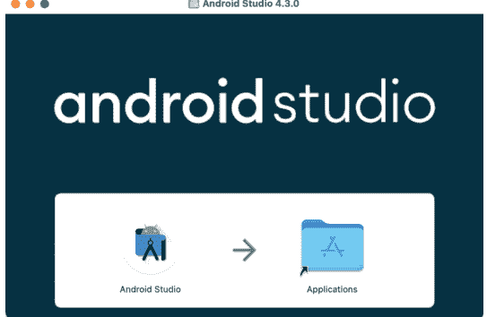

图 2-1

要安装软件包，将 Android Studio 图标拖入 Applications（应用程序）文件夹。Android Studio 软件包将安装到系统的 Applications 文件夹，该过程通常需要几秒钟。要启动 Android Studio，在 Finder 窗口的 Applications 文件夹中找到可执行文件并双击它。为了以后方便访问，从 Finder 窗口将 Android Studio 图标拖到 Dock 栏。

#### 2.3.3 在 Linux 上安装

下载 Linux 版 Android Studio 软件包后，打开终端窗口，进入 Android Studio 的安装目录，并执行以下命令：

```bash
tar xvf <path to package>/android-studio-<version>-linux.tar.gz
```

注意，Android Studio 包将安装到名为 `android-studio` 的子目录。假设上述命令是在 `/home/demo` 执行的，软件包将解压到 `/home/demo/android-studio`。要启动 Android Studio，打开终端窗口，进入 `android-studio/bin` 目录并执行以下命令：

```bash
./studio.sh
```

## 2.4 安装额外的 Android SDK 包

启动 Android Studio 时，会出现所示的 Welcome to Android Studio 界面：

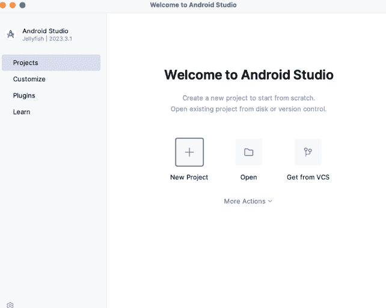

图 2-2

到为止的步骤已安装 Android Studio IDE 和默认的 Android SDK 包。在继续之前，值得花时间验证已安装的包并安装缺失或更新的包。可以通过点击欢迎对话框中的 More Actions（更多操作）链接并在下拉菜单中选择 SDK Manager（SDK 管理器）来执行此任务。一旦调用，将出现如图 2-3 所示的 Settings（设置）对话框：

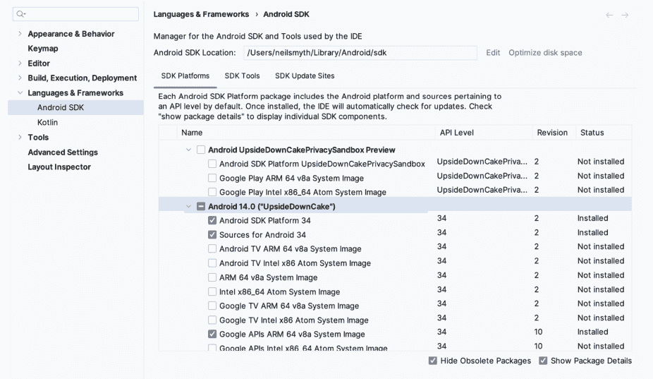

设置

IDE 使用的 SDK 和工具

Android SDK 位置：`/Users/nmith/Library/Android/sdk`

| SDK Platforms | SDK Tools | Update Sites | API Level | Revision | Status |
| --- | --- | --- | --- | --- | --- |
| UpsideDownCake-PrivacySandbox Preview | UpsideDownCake-Priva... | | Not installed | | |
| Google Play ARM v64 System Image | UpsideDownCake-Priva... | | Not installed | | |
| Google Play x86_64 System Image | UpsideDownCake-Priva... | | Not installed | | |
| Android 34 | | | 2 | Installed | |
| Sources for Android 34 | | | 2 | Not installed | |
| Android TV ARM v64 System Image | | | 2 | Not installed | |
| Android TV x86_64 System Image | | | 2 | Not installed | |
| x86_64 System Image | | | 2 | Not installed | |
| Google TV ARM v64 Image | | | 2 | Not installed | |
| Google TV x86_64 Image | | | 2 | Not installed | |
| Google APIs ARM v64 System Image | | | 10 | Installed | |
| Google APIs x86_64 System Image | | | 10 | Not installed | |

Google 将每个版本的 Android Studio 与 Android SDK 的最大支持应用程序接口（API）级别配对。对于 Android Studio Jellyfish，该级别为 UpsideDownCake (API Level 34)。可以使用以下链接确认此信息：

`https://developer.android.com/studio/releases#api-level`

首次启动 Android Studio 后，可能只安装了最新版本的 Android SDK。要安装旧版本的 Android SDK，请选择对应版本的复选框并点击 Apply（应用）按钮。本书其余部分假设已安装了 UpsideDownCake (API Level 34) SDK。

本书中的大多数示例将支持低至 Android 8.0 (Oreo) 的旧版本。这确保了应用程序可以在各种设备上运行。在 SDK 版本列表中，勾选 Android 8.0 (Oreo) 旁的复选框并点击 Apply 按钮。在生成的确认对话框中点击 OK 按钮安装 SDK。随后的对话框将在执行安装前要求接受许可和条款。安装完成后，点击 Finish（完成）。

可能还会列出最新 SDK 的可用更新。要访问准备更新的包的详细信息，请勾选屏幕下方的 Show Package Details（显示包详情）选项。这将显示类似于图 2-4 的信息：

| Name | API Level | Revision | Status |
| --- | --- | --- | --- |
| Android TV ARM v64 System Image | 33 | 5 | Not installed |
| Android TV Intel x86 Atom System Image | 33 | 5 | Not installed |
| Google TV ARM v64 System Image | 33 | 5 | Not installed |
| Google TV Intel x86 Atom System Image | 33 | 5 | Not installed |
| Google APIs ARM v64 System Image | 33 | 8 | Update Available: |
| Google APIs x86 Atom_64 System Image | 33 | 9 | Not installed |
| Google Play ARM v64 System Image | 33 | 7 | Installed |

### 图 2-4

上面的图突出了可用的更新。要安装更新，勾选项目名称左侧的复选框并点击 Apply 按钮。

除了 Android SDK 包，还安装了用于构建 Android 应用程序的工具。要查看已安装的包并检查更新，请留在 SDK 设置界面并选择 SDK Tools 选项卡，如图 2-5 所示：

### 图 2-5

在 Android SDK Tools 界面中，请确保以下包在“状态”（Status）一列中显示为“已安装”（Installed）：

- Android SDK Build-tools
- Android Emulator
- Android SDK Platform-tools
- Google Play Services
- Intel x86 Emulator Accelerator (HAXM installer)
- Google USB Driver (仅限 Windows)

注意，基于 Apple Silicon 芯片的 Mac 无法安装 Intel x86 Emulator Accelerator (HAXM installer)。

如果上述任何包显示为“未安装”（Not Installed）或“需要更新”，请勾选这些包旁边的复选框并点击“应用”（Apply）按钮启动安装过程。如果出现 HAXM 模拟器设置对话框，请选择推荐的内存分配：

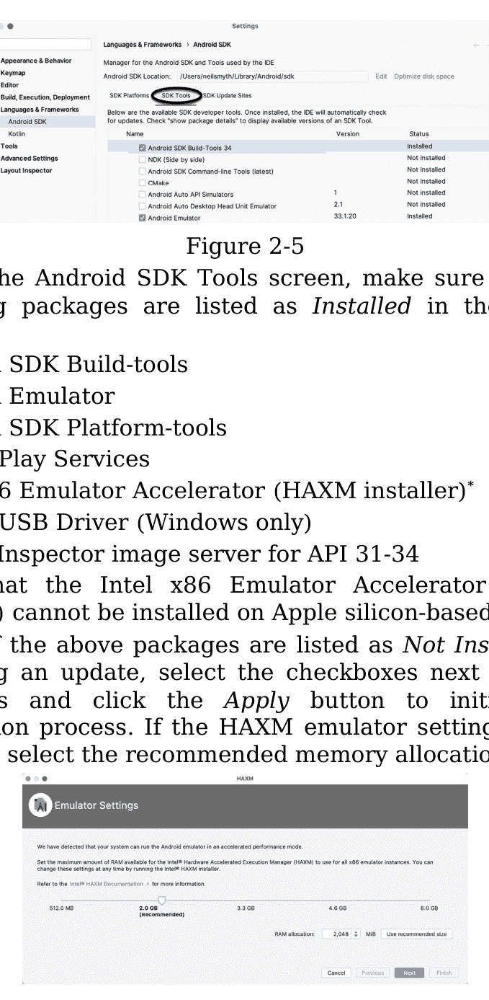

### 图 2-6

安装完成后，检查包列表并确保所选包在“状态”一列中显示为“已安装”。如果有任何包显示为“未安装”，请确保它们已勾选并再次点击“应用”按钮。

## 2.5 安装 Android SDK 命令行启动工具

Android Studio 包含了一些允许你从操作系统命令行执行某些任务的工具。要在你的系统上安装这些工具，请使用 SDK Manager，选择“SDK Tools”选项卡，并找到图 2-7 所示的 Android SDK Command-Tools (latest) 包：

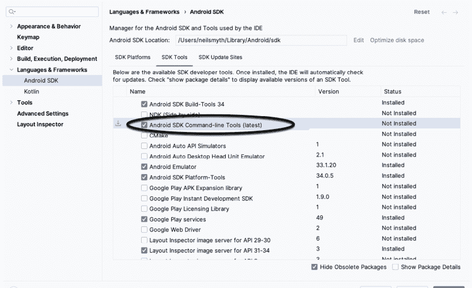

### 图 2-7

如果尚未安装 command-tools 包，请启用它并点击“应用”，然后点击“确定”（OK）以完成安装。安装完成后，点击“完成”（Finish）并关闭 SDK Manager 对话框。

为了让你正在进行开发的操作系统能够找到这些工具，必须将它们添加到系统的 `PATH` 环境变量中。

无论你使用什么种操作系统，你都需要配置 `PATH` 环境变量以包含以下路径（其中 `<path_to_android_sdk_installation>` 代表你安装 Android SDK 的系统位置）：

- `<path_to_android_sdk_installation>/sdk/cmdline-tools/latest/bin`
- `<path_to_android_sdk_installation>/sdk/platform-tools`

你可以通过启动 SDK Manager 并参考设置面板顶部的“Android SDK Location”字段（如图 2-8 所示）来识别 SDK 在你系统上的位置：

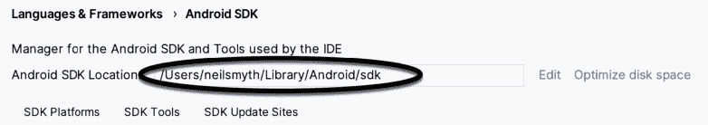

### 图 2-8

一旦确定了 SDK 的位置，将此添加到 `PATH` 变量的步骤取决于操作系统：

### 2.5.1 Windows 8.1

- 在启动屏幕上，将鼠标移动到屏幕右下角，从弹出的菜单中选择“搜索”（Search）。在搜索框中输入“控制面板”（Control Panel）。当控制面板图标出现在结果区域时，点击它在桌面上启动该工具。
- 在控制面板中，使用“类别”（Category）菜单将显示更改为“大图标”（Large Icons）。在图标列表中，选择标记为“系统”（System）的图标。
- 在“环境变量”对话框中，在“系统变量”列表中找到 `Path` 变量，选中它并点击“编辑...”（Edit...）按钮。使用编辑对话框中的“新建”（New）按钮向路径添加两个新条目。例如，假设 Android SDK 安装在 `C:\Users\demoAppData\Local\Android\Sdk`，则需要添加以下条目：

```text
C:\Users\demoAppData\Local\Android\Sdk\cmdline-tools\latest\bin
C:\Users\demoAppData\Local\Android\Sdk\platform-tools
```

在每个对话框中点击“确定”并关闭系统属性控制面板。按下键盘上的 Windows + R 并在运行对话框中输入 `cmd` 来打开命令提示符窗口。在命令提示符窗口中输入：

```bat
echo %Path%
```

返回的 `Path` 变量值应包含 Android SDK platform tools 文件夹的路径。通过尝试运行 `adb` 工具来验证 platform-tools 的值是否正确：

```bash
adb
```

执行该工具时应输出命令行选项列表。

同样，通过尝试运行 AVD Manager 命令行工具来检查工具路径设置（如果 `avdmanager` 工具报告 Java 问题，请担心，这稍后会解决）：

```bash
avdmanager
```

如果其中一个或两个命令都出现了类似下面的消息，很可能是向 `Path` 环境变量中添加了错误的路径：

```text
'adb' 不是内部或外部命令、可运行程序或批文件。
```

### 2.5.2 Windows 10

右键点击“开始”菜单，从弹出的菜单中选择“设置”（Settings），并在“查找设置”（Find setting）文本字段中输入“编辑系统环境变量”。在“系统属性”对话框中，点击“环境变量...”（Environment Variables...）按钮。按照为 Windows 8.1 列出的步骤操作，从第 3 步开始。

### 2.5.3 Windows 11


右键点击任务栏上的“开始”图标，从弹出的菜单中选择“设置”（Settings）。当设置对话框出现时，向下滚动类别列表并选择“关于”（About）选项。在“关于”界面中，从“相关链接”部分选择高级系统设置（Advanced system settings）。当“系统属性”窗口出现时，点击环境变量...（Environment Variables...）按钮。按照为 Windows 8.1 列出的步骤操作，从第 3 步开始。

### 2.5.4 Linux

右键点击任务栏上的“开始”图标（注：此处 Linux 发行版可能有所不同，此处遵循通用逻辑），并从弹出的菜单中选择“设置”。（此处描述类似 Windows，但在 Linux 中通常通过编辑配置文件实现）。假设 Android SDK 压缩包安装在 `/home/demo/sdk`，则 `.bashrc` 中的导出行将如下所示：

```bash
export PATH=/home/demo/sdk/cmdline-tools/latest/bin:/home/demo/sdk/platform-tools:$PATH
```

注意，上述命令将 `studio/bin` 目录添加到 `$PATH`。

### 2.5.5 macOS

可以使用多种技术修改 macOS 上的 `$PATH`。认为最干净的方法是在 `/etc/paths.d` 中添加一个新文件。假设 Android SDK 安装位置为 `/Users/demo/Android/sdk`，内容如下：

- `/Users/demo/Android/sdk/cmdline-tools/latest/bin`
- `/Users/demo/Android/sdk/platform-tools`

注意，由于这是一个系统目录，创建文件时将需要使用 `sudo` 命令：

```bash
sudo vi /etc/paths.d/android-sdk
```

## 2.6 Android Studio 内存管理

Android Studio 是一个包含许多后台进程的大型应用程序。尽管 Android Studio 过去因性能不佳而受到批评，但 Google 在最近的版本中进行了重大改进，并通过允许用户配置 IDE 和后台进程使用的内存量持续改进。

如果你在内存足够的系统上运行 Android Studio（此功能仅适用于 5GB 或更多内存的 64 位系统），并发现 Android Studio 性能下降，那么尝试这些内存设置是好的。Android Studio 可能通过下面的对话框提示你可以提高性能：

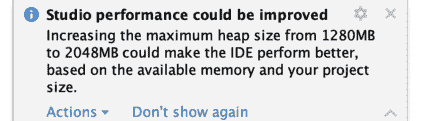

### 图 2-9

要查看并修改当前的内存配置，选择 `File -> Settings...` 主菜单选项（macOS 为 `Android Studio -> Settings...`），并在生成的对话框中，选择左侧导航面板中的“外观与行为”（Appearance & Behavior），然后选择“系统”下的“内存设置”（Memory Settings）选项，如图 2-10 所示：

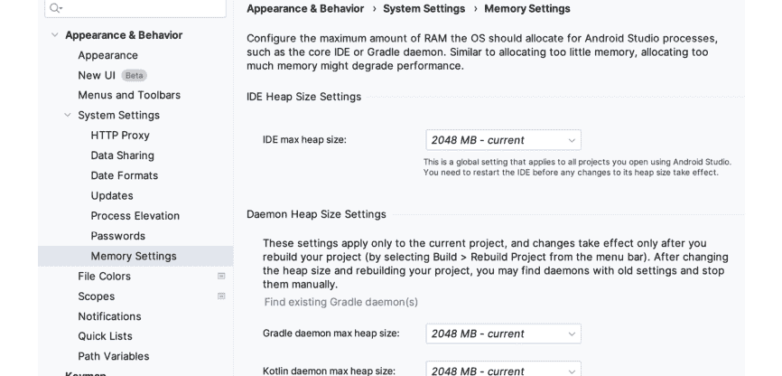

### 图 2-10

在更改内存分配时，请确保分配的内存不会超过系统承受的范围，否则会减慢其他进程。IDE 堆栈大小调整分配给 Android Studio 的内存，适用于当前加载的项目。另一方面，当从 Android Studio 内部构建和运行项目时，多个后台进程（称为守护进程）执行编译和运行应用的任务。与 IDE 堆栈设置不同，守护设置仅适用于当前项目，且只有在 Android Studio 打开项目时才能访问。要从打开的项目显示 SDK Manager，从主菜单中选择 `Tools -> SDK Manager...` 选项。

## 2.7 更新 Android Studio 和 SDK

Android Studio 和 Android SDK 会定期发布新版本。新版本的 SDK 将通过 Android SDK Manager 安装。当更新准备好进行安装时，Android Studio 通常会通知你。

要手动检查 Android Studio 的更新，请使用 Android Studio 主窗口中的 `Help -> Check for Updates...` 菜单选项（macOS 上为 `Android Studio -> Check for Updates...`）。

### 2.8 总结

在开始开发 Android 应用程序之前，第一步是搭建合适的开发环境。这包括 Android SDK 和 Android Studio IDE（它还包含了 OpenJDK 开发环境）。本章将介绍在 Windows、macOS 和 Linux 上安装这些包的步骤。

## 3. 在 Android Studio 中创建 Android 示例应用

本书前面的章节已经解释了如何使用 Android Studio IDE 配置适用于开发 Android 应用程序的环境。在进入稍进阶的话题之前，现在是验证所有所需的开发包已安装并运行良好的良机。实现这一目标的最佳方法是创建一个 Android 应用程序并编译、运行它。本章将介绍如何使用 Android Studio 创建 Android 应用程序项目。项目创建完成后，稍后的章节将探索 Android 模拟器环境以对应用程序进行测试运行。

### 3.1 关于项目

在本章创建的项目是一个基础的货币汇率转换器（事实上，它非常简单，只负责将美元转换为欧元，并使用估算的汇率进行转换）。该项目还将使用最基础的 Android Studio 项目模板之一。这种简单性允许我们介绍 Android 应用开发的一些关键方面，而不会一次性引入过多概念（例如推荐的应用架构和 Android 架构组件）让初学者无所从。在遵循本章的教程时，请放心，初始示例项目使用的技术和代码将在稍后进行更详细的介绍。

### 3.2 创建新的 Android 项目

应用程序开发过程的第一步是在 Android Studio 环境中创建一个新项目。因此，首先启动 Android Studio，出现如图 3-1 所示的“Welcome to Android Studio”屏幕：

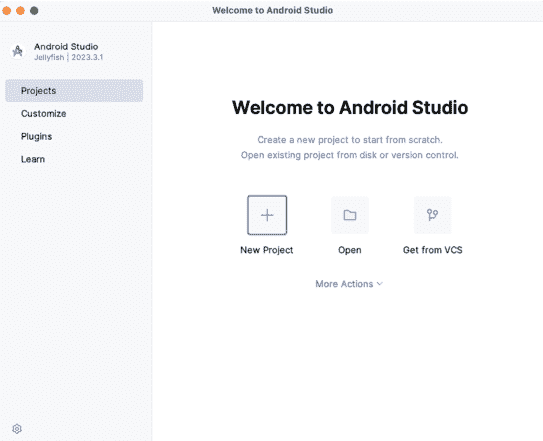

图 3-1

一旦出现此窗口，Android Studio 就已准备好创建新项目。要创建新项目，点击 `New Project` 选项以显示新项目向导的第一个屏幕。

### 3.3 创建 Activity

下一步是定义为应用程序创建的初始 Activity 类型。提供的选项可以为手机和平板、Wear OS、电视或汽车创建项目。在开发 Android 应用程序时，有多种 Activity 类型，其中许多将在后面的章节中进行详细介绍。然而，对于本示例，请从 Templates 面板选择 `Phone and Tablet` 选项，然后选择创建 `Empty Views Activity` 选项。`Empty Views Activity` 选项会创建一个由单个 `TextView` 对象组成的模板用户界面。

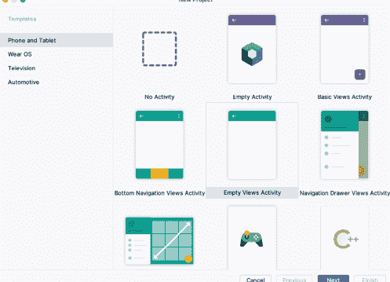

图 3-2

选中 `Empty Views Activity` 后，点击 `Next` 继续配置项目。

### 3.4 定义项目和 SDK 设置

在项目配置窗口（图 3-3）中，将 `Name` 字段设置为 `AndroidSample`。应用程序名称是 Android Studio 内部引用和识别应用程序时使用的名称，也是如果完成的应用程序在 Google Play 商店出售时将使用的名称。

`Package name`（包名）唯一标识应用程序生态系统。虽然可以设置为任何唯一标识你应用程序的字符串：

```text
com.mycompany.androidsample
```

如果你没有域名，可以在 `Company Domain` 字段中输入任何其他字符串，或者使用 `example.com` 进行测试，但在发布应用程序之前需要对其进行更改：

```text
com.example.androidsample
```

`Save location`（保存位置）设置将默认位于你主目录下名为 `AndroidStudioProjects` 的文件夹中，可以通过点击包含当前路径设置的文本字段右侧的文件夹图标进行更改。

将 `minimum SDK`（最小 SDK）设置为 `API 26 (Oreo; Android 8.0)`。除非某些功能仅在较新版本中可用，否则本书中创建的大多数项目将使用此最小 SDK。这里的目标是使用最新的 Android SDK 构建应用，同时保留与运行旧版本 Android 的设备的兼容性（在本例中，远可追溯到 Android 8.0）。Minimum SDK 设置下方的文本将概述目前正在运行该应用程序的 Android 设备百分比。点击 `Help me choose` 按钮（在 [图 3-3](https://) 中突出显示）查看仍在使用的 Android 版本的完整细分：

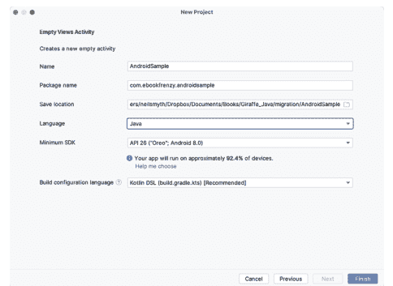

图 3-3

最后，在点击 `Finish` 创建项目之前，将 `Language` 菜单更改为 `Java` 并选择 `Kotlin DSL (build.gradle.kts)` 作为构建配置语言。

### 3.5 修改应用程序

项目创建完成后，将出现一个包含我们的 `AndroidSample` 项目的主窗口，如图 3-4 所示：

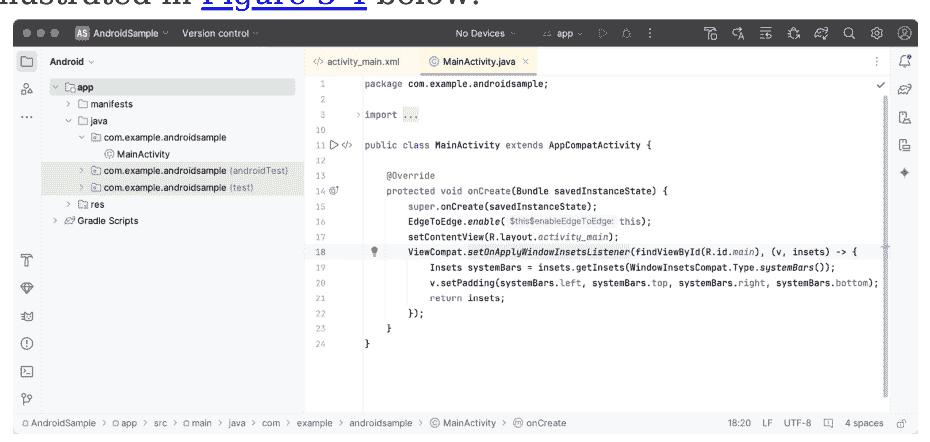

图 3-4

新创建的项目和相关文件的引用列在主窗口左侧的 Project 窗口中。Project 窗口有几种可以显示信息的模式。默认情况下，此面板应该是 `Android` 模式。此设置由面板顶部的菜单控制，如图 3-5 所示。如果面板当前不是 Android 模式，请使用菜单切换到：

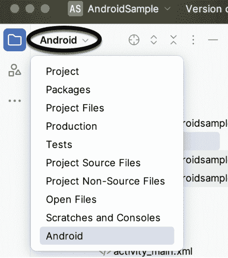

### 3.6 修改用户界面

我们 Activity 的用户界面设计存储在名为 `activity_main.xml` 的文件中，它位于 Project 窗口的 `app -> res -> layout` 下。在 Project 窗口中找到后，双击文件将其加载到用户界面 Layout Editor 中，它将出现在 Android Studio 主窗口的中心面板：


图 3-6

Layout Editor 窗口顶部工具栏上有一个菜单（在上面的图中当前设置为 Pixel），它反映在 Layout Editor 面板中设备视觉表示中。点击此菜单可以使用一系列其他设备选项。

使用 `System UI Mode` 按钮（循环）为设备屏幕布局开启或关闭夜间模式。若要在横屏和竖屏之间切换设备表示的方向，请使用显示图标的下拉菜单。正如我们在设备屏幕上看到的，内容布局已经包含一个显示“Hello World!”消息的标签。面板左侧运行着调色板（palette），包含了不同类别的用户界面组件，这些组件可构建用户界面，例如按钮、标签和文本字段。然而，需要注意的是，并不是所有用户界面组件对用户可见。其中一个类别是布局（layouts）。Android 支持多种布局，为视觉用户界面组件在屏幕上的对齐和管理提供不同程度的控制。虽然从用户界面的视觉表示很难判断，但当前的设计已经创建使用了 `ConstraintLayout`。这可以通过查看组件树（Component Tree）面板中的信息来确认，该面板默认位于布局编辑器（Layout Editor）面板的左下角，如[图 3-7](#) 所示。

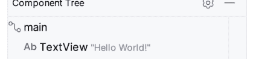

### 图 3-7

从组件树层次结构可以看出，用户界面布局由一个名为 `main` 的 `TextInputLayout` 父容器和一个 `TextView` 对象组成。在继续之前，请检查布局编辑器的自动连接（Autoconnect）模式是否已启用。这意味着当组件添加到布局中时，布局编辑器会自动添加约束，以确保组件在不同的尺寸和设备方向上都能正确定位（该主题将在后续章节中进行更详细的介绍）。自动连接按钮出现在布局编辑器工具栏中，用 U 形图标表示。当禁用时，图标上会有一条对角线 [图 3-8](#)。如有必要，可以通过点击此按钮重新启用自动连接模式。

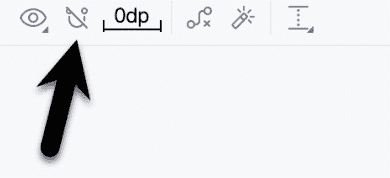

### 图 3-8

修改应用的下一步是向布局添加一些额外的组件，其中第一个是 `Button`，供用户点击以启动货币转换。

调色板（Palette）面板由两列组成，左列包含视图组件类别列表。右列列出当前选择类别中包含的组件。例如，图 3-9 显示在 `Buttons` 类别中当前选择了 `Button` 视图：

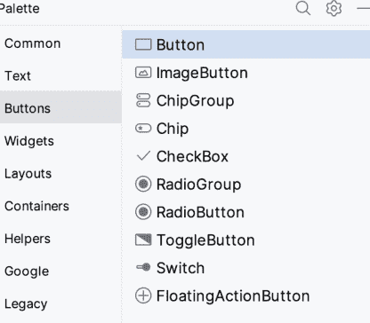

### 图 3-9

从 `Buttons` 列表中点击并拖动 `Button` 对象，将其释放到用户界面设计的水平中心，使其位于现有 `TextView` 小部件下方：

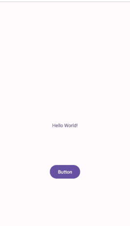

### 图 3-10

下一步是更改 `Button` 组件当前显示的文本。位于区域右侧的面板是属性（Attributes）面板。该面板显示分配给布局中当前选择组件的属性。在此面板中，在通用属性（Common Attributes）部分找到 `text` 属性，并将当前值从“Button”更改为“Convert”，如图 3-11 所示：

| 属性名称 (Attribute Name) | 值 (Value) |
| :--- | :--- |
| `strokeWidth` | `@null` |
| `cornerRadius` | |
| `rippleColor` | `@color/m3_button_rip` |
| `text` | `Convert` |
| `text` | |
| `contentDescription` | |

### 图 3-11

带有扳手的第二个 `text` 属性允许设置，它仅在布局编辑器工具中显示，而在运行时不会显示。这对于在不反复运行应用的情况下测试视觉组件和布局在不同设置下的表现非常有用。以防自动连接系统未能设置所有布局连接，点击推断约束（Infer Constraints）按钮（图 3-12），为布局添加任何缺失的约束：

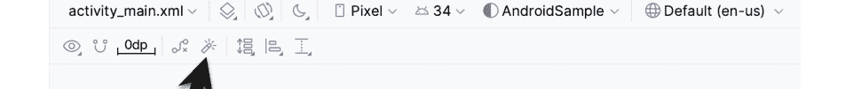

### 图 3-12

有必要解释布局编辑器工具右上角的警告按钮，如图 3-13 所示。该警告表示布局可能存在问题。要了解任何问题的详情，请点击该按钮：

### 图 3-13

点击后，将出现问题（Problems）工具窗口（图 3-14），描述问题的性质：

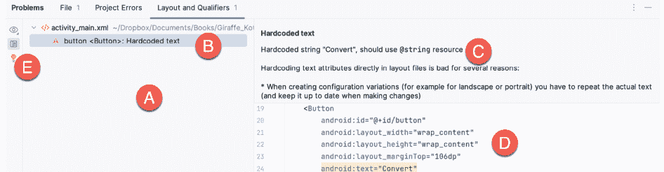

### 图 3-14

该工具分为两个面板。左侧面板（上图标记为 A）列出了在布局文件中检测的问题。在我们的示例中，仅列出了以下问题：

- `button-Button: Hardcoded text`

当从列表中选择项目（B）时，右侧面板将更新以提供问题的详细信息（C）。在这种情况下，解释如下：

硬编码字符串 `"Convert"`，应使用 `@string` 资源

该工具还包含一个预览编辑器（D），允许对布局文件进行手动修正。

此 I18N 告诉我们，关于项目未来国际化（I18N）存在潜在问题，这源于“internationalization”一词以“I”开头，以“N”结尾，中间有 18 个字母。警告提醒我们，在开发 Android 应用时，应尽可能将文本字符串等属性和值存储在资源文件中。这样做允许通过修改资源文件而不是更改应用程序源代码来更改应用程序的外观。这在将用户界面翻译到其他语言时特别有用。如果用户界面中的所有文本都包含在一个资源文件中（例如），可以将该文件交给翻译人员，他们将执行翻译工作并返回翻译后的文件以包含在应用程序中。

布局是以这种基于 XML 的层级结构组织的。当对 XML 布局进行更改时，这些更改将反映在布局画布上。也可以在布局画布面板内对布局进行视觉化修改，更改将显示在 XML 列表中。要查看操作效果，请切换到分屏（Split）模式并修改 XML 布局，将 `ConstraintLayout` 的背景颜色更改为红色如下如下：

```xml
<xml version="1.0" encoding="utf-8"?>
<androidx.constraintlayout.widget.ConstraintLayout
xmlns:android="http://schemas.android.com/apk/res/android"
xmlns:app="http://schemas.android.com/apk/res-auto"
xmlns:tools="http://schemas.android.com/tools"
android:id="@id/main"
android:layout_width="match_parent"
android:layout_height="match_parent"
tools:context=".MainActivity"
android:background="#ff2438" >
```

注意，布局颜色会实时更改，以匹配 XML 文件中的新设置。同时注意，在 XML 编辑器的左边距（也称为槽位 gutter）中，包含颜色设置的行旁边会出现一个红色小方块。这是在某个属性上设置了红色的视觉提示。点击红色方块将显示颜色选择器，允许选择不同的颜色：


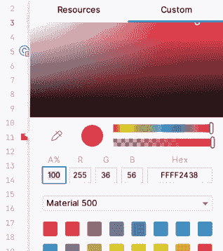

### 图 3-22

在继续之前，从布局文件中删除`background`属性，使背景恢复到默认设置。

最后，使用项目（Project）面板找到`app -> res -> values -> strings.xml`文件并双击它将其加载到编辑器中。目前，XML 的内容如下：

```xml
<resources>
<string name="app_name">AndroidSample</string>
<string name="convert_string">Convert</string>
<string name="dollars_hint">dollars</string>
</resources>
```

为了演示资源的实际应用，将当前分配给`convert_string`资源的字符串值更改为 "Convert to Euros"，然后通过选择编辑器面板中布局文件的标签页返回布局编辑器工具。注意，布局已经获取了该字符串的新资源值。

还有一种快速访问 XML 文件中引用的资源值的方法。在分屏（Split）或代码（Code）模式下的布局编辑器工具中，点击`@string/convert_string`属性设置使其高亮，然后按键盘上的`Ctrl-B`（macOS 上为`Cmd-B`）。Android Studio 随后将打开`strings.xml`文件并带你到文件中声明该资源的行。利用此机会将字符串资源还原为原始的 "Convert"，并添加以下额外的字符串资源项，该资源将在应用程序中引用：

```xml
<resources>
  <string name="app_name">AndroidSample</string>
  <string name="convert_string">Convert</string>
  <string name="dollars_hint">dollars</string>
  <string name="no_value_string">No Value</string>
</resources>
```

还可以通过点击窗口右上角的 Open editor（打开编辑器）链接使用 Android Studio 的 Translations（翻译）功能编辑资源字符串。将在 Android Studio 窗口的主面板显示翻译编辑器（Translation Editor）：

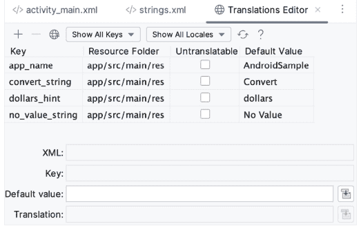

### 图 3-23

此编辑器允许编辑分配给资源键的字符串，并管理多种语言的翻译。

## 3.8 添加交互

示例项目的最后一步是使应用程序具有交互性，这样当用户在`EditText`字段中输入美元值并点击转换按钮时，转换后的欧元值将显示在`TextView`上。这涉及在`Button`组件上实现一些事件处理。具体来说，需要配置`Button`，以便在触发`onClick`事件时调用应用程序代码中的方法。事件处理可以通过多种方式实现，将在稍后标题为“Android 事件处理概览与示例”的章节中介绍。将布局编辑器返回设计（Design）模式，选择属性（Attributes）工具窗口，并如下所示指定名为`convertCurrency`的方法：

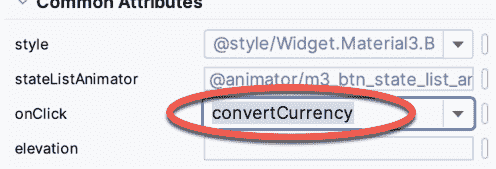

### 图 3-24

接下来，在项目（Project）工具窗口中双击`MainActivity.java`文件（`app -> java -> <package name> -> MainActivity`）将其加载到代码编辑器中，并在类文件中添加`convertCurrency`方法的代码，使其内容如下，注意还需要导入一些额外的 Android 程序包：`package com.example.androidsample;`

```java
import android.os.Bundle;
import android.view.View;
import android.widget.EditText;
import android.widget.TextView;
import java.util.Locale;

public class MainActivity extends AppCompatActivity {

    @Override
    protected void onCreate(Bundle savedInstanceState) {
        super.onCreate(savedInstanceState);
    }

}
```

```java
public void convertCurrency(View view) {

    EditText dollarText = findViewById(R.id.dollarText);
    TextView textView = findViewById(R.id.textView);

    if (!dollarText.getText().toString().isEmpty()) {

        float dollarValue = Float.parseFloat(dollarText.getText().toString());
        float euroValue = dollarValue * 0.85f;
        textView.setText(String.format(Locale.getDefault(), "%.2f", euroValue));
    } else {
        textView.setText(R.string.no_value_string);
    }
}
```

## 3.9 总结

虽然并不复杂，但设置环境涉及多个步骤。在完成这些步骤后，值得运行一个示例以确保环境配置正确。在本章中，我们创建了一个示例应用程序，并使用了布局编辑器工具修改用户界面。在此过程中，我们探索了尽可能使用资源（特别是字符串值）的重要性，并在`Button`上添加了`onClick`事件以提取用户输入，将其转换为欧元并显示在`TextView`上。

应用程序准备好后，将在下一章详细介绍设置测试模拟器的步骤。

# 4. 在 Android Studio 中创建 Android 虚拟设备（AVD）

尽管 Android 预览允许我们看到正在设计的布局，但需要编译并运行整个应用程序来进行彻底测试。可以通过在物理设备上安装或在 Android 虚拟设备（AVD）环境中运行来测试 Android。使用 AVD 之前，必须先创建并配置以匹配特定的设备模型。在本章中，我们将以 Pixel 4 手机为示例创建一个虚拟设备。

## 4.1 关于 Android 虚拟设备

AVD 是模拟器，允许在不需要将应用程序安装到物理 Android 设备的情况下测试 Android 应用程序。AVD 可以被配置以模拟各种硬件功能，包括屏幕尺寸、内存容量以及摄像头、GPS 导航支持或加速度计等功能。标准 Android Studio 安装时会安装多个模拟器模板，允许为不同的设备配置 AVD。可以通过指定处理器类型、内存容量以及屏幕尺寸和像素密度来创建自定义配置以匹配任何物理 Android 设备。

AVD 会话可以独立窗口的形式出现，也可以嵌入 Android Studio 窗口中。

新的 AVD 使用 Android 虚拟设备管理器进行创建和管理，该管理器可以在命令行模式或更符合用户习惯的图形用户界面中使用。要创建一个新的 AVD，第一步是启动 AVD 管理器。这可以在 Android Studio 环境中通过点击右侧工具窗口栏中的“Device Manager（设备管理器）”来实现，如图 4-1 所示：

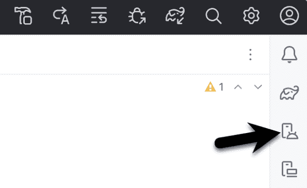

### 图 4-1

打开后，管理器将以工具窗口的形式出现，如图 4-2 所示：

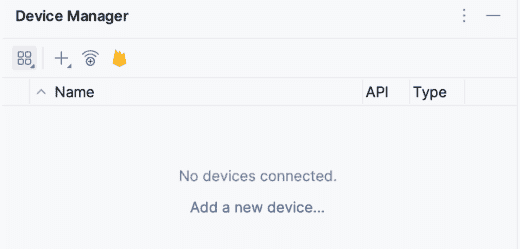

### 图 4-2

如果您是第一次在计算机上安装 Android Studio（而不是升级现有的 Android Studio 安装），安装程序可能已经创建了一个可用的初始 AVD 实例，如图 4-3 所示：

### 图 4-3

如果您的系统中存在此 AVD，您可以使用它来测试应用。如果没有创建 AVD，或者您想为不同类型的设备创建 AVD，请按照本章其余部分的步骤操作。

要添加新的 AVD，点击 Device Manager 工具栏上的`+`按钮，并选择 Create Virtual Device（创建虚拟设备）选项以打开虚拟设备配置对话框：

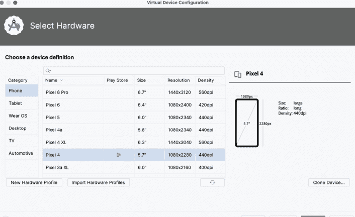

### 图 4-4

在对话框中，执行以下步骤创建兼容 Pixel 4 的模拟器：

1. 从 Category（类别）面板中选择 Phone（手机）选项，以显示所有可用的 Android 手机 AVD 模板。选择 Pixel 4 设备选项并点击 Next（下一步）。

2. 在 System Image（系统镜像）屏幕上，选择最新版本的 Android。如果尚未安装系统镜像，将在 Release Name（发布名称）旁边提供一个 Download（下载）链接。点击此链接下载并安装系统镜像，然后再进行选择。如果列表中没有您需要的镜像，点击 x86 Images（如果您运行的是搭载 Apple 芯片的 Mac，则点击 ARM images）或 Other images 标签页查看备选列表。

3. 点击 Next 继续，并在`name`字段中输入描述性名称（例如 Pixel 4 API 34），或接受默认名称。

4. 点击 Finish（完成）创建 AVD。

5. 如果以后需要对 AVD 进行修改，请重新打开 Device Manager，从列表中选择该 AVD，并点击 Actions（操作）列中的铅笔图标编辑设置。

## 4.2 启动模拟器

要测试新创建的 AVD 模拟器，请从 Device Manager 中选择该模拟器，并点击嵌入 Android Studio 主窗口的三角形图标开始启动过程。模拟器启动所需的时间取决于 AVD 本身及其运行系统的配置：

### 图 4-5

要隐藏和显示模拟器窗口，请点击 Running Tools（运行工具）窗口按钮（标记为 A）。点击标签（B）旁边的“x”关闭按钮退出模拟器。模拟器窗口可以容纳多个模拟器会话，每个会话由一个标签表示。例如，图 4-6 显示了一个带有两个模拟器会话的工具窗口。

### 图 4-6

要在会话之间切换，请点击相应的标签。虽然模拟器可能默认以竖屏方向显示，但此和其他默认选项可以更改。在 Device Manager 中，选择新的 Pixel 4 条目，并点击 Actions 设备行中的铅笔图标。在配置屏幕中找到 Startup orientation（启动方向）部分并更改方向设置。退出并重启模拟器会话以使更改生效。关于模拟器的更多细节将在下一节“使用和配置 Android Studio AVD 模拟器”中介绍。

为了在本章的接下来的部分中节省时间，请在继续操作之前保持模拟器运行。

## 4.3 在 AVD 中运行应用程序

配置好 AVD 模拟器后，之前章节创建的示例 AndroidSample 应用现在可以编译并运行了。将 AndroidSample 项目加载到 Android Studio 后，确保新创建的 Pixel 4 AVD 显示在设备菜单中（见下方图 4-7 中的标记 A），然后点击由三角形表示的运行按钮（B）、选择 Run -> ‘app’菜单选项，或使用`Ctrl-R`快捷键：

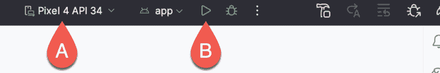

### 图 4-7

设备菜单（A）可用于选择不同的设备实例或物理设备作为运行目标，并可以在多个设备上运行应用。菜单还提供了访问 Device Manager 的接口，以及设备配置和故障排除选项：

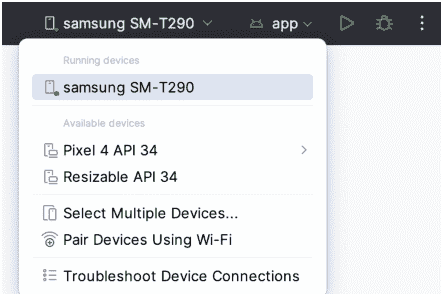

### 图 4-8

一旦应用安装并运行，第一个 fragment（碎片）的用户界面将出现在模拟器中（fragment 是 Android 项目中一个可重用的部分，由用户界面布局和一些代码组成，该主题将在本章“Fragment 简介”章节中介绍）：

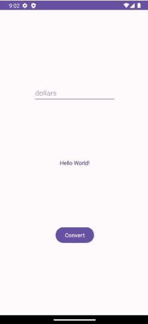

### 图 4-9

运行进程一旦开始，Run（运行）工具窗口将会出现。在应用安装和启动时，Run 工具窗口将显示诊断信息。图 4-10 显示成功启动后的 Run 工具窗口输出：

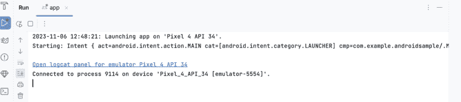

### 图 4-10

如果在启动过程中遇到问题，Run 工具窗口将提供信息以隔离问题原因。假设应用已加载到模拟器并按预期运行，我们已安全验证了 Android 开发环境已正确安装和配置。在应用运行时，尝试执行转换以验证应用是否符合预期。

### 4.4 在多个设备上运行

图 4-8 所示的运行目标菜单包含一个在多个模拟器和设备上并行运行应用的选项。选择此选项时，将显示图 4-11 所示的对话框，列出系统中配置的所有 AVD 以及任何连接的设备。在点击 Run 按钮之前，启用目标模拟器或设备旁边的复选框：

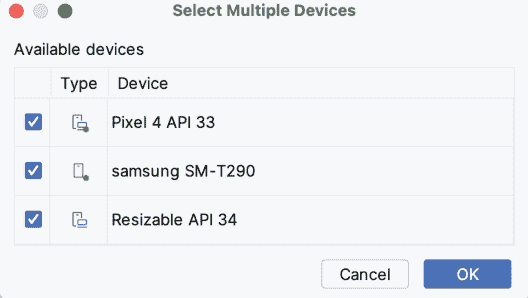

### 图 4-11

点击 Run 按钮后，Android Studio 将在选定的模拟器和设备上启动应用。

### 4.5 停止运行的应用程序

要停止运行的应用程序，点击位于主工具栏上的停止按钮，如图 4-12 所示：

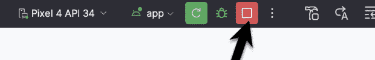

### 图 4-12

也可以通过 Run 工具窗口终止应用。首先使用应用运行时变为可见的窗口栏显示 Run 工具窗口。一旦 Run 工具窗口出现，点击图 4-13 中高亮显示的停止按钮：

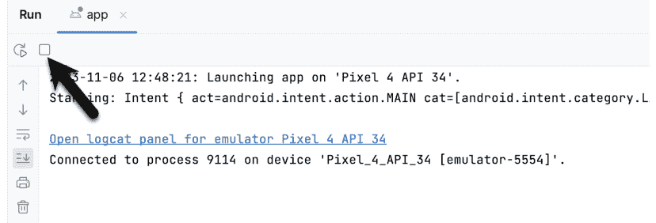

### 图 4-13

### 4.6 支持深色主题

为了测试启用深色主题时的应用行为，请在运行中的 Android 实例中打开 Settings 应用，选择 Display（显示）类别，并如图 4-14 所示启用 Dark theme（深色主题）选项：

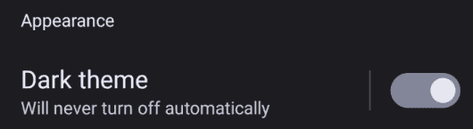

### 图 4-14

启用深色主题后，运行 AndroidSample 应用并注意它使用了深色主题，包括黑色背景和按钮上的紫色背景，如图 4-15 所示：

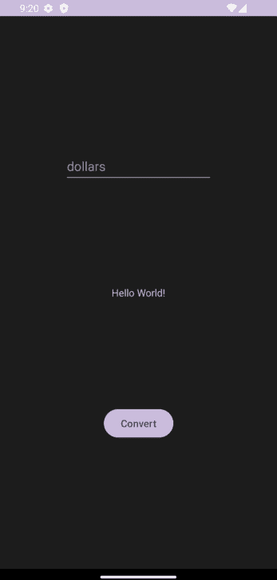

### 图 4-15

返回 Settings 应用并在关闭深色主题后再继续。

## 4.7 在独立窗口中运行模拟器

到本章为止，我们仅将模拟器作为嵌入 Android Studio 主窗口的工具窗口。模拟器可以配置为在 Settings 对话框中的独立窗口出现，可以通过点击 Android Studio 工具栏上的 IDE and Project Settings 按钮显示，如图 4-16 高亮所示：

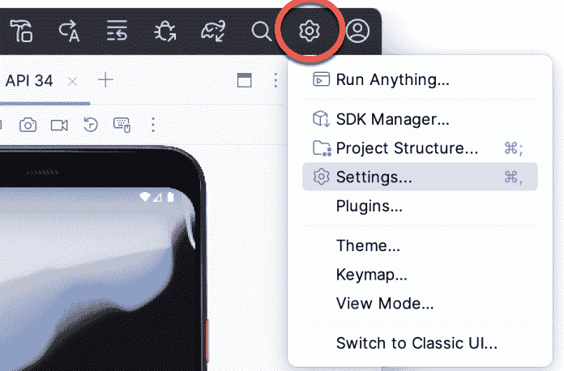

### 图 4-16

在 Settings 对话框中，导航到侧边面板的 Tools -> Emulator，并禁用 Launch in Running Devices（在运行设备中启动）选项：

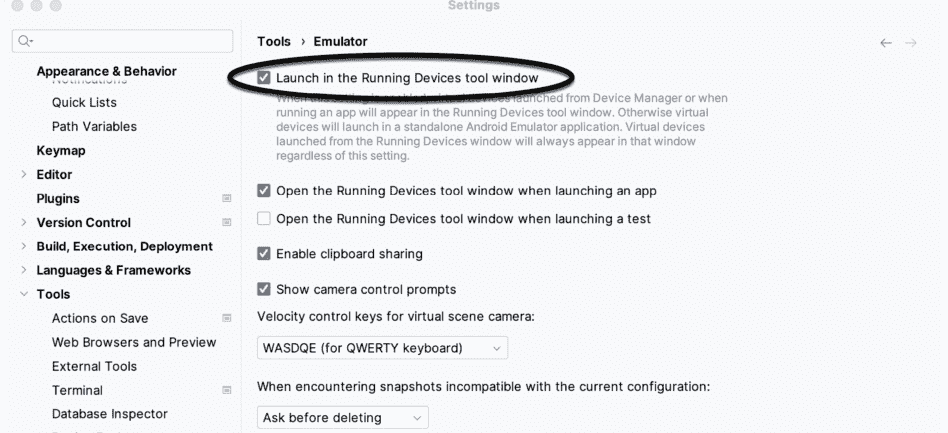

### 图 4-17

禁用该选项后，点击 Apply 按钮然后点击 OK 提交更改，然后点击上方图 4-5 中标记为 B 的标签上的关闭按钮退出当前的模拟器会话。

再次运行示例应用，此时模拟器将作为一个独立窗口出现，如下所示：

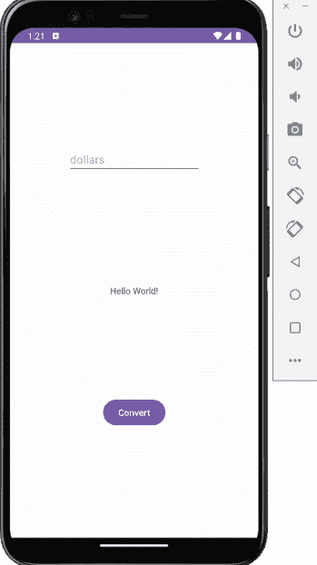

### 图 4-18

选择独立模式还是工具窗口模式取决于个人喜好。如果你倾向于让模拟器在工具窗口中运行，请返回设置界面并重新启用“Launch in the Running Devices tool window（在运行中的设备工具窗口中启动）”选项。然而，在提交独立模式之前，也可以通过工具窗口的 Options（选项）菜单将其从 Android Studio 主窗口中分离，该菜单可以通过点击图 4-19 所示的按钮来访问：

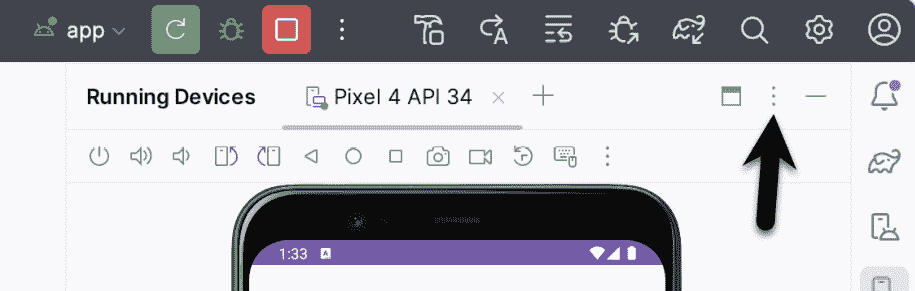

### 图 4-19

在 Options 菜单中，选择 View Mode -> Float（视图模式 -> 浮动），可以将工具窗口从 Android Studio 主窗口中分离：

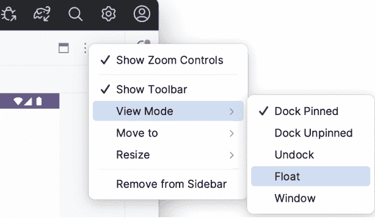

### 图 4-20

要重新固定 Running Devices 工具窗口，请点击图 4-21 所示的 Dock（停靠）按钮：

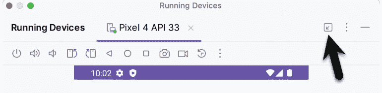

### 图 4-21

### 4.8 移除设备框

模拟器可以配置为显示或不显示设备框。要更改设置，请退出模拟器，打开 Device Manager（设备管理器），从列表中选择 AVD，并点击图 4-22 中箭头所示的菜单按钮：

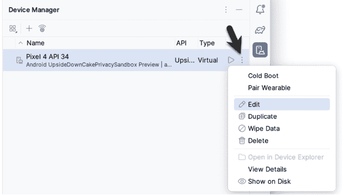

### 图 4-22

选择 Edit（编辑）选项，在设置界面中，点击 Finish（完成）按钮之前，找到并关闭 Enable device frame（启用设备框）选项。


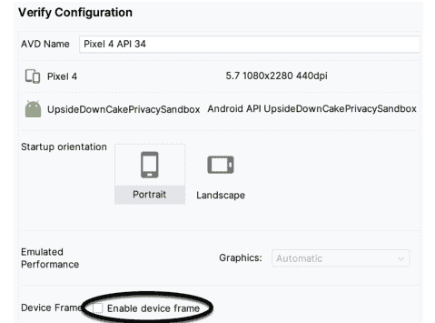

## 图 4-23

一旦禁用设备框，模拟器在下次启动时将如图 4-24 所示显示：

## 4.9 总结

典型的应用开发过程遵循测试环境中的编码、编译和运行周期。Android 应用可以在实体 Android 设备或 Android 虚拟设备（AVD）模拟器上进行测试。AVD 使用 `Android Device Manager`（Android 设备管理器）工具进行创建和管理，该工具可以通过命令行工具使用，也可以通过图形用户界面使用。在创建 AVD 以模拟特定的 Android 设备型号时，虚拟设备的硬件规格应配置为匹配物理设备。

AVD 模拟器会可能会以独立窗口的形式显示，也可以嵌入到 Android Studio 主用户界面中。

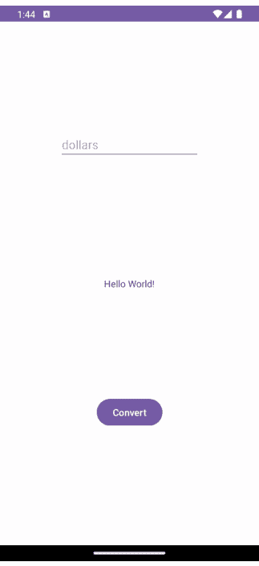

## 5. 使用和配置 Android Studio AVD 模拟器

在下一章探索在实体 Android 设备上的测试之前，本章将花费一些时间介绍 Android Studio AVD 模拟器，并突出许多可用的配置功能，以便在独立模式和窗口模式下自定义环境。

### 5.1 模拟器环境

当在独立模式下启动时，模拟器会在加载过程中显示一个初始启动屏幕。加载完成后，会出现主模拟器窗口，其中包含所选设备类型的表示（在图 5-1 中，这是一个 Pixel 4 设备）：

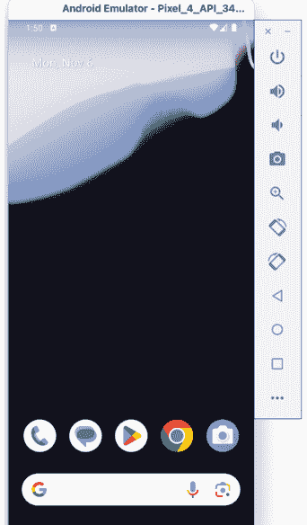

图 5-1

位于窗口右边缘的工具栏提供了快速访问模拟器控件和配置选项的快捷通道。

### 5.2 模拟器工具栏选项

模拟器工具栏（图 5-2）提供了与模拟器环境外观和行为相关的系列选项。

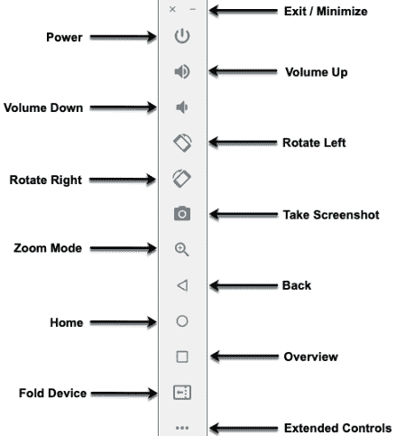

图 5-2

模拟器工具栏（图 5-2）提供了与模拟器环境外观和行为相关的系列选项。模拟器工具栏（图 5-2）提供了与模拟器环境外观和行为相关的系列选项。

模拟器工具栏（图 5-2）提供了与模拟器环境外观和行为相关的系列选项。

模拟器工具栏（图 5-2）提供了与模拟器环境外观和行为相关的系列选项。

模拟器工具栏（图 5-2）提供了与模拟器环境外观和行为相关的系列选项。 模拟器工具栏（图 5-2）提供了与模拟器环境外观和行为相关的系列选项。

工具栏中的许多选项是自而易见的：

- Exit（退出）
- Power（电源）
- Volume Up / Down（音量上/减）
- Rotate Left / Right（左/右旋转）
- Take Screenshot（截图）
- Zoom Mode（缩放模式）
- Back（返回）
- Home（主页）
- Overview（任务概述）
- Fold Device（折叠设备）
- Extended Controls（扩展控制）

### 5.3 在缩放模式下工作

位于工具栏的缩放按钮用于进入和退出缩放模式。当缩放模式激活时，工具栏处于按下状态，鼠标指针悬停在屏幕上时显示为放大镜。点击左鼠标键将相对于所选点进行放大，重复点击会增加缩放级别。相反，点击右鼠标键会降低缩放级别。切换缩放按钮将恢复显示默认大小。

在缩放模式下点击并拖动将定义一个矩形区域，释放鼠标后视图将缩放到该区域。

在缩放模式下，可以使用模拟器窗口内的水平垂直滚动条移动可视区域。

## 5.4 调整模拟器窗口

可以通过启用缩放模式并点击和拖动窗口的任何角或边随时更改模拟器窗口的大小（以及相应的表示）。

## 5.5 扩展控制选项

扩展控制工具栏按钮显示如图 5-3 所示的面板。默认情况下显示位置设置。从左侧选择不同的类别将显示相应的控件组：

### 5.5.1 位置

位置控制允许以十进制或度分坐标将模拟位置信息发送到模拟器。位置信息可以是单个位置，也可以是代表设备移动的一点序列，后者通过 GPX（GPS 交换）或 KML（键孔标记语言）格式的文件提供。或者，可以使用集成的 Google Maps 面板视觉化地选择单点或旅行路线。

### 5.5.2 显示

除了模拟器屏幕内的主显示外，“显示”选项允许在同一个 Android 实例中添加额外的显示。这对于测试 Microsoft Surface Duo 等双屏设备的应用非常有用。这些额外屏幕可以配置为任何所需的尺寸，并出现在主屏幕同一个模拟器窗口中。

### 5.5.3 蜂窝

可以在蜂窝设置屏幕中更改正在模拟的蜂窝连接类型。提供了选项可以模拟不同的网络类型（如 CSM、EDGE、HSDPA 等），以及一系列语音和数据场景，例如漫游和拒绝访问。

### 5.5.4 电池

在扩展控制屏幕的此面板上，可以模拟各种电池状态和充电条件，包括电池电量、电池健康状况以及当前是否连接了 AC 充电器。

### 5.5.5 摄像头

当摄像头激活时，模拟器会模拟 3D 场景。它以虚拟建筑内部的形式呈现，在模拟器内录制视频或拍照之前，可以通过按住 Option 键（Windows 上的 Alt 键）并使用鼠标指针和键盘按键在其中进行导航。此扩展配置选项允许上传不同的图像以显示在虚拟环境中。

### 5.5.6 电话

电话扩展控制在模拟器中提供了两个简单但实用的模拟。第一个选项模拟来自指定电话号码的呼入电话。这在测试应用程序如何处理高级中断时特别有用。

第二个选项允许在模拟器会话中模拟接收短信。与现实世界一样，这些消息会出现在消息应用中，并触发模拟器内的标准通知。

### 5.5.7 方向键

方向键（D-Pad）是内置在 Android 设备中或外部连接（如游戏控制器）的一组额外控件，提供方向控制（左、右、上、下）。方向键设置允许在模拟器中模拟 D-Pad 交互。

### 5.5.8 麦克风

麦克风设置允许启用麦克风并模拟虚拟耳机和麦克风连接。还提供了一个用于模拟器上启动语音助手。

### 5.5.9 指纹

许多 Android 设备现在配备了内置指纹检测硬件。AVD 模拟器使得测试指纹认证成为可能，无需在带有指纹传感器的实体设备上测试应用程序。在模拟器中配置指纹测试的细节将在本章后面介绍。

### 5.5.10 虚拟传感器

虚拟传感器选项允许模拟加速度计和磁力计以模拟设备物理运动的效果，例如通过偏航（yaw）、俯仰（pitch）和横滚（roll）设置来实现旋转、移动和倾斜。

### 5.5.11 快照

快照包含当前运行的 AVD 会话状态，以便保存和快速恢复，使模拟器能够轻松返回到精确状态。快照将在本章后面介绍。

### 5.5.12 录制与播放

允许将模拟器屏幕和音频录制并保存为 WebM 或动画 GIF 格式。

### 5.5.13 Google Play

如果模拟器运行安装了 Google Play 服务的 Android 版本，则此选项将显示当前的 Google Play 版本。它还提供了将模拟器更新到最新版本的选项。

### 5.5.14 设置

设置面板提供了一小组配置选项。使用此面板为工具栏和扩展控制面板选择更深色的主题，指定指定保存截图的系统位置，配置 OpenGL 支持级别，并配置模拟器窗口显示在桌面上其他窗口之上。

### 5.5.15 帮助

帮助屏幕包含三个子面板，其中包含键盘快捷键列表、访问模拟器在线文档的链接、报告 Bug 和发送反馈的链接，以及模拟器版本信息。

## 5.6 使用快照

当模拟器首次启动时，它会执行冷启动，就像物理 Android 设备上电时一样。由于操作系统加载并启动所有后台进程，此冷启动过程可能需要一些时间才能完成。为了避免每次启动模拟器都必须经过此过程，系统配置为每次退出时自动保存模拟器当前状态的快照（称为快速启动快照）。下次启动模拟器时，快速启动快照将加载到内存中，并从上次停止的地方继续执行，允许模拟器在短于冷启动完成所需的时间内重启。

扩展控制面板的快照屏幕可以在模拟器执行期间的任何点存储额外的快照。这保存了整个模拟器的精确状态，允许模拟器恢复到拍摄快照时的精确时间点。从屏幕内部，可以使用“拍摄快照”按钮（如图 5-4 所示标记为 A）拍摄快照。要恢复现有的快照，请从列表中选择它 (B) 并点击屏幕底部的运行按钮 (C)。还提供了选项编辑 (D) 快照名称和描述，并删除 (E) 当前选中的快照：

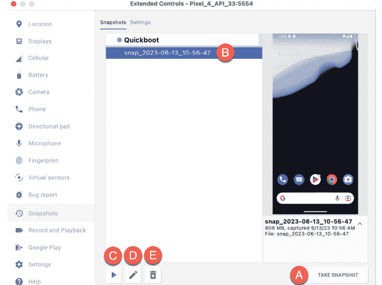

# 图 5-4

你也可以通过主工具栏中的运行菜单进行选择，使用冷启动、最近的快速启动快照或之前的快照来启动模拟器，如图 5-5 所示：

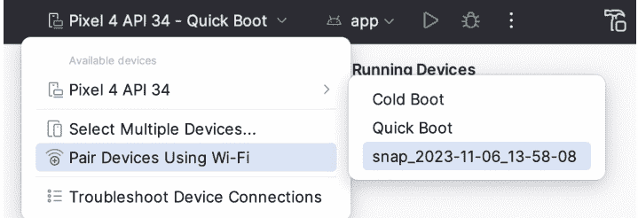

# 图 5-5

## 5.7 配置指纹模拟

模拟器允许配置最多 10 个模拟指纹，用于测试 Android 应用程序中的指纹认证。配置模拟指纹从启动模拟器、打开设置应用并选择安全选项开始。

在安全屏幕内，选择指纹选项。在出现的信息屏幕上，点击“下一步”按钮进入指纹设置屏幕。在启用指纹安全之前，必须配置备份屏幕解锁方法（例如 PIN）。输入并确认一个 PIN，并通过接受默认通知完成 PIN 输入过程，直到设置请求指纹。此时，显示扩展控制对话，在左侧面板中选择指纹类别，并确保主设置面板选择了指纹 1：

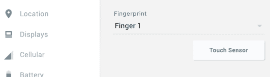

# 图 5-6

点击触摸传感器按钮模拟指纹 1 触摸传感器。模拟器将报告指纹添加：

# 指纹已添加

现在你可以使用指纹解锁手机或验证身份，例如在登录应用时


# 图 5-7

要添加更多指纹，点击“添加另一个”按钮，并在扩展控制面板中选择另一个手指，然后再次点击触摸传感器按钮。

# 图 5-9

当你在工具窗口内的新模拟器上运行应用时，工具栏上会出现“显示模式”（Display mode）选项，允许你如图 5-10 所示在模拟器配置之间切换：

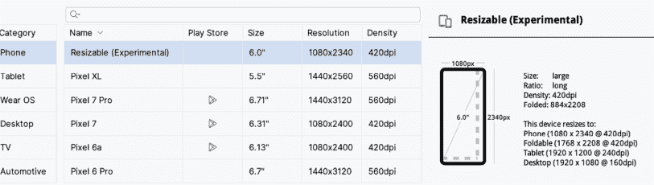

# 图 5-10

如果模拟器以独立模式运行，则可以在侧边工具栏中找到“显示模式”选项，如下所示：

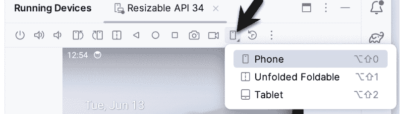


一旦选择了折叠屏显示模式，就可以使用“更改姿态”（Change posture）菜单在开启、关闭和半开状态的配置下测试应用：


## 5.10 总结

Android Studio 包含一个 Android 虚拟设备（AVD）模拟器环境，旨在更容易在无需在物理 Android 设备上运行的情况下测试应用程序。本章对模拟器进行了简要介绍，并强调了用于配置和自定义环境以模拟不同测试条件的关键功能。

## 6. Android Studio 用户界面概览

虽然人们急于运行上一章中创建的示例应用，但它涉及到 Android Studio 用户界面的某些方面，这些内容最好在开始之前预先进行描述。

Android Studio 是一个强大且功能丰富的开发环境，在很大程度上用起来是直观的。尽管如此，现在花时间熟悉 Android Studio 用户界面的布局和结构，将缩短本书后续章节的学习曲线。基于此，本章将提供 Android Studio 环境中各个区域和组件的概述。

### 6.1 欢迎界面

欢迎界面（图 6-1）在 Android Studio 运行且当前没有打开任何项目时显示（可以随时通过选择 File -> Close Project 菜单选项关闭已打开的项目）。如果 Android Studio 在项目仍打开时之前退出，该工具在下次启动时将跳过欢迎界面，自动打开之前活跃的项目。


除了最近项目列表外，欢迎界面还提供了执行任务的选项，如打开和创建项目，并可以访问当前受版本控制的项目。此外，“自定义”（Customize）屏幕提供了更改 IDE 和编辑器均使用的的主题和字体设置的选项。可以使用“插件”（Plugins）选项查看、安装和管理 Android Studio 插件。

通过选择“更多操作”（More Actions）链接或在最近项目列表取代“更多操作”链接时使用图 6-2 所示的菜单，可以使用更多选项：


图 6-2

### 6.2 菜单栏

当创建新项目或打开现有项目时，将显示 Android Studio 主窗口。当同时打开多个项目时，每个项目将分配到自己的主窗口。窗口的精确配置取决于 Android Studio 运行的操作系统，以及上一次打开项目时显示了工具和面板。例如，主菜单栏的出现将取决于宿主机操作系统。在 macOS 上，Android Studio 遵循将菜单栏放置在桌面顶部的标准惯例，如[图 6-3](#)所示：


图 6-3

然而，当 Android Studio 运行在 Windows 或 Linux 上，通过[图 6-4](#)中高亮的按钮访问主菜单：


图 6-4

### 6.3 主窗口

一旦打开项目，Android Studio 主窗口通常类似于[图 6-5](#)所示：


主窗口的各种元素可以总结如下：

- 频繁执行操作的快捷键选择。工具栏按钮提供了快速访问一组菜单栏操作的通道。可以通过右键点击工具栏并选择“自定义工具栏...”（Customize Toolbar...）选项来自定义工具栏。图 6-6 所示的工具栏菜单提供了执行任务的方便方法，如创建和打开项目以及在打开多个项目时在窗口之间切换：


图 6-6

- 导航栏（Navigation Bar） - 导航栏提供了执行任务的方便方法，如创建和打开项目以及在打开多个项目时在窗口之间切换：


- 编辑器窗口（Editor Window） - 编辑器窗口是编写代码的地方，并提供结果视图以及停止或重启进程的选项。


- 状态栏（Status Bar） - 状态栏提供有关项目的提示信息消息。

- 项目窗口（Project Window） - 项目窗口提供了文件结构的概述。在项目视图中双击文件将加载该文件。

### 6.4 工具窗口

除了项目窗口外，Android Studio 还包含许多其他窗口，最常用的包括：


- 项目 (Project (A)) - 项目视图提供了文件结构的概述。在项目视图中双击文件将加载该文件。

- 资源管理器 (Resource Manager (B)) - 用于添加和管理项目中的资源和资产的工具，如图像、颜色和布局文件。

- 更多工具窗口 (More Tool Windows (C)) - 显示包含未显示在工具窗口栏中的其他工具窗口的菜单。

- 构建 (Build (D)) - 在 Android Studio 构建项目时显示每个处理步骤的实时视图。

- 运行 (Run (E)) - 当应用程序正在运行时，运行窗口可用，并提供结果视图以及停止或重启进程的选项。

- 应用质量洞察 (App Quality Insights (F)) - 提供访问基于云的 Firebase 应用质量和崩溃分析。

- 日志 (Logcat (G)) - Logcat 窗口提供了对运行应用程序日志输出的访问，以及拍摄应用程序截图和视频的选项。

- 问题 (Problems (H)) - 查看项目内所有当前错误或警告的中心位置。

- 终端 (Terminal (I)) - 提供对运行 Android Studio 的系统上的终端窗口的访问。

- 版本控制 (Version Control (J)) - 当项目文件受源代码版本控制时使用此窗口，允许访问 Git 仓库和代码更改历史。

--

允许访问 Git 仓库和代码更改历史。

- **Gradle (L)** - Gradle 工具窗口提供了项目构建配置中包含的 Gradle 任务视图。该窗口列出了将项目各种元素编译为可执行应用程序时涉及的任务。右键点击顶级 Gradle 任务并选择 *Open Gradle Config*（打开 Gradle 配置）菜单选项，可以将当前项目的 Gradle 构建文件加载到编辑器中。本书稍后将更详细介绍 Gradle。

- **Device Manager (M)** - 提供访问设备管理器工具窗口的入口，可以在其中添加、删除和管理物理 Android 设备连接和模拟器。

- **Running Devices (N)** - 如果已按照章节[在 Android Studio 中创建 Android 虚拟设备 (AVD)]所述启用了在工具窗口中运行模拟器的选项，则此处包含 AVD 模拟器。

- **Gemini (O)** - Android Studio 的 AI 驱动编程助手。目前处于预览阶段，该工具通过提供代码建议和解决方案帮助你开发应用。

- **Assistant (P)** - 显示助手面板，其内容将根据你当前使用的 Android Studio 功能而异。


- **App Inspection（应用检查）** - 提供对数据库和后台任务检查器的访问。数据库检查器允许你在应用运行时检查、查询和修改应用数据库。后台任务检查器允许对监控和管理使用 WorkManager 创建的后台工作器任务。

- **Bookmarks（书签）** - 书签工具窗口可以快速访问已书签的文件和代码行。例如，在项目视图中右键点击文件可以访问 Add to Bookmarks（添加书签）菜单选项。同样，你可以通过将光标移动到源文件的某行并按 `F11` 键（macOS 上为 `F3`）为该行代码书签。所有书签项都可以通过工具窗口访问。

**Build Variants（构建变体）** - 构建变体工具窗口提供了为当前应用项目配置不同构建目标的快速方法（例如，针对应用调试和发布版本的不同构建，或针对目标设备类别的多个构建）。

**Device File Explorer（设备文件浏览器）** - 可通过 `View -> Tool Windows -> Device File Explorer` 菜单访问，该工具窗口提供了直接访问当前连接的 Android 设备或模拟器文件系统的权限，允许浏览文件系统并将文件复制到本地文件系统。

**Layout Inspector（布局检查器）** - 提供构成用户界面布局的组件层次结构的视觉 3D 渲染。

**Structure（结构）** - 结构工具提供编辑器中当前显示的源文件结构的高级视图。这些信息包括文件中的类、方法和变量等项的列表。从结构列表中选择一个项将带你进入编辑器窗口中源文件中的对应位置。

**TODO** - 如名称所示，此工具提供了一个查看项目尚未待完成项的地方。Android Studio 通过扫描组成项目的源文件并查找匹配指定 TODO 模式的注释来编译此列表。可以通过打开 Settings（设置）对话框并导航到 *Editor* 下的 *TODO* 条目来查看和更改这些模式。

## 6.5 工具窗口菜单

每个工具窗口在顶部边缘都有自己的工具栏。

这些工具栏中的菜单按钮随工具的不同而异，尽管所有工具窗口都包含一个 Options（选项）菜单（在图 6-11 中标记为 A）：


# 图 6-11

Options 菜单允许更改窗口的各个方面。例如，图 6-12 显示了 Project 工具窗口的 Options 菜单。提供可用设置，例如将窗口取消固定（undock）并使其浮在 Android Studio 主窗口边界之外，以及移动和调整工具面板的大小：

# 图 6-12

所有工具窗口在工具栏上最右侧还包含一个按钮（在上面的图 6-11 中标记为 B），提供了隐藏工具窗口视图的额外方法。可以通过点击该窗口使其获得焦点，然后输入搜索词来对工具窗口内的项进行搜索（例如，Project 工具窗口中的文件名）。搜索框将出现在窗口的工具栏中，匹配搜索结果的项将高亮显示。

## 6.6 Android Studio 键盘快捷键

Android Studio 包含许多快捷键，以便在执行常用任务时节省时间。可以在 Android Studio 项目窗口中选择 `Help -> Keyboard Shortcuts PDF` 菜单选项，查看并打印完整的快捷键映射列表。你还可以通过打开 Settings 对话框并点击 Keymap 条目来列出和修改快捷键，如下图 6-13 所示：


图 6-13

## 6.7 切换器和最近文件导航

在 Android Studio 主窗口内导航的另一种实用机制是使用 `Ctrl-Tab` 键盘快捷键，切换器（Switcher）会作为一个列出工具窗口和当前打开文件的面板出现（图 6-14）。

| | |

| :--- | :--- |

| 0 Logical | MainActivity.java |

| 1 Project | activity_main.xml |

| 2 Bookmarks | |

| 3 Notifications | |

| 4 Profiles | |

| 5 Problems | |

| 6 Structure | |

| 7 Services | |

| 8 Version Control | |

| 9 App Inspection | |

| A Device File Explorer | |

| B Emulator | |

| C Gradle | |

| L Layout Inspector | |

| M Device Manager | |

| O TSDO | |

| Q App Quality Insights | |

| R Resource Manager | |

| S Terminal | |

| V Build variants | |

# 图 6-14

显示后，只要 Ctrl 键保持按下，切换器就会保持可见。在按住 Ctrl 键的同时反复敲击 Tab 键将循环各种选择选项，松开 Ctrl 键则会选择并在主窗口中显示当前高亮的项。

除了切换器之外，Recent Files（最近文件）还提供了对最近打开文件的导航（图 6-15）。可以使用 `Ctrl-E` 键盘快捷键（macOS 上为 `Cmd-E`）访问。显示后，可以使用鼠标指针选择选项，或使用键盘方向键在文件名和工具窗口选项之间滚动。按下 Enter 键将选择当前高亮的项：

## 6.8 更改 Android Studio 主题

可以使用 Settings 对话框更改 Android Studio 环境的整体主题。一旦显示设置对话框，在左侧面板中选择 Appearance & Behavior（外观与行为）选项，然后选择 Appearance（外观）。然后在点击 OK 按钮之前更改 Theme（主题）菜单设置。可用主题取决于平台，但通常包括 Light、IntelliJ、Windows、High Contrast 和 Darcula 等。图 6-16 显示了选择了 Dark 主题的主窗口示例。


# 图 6-16

要将 Android Studio 主题与操作系统的明暗模式同步，请启用 Sync with OS（与操作系统同步）选项，并使用下拉菜单控制每种模式使用的主题：


# 图 6-17

可以在 Android Studio Marketplace 中下载数百个额外主题，可以通过点击 Get more themes 链接访问。

## 6.9 总结

Android Studio 环境的主要元素包括欢迎界面和主窗口。每个打开的项目都分配了自己的主窗口，主窗口反过来由菜单栏、工具栏、编辑和设计区域、状态栏以及一组工具窗口组成。工具窗口出现在主窗口侧边。

Android Studio 中几乎没有无法通过键盘快捷键触发的操作。可以随时从 Android Studio 主窗口内访问默认快捷键映射表。

## 7. 在物理 Android 设备上测试 Android Studio 应用

虽然使用 Android 虚拟设备 (AVD) 测试应用程序可以实现很多功能，但在物理 Android 设备上进行真实世界的应用测试是不可替代的，而且某些 Android 功能仅在物理 Android 设备上可用。

与 AVD 实例和连接的 Android 设备之间的通信均由 Android 调试桥 (ADB) 处理。本章将解释如何配置 `adb` 环境，以便在基于 macOS、Windows 和 Linux 的系统上对 Android 设备进行应用测试。

## 7.1 Android 调试桥 (ADB) 概述

ADB 的主要目的是促进开发系统、Android Studio 以及 AVD 模拟器和 Android 设备之间的交互，用以运行和调试应用程序。ADB 允许你通过 WiFi 或 USB 数据线连接到设备。

ADB 由一个客户端、一个在开发系统后台运行的服务器进程以及一个运行在 AVD 或真实 Android 设备（如手机和平板电脑）上的后台守护进程组成。

ADB 客户端可以有多种形式。例如，在 Android SDK 的 `platform-tools` 子目录下提供了以 `adb` 命令行工具形式存在的客户端。Android Studio 也内置了一个客户端。

可以使用 `adb` 命令行工具执行各种任务。例如，可以使用 *devices* 命令行参数列出活跃的虚拟设备或物理设备。以下命令输出表示系统中存在一个 AVD，但没有物理设备：

```
$ adb devices
List of devices attached
emulator-5554 device
```

## 7.2 在 Android 设备上启用 USB 调试 ADB

在 ADB 连接到 Android 设备之前，必须配置该设备以允许连接。在运行 Android 6.0 或更高版本的安卓手机和平板电脑设备上，实现此目的的步骤如下：

*   打开设备上的“设置”(Settings) 应用并选择“关于平板电脑”(About tablet) 或“关于手机”(About phone) 选项（在某些 Android 版本中，可以在“设置”的“系统”(System) 页面找到它）。

*   在“关于”(About) 屏幕上，向下滚动到“版本号”(Build number) 字段（图 7-1）并连续点击七次，直到消息显示开发者模式已启用。如果“关于”屏幕上没有列出版本号，则可以通过“软件信息”(Software information) 选项找到。或者，如果可用，展开列表中的“高级”(Advanced) 部分。

| Wi-Fi MAC 地址 |

| :--- |

| 02:00:00:44:55:66 |

| 版本号 |

| PPP/2.180412.012 |

图 7-1

*   返回主设置屏幕，注意出现名为“开发者选项”(Developer options) 的新选项（在较新版本的 Android 中，此选项列在系统设置屏幕上）。选择此选项，并在生成的屏幕上，找到如图 7-2 所示的 USB 调试选项：


图 7-2

*   启用 USB 调试选项，并在弹出对话框请求确认时点击“允许”(Allow)按钮。如果你使用的是三星 Galaxy 设备，可能需要在启用调试选项之前在“设置”应用中关闭“自动锁定”(Auto Blocker)功能。

现在设备已配置为接受通过 USB 连接来自开发系统上 `adb` 的调试连接。剩下的工作是配置开发系统以便在设备连接时检测到它。虽然这是一个相对直接的过程，但步骤取决于开发系统运行的是 Windows、macOS 还是 Linux。注意，以下步骤假设 Android SDK `platform-tools` 目录已包含在系统的 PATH 环境变量中，正如“设置 Android Studio 开发环境”章节中所述。

### 7.2.1 macOS ADB 配置

要在 macOS 系统上配置 ADB 环境，请使用 USB 数据线将设备连接到计算机系统，打开终端窗口并执行以下命令重启 `adb` 服务器：

```
$ adb kill-server
$ adb start-server
* daemon not running. starting it now on port 5037 *
* daemon started successfully *
```

一旦服务器成功运行，执行以下命令以验证设备是否已检测到：

```
$ abd devices
List of devices attached
74CE0006000000001
```

如果设备被列为 *offline*（离线），请前往 Android 设备并检查[图 7-3]所示请求允许 USB 调试的对话框。在点击确定之前，勾选“始终允许来自此计算机”(Always allow from this computer) 选项旁边的复选框。


图 7-3

再次执行 *adb devices* 命令现在应该列出设备已连接：

```
List of devices attached
015d41d454bf80c device
```

如果设备未列出，请尝试注销并重新登录 macOS 桌面，如果问题仍然，请重启系统。

### 7.2.2 Windows ADB 配置

配置基于 Windows 的开发系统使用 ADB 连接到 Android 设备的第一步，是在系统上安装相应的 USB 驱动程序。你将安装的 USB 驱动程序取决于 Android 设备的型号。如果你有 Pixel 手机等 Google 设备，则必须在你的 Windows 系统上安装并配置 Google USB Driver 程序包。实现此目的的详细步骤概述在下一页：https://developer.android.com/studio/run

对于不支持 Google 驱动程序支持的 Android 设备，需要下载厂商提供的驱动程序。可以在此处获取驱动列表及安装信息：https://developer.android.com/studio/run-oem

驱动程序安装好且设备被识别后，打开命令提示符并执行以下命令：

此命令应输出以下信息：

```
List of devices attached
HT4CT0106 offline
```

如果设备被列为 *offline*（离线）或未经授权，请前往 Android 设备并检查图 7-3 所示请求允许 USB 调试的对话框。在点击确定之前，勾选“始终允许来自此计算机”(Always allow from this computer) 选项旁边的复选框。再次执行 `adb devices` 命令现在应该列出设备已连接：

```
List of devices attached
HT4CT0106 device
```

如果设备未列出，尝试执行以下命令重启 ADB 服务器：

```
adb kill-server
adb start-server
```

如果设备未列出，尝试执行以下命令：

```
adb update
```

注意可能还需要重启系统。

### 7.2.3 Linux ADB 配置

在本章中，我们将再次使用 Ubuntu Linux 作为配置 `adb` 连接到物理设备的示例。

在 Ubuntu Linux 上进行物理设备测试需要安装名为 `android-tools-adb` 的包，这反过来要求 Android Studio 用户是 `plugdev` 组的成员。这是大多数 Ubuntu 版本用户帐户的默认设置，可以通过运行 `id` 命令进行验证。如果没有列出 `plugdev` 组，请运行以下命令将你的账户添加到组：`sudo us -aG plugdev $LOGNAME`

在满足组成关系后，可以通过执行以下命令安装 `android-tools-adb` 包：`sudo apt-get install android-tools-adb`

完成上述更改后，重启 Ubuntu 系统。系统启动后，打开终端窗口，启动 `adb` 服务器并检查已连接设备列表：

```
$ adb start-server
* daemon not running, starting it now on port 5037 *
* daemon started successfully *
$ adb devices
```

```
List of devices attached
015d41d445bf80 offline
```

如果设备被列为 *offline*（离线）或未经授权，请前往 Android 设备并检查图 7-3 所示请求允许 USB 调试的对话框。

## 7.3 解决 USB 连接问题

如果你无法通过上述步骤成功连接到设备，请显示运行目标菜单（图 7-4）并选择“排除设备连接问题”(Troubleshoot Device Connections) 选项：


图 7-4

连接助手将扫描设备并报告问题及可能的解决方案。

## 7.4 在 Android 设备上启用无线调试

按照上述 7.2 节中的步骤 1 到 3 进行操作，这次要如图 7-5 所示启用“无线调试”选项：


图 7-5

接下来，点击上述“无线调试”项以显示图 7-6 所示的屏幕：

### 无线调试


图 7-6

如果设备带有摄像头，请选择“使用二维码配对设备”，否则请选择“使用配对码配对设备”选项。根据你的选择，设置应用将启动摄像头会或显示配对码，如图 7-7 所示。


图 7-7

选择选项后，返回 Android Studio，从运行目标菜单中选择“使用 WiFi 配对设备”选项，如图 7-8 所示：

### 图 7-8

在配对对话框中，根据你之前在设备设置应用中的选择，选择“**使用二维码配对**”或“**使用配对码配对**”


# 图 7-9

使用 Android 设备扫描二维码，或将设备屏幕上显示的配对码输入 Android Studio 对话框（图 7-10）以完成配对过程：


# 图 7-10

如果配对过程失败，请尝试重启开发系统和 Android 设备并重试。

## 7.5 测试 adb 连接


假设在所选的开发平台上已成功配置`adb`，下一步是尝试在设备上运行在“在 Android Studio 中创建示例 Android 应用”章节中创建的测试应用程序。启动 Android Studio，打开`AndroidSample`项目，并验证设备是否如图 7-11 所示出现在设备选择菜单中：


**图 7-11**

从列表中选择设备并点击运行按钮安装并运行应用。

## 7.6 设备镜像

设备镜像允许你在物理设备上运行应用的同时，在 Android Studio 的“运行设备”（Running Devices）工具窗口中查看显示。换句话说，尽管你的应用运行在物理设备上，但它在 Android Studio 中的显示方式与 AVD 实例相同。

当设备连接到 Android Studio 时，显示“运行设备”工具窗口并点击“设备镜像设置”链接显示设置对话框。在设置对话框中，启用物理 Android 设备镜像并点击 OK。下次运行应用时，Android Studio 将会在“运行设备”工具窗口中镜像物理设备的显示。

## 7.7 总结

虽然 Android 虚拟设备模拟器提供了极的测试环境，但必须记住，确保应用程序在物理 Android 设备上正确运行的方法没有真正的替代品。

然而，默认情况下，Android Studio 环境未配置为将 Android 设备作为目标测试设备。因此，需要执行某些步骤，通过 USB 线或 WiFi 网络从 Android 开发环境直接将应用加载到 Android 设备上。实现这一目标的具体步骤取决于开发平台。在本章中，我们涵盖了适用于 Linux、macOS 和基于 Windows 平台的这些步骤。

## 8. Android Studio 代码编辑器基础

为 Android 开发应用涉及大量的编程工作，根据定义，这工作着输入、审查和修改代码行。意料之中，开发者在使用 Android Studio 的大部分时间通常花在编辑器窗口内编辑代码。

现代代码编辑器必须超越输入、删除、剪切和粘贴等基础功能。如今，代码编辑器的实用性通常通过等因素衡量，例如它在减少程序员所需输入量方面、在大型源文件中导航的易用性，以及编辑器在编写代码时实时检测并高亮编程错误的能力。正如本章将变得显样的，这些只是 Android Studio 编辑器出色的少数领域之一。

虽然这不是 Android Studio 编辑器功能的详尽概述，但本章旨在提供该工具关键功能的指南。丰富的程序员会发现这些功能在当今大多数代码编辑器中是通用的，而许多功能是该编辑环境独有的。

### 8.1 Android Studio 编辑器

构成编辑器窗口的元素可以总结如下：

- **A - 文档标签页**：Android Studio 可以随时打开多个文件。每当打开一个文件时，它都会分配一个文档标签，并在标签栏中显示文件名。当空间不足以显示所有标签时，标签栏右侧角会出现一个小小的下拉菜单。点击此菜单将弹出打开的文件列表。标签名称下方的波浪线表示该文件代码包含一个或多个错误。

切换文件只需点击相应的标签或使用 `Alt-Left` 和 `Alt-Right` 快捷键。也可以通过 Switcher 机制（通过 `Ctrl-Tab`）进行文件导航。要将编辑器面板从 Android Studio 主窗口分离以便在单独窗口中显示，点击标签并将其拖到主窗口之外的桌面区域。要将编辑器返回主窗口，点击分离编辑器窗口中的文件标签并将其拖放到主窗口的原始标签栏上。

- **B - 编辑器行格区域**：行格区域用于编辑器显示信息图标和控件。行格区域的一些典型项目包括调试断点标记、折叠和展开代码块的控件、书签、更改标记和行号。行号默认开启，但可以通过右键点击行格并选择“外观”->“显示行号”来禁用。

- **C - 代码结构位置**：位于编辑器底部的此栏显示光标相对于代码整体结构的当前位置。例如，在图中，该栏显示正在编辑`convertCurrency`方法，且该方法包含在`MainActivity`中。

双击栏中的任何元素都将光标移动到代码文件中的相应位置。例如，双击`convertCurrency`项将把光标移动到源码中`convertCurrency`方法的顶部。同样，点击`MainActivity`项将显示可供选择的导航点列表。

**图 8-3**

- **D - 编辑器区域**：用户查看、输入和编辑代码的主要区域。本章的后续章节将详细介绍编辑区域的关键功能。

- **E - 验证与标记侧边栏**：Android Studio 集成了一项名为“即时代码分析”的功能。这本质上意味着当您编写代码时，编辑器会分析代码以检查警告和语法错误。验证侧边栏顶部的指示器会随着代码的添加而实时更新，显示发现的错误和警告数量。点击此指示器将显示一个弹出窗口，其中包含编辑器中代码所发现的发现问题摘要，如图 8-4 所示：


**图 8-4**

向上和向下箭头可以在代码内部的错误位置之间移动。绿色勾号表示未检测到任何警告或错误。

侧边栏还使用相同的颜色编码在检测到问题的位置显示标记。当编辑器区域中可见某行代码时，将鼠标指针悬停在标记上将显示一个包含问题描述的弹出窗口：

```
Unresolved reference: textView1
Create id value resource 'textView1' More actions...
```

**图 8-5**

当代码行已滚动出编辑器视图区域时，将鼠标指针悬停在某行代码的标记上将显示一个“透镜”覆盖层，其中包含问题所在的代码块（图 8-6），无需滚动到编辑器的对应位置即可查看：

```
EditText editText = findViewById(R.id.editText);
TextView textView = (TextView)findViewById(R.id.textView); // remove symbol '$'

if (editText.getText().toString().equals("0$")) {
    float dollarValue = Float.parseFloat(editText.getText().toString()); // remove symbol '$'
    float euroValue = dollarValue * R;
    textView.setText(String.format(Locale.ENGLISH, "€%.2f", euroValue));
}
textView.setText("No value");
```

**图 8-6**

值得注意的是，透镜覆盖层不仅限于侧边栏中的警告和错误。悬停在侧边栏的任何部分都会出现一个透镜，其中包含源文件中该位置的代码。

- **F - 状态栏**：虽然状态栏是主窗口的一部分而非编辑器，但它确实包含有关当前活动编辑会话的信息。这些信息包括光标在行和字符上的当前位置，以及文件的编码格式（UTF-8、ASCII 等）。点击状态栏中的这些值可以更改相应的设置。例如，点击行号会显示“转到行:列”（Go to Line:Column）对话框。使用 `View -> Appearance -> Status Bar Widgets` 菜单选项可以添加和删除小部件。例如，如果您遇到 Android Studio 的性能问题，“内存指示器”（Memory Indicator）是一个非常有用的部件。

在概述组成 Android Studio 编辑器的元素后，本章的剩余部分将更详细字体编辑环境的关键功能。

## 8.2 分割编辑器窗口

默认情况下，编辑器将显示一个显示当前选中文件内容的面板。在同时处理源文件时，将编辑器拆分为多个窗格是一个很有用的功能。要拆分编辑器，右键点击编辑器内的文件标签，并选择“向右拆分”（Split Right）或“向下拆分”（Split Down）菜单选项。例如，图 8-7 显示了拆分器的工作状态，编辑器被分为三个窗格：

```
activity_main.xml strings.xml
<?xml version="1.0" encoding="utf-8"?>
<androidx xmlns:android="http://schemas.android.com/apk/res/android"
    xmlns:app="http://schemas.android.com/apk/res-auto"
    xmlns:tools="http://schemas.android.com/tools"
    android:layout_width="match_parent"
    android:layout_height="match_parent"
    tools:context=".MainActivity">
    <TextView
        android:id="@id/textView"
        android:layout_width="wrap_content"
        android:layout_height="wrap_content"
        android:text="Hello World" />
</androidx>
```

```
activity_main.xml build.gradle.kts
<?xml version="1.0" encoding="utf-8"?>
<androidx xmlns:android="http://schemas.android.com/apk/res/android"
    xmlns:app="http://schemas.android.com/apk/res-auto"
    xmlns:tools="http://schemas.android.com/tools"
    android:layout_width="match_parent"
    android:layout_height="match_parent"
    tools:context=".MainActivity">
    <TextView
        android:id="@id/textView"
        android:layout_width="wrap_content"
        android:layout_height="wrap_content"
        android:text="Hello World" />
</androidx>
```

```
You can see the Project Structure design... Open (↗) Hide notification
plugins(androidApplicationExtension)
id("com.android.application")
android(Base BaseApplication) {
    namespace = "com.example.andsample"
    compileSdk = 31
    defaultConfig {
        minSdk = 21
        targetSdk = 31
        versionCode = 1
        versionName = "1.0"
    }
    buildTypes {
        release {
            isMinifyEnabled = false
        }
    }
    compileOptions {
        sourceCompatibility = JavaVersion.VERSION_1_8
        targetCompatibility = JavaVersion.VERSION_1_8
    }
    dependencies {
        implementation("androidx.core:core-ktx:1.4.0")
    }
}
```

**图 8-7**

可以随时通过右键点击标签来更改拆分面板的方向。可以通过右键点击标签并选择“取消拆分”（Unsplit）来移除所有拆分面板。


窗口分割可用于显示不同的文件或对同一个文件提供多个窗口。

### 8.3 代码补全

Android Studio 编辑器对 Java 语法以及类和方法拥有大量的知识，同时也了解您的代码库。在输入代码时，编辑器会扫描输入内容，并在适当的情况下对完成语句提供建议。当编辑器检测到补全建议时，会出现一个包含建议列表的面板。如图 8-8 所示，编辑器正在为`String`的开头提供建议：

```
public class MainActivity extends AppCompatActivity {

String java.lang
StrictMath java.lang
StringBuffer java.lang
```

**图 8-8**

如果没有任何自动补全建议是正确的，请继续输入，编辑器将在适当的情况下继续完善建议。要接受顶部的建议，请按 `Enter` 或 `Tab` 键。使用方向键在列表中移动，再次使用 `Enter` 或 `Tab` 键选中显示项。

可以使用 `Ctrl-Space` 快捷键手动调用补全建议。这在更改编辑器中的单词或声明时非常有用。当光标停留在单词上时，该单词会自动高亮。按 `Ctrl-Space` 将显示建议列表。按 `Tab` 键可以将当前单词替换为高亮项。

代码补全对许多程序员来说是个人喜好。由于这一事实，Android Studio 对自动补全设置提供了高级控制。可以通过打开设置对话框并从设置面板选择 `Editor -> General -> Code Completion` 来查看和修改这些设置，如图 8-9 所示：


### 8.4 语句补全

Android 提供的另一种自动补全形式。

Studio 编辑支持语句补全（statement completion）。它可以自动填充方法和循环语句等项的括号和大括号。可以使用键盘 `Shift-Ctrl-Enter`（macOS 上为 `Shift-Cmd-Enter`）组合键序列调用语句补全。考虑以下代码：

```
myMethod()
```

在编辑器中输入此代码后，触发语句补全将导致编辑器自动为方法添加大括号：

```
myMethod() {}
```

### 8.5 参数信息

你还可以要求编辑器提供方法所接受的参数参数的信息。当光标位于方法调用的括号之间时，使用 `Ctrl-P`（macOS 上为 `Cmd-P`）组合键序列将显示该方法接受的参数，并在其中高亮显示最可能的建议：

no usages

```
String myButtonText = mystring.format()
```

**图 8-10**

## 8.6 参数名提示

代码编辑器可以配置为在方法调用中显示参数名提示。例如图 8-11 高亮了 `Snackbar` 类中`make()`和`setAction()`方法调用中的参数名提示：

```
binding.fab.setOnOnClickListener(new View.OnClickListener()) {
  @Override
  public void onClick(View view) {
    displayMessage("Fab clicked");
    Snackbar.make(view, "Replace with your own action", Snackbar.LENGTH_LONG)
      .setAction("My Action", actionOnClickListener).show();
  }
}
```

**图 8-11**

此模式的设置可以通过打开 Settings（设置）对话框并在侧边栏导航到 `Editor -> Inlay Hints - Java` 来配置。在生成的屏幕上为您选择的编程语言开启或关闭 Parameter names（参数名称）选项。要调整提示设置，点击 Exclude list...（排除列表...）链接并进行任何调整。

### 8.7 代码生成

除了在输入时补全代码外，编辑器在某些条件下还会为你生成代码。如图 8-12 所示的可用代码生成列表，可以在光标位于文件内需要生成代码的位置时，使用 `Alt-Insert`（macOS 上为 `Cmd-N`）快捷键进行访问。


**图 8-12**

例如，考虑一种情况：我们希望在项目中的 Activity 被操作系统销毁时收到通知。正如本书后面的章节概述的，这可以通过重写 Activity 超类的`onStop()`周期方法来实现。要让 Android Studio 为此生成存根方法（stub method），请从代码生成列表选择 Override Methods...（重写方法...）选项，并在生成的可用方法列表中选择`onStop()`方法：


**图 8-13**

选择好要重写的方法后，点击 OK 将在 Java 源文件的当前光标位置生成如下的存根方法：

```java
@Override
protected void onStop() {
  super.onStop();
}
```

## 8.8 代码折叠

一旦源代码文件达到一定大小，即使是格式化最精细、组织最好的代码也可能变得难以处理和难以导航。Android Studio 认为并不总是需要让每个代码块的内容始终可见。通过使用 Android Studio 编辑器的代码折叠（code folding）功能，可以使代码导航变得更容易。代码折叠使用展开箭头（disclosure arrows）控制，当鼠标指针悬停在源文件的行槽区域（gutter area）时，这些箭头出现在每个代码块的开头。例如，图 8-14 高亮了当前未折叠的方法声明的展开箭头。


```java
@Override
public boolean onCreateOptionsMenu(Menu menu) {
    // Inflate the menu; this adds items to the action bar if it is.
    getInflater().inflate(menuRes.R.menu_main, menu);
    return true;
}
```

图 8-14

点击此标记将折叠该语句，只让签名行可见，如图 8-15 所示：

```java
@Override
public boolean onCreateOptionsMenu(Menu menu) {...}
```

图 8-15

要展开已折叠的代码段，请点击编辑器行槽（gutter）中的展开箭头。若要在不折叠的情况下查看隐藏代码，请将鼠标指针悬停在`"{...}"`指示器上，如图 8-16 所示。编辑器随后将显示包含折叠代码的覆盖层：

```java
@Override
public boolean onCreateOptionsMenu(Menu menu) {
    // Inflate the menu; this adds items to the action bar if it is.
    getInflater().inflate(menuRes.R.menu_main, menu);
    return true;
}
// as you specify a parent activity in AndroidManifest.xml.
```

图 8-16

文件中的所有代码块都可以使用`Ctrl-Shift-Plus`和`Ctrl-Shift-Minus`键盘序列（macOS 上为`Cmd-Shift-Plus`和`Cmd-Shift-Minus`）进行折叠或展开。

默认情况下，Android Studio 编辑器打开打开源文件会自动折叠某些代码。要配置发生这种情况的情况，请在`Settings`对话框中导航到`Editor -> General -> Code Folding`条目：


图 8-17

## 8.9 快速文档

通过将光标置于声明上并按下`Ctrl-Q`快捷键（macOS 上为`Cmd-Q`），可以访问相关的 Java 和 Android 文档。这将显示包含文档的弹出窗口。例如图 8-18 显示了`FloatingActionButton`的文档：

```java
@Override
public boolean onCreateOptionsMenu(Menu menu) {
    // Inflate the menu; this adds items to the action bar if it is.
    getInflater().inflate(menuRes.R.menu_main, menu);
    return true;
}
```

图 8-18

## 8.10 代码格式化

通常，Android Studio 编辑器会在添加语句时自动对缩进、间距和嵌套进行格式化。在需要格式化代码行的情况下（从网站复制示例代码时很常见），编辑器提供了代码格式化功能，选择后将匹配现有的代码样式。

使用`Ctrl-Alt-L`（macOS 上为`Cmd-Opt-L`）序列格式化源代码。要显示`Format Code`对话框，使用`Ctrl-Alt-Shift-L`（macOS 上为`Cmd-Opt-Shift-L`）。该对话框提供了格式化当前选中代码、整个源文件或仅源控制更改的代码的选项。

完整的代码样式偏好可以通过打开`Settings`对话框并在侧边栏选择`Code Style`来访问支持的编程和标记语言列表。选择一种语言将获得大量的格式样式选项，所有选项都可以根据 Android Studio 的默认设置进行修改以匹配您的代码样式。例如，要配置上述对话框中`Rearrange code`选项的设置，请展开`Code Style`部分，选择`Java`，并在 Java 设置中选择`Arrangement`选项卡。

## 8.11 查找示例代码

Android Studio 编辑器提供了访问与代码列表中高亮项相关的示例代码的方法。这对于学习如何使用特定的 Android 类或方法非常有帮助。要查找示例代码，在编辑器中突出显示方法或类名，右键点击并选择`Find Sample Code`菜单选项。如果有示例代码，`Find Sample Code`面板将出现并列出匹配的示例。从列表中选择示例会将相应的代码加载到右侧面板。

## 8.12 Live 模板

当你编写 Android 代码时，你会发现有很多经常频繁使用的常用结构。例如，一个常见的需求是使用 Android 的`Toast`类向用户显示弹出消息。Live Templates（实时模板）是一组常用代码结构的集合，可以通过在编辑器中输入初始字符，然后按一个特殊键（默认设置为`Tab`键）来插入模板代码。要亲身体验这一功能，请在代码编辑器中输入`toast`然后按`Tab`键，Android Studio 就会在光标位置插入以下代码并准备好编辑：

```
Toast.makeText("", Toast.LENGTH_SHORT).show();
```

要列出并编辑现有模板、更改特殊键或添加您自己的模板，请打开`Settings`（设置）对话框，并在左侧导航面板的`Editor`（编辑器）部分选择`Live Templates`（实时模板）：


图-20

使用图-20 中标记为 A 的按钮可以添加、删除、复制或重置模板。要修改模板，请从列表 (B) 中选择它，并在标记为 C 的面板中更改设置。

## 8.13 总结

Android Studio 编辑器尽力减少编写代码所需的字数，并使代码更容易阅读和导航。本章涵盖了关键编辑器特性，包括代码补全、代码生成、编辑器窗口分割、代码折叠、重新格式化、文档查询和实时模板。

## 9. Android 架构概述

到目前为止，本书已经了若干步骤来建立适用于使用 Android Studio 开发 Android 应用程序的环境。通过创建一个 Android Studio 应用程序项目，迈出了应用开发过程的第一步。

然而，在进一步研究 Android 开发的实务问题之前，理解 Android SDK 以及通用的 Android 开发中一些更抽象的概念至关重要。现在清晰地理解这些概念将为构建进一步知识提供坚实的基础。

本章从 Android 架构的概述开始，并在本书的后续几章节中继续，其目标是提供 Android 开发基础知识的详细概述。

### 9.1 Android 软件栈

Android 结构化为一个软件栈，由应用程序、操作系统、运行时环境、中间件、服务和库组成。这种架构可以通过视觉方式最好地表示，如图 9-1 所示。栈的每一层以及相应的元素都已概述。栈的每一层及其对应的元素都紧密集成，并为设备进行了优化。该栈的每一层为 Android 运行环境。


图 9-1

### 9.2 Linux 内核

Linux 内核位于 Android 栈的底部，为 Android 提供了底层支持。Linux 内核为 Android 栈提供了各种功能，包括显示、WiFi 和音频。Linux 内核最初于 1991 年由 Linus Torvalds 开发。它包含了多任务处理、系统服务和网络驱动。Linux 内核还为 Android 提供了内存。

### 9.3 硬件抽象层

硬件抽象层 (HAL) 由一组模块组成，与摄像头、麦克风等硬件建立接口。当 Android 需要访问特定硬件时，它使用这些模块。

### 9.4 Android 运行时 – ART

Android 运行时 (ART) 使用预时编译 (AOT) 将字节码转换为原生指令，从而提高性能并延长电池寿命。这与旧版本 Android 使用即时编译 (JIT) 方案形成对比。

### 9.5 Android 库

除了提供字符串处理、网络和文件操作等通用任务支持的库外，Android 环境还包含了许多库。这些库供开发者使用。一些核心库总结如下：

- **android.app**: 提供应用程序模型，是应用程序的基础。
- **android.content**: 促进应用程序之间的内容访问和消息。
- **android.database**: 用于访问内容提供者，包括 SQLite 数据库管理。
- **android.graphics**: 低级绘图 API，包括颜色、过滤器、矩形和画布。
- **android.hardware**: 提供访问加速度计和光传感器等硬件的 API。
- **android.opengl**: OpenGL ES 3D 图形的 Java 接口。
- **android.os**: 为应用程序提供标准操作系统服务，包括消息、系统服务和进程间通信。
- **android.media**: 提供音频和视频播放的类。
- **android.net**: 提供访问网络栈的 API 集。包括 **android.net.wifi**，它提供了对无线栈的访问。
- **android.print**: 包括一组允许从应用程序内部将内容发送到配置的打印机的类。
- **android.provider**: 便利类，提供对标准内容提供者数据库的访问，例如日历和联系人。
- **android.text**: 用于在设备显示上渲染和处理文本。
- **android.util**: 用于执行字符串和数字转换、XML 处理以及日期时间处理任务的工具类。
- **android.view**: 应用程序界面的构建块。
- **android.widget**: 丰富的内置用户界面组件集合，如按钮、标签、列表视图、布局管理器、单选按钮等。
- **android.webkit**: 旨在在应用程序中构建网页浏览能力的类。

包含 C/C++ 库是为了实现广泛多样的功能，包括 2D 和 3D 图形绘制、安全套接层（SSL）通信、SQLite 数据库管理、音频视频播放、位图和矢量字体渲染、显示子系统和图形层管理以及标准 C 系统库（libc）的实现。

在实践中，典型的 Android 应用开发者通过基于 Java 的 Android Core API 访问这些库。如果需要直接访问这些库，可以使用 Android 原生开发包（NDK），其目的是通过 Java Native 接口（JNI）在 Java 代码中调用非 Java 或 Kotlin 编程语言（如 C 和 C++）的原生方法。

### 9.6 应用程序框架

应用程序框架（Application Framework）是一系列服务，它们共同成了 Android 应用程序运行和管理的环境。该框架实现了这样一个概念：Android 应用是由重用、可交换和可替换的组件构建的。这一概念更进一步，应用程序还可以发布其功能，以及其他应用程序可以发现并重用的任何相关数据。

Android 框架包含以下关键服务：

- Activity 管理器（Activity Manager） - 控制应用程序生命周期和活动栈的所有方面。
- 内容提供者（Content Providers） - 应用程序发布并与其他应用程序共享数据。
- 资源管理器（Resource Manager） - 提供对非代码嵌入资源的访问，如字符串、颜色设置和用户界面布局。
- 通知管理器（Notifications Manager） - 允许应用程序向用户显示警报和通知。
- 视图系统（View System） - 用于创建应用程序用户界面的可扩展视图集。
- 包管理器（Package Manager） - 应用程序通过该系统可以查找设备上当前安装的其他应用程序的信息。
- 电话管理器（Telephony Manager） - 向应用程序提供有关设备上可用电话服务的信息，例如状态和订阅者信息。
- 位置管理器（Location Manager） - 提供对位置服务的访问，允许应用程序接收位置更改的更新。

## 9.7 应用程序

应用程序位于 Android 软件栈的顶端。它们包括由特定 Android 实现提供的原生应用程序（例如网页浏览器和电子邮件应用程序）以及用户在购买设备后安装的第三方应用程序。

## 9.8 总结

良好的 Android 开发知识基础需要对 Android 的整体架构有理解。Android 实现为一种软件栈架构，由 Linux 内核、运行时环境、相应的库、应用程序框架和一组应用程序组成。应用程序主要用 Java 或 Kotlin 编写，并在 Android Studio 构建环境中编译为字节码。当应用程序随后安装在设备上时，这些字节码将由 Android 运行时（ART）编译为 CPU 使用的原生格式。Android 架构的关键目标是性能和效率，这体现在应用程序的执行以及应用程序设计中的重用实现中。

## 10. Android 应用程序的剖析

无论你之前的编程经验是基于 Windows、macOS、Linux 甚至 iOS 的，Android 开发很有可能与你以前遇到过的任何事物都大不。

因此，本章的目标是让你理解 Android 应用程序架构背后的高级概念。通过这种方式，我们将详细探索用于构建应用程序的各种组件，以及允许这些组件协同工作以创建一个统一应用程序的机制。

### 10.1 Android Activity

熟悉 Java、Kotlin、C++ 或 C# 等面向对象编程语言的人会熟悉将应用程序功能元素封装在类中，然后将类实例化为对象并进行操作以创建应用程序的概念。这仍然适用，因为 Android 应用是用 Java 和 Kotlin 编写的。然而，Android 还将重用组件的概念推向了更高的水平。

Android 应用程序通过组合一个或多个被称为 Activity 的组件来创建。Activity 是应用程序功能的单个、独立模块，通常直接对应于单个用户界面屏幕及其相应的功能。例如，一个预约应用程序可能会有一个 Activity 屏幕，显示当天设置的预约。该应用程序还可能使用第二个 Activity，由一个用户可以在其中输入新预约的屏幕组成。

Activity 被设计为完全可重用和可交换的构建块，可以在不同的应用程序之间共享。一个现有的电子邮件应用程序可能包含一个用于编写和发送电子邮件消息的 Activity。开发者可能正在编写一个也需要发送电子邮件的应用程序。开发者无需为新应用程序专门开发一个邮件编写 Activity，而是可以使用现有电子邮件应用程序中的 Activity。

Activity 是作为 Android Activity 类的子类创建的，并且必须实现为完全独立于应用程序中的其他 Activity。换句话说，共享的 Activity 不能依赖在程序流的已知点被调用（因为其他应用程序可能会以意想不到的方式使用该 Activity），而且一个 Activity 不能直接调用另一个 Activity 方法或访问其实例数据。相反，这是通过 Intent（意图）和内容提供者来实现的。

默认情况下，Activity 无法向调用它的 Activity 返回结果。如果需要此功能，则必须显式地作为源 Activity 的子 Activity 启动该 Activity。

### 10.2 Android Fragment（片段）

如上所述，Activity 通常代表应用内的单个用户界面屏幕。一种方案使用单个用户界面布局和一个相应的 Activity 类文件来构建 Activity。然而，更好的选择是将 Activity 拆分为不同的部分。每个部分是一个 Fragment，由用户界面布局的一部分和匹配类文件（声明为 Android Fragment 类的子类）组成。在这种情况下，Activity 变成一个嵌入一个或多个 Fragment 的容器。

Fragment 为每个用户界面屏幕由单独的 Activity 提供了一种高效的替代方案。相反，应用可以有一个在 Fragment 之间切换的 Activity，每个 Fragment 代表不同的屏幕。

### 10.3 Android Intent

Intent 是一个 Activity 启动另一个 Activity 并实现应用程序的 Activity 流的机制。Intent 由对要执行的操作的描述以及可选的执行操作的数据组成。

Intent 可以是*显式的*（explicit），即通过引用类名请求启动特定的 Activity；也可以是*隐式的*（implicit），通过说明要执行的操作类型或提供要执行操作的特定类型的数据。在隐式意图的情况下，Android 运行时将使用称为 Intent 解析（Intent Resolution）的过程选择最符合 Intent 所述标准的 Activity 进行启动。

可以响应广播意图（Broadcast Intents）。广播接收器必须由应用程序注册，并配置意图过滤器（Intent Filter）以指示其感兴趣的广播类型。当广播匹配的意图时，无论注册该接收器的应用程序当前是否正在运行，Android 运行时都会调用该接收器。随后，接收器有 5 秒钟在返回之前完成所需的任务（例如启动服务、更新数据或向用户发送通知）。广播接收器在后台运行，且不具有用户界面。

## 10.6 Android 服务（Services）

Android 服务是在后台运行的且没有用户界面的进程。它们可以从活动（activities）、广播接收器或其他服务中启动和管理。对于应用程序需要继续执行任务但并不一定需要用户可见的用户界面的情况，Android 服务是理想的选择。虽然服务缺少用户界面，但它们仍然可以使用通知（notifications）和吐司（在屏幕上显示但不中断当前可见活动的小型通知消息）来通知用户事件，并且能够发送意图（Intents）。


Android 运行时赋予服务的优先级高于许多其他进程，并且只有在释放资源的最后手段才会将其终止。然而，如果运行时需要杀死某个服务，一旦有了足够的资源，它将自动重启。服务可以通过声明自己为需要在前台（foreground）运行来降低终止的风险。这是通过调用`startForeground()`实现的。这仅建议用于会对用户体验产生不利的影响（例如，如果用户正在听由服务流的音频）。

之前提到的服务可能作为实际解决方案的示例包括需要在股票达到指定价格时通知用户的股票市场跟踪应用程序。

## 10.7 内容提供者（Content Providers）

内容提供者实现了应用程序之间共享数据的机制。任何应用程序都可以通过实现内容提供者向其他应用程序提供对其底层数据的访问权限，包括添加、删除和查询数据的能力（受权限限制）。对数据的访问通过内容提供者定义的通用资源标识符（URI）提供。数据可以以文件或整个 SQLite 数据库的形式共享。

原生 Android 应用程序包含几个标准的内容提供者，允许应用程序访问联系人和媒体文件等数据。当前 Android 系统上可用的内容提供者可以使用内容解析器（Content Resolver）定位。

## 10.8 应用程序清单（Application Manifest）

应用程序清单文件是将组成应用程序的各种元素结合在一起的胶水。在这个基于 XML 的文件中，应用程序概述了构成完整应用程序的活动、服务、广播接收器、数据提供和权限。

## 10.9 应用程序资源（Application Resources）

除了清单文件和包含字节码的 Dex 文件外，Android 应用程序包通常包含一组资源文件。这些文件包含出现在用户界面上的字符串、图像、字体和颜色等资源，以及用户界面布局的 XML 表示。这些文件默认存储在应用程序项目层次结构中的`/res`子目录下。

## 10.10 应用程序上下文（Application Context）

当应用程序被编译时，会创建一个名为`R`的类，其中包含对应用程序资源的引用。应用程序清单文件和这些资源结合创建了所谓的应用程序上下文（Application Context）。这个由`Android Context`类表示的上下文可以在应用程序代码中使用，以便在运行时访问应用程序资源。此外，可以在应用程序上下文中调用广泛的方法来收集信息并在运行时更改应用程序的环境。

## 10.11 总结

许多不同的元素可以组合在一起创建一个 Android 应用程序。在本章中，我们提供了活动（Activities）、片段（Fragments）、服务（Services）、意图（Intents）和广播接收器（Broadcast Receivers）的高级概述，以及对清单文件和应用程序资源的概述。

通过以活动和意图的形式创建单个、独立的功能模块，并实现内容提供者来实现应用程序之间的数据共享，促进了最大化的重用和互操作性。

活动专注于用户与应用程序交互的区域（活动本质上等同于单一用户界面屏幕，通常由一个或多个片段组成），而后台处理通常由服务广播接收器处理。

构成应用程序的组件在清单文件中为 Android 运行时系统进行了概述，结合应用程序资源代表了应用程序的上下文。

本章涵盖了许多对普通开发者来说可能是新的内容。然而，请放心，在后续章节中将对这些概念进行大量的探索和实际使用，以确保为构建自己的应用程序建立坚实的知识基础。

# 11. Android 视图绑定（View Binding）概述

开发 Android 应用程序的一个重要组成部分涉及代码与构成用户界面布局的视图之间的交互。本章将介绍在代码中访问布局的选项，强调一种名为视图绑定（view binding）的选项。在涵盖视图绑定的基础之后，本章将概述如何将`AndroidSample`项目转换为使用这种方法。

## 11.1 通过 ID 查找视图

正如“Android 应用程序剖析”章节中概述的那样，构成应用程序的所有资源都被编译成类`R`。在这些资源中，包含了定义布局的资源。在`R`类内部有一个`layout`子类，它包含了布局资源，包括构成用户界面的视图。大多数应用程序都需要实现代码与这些视图之间的交互，例如，当读取输入到`EditText`视图的值或更改在`TextView`上显示的内容时。

在引入 Android Studio 3.6 之前，从应用程序代码内部访问视图的最常用方法是编写代码通过`findViewById()`方法根据其 ID 手动查找视图。例如：`TextView exampleView = findViewById(R.id.exampleView);`

在获取引用后，就可以访问视图的属性。例如：`exampleView.setText("Hello");`

虽然通过 ID 查找视图仍然是一个可行的选择，但它有一些局限性，`findViewById()`最主要的缺点可能是获取到一个未在布局中创建的引用，导致在访问视图属性时出现空指针异常。

从 Android 3.6 开始，可以通过视图绑定的形式提供从代码访问视图的替代方法。

### 11.2 视图绑定

当在应用中启用视图绑定时，Android Studio 会为每个布局文件自动生成一个绑定类。可以使用此绑定类从代码内部访问布局视图，而无需使用`findViewById()`。

Android Studio 生成的绑定类名称基于布局文件名转换为所谓的“驼峰命名法”（camel case），并在结尾加上“Binding”。例如，对于`activity_main.xml`文件，绑定类将是`ActivityBinding`。

Android Jelly 在项目模板的视图绑定方面是不一致的。例如，我们创建`AndroidSample`项目时使用的空视图活动模板不使用视图绑定。另一方面，基础视图活动模板是使用视图绑定实现的。如果你使用了没有使用视图绑定的模板，了解如何将其添加到项目中是非常重要的。

## 11.3 转换 AndroidSample 项目

在本章的剩余部分中，我们将通过将`AndroidSample`项目转换为使用视图绑定代替`findViewById()`来练习迁移到视图绑定。

首先启动 Android Studio 并打开在“Android Studio 中创建示例 Android 应用”章节中创建的`AndroidSample`项目。

## 11.4 启用视图绑定 (View Binding)

要使用视图绑定，必须首先对需要视图绑定的每个模块的`build.gradle.kts`文件进行更改。以`AndroidSample`项目为例，这将对`Gradle Scripts -> build.gradle.kts (Module: app)`文件进行微调。将此文件加载到编辑器中，找到`android`部分，并如下所示添加条目以启用`viewBinding`属性：

```kotlin
plugins {
    alias(libs.plugins.androidApplication)
}
android {
    buildFeatures {
        viewBinding = true
    }
}
```

完成此更改后，点击编辑器面板顶部的`Sync Now`（立即同步）链接，然后使用`Build`菜单清理（clean）并重新构建（rebuild）项目以确保生成绑定类。下一步是在代码中使用绑定类。

## 11.5 使用视图绑定

此过程的第一步是“膨胀”（inflate）视图绑定类，以访问布局中的根视图（root view）。该根视图随后将作为布局的内容视图（content view）。执行这些任务的逻辑位置是在与布局相关的 activity 的`onCreate()`方法中。一个典型的`onCreate()`方法读取如下：

```java
@Override
protected void onCreate(Bundle savedInstanceState) {
    super.onCreate(savedInstanceState);
    EdgeToEdge.enable(this);
    setContentView(R.layout.activity_main);
    ViewCompat.setOnApplyWindowInsetsListener(findViewById(R.id.main),
(v, insets) -> {
    Insets systemBars =
        insets.getInsets(WindowInsetsCompat.Type.systemBars());
    setPadding(systemBars.left, systemBars.top,
    systemBars.right, systemBars.bottom);
    return insets;
    });
}
```

切换到使用视图绑定，需要导入绑定类并按照如下方式修改类。注意，由于布局文件命名为`activity_main.xml`，我们可以推断 Android Studio 生成的绑定类名为`MainActivityBinding`。注意，如果你在创建项目时使用了`com.example`以外的域名，则需要更改下面的导入语句以反映这一点：

```java
import android.widget.EditText;
import android.widget.TextView;
```

```java
import com.example.androidsample.databinding.MainActivityBinding;
```

```java
public class MainActivity extends AppCompatActivity {
    private MainActivityBinding binding;

    @Override
    protected void onCreate(Bundle savedInstanceState) {
        super.onCreate(savedInstanceState);
        EdgeToEdge.enable(this);
        setContentView(R.layout.activity_main);
        binding = MainActivityBinding.inflate(getInflater());
        View view = binding.getRoot();
        setContentView(view);
        ViewCompat.setOnApplyWindowInsetsListener(binding.main, (v, insets) -> {
            Insets systemBars =
            insets.getInsets(WindowInsetsCompat.Type.systemBars());
            v.setPadding(systemBars.left, systemBars.top, systemBars.right,
            systemBars.bottom);
            return insets;
        });
    }
}
```

现在我们已经有了绑定的引用，可以如下所示通过名称访问视图：

```java
public void convertCurrency(View view) {
    EditText dollarText = findViewById(R.id.dollarText);
    TextView textView = findViewById(R.id.textView);

    if (!binding.dollarText.getText().toString().isEmpty()) {
        Float dollarValue = Float.valueOf(
        binding.dollarText.getText().toString());
        Float euroValue = dollarValue * 0.85F;
        binding.textView.setText(String.format(Locale.ENGLISH, "%.2f",
        euroValue));
    } else {
        binding.textView.setText(R.string.no_value_string);
    }
}
```

编译并运行应用，验证货币转换过程是否像以前一样正常工作。

## 11.6 选择选项

尽管在`Empty Views Activity`模板中没有采用视图绑定，但 Google 强烈建议尽可能使用视图绑定。因此，在开发项目时应该使用视图绑定。

## 11.7 书中示例中的视图绑定

书中任何依赖于未实现视图绑定的项目模板的章节都将首先进行迁移。然而，与其每次需要执行迁移时都重复这些步骤，这些章节将引导你回到此处以温记忆（别担心，几个章节之后，必要的更改将变成你的本能）。为了帮助这一过程，接下来的部分更简洁地总结了迁移步骤。

## 11.8 将项目迁移到视图绑定

将项目模块转换为使用视图绑定的过程涉及以下步骤：

1. 在 Project 工具窗口中列出模块级 Gradle 构建脚本文件，路径为`Gradle Scripts -> build.gradle.kts (Module :app)`。

2. 找到文件的`android`部分，并如下所示添加条目以启用`viewBinding`属性：

```kotlin
android {
    buildFeatures {
        viewBinding = true
    }
}
```

3. 点击编辑器顶部的`Sync Now`链接，用这些新的构建设置重新同步项目。

4. 编辑`MainActivity.java`文件并修改为如下所示（其中`<reverse domain>`代表创建项目时使用的域名，`<project name>`替换为项目的小写名称（例如`androidsample`），而`<binding name>`是对应布局资源的绑定名称）：

```java
import android.view.View;
import com.example.androidsample.databinding.MainActivityBinding;

public class MainActivity extends AppCompatActivity {
    private MainActivityBinding binding;

    @Override
    protected void onCreate(Bundle savedInstanceState) {
        super.onCreate(savedInstanceState);
        EdgeToEdge.enable(this);
        setContentView(R.layout.activity_main);
        binding = MainActivityBinding.inflate(getInflater());
        View view = binding.getRoot();
        setContentView(view);
        ViewCompat.setOnApplyWindowInsetsListener(binding.main, (v, insets) -> {
            Insets systemBars = insets.getInsets(WindowInsetsCompat.Type.systemBars());
            v.setPadding(systemBars.left, systemBars.top, systemBars.right, systemBars.bottom);
            return insets;
        });
    }
}
```

5. 通过绑定对象的属性访问视图。

## 11.9 总结

在 Android Studio 3.6 之前，在代码中访问布局视图需要使用`findViewById()`方法。现在有了视图绑定的替代方案。视图绑定是由 Android Studio 为每个 XML 布局自动生成的类。这些类包含布局中每个视图的绑定，提供了比`findViewById()`更安全的选项。然而，直到 Android Studio Jellyfish，某些项目模板默认未启用视图绑定。需要手动对每个项目模块启用并配置支持。

## 12 理解 Android 应用和 Activity 生命周期

无论现在的移动设备与过去的桌面系统相比在内存和计算能力有多强大，请记住，根据现代桌面和笔记本电脑的标准，这些设备仍被认为是“资源受限的”，特别是在内存方面。因此，Android 系统的关键职责之一是有效管理这些有限资源，并确保操作系统及其运行的应用程序始终对用户保持响应。为了实现这一点，Android 对运行应用程序的进程生命周期和状态拥有完全控制权。因此，开发 Android 应用的重要因素是理解 Android 的应用和 Activity 生命周期管理模型，以及应用程序如何应对在其执行生存期间可能施加的状态变化。

### 12.1 Android 应用与资源管理

操作系统将每个 Android 应用程序作为一个独立的进程运行。如果系统识别到设备上的资源达到容量限制，它将采取措施终止进程以释放内存。

在决定终止哪个进程以释放内存时，系统会同时考虑所有当前运行进程的优先级和状态，结合这些因素创建 Google 所称的“重要性层次”（importance hierarchy）。然后系统将开始终止进程，从最低优先级开始并按照层级向上移动，直到释放出足够的资源以供系统运行。

## 12.2 Android 进程状态


进程托管应用程序，而应用程序由组件组成。在 Android 系统中，进程的当前状态由其所托管的应用程序中排名最高的活动组件定义。如图 12-1 所示，进程在任何给定时间内可能处于以下状态之一：

| 前台进程 | 最高优先级 |
| :--- | :--- |
| 可见进程 | |
| 服务进程 | |
| 后台进程 | |
| 空进程 | 最低优先级 |

图 12-1

### 12.2.1 前台进程

这些进程被分配了最高层的优先级。在任何时刻，活跃的前台进程不太可能超过一个或两个，它们通常是系统最后被终止的进程。进程必须满足以下一个或多个标准才能获得前台状态：

- 托管一个用户当前正在与之交互的`Activity`（活动）。
- 托管一个与用户交互的`Activity`连接的`Service`（服务）。
- 托管一个通过调用`startForeground()`指明终止将破坏用户体验的`Service`。
- 托管正在执行其`onCreate()`、`onResume()`或`onStart()`回调的`Service`。
- 托管一个正在执行其`onReceive()`方法的广播接收器（`Broadcast Receiver`）。

### 12.2.2 可见进程

包含一个对用户可见但不是用户正在与之交互的`Activity`的进程被归类为“可见进程”。这通常发生在进程中的某个`Activity`对用户可见，但另一个`Activity`（例如部分屏幕或对话框）处于前台时。如果一个进程托管的`Service`本身绑定到了一个可见的前台`Activity`，那么该进程也具备可见状态的资格。

### 12.2.3 服务进程

包含一个已经启动且当前正在执行的`Service`的进程。

### 12.2.4 后台进程

包含一个或多个当前对用户不可见的`Activity`，且不托管符合服务进程状态的`Service`的进程。属于此类别的进程，如果需要为更高优先级的进程释放额外内存，则面临很高的终止风险。Android 维护着一个后台进程动态列表，按时间顺序终止进程，使得最近未处于前台的进程首先被杀死。

### 12.2.5 空进程

空进程不再包含活跃的应用程序，并保留在内存中，准备好作为新启动应用程序的宿主。这好比保持巴士的门打开并运行引擎，以等待乘客的到达。此类进程被认为优先级最低，是释放资源时第一个被杀死的进程。

## 12.3 进程间依赖

确定最高优先级进程比前一节描述的要复杂，因为进程之间通常相互依赖。因此，在确定进程的优先级时，Android 系统还会考虑该进程是否以某种方式为另一个进程提供服务（例如作为前台进程的内容提供者的服务进程）。根据一条基本规则，Android 文档指出，进程的排名永远不会低于它当前正在服务的另一个进程。

## 12.4 Activity 生命周期

正如我们之前确定的，Android 进程的状态主要取决于构成托管应用程序的`Activity`和组件的状态。因此，重要的是，这些`Activity`在应用程序的执行生命周期内也会经历不同的状态。`Activity`的当前状态部分取决于它在所谓的“`Activity`栈”（`Activity Stack`）中的位置。

## 12.5 Activity 栈

运行时系统为 Android 设备上运行的每个应用程序维护一个`Activity`栈。当应用程序启动时，第一个启动的应用程序`Activity`被放入栈中。当启动第二个`Activity`时，它被放置在栈顶，之前的`Activity`则被*推*（push）到下方。栈顶的`Activity`称为*活动*（或*运行*）`Activity`。当活动`Activity`退出时，运行时将其从栈中弹出，栈中紧邻下方的`Activity`变成当前活动`Activity`。例如，栈顶的`Activity`退出可能是因为它所负责的任务已完成。或者，用户可能选择了屏幕上的“返回”按钮以返回上一个`Activity`，导致当前`Activity`被运行时系统从栈中弹出并销毁。图 12-2 展示了 Android `Activity`栈的视觉表示。

如图所示，新的`Activity`在启动时会被推到栈顶。当前活动`Activity`位于栈顶，直到它被新的`Activity`推入栈下方，或者在退出或用户导航到上一个`Activity`时从栈中弹出。如果资源变得紧缺，运行时将杀死`Activity`，从栈底开始。

`Activity`栈就是编程术语中所谓的“后进先出”（LIFO）栈，因为最后一个推入栈的项是第一个被弹出的项。


## 12.6 Activity 状态

`Activity`在执行过程中可以处于几种状态之一：

- **活动 / 运行 (Active / Running)**：`Activity`位于栈顶，是设备屏幕上可见的前台任务，拥有焦点，并且当前与用户交互。在资源短缺的情况下，这种`Activity`最可能不会被终止。

- **暂停 (Paused)**：`Activity`对用户可见但没有焦点（通常是因为当前`Activity`遮挡了它）。暂停的`Activity`保留在内存中，保持与窗口管理器连接，保留所有状态，并可以快速恢复到活动状态。

- **停止 (Stopped)**：`Activity`当前对用户不可见（换句话说，它在设备显示上被遮挡了）。与暂停的`Activity`一样，它保留所有状态，但终止风险更高。

- **杀死 (Killed)**：运行时系统已终止该`Activity`以释放内存，不再存在于`Activity`栈中。如果应用程序需要，必须重新启动此类`Activity`。

## 12.7 配置更改

到本章为止，我们已经看了导致`Activity`状态变化的两种原因，即`Activity`在前台和后台之间的移动，以及运行时系统终止`Activity`以释放内存。事实上，还有第三种`Activity`状态可能发生剧变的情况，涉及设备配置的变化。

默认情况下，任何影响`Activity`外观的配置更改（例如设备在竖屏和横屏之间旋转或更改系统字体设置）都会导致`Activity`被销毁并重建。这背后的原因是此类更改会影响界面布局等资源，而销毁并重建`Activity`是`Activity`响应配置更改最快的方法。然而，可以配置`Activity`使系统在响应特定的配置更改时不重启它。

## 12.8 处理状态变化

从本章可以很清楚，根据定义，应用程序及其包含的组件在其生命周期内将经历许多状态。特别重要的一点是，这些状态变化（包括完全终止）是强加的，取决于 Android 运行时的应用、用户的操作以及设备上资源的可用性。

在实践中，这些状态更改并非完全在无通知的情况下发生。在大多数情况下，运行时系统会通知应用程序这些更改，并给予其做出反应的机会。这通常涉及保存或恢复内部数据结构和用户界面状态，从而允许用户在应用程序之间无缝切换，并至少提供多个应用程序并发运行的假象。

Android 提供了两种方法来处理应用内对象生命周期状态的变化。一种方法是响应操作系统的状态更改方法调用，这将在下一章“处理 Android 状态更改”中详细介绍。

Google 推荐的另一种新方法涉及 Jetpack Android 架构组件中包含的生命周期类，这些类在《使用 Jetpack 构建现代 Android 应用架构》中介绍，并在“使用 Android 周期感知组件”章节中进行了更详细的解释。

## 12.9 总结

移动设备通常被认为是资源受限的，特别是在内置内存容量方面。因此，Android 操作系统的主要职责之一是确保应用程序以及整个操作系统对用户保持响应能力。

应用程序托管在 Android 的进程中。每个应用程序反过来由`Activity`和`Service`形式的组件组成。

Android 运行时系统有权终止进程和单个`Activity`以释放内存。运行时系统在决定一个进程是否为终止的合适候选时会考虑进程状态。进程的状态在很大程度上取决于该进程托管的`Activity`的状态。

本章的核心信息是，应用程序在执行生命周期内会经历各种状态，并且对其 Android 运行时环境中的命运几乎没有控制权。不直接与用户交互的进程和`Activity`被运行时系统终止的风险更高。因此，Android 应用开发的一个要素是应用程序具备响应操作系统状态更改通知的能力。

## 13 处理 Android Activity 状态更改

根据“理解 Android 和 Activity 生命周期”章节中概述的信息，现在很清楚了，构成应用程序的`Activity`和`Fragment`在应用程序的生命周期内会经过不同的状态。Android 运行时实施从一个状态到另一个状态的更改，因此在很大程度上不受`Activity`自身的控制。然而，这并不意味着应用无法对这些更改做出反应并采取适当行动。

本章的主要目的是提供关于`Activity`如何被状态更改的高级概述，并概述建议保存或恢复状态信息的区域。在涵盖这些信息后，本章将简要提及`Activity`的生命周期。

## 13.1 新旧生命周期技术

直到最近，有一种标准方法可以向应用中构建生命周期感知。这种方法在本章中有所涵盖，涉及在`Activity`或`Fragment`实例中实现一组方法（每个生命周期状态对应一个），操作系统会在该对象的生命周期状态发生变化时调用这些方法。这种方法自 Android 操作系统早期以来一直保持不变，虽然在今天仍然是一个可行选项，但它确实存在一些局限性，这些局限将在本章稍后部分进行解释。

随着 Jetpack Android 架构组件引入了生命周期类，现在有了更好的生命周期处理方法。这种现代的生命周期管理方法（结合 Jetpack 组件和架构指南）将在随后的章节中详细介绍。然而，出于几个原因，理解传统的生命周期方法仍然至关重要。首先，作为一名 Android 开发者，你无法完全隔离开传统的生命周期方法，并且仍使用其中一些。更重要的是，理解处理生命周期的旧方法将为书中稍后部分学习新方法提供坚实的基础。

## 13.2 Activity 和 Fragment 类

在少数情况下，应用程序的`Activity`和`Fragment`分别被创建为 Android `AppCompatActivity`类和`Fragment`类的子类。

例如，考虑在《在 Android Studio 中创建示例 Android 应用》中创建`AndroidSample`项目并随后转换为视图绑定（view binding）。将此项目加载到 Android Studio 环境并找到`MainActivity.java`文件（位于`app -> java -> <domain> -> androidsample`）。找到文件后，双击它将其加载到编辑器中，它应该是：

```java
package com.example.androidsample;
import androidx.compat.app.AppCompatActivity;
import android.os.Bundle;
import androidx.core.view.View;
import androidx.core.view.WindowInsetsCompat;
import androidx.activity.EdgeToEdge;
import androidx.core.graphics.Insets;
import androidx.core.view.View;
```

```java
import com.example.androidsample.databinding.ActivityMainBinding;
```

```java
import java.util.Locale;
public class MainActivity extends AppCompatActivity {
```

```java
private ActivityMainBinding binding;

@Override
protected void onCreate(Bundle savedInstanceState) {
    super.onCreate(savedInstanceState);
    EdgeToEdge.enable(this);
    binding = ActivityMainBinding.inflate(getLayoutInflater());
    View view = binding.getRoot();
    setContentView(view);
    ViewCompat.setOnApplyWindowInsetsListener(binding.main, (v, insets) -> {
        Insets systemBars = insets.getInsets(WindowInsetsCompat.systemBars());
        v.setPadding(systemBars.left, systemBars.top, systemBars.right, systemBars.bottom);
        return insets;
    });
}

public void convertCurrency(View view) {
    if (!binding.dollar.getText().toString().isEmpty()) {
        float dollarValue = Float.parseFloat(binding.dollar.getText().toString()) * 0.85F;
        float euroValue = dollarValue * 0.85F;
        binding.textView.setText(String.format(Locale.ENGLISH, "%.2f", euroValue));
    } else {
        binding.textView.setText(R.string.no_value);
    }
}
```

当创建项目时，我们指示 Android Studio 创建了一个名为`MainActivity`的初始`Activity`。从上述代码可以看出`MainActivity`类是`AppCompatActivity`类的子类。

查看`AppCompatActivity`类的参考文档可以发现它本身是`Activity`类的子类。这可以在 Android Studio 编辑器中使用层次级窗口进行验证。

将`MainActivity.java`文件加载到编辑器后，在类声明行上点击`AppCompatActivity`并按下`Ctrl-H`快捷键。层次级窗口随后出现，显示所选类的层次结构。如图 13-1 所示，`AppCompatActivity`子自`FragmentActivity`类，而该类最终也子自`Activity`类：


图 13-1

- 在此语境下，当我们谈论状态时，指的是`Activity`当前持有的数据以及用户界面的外观。例如，`Activity`可能在内存中维护一个数据模型，该模型需要保存到数据库、内容提供程序或文件中。由于该状态从应用程序的一次调用到另一个调用持续存在，因此这种状态被称为**持久化状态**（persistent state）。

用户界面的外观（例如输入到文本框但尚未提交到应用程序内部数据模型的文本）被称为**动态状态**（dynamic state），因为它们通常只在应用程序的单次调用期间保留（也称为用户界面状态或实例状态）。

理解这两种状态之间的区别非常重要，因为它们的保存方式以及保存的原因各不相同。保存持久化状态的目的是避免`Activity`在后台时被运行时杀死而可能导致的数据丢失。另一方面，动态状态的保存和恢复的原因略为复杂。例如，考虑一个应用程序包含一个`Activity`（我们将其称为 A），该`Activity`包含一个文本框和一些按钮。在使用应用程序的过程中，用户在文本框中输入了一些文本并进行了选择。然而，在执行保存这些更改的操作之前，用户切换到了另一个`Activity`，导致 A 被推入栈中并置于后台。一段时间后，运行时系统确定内存不足并杀死了 A 以释放资源。然而，对用户来说，A 被置于后台，并准备好随时移动到前台。此时会创建一个 A 的新实例，如果动态状态没有被保存和恢复，用户的输入就会丢失。因此，保存动态状态的主要目的是为了无论`Activity`是否被杀死，都能给用户在前台和后台`Activity`之间无缝切换的感知。保存持久化和动态状态的机制将在后续章节中变得更加明确。

## 3.4 生命周期方法

如前文所述，`Activity`和`Fragment`类包含若干生命周期方法，这些方法在实例状态改变时充当事件处理器。`Activity`和`Fragment`类支持的主要方法有：

- **`onCreate(savedInstanceState)`** - 在`Activity`首次创建时调用的方法是执行大多数初始化任务的理想位置。该方法接收一个`Bundle`对象形式的参数，该对象可能包含来自`Activity`之前调用的动态状态（通常与用户界面相关）。

- **`onRestart()`** - 在`Activity`被运行时系统停止后即将重启时调用。

- **`onStart()`** - 始终在调用`onCreate()`或`onRestart()`方法之后立即调用。此方法表示`Activity`即将对用户可见。此调用之后，如果`Activity`移动到`Activity`栈的顶部，将调用`onResume()`；如果它被另一个`Activity`推入栈中，则调用`onStop()`。

- **`onResume()`** - 表示`Activity`现在位于`Activity`栈的顶部，并且是用户当前交互的`Activity`。


- **`onPause()`** - 表示上一个 `activity` 即将变为前台。根据 `activity` 是移回前台还是对用户不可见，随后将将调用 `onResume()` 或 `onStop()`。在此方法中可以采取步骤存储持久化状态信息。避免在切换 `activity` 之间出现延迟；应避免在此方法内执行耗时操作，如将数据存储到数据库或执行网络操作。此方法还应该确保停止任何 CPU 密集型任务（如动画）。

- **`onStop()`** - `activity` 不再对用户可见。此调用后的两种可能场景是：如果 `activity` 再次移动到前台，则调用 `onRestart()`；如果 `activity` 被终止，则调用 `onDestroy()`。

- **`onDestroy()`** - `activity` 即将被销毁，可能是因为 `activity` 已完成任务并调用了 `finish()` 方法，也可能是因为运行时正在终止它以释放内存，或者由于配置更改（例如设备方向发生变化）。需要注意的是，当 `activity` 终止时，并不总是会调用 `onDestroy()`。

- **`onConfigurationChanged()`** - 当发生配置更改且 `activity` 已指示不需要重启时调用。该方法接收一个 `Configuration` 对象，该对象概述了新的设备配置，然后由 `activity` 负责对更改做出反应。

以下生命周期方法仅适用于 `Fragment` 类：

- **`onAttach()`** - 在 `fragment` 分配给 `activity` 时调用。

- **`onCreateView()`** - 用于创建并返回 `fragment` 的用户界面 `view` 层次级结构。

- **`onViewCreated()`** - 在 `onCreateView()` 返回后调用。

- **`onViewRestored()`** - `fragment` 保存的 `view` 层次级结构已恢复。

除了上述列出的生命周期方法外，还有两个专门用于保存和恢复 `activity` 的动态状态：

- **`onRestoreInstanceState(Bundle savedInstanceState)`** - 如果 `activity` 从之前保存了状态的调用重启，则该方法会在调用 `onStart()` 方法后立即调用。与 `onCreate()` 一样，此方法传递一个包含之前状态数据的 `Bundle` 对象。当在 `onCreate()` 和 `onStart()` 中完成 `activity` 初始化后，恢复之前的状态更有意义时，通常使用此方法。

- **`onSaveInstanceState(Bundle outState)`** - 在 `activity` 销毁之前调用，以便保存当前的动态状态（通常与用户界面相关）。该方法传递一个 `Bundle` 对象，状态应保存到该对象中，随后在 `activity` 重启时将其传递给 `onCreate()` 和 `onRestoreInstanceState()` 方法。请注意，此方法仅在运行时确定需要保存动态状态时才会被调用。

在重写上述方法时，重要的是记住，除了 `onRestoreInstanceState()` 和 `onSaveInstanceState()` 之外，方法实现必须包含对父类相应方法的调用。例如，下面的方法重写了 `onRestart()`，但也包含了对父类方法的调用：

```
protected void onRestart() {
  super.onRestart();
  Log.i(TAG, "onRestart");
}
```

在方法重写中未进行父类调用会导致运行时抛出异常。

## 3.5 生命周期

最后一个要涵盖的主题涉及 `activity` 或 `fragment` 在执行期间经过的整个生命、可见生命和前台生命的概述：

- **整个生命 (Entire Lifetime)** - “整个生命”一词用于描述从首次调用 `onCreate()` 方法到对象终止前调用 `onDestroy()` 之间发生的一切。

- **可见生命 (Visible Lifetime)** - 涵盖调用 `on()` 和 `onStop()` 之间的执行期间。在此期间，`activity` 或 `fragment` 对用户是可见的，尽管它可能不是用户当前交互的对象。

- **前台生命 (Foreground Lifetime)** - 指在调用 `onResume()` 和 `onPause()` 方法之间的执行期间。需要注意的是，`activity` 或 `fragment` 在整个生命期间可能会多次经过前台生命和可见生命。

生命周期和生命周期方法的概念如图 13-2 所示：


图 13-2

## 13.6 折叠屏设备与多恢复

如前所述，当一个活动移动到前台并成为用户当前与之交互的活动时，它被认为处于恢复（resumed）状态。在标准设备上，一个应用在任何时候只能有一个处于恢复状态的活动，而所有其他活动可能处于暂停（paused）或停止（stopped）状态。

一段时间以来，Android 已经包含了多窗口支持，允许在分屏或自由窗口布局中同时显示。虽然该功能最初主要用于大屏幕平板设备，但随着折叠屏设备的引入，这一功能可能会变得流行。

在运行 Android 10 且启用多窗口支持的设备上（大多数折叠屏设备也是如此），多个应用活动可以同时处于恢复状态（这种概念被称为多恢复，multi-resume），允许这些活动在另一个活动当前拥有焦点时继续运行（例如流媒体内容播放或更新视觉数据）。尽管多个活动可以处于恢复状态，但其中只有一个活动会被视为顶层恢复活动（换句话说，就是用户最近交互的活动）。通过实现 `onTopResumedActivityChanged()` 回调方法，活动可以获得其获得或丢失顶层恢复状态的。

## 13.7 禁用配置更改重启

如之前概述，活动可以指示在发生某些配置更改时不重新启动。这是通过在项目清单文件（manifest file）的活动元素中添加 `android:configChanges` 指令来实现的。例如，下面的清单文件片段表明，当发生与方向或全局字体大小相关的配置更改时，该活动不应重启：

```
<activity android:configChanges="orientation|fontScale"
android:label="@string/app_name">
```

## 13.8 生命周期方法的局限性

正如本章开头提到的，生命周期方法已经存在多年，直到最近，它们仍然是处理活动和碎片生命周期状态变化的唯一机制。然而，这种方法仍有改进空间。

生命周期方法的一个问题是，它们没有为活动或碎片提供一种简单的方法，在应用执行过程中的任何时间点发现其当前的生命周期状态。相反，对象必须在内部跟踪状态或等待下一次生命周期方法的调用。

此外，这些方法没有提供一种简单的方法让一个对象观察应用内其他对象的生命周期状态变化。这是一个严重的考虑因素，因为给定活动或碎片的生命周期状态变化可能会影响应用内的许多其他对象。

生命周期方法仅适用于 `Fragment` 和 `Activity` 类的子类。因此，无法构建真正感知生命周期（lifecycle aware）的自定义类。

最后，生命周期方法导致大多数生命周期处理代码被写在活动或碎片内部，这可能导致代码复杂且易出错。理想情况下，这部分代码应该位于受状态变化影响的其他类中。例如，一个流媒体视频应用可能会包含一个专门用于管理输入流的类。如果应用需要在主活动停止时暂停流，那么相应的代码应该位于流媒体类中，而不是主活动中。

所有这些以及更多问题通过生命周期组件（lifecycle components）得到了解决，该主题将在“使用 Jetpack 构建现代 Android 应用”章节开始介绍。

## 13.9 总结

所有活动都派自 Android `Activity` 类，该类包含了几个生命周期方法，运行时系统在活动状态发生变化时调用这些方法。同样，`Fragment` 类也包含了几个类似的方法。通过重写这些方法，活动和碎片可以对状态变化做出响应，并在必要时采取措施保存并恢复活动及应用程序的当前状态。生命周期状态可以被认为有两种形式。持久状态（persistent state）指的是在应用调用之间需要存储的数据（例如写入文件或数据库）。而动态状态（dynamic state）则关系到用户界面的当前外观。

尽管生命周期方法具有一些局限性，可以使用生命周期感知组件来避免这些局限，但理解这些方法对于充分理解书中后面介绍的生命周期管理新方法至关重要。

在本章，我们强调了活动可用的生命周期方法，并涵盖了活动生命周期的概念。在下一章“通过示例理解 Android Activity 状态变化”中，我们将实现一个示例应用程序，将这些大部分理论付诸实践。

## 14. 通过示例理解 Android Activity 状态变化

之前的章节详细讨论了组成 Android 应用的活动的不同状态和生命周期。在本章中，我们将通过创建一个示例应用程序，将处理活动状态变化的理论付诸实践。该示例的目的是提供活动在 Android 运行时通过各种状态的真实世界演示。在下一章“保存和恢复 Android 活动状态”中，本章构建的示例项目将被扩展，以演示动态活动状态的保存和恢复。

## 14.1 创建状态变化示例项目

此练习的第一步是创建一个新项目。启动 Android Studio，如有必要，使用 `File -> Close Project` 菜单关闭当前打开的项目，以便显示欢迎界面。

从欢迎界面选择 `New Project` 选项，在弹出的新项目对话框中，点击 `Next` 按钮之前选择 `Empty Views` 模板。

在`Name`字段中输入 `StateChange` 并指定 `com.ebookrenzy.statechange` 为包名。在点击 `Finish` 按钮之前，将 `Minimum API` 设置为 `API 26: Android 8.0 (Oreo)`，并将 `Language` 菜单设置为 `Java`。完成项目创建过程后，`StateChange` 项目应列在 Android Studio 主窗口左侧的 `Project` 窗口中。使用 11.8 中概述的迁移到 `View Binding` 的步骤将项目转换为使用绑定。

### 14.2 设计用户界面

当用户界面布局加载到 `Layout Editor` 工具时，现在该为示例应用程序设计用户界面了。在当前用户界面设计中的“Hello World!” `TextView` 处，活动需要一个 `EditText`。在 `Component Tree` 面板中选择 `TextView` 对象并按键盘上的 `Delete` 键将其从设计中删除。

从 `Layout Editor` 左侧的 `Palette` 中，选择 `Text` 类别，从文本组件列表中点击并拖动 `Plain Text` 组件到布局画布上。将组件移动到显示器中心，使中心对齐线出现，然后将其释放。


图 14-1

放置以使布局类似于图 14-2。


图 14-2

使用 `EditText` 小控件时，必须为视图指定一个 *input type*（输入类型）。这定义了用户将进入的文本或数据的类型。例如，如果将输入类型设置为 *Phone*（电话），用户将受到限制在视图中输入数字。或者，如果将输入类型设置为 *TextCap*（文本大写），输入将默认为大写字母。

在本示例中，我们将使用默认输入类型来支持普通文本。若要在以后选择不同的设置，请在布局中选择 `EditText` 小控件，并在 `Attributes`（属性）窗口中找到 *inputType* 条目。如下图 14-3 所示，点击左侧的图标打开选项列表，提供文本、数字、日期和时间的输入限制。菜单提供了当前选择输入类型的额外选项。例如，电子邮箱地址输入类型可用。一旦选择了类型和变体，可以使用复选框进一步自定义输入类型。


图 14-3

在 `Attributes` 窗口中，将视图的 id 改为 `editText` 并点击结果对话框中的 `Refactor`。默认情况下，`EditText` 显示“Name”。在 `Attributes` 面板中，删除 `text` 属性以便视图为空。在继续之前，点击布局工具栏上的 `Constraints` 按钮添加任何缺失的约束。

## 14.3 重写 Activity 生命周期方法

此时，项目包含一个名为 `MainActivity` 的 `Activity`，它派自 `AppCompatActivity` 类。该活动的源码包含在 `MainActivity.java` 文件中，它已经在编辑器中打开并由编辑器中的标签页表示。如果文件未打开，导航到 `Project` 工具面板（`app -> com.ebookrenzy.statechange -> MainActivity`）并双击它将文件加载到编辑器。

因此，`onCreate()` 方法在设置活动用户界面之前调用了父类实例。现在我们将修改此方法，以便在每次执行时向 Android Studio `Logcat` 输出诊断消息。为此，我们将使用 `Log` 类，这要求导入 `android.util.Log` 并声明一个 tag 以便我们在日志输出中过滤这些消息：

```java
package com.ebookrenzy.statechange;
```

```java
import android.util.Log;
import android.annotation.NonNull;
import android.view.View;
```

```java
public class MainActivity extends AppCompatActivity {
```

```java
    private MainActivity binding;
    private static final String TAG = "StateChange";
```

```java
    @Override
    protected void onCreate(Bundle savedInstanceState) {
```

```java
        Log.i(TAG, "onCreate");
    
```

下一个任务是重写更多方法，每个方法都包含相应的日志调用。这些重写方法可以手动添加，也可以使用“Android Studio 代码基础”章节概述的 `Alt-Insert` 快捷键生成。注意，如果方法是自动生成的，仍然需要手动添加 `Log` 调用：

```java
@Override
protected void onCreate() {
    super.onStart();
    Log.i(TAG, "onStart");
}
```

```java
@Override
protected void onResume() {
    super.onResume();
    Log.i(TAG, "onResume");
}
```

```java
@Override
protected void onPause() {
    super.onPause();
    Log.i(TAG, "onPause");
}
```

```java
@Override
protected void onStop() {
    super.onStop();
    Log.i(TAG, "onStop");
}
```

```java
@Override
protected void onRestart() {
    super.onRestart();
    Log.i(TAG, "onRestart");
}
```

```java
@Override
protected void onDestroy() {
    super.onDestroy();
    Log.i(TAG, "onDestroy");
}
```

```java
@Override
protected void onSaveInstanceState(@NonNull Bundle outState) {
    super.onSaveInstanceState(outState);
    Log.i(TAG, "onSaveInstanceState");
}
```

```java
@Override
protected void onRestoreInstanceState(@NonNull Bundle savedInstanceState)
{
  super.onRestoreInstanceState(savedInstanceState);
  Log.i(TAG, "onRestoreInstanceState");
}
```

### 14.4 过滤 Logcat 面板

在 `MainActivity.java` 的重写方法中添加代码的目的是将日志信息输出到 `Logcat` 工具窗口，该窗口通过图 14-4 所示的按钮显示：


图 14-4

`Logcat` 工具窗口可以配置为显示与所选应用的所有事件。当在应用运行时显示时，`Logcat` 工具窗口将如图 14-5 所示：


图 14-5

图中标记为 A 的菜单允许选择显示日志输出的设备或模拟器。此输出出现在标记为 B 的面板中。默认键设置 `package:mine` 将输出限制为由当前应用生成的消息。留空字段将允许来自操作系统的日志输出。

我们可以通过在键前面加上减号来排除输出。除了 `StateChange` 标签外，我们可能还有使用不同标签的诊断消息。为了过滤掉第二个标签的输出，我们可以输入以下键：`package:mine -tag:StateChange`

除了自定义的标签值外，还可以从 Android 内置的一系列标签中选择。当您向过滤字段输入时，`Logcat` 将显示匹配标签的列表，如图 14-6 所示：


`package:mine tag.Net`
(625) for package `NetworkMonitor`
`turityConfig com NetworkR`
`turityConfig com NetworkScheduler.ATC`
`NetworkScheduler.Stats`
`NetworkScheduler.TED`
`NetworkScheduler`
`NetworkSecurityConfig`
`NetworkStatsObservers`
any statechange `BugleNetwork`
`MobileNetworkUtils`
`OemAuthWithNetworkFactory`
The default is
User parameters and logical operations: `*tag Foo message:Bar| level:ERROR*`

或者，使用 `Ctrl-Space` 访问完整的过滤建议。

`level` 键可以根据严重程度控制显示的消息。要过滤掉错误之外的所有消息，将使用以下键：`level:error`。

除了错误之外，Logcat 面板支持 `verbose`、`info`、`warn` 和 `assert` 级别设置。

Logcat 还支持多个日志面板，每个面板都有自己的过滤设置。要添加另一个面板，请点击图 14-5 中标记为 D 的 "+" 按钮。使用标签在不同面板之间切换，或通过右键点击当前显示的面板并选择 `Split-Right`（向右分割）或 `Split-Down`（向下分割）选项来水平或垂直排列面板。要重命名面板，右键点击标签并选择 `Rename Tab`（重命名标签页）。在继续之前，关闭除一个以外的所有 Logcat 面板，并配置过滤器：`package:mine tag:StateChange`。

### 14.5 运行应用程序

为了获得效果，应在物理 Android 设备或模拟器上运行应用程序。当设备配置并连接到开发计算机后，点击 Android Studio 工具栏上的运行按钮，如下图 14-7 所示：


图 14-7

如果出现了"选择设备"（Choose Device）对话框，请从中选择物理 Android 设备或模拟器（假设你尚未将其配置为默认目标）。在 Android Studio 构建应用程序并将其安装到设备上之后，它应该启动并在前台运行。查看 Logcat 面板可以显示触发了哪些方法：


图 14-8

### 14.6 尝试 Activity 实验

诊断功能工作正常后，现在是练习应用程序状态更改的时候了。为了理解 Activity 的生命周期变化，首先，考虑 Logcat 面板中的初始日志事件序列：

`onCreate`
`onStart`
`onResume`

显然，初始状态变化与[理解 Android 应用程序和 Activity 生命周期]中概述的完全一致。但注意，并没有调用 `onRestoreInstanceState()`，因为 Android 运行时检测到在这种情况下没有需要恢复的状态。

点击设备显示屏底部状态栏上的主页图标，并注意日志中报告的方法调用序列如下：

- `onPause`
- `onStop`
- `onSaveInstanceState`

在这种情况下，运行时已经注意到 Activity 不再处于前台，对用户不可见，并且已停止该 Activity，但没有为 Activity 提供保存动态状态的机会。取决于运行时最终是否销毁了它，Activity 将会通过调用 `onStart()` 被通知其已重新启动，或者在用户返回 Activity 时再次通过创建序列。

正如"理解 Android 应用程序和生命周期"中所概述的，Activity 的销毁和重建可以通过对设备进行配置更改（例如，从竖屏旋转到横屏）来触发。要看到这一过程，请在 State 应用程序处于前台时旋转设备。使用模拟器时，可以使用工具栏上的旋转按钮来模拟设备旋转。为了完成旋转，可能还需要点击旋转按钮。该按钮出现在设备或模拟器屏幕的底部，如图 14-9 所示：


图 14-9

日志中产生的方法调用序列应如下：

- `onPause`
- `onStop`

```
onSaveInstanceState
onDestroy
onCreate
onStart
onRestoreInstanceState
onResume
```

显然，运行时系统允许 Activity 在被销毁和重启之前保存状态。

### 14.7 总结

"一画胜于千言"这句谚语在学习新编程范式的示例中同样适用。在本章中，我们创建了一个 Android 应用程序示例，以演示 Activity 可能会经历的不同生命周期状态。在开发过程中，我们还查看了从 Activity 内部生成诊断日志信息的机制。

在下一章中，我们将扩展 StateChange 示例项目，演示如何保存和恢复 Activity 的动态状态。

## 15. 存储和恢复 Android Activity 状态

如果前面的几章节已经实现了目标，那么现在对于在 Activity 生命周期特定点保存和恢复用户界面状态的重要性应该变得更加清晰。

在本章中，我们将扩展"通过示例理解 Android Activity 状态更改"中创建的示例应用程序，演示当运行时系统销毁并重建 Activity 时涉及的步骤。

存储和恢复动态状态的关键组件涉及使用 Android SDK 的 `Bundle` 类，该主题在本章中也将被涵盖。

### 15.1 存储动态状态

正如我们所学的，Activity 可以通过运行时调用 Activity 实现的 `onSaveInstanceState()` 方法来保存动态状态信息。传递给方法参数的是 `Bundle` 对象的引用，该方法必须向该对象中存储任何需要保存的动态数据。随后，`Bundle` 对象由运行时代表 Activity 进行存储，并在被调用时，作为参数传递给 Activity 的 `onCreate()` 和 `onRestoreInstanceState()` 方法。然后，可以在这些方法内部从 `Bundle` 对象中检索数据，并用于恢复 Activity 的状态。

### 15.2 用户界面状态的默认存储

在上一章中，StateChange 示例应用程序的诊断输出显示，当运行它的设备旋转足够角度以触发方向变化时，Activity 会经历几次状态更改。

再次启动 StateChange 应用程序，并在执行设备旋转之前向 `EditText` 字段输入一些文本（在运行 Android 9 或更高版本的设备或模拟器上，可能需要点击状态栏中的旋转按钮来完成旋转）。旋转设备后，Logcat 窗口中应出现以下状态更改序列：

- `onPause`
- `onStop`
- `SaveInstanceState`
- `onDestroy`
- `onCreate`
- `Start`
- `RestoreInstanceState`
- `Resume`

显然，这导致了 Activity 的销毁和重建。然而，查看运行应用程序的用户界面，应该显示输入到 `EditText` 字段中的文本已被保留。鉴于 Activity 被销毁并重建了，而我们没有添加任何特定代码来确保文本被保存和恢复，这种行为需要一些解释。

事实上，Android SDK 中的绝大多数视图控件（widgets）都实现了 Activity 重启时保存和恢复状态所需的行为。启用此行为的唯一要求是在 Activity 的 `onSaveInstanceState()` 和 `onRestoreInstanceState()` 覆盖方法中调用基类方法：

```java
@Override
protected void onSaveInstanceState(@NonNull Bundle outState) {
  super.onSaveInstanceState(outState);
}

@Override
protected void onRestoreInstanceState(@NonNull Bundle savedInstanceState)
{
  super.onRestoreInstanceState(savedInstanceState);
}
```

可以通过 XML 布局文件中将 `android:saveEnabled` 属性设置为 `false` 来禁用用户界面的自动状态存储。在本示例中，我们将禁用界面布局中 EditText 视图的自动存储，然后在应用程序中添加代码手动保存和恢复状态。为了配置 Activity 重启时不会保存的 EditText 视图，请编辑 `activity_main.xml` 文件如下（注意可以通过布局编辑器切换到代码模式进行编辑），参见"创建应用程序"：

```xml
<EditText
    android:id="@+id/editText"
    android:layout_width="wrap_content"
    android:layout_height="wrap_content"
    android:ems="10"
    android:inputType="text"
    android:saveEnabled="false"
    app:layout_constraintBottomTo="parent"
    app:layout_constraintEndToEnd="parent"
    app:layout_constraintStartStartOf="parent"
    app:layout_constraintTopTopOf="parent" />
```

更改后，运行应用程序，输入文本并旋转设备，以验证文本不再保存。

### 15.3 Bundle 类

当需要在用户界面组件提供的默认功能之外保存状态时，`Bundle` 类提供了一个使用键值对机制存储数据的容器。键的形式为字符串值，而与这些键关联的值可以是原始值或任何实现 `Parcelable` 接口的对象。许多类已经实现了 `Parcelable` 接口。自定义类可以通过实现 `Parcelable` 接口定义的方法集变为"可序列化的"，这些细节可以在 Android 文档中找到：

`https://developer.android.com/reference/android/os/Parcelable.html`

`Bundle` 类还包含一组用于获取和设置各种数据类型键值对的方法，包括原始类型（如 `boolean`、`char`、`double` 和 `float` 值）和对象（如 `String` 和 `CharSequence`）。

### 15.4 保存状态

扩展 StateChange 应用程序的第一步是确保从 `MainActivity` 的 `onSaveInstanceState()` 方法中的 `EditText` 组件中提取用户输入的文本，然后作为键值对保存到 `Bundle` 对象中。为了从 `EditText` 对象中提取文本，我们首先要在用户界面中标识该对象。显然，这涉及到桥接 Java 代码与 Activity（包含在 `MainActivity.java` 源代码文件中）以及用户界面的 XML 表示（包含在 `activity_main.xml` 资源文件中）。为了提取输入 `EditText` 组件的文本，我们需要获取该用户界面对象的访问权限。

用户界面中的每个组件都关联有一个唯一的标识符。默认情况下，布局编辑器工具会根据对象类型为新添加的组件构建 id。如果布局中包含多个相同类型的视图，则在类型名称后会跟一个顺序数字（尽管这可以、也应该更改为对开发者更有意义的内容）。正如在选中 `activity_main.xml` 文件并显示布局编辑器工具时，通过检查 Android Studio 主窗口中的"组件树"面板所示，`EditText` 组件被分配了 id `editText`：

| 组件树         |
|----------------|
| ConstraintLayout |
| editText (Plain Text) |

图 15-1

我们现在可以通过对象的 `getText()` 方法获取 `editText` 视图包含的文本，该方法反过来返回当前文本：

`CharSequence userText = binding.editText.getText();`

最后，我们可以使用 `Bundle` 对象的 `putCharSequence()` 方法保存文本，传递键（可以是任何字符串值，但在本例中，将其声明为 `"savedText"`）和 `userText` 对象作为参数：`outState.putCharSequence("savedText", userText);`

将这一切整合在一起，我们在 `MainActivity.java` 文件中得到了修改后的 `onSaveInstanceState()` 方法，如下：

```
package com.ebookfrenzy.statechange;

public class MainActivity extends AppCompatActivity {

  protected void onSaveInstanceState(@NonNull Bundle outState) {
    super.onSaveInstanceState(outState);
    Log.i(TAG, "onSaveInstanceState");

    CharSequence userText = binding.editText.getText();
    outState.putCharSequence("savedText", userText);
  }
}
```

既然采取了保存状态的步骤，下一阶段需要在需要恢复它。

### 15.5 恢复状态

保存的动态状态可以在传递 `Bundle` 对象作为参数的生命周期方法中恢复。开发者可以选择 `onCreate()` 或 `onRestoreInstanceState()`。使用哪种方法取决于 Activity 的性质。在活动初始化任务完成后最适合恢复状态的情况下，`onRestoreInstanceState()` 方法通常更合适。在本例中，我们将向 `onRestoreInstanceState()` 方法添加代码，使用 `"savedText"` 键从 `Bundle` 中提取保存的状态。然后我们可以使用对象的 `setText` 方法在 `editText` 组件上显示文本：

```
@Override
protected void onRestoreInstanceState(@NonNull Bundle savedInstanceState) {

  super.onRestoreInstanceState(savedInstanceState);
  Log.i(TAG, "onRestoreInstanceState");
}

CharSequence userText = savedInstanceState.getCharSequence("savedText");

binding.editText.setText(userText);
}
```

### 15.6 测试应用程序

剩下的只是再次构建并运行 StateChange 应用程序。运行并处于前台时，在设备旋转到另一个方向之前，触摸 `EditText` 组件并输入一些文本。以前文本更改会丢失，但得益于我们在本章中为 Activity 添加的代码，新文本将保留在 `editText` 组件中。

在验证代码运行符合预期后，注释掉两个方法中的 `super.onSaveInstanceState()` 和 `super.onRestoreInstanceState()` 调用，重新启动应用，并注意在设备旋转后文本仍然保留。默认的状态和恢复系统本质上被自定义实现所取代了，从而提供了一种在 Activity 内部动态且选择性地保存和恢复状态的方法。

### 15.7 总结

在 Android 应用中保存和恢复动态状态是在适当的生命周期方法中实现代码。对于大多数用户界面视图，这由 Activity 父类自动处理。在其他情况下，这通常包括在 `onSaveInstanceState()` 方法中提取值和设置，并将数据作为键值对保存到运行时系统传递给 Activity 的 `Bundle` 对象中。

可以通过 Activity 的 `onCreate()` 或 `onRestoreInstanceState()` 方法通过从 `Bundle` 对象中提取值并根据存储的值更新 Activity 来恢复状态。

在本章中，我们使用了这些技术来更新 *StateChange* 项目，使 Activity 能够通过销毁及随后的重建来保留更改。

## 16. 理解 Android 视图、视图组和布局

除了听流媒体音频外，用户与 Android 设备的交互主要是视觉和触觉的。所有这些交互都通过设备上安装的应用程序的用户界面进行，包括内置应用程序和用户安装的任何第三方应用程序。因此，开发 Android 应用程序的关键要素涉及设计和创建用户界面，这并不令人感到意外。

本章涵盖了 Android 用户界面结构，包括可以组合成用户界面的元素概述：视图（Views）、视图组（View Groups）和布局（Layouts）。

### 16.1 为不同的 Android 设备设计

"Android 设备"一词涵盖了许多具有不同屏幕尺寸和分辨率的平板电脑和智能手机产品。因此，应用程序用户界面现在必须仔细设计，以确保在尽可能广泛的显示尺寸上正确显示。关键部分之一是确保用户界面布局在不同设备上运行时能够正确调整大小。这在很大程度上可以通过仔细规划和使用本章概述的布局管理器来实现。

同样重要的是，大多数基于 Android 的智能手机和平板电脑都可以由用户以竖屏和横屏模式持有。良好的用户界面应该能够适应此类变化，并进行合理的布局调整以利用每种方向下的可用空间。

### 16.2 视图和视图组


用户界面中的每一项都是 Android 类（`android.view.View`）的子类。Android SDK 提供了一组预构建的视图，可用于构建用户界面。典型示例包括标准项，如 `Button`、`CheckBox`、`ProgressBar` 和 `TextView` 类。这些视图也被称为部件（widgets）或组件。对于 SDK 提供的部件无法满足的 `string`，可以通过子类和扩展现有类来创建新视图，或者通过直接在 `View` 类之上构建完全新的组件。

视图还可以包含多个视图（也称为复合视图）。此类视图派自 Android `ViewGroup` 类（`android.view.ViewGroup`），而该类本身是 `View` 的子类。此类视图的一个示例是 `RadioGroup`，旨在包含多个 `RadioButton` 对象，以便在任何时间只有一个可以处于“开启”位置。在结构方面，复合视图由单个父视图（派自 `ViewGroup` 类，否则称为容器视图或根元素）组成，它可以包含其他视图（称为子视图）。另一类基于 `ViewGroup` 的容器视图是布局管理器。

### 16.3 Android 布局管理器

除了上一节讨论的部件视图外，SDK 还包含了一组被称为布局的视图。布局是容器视图（因此也派自 `ViewGroup`），旨在控制子视图在屏幕上的位置。

Android SDK 包含了以下可能在 Android 用户界面设计中使用的布局视图：

- **ConstraintLayout**：该布局管理器在 Android 7 中引入，推荐用于大多数布局需求。`ConstraintLayout` 允许通过分配给每个子视图的简单约束设置，来定义布局中视图的位置和行为。这种布局的灵活性允许快速方便地创建复杂布局，而无需在其他布局类型内部嵌套其他布局类型，从而提高了性能。`ConstraintLayout` 还紧密集成到 Android Studio 布局编辑器工具中。除非另有说明，它是书中大多数示例的优选布局。

- **LinearLayout**：根据所选的方向（orientation）将子视图排列在单行或单列中。可以在每个子视图上设置权重（weight）值，以指定该视图相对于其他子视图占据布局空间的比例。

- **TableLayout**：将子视图以行和列的网格格式排列。表格中的每一行由一个 `TableRow` 对象子视图表示，而该对象又包含每个单元格的视图对象。

- **FrameLayout**：`FrameLayout` 的目的是分配屏幕的一个区域，通常用于显示单个视图。如果添加了多个子视图，它们默认将相互堆叠，并定位在布局区域左上角。可以通过设置每个子视图的重力（gravity）值来实现各个单个子视图的交替定位。例如，在子视图上设置垂直居中的重力值将使其位于容器 `FrameLayout` 视图的垂直中心。

- **RelativeLayout**：`RelativeLayout` 允许通过指定子视图的对齐方式和边距，使子视图相对于彼此以及容器布局视图进行定位。例如，视图 A 可以配置为位于容器 `RelativeLayout` 视图的垂直和水平中心。另一方面，视图 B 也可以配置为在布局视图内水平居中，但位于 View A 顶部上方 30 像素处，从而使其垂直位置相对于 View A 偏移。在设计必须在各种屏幕尺寸和方向上运行的用户界面时，`RelativeLayout` 管理器会非常有帮助。

- **AbsoluteLayout**：允许子视图位于容器布局视图内的特定 X 和 Y 坐标处。不建议使用这种布局，因为缺乏响应屏幕尺寸和方向变化的灵活性。

- **GridLayout**：`GridLayout` 实例由不可见的线划分，形成一个包含行和列单元格的网格。子视图随后被放置在单元格中，并可以配置为水平和垂直覆盖多个单元格，从而快速方便地实现广泛的布局选项。`GridLayout` 中组件之间的间隙可以通过将名为 `Space` 的特殊类型视图放置在相邻单元格中或通过设置边距参数来实现。

- **CoordinatorLayout**：作为 Android 支持库的一部分随 Android 5.0 引入，`CoordinatorLayout` 专门设计用于协调应用程序屏幕顶部应用栏（app bar）与其他视图元素的外观和行为。在使用 Basic Views Activity 模板创建新活动时，主布局中的父视图将使用 `CoordinatorLayout` 实例实现。该布局管理器将被详细介绍，从“使用浮动操作按钮（Floating Action Button）和 Snackbar”章节开始。

在考虑 Android 应用程序用户界面的布局时，值得记住，正如下一节所述，这些布局可以相互嵌套，以创建几乎任何所需复杂程度的用户界面设计。

### 16.4 视图层次结构（View Hierarchy）

用户界面中的每个视图代表显示器上的一个矩形区域。视图负责在该矩形内绘制的内容，并响应屏幕该部分内的事件（例如触碰事件）。

用户界面屏幕由视图层次结构组成，根视图位于树的顶端，子视图位于下方的分支上。容器视图的子视图出现在父视图之上，并被限制在父视图显示区域的边界内。例如，考虑图 16-1 所示的用户界面：


图 16-1

除了可见的按钮和复选框视图外，用户界面实际上包含许多布局视图，它们控制可见视图的定位。图 16-2 显示了用户界面的另一种视图，这次突出了布局视图与子视图之间的关系：


图 16-2

正如之前讨论的，用户界面是以视图层次结构的形式构建的，顶端有一个根视图。正因如此，我们也可以以图 16-3 所示的视图树的形式将上述用户界面示例可视化：


图 16-3

视图层次结构图可能提供了构成图 16-1 所示用户界面的视图之间最清晰的概述。当用户界面显示给用户时，Android 运行时会遍历视图层次结构，从根视图开始向下遍历树，并渲染每个视图。

### 16.5 创建用户界面

对视图、布局和视图层次结构概念有了更清晰的理解后，接下来的章节将重点关注为 Android 活动（activities）创建用户界面的步骤。事实上，用户界面设计有三种方法：使用 Android Studio 布局编辑器工具、编写 XML 布局资源文件或编写 Java 代码，每种方法都将被涵盖。

## 16.6 总结

Android 应用程序用户界面屏幕中的每个元素都是视图，最终继承自 `android.view.View` 类。每个视图代表显示器上的一个矩形区域，并负责该矩形内的内容以及处理视图边界内发生的事件。多个视图可以组合成单个复合视图。复合视图中的视图是容器视图的子视图，容器视图通常是 `android.view.ViewGroup` 的子类（而其本身又是 `android.view.View` 的子类）。用户界面是由视图层次结构形式构建的视图。

Android SDK 提供了一系列预构建视图，可用于创建用户界面。这些包括文本字段和按钮等基本组件，以及用于控制子视图定位的一系列布局管理器。如果提供的视图不能满足特定需求，可以创建自定义视图，可以通过扩展或组合现有视图，也可以通过子类 `android.view.View` 创建一个全新的视图类。

可以使用 Android Studio 布局编辑器工具、编写 XML 布局资源文件或 Java 代码来创建用户界面。每种方法将在后续章节中进行介绍。

### 视图选项

若要在布局编辑器中查看这些差异，请使用视图选项（View Options）菜单启用“显示系统 UI”（Show System UI），如图 17-1 所示：


图 17-1

### Empty Views Activity

Empty Views Activity 创建了一个单一布局文件，该文件包含一个包含 `TextView` 对象的 `ConstraintLayout` 实例，如图 17-2 所示：


图 17-2

### Basic Views Activity

另一方面，Basic Views Activity 包含布局文件。顶层布局文件具有 `CoordinatorLayout` 作为根视图，一个可配置的应用栏（包含一个 `toolbar`）显示在设备屏幕顶部（如图 17-3 所示），以及一个浮动操作按钮（标记为 B 的邮件按钮）。除了这些项目，`activity_main.xml` 布局文件还包含指向名为 `content_main.xml` 第二文件的引用，该文件包含内容布局（标记为 C）：


图 17-3

Basic Views Activity 包含两个屏幕的布局，用于演示如何在应用内的多个屏幕之间导航。如果运行使用 Basic Views Activity 模板的修改应用，这两个屏幕中的第一个将显示为图 17-4 中的标记 A。点击“Next”（下一步）按钮将导航到第二个屏幕（B），该屏幕又包含一个返回第一个屏幕的按钮：

#### First Fragment

Lorem ipsum dolor amet, consectetur adipiscing elit. Curabitur porttitor nulla. Nulla massa, dui vestibulum. Varius non nisi. Maecenas mollis risus. Exam imperdiet faucibus. Suspendisse hendrerit, elit diam dictum tellus, nec nisl, nec eu mauris. Fusce in tellus.

Lorem ipsum dolor amet, consectetur adipiscing elit. Curabitur porttitor nulla. Nulla massa, dui vestibulum. Varius non nisi. Maecenas mollis risus. Exam imperdiet faucibus. Suspendisse hendrerit, elit diam dictum tellus, nec nisl, nec eu mauris. Fusce in tellus.

Aliquam erat libero. Aliquam erat libero, vestibulum condimentum erat, ac nisl, in dictum lacus. Aliquam id variam ante, non dictum, non lacinia neque. Suspendisse hendrerit. Cras vel neque non facilisis. Vestibulum et porttitor mollis, luctus nec vulgetum neque.

Aliquam erat libero. Aliquam erat libero, vestibulum condimentum erat, ac nisl, in dictum lacus. Aliquam id variam ante, non dictum, non lacinia neque. Suspendisse hendrerit. Cras vel neque non facilisis. Vestibulum et porttitor mollis, luctus nec vulgetum neque.

Donec vel neque, in mauris. Aliquam erat libero, vestibulum condimentum erat, ac nisl, in dictum lacus. Aliquam id variam ante, non dictum, non lacinia neque. Suspendisse hendrerit. Cras vel neque non facilisis.

Donec vel neque, in mauris. Aliquam erat libero, vestibulum condimentum erat, ac nisl, in dictum lacus. Aliquam id variam ante, non dictum, non lacinia neque. Suspendisse hendrerit.

#### Second Fragment

Lorem ipsum dolor amet, consectetur adipiscing elit. Curabitur porttitor nulla. Nulla massa, dui vestibulum. Varius non nisi. Maecenas mollis risus. Exam imperdiet faucibus. Suspendisse hendrerit, elit diam dictum tellus, nec nisl, nec eu mauris. Fusce in tellus.

Lorem ipsum dolor amet, consectetur adipiscing elit. Curabitur porttitor nulla. Nulla massa, dui vestibulum. Varius non nisi. Maecenas mollis risus. Exam imperdiet faucibus. Suspendisse hendrerit, elit diam dictum tellus, nec nisl, nec eu mauris. Fusce in tellus.

Aliquam erat libero. Aliquam erat libero, vestibulum condimentum erat, ac nisl, in dictum lacus. Aliquam id variam ante, non dictum, non lacinia neque. Suspendisse hendrerit. Cras vel neque non facilisis. Vestibulum et porttitor mollis, luctus nec vulgetum neque.

Aliquam erat libero. Aliquam erat libero, vestibulum condimentum erat, ac nisl, in dictum lacus. Aliquam id variam ante, non dictum, non lacinia neque. Suspendisse hendrerit. Cras vel neque non facilisis. Vestibulum et porttitor mollis, luctus nec vulgetum neque.

Donec vel neque, in mauris. Aliquam erat libero, vestibulum condimentum erat, ac nisl, in dictum lacus. Aliquam id variam ante, non dictum, non lacinia neque. Suspendisse hendrerit. Cras vel neque non facilisis.

Donec vel neque, in mauris. Aliquam erat libero, vestibulum condimentum erat, ac nisl, in dictum lacus. Aliquam id variam ante, non dictum, non lacinia neque. Suspendisse hendrerit.


此应用使用两个 Android Fragments 作为片段和导航，这将在从标题为“Android Fragments 简介”和“导航架构组件概述”的章节开始分别介绍。

`content_main.xml` 文件包含一个特殊的片段，称为“导航主机片段”（Navigation Host Fragment），它允许根据 `res -> layout -> nav_graph.xml` 文件中配置的设置，在视图中切换不同的内容。在 Basic Views Activity 模板的情况下，`nav_graph.xml` 文件被配置为根据用户选择“Next”（下一步）和“Previous”（上一步）按钮在 `fragment_first.xml` 和 `fragment_second.xml` 文件之间切换。

如果你在 Activity 中既不需要浮动操作按钮也不需要菜单，不需要 `CoordinatorLayout` 提供的特殊应用行为（例如在滚动操作期间使应用栏和工具栏折叠隐藏的选项，该主题将在“使用 AppBar 和折叠工具栏布局”章节中涵盖），那么 Empty Activity 模板很有用。然而，Basic Views Activity 很有帮助，因为它默认提供了这些元素。事实上，使用 Basic Views Activity 模板创建一个新 Activity 并删除不需要的元素，比使用 Empty Views Activity 模板并手动实现折叠工具栏、菜单或浮动操作按钮等行为要快得多。

由于此书中并非所有示例都需要 Basic Views Activity 模板的功能，本章的大多数示例将使用 Empty Views Activity 模板，除非示例需要 Basic Views Activity 模板提供的某项功能。

为了以后参考，如果你需要菜单但不需要浮动操作按钮，请使用 Basic Views Activity 并按照以下步骤删除浮动操作按钮：

- 在 Project 工具窗口的 `app -> res -> layout` 下双击主 `activity_main.xml` 布局文件，将其加载到布局编辑器中。加载到布局编辑器工具后，选择浮动操作按钮并按键盘上的 Delete 键从布局中删除该对象。

- 找到并编辑 Activity 的 Java 代码（位于 `app -> java -> <package name> -> <activity class name>` 下），并如下所示从 `onCreate` 方法中删除浮动操作按钮代码：

```java
@Override
protected void onCreate(Bundle savedInstanceState) {
    super.onCreate(savedInstanceState);

    binding = ActivityMainBinding.inflate(getLayoutInflater());
    setContentView(binding.getRoot());

    setSupportActionBar(binding.toolbar);

    NavController navController = Navigation.findNavController(this,
        R.id.nav_host_fragment_content_main);
    appBarConfiguration = new
        AppBarConfiguration.Builder(navController.getGraph()).build();
    NavigationUI.setupActionBarWithNavController(this, navController,
        appBarConfiguration);

    binding.fab.setOnClickListener(new View.OnClickListener() {
        @Override
        public void onClick(View view) {
            Snackbar.make(view, "Replace with your own action",
                Snackbar.LENGTH_LONG)
                .setAction("Action", null).show();
        }
    });
}
```

如果你需要浮动操作按钮但不需要菜单，请使用 Basic Views Activity 并按照以下步骤：

1. 编辑主类文件并删除 `onCreateOptionsMenu` 和 `onItemItemSelected` 方法。

2. 选择 Project 工具窗口中的 `res -> menu` 项并按 Delete 键移除菜单资源文件。

如果你需要使用 Basic Views Activity 但不需要导航功能或第二个片段，请遵循以下步骤：

1. 在 Project 工具窗口中，导航并双击 `app -> res -> navigation -> nav_graph.xml` 文件进入导航编辑器。

2. 在编辑器中，选择面板中的 `SecondFragment` 并按 Delete 键将其从图中移除。


3. 找到并删除 `SecondFragment.java`（`app -> java -> <package name> -> SecondFragment`）和 `fragment_second.xml`（`app -> res -> layout -> fragment_second.xml`）文件。

4. 最后从 `FirstFragment` 类中删除一些代码，使按钮不再导航到不存在的第二个片段。找到 `FirstFragment.java` 文件，双击将其加载到编辑器，并删除 `onCreate` 方法中所示的代码：

```java
public void onCreate(@NonNull View view, Bundle savedInstanceState) {
    super.onCreateView(view, savedInstanceState);

    binding.buttonFirst.setOnClickListener(new View.OnClickListener() {
        @Override
        public void onClick(View view) {
            NavHostFragment.findNavController(FirstFragment.this)
                .navigate(R.id.action_FirstFragment_to_SecondFragment);
        }
    });
}
```

# 17.2 Android Studio 布局编辑器

正如前面的章节所示，布局编辑器工具提供了一个“所见所得”（WYSIWYG）环境，在该环境中可以从调板中选择视图并将其放置在代表 Android 设备显示的画布上。一旦视图放置在画布上，就可以对其进行移动、删除和调整大小（受父视图约束限制）。此外，可以使用属性窗口修改与所选视图相关的各种属性。

在底层，布局编辑器工具会构建正在设计的用户界面的 XML 资源文件的定义。因此，布局编辑器工具具有三种不同的模式：设计（Design）、代码（Code）和拆分（Split）。

## 17.3 设计模式

在设计模式下，用户可以通过直接操作视图面板和布局的图形化表示来视觉化操作用户界面。图 17-5 显示了 Android Studio 布局编辑器在此模式下的关键区域：


图 17-5

**A - 调色 (Palette)**：调色提供了 Android SDK 提供的视图组件范围。这些组件按类别分组，便于导航。可以通过从调色中拖拽视图组件并将其放置到布局所需的位置来向布局中添加项。

**B - 设备屏幕 (Device Screen)**：设备屏幕提供了设计过程中用户界面布局的视觉“所见即所得”表示。该布局通过允许选择、删除、移动和调整视图的大小，从而实现了直接的设计操纵。可以使用工具栏中的菜单随时更改布局所代表的设备模型。

**C - 组件树 (Component Tree)**：正如上一章（“理解 Android 视图、视图组和布局”）概述，用户界面是使用层次结构构建的。组件树提供了用户界面设计层次结构的视觉概览。从组件树中选择元素将选中布局中相应的视图。同样，从设备屏幕布局中选择一个视图将选中组件树层次结构中的该视图。

**D - 属性 (Attributes)**：调色板中列出的所有组件视图的属性，可用于调整该视图的行为和外观。布局编辑器的属性面板可以访问布局中当前选中视图的属性，从而进行更改。

**E - 工具栏 (Toolbar)**：布局编辑器工具栏提供了对广泛选项的快速访问，包括但不限于：缩放设备屏幕布局、更改当前显示的设备模型、在竖屏和横屏之间旋转布局，以及切换到不同的 Android SDK API 级别。工具栏还有一组上下文敏感按钮，当在设备屏幕布局中选择相关的视图类型时，这些按钮会出现。

**F - 模式切换控件 (Mode Switching Controls)**：这三个按钮提供了在布局编辑器工具的设计、代码和拆分模式之间来回切换。

**G - 缩放和平移控件 (Zoom and Pan Controls)**：此控制面板允许你对设计画布进行缩放、抓取画布并在放大时平移以找到被遮挡的区域。

## 17.4 调色板

布局编辑器调色板组织为两个面板，旨在方便查找和预览视图组件，以便将其添加到布局设计中。类别面板（在图 17-6 中标记为 A）列出了 Android SDK 支持的不同类别的视图组件。当从列表中选择一个类别时，第二个面板（B）会更新以显示属于该类别的组件列表：


图 17-6

要从调色板将组件添加到布局画布上，请从组件列表中选择该项，或将其拖动到画布上的所需位置并放置到位。

可以通过点击调色板工具栏中的搜索按钮（上图 17-6 中标记为 C）并输入组件名称，在所选类别内启动特定组件的搜索。随着字符的输入，匹配的结果将出现在组件列表面板中。如果不确定组件的类别，请在搜索操作之前或期间选择“所有结果”（All Results）类别。

## 17.5 设计模式和布局视图

布局编辑器默认以设计模式显示，如图 17-5 所示。此模式提供了用户界面视觉表示。可以通过点击图 17-7 中标记为 C 的按钮来选择设计模式：


图 17-7

当布局编辑器工具处于设计模式时，可以通过两种方式查看布局。上图 17-5 显示的视图是设计视图，显示了布局和控件在运行应用中的显示样式。第二种模式蓝图视图（Blueprint view）可以替代设计视图或与设计视图同时显示。图 17-8 中的工具栏菜单提供了显示设计、蓝图或两种视图的选项。还可用设置来调整色盲。第五种选项“刷新布局”（Refresh Layout）会导致布局重新构建并重绘。当布局进入意外状态或未能准确反映当前设计设置时，这非常有用：


图 17-8

显示布局视图、设计视图或两者都取决于个人偏好。一种好的方法是如图 17-9 所示从显示两者开始：


图 17-9

## 17.6 夜间模式

在设计工作期间以夜间模式查看布局，请选择下方图 17-10 所示的菜单并将设置改为“夜间”（Night）：


图 17-10

模式菜单还包括测试动态色的选项，该主题在“Material Design 3 主题和动态颜色教程”章节中有所介绍。

## 17.7 代码模式

在使用 Android Studio 布局编辑器工具时，记住它所做的只是提供了一种易于操作的方法来创建 XML 布局资源文件。在设计过程中，通过选择上图 17-7 中标记的按钮，可以查看并直接编辑底层 XML。

图 17-11 显示了代码模式下的 Android Studio 布局编辑器工具，允许通过修改 XML 对用户界面声明进行更改：


## 17.8 拆分模式

在拆分模式下，编辑器并排显示设计和代码视图，允许使用设计画布视觉化地修改用户界面，并直接对 XML 进行更改。使用标记为 B 的按钮 7-7 选择拆分模式。XML 的任何更改都会反映在设计画布上。图 17-12 显示了拆分模式下的编辑器：


图 17-12

## 17.9 设置属性

属性面板提供了当前选中组件的所有可用设置。图 17-13 示例了 `TextView` 控件的一些属性：


图 17-13

属性工具窗口分为以下部分：

- **id**：包含 `id` 属性，定义了在应用程序代码中引用当前对象的名称。
- **已声明属性 (Declared Attributes)**：包含所有已赋值值的属性。
- **布局 (Layout)**：定义当前视图对象相对于屏幕和其他布局中对象的位置和大小的设置。
- **变换 (Transforms)**：包含对当前选中对象进行旋转、缩放和偏移的控件。
- **常用属性 (Common Attributes)**：对于当前选择视图对象类经常更改的属性列表。
- **所有属性 (All Attributes)**：当前选中对象可用属性的完整列表。

也可以通过选择属性工具窗口工具栏中的搜索按钮并输入属性名称来对特定属性进行搜索。某些属性在值字段右侧有一个窄按钮。这表示可以使用资源对话框来协助选择合适的属性值。点击该按钮即可显示对话框。此按钮的外观会变化，反映相应的属性值是存储在资源文件中还是硬编码。如果值存储在资源文件中，文本属性字段右侧的按钮将填充，以指示该值不是硬编码，如下方的图 17-14 所示：

图 17-14

具有有限有效选项的属性将显示一个下拉菜单（图 17-15），可以从中进行选择。


图 17-15

点击滴器图标可以显示颜色选择调板。同样，当出现旗帜图标时，点击它可以来显示该属性的可用选项列表；而图像图标会打开资源管理器面板，允许为属性选择图像和其他资源类型。

## 17.10 变换 (Transforms)

属性（Attributes）工具窗口内部的变换面板（图 17-16）提供了一组控件和属性，这些属性可以控制当前选中对象的视觉方面，包括旋转、alpha（用于视图的淡入淡出）、缩放（大小）和平移（相对于当前位置的偏移量）：


图 17-16

该面板包含视图的视觉表示，它会随着属性的更改而更新。这些更改也会反映在布局画布的视图中。

## 17.11 工具可见性切换器 (Tools Visibility Toggles)

在代码模式下查看 Android Studio XML 布局文件的文件内容时，你会发现许多定义视图外观和行为的属性都以 `android:` 前缀开头。这标明这些属性是在 `android` 命名空间内设置的，并在应用运行时生效。例如，以下来自布局文件的节选为 `Button` 视图设置了多种属性：

```xml
<Button
    android:id="@+id/button"
    android:layout_width="wrap_content"
    android:layout_height="wrap_content"
    android:text="Button"
```

除了 `android` 命名空间外，Android Studio 还提供了 `tools` 命名空间。当属性设置在此命名空间内时，它们仅在布局编辑器的预览中生效。在设计布局时，你可能会发现让 `EditText` 视图显示某些文本，但在应用运行时要求视图为空是有帮助的。要实现这一点，你可以如下使用 `tools` 命名空间设置视图的文本属性：

```xml
<EditText
    android:id="@id/editTextTextPersonName"
    android:layout_width="wrap_content"
    android:layout_height="wrap_content"
    android:ems="10"
    android:inputType="textPersonName"
    tools:text="Sample Text">
```

此类类型的工具属性在属性工具窗口中设置，方法是在向带有扳手图标标记的属性字段中输入值，如图 17-17 所示：


图 17-17

`tools` 属性对于设计过程中更改视图的可见性特别有用。布局中可能包含一个视图，根据用户操作在应用运行时程序化地显示或隐藏。可以将 `tools` 属性添加到视图的 XML 声明中：

`tools:visibility="invisible"`

使用 `invisible` 设置时，视图将不再可见，但它仍然存在于布局中，并占据其可见时相同的空间。要让布局属性的行为就像视图不再存在一样，应将可见性属性设置为 `gone`，如下：

`tools:visibility="gone"`

在上述两个示例中，可见性设置仅适用于布局编辑器，而对运行中的应用没有影响。若要在布局编辑器和运行中的应用中同时控制可见性，则应使用 `android` 命名空间设置相同的属性：

`android:visibility="gone"`

虽然这些可见性工具属性非常有用，但手动编辑 XML 布局文件是一个繁琐的过程。为了更方便地更改这些设置，Android Studio 在布局编辑器的组件树（Component Tree）面板中提供了一组切换器。要访问这些控件，点击面板中相应视图右侧的边距。例如，图 17-18 显示了 `Button` 视图 `myButton` 的工具可见性切换控件：


图 17-18

这些切换器控制 `android` 和 `tools` 命名空间下对应视图的可见性，并提供 `not set`（未设置）、`visible`（可见）、`invisible`（不可见）和 `gone`（不显示）等选项。当设置了冲突的属性时（例如，`android` 命名空间切换器设置为 `visible`，而 `tools` 值设置为 `invisible`），`tools` 命名空间在布局预览中具有优先级。当进行切换选择时，Android Studio 会自动向布局文件中的 XML 视图元素添加相应的属性。

组件树面板中的可见性切换器外，布局编辑器还包含图 17-19 所示的工具可见性和位置切换按钮：


图 17-19

此按钮切换当前的 `tools` 可见性。例如，如果上方 `Button` 视图的可见性属性设置为 `gone`，则切换此按钮将使其可见。这使得在视图添加到布局和从布局中移除时，可以快速检查布局行为。该切换器对于在视图被添加到布局和从布局中移除时也有用。

## 17.12 转换视图 (Converting Views)

在布局中将视图从一种类型转换为另一种（例如将 `TextView` 转换为 `EditText`）可以在 Android Studio 布局编辑器中轻松完成：右键点击布局中的视图并选择 `Convert...` 选项（图 17-20）。

一旦选中，将出现一个包含兼容类型列表的对话框。图 17-21 显示了现有 `TextView` 可转换的类型：


图 17-21

这种技术也有助于将布局从一种类型转换为另一种（例如从 `ConstraintLayout` 转换为 `LinearLayout`）。

## 17.13 显示示例数据 (Displaying Sample Data)

在 Android Studio 中设计时，会出现这样的情况：用户界面中的内容在应用完成之前不可用。这可能导致难以评估布局。为了解决这个问题，布局编辑器允许指定示例数据，这些数据将填充视图，但在应用运行时不会显示。示例数据既可以直接编辑 XML 进行配置，也可以通过右键点击设计区域并选择 `Set Sample Data` 选项使用设计助手进行配置。设计助手面板将显示用于所选项目的预配置示例数据选项，即文本和图像的组合。图 17-22 显示了在 `RecyclerView` 列表中选择示例数据：


图 17-22

或者，可以在设计过程中提供自定义文本和图像。由于示例数据是通过 `tools` 属性实现的，预览中数据的可见性可以通过图 17-19 中高亮的按钮进行控制。

## 17.14 创建自定义设备定义 (Creating a Custom Device Definition)

布局编辑器工具栏中的设备菜单（图 17-23）提供了预配置设备类型的列表，选中后，它们将作为设备画布显示。除了预配置的设备类型外，任何在 Android Studio 环境中配置过的 AVD 实例也将列在菜单中。要添加额外的设备配置，显示设备菜单，选择 `Add Device Definition` 选项并按照“创建 Android 虚拟机 (AVD)”章节中概述的步骤进行。


图 17-23

## 17.15 更改当前设备 (Changing the Current Device)

作为设备选择的替代方案，可以通过设备菜单中选择 `Custom` 选项更改当前设备格式，点击设备屏幕右角的缩放手（图 17-24），并拖动以选择另一种设备显示格式。当屏幕缩放时，将出现标记指示可选的各种尺寸选项和方向。

## 17.16 布局验证 (Layout Validation)

布局验证选项允许用户在范围内像素尺寸的屏幕上同时查看用户界面布局。要访问布局验证工具窗口，请选择视图（View）->工具窗口（Tool Windows）->布局验证（Layout Validation）菜单选项。加载后，面板将如图 17-25 所示，在多个设备屏幕配置上渲染布局。


图 17-25

## 17.17 总结

开发 Android 应用的关键部分涉及创建用户界面。这是在 Android Studio 环境中使用布局编辑器（Layout Editor）完成的，它可以在模式模式。在设计模式（Design）下，从调色板中选择视图组件，将其放置在 Android 设备屏幕上，并使用属性列表进行配置。在代码模式（Code）下，可以直接编辑代表用户界面布局的底层 `XML`。另一方面，分割模式（Split）允许同时通过可视化方式和直接编辑 `XML` 来创建和修改布局。这些模式相结合，提供了一个广泛且直观的用户界面设计环境。布局验证面板允许在各种设备屏幕尺寸上快速预览用户界面布局。

# 18. Android `ConstraintLayout`（约束布局）指南

正如在“理解 Android 视图、视图组和布局”章节中所讨论的，Android 提供了多种布局管理器来设计用户界面。从 Android 7 开始，Google 引入了一种解决了旧版布局管理器许多缺点的布局。这种布局被称为 `ConstraintLayout`，它将简单、具表现力且灵活的系统与 Android Studio 布局编辑器内置的强大功能相结合，以便创建响应式用户界面布局，这些布局能够自动适应不同的屏幕尺寸和设备方向的变化。

本章将概述 `ConstraintLayout` 的基本概念，而下一章将详细介绍如何在 Android Studio 布局编辑器工具中使用 `ConstraintLayout` 创建基于约束的布局。

## 18.1 `ConstraintLayout` 的工作原理

与其他所有布局一样，`ConstraintLayout` 管理其包含的视觉组件（也称为小部件）的定位和大小调整行为。它是根据设置在每个小部件上的约束连接来完成此操作的。

为了完全理解和使用 `ConstraintLayout`，掌握以下关键概念至关重要：

- 约束（Constraints）
- 边距（Margins）
- 对向约束（Opposing Constraints）
- 约束偏置（Constraint Bias）
- 链（Chains）
- 链样式（Chain Styles）
- 指南（Guidelines）
- 组（Groups）
- 屏障（Barriers）
- 流（Flow）

### 18.1.1 约束

约束是规定小部件相对于其他小部件、容器 `ConstraintLayout` 边缘以及称为指南的特殊元素的对齐和距离的规则集。约束还决定了 Activity 的用户界面布局如何响应设备方向的变化或在不同屏幕尺寸的设备上显示。为了进行适当的配置，小部件必须具有足够的约束连接，以便其位置可以通过 `ConstraintLayout` 布局引擎在水平和垂直平面上进行解析。

### 18.1.2 边距

边距是指定固定距离的约束形式之一。考虑一个需要放置在设备屏幕右上角的 `Button` 对象。这可以通过实现从 `Button` 顶部和右边缘连接到 `ConstraintLayout` 的边距约束来实现，如图 18-1 所示：


图 18-1

如上图所示，这些约束连接中的每一个都有关联的边距值，规定了部件距离父布局两侧的固定距离。在这种配置下，无论屏幕尺寸或设备方向如何，`Button` 对象将始终根据两个约束连接的指定，分别距离父 `ConstraintLayout` 的顶部和右边缘 20 和 15 设备独立像素（dp）。

虽然上述配置对于某些情况是可以接受的，但它并未为让 `ConstraintLayout` 布局引擎适应不同屏幕尺寸提供足够的灵活性。

### 18.1.3 对向约束

在同一轴上操作的两个约束被称为对向约束。当一个小部件在左右两侧都有约束时，就形成了对向约束。图 18-2 展示了这种方式的约束示例：


图 18-2

关键点是，一旦在特定轴上实施了对向约束，小部件的位置将是百分比的。

### 18.1.4 约束偏置

已经确立的是，`ConstraintLayout` 中的小部件可以受到约束偏置的影响。约束偏置允许对轴上的小部件位置进行调整。图 18-3 展示了在 `ConstraintLayout` 中居中的部件：


图 18-3

为了在对向约束的情况下允许布局适应屏幕尺寸，图 18-4 显示了具有 75% 水平偏置和 10% 垂直偏置的布局：


图 18-4

下一章“在 Android Studio 中使用 `ConstraintLayout` 指南”将详细介绍这些概念。在此期间，还需要涵盖 `ConstraintLayout` 的其他领域。

### 18.1.5 链

`ConstraintLayout` 链提供了一种将两个或多个部件的布局行为定义为组的方法。链可以在垂直或水平轴上声明，并配置链中部件的间距和大小。

部件通过双向约束连接时，就形成了链。图 18-5 展示了以这种方式连接的三个部件：


图 18-5

链中的第一个元素是链头（chain head），在垂直链中对应顶部部件，在水平链中对应最左侧部件。整个链的布局行为主要通过设置链头的属性进行配置。

### 18.1.6 链样式

`ConstraintLayout` 链的布局行为由应用于链头的链样式决定。`ConstraintLayout` 类支持以下链布局样式：

- **散开链（Spread Chain）**：链中的部件在可用空间内均匀分布。这是链的默认行为。

  

  图 18-6

- **内部散开链（Spread Inside Chain）**：链中的部件在链头和最后一个部件之间均匀分布。头部和最后一个部件不包含在间距分布中。

  

  图 18-7

- **权重链（Weighted Chain）**：允许通过权重属性定义链中每个部件占据的空间。

  | Button | Button | Button |
  |---|---|---|

  图 18-8

- **紧凑链（Packed Chain）**：组成链的控件紧凑排列，没有任何间距。可以通过偏移（bias）来控制链相对于父容器的水平或垂直位置。

  

  图 18-9

## 18.2 基线对齐

到为止，本章仅提到了相对于控件侧边对齐的约束（通常称为侧边约束）。然而，一个常见的需求是让控件相对于其显示的内容对齐，而不是相对于控件本身的边界。为了满足这一需求，`ConstraintLayout` 提供了基线对齐（baseline alignment）支持。

例如，假设来自图 18-1 的之前的理论布局要求 `TextView` 控件位于 `Button` 左侧 40dp 处。在这种情况下，`TextView` 需要与 `Button` 进行基线对齐。这意味着 `Button` 中的文本需要与 `TextView` 中的文本在垂直方向上对齐。该布局的额外约束需要按照图 18-10 所示连接：


图 18-10

现在，`TextView` 沿 `Button` 的基线垂直对齐，并在水平上距离 `Button` 对象左边缘 40dp。

## 18.3 配置控件尺寸

控制控件的尺寸是用户界面设计过程的关键元素。`ConstraintLayout` 提供了三个可以在单个控件设置的选项来管理尺寸行为。这些设置针对高度和宽度进行单独配置：

- **固定（Fixed）**：控件固定为指定的尺寸。
- **匹配约束（Match Constraint）**：允许布局引擎调整控件的大小以满足现行的约束。也称为 AnySize 或 `MATCH_CONSTRAINT`。
- **包裹内容（Wrap Content）**：控件的大小由其内容（即文本或图形）决定。

## 18.4 辅助线（Guideline Helper）

辅助线是 `ConstraintLayout` 中提供的特殊元素，为约束的连接提供额外的目标。可以向 `ConstraintLayout` 实例添加多个辅助线，这些辅助线可以被配置为水平或垂直方向。一旦添加，就可以建立从控件到辅助线的约束连接。当多个控件必须沿某一轴对齐时，这特别有用。例如，图 18-11 所示，包含在 `ConstraintLayout` 中的三个 `Button` 对象沿一条垂直辅助线进行约束。

## 18.5 组辅助（Group Helper）

`ConstraintLayout` 的此功能允许将控件放置在逻辑组中，并作为一个单一实体控制这些控件的可见性。`Group` 是布局中其他控件的引用列表。一旦定义，更改组实例的可见性属性（`visible`、`invisible` 或 `gone`）将更改应用到所有组成员上。这使得通过单个属性更改来隐藏和显示多个控件变得非常简单。一个布局可以包含多个组，一个控件也可以属于多个组。如果组之间发生冲突，`XML` 文件中最后一个定义的组具有优先级。

## 18.6 屏障辅助（Barrier Helper）

与辅助线类似，屏障（barriers）是用于约束布局内视图的虚拟视图。与辅助线一样，屏障可以是垂直或水平的，并且一个或多个视图可以约束到它上（为了避免混淆，这些被称为受约束视图）。然而，与辅助线在布局中保持固定位置不同，屏障的位置是由一组所谓的参考视图定义的。屏障引入屏障是为了解决某些情况下经常发生的视图重叠的问题。例如，考虑下方的图 18-12 所示的布局：


图 18-11


图 18-12

上述布局需要注意的要点是，View 3 的宽度设置为匹配约束模式，且该视图的左边缘连接到 View 1 的右边缘。按照目前的实现，增加 View 1 的宽度将产生减少 View 3 宽度的预期效果：


图 18-13

然而，如果增加 View 2 的宽度而不是 View 1，就会出现问题：


图 18-14

由于 View 3 仅受 View 1 约束，它不会调整大小以适应 View 2 宽度的增加，导致视图重叠。

解决此问题的方法是添加一个垂直屏障并将 View 1 和 View 2 指定为屏障参考视图。现在，当 View 1 或 View 2 的任何一个宽度增加时，屏障都会移动，以便 View 3 相对于屏障进行调整：


图 18-15

> 注：原文此处有大量重复和 OCR 错误，已根据逻辑整合翻译。

# 19. Android Studio 中 `ConstraintLayout` 使用指南

正如在之前的章节中多次提到的那样，Google 对 Android Studio 布局编辑器工具进行了重大更改，其中许多更改完全是为了支持使用 `ConstraintLayout` 进行用户界面布局设计。既然上一章已经概述了 `ConstraintLayout` 的基本概念，本章将详细探讨这些概念，同时概述布局编辑器如何允许设计和实现基于 `ConstraintLayout` 的用户界面。

## 19.1 设计与布局视图

标题为“Android Studio 布局编辑器工具指南”的章节解释了，Android Studio 布局编辑器工具提供了两种方式来查看活动的用户界面布局，即设计（Design）和布局（Layout，也称为蓝图）视图。这些视图可以单独显示，也可以像图 19-1 所示并排显示：


图 19-1

设计视图（位于图左侧）呈现了布局的“所见即所得”表示，其中布局的外观与其在运行应用程序中的显示一致。另一方面，布局视图显示的是蓝图风格的视图，其中阴影线条表示控件。如上图 19-1 所示，布局视图还显示约束连接（在本例中，用于将按钮居中于布局的对立约束）。当鼠标指针悬停在设计区域上时，这些约束也会叠加在设计视图上，如图 19-2 所示：


两种视图中约束连接的外观均可以通过图 19-3 所示的“视图选项”（View Options）菜单进行更改：


图 19-3

除了显示用户界面布局的两种模式外，布局编辑器工具提供了三种方式来建立特定布局设计所需的约束。

## 19.2 自动连接模式（Autoconnect Mode）

顾如其名，自动连接（Autoconnect）会在项被添加到布局时自动建立约束连接。可以使用图 19-4 所示的工具栏按钮开启或关闭自动连接模式：


图 19-4

自动连接模式使用算法，根据控件的位置以及控件与父布局侧边和其他元素的接近程度，决定要建立的最佳约束。如果任何自动约束连接未能提供预期的行为，可以像本章稍后概述那样进行手动修改。

### 19.3 推断模式（Inference Mode）

推断模式使用涉及算法和概率的启发式方法，在控件已添加到布局后自动实现约束连接。这种模式通常用于关闭了自动连接功能且在没有任何约束连接的情况下将对象添加到布局中的情况。这允许通过从调色板将对象拖放到布局画布上，并更改尺寸和位置，直到布局符合要求来设计布局。本质上，这涉及到在不担心约束的情况下“绘制”布局。在设计过程中也可以使用推断模式来填充布局中缺失的约束。

当点击“推断约束”按钮（图 19-5）时，约束会自动添加到布局中：


图 19-5

与自动连接模式一样，布局编辑器可能会推断出错误的约束，但这些约束可以被手动修正。

### 19.4 手动操作约束（Manipulating Constraints）

实现约束的第三种方式是手动操作。这样做时，理解布局编辑器中出现的各种句柄将很有帮助。例如图 19-6 所示：


图 19-6

弹簧状线条（A）表示已建立的约束连接。每个角落的小方块（B）在拖动时用于调整尺寸。位于侧边的小圆圈（C）是约束锚点。为了创建约束连接，将线条拖动到侧边，当侧边高亮时释放，如图 19-7 所示：


图 19-7

如果要连接到另一个控件，将线条拖动到该控件的侧边，当侧边高亮时释放，如下：


图 19-8

布局编辑器将显示可以连接的约束的列表。在图 19-9 中，例如，可以连接到父布局的侧边：


图 19-9

## 19.5 在检查器中添加约束（Adding Constraints in the Inspector）

也可以通过“检查器”（Inspector）在视图中添加约束，如图 19-10 所示。检查器中央的正方形表示当前选中的视图，其周围的区域表示约束（如果有的话）。


图 19-10

侧边的缺失约束由带有加号的虚线表示。要添加约束，点击此蓝圈，布局编辑器将向它认为最合适的目标添加约束。

## 19.6 在属性窗口查看约束（Viewing Constraints in the Attributes Window）

可以通过显示属性（Attributes）窗口中的“约束”部分来查看所选控件的约束列表，如图 19-11 所示：


图 19-11

点击列表中的约束将在设计布局中选中该约束。

## 19.7 删除约束（Deleting Constraints）

要删除单个约束，在设计布局或属性窗口中选中该约束（例如图 19-12 所示，最右侧的约束已被选中），然后按下键盘上的删除键。该约束将从布局中移除。


图 19-12

另一种选项是在按住 Ctrl（macOS 上为 Command）键将鼠标指针悬停在约束锚点上，并在其变为红色后点击：


图 19-13

或者，通过右键点击控件并选择“清除选择约束”（Clear Constraints of Selection）菜单选项来移除控件上的所有约束。要移除布局中每个控件的所有约束，请使用图 19-14 所示的高亮工具栏：


# 图 19-14

## 19.8 调整约束偏差（Adjusting Constraint Bias）

上一章概述了使用偏差设置来偏于某一个对立约束的概念。Android Studio 布局编辑器中的偏差设置是通过属性窗口中的检查器进行调整的，如图 19-15 所示。图中由箭头指示的两个滑块用于控制偏差的当前选中组件的垂直和水平对向约束。


图 19-15

## 19.9 理解 ConstraintLayout 边距

约束可以配合边距（`margins`）来实现组件与另一个元素（如另一个组件、引导线或父布局的边缘）之间的固定间隙。例如，考虑图 19-16 中应用于 `Button` 对象的水平约束：


图 19-16

按照当前的配置，水平约束延伸到父 `ConstraintLayout` 的左、右边缘。因此，该组件具有对向的水平约束，这意味着 `ConstraintLayout` 布局引擎在运行时组件的实际定位方面有一定的裁量权。这使得布局具有灵活性，以适应不同的屏幕尺寸和设备方向。水平偏置（`bias`）设置也可以控制组件的位置，直到布局的右侧。例如，图 19-17 显示了应用 100% 水平偏置的相同按钮：


# 图 19-17

`ConstraintLayout` 边距可能会出现在约束连接的末端，代表一个固定间隙，即使在调整偏置或响应活动其他部分的布局变化，组件也无法移动此处。图 19-18 中，右侧约束现在包含一个 50dp 的边距，即使偏置仍设置为 100%，组件也无法移动此处。


# 图 19-18

组件上现有边距值可以在检查器（`Inspector`）中进行修改。如图 19-19 所示，正在使用下拉菜单将当前选中组件的右侧边距更改为 16dp。或者，点击当前值也可以在字段中输入数字。


图 19-19

新约束的默认边距可以随时使用[图 19-20](#)中高亮工具栏中的选项进行更改。


图 19-20

## 19.10 对向约束和偏置的重要性

正如上一章所讨论的，在使用 `ConstraintLayout` 时，对向约束、边距和偏置是 Android 响应式布局设计的基石。当组件在没有对向约束连接的情况下被约束时，这些约束本质上即是边距约束。在布局编辑器工具中，这通过带有边距测量值的实线直观地显示出来，如[图 19-21](#)所示。


上述约束将组件固定在该位置。结果是，如果设备旋转到横屏模式，组件将不再可见，因为垂直约束将其推出了屏幕顶部（如图 19-22）。如果应用程序在比设计时更小的屏幕上运行，也会出现类似的问题。


当实现对向约束时，约束连接由类似弹簧的锯齿线表示（这种弹簧的比喻表示组件未固定在绝对 X 和 Y 坐标上）：


在上述布局中，垂直和水平偏置设置为组件始终位于距离底部 90%、距离左边缘 35% 的位置。因此，旋转时，组件仍然可见，并相对于屏幕尺寸进行定位：


在设计响应性和自适应界面布局时，手动设计布局和修正自动创建约束时，考虑偏置和对向约束很重要。

## 19.11 配置组件尺寸

`ConstraintLayout` 内部组件的内部尺寸可以使用检查器配置。如上一章概述，组件尺寸可以设置为 `wrap content`（包裹内容）、`fixed`（固定）或 `match constraint`（匹配约束）。每个组件的流行设置显示在检查器中，如图 19-25 所示：


上述图形将设置为 `wrap content`。布局编辑器使用以下指示：

| Mode | Description |
| :--- | :--- |
| Fixed Size | |
| Match Constraint | |
| Wrap Content | |

要更改当前设置，点击指示在三种模式之间循环。此外，可以使用 `Expand Horizontally`（水平扩展）和 `Vertically`（垂直扩展）选项将组件尺寸扩展到约束允许的最大值。这些可以通过右键点击布局 19-26 中的组件来访问：


图 19-26

## 19.12 设计时工具

名为“Android Studio编辑器指南”的章节介绍了 `tools` 命名空间的概念，并解释了如何使用它设置仅在布局内生效的属性。在后台，Android Studio 在将组件放入布局时使用属性将其固定在位置。例如，在禁用自动模式的情况下将 `Button` 放入布局。虽然组件在画布中看起来位置正确，但在应用程序运行时它会出现在左上角。这是因为组件没有约束来告诉 `ConstraintLayout` 父容器将其放置。在 XML 布局文件中，可能读取如下：

```xml
<Button
    android:id="@+id/button4"
    android:layout_width="wrap_content"
    android:layout_height="wrap_content"
    android:text="Button"
    tools:layout_editor_absoluteX="111dp"
    tools:layout_editor_absoluteY="88dp" />
```

一旦为组件添加了足够的约束，布局编辑器将移除这些 `tools` 属性。快速识别哪些组件缺少约束而无需等待程序运行的实用技巧是点击图 19-27 中的按钮。任何跳转到左上角的组件都未完全约束，并被临时的 `tools` 绝对 X 和 Y 定位固定在位。


图 19-27

## 19.13 添加引导线

引导线（`Guidelines`）提供了可以锚定的额外元素。可以通过右键点击布局并选择 `Vertical Guideline`（垂直引导线）或 `Horizontal Guideline`（水平引导线）菜单选项，或使用图 19-28 所示的工具栏选项来添加引导线：


图 19-28

或者，可以从调面板（`Palette`）的 `Helpers` 部分拖动水平和垂直引导线，将其丢到布局画布或图 19-29 中箭头索引的组件树（`Component Tree`）面板上：


图 19-29

添加后，引导线将以虚线形式出现在布局中，可以通过点击并拖动该线来移动。要建立到引导线的约束连接，点击组件的约束句柄并拖动到发布前的指南。在图 19-30 中，两个按钮的左侧通过约束连接到一条垂直引导线（`guideline`）。

垂直引导线的位置可以指定为距离父父布局左侧或右侧的绝对距离（对于水平引导线，则为顶部或底部）。例如，下图中的垂直引导线位于父布局左边缘的 97dp 处：


图 19-30

或者，引导线也可以根据父布局总宽度或高度的百分比进行定位。要在这这模式模式之间切换，请选择该引导线，并点击位于引导线底部或末尾的圆圈（取决于引导线是垂直的还是水平的）。例如，图 19-31 显示了一个基于百分比定位的引导线：


## 19.14 添加障碍栏（Barriers）

可以通过右键点击布局并在“添加辅助工具”菜单中选择“垂直障碍栏”（`Vertical Barrier`）或“水平障碍栏”（`Horizontal Barrier`），或使用工具栏菜单选项来添加障碍栏，如图 19-28 所示。或者在调色板（`Palette`）的辅助工具部分找到障碍栏类型，将其拖放到布局画布或组件树（`Component Tree`）面板上。

一旦向布局添加了障碍栏，它将作为组件树面板中的条目出现：


图 19-32

要将视图作为引用视图（即控制障碍栏位置的视图），请从组件树将小部件拖到障碍栏条目上。例如，图 19-33 显示，名为 `textView2` 和 `textView3` 的小部件被分配为障碍栏的引用控件：


图 19-33

添加引用视图后，需要配置障碍栏以指定障碍栏相对于这些视图的方向。这是**障碍栏方向**（`barrier direction`）设置，当在组件树面板选择障碍栏时，在属性（`Attributes`）工具窗口中定义：

接下来的图显示了一个包含障碍栏的布局，其中 `textView1` 和 `textView2` 作为引用视图，`textview3` 作为受约束视图。由于障碍栏是从引用视图的末端向受约束视图推的，因此障碍栏方向已设置为 `end`（结束）。

## 19.15 添加分组（Group）

要向布局添加一个组（`Group`），请右键点击布局并在“添加辅助工具”菜单中选择 `Group`（组）选项，或使用图 19-28 所示的工具栏菜单选项。或者，在调色板的辅助工具部分找到 `Group` 目，并将其拖放到布局画布或组件树面板上。

要向组添加小部件，请选择它们并将它们拖放到组条目上。例如，图 19-36 显示三个选中的小部件被添加到一个组中：


图 19-35


图 19-36

组引用的任何小部件将以斜体显示在组件树中的组条目下方，如图 19-37 所示。要从组中移除小部件，请选择它并按下键盘删除键：


一旦小部件分配给组，使用属性工具窗口的约束（`Constraints`）部分来修改可见性设置：


图 19-37

## 19.16 使用流辅助工具（Flow Helper）

如之前概述其他辅助工具所示，可以使用菜单或调色板添加流辅助工具。与 `Group` 辅助工具类似[图 19-36]，通过在组件树中将小部件拖入 `Flow` 条目来向 `Flow` 实例添加小部件。添加流辅助工具并分配小部件后，在组件树中选择它，并使用属性工具窗口的通用属性部分配置配置式布局行为：


图 19-39

## 19.17 小部件的对齐与分布

当布局中选择两个或多个小部件时，Android Studio 布局编辑器提供了系列对齐和分布操作。按 `Shift` 点击要包含的每个小部件，右键点击布局并从对齐（`Align`）菜单显示的许多选项中进行选择：


图 19-40

如图 19-41 所示，这些选项可以通过工具栏中的 `Align` 访问。同样，`Pack` 菜单可以将选中的小部件在垂直或水平方向上聚集。它通过更改 x 和 y 坐标来实现这一点，而 `Pack` 选项则让小部件在垂直或水平方向上保持间距：


图 19-42

## 19.18 将布局转换为 ConstraintLayout

对于使用一个或多个其他类（如 `RelativeLayout` 或 `LinearLayout`）的现有布局，布局编辑器提供了转换为 `ConstraintLayout` 的选项。在设计模式下，在组件树中找到该布局，右键点击它并选择 `Convert to Constraint Layout`：


图 19-43

## 19 总结

重新设计的布局编辑器结合 `ConstraintLayout` 使得复杂的界面设计变得快速且直观。本章涵盖了约束、间距和偏移（`bias`）的详细内容。

## 20. 在 Android 中使用 ConstraintLayout 的链（Chains）和比例（Ratios）

之前的章节已经介绍了 `ConstraintLayout` 的关键功能，但我们尚未讨论如何使用链（`chains`）和比例（`ratios`）。因此，本章的重点在使用 `ConstraintLayout` 时创建和管理链与比例的实际步骤。

### 20.1 创建链（Chains）

链可以通过向 activity 的布局资源文件添加几行代码或通过使用布局器的特定功能来实现。考虑一个由约束到 `ConstraintLayout` 父布局左侧、中间和右侧的三个按钮组成的布局，如图 20-1 所示：


为了表示这种布局，XML 资源布局可能包含以下按钮条目：

```xml
<Button
    android:id="@+id/button1"
    android:layout_width="wrap_content"
    android:layout_height="wrap_content"
    android:layout_marginStart="8dp"
    android:layout_marginTop="16dp"
    android:text="Button"
    app:layout_constraintHorizontal_bias="0.5"
    app:layout_constraintStartToStartOf="parent"
    app:layout_constraintTopToTopOf="parent" />

<Button
    android:id="@+id/button2"
    android:layout_width="wrap_content"
    android:layout_height="wrap_content"
    android:layout_marginEnd="8dp"
    android:layout_marginStart="8dp"
    android:layout_marginTop="16dp"
    android:text="Button"
    app:layout_constraintHorizontal_bias="0.5"
    app:layout_constraintToEndOf="@id/button3"
    app:layout_constraintStartEndOfOf="@id/button1"
    app:layout_constraintTopToTopOf="parent" />

<Button
    android:id="@+id/button3"
    android:layout_width="wrap_content"
    android:layout_height="wrap_content"
    android:layout_marginEnd="8dp"
    android:layout_marginTop="16dp"
    android:text="Button"
    app:layout_constraintHorizontal_bias="0.5"
    app:layout_constraintToEndOf="parent"
    app:layout_constraintTopToTopOf="parent" />
```

按照目前的配置，没有双向约束来将这些小部件组合成一条链。为了解决这个问题，需要添加从 `button1` 的右侧到 `button2` 左侧，以及从 `button3` 的左侧到 `button2` 右侧的额外约束。

```xml
android:layout_marginStart="8dp"
android:layout_marginTop="16dp"
android:text="Button"
app:layout_constraintHorizontal_bias="0.5"
app:layout_constraintStart_toStartOf="parent"
app:layout_constraintTop_toTopOf="parent"
app:layout_constraintEnd_toStartOf="@id/button2" /
```


```xml
<Button
    android:id="@id/button2"
    android:layout_width="wrap_content"
    android:layout_height="wrap_content"
    android:layout_marginEnd="8dp"
    android:layout_marginStart="8dp"
    android:layout_marginTop="16dp"
    android:text="Button"
    app:layout_constraintHorizontal_bias="0.5"
    app:layout_constraintEnd_toStartOf="@id/button3"
    app:layout_constraintStart_toEndOf="@id/button1"
    app:layout_constraintTop_toTopOf="parent" /
```

```xml
<Button
    android:id="@id/button3"
    android:layout_width="wrap_content"
    android:layout_height="wrap_content"
    android:layout_marginEnd="8dp"
    android:layout_marginTop="16dp"
    android:text="Button"
    app:layout_constraintHorizontal_bias="0.5"
    app:layout_constraintEnd_toEndOf="parent"
    app:layout_constraintStart_toEndOf="@id/button2" /
```

通过这些更改，小组件现在具有双向约束。这构成了 `ConstraintLayout` 链，该链在布局编辑器中通过连接进行视觉化表示，如图 20-2 所示。请注意，在 particular 配置下，链默认为散开（spread）样式。


图 20-2

也可以通过右键点击其中一个视图并选择 Chains（链）-> Create Horizontal Chain（创建水平链）或 Chains -> Create Vertical Chain（创建垂直链）来创建链。

## 20.2 更改链样式

如果没有配置链样式，`ConstraintLayout` 默认使用散开（spread）样式。可以通过右键点击链中的任何小组件并选择 Chain Mode（链模式）选项来更改样式。每点击一次菜单选项，样式就会切换到另一个设置：散开（spread）、内部散开（spread inside）和聚集（packed）。

也可以在属性（Attributes）窗口中展开 `layout_constraints` 属性，并根据链的方向更改 `horizontalStyle` 或 `verticalStyle` 属性：

| layout_constraints | |
| :--- | :--- |
| layout_constraintHorizontal_bias | |
| layout_constraintHorizontalStyle | spread_inside |
| layout_constraintWeight | packed \| spread |

图 20-3

## 20.3 散开链样式（Spread Chain Style）

图 20-4 展示了使用上述技术将链样式更改为内部散开（spread inside）的效果：


图 20-4

## 20.4 聚集链样式（Packed Chain Style）

使用相同的技术，将链样式属性更改为 `packed`（聚集）会导致布局发生变化，如图 20-5 所示：


图 20-5

## 20.5 带有偏移的聚集链（Packed Chain Style with Bias）

聚集链的位置可能会受到偏移值（bias value）的影响。偏移值可以在 0.0 到 1.0 之间，0.5 代表父容器的中心。偏移通过选择链小组件并在属性面板的 `layout_constraintHorizontal_bias` 属性中分配值来控制。图 20-6 显示了一个水平偏移为 0.2 的聚集链：


图 20-6

## 20.6 加权链（Weighted Chain）

链的最后一个探索区域涉及对单个小组件进行加权，以控制每个小组件在可用空间链中所占据的空间。加权链只能使用散开（spread）链样式实现，且链中任何响应权重属性的小组件必须将其相应的维度属性（垂直链为高度，水平链为宽度）配置为 match constraint（匹配约束）模式。

小组件维度的 match constraint 模式可以通过选择小组件、显示属性面板并将维度更改为 `match_constraint`（等同于 0dp）来配置。例如，在图 20-7 中，按钮的布局宽度设置为 `match_constraint (0dp)`，表示小组件的宽度将根据现行的约束设置来决定：

- 布局约束（Layout-Constraints (4)）


图 20-7

假设已选择散开（spread）链样式且所有三个按钮都配置为宽度维度设置为匹配约束，则链中的小组件将等宽扩展以填充可用空间：


假设已选择散开（spread）链样式且所有三个按钮都配置为宽度维度设置为匹配约束，则链中的小组件将等宽扩展以填充可用空间：


由于这些权重值，`button1` 占据了空间的一半（4），而 `button2` 和 `button3` 各占据了空间的四分之一（2）。

## 20.7 使用比例（Working with Ratios）

`ConstraintLayout` 允许一个维度相对于小组件的另一个维度进行尺寸调整（也称为宽高比例）。例如，可以对 `ImageView` 应用比例设置，以确保其宽度始终为高度的两倍。这种比例通过将维度设置为匹配约束并配置 `layout_constraintRatio` 属性来实现。以下 XML 代码段配置了高度 2:1 的比例：

```xml
<ImageView
    android:layout_width="0dp"
    android:layout_height="100dp"
    android:id="@+id/imageView"
    app:layout_constraintEnd_toStartOf="@id/button2"
    app:layout_constraintBottom_toBottomOf="parent"
    app:layout_constraintStart_toStartOf="parent"
    app:layout_constraintTop_toTopOf="parent"
    app:layout_constraintRatio="2:1" />
```

当两个维度都设置为匹配约束时，也可以应用比例。这涉及到在比例前指定 H 或 W，以指示哪个维度相对于另一个维度进行约束。考虑以下 XML 代码段：

```xml
<ImageView
    android:layout_width="0dp"
    android:layout_height="0dp"
    android:id="@+id/image"
    app:layout_constraintBottom_toBottomOf="parent"
    app:layout_constraintRight_toEndOf="parent"
    app:layout_constraintStart_toLeftOf="parent"
    app:layout_constraintTop_toTopOf="parent"
    app:layout_constraintRatio="W,1:3" />
```

在上述示例中，高度将取决于应用它的约束。在这种情况下，约束已配置为连接到父容器的顶部和底部，从而拉伸小组件以填充父容器的高度。另一方面，宽度维度被约束为高度的三分之一。

这些结果也可以无需手动编辑 XML 资源文件来实现。每当小组件维度设置为匹配约束（match constraint）模式时，属性面板的检查器区域就会出现比例开关。图 20-10 显示了按钮小组件的布局宽度和高度分别设置为匹配约束模式和 100dp，并突亮了组件尺寸预览中的比例开关：


图 20-10

默认情况下，比例尺寸开关是关闭的。点击该开关将启用比例约束并显示一个可以更改比例的额外字段：


## 20.8 总结

链（chains）和比例（ratios）都是 `ConstraintLayout` 类的强大功能，旨在为 Android 应用程序中设计灵活且响应的用户界面布局提供额外的选项。如本章所述，Android Studio 布局编辑器已经过增强，使得在用户界面设计过程中使用这些功能变得更容易。

# 21. Android Studio 布局编辑器 ConstraintLayout 教程

设计 Android 应用程序用户界面最简单且高效的方法是使用 Android Studio 布局编辑器（Layout Editor）工具。本章将概述如何使用这种方法创建基于 `ConstraintLayout` 的用户界面。本章包含的练习也将作为一个机会，概述从一个“裸机”的 Android Studio 项目开始创建一个活动（activity）的过程。

在介绍完 Android Studio 布局编辑器的用法后，本章还将介绍布局检查器（Layout Inspector）工具。

## 21.1 Android Studio 布局编辑器工具示例

此示例的第一步是创建一个新的 Android Studio 项目。启动 Android Studio，通过选择 File（文件）- Close Project（关闭项目）选项关闭之前打开的任何项目。

在欢迎界面上选择 New Project（新建项目）选项，选择 Empty Views Activity 模板，并点击 Next（下一步）。在 Name（名称）字段中输入 `LayoutSample`，并指定 `com.ebookfrenzy.layoutsample` 为包名。在点击 Finish（完成）按钮之前，将 Minimum API level（最低 API 级别）设置为 API 26: Android 8.0 (Oreo)，并将 Language（语言）菜单更改为 Java。

## 21.2 准备布局编辑器环境

在 `app -> res -> layout` 文件夹中找到并双击 `activity_main.xml` 布局文件，将其加载到布局编辑器工具中。由于本教程旨在获得使用 constraints 的经验，使用布局编辑器工具栏上的按钮关闭 Autoconnect（自动连接）功能。一旦禁用，该按钮将出现一条删除线，如图 21-1 所示：


图 21-1

如果右侧默认的 minarg 值未设置为 8dp，请点击它并在弹出的面板中选择 8dp。

用户界面设计还将使用 `ImageView` 对象来显示图像。在继续之前，应该将此图像添加到项目中，以便在章的后续部分使用。该文件名为 `GalaxyS23.webp`，可以在以下 URL 示例代码下载的 `project_icons` 文件夹中找到：

https://www.payloadbooks.com/product/jellyfishjava

在 Android Studio 中，显示 Resource Manager（资源管理器）窗口（View -> Tool Windows -> Resource Manager）。在操作系统的文件导航器中找到 `GalaxyS23.webp` 图像，并将其拖到 Resource Manager 工具窗口中。在弹出的对话框中，点击 Next，然后点击 Import（导入）按钮，将图像添加到项目中。图像现在应该出现在 Resource Manager 中，如下方的图 21-2 所示：

图 21-2

图像也会出现在 Project 工具窗口的 `res -> drawables` 部分中：


图 21-3

## 21.3 向用户界面添加小部件

从 Common（通用）调色板内部，将 `ImageView` 对象拖入显示视图的中心。注意，会出现水平和垂直虚线，表示显示的中心轴。当居中时，释放鼠标按钮将视图放置到目标位置。一旦放置在布局中，Resources（资源）对话框将会出现，请求在视图中显示的图像。在对话框顶部的搜索栏中输入“galaxy”以定位 `galoxys6.png` 资源，如图 21-4 所示。


图 21-4

选择图像并点击 OK 将其分配给 `ImageView` 对象。如有必要，使用调整句柄调整 `ImageView` 的大小，并将其重新定位在布局的中心。此时，布局应与图 21-5 一致：


图 21-5

点击并拖动调色板中 Common 部分的 `TextView` 对象，并将其放置在 `ImageView` 上方，如图 21-6 所示。

使用 Attributes（属性）面板，展开 Common Attributes 部分中的 `textAppearance` 属性条目，将 `textSize` 属性更改为 24sp，将 `textAlignment`（文本对齐）设置为 center（居中），并将文本更改为“Samsung Galaxy S23”。


图 21-6

接下来，在布局底部添加三个 `Button` 小部件，并将这些视图的文本属性设置为“Buy Now”（立即购买）、“Pricing”（定价）和“Details”（详情）。已完成的布局现在应与图 21-7 一致：


图 21-7

此时，小组件的约束还不足以让布局引擎能够在运行时对小组件进行定位和调整大小。如果现在运行应用程序，所有小组件都将位于屏幕的左上角。

将小组件添加到布局后，使用位于布局编辑器工具栏上的设备旋转菜单（如[图 21-8](#)中的箭头所示）：

## 21.4 添加约束

约束是布局引擎能够在运行时对小组件进行定位和调整大小的关键。如果现在运行应用程序，所有小组件都将位于屏幕的左上角。

将小组件添加到布局后，使用布局编辑器工具栏上的设备旋转菜单（如[图 21-8](#)中的箭头所示）：

```text
activity_main.xml  📱 21 ↺
```

图 21-8

由于缺少约束，布局无法适应设备方向的变化，导致图像和按钮显示在屏幕可见区域外。还需要进行一些工作来完成此用户界面。

约束是创建适应设备方向变化和不同屏幕尺寸布局的关键。首先将布局旋转回竖向模式，并选择 `ImageView` 上方的 `TextView`。选中该部件后，将其左侧和右侧相对于父 `ConstraintLayout` 建立约束，如图 21-9 所示。将顶部（top）设置为 16：


图 21-9

当 `TextView` 已约束后，选择 `ImageView`，并将其左侧和右侧相对于父 `ConstraintLayout` 建立约束。接下来，将 `ImageView` 的顶部相对于 `TextView` 的底部建立约束，将 `ImageView` 的底部相对于布局建立约束。如有必要，点击并拖动 `ImageView` 以保持在布局的垂直中心。

选中 `ImageView` 后，使用属性面板中的 Inspector 将顶部和底部边距分别更改为 24 和 8，并将高宽属性都更改为 match（匹配），以便部件能够调整大小：


图 21-10

图 21-11 显示了 `ImageView` 相对于其他元素实现的约束：


最后一个任务是为三个 `Button` 小部件添加约束。在本示例中，按钮将放置在链（chain）中。首先在布局编辑器中开启 Autoconnect。点击 Buy Now 按钮，然后按住 Shift 点击其他按钮以选择所有三个。右键点击 Buy Now 按钮，并从弹出的菜单中选择 Chains -> Create Horizontal Chain（创建水平链）。默认情况下，链将使用 spread Style 显示，这是本示例的正确行为。

最后，在 Buy Now 按钮底部与布局底部之间建立约束，边距为 8。对剩余按钮重复此步骤。完成这些步骤后，按钮应如图 21-12 所示受到约束：


图 21-12

## 21.5 测试布局

添加布局约束后，将屏幕旋转到横向，验证布局是否适应新的屏幕尺寸。

虽然布局编辑器工具提供了一个设计用户界面布局良好的视觉环境，但在测试方面，没有任何方法可以替代运行程序。在物理 Android 设备或模拟器会话上启动应用程序，并验证用户界面是否反映了布局编辑器中创建的布局。例如，图 21-13 显示了横向模式下的运行程序：


图 21-13

用户界面设计已经完成。设计更复杂的用户界面布局是上述步骤的延续。将视图拖放到显示器上，根据需要进行定位、约束并设置属性。

## 21.6 使用布局检查器（`Layout Inspector`）

构成用户界面布局的组件层次结构可以使用 `Layout Inspector` 工具进行查看。应用必须运行在运行 Android API 29 或更高版本的设备或模拟器上才能访问此类信息。一旦应用运行，选择 `Tools -> Layout Inspector` 菜单选项，然后按照下方图 21-14 所示的标记选择要检查的进程。

一旦检查器加载，左侧的面板（A）显示构成用户界面布局的组件层次结构。中间面板（B）可视化地表示布局设计。在视觉布局上点击组件将导致该项在层次列表中高亮显示，从而轻松找到视觉组件相对于整体布局层次结构的位置。

最右侧的面板（图 21-14 中标记为 C）包含当前选中组件的所有属性设置，允许对组件的内部配置进行深入分析。在适当的情况下，值单元格将包含指向项目源代码中属性设置位置的链接。


图 21-14

要以 3D 视图查看布局，点击标记为 D 的按钮。这将显示层次结构的“展开”表示，以便对其进行旋转和检查。这对于识别被遮挡的视图等任务非常：


图 21-15

点击并拖动渲染内容进行三维旋转，使用上方箭头指示的滑块增加层之间的间距。再次点击标记为 D 的按钮以返回 2D 视图。

## 21.7 总结

Android Studio 中的布局编辑器（`Layout Editor`）工具已与 `ConstraintLayout` 类紧密集成。本章通过创建一个示例用户界面，概述了如何使用布局编辑器工具添加组件和设置约束来实现基于 `ConstraintLayout` 的用户界面。本章还介绍了实时布局检查器（`Live Layout Inspector`）工具，它对于分析用户界面布局的结构组成非常有用。

# 22 在 Android Studio 中手动设计 XML 布局

虽然使用 Android 布局编辑器设计布局极大地提高了效率，但仍然可以通过手动编辑底层 XML 来创建 XML 布局。本章将介绍 Android XML 布局文件格式的基础。

## 22.1 手动创建 XML 布局

XML 布局文件的结构非常直观，遵循视图树的层次结构方法。XML 资源文件的第一行应当包含以下标准声明：

```xml
<?xml version="1.0" encoding="utf-8"?>
```

该声明之后应当是布局的根元素，通常是一个容器视图（例如布局管理器）。这由起始和结束标签以及需要在视图上设置的任何属性表示。例如，下面的 XML 将 `ConstraintLayout` 视图声明为根元素，并设置了 `match_parent` 属性，使其填充显示器的所有空间：

```xml
<?xml version="1.0" encoding="utf-8"?>
<androidx.constraintlayoutlayout.widget.ConstraintLayout
xmlns:android="http://schemas.android.com/apk/res/android"
xmlns:app="http://schemas.android.com/apk/res-auto"
xmlns:tools="http://schemas.android.com/tools"
android:layout_width="match_parent"
android:layout_height="match_parent"
android:paddingLeft="16dp"
android:paddingRight="16dp"
android:paddingTop="16dp"
android:paddingBottom="16dp"
tools:context=".MainActivity"
</androidx.constraintlayoutlayout.widget.ConstraintLayout>
```

在上述示例中，布局元素还配置了四周 16dp（密度无关像素）的内边距。Android 布局中的任何间距规范都必须使用以下测量单位之一：

- `in` - 英寸。
- `mm` - 毫米。
- `pt` - 磅（1/72 英寸）。
- `dp` - 密度无关像素。一种基于设备显示相对于 160dpi 显示基准的物理密度的抽象测量单位。
- `sp` - 比例无关像素。与 `dp` 类似，但根据用户的字体偏好进行缩放。
- `px` - 实际屏幕像素。不建议使用，因为不同的显示器每英寸像素不同。优先使用 `dp` 单位。

任何需要添加到 `ConstraintLayout` 父容器的子元素必须嵌套在起始和结束标签之间。在接后的示例中，已添加了一个 `Button` 组件作为 `ConstraintLayout` 的子项：

```xml
<?xml version="1.0" encoding="utf-8"?>
<android.widget.ConstraintLayout
xmlns:android="http://schemas.android.com/apk/res/android"
xmlns:app="http://schemas.android.com/apk/res-auto"
xmlns:tools="http://schemas.android.com/tools"
android:layout_width="match_parent"
android:layout_height="match_parent"
android:paddingLeft="16dp"
android:paddingRight="16dp"
android:paddingTop="16dp"
android:paddingBottom="16dp"
tools:context=".MainActivity"
```

## 22.2 手写 XML 与可视化布局设计

在设计模式下手动编写 XML 还是使用布局编辑器（`Layout Editor`）工具取决于个人喜好。然而，使用设计模式具有其优势。

首先，设计模式通常会更快，因为避免了手动输入 XML 代码行。此外，设计模式避免了学习 Android SDK 视图类中各种属性值的复杂细节。你不需要查阅 Android 文档来查找正确的关键字和值，大多数属性都可以通过“属性（`Attributes`）”面板来找到。

抛开设计模式的所有优势不谈，重要的是记住，这两种用户界面设计方法并不是互斥的。作为一名应用程序开发者，你可能会在设计模式下创建用户界面，同时通过直接编辑生成的 XML 资源对设计进行精调和布局调整。界面的设计的两种视图在 Android Studio 环境中并排显示，使得在 XML 和可视化布局之间进行无缝工作变得简单。

## 22.3 总结

Android Studio 布局编辑器工具为用户界面的设计提供了一种视觉直观的方法。该工具通过拖放范式结合一组属性编辑器，为应用程序开发者带来了显著的生产力提升。

用户界面的设计也可以通过手动编写 XML 布局资源文件来实现，其格式结构良好且易于理解。

布局编辑器工具可以生成 XML 资源文件这一事实意味着，这两种界面设计方法可以结合，为用户界面开发提供一种“兼得其长”的方法。

# 23 使用约束集管理约束

到本书为止，所有的用户界面设计任务都是使用 Android Studio 布局编辑器工具（以文本模式或设计模式）完成的。编写 XML 资源文件或使用 Android Studio 布局编辑器的替代方案是编写 Java 代码来直接创建、配置和操作组成 Android Activity 用户界面的视图对象。本章将在描述编写 Java 代码创建用户界面的优缺点之前，先介绍视图属性以及布局约束的创建和管理等关键概念。

在下一章中，将创建一个示例项目并用它来演示这种 Android 用户界面创建方法中涉及的一些典型步骤。

## 23.1 Java 代码与 XML 布局文件

使用 XML 资源文件设计用户界面比编写 Java 代码有许多优势。事实上，Google 在其 Android 文档中花费了大量篇幅来赞扬 XML 资源优于 Java 代码的优点。正如上一节所讨论的，XML 方法的一个优势是可以使用 Android Studio 布局编辑器工具，它可以生成 XML 资源。另一个优势是，一旦创建了应用程序，就可以修改 XML 文件对用户界面屏幕进行更改，从而避免重新编译应用程序。此外，即使是手写 XML 布局，也可以通过 Android Studio 布局编辑器的预览功能对用户界面的外观获得即时反馈。而要测试 Java 创建的用户界面的外观，开发者不可避免地需要反复“编写代码-编译-测试”的循环来完成设计工作。

关于 Java 代码创建布局的优势，Java 优于 XML 资源文件最显著的优势体现在处理动态用户界面时。XML 资源文件在定义静态布局时本质上最有用，因为静态布局在每次调用之间不太可能发生显著变化。另一方面，Java 代码非常适合在运行时动态创建用户界面。当用户界面可能受外部因素影响每次 Activity 执行时显示不同时，这种方法尤为有用。

当必须在 Activity 运行时对基于静态 XML 资源的布局进行实时动态更改时，在 Java 代码中操作用户界面组件的知识也会有用。

最后，某些开发者仍然倾向于编写 Java 代码而不是使用布局工具和 XML，无论后两种方法提供了哪些优势。

## 23.2 创建视图

如前所述，Android SDK 包含一个视图类工具箱，以满足大多数基本的用户界面设计需求。在 Java 中创建视图就是创建这些类的实例，并传入与该视图关联的 Activity 引用作为参数。

第一个视图（通常是一个可以添加额外子视图的容器视图）通过调用 Activity 的 `set()` 方法显示给用户。可以通过调用对象的 `addView()` 方法向根视图添加额外的视图。

当使用 Java 代码操作 XML 布局资源包含的视图时，有必要获取视图的 ID。这一规则对于 Java 中创建的视图也同样适用。因此，对于在后续 Java 代码中需要某些类型访问的任何视图，必须为其分配一个 ID。这通过调用相关视图对象的 `setId()` 方法来实现。在后的代码中，可以通过对象的 `getId()` 方法获取视图的 ID。

## 23.3 视图属性

每个视图类都关联有一系列属性。这些属性设置直接作用在视图实例上，通常定义了视图对象的外观或行为。属性的示例例如显示在 `Button` 对象上的文本，或 `ConstraintLayout` 视图的背景颜色。每个视图类都有一组预定义的方法，允许用户设置和获取这些属性值。例如，`Button` 类有一个 `setText()` 方法，可以从 Java 代码调用，将按钮上显示的文本设置为特定的字符串值。另一方面，`ConstraintLayout` 对象的背景颜色可以通过调用 `set()` 方法来设置。

## 23.4 约束集

虽然属性设置是视图对象内部的并决定了视图的外观和行为，但约束集控制了视图相对于其父视图和兄弟视图的外观。每个 `ConstraintLayout` 实例都关联一组约束，定义了子视图的定位方式。

在 Java 代码中使用约束集的关键是 `ConstraintSet` 类。该类包含一系列方法，允许创建、配置和向 `ConstraintLayout` 实例应用。此外，可以将 `ConstraintLayout` 实例的当前约束复制到 `ConstraintSet` 对象并进行应用（带有修改）。

`ConstraintSet` 实例像创建其他对象一样创建：

```java
ConstraintSet set = new ConstraintSet();
```

一旦创建了约束集，就可以调用该实例的方法来执行广泛的任务。

### 23.4.1 建立连接

`ConstraintSet` 类的 `connect()` 方法用于建立视图之间的连接。以下代码配置了一个约束集，其中 `Button` 视图的左侧连接到 `EditText` 视图的右侧，间距为 70：

```java
set.connect(button1.getId(), ConstraintSet.LEFT, editText1.getId(), ConstraintSet.RIGHT, 70);
```

### 23.4.2 向布局应用约束

一旦配置了约束集，必须将其应用于 `ConstraintLayout` 实例才能生效。约束集通过调用 `applyTo()` 方法应用，传入要应用设置的布局对象引用：

```java
set.applyTo(myLayout);
```

### 23.4.3 父约束连接

子视图与其父 `ConstraintLayout` 之间的连接也可以通过引用 `ConstraintSet.PARENT_ID` 常量建立。在以下示例中，约束集将 `Button` 视图的顶部连接到父布局的顶部，间距为 100dp：

```java
set.connect(button1.getId(), ConstraintSet.TOP, ConstraintSet.PARENT_ID, ConstraintSet.TOP, 100);
```

### 23.4.4 尺寸约束

有多种方法控制视图的尺寸行为。例如，以下代码将 `Button` 视图的水平尺寸设置为 `wrap_content` 并将 `ImageView` 实例的垂直尺寸限制为 250dp。

```java
set.constrainWidth(button1.getId(), ConstraintSet.WRAP_CONTENT);
set.constrainHeight(imageView1.getId(), 250);
```

### 23.4.5 约束偏移（`Constraint Bias`）

正如名为“在 Android Studio 中使用 ConstraintLayout 指南”的章节所述，当视图具有相反的约束时，它将沿着约束轴（即水平或垂直方向）居中。这种居中可以通过在特定的约束轴上应用偏移（bias）来调整。当使用 Android Studio 布局编辑器时，可以通过属性（`Attributes`）工具窗口中的控件来实现。然而，在使用约束集（constraint set）时，可以使用 `setHorizontalBias()` 和 `setVerticalBias()` 方法添加偏移，引用视图 ID 并传入 0 到 1 之间的浮点值作为偏移量。

例如，下面的代码将 `Button` 的左侧和右侧约束到父布局对应的两侧，然后应用 25% 的水平偏移：

```java
set.connect(button1.getId(), ConstraintSet.LEFT, ConstraintSet.PARENT_ID, ConstraintSet.LEFT, 0);
set.connect(button1.getId(), ConstraintSet.RIGHT, ConstraintSet.PARENT_ID, ConstraintSet.RIGHT, 0);
set.setHorizontalBias(button1.getId(), 0.25f);
```

### 23.4.6 对齐约束（`Alignment Constraints`）

也可以使用约束集应用对齐。Android Studio 布局编辑器提供的全套对齐选项也可以通过 `centerVertically()` 和 `centerHorizontally()` 方法使用约束集配置，这两个方法都根据配置的对齐方式接受不同的参数。此外，可以使用 `center()` 方法将视图在两个其他视图之间居中。

在下面的代码中，`button2` 的位置使其与 `button1` 在水平上对齐：

```java
set.centerHorizontally(button2.getId(), button1.getId());
```

### 23.4.7 复制和应用约束集

`ConstraintLayout` 实例的当前约束集可以使用 `clone()` 方法复制到约束集对象中。例如，下面的这行代码将名为 `myLayout` 的 `ConstraintLayout` 实例的约束设置复制到约束集对象中：

```java
set.clone(myLayout);
```

复制完成后，可以将约束集直接应用到另一个布局，或者像下面的示例所示，在应用到第二个布局之前进行修改：

```java
ConstraintSet set = new ConstraintSet();
set.clone(myLayout);
set.constrainWidth(button1.getId(), ConstraintSet.WRAP_CONTENT);
set.applyTo(mySecondLayout);
```

### 23.4.8 `ConstraintLayout` 链（`Chains`）

在约束集中，还可以使用 `createHorizontalChain()` 和 `createVerticalChain()` 方法创建垂直和水平链。使用这些方法的语法如下：

```java
createHorizontalChain(int leftId, int leftSide, int rightId,
int rightSide, int[] chainIds, float[] weights, int style);
```


根据上述语法，下面的示例创建了一个从`button1`开始到`button4`结束的水平分布链（spread chain）。在这些视图之间是`button2`和`button3`，它们的权重都设置为零：

```java
int[] chainViews = {button2.getId(), button3.getId()};
float[] chainWeights = {0, 0};
```

```java
set.createHorizontalChain(button1.getId(), ConstraintSet.LEFT,
button4.getId(), ConstraintSet.RIGHT,
chainViews, chainWeights,
ConstraintSet.CHAIN_SPREAD);
```

可以通过将要删除的视图 ID 传递给`removeFromHorizontalChain()`或`removeFromVerticalChain()`方法从链中移除视图。可以使用`addToHorizontalChain()`或`addToVerticalChain()`方法将视图添加到现有链中。在这两种情况下，方法接受的参数是新视图要插入的两个视图之间的 ID，如下：

```
set.addToHorizontalChain(newView, leftViewId, rightViewId);
```

### 23.4.9 指南线 (Guidelines)

可以使用`setGuidelineBegin()`、`setGuidelineEnd()`或`setGuidelinePercent()`方法将指南添加到约束集中。在下面的代码中，创建了一个垂直指南线并将其定位在父布局宽度的 50% 处。按钮视图的左侧连接到指南线，且没有间距：

```
set.create(R.id.myGuideline, ConstraintSet.VERTICAL_GUIDELINE);
set.setGuidelinePercent(R.id.myGuideline, 0.5f);
```

```
set.connect(button.getId(), ConstraintSet.LEFT, R.id.myGuideline, ConstraintSet.RIGHT, 0);
set.applyTo(layout);
```

### 23.4.10 移除约束

可以使用`clear()`方法从约束集的视图中移除约束，传递视图 ID 和要移除约束的锚点作为：

```
set.clear(button.getId(), ConstraintSet.LEFT);
```

同样，通过仅在`clear()`方法中引用视图，可以一步移除该视图上所有的约束：

```
set.clear(button.getId());
```

### 23.4.11 缩放 (Scaling)

可以使用`ConstraintSet`的`scaleX()`和`scaleY()`方法调整布局内视图的比例，这些方法接受执行操作的视图和一个浮点值。在下面的代码中，按钮被缩放为宽度的两倍和高度的一半：

```
setScaleX(button.getId(), 2f);
setScaleY(button.getId(), 0.5f);
```

### 23.4.12 旋转 (Rotation)

可以使用`rotationX()`和`rotationY()`方法分别在 X 轴或 Y 轴上旋转视图，必须传递要旋转视图的 ID 和表示旋转角度的浮点值。旋转中心可以通过`setTransformPivot()`、`setTransformX()`和`setTransformY()`定义。下面的代码在 Y 轴上将按钮旋转 30 度：

```
setTransformPivot(button.getId(), 500, 500);
setRotationY(button.getId(), 30);
setApplyTo(layout);
```

## 23.5 总结

作为编写 XML 资源文件或使用 Android Studio 布局编辑器的替代方案，可以在 Java 代码中动态创建 Android 用户界面。在 Java 代码中创建布局包括创建视图类的实例，并在这些对象上设置属性以定义所需的外观和行为。视图相对于父布局以及任何兄弟视图的位置和大小是通过约束集定义的。约束集由`ConstraintSet`类的实例表示，一旦创建，就可以通过广泛的方法调用进行配置，以执行诸如建立约束连接、控制视图尺寸行为和创建链等任务。

在本章介绍了`ConstraintSet`类的基础知识后，下一章将通过一个教程将这些功能付诸实践。

## 24. ConstraintSet 教程

上一章介绍了使用`ConstraintLayout`和`ConstraintSet`类在 Java 代码中创建和修改用户界面布局的基本概念。本章将通过创建一个完全使用 Java 代码创建且不使用 Android 布局编辑器工具的示例布局，将这些概念付诸实践。

### 24.1 在 Android Studio 中创建示例项目

启动 Android Studio 并在欢迎界面选择 New Project 选项，在生成的项目对话框中，点击 Next 按钮之前选择 Empty Views Activity 模板。

在 Name 字段中输入`GridLayout`，并指定 package name 字段`com.ebookrenzy.constraintlayout`为包名。在点击 Finish 按钮之前，将 Minimum API level 设置为`API 26: Android 8.0 (Oreo)`，并将 Language 菜单更改为`Java`。

项目创建完成后，`MainActivity.java`文件应自动加载到编辑面板中。正如我们预期的那样，Android Studio 创建了一个模板 Activity 并重写了`onCreate()`方法，为添加 Java 代码以创建用户界面提供了理想位置。

### 24.2 向 Activity 添加视图

`onCreate()`方法目前设计用于使用资源布局文件创建用户界面。因此，首先从该方法中删除以下行：

```java
@Override
protected void onCreate(Bundle savedInstanceState) {
```

```java
super.onCreate(savedInstanceState);
EdgeToEdge.enable(this);
setContentView(R.layout.activity_main);
ViewCompat.setOnApplyWindowInsetsListener(findViewById(R.id.main),
    (v, insets) -> {
        Insets systemBars = insets.getInsets(WindowInsetsCompat.Type.systemBars());
        v.setPadding(systemBars.left, systemBars.top,
            systemBars.right, systemBars.bottom);
        return insets;
    });
```

下一次修改是为 activity 添加一个`ConstraintLayout`子视图。这涉及创建`ConstraintLayout`类的新实例。然后需要将`Button`视图作为`ConstraintLayout`视图的子视图，而后者通过调用 activity 实例的`setContentView()`方法显示：

```java
package com.ebookfrenzy.javayout;

import androidx.appcompat.app.AppCompatActivity;

import android.constraintlayout.widget.ConstraintLayout;
import android.widget.Button;
import android.widget.EditText;

public class MainActivity extends AppCompatActivity {

    @Override
    protected void onCreate(Bundle savedInstanceState) {
        super.onCreate(savedInstanceState);
        configureLayout();
    }

    private void configureLayout() {
        Button myButton = new Button(this);
        ConstraintLayout myLayout = new ConstraintLayout(this);
        myLayout.addView(myButton);
        setContentView(myLayout);
    }
}
```

当以这种方式创建用户界面对象的新实例时，必须向构造方法传递创建该对象的`context`，在本例中，它是当前的 activity。由于上述代码位于 activity 类中，因此通过标准的`this`类关键字引用`context`：

```java
Button myButton = new Button(this);
```

在完成上述添加后，编译并运行应用程序（在物理设备或模拟器上）。启动后，可见结果是在`ConstraintLayout`视图的左上角出现一个没有任何文本的按钮，如图 24-1 所示：


图 24-1

## 24.3 设置视图属性

对于本次练习，我们需要`ConstraintLayout`视图的背景为蓝色，并且`Button`视图显示内容为“Press Me”的文本，背景为黄色。这些任务可以通过在 Java 代码中设置视图的属性来实现，如下文代码片段所示。为了让按钮上的文本能够轻松翻译成其他语言，将其作为字符串资源添加。在`Project`工具窗口中，找到`app -> res -> values -> strings.xml`文件并修改它以为“Press Me”字符串添加资源值：

```xml
<resources>
  <string name="app_name">JavaLayout</string>
  <string name="press_me">Press Me</string>
</resources>
```

虽然这是处理字符串的推荐方法，但随后的许多代码示例将直接在代码中输入字符串，以避免在书的剩余部分重复此步骤。

一旦字符串存储为资源，就可以按照以下方式从代码内部访问：

`getString(R.string.press_me);`

创建字符串资源后，在`configureLayout()`方法中添加代码以设置按钮文本和颜色属性：

```java
import android.graphics.Color;

public class MainActivity extends AppCompatActivity {

    private void configureLayout() {
        Button myButton = new Button(this);
        myButton.setText(getString(R.string.press_me));
        myButton.setBackgroundColor(Color.YELLOW);

        ConstraintLayout myLayout = new ConstraintLayout(this);
        myLayout.setBackgroundColor(Color.BLUE);

        myLayout.addView(myButton);
        setContentView(myLayout);
    }
}
```

当应用程序编译并运行时，布局将反映属性设置，使得布局将呈现蓝色背景，并且按钮将在黄色背景上显示分配的文本。

### 24.4 创建视图 ID

当布局完成后，它将包含一个`Button`和一个`EditText`。在可以在`ConstraintSet`类的方法中引用这些视图之前，必须为它们分配唯一的视图 ID。此过程的第一步是创建一个包含这些 ID 值的新资源文件。右键点击`app -> res -> values`文件夹，选择`New -> Values Resource File`菜单选项，并将新资源文件命名为`id.xml`。创建资源文件后，编辑使其内容如下：

```xml
<?xml version="1.0" encoding="utf-8"?>
<resources>
    <item name="myButton" type="id" />
    <item name="EditText" type="id" />
</resources>
```

在教程的此时，只创建了`Button`，因此使用`configureLayout()`方法将相应的 ID 分配给对象：

```java
private void configureLayout() {
    Button myButton = new Button(this);
    myButton.setText(getString(R.string.press_me));
    myButton.setBackgroundColor(Color.YELLOW);
    myButton.setId(R.id.myButton);
}
```

### 24.5 配置约束集

如果没有约束，`ConstraintLayout`视图将`Button`视图放在屏幕的左上角。为了指示布局将按钮放置在不同的位置（在本例中为水平和垂直居中），需要创建一个`ConstraintSet`实例，使用适当设置对其初始化并将其应用于布局。对于此示例，需要配置按钮的宽度和高度。修改`configureLayout()`方法以这些更改：

```java
import androidx.constraintlayout.widget.ConstraintSet;

private void configureLayout() {
    Button myButton = new Button(this);
    myButton.setText(getString(R.string.press_me));
    myButton.setBackgroundColor(Color.YELLOW);
    myButton.setId(R.id.myButton);

    ConstraintLayout myLayout = new ConstraintLayout(this);
    myLayout.setBackgroundColor(Color.BLUE);

    myLayout.addView(myButton);
    setContentView(myLayout);

    ConstraintSet constSet = new ConstraintSet();
    constSet.constrainHeight(myButton.getId(), ConstraintSet.WRAP_CONTENT);
    constSet.constrainWidth(myButton.getId(), ConstraintSet.WRAP_CONTENT);

    constSet.connect(myButton.getId(), ConstraintSet.START, ConstraintSet.PARENT_ID, ConstraintSet.START, 0);
    constSet.connect(myButton.getId(), ConstraintSet.END, ConstraintSet.PARENT_ID, ConstraintSet.END, 0);
    constSet.connect(myButton.getId(), ConstraintSet.TOP, ConstraintSet.PARENT_ID, ConstraintSet.TOP, 0);

    constSet.applyTo(myLayout);
}
```

配置初始约束后，编译并运行应用程序，验证`Button`视图现在位于布局的中心：


### 24.6 添加 EditText 视图

布局的下一个项目是`EditText`视图。第一步是创建`EditText`对象，分配`id.xml`文件中定义的 ID 并将其添加到布局。实现这些步骤的代码现在需要添加到`configureLayout()`方法中：


```java
private void configureLayout() {
    Button myButton = new Button(this);
    myButton.setText(getString(R.string.press_me));
    myButton.setBackgroundColor(Color.YELLOW);
    myButton.setId(R.id.myButton);

    ConstraintLayout myLayout = new ConstraintLayout(this);
    myLayout.setBackgroundColor(Color.BLUE);

    myLayout.addView(myButton);
    setContentView(myLayout);

    EditText myEditText = new EditText(this);
    myEditText.setId(R.id.EditText);
    myLayout.addView(myEditText);
}
```

`EditText` 小组件旨在根据其显示的内容调整大小，在布局中水平居中，并位于现有 `Button` 视图上方 70dp。向 `configureLayout()` 方法添加代码使其内容如下：

```java
ConstraintSet constSet = new ConstraintSet();
constSet.clone(myLayout);

constSet.constrainHeight(myEditText.getId(), ConstraintSet.WRAP_CONTENT);
constSet.constrainWidth(myEditText.getId(), ConstraintSet.WRAP_CONTENT);

constSet.connect(myEditText.getId(), ConstraintSet.START, ConstraintSet.PARENT_ID, ConstraintSet.START, 0);
constSet.connect(myEditText.getId(), ConstraintSet.END, ConstraintSet.PARENT_ID, ConstraintSet.END, 0);
constSet.connect(myEditText.getId(), ConstraintSet.BOTTOM, myButton.getId(), ConstraintSet.TOP, 70);

constSet.applyTo(myLayout);
```

运行测试应用程序应显示 `EditText` 位于按钮上方，且有 70dp 的边距。

### 24.7 密度独立转换

## 像素 (dp) 转 像素 (px)

本次练习的下一个任务是将 `EditText` 的宽度设置为 200dp。正如名为“Android Studio 布局 ConstraintLayout 教程”的章节所述，在用户界面布局中设置尺寸和位置时，使用与密度无关的像素（dp）而不是像素（px）更好。要使用 dp 设置位置，必须根据设备的显示密度在运行时将 dp 值转换为 px 值。因此，为了将 `EditText` 的宽度设置为 200dp，需要在类中添加以下代码：

```java
import android.content.res.Resources;
import android.util.TypedValue;

public class MainActivity extends AppCompatActivity {

    private int convertToPx(int value) {
        Resources r = getResources();
        return (int) TypedValue.applyDimension(
            TypedValue.COMPLEX_UNIT_DIP, value,
            r.getDisplayMetrics());
    }

    private void configureLayout() {
        Button myBuilder = new Button(this);
        myButton.setText(getString(R.string.press_me));
        myButton.setBackgroundColor(Color.YELLOW);
        myButton.setId(R.id.myButton);

        EditText myEditText = new EditText(this);
        myEditText.setText(R.id.myEditText);

        int px = convertToPx(200);
        myEditText.setWidth(px);
    }
}
```

再次编译并运行应用程序，并注意 `EditText` 视图的宽度已经改变，如图 24-3 所示：


## 24.8 总结

本章创建的示例 Activity 创建了一个类似的用户界面（尽管背景颜色和视图类型有所变化），这与早期的“在 Android Studio 中进行手动 XML 布局设计”章节中创建的界面相似。如此，本章应该让读者认识到 Android Studio 布局编辑器工具和 XML 资源在很大程度上保护了开发者免受创建 Android 用户界面布局的许多复杂性。

然而，在某些情况下，在 Java 中创建用户界面是有意义的。例如，这种方法在创建动态用户界面布局时最为有用。

## 25. 在 Android Studio 中使用 Apply Changes 指南

现在已经涵盖了 Android 开发的一些基本概念，是介绍 Android Studio 的 Apply Changes（应用更改）功能的好时机。正如所有经验丰富的开发者所知，等待应用编译和运行的每一秒都比用于编写和完善代码更好。

### 25.1 介绍 Apply Changes

在 Android Studio 的早期版本中，每当需要测试项目的更改时，Android Studio 都会重新编译代码，将其转换为 Dex 格式，生成 APK 包，并安装到设备或模拟器上。完成这些步骤后，应用程序最终将启动并准备好测试。即使在快速开发系统上，这个过程也需要相当的时间才能完成。对于大型应用程序，此过程花费一分钟或更长时间并不罕见。

相比之下，Apply Changes 允许项目中的许多代码和资源更改在应用程序已经在设备或模拟器会话中运行时，几乎瞬间反映在应用中。

例如，考虑一个在 Android Studio 中开发并已在设备或模拟器上启动的应用程序。如果对资源设置或方法内的代码进行了更改，Apply Changes 将更新后的代码和资源推送到运行的应用中并动态“交换”这些更改。更改随后将反映在运行的应用中，而无需构建、部署和重启整个应用程序。这通常允许在没有 Apply Changes 的情况下几分之一的时间测试更改。

### 25.2 理解 Apply Changes

#### 选项

Android Studio 提供了三种选项以运行应用（Run App）、应用更改（Apply Changes）以及重启 Activity（Restart Activity）和应用代码更改（Apply Code Changes）的形式对运行的应用应用更改。这些选项可以总结如下：

- **Run App (运行应用)** - 停止当前运行的应用并重启它。如果自上次启动以来项目未发生更改，此选项将重启应用。相反，如果项目已发生更改，Android Studio 将在启动之前重新构建并将应用安装到设备或模拟器上。

- **Apply Code Changes (应用代码更改)** - 当对项目的唯一更改涉及修改现有方法体或添加了新类或新方法时，可以使用此选项。选中后，更改将应用到运行的应用中，而无需重启应用或当前运行的 activity。然而，当对任何项目资源（如布局文件）进行更改时，无法使用此模式。其他限制还包括删除方法、更改方法签名、重命名类以及其他结构性代码更改。当项目清单（manifest）发生更改时也无法使用此选项。

- **Apply Changes and Restart Activity (应用更改并重启 Activity)** - 选中后，此模式将动态应用项目内的任何代码或资源更改并重启 activity，而无需重新安装或重启应用。与 Apply Code changes 选项不同，当项目代码和资源发生更改时可以使用此选项。但是，同样适用于某些结构性代码更改和清单修改的限制。

### 25.3 使用 Apply Changes

当项目已加载到 Android Studio 但尚未在设备或模拟器上运行时，可以像往一样使用工具栏上的运行（标记为 25-1）或调试（B）按钮启动它：


在应用启动并运行时，停止按钮（标记为 25-2）将出现，且 Apply Changes 和 Restart Activity（B）按钮将启用：


如果在选择 Apply Changes 时无法应用更改，Android Studio 将显示一条消息。例如，图 25-3 显示了在资源发生更改后 Android Studio 显示的消息：

> 应用未应用。需要重启 Activity

在这种情况下，解决方案是使用 Apply Changes and Restart Activity。同样，当尝试应用涉及删除方法的更改时，会出现以下消息：

> 应用未应用。需要重启应用

这种情况，唯一的选项是点击 Run App 重新安装应用。

### 25.4 配置 Apply Changes 回退

回退设置位于 Settings 对话框。在 Settings 对话框中，选择左面板中的 Build, Execution, Deployment，然后选择 Deployment，如图 25-5 所示：


一旦启用了所需的选项，点击 Apply，然后点击 OK 按钮提交更改并关闭对话框。启用这些默认设置后，Android Studio 将根据需要重新安装并重启应用。

### 25.5 Apply Changes 教程

启动 Android Studio，在欢迎界面选择 New Project，并在出现的新项目对话框中选择 Basic Activity 模板，然后点击 Next 按钮。

在 Name 字段中输入 `ApplyChanges`，并在 package name 中指定 `com.ebookfrenzy.applychanges`。在点击 Finish 按钮之前，将 Minimum API level 设置为 API 26: Android 8.0 (Oreo)，并将 Language 菜单设置为 Java。

### 25.6 使用 Apply Code Changes

首先点击运行按钮并选择模拟器或物理设备作为运行目标。点击运行按钮后，记录应用程序出现在设备或模拟器上之前的时间。

运行时，点击操作按钮（屏幕右下角显示信封图标的按钮）。注意弹出 Snackbar，显示文本为“Replace with your action”，如图 25-6 所示：


为了查看此操作，编辑 `MainActivity.java` 文件，找到 `onCreate` 方法并修改代码，以便在选择操作按钮时显示不同的消息：

```java
binding.fab.setOnClickListener(new View.OnClickListener() {
    @Override
    public void onClick(View view) {
```

```java
Snackbar.make(view, "Apply Changes is Amazing!",
Snackbar.LENGTH_LONG)
.setAnchorView(R.id.fab)
.setAction("Action", null).show();

}
));
```

实现代码更改后，点击“应用更改”（Apply Changes）按钮，注意在几秒钟内会出现一条消息，表示应用已更新。点击操作按钮，注意 Snackbar 中现在显示了新消息。

## 25.7 使用应用更改并重启 Activity

任何资源更改都需要使用“应用更改并重启 Activity”选项。在 Android Studio 中，在项目工具窗口中选择 `app -> res -> layout -> fragment_first.xml` 布局文件。在设计（Design）模式下，使用布局编辑器工具，选择默认的 TextView 组件，并在属性工具窗口中将 `text` 属性更改为“Hello Android”。

在点击“应用代码更改”（Apply Code Changes）按钮之前，确保在“配置应用更改回退设置”中列出的回退选项已关闭。请注意，请求失败了，因为此更改涉及项目资源。点击“应用更改并重启 Activity”按钮，验证 activity 是否已重启并在 TextView 小部件上显示了新文本。

## 25.8 使用运行应用

如前所述，删除一个方法需要对运行中的应用进行重新安装并重启。要体验这一点，请编辑 `MainActivity.java` 文件并在 `onCreate` 方法之后添加如下新方法：

```java
public void demoMethod() {
}
```

使用“应用代码更改”按钮并确认更改在未重新安装应用的情况下已生效。

接下来，删除该新方法并验证点击两个“应用更改”按钮中的任意一个都会导致请求失败。此类更改后运行应用的唯一方法是点击“运行应用”（Run App）按钮。

## 25.9 总结

应用更改（Apply Changes）是 Android Studio 的一项功能，旨在显著加速开发应用时的代码、构建和运行周期。应用更改功能可以将更新推送到运行中的应用程序，在许多情况下，无需重新安装或重启应用。根据应用于项目的修改的性质，应用更改提供了几种不同级别的支持。

## 26. Gradle 版本目录指南

新创建的 Android Studio 项目将由 Android Studio 自动生成的约 80 个文件组成。当你点击“运行”按钮时，Android Studio 使用名为 Gradle 的构建系统来生成额外文件、编译源代码、解析库依赖并创建可安装的应用程序包。构建完成后，项目文件夹将包含约 700 个文件。

本章解释了 Gradle 构建系统如何确定在构建过程中包含哪些库，以及你如何使用该系统为项目添加库依赖。

### 26.1 库和插件依赖项

在之前标题为“Android 架构概览”的章节中，我们简要讨论了 Java API 框架及其包含的库。当 Gradle 构建项目时，它需要知道完成构建需要哪些库以及它们各自的版本。例如，一个项目可能依赖于版本 2.6.0 的 Room 数据库运行时库（`androidx.room:room-runtime`）。遗憾的是，当我们在项目中编写 Room 数据库时，Gradle 不会自动将相应的库依赖项添加到构建配置中。相反，我们必须通过 Gradle 构建文件和版本目录（version catalog）手动添加这些内容。

### 26.2 项目 Gradle 构建文件

每个 Android Studio 项目都有一个项目级 Gradle 文件，你可以在项目工具窗口中导航到 `Gradle Scripts -> build.gradle.kts (<Project name>)` 来找到它。该文件的主要目的是定义负责构建整个项目工作的插件，其通常读取如下：

```kotlin
plugins {
    alias(libs.plugins.androidApplication) apply false
}
```

在实践中，只有在极少数情况下需要修改此文件。

### 26.3 模块 Gradle 构建文件

Android Studio 项目由一个或多个模块组成，每个模块都有自己的构建配置和库依赖。新项目将包含一个模块，其 Gradle 构建文件将列在 Gradle Scripts 文件夹中，名为 `build.gradle.kts (app)`。在某些情况下，它读取如下：

```kotlin
plugins {
    alias(libs.plugins.androidApplication)
}

dependencies {
    implementation(libs.androidx.appcompat)
    implementation(libs.material)
    implementation(libs.activity.ktx)
}
```

### 26.4 版本目录文件（Version Catalog）

在之前提到的库依赖中，通过 `libs` 引用项来包含版本号。版本目录就在这里发挥作用。版本目录位于 `Gradle Scripts` 目录下的 `libs.versions.toml` 文件。该版本目录文件内容如下：

```toml
[versions]
agp = "8.1.0"
coreKotlin = "1.8.10"
appcompat = "1.6.1"
material = "1.9.0"
activityKtx = "1.7.2"
roomRuntime = "2.5.1"

[libraries]
androidx-core-ktx = { group = "androidx.core", name = "core-ktx", version.ref = "coreKotlin" }
appcompat = { group = "androidx.appcompat", name = "appcompat", version.ref = "appcompat" }
material = { group = "com.google.android.material", name = "material", version.ref = "material" }
androidx-activity-ktx = { group = "androidx.activity", name = "activity-ktx", version.ref = "activityKtx" }
androidx-room-runtime = { group = "androidx.room", name = "room-runtime", version.ref = "roomRuntime" }

[plugins]
androidApplication = { id = "com.android.application", version.ref = "agp" }
```

版本目录由 `[versions]`、`[libraries]` 和 `[plugins]` 三部分组成。

- `[versions]` 部分定义版本号。
- `[libraries]` 部分定义库依赖项，并通过 `version.ref` 引用版本号。
- `[plugins]` 部分定义插件，并通过 `version.ref` 引用版本号。

### 26.5 添加依赖项

你将在多个项目中添加依赖项，在每个情况下我们都会演示这一过程。作为一个示例，我们将演示如何添加 Room 数据库运行时依赖。首先，我们必须在 `libs.versions.toml` 版本目录的 `[libraries]` 部分添加以下条目：

```toml
[libraries]
androidx-room-runtime = { group = "androidx.room", name = "room-runtime", version.ref = "roomRuntime" }
```

接下来，将版本号添加到 `[versions]` 目录部分：

```toml
[versions]
roomRuntime = "2.5.1"
```

最后，将库添加到模块级 Gradle 构建文件的 `dependencies` 部分：

```kotlin
dependencies {
    implementation(libs.androidx.room.runtime)
}
```

另一个例子是 `android.navigation:navigation-fragment` 库。在这种情况下，库的组名为 `androidx.navigation`，名为 `navigation-fragment`。该库在版本目录中的声明如下：

```toml
[versions]
navigationFragment = "2.7.7"

[libraries]
navigation-fragment = { group = "androidx.navigation", name = "navigation-fragment", version.ref = "navigationFragment" }
```

一旦库已添加到目录，Gradle 构建依赖项将如下所示：

```kotlin
dependencies {
    implementation(libs.navigation.fragment)
}
```

虽然声明库和插件依赖主要是一项手动任务，但 Android Studio 会为你做的一件事是：当有更高版本的库可用时通知你。它通过在你编辑目录文件时高亮版本号来实现。将鼠标指针悬停在高亮的数字上将显示图 26-1 所示的面板，并提供切换到最新版本的选项：

```toml
[versions]
app = "8.3.0-rc01"
kotlin = "1.9.0"
coreKt = "1.1" # 一个更新版本的 org.jetbrains.kotlin.android，1.9.0 可用：1.9.22 更多... (F1)
junit = "4.13"
unitVersion = Change to 1.9.22 More actions...
espressoCore = "3.5.1"
```

图 26-1

### 26.7 总结

Android Studio 项目使用 Gradle 构建系统进行构建，过程涉及多个步骤。其中一个步骤是解析并包含项目成功编译所需的任何库。虽然新创建的项目将包含简单应用程序所必需的库和插件，但更复杂的项目将具有额外的依赖。这些依赖声明在模块级 Gradle 构建文件中。为了在项目模块之间提供版本一致性，并提供添加新库或更新版本号的单一位置，Gradle 使用版本目录文件（version catalog）。由于你的代码使用了库和插件，你必须编辑构建和目录文件以添加这些依赖。

## 27. Android 事件处理概述与示例

在之前的章节中已经涵盖了许多关于 Android 应用程序界面设计的内容。然而，一个尚未涵盖的领域涉及用户与用户界面的交互如何触发底层 Activity 执行任务。换句话说，从之前的章节中，我们知道如何创建一个包含按钮视图的用户界面，但不知道当用户触碰它时如何让应用程序内部发生某些事情。

因此，本章的主要目标是提供 Android 应用程序中事件处理的概述，并带入一个基于 Android Studio 的示例项目。

### 27.1 理解 Android 事件

Android 事件可以以多种形式存在，但通常是响应外部操作生成的。最常见的事件形式（特别是对于平板电脑和智能手机等设备）涉及与触摸屏幕的某种形式的交互。此类事件属于输入事件。

Android 框架维护了一个事件队列，事件在发生时会被放入队列。然后，事件按照先进先出（FIFO）原则从队列中移除。对于输入事件（例如对屏幕的触摸），事件将传递给位于触摸发生屏幕位置的视图。除了事件通知外，视图还会接收到有关事件性质的一系列信息（取决于事件类型），例如用户指尖与屏幕之间接触点的坐标。

为了处理已传递的事件，视图必须就绪一个事件监听器。所有用户界面组件都派生自 Android View 类，该类包含了一系列事件监听器接口，每个接口都包含一个回调方法的抽象声明。为了能够响应特定类型的事件，视图必须注册适当的事件监听器并实现相应的回调。例如，如果按钮要响应点击事件（等同于用户触碰并释放按钮视图，就像点击物理按钮一样），它必须注册 `View.OnClickListener` 事件监听器（通过对目标视图的 `setOnClickListener(method)` 的调用）并实现相应的 `onClick()` 回调方法。如果在屏幕的按钮视图所在位置检测到“点击”事件，则当该事件从事件队列中被移除时，Android 框架将调用该视图的 `onClick()` 方法。当然，任何响应按钮点击时应执行的任务或其他方法，都应该在 `onClick()` 回调方法的实现中完成。

### 27.2 使用 android:onClick

在深入探讨事件监听器之前，值得注意的是，在布局中可以使用 `onClick` 属性来处理点击。当在按钮视图所在位置检测到“点击”事件时，Android 框架将调用该视图的回调方法。例如：

```xml
<Button
    android:id="@+id/button1"
    android:layout_width="wrap_content"
    android:layout_height="wrap_content"
    android:onClick="buttonClick"
    android:text="Click me" />
```

这提供了一种捕捉点击事件的简单方法。然而，在后续章节中，我们将讨论这种方法的局限性。在 Android Studio 中工作时，该属性可以在属性面板中找到并配置。

### 27.3 事件监听器与回调方法

在本文后的示例 Activity 中，将详细介绍事件监听器和实现回调方法的步骤。在此之前，值得花时间概述 Android 框架中可用的事件监听器及其对应的回调方法。

- `OnClickListener` 用于检测用户触碰并释放视图区域的点击类事件。对应 `onClick()` 回调方法，该方法接收事件的视图作为参数。
- `onLongClickListener` 用于检测用户长时间保持触摸。对应 `onLongClick()` 回调方法，该方法接收事件的视图作为参数。
- `onTouchListener` 用于检测与触摸屏幕的任何接触，包括单个或多次触摸以及手势动作。相应的 `onTouch()` 回调将在“Android 触摸和多点事件处理”章节中详细讨论。该回调方法接收事件的视图和一个 `MotionEvent` 对象。
- `onCreateContextMenuListener` 监听由于长按产生的上下文菜单。对应 `onCreateContextMenu()` 回调方法。该回调接收触发事件的视图和一个菜单上下文对象。
- `onChangeListener` 检测焦点因与回退或导航键交互而离开当前视图。对应 `onFocusChange()` 回调方法，该方法接收视图和一个指示焦点是获得还是丢失的布尔值。
- `onKeyListener` 用于检测当视图拥有焦点时按下的设备键。对应 `onKey()` 回调方法。它接收接收事件的视图、被按物理键的 KeyCode 以及一个 `KeyEvent` 对象。

使用 `com.ebookfrenzy.eventexample` 作为包名。在点击完成（Finish）按钮之前，将最小 API 级别（Minimum API level）设置为 API 26：Android 8.0 (Oreo)，并将语言菜单设置为 Java。按照第 11.8 节“迁移项目到 View Binding”中概述的步骤，将项目转换为使用 view binding。

### 27.5 设计用户界面

示例中 `MainActivity` 类的用户界面布局将由一个 `ConstraintLayout`、一个 `Button` 和一个 `TextView` 组成，如图 27-1 所示。


图 27-1

定位并选择由 Android 创建的 `activity_main.xml` 文件（位于 `app -> res -> layouts` 下），双击它将其加载到布局编辑器（Layout Editor）中。


确保启用了自动连接（Autoconnect），然后从调板中拖入一个 `Button` 控件，将其放置在布局的中心、现有 `TextView` 控件下方。当位置正确后，释放控件以便自动连接系统添加相应的约束。

- 选择 "Hello World!" `TextView`，使用属性面板（Attributes panel）将其 ID 设置为 `statusText`。
- 重复此步骤将 `Button` 控件的 ID 设置为 `myButton`。
- 点击布局工具栏添加缺失的约束。
- 选中 `Button` 控件，使用属性面板将文本设置为 Press Me。将按钮上的文本提取为资源 `press_me`。

用户界面布局完成后，下一步是注册事件监听器和回调方法。

### 27.6 事件监听器和回调方法

对于此示例，需要为 `myButton` 注册 `OnClickListener`。这是通过调用按钮视图的 `setOnClickListener()` 方法实现的，传递一个新的 `OnClickListener` 对象并实现 `onClick()` 方法。由于此任务只需要在创建时执行，良好的位置是 `MainActivity` 类的 `onCreate()` 方法。

如果 `MainActivity.java` 文件已在编辑器中打开，可以通过项目工具窗口导航到 `app -> java -> com.ebookfrenzy.eventexample -> MainActivity` 并双击它来加载到代码编辑器。一旦加载，找到 `onCreate()` 方法并修改它以获取按钮的引用，注册事件监听器并实现 `onClick()` 回调方法：

```java
package com.ebookfrenzy.eventexample;

import android.appcompat.app.AppCompatActivity;
import android.os.Bundle;
import android.view.View;
import android.widget.Button;

public class MainActivity extends AppCompatActivity {
    @Override
    protected void onCreate(Bundle savedInstanceState) {
        super.onCreate(savedInstanceState);

        setContentView(R.layout.activity_main);

        binding.myButton.setOnClickListener(
            new Button.OnClickListener() {
                public void onClick(View v) {
                }
            }
        );
    }
}
```

上述代码已经在按钮上注册了事件监听器并实现了 `onClick()` 方法。然而，此时运行应用程序，没有任何指示，因为 `onClick()` 回调方法的体内尚未实现代码。示例的目标是在点击按钮时在 `TextView` 上显示消息，因此需要进行进一步的代码更改：

```java
@Override
protected void onCreate(Bundle savedInstanceState) {

    binding.myButton.setOnClickListener(
    new Button.OnClickListener() {
    public void onClick(View v) {
        binding.statusText.setText("Button clicked");
    }
}
);
```

在 AVD 模拟器或物理 Android 设备上编译并运行应用程序完成此教程阶段。触摸并释放按钮视图（即“点击”），文本视图应该显示 "Button clicked"。

### 27.7 消费事件

对视图的标准点击（相对于长按）检测是简单的事件处理用。示例现在将扩展为包含对长按事件的检测，长按发生在用户点击并按住屏幕上的视图时，从而涵盖了事件消费的主题。

考虑本章上一节 `onClick()` 方法的代码。回调被声明为 `void`，因此在执行完成后不会向 Android 框架返回值。

另一方面，分配给 `OnClickListener` 的代码需要向 Android 框架返回一个布尔值。此返回值的目的是指示 Android 运行时回调是否已消费事件。如果回调返回 `true` 值，框架将丢弃该事件。反，如果回调返回 `false` 值，Android 框架将认为事件仍然有效，并将其传递给同一视图上注册的下一个匹配的事件监听器。

与许多编程概念一样，这通过示例演示效果最好。第一步是示例活动中的按钮视图添加长按的事件监听器回调方法：

```java
@Override
protected void onCreate(Bundle savedInstanceState) {

binding.myButton.setOnLongClickListener(
    new Button.OnLongClickListener() {
        public boolean onLongClick(View v) {
            binding.statusText.setText("Long click");
            return true;
        }
    }
);
```

当检测到长按时，`onLongClick()` 回调方法将在文本视图上显示 "Long click"。运行应用程序并按住按钮直到出现 "Long click" 文本。注意，回调返回了 `true` 值，表示它已消费了事件。

接下来，修改代码使 `onLongClickListener` 现在返回 `false` 值：

```java
binding.myButton.setOnLongClickListener(
    new Button.OnLongClickListener() {
        public boolean onLongClick(View v) {
            TextView myTextView = findViewById(R.id.statusText);
            myTextView.setText("Long click");
            return false;
        }
    }
);
```

再次编译并运行应用程序，并在按钮上执行长按直到出现 "long click" 消息。然而，在释放按钮后，注意 `onClick` 监听器也会被触发，文本变为 "Button clicked"。这是因为监听器代码返回的 `false` 值向 Android 框架指示事件未被消费，可以传递给监听器。

## 27.8 总结

如果视图对用户交互没有任何反应，那么用户界面几乎没有实用价值。Android 通过事件监听器和回调方法的概念桥接了用户界面与应用程序后端之间的鸿沟。`View` 类定义了一组可以注册在视图上的事件监听器。每个事件监听器都关联有一个回调方法。

当事件在用户界面的视图上发生时，该事件被放入事件队列，并由 Android 运行时按照先入出的方式处理。如果发生事件的视图注册了匹配事件类型的监听器，则会调用相应的回调方法。该代码在返回之前会执行活动所需的任何任务。

## 28. Android 触摸与多点触摸事件处理

大多数 Android 设备都使用触摸屏作为用户与设备之间的主要界面。上一章介绍了屏幕上的触摸操作如何转换为运行中的 Android 应用程序中的动作。然而，触摸事件的处理远比对视图对象上的单指点击做出响应要复杂得多。例如，大多数 Android 设备可以同时检测到多个触摸点。此外，触摸操作也不局限于设备屏幕上的单点。当用户在屏幕表面上滑动一个或多个接触点时，触摸操作也可以是动态的。

应用程序还可以将触摸解释为手势。例如，水平滑动通常用于翻阅电子书的页码，或者捏合动作可以用来放大或缩小屏幕上显示的图像。

本章将解释涉及运动的触摸处理，并探索拦截多个并发触摸操作的概念。识别不同手势的主题将在下一章中介绍。

### 28.1 拦截触摸事件

视图对象可以通过注册 `TouchListener` 事件监听器并实现相应的 `onTouch()` 回调方法来拦截触摸事件。例如，下面的代码确保了对名为 `myLayout` 的 `ConstraintLayout` 视图实例上的任何触摸都会调用 `onTouch()` 方法：

```java
binding.myLayout.setOnTouchListener(
    new ConstraintLayout.OnTouchListener() {
        public boolean onTouch(View v, MotionEvent m) {
            // 在此处执行任务
            return true;
        }
    }
);
```

如代码示例所示，`onTouch()` 回调需要返回一个布尔值，指示该事件应该传递给在同一视图上注册的其他事件监听器，还是被丢弃。该方法传递两个参数：触发事件的视图引用以及一个类型为 `MotionEvent` 的对象。

### 28.2 Motion 对象

传递给 `onTouch()` 回调方法的 `MotionEvent` 对象是获取信息的关键。对象中的信息包括触摸在视图中的位置以及所执行的动作类型。`MotionEvent` 对象也是处理多点触摸的关键。

### 28.3 理解触摸动作

触摸事件处理的一个重要方面是识别用户执行的动作类型。可以通过调用传递给 `onTouch()` 回调方法的 `MotionEvent` 对象的 `getActionMasked()` 方法来获取与事件关联的动作类型。当视图上发生第一次触摸时，`MotionEvent` 对象将包含动作类型为 `ACTION_DOWN` 的动作以及触摸坐标。当触摸从屏幕上抬起时，会产生 `ACTION_UP` 事件。在 `ACTION_DOWN` 和 `ACTION_UP` 事件之间的任何触摸运动将由 `ACTION_MOVE` 事件表示。

当在视图上同时进行多个触摸时，这些触摸被称为指针（pointers）。在多点触摸场景中，指针分别以类型为 `ACTION_POINTER_DOWN` 和 `ACTION_POINTER_UP` 的事件动作开始和结束。要识别触发事件的指针索引，必须调用 `MotionEvent` 对象的 `getActionIndex()` 回调方法。

### 28.4 处理多点触摸

标题为“Android 事件处理概述与示例”的章节开始在单点触摸事件的狭窄语境下探索事件处理。在实践中，大多数 Android 设备都可以响应多个连续的触摸操作（但需要注意的是，可以同时检测到的触摸数量取决于设备）。

正如之前所讨论的，在多点触摸情况下，每次触摸都被 Android 框架视为一个指针。每个指针随后又通过一个索引值被引用并分配一个 ID。可以通过调用当前 `MotionEvent` 对象的 `getPointerCount()` 方法获取当前指针的数量。当前指针列表中的某个指针的 ID 可以通过调用 `MotionEvent getPointerId()` 方法获取。例如，下面的代码段获取了指针计数以及索引为 0 的指针的 ID：

```java
public boolean onTouch(View v, MotionEvent m) {
    int pointerCount = m.getPointerCount();
    int pointerId = m.getPointerId(0);
    return true;
}
```

注意，当 `onTouch` 监听器被触发时，指针计数将始终大于或等于 1（因为至少必须发生一次触摸才会触发回调函数）。

视图上的触摸，特别是涉及跨屏幕运动的触摸，会在接触点从屏幕抬起之前生成一系列事件。应用程序可能需要在多个触摸事件期间跟踪单个触摸操作。虽然特定触摸手势的 ID 不会在后续事件之间发生变化，但重要的是，索引值会随着其他触摸事件的到来和离开而改变。在处理跨多个事件的触摸手势时，必须使用 ID 值作为触摸引用，以确保跟踪的是同一个触摸。在调用需要索引值的方法时，应通过调用 `MotionEvent` 对象的 `findPointerIndex()` 方法将触摸的 ID 转换为对应的索引值。

### 28.5 多点触摸应用程序示例

在本章剩余部分创建的示例应用程序将跟踪在布局视图上移动的最多两个触摸手势。当每个触摸的事件被触发时，每个触摸的坐标、索引和 ID 将显示在屏幕上。

从欢迎界面选择“New Project”（新建项目）选项，在出现的新项目对话框中，选择“Empty Views Activity”模板然后点击“Next”（下一步）。在“Name”（名称）字段中输入 `MotionEvent`，并指定 `com.example.mevent` 为包名。在点击“Finish”（完成）按钮之前，将 `Minimum API` 设置为 `API 26: Android 8.0 (Oreo)`，并将 `Language”（语言）菜单更改为 `Java`。

按照第 11.8 节所述的方法将项目适配为视图绑定（view binding）。

### 28.6 设计 Activity 用户界面

应用程序唯一 Activity 的界面由一个包含两个 `TextView` 对象的 `ConstraintLayout` 视图组成。在 Project 工具窗口中，导航到 `app -> res -> layout` 并双击 `activity_main.xml` 布局资源文件将其加载到 Android 布局编辑器中。

选择并删除默认的“Hello World!” `TextView` 小部件，然后在开启自动连接（autoconnect）的情况下，拖放一个新的 `TextView` 小部件，使其水平居中，并位于布局顶部边缘 16dp 的边边距线上：


图 28-1

拖入第二个 `TextView` 小部件，并对其进行定位和约束，使其与第一个小部件底部保持 32dp 的间距：


图 28-2

使用 Attributes 工具窗口，将 `TextView` 小部件的 ID 分别更改为 `textView1` 和 `textView2`。将部件上显示的文本改为“Touch One Status”和“Touch Two Status”，并使用布局编辑器右上角的警告按钮将字符串提取到资源文件中。

### 28.7 实现触摸监听器

为了注册触摸监听器通知，需要在 `MainActivity` Activity 类的 `onCreate()` 方法中为布局视图注册触摸监听器。从 Android Studio 编辑面板中选择 `MainActivity.java` 标签页以显示源代码。在 `onCreate()` 方法，添加代码以注册触摸监听器并实现 Activity 代码，在这种情况下，它将调用一个名为 `handleTouch()` 的第二个方法，并向其传递 `MotionEvent` 对象：

```java
package com.ebookfrenzy.mionevent;

import androidx.appcompat.app.AppCompatActivity;
import androidx.constraintlayoutlayout.widget.ConstraintLayout;

import android.os.Bundle;
import android.view.MotionEvent;
import android.view.View;

import com.ebookfrenzy.mionevent.binding.ActivityMainBinding;

public class MainActivity extends AppCompatActivity {
    private ActivityMainBinding binding;

    @Override
    protected void onCreate(Bundle savedInstanceState) {
        setContentView(binding);

        binding.main.setOnTouchListener(
            new LinearLayout.OnTouchListener() {
                public boolean onTouch(View v, MotionEvent m) {
                    handleTouch(m);
                    return true;
                }
            }
        );
    }
}
```

当我们设计用户界面时，父 `ConstraintLayout` 没有被分配允许我们通过视图绑定机制访问它的 ID。由于该布局组件是 UI 布局层级中的顶层组件，我们已经能够使用上述代码中的根绑定属性来引用它。

在测试应用程序之前，最后的任务是实现由监听器调用的 `handleTouch()` 方法。该方法的代码如下：


```java
void handleTouch(MotionEvent m) {

    int pointerCount = m.getPointerCount();

    for (int i = 0; i < pointerCount; i++) {
        int x = (int)m.getX(i);
        int y = (int)m.getY(i);
        int id = m.getPointerId(i);
        int action = m.getActionMasked();
        int actionIndex = m.getActionIndex();
        String actionString;

        switch (action) {
            case MotionEvent.ACTION_DOWN:
                actionString = "DOWN";
                break;
            case MotionEvent.ACTION_UP:
                actionString = "UP";
                break;
            case MotionEvent.ACTION_POINTER_DOWN:
                actionString = "PNTR DOWN";
                break;
            case MotionEvent.ACTION_POINTER_UP:
                actionString = "PNTR UP";
                break;
            case MotionEvent.ACTION_MOVE:
                actionString = "MOVE";
                break;
            default:
                actionString = "";
        }

        String touchStatus = "Action: " + actionString + " Index: " + actionIndex + " ID: " + id + " X: " + x + " Y: " + y;

        if (id == 0) {
            binding.textView.setText(touchStatus);
        } else
            binding.textView2.setText(touchStatus);
    }
}
```

在编译和运行应用程序之前，值得花时间系统地梳理这段代码，以突出所执行的任务。

代码首先开始获取用户界面中两个 `TextView` 对象的引用，并识别视图上当前有多少个活跃指针：

```java
TextView textView1 = findViewById(R.id.textView1);
TextView textView2 = findViewById(R.id.textView2);
```

```java
int pointerCount = m.getPointerCount();
```

接下来，`pointerCount` 变量初始化了一个循环，该循环为每个活跃指针执行任务。循环的前几行获取了触摸的 X 和 Y 坐标以及相应的事件 ID、动作类型和动作索引。最后，声明了一个字符串变量：

```java
for (int i = 0; i < pointerCount; i++)
{
  int x = (int) m.getX(i);
  int y = (int) m.getY(i);
  int id = m.getPointerId(i);
  int action = m.getActionMasked();
  int actionIndex = m.getActionIndex();
  String actionString;
```

由于动作类型等于整数值，因此使用 `switch` 语句将动作类型转换为更有意义的字符串值，并存储在之前声明的 `actionString` 变量中：

```java
switch (action)
{
  case MotionEvent.ACTION_DOWN:
    actionString = "DOWN";
    break;
  case MotionEvent.ACTION_UP:
    actionString = "UP";
    break;
  case MotionEvent.ACTION_POINTER_DOWN:
    actionString = "PNTR DOWN";
    break;
  case MotionEvent.ACTION_POINTER_UP:
    actionString = "PNTR UP";
    break;
  case MotionEvent.ACTION_MOVE:
    actionString = "MOVE";
    break;
  default:
    actionString = "";
}
```

最后，使用 `actionString` 值、动作索引、触摸 ID 以及 X 和 Y 坐标构建字符串消息。然后使用 ID 值来决定该字符串应该显示在第一个或第二个 `TextView` 对象上：

```java
String touchStatus = "Action: " + actionString + " Index: "
+ actionIndex + " ID: " + id + " X: " + x + " Y: " + y;
```

```java
if (id == 0)
  binding.textView1.setText(touchStatus);
else
  binding.textView2.setText(touchStatus);
```

## 28.8 运行示例应用程序

编译并运行示例应用程序，最后的任务是实现由监听器调用的 `handleTouch()` 方法。该方法的代码如下（见上代码）。

当我们设计用户界面时，父 `ConstraintLayout` 没有被分配允许我们通过 view 绑定机制访问它的 ID。由于该布局组件是 UI 布局层级中的顶层组件，我们已经能够使用上述代码中的根绑定属性来引用它。

## 28.9 总结

Activity 通过注册触摸监听器并实现 Activity 代码接收触摸通知，在这种情况下，它将调用一个名为 `handleTouch()` 的第二个方法，并向其传递 `MotionEvent` 对象；

当涉及多个触摸时，每个指针在触摸结束之前一直保持不变。本章已经对总体进行了讨论，下一章名为“检测常见手势”。

## 29. 使用 Android Gesture 类检测常见手势

“手势”一词定义了用户与屏幕之间连续的交互序列。一个典型的手势从屏幕首次被触摸点开始，到最后一个手指或指向设备离开表面时结束。翻阅电子书页面的滑动动作或涉及两次触摸以缩放或缩小图像的捏合动作都是手势与应用程序交互的典型示例。

Android SDK 提供了检测常见和自定义手势的机制。常见手势涉及点击、双击、长按或在水平或垂直方向上的滑动动作（在 Android 术语中称为 fling）。

本章探索使用 `GestureDetector` 类检测 Android 设备屏幕上的常见手势。下一章“在 Android 上实现自定义手势和捏合识别”将涵盖复杂的自定义手势，如圆形运动和捏合。

### 29.1 实现常见手势检测

当用户与 Android 设备屏幕交互时，系统会调用当前活动应用程序的 `onTouchEvent()` 方法并传递包含数据的 `MotionEvent` 对象。可以通过这些数据来识别屏幕动作是否匹配常见手势（如点击）。使用 `GestureDetector` 类可以轻松实现。该类设计用于接收应用程序的运动事件信息并并检测到的任何常见手势类型触发方法调用。

检测常见手势的基本步骤如下：

- 声明实现 `GestureDetector.OnGestureListener` 接口的类，包括 `onFling()`、`onDown()`、`onScroll()`、`onShowPress()`、`onSingleTapUp()` 和 `onLongPress()` 回调方法。注意这是一个新类或封装 Activity 类。如果需要双击手势检测，该类必须实现 `GestureDetector.OnDoubleTapListener` 接口并包含相应的 `onCreateDoubleTap()` 方法。

- 创建 `Android GestureDetectorCompat` 类的实例，并将步骤 1 中创建的类实例作为参数传递。

- 如果需要，调用 `GestureDetectorCompat` 实例的 `setDoubleTapListener()` 方法以启用双击检测。

- 在封装 Activity 中实现 `onTouchEvent()` 回调方法，该方法反过来调用 `GestureDetectorCompat` 实例的 `onTouchEvent()` 方法，并将当前的运动事件对象作为参数传递给该方法。

一旦实现，结果就是应用程序代码中的一组方法，这些方法会在检测到特定类型的手势时被调用。随后，可以实现这些方法中的代码，以执行任何在响应相应手势时需要完成的任务。

在本章的剩余部分中，我们将通过创建一个示例项目，将上述步骤付诸实践。

## 29.2 创建示例手势识别项目

该项目旨在检测 `GestureDetectorCompat` 类当前支持的全范围内常见手势，并向用户显示状态信息，以指示检测到的手势类型。

从欢迎屏幕选择“New Project”选项，在弹出的新项目对话框中，点击“Next”按钮之前选择“Empty Views Activity”模板。

在 Name 字段中输入 `CommonGestures`，并指定 `com.ebookfrenzy.commongestures` 为包名。在点击 Finish 按钮之前，将 Minimum API level 设置为 `API 26: Android 8.0 (Oreo)`，并将 Language 菜单设置为 `Java`。

按照第 11.8 节“Migrating a Project to View Binding”概述的方法，将项目适配视图绑定。

新项目创建后，在 Project 窗口中导航到 `app -> res -> layout -> activity_main.xml` 文件并双击它将其加载到 Layout Editor 工具中。

在 Layout Editor 工具中，选择“Hello, World!”TextView 组件，并在 Attributes 工具窗口中输入 `gestureStatusText` 作为 ID。最后，将 `textSize` 设置为 `20sp` 并启用粗体 `textStyle`：

| typeface | | |

|---||---|

| textSize | 20sp |

| lineSpacingExtra | |

| textColor | @color/m3_default_color_secondary_t |

| textStyle | BOLD |

| textAlignment | ≡ ≡ ≡ |

图 29-1

## 29.3 实现监听器类

如前所述，有创建一个实现 `GestureDetector.OnGestureListener` 接口的类，如果需要检测双击，则还需要实现 `GestureDetector.OnTapListener` 接口。虽然这可以是一个全新的类，但在当前的活动类中实现它也是完全有效的。因此，我们将修改 `MainActivity` 类以为此示例实现这些监听器接口。编辑 `MainActivity.java` 文件，使其内容如下：

```java
package com.ebookfrenzy.commongestures;

import android.view.GestureDetector;

public class MainActivity extends AppCompatActivity
    implements GestureDetector.OnGestureListener,
    GestureDetector.OnDoubleTapListener
{
}
```

声明该类实现了监听器接口意味着在该类中也必须相应的方法：

```java
package com.ebookfrenzy.commongestures;

import android.view.MotionEvent;

public class MainActivity extends AppCompatActivity
implements GestureDetector.OnGestureListener,
GestureDetector.OnDoubleTapListener {

  @Override
  public boolean onDown(MotionEvent event) {
    binding.gestureStatusText.setText("onDown")
    return true;
  }

  @Override
  public boolean onFling(MotionEvent event1, MotionEvent event2,
    float velocityX, float velocityY) {
    binding.gestureStatusText.setText("onFling")
    return true;
  }

  @Override
  public void onLongPress(MotionEvent event) {
    binding.gestureStatusText.setText("onLongPress")
  }

  @Override
  public boolean onScroll(MotionEvent e1, MotionEvent e2,
    float distanceX, float distanceY) {
    binding.gestureStatusText.setText("onScroll")
    return true;
  }

  @Override
  public void setShowPress(MotionEvent event) {
    binding.gestureStatusText.setText("onShowPress")
  }

  @Override
  public boolean onSingleTapUp(MotionEvent event) {
    binding.gestureStatusText.setText("onSingleTapUp")
    return true;
  }

  @Override
  public boolean onDoubleTap(MotionEvent event) {
    binding.gestureStatus.setText("onDoubleTap");
    return true;
  }

  @Override
  public boolean onDoubleTapEvent(MotionEvent event) {
    binding.gestureStatus.setText("onDoubleTapEvent");
    return true;
  }

  @Override
  public boolean onSingleTapConfirmed(MotionEvent event) {
    binding.gestureStatus.setText("onSingleTapConfirmed");
    return true;
  }
}
```

注意这些方法中的许多都返回 `true`。这向 Android 框架指示该方法已消耗事件，不需要传递给栈中的下一个事件处理程序。

## 29.4 创建 GestureDetectorCompat 实例

现在活动类已更新为监听器接口，下一步是创建 `GestureDetectorCompat` 类的实例。由于这只需要在活动创建时执行一次，因此此代码的最佳位置是 `onCreate()` 方法。由于我们还想检测双击，代码还需要调用 `GestureDetectorCompat` 实例的 `setDoubleTapListener()` 方法：

```java
package com.ebookfrenzy.commongestures;

import androidx.core.view.GestureDetectorCompat;

public class MainActivity extends AppCompatActivity
implements GestureDetector.OnGestureListener,
GestureDetector.OnDoubleTapListener {

  private MainActivityBinding binding;
  private GestureDetectorCompat gDetector;

  @Override
  protected void onCreate(Bundle savedInstanceState) {
    super.onCreate(savedInstanceState);
    this.gDetector = new GestureDetectorCompat(this, this);
    gDetector.setDoubleTapListener(this);
  }
```

## 29.5 实现 onTouchEvent 方法


如果此时编译并运行应用程序，什么都不会发生，因为尚未添加任何代码来拦截触摸事件。为了实现这一点，有必要在活动类中重写`onTouchEvent()`方法并实现如下：

```java
@Override
public boolean onTouchEvent(MotionEvent event) {
  // 确保调用父类
  return gDetector.onTouchEvent(event);
}
```

# 29.6 测试应用程序

在物理设备或 AVD 上编译并运行应用程序。尝试滑动、滚动动作和双击。注意文本视图将更新以反映这些事件，如图 29-2 所示：

图 29-2

# 29.7 总结

用户与设备触摸屏之间的任何物理接触都可以被称为“手势”。由于缺乏传统计算机系统的物理键盘和鼠标指针，手势被广泛用作一种交互方法。虽然手势可以是任何动作序列，但有一套触摸屏设备用户非常熟悉的常用手势。这些所谓的“常见手势”中的某些可以通过 Android `GestureDetector` 类在应用程序中轻松检测。在本章中，我们概述了该技术的使用。

在本章涵盖了常见手势之后，下一章将查看更广泛的手势类型，包括设计和检测自定义手势的能力。

Android SDK 提供了`GestureOverlayView`类。此透明视图可以放置在用户界面的其他视图之上，以检测手势。

## 30.3 检测手势

手势的检测是通过加载使用 Gesture Builder 应用创建的手势文件，然后在`GestureOverlayView`类的实例上注册一个`GesturePerformedEventListener`监听器来实现的。随后，声明外围类同时实现`OnGesturePerformedListener`接口以及该接口所需的相应`onGesturePerformed`回调方法。如果监听器检测到手势，Android 运行时将触发对`onGesturePerformed`回调方法的调用。

## 30.4 识别特定手势

检测到手势时，会调用`onGesturePerformed`回调方法，并作为参数传递检测到手势的`GestureOverlayView`对象的引用，以及一个包含手势信息的`Gesture`对象。

通过访问`Gesture`对象，`GestureLibrary`可以将检测到的手势与之前加载到应用程序中的手势文件中包含的手势进行比较。`GestureLibrary`通过为每个手势计算预测分，报告用户执行的手势与手势文件中的条目匹配的概率。预测分达到 1.0 或更高通常被认为文件中存储的手势与用户在设备显示上执行的手势之间存在良好匹配。

## 30.5 安装并运行 Gesture Builder 应用

创建手势文件最简单的方法是使用允许捕获并保存手势动作的程序。虽然 Google 最初提供了一个用于此目的的程序，但它没有得到充分维护以供在较新版本的 Android 上使用。幸运的是，有一种名为`Gesture Builder Tool`的替代方案，可以通过以下 URL 从 Google Play 商店获取：

[https://play.google.com/store/apps/details?id=miqueldp.runeforge](https://play.google.com/store/apps/details?id=miqueldp.runeforge)

## 30.6 创建 Gesture Builder Tool

一旦 Gesture Builder 加载，点击设备屏幕底部的“Create New Gesture”按钮，并在灰色画布上使用圆形运动“画出”一个手势，如图 30-1 所示。假设手势如要求所示（用设备屏幕上的黄色线条表示），点击保存按钮将手势添加到手势文件中，在提示输入名称时输入“Circle Gesture”：


图 30-1

手势保存后，Gesture Builder Tool 将显示当前定义的手势列表，该列表将仅包含新的`Circle Gesture`。

## 30.7 创建示例项目

从欢迎屏幕选择“New Project”选项，在生成的新项目对话框中，在点击“Next”按钮之前选择“Empty Views Activity”模板。

在`Name`字段中输入`CustomGestures`，并指定`com.ebookfrenzy.customgestures`为包名。在点击“Finish”按钮之前，将`Minimum API level`设置为 26: Android 8.0 (Oreo)，并将`Language`菜单设置为 Java。按照第 11.8 节“迁移项目到 View Binding”中的概述调整项目以视图绑定。

## 30.8 从 SD 卡中提取手势

由于每个手势都在 Gesture Builder 应用中创建的，它们会被添加到名为`gesture.txt`的文件中，该文件位于运行应用程序的模拟器或设备的存储中。然而，在将此文件添加到 Android Studio 项目之前，必须将其从设备存储中复制并保存到本地文件系统。使用 Android Studio 的 File Explorer 工具窗口最容易地实现这一点。使用`View -> Tool Windows -> Device File Explorer`菜单选项显示此工具。显示后，从下拉菜单选择创建手势文件的设备或模拟器，然后导航文件系统到以下文件夹：`/storage/emulator(0)/Android/data/migueldp.runeforge/files/gestures.txt`

在此文件夹中找到`gesture.txt`文件，右键点击它，选择`Save As...`菜单选项，并将文件保存到临时位置，命名为`gestures`。


图 30-2

一旦创建了手势文件并从设备存储中提取，就可以将其作为资源文件添加到 Android Studio 项目中。

## 30.9 将手势文件添加到项目

在 Android Studio 工具窗口中，找到并右键点击`res`文件夹（位于`app`下），从生成的菜单中选择`New -> Directory`。输入`raw`作为文件夹名并按回车键。使用适用于你操作系统类型的适当文件管理器实用程序，找到之前从设备存储提取的`gestures`文件，并将其复制粘贴到 Project 工具窗口中新的`raw`文件夹中。

## 30.10 设计用户界面

此示例应用程序需要由`ConstraintLayout`视图组成的用户界面，其上叠加一个`GestureOverlay`以拦截用户执行的任何手势。找到`app -> res -> layout -> activity_main.xml`文件，双击它将其加载到 Layout Editor 工具中，并选择并删除默认的`TextView`小部件。

切换到布局编辑器的 Code 模式并修改 XML，使其读取内容如下：

```xml
<?xml version="1.0" encoding="utf-8"?>
<androidx.constraintlayout.widget.ConstraintLayout
    xmlns:android="http://schemas.android.com/apk/res/android"
    xmlns:app="http://schemas.android.com/apk/res-auto"
    xmlns:tools="http://schemas.android.com/tools"
    android:layout_width="match_parent"
    android:layout_height="match_parent">

    <com.example.app.GestureOverlay
        android:id="@+id/gestureOverlay"
        android:layout_width="match_parent"
        android:layout_height="match_parent" />

</androidx.constraintlayout.widget.ConstraintLayout>
```

## 30.11 加载手势文件

现在手势文件已添加到项目中，下一步是编写代码在活动启动时加载它。对于此项目，代码如下：

```java
package com.ebookfrenzy.customgestures;

import android.os.Bundle;
import androidx.appcompat.app.AppCompatActivity;
import com.example.app.databinding.ActivityMainBinding;
import android.gesture.GestureLibrary;

public class MainActivity extends AppCompatActivity {

    private ActivityMainBinding binding;
    private GestureLibrary gLibrary;

    @Override
    protected void onCreate(Bundle savedInstanceState) {
        super.onCreate(savedInstanceState);
        binding = ActivityMainBinding.inflate(getLayoutInflater());
        setContentView(binding.getRoot());

        gestureSetup();
    }

    private void gestureSetup() {
        gLibrary = GestureLibrary.fromResource(this, R.raw.gestures);
        if (!gLibrary.load()) {
            finish();
        }
    }
}
```

## 30.12 注册事件监听器

为了让活动接收用户执行手势的通知，需要按照以下代码片段在`gOverlay`上注册`GesturePerformedListener`事件监听器：

```java
private void gestureSetup() {
    gLibrary = GestureLibrary.fromResource(this, R.raw.gestures);
    if (!gLibrary.load()) {
        finish();
    }
}

binding.gestureOverlay.addGesturePerformedListener(this);
```

## 30.13 实现 onGesturePerformed 方法

在首次运行应用程序之前，最后的工作是实现`onGesturePerformed`回调方法。当在`GestureOverlay`实例上执行手势时，将调用该方法。

```java
package com.ebookfrenzy.customgestures;

import android.widget.Toast;
import android.gesture.Prediction;
import android.gesture.Gesture;
import java.util.ArrayList;
import com.example.app.GestureOverlay;

public class MainActivity extends AppCompatActivity implements GestureOverlayView.OnPerformedListener {

  public void onGesturePerformed(GestureOverlay overlay, Gesture gesture) {
    ArrayList<Prediction> predictions = gLibrary.recognize(gesture);

    if (!predictions.isEmpty() && predictions.get(0).score > 1.0) {
      String action = predictions.get(0).name;
      Toast.makeText(this, "Detected: " + action, Toast.LENGTH_SHORT).show();
    }
  }
}
```

```java
Toast.makeText(this, action, Toast.LENGTH_SHORT).show();
}
```

当 Android 运行时在手势覆盖层视图上检测到手势时，会调用`onGesturePerformed`方法。作为参数传递的是检测到手势的`GestureOverlayView`引用以及一个类型为`Gesture`的对象。`Gesture`类用于存储定义特定手势的信息（基本上是屏幕上一系列按时间排列的点，描述构成手势的笔触路径）。

`Gesture`对象被传递给我们`gLibrary`实例的`recognize()`方法，以便将当前手势与从手势加载的每个手势进行比较。一旦任务完成，`recognize()`方法将返回一个`ArrayList`对象，其中包含每次比较对应的`Prediction`对象。该列表按照最匹配（位于数组位置 0）到最差的顺序进行排序。每个预测对象中包含了手势文件中对应手势的名称，以及指示其与当前手势匹配程度的预测评分。

因此，上述方法中的代码获取位置 0 处的预测（最匹配的），确保其得分大于 1.0，然后显示一个`Toast`消息（一种用于向用户显示弹出通知的 Android 类），用显示匹配的手势名称。

## 30.14 测试应用程序

在模拟器或物理 Android 设备上构建并运行应用程序，并在显示屏上执行圆形手势。执行后，应该出现一个包含检测到的手势名称的 Toast 通知。请注意，当手势被识别时，屏幕上会用亮黄色线勾勒轮廓，而覆盖层不确定的手势则显示为浅黄色线。这在开发期间非常有用，但对于实际应用来说可能并不理想。因此，还有一些配置工作需要完成。

## 30.15 配置 GestureOverlayView

默认情况下，`GestureOverlayView`配置为在手势期间显示黄色线条。绘制已识别和未识别手势的颜色可以通过`android:gestureColor`和`android:uncertainGestureColor`属性定义。例如，要隐藏手势线条，请修改示例项目中的`activity_main.xml`文件如下：

```xml
<android.gesture.GestureOverlayView
    android:id="@+id/gOverlay"
    android:layout_width="0dp"
    android:layout_height="0dp"
    app:layout_constraintBottomToBottomOf="parent"
    app:layout_constraintEndToEndEndOf="parent"
    app:layout_constraintStartToStartOf="parent"
    app:layout_constraintTopToTopOf="parent"
    android:gestureColor="#0000000"
    android:uncertainGestureColor="#0000000" />
```

重新运行应用程序后，手势应该是不可见的（因为它们被绘制在`ConstraintLayout`视图的白色背景上）。

## 30.16 拦截手势

如前所述，`GestureOverlayView`是一个放置在其他视图之上的透明覆盖层。这引出了问题：当手势被识别时，手势覆盖层拦截的事件是否应该传递给底层？这通过`Gesture`实例的`android:eventsInterceptionEnabled`属性进行控制。设置为`true`时，当识别出手势时，手势事件不会传递给底层视图。当在可能配置为响应某些手势而滚动的视图上执行手势时，此设置特别有用。将此属性设置为`true`可以避免手势同时被解释为底层视图向特定方向滚动的指令。

## 30.17 检测缩放手势

在离开通触摸处理和特别是手势识别之前，本章的最后一个主题是处理缩放手势。虽然可以使用本章之前节概述的步骤创建并检测各种手势，但实际上，使用目前为止讨论的技术无法检测缩放手势（使用两个手指进行拉伸和挤压动作）。泛而言之，检测缩放手势涉及以下步骤：

- 声明实现`ScaleGestureListener`接口的新类，包括`onScale()`、`onScaleBegin()`和`onScaleEnd()`方法。

- 创建`ScaleDetector`实例，并将 activity 作为参数传递。

- 在 activity 中实现`onTouchEvent()`回调方法，该方法反过来调用`ScaleDetector`的`onTouchEvent()`方法。

在本章的剩余部分，我们将创建一个用于演示缩放识别的示例。

## 30.18 缩放手势示例


```java
package com.ebookzy.pinexample;

import android.os.Bundle;
import android.view.MotionEvent;
import android.view.ScaleDetector;
import androidx.appcompat.app.AppCompatActivity;
import com.ebookzy.pinexample.databinding.ActivityMainBinding;

public class MainActivity extends AppCompatActivity {

    private ActivityMainBinding binding;
    private ScaleDetector scaleDetector;

    @Override
    protected void onCreate(Bundle savedInstanceState) {
        super.onCreate(savedInstanceState);
        binding = ActivityMainBinding.inflate(getLayoutInflater());
        setContentView(binding.getRoot());

        scaleDetector = new ScaleDetector(this, new MyOnScaleListener());
    }

    @Override
    public boolean onTouchEvent(MotionEvent event) {
        scaleDetector.onTouchEvent(event);
        return true;
    }

    public class MyOnScaleListener extends ScaleDetector.SimpleOnGestureListener {
        @Override
        public boolean onScale(ScaleDetector detector) {
            float scaleFactor = detector.getScaleFactor();

            if (scaleFactor > 1) {
                binding.myTextView.setText("Zooming In");
            } else {
                binding.myTextView.setText("Zooming Out");
            }
            return true;
        }

        @Override
        public boolean onScaleBegin(ScaleDetector detector) {
            return true;
        }

        @Override
        public void onScaleEnd(ScaleDetector detector) {
        }
    }
}
```

编译并在模拟器或物理 Android 设备上运行应用程序，并在屏幕上执行缩放手势，注意文本视图将根据缩放动作显示“放大”或“缩小”消息。


图 30-3

## 30.19 总结

手势是触摸屏幕上一个或多个接触点的运动，可以作为用户与应用程序之间的通信方法。Android 允许使用 Gesture Builder 应用设计手势。创建后，手势可以保存到手势文件中，并在运行时使用 `GestureLibrary` 加载到活动中。

通过将透明的 `GestureOverlay` 类实例叠加在现有视图上，并实现 `OnGesturePerformedListener` 事件监听器，可以在显示区域检测手势。使用 `GestureLibrary`，可以生成用户执行的手势与存储在手势文件中的势之间的排序列表，并使用预测分数来判断手势是否足够匹配。

可以通过实现 `ScaleGestureDetector` 类来检测缩放手势（Pinch），本章也提供了一个示例。

## 31. Android Fragment 简介

随着对本书章节的深入学习，你会发现发现 Android 系统背后的许多设计概念初衷是为了促进组成应用程序的不同元素之间交互的复用。本章将探讨的一个领域就是使用 Fragment。本章将概述 Fragment 的基础知识，包括它们是什么，以及如何在应用程序中创建和使用。下一章将通过一个教程，展示在 Android Studio 中开发应用程序时 Fragment 的运行情况，包括 Fragment 之间的通信实现。

### 31.1 什么是 Fragment？

Fragment 是应用程序用户界面的一个自包含的、模块化的部分以及相应的行为，可以嵌入到活动（activity）中。Fragment 可以在应用程序设计阶段组合以创建一个活动，并在应用程序运行时添加到活动中或从活动中移除，从而创建动态变化的用户界面。

Fragment 只能作为活动的一部分使用，不能被实例化为独立的应用程序元素。然而，一个 Fragment 可以被视为一个功能性的“子活动”，其生命周期与完整活动的周期相似。

Fragment 以 XML 布局文件的形式存储。它们可以通过在活动的布局文件中放置适当的 `<fragment>` 元素，或者通过活动类实现中的代码来添加到活动中。

### 31.2 创建 Fragment

构成 Fragment 的两个组件是 XML 布局文件和对应的 Java 类。Fragment 的 XML 布局文件格式与任何其他活动布局的格式相同，可以包含任何组合和复杂程度的布局管理器和视图。例如，下面的 XML 布局用于一个由具有红色背景的 `ConstraintLayout` 组成的 Fragment，其中包含一个白色前字的 `TextView`：

```xml
<xml version="1.0" encoding="utf-8"?>
<android.constraintlayout.widget.ConstraintLayout
    xmlns:android="http://schemas.android.com/apk/res/android"
    xmlns:app="http://schemas.android.com/apk/res-auto"
    xmlns:tools="http://schemas.android.com/tools"
    android:id="@id/constraintLayout"
    android:layout_width="match_parent"
    android:layout_height="match_parent"
    android:background="@android/color/holo_red_dark"
    tools:context="FragmentOne">

<TextView
    android:id="@id/textView1"
    android:layout_width="wrap_content"
    android:layout_height="wrap_content"
    android:text="My First Fragment"
    android:textAppearance="@style/TextAppearance.AppCompat.Large"
    android:textColor="@color/white"
    app:layout_constraintBottom_toBottomOf="parent"
    app:layout_constraintEnd_EndOf="parent"
    app:layout_constraintStart_toStartOf="parent"
    app:layout_constraintTop_toTopOf="parent" />
</android.constraintlayout.widget.ConstraintLayout>
```

与布局对应的类必须是 Android `Fragment` 类的子类。该类至少应该重写 `onCreate()` 方法（该方法（加载 Fragment 方法。例如：

```java
package com.example.myfragmentdemo;

import android.os.Bundle;
import android.view.LayoutInflater;
import android.view.View;
import android.view.ViewGroup;
import androidx.fragment.app.Fragment;

public class FragmentOne extends Fragment {

    @Override
    public View onCreateView(LayoutInflater inflater,
        ViewGroup container,
        Bundle savedInstanceState) {
        // 填充此 fragment 的布局
        binding = FragmentTextBinding.inflate(inflater, container, false);
        return binding.getRoot();
    }
}
```

除了 `onCreateView()` 方法外，该类还可以重写标准的生命周期方法。

一旦创建了 Fragment 布局和类，Fragment 就可以在应用程序活动中使用。

### 31.3 使用布局 XML 文件向活动添加 Fragment

可以通过编写 Java 代码或将 Fragment 嵌入到活动的 XML 布局文件中将其纳入活动中。无论使用哪种方法，需要注意的关键点是，当为旧版本 Android 使用支持库时，任何使用 Fragment 的活动必须实现为 `FragmentActivity` 的子类而不是 `AppCompatActivity` 类：

```java
package com.example.myfragmentdemo;

import android.os.Bundle;
import androidx.fragment.app.FragmentActivity;
import android.view.Menu;

public class MainActivity extends FragmentActivity {
```

Fragment 使用 `FragmentContainerView` 嵌入到活动布局中。下面的示例布局嵌入了上一节创建的 Fragment：

```xml
<xml version="1.0" encoding="utf-8"?>
<androidx.constraintlayout.widget.ConstraintLayout
    xmlns:android="http://schemas.android.com/apk/res/android"
    xmlns:app="http://schemas.android.com/apk/res-auto"
    xmlns:tools="http://schemas.android.com/tools"
    android:layout_width="match_parent"
    android:layout_height="match_parent"
    tools:context=".MainActivity">

    <androidx.fragment.app.FragmentContainerView
        android:id="@+id/fragment2"
        android:name="com.example.myfragmentdemo.FragmentOne"
        android:layout_width="0dp"
        android:layout_height="wrap_content"
        app:layout_marginStart="32dp"
        app:layout_marginEnd="32dp"
        app:layout_constraintBottom_toBottomOf="parent"
        app:layout_constraintEnd_EndOf="parent"
        app:layout_constraintStart_toStartOf="parent"
        app:layout_constraintTop_toTopOf="parent"
        tools:layout="@layout/fragment_one" />

</androidx.constraintlayout.widget.ConstraintLayout>
```

Fragment 元素中的关键属性是 `android:name`（必须引用与 Fragment 关联的类）和 `tools:layout`（必须引用 Fragment 布局的 XML 资源文件）。

一旦添加到活动的布局，就可以在 Android Studio Layout 编辑器中查看和操作 Fragment。例如，图 31-1 显示了 Android Studio Layout 编辑器中带有嵌入 Fragment 的布局：


图 31-1

### 31.4 在代码中添加和管理 Fragment

通过活动的 XML 布局文件向活动添加 Fragment 非常方便，代价是活动无法在运行时移除 Fragment。为了在运行时对 Fragment 进行完全的动态控制，必须通过代码添加这些活动。这样做的优点是可以在应用程序运行时动态地添加、移除甚至让它们相互替换。

使用代码管理 Fragment 时，Fragment 仍然由 XML 布局文件和相应的类组成。区别在于宿主活动处理 Fragment 的。使用代码向活动添加 Fragment 时有一套标准步骤：

1. 创建 Fragment 类的实例。
2. 将任何额外的意 参数传递给该类 instance.
3. 获取 fragment manager 实例的引用。
4. 在 fragment manager 实例上调用 `beginTransaction()` 方法。这将返回一个 fragment事务（fragment transaction）实例。
5. 调用 fragment 事务实例的 `add()` 方法，将要包含 fragment 的视图的资源 ID 以及 fragment 类实例作为参数传递。
6. 调用 fragment事务的 `commit()` 方法。

例如，下面的代码添加了一个由 `FragmentOne` 类定义的 fragment，使其显示在 ID 为 `LinearLayout1` 的容器视图中：

```java
FragmentOne firstFragment = new FragmentOne();
firstFragment.setArguments(Intent().getExtras());
```

```java
FragmentManager fragManager = getSupportFragmentManager();
FragmentTransaction transaction = fragManager.beginTransaction();
```

```java
transaction.add(R.id.LinearLayout1, firstFragment);
transaction.commit();
```

上面的代码为了清晰起见，将每个步骤都分成了独立的语句。然而，最后四行可以缩写为单行代码：

```java
getFragmentManager().beginTransaction().add(R.id.LinearLayout1, firstFragment).commit();
```

一旦被添加到容器中，后续可以通过调用 fragment 事务实例的 `remove()` 方法来移除 fragment，并传递要移除的 fragment 实例引用：

```java
transaction.remove(firstFragment);
```

同样，可以通过调用 fragment 事务实例的 `replace()` 方法将一个 fragment 替换为另一个。该方法的参数是包含 fragment 的视图的 ID 以及新 fragment 的实例。被替换的 fragment 也可以放入所谓的“返回栈”（back stack）中，这样当用户导航回它时就可以快速恢复。这通过在调用 `commit()` 方法之前调用 fragment事务对象的 `addToBackStack()` 方法来实现：

```java
FragmentTwo secondFragment = new FragmentTwo();
trans.replace(R.id.LinearLayout1, secondFragment);
trans.addToBackStack(null);
trans.commit();
```

## 31.5 处理 Fragment 事件

如之前讨论过的，fragment 就像一个具有自己的布局、类和生命周期的子 activity。fragment 内部的视图组件（如按钮和文本视图）可以像普通 activity 一生成事件。这引发了一个问题：由哪个类来接收 fragment 中的视图？是 fragment 本身，还是嵌入该 fragment 的 activity？问题的答案取决于事件处理程序是如何声明的。


# Android 事件处理概述与示例

在标题为“Android 事件处理概述与示例”的章节中，讨论了两种事件处理方法。第一方法涉及在 activity 代码中配置事件监听器和回调方法。例如：

```java
binding.button.setOnClickListener(
  new View.OnClickListener(View v) {
    // 要执行的代码
    // 按钮被点击
  }
);
```

在拦截点击事件的情况下，第二种方法涉及在 XML 布局文件中设置`android:onClick`属性：

```xml
<Button
    android:id="@id/button1"
    android:layout_width="wrap_content"
    android:layout_height="wrap_content"
    android:onClick="onClick"
    android:text="Click me" />
```

`fragment`中视图生成的事件的通用规则是：如果使用事件监听器和回调方法在`fragment`类中声明事件监听器，则该事件将首先由`fragment`处理。然而，如果使用了`android:onClick`，事件将直接传递给包含该`fragment`的 activity。

# 31.6 实现 Fragment 间的通信

一旦一个或多个`fragment`被嵌入到 activity 中，`fragment`与 activity 之间以及`fragment`之间之间很可能需要某种形式的通信。良好的实践要求`fragment`之间不要进行直接通信。所有通信都应该通过封装它们的 activity 进行。

要与`fragment`通信，activity 必须通过分配给它的 ID 来识别`fragment`对象。一旦获取了引用，activity 就可以调用`fragment`对象的公共方法。

反方向的通信（从`fragment`到 activity）要稍微复杂一些。首先，`fragment`必须定义一个监听器接口，然后在 activity 类中实现该接口。例如，下面的代码在一个名为`ToolbarFragment`的 fragment 上声明了一个`ToolbarListener`接口。该代码还声明了一个变量，稍后将存储 activity 的引用：

```java
public class ToolbarFragment extends Fragment {

    ToolbarListener activityCallback;

    public interface ToolbarListener {
        public void onOnClick(int position, String text);
    }
}
```

上面的代码规定，任何实现`ToolbarListener`接口的类都必须实现一个名为`onOnClick`的回调方法，该方法接受一个整数和一个字符串作为参数。

接下来，需要重写并实现 fragment 类的`onAttach()`方法。当 fragment 初始化完成并与 activity 关联时，Android 系统会自动调用此方法。该方法会传递一个包含 fragment 的 activity 引用。该方法必须存储此 activity 的本地引用，并验证它是否实现了`ToolbarListener`接口：

```java
@Override
public void onAttach(Context context) {
    super.onAttach(context);

    try {
        activityCallback = (ToolbarListener) context;
    } catch (ClassCastException e) {
        throw new ClassCastException(context.toString() + " must implement ToolbarListener");
    }
}
```

执行此示例后，activity 的引用将存储在本地`activityCallback`变量中，如果该 activity 没有实现`ToolbarListener`接口，则会抛出异常。

下一步是从 fragment 内部调用 activity 的回调方法。何时以及如何发生完全取决于 fragment 需要联系 activity 的情况。例如，下面的代码在按钮被点击时调用 activity 的回调方法：

```java
public void onClick(View view) {
  activityCallback.onClick(arg1, arg2);
}
```

剩下的工作是修改 activity 以实现`ToolbarListener`接口。例如：

```java
public class MainActivity extends FragmentActivity
  implements ToolbarFragment.ToolbarListener {

    public void onClick(String arg1, int arg2) {
      // 实现回调方法的代码
    }
}
```

从上面的代码中可以看出，activity 声明实现了`ToolbarFragment`的接口，然后按照接口要求实现。

## 31.7 总结

Fragment 为创建可重用的用户界面布局和应用程序行为提供了强大的机制，一旦创建，就可以嵌入到 activity 中。fragment 由一个用户界面布局文件和一个类组成。可以通过向布局文件添加 fragment 或编写管理代码在 activity 中使用 fragment。添加到 activity 中的 fragment 可以动态地移除和替换。fragment 之间的所有通信都应该通过嵌入它们的 activity 进行。

在本章中涵盖了 fragment 的基础知识，下一章将通过一个教程来强化本章所述的技术。

# 32. 在 Android Studio 中使用 Fragment - 示例

如上一章所述，fragment 为创建包含用户界面部分和相应行为的可重用应用程序模块提供了方便的方法。

## 32.1 示例应用程序

本章创建应用程序由一个 activity 和两个 fragment 组成。第一个 fragment 的用户界面将包含一个包含`EditText`视图、`SeekBar`和按钮的工具栏，全部位于`ConstraintLayout`视图中。第二个 fragment 将仅由`ConstraintLayout`视图中的一个`TextView`对象组成。两个 fragment 将嵌入应用程序的主 activity 中，并实现通信，当第一个 fragment 被按下时，`EditText`视图中输入的文本将显示在第二个 fragment 的`TextView`上，字体大小由第一个 fragment 中`SeekBar`的位置决定。

由于此应用程序适用于较早的 Android 版本，我们需要使用相应的 Android 支持库。

## 32.2 创建示例项目

从欢迎屏幕选择 New Project 选项，在弹出的新项目对话框中，点击 Next 按钮之前，选择 Empty Views Activity 模板。

在 Name 字段中输入`FragmentExample`，并指定`com.ebookfrenzy.fragmentexample`为包名。在点击 Finish 按钮之前，将 Minimum API level 设置为`API 26: Android 8.0 (Oreo)`，并将 Language 菜单设置为`Java`。按照 11.8 Migrating a Project to View Binding 中列出的步骤修改项目以使用 view binding。

## 32.3 创建第一个 Fragment 布局

下一步是为活动中使用的第一个 fragment 创建用户界面。

该用户界面将由一个 XML 布局文件和一个 fragment 类组成。虽然可以手动添加，但让 Android Studio 为我们创建它们会更快。在项目工具窗口中，找到`app -> java -> com.ebookfrenzy.fragmentexample`项并右键点击它。在弹出的菜单中，选择 New -> Fragment -> Gallery... 选项，显示下方图 32-1 所示的对话框：


# 图 32-1

点击 Next 按钮之前选择 Fragment (Blank) 模板。在后续屏幕上，将 fragment 命名为`ToolbarFragment`，布局文件命名为`fragment_toolbar`：


# 图 32-2

使用 Design 模式将`fragment_toolbar.xml`文件加载到布局编辑器中。接下来，在 Component Tree 面板中右键点击 FirebaseAuth 项，选择 Convert FrameLayout to ConstraintLayout 选项，并在确认对话框中接受默认设置。将 id 改为`constraintLayout`。确保启用 Autoconnect 模式，然后选择并删除默认的 TextView，向布局添加 Plain Text、Seekbar 和 Button 组件，使其位置与图 32-3 所示匹配。最后，将 view ids 分别更改为`editText1`、`seekBar1`和`button1`。

将按钮上的文本更改为 "Change Text"，将文本提取到名为`change_text`的字符串资源，并移除 EditText 视图中的 Name 文本。最后，将 Seekbar 的 layout_width 属性设置为 match_constraint，并对左右边缘的边距设置为 16dp。

使用 Infer constraints 工具栏添加任何缺失的约束，此时布局应与下方图 32-3 所示：


图 32-3

## 32.4 将 Fragment 迁移到 View Binding

使用 Empty Views Activity 模板时，当向项目中添加新 fragment 时，Android Studio 不会启用 view binding 支持。因此，我们需要在移动到教程的下一步之前执行此迁移。开始编辑`ToolbarFragment.java`文件并按如下所示导入 fragment 的绑定：

```java
import com.ebookfrenzy.fragmentexample.databinding.FragmentToolbarBinding;
```

接下来，找到`onCreateView()`方法并进行以下声明和更改（这包括添加`onDestroyView()`方法以确保在 fragment 销毁时移除绑定引用）：

```java
private FragmentToolbarBinding binding;

@Override
public void onCreate(LayoutInflater inflater, ViewGroup container, Bundle savedInstanceState) {
    // Inflate the layout for this fragment
    return inflater.inflate(R.layout.fragment_toolbar, container, false);
    binding = FragmentToolbarBinding.inflate(inflater, container, false);
    return binding.getRoot();
}

@Override
public void onDestroy() {
    super.onDestroy();
    binding = null;
}
```

完成这些更改后，fragment 即可可以使用绑定。

### 32.5 添加第二个 Fragment

重复创建 toolbar fragment 的步骤，添加另一个名为`TextFragment`的空白 fragment，布局文件命名为`fragment_text`。再次将 FrameLayout 容器转换为 ConstraintLayout（将 id 改为`constraintLayout2`）并移除默认的 TextView。

从调色板中拖放 TextView 组件并将其放置在布局中心，使用 Infer constraints 按钮添加任何缺失的约束。将 TextView 的 id 更改为`textView2`，文本更改为 “Fragment Two”，并修改 textSize 属性为 24sp。

完成后，布局应与图 32-4 所示匹配：


图 32-4

重复上一节中执行的步骤，将`TextFragment`类迁移到使用 view binding，如下：

```java
import com.ebookfrenzy.fragmentexample.databinding.FragmentTextBinding;

private FragmentTextBinding binding;

@Override
public View onCreateView(LayoutInflater inflater, ViewGroup container, Bundle savedInstanceState) {
  // Inflate the inflater for this fragment
  return inflater.inflate(R.layout.fragment_text, container, false);
  binding = FragmentTextBinding.inflate(inflater, container, false);
  return binding.getRoot();
}

@Override
public void onDestroyView() {
  super.onDestroyView();
  binding = null;
}
```

## 32.6 将 Fragments 添加到 Activity

应用程序的主活动关联了一个名为`activity_xml`的布局文件。在本示例中，fragment 将被添加到活动中。使用 Project 工具窗口，导航到`app -> res -> layout`并双击`activity_xml`文件将其加载到布局编辑器中。

在 Design 模式的布局编辑器中，选择并删除布局中的默认 TextView，并选择 FragmentContentView 组件。将其拖放到布局上使其水平居中。当将 fragment 拖到布局上时，会出现一个对话框，显示当前项目中可用的 Fragments 列表，如图 32-6 所示：


从列表中选择 ToolbarFragment 项并点击 OK：


添加后，点击布局编辑器右上角的红色警告按钮显示 Problems 窗口。unknown fragments 信息将指示布局编辑器需要知道预览期间显示哪个 fragment。选择 Unknown fragment 项，然后点击右侧面板中的 Pick Layout... 链接，如图 32-7 所示：


# 图 32-7

在弹出的对话框中，选择`fragment_toolbar`然后点击 OK：


# 图 32-8

显示 Problems 工具窗口并重复之前的步骤，这次选择`fragment_text`布局。使用 Infer constraints 按钮建立任何缺失的布局约束。

注意 fragments 现在在布局是可见的，正如图 32-9 所示：


图 32-9

在继续下一步之前，选择布局中的 TextFragment 实例，并在 Attributes 工具窗口中将 fragment 的 ID 更改为`text_fragment`。

## 32.7 让 Toolbar Fragment 与 Activity 通信

当用户触摸 toolbar fragment 中的按钮时，fragment 类需要从 EditText 视图提取文本并获取 SeekBar 的当前值，并将它们发送到 text fragment。“An Introduction to Android Fragments”，fragment 之间不应直接通信，而是使用嵌入它们的活动作为中介。此过程的第一步是确保 toolbar

片段对被点击的按钮做出响应。我们还需要实现一些代码来跟踪 SeekBar 视图的值。在本示例中，我们将在`ToolbarFragment`类中实现这些监听器。选择`ToolbarFragment.java`文件并修改它，使其内容如下列表所示：

```java
package com.ebookfrenzy.fragmentexample;
```


```
import androidx.annotation.NonNull;
import androidx.annotation.Nullable;
import android.content.Context;
import android.widget.SeekBar;
```

```
public class ToolbarFragment extends Fragment implements SeekBar.OnSeekChangeListener {
```

```
private static int seekvalue = 10;

@Override
public void onViewCreated(@NonNull View view, @Nullable Bundle savedInstanceState) {
    super.onViewCreated(view,savedInstanceState);

    binding.seekBar1.setOnSeekChangeListener(this);
    binding.button1.setOnClickListener(new View.OnClickListener() {
        public void onClick(View v) {
            buttonClicked(v);
        }
    });
}

public void buttonClicked(View view) {

}
```

```
@Override
public void onProgressChanged(SeekBar seekBar, int progress, boolean fromUser) {
seekvalue = progress;
}
```

```
@Override
public void onStartTrackingTouch(SeekBar arg0) {
}
```

```
@Override
public void onStopTrackingTouch(SeekBar arg0) {
}
```

在继续之前，我们需要花一点点时间来解释上述代码更改。首先，该类被声明为实现了`OnSeekChangeListener`接口。这是因为用户界面包含一个`SeekBar`实例，当用户滑动条以更改字体大同时，片段需要接收通知。实现`OnSeekChangeListener`接口要求实现`onProgressChanged()`、`onStartTrackingTouch()`和`onStopTrackingTouch()`方法，但只需要实现`onChanged()`方法来执行任务，在此情况下，是将新值存储在名为`seekvalue`的变量中，该变量在类的开头声明。还声明了一个变量用于存储`EditText`对象的引用。

添加了`onCreateView()`方法以在按钮上设置点击监听器，配置为在检测到点击事件时调用名为`buttonClicked()`的方法。该方法也实现了，尽管它目前没有执行任何操作。

此过程的下一阶段是设置监听器，允许片段在按钮被点击时调用活动。这遵循前一章中概述的机制：

```
public class ToolbarFragment extends Fragment

implements SeekBar.OnSeekChangeListener {

    private static int seekvalue = 10;

    private FragmentToolbarBinding binding;

ToolbarListener activityCallback;
```

```
public interface ToolbarListener {

    public void onClick(int position, String text);

}
```

```
@Override

public void onAttach(Context context) {

    super.onAttach(context);

    try {

        activityCallback = (ToolbarListener) context;

    } catch (ClassCastException e) {

        throw new ClassCastException(context.toString() + " must implement ToolbarListener");

    }

}
```

```
public void buttonClicked(View view) {

    activityCallback.onButtonClick(seekvalue, binding.editText1.getText().toString());

}
```

上述实现将导致当用户点击按钮时，调用一个属于活动类的名为`onClick()`方法。因此，剩下的工作只是声明该活动类实现了新创建的`ToolbarListener`接口并实现`onClick()`方法。

由于在早期的 Android 版本中使用了 Android 支持库来支持片段，因此活动也需要更改为继承自`FragmentActivity`而不是`AppCompatActivity`。将这些要求整合到修改后的`MainActivity.java`文件中：

```
package com.ebookfrenzy.fragmentexample;

import androidx.appcompat.app.AppCompatActivity;

import androidx.fragment.app.FragmentActivity;

import android.os.Bundle;

public class MainActivity extends FragmentActivity implements ToolbarFragment.ToolbarListener {

    public void onOnClick(int fontsize, String text) {

    }
```

目前的代码更改使得工具栏片段将检测用户何时点击按钮，并调用活动上的方法，传递`EditText`字段的内容和`SeekBar`视图的当前设置。现在活动的任务是与`Text Fragment`通信并传递这些值，以便片段能够相应地更新`TextView`对象。

## 32.8 让活动与文本片段通信

正如《Android 片段简介》概述的，活动可以通过获取片段类实例的引用并调用该对象上的公共方法来与片段进行通信。因此，在`TextFragment`类中，我们现在将实现一个名为`textSizeProperties()`的公共方法，该方法接受一个字体大小的整数和一个用于显示新文本的字符串作为参数。该方法将使用这些值来修改`TextView`对象。在 Android Studio 编辑面板中，找到并修改`TextFragment.java`文件以添加此新方法：

```
package com.ebookfrenzy.fragmentexample;

public class TextFragment extends Fragment {

  public void changeTextProperties(int fontsize, String text) {
    binding.textView2.setTextSize(fontsize);
    binding.textView2.setText(text);
  }
}
```

当`TextFragment`片段放置在活动的布局中，它被赋予了一个 ID 为`text_fragment`。使用此 ID，活动现在可以获取片段实例的引用并调用`changeTextProperties()`方法：

```
public void onButtonClick(int fontsize, String text) {

TextFragment textFragment = (TextFragment) getSupportFragmentManager().findFragmentById(R.id.text_fragment);

textFragment.changeTextProperties(fontsize, text);

}
```

## 32.9 测试应用程序

代码更改完成后，最后剩下的工作就是运行应用程序。当应用程序启动时，主活动将启动并显示两个片段。当用户触摸工具栏片段中的按钮时，活动的`onButtonClick()`方法将被调用并传递来自`EditText`的文本和`SeekBar`视图的当前值。现在活动将调用第二个片段的`changeTextProperties()`方法，以反映新的文本和字体大小：


## 32.10 总结

本章的目标是通过创建一个示例项目，演示在 Android 应用程序中使用片段的步骤。涵盖的主题包括为了与引入片段之前的 Android 版本兼容而使用 Android 支持库、在活动布局中使用片段，以及实现片段间的通信。

Google 指出了一些多年来广受欢迎的技术的局限性，但并未完全盘否定这些应用开发方法。Google 的立场是，虽然开发应用没有绝对的对错之分，但存在一种推荐的方法。

## 33.2 “旧”架构

在名为“在 Android Studio 中创建 Android 应用”的章节中，创建的 Android 项目由单个 activity 组成，其中包含了显示和管理用户界面的所有代码，以及应用的后端逻辑。在 Jetpack 引入之前，最常见的架构遵循这种范式：应用由多个 activity（对应应用内的每个屏幕一个）组成，每个 activity 类在某种程度上都混合了用户界面代码和后端代码。这种方法导致了一系列与应用生命周期相关的问题（例如，用户每次旋转设备时，activity 都会销毁并重建，导致任何未保存到持久化存储中的应用数据丢失），以及诸如导航效率低下等问题（用户访问的每个屏幕都要启动一个新的 activity）。

### 33.3 现代 Android 架构

在最基础层面，Google 现在提倡单 activity 应用，将不同的屏幕作为内容加载到同一个 activity 中。

现代架构指南还建议将应用内部不同职责的区域分离到完全独立的模块中（这种概念被称为“关注点分离”）。这种方法的关键之一是 ViewModel 组件。

### 33.4 ViewModel 组件

ViewModel 的目的是将与用户界面相关的数据模型和逻辑，与负责显示、管理用户界面以及与操作系统交互的代码离开来。通过这种设计，应用将由一个或多个 UI 控制器（如 activity）以及负责处理控制器数据的 ViewModel 实例组成。

ViewModel 只感知数据模型和相应的逻辑。它完全不知道用户界面，也不会尝试直接访问或响应与用户界面内视图相关的事件。当 UI 控制器需要显示的数据时，它请求 ViewModel 提供。同样，当用户在用户界面中输入数据时，UI 控制器将其传递给 ViewModel 处理。

这种职责分离解决了 UI 控制器生命周期相关的问题。无论 UI 控制器在应用生命周期内重建频率，ViewModel 实例都会保留在内存中，从而保持数据一致性。例如，activity 使用的 ViewModel 将一直保留在内存中，直到 activity 结束；在单 activity 应用中，这意味着直到应用退出为止。


图 33-1

## 33.5 LiveData 组件

考虑一个显示实时数据的应用，例如金融股票的当前价格。应用可以使用股票价格 Web 服务持续用最新信息更新 ViewModel 内部的数据模型。这些实时数据只有在及时显示给用户时才有用。UI 控制器确保用户界面显示最新数据的方法只有两种：一种方案是控制器持续检查 ViewModel，以确定数据自上次显示以来是否发生了变化。然而，这种方法的问题在于它可以更高效。为了保持数据馈的实时性，UI 控制器必须在循环中运行，持续检查数据变化。

更好的解决方案是当 ViewModel 中的某个特定数据项更改时，UI 控制器接收到一个通知。这通过使用 LiveData 组件实现。LiveData 是一个数据持有者，允许一个值变为可观察的。简单来说，可观察对象可以在数据发生变化时通知其他对象，从而解决确保用户界面始终与 ViewModel 中的数据匹配的问题。

这意味着，例如，对某个 ViewModel 值感兴趣的 UI 控制器设置了一个观察者，当该值变化时，观察者将收到通知。在我们的假设应用中，例如，股票价格将被封装在 ViewModel 中的一个 LiveData 对象中，UI 控制器为该值分配一个观察者，声明一个在值变化时调用的方法。当数据变化触发时，该方法将从 ViewModel 读取更新的值并用它更新用户界面。


# 图 33-2

LiveData 实例也可以被声明为可变的（mutable），允许观察实体更新 LiveData 对象中持有的底层值。例如，用户可能会在用户界面输入一个需要覆盖存储在 ViewModel 中的值。

使用 LiveData 的另一个关键优势是它可以感知观察者的生命周期状态。例如，如果一个 activity 包含一个 LiveData 观察者，相应的 LiveData 对象将知道 activity 生命周期状态何时何时改变并做出相应响应。如果 activity 被暂停（可能是应用被置于后台），LiveData 对象将停止向观察者发送事件。假设 activity 刚刚启动或在暂停后恢复，在这种情况下，LiveData 对象将向观察者发送一个 LiveData 事件，以便 activity 拥有最新的值。同样，LiveData 实例将知道 activity 何时销毁并移除观察者以释放资源。

到目前为止，我们只讨论了 UI 控制器使用观察者。但在实践中，观察者可以使用任何符合 Jetpack 方法的对象内部。

## 33.6 ViewModel Saved State

Android 允许用户将活跃的应用放入后台并在稍后返回。当设备资源不足时，操作系统会通过终止后台进程（解决问题来解决问题。然而，当用户返回被终止的应用时，它应该处于进入后台时的相同状态。对于与 ViewModel 关联的数据，可以使用 State 模块来实现。该模块允许在系统发起的进程终止时存储值。此主题将在 ViewModel Saved State 章节中介绍。

## 33.7 LiveData 与 Data Binding

Android Jetpack 包含了 Data Binding 库，它允许将数据直接映射到布局文件中的特定视图。在之前创建的项目中，编写代码来获取 EditText 和 TextView 视图的引用，并设置和获取属性以反映数据变化。数据绑定允许在 XML 布局文件中直接引用存储在 ViewModel 中的 LiveData，避免了编写代码来更新布局视图。


图 33-3

数据绑定将进行详细介绍，从“Android Jetpack Data Binding 概述”章节开始。

## 33.8 Android 生命周期

从 Android 组件创建到其被销毁的持续时间被称为生命周期。在生命周期期间，组件会在不同的生命状态之间切换，通常由操作系统控制并响应用户操作。activity 将从初始化状态开始，过渡到创建状态。一旦 activity 运行，它将切换到启动状态，从那里将循环经过创建、启动、恢复和销毁等状态。

许多 Android 框架类和组件允许其他对象访问其当前状态。也可以使用生命周期观察者，以便在另一个对象的生命状态发生变化时接收通知。ViewModel 组件在后台使用这种技术来识别观察者是否已重启或被销毁。此功能并非

仅限于 Android 框架和架构组件。它也可以使用架构组件包含的一系列生命周期组件构建到任何其他类。

能够检测并响应其他对象生命周期变化的对象被称为生命周期感知（lifecycle-aware）。相比之下，提供其生命周期状态访问的对象被称为生命周期所有者（lifecycle owners）。标题为“使用 Android 生命周期周期感知组件”的章节将详细介绍生命周期（Lifecycles）。

## 33.9 仓库模块

如果 ViewModel 从一个或多个外部数据源（例如数据库或网络服务）获取数据，那么将处理这些数据源的代码与 ViewModel 类分离开是非常重要的。毕竟，不这样做将违反关注点分离原则。为了避免将此功能与 ViewModel 混合，Google 的架构指南建议将此代码放在单独的 Repository（仓库）模块中。

仓库不是 Android 架构组件，而是由应用开发者创建的 Java 类，负责与各种数据源建立接口。该类随后为 ViewModel 提供一个接口，允许将数据存储在模型中。


图 33-4

## 33.10 总结

直到最近，Google 倾向于不推荐构建 Android 应用的特定方法。随着 Android Jetpack 的引入，这种情况已经发生了变化。Jetpack 包含工具、组件、库和架构指南。Google 现在建议将应用项目划分为单独模块，每个模块负责特定的功能区域，即所谓的“关注点分离”。

特别是，指南建议将应用的 view model（视图模型）与处理用户界面的代码分离。此外，从网络服务或数据库等数据源收集代码应该构建在单独的仓库模块中，而不是与 view model 包。


Android Jetpack 包含了 Android 架构组件，旨在使开发符合推荐指南的应用更容易。本章介绍了`ViewModel`、`LiveData`和`Lifecycle`组件。这些将在从下一章开始进行更详细的介绍。本章未提到的其他架构组件将在书中后后部分介绍。

## 34. Android ViewModel 教程

上一章介绍了 Android Jetpack 的基本概念，并概述了现代 Android 应用架构的基础。Jetpack 定义了一系列建议，描述了 Android 应用项目应该如何构建结构，同时提供了一系列库和组件，使用户更容易遵循这些指南，以更少的代码和更少的错误开发出可靠的应用。

为了帮助强化和澄清上一章提供的信息，本章将逐步创建一个使用`ViewModel`的示例应用项目。下一章将通过包含`LiveData`和数据绑定（data binding）支持进一步增强此示例。

### 34.1 关于项目

在标题为“在 Android Studio 中创建示例 Android 应用”的章节中创建了一个名为`AndroidSample`的项目，应用的所有代码都封装在主 Activity 类文件中。在接下来的章节中，创建了一个 AVD 模拟器并用于运行该应用。在应用运行时，我们亲身经历了以这种方式开发应用时会发生的问题：`TextView`小部件上显示的数据在设备旋转期间丢失了。

本章将使用`ViewModel`组件实现相同的货币转换器应用，并遵循 Google 应用架构指南以避免 Activity 生命周期周期的复杂性问题。

## 34.2 创建 ViewModel 示例项目

在创建`AndroidSample`项目时，选择了 Empty Views Activity 模板作为项目的的基础。然而，本项目将使用 Basic Views Template 模板。

从欢迎界面选择 New Project（新建项目）选项，在弹出的新项目对话框中，点击 Next 按钮之前选择 Basic Views Activity 模板。

在 Name 字段中输入`ViewModelDemo`，并指定`com.ebookfrenzy.viewmodeldemo`为包名。在点击 Finish 按钮之前，将 Minimum API level 设置为 API 26: Android 8.0 (Oreo)，并将 Language 菜单设置为 Java。

## 34.3 移除不需要的项目元素

正如《Android Studio 布局编辑器工具指南》所述，Basic Views Activity 模板包含了并非所有项目都需要的特性。在将`ViewModel`添加到项目之前，我们首先需要按照以下方式移除导航功能、第二个内容片段和浮动按钮（floating action button）：

- 1. 在 Project 工具窗口中双击`activity_main.xml`布局文件，选择浮动按钮，并按键盘 delete 键从布局中删除该对象。

- 2. 编辑`MainActivity.java`文件，并从`onCreate`方法中删除浮动按钮代码，如下所示：

```java
@Override
protected void onCreate(Bundle savedInstanceState) {

    binding.fab.setOnClickListener(new View.OnClickListener() {
```

```java
@Override
public void onClick(View view) {
    Snackbar.make(view, "Replace with your own action", Snackbar.LENGTH_LONG)
        .setAnchorView(R.id.fab)
        .setAction("Action", null).show();
}
```

- 3. 在 Project 工具窗口中，导航并双击`app -> res -> navigation -> nav_graph.xml`文件，将其加载到导航编辑器中。

- 4. 在编辑器中，选择图面板中的`SecondFragment`条目，并按键盘 delete 键将其从图中删除。

- 5. 定位并删除`SecondFragment.java`和`fragment_second.xml`文件。

- 6. 最后的任务是从`FirstFragment`类中移除一些代码，以便 Button 不再导航到已不存在的第二个片段。编辑`FirstFragment.java`并移除`onCreateView()`方法中的代码，使其内容如下：

```java
public void onCreate(@NonNull View view, Bundle savedInstanceState) {
    super.onCreate(view, savedInstanceState);

    binding.buttonFirst.setOnClickListener(new View.OnClickListener() {
        @Override
        public void onClick(View view) {
            NavHostFragment.findNavController(FirstFragment.this)
                .navigate(R.id.action_FirstFragment_to_SecondFragment);
        }
    });
}
```

## 33.4 设计 Fragment 布局

下一步是设计片段的布局。首先，在 Project 工具窗口中找到`fragment_first.xml`文件并双击它将其加载到布局编辑器。一旦布局加载，选择并删除 Button、TextView 和 ConstraintLayout 组件。接下来，在 Component 面板中右键点击`NestedScrollView`实例，并选择 Convert NestedScrollView to ConstraintLayout 菜单（如图 34-1 所示），并在对话框中接受默认设置：


图 34-1

选择转换后的`ConstraintLayout`组件并使用 Attributes 工具窗口将 id 改为`constraintLayout`。

添加一个新的`TextView`，将其置在布局中心，并将 id 改为`resultText`。接下来，从调色板拖入 Number（Decimal）视图并将其置在现有`TextView`之上。在布局中选中视图后，参考 Attributes 工具窗口并将 id 改为`dollarText`。

将一个 Button 小部件拖到布局中，置在`TextView`下方，并将 text 属性更改为 "Convert"。在仍选中按钮时，将 id 属性更改为`convertButton`。此时，布局应类似于图 34-2 所示（注意三个视图已通过垂直链进行约束）：


图 34-2

最后，点击布局编辑器右上角的警告图标，并将硬编码字符串转换为资源。

## 34.5 实现 View Model

用户界面布局完成后，需要在 view model 中创建应用的数据模型。首先，在 Project 工具窗口中找到`com.ebookfrenzy.viewmodeldemo`条目，右键点击它并选择 New -> Java Class 选项。将新类命名为`ViewModel`并按回车键。编辑新文件使其内容如下：

```java
package com.ebookfrenzy.viewmodeldemo.ui.main;

import androidx.lifecycle.ViewModel;

public class MainViewModel extends ViewModel {

    private static final float floatRate = 0.74F;
    private String dollarText = "";
    private Float result = 0F;
}
```

```java
public void setAmount(String value) {
    this.dollarText = value;
    result = Float.parseFloat(dollarText)*rate;
}
```

```java
public Float getResult() {
    return result;
}
```

该类声明了用于存储当前美元字符串值以及转换金额的变量，并提供了 getter 和 setter 方法来访问这些数据值。调用`setAmount()`方法时，它会将当前美元金额作为参数并将其存储在局部变量`dollarText`中。美元字符串值被转换为浮点数，并乘以一个虚拟的汇率，并将生成的欧元值存储在`result`变量中。另一方面，`getResult()`方法返回赋值给`result`变量的当前值。

## 34.6 将 Fragment 与 ViewModel 关联

Fragment 需要某种方式来获取`ViewModel`的引用，以便访问模型并观察数据变化。Fragment 或 Activity 通过`ViewModel`类的实例来维护其所依赖的用于用于数据的`ViewModel`引用。

在 Fragment 内部，使用`ViewModelProvider`类来创建`ViewModel`实例。当调用该类时，类初始化器会接收一个当前 Fragment 或 Activity 的引用，并按如下方式返回一个`ViewModelProvider`实例：

```java
ViewModelProvider viewModelProvider = new ViewModelProvider(this);
```

一旦创建`ViewModelProvider`实例，可以使用索引值来请求特定的`ViewModel`类。提供程序随后将创建该`ViewModel`类的新实例，或者返回一个现有实例，例如：

```java
ViewModel viewModel = viewModelProvider.get(MainViewModel.class);
```

编辑`FirstFragment.java`文件并重写`onCreate()`方法来设置`ViewModelProvider`：

```java
import androidx.lifecycle.ViewModelProvider;
import androidx.annotation.Nullable;
```

```java
public class FirstFragment extends Fragment {
```

```java
private MainViewModel viewModel;
```

```java
@Override
public void onCreate(@Nullable Bundle savedInstanceState) {
  super.onCreate(savedInstanceState);
  viewModel = new ViewModelProvider(this).get(MainViewModel.class);
}
```

访问模型视图后，现在可以在 Fragment 中添加代码开始处理数据模型。

### 34.7 修改 Fragment

需要更新 Fragment 类以响应按钮点击并与`ViewModel`中存储的数据值进行交互。该类还需要用户界面布局中三个视图的引用，以便响应按钮点击、提取当前美元值并显示转换后的货币金额。

在“在 Android Studio 中创建示例 Android 应用”章节中，Button 控件的`onClick`属性用于指定用户点击按钮时调调的方法。遗憾的是，此属性只能调用 Activity 的方法，而不能用于调用 Fragment 中的方法。为了克服这一限制，我们必须在 Fragment 类中添加一些代码来为按钮设置`onClick`监听器。可以在`FirstFragment.java`文件的`onCreateView()`生命周期方法中按如下实现：

```java
public class MainFragment extends Fragment {

    private MainViewModel viewModel;

    @Override
    public void onViewCreated(@NonNull view, @Nullable Bundle savedInstanceState) {
        super.onViewCreated(view, savedInstanceState);

        binding.convertButton.setOnClickListener(v -> {

        });
    }
}
```

添加监听器后，每当用户点击按钮时，位于`onClick()`方法中的任何代码都会被调用。

## 34.8 访问 ViewModel 数据

点击按钮时，`onClick()`方法需要从`EditText`视图读取当前值，确认该字段不为空，然后调用`ViewModel`实例的`setAmount()`方法。随后，该方法需要调用`ViewModel`的`getResult()`方法并将转换后的值显示在`TextView`控件上。由于项目尚未使用`LiveData`，因此在每次 Fragment 创建时，都有需要从`ViewModel`获取最新的结果值。

在`FirstFragment.java`文件中，在`onViewCreated()`方法中按如下实现这些需求：

```java
import java.util.Locale;
```

```java
@Override
public void onViewCreated(@NonNull view, @Nullable Bundle savedInstanceState) {
    super.onViewCreated(view, savedInstanceState);
```

```java
binding.resultText.setText(String.format(Locale.ENGLISH,"%.2f",
    viewModel.getResult()));

binding.convertButton.setOnClickListener(v -> {
    if (binding.dollarText.getText().toString().equals("")) {
        viewModel.setAmount(String.format(Locale.ENGLISH,"%s",
        binding.dollarText.getText()));
        binding.resultText.setText(String.format(Locale.ENGLISH,"%.2f",
        viewModel.getResult()));
    } else {
        binding.resultText.setText("No Value");
    }
});
```

### 34.9 测试项目

完成此项目开发阶段后，在模拟器或物理设备上构建并运行应用，输入美元值并点击“转换”按钮。转换后的金额应显示在`TextView`上，表明 UI 控制器和`ViewModel`结构工作符合预期。

当运行原始的`AndroidSample`应用时，旋转设备会导致`resultText` TextView 控件上显示的值丢失。现在使用`ViewModelDemo`应用重此此测试，并注意旋转后当前的欧元值被保留。这是因为当 Fragment 被销毁和重建时，`ViewModel`留在内存中，并且在`onViewCreated()`方法中添加了代码来更新`TextView`。

虽然这是对原始`AndroidSample`应用的改进，但可以使用`LiveData`和数据绑定进一步简化项目，这两者都是后续章节的主题。

## 34.10 总结

在本章中，我们回顾了之前创建的`AndroidSample`项目，并创建了符合 Jetpack 指南的新版本项目。示例项目还演示了使用`ViewModel`分离数据处理。最后，本章展示了`ViewModel`方法如何处理 Fragment 和 Activity 生命周期的问题。

## 35 Android Jetpack LiveData 教程

上一章节开始构建一个符合 Jetpack 指南的应用。这些初始步骤涉及在`ViewModel`实例中实现应用用户界面的数据模型。

本章将使用`LiveData`架构组件进一步增强应用设计。在本章为项目添加`LiveData`支持后，下一章（从“Android Jetpack Data Binding 概述”开始）将使用 Jetpack Data Binding 库从项目中消除更多代码。

### 35.1 LiveData - 回顾

`LiveData`之前在“使用 Jetpack 构建现代应用架构”章节中介绍过。如前所述，`LiveData`组件可以作为`ViewModel`中`LiveData`值的封装。一旦包含在`LiveData`实例中，这些变量就可以被应用内的其他对象观察（通常是 UI 控制器如 Activity 和 Fragment）。这允许 UI 控制器在`LiveData`值发生变化时接收通知。通过创建`Observer`类的实例并定义在`LiveData`值变化时调用的`onChange()`方法来设置观察者。一旦创建了`Observer`实例，通过调用`LiveData`对象的`observe()`方法将其附加到`LiveData`对象上。


`LiveData` 实例可以使用 `MutableLiveData` 类声明为可变，允许 `ViewModel` 和 UI 控制器更改底层数据值。

### 35.2 向 `ViewModel` 添加 `LiveData`

启动 Android Studio，打开上一章节创建的 `ViewModelDemo` 项目，并打开 `MainViewModel.java` 文件，其目前的内容如下：

```java
package com.ebookfrenzy.viewmodeldemo;

import androidx.lifecycle.ViewModel;

public class MainViewModel extends ViewModel {

    private static final Float rate = 0.74F;
    private String dollarText = "";
    private Float result = 0F;

    public void setAmount(String value) {
        this.dollarText = value;
        result = Float.parseFloat(dollarText)*rate;
    }

    public Float getResult() {
        return result;
    }
}
```

本章的这一阶段目标是将 `result` 变量封装在一个 `MutableLiveData` 实例中（该对象需要是可变的，以便在用户每次请求货币转换时都能更改值）。首先修改该类，使其内容如下所示，请注意在使用 `LiveData` 时需要导入额外的包：

```java
package com.ebookfrenzy.viewmodeldemo;

import androidx.lifecycle.MutableLiveData;
import androidx.lifecycle.ViewModel;

public class MainViewModel extends ViewModel {

    private static final Float rate = 0.74F;
    private String dollarText = "";
    final private MutableLiveData<Float> result = new MutableLiveData<Float>();

    public void setAmount(String value) {
        this.dollarText = value;
        result = Float.parseFloat(dollarText)*rate;
    }

    public Float getResult() {
        return result;
    }
}
```

现在 `result` 变量已包含在可变的 `LiveData` 实例中，因此 `setAmount()` 和 `getResult()` 方法都必须进行修改。在 `setAmount()` 方法中，不能再使用赋值运算符（`=`）为 `result` 变量赋值。相反，必须调用 `LiveData` 的 `setValue()` 方法，并将新值作为参数传递。目前，`getResult()` 方法声明为返回 `Float` 值，必须更改为返回 `MutableLiveData` 对象。完成这些剩余更改后，类文件如下：

```java
package com.ebookfrenzy.viewmodeldemo;

import androidx.lifecycle.MutableLiveData;
import androidx.lifecycle.ViewModel;

public class MainViewModel extends ViewModel {
    private static final float rate = 0.74F;
    private String dollarText = "";
    final MutableLiveData<Float> result = new MutableLiveData<Float>();

    public void setAmount(String value) {
        this.dollarText = value;
        result = Float.parseFloat(dollarText)*rate;
        result.setValue(Float.parseFloat(dollarText)*rate);
    }

    public MutableLiveData<Float> getResult() {
        return result;
    }
}
```

### 35.3 实现观察者

现在转换结果已包含在 `LiveData` 实例中，下一步是在 UI 控制器中（在本例中为 `FirstFragment` 类）配置一个观察者。找到 `FirstFragment.java` 类（`app -> java -> <package name> -> FirstFragment`），双击将其加载到编辑器，并修改 `onCreateView` 方法创建一个新的 `Observer` 实例 `resultObserver`：

```java
package com.examplefrenzy.viewmodeldemo;

import androidx.lifecycle.Observer;

@Override
public View onCreateView(@NonNull View view, @Nullable Bundle savedInstanceState) {
    super.onCreateView(view, savedInstanceState);

    binding.resultText.setText(String.format(Locale.ENGLISH, "%.2f", viewModel.getResult()));

    final Observer<Float> resultObserver = new Observer<Float>() {
        @Override
        public void onChanged(@Nullable final Float result) {
            binding.resultText.setText(String.format(Locale.ENGLISH, "%.2f", result));
        }
    };

    return view;
}
```

下一步是将该观察者添加到 `result` `LiveData` 对象中，该引用可以通过调用 `ViewModel` 对象的 `getResult()` 方法获取。由于现在更新 `result` 的职责变成了 `onChanged()` 回调方法，因此现在可以删除执行此任务的现有代码行：

```java
@Override
public void onView(@NonNull View view, @Nullable Bundle savedInstanceState) {
    super.onCreateView(view, savedInstanceState);

    binding.resultText.setText(String.format(Locale.ENGLISH, "%.2f",
            viewModel.getResult()));

    final Observer<Float> resultObserver = new Observer<Float>() {
        @Override
        public void onChanged(@NonNull final Float result) {
            binding.resultText.setText(String.format(Locale.ENGLISH, "%.2f", result));
        }
    };

    viewModel.getResult().observe(getLifecycleOwner(),
    resultObserver);

    binding.convertButton.setOnClickListener(v -> {
        if (!binding.dollarText.getText().toString().equals("")) {
            viewModel.setAmount(String.format(Locale.ENGLISH, "%s",
                binding.dollarText.getText()));
            binding.resultText.setText(String.format(Locale.ENGLISH, "%.2f",
                viewModel.getResult()));
        } else {
            binding.resultText.setText("No Value");
        }
    });
}
```

### 35.4 总结

本章演示了如何使用 Android `LiveData` 来确保显示的数据与 `ViewModel` 匹配。这一相对简单的过程是将 `ViewModel` 数据值封装在 `LiveData` 对象中，并在 UI 控制器中设置观察者。每当 `LiveData` 值更改时，观察者就会收到通知并调用 `onChanged()` 方法。

在项目中添加 `LiveData` 支持在一定程度上简化了项目设计。使用数据绑定库（Data Binding Library）也可以实现进一步的改进，细节将在下一章中介绍。

将交互式视图（例如 Button 控件）连接到 UI 控制器中的方法，传统上需要开发者编写代码来实现一个方法，以便在点击按钮时调用它。数据绑定使得这一过程变得简单，只需在布局 XML 文件的 Button 元素中引用要调用的方法即可。

## 36.2 数据绑定的关键组件

Android Studio 项目默认并没有配置数据绑定支持。在应用开始使用数据绑定之前，必须结合几个元素。这些元素涉及项目构建配置、布局 XML 文件、数据绑定类以及数据绑定表达式语言的使用。虽然这在初开始看起来可能非常复杂，但如果分离开来看，这些都是非常简单的步骤，一旦完成，在节省代码工作方面将是物超所值的。本章的剩余部分将详细介绍每个元素。在介绍完这些基础知识后，下一章将通过一个详细的教程来演示这些步骤。

### 36.2.1 项目构建配置

在项目可以使用数据绑定之前，必须先将其配置为使用 Android 数据绑定库，并启用对数据绑定类和绑定语法的支持。幸运的是，这只需要在模块层级的 `build.gradle.kts` 文件（即项目工具窗口 Gradle Scripts 下列出的 `build.gradle.kts`（Module: app））中添加几行代码即可。以下列出了启用了数据绑定的部分构建文件：

```kotlin
android {
    buildFeatures {
        dataBinding = true
    }
}
```

### 36.2.2 数据绑定布局文件

正如我们在之前的章节中所看到的，用户界面通常包含在 XML 布局文件中。在这些布局文件中的视图利用数据绑定优势之前，必须将布局文件转换为数据绑定布局文件。

正如书中前面提到的，XML 布局文件定义了布局中组件的层次结构，从顶层或根视图开始。根视图无一采用布局容器的形式，例如 `ConstraintLayout`、`FrameLayout` 或 `LinearLayout` 实例，正如 `ViewModelDemo` 项目中的 `fragment_main.xml` 文件所示：

```xml
<xml version="1.0" encoding="utf-8"?>
<android.constraintlayout.widget.ConstraintLayout
    xmlns:android="http://schemas.android.com/apk/res/android"
    xmlns:app="http://schemas.android.com/apk/res-auto"
    xmlns:tools="http://schemas.android.com/tools"
    android:id="@+id/main"
    android:layout_width="match_parent"
    android:layout_height="match_parent">
</android.constraintlayout.widget.ConstraintLayout>
```

要使用数据绑定，布局层次结构必须有一个布局组件作为根视图，该组件反过来成为当前根视图的父级。

在上述示例中，这将对现有的布局文件进行以下更改：

```xml
<xml version="1.0" encoding="utf-8"?>
<layout xmlns:app="http://schemas.android.com/apk/res-auto"
    xmlns:tools="http://schemas.android.com/tools"
    xmlns:android="http://schemas.android.com/apk/res/android">

    <androidx.constraintlayout.widget.ConstraintLayout
        xmlns:android="http://schemas.android.com/apk/res/android"
        xmlns:app="http://schemas.android.com/apk/res-auto"
        xmlns:tools="http://schemas.android.com/tools"
        android:id="@+id/main"
        android:layout_width="match_parent"
        android:layout_height="match_parent"
        tools:context=".ui.main.MainFragment">

    </androidx.constraintlayout.widget.ConstraintLayout>
</layout>
```

### 36.2.3 布局文件数据元素

数据绑定布局文件需要某种方式来声明项目中的类，布局中的视图将绑定到这些类（例如 `ViewModel` 或 UI 控制器）。声明这些类后，布局文件需要一个变量名在绑定表达式中引用这些实例。

这是通过 `data` 元素实现的，示例如下：

```xml
<?xml version="1.0" encoding="utf-8"?>
<layout xmlns:app="http://schemas.android.com/apk/res-auto"
    xmlns:tools="http://schemas.android.com/tools"
    xmlns:android="http://schemas.android.com/apk/res/android">

  <data>
    <variable
      name="myViewModel"
      type="com.ebookfrenzy.myapp.ui.main.MainViewModel" />
  </data>
</layout>

<androidx.constraintlayout.widget.ConstraintLayout
    android:id="@+id/main"
    android:layout_width="match_parent"
    android:layout_height="match_parent"
    tools:context=".ui.main.MainFragment">
</layout>
```

上述 `data` 元素声明了一个名为 `myViewModel` 的类型为 `MainViewModel` 的新变量（注意，在声明变量时必须声明 `MyViewModel` 类的完整包名）。

`data` 元素可以导入其他可能被引用的类。

也用于导入自定义类以为表达式添加更多功能。

绑定表达式以 `@` 符号开头，后跟着包含在大括号（`{}`）中的表达式。

例如，考虑一个包含名为 `result` 变量的 `ViewModel` 实例。假设该类已分配给数据绑定布局文件中名为 `viewModel` 的变量，并且需要绑定到 `TextView` 上，以便让视图始终显示最新的结果值。如果此值被存储为 `String` 对象，则在布局文件中的声明如下：

```xml
<TextView
android:id="@id/resultText"
android:layout_width="wrap_content"
android:layout_height="wrap_content"
android:text="@{viewModel.result}"
app:layout-constraintBottomBottomOf="parent"
app:layout-constraintEndToEndOf="parent"
app:layout-constraintStartToStartOf="parent"
app:layout-constraintTopToTopOf="parent" />
```


在上面的`XML`中，`text`属性被设置为存储在`ViewModel`对象的`result` `LiveData`属性中的值。

然而，如果`result`在模型中是以`Float`值而不是`String`存储的。情况下，上面的表达式将导致编译错误。显然，在`TextView`显示它之前，必须将`Float`值转换为字符串。为了解决此类问题，绑定表达式可以包含必要的步骤，使用标准`Java`语言类来完成转换：

```xml
android:text="@{String.valueOf(viewModel.result)}"
```

在进行此项更改后运行应用时，需要注意的是`Android Studio`控制台中可能会出现以下警告：

```
warning: myViewModel.result.getValue() is a boxed field but needs to be un-boxed to execute String.valueOf(viewModel.result.getValue());
```

`Java`中的值可以以原始值的形式存在（例如`boolean`类型，称为“未拆箱”），或者包装在`Java`对象中并通过对该对象的引用进行访问（即“装箱”）。拆箱过程涉及从对象中解出原始值。

为了避免此消息，请如下所示将错误的操作封装在`safeUnbox()`调用中：

```xml
android:text="${String.valueOf(safeUnbox(myViewModel.result))}"
```

也可以使用字符串拼接。例如，当用户输入结果值时，包含单词`"dollars"`，以下表达式将是：

```xml
android:text="${String.valueOf(safeUnbox(myViewModel.result)) + "dollars"}"
```

注意，由于由于追加的结果字符串被包裹在双引号中，现在表达式使用单引号进行封装，以避免语法错误。

表达式语法还允许声明三元语句。在下面的表达式中，视图将根据结果值是否大于`10`显示不同的文本。

```xml
@{myViewModel.result > 10 ? "Out of range" : "range"}
```

表达式还可以构造用以访问数据数组中的特定元素：

```xml
@{myViewModel.resultsArray[3]}
```

### 36.2.7 绑定表达式（双向绑定）

到目前涵盖的表达式类型被称为单向绑定。换句话说，随着对应值的变化，布局会不断更新，但从布局内部对值的更改不会更新存储的值。

另一方面，双向绑定允许响应布局的变化来更新数据模型。例如，`EditText`视图可以配置双向绑定，这样当用户输入一个差值时，该值被用于更新对应的数据模型值。在声明双向表达式时，语法与单向表达式类似，但它以`@=`开始。例如：

```xml
android:text="@={myViewModel.result}"
```

### 36.2.8 事件和监听器绑定

绑定表达式还可以响应视图上的事件触发方法调用。例如，`Button`视图可以配置为在点击时调用某个方法。在“在 Android Studio 中创建示例 Android 应用”章节中，例如按钮的`onClick`属性被配置为调用应用主`Activity`中名为`convertCurrency()`的方法。在`XML`文件中，这表示如下：

```xml
android:onClick="convertCurrency"
```

`convertCurrency()`方法按以下行声明：

```java
public void convertCurrency(View view) {

}
```

注意，这种类型的方法调用总是会传递一个发生事件视图的引用。在数据绑定中，可以使用以下表达式相同的效果（假设布局已绑定到具有变量名`uiController`的类）：

```xml
android:onClick="@{uiController::convertCurrency}"
```

另一个选项，且提供了向方法传递参数的能力的选项，被称为监听器绑定。下面的表达式使用这种方法调用同一`viewModel`实例上的无参数方法：

```xml
android:onClick='@{} -> myViewModel.methodOne()}'
```

下面的表达式调用了一个需要三个参数的方法：

```xml
android:onClick='@() -> viewModel.methodTwo(viewModel.result, 10, "A String")'
```

绑定表达式提供了一种丰富且灵活的语言，将用户界面视图绑定到其他对象中的数据和方法。本章仅涵盖了最常见的用例。要了解更多关于绑定表达式的知识，请查阅在线 Android 文档：

https://developer.android.com/topic/libraries/data-binding/expressions

### 36.3 总结

Android 数据绑定提供了一种系统，用于在界面布局中的视图与应用架构内其他对象的数据和方法之间创建连接，而无需编写代码。完成一些初始配置步骤后，数据绑定涉及在布局文件的视图元素中使用绑定表达式。这些绑定表达式可以是单向的，也可以是双向的，还可以用于将方法绑定到响应用户界面点击等的事件。

```java
public MutableLiveData<Float> getResult() {
    return result;
}
```

虽然在实现数据绑定时会增加几行代码，但数据绑定显著减少了需要编写的代码量。

### 37.2 启用数据绑定

使用数据绑定的第一步是在 Android Studio 项目中启用它。这需要在`Gradle Scripts -> build.gradle.kts (Module :app)`文件中添加新属性。

在`build.gradle.kts`文件中，添加以下元素以启用项目的数据绑定：

```kotlin
plugins {
    alias(libs.plugins.androidApplication)
}
```

```kotlin
android {
    buildFeatures {
        viewBinding = true
        dataBinding = true
    }
}
```

一旦添加了该项，编辑器顶部将出现一个包含“Sync Now”（立即同步）链接的栏。点击此链接以根据新的构建配置设置重新同步项目。

### 37.3 添加布局元素

如“Android Jetpack Data Binding 概述”所述，布局层级必须有一个布局组件作为根视图才能使用数据绑定。这要求对`fragment_first.xml`布局文件（`app -> res -> layout -> fragment_first.xml`）进行以下更改。在布局编辑器工具中打开此文件，切换到 Code 模式并进行这些更改：

```xml
<?xml version="1.0" encoding="utf-8"?>

<layout xmlns:app="http://schemas.android.com/apk/res-auto"
    xmlns:tools="http://schemas.android.com/tools"
    xmlns:android="http://schemas.android.com/apk/res/android">

    <androidx.constraintlayout.widget.ConstraintLayout
        xmlns:android="http://schemas.android.com/apk/res/android"
        xmlns:app="http://schemas.android.com/apk/res-auto"
        xmlns:tools="http://schemas.android.com/tools"
        android:id="@id/main"
        android:layout_width="match_parent"
        android:layout_height="match_parent"
        tools:context=".FirstFragment">

</androidx.constraintlayout.widget.ConstraintLayout>
</layout>
```

完成这些更改后，切换回 Design 模式，注意新的根视图（在布局画布中不可见）现在列在组件树中，如图 37-1 所示：


图 37-1

构建并运行应用，以验证添加布局元素没有更改用户界面的外观。

### 37.4 在布局文件中添加数据元素

将布局文件转换为数据绑定布局文件的下一步是添加*data*元素。在本示例中，布局将绑定到 ViewModel，因此我们编辑`fragment_first.xml`文件，按如下所示添加`data`元素：

```xml
<?xml version="1.0" encoding="utf-8"?>

<layout xmlns:app="http://schemas.android.com/apk/res-auto"
    xmlns:tools="http://schemas.android.com/tools"
    xmlns:android="http://schemas.android.com/apk/res/android">

<data>
    <variable
        name="viewModel"
        type="com.ebookfrenzy.viewmodeldemo.MainViewModel" />
</data>

<androidx.constraintlayout.widget.ConstraintLayout
    android:id="@id/main"
    android:layout_width="match_parent"
    android:layout_height="match_parent"
    tools:context=".FirstFragment">

</layout>
```

构建并重新运行应用以确保这些更改生效。

### 37.5 使用绑定类操作

下一步是修改`FirstFragment.java`文件代码以用于数据绑定。最佳方法是重写`onCreateView()`方法：

```java
import android.databinding.DataBindingUtil;

import com.ebookfrenzy.viewmodeldemo.R;
```

```java
public class MainFragment extends Fragment {

    @Override
    public View onCreateView(@NonNull LayoutInflater inflater, @Nullable ViewGroup container,
            @Nullable Bundle savedInstanceState) {

        FragmentMainBinding binding = FragmentMainBinding.inflate(inflater, container, false);

        binding = DataBindingUtil.inflate(
            inflater, R.layout.fragment_first, container, false);
        binding.setLifecycleOwner(this);
        return binding.getRoot();
    }
}
```

旧代码加载了`fragment_first.xml`布局文件（也就是说，创建了包含所有视图对象的布局）并返回根视图（顶层布局容器）的引用。数据绑定库包含一个提供特殊膨胀方法的实用类，该方法除了构建 UI 外，还会初始化并返回布局数据绑定类的实例。新代码调用此方法并将绑定类的引用存储在：`binding = DataBindingUtil.inflate(inflater, R.layout.fragment_first, container, false);`

绑定对象必须在 fragment 存在期间保留在内存中。为了确保 fragment 消失时销毁实例，将当前 fragment 声明为绑定对象的生命所有者。`binding.lifecycleOwner = this; return binding.getRoot();`

### 37.6 将 ViewModel 实例分配给数据绑定变量

此时，数据绑定知道它将绑定到类型为`MainViewModel`的类实例，但尚未连接到实际的 ViewModel 对象。这需要额外的步骤，将应用内使用的 ViewModel 实例分配给`viewModel`变量。在`FirstFragment.java`文件的`onCreate()`方法中添加如下代码：

```java
import static com.ebookfrenzy.viewmodeldemo.BR;

@Override
public void onCreate(@NonNull view, @Nullable Bundle savedInstanceState) {
  super.onCreate(view, savedInstanceState);
  binding.setVariable(BR.viewModel, viewModel);
}
```

如果`Android Studio`报告你的 viewModel 未定义，请使用`Build -> Make Project`重新构建项目以强制生成类。完成这些更改后，下一步是在数据绑定布局的视图元素中插入绑定表达式。

### 37.7 添加绑定表达式

第一个绑定表达式将`resultText`绑定到模型中的`result`值。编辑`fragment_first.xml`文件，找到`resultText`元素并修改`text`属性，使元素内容如下：

```xml
<TextView
    android:id="@id/resultText"
    android:layout_width="wrap_content"
    android:layout_height="wrap_content"
    android:text="@{safeUnbox(viewModel.result) == 0.0 ? \"Enter value\" : String.valueOf(safeUnbox(viewModel.result)) + \" euros\"}"
    app:layout_constraintBottomToBottomOf="parent"
    app:layout_constraintToEnd="parent"
    app:layout_constraintStartToStartOf="parent"
    app:layout_constraintTopToTopOf="parent" />
```

该表达式首先检查`result`值是否为零，如果是，则显示指示用户输入值的消息。然而，如果结果不为零，则将值转换为字符串并与单词“euros”拼接后显示给用户。

`result`值只需要单向绑定，因为布局不需要更新存储在 ViewModel 中的值。相反，`dollarValue` `EditText`文本需要使用双向绑定，以便根据用户输入的最新值更新数据模型，并在生命周期事件（如设备旋转）期间在视图中重新显示当前值。`dollarText`元素应声明如下：

```xml
<EditText
    android:id="@id/dollarText"
    android:layout_width="wrap_content"
    android:layout_height="wrap_content"
    android:layout_marginTop="96dp"
    android:importantForAutoFocus="no"
    android:inputType="numberDecimal"
    android:text="@={viewModel.dollarValue}"
    app:layout_constraintHorizontal_bias="0.502"
    app:layout_constraintStartToStartOf="parent"
    app:layout_constraintTopToTopOf="parent" />
```

### 37.8 添加转换方法

现在添加了这些初始绑定表达式，必须编写一个方法在用户点击`Button`小部件时执行转换。当点击 Convert 按钮时，它将调用

使用 ViewModel 执行转换计算并将欧元值存入结果 `LiveData`变量中。现在在`MainViewModel.java`文件中添加此方法：

```java
public class MainViewModel extends ViewModel {
```

```java
private static final Float usd_to_eu_rate = 0.74F;
final MutableLiveData<String> dollarValue = new
MutableLiveData<String>();
final MutableLiveData<Float> result = new MutableLiveData<Float>();
```


进入`/path/to/xxx`目录，找到`xxx.json`。

在表达式`cvar = avar + bvar`中，加法运算符（`+`）将`avar`与`bvar`相加，得到它们的和`cvar`。

在`List.of(arg0, arg1, arg2)`中，`List`接口的工厂方法`of()`接受一系列的元素，返回包含它们的只读列表。

之后我们这样调用`cmd`命令：`cmd arg0 arg1 arg2`。

```
if (condVar > someVal) {console.log("xxx")}
```

## 37.8 测试项目

以下是`convertValue()`方法的Java代码：

```java
public void convertValue() {
    if ((dollarValue.getValue()) != null &&
        (dollarValue.getValue().isEmpty())) {
        result.setValue(Float.parseFloat(dollarValue.getValue()) * rate);
    } else {
        result.setValue(0F);
    }
}
```

注意，在没有有效的美元值的情况下，`result` LiveData 变量将被赋值为零值。这确保了分配给`resultTextView`的绑定表达式在用户未输入任何值时会显示“Enter value”（输入值）消息。

## 37.9 添加监听器绑定

测试项目之前的最后一步是向布局中的`Button`元素添加监听器绑定表达式，以便在点击按钮时调用`convertValue()`方法。再次在代码模式下编辑`fragment_first.xml`文件，找到`convertButton`元素，并如下添加`onClick`项：

```xml
<Button
    android:id="@id/convertButton"
    android:layout_width="wrap_content"
    android:layout_height="wrap_content"
    android:onClick="@{} -> viewModel.convertValue()"
    android:text="@string/convert_text"
    app:layout_constraintBottom_toBottomOf="parent"
    app:layout_constraintEnd_ToEndOf="parent"
    app:layout_constraintHorizontal_bias="0.5"
    app:layout_constraintStart_toStartOf="parent"
    app:layout_constraintTop_toBottomOf="@id/resultText" />
```

## 37.10 测试应用

编译并运行应用，测试在美元字段中输入值并点击“Convert”（转换）按钮时，`TextView`是否会显示正确的结果（带有“euros”后缀），以及在美元字段为空时尝试转换，是否会出现“Enter value”提示。此外，验证用户界面中显示的信息在设备旋转后是否得以保留。

## 37.11 总结

本章的主要目标是完成设置项目使用数据绑定的步骤，并演示单向、双向和监听器绑定表达式的使用。本章还提供了一个实际示例，说明了通过结合数据绑定与 LiveData，将用户界面视图与应用的后端数据和逻辑连接起来可以节省多少代码编写。

## 38. Android ViewModel 状态保存教程

应用状态的保护和恢复是指在应用被置于后台后，为用户提供外观和行为的连续性。用户期望能够从一个应用切换到另一个应用，并在返回原始应用时，发现它正处于切换前的完全相同的状态。

正如“理解 Android 应用和 Activity 生命周期”章节中所述的，当应用在后台运行时，如果系统资源受限，它就有可能被操作系统终止。当用户尝试在一个新的进程中返回已终止的应用时，由于这种行为对用户是不可见的，因此应用有责任将其恢复到最初进入后台状态时的相同状态，而不是以其“初始启动”状态呈现。对于基于 ViewModel 的应用，这种行为很大程度上可以通过 ViewModel Saved State 模块来实现。

### 38.1 理解 ViewModel 状态保存

如前几章所述，ViewModel 为应用开发带来了许多好处，包括在设备旋转等配置更改时恢复 UI 状态。要查看此效果，请运行`ViewModelDemo`应用（如果你仍需要创建项目，请从随书的示例代码下载中加载 Android Studio 加载 ViewModelDemoLiveData 项目）。

运行后，输入一个美元值并将其转换为欧元。当美元和欧元值都显示后，旋转设备或模拟器，并注意在应用响应方向变化后，这两个值仍然可见。

遗憾的是，这种行为并不适用于后台应用进程的终止。在应用仍在运行时，点击设备主页键将`ViewModelDemo`应用置于后台，然后通过打开终端工具窗口并运行以下命令来终止它（其中`<package name>`是你创建项目时使用的包名，例如`com.ebookfrenzy.viewmodel`）：

```
adb shell am kill <package name>
```

如果未找到`adb`命令，请参阅[设置 Android Studio 开发环境]章节以获取设置 Android Studio 环境的步骤。

一旦应用被终止，返回设备或模拟器并从启动器中选择该应用（不要在 Android Studio 内部运行应用）。一旦应用出现，它将像刚启动一样显示，最后的美元和欧元值将丢失。然而，从用户的角度来看，应用是从后台恢复的，应该仍然包含原始数据。在这种情况下，应用未能提供用户对 Android 应用所预期的连续性。

### 38.2 实现 ViewModel 状态保存

基础的 ViewModel 状态保存通过引入 ViewModel Saved State 库实现。该库扩展了`ViewModel`类，以支持在后台进程终止及后续重新启动期间维护状态。

保存状态的关键是`SavedStateHandle`类，用于保存和恢复 ViewModel 的状态。`SavedStateHandle`对象包含一个键值映射，允许通过引用键来保存和恢复数据值。为了支持状态保存，需要声明一个不同的 ViewModel 子类，其构造函数可以接收`SavedStateHandle`实例。在创建时包含。以下是标准 ViewModel 的代码片段：

```java
import androidx.lifecycle.ViewModel;
import androidx.lifecycle.MutableLiveData;

public class MainViewModel extends ViewModel {

}
```

创建此类实例的代码可能如下：
`private MainViewModel mViewModel;`
`mViewModel = new ViewModelProvider(this).get(MainViewModel.class);`

另一类旨在支持状态保存的 ViewModel 子类需要声明如下：
`package com.ebookfrenzy.viewdemoui.main;`

```java
import android.util.Log;
import androidx.lifecycle.ViewModel;
import androidx.lifecycle.MutableLiveData;
import androidx.lifecycle.SavedStateHandle;

public class MainViewModel extends ViewModel {

    private SavedStateHandle savedStateHandle;

    public MainViewModel(SavedStateHandle savedStateHandle) {
        this.savedStateHandle = savedStateHandle;
    }
}
```

当创建上述类的实例时，必须向`ViewModelProvider`初始化器传递`SavedStateViewModelFactory`实例：

```java
SavedStateViewModelFactory factory = new SavedStateViewModelFactory(getActivity().getApplication(),this);
```

### 38.3 保存和恢复状态

在 ViewModel 内部可以将对象或值传递给`SavedStateHandle`实例的`set()`方法进行保存，并提供键字符串：`private final String NAME_KEY = "Customer Name";`

```java
savedStateHandle.set(NAME_KEY, customerName);
```

当配合 LiveData 使用时，可以使用`SavedStateHandle`实例的`getLiveData()`方法恢复之前保存的值，再次引用相应的键：

```java
MutableLiveData<String> restoredName = savedStateHandle.getLiveData(NAME_KEY);
```

要恢复普通（非 LiveData）对象，请使用`SavedStateHandle`的`get()`方法：`String restoredName = savedStateHandle.get(NAME_KEY);`

其他有用的`SavedStateHandle`方法包括：

- `contains(String key)` - 返回布尔值，表示保存状态是否包含指定键的值。
- `remove(String key)` - 从保存状态中移除该键和值。返回被移除的值。
- `keys()` - 返回包含在保存状态中的所有键的 String 集合。

## 38.4 为 ViewModelDemo 项目添加保存状态支持

在涵盖了 ViewModel 保存状态的基础知识后，可以扩展 ViewModelDemo 应用以包含此支持。首先从加载在“Android Jetpack LiveData 教程”中创建的 ViewModel_LiveData 项目（在示例代码下载中也提供了该项目的副本）开始。

接下来，修改`ViewModel.java`文件，使构造函数接收并存储`SavedStateHandle`。同时，导入`androidx.lifecycle.SavedStateHandle`，声明一个键字符串常量，并修改结果 LiveData 变量，以便该值现在从构造函数中的保存状态中获取：

```java
package com.ebookrenzy.viewmodeldemo.ui.main;

import androidx.lifecycle.ViewModel;
import androidx.lifecycle.MutableLiveData;
import androidx.lifecycle.SavedStateHandle;

public class MainActivity extends ViewModel {

    private static final String RESULT_KEY = "Euro Value";
    private static final Float rate = 0.74F;
    private String dollarText = "";
    final private SavedStateHandle savedStateHandle;
    final private MutableLiveData<Float> result = new MutableLiveData<>();

    public MainActivity(SavedStateHandle savedStateHandle) {
        this.savedStateHandle = savedStateHandle;
        result = savedStateHandle.getLiveData(RESULT_KEY);
    }
}
```

在保留`MainViewModel.java`文件的情况下，修改`setAmount()`方法，包含每次计算新欧元金额时保存结果值的代码：

```java
public void setAmount(String value) {
    this.dollarText = value;
    result.setValue(Float.valueOf(dollarText)* rate);
    Float convertedValue = Float.parseFloat(dollarText)* rate;
    result.setValue(convertedValue);
    savedStateHandle.set(RESULT_KEY, convertedValue);
}
```

完成 ViewModel 的更改后，打开`FirstFragment.java`文件并进行以下更改，在创建 ViewModel 的过程中包含 Saved State 工厂实例：

```java
import androidx.lifecycle.SavedStateViewModelFactory;

@Override
public void onCreate(@Nullable Bundle savedInstanceState) {
    super.onCreate(savedInstanceState);
    SavedStateViewModelFactory factory =
        new SavedStateViewModelFactory(getActivity().getApplication(),this);
    viewModel = new ViewModelProvider(this, factory).get(ViewModel.class);
    // TODO: 使用 ViewModel
}
```

当屏幕 UI 显示了美元和欧元数值后，将应用置于后台，使用 adb 工具终止它，然后从设备或模拟器屏幕上重新启动它。重启后，之前的货币金额仍然显示在`TextView`和`EditText`组件中，这确认状态已成功保存并恢复。

## 38.5 总结

一个良好的应用程序在从后台带回前景时，应该始终向用户呈现相同的状态，无论操作系统在此期间是否终止了包含该应用的进程。在处理 ViewModels 时，可以通过利用 ViewModel Saved State 模块来实现这一点。这涉及修改 ViewModel 构造函数以接收`SavedStateHandle`实例，该实例反可以通过一系列方法调用来保存和恢复数据值。当创建 ViewModel 实例时，必须传递一个`SavedStateViewModelFactory`实例。一旦实现了这些步骤，应用将在后台终止期间自动保存和恢复状态。

## 39 使用 Android 生命周期感知组件

早些的一个章节“理解 Android 应用和生命周期”描述了使用生命周期方法来跟踪 activity 或 fragment 等 UI 控制器内部生命周期状态的变化。这些方法的主要问题之一是它们将处理生命周期变化的负担交给了 UI 控制器。从表面上看，这似乎是逻辑方法，因为 UI 控制器毕竟是经历状态变化的对象。然而，事实是，受状态变化影响的代码通常位于应用中的其他类。这导致 UI 控制器中出现了复杂的代码，需要响应生命周期状态的变化来管理和操作其他对象。在遵循 Android 架构指南时，最好避免这种情况。

一种更清晰、更有逻辑的方法是让应用中的对象能够观察其他对象的生命周期状态，并负责对变化采取任何必要的行动。例如，负责跟踪用户位置的类可以观察 UI 控制器的生命周期状态并在控制器进入暂停状态时挂起位置更新。当控制器进入恢复状态时，重新开始跟踪。这是通过 Android 架构组件绑定的 Lifecycle 包提供的类和接口实现的。

本章将介绍使生命周期感知构建到 Android 应用中的术语和关键组件。

### 39.1 生命周期感知

如果一个对象能够检测并响应应用内其他对象生命周期状态的变化，则称该对象是生命感知的。某些 Android 组件（LiveData 是一个主要的例子）已经是生命感知的。通过在类中实现`LifecycleObserver`接口，也可以将任何类配置为生命感知。

### 39.2 生命周期所有者（Lifecycle Owners）

生命感知组件只能观察作为生命周期所有者的对象的状态。它们实现了`LifecycleOwner`接口，并分配了一个配套的`Lifecycle`对象，负责存储组件的当前状态并为生命观察者提供状态信息。大多数标准的 Android Framework 组件（如 activity 和 fragment 类）都是生命周期所有者。自定义类也可以使用`LifecycleRegistry`类并实现`LifecycleObserver`接口配置为生命周期所有者。例如：

```java
public class SampleOwner implements LifecycleOwner {

    private LifecycleRegistry lifecycleRegistry;

    @Override
    protected void onCreate(Bundle savedInstanceState) {
        super.onCreate(savedInstanceState);
        lifecycleRegistry = new LifecycleRegistry(this);
    }

    @NonNull
    @Override
    public Lifecycle getLifecycle() {
        return lifecycleRegistry;
    }
}
```

除非生命周期所有者是另一个生命感知组件的子类，否则该类需要通过调用`LifecycleRegistry`类的方法来触发生命周期状态。`markState()`方法用于通过传递新的状态值触发状态更改：

```java
public void resuming() {
    lifecycleRegistry.markState(Lifecycle.State.RESUMED);
}
```


`lifecycleRegistry.markState(Lifecycle.State.RESUMED);`

上述调用也将导致相应的事件处理程序。或者，可以调用`LifecycleRegistry`的`handleLifecycleEvent()`方法并传递要触发的生命周期事件（这将导致生命周期状态更改）。例如：

```java
lifecycleRegistry.handleLifecycleEvent(Lifecycle.Event.ON_START);
```

### 39.3 生命周期观察者（Lifecycle Observers）

为了观察生命周期所有者的状态，生命感知组件必须实现`DefaultLifecycleObserver`接口并重写需要观察的任何生命周期事件方法。

```java
public class SampleObserver implements DefaultLifecycleObserver {

    // 生命周期事件方法重写在这里

}
```

然后创建此观察者类的实例，并将其添加到`Lifecycle`对象维护的观察者列表中。

```java
getLifecycle().addObserver(new SampleObserver());
```

如果不再需要跟踪生命周期状态，可以随时从`Lifecycle`对象中移除观察者。

图 39-1 说明了提供生命感知的关键元素之间的关系：

## 39.4 生命周期状态与事件

当生命周期所有者（lifecycle owner）的状态发生变化时，分配的`Lifecycle`对象将更新为新状态。在任何时刻，生命周期所有者都处于以下五个状态之一：

- `Lifecycle.State.INITIALIZED`
- `Lifecycle.State.CREATED`
- `Lifecycle.State.STARTED`
- `Lifecycle.State.RESUMED`
- `Lifecycle.State.DESTROYED`

当组件转换于不同状态时，`Lifecycle`对象将向列表中的任何观察者触发事件。在生命周期观察者中，可以重写以下事件方法：

- `onCreate()`
- `onResume()`
- `onPause()`
- `onStop()`
- `onStart()`
- `onDestroy()`

例如，下面的代码`onResume()`重写了`DefaultLifecycleObserver`的`onResume()`方法：

```java
@Override
public void onResume(@NonNull LifecycleOwner owner) {
    // 响应 Resume 状态事件执行任务
}
```

图 39-2 中的流程图说明了生命周期所有者状态变化的序列，以及在每个状态转换之间会在观察者上触发的生命周期事件：


图 39-2

## 39.5 总结

本章介绍了生命周期感知的基础，以及包含在 Android Jetpack 中的 Android Lifecycle 包的类和接口。该包包含多个类、观察者和生命周期感知组件。生命周期所有者被分配了一个`Lifecycle`对象，该对象维护所有者状态的记录和订阅观察者列表。当所有者的状态发生变化时，会通过生命周期事件方法通知观察者以响应变化。

下一章将创建一个 Android Studio 项目，演示如何使用和创建生命周期感知组件，包括创建生命周期观察者和所有者，以及处理生命周期状态变化和事件。

## 40. Android Jetpack 生命周期感知教程

上一章提供了生命周期感知的概述，并概述了在 Android 应用项目内实现此点的关键类和接口。本章将在此知识的基础上，通过构建一个 Android Studio 项目来突出生命周期感知的实际应用。

### 40.1 创建示例生命周期项目

从欢迎界面选择"New Project"（新建项目）快速启动选项，在弹出的新项目对话框中，选择"Empty Views Activity"模板，点击"Next"（下一步）按钮。

在 Name（名称）字段输入`LifecycleDemo`，并指定`com.ebookfrenzy.lifecledemo`为包名。在点击 Finish（完成）按钮之前，将 Minimum API level（最低 API 级别）设置为 API 26: Android 8.0 (Oreo)，并将 Language（语言）菜单设置为 Java。

### 40.2 创建生命周期观察者

如之前所述，activities 和 fragments 已经实现了`LifecycleOwner`接口，并准备好被其他对象观察。为了在实践中查看，本教程的下一步是在项目中添加一个新类，该类能够观察`MainActivity`实例。

要添加新类，在 Project 工具窗口中右键点击`app -> java -> com.ebookfrenzy.lifecledemo`，从弹出的菜单中选择 New -> Class...（新建 -> 类...）。在 New Class 对话框中，将类命名为`DemoObserver`并按键盘 Return 键创建`DemoObserver.java`文件。新文件应自动在编辑器中打开，其内容如下：

```java
package com.ebookfrenzy.lifecledemo;

public class DemoObserver {

}
```

留在编辑器中，修改类文件以声明它将实现`DefaultLifecycleObserver`接口：

```java
package com.ebookfrenzy.lifecledemo;

import androidx.lifecycle.DefaultLifecycleObserver;

public class DemoObserver implements DefaultLifecycleObserver {

}
```

下一步是重写`DefaultLifecycleObserver`类的生命周期方法。在本示例中，所有事件都将被处理，每个事件都会向 Logcat 面板输出显示事件类型的消息。按照以下列表更新观察者类：

```java
package com.ebookfrenzy.lifecledemo;

import android.util.Log;
import androidx.annotation.NonNull;
import androidx.lifecycle.LifecycleOwner;

public class DemoObserver implements DefaultLifecycleObserver {

    private final String LOG_TAG = "DemoObserver";

    @Override
    public void onCreate(@NonNull LifecycleOwner owner) {
        Log.i(LOG_TAG, "onCreate");
    }

    @Override
    public void onResume(@NonNull LifecycleOwner owner) {
        Log.i(LOG_TAG, "onResume");
    }

    @Override
    public void onPause(@NonNull LifecycleOwner owner) {
        Log.i(LOG_TAG, "onPause");
    }

    @Override
    public void onStart(@NonNull LifecycleOwner owner) {
        Log.i(LOG_TAG, "onStart");
    }

    @Override
    public void onStop(@NonNull LifecycleOwner owner) {
        Log.i(LOG_TAG, "onStop");
    }

    @Override
    public void onDestroy(@NonNull LifecycleOwner owner) {
        Log.i(LOG_TAG, "onDestroy");
    }
}
```

### 40.3 添加观察者

观察者通过调用所有者`Lifecycle`对象的`addObserver()`方法添加到生命周期所有者中，该引用通过`getLifecycle()`方法获取。编辑`MainActivity.java`类并编辑`onCreate()`方法以添加观察者：

```java
@Override
protected void onCreate(Bundle savedInstanceState) {
    super.onCreate(savedInstanceState);
    getLifecycle().addObserver(new DemoObserver());
}
```

### 40.4 测试观察者

由于`DemoObserver`类向 Logcat 控制台输出诊断信息，如果配置了过滤器，将更容易看到输出。使用之前在"Activity State Changes"中概述的步骤，显示 Logcat 面板并输入以下过滤器：

```
tag:DemoObserver
```

成功启动应用后，Logcat 输出应指示以下生命周期变化：

- `onCreate`
- `onStart`
- `onResume`

在应用运行时，执行设备旋转以触发活动的销毁和重建，产生额外的输出：

- `onPause`
- `onStop`
- `onDestroy`
- `onCreate`
- `onStart`
- `onResume`

在移动本章的下一节之前，花时间将应用的输出与上一章图 39-2 中的流程图进行比较。

### 40.5 创建生命周期所有者

本章的最后一个任务是创建一个自定义生命周期所有者，并演示如何在类内部触发事件和修改生命状态。

在 Project 工具窗口中右键点击`app -> java -> com.ebookfrenzy.lifecycle`，选择 New -> Java Class... 选项添加新类。在 Create Class 对话框中将类命名为`DemoOwner`，然后按键盘 Return 键。加载新的`DemoOwner.java`文件到代码编辑器后，对其如下修改：

```java
package com.ebookfrenzy.lifecycle;

import androidx.lifecycle.Lifecycle;
import androidx.lifecycle.LifecycleOwner;
import androidx.lifecycle.LifecycleRegistry;
import androidx.annotation.NonNull;

public class DemoOwner implements LifecycleOwner {
```

该类需要一个带有自身引用的初始化`LifecycleRegistry`实例，以及一个返回`LifecycleRegistry`实例的`getLifecycle()`方法。声明一个存储`LifecycleRegistry`引用的变量以及一个初始化该实例的构造函数：

```java
    private final LifecycleRegistry lifecycleRegistry;

    public DemoOwner() {
        lifecycleRegistry = new LifecycleRegistry(this);
    }

    @NonNull
    @Override
    public Lifecycle getLifecycle() {
        return lifecycleRegistry;
    }
}
```

接下来，该类必须通知注册表生命周期状态的变化。这可以通过`LifecycleRegistry`对象的`markState()`方法标记状态，或者通过使用来触发生命周期事件来实现

`handleLifecycleEvent()`方法。自定义类中什么构成了状态更改取决于该类的目的。在本示例中，我们将添加一些方法，在调用它们时触发生命周期事件：

```java
private final LifecycleRegistry lifecycleRegistry;
```

```java
public void startOwner() {
    lifecycleRegistry.handleLifecycleEvent(Lifecycle.Event.ON_START);
}
```

```java
public void stopOwner() {
    lifecycleRegistry.handleLifecycleEvent(Lifecycle.Event.ON_STOP);
}
```

```java
@NonNull
@Override
public Lifecycle getLifecycle() {
    return lifecycleRegistry;
}
```

`DemoOwner`类中的最后一次更改是将`DemoObserver`类作为观察者添加。通过在类构造函数中添加以下内容来实现此调用：

```java
public DemoOwner() {
    lifecycleRegistry = new LifecycleRegistry(this);
    getLifecycle().addObserver(new DemoObserver());
}
```

将`MainActivity.java`文件加载到代码编辑器，并添加代码创建`DemoOwner`类的实例并调用`startOwner()`和`stopOwner()`方法。请注意，已删除了将`DemoObserver`作为观察者的添加调用。虽然一个观察者可以与多个所有者使用，但在这种情况下将其删除是为了避免在 Logcat 工具窗口中出现重复且混淆的输出：

```java
private DemoOwner demoOwner;

@Override
protected void onCreate(Bundle savedInstanceState) {
    super.onCreate(savedInstanceState);
    getLifecycle().addObserver(new DemoObserver());
    demoOwner = new DemoOwner();
    demoOwner.startOwner();
    demoOwner.stopOwner();
}
```


## 40.6 测试自定义生命周期所有者

最后一次构建并运行应用，参考 Logcat 工具窗口，并确认观察者按照以下顺序检测到创建、启动和停止生命周期事件：

- `onCreate`
- `onStart`
- `onStop`

注意，尽管没有在 `DemoOwner` 类中添加代码来手动执行此操作，但“已创建”（created）状态更改仍被触发了。这些更改是在所有者实例首次创建以及处理 `ON_STOP` 事件时自动触发的。

## 40.7 总结

本章提供了在 Android 应用中实现生命周期感知知的实用演示，包括创建生命周期观察者以及设计和实现基础生命周期。

# 41. 导航架构概览

如今的 Android 应用很少只包含一个屏幕。现实中，大多数应用通过手势、按钮点击和菜单选择包含多个屏幕。在引入 Jetpack 之前，应用内的导航在很大程度上是手动完成的。然而，随着 Navigation 组件的引入，这种情况得到了改善。

## 41.1 理解导航

每个应用在启动后都会显示一个屏幕（启动屏在应用加载期间临时显示）。用户通常从该屏幕执行任务。导航组件允许用户导航到其他屏幕，这些屏幕通常以 Activity 或 Fragment 的形式存在。例如，导航图（Navigation Graph）如图 41-1 所示：


图 41-1 导航

许多 Android 应用都包含一个目的地（destination）。在事实上，每个目的地（destination）都是生命周期所有者（owner）的生命周期感知。Navigation 组件通过生命周期栈（stack）允许用户导航到目的地（destination）。当应用启动时，主屏幕（home screen）作为目的地（destination）被放入栈中。如图 41-2 所示：


图 41-2 目的地

当用户导航时，生命周期栈（stack）中的目的地（destination）会被弹出（popped），直到目的地（destination）再次出现在栈（stack）中。如图 41-3 所示：


图 41-3 栈

所有生命周期栈（stack）中的目的地（destination）都由控制器（controller）处理。在应用中在目的地（destination）之间导航的工作由导航图（navigation graph）完成。

## 41.2 声明导航主机

导航主机（navigation host）是一个特殊的 Fragment，它嵌入 Activity 布局，并作为目的地（destinations）的占位符。如图 41-4 所示，显示导航图（navigation graph）：


图 41-4 导航图

导航主机（navigation host）可以通过从调色板拖放实例或通过手动编辑 XML 将其放入 Activity 布局，如下所示：

```xml
<?xml version="1.0" encoding="utf-8"?>

<FrameLayout xmlns:android="http://schemas.android.com/apk/res/android"
    xmlns:app="http://schemas.android.com/apk/res-auto"
    xmlns:tools="http://schemas.android.com/tools"
    android:id="@+id/container"
    android:layout_width="match_parent"
    android:layout_height="match_parent"
    tools:context=".MainActivity">

    <androidx.fragment.app.FragmentContainerView
        android:id="@+id/nav_host_fragment"
        android:name="androidx.navigation.fragment.NavHostFragment"
        android:layout_width="match_parent"
        android:layout_height="match_parent"
        app:defaultNavHost="true"
        app:navGraph="@navigation/navigation_graph" />

</FrameLayout>
```

注意的点是 `name` 属性对 `NavHostFragment` 的引用、`defaultNavHost` 设置为 `true` 以及将导航图的文件分配给 `navGraph` 属性。

当应用启动时，此主机框架将被导航图中指定的目的地（destination）替换。当用户导航时，主机框架将被相应的 Fragment 替换。

## 41.3 导航图

导航图（navigation graph）是一个 XML 文件，包含了包含在导航中的目的地（destinations）。除了这些目的地外，该文件还包含了目的地之间导航的动作（actions），以及从一个目的地传递另一个目的地的可选参数。Android Studio 提供了一个导航图编辑器，可以使用它来设计图或实现动作。

图 41-5 显示了设计模式下的 Android Studio 图形编辑器：


目的地列表（A）列出了图中的所有目的地（destinations）。从列表中选择一个目的地将定位并选中图中对应的目的地（这对于大型图中定位特定目的地特别有用）。导航图面板（B）包含每个目的地的用户界面布局对话。在本例中，此图包含名为 `mainFragment` 和 `secondFragment` 的两个目的地。目的地之间的箭头（C）代表导航动作连接（action connections）。可以通过将鼠标指针悬停在源地边缘直到出现圆圈，然后点击并拖动到目的地来添加动作。属性面板（D）允许查看和修改当前选定目的地或动作连接的属性。在上面的图中，显示了动作的属性。可以通过点击标记为 E 的按钮并从菜单中选择选项来添加新目的地。组件树面板（F）提供了导航图的层次结构概述。

通过将编辑器切换到代码模式，可以查看并修改导航图的底层 XML。以下 XML 列表表示导航：

图 41-5 所示的目的地和动作连接图：

```xml
<?xml version="1.0" encoding="utf-8"?>

<navigation xmlns:android="http://schemas.android.com/apk/res/android"
    xmlns:app="http://schemas.android.com/apk/res-auto"
    xmlns:tools="http://schemas.android.com/tools"
    android:id="@id/navigation_graph"
    app:startDestination="@id/mainFragment">

    <fragment>
        android:id="@+id/mainFragment"
        android:name="com.ebookfree.navigationdemo.ui.main.MainFragment"
        android:label="fragment_main"
        tools:layout="@layout/fragment_main">

        <action>
            android:id="@+id/mainToSecond"
            app:destination="@id/secondFragment" />
        </action>
    </fragment>

    <fragment>
        android:id="@+id/secondFragment"
        android:name="com.ebookfree.navigationdemo.SecondFragment"
        android:label="fragment_second"
        tools:layout="@layout/fragment_second" />
    </fragment>

</navigation>
```

导航图也可以拆分到多个文件中，以改进组织结构并促进重用。当以这种方式构建时，嵌套图会被嵌入到根图中。要创建一个嵌套图，在第一个目的地上按 Shift 点击，并选择“移动到嵌套图 -> 新图”（Move to Nested Graph -> New Graph）菜单选项。嵌套图将作为图中的新节点出现。双击嵌套图节点可以将图文件加载到编辑器中以访问嵌套图。

## 41.4 访问控制器（Navigation Controller）

从一个目的地导航到另一个目的地通常是为了响应应用内的某个事件，例如按钮点击或菜单选择。在触发导航动作之前，代码必须先获取控制器实例的引用。这需要调用 `Navigation` 或 `NavHostFragment` 类的 `findNavController()` 方法。例如，下面的代码可以用于访问 activity 的控制器。注意，为了使代码生效，activity 必须包含一个导航宿片段：

```java
NavController controller = Navigation.findNavController(activity, R.id.nav_host_fragment);
```

在这种情况下，方法传递了 activity 的引用以及嵌入在 activity 布局中的 NavHostFragment 的 ID。

或者，通过将该 view 传递给方法来获取与任何 view 关联的控制器：

`NavController controller = Navigation.findNavController(binding.button);`

最后一个选项是通过调用 `NavHostFragment` 类的 `findNavController()` 方法并传递片段的引用来查找片段的控制器：

```java
NavController controller = NavHostFragment.findNavController(fragment);
```

## 41.5 触发导航动作

一旦找到控制器，就可以通过调用控制器的 `navigate()` 方法并传递要执行动作的资源 ID 来触发导航动作。例如：

`controller.navigate(R.id.goToContactsList);`

当选择动作连接时，动作的 ID 在导航图编辑器的属性（Attributes）面板中定义。

## 41.6 传递参数

在导航动作过程中，可以使用导航图文件中声明的参数将数据从一个目的地传递到另一个目的地。一个参数由名称、类型和可选的默认值组成，可以在 XML 中手动添加，也可以在图内选择动作箭头或目的地时使用属性（Attributes）面板添加。例如，在图 41-6 中，声明了一个名为 `contactsCount` 的整数参数，其默认值为 0：


### 图 41-6

一旦添加，参数将放置在接收目的地的 XML 元素中，例如：

```xml
<fragment
    android:id="@id/secondFragment"
    android:name="com.ebookfrenzy.navigationdemo.SecondFragment"
    android:label="fragment_second"
    tools:layout="@layout/fragment_second">

    <argument
        android:name="contactsCount"
        android:defaultValue=0
        app:type="integer" />

</fragment>
```

Navigation 架构组件提供了两种在目的地之间传递数据的技术。一种方法是将数据放入一个 `Bundle` 对象中，并在动作期间将其传递给目的地，然后在那里进行解包并提取参数。

这种特定方法的主要缺缺点是它不是“类型安全的”（type safe）。换句话说，如果接收目的地将参数视为与声明不同的类型（例如，将字符串视为整数），编译器将不会捕获此错误，并可能在运行时导致问题。

更好的选项（本书使用的方法）是 `safeargs`。`safeargs` 是 Android Studio Gradle 构建系统的插件，它会自动生成特殊类，允许以类型安全的方式传递参数。`safeargs` 参数传递方法将在下一章（“Android Jetpack 导航组件教程”）中进行描述和演示。

## 41.7 总结

Android 应用界面语境下的导航是指用户在不同屏幕之间来回移动。曾经实现非常耗时且难以组织，现在 Android Studio 和 Navigation 架构组件使得在 Android 应用中实现和管理导航变得更加简单。

应用中的不同屏幕被称为目的地，通常由片段或 activity 表示。所有应用都有一个主目的地，包括应用首次加载时显示的屏幕。导航路径由导航图定义，导航图由目的地和动作连接在一起，并带有目的地之间的任何参数。导航由控制器处理，控制器在管理导航栈的同时，提供了从代码内部启动导航动作的方法。

# 42. Android Jetpack 导航组件教程

上一章介绍了 Jetpack 导航组件以及它如何与 Android Studio 的导航功能集成，提供了实现屏幕间跳转的简单方法。在本章中，将创建一个使用这些功能的 Android Studio 项目。除了演示 Android Studio 图表编辑器外，示例项目还将使用类型安全的参数实现屏幕之间的数据传递。

## 42.1 创建 NavigationDemo 项目

在欢迎界面选择 New Project，在出现的新项目对话框中选择 Empty Views Activity 模板，然后点击 Next。

在 Name 字段输入 NavigationDemo，并指定 `com.renzy.navigationdemo` 为包名。在点击 Finish 之前，将 Minimum API level 设置为 API 26: Android 8.0 (Oreo)，并将 Language 菜单改为 Java。

## 42.2 向构建配置添加导航

新的 Empty Views Activity 项目默认不在构建配置中包含导航库。下一步是在构建配置中添加导航库。从编辑 Gradle Scripts -> `libs.version.toml` 文件开始，按如下方式修改（请注意现在可能有更新版本的库）：

```toml
[versions]

navigationFragment = "2.7.7"

[libraries]

android-navigation-fragment = { group = "android.navigation", name = "navigation-fragment", version.ref = "navigationFragment" }
```

接下来，打开 Gradle Scripts -> `build.gradle.kts` (Module :app) 文件，并在 dependencies 部分添加以下指令。同时，借此机会为该模块启用 view-binding：

```kotlin
android {
    buildFeatures {
        viewBinding = true
    }
}

dependencies {
    implementation(libs.android.navigation.fragment)
}
```

在文件中添加导航依赖后，点击 Sync Now 链接以重新同步项目的构建配置。

## 42.3 创建导航图资源文件

导航库已添加到构建配置中。

配置完成后，现在可以将导航图资源文件添加到项目中。正如“导航架构组件概述”中所述，这是一个 XML 文件，其中包含了用户可以在其中进行导航的片段（fragments）和活动（activities），以及执行转换的操作和在目的地之间传递的任何数据。

在 Project（项目）工具窗口中，找到 `res` 文件夹（app > res），右键点击它，并选择 `New -> Android Resource File` 菜单选项：


图 42-1

选择菜单项后，将弹出 New Resource File 对话框。在此对话框中，将文件命名为 `navigation_graph`，并将 Resource type（资源类型）菜单更改为 `Navigation`（如图 42-2 所示），然后点击 `OK` 按钮创建文件。


图 42-2

导航图资源文件添加到项目后，它将出现在主面板中，准备好添加新的目的地。将编辑器切换到 `Code` 模式，并在添加任何目的地之前检查该图的 XML：

```xml
<?xml version="1.0" encoding="utf-8"?>

<navigation xmlns:android="http://schemas.android.com/apk/res/android"


`xmlns:app="http://schemas.android.com/apk/res-auto"`

`android:id="@+id/navigation_graph">`

`</navigation>`

在编辑器中切换回 `Design`（设计）模式，并注意 `Destinations`（目的地）面板中的 `Host` 部分表示已在项目中检测到导航主机片段（navigation host fragments）：


图 42-3

在向导航图添加任何目的地之前，下一步是向项目添加导航主机片段。

## 42.4 声明导航主机

对于本项目，导航主机片段将包含在主 Activity 的用户界面布局中。首先，在 `Project` 工具窗口中找到活动布局文件（`app -> res -> layout -> activity_main.xml`），将其加载到布局编辑器工具中，并删除默认的 `TextView` 组件。

在布局编辑器处于 `Design` 模式时，从 `Palette`（调板）的 `Containers`（容器）部分拖入 `NavHostFragment` 元素，并将其放置到活动布局的容器区域，如图 42-4 中的箭头所示：


图 42-4

从弹出的 `Navigation Graphs` 对话框中选择在上节创建的 `navigation_graph.xml` 文件，并点击 `OK` 按钮。

在布局中使用新添加的 `NavHostFragment` 实例，在点击 `Infer constraints`（推断约束）按钮之前，使用 `Attributes`（属性）工具窗口将元素的 ID 更改为 `demo_nav_host_fragment`。

将布局编辑器切换到 `Code` 模式并检查 XML 文件。注意编辑器已正确配置了导航图属性以引用 `navigation_graph.xml` 文件，且 `defaultNavHost` 属性已设置为 `true`：

```xml
<?xml version="1.0" encoding="utf-8"?>
<androidx.constraintlayout.widget.ConstraintLayout
    xmlns:android="http://schemas.android.com/apk/res/android"
    xmlns:app="http://schemas.android.com/apk/res-auto"
    xmlns:tools="http://schemas.android.com/tools"
    android:layout_width="match_parent"
    android:layout_height="match_parent"
    tools:context="MainActivity">

    <androidx.fragment.app.FragmentContainerView
        android:id="@id/demo_nav_host_fragment"
        android:name="androidx.navigation.fragment.NavHostFragment"
        android:layout_width="409dp"
        android:layout_height="729dp"
        app:defaultNavHost="true"
        app:layout_constraintBottomToBottomOf="parent"
        app:layout_constraintEndToEndOf="parent"
        app:layout_constraintStartToStartOf="parent"
        app:layout_constraintTopToTopOf="parent"
        app:navGraph="@navigation/navigation_graph" />
</androidx.constraintlayout.widget.ConstraintLayout>
```

返回 `navigation_graph` 文件并确认已检测到 `NavHost` 实例（在更改生效之前，可能需要关闭并重新打开文件）：


图 42-5

## 42.5 添加导航目的地

留在导航图中，现在添加第一个目的地。点击如图 42-6 所示的新目的地按钮，以选择或创建目的地：


图 42-6

接下来，从菜单中选择 `Create new destination`（创建新目的地）选项。在弹出的对话框中，选择 `Fragment (Blank)`（片段（空白））模板，将片段命名为 `FirstFragment`。在项目重新构建的简短延迟后，新片段将出现在图中，如图 42-7 所示：


图 42-7

上面的图标显示这是起始目的地。要更改起始目的地，将编辑器切换到 `Code` 模式并检查图的 XML：

```xml
<?xml version="1.0" encoding="utf-8"?>
<navigation xmlns:android="http://schemas.android.com/apk/res/android"
    xmlns:app="http://schemas.android.com/apk/res-auto"
    xmlns:tools="http://schemas.android.com/tools"
    android:id="@+id/navigation_graph"
    app:startDestination="@id/firstFragment">
```

在执行任何导航之前，导航图至少需要另一个目的地。重复上述步骤添加一个名为 `SecondFragment` 的片段。


图 42-8

## 42.6 设计目的地布局

在添加导航操作之前，现在是为两个目的地添加用户界面组件的好时机。双击第一个目的地将 `fragment_first.xml` 文件加载到布局编辑器，然后删除默认的 `TextView`。在 `Component Tree`（组件树）面板中，右键点击 `FrameLayout` 项并选择 `ConstraintLayout` 选项，接受对话框中的默认设置：


图 42-9

使用 `Attributes` 窗口将 `ConstraintLayout` 的 ID 更改为 `constraintLayout`，然后将 `Button` 和 `EditText` 控件拖入布局，使其像图 42-10 所示：


图 42-10

一旦视图位置正确，点击工具栏上的 `Infer constraints` 按钮为布局添加任何缺失的约束。选择 `EditText` 视图并使用 `Attributes` 窗口删除默认的“Name”文本，并将控件 ID 更改为 `userText`。接下来，将按钮文本属性更改为“Navigate”并将其提取到字符串资源。

返回 `navigation_graph` 文件并双击第二个目的地将 `fragment_second.xml` 文件加载到布局编辑器。选择并删除默认的 `TextView` 实例，并重复步骤将 `FrameLayout` 转换为 `ConstraintLayout` 并将 ID 改为 `constraintLayout2`。接下来，拖入一个新的 `TextView` 将其放置在布局中心，并点击 `Infer constraints` 按钮添加任何缺失的约束。选中新的 `TextView`，使用 `Attributes` 面板将 ID 更改为 `argText`。

## 42.7 为导航图添加操作

现在两个目的地已添加到图中，并且设计了相应的用户界面布局，项目需要一种让用户从第一个片段导航到第二个片段的方法。这将通过向图中添加操作来实现，可以在应用程序代码中引用它。

要建立以第一个片段为起点、以第二个片段为目的地的操作连接，打开导航图并将鼠标指针悬停在 `firstFragment` 目的地右侧边缘的垂直中心，会出现一个圆圈，如图 42-11 所示。


图 42-11

点击圆内并拖动生成的线段到第二个 Fragment 目标：


图 42-12

释放线段以在起点和目的地之间建立动作连接，此时线段将变为箭头，如[图 42-13](#)所示：


图 42-13

可以随时通过选择动作连接并按下键盘上的 `Delete` 键来删除该连接。选中箭头后，检查 `Attributes`（属性）工具窗口中的可用属性，并将 ID 更改为 `mainToSecond`。该 ID 将在代码中用于引用此动作。将编辑器切换到 `Code`（代码）模式，注意该动作现在包含在 XML 中：

```xml
<?xml version="1.0" encoding="utf-8"?>
<navigation xmlns:android="http://schemas.android.com/apk/res/android"
    xmlns:app="http://schemas.android.com/apk/res-auto"
    xmlns:tools="http://schemas.android.com/tools"
    android:id="@id/navigation_graph"
    app:startDestination="@id/firstFragment">

    <fragment
        android:id="@id/firstFragment"
        android:name="com.ebookbook.navigationdemo.FirstFragment"
        android:label="fragment_first"
        tools:layout="@layout/fragment_first">
        <action
            android:id="@id/mainToSecond"
            app:destination="@id/secondFragment" />
    </fragment>
    <fragment
        android:id="@id/secondFragment"
        android:name="com.ebookbook.navigationdemo.SecondFragment"
        android:label="fragment_second"
        tools:layout="@layout/fragment_second" />
</navigation>
```

## 42.8 实现 OnFragmentInteractionListener

在添加代码来触发动作之前，必须修改 `MainActivity` 类以实现 `OnFragmentInteractionListener`。该接口是在导航图编辑器中创建空白 Fragment 时，在 Fragment 类中自动生成的。为了符合该接口，activity 需要一个名为 `onFragmentInteraction()` 的方法，来实现 fragment 与 activity 之间的通信。

编辑 `MainActivity.java` 文件并将其修改如下：

```java
import android.net.Uri;

public class MainActivity extends AppCompatActivity implements SecondFragment.OnFragmentInteractionListener {

    @Override
    protected void onCreate(Bundle savedInstanceState) {
        super.onCreate(savedInstanceState);
        setContentView(R.layout.activity_main);
    }

    @Override
    public void onFragmentInteraction(Uri uri) {
    }
}
```

如果 Android Studio 报告 `OnFragmentInteractionListener` 未定义（某些版本的 Android Studio 会自动添加它，而某些则不会），请编辑 `SecondFragment.java` 文件并添加以下内容：

```java
import android.net.Uri;

public interface OnFragmentInteractionListener {
    // TODO: Update argument type and name
    void onFragmentInteraction(Uri uri);
}
```

## 42.9 为目标 Fragment 添加 View Binding 支持

由于我们将在 fragment 布局中访问某些视图，必须修改当前代码以启用视图绑定（view binding）支持。首先编辑 `FirstFragment.java` 文件并进行以下更改：

```java
import com.ebookfrenzy.navigationdemo.databinding.FragmentFirstBinding;

public class FirstFragment extends Fragment {

    private FragmentFirstBinding binding;

    @Nullable
    @Override
    public View onCreateView(@NonNull LayoutInflater inflater, @Nullable
ViewGroup container,
        @Nullable Bundle savedInstanceState) {
        binding = FragmentFirstBinding.inflate(inflater, container, false);
        return binding.getRoot();
    } // Note：OCR 有冗余的 inflate 调用，已修正为标准模式

    @Override
    public void onDestroyView() {
        super.onDestroyView();
        binding = null;
    }
}
```

对 `SecondFragment.java` 文件重复上述步骤，引用 `FragmentSecondBinding`。

## 42.10 触发动作

动作已添加到导航图中，下一步是在第一个 fragment 中添加一些代码，以便在点击 `Button` 控件时触发动作。找到 `FirstFragment.java` 文件，将其加载到代码编辑器并重写 `onCreateView()` 方法以获取按钮实例的引用，并配置 `OnClickListener` 实例以便在用户点击按钮时调用：

```java
import androidx.annotation.NonNull
import androidx.annotation.Nullable;
import android.widget.Button;
import androidx.navigation.Navigation;

public class FirstFragment extends Fragment {

    @Override
    public void onViewCreated(@NonNull View view,
        @Nullable Bundle savedInstanceState) {
        super.onViewCreated(view, savedInstanceState);

        binding.button.setOnClickListener(new View.OnClickListener() {
            @Override
            public void onClick(View view) {
                Navigation.findNavController(view).navigate(R.id.mainToSecond);
            }
        });
    }
}
```

## 42.11 使用 safeguards 传递数据

Navigation 组件支持两种传递数据。本章将使用类型安全的参数（type-safe argument）。使用 safeguards 的第一步是对 Gradle 添加插件。

在 `libs.versions.toml` 文件中添加：

```toml
[libraries]
safe-args-plugin = { module = "androidx.navigation:navigation-safe-args-plugin", ref = "navigation" }
```

接下来，编辑项目级 `build.gradle` 添加依赖项：

```gradle
buildscript {
    dependencies {
        classpath(libs.safe.args.plugin)
    }
}
```


接着，编辑模块级 `build.gradle`（`:app`）以应用插件：

```gradle
plugins {
    alias(libs.plugins.android)
    id("androidx.navigation.safeargs")
}
```

下一步是定义将接收的参数，在本例中是第二个 fragment。编辑导航图，选择 `secondFragment`，并找到属性窗口中的 Arguments 部分。点击 + 按钮（如图 42-14 所示）添加新参数：


图 42-14

点击 + 按钮后，将弹出一个对话，需要在其中输入参数名称、类型和默认值。将参数命名为 `message`，将类型设置为 String，在默认值中输入 `No Message`，然后点击 Add 按钮：


图 42-15

新配置的参数将如下所示出现在 `navigation_graph.xml` 的 `secondFragment` 元素中：

```xml
<fragment
android:id="@id/secondFragment"
android:name="com.ebookfrenzy.navigationdemo.SecondFragment"
android:label="fragment_second"
tools:layout="@layout/fragment_second" >
    <argument
        android:name="message"
        app:argType="string"
        android:defaultValue="No Message" />
</fragment>
```

该类的实例会被传递给导航控制器（navigation controller）的 `navigate()` 方法，以便跳转到目的地。

`SecondFragmentArgs`：用于在目标片段中访问从源点传递的参数的类（命名为在导航目的地名称后加上“Args”的类名）。该类为传递到目的地的每个参数都提供了一个 getter 方法（例如 `getMessage()`）。

使用这些类，可以对 `FirstFragment.java` 文件中 `onCreated()` 方法内的 `onClickListener` 代码进行如下修改，从 EditText 控件中提取当前文本，将其应用到操作（action）并启动到第二个片段的过渡：

```java
binding.button.setOnClickListener(view1 -> {

FirstFragmentDirections.mainToSecond action =
    FirstFragmentDirections.mainToSecond();

action.setMessage(binding.user.getText().toString());
Navigation.findNavController(view1).navigate(action);
});
```

上述代码包含了对操作对象的引用，使用 `setMessage()` 方法设置消息参数字符串，然后调用导航控制器的 `navigate()` 方法并传入操作对象。Android Studio 报告 `FirstFragmentDirections` 未定义，请使用 `Build -> Make Project` 选项重新构建项目以生成该类。

只需修改 `SecondFragment.java` 类文件，在导航执行后接收参数并显示在 TextView 控件上。在本示例中，将使用 `onStart()` 周期方法来添加实现这些任务的代码。编辑 `SecondFragment.java` 文件并添加此方法，使其读取如下：

```java
@Override
public void Start() {
  super.onStart();

SecondFragmentArgs args =
SecondFragmentArgs.fromBundle(getArguments());
String message = args.getMessage();
binding.argText.setText(message);
}
```

上述方法中的代码首先获取 TextView 控件的引用。接下来，调用 `SecondFragmentArgs` 类的 `fromBundle()` 方法提取从源点接收到的 `SecondFragmentArgs` 对象。由于示例中的参数在 `navigation_graph.xml` 文件中命名为 `message`，因此在 `args` 对象上调用相应的 `getMessage()` 方法获取字符串值。然后将该字符串显示在 TextView 控件上。

编译并运行应用，在点击 Button 控件之前输入一些文本。当第二个片段目的地出现时，TextView 应该显示在第一个片段中输入的文本，这表明数据已在导航目的地之间成功传递。

## 42.12 总结

本章提供了使用 Navigation 架构组件和 Android Studio 导航图编辑器实现 Android 应用导航的实用示例。涵盖的主题包括创建包含现有和新目标地片段的导航图、在 Activity 布局中嵌入导航主机片段、编写触发导航事件的代码，以及使用 safeargs 插件在目的地之间传递参数。

## 43. MotionLayout 简介

`MotionLayout` 类为用户界面布局中的视图添加动画效果提供了一种简单的方法。本章将首先概述 MotionScenes（运动场景）、Transitions（过渡）和 Keyframes（关键帧）。在涵盖了这些基础知识后，接下来的两章（标题为“Android MotionLayout 编辑器教程”和“MotionLayout KeyCycle 教程”）将通过创建示例项目提供 MotionLayout 动画运行的更多细节和示例。

### 43.1 MotionLayout 概述

MotionLayout 是一种布局容器，其主要目的是使布局内视图从一个状态到另一个状态的过渡变为动画。例如，MotionLayout 可以在指定时间内让 `ImageView` 实例从屏幕左上角移动到右下角。除了视图的位置外，其他属性的变化也可以进行动画处理，例如颜色、大小或旋转角度。这些状态变化也可以进行插值（使得视图在整个动画过程中移动、旋转并改变）。

使用 MotionLayout 的视图运动可以在两点之间沿直线执行，也可以遵循一个由起点和终点之间不同位置中间点组成的路径。MotionLayout 还支持通过触摸和滑动来启动和控制动画。

MotionLayout 动画完全声明在 XML 中，通常不需要编写代码。这些 XML 声明可以在 Android Studio 代码编辑器中手动实现、通过使用 MotionLayout 编辑器进行视觉化实现，或结合这两种方法。

### 43.2 MotionLayout

在实现动画时，用户界面中通常使用的 `ConstraintLayout` 容器必须先转换为 `MotionLayout` 实例（可以通过在布局编辑器中右键点击 `ConstraintLayout` 并选择 `Convert to MotionLayout` 选项来实现）。MotionLayout 还需要至少 2.0.0 版本的 ConstraintLayout 库。

并不意外，由于它是 `ConstraintLayout` 的子类，MotionLayout 支持 `ConstraintLayout` 的所有布局功能。因此，当使用 MotionLayout 设计不需要动画的视图时，可以使用同样的方式进行设计。

对于需要进行动画的视图，会声明两个 `ConstraintSets`，定义视图在动画开始和结束时的外观和位置。过渡声明（transition）定义了关键帧（keyframes），用于在这些开始和结束状态之间的目标视图应用额外效果，以及用于启动和控制动画的点击和滑动处理程序。

开始和结束的 `ConstraintSets` 以及过渡声明在一个 `MotionScene` XML 文件中。

### 43.3 MotionScene

正如我们在早的章节中看到的，XML 布局文件包含配置呈现给用户的静态视图的外观和布局行为所需的信息，在使用 MotionLayout 时情况也是如此。对于非静态视图（换句话说，即要进行动画的视图），这些视图仍然声明在布局文件中，但与这些视图相关的开始、结束和过渡声明存储在一个单独的 XML 文件中，该文件称为 MotionScene（之所以这样命名是因为所有声明都定义在 `MotionScene` 元素内）。该文件被导入布局 XML 文件中，并包含开始和结束的 `ConstraintSet` 过渡声明（单个文件可以包含多个 `ConstraintSet` 对和过渡声明，允许将不同的动画针对用户界面布局中的特定视图）。

以下列表显示了 `MotionScene` 文件的模板：

```xml
<?xml version="1.0" encoding="utf-8"?>
<MotionScene
    xmlns:android="http://schemas.android.com/apk/res/android"
    xmlns:motion="http://schemas.android.com/apk/res/android">

<Transition
    motion:constraintSetEnd="@id/end"
    motion:constraintSetStart="@id/start"
    motion:duration="1000">
    <KeyFrameSet>
    </KeyFrameSet>
</Transition>

<ConstraintSet android:id="@id/start">
</ConstraintSet>

<ConstraintSet android:id="@id/end">
</ConstraintSet>
</MotionScene>
```

在上面的 XML 中，已经声明了名为 start 和 end 的 `ConstraintSets`（可以使用任何名称），目前尚未包含任何约束元素。过渡元素定义了这些 `ConstraintSets` 代表动画的开始和结束，并包含一个可以填充额外关键帧条目的空 `KeyFrameSet`。过渡元素还包含一个毫秒持续时间属性，用于控制动画的运行时间。

### 43.4 配置 ConstraintSets

`MotionScene` 中的 `ConstraintSets` 允许对视图应用完整的 `ConstraintLayout` 设置，涉及定位、尺寸以及与父和其他视图的关系。此外，`ConstraintSet` 声明中还可以包含以下属性：

- `alpha`
- `visibility`
- `elevation`
- `rotation`
- `rotationX`
- `rotationY`
- `translationX`
- `translationY`
- `translationZ`
- `scaleX`
- `scaleY`

例如，为了在动画期间将视图旋转 180 度，可以在开始和结束约束中声明如下内容：

```xml
<ConstraintSet android:id="@id/start">
<Constraint
motion:layout_constraintStart_toStartOf="parent"
android:rotation="0"
</Constraint>
</ConstraintSet>
```

```xml
<ConstraintSet android:id="@id/end">
<Constraint>
motion:layout_constraintBottom_toBottomOf="parent"
android:rotation="180"
</Constraint>
</ConstraintSet>
```

上述更改告诉 MotionLayout 视图将从 0° 开始，在动画过程中旋转完整的 180°，最后以倒置的姿静止。

### 43.5 自定义属性

除了上述列出的标准属性外，还可以指定一系列自定义属性（使用 `CustomAttribute`）。事实上，视图类型上提供的几乎任何属性都可以指定为自定义属性以包含在动画中。要标识属性名称，请从目标视图类的文档中找到 getter/setter 名称，删除 `get/set` 前缀，并将剩余字符的首字母转换为小写。例如，为了在代码中更改 Button 的背景颜色，我们可能如下调用 `setBackgroundColor` setter 方法：

```java
myButton.setBackgroundColor(Color.RED)
```

当在约束集或关键帧中设置此属性时，属性名称将为 `backgroundColor`。除了属性名称外，还必须使用以下选项列表中适当的声明值：

- `motion:customBoolean` - 布尔属性值。
- `motion:customColorValue` - 颜色属性值。
- `motion:customDimension` - 维度属性值。
- `motion:customFloatValue` - 浮点属性值。
- `motion:customIntegerValue` - 整数属性值。
- `motion:customStringValue` - 字符串属性值。

例如，颜色设置需要使用 `customAttribute` 类型进行赋值：

```xml
<CustomAttribute
motion:attributeName="backgroundColor"
motion:customColorValue="#43CC76" />
```

例如，以下摘自 MotionScene 的片段除了声明了视图的开始和结束约束外，还声明将背景颜色从绿色更改为红色：

```xml
<ConstraintSet android:id="@+id/start">
<Constraint
android:layout_width="wrap_content"
android:layout_height="wrap_content"
motion:layout_editor_absoluteX="21dp"
android:id="@+id/button"
motion:layout_constraintTopToTopOf="parent"
motion:layout_constraintStartToStartOf="parent" 
<CustomAttribute
motion:attributeName="backgroundColor"
motion:customColorValue="#33CC33" />
</Constraint>
</ConstraintSet>
```

```xml
<ConstraintSet android:id="@+id/end">
<Constraint
android:layout_width="wrap_content"
android:layout_height="wrap_content"
motion:layout_editor_absoluteY="21dp"
android:id="@+id/button"
motion:layout_constraintToEndToEndOf="parent"
motion:layout_constraintBottomToBottomOf="parent" 
<CustomAttribute
motion:attributeName="backgroundColor"
motion:customColorValue="#F80A1F" />
</Constraint>
</ConstraintSet>
```

### 43.6 触发动画

如果没有某些事件告诉 MotionLayout 开始动画，MotionScene 文件中的任何设置都将影响布局（视图将根据 `start` 约束集中的设置进行定位外）。

动画可以配置为响应屏幕点击（`OnClick`）或滑动手势开始。`OnClick` 处理器会导致动画开始并运行到完成，而 `OnSwipe` 则将同步动画，沿时间轴来回移动以匹配触摸动作。`OnSwipe` 处理器还会响应屏幕上的“飞掷”动作。`Swipe` 处理器提供了选项，用于配置动画如何对不同方向的拖拽做出反应，以及滑动锚定在目标视图的哪侧。这允许例如向左的拖拽动作使视图向相应方向移动，同时防止向上运动导致视图向侧移动（除非这确实是需要的行为）。

`OnSwipe` 和 `OnClick` 声明包含在 MotionScene 文件中。在两种情况下，必须指定视图 ID。例如，为了实现一个响应锚定在名为 button 的视图底部的向下拖动的 `OnSwipe` 处理器，可以将以下 XML 放在 `Transition` 元素中：

```xml
<Transition
motion:constraintSetEnd="@id/end"
motion:constraintSetStart="@id/start"
motion:duration="1000">
<KeyFrameSet>
</KeyFrameSet>
<OnSwipe
  motion:touchAnchorId="@id/button"
  motion:dragDirection="dragDown"
  motion:touchAnchorSide="bottom" />
</Transition>
```

或者，为同一个按钮添加 `OnClick` 处理器：

```xml
<OnClick target="@id/button"
motion:clickAction="toggle" />
```

在上面的示例中，动作已设置为 `toggle` 模式。此模式和其他可用选项可以总结如下：

- `toggle`：动画切换到相反状态。例如，如果视图当前处于转换起始点，它将过渡到终点，反之亦然。


- `jumpToStart` - 立即更改到开始状态，没有动画。
- `jumpToEnd` - 立即更改到结束状态，没有动画。
- `transitionToStart` - 带有动画过渡到开始状态。
- `transitionToEnd` - 带有动画过渡到结束状态。

## 43.7 弧线运动

默认情况下，视图位置的移动将在起点和终点之间沿直线通过。要将运动更改为弧线，请在开始约束中使用所示的`pathMotion`属性，通过配置`startHorizontal`或`startVertical`来定义弧形是凹的还是凸的：

```xml
<ConstraintSet android:id="@+id/start">
<Constraint
android:layout_width="wrap_content"
android:layout_height="wrap_content"
motion:layout_editor_absoluteX="21dp"
android:id="@+id/button"
motion:layout_constraintTopToTopOf="parent"
motion:layout_constraintStartToStartOf="parent"
motion:pathMotion="startVertical">
```

图43-1展示了与默认直线相比的`startVertical`和`startHorizontal`弧线：(img/7c51b140f5cb6ac8f7cc31c7f91f35_522_0.png)

## 43.8 关键帧

为止所有的`ConstraintSet`属性仅适用于动画的起点和终点。也就是说，如果旋转属性在终点设置为180°，旋转将在动画开始时开始并在到达终点时完成。因此，无法配置旋转在动画进行50%处达到完全180°，然后在结束时旋转回原始方向。坦率地说，这种效果可以使用关键帧实现。

关键帧用于定义动画过程中发生状态变化的中间点。例如，可以声明关键帧使视图背景颜色在动画进行50%处过渡到蓝色，在75%处变为绿色，然后在动画结束时恢复原始颜色。关键帧在MotionScene文件的`Transition`元素中实现，嵌入在`KeyFrameSet`元素中。

MotionLayout支持多种关键帧，总结如下：

### 43.8.1 属性关键帧

属性关键帧（使用`KeyAttribute`）允许在动画时间轴的中间更改视图属性。`KeyAttribute`支持`ConstraintSets`列出的属性，并结合指定更改在动画时间轴中何时生效。例如，以下关键帧声明将逐渐导致按钮在水平（`scaleX`）和垂直（`scaleY`）方向上尺寸翻倍，在时间轴50%处达到最大尺寸。在剩余的时间轴中，视图将缩小到原始尺寸：

```xml
<Transition
motion:constraintSetEnd="@id/end"
motion:constraintSetStart="@id/start"
motion:duration="1000">
<KeyAttribute
motion:motionTarget="@id/button"
motion:framePosition="50"
 android:scaleX="2.0" />
<KeyAttribute
motion:motionTarget="@id/button"
motion:framePosition="50"
 android:scaleY="2.0" />
</KeyFrameSet>
```

### 43.8.2 位置关键帧

位置关键帧（`KeyPosition`）用于修改视图在起始和结束位置之间移动时遵循的路径。通过在时间轴上的不同点放置关键位置，可以为动画应用任何复杂程度的路径。位置使用`x`和`y`结合过渡时间轴中的对应点来声明。这些坐标必须相对于以下坐标系之一声明：

- `parentRelative`（父级相对） - `x`和`y`坐标相对于坐标所在的父容器，坐标以百分比表示（表现为0.0到1.0之间的值）：


图43-2

- `deltaRelative`（偏移相对） - `x`和`y`坐标不是相对于父容器，而是相对于起始和结束位置。例如，起始点为`(0, 0)`，结束点为`(1, 1)`。请记住`x`和`y`坐标可以是负值：


- `pathRelative`（路径相对） - `x`和`y`坐标相对于路径，起始点和结束点之间的直线作为图表的X轴。再次，坐标以百分比表示（0.0到1.0）。这与`deltaRelative`坐标空间相似，但考虑了路径的角度。坐标再次可能是负的：


## 图43-4

例如，以下`ConstraintSets`声明了设备屏幕两侧的起始点和结束点。默认情况下，使用这些点的视图过渡将跨越屏幕沿直线移动，如图43-5所示：


## 图43-5

然而，假设视图需要遵循下方图43-6所示的路径：


## 图43-6

为了实现这一点，可以在过渡中如下声明关键帧位置点：

```
<KeyPosition
motion:motionTarget="@id/button"
motion:framePosition="25"
motion:keyPositionType="pathRelative"
motion:percentY="0.3"
motion:percentX="0.25"/>
```

```
<KeyPosition
motion:motionTarget="@id/button"
motion:framePosition="75"
motion:keyPositionType="pathRelative"
motion:percentY="-0.3"
motion:percentX="0.75"/>
```

上述元素使用`pathRelative`坐标系在路径的25%和75%处创建了关键帧位置点。第一个位置位于坐标`(0.25, 0.3)`，第二个位于`(0.75, -0.3)`。这些位置关键帧可以像下方图43-7所示进行可视化：


图43-7

## 43.9 时间线性度

在没有额外设置的情况下，上述动画将以恒定速度执行。要改变动画速度（例如，使其加速后减速），可以在`ConstraintSet`或`Keyframe`中使用过渡缓动属性（`transitionEasing`）。

对于复杂的缓动需求，可以通过在三次贝塞尔曲线上绘制点点来定义线性度，例如：

```
motion:layout_constraintBottomToBottomOf="parent"
motion:transitionEasing="cubic(0.2, 0.7, 0.3, 1)"
android:rotation="360">
```

如果你不熟悉贝塞尔曲线，可以考虑使用以下URL中的在线曲线生成器：

https://cubic-bezier.com/

然而，对于大多数需求，可以使用内置的标准加速（`accelerate`）和减速（`decelerate`）值来指定缓动：

```
motion:layout_constraintBottomTopOf="parent"
motion:transitionEasing="decelerate"
android:rotation="360">
```

## 43.10 KeyTrigger

触发关键帧（`KeyTrigger`）允许在动画到达时间轴内的指定帧位置时调用视图上的方法。这还考虑了动画的方向。例如，可以根据动画向前运行还是向后运行调用不同的方法。考虑一个在动画超过时间轴的20%时变为可见的按钮。`KeyTrigger`将在`Transition`元素的`KeyFrameSet`中使用`onPositiveCross`属性实现：

```
<KeyFrameSet>
<KeyTrigger
motion:framePosition="20"
motion:onPositiveCross
```

转换为`MotionLayout`选项：


图44-1

做出选择后，点击确认对话框中的Convert（转换）按钮。转换完成后，`MotionLayout`编辑器将出现在Android Studio主窗口中，如图44-2所示：


图44-2

作为转换过程的一部分，Android Studio将创建一个名为`res/xml`的新文件夹，并在其中放置一个名为`activity_main_scene.xml`的`MotionLayout`场景：

```
res
  drawable
  layout
  mipmap
  values
  xml
    activity_main_scene.xml
```

# 图44-3

该文件包含一个顶层`MotionScene`元素，其中包含了`ConstraintSet`和`Transition`条目，这些项将定义主布局中的动画。默认情况下，该文件将包含起始和结束约束集的空元素，以及一个初始过渡：

```xml
<?xml version="1.0" encoding="utf-8"?>
<MotionScene
xmlns:android="http://schemas.android.com/apk/res/android"
xmlns:motion="http://schemas.android.com/apk/res-auto">

<Transition
  motion:constraintSetEnd="@id/end"
  motion:constraintSetStart="@id/start"
  motion:duration="1000">
<KeyFrameSet>
</KeyFrameSet>
</Transition>

<ConstraintSet android:id="@id/start">
</ConstraintSet>

<ConstraintSet android:id="@id/end">
</ConstraintSet>
</MotionScene>
```

在`MotionLayout`编辑器中进行的任何更改都将存储在此文件中。同样，也可以直接编辑此文件以便在`MotionLayout`编辑器之外实现和修改动画设置。

在本教程中，动画主要通过`MotionLayout`编辑器界面来实现。然而，我们将在每个阶段回顾这些更改是如何反映在底层的`MotionScene`文件中的。随着章节的进行，你会发现`MotionScene`的XML语法简单且易于学习。本教程的第一阶段将演示如何使用`MotionLayout`对`Button`对象制作动画，包括运动（遵循路径）、旋转和尺寸缩放。

## 44.3 配置起始和结束约束

当`activity_main.xml`文件加载到`MotionLayout`编辑器后，请确保选中了Motion Layout框（在下方图44-5中标记为E），在从调色板将`Button`视图拖放到到布局画布的左上角之前，先删除默认的`TextView`，如图44-4所示：


图44-4

选中按钮后，使用Attributes（属性）工具窗口将id更改为`myButton`。

如上一章所述，`MotionLayout`动画本质是指定视图如何在两个状态之间进行过渡的案例。因此，实现动画的第一步是指定定义这些状态的约束。

对于此示例，起始点将是布局视图的顶部中央。要配置这些约束，请在编辑器窗口中选择起始约束集条目（在图44-5中标记为A）：


图44-5

当选中起始框时，所有的约束和布局更改都将应用于起始点约束集。要返回整个整个布局的标准约束和属性，请点击Motion Layout框(E)。接下来，在ConstraintSet列表中选择`myButton`条目(B)。注意Source（源）列显示按钮是根据布局文件中的约束进行定位的。相反，我们希望按钮根据起始约束集进行定位。在仍选中`myButton`条目的情况下，点击Edit（编辑）按钮(C)并从菜单中选择Create Constraint（创建约束），之后按钮条目将指示视图将根据起始约束集进行定位：

```
ConstraintSet( start )
| Constraint ID | Source |
| :--- | :--- |
| ✓ myButton | start |
```

图44-6

起始约束集必须将按钮置在布局的顶部，带有8dp的偏移并水平居中。选中`myButton`后，使用Attributes工具窗口对视图的顶部、左侧和右侧设置约束如下：


图44-7

选择结束约束集条目（在上方图44-5中标记为D），并重复步骤创建一个新约束，这次将按钮放置在布局的水平中心，但距离布局底部边缘有8dp的偏移：


图44-8

配置好起始和结束约束后，打开`activity_main_scene.xml`文件并注意约束已经添加：

```xml
<?xml version="1.0" encoding="utf-8"?>
<MotionScene
xmlns:android="http://schemas.android.com/apk/res/android"
xmlns:motion="http://schemas.android.com/apk/res-auto">

    <ConstraintSet android:id="@id/start">
        <Constraint
            android:id="@+id/myButton"
            android:layout_width="wrap_content"
            android:layout_height="wrap_content"
            motion:layout_constraintTop_toTopOf="parent"
            motion:layout_constraintStart_toStartOf="parent"
            motion:layout_constraintRight_toRightOf="parent" />
    </ConstraintSet>

    <ConstraintSet android:id="@id/end">
        <Constraint
            android:id="@+id/myButton"
            android:layout_width="wrap_content"
            android:layout_height="wrap_content"
            motion:layout_constraintBottom_toBottomOf="parent"
            motion:layout_constraintStart_toStartOf="parent"
            motion:layout_constraintRight_toRightOf="parent" />
    </ConstraintSet>
</MotionScene>
```

## 44.4 预览Motion动画

到目前为止，示例正在演示按钮视图从屏幕上的一个位置到另一个位置的运动。要在不构建应用的情况下预览动画，请选择图44-9中的标记A：


图44-9

要测试动画，点击滑块(C)并沿着时间轴移动。随着滑块移动，布局中的按钮将沿着虚线(E)以不同的速度移动。

## 44.5 添加点击手势

虽然创建了简单的布局过渡，但我们仍然需要一种方法来启动动画。这可以通过分配点击处理器来实现。对于此示例，我们将用户点击时启动动画。在Motion编辑器中，选择Transition（在图44-10中标记为A），在Attributes工具窗口中找到OnClick部分并点击图44-10所示的+按钮：


图44-10

第一个属性会在OnClick面板中出现空行。对于属性名称，输入`targetId`；对于值字段，输入按钮的id（`@myButton`）。在下一个空行中，在属性名称处输入`onClickAction`。在值字段中，点击向下箭头显示有效选项：


图44-11

对于此示例，选择`toggle`（切换）动作。这将视图在点击时动画到相反的位置。一旦输入这些设置，它们应与图44-12所示：


图 44-12

再次打开`activity_main_scene.xml`文件并查看`Transition`条目中定义的`OnClick`属性：

```xml
<Transition
  motion:constraintSetEnd="@id/end"
  motion:constraintSetStart="@id/start"
  motion:duration="1000">
  <KeyFrameSet>
  </KeyFrameSet>
  <OnClick motion:targetId="@id/myButton"
    onClickAction="toggle" />
</Transition>
```

编译并在设备或模拟器上运行应用，并确认点击按钮会导致它在`MotionScene`文件定义的起始和结束点之间来回切换。

## 44.6 在过渡中添加属性关键帧

到目前为止，示例项目正在演示按钮视图从屏幕上的一个位置到另一个位置的运动。属性关键帧（`KeyAttribute`）提供了一种方法，指定过渡时间轴上的点，在该点其他属性更改生效。例如，可以定义一个`KeyAttribute`，使得在视图移动通过时间轴 30% 时，其尺寸已经增加了 50%。对于此示例，我们将在动画的中点添加一个旋转效果。

在`MotionLayout`编辑器中打开`activity_main.xml`文件，选择过渡箭头以显示时间轴，然后点击图 44-13 中高亮的按钮：


图 44-13

从菜单中选择`KeyAttribute`选项：


图 44-14

一旦选中，将出现图 44-15 所示对话框。在对话框中，确保选中了`ID`选项并引用了`myButton`。在`position`字段中输入 50（以百分比表示，0 是起点，100 是终点）。最后，在点击`Add`按钮之前，从`Attribute`下拉菜单中选择`rotation`项：


一旦添加了`KeyAttribute`，时间轴中会出现一个该属性的行。点击该行将其高亮，然后点击行最左侧的展开箭头以展开属性过渡图。注意，时间轴上会出现一个小的菱形标记（如下方的图 44-16 所示），表示关键帧的位置。图表表示了效果的线性度。在这种情况下，按钮将稳稳地旋转到指定的度数，并在关键帧位置达到最大旋转。当它到达终点时，按钮将旋转回 0 度：


图 44-16

要更改`KeyAttribute`的属性，请在时间轴中选择它，然后参考`Attributes`（属性）工具窗口。在`KeyAttribute`面板中，将`rotation`属性更改为 360 度：


通过移动滑动块并观察按钮在布局画布上遍历动画路径时的旋转情况，检查该属性是否正常工作。参考`activity_main_scene.xml`文件，其内容应如下：

```xml
<Transition
  motion:constraintEnd="@id/end"
  motion:constraintStart="@id/start"
  motion:duration="1000">
  <KeyFrameSet>
    <KeyAttribute
      motion:motionTarget="@id/myButton"
      motion:framePosition="50"
      android:rotation="360" />
  </KeyFrameSet>
  <OnClick
    motion:target="@id/myButton"
    motion:clickAction="toggle" />
</Transition>
```

使用过渡滑动块或通过编译并运行应用来测试动画，验证按钮现在在动画过程中是否会旋转。

## 44.7 为过渡添加自定义`CustomAttribute`

`KeyAttribute`属性限于缩放和旋转等内置效果。通过声明`CustomAttributes`也可以实现额外的更改。与存储在`Transition`元素中的`KeyAttributes`不同，`CustomAttributes`位于起点和终点约束集中。因此，这些属性只能在起点和终点生效（换句话说，你无法在过渡时间轴的路径位置上指定属性关键帧）。

在本示例中，我们将配置按钮使其颜色从红色逐渐变为绿色。首先选择[图 44-18]中标记为 A 的起点，然后选择`myButton`视图约束集（B）：


图 44-18

参考`Attributes`工具窗口，如下所示，点击`CustomAttributes`区域的`+`按钮：


图 44-19

在结果对话框[图 44-20]中，将属性类型更改为`Color`，并在`Attribute name`字段中输入`backgroundColor`。最后，将值设置为`#F80A1F`：


图 44-20

点击`OK`提交更改，然后选择约束集（上方图 44-18 中标记为 C 的），并重复步骤添加自定义属性，这次指定`#33CC33`为颜色的 RGB 值。

使用时间轴滑动块或运行应用，确保添加的这些`CustomAttributes`将反映在`activity_main_scene.xml`文件中，如下所示：

```xml
<ConstraintSet android:id="@id/start">
  <Constraint>
    <CustomAttribute
      motion:attributeName="backgroundColor"
      motion:customColorValue="#F80A1F" />
  </Constraint>
</ConstraintSet>

<ConstraintSet android:id="@id/end">
  <Constraint>
    <CustomAttribute
      motion:attributeName="backgroundColor"
      motion:customColorValue="#33CC33" />
  </Constraint>
</ConstraintSet>
```

## 44.8 添加位置关键帧

位置关键帧（`KeyPosition`）可以为动画路径添加中间状态更改。虽然这对于少量状态更改有效，但在大量实现时会非常繁琐。例如，为了让按钮在发生错误时抖动 50 次，需要手动创建 100 个关键帧。同样，在视图跨越屏幕时对其实现跳动效果也将消耗巨大。对于需要重复执行状态更改的情况，`MotionLayout`包含了周期（Cycle）和时间周期（Time Cycle）关键帧。两者执行的任务相同，只是周期关键帧是基于动画路径中的帧位置，而时间周期关键帧是基于时间的（每秒周期数）。

使用这些周期关键帧，动画时间轴本质上被划分为子部分（周期），每个子部分包含一个或多个波，定义了在整个时间轴上如何修改值的属性。创建`KeyCycle`需要以下信息：

- `target`：将进行更改的视图 ID。
- `framePosition`：周期开始的时间轴位置。
- `period`：周期中包含的波数。
- `attribute`：被波修改的值的属性。
- `offset`：从关键帧基线偏移指定量来偏移周期。
- `shape`：波的形状（正弦、余弦、锯齿、方波、三角形、跳动或反向锯齿）。

## 44.9 总结

本章介绍了`MotionLayout`并探索了它如何用于动画。本章涵盖的示例包括将`ConstraintLayout`转换为`MotionLayout`、创建起点和终点约束集以及添加`OnClick`处理程序。还涵盖了动画预览、自定义属性和位置帧。

# 45. MotionLayout KeyCycle 教程

之前的章节介绍并演示了使用`MotionLayout`容器将动画集成到用户界面的概念。“MotionLayout 简介”章节简要提到了周期（Cycle）和时间周期（Time Cycle）关键帧，解释了如何使用它们来实现涉及大量状态更改的动画。本章将详细介绍周期关键帧，演示如何在示例项目中制作它们。

## 45.1 周期关键帧概述

位置关键帧可以为动画时间轴添加中间状态更改。虽然这对于少量状态更改有效，但在大量实现时会非常繁琐。例如，为了让按钮在发生错误时抖动 50 次，需要手动创建 100 个关键帧。同样，在视图跨越屏幕时对其实现跳动效果也将消耗巨大。对于需要重复执行状态更改的情况，`MotionLayout`包含了周期（Cycle）和时间周期（Time Cycle）关键帧。两者执行的任务相同，只是周期关键帧是基于动画路径中的帧位置，而时间周期关键帧是基于时间的（每秒周期数）。

使用这些周期关键帧，动画时间轴本质上被划分为子部分（周期），每个子部分包含一个或多个波，定义了在整个时间轴上如何修改值的属性。创建`KeyCycle`需要以下信息：


```xml
<KeyCycle
  motion:framePosition="0"
  motion:motionTarget="@id/button"
  motion:wavePeriod="1"
  motion:waveOffset="0dp"
  motion:waveShape="sin"
  android:translationY="50dp"/>
```

```xml
<KeyCycle
  motion:framePosition="25"
  motion:motionTarget="@id/button"
  motion:wavePeriod="1"
  motion:waveOffset="0dp"
  motion:waveShape="sin"
  android:translationY="50dp"/>
```

```xml
<KeyCycle
  motion:framePosition="50"
  motion:motionTarget="@id/button"
  motion:wavePeriod="1"
  motion:waveOffset="0dp"
  motion:waveShape="sin"
  android:translationY="50dp"/>
```

```xml
<KeyCycle
  motion:framePosition="75"
  motion:motionTarget="@id/button"
  motion:wavePeriod="1"
  motion:waveOffset="0dp"
  motion:waveShape="sin"
  android:translationY="50dp"/>
```

```xml
<KeyCycle
  motion:framePosition="100"
  motion:motionTarget="@id/button"
  motion:wavePeriod="1"
  motion:waveOffset="0dp"
  motion:waveShape="sin"
  android:translationY="50dp"/>
```

```xml
</KeyFrameSet>
```

上述关键帧将时间线划分为四个相等的周期。每个周期都配置为包含一个正弦波，该波将按钮的`translationY`属性调整 50dp。此动画将导致按钮在指定的执行范围内多次进行垂直方向的振荡。此关键帧可以可视化如图 45-1 所示，其中五个点代表了关键帧的位置：


图 45-1

按照目前的实现方式，每个周期包含单个波。假设我们需要在最后一个周期内包含四个波，而不是这些均匀分布的波。这可以通过增加最后一个`KeyCycle`元素的`wavePeriod`轻松实现，如下所示：

```xml
<KeyCycle
  motion:framePosition="75"
  motion:motionTarget="@id/button"
  motion:wavePeriod="4"
  motion:waveOffset="0dp"
  motion:waveShape="sin"
  android:translateY="50dp"/>
```

进行此更改后，帧集可以以波形形式渲染如下：


图 45-2

目前为止，本章的示例一直使用正弦波。在`MotionLayout`中使用周期关键帧时，还有其他几种波形可用。例如，图 45-3 展示了将所有周期关键帧的`waveShape`属性更改为锯齿形的效果：


图 45-3

除了正弦（`sin`）和锯齿（`sawtooth`），`MotionLayout`还支持三角形（`triangle`）、正方形（`square`）、弹性（`bounce`）和反锯齿（`reverseSawtooth`）波形。

在上面的示例中，每个周期都沿 Y 轴在相同范围内移动按钮。然而，假设我们需要第二个周期沿正 Y 轴移动按钮的距离更远。这涉及如下所示调整第二个周期的`waveOffset`属性：

```xml
<KeyCycle
  motion:framePosition="25"
  motion:target="@id/button"
  motion:wavePeriod="1"
  motion:waveOffset="100dp"
  motion:waveShape="sin"
  android:translationY="50dp"/>
```


通过此更改，我们得到了一个类似于图 45-4 的时间线：


图 45-4

现在，在第二个周期期间，按钮的移动范围将在 Y 轴上的大约 0 到 150dp 之间。如果我们仍然需要范围的低端与其他波匹配，我们当然可以在 `translationY` 值上加上 100dp：

```xml
<KeyCycle
  motion:framePosition="25"
  motion:target="@id/button"
  motion:wavePeriod="1"
  motion:waveOffset="100dp"
  motion:waveShape="sin"
  android:translationY="150dp"/>
```

此更改为我们生成了以下波形：


图 45-5

## 45.2 使用周期编辑器

虽然并不复杂，但通过直接在 `MotionScene` 文件中编辑 XML `KeyCycle` 条目来获取精确的周期配置可能需要一些时间。为了解决这个问题，Google 的 Android 工程师开发了周期编辑器（Cycle Editor）。这个独立的基于 Java 的工具尚未成为 Android Studio 的一部分。周期编辑器允许你可视化地设计和测试关键帧集。

周期编辑器工具是一个 Java 归档文件（jar），需要在你的开发系统中安装 Java 运行环境。一旦安装了 Java，即可从以下 URL 下载 `CycleEditor.jar` 文件：

`https://github.com/google/android-ConstraintLayoutExamples/releases/1.0/CycleEditor.jar`

下载后，打开命令提示符或终端，切换目录到 jar 文件所在位置并运行以下命令：

```bash
java -jar CycleEditor.jar
```

加载后，将出现图 45-6 所示的屏幕：


图 45-6

上图中的面板 A 显示了关键帧集的 XML，并可以使用面板 B 中的控件进行直接编辑。面板 C 显示了以波形形式渲染的周期。遗憾的是，这在进行更改时不会实时重绘；它必须通过选择 `File -> parse xml` 来刷新。当点击面板 B 中的播放按钮时，面板 D 将显示周期的实时渲染。这些示例关键帧既可以用于学习目的，也可以作为你自己动画的基础。本章的剩余部分将创建一个示例项目，并创建一个基于周期的动画。

## 45.3 创建项目

选择新项目，在项目对话框中选择 Empty Activity 模板。在点击 Finish 之前，将 API 级别设置为 Android 26（Oreo），并将语言设置为 Java。在布局模式下打开 `activity_main.xml` 文件，右键点击 `ConstraintLayout` 并选择转换为 `MotionLayout`：


图 45-7

完成更改后，点击确认对话框中的 Convert。

## 45.4 配置起始和结束约束

本教程旨在实现按钮从一侧移动到另一侧，包括沿 Y 轴上下移动的。第一步是加载 `activity_main.xml` 文件，删除默认的 `TextView`。确保图 45-9 中的 Motion Layout 框被选中，然后从调板中拖入按钮：


图 45-8

为了配置起始点的约束，选择图 45-9 中的 *start* 约束条目：


图 45-9

接下来，选择列表（B）中的 *button* 条目。在按钮仍被选中的情况下，点击编辑按钮（C）并从菜单中选择 *Create Constraint*。在按钮仍被选中的情况下，使用属性工具对顶部、左侧和底部设置约束如下：


- 约束从起始约束

选择图 45-9 上方的 *end* 约束条目（标记为 D），并重复步骤创建一个新约束，这次是对顶部、底部和右侧边缘设置约束：


图 45-10

## 45.5 创建周期

下一步是使用周期编辑器为动画生成周期关键帧。周期编辑器运行时，参考下方图 45-12 所示的控制面板：


图 45-12

使用菜单 A，将要修改的属性从旋转更改为 `translationY`。接下来，使用周期控制控件（B）选择周期 0，这样在面板其他地方进行的更改将应用于第一个周期。将 Period 滑块移动到 1，并将 `translationY` 滑块移动到 60，如图 45-13 所示（在移动滑块时，参考 XML 面板以查看 `translationY` 值的精确设置）：


图 45-13

选择 `File -> Parse xml` 菜单选项以查看图中的更改。使用表 45-1 中列出的值配置关键帧设置。

周期 1 到 4（请记住你已经已经在 KeyCycle 0 列中配置了设置）：

| KeyCycle 0 | KeyCycle 1 | KeyCycle 2 | KeyCycle 3 | KeyCycle 4 |
| --- | --- | --- | --- | --- |
| 位置 (Position) | 0 | 25 | 50 | 75 | 100 |
| 周期 (Period) | 1 | 2 | 3 | 2 | 1 |
| 平移Y (translationY) | 60 | 60 | 150 | 60 | 60 |

表 45-1

完成这些更改后，关键帧集 XML 的内容如下：

```xml
<KeyFrameSet>
  <KeyCycle
    motion:framePosition="0"
    motion:motionTarget="@id/button"
    motion:wavePeriod="1"
    motion:waveOffset="0dp"
    motion:waveShape="sin"
    android:translationY="60dp"/>
  <KeyCycle
    motion:framePosition="25"
    motion:motionTarget="@id/button"
    motion:wavePeriod="2"
    motion:waveOffset="0dp"
    motion:waveShape="sin"
    android:translationY="60dp"/>
  <KeyCycle
    motion:framePosition="50"
    motion:motionTarget="@id/button"
    motion:wavePeriod="3"
    motion:waveOffset="0dp"
    motion:waveShape="sin"
    android:translationY="150dp"/>
  <KeyCycle
    motion:framePosition="75"
    motion:motionTarget="@id/button"
    motion:wavePeriod="2"
    motion:waveOffset="0dp"
    motion:waveShape="sin"
    android:translationY="60dp"/>
  <KeyCycle
    motion:framePosition="100"
    motion:motionTarget="@id/button"
    motion:wavePeriod="1"
    motion:waveOffset="0dp"
    motion:waveShape="sin"
    android:translationY="60dp"/>
</KeyFrameSet>
```

要查看新的周期，选择 `File -> Parse XML` 选项来刷新波形模式，它现在应该如图 45-14 所示（7c51b40f5cb6a9f8fcc31c791f35_5.0）。

### 45.6 预览动画

现在可以在 Cycle Editor（周期编辑器）中预览基于周期的动画了。点击播放按钮（在图 45-15 中标记为 A）启动动画。要将周期与水平移动相结合，请将第二个分钟（B）从西（West）更改为东（East）。此外，花些时间实验一下时间设置（C 和 D）（7c51b40f5cb6a9f8fcc31c791f35_15）。

### 45.7 将 KeyFrameSet 添加到 MotionScene

在 Cycle Editor 中，从 XML 面板中选中并拷贝 `KeyCycle` 元素，并将其粘贴到 Android Studio 中 `activity_scene.xml` 的 `Transition`（过渡）部分，以便它们放置在现有的 `KeyFrameSet` 之间。还要注意增加的持续时间设置以及为了启动动画而添加的 `onClick` 处理程序：

```xml
<Transition
  motion:constraintSet="@id/end"
  motion:constraintStart="@id/start"
  motion:duration="7000">
  <KeyFrameSet>
    <KeyCycle
      motion:framePosition="0"
      motion:motionTarget="@id/button"
      motion:wavePeriod="1"
      motion:waveOffset="0dp"
      motion:waveShape="sin"
      android:translationY="60dp"/>
    <KeyCycle
      motion:framePosition="25"
      motion:motionTarget="@id/button"
      motion:wavePeriod="2"
      motion:waveOffset="0dp"
      motion:waveShape="sin"
      android:translationY="60dp"/>
    <KeyCycle
      motion:framePosition="50"
      motion:motionTarget="@id/button"
      motion:wavePeriod="3"
      motion:waveOffset="0dp"
      motion:waveShape="sin"
      android:translationY="150dp"/>
    <KeyCycle
      motion:framePosition="75"
      motion:motionTarget="@id/button"
      motion:wavePeriod="2"
      motion:waveOffset="0dp"
      motion:waveShape="sin"
      android:translationY="60dp"/>
    <KeyCycle
      motion:framePosition="100"
      motion:motionTarget="@id/button"
      motion:wavePeriod="1"
      motion:waveOffset="0dp"
      motion:waveShape="sin"
      android:translationY="60dp"/>
  </KeyFrameSet>
</Transition>
```

在继续之前，检查每个目标属性是否已正确声明。例如，`motion:target="@id/button"` 需要为五个 `KeyCycle` 条目中的每一个更改为如下所示。完成这些更改后，在设备或模拟器上编译并运行应用，或者点击按钮开始并查看动画。注意，可以在 Android Studio `MotionLayout` 编辑器中查看周期，如图 45-16 所示（7c51b40f5cb6a9f8fcc31c791f35_0）。

`KeyCycle` 帧集不仅限于一个动画。例如，将以下 `KeyFrameSet` 添加到 `activity_main_scene.xml` 的 `Transition` 部分，以便在按钮移动时添加一些旋转效果：

```xml
<KeyFrameSet>
  <KeyCycle
    motion:framePosition="0"
    motion:motionTarget="@id/button"
    motion:wavePeriod="1"
    motion:waveOffset="0dp"
    motion:waveShape="sin"
    android:translationY="60dp"/>
  <KeyCycle
    motion:framePosition="25"
    motion:motionTarget="@id/button"
    motion:wavePeriod="2"
    motion:waveOffset="0dp"
    motion:waveShape="sin"
    android:translationY="60dp"/>
  <KeyCycle
    motion:framePosition="50"
    motion:motionTarget="@id/button"
    motion:wavePeriod="3"
    motion:waveOffset="0dp"
    motion:waveShape="sin"
    android:translationY="150dp"/>
  <KeyCycle
    motion:framePosition="75"
    motion:motionTarget="@id/button"
    motion:wavePeriod="2"
    motion:waveOffset="0dp"
    motion:waveShape="sin"
    android:translationY="60dp"/>
  <KeyCycle
    motion:framePosition="100"
    motion:motionTarget="@id/button"
    motion:wavePeriod="1"
    motion:waveOffset="0dp"
    motion:waveShape="sin"
    android:translationY="60dp"/>
</KeyFrameSet>
```


### 45.8 总结

周期帧集不仅限于一种动画。如本章概述，使用`Cycle`编辑器可以构建匹配波形模式的周期帧。

## 46. 使用悬浮按钮和 Snackbar

本章的一个目标是提供材料设计（Material Design）概念的概述。作为 Android 5.0 的一部分，材料设计是一套决定 Android 用户界面及其运行应用外观和行为的指南。

在实施材料设计概念的同时，Google 还引入了 Android 设计支持库。该库包含了多个组件，允许在 Android 应用中实现许多设计特性。其中两个组件——悬浮按钮和 Snackbar 也将在本章中介绍。

### 46.1 材料设计

材料设计的原则定义了 Android 环境的整体外观。材料设计是由 Google 团队创建的，它规定了 Android 用户界面以及运行其应用在行为、阴影和样式方面以何种呈现。材料设计的原则之一是用户界面元素具有物理深度，并且是分层构建的。例如，按钮通过阴影效果似乎位于其所在的表面之上。按下按钮时，按钮会弯曲并提升，就像材料制成一样。

材料设计还规定了许多用户界面元素的布局。一个关键例子是位于屏幕顶部的应用栏如何呈现，以及它如何与主体内容内的滚动活动交互。

材料设计涵盖了广泛的领域，从推荐的颜色样式到如何进行动画。可以通过以下链接获取材料设计的完整描述，这是所有 Android 开发者的推荐读物：

### 46.2 设计库

实施材料设计原则的 Android 应用所需的许多构建块都包含 Android 设计支持库中。该库包含系列用户界面组件，可以包含在 Android 应用中以实现材料设计。

### 46.3 悬浮按钮 (FAB)

悬浮按钮似乎悬浮在应用用户界面的上方。它通常促进用户界面屏幕中最常见的操作。悬浮按钮可以放在屏幕上，允许用户在联系列表中添加条目或从应用内发送电子邮件。例如，图 46-1 显示了标准 Android 联系人应用中允许用户添加新联系人的悬浮按钮：


# 图 46-1

在使用悬浮按钮（Floating action buttons）时，应遵循若干规则以符合 Material Design 设计指南。悬浮按钮必须是圆形的，尺寸可以是 56 x 56dp（默认）或 40 x 40dp（微型）。该按钮在手机上距离屏幕边缘至少为 16dp，在桌面电脑和平板设备上至少为 24dp。无论尺寸如何，按钮必须包含一个大小为 24x24dp 的内部图标，并且建议每个用户界面只包含一个悬浮按钮。

悬浮按钮可以进行动画处理，或者设计为在触摸时变形为其他项目。例如，悬浮按钮在点击时可以旋转，或者变形为另一个元素，例如工具栏或列出相关操作面板。

## 46.4 Snackbar

Snackbar 组件提供了一种以底部面板的形式向用户展示信息的方法，如图 46-2 所示。Snackbar 实例包含一条短文本消息和一个可选的操作按钮，当用户点击该按钮时将执行某项任务。一旦显示，Snackbar 将自动超时消失，也可以由用户通过滑动操作手动移除。在 Snackbar 显示期间，应用程序将继续运行并正常响应用户交互。


图 46-2

在本章的剩余部分中，将创建一个示例应用程序，该程序将使用悬浮按钮和 Snackbar 的基本功能向项目列表添加条目。

## 46.5 创建示例项目

从欢迎界面选择 New Project（新建项目）选项，在出现的新项目对话框中，点击 Next（下一步）按钮之前选择 Basic Views Activity 模板。

在 Name 字段输入 FabExample，并指定 `com.ebookfrenzy.fabexample` 为包名。在点击 Finish（完成）按钮之前，将 Minimum API level 设置为 API 26: Android 8.0 (Oreo)，并将 Language（语言）菜单设置为 Java。

## 46.6 审查项目

由于选择了 Basic Views Activity 模板，该 activity 包含了四个布局文件。`activity_main.xml` 文件包含一个 `CoordinatorLayout` 管理器，其中包含应用栏（app bar）、Material 工具栏和悬浮按钮的条目。

`content_main.xml` 文件代表 activity 内容区域的布局，包含一个 `NavHostFragment` 实例。该文件通过以下 include 指令嵌入 `activity_main.xml` 文件中：

```xml
<include layout="@layout/content_main" />
```

`activity_main.xml` 文件中的悬浮按钮元素如下：

```xml
<com.android.material.floatingactionbutton.FloatingActionButton
    android:id="@id/fab"
    android:layout_width="wrap_content"
    android:layout_height="wrap_content"
    android:gravity="bottom"
    android:layout_marginEnd="@dimens/fab_margin"
    android:layout_marginBottom="16dp"
    app:srcCompat="@android:drawable/ic_dialog_email" />
```

这声明该按钮将出现在屏幕右下角，边距由 `values/dimens.xml` 文件中的 `fab_margin` 标识符表示（在这种情况下，它设置为 16dp）。XML 进一步声明按钮的内部图标将采用标准 drawable 内置图标的形式。

空白模板还配置了悬浮按钮，在用户点击时显示 Snackbar 实例。实现此功能的代码可以在 `MainActivity.java` 文件的 `onCreate()` 方法中找到，代码如下：

```java
@Override
public void onClick(View view) {
    Snackbar.make(view, "Replace with your own action",
        .setAction("Action", null).show();
}
```

该代码通过 view binding（视图绑定）访问悬浮按钮，并添加了一个 `OnClickListener` 处理程序，在点击按钮时调用。此方法显示了一个配置了消息但没有操作的 Snackbar 实例。

当项目编译并运行时，悬浮按钮将出现在屏幕底部，如图 46-3 所示：


图 46-3

点击悬浮按钮将触发 Snackbar 的 `onClickListener` 处理方法，导致 Snackbar 显示在屏幕底部：


图 46-4

## 46.7 移除导航功能

“Android Studio 布局编辑器工具指南”概述道，Basic Views Activity 模板包含多个片段（fragments）和按钮，用于在它们之间导航。这些功能对于本教程来说是不必要的，如果不移除，稍后会引起问题。在继续教程之前，按照以下方式修改项目：

- 在 Project 工具窗口中，导航并双击 `app -> res -> navigation -> nav_graph.xml` 文件，将其加载到导航编辑器中。
- 在导航编辑器中，选择不需要的片段并将其删除。
- 打开 `activity_main.xml` 并移除引用导航的 `NavView`。
- 在 `MainActivity.java` 中，移除初始化 `navigationController` 的代码。

## 46.8 修改悬浮按钮

空白模板还配置了悬浮按钮，在用户点击时显示 Snackbar 实例。实现此功能的代码可以在 `MainActivity.java` 文件的 `onCreate()` 方法中找到，代码如下：

```java
@Override
public void onClick(View view) {
    Snackbar.make(view, "Replace with your own action",
        .setAction("Action", null).show();
}
```

该代码通过 view binding 访问悬浮按钮，并添加了一个 `OnClickListener` 处理程序，在点击按钮时调用。此方法显示了一个配置了消息但没有操作的 Snackbar 实例。

我们还可以更改 Snackbar 的消息。在 `MainActivity.java` 文件中，将 "Replace with your own action" 替换为 "Fab clicked":

```java
@Override
public void onClick(View view) {
    Snackbar.make(view, "Fab clicked",
        Snackbar.LENGTH_SHORT).show();
}
```

## 46.9 为 Snackbar 添加操作

Snackbar 还可以添加操作，在用户点击时执行某任务。编辑 `MainActivity.java` 文件并修改 Snackbar 的创建，添加一个名为 "My Action" 的操作，该操作配置了一个 `onClickClickListener`，后者反过来显示一条 toast 消息：

```java
binding.fab.setOnClickListener(new View.OnClickListener() {
    @Override
    public onClick(View view) {
        Snackbar.make(view, "Replace with your action", Snackbar.LENGTH_LONG)
            .setAction("My Action", actionClickListener).show();
    }
});

View.OnClickListener actionClickListener = new View.OnClickListener() {
    @Override
    public void onClick(View view) {
        displayMessage("Action clicked");
        Snackbar.make(view, "Action Complete", Snackbar.LENGTH_LONG)
            .setAction("Action", null).show();
    }
};

public void displayMessage(String message) {
    Toast.makeText(this, message, Toast.LENGTH_SHORT).show();
}
```

## 46.10 总结

在通过使用这些特性的示例项目之前，本章已经对材料设计（material design）、浮动操作按钮（floating action button）和 Snackbar 进行了概述。

浮动操作按钮和 Snackbar 是 Android 材料设计界面实现方法的一部分。浮动操作按钮提供了一种提升 Android 应用中特定屏幕内最常用操作的方法。Snackbar 则为应用程序提供了一种向用户展示信息并允许用户对其进行操作的方法。

## 47. 使用 TabLayout 组件创建标签页界面

上一章概述了 Android 中材料设计的概念。它引入了设计支持库提供的两个组件，以浮动操作按钮和 Snackbar 的形式出现。本章将演示如何使用设计库的另一个组件——TabLayout，它可以与 ViewPager 类结合使用，在 Android Activity 中创建一个基于标签页的界面。

### 47.1 ViewPager2 简介

尽管 ViewPager2 并不是设计库的一部分，但它是与 TabLayout 组件配合使用的有用伴侣类，用于实现标签式用户界面。ViewPager2 的主要作用是允许用户翻页不同的页面，通常一个布局代表一个页面。与 ViewPager2 关联的 fragment 由 `FragmentStateAdapter` 实例管理。至少，分配给 ViewPager2 的适配器必须实现两个方法：第一个名为 `getItemCount()`，它必须返回要显示的 fragment 总数；第二个方法 `createFragment()` 接收一个页码，并必须返回相应的、准备好展示给用户的 fragment 对象。

### 47.2 TabLayout 组件概述

正如之前讨论的，TabLayout 是材料设计中引入的组件之一，并包含在设计支持库中。TabLayout 的目的是向用户提供一行标签，可以通过选择这些标签来显示不同的页面。标签可以是固定的，也可以是可滚的，用户可以向左或向右滑动以查看比当前屏幕容纳的更多的标签。标签上显示的信息可以是文本、图像，或者文本与图像的组合。例如，图 47-1 显示了包含四个标签的应用程序标签栏。另一方面，图 47-2 显示了在可滚动配置下包含四个标签的 TabLayout。

本章的剩余部分将通过创建一个示例项目，演示 TabLayout 组件与 ViewPager2 以及四个 fragment 的配合使用。

### 47.3 创建 TabLayout 项目

从欢迎界面选择“New Project”（新建项目）选项，在生成的项目对话框中，点击“Next”（下一步）按钮之前选择“Basic Views Activity”模板。在“Name”（名称）字段中输入 TabLayout，并指定 `com.ebookfrenzy.tablayoutdemo` 为包名。在点击“Finish”（完成）按钮之前，将“Minimum API level”（最小 API 级别）更改 API 26 (Android Oreo)，并将“Language”（语言）改为 Java。

项目创建完成后，将 `activity_main.xml` 加载到 Layout Editor 工具中，选择 `NavHostFragment` 对象并将其删除。由于我们不会使用 Basic Views Activity 的导航功能，请编辑 `MainActivity.java` 文件并修改 `onCreate()` 方法以移除导航代码：

```java
@Override
protected void onCreate(Bundle savedInstanceState) {
    super.onCreate(savedInstanceState);
    binding = ActivityMainBinding.inflate(getLayoutInflater());
    setContentView(binding.getRoot());
    setSupportActionBar(binding.toolbar);
    NavController navController = Navigation.findNavController(this, R.id.nav_host_fragment_main);
    appBarConfiguration = new AppBarConfiguration.Builder(navController.getGraph()).build();
    NavigationUI.setupActionBarNavController(this, navController, appBarConfiguration);
    binding.fab.setOnClickListener(new View.OnClickListener() {
        @Override
        public void onClick(View view) {
            Snackbar.make(view, "Replace with your own action", Snackbar.LENGTH_LONG)
                .setAction("Action", null).show();
        }
    });
```

最后，删除 `onSupportNavigateUp()` 方法：

```java
@Override
public boolean onSupportNavigateUp() {
    NavController navController = Navigation.findNavController(this, R.id.nav_host_fragment_main);
    return NavigationUI.navigateUp(navController, appBarConfiguration) || super.onSupportNavigateUp();
}
```


### 47.4 创建第一个 Fragment

`TabLayout` 上的每个标签在选中时将显示不同的 fragment。通过右键点击 Project 窗口中的 `com.ebookfrenzy.tablayoutdemo` 条目，并选择 `New -> Fragment -> Fragment (Blank)` 选项来创建第一个 fragment。在生成的对话框中，在 `Fragment Name:` 字段中输入 `Tab1`，在 `Fragment Layout Name:` 字段中输入 `fragment_tab1`。点击 `Finish` 按钮创建新 fragment。

编辑 `Tab1Fragment.java` 文件，如果 Android Studio 没有自动添加，请按照如下方式添加 `OnFragmentInteraction` 接口声明：

```java
import android.net.Uri;

public interface OnFragmentInteractionListener {

   TODO TODO: Update argument type and name

  void onFragmentInteraction(Uri uri);

}
```

将新创建的 `fragment_tab1.xml` 文件（位于 `app -> res -> layout`）加载到 Layout Editor 工具中，在 Component Tree 面板中右键点击 `FrameLayout` 条目，并选择 `Convert Constraint`（转换为约束）。在生成的对话框中，在点击 `OK` 之前验证所有转换选项都已选中。将布局的 ID 更改为 `constraintLayout`。

一旦布局转换为 `ConstraintLayout`，从布局中删除 `TextView`。从 Palette（调色板）找到 `TextView` 控件，并将其拖放到布局的中心位置。编辑对象的 `text` 属性显示为 `"Tab 1 Fragment"`，将字符串提取为名为 `tab1_fragment` 的资源，并点击 `Infer Constraints`（推断约束）工具栏按钮。此时，布局应该与图 47-4 一致。

### 47.5 复制 Fragment

到目前为止，项目包含了四个所需 fragment 中的一个。与其使用前面的步骤创建其余三个 fragment，直接复制第一个 fragment 会更快。每个 fragment 都由一个布局 XML 文件和一个 Java 类文件组成，每个都需要复制。

在 Project 窗口中右键点击 `fragment_tab1.xml` 文件，并在生成的菜单中选择 `Copy`（复制）选项。右键点击布局条目，这次选择 `Paste`（粘贴）选项。在生成的对话框中点击 `OK` 按钮之前，将新布局文件命名为 `fragment_tab2.xml`。编辑新的 `fragment_tab2.xml` 文件，并将 `TextView` 上的文本更改为 `"Tab 2 Fragment"`，按照通常步骤将字符串提取为名为 `tab_2_fragment` 的资源。

要复制 `Tab1Fragment` 类文件，右键点击 `app -> java -> com.ebookfrenzy.tablayoutdemo` 下列出的类并选择 `Copy`。右键点击 `com.ebookfrenzy.tablayoutdemo` 条目并选择 `Paste`。在 Copy 对话框中，在 `New name:` 字段中输入 `Tab2Fragment` 并点击 `OK`。

编辑新的 `Tab2Fragment.java` 文件并修改 `onCreateView()` 方法以加载 `fragment_tab2` 布局：

```java
@Override
public View onCreateView(LayoutInflater inflater, ViewGroup container,
    Bundle savedInstanceState) {

    //加载此 fragment 的布局

    return inflater.inflate(R.layout.fragment_tab2, container, false);

}
```

执行上述复制步骤为剩余的 fragment 创建布局和类文件。完成这些步骤后，项目结构应与图 47-5 一致。

## 47.6 添加 TabLayout 和 ViewPager2

既然 fragment 的创建过程已经完成，下一步是将 `TabLayout` 和 `ViewPager2` 添加到主 Activity 的布局文件中。编辑 `activity_main.xml` 文件，并按照下面的 XML 列表所示添加这些元素。注意，`TabLayout` 组件嵌入在 `AppBarLayout` 元素中，而 `ViewPager2` 则放置在 `AppBarLayout` 之后：

```xml
<?xml version="1.0" encoding="utf-8"?>

<androidx.coordinatorlayout.widget.CoordinatorLayout

xmlns:android="http://schemas.android.com/apk/res/android"

xmlns:app="http://schemas.android.com/apk/res-auto"

xmlns:tools="http://schemas.android.com/tools"

android:layout_width="match_parent"

android:layout_height="match_parent"

tools:context=".MainActivity">

<com.google.android.material.appbar.AppBarLayout

    android:layout_width="wrap_parent"

    android:layout_height="wrap_content"

    android:theme="@style/Theme.LayoutDemo.AppBarOverlay">

    <androidx.appcompat.widget.Toolbar

        android:id="@id/toolbar"

        android:layout_width="match_parent"

        android:layout_height="@attr/actionBarSize"

        android:background="@attr/colorPrimary"

        app:popupTheme="@style/Theme.LayoutDemo.PopupOverlay" />

    <com.google.android.material.tabs.TabLayout

        android:id="@id/tabLayout"

        android:layout_width="match_parent"

        android:layout_height="wrap_content"

        app:tabMode="fixed"

        app:tabGravity="fill"/>

</com.google.android.material.appbar.AppBarLayout>

<androidx.viewpager2.widget.ViewPager2

    android:id="@id/view_pager"

    android:layout_width="match_parent"

    android:layout_height="match_parent"

    app:layout_behavior="@string/appbar_scrolling_view_behavior" />

<include layout="@layout/content_main" />

<com.google.android.material.floatingactionbutton.FloatingActionButton

    android:id="@id/fab"

    android:layout_width="wrap_content"

    android:layout_height="wrap_content"

    android:gravity="bottomend"

    android:layout_marginEnd="@dim/fab_margin"

    android:layout_marginBottom="16dp"

    app:srcCompat="@android/drawable/ic_dialog_email" />

</androidx.coordinatorlayout.widget.CoordinatorLayout>
```

### 创建 Pager Adapter

本示例将使用 `ViewPager2` 方案来处理分配给 `TabLayout` 标签的 fragment。需要在布局资源文件中添加 `ViewPager2`，并向项目中添加一个子自 `FragmentStateAdapter` 的新类，用于管理当用户选择标签项时将显示的 fragment。

在 Project 工具窗口中右键点击 `com.ebookfrenzy.tablayoutdemo`，选择 `New -> Java Class` 菜单选项向项目添加一个新类。在新类中，在 Name 字段输入 `TabPagerAdapter`，在列表中选择 `Class`，然后按键盘回车键。

编辑 `TabPagerAdapter.java` 文件，使其内容如下：

```java
package com.ebookfrenzy.tablayoutdemo;

import androidx.annotation.NonNull;

import androidx.fragment.app.*;

import androidx.viewpager2.adapter.FragmentStateAdapter;

public class TabPagerAdapter extends FragmentStateAdapter {

    int tabCount;

    public TabPagerAdapter(@NonNull FragmentActivity fragmentActivity, int numberOfTabs) {

        super(fragmentActivity);

        this.tabCount = numberOfTabs;

    }

    @NonNull

    @Override

    public Fragment createFragment(int position) {

        switch (position) {

            case 0:

                return new Tab1Fragment();

            case 1:

                return new Tab2Fragment();

            case 2:

                return new Tab3Fragment();

            case 3:

                return new Tab4Fragment();

            default:

                return null;

        }

    }

    @Override

    public int getItemCount() {

        return tabCount;

    }

}
```

该类声明为扩展 `FragmentStateAdapter` 类，并实现了构造函数，允许在创建实例时将所需的页面数量传递给该类。当需要特定页面时，会调用 `createFragment()` 方法。使用 `switch` 语句来识别请求的页码并返回对应的 fragment 实例。最后，`getItemCount()` 方法返回创建对象实例时传递的计数值。

## 47.7 执行初始化任务

剩余的任务涉及初始化 `TabLayout`、`ViewPager2` 和 `TabPagerAdapter` 实例，并将主 Activity 类声明实现四个标签 fragment 的 fragment 交互监听器。编辑 `MainActivity.java` 文件，使其内容如下：

```java
import android.net.Uri;

import com.google.android.material.tabs.TabLayoutMediator;

public class MainActivity extends AppCompatActivity implements

    Tab1Fragment.OnFragmentInteractionListener,

    Tab2Fragment.OnFragmentInteractionListener,

    Tab3Fragment.OnFragmentInteractionListener,

    Tab4Fragment.OnFragmentInteractionListener {

    @Override

    protected void onCreate(Bundle savedInstanceState) {

        configureTabLayout();

    }

    protected void configureTabLayout() {

        for (int i = 0; i < 4; i++) {

            binding.tabLayout.addTab(binding.tabLayout.newTab());

        }

        final TabPagerAdapter adapter = new TabPagerAdapter(

            this, binding.tabLayout.getTabCount());

        binding.viewPager.setAdapter(adapter);

        new TabLayoutMediator(binding.tabLayout, binding.viewPager,

            (tab, position) -> tab.setText("Tab " + (position + 1) + " Item")).attach();

    }

    @Override

    public void onFragmentInteraction(Uri uri) {

    }

}
```

代码首先创建四个标签并将它们添加到 `TabLayout` 实例中，如下：

```java
for (int i = 0; i < 4; i++) {

    binding.tabLayout.addTab(binding.tabLayout.newTab());

}
```


接下来创建一个`TabPagerAdapter`实例。然后将`TabPagerAdapter`分配给`ViewPager`。最后，使用`TabLayoutMediator`实例来连接`TabLayout`和`ViewPager2`，确保为每个标签设置文本。

与`ViewPager2`类和`fragment`结合时，可以相对容易地创建标签布局（tab layouts），每个标签项的选择都会显示不同的`fragment`。

## 48. 使用 RecyclerView 和 CardView 控件

`RecyclerView`和`CardView`共同工作，为用户提供可滚动的信息列表，其中信息以单个卡片的形式呈现。在介绍示例项目的设计和实现之前，本章将介绍这两个类的详细信息。

### 48.1 RecyclerView 概述

与在[使用悬浮操作按钮和 Snackbar](https://example.com)章节中概述的`ListView`类类似，`RecyclerView`的目的是允许信息以可滚动列表的形式呈现给用户。然而，与`ListView`相比，`RecyclerView`提供了多个优势。特别是，`RecyclerView`在管理组成列表的视图方面效率高得多，它会在列表项滚出屏幕时复用已有的视图，而不是创建新视图（这就是“recycler”（即回收器）一词的由来）。这提高了性能并减少了列表使用的资源，在向用户展示大量数据时，这一特性尤为有用。

与`ListView`不同，`RecyclerView`还提供了三种内置布局管理器供选择，以控制列表项呈现给用户的方式：

- `LinearLayoutManager`– 列表项以水平或垂直滚动列表的形式呈现。


- `GridLayoutManager`– 列表项以网格格式呈现。当列表项大小一致时，使用此管理器效果最佳。


- `StaggeredGridLayoutManager`– 列表项以交错网格格式呈现。当列表项大小不一时，使用此管理器效果最佳。


对于内置管理器都无法提供所需布局的情况，可以通过扩展`RecyclerView.LayoutManager`类来实现自定义布局管理器。`RecyclerView`中显示的每个列表项都是作为`ViewHolder`类的实例创建的。`ViewHolder`包含了`RecyclerView`显示列表项所需的所有内容，包括要显示的信息和用于显示该项的视图布局。

与`ListView`一样，`RecyclerView`依赖于适配器（adapter）作为`RecyclerView`实例与要显示给用户的数据之间的中介。适配器被创建为`RecyclerView.Adapter`类的子类，并且至少实现以下方法，这些方法会被分配给适配器的`RecyclerView`对象在不同时间点调用：

- `getItemCount()`– 此方法必须返回列表中要显示的项数。
- `onCreateViewHolder()`– 此方法创建并返回一个`ViewHolder`对象，并用用于显示数据的视图进行初始化。该视图通常通过加载 XML 布局文件（inflate）创建。
- `onBindViewHolder()`– 此方法接收由`onCreateViewHolder()`方法创建的`ViewHolder`对象，以及一个指示要显示的列表项的整数值。`ViewHolder`对象中包含了`onCreateViewHolder()`方法分配的布局。`onBindViewHolder()`方法负责用与指定项对应的文本和图形填充布局中的视图，并将该对象返回给`RecyclerView`，在`RecyclerView`中它将呈现给用户。

在布局中添加`RecyclerView`只需要在它要出现的 XML 布局文件中添加相应的元素即可。

```xml
<?xml version="1.0" encoding="utf-8"?>

<androidx.constraintlayout.widget.ConstraintLayout
    xmlns:android="http://schemas.android.com/apk/res/android"
    xmlns:app="http://schemas.android.com/apk/res-auto"
    xmlns:tools="http://schemas.android.com/tools"
    android:layout_width="match_parent"
    android:layout_height="match_parent"
    app:layout_behavior="@string/appbar_scrolling_view_behavior"
    tools:context=".MainActivity"
    tools:showIn="@layout/card_demo">

    <androidx.recyclerview.widget.RecyclerView
        android:id="@id/recyclerView_view"
        android:layout_width="0dp"
        android:layout_height="0dp"
        app:layout_constraintBottom_toBottomOf="parent"
        app:layout_constraintEnd_EndOf="parent"
        app:layout_constraintStart_toStartOf="parent"
        app:layout_constraintTop_TopOf="parent"
        tools:listItem="@layout/card_layout" />

</androidx.constraintlayout.widget.ConstraintLayout>
```

在上面的示例中，`RecyclerView`已经与`AppBar`和`Toolbar`一起嵌入主活动文件的`CoordinatorLayout`中。这提供了一些额外功能，例如，当用户在`RecyclerView`内向上滚动时，配置`Toolbar`和`AppBar`使其滚出屏幕（该主题在名为“使用 AppBar 和折叠工具栏布局”的章节中会有更详细的介绍）。

### 48.2 CardView 概述

`CardView`类是一种用户界面视图，允许使用卡片隐喻来分组呈现信息。卡片通常使用`RecyclerView`实例以列表形式呈现，并可以配置为带有阴影效果和圆角。图 48-4 显示了`CardView`布局。

以下 XML 布局表示一个包含一个`ImageView`和两个`TextView`的卡片：

```xml
<?xml version="1.0" encoding="utf-8"?>

<androidx.cardview.widget.CardView
    xmlns:android="http://schemas.android.com/apk/res/android"
    xmlns:app="http://schemas.android.com/apk/res-auto"
    android:id="@+id/card_view"
    android:layout_width="match_parent"
    android:layout_height="wrap-content"
    android:layout_margin="5dp"
    app:cardCornerRadius="12dp"
    app:cardElevation="4dp"
    app:contentPadding="16dp">

    <RelativeLayout
        android:layout_width="match_parent"
        android:layout_height="wrap_content">

        <ImageView
            android:id="@+id/item_image"
            android:layout_width="100dp"
            android:layout_height="100dp"
            android:layout_alignParentLeft="true"
            android:layout_alignParentTop="true" />

    </RelativeLayout>

</androidx.cardview.widget.CardView>
```

### 48.3 总结

本章介绍了 Android `RecyclerView`和`CardView`组件。`RecyclerView`提供了一种在 Android 应用中显示滚动列表的高效方法。`CardView`对于以卡片形式分组数据（例如地址列表）有用。正如下一章教程中所概述和演示的，`RecyclerView`和`CardView`结合时特别有用。

## 49. RecyclerView 和 CardView 教程

本章将创建一个示例项目，使用`CardView`和`RecyclerView`组件创建一个可滚动的卡片列表。完成的应用将显示包含图像和文本的卡片列表。除了显示卡片列表外，项目还将实现为：选择卡片时向用户显示指示点击了哪个卡片的消息。

### 49.1 创建 CardDemo 项目

从欢迎界面选择 New Project，并在出现的新项目对话框中选择 Basic Views Activity 模板，然后点击 Next 按钮。在 Name 字段输入`CardDemo`并指定`com.ebookfrenzy.carddemo`为包名。在点击 Finish 按钮之前，将 Minimum API level 设置为 API 26: Android 8.0 (Oreo)，并将 Language 菜单设置为 Java。

### 49.2 修改基础活动项目

由于选择了 Basic Views Activity，布局包含一个此项目不需要的悬浮按钮。使用 Layout Editor 工具加载`activity_main.xml`布局文件，选择悬浮按钮并按键盘删除键从布局移除对象。编辑`MainActivity.java`文件，从`onCreate`方法中删除悬浮按钮和导航控制器，如下：

```java
@Override
protected void onCreate(Bundle savedInstanceState) {
```

```java
super.onCreate(savedInstanceState);
```

```java
binding = ActivityMainBinding.inflate(getLayoutInflater());
ContentView(binding.getRoot());
```

```java
setSupportActionBar(binding.toolbar);
```

```java
navController = Nav.findNavController(this, R.id.nav_host_fragment_content_main);
appBarConfiguration = new AppBarConfiguration.Builder(navController.getGraph()).build();
NavigationUI.setupActionBarWithNavController(this, navController, appBarConfiguration);
```

```java
binding.fab.setOnClickListener(new View.OnClickListener() {

    @Override
    public void onClick(View view) {

        Snackbar.make(view, "Replace with your own action", Snackbar.LENGTH_LONG)
            .setAction("Action", null).show();

    }

});
```

此外，移除`onSupportNavigateUp()`方法，然后打开`content_main.xml`文件并删除布局中的`nav_host_fragment_content_main`对象，以便只保留`ConstraintLayout`父布局。

### 49.3 设计 CardView 布局

卡片内包含的视图布局将在单独的 XML 布局文件中定义。在 Project 工具窗口中，右键点击`app -> res -> layout`项并选择`New -> Layout Resource File`选项。在 New Resource 对话框中，在 File name 字段中输入`card_layout`，点击 OK 按钮之前在 root element 字段中输入`androidx.cardview.widget.CardView`。

将`card_layout.xml`文件加载到 Layout Editor 工具中，切换到 Code 模式并修改布局使其如下：

```xml
<xml version="1.0" encoding="utf-8"?>

<androidx.cardview.widget.CardView
    xmlns:android="http://schemas.android.com/apk/res/android"
    xmlns:app="http://schemas.android.com/apk/res-auto"
    android:layout_width="match_parent"
    android:layout_height="wrap_content"
    android:id="@id/card_view"
    android:layout_margin="5dp"
    app:backgroundColor="#80B3EF"
    app:cardCornerRadius="12dp"
    app:cardElevation="3dp"
    app:contentPadding="4dp">

    <androidx.constraintlayout.widget.ConstraintLayout
        android:id="@id/relativeLayout"
        android:layout_width="match_parent"
        android:layout_height="wrap_content"
        android:padding="16dp">

        <ImageView
            android:id="@id/itemImage"
            android:layout_width="100dp"
            android:layout_height="100dp"
            app:layout_constraintLeftToLeftOf="parent"
            app:layout_constraintStart_toStartOf="parent"
            app:layout_constraintTop_toTopOf="parent" />

        <TextView
            android:id="@id/itemTitle"
            android:layout_width="236dp"
            android:layout_height="39dp"
            android:layout_marginStart="16dp"
            android:textSize="30sp"
            app:layout_constraintLeftToRightOf="@id/itemImage"
            app:layout_constraintStartToEndEndOf="@id/itemImage"
            app:layout_constraintTopToTopOf="parent" />

        <TextView
            android:id="@id/itemDetail"
            android:layout_width="236dp"
            android:layout_height="16dp"
            android:layout_marginStart="16dp"
            android:layout_marginTop="8dp"
            app:layout_constraintLeftToRightOf="@id/itemImage"
            app:layout_constraintToEndOf="@id/itemImage"
            app:layout_constraintTop_toBottomOf="@id/itemTitle" />

    </androidx.constraintlayout.widget.ConstraintLayout>

</androidx.cardview.widget.CardView>
```


## 49.4 添加 RecyclerView

选择 `content_main.xml` 布局文件，从调色板（palette）的 Containers 部分拖入 `RecyclerView` 对象到布局中，使其位于屏幕中心，它应该自动调整大小以填充整个屏幕。使用 Infer constraints 工具栏为视图添加任何缺失的布局约束。使用 Attributes 工具窗口将 `RecyclerView` 实例的 ID 更改为 `recyclerView`，并将 `layout_width` 和 `layout_height` 属性更改为 `match_constraint`。

## 49.5 添加图像文件

除了两个 `TextView` 之外，卡片布局还包含一个 `ImageView`，RecyclerView 适配器已配置为显示图像。在测试项目之前，必须添加这些图像。项目将使用的图像命名为 `android_image_<n>.jpg`，可以在从 URL 下载的示例代码的 `project_icons` 文件夹中找到：<https://www.payloadbooks.com/product/jellyfish>

在您操作系统的文件管理器中找到这些图像，选择并复制这八张图片。在 Project 工具窗口中右键点击 `app -> res -> drawable` 项并选择 Paste（粘贴）将文件添加到文件夹中：


图 49-1

## 49.6 创建 RecyclerView 适配器

如上一节所述，RecyclerView 需要一个适配器来处理列表项的创建。通过右键点击项目……向项目中添加此新类。

```java
viewHolder.detail.setText(details[i]);

viewHolder.image.setImageResource(images[i]);

}
```

适配器类的最后一个要求是实现 `getItem()` 方法，在此情况下，它返回 `titles` 数组中的项目数量：

```java
@Override
public int getItemCount() {
  return titles.length;
}
```

## 49.7 初始化 RecyclerView 组件

此时，项目包含一个 RecyclerView 实例、一个用于 CardView 实例的 XML 布局文件以及一个用于 RecyclerView 的适配器。在测试进度之前的最后一步是使用布局管理器初始化 RecyclerView，创建适配器实例并将该实例分配给 RecyclerView 对象。为了本例演示，RecyclerView 将配置为使用 `LinearLayoutManager` 选项。

这里有一点小复杂之处，因为我们需要能够从 `MainActivity` 类内部通过 view binding 访问 RecyclerView 组件。问题是 `recyclerView` 包含在 `content_main.xml` 布局文件中，而该文件又包含在 `activity_main.xml` 文件中。为了能够访问 `content_main.xml` 文件，我们需要在包含它时分配一个 id。为此，请编辑 `activity_main.xml` 文件并修改 `include` 元素，如下所示：

```xml
<include
  android:id="@id/contentMain"
  layout="@layout/content_main" />
```

为包含的文件分配了 id 后，可以使用以下绑定访问 `recyclerView` 组件：

`binding.contentMain.recyclerView`

现在，编辑 `MainActivity.java` 文件并修改 `onCreate()` 方法以实现初始化代码：

```java
package com.ebookfrenzy.carddemo;

import android.recyclerview.widget.LinearLayoutManager;
import android.recyclerview.widget.RecyclerView;

public class MainActivity extends AppCompatActivity {

    private RecyclerView recyclerView;

    private RecyclerView.LayoutManager layoutManager;

    private RecyclerView.Adapter adapter;

    @Override
    protected void onCreate(Bundle savedInstanceState) {

        setSupportActionBar(toolbar);

        layoutManager = new LinearLayoutManager(this);

        binding.contentMain.recyclerView.setLayoutManager(layoutManager);

        adapter = new RecyclerViewAdapter();

        binding.contentMain.recyclerView.setAdapter(adapter);

    }

}
```

## 49.8 测试应用程序

在物理设备或模拟器会话上编译并运行应用，并在列表中滚动不同的卡片项目：


图 49-2

## 49.9 响应卡片选择

此项目的最后阶段是使列表中的卡片变为可选，这样点击卡片就会触发应用内的一个事件。对于此示例，卡片将被配置为在用户点击时在屏幕上显示消息。为了响应点击，需要修改 `ViewHolder` 类，在每个项目视图上分配一个 `OnClickListener`。编辑 `RecyclerView.java` 文件并修改 `ViewHolder` 类声明，如下所示：

```java
import com.google.android.material.snackbar.Snackbar;
```

```java
class ViewHolder extends RecyclerView.ViewHolder {

    ImageView itemImage;

    TextView itemTitle;

    TextView itemDetail;

    ViewHolder(View itemView) {

        super(itemView);

        itemImage = itemView.findViewById(R.id.item_image);

        itemTitle = itemView.findViewById(R.id.item_title);

        itemDetail = itemView.findViewById(R.id.item_detail);

        itemView.setOnClickListener(new View.OnClickListener() {

            @Override
            public void onClick(View v) {

                // 待实现

            }

        });

    }

}
```

在 `onClick` 处理程序的体内部，现在可以添加代码来显示指示卡片已被点击的消息。鉴于点击时执行的操作可能取决于点击了哪张卡片，因此识别所选卡片也很重要。此信息可以通过调用 `RecyclerView.ViewHolder` 类的 `getAdapterPosition()` 获取。继续留在 `RecyclerView.java` 文件中，为 `onClick` 处理程序添加代码如下所示：

```java
@Override
public void onClick(View v) {

    int position = getAdapterPosition();

    Snackbar.make(v, "Click detected on item " + (position + 1),

        Snackbar.LENGTH_LONG)

        .setAction("Action", null).show();

}
```

最后一个任务是启用 Android 应用中点击项目时出现的 Material Design 涟波效果（ripple effect）。这涉及在 `card_layout.xml` 文件的 CardView 实例声明中添加一些属性，如下：

```xml
<?xml version="1.0" encoding="utf-8"?>

<android.cardview.widget.CardView

    xmlns:android="http://schemas.android.com/apk/res/android"

    xmlns:card_view="http://schemas.android.com/apk/res-auto"

    android:layout_width="match_parent"

    android:layout_height="match_parent"

    android:id="@id/card_view"

    android:layout_margin="5dp"

    app:cardBackgroundColor="#80B3EF"

    app:cardCornerRadius="12dp"

    app:cardElevation="3dp"

    android:contentPadding="4dp"

    android:foreground="?selectableItemBackground"

    android:clickable="true" >
```

## 49.10 总结

本章介绍了结合 CardView 和 RecyclerView 组件以显示滚动列表的步骤。本章还涵盖了点击检测、识别选中卡片以及启用涟波效果。

## 50 布局编辑器示例数据

一段时间以来，Android Studio 布局编辑器一直提供了在布局内指定示例数据的功能。然而，在此之前，值得注意的是，布局编辑器有一组预配置的示例数据模板，可以在设计用户界面时使用。要查看这些模板的效果，请将 `content_main.xml` 文件加载到布局编辑器并选择 `RecyclerView` 实例。右键点击 `RecyclerView` 并选择 `Set Sample Data` 菜单选项以显示设计时属性（Design-time Attributes）：

图 50-1

| 设计时属性 | 值 |
| --- | --- |
| Item template | Default |
| Item count | 10 |

图 50-2 将模板更改为 Email Client 选项，并将项目计数更改为 12，并注意 `RecyclerView` 变为：

```text
Item 0

Item 1

Item 2

Item 3

Item 4

Item 5

Item 6

Item 7

Item 8

Item 9
```

## 50.1 为项目添加示例数据

这些模板对于在无需额外工作的情况下显示示例数据非常有用，并且通常足够完成布局设计。对于此示例，将使用示例数据显示 RecyclerView 中的卡片，正如它们在运行应用中预期的一样。当 `content_main.xml` 文件仍加载在布局编辑器中时，切换到 Code 模式并定位 RecyclerView 元素，其内容如下：

```xml
android:id="@id/recyclerView"

android:layout_width="0dp"

android:layout_height="0dp"

app:layout_constraintBottom_toBottom="parent"

app:layout_constraintEnd_ToEnd="parent"

app:layout_constraintStart_toStartOf="parent"

app:layout_constraintTop_TopOf="parent"

tools:itemCount="12"

tools:listitem="@layout/recycler_view_item"
```

图 50-3


编辑器提供了一系列工具选项，这些选项可以在布局文件中进行配置。尽管对所有这些设置的涵盖超出了本书的范围，但可以在以下 URL 找到每个设置的完整描述：<https://developer.android.com/studio/write/tool-attributes#toolsample_resources>

上述引用的 `recycler_item.xml` 文件是布局编辑器在选择示例数据模板时自动生成的，可以在项目工具窗口（Project tool window）中找到。

切换回设计（Design）模式，在选中 `RecyclerView` 的情况下，使用设计视图属性（Design-time View Attributes）面板将模板切回默认设置。`recycler_item.xml` 文件将从项目中移除，同时 `content_main.xml` XML 文件中的两个 `tools` 属性行也会被删除（如果 Android Studio 未能删除这些行，可以在代码视图（Code View）中手动删除）。

要切换到使用卡片布局显示示例数据，请添加 `listitem` 属性以引用 `card_layout.xml` 文件。在布局中选中 `RecyclerView`，在属性（Attributes）工具窗口中搜索 `listitem` 属性，并在属性字段中输入 `@layout/card_layout`，如图 50-4 所示：

```text
listitem

RecyclerView

listitem @layout/card_layout
```


注意，每个列表项现在都显示了卡片布局，尽管没有任何图像且使用的是示例文本数据：


图 50-5

下一步是在卡片布局的视图中显示一些图像和不同的文本。这可以通过布局编辑器提供的模板示例数据形式实现，也可以专门为此项目添加自定义示例数据来实现。将`card_layout.xml`文件加载到布局编辑器中，选中`ImageView`并按照本章之前概述的方法显示设计视图属性面板。从`srcCompat`菜单中，选择内置的背景/风景图集，如下图 50-6 所示：


图 50-6

接下来，右键点击`itemTitle` TextView对象，选择“设置示例数据”（Set Sample Data）菜单选项，并在设计属性面板中选择城市（cities）文本选项。对`itemDetail`视图重复此步骤，这次选择全名（full_names）选项，如图 50-7 所示：


图 50-7

在设计模式下打开`content_main.xml`文件，注意现在`RecyclerView`正在使用内置图像和示例文本数据：


图 50-8

## 50.2 使用自定义示例数据

本章的最后一步是演示如何在布局编辑器中使用自定义示例数据和图像。这需要创建一个示例数据目录并添加一些文本和图像文件。在项目工具窗口中，右键点击`app`入口并选择“新建 -> 示例数据目录”（New -> Sample Data Directory）菜单选项，此时项目工具窗口将出现一个名为`sampledata`的新目录。如果新文件夹不可见，将项目工具窗口从 Android 模式切换到 Project 模式，并在`CardDemo -> app`下找到该文件夹，如图 50-9 所示：


右键点击`sampledata`目录，创建一个名为`images`的目录，并按照上一章概述相同步骤将 Android 图像复制并粘贴到新文件夹中。在`card_layout.xml`文件中，显示`ImageView`的设计视图属性面板，这次点击浏览（Browse）链接并在资源（Resources）对话框中选择新添加的 Android 图像（如果在重新构建项目时没有出现`images`文件夹）：


再次右键点击`sampledata`目录，选择“新建 -> 文件”（New -> File）选项，将文件命名为`chapters`并输入以下内容：

```
Chapter One
Chapter Two
Chapter Three
Chapter Four
Chapter Five
Chapter Six
Chapter Seven
Chapter Eight
```

接下来，创建一个名为`items`的第二个文本文件，内容如下：

```
- Item one
- Item two
- Item three
- Item four
- Item five
- Item six
- Item seven
- Item eight
```

现在，在布局中选中`RecyclerView`，在属性工具窗口中搜索`listitem`属性，并在属性字段中输入`@layout/card_layout`，如图 50-4 所示：

```
listitem
RecyclerView
listitem @layout/card_layout
```

图 50-4

注意，每个列表项现在都显示了卡片布局，尽管没有任何图像且使用的是示例文本数据：


图 50-5

下一步是在卡片布局的视图中显示一些图像和不同的文本。这可以通过布局编辑器提供的模板示例数据形式实现，也可以专门为此项目添加自定义示例数据来实现。将`card_layout.xml`文件加载到布局编辑器中，选中`ImageView`并按照本章之前概述的方法显示设计视图属性面板。从`srcCompat`菜单中，选择内置的背景/风景图集，如下图 50-6 所示：


图 50-6

接下来，右键点击`itemTitle` TextView对象，选择“设置示例数据”（Set Sample Data）菜单选项，并在设计属性面板中选择城市（cities）文本选项。对`itemDetail`视图重复此步骤，这次选择全名（full_names）选项，如图 50-7 所示：


图 50-7

在设计模式下打开`content_main.xml`文件，注意现在`RecyclerView`正在使用内置图像和示例文本数据：


图 50-8

## 50.3 总结

在本章中，我们演示了如何在布局编辑器中使用自定义示例数据和图像。首先创建一个示例数据目录并添加文本和图像文件，然后在项目工具窗口中右键点击`app`入口并选择“新建 -> 示例数据目录”（New -> Sample Data Directory）菜单选项，创建`sampledata`目录。如果新文件夹不可见，切换到 Project 模式并在`CardDemo -> app`下找到它。接着创建`images`子目录并复制 Android 图像，然后在`card_layout.xml`中为`ImageView`选择这些图像。最后创建`chapters`和`items`文本文件，并在`RecyclerView`的属性中设置`listitem`为`@layout/card_layout`，完成自定义示例数据的配置。

---


图 51-2

在本章的剩余部分将演示，如果活动用户界面布局的主内容区域包含可滚动的内容，可以配置应用栏（app bar）元素随屏幕内容的滚动进行展开和收起。

## 51.2 示例项目

对于此示例，将对之前章节标题为“Android RecyclerView 和 CardView 教程”中创建的 CardDemo 项目进行修改。首先启动 Android Studio 并加载此项目。

项目加载后，运行应用并注意在向上滚动列表时，工具栏（toolbar）保持可见，如图 51-3 所示：


图 51-3

第一步是更改配置，使工具栏在向上滚动动作期间收起，并在向下滚动时展开。

## 51.3 协调 RecyclerView 和工具栏

将`activity_main.xml`文件加载到 Layout Editor 工具中，切换到 Code 模式并查看 XML 布局设计，其层次结构如图 51-4 所示：


图 51-4

层次结构的顶层是`CoordinatorLayout`，顾其名，它协调其包含的各种子视图元素之间的交互。例如，在“使用浮动按钮（FAB）和 Snackbar”中所提到的，`CoordinatorLayout`会自动将浮动按钮向上滑动，以适应 Snackbar 出现时的显示，然后在条形消失后将按钮移回。

`CoordinatorLayout`同样可以用于根据视图层次结构中某些视图的滚动动作，使应用栏元素滑入或滑出视图。图 51-4 所示的布局层次结构中的一个元素是`ConstraintLayout`。为了实现这种协调行为，必须对发生滚动的元素以及与之进行滚动协调的元素设置属性。

在滚动元素（在本例中为`RecyclerView`）上，必须将`android:layout_behavior`属性设置为`appbar_scrolling_view_behavior`。在`content_main.xml`文件中，找到顶层的`ConstraintLayout`元素，并注意该属性已默认设置：

```
<androidx.constraintlayout.widget.ConstraintLayout
    xmlns:android="http://schemas.android.com/apk/res/android"
    xmlns:app="http://schemas.android.com/apk/res-auto"
    xmlns:tools="http://schemas.android.com/tools"
    android:layout_width="match_parent"
    android:layout_height="match_parent"
    app:layout_behavior="@string/appbar_scrolling_view_behavior">
```

接下来，在布局编辑器中打开`activity_main.xml`文件，切换到 Code 模式并找到`AppBarLayout`元素。注意视图层次结构中`AppBarLayout`的唯一子元素是`Toolbar`。为了让工具栏对`RecyclerView`中发生的滚动事件做出响应，必须在该元素上设置`app:layout_scrollFlags`属性。赋值给此属性的值取决于所需的交互性质，并且必须由以下一个或多个选项组成：

- `scroll`：表示视图将滚动到屏幕外。如果不设置此项，视图在滚动事件期间将将固定在屏幕顶部。
- `enterAlways`：当与`scroll`选项一起使用时，向上滚动动作会导致视图收回。在此模式下，任何向下滚动动作都会导致视图重新出现。
- `enterAlwaysCollapsed`：设置在视图上时，在向下滚动动作达到列表限制之前，该视图不会从折叠状态（collapsed state）展开。如果设置了`minHeight`属性，视图在初始滚动动作时会显示，但仅持续到达到最小高度为止。随后它将保持在该高度，在到达列表顶部之前将不会完全展开。请注意，此选项仅在同时使用`enterAlways`和`scroll`选项时才有效。例如：
  ```
  app:layout_scrollFlags="scroll|enterAlwaysCollapsed"
  android:minHeight="20dp"
  ```
- `exitUntilCollapsed`：设置后，视图在向上滚动期间将收起，直到达到`minHeight`阈值。在某一点，它将保持在该高度，直到滚动方向改变。

对于此示例，工具栏上的`scroll`和`enterAlways`选项设置如下：
```
<com.google.android.material.appbar.MaterialToolbar
    android:id="@id/toolbar"
    android:layout_width="match_parent"
    android:layout_height="@attr/actionBarSize"
    app:layout_scrollFlags="scroll|enterAlways" />
```

设置好相应的属性后，重新运行应用并在`RecyclerView`列表中进行向上滚动。这应该导致工具栏收起到视图之外 [图 51-5]。向下滚动动作应导致工具栏重新出现。


## 51.4 引入 Collapsing Toolbar 布局

`CollapsingToolbarLayout`通过提供更多选项以及对响应滚动的应用栏收起行为的控制，增强了标准工具栏。`CollapsingToolbar`类旨在作为`AppBarLayout`的子元素添加。它提供了诸如在工具栏收起时自动调整其字体大小等功能。视差模式（parallax mode）允许指定内容淡出视图，而固定模式（pin mode）则允许应用栏元素保持固定位置。为了演示这些功能，`activity_main.xml`文件将结合`ImageView`使用`CollapsingToolbarLayout`。使用`CollapsingToolbar`的新视图层次结构如图 51-6 所示：


图 51-6

将`activity_main.xml`文件加载到布局编辑器的 Code 模式，并修改布局如下：

```xml
<?xml version="1.0" encoding="utf-8"?>
<androidx.coordinatorlayout.widget.CoordinatorLayout


`xmlns:android="http://schemas.android.com/apk/res/android"`

`xmlns:app="http://schemas.android.com/apk/res-auto"`

`xmlns:tools="http://schemas.android.com/tools"`

`android:layout_width="match_parent"`

`android:layout_height="match_parent"`

`android:fitWindows="true"`

`tools:context=".MainActivity">`

`<com.google.android.material.appbar.AppBarLayout`

`android:layout_width="match_parent"`

`android:layout_height="wrap_content"`

`android:fitWindows="true">`

`<com.google.android.material.appbar.CollapsingToolbar`

`android:id="@id/collapsing_toolbar"`

`android:layout_width="match_parent"`

`android:layout_height="match_parent"`

`app:scrollFlags="scroll|enterAlways"`

`app:fitWindows="true"`

`app:expandedTitleMarginBottom="30dp"`

`app:expandedTitleMarginStart="15dp"`

`app:expandedTitleMarginEnd="64dp">`

`<ImageView`

`android:id="@id/backdrop"`

`android:layout_width="match_parent"`

`android:layout_height="200dp"`

`android:scaleType="centerCrop"`

`android:fitSystemWindows="true"`

`app:layout_collapseMode="parallax"`

`android:src="@drawable/appbar_image" />`

`<com.google.android.material.appbar.MaterialToolbar`

`android:id="@id/toolbar"`

`android:layout_width="match_parent"`

`android:layout_height="?attr/actionBarSize"`

`app:layout_scrollFlags="scroll|enterAlways"`

`app:layout_collapseMode="pin" />`

`</com.google.android.material.appbar.CollapsingToolbar>`

`</com.google.android.material.appbar.AppBarLayout>`

`</androidx.coordinatorlayout.widget.CoordinatorLayout>`

```
<com.google.android.material.appbar.AppBarLayout>

<include

android:id="@+id/content_main"

layout="@layout/layout.widget.CoordinatorLayout" />

</androidx.coordinatorlayout.CoordinatorLayout>
```

使用你操作系统的文件导航器，在书籍代码示例的项目图标文件夹中找到 `appBar_image.jpg` 文件并复制它。在项目（Project）工具窗口中，右键点击 `app -> res -> drawable` 条目，并从弹出的菜单中选择“粘贴”。

运行后，应用栏的显示效果如图 51-7 所示：


图 51-7

向上滚动列表将导致应用栏逐渐折叠。在收缩过程中，图像将渐变到 `scrim` 属性定义的颜色，同时标题文本的字体大小将按相应比例缩小，直到只显示工具栏：


图 51-8

在滚动动作的初始阶段，工具栏保持可见（如果继续向上滚动，工具栏也会移出视线），这是因为 `activity_main.xml` 文件中的工具栏元素被配置为固定（`pin`）模式：`app:layout_collapseMode="pin"`。

如果将折叠模式设置为视差（`parallax`），工具栏将随图像视图一起收回。

继续向上滚动将导致工具栏也折叠，只留状态栏可见：


图 51-9

由于 `CollapsingToolbarLayout` 元素的 `scrollFlags` 属性包含了 `enterAlways` 选项，向下滚动动作将导致应用栏再次展开。

要固定工具栏位置使其在向上滚动过程中不再移出视线，请将 `activity_main.xml` 文件中 `CollapsingToolbar` 元素的 `layout_scrollFlags` 属性中的 `enterAlways` 替换为 `exitUntilCollapsed`，如下：

```xml
<com.google.android.material.appbar.CollapsingToolbarLayout
    android:id="@id/collapsing_toolbar"
    android:layout_width="match_parent"
    android:layout_height="match_parent"
    app:layout_scrollFlags="scroll|exitUntilCollapsed"
    android:fitSystemWindows="true"
    app:expandedMarginBottom="30dp"
    app:expandedMarginStart="15dp"
    app:expandedMarginEnd="64dp">
```

## 51.5 更改标题和 Scrim 颜色

作为最后一个任务，编辑 `MainActivity.java` 文件并在 `onCreate()` 方法中添加一些代码来更改折叠布局管理器实例上的标题文本，也可以在布局资源文件中设置不同的 `scrim` 颜色：`package com.ebookfrezy.carddemo;`

```java
import com.google.android.material.appbar.CollapsingToolbarLayout;
import android.graphics.Color;
```

```java
@Override
protected void onCreate(Bundle savedInstanceState) {
    super.onCreate(savedInstanceState);
    binding = MainActivityBinding.inflate(getLayoutInflater());
    setContentView(binding.getRoot());
    setSupportActionBar(binding.toolbar);
    binding.collapsingToolbar.setTitle("My Title Color");
    binding.collapsingToolbar.setScrimColor(Color.GREEN);
    layoutManager = new LinearLayoutManager(this);
    binding.contentMain.recyclerView.setLayoutManager(layoutManager);
```

```java
    adapter = new RecyclerAdapter();
    binding.contentMain.recyclerView.setAdapter(adapter);
}
```

最后运行一次应用，注意新标题出现在应用栏中，并且现在滚动时会导致工具栏在移出视线时过渡到绿色。

## 51.6 总结

大多数 Android 应用顶部的应用栏可以由几个元素组成，包括工具栏（toolbar）、标签布局（tab layout）和图像视图（image view）。当嵌入 `CoordinatorLayout` 父容器时，可以使用多种不同的选项来控制应用栏响应活动主要内容滚动事件的行为。为了对这种行为进行更强大的控制，`CollapsingToolbar` 管理器对应用栏内容相对于滚动活动的展开和收缩提供了一系列额外的控制级别。

## 52. Android Studio 主界面/详情流教程

本章将在详细探索 Android Studio 包含的主界面/详情流（Primary/Detail Flow）模板的组成元素之前，介绍主界面/详情用户界面的设计概念。随后将创建一个示例应用程序，演示修改模板以满足应用程序开发人员特定需求的步骤。

### 52.1 主界面/详情流

主界面/详情流是一种界面设计概念，其中向用户显示项目列表（称为*主列表*，*primary list*）。当从列表中选择一个项目时，与该项目相关的额外信息将在*详情*（*detail*）面板呈现给用户。例如，一个电子邮件应用程序可能包含一个收到的邮件主列表，由发送者地址和邮件主题组成。从主列表中选择某条消息后，邮件正文将出现在详情面板中。

在横屏模式的平板 Android 设备显示器上，主列表出现在屏幕左边缘的狭窄垂直面板中。显示器的其余部分用于详情面板，这种布局被称为双窗格（two-pane）。图 52-1 展示了双窗格布局：

- 主列表显示在垂直面板中。
- 详情面板位于右侧。


图 52-1

在较小的手机尺寸 Android 设备上，主列表占据整个屏幕，当做出选择时，详情面板出现在另一个屏幕上。图 52-2 展示了主界面和详情屏幕：


图 52-2

### 52.2 创建主界面/详情流

在本章的后续章节中，将介绍构成主界面/详情流模板的不同元素。这最好通过使用“No Activity”模板创建一个项目来实现。在欢迎界面选择 New 选项，在新项目对话框中字段输入 *PrimaryDetailFlow*，包名指定为 `com.ebookfrezy`。在点击 Finish 按钮之前，将 Minimum API 设置为 26。

### 52.3 添加主界面/详情流 Activity

在工具窗口中，右键点击 `app -> java -> com.ebookfrezy.primarydetailflow` 并选择 New -> Activity -> Detail Views。在新 Activity 对话框（图 52-3）中，点击 Finish 按钮之前确保勾选了 Launcher Activity 复选框：


图 52-3

### 52.4 修改主界面/详情流模板

虽然主界面/详情流模板的结构初看起来可能很复杂（如将所示），但模板提供的许多功能可以保持不变。在本章的剩余部分，将修改 `PrimaryDetailFlow` 项目，使主列表显示网站列表，并将详情面板改为 `WebView` 而不是现在的 `TextView`。

### 52.5 更改内容模型

示例的内容由 `PlaceholderContent` 类定义。因此，首先选择 `PlaceholderContent.java` 文件（位于项目窗口 `app -> java -> com.ebookfrezy.primarydetailflow -> placeholder` 文件夹）并查看代码。文件底部有一个名为 `PlaceholderItem` 的类声明，它目前能够存储三个表示内容字符串和 ID 的 `String` 对象。相反，更新后的项目需要每个项目获取一个 ID 字符串、网站名称字符串和相应的 URL 字符串。为了添加这些功能，修改 `PlaceholderItem` 类如下：

注意，封装的 `PlaceholderContent` 类目前包含一个 for 循环，它通过多次调用名为 `createPlaceholderItem()` 和 `makeDetails()` 方法添加了 25 项。这大部分代码将不再需要，并应如下所示从类中删除：

```java
public static final Map<String, PlaceholderItem> ITEM_MAP = new HashMap<String, PlaceholderItem>();
```

```java
private static final int COUNT = 25;
// Add some sample items.
for (int i = 1; i <= COUNT; i++) {
    addItem(createPlaceholderItem(i));
}
```

```java
private static void addItem(PlaceholderItem item) {
    ITEMS.add(item);
    ITEM_MAP.put(item.id, item);
}
```

```java
private static PlaceholderItem createPlaceholderItem(int position) {
    return new PlaceholderItem(String.valueOf(position), "Item " + position,
    makeDetails(position));
}
```

```java
private static String makeDetails(int position) {
    StringBuilder builder = new StringBuilder();
    builder.append("Details about Item: ").append(position);
    for (int i = 0; i < position; i++) {
        builder.append("inMore details information here.");
    }
    return builder.toString();
}
```

这段代码需要修改以用所需的网站数据初始化数据模型：

```java
public static final Map<String, PlaceholderItem> ITEM_MAP = new HashMap<String, PlaceholderItem>();
```

```java
static {
```

```java
// Add 3 sample items.
addItem(new PlaceholderItem("1", "Payload Publishing",
    "https://www.payloadbooks.com"));
addItem(new PlaceholderItem("2", "Amazon",
    "https://www.amazon.com"));
addItem(new PlaceholderItem("3", "New York Times",
    "https://www.nytimes.com"));
```


代码现在利用了修改后的 `PlaceholderItem` 类来存储每个项目的 ID、网站名称和 URL。

## 52.6 更改详情窗格（Detail Pane）

详情窗格的布局（用户从主列表中选择项目时显示的屏幕）包含在 `activity_item.detail.xml` 文件中，该文件反过来包含一个用于显示实际详情窗格内容的 `FrameLayerView` 实例。如果应用以单窗模式显示，框架容器将显示 `fragment_item_detail.xml` 文件中的布局，而多窗模式将显示 `fragment_item_detail.xml (sw600dp)` 布局。Android Studio 为 `fragment_item.detail.xml` 提供的模板包含一个 `Coordinator` 布局，其中包含一个应用栏、工具栏、浮动操作按钮和一个文本视图。对于本示例，我们只需要显示一个 `WebView`，因此打开此文件并删除布局中 `item_detail_container` 视图以外的所有视图。实现此操作最简单的方法如下所示，在组件树（Component Tree）中选择所有不需要的视图，然后按下键盘上的删除键：


图 52-4

从调色板（Palette）的 Widgets 部分拖出一个 `WebView` 对象并将其释放到布局画布的中心，将 id 更改为 `website_detail`。

接下来，编辑 `fragment_item_detail.xml (sw600dp)` 文件，并在拖放 `WebView` 到布局之前删除默认的 `TextView` 实例，再次将 id 更改为 `website_detail`。两个文件的布局现在应该像图 52-5：


图 52-5

## 52.7 修改 `ItemDetailFragment` 类

此时，用户界面详情窗格已经过修改，但相应的 Java 类仍然设计为与 `TextView` 对象而非 `WebView` 对象工作。在 Project 工具窗口中双击 `ItemDetailFragment.java` 文件来加载该类的源代码。

要加载与当前所选项目对应的网页 URL，只需要更改几行代码。一旦完成此更改，代码读取内容如下：

```java
import android.webkit.WebResourceRequest;
import android.webkit.WebView;
import android.webkit.WebViewClient;
```

```java
public class ItemDetailFragment extends Fragment {
```

```java
@Override
public View onCreateView(LayoutInflater inflater, ViewGroup container,
                         Bundle savedInstanceState) {
    binding = FragmentItemDetailBinding.inflate(inflater, container, false);
    View rootView = binding.getRoot();
    toolbarLayout = rootView.findViewById(R.id.toolbar_layout);
    textView = binding.itemDetail;
    updateContent();
    rootView.setOnDragListener(dragListener);
    return rootView;
}
```

```java
private void updateContent() {
    if (mItem != null) {
        binding.websiteDetail.setWebViewClient(new WebViewClient() {
            @Override
            public boolean shouldOverrideUrlLoading(
                    WebView view, WebResourceRequest request) {
                return super.shouldOverrideUrlLoading(
                        view, request);
            }
        });
    }
```

```java
));

binding.websiteDetail.loadUrl(mItem.websiteUrl);
}
```

在上面的代码中，进行了更改以删除之前的工具栏布局和项目详情（它们以前是 `TextView`）。接下来，修改 `updateContent()` 以访问所选项目的网站。这以前是 `TextView`，现在是 `WebView`。`shouldOverrideUrlLoading()` 回调方法的实现以便于

## 52.8 修改 `ListItemFragment` 类

`ListItemFragment.java` 也需要进行微调以确保网站名称出现在主列表中。编辑此文件，找到 `onBindViewHolder()` 方法并修改 `setText()` 调用以引用内容：

```java
@Override
public void onBindViewHolder(ViewHolder holder, int position) {
    holder.mIdView.setText(mValues.get(position).id);
    holder.mContentView.setText(mValues.get(position).websiteName);
}
```

```java
// identify the id of the content
ClipData.Item clipItem = new ClipData.Item(mValues.get(position).id);
ClipData dragData = new ClipData("text/plain", null, clipItem);
```

## 52.9 添加 Manifest 权限

最后一步是通过 manifest 文件为应用程序添加互联网权限。这将 `WebView` 对象访问互联网并下载网页。导航到 Project 工具窗口中的 `AndroidManifest.xml` 文件并双击将其加载到编辑器中。一旦添加，在如下添加相应的权限行：

```xml
<?xml version="1.0" encoding="utf-8"?>

<manifest xmlns:android="http://schemas.android.com/apk/res/android"
    package="com.ebookfrenzy.primaryflow">
```

```xml
<uses-permission android:name="android.permission.INTERNET" />
```

```xml
<application
    android:allowBackup="true">
```

## 52.10 运行应用程序

在配置合适的模拟器或连接的 Android 设备上编译并运行应用程序。根据显示器，应用程序将以单屏或双窗模式显示。无论如何，主列表应该显示内容模型中定义的三个网站的名称。选择一个项目将导致相应的网站在详情窗格中显示，如图 52-6 中的双窗模式所示：


## 52.11 总结

主/详情用户界面由主项目列表组成，选择项目后，将在详情窗格中显示有关该选择的详细信息。主/详情流是 Android Studio 提供的模板，允许快速且相对容易地创建主详情布局。正如本章所示，通过对默认模板文件进行微调，就可以以最少的代码和设计工作实现广泛的主/详情功能。

# 53. Android Service 概述

Android `Service` 类旨在允许应用程序启动并执行后台任务。与旨在快速执行任务后退出的广播接收器（broadcast receivers）不同，`Service` 设计用于执行需要长时间才能完成的任务（例如通过互联网连接下载文件或向用户流传输音乐），但这些任务不需要用户界面。

本章将提供可用服务的概述，包括绑定服务（bound services）和意图服务（intent services）。在介绍这些基础知识后，后续章节将通过一些示例演示服务的运行。

## 53.1 Intent Service

如前所述，服务默认在启动它的同一个线程中运行。因此，任何需要由服务执行的 CPU 密集型任务都应该发生在新线程中，以避免对调用应用程序的性能产生影响。

`IntentService` 类是一个便利类（继承自 `Service` 类），它会设置一个工作线程来处理后台任务，并异步地处理每个请求。一旦服务处理了所有队列中的请求，它就会退出。使用 `IntentService` 类只需要实现 `onHandleWork()` 方法，该方法包含为每个请求要执行的代码。

对于不需要同步处理请求的服务，`JobIntentService` 是推荐的选择。然而，需要同步处理请求的服务将需要子类 `Service` 类，并手动实现和管理线程，以高效地处理任何 CPU 密集型任务。

## 53.2 Bound Service

绑定服务（bound service）允许启动组件与服务进行交互并从其接收结果。这种交互也可以通过实现进程间通信（IPC）跨进程边界进行。例如，一个 Activity 可能会启动一个服务来处理音频播放。该 Activity 极可能包含一个用户界面，为用户提供暂停播放或跳到下一条轨目的控制控件。同样，服务可能需要向调用的 Activity 通信信息，以指示当前音频轨道已结束，并提供即将播放的下一曲目的详细信息。

一个组件（在此上下文中称为客户端）通过调用 `bindService()` 方法启动并绑定到绑定服务。此外，多个组件可能同时绑定到某个服务。当客户端不再需要该服务的绑定时，应该调用 `unbindService()` 方法。当最后一个客户端从服务中取消绑定时，Android 运行时系统将终止该服务。需要注意的是，绑定服务也可以通过调用 `startService()` 启动。一旦启动，组件就可以通过 `bindService()` 调用绑定到它。当通过 `startService()` 调用启动绑定服务时，即使在最后一个客户端与其取消绑定后，它也将继续运行。

绑定服务必须包含 `onBind()` 方法的实现，该方法在服务最初创建时以及其他客户端随后绑定到运行中的服务时都会被调用。该方法的目的是向绑定客户端返回一个 `IBinder` 类型的对象，该对象包含了客户端与服务通信所需的信息。

在实现客户端与绑定服务之间的通信时，推荐的技术取决于客户端和服务类是否位于同一个进程或不同的进程中，以及服务是否对客户端是私有的。本地通信可以通过扩展 `Binder` 类并从 `onBind()` 方法返回一个实例来实现。另一方面，进程间通信则需要 `Messenger` 和 `Handler` 的实现。这两种方法的细节将在稍后的章节中介绍。

## 53.3 Service 的剖析

如前所述，服务必须创建为 Android `Service` 类的子类（具体来说是 `android.app.Service`）或其子类（例如 `android.app.IntentService`）。在子类化过程中，根据所创建的服务的具体性质，必须重写以下一个或多个父类回调方法：

- `onStartCommand()` - 当另一个组件通过调用 `startService()` 方法启动服务时，调用此方法。绑定服务不需要实现此方法。
- `onBind()` - 当组件绑定到服务时调用。当实现绑定服务时，此方法必须返回一个 `IBinder` 对象，以促进与客户端的通信。
- `onCreate()` - 旨在作为初始化任务的地方，此方法在调用 `onStartCommand()` 或首次调用 `bindService()` 方法之前立即被调用。
- `onDestroy()` - 当服务被销毁时调用。
- `onHandleWork()` - 仅适用于 `JobIntentService`。此方法用于处理服务的逻辑。

注意，`IntentService` 包含了它自己的 `onStartCommand()` 和 `onBind()` 回调方法的实现，它们在独立于主线程中执行。

## 53.4 控制服务重启选项

`onStartCommand()` 回调方法需要返回一个整数值，以定义当 Android 运行时销毁服务时应该发生什么。这些方法的可能返回值如下：

- `START_NOT_STICKY` - 通知系统，除非有悬挂的意图，否则如果服务被销毁，则不要重启。
- `START_STICKY` - 指明如果在 `onStartCommand()` 方法返回后服务被销毁，应尽快重启服务。如果没有等待交付的悬挂意图，则调用 `onStartCommand()` 回调方法传入 NULL 值。销毁时正在处理的意图将被丢弃。
- `START_REDELIVER_INTENT` - 指明如果服务在从 `onStartCommand()` 返回后被销毁，应重启服务并重新交付当前意图以及任何悬挂意图。

## 53.5 在清单文件中声明服务

为了使服务可用，必须在清单文件中声明。这涉及在现有的 `<application>` 条目中嵌入一个配置相应的 `<service>` 元素。至少 `<service>` 元素必须包含一个声明服务类名的属性，如下 XML 片段所示：

```xml
<application
    android:icon="@mipmap/ic_launcher"
    android:label="@string/app_name">

    <activity
        android:label="@string/app_name"
        android:name=".MainActivity">

        <intent-filter>
            <action android:name="android.intent.action.MAIN" />
            <category android:name="android.intent.category.LAUNCHER" />
        </intent-filter>
    </activity>

    <service android:name=".MyService" />
</application>
```

默认情况下，服务是公开的，因为它们可以被其所在的包之外的组件访问。要将服务设为私有，必须在清单文件的 `<service>` 元素中将 `android:exported` 属性声明为 `false`。例如：

```xml
<service
    android:name=".MyService"
    android:exported="false" />
```

在使用 `JobIntentService` 时，清单中的 Service 还必须请求 `BIND_JOB_SERVICE` 权限，如下：

```xml
<service
    android:name=".MyJobIntentService"
    android:permission="android.permission.BIND_JOB_SERVICE" />
```


若要在其自有的进程中运行服务，请向 `<service>` 元素添加 `android:process` 属性，并声明一个以冒号（`:`）开头的进程名称：

```
<service android:name="MyService"
android:exported="false"
android:process=":myprocess">
</service>
```

冒号前缀表示新进程是本地应用程序私有的。然而，如果进程名以小写字母而不是冒号开头，则该进程将是全局的，并供其他组件使用。

最后，通过为 Activity 概述的相同 Intent 过滤器机制，服务还可以向设备上运行的其他应用程序发布其功能。有关 Intent 过滤器的更多详细信息，请参考“Android Intent 概述”章节。

## 53.6 启动在系统启动时运行的服务

鉴于服务的后台性质，在 Android 系统首次启动时需要启动服务的情况并不罕见。这可以通过创建一个广播接收器（broadcast receiver）来实现，并配置其 Intent 过滤器以监听系统 `android.intent.action.BOOT_COMPLETED` Intent。当检测到此类 Intent 时，广播接收器将调用必要的服务然后返回。注意，为了运行此广播接收器，必须请求 `android.permission.RECEIVE_BOOT_COMPLETED` 权限。

## 53.7 总结

Android 服务是一种强大的机制，允许应用程序在后台执行任务。服务一旦启动，无论调用它的应用程序是否是前台任务，它都会继续运行，即使启动服务的组件已被销毁。

服务是继承自 `Android Service` 类的子类。绑定服务（Bound services）为其他客户端组件提供了通信接口，并且通常一直运行到最后一个客户端从服务取消绑定（unbinds）为止。

默认情况下，服务在与调用应用程序相同的进程和主线程中本地运行。因此，应该在服务内部创建一个新线程来处理 CPU 密集型任务。而远程服务（Remote services）可以通过对应用程序清单文件中相应的 `<service>` 条目进行细小的配置更改，在独立的进程中启动。

`IntentService` 类（`Android Service` 类的子类）为在独立的工作线程中处理异步服务请求提供了一种方便的机制。

## 54. Android Intent 概述

读到本书的这一阶段，应该已经清楚 Android 应用程序包含一个或多个 Activity 等。然而，一个尚未详细介绍的领域是一个 Activity 触发启动另一个 Activity 的机制。正如“Android App 剖析”章节简要概述的那样，这主要通过 Intent 实现。

在接下来的章节通过基于 Android 的 Intent 示例实现之前，本章旨在以显式 Intent（explicit intents）和隐式 Intent（implicit intents）的形式提供 Intent 的概述，并介绍 Intent 过滤器（intent filters）。

### 54.1 Intent 概述

Intent（`android.content.Intent`）是一个 Activity 启动另一个 Activity 的消息系统。例如，Activity 可以发出一个 Intent 来请求启动同一应用程序内的另一个 Activity。Intent 的概念还超出了此范围，它允许 Activity 请求设备上任何其他适当注册并配置了权限的 Activity 的服务。例如，考虑一个应用程序中的一个 Activity，它需要加载并向用户显示一个网页。应用程序不需要包含第二个 Activity 来执行此任务，代码可以向 Android 运行时发送一个 Intent，请求任何已注册显示网页能力的 Activity 的服务。运行时系统将该请求与设备上可用的 Activity 进行匹配，并启动匹配的 Activity，或者在存在多个匹配的情况下，允许用户决定使用哪一个 Activity。

Intent 还允许数据从发送方 Activity 传输到接收方 Activity。在之前概述的场景中，例如，发送方 Activity 需要将显示的网页 URL 发送给第二个 Activity。同样，接收方 Activity 可以被配置在完成所需任务后将数据返回给发送方 Activity。

虽然在后面的章节中才会介绍，但值得强调的是，除了启动 Activity 外，Intent 还用于启动和与服务以及广播接收器进行通信。

Intent 分为显式或隐式。

### 54.2 显式 Intent

显式 Intent 通过引用目标 Activity 的组件名称（即类名）来请求启动特定的 Activity。当启动与发送方 Activity 位于同一应用程序的 Activity 时，这种方法常见（因为开发者已知类名）。

显式 Intent 通过创建 `Intent` 类的实例来发出，传递 Activity 上下文和要启动的 Activity 的组件名称。然后调用 `startActivity()` 方法并将 Intent 对象作为参数传递。例如，以下代码启动了要启动的 ActivityB：

```
Intent i = new Intent(this, ActivityB.class);

startActivity(i);
```

可以通过调用 Intent 对象的 `putExtra()` 方法在启动之前将数据添加到 Intent 对象中，从而传输到接收方 Activity。数据必须以键值对的形式添加。以下代码扩展了之前的示例，向 Intent 分别添加键为 "String" 和 "myInt" 的 String 值和整数值：

```java
Intent i = new Intent(this, ActivityB.class);

i.putExtra("String", "This is a message for ActivityB");

i.putExtra("myInt", 100);

startActivity(i);
```

目标 Activity 作为 `Bundle` 对象的一部分接收数据，该对象可以通过调用 `Intent().getExtras()` 获取。`Activity` 类的 `getIntent()` 方法返回启动该 Activity 的 Intent，而 `Intent` 类的 `get()` 方法返回数据。例如，提取数据：

```java
Bundle extras = getIntent().getExtras();

if (extras != null) {

    String myString = extras.getString("String"); // 注意：此处示例代码补全了逻辑

}
```

在使用 Intent 启动其他 Activity 时，它们必须在 AndroidManifest 文件中列出。以下 AndroidManifest.xml 内容适用于包含 ActivityA 和 ActivityB 的应用程序：

```xml
<?xml version="1.0" encoding="utf-8"?>

<manifest xmlns:android="http://schemas.android.com/apk/res/android"

    package="com.ebookrenzy.intent1.intent1">

  <application

    android:icon="@mipmap/ic_launcher"

    android:label="@string/app_name">

    <activity

      android:label="@string/app_name"

      android:name="com.ebookrenzy.intent1.intent1.ActivityA">

      <intent-filter>

        <action android:name="android.intent.action.MAIN" />

        <category android:name="android.intent.category.LAUNCHER" />

      </intent-filter>

    </activity>

    <activity

      android:label="ActivityB"

      android:name="com.ebookrenzy.intent1.intent1.ActivityB" />

  </application>

</manifest>
```

### 54.3 启动子 Activity 并返回结果

正如上一节的示例所示，虽然数据传输到了 ActivityB，但没有数据返回给第一个 Activity（我们称为 ActivityA）。然而，这可以通过将 ActivityB 作为 ActivityA 的子 Activity 来实现。通过创建 `ActivityResultLauncher` 实例来启动 Activity 作为子 Activity。`ActivityResultLauncher` 实例是通过调用 lambda 形式的 `registerForActivityResult()` 方法创建的。当子 Activity 返回时，该处理器将被调用并传递返回的数据。一旦创建了 `ActivityResultLauncher` 实例，就可以带有 Intent 参数调用以启动子 Activity。创建 `ActivityResultLauncher` 实例的代码通常如下：

```java
ActivityResultLauncher<Intent> startForResult = registerForActivityResult(

    new ActivityResultCallback<ActivityResult>() {

        @Override

        public void onActivityResult(ActivityResult result) {

            if (result.getResultCode() == Activity.RESULT_OK) {

                Intent data = result.getData();

                // 处理返回数据的代码

            }

        }

    }

);
```

一旦启动器就绪，可以调用它并传递要启动的 Intent：

```java
Intent i = new Intent(this, ActivityB.class);

startForResult.launch(i);
```

要将数据返回给父 Activity，子 Activity 必须实现 `finish()` 方法。该方法的作用创建一个包含要返回数据的新 `intent` 对象，然后调用封装 Activity 的 `setResult()` 方法，传递一个结果代码和一个包含返回数据的 `intent`。结果代码通常为 `RESULT_OK` 或 `RESULT_CANCELED`，但也可以根据开发者的需求使用自定义值。如果子 Activity 崩溃，父 Activity 将接收到 `RESULT_CANCELED` 结果代码。

下面的代码示例了一个典型的子 Activity `finish()` 方法实现：

```java
public void finish() {

    Intent data = new Intent();

    data.putExtra("returnString", "Message to parent activity");

    setResult(RESULT_OK, data);

    super.finish();

}
```

## 54.4 隐式意图 (Implicit Intents)

显式意图引用要启动的 Activity 类名，不同，隐式意图通过指定要执行的操作（action）和接收 Activity 要处理的数据类型（type）来识别要启动的 Activity。例如，`ACTION_VIEW` 操作类型配合 URI 对象形式的网页 URL，将指示 Android 系统搜索并启动能够处理浏览器的 Activity。以下隐式意图在 Android 设备上执行时，将导致指定的网页在网页浏览器 Activity 中显示：

```java
Intent intent = new Intent(Intent.ACTION_VIEW,

    Uri.parse("https://www.ebookfrenzy.com"));

startActivity(intent);
```

当 Activity 发出上述隐式意图时，Android 系统将通过一种称为“意图解析”（intent resolution）的过程，在设备上搜索注册了处理 HTTP 方案数据的 `ACTION_VIEW` 请求的 Activity。系统在使用隐式意图启动 Activity 之前，用户必须验证或启用该 Activity。如果这两个条件都不满足，则意图将不会启动该 Activity。在探索这两个选项之前，我们首先需要讨论意图过滤器（intent filters）。

## 54.5 使用意图过滤器 (Using Intent Filters)

意图过滤器是 Activity 向 Android 意图解析过程“宣告”其支持的操作和数据处理能力的机制。这些声明还包含了执行链接验证过程所需的设置。下面的 `AndroidManifest.xml` 文件展示了在名为 MyWebView 的应用中一个名为 MyActivity 的 Activity 的配置，并配置了恰当的意图过滤器：

```xml
<?xml version="1.0" encoding="utf-8"?>

<application

  android:allowBackup="true"

  android:icon="@mipmap/ic_launcher"

  android:label="@string/app_name"

  android:roundIcon="@mipmap/ic_launcher_round"

  android:supportsRtl="true"

  android:theme="@style/Theme.MyWebView">

  <activity

    android:name="MyActivity"

    android:exported="true">

    <intent-filter android:autoVerify="true">

      <action android:name="android.intent.action.VIEW" />

      <category android:name="android.intent.category.BROWSABLE" />

      <category android:name="android.intent.category.DEFAULT" />

      <data android:scheme="https" />

      <data android:host="www.ebookfrenzy.com"/>

    </intent-filter>

  </activity>

</application>

</manifest>
```

该清单文件配置了 WebActivity，当来自另一个 Activity 的隐式意图包含 `https://www.ebookfrenzy.com` URL 时，将响应并启动该 Activity。下面的代码示例将启动 WebActivity（假设 MyWebView 应用已被用户验证或启用为支持链接）：

```java
Intent intent = new Intent(Intent.ACTION_VIEW, Uri.parse("https://www.ebookfrenzy.com"));

startActivity(intent);
```

## 54.6 自动链接验证 (Automatic Link Verification)

使用网页链接在 Android 设备上启动 Activity 被认为存在潜在的安全风险。为了尽地降低这种风险，用于启动意图的链接必须经过自动验证，或者由用户手动添加为设备上的支持链接。要启用自动验证，目标 Activity 中对应的意图声明必须将 `autoVerify` 设置为 `true`，如下：

```xml
<intent-filter android:autoVerify="true">
```

接下来，链接 URL 必须与应用链接所在的网站关联。这通过创建一个名为 `assetlinks.json` 的数字资产链接文件并将其放在网站的 `.well-known` 文件夹来实现。

数字资产链接文件包含一个关系声明（relation statement），允许目标应用使用网站链接 URL 启动，以及一个目标声明（target statement），声明了配套应用的包名和该项目的 SHA-256 证书指纹。一个典型的资产链接文件如下：

```json
{

  "relation": ["delegate_permission/common.handle_all_urls"],

  "target": {

    "namespace": "android_app",

    "package_name": "com.ebookfrenzy.mywebview",

    "sha256_cert_fingerprint": "<your certificate fingerprint here>"

  }

}
```


注意，你可以手动创建此文件，也可以使用以下 URL 提供的在线工具生成它：

`https://developers.google.com/digital-asset-links/tools/generator`

在开发 Android 应用时，`namespace` 值始终设置为 `"android_app"`。当你在测试应用时，指纹是调试证书。在 Windows 系统上，Android Studio 将其存储在 `\Users\<user name>\.android\debug`。在 macOS 和 Linux 系统上，该文件可以在 `$HOME/.android/debug` 找到。一旦找到文件，可以通过运行以下命令获取 SHA-256 指纹：

```bash
keytool -list -v -keystore <path to debug.keystore>
```

当提示密码时，输入 `"android"`。输出将包含 SHA1 和 SHA256 指纹。当你准备好构建应用的发布版本时，必须确保将 SHA-256 添加到资产文件中。关于发布密钥库文件的详情将在"创建、测试和上传 Android Bundle"章节中介绍。

`assetlinks.json` 文件可以包含多个数字资产链接，允许单个网站与多个应用相关联。如果您无法使用自动链接验证，请在应用中添加代码以提示用户手动启用链接。

## 54.7 手动启用链接

在无法通过上述步骤自动验证链接的情况下，唯一的选择是请求用户手动启用应用链接（`app links`）。这涉及启动目标应用的"设置"（`Settings`）应用中的"默认打开"（`Open by Default`）界面，用户可以在那里启用链接。

由于"默认打开"界面的突然出现可能会让普通用户感到困惑，建议在启动"设置"应用之前显示一个说明对话框。

为了给用户提供手动启用链接的选项，在尝试启动 `intent` 之前，需要执行以下代码：

```java
// 此处代码用于显示对话框，解释需要启用链接

Intent intent = new Intent(
        Settings.ACTION_OPEN_APP_BY_DEFAULT_SETTINGS,
        Uri.parse("package:com.ebookfrenzy.mywebview")
);
startActivity(intent);
```

上面的示例代码将显示目标应用 `MyWebView` 的"默认打开"设置屏幕，用户可以在那里点击"添加链接"（`Add Link`）按钮：

### 默认打开


图 54-3

点击后，将出现一个对话框，并带有 `intent` 中传递的链接。可以通过如图 54-4 所示设置复选框来启用：


图 54-4

## 54.8 检查 Intent 的可用性

通常假设某个 `activity` 支持特定的 `intent` 是不明智的，特别是因为缺少匹配的 `action` 会导致应用程序崩溃。幸运的是，可以在 `intent` 发送到运行时系统之前，识别某个 `activity` 对于特定 `intent` 的可用性。可以使用以下方法识别 `activity` 对于指定 `intent` `action` 类型的可用性：

```java
public static boolean isIntentAvailable(Context context, String action) {
    final PackageManager packageManager = context.getPackageManager();
    final Intent intent = new Intent(action);
    List<ResolveInfo> list = packageManager.queryIntentActivities(intent, PackageManager.MATCH_DEFAULT_ONLY);
    return list.size() > 0;
}
```

## 54.9 总结

`Intent` 是一个 Android `activity` 启动另一个 `activity` 的消息机制。显式 `intent`（`explicit intent`）通过类名引用接收 `activity` 来引用要启动的特定 `activity`。显式 `intent` 通常（但不限于）用于在同一个应用程序内启动 `activity`。隐式 `intent`（`implicit intent`）指定要执行的操作和要处理的数据类型，并让 Android 运行时查找匹配的 `activity` 来启动。隐式 `intent` 通常用于启动位于不同应用的 `activity`。

在使用隐式 `intent` 时，安全限制要求用户在启动 `intent` 之前，自动验证或手动启用包含 `intent` `activity` 目标的应用。自动验证涉及在与链接 URL 对应的网站上放置数字资产链接（`Digital Assets link`）。

`activity` 可以将数据以键值对的形式封装在 `intent` 对象中，发送给接收 `activity`。只有当 `activity` 作为发送 `activity` 的子 `activity` 启动时，才能从其返回数据。

`activity` 通过在应用程序清单文件（`manifest`）中指定 `intent` 过滤器（`intent filters`），向 Android `intent` 解析过程发布其能力。发送和接收 `activity` 都必须请求适当权限以执行访问设备联系人数据库或互联网等任务。

在涵盖了 `intent` 理论后，接下来的章节将通过在 Android Studio 中创建示例，将显式和隐式 `intent` 置于实践。

## 55. Android 显式 Intent - 实例教程

标题为"Android Intent 概述"章节涵盖了使用 `intent` 启动 `activity` 的理论。本章将通过创建一个示例应用程序将该理论付诸实践。

在本章创建的示例 Android Studio 项目将演示使用显式 `intent` 启动 `activity`，包括发送和接收 `activity` 之间的数据传递。下一章（"Android 隐式 Intent - 实例教程"）将演示使用隐式 `intent`。

## 55.1 创建显式 Intent 示例应用程序

从欢迎界面选择"New Project"（新建项目）选项，在生成的新项目对话框中，点击"Next"按钮之前选择"Empty Views Activity"模板。

在 `Name` 字段中输入 `ExplicitIntent`，并指定 `com.ebookfrenz.explicitintent` 为包名。在点击"Finish"按钮之前，将 `Minimum API level` 设置为 `API 26: Android 8.0 (Oreo)`，并将 `Language` 菜单改为 `Java`。按照第 11.8 节"迁移项目到 View Binding"中出的步骤，将项目转换为使用 `view binding`。

## 55.2 设计 MainActivity 的用户界面布局

`MainActivity` 的用户界面将包含一个 `ConstraintLayout` 视图，其中包含 `EditText`（纯文本）、`TextView` 和分别命名为 `editText1`、`textView1` 和 `button1` 的 `Button` 视图。使用 `Project` 工具窗口，找到 `MainActivity` 的 `activity_main.xml` 资源文件（位于 `app -> res -> layout` 下），并双击将其加载到 Android Layout Editor 工具中。选择默认的"Hello World!" `TextView`，并使用 `Attributes` 窗口分配 ID `textView1`。

从调色板中拖入 `Button` 对象，并将其置于水平居中且位于 `TextView` 底部下方。将 `text` 属性更改为"Send Text"，并配置 `onClick` 属性调用方法 `sendText`。

接下来，添加一个 `Plain Text` 对象，使其水平居中并置于 `TextView` 顶部上方。使用 `Attributes` 工具窗口，删除分配给 `text` 属性的"Name"字符串，并将 ID 设置为 `editTextInput`。布局完成后，点击工具栏上的 `Infer constraints`（推约束）以添加相应的约束：


图 55-1

最后，点击 Layout Editor 窗口右上角的红色警告按钮，并使用生成的面板将"Send Text"字符串提取到名为 `send_text` 的资源。布局完成后，用户界面应该类似于图 55-2 所示：


图 55-2

## 55.3 创建第二个类

当用户触摸"Send Text"按钮时，将发出一个 `intent`，请求启动第二个 `activity`，用户可以在其中输入响应。因此，下一步是创建第二个 `activity`。在 `Project` 工具窗口中，右键点击 `app -> java` 下的 `com.ebookfrenz.explicitintent` 包名，选择 `New -> Activity -> Empty Views Activity` 菜单，显示如图 55-3 所示的 New Android Activity 对话：


在 `Activity Name` 和 `Title` 字段中输入 `SecondActivity`，将布局文件名为 `activity_second`，并将 `Language` 菜单改为 `Java`。由于此 `activity` 不会在应用程序启动时启动（而是由 `MainActivity` 通过 `intent` 启动），在点击 `Finish` 按钮之前确保禁用 `Launcher Activity` 选项。

## 55.4 设计 SecondActivity 的用户界面布局

第二个 `activity` 用户界面所需的元素是 `Plain Text EditText`、`TextView` 和 `Button` 视图。根据这些要求，将 `activity_second.xml` 布局加载到 Layout Editor 工具，并添加视图。

在设计过程中，注意 `Button` 视图上的 `onClick` 属性已配置为调用方法 `returnText`，`TextView` 和 `EditText` 视图分别分配了 ID `textView2` 和 `editText2`。完成后，布局应类似于图 55-4。注意按钮上的文本（"Return Text"）已提取到名为的字符串资源。

返回。布局完成后，点击"推断约束"（`Infer constraints`）工具栏按钮，为布局添加必要的约束：


## 55.5 检查应用程序清单文件

为了让 `MainActivity` 能够通过 `intent` 启动 `SecondActivity`，`AndroidManifest.xml` 文件中必须存在 `SecondActivity.xml` 的条目。在 `Project` 工具中（`app -> manifests`）找到该文件，双击将其加载到编辑器中，并验证 Android Studio 是否已自动添加了该应用的条目：

```xml
<xml version="1.0" encoding="utf-8"?>
<manifest xmlns="http://schemas.android.com/apk/res/android"
    xmlns:tools="http://schemas.android.com/tools">
```

```xml
<application
    android:allowBackup="true"
    android:dataExtractionRules="@xml/data_extraction_rules"
```

```xml
    android:fullBackupContent="@xml/backup_rules"
    android:icon="@mipmap/ic_launcher"
    android:label="@string/app_name"
    android:roundIcon="@mipmap/ic_launcher_round"
    android:supportsRtl="true"
    android:theme="@style/Theme.ExplicitIntent"
    tools:targetApi="31">
```

```xml
    <activity
        android:name=".SecondActivity"
        android:exported="false" />
    <activity
        android:name=".MainActivity"
        android:exported="true">
        <intent-filter>
            <action android:name="android.intent.action.MAIN" />
            <category android:name="android.intent.category.LAUNCHER" />
        </intent-filter>
    </activity>
</manifest>
```

当第二个 `activity` 创建并列在清单文件中后，现在是在 `MainActivity` 类中编写一些代码来发出 `intent` 了。

## 55.6 创建意图

`MainActivity` 的目标是在用户点击"发送文本"（`Send Text`）按钮时创建并启动 `intent`。作为 `intent` 过程的一部分，用户在 `EditText` 中输入的字符串将作为键值对添加到 `intent` 对象中。在创建 `MainActivity` 的用户界面布局时，该按钮被配置为在用户"点击"时调用名为 `setText()` 的方法。现在需要如下所示将此方法添加到 `MainActivity.java` 源文件中：

```java
package com.ebookrenzy.explicitintent;

import android.content.Intent;

public class MainActivity extends AppCompatActivity {
    public void setText(View view) {
        Intent i = new Intent(this, SecondActivity.class);
        String myString = binding.editText1.getText().toString();
        i.putExtra("qString", myString);
        startActivity(i);
    }
}
```

`setText()` 方法的代码遵循了"意图概述"中概述的技术。首先，创建一个新的 `Intent` 实例，并将当前 `activity` 和 `SecondActivity` 的类名作为参数传递。接下来，将输入 `EditText` 的文本作为键值对添加到 `intent` 对象中，并通过调用 `startActivity()` 启动 `intent`。编译并运行应用程序，点击"发送文本"按钮以启动 `SecondActivity`。使用返回按钮（位于显示器底部的工具栏中）或在较新版本的 Android 版本中从屏幕边缘向右滑动返回 `MainActivity` 屏幕。

## 55.7 提取意图数据

现在已从 `MainActivity` 启动了 `SecondActivity`，下一步是从 `intent` 中提取 `String` 值并将其赋值给 `SecondActivity` 用户界面中的 `TextView` 对象。这涉及在 `SecondActivity.java` 源文件的 `SecondActivity` 的 `onCreate()` 方法中添加代码，以适配 `activity` 以使用绑定：

```java
package com.ebookrenzy.explicitintent;

import android.content.Intent;
import android.view.View;
import com.ebookrenzy.explicitintent.databinding.ActivitySecondBinding;

public class SecondActivity extends AppCompatActivity {
    private ActivitySecondBinding binding;

    public void onCreate(Bundle savedInstanceState) {
        super.onCreate(savedInstanceState);
        EdgeToEdge.enable(this);
        setContentView(R.layout.activity_second);
        binding = ActivitySecondBinding.inflate(getLayoutInflater());
        View view = binding.getRoot();
        setContentView(view);
        ViewCompat.setOnApplyWindowInsetsListener(binding.main, (v, insets) -> {
            Insets systemBars = insets.getInsets(WindowInsetsCompat.Type.systemBars());
            v.setPadding(systemBars.left, systemBars.top, systemBars.right, systemBars.bottom);
```


```java
return insets;

});

Bundle extras = getIntent().getExtras();

if (extras == null) {

    return;

}

String qString = extras.getString("qString");

binding.textView2.setText(qString);

}

}
```

在模拟器或物理 Android 设备上编译并运行应用程序。在点击“发送文本”按钮之前，在 `MainActivity` 的文本框中输入一些文本。发送的消息现在应该出现在 `SecondActivity` 用户界面的 `TextView` 组件上。

## 55.8 将 `SecondActivity` 作为子活动启动

为了让 `SecondActivity` 能够向 `MainActivity` 返回数据，`SecondActivity` 作为 `MainActivity` 的活动启动。这意味着我们需要调用 `registerForActivityResult()` 并声明一个回调处理程序，以便在 `SecondActivity` 返回时调用。此回调将提取 `SecondActivity` 返回的数据并将其显示在 `textView1` 上。

调用 `registerForActivityResult()` 返回一个 `ActivityLauncher` 实例，可以在 `setText()` 中调用它来启动意图。编辑 `MainActivity.java` 文件使其内容如下：

```java
import android.app.Activity;

import androidx.activity.result.ActivityResult;

import androidx.activity.result.ActivityResultCallback;

import androidx.activity.result.ActivityResultLauncher;

import androidx.activity.result.contract.ActivityResultContracts;

public class MainActivity extends AppCompatActivity {

    ActivityResultResultLauncher<Intent> startForResult =
        registerForActivityResult(

            new ActivityResultContracts.StartActivityForResult(),

            new ActivityResultCallback<ActivityResult>() {

                @Override

                public void onActivityResult(ActivityResult result) {

                    if (result.getResultCode() == Activity.RESULT_OK) {

                        Intent data = result.getData();

                        String returnString =
                            data.getExtras().getString("returnData");

                        binding.textView1.setText(returnString);

                    }

                }

            });

    public void sendText(View view) {

        Intent i = new Intent(this, SecondActivity.class);

        String myString = binding.editText1.getText().toString();

        i.putExtra("qString", myString);

        startActivity(i);

        startForResult.launch(i);

    }

}
```

## 55.9 从子活动返回数据

现在 `SecondActivity` 作为 `MainActivity` 的子活动启动，而 `MainActivity` 反之经过修改以处理从 `SecondActivity` 返回的数据。剩下的只需修改 `SecondActivity.java` 以实现 `finish()` 方法并添加一个名为 `returnText()` 的方法。`finish()` 方法在活动退出时触发（例如当用户选择返回按钮时）。

```java
public void returnText(View view) {

    finish();

}

@Override

public void finish() {

    Intent data = new Intent();

    String returnString = binding.editText2.getText().toString();

    data.putExtra("returnData", returnString);

    setResult(RESULT_OK, data);

    super.finish();

}
```

# 56. Android 隐式意图 - 实例

本章将在 Android Studio 中创建一个示例应用程序，用于演示隐式意图（implicit intents）的实际实现。目标是创建并发送一个意图，请求加载并向用户显示特定网页的内容。由于示例应用程序本身不包含能够执行此项任务的 Activity，因此将发布一个隐式意图，以便触发 Android 意图解析算法来识别并启动另一个应用程序中的合适 Activity。这很可能是 Android 操作系统内置的 Chrome 网页浏览器的一个 Activity。

在成功启动内置浏览器后，将创建一个能够显示网页的 Activity 的新项目。该项目将被安装在设备或模拟器上，用以演示隐式意图和链接验证。

## 56.1 创建 Android Studio 隐式意图示例项目

从欢迎界面上选择“New Project（新建项目）”选项，在弹出的新项目对话框中，点击“Next（下一步）”按钮之前，选择“Empty Views Activity”模板。

在“Name（名称）”字段中输入 `ImplicitIntent`，并指定包名为 `com.ebookfrenzy.implicitintent`。由于此示例将使用仅适用于近期 Android 版本的功能，在点击“Finish（完成）”按钮之前，将 Minimum API level（最低 API 级别）设置改为 `API 31: Android 12.0 (S)`，并将 Language（语言）菜单更改为 `Java`。

## 56.2 设计用户界面

`MainActivity` 类的用户界面非常简单，仅由一个 `ConstraintLayout` 和两个 `Button` 对象组成。在 Project 工具窗口中，找到 `app -> res -> layout -> activity_main.xml` 文件并双击将其加载到 Layout Editor 工具中。删除默认的 `TextView`，并在启用 Autoconnect（自动连接）模式的情况下，将 `Button` 组件放置在布局中，使其显示如下：


图 56-1

将按钮上的文本设置为“Show Web Page（显示网页）”和“Enable Links（启用链接）”，并将文本提取到字符串资源中。选择每个 `Button` 并使用 Attributes（属性）工具窗口配置 `onClick` 属性，分别调用名为 `showWebPage` 和 `enableLink` 的方法。

## 56.3 创建隐式意图

如所示，隐式意图将在名为 `showWebPage()` 的方法内部创建并发布，该方法反过来需要在 `MainActivity` 类中实现，其代码位于 `MainActivity.java` 源文件中。在 Project 工具窗口中找到该文件并双击将其加载到编辑面板中。加载后，修改代码添加 `showWebPage()` 和 `enableLink()` 方法以及一些必要的代码：

```java
package com.ebookfrenzy.implicitittent;

import androidx.appcompat.app.AppCompatActivity;

import android.os.Bundle;

import android.net.Uri;

import android.content.Intent;

import android.view.View;
```

```java
public class MainActivity extends AppCompatActivity {

  public void showWebPage(View view) {

    Intent intent = new Intent(Intent.ACTION_VIEW,

      Uri.parse("https://www.ebookfrenzy.com"));

    startActivity(intent);

  }

  public void enableLink(View view) {

  }

}
```

`showWebPage()` 方法执行的任务非常简单。首先，创建一个新的意图对象。然而，代码并没有指定意图的类名，而是使用 `ACTION_VIEW` 选项指示了意图的性质（向用户显示某些内容）。意图对象还包含了包含要显示的 URL 的 URI。这指示 Android 意图解析系统该 Activity 正在请求显示一个网页。然后通过调用 `startActivity()` 方法发布该意图。

在模拟器或物理 Android 设备上编译并运行应用程序，运行后，点击“Show Web Page”按钮。点击后，应该出现一个网页查看器并加载由 URL 指定的网页。现在，一个成功的隐式意图已经执行完毕。

## 56.4 添加第二个匹配的 Activity

本章的剩余部分将演示设备上安装的多个符合隐式意图要求的 Activity 时的效果。将在设备或模拟器上创建并安装第二个应用程序以实现这一目标。从在 Android Studio 中创建一个新项目开始，应用程序名称设置为 `MyWebView`，使用与在本章较早创建 `ImplicitIntent` 时相同的 SDK 配置选项，并再次选择 `Empty Views Activity`。

如果你有一个网站来托管 Digital Asset Links 文件并想尝试自动验证（auto verification），在指定包名时使用你的网站 URL。例如，如果你的网站托管在 `www.mycompany.com`，则包名需要设置为如下：

```text
com.mycompany.mywebview
```

如果你没有网站或计划使用自动验证，请使用以下包名：

```text
com.ebookfrenzy.mywebview
```

点击 Finish 创建项目，然后按照第 11.8 节“Migrating a Project to View Binding（将项目迁移到 View Binding）”所述将项目转换为使用 view bindings。

## 56.5 将 `WebView` 添加到 UI

新 WebView 项目中包含的唯一 Activity 用户界面将由一个 Android `WebView` 组件的实例组成。在 Project 窗口中，找到 `activity_main.xml` 文件（该文件包含 Activity 的用户界面描述），双击将其加载到 Layout Editor 工具中。

在 Layout Editor 工具的 Design 模式下，选择默认的 `TextView` 组件并使用键盘删除键将其从布局中移除。

从调色板的 Widgets 部分将 `WebView` 对象拖到现有的 `ConstraintLayout` 上，如图 56-2 所示：


图 56-2

## 56.6 获取 `Intent`

新 WebView 项目中包含的唯一 Activity 用户界面将由一个 Android `WebView` 组件的实例组成。在 Project 窗口中，找到 `activity_main.xml` 文件（该文件包含 Activity 的用户界面描述），双击将其加载到 Layout Editor 工具中。

在 Layout Editor 工具的 Design 模式下，选择默认的 `TextView` 组件并使用键盘删除键将其从布局中移除。

从调色板的 Widgets 部分将 `WebView` 对象拖到现有的 `ConstraintLayout` 上，如图所示：

`7cc31c7f791f35_673_0.png`

图 56-2（此处可能为原文格式问题或图片引用错误）

处理隐式意图的 Activity 用户界面将由一个 Android `WebView` 组件的实例组成。

```java
package com.ebookfrenzy.webview;

import java.net.URL;

import android.net.Uri;

import android.webkit.WebView;

import android.content.Intent;

import android.os.Bundle;

import androidx.appcompat.app.AppCompatActivity;

import com.ebookfrenzy.webview.databinding.ActivityMainBinding;

public class MainActivity extends AppCompatActivity {

  private ActivityMainBinding binding;

  @Override

  protected void onCreate(Bundle savedInstanceState) {

    super.onCreate(savedInstanceState);

    binding = ActivityMainBinding.inflate(getLayoutInflater());

    setContentView(binding.getRoot());

    handleIntent();

  }

  private void handleIntent() {

    Intent intent = getIntent();

    Uri data = intent.getData();

    URL url = null;

    try {

      url = new URL(data.getScheme(),

                     data.getHost(),

                     data.getPath());

    } catch (Exception e) {

      e.printStackTrace();

    }

    binding.webview.loadUrl(url.toString());

  }

}
```

## 56.7 修改 `MyWebView` 项目

### Manifest 文件

在测试 `MyWebView` 项目之前，必须对 Manifest 文件进行若干更改。首先，该 Activity 需要请求访问互联网的权限（因为它需要加载网页）。这是通过在清单文件中添加适当的权限来实现的：

```xml
<uses-permission android:name="android.permission.INTERNET" />
```

此外，对 `MyWebView` 项目的 `AndroidManifest.xml` 文件的 intent filter 部分审查将显示以下设置：

```xml
<intent-filter>

  <action android:name="android.intent.action.MAIN" />

  <category android:name="android.intent.category.LAUNCHER" />

</intent-filter>
```


在上述 XML 中，`android.intent.action.MAIN` 指示该 Activity 是无数据输入启动时应用程序的入口点——而 `android.intent.category.LAUNCHER` 指令指示该 Activity 应该出现在应用程序启动屏幕上。

由于该 Activity 不需要作为应用程序的入口启动，在没有数据输入（在此情况下为 URL）的情况下无法运行，也不需要在启动器中，因此该 Activity 的清单文件中不需要 `MAIN` 或 `LAUNCHER` 指令。

`MainActivity` Activity 的 intent filter 确实需要修改，以指示它能够处理 HTTP 数据方案的 `ACTION_VIEW` 意图操作。

Android 还要求处理不包含 `MAIN` 和 `LAUNCHER` 条目的隐式意图的 Activity 必须在 intent filter 中包含所谓的 browsable 和 default 类别。因此，修改后的 intent filter 部分应如下，其中 `<website url>` 被替换为无论是通过你的网站地址或 `www.ebookfrenzy.com`，取决于你在创建 `MyWebView` 项目时使用的包名：

```xml
<intent-filter android:autoVerify="true">
  <action android:name="android.intent.action.VIEW" />
  <category android:name="android.intent.category.BROWSABLE" />
  <category android:name="android.intent.category.DEFAULT" />
  <data android:scheme="https" />
  <data android:host="<website url>" />
</intent-filter>
```

将这些要求结合在一起得到完整的 `AndroidManifest.xml` 文件：

```xml
<?xml version="1.0" encoding="utf-8"?>
<manifest xmlns:android="http://schemas.android.com/apk/res/android"
    package="com.ebookfrenzy.webview">
  <uses-permission android:name="android.permission.INTERNET" />
  <application
    android:allowBackup="true"
    android:icon="@mipmap/ic_launcher"
    android:label="@string/app_name"
    android:roundIcon="@mipmap/ic_launcher_round"
    android:supportsRtl="true"
    android:theme="@style/Theme.MyWebView">
    <activity
      android:name=".MainActivity"
      android:exported="true">
      <intent-filter android:autoVerify="true">
        <action android:name="android.intent.action.VIEW" />
        <category android:name="android.intent.category.BROWSABLE" />
        <category android:name="android.intent.category.DEFAULT" />
        <data android:scheme="https" />
        <data android:host="<website url>" />
      </intent-filter>
    </activity>
  </application>
</manifest>
```

在 Project 工具窗口中双击文件名，将 `AndroidManifest.xml` 文件加载到 manifest 编辑器。加载后，修改 XML 以匹配上述更改，记得输入正确的网站 URL。对 manifest 文件进行适当修改后，新的 activity 即可准备好安装到设备上。

## 56.8 在设备上安装 WebView 包

在可以使用 WebView 主活动作为隐式意图的接收者之前，必须先将其安装到设备上。这通过正常方式运行应用程序来实现。由于 manifest 中不包含 `android.intent.action.MAIN` 也没有 `android.intent.category.LAUNCHER` 设置，必须指示 Android Studio 安装但不启动应用。要配置此行为，请从工具栏上选择 `app -> Edit configurations...` 菜单，如图 56-3 所示：


在 Run/Debug Configurations 对话框中，将面板中 Launch Options 部分的 Launch 选项更改为 `Nothing`，然后点击 `Apply` 并点击 `OK`：

## 56.9 测试应用程序

配置好此设置后，照常运行应用。请注意，应用已安装到设备上但尚未启动。

安装了 `MyWebView` 应用后，重新运行 `ImplicitIntent` 并点击 `Show Web Page` 按钮。注意，网页仍然加载到 Chrome 浏览器中，而不是 WebView 应用的主活动。这是因为 WebView activity 尚未验证或启用以打开启动 intent 中包含的链接。必须在 `enableLink()` 方法中添加一些代码来手动启用该链接。

## 56.10 手动启用链接

在 `enableLink()` 方法中，我们需要创建并启动一个 intent，以显示 WebView 应用的“默认打开”设置屏幕。将 `MainActivity.java` 文件加载到代码编辑器并修改 `enableLink()` 方法，使其内容如下，确保将 `<reverse domain>` 替换为 `com.ebookfrenzy` 或你自己的反向域名，具体取决于你在创建 WebView 项目时选择的包名：

```java
import android.provider.Settings;

public void enableLink(View view) {
    Intent intent = new Intent(
        Settings.ACTION_APP_OPEN_BY_DEFAULT_SETTINGS,
        Uri.parse("package:<reverse domain>.webview"));
```


```java
startActivity(intent);
}
```

重新运行 `ImplicitIntent` 应用并点击 `Show Web Page` 按钮，以显示 WebView 应用的默认打开设置：


图 56-5

点击上面的链接（标记为 A），启用你的 URL 旁边的复选框并点击 `Add` 按钮：


图 56-6

点击返回箭头（标记为 B）返回 `ImplicitIntent` 应用，以确认链接受支持。现在网页应该在 WebView 应用中加载，而不是 Chrome 浏览器：


图 56-7

## 56.11 自动验证

如果你选择以下 URL 作为包名，现在可以测试自动验证了。首先从设备上卸载应用，并使用 `keytool` 工具获取你的指纹：

| 字段 | 值 |
| :--- | :--- |
| 托管站点 | example.com |
| 包名 | com.ebookfrenzy.webview |
| 应用指纹 | SHA-256 |

将 Digital Links 文件放在 Web 服务器的 `.well-known` 文件夹中。一旦文件上传，重新安装应用并导航到 Settings 页面。页面应显示链接已验证：


图 56-8

## 56.12 总结

隐式意图提供了一种机制，一个活动可以通过指定 action 以及可选的要执行该 action 的数据来请求另一个活动的服务。然而，要成为隐式意图的目标，该活动必须配置为从传入的 intent 中提取适当的数据，并包含在配置正确的 manifest 文件中，其中包含相应的 intent filter。包含目标活的应用还必须通过 Digital Links 文件进行验证或由用户手动启用。

在本章中，我们创建了一个示例，演示了隐式意图的发送、能够处理此类意图的示例活的创建以及链接验证过程。

action string = data:

```java
Intent intent = new Intent();
intent.setAction("com.example.Broadcast");
intent.putExtra("MyData", 1000);
sendBroadcast(intent);
```

上述代码在 3.0 之前的 Android 设备上可以成功启动对应的广播接收器（broadcast receiver）。然而，在较新的 Android 版本中，广播接收器将无法接收该 intent。这是因为 Android 3.0 引入了启动控制安全措施，防止通过 intent 启动已停止应用程序的组件。如果应用程序刚刚被安装、之前从未启动过，或者被用户使用设备上的应用程序管理器手动停止了，则该应用程序被认为处于停止状态。为了解决这个问题，可以在发送 intent 之前向其添加一个标记，以指示允许 intent 启动已停止应用程序的组件。该标记为 `FLAG_INCLUDE_STOPPED_PACKAGES`，并将按照以下对前文代码片段的适配方式使用。

```java
Intent intent = new Intent();
intent.addFlags(Intent.FLAG_INCLUDE_STOPPED_PACKAGES);
intent.setAction("com.example.Broadcast");
intent.putExtra("MyData", 1000);
sendBroadcast(intent);
```

## 57.2 广播接收器概述

应用程序通过注册广播接收器来监听特定的广播 intent。广播接收器是通过扩展 Android `BroadcastReceiver` 类并重写 `onReceive()` 方法来实现的。广播接收器可以在代码（例如，在 activity 内部）或清单文件（manifest file）中注册。注册的实现部分工作创建创建 intent 过滤器（intent filters），以指示接收器需要监听的特定广播 intent。这是通过引用广播 intent 的 action string 实现的。当检测到匹配的广播时，广播接收器的 `onReceive()` 方法会被调用，此时该方法有 5 秒钟的时间来执行任何必要的任务，然后返回。需要注意的是，广播接收器不需要持续运行。如果检测到匹配的 intent，Android 运行时系统会在调用 `onReceive()` 方法之前自动启动广播接收器。以下代码概述了一个广播接收器子类的模板：

```java
import android.content.BroadcastReceiver;
import android.content.Context;
import android.content.Intent;

public class MyReceiver extends BroadcastReceiver {
    public MyReceiver() {
    }

    @Override
    public void onReceive(Context context, Intent intent) {
        // 在此处实现代码，以便在
        // 检测到广播时执行
    }
}
```

在清单文件中注册广播接收器时，必须为接收器添加一个 `<receiver>` 条目。以下示例清单文件注册了上述广播接收器：

```xml
<?xml version="1.0" encoding="utf-8"?>
<manifest xmlns:android="http://schemas.android.com/apk/res/android"
package="com.example.broadcastdetector.broadcastdetector"
android:versionCode="1"
android:versionName="1.0" >
<uses-sdk android:minSdkVersion="33" />
<application
  android:icon="@mipmap/ic_launcher"
  android:label="@string/app_name">
  <receiver android:name="MyReceiver">
  </receiver>
</application>
</manifest>
```

在 Android 8.0 之前的版本上运行时，与接收器关联的 intent 过滤器可以放在清单文件的 `receiver` 元素中，如下所示：

```xml
<receiver android:name="MyReceiver">
  <intent-filter>
    <action android:name="com.example.Broadcast" />
  </intent-filter>
</receiver>
```

在 8.0 或更高版本上，必须在代码中使用 Activity 类的 `registerReceiver()` 方法配合适当配置的 `IntentFilter` 对象来注册接收器：

```java
IntentFilter filter = new IntentFilter("com.example.Broadcast");
MyReceiver receiver = new MyReceiver();
registerReceiver(receiver, filter, RECEIVER_EXPORTED);
```


当代码中注册的广播接收器不再需要时，可以通过调用 `activity` 类的 `unregisterReceiver()` 方法来取消注册，并将接收器对象的引用作为参数。例如，以下代码将取消注册上述广播接收器：
```
unregisterReceiver(receiver);
```

需要记住，某些系统广播 `intent` 只有在代码中注册而非在清单文件中注册时才能被广播接收器检测到。可以在此处查看 `Android Intent` 类文档以及系统广播 `intent` 对应的详细概述：
`https://developer.android.com/reference/android/content/Intent`

## 57.3 获取广播结果

当使用 `sendBroadcast()` 方法发送广播 `intent` 时，发起的 `activity` 无法从接收该广播的任何广播接收器获取结果。如果需要返回结果，则必须使用 `sendOrderedBroadcast()` 方法。使用此方法发送广播 `intent` 时，它将按顺序传递给每个注册感兴趣的广播接收器。

调用 `sendOrderedBroadcast()` 方法需要多个参数，包括指向另一个广播接收器的引用（称为结果接收器，`result receiver`），当所有其他广播接收器处理完 `intent` 后将通知该引用，以及一组数据引用，这些接收器可以将结果数据放入引用中。当所有广播接收器都获得了处理广播的机会时，结果接收器的 `onReceive()` 方法会被调用并传递结果数据。

## 57.4 粘性广播（`Sticky Broadcast Intents`）

默认情况下，广播 `intent` 在发送并被感兴趣的广播接收器处理后就会消失。然而，广播 `intent` 可以定义为粘性（`sticky`）。粘性 `intent` 在执行完成后仍保留在系统中。许多系统广播都是粘性的，通过使用 `registerReceiver()` 方法的常规参数（广播接收器和 `intent` 器的引用）获取。

## 57.5 广播 `intent`

本章的剩余部分将通过基于 `Android Studio` 的广播 `intent` 示例。首先，将创建一个简单的应用程序来发布自定义广播。最后，将创建广播接收器以检测通知。

## 57.6 创建示例应用程序

从欢迎界面选择 `New Project` ，在出现的新项目对话框中，点击 `Next` 按钮之前选择 `Empty Views Activity` 模板。在 `Name` 字段中输入 `SendBroadcast` 并指定 `com.example.broadcast` 为包名。在点击 `Finish` 按钮之前，将最低 `API` 级别改为 `API 33: Android 13.0 (Tiramisu)`，并将语言菜单设置为 `Java`。

创建新项目后，在项目窗口的 `app -> res -> layout` 下找到并加载 `activity_main.xml` 文件，在设计（`Design`）模式的布局编辑器中，将 `TextView` 对象替换为 `Button` 视图，并设置 `text` 属性显示为“`Send Broadcast`”。设置文本值后，按照通常步骤将字符串提取到名为 `send_broadcast` 的资源。

在布局中仍选中按钮的情况下，在属性面板中找到 `onClick` 属性并将其配置为调用名为 `broadcastIntent` 的方法。

## 57.7 创建并发送广播 `intent`

创建了 `SendBroadcast` 应用程序的框架后，现在是实现发送广播 `intent` 代码了。这涉及到实现之前在用户界面 `Button` 视图中指定为 `onClick` 目标的 `broadcastIntent()` 方法。找到并双击 `MainActivity.java` 文件并修改它以添加创建和发送广播 `intent` 代码。修改后，该类的源代码应如下：
```java
package com.example.broadcast;

import androidx.app.AppCompatActivity;
import android.os.Bundle;
import android.content.Intent;
import android.view.View;

public class MainActivity extends AppCompatActivity {

    public void broadcastIntent(View view) {
        Intent intent = new Intent();
        intent.setAction("com.example.Broadcast");
        intent.addFlags(Intent.FLAG_INCLUDE_STOPPED_PACKAGES);
        sendBroadcast(intent);
    }
}
```

注意，在此实例中，`intent` 的 `action string` 为 `com.example.Broadcast`。在本章后续章节中创建广播接收器时，`intent` 过滤器声明必须与此 `action string` 匹配。

到此，发送广播意图的应用创建工作已经完成。剩下的工作是构建一个匹配的广播接收器。

## 57.8 创建广播接收器

要创建广播接收器，需要创建一个继承自 `BroadcastReceiver` 父类的新类。在 `Project` 工具窗口中，导航到 `app -> java` 并右键点击包名。在弹出的菜单中选择 `New -> Other -> Broadcast Receiver` 选项，将类命名为 `MyReceiver`，并确保勾选了 `Exported`（已导出）和 `Enabled`（启用）选项。这些设置允许 `Android` 系统在需要时启动接收器，并确保该类可以接收其他应用程序发送的消息。配置好类后，点击 `Finish`。

完成后，`Android Studio` 将自动将新的 `MyReceiver.java` 类文件加载到编辑器中，内容如下：
```java
package com.obefrenzy.broadcast;

import android.content.BroadcastReceiver;
import android.content.Context;
import android.content.Intent;

public class MyReceiver extends BroadcastReceiver {
    @Override
    public void onReceive(Context context, Intent intent) {
        // TODO: 当 BroadcastReceiver 接收到 Intent 广播时，会调用此方法。
        throw new UnsupportedOperationException("Not yet implemented");
    }
}
```

如代码所示，`Android Studio` 为新类生成了一个模板以及 `onReceive()` 方法的存根。现在需要对该类进行一些更改以实现所需的功能。因此，继续留在 `MyReceiver.java` 文件中，修改代码使其内容如下：
```java
package com.ebookfrenzy.sendbroadcast;

import android.content.BroadcastReceiver;
import android.content.Context;
import android.content.Intent;
import android.widget.Toast;

public class MyReceiver extends BroadcastReceiver {
    @Override
    public void onReceive(Context context, Intent intent) {
        Toast.makeText(context, "Broadcast Intent Detected.", Toast.LENGTH_LONG).show();
    }
}
```

广播接收器的代码现在已编写完成。

## 57.9 注册广播接收器

项目需要公开广播接收器的存在，并且必须包含一个意图过滤器（`intent filter`），以指定接收器感兴趣的广播意图。在上一节创建 `BroadcastReceiver` 类时，`Android Studio` 自动在 `manifest` 文件中添加了 `<receiver>` 元素。因此，剩下的工作是在 `MainActivity.java` 文件中添加代码以创建意图过滤器并注册接收器：
```java
package com.ebookfrenzy.sendbroadcast;

import android.content.BroadcastReceiver;
import android.content.IntentFilter;

public class MainActivity extends AppCompatActivity {
    BroadcastReceiver receiver;

    @Override
    protected void onCreate(Bundle savedInstanceState) {
        super.onCreate(savedInstanceState);
        configureReceiver();
    }

    private void configureReceiver() {
        IntentFilter filter = new IntentFilter();
        filter.addAction("com.ebookfrenzy.sendbroadcast");
        receiver = new MyReceiver();
        registerReceiver(receiver, filter);
    }
}
```

当广播接收器不再需要时，将其注销也是非常重要的：
```java
@Override
protected void onDestroy() {
    super.onDestroy();
    unregisterReceiver(receiver);
}
```

## 57.10 测试广播示例

要测试广播发送端和接收端，请在设备或 `AVD` 上运行 `SendBroadcast` 应用，并等待其显示在屏幕上。运行后，点击按钮，此时应该弹出“`Broadcast Intent Detected.`”的 `Toast` 消息，持续几秒钟后消失。

## 57.11 监听系统广播

此示例的最后一个阶段是修改广播接收器的意图过滤器，以监听当外部电源断开设备连接时广播的系统意图。该操作是 `android.intent.action.ACTION_POWER_DISCONNECTED`。修改 `MainActivity.java` 文件中的 `configureReceiver()` 方法以添加此额外过滤器：
```java
private void configureReceiver() {
    IntentFilter filter = new IntentFilter();
    filter.addAction("com.ebookfrenzy.sendbroadcast");
    filter.addAction("android.intent.action.ACTION_POWER_DISCONNECTED");
    receiver = new MyReceiver();
    registerReceiver(receiver, filter);
}
```

由于 `MyReceiver.java` 文件中的 `onReceive()` 方法现在将监听两种广播意图，因此修改代码将当前意图的 `action` 字符串也显示在 `Toast` 消息中是有价值的。此字符串可以通过调用作为参数传递给 `onReceive()` 方法的对象的 `getAction()` 方法获取：
```java
public void onReceive(Context context, Intent intent) {
    String message = "Broadcast intent detected " + intent.getAction();
    Toast.makeText(context, message, Toast.LENGTH_LONG).show();
}
```

通过重新安装修改后的 `SendBroadcast` 包来测试接收器。在 `SendBroadcast` 应用中点击按钮现在应该产生包含自定义 `action` 字符串的新消息：
`Broadcast intent detected com.ebookfrenzy.sendbroadcast`

接下来，移除当前为 `Android` 设备供电的 `USB` 连接器，此时接收器应该会在 `Toast` 消息中报告以下内容（在竖屏设备上消息可能会被截断）：
`Broadcast intent detected android.intent.action.ACTION_POWER_DISCONNECTED`

## 57.12 总结

广播意图是一种发布意图以供 `Android` 系统上的多个组件消费的机制。通过注册广播接收器来检测广播，接收器被配置为监听匹配 `action` 字符串的意图。通常情况下，广播接收器处于休眠状态，直到匹配的意图出现时被唤醒。`Android` 系统还使用广播意图来发布如低电量警告或断电等通知。

除了提供了广播意图和接收器的概述外，本章还通过了一个发送广播意图并实现监听自定义和系统广播意图的接收器的示例。

## 58. Android 本地绑定服务 – 实例演示

如上一节所述，绑定服务提供了服务与一个或多个客户端组件之间的通信机制。本章在“`Android` 服务概览”中提供的绑定服务概述的基础上，将开始一个本地绑定服务的实例实现。

### 58.1 理解绑定服务

提供绑定服务是为了允许应用程序在后台执行任务。多个客户端组件可以绑定到一个绑定服务，并在绑定后使用各种机制与该服务进行交互。绑定服务被创建为 `Android Service` 类的子类，并且至少必须实现 `onBind()` 方法。客户端组件通过调用 `bindService()` 方法绑定到服务。对绑定服务的第一个绑定请求将导致对该服务的 `onBind()` 方法的调用（后续请求不会触发 `onBind()` 调用）。想要绑定到服务的客户端必须实现一个 `ServiceConnection` 子类，包含 `onServiceConnected` 和 `onDisconnected` 方法，这两个方法分别在客户端-服务器连接建立或断开后被调用。对于 `onServiceConnected()` 方法，它将传递一个 `IBinder` 对象，其中包含了客户端与服务交互所需的信息。

### 58.2 绑定服务交互选项

实现客户端组件与绑定服务之间交互的两种推荐机制存在。假设绑定服务是本地的并且与客户端组件属于同一个应用程序（换句话说，它运行在同一个进程中，对其他应用程序中的组件不可用）。在这种情况下，推荐的方法是创建一个 `Binder` 类的子类并扩展它以为服务提供接口。`onBind()` 方法返回此 `Binder` 对象的实例，随后供客户端组件使用，直接访问服务中持有的方法和数据。

当绑定服务不是应用程序本地的（换句话说，它运行在与客户端组件不同的进程中），最佳交互方式是使用 `Messenger/Handler` 实现。

在本章的剩余部分中，将创建一个示例来演示创建、启动和与本地私有绑定服务交互的步骤。

## 58.3 本地绑定服务示例

在本章剩余部分中创建的示例应用程序将包含一个 `Activity` 和一个绑定服务。绑定服务的目的是从系统获取当前时间并将该信息返回给 `Activity`，然后在 `Activity` 中显示给用户。该绑定服务将与 `Activity` 属于同一个应用程序的本地私有服务。

从欢迎界面选择“`New Project`”（新建项目）选项，在出现的新项目对话框中，在点击“`Next`”（下一步）按钮之前选择“`Empty Views Activity`”模板。

在“`Name`”字段中输入 `LocalBound`，并指定 `com.ebookfrenzy.localbound` 为包名。在点击“`Finish`”（完成）按钮之前，将“`Minimum API level`”设置更改为 `API 26: Android 8.0 (Oreo)`，并将语言菜单设置为 `Java`。使用第 11.8 节“`Migrating a Project to View Binding`”中的步骤将项目迁移到 `View Binding`。

项目创建完成后，下一步是添加一个新类作为绑定服务。

## 58.4 向项目中添加绑定服务

要向项目中添加新类，在 `Project` 工具窗口中右键点击包名（位于 `app -> java -> com.ebookfrenzy.localbound` 下），选择 `New -> Service -> Service` 菜单选项。指定 `BoundService` 为名称，并确保在点击“`Finish`”创建类之前勾选了 `Exported` 和 `Enabled` 选项。`Android Studio` 将将 `BoundService.java` 文件加载到编辑器中，其内容如下：
```java
package com.ebookfrenzy.localbound;

import android.app.Service;
import android.content.Intent;
import android.os.IBinder;
```


```java
public class BoundService extends Service {

    public BoundService() {
    }

    @Override
    public IBinder onBind(Intent intent) {
        // TODO: Return the communication channel to the service.
        throw new UnsupportedOperationException("Not yet implemented");
    }
}
```

# 58.5 实现 Binder

如前所述，本地绑定服务可以通过向客户端传递适当配置的 `Binder` 对象与绑定客户端进行通信。这通过在绑定服务类中创建一个 `Binder` 子类，并通过添加一个或多个客户端可以调用的新方法来扩展来实现。这通常涉及实现一个返回绑定服务实例引用的方法。有了此实例的引用，客户端就可以直接访问绑定服务中的数据并调用其中的方法。

对于此示例，需要对上一节创建的模板 `BoundService` 类进行一些更改。首先，需要声明一个 `Binder` 子类。该类将包含一个名为 `getService()` 的方法，该方法将返回当前服务对象实例的引用（由 `this` 关键字表示）。根据这些要求，对 `BoundService.java` 文件进行如下修改：

```java
package com.ebookfrenzy.localbound;

import android.app.Service;
import android.content.Intent;
import android.os.IBinder;
import android.os.Binder;

public class BoundService extends Service {

    private final IBinder myBinder = new MyLocalBinder();

    public BoundService() {
    }

    @Override
    public IBinder onBind(Intent intent) {
        // TODO: Return the communication channel to the service.
        throw new UnsupportedOperationException("Not yet implemented");
    }

    public class MyLocalBinder extends Binder {

        BoundService getService() {
            return BoundService.this;
        }
    }
}
```

对类进行更改后，值得花一点时间回顾一下这里执行的步骤。首先，声明了一个新的 `Binder` 子类（命名为 `MyLocalBinder`）。该类包含一个方法，用于返回 `BoundService` 类当前实例的引用。创建了 `MyLocalBinder` 类的新实例并赋值给 `myBinder` `IBinder` 引用（由于 `Binder` 是 `IBinder` 的子类，此赋值中不存在类型不匹配）。

接下来，需要修改 `onBind()` 方法以返回 `myBinder` 对象的引用，并实现一个新的公共方法，以便在被任何绑定到服务的客户端调用时返回当前时间：

```java
package com.ebookfrenzy.localbound;

import java.text.SimpleDateFormat;
import java.util.Date;
import java.util.Locale;

import android.app.Service;
import android.content.Intent;
import android.os.IBinder;
import android.os.Binder;

public class BoundService extends Service {

    private final IBinder myBinder = new MyLocalBinder();

    public BoundService() {
    }

    @Override
    public IBinder onBind(Intent intent) {
        return myBinder;
    }

    public String getCurrentTime() {
        SimpleDateFormat dateformat =
                new SimpleDateFormat("HH:mm:ss MM/dd/yyyy", Locale.US);

        return dateformat.format(new Date());
    }

    public class MyLocalBinder extends Binder {

        BoundService getService() {
            return BoundService.this;
        }
    }
}
```

*(注：此处原文代码片段存在排版混乱，已根据逻辑补全完整结构。)*

完成对类的更改后，值得花一点时间回顾一下这里执行的步骤。首先，声明了一个新的 `Binder` 子类（命名为 `MyLocalBinder`）。该类包含一个方法，用于返回 `BoundService` 类当前实例的引用。创建了 `MyLocalBinder` 类的新实例并赋值给 `myBinder` `IBinder` 引用（由于 `Binder` 是 `IBinder` 的子类，此赋值中不存在类型不匹配）。

此时，绑定服务已完成，并准备好添加到清单文件中。定位并双击 `AndroidManifest.xml` 文件，在加载清单文件后，检查 Android Studio 是否已添加了服务的 `<service>` 条目：

```xml
<?xml version="1.0" encoding="utf-8"?>

<manifest xmlns:android="http://schemas.android.com/apk/res/android"
    package="com.ebookfrenzy.localbound">

    <application
        android:allowBackup="true"
        android:icon="@mipmap/ic_launcher"
        android:label="@string/app_name"
        android:theme="@style/AppTheme">

        <service
            android:name=".BoundService"
            android:enabled="true"
            android:exported="true" />

        <activity
            android:name=".MainActivity">

            <intent-filter>
                <action android:name="android.intent.action.MAIN" />
                <category android:name="android.intent.category.LAUNCHER" />
            </intent-filter>

        </activity>
    </application>

</manifest>
```

下一阶段是在 Activity 中编写代码以绑定服务并调用 `getCurrentTime()` 方法。

# 58.6 将客户端绑定到服务

对于本教程，客户端是运行应用程序的 `MainActivity` 实例。如前所述，要成功绑定服务并接收 `onBind()` 方法返回的 `IBinder` 对象，需要创建一个 `ServiceConnection` 子类并实现 `onServiceConnected()` 和 `onServiceDisconnected()` 回调方法。编辑 `MainActivity.java` 文件并进行如下修改：

```java
package com.ebookfrenzy.localbound;

import androidx.appcompat.app.AppCompatActivity;

import android.os.Bundle;
import android.os.IBinder;
import android.content.Context;
import android.content.Intent;
import android.content.ComponentName;
import android.content.ServiceConnection;

import com.ebookfrenzy.localbound.BoundService.MyLocalBinder;

public class MainActivity extends AppCompatActivity {

    BoundService myService;
    boolean isBound = false;

    @Override
    protected void onCreate(Bundle savedInstanceState) {
        super.onCreate(savedInstanceState);
        setContentView(R.layout.activity_main);
    }

    final private ServiceConnection myConnection = new ServiceConnection() {

        @Override
        public void onServiceConnected(ComponentName className, IBinder service) {
            MyLocalBinder binder = (MyLocalBinder) service;
            myService = binder.getService();
            isBound = true;
        }

        @Override
        public void onServiceDisconnected(ComponentName name) {
            isBound = false;
            myService = null;
        }
    };
}
```

```java
isBound = true;
}

@Override
public void onServiceDisconnected(ComponentName name) {
    isBound = false;
}

};
```

当客户端成功绑定到服务时，将调用 `onServiceConnected()` 方法。该方法被作为参数传递给服务 `onBind()` 方法返回的 `IBinder`。此参数被强制转换为 `MyLocalBinder` 类型的对象。然后，调用 `binder` 对象的 `getService()` 方法以获取服务实例的引用，该引用随后赋值给 `myService`。一个布尔标志表示连接已成功建立。

当连接结束时，会调用 `onServiceDisconnected()` 方法，并将布尔标志设置为 `false`。

建立连接后，下一步是修改 activity 以绑定到该服务。这涉及创建一个 `intent` 并调用 `bindService()` 方法，这些操作可以在 activity 的 `onCreate()` 方法中执行：

```java
@Override
public void onCreate(Bundle savedInstanceState) {
    super.onCreate(savedInstanceState);

    Intent intent = new Intent(this, BoundService.class);
    bindService(intent, myConnection, Context.BIND_AUTO_CREATE);
}
```

# 58.7 完成示例

剩下的工作是添加一种机制来调用 `getCurrentTime()` 方法并将结果显示给用户。按照现在的惯例，Android Studio 已经为 activity 创建了一个模板文件 `activity_main.xml`，其中仅包含一个 `TextView`。将此文件加载到 Layout Editor 工具，并在 Design 设计下选择 `TextView` 组件并将 ID 改为 `myTextView`。在 `TextView` 下方添加 `Button` 视图，并将按钮上的文本改为“Show Time”，将文本提取为名为 `show_time` 的字符串资源。完成这些更改后，布局应该类似于图 58-1 所示。如果缺少任何约束，点击 Layout Editor 工具栏上的“Infer Constraints”（推断约束）按钮。


图 58-1

通过选择 `Button` 并配置 `onClick` 属性调用名为 `showTime` 的方法，以完成用户界面设计。

最后，编辑 `MainActivity.java` 文件代码以实现 `showTime()` 方法。该方法调用服务的 `getCurrentTime()` 方法（由于于 `onServiceConnected()` 方法，现在可以通过 activity 内部的 `myService` 引用访问它），并将生成的字符串分配给 `TextView`：

```java
package com.ebookfrenzy.localbound;

import android.widget.TextView;

import com.ebookfrenzy.localbound.BoundService.MyLocalBinder;

public class MainActivity extends AppCompatActivity {

    BoundService myService;
    boolean isBound = false;

    public void showTime(View view) {
        String currentTime = myService.getCurrentTime();

        TextView myWeb = findViewById(R.id.myTextView);
        myTextView.setText(currentTime);
    }
}
```


## 58.8 测试应用程序

完成代码更改后，对应用程序进行测试运行。一旦可见，触摸按钮并注意文本框将更改为显示当前日期和时间。该示例已成功启动并绑定到一个服务，然后调用了该服务的方法来执行任务，并将结果返回给 activity。

## 58.9 总结

当绑定服务是本地的且对应用程序私有时，该应用程序内的组件可以与服务交互，而无需诉助于进程间通信（IPC）。泛义地说，服务的`onBind()`方法返回一个包含运行的服务实例引用的`IBinder`对象。客户端组件实现一个`ServiceConnection`子类，该类包含回调方法，这些方法在服务连接和断开连接时被调用。前者方法是`onBind()`方法返回的`IBinder`对象，允许调用服务中的公共方法。

在涵盖了本地绑定服务的实现后，下一章将重点关注使用 IPC 与远程绑定服务交互。

## 59. Android 远程绑定服务 – 实例示例

在专门用于 Android 服务的最后一章中将开发一个示例应用程序，以演示使用`messenger`和`handler`配置来促进客户端与远程绑定服务之间的交互。

### 59.1 客户端到远程服务的通信

如上一章所述，客户端与本地服务之间的交互可以通过向客户端返回一个包含服务对象引用的`IBinder`对象来实现。然而，对于远程服务，这种方法行不可通，因为远程服务运行在不同的进程中，因此无法从客户端直接访问。

对于远程服务，必须创建一个`Messenger`和`Handler`配置，这允许消息在客户端和服务之间的进程边界上进行传递。

具体来说，服务创建一个`Handler`实例，当从客户端接收到消息时将调用它。在初始化方面，`Handler`的职责是创建一个`Messenger`对象，该对象反过来在`onBind()`方法中创建一个`IBinder`对象返回给客户端。客户端使用此`IBinder`对象创建`Messenger`对象的实例，随后向服务处理器发送消息。每当客户端发送一次消息时，处理器的`handleMessage()`方法就会被调用，并传递消息对象。

本章创建的示例将由一个运行在单独进程中的 activity 和一个绑定服务组成。`Messenger/Handler`机制将向服务发送字符串，该字符串将显示在 Logcat 输出中。

### 59.2 创建示例

从欢迎界面选择“New Project”（新建项目），在新项目对话框中，选择“Empty Views Activity”模板。在“Name”字段中输入`RemoteBound`，并指定包名为`com.ebookfrenzy.remotound`。在点击“Finish”之前，将最低 API 级别 26: Android 8.0（Oreo），语言选择 Java。

### 59.3 设计用户界面

在 Project 窗口中找到`activity_main.xml`文件并双击将其加载到 Layout Editor。在 Design 设计模式下，右键点击默认的`TextView`实例，选择“Convert...”菜单，从对话框中选择`Button`视图并点击 Apply。将按钮文本属性改为“Send Message”，并提取为名为`send_message`的新资源。最后，配置`onClick`属性调用名为`sendMessage`的方法。

### 59.4 实现远程绑定服务

要实现此示例的远程绑定服务，通过在 Project 窗口中的包名（位于 app -> java 下）上右键并选择 New -> Service -> Service。指定`RemoteService`为类名，并在点击“Finish”之前确保勾选了“Exported”和“Enabled”选项。

下一步是为新服务实现处理器类。这通过扩展`Handler`类并实现`handleMessage()`方法来实现。该方法将在从客户端接收到消息时被调用。它接收一个`Message`对象作为参数，包含客户端需要传递给服务的任何数据。在此实例中，这是一个包含要显示给用户的字符串的`Bundle`对象。实现后，`RemoteService.java`文件中的修改后的类应如下：

```java
Bundle data = msg.getData();

String dataString = data.getString("MyString");

Log.i(TAG, "Message = " + dataString);

}
```

```java
@Override

public IBinder onBind(Intent intent) {

  // TODO: Return the communication channel to the service.

  throw new UnsupportedOperationException("Not yet implemented");

}
```

在实现 handler 后，服务代码方面唯一任务是修改`onBind()`方法，使其返回一个包含`Messenger`对象的`IBinder`对象，而该`Messenger`对象又包含对 handler 的引用：

```java
final Messenger myMessenger = new Messenger(new IncomingHandler());
```

```java
@Override

public IBinder onBind(Intent intent) {

  return myMessenger.getBinder();

}
```

上述代码片段的第一行创建了我们 handler 类的新实例，并将其传递给新`Messenger`对象的构造函数。在`onBind()`方法中，调用 messenger 对象的`getBinder()`方法来返回 messenger 的`IBinder`对象。

## 59.5 在 Manifest 文件中配置远程服务

为了准确描述客户端与远程服务之间的通信，有必要配置服务使其在应用程序的其他部分独立运行。这是通过在 manifest 文件中服务的`<service>`标签内添加`android:process`属性来实现的。要启动远程服务，还需要为该服务提供意图过滤器（intent filter）。要实现此更改，请修改`AndroidManifest.xml`文件以添加所需的条目：

```xml
<?xml version="1.0" encoding="utf-8"?>

<manifest xmlns:android="http://schemas.android.com/apk/res/android"

    package="com.ebookfrenzy.remotound">

    <application

        android:allowBackup="true"

        android:icon="@mipmap/ic_launcher"

        android:label="@string/app_name"

        android:supportsRtl="true"

        android:theme="@style/AppTheme">

        <service

            android:name=".RemoteService"

            android:enabled="true"

            android:exported="true"

            android:process=":my_process">

        </service>

        <activity

            android:name=".MainActivity">

            <intent-filter>

                <action android:name="android.intent.action.MAIN" />

                <category android:name="android.intent.category.LAUNCHER" />

            </intent-filter>

        </activity>

    </application>

</manifest>
```

## 59.6 启动并绑定远程服务

与本地绑定服务一样，客户端组件需要实现`ServiceConnection`类的实例，并包含`onServiceConnected()`和`onDisconnected()`方法。同样，与本地服务相同，`onServiceConnected()`方法将接收由远程服务的`onBind()`方法返回的`IBinder`对象，并将其用于向服务器 handler 发消息。在本例中，客户端是 MainActivity，其代码位于`MainActivity.java`中。加载此文件并修改它，以添加`ServiceConnection`类、一个用于存储接收到的`Messenger`对象引用的变量，以及一个用于指示连接是否建立的布尔标志位。

```java
package com.ebookrenzy.remotound;
```

```java
import androidx.app.compat.AppCompatActivity;

import android.os.Bundle;

import android.os.IBinder;

import android.os.Message;

import android.os.Messenger;

import android.os.RemoteException;

import android.content.ComponentName;

import android.content.Context;

import android.content.Intent;

import android.content.ServiceConnection;

import android.view.View;
```

```java
public class MainActivity extends AppCompatActivity {
```

```java
    Messenger myService = null;

    boolean isBound;
```

```java
    final private ServiceConnection myConnection = 

        new ServiceConnection() {

            public void onServiceConnected(

                ComponentName className,

                Binder service) {

                myService = new Messenger(service);

                isBound = true;

            }

        }
```

```java
    public void onServiceDisconnected(

    ComponentName className) {

    myService = null;

        isBound = false;

    }

};
```

接下来，必须添加代码来绑定到远程服务。这涉及创建一个与 manifest 文件中声明的服务意图过滤器匹配的意图（intent）：

```java
    public void sendMessage(View view) {

        Intent intent = new Intent(this, RemoteService.class);

        bindService(intent, myConnection, Context.BIND_AUTO_CREATE);

    }
```

## 59.7 向远程服务发送消息

在测试应用程序之前，我们需要：

```java
    public void sendMessage(View view) {

        if (!isBound) {

            Message msg = Message.obtain();

            Bundle bundle = new Bundle();

            bundle.putString("MyString", "Message");

            msg.setData(bundle);

            try {

                myService.send(msg);

            } catch (RemoteException e) {

                e.printStackTrace();

            }

        }

    }
```

## 59.8 总结

为了实现客户端与远程服务之间的通信，本章涵盖了该技术背后的基本概念，并提供了一个示例实现。

## 60. 线程、Handler 和执行器概述

线程是任何多任务操作系统的基石，可以被视为应用程序中的微进程。在本章中，我们将探讨在开发中使用线程的重要性以及如何创建它们。

### 60.1 主线程

当 Android 应用程序首次启动时，运行时系统会创建一个单线程，所有应用程序组件都在其中运行。该线程通常被称为主线程。主线程的主要作用是处理用户界面和交互。在应用程序中启动的任何额外组件默认也会运行在主线程。应用程序中任何使用主线程执行耗时任务的组件都会导致整个应用程序看起来卡死，直到任务完成。这通常会导致操作系统向用户显示“程序未响应”的警告。这可以通过简单地将要执行的任务在单独线程中启动来避免。

### 60.2 线程 Handler

显然，Android 开发的关键规则之一是不要在应用程序的主线程上执行耗时操作。第二条同样重要的规则是，单独线程的代码在任何情况下都不能直接更新用户界面的任何部分。对用户界面的任何更改都必须在主线程内执行。这是因为 Android 工具包不是线程安全的。从多个线程处理非线程安全的代码通常会导致间歇性问题和不可预测的应用程序行为。如果线程中的代码需要与用户界面交互，它必须通过与主 UI 线程同步来实现。这是通过在主线程中创建一个 handler 实现的，该 handler 反而接收来自线程的消息并相应地更新用户界面。

### 60.3 线程示例

本章的剩余部分将通过一些简单的示例，为线程提供基础性的介绍。第一步将强调在独立于主线程的线程中执行耗时任务的重要性。

### 60.4 构建应用

将`activity_main.xml`文件加载到布局编辑器。选择默认的`TextView`组件，并在属性窗口中将其 ID 改为`myTextView`。

在`TextView`正下方添加一个`Button`视图，如图 60-1 所示。添加按钮后，点击工具栏上的 Constraints。将文本更改为“点击我”，并将其提取到资源`press_me`。在布局中仍选中按钮的情况下，找到`onClick`属性并输入`buttonClick`作为方法名。


图 60-1

接下来，将`MainActivity.java`文件加载到编辑面板，并为按钮添加`buttonClick()`方法的代码。由于这里的目标是演示在主线程上执行耗时任务的问题，代码将在`TextView`显示文本之前简单地暂停 20 秒：

```java
public void buttonClick(View view) {

    long endTime = System.currentTimeMillis() + 20 * 1000;

    while (System.currentTimeMillis() < endTime) {

        synchronized (this) {

            try {

                wait(endTime - System.currentTimeMillis());

            } catch (Exception e) {

            }

        }

    }

    binding.myTextView.setText("已点击");

}
```

代码更改完成后，在物理设备或模拟器上运行应用程序。一旦应用程序运行，点击按钮，应用程序将会冻结。例如：无法再次点击按钮，在某些情况下操作系统将报告应用程序无响应，如图 60-2 所示。


显然，任何在`buttonClick()`方法中需要时间完成的任务都需要在线程中执行。

### 60.5 创建线程

要创建一个新线程，要在执行的代码需要放在`Runnable`实例的`run()`方法中。然后需要创建一个新的`Thread`对象，传递`Runnable`实例的引用。最后需要调用线程对象的`start()`方法来启动线程。为了在`buttonClick()`方法中执行任务，需要进行以下更改：

```java
Runnable runnable = new Runnable() {

    public void run() {

        long endTime = System.currentTimeMillis() + 20 * 1000;

        while (System.currentTimeMillis() < endTime) {


```java
synchronized (this) {
    try {
        wait(endTime - System.currentTimeMillis());
    } catch (Exception e) {
    }
}

binding.myTextView.setText("已点击");

}

};

Thread myThread = new Thread(runnable);
myThread.start();
```

事实上，如果需要，可以使用 Java lambda 表达式来简化 `runnable` 声明。此更改将导致如下声明：

```java
Runnable runnable = () -> {
    long endTime = System.currentTimeMillis() + 20 * 1000;

    while (System.currentTimeMillis() < endTime) {
        synchronized (this) {
            try {
                wait(endTime - System.currentTimeMillis());
            } catch (Exception e) {
            }
        }
    }
};

Thread myThread = new Thread(runnable);
myThread.start();
```

当应用程序现在运行时，点击按钮会导致延迟在新线程中执行，从而让主线程继续处理用户界面，包括响应额外的按钮按下。事实上，每次点击按钮都会创建一个新线程，允许任务并发执行多次。

仔细检查按钮方法的更新代码会发现更新 `TextView` 的代码已被移除。如前所述，在主线程以外的线程中更新用户界面元素违反了 Android 开发的一项规则。因此，有必要为线程实现 `Handler`。

## 60.6 实现线程 Handler

`Handler` 实现在应用程序的主线程中，主要用于响应进程内运行的其他线程发送的消息来更新用户界面。

`Handler` 继承自 Android `Handler` 类，可以通过指定线程需要时执行的 `Runnable` 来使用，也可以通过重写 `Handler` 子类中的 `handleMessage()` 回调方法使用，当线程向处理器发送消息时调用。

为了本示例，将实现一个 `Handler` 在之前创建的线程内部更新用户界面。将 `MainActivity.java` 文件加载到 Android Studio 编辑器，并修改代码向活动中添加一个 `Handler` 实例：

```java
import android.os.Handler;
import android.os.Message;
import android.os.Looper;
```

```java
public class MainActivity extends AppCompatActivity {

    Handler handler = new Handler(Looper.getMainLooper()) {

        @Override
        public void handleMessage(Message msg) {
            binding.myTextView.setText("已接收消息");
        }

    }

}
```

（注意：原始 OCR 文本有一些碎片的代码块，这些已根据 Android Handler 实现的上下文进行了重构。）

## 60.7 向 Handler 传递消息

虽然上一个示例触发了 `handleMessage()` 回调的调用，但它没有利用消息对象向处理器发送数据。在教程的此阶段，将进一步修改示例以在线程和处理器之间传递数据。首先，`buttonClick()` 方法中更新的线程将以字符串格式从系统获取日期和时间并将将其存储在 `Bundle` 中。然后将调用处理器的 `obtainMessage()` 方法获取一个消息对象。最后，在调用处理器的 `sendMessage()` 方法之前，将 `bundle` 添加到消息对象中：

```java
public void buttonClick(View view) {
    Runnable runnable = () -> {
        long endTime = System.currentTimeMillis() + 20 * 1000;

        while (System.currentTimeMillis() < endTime) {
            synchronized (this) {
                try {
                    wait(endTime - System.currentTimeMillis());
                } catch (Exception e) {
                }
            }
        }

        Message msg = handler.obtainMessage();
        Bundle bundle = new Bundle();

        bundle.putString("myKey", "线程已完成");

        msg.setData(bundle);
        handler.sendMessage(msg);
    };

    Thread myThread = new Thread(runnable);
    myThread.start();
}
```

接下来，更新处理器的 `handleMessage()` 方法，从 `bundle` 对象中提取日期和字符串并将其显示在 `TextView` 对象上：

```java
Handler handler = new Handler(Looper.getMainLooper()) {

    @Override
    public void handleMessage(Message msg) {
        Bundle bundle = msg.getData();
        String string = bundle.getString("myKey");

        binding.myTextView.setText(string);
    }

}
```

最后，编译并运行应用程序，并测试点击按钮现在会导致“线程已完成”消息在线程结束后显示在 `TextView` 对象上。

## 60.8 Java 执行器并发

到本章为止，我们只查看了直接创建和管理 Java 线程。虽然对于简单的多线程任务是可以的，但在处理大量线程的复杂情况时，这可能是不足的。例如，启动和停止线程涉及系统开销。一个应用

因此，不断创建和销毁大量线程面临着性能下降的风险。基础线程 API 也没有提供调度或重复执行任务、或从任务返回结果的预构建选项。

通过使用 Java 并发框架（属于 `java.util.concurrent` 包）中的 `Executor` 类，可以克服直接与线程操作时的缺点。该框架允许创建活动线程池，并管理任务如何分配给这些线程。这使得现有线程可以被重用执行其他任务，而无需不断创建新线程。

该框架还提供了额外功能，包括在任务完成后返回结果（称为 `Callable` 任务）、检查线程状态，以及调度任务在超时后或按重复的时间间隔运行。

## 60.9 使用 Runnable 任务操作

探索该框架的第一步是修改 `buttonClicked()` 方法，使用并发框架 `Executor` 在单独的线程中运行任务：

```java
import java.util.concurrent.ExecutorService;
import java.util.concurrent.Executors;
```

```java
public void buttonClick(View view) {
    ExecutorService executor = Executors.newSingleThreadExecutor();

    executor.submit(new Runnable() {

        public void run() {
            long endTime = System.currentTimeMillis() + 10 * 1000;

            while (System.currentTimeMillis() < endTime) {
                synchronized (this) {
                    try {
                        wait(endTime - System.currentTimeMillis());
                    } catch (Exception e) {
                    }
                }

                Message msg = handler.obtainMessage();
                Bundle bundle = new Bundle();

                bundle.putString("myKey", "Button Pressed");

                msg.setData(bundle);
                handler.sendMessage(msg);
            }
        }

    });

    executor.shutdown();
}
```

当执行上述代码时，超时操作将像以前一样在单独的线程执行。然而，对方法的更改需要一些解释。首先，从系统 `Executors` 实例获取 `ExecutorService` 实例的引用：

`ExecutorService executor = Executors.newSingleThreadExecutor();`

在这种情况下，请求了一个只包含一个线程的池。可以通过如下方式请求具有指定数量线程的池：

`ExecutorService executor = Executors.newFixedThreadPool(10);`

接下来，通过调用执行服务实例的 `submit(Runnable)` 方法，在线程上启动 `Runnable` 任务：

```java
executor.submit(new Runnable() {
    public void run() {
        long endTime = System.currentTimeMillis() + 20 * 1000;
    }
});
```

注意，上述声明可以通过将其转换为 lambda 表达式来简化：

```java
executor.submit(() -> {
    long endTime = System.currentTimeMillis() + 20 * 1000;
});
```

从这一点开始，任务将一直运行直到完成。然而，一旦完成，执行服务将继续运行。如果你不再需要该服务，则应该将其关闭。

## 60.10 关闭 ExecutorService 服务

`ExecutorService` 提供了几种启动关闭的技巧。要通知服务在当前正在运行的任务完成后自动关闭，应按如下所示调用 `shutdown()` 方法：

```java
executor.shutdown();
```

另一方面，调用 `shutdownNow()` 方法会停止服务上所有正在运行的任务，并取消对待处理任务的处理：

```java
executor.shutdownNow();
```

## 60.11 使用 Callable 任务和 Future 操作

如前所述，`ExecutorService` 支持所谓的“Callable”任务，这些任务能够在任务完成后返回结果。在单独线程上运行的任务通常预计需要一些时间才能完成（否则它们可能根本不需要在单独线程上运行）。这引出了问题：结果如何返回给启动任务的线程中的代码？这是通过使用 `Future` 类型实现的，它表示在未来某个点将提供的值。

当执行 `Callable` 任务时，它会返回一个 `Future` 实例，应用程序可以使用它在任务完成后获取结果。要查看此操作效果，首先编辑 `activity_main.xml` 文件，添加一个标记为“Status”的额外按钮，并将 `onClick` 属性配置为调用名为 `statusClick` 的方法：


图 60-3

接下来，修改 `buttonClick()` 方法以执行一个 `Callable` 任务，该任务通过 `Future` 变量配置返回 `String` 值：

```java
import java.util.concurrent.Callable;
import java.util.concurrent.Future;
```

```java
public class MainActivity extends AppCompatActivity {

    Future<String> future;
```

```java
public void buttonClick(View view) {
    ExecutorService executor = Executors.newSingleThreadExecutor();

    future = executor.submit(new Callable<String>() {

        public String call() {
            long endTime = System.currentTimeMillis() + 10 * 1000;

            while (System.currentTimeMillis() < endTime) {
                synchronized (this) {
                    try {
                        wait(endTime - System.currentTimeMillis());
                    } catch (Exception e) {
                    }
                }
            }

            return "Task Completed";
        }

    });

    executor.shutdown();
}
```


注意，除了导入 `java.util.concurrent.Future` 包并声明之外，还从系统 `Executors` 实例获取 `ExecutorService` 实例的引用：
`ExecutorService executor = Executors.newSingleThreadExecutor();`

在这种情况下，请求了一个只包含一个线程的池。可以通过如下方式请求具有指定数量线程的池：
`ExecutorService executor = Executors.newFixedThreadPool(10);`

接下来，通过调用执行服务实例的 `submit(Runnable)` 方法，在线程上启动 `Runnable` 任务：
`executor.submit(new Runnable(){
    public void run() {
        long endTime = System.currentTimeMillis() + 20 * 1000;
    }
});`

注意，上述声明可以通过将其转换为 lambda 表达式来简化：
`executor.submit(() -> {
    long endTime = System.currentTimeMillis() + 20 * 1000;
});`

从这一点开始，任务将一直运行直到完成。然而，一旦完成，执行服务将继续运行。如果你不再需要该服务，则应该将其关闭。

## 60.12 处理结果

注意，除了导入 `java.util.concurrent.Future` 包并声明之外，还从系统 `Executors` 实例获取 `ExecutorService` 实例的引用：
`ExecutorService executor = Executors.newSingleThreadExecutor();`

在这种情况下，请求了一个只包含一个线程的池。可以通过如下方式请求具有指定数量线程的池：
`ExecutorService executor = Executors.newFixedThreadPool(10);`

接下来，通过调用执行服务实例的 `submit(Runnable)` 方法，在线程上启动 `Runnable` 任务：
`executor.submit(new Runnable(){
    public void run() {
        long endTime = System.currentTimeMillis() + 20 * 1000;
    }
});`

注意，上述声明可以通过将其转换为 lambda 表达式来简化：
`executor.submit(() -> {
    long endTime = System.currentTimeMillis() + 20 * 1000;
});`

从这一点开始，任务将一直运行直到完成。然而，一旦完成，执行服务将继续运行。如果你不再需要该服务，则应该将其关闭。

## 60.13 调度任务

最后一个涵盖的领域涉及使用 `ExecutorService` 调度任务执行。这涉及使用 `ScheduledExecutorService` 实例，在上面需要调用 `schedule()` 方法，传入要执行的 `Runnable` 任务以及时间延迟。`schedule()` 调用将返回一个 `ScheduledFuture` 实例，可以使用它来识别任务预计启动前的剩余时间。

例如，以下代码调度了一个任务在 30 秒后运行，并访问剩余的延迟时间：

```java
ScheduledExecutorService executor = Executors.newScheduledThreadPool(1);

Runnable task = () -> {
    // 在此处执行任务的代码
};

ScheduledFuture<?> future = executor.schedule(task, 30, TimeUnit.SECONDS);

long delayRemaining = future.getDelay(TimeUnit.SECONDS);
```

同样，`ScheduledExecutorService` 可用于在固定间隔内重复执行任务，从可选的初始延迟后开始。例如，以下代码导致任务每 10 秒执行一次，在初始 30 秒延迟：
`executor.scheduleAtFixedRate(task, 30, 10, TimeUnit.SECONDS);`

`scheduleAtFixedRate()` 方法无论之前调度的任务是否完成，都会启动任务的下一个实例。要指定从任务执行结束到下一次执行开始之间的固定时间间隔，请使用 `scheduleWithFixedDelay()` 方法。在接下来的示例中，第一个任务在延迟 0 秒后被调度执行，随后的每次执行都将在前一个任务完成 10 秒后进行：
`executor.scheduleWithFixedDelay(task, 0, 10, TimeUnit.SECONDS);`

## 60.14 总结

本章的目标是概述 Android 应用程序中的线程。当应用程序首次在进程中启动时，运行时系统会创建一个主线程，所有随后启动的应用程序组件默认都会在该线程中运行。主线程的主要作用是处理用户界面，因此在该线程中执行的任何耗时任务都会导致程序看起来卡死的假象。因此，将可能需要时间完成的任务在单独的线程中执行是非常关键的。

由于 Android 用户界面工具包不是线程安全的，因此不应在主线程以外的任何线程中对用户界面进行更改。可以通过在主线程中创建一个 handler 来实现用户界面更改，并从其他非主线程向其发送消息。

线程可以直接创建，也可以使用 Java 并发框架的执行器服务创建。对于更复杂的线程需求，该框架提供了线程池的自动管理、任务结果返回以及执行调度。

## 61. 在 Android 中进行运行时权限请求

在前面的几个章节中创建的许多示例项目中，已对 `AndroidManifest.xml` 文件进行了修改，以请求应用程序执行特定任务的权限。在某些情况下，已请求了互联网访问权限以允许应用程序下载和显示网页。在此之前的每种情况下，只需在清单文件中添加该请求，应用程序即可从用户处获得执行指定任务的权限。

然而，对于某些权限，当应用程序运行在 Android 6.0 或更高版本上时，需要额外的步骤才能正常工作。这些所谓的“危险”权限中的第一种将在下一章中遇到。不过，在到达这一点之前，本章将概述在最新代 Android 上运行时请求此类权限涉及的步骤。

### 61.1 理解普通权限和危险权限

Android 通过要求用户授予应用程序执行某些任务的权限来实施安全保护。在 Android 6 引入之前，在应用程序安装到设备时总是会寻求权限。例如，图 61-1 显示了通过 Google Play 安装应用时寻求各种权限的典型屏幕。


## 图 61-1

对于许多类型的权限，这种场景仍然适用于 Android 6.0 或更高版本上的应用程序。这些权限被称为**普通权限**，在安装点处仍需要由用户接受。第二类权限被称为**危险权限**，也必须以与普通权限相同的方式在清单文件中声明，但必须在应用程序首次启动时向用户请求。当进行此类请求时，它将以对话框的形式出现，如图 61-2 所示：


## 图 61-2

属于危险类别的权限完整列表包含在表 61-1 中：

| 权限组 | 权限 |
|---|---|
| 日历 | `READ_CALENDAR`<br>`WRITE_CALENDAR` |
| 相机 | `CAMERA` |
| 联系人 | `READ_CONTACTS`, `WRITE_CONTACTS`, `GET_ACCOUNTS` |
| 位置 | `ACCESS_FINE_LOCATION`, `ACCESS_COARSE_LOCATION` |
| 麦克风 | `RECORD_AUDIO` |
| 通知 | `POST_NOTIFICATIONS` |
| 电话 | `READ_PHONE_STATE`, `CALL_PHONE`, `READ_CALL_LOG`, `WRITE_CALL_LOG`, `ADD_VOICEMAIL`, `USE_SIP`, `PROCESS_OUTGOING_CALLS` |
| 传感器 | `BODY_SENSORS` |
| 短信 | `SEND_SMS`, `RECEIVE_SMS`, `READ_SMS`, `RECEIVE_WAP_PUSH`, `RECEIVE_MMS` |
| 存储 | `MANAGE_EXTERNAL_STORAGE`, `READ_EXTERNAL_STORAGE`, `WRITE_EXTERNAL_STORAGE` |

表 61-1

`MANAGE_EXTERNAL_STORAGE` 权限允许应用程序访问设备外部存储上的所有文件，包括属于其他应用程序的文件。因此，只有当 Google 在审核过程中验证了需要这种级别的访问后，该权限才会对您的应用程序启用。为了在提交到 Google Play 商店之前测试您的应用程序，可以执行以下 adb 命令来临时在测试设备上启用应用程序的访问：

```shell
adb shell appops --uid <package name> MANAGE_EXTERNAL_STORAGE
```

可以通过以下方式关闭此模式：

```shell
adb shell appops set --uid <package name> MANAGE_EXTERNAL_STORAGE default
```

### 61.2 创建权限示例项目

从欢迎界面选择 `New Project` 选项，并在生成的项目中选择 `Empty Activity` 模板。在 `Name` 字段中输入 `PermissionDemo`，并指定 `com.ebookfzy.permissiondemo` 为包名。在点击 `Finish` 按钮之前，将 `Minimum API` 设置为 26: Android 8.0 (Oreo)，并将 `Language` 设置为 Java。

### 61.3 检查权限

Android Support Library 包含多个方法，无论应用程序运行的 Android 版本如何，都可以寻求和管理危险权限。在应用程序尝试使用需要危险权限批准的功能之前，代码必须检查该权限是否已授予。可以通过调用 `ContextCompat` 的 `checkSelfPermission()` 方法来实现，传递当前活动的引用和请求的权限作为参数。在示例项目的 `MainActivity.java` 文件中，修改代码以检查权限：

```java
import android.app.AppCompatActivity;
import android.core.ContextCompat;
import android.annotation.NonNull;
import android.os.Bundle;
import android.pm.PackageManager;
import android.util.Log;

public class MainActivity extends AppCompatActivity {
    private static final String TAG = "PermissionDemo";

    @Override
    protected void onCreate(Bundle savedInstanceState) {
        super.onCreate(savedInstanceState);
        setupPermissions();
    }

    private void setupPermissions() {
        int permission = ContextCompat.checkSelfPermission(this,
            Manifest.permission.RECORD_AUDIO);
        if (permission != PackageManager.PERMISSION_GRANTED) {
            Log.i(TAG, "Permission to record denied");
        }
    }
}
```

编辑 `AndroidManifest.xml` 文件（位于项目窗口 `app -> manifests` 下），并添加以下行来请求录音权限：

```xml
<?xml version="1.0" encoding="utf-8"?>
<manifest xmlns:android="http://schemas.android.com/apk/res/android" package="com.ebookfzy.permissiondemo">
  <uses-permission android:name="android.permission.RECORD_AUDIO" />
  <application
    android:allowBackup="true"
    android:icon="@mipmap/ic_launcher"
    android:label="@string/app_name"
    android:supportsRtl="true"
    android:theme="@style/AppTheme">
    <activity android:name=".MainActivity">
      <intent-filter>
        <action android:name="android.intent.action.MAIN" />
        <category android:name="android.intent.category.LAUNCHER" />
      </intent-filter>
    </activity>
  </application>
</manifest>
```

在设备或模拟器上运行应用程序并打开 `Logcat` 工具窗口。注意，尽管权限已添加到清单文件中，仍出现了权限被拒绝的消息。这是因为 Android 要求在向清单文件中添加请求之外，应用程序还必须在运行时请求危险权限。

### 61.4 在运行时请求权限

通过调用 `ActivityCompat` 类的 `requestPermissions()` 方法发出权限请求。

当调用此方法时，权限请求将以异步方式处理，并在任务完成后会调用一个名为 `onRequestPermissionsResult()` 的方法。

`requestPermissions()` 方法的参数包括当前 Activity 的引用、所请求权限的标识符以及一个请求代码（request code）。请求代码可以是任意整数值，用于标识是哪个请求触发了 `onRequestPermissionsResult()` 方法的调用。修改 `MainActivity.java` 文件以声明请求代码，并在权限检查失败时请求权限：

```java
import androidx.core.app.AppCompat;
```

```java
public class MainActivity extends AppCompatActivity {
    private static final String TAG = "PermissionDemo";
    private static final int RECORD_REQUEST_CODE = 101;
```

```java
@Override
private void setUpPermissions() {
    int permission = ContextCompat.checkPermission(this,
    Manifest.permission.RECORD_AUDIO);
    if (permission != PackageManager.PERMISSION_GRANTED) {
        Log.i(TAG, "Permission to record denied");
        makeRequest();
    }
}
```

```java
protected void makeRequest() {
    ActivityCompat.requestPermissions(this,
    new String[][]{Manifest.permission.RECORD_AUDIO},
    RECORD_REQUEST_CODE);
}
}
```

接下来，实现 `onRequestPermissionsResult()` 方法，其内容如下：

```java
@Override
public void onRequestPermissionsResult(int requestCode,
    @NonNull String[] permissions, @NonNull int[] grantResults) {
    super.onRequestPermissionsResult(requestCode, permissions, grantResults);
    if (requestCode == RECORD_REQUEST_CODE) {
        if (grantResults.length == 0
            || grantResults[0] !=
                PackageManager.PERMISSION_GRANTED) {
            Log.i(TAG, "Permission has been denied by user");
        } else {
            Log.i(TAG, "Permission has been granted by user");
        }
    }
}
```


在模拟器或设备上编译并运行应用，注意会出现一个如**图 61-3**所示的、请求录音权限的对话框：


图 61-3

点击`仅在使用应用时`（While using the app）按钮，并检查 Logcat 面板是否出现了“Permission has been granted by user”（用户已授予权限）的消息。

一旦用户授予了请求的权限，后续调用`checkSelfPermission()`方法将返回`PERMISSION_GRANTED`结果，直到用户卸载并重新安装应用，或者在设置中更改了应用的权限。

## 61.5 为权限请求提供理由

从图 61-3 可以看出，用户可以拒绝请求的权限。在这种情况下，用户每次启动应用时应用都会继续请求权限，除非用户在点击“拒绝”按钮之前选择了“不再再次询问”（Never ask again）选项。用户的反复拒绝可能表明用户不理解为什么应用需要该权限。因此，如果在发出请求时解释了需求的原因，用户可能更有可能授予权限。遗憾的是，无法更改请求对话框的内容来包含此类解释。

最好的做法是将解释包含在一个独立的对话框中，该对话框可以在请求对话框出现之前显示。这引出了关于何时显示此解释对话框的问题。Android 文档建议仅在用户之前拒绝过权限时才显示解释对话框，并提供了一个方法来识别何时属于这种情况。

调用`ActivityCompat.shouldRequestPermissionRationale()`方法，如果用户之前拒绝过对特定权限的请求，则将返回`true`；如果之前未进行过请求，则返回`false`。在结果为`true`的情况下，应用应该显示一个包含权限理由的对话框，一旦用户阅读并关闭了对话框，就应该重复权限请求。

要向示例应用中添加此功能，请修改`onCreate()`方法使其内容如下：

```java
import android.app.AlertDialog;
```

```java
private void setupPermissions() {
    int permission = ContextCompat.checkSelfPermission(this,
            Manifest.RECORD_AUDIO);
```

```java
    if (permission != PackageManager.PERMISSION_GRANTED) {
        Log.i(TAG, "Permission to record denied");
```

```java
        if (Activity.shouldShowRequestPermissionRationale(this,
                Manifest.RECORD_AUDIO)) {
            AlertDialog.Builder builder =
                    new AlertDialog.Builder(this);
            builder.setMessage("Permission to access the microphone required for this app to record audio.");
            builder.setTitle("Permission required");
```

```java
            builder.setPositiveButton("OK",
                    (dialog, id) -> makeRequest());
```

```java
            AlertDialog dialog = builder.create();
            dialog.show();
        } else {
            makeRequest();
        }
    }
}
```

该方法仍然检查权限是否已授予，但现在还识别了是否需要显示理由。如果用户之前拒绝了请求，则会显示一个包含解释和 OK 按钮的对话框，并在该按钮上配置了监听器，当点击按钮时会调用`makeRequest()`方法。如果之前未请求过权限，代码将直接跳转到获取权限。

## 61.6 测试权限应用

在正在测试的设备或模拟器会话上，启动设置（Settings）应用，选择应用（Apps）选项，并滚动到 PermissionDemo 应用。（注意：这里的 OCR 文本似乎有重复短语/错误，但保持逻辑流即可）。

在正在测试的设备或模拟器会话上，启动设置应用，选择应用选项，并滚动到 PermissionDemo 应用。

## 61.7 总结

可以看出，在 Android 6.0 之前，应用请求某些权限的唯一步骤是在清单文件中添加相应的行。随后用户在安装应用时会收到权限提示。对于大多数权限来说仍然如此，除了被认为是危险的权限。被认为是危险的权限通常具有允许应用违反隐私的可能，例如访问麦克风、联系人或外部存储。如本文所述，基于 Android 6 或更高版本的应用现在必须向用户请求危险权限，并在清单文件中包含该请求。

## 62. Android 通知教程

通知提供了一种在应用未运行或处于后台时向用户传达信息的方式。例如，消息应用可能会通知用户收到了一条新消息。通知可以分为本地通知和远程通知。本地通知是在运行应用的设备上触发的。相反，远程通知由远程服务器启动并传递到设备上向用户展示。

通知出现在从屏幕状态栏下拉的通知抽屉中，每个通知都可以包含一个指向发送通知的应用的操作。

### 62.1 通知概览

当在 Android 设备上启动通知时，它会以图标的形式出现在状态栏中。例如图 62-1 显示了一个包含多个通知图标的状态栏：


图 62-1

要查看通知，用户只需从状态栏开始向下滑动手机，以拉下通知抽屉，如图 62-2 所示：


图 62-2

在运行 Android 8 或更高版本的设备上，长按应用启动器图标，将显示与该应用相关的待处理通知，如图 62-3 所示：


图 62-3

Android 8 及更高版本还支持通知点（dots），当有通知等待用户查看时，该点会出现在应用启动器图标上。

典型的通知会显示一条消息，点击后将启动负责发布该通知的应用程序。通知还可能包含操作按钮，点击这些按钮可以执行与对应应用程序特定的任务。例如，图 62-4 显示了一个包含两个操作按钮的通知，允许用户删除或保存接收到的消息：


图 62-4

用户还可以在通知中输入内联文本回复并发送给应用，如下图 62-5 所示。这允许用户在不将相应的应用程序调至前景的情况下响应通知。


图 62-5

本章的剩余部分将介绍创建和发布简单通知。直接回复支持的主题将在下一名为“Android 直接回复”的章节中介绍。

## 62.2 创建 NotifyDemo 项目

从欢迎界面选择“New Project”（新建项目）选项，在新项目对话框中，点击“Next”（下一步）按钮之前选择“Empty Views Activity”（空视图活动）模板。在“Name”（名称）字段中输入`NotifyDemo`，并指定`com.ebookrenzy.notifydemo`为包名。在点击“Finish”（完成）按钮之前，将“Minimum API level”（最低 API 级别）更改为 33 (Tiramisu)，并将 Language（语言）设置为 Java。

## 62.3 设计用户界面

主活动（MainActivity）将包含一个按钮，其目的是创建并发送意图（intent）。找到并加载`activity_main.xml`到布局编辑器（Layout Editor），并删除默认的`TextView`组件。在启用自动补全的情况下，将一个`Button`对象拖到布局中心，如图 62-6 所示。在布局中选中`Button`组件时，使用“Attributes”（属性）面板配置`onClick`属性以调用名为`sendNotification`的方法。选中`Button`组件，在“Attributes”窗口中将`text`属性更改为“Notify”，并将属性值提取到字符串资源。


图 62-6

## 62.4 创建第二个 Activity

在此示例中，应用将包含第二个 Activity，用户可以从通知内部启动该活动。通过右键点击`app -> java`下的`com.ebookrenzy.notifydemo`包名并选择`New -> Activity`对话向项目添加此新活动。在“Activity Name”（活动名称）字段中输入`ResultActivity`，并将布局文件命名为`activity_result`。由于此活动在应用程序启动时不会启动（它将通过来自通知的意图启动），因此在点击“Finish”按钮之前，确保禁用“Launcher”（启动器）选项是重要的。打开第二个活动的布局（`app -> res -> layout -> activity_result.xml`），并拖放一个放置在布局中央的`TextView`组件。编辑`TextView`的文本，使其显示为“Result Activity”，并将属性值提取到字符串资源。

## 62.5 创建通知通道

在应用发送通知之前，必须创建一个通知通道（notification channel）。通知通道由一个唯一标识应用内通道的 ID、一个通道名称和一个描述组成（只有后两个对用户可见）。通道的创建是通过配置`NotificationChannel`实例，然后将该对象传递给`NotificationManager`类的`createNotificationChannel()`方法实现的。在本示例中，应用将包含一个名为“NotifyDemo News”的通知通道。编辑`MainActivity.java`文件并实现在应用启动时创建通道的代码：

```java
import android.app.NotificationManager;
import android.app.NotificationChannel;
import android.content.Context;
import android.graphics.Color;

public class MainActivity extends AppCompatActivity {
    NotificationManager notificationManager;

    @Override
    protected void onCreate(Bundle savedInstanceState) {
        super.onCreate(savedInstanceState);
        notificationManager =
                (NotificationManager)
                getSystemService(Context.NOTIFICATION_SERVICE);
        createNotificationChannel(
                "com.ebookrenzy.notifydemo.news",
                "NotifyDemo News",
                "Example News Channel");
    }

    protected void createNotificationChannel(String id, String name,
                                             String description) {
        int importance = NotificationManager.IMPORTANCE_LOW;
        NotificationChannel channel =
                new NotificationChannel(id, name, importance);
        channel.setDescription(description);
        channel.enableLights(true);
        channel.setColorLight(Color.RED);
        channel.enableVibration(true);
        channel.setVibrationPattern(new long[]{100, 200});
        notificationManager.createNotificationChannel(channel);
    }
}
```

该代码声明并初始化了一个`NotificationManager`实例，然后以低重要性级别（其他选项有高、中、无）配置名称和描述创建新通道。还添加了可选设置以自定义用户对通知到达的感知。最后，通过传递通知管理器的`createNotificationChannel()`方法创建通道。

## 62.6 请求通知权限

在测试应用程序之前，必须在清单文件中请求适当的权限。具体而言，应用程序需要发布通知的权限。在项目窗口中，找到并双击`AndroidManifest.xml`文件加载它，并修改 XML 添加权限：

```xml
<?xml version="1.0" encoding="utf-8"?>
<manifest xmlns:android="http://schemas.android.com/apk/res/android"
    package="com.ebookrenzy.audioapp">
    <uses-permission android:name="android.permission.POST_NOTIFICATIONS" />
</manifest>
```

上述步骤将确保在 6.0 之前的设备上启用通知。通知访问在 Android 中被分类为危险权限，因为它可能会损害用户的隐私。对于 Android 6 或更高版本的示例应用，必须在运行时请求权限。

编辑`MainActivity.java`文件，首先添加一些导入指令和一个作为请求权限标识码的常量：

```java
import androidx.core.app.ActivityCompat;
import androidx.core.content.ContextCompat;
import androidx.annotation.NonNull;
import android.Manifest;
import android.content.pm.PackageManager;

// ... existing代码 ...

    private static final int NOTIFICATION_REQUEST_CODE = 101;
```

接下来，需要向类添加一个方法，其目的是接收要请求的权限和相应的请求标识码。在`MainActivity.java`类文件中，如下所示实现此方法：

```java
protected void requestPermission(String permissionType, int requestCode) {
    int permission = ContextCompat.checkSelfPermission(this,
            permissionType);
    if (permission != PackageManager.PERMISSION_GRANTED) {
        ActivityCompat.requestPermissions(this,
                new String[]{permissionType}, requestCode);
    }
}
```

当请求被处理后，将在活动上调用`onRequestPermissionsResult()`方法，并传递标识码和请求结果。下一步是在`MainActivity.java`文件中实现此方法：

```java
@Override
public void onRequestPermissionsResult(int requestCode,
                                       @NonNull String[] permissions, @NonNull int[] grantResults) {
    super.onRequestPermissionsResult(requestCode, permissions, grantResults);
    if (requestCode == NOTIFICATION_REQUEST_CODE) {
        if (grantResults.length == 0
                || grantResults[0] != PackageManager.PERMISSION_GRANTED) {
            Toast.makeText(this,
                    "Notification permission required",
                    Toast.LENGTH_LONG).show();
        }
    }
}
```


上述代码通过检查请求标识码，在检查相应的权限是否授予之前，识别哪个权限请求已返回。如果权限被拒绝，将向用户显示消息，指示应用将无法运行且按钮将被禁用。在测试应用之前，剩下的工作是在应用启动时调用新添加的`requestPermission()`方法。在`MainActivity.java`中，按如下修改`onCreate()`方法：

```java
@Override
protected void onCreate(Bundle savedInstanceState) {
    super.onCreate(savedInstanceState);
    notificationManager = (NotificationManager)
        getSystemService(Context.NOTIFICATION_SERVICE);
    requestPermission(Manifest.permission.POST_NOTIFICATIONS, NOTIFICATION_REQUEST_CODE);
}
```

代码编写完成后，在运行 Android 13 或更高版本的设备或模拟器上编译并运行应用。当图 62-7 显示的对话框出现时，点击“允许”按钮以启用通知：`img/7c51b1405cb6a9c8f7cc31c791f35_756_0.png` 图 62-7

启动应用后，将其置于后台并打开“设置”应用。在设置应用中，选择“应用”选项，选择“NotifyDemo”，在后续屏幕上点击“通知”项。通知应列出 NotifyDemo 对用户处于激活状态：`img/7c51b1405cb6a9c8f7cc31c791f35_756_1.png` 图 62-8

在继续之前，请确保已为该应用启用了通知点。虽然本示例并非强制要求，但值得注意的是可以通过调用通知管理器的`deleteChannel()`方法从应用内部删除通道，并传递要删除通道的 ID：

```java
String channelID = "com.ebookrenzy.notifydemo.news";
notificationManager.deleteChannel(channelID);
```

## 62.7 创建并发布通知

通知使用`Notification.Builder`类创建，并且必须包含图标、标题和内容。打开`MainActivity.java`文件并按所示实现`sendNotification()`方法以构建基础通知：

```java
import android.app.Notification;
import android.view.View;

public void sendNotification(View view) {
    String channelID = "com.ebookrenzy.notifydemo.news";
    Notification notification = new Notification.Builder(MainActivity.this, channelID)
        .setContentTitle("Example Notification")
        .setContentText("This is an example notification.")
        // ... 其他属性
}
```

一旦构建了通知，就需要使用`NotificationManager`实例的`notify()`方法进行发布。访问`NotificationManager`并发布通知的代码需要按如下所示添加到`sendNotification()`方法中：

```java
protected void sendNotification(View view) {
    int notificationID = 101;
    String channelID = "com.ebookrenzy.notifydemo.news";
    Notification notification = new Notification.Builder(MainActivity.this, channelID)
        .setContentTitle("New Message")
        .setContentText("You've received new messages.")
        .setSmallIcon(android.R.drawable.ic_dialog_info)
        .setChannelId(channelID)
        .build();
    notificationManager.notify(notificationID, notification);
}
```

注意，当发布通知时，它会被分配一个通知 ID。这可以是任何整数，并在稍后在更新通知时使用。编译并运行应用，点击主活动上的按钮。当通知图标出现在状态栏中时，触摸并向下拖动状态栏以查看完整通知：

> 示例通知
> 这是一个示例通知。图 62-9

长按通知以查看更多信息：图 62-10

接下来，将应用置于后台，导航到显示所有应用启动图标的主屏幕，并注意 NotifyDemo 启动图标上出现了一个通知点，如图 62-11 中的箭头所示：`img/7c51b1405cb6a9c8f7cc31c791f335_759_0.png` 图 62-11

如果不存在该点，请检查“设置”应用中 NotifyDemo 的通知选项，以确认已启用通知点（正如本章前面所述）。如果点未出现，触摸并长按设备主屏幕的空白区域，从结果菜单中选择“桌面设置”选项，并启用“通知点”选项。

在启动器上长按将显示一个包含通知的弹出窗口：`img/7c51b1405cb6a9c8f7cc31c791f335_760_0.png` 图 62-12

如果一个应用有多个待处理的通知，长按菜单弹出框将包含通知计数（在上方图中突出）。此数字可以通过在应用内部调用方法进行配置：

```java
Notification notification = new Notification.Builder(MainActivity.this, channelID)
    .setContentTitle("Example Notification")
    .setContentText("This is an example notification.")
    .setSmallIcon(android.drawable.ic_dialog_info)
    .setChannelId(channelID)
    .setNumber(10)
    .build();
```

## 62.8 从通知启动 Activity

为通知添加交互性的另一种方法是创建一个 Activity。这种方法需要在用户点击通知时启动 Activity。假设应用包含一个名为`ResultActivity`的 Activity，意图创建如下：

```java
Intent intent = new Intent(this, ResultActivity.class);
```

此意图需要封装在`PendingIntent`中。`PendingIntent`设计用于在未来的某个时刻执行意图。在这种情况下，使用`PendingIntent`来授予这些应用程序执行意图的权限：

```java
PendingIntent pendingIntent = PendingIntent.getActivity(this, 0, intent, PendingIntent.FLAG_IMMUTABLE);
```

剩下的工作是在构建通知时使用`setContentIntent()`方法分配`PendingIntent`对象。结合这些更改后的`sendNotification()`方法如下：

```java
import android.app.PendingIntent;
import android.content.Intent;
import android.graphics.drawable.Icon;

protected void sendNotification(View view) {
    int notificationID = 101;
    String channelID = "com.ebookrenzy.notifydemo.news";
    Intent intent = new Intent(this, ResultActivity.class);
    PendingIntent pendingIntent = PendingIntent.getActivity(this, 0, intent, PendingIntent.FLAG_IMMUTABLE);
    Notification notification = new Notification.Builder(MainActivity.this, channelID)
        .setContentTitle("Example Notification")
        .setContentText("This is an example notification.")
        .setSmallIcon(R.drawable.ic_dialog_info)
        .setChannelId(channelID)
        .setContentIntent(pendingIntent)
        .build();
    notificationManager.notify(notificationID, notification);
}
```

编译并重新运行应用，点击按钮并显示通知栏。然而，此时点击通知将启动`ResultActivity`。

## 62.9 为通知添加 Action

为通知添加交互性的另一种方法是创建 Action。它们显示在通知消息下方的按钮，并被程序为用户点击时触发特定的意图。以下代码如果添加到`sendNotification()`方法中，将添加一个标记为“Open”的 Action，选择时会启动引用的意图：

```java
final Icon icon = Icon.createWithResource(MainActivity.this, android.drawable.ic_dialog_info);
Notification.Action action = new Notification.Action.Builder(icon, "Open", pendingIntent);
```

```java
.build();
Notification notification = new Notification.Builder(MainActivity.this,
CHANNEL_ID)
.setContentTitle("Example Notification")
.setContentText("This is an example notification.")
.setSmallIcon(R.drawable.ic_info_24dp)
.setChannelId(channelID)
.setContentIntent(pendingIntent)
.setActions(action)
.build();
```

`notificationManager.notify(notificationId, notification);`

将此代码添加到方法中并运行应用。发出通知，并注意通知中“打开”（Open）操作的出现（取决于 Android 版本，可能需要向下拉通知面板以显示“打开”操作）：

``

图 62-13

点击该操作将触发`pending intent`并启动`ResultActivity`。

## 62.10 组合通知 (Bundled Notifications)

如果一个应用倾向于定期发送通知，可能会导致这些通知迅速占用状态栏和通知抽屉，从而为用户提供欠佳的体验。对于新闻或消息应用来说尤其如此，它们每当有突破性新闻或联系人新消息时就会发送通知。例如，考虑图 62-14 中的通知：

``

# 图 62-14

现在想象一下收到了十条甚至二十条消息。为了避免这个问题，Android 允许将通知组合成组。

要组合通知，每个通知都必须通过`setGroup()`方法指定属于同一个组，并且必须发布一个额外的并配置为摘要通知（summary notification）。例如，下面的代码创建并发布了图 62-14所示的三个通知，但将它们组合在同一个组中。代码还发布了一个通知作为摘要：

```java
final String GROUP_KEY_NOTIFY = "group_key_notify";

Notification.Builder builderSummary =
new Notification.Builder(this, channelID)
.setSmallIcon(android.R.drawable.ic_dialog_info)
.setContentTitle("A Bundle Example")
.setContentText("You have 3 new messages")
.setGroup(GROUP_KEY_NOTIFY)
.setGroupSummary(true);
```

```java
Notification.Builder builder1 =
new Notification.Builder(this, channelID)
.setSmallIcon(android.R.drawable.ic_dialog_info)
.setContentTitle("New Message")
.setContentText("You have a new message from Kassidy")
.setGroup(GROUP_KEY_NOTIFY);

Notification.Builder builder2 =
    new Notification.Builder(this, channelID)
    .setSmallIcon(android.R.drawable.ic_dialog)
    .setTitle("New Message")
    .setContentText("You have a new message from Caitlyn")
    .setGroup(GROUP_KEY_NOTIFY);
```

```java
Notification.Builder builder3 =
    new Notification.Builder(this, channelID)
    .setSmallIcon(android.R.drawable.ic_dialog)
    .setTitle("New Message")
    .setContentText("You have a new message from Jason")
    .setGroup(GROUP_KEY_NOTIFY);
```

```java
int notificationId0 = 100;
int notificationId1 = 101;
int notificationId2 = 102;
int notificationId3 = 103;
```

```java
notificationManager.notify(notificationId1, builder1.build());
notificationManager.notify(notificationId2, builder2.build());
notificationManager.notify(notificationId3, builder3.build());
notificationManager.notify(notificationId0, buildersSummary.build());
```


当代码执行时，尽管应用发布了四个通知，但状态栏中只会出现一个通知图标。在通知抽屉中，会显示一个摘要通知，列出了每个组合通知的信息：


# 图 62-15

进一步向下拖动通知条目可以展开面板，显示每个组合通知的详情：


图 62-16

## 62.11 总结

通知为应用提供了一种在未运行或处于后台时向用户传递消息的方法。通知显示在状态栏和通知抽屉中。本地通知由运行的应用在设备上触发，而远程通知由远程服务器启动并递送到设备。本地通知使用`NotificationCompat.Builder`类创建，并使用`NotificationManager`服务发布。

如本章所示，可以通过使用操作（actions）、意图（intents）和`PendingIntent`类来配置通知，以为用户提供选项（例如启动活动或保存消息）。通知组合提供了一种分组通知的机制，为发送更多通知的应用提供了改进体验。

## 63. 直接回复教程 (An Direct Reply Tutorial)

直接回复（Direct reply）是 Android 的一项功能，允许用户在通知内回复消息。本章将基于之前章节的知识，创建一个使用该功能的示例应用。

### 63.1 创建项目

选择 New Project 并选择 Empty Views Activity 模板。包名输入`com.frenzy.directreply`。在点击 Finish 之前，将 API 级别改为 33，语言选择 Java。

### 63.2 设计用户界面

加载`activity_main.xml`文件到布局中。在“Hello World!”标签下方添加一个 Button。使用 Attributes 工具将`onClick`属性设置为调用`sendNotification`方法。


图 63-1

### 63.3 请求权限

在 Project 窗口中找到并双击`AndroidManifest.xml`文件进入编辑器，并修改 XML 添加权限元素：

```xml
<?xml version="1.0" encoding="utf-8"?>
<manifest xmlns:android="http://schemas.android.com/apk/res/android"
packagecom.frenzy.directreply">
    <uses-permission android:name="android.permission.POST_NOTIFICATIONS" />
</manifest>
```

编辑`MainActivity.java`文件，首先添加额外的导入指令和一个用于作为所请求权限请求码的常量：

```java
import android.Manifest;
import android.content.pm.PackageManager;
import androidx.annotation.NonNull;
import androidx.core.app.ActivityCompat;
import androidx.core.content.ContextCompat;
import android.widget.Toast;

public class MainActivity extends AppCompatActivity {
    private static final int NOTIFICATION_REQUEST_CODE = 101;
```

接下来，需要在类中添加一个方法，其目的是接收要请求的权限和对应的请求标识码。留在`MainActivity.java`类文件中，按如下实现该方法：

```java
protected void requestPermission(String permissionType, int requestCode) {
    int permission = ContextCompat.checkSelfPermission(this,
    permissionType);
    if (permission != PackageManager.PERMISSION_GRANTED) {
        ContextCompat.requestPermissions(this,
        new String[]{permissionType}, requestCode);
    }
}
```

当请求处理完成后，将在活动上调用`onRequestPermissionsResult()`方法，传递标识码和请求结果。因此，下一步是在`MainActivity.java`文件中按如下实现该方法：

```java
@Override
public void onRequestPermissionsResult(int requestCode,
    @NonNull String[] permissions, @NonNull int[] grantResults) {
    super.onRequestPermissionsResult(requestCode, permissions, grantResults);
    if (requestCode == NOTIFICATION_REQUEST_CODE) {
        if (grantResults.length == 0)
        if (grantResults[0] == PackageManager.PERMISSION_GRANTED) {
            Toast.makeText(this,
            "Notification permission required",Toast.LENGTH_LONG).show();
        }
    }
}
```

在测试应用之前，剩下的工作是在应用启动时调用新添加的`requestPermission()`方法。在`MainActivity.java`文件中，按照如下所示修改`onCreate()`方法：

```java
@Override
protected void onCreate(Bundle savedInstanceState) {
    super.onCreate(savedInstanceState);
    binding = ActivityMainBinding.inflate(getLayoutInflater());
    View view = binding.getRoot();
    setContentView(view);

    requestPermission(Manifest.permission.POST_NOTIFICATIONS,
    NOTIFICATION_REQUEST_CODE);
}
```

## 63.4 创建通知通道

与上一章节的示例一样，在发送通知之前必须创建一个通道。编辑`MainActivity.java`文件并添加以下代码来创建一个新通道：

```java
import android.app.NotificationChannel;
import android.app.NotificationManager;
import android.content.Context;
import android.graphics.Color;

public class MainActivity extends AppCompatActivity {
    private NotificationManager notificationManager;
    private final String channelID = "com.ebookbookfrenzy.directreply.news";

    @Override
    protected void onCreate(Bundle savedInstanceState) {
        notificationManager =
            (NotificationManager)
            getSystemService(Context.NOTIFICATION_SERVICE);
        createNotificationChannel(channelID,
            "DirectReply News", "Example News Channel");
    }

    protected void createNotificationChannel(String id,
        String name, String description) {
        int importance = NotificationManager.IMPORTANCE_HIGH;
        NotificationChannel channel =
            new NotificationChannel(id, name, importance);
        channel.setDescription(description);
        channel.enableLights(true);
        channel.setLightColor(Color.RED);
        channel.enableVibration(true);
        channel.setVibrationPattern(new long[] {100, 200, 300, 400, 500, 400, 300, 200, 400});
        notificationManager.createNotificationChannel(channel);
    }
}
```

## 63.5 构建 RemoteInput 对象

使通知中实现内联直接回复的关键元素是`RemoteInput`类。之前的章节介绍了`PendingIntent`类，并解释了它如何允许一个应用程序创建一个意图（intent），其他授予应用程序或其他服务从原始应用外部启动该意图。在标题为“Android 通知教程”的章节中，创建了一个等待意图，允许从通知内部启动原始应用中的一个活动（activity）。`RemoteInput`类允许将用户输入请求与意图一并包含在`PendingIntent`对象中。当`PendingIntent`对象被触发时（例如启动一个活动），该活动也会接收到用户提供的任何输入。

在通知中实现`RemoteInput`对象的的第一步是创建`RemoteInput.Builder()`。这通过使用`RemoteInput.Builder()`方法实现。要构建`RemoteInput`对象，需要一个键字符串，用于从生成的意图中提取输入。该对象还需要一个标签字符串，该标签将显示在通知的文本输入字段中。编辑`MainActivity.java`文件并添加`sendNotification()`方法。注意还添加了一些导入指令和变量，这些变量将在章节后续的进展中使用：

```java
package com.ebookfrenzy.directreply;

import android.app.PendingIntent;
import android.app.RemoteInput;
import android.content.Intent;

public class MainActivity extends AppCompatActivity {
    private static final int notificationId = 101;
    private static final String KEY_TEXT_REPLY = "key_text_reply";
    private NotificationManager notificationManager;
    private static final String channelID = 
        "com.ebookfrenzy.directreply.news";

    public void sendNotification(View view) {
        String replyLabel = "Enter your reply here";
        RemoteInput remoteInput =
            new RemoteInput.Builder(KEY_TEXT_REPLY)
                .setLabel(replyLabel)
                .build();
    }
}
```

现在`RemoteInput`对象已经创建并用键和标签字符串进行了初始化，它需要被放在通知动作对象内部。但在执行该步骤之前，需要创建`PendingIntent`实例。

## 63.6 创建 PendingIntent

创建`PendingIntent`的步骤与“Android 通知教程”章节中概述的步骤相同，但意图将配置为启动`MainActivity`。继续留在`MainActivity.java`文件中，添加如下代码创建`PendingIntent`：

```java
public void sendNotification(View view) {
    String replyLabel = "Enter your reply here";
    RemoteInput remoteInput = new RemoteInput.Builder(KEY_TEXT_REPLY)
        .setLabel(replyLabel)
        .build();

    Intent resultIntent = new Intent(this, MainActivity.class);

    PendingIntent resultPendingIntent = PendingIntent.getActivity(
        this,
        0,
        resultIntent,
        PendingIntent.FLAG_MUTABLE
    );
}
```

## 63.7 创建回复动作

内联回复将通过动作按钮在通知中访问。此动作需要被创建并配置图标、显示在按钮上的标签、`PendingIntent`对象以及`RemoteInput`对象。修改`sendNotification()`方法以添加创建此动作的代码：

```java
import android.graphics.Icon;
import android.app.Notification;

public void sendNotification(View view) {
    String replyLabel = "Enter your reply here";
    RemoteInput remoteInput = new RemoteInput.Builder(KEY_TEXT_REPLY)
        .setLabel(replyLabel)
        .build();

    Intent resultIntent = new Intent(this, MainActivity.class);

    PendingIntent resultPendingIntent = PendingIntent.getActivity(
        this,
        0,
        resultIntent,
        PendingIntent.FLAG_MUTABLE
    );

    final Icon icon = Icon.createResource(MainActivity.this,
        android.R.drawable.ic_dialog_info);

    Notification.Action replyAction =
        new Notification.Action.Builder(icon,
        "Reply", resultPendingIntent)
        .addRemoteInput(remoteInput)
        .build();
}
```

在教程的这个阶段，我们已经构建了准备好使用的`RemoteInput`、`PendingIntent`和通知动作。下一步是构建通知并发布它：

```java
public void sendNotification(View view) {
    String replyLabel = "Enter your reply here";
    RemoteInput remoteInput = new RemoteInput.Builder(KEY_TEXT_REPLY)
        .setLabel(replyLabel)
        .build();

    Intent resultIntent = new Intent(this, MainActivity.class);

    PendingIntent resultPendingIntent = PendingIntent.getActivity(
        this,
        0,
        resultIntent,
        PendingIntent.FLAG_IMMUTABLE
    );

    final Icon icon = Icon.createResource(MainActivity.this,
        android.R.drawable.ic_dialog_info);

    Notification.Action replyAction =
        new Notification.Action.Builder(icon,
        "Reply", resultPendingIntent)
        .addRemoteInput(remoteInput)
        .build();
}
```

（注：原文内容到此结束，后续代码未提供完整内容。）


`"Reply", resultPendingIntent)`  
`.addRemoteInput(remoteInput)`  
`.build();`

```java
Notification newMessageNotification =
    new Notification.Builder(this, channelID)
        .setColor(Compat.getColor(this,
            android.R.color.holo_blue_dark))
        .setSmallIcon(
            android.R.drawable.ic_dialog_info)
```

```java
.setContentTitle("My Notification")
.setContentText("This is a test message")
.addAction(replyAction).build();
```

```java
NotificationManager notificationManager = (NotificationManager);
```

```java
notificationManager.notify(notificationId,
    newMessageNotification);
```

完成更改后，编译并运行应用，允许通知，并测试点击按钮是否成功发布了通知。查看通知栏时，通知应如图 63-2 所示：

点击回复动作按钮，文本输入字段出现，显示在创建 `RemoteInput` 对象时嵌入的回复标签。

输入一些文本并点击输入字段末尾的发送箭头按钮。

## 63.8 接收直接回复输入

现在通知已成功地向用户请求输入，应用程序需要对该输入进行处理。本教程的目标是将用户在中输入的文本显示在 activity 用户界面的`TextView`控件中。

当用户输入文本并点击发送按钮时，`MainActivity`将通过`PendingIntent`对象中的`intent`启动。嵌入在此`intent`中的是用户通过通知输入的文本。在 activity 的`onCreate()`方法中，通过调用`getIntent()`方法将返回启动该 activity 的`intent`副本。将其传递给`RemoteInput.getResultsFromIntent()`方法，反过来返回一个包含回复文本的`Bundle`对象，可以将其提取并赋值给`TextView`控件。这导致`MainActivity.java`文件中的`onCreate`方法被修改，内容如下：

```java
@Override
protected void onCreate(Bundle savedInstanceState) {
    super.onCreate(savedInstanceState);
    createNotificationChannel(channelID, "DirectReply News", "Example News Channel");
    handleIntent();
}

private void handleIntent() {
    Intent intent = this.getIntent();
    Bundle remoteInput = RemoteInput.getResultsFromIntent(intent);
    if (remoteInput != null) {
        String inputString = remoteInput.getCharSequence(KEY_TEXT_REPLY).toString();
        binding.textView.setText(inputString);
    }
}
```

完成这些代码更改后，再次构建并运行应用。点击按钮发出通知，并在通知面板中输入并发送一些文本。注意，`MainActivity`中的`TextView`控件已更新，显示了所输入的内联文本。

## 63.9 更新通知

在通知中发送回复后，你可能注意到进度指示器在通知面板中继续旋转，如图 63-4 所示：

  
图 63-4

通知显示此指示器是因为它正在等待来自 activity 的响应，以确认收到发送的文本。执行此任务的推荐方法是使用新消息更新通知，表示回复已收到并处理。由于原始通知在发布时已分配了 ID（ID），因此可以再次使用它执行更新。将以下代码添加到`handleIntent()`方法中执行此任务：

```java
private void handleIntent() {
    Intent intent = this.getIntent();
    Bundle remoteInput = RemoteInput.getResultsFromIntent(intent);
    if (remoteInput != null) {
        String inputString = remoteInput.getCharSequence(KEY_TEXT_REPLY).toString();
        binding.myTextView.setText(inputString);
        
        Notification repliedNotification =
            new Notification.Builder(this, channelID)
            .setSmallIcon(android.drawable.ic_dialog_info)
            .setContent("Reply received")
            .build();
            
        notificationManager.notify(notificationId, repliedNotification);
    }
}
```

最后测试一次应用，验证在发送内联回复文本后进度指示器是否消失，并出现一个新面板，表示回复已收到：

  
图 63-5

## 63.10 总结

直接回复通知功能允许用户在通知内输入文本，并通过`intent`传递给相应应用程序的 activity。

直接回复是通过`RemoteInput`类实现的，该类的实例可以嵌入到操作（action）中，并与通知打包在一起。在处理直接回复通知时，让`NotificationManager`服务知道回复已收到并处理是非常重要的。实现这一点的最佳方法是使用首次发布通知时提供的`notification ID`来更新通知消息。

## 64. 折叠屏设备与多窗口支持

无论我们是否准备好，折叠屏设备都会到来（对于第一代三星 Galaxy Fold 来说，可能甚至在设备本身准备好之前就出现了）。为这种新类型的设备做准备，意识到应该采取的一些额外步骤是重要的，这以确保你的应用在折叠屏设备上运行时运行正常。

幸运的是，支持折叠屏设备的大部分行为已经以多窗口支持的形式存在于 Android 中了。

### 64.1 折叠屏与多窗口支持

当应用运行在折叠屏设备上时，它可能会与其他应用共享屏幕，并遇到重大的配置更改（例如当用户折叠或展开显示器时屏幕尺寸的变化）。如果你的应用已经设计为处理设备方向变化，那么它很可能也能处理由屏幕折叠引起的变化，尽管建议进行测试。

多窗口支持最初是在 Android 7 中引入的。与之前的 Android 版本不同，Android 7 中的多窗口支持允许在设备屏幕上同时显示多个 activity。

Android 中的多窗口提供了三种不同形式的窗口支持。分屏模式适用于大多数手机、折叠屏和平板设备，它提供了一个分屏环境，其中两个 activity 并排或上下堆叠。它提供了一个可移动的分割线，当用户拖动它时，会调整给每个相邻 activity 的屏幕百分比：

  
图 64-1

自由窗口模式（Freeform mode）在大屏幕设备提供窗口化环境，目前由设备制造商决定。自由窗口与分屏模式的区别在于，它允许每个 activity 显示在独立的、可调整的窗口中，而不限于两个 activity。图 64-2 展示了一个处于自由窗口模式下的设备，计算器和另一个应用显示在独立的窗口中：

  
图 64-2

画中画（Picture-in-picture）支持正如其名，允许在执行其他任务时在较小的窗口中继续播放视频，该主题将在“Android 画中画模式”章节开始介绍。

## 64.2 使用折叠屏模拟器

尽管在编写时市场上还没有可以测试的折叠屏设备，但 Android SDK 包含了折叠屏模拟器。要创建折叠屏模拟器，选择 Android Studio 的`Tools -> AVD Manager`选项，点击`Create Virtual Device`按钮，并在硬件选择屏幕上选择如图 64-3 所示的折叠选项：

  
图 64-3

选择折叠屏后，继续创建过程，选择 Android 10 API 29 或更高版本作为系统镜像。

一旦模拟器启动运行，工具栏上将出现一个额外的按钮，允许模拟器在折叠和展开配置之间切换：


## 64.3 进入多窗口模式

可以通过以下方式进入分屏模式：显示概览屏幕，长按工具栏列表的应用图标，并选择如图 64-5 所示的分屏（Split screen）菜单：

  
图 64-5

进入分屏模式后，概览按钮将更改为显示两个矩形（如图 64-6 中的 A 标记），当前 activity 将占据屏幕部分 (B)，概览屏幕出现在屏幕的相邻部分，允许选择第二个 activity 进行显示 (C)：

  
图 64-6

一旦选择了第二个应用，屏幕将如上文图 64-1 所示被平分为二。要退出分屏模式，只需将分离两个活动的分隔线拖动到远端，使只有一个活动占据整个屏幕，或者长按“概览（Overview）”按钮直到它恢复为单个正方形。

## 64.4 启用并使用自由窗口支持（Freeform Support）

虽然并不是所有设备都受到官方支持，在大屏幕设备和模拟器上可以启用自由窗口多窗口模式。要启用此模式，请在模拟器运行或设备连接时，运行以下 adb 命令：

```
adb shell settings put global enable_freeform_support 1
```

在进行此更改后，可能需要重启设备设置才会生效。

启用后，在概览界面中长按应用图标时，将出现一个额外的选项，如图 64-7 所示：


## 64.5 检查自由窗口支持

如本章介绍，Google 将是否启用自由窗口多窗口的选择权交给了各个设备制造商。由于自由窗口仅在大屏幕设备上才有意义，因此无法保证每个运行应用的设备都支持自由窗口。幸运的是，如果设备不支持自由窗口模式，系统会忽略所有自由窗口的方法和属性，因此使用它们不会导致应用崩溃。然而，可能会出现检测设备是否支持自由窗口多窗口模式的情况，可以通过检查管理器中的自由窗口管理功能来实现。以下代码示例检查了自由窗口支持并返回一个布尔值：

```java
public Boolean checkFreeform() {
    return getPackageManager().hasSystemFeature(PackageManager.FEATURE_FREEFORM_WINDOW_MANAGEMENT);
}
```

## 64.6 启用多窗口支持

`android:resizable`清单文件设置控制应用是否支持多窗口行为。

此设置可以在应用或单个活动级别进行。下面的片段配置名为`MainActivity`的活动同时支持分屏和自由窗口多窗口模式：

```xml
<activity
  android:name="MainActivity"
  android:resizable="true"
  android:label="@string/app_name"
  android:theme="@style/AppTheme.NoActionBar">
  <intent-filter>
    <action android:name="android.intent.action.MAIN" />
    <category android:name="android.intent.category.LAUNCHER" />
  </intent-filter>
</activity>
```

将属性设置为`false`将防止活动出现在分屏或自由窗口模式中，相应的按钮也不会出现在应用的概览菜单中。在分屏配置中选择禁用多窗口的活动将显示该应用不支持多窗口模式。

## 64.7 指定多窗口属性

`<layout>`元素提供了许多属性，用于指定活动启动到多窗口模式时的尺寸和位置。在自由窗口模式启动时可以使用以下属性指定活动的初始高度、宽度位置：

- `android:defaultWidth` - 指定活动的默认宽度。
- `android:defaultHeight` - 指定活动的默认高度。
- `android:gravity` - 指定活动的初始位置（`start`、`end`、`left`、`right`、`top`等）。

注意，上述属性仅在活动以自由窗口模式显示时对其生效。以下示例配置活动在屏幕起始边缘以特定的高度和宽度出现：

```xml
<activity android:name="MainActivity">
  <layout android:defaultHeight="350dp"
    android:defaultWidth="450dp"
    android:gravity="start" />
</activity>
```

以下`<layout>`属性可指定活动在分屏或自由窗口模式下可以缩小的最小宽度高度：

- `android:minimalHeight` - 指定在分屏或自由窗口模式下活动可以缩小的最小高度。
- `android:minimalWidth` - 指定在分屏或自由窗口模式下活动可以缩小的最小宽度。

当用户将分屏分割线滑最小高度或宽度边界时，系统将停止调整活动布局，并仅裁剪用户界面为相邻活动留空间。

以下清单文件片段实现了活动的最小宽度高度属性：

```xml
<activity android:name="MainActivity">
  <layout android:minimalHeight="400dp"
    android:minimalWidth="290dp" />
</activity>
```

## 64.8 在活动中检测多窗口模式

可能会出现活动需要检测其当前是否以多窗口模式显示的情况。当前状态可以通过调用`Activity`类的`isInWindowMode()`方法获取。调用时，该方法根据活动当前是否处于全屏状态返回`true`或`false`值：

```java
if (isInWindowMode()) {
    // 活动正在以多窗口模式运行
} else {
    // 活动未处于多窗口模式
}
```

## 64.9 接收多窗口通知

如果活动重写了`onWindowModeChanged()`回调方法，它将收到进入或退出多窗口模式的通知。传递给方法的第一个参数在进入多窗口模式时为`true`，在活动退出模式时为`false`。新的配置设置包含在第二个参数传递的`Configuration`对象中：

```java
@Override
public void onWindowModeChanged(boolean isInWindowMode, Configuration newConfig) {
    super.onWindowModeChanged(isInWindowMode, newConfig);
}
```

```java
if (isInWindowMode) {
    // 活动进入了多窗口模式
} else {
    // 活动退出了多窗口模式
}
```

如“处理活动状态变化”章节所述，Android 10及更高版本允许多个活动处于恢复（resumed）状态（也称为多重恢复）。用户最近交互的活动被称为顶层恢复活动（topmost resumed activity）。为了跟踪活动获取和丢失顶层状态，可以在活动中实现`onTopResumedChanged()`方法，例如：

```java
@Override
public void onTopResumedChanged(boolean isTopResumedActivity) {
    super.onTopResumedChanged(isTopResumedActivity);
}
```

```java
if (isTopResumedActivity) {
    // 活动是顶层恢复活动
} else {
    // 活动不再顶层恢复活动
}
```

在某些运行 Android 9 的设备上，通过在应用清单文件中启用以下属性，可能也可以利用多重恢复：

```xml
<meta-data name="android.allow_multiple_resumed_activities" android:value="true" />
```

## 64.10 在多窗口模式下启动活动

> "Android Explicit Intents - 一个示例"


在本章中，创建了一个示例应用，其中活动使用 `intent` 启动另一个活动。默认情况下，通过 `intent` 启动的活动被认为与源活动处于同一个任务栈中。然而，通过向 `intent` 传递适当标志（flags），可以将活动启动到新的任务栈。

当多窗口模式下的活动在同一任务栈中启动另一个活动时，新活动将在分屏或自由窗口内替换源活动（用户通过返回键返回原始活动）。

然而，当在分屏模式下启动到新的任务栈时，第二个活动将出现在原始活动的相邻窗口中，允许同时查看两个活动。在自由窗口模式下，启动的活动将出现在独立的窗口中。

原始活动。

要将活动（activity）启动到新的任务栈中，在启动之前必须对意图（`intent`）设置以下标志：

- `Intent.FLAG_ACTIVITY_LAUNCH_ADJACENT`
- `Intent.FLAG_ACTIVITY_MULTIPLE_TASK`
- `Intent.FLAG_ACTIVITY_NEW_TASK`

例如，以下代码配置并启动了一个设计在独立窗口中显示的第二个活动：

```java
Intent i = new Intent(this, SecondActivity.class);
i.addFlags(Intent.FLAG_ACTIVITY_LAUNCH_ADJACENT);
i.addFlags(Intent.FLAG_ACTIVITY_MULTIPLE_TASK);
i.addFlags(Intent.FLAG_ACTIVITY_NEW_TASK);
startActivity(i);
```

## 64.11 配置自由形活动的大小和位置

默认情况下，在自由形模式（freeform mode）下，启动到不同任务栈的活动将位于屏幕中心，其大小由系统决定。此窗口的位置和尺寸可以通过 `ActivityOptions` 类向意图（`intent`）传递启动边界（launch bounds）来控制。此过程的第一步是创建一个 `Rect` 对象，并配置代表活动窗口的矩形的左（X）、上（Y）、右（X）和下（Y）坐标。例如，以下代码创建了一个 `Rect` 对象，其左上角位于坐标 (0, 0)，右下角位于 (100, 100)：

```java
Rect rect = new Rect(100, 800, 900, 700);
```

下一步是创建一个 `ActivityOptions` 实例，并使用 `setBounds()` 方法将之前创建的 `Rect` 对象传递给它，从而对该选项进行初始化：

```java
ActivityOptions options = ActivityOptions.makeDefault();
options.setBounds(rect);
```

最后，将 `ActivityOptions` 实例传递给启动意图（`intent`）的 `startActivity()` 方法。例如，以下代码显示了如何配置并启动一个第二个活动：

```java
Intent i = new Intent(this, SecondActivity.class);
i.addFlags(Intent.FLAG_ACTIVITY_LAUNCH_ADJACENT);
i.addFlags(Intent.FLAG_ACTIVITY_MULTIPLE_TASK);
i.addFlags(Intent.FLAG_ACTIVITY_NEW_TASK);
startActivity(i, options.toBundle());
```

在自由形模式下，启动到不同任务栈的活动将位于屏幕中心，其大小由系统决定。此窗口的位置和尺寸可以通过 `ActivityOptions` 类向意图传递启动边界来控制。

## 64.12 总结

默认情况下，在自由形模式下，启动到不同任务栈的活动将位于屏幕中心，其大小由系统决定。此窗口的位置和尺寸可以通过 `ActivityOptions` 类向意图传递启动边界来控制。此过程的第一步是创建一个 `Rect` 对象，并配置代表活动窗口的矩形的左（X）、上（Y）、右（X）和下（Y）坐标。例如，以下代码创建了一个 `Rect` 对象，其左上角位于坐标 (0, 0)，右下角位于 (100, 100)：

```java
Rect rect = new Rect(100, 800, 900, 700);
```

下一步是创建一个 `ActivityOptions` 实例，并使用 `setBounds()` 方法将之前创建的 `Rect` 对象传递给它，从而对该选项进行初始化：

```java
ActivityOptions options = ActivityOptions.makeDefault();
options.setBounds(rect);
```

最后，将 `ActivityOptions` 实例传递给启动意图（`intent`）的 `startActivity()` 方法。例如，以下代码显示了如何配置并启动一个第二个活动：

```java
Intent i = new Intent(this, SecondActivity.class);
i.addFlags(Intent.FLAG_ACTIVITY_LAUNCH_ADJACENT);
i.addFlags(Intent.FLAG_ACTIVITY_MULTIPLE_TASK);
i.addFlags(Intent.FLAG_ACTIVITY_NEW_TASK);
startActivity(i, options.toBundle());
```

在自由形模式下，启动到不同任务栈的活动将位于屏幕中心，其大小由系统决定。此窗口的位置和尺寸可以通过 `ActivityOptions` 类向意图传递启动边界来控制。

SQLite 是一个嵌入式关系型数据库管理系统（RDBMS）。大多数关系型数据库（Oracle、SQL Server 和 MySQL 是主要例子）都是独立运行的服务器进程，与需要数据库访问的应用程序协作。SQLite 被称为嵌入式，是因为它是以库的形式提供的，并链接到应用程序中。因此，后台没有运行独立的数据库服务器。所有的数据库操作都是通过在应用程序内部通过调用 SQLite 库中的函数来处理的。SQLite 的开发者们已将该技术归入公有领域，结果是它现在成为了一种广泛部署的数据库解决方案。

SQLite 使用 C 语言编写，因此 Android SDK 在底层数据库接口之上提供了一个基于 Java 的“封装器”。它由若干类组成，可以在应用程序的 Java 或 Kotlin 代码中使用这些类来创建和管理基于 SQLite 的数据库。

欲需有关 SQLite 的更多信息，请参阅 [https://www.sqlite.org](https://www.sqlite.org)。

## 65.7 结构化查询语言 (SQL)

在 SQLite 数据库中使用一种名为结构化查询语言的高级语言访问数据。这通常缩写为 SQL，读音为 sequel。SQL 是大多数关系型数据库管理系统使用的标准语言。SQLite 一定程度上符合 SQL-92 标准。

SQL 是一种简单且易于使用的语言，专门为实现读写数据库数据而设计。由于 SQL 包含一组很小的关键字，因此可以快速学习。此外，大多数 DBMS 实现之间的 SQL 语法大同小异，因此在为某一个系统学习了 SQL 后，你的技能可能会转移到其他数据库管理系统中。

虽然本章将使用一些基础的 SQL 语句，但对 SQL 的详细概述超出了本书的范围。然而，许多其他资源提供了比我们在这里单一章节中能够提供的要好得多的 SQL 概述。

## 65.8 在 Android 虚拟设备 (AVD) 上尝试 SQLite

对于不熟悉数据库和 SQLite 的读者来说，直接开始创建一个使用 SQLite 的 Android 应用程序可能令人生畏。幸运的是，Android 预装了 SQLite，包括一个交互式环境，允许从连接到正在运行的 Android AVD 模拟器的 `adb shell` 会话中发布 SQL 命令。这是学习 SQLite 和 SQL 的有效方法，也是识别运行在模拟器中的应用程序所创建的数据库问题的无价工具。

要启动交互式 SQLite 会话，首先从运行 AVD 会话开始。这可以在 Android Studio 中通过启动 Android 设备管理器（`Tools -> Device Manager`），选择一个之前配置过的 AVD 并点击启动按钮来实现。

一旦 AVD 启动并运行，打开终端或命令提示符窗口，使用 `adb` 命令行工具连接到模拟器，如下：

```bash
adb shell
```

连接后，shell 环境将提供一个命令提示符，可以在其中输入命令。首先使用 `su` 命令获取超级用户权限：

```
Generic_x86: su
root@android: #
```

如果消息显示不允许使用超级用户权限，则该 AVD 实例可能包含 Google Play 支持。要解决这个问题，创建一个新的 AVD，并在“选择设备定义”屏幕上，选择一个在“Play Store”列中没有标记的设备。

SQLite 数据库中的数据存储在运行应用程序的 Android 设备文件系统上的数据库文件中。默认情况下，这些数据库文件的文件系统路径如下：

```
/data/data/<package name>/databases/<database filename>.db
```

例如，如果一个包名为 `com.example.MyDBApp` 的应用程序创建了一个名为 `mydatabase.db` 的数据库，则在设备上的文件路径将读取如下：

```
/data/data/com.example.MyDBApp/databases/mydatabase.db
```

因此，为了进行练习，请在 `adb shell` 中切换目录到 `/data/data` 并创建一个适用于 SQLite 实验的子目录结构：

```bash
cd /data/data
mkdir com.example.dbexample
cd com.example.dbexample
mkdir databases
cd databases
```

为数据库文件创建了合适的位置后，如下启动交互式 SQLite 工具：

```
root@android://data/data/databases # sqlite3 ./mydatabase.db
sqlite3 ./mydatabase.db
SQLite version 3.8.10.2 2015-05-20 18:17:19
Enter "help" for usage hints.
sql>
```

在 `sql>` 提示符处，可以输入命令来执行诸如创建表、插入和检索数据等任务。例如，要在我们的数据库中创建一个包含用于容纳 ID、名称、地址和电话号码字段的新表，需要以下语句：

```sql
create table contacts (_id integer primary key autoincrement, name text, address text, phone text);
```

注意，表中的每行都应该有一个对该行是唯一的的主键。在上面的示例中，我们指定 ID 字段为主键，将其声明为整数（integer）类型，并要求 SQLite 在每次添加行时自动增加。这是确保每行都有唯一主键的常用方法。在大多数其他平台上，主键的选择是任意的。然而，在 Android 情况下，键名必须命名为 `id`，以便使用所有 Android 数据库相关类来完全访问数据库。其余字段都被声明为文本（text）类型。

要列出当前选定数据库中的表，请使用 `.tables` 语句：

```
sqlite> .tables
contacts
```

向表中插入记录：

```
sqlite> insert into contacts (name, address, phone) VALUES ('Bill Smith', '123 Main Street, California', '555-0123');
sqlite> insert into contacts (name, address, phone) VALUES ('Mike Parks', '10 Upper Street, Idaho', '555-0456');
```

检索表中的所有行：

```
sqlite> select * from contacts;
1|Bill Smith|123 Main Street, California|555-0123
2|Mike Parks|10 Upper Street, Idaho|555-0456
```

提取符合特定标准的行：

```
sqlite> select * from contacts where name='Mike Parks';
2|Mike Parks|10 Upper Street, Idaho|555-0456
```

退出 `sqlite3` 交互环境：

```
sqlite> .exit
```

在模拟器环境中运行应用程序时，任何数据库文件都将创建在模拟器的文件系统中。这样做的好处是你可以连接 `adb`，导航到数据库位置，将其加载并对数据进行操作以识别应用程序代码中可能出现的问题。

还需要注意的是，虽然连接到物理设备的 `adb shell` 是可能的，但 shell 默认未授予足够的权限创建和管理 SQLite 数据库。因此，数据库调试最好使用 AVD 会话。

## 65.9 Android SQLite 类

如前所述，SQLite 使用 C 语言编写，而 Android 应用程序主要使用 Java 或 Kotlin 开发。为了弥补这种“语言差距”，Android SDK 包含了一组在 SQLite 数据库管理系统之上提供编程层的类。本章的剩余部分将提供该类别中每个主要类的基本概述。

### 65.9.1 Cursor

一种专门用于访问数据库查询结果的类。例如，在数据库上执行的 SQL SELECT 操作可能会从数据库返回多行。`Cursor` 实例可以用于遍历这些结果，然后可以使用各种方法在应用程序内部访问它们。该类的一些关键方法如下：

- `close()`: 释放游标使用的所有资源并关闭它。
- `getCount()`: 返回结果集中包含的行数。
- `moveToFirst()`: 移动到结果集中的第一行。
- `moveToLast()`: 移动到结果集中的最后一行。
- `moveToNext()`: 移动到结果集中的下一行。
- `move()`: 从结果集的当前位置按指定的偏移量移动。
- `get<type>()`: 返回指定的 `<type>` 的值。

位于当前光标位置行的指定列索引处（变体包括 `getString()`、`getInt()`、`getShort()`、`getFloat()` 和 `getDouble()`）。

### 65.9.2 SQLiteDatabase

此类提供了应用程序代码与底层 SQLite 数据库之间的主要接口，包括创建、删除以及对数据库执行基于 SQL 操作的能力。该类的一些关键方法如下：

- `insert()` - 向数据库表中插入一个新行。
- `delete()` - 从数据库表中删除行。
- `query()` - 执行指定的数据库查询，并通过 `Cursor` 对象返回匹配的结果。
- `execSQL()` - 执行不返回结果数据的单个 SQL 语句。
- `rawQuery()` - 执行 SQL 查询语句并以 `Cursor` 对象的形式返回匹配的结果。

## 65.9.3 SQLiteOpenHelper

该类旨在简化创建和更新数据库。在寻求数据库访问的应用程序代码中，必须对该类进行子类化，并在子类中实现以下回调方法：

- `onCreate()` - 在第一次创建数据库时调用。此方法将 `SQLiteDatabase` 对象作为参数传递给新创建的数据库。这是初始化数据库（创建表和插入任何初始数据行）的理想位置。
- `onUpgrade()` - 当应用程序代码包含更新的数据库版本号引用时调用。这通常用于应用程序在设备上更新，且需要更新数据库架构以处理额外数据的存储的情况。

除了上述强制的回调方法外，还可以在子类中实现打开时调用的 `onOpen()` 方法。

子类的构造函数也必须实现，以调用父类，并传递应用程序上下文、数据库名称和数据库版本。

`SQLiteOpenHelper` 类的常用方法包括：

- `getWritableDatabase()` - 打开或创建一个可读可写的数据库。以 `SQLiteDatabase` 对象的形式返回数据库引用。
- `getReadableDatabase()` - 创建或打开一个只读的数据库。以 `SQLiteDatabase` 对象的形式返回数据库引用。
- `close()` - 关闭数据库。

### 65.9.4 ContentValues

`ContentValues` 是一个便利类，允许声明键/值对，由表列标识符和存储在每列的值组成。该类在数据库表中插入或更新条目时特别有用。

## 65.10 Android Room 持久化库

Android SDK SQLite 类的局限性是它们需要中等程度的编码工作，并且没有利用新的架构指南和功能（如 LiveData 和生命周期管理）。Android Jetpack 架构组件包含 Room 持久化库以解决这些缺点。该库在 SQLite 数据库系统之上提供了一个层级接口，能够以极少的代码在 Android 设备上本地存储数据，同时符合现代应用程序架构的建议。

接下来的章节将提供使用 SQLite 和 Room 持久化库进行 SQLite 数据库管理的概述和教程。

## 65.11 总结

SQLite 是一种轻量级、嵌入式的关系型数据库管理系统，包含在 Android 框架中，为 Android 应用程序提供了实现组织持久数据存储的机制。与 Room 持久化库结合，Android 提供了一种在 Android 应用内部实现数据存储的现代方法。

本章概述了 Android 应用开发背景下的通用的数据库，特别是 SQLite。

## 66. Android SQLite 数据库教程

题为“Android SQLite 数据库概述”的章节涵盖了使用 SQLite 数据库管理系统将关系数据库存储集成到 Android 应用程序中的基本原理。在本章中，我们将使用 SQLite 数据库创建一个项目来存储和检索数据。

## 66.1 关于数据库示例


示例项目是一个简单的数据输入和检索应用程序，允许用户添加、查询和删除数据库条目。该应用程序背后的思想是一个包含客户姓名和电话的简单联系人数据库。

数据库文件名为`customerDB.db`，它反过来包含一个名为`customers`的表。数据库表中的每条记录将包含一个唯一的客户 ID、客户姓名和客户电话，分别对应列名“customername”和“customerphone”。客户 ID 列将作为主键，并由数据库管理系统自动分配和递增。

## 66.2 创建 SQLiteDemo 项目

启动 Android Studio，从欢迎界面选择 New Project（新建项目）选项。在生成的项目对话框中，在点击 Next（下一步）按钮之前选择 Empty Views Activity（空视图活动）模板。

在 Name（名称）字段中输入`SQLiteDemo`，并指定`com.ebookfrenzy.sqldemo`为包名。在点击 Finish（完成）按钮之前，将 Minimum API level 设置更改为 API 26: Android 8.0 (Oreo)，并将 Language（语言）菜单更改为 Java。使用第 11.8 节“迁移项目到 View Binding”中的步骤为项目启用视图绑定。

## 66.3 设计用户界面

打开`activity_main.xml`文件并删除默认的 TextView 组件。向布局添加两个 Plain Text（纯文本）字段、三个 Button（按钮）和一个 TextView，并如图 66-1 所示放置它们：


图 66-1

将 Plain Text 的 hint（提示）属性分别更改为“name”和“phone”，并删除默认的“Name”文本。修改按钮显示为“Add”、“Find”和“Delete”，将 TextView 更改为“Database Ready”，将所有字符串值提取到资源中，并手动或使用 Infer（推断）约束。

将 Plain Text 和 TextView 的 ID 分别改为`customerName`、`customerPhone`和`statusText`。最后，配置按钮调用名为`addCustomer`、`findCustomer`和`deleteCustomer`的方法。

## 66.4 创建数据模型

完成后，应用程序将由一个 activity（活动）和一个数据库处理器类组成。数据库处理器将是`SQLiteOpenHelper`的子类，并在底层 SQLite 数据库与活动类之间提供一个抽象层，由活动调用数据库处理器与数据库交互（添加、删除和查询数据库条目）。为了以结构化的方式实现这种交互，需要实现第三类类来持有在活动和处理器之间传递的数据库条目数据。

这实际上非常简单的类，能够持有客户 ID、姓名和电话值，以及用于访问这些值的 getter 和 setter 方法。可以在活动和数据库处理器中创建该类的实例，并根据需要来回传递。本质上，此类代表了数据库模型。

在 Project 工具窗口中导航到`app -> java`并右键点击包名。从弹出菜单中选择 New -> Java Class 选项，在 Create New Class 对话中将类命名为`Customer`，并将 Kind 菜单更改为 Class，然后按回车键。创建后，`Customer.java`源文件将自动加载到 Android Studio 编辑器。加载后，修改代码以添加适当的构造函数：

```java
package.ebookfrenzy.sqldemo;

public class Customer {

    private int id;
    private String customerName;
    private String customerPhone;

    public Customer() {
}

    public Customer(int id, String customerName, String customerPhone) {
    this.id = id;
    this.customerName = customerName;
    this.customerPhone = customerPhone;
    }
}
```

```java
public Customer(String customerName, String customerPhone) {
    this.customerName = customerName;
    this.customerPhone = customerPhone;
}
```

```java
public void setID(int id) {
    this.id = id;
}
```

```java
public int getID() {
    return this.id;
}
```

```java
public void setCustomerName(String customerName) {
    this.customerName = customerName;
}
```

```java
public String getCustomerName() {
    return this.customerName;
}
```

```java
public void setCustomerPhone(String customerPhone) {
    this.customerPhone = customerPhone;
}
```

```java
public String getCustomerPhone() {
    return this.customerPhone;
}
```

完成后的类包含了用于存储数据库条目数据列的成员变量。

## 66.5 实现数据处理器

数据处理器将通过子类 Android 的`SQLiteOpenHelper`类来实现，正如“Android SQLite 数据库概述”中所述，添加构造函数、`onCreate()`和`onUpgrade()`方法。由于处理器需要代表活动组件执行添加、查询和删除数据的操作，因此类也需要添加对应的方法。

首先，向项目添加第二个新类作为处理器，命名为`MyDBHandler`。一旦创建了新类，对其进行修改使其读取如下：

```java
package com.ebookfrenzy.sqlite;

import android.database.sqlite.SQLiteDatabase;
import android.database.sqlite.SQLiteOpenHelper;

import android.content.Context;
import android.content.ContentValues;
import android.database.Cursor;
```

```java
public class MyDBHandler extends SQLiteOpenHelper {

    public MyDBHandler(Context context, String name,
        SQLiteDatabase.CursorFactory factory, int version) {
        super(context, DATABASE_NAME, factory, DATABASE_VERSION);
    }

    @Override
    public void onCreate(SQLiteDatabase db) {
    }

    @Override
    public void onUpgrade(SQLiteDatabase db, int oldVersion,
        int newVersion) {
    }
```

现在已经在源文件中预填充了模板形式的`onCreate()`和`onUpgrade()`方法，下一个任务是修改代码以为数据库名称、表名、表列和数据库版本声明常量如下：

```java
public class MyDBHandler extends SQLiteOpenHelper {

    private static int DATABASE_VERSION = 1;
```

```java
private static final String DATABASE_NAME = "customerDB.db";
public static final String TABLE_CUSTOMERS = "customers";
```

```java
public static final String COLUMN_ID = "id";
public static final String COLUMN_CUSTOMERNAME = "customername";
public static final String COLUMN_CUSTOMERPHONE = "customerphone";
```

接下来，需要实现`onCreate()`方法，以便在数据库首次初始化时创建`customers`表。这涉及构建一个 SQL `CREATE`语句，其中包含创建具有适当列的新表的指令，然后通过作为参数传递给`onCreate()`的`SQLiteDatabase`对象的`execSQL()`方法：

```java
@Override
public void onCreate(SQLiteDatabase db) {
String CREATE_CUSTOMERS_TABLE = "CREATE TABLE " +
TABLE_CUSTOMERS + " (" +
+ COLUMN_ID + " INTEGER PRIMARY KEY," +
COLUMN_CUSTOMERNAME
+ " TEXT," + COLUMN_CUSTOMERPHONE + " TEXT" + ");";
db.execSQL(CREATE_CUSTOMERS_TABLE);
}
```

当调用处理器时使用的数据库版本号大于之前使用的版本时，会调用`onUpgrade()`方法。在此情况下执行的准确步骤取决于具体的应用程序，因此在本例中，我们将删除旧数据库并创建一个新的：

```java
@Override
public void onUpgrade(SQLiteDatabase db, int oldVersion,
int newVersion) {
db.execSQL("DROP TABLE IF EXISTS " + TABLE_CUSTOMERS);
onCreate(db);
}
```

`MyDBHandler.java`处理器类中只需实现添加、查询和移除数据库表条目的方法。

## 66.6 添加处理器方法

插入数据库记录的方法将命名为`addCustomer()`，并将我们的`Customer`数据模型类的实例作为参数。在方法体内部创建一个`ContentValues`对象，并用从`Customer`对象中提取的数据列键值对进行填充。接下来，通过调用`getWritableDatabase()`获取数据库引用，然后调用返回的数据库对象的`insert()`方法。最后，在插入完成后，需要关闭数据库：

```java
public void addCustomer(Customer customer) {
ContentValues values = new ContentValues();

values.put(COLUMN_CUSTOMERNAME, customer.getCustomerName());
values.put(COLUMN_CUSTOMERPHONE, customer.getCustomerPhone());

SQLiteDatabase db = this.getWritableDatabase();
db.insert(TABLE_CUSTOMERS, null, values);
}
```

## 66.7 查询处理器方法

查询数据库的方法将命名为`findCustomer()`，并将一个包含要查找客户名的`String`对象作为参数。使用该字符串将构造一个 SQL `SELECT`语句以查找表中所有匹配的记录。在本例中，将仅返回第一个匹配项，包含在我们`Customer`数据模型类的新实例中：

```java
public Customer findCustomer(String customername) {
String query = "SELECT * FROM " + TABLE_CUSTOMERS + " WHERE " + COLUMN_CUSTOMERNAME + = \"" + customername + "\";
SQLiteDatabase db = this.getWritableDatabase();
Cursor cursor = db.rawQuery(query, null);
Customer customer = null;
if (cursor.moveToFirst()) {
    customer = new Customer();
}
    customer.setID(cursor.getInt(cursor.getColumnIndexOrThrow(COLUMN_ID)));
    customer.setCustomerName(cursor.getString(cursor.getColumnIndexOrThrow(COLUMN_CUSTOMERNAME)));
    customer.setCustomerPhone(cursor.getString(cursor.getColumnIndexOrThrow(COLUMN_CUSTOMERPHONE)));
    cursor.close();
    return customer;
} else {
    cursor.close();
    return null;
}
}
```

## 66.8 删除方法

删除方法将命名为`deleteCustomer()`，并接受一个`String`作为参数。该方法将使用 SQL 语句根据名称搜索条目，如果找到，则从表中删除它。成功与否将反映在布尔返回值中：

```java
public boolean deleteCustomer(String customername) {
SQLiteDatabase db = this.getWritableDatabase();
int rowsDeleted = db.delete(TABLE_CUSTOMERS, COLUMN_CUSTOMERNAME + = ?", new String[]{customername});
db.close();
return rowsDeleted > 0;
}
```

## 66.9 实现 Activity 方法

测试应用程序之前的最后一个任务是为用户界面按钮编写`onClick`方法。将 java 文件加载到编辑器并添加如下`onClick`方法：


```java
package com.ebookfrenzy.sqlite;

import android.os.Bundle;
import android.view.View;
import androidx.activity.EdgeToEdge;
import androidx.appcompat.app.AppCompatActivity;
import androidx.core.graphics.Insets;
import androidx.core.view.ViewCompat;
import androidx.core.view.WindowCompat;

public class MainActivity extends AppCompatActivity {

    private ActivityMainBinding binding;
    private MyDBHandler dbHandler;

    @Override
    protected void onCreate(Bundle savedInstanceState) {
        super.onCreate(savedInstanceState);
        EdgeToEdge.enable(this);
        binding = ActivityMainBinding.inflate(getLayoutInflater());
        View view = binding.getRoot();
        setContentView(view);
        ViewCompat.setOnApplyWindowInsetsListener(binding.main, (v, insets) -> {
            Insets systemBars = insets.getInsets(WindowCompat.Type.systemBars());
            v.setPadding(systemBars.left, systemBars.top, systemBars.right, systemBars.bottom);
            return insets;
        });

        dbHandler = new MyDBHandler(this, "customerDB.db", null, 1);
    }

    public void addCustomer (View view) {
        Customer customer = new Customer(
binding.customerName.getText().toString(),
binding.customerPhone.getText().toString());
        dbHandler.addCustomer(customer);
        binding.customerName.setText("");
        binding.customerPhone.setText("");
    }

    public void findCustomer (View view) {
        Customer customer = dbHandler.findCustomer(
binding.customerName.getText().toString());
        if (customer != null) {
            binding.customerPhone.setText(
customer.getCustomerPhone());
            binding.statusText.setText("Match Found");
        } else {
            binding.statusText.setText("No Match Found");
        }
    }

    public void deleteCustomer (View view) {
        boolean result = dbHandler.deleteCustomer(
binding.customerName.getText().toString());

        if (result) {
            binding.statusText.setText("Record Deleted");
            binding.customerName.setText("");
            binding.customerPhone.setText("");
        } else {
            binding.statusText.setText("No Match Found");
        }
    }
}
```

## 66.10 测试应用程序

完成代码更改后，在 AVD 会话或物理 Android 设备上编译并运行应用程序。一旦应用程序运行，请在用户界面表单中输入客户名称和电话号码，并点击添加按钮。一旦记录被添加后，文本框将清空。重复这些步骤向数据库中添加第二个客户。

接下来，在客户名称字段中输入新添加客户之一的名称，并点击 Find（查找）按钮。表单应更新为所选客户的客户 ID 和电话号码。点击 Delete（删除）按钮删除所选记录。随后通过客户名称进行搜索将显示该记录已不存在。

## 66.11 总结

本章循序渐进地介绍了在 Android 中使用基于 SQLite 的数据库存储的实际应用。为了进一步开发你的新数据库技能，可以考虑扩展示例，以包含更新数据库表中现有记录的能力。

## 67. 理解 Android 内容提供者（Content Providers）

上一章介绍了了如何创建一个旨在使用 SQLite 数据库存储数据的示例应用程序。按照这种方式实现时，数据对于该应用程序是私有的，因此，运行在同一设备上的其他应用程序无法访问。虽然对于许多类型的应用程序来说，这可能是期望的行为，但不可避免地会出现这样的情况：即代表应用程序存储的数据可能让其他应用程序受益。

一个典型的例子是 Android 设备上内置联系人（Contacts）应用存储的数据。虽然联系人应用主要负责管理用户的地址录详情，但这些数据也可以被任何需要访问的应用程序访问。Android 应用程序之间的数据共享是通过实现内容提供者（content providers）实现的。

### 67.1 什么是内容提供者？

内容提供者在不同的 Android 应用程序之间提供了结构化数据的访问。这些数据以数据表的形式（与 SQLite 数据库非常相似）或文件句柄的形式暴露给应用程序。这本质上涉及实现一种客户端/服务器架构，其中请求访问数据的应用程序是客户端，内容提供者是服务器，代表客户端执行操作并返回结果。

成功的内容提供者实现涉及多个元素，每个元素将在本章的剩余部分进行详细介绍。

### 67.2 内容提供者（Content Provider）

内容提供者是作为 `android.content.ContentProvider` 类的子类创建的。通常，负责管理要共享数据的应用程序将实现一个内容提供者，以便与其他应用程序共享该数据。

创建内容提供者涉及实现一些方法来代表其他客户端应用程序管理数据。这些方法如下：

#### 67.2.1 `onCreate()`

此方法在内容提供者首次创建时被调用，用于执行内容提供者所需的任何初始化任务。

#### 67.2.2 `query()`

当客户端请求从内容提供者检索数据时，将调用此方法。该方法识别要检索的数据（单行或多行），执行数据提取，并返回封装在 `Cursor` 对象中的结果。

#### 67.2.3 `insert()`

当需要向提供者数据库插入一个的一行时，将调用此方法。此方法必须识别数据的目标位置，执行插入操作并返回新添加行的完整 URI。

#### 67.2.4 `update()`

当需要代表客户端更新现有行时调用的方法。该方法使用传递的参数来更新相应的表行，并返回操作结果中更新的行数。

#### 67.2.5 `delete()`

当需要从表中删除行时调用此方法。此方法删除指定的行并返回被删除的行数计数。

#### 67.2.6 `getType()`

返回内容提供者存储的数据的 MIME 类型。

在内容提供者中实现这些方法时，重要的一点是，除 `onCreate()` 方法外，它们都可以从多个进程同时被调用，因此必须是线程安全的。

一旦实现了内容提供者，随之产生的问题就是如何在 Android 系统中标识该提供者。这就是内容 URI（content URI）发挥用场的地方。

### 67.3 内容 URI

Android 设备可能包含多个内容提供者。因此，系统必须提供某种方法来区分不同的提供者。同样，一个单一的内容提供者可能提供对多种形式内容的访问（通常以数据库表的形式）。因此，客户端应用程序需要一种方法来指定所需的底层数据。这是通过使用内容 URI 实现的。

内容 URI 用于识别特定内容提供者中的特定数据。URI 的 Authority（授权）部分标识内容提供者，通常采用内容提供者的包名形式。例如：`com.example.mydapp.myprovider`

可以通过在授权之后附加表名来引用提供者数据结构中的特定数据库表。例如，以下 URI 引用了内容提供者内部一个名为 `products` 的表：`com.example.mydapp.myprovider/products`

同样，可以通过向 URI 附加行 ID 来引用指定表中的特定行。例如，以下 URI 引用了 products 表中 ID 列值等于 3 的行：

`com.example.mydapp.myprovider/products/3`

在内容提供者中实现 `insert`、`query`、`update` 和 `delete` 方法时，这些方法将负责识别传入的 URI 是指向表中的特定行，还是引用了多行，并采取相应的行动。鉴于 URI 可以扩展到多个层级，这可能是一项复杂的任务。然而，使用 `UriMatcher` 类可以显著简化这一过程，将在下一章中概述。

### 67.4 内容解析器（Content Resolver）

通过 `ContentResolver` 对象实现对内容提供者的访问。应用程序可以通过调用上下文（application context）的 `getContentResolver()` 方法获取其内容解析器的引用。`ContentResolver` 对象包含一组方法，这些方法与内容提供者的方法镜像（`insert`、`query`、`delete` 等）。应用程序只需调用这些方法，并指定要执行操作的内容 URI。然后，内容解析器和内容提供者对象进行通信，以代表应用程序执行请求的任务。

## 67.5 `<provider>` Manifest 元素

为了让内容提供者在 Android 系统可见，必须在所属应用程序的 Android 清单文件中声明。这是通过使用 `<provider>` 元素实现的，该元素必须包含以下项：

- `android:authority`：内容提供者的完整授权 URI。例如 `com.example.mydapp.myprovider`。
- `android:name`：实现内容提供者的类名。在大多数情况下，这将使用与 authority 相同的值。

同样，`<provider>` 元素也可用于定义客户端应用程序必须拥有的权限，以获得访问底层数据的资格。如果没有声明权限，默认行为是允许所有应用程序访问。权限可以设置为涵盖整个内容提供者，也可以限制为特定的表和记录。

## 67.6 总结

属于应用程序的数据对于该应用程序是私有的，其他应用程序无法访问。当需要共享数据时，设置内容提供者是必要的。本章涵盖了组合实现应用程序间数据共享的基础元素，并概述了内容提供者、内容 URI 和内容解析器的概念。

在下一章中，我们将扩展之前创建的 SQLDemo 项目，通过内容提供者开放底层客户数据。

## 68. Android 内容提供者教程

如上一章所述，内容提供者（content providers）提供了一种机制，通过该机制，一个 Android 存储的数据可以被其他应用程序访问。在对内容提供者进行了理论概述后，本章将通过扩展在“Android SQLite 数据库教程”章节中创建的 SQLDemo 项目，以实现基于内容提供者的数据库访问。

## 68.1 复制 SQLDemo 项目

为了保持原始 SQLDemo 项目的完好性，在修改该项目以实现应用程序实现内容提供者支持之前，我们将为该项目创建一个备份副本。如果 SQLDemo 项目当前在 Android Studio 中打开着，请使用 `File -> Close Project` 菜单选项将其关闭。使用你所在操作系统的文件管理器，导航到包含 Android 项目的目录，并将 SQLDemo 项目文件夹复制到名为 `SQLDemo_provider` 的新文件夹中。

在 Android Studio 欢迎界面中，打开 `SQLDemo_provider` 项目使其加载到主窗口。

## 68.2 添加内容提供者包

下一步是为 SQLDemo 项目添加一个新包，以包含内容提供者类。在 Project 窗口中导航到 `app -> java`，右键点击它并选择 `New -> Package` 菜单选项来添加此新包。当 `Choose Destination Directory` 对话框出现时，从 Directory Structure 面板选择 `..app\src\main\java` 并点击 OK。

在 `New Package` 对话框中，按下回车键之前在新字段中输入以下包名：`com.ebookfrenzy.sqldemo.provider`

新包现在应该列在 Project 工具窗口中，如图 38-1 所示：


图 68-1

## 68.3 创建内容提供者类

正如在“理解 Android 内容提供者”中所讨论的，内容提供者是通过子类 `android.content.ContentProvider` 类来创建的。因此，下一步是在新的提供者包中添加一个类，在 Project 工具窗口中找到新包，右键点击它并选择 `New -> Other -> Content Provider` 菜单选项。

在 `Configure Component` 对话框中，在 `Class Name` 字段中输入 `MyContentProvider` 并在 `URI authorities` 中输入以下内容：

```
com.ebookfrenzy.sqldemo.provider.MyContentProvider
```

确保在点击 Finish 创建新类之前，新的内容提供者类已导出并启用。一旦创建了新类，`MyContentProvider.java` 文件将会列在 Project 工具窗口的提供者包下方，并自动加载到编辑器中，其内容将如下列表所示：

```java
package com.ebookfrenzy.sqldemo.provider;

import android.content.ContentProvider;
import android.content.ContentValues;
import android.database.Cursor;
import android.net.Uri;
```


```java
public class MyContentProvider extends ContentProvider {
    public MyContentProvider() {
    }

    @Override
    public int delete(Uri uri, String selection, String[] selectionArgs) {
        // 实现此方法以处理删除一个或多行的请求。
        throw new UnsupportedOperationException("Not yet implemented");
    }

    @Override
    public String getType(Uri uri) {
        // TODO: 实现此方法以处理给定 URI 的 MIME 类型请求。
        throw new UnsupportedOperationException("Not yet implemented");
    }

    @Override
    public Uri insert(Uri uri, ContentValues values) {
        // TODO: 实现此方法以处理插入新行的请求。
        throw new UnsupportedOperationException("Not yet implemented");
    }

    @Override
    public boolean onCreate() {
        // TODO: 实现此方法在启动时初始化你的内容提供者。
        return false;
    }

    @Override
    public Cursor query(Uri uri, String[] projection, String selection, String[] selectionArgs, String sortOrder) {
        // TODO: 实现此方法以处理来自客户端的查询请求。
        throw new UnsupportedOperationException("Not yet implemented");
    }

    @Override
    public int update(Uri uri, ContentValues values, String selection,
                      String[] selectionArgs) {
        // TODO: 实现此方法以处理更新一个或多行的请求。
        throw new UnsupportedOperationException("Not yet implemented");
    }
}
```

通过快速查看此文件中的代码可以看出，`Android Studio`已经为`ContentProvider`子类需要实现的每个方法填充了存根（`stubs`）。很快就需要开始实现这些方法，但首先需要声明与提供者的内容权限（`authority`）和`URI`相关的常量。

## 68.4 构造 Authority 和内容 URI

如上一章所述，所有内容提供者都必须关联有一个权限（`authority`）和一个内容`URI`（`content URI`）。在实践中，权限通常是内容提供者类本身的完整包名，在本例中，即在上一节创建新的内容提供者类时声明的`com.ebookfrenzy.sqldemo.provider.MyContentProvider`。

内容`URI`将取决于应用程序的具体需求，但在本例中，它将包含权限并在末尾附加数据库表名。根据应用程序的需求，它可能会有所不同。在`MyContentProvider.java`文件中进行以下修改：

```java
package com.ebookfrenzy.sqldemo.provider;

public class MyContentProvider extends ContentProvider {

    private static final String AUTHORITY = "com.ebookfrenzy.sqldemo.provider.MyContentProvider";
    private static final String CUSTOMERS_TABLE = "customers";
    public static final Uri CONTENT_URI = Uri.parse("content://" + AUTHORITY + "/" + CUSTOMERS_TABLE);
```

上述语句开始创建一个名为`AUTHORITY`的字符串对象并赋值。同样，创建了名为`CUSTOMERS_TABLE`的第二个字符串对象并初始化为数据库表名。最后，将这两个字符串元素组合并使用`Uri`类的`parse()`方法进行转换。结果赋值给变量`CONTENT_URI`。

## 68.5 在内容提供者中实现 URI 匹配

当内容提供者的方法被调用时，它们将接收一个指示要执行操作的`URI`参数。该`URI`可能采取特定行的格式。它也可能更通用，例如仅指定数据库表。识别`URI`类型并采取相应行动是每个方法的职责。使用`UriMatcher`实例可以显著减轻这项任务。一旦创建了`UriMatcher`，就可以配置它在被要求时返回一个特定的整数值。在本教程中，我们将配置`UriMatcher`在`URI`引用整个客户表时返回`1`，在`URI`引用客户表中特定行的`ID`时返回`2`。在开始创建`UriMatcher`实例之前，我们首先创建两个整数变量来表示两种`URI`类型：

```java
package com.ebookfrenzy.sqldemo.provider;

import android.database.sqlite.SQLiteDatabase;
import android.database.sqlite.SQLiteQueryBuilder;
import android.database.content.UriMatcher;
import android.database.text.TextUtils;
import com.ebookfrenzy.sqldemo.MyDBHandler;

public class MyContentProvider extends ContentProvider {
    private MyDBHandler myDB;

    public static final int CUSTOMERS = 1;
    public static final int CUSTOMER_ID = 2;

    private static final UriMatcher sUriMatcher = new UriMatcher(UriMatcher.NO_MATCH);
    static {
        sUriMatcher.addURI(AUTHORITY, CUSTOMERS_TABLE, CUSTOMERS);
        sUriMatcher.addURI(AUTHORITY, CUSTOMERS_TABLE + "/#", CUSTOMER_ID);
    }
}
```

在声明`URI`类型变量后，现在是添加代码来创建`UriMatcher`实例并配置其返回相应的变量了。

```java
CUSTOMER_ID);
}
```

`UriMatcher`实例（命名为`sURIMatcher`）现在已就绪：当`URI`中仅引用客户表时，返回`CUSTOMER`的值；当`URI`包含表中特定行的`ID`时，返回`CUSTOMER_ID`。

## 68.6 实现 Content Provider 的 onCreate() 方法

当内容提供类被创建并初始化时，将调用该类的`onCreate()`方法。在此方法中，必须执行该类的任何初始化任务。对于本示例，只需要为在“SQLite 数据库教程”中实现的`MyDBHandler`类实例执行所有需要的操作。一旦创建了这个实例，它将需要能够从类中的其他方法访问，因此还需要对数据库句柄进行声明，从而对`MyContentProvider.java`文件产生以下代码更改：

```java
@Override
public boolean onCreate() {
    myDB = new MyDBHandler(getContext(), null, 1);
    return false;
}
```

## 68.7 实现 Content Provider 的 insert() 方法

当客户端应用程序或活动请求将数据插入底层数据库时，将调用内容提供者类的`insert()`方法。然而，此时项目`MyContentProvider.kt`文件中仅存在一个存根方法，内容如下：

```java
public Uri insert(Uri uri, ContentValues values) {
    TODO("Implement this to handle requests to insert a new row.");
}
```

作为方法的参数传递的是一个指定插入位置的`URI`以及一个包含要插入数据的`ContentValues`对象。

该方法现在需要被修改以执行以下任务：

- 使用`sUriMatcher`对象识别`URI`类型。

- 如果`URI`无效，则抛出异常。

- 获取底层`SQLite`数据库的可写实例的引用。

- 执行`SQL`插入操作将数据插入到数据库表中。

- 通知相应的内容解析器（`content resolver`）数据库已更改。

- 返回新添加表行的`URI`。

将这些需求结合在一起，得到了修改后的`insert()`方法，其内容如下：

```java
@Override
public Uri insert(Uri uri, ContentValues values) {
    int uriType = sUriMatcher.match(uri);
    SQLiteDatabase sqlDB = myDB.getWritableDatabase();
    long id = 0;

    switch (uriType) {
        case CUSTOMERS:
            id = sqlDB.insert(MyDBHandler.TABLE_CUSTOMERS, null, values);
            break;
        default:
            throw new IllegalArgumentException("Unknown URI: " + uri);
    }
    getContext().getContentResolver().notifyChange(uri, null);
    return Uri.parse(CUSTOMERS_TABLE + "/" + id);
}
```

## 68.8 实现 Content Provider 的 query() 方法

当内容提供者被调用返回数据时，将调用提供者类的`query()`方法。当调用时，该方法会接收以下部分或全部参数：

- `URI`- 指定执行查询的数据源的`URI`。它可以采取具有多个结果的通用查询形式，也可以针对单个表行`ID`的特定查询。

- `Projection`（投影） - 数据库表中的行可以包含多个列数据。在本应用程序中，例如这些对应于`ID`、客户名称和电话号码数组。`projection`参数仅仅是一个包含结果数据集中要返回的每列名称的字符串。

- `Selection`（选择/条件）- `selection`中的“where”元素将作为查询的一部分执行。此参数控制从指定的数据库中选择哪些行。例如，如果查询要求只选择名为“John Andrews”的客户，那么传递给`query()`方法的选择字符串将是`customername = “John Andrews”`。

- `Selection Args`（选择参数）- 需要传递给`SQL`查询操作以执行选择操作的任何额外参数。

- `Sort Order`（排序）- 所选行的排序顺序。

当调用时，`query()`方法需要执行以下操作：

- 使用`sUriMatcher`识别`Uri`类型。

- 如果`URI`无效，则抛出异常。

- 根据传递给方法的标准构建`SQL`查询。为了方便，可以使用`SQLiteQueryBuilder`类来构建查询。

- 在数据库上执行查询操作。

- 通知内容解析器该操作。

- 返回包含查询结果的`Cursor`对象。

考虑到这些需求，`MyContentProvider.kt`文件中`query()`方法的代码现在应该如以下列表所示：

```java
@Override
public Cursor query(Uri uri, String[] projection, String selection,
                    String[] selectionArgs, String sortOrder) {
    SQLiteQueryBuilder queryBuilder = new SQLiteQueryBuilder();
    queryBuilder.setTables(MyDBHandler.TABLE_CUSTOMERS);
    int uriType = uriMatcher.match(uri);

    switch (uriType) {
        case CUSTOMER_ID:
            queryBuilder.addWhere(MyDBHandler.COLUMN_ID + "=" + uri.getLastPathSegment());
            break;
        case CUSTOMERS:
            break;
        default:
            throw new IllegalArgumentException("Unknown URI");
    }

    Cursor cursor = queryBuilder.query(myDB.getReadableDatabase(),
        projection, selection, selectionArgs, null,
        sortOrder);
    cursor.setNotificationUri(getContext().getContentResolver(), uri);
    return cursor;
}
```

## 68.9 实现 Content Provider 的 update() 方法

当请求更改现有数据库行时，会调用内容提供者的`update()`方法。该方法接收一个`URI`、以`ContentValues`对象形式表示的新值以及通常的选择字符串。当调用时，`update()`方法通常会执行以下操作：

- 使用`sUriMatcher`识别`URI`类型。

- 如果`URI`无效，则抛出异常。

- 获取底层`SQLite`数据库的可写实例的引用。

- 根据标准和`Uri`类型在数据库上执行相应的更新操作。

- 通知内容解析器数据库更改。

- 返回由于更新操作导致更改的行数。

一个通用的`update()`方法以及我们在项目中使用的方法，内容如下：

```java
@Override
public int update(Uri uri, ContentValues values, String selection, String[] selectionArgs) {
    int uriType = sUriMatcher.match(uri);
    SQLiteDatabase sqlDB = myDB.getWritableDatabase();
    int rowsUpdated = 0;

    switch (uriType) {
        case CUSTOMERS:
            rowsUpdated = sqlDB.update(MyDBHandler.TABLE_CUSTOMERS, values, selection, selectionArgs);
            break;
        case CUSTOMER_ID:
            String id = uri.getLastPathSegment();
            if (TextUtils.isEmpty(selection)) {
                rowsUpdated = sqlDB.update(MyDBHandler.TABLE_CUSTOMERS, values, MyDBHandler.COLUMN_ID + "=" + id, null);
            } else {
                rowsUpdated = sqlDB.update(MyDBHandler.TABLE_CUSTOMERS, values, MyDBHandler.COLUMN_ID + "=" + id + " and " + selection, selectionArgs);
            }
            break;
        default:
            throw new IllegalArgumentException("Unknown URI: " + uri);
    }
    getContext().getContentResolver().notifyChange(uri, null);
    return rowsUpdated;
}
```

## 68.10 实现 Content Provider 的 delete() 方法


与许多其他内容提供方法一样，`delete()` 方法传递一个 URI、一个选择字符串和一组可选的选择参数。当调用时，典型的 `delete()` 方法还会执行以下（目前已非常熟悉的）任务：

- 使用 `sUriMatcher` 识别 URI 类型。
- 如果 URI 无效，则抛出异常。
- 获取底层 SQLite 数据库的可写实例的引用。
- 根据标准和 Uri 类型在数据库上执行相应的删除操作。
- 通知内容解析器数据库更改。
- 返回由于更新操作导致更改的行数。

典型的 `delete()` 方法在许多方面与相似

`update()` 方法可以实现如下：

```java
@Override
public int delete(Uri uri, String selection, String[] selectionArgs) {
    int uriType = sUriMatcher.match(uri);
    SQLiteDatabase sqlDB = myDB.getWritableDatabase();
    int rowsDeleted = 0;
```

```java
switch (uriType) {
    case CUSTOMERS:
        rowsDeleted = sqlDB.delete(MyDBHandler.TABLE_CUSTOMERS,
            selection,
            selectionArgs);
        break;
    case CUSTOMER_ID:
        String id = uri.getLastPathSegment();
        if (TextUtils.isEmpty(selection)) {
            rowsDeleted = sqlDB.delete(MyDBHandler.TABLE_CUSTOMERS,
                MyDBHandler.COLUMN_ID + " =" + id,
                null);
        } else {
            rowsDeleted = sqlDB.delete(MyDBHandler.TABLE_CUSTOMERS,
                MyDBHandler.COLUMN_ID + " =" + id
                + " and " + selection,
                selectionArgs);
        }
        break;
    default:
        throw new IllegalArgumentException("Unknown URI: " +
            uri);
}
}
```

```java
getContext().getContentResolver().notifyChange(uri, null);
return rowsDeleted;
```

实现这些方法后，根据本示例的要求，内容提供者（content provider）类就已经完成了。下一步是确保内容提供者在项目清单文件（manifest file）中声明，以便任何寻求访问的内容解析器（content resolvers）都能看到它。

## 68.11 在清单文件中声明内容提供者

除非内容提供者在其所属的应用程序清单文件中声明，否则内容解析器将无法定位并访问它。如概述，内容提供者使用 `<provider>` 标签声明，且清单条目必须正确引用内容提供者的权限（authority）和内容 URI。

因此，对于本项目，请在 Project 工具窗口中找到 `manifests -> AndroidManifest.xml` 文件，并双击将其加载到编辑面板。在编辑面板中，确保当向项目添加 `MyContentProvider` 类时，Android Studio 已经添加了内容提供者的声明：

```xml
<?xml version="1.0" encoding="utf-8"?>
<manifest xmlns="http://schemas.android.com/apk/res/android"
xmlns:tools="http://schemas.android.com/tools">
```

```xml
<application
android:allowBackup="true"
android:dataExtractionRules="@xml/data_extraction_rules"
android:fullBackupContent="@xml/backup_rules"
android:icon="@mipmap/ic_launcher"
android:label="@string/app_name"
android:roundIcon="@mipmap/ic_launcher_round"
android:supportsRtl="true"
android:theme="@style/Theme.SQLDemo"
tools:targetApi="31">
```

```xml
<provider
android:name="provider.MyContentProvider"
android:authorities="com.ebookrenzy.sqldemo.provider.MyContentProvider"
android:enabled="true"
android:exported="true"></provider>
```

```xml
<activity
android:name=".MainActivity"
android:exported="true">
  <intent-filter>
    <action android:name="android.intent.action.MAIN" />
    <category android:name="android.intent.category.LAUNCHER" />
  </intent-filter>
</activity>
</application>
```

在测试应用程序之前，剩下的工作是修改数据库处理器，使用内容提供者而不是直接访问数据库。

## 68.12 修改数据库处理器

当此应用程序最初创建时，它被设计为使用数据库处理器来访问底层数据库。现在已经实现了内容提供者，需要修改数据库处理器，以便通过内容解析器使用内容提供者执行所有数据库操作。

第一步是修改 `MyDBHandler` 类，使其获取 `ContentResolver` 实例的引用。这可以在类的构造函数方法中实现：

```java
package com.ebookrenzy.sqldemo;

import android.content.ContentResolver;
import com.ebookrenzy.sqldemo.provider.MyContentProvider;

public class MyDBHandler extends SQLiteOpenHelper {

  private ContentResolver myCR;

  public MyDBHandler(Context context, String name,
      SQLiteDatabase.CursorFactory factory, int version) {
    super(context, DATABASE_NAME, factory, DATABASE_VERSION);
    myCR = context.getContentResolver();
  }
```

接下来，需要重写 `addCustomer()`、`findCustomer()` 和 `removeCustomer()` 方法，以使用内容解析器内容提供者进行数据管理：

```java
public void addCustomer(Customer customer) {
  ContentValues values = new ContentValues();
  values.put(COLUMN_NAME, customer.getCustomerName());
  values.put(COLUMN_PHONE, customer.getCustomerPhone());
  myCR.insert(MyContentProvider.CONTENT_URI, values);
}

public Customer findCustomer(String customname) {
  String[] projection = {COLUMN_ID, COLUMN_NAME, COLUMN_PHONE};
  String selection = "username = " + customname;
  Cursor cursor = myCR.query(MyContentProvider.CONTENT_URI,
      projection, selection, null, null);

  Customer customer = new Customer();
  if (cursor.moveToFirst()) {
    customer.setID(Integer.parseInt(cursor.getString(0)));
    customer.setCustomerName(cursor.getString(1));
    customer.setCustomerPhone(cursor.getString(2));
    cursor.close();
  } else {
    customer = null;
  }
  return customer;
}

public boolean deleteCustomer(String customname) {
    boolean result = false;
    String selection = "username = " + customname;
    int rowsDeleted = myCR.delete(MyContentProvider.CONTENT_URI,
        selection, null);
    if (rowsDeleted > 0)
        result = true;
    return result;
}
```

随着数据库处理器更新为使用内容解析器内容提供者，应用程序现在准备好测试了。编译并运行应用程序，执行添加、查找和删除操作。在操作和功能方面，它与直接访问数据库时完全相同，只是现在使用的是内容提供者。

## 68.13 总结

本章的目标是提供实现 Android 内容提供者步骤的详细概述，重点是内容提供者类的查询、插入、删除和更新方法的结构和实现。还涵盖了使用内容解析器类访问内容提供者的实用，并修改了数据库项目以使用内容提供者和内容解析器。

## 69. 内容提供客户端教程

在本最后一个关于内容提供的章节中，我们将构建一个应用程序，访问 SQLDemo 内容提供者包含的数据并显示联系人列表。

### 69.1 创建 SQLDemoClient 项目

启动 Android Studio，从欢迎屏幕选择 *New Project* 选项，并在新建项目对话框中选择 Empty Views Activity 模板，然后点击 Next 按钮。

在 Name 字段中输入 *SQLDemoClient* 并指定 *com.frenzzy.sqldoclient* 为包名。在点击 Finish 按钮之前，将 Minimum API level 设置为 API 26: Android 8.0 (Oreo)，并将 Language 菜单改为 Java。

### 69.2 设计用户界面

打开 *activity_main.xml* 文件并删除默认的 TextView。向布局中添加一个按钮和一个 TextView，将按钮文本更改为“Reload”，并调整视图位置使布局类似于图 69-1：


图 69-1

使用 Infer（推断）约束按钮配置布局约束，将 TextView 的 `textAppearance` 属性更改为 Display1，并将按钮上的 `onClick` 属性设置为名为 `reload()` 的方法。

## 69.3 访问 Content Provider

访问 content provider 的代码将包含在 `reload()` 方法中。第一步是通过调用 Content Resolver 实例的 `query()` 方法获取 `Cursor` 对象。在调用 `query()` 时，我们需要为 SQLDemo content provider 管理的客户提供内容 URI，其读取如下：

`content:/com.ebookfrenzy.sqldemo.provider.MyContentProvider/customers`

一旦我们有了 `Cursor` 对象的引用，就可以遍历数据库记录并使用我们的 TextView 组件显示数据。编辑 `MainActivity.java` 文件并按如下添加 `reload()` 方法：

```java
package com.ebookfrenzy.sqldemoclient;
```

```java
import android.database.Cursor;
import android.net.Uri;
```

```java
public class MainActivity extends AppCompatActivity {

    public void reload(View view) {
        Cursor cursor = getContentResolver().query(
            Uri.parse("content:/com.ebookfrenzy.sqldemo.provider.MyContentProvider/customers"),
            null, null, null);

        if (cursor != null) {
            if (cursor.moveToFirst()) {
                StringBuilder stringBldr = new StringBuilder();
```

```java
while (!cursor.isAfterLast()) {
  int nameindex = cursor.getColumnIndex("customername");
  int phoneindex = cursor.getColumnIndex("customerphone");

  if ((nameindex != -1) && (phoneindex != -1)) {
    String string = cursor.getString(nameindex) + "\n" + 
                    cursor.getString(phoneindex);

    stringBldr.append(string).append("\n\n");
    binding.textView.setText(stringBldr);
  }
  cursor.moveToNext();
}
}
cursor.close();
}
```

## 69.4 添加查询权限

在测试应用之前，最后一项任务是请求查询 content provider 的权限。要请求权限，请编辑 `manifests -> AndroidManifest.xml` 文件并进行如下修改：

```xml
<?xml version="1.0" encoding="utf-8"?>

<manifest xmlns:android="http://schemas.android.com/apk/res/android"

xmlns:tools="http://schemas.android.com/tools">

<queries>

  <provider android:authorities="com.ebookfrenzy.sqldemo.provider.MyContentProvider" />

</queries>
```


## 69.5 测试项目

在用于测试 `SQLDemo` 应用的设备或模拟器上构建并运行应用，然后点击 Reload（刷新）按钮。应用应该查询客户数据库中的记录并将它们显示在 `TextView` 上：


图 69-2

## 69.6 总结

在本章中，我们创建了一个简单的应用，演示如何从客户端应用访问存储在 content provider 中的数据。这涉及将 provider 的内容 URI 传递给 content resolver 实例的 `query()` 方法，并在项目清单文件向 content provider 请求查询权限。`query()` 调用返回了一个 `Cursor` 对象，我们用它来遍历数据库记录。

# 70. Android Room 持久化库

Room 持久化库包含在 Android Architecture Components 中，旨在以符合 Android 架构指南的方式，更容易为 Android 应用添加数据库存储支持。在之前的章节中涵盖了 SQLite 数据库的基础知识，本章将探索基于 Room 的数据库管理、协同工作并在 Android 应用中实现 Room 支持的关键元素，以及这些元素在架构和编码方面是如何实现的。在涵盖这些主题后，接下来的两个章节将通过一个 Room 数据库项目将这些理论付诸实践。

## 70.1 重新回顾现代应用架构

标题为“使用 Jetpack 构建现代 Android 应用架构”的章节介绍了现代应用架构的概念，并强调了分离应用内不同职责区域的重要性。图 70-1 所示的图概述了典型 Android 应用的推荐架构：


图 70-1

在本书之前的章节中已详细介绍了该架构的前三个层级，现在是可以在 Room 持久化库的背景下探索仓库（repository）和数据库架构层级了。

## 70.2 Room 数据库持久化的关键元素

在章节稍后进行更详细讨论之前，首先总结一下使用 Room 持久化库处理 SQLite 数据库涉及的关键元素。

### 70.2.1 仓库（Repository）

如之前所述，仓库模块包含了处理应用所用所有数据源所需的所有代码。这避免了 UI 控制器和 ViewModel 包含直接访问数据库或网络服务的代码。

### 70.2.2 Room 数据库

Room 数据库对象提供了底层 SQLite 数据库的接口。它还为仓库提供了访问数据访问对象（DAO）的权限。应用应该只有一个 Room 数据库实例，该实例可以访问多个数据库表。

### 70.2.3 数据访问对象（DAO）

DAO 包含了仓库执行插入、检索和删除所需的 SQL 语句。

### 70.2.4 实体（Entities）

实体是一个定义表模式的类，其形式为散插了一些 Room 注解的标准 Java 类。一个声明要存储在表中的示例 Java 类读取如下：

```java
public class Customer {

    private int id;

    private String name;

    private String address;

    public Customer(String name, String address) {

        this.id = id;

        this.name = name;

        this.address = address;

    }

    public int getId() {

        return this.id;

    }

    public String getName() {

        return this.name;

    }

    public int getAddress() {

        return this.address;

    }

    public void setId(int id) {

        this.id = id;

    }

}
```

### 70.2.5 SQLite 数据库

SQLite 数据库负责存储和提供数据。应用代码（包括仓库）不应直接访问数据库。所有的数据库操作都是通过 Room 数据库、DAO 和实体组合完成。图 70-2 中的架构图说明了这些元素是如何交互的：


图 70-2

上述架构图中的编号连接总结如下：

- 1. 仓库与 Room 数据库交互以获取数据库实例，该实例反过来被用于获取 DAO 实例。
- 2. 仓库创建实体实例并为其配置数据，然后将其传递给 DAO 用于搜索和插入操作。
- 3. 仓库调用 DAO 的方法，传递要插入数据库的实体，并在响应搜索查询时接收实体实例。
- 4. 当 DAO 有结果要返回给仓库时，它将它们封装成实体对象。
- 5. DAO 与 Room 数据库交互以启动数据库操作并处理结果。
- 6. Room 数据库处理所有与 SQLite 数据库的底层交互，提交查询并接收结果。

在涵盖了使用 Room 库访问数据库的关键元素概述后，是时候详细探索实体、DAO、Room 数据库和仓库了。

## 70.3 实体

```java
public void setName(String name) {

    this.name = name;

}
```

```java
public void setAddress(int address) {

    this.address = address;

}
```

按照目前的实现，上述代码声明了表示数据库字段的基本变量以及一组 getter 和 setter 方法。然而，该类尚未成为实体。要将此类转换为实体并使其能够在 SQL 语句中访问，需要按照所示添加 Room 注解：

```java
@Entity(table = "customers")

public class Customer {
```

```java
@PrimaryKey(autoGenerate = true)

@NonNull

@ColumnInfo(name = "customerId")

private int id;
```

```java
@ColumnInfo(name = "customerName")

private String name;
```

```java
private String address;

public Customer(String name, String address) {

    this.id = id;

    this.name = name;

    this.address = address;

}
```

```java
public int getId() {

    return this.id;

}
```

```java
public String getName() {

    return this.name;

}
```

```java
public String getAddress() {

    return this.address;

}
```

```java
public void setId(@NonNull int id) {

    this.id = id;

}
```

```java
public void setName(String name) {

    this.name = name;

}
```

```java
public void setAddress(int address) {

    this.address = address;

}
```

上述注解首先声明该类表示一个实体，并分配了名为 `"customers"` 的表名。这是在 DAO SQL 语句中引用该表的名称：

```java
@Entity(tableName="customers")
```

每个数据库表都需要一个列作为主键。在这种情况下，customer id 被声明为主键。还添加了注解来分配一个在 SQL 查询中被引用的列名，并指示该字段无法存储空值。最后，id 值被配置为自动生成。这意味着系统将自动为新记录生成 id，以避免主键冲突：

```java
@PrimaryKey(generateId = true)

@NonNull

@Column(name="customerId")

private int id;
```

customer name 字段也分配了一个列名。但注意，address 字段没有分配列名。这意味着 address 数据仍存储在数据库中，但不需要在 SQL 语句中引用。如果实体内的字段不需要存储在数据库中，请使用 `@Ignore` 注解：

```java
@Ignore

private String myString;
```

最后，修改了 id 变量的 setter 方法，以防止尝试分配空值：

```java
public void setId(@NonNull int id) {

    this.id = id;

}
```

注解也可以包含在实体类中，以便使用称为“外键”的关系型数据库概念来与其他实体建立关系。外键允许一个表引用另一个张表的主键。例如，可以在名为 `Purchase` 的实体与现有 `Customer` 实体之间建立如下关系：

```java
@Entity(foreignKeys = {@ForeignKey(entity = Customer.class,

    parentColumns = "customerId",

    childColumns = "buyerId",

    onDelete = ForeignKey.CASCADE,

    onUpdate = ForeignKey.RESTRICT})}

public class Purchase {
```

```java
@PrimaryKey(autoGenerate = true)

@ColumnInfo(name = "purchaseId")

private int purchaseId;
```

```java
@ColumnInfo(name = "buyerId")

private int buyerId;

}
```

注意，外键声明还指定了当父记录被删除或更新时要采取的操作。可用选项有 `CASCADE`、`NO_ACTION`、`RESTRICT`、`SET_DEFAULT` 和 `SET_NULL`。

# 70.4 数据访问对象

数据访问对象（DAO）允许访问存储在 SQLite 数据库中的数据。DAO 被声明为标准的 Java 接口，并带有额外的注解，将特定的 SQL 语句映射到存储库随后可以调用的方法。

第一步是创建接口并使用 `@Dao` 注解将其声明为 DAO：

```java
@Dao

public interface CustomerDao {

}
```

接下来，添加包含 SQL 语句和对应方法名的条目。例如，这允许通过调用名为 `getAllCustomers()` 方法检索 customers 表中的所有行：

```java
@Dao

public interface CustomerDao {

    @Query("SELECT * FROM customers")

    LiveData<List<Customer>> getAllCustomers();

}
```

`getAllCustomers()` 方法返回一个 `List` 对象，其中包含从数据库表中检索的每条记录的 `Customer` 实体对象。DAO 还使用了 `LiveData`，以便存储库可以观察数据库的变化。

参数也可以传递给方法，并在相应的 SQL 语句中引用。考虑以下 DAO 声明，它搜索与客户名称匹配的数据库记录（注意 WHERE 条件中引用的列是分配给类实体的名称）：

```java
@Query("SELECT * FROM customers WHERE customerName = :customerName")

List<Customer> findCustomer(String customerName);
```

在此示例中方法传递了一个字符串值，该值随后通过在变量名前面加冒号（`:`）被包含在 SQL 语句中。

可以使用 `@Insert` 方便注解按所示声明一个基本的插入操作：

```java
@Insert

void addCustomer(Customer customer);
```

这被称为方便注解，因为 Room 持久库可以推导出传递给 `addCustomer()` 方法的 `Customer` 实体将插入数据库，而无需提供 SQL insert 语句。也可以在单个事务中插入多条数据库记录，如下：

```java
@Insert

public void insertCustomers(Customer... customers);
```

下面的 DAO 声明删除所有与提供的客户名称匹配的记录：

```java
@Query("DELETE FROM customers WHERE name = :name")

void deleteCustomer(String name);
```

作为使用 `@Query` 注解执行删除的替代方案，也可以使用 `@Delete` 方便注解。在以下示例中，所有与传递给 `deleteCustomers()` 方法的实体集匹配的 Customer 记录将从数据库中删除：

```java
@Delete

public void deleteCustomers(Customer... customers);
```

`@Update` 方便注解在更新记录时提供类似的行为：

```java
@Update

public void updateCustomers(Customer... customers);
```

此类数据库操作的 DAO 方法也可以声明返回 `int` 值，表示受事务影响的行数，例如：

```java
@Delete

public int deleteCustomers(Customer... customers);
```

# 70.5 Room 数据库

Room 数据库类通过扩展 `RoomDatabase` 类创建，作为嵌入 Android 操作系统的实际 SQLite 数据库之上的层。该类负责创建并返回新的 Room 数据库实例，并提供对关联 DAO 实例的访问。

Room 持久库提供了用于创建实例的构建器。每个 Android 应用应只有一个 Room 数据库实例，因此在类内部实现防御性代码以防止创建多个实例。

与示例客户表使用的 Room 数据库实现在以下代码列表中概述：

```java
import android.content.Context;

import android.arch.persistence.room.Database;

import android.arch.persistence.room.Room;

import android.arch.persistence.room.RoomDatabase;

@Database(entities = {Customer.class}, version = 1)

public class CustomerRoomDatabase extends RoomDatabase {

    public abstract CustomerDao customerDao();

    private static CustomerRoomDatabase INSTANCE;

    static CustomerRoomDatabase getDatabase(final Context context) {

        if (INSTANCE == null) {

            synchronized (CustomerRoomDatabase.class) {

                if (INSTANCE == null) {

                    INSTANCE = Room.databaseBuilder(

                        context.getApplicationContext(), "customer_database",

                        CustomerRoomDatabase.class)

                    .build();

                }

            }

        }

        return INSTANCE;

    }

}
```

上述示例中需要注意的区域是类声明上方的注解，用于声明数据库要操作的实体、用于检查类实例是否已经创建的代码，以及将名称 `"customer_database"` 赋值给该实例。

## 70.6 仓库（Repository）

仓库负责获取 Room 数据库实例，使用该实例访问关联的 DAO，然后调用 DAO 方法来执行数据库操作。一个用于与 Room 数据库配合工作的典型仓库构造函数可能如下：

```java
private CustomerDao customerDao;

private CustomerRoomDatabase db;

public CustomerRepository(Application application) {

    db = CustomerRoomDatabase.getDatabase(application);

    customerDao = db.customerDao();

}
```

一旦仓库可以访问 DAO，它就可以调用数据访问方法了。例如，下面的代码调用了 `getAllCustomers()` DAO 方法：

```java
private LiveData<List<Customer>> allCustomers;

allCustomers = customerDao.getAllCustomers();
```


在调用 DAO 方法时，需要注意的是，除非该方法返回`LiveData`实例（该实例会自动在单独线程上运行），否则无法在应用的主线程上执行该操作。尝试这样做会导致应用崩溃，并输出以下诊断信息：

```
Cannot access database on the main thread since it may potentially lock the UI for a long period of time
```

由于某些数据库事务可能需要较长时间才能完成，在单独线程上运行操作可以避免应用出现假死。正如名为“Android Room 数据库和仓库教程”章节中将演示的那样，这个问题可以通过使用 Java 线程轻松解决（关于如何使用线程的更多信息，或复习，请参阅“Java 线程、Handlers 和执行器概述”章节）。

## 70.7 内存数据库 (In-Memory Databases)

本章概述的示例使用了作为 Android 设备持久化存储的 SQLite 数据库。这确保了即使在应用进程终止后，数据仍然存在。

Room 数据库持久化库还支持内存数据库。这些数据库完全驻留在内存中，并在操作内存数据库所需的更改是调用`Room`数据库类的`Room.InMemoryDatabaseBuilder()`方法而不是`Room.databaseBuilder()`。下面的代码显示了方法之间的区别（注意内存数据库不需要数据库名称）：

```java
// 创建一个基于文件的存储数据库
INSTANCE = Room.databaseBuilder(context.getApplicationContext(),
        CustomerRoomDatabase.class, "customer_database")
        .build();
```

```java
// 创建一个内存数据库
INSTANCE = Room.InMemoryDatabaseBuilder(context.getApplicationContext(),
        CustomerRoomDatabase.class)
        .build();
```

## 70.8 数据库检查器 (Database Inspector)

Android Studio 包含一个 Database Inspector 工具窗口，它允许查看、搜索和修改与运行应用关联的 Room 内存数据库，如图 70-3 所示：


图 70-3

数据库检查器将在“Android Room 数据库和仓库教程”章节中介绍。

## 70.9 总结

Android Room 持久化库包含在 Android 架构组件中，并作为底层 SQLite 数据库之上的抽象层。该库的设计旨在在符合 Android 架构指南的同时，使数据库操作变得更加容易。本章介绍了在 Android 项目中构建基于 Room 的数据库存储相互交互的元素，包括实体、仓库、数据访问对象、注解和 Room 数据库实例。

在涵盖了 SQLite 和 Room 架构组件的基础知识后，下一步是创建一个将这些理论付诸实践的示例应用。由于示例应用程序的用户界面需要基于表单的布局，下一章名为“Android TableLayout 和 TableRow 教程”，将稍微偏离核心主题，介绍 TableLayout 和 TableRow 视图的基础知识。

## 71. Android TableLayout 和 TableRow 教程

当开始本书的下一章（“Android Room 数据库和仓库教程”）的工作时，原计划包含为 Room 数据库示例应用设计用户界面布局的步骤。然而，显而易见的是，实现用户界面的方法是使用 Android TableLayout 和 TableRow 视图，这一主题值得作为一个独立的章节。因此，本章将专门关注下一章要完成的数据库应用程序的用户界面设计，并在此过程中花时间介绍 Android Studio 中表格布局的基本概念。

### 71.1 TableLayout 和 TableRow 布局视图

`TableLayout`容器视图允许用户界面元素以由行和列组成的表格格式在屏幕上组织。TableLayout 中的每一行由一个`TableRow`实例占据，`TableRow`又被划分为单元格，每个单元格包含一个子视图（该视图可能是一个包含多个子视图的容器）。

表格中的列数由列数最多的行决定，默认情况下，每列的宽度由该列中最宽的单元格定义。列可以配置为可收缩或可伸展（或两者兼有），以便它们相对于父`TableLayout`改变大小。此外，单个单元格可以配置为跨多列。

考虑图 71-1 所示的用户界面布局：

# 图 71-1

从布局的视觉外观来看，很难识别用于设计界面的 TableLayout 结构。然而，图 71-2 所示的层级树使得结构稍微更容易理解：


# 图 71-2

布局包含一个父 LinearLayout 视图、TableLayout 和 LinearLayout 子视图。TableLayout 包含三个 TableRow 子视图，代表表格中的三行。TableRow 包含两个子视图，代表表格单元格的内容。LinearLayout 子视图包含三个 Button 子视图。

图 71-2 所示的布局是下一章将完成的数据库示例所需的布局。因此，本章的剩余部分将使用 Android Studio 工具逐步设计用户界面。

### 71.2 创建 Room 数据库项目

- 在欢迎界面上选择 New Project 选项，在弹出的新项目对话框中选择 Empty Views Activity 模板，然后点击 Next 按钮。
- 在 Name 字段输入 RoomDemo，指定 com.ebookzy.roomdemo 为包名。在点击 Finish 按钮之前，将 Minimum API 级别改为 API 26: Android 8.0 (Oreo)，并将 Language 设置为 Java。
- 按照 11.8 节概述将项目迁移到视图绑定。

### 71.3 转换为 LinearLayout

- 在 Project 窗口（`app -> res -> layout`）中找到`activity_main.xml`文件并双击将其加载到 Layout Editor。默认情况下，Android Studio 使用 ConstraintLayout 作为根布局元素。这需要转换为垂直方向的 LinearLayout。
- 在 Layout Editor 的 Design 模式下，在 Component 面板中找到 ConstraintLayout 组件，右键点击它显示图 71-3 所示的菜单，并选择 Convert... 选项：


# 图 71-3

- 在结果对话框（图 71-4）中，选择转换为 LinearLayout 的选项，然后点击 Apply 按钮：


# 图 71-4

- 默认情况下，布局编辑器会将 ConstraintLayout 转换为水平 LinearLayout，因此在 Component Tree 窗口中选择布局组件，参考 Attributes 工具窗口，并将 `orientation` 属性更改 vertical：


# 图 71-5

转换完成后，选择并删除默认的 TextView 小部件来自布局。

## 71.4 将 TableLayout 添加到用户界面

留在`activity_main.xml`文件中，并参考调色板（Palette）中的布局（Layouts）类别，将一个 TableLayout 视图拖动到 LinearLayout 画布区域的顶部。完成这些初始步骤后，该布局的组件树（Component Tree）应该类似于图 71-6 所示。


图 71-6

Android Studio 自动为 TableLayout 添加了四个 TableRow 实例。由于此示例只需要三行，请选择并删除第四个 TableRow 实例。可以随时通过从调色板中拖动 TableRow 对象并将其释放到组件树工具窗口中的 TableLayout 条目上，向 TableLayout 添加额外的行。

在选中 TableLayout 后，使用属性（Attributes）工具窗口将`layout_height`属性更改为`wrap_content`，并将`layout_width`更改为`match_parent`。

## 71.5 配置 TableRows

从调色板的文本（Text）部分中，将两个 TextView 对象拖到组件树中最顶部的 TableRow 条目上（图 71-7）：


选择屏幕布局中最左侧的 TextView，并在属性工具窗口中将`text`属性更改为“Product ID”。对最右侧的 TextView 重复此步骤，将文本更改为“Not assigned”并指定 ID 值为`productID`。

将另一个 TextView 小部件拖放释放到组件树中的第二个 TableRow 条目上，并将视图上的文本更改为“Product Name”。在调色板中找到纯文本（Plain Text）对象，将其拖放到并如图 71-8 所示的组件树中 Product Name TextView 的下方。接下来，从`text`属性中删除“Name”字符串，并将 ID 设置为`productName`。


将另一个 TextView 和一个数字（小数）文本字段拖放到第三个 TableRow 上，使 TextView 在层级结构中位于 EditText 之上。将 TextView 文本更改为“Product Quantity”，并将 EditText 对象的 ID 更改为`productQuantity`。

按住 Shift 键并点击以选择布局中的所有小部件（如下文所示图 71-9 所示），并使用属性工具窗口将所有对象的`textSize`属性设置为`18sp`：

| Product ID | Not assigned |
|---|---|
| Product Name | productName |
| Product Quantity | productQuantity |

图 71-9

## 71.6 将按钮栏添加到布局

下一步是向父级 LinearLayout 视图添加一个 LinearLayout（水平）视图，将其放置在 TableLayout 视图的正下方。开始时，点击组件树中 TableLayout 条目左侧的小收起箭头，使 TableRows 折叠隐藏。从编辑器调色板的布局（Layout）部分拖动一个 LinearLayout（水平）实例，将其释放到组件树面板中 TableLayout 条目的正下方，并将`layout_height`属性更改为`wrap_content`：


图 71-10

将三个 Button 对象拖到新的 LinearLayout 上，并为每个按钮分配内容分别为“Add”、“Find”和“Delete”的字符串资源。这种按钮栏布局中的按钮通常应以无边样式显示。使用每个按钮的属性工具窗口，将样式设置设置为`Widget.Compat.Button.Borderless`，并将`textColor`属性设置为`?attr/colorPrimary`。将按钮的 ID 分别更改为`addButton`、`findButton`和`deleteButton`。


图 71-11

在组件树中选中新的水平 LinearLayout，将`gravity`属性更改为`center_horizontal`，以便按钮在显示区域水平居中。在继续之前，提取上述步骤中添加的所有文本属性。

## 71.7 添加 RecyclerView

在组件树中，点击 TableLayout 条目左侧的小收起箭头，使 TableRows 折叠隐藏。从调色板的容器（Containers）部分中，将一个 RecyclerView 视图拖到父级 LinearLayout 上，将其放置在 TableLayout 视图下方。确保 RecyclerView 是水平 LinearLayout 的直接子项，如图 71-12 所示：


图 71-12

在组件树中选中 RecyclerView 后，将`layout_height`更改为`match_parent`。

## 71.8 调整布局

剩下的只需调整一些布局设置。在属性面板中，找到`layout_margin`属性并如图 71-13 所示将值更改为 10dp：


图 71-13

## 71.9 总结

TableLayout 容器提供了一种按行和列排列组件的方法。虽然 TableLayout 提供了整体容器，但其中的每一行都是通过 TableRows 实现的。在本章中，在 Android Studio 设计了一个用户界面。下一章将为此用户界面添加后台功能。

`product id`列将作为主键并自动生成。表 72-1 总结了该实体的结构：

| 列名 | 数据类型 |
| --- | --- |
| productid | Integer / 主键 / 自动增长 |
| productname | String |
| productquantity | Integer |

表 72-1

在 Project 工具窗口中，右键点击`app -> java -> com.ebookfrenzy.roomdemo`下的 `entity`，选择`New -> Java Class`菜单选项为该实体添加一个类。在新建类对话框中，将类命名为`Product`，在列表中选择`Class`条目，并按键盘回车键生成该文件。

当`Product.java`文件在编辑器中打开时，对其进行修改使其如下：

```java
package com.ebookfrenzy.roomdemo;

public class Product {

    private int id;
    private String name;
    private int quantity;

    public Product(String name, int quantity) {
        this.name = name;
        this.quantity = quantity;
    }

    public int getId() {
        return this.id;
    }

    public String getName() {
        return this.name;
    }

    public int getQuantity() {
        return this.quantity;
    }

    public void setId(int id) {
        this.id = id;
    }

    public void setName(String name) {
        this.name = name;
    }

    public void setQuantity(int quantity) {
        this.quantity = quantity;
    }
}
```

该类现在有了对应数据库表的变量以及相应的 getter 和 setter 方法。当然，在类被注解之前，它不会成为一个实体。在编辑器仍打开类文件的情况下，添加注解和相应的导入语句：

```java
import androidx.room.ColumnInfo;
import androidx.room.Entity;
import androidx.room.PrimaryKey;
```

```java
@Entity(tableName = "products")
public class Product {

    @PrimaryKey(autoGenerate = true)
    @ColumnInfo(name = "productId")
    private int id;

    @ColumnInfo(name = "productName")
    private String name;

    private int quantity;
}
```


这些注解声明该实体为名为 `products` 的表的实体，并为 `id` 和 `name` 变量分配了列名。`id` 列也被配置为主键并自动生成。由于在 SQL 查询中不需要引用 `quantity` 列，因此没有为 `quantity` 变量分配列名。

## 72.4 创建数据访问对象（DAO）

定义好产品实体后，下一步是创建 DAO 接口。再次参考 Project 工具窗口，右键点击 `app -> java -> com.ebookfrenzy.roomdemo` 条目并选择 `New -> Java Class` 选项。在新建类对话框中，在 `Name` 字段中输入 `ProductDao`，并如图 72-1 所示从列表中选择 `Interface`：


按下回车键生成新接口，并在 `ProductDao.java` 文件加载到代码编辑器后，进行以下更改：

```java
package com.ebookfrenzy.roomdemo;

import androidx.lifecycle.LiveData;
import androidx.room.Dao;
import androidx.room.Insert;
import androidx.room.Query;

import java.util.List;

@Dao
public interface ProductDao {

  @Insert
  void insertProduct(Product product);

  @Query("SELECT FROM products WHERE productName = :name")
  List<Product> findProduct(String name);

  @Query("DELETE FROM products WHERE productName = :name")
  void deleteProduct(String name);

  @Query("SELECT * FROM products")
  LiveData<List<Product>> getAllProducts();

}
```

DAO 实现了从 `products` 数据库中插入、查找和删除记录的方法。插入方法传递一个包含要存储数据的 `Product` 实体对象，而查找和删除记录的方法传递一个包含操作产品名称的字符串。`getAllProducts()` 方法返回一个包含数据库中所有记录的 `LiveData` 对象。此方法将用于保持用户界面中的 `RecyclerView` 产品列表与数据库同步。

## 72.5 添加 Room 数据库

在添加 Room 仓库之前的最后一项任务是实现 Room 实例。参考“Android 持久化库”章节，向项目添加一个名为 `RoomDatabase` 的类，这次选择 `Class` 选项。文件生成后，按照以下方式对其进行修改：

```java
package com.ebookfrenzy.roomdemo;

import android.content.Context;

import androidx.room.Database;
import androidx.room.Room;
import androidx.room.RoomDatabase;

@Database(entities = {Product.class}, version = 1)
public abstract class RoomDatabase extends RoomDatabase {

    public abstract ProductDao productDao();

    private static RoomDatabase INSTANCE;

    static RoomDatabase getDatabase(final Context context) {

        if (INSTANCE == null) {

            synchronized (RoomDatabase.class) {

                INSTANCE = Room.databaseBuilder(context.getApplicationContext(),
                        RoomDatabase.class, "product_database").build();

            }

        }

        return INSTANCE;

    }

}
```

## 72.6 添加仓库（Repository）

仓库类代表 `ViewModel` 与数据库进行交互。除了 `getAllProducts()` 方法（它返回 `LiveData` 对象）外，这些数据库操作必须在单独线程中执行。向项目添加一个名为 `ProductRepository` 的类，选择 `Class` 选项。完成 `ProductRepository.java` 文件后，添加用于将搜索结果返回给仓库的 `handler`：

```java
package com.ebookfrenzy.roomdemo;

import android.app.Application;
import android.os.Handler;
import android.os.Message;
import android.os.Looper;

import androidx.lifecycle.MutableLiveData;

import java.util.List;
import java.util.concurrent.ExecutorService;
import java.util.concurrent.Executors;

public class ProductRepository {

    private final MutableLiveData<List<Product>> searchResults = new MutableLiveData<>();

    private List<Product> results;

    private final ProductDao productDao;

    Handler handler = new Handler(Looper.getMainLooper()) {

        @Override
        public void handleMessage(Message msg) {

            searchResults.setValue(results);

        }

    };

    public ProductRepository(Application application) {

        RoomDatabase db;

        db = RoomDatabase.getDatabase(application);

        productDao = db.productDao();

    }

    public void insertProduct(Product newproduct) {

        ExecutorService executor = Executors.newSingleThreadExecutor();

        executor.submit(() -> productDao.insertProduct(newproduct));

        executor.shutdown();

    }

    public void deleteProduct(String name) {

        ExecutorService executor = Executors.newSingleThreadExecutor();

        executor.submit(() -> productDao.deleteProduct(name));

        executor.shutdown();

    }

    public void findProduct(String name) {

        ExecutorService executor = Executors.newSingleThreadExecutor();

        executor.submit(() -> {

            results = productDao.findProduct(name);

            handler.sendEmptyMessage(0);

        });

        executor.shutdown();

    }

}
```

在插入和删除方法的情况下，创建并使用了相应的新线程来执行相应的数据库操作。在 `findProduct()` 方法的情况下，向 `handler` 发送了一个消息，表示有新结果可用。

最后剩下的任务是完成仓库类。

用户界面布局中的 `RecyclerView` 必须与数据库中存储的当前列表保持同步。`ProductDao` 类已包含一个名为 `getAllProducts()` 的方法，它使用 SQL 查询选择数据库中的所有记录并将其封装在 `LiveData` 对象中返回。仓库需要在初始化时调用一次此方法，并将结果存储在一个 `LiveData` 对象中，该对象可以被 `ViewModel` 观察，随后 UI 控制器观察者会在数据库表发生变化时接收通知，从而用最新的产品列表更新 `RecyclerView`。继续留在 `ProductRepository.java` 文件中，在构造函数中添加 `LiveData` 变量并调用 DAO 的 `getAllProducts()` 方法：

```java
import androidx.lifecycle.LiveData;

public class ProductRepository {

    private final MutableLiveData<List<Product>> searchResults =
            new MutableLiveData<>();

    private List<Product> results;

    private final LiveData<List<Product>> allProducts;

    private final ProductDao productDao;

    public ProductRepository(Application application) {

        ProductRoomDatabase db;

        db = ProductRoomDatabase.getDatabase(application);

        productDao = db.productDao();

        allProducts = productDao.getAllProducts();

    }

}
```

为了完成仓库，添加 `ViewModel` 可以调用的方法，以获取 `allProducts` 和 `searchResults` `LiveData` 对象的引用：

```java
public LiveData<List<Product>> getAllProducts() {

    return allProducts;

}
```

```java
public MutableLiveData<List<Product>> getSearchResults() {

    return searchResults;

}
```

## 72.7 添加 ViewModel

`ViewModel` 负责创建仓库实例并提供方法和 `LiveData` 对象，UI 控制器可以利用这些内容使用户界面与底层数据库保持同步。正如在 `ProductRepository.java` 中实现的，仓库构造函数需要访问应用程序上下文以获取 Room 数据库实例。为了让 `ViewModel` 能够访问应用程序上下文以便将其传递给仓库，`ViewModel` 需要继承 `AndroidViewModel` 而不是 `ViewModel`。

首先，在 Project 工具窗口中找到 `com.ebookfrenz.viewmodeldemo` 条目，右键点击它并选择 `New - Java Class` 菜单选项。接下来，将新类命名为 `MainViewModel` 并按键盘 Enter 键。最后，编辑新类文件，将类改为扩展 `AndroidViewModel` 并实现默认构造函数：

```java
package com.ebookfrenzy.roomdemo.ui;
```

```java
import android.app.Application;

import androidx.lifecycle.AndroidViewModel;
import androidx.lifecycle.LiveData;
import androidx.lifecycle.MutableLiveData;

import com.ebookfrenzy.roomdemo.Product;
import com.ebookfrenzy.roomdemo.ProductRepository;

import java.util.List;
```

```java
public class MainViewModel extends AndroidViewModel {

    final private ProductRepository repository;

    final private LiveData<List<Product>> allProducts;

    final private MutableLiveData<List<Product>> searchResults;

    public MainViewModel(Application application) {

        super(application);

        repository = new ProductRepository(application);

        allProducts = repository.getAllProducts();

        searchResults = repository.getSearchResults();

    }

}
```

构造函数创建了一个仓库实例，并使用它获取结果和实时数据对象的引用，以便 UI 控制器可以观察它们。现在在 `ViewModel` 中剩下的工作是实现从 UI 控制器内部响应按钮点击以及设置 `LiveData` 对象观察者时将调用的方法：

```java
MutableLiveData<List<Product>> getSearchResults() {

    return searchResults;

}
```

```java
LiveData<List<Product>> getAllProducts() {

    return allProducts;

}
```

```java
public void insertProduct(Product product) {

    repository.insertProduct(product);

}
```

```java
public void findProduct(String name) {

    repository.findProduct(name);

}
```

```java
public void deleteProduct(String name) {

    repository.deleteProduct(name);

}
```

## 72.8 创建产品项布局

数据库中每个产品的名称将显示在主用户界面的 `RecyclerView` 列表中。这需要一个布局资源文件，其中包含列表中的每行的一个 `TextView`。现在通过 Project 工具窗口中右键点击 `app -> res -> layout` 并选择 `New -> Layout Resource File` 选项来添加此文件。将文件命名为 `product_list_item`，并在点击 OK 创建文件并加载到布局编辑器之前将根元素更改为垂直 `LinearLayout`。在布局编辑器处于 Design 模式时，从调板中拖入一个 `TextView` 对象到布局中，它将默认出现在布局的顶部：


图 72-2

在布局中选中 `TextView`，使用 Attributes 工具窗口将视图的 ID 选择为 `product_row`，并在 Component Tree 窗口中选择 `layout_height 30dp` 项，然后选择 `LinearLayout` 将 `layout_height` 属性设置为 `wrap_content`。

## 72.9 添加 RecyclerView 适配器

正如“使用 RecyclerView 和 CardView 组件”章节详细概述的，`RecyclerView` 实例需要一个适配器来提供要显示的数据。通过 Project 工具窗口中右键点击 `app -> java -> com.ebookfrenz.roomdemo` 并选择 `New -> Java Class` 来添加此类。在对话框中，将类命名为 `ProductListAdapter`，并在按下 Return 键之前从列表中选择 `Class`。将 `ProductListAdapter.java` 类加载到编辑器后，按如下方式实现类：


```java
package com.ebookfrenz.roomdemo.ui;
```

```java
import android.view.LayoutInflater;
import android.view.View;
import android.view.ViewGroup;
import android.widget.TextView;

import androidx.annotation.NonNull;
import androidx.recyclerview.widget.RecyclerView;

import com.ebookfrenz.roomdemo.R;
import com.ebookfrenzy.roomdemo.Product;

import java.util.List;

public class ProductListAdapter
        extends RecyclerView.Adapter<ProductListAdapter.ViewHolder> {

    private final int itemViewLayout;

    private List<Product> productList;

    public ProductListAdapter(int layoutId) {
        itemLayout = layoutId;
    }

    public void setProduct(List<Product> products) {
        productList = products;
        notifyDataSetChanged();
    }

    @Override
    public int getItemCount() {
        return productList == null ? 0 : productList.size();
    }

    @NonNull
    @Override
    public View onCreateViewHolder(ViewGroup parent, int viewType) {
        View view = LayoutInflater.from(parent.getContext())
                .inflate(itemLayout, parent, false);

        return new ViewHolder(view);
    }

    @Override
    public void onBindViewHolder(
            final ViewHolder holder,
            final int listPosition) {

        TextView item = holder.item;

        item.setText(productList.get(listPosition).getName());
    }

    static class ViewHolder extends RecyclerView.ViewHolder {

        TextView item;

        ViewHolder(View itview) {
            super(itview);

            item = itview.findViewById(R.id.product_row);
        }
    }
}
```

## 72.10 准备 `MainActivity`

需要修改的最后一个组件是 `MainActivity` 类，它需要在按钮视图上配置监听器，并在 `ViewModel` 类中的数据对象上设置观察者。在添加此代码之前，必须进行一些准备工作以添加一些导入和变量。编辑 `MainActivity.java` 文件并按如下方式修改：

```java
import androidx.lifecycle.ViewModelProvider;
```

```java
public class MainActivity extends AppCompatActivity {

    private MainActivityBinding binding;

    private ProductViewModel viewModel;

    private ProductListAdapter adapter;

    @Override
    protected void onCreate(Bundle savedInstanceState) {
        super.onCreate(savedInstanceState);
    }
}
```

```java
viewModel = new ViewModelProvider(this).get(MainViewModel.class);

listenerSetup();

observerSetup();

recyclerViewSetup();

}
```

在代码的不同阶段，App 将需要清除用户界面上显示的产品信息。为了避免代码重复，请添加以下 `clearFields()` 方便函数：

```java
private void clearFields() {
    binding.productID.setText("");
    binding.productName.setText("");
    binding.productQuantity.setText("");
}
```

在构建和测试 App 之前，需要将上述 `onCreate()` 方法中调用的三个设置方法添加到类中。

## 72.11 添加按钮监听器

主碎片（fragment）的用户界面布局包含三个按钮，每个按钮在被用户点击时都需要执行特定的任务。编辑 `MainActivity.java` 文件并添加 `listenerSetup()` 方法：

```java
import com.ebookfrenzy.roomdemo.Product;
```

```java
private void listenerSetup() {

    binding.addButton.setOnClickListener(view -> {

        String name = binding.productName.getText().toString();

        String quantity = binding.productQuantity.getText().toString();

        if (!name.isEmpty() && !quantity.isEmpty()) {

            Product product = new Product(
                name,
                Integer.parseInt(quantity));

            viewModel.insertProduct(product);

            clearFields();

        } else {

            binding.productID.setText("Incomplete information");
        }
    });

    binding.jButton.setOnClickListener(view ->
        viewModel.findProduct(
            binding.productName.getText().toString())
    );

    binding.deleteButton.setOnClickListener(view -> {

        viewModel.deleteProduct(
            binding.productName.getText().toString());

        clearFields();
    });
```

`addButton` 监听器执行了一些基础验证，以确保用户已输入产品名称和数量，并使用这些数据创建一个新的 `Product` 实体对象（注意数量字符串已转换为整数以匹配实体的数据类型）。在清除字段之前，随后会调用 `ViewModel` 的 `insertProduct()` 方法并传递 `Product` 对象。

`findButton` 和 `deleteButton` 监听器将产品名称传递给 `ViewModel` 的 `findProduct()` 或 `deleteProduct()` 方法。

## 72.12 添加 `LiveData` 观察器

用户界面现在需要添加观察器，以便与 `ViewModel` 中的 `searchResults` 和 `allProducts` `liveData` 对象保持同步。在 `MainActivity.java` 文件中，按照如下方式实现观察器设置方法：

```java
import java.util.Locale;
```

```java
private void observerSetup() {

    viewModel.getAllProducts().observe(this,
        products -> adapter.setProductList(products));

    viewModel.searchResults().observe(this,
        products -> {

            if (products.isEmpty()) {

                binding.productID.setText(
                    String.format(
                        Locale.US,
                        "%d",
                        products.get(0).getId()));

                binding.productName.setText(
                    products.get(0).getName());

                binding.productQuantity.setText(
                    String.format(
                        Locale.US,
                        "%d",
                        products.get(0).getQuantity()));

            } else {

                binding.productID.setText("No Match");
            }
        });
}
```

“all products”观察器将当前产品列表传递给 `RecyclerViewAdapter` 的 `setProductList()` 方法，在该方法中将更新显示的列表。“search results”观察器检查数据库中是否至少找到一个匹配的结果，从列表中提取第一个匹配的 `Product` 实体对象，从对象获取数据，在需要时进行转换，并将其分配给布局中的 `TextView` 和 `EditText` 视图。

如果产品搜索失败，将通过显示在产品 ID `TextView` 消息通知用户。

## 72.13 初始化 `RecyclerView`

添加最后的设置方法来初始化并配置 `RecyclerView` 以及适配器：

```java
import android.recyclerview.widget.LinearLayoutManager;
```

```java
private void recyclerViewSetup() {

    adapter = new ProductListAdapter(
        R.layout.product_list_item);

    binding.productRecyclerView.setLayoutManager(
        new LinearLayoutManager(getContext()));

    binding.productRecyclerView.setAdapter(adapter);
}
```

## 72.14 测试 `RoomDemo` App

在设备或模拟器上编译并运行 App，添加一些产品，并确保它们自动出现在 `RecyclerView` 中。对现有产品进行搜索，并验证产品 ID 和数量字段是否相应更新。最后，输入一个现有产品的名称，从数据库中删除它，并确认它已从 `RecyclerView` 产品列表中移除。

## 72.15 使用数据库检查

如之前在“Android Room Persistence Library”中所述，可以使用 Database Inspector 工具检查与运行应用关联的 Room 数据库的内容并进行细微的数据更改。使用 `RoomDemo` App 添加一些数据库记录后，使用 `View -> Tool Windows -> App Inspection` 菜单选项显示 Database Inspector 工具：

在检查器窗口内部，从图 72-3 中标记为 A 的菜单中选择运行的 App：


### 图 72-3

从 Databases 面板（B）开始，双击 `products` 表以查看当前存储在数据库中的表行。启用 Live updates 选项（C），然后使用运行的 App 向数据库添加更多记录。注意 Database Inspector 会实时更新表格数据（D）以反映更改。

关闭 Live updates 以便表格不再是只读的，双击表行的单元格并修改值，返回 App 并搜索产品以确认检查器中进行的更改已保存。

最后，点击查询按钮（如图 72-4 所示）显示新查询标签页（A），确保选择了 `product_database`（B），并在查询字段输入 SQL 语句并点击 Run（D）：


### 图 72-4

列表应更新以反映查询（E）。

## 72.16 总结

本章演示了使用 Room 库存储数据。完成的项目使用了仓库将 `ViewModel` 与所有数据库操作分离。演示了实体、DAO 和 Room 数据库实例，包括在执行某些数据库操作时使用异步任务。

# 73 使用 Storage Access Framework 访问云存储

近年来，远程存储服务（称为云存储）被广泛用于存储文件和数据。推动这种增长有两个关键因素。由于大多数移动设备现在提供持续的高速互联网连接，使得数据传输变得快速且便宜。第二个因素是，相对于传统的计算机系统（如台式机和笔记本电脑），这些移动设备在资源方面受到限制。例如，现在的手机平板电脑通常配备 256 GB 的存储容量。与带有 1 TB 硬盘的中端笔记本系统相比，无缝远程存储文件是许多移动应用的关键需求。

为了承认这一事实，Google 在 Android 4.4 SDK 中引入了 Storage Access Framework。本章将提供存储访问框架的高层概述，为下一章中更详细的教程（标题为“Android Storage Access Framework Example”）做准备。

## 73.1 Storage Access Framework

从用户的角度来看，Storage Access Framework 提供了一个直观的用户界面，允许用户在 Android 内部浏览、选择、删除和创建由存储服务（也称为文档提供程序）托管的文件。通过此浏览界面（也称为选择器），用户可以例如浏览文件（如文档、音频、图像和视频）由用户选择的文档提供者托管。例如，图 73-1 显示了选择器用户界面显示由文档提供者服务托管的文件集合：


### 图 73-1

文档提供者可以从云端服务到运行在客户端应用程序同一设备上的本地文档提供者不等。在编写时，兼容存储访问框架（Storage Access Framework）最著名的文档提供者是 Box 以及意料之中的 Google Drive。其他云存储提供者和应用程序开发者很快也会提供符合 Android 存储访问框架的服务。

除了云端文档提供者外，选择器还提供了对设备内部存储的访问，为应用程序用户提供了一系列文件存储选项。

通过一组 `Intent`，Android 开发者只需几行代码即可将这些存储能力集成到应用程序中。从开发者角度来看，存储访问框架的一个特别吸引人的方面是，用户选择的底层文档提供者对应用程序是完全透明的。一旦在应用程序中使用框架实现了存储功能，它将与所有文档提供者配合，无需任何代码修改。

## 73.2 使用存储访问框架

Android 包含一组 `Intent`，旨在将存储访问框架的功能集成到 Android 应用程序中。这些 `Intent` 向用户显示存储访问框架选择器用户界面，并通过调用启动 `Intent` 的 Activity 的 `onActivityResult()` 方法将交互结果返回给应用程序。当 `onActivityResult()` 方法被调用时，它将接收所选文件的 `Uri` 以及一个指示操作成功与否的值。

存储访问框架的 `Intent` 可以总结如下：

- `ACTION_OPEN_DOCUMENT` - 为用户提供选择器用户界面，以便从设备上配置的文档提供者选择文件。所选的文件以 `Uri` 对象的形式传回应用程序。
- `ACTION_CREATE_DOCUMENT` - 允许用户选择文档提供者、该提供者存储器上的位置以及新文件的文件名。一旦选择完成，存储访问框架将创建该文件，并将该文件的 `Uri` 返回给应用程序进行进一步处理。

## 73.3 过滤选择器文件列表

当启动 `Intent` 时，选择器用户界面中列出的文件可以使用多种选项进行过滤。例如，考虑以下用于配置 `ACTION_OPEN_DOCUMENT` `Intent` 的代码：

```java


`Intent intent = new Intent(Intent.ACTION_OPEN_DOCUMENT);`

启动时，上述 `Intent` 将导致显示选择器用户界面，允许用户浏览并选择由可用文档提供者托管的任何文件。一旦用户选择了文件，该文件的引用将以 `Uri` 对象的形式提供给应用程序。应用程序可以使用 `openFileDescriptor(Uri, String)` 方法打开该文件。然而，存在某种风险，并不是所有由文档提供者托管的文件都可以以此方式打开。可以通过使用 `CATEGORY_OPENABLE` 选项修改 `Intent` 来在选择器中排除此类文件。例如：

```java
intent = new Intent(Intent.ACTION_OPEN_DOCUMENT);
intent.addCategory(Intent.CATEGORY_OPENABLE);
```

当现在显示 `Intent` 时，无法使用 `openFileDescriptor()` 方法打开的文件将列出，但用户无法选择它们。

另一种实用的过滤方法允许根据文件类型限制可供选择的文件。这涉及指定应用程序能够处理的文件类型。例如，一个图像编辑应用程序可能只想为用户提供从文档提供者中选择图像文件的选项。这通过配置 `Intent` 对象并指定用户可以选择的文件的 MIME 类型来实现。例如，以下代码指定了只有图像文件适合在选择器中选择：

```java
intent.addCategory(Intent.CATEGORY_OPENABLE);
intent.setType("image/*");
```

这可以进一步细化以限制选择 JPEG 图像：`intent.setType("image/jpeg");`

或者，音频播放器应用可能只能处理音频文件：

```java
intent.setType("audio/*");
```

音频应用可能会进一步限制为仅支持播放基于 MP4 的音频文件：

```java
intent.setType("audio/mp4");
```

在处理存储访问框架时，可以使用广泛的 MIME 类型设置，其中更常见的可以在网上找到：
https://en.wikipedia.org/wiki/Internet_media_type#List_of_common_media_types

## 73.4 处理 Intent 结果

由于我们启动了将返回结果的 `Intent`，需要使用 `registerForActivityResult()` 方法（在“Android 显式 Intent - 实例示例”章节中介绍）来创建一个启动器并声明一个 lambda 表达式来处理返回的数据，例如：

```java
ActivityLauncher<Intent> startOpenForResult =
    registerForActivityResult(
        new ActivityResultContracts.StartActivityForResult(
            new ActivityResultCallback<ActivityResult>() {
                @Override
                public void onActivityResult(ActivityResult result) {
                    if (result.getCode() == Activity.RESULT_OK) {
                        Intent data = result.getData();
                        // 从 Uri 此处读取文件内容
                    }
                }
            })
    );
```

一旦声明，可以如下配置并启动 `Intent`：

```java
Intent intent = new Intent(Intent.ACTION_OPEN_DOCUMENT);
intent.addCategory(Intent.CATEGORY_OPENABLE);
// ... ForResult.launch(intent);
```

## 73.5 读取文件内容

读取文档提供者托管的文件内容的具体步骤取决于文件类型。读取图像文件可以通过从 `Uri` 提取文件描述符然后进行解码来转换为 `Bitmap` 对象：

```java
ParcelFileDescriptor pFileDescriptor = getContentResolver().openFileDescriptor(uri, "r");
FileDescriptor fileDescriptor = pFileDescriptor.getFileDescriptor();
Bitmap image = BitmapFactory.decodeFileDescriptor(fileDescriptor);
pFileDescriptor.close();
// ;
```

注意文件描述符是以 `"r"` 模式打开的。这表示文件用于读取。其他选项有 `"w"` 用于写入和 `"rwt"` 用于读写，其中现有内容会被新内容截断。

读取文本文件需要更多工作并使用 `InputStream` 对象。例如，以下代码读取文本文件的行：

```java
InputStream inputStream = getContentResolver().openInputStream(uri);
BufferedReader reader = new BufferedReader(new InputStreamReader(inputStream));
String readline;
while ((readline = reader.readLine()) != null) {
  // 对文件的每行进行操作
}
inputStream.close();
```

## 73.6 向文件写入内容

向文档提供者托管的文件写入类似于读取，只是使用的是输出流而不是输入流。例如，以下代码向指定 `Uri` 引用的存储文件写入文本：

```java
try {
  ParcelFileDescriptor pFileDescriptor = this.getContentResolver().openFileDescriptor(uri, "w");
  FileOutputStream fileStream = new FileOutputStream(pFileDescriptor.getFileDescriptor());
  String textContent = "一些示例文本";
  fileStream.write(textContent.getBytes());
  fileStream.close();
  pFileDescriptor.close();
} catch (FileNotFoundException e) {
  e.printStackTrace();
} catch (IOException e) {
  e.printStackTrace();
}
```

## 73.7 删除文件

是否可以从存储器删除文件取决于文件的文档提供者是否支持删除文件。假设允许删除，可以对指定的 `Uri` 执行删除：

```java
if (DocumentsContract.deleteDocument(getContentResolver(), uri))
  // 删除成功
else
  // 删除失败
```

## 73.8 获取文件的持久访问权限

当应用程序通过存储访问框架获得文件的访问时，该访问将一直有效直到运行应用程序的 Android 设备可能会重启。通过“获取” `Uri` 所需的权限，可以获得特定文件的持久化访问。例如，以下代码为 `fileUri` 实例引用的文件持久化了读写权限：

```java
int takeFlags = intent.getFlags()
    & (Intent.FLAG_GRANT_READ_URI_PERMISSION
    | Intent.FLAG_GRANT_WRITE_URI_PERMISSION);
getContentResolver().takePersistableUriPermission(fileUri, takeFlags);
```

一旦应用程序获取了该文件的权限，并且假设应用程序已经保存了该 `Uri`，那么用户应该能够在设备重启后继续访问该文件，而无需让用户再次从文件选择器界面重新选择文件。

如果在任何时候不再需要这些持久化权限，可以通过调用 content resolver 的 `releasePersistableUriPermission()` 方法来释放它们：

```java
int releaseFlags = intent.getFlags()
    & (Intent.FLAG_GRANT_READ_URI_PERMISSION
    | Intent.FLAG_GRANT_WRITE_URI_PERMISSION);
getContentResolver().releasePersistableUriPermission(fileUri, releaseFlags);
```

## 73.9 总结

思考几年来人们对存储的认知是如何变化的是非常有趣的。“存储”一词曾是高容量内置硬盘的同义词，而现在它同样可能指代托管在云端并通过互联网连接访问的存储空间。随着资源受限、内部存储容量极小的“始终连接”移动设备的广泛普及，这种情况变得越来越普遍。

Android 存储访问框架（Storage Access Framework）为用户和应用程序开发者提供了一种简单的机制，可以无缝访问存储在云端的文件。通过一组 `intents` 以及用于选择文档提供程序和文件的内置用户界面，现在可以使用极少的代码将全面的云端存储集成到 Android 应用程序中。

## 74. Android 存储访问框架示例

如前所述，存储访问框架极大地简化了将云端存储访问集成到 Android 应用程序的过程。通过包含一个选择器用户界面和一组新的 `intents`，现在可以相对轻松地将对 Google Drive 和 Box 等文档提供程序的文件访问构建到 Android 应用程序中。

在上一章介绍了 Android 存储访问框架的基础知识后，本章将通过创建一个示例程序，该程序将使用存储访问框架来存储和管理文件。

## 74.1 关于存储访问框架示例

在本章创建的 Android 应用程序将作为一个原始的文本编辑器，旨在将文本文件远程创建并存储到云端存储服务中。在实践中，该示例将与任何兼容存储访问框架的云端文档存储提供程序配合，但为了本示例的目的，假设使用了 Google Drive。

在功能方面，该应用程序将向用户提供一个多行文本视图，用户可以在其中输入和编辑文本，并带一组允许创建、打开和保存基于存储的文本文件的按钮。

## 74.2 创建存储访问框架示例

从欢迎界面选择 New Project（新建项目）选项，在生成的新项目对话框中，点击 Next（下一步）按钮之前选择 Empty Views Activity 模板。

在 Name 字段中输入 `StorageDemo`，并指定包名为 `com.ebookfrenzy.storagedemo`。点击 Finish（完成）按钮，将 Minimum API level 设置为 `API 26: Android 8.0 (Oreo)`，并将 Language 菜单设置为 Java。

按照第 11.8 节“将项目迁移到 View Binding”中的通常步骤为项目添加绑定支持。

## 74.3 设计用户界面

用户界面将由三个 `Button` 视图和一个 `EditText` 视图组成。在 Project 工具窗口中，导航到 `app -> res -> layout` 下的 `activity_main.xml` 文件并双击它将其加载到 Layout Editor 工具中。在工具的 Design（设计）模式下，选择并删除 Hello World! `TextView` 对象。将一个 `Button` 组件拖动并放置在布局的左上角，在放置组件之前让左侧和顶部的虚线边距指南（margin guidelines）出现。放置第二个 `Button`，使中心和顶部的边距指南出现。然后放置第三个 `Button` 组件，恰恰好让顶部和右侧的边距指南出现。

将三个按钮的文本属性分别更改为“New”、“Open”和“Save”。接下来，放置一个 Plain Text 组件，使其水平居中并位于中间按钮下方，以便界面布局与所示内容匹配。

## 74.4 添加 Activity 启动器

遵循“Android Explicit Intents”章节概述的步骤，我们需要通过注册启动器来处理文件的创建、打开和保存。

在 `MainActivity.java` 文件中，为每个操作注册启动器：

```java
import androidx.activity.result.ActivityResult;
import androidx.activity.result.ActivityResultCallback;
import androidx.activity.result.ActivityResultLauncher;
import androidx.activity.result.contract.ActivityResultContracts;
import android.app.Activity;
import android.content.Intent;
import android.net.Uri;
import java.io.IOException;
```

```java
ActivityResultLauncher<Intent> startOpenForResult = registerForActivityResult(
    new ActivityResultContracts.StartActivityForResult(),
    new ActivityResultCallback<ActivityResult>() {
        @Override
        public void onActivityResult(ActivityResult result) {
            if (result.getResultCode() == Activity.RESULT_OK) {
                Intent data = result.getData();
                if (data != null) {
                    Uri currentUri = data.getData();
                    try {
                        String content = readFileContent(currentUri);
                        binding.fileText.setText(content);
                    } catch (IOException e) {
                        // Handle error
                    }
                }
            }
        }
    }
);
```

```java
ActivityResultLauncher<Intent> startSaveForResult = registerForActivityResult(
    new ActivityResultContracts.StartActivityForResult(),
    result -> {
        if (result.getResultCode() == Activity.RESULT_OK) {
            Intent data = result.getData();
            if (data != null) {
                Uri currentUri = data.getData();
                try {
                    writeFileContent(currentUri);
                } catch (IOException e) {
                    // Handle error
                }
            }
        }
    }
);
```

```java
ActivityResultLauncher<Intent> startCreateForResult = registerForActivityResult(
    new ActivityResultContracts.StartActivityForResult(),
    new ActivityResultCallback<ActivityResult>() {
        @Override
        public void onActivityResult(ActivityResult result) {
            if (result.getResultCode() == Activity.RESULT_OK) {
                Intent data = result.getData();
                if (data != null) {
                    binding.fileText.setText("");
                }
            }
        }
    }
);
```


## 74.5 创建新的存储文件

当选择 `New` 按钮时，应用程序需要触发一个配置为创建纯文本 MIME 类型的 `ACTION_CREATE_DOCUMENT` intent。在设计用户界面时，`New` 按钮被配置为调用名为 `newFile()` 的方法。需要在该方法内启动相应的 intent。

在 `MainActivity.java` 文件中，如下所示实现此方法：

```java
public void newFile(View view) {
    Intent intent = new Intent(Intent.ACTION_CREATE_DOCUMENT);
    intent.addCategory(Intent.CATEGORY_OPENABLE);
    intent.setType("text/plain");
    intent.putExtra(Intent.EXTRA_TITLE, "newfile.txt");
    startActivityForResult(intent);
}
```

此 intent 随后被配置，以便返回可以使用文件描述符打开的文件（通过 `Intent.CATEGORY_OPENABLE` 类别设置）。

接下来的代码指定要打开的文件具有纯文本 MIME 类型，并提供了一个占位文件名（用户可以在选择器界面中更改该文件名）。

当执行此方法且 Intent 完成分配的任务时，将调用 `startCreateForResult()` lambda 表达式并传递新创建文档的 Uri。

## 74.6 保存到存储文件

现在应用程序能够创建新的基于存储的文件，下一步是添加将用户输入的任何文本保存到文件的功能。当用户选择保存按钮时，通过调用 `saveFile()` 方法来配置用户界面。该方法负责启动一个类型为 `ACTION_OPEN_DOCUMENT` 的新 Intent，这将显示选择器界面，用户可以选择存储文本的文件。

由于我们只处理纯文本文件，因此需要配置 Intent 以将用户的选择选项限制在与 `text/plain` MIME 类型匹配的现有文件。在确定了 `saveFile()` 方法要执行的操作后，现在可以按如下方式添加到 `MainActivity.java` 类中：

```java
public void saveFile(View view) {
    Intent intent = new Intent(Intent.ACTION_OPEN_DOCUMENT);
    intent.addCategory(Intent.CATEGORY_OPENABLE);
    intent.setType("text/plain");
    startSaveForResult.launch(intent);
}
```

分配给 `startSaveForResult()` 的 lambda 调用了一个名为 `writeFileContent()` 的方法，传递要写入文本的文件的 Uri。留在 `MainActivity.java` 文件中，现在实现此方法，其读取如下：

```java
package com.ebookfrenzy.storagedemo;

import java.io.FileOutputStream;
import android.os.ParcelFileDescriptor;

public class MainActivity extends AppCompatActivity {
    private void writeFileContent(Uri uri) throws IOException {
        try {
            ParcelFileDescriptor pfd = this.getContentResolver().openFileDescriptor(uri, "w");
            FileOutputStream fileOutputStream = new FileOutputStream(pfd.getFileDescriptor());
            String textContent = binding.fileText.getText().toString();
            fileOutputStream.write(textContent.getBytes());
            fileOutputStream.close();
            pfd.close();
        } catch (IOException e) {
            e.printStackTrace();
        }
    }
}
```

该方法首先从用户选择的文件的 Uri 获取并打开文件描述符。由于代码需要写入文件，因此描述符以写入模式（`"w"`）打开。然后使用该描述符作为创建输出流的基础，从而允许应用程序向文件写入内容。用户输入的文本从 EditText 对象中提取，并在描述符和流关闭之前写入输出流。代码中还添加了处理在文件写入过程中可能遇到的任何 IO 异常。

## 74.7 打开并读取存储文件

在编写了创建和保存文本文件的代码后，最后的任务是添加一些从存储中打开和读取文件的功能。这将涉及处理程序上的 `openFile()`：

```java
public void openFile(View view) {
    Intent intent = new Intent(Intent.ACTION_OPEN_DOCUMENT);
    intent.addCategory(Intent.CATEGORY_OPENABLE);
    intent.setType("text/plain");
    startSaveForResult.launch(intent);
}
```

下一个任务是实现 `readFileContent()`：

```java
package com.ebookfrenzy.storagedemo;

import java.io.BufferedReader;
import java.io.InputStream;
import java.io.InputStreamReader;

public class MainActivity extends AppCompatActivity {
    private void readFileContent(Uri uri) {
        try {
            ParcelFileDescriptor pfd = this.getContentResolver().openFileDescriptor(uri, "r");
            InputStream inputStream = pfd.getOpenDescriptor();
            BufferedReader reader = new BufferedReader(new InputStreamReader(inputStream));
            String line;
            StringBuilder builder = new StringBuilder();
            while ((line = reader.readLine()) != null) {
                builder.append(line).append("\n");
            }
            binding.fileText.setText(builder.toString());
            reader.close();
            pfd.close();
        } catch (IOException e) {
            e.printStackTrace();
        }
    }
}
```

## 74.8 测试存储

编码完成后，应用程序已准备好测试。一旦应用程序运行，它将拥有活跃的互联网连接。

## 74.9 总结

本章完成了一个 Android Studio 示例应用程序创建，这是一个非常原始的文本编辑器，旨在使用云端存储来创建、保存和打开文件。

## 75. 使用 VideoView 和 MediaController 类在 Android 上进行视频播放

智能手机和平板的主要用途之一是提供在线内容。视频是一种被广泛使用的内容形式，特别是在平板设备上。Android SDK 包含了两个类，它们在开发应用程序时使得在 Android 设备上实现视频播放变得极其简单。

### 75.1 介绍 Android VideoView 类

在 Android 中显示视频的最简单方法是使用 `VideoView` 类。当此视觉组件添加到 activity 的布局中时，它提供了一个可以播放视频的表面。Android 目前支持以下视频格式：

- H.263
- H.264 AVC
- H.265 HEVC
- MPEG-4 SP
- VP8
- VP9

`VideoView` 类有一系列方法可以调用以管理视频播放。一些更常用的方法如下：

- `setVideoPath(String path)` - 指定要播放的视频媒体路径（字符串形式）。这可以是远程视频文件 URL 或设备本地的视频文件。
- `setVideoUri(Uri)` - 执行与 `setVideoPath()` 方法相同的任务，但它接受一个 `Uri` 对象而不是字符串。
- `start()` - 开始视频播放。
- `stopPlayback()` - 停止视频播放。
- `pause()` - 暂停视频播放。
- `isPlaying()` - 返回一个布尔值，表示视频是否正在播放。
- `setOnPreparedListener(MediaPlayer.OnPreparedListener)` - 在视频准备好播放时调用回调方法。
- `setOnErrorListener(MediaPlayer.OnErrorListener)` - 在视频播放期间发生错误时调用回调方法。
- `setOnCompletionListener(MediaPlayer.OnCompletionListener)` - 在视频结束时调用回调方法。
- `getDuration()` - 返回视频时长。除非在 `OnPreparedListener()` 回调方法中调用，否则通常会返回 -1。
- `getCurrentPosition()` - 返回一个整数值，表示当前的播放位置。
- `setMediaController(MediaController)` - 指定一个 `MediaController` 实例，允许用户显示播放控件。

### 75.2 介绍 Android MediaController 类

如果使用 `VideoView` 类播放视频，用户将无法对播放进行任何控制，视频将一直运行到结束。这个问题可以通过将 `MediaController` 类的实例附加到 `VideoView` 实例来解决。此时 `MediaController` 将提供一组控件，允许用户管理播放（例如暂停以及在视频时间轴上后退/快进）。

控件的位置通过将控制器实例锚定到用户界面布局中的特定视图（View）来指定。一旦附加并锚定，控件将在播放开始时自由显示，此后用户可以通过点击该实例所锚定的视图在任何时候恢复这些控件。

该类的一些关键方法如下：

- **setAnchor(View view)** - 指定控制器将锚定的视图。这确定了控件在屏幕上的显示位置。
- **show()** - 显示控件。
- **show(int timeout)** - 控件显示指定的时长（以毫秒为单位）。
- **hide()** - 向用户隐藏控制器。
- **isTouching()** - 返回一个布尔值，表示控件当前对用户是否可见。

### 75.3 创建视频播放示例

本章剩余部分将创建一个示例应用程序，该程序使用 `VideoView` 和 `MediaController` 类来播放 MPEG-4 视频文件。

从欢迎界面选择 `New Project`（新建项目）选项，在出现的新项目对话框中，点击 `Next` 按钮之前选择 `Empty Views Activity` 模板。

在 `Name` 字段中输入 `VideoPlayer`，并指定 `com.ebookfrenzy.videoplayer` 为包名。在点击 `Finish` 按钮之前，将 `Minimum API level` 设置为 `API 33: Android 13 (Tiramisu)`，并将 `Language` 菜单设置为 `Java`。按照第 11.8 节“Migrating a Project to View Binding” 中的步骤为项目启用视图绑定。

### 75.4 设计 VideoPlayer 布局

主 Activity 的界面将仅由一个 `VideoView` 类实例组成。使用 `Project` 工具窗口找到 `app -> res -> layout -> activity_main.xml` 文件，双击它，将 `Layout Editor` 工具切换到 `Design` 模式，并删除默认的 `TextView` 组件。

从 `Palette` 面板的 `Widgets` 类别中将 `VideoView` 实例拖入布局以填充可用的画布区域，如图 75-1 所示。使用 `Attributes` 面板将 `layout_width` 和 `layout_height` 属性分别更改为 `match_constraint` 和 `wrap_content`。此外，移除连接 `VideoView` 底部到父 `ConstraintLayout` 底部的约束。最后，将组件的 `ID` 改为 `videoView1`。

 图75-1

### 75.5 下载视频文件

`VideoPlayer` 应用将播放的视频是一个 MPEG-4 格式编码的短动画片段。

使用网络浏览器访问以下 URL 播放视频：`https://www.ebookfrenzy.com/android_book/demo.mp4`

在浏览器窗口中，右键点击视频播放，选择保存或下载视频到本地文件，并选择合适的临时文件位置，命名为 `demo.mp4`。

在 Android Studio 中，在 `Project` 工具窗口找到 `res` 文件夹，右键点击它，选择 `New -> Directory` 菜单，在名称字段中输入 `raw` 并按回车。使用操作系统的文件管理器找到上述下载的 `demo.mp4` 文件。返回 Android Studio，右键点击新创建的 `raw` 目录，选择 `Paste` 选项将视频文件复制到项目中。添加完成后，`raw` 文件夹应如图 75-2 所示：

| res |
| :--- |
| drawable |
| layout |
| mipmap |
| raw |
| values |

图75-2

### 75.6 配置 VideoView

下一步是配置 `VideoView` 播放的视频路径并开始播放。这将在主 Activity 初始化时，将 `MainActivity.java` 文件加载到编辑器并进行如下修改：

```java
package com.ebookfrenzy.videoplayer;

import android.os.Bundle;
import android.net.Uri;
import androidx.appcompat.app.AppCompatActivity;
import com.ebookfrenzy.videoplayer.databinding.ActivityBinding;

public class MainActivity extends AppCompatActivity {
    private ActivityMainBinding binding;

    @Override
    protected void onCreate(Bundle savedInstanceState) {
        super.onCreate(savedInstanceState);
        binding = ActivityBinding.inflate(getLayoutInflater());
        setContentView(binding.getRoot());
        configureView();
    }

    private void configureView() {
        binding.videoView1.setVideoURI(Uri.parse("android.resource://" + getPackageName() + "/" + R.raw.demo));
        binding.videoView1.start();
    }
}
```

```java
String TAG = "VideoPlayer";

private void configureVideoView() {
    binding.videoView1.setVideoURI(Uri.parse("android.resource://" + getPackageName() + "/" + R.raw.demo));
}
```

```java
CameraController mediaController = new CameraController(this);
```


`mediaController.setAnchorView(binding.videoView1);`

`binding.videoView1.setMediaController(mediaController);`

`binding.videoView1.setOnPreparedListener(mp -> {`

```
    Log.i(TAG, "Duration = " + binding.videoView1.getDuration());
```

`});`

`binding.videoView1.start();`

现在视频播放开始之前，Android Studio 的 Logcat 面板中会出现一条类似下面的的消息，并且视频将在播放结束后重启：

`2023-06-27 09:25:41.313 3050-3050 VideoPlayer com.ebookfrenzy.videoplayer Duration = 25365`

## 75.9 总结

Android 设备是向用户交付内容的极佳平台，特别是视频媒体形式。正如本章概述，Android SDK 提供了两个类，即 `VideoView` 和 `MediaController`，它们结合使得将视频播放集成到 Android 应用中变得快速且简单，通常只需要几行 Java 代码。

## 76. 画中画模式 (Picture-in-Picture Mode)

之前的章节涵盖了 Android 的多任务处理，而画中画（PiP）模式仅简要提到，但没有进行详细介绍。PiP 模式主要为视频播放设计，允许 Activity 屏幕缩小尺寸并放置在屏幕上的任何位置。在这种状态下，Activity 会继续运行，无论设备上运行任何其他活动，窗口都会保持可见。这允许用户例如在执行检查电子邮件或处理电子表格等任务的同时，继续观看视频播放。

本章将提供画中画模式的概述，在下一章中，我们将为 VideoPlayer 项目添加画中画支持。

### 76.1 画中画功能

正如本章后后部分解释以及在下一章中演示的那样，可以通过运行应用内部的 API 调用将 Activity 置 PiP 模式。当进入 PiP 模式时，可以指定配置选项来控制 PiP 窗口的宽高比，并定义要包含的 Activity 屏幕区域。例如，图 76-1 显示了处于 PiP 模式下的视频播放 Activity：


图 76-1

图 76-2 显示了用户点击 PiP 模式窗口后的状态。在此模式下，窗口看起来更大，并在中心包含一个全屏操作按钮（点击后可将窗口恢复到全屏模式），并在右上角有一个退出按钮，用于关闭窗口并将应用置于后台。当在此模式下显示时，添加到 PiP 窗口的任何自定义操作将出现在屏幕上。在图 76-2 的情况下，PiP 窗口包含了自定义的播放和暂停按钮：


图 76-2

本章的剩余部分将概述如何在 Android 应用内部启用和管理 PiP 模式。

### 76.2 启用画中画模式

PiP 模式目前仅支持运行 API 26：Android 8.0 (Oreo) 或更高版本的设备。实现 PiP 模式的第一步是在项目的 manifest 文件中启用它。PiP 模式是按 Activity 配置的，在每个需要 PiP 支持的 activity 元素中添加以下行：

```xml
<activity android:name="MyActivity"
  android:supportsPictureInPicture="true"
  android:configChanges="screenSize|smallestScreenSize|screenLayout|orientation">
  <intent-filter>
    <action android:name="MAIN" />
    <category android:name="LAUNCHER" />
  </intent-filter>
</activity>
```

`android:supportsPictureInPicture` 项启用了 Activity 的 PiP 功能，而 `android:configChanges` 属性通知 android 可以处理布局变化。如果没有此设置，每次 Activity 进入或退出 PiP 模式时，Activity 将重启，导致视频在切换期间重新开始。

### 76.3 配置画中画参数

PiP 行为通过使用 `PictureInPictureParams` 类来定义，可以通过 `Builder` 类如下所示创建实例：

```java
PictureInPictureParams params = new PictureInPictureParams.Builder().build();
```

上述代码创建了一个带有特殊参数的默认 `PictureInPictureParams` 实例。可以使用以下可选方法自定义参数：

- `setActions()` - 用于定义 Activity 处于 PiP 模式时在 PiP 窗口内可以执行的操作。
- `setAspectRatio()` -  PiP 窗口显示的首选宽高比。该方法接收 `Rational` 作为参数。
- `setRectHint()` - 接收 `Rect` 作为参数定义要包含的 Activity 屏幕区域。

（注：OCR 文本在提供的页面中似乎重复或截断，但我已按照要求合并了可用序列）。

画中画（Picture-in-Picture，简称 PiP）模式是 Android 8.0 引入的多任务功能，专门用于允许用户在执行其他应用任务和活动的同时，在一个窗口继续播放视频。在使用 PiP 模式之前，必须先在清单（manifest）文件中为支持 PiP 的 activity 启用。PiP 模式的行为通过 `PictureInPictureParams` 类的实例进行配置，并通过 activity 内部调用 `enterPictureInPictureMode()` 方法启动。在 PiP 模式下，应仅隐藏视频播放，直到选择全屏模式。这些和其他与模式切换相关的任务可以通过重写 `onPictureInPictureModeChanged()` 方法来实现。当用户点击 PiP 窗口时，PiP 操作将以图标的形式叠加在 PiP 窗口上。选中后，这些操作将触发 activity 内部的行为。PiP 窗口使用广播接收器和等待意图（pending intents）通知 activity 操作。

## 77. Android 画中画教程

接上章节，本章将对现有的 VideoPlayer 项目进行增强，添加画中画支持，包括检测 PiP 模式变化以及添加一个用于显示当前运行视频信息的 PiP 操作。

### 77.1 在清单文件中添加画中画支持

在 Android 应用项目中心添加 PiP 支持的第一步是在项目的清单文件中启用它。打开 `manifests -> AndroidManifest.xml` 文件并修改 `activity` 元素以启用 PiP 支持：

```xml
<activity
  android:name=".MainActivity"
  android:supportsPictureInPicture="true"
  android:configChanges="screenSize|smallestSize|screenLayout|orientation"
  android:exported="true">
  <intent-filter>
    <action android:name="android.intent.action.MAIN" />
    <category android:name="android.intent.category.LAUNCHER" />
  </intent-filter>
</activity>
```

### 77.2 添加画中画按钮

按照目前的设计，VideoPlayer activity 的布局仅包含一个 `VideoView` 实例。将在布局中添加一个按钮以切换到 PiP 模式。将 `activity_main.xml` 文件加载到布局编辑器中，从调色板拖入一个 `Button` 对象到布局中，使其位置如图 77-1 所示：


#### 图 77-1

将按钮上的文字更改为“Enter PiP Mode”（进入 PiP 模式），并将字符串提取到名为 `enter_pip_mode` 的资源中。在继续下一步之前，将按钮的 ID 改为 `pipButton` 并配置 `onClick` 属性以调用名为 `enterPipMode` 的方法。

### 77.3 进入画中画模式

现在必须将 `enterPipMode` onClick 回调方法添加到 `MainActivity.java` 类文件中。找到该文件，在代码编辑器中打开，并添加如下方法：

```java
import android.app.PictureInPictureParams;
import android.util.Rational;
```

```java
public void enterPipMode(View view) {
    Rational rational = new Rational(binding.videoView1.getWidth(),
            binding.videoView1.getHeight());

    PictureInPictureParams params =
        new PictureInPictureParams.Builder()
            .setAspectRatio(rational)
            .build();

    binding.pipButton.setVisibility(View.INVISIBLE);
    binding.videoView1.setMediaController(null);
    enterPictureInPictureMode(params);
}
```

该方法首先获取 `Button` 视图的引用，然后创建一个包含 `VideoView` 宽度和高度的 `Rational` 对象。接着使用 `PictureInPictureParams Builder` 创建一组画中画参数，并将 `Rational` 对象作为视频播放的宽高比传递。由于视频在 PiP 模式下时按钮不需要显示，因此将其设为不可见。视频播放控件也会被隐藏，这样视频视图在 PiP 模式下时将不会被任何遮挡。

在运行 Android 8 或更高版本的设备或模拟器上编译并运行该应用，在视频播放开始前点击 PiP 模式按钮。视频播放应该最小化并显示在 PiP 窗口中，如图 77-2 所示：


#### 图 77-2

点击 PiP 窗口，然后点击窗口中心出现的全屏模式标记处。尽管 activity 回到了全屏模式，但按钮和媒体播放控件仍然保持隐藏状态。显然，必须向项目中添加一些代码来检测 activity 内部发生 PiP 模式变化的时机。

### 77.4 检测画中画模式变化

如上一节所述，PiP 模式的变化是通过重写受影响 activity 内部的 `onPictureInPictureModeChanged()` 方法来检测的。情况下，必须编写该方法来检测 activity 是正在进入还是退出 PiP 模式，并采取适当操作重新激活 PiP 按钮和播放控件。留在 `MainActivity.java` 文件中，现在添加此方法：

```java
@Override
public void onPictureInPictureModeChanged(boolean isPictureInPictureMode) {
    super.onPictureInPictureModeChanged(isPictureInPictureMode);

    if (isPictureInPictureMode) {
        // 处理进入 PiP
    } else {
        binding.pipButton.setVisibility(View.VISIBLE);
    }
}
```

当该方法被调用时，会接收一个布尔值，指示 activity 是否处于 PiP 模式。上述代码根据此值决定是否显示 PiP 按钮以及重新激活播放控件。

### 77.5 添加广播接收器

项目的最后一步是为 PiP 窗口添加操作。此操作的目的是显示当前正在播放的视频。这需要在 PiP 窗口与 activity 之间进行通信。实现此点的简单方法之一是在 activity 内部实现广播接收器，并使用等待意图（pending intent）从 PiP 窗口发送消息。

```java
import android.content.BroadcastReceiver;
import android.content.Context;
import android.content.Intent;
import android.content.IntentFilter;
import android.widget.Toast;
```

```java
public class MainActivity extends AppCompatActivity {

    private BroadcastReceiver receiver;

    @Override
    public void onPictureInPictureModeChanged(boolean isInPictureInMode) {
        super.onPictureInPictureModeChanged(isInPictureInMode);

        if (isInPictureInMode) {
            IntentFilter filter = new IntentFilter();
            filter.addAction("com.ebookrenzy.videoplayer.VIDEO_INFO");

            receiver = new BroadcastReceiver() {
                @Override
                public void onReceive(Context context, Intent intent) {
                    Toast.makeText(context,
                        "Favorite Movie Clips",
                        Toast.LENGTH_LONG).show();
                }
            };

            registerReceiver(receiver, filter, Context.RECEIVER_EXPORTED);
        } else {
            binding.pipButton.setVisibility(View.VISIBLE);
        }

        binding.videoView1.setCameraController(mediaController);

        if (receiver != null) {
            unregisterReceiver(receiver);
        }
    }
```

### 77.6 添加 PiP 操作

实现广播接收器后，下一步是创建一个配置图像的 `RemoteAction` 对象，以代表 PiP 窗口中的操作。

在本例中，将使用名为 `ic_info_24dp.xml` 的图像图标文件。该文件可以在以下 URL 源码下载存档的项目图标文件夹中找到：`https://www.payloadbooks.com/product/jellyfishjava`

找到此图标文件并将其复制粘贴到 `app -> res -> drawable` 文件夹中：

+   res
  drawable
    ic_info_24dp.xml
    ic_launcher_background.xml
    ic_launcher_foreground.xml

#### 图 77-3

下一步是创建一个发送给广播接收器的 `Intent`。然后，该意图需要被封装在 `PendingIntent` 对象中，允许在用户点击 PiP 窗口中的操作按钮时以后触发该意图。

编辑 `MainActivity.java` 文件，添加一个创建 `Intent` 和 `PendingIntent` 对象的方法如下：

```java
import android.app.PendingIntent;
import static android.app.PendingIntent.FLAG_IMMUTABLE;
```

```java
public class MainActivity extends AppCompatActivity {

    private static final int REQUEST_CODE = 101;
```

```java
private void createPipAction() {
    Intent actionIntent =
    new Intent("com.ebookfrenzy.videoplayer.VIDEO_INFO");

    final PendingIntent pendingIntent =
```


```java
PendingIntent.getBroadcast(MainActivity.this,

REQUEST_CODE, actionIntent, FLAG_IMMUTABLE);

}
```

既然 `Intent` 对象和包含它的 `PendingIntent` 实例都已创建，接下来需要创建一个 `RemoteAction` 对象，其中包含显示在 PiP 窗口中的图标和 `PendingIntent` 对象。在 `createPipAction()` 方法中，添加以下代码：

```java
import android.app.RemoteAction;

import android.graphics.drawable.Icon;
```

```java
import java.util.ArrayList;
```

```java
private void createPipAction() {

    final ArrayList<RemoteAction> actions = new ArrayList<>();

    Intent actionIntent =
```

```java
new Intent("com.ebookfrenzy.videoplayer.VIDEO_INFO");
```

```java
final PendingIntent pendingIntent = PendingIntent.getBroadcast(

MainActivity.this,

REQUEST_CODE, actionIntent, FLAG_IMMUTABLE);
```

```java
final Icon icon =
Icon.createWithResource(MainActivity.this,

R.drawable.ic_info_24dp);

RemoteAction remoteAction = new RemoteAction(icon, "Info",

"Video Info", pendingIntent);
```

```java
actions.add(remoteAction);

}
```

现在需要创建一个包含该操作的 `PictureInPictureParams` 对象并应用参数，以便操作显示在 PiP 窗口中：`private void createPipAction()`：

```java
final ArrayList<RemoteAction> actions = new ArrayList<>();
```

```java
Intent actionIntent =
new Intent("com.ebookfrenzy.videoplayer.VIDEO_INFO");
```

```java
final PendingIntent pendingIntent =
PendingIntent.getBroadcast(MainActivity.this,

REQUEST_CODE, actionIntent, FLAG_IMMUTABLE);
```

```java
final Icon icon =
Icon.createWithResource(MainActivity.this,

R.drawable.ic_info_24dp);

RemoteAction remoteAction = new RemoteAction(icon, "Info",

"Video Info", pendingIntent);
```

```java
actions.add(remoteAction);
```

```java
PictureInPictureParams params =
new PictureInPictureParams.Builder()
.setActions(actions)
.build();
```

```java
setPictureInPictureParams(params);

}
```

测试操作的最后一步任务是在 Activity 进入 PiP 模式时调用 `createPipAction()` 方法：

```java
@Override
public void onPictureInModeChanged(boolean isPictureInMode) {

    super.onPictureInModeChanged(isPictureInMode);

    if (isPictureInMode) {

        registerReceiver(receiver, filter);

        createPipAction();

    } else {

        binding.pipButton.setVisibility(View.VISIBLE);

    }

}
```

## 77.7 测试画中画操作

重新运行应用并将 Activity 置于画中画模式。点击 PiP 窗口，操作按钮将会出现，如图 77-4 所示：


图 77-4

点击操作按钮，等待 Toast 消息出现，显示视频名称：


图 77-5

## 77.8 总结

本章介绍了如何在 Android Studio 项目中添加画中画支持，包括启用和进入 PiP 模式以及实现操作。这包含了使用广播接收器和 Pending Intents 实现 PiP 窗口与 Activity 之间的通信。

# 78. 使用 MediaPlayer 和 MediaRecorder 进行音频录制和播放

本章将提供 `MediaRecorder` 类的概述，并说明如何使用该类录制音频或视频。此外还将介绍 `MediaPlayer` 类。在介绍基础知识后，将创建一个应用程序来演示这些技术。除了音视频处理外，本章还将涉及将文件保存到 SD 卡。

## 78.1 播放音频

在音频播放方面，将解释如何使用该类录制音频或视频。还将介绍使用 `MediaPlayer` 类播放音频。在介绍基础知识后，将创建一个应用程序来演示这些技术。除了音视频处理外，本章还将涉及将文件保存到 SD 卡。

- `create()` - 创建新实例。
- `setDataSource()` - 设置数据源。
- `prepare()` - 准备实例开始工作。
- `start()` - 开始播放。
- `pause()` - 暂停播放。
- `stop()` - 停止播放。
- `resume()` - 恢复已暂停的播放。
- `reset()` - 将实例重置为未初始化状态。
- `release()` - 在实例不再需要时调用。

## 78.2 使用 MediaRecorder 录制音频和视频

在音频播放时，可以使用 `MediaRecorder` 进行录制，它与 `MediaPlayer` 类一样，提供了以下几个可用的方法：

- `setAudioSource()` - 指定音频源。
- `setVideoSource()` - 指定视频源。
- `setOutputFormat()` - 指定格式。
- `setAudioEncoder()` - 指定音频编码器。
- `setOutputFile()` - 配置文件路径。
- `prepare()` - 准备 `MediaRecorder` 实例开始录制。
- `start()` - 开始录制过程。
- `stop()` - 停止录制过程。一旦录制机停止，在重启之前必须重新配置并准备。
- `reset()` - 重置录制机。
- `release()` - 在实例不再需要时调用。

该类的典型实现将设置源、输出、编码格式和输出文件。然后调用 `prepare()` 和 `start()` 方法。录制结束时调用 `stop()` 方法，随后是 `reset()` 方法。当应用程序不再需要录制机实例时，建议调用 `release()` 方法：

```java
MediaRecorder mediaRecorder = new MediaRecorder();

mediaRecorder.setAudioSource(MediaRecorder.AudioSource.MIC);
mediaRecorder.setOutputFormat(MediaRecorder.OutputFormat.AAC_ADTS);
mediaRecorder.setAudioEncoder(MediaRecorder.AudioEncoder.AAC);
mediaRecorder.setOutputFile(audioFilePath);
```

```java
mediaRecorder.prepare();
mediaRecorder.start();
.
mediaRecorder.stop();
mediaRecorder.release();
```

## 78.3 关于示例项目

本章的剩余部分将创建一个示例应用程序，演示如何使用 `MediaPlayer` 和 `MediaRecorder` 类在 Android 设备上实现音频的录制和播放。

在开发使用特定硬件功能的应用程序（以麦克风为例）时，在使用之前检查该功能的可用性是非常重要的。

在应用程序代码中尝试访问它。因此，本章创建的应用程序也将包含检测设备上是否存在麦克风的代码。

完成后，此应用程序将提供一个简单的界面，允许用户录制和播放音频。录制的音频将存储在设备上的一个音频文件中。既然如此，本教程还将简要探索使用 SD 卡存储的机制。

## 78.4 创建 AudioApp 项目

从欢迎界面选择“New Project”（新建项目）选项，在弹出的新项目对话框中，点击“Next”（下一步）按钮之前选择“Empty Views Template”（空视图模板）。

在 Name（名称）字段中输入 `AudioApp`，并指定 `com.ebookfrenzy.audioapp` 为包名。在点击“Finish”（完成）按钮之前，将 Minimum API level 设置（最低 API 级别）设置为 API 31: Android 12.0，并将 Language（语言）菜单设置为 Java。按照第 11.8 节“将项目迁移到 View Binding”中概述的步骤为项目添加视图绑定支持。

## 78.5 设计用户界面

新项目创建完成后，从 Project（项目）工具窗口选择 `activity_main.xml` 文件，并在 Design（设计）模式下的 Layout Editor（布局编辑器）工具中选择“Hello World!” TextView 并从布局中删除它。

将 Button（按钮）视图拖放到布局中。按钮的位置对于本示例来说并不算重要，但图 78-1 显示了使用垂直链（vertical chain）的建议布局。

配置按钮以显示内容为 Play（播放）、Record（录制）和 Stop（停止）的字符串资源，并分别为它们分配 view ID：`playButton`、`recordButton` 和 `stopButton`。选择 Play 按钮，并在 Attributes（属性）面板中配置 `onClick` 属性，以便在用户点击时调用名为 `playAudio` 的方法。重复这些步骤配置剩余按钮，分别调用名为 `recordAudio` 和 `stopAudio` 的方法。


图 78-1

## 78.6 检查麦克风可用性

在没有麦克风的设备上尝试录制音频会导致 Android 系统抛出异常。因此，在尝试之前检查麦克风的存在至关重要。实现此操作有多种方法，包括检查设备的物理存在。另一种简单且可能在不同 Android 设备上运行的方法是询问 Android 系统是否安装了该功能。这涉及创建一个 `PackageManager` 类的实例，然后调用该对象的 `hasSystemFeature()` 方法。在这种情况下，`PackageManager.FEATURE_MICROPHONE` 是我们关注的特性。

对于此示例，我们将创建一个名为 `hasMicrophone()` 的方法，可以通过调用它来检查麦克风是否存在。在 Project（项目）工具窗口中找到并双击 `MainActivity.java` 文件，对其进行修改添加此方法：

```java
package com.ebookfrenzy.audioapp;

import android.content.pm.PackageManager;

public class MainActivity extends AppCompatActivity {

    protected boolean hasMicrophone() {
        PackageManager pmanager = this.getPackageManager();
        return pmanager.hasSystemFeature(PackageManager.FEATURE_MICROPHONE);
    }
```

## 78.7 初始化 Activity

下一步是修改 activity 以执行几项初始化任务。留在 `MainActivity.java` 中，按如下方式修改代码：

```java
package com.ebookfrenzy.audioapp;

import java.io.File;
import java.io.IOException;
import androidx.annotation.NonNull;
import android.media.MediaRecorder;
import android.os.Bundle;
import android.media.MediaPlayer;

public class MainActivity extends AppCompatActivity {

    private ActivityMainBinding binding;
    private static MediaRecorder mediaRecorder;
    private static MediaPlayer mediaPlayer;
    private static String audioFilePath;
    private boolean isRecording = false;

    @Override
    protected void onCreate(Bundle savedInstanceState) {
        super.onCreate(savedInstanceState);
        audioSetup();
    }

    private void audioSetup() {
        if (!hasMicrophone()) {
            binding.startButton.setEnabled(false);
            binding.playButton.setEnabled(false);
            binding.recordButton.setEnabled(false);
        } else {
            binding.playButton.setEnabled(false);
            binding.stopButton.setEnabled(false);
        }
    }

    File audioFile = new File(this.getFilesDir(), "myaudio.3gp");
    audioFilePath = audioFile.getAbsolutePath();
```

添加的代码调用 `hasMicrophone()` 方法来确定设备是否包含麦克风。如果没有，则所有按钮都将被禁用；否则，仅禁用 Stop 和 Play 按钮。下一行代码需要一点解释：

```java
audioFile = new File(this.getFilesDir(), "myaudio.3gp");
audioFilePath = audioFile.getAbsolutePath();
```

此代码在应用程序的内部存储中创建一个名为 `myaudio.3gp` 的新文件，用于存储录制的音频。

## 78.8 实现 recordAudio() 方法

当用户触摸 Record 按钮时将调用 `recordAudio()` 方法。此方法需要开启和关闭相应的按钮，并配置 `MediaRecorder` 实例，提供音频源、输出格式和编码以及要存储音频的文件位置信息。最后，需要调用 `MediaRecorder` 对象的 `prepare()` 和 `start()` 方法。这些要求共同构成了 `MainActivity.java` 文件中的以下方法实现：


```java
public void recordAudio(View view) {
  isRecording = true;
  binding.stopButton.setEnabled(true);
  binding.playButton.setEnabled(false);
  binding.recordButton.setEnabled(false);

  try {
    mediaRecorder = new MediaRecorder(this);
    mediaRecorder.setAudioSource(MediaRecorder.MIC);
    mediaRecorder.setOutputFormat(MediaRecorder.OutputFormat.THREE_GPP);
    mediaRecorder.setOutputFile(audioFilePath);
    mediaRecorder.setAudioEncoder(MediaRecorder.AudioEncoder.AMR_NB);
    mediaRecorder.prepare();
    mediaRecorder.start();
  } catch (Exception e) {
    e.printStackTrace();
  }
}
```

## 78.9 实现 `stopAudio()` 方法

`stopAudio()` 方法启用 `Play` 按钮，关闭 `Stop` 按钮并重置 `MediaRecorder` 实例。实现此操作的代码应添加到 `MainActivity.java`：

```java
public void stopAudio(View view) {
  binding.stopButton.setEnabled(false);
  binding.playButton.setEnabled(true);

  if (isRecording) {
    binding.recordButton.setEnabled(false);
    mediaRecorder.stop();
    mediaRecorder.release();
    mediaRecorder = null;
    isRecording = false;
  } else {
    mediaPlayer.release();
    mediaPlayer = null;
    binding.recordButton.setEnabled(true);
  }
}
```

## 78.10 实现 `playAudio()` 方法

`playAudio()` 方法将创建一个 `MediaPlayer` 实例，将 SD 卡上的音频文件作为数据源，然后准备并开始播放：

```java
public void playAudio(View view) throws IOException {
    binding.stopButton.setEnabled(false);
    binding.recordButton.setEnabled(false);
    binding.stopButton.setEnabled(true);

    mediaPlayer = new MediaPlayer();
    mediaPlayer.setDataSource(audioFilePath);
    mediaPlayer.prepare();
    mediaPlayer.start();
}
```

## 78.11 配置并请求权限

在测试应用程序之前，必须在文件中请求适当的权限。特别是应用程序需要访问麦克风的权限。在 `Project`（项目）工具窗口中，找到并双击 `AndroidManifest.xml` 文件加载编辑器，并修改 `XML` 添加权限标签：

```xml
<?xml version="1.0" encoding="utf-8"?>
<manifest xmlns:android="http://schemas.android.com/apk/res/android"
    xmlns:tools="http://schemas.android.com/tools">

  <uses-permission
  android:name="android.permission.RECORD_AUDIO" />

  <application
```

上述步骤将足以确保在运行 `Android 6.0` 之前版本的设备上安装应用时，用户启用麦克风访问权限。对于 `Android 6` 或更高版本的设备，需要添加代码在运行时请求权限。

编辑 `MainActivity.java` 文件，首先开始添加一些额外的导入指令以及作为所请求权限请求标识码的常量：

```java
import androidx.core.app.AppCompat;
import androidx.core.content.ContextCompat;
import android.widget.Toast;
import android.Manifest;
```

```java
public class MainActivity extends AppCompatActivity {
```

```java
private static final int RECORD_REQUEST_CODE = 101;
```

接下来，需要在类中添加一个方法，其目的是接收要请求的权限参数和对应的请求标识码。在 `MainActivity.java` 类文件中，如下所示实现该方法：

```java
protected void requestPermission(String permissionType, int requestCode) {
    int permission = ContextCompat.checkSelfPermission(this,
    permissionType);

    if (permission != PackageManager.PERMISSION_GRANTED) {
        new String[]{permissionType}, requestCode
    }
}
```

使用本书书中“在 Android 中进行运行时权限请求”章节中概述的步骤，上述方法在发出请求之前会验证指定的权限是否已经授予，并将标识码作为参数传递。

当请求被处理后，活动（activity）将调用 `onRequestPermissionsResult()` 方法，并传递标识码和请求结果。下一步是在 `MainActivity.java` 文件中如下所示实现该方法：

```java
@Override
public void onRequestPermissionsResults(int requestCode,
    @NonNull String[] permissions, @NonNull int[] grantResults) {
    super.onRequestPermissionsResults(requestCode, permissions, grantResults);

    if (requestCode == RECORD_REQUEST_CODE) {
        if (grantResults.length == 0
            || grantResults[0] !=
            PackageManager.PERMISSION_GRANTED) {
```

```java
binding.recordButton.setEnabled(false);

Toast.makeText(this,
    "Record permission required",
    Toast.LENGTH_LONG).show();
}
}
```

上述代码通过检查请求标识码来识别是哪一个权限请求已返回，然后再检查相应的权限是否已授予。如果权限被拒绝，将向用户显示消息，指示应用将无法运行并禁用录制按钮。

在测试应用之前，剩下的工作是在应用启动时调用新添加的用于麦克风访问的 `requestPermission()` 方法。在 `MainActivity.java` 中，修改 `audioSetup()` 方法如下：

```java
private void audioSetup(){
    binding.recordButton = findViewById(R.id.recordButton);
    binding.playButton = findViewById(R.id.playButton);
    binding.stopButton = findViewById(R.id.stopButton);
}
```

```java
if (!hasMicrophone()) {
    stopButton.setEnabled(false);
    playButton.setEnabled(false);
    recordButton.setEnabled(false);
} else {
    playButton.setEnabled(false);
    stopButton.setEnabled(false);
}
```

```java
audioFile = new File(this.getFilesDir(), "myaudio.3gp");
audioFilePath = audioFile.getAbsolutePath();
```

```java
requestPermission(Manifest.permission.RECORD_AUDIO,
RECORD_REQUEST_CODE);
```

## 78.12 测试应用程序

在带有麦克风的 Android 设备上编译并运行应用，允许麦克风访问，并点击 `Record`（录制）按钮。录制完成后，触摸 `Stop`（停止），点击 `Play`（播放）。此时，录制的音频应通过设备扬声器播放。

## 78.13 总结

`Android SDK` 提供了几种实现音频录制和播放的机制。本章介绍了了其中两种：`MediaPlayer` 和 `MediaRecorder` 类。在涵盖使用这些技术的理论后，本章通过创建一个旨在录制并回放音频的示例应用程序。在 `Android` 中处理音频时，本章还研究了在尝试录制音频之前，确保运行应用的设备具有麦克风的步骤。

## 79. 在 Android Studio 中使用 Google Maps Android API

当 Google 在许多年前推出地图服务时，很难说他们是否预见到过会有可以集成到移动应用程序中的版本。当 2005 年推出最终被称为 Google Maps 的第一个 Web 版本时，iPhone 尚未引发智能手机革命，而 Google 在六个月后才收购了那家开发 Android 操作系统的公司。无论 Google 对 Google Maps 的未来有什么抱负，值得关注的是，现在可以通过 Google Maps Android API 直接通过 Android 应用程序访问 Google Maps 的所有功能。

本章旨在提供 Google Maps 系统和 Google Maps Android API 的概述。本章将提供构成 API 的不同元素的概述，详细说明配置以与 Google Maps 协作工作的开发环境所需的步骤，然后通过一些代码示例演示 Google Maps Android 集成的一些基础知识。

## 79.1 Google Maps Android API 的元素

Google Maps Android API 由一组核心类组成，这些类结合起来为 Android 应用程序提供制图功能。地图的关键元素如下：

**GoogleMap** - Google Maps Android API 的主类。该类负责下载和显示地图瓦片，并负责显示和响应地图控件。`GoogleMap` 对象不是由应用程序直接创建的，而是在创建 `MapView` 或 `MapFragment` 实例时创建的。可以通过调用 `MapView`、`MapFragment` 或 `SupportMapFragment` 实例的 `getMap()` 方法在应用程序代码中获取 `GoogleMap` 引用。

**MapView** - `View` 类的子类，该类提供了画布，`GoogleMap` 对象在上面绘制地图，允许将地图放置在活动的用户界面布局中。

**SupportMapFragment** - `Fragment` 类的子类，该类允许将地图放置在 Android 布局中的 Fragment 中。

**Marker** - `Marker` 的目的是允许在地图上标记位置。通过获取与地图相关的 `GoogleMap` 对象引用并调用该实例的 `addMarker()` 方法向地图上添加 `Marker`。标记的位置通过经度（Longitude）和纬度（Latitude）定义。`Marker` 可以进行多种配置，包括指定标题、文本和图标。`Marker` 还可以是“可拖动的”，允许用户在地图上的不同位置移动标记。

**Shapes** - 使用 `Polyline`、`Polygon` 和 `Circle` 类在地图上绘制线条和形状。

**UiSettings** - `UiSettings` 类自定义在地图上显示的控件。例如，使用 `UiSettings`，应用程序可以控制缩放、当前位置和罗盘控件是否出现在地图上。该类还可以配置地图识别哪些触摸手势。

**My Location Layer** - 启用后，我的位置层会在地图上显示一个按钮，用户选择后，地图将中心位于用户当前的地理位置。如果用户静止，蓝色标记表示地图上的此位置。如果用户正在移动，则用一个指示用户移动方向的箭头表示位置。

熟悉 Google Maps Android API 的最佳方法是运行示例。本章的剩余部分将创建一个基于 Google Maps 的应用程序，同时突出 API 的关键区域。

## 79.2 创建 Google Maps 项目

在欢迎屏幕上选择 `New Project`（新建项目）选项，并在生成的新项目对话框中选择 `No Activity`（无活动）模板，然后点击 `Next`（下一步）按钮。

在 `Name` 字段中输入 `MapDemo`，并指定 `com.ebookfrenzy.mapdemo` 为包名。在点击 `Finish`（完成）按钮之前，将 `Minimum API` 级别设置设置为 `API 26: Android 8.0 (Oreo)`，并将语言菜单改为 `Java`。

接下来，在项目工具窗口右键点击 `app -> java -> com.ebookfrenzy.mapdemo` 条目，并选择 `New -> Google -> Google Maps Views Activity` 菜单选项。最后，在 `New Android Activity` 对话框中启用 `Launcher Activity` 复选框，然后点击 `Finish` 按钮：

## 79.3 创建 Google Cloud 结算账户

在使用 Google Map APIs 之前，你必须创建一个 Google Cloud 结算账户（如果你已经有一个账户，则可以跳到下一节）。要执行此操作，请打开浏览器并使用以下链接访问 Google 控制台：https://console.cloud.google.com/

接下来，点击控制台左上角的菜单按钮，并如图 79-2 所示选择“结算”（Billing）选项：


# 图 79-2

在结算页面上，选择添加新结算账户的选项，然后按照步骤开始免费试用。你必须提供信用卡来开通账户，但在免费试用结束时未经你的同意，Google 不会向你收费。

## 79.4 创建新的 Google Cloud 项目

下一步是创建一个与 `MapDemo` 应用关联的 Google Cloud 项目。要执行此操作，使用以下 URL 返回 Google Cloud 控制台仪表板：

https://console.cloud.google.com/home/dashboard

在仪表板中，点击位于顶部栏的*选择项目*（Select a project）按钮：

# 图 79-3

当项目选择对话框出现时，点击“新建项目”（New Project）按钮（如图 79-4 所示）：


# 图 79-4

当出现新项目屏幕时，为该项目提供一个名称。控制台将在项目名称字段下方显示项目的默认 ID。如果你不喜欢默认 ID，可以点击“编辑”（Edit）按钮进行更改：


# 图 79-5

点击“创建”（Create）按钮，在短暂的暂停后，你将返回仪表板，你的新项目将列在其中。

## 79.5 启用 Google Maps SDK

现在我们已经创建了新的 Google Cloud 项目，下一步是允许该项目使用 Google Maps SDK。要启用 Google Maps 支持，请在 Google Cloud 控制台中选择你的项目，点击左上角的菜单按钮，并选择“Google Maps Platform”项。然后，从生成的菜单中选择如图 79-6 所示的 `APIs` 选项：


# 图 79-6

在 `APIs` 屏幕上，点击“Maps SDK for Android”选项，在生成的屏幕上，点击“启用”（Enable）按钮：

产品详情


# Maps SDK for Android

用于你的原生 Android 应用的 Google Maps。

启用

图 79-7

重复上述步骤以启用 Geocoding API 凭据，在本章稍后的部分将需要它以允许我们的应用显示用户的当前位置。


一旦你启用了项目的凭据，点击返回箭头回到产品详情页，为下一步做准备。

## 79.6 生成 Google Maps API 密钥

在应用程序使用 Google Maps Android SDK 之前，必须配置 API 密钥以与启用了 Maps 的 Google Cloud 项目关联。要生成 API 密钥，请选择[图 79-8]中标记为 A 的“凭据”（Credentials）菜单选项，然后点击“创建凭据”（Create Credentials）（B）：


### 图 79-8

凭据创建后，将出现显示 API 密钥的对话框：

已创建 API 密钥

通过传递 `key=API_KEY` 参数将此密钥用于你的应用程序中。

```
Your API key
AIzaSyDS0ST1v:
```

> 此密钥是无限制的。为了防止未经授权的使用，我们建议限制其使用的范围以及适哪些 API。[编辑 API 密钥]以添加限制。[了解更多信息]

### 图 79-9

## 79.7 将 API 密钥添加到 Android Studio 项目

现在我们已经生成了允许我们的应用使用 Google Maps SDK 的 API 密钥，我们必须将其添加到项目中。返回 Android Studio，编辑 `manifests -> AndroidManifest.xml` 文件，并找到 API 密钥项，其内容如下：

```
<meta-data name="com.google.android.geo.API_KEY"
android:value="YOUR_API_KEY" />
```

删除文本 `"YOUR_API_KEY"` 并将其替换为在 Google Play 控制台中创建的 API 密钥。

接下来，编辑 `Gradle Scripts -> local.properties` 文件并添加如下所示的新行（用你的项目 API 密钥替换 `YOUR_API_KEY`）：

```
MAPS_API_KEY=YOUR_API_KEY
```

## 79.8 测试应用程序

运行应用程序进行测试以验证地图是否正确。如果地图没有显示，请检查 Logcat 输出是否有任何身份验证问题。

## 79.9 理解地理编码和反向地理编码

如果不先介绍地理编码（Geocoding）主题，就无法谈论地图。地理编码是将基于文本的地理位置（如街道地址）转换为以经度和纬度表示的地理坐标。可以使用 `Geocoder` 类实现地理编码。例如，可以向 `Geocoder` 类实例传递一个表示位置的字符串，如城市名、街道地址或机场代码。`Geocoder` 将尝试查找位置的匹配项，并返回一个可能匹配位置的 `Address` 对象列表，并按顺序排序。然后可以从 `Address` 对象中提取各种信息，包括潜在匹配项的经纬度。

例如，以下代码请求位于华盛顿特区的国家航空航天博物馆的位置：

```java
import java.io.IOException;
import java.util.List;

import android.location.Address;
import android.location.Geocoder;

double latitude;
double longitude;

List<Address> geocodeMatches = null;

try {
    geocodeMatches = new Geocoder(this).getFromLocationName(
        "600 Independence Ave SW, Washington, DC 20560", 1);
} catch (IOException e) {
    // TODO Auto-generated catch block
    e.printStackTrace();
}

if (!geocodeMatches.isEmpty()) {
    latitude = geocodeMatches.get(0).getLatitude();
    longitude = geocodeMatches.get(0).getLongitude();
}
```

注意，值 1 被作为第二个参数传递给 `getFromLocationName` 方法。这告诉 `Geocoder` 在数组中返回一个结果。鉴于提供的地址具有特定性，应该只有一个潜在匹配项。然而，对于更模糊的名称，请求更多匹配项并允许用户选择正确的项可能是必要的。

上述代码是正向地理编码的示例，因为坐标是基于文本描述计算的。反向地理编码（Reverse-geocoding）顾其实义涉及将地理坐标转换为可读的地址字符串。请考虑以下代码：

```java
import java.io.IOException;
import java.util.List;

import android.location.Address;
import android.location.Geocoder;

List<Address> geocodeMatches = null;
String Address1;
String Address2;
String State;
String Zipcode;
String Country;

try {
    geocodeMatches =
new Geocoder(this).getFromLocation(38.8874245, -77.0200729, 1);
catch (IOException e) {
  // TODO Auto-generated catch block
  e.printTrace();
}
```

```java
if (!geocodeMatches.isEmpty()) {
  Address1 = geocodeMatches.get(0).getAddressLine(0);
  Address2 = geocodeMatches.get(0).getAddressLine(1);
  State = geocodeMatches.get(0).getAdminArea();
  Zipcode = geocodeMatches.get(0).getPostalCode();
  Country = geocodeMatches.get(0).getCountryName();
}
```

`Geocoder` 对象通过 `getFromLocation()` 方法使用经度和纬度值进行初始化。再次强调，程序仅请求单个匹配结果。然后从生成的 `Address` 对象中提取基于文本的地址信息。

地理编码不是在 Android 设备上执行的，而是在需要翻译时设备连接到的服务器上执行的，翻译完成后返回结果。只有当设备具有活跃的互联网连接时，才能进行地理编码。

## 79.10 为应用程序添加地图

向应用程序添加地图的最简单方法是在 activity 的用户界面布局 XML 文件中指定。下面的示例布局文件显示了由 Android Studio 创建的 `activity_maps.xml` 文件添加的 `SupportMapFragment` 实例：

```xml
<fragment xmlns:android="http://schemas.android.com/apk/res/android"
xmlns:tools="http://schemas.android.com/tools"
android:layout_width="match_parent"
android:layout_height="match_parent"
android:id="+id/map"
tools:context=".MainActivity"
android:name="com.google.android.gms.maps.SupportMapFragment"/>
```

## 79.11 请求当前位置权限

正如“在 Android 中请求运行时权限”章节概述的那样，某些权限被认为是危险的，对于 Android 6.0 或更高版本需要进行特殊处理。一组权限允许应用程序识别用户的当前位置。编辑位于项目窗口中 `app -> manifests` 下的 `AndroidManifest.xml` 文件，并添加以下权限行：

```xml
<uses-permission
  android:name="android.permission.ACCESS_FINE_LOCATION" />

<uses-permission
  android:name="android.permission.ACCESS_COARSE_LOCATION" />
```

这些设置将确保应用在安装在旧版本的 Android 上时可以提供位置信息。为了支持 Android 6.0 或更高版本，我们需要向 `MapsActivity.java` 文件中添加一些代码以在运行时请求此权限。首先添加一些导入指令和一个作为权限请求代码的常量：

```java
package com.ebookfrenzy.mapdememo;

import android.annotation.NonNull;
import androidx.core.content.ContextCompat;
import androidx.core.content.app.AppCompatActivity;
import android.Manifest;
import android.widget.Toast;
import android.content.pm.PackageManager;

public class MapsActivity extends FragmentActivity implements
OnMapReadyCallback {
  private static final int LOCATION_REQUEST_CODE = 101;
  private GoogleMap mMap;

}
```

接下来，必须向类中添加一个方法来向用户请求特定权限。在 `MapsActivity.java` 类文件中，按如下方式实现此方法：

```java
protected void requestPermission(String permissionType,
    int requestCode) {

    ActivityCompat.requestPermissions(this,
        new String[]{permissionType}, requestCode);
}
```

当用户对权限请求做出响应时，将在活动调用 `onRequestPermissionsResult()` 方法。继续留在 `MapsActivity.java` 文件中，现在实现该方法，其读取内容如下：

```java
@Override
public void onRequestPermissionsResult(int requestCode, @NonNull String[] permissions, @NonNull int[] grantResults) {

    super.onRequestPermissionsResult(requestCode, permissions, grantResults);
    if (requestCode == LOCATION_REQUEST_CODE) {
        if (grantResults.length == 0
            || grantResults[0] != PackageManager.PERMISSION_GRANTED) {
            Toast.makeText(this, "Unable to show location - permission required",
                Toast.LENGTH_LONG).show();
        }
    } else {
        SupportMapFragment mapFragment = (SupportMapFragment) getSupportFragmentManager()
            .findFragmentById(R.id.map);
        mapFragment.getMapAsync(this);
    }
}
```

当用户未授予权限时，应用程序将显示一条指示无法显示当前位置的消息。相反，如果授予了权限，地图将刷新，以提供显示位置标记的机会。

## 79.12 显示用户的当前位置

一旦授予了适当权限，可以通过获取与显示的地图关联的 `GoogleMap` 对象引用，并调用该实例的 `setMyLocationEnabled()` 方法传递 `true` 值，在地图上显示用户的当前位置。

当地图准备好显示时，会调用活动的 `onMapReady()` 方法。此方法在上述 `onRequestPermissionsResult()` 方法中刷新地图时也会被调用。默认情况下，Android Studio 已经实现了此方法，并添加了一些代码，将地图对准澳大利亚，并在悉尼市上方放置标记。在 `MainActivity` 中定位并编辑 `onMapReady()` 方法以移除此模板并添加检查权限是否授予的代码。如果未授予，将向用户请求：

```java
@Override
public void onMapReady(GoogleMap googleMap) {
    mM = googleMap;
    LatLng sydney = new LatLng(-33.8688, 151.2093);
    mMap.addMarker(new MarkerOptions().position(sydney).title("Sydney"));
    mM.moveCamera(CameraUpdateFactory.newLatLng(sydney));
}
```

```java
if (mM != null) {
    int permission = ContextCompat.checkSelfPermission(
        this, Manifest.permission.ACCESS_FINE_LOCATION);

    if (permission == PackageManager.PERMISSION_GRANTED) {
        mMap.setMyLocationEnabled(true);
    } else {
        requestPermission(Manifest.permission.ACCESS_FINE_LOCATION,
            LOCATION_REQUEST_CODE);
    }
}
```

现在运行应用程序时，会出现图 79-10 所示的对话框请求权限。如果授予了权限，地图上将出现一个蓝点表示设备的位置。


## 79.13 更改地图类型

可以通过对相应的 `GoogleMap` 对象调用 `setType()` 方法来动态修改显示的地图类型，传递以下值之一：

- `GoogleMap.MAP_TYPE_NONE`：不显示地图瓦片的空网格。

- `GoogleMap.MAP_TYPE_NORMAL`：由经典地图组成的标准视图。

- `GoogleMap.MAP_TYPE_SATELLITE`：显示区域的卫星图像。

- `GoogleMap.MAP_TYPE_HYBRID`：在卫星图像上叠加地图。

- `GoogleMap.MAP_TYPE_TERRAIN`：显示等高线和颜色等地形信息。

例如，对 `onMapReady()` 方法的以下更改会将地图切换到卫星模式：

```java
if (mM != null) {
    int permission = ContextCompat.checkSelfPermission(
        this, Manifest.permission.ACCESS_FINE_LOCATION);

    if (permission == PackageManager.PERMISSION_GRANTED) {
        mMap.setLocationEnabled(true);
    } else {
        requestPermission(Manifest.permission.ACCESS_FINE_LOCATION,
            LOCATION_REQUEST_CODE);
    }
    mMap.setType(GoogleMap.MAP_TYPE_SATELLITE);
}
```

在嵌入地图的 XML 布局文件中使用 `map:mapType` 属性指定地图类型，值为 `none`、`normal`、`hybrid`、`satellite` 或 `terrain`。例如：

```xml
<?xml version="1.0" encoding="utf-8"?>
<fragment xmlns:android="http://schemas.android.com/apk/res/android"
    xmlns:map="http://schemas.android.com/apk/res-auto"
    android:id="@id/map">
```

`android:layout_width="match_parent"`

`android:layout_height="match_parent"`

`android:mapType="hybrid"`

`android:name="com.google.android.gms.maps.SupportMapFragment"`

## 79.14 向用户显示地图控件

Google Maps Android API 提供了几个可以可选显示给用户的控件，包括放大/缩小按钮、“我的位置”按钮和指南针。


放大/缩小控件和指南针控件的显示可以通过编程控制或在 XML 布局资源的`map`元素中进行控制。要通过编程配置控件，必须获取与`GoogleMap`对象关联的`UiSettings`对象的引用：`import com.google.android.gms.maps.UiSettings;`

```
UiSettings mapSettings;
mapSettings = mMap.getUiSettings();
```

通过调用`UiSettings`对象的`setZoomControlsEnabled(enabled)`方法可以开启或关闭缩放控件。例如：`mapSettings.setZoomControlsEnabled(true);`

或者，也可以在 XML 资源文件的`map`元素中设置`map:uiZoomControls`属性：`map:uiZoomControls="false";`

指南针可以通过调用`UiSettings`实例的`setCompassEnabled()`方法或通过 XML 资源使用`map:uiCompass`属性显示。请注意，指南针图标仅在地图相机倾斜或旋转偏默认方向时才会出现。

正如本章前面所述的，“我的位置”按钮仅在启用了“我的位置”模式时才会出现。

即使在此模式下，也可以通过调用`UiSettings`实例的`setMyLocationButtonEnabled()`方法来防止按钮出现。

## 79.15 处理地图手势交互

Google Maps Android API 可以响应各种用户交互。这些交互可用于更改显示的地图区域、缩放级别，甚至是视角（例如为某些城市显示地图区域的 3D 表示）。

### 79.15.1 地图缩放手势

可以使用与`GoogleMap`实例关联的`UiSettings`对象的`setZoomGesturesEnabled()`方法开启或关闭地图缩放相关的手势。例如，以下代码关闭了示例地图的缩放手势：

```
UiSettings mapSettings;
mapSettings = map.getUiSettings();
mapSettings.setZoomGesturesEnabled(false);
```

在 XML 资源文件中通过将`map:uiZoomGestures`属性设置为`true`或`false`也可以达到相同的效果。

启用后，当用户在屏幕上进行捏合手势时，将发生缩放。同样，双击会放大，而双指轻点会缩小。相反，单指缩放手势是通过双击但不松开第二次点击，然后在屏幕上上下滑动手指来分别放大或缩小的。

### 79.15.2 地图滚动/平移手势

滚动或平移手势允许用户通过单指运动在屏幕上拖动地图来移动地图。可以在代码中调用`UiSettings`实例的`setScrollGesturesEnabled()`方法开启滚动手势：

```
UiSettings mapSettings;
mapSettings = mMap.getUiSettings();
mapSettings.setScrollGesturesEnabled(true);
```

或者，也可以在 XML 资源布局文件中使用`map:uiScrollGestures`属性开启地图实例的滚动功能。

### 79.15.3 地图倾斜手势

倾斜手势允许用户通过在屏幕上放置两个手指并上下移动来调整倾斜角度，从而改变地图的投影角度。可以通过调用`UiSettings`实例的`setTiltGesturesEnabled()`方法开启或关闭倾斜手势，例如：

```
UiSettings mapSettings;
mapSettings = mMap.getUiSettings();
mapSettings.setTiltGesturesEnabled(true);
```

也可以在 XML 布局资源文件中使用`map:uiTiltGestures`属性开启或关闭倾斜手势。

### 79.15.4 地图旋转手势

当启用地图旋转手势时，用户可以通过在屏幕上放置两个手指并进行圆周运动来旋转地图的方向。这种手势支持在代码中通过调用`UiSettings`实例的`setRotateGesturesEnabled()`方法开启或关闭，例如：

```
UiSettings mapSettings;
mapSettings = mMap.getUiSettings();
mapSettings.setRotateGesturesEnabled(true);
```

也可以在 XML 资源布局文件中使用`map:uiRotateGestures`属性开启或关闭旋转手势。

## 79.16 创建地图标记

标记（`Markers`）用于通知用户地图上的位置，形式为标准图标或自定义图标。标记还可能包含一个标题和可选的文本（称为片段/snippet），并可以配置为拖到地图上的不同位置。当用户点击标记时，会弹出一个信息窗口显示有关标记位置的附加信息。

标记由`Marker`类的实例表示，并通过调用相应`GoogleMap`对象的`addMarker()`方法添加到地图。包含标记所需的各种选项（如标题和片段文本）的`MarkerOptions`类实例作为参数传递给此方法。标记的位置通过指定纬度和经度定义，这些值也包含在`MarkerOptions`实例中。例如，以下代码在地图的特定位置添加了一个包含标题、片段和位置的标记：

```
import com.google.android.gms.maps.Marker;
import com.google.android.gms.maps.model.MarkerOptions;
import com.google.android.gms.maps.model.LatLng;

LatLng position = new LatLng(38.88949,-77.0363);
mMap.addMarker(new MarkerOptions()
    .position(position)
    .title("National Air"));
```

## 17 控制地图相机

由于 Android 屏幕是平面的而地球是球体，Google Maps API 使用墨卡托投影将地球呈现在平面上。Google Maps API 允许更改此相机的目标、缩放、方位角和倾角：

- **目标 (Target)**：设备内的地图中心。

- **缩放 (Zoom)**：指定的缩放级别。缩放级别增加 1.0 会使地图宽度翻倍。

- **倾角 (Tilt)**：从弧顶指定的视角角度（弧顶为相机正对着的地方）。

- **方位角 (Bearing)**：从正北顺时针测量的角度。

相机更改通过创建`CameraUpdate`类实例并配置相应的设置来实现。`CameraUpdate`实例通过调用`CameraFactory`创建。一旦创建了`CameraUpdate`实例，就可以通过调用`GoogleMap`实例的`moveCamera()`方法将其应用。

`CameraFactory`方法总结如下：

- `CameraFactory.zoomIn()`：提供一个放大一级的`CameraUpdate`实例。

- `CameraFactory.zoomOut()`：提供一个缩小一级的`CameraUpdate`实例。

- `CameraFactory.zoomTo(float)`：生成一个缩放级别更改为指定值的`CameraUpdate`实例。

- `CameraFactory.zoomBy(float)`：提供一个缩放级别增加或减少指定数量的`CameraUpdate`实例。

- `CameraFactory.zoomBy(float, Point)`：创建一个缩放级别增加或减少指定值的`CameraUpdate`实例。

- `CameraFactory.newLatLng(Lat, Lng)`：创建一个更改相机目标纬度和经度的`CameraUpdate`实例。

- `CameraFactory.newLatLngZoom(LatLngZoom, float)`：生成一个更改相机纬度、经度和缩放比例的`CameraUpdate`实例。

- `CameraFactory.newCameraPosition(CameraPosition)`：返回一个移动到指定位置的`CameraUpdate`实例。可以使用`CameraPosition.Builder()`获取`CameraPosition`实例。

例如，以下代码使用动画将相机放大一级：

```
mMap.animateCamera(CameraUpdateFactory.zoomIn());
```

另一方面，下面的代码将相机移动到新位置并将缩放级别调整为 10，且没有动画：

```java
private static final LatLng position =
new LatLng(38.887245, -77.0200729);
```

```
mMap.animateCamera(CameraUpdateFactory.newLatLngZoom(position, 10));
```

最后，下一个代码示例使用`CameraPosition.Builder`创建了一个具有目标、缩放、方位和倾斜角度变化的`CameraPosition`对象。然后使用动画将此更改应用到相机：

```java
import com.google.android.maps.model.CameraPosition;
import com.google.android.maps.CameraUpdateFactory;
```

```
CameraPosition cameraPosition = new CameraPosition.Builder()
.target(position)
.zoom(50)
.bearing(70)
.tilt(25)
.build();
mMap.animateCamera(CameraUpdateFactory.newCameraPosition(
cameraPosition));
```

## 79.18 总结

本章概述了构成 Google Maps Android API 的关键类和方法，并概述了如何准备开发环境和应用项目以使用该 API。

## 80. 使用 Android 打印框架

Android 打印框架（Android Printing Framework）用于从 Android 内部打印内容。虽然后续章节将更详细地探讨为应用程序添加打印支持的选项，但本章将重点介绍 Android 目前可用的各种打印选项以及启用这些选项的步骤。

本章将概述提供给 Android 开发者用于在应用程序构建打印支持的各种打印功能。

### 80.1 Android 打印架构

打印框架为 Android 提供打印功能。简单来说，该框架由一个打印管理器（Print Manager）和多个打印服务插件（print service plugins）组成。

打印管理器负责处理设备上应用程序的打印请求，并与设备上安装的打印服务插件进行交互，从而确保打印请求得到实现。

默认情况下，许多 Android 设备都安装了打印服务插件，以便使用 Google Cloud Print 和 Google Drive 服务进行打印。其他类型打印机的打印服务插件（如果尚未安装）也可以从 Google Play 商店获取。

目前，HP、爱普生（Epson）、三星和佳能（Canon）打印机都有打印服务插件，其他打印机制造商的插件未来可能会发布。然而，Google Cloud Print 服务插件可以从 Android 打印到几乎任何类型和型号打印机。

本书将使用 HP 打印服务插件作为参考示例。

### 80.2 打印服务插件

打印服务插件的目的是允许应用程序打印到通过局域无线网络或蓝牙对 Android 设备可见的兼容打印机。

可以通过加载 Google Play 应用并搜索“Print Service Plugin”（打印服务插件）来验证 Android 设备上是否存在打印服务插件。

一旦插件在 Play 商店中列出，且如果它已经安装，可以通过选择“安装”按钮进行安装。例如，图 80-1 显示了 Google Play 中的 HP 打印服务。

打印服务插件将自动检测 Android 设备当前连接的网络上的兼容打印机，并将它们列为从应用程序打印的选项。


### 80.3 Google Cloud Print

Google Cloud Print 是 Google 提供的一项服务，允许您从任何具有互联网连接的地方通过网络将内容打印到打印机上。Google Cloud Print 支持云就绪（Cloud Ready）和经典型（Classic）许多设备和打印机模型。云就绪打印机内置了通过网络打印的技术。提供云就绪打印机的制造商包括兄弟（Brother）、佳能、戴尔（Dell）、爱普生、HP、柯达和三星。要确定您的打印机是否为云就绪并受 Google Cloud Print 支持，请查看以下 URL 中的打印机列表：

https://www.google.com/cloudprint/learn/printers.html

对于经典的非云就绪打印机，Google Cloud Print 通过在连接到经典打印机的计算机系统（直接连接或通过家庭或办公室网络）上安装软件来提供云打印支持。

要设置 Google Cloud Print，请访问以下网页并使用登录 Android 设备时相同的 Google 账户 ID 登录：

https://www.google.com/cloudprint/learn/index.html

一旦打印机添加到 Google Cloud Print 账户，当您从 Android 内部打印时，它们将作为打印目标选项列出。

### 80.4 打印到 Google Drive

除了支持物理打印机外，还可以将打印输出保存到您的 Google Drive 账户。从设备上打印时，选择打印面板中的“保存到 Google Drive”（Save to Google Drive）选项。要打印的内容将被转换为 PDF 文件并保存到与设备上当前激活 Google 账户 ID 关联的 Google Drive 云存储中。

### 80.5 保存为 PDF

Android 提供的最后一个打印选项允许将打印内容以 PDF 文件的形式本地保存到 Android 设备上。一旦选择，此选项将请求 PDF 文件名以及在设备上保存文档的位置。

在测试自己的 Android 应用程序的打印功能时，“保存为 PDF”和“Google Drive”选项在节省纸张方面可能是无价之宝的。

### 80.6 从 Android 设备打印

Google 建议可以打印的应用程序通过将打印放在溢出菜单（Overflow menu）中来实现。许多应用程序包含“打印...”（Print...）选项。图 80-2 显示了从 Chrome 浏览器访问的 HP 选项：


一旦在应用程序中选择了打印选项，将显示待打印内容的预览，如图 80-3 所示：


点击顶部的面板将显示完整的打印选项：


Android 打印面板提供标准的打印选项，如纸张大小、颜色、方向和份数。

### 80.7 在应用中构建打印支持

打印框架提供了多种在应用程序中集成打印支持的方法。

这些选项分类如下：

#### 80.7.1 图像打印

正如名称所示，该选项集成图像打印。在应用程序中添加此功能时，第一步是创建一个`PrintHelper`类的实例：

```java
PrintHelper imagePrinter = new PrintHelper(context);
```

接下来，通过调用`PrintHelper`实例的`setScaleMode()`方法来指定打印图像的缩放模式。选项如下：

- `SCALE_MODE_FIT`：图像将缩放以适应纸张大小，而不进行裁剪或更改宽高比。这通常会导致在一个维度上出现空白。

- `SCALE_MODE_FILL`：图像将缩放到填充纸张大小，并在必要时进行裁剪以避免打印输出出现空白。在没有设置缩放模式的情况下，系统默认使用`SCALE_MODE_FILL`。下面的代码示例为之前声明的`PrintHelper`实例设置缩放为填充：

```java
imagePrinter.setScaleMode(PrintHelper.SCALE_MODE_FILL);
```

同样，也可以配置颜色模式以指示打印输出是彩色还是黑白。这是通过向`PrintHelper`实例的`setColorMode()`方法传递以下选项来实现的：

- `COLOR_MODE_COLOR`：表示图像以彩色打印。

- `COLOR_MODE_MONOCHROME`：表示图像将以黑白打印。

除非指定了单色选项，否则打印框架将默认进行彩色打印：

```java
imagePrinter.setColorMode(PrintHelper.COLOR_MODE_MONOCHROME);
```

完成打印操作仅需要一张待打印的图像，并调用`PrintHelper`实例的`printBitmap()`方法。调用时需要传递一个代表分配给打印任务名称的字符串，以及图像的引用（格式为`Bitmap`对象或图像的`Uri`引用）：

```
bitmap = BitmapFactory.decodeResource(getResources(), rawdrawable.ocanscene);
imagePrinter.printBitmap("My Test Job", bitmap);
```

打印任务启动，打印框架将显示打印对话框，并处理后续与用户的交互以及在用户选择的目标设备上打印图像。

#### 80.7.2 创建和打印 HTML 内容


Android 打印框架还提供了一种在应用程序内打印基于 HTML 内容的简单方法。这些内容既可以是由网站托管的页面 URL 引用的 HTML 内容，也可以是在应用程序内动态创建的 HTML 内容。

为了启用 HTML 打印，`WebView` 类已经过扩展，支持以极少的代码要求即可进行打印。

在动态创建 HTML 内容（与加载并打印现有网页相比）时，过程涉及创建一个 `WebView` 对象并将其与 `WebView` 实例关联。然后配置视图客户端，以便在 HTML 加载到 `WebView` 之后启动打印任务。配置好视图客户端后，HTML 会加载到 `WebView` 中，并触发打印过程。

例如，考虑以下代码：

```java
public void printContentView()
{
    WebView webView = new WebView(this);
    webView.setWebViewClient(new WebViewClient()) {
```

```java
public boolean shouldOverrideUrlLoading(WebView view, String url)
{
  return false;
}
```

```java
@Override
  void onPageFinished(WebView view, String url) {
  createWebPrintJob(view);
  myWebView = null;
});
```

```java
String htmlDocument = "<html><h1>Android Print Test</h1><p>This is some sample content.</p></body></html>";
```

```java
webView.loadDataWithBaseURL(null, htmlDocument, "text/HTML", "UTF-8", null);
```

```java
myWebView = view;
```

该方法中的代码首先声明了一个变量 `myWebView`，用于存储方法中创建的 `WebView` 实例引用。在 `printContent()` 方法中，创建了一个 `WebView` 类实例，并为其分配了一个 `WebViewClient` 实例。分配给视图对象的 `WebViewClient` 配置为指示 HTML 内容的加载将由 `WebView` 实例处理（通过从 `shouldOverrideUrlLoading()` 方法返回 `false`）。更重要的是，声明并实现了一个 `onPageFinished` 处理方法，以调用 `createWebPrintJob()` 方法。当所有 HTML 内容加载到视图中时，`onPageFinished()` 回调方法将被自动调用。这确保了在内容就绪之前不会启动打印任务，从而确保所有内容都能被打印。

接下来，创建一个包含某些 HTML 的字符串作为内容。然后将其加载到视图中。一旦 HTML 加载完成，`onPageFinished()` 方法将触发。最后，该方法存储了视图对象的引用。如果没有这一关键步骤，将存在极大风险，即 Java 运行时系统会认为应用程序不再需要该视图对象并将其丢弃以释放内存（Java 术语中称为“垃圾回收”），从而导致打印任务在完成之前就终止。

此示例中剩下的只需按照如下方式实现 `createWebPrintJob()` 方法：

```java
void createWebPrintJob(WebView web) {
    PrintManager printManager = (PrintManager) this.getSystem(Context.PRINT_SERVICE);

    PrintDocumentAdapter printAdapter = webView.createPrintDocumentAdapter("MyDocument");
    String jobName = getString(R.string.app_name) + " Document";

    PrintJob printJob = printManager.print(jobName, printAdapter,
        new PrintAttributes.Builder().build());
}
```

该方法获取 `PrintManager` 服务的引用，并指示视图实例创建一个打印适配器。创建一个新字符串来存储打印任务的名称（在这种情况下，基于应用程序名称和“Document”一词）。

最后，通过调用打印管理器的 `print()` 方法启动打印任务，传递任务名称、打印适配器和一组默认打印属性。如果需要，可以自定义打印属性以指定分辨率（每英寸点）、边距和颜色选项。

## 80.7.3 打印网页

打印网页的步骤与上述概述的相似，不同在于传递给视图的是要打印网页的 URL，而不是动态创建的 HTML，例如：

```java
myWebView.loadUrl("https://developer.android.com/google/index.html");
```

同样重要的是，只有当网页在加载后立即自动打印时，才需要配置 `WebView`。如果要在页面加载后通过选择菜单选项启动打印，则只需要在应用程序代码中包含上述 `createWebPrintJob()` 方法中的代码。下一章节“Android HTML 和 Web 内容打印示例”将演示此类场景。

## 80.7.4 打印自定义文档

虽然打印框架引入的 HTML 和 Web 打印功能为从 Android 应用程序内部打印内容提供了方便路径，但显而易见，这些选项对于更高级的打印需求过于简单。打印框架还为更复杂的打印任务提供了自定义文档打印支持。这允许将文本和图形形式的内容绘制到画布（canvas）上然后进行打印。

与可以轻松实现的 HTML 和图像打印不同，自定义文档打印是一个更复杂的阶段过程，将在“Android 自定义打印指南”章节中详细说明。这些步骤可以总结为：

- 连接到打印管理器
- 创建继承自 `PrintDocumentAdapter` 类的自定义打印适配器
- 创建表示文档的 `PdfDocument` 实例
- 获取每个页面关联的 `Canvas` 实例，并在其上绘制内容
- 通知打印框架文档已就绪

上述步骤中的自定义打印适配器必须实现几个 Android 系统在执行特定任务时调用的方法。其中最重要的是 `onLayout()` 方法（负责根据纸张大小或方向的变化重新排列文档布局）以及 `onPrint()` 方法（负责渲染要打印的页面）。

## 80.8 总结

Android SDK 可以在运行中的应用程序内部打印内容。打印输出可以定向到配置适当的打印机、本地 PDF 文件或通过云端。从应用程序开发人员的角度来看，通过打印框架可以在应用程序中使用这些功能。到目前为止，最容易实现的打印选项是涉及图像和 HTML 的。然而，更高级的打印可以使用自定义打印功能实现。

面板。一旦加载，修改代码使其读取方式如下列表所示：

```java
package com.ebookfrenzy.app.AppCompatActivity;
import android.os.Bundle;
import android.webkit.WebView;
import android.webkit.WebViewClient;
import android.webkit.WebResourceRequest;
import android.print.PrintAttributes;
import android.print.PrintDocumentAdapter;
import android.print.PrintManager;
import android.content.Context;
```

```java
public class MainActivity extends AppCompatActivity {

    private WebView myWebView;

    @Override
    protected void onCreate(Bundle savedInstanceState) {
        super.onCreate(savedInstanceState);
        setContentView(R.layout.activity_htmlprint);

        printWebView();
    }
}
```

```java
private void printWebView() {

    WebView webView = new WebView(this);
    webView.setWebViewClient(new WebViewClient() {
        public boolean shouldOverrideUrlLoading(WebView view, WebResourceRequest request) {
            return false;
        }
    });
```

```java
@Override
public void onPageFinished(WebView view, String url) {
    createWebPrintJob(view);
    myWebView = null;
}
);
String htmlDocument = 
"<html><body><h1>Android Print Test</h1><p>"
+ "This is some sample content.</p></body></html>";

webView.loadDataWithBaseURL(null, htmlDocument, 
"text/HTML", "UTF-8", null);
myWebView = webView;
}
}
```

代码更改从声明一个名为 `myWebView` 的变量开始，其中将存储用于打印操作的 `WebView` 实例引用。在 `printWebView()` 方法中，创建了 `WebView` 类的实例，并为其分配了一个 `WebViewClient` 实例。

分配给 web view 对象的 `WebViewClient` 配置为指示加载 HTML 内容将由 `WebView` 实例处理（通过从 `shouldOverrideUrlLoading()` 方法返回 `false`）。更重要的是，声明并实现了一个 `onPageFinished()` 处理方法，以调用 `createPrintJob()` 方法。当所有内容都加载到 web view 时，`onPageFinished()` 方法将被自动调用。如上一章所述，当打印动态创建的 HTML 内容时，此步是必要的，以确保只有在内容完全加载到 `WebView` 后才开始打印任务。

接下来，创建一个包含某些 HTML 的 `String` 对象作为内容，并将其加载到 web view 中。一旦 HTML 加载，`onPageFinished()` 回调方法将触发。最后，该方法将 web view 对象的引用存储在之前声明的 `myWebView` 变量中。如果没有这一至关重要的一步，极可能会导致 Java 运行时系统假设应用程序不再需要 web view 对象并将其丢弃以释放内存，导致打印任务在完成之前就终止。

此示例中剩下的只是实现 `createWebPrintJob()` 方法，该方法目前配置为由 `onPageFinished()` 回调方法调用。因此，继续留在 `MainActivity.java` 文件中，实现此方法使其读取内容如下：

```java
private void createWebPrintJob(WebView webView) {

    PrintManager printManager = (PrintManager) getSystemService(Context.PRINT_SERVICE);
    PrintDocumentAdapter printAdapter = 
        webView.createPrintDocumentAdapter("MyDocument");

    String jobName = getString(R.string.app_name) + " Print Test";

    printManager.print(jobName, printAdapter,
        new PrintAttributes.Builder().build());
}
```

此方法获取 `PrintManager` 服务的引用，并指示 web view 实例创建打印适配器。创建一个新字符串来存储打印任务名称（在此情况下，基于应用程序名称和“Print Test”字样）。最后，通过调用打印管理器的 `print()` 方法启动打印任务，传递任务名称、适配器和一组默认打印属性。

在运行 Android 5.0 或更高版本的设备或模拟器上编译并运行应用程序。一旦启动，标准的 Android 打印页面将如 [图 81-1] 所示出现。


图 81-1

如果你配置了物理打印机，请将其打印、保存到 Google Drive，或选择保存为 PDF 文件选项。一旦启动打印任务，请在所选的目标位置上检查生成的输出。注意，使用“保存为 PDF”选项时，系统会请求 PDF 文件的名称和位置。Downloads 文件夹是一个很好的选择，可以通过选择设备上其他应用图标中的 Downloads 图标（在 Android 8 中重名为 Files）来查看其内容。

# 81.3 创建网页打印示例

在本章创建的第二个示例应用程序将为用户提供一个溢出菜单选项，用于打印当前在 `WebView` 实例中显示的网页。从欢迎屏幕选择 New Project（新建项目）选项，并在出现的新项目对话框中，点击 Next（下一步）按钮之前选择 Basic Views Activity 模板。

在 Name 字段中输入 WebPrint，并指定 `com.ebookfrenzy.webprint` 为包名。在点击 Finish 按钮之前，将 Minimum API 级别设置改为 API 26: Android 8.0 (Oreo)，并将 Language 菜单设置为 Java。

## 81.4 移除悬浮操作按钮

选择 Basic Views Activity 模板提供了一个上下文菜单和一个悬浮操作按钮。由于应用程序不需要悬浮操作按钮，在继续之前，在 `activity_main.xml` 布局中选择悬浮操作按钮并点击删除键。编辑 `MainActivity.java` 文件并移除 `onCreate` 代码，使其读取如下：

```java
@Override
protected void onCreate(Bundle savedInstanceState) {
    super.onCreate(savedInstanceState);
```

```java
binding = ActivityMainBinding.inflate(getLayoutInflater());
setContentView(binding.getRoot());
```

```java
setSupportActionBar(binding.toolbar);
```

```java
binding.fab.setOnClickListener(new View.OnClickListener() {
    @Override
    public void onClick(View view) {
        Snackbar.make(view, "Replace with action", Snackbar.LENGTH_LONG)
            .show();
    }
});
```

## 81.5 移除导航功能

正如“Android Studio 布局编辑器指南”，Basic Views Activity 模板包含多个片段以及用于片段间跳转的按钮。如果不移除，这些功能会导致问题。在继续教程之前，修改项目：

1. 在 Project 窗口中，导航并双击 `app -> navigation -> nav_graph.xml` 文件以进入编辑器。
2. 在编辑器中，选择 `SecondFragment` 项并点击删除将其移除。
3. 定位并删除 `SecondFragment.java` (`app -> java -> <package name>`) 和 `fragment_second.xml` (`app -> res -> layout`) 文件。
4. 定位 `FirstFragment.java` 文件，双击进入编辑器，并修改 `onCreate()` 方法中的代码如下：

```java
public void onCreate(@NonNull View view, Bundle savedInstanceState) {
    super.onCreate(view, savedInstanceState);

    binding.buttonFirst.setOnClickListener(new View.OnClickListener() {
        @Override
        public void onClick(View view) {
            navHostFragment.findNavController().navigate(R.id.action_FirstFragment_to_SecondFragment);
        }
    });
}
```

5. 编辑 `MainActivity.java` 文件并移除导航代码：

```java
@Override
protected void onCreate(Bundle savedInstanceState) {
    super.onCreate(savedInstanceState);
```


```java
binding = ActivityMainBinding.inflate(getLayoutInflater());
setContentView(binding.getRoot());
```

```java
setSupportActionBar(binding.toolbar);
NavController navController = Navigation.findNavController(this, R.id.nav_host_fragment_content_main);
appBarConfiguration = new AppBarConfiguration.Builder(
  navController.graph()).build();
NavigationUI.setupActionBarWithNavController(this, navController,
  appBarConfiguration);
}
```

```java
@Override
public boolean onSupportNavigateUp() {
  NavController navController = Navigation.findNavController(this, R.id.nav_host_fragment_content_main);
  return NavigationUI.navigateUp(navController, appBarConfiguration) || super.onSupportNavigateUp();
}
```

## 81.6 设计用户界面布局

如果尚未加载，将`content_main.xml`布局资源文件加载到 Layout Editor 工具，并在设计模式下选择并删除`nav_host_fragment_content_main`对象。从调色板的 Widgets 部分将`WebView`对象拖到设备屏幕中心。点击 Inker 工具栏按钮，并在 Attributes 窗口中更改 WebView 的`layout_width`和`layout_height`属性以匹配约束，使其填充整个布局画布，如下图 81-2 所示。

选择新添加的 WebView 实例并将其 ID 更改为`webView`。

在继续本教程的下一步之前，必须为项目添加额外的权限，以便让 WebView 对象能够访问互联网并下载网页用于打印。通过在项目（Project）工具窗口中找到`AndroidManifest.xml`文件并双击它将其加载到编辑权限面板，即可添加此权限。加载后，编辑 XML 内容以添加适当的权限行，如下列表所示：

```xml
<?xml version="1.0" encoding="utf-8"?>
<manifest xmlns:android="http://schemas.android.com/apk/res/android" package="com.ebookfrenzy.webprint">

<uses-permission android:name="android.permission.INTERNET" />

<application
android:allowBackup="true">

</manifest>
```


## 81.7 从主活动（Main Activity）访问 WebView

与名为“Android RecyclerView 和 CardView 教程”章节中的项目一样，我们需要能够使用视图绑定（view binding）来从`MainActivity`类中访问`content_main.xml`文件中的组件（此处为`myWebView`）。为了访问`content_main.xml`文件中的视图，我们需要在包含它时为其分配一个 ID。编辑`activity_main.xml`文件并修改`include`元素，如下：

```xml
<include
android:id="@+id/contentMain"
layout="@layout/content_main" />
```

## 81.8 将网页加载到 WebView

在打印网页之前，必须将其加载到 WebView 实例中。在本教程中，这将通过调用 WebView 实例的`loadUrl()`方法来实现，该方法将放在名为`configureWebView()`的方法中，并在`MainActivity`类的`onCreate`方法中调用。因此，编辑`MainActivity.java`文件并修改如下：

```java
package com.ebookfrenzy.webprint;
```

```java
import android.view.Menu;
import android.view.MenuItem;
import android.webkit.WebView;
import android.webkit.WebViewClient;
import android.webkit.WebViewResourceRequest;
```

```java
public class MainActivity extends AppCompatActivity {
```

```java
private WebView myWebView;
```

```java
@Override
protected void onStart() {
    super.onStart();
    configureWebView();
}
```

```java
private void configureWebView() {

    myWebView = findViewById(R.id.myWebView);
    myWebView.setWebViewClient(new WebViewClient() {
        @Override
        public boolean shouldOverrideUrlLoading(
            view, WebResourceRequest request) {
            return super.shouldOverrideUrlLoading(
                view, request);
        }
    });

    myWebView.loadUrl(
        "https://www.payloadbooks.com"
    );

}
```

## 81.9 添加打印菜单选项

现在将使用“在 Android 上创建和管理溢出菜单”章节中概述的技术，将打印网页选项添加到溢出菜单（Overflow menu）中。第一个要求是一个用于标记菜单选项的字符串资源。在项目工具窗口中，找到`app -> res -> values -> strings.xml`文件，双击将其加载到编辑器，并修改它以添加一个新的字符串资源：

```xml
<resources>
<string name="app_name">WebPrint</string>
<string name="action_settings">Settings</string>
<string name="print_string">Print</string>
</resources>
```

接下来，将`app -> res -> menu -> menu_main.xml`文件加载到菜单编辑器，切换到代码模式，并将 Settings 菜单选项替换为打印选项：

```xml
<menu xmlns:android="http://schemas.android.com/apk/res/android"
xmlns:tools="http://schemas.android.com/tools"
tools:context="com.ebookfrenzy.webprint.MainActivity">
  <item
    android:id="@id/action_settings"
    android:title="@string/action_settings"
    android:orderInCategory="100"
    app:showAsAction="never" />
  <item
    android:id="@id/action_print"
    android:orderInCategory="100"
    app:showAsAction="never"
    android:title="@string/print_string"/>
</menu>
```

配置菜单选项方面剩下的工作是修改`MainActivity.java`文件中的`onOptionsItemSelected()`处理方法：

```java
@Override
public boolean onOptionsItemSelected(MenuItem item) {
  int id = item.getItemId();
  if (id == R.id.action_print) {
    createWebPrintJob(myWebView);
    return true;
  }
  return super.onOptionsItemSelected(item);
}
```

一旦实现了`onOptionsItemSelected()`方法，当从溢出菜单中选择打印菜单选项时，活动将调用名为`createWebJob()`的方法。该方法的实现与之前的 HTMLPrint 项目中使用的相同，现在可以将其添加到`MainActivity.java`文件中，使其内容如下：

```java
package com.ebookfrenzy.webprint;

import android.print.PrintAttributes;
import android.print.PrintDocumentAdapter;
import android.print.PrintManager;
import android.webkit.WebView;
import android.content.Context;

public class MainActivity extends AppCompatActivity {
    private WebView myWebView;

    private void createWebJob(WebView webView) {
        PrintManager printManager = (PrintManager) getSystemService(Context.PRINT_SERVICE);

        PrintDocumentAdapter printAdapter = webView.createDocumentAdapter("MyDocument");

        String jobName = getString(R.string.app_name) + " Print";

        printManager.print(jobName, printAdapter, new PrintAttributes.Builder().build());
    }
}
```

## 81.10 总结

在继续本教程的下一步之前，必须为项目添加额外的权限，以便让 WebView 对象能够访问互联网并下载网页用于打印。通过在项目（Project）工具窗口中找到`AndroidManifest.xml`文件并双击它将其加载到编辑权限面板，即可添加此权限。加载后，编辑 XML 内容以添加适当的权限行，如下列表所示：

Android 打印框架包含了扩展，允许在应用内创建打印。在加载成功后，选择 WebView。

图 81-3


# 82. Android 自定义打印指南

正如我们在“Android RecyclerView 和 CardView 教程”章节中的项目中所看到的，当内容为 HTML 或图像时，我们需要能够支持打印。更高级的打印需求可以通过自定义打印功能来实现。

## 82.1 自定义打印概述

简单来说，自定义打印使用画布（canvas）来表示要打印的页面。应用程序将要打印的内容绘制在这些画布上。画布由`Canvas`类表示，提供了丰富的绘制选项。

虽然这听起来很简单，但需要执行某些步骤来实现这一点，总结如下：

- 实现继承自`PrintDocumentAdapter`的打印适配器。
- 获取打印服务的引用。
- 创建`PdfDocument`实例以存储文档页面。
- 以`PdfDocument.Page`的形式添加页面。
- 获取与文档页面相关的 Canvas 对象引用。
- 在画布上绘制内容。
- 将 PDF 文档写入目标输出流。
- 通知打印框架文档已准备好打印。

本章将提供这些步骤的概述，随后是一个用于演示如何在应用程序中实现自定义打印的详细教程。

## 82.2 打印适配器

打印适配器的作用是为打印框架提供要打印的内容，并确保根据用户的选择偏好进行格式化（考虑纸张大小和方向）。

许多工作是由 Android 打印框架完成的，并专门为打印 HTML 和图像的任务设计的。以打印网页为例，当调用 WebView 实例的`createDocumentAdapter()`方法时，系统会为我们创建一个打印适配器。

然而，在自定义文档打印的情况下，开发者负责设计打印适配器并实现准备打印内容的绘制和格式化代码。

- **`onStart()`**：此方法在打印过程开始时被调用，以便应用程序代码可以执行任何必要的创建打印 job。在`PrintDocumentAdapter`子类中实现此方法是可选的。
- **`onLayout()`**：此回调方法在调用`onStart()`方法之后调用，并在用户每次更改打印设置（如更改方向、纸张大小或颜色设置）时再次调用。此方法应调整内容和布局以适应这些更改。更改完成后，该方法必须返回要打印的页数。在`PrintDocumentAdapter`子类中实现`onLayout()`方法是强制的。
- **`onWrite()`**：此方法在每次调用`onLayout()`后调用，负责在待打印的画布上渲染内容。除了其他参数外，此方法还会接收一个文件描述符，渲染完成后必须将 PDF 文档写入该描述符。随后将调用`onWriteFinished()`回调方法，并传递包含页范围信息的参数。在`PrintDocumentAdapter`子类中实现此方法是强制的。
- **`onFinish()`**：一个可选方法，如果实现，它将在打印过程完成后由打印框架调用一次，从而为应用程序提供执行任何清理操作的机会。

## 82.3 准备自定义文档打印项目

从欢迎屏幕选择`New Project`选项，在出现的新项目对话框中，点击 Next 按钮之前选择`Empty Views Activity`模板。

在 Name 字段中输入`CustomPrint`并指定`com.ebookfrenzy.customprint`为包名。在点击 Finish 按钮之前，将 Minimum API level 设置为 API 26: Android 8.0 (Oreo)，并将 Language 菜单更改为 Java。

## 82.4 设计 UI

将`activity_main.xml`布局文件加载到 Layout Editor 工具中，并在 Design 模式下选择并删除“Hello World!” TextView 对象。从调色板的 Common 部分拖放一个 Button 视图，并将其放置在布局视图的中心。选中 Button 视图后，将 text 属性更改为“Print Document”。完成后，用户界面布局应与图 82-1 所示。

当在应用程序中选择按钮时，需要调用一个方法来启动文档打印过程。在 Attributes 工具窗口中，将 onClick 属性设置为调用名为`printDocument`的方法。


图 82-1

## 82.5 创建自定义打印适配器

在 Android 应用程序内部打印自定义文档的大部分工作涉及自定义打印适配器的实现。此示例将需要一个实现了`onLayout()`和`onWrite()`回调方法的打印适配器。在`MainActivity.java`文件中添加此新类的模板，如下：

```java
package com.ebookfrenzy.customprint;
```

```java
import android.os.CancellationSignal;
import android.os.ParcelFileDescriptor;
import android.print.PageRange;
import android.print.PrintAttributes;
import android.print.PrintDocumentAdapter;
import android.content.Context;
```

```java
public class MainActivity extends AppCompatActivity {
    public static class MyPrintDocumentAdapter extends PrintDocumentAdapter {

        Context context;

        MyPrintDocumentAdapter(Context context) {
            this.context = context;
        }
```


`@Override`

`public void onLayout(PrintAttributes oldAttributes,`

`    PrintAttributes newAttributes,`

`    CancellationSignal cancellationSignal,`

`    LayoutCallback callback,`

`    Bundle metadata) {`

```java
@Override
public void onWrite(final PageRange[] pageRanges,
    final ParcelFileDescriptor destination,
    final CancellationSignal cancellationSignal,
    final WriteResultCallback callback) {
}
```

目前该新类包含一个构造函数方法，在创建新类实例时被调用。构造函数接收调用活动的`context`作为参数，并将其存储以便稍后在两个回调方法中引用。建立类大纲后，下一步是实现两个回调方法，从`onLayout()`开始。

## 82.5 实现 onLayout 回调方法

继续留在`MainActivity.java`文件中，开始添加`onLayout()`方法代码所需的某些导入指令：

```java
package com.ebookfrenzy.customprint;

import android.os.CancellationSignal;
import android.os.ParcelFileDescriptor;
import android.print.PageRange;
import android.print.PrintAttributes;
import android.print.PrintDocumentAdapter;
import android.content.Context;
import android.os.Bundle;
import android.print.PrintDocumentAdapter.LayoutCallback;
import android.print.PrintDocumentAdapter.WriteResultCallback;

public class MainActivity extends AppCompatActivity {
```

```java
public static class MyPrintDocumentAdapter extends PrintDocumentAdapter {
    Context context;
```

```java
    MyPrintDocumentAdapter(Context context) {
        this.context = context;
    }
```

```java
    @Override
    public void onLayout(PrintAttributes oldAttributes,
        PrintAttributes newAttributes,
        CancellationSignal cancellationSignal,
        LayoutCallback callback,
        Bundle metadata) {
```

```java
    @Override
    public void onWrite(final PageRange[] pageRanges,
        final ParcelFileDescriptor destination,
        final CancellationSignal cancellationSignal,
        final WriteResultCallback callback) {
}
```

（注：由于原始文本存在大量重复和 OCR 错误，以上翻译已根据核心逻辑进行了整理清理。）

`LayoutResultCallback`对象的方法。

调用`onLayoutFinished()`方法会通知打印框架布局工作已完成，从而触发调用`onWrite()`方法。

## 82.6 实现 onWrite() 回调方法

`onWrite()`回调方法负责渲染文档页面，然后通知打印框架文档已准备好打印。完成后，`onWrite()`方法的实现如下：

```java
package java.com.ebookfrenzy.customprint;

import java.io.FileOutputStream;
import java.io.IOException;
```

```java
import android.graphics.pdf.PdfDocument.PageInfo;
```

```java
@Override
public void onWrite(final PageRange[] pageRanges,
    final ParcelFileDescriptor destination,
    final CancellationSignal cancellationSignal,
    final WriteResultCallback callback) {

  for (int i = 0; i < totalPages; i++) {
    if (pageInRange(pageRanges))
    {
        PageInfo newPage = new PageInfo.Builder(pageWidth,
            pageHeight, i).create();
        PdfDocument.Page page =
            myPdfDocument.startPage(newPage);

        if (cancellationSignal.isCanceled()) {
            callback.onWriteCancelled();
            myPdfDocument.close();
        }
        myPdfDocument = null;
        return;
    }
    drawPage(page, i);
    myPdfDocument.finishPage(page);
  }

  try {
    myPdfDocument.writeTo(new FileOutputStream(
      destination.getFileDescriptor()));
  } catch (IOException e) {
    callback.onWriteFailed(e.toString());
    return;
  } finally {
    myPdfDocument.close();
    myPdfDocument = null;
  }

  callback.onWriteFinished(pageRanges);
```

`onWrite`方法开始遍历文档中的每一页。然而，重要的一点是，用户可能请求只打印文档中的某些页面。打印框架的用户界面提供了指定要打印特定页面或页面范围的选项。例如，图 82-2 显示了配置为打印文档第 1-4 页、第 9 页以及第 11-13 页的打印面板。


## 图 82-2

在将页面写入 PDF 文档时，`onWrite()`方法必须采取措施以确保只打印用户指定的页面。为了实现这一点，打印框架会通过参数传递一个`PageRange`对象的数组，指示要打印的页面范围。在上面的`onWrite()`实现中，对每一页都会调用`pageInRange()`方法，以验证该页面是否在指定的范围内。`pageInRange()`方法的代码将在本章稍后的部分实现。

```java
for (int i = 0; i < totalPages; i++) {
  if (pageInRange(pageRanges, i))
```

对于位于任何指定范围内的每一页，都会创建一个新的`PdfDocument.Page`对象。在创建新页面时，之前由`onLayout()`方法存储的高度和宽度值将作为参数传递，以便使页面大小与用户选择的打印选项匹配：

```java
PageInfo newPage = new PageInfo.Builder(pageWidth, pageHeight, i).create();
```

```java
PdfDocument.Page page = myPdfDocument.startPage(newPage);
```

与`onLayout()`方法一样，`onWrite()`方法也需要响应取消请求。在这种情况下，代码在关闭并取消引用`myPdfDocument`变量之前会通知打印框架取消已执行：

```java
if (cancellationSignal.isCancelled()) {
  callback.onCancelled();
  myPdfDocument.close();
  myPdfDocument = null;
}
```

只要打印过程没有被取消，该方法在调用`myPdfDocument`对象的`finishPage()`方法之前，就会调用一个方法在当前页面上绘制内容。

```java
drawPage(page, i);
myPdfDocument.finishPage(page);
```

`drawPage()`方法负责将内容绘制到页面上，将在`onWrite()`方法完成后实现。

当 PDF 文档中添加了所需数量的页面后，使用文件描述符写入目标流，该描述符是作为参数传递给`onWrite()`方法的。如果由于原因写入操作失败，框架将通过调用`WriteResultCallback`对象的`onWriteFailed()`方法（同样作为参数传递给`onWrite()`方法）来通知。

```java
try {
    myPdfDocument.write(new FileOutputStream(destination.getFileDescriptor()));
} catch (IOException e) {
    callback.onWriteFailed(e.toString());
    return;
} finally {
    myPdfDocument.close();
    myPdfDocument = null;
}
```

最后，调用`WriteResultsCallback`的`onWriteFinish()`方法以通知打印框架文档已准备好打印。

## 82.7 检查页面是否在范围内

如前所述，当调用`onWrite()`方法时，会传递一个`PageRange`对象的数组，指示文档中要打印的页面范围。`PageRange`类设计用于存储该范围的起始页和结束页。`pageInRange()`方法的作用是识别指定的页码是否在范围内，并可以在`MainActivity.java`类中如下实现：

```java
public boolean pageInRange(PageRange[] pageRanges, int page) {
    for (PageRange pageRange : pageRanges) {
        if (page >= pageRange.getStart() && page <= pageRange.getEnd()) {
            return true;
        }
    }
    return false;
}
```

## 82.8 在页面上绘制内容

我们已经到了需要编写代码在页面上绘制内容的步骤，以便准备好打印。然而，在示例中，将使用 Android `Canvas`绘制一些文本和图形。`onWrite()`方法被设计为调用名为`drawPage()`的方法，该方法接收代表当前页面的`PdfDocument.Page`对象和代表页码的整数。

```java
package com.ebookfrenzy.customprint;

import android.graphics.Canvas;
import android.graphics.Color;
import android.graphics.Paint;
import android.graphics.pdf.PdfDocument;
import androidx.appcompat.app.AppCompatActivity;

public class MainActivity extends AppCompatActivity {

    public static class MyPrintDocumentAdapter {
        private void drawPage(PdfDocument.Page page, int pagenumber) {
            Canvas canvas = page.getCanvas();
            pagenumber++; // 使页码从1开始
            int titleBaseLine = 72;
            int leftMargin = 54;
            Paint paint = new Paint();
            paint.setColor(Color.BLACK);
            paint.setTextSize(40);
            canvas.drawText("Test Document Page " + pagenumber,
                leftMargin,
                titleBaseLine,
                paint);
            paint.setTextSize(14);
            canvas.drawText("This is some test content to verify custom printing works",
                leftMargin, titleBaseLine + 35,
                paint);
            if (pagenumber % 2 == 0) {
                paint.setColor(Color.RED);
            } else {
                paint.setColor(Color.GREEN);
            }
            PdfDocument.PageInfo pageInfo = page.getInfo();
            canvas.drawCircle(pageInfo.getPageWidth()/2f,
                pageInfo.getPageHeight()/2f,
                150,
                paint);
        }
    }
}
```

随后字体大小会缩小，并在标题下方绘制一些正文：

```java
paint.setTextSize(14);
canvas.drawText("This is some text content to verify that custom document printing works", leftMargin, titleBaseline + 35, paint);
```

该方法执行的最后一个任务是绘制一个圆（偶数页为红色，奇数页为绿色）。在确定页面是奇是偶后，该方法获取页面的高度和宽度，然后使用这些信息将圆放置在页面的中心：

```java
if (pagenumber % 2 == 0)
    paint.setColor(Color.RED);
else
    paint.setColor(Color.GREEN);
```

```java
PageInfo pageInfo = page.getInfo();
canvas.drawCircle(pageInfo.getPageWidth()/2, pageInfo.getPageHeight()/2, paint);
```

在画布上绘制完成后，该方法将控制权返回给`onWrite()`。
随着`drawPage()`方法的完成，`MyPrintDocumentAdapter`类执行完毕。

## 82.9 开始打印作业

当用户点击“打印文档”按钮时，将调用`printDocument()`onClick事件处理方法。现在在开始测试之前，剩下的工作是将此方法添加到`MainActivity.java`文件中，特别注意确保将其放置在`MyPrintDocumentAdapter`类之外：

```java
package com.ebookfrenzy.customprint;

import android.print.PrintManager;
import android.view.View;
```


```java
public class MainActivity extends AppCompatActivity {

    public void printDocument(View view)
    {
        PrintManager printManager = (PrintManager) this.getSystemService(Context.PRINT_SERVICE);

        String jobName = this.getString(R.string.app_name) +
            " Document";

        printManager.print(jobName, new
            MyPrintDocumentAdapter(this,
            null));
    }
}
```

该方法在创建新的 `String` 对象作为打印任务的作业名称之前，获取设备上运行的 `Print Manager` 服务的引用。最后，调用 `Print Manager` 的 `print()` 方法来启动打印作业，传递作业名称和自定义文档适配器类的实例。

## 82.10 测试应用程序

在 Android 设备或模拟器上编译并运行应用程序。当应用程序加载后，点击“打印文档”按钮以启动打印作业，并为输出选择合适的目标（“保存为 PDF”选项有助于避免浪费纸张和打印机墨水）。

检查打印输出，应该包含 4 页，包括文本和图形。例如，图 82-3 显示了作为 PDF 文件查看的四页文档，准备保存在设备上。

尝试其他的打印配置选项，例如在打印面板中更改纸张大小、方向和页面设置。打印输出应反映每个设置的变化，表明自定义打印文档适配器功能正常。


图 82-3

## 82.11 总结

虽然自定义文档打印比 Android 打印框架的 HTML 和图像打印选项实现起来更复杂，但它为在 Android 应用中打印复杂内容提供了极大的灵活性。实现自定义文档打印的大部分工作涉及创建一个自定义的 `Print Adapter` 类，该类不仅在文档页面上绘制内容，而且在用户更改打印设置（如页面大小和打印页面范围）时做出正确响应。

# 83. Android App Links 简介

随着技术的演进，网页和移动内容之间的传统区别开始模糊。这一点特别突出的一个领域是渐进式 Web 应用（PWA）的日益流行，这些 Web 应用的外观和行为与传统的移动应用相似。

另一个趋势是让移动应用中的内容可以通过网络搜索和 URL 链接被发现。在 Android 应用开发的背景下，App Links 功能旨在让用户更容易地发现和访问存储在 Android 应用中的内容，即使用户没有安装该应用。

## 83.1 Android App Links 概述

App link（应用链接）是一个标准的 HTTP URL，它是从外部源（如网站或应用）直接链接到应用中特定位置的简单方法。App links（也称为深度链接）主要用于鼓励用户与应用交互，并允许用户分享应用内容。

应用的实现是一个多步骤过程，涉及在项目清单文件中添加意图过滤器（intent filters）、在关联的应用 Activity 中实现链接处理代码，以及使用数字资产链接文件将应用与基于网络的内容关联。

这些步骤可以通过手动更改项目来完成，也可以使用 Android Studio Links Assistant 自动完成。

本章的剩余部分将从必须对项目进行的更改来概述 app links 的实现。下一章（“Android Studio App Links 教程”）将演示 App Links 的使用。

## 83.2 App Link 意图过滤器

App link URL 需要映射到应用项目中的特定 Activity。这是通过向项目的 `AndroidManifest.xml` 文件中添加意图过滤器来实现的，这些过滤器设计用于响应 `android.intent.action.VIEW` 以启动 Activity。意图过滤器声明在要启动的 Activity 元素内部，并且必须包含概述 app link URL 的方案（scheme）、主机（host）和路径（path）的数据。例如，下面的清单片段声明了一个意图过滤器，当检测到匹配 `http://www.example.com/welcome` 的 app link 时，启动名为 `MyActivity` 的 Activity：

```xml
<intent-filter android:autoVerify="true">
  <action android:name="android.intent.action.VIEW" />
  <category android:name="android.intent.category.DEFAULT" />
  <category android:name="android.intent.category.BROWSABLE" />
  <data
    android:scheme="http"
    android:host="www.example.com"
    android:pathPrefix="/welcome" />
</intent-filter>
</activity>
<application>
<activity android:name="com.ebookfrenzy.myapp.MyActivity">
<intent-filter android:autoVerify="true" android:order="1">
```

处理意图过滤器的顺序可以通过意图过滤器标签的 `order` 属性来指定，如下：

意图将启动 Activity，但仍需要在目标 Activity 中添加代码以正确处理意图。

## 83.3 处理 App Link 意图

在大多数情况下，启动的 Activity 需要访问 app link URL 并根据 URL 的结构采取特定行动。继续上面的示例，Activity 在通过包含路径 `/welcome/newuser` 的 URL 启动时比通过路径设置为 `/welcome/existinguser` 的 URL 显示不同的内容。

当链接启动 Activity 时，它会传递一个包含启动 Activity 数据的意图对象，其中包含 app link URL 的 `Uri` 对象。在 Activity 的初始化阶段，可以添加代码来提取这些数据：

```java
Intent appLinkIntent = getIntent();
String appLinkAction = appLinkIntent.getData();
Uri appLinkData = appLinkIntent.getData();
```

获取 app link 的 `Uri` 后，可以使用构成 URL 路径的各种组件来决定在 Activity 中执行的操作。在下面的代码示例中，使用 URL 的最后一个组件来识别是为新用户还是现有用户显示内容：

```java
String userType = appLinkData.getLastPathSegment();
```

```java
if (userType.equals("newuser")) {
    // 显示新用户内容
} else {
    // 显示现有用户内容
}
```

## 83.4 将应用与网站关联

在 app link 工作之前，必须将应用 URL 与 app link 所在的网站进行关联。这是通过创建一个名为 `assetlinks.json` 的数字资产文件并将其安装网站的 `.well-known` 文件夹中实现的。注意，数字资产链接仅对于基于 HTTPS 的网站是可能的。

数字资产链接文件包含一个关系声明（relation），用于授权目标应用使用网站的链接 URL 启动；以及一个目标声明（target），用于声明该项目的配套应用包名和 SHA-256 证书指纹。例如，典型的资产链接文件可能如下：

```json
{
  "relation": ["delegate_permission/common.handle_all_urls"],
  "target": {"namespace": "android_app",
    "package_name": "<app package name here>",
    "sha256_cert_fingerprints":["<app certificate here>"]
  }
}
```

`assetlinks.json` 文件可以包含多个数字资产链接，允许单个网站与多个配套应用关联。

## 83.5 总结

Android App 链接（App Links）允许通过外部网站和其他应用的 URL 链接启动活动（activities）。应用链接是通过项目清单文件中的意图过滤器（intent filters）以及启动活动中的意图处理代码来实现的。通过数字资产链接文件，还可以将应用链接中使用的域名与相应的网站关联。一旦建立关联，当使用应用链接时，Android 就不需要再要求用户选择目标应用。

# 84. 一个 Android Studio App 链接教程

本章将提供 Android 应用链接和 Android Studio App 链接助手（App Link Assistant）的实际演示。

本章将为现有的 Android 应用添加应用链接支持，允许通过应用链接 URL 启动活动。除了启动活动外，显示的内容将在 URL 的路径中指定。

## 84.1 关于示例应用

本章中使用的项目命名为 `AppLinking`，它是一个基础应用，旨在允许用户查找有关伦敦地标的信息。该应用使用通过标准 Android 提供者类（provider class）访问的 SQLite 数据库。应用已有一个数据库，包含伦敦一些热门景点的记录。除了现有的数据库条目外，应用还允许用户添加和删除地标描述。

目前，该应用允许对现有记录进行搜索，并添加和删除新记录。

该项目由两个名为 `AppLinkingActivity` 和 `LandmarkActivity` 的活动组成。`AppLinkingActivity` 是应用启动时启动的主活动。该活动允许用户输入准则并向数据库中添加记录。当搜索找到匹配的记录时，`LandmarkActivity` 会启动并显示相关地标的信息。

本章将增强该应用以支持应用链接，这些 URL 可以在应用内显示特定的地标记录。

## 84.2 数据库模式

示例应用的数据包含在名为 `landmarks.db` 的文件中，位于项目层级中的 `app -> assets -> databases` 文件夹下。该数据库包含一个名为 `locations` 的单表，其结构如表 84-1 所示：

| 列 | 类型 | 描述 |
| :--- | :--- | :--- |
| `_id` | `String` | 主索引，此列包含唯一标识数据库中地标的字符串值。 |
| `title` | `String` | 地标的名称（例如，伦敦桥）。 |
| `description` | `String` | 地标的描述。 |
| `personal` | `Boolean` | 表示该记录是私有的还是公开的。用户添加的所有记录此值均被设置为 `true`。数据库提供的现有记录设置为 `false`。 |

表 84-1

## 84.3 加载并运行项目

项目包含在位于 URL 的示例源码下载存档的 `AppLinking` 文件夹中，该 URL 为：

`https://www.payloadbooks.com/product/jellyfishjava`

找到文件夹后，在 Android Studio 中打开它，并在设备或模拟器上运行应用。一旦应用启动，将出现下方图 84-1 所示的屏幕：


图 84-1

按照目前的实现方式，地标是通过位置 ID 进行定位的。默认数据库配置当前包含两个由 ID `londonbridge` 和 `toweroflondon` 引用的记录。通过在 ID 字段中输入 `londonbridge` 并点击 `Find` 按钮来测试搜索功能。当找到匹配的记录时，会启动第二个活动（`LandmarkActivity`）并传递有关该记录的信息以供显示。这些信息以添加到 `Intent` 对象的额外数据（extra data）的形式存在。`LandmarkActivity` 使用这些信息从数据库中提取记录，并使用[图 84-2]所示的屏幕显示给用户：


图 84-2

## 84.4 添加 URL 映射

现在应用已加载到 Android Studio 并经过了测试，我们可以添加应用链接支持。目标是让 `LandmarkActivity` 屏幕响应应用链接点击而启动并显示信息。这是通过将 URL 映射到 `LandmarkActivity` 实现的。对于此示例，URL 的格式如下：

`https://<website domain>/landmarks/<landmarkId>`

当完成所有步骤后，例如，以下 URL 将导致应用显示有关伦敦塔的信息：

`http://www.yourdomain.com/landmarks/toweroflondon`

要向项目添加 URL 映射，请开始使用 `Tools -> App Links Assistant` 菜单选项打开 App 链接助手。打开后，助手将如图 84-3 所示显示：

图 84-3

接下来，点击 **Create Applink** 按钮显示下方面板：


图 84-4（注：原文此处虽无标题，根据上下文推断为对应说明）

点击 **Open URL Mapping** 按钮将 URL 映射到活动。在映射屏幕内，点击 `+` 按钮（如图 84-5 所示）添加新 URL：


图 84-5

在 Add URL 对话框的 Host 字段中，输入你网站的 URL。如果你没有用于此教程的网站，可以使用 `example.com` 完成大部分章节。

`path` 字段（图 84-6 中的 B）是声明 URL 路径部分的地方。路径必须以 `/` 开头，在此字段中输入 `/landmarks`。

`path` 菜单（B）提供了三种路径匹配选项：

- `path`：URL 必须精确匹配路径部分。例如，如果路径设置为 `/landmarks`，则 `http://www.example.com/landmarks` 被视为匹配。然而，`http://www.example.com/landmarks/londonbridge` 将不视为匹配。
- `pathPrefix`：指定的路径仅被视为前缀。在 `/landmarks` 组件之后可以包含额外的路径组件（例如，`http://www.example.com/landmarks/londonbridge` 仍被视为匹配）。
- `pathPattern`：允许使用基本正则表达式和通配符的形式指定路径，例如 `landmarks/*[l-L]ondon/*`。由于此示例中的路径是地标 ID 的前缀，请选择 `pathPrefix`。

最后，使用 Activity 菜单（C）选择 `LandmarkActivity` 作为响应应用链接而启动的活动：


图 84-6

完成对话框中的设置后，点击 `OK` 按钮提交更改。通过在映射屏幕的 Check URL Mapping 字段中输入以下 URL（其中 `<domain>` 设置为上方 Host 字段指定的域名），检查 URL 是否格式正确并分配给相应的活动：

`http://<domain>/landmarks/toweroflondon`

如果映射正确，`LandmarkActivity` 将列为映射的活动：

`Check URL Mapping`

`http://www.example.com/landmarks/toweroflondon`

`This URL maps to com.ebookfrenzy.linking.LandmarkActivity(AppLinking.app.main)`

`Add as a test URL`

图 84-7

最新版本的 Android 要求 App 链接必须即使仅使用了其中一种协议，也对 HTTP 和 HTTPS 协议进行了声明。因此，在继续下一步之前，请重复上述步骤将 HTTPS 版本的 URL 添加到列表中。

下一步将在 App Links 助手的 URL 映射屏幕中执行，因此请保持该屏幕被选中。

## 84.5 添加意图过滤器

如上一章所述，需要一个意图过滤器（intent filter）来响应应用链接点击启动目标活动。事实上，当添加 URL 映射时，意图过滤器已自动添加到项目清单文件中。在 App Links 助手的 URL 映射列表中选择了 URL 映射，向下滚动屏幕，直到意图过滤器预览（Preview）部分进入视野。预览中应包含修改后的 `AndroidManifest.xml` 文件，其中包含了新添加的意图过滤器：


图 84-8

虽然 App Links Assistant 为我们添加了意图过滤器，但在处理应用链接时，它可能没有包含 `autoVerify` 设置。打开 `manifests -> AndroidManifest.xml` 并按照如下所示将此设置添加到两个意图过滤器：

```xml
<intent-filter android:autoVerify="true">
```

```xml
<data android:scheme="http" />
<data android:host="www.example.com" />
```


```xml
<data android:pathPrefix="/landmarks" />
</intent-filter>
<intent-filter android:autoVerify="true">
<data android:scheme="https" />
<data android:host="www.example.com" />
<data android:pathPrefix="/landmarks" />
</intent-filter>
```

## 84.6 添加意图处理代码

到目前为止的步骤确保了能够根据格式化正确的应用链接 URL 启动相应的活动。下一步是在`LandmarkActivity`类中处理意图，以便从数据库中提取正确的记录并显示给用户。在对`LandmarkActivity.java`文件中的代码进行任何更改之前，回顾现有代码的某些区域是有价值的。在代码编辑器中打开`LandmarkActivity.java`文件并找到`onCreate()`和`handleIntent()`方法，目前应该是：

```java
@Override
protected void onCreate(Bundle savedInstanceState) {
    super.onCreate(savedInstanceState);

    binding = ActivityLandmarkBinding.inflate(getLayoutInflater());
    View view = binding.getRoot();
    setContentView(view);

handleIntent(getIntent());
}
```

```java
private void handleIntent(Intent intent) {
    String landmarkId = intent.getStringExtra("AppLinkingActivity.LANDMARK_ID");
    displayLandmark(landmarkId);
}
```

在目前的形式下，代码期望在 Intent bundle 的额外数据（extra data）中找到地标 ID。由于活动现在可以通过应用链接启动，必须更改此代码以处理这两种情况。首先删除`onCreate()`方法中对`handleIntent()`的调用：

```java
@Override
protected void onCreate(Bundle savedInstanceState) {
    super.onCreate(savedInstanceState);

binding = ActivityLandmarkBinding.inflate(getLayoutInflater());
View view = binding.getRoot();
setContentView(view);

handleIntent(getIntent());
```

要添加初始的应用链接意图处理代码，返回 App Links Assistant 面板，并点击步骤 2 下列的 Select Activity（选择活动）按钮。在活动选择对话框中，点击 Insert Code（插入代码）按钮之前，选择`LandmarkActivity`条目：


图 84-9

返回`LandmarkActivity.java`文件，注意以下代码已插入到`onCreate()`方法中（注意，如果 Android Studio 无法完成请求，您可以手动添加此代码）：

```java
// 注意：此代码为处理应用链接而自动生成。
Intent appIntent = getIntent();
String appLinkAction = appIntent.getAction();
Uri appLinkData = appIntent.getData();
```

这段代码访问 Intent 对象并提取 Action 字符串和 Uri。如果活动启动源于应用链接，则 action 字符串将设置为`android.intent.action.VIEW`，这与清单文件中添加的意图过滤器中声明的 action 匹配。相反，如果活动是由主活动`findLandmark()`方法中的标准意图启动代码启动的，则 action 字符串将为`null`。通过检查赋值给 action 字符串的值，可以编写代码来识别活动是如何启动的，并采取相应的操作：

```java
import android.net.Uri;

@Override
protected void onCreate(Bundle savedInstanceState) {
    super.onCreate(savedInstanceState);

// 注意：此代码为处理应用链接而自动生成。
Intent appLinkIntent = getIntent();
String appLinkAction = appLinkIntent.getAction();
Uri appLinkData = appLinkIntent.getData();

String landmark = appLinkData.getLastPathSegment();

if (landmark != null) {
    displayLandmark(landmarkId);
}
}
```

剩下的只需在该方法中添加一些额外的代码，以识别应用链接 URL 路径中的最后一个组件，并在查询数据库时将其用作地标 ID：

```java
@Override
protected void onCreate(Bundle savedInstanceState) {
    super.onCreate(savedInstanceState);

// 注意：此代码为处理应用链接而自动生成。
Intent appLinkIntent = getIntent();
String appLinkAction = appLinkIntent.getAction();
Uri appData = appLinkIntent.getData();

if (appLinkAction != null) {
  if (appLinkAction.equals("android.intent.action.VIEW")) {
    String landmarkId = appData.getLastPathSegment();

    if (landmarkId != null) {
      displayLandmark(landmarkId);
    }
  }
}
```

如果 action 字符串不为`null`，则会检查它是否为`android.intent.action.VIEW`，然后提取 Uri 路径的最后一个组件。在查询数据库时，将使用该组件作为地标 ID。如果不是，则调用现有的`handleIntent()`方法来处理 ID 数据。

## 84.7 测试应用

在设备或模拟器上运行应用，确保仍然可以搜索示例地标。我们已成功为应用添加了链接支持。如果你为应用指定了自己的网站 URL，现在可以更进一步，创建并安装 Asset Links 文件。

## 84.8 创建 Asset Links 文件

如“意图概述”章节所述，为了完全支持应用链接，我们需要在网站上安装 Asset Links 文件。首先按照“意图概述”中出的步骤定位`debug.keystore`文件并识别您的 SHA256 指纹。

接下来，在浏览器中打开以下页面：

`https://developers.google.com/digital-asset-links/tools/generator`

页面加载后，在 Hosting site domain（托管域名）字段中输入您的网站 URL，在 App package name（应用包名）中输入`com.ebookfrenzy.applinking`，并将您的 SHA256 指纹输入 App package fingerprint（SHA256 指纹）字段：

# 语句生成器和测试

生成并保存语句以启用应用链接，或测试现有语句。

| Hosting site domain |
| --- | --- |
| www.your.com |
| App package name | `com.ebookfrenzy.applinking` |
| App package fingerprint (SHA256) | `78:EE:F3:C8:30:45:C1:EA:99:56:83:94:2A:4C:D2:A0:69:88:96:D1:17` |

点击 Generate statement（生成语句）按钮并将其放在名为`assetlinks.json`的位于服务器名为`.well-known`的文件夹中。返回生成器页面并点击 Test statement（测试语句）按钮，以验证文件是否位于正确位置。测试成功后，将出现类似下面的输出：

> 成功！Host www.answer.com app deep linking to `com.ebookfrenzy.applinking`.

图 84-11

## 84.9 测试应用链接

通过返回 App Links Assistant 面板并点击 App Links 来测试意图处理是否正常。

按钮。当提示输入测试 URL 时，在点击`Run Test`（运行测试）按钮之前，输入伦敦桥景点 ID 的 URL（使用链接映射中引用的域名）：


图 84-12

点击按钮后，Landmark Activity 应该在设备或模拟器上启动，并显示有关伦敦桥的信息。

## 84.10 总结

本章演示了在 Android 应用项目中实现 App Link 支持的步骤，包括 Android Studio 中的 App Link 助手、App Link URL 映射、意图过滤器（intent filters）、使用 Digital Asset Links 文件条目处理网站关联，以及 App Link 测试。

# 85. Android 生物识别认证教程

许多 Android 设备现在已内置了触控传感器，用于识别用户并提供对设备和应用程序功能的访问，例如使用指纹识别的应用内支付选项。指纹识别只是多种认证方法之一，其他还密码、PIN 以及最近的面部识别。

尽管目前市场上只有少数 Android 设备使用面部识别，但这在未来可能会变得更加常见。针对此，Google 已开始从以指纹为中心的应用添加认证的方法，转向一种更通用的方法，称为“生物识别认证”。

本章概述了生物识别认证，并提供了一个详细的逐步分教程，演示了在 Android 应用项目中实现生物识别认证的实用方法。

## 85.1 生物识别认证概述

关键的生物识别认证组件是`BiometricPrompt`类。该类执行了许多在早期 Android 版本中必须编写代码完成的工作，包括显示标准对话框引导用户完成认证过程、执行认证以及将结果报告给应用。该类还处理了多次失败的认证尝试，并在用户重试之前强制超时。

`BiometricPrompt`类包含一个伴随类`Builder`，可用于配置和创建`BiometricPrompt`实例，包括定义显示在生物识别对话框中的文本，以及对对话框中出现的取消按钮（也称为否定按钮）进行自定义。

`BiometricPrompt`实例还分配了一组认证回调，这些回调将被调用以向应用提供认证操作的结果。还使用了`CancellationSignal`实例，允许应用在认证处理过程中取消认证。

在涵盖这些基础后，本章的剩余部分将在示例项目中实现基于指纹的生物识别认证。

## 85.2 创建生物识别项目

从欢迎屏幕上选择 New Project（新建项目）选项，在弹出的新项目对话框中，点击 Next（下一步）按钮之前，选择 Empty Views Activity 模板。

在 Name 字段中输入`BiometricDemo`，并指定`com.ebookrenzy.biometricdemo`为包名。在点击 Finish（完成）按钮之前，将 Minimum API level 设置为`API 29: Android (Q)`，并将 Language（语言）菜单设置为 Java。

## 85.3 配置设备指纹认证

指纹认证仅适用于包含触控传感器且已采取适当配置步骤以保护设备并录入至少一个指纹的设备。有关配置模拟器会话以测试指纹认证的步骤，请参阅章节“使用和配置 Android Studio AVD 模拟器”章节。

通过打开 Settings（设置）应用并选择 Security（安全）选项在物理设备上配置指纹认证。在安全设置屏幕内，选择 Fingerprint（指纹）选项。点击结果信息屏幕上的 Next（下一步）按钮进入指纹设置屏幕。在启用指纹安全之前，必须配置解锁方法的备用屏幕（例如 PIN）。如果锁屏未加安全保护，请按照步骤配置 PIN、图案或密码安全。锁屏加安全保护后，继续进入指纹检测屏幕，并在提示时触摸传感器（图 85-1），如果需要，重复此过程以添加更多指纹。


图 85-1

## 85.4 在 Manifest 文件中添加生物识别权限

生物识别认证要求应用在项目清单文件件中请求`USE_BIOMETRIC`权限。在 Android Studio 项目工具窗口中，找到并编辑`app -> manifests -> AndroidManifest.xml`文件，如下所示添加权限请求：

```xml
<?xml version="1.0" encoding="utf-8"?>
<manifest xmlns:android="http://schemas.android.com/apk/res/android"
    package="com.ebookfrenzy.biometricdemo">

<uses-permission
    android:name="android.permission.USE_BIOMETRIC" />
```

## 85.5 设计用户界面

为了保持示例尽可能简单，用户界面中的唯一视觉元素将是一个 Button 视图。找到并选择`activity_main.xml`布局资源文件，将其加载到 Layout Editor 工具中。

删除示例`TextView`对象，从调色板的 Common 类别拖入一个`Button`对象，并将其放置在布局画布的中心。使用 Attributes（属性）工具窗口，将按钮的 text 属性更改为 "Authenticate"，并将字符串提取到资源。最后，配置 onClick 属性以调用名为`authenticateUser`的方法。

完成上述步骤后，布局应与图 85-2 所示：


## 85.6 添加 Toast 便利方法

在示例代码的各个位置，应用将设计通过 Toast 消息向用户显示信息。与其多次重复相同的 Toast 代码，不如为主 Activity 添加一个名为`notifyUser()`的便利方法。该方法将接受单个 String 值并将其显示。现在编辑`MainActivity.java`文件并添加如下：

```java
import android.widget.Toast;

private void notifyUser(String message) {
    Toast.makeText(this, message, Toast.LENGTH_LONG).show();
}
```

## 85.7 检查安全设置

在本章早期，已经在测试设备或模拟器上配置了锁屏并注册了指纹。然而，重要的是应用中包含防御性代码，以确保在尝试指纹认证之前这些这些要求。这些步骤将在`MainActivity.java`文件的`onCreate`方法中执行，使用 Keyguard 和 PackageManager 服务。注意已添加代码来验证应用是否配置了`USE_BIOMETRIC`权限：


```java
package com.ebookrenzy.biometricdemo;

import androidx.appcompat.app.AppCompatActivity;
import androidx.core.app.ActivityCompat;
import android.os.Bundle;
import android.widget.Toast;
import android.Manifest;
import android.content.pm.PackageManager;
import android.app.KeyguardManager;

public class MainActivity extends AppCompatActivity {

    @Override
    protected void onCreate(Bundle savedInstanceState) {
        super.onCreate(savedInstanceState);
        checkBiometricSupport();
    }

    private void checkBiometricSupport() {
        KeyguardManager keyguardManager = (KeyguardManager) getSystemService(KEYGUARD_SERVICE);

        if (!keyguardManager.isKeyguardSecure()) {
            notifyUser("Lock screen security not enabled in Settings");
        }

        if (ActivityCompat.checkSelfPermission(this, Manifest.permission.USE_BIOMETRIC) != PackageManager.PERMISSION_GRANTED) {
            notifyUser("Fingerprint authentication permission not enabled");
        }
    }
}
```

上述代码更改开始使用`Keyguard`管理器验证是否已配置了备用屏幕解锁方法（也就是说，`PIN`或其他身份验证方法可以作为指纹识别的替代方案来解锁屏幕）。如果锁屏未加密，代码将向用户报告问题并从该方法返回。

随后，该方法将使用包管理器检查用户已启用该应用的生物识别验证权限，以验证设备上可以使用指纹识别。

## 85.8 配置身份验证回调

当配置生物识别提示对话框时，需要分配一组身份验证回调方法，可以通过这些方法通知应用身份验证过程的成功或失败。这些方法需要封装在`BiometricPrompt.AuthenticationCallback`类实例中。在`MainActivity.java`文件中，添加一个方法来创建并返回一个实现了相应方法的类实例：

```java
import android.hardware.biometrics.BiometricPrompt;
```

```java
private BiometricPrompt.AuthenticationCallback
getAuthenticationCallback() {

    return new BiometricPrompt.AuthenticationCallback() {
    @Override
    public void onAuthenticationError(int errorCode,
            CharSequence errString) {
            notifyUser("Authentication error: " + errString);
            super.onAuthenticationError(errorCode, errString);
    }

    @Override
    public void onAuthenticationHelp(int helpCode,
            CharSequence helpString) {
      super.onAuthenticationHelp(helpCode, helpString);
    }

    @Override
    public void onAuthenticationFailed() {
      super.onAuthenticationFailed();
    }

    @Override
    public void onAuthenticationSucceeded(BiometricPrompt.AuthenticationResult result) {
      notifyUser("Authentication Succeeded");
      super.onAuthenticationSucceeded(result);
    }}}``````

## 85.9 添加取消信号

一旦启动，生物识别身份验证过程将将独立于应用执行。为了给应用提供取消操作的方法，将创建一个`CancellationSignal`类的实例并将其传递给生物识别验证过程。然后可以使用此`CancellationSignal`实例在需要时取消过程。取消信号实例可以配置一个监听器，该监听器将在取消完成时被调用。在活动类中添加一个新方法来配置并返回`CancellationSignal`对象，如下：

```java
import android.os.CancellationSignal;

private CancellationSignal cancellationSignal;
```

```java
private CancellationSignal getCancellationSignal() {
    cancellationSignal = new CancellationSignal();
    cancellationSignal.setOnCancelListener(() ->
        notifyUser("Cancelled via signal"));
    return cancellationSignal;
}
```

## 85.10 启动生物识别提示

剩下的工作是在`authenticateUser()`方法中添加代码以创建并配置`BiometricPrompt`实例并启动身份验证。所示所示`authenticateUser()`方法：

```java
import android.view.View;
```

```java
public void authenticateUser(View view) {
    BiometricPrompt biometricPrompt = new BiometricPrompt.Builder(this)
        .setTitle("Biometric Demo")
        .setSubtitle("Authentication is required to continue")
        .setDescription("This app uses biometric authentication to protect your data.")
        .setNegativeButton("Cancel", this.getMainExecutor(), (dialogInterface, i) ->
            notifyUser("Authentication cancelled"))
        .build();

    biometricPrompt.authenticate(getCancellationSignal(),
        getMainExecutor(),
        getAuthenticationCallback());
}
```

`BiometricPrompt.Builder`类创建了一个新的`BiometricPrompt`实例，并配置了显示在提示对话框中的标题、副标题和描述文本。负按钮被配置为显示为“Cancel”的文本，并配置了一个监听器在点击此按钮时显示消息。最后，调用`BiometricPrompt`实例的`authenticate()`方法，并传递`AuthenticationCallback`和`CancellationSignal`实例。`BiometricPrompt`还需要知道在哪个线程上执行身份验证。这是通过传递一个为所需线程配置`Executor`对象来定义的。在这种情况下，使用`getMainExecutor()`方法将主`Executor`对象传递给`BiometricPrompt`实例，以便身份验证过程在应用的主线程上进行。

## 85.11 测试项目

项目现在完成后，在物理 Android 设备或模拟器会话上运行应用，并点击`Authenticate`按钮显示如图 85-3 所示的生物识别提示对话框：


图 85-3

运行后，可以触摸指纹传感器或使用模拟器内的扩展控制面板来如“使用和配置 Android Studio AVD 模拟器”章节所述模拟指纹触摸。

假设检测到已注册的指纹，提示对话框将返回主活动，此时将来自成功身份验证回调方法的`Toast`消息。

再次点击`Authenticate`按钮，使用未注册的指纹尝试身份验证。这次，生物识别提示对话框将指示指纹未被识别：

# Biometric Demo

Authentication is required to continue

This app uses biometric authentication to protect your data.


Not recognized

# 图 85-4

通过点击生物识别提示对话框之外的区域来验证错误处理回调是否正常。提示对话框将消失，并出现带有以下消息的`Toast`：

> Authentication error: Fingerprint operation canceled by user.

检查取消提示是否触发了“Authentication cancelled” `Toast`消息。最后，尝试身份验证并查看错误消息。

## 85.12 总结

本章概述了如何使用`BiometricPrompt`类将生物识别验证集成到 Android 应用中，该类会自动处理大部分身份验证过程。

## 86. 创建、测试和上传应用包

一旦应用的开发工作完成并在广泛设备上通过了测试，下一步是准备将应用提交到 Google Play。本章将详细介绍如何获取私钥、准备 Android App Bundle（应用包）并将其上传到 Google Play。

### 86.1 发布流程

到本书为止，我们一直在为测试而构建项目。另一方面，为发布到 Google Play 构建应用程序需要额外的步骤。第一个要求是在发布模式下编译应用程序。其次，应用程序必须使用唯一标识你作为开发者身份的私钥进行签名。最后，应用程序必须被打包成 Android App Bundle。

虽然这些任务可以在 Android Studio 环境之外执行，但正如本章其余部分所述，可以使用 Android Studio 轻松完成。不过，首先了解更多 Android Bundle 的信息很重要。

### 86.2 Android Bundles

当用户从 Google Play 安装应用时，应用以 APK 文件的形式下载。该文件包含在用户设备上安装和运行应用所需的所有内容。在 Android Studio 3.2 引入之前，开发者会使用 Android Studio 生成一个或多个 APK 文件并将其上传到 Google Play。支持多种设备类型、屏幕尺寸和语言需要创建并上传针对每个目标设备和语言自定义的多个 APK 文件，或者生成一个包含包内所有不同配置资源的大型通用 APK。

Android App Bundle 是一个包含构建设备和语言的 APK 文件所需的所有文件的 ZIP 文件。应用项目内部提供了支持。

例如，项目可能包含适用于不同屏幕尺寸的资源和图像。当用户安装应用时，Google Play 会接收有关设备的信息，包括显示器、处理器架构和语言区域。使用这些信息，系统会将适当的预生成 APK 文件传输到用户的设备上。

动态交付（Dynamic Delivery）的另一个优势是将应用拆分为多个模块，这些称为*动态功能模块*（dynamic feature modules），每个模块都包含应用内特定功能区域的代码和资源。每个动态功能模块都包含在与基础模块分离的 APK 文件中，并且在用户需要该功能时才会下载到设备上。

动态交付和应用包（app bundles）还允许创建*快速动态功能模块*（instant dynamic feature modules），它们可以在设备上无需安装整个应用即可运行。

虽然仍然可以从 Android Studio 生成 APK 文件，但应用包现在是上传应用到 Google Play 的推荐方式。

## 86.3 注册 Google Play 开发者控制台账户

提交应用的第一步是创建一个 Google Play 开发者控制台账户。请访问 https://play.google.com/apps/publish/signup/ 并按照说明完成注册过程。请注意，注册需要支付一次性 25 美元的费用。一旦应用开始销售，Google 将保留与应用相关的所有收入的 30%。创建账户后，可以在 https://play.google.com/console 访问开发者控制台。

下一步是收集有关应用的信息。为了将您的应用推向市场，需要以下信息：

- **标题** - 应用名称。
- **简短说明** - 最多 80 个单词的应用描述。
- **完整说明** - 最多 4000 个单词的应用描述。
- **截图** - 最多 8 张应用运行截图（至少需要两张）。Google 建议提交应用在 7 英寸或 10 英寸平板电脑上运行的截图。
- **语言** - 应用语言（默认为美国式英语）。
- **推广文本** - 当您的应用出现在 Google Play 环境内的特殊推广活动中时将使用的文本。
- **应用类型** - 您的应用是被视为游戏还是应用程序。
- **类别** - 最能描述您应用的类别（例如：金融、健康与健身、教育、体育等）。
- **地区** - 您希望您的应用可以在购买的地理位置提供。
- **联系详情** - 用户可以通过哪些方式与您联系以获取应用支持。选项包括网页、电子邮件和电话。
- **定价与分发** - 关于应用价格以及进行营销和销售的地理位置的信息。

收集上述信息后，点击 Google Play 控制台中的*创建*（Create）应用按钮开始创建过程。

## 86.4 在控制台中配置应用

首次点击“创建应用”按钮时，将出现如下方图 86-1 所示的应用详情和声明屏幕：


# 图 86-1

一旦完全配置了应用条目，点击创建应用按钮（如上图所示）来添加应用并显示仪表板屏幕。在仪表板中，找到“设置您的应用”（Set up your app）部分并展开任务列表以配置应用商店列目：

设置您的应用


# 图 86-2

逐一完成链接列表并为您的应用提供所需信息，确保在每一步都保存更改。

## 86.5 启用 Google Play 应用签名

直到最近，Google Play 的上传文件是在 Android Studio 内部使用发布版应用签名密钥签名的，然后上传到 Google Play 控制台。虽然此选项可用，但推荐的上传文件方式是使用名为“Play 应用签名”（Play App Signing）的过程。对于新创建的应用，这涉及加入 Google Play 应用签名并在 Android Studio 中生成上传密钥来对应用包文件签名。当上传 Android Studio 生成的应用包文件时，Google Play 控制台会移除上传密钥并使用安全存储在 Google Play 服务器中的应用签名密钥对文件进行签名。对于现有应用，需要一些额外的步骤来启用 Google Play 应用签名，这些将在本章最后介绍。

在 Google Play 控制台中，从“所有应用”（All Apps）屏幕选择新添加的应用条目（通过位于左侧导航面板顶部的选项访问），展开“设置”（Setup）部分（图 86-3 中标记为 A 的部分），并选择“应用签名”（App signing）选项（B）。


# 图 86-3

点击“创建”按钮（C）加入 Google Play 应用签名。控制台现在已准备好为测试创建应用的第一个发布版本。在此之前，下一步是在 Android Studio 内部生成上传密钥。这是生成签名包过程的一部分。请保持当前 Google Play 控制台屏幕加载，因为我们稍后会在章中返回。

## 86.6 创建密钥库文件

要创建密钥库文件（keystore file），选择 Android Studio 的 Build -> 生成签名应用包/APK（Generate Signed Bundle / APK）以显示签名应用包或 APK 对话框，如图 86-4 所示：


# 图 86-4


在点击“下一步”按钮之前，验证已选择`Android App Bundle`。如果已有密钥库文件，在下一个屏幕上点击“现有”（`Existing...`）按钮并导航到文件。如果没有创建密钥库文件，点击“新建”（`New...`）按钮显示密钥库对话框（图 86-5）。点击密钥库路径右侧的按钮导航到合适的位置，为密钥库命名（例如`release.jks`），然后点击“确定”按钮。

密钥库对话框分为两个部分。顶部部分是密钥库文件。在此部分，在“密码”和“确认”字段中输入强密码以保护密钥库。下方部分是存储在密钥库中的上传密钥。


## 图 86-5

在密钥库对话框的密钥部分输入以下详细信息：

- 用于引用密钥的别名。可以是字符序列，但系统仅使用前八位。

此外，必须为剩余字段中的至少一个提供信息（例如，您的姓名或组织名称）。输入信息后，点击“确定”按钮创建包。

## 86.7 创建 Android 应用包

下一步是指示`Android Studio`以发布模式构建应用包文件并使用新创建的私钥对其签名。此时，`签名应用包或 APK`对话框应仍显示，且`密钥库路径`、`密码`和`密钥别名`字段已填充信息：


## 图 86-6

确保`导出加密密钥`（`Export Encrypted Key`）选项已启用，假设其他设置正确，点击“下一步”按钮进入应用包生成屏幕（图 86-7）。在此屏幕中，检查“目标文件夹”（`Destination Folder`）设置，以验证生成应用包文件的位置是否可以接受。如果倾向于其他位置，点击文本字段右侧的按钮并导航到所需的文件位置。


## 图 86-7

点击“创建”按钮并等待 `Gradle` 系统构建应用包。构建完成后，将出现一个对话框，提供在资源管理器窗口中打开包含应用包文件的文件夹或将该文件加载到 `APK Analyzer` 中的选项：

```
Generate Signed Bundle
App bundle(s) generated successfully for
module 'BiometricDemo' with 1:
Build variant 'release':
```

此时，应用程序已准备好提交到 `Google Play`。除非指定了其他位置，否则该文件应命名为`bundle.aab`并位于项目的`app/release`目录下。在此过程中生成的私钥应在签名和发布应用程序时使用，并应将其保存在安全的地方并进行备份。

## 生成 APK 文件

在此阶段，可选的步骤是从应用包生成 `APK` 文件并将它们安装在设备或模拟器上。Google 提供了一个专门为此目的设计的命令行工具，可以从以下 URL 下载：`https://github.com/google/bundletool/releases`

在编写本文时，`bundletool`以`.jar`文件的形式提供，可以按照如下方式从命令行执行（请注意，版本号自发布以来可能发生了变化）：

```
java -jar bundletool-all-0.9.0.jar
```

运行上述命令将列出所有可用选项。要从包生成 `APK` 文件，可以使用`build-apks`选项。这些文件还需要签名才能安装到设备或模拟器上。为了实现这一点，请包含`--ks`选项以指定之前创建的密钥库文件路径，并包含`--ks-key-alias`选项指定生成密钥时提供的别名。最后，必须使用`--output`标志来指定生成 `APK` 文件的文件路径（`APK` 集）。该文件不能已经存在，并且必须具有`.zip`扩展名。将这些要求整合到以下命令中：

```
java -jar bundletool-all-0.9.0.jar build-apks --bundle=/tmp/MyApps/app/release/bundle.aab --output=/tmp/MyApps.apk --ks=/MyKeys/release.keystore --ks-key-alias=MyReleaseKey
```

执行此命令时，将在生成 `APK` 文件到指定的 `APK Set` 之前出现提示，要求输入密钥库密码。`APK Set`文件是一个包含从包生成的所有 `APK` 文件的 `ZIP` 文件。

要向连接的设备或模拟器安装适当的 `APK` 文件，请使用类似于下面的命令：

```
java -jar bundletool-all-0.9.0.jar install-apks --apks=/tmp/MyApps.apk
```

此命令将指示工具识别适用于连接设备的适当 `APK` 文件并安装它们，以便启动和测试应用程序。

也可以从 `APK Set` 中提取适用于连接设备的 `APK` 文件，而不安装它们。此过程的第一步是按照如下方式获取连接设备的规格：

```
java -jar bundletool-all-0.9.0.jar get-device-spec --output=/tmp/device.json
```

上述命令将生成一个类似下面的 `JSON` 文件：

```json
{
  "supportedAbis": ["x86"],
  "supportedLocales": ["en-US"],
  "screenDensity": 420,
  "sdkVersion": 27
}
```

接下来，使用此规格文件从 `APK Set` 中提取匹配的 `APK` 文件：

```
java -jar bundletool-all-0.9.0.jar extract-apks --apks=/tmp/MyApks.apk --output-dir=/tmp/nexus5_apis --device-spec=/tmp/device.json
```

执行时，通过`--output-dir`标志指定的目录将包含适用于指定设备配置的正确 `APK` 文件。将 `Android` 应用程序推向市场的下一步将其提交到 `Google Play` 开发者控制台以进行测试。

## 86.9 将应用包上传到 Google Play 开发者控制台

返回 `Google Play` 控制台，在点击“创建新版本”按钮 (B) 之前，在导航面板的测试部分选择“内部测试”选项（在图 86-9 中标记为 A）：


## 图 86-9

在生成的屏幕上，点击“继续”按钮（下方标记为 A）以确认使用 `Google Play` 应用签名，然后将 `Android Studio` 生成的包文件拖放到上传投放点 (B)

## Google Play 应用签名

Google 正在保护并维护您的应用签名

Google 将为您的应用程序创建并保护签名密钥，并用于签名发布。这确保了任何更新都来自您。使用 `Android App Bundles` 发布时需要签名。了解更多

管理偏好

## 应用包和 APK

完成上述步骤以继续发布


## 图 86-10

上传完成后，向下滚动屏幕并输入发布名称和可选的发布说明。发布名称可以是任何帮助您识别该版本的信息，且它对用户不可见。在应用包文件上传后，`Google Play` 将为测试生成所有必要的 `APK` 文件。一旦生成了 `APK` 文件，向下滚动到屏幕并点击“保存”按钮。

## 86.10 探索应用包

| 文件类型 | 版本 | 状态 |
| :--- | :--- | :--- |
| Android 包 | 1.0 | 已发布 |
| APK 文件 | 29 | 需要 |

| 设备 | 内存（总量） | 芯片组 |
| :--- | :--- | :--- |
| Alpha | 3840 MB | Mediatek MT6721 |
| Beta | 1024 MB | Mediatek MT6739 |
| Release | 2816 MB | Mediatek MT6762 |

## 86.11 管理测试人员

如果应用程序仍处于内部、Alpha 或 Beta 测试阶段，可以通过在控制台中选择应用、点击“内部测试”并选择如图 86-14 所示的测试人员来指定人员列表：


## 图 86-14

要添加测试人员，点击“创建电子邮件列表”按钮，命名列表并手动或通过 `CSV` 文件指定测试用户的电子邮件地址。现在可以从屏幕上复制“网页加入” URL 并提供给测试用户，以便他们接受邀请并下载应用。

## 86.12 推出应用程序测试

现在已创建内部版本并添加了测试人员，应用程序已准备好推出进行测试。在“内部测试”屏幕内，选择“发布”选项卡，然后点击最近创建的版本的“编辑”按钮：


## 图 86-15

在审核屏幕上，滚动到最后并点击“发布到内部测试”按钮。在发布处理的短暂延迟后，应用程序将供指定用户下载。

## 86.13 上传新的应用包版本

为应用程序上传的第一个应用包文件版本代码始终为 1。如果尝试上传另一个具有相同版本代码的文件，控制台将拒绝该文件并显示错误：

您需要为 `APK` 使用不同的版本代码，因为您已经有一个版本代码为 1 的。

要解决这个问题，需要增加嵌入包文件中的版本代码。这在项目的模块级`build.gradle.kts`文件中进行，如图 86-16 中高亮所示：


## 图 86-16

该文件的内容通常如下：

```kotlin
plugins {
    id("com.android.application")
}
android {
    namespace = "com.ebookrenzy.biometricdemo"
    compileSdk = 34
    defaultConfig {
        applicationId = "com.ebookrenzy.biometricdemo"
        minSdk = 33
        targetSdk = 34
        versionCode = 1
        versionName = "1.0"
    }
}
```

要更改版本代码，请修改`versionCode`旁边定义的数字。要更改显示给应用程序用户的版本号，请修改`versionName`字符串。例如：

```
versionCode 2
versionName "2.0"
```

完成这些更改后，重新构建 `APK` 文件并再次上传。

## 86.14 分析应用包 (App Bundle)

`Android Studio` 提供了分析应用包文件内容的功能。要分析包文件，选择 `Android Studio` 中的 `Build -> Analyze APK...`菜单选项，并选择要审查的包文件。一旦加载到工具中，将显示有关包的原始大小和下载大小，以及包的文件结构列表，如图所示：

## 图 86-17：


## 图 86-17

选择`class.dex`文件将在下方面板中显示该文件的结构。在此面板中，可以深入探索各个类的详细信息，以了解类中的方法：


## 图 86-18

同样，在下方面板中选择资源或图像文件。可以通过点击 **Compare with previous APK**... 按钮并选择第二个包文件，来查看两个包文件之间的大小差异。

## 86.15 总结

一旦应用项目完成并准备好用户测试，就可以将其上传到 `Google Play` 控制台并发布到生产、内部、alpha 或 beta 测试。在上传应用之前，必须在控制台中创建一个应用条目，包括有关该应用的信息和用于 `Play` 商店的截图。发布版的 `Android` 应用包（`App Bundle`）会在 `Android Studio` 中生成并使用上传密钥对其进行签名。包文件上传后，`Google Play` 会移除上传密钥并将其替换为安全存储的应用签名密钥，随后应用即可发布。

可以随时通过将包文件加载到 `Android Studio` `APK Analyzer` 工具中来查看包文件的内容。

## 87. Android 内应用计费概述

在 `Android` 和 `iOS` 等操作系统的移动应用早期，最常见的盈利方式是收取下载和安装应用程序的预付费用。不久后通过在应用程序中嵌入广告引入了另一个收入机会。最常见且利润丰厚的选项是在用户安装应用程序后，收取其购买应用内项目的费用。这通常表现为访问游戏的高等级、获取虚拟商品或货币，或者订阅数字版杂志或报纸的高级内容。

`Google` 支持通过 `Google Play` 内应用计费 API 和 `Play` 控制台集成内应用购买。本章将提供内应用计费的概述，并概述如何将内应用计费集成到你的 `Android` 项目中。一旦探索了这些主题，下一章将引导你创建一个包含内应用购买特征的示例应用。

### 87.1 为内应用购买准备项目

在应用中构建内应用购买需要一个 `Google Play` 开发者控制台账户，其详情已在之前的“创建、测试和上传 `Android` 应用包”章节中介绍。你还必须注册一个 `Google` 商户账户。通过在 `Play` 控制台中导航到 `Setup -> Payments profile` 找到这些设置。请注意，并非所有国家都提供商户注册。有关详细信息，请参阅以下页面：

`https://support.google.com/googleplay/android-developer/answer/9306917`

然后必须将应用上传到控制台并启用内应用购买。但是，除非已将 `Google Play Billing Library` 添加到模块级`build.gradle.kts`文件中，否则控制台不会为应用激活内应用购买支持：

```kotlin
dependencies {
    implementation(libs.billingclient)
}
```

一旦修改了构建文件并将应用包上传到控制台，下一步是添加供用户购买的内应用产品或订阅。

### 87.2 创建内应用产品和订阅

产品和订阅是通过 `Play` 控制台导航面板中“Monetize”（变现）部分下方列出的选项创建和管理的，如图 87-1 所示：


## 图 87-1

每个产品或订阅都需要 `ID`、标题、描述和价格信息。购买分为以下类别：

- 消耗型（`Consumable`，每次需要时必须购买，例如游戏中的虚拟货币）
- 非消耗型（`Non-consumable`，用户只需购买一次，例如内容访问）
- 订阅型（`Subscription-based`，适用于销售需要定期续订的项目，例如新闻内容或应用的高级功能）

在创建订阅时，基础计划指定价格、更新周期（每月、每年等）以及是否自动续订。

### 87.3 初始化计费客户端 (Billing Client)

应用程序与 `Google Play Billing Library` 之间的通信包含一组可以执行同步和异步计费活动的方法。初始化计费客户端时，需要提供一个`PurchasesUpdatedListener`处理器。客户端将调用此处理器来通知应用活动的结果。为了避免重复通知，建议每个应用程序一个`BillingClient`实例。

可以使用`newBuilder()`方法创建`BillingClient`实例，传入当前的 `Activity` 或 `Fragment` 上。然后通过`setListener()`方法将购买更新处理器分配给客户端：

```java
private final PurchasesUpdatedListener purchasesUpdatedListener =
    new PurchasesUpdatedListener() {
    @Override
    public void onPurchasesUpdated(BillingResult billingResult,
        List<Purchase> purchases) {
        if (billingResult.getResponseCode() ==
            BillingClient.BillingResponse.OK
            && purchases != null) {

            // 购买成功

            for (Purchase purchase : purchases) {
                // 处理购买
            }
        } else if (billingResult.getResponseCode() ==
            BillingClient.BillingResponse.USER_CANCELED) {
            // 用户取消购买
        } else {
            // 在此处处理错误
        }
    }
};

private BillingClient billingClient = BillingClientBuilder.new(context)
    .setListener(purchasesUpdatedListener)
    .enablePendingPurchases()
    .build();
```

### 87.4 连接到 Google Play Billing Library


成功创建计费客户端后，下一步是初始化与 Google Play Billing Library 的连接。必须调用计费客户端实例的`startConnection()`方法来建立此连接。由于连接是异步执行的，必须实现`BillingClientStateListener`以接收指示连接是否成功的回调。还应该添加代码重写`onBillingServiceDisconnected`方法。当与 Billing Library 的连接丢失时会调用此方法，用于向用户报告问题并重试连接。

一旦设置和连接任务完成，`BillingClient`实例将调用`onBillingSetupFinished()`方法，可用于检查客户端是否已就绪：

```java
billingClient.startConnection(new BillingClientStateListener() {

  @Override
  public void onBillingSetupFinished(
      @NonNull BillingResult billingResult) {

    if (billingResult.getResponseCode() ==
        BillingClient.BillingStatusCode.OK) {
      // 连接成功
    } else {
      // 连接失败
    }
  }

  @Override
  public void onBillingServiceDisconnected() {
    // 现有连接丢失
  }
});
```

## 87.5 查询可用产品

一旦计费环境初始化并准备就绪，下一步是请求可购买的产品或订阅的详细信息。这通过调用`BillingClient`的`queryProductDetailsAsync()`方法并传递一个配置恰当的`QueryProductDetailsParams`实例来实现，该实例包含产品 ID 和类型（订阅使用`ProductType.SUBS`，应用内商品使用`ProductType.INAPP`）：

```java
QueryProductDetailsParams queryProductDetailsParams =
  QueryProductDetailsParams.newBuilder()
    .productList(
      ImmutableList.of(
        QueryProductDetailsParams.Product.newBuilder()
          .setProductId("one_button_click")
          .setProductType(BillingClient.ProductType.INAPP)
          .build())
      ))
    .build();
```

```java
billingClient.queryProductDetailsAsync(queryProductDetailsParams,
new ProductDetailsResponseListener(){
    public void onProductDetailsResponse(
        @NonNull BillingResult billingResult,
        @NonNull List<ProductDetails> productDetailsList) {

        if (!productDetails.isEmpty()) {
            // 处理匹配的产品列表
        } else {
            // 未找到匹配的产品
        }
    }
}
);
```

`queryProductDetailsAsync()`方法接收一个`ProductDetailsResponseListener`处理器，该处理器随后会被调用，并传入一个包含匹配产品信息的`ProductDetail`对象列表。例如，我们可以调用这些对象上的方法，来获取诸如产品名称、标题、描述、价格和优惠详情等信息。

## 87.6 启动购买流程

一旦用户查询并选择了某个产品或订阅，购买流程就可以启动了。我们通过调用`BillingClient`的`launchBillingFlow()`方法来实现，并传入当前 activity 以及一个配置了已购买项目`ProductDetail`对象的`BillingFlowParams`实例。

```java
BillingFlowParams billingFlowParams =
BillingFlowParams.newBuilder()
    .setProductDetailsParamsList(
        ImmutableList.of(
            ProductDetails.newBuilder()
                .setProductDetails(productDetails)
        ))
    .build();
```

```java
billingClient.launchBillingFlow(this, billingFlowParams);
```

购买操作的成功与否将通过本节之前概述的`PurchasesUpdatedListener`回调处理器报告。

## 87.7 完成购买

当购买成功时，`PurchasesUpdatedListener`处理器将收到一个包含每个项目`Purchase`对象的列表。你可以按照如下方式调用`Purchase`实例的`getPurchaseState()`方法来验证项目是否已购买：

```java
if (purchase.getPurchaseState() == Purchase.PurchaseState.PURCHASED) {
// 购买完成。
} else if (purchase.getPurchaseState() == Purchase.PurchaseState.PENDING) {
// 支付仍在处理中
}
```

注意，如果在初始化期间调用了`enablePendingPurchases()`方法，你的应用将支持待处理购买。待处理购买将一直保留直到用户完成支付流程。

当非消耗性项目的购买完成后，必须对其进行确认，以防止向用户退款。这需要项目的购买令牌（token），可以通过调用`Purchase`对象的`getPurchaseToken()`方法获取。该令牌用于创建`AcknowledgePurchaseParams`实例和`AcknowledgePurchaseResponse`监听器处理器。通过如下调用`BillingClient`的`acknowledgePurchase()`方法对托管商品购买和订阅进行确认：

```java
AcknowledgePurchaseParams acknowledgePurchaseParams = AcknowledgePurchaseParams.newBuilder().setPurchaseToken(purchase.getPurchaseToken())
    .build();
```

```java
AcknowledgePurchaseResponseListener acknowledgePurchaseResponseListener =
new AcknowledgePurchaseResponseListener() {
    @Override
    public void onAcknowledgePurchaseResponse(
        @NonNull BillingResult billingResult) {
        billingClient.acknowledgePurchase(
            acknowledgePurchaseParams,
            acknowledgePurchaseResponseListener);
    }
};
```

对于消耗性购买，你需要在项目被消耗后通知 Google Play，以便用户可以再次购买。这需要一个包含购买令牌的`ConsumeParams`实例、一个`ConsumeResponseListener`以及调用计费客户端的`consumeAsync()`方法：

```java
ConsumeParams consumeParams =
ConsumeParams.newBuilder()
    .setPurchaseToken(purchase.getPurchaseToken())
.build();
```

```java
ConsumeResponseListener listener = new ConsumeResponseListener() {
    @Override
    public void onConsumeResponse(BillingResult billingResult,
        @NonNull String purchaseToken) {
        if (billingResult.getResponseCode() ==
            BillingClient.BillingResponse.OK) {
            // 购买消耗成功
        }
    }
};
```

```java
billingClient.consumeAsync(consumeParams, listener);
```

## 87.8 查询之前的购买

处理应用内计费时，检查用户是否已购买过某个产品是一个常见需求。通过调用`BillingClient`实例的`queryPurchasesAsync()`方法并实现`PurchaseResponseListener`，可以生成用户特定类型之前的购买列表。例如，以下代码获取了尚未消耗的购买项目：

```java
QueryPurchasesParams queryPurchasesParams =
QueryPurchasesParams.newBuilder()
  .setProductType(BillingClient.ProductType.INAPP)
  .build();
```

```java
billingClient.queryPurchasesAsync(queryPurchasesParams,
new PurchaseResponseListener() {
  @Override
  public void onQueryasesResponse(@NonNull BillingResult billingResult,
  @NonNull List<Purchase> list) {
    // 处理购买列表
  }
});
```

要获取订阅列表，将`ProductType`值从`INAPP`改为`SUBS`。或者，要获取每个产品最近的购买历史，请调用计费客户端的`queryPurchaseHistoryAsync()`方法：

```java
queryPurchaseHistoryParams queryPurchaseHistoryParams =
queryPurchaseHistoryParams.newBuilder()
  .setProductType(BillingClient.ProductType.INAPP)
  .build();
```

```java
billingClient.queryPurchaseHistoryAsync(queryPurchaseHistoryParams,
new PurchaseHistoryResponseListener() {
  @Override
  public void onPurchaseHistoryResponse(@NonNull BillingResult billingResult,
  @NonNull List<PurchaseHistoryRecord> list) {
    // 处理购买历史
  }
});
```

## 87.9 总结

应用内购买提供了一种通过 Android 应用向用户销售虚拟产品和订阅来产生收入的方式。本章探讨了托管商品和订阅，并解释了消耗性与非消耗性产品之间的区别。使用 Google Play 应用内计费库为应用添加应用内购买支持。这涉及创建并初始化计费客户端，并在其上调用执行购买、列出可用产品和消耗现有购买等任务。下一章将包含一个演示如何在 Android Studio 项目中添加应用内购买的教程。

## 88. Android 应用内购买教程

在上一章节中，我们探索了如何将应用内购买集成到 Android 项目中，并查看了一些在开发自己的项目时可以使用的代码示例。本章将通过创建一个示例项目来将这些理论付诸实践，演示如何向 Android 应用添加一种消费型应用内产品。教程还将展示如何在 Google Play 控制台中添加和管理应用内产品，并解释如何启用测试支付，以便在测试期间进行购买而无需花费真实资金。

## 88.1 关于应用内购买示例项目

该项目背后的简单概念是：在一个应用程序中，点击按钮之前必须购买一项应用内产品。该应用内产品在每次点击按钮时都会被消耗，因此用户每次想要点击按钮时，都需要重新购买该产品。在初始化时，应用将连接到应用商店，获取产品详情并显示产品名称。一旦应用确认产品可用，购买按钮将变为可用，点击后将进入购买流程。购买完成后，将启用第二个按钮，用户可以点击它并消费掉购买的内容。

## 88.2 创建 InAppPurchase 项目

此练习的第一步是创建一个新项目。启动 Android Studio 并在欢迎屏幕上选择 New Project 选项。在新项目对话框中，点击 Next 按钮之前选择 Empty Views Activity 模板。

在 Name 字段中输入`InAppPurchase`，并指定一个在 Google Play 生态系统中唯一标识您的应用的包名（例如，`com.<your公司>InAppPurchase`）。在点击 Finish 按钮之前，将 Minimum API level 设置更改为 API 26: Android 8.0 (Oreo)，并将 Language 菜单更改为 Java。项目创建完成后，按照第 11.8 节“将项目迁移到 View Binding”中列出的步骤，将项目转换为使用 view 绑定。

## 88.3 为项目添加库

在编写代码之前，必须向项目构建配置添加一些库，包括标准的 Android 计费客户端库。稍后，我们还需要使用 Google Guava Core Java 库中的`ImmutableList`类。编辑版本目录（Gradle Scripts -> libs.versions.toml）并添加以下内容：

```
billing = "6.2.1"
guavaRe = "24.1-jre"
guavaAndroid = "32.0.1-android"
```

```
billingclient = { group = "com.android.billingclient", name = "billing", version.ref = "billing" }
guava-re = { group = "com.google.guava", name="guava", version.ref = "guavaRe" }
guava-android = { group = "com.google.guava", name="guava", version.ref = "guavaAndroid" }
```

做出更改后，点击编辑器面板顶部的 Sync Now 链接，然后按照如下方式修改 Gradle Scripts -> build.gradle.kts (Module: app) 文件：

```
dependencies {
    implementation(libs.billingclient)
    implementation(libs.guava.jre)
    implementation(libs.guava.android)
}
```

再次点击编辑器面板顶部的 Sync Now 链接以提交这些更改。

## 88.4 设计用户界面

用户界面将由现有的 TextView 和两个 Buttons 组成。将 activity_main.xml 文件加载到编辑器中，将两个 Views 拖放到布局中，使其中一个在 TextView 上方，另一个在下方。选择 TextView 并将 id 属性更改为`statusText`。

点击工具栏上的 Clear all Constraints 按钮，并使用 shift-click 选择所有三个视图。右键点击最顶部的 Button 视图，选择 Center -> Horizontally in Parent 菜单选项。重复此步骤，选择 Chains -> Create Virtual Chain。更改顶部按钮的 text 属性使其显示为“Consume Purchase”，并将 id 更改为`consumeButton`。还要配置属性以调用名为`consumePurchase`的方法。选择最底部的按钮并重复上述步骤，将 text 设置为“Buy Product”，将 id 设置为`buyButton`，并在 onClick 回调中设置为`makePurchase`。完成后，布局应与图 88-1 所示：


## 88.5 将应用发布到 Google Play 商店


按照“创建、测试和上传 Android App Bundle”章节中列出的步骤，在 Play Console 中创建一个新应用，并设置一个新的内部测试轨道，包括指定测试人员的电子邮件地址。返回 Android Studio 并为项目生成签名的发布包。一旦生成了包文件，将其上传到内部测试轨道并发布进行测试。

现在应用已在 Google Play 商店中，我们准备好为项目创建一个应用内产品了。

## 88.6 创建应用内产品

在 Google Play Console 中选中应用，向下滚动左侧面板中的选项列表直到出现 Monetize 部分。在该部分，选择 Products 下列出的 In-app products 选项，如图 88-2 所示：


在产品屏幕上，保存之前输入以下信息：

- **Product ID:** `one_click`
- **Name:** `Button Click`
- **Description:** 这是一个允许点击按钮的测试应用内产品。
- **Default price:** 设置为您所在货币单位的最低价格。

[PAGE 1082]

```java
queryProduct();
} else {
  Log.i(TAG, "OnBillingSetupFinish failed");
}
}
```

```java
@Override
public void onBillingServiceDisconnected() {
  Log.i(TAG, "OnBillingSetupFinish connection lost");
}
```

当应用启动时，`onCreate()` 方法现在会调用 `startBillingSetup()`，该方法反过来创建一个新的结算客户端实例并尝试连接到 Google Play Billing Library。当连接尝试完成后，将调用 `onBillingSetupFinished()` 监听器，并输出 Logcat 消息以指示连接尝试的成功或失败。最后，我们还实现了 `onBillingServiceDisconnected()` 回调，如果 Google Play Billing Library 连接断开，该回调将会被调用。

如果连接成功，将调用 `queryProduct()`。必须添加此方法以及分配给结算客户端的 `purchasesUpdatedListener`。

## 88.9 查询产品

为了确保产品可以被购买，我们需要创建一个 `QueryProductDetailsParams` 实例，并配置为在 Play Console 中指定的产品 ID，然后将其传递给结算客户端的 `queryProductDetailsAsync()` 方法。这要求我们还要添加 `onProductDetailsResponse()` 回调方法，在其中我们将检查产品是否存在、提取产品名称并将其显示在状态 TextView 上。现在我们已经获得了产品详情，我们也可以安全地启用购买按钮。在 `MainActivity` 文件中，

[PAGE 1083]

添加 `queryProduct()` 方法，其内容如下：

```java
import com.google.common.collect.ImmutableList;
import java.util.List;

private void queryProduct() {
    QueryProductDetailsParams queryProductDetailsParams = 
        QueryProductDetailsParams.newBuilder(
            .setProductList(
                ImmutableList.of(
                    QueryProductDetailsParams.Product.newBuilder()
                        .setProductId("one_button_click")
                        .setProductType(
                            BillingClient.ProductType.INAPP)
                        .build()
                ))
            .build());

    billingClient.queryProductDetailsAsync(
        queryProductDetailsParams,
        new ProductDetailsResponseListener() {
            public void onProductDetailsResponse(
                @NonNull BillingResult billingResult,
                @NonNull List<ProductDetails> productDetailsList) {
                if (!productDetailsList.isEmpty()) {
                    productDetails = productDetailsList.get(0);
                    runOnOnUiThread(() -> {
                        binding.button.setEnabled(true);
                        binding.statusText.setText(productDetails.getName());
                    });
                } else {
                    Log.i(TAG, "onProductDetailsResponse: No products");
                }
            }
        }
    );
}
```

这里使用的许多代码在之前的

[PAGE 1084]

章节中应该很熟悉了。监听器代码检查至少有一个产品符合查询条件。然后，从第一个匹配的产品中提取 `ProductDetails` 对象，将其存储在 `productDetails` 变量中，并将产品名称属性显示在 TextView 上。

需要注意的是，当我们在 TextView 上显示产品名称时，是通过调用 `runOnUiThread()` 实现的。这是必要的，因为监听器不是运行在主线程上的，无法安全地直接修改用户界面。`runOnUiThread()` 提供了一种在不使用协程的情况下在主线程执行代码的快速方便的方法。

## 88.10 启动购买流程

当用户点击购买按钮时，将调用 `makePurchase()` 来启动购买流程。我们现在可以如下所示添加此方法：

```java
public void makePurchase(View view) {
    BillingFlowParams billingFlowParams =
    BillingFlowParams.newBuilder()
    .setProductDetailsParamsList(
        ImmutableList.of(
            BillingFlowParams.ProductDetailsParams.newBuilder()
                .setProductDetails(productDetails)
            .build()
        )
    .build());

    billingClient.launchBillingFlow(this, billingFlowParams);
}
```

## 88.11 处理购买更新

购买过程的结果将通过在初始化阶段分配给结算客户端的 `PurchaseUpdatedListener` 报告给应用。现在按如下方式添加此处理器：

[PAGE 1085]

```java
private final PurchasesUpdatedListener purchasesUpdatedListener = new
PurchasesUpdatedListener() {
    @Override
    public void onPurchasesUpdated(BillingResult billingResult,
        List<Purchase> purchases) {

        if (billingResult.getResponseCode() ==
            BillingClient.BillingResponse.OK
            && purchases != null) {
            for (Purchase purchase : purchases) {
                completePurchase(purchase);
            }
        } else if (billingResult.getResponseCode() == BillingClient.BillingResponseCode.USER_CANCELED) {
            Log.i(TAG, "onPurchasesUpdated: Purchase Canceled");
        } else {
            Log.i(TAG, "onPurchasesUpdated: Error");
        }
    }
};
```

如果用户取消购买或发生其他错误，处理器将输出日志消息。然而，成功的购买会导致调用 `completePurchase()` 方法，并向其传递当前的 `Purchase` 对象。按照下文所述添加此方法：

```java
private void completePurchase(Purchase item) {
    purchase = item;

    if (purchase.getState() == Purchase.PurchaseState.PURCHASED) {
        runOnUiThread(() -> {
            binding.consumeButton.setEnabled(true);
            binding.statusText.setText("Purchase Complete");
        });
    }
}
```

该方法在验证产品已购买之前会存储购买信息。“消耗”按钮将被启用，用户将收到购买成功的通知。

[PAGE 1086]

## 88.12 消耗产品

现在用户能够点击“消耗”按钮，下一步是确保产品已被消耗，以便只能执行一次点击。这要求我们现在编写 `consumePurchase()` 方法：

```java
public void consumePurchase(View view) {
    ConsumeParams params = ConsumeParams.newBuilder()
            .setPurchaseToken(purchase.getPurchaseToken())
        .build();

    ConsumerResponseListener listener = new ConsumerResponseListener() {
        @Override
        public void onConsumeResponse(BillingResult billingResult, @NonNull String purchaseToken) {
            if (billingResult.getResponseCode() ==
                BillingClient.ResponseCode.OK) {
                runOnUiThread(() -> {
                    binding.consumeButton.setEnabled(false);
                    binding.statusText.setText("Purchase consumed");
                });
            }
        }
    };
    billingClient.consumeAsync(params, listener);
}
```

如果产品成功消耗，将在主线程执行代码以禁用消耗按钮，启用购买按钮并更新状态文本。

## 88.13 恢复之前的购买

通过目前为止添加的代码，我们可以在单个会话中购买并消耗产品。如果我们在消耗它之前购买并退出应用，购买将在应用重启时丢失。我们可以通过配置 `PurchasesParams` 实例来搜索未消耗的应用内产品，并将其传递给结算客户端的 `queryPurchasesAsync()` 方法，同时带上接收结果的监听器引用。在 `MainActivity.java` 中按如下所示添加新函数和监听器：

```java
private void reloadPurchase() {
    QueryPurchasesParams queryPurchasesParams = QueryPurchasesParams.newBuilder()
        .setProductType(BillingClient.ProductType.INAPP)
        .build();

    billingClient.queryPurchasesAsync(
        queryPurchasesParams,
        purchasesListener
    );
}

private final PurchasesResponseListener purchasesListener = new
PurchasesResponseListener() {
    @Override
    public void onQueryPurchasesResponse(@NonNull BillingResult billingResult,
        @NonNull List<Purchase> list) {
        if (list.isEmpty()) {
            binding.consumeButton.setEnabled(false);
        } else {
            purchase = list.get(0);
            binding.consumeButton.setEnabled(true);
        }
    }
};
```

如果传递给监听器的购买列表不为空，

列表中的第一个购买被分配给 `purchase` 变量，并启用了消费（consume）按钮（在更完整的实现中，应该添加代码通过比较产品 ID 来检查这是正确的产品，并处理多次购买的返回）。如果没有找到任何购买，消费按钮将被禁用，直到进行下一次购买。剩下的工作工作是在计费设置期间调用我们的 `reloadPurchase()` 方法，如下所示：

```java
private void billingSetup() {
  if (billingResult.getStatusCode() == BillingClient.BillingResponse.OK) {
    Log.i(TAG, "OnSetupFinish connected");
    queryProduct();
    reloadPurchase();
  } else {
    Log.i(TAG, "OnSetupFinish failed");
  }
}
```

## 8.14 测试 App

在测试 App 之前，我们需要将此版本上传到 Play Console。由于我们已经上传了版本 1，因此需要增加 `build.gradle.kts` (Module: app) 中的版本号：

```kotlin
defaultConfig {
    applicationId = "com.frenzy.inappurchase"
    minSdk = 26
    targetSdk = 32
    versionCode = 2
    versionName = "2.0"
}
```

同步构建配置，然后按照“创建、测试和上传 Android Bundle”章节中的步骤生成新的 app bundle，将其上传到内部测试轨道（internal test track），并发布给测试人员。接下来，使用内部测试链接在登录了其中一个测试账户的设备或模拟器上安装 App。要找到测试链接，请在 Google Play Console 中选择该 App，并在导航面板中选择“内部测试”（Internal testing）选项，然后选择“测试人员”（Testers），如图 8-6 所示：(img/7c51b40f5cb6a9c8f7cc3179f35_0.png)

滚动到屏幕上的“测试人员如何加入你的测试”（How testers join your test）部分，并点击**复制链接：**（(img/7c51b40f5cb6a9c8f7cc3179f35_1.png)

在测试设备或模拟器上打开 Chrome 浏览器，输入测试链接，并按照指示从 Play Store 安装 App。App 启动后，经过短暂延迟，它应该会在 `TextView` 上显示产品名称。点击购买按钮将开始购买流程，如图 8-8 所示：

### 图 8-8


点击购买按钮使用测试卡完成购买，并等待“消费购买”（Consume Purchase）按钮启用。在点击此按钮之前，尝试再次购买该产品，并验证这是不可行的，因为你已经拥有该产品。

点击“消费购买”按钮，等待`TextView`上出现“购买已消费”（Purchase consumed）消息。产品被消费后，现在应该可以再次购买它了。再次再次购买，然后终止并重启 App。App 应该找到之前的未消费购买记录，并启用消费按钮。

## 8.15 故障排除

如果你在购买时遇到问题，请确保设备已通过 USB 线或 WiFi 连接到 Android Studio，并在 Logcat 面板中选择它。在 Logcat 搜索栏中输入`InAppTag`并检查诊断输出，必要时在代码中添加额外的`Log`调用。

关于失败的更多信息，一个实用的技巧是从`BillingResult`实例中访问调试消息，例如：

```java
} else if (billingResult.getResponseCode() == BillingClient.BillingResponse.USER_CANCELED) {
  Log.i(TAG, "onPurchasesUpdated: Purchase canceled");
} else {
  Log.i(TAG, billingResult.getDebugMessage());
}
```

注意，只要你不更改模块级`build.gradle.kts`文件中的 App 版本号，你现在就应该能够直接在设备或模拟器上运行修改后的 App 版本，而无需重新打包并上传到控制台。

注意，你现在就应该能够直接在设备或模拟器上运行修改后的 App 版本，而无需重新打包并上传到控制台。

## 8.16 总结

在本章中，我们创建了内购，并解释了如何通过代码初始化结算客户端、查询产品以及消费产品。

# 89 在 Android 上创建和管理溢出菜单

菜单（Menus）为用户提供了界面之外的选项机制。溢出菜单（Overflow menu）也称为选项菜单，取决于运行的安卓版本。从 Android 4.0 及更高版本开始，溢出菜单位于右上角，由三个方块表示（如图 89-1 所示）：

## 89.1 溢出菜单

菜单的项可以在 XML 文件中声明，然后按需加载。例如，以下 XML 定义了一个包含两个项的菜单：

```xml
<menu xmlns="http://schemas.android.com/apk/res/android"
    xmlns:app="http://schemas.android.com/apk/res-auto"
    xmlns:tools="http://schemas.android.com/tools"
    tools:context=".MainActivity">
  <item android:id="@+id/menu_red"
      android:title="@string/red"
      android:priority="1"
      app:showAsAction="never" />
  <item android:id="@+id/menu_green"
      android:title="@string/green"
      android:priority="2"
      app:showAsAction="never" />
</menu>
```

在上面的 XML 中，`android:priority`属性决定了菜单项的顺序。另一方面，`app:showAsAction`属性控制项目作为操作栏内项目显示的条件。如果设置为`room`，例如，只要空间足够，项目将出现在操作栏中（如图 89-2 所示）：

## 89.2 创建溢出菜单

溢出菜单通过覆盖相应 Activity 的`onCreateOptionsMenu()`方法并加载菜单 XML 文件来创建。例如，以下代码创建了位于`menu_main`菜单文件中的菜单：

```java
@Override
public boolean onCreateOptionsMenu(Menu menu) {
  getMenuInflater().inflate(R.menu.menu_main, menu);
  return true;
}
```

与 XML 文件一样，Android Studio 在新创建的 Android 应用程序主 Activity 中已经覆盖了此方法。如果你的 Activity 不需要溢出菜单，请删除或注释掉该方法。

## 89.3 响应菜单项选择

一旦实现了菜单，问题就变成了应用程序如何接收用户选择菜单项的通知。Activity 接收菜单选择通知只需要重写`onOptionsItemSelected()`方法。传递给此方法的参数是所选菜单项的引用。随后可以在该项上调用`getItemId()`方法来获取 ID，该 ID 则可用于识别选中了哪一个项。例如：

```java
@Override
public boolean onOptionsItemSelected(MenuItem item) {

    if (id == R.id.menu_red) {
        // 选中了红色项
    } else if (id == R.id.menu_green) {
        // 选中了绿色项
    } else {
        return super.onOptionsItemSelected(item);
    }
return(true);
}
```

## 89.5 创建可选项组（Checkable Item Groups）

除了配置独立的菜单项外，还可以创建菜单项组。这在创建可切换菜单项时特别有用，即在任何时候只能选择多个选项中的一个。可以通过将菜单项封装在`<group>`标签中分配到一个组。使用`android:checkableBehavior`属性将组声明为可切换，将其值设置为`single`（单选）、`all`（全）或`none`（无）。以下 XML 声明了两个菜单项组成一个组，在任何给定时间只能选中其中一个：

```xml
<menu xmlns:android="http://schemas.android.com/apk/android"
    xmlns:app="http://schemas.android.com/apk/res-auto">
  <group android:checkableBehavior="single">
    <item
        android:id="@id/menu_red"
        android:title="@string/red_string"/>
    <item
        android:id="@id/menu_green"
        android:title="@string/green_string"/>
  </group>
</menu>
```

当菜单组被配置为可检查时，菜单中的项旁边会出现一个小圆圈，如图 89-3 所示。需要注意的是，此指示器的设置和取消设置不会自动发生。因此，检查和取消勾选菜单项是应用程序的责任。


继续本章之前使用的颜色示例，其实现方式如下：

```java
@Override
public boolean onOptionsItemSelected(MenuItem item) {

    if (id == R.id.menu_red) {

        item.setChecked(!item.isChecked());

        mainLayout.setBackgroundColor(android.graphics.Color.RED);

    } else if (id == R.id.menu_green) {

        item.setChecked(!item.isChecked());

        mainLayout.setBackgroundColor(android.graphics.Color.GREEN);

    } else {

        return super.onOptionsItemSelected(item);

    }

return(true);

}
```

## 89.6 菜单与 Android Studio 菜单编辑器

Android Studio 允许通过简单将菜单资源文件加载到菜单编辑器、从调色板中拖放菜单元素并设置属性来视觉化地设计菜单。这极大地简化了菜单设计过程，但重要的是，仍然需要在`onOptionsItemSelected()`方法中编写代码来实现菜单行为。

要视觉化地设计菜单，请找到菜单资源文件并双击它将其加载到菜单编辑器工具中。例如，[图 89-4](#)显示了以设计模式加载到菜单编辑器的基础 activity 默认菜单资源文件：


调色板（A）包含可以添加到设计区域（C）菜单中的项。组件树（B）是识别菜单层级结构的有用工具。属性面板（D）包含当前选中项的常用属性子集。

可以通过将对象拖放到布局画布或组件树上，从而向菜单中添加新元素。在布局编辑器工具中处理菜单时，将项丢弃到组件树上有时会更简单，因为这对项在树中的放置位置提供了更大的控制。这在某些情况下特别有用，例如向组中添加项时。

虽然菜单编辑器提供了构建菜单的视觉化方法，但底层的菜单仍然以 XML 格式存储，可以通过使用上图中标记为 F 的标签从设计（Design）模式切换到代码（Code）模式来手动查看和编辑。

## 89.7 创建示例项目

要查看溢出菜单（overflow menu）的运行情况，点击欢迎屏幕上的“新项目”按钮，并在生成的新项目对话框中选择“Basic Views Activity”模板，然后点击“下一步”按钮。

在“名称”字段输入`MenuExample`并指定`com.ebookrenzy.menueexample`为包名。在点击“完成”按钮之前，将最小 API 级别设置改为`API 26: Android 8.0 (Oreo)`，并将语言菜单设置为 Java。

项目创建完成后，在项目工具窗口中导航到`app -> res -> layout`文件夹，并双击`content_main.xml`文件将其加载到 Android Studio 菜单编辑器工具中。将工具切换到设计模式，从组件树面板选择`ConstraintLayout`并在属性面板的 ID 字段中输入`layoutView`。

## 89.8 设计菜单

在项目工具窗口中找到项目的`app -> res -> menu -> menu_main.xml`文件并双击它将其加载到布局编辑器工具中。切换到设计模式，从调色板中拖入菜单项到画布 89-5：


虽然菜单编辑器提供了构建菜单的视觉化方法，但底层的菜单仍然以 XML 格式存储，可以通过使用上图中标记为 F 的标签从设计（Design）模式切换到代码（Code）模式来手动查看和编辑。

## 89.9 修改`onOptionsItemSelected()`方法

当从菜单选择项时，应用程序的`onOptionsItemSelected()`方法将被调用。该方法的作用是识别选中了哪一个项，并更改布局视图的颜色。找到并双击`app -> java -> com.ebookrenzy.menueexample -> MainActivity`文件，按如下方式修改方法：

## 89.10 测试应用程序

在模拟器或设备上构建并运行应用程序。

实体 Android 设备。使用溢出菜单，选择菜单项并验证布局背景颜色是否发生了相应的变化。注意，当前选中的颜色将作为选中项显示在菜单中：


## 89.11 总结

Android 溢出菜单通过运行应用显示顶部操作工具栏的最右侧访问。该菜单为应用程序向用户提供额外选项提供了位置。

菜单的结构在 XML 文件中定义最为简单，而应用程序活动（activity）通过重写并实现`onOptionsItemSelected()`方法来接收菜单项选择的通知。

# 90 使用 Material Design 3 主题

Android 应用的外观旨在符合 Material Design 定义的一系列指南。Google 开发 Material Design 是为了在不同应用之间提供某种程度的设计一致性，同时允许应用开发者在颜色、排版和形状选择方面包含自己的品牌标识（这一概念被称为 Material 主题）。除了设计指南外，Material Design 还包含了一组用于设计用户界面布局的 UI 组件，我们在书中已经使用了其中许多组件。

本章将概述主题化在 Android Studio 项目中是如何运作的，并探索如何修改为新创建的项目提供的默认设计配置，以满足您的品牌需求。

## 90.1 Material Design 2 与 Material Design 3

在开始之前，重要的是要注意 Google 正在从 Material Design 2 过渡到 Material Design 3，并且 Android Studio Jellyfish 项目默认使用 Material Design 3。Material Design 3 为 Material You 的基础，Material You 是 Android 12 中引入的一项功能，允许应用自动调整主题元素以补充用户在设备上配置的偏好。例如，Material Design 3 提供的动态颜色支持允许应用中使用的颜色自动适应以匹配用户的壁纸选择。

## 90.2 理解 Material Design 主题

我们知道 Android 应用的用户界面是通过组装布局、文本字段和按钮等组件创建的。除非我们专门地在 XML 布局资源文件中重写颜色属性或通过编写代码，否则这些组件将使用默认颜色显示。

项目的主题由一组颜色槽（在`themes.xml`文件中声明）组成，这些槽分配了颜色值（在`colors.xml`文件中声明）。每个 UI 组件在内部程序设置为使用颜色槽作为特定属性的默认颜色（例如 Text 小部件的前景和背景颜色）。因此，我们可以通过更改分配给特定主题槽的颜色来更改应用的全局主题。当应用运行时，当用户界面被渲染时，所有控件将使用新的默认颜色。

## 90.3 Material Design 3 主题

在探索 Material Design 3 之前，我们必须考虑它如何在 Android Studio 项目中使用。应用程序项目使用的主题被声明为`AndroidManifest.xml`文件中`application`元素的一个属性，例如：

```xml
<?xml version="1.0" encoding="utf-8"?>

<manifest xmlns:android="http://schemas.android.com/apk/res/android"
  xmlns:tools="http://schemas.android.com/tools">

<application
    android:supportsRtl="true"
    android:theme="@style/Theme.MyDemoApp"
    tools:targetApi="31">

    <activity>
```

如之前讨论过的，所有与项目主题相关的文件都包含在`res -> values`文件夹下的`colors.xml`和`themes.xml`文件中，如图 90-1 所示：


主题本身在两个`themes.xml`文件中声明。这些资源文件声明了包含 Material 颜色槽的不同调色板，供设备在浅色或深色（夜间）模式下使用。注意，每个文件中的`style`名称属性必须与`AndroidManifest.xml`文件中引用的匹配，例如：

```xml
<resources xmlns:tools="http://schemas.android.com/tools">

<!-- 基础应用主题 -->

<style name="Base.Theme.MyDemoApp" parent="Theme.Material3.DayNight.NoActionBar">

  <!--在此处自定义您的浅色主题 -->

  <item name="colorPrimary">@color/primary</item>

</style>

<style name="Theme.MyDemoApp" parent="Theme.Material3.DayNight.NoActionBar">

</style>

</resources>
```


每个 UI 组件在内部程序中设置为使用颜色槽作为特定属性的默认颜色（例如 Text 小部件的前景和背景颜色）。因此，我们可以通过更改分配给特定主题槽的颜色来更改应用的全局主题。当应用运行时，当用户界面被渲染时，所有控件将使用新的默认颜色。

## 90.4 构建自定义主题

正如我们所看到的，实现主题的编码工作相对简单。然而，困难的部分通常是选择颜色来组成主题。幸运的是，Google 开发了一个工具，可以轻松设计自定义主题。该工具被称为 Material Theme Builder，可以在此处获取：

<https://m3.material.io/theme-builder#/custom>

在自定义屏幕（图 90-2）上，通过点击圆形显示颜色选择对话框，为主色键（A）进行颜色选择。一旦选择了颜色，预览（B）将更改以反映所有 MD3 颜色槽的推荐颜色。此外，您可以通过点击相应的圆形显示颜色选择对话框来覆盖辅助（Secondary）、三级（Tertiary）和中性（Neutral）槽的颜色。

标记为 B 的区域显示了示例应用界面、浅深色方案图以及根据您的颜色选择进行更新的控件。由于面板比典型的浏览器窗口长，您必须向下滚动查看所有信息。

要将主题整合到您的设计中，点击导出按钮（C）并选择 Android 查看（XML）选项。下载后，可以使用 `colors.xml` 和 `themes.xml` 文件替换项目中的现有文件。注意，两个导出的 `themes.xml` 文件中的主题名称必须更改为与项目匹配。此颜色在 `colors.xml` 文件中声明：

```xml
<?xml version="1.0" encoding="utf-8"?>

<resources>
    <color name="primary">#FC505</color>
</resources>
```

## 90.5 总结

Material Design 提供了定义 Android 应用外观的指南和组件。通过设计显示应用时使用的颜色、字体和形状，可以为应用应用品牌。Google 最近引入了 Material Design 3，它取代了 Material Design 2 并支持 Material You 的新功能，包括动态颜色。Google 还提供了 Material Theme Builder 以供设计自己的主题。


图 90-2

互补主题颜色。一旦使用此工具设计了主题，就可以导出相应的文件并在 Android Studio 项目中使用它们。

# 91. Material Design 3 主题与动态颜色教程

本章将向你展示如何使用 Material Theme Builder 工具创建一个新的 Material Design 3 主题并将其集成到 Android Studio 项目中。教程还将演示如何为应用添加和测试动态主题颜色。

## 91.1 创建 ThemeDemo 项目

从欢迎界面上选择 New Project（新建项目）选项，在弹出的新项目对话框中，点击 Next（下一步）按钮之前，选择 Empty Views Activity 模板。

在 Name（名称）字段中输入 `ThemeDemo`，并指定包名为 `com.ebookfrenzy.thedemedemo`。在点击 Finish（完成）按钮之前，将 Minimum API level 更改为 `API 26: Android 8.0 (Oreo)`，并将 Language（语言）菜单设置为 Java。

## 91.2 设计用户界面

主活动将包含一个简单的布局，其中包含用户界面组件，这些组件使我们能够看到本章之后的主主题工作的效果。有关 MD3 组件的信息，请参考以下网页：

<https://material.io/blog/migrating-material-3>

布局将在 `activity_main.xml` 文件中设计，该文件目前包含一个 Text view（文本视图）。在布局编辑器中打开此文件，删除 Text view，关闭 Autoconnect（自动连接）模式（图 91-1 中标记为 A），并点击按钮清除布局中的所有约束（B）。

### 图 91-1

从 Palette（调色板）的 Buttons 部分，将 Chip、CheckBox、Switch 和 Button 视图拖到布局画布上。接下来，将一个 FloatingActionButton 拖到布局画布上，将其放置在 Button 组件下方。当提示选择显示在 FloatingActionButton 上的图标时，从资源工具窗口选择 `ic_lock_power_off` 图标，如图 91-2 所示：


### 图 91-2

将 Chip 小部件的文本属性更改为“This is my chip”，并将 chipIcon 属性设置为 `@android:drawable/ic_btn_speak_now`，使布局类似于图 91-3 左侧所示：


### 图 91-3

要设置约束，选择所有组件，右键点击 Chip view，并在生成的菜单中选择 Chains（链）-> Create Vertical Chain（创建垂直链）。重复此步骤，并选择 Center -> Horizontally in Parent（在父容器中水平居中）菜单选项。在设备或模拟器上编译并运行应用，验证用户界面是否与上述图 91-3 匹配。下一步是创建一个自定义主题并将其应用于项目。

## 91.3 构建新主题

首先打开浏览器窗口并导航到以下 URL 以访问构建器：

<https://m3.material.io/theme-builder#custom>

一旦加载了构建器，选择一张壁，然后点击屏幕顶部的 Custom 按钮，最后点击 Core Colors（核心颜色）部分的 Primary 颜色圆形以显示颜色选择器。从颜色选择器中选择任何颜色作为主题的主基：


图 91-4

在 Your Theme（你的主题）面板中查看颜色方案，并使用 Core colors 设置进行任何必要的颜色调整，直到你对颜色槽满意。主题准备好后，点击并选择右上角的 Export（导出）按钮以及 Android Views (XML) 选项。提示时将文件保存到计算机文件系统的合适位置。主题将保存为名为 `material-theme.zip` 的压缩文件。

使用适用于操作系统的工具解压主题文件，它在名为 `material-theme` 的文件夹中包含以下文件夹和文件：

- `values/colors.xml` - 颜色定义。
- `values/themes.xml` - 亮模式主题。
- `values/night-themes.xml` - 暗色模式主题。

现在主题文件已生成，它们需要

## 91.4 将主题添加到项目

在将新主题添加到项目之前，我们首先需要移除旧的主题文件。如果项目窗口处于 Project Files 模式，这将更容易。要切换模式，使用顶部的工具窗口菜单并选择 Project Files 选项：


图 91-5

选择 Project Files 模式，导航到 `app -> src -> res -> values` 文件夹，并删除 `colors.xml` 和 `themes.xml`。此外，删除位于 `values-night` 文件夹中的 `themes.xml` 文件。

（剩余文本在源文件中非常杂乱，我已提供了清晰且修正后的部分。）


### 图 91-8

接下来，使用主题选择对话框中的搜索字段列出动态主题：


### 图 91-9

在点击 OK 按钮之前，选择 `Material3.DynamicColors.DayNight` 主题。返回布局编辑器，选择 System UI Mode 菜单，并选择如图 91-10 所示的高亮壁纸选项之一：


图 91-10

一旦选择了壁纸，布局中组件的颜色将随之发生变化。

## 91.7 总结

在本章中，我们使用 Material Theme Builder 设计了一个新主题，并解释了将生成的主题文件集成到 Android Studio 项目中的。最后，本章演示了如何实现和使用 Material You 动态颜色功能。

# 92. Android Studio 中的 Gradle 概述

在“Gradle 版本目录指南”一章中，我们引入了库版本目录（library version catalog），并解释了 Gradle 构建系统如何依赖于它以确保项目使用正确的库和版本进行构建。除了在中间章节中对版本目录和库依赖进行了一些修改外，Android Studio 将采取必要的步骤来编译和运行已创建的应用项目被认为是理所当然的。Android Studio 一直在后台使用一种名为 `Gradle` 的系统来实现这一目标。

现在是时候查看如何使用 `Gradle` 编译和打包项目的各种元素，并开始探索当在 Android Studio 中构建项目需要更高级需求时，如何配置此系统了。

## 92.1 Gradle 概述

`Gradle` 是一个自动化构建工具包，允许通过一组构建配置文件对构建的项目进行配置和管理。这包括定义项目将如何被构建、成功构建需要满足哪些依赖项，以及构建过程（或结果）应该是怎样的。

`Gradle` 的优势在于它为开发者提供的灵活性。`Gradle` 系统是一个自包含的、基于命令的环境，可以通过插件集成到其他环境中。在 Android Studio 的情况下，`Gradle` 集成是通过命名适当的 Android Studio 插件提供的。

尽管 Android Studio 插件允许从 Android Studio 内部启动和管理 `Gradle` 任务，但仍然可以使用 `Gradle` 命令行包装器（wrapper）来构建基于 Android Studio 的项目，包括在未安装 Android Studio 的系统上。

构建项目的配置规则在基于 Groovy 编程语言的 `Gradle` 构建文件和脚本中声明。

## 92.2 Gradle 和 Android Studio

`Gradle` 为构建 Android 应用项目带来了许多强大特性。一些关键特性如下：

### 92.2.1 合理默认值

`Gradle` 实现了一种被称为“约定优于配置”（convention over configuration）的概念。这意味着 `Gradle` 拥有一组预定义的合理默认配置设置，除非构建文件中的设置覆盖了它们，否则将使用这些设置。这意味着可以使用开发者所需的最小配置执行构建。只有当默认配置无法满足你的构建需求，才需要对构建文件进行更改。

### 92.2.2 依赖项

`Gradle` 另一个关键领域是依赖项。例如，考虑 Android Studio 项目中的一个模块，它触发了一个意图（intent）来加载项目中的另一个模块。第一个模块实际上对第二个模块有依赖，因为如果运行时无法找到并启动第二个模块，应用程序将无法构建。这种依赖关系可以在第一个模块的 `Gradle` 构建文件中声明，以便将第二个模块包含在应用构建中，或者在无法找到或构建第二个模块时标记错误。依赖项的其他示例是项目用于编译和运行所依赖的库和 JAR 文件。

`Gradle` 依赖项可以分为本地或远程。

本地依赖项引用执行构建的计算机系统本地文件系统上的项。远程依赖项引用位于远程服务器（通常称为仓库，repository）上的项。

Android Studio 项目的远程依赖项使用另一个名为 Maven 的项目管理工具处理。如果使用 Maven 语法在 `Gradle` 构建文件中声明了远程依赖项，则该依赖项将从指定的仓库自动下载并包含在构建过程中。例如，下面的依赖项声明导致从 Google 仓库将 AppCompat 库添加到项目中：

```kotlin
implementation(libs.android.appcompat)
```

### 92.2.3 构建变体

除了依赖项外，`Gradle` 还为 Android Studio 项目提供了构建变体（build variant）支持。这允许从单个项目构建应用程序的多个变。Android 运行在许多不同的设备上，涵盖各种处理器类型和屏幕尺寸。为了尽可能针对广泛的设备类型和尺寸，通常需要构建应用程序的多个变（例如，针对手机的和一个针对平板电脑的）。这种功能在 Android Studio 中可行。

### 92.2.4 Manifest 条目

每个 Android Studio 项目都关联一个 `AndroidManifest.xml` 文件，包含有关应用的配置。若干 Manifest 条目可以在 `Gradle` 构建文件中指定，然后在构建时自动生成到清单文件中。这种能力了构建变体，允许为每个构建变体配置应用版本号、应用 ID 和 SDK 版本。

### 92.2.5 APK 签名

“创建、测试和上传 App Bundle”章节涵盖了使用 Android Studio 环境创建签名 Release 文件。也可以在 `Gradle` 构建文件中包含通过 Android Studio 界面输入的签名信息，以便从命令行生成 APK。

### 92.2.6 ProGuard 支持

ProGuard 是 Android Studio 自带的一个工具，它可以优化、压缩和混淆 Java 代码，使其难以逆向（通过分析编译后的 Java 代码识别逻辑的方法）。`Gradle` 构建文件允许你在构建应用时控制是否运行 ProGuard。

## 92.3 属性和设置文件

`Gradle` 配置由配置、属性和设置文件组成。例如，`gradle.properties` 文件包含 Java 虚拟机（JVM）使用的命令行标志、项目是否使用 Android 库以及 Kotlin 支持。作为典型用户，可能不需要更改此文件中的任何设置。

另一方面，`settings.gradle.kts` 文件定义了构建系统需要下载和安装构建项目所需的任何库和插件时搜索哪些在线仓库，以及项目名称。一个典型的 `settings.gradle.kts` 文件如下：

```kotlin
pluginManagement {
    repositories {
        google()
        mavenCentral()
        gradlePluginPortal()
    }
}
```

```kotlin
dependencyResolutionManagement {
    repositories.set(RepositoriesMode.FAIL_ON_PROJECT_REPOS)

    repositories {
        google()
        mavenCentral()
    }
}
```

```kotlin
rootProject.name = "ThemeDemo"

include("app")
```

与属性文件一样，可能不需要更改此文件。

## 92.4 顶层 Gradle 构建文件

完整的 Android Studio 项目包含构建 Android 应用所需的所有内容，并由模块、库、清单文件和 `Gradle` 构建文件组成。每个项目包含一个顶层 `Gradle` 构建文件。该文件列为 `build.gradle.kts (Project: <project name>)`，并如图 92-1 所示在项目工具窗口中找到：


### 图 92-1

默认情况下，顶层 `Gradle` 构建文件的内容读取如下所示：

```gradle
plugins {
    alias(libs.plugins.androidApplication) apply false
}
```

在大多数情况下，没有必要对此构建文件进行任何更改。

## 92.5 模块级 Gradle 构建文件

一个 Android Studio 项目由一个或多个模块组成。例如，假设有一个名为 `GradleDemo` 的假设应用，它分别包含 `Module1` 和 `Module2` 模块。在这种情况下，每个模块都需要它们自己的 `Gradle` 构建文件。从项目结构的角度来看，这些文件位于：

- `Module1/build.gradle.kts`
- `Module2/build.gradle.kts`

默认情况下，`Module1` 的 `build.gradle.kts` 文件类似于以下列表所示：

```gradle
plugins {
    alias(libs.plugins.androidApplication)
}

android {
    namespace = "com.example.gradlesample"

    compileSdk = 34

    defaultConfig {
        applicationId = "com.example.gradlesample"
        minSdk = 26
        targetSdk = 34
        versionCode = 1
        versionName = "1.0"
    }

    testInstrumentationRunner = "android.x.test.runner.AndroidJUnitRunner"
}

buildTypes {
    release {
        isMinifyEnabled = false

        proguardFiles(
```


```gradle
getDefaultProguardFile("proguard-android-optimize.txt"),

"proguard-rules.pro"

)

}

}

compileOptions {

sourceCompatibility = JavaVersion.VERSION_1_8

targetCompatibility = JavaVersion.VERSION_1_8

}

dependencies {

implementation(libs.android.appcompat)

implementation(libs.material)

implementation(libs.android.activity)

implementation(libs.android.constraintlayoutlayout)

testImplementation(libs.junit)

androidTestImplementation(libs.android.junit)

androidTestImplementation(libs.android.espresso.core)

}
```

从文件内容可以而易见，构建文件首先声明使用 Gradle Android 插件：

```gradle
plugins {

alias(libs.plugins.android.Application)

}
```

文件的 `android` 部分声明了项目的命名空间（namespace），然后指定了构建 `Module1` 时使用的 SDK 版本。

```gradle
android {

namespace = "com.example.gradlesample"

compileSdk = 34
```

`defaultConfig` 部分中声明的项目定义了在构建期间生成到模块 `AndroidManifest.xml` 文件中的元素。这些设置可以在构建文件中进行修改，它们取自于首次创建模块时在 Android Studio 中输入的设置：

```gradle
defaultConfig {

applicationId = "com.example.gradlesample"

minSdk = 26

targetSdk = 34

versionCode = 1

versionName = "1.0"

}

testInstrumentationRunner = "androidx.test.runner.AndroidJUnitRunner"

}
```

`buildTypes` 部分包含了关于在构建应用发布版本（release version）时何时以及如何在 APK 文件上运行 ProGuard 的指令：

```gradle
buildTypes {

release {

isMinifyEnabled = false

proguardFiles(

getDefaultProguardFile("proguard-android-optimize.txt"),

"proguard-rules.pro"

)

}
```

按照目前的配置，构建 `Module1` 时不会运行 ProGuard。要启用 ProGuard，必须将 `minify` 项从 `false` 改为 `true`。`proguard-rules.pro` 文件可以在项目的模块目录中找到。对该文件的更改将覆盖 `proguard-android.txt` 文件中的设置，该文件位于 Android SDK 安装目录 `sdk/tools/proguard` 下。

由于此文件中没有声明 `debug` 构建类型（type），将使用默认设置（不使用 ProGuard、使用调试密钥签名并启用调试符号）。

模块构建文件中还可以包含一个名为 `productFlavors` 的额外部分，以便创建多个构建变体（build variants）。

接下来，包含了指令，用于指定构建项目时使用的 Java 编译器版本：

```gradle
sourceCompatibility JavaVersion.VERSION_1_8

targetCompatibility JavaVersion.VERSION_1_8

}
```

最后，`dependencies` 部分列出了模块所依赖的所有本地和远程依赖。上述示例文件中的依赖行指定了需要从 Android 仓库包含的 Android 依赖库：

```gradle
dependencies {

implementation(libs.androidx.appcompat)

implementation(libs.material)

}
```

注意依赖声明包含了版本号，以指示应该包含哪个库的版本。

## 92.6 在构建文件中配置签名设置

本书的“创建、测试和上传 Android App Bundle”章节涵盖了使用 Android Studio 用户界面设置密钥和生成签名发布 APK 文件的步骤。这些设置也可以在 `build.gradle.kts` 文件的 `signingConfigs` 部分中声明。例如：

```gradle
defaultConfig {

}

signingConfigs {

release {

storeFile("keystore.release")

storePassword "your keystore password here"

keyAlias "your key alias here"

keyPassword "your key password here"

}

}

buildTypes {

}

}
```

上面的示例直接将密钥密码信息嵌入到构建文件中。这种方法的替代替代方案是从环境变量中提取这些值：

```gradle
signingConfigs {

release {

storeFile("keystore.release")

storePassword System.getenv("STORE_PASSWORD")

keyAlias System.getenv("KEY_ALIAS")

keyPassword System.getenv("KEY_PASSWORD")

}

}
```

## 92.7 从命令行运行 Gradle 任务

每个 Android 项目都包含一个 Gradle 包装器（wrapper），用于从命令行调用任务。该工具位于项目根目录下。虽然该包装器在 Windows 上是可以执行的，但在 Linux 和 macOS 上可能需要执行权限。要启用权限，打开终端窗口，进入到项目文件夹并执行以下命令：

```bash
chmod +x gradle
```

一旦文件具有执行权限，可以通过运行以下命令获取当前项目可用任务的列表：

```bash
./gradle tasks
```

要构建适用于设备或模拟器测试的项目调试版本，请使用：

```bash
./gradle assembleDebug
```

或者，构建应用的发布版本：

```bash
./gradle assembleRelease
```


## 92.8 总结

在大多数情况下，Android Studio 在没有开发者干预的情况下在后台执行应用构建。此构建过程由 Gradle 系统处理，这是一个自动化构建工具包，允许通过构建文件对项目进行配置和管理。虽然 Gradle 的默认行为适用于许多基本项目需求，但对于复杂的项目，配置构建过程是不可避免的。本章概述了 Android 开发背景下的 Gradle 构建系统和配置文件。

状态更改示例 107
状态更改 99
状态 96
可见生命周期 103
`Activity` 生命周期 95
`Activity` 管理器 82
`ActivityResultLauncher` 437
`Activity` 栈 95
实际屏幕像素 190
`adb`
命令行工具 59
连接测试 65
设备配对 63
在 Android 设备上启用 59
Linux 配置 62
列出设备 59
macOS 配置 60
概述 59
重启服务器 26
测试连接 65
WiFi 调试 63
Windows 配置 61
无线调试 63
无线配对 63
`addCategory()` 方法 465
`addMarker()` 方法 670
`View()` 方法 193
`ADD_VOICEMAIL` 权限 500
`android`
`checkableBehavior` 763
已导出 433
`gestureColor` 240
`layout_behavior` 属性 417
`onClick` 249
`orderInCategory` 762
`process` 433, 483
`uncertainGestureColor` 240

`Android Activity` 83
架构 79
事件 215
`intents` 84
`onClick` 资源 215
运行时 80
SDK 包 5
`android.app` 80
Android 架构组件 265
`android.content` 80
`android.content.Intent` 80
Android Debug Bridge. 参阅 ADB 开发系统要求 3
针对不同的 Android 设备的设计 121
`android.graphics` 81
`android.hardware` 81
`android.intent.action.BOOT_COMPLETED` 433
`android.intent.action.MAIN` 457
`android.intent.category.LAUNCHER` 457
Android 库 80
`android.media` 81
Android 监控工具窗口 32
Android 原生开发包 81
`android.net` 81
`android.opengl` 81
`android.os` 81
`android.permission.RECORD_AUDIO` 649
`android.print` 80
Android 项目创建新的 13
`android.provider` 81
识别 Android SDK 路径 9

Android SDK 7, 9
Android SDK 包
版本要求 7

Android SDK 工具
命令行访问 8
Linux 10
macOS 10
Windows 7 9
Windows 8 9

Android 软件栈 79
Android 存储访问框架 614

Android Studio
更改主题 57
下载 3
编辑器窗口 52
安装 4
Linux 安装 5
macOS 安装 4
导航栏 51
项目工具窗口 52
状态栏 52
工具栏 51
工具窗口栏 52
工具窗口 52
更新 11
欢迎屏幕 49

`android.text` 81
`android.util` 81
`android.view.View` 81
`android.view.View` 124
`android.view.ViewGroup` 121, 124

Android 虚拟设备. 参阅 AVD
概述 27
Android 虚拟设备管理器 27
`android.webkit` 81

`android.widget` 81
AndroidX 库 784
API Key 661
APK 分析器 738
APK 文件 731
APK 文件
分析 738
APK 签名 784
APK 向导 730
`app`
`showAsAction` 762
App 架构
modern 265
AppBar
解剖 415
`appbar_scrolling_view_behavior` 417
App 束 727
创建 731
概述 727
修订版本 737
上传 734
`CompatActivity` 类 100
App Inspector 53
Application
停止 32
Application 框架 82
Application Manifest 85
Application 资源 85
App Link
添加 Intent Filter 714
数字资产链接 706, 439
Intent Filter 处理 714
Intent 过滤器 705
测试 718
URL 映射 711

App Links 705
自动验证 438
`autoVerify` 439
概述 705

Apply Changes 207
Apply Changes 并重启 Activity 207
Apply Code Changes 207
备用设置 209
运行 App 207
教程 209
`applyToActivitiesAvailable(null)` 方法 779

架构组件 265
ART 80
属性帧 342
706, 439
音频
支持的格式 647
音频播放 647
音频录制 647

自动阻塞器 60
自动连接模式 155
自动验证 438, 461
`autoVerify` 439, 714

AVD
更改姿态 47
冷启动 44
命令行创建 27
创建 27
设备帧 36
显示模式 46
工具窗口中 36
概述 27
快速启动 44
可调整大小 46
运行应用程序 30
快照 43
独立 33
启动 29
启动尺寸和方向 30

## B

后台进程 94
障碍 148
添加 167
约束视图 148
基线对齐 147
`beginTransaction()` 方法 248
Billing 746
`acknowledge()` 方法 745
`consumeAsync()` 方法 745
`Purchase()` 方法 742
`launchFlow()` 方法 744
`queryDetailsAsync()` 方法 744
`purchasesAsync()` 方法 746
`BillingResult` 760
`getDebugMessage()` 方法 723
绑定 表达式 289
单向 290
双向 290
`BIND_JOB_SERVICE` 权限 433
`bindService()` 方法 431, 473
生物识别认证 719
回调 723
概述 719
教程 719
生物识别提示 724
`BitmapFactory` 615
黑色 Activity 14
空白模板 125
蓝图视图 153
`BODY_SENSORS` 权限 500
Bound Service 431, 473
添加到项目 174

实现 Binder 474
交互选项 473
`BoundService` 类 475
Broadcast Intent 465
示例 84, 465
发送 468
粘性 467
广播 接收器 465
添加到 manifest 文件 470
创建 469
概述 84, 466
`BroadcastReceiver` 类 466
`BroadcastReceiver` 超父类 469
`BufferedReader` 对象 625
工具窗口 54
`Bundle` 类 116
组合式通知 519

## C

日历权限 500
`CALL_PHONE` 权限 500
`CAMERA` 权限 500
Camera 权限 500
`CameraUpdate` 类方法 671
取消信号 724
`Canvas` 类 700
`CardView` 布局文件 395
响应选择 403
`CardView` 类 395
`CATEGORY_ENABLE` 614
C/C++ 库 81
链偏移 176
链头 146
链 146

### 链
创建 173
链样式
更改 175
链样式 146
`CheckBox` 121
`checkSelfPermission()` 方法 504
`Circle` 类 657
代码完成 70
代码编辑器
基础 67
代码完成 70
代码生成 73
代码格式化 75
文档标签 68
编辑区域 68
行间区域 68
Live 模板 76
拆分 70
语句完成 72
状态栏 69
代码示例 1
`CollapsingToolbar`
介绍 418
视差模式 418
钉钉模式 418
设置遮罩颜色 421
设置标题 421
带图像 418
`Color` 类 701
`COLOR_MODE_COLOR` 676, 696
`COLOR_MODE_MONOCHROME` 676, 696

常见手势 229
检测 229
组件树 17
约束偏移 145
调整 159
`ConstraintLayout`
优势 151
可用性 152
障碍 148
基线对齐 147
链偏移 176
链头 146
链 146
链样式 145
约束偏移 145
约束 143
转换为 MotionLayout 349
删除约束 158
指南线 165
指南线 148
手动约束操作 155
间距 144, 159
对立约束 144, 161
概述 143
压缩链 147, 176
比例 151, 177
散布链 146
散布在内部 176
散布在链内部 146
教程 181
在 Android Studio 中使用 153
权重链 146, 176
组件尺寸 147, 163
组件组对齐 169
`ConstraintLayout` 链
创建 173
在布局编辑器中 173
`ConstraintLayout` 链样式
更改 175
约束
删除 158
`ConstraintSet`
`addToHorizontalChain()` 方法 196
`addToVerticalChain()` 方法 196
对齐约束 195
应用于布局 194
`applyTo()` 方法 194
水平居中方法 195
垂直居中方法 195
链 195
`clear()` 方法 196
`clone()` 方法 195
`connect()` 方法 196
连接到父级 194
约束偏移 195
复制约束 195
创建 194
创建连接 194
`createHorizontalChain()` 方法 195
`createVerticalChain()` 方法 195
指南线 196
`removeFromHorizontalChain()` 方法 196
`removeFromVerticalChain()` 方法 196
移除约束 196
旋转 197
缩放 196
`setGuidelineBegin()` 方法 196
`setGuidelineEnd()` 方法 196
`setGuidelinePercent()` 方法 196
`setHorizontalBias()` 方法 195
`setRotationX()` 方法 197
`setRotation()` 方法 197
`setScale()` 方法 196
`setScaleY()` 方法 196
`transformPivot()` 方法 197
`transformPivotX()` 方法 197
`transformPivotY()` 方法 197
`setVerticalBias()` 方法 195
调整约束 195
教程 199
视图 ID 201
`ConstraintSet` 类 193, 194
Constraint Sets 194
`ConstraintSets`
配置 338
`consumeAsync()` 方法 745
`ConsumeParams` 757
`ConsumeResponseListener` 745
联系人权限 500
容器视图 121
Content Provider 82, 557, 575
`<provider>` 559
访问 575
Authority 563
客户端教程 575
`ContentProvider` 类 557
Content Resolver 558
`ContentResolver` 571
Content URI 558
Content URI 563, 575
`ContentValues` 565
`delete()` 方法 558, 569
`getType()` 558
`insert()` 方法 557, 565
`onCreate()` 方法 557, 565
概述 85
`query()` 方法 557, 566
教程 561
`update()` 方法 558, 567
`UriMatcher` 564

`UriMatcher` 类 558
`ContentProvider` 类 557
`ContentResolver()` 558
`getContentResolver()` 571
`getContentResolver()` 558
content URI 558
Content URI 558, 563
`ContentValues` 565
`Context` 类 85
`CoordinatorLayout` 122, 417
`createPrintDocumentAdapter()` 691
自定义属性 339
自定义文档打印 679, 691
自定义手势识别 235
自定义打印适配器
implementation 693
自定义打印适配器 691
自定义主题
构建 773
循环编辑器 367
循环关键帧 347
循环关键帧
概述 363

# D

- 危险权限列表 500
- 深色主题 32, 在设备上启用 32
- 数据访问对象 (DAO) 580
- 数据访问对象 (DAOs) 584
- 数据库检查器 587, 610
  实时更新 611
  SQL 查询 611
- 数据库行 544
- 数据库架构 543
- 数据库表 543
- 数据绑定
  绑定表达式 289
  数据绑定 267
  绑定类 288
  启用 294
  事件和监听器绑定 290
  关键组件 285
  概述 285
  教程 293
  配合 LiveData 267
- DDMS 32
- 调试
  在设备上启用 59
  `debug.keystore` 文件 439, 461
- `DefaultLifecycleObserver` 306, 309
- `deltaRelative` 344
- 密度无关像素 189
- 密度无关像素
  转换为像素 205
- 设备定义
  自定义 139
- 设备文件资源管理器 54
- 设备框架 36
- 设备镜像 65
  启用 65
  设备配对 63
- 数字资产链接 706, 439, 439
- 直接回复输入 530
- 文档提供程序 613
- `dp` 189
- 动态颜色
  `applyToActivitiesIfAvailable()` 方法 779
  在 Android 中启用 779
- 动态状态 101
  保存 115

# E

- 空白进程 95
- 空模板 125
- 模拟器
  电池 42
  蜂窝配置 42
  配置指纹 44
  方向键 42
  扩展控制选项 41
  扩展控制 41
  指纹 42
  位置配置 42
  电话设置 42
  可调整 46
  调整大小 41
  旋转 40
  屏幕录制 43
  快照 29
  启动 43
  截屏 40
  工具栏 39
  工具栏选项 39
  工具窗口模式 45
  虚拟传感器 43
  缩放 40
- `enablingPendingPurchases()` 方法 745
- 启用 ADB 支持 59
- 事件处理 215
  示例 216
- 事件监听器 217
- 事件监听器 217
- 事件
  正在使用 219
- `execSQL()` 552
- 显式的
  意 84
  显式意 435
- 显式意 435
- 扩展控制选项 41

# F

- 文件间切换 68
- `findPointerIndex()` 方法 222 
- `findViewByIdById()` 87
- 指纹模拟 44
- 指纹认证设备配置 720
  权限 720
  实现步骤 719
- 指纹认证概述 719
- `FLAG_INCLUDE_STOPPED_PACKAGES` 465
- 灵活空间区域 415
- 浮动按钮 14, 126
  更改外观 378
  外边距 376
  移除 127
  尺寸 376
- 折叠屏设备 104
  多任务恢复 104
- 折叠屏模拟器 536
- 折叠屏 535
- 前台进程 94
- 正向地理编码 663
- Fragment
  创建 245
  事件处理 249
  XML 文件 246
- `FragmentActivity` 类 101
- Fragment 通信 250
- Fragments 245
  在代码中添加 248
  重复 384
  示例 253
  概述 245
- `FragmentStateAdapter` 类 387
- `FrameLayout` 122

# G

- `Geocoder` 对象 664
- 地理编码 662
- 手势构建器应用程序 235
  构建和运行 235
- 手势检测器类 229
- `GestureDetectorCompat` 232
  实例创建
- `GestureDetectorCompat` 类 229
- `GestureDetector.OnGestureTapListener` 229, 230
- `GestureDetector.OnGestureListener` 230
- 手势库 235
- 手势叠加视图 235
  配置颜色 240
  配置多笔画 240
- `GestureOverlayView` 类 235
- `GesturePerformedListener` 235
- 手势
  拦截 241
- 手势文件
  创建 236
  从 SD 卡加载 236
  加载到应用程序 238
- `GET_ACCOUNTS` 权限 500
- `getAction()` 方法 471
- `getContentResolver()` 558
- `getDebugMessage()` 方法 760
- `getFrom()` 方法 664
- `getId()` 方法 194
- `getInt()` 方法 436
- `getItemId()` 方法 663
- `PointerCount()` 方法 222
- `getPointerId()` 方法 222
- `getPurchaseState()` 方法 745
- `Service()` 方法 477
- `getWritableDatabase()` 553
- GNU/Linux 80
- Google Cloud
  账账户 658
  新项目 559
- Google Cloud Print 674
- Google Drive 614
  打印到 674
- `GoogleMap` 657
  类型 667
  `MAP_TYPE_HYBRID` 667
  `MAP_TYPE_NONE` 667
  `MAP_TYPE_NORMAL` 667
  `MAP_TYPE_SATELLITE` 667
  `MAP_TYPE_TERRAIN` 667
- Google Maps API 657
  控制地图 671
  显示 668
- Markers 670
  概述 657
- Maps SDK 657
  API Key 661
  凭据 661
  启用 660
- Maps for Android 661
- Google Play App Signing 730
- Google Play Console 751
  创建应用内产品 751
  测试人员 752
- Google Play Developer Console 728
- Gradle
  APK 签名设置 788
  构建变体 784
  命令行任务 789
  依赖 783
- Manifest Entries 784
  概述 783
  默认值 783
- Gradle Build File
  顶层 785
- Gradle Build Files
  模块级 786
  `gradle.properties` 文件 784
- `GridLayoutLayout` 122
- `GridLayoutLayoutManager` 393

# H

- HAL 80
- `Handler` 类 482
- 硬件抽象层 80
- HP Print Services Plugin 673
- HTML 打印 777
- HTML Printing
  示例 681

# I

- `IBinder` 431, 475
- `IBinder` 对象 473, 483
- 打印 676
  隐式意 84
  显式意 435
- 显式意 435
- 隐式意
  示例 453
  重要性 93
  在 189
  INAPP 746
- 应用内产品 749
- 应用内购买 741
- 应用内购买 756
- 意可用性 442
- 意过滤器 438
- 意链接 705
- 意服务 431
- 意 URL 455

# J

- Java Native Interface 81
- Jetpack 265
  概述 265
- `JobService` 431
- `BIND_JOB_SERVICE` 权限 500
- `onHandle()` 方法 435

# K

- `KeyAttribute` 342
- 键盘快捷键 56
- `KeyCycle` 363
  循环编辑器 367
  教程 363
- 关键帧 347
  循环关键帧概述 363
- `KeyframeSet` 372
- `KeyPosition` 343
- `deltaRelative` 344
  父级相对 343
- Keystore 文件
  创建 730
- `keytool` 439
- `KeyTrigger` 346

# L

- 杀死状态 96
- `launchBillingFlow()` 方法 744
- `layout_collapseMode`
  视差 420
- `layout_constraintimentRatio` 178
  `layout_constraintHorizontal_bias` 176
  `layout_constraintVertical_bias` 176
- 布局编辑器
  更改方向 17
  概述 129
- 布局检查器 54
- 布局管理器 121
- `LayoutResultCallback` 对象 696
- 布局 121
- `layout_scrollFlags`
  `enterAlwaysCollapsed` 417
  `enterAlways` 417
  `extUntilCollapsed` 417
  `scroll` 模式 417
- 布局验证 140
- `libc` 81
- `libs.versions.toml` 文件 212
- 测试人员 752
- 生命周期
  感知 305
  组件 268
  所有者 305
  状态和事件 307
  教程 309
- 生命周期感知组件 305
- 生命周期周期方法 102
- 生命周期观察者 309
  创建一个 309
- 生命周期所有者 311
  创建一个 311
- 生命周期
  现代 268
  `LinearLayout` 122
- `LinearLayoutManager` 393
  `LinearLayoutManager` 布局 402
- Linux 内核 80
- 列出设备 59
- `LiveData` 266, 279
  添加到 ViewModel 279
  观察者 281
  教程 279
- Live 模板 76
- 本地绑定服务 473
  示例 473
- 位置管理器 82
位置权限 500
- Logcat
  工具窗口 54
- LogCat
  启用 111

# M

- `MANAGE_EXTERNAL_STORAGE` 501
- `adb` 启用 501
- 测试 501
- 清单文件 (Manifest File)
- 权限 457
- Maps 657
- `MapView` 657
    - 添加到布局 664
    - `Marker` 类 657
- 主详情流 (Master/Detail Flow)
    - 创建 424
    - 双窗模式 423
- `match_parent` 属性 189
- Material design 375
- Material Design 2 771
- Material Design 2 主题 771
- Material Design 3 771
- Material Theme Builder 773
- Material You 771
- `MediaController`
    - 添加到 Video 实例 631
    - `MediaController` 类 628
    - 方法 628
- `MediaPlayer` 类 647
    - 方法 647
- `MediaRecorder` 类 647
    - 方法 648
    - 录制音频 648
- 内存指示器 (Memory Indicator) 69
- 菜单编辑器 (Menu Editor) 764
- 菜单项选择 762
- 菜单 (Menus) 761
- 菜单编辑器 764
- `Messenger` 对象 483
- 克风
    - 检查可用性 650
    - 克风权限 500
- `mm` 189
- `MotionEvent` 221, 222, 243
    - `getActionMasked()` 222
- `MotionLayout` 337
    - 弧形运动 342
    - 属性关键帧 (Attribute Keyframes) 342
    - 约束集 (ConstraintSets) 338
    - 自定义属性 358
    - 自定义属性 339
    - 循环编辑器 (Cycle Editor) 367
    - 编辑器 349
    - 关键属性 (KeyAttribute) 342
    - 关键循环 (KeyCycle) 363
    - 关键帧 (Keyframes) 342
    - 关键帧集 (KeyFrameSet) 372
    - 关键位置 (KeyPosition) 343
    - 关键时间循环 (KeyTimeCycle) 363
    - 关键触发器 (KeyTrigger) 346
    - `OnClick` 341, 354
    - `OnSwipe` 341
    - 概览 337
    - 位置关键帧 343
    - 预览动画 354
    - 触发关键帧 346
    - 教程 349
- `MotionScene`
    - 约束集 (ConstraintSets) 338
    - 自定义属性 339
    - 文件 338
    - 概览 337
    - 转换 (transition) 338
- `moveCamera()` 方法 671
- 多设备
    - 在 31 上测试应用
- 多点触 (Multiple Touches)
    - 处理 222
- 多重恢复 (multi-resume) 104
- 多点触 (Multi-Touch)
    - 示例 222
- 多点触事件处理 221
- 多窗口 (Multi-Window)
    - 属性 539
- 多窗口模式
    - 检测 540
    - 进入 537
    - 启动 activity 到 541
- 多窗口通知 540
- 多窗口支持 104
- 多窗口支持
    - 启用 538
- 我的位置层 (My Location Layer) 657

# N

- 导航 (Navigation) 315
    - 添加目的地 324
    - 概览 315
    - 使用 safeargs 传递数据 332
    - 传递参数 320
    - 栈 (stack) 315
    - 教程 321
- 导航动作 (Navigation Action)
    - 触发 319
- 导航架构组件 (Navigation Architecture Component) 315
- 导航组件 (Navigation Component)
    - 教程 321
- 导航控制器 (Navigation Controller)
    - 访问 319
- 导航图 (Navigation Graph) 318, 322
    - 添加动作 328
    - 创建一个 322
- 导航宿主 (Navigation Host) 316
    - 声明 323
    - `newBuilder()` 方法 742
- 正常权限 499
- 通知 (Notification)
    - 添加动作 518
    - 直接回复输入 (Direct Reply Input) 530
    - 发布一个基础 514
    - 从 516 启动 activity
    - `PendingIntent` 526
    - 回复动作 (Reply Action) 528
    - 更新直接回复 531
- 通知 (Notifications)
    - 组合 (bundled) 519
    - 概览 507
- 通知管理器 (Notifications Manager) 82

# O

- 观察者 (Observer)
    - 实现一个 LiveData 281
    - `onAttach()` 方法 250
    - `onBillingServiceDisconnected()` 回调 754
    - `onBillingServiceDisconnected()` 方法 743
    - `onBillingSetupFinished()` 监听器 754
    - `onBind()` 方法 432, 473, 481
    - `onBind()` 方法 401
    - `onClick` 341
    - `onClickClickListener` 216, 217, 220
    - `onClick()` 方法 215
    - `onCreateContextMenuListener` 方法 216
    - `onCreate()` 方法 94, 102, 432
    - `onCreateOptionsMenu()` 方法 762
    - `onCreateView()` 方法 103
    - `onDestroy()` 方法 102, 432
    - `onDoubleTap()` 方法 229
    - `onDown()` 方法 229
    - `onFling()` 方法 229
    - `onFocusChangeListener` 216
- Fragment 交互监听器 (OnFragmentInteractionListener)
    - 实现 329
    - `onGesturePerformed()` 方法 235
    - `onHandleWork()` 方法 432
    - `onKeyListener` 216
    - `onLayoutFailed()` 方法 696
    - `onLayoutFinished()` 方法 697
    - `onLongClickListener` 216
    - `onLongClick()` 方法 219
    - `onLongPress()` 方法 229
    - `onMapReady()` 方法 666
    - `onOptionsItemSelected()` 方法 762
    - `onOptionsItemsSelected()` 方法 667
    - `onPageFinished()` 回调 682
    - `onPause()` 方法 102
    - `onProductDetails()` 回调 754
    - `onReceive()` 方法 94, 467
    - `onRequestPermissionsResult()` 方法 503, 654, 512, 524
    - `onRestart()` 方法 102
    - `onRestoreInstanceState()` 方法 103
    - `onResume()` 方法 94, 102
    - `onSaveInstanceState()` 方法 103
    - `onScaleBegin()` 方法 241
    - `onScaleEnd()` 方法 241
    - `onScale()` 方法 241
    - `onScroll()` 方法 229
    - `onSeekBarChangeListener` 260
    - `onServiceConnected()` 方法 473, 477, 484
    - `onServiceDisconnected()` 方法 473, 477, 484
    - `onPress()` 方法 229
    - `onSingleTapUp()` 方法 229
    - `onStartCommand()` 方法 432
    - `onStart()` 方法 102
    - `onStop()` 方法 102
    - `onTouch()` 方法 229, 241
    - `onTouchListener` 216
    - `onTouch()` 方法 221
    - `onUpgrade()` 方法 552
    - `onViewCreated()` 方法 103
    - `onViewRestored()` 方法 103
    - `openFile()` 方法 614
- OpenJDK 3
- 溢出菜单 (Overflow Menu) 761
    - 创建 761
    - 显示 762
    - 概览 761
- 溢出菜单 (Overflow Menus)
    - 可选组 (Checkable Groups) 763

# P

- 包管理器 (Package Explorer) 15
- 包管理器 (Package Manager) 82
- `PackageManager` 类 650
    - `PackageManager.FEATURE_MICROPHONE` 650
    - `PackageManager.PERMISSION_DENIED` 501
    - `PackageManager.PERMISSION_GRANTED` 501
- 包名 (Package Name) 14
- 打包链 (Packed chain) 147, 176
- 页面范围 (PageRange) 698, 699
- `Paint` 类 701
- 父级相对 (parentRelative) 343
- 父视图 (parent view) 123
- 路径相对 (pathRelative) 344
- 暂停状态 (Paused state) 96
- `PdfDocument` 679
    - `PdfDocument.Page` 691, 698
- `PendingIntent` 类 526
- 权限 (Permission)
    - 检查 501
    - 权限
    - 正常 499
    - 持久状态 (Persistent State) 101
    - 手机权限 500
    - 选择器 613
- 缩放手势 (Pinch Gesture)
    - 检测 241
    - 示例 241
    - 缩放手势识别 235
- 位置关键帧 (Position Keyframes) 343
- `POST_NOTIFICATIONS` 权限 500, 524
- 打印属性 (PrintAttributes) 696
- `PrintDocumentAdapter` 679, 691
- 打印 (Printing)
    - 颜色 676
    - 单色 676
- 打印框架 (Printing framework)
    - 架构 673
    - 打印框架 673
- 打印任务 (Print Job)
    - 开始 702
- 打印管理器服务 (PrintManager service) 683
- 问题 (Problems)
    - 工具窗口 54, 55
- 进程 (process)
    - 优先级 93
    - 状态 93
    - `PROCESS_OUTGOING_CALLS` 权限 500
- 进程状态 (Process States) 93
- 产品详情 (ProductDetail) 744
- 产品详情 (ProductDetails) 755
- 产品类型 (ProductType) 746
- 分析器 (Profiler)
    - 工具窗口 55
- 进度条 `ProgressBar` 121
- `proguard-rules.pro` 文件 788
- ProGuard 支持 784
- 项目名称 (Project Name) 14
    - 项目工具窗口 15, 53
- `pt` 189
- 购买监听器 (PurchaseListener) 746
- 订单监听器 (PurchasesUpdatedListener) 745
- 订单监听器 (PurchasesUpdatedListener) 756
- `putExtra()` 方法 435, 465
- `px` 190

# Q

- `queryProductDetailsAsync()` 754
- `queryPurchasesAsync()` 758
- 快速快照 (quickbook snapshot) 44
- 快速文档 (Quick Documentation) 75

# R

- 单选按钮 `RadioButton` 121
- 比例率 (Ratios) 177
- `READ_CALENDAR` 权限 500
- `READ_CALL_LOG` 权限 500
- `READ_CONTACTS` 权限 500
- `READ_EXTERNAL_STORAGE` 权限 501
- `READ_PHONE_STATE` 权限 500
- `READ_SMS` 权限 500
- `RECEIVE_MMS` 权限 500
- `RECEIVE_SMS` 权限 500
- `RECEIVE_WAP_PUSH` 权限 500
- 最近文件 (Recent Files) 56
- `RECORD_AUDIO` 权限 500
- 录制音频 649
- `RecyclerView` 393
    - 添加到布局 394
    - 布局管理器 393
    - 初始化 402
    - 线性布局管理器 393
    - 错落布局管理器 395
- RecyclerView 适配器 (RecyclerView Adapter)
    - 创建 400
    - `RecyclerView.Adapter` 方法 394, 400
    - `getItemCount()` 方法 394
    - `onBindViewHolder()` 方法 394
    - `onCreateViewHolder()` 方法 394
- RecyclerView 视图 (RecyclerView.ViewHolder)
    - `getAdapterPosition()` 方法 404
    - `registerActivityResult()` 方法 336, 450
    - `registerReceiver()` 方法 467
- 相对布局 (RelativeLayout) 122
- 释放持久化 URI (`releasePersistableUri`) 方法 617
- 释放准备 (Release Preparation) 727
- 远程绑定服务 (Remote Bound Service)
    - 客户端通信 481
    - 实现 481
    - 清单文件声明 483
    - `RemoteInput.Builder()` 方法 526
    - `RemoteInput` 对象 526
- 远程服务 (Remote Service)
    - 启动并绑定 484
    - 发送消息 485
- 仓库 (Repository)
    - 教程 597
    - 仓库模块 268
- 可调整大小模拟器 (Resizable Emulator) 46
- 资源 (Resource)
    - 字符串创建 20
    - 资源文件 22
    - 资源管理 93
    - 资源管理器 53, 82
    - 结果接收器 467
- 逆地理编码 (Reverse-geocoding) 663
- 逆地理编码 (Reverse Geocoding) 662
- Room
    - 数据访问对象 (DAO) 580
    - 实体 580, 581
    - 内存 587
    - 仓库 580
    - Room 数据库 580
    - 教程 597
    - Room 持久化 579
    - Room 持久化库 548, 579
- 根元素 (root element) 121
- 根视图 (root view) 123
- 运行 (Run)
    - 工具窗口 53
- 运行设备 (Running Devices)
    - 工具窗口 65
- `runOnUiThread()` 755

# S

- `safeargs` 332
- 示例数据 138, 407
- 教程 407
- 保存状态 (Saved State) 267, 301
- 保存状态句柄 (SavedStateHandle) 302, 303
    - `contains()` 方法 303
    - `keys()` 方法 303
    - `remove()` 方法 303
- 保存状态模块 301
- `SavedStateViewModelFactory` 302
- 缩放手势检测器 (`ScaleGestureDetector`) 类 241
- 缩放无关 (Scale-independent) 189
- SDK 包 5
- 安全套接层 (SSL) 81
- 进度条 `SeekBar` 253
- `sendBroadcast()` 方法 465, 467
- `sendOrderedBroadcast()` 方法 465, 467
- `SEND_SMS` 权限 500
- `sendStickyBroadcast()` 方法 465
- 传感器权限 (Sensor permissions) 500
- 服务 (Service)
    - 解剖 432
    - 系统启动 433
    - 清单文件项 432
    - 概览 84
    - 在独立进程中运行 433
    - `ServiceConnection` 类 484
    - 服务进程 94
    - 服务重启选项 432
    - `setAudioEncoder()` 方法 648
    - `setAudioSource()` 方法 648
    - `setBackgroundColor()` 194
    - `setCompassEnabled()` 方法 668
    - `setContentView()` 方法 193, 199

- `setID` method 194
- `setMyLocationButtonEnabled` method 669
- `setOnClickListener` method 215, 217
- `setOnDoubleTapListener` method 229, 232
- `setOutputFile()` method 648
- `setOutputFormat()` method 648
- `setResult()` method 437
- `setRotateGesturesEnabled()` method 669
- `setScrollGesturesEnabled()` method 669
- `setText()` method 118
- `setTiltGesturesEnabled()` method 669
- `settings.gradle` 784
- `settings.gradle.kts` file 784
- `setTransition()` 347
- `VideoSource()` method 648
- `setZoomsEnabled()` method 668, 669
- SHA-256 certificate fingerprint 439
- `shouldOverrideURLLoading()` method 682
- `SimpleOnScaleGestureListener` method 241
- `SimpleOnScaleGestureListener` class 241
- sms permissions 500
- `Snackbar` 375, 376, 377
- Snapshots
- emulator 43
- `sp` 189
- Spread change 146
- Spread inside 176
- Spread inside inside chain 146
- SQL 544
- SQL CREATE 552
- SQLite 543
- AVD command-line use 545
- Columns and Data Types 543
- overview 544
- Primary keys 544
- tutorial 549
- `SQLiteDatabase` 552
- `SQLiteHelper` 550, 551
- SQL SELECT 553, 554
- `StaggeredGridLayoutManager` 393
- `startActivity()` method 435
- `startForeground()` method 94
- `START_NOT_STICKY` 432
- `START_REDELIVER_INTENT` 432
- `START_STICKY` 432
- State
- restoring 118
- State Change
- handing 97
- Statement Completion 72
- Status Bar Widgets 69
- Memory Indicator 69
- Sticky Broadcast Intents 467
- Stopped state 96
- Storage Access Framework 613
- `ACTION_CREATE_DOCUMENT` 614
- `ACTION_OPEN_DOCUMENT` 614
- deleting a file 617
- example 619
- file creation 622
- file filtering 614
- file reading 615
- file writing 616
- intents 614
- MIME Types 615
- Persistent Access 617
- picker 613
- Storage permissions 501
- `StringBuilder` object 625
- `strings.xml` file 24
- Structure
- tool window 55
- Structured Query Language 544
- Structure tool window 55
- SUBS 746
- subscriptions 741
- `SupportMapFragment` class 657
- Switcher 56
- System Broadcasts 471
- system requirements 3

# T

## TabLayout
- adding to layout 385
- app
- `tabGravity` property 390
- `tabMode` property 390
- example 382
- fixed mode 389
- `getItemCount()` method 381
- overview 381
- `TableLayout` 122, 589
- `TableRow` 589
- Telephony Manager 82
- Templates
- blank vs. empty. 125
- Terminal
- tool window 54
- Theme
- building a custom 773
- theming 771
- tutorial 775
- Time Cycle Keyframes 347
- TODO
- tool window 55
- `ToolbarListener` 250
- tools
- layout 247
- Tool window bars 52
- Tool windows 52
- Touch Actions 222
- Touch Event Listener
- implementation 223

## Touch Events
- intercepting 221

## Touch handling 221

# U

## `UiSettings` class 657
- `unbindService(receiver)` method 431
- `unregisterReceiver(receiver)` method 467
- upload key 730
- `UriMatcher` 558, 564
- `UriMatcher` class 558
- URL Mapping 711

## USB connection issues
- resolving 62
- `USE_BIOMETRIC` 720
- user interface state 101
- `USE_SIP` permission 500

# V

## Version catalog 211
- dependencies 213
- libraries 212
- `libs.versions.toml` file 212
- plugins 212
- versions 212

## Video Playback 627
## View class 627
- methods 627
- supported formats 627
- view bindings
- enabling 88
- using 88
- View class
- setting properties 201
- view conversion 137
- `ViewGroup` 121
- View Groups 121
## View Hierarchy 123
- Holder class 394
- sample implementation 401

## ViewModel
- adding LiveData 279
- data access 276
- overview 266
- saved state 301
- Saved State 267, 301
- tutorial 271
- `ViewProvider` 274
- ViewModel Saved State 301

## ViewPager
- adding to layout 385
- example 382
## Views 121
- Java creation 193
## View System 82
- Virtual Device Configuration 28
- Virtual Sensors 43
- Visible Process 94

# W

## WebClient 677, 682
- `WebView` view 455
- Weighted chain 146, 176
- Welcome screen 49
- Widget Dimensions 147
- Widget Group Alignment 169
- Widgets palette 182
- WiFi debugging 63
- Wireless debugging 63
- Wireless pairing 63
- `wrap_content` properties 191
- `WRITE_CALENDAR` permission 500
- `WRITE_CALL_LOG` permission 500
- `WRITE_CONTACTS` permission 500
- `WRITE_EXTERNAL_STORAGE` permission 501

# X

## XML Layout File
- manual creation 189
- vs. Java Code 193
