# Android Studio Jellyfish 核心指南：Java 版——使用 Android Studio 2023.3.1 和 Java 开发 Android 应用


© 2024 Neil Smyth / Payload Media, Inc. 版权所有。

本书仅供个人使用。严禁未经授权的使用、复制和/或分发。保留所有权利。

书中的内容仅供参考。出版商和作者均不对书中包含信息的准确性提供任何明示或暗示的保证或陈述，且对任何错误或遗漏导致的任何损失或损害不承担责任。

本书包含某些商标术语，这些术语仅用于编辑目的，并为了相关商标所有者的利益。书中使用的术语无意侵犯任何商标。

修订版本：1.0


[`www.payloadbooks.com`](https://www.payloadbooks.com)

版权

## 目录

# 1. 引言

本书已针对 Android Studio Jellyfish (2023.3.1) 和新 UI 完全更新，教你如何使用 Java 语言开发 Android 应用程序。

本书从基础开始，概述了如何设置 Android 开发和测试环境，随后概述了工具窗口、代码编辑器和布局编辑器（Layout Editor）工具等区域。在介绍 Android 架构之后，将深入探讨如何使用 Android Studio 环境设计 Android 应用程序和用户界面。

章节还涵盖了 Android 架构组件，包括视图（view models）、生命周期管理、Room 数据库访问、内容提供者（content providers）、数据库检查器（Database Inspector）、应用导航、实时数据（live data）和数据绑定。

同时也涵盖了意图（intents）等高级主题，触摸屏处理、手势识别以及音频的录制和播放。本书还涵盖了打印、过渡效果和折叠设备支持。

还详细介绍了材料设计（material design）的概念，包括悬浮操作按钮、Snackbars、标签界面、卡片视图（card views）、导航抽屉和折叠工具栏。

其他章节详细涵盖了 Android Studio 和 Android 的关键特性，包括布局编辑器、`ConstraintLayout` 和 `ConstraintSet` 类、MotionLayout 编辑器、视图绑定（view binding）、约束链（constraint chains）、栅栏（barriers）和直接回复通知。

章节还涵盖了 Android Studio 的高级功能，如 App Links、Gradle 构建配置、应用内购买以及将应用提交到 Google Play 开发者中心。

假设你已经有一定的 Java 编程经验，准备好下载 Android Studio 和 Android SDK，可以访问 Windows、Mac 或 Linux 系统，并且对要开发的某些应用有了想法，你就可以开始了。

### 1.1 下载代码示例

书中所含示例的源代码和 Android Studio 项目文件可以在以下地址下载：

[`www.payloadbooks.com/product/jellyfishjava`](https://www.payloadbooks.com/product/jellyfishjava)

从代码示例将项目加载到 Android Studio 的步骤如下：

1. 在“欢迎使用 Android Studio”对话框中，点击`Open`（打开）按钮选项。
2. 在项目选择对话框中，导航并选择包含要导入项目的文件夹，然后点击`OK`。

### 1.2 反馈

我们希望你对购买本书感到满意。如果你在书中发现任何错误，或有任何意见、问题或疑虑，请通过`info@payloadbooks.com`与我们联系。

### 1.3 勘误

虽然我们尽力确保书中内容的准确性，但对于涵盖如此规模和复杂领域的书籍，包含一些错误和遗漏是不可避免的。书中任何已知问题将同解决方案列在以下 URL：

[`www.payloadbooks.com/jellyfishjava`](https://www.payloadbooks.com/jellyfishjava)

如果你发现勘误列表中未列出的错误，请发送电子邮件至`info@payloadbooks.com`告知我们的技术支持团队。他们将为你提供帮助，并努力解决你可能遇到的任何问题。

# 2. 设置 Android Studio 开发环境

在开始开发 Android 应用程序之前，第一步是配置计算机系统作为开发平台。这涉及多个步骤，包括安装 Android Studio 集成开发环境（IDE），包括 Android 软件包（SDK）和 OpenJDK Java 开发环境。

本章将涵盖在 Windows、macOS 和基于 Linux 的系统上安装 Android 应用开发所需组件的步骤。

### 2.1 系统要求

Android 应用程序开发可以在任何一种系统类型上进行：

* Windows 8/10/11 64 位
* macOS 10.14 或更高版本，运行在 Intel 或 Apple 芯片上
* 带有 Intel i5 或更高处理器的 Chrome OS 设备
* 使用 2.31 或更高版本 GNU C 库（`glibc`）的 Linux 系统
* 至少 8GB RAM
* 约 8GB 可用磁盘空间
* 最低屏幕分辨率 1280 x 800

### 2.2 下载 Android Studio 包

开发 Android 应用程序的大部分工作将使用 Android Studio 环境完成。书中的内容和示例基于 Android Studio Jellyfish 2023.3.1 创建，使用了 Android API 34 SDK (UpsideDownCake)，在编写本书时，这些是最新稳定版本。

然而，Android Studio 频繁更新，因此自本书出版以来可能发布了更新版本。

Android Studio 的最新版本可以通过主页面下载，地址如下：

[`developer.android.com/studio/index.html`](https://developer.android.com/studio/index.html)

如果此页面提供了下载新版本 Android Studio 的说明，书中与软件之间可能存在差异。搜索“Android Studio Jellyfish”可以提供下载旧版本的选项。或者，访问以下网页在存档中查找 Android Studio Jellyfish 2023.3.1：

[`developer.android.com/studio/archive`](https://developer.android.com/studio/archive)

### 2.3 安装 Android Studio

一旦下载，安装 Android Studio 的具体步骤取决于执行的操作系统。

#### 2.3.1 在 Windows 上安装

在 Windows 窗口中找到下载的 Android Studio 安装执行文件（命名为`android-studio-<version>-windows.exe`）并双击开始安装过程，如果弹出用户帐户控制对话框，点击`是`按钮。

一旦出现 Android Studio 设置向导，按照各个屏幕配置安装，以满足你对 Android Studio 安装文件系统位置的要求。在提示选择要安装的组件时，确保选中了 Android Studio 和 Android 虚拟设备（Android Virtual Device）选项。

虽然对 Android Studio 在系统上的位置没有严格规定，本书的其余部分将假设安装在`C:\Program Files\Android\Android Studio`中，并且 Android SDK 包已安装在用户的`AppData\Local\Android\sdk`子文件夹中。配置好选项后，点击`Install`按钮完成安装过程。

#### 2.3.2 在 macOS 上安装

macOS 版 Android Studio 以磁盘镜像（`.dmg`）文件的格式下载。一旦下载了`android-studio-<version>-mac.dmg`文件，在 Finder 窗口中找到它并双击打开，如图 2-1 所示：

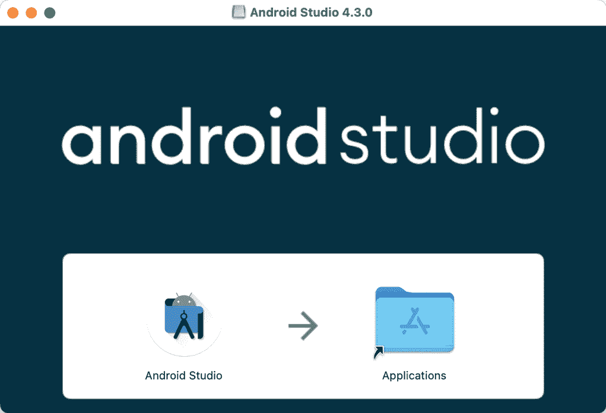

图 2-1

要安装该包，将 Android Studio 图标拖动到“应用程序”（Applications）文件夹中。随后，Android Studio 程序包将安装到系统的应用程序文件夹中，此过程通常需要几秒钟完成。

要启动 Android Studio，在 Finder 窗口的应用程序文件夹中找到可执行文件并双击它。为了以后方便访问该工具，可以从 Finder 窗口将 Android Studio 图标拖到 Dock 栏上。

#### 2.3.3 在 Linux 上安装

下载好 Linux 版 Android Studio 包后，打开终端窗口，切换到准备安装 Android Studio 的目录，并执行以下命令：

```bash
tar xvfz /<path to package>/android-studio-<version>-linux.tar.gz
```

注意，Android Studio 压缩包将安装到名为`android-studio`的子目录中。因此，假设上述命令是在`/home/demo`下执行，软件包将解压到`/home/demo/android-studio`。

要启动 Android Studio，打开终端窗口，切换到`android-studio/bin`子目录，并执行以下命令：

```bash
./studio.sh
```

### 2.4 安装额外的 Android SDK 包

当启动 Android Studio 时，将显示如图 2-2 所示的“Welcome to Android Studio”欢迎界面：

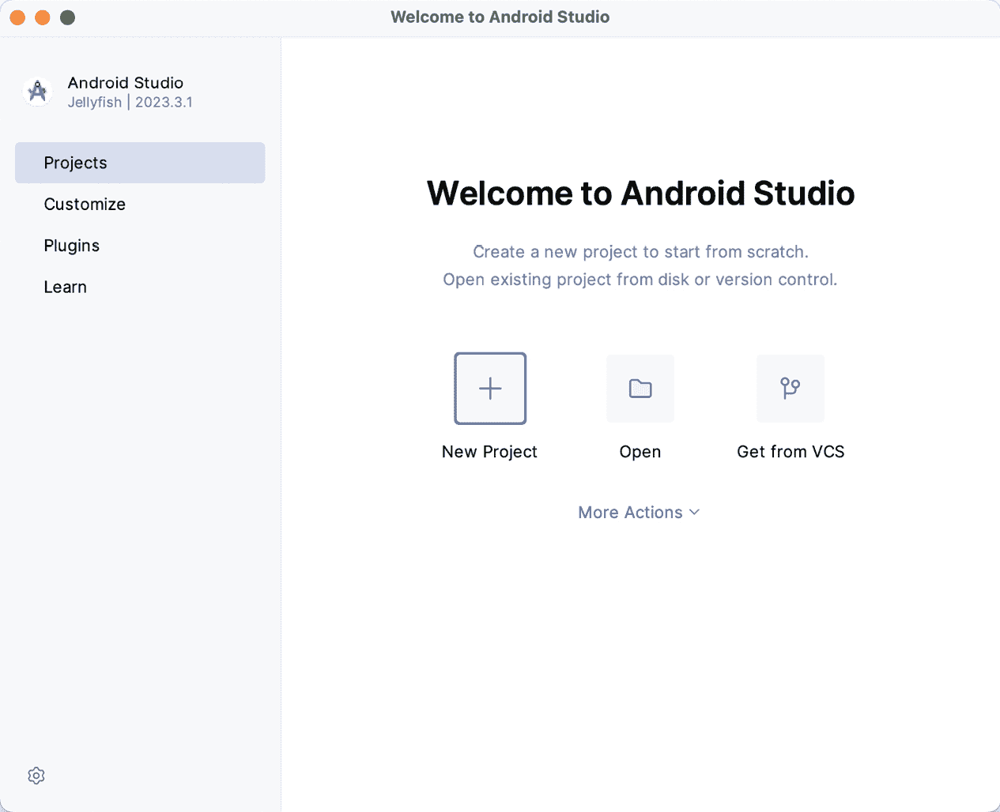

图 2-2

到目前为止的操作已经安装了 Android Studio IDE 以及当前默认的 Android SDK 包。在继续之前，值得花些时间验证已安装哪些包，并安装任何缺失或需要更新的包。

此任务可以通过点击欢迎对话框中的“更多操作”（More Actions）链接，并从下拉菜单中选择“SDK Manager”选项来完成。一旦调用，将显示设置对话框中的 Android SDK 界面，如图 2-3 所示：

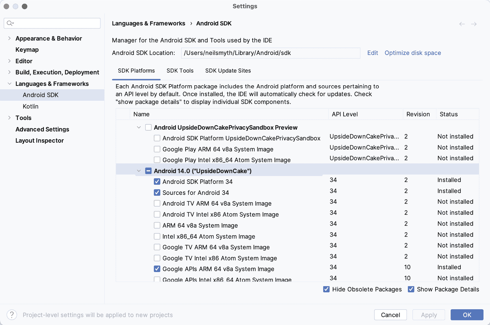

图 2-3

Google 将每个版本的 Android Studio 都与其最高支持的 Android SDK 应用程序接口（API）级别配对。在 Android Studio Jellyfish 中，该级别是 Android UpsideDownCake（API Level 34）。可以通过以下链接确认此信息：

[`developer.android.com/studio/releases#api-level-support`](https://developer.android.com/studio/releases#api-level-support)

在首次安装 Android Studio 之后，可能只安装了最新支持版本的 Android SDK。要安装旧版本的 Android SDK，请勾选对应版本的复选框，并点击“Apply”（应用）按钮。本书的其余部分假设已安装了 Android UpsideDownCake（API Level 34） SDK。

书中的大多数示例将支持低至 Android 8.0 (Oreo) 的更旧版本 Android。这确保了程序可以在各种 Android 设备上运行。在 SDK 版本列表中，勾选 Android 8.0 (Oreo) 旁的复选框，并点击“Apply”按钮。在生成的确认对话框中点击“OK”按钮安装 SDK。随后的对话框将在执行安装前寻求对许可协议和条款的接受。安装完成后，点击“Finish”（完成）。

可能还会列出最新 SDK 有可用更新。要访问有关准备好更新的包的详细信息，请启用屏幕右下角的“Show Package Details”（显示包详情）选项。这将显示类似于图 2-4 所示的信息：

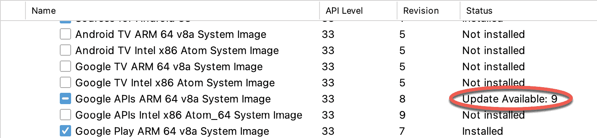

图 2-4

上图强调了更新的可用。要安装更新，请勾选项目名称左侧的复选框，并点击“Apply”按钮。

除了 Android SDK 包外，还安装了若干用于构建 Android 程序的工具。要查看当前安装的包并检查更新，请留在 SDK 设置界面并选择“SDK Tools”（SDK 工具）选项卡，如图 2-5 所示：

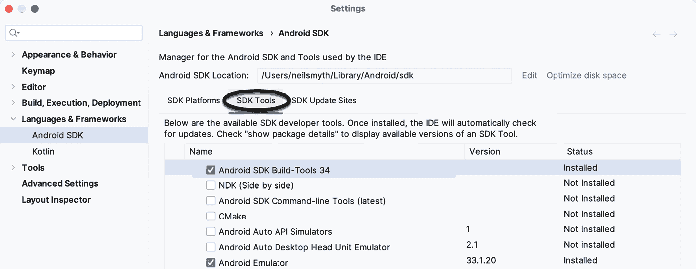

图 2-5

在 Android SDK Tools 界面，确保以下包在“Status”（状态）列中显示为“Installed”（已安装）：

* Android SDK Build-tools
* Android Emulator
* Android SDK Platform-tools
* Google Play Services
* Intel x86 Emulator Accelerator (HAXM installer)
* Google USB Driver (仅限 Windows)
* Layout Inspector image server for API 31-34

**注意**：Intel x86 Emulator Accelerator (HAXM installer) 不安装在基于 Apple 芯片的 Mac 上。

如果上述任何包被列为“Not Installed”（未安装）或需要更新，请勾选这些包旁边的复选框并点击“Apply”按钮启动安装过程。如果出现 HAXM 模拟器设置对话框，请选择推荐的内存分配：


图 2-6

安装完成后，检查包列表并确保所选的包在“Status”列中被列为“Installed”。如果有任何包被列为“Not installed”，请确保它们已勾选并再次点击“Apply”按钮。

### 2.5 安装 Android SDK 命令行工具

Android Studio 包含了允许从系统命令行执行某些任务的工具。要在您的系统中安装这些工具，请打开 SDK Manager，选择“SDK Tools”选项卡，并找到图 2-7 所示的 Android SDK Command-line Tools (latest) 包：

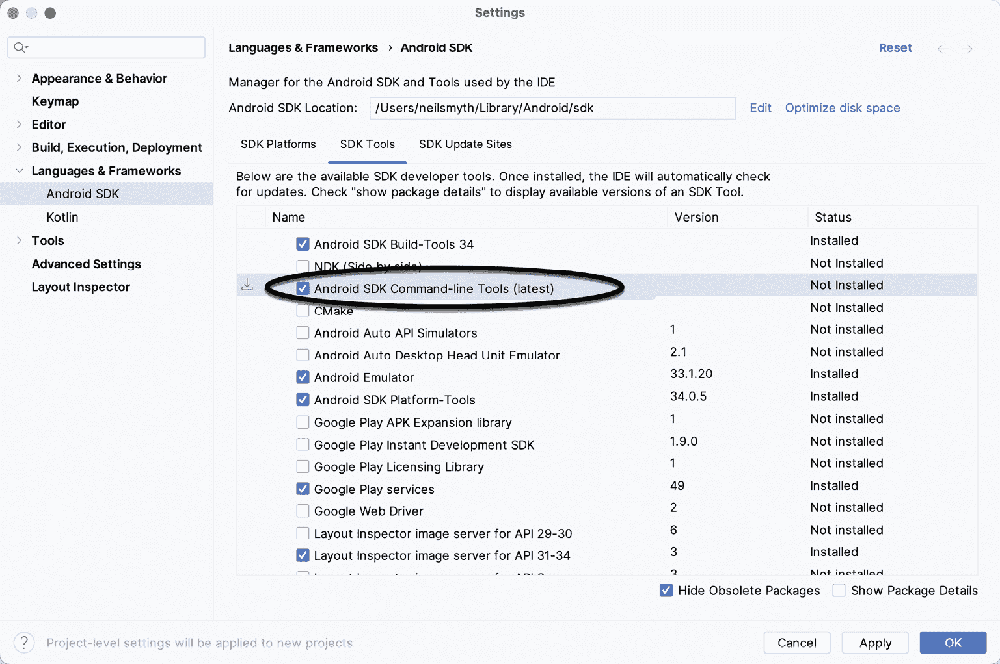

图 2-7

如果命令行工具尚未安装，请启用它并点击“Apply”，然后点击“OK”完成安装。安装完成后，点击“Finish”并关闭 SDK Manager。

为了开发操作系统能够找到这些工具，必须将它们添加到系统的 PATH 环境变量。无论使用什么操作系统，您都需要配置 PATH 环境变量包含以下路径（其中`<path_to_android_sdk_installation>`代表您安装 Android SDK 的文件位置）：

* `<path_to_android_sdk_installation>/sdk/cmdline-tools/latest/bin`
* `<path_to_android_sdk_installation>/sdk/platform-tools`

可以通过启动 SDK Manager 并参考设置面板顶部的 Android SDK Location 字段来识别系统的 SDK 位置，如图 2-8 所示：

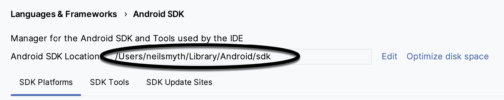

图 2-8

确定 SDK 位置后，添加到 PATH 变量的步骤取决于操作系统：

#### 2.5.1 Windows 8.1

1. 在开始屏幕上，将鼠标移动到屏幕右下角并从生成的菜单中选择“搜索”。在搜索框中输入“控制面板”。当控制面板图标出现在结果区域时，点击它在桌面上启动该工具。
2. 在控制面板中，使用“类别”菜单将显示方式更改“大图标”。从图标列表中选择标记为“系统”的项目。
3. 在“环境变量”对话框中，在“系统变量”列表中找到`Path`变量，选中并点击“编辑...”。在编辑对话框中使用“新建”按钮向路径添加两个新条目。例如，假设 Android SDK 安装在`C:\Users\demo\AppData\Local\Android\Sdk`，则需要添加以下条目：
   - `C:\Users\demo\AppData\Local\Android\Sdk\cmdline-tools\latest\bin`
   - `C:\Users\demo\AppData\Local\Android\Sdk\platform-tools`
4. 在每个对话框中点击确定，并关闭系统属性控制面板。

在键盘上按下`Windows + R`并在运行对话框中输入`cmd`打开命令提示符窗口。在命令提示符窗口中输入：

```cmd
echo %Path%
```

返回的路径变量值应包含 Android SDK 平台工具文件夹的路径。通过尝试如下所示运行`adb`工具来验证`platform-tools`值是否正确：

```cmd
adb
```

执行该工具时，该工具应输出一个命令行选项列表。

同样，通过尝试运行 AVD Manager 命令行工具来检查工具路径设置（如果`avdmanager`工具报告 Java 问题，请忽略——这稍后会解决）：

```cmd
avdmanager
```

如果其中一个或两个命令都出现了类似下面的消息，那么很可能是向`Path`环境变量中添加了错误的路径：

`'adb' is not recognized as an internal or external command, operable program or batch file.`

#### 2.5.2 Windows 10


右键点击开始菜单，从弹出的菜单中选择“设置”，并在“查找设置”文本框中输入“编辑系统环境变量”。在系统属性对话框中，点击`环境变量...`按钮。按照 Windows 8.1 中列的步骤从第 3 步开始操作。

### 2.5.3 Windows 11

右键点击任务栏上的开始图标，从弹出的菜单中选择“设置”。当设置对话框出现时，向下滚动类别列表并选择“关于”选项。在“关于”界面，从“相关链接”部分选择“高级系统设置”。当系统属性窗口出现时，点击`环境变量...`按钮。按照 Windows 8.1 中列的步骤从第 3 步开始操作。

### 2.5.4 Linux

可以通过向家目录下的`.bashrc`文件中添加命令在 Linux 上实现此配置（具体取决于所使用的 Linux 发行版）。假设 Android SDK 压缩包安装在`/home/demo/Android/sdk`，则`.bashrc`文件中的 export 行如下：

```bash
export PATH=/home/demo/Android/sdk/platform-tools:/home/demo/Android/sdk/cmdline-tools/latest/bin:/home/demo/android-studio/bin:$PATH
```

同时注意上述命令将`android-studio/bin`目录添加到`PATH`变量中。这将允许`studio.sh`脚本无论在终端窗口中的当前目录如何都能执行。

### 2.5.5 macOS

在 macOS 上可以使用多种技术来修改`$PATH`环境变量。最干净的方法是在`/etc/paths.d`目录中添加新文件，其中包含要添加到`$PATH`的路径。假设 Android SDK 安装位置为`/Users/demo/Library/Android/sdk`，可以通过在`/etc/paths.d`目录中创建一个名为`android-sdk`的新文件并包含以下行来配置路径：

```
/Users/demo/Library/Android/sdk/cmdline-tools/latest/bin
/Users/demo/Library/Android/sdk/platform-tools
```

注意，由于这是一个系统目录，创建文件时需要使用`sudo`命令。例如：

```bash
sudo vi /etc/paths.d/android-sdk
```

## 2.6 Android Studio 内存管理

Android Studio 是一个大型且复杂的软件应用程序，具有许多后台进程。尽管 Android Studio 过去曾被批评性能不佳，但 Google 在最近的发布中已经显著改进了性能，并在每个新版本中继续这样做。这些改进包括允许用户配置 Android Studio IDE 以及构建和运行应用所需的后台进程所使用的内存量。这允许软件利用具有更大 RAM 的系统。

如果你在运行 Android Studio 的系统上有足够的未用 RAM 内存来增加这些值（此功能仅适用于具有 5GB 或更多内存的 64 位系统），并且发现 Android Studio 性能似乎有所下降，那么尝试这些内存设置可能是值得的。Android Studio 还可能通过一个类似于下方所示的对话框通知你可以提高性能：


图 2-9

要查看并修改当前内存配置，请选择主菜单选项`File -> Settings...`（macOS 上为`Android Studio -> Settings...`），并在弹出的对话框中，选择`Appearance & Behavior`，然后选择左侧导航面板中`System Settings`下的`Memory Settings`选项，如下方的图 2-10 所示：

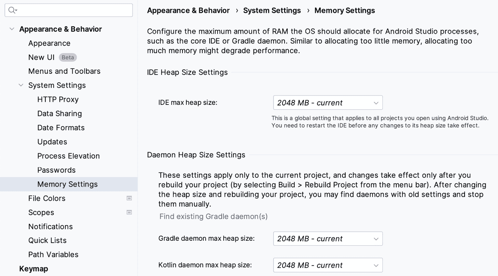

图 2-10

在更改内存分配时，请确保不要分配超过必要的内存，或超过系统在不减慢其他进程的情况下能提供的内存。

IDE 堆大小设置会调整分配给 Android Studio 的内存，并且适用于当前任何加载的项目。另一方面，当从 Android Studio 内部构建和运行项目时，几个后台进程（称为守护进程）执行编译和运行应用的任务。在编译和运行大型复杂项目时，通过调整守护进程堆设置可以改进构建时间。与 IDE 堆设置不同，这些守护进程设置仅适用于当前项目，且只有在打开项目时才能访问。要在打开的项目中显示 SDK Manager，请从主菜单选择`Tools -> SDK Manager...`。

## 2.7 更新 Android Studio 和 SDK

Android Studio 和 SDK 定期会发布新版本。新版本的 SDK 使用 SDK Manager 进行安装。Android Studio 通常会通知你有可用的更新。

要手动检查 Android Studio 更新，请使用 Android Studio 窗口中的`Help -> Check for Updates...`选项（macOS 上为`Android Studio -> Check for Updates...`）。

## 2.8 总结

在开始开发 Android 应用之前，第一步是设置开发环境。这包括 Android SDK 和 Android Studio IDE（它包含了 OpenJDK 开发环境）。本章介绍了在 Windows、macOS 和 Linux 上安装这些软件包的步骤。

# 3. 在 Android Studio 中创建应用程序

前面的章节已经解释了如何配置适用于 Android Studio IDE 开发 Android 应用的环境。在继续更高级的主题之前，现在是验证所有所需的软件包已安装并正常运行的时机。实现此目标的最佳方法是创建一个 Android 应用并运行。本章将涵盖使用 Android Studio 创建 Android 项目的过程。创建项目后，后面的章节将探索使用 Android 模拟器环境进行测试。

## 3.1 关于项目

在本章中创建的项目是一个原始的货币转换计算器（实际上非常简单，它只将美元转换为欧元，并使用估算的汇率进行）。该项目还将使用最基础的 Android Studio 项目模板。这种简单性允许我们介绍一些 Android 应用开发的关键方面，而不会一次性引入过多的概念（例如推荐的应用程序架构和 Android 架构组件）让初学者感到困惑。在遵循本章的教程时，请放心，在这个初始示例项目中使用的技术和代码将在以后进行更详细的介绍。

## 3.2 创建新的 Android 项目

应用开发过程的第一步是在 Android Studio 环境中创建一个新项目。因此，请先启动 Android Studio，如图 3-1 所示，屏幕会出现“欢迎来到 Android Studio”界面：

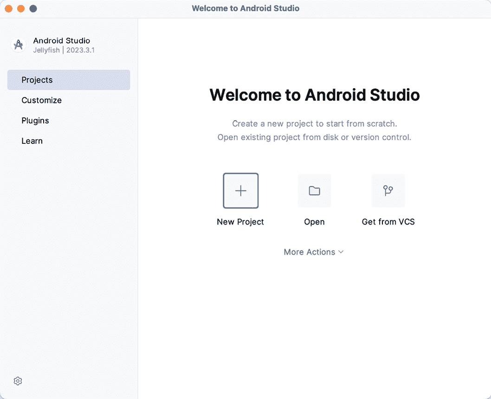

图 3-1

一旦此窗口出现，Android Studio 已准备好创建新项目。要创建新项目，点击`New Project`（新建项目）选项显示新项目向导的第一个界面。

## 3.3 创建 Activity

下一步是为应用程序定义要创建的初始 Activity 类型。你可以为手机和平板电脑、Wear OS、电视或汽车创建项目。在开发 Android 应用程序时，有多种 Activity 类型可选择，其中许多将在后面的章节中详细介绍。但是，对于本示例，请从`Templates`（模板）面板选择`Phone and Tablet`（手机和平板电脑），然后选择创建`Empty Views Activity`（空视图 Activity）。`Empty Views Activity`会创建一个由单个`TextView`对象组成的模板用户界面。

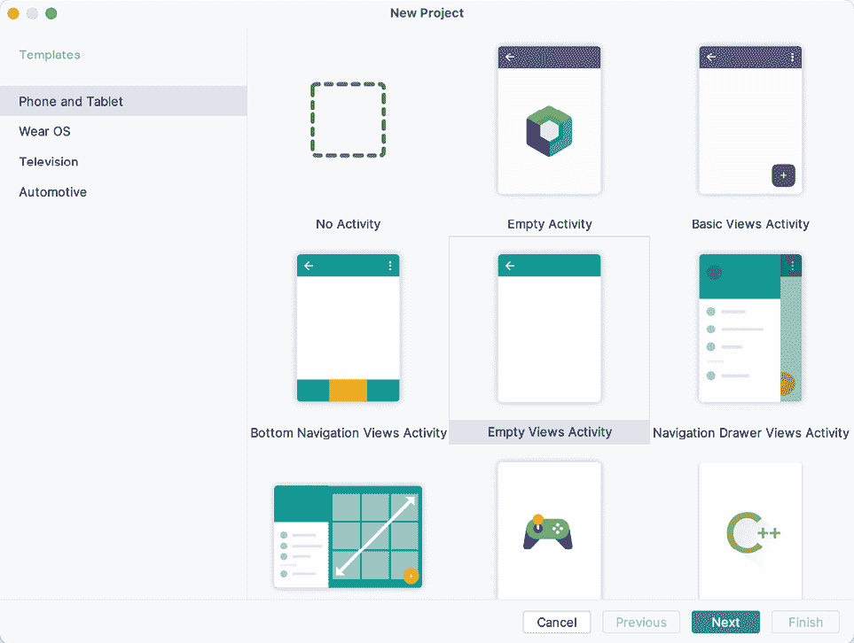

图 3-2

在选中`Empty Views Activity`后，点击`Next`（下一步）继续项目配置。

## 3.4 定义项目和 SDK 设置

在项目配置窗口（图 3-3）中，将`Name`（名称）字段设置为`AndroidSample`。应用程序的名称是在 Android Studio 中引用和标识应用程序的名称，也是如果完成的应用程序要在 Google Play 商店发售时将要使用的名称。

`Package name`（包名）在 Android 应用程序生态系统中唯一标识应用程序。虽然可以设置为任何唯一标识你应用的字符串，但传统上它是基于你域名的反转 URL，后面加上应用程序名称。例如，如果你的域名是`www.mycompany.com`，且应用程序命名为`AndroidSample`，那么包名可以指定如下：

`com.mycompany.androidsample`

如果你没有域名，可以在`Company Domain`（公司域名）字段中输入任何其他字符串，或者使用`example.com`进行测试，但在发布应用程序之前需要对其更改：

`com.example.androidsample`

`Save location`（保存位置）设置将默认为位于家目录下名为`AndroidStudioProjects`的文件夹中，可以通过点击包含当前路径设置文本字段右侧的文件夹图标进行更改。

将`minimum SDK`（最低 SDK）设置设置为`API 26`（Oreo；Android 8.0）。除非某些功能仅在较新版本中可用，否则此最低 SDK 将用于书中创建的大多数项目。这里的目标是使用最新的 Android SDK 构建一个应用，同时保留与运行旧版本 Android 的设备的兼容性（在此情况下，可追溯到 Android 8.0）。`Minimum SDK`设置下方的文本将概述目前运行该应用程序的 Android 设备百分比。点击`Help me choose`（帮助我选择）按钮（在图 3-3 中突出显示）以查看仍在使用的各种 Android 版本的完整列表：

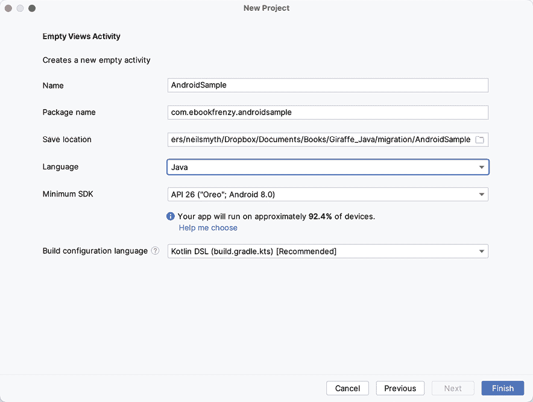

图 3-3

最后，将`Language`（语言）菜单更改为`Java`，并选择`Kotlin DSL (build.gradle.kts)`作为构建配置语言，然后点击`Finish`（完成）创建项目。

## 3.5 修改示例应用程序

项目创建后，主窗口将出现，其中包含我们的`AndroidSample`项目，如下方的图 3-4 所示：

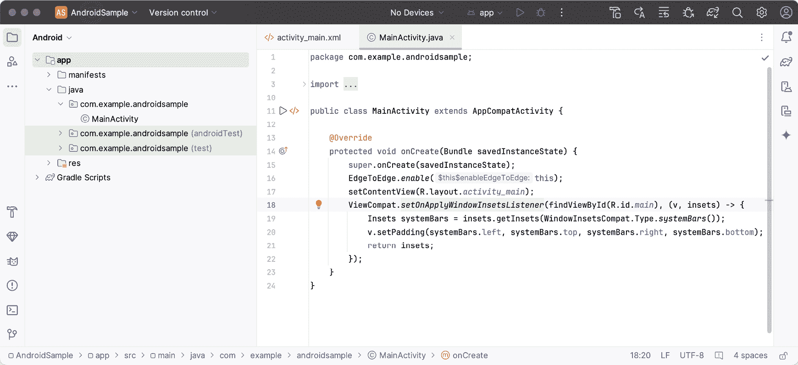

图 3-4

新创建的项目和相关文件的引用列在主项目窗口左侧的`Project`（项目）工具窗口中。`Project`工具窗口有几种可以显示信息的模式。默认情况下，此面板应处于`Android`模式。此设置由面板顶部的菜单控制，如图 3-5 中突出显示所示。如果面板当前不是`Android`模式，请使用菜单切换模式：

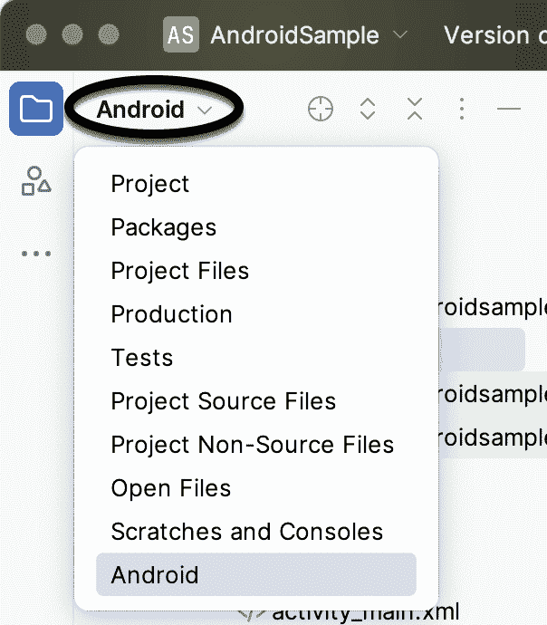

图 3-5

## 3.6 修改用户界面

我们 Activity 的用户界面设计存储在名为`activity_main.xml`的文件中，该文件随后位于`Project`工具窗口文件层次结构中的`app -> res -> layout`下。在`Project`工具窗口中找到文件后，双击该文件将其加载到用户界面`Layout Editor`（布局编辑器）工具中，该工具将出现在 Android Studio 主窗口的中间面板：

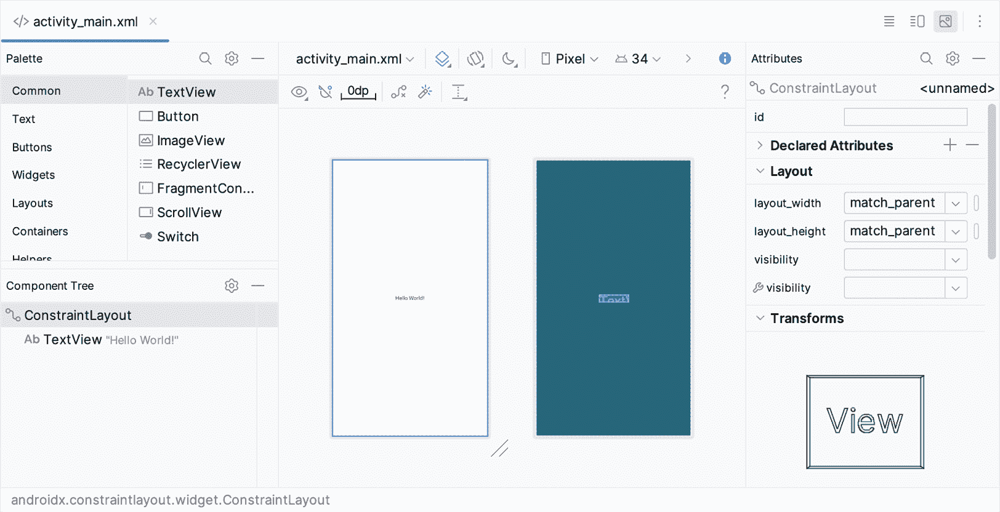

图 3-6

`Layout Editor`窗口顶部工具栏上有一个菜单（在上面的图中当前设置为`Pixel`），它会反映在`Layout Editor`面板中设备的视觉表示上。点击此菜单可以使用其他一系列设备选项。

使用`System UI Mode`按钮（）为设备屏幕布局开启或关闭夜间模式。若要在设备表示的横屏和竖屏之间切换方向，请使用显示图标的下拉菜单。

正如我们在屏幕上看到的，内容布局已经包含一个显示“Hello World!”的标签。面板左侧运行着各种用户界面组件类别，用于构建用户界面，例如按钮、标签和文本字段。但需要注意的是，并不是所有用户界面组件都是可见的。其中一个类别是布局。Android 支持多种布局，对界面组件在屏幕上的位置提供不同级别的控制。从视觉上很难判断，但当前设计是使用`ConstraintLayout`创建的。这可以通过查看`Component Tree`（组件树）面板的信息来确认，该面板默认位于`Layout Editor`的左下角，如图 3-7 所示：

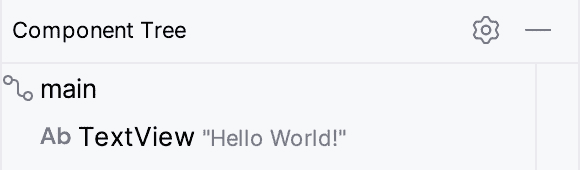

图 3-7

从组件树可以看出，用户界面布局由一个名为`main`的`ConstraintLayout`父和一个`TextView`子对象组成。

在继续之前，检查`Layout Editor`的`Autoconnect`模式已启用。这意味着向布局添加组件时，`Layout Editor`将自动添加约束，以确保组件在不同的屏幕尺寸和方向上正确放置（该主题将在后续章节详细介绍）。`Autoconnect`按钮出现在`Layout Editor`工具栏中，用 U 形图标表示。禁用时，图标带有斜线（图 3-8）。如有必要，点击此按钮重新启用`Autoconnect`模式。

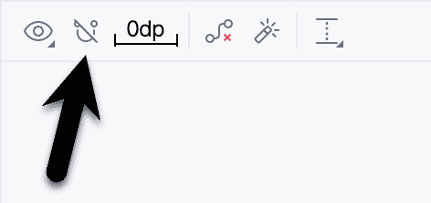

图 3-8

修改应用程序的下一步是向布局中添加一些额外的组件，第一个将是用户点击以启动货币转换的`Button`。

`Palette`面板由两列组成，左列包含视图组件类别列表。右列列出当前选择类别包含的组件。例如，在图 3-9 中，`Buttons`类别中选中了`Button`视图：

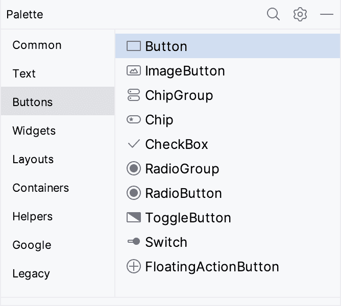

图 3-9

从`Buttons`列表中点击并拖动`Button`对象，将其放置在用户界面设计的水平中心位置，使其位于现有的`TextView`小部件下方：

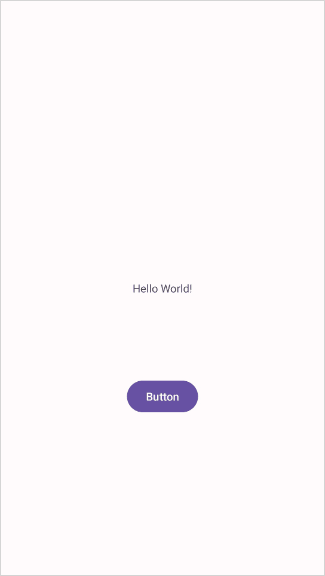

图 3-10

下一步是更改`Button`组件当前显示的文本。位于设计区域右侧的面板是`Attributes`（属性）面板。该面板显示了分配给布局中当前选中组件的属性。在此面板中，在`Common Attributes`（常用属性）部分找到`text`属性，并将当前值从“Button”更改为“Convert”，如图 3-11 所示：

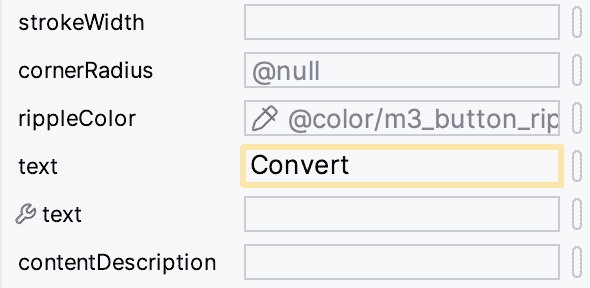

图 3-11

第二个带有扳手图标的文本属性允许设置`toolstext`（设计时文本属性），该属性仅在`Layout Editor`（布局编辑器）工具中显示，而在运行时不会显示。这对于测试视觉组件和布局在不同设置下的表现非常有用，而无需反复运行应用程序。

以防`Autoconnect`（自动连接）系统未能设置所有布局连接，点击`Infer Constraints`（推断约束）按钮（图 3-12）为布局添加任何缺失的约束：

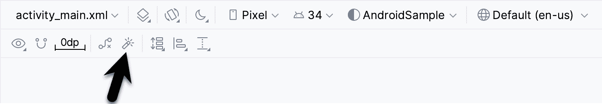

图 3-12

解释`Layout Editor`工具右上角的警告按钮是非常重要的，如图 3-13 所示。该警告表示布局可能存在问题。要查看有关任何问题的详情，请点击该按钮：

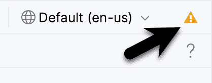

图 3-13

点击后，将出现`Problems`（问题）工具窗口（图 3-14），描述问题的性质：

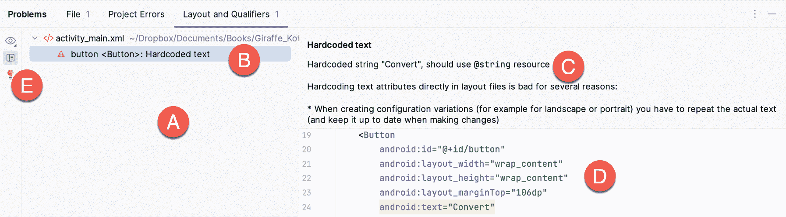

图 3-14

该工具窗口分为两个面板。左侧面板（上图中标记为 A）列出了在布局文件中检测到的问题。在我们的示例中，仅列出了以下问题：

```
button <Button>: Hardcoded text
```

当从列表中选择一项（B）时，右侧面板将更新以提供有关问题的更多细节（C）。在这种情况下，解释如下：

```
Hardcoded string "Convert", should use @string resource
```

该工具窗口还包含一个预览编辑器（D），允许对布局文件进行手动修正。

此 I18N 消息告诉我们，项目未来的国际化可能存在潜在问题（“I18N”源于“internationalization”一词以“I”开头，以“N”结尾，中间有 18 个字母）。该警告提醒我们，在开发 Android 应用程序时，应尽可能将文本字符串等属性和值存储为资源。这样做可以使能够通过修改资源文件来更改应用程序的外观，而无需更改应用程序的源代码。这在将用户界面翻译成不同的口语语言时尤为宝贵。如果用户界面中的所有文本都包含在一个资源文件中，例如，可以将该文件交给翻译人员，然后由他们执行翻译工作并返回翻译后的文件以包含在应用程序中。这使得无需更改任何源代码即可针对多种语言。在此例中，我们将创建一个命名为`convert_string`的新资源，并为其分配字符串“Convert”。

首先，点击`Show Quick Fixes`按钮（E）并从菜单中选择`Extract string resource`选项，如图 3-15 所示：

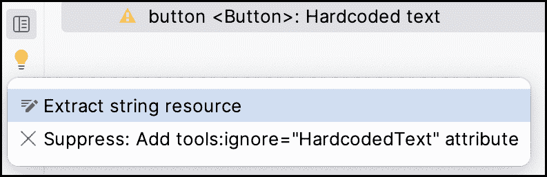

图 3-15

选择此选项后，将出现`Extract Resource`面板（图 3-16）。在此面板中，将资源名称字段更改为`convert_string`，并保持资源值为`Convert`，然后点击`OK`按钮：

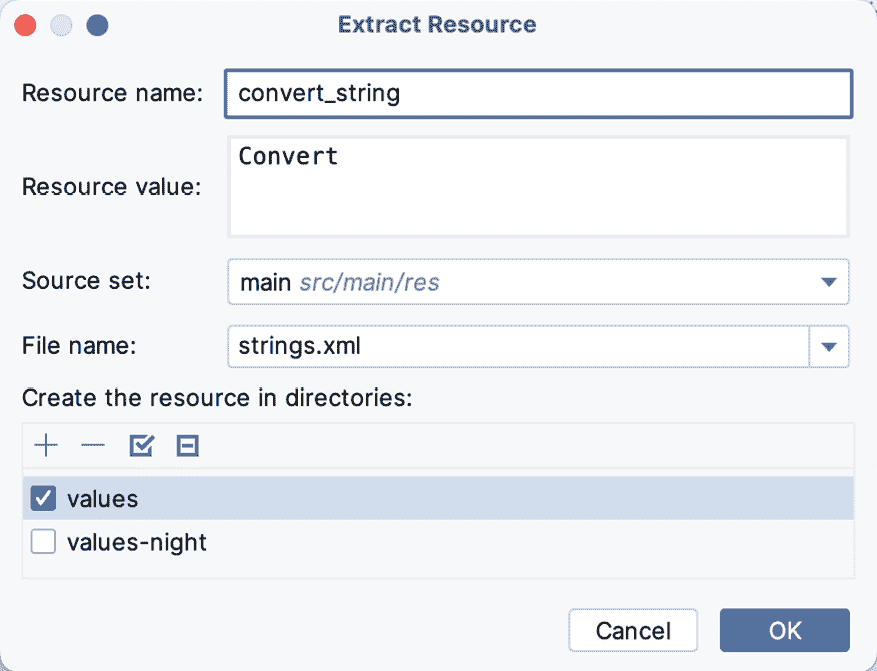

图 3-16


要添加的下一个部件是 `EditText` 小部件，用户将在其中输入要转换的美元金额。从 `Palette` 面板中，选择 `Text` 类别，并点击并拖动 `Number (Decimal)` 组件到布局中，使其水平居中并位于现有的 `TextView` 小部件上方。选中该小部件后，使用 `Attributes` 工具窗口将 `hint` 属性设置为“dollars”。点击警告图标并将字符串提取到名为 `dollars_hint` 的资源。

本章稍后编写的代码将需要访问用户输入 `EditText` 字段的美元值。它将通过引用分配给用户界面布局中小部件的 `id` 来实现此功能。Android Studio 为小部件分配的默认 `id` 可以在布局中选中小部件时，从 `Attributes` 工具窗口查看和更改，如图 3-17 所示：

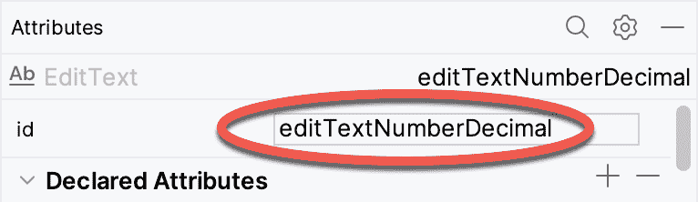

图 3-17

将 `id` 更改为 `dollarText`，并在 `Rename` 对话框中点击 `Refactor` 按钮。这确保项目其他地方对旧 `id` 的任何引用都会更新：


图 3-18

重复上述步骤，将 `TextView` 的 `id` 设置为 `textView`。通过点击 `Infer Constraints` 按钮添加任何缺失的约束。此时，布局应如图 3-19 所示：


图 3-19

### 3.7 回顾布局和资源文件

在继续下一步之前，我们将查看用户界面和资源的一些内部结构。在上一节中，我们通过修改 `activity_main.xml` 更改用户界面。事实上，`Layout Editor` 所做的只是提供了一种编辑 XML 的友好方式。在实践中，没有理由不修改 XML 来进行用户界面更改，在某些情况下，这实际上比使用 `Layout Editor` 更快。在 `Layout Editor` 面板的右上角，有如图 3-20 所示标记为 A 到 C 的 `View Modes` 按钮：


图 3-20

默认情况下，编辑器将处于 `Design` 模式（按钮 C），仅显示布局的视觉表示。在 `Code` 模式（A）下，编辑器将显示布局的 XML，而在 `Split` 模式（B）下，将同时显示布局和 XML，如图 3-21 所示：

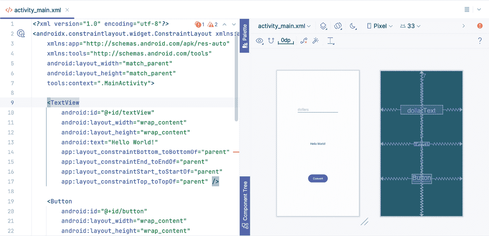

图 3-21

`View Modes` 按钮（位于图 3-20 上方左侧）用于快速切换 `Code` 和 `Split` 模式。

从 XML 文件的结构可以看出，用户界面由 `ConstraintLayout` 组件组成，它反而是 `TextView`、`Button` 和 `EditText` 对象的父组件。我们还可以看到，例如，`Button` 的 `text` 属性设置为我们的 `convert_string` 资源。尽管内容各异，但所有用户界面布局都以这种层次化的基于 XML 的方式构建。

随着 XML 布局的更改，这些更改将反映在布局画布上。也可以从画布面板内部修改布局，更改将出现在 XML 列表中。为了查看此效果，切换到 `Split` 模式并修改 XML 布局，将 `ConstraintLayout` 的背景颜色更改为红色：

```xml
<?xml version="1.0" encoding="utf-8"?>

<androidx.constraintlayout.widget.ConstraintLayout xmlns:android="http://schemas.android.com/apk/res/android">
```

```xml
xmlns:app="http://schemas.android.com/apk/res-auto"
    xmlns:tools="http://schemas.android.com/tools"
    android:id="@+id/main"
    android:layout_width="match_parent"
    android:layout_height="match_parent"
    tools:context=".MainActivity"
    android:background="#ff2438" >
</androidx.constraintlayout.widget.ConstraintLayout>
```

注意，布局颜色会实时更改以匹配 XML 文件中的新设置。同时请注意，XML 编辑器左侧边距（也称为行槽）中，包含颜色设置的行旁边会出现一个红色小正方形。这是该属性已设置为红色的视觉提示。点击红色小正方形将显示颜色选择器，允许选择不同的颜色：

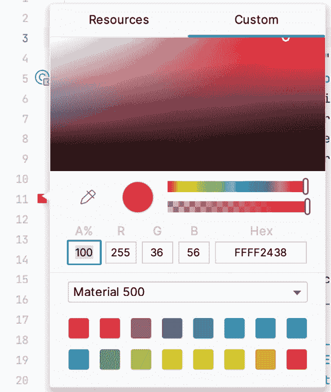

图 3-22

在继续之前，请从布局文件中删除 `background` 属性，使背景恢复到默认设置。

最后，使用 `Project` 面板找到 `app -> res -> values -> strings.xml` 文件，并双击它将其加载到编辑器中。目前，XML 的内容如下：

```xml
<resources>
    <string name="app_name">AndroidSample</string>
    <string name="convert_string">Convert</string>
    <string name="dollars_hint">dollars</string>
</resources>
```

为了演示资源的实际应用，将当前分配给 `convert_string` 资源的字符串值更改为“Convert to Euros”，然后通过编辑器面板中布局文件的标签页返回 `Layout Editor` 工具。注意，布局已经获取了该字符串的新资源值。

访问 XML 文件中引用的资源值还有一种快速方法。在 `Split` 或 `Code` 模式下使用 `Layout Editor` 工具，点击 `@string/convert_string` 属性设置使其变为高亮，然后按键盘上的 `Ctrl-B`（macOS 上为 `Cmd-B`）。Android Studio 随后会打开 `strings.xml` 文件，并带您进入该文件中声明此资源的行。利用此机会将字符串资源恢复为原始的“Convert”文本，并添加以下额外的字符串资源项，该资源将在应用代码中被引用：

```xml
<resources>
    <string name="app_name">AndroidSample</string>
    <string name="convert_string">Convert</string>
    <string name="dollars_hint">dollars</string>
    <string name="no_value_string">No Value</string>
</resources>
```

也可以点击编辑器窗口右上角的 `Open editor` 链接，使用 `Android Studio Translations Editor` 编辑字符串。这将在 Android Studio 窗口的主面板中显示 `Translation Editor`：

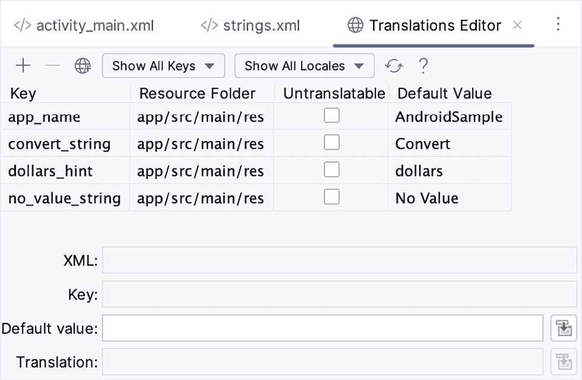

图 3-23

此编辑器允许对分配给资源键的字符串进行编辑，并管理多种语言的翻译。

### 3.8 添加交互

此示例项目的最后一步是使应用程序具有交互性，这样当用户在 `EditText` 字段中输入美元值并点击转换按钮时，转换后的欧元值将显示在 `TextView` 上。这涉及在 `Button` 控件上实现一些事件处理。具体来说，需要对 `Button` 进行配置，以便在触发 `onClick` 事件时调用应用代码中的方法。事件处理可以通过多种方式实现，将在稍后章节中介绍 Android 事件处理概述与示例。将布局编辑器返回 `Design` 模式，在布局编辑器中选择 `Button` 控件，参考 `Attributes` 工具窗口，并按如下所示指定名为 `convertCurrency` 的方法：

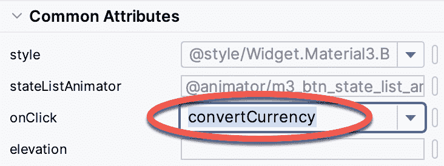

图 3-24

接下来，在 `Project` 工具窗口中双击 `MainActivity.java` 文件（`app -> java -> <package name> -> MainActivity`）将其加载到代码编辑器中，并在类文件中添加 `convertCurrency` 方法的代码，使其内容如下。请注意，还需要导入一些额外的 Android 包：

```java
package com.example.androidsample;

import android.os.Bundle;
import android.view.View;
import android.widget.EditText;
import android.widget.TextView;
import java.util.Locale;

public class MainActivity extends AppCompatActivity {
    @Override
    protected void onCreate(Bundle savedInstanceState) {
        super.onCreate(savedInstanceState);
    }

    public void convertCurrency(View view) {
        EditText dollarText = findViewById(R.id.dollarText);
        TextView textView = findViewById(R.id.textView);
        if (!dollarText.getText().toString().isEmpty()) {
            float dollarValue = Float.parseFloat(dollarText.getText().toString());
            float euroValue = dollarValue * 0.85F;
            textView.setText(String.format(Locale.ENGLISH, "%.2f", euroValue));
        } else {
            textView.setText(R.string.no_value_string);
        }
    }
}
```

该方法首先通过调用名为 `findViewById` 的方法并传递布局文件中分配的 `id`，来获取 `EditText` 和 `TextView` 对象的引用。然后进行检查，以确保 `dollarText.getText().toString().isEmpty()` 为假；如果是，则提取值并转换为 `float`，然后转换为欧元。最后，将结果显示在 `TextView` 上。

### 3.9 总结

虽然并不复杂，但设置开发环境涉及多个步骤。在完成这些步骤后，值得运行示例以确保环境配置正确。在本章中，我们创建了一个示例应用程序，并使用 Android Studio `Layout Editor` 工具修改了用户界面。在此过程中，我们探索了尽可能使用资源的重要性（特别是字符串值），并简要介绍了布局。接下来，我们查看了用于存储 Android 应用用户界面设计的底层 XML。

最后，我们为 `Button` 添加了 `onClick` 事件，并连接到一个方法，以提取 `EditText` 中的用户输入、将其美元转换为欧元，并将结果显示在 `TextView` 上。

# 4. 在 Android Studio 中创建 Android 虚拟设备（AVD）

## Android 虚拟设备（AVD）

### AVD 简介

AVD 是模拟器，允许在无需在物理 Android 设备上安装应用程序的情况下测试 Android 应用程序。AVD 可以配置为模拟各种硬件功能，包括屏幕大小、内存容量，以及是否存在摄像头、GPS 导航支持或加速度计等功能。Android Studio 的标准安装程序中包含多个模拟器模板，允许为各种设备配置 AVD。您还可以通过指定处理器类型、内存容量以及屏幕尺寸和像素密度等属性，创建自定义配置，以匹配任何物理 Android 设备。

AVD 会话可以以独立窗口的形式出现，也可以嵌入在 Android Studio 窗口中。

### 创建新的 AVD

新的 AVD 使用 `Android Virtual Device Manager`（Android 虚拟设备管理器）进行创建和管理，可以使用命令行模式，也可以使用更友好的图形用户界面。创建新 AVD 的第一步是启动 `AVD Manager`。这可以在 Android Studio 环境中通过点击右侧工具窗口栏中的 `Device Manager`（设备管理器）按钮来实现，如图 4-1 所示：

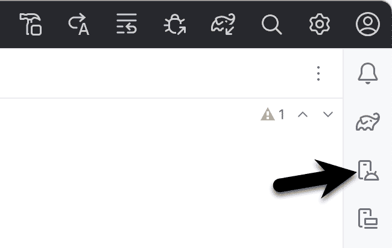

图 4-1

打开后，管理器将以工具窗口的形式出现，如图 4-2 所示：

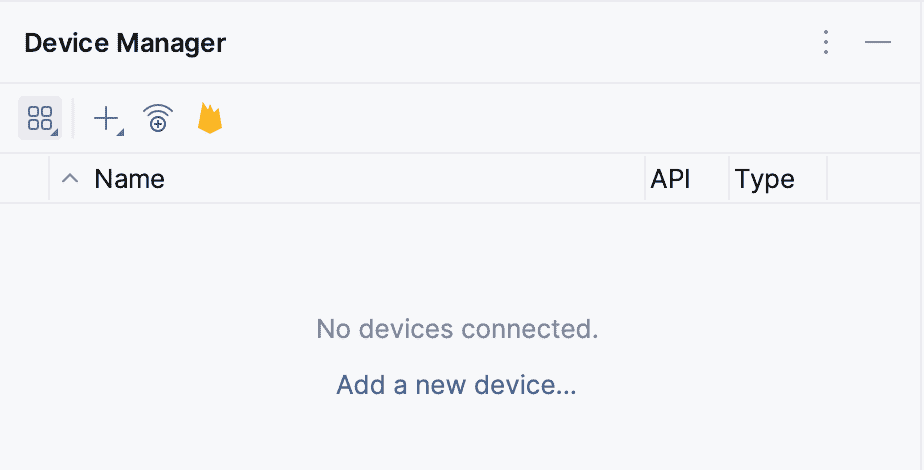

图 4-2

如果您是在计算机上首次安装 Android Studio（而不是升级现有的 Android Studio 安装程序），安装程序可能已经创建了一个准备备用的初始 AVD 实例，如图 4-3 所示：

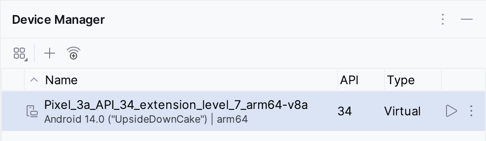

图 4-3

如果您的系统中已存在此 AVD，您可以使用它来测试应用。如果没有创建任何 AVD，或者您想为不同类型的设备创建 AVD，请按照本章其余部分的步骤进行操作。

要添加新的 AVD，请点击 `Device Manager` 工具栏上的 `+` 按钮并选择 `Create Virtual Device`（创建虚拟设备）选项，以打开 `Virtual Device Configuration`（虚拟设备配置）对话框：

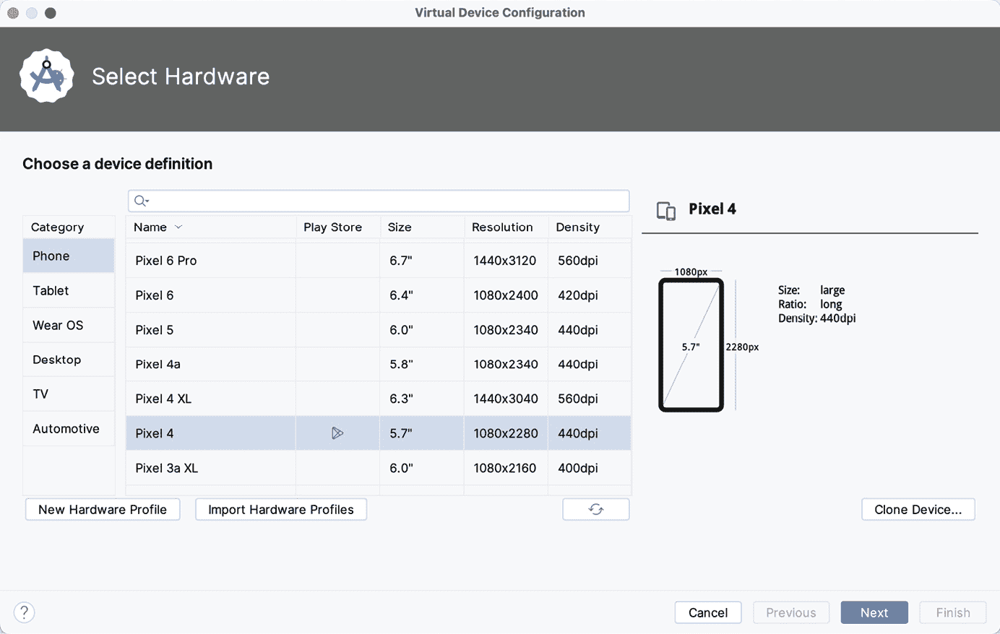

图 4-4

在对话框中，执行以下步骤创建一个与 Pixel 4 兼容的模拟器：

1. 从 `Category` 面板选择 `Phone` 选项，以显示可用的 Android 手机 AVD 模板。

2. 选择 `Pixel 4` 设备选项并点击 `Next`（下一步）。

3. 在 `System Image` 屏幕上，选择最新版本的 Android。如果尚未安装系统镜像，`Release Name`（发布名称）旁边将提供 `Download`（下载）链接。点击此链接，在选择之前下载并安装系统镜像。如果列表中未列出所需的镜像，点击 `x86 Images`（如果您运行带有 Apple 芯片的 Mac，则点击 `ARM images`）和 `Other images` 标签，以查看替代列表。

4. 点击 `Next` 继续，并在 `name` 字段中输入描述性名称（例如 `Pixel 4 API 34`），或接受默认名称。

5. 点击 `Finish`（完成）创建 AVD。

6. 如果以后需要对 AVD 进行修改，请重新打开 `Device Manager`，从列表中选择 AVD，并点击 `Actions` 列中的 `pencil icon`（铅笔图标）编辑设置。

### 启动模拟器

要测试新创建的 AVD 模拟器，请从 `Device Manager` 中选择模拟器并点击三角形的 `Start`（启动）按钮。模拟器将嵌入 Android Studio 主窗口并开始启动过程。模拟器启动所需的时间取决于 AVD 及其运行操作系统的配置：

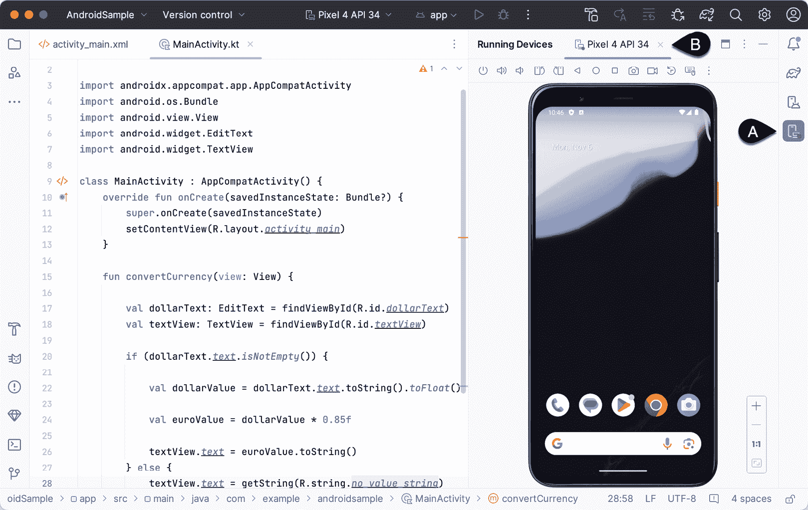

图 4-5

要隐藏和显示模拟器工具窗口，请点击 `Running Devices`（运行中的设备）工具窗口按钮（标记为 A）。点击标签旁边的 `x` 关闭按钮（B）退出模拟器。模拟器工具窗口可以容纳多个模拟器会话，每个会话由一个标签表示。例如，图 4-6 显示了一个具有两个模拟器会话的工具窗口：

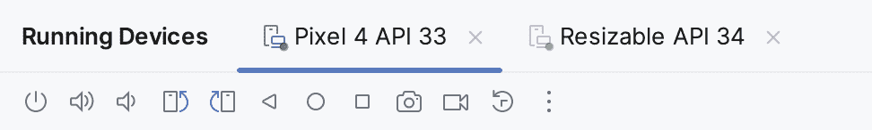

图 4-6

如要在会话之间切换，请点击相应的标签。

虽然模拟器可能默认以竖向方向显示，但此选项和其他默认选项可以更改。在 `Device Manager` 中，选择新的 `Pixel 4` 条目并点击设备行 `Actions` 列中的 `pencil icon`。在配置屏幕上，找到 `Startup orientation`（启动方向）部分并更改设置。退出并重启模拟器会话以使更改生效。关于模拟器的更多细节将在下一章介绍（“Using and Configuring the Android Studio AVD Emulator”）。

为了在本章的下一节中节省时间，请在继续之前保持模拟器运行。

### 在 AVD 中运行应用程序

配置好 AVD 模拟器后，现在可以编译并运行前面的章节中创建的示例 `AndroidSample`。在 Android Studio 中加载 `AndroidSample` 项目后，确保新创建的 `Pixel 4` AVD 显示在设备菜单中（如图 4-7 中的 A 所示）：


图 4-7

设备菜单（A）可用于选择 AVD 实例或物理设备作为运行目标，并访问 `Device Manager` 以及故障排除选项：


图 4-8

一旦应用程序安装并运行，模拟器中将显示片段（片段是 Android 项目的一个可重用部分，通常由用户界面和一些代码组成，该主题将在 `Introduction to Android Fragments` 中介绍）：

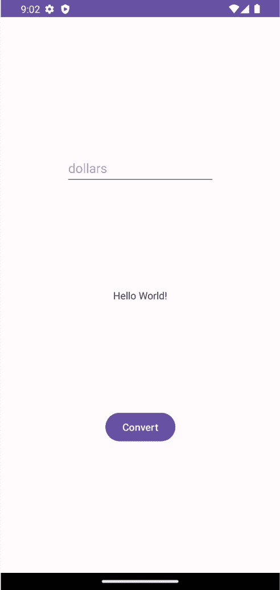

图 4-9


运行过程开始后，`Run` 工具窗口将出现。`Run` 工具会在应用程序安装和启动时显示诊断信息。图 4-10 显示了典型启动的 `Run` 工具窗口输出：

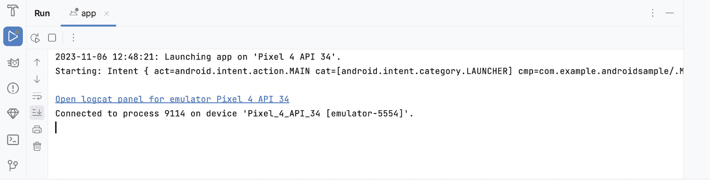

图 4-10

如果在启动过程中遇到问题，`Run` 工具窗口将帮助隔离原因。假设应用程序加载到模拟器并按预期运行，我们已安全地验证了 Android 开发环境已正确安装和配置。在应用运行时，尝试进行货币转换以验证应用是否正常。

## 在多个设备上运行

上方图 4-8 所示的运行目标菜单包含一个在多个模拟器和设备上并行应用的选项。选中后，此选项将显示图 4-11 所示的对话框，提供系统中配置的所有 AVD 以及连接的物理设备的列表。在点击`Run`按钮之前，启用目标模拟器或设备旁边的复选框：

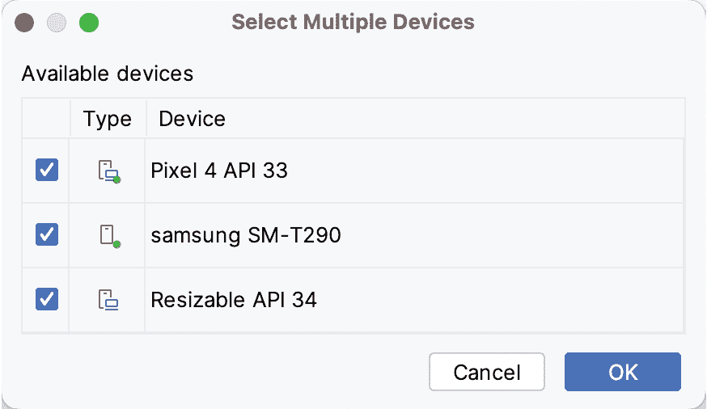

图 4-11

点击`Run`按钮后，Android Studio 将所选模拟器和设备上启动应用。

## 停止运行的应用程序

要停止正在运行的应用程序，请点击主工具栏上的停止按钮，如图 4-12 所示：

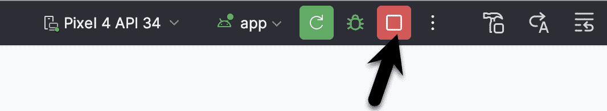

图 4-12

也可以使用`Run`工具窗口来终止应用程序。首先，通过在应用运行时会出现的窗口标题栏按钮来显示`Run`工具窗口。一旦`Run`工具窗口出现，点击下方图 4-13 所示中高亮的停止（stop）按钮：

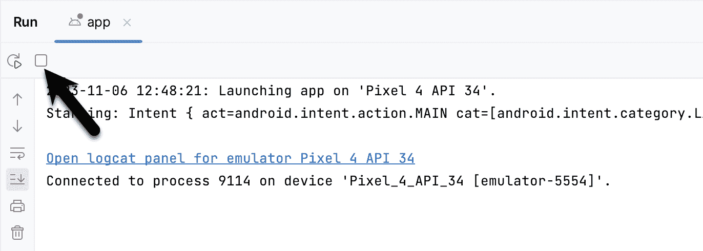

图 4-13

## 4.6 支持深色主题

要测试应用在启用深色主题时的行为，请在模拟器中运行的 Android 实例内打开`Settings`应用，选择`Display`类别，并启用图 4-14 所示的`Dark theme`选项：

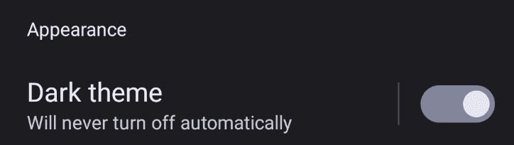

图 4-14

启用深色主题后，运行`AndroidSample`应用，你会注意到它以深色主题显示，包括黑色背景和按钮上的紫色背景色，如图 4-15 所示：

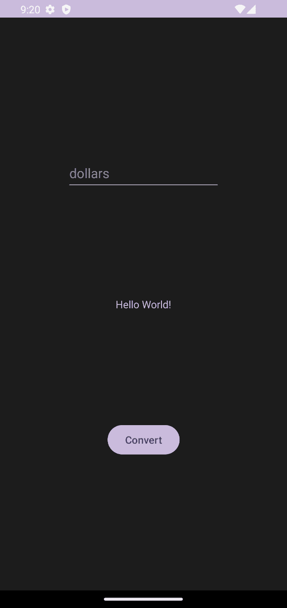

图 4-15

在继续之前，返回`Settings`应用并关闭`Dark theme`模式。

## 4.7 在独立窗口中运行模拟器

到本章为止，我们仅将模拟器作为嵌入在 Android Studio 主窗口内的工具窗口使用。模拟器可以配置为在`Settings`对话框中的独立窗口出现，可以通过点击 Android Studio 工具栏上的`IDE and Project Settings`按钮来显示，如图 4-16 所示：

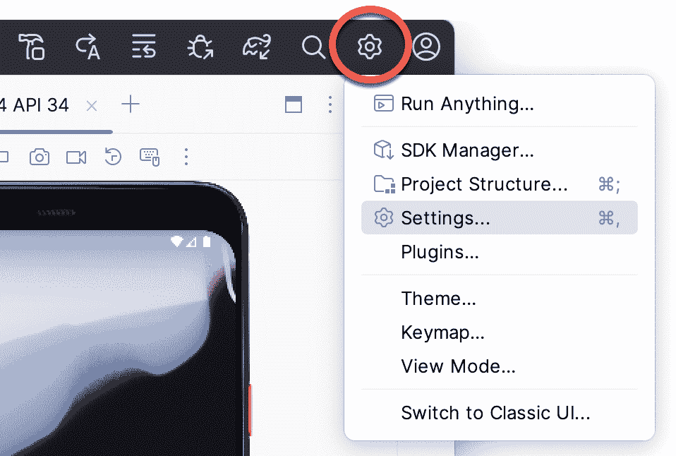

图 4-16

在`Settings`对话框中，在侧边面板中导航到`Tools -> Emulator`，并禁用`Launch in the Running Devices`工具窗口选项：

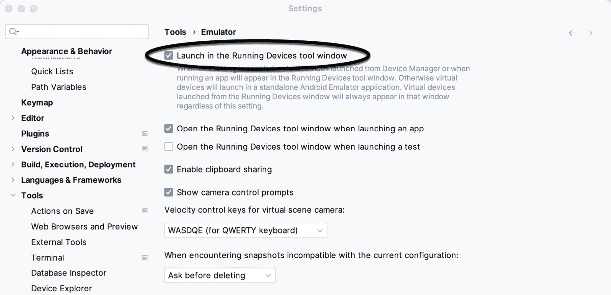

图 4-17

禁用该选项后，点击`Apply`按钮并点击`OK`提交更改，然后点击上方图 4-5 中标记为 B 的标签上的关闭按钮退出当前模拟器会话。

再次运行示例应用，此时模拟器将作为一个独立窗口出现，如下：

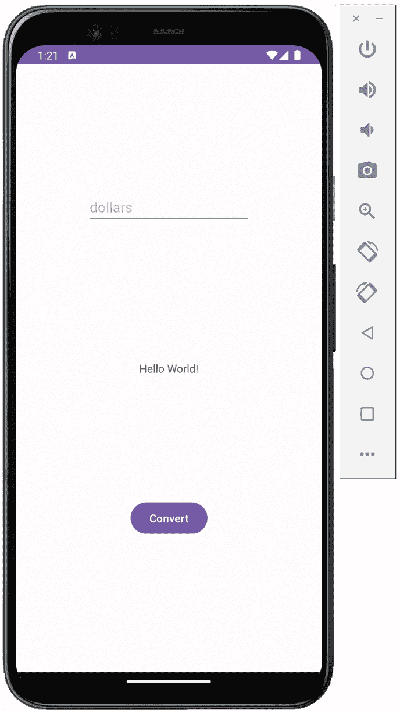

图 4-18

选择独立模式或工具窗口模式取决于个人喜。如果你倾向于模拟器在工具窗口中运行，请返回设置屏幕并重新启用`Launch in the Running Devices`工具窗口选项。然而，在提交独立模式之前，请记住`Running Devices`工具窗口也可以从工具窗口的`Options`菜单中从 Android Studio 主窗口中分离，该菜单可以通过点击图 4-19 所示所示的按钮来访问：

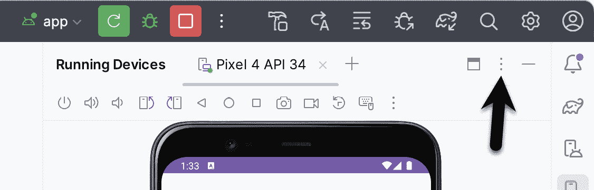

图 4-19

在`Options`菜单中，选择`View Mode -> Float`（浮动）将工具窗口从 Android Studio 主窗口中分离：

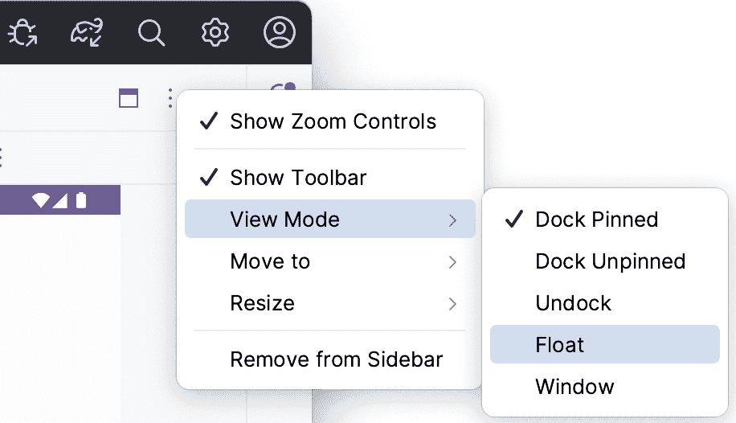

图 4-20

要重新停靠`Running Devices`工具窗口，点击图 4-21 所示的`Dock`按钮：

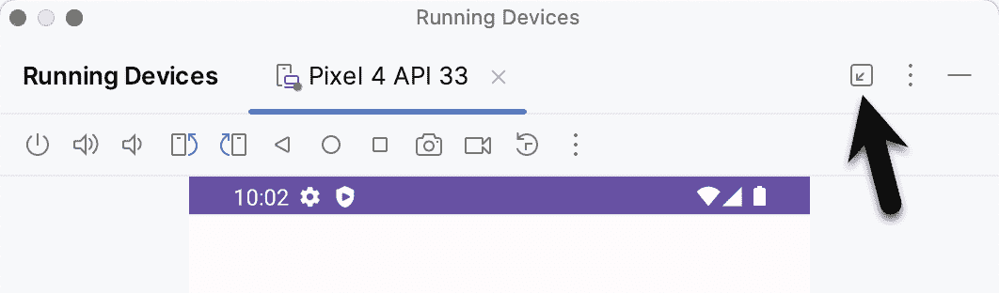

图 4-21

## 4.8 移除设备框

模拟器可以配置为带有或不带设备框出现。要更改设置，请退出模拟器，打开`Device Manager`，从列表中选择`AVD`，并点击图 4-22 中箭头所示的菜单按钮：

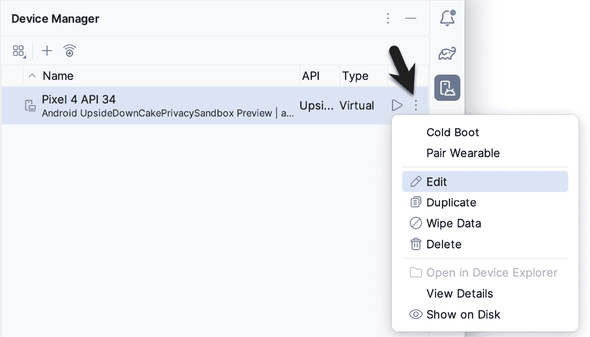

图 4-22

选择`Edit`选项，并在设置屏幕中、点击`Finish`按钮之前找到并关闭`Enable device frame`选项：

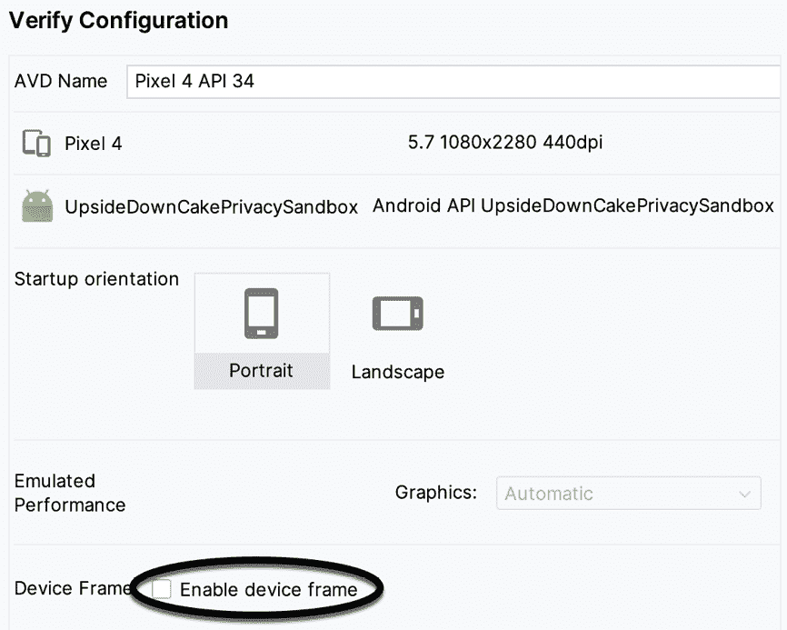

图 4-23

一旦禁用了设备框，模拟器在下次启动时将如图 4-24 所示：


图 4-24

## 4.9 总结

典型的应用程序开发过程遵循测试环境中的编码、编译和运行周期。Android 应用程序可以在物理 Android 设备或 Android 虚拟设备 (AVD) 模拟器上进行测试。AVD 使用 Android Studio 的`Device Manager`工具创建和管理，该工具可以作为命令行工具或通过图形用户界面使用。在创建 AVD 以模拟特定的 Android 设备模型时，虚拟设备的硬件规格应与物理设备的配置匹配。AVD 模拟器会话可以作为独立窗口显示，也可以嵌入到 Android Studio 主用户界面中。

# 5. 使用和配置 Android Studio AVD 模拟器

在下一章探索在物理 Android 设备上进行测试之前，本章将花费一些时间提供 Android Studio AVD 模拟器的概述，并突出许多在独立和工具窗口模式下可自定义的配置。

### 5.1 模拟器环境

当在独立模式下启动时，模拟器会显示一个启动屏幕。加载完成后，将出现模拟器窗口，其中包含了图 5-1 所示的设备（这是一个 Pixel 4 设备）：


图 5-1

位于窗口边缘的工具栏提供了对控制器的快速访问。

### 5.2 模拟器工具栏选项

模拟器工具栏（图 5-2）提供了访问模拟器环境的一系列选项。


图 5-2

工具栏中的每个按钮都有快捷键，可以通过鼠标指针悬停在按钮上等待提示出现或通过扩展控制面板的帮助选项来识别。尽管工具栏中的许多选项自言而懂，但仍将介绍每个选项：

- `Exit / Minimize`: 工具栏顶部的`x`按钮选中后会退出模拟器会话，而`-`选项将最小化整个窗口。

- `Power`: 电源按钮模拟物理 Android 设备上的按钮。点击并释放此按钮将锁定设备。长按此按钮将启动设备关机请求序列。

- `Volume Up / Down`: 两个控制模拟环境内播放音量的按钮。

- `Rotate Left/Right`: 在竖屏和横屏之间旋转模拟设备。

- `Take Screenshot`: 拍摄设备屏幕上显示内容的截图。捕取的图像存储在扩展控制面板`Settings`屏幕指定的路径，将在本章稍后概述。

- `Zoom Mode`: 此按钮切换进入退出缩放模式，细节将在本章稍后介绍。

- `Back`: 执行标准的 Android“返回”导航以返回上一个屏幕。

- `Home`: 显示设备的主屏幕。

- `Overview`: 模拟标准的 Android“概览”导航，显示设备上运行的应用。

- `Fold Device`: 模拟折叠设备的折叠和展开。此选项仅在模拟器运行折叠设备系统镜像时可用。

- `Extended Controls`: 显示扩展控制面板，允许配置模拟位置和电话活动、电量强度、移动网络类型以及指纹识别等选项。

### 5.3 在缩放模式下工作

位于模拟器工具栏的缩放按钮用于进入和退出缩放模式。当缩放模式激活时，工具栏按钮将处于按下状态，当鼠标指针悬停在设备屏幕上时，将显示为放大镜。点击鼠标左键将导致显示相对于屏幕上的所选点进行放大，重复点击会增加放大倍数。相反，点击鼠标右键会缩小放大倍数。关闭缩放按钮将使显示恢复到默认大小。

在缩放模式下，点击并拖动将定义一个矩形区域，当释放鼠标按钮时，视图将放大到该区域。

在缩放模式下，可以使用模拟器窗口内的水平和垂直滚动条来移动屏幕的可视区域。

### 5.4 调整模拟器窗口

可以通过启用缩放模式并在窗口的任何角或侧边点击并拖动，随时更改模拟器窗口的大小（以及设备相应的表示形式）。

### 5.5 扩展控制选项

扩展控制工具栏按钮会显示图 5-3 所示的面板。默认情况下，将显示位置设置。从左侧面板选择不同的类别将显示相应的控制组：


图 5-3

#### 5.5.1 位置

位置控制允许以十进制或六进制坐标将模拟的位置信息发送到模拟器。位置信息可以是单个位置的形式，也可以是代表设备移动的点序列，后者通过 GPS 交换 (GPX) 或 Keyhole 标记语言 (KML) 格式的文件提供。或者，可以使用集成的 Google Maps 面板视觉化地选择单点或路线。

#### 5.5.2 显示

除了模拟器屏幕内显示的主显示器外，`Displays`允许在同一个 Android 实例中运行额外的显示。这对于测试如 Microsoft Surface Duo 等双屏设备的应用程序非常有用。这些额外的屏幕可以配置为任何所需的尺寸，并与主屏幕一起出现在同一个模拟器窗口中。

#### 5.5.3 蜂窝

可以在蜂窝设置屏幕更改模拟的蜂窝连接类型。可以选择不同的网络类型（CSM、EDGE、HSDPA 等）以及各种语音和数据场景，例如漫游和拒绝访问。

#### 5.5.4 电池

可以在扩展控制屏幕的此面板上模拟各种电池状态和充电条件，包括电池电量、电池健康状况以及 AC 充电器是否连接。

#### 5.5.5 摄像头

当摄像头激活时，模拟器会模拟 3D 场景。这表现为虚拟建筑内部，您可以在模拟器内录制视频或拍照之前，通过按住`Option`键（Windows 上的 Alt）并使用鼠标指针和键盘键在此进行导航。此扩展配置选项允许上传不同的图像以显示在虚拟环境中。

#### 5.5.6 电话

电话扩展控制在模拟器内提供了两个简单但实用的模拟。第一个选项模拟来自来自指定电话号码的入入电话。这在测试应用程序如何处理高级中断时特别有用。

第二个选项允许在模拟器会话中模拟接收短信。与在现实世界中一样，这些消息会显示在`Message`应用中，并触发模拟器内的标准通知。

#### 5.5.7 方向键

方向键（D-Pad）是内置在 Android 设备中或外部连接（如游戏控制器）的额外一组控制，提供方向控制（左、右、上、下）。方向键设置允许在模拟器内模拟 D-Pad 交互。

#### 5.5.8 麦克风

麦克风设置允许启用麦克风并模拟虚拟耳机和麦克风连接。还提供了一个启动模拟器`Voice Assistant`。

#### 5.5.9 指纹

许多 Android 设备现在都配备了内置指纹检测硬件。AVD 模拟器使得无需在带有指纹传感器的物理设备上测试应用程序即可测试指纹认证。模拟器内配置指纹测试的细节将在本章稍后介绍。

#### 5.5.10 虚拟传感器

虚拟传感器选项允许模拟加速度计和磁力计，以模拟设备物理运动的效果，通过偏航角、俯仰角和滚角设置模拟旋转、移动和倾斜。

#### 5.5.11 快照

快照包含当前运行的 AVD 会话状态，可以保存并快速恢复，使模拟器轻松返回到精确状态。快照在本章稍后介绍。

#### 5.5.12 录制和播放

允许将模拟器屏幕和音频录制并保存为 WebM 或动画 GIF 格式。

#### 5.5.13 Google Play

如果模拟器运行安装了 Google Play 服务的 Android 版本，此选项将显示当前的 Google Play 版本。它还提供更新模拟器到最新版本的选项。

#### 5.5.14 设置

设置面板提供了一组配置选项。使用此面板为工具栏和扩展控制面板选择较深的主题，指定保存截图的文件系统位置，配置 OpenGL 支持级别，并配置模拟器窗口显示在桌面其他窗口之上。

#### 5.5.15 帮助

帮助屏幕包含三个子面板，其中包含快捷键列表、访问模拟器在线文档、提交文件 报告和发送反馈的链接，以及模拟器版本信息。

### 5.6 使用快照

当模拟器首次启动时，它会执行冷启动，就像物理 Android 设备启动一样。冷启动过程需要一些时间完成，因为需要加载操作系统并启动所有进程。为了避免每次启动模拟器都经过此过程，系统配置为每次退出时自动保存模拟器的当前状态快照（称为快速启动快照）。下次启动模拟器时，会将快速启动快照加载到内存中并从停止的地方继续执行，使模拟器重启的时间远短于冷启动所需的时间。

扩展控制面板的快照屏幕可以在模拟器运行期间任何时刻存储额外的快照。这保存了整个模拟器的精确状态，允许模拟器恢复到拍摄快照时的精确点。从屏幕可以使用`Take Snapshot`按钮（如图 5-4 中的 A A）拍摄快照。要恢复现有快照，请从列表 (B) 中选择并点击屏幕底部的`run`按钮 (C)。还提供了`edit` (D) 快照名称和描述以及`delete` (E) 当前选中快照的选项：


图 5-4

您还可以通过主工具栏中的运行目标菜单进行选择，决定使用冷启动、最近的快速启动快照或之前的快照来启动模拟器，如图 5-5 所示：


图 5-5

### 5.7 配置指纹模拟

模拟器允许配置最多 10 个模拟指纹，并用于测试 Android 应用内部的指纹验证。配置模拟指纹的起始步骤是启动模拟器，打开`Settings`（设置）应用，并选择`Security`（安全）选项。

在`Security`设置屏幕内，选择指纹选项。在弹出的信息屏幕上，点击`Next`（下一步）按钮进入指纹设置屏幕。在启用指纹安全功能之前，必须配置一个备份屏幕解锁方法（例如`PIN`）。输入并确认合适的`PIN`，并通过接受默认通知选项来完成`PIN`输入过程。

继续后续剩余屏幕，直到`Settings`应用要求在传感器上放置指纹。此时，显示扩展控制对话框，在左侧面板中选择`Fingerprint`（指纹）类别，并确保主设置面板中选择了`Finger 1`（手指 1）：


图 5-6

点击`Touch Sensor`（触摸传感器）按钮模拟`Finger 1`触摸指纹传感器。模拟器将报告指纹添加成功：


图 5-7

要添加更多指纹，点击`Add Another`（添加另一个）按钮，并在再次点击`Touch Sensor`按钮之前，从扩展控制面板菜单中选择另一个手指。

### 5.8 工具窗口模式下的模拟器

如上一章（在 Android Studio 中创建 Android 虚拟设备 (AVD)）所述，Android Studio 可以配置为在嵌入工具窗口中启动模拟器，使其不会在独立窗口中出现。在此模式下运行时，工具栏中将提供与独立模式相同的控制控件，如图图 5-8 所示：


图 5-8

从左到右，这些按钮执行以下任务（详细信息与独立模式一致）：

• 电源（Power）

• 增大音量（Volume Up）

• 减音量（Volume Down）

• 向左旋转（Rotate Left）

• 向右旋转（Rotate Right）

• 返回（Back）

• （Home）

• 概览（Overview）

• 截图（Screenshot）

• 快照（Snapshots）

• 扩展控制（Extended Controls）

### 5.9 创建可调整大小的模拟器

除了配置匹配特定 Android 设备型号的模拟器外，Android Studio 还提供了可调整大小的 AVD，允许你在手机、平板电脑和折叠设备尺寸之间切换。要创建可调整大小的模拟器，打开`Device Manager`（设备管理器）并点击`+`工具栏按钮。接下来，选择图 5-9 所示的`Resizable`（可调整）设备定义，并按照通常步骤创建新的 AVD：


图 5-9

当你在工具窗口中的新模拟器上运行应用时，工具栏中会出现`Display`（显示）模式选项，允许你切换模拟器配置，如图图 5-10 所示：


图 5-10

如果模拟器在独立模式下运行，则可以在侧边工具栏找到`Display`模式选项，如下所示：


图 5-11

一旦选择了折叠显示模式，可以使用`Change posture`（更改姿态）菜单在打开、关闭和半开配置下测试应用：


图 5-12

### 5.10 总结

Android Studio 包含一个 Android 虚拟设备模拟器环境，其设计旨在让无需在物理 Android 设备上运行即可更方便地测试应用程序。本章简要介绍了模拟器，并强调了用于配置和自定义环境以模拟不同测试条件的关键功能。

# 6. Android Studio 用户界面概览

虽然人们急于运行上一章中创建的示例应用程序，但它涉及 Android Studio 用户界面的某些内容，这些内容最好先进行描述。


Android Studio 是一个强大且功能丰富的开发环境，在很大程度上其其实用性是直观的。尽管如此，现在花时间熟悉 Android Studio 用户界面的布局和结构，将缩短书中后续章节的学习曲线。基于此考虑，本章将提供 Android Studio 环境各个区域和组件的概述。

### 6.1 欢迎界面

欢迎界面（图 6-1）在 Android Studio 运行且当前没有打开任何项目时显示（可以通过随时选择 `File -> Close Project` 菜单选项关闭打开的项目）。如果在项目仍打开时退出了 Android Studio，该工具在下次启动时将跳过欢迎界面，自动打开之前活跃的项目。


图 6-1

除了最近项目列表外，欢迎界面提供了执行如打开和创建项目等任务的选项，并可以访问当前受版本控制的项目。此外，`Customize`（自定义）屏幕提供了更改 IDE 和编辑器使用的主题和字体设置的选项。可以使用 `Plugins`（插件）选项查看、安装和管理 Android Studio 插件。

通过选择 `More Actions`（更多操作）链接，或者在最近项目列表替换 `More Actions` 链接时使用图 6-2 所示的菜单，可以获得更多选项：


图 6-2

### 6.2 菜单栏

当创建新项目或打开现有项目时，将显示 Android Studio 主窗口。当打开多个项目时，每个项目将分配自己的窗口。窗口的精确配置取决于操作系统以及上次打开项目时显示的工具和面板。例如，主菜单栏的外将取决于主机操作系统。在 macOS 上，Android Studio 遵循标准惯例，将菜单栏放置在桌面顶部，如图图 6-3 所示：


图 6-3

然而，当 Android Studio 在 Windows 或 Linux 上运行时，可以通过图 6-4 所示的按钮访问主菜单：


图 6-4

### 6.3 主窗口

一旦打开项目，Android Studio 主窗口通常会像图 6-5 所示：


图 6-5

主窗口的各种元素总结如下：

A – 工具栏（Toolbar）——频繁执行的操作的快捷键。工具栏按钮提供了对一组菜单操作的快速访问。可以通过右键点击栏并选择 `Customize Toolbar…`（自定义工具栏）菜单选项来自定义工具栏。图 6-6 所示的工具栏菜单为执行创建和打开项目以及在多个项目之间切换窗口等任务提供了方便的方法：


图 6-6

B – 导航栏（Navigation Bar）——导航栏提供了构成项目的文件和文件夹移动的方便方法。点击导航栏中的元素将弹出菜单，列出该位置的子文件夹和文件供选择。同样，点击类名将显示该类中包含的方法：


图 6-7

从列表中选择一个方法即可跳转到代码编辑器中的相应位置。你可以使用 `View -> Appearance -> Navigation Bar` 菜单选项来隐藏、显示和更改此栏的位置。

### C – 编辑器窗口

编辑器窗口显示开发者当前正在工作文件的内容。当打开多个文件时，每个文件都由编辑器顶部边缘的标签页表示，如图图 6-8

图 6-8

### D – 状态栏

状态栏显示关于项目和 Android Studio 活动的提示消息。将鼠标悬停在状态栏条目上将显示该字段的描述。许多字段是可交互的，允许用户通过点击来执行任务或获取更详细的状态信息。


图 6-9

可以使用 `View -> Appearance -> Status Bar Widgets` 菜单更改状态栏中显示的小部件。

### E – 项目工具窗口

项目工具窗口提供了项目文件结构的层次概览，允许导航到特定的文件和文件夹。工具栏可用于以不同的方式显示项目。默认设置是 `Android` 视图，这是本书其余部分主要使用的模式。

项目工具窗口只是 Android Studio 环境中许多可用工具之一。

## 6.4 工具窗口

除了项目视图工具窗口外，Android Studio 还包含许多其他窗口，启用后，它们会显示位于主窗口左侧和右侧的工具窗口栏，并包含显示和隐藏每个工具窗口的按钮。图 6-10 显示了典型的工具窗口栏配置，尽管按钮及其位置可能会根据你的 Android Studio 安装情况而异。


图 6-10

点击按钮将显示相应的工具窗口，而再次点击将隐藏该窗口。工具窗口栏中按钮的位置表示窗口在显示时将出现在窗口的哪一。可以通过点击并拖动按钮到其他窗口工具栏中的不同位置来更改这些位置。

Android Studio 提供了广泛的工具窗口，其中最常用的对比如所示：

*   **Project (A)** – 项目视图提供了组成项目的文件结构概览，允许在文件之间快速导航。通常情况下，在项目视图中双击文件将导致该文件加载到相应的编辑工具中。

*   **Resource Manager (B)** - 用于添加和管理项目内资源和资产的工具，例如图像、颜色和布局文件。

*   **More Tool Windows (C)** - 显示包含当前未在工具窗口栏显示的其他工具窗口的菜单。当从此菜单中选择工具窗口时，它将作为工具窗口栏中的按钮出现。

*   **Build (D)** - 在 Android Studio 构建当前项目时，显示每个处理步骤的实时视图。

*   **Run (E)** – 当应用程序正在运行时，运行工具窗口将变为可用，并提供运行结果的视图以及停止或重启正在运行进程的选项。如果应用程序在设备或模拟器上安装和运行失败，此窗口通常会提供有关该问题的诊断信息。

*   **App Quality Insights (F)** - 提供对云端 Firebase 应用质量和崩溃分析平台的访问。

*   **Logcat (G)** – Logcat 工具窗口提供了访问运行应用程序监控日志输出的权限，以及对应用程序进行截图、视频以及停止和重启进程的选项。

*   **Problems (H)** - 查看项目内所有当前错误或警告的中心位置。双击问题列表中的项将带你进入问题所在的文件和位置。

*   **Terminal (I)** – 提供对运行 Android Studio 的系统上的终端窗口的访问。在 Windows 系统上，这是命令提示符界面，而在 Linux 和 macOS 系统上，它表现为终端提示符。

*   **Version Control (J)** - 当项目文件受源代码版本控制管理时使用此工具窗口，允许访问 Git 仓库和代码更改历史。

*   **Notifications (K)** - 当项目文件受源代码版本控制管理时使用此工具窗口，允许访问 Git 仓库和代码更改历史。

*   **Gradle (L)** – Gradle 工具窗口提供了组成项目构建配置的 Gradle 任务视图。该窗口列出了将项目各种元素编译为可执行应用程序所需的任务。右键点击顶级 Gradle 任务并选择 `Open Gradle Config` 菜单选项，可将当前项目的 Gradle 构建文件加载到编辑器中。本书将在后部分更详细地介绍 Gradle。

*   **Device Manager (M)** - 提供对设备管理器工具窗口的访问，可以在该处添加、删除和管理物理 Android 设备连接和模拟器。

*   **Running Devices (N)** - 如果已启用在工具窗口中运行模拟器的选项（如章节 “在 Android Studio 中创建 Android 虚拟设备 (AVD)” 中所述），则包含 AVD 模拟器。

*   **Gemini (O)** - Android Studio 的 AI 驱动型编码助手。目前处于预览阶段，此工具通过提供编码建议和解决方案来帮助你开发应用。

*   **Assistant (P)** - 显示助手面板，其内容将取决于你当前正在使用的 Android Studio 功能。

*   **App Inspection** - 提供对数据库（Database）和后台任务（Background Task）检查器的访问。数据库检查器允许你在运行时检查、查询和修改应用的数据库。后台任务检查器允许监控和管理使用 `WorkManager` 创建的后台工作任务。

*   **Bookmarks** - 书签工具窗口提供了对已书签文件和代码行的快速访问。例如，在项目视图中右键点击文件可以访问 `Add to Bookmarks` 菜单选项。同样，你可以将光标移动到源文件的某行并按下 `F11` 键（macOS 上为 `F3`）来签名。所有书签项都可以此工具窗口访问。

*   **Build Variants** - 构建变体工具窗口为当前应用程序项目配置不同的构建目标提供了一种快捷方法（例如，用于调试和发布版本的不同构建，或针对不同设备类的多个构建）。

*   **Device File Explorer** - 通过 `View -> Tool Windows -> Device File Explorer` 使用，此工具窗口提供了直接访问当前 Android 设备或模拟器文件系统的权限，允许浏览并将并将复制到本地文件系统。

*   **Layout Inspector** - 提供构成用户界面布局组件层次的可视化 3D 渲染。

*   **Structure** – 结构工具提供了编辑器当前显示的源文件结构的高级概览。此信息包括文件中类、方法和变量的列表。从结构列表中选择项将带你进入编辑器窗口中源文件的对应位置。

*   **TODO** – 如其名所示，此工具提供了一个查看项目中尚未完成事项的地方。Android Studio 通过扫描组成项目的源文件查找匹配指定 TODO 模式的注释来编译此列表。可以通过打开设置对话框并导航到 Editor 下下的 TODO 来查看和更改这些模式。

## 6.5 工具窗口菜单

每个工具窗口在顶部边缘都有一个自己的工具栏。这些工具栏中的菜单按钮随工具而异，但所有工具窗口都包含一个 `Options` 菜单（在图 6-11 中标记为 A）：


图 6-11

`Options` 菜单允许更改窗口的各个方面。例如，图 6-12 显示了 Project 工具窗口的 `Options` 菜单。可以进行各种设置，例如取消停靠窗口并允许其浮动在 Android Studio 主窗口边界之外，以及移动和调整工具面板的大小：


图 6-12

所有工具窗口在工具栏的远右侧都有一个按钮（在上述的图 6-11 中标记为 B），提供了隐藏工具窗口的另一种方法。可以通过点击该窗口使其聚焦，然后输入搜索词（例如 Project 工具窗口中的文件名），对工具窗口内的项目进行搜索。窗口的工具栏中会出现一个搜索框，匹配搜索的项将高亮显示。

### 6.6 Android Studio 快捷键

Android Studio 包含许多快捷键，以便在执行常用任务时节省时间。可以在 Android Studio 项目窗口中选择 `Help -> Keyboard Shortcuts PDF` 菜单选项，查看并打印完整的快捷键映射列表。您也可以通过打开 `Settings` 对话框并点击 `Keymap` 项来列出并修改快捷键，如下方的图 6-13 所示：


图 6-13

### 6.7 切换器（Switcher）与最近打开文件（Recent Files）导航

在 Android Studio 主窗口内导航的另一个实用机制是使用 `Switcher`。通过 `Ctrl-Tab` 快捷键访问，该切换器会作为一个面板出现，列出所有工具窗口和当前打开的文件（图 6-14）。


图 6-14

一旦显示，只要 `Ctrl` 键保持按下状态，切换器就会可见。在按住 `Ctrl` 键的同时反复敲击 `Tab` 键可以在各种选择选项之间循环，释放 `Ctrl` 键则会选中当前高亮的项并将其显示在主窗口中。

除了 `Switcher` 外，`Recent Files` 面板提供了对最近打开文件的导航（图 6-15）。可以使用 `Ctrl-E` 快捷键（macOS 上为 `Cmd-E`）访问该面板。一旦显示，既可以使用鼠标指针选择选项，也可以使用键盘方向键在文件名和工具窗口选项之间滚动。按下 `Enter` 键将选中当前高亮的项：


图 6-15

### 6.8 更改 Android Studio 主题

可以使用 `Settings` 对话框更改 Android Studio 环境的整体主题。一旦显示设置对话框，在左侧面板中选择 `Appearance & Behavior` 选项，然后选择 `Appearance`。然后，在点击 `OK` 按钮之前更改 `Theme` 菜单的设置。可用的主题取决于平台，但通常包括 `Light`、`IntelliJ`、`Windows`、`High Contrast` 和 `Darcula` 等选项。图 6-16 显示了选择了 `Dark` 主题的主窗口示例：


图 6-16

要将 Android Studio 主题与操作系统的明暗模式设置同步，请启用 `Sync with OS` 选项并使用下拉菜单控制每种模式使用什么主题：


图 6-17

Android Studio Marketplace 中提供了数百个额外主题可供下载，可以通过点击 `Get more themes` 链接进行访问。

### 6.9 总结

Android Studio 环境的主要元素由欢迎界面和主窗口组成。每个打开的项目都有它自己的主窗口，该窗口反过来由菜单栏、工具栏、编辑和设计区域、状态栏以及一组工具窗口组成。工具窗口出现在主窗口侧边。

在 Android Studio 中，极少的操作是无法通过快捷键触发的。可以随时从 Android Studio 主窗口内访问默认快捷键的映射表。

# 7. 在物理 Android 设备上测试 Android Studio 应用

虽然使用 Android 虚拟设备 (AVD) 测试应用程序可以实现许多功能，但在物理 Android 设备上进行真实的应用测试是不可替代的，某些 Android 功能仅在物理 Android 设备上可用。

与 AVD 实例和连接的 Android 设备之间的通信由 Android 调试桥接 (`ADB`) 处理。本章解释了如何在 macOS、Windows 和 Linux 系统上配置 `adb` 环境，以便在 Android 设备上进行应用测试。

### 7.1 Android 调试桥接 (ADB) 概述

`ADB` 的主要目的是促进开发系统（在此例中为 Android Studio）与 Android 模拟器以及 Android 设备之间的交互，以运行和调试应用程序。`ADB` 允许通过 WiFi 或 USB 线连接设备。

`ADB` 由一个客户端、一个运行在开发系统上的服务器进程以及一个运行在 AVD 或真实的 Android 设备（如手机和平电脑）上的守护进程组成。

`ADB` 客户端有多种形式。例如，在 Android SDK 的 `platform-tools` 目录下提供了一个名为 `adb` 的命令行工具。同样，Android Studio 也有一个内置客户端。

可以使用 `adb` 命令行工具执行各种任务。例如，可以使用 `devices` 参数列出虚拟或物理设备。以下命令输出表示存在 AVD 但没有物理设备：

```
$ adb devices
List of devices attached
emulator-5554 device
```

### 7.2 在 Android 设备上启用 USB 调试

在 ADB 连接到 Android 设备之前，必须配置该设备允许连接。对于运行 Android 6.0 或更高版本的手机和平板设备，实现步骤如下：

1. 打开设备上的 `Settings` 应用并选择 `About tablet` 或 `About phone` 选项（在某些 Android 版本中，可以在 `System` 页面找到）。

2. 在 `About` 屏幕上，找到 `Build number` 字段（图 7-1）并点击七次，直到消息显示已启用开发者模式。如果 `About` 屏幕上未列出 `Build number`，可以通过 `Software information` 选项访问。或者，如果可用，展开列表中的 `Advanced` 部分。


图 7-1

3. 返回 `Settings` 主屏幕，注意出现了一个名为 `Developer options` 的新选项（在较新的 Android 版本中，该选项列在 `System` 设置屏幕上）。选择此选项，并在生成的屏幕上找到图 7-2 所示的 `USB debugging` 选项：


图 7-2

4. 启用 `USB debugging` 选项，并在请求确认时点击 `Allow` 按钮。

如果您使用的是 Samsung Galaxy 设备，可能需要在启用调试选项之前在 `Settings` 应用中关闭 `Auto Blocker` 功能。


设备现在已配置为接受通过 USB 连接来自开发系统上`adb`的调试连接。现在只需配置开发系统，以便在连接设备时检测到它。虽然这是一个相对简单的过程，但步骤取决于开发系统运行的是 Windows、macOS 还是 Linux。注意，以下步骤假设 Android SDK 的`platform-tools`目录已包含在系统的`PATH`环境变量中，正如题为“设置 Android Studio 开发环境”的章节所示。

## 7.2.1 macOS ADB 配置

要在 macOS 系统上配置`ADB`环境，请使用 USB 线将设备连接到计算机系统，打开终端窗口并执行以下命令以重启`adb`服务：

```bash
adb kill-server
adb start-server
```

```
* daemon not running. starting it now on port 5037 *
* daemon started successfully *
```

一旦服务器成功运行，执行以下命令以验证设备是否已检测到：

```bash
adb devices
```

```
List of devices attached
74CE000600000001 offline
```

如果设备被列为`offline`（离线），请前往 Android 设备并检查图 7-3 所示的对话框，该框正在请求允许 USB 调试。在点击“确定”之前，勾选“始终允许此计算机调试”旁边的复选框。


图 7-3

重复`adb devices`命令现在应该将设备列为可用：

```
List of devices attached
015d41d4454bf80c device
```

如果设备未列出，请尝试注销并重新登录 macOS 桌面，如果问题仍然存在，请重启系统。

## 7.2.2 Windows ADB 配置

配置基于 Windows 的开发系统使用`ADB`连接到 Android 设备的第一步是在系统上安装相应的 USB 驱动程序。要安装的 USB 驱动程序取决于 Android 设备的型号。如果你拥有 Google 设备（如 Pixel 手机），则需要在你的 Windows 系统上安装并配置 Google USB 驱动包。实现此目的的详细步骤在以下网页上概述：

[`developer.android.com/sdk/win-usb.html`](https://developer.android.com/sdk/win-usb.html)

对于 Google USB 驱动程序不支持的 Android 设备，有必要下载设备制造商提供的驱动程序。可以在线获取驱动程序列表以及下载和安装信息：

[`developer.android.com/tools/extras/oem-usb.html`](https://developer.android.com/tools/extras/oem-usb.html)

安装驱动程序后，如果设备被识别为正确的设备类型，打开命令提示符窗口并执行以下命令：

```cmd
adb devices
```

此命令应输出有关已连接设备的信息，如下所示：

```
List of devices attached
HT4CTJT01906 offline
```

如果设备被列为`offline`（离线）或`unauthorized`（未授权），请查看设备显示器并检查图 7-3 所示的对话框，该框正在请求允许 USB 调试。在点击“确定”之前，勾选“始终允许此计算机调试”旁边的复选框。重复`adb devices`命令现在应该将设备列为已就绪：

```
List of devices attached
HT4CTJT01906 device
```

如果设备未列出，执行以下命令以重启`ADB`服务：

```cmd
adb kill-server
adb start-server
```

如果设备仍未列出，尝试执行以下命令：

```cmd
android update adb
```

注意，可能还需要重启系统。

## 7.2.3 Linux adb 配置

在本章中，我们将再次使用 Ubuntu Linux 作为参考示例，在 Linux 上配置`adb`以连接物理 Android 设备进行应用测试。

在 Ubuntu Linux 上进行物理设备测试需要安装名为`android-tools-adb`的包，这要求 Android Studio 用户是`plugdev`组的成员。这是大多数 Ubuntu 版本中用户账户的默认设置，可以通过运行`id`命令进行验证。如果没有列出`plugdev`组，运行以下命令将你的账户添加到该组：

```bash
sudo usermod -aG plugdev $LOGNAME
```

在满足组身份要求后，可以通过执行以下命令安装`android-tools-adb`包：

```bash
sudo apt-get install android-tools-adb
```

完成上述更改后，重启 Ubuntu 系统。系统重启后，打开终端窗口，启动`adb`服务并检查已连接设备列表：

```bash
adb start-server
```

```
* daemon not running. starting it now on port 5037 *
* daemon started successfully *
```

```bash
adb devices
```

```
List of devices attached
015d41d4454bf80c offline
```

如果设备被列为`offline`（离线）或`unauthorized`（未授权），请前往 Android 设备并检查图 7-3 所示的对话框，该框正在请求允许 USB 调试。

## 7.3 解决 USB 连接问题

如果你无法通过上述步骤成功连接到设备，请显示运行目标菜单（图 7-4）：


图 7-4

连接助手将扫描设备并报告问题和解决方案。

## 7.4 在 Android 设备上启用无线调试

按照上述 7.2 中的第 1 到第 3 步操作，这次是启用图 7-5 所示的无线调试选项：


图 7-5

接下来，点击上面的“无线调试”项以显示图 7-6 所示的屏幕：


图 7-6

如果你的设备带有摄像头，选择“使用二维码配对”，否则选择“使用配对码配对”。根据你的选择，设置应用将启动摄像头或显示配对码，如图 7-7 所示：


图 7-7

选择选项后，返回 Android Studio 并从图 7-8 所示选择“配对设备 WiFi”选项：


图 7-8

在配对对话框中，根据你之前在设备设置中的选择，选择“使用二维码配对”或“使用配对码配对”：


图 7-9

使用 Android 设备扫描二维码，或将设备屏幕上显示的配对码输入 Android Studio 对话框（图 7-10）以完成配对过程：


图 7-10

如果配对过程失败，尝试重启开发系统和 Android 设备并再次尝试。

## 7.5 测试 adb 连接

假设在所选开发平台上成功配置了`adb`，下一步是在“在 Android Studio 中创建示例应用”章节中创建的测试应用上尝试运行。启动 Android Studio，打开`AndroidSample`项目，并验证设备是否出现在图 7-11 高亮显示的设备选择列表中：


图 7-11

从列表中选择设备并点击“运行”按钮以安装并运行应用。

## 7.6 设备镜像

设备镜像允许您在物理设备上运行应用，同时在 Android Studio 的“Running Devices”（运行设备）工具窗口中查看显示内容。换句话说，尽管您的应用运行在物理设备上，但它会像 AVD 实例一样出现在 Android Studio 中。

将设备连接到 Android Studio 后，显示`Running Devices`工具窗口并点击`Device Mirror`设置链接以显示`Settings`设置对话框。在`Settings`对话框中，启用物理 Android 设备的镜像并点击`OK`。下次运行应用时，Android Studio 将在`Running Devices`工具窗口中镜像物理设备的显示。

## 7.7 总结

虽然 Android 虚拟设备模拟器提供了一个极好的测试环境，但必须记住，要确保应用程序在物理 Android 设备上正确运行，没有任何东西是真实可以替代的。

但是，默认情况下，Android Studio 环境并未配置为将 Android 设备识别为目标测试设备。因此，需要执行一些步骤，以便通过 USB 线缆或 WiFi 网络从 Android Studio 开发环境直接将应用程序加载到 Android 设备上。实现这一目标的具体步骤取决于不同的开发平台。在本章中，我们涵盖了适用于 Linux、macOS 和 Windows 平台的这些步骤。

# 8. Android Studio 代码编辑器的基础

为 Android 开发应用涉及大量的编程工作，根据定义，这涉及到代码行的输入、审查和修改。不出所料的是，开发者在使用 Android Studio 时的大部分时间通常花在编辑器窗口内编辑代码。

现代代码编辑器必须远远超出输入、删除、剪切和粘贴等基础功能。今天，代码编辑器的实用性通常由等因素衡量，例如它减少了程序员所需的输入量、在大型源文件中进行导航的易用性，以及编辑器在编写代码时实时检测并突出显示编程错误的能力。在本章中将会变得，这些只是 Android Studio 编辑器出色的少数领域之一。

虽然本章并非对 Android Studio 编辑器功能的详尽概述，但旨在提供该工具关键功能的指南。经验丰富的程序员会发现，其中某些功能是大多数现代代码编辑器通用的，而许多功能是该编辑环境特有的。

## 8.1 Android Studio 编辑器

当选择`Java`、`Kotlin`、`XML`或其他文本文件进行编辑时，Android Studio 编辑器出现在主窗口的中心。例如，图 8-1 显示了一个加载了 Java 源代码文件的典型编辑器会话：


图 8-1

构成编辑器窗口的元素可以总结如下：

**A – 文档标签页 (Document Tabs)** – Android Studio 可以随时打开多个文件进行编辑。当每个文件被打开时，它都会被分配一个文档标签页，在编辑器窗口顶部的标签栏中显示文件名。当空间不足以显示所有标签页时，标签栏的最右侧会出现一个很小的下拉菜单。点击此菜单将弹出一个其他已打开文件的列表。标签页中文件名下方的红色波浪线表示该文件中的代码包含一个或多个错误，这些错误在项目编译和运行之前需要被解决。

在文件之间切换只需点击相应的标签页或使用`Alt-Left`和`Alt-Right`键盘快捷键即可。在文件之间的导航也可以使用`Switcher`（切换器）机制（通过`Ctrl-Tab`快捷键访问）。

要将编辑器面板从 Android Studio 主窗口分离以便使其在单独窗口中显示，请点击标签页将其拖动到主窗口之外的桌面区域。要将编辑器返回主窗口，请点击分离编辑器窗口中的文件标签页，并将其拖放到主窗口中原始编辑器标签栏上。

**B – 编辑器行槽区域 (The Editor Gutter Area)** – 行槽区域被编辑器用于显示信息图标和控件。行槽区域中的某些典型项目包括调试断点标记、折叠和展开代码块的控件、书签、更改标记和行号。行号默认开启，但可以通过在行槽中点击右键并选择`Appearance -> Show Line Numbers`（外观 -> 显示行号）菜单选项来禁用。

**C – 代码结构位置 (Code Structure Location)** – 编辑器底部的此栏显示光标相对于代码整体结构的当前位置。例如，在图中，该栏指示当前正在编辑`convertCurrency`方法，且该方法包含在`MainActivity`类中：


图 8-2

双击栏内的元素将光标移动到代码文件中的相应位置。例如，双击`convertCurrency`条目将把光标移动到源代码中`convertCurrency`方法的顶部。同样，点击`MainActivity`条目将显示一个供选择的可用代码导航点列表：


图 8-3

**D – 编辑区域 (The Editor Area)** – 用户审查、输入和编辑代码的主要区域。本章的后续部分将详细介绍编辑区域的关键功能。

**E – 验证和标记侧边栏 (The Validation and Marker Sidebar)** – Android Studio 集成了一项名为“即时代码分析”的功能。这意味着当你输入代码时，编辑器会分析代码以检查警告和语法错误。验证侧边栏顶部的指示器将实时更新，显示随着代码添加而发现的错误和警告数量。点击此指示器将显示一个弹出窗口，其中包含编辑器代码问题的摘要，如图 8-4 所示：


图 8-4

向上向下箭头在代码中的错误位置之间移动。绿色勾表示未检测到警告或错误。

侧边栏还使用相同的颜色编码在检测到问题的地方显示标记。当代码行在编辑器区域可见时，将鼠标指针悬停在标记上将显示包含问题描述的弹出窗口：


图 8-5

当代码行已滚动出编辑器可视区域时，将鼠标指针悬停在对应的标记上将显示一个“透镜”（lens）覆盖层，其中包含问题所在的代码块（见图 8-6），无需滚动到编辑器的该位置即可查看：


图 8-6

值得注意的是，透镜覆盖不仅限于侧边栏中的警告和错误。悬停在侧边栏的任何部分都会出现一个透镜，其中包含源文件中该位置处的代码。

## F – 状态栏

虽然状态栏是主窗口的一部分而非编辑器，但它确实包含了一些关于当前活动编辑会话的信息。这些信息包括光标在行和字符上的当前位置，以及文件的编码格式（`UTF-8`、`ASCII`等）。点击状态栏中的这些值可以更改相应的设置。例如，点击行号会显示`Go to Line:Column`（跳转到行列）对话框。使用`View -> Appearance -> Status Bar Widgets`菜单选项可以添加或移除组件。例如如果你在 Android Studio 中遇到性能问题，`Memory Indicator`（内存指示器）是一个非常有用的组件。

在概述了构成 Android Studio 编辑器的元素后，本章的剩余部分将更详细探讨编辑环境的关键功能。

## 8.2 分割编辑器窗口

默认情况下，编辑器将显示一个显示当前选中文件内容的面板。在同时处理多个源文件时，一个实用的功能是将编辑器拆分成多个窗格。要拆分编辑器，请右键点击编辑器窗口内的文件标签，并选择`Split Right`（向右拆分）或`Split Down`（向下拆分）菜单选项。例如，图 8-7 展示了拆分器的工作状态，编辑器被拆分为三个面板：


图 8-7

可以通过右键点击相应的标签并选择`Change Splitter Orientation`（更改拆分方向）菜单选项随时更改拆分面板的方向。重复这些步骤可以取消单个面板的拆分，此时从菜单中选择`Unsplit`（取消拆分）选项。右键点击任何标签并选择`Unsplit All`（取消所有拆分）可以移除所有分割面板。

窗口分割可用于显示不同的文件，或为同一个文件提供多个窗口，允许同时查看和编辑文件的不同区域。

## 8.3 代码补全

Android Studio 编辑器对 Java 编程语法以及构成 Android SDK 的类和方法有大量的内置知识，同时也对你自己的代码库有了解。在输入代码时，编辑器会扫描正在输入的内容，并在适当的地方就完成语句或引用可能需要的内容提供建议。当编辑器检测到补全建议时，会弹出一个包含建议列表的面板。例如，在图 8-8 中，编辑器正在为`String`定义的开头提供可能性：


图 8-8

如果没有任何自动补全建议是正确的，请继续输入，编辑器将在适当的地方继续完善建议。要采纳最顶部的建议，请按键盘上的`Enter`或`Tab`键。要选择不同的建议，请使用方向键在列表中上下移动，再次使用`Enter`或`Tab`键选中高亮项。

可以使用`Ctrl-Space`组合键序列手动调用补全建议。这在更改编辑器中的单词或声明时非常有用。当光标停留在编辑器中的某个单词上时，该单词将自动高亮。按下`Ctrl-Space`将显示备选建议列表。按`Tab`键将当前单词替换为建议列表中的高亮项。

除了实时自动补全功能外，Android Studio 编辑器还提供智能补全（Smart Completion）系统。智能补全通过`Shift-Ctrl-Space`组合键序列调用，选中后它将根据代码的当前上下文提供更详细的建议。再次按下`Shift-Ctrl-Space`快捷键将从更广泛的范围内提供更多建议。

代码补全对许多程序员来说可能是个人喜好。为了承认这一事实，Android Studio 对自动补全设置提供了高程度的控制。可以通过打开`Settings`对话框并在设置面板中选择`Editor -> General -> Code Completion`来查看和修改这些设置，如图 8-9 所示：


图 8-9

## 8.4 语句补全


Android Studio 编辑器提供的另一种自动补全形式是语句补全。它可以用于自动填充方法和循环语句等项的括号和大括号。语句补全通过`Shift-Ctrl-Enter`（macOS 上为`Shift-Cmd-Enter`）组合键序列调用。例如，考虑以下代码：

```
myMethod()
```

在编辑器中输入此代码后，触发语句补全将导致编辑器自动为方法添加大括号：

```java
myMethod() {

}
```

## 8.5 参数信息

还可以请求编辑器提供方法接受的参数信息。当光标位于方法调用的括号之间时，`Ctrl-P`（macOS 上为`Cmd-P`）组合键序列将显示该方法已知接受的参数，其中最可能的建议将加粗显示：


图 8-10

## 8.6 参数名称提示

代码编辑器可以配置为在方法调用中显示参数名称提示。例如，图 8-11高亮了`Snackbar`类中`make()`和`setAction()`方法调用中的参数名称提示：


图 8-11

此模式的设置可以通过打开`Settings`对话框并在侧面板导航到`Editor -> Inlay Hints -> Java`来配置。在结果屏幕上为您选择的编程语言开启或关闭`Parameter names`选项。要调整提示设置，点击`Exclude list...`链接并进行任何调整。

## 8.7 代码生成

除了在输入时完成代码外，编辑器在某些条件下还可以为您生成代码。图 8-12 所示的可用代码生成列表可以在光标位于文件中生成代码的位置时使用`Alt-Insert`（macOS 上为`Cmd-N`）快捷键访问。


图 8-12

例如，考虑我们希望在项目中的某个`Activity`被操作系统销毁时收到通知。正如本书后面的章节概述的，这可以通过重写`Activity`父类的`onStop()`生命周期方法来实现。要让 Android Studio 为此生成存根方法，请从代码生成列表中选择`Override Methods...`选项，并在可用方法列表中选择`onStop()`方法：


图 8-13

选中要重写的方法后，点击确定将会在 Java 源文件的当前光标位置生成存根方法，如下：

```java
@Override
protected void onStop() {
    super.onStop();
}
```

## 8.8 代码折叠

一旦源代码文件达到一定大小时，即使是格式最整齐、组织良好的代码也可能变得难以处理和导航。Android Studio 认为，并不总是需要让每个代码块的内容始终可见。通过使用 Android Studio 编辑器的"代码折叠"（code folding）功能，可以使代码导航变得更容易。代码折叠通过展开箭头进行控制，当鼠标指针悬停在源代码文件的行间距（gutter area）区域时，这些箭头会出现在每个代码块的开头。例如，图 8-14 突出显示了当前未折叠的方法声明的展开箭头：


图 8-14

点击此标记将折叠语句，使只显示签名行，如图 8-15 所示：


图 8-15

要展开已折叠的代码段，请点击编辑器行间距中的展开箭头。若想在不展开代码的情况下查看隐藏代码，请将鼠标指针悬停在"{...}"指示器上，如图 8-16 所示。编辑器将显示包含折叠代码块的透镜叠加（lens overlay）：


图 8-16

文件中的所有代码块可以使用`Ctrl-Shift-Plus`和`Ctrl-Shift-Minus`键组合（macOS 上为`Cmd-Shift-Plus`和`Cmd-Shift-Minus`）折叠或展开。

默认情况下，Android Studio 编辑器在打开源文件时会自动折叠某些代码。要配置发生此情况的条件，请导航到设置对话框中的`Editor -> General -> Code Folding`选项（图 8-17）：


图 8-17

### 8.9 快速文档查询

通过将光标置于需要文档的声明上并按下`Ctrl-Q`快捷键（macOS 上为`Ctrl-J`），即可访问与上下文相关的 Java 和 Android 文档。这将显示一个包含该项目相关参考文档的弹出窗口。例如，图 8-18 显示了`AndroidFloatingActionButton`类的文档。


图 8-18

### 8.10 代码格式化

通常，Android Studio 编辑器会在添加代码时自动根据缩进、间距以及语句和代码块的嵌套对代码进行格式化。在需要重新格式化代码的情况下（这很常见，例如当从网站复制并粘贴示例代码时），编辑器提供了源代码格式化功能，选择该功能后将自动重新格式化代码以匹配主流的代码风格。

按下`Ctrl-Alt-L`（macOS 上为`Cmd-Opt-L`）快捷键序列来重新格式化源代码。要显示"重格式代码"对话框（图 8-19），请使用`Ctrl-Alt-Shift-L`（macOS 上为`Cmd-Opt-Shift-L`）。此对话框提供了选项，可以仅格式化当前选中的代码、编辑器中当前活动的整个源文件，或仅格式化由于源码控制更新引起的代码：


图 8-19

通过打开设置对话框并在侧边面板选择`Code Style`来访问支持的编程和标记语言列表，可以更改全范围的代码风格偏好。选择一种语言将提供大量的格式样式选项，所有选项都可以从 Android Studio 默认值修改，以匹配您偏好的代码风格。例如，要配置上述对话框中"调整代码"（Rearrange code）选项的设置，请展开`Code Style`部分，选择`Java`，并从`Java`设置中选择`Arrangement`卡。

### 8.11 查找示例代码

Android Studio 编辑器提供了一种访问与代码列表中当前高亮项相关的示例代码的方法。这对于学习如何使用特定的 Android 类或方法非常有帮助。要查找示例代码，请在编辑器中高亮方法或类名，右键点击它，并选择`Find Sample Code`（查找示例代码）菜单选项。如果有可用的示例代码，将出现 Find Sample Code 面并列出匹配的示例。从列表中选择一个示例将相应的代码加载到右侧面板。

### 8.12 实时模板（Live Templates）

在编写 Android 代码时，你会发现有一些经常使用的常用结构。例如，一个常见需求是使用`Android Toast`类向用户显示弹出消息。实时模板是常用代码结构的集合，可以通过在编辑器中输入初始字符，然后按特殊键（默认设置为`Tab`键）来插入模板代码。要实际体验这一操作，请在代码编辑器中输入`toast`然后按`Tab`键，Android Studio 将在光标位置插入以下代码并准备好编辑：

```
Toast.makeText(, "", Toast.LENGTH_SHORT).show();
```

要列出并编辑现有模板、更改特殊键或添加您自己的模板，请打开设置对话框，并在左侧导航面板的`Editor`部分选择`Live Templates`：


图 8-20

使用图 8-20中标记的 A 按钮添加、删除、复制或重置模板。要修改模板，从列表 (B) 中选择它并在 C 面中更改设置。

### 8.13 总结

Android Studio 编辑器极力减少编写代码所需的输入并使代码更易读。本章涵盖了关键编辑器功能，包括代码补全、代码生成、窗口分割、代码折叠、格式化、文档查询和实时模板。

# 9 Android 架构概述

到目前为止，书中已经采取了步骤建立了适用于使用 Android Studio 开发的环境。通过创建 Android Studio 应用项目，也迈出了应用开发的第一步。

然而，在深入研究 Android 应用开发的实际问题之前，理解 Android SDK 和通用 Android 开发的一些抽象概念是至关重要的。现在清晰地理解这些概念将为后续知识提供坚实的基础。从本章对 Android 架构的概述开始，并在后续几章，目标是提供 Android 开发基础的详细概述。

### 9.1 Android 软件栈

Android 结构为由应用程序、操作系统、运行时环境、中间件、服务和库组成的软件栈。这种架构通过视觉方式表示最好，如图 9-1 所示。栈的每一层以及每层中的相应元素都紧密集成并经过仔细调整，为移动设备提供最佳的应用开发和执行环境。本章的其余部分将逐层介绍栈，从底部的 Linux 内核开始。


图 9-1

### 9.2 Linux 内核

Linux 内核位于 Android 软件栈底部，设备硬件与 Android 软件栈上层之间提供了抽象。内核提供抢占式多处理、底层核心系统服务（如内存、进程和电源管理），以及网络栈和针对显示器、WiFi 和音频硬件的设备驱动程序。

原始 Linux 内核由 Linus Torvalds 于 1991 年开发。它与 Richard Stallman 在自由软件基金会开发的一系列工具、实用程序和编译器相结合，创建了一个名为`GNU/Linux`的完整操作系统。各种 Linux 发行版都是基于这些基础衍生而来的，例如`Ubuntu`和`Red Hat Enterprise Linux`。

然而，需要注意的是，Android 仅使用了`Linux kernel`。尽管如此，值得注意的是，`Linux kernel`最初是为传统的桌面和服务器计算机系统设计的。事实上，`Linux`现在最广泛地部署在任务关键的企业级服务器环境中。我们能在 Android 软件栈的核心发现这种软件，这既证明了当今移动设备的强大，也证明了`Linux kernel`的效率和性能。

### 9.3 硬件抽象层

硬件抽象层（`HAL`）由一组库模块组成，这些模块与摄像头、麦克风和加速度计等设备组件接口。当 Android 软件栈需要访问硬件组件时，它会使用`HAL`库模块。每个 Android 设备制造商都针对其特定的硬件配置了一个抽象层，使得标准的 Android 库和框架可以在任何设备上运行，而无需针对特定硬件进行修改。

### 9.4 Android 运行时 – ART

当 Android 应用在`Android Studio`中构建时，它会被编译成中间字节码格式（`DEX format`）。当应用程序随后加载到设备上时，Android 运行时（`ART`）会使用一种称为`Ahead-of-Time`（`AOT`）编译的过程，将字节码翻译为设备处理器所需的原生指令。这种格式被称为`Executable and Linkable Format`（`ELF`）。

每当随后启动应用程序时，运行`ELF`可执行版本，从而获得更快的应用性能和更好的电池寿命。

这与旧版 Android 实现中使用的`Just-in-Time`（`JIT`）编译方法形成对比，在那种方法中，字节码每次启动应用程序时都在虚拟机（`VM`）中进行翻译。

### 9.5 Android 库

除了一组标准的 Java 开发库（提供字符串处理、网络和文件操作等通用任务的支持）外，Android 开发环境还包含了 Android 库。这些是一组专门用于 Android 开发的 Java 库。此类库的示例包括应用程序框架库，以及促进用户界面构建、图形绘制和数据库访问的库。

Android 开发者可用的一些关键核心 Android 库总结如下：

- `android.app` – 提供对应用模型的访问，是所有 Android 应用的基石。

- `android.content` – 促进应用程序与应用组件之间的内容访问、发布和消息。

- `android.database` – 用于访问内容提供者发布的数据，包含`SQLite`数据库管理类。

- `android.graphics` – 一种低级 2D 图形绘制 API，包括颜色、点、过滤器、矩形和画布。

- `android.hardware` – 提供一个访问加速度计和光线传感器等硬件的 API。

- `android.opengl` – 指向`OpenGL ES` 3D 图形渲染 API 的 Java 接口。

- `android.os` – 为应用程序提供标准操作系统服务的访问，包括消息、系统服务和进程间通信。

- `android.media` – 提供启用音频和视频播放的类。

- `android.net` – 一组提供网络栈访问的 API。包括`android.net.wifi`，它提供对设备无线栈的访问。

- `android.print` – 一组类，允许从 Android 应用内部将内容发送到配置的打印机。

- `android.provider` – 一组便利类，提供对标准 Android 内容提供者数据库的访问，例如由日历和联系人应用维护的数据库。

- `android.text` – 用于在设备显示上渲染和操作文本。

- `android.util` – 一组工具类，用于执行字符串和数字转换、XML 处理以及日期时间操作等任务。

- `android.view` – 应用用户界面的基础构建模块。

- `android.widget` – 丰富的预构建用户界面组件集合，如按钮、标签、列表视图、布局管理器、单选按钮等。

- `android.webkit` – 一组类，旨在在应用程序中构建 Web 浏览功能。

在涵盖了 Android 运行时基于 Java 的库之后，现在是时候将注意力转向 Android 软件栈这一层中基于 C/C++ 的库了。

#### 9.5.1 C/C++ 库

上一节概述的 Android 运行时核心库是基于 Java 的，并为 Android 开发者提供了主要的 API。然而，需要注意的是，核心库并没有执行大量的实际工作，事实上，它们本质上是对一组基于 C/C++ 的库的 Java"封装"。例如，在调用`android.opengl`库在设备显示器上绘制 3D 图形时，该库最终调用`OpenGL ES` C++ 库，而该库又与底层的`Linux kernel`协作执行绘制任务。

包含 C/C++ 库是为了实现广泛且多样的功能，包括 2D 和 3D 图形绘制、`Secure Sockets Layer`（`SSL`）通信、`SQLite`数据库管理、音频视频播放、位图和矢量字体渲染、显示子系统和图形层管理以及标准 C 系统库（`libc`）的实现。

在实践中，典型的 Android 应用开发者仅通过基于 Java 的 Android 核心库 API 访问这些库。如果需要直接访问这些库，可以使用`Android Development Kit`（`NDK`），其目的是通过`Java Native Interface`（`JNI`）从 Java 代码中调用非编程语言（如`C`和`C++`）的原生方法。

### 9.6 应用程序框架

应用程序框架是一组服务，共同构成了 Android 应用程序运行和管理的环境。该框架实现了 Android 应用程序是由可重用、可交换和可替换组件构建的理念。这一概念更进一步，应用程序还可以发布其功能以及相应的数据，以便其他应用程序可以发现并重用它们。

Android 框架包含以下关键服务：

- `Activity Manager` – 控制应用程序生命周期和活动栈的所有方面。

- `Content Providers` – 允许应用程序发布并共享数据。

- `Resource Manager` – 提供访问非代码嵌入资源，如字符串、颜色设置和用户界面布局。

- `Notifications Manager` – 允许应用程序向用户显示警告和通知。

- `View System` – 用于创建应用程序用户界面的扩展视图集。

- `Package Manager` – 查找设备上当前安装的其他应用程序信息的系统。

- `Telephony Manager` – 为应用程序提供设备可用电话服务的信息，例如状态和订阅者信息。

- `Location Manager` – 提供位置服务的访问，允许应用程序接收位置更改的更新。

### 9.7 应用程序

位于 Android 软件栈顶端的是应用程序。这些程序由特定 Android 实现提供的原生应用（例如网络浏览器和电子邮件应用）以及用户在购买设备后安装的第三方应用组成。

### 9.8 总结

良好的 Android 开发知识基础需要对 Android 的整体架构有理解。Android 的实现为一种软件栈架构，由 Linux 内核、运行时环境、相应的库、应用程序框架以及一组应用程序组成。应用程序主要使用`Java`或`Kotlin`编写，并在 Android Studio 构建环境中被编译为字节码格式。当应用程序随后安装到设备上时，这些字节码将由 Android 运行时 (`ART`) 编译为 CPU 使用的原生格式。Android 架构的核心目标是性能和效率，这既体现在应用的执行上，也体现在应用设计的复用实现上。

# 10. Android 应用程序剖析

无论你之前的编程经验如何（不论是基于 Windows、macOS、Linux 还是 iOS 的经验），Android 开发很有可能与你之前接触过的任何东西都大不相同。


因此，本章的目标是让你理解 Android 架构背后的高级概念。通过这种方式，我们将详细探索用于构建应用程序的各种组件，以及允许这些组件协同工作以创建一个连贯应用程序的机制。

## 10.1 Android Activities（活动）

熟悉 `Java`、`Kotlin`、`C++` 或 `C#` 等面向对象语言的人会对将应用程序功能元素封装在类中，然后将其实例化为对象并进行操作以创建应用程序的概念。事实依然如此，因为 Android 应用程序是使用 `Java` 和 `Kotlin` 编写的。然而，Android 将复用组件的概念提升到了更高的水平。

Android 应用程序是通过组合一个或多个称为 `Activities` 的组件创建的。Activity 是单一、独立的应用程序功能模块，通常直接对应于单个用户界面屏幕及其相应的功能。例如，一个预约应用可能有一个 Activity 屏幕，显示当天设置的预约。该应用还可以使用第二个 Activity，其包含一个用户可以输入新预约的屏幕。

Activity 被设计为完全可复且可交换的构建块，可以在不同的应用程序之间共享。一个现有的电子邮件应用可能包含一个用于编写和发送电子邮件的 Activity。开发者可能正在编写另一个也需要发送电子邮件的应用程序。开发者无需专门为新应用开发一个邮件编写的 Activity，而是可以使用现有电子邮件应用中的 Activity。

Activity 是作为 `Android Activity` 类的子类创建的，并且必须实现为完全独立于应用程序中的其他 Activity。换句话说，共享的 Activity 不能依赖于在程序流的已知点被调用（因为其他应用程序可能会以意想不到的方式使用该 Activity），而且一个 Activity 不能直接调用另一个 Activity 的方法或访问其实例数据。相反，这是通过 `Intents`（意图）和 `Content Providers` 实现的。

默认情况下，Activity 无法向调用它的 Activity 返回结果。如果需要此功能，则必须显式地启动 Activity 作为源 Activity 的子 Activity。

## 10.2 Android Fragments（片段）

如上所述，Activity 通常代表应用中的一个单一用户界面屏幕。一种方案是使用单一的用户界面布局和一个相应的 Activity 类文件来构建该 Activity。然而，一种更好的替代方案是将 Activity 拆分为不同的部分。每个部分都是一个 `fragment`，由用户界面布局的一部分和一个匹配的类文件（声明为 `Android Fragment` 类的子类）组成。在这种情况下，Activity 变成了一个容器，其中嵌入了一个或多个 fragment。

Fragment 为每个用户界面屏幕由单独的 Activity 表示提供了一种高效的替代方案。相反，一个应用可以有一个单一的 Activity，在片段之间切换，每个 fragment 代表一个不同的应用屏幕。

## 10.3 Android Intents（意图）

`Intents` 是一个 Activity 启动另一个 Activity 并实现组成应用程序的 Activity 流的机制。Intents 由对要执行的操作的描述以及可选的要执行操作的数据组成。

Intents 可以是显式的（explicit），即通过类名引用 Activity 来请求启动特定的 Activity；也可以是隐式的（implicit），即通过说明要执行的操作类型或提供要执行操作的特定类型的数据。在隐式意图的情况下，Android 运行时将使用称为 `Intent Resolution`（意图解析）的过程，选择最符合 `Intent` 所述准则的 Activity 进行启动。

## 10.4 Broadcast Intents（广播意图）

另一种类型的 `Intent` 是 `Broadcast Intent`（广播意图），它是发送到所有注册了“感兴趣”`Broadcast Receiver`（广播接收器）的系统级意图。例如，Android 系统通常发送广播意图来指示设备状态的变化，例如系统启动完成、外部电源连接设备或屏幕开启或关闭。

`Broadcast Intent` 可以是普通的（异步的），即它在大致相同的时间发送给所有感兴趣的 `Broadcast Receivers`；也可以是有序的，即它一次发送给一个接收器，由其处理，然后要么终止或允许传递给下一个 `Broadcast Receiver`。

## 10.5 Broadcast Receivers（广播接收器）

`Broadcast Receivers` 是应用程序响应广播意图的机制。`Broadcast Receiver` 必须由应用程序注册，并配置 `Intent Filter`（意图过滤器）以指示其感兴趣的广播类型。当广播一个匹配的意图时，无论注册该接收器的应用程序当前是否运行，Android 运行时都会调用该接收器。接收器随后有 5 秒的时间完成所需任务（如启动 `Service`、更新数据或向用户发出通知），然后返回。广播接收器在后台运行，没有用户界面。

## 10.6 Android Services（服务）

`Android Services` 是在后台运行且没有用户界面的进程。它们可以从活动、广播接收器或其他服务中启动和管理。Android 服务非常适用于应用程序需要继续执行任务但并不一定需要向用户显示用户界面的情况。虽然 Service 缺乏用户界面，但它们仍然可以通过通知和 `toasts`（在屏幕上显示的、不会中断当前可见活动的小型通知消息）来通知用户事件，并且能够发出 `Intents`。

Android 运行时赋予 `Services` 的优先级高于许多其他进程，系统只有在作为最后手段（为了释放资源）时才会将其终止。然而，如果运行时需要杀死一个 `Service`，一旦有了足够的资源，它将自动重启。`Service` 可以通过声明自己为需要在前台运行来降低被终止的风险。这通过调用 `startForeground()` 实现。这种方法仅建议用于终止会对用户体验产生不利影响的情况（例如，当用户正在收听由 `Service` 传输的音频时）。

`Service` 可能作为实际解决方案的示例场景包括（如前提到的）：当应用程序不再活动时也应继续播放的音频流传输，或者当某只股票达到指定价格时需要通知用户的股票市场跟踪应用程序。

## 10.7 内容提供者 (Content Providers)

`Content Providers` 实现了一种在应用程序之间共享数据的机制。任何应用程序都可以通过实现 `Content Provider` 来向其他应用程序提供其底层数据的访问权限，包括添加、删除和查询数据的能力（受权限限制）。对数据的访问通过 `Content Provider` 定义的通用资源标识符 (`URI`) 提供。数据可以以文件或整个 `SQLite` 数据库的形式共享。

原生 Android 应用程序包含几个标准的 `Content Providers`，允许应用程序访问如联系人和多媒体文件等的数据。Android 系统上当前可用的 `Content Providers` 可以使用 `Content Resolver` 定。

## 10.8 应用程序清单 (The Application Manifest)

`Application Manifest` 文件是将组成应用程序的各种元素结合在一起的胶水。在这个基于 XML 的文件中，应用程序概述了构成完整应用程序的活动、服务、广播接收器、数据提供者和权限。

## 10.9 应用程序资源 (Application Resources)

除了清单文件和包含字节码的 `Dex` 文件外，Android 应用程序包通常包含一组资源文件。这些文件包含了出现在用户界面中的资源，如字符串、图像、字体和颜色，以及用户界面布局的 XML 表示。默认情况下，这些文件存储在应用程序项目层次结构的 `/res` 子目录中。

## 10.10 应用程序上下文 (Application Context)

当应用程序编译时，会创建一个名为 `R` 的类，其中包含对应用程序资源的引用。应用程序清单文件和这些资源结合创建了我们所谓的 `Application Context`（应用程序上下文）。该上下文由 `Android Context` 类表示，可以在应用程序代码中使用，以便在运行时访问应用程序资源。此外，可以在应用程序上下文中调用广泛的方法，以收集信息并在运行时更改应用程序的环境。

## 10.11 总结 (Summary)

可以将许多不同的元素结合在一起创建一个 Android 应用程序。在本章中，我们提供了 `Activities`、`Fragments`、`Services`、`Intents` 和 `Broadcast Receivers` 的高级概述，以及对清单文件和应用程序资源的概述。

通过以活动和意图的形式创建、独立的功能模块，并实现内容提供者来实现应用程序之间的数据共享，可以促进最大化的重用和互操作性。

活动专注于用户与应用程序交互的区域（一个活动本质上等同于单一用户界面屏幕，通常由一个或多个 fragment 组成），而后台处理通常由 `Services` 和 `Broadcast Receivers` 处理。

构成应用程序的组件在清单文件中为 Android 运行时系统进行了概述，该文件结合应用程序资源代表了应用程序的上下文。

本章涵盖了许多对普通开发者来说可能是新的内容。不过，请放心，在后续章节中将对这些概念进行大量的探索和实际应用，以确保为构建自己的应用程序奠定坚实的知识基础。

## 11 Android 视图绑定概述 (An Overview of Android View Binding)

开发 Android 应用程序的一个部分涉及代码与构成用户界面布局的视图之间的交互。本章将查看在代码中访问布局视图的选项，重点介绍一种名为视图绑定（view binding）的选项。在涵盖视图绑定的基础之后，章节将概述如何将 `AndroidSample` 项目转换为使用这种方法。

## 11.1 通过 ID 查找视图 (Find View by Id)

正如在“Android 应用程序的剖析”章节中所述的，构成应用程序的所有资源都被编译成一个名为 `R` 的类。在这些资源中包含了定义布局的资源。`R` 类中有一个名为 `layout` 的子类，它包含了布局资源，包括构成用户界面的视图。大多数应用程序都需要实现代码与这些视图之间的交互，例如，当读取输入 `EditText` 视图的值或更改在 `TextView` 上显示的内容时。

在 Android Studio 3.6 引入之前，从应用代码内部访问视图的最常用选项是编写代码通过 `findViewById()` 方法根据 id 手动查找视图。例如：

```
TextView exampleView = findViewById(R.id.exampleView);
```

获取引用后，就可以访问视图的属性。例如：

```
exampleView.setText("Hello");
```

虽然通过 id 查找视图仍然是一个可行的选项，但它有一些局限性，`findViewById()` 最显著的缺点是可能会获取尚未在布局中创建的视图引用，导致在尝试访问视图属性时发生空指针异常。

自 Android Studio 3.6 以来，已经以视图绑定的形式提供了从应用代码中访问视图的替代方法。

## 11.2 视图绑定 (View Binding)

当应用模块中启用视图绑定时，Android Studio 会为每个布局文件自动生成一个绑定类。在代码内部可以使用此绑定类访问布局视图，而无需使用 `findViewById()`。

Android Studio 生成的绑定类名称基于布局文件名转换为所谓的“驼峰命名法”，并在末尾附加“Binding”。例如，对于 `activity_main.xml` 文件，绑定类将命名为 `ActivityMainBinding`。

Android Studio Jellyfish 在项目模板中使用视图绑定的方面是不一致的。例如，我们在创建 `AndroidSample` 项目时使用的空视图活动没有使用视图绑定。另一方面，基础视图活动是使用视图绑定实现的。如果你使用了没有使用视图绑定的模板，了解如何向项目中添加它是非常重要的。

## 11.3 转换 AndroidSample 项目 (Converting the AndroidSample project)

在本章的剩余部分，我们将通过将 `AndroidSample` 项目转换为使用视图绑定代替 `findViewById()` 来练习迁移视图绑定。

首先启动 Android Studio 并打开在“在 Android Studio 中创建 Android 应用”章节中创建的 `AndroidSample` 项目。

## 11.4 启用视图绑定 (Enabling View Binding)

要使用视图绑定，必须先对需要视图绑定的模块的 `build.gradle.kts` 文件进行更改。对于 `AndroidSample` 项目，这将对 `build.gradle.kts (Module: app)` 文件进行细微更改。将此文件加载到编辑器，找到 `android` 部分并添加启用 `viewBinding` 属性的项目，如下所示：

```
plugins {
```

```kotlin
alias(libs.plugins.androidApplication)

}

android {
    buildFeatures {
        viewBinding = true
    }
}
```

完成此更改后，点击编辑器面板顶部的 **Sync Now** 链接，然后使用 **Build** 菜单清理并重建项目，以确保绑定类（binding class）已生成。下一步是在代码中使用该绑定类。

## 11.5 使用 View Binding

此过程的第一步是“膨胀”（inflate）视图绑定类，以访问布局中的根视图。该根视图将被作为布局的内容视图（content view）。

执行这些任务的逻辑位置是在与布局相关的 Activity 的 `onCreate()` 方法中。一个典型的 `onCreate()` 方法如下：

```java
@Override
protected void onCreate(Bundle savedInstanceState) {
    super.onCreate(savedInstanceState);
    EdgeToEdge.enable(this);
    setContentView(R.layout.activity_main);
    ViewCompat.setOnApplyWindowInsetsListener(findViewById(R.id.main),
              (v, insets) -> {
                  Insets systemBars =
                      insets.getInsets(WindowInsetsCompat.Type.systemBars());
                  v.setPadding(systemBars.left, systemBars.top,
                             systemBars.right, systemBars.bottom);
                  return insets;
              });
}
```

要切换到使用 view binding，需要导入绑定类并按照如下方式修改类。注意，由于布局文件名为 `activity_main.xml`，我们可以推断出 Android Studio 生成的绑定类名为 `ActivityMainBinding`。注意，如果你在创建项目时使用了 `com.example` 以外的域名，则下面的 import 语句需要更改以反映这一点：

```java
import android.widget.EditText;
import android.widget.TextView;
import com.example.androidsample.databinding.ActivityMainBinding;

public class MainActivity extends AppCompatActivity {
    private ActivityMainBinding binding;

    @Override
    protected void onCreate(Bundle savedInstanceState) {
        super.onCreate(savedInstanceState);
        EdgeToEdge.enable(this);
        setContentView(R.layout.activity_main);
        binding = ActivityMainBinding.inflate(getLayoutInflater());
        View view = binding.getRoot();
        setContentView(view);
        ViewCompat.setOnApplyWindowInsetsListener(binding.main, (v, insets) -> {
            Insets systemBars =
                insets.getInsets(WindowInsetsCompat.Type.systemBars());
            v.setPadding(systemBars.left, systemBars.top, systemBars.right,
                         systemBars.bottom);
            return insets;
        });
    }
}
```

现在我们已经有了绑定的引用，可以如下方式通过名称访问视图：


```java
public void convertCurrency(View view) {
    EditText dollarText = findViewById(R.id.dollarText);
    TextView textView = findViewById(R.id.textView);
    if (!binding.dollarText.getText().toString().isEmpty()) {
        Float dollarValue = Float.valueOf(
                             binding.dollarText.getText().toString());
        Float euroValue = dollarValue * 0.85F;
        binding.textView.setText(String.format(Locale.ENGLISH,"%.2f",
                             euroValue));
    } else {
        binding.textView.setText(R.string.no_value_string);
    }
}
```

编译并运行应用，验证货币转换过程是否如以前一样工作。

## 1.6 选择选项

尽管在 Empty Views 项目模板中没有采用 view bindings，但 Google 强烈建议尽可能使用 view binding。因此，在开发自己的项目时，应当使用 view binding。

## 1.7 书中的 View Binding

本书中任何依赖于未实现 view binding 项目模板的章节都将首先进行迁移。这些章节将不会在每次需要迁移时都重复步骤，而是会引导你回想（别担心，在几个几个章节之后，必要的更改将变得顺理成章）。为了帮助这一过程，接下来的章节简要地总结了迁移步骤。

## 1.8 将项目迁移到 View Binding

将项目模块转换为使用 view binding 的过程涉及以下步骤：

1. 编辑项目窗口中列出的模块级 Gradle 脚本，路径为 `Gradle Scripts -> build.gradle.kts (:app)`。

2. 找到文件中的 `android` 部分，并添加项以启用 `viewBinding` 属性：

   ```kotlin
   android {
       buildFeatures {
           viewBinding = true
       }
   }
   ```

3. 点击编辑器顶部的 **Sync Now** 链接，使用这些构建设置重新同步项目。

4. 编辑 `MainActivity.java` 文件并将其修改如下所示（其中 `<reverse domain>` 代表创建项目时使用的域名，`<project name>` 替换为项目的小写名称，例如 `androidsample`），且 `<binding name>` 是对应布局文件的绑定名称（例如，`activity_main.xml` 的绑定为 `ActivityMainBinding`）：

   ```java
   import android.view.View;
   import com.<reverse domain>.<project name>.databinding.<binding name>;

   public class MainActivity extends AppCompatActivity {
       private <binding name> binding;

       @Override
       protected void onCreate(Bundle savedInstanceState) {
           super.onCreate(savedInstanceState);
           EdgeToEdge.enable(this);
           setContentView(R.layout.activity_main);
           binding = <binding name>.inflate(getLayoutInflater());
           View view = <binding name>.getRoot();
           setContentView(view);
           ViewCompat.setOnApplyWindowInsetsListener(binding.main, (v, insets) -> {
               Insets systemBars =
                   insets.getInsets(WindowInsetsCompat.Type.systemBars());
               v.setPadding(systemBars.left, systemBars.top, systemBars.right, systemBars.bottom);
               return insets;
           });
       }
   ```

5. 通过绑定对象的属性名称访问视图。

### 11.9 总结

在 Android Studio 3.6 之前，从应用代码访问布局视图需要使用 `findViewById()` 方法。现在有了 view bindings 作为替代方案。view bindings 是由 Android Studio 为每个 XML 布局自动生成的类。这些类包含对应布局中每个视图的绑定，提供了比 `findViewById()` 更安全的选择。然而，从 Android Studio Jellyfish 开始，某些项目模板未启用 view bindings，需要手动在每个项目模块中启用并配置。

## 12. 理解 Android 应用和 Activity 生命周期

在之前的章节中，我们学习了 Android 应用运行在进程中，并由 Activity、Service 和广播接收器等组件组成。本章旨在通过查看 Android 运行时系统中应用程序和 Activity 的生命周期来扩展这些知识。

因此，开发 Android 应用的一个重要因素是理解 Android 的应用程序和 Activity 生命周期周期管理模型，以及应用程序如何响应执行生命周期内可能对其施加的状态变化。

## 12.1 Android 应用程序与资源管理

操作系统将每个运行中的 Android 应用程序视为一个独立的进程。如果系统发现设备上的资源即将达到容量，它将采取措施终止进程以释放内存。

在决定终止哪个进程以释放内存时，系统会同时考虑所有当前运行进程的优先级和状态，结合这些因素创建出 Google 所说的“重要性层级”（importance hierarchy）。然后系统将开始终止进程，从最低优先级开始并按层级向上进行，直到释放出足够的资源以供系统运行。

## 12.2 Android 进程状态

进程宿载应用程序，而应用程序由组件组成。在 Android 系统中，进程当前的状态由其所宿载应用程序中排名最高的活动组件定义。如图 12-1 所示，进程在任何时刻都可以处于以下五种状态之一：


图 12-1

#### 12.2.1 前台进程

这些进程被赋予最高优先级。在任何时刻，活跃的前台进程可能只有一个或两个，它们通常是系统最后被终止的进程。进程必须满足以下一个或多个标准才能获得前台状态：

- 宿载一个用户正在与之交互的 Activity。

- 宿载与用户正在交互的 Activity 连接的 Service。

- 宿载一个通过调用 `startForeground()` 表明终止将破坏用户体验的 Service。

- 宿载正在执行其 `onCreate()`、`onResume()` 或 `onStart()` 回调的 Service。

- 宿载一个正在执行其 `onReceive()` 方法的广播接收器（Broadcast Receiver）。

#### 12.2.2 可见进程

包含对用户可见但不是用户正在交互的 Activity 的进程被归类为“可见进程”。这通常发生在进程中的某个 Activity 对用户可见，但另一个 Activity（如部分屏幕或对话框）处于前台时。如果一个进程宿载的 Service 绑定到了可见或前台的 Activity，那么该进程也有资格获得可见状态。

### 12.2.3 Service 进程

包含已启动并正在执行的 Service 的进程。

### 12.2.4 后台进程

包含一个或多个当前对用户不可见的 Activity，且未宿载符合 Service 进程状态的 Service 的进程。如果需要为高优先级进程释放额外内存，属于此类别的进程面临很高的终止风险。Android 维护着后台进程的动态列表，按顺序终止进程，使得最近未处于前台的进程首先被杀死。

### 12.2.5 空进程

空进程不再包含活跃的应用程序，并保留在内存中，准备好为新启动的应用程序提供宿载。这比比在预期乘客到达时保持公交车门开着并引擎运转。此类进程被认为优先级最低，是首批被杀死以释放资源的进程。

### 12.3 进程间依赖

确定最高优先级进程比上一节描述的要复杂，因为进程之间通常是相互依赖的。因此，在确定进程的优先级时，Android 系统还会考虑该进程是否以某种方式为另一个更高优先级的进程提供服务（例如作为前台进程的内容提供者的 Service 进程）。作为一个基本规则，Android 文档规定一个进程的排名永远低于低于当前正在服务的另一个进程。

### 12.4 Activity 生命周期

正如我们之前确定的，Android 进程的状态主要由组成其宿载应用程序的 Activity 和组件的状态决定。因此，理解这些 Activity 在应用程序的执行生命周期内也会经历不同的状态至关重要。Activity 的当前状态部分取决于它在所谓的 Activity 栈（Activity Stack）中的位置。

### 12.5 Activity 栈

运行时系统为每个运行在 Android 设备上的应用程序维护一个 Activity 栈。当应用程序启动时，第一个启动的应用程序 Activity 会被放置在栈中。当启动第二个 Activity 时，它被放置在栈顶端，而先前的 Activity 会被向下推。栈顶的 Activity 称为活动（或运行中） Activity。当活动 Activity 退出时，它会被运行时从栈中弹出，位于栈中紧邻其下方的 Activity 变成当前的活动 Activity。例如，栈顶的 Activity 可能会因为其负责的任务已完成而退出。或者，用户可能选择了屏幕上的“返回”按钮以回到上一个 Activity，导致当前 Activity 被运行时系统从栈中弹出并销毁。Android Activity 栈的视觉化表示如图 12-2 所示。

如图所示，新的 Activity 在启动时被推入栈顶。当前活动 Activity 位于栈顶，直到它被新 Activity 推向下移动，或者在它退出或用户导航到上一个 Activity 时从栈中弹出。如果资源受限，运行时将杀死 Activity，从栈底开始。

Activity 栈就是编程术语中所说的后进先出（LIFO）栈，因为最后一个推入栈的项是第一个被弹出的。


图 12-2

## 12.6 Activity 状态

Activity 在应用程序执行过程中可以处于几种状态之一：

- 活动/运行（Active / Running）：Activity 位于栈顶，是设备屏幕上可见的前台任务，拥有焦点，并正在与用户交互。在资源短缺的情况下，这种 Activity 最不可能被终止。

- 暂停（Paused）：Activity 对用户可见，但当前没有焦点（通常是因为当前活动 Activity 部分遮挡了该 Activity）。暂停的 Activity 保留在内存中，仍连接到窗口管理器，保留所有状态信息，并在移动到 Activity 栈顶时可以快速恢复到活动状态。

- 停止（Stopped）：Activity 当前对用户不可见（换句话说，它在设备显示上被其他 Activity 遮挡）。与暂停 Activity 一样，它保留所有状态和成员信息，但在低内存情况下被终止的风险更高。

- 已杀死（Killed）：运行时系统为了释放内存终止了该 Activity，它不再存在于 Activity 栈中。如果需要，必须重新启动此类 Activity。

### 12.7 配置变更

到本章为止，我们已经了导致 Android activity 状态变化的两种原因，即 activity 在前台和后台之间的移动，以及运行时系统为了释放内存而终止 activity。事实上，还有第三种会导致 activity 状态发生剧烈变化的情况，即涉及设备配置的变化。

默认情况下，任何影响 activity 外观的配置更改（例如在竖屏和横屏之间旋转设备或更改系统字体设置）都会导致 activity 被销毁并重建。这背后的原因是，此类更改会影响用户界面布局等资源，而销毁并重建受影响的 activity 是 activity 响应配置更改的最快方法。不过，也可以对 activity 进行配置，使其不会针对特定的配置更改重启它。

## 12.8 处理状态变化

从本章应该清楚，一个应用程序以及根据定义包含在其中的组件在整个生命周期内将经历许多状态转换。尤为重要的一点是，这些状态变化（包括完全终止在内）是 Android 运行时根据用户操作和设备资源可用性施加给应用程序的。

在实践中，这些状态变化并非在没有任何通知的情况下发生，在大多数情况下，应用程序都会收到运行时系统关于变化的通知，并获得做出相应反应的机会。这通常涉及保存或恢复内部数据结构和用户界面状态，从而允许用户在应用程序之间无缝切换，并至少提供多个应用程序并发运行的假象。

Android 提供了两种处理应用内对象生命周期状态的方法。一种方法是响应操作系统的状态变化方法调用，将在下一章处理 Android Activity 状态变化中详细介绍。

Google 推荐的新方法涉及 Jetpack Android 架构组件包含的生命周期类，这些类在使用 Jetpack 构建现代 Android 架构中引入，并在使用 Android 生命周期感知组件中进行了更详细的解释。

### 12.9 总结

移动设备通常被认为是资源受限的，特别是内置内存容量方面。因此，Android 操作系统的一个主要职责是确保应用程序以及整个操作系统对用户保持响应。

应用程序托管在 Android 的进程中。每个应用程序反过来又由 activity 和 `Services` 形式的组件组成。

Android 运行时系统有权终止进程以释放内存。Android 运行时系统有权终止单个 activity。本章的核心信息是应用程序会经历各种状态，而理解生命周期至关重要。Android 开发者需要对状态变化做出反应。

## 13 处理状态变化

基于以上信息，本章将涉及状态变化。本章的主要目标是提供关于 activity 如何做出反应的高级概述。这通常涉及保存或恢复内部数据结构和用户界面状态。

### 13.1 新旧生命周期

直到最近，还存在一种处理状态的标准方法。这种方法从早期开始一直没有发生变化。随着 Jetpack 引入了生命周期类，现在有了更好的方法。然而，首先要理解传统方法。首先，作为开发者，你不会完全与传统方法隔离开来。更重要的是，理解旧的方法将为学习提供坚实的基础。

### 13.2 Activity 和 Fragment 类

在少数例外，应用程序的 activity 和 fragment 分别作为 `AppCompatActivity` 和 `Fragment` 类的子类被创建。例如，考虑在创建一个 Android 应用中创建并随后使用绑定的项目。将此项目加载到 Android Studio 并找到 `MainActivity.java` 文件（位于 `app` -> `java` -> `<your domain>` -> `androidsample`）。找到文件后，双击它将其加载到编辑器中，其内容如下：


```java
package com.example.androidsample;

import androidx.appcompat.app.AppCompatActivity;
import android.os.Bundle;
import androidx.core.view.ViewCompat;
import androidx.core.view.WindowInsetsCompat;
import androidx.activity.EdgeToEdge;
import androidx.core.graphics.Insets;
import android.view.View;
import com.example.androidsample.databinding.ActivityMainBinding;
import java.util.Locale;

public class MainActivity extends AppCompatActivity {
    private ActivityMainBinding binding;

    @Override
    protected void onCreate(Bundle savedInstanceState) {
        super.onCreate(savedInstanceState);
        EdgeToEdge.enable(this);
        binding = ActivityMainBinding.inflate(getLayoutInflater());
        View view = binding.getRoot();
        setContentView(view);
        ViewCompat.setOnApplyWindowInsetsListener(binding.main, (v, insets) -> {
            Insets systemBars = insets.getInsets(WindowInsetsCompat.Type.systemBars());
            v.setPadding(systemBars.left, systemBars.top, systemBars.right, systemBars.bottom);
            return insets;
        });
    }

    public void convertCurrency(View view) {
}
```

```java
if (!binding.dollarText.getText().toString().isEmpty()) {
    float dollarValue = Float.parseFloat(binding.dollarText.getText().toString());
    float euroValue = dollarValue * 0.85F;
    binding.textView.setText(String.format(Locale.ENGLISH,"%.2f", euroValue));
} else {
    binding.textView.setText(R.string.no_value_string);
}
```

在创建项目时，我们指示 Android Studio 同时也创建一个名为`MainActivity.java`的初始化 Activity。如上述代码所示，`MainActivity`类是`AppCompatActivity`类的子类。

查阅`AppCompatActivity`类的参考文档可以发现，它本身也是`Activity`类的子类。在 Android Studio 编辑器中使用`Hierarchy`（层级）工具窗口可以验证这一点。当`MainActivity.java`文件加载到编辑器时，点击类声明行中的`AppCompatActivity`并按下键盘快捷键`Ctrl-H`。随后会弹出`Hierarchy`工具窗口，显示所选类的层级结构。如图 13-1 所示，`AppCompatActivity`派生自`FragmentActivity`类，而`FragmentActivity`最终也是`Activity`类的子类：


图 13-1

`Activity`和`Fragment`类包含一系列方法，供 Android 运行时在对象状态发生时调用。在本章中，我们将这些方法称为生命周期方法。Activity 或 Fragment 类需要重写这些方法并实现必要的功能，以对状态变化做出相应。

其中一个方法名为`onCreate()`，再次回到上面的代码段，可以看到该方法已经在`MainActivity`类中为我们重写并实现。在随后的章节中，我们将探索`onCreate()`以及`Activity`和`Fragment`类的其他相关生命周期方法。

## 13.3 动态状态与持久状态

生命周期管理的核心目标是确保 Activity 的状态在适当的时间被保存和恢复。在这里讨论状态时，我们指的是 Activity 当前持有的数据以及用户界面的外观。例如，Activity 可能会在内存中维护一个数据模型，该模型需要保存到数据库、内容提供程序或文件中。由于它从一次应用程序调用持续到下一次调用，这种状态信息被称为持久状态。

用户界面的外观（例如输入到文本框但尚未提交到应用程序内部数据模型的文本）被称为动态状态，因为它们通常只在应用程序的单次调用期间保留（也称为用户界面状态或实例状态）。

理解这两种状态之间的差异很重要，因为它们的保存方式以及保存的原因各不。

保存持久状态的目的是避免 Activity 在后台被运行时系统杀死时可能导致的数据丢失。另一方面，动态状态的保存和恢复是出于稍微复杂的原因。

例如，假设应用程序包含一个 Activity（我们将其简称为`Activity A`），该 Activity 包含一个文本框和一些单选按钮。在使用应用程序的过程中，用户在文本框中输入了一些文本并在单选按钮上进行了选择。然而，在执行保存这些更改的操作之前，用户切换到了另一个 Activity，导致`Activity A`被推入`Activity Stack`（Activity 堆栈）并置于后台。一段时间后，运行时系统确定内存不足并杀死了`Activity A`以释放资源。然而，对用户而言，`Activity A`被置于后台并准备好随时移动到前台。当返回`Activity A`到前台时，用户理应预期输入的文本和单选按钮的选择已被保留。但在这种情况下，将会创建一个`Activity A`的新实例，如果动态状态没有被保存和恢复，之前的用户输入就会丢失。

因此，保存动态状态的主要目的是为了提供一种在前台和后台 Activity 之间无缝切换的感知，无论 Activity 是否可能在用户不知情的情况下被杀死并重启。

保存持久状态和动态状态的机制将在本章的后续章节中变得更加明确。

## 13.4 Android 生命周期方法

如前所述，`Activity`和`Fragment`类包含若干个生命周期方法，这些方法在实例状态更改时充当事件处理器。Android `Activity`和`Fragment`类支持的主要方法如下：

- `onCreate(Bundle savedInstanceState)` – 当 Activity 首次创建时调用的方法，是执行大多数初始化任务的理想位置。该方法接收一个`Bundle`对象作为参数，该对象可能包含来自 Activity 之前调用的动态状态信息（通常与用户界面状态有关）。

- `onRestart()` – 当 Activity 在之前被运行时系统停止后准备重启时调用。

- `onStart()` – 始终在调用`onCreate()`或`onRestart()`后立即调用。此方法指示 Activity 即将变得可见。如果 Activity 移动到堆栈顶部，此调用之后将调用`onResume()`；如果它被其他 Activity 推下，则调用`onStop()`。

- `onResume()` – 表示 Activity 现在处于 Activity 堆栈的顶部，并且是用户当前正在交互的 Activity。

- `onPause()` – 表示上一个 Activity 将成为前台 Activity。此调用之后将调用`onResume()`或`onStop()`方法，取决于 Activity 是回到前台还是对用户不可见。在此方法中可以采取措施存储未由应用保存的持久状态信息。为了避免 Activity 之间的切换延迟，应避免在此方法中执行耗时操作（如存储数据）。此方法还应停止任何密集型任务（如动画）。

- `onStop()` – Activity 不再对用户可见。此调用后的两种可能场景：如果 Activity 再次回到前台则调用`onRestart()`，如果 Activity 被终止则调用`onDestroy()`。

- `onDestroy()` – Activity 即将销毁，可能是由于 Activity 完成任务并调用了`finish()`方法，也可能是运行时为了释放内存或由于配置更改而终止它。需要注意的是，当 Activity 终止时，并不总是会调用`onDestroy()`。

- `onConfigurationChanged()` – 当发生了 Activity 已指示不需要重启的配置更改时调用。该方法传递一个`Configuration`（配置）对象，概述列出新的设备配置，随后响应这些变化是 Activity 的责任。

以下生命周期方法仅适用于`Fragment`类：

- `onAttach()` – 当 Fragment 分配给 Activity 时调用。

- `onCreateView()` – 用于创建并返回 Fragment 的用户界面布局视图层级。

- `onViewCreated()` – 在`onCreateView()`返回后调用。

- `onViewStatusRestored()` – Fragment 保存的视图层级已恢复。

除了上述的生命周期方法外，还有两个方法专门用于保存和恢复 Activity 的动态状态：

- `onRestoreInstanceState(Bundle savedInstanceState)` – 如果 Activity 从之前保存了状态的调用重启，则该方法会在调用`onStart()`方法后立即被调用。与`onCreate()`一样，此方法会传递一个包含之前状态数据的`Bundle`对象。当在`onCreate()`和`onStart()`中完成 Activity 的初始化后，恢复之前的状态更有意义时，通常会使用此方法。

- `onSaveInstanceState(Bundle outState)` – 在 Activity 被销毁之前调用，以便保存当前的动态状态（通常与用户界面有关）。该方法会接收一个`Bundle`对象，状态应被保存到该对象中，并在 Activity 重启时，该对象会被传递给`onCreate()`和`onRestoreInstanceState()`方法。请注意，只有当运行时确定需要保存动态状态时，此方法才会被调用。

在重写上述方法时，必须记住，除了`onRestoreInstanceState()`和`onSaveInstanceState()`之外，方法的实现必须包含对父类中对应方法的调用。例如，下面的方法重写了`onRestart()`方法，但也包含了对父类实例方法的调用：

```java
protected void onRestart() {
    super.onRestart();
    Log.i(TAG, "onRestart");
}
```

如果在方法重写中未进行此父类调用，将导致运行时在执行期间抛出异常。虽然在`onRestoreInstanceState()`和`onSaveInstanceState()`方法中对父类的调用是可选的（例如，在实现自定义保存和恢复行为时可以省略），但使用它们有许多益处，这一主题将在“保存和恢复 Android Activity 状态”章节中进行讨论。

### 13.5 生命周期 (Lifetimes)

最后一个要涵盖的主题涉及对 Activity 或 Fragment 在执行过程中将经历的整个、可见和前台生命周期的概述：

- 整个生命周期 (Entire Lifetime) – “整个生命周期”一词用于描述从初始调用`onCreate()`方法到对象终止前调用`onDestroy()`之间发生的一切。

- 可见生命周期 (Visible Lifetime) – 涵盖了调用`onStart()`和`onStop()`之间的执行期间。在此期间，Activity 或 Fragment 对用户是可见的，尽管它可能不是用户当前正在交互的对象。

- 前台生命周期 (Foreground Lifetime) – 指在调用`onResume()`和`onPause()`方法之间的执行期间。

需要注意的是，一个 Activity 或 Fragment 在整个生命周期可能会多次经过前台和可见生命周期。

生命周期和生命周期方法的概念在图 13-2 中所示：


图 13-2

## 13.6 可折叠设备与多恢复 (Foldable Devices and Multi-Resume)

正如之前讨论的，当 Activity 移动到前台并是用户当前交互的 Activity 时，它被认为处于恢复状态。在标准设备上，应用程序在任何时候只能有一个 Activity 处于恢复状态，所有其他 Activity 可能处于暂停或停止状态。

从一段时间以来，Android 已经包含了多窗口支持，允许多个 Activity 同时在分屏或自由形式配置中出现。虽然此功能最初主要用于大屏幕平板设备，但随着可折叠设备的引入，它可能会变得更加流行。

在运行 Android 10 且启用多窗口支持的设备（大多数可折叠设备也是如此）上，多个应用 Activity 可以同时处于恢复状态（这种概念被称为多恢复，multi-resume），允许这些可见的 Activity 继续运行（例如流媒体内容播放或更新视觉数据），即使当前另一个 Activity 拥有焦点。虽然多个 Activity 可以处于恢复状态，但这些 Activity 中只有一个会被视为顶层恢复 Activity（换句话说，就是用户最近交互的 Activity）。

Activity 可以通过实现`onTopResumedActivityChanged()`回调方法来接收有关其获得或丢失顶层恢复状态的通知。

## 13.7 禁用配置更改重启 (Disabling Configuration Change Restarts)

如之前概述的，Activity 可以指示在发生某些配置更改时不进行重启。这是通过在项目清单文件（manifest）的 activity 元素中添加`android:configChanges`指令实现的。例如，下面的清单文件片段表明，当发生与方向或全设备范围字体大小相关的配置更改时，不应重启 Activity：

```xml
<activity android:name=".MainActivity"
         android:configChanges="orientation|fontScale"
         android:label="@string/app_name">
```

## 13.8 生命周期方法的局限性 (Lifecycle Method Limitations)

正如本章开头提到的，生命周期方法已经使用了多年，直到最近，它们仍然是处理 Activity 和 Fragment 生命周期状态变化的唯一可用机制。然而，这种方法仍有改进空间。

生命周期方法的一个问题是，它们没有提供让 Activity 或 Fragment 在应用执行期间的任何一点轻松发现其当前生命周期状态的方法。相反，对象必须在内部跟踪状态，或者等待下次生命周期方法的调用。

此外，这些方法没有提供一种简单的方法让一个对象观察应用内其他对象的生命周期状态变化。这是一个严重的考虑因素，因为给定 Activity 或 Fragment 的生命周期状态变化可能会影响应用的许多其他对象。

生命周期方法仅适用于`Fragment`和`Activity`类的子类。因此，无法构建真正感知生命周期的类。

最后，生命周期方法导致大多数生命周期处理代码写在 Activity 或 Fragment 中，这可能导致代码复杂且容易出错。理想情况下，这些代码大部分应该位于受状态变化影响的其他类中。例如，一个流媒体应用可能会包含一个专门用于管理输入流的类。如果应用需要在主 Activity 停止时暂停流，那么执行此操作的代码位于流类中，而不是主 Activity 中。

所有这些问题以及更多问题都可以使用生命周期感知组件解决，该主题将从“使用 Jetpack 构建现代 Android 应用架构”章节开始介绍。

## 13.9 总结 (Summary)

所有的 Activity 都派自 Android `Activity`类，该类包含几个生命周期方法，这些方法设计用于在 Activity 状态变化时由运行时调用。同样，`Fragment`类也包含类似的方法。通过重写这些方法，Activity 和 Fragment 可以响应状态变化，并在必要时采取措施保存并恢复 Activity 以及应用程序当前的状态。生命周期状态可以被认为有两种形式。持久状态是指在应用调用之间需要存储的数据（例如存储到文件或数据库）。另一方面，动态状态与用户界面的当前外观有关。

虽然生命周期方法具有一些局限性，可以通过生命周期感知组件来避免，但理解这些方法对于充分理解书中后面介绍的生命周期管理新方法至关重要。


在本章中，我们重点介绍了 `Activity` 可用的生命周期方法，并涵盖了 `Activity` 生命周期的概念。在下一章“通过示例 Android Activity 状态变化”中，我们将实现一个示例应用程序，将这些许多理论付诸实践。下一章标题为“保存和恢复 Android Activity 状态”，我们将对本章构建的示例项目进行扩展，以演示动态 `Activity` 状态的保存和恢复。

# 14 通过示例 Android Activity 状态变化

之前的章节详细讨论了组成 Android 程序的 `Activity` 的不同状态和生命周期。在本章中，我们将通过创建一个示例应用程序，将处理 `Activity` 状态变化的理论付诸实践。该示例应用程序的目的是为 `Activity` 在 Android 运行时通过各种状态提供真实世界的演示。在下一章“保存和恢复 Android Activity 状态”中，本章构建的示例项目将得到扩展，以演示动态 `Activity` 状态的保存和恢复。

## 14.1 创建状态变化示例项目

此练习的第一步是创建一个新项目。启动 Android Studio，如有必要，使用`File -> Close Project`菜单选项关闭当前打开的项目，以便显示欢迎界面。

从欢迎界面选择`New Project`选项，在生成的新项目对话框中，点击`Next`按钮之前选择`Empty Views Activity`模板。

在`Name`字段中输入`StateChange`，并指定`com.ebookfrenzy.statechange`为包名。在点击`Finish`按钮之前，将`Minimum API level`设置为`API 26: Android 8.0 (Oreo)`并将`Language`菜单改为`Java`。完成项目创建过程后，`StateChange`项目应列在 Android Studio 主窗口左侧的`Project`工具窗口中。使用节 11.8 将项目迁移到 View Binding 中概述的步骤将项目转换为使用 view binding。

接下来的操作涉及 `Activity` 的用户界面设计。它存储在名为`activity_main.xml`的文件中，该文件应该已经加载到`Layout Editor`工具中。如果没有加载，请在`Project`工具窗口中导航到它，可以在`app -> res -> layout`文件夹中找到它。找到后，双击该文件将将其加载到 Android Studio Layout Editor 工具中。


图 14-1

### 14.2 设计用户界面

当用户界面布局加载到`Layout Editor`工具后，是时候为示例应用程序设计用户界面了。与其使用用户界面设计中“Hello World!”`TextView`，`Activity`需要一个`EditText`视图。在`Component Tree`面板中选择`TextView`对象并按键盘上的`Delete`键将其从设计中删除。

从位于`Layout Editor`左侧的`Palette`中，选择`Text`类别，从文本组件列表中点击并拖动`Plain Text`组件到布局画布上。将组件移动到显示中心，使出现中心引导线，然后将其放置到位，使布局类似于图 14-2。


图 14-2

使用`EditText`小部件时，必须为视图指定输入类型。这定义了用户将输入的文本或数据类型。例如，如果输入类型设置为`Phone`，用户将受到限制在视图中输入数字。或者，如果输入类型设置为`TextCapCharacters`，输入将默认为大写字母。输入类型设置也可以组合。

对于此示例，我们将使用默认输入类型来支持普通文本输入。将来要选择不同的设置，请选择布局中的`EditText`小部件并在`Attributes`工具窗口中找到`inputType`条目。接下来，点击当前设置左侧的旗帜图标打开选项列表，如下方的图 14-3 所示。`Type`菜单提供了将输入限制为文本、数字、日期时间和电话号码的选项。`Variations`菜单为当前选择的输入类型提供了额外选项。例如，文本输入类型有一个可将电子邮件地址作为输入的变体。

一旦选了类型和变体，可以使用旗帜复选框列表进一步自定义输入类型：


图 14-3

留在`Attributes`工具窗口中，将视图的`id`更改为`editText`并点击生成的对话框中的`Refactor`按钮。

默认情况下，`EditText`显示文本为“Name”。留在`Attributes`面板中，从文本属性字段中删除此内容，使视图在布局中为空。

在继续之前，点击布局编辑器工具栏上的`Infer Constraints`按钮以添加任何缺失的约束。

## 14.3 重写 Activity 生命周期方法

此时，项目包含一个名为`MainActivity`的单个`Activity`，它派自`AppCompatActivity`类。该`Activity`的源代码包含在`MainActivity.java`文件中，该文件应该已经在`Project`工具窗口中打开（`app -> java -> com.ebookfzy.statechange -> MainActivity`）。

到此为止，`Activity`重写的唯一生命周期方法是`onCreate()`方法。现在我们将修改该方法，以便在 Logcat 面板中输出诊断信息。为了实现这一点，我们将使用`Log`类，这要求我们导入`android.util.Log`并声明一个用于过滤的标签：

```java
package com.ebookrenzy.statechange;

import android.util.Log;
import androidx.annotation.NonNull;
import android.view.View;

public class MainActivity extends AppCompatActivity {
    private ActivityMainBinding binding;
    private static final String TAG = "StateChange";

    @Override
    protected void onCreate(Bundle savedInstanceState) {
        super.onCreate(savedInstanceState);
        Log.i(TAG, "onCreate");
    }
}
```

下一个任务是重写更多方法，每个方法包含相应的日志调用。这些重写方法可以手动添加，也可以使用 Android Studio 代码编辑器基础中概述的`Alt-Insert`快捷键生成。注意，如果方法是自动生成的，仍然需要手动添加`Log`调用：

```java
@Override
protected void onStart() {
    super.onStart();
    Log.i(TAG, "onStart");
}

@Override
protected void onResume() {
    super.onResume();
    Log.i(TAG, "onResume");
}

@Override
protected void onPause() {
    super.onPause();
    Log.i(TAG, "onPause");
}

@Override
protected void onStop() {
    super.onStop();
    Log.i(TAG, "onStop");
}

@Override
protected void onRestart() {
    super.onRestart();
    Log.i(TAG, "onRestart");
}

@Override
protected void onDestroy() {
    super.onDestroy();
    Log.i(TAG, "onDestroy");
}

@Override
protected void onSaveInstanceState(@NonNull Bundle outState) {
    super.onSaveInstanceState(outState);
    Log.i(TAG, "onSaveInstanceState");
}

@Override
protected void onRestoreInstanceState(@NonNull Bundle savedInstanceState) {
    super.onRestoreInstanceState(savedInstanceState);
    Log.i(TAG, "onRestoreInstanceState");
}
```

## 14.4 过滤 Logcat 面板

在`MainActivity.java`的重写方法中添加的代码其目的是将日志信息输出到 Logcat 工具窗口，该窗口通过图 14-4 所示的按钮进行显示：


图 14-4

Logcat 工具窗口可以配置为显示与设备或模拟器会话相关的所有事件，或者仅限于那些与当前所选应用相关的事件。输出也可以限制为仅匹配特定过滤器的日志事件。

当在当前应用运行时显示，Logcat 工具窗口将如下方的图 14-5 所示：


图 14-5

上图中标记为 A 的菜单允许你选择将显示日志输出的设备或模拟器。此输出出现在标记为 C 的输出面板中。可以通过在标记为 B 的字段中输入选项来过滤日志输出。默认键设置`package:mine`将输出限制为由当前应用包生成的日志消息（在本例中为`com.ebookfrenzy.statechange`）。留空此字段将允许显示来自所选设备或模拟器的日志输出，包括操作系统生成的诊断消息。也可以组合键来进一步过滤输出。例如，我们可以按照如下方式配置 Logcat 面板，仅显示与我们的 `StateChange` 标签相关的消息：

`package:mine tag:StateChange`

我们可以通过在键名前加上减号（`-`）来排除输出。除了 `StateChange` 标签外，我们可能还有使用不同标签的诊断消息。为了过滤日志以排除此第二个标签的输出，我们可以输入以下键选项：

`package:mine tag:StateChange -tag:OtherTag`

除了你自己的标签值外，还可以从 Android 内置的一系列预定义诊断标签范围中进行选择。当你向过滤器字段中输入内容时，Logcat 将显示匹配的标签列表，如图 14-6 所示：


图 14-6

或者，使用`Ctrl-Space`访问完整的过滤建议列表。

级别键（`level`）可用于根据严重程度控制显示哪些消息。要过滤掉错误消息以外的所有消息，将使用以下键：

`level:error`

除了`error`之外，Logcat 面板支持`verbose`、`info`、`warn`和`assert`级别设置。

Logcat 还支持多个日志面板，每个面板都有自己的过滤设置。要添加另一个面板，请点击上方图 14-5 中标记为 D 的 + 按钮。使用相应的标签在不同面板之间切换，或者通过右键点击当前显示的面板并选择`Split-Right`（向右拆分）或`Split-Down`（向下拆分）菜单选项来水平或垂直排列面板。要重命名面板，右键点击标签并选择`Rename Tab`（重命名标签）选项。在继续之前，关闭除一个以外的所有 Logcat 面板，并按如下配置过滤器：

`package:mine tag:StateChange`

## 14.5 运行应用程序

为了获得最佳结果，应用应在物理 Android 设备或模拟器上运行。设备配置好并连接到开发计算机后，点击 Android Studio 工具栏上的运行按钮，如下方的图 14-7 所示：


图 14-7

如果出现`Choose Device`（选择设备）对话框，请从中选择物理 Android 设备或模拟器（假设你尚未将其配置为默认目标）。Android Studio 构建应用并将其安装到设备后，它应该启动并在前台运行。

查看 Logcat 面板可以指示哪些方法到目前为止已被触发：


图 14-8

## 14.6 实验 Activity

诊断功能正常后，现在是时候运行应用程序以理解`Activity`生命周期周期状态变化了。首先，考虑 Logcat 面板中的初始日志事件序列：

- `onCreate`

- `onStart`

- `onResume`

显然，初始状态变化正如此“理解 Android 应用和 Activity 生命周期”中概述的那样。但请注意，并没有调用`onRestoreInstanceState()`，因为 Android 运行时检测到在这种情况下没有需要恢复的状态。点击设备屏幕底部状态栏上的`Home`图标，并注意日志中报告的方法调用序列如下所示：

- `onPause`

- `onStop`

- `onSaveInstanceState`

在这种情况下，运行时注意到 `activity` 已不再处于前台，对用户不可见，并停止了该 `activity`，但并不是没有为 `activity` 提供保存动态状态的机会。取决于运行时最终销毁了 `activity` 还是重启了它，`activity` 将通过调用`onRestart()`被通知它已重启，或者在用户返回时再次通过创建序列。

正如“理解 Android 应用和 Activity 生命周期”所述，通过对设备进行配置更改可以触发 `activity` 的销毁和重建。当使用模拟器时，可以使用旋转按钮模拟旋转。为了完成旋转，可能还需要点击旋转按钮。它如图 14-9 所示：


图 14-9

日志中的方法调用序列应如下：

- `onPause`

- `onStop`

- `onSaveInstanceState`

- `onDestroy`

- `onCreate`

- `onStart`

- `onRestoreInstanceState`

- `onResume`

显然，运行时系统允许 `activity` 在销毁和重启之前保存状态。

### 14.7 总结

“一画胜千言”的格言在学习新的编程范式时同样适用。在本章中，我们创建一个示例 Android 应用来演示 `activity` 可能经过的不同生命周期状态。在本章开发项目期间，我们还查看了从活动内部生成诊断信息的机制。

在下一章中，我们将扩展 `StateChange` 示例项目以演示如何保存和恢复状态。

## 15 保存和恢复 Android Activity 的状态

### 15.1 保存动态状态

正如我们所学的，可以通过运行时系统调用 `activity` 实现的`onSaveInstanceState()`方法来保存动态状态信息。传递给该方法的参数是一个`Bundle`对象的引用，方法必须将任何需要保存的动态数据存储到该`Bundle`中。随后，运行时系统会代表 `activity` 存储`Bundle`对象，并在调用 `activity` 的`onCreate()`和`onRestoreInstanceState()`方法时，将其作为参数传递给这些方法。然后可以在这些方法中从`Bundle`对象中检索数据，并用于恢复 `activity` 的。

## 15.2 用户界面状态的默认保存

在上一节中，`StateChange`示例应用程序的诊断输出显示，当运行的设备旋转足够以触发方向变化时，`activity`会经历多次状态变化。

再次启动`StateChange`应用程序，并在执行设备旋转之前向`EditText`字段输入一些文本（在运行 Android 9 或更高版本的设备或模拟器上，可能需要点击状态栏中的旋转按钮来完成旋转）。旋转设备后，Logcat 窗口中将出现以下状态变化序列：

- `onPause`

- `onStop`

- `onSaveInstanceState`

- `onDestroy`

- `onCreate`

- `onStart`

- `onRestoreInstanceState`

- `onResume`

显然，这导致了 `activity` 被销毁并重建。然而，查看运行中应用程序的用户界面会发现输入到`EditText`字段的文本已被保留。鉴于 `activity` 被销毁并重建，且我们没有添加任何特定代码来确保文本被保存和恢复，这种行为需要一些解释。

事实上，Android SDK 包含的大多数视图控件已经实现了 `activity` 自动重启时保存和恢复状态所需的必要行为。启用此行为的唯一要求是 `activity` 中的`onSaveInstanceState()`和`onRestoreInstanceState()`重写方法必须包含对父类等效方法的调用：

```java
@Override
protected void onSaveInstanceState(@NonNull Bundle outState) {
    super.onSaveInstanceState(outState);
}

@Override
protected void onRestoreInstanceState(@NonNull Bundle savedInstanceState) {
    super.onRestoreInstanceState(savedInstanceState);
}
```


可以在 XML 布局文件中通过将`android:saveEnabled`属性设置为`false`来禁用用户界面视图的自动状态保存。在本例中，我们将禁用用户界面布局中`EditText`视图的自动状态保存机制，然后向应用程序添加代码手动保存和恢复视图的状态。

为了配置`EditText`视图以便在 activity 重启时不保存和恢复状态，请编辑`activity_main.xml`文件，使该视图的条目如下（注意可以通过将布局编辑器切换到代码视图模式来编辑 XML）：

```xml
<EditText
    android:id="@+id/editText"
    android:layout_width="wrap_content"
    android:layout_height="wrap_content"
    android:ems="10"
    android:inputType="text"
    android:saveEnabled="false"
    app:layout_constraintBottom_toBottomOf="parent"
    app:layout_constraintEnd_toEndOf="parent"
    app:layout_constraintStart_toStartOf="parent"
    app:layout_constraintTop_toTopOf="parent" />
```

进行更改后，运行应用程序，输入文本并旋转设备，以验证文本不再被保存和恢复。

### 15.3 Bundle 类

对于需要在用户界面视图组件提供的默认功能之外保存状态的情况，`Bundle`类提供了一个使用键值对机制存储数据的容器。键的形式为字符串值，而与这些键关联的值可以是原始值或实现`Parcelable`接口的任何对象。许多类已经实现了`Parcelable`接口。可以通过实现`Parcelable`接口中定义的一组方法来使自定义类变为“可序列化的”，详细信息可以在 Android 文档中找到：

`https://developer.android.com/reference/android/os/Parcelable.html`

`Bundle`类还包含一组方法，用于获取和设置各种数据类型的键值对，包括原始类型（包括`Boolean`、`char`、`double`和`float`值）和对象（如`Strings`和`CharSequences`）。

对于本例，在禁用了`EditText`视图的文本自动保存后，我们需要确保用户输入到`EditText`字段的文本被保存到`Bundle`对象中并在随后恢复。这将演示如何在 Android 应用程序中手动保存和恢复状态，并将分别使用`Bundle`类的`putCharSequence()`和`getCharSequence()`方法来实现。

### 15.4 保存状态

扩展`StateChange`应用程序的第一步是确保在`MainActivity` activity 的`onSaveInstanceState()`方法中从`EditText`组件中提取用户输入的文本，然后作为键值对保存到`Bundle`对象中。

要从`EditText`对象中提取文本，必须首先在用户界面中标识该对象。显然，这涉及跨越 Java 代码（在`MainActivity.java`中）与用户界面的 XML 表示（`activity_main.xml`）之间的差距。为了从`EditText`组件中提取文本，我们需要访问该用户界面对象。

用户界面中的每个组件都关联有一个唯一标识符。默认情况下，布局编辑器根据对象类型构造该 id。如果布局中包含多个相同类型的视图，类型名称后面会跟一个顺序数字（尽管这应该被更改为有意义的内容）。通过在 Android Studio 主窗口中选择`activity_main.xml`文件并检查组件树面板，可以看到`EditText`组件被分配了 id`editText`。

现在我们可以通过对象的`getText()`方法获取`editText`包含的文本，该方法返回当前文本：

```java
CharSequence userText = binding.editText.getText();
```

最后，我们可以使用`Bundle`对象的`putCharSequence()`方法保存文本，传递键（可以是任何字符串值，但在本例中我们定义为“savedText”）和`userText`对象作为参数：

```java
outState.putCharSequence("savedText", userText);
```

将这一切整合在一起，我们在`MainActivity.java`文件中修改后的`onSaveInstanceState()`方法如下：

```java
package com.ebookrenzy.statechange;

// ...

public class MainActivity extends AppCompatActivity {

    // ...

    @Override
    protected void onSaveInstanceState(@NonNull Bundle outState) {
        super.onSaveInstanceState(outState);
        Log.i(TAG, "onSaveInstanceState");
        CharSequence userText = binding.editText.getText();
        outState.putCharSequence("savedText", userText);
    }

    // ...
}
```

现在已经采取了保存状态的步骤，下一阶段是在需要时恢复它。

保存的动态状态可以在那些将`Bundle`对象作为参数传递的生命周期方法中恢复。这意味着开发者可以选择使用`onCreate()`或`onRestoreInstanceState()`。使用哪种方法取决于 Activity 的性质。在完成 Activity 初始化任务后最适合恢复状态的情况下，通常`onRestoreInstanceState()`方法更合适。在本示例中，我们将向`onRestoreInstanceState()`方法中添加代码，使用`"savedText"`键从`Bundle`中提取保存的状态。然后，我们可以使用对象的`setText()`方法在`editText`组件上显示文本：

```java
@Override
protected void onRestoreInstanceState(@NonNull Bundle savedInstanceState) {
    super.onRestoreInstanceState(savedInstanceState);
    Log.i(TAG, "onRestoreInstanceState");
    CharSequence userText =
        savedInstanceState.getCharSequence("savedText");
    binding.editText.setText(userText);
}
```

### 15.6 测试应用程序

剩下的只需再次构建并运行`StateChange`应用程序。在运行并处于前台时，触摸`EditText`组件并输入一些文本，然后旋转设备到另一种方向。之前的文本更改会丢失，但得益于我们在本章中为 Activity 添加的代码，新文本将保留在`editText`组件中。

在验证代码执行预期后，注释掉两个方法中的`super.onSaveInstanceState()`和`super.onRestoreInstanceState()`调用，重新启动应用，你会发现设备旋转后文本仍然被保留。默认的保存和恢复系统本质上被自定义实现取代，从而提供了在 Activity 中动态且选择性保存和恢复状态的方法。

### 15.7 总结

Android 应用中动态状态的保存和恢复是在适当的生命周期方法实现适当的代码。对于大多数用户界面视图，由`Activity`超类自动处理。在其他情况下，这通常包括在`onSaveInstanceState()`方法中提取值和设置，并将数据以键值对的形式保存到运行时系统传递给 Activity 的`Bundle`对象中。

可以通过在`onCreate()`或`onRestoreInstanceState()`方法从`Bundle`对象中提取值并根据存储的值更新 Activity，从而恢复状态。

在本章中，我们使用了这些技术来更新`StateChange`项目，使`Activity`能够跨越销毁和随后的重建来保留更改。

## 16 理解 Android 视图、视图组和布局

除了听流媒体音频外，用户与 Android 设备的交互主要是视觉和触觉的。所有这些交互都通过设备上安装的应用程序的用户界面发生，包括内置应用程序和用户安装的任何第三方应用程序。因此，开发 Android 应用的关键元素之一涉及设计和创建用户界面，这并不令人意外。

本章涵盖了 Android 用户界面结构，包括可以组合成用户界面的元素概述：`Views`（视图）、`View Groups`（视图组）和`Layouts`（布局）。

## 16.1 为不同的 Android 设备设计

“Android 设备”一词涵盖了许多具有不同屏幕尺寸和分辨率的平板电脑和手机产品。因此，应用程序用户界面现在必须仔细设计，以确保在尽可能广泛的显示尺寸上正确显示。关键部分之一是确保用户界面布局在不同设备上运行时能够正确调整缩放。这在很大程度上可以通过仔细的规划和使用本章概述的布局管理器来实现。

同样重要的是，大多数基于 Android 的手机和平板电脑都可以用户以竖向和横向模式持有。良好的用户界面应该能够适应这些变化，并进行合理的布局调整以利用每种方向上的可用屏幕空间。

### 16.2 视图和视图组

用户界面中的每个项目都是 Android`View`类的子类（准确来说是`android.view.View`）。Android SDK 提供了一组预构建的视图可用于构建用户界面。典型示例包括标准项，如`Button`、`CheckBox`、`ProgressBar`和`TextView`类。此类视图也被称为小部件（widgets）或组件。对于 SDK 提供的小部件无法满足的需求，可以通过子类和扩展现有类来创建新视图，或者直接在`View`类之上构建创建一个完全新的组件。

视图还可以包含多个其他视图（也称为复合视图）。此类视图派自 Android`ViewGroup`类（`android.view.ViewGroup`），而`ViewGroup`本身是`View`的子类。此类视图的示例是`RadioGroup`，它旨在包含多个`RadioButton`对象，以便在任何时间只有一个可以处于“开启”状态。从结构上说，复合视图由单个父视图（派自`ViewGroup`类，其他称为容器视图或根元素）组成，它能够包含其他视图（称为子视图）。

另一类基于`ViewGroup`的容器视图是布局管理器。

### 16.3 Android 布局管理器

除了上一节讨论的小部件样式视图外，SDK 还包含一组被称为布局（layouts）的视图。布局是容器视图（因此派自`ViewGroup`），用于控制子视图在屏幕上的定位方式。

Android SDK 包含了以下可能在 Android 用户界面设计中使用的布局视图：

*   `ConstraintLayout`：在 Android 7 中引入，这种布局管理器推荐用于大多数布局需求。`ConstraintLayout`允许通过分配给每个子视图的简单约束设置来定义布局中视图的位置和行为。该布局的灵活性允许快速、方便地创建复杂布局，而无需嵌套其他布局类型，从而提高了布局性能。`ConstraintLayout`还紧密集成到 Android Studio 布局编辑器工具中。除非另有说明，它是书中大多数示例的首选布局。

*   `LinearLayout`：根据所选的方向将子视图放置在单行或单列中。可以在每个子视图上设置权重值，以指定该子视图相对于其他视图应占据的布局空间。

*   `TableLayout`：以行和列的网格格式排列子视图。表格中的每一行由一个`TableRow`对象子表示，该对象进一步包含每个单元格的视图对象。

*   `FrameLayout`：`FrameLayout`的目的是分配一个屏幕区域，通常用于显示单个视图。如果添加了多个子视图，它们默认将堆叠并定位在布局区域的左上角。通过为每个子视图设置重力（gravity）值来实现子视图的交叉定位。例如，在子视图上设置`center_vertical`重力将使其置在包含它的`FrameLayout`视图的垂直中心。

- `RelativeLayout` – `RelativeLayout`允许子视图通过在子视图上指定对齐方式和间距，相对于彼此以及相对于包含它们的布局视图进行定位。例如，子视图`View A`可以被配置为位于包含`RelativeLayout`视图的垂直和水平中心。另一方面，`View B`也可以被配置在布局视图内水平居中，但位于`View A`顶部上方 30 像素处，从而使其垂直位置相对于`View A`。在设计必须适应各种屏幕尺寸和方向的用户界面时，`RelativeLayout`管理器会非常有帮助。

- `AbsoluteLayout` – 允许子视图定位在包含布局视图内的特定`X`和`Y`坐标上。不建议使用这种布局，因为它缺乏响应屏幕尺寸和方向变化的灵活性。

- `GridLayout` – `GridLayout`实例由由不可见的线划分，形成一个包含行和列单元格的网格。子视图被放置在单元格中，并可以配置为在水平或垂直方向上覆盖多个单元格，从而能够快速地实现广泛的布局选项。`GridLayout`中组件之间的间隔可以通过在相邻单元格中放置一种名为`Space`的特殊类型视图或设置边距参数来实现。

- `CoordinatorLayout` – `CoordinatorLayout`作为 Android 设计支持库的一部分随 Android 5.0 引入，专门用于协调应用程序屏幕顶部应用栏（app bar）与其他视图元素的外和行为。当使用`Basic Views Activity`模板创建新活动时，主布局中的父视图将使用`CoordinatorLayout`实例实现。该布局管理器将在后文中进行详细介绍，从“使用浮动操作按钮和 Snackbar”章节开始。

在考虑 Android 应用程序用户界面的布局时，值得记住，正如下一节所述，这些布局可以相互嵌套，以创建几乎任意任意所需复杂程度的用户界面设计。

### 16.4 视图层次结构

用户界面中的每个视图都代表显示器上的一个矩形区域。视图负责在该矩形内绘制的内容，并响应屏幕该部分发生的事件（例如触摸事件）。

一个用户界面屏幕由一个视图层次结构组成，其中根视图位于树的顶端，子视图位于下方的分支上。容器视图的子视图显示在其父视图之上，并被限制在父视图显示区域的边界内。例如，考虑图 16-1 所示的用户界面：


图 16-1

除了可见的按钮和复选框视图外，用户界面实际上包含了许多布局视图，这些布局视图控制可见视图的定位。图 16-2 显示了用户界面的另一种视图，这次突出了布局视图与子视图之间的对应关系：


图 16-2

正如之前讨论过的，用户界面是以视图层次结构的形式构建的，顶部有一个根视图。正因如此，我们也可以以图 16-3 所示的视图树的形式，将上述用户界面示例的可视化：


图 16-3

视图层次结构图可能最清晰地概述构成图 16-1 所示用户界面的各种视图之间的关系。当用户界面显示给用户时，Android 运行时遍历视图层次结构，从根视图开始向下遍历树并渲染每个视图。

### 16.5 创建用户界面

在对视图、布局和视图层次结构概念有了更清晰的理解后，接几章将专注于为 Android 活动创建用户界面步骤。事实上，有三种不同的用户界面设计方法：使用 Android Studio Layout 编辑器工具、手写 XML 布局资源文件或编写 Java 代码，每种方法都将被涵盖。

### 16.6 总结

Android 应用程序用户界面屏幕中的每个元素都是视图，它们最终派生自`android.view.View`类。每个视图代表设备显示器的一个矩形区域，既负责该矩形内显示的内容，负责处理发生在视图边界内的事件。多个视图可以组合成单个复合视图。复合视图中的视图是容器视图的子视图，容器视图通常是`android.view.ViewGroup`的子类（该类本身又是`android.view.View`的子类）。用户界面是由视图层次结构形式构建的视图组成的。

Android SDK 包含一系列预构建的视图，可用于创建用户界面。这些包含了文本字段和按钮等基本组件，以及一组可用于控制子视图定位的布局管理器。如果提供的视图不能满足特定需求，可以通过扩展或组合现有视图，或者通过派生`android.view.View`并创建一个全新的视图类来创建自定义视图。

可以使用 Android Studio Layout 编辑器工具、手写 XML 布局资源文件或编写 Java 代码来创建用户界面。这些方法中的每一种都将在接下来的章节中介绍。

## 17. Android Studio Layout 编辑器工具指南

很难想象有种 Android 应用程序概念不需要某种形式的用户界面。大多数 Android 设备都配备了触摸屏和键盘（虚拟或物理），点击和滑动是用户与应用程序之间的主要交互。这些交互避免地发生在应用程序的用户界面中。


良好的用户界面设计是创建成功且受欢迎的 Android 应用程序的关键因素，它可以从简单到复杂，取决于应用程序的设计需求。无论复杂程度如何，`Android Studio Layout` 编辑器都显著简化了设计和实现 Android 用户界面的任务。

## 17.1 Basic 与 Empty Views Activity 模板

正如“Android 应用的结构”章节所述，Android 应用程序由一个或多个活动组成。活动是一个独立的应用程序模块，通常直接对应于单个用户界面屏幕。因此，在使用 `Android Studio Layout` 编辑器时，我们正在处理某个活动的布局。

在创建新的 Android Studio 项目时，有多个模板可以作为主活动界面的起点。最基本的模板是 `Basic Views Activity` 和 `Empty Views Activity` 模板。尽管它们初看起来相似，但两者之间存在显著差异。要在布局编辑器中查看这些差异，请如下方图 17-1 所示，使用 `View Options` 启用 `Show System UI`：


图 17-1

`Empty Views Activity` 模板创建了一个单一布局文件，由包含一个 `TextView` 对象的 `ConstraintLayout` 管理器实例组成，如图 17-2 所示：


图 17-2

另一方面，基础视图活动（`Basic Views Activity`）包含多个布局文件。顶层布局文件使用 `CoordinatorLayout` 作为根视图，包含一个可配置的应用标题栏（包含 `toolbar`），该栏显示在设备屏幕顶部（在图 17-3 中标记为 A），以及一个浮动操作按钮（标记为 B 的电子邮件按钮）。除了这些项目，`activity_main.xml` 布局文件包含对名为 `content_main.xml` 的第二个文件的引用，该文件包含内容布局（标记为 C）：


图 17-3

基础视图活动包含两个屏幕的布局，每个屏幕都包含一个按钮和一个文本视图。此模板旨在演示如何在应用内的多个屏幕之间实现导航。如果运行一个使用基础视图活动模板的未修改的应用程序，将显示这两个屏幕中的第一个（在图 17-4 中标记为 A）。点击 `Next` 按钮将导航到第二个屏幕（B），该屏幕反过来包含一个返回到第一个屏幕的按钮：


图 17-4

此应用行为使用了称为片段（fragments）和导航（navigation）的 Android 功能，这些功能将分别从标题为“Android Fragment 简介”和“导航架构组件概述”的章节开始介绍。

`content_main.xml` 文件包含一个特殊的片段（fragment），称为导航宿主片段（`Navigation Host Fragment`），它允许根据 `res -> layout -> nav_graph.xml` 文件中配置的设置，将不同的内容切换入或出视图。在基础视图活动模板的情况下，`nav_graph.xml` 文件被配置为根据用户对 `Next` 和 `Previous` 按钮的选择，在 `fragment_first.xml` 和 `fragment_second.xml` 文件定义的用户界面布局之间进行切换。

如果你在活动中既不需要浮动操作按钮也不需要菜单，并且不需要 `CoordinatorLayout` 提供的特殊应用标题栏行为（例如在某些滚动操作期间使应用标题栏和工具栏折叠的选项，该主题在标题为“使用 AppBar 和折叠工具栏布局”的章节介绍），那么空视图活动模板将很有帮助。然而，基础视图活动很有帮助因为它默认提供了这些元素。事实上，使用基础视图活动模板创建一个新活动并删除你不需要的元素，通常比使用空视图活动模板并手动实现折叠工具栏、菜单或浮动操作按钮等行为要快得多。

由于此书中并非所有示例都需要基础视图活动模板的功能，本章的大多数示例将使用空视图活动模板，除非示例需要基础视图活动模板提供的某项功能。

为了以后参考，如果你需要菜单不需要浮动操作按钮，请使用基础视图活动并按照以下步骤删除浮动操作按钮：

1. 在 `Project` 工具窗口的 `app -> res -> layout` 下双击主 `activity_main.xml` 布局文件，将其加载到布局编辑器中。布局加载到布局编辑器工具后，选择浮动操作按钮并按下键盘上的 `Delete` 键从布局中删除该对象。

2. 找到并编辑活动的 Java 代码（位于 `app -> java -> <package name> -> <activity class name>`），并如下所示从 `onCreate` 方法中删除浮动操作按钮代码：

```java
@Override
protected void onCreate(Bundle savedInstanceState) {
    super.onCreate(savedInstanceState);
    binding = ActivityMainBinding.inflate(getLayoutInflater());
    setContentView(binding.getRoot());
    setSupportActionBar(binding.toolbar);
    NavController navController = Navigation.findNavController(this, R.id.nav_host_fragment_content_main);
    appBarConfiguration = new AppBarConfiguration.Builder(navController.getGraph()).build();
    NavigationUI.setupActionBarWithNavController(this, navController, appBarConfiguration);
    binding.fab.setOnClickListener(new View.OnClickListener() {
        @Override
        public void onClick(View view) {
            Snackbar.make(view, "Replace with your own action", Snackbar.LENGTH_LONG)
                    .setAction("Action", null).show();
        }
    });
}
```

如果你需要浮动操作按钮但不需要菜单，请使用基础视图活动模板并按照以下步骤操作：

1. 编辑主活动类文件并删除 `onCreateOptionsMenu` 和 `onOptionsItemSelected` 方法。

2. 在 `Project` 工具窗口中选择 `res -> menu` 项并按下键盘上的 `Delete` 键删除文件夹和相应的菜单资源文件。

如果你需要使用基础视图活动但不需要导航功能和第二个片段，请遵循以下步骤：

1. 在 `Project` 工具窗口中，导航并双击 `app -> res -> nav_graph.xml` 将其加载到编辑器中。

2. 在编辑器中，选择图中的 `SecondFragment` 并按下删除键将其移除。

3. 找到并删除 `SecondFragment.java`（`app -> java -> <package name> -> SecondFragment`）和 `fragment_second.xml`（`app -> res -> layout -> fragment_second.xml`）。

4. 最后的任务是从 `FirstFragment` 中移除一些代码，使按钮视图不再导航到已不存在的片段。找到 `FirstFragment.java` 文件，双击将其加载到编辑器，并从 `onViewCreated` 方法中移除代码使其如下：

```java
public void onViewCreated(@NonNull View view, Bundle savedInstanceState) {
    super.onViewCreated(view, savedInstanceState);
    binding.buttonFirst.setOnClickListener(new View.OnClickListener() {
        @Override
        public void onClick(View view) {
            NavHostFragment.findNavController(FirstFragment.this)
                .navigate(R.id.action_FirstFragment_to_SecondFragment);
        }
    });
}
```

## 17.2 Android Studio 编辑器

如前面的章节所示，布局编辑器工具提供了一个“所见所得”（WYSIWYG）环境，可以在其中从调板中选择视图并将其放置在代表设备显示的画布上。一旦视图放置在画布上，就可以对其进行移动、删除和调整大小（受父视图约束限制）。此外，可以使用 `Attributes` 工具窗口修改选取视图的各种属性。

在底层，布局编辑器工具构建一个包含设计界面定义的 XML 资源文件。因此，布局编辑器以三种不同的模式运行：`Design`、`Code` 和 `Split`。

## 17.3 设计模式

在设计模式下，可以通过直接操作视图调板和布局的图形化表示来视觉化操作用户界面。图 17-5 突出了 `Android Studio` 布局编辑器工具在设计模式下的关键区域：


图 17-5

A – Palette（调板）– 调板提供了 Android SDK 提供的系列视图组件。这些组件按类别分组以便导航。可以通过从调板中拖拽视图组件并将其放置在布局上的所需位置向布局中添加项。

### B – 设备屏幕

设备屏幕为设计过程中的用户界面布局提供了一种“所见即所得”的视觉呈现。该布局允许通过对视图进行选择、删除、移动和调整大小的操作，来实现直接的设计操控。可以使用工具栏中的菜单随时更改布局所代表的设备模型。

### C – 组件树

如前一章节（“理解 Android Views、View Groups 和布局”）所示，用户界面是使用分级结构构建的。组件树提供了用户界面设计层级的可视化概述。在组件树中选择一个元素，将选中布局中相应的视图。同样，在设备屏幕布局中选择一个视图，将选中组件树层级结构中的该视图。

### D – 属性

调板列出的所有组件视图都有一组关联属性，可用于调整该视图的行为和外观。`Layout Editor` 的属性面板可以访问布局中当前选中视图的属性，并对其进行更改。

### E – 工具栏

`Layout Editor` 工具栏提供了快速访问多种选项的通道，这些选项包括限于：放大和缩小设备屏幕布局、更改当前显示的设备模型、在竖屏和横屏之间旋转布局，以及切换到不同的 Android SDK API level。工具栏还有一组上下文相关的按钮，当在设备屏幕布局中选择相关的视图类型时，这些按钮将会出现。

### F – 模式切换控制

这三个按钮提供了在 `Layout Editor` 工具的 `Design`、`Code` 和 `Split` 模式之间来回切换。

### G - 缩放和平移控制

该控制面板允许你对设计画布进行放大和缩小、抓取画布并在放大后移动以寻找被遮的区域。

## 17.4 调板

`Layout Editor` 调板组织为两个面板，旨在方便查找和预览视图组件以便将其添加到布局设计中。类别面板（在图 17-6 中标记为 A）列出了 Android SDK 支持的不同视图组件类别。当从列表中选择一个类别时，第二个面板 (B) 将更新并显示属于该类别的组件列表：


图 17-6

要将组件从调板添加到布局画布，请从组件列表或预览面板中选择该项，将其拖动到画布上的所需位置，然后将其放置到位。

可以通过点击调板工具栏中的搜索按钮（在上方图 17-6 中标记为 C）并输入组件名称，在所选类别内开始搜索特定组件。随着字符的输入，匹配的结果将出现在组件列表面板中。如果你不确定组件的类别，可以在搜索操作之前或期间选择 `All Results` 类别。

## 17.5 设计模式和布局视图

布局编辑器将默认以 `Design` 模式出现，如上方的图 17-5 所示。此模式提供了用户界面的视觉化表示。通过点击图 17-7 中标记为 C 的按钮，可以选择 `Design` 模式：


图 17-7

当 `Layout Editor` 工具处于 `Design` 模式时，布局可以通过两种方式查看。上方图 17-5 中显示的视图是 `Design` 视图，显示了布局和小部件在运行中的程序中的外观。第二种模式 `Blueprint`（蓝图）视图可以替代 `Design` 视图显示，也可以与其并排显示。图 17-8 中的工具栏菜单提供了显示 `Design`、`Blueprint` 或两种视图的选项。还可用设置来调整色盲。第五种选项 `Force Refresh Layout` 会导致布局重新构建并重绘。当布局进入意外状态或未能准确反映当前设计设置时，此功能非常有用：


图 17-8

显示布局视图、设计视图还是两者都显示取决于个人偏好。一种好的方法是如图 17-9 所示，从同时显示两者开始：


图 17-9

## 17.6 夜间模式

为了在设计期间以夜间模式查看布局，请选择下方图 17-10 所示的菜单并将设置更改为 `Night`：


图 17-10

模式菜单还包括测试动态颜色的选项，该主题在章节“A Material Design 3 Theming and Dynamic Color Tutorial”中有介绍。

## 17.7 代码模式

在使用 `Android Studio Layout Editor` 工具时，重要的是记住它所做的只是为创建 `XML` 布局文件提供了一种易于用户的方法。通过选择图 17-7 中标记为 A 的按钮，可以在设计过程中查看并直接编辑底层 `XML`。

图 17-11 显示了处于 `Code` 模式下的 `Android Studio Layout Editor` 工具，允许通过修改 `XML` 来更改用户界面：


图 17-11

## 17.8 分屏模式

在 `Split` 模式下，编辑器并排显示 `Design` 和 `Code` 视图，允许使用设计画布修改用户界面并直接对 `XML` 声明进行更改。通过选择图 17-7 中标记为 B 的按钮选择 `Split` 模式。

`XML` 的任何更改都会反映在画布上，反之亦然。图 17-12 显示了 `Split` 模式下的编辑器：


图 17-12

## 17.9 设置属性

属性面板提供了访问当前选中组件的所有可用设置。例如图 17-13 显示了 `TextView` 小部件的一些属性：


图 17-13

属性窗口分为以下不同的部分：

- `id`：包含 `id` 属性，该属性定义了在应用程序源码中引用当前选中对象的名称。

- `Declared Attributes`（已声明属性）：包含所有已赋值属性。

- `Layout`（布局）：定义当前选中视图对象相对于屏幕以及布局中对象的位置和大小的设置。

- `Transforms`（变换）：包含允许当前对象进行旋转、缩放和偏移的控件。

- `Common Attributes`（常用属性）：当前选中视图对象经常需要更改的属性列表。

- `All Attributes`（所有属性）：当前对象所有可用属性的完整列表。

也可以通过选择属性窗口工具栏中的搜索按钮并输入属性名称来搜索特定属性。

某些属性在值字段右侧包含一个窄按钮。这表示可以使用 `Resources`（资源）对话框来协助选择合适的属性值。要显示该对话框，请点击该按钮。此按钮的外观发生变化，以反映相应的属性值是存储在资源文件中还是硬编码的。如果值存储在资源文件中，则文本属性字段右侧的按钮将被填充，以指示该值不是硬编码的，如下方的图 17-14 所示：


图 17-14

具有有限有效选项的属性将显示一个下拉菜单（图 17-15），可以从中进行选择。


图 17-15

点击滴管图标可以显示颜色选择调板。同样，当出现旗帜图标时，点击它可以显示该属性可用的选项列表，而图像图标则会打开资源管理器面板，允许为属性选择图像和其他资源类型。

## 17.10 变换 (Transforms)

`Attributes`（属性）工具窗口内的变换面板（图 17-16）提供了一系列控件和属性，用于控制当前对象的视觉方面，包括旋转、alpha（用于视图的淡入淡出）、缩放（大小）和平移（相对于当前位置的偏移）：


图 17-16


该面板包含视图的视觉表示，会随属性的更改而更新。这些更改也会反映在布局画布的视图中。

### 17.11 工具可见性切换 (Tools Visibility Toggles)

在 Code 模式下查看 Android Studio XML 布局文件的内容时，你会发现许多定义视图外观和行为的属性都以`android:`前缀开头。这表示这些属性设置在`android`命名空间内，并会在应用运行时生效。例如，以下布局文件的摘录在`Button`视图上设置了多种属性：

```
<Button
    android:id="@+id/button"
    android:layout_width="wrap_content"
    android:layout_height="wrap_content"
    android:text="Button"
```

除了`android`命名空间外，Android Studio 还提供了`tools`命名空间。当属性设置在此命名空间内时，它们仅在布局编辑器的预览中生效。在设计布局时，你可能会发现让`EditText`视图显示某些文本，但在应用运行时要求视图保持为空是有帮助的。为了实现这一点，你可以使用`tools`命名空间如下所示设置视图的`text`属性：

```
<EditText
    android:id="@+id/editTextTextPersonName"
    android:layout_width="wrap_content"
    android:layout_height="wrap_content"
    android:ems="10"
    android:inputType="textPersonName"
    tools:text="Sample Text"
```

此类工具属性在 Attributes 工具窗口中的设置方法，通过在带有扳手图标标记的属性字段中输入值来实现，如下方的 图 17-17 所示：


图 17-17

Tools 属性在设计过程中更改视图的可见性特别有用。布局中可能包含一个根据用户操作在应用运行时程序化地显示和隐藏的视图。为了模拟隐藏视图，可以在视图的 XML 声明中添加以下工具属性：

```
tools:visibility="invisible"
```

尽管使用`invisible`设置后视图将不再可见，但它仍然存在于布局中，并占据其可见时相同的空间。要让布局表现得像视图不再存在一样，应将可见性属性设置为`gone`：

```
tools:visibility="gone"
```

在上述两个示例中，可见性设置仅适用于布局编辑器，而对运行中的应用没有影响。若要在布局编辑器和运行中的应用中同时控制可见性，则应使用`android`命名空间设置相同的属性：

```
android:visibility="gone"
```

虽然这些可见性工具属性很有用，但手动编辑 XML 布局文件是一个繁琐的过程。为了方便更改这些设置，Android Studio 在布局编辑器的 Component Tree（组件树）面板中提供了一组切换器。要访问这些控件，请点击面板中对应视图右侧的边距。例如，图 17-18 显示了名为`myButton`的`Button`视图的工具可见性切换控件：


图 17-18

这些切换器控制`android`和`tools`命名空间对应视图的可见性，并提供未设置（not set）、`visible`（可见）、`invisible`（隐藏）和`gone`（移除）选项。当设置了冲突属性时（例如，将`android`命名空间切换设置为`visible`，而`tools`值设置为`invisible`），`tools`命名空间在布局预览中具有优先优先级。当做出切换选择时，Android Studio 会自动为视图元素添加相应的属性。

除了 Component Tree 面板中的可见性切换外，布局编辑器还包含下方 图 17-19 所示的工具可见性和位置切换按钮：


图 17-19

此按钮切换当前的工具可见性设置。例如，如果上方`Button`视图的工具可见性设置为`gone`，切换此按钮将使其可见。这便于快速检查视图添加和移除布局时的布局行为。此切换对于检查布局中的视图是否正确约束也有帮助，该主题在 Android Studio 中使用 ConstraintLayout 章节中有介绍。

### 17.12 转换视图 (Converting Views)

在 Android Studio 布局编辑器将布局中的视图转换为另一种类型（例如将`TextView`转换为`EditText`），只需在屏幕布局或组件树窗口中右键点击视图并选择`Convert view...`选项（图 17-20）：


图 17-20

选中后，将出现一个包含该对象符合转换条件的兼容视图类型列表的对话框。例如，图 17-21 显示了现有的`TextView`视图可以转换的类型：


图 17-21

这种技术对于将布局从一种类型转换为另一种类型（例如将`ConstraintLayout`转换为`LinearLayout`）也很有帮助。

### 17.13 显示示例数据 (Displaying Sample Data)

在 Android Studio 中设计布局时，可能会遇到这样的情况：用户界面中要显示的内容在应用完成并运行之前是不可用的。这有时会让人难以从布局编辑器内部评估布局在应用运行时的实际效果。为了解决这个问题，布局编辑器允许指定样本数据，这些数据将使用样本图像和数据填充布局编辑器中的视图。这些样本数据仅在布局编辑器中显示，在应用运行时不会显示。用户可以通过直接编辑布局的 XML 或通过视觉化使用设计时辅助工具（在设计区域中右键点击小部件并选择`Set Sample Data`（设置样本数据）菜单选项）来配置样本数据。设计时辅助工具面板将为选定的视图项显示一组预配置的样本数据选项，包括各种不同配置的文本和图像的组合。例如，图 17-22 显示了在`RecyclerView`列表中选择显示样本数据时显示的样本数据选项：


图 17-22

或者，可以在布局设计过程中提供自定义文本和图像进行显示。在后续章节“布局编辑器样本数据教程”中包含了在布局编辑器中使用样本数据的示例。由于样本数据是实现为`tools`属性的，预览中数据的可见性可以使用上方图 17-19 中高亮显示的切换按钮进行控制。

### 17.14 创建自定义设备定义

布局编辑器工具栏中的设备菜单（图 17-23）提供了一系列预配置的设备类型列表，选择这些类型后，它们将作为设备屏幕画布出现。除了预配置的设备类型外，之前在 Android Studio 环境中配置的任何`AVD`实例也会列在菜单中。要添加额外的设备配置，显示设备菜单，选择`Add Device Definition`（添加设备定义）选项，并按照“在 Android Studio 中创建 Android 虚拟设备 (AVD)”章节中概述的步骤进行操作。


图 17-23

### 17.15 修改当前设备

作为设备选择菜单的替代方案，可以通过从设备菜单选择`Custom`（自定义）选项，点击位于设备屏幕右下角的缩放句柄（图 17-24），并拖拽以选择另一种设备显示格式。随着屏幕大小的调整，将出现标记，指示可选择的各种尺寸选项和方向：


图 17-24

### 17.16 布局验证

布局验证选项允许在的一系列 Pixel 尺寸的屏幕上同时预览用户界面布局。要访问布局验证工具窗口，请选择`View -> Tool Windows -> Layout Validation`（视图 -> 工具窗口 -> 布局验证）菜单选项。一旦加载，该面板将如图 17-25 所示所示，在多个设备屏幕配置上渲染布局：


图 17-25

### 17.17 总结

开发 Android 应用的关键部分涉及创建用户界面。这是在 Android Studio 环境中使用布局编辑器工具完成的，该工具以三种模式运行。在`Design`（设计）模式下，从调色板中选择视图组件，放置在代表 Android 设备屏幕的布局上，并使用属性列表进行配置。在`Code`（代码）模式下，可以直接编辑代表用户界面布局的底层 XML。另一方面，`Split`（分割）模式允许同时通过视觉化和直接编辑 XML 来创建和修改布局。这些模式结合在一起提供了一个详尽且直观的用户界面设计环境。

布局验证面板允许在各种设备屏幕尺寸上快速预览用户界面布局。

# 18. Android ConstraintLayout 指南

正如“理解 Android 视图、视图组和布局”章节中所讨论的，Android 提供了几种布局管理器来设计用户界面。从 Android 7 开始，Google 引入了一种布局，解决了旧布局管理器的许多缺点。这种布局被称为`ConstraintLayout`，它将简单、表现力强且灵活的布局系统与 Android Studio 布局编辑器工具内置的强大功能相结合，以便于创建响应式用户界面布局，这种布局可以自动适应不同的屏幕尺寸和设备方向的变化。

本章将概述`ConstraintLayout`的基本概念，而下一章将详细概述如何在 Android Studio 布局编辑器工具中使用`ConstraintLayout`创建基于约束的布局。

### 18.1 ConstraintLayout 的工作原理

与所有其他布局一样，`ConstraintLayout`管理其所包含的视觉组件（也称为小部件）的位置和尺寸调整行为。它是基于设置在每个子小部件上的约束连接来此此的。

要完全理解并使用`ConstraintLayout`，理解以下关键概念至关重要：

- 约束（Constraints）
- 边距（Margins）
- 对抗约束（Opposing Constraints）
- 约束偏置（Constraint Bias）
- 链（Chains）
- 链样式（Chain Styles）
- 南（Guidelines）
- 组（Groups）
- 屏障（Barriers）
- 流（Flow）

#### 18.1.1 约束

约束是一组规则，规定了小部件相对于其他小部件、`ConstraintLayout`边界以及称为指南的特殊元素的对齐方式和距离。约束还规定了活动的用户界面布局如何响应设备方向的变化或在不同尺寸的设备上的显示。为了正确配置，小部件必须具有足够的约束连接，以便`ConstraintLayout`引擎能够在水平和垂直平面上解析其位置。

#### 18.1.2 边距

边距是指定固定距离的约束形式。考虑一个需要放置在设备屏幕右上角的`Button`对象。这可以通过将`Button`的顶部和右侧边缘连接到父`ConstraintLayout`的相应侧并实现边距约束来实现，如图 18-1 所示：


图 18-1

如上所示，这些约束连接中的每一个都关联了一个边距值，规定了小部件距离父布局两个侧的固定距离。在此配置下，无论屏幕尺寸如何或设备方向如何，`Button`对象始终始终距离父`ConstraintLayout`的顶部和右侧边缘 20 和 15 设备独立像素（dp）。

虽然上述配置在某些情况下是可以接受的，但它没有提供任何灵活性，无法让`ConstraintLayout`布局引擎调整小部件的位置以响应设备旋转并支持不同尺寸的屏幕。为了给布局添加这种响应性，必须实现对抗约束。

#### 18.1.3 对抗约束

在单个控件上沿同一轴运行的两个约束被称为对立约束（opposing constraints）。换句话说，左侧和右侧都有约束的控件被认为具有水平对立的约束。例如，图 18-2 展示了在之前的布局中同时添加水平和垂直对立约束的情况：


图 18-2

这里需要理解的关键点是，一旦在特定轴上实施了对立约束，控件的位置将变为基于百分比而非基于坐标。例如，控件不再固定在距离布局顶部的 20dp 处，而是定位在距离顶部 30% 的位置。在不同的方向以及在较大或较小的屏幕上运行时，`Button`始终相对于父布局尺寸处于相同位置。

现在重要的是理解，图 18-2 中概述的布局不仅是通过对立约束实现的，还通过应用约束偏置（constraint bias）实现的。

#### 18.1.4 约束偏置 (Constraint Bias)

现在已经确定，`ConstraintLayout`中的控件可能会受到对立约束连接的影响。默认情况下，对立约束是相等的，导致相应的控件在对立轴上居中。例如，图 18-3 显示了一个控件通过对立的水平和垂直约束，在包含它的`ConstraintLayout`中居中显示：


图 18-3

为了允许在存在对立约束的情况下调整控件位置，`ConstraintLayout`实现了一种名为约束偏置的功能。约束偏置允许控件在对立轴上的定位根据指定的百分比产生偏置，向其中一个约束倾斜。例如，图 18-4 显示了具有 75% 水平偏置和 10% 垂直偏置的之前的约束布局：


图 18-4

下一章题为“在 Android Studio 中使用 ConstraintLayout 指南”，将更详细地涵盖这些概念，并解释这些功能是如何集成到 Android Studio 布局编辑器工具中的。不过，还需要涵盖`ConstraintLayout`类的几个领域。

#### 18.1.5 链 (Chains)

`ConstraintLayout`链提供了一种将两个或多个控件的布局行为定义为一个组的方法。链可以在垂直或水平轴上声明，并进行配置以定义链中控件的间距和大小。

当控件通过双向约束连接时，它们就形成了链。例如，图 18-5 展示了三个以这种方式链联的控件：


图 18-5

链中的第一个元素是链头（chain head），它在垂直链中翻译为顶部的控件，在水平链中则翻译为最左侧的控件。整个链的布局行为主要通过在链头控件上设置属性来配置。

#### 18.1.6 链样式 (Chain Styles)

`ConstraintLayout`链的布局行为由应用于链链头控件的链样式设置决定。`ConstraintLayout`类目前支持以下链布局样式：

- **散布链 (Spread Chain)** – 链中的控件均匀分布在可用空间内。这是链的默认行为。


图 18-6

- **内内散布链 (Spread Inside Chain)** – 链中的控件在链头和最后一个控件之间均匀分布。链头和最后一个控件不包含在间距分布中。


图 18-7

- **权重链 (Weighted Chain)** – 允许通过权重属性定义链中每个控件所占据的空间。


图 18-8

- **紧凑链 (Packed Chain)** – 构成链的控件紧凑在一起，没有间距。可以应用偏置来控制链相对于父容器的水平或垂直位置。


图 18-9

### 18.2 基线对齐 (Baseline Alignment)

到目前，本章仅提到了相对于控件边缘决定对齐的约束（通常称为侧约束）。然而，一个常见的需求是让控件相对于其显示的内容对齐，而不是相对于控件本身的边界。为了满足这一需求，`ConstraintLayout`提供了基线对齐支持。

例如，假设图 18-1 中之前的理论布局需要`TextView`控件位于`Button`左侧 40dp 处。在这种情况下，`TextView`需要与`Button`视图基线对齐。这意味着`Button`内的文本需要与`TextView`内的文本垂直对齐。此布局的额外约束需要如图 18-10 所示进行连接：


图 18-10

`TextView`现在沿`Button`的基线垂直对齐，并位于距离`Button`水平 40dp 的位置。

### 18.3 配置控件尺寸

控制控件尺寸是用户界面设计过程中的关键元素。`ConstraintLayout`提供了可以设置在单个控件上的选项来管理尺寸行为。这些设置分别对高度和宽度进行配置：

- **固定 (Fixed)** – 控件固定为特定尺寸。
- **匹配约束 (Match Constraint)** – 允许布局引擎调整控件大小以满足约束。也称为`AnySize`或`MATCH_CONSTRAINT`选项。
- **包裹内容 (Wrap Content)** – 控件的大小由内容（即文本或图形）决定。

### 18.4 辅助线 (Guideline Helper)


辅助线是`ConstraintLayout`中提供的特殊元素，为约束的连接提供了附加目标。可以在`ConstraintLayout`实例中添加多个辅助线，这些线可以配置为水平或垂直方向。添加后，可以建立布局中的控件到辅助线的约束连接。这在多个控件必须沿某轴对齐时特别有用。例如，在图 18-11 中，位于`ConstraintLayout`中的三个`Button`对象沿垂直辅助线进行约束：


图 18-11

## 18.5 组 (Group Helper)

`ConstraintLayout`的此功能允许将控件放入逻辑组中，并作为一个整体控制这些控件的可见性。`Group`是布局中其他控件的引用列表。一旦定义，更改组实例的可见性属性（可见、不可见或隐藏）将应用到所有组成成员。这使得通过单个属性更改来隐藏和显示多个控件变得简单。单个布局可以包含多个组，一个控件也可以属于多个组。如果组之间发生冲突，在 XML 文件中最后声明的组具有优先级。

## 18.6 屏障 (Barrier Helper)

与指南（guidelines）类似，屏障（barriers）是用于约束布局内视图的虚拟视图。与指南一样，`barrier`可以是垂直的或水平的，并且一个或多个视图可以被约束在它（为了避免混淆，这些视图被称为“约束视图”，即 constrained views）。然而，与保持在布局中固定位置的指南不同，`barrier`的位置是由一组所谓的“参考视图”（reference views）定义的。引入屏障是为了解决在某些情况下由于视图重叠而频繁发生的问题。例如，请考虑下方图 18-12 所示的布局：


图 18-12

上述布局需要注意的要点是：`View 3`的宽度设置为匹配约束模式（constraint mode），且该视图的左边缘连接到`View 1`的右边缘。按照目前的实现方式，增加`View 1`的宽度将产生缩小`View 3`宽度的预期效果：


图 18-13

然而，如果增加的是`View 2`的宽度而不是`View 1`，就会出现问题：


图 18-14

由于`View 3`仅受`View 1`约束，它不会调整大小以适应`View 2`宽度的增加，导致视图重叠。

解决此问题的办法是添加垂直屏障，并将`Views 1`和`View 2`分为屏障的参考视图，以便它们控制屏障的位置。这样`View 3`的左边缘将相对于屏障进行约束，使其成为约束视图。

现在，当`View 1`或`View 2`的宽度增加时，屏障将移动以适应两个视图中较宽的一个，从而导致`View 3`的宽度相对于新的屏障位置发生变化：


图 18-15

在使用屏障时，与单个屏障相关的参考视图和约束视图数量没有限制。

## 18.7 流布局辅助工具 (Flow Helper)

`ConstraintLayout Flow`辅助工具允许一组视图以流式网格布局的形式显示。与`Group`辅助工具一样，`Flow`包含了对其负责布局的视图的引用，并提供了各种配置选项，包括垂直和水平方向、换行行为（包括换行前的最大组件数量）、间距和对齐属性。链行为（Chain behavior）也可以应用于`Flow`布局，包括扩散（spread）、内部扩散（spread inside）和紧凑（packed）选项。

图 18-16 表示了使用`Flow`辅助工具实例在水平模式且无换行设置的情况下，对五个等大小按钮的布局：


图 18-16

图 18-17 显示了相同的按钮在水平流配置中的情况，并设置为每第三个组件换行一次：


图 18-17

图 18-18 则显示了将换行设置为使用内部扩散的链模式（其效果仅在第二行可见，因为第一行是满的）。该配置还设置了`gap`属性在按钮之间添加间距：


图 18-18

作为`Flow`辅助工具灵活性的最后一个演示，图 18-19 显示了五个大小不一的按钮，它们被配置为水平紧凑链模式，并在每第三个组件后换行。此外，通过设置`horizontal-bias`值为`1.0`，网格内容被设为右对齐（如果值为`0.0`将导致左对齐，而`0.5`则将网格内容居中对齐）：


图 18-19

## 18.8 比例 (Ratios)

可以使用比例设置来定义组件的尺寸。例如，可以使用比例设置来约束组件，使得无论任何调整行为如何，其宽度始终是高度的两倍。

## 18.9 ConstraintLayout 的优势

`ConstraintLayout`提供了一层灵活性，使得可以通过单个布局实例实现旧布局的许多功能，而以前可能需要嵌套多个布局。这通过允许设计所谓的“扁平化”或“浅层”布局层次结构，避免了布局嵌套固有的问题，从而使布局不再复杂，并提高了运行时用户界面的渲染性能。

`ConstraintLayout`的引入也是为了解决当今各种 Android 设备屏幕尺寸的问题。`ConstraintLayout`的灵活性使得设计用户界面能够更容易响应并适应运行应用的设备。

最后，正如标题为在 Android Studio 中使用 ConstraintLayout 的指南的章节将演示的那样，Android Studio 布局编辑器已针对基于`ConstraintLayout`的用户界面设计进行了增强。

## 18.10 ConstraintLayout 的可用性

尽管`ConstraintLayout`是随 Android 7 引入的，但它是作为独立的支持库提供的，并兼容远到 API 级别`9` (Gingerbread) 的旧版本 Android 系统。

## 18.11 总结

`ConstraintLayout`是随 Android 7 引入的布局管理器。它旨在简化创建适应市场上多种 Android 设备尺寸和方向的灵活布局。`ConstraintLayout`使用约束来控制相对于父`ConstraintLayout`实例、指南以及布局与其他组件的对齐和定位。`ConstraintLayout`是新创建的 Android Studio 项目的默认布局，并在设计用户界面时推荐使用。这种简单而灵活的布局管理方法可以轻松实现响应式用户界面。

# 19 Android Studio 中的使用指南

正如之前的章节多次提到的，Google 对 Android Studio 布局编辑器进行了重大更改，其中许多是为了专门支持使用`ConstraintLayout`进行用户界面设计。在上一章概述了`ConstraintLayout`的基本概念后，本章将深入探讨这些概念，并介绍布局编辑器如何设计和实现基于`ConstraintLayout`的用户界面。

## 19.1 设计视图与布局视图

标题为 Android Studio 布局工具指南的章节解释了 Android Studio 布局编辑器提供了两种方式来查看 Activity 的用户界面布局，即设计视图和布局视图（也称为蓝图视图）。这些布局视图可以单独显示，也可以像图 19-1 所示那样并排显示：


图 19-1

`Design`视图（位于上方左侧）提供了布局的“所见即所得”表示，布局在运行应用中的外观。相反，`Layout`视图显示蓝图风格的视图，其中阴影轮廓表示组件。如上方图 19-1 所示，`Layout`视图还显示了约束连接（在这种情况下是用于在布局中居中的相反约束）。当选择布局中的特定组件或指针悬停在设计区域时，这些约束也会叠加到`Design`视图上，如图 19-2 所示：


图 19-2

两种视图中约束连接的出现可以通过图 19-3 所示的`View Options`菜单进行更改：


图 19-3

除了显示用户界面布局的两种模式外，`Layout Editor`工具提供了三种方法来建立特定布局设计所需的约束。

## 19.2 自动连接模式 (Autoconnect Mode)

自动连接（Autoconnect）顾其实名，在项目添加到布局中时会自动建立约束连接。可以使用图 19-4 所示的工具栏按钮开启或关闭`Autoconnect`模式：


图 19-4

`Autoconnect`模式使用算法根据组件的位置以及组件与父布局边缘及其它元素的接近程度，来决定建立的最佳约束。如果任何自动约束连接未能提供预期的行为，可以像本章后面概述那样进行手动修改。

## 19.3 推断模式 (Inference Mode)

推断模式使用涉及算法和概率的启发式方法，在组件已添加到布局后自动实现约束连接。这种模式通常在`Autoconnect`功能被关闭且对象在没有任何约束连接的情况下被添加到布局时使用。这允许通过从调色板将对象拖放到布局画布上，并进行尺寸和位置更改，直到布局符合要求，从而完成布局。本质上，这涉及到在不担心约束的情况下“绘制”布局。`Inference`模式也可以在设计过程中用于填充布局中缺失的约束。

当点击`Infer constraints`按钮（图 19-5）时，约束会自动添加到布局中：


图 19-5

与`Autoconnect`模式一样，`Layout Editor`工具始终存在推断错误约束的可能性，尽管这些约束可以手动修改和修正。

## 19.4 手动操作约束

实现约束连接的第三种方法是手动进行。在此过程中，理解`Layout Editor`工具中出现在组件周围的各种句柄将很有帮助。例如，考虑图 19-6 所示的组件：


图 19-6

弹簧状线条 (A) 代表从组件侧边到目标的已建立约束连接。对象每个角的小正方形标记 (B) 是缩放句柄，点击并拖动它们可以调整组件的尺寸。位于组件每侧的小圆句柄 (C) 是侧边约束锚点。要创建约束连接，点击句柄并将生成的线条拖到要连接约束的元素（例如引导线或父布局侧边或另一个组件的侧边），如图 19-7 所示。连接到另一个组件的侧边时，将线条拖到该组件的侧边约束句柄，并在组件和句柄高亮时释放线条：


图 19-7

如果约束线条被拖到组件并释放但未附加到约束句柄，布局编辑器将显示一个包含可以附加约束的侧边列表的菜单。例如在图 19-8 中，约束可以附加到目标按钮组件的顶部或底部：


图 19-8

另一个标记指示了基线约束（baseline constraints）的锚点，其中组件内部的内容（而非外部边缘）被用作对齐点。要显示此标记，右键点击组件并选择`Show Baseline`菜单选项。要从基线约束句柄建立约束连接，将鼠标指针悬停在句柄上直到其高亮，然后点击并拖动到目标（例如如图 19-9 所示的另一个组件的基线锚点）。


图 19-9

要隐藏基线锚点，再次右键点击组件并选择`Hide Baseline`菜单选项。

## 19.5 在检查器中添加约束

也可以使用`Attributes`工具窗口中的`Inspector`面板向`Android Studio Layout Editor`工具中的视图添加约束，如图 19-10 所示。中间的正方形代表当前选中的视图，正方形周围的区域表示应用到视图相应侧边的约束（如果有的话）：


图 19-10

视图侧边缺少约束的情况由一条连接到带有加号的蓝色圆圈的虚线表示（上图中视图的底部边缘即是此类情况）。要添加约束，点击此蓝色圆圈，布局编辑器将添加一个连接到它认为最恰当目标的约束。

## 19.6 在属性窗口中查看约束

可以通过显示`Attributes`工具窗口的`Constraints`部分来查看当前所选组件上配置的约束列表，如下方的图 19-11 所示：


图 19-11

点击列表中的约束将选中设计布局中的该约束。

## 19.7 删除约束

要删除单个约束，请在设计布局内或`Attributes`工具窗口中选择该约束使其高亮（例如在图 19-12 中，选择了最右侧的约束），并按下键盘上的删除键。该约束将从布局中移除。


图 19-12

另一个选项是在按住`Ctrl`键（macOS 上为`Cmd`）的同时将鼠标指针悬停在约束锚点上，并在其变为红色后点击：


图 19-13

或者，通过右键点击组件并选择`Clear Constraints of Selection`菜单选项移除该组件的所有约束。

要移除布局中每个组件的所有约束，使用图 19-14 中亮显示的工具栏按钮：


图 19-14

## 19.8 调整约束偏移

上一章概述了使用偏移设置来倾向于某一个对立约束的概念。`Android Studio Layout Editor`工具中的偏移通过`Attributes`工具窗口中的`Inspector`进行调整，如图 19-15 所示。图中箭头指示的两个滑块用于控制当前选中组件的垂直和水平对立约束的偏移。

## 19.9 理解 ConstraintLayout 边距

约束可以配合边距（margins）使用，以便在组件与另一个元素（如另一个组件、辅助线或父布局的边缘）之间实现固定间隙。例如，考虑应用于图 19-16 中`Button`对象的水平约束：


图 19-16

按照目前的配置，水平约束一直延伸到父`ConstraintLayout`的左边缘和右边缘。因此，该组件具有相对的水平约束，这意味着`ConstraintLayout`布局引擎在运行时对组件的实际位置具有一定的裁量权。这使得布局具有灵活性，以适应不同的屏幕尺寸和设备方向。水平偏移（bias）设置也可以控制组件的位置，一直达到布局的右侧。例如，图 19-17 显示了应用了 100% 水平偏移的同一个按钮：


图 19-17

`ConstraintLayout`边距可以出现在约束连接的末尾，代表一个固定间隙，即使在调整偏移或响应 Activity 中其他地方的布局变化时，组件也无法移动其中。在图 19-18 中，右侧约束现在包含一个 50dp 的边距，即使偏移仍设置为 100%，组件也无法移动到该区域内。


图 19-18

组件上现有的边距值可以在检查器（Inspector）内部进行修改。如图 19-19 所示，正在使用下拉菜单将当前选中组件的右侧边距更改为 16dp。或者，点击当前值也允许在字段中输入数字。


图 19-19

可以使用图 19-20 中工具栏高亮显示的选项随时更改新约束的默认边距：


图 19-20

## 19.10 相对约束和偏移的重要性

正如上一章讨论过的，在使用`ConstraintLayout`时，相对的约束、边距和偏移构成了 Android 响应式布局设计的基石。当一个组件在没有相对约束连接的情况下被约束时，这些约束本质上是边距约束。这在布局编辑器（Layout Editor）工具中通过带有边距测量值的实线直线在视覚化（视觉）上表示出来，如图 19-21 所示。


图 19-21

上述约束将组件固定在该位置。结果是，如果设备被旋转到横屏模式，组件将不再可见，因为垂直约束将其推出了设备屏幕的顶边缘（如图 19-22 所示）。如果应用程序在比设计过程中使用的屏幕更小的设备上运行，也会类似的问题。


图 19-22

当实现相对约束时，约束连接由锯齿状的弹簧线表示（使用弹簧比喻是为了表示组件的位置并非固定在绝对的`X`和`Y`坐标上）：


图 19-23

在上述布局中，垂直和水平偏移设置已配置为：组件将始终位于距离父布局底部 90% 距离处，以及距离左侧边缘 35% 距离处。因此，在旋转时，组件仍然可见，并且相对于屏幕尺寸保持在相同的位置：


图 19-24

在设计响应式且自适应的用户界面布局时，当在手动设计用户界面布局和修正自动创建的约束时，考虑偏移和相对约束是非常重要的。

## 19.11 配置组件尺寸


`ConstraintLayout` 中组件的内部尺寸也可以使用检查器（Inspector）进行配置。如上一章概述，组件尺寸可以设置为 `wrap content`（包裹内容）、`fixed`（固定）或 `match constraint`（匹配约束）模式。当前选中组件每个尺寸的常用设置显示在检查器中代表组件的正方框内，如图 19-25 所示：


图 19-25

上图将水平和垂直尺寸设置为 `wrap content` 模式（由指向内的 V 形符号表示）。检查器使用以下视觉指示来表示这三种尺寸模式：

| 尺寸模式 | 指示器 |
| --- | --- |
| 固定尺寸（Fixed Size） |  |
| 匹配约束（Match Constraint） |  |
| 包裹内容（Wrap Content） |  |

表 19-1

要更改当前设置，点击指示器可以在三个设置之间循环。

此外，可以通过 `Expand Horizontally`（水平扩展）和 `Expand Vertically`（垂直扩展）选项，在约束允许的最大范围内水平或垂直扩展组件的尺寸。这些选项可以通过右键点击布局内的组件并从生成的菜单中访问（图 19-26）。使用时，当前选组件将在水平或垂直方向上增大。


图 19-26

### 19.12 设计时工具定位

Android Studio 布局编辑器指南章节介绍了 `tools` 空间的概念，并解释了如何使用它设置仅在布局编辑器中生效属性。在后台，Android Studio 也会使用工具属性在没有约束的情况下将组件保持在位置上。例如，想象在禁用自动连接（autoconnect）模式时将 `Button` 放置到布局中。虽然组件在预览中看起来位于正确位置，但当应用程序运行时，它将出现在左上角。这是因为组件没有约束来告诉父布局 `ConstraintLayout` 将其放置在哪里。

组件在布局编辑器中看起来位置正确，是因为 Android Studio 设置了绝对的 `X` 和 `Y` 定位工具属性，以便在添加约束之前保持在正确位置。在 XML 布局文件中，代码可能如下：

```xml
<Button
    android:id="@+id/button4"
    android:layout_width="wrap_content"
    android:layout_height="wrap_content"
    android:text="Button"
    tools:layout_editor_absoluteX="111dp"
    tools:layout_editor_absoluteY="88dp" />
```

一旦为组件添加足够的约束，布局编辑器将移除这些工具属性。一种无需等待应用程序即可快速识别哪些组件缺少约束的实用技巧，是点击图 19-27 中高亮的按钮来切换工具位置的可见性。任何跳转到左上角的组件都未完全约束，是由临时的工具绝对 `X` 和 `Y` 定位属性保持的。


图 19-27

### 19.13 添加辅助线

指南线（Guidelines）提供了约束可以锚定的额外元素。可以通过在布局上点击右键并选择 `Vertical Guideline`（垂直指南线）或 `Horizontal Guideline`（水平指南线）菜单选项，或使用工具栏菜单选项来添加指南线，如图 19-28 所示：


图 19-28

或者，从 `Palette`（调色板）的 `Helpers`（助手）部分拖出水平和垂直 `Guidelines`，将其放置到布局画布或 `Component Tree`（组件树）面板上，如图 19-29 所示：


图 19-29

添加后，指南线将以虚线的形式显示在布局中，可以通过点击并拖动该线来移动。要向指南线建立约束连接，点击组件的约束句柄，并在释放之前将其拖到指南线上。在图 19-30 中，两个 `Buttons` 的左侧通过约束连接到一条垂直指南线。

垂直指南线的位置可以指定为距离父布局左侧或右侧的绝对距离（水平指南线为距离顶部或底部）。例如，下图中的垂直指南线位于距离父布局左边缘的 `97dp` 处：


图 19-30

或者，指南线可以相对于父布局总宽度或高度的百分比进行定位。要在这三种模式之间切换，请选择指南线并点击指南线底部或末端的圆（取决于指南线是垂直还是水平的）。例如，图 19-31 显示了一个基于百分比定位的指南线：


图 19-31

### 19.14 添加屏障（Adding Barriers）

可以通过在布局上点击右键并从 `Add helpers` 菜单中选择 `Vertical`（垂直屏障）或 `Horizontal Barrier`（水平屏障）选项，或使用工具栏菜单选项来添加屏障，如图 19-28 所示。或者，在 `Palette` 的 `Helpers` 部分找到 `Barrier` 类型，将其拖放到布局画布或 `Component Tree` 面板上。

一旦向布局添加了屏障，它将作为 `Component Tree` 面板中的一项显示：


图 19-32

要将视图作为参考视图（也就是说，控制屏障位置的视图），将组件从 `Component Tree` 内部拖到屏障项上。例如，在图 19-33 中，名为 `textView2` 和 `textView3` 的组件被分配为该屏障的参考组件：


图 19-33

添加参考视图后，需要配置屏障以指定屏障相对于这些视图的方向。这是屏障方向设置，当在 `Component Tree` 面板中选择屏障时，在 `Attributes`（属性）工具窗口中定义：


图 19-34

下图显示了一个包含屏障的布局，其中 `textView1` 和 `textView2` 作为参考视图，`textview3` 作为受约束视图。由于屏障是从参考视图的末端向受约束视图推动，因此屏障方向已设置为 `end`（末尾）：


图 19-35

### 19.15 添加组（Adding a Group）

要向布局中添加 `Group`（组），请在布局上点击右键并在 `Add helpers` 菜单中选择 `Group` 选项，或使用如图 19-28 所示的工具栏菜单选项。或者，在 `Palette` 的 `Helpers` 部分找到 `Group` 项，将其拖放到布局画布或 `Component Tree` 面板上。

要向组添加组件，请在 `Component Tree` 中选择它们并将其拖动到 `Group` 项上。例如，图 19-36 显示了将三个选中的组件添加到一个组中：


图 19-36

组引用的任何组件将以斜体形式显示在 `Component Tree` 中组项的下方，如图 19-37 所示。要从组中移除组件，请选择它并按下键盘上的删除键：


图 19-37

一旦组件被分配给组，使用 `Attributes` 工具窗口的 `Constraints`（约束）部分修改可见性设置：


图 19-38

### 19.16 使用流助手（Working with the Flow Helper）

流助手可以通过菜单或 `Palette` 添加，正如之前概述其他助手所述。与 `Group` 助手类似（图 19-36），通过将组件从 `Component Tree` 拖入 `Flow` 来添加组件。添加流助手并为其分配组件后，在 `Component Tree` 中选择它，并在 `Attribute` 工具窗口的 `Common Attributes`（常用属性）部分配置流布局：


图 19-39

### 19.17 组件组对齐与分布

当选择两个或多个组件时，Android Studio 布局编辑器提供了一系列对齐和分布操作。点击要参与操作的每个组件，在布局上点击右键，从 `Align` 菜单显示的许多选项中进行选择：


图 19-40

如下图 19-41 所示，这些选项也可以通过位于布局编辑器工具栏中的 `Align` 按钮访问：


图 19-41

同样，`Pack` 菜单（图 19-42）可以用于重新定位选中的组件，使其紧凑排列（垂直或水平）。它是通过更改组件的绝对 `x` 和 `y` 坐标实现的，但不应用任何约束。另一方面，`Pack` 菜单中的两个分布选项移动选中的组件使其均匀分开并在视图之间应用约束以保持这种间距：


图 19-42

### 19.18 将其他布局转换为 ConstraintLayout

对于使用其他 Android 布局类（如 `RelativeLayout` 或 `LinearLayout`）的现有用户界面布局，布局编辑器提供了将用户界面转换为使用 `ConstraintLayout` 的选项。

当布局编辑器打开并处于设计模式时，`Component Tree` 面板显示在 `Palette` 下方。要将布局转换为 `ConstraintLayout`，请在 `Component Tree` 中找到它，右键点击它，并选择 `Convert <current layout> to Constraint Layout` 菜单选项：


图 19-43

选择此菜单选项时，Android Studio 将选中的布局转换为 `ConstraintLayout`，并使用推断建立设计用于匹配原始布局行为的约束。

### 19.19 总结

重新设计的布局编辑器结合 `ConstraintLayout` 使得在 Android Studio 中设计复杂的用户界面布局成为一个快速且直观的过程。本章更详细介绍了约束、间距和偏移的概念，同时也探索了基于 `ConstraintLayout` 的设计是如何集成到布局编辑器工具中的。

## 20. 在 Android Studio 中使用 ConstraintLayout 链和比例

之前的章节已经介绍了 `ConstraintLayout` 类的关键功能，并概述了在 Android Studio 布局编辑器中进行基于 `ConstraintLayout` 的用户界面设计的最佳实践。虽然 `ConstraintLayout` 链和比例的概念在“Android ConstraintLayout 指南”章节中已作概述，但我们尚未讨论如何在布局编辑器中使用这些功能。因此，本章的重点是提供在使用 `ConstraintLayout` 类时如何创建和管理链与比例的实用步骤。

### 20.1 创建链（Chain）

链可以通过在 Activity 的 XML 布局资源文件中添加几行代码，或者使用布局编辑器的某些链特有功能来实现。

考虑一个由三个 `Button` 控件组成的布局，它们被约束定位在 `ConstraintLayout` 父布局的左上角、顶部中央和右上角，如图 20-1 所示：


图 20-1

为了表示这种布局，XML 资源布局文件可能包含以下按钮控件的条目：

```xml
<Button
    android:id="@+id/button1"
    android:layout_width="wrap_content"
    android:layout_height="wrap_content"
    android:layout_marginStart="8dp"
    android:layout_marginTop="16dp"
    android:text="Button"
    app:layout_constraintHorizontal_bias="0.5"
    app:layout_constraintStart_toStartOf="parent"
    app:layout_constraintTop_toTopOf="parent" />
<Button
    android:id="@+id/button2"
    android:layout_width="wrap_content"
    android:layout_height="wrap_content"
    android:layout_marginEnd="8dp"
    android:layout_marginStart="8dp"
    android:layout_marginTop="16dp"
    android:text="Button"
    app:layout_constraintHorizontal_bias="0.5"
    app:layout_constraintEnd_toStartOf="@+id/button3"
    app:layout_constraintStart_toEndOf="@+id/button1"
    app:layout_constraintTop_toTopOf="parent" />
<Button
    android:id="@+id/button3"
    android:layout_width="wrap_content"
    android:layout_height="wrap_content"
    android:layout_marginEnd="8dp"
    android:layout_marginTop="16dp"
    android:text="Button"
    app:layout_constraintHorizontal_bias="0.5"
    app:layout_constraintEnd_toEndOf="parent"
    app:layout_constraintTop_toTopOf="parent" />
```

按照目前的配置，没有双向约束将这些控件分组成一条链。为了解决这个问题，需要从 `button1` 的右侧到 `button2` 的左侧，以及从 `button3` 的左侧到 `button2` 的右侧添加额外的约束，如下：


```xml
<Button
    android:id="@+id/button1"
    android:layout_width="wrap_content"
    android:layout_height="wrap_content"
    android:layout_marginStart="8dp"
    android:layout_marginTop="16dp"
    android:text="Button"
    app:layout_constraintHorizontal_bias="0.5"
    app:layout_constraintStart_toStartOf="parent"
    app:layout_constraintTop_toTopOf="parent"
    app:layout_constraintEnd_toStartOf="@+id/button2" />
<Button
    android:id="@+id/button2"
    android:layout_width="wrap_content"
    android:layout_height="wrap_content"
    android:layout_marginEnd="8dp"
    android:layout_marginStart="8dp"
    android:layout_marginTop="16dp"
    android:text="Button"
    app:layout_constraintHorizontal_bias="0.5"
    app:layout_constraintEnd_toStartOf="@+id/button3"
    app:layout_constraintStart_toEndOf="@+id/button1"
    app:layout_constraintTop_toTopOf="parent" />
<Button
    android:id="@+id/button3"
    android:layout_width="wrap_content"
    android:layout_height="wrap_content"
    android:layout_marginEnd="8dp"
    android:layout_marginTop="16dp"
    android:text="Button"
    app:layout_constraintHorizontal_bias="0.5"
    app:layout_constraintEnd_toEndOf="parent"
    app:layout_constraintTop_toTopOf="parent" />
```

每个组件相对于链中其他组件所占据的空间，可以通过为组件添加权重（`weight`）属性来控制。图 20-9 显示了将`button1`的`layout_constraintHorizontal_weight`属性设置为 4，并将`button2`和`button3`的属性均设置为 2 的效果：


图 20-9

由于这些权重值，`button1`占据了空间的一半 (4/8)，而`button2`和`button3`各占据了空间的四分之一 (2/8)。

### 20.7 使用比例

`ConstraintLayout`比例（`ratios`）允许组件的某个维度相对于组件的另一个维度进行缩放（也称为纵宽高比）。例如，可以将宽高比设置应用到`ImageView`，以确保其宽度始终是高度的两倍。

尺寸比例约束通过将受约束的维度设置为“匹配约束（`match constraint`）”，并在该组件上将`layout_constraintDimensionRatio`属性配置所需的比例来完成。该比例值可以指定为浮点值或宽:高比例设置。例如，下面的 XML 代码段在`ImageView`组件上配置了 2:1 的比例：

```xml
<ImageView
    android:layout_width="0dp"
    android:layout_height="100dp"
    android:id="@+id/imageView"
    app:layout_constraintDimensionRatio="2:1" />
```

上面的示例演示了当仅设置一个维度为“匹配约束”时如何配置比例。当两个维度都设置为“匹配约束”模式时，也可以应用比例。这需要在比例前加上`H`或`W`，以指明维度中的哪一个是相对于另一个维度进行受约束的。

例如，考虑以下针对`ImageView`对象的 XML 代码段：

```xml
<ImageView
    android:layout_width="0dp"
    android:layout_height="0dp"
    android:id="@+id/imageView"
    app:layout_constraintBottom_toBottomOf="parent"
    app:layout_constraintRight_toRightOf="parent"
    app:layout_constraintLeft_toLeftOf="parent"
    app:layout_constraintTop_toTopOf="parent"
    app:layout_constraintDimensionRatio="W,1:3" />
```

在上面的示例中，高度将根据应用到它的约束来定义。在这种情况下，配置的约束是使其附加到父视图的顶部和底部，基本上是将组件拉伸以填充父视图的高度。另一方面，宽度维度被约束为`ImageView`高度维度的三分之一。因此，无论布局显示在何种尺寸的屏幕或方向上，`ImageView`的高度始终与父视图相同，宽度为该高度的三分之一。

在不手动编辑 XML 资源文件的情况下也可以得到相同的结果。每当组件维度设置为“匹配约束”模式时，属性面板的检查器（`Inspector`）区域就会出现一个比例控制开关。图 20-10 例如显示了一个按钮组件的布局宽度和高度属性分别设置为“匹配约束”模式和 100dp，并在组件尺寸预览中高亮了比例控制开关：


图 20-10

默认情况下，比例缩放控制开关是关闭的。点击该控件可以启用比例约束，并显示一个可以在其中更改比例的额外字段：


图 20-11

### 20.8 总结

链（`chains`）和比例（`ratios`）都是`ConstraintLayout`类的强大功能，旨在为在 Android 应用中设计灵活且响应式的用户界面布局提供额外选项。正如本章概述，Android Studio 布局编辑器已经过增强，以便在用户界面设计过程中更容易地使用这些功能。

# 21. Android Studio 布局编辑器 ConstraintLayout 教程

为 Android 应用设计用户界面最简单且高效的方法是使用 Android Studio 布局编辑器工具。本章将概述如何使用这种方法创建基于`ConstraintLayout`的用户界面。本章包含的练习也将作为机会，概述如何从一个“骨架级” Android Studio 项目开始创建一个 activity。

在涵盖了 Android Studio 布局编辑器的用法后，本章还将介绍`Layout Inspector`（布局检查器）工具。

### 21.1 Android Studio 布局编辑器工具示例

此示例的第一步是创建一个新的 Android Studio 项目。启动 Android Studio，并通过选择`File -> Close Project`菜单选项关闭之前打开的项目。

从欢迎屏幕选择`New Project`选项，选择`Empty Views Activity`模板，并点击`Next`。在`Name`字段中输入`LayoutSample`并指定`com.ebookfrenzy.layoutsample`为包名。在点击`Finish`按钮之前，将`Minimum API-level`设置为`API 26: Android 8.0 (Oreo)`，并将`Language`菜单改为`Java`。

### 21.2 准备布局编辑器环境

在`app -> layout`文件夹中找到并双击`activity_main.xml`布局文件将其加载到布局编辑器。由于本教程旨在获得约束方面的经验，请使用布局编辑器中的按钮关闭“自动连接（`Autoconnect`）”功能。禁用后，按钮将带有斜线出现，如图 21-1 所示：


图 21-1

如果`Autoconnect`按钮右边的值未设置为`8dp`，请点击它并从生成的面板选择`8dp`。

用户界面设计还将使用`ImageView`对象来显示图像。在继续之前，此图像应添加到项目中，以便稍后使用。

在 Android Studio 中，显示资源管理器窗口（`View -> Tool Windows -> Resource Manager`）。在文件导航器中找到`GalaxyS23.webp`图像并将其拖到资源管理器窗口。在生成的对话框中，点击`Next`，然后点击`Import`按钮将图像添加到项目。图像现在应该出现在资源管理器中，如图 21-2 所示：


图 21-2

图像也会出现在项目工具窗口的`res -> drawables`部分：


图 21-3

### 21.3 向用户界面添加组件

从`Common`调板类别中，将`ImageView`对象拖到显示视图的中心。注意会出现水平和垂直虚线，这表示显示区域的中心轴。居中后，释放鼠标按钮将视图放置在位置。一旦放置在布局中，资源对话框将出现，寻找视图内显示的图像。在对话框顶部的搜索栏中输入“galaxy”以找到`galaxys6.png`资源，如图 21-4 所示：


图 21-4

选择图像并点击`OK`将其分配给`ImageView`对象。如有，使用缩放手柄调整`ImageView`的大小，并将其重新置在布局中心。此时，布局应与图 21-5 匹配：


图 21-5

从调板的`Common`（常用）部分点击并拖动`TextView`对象，并将其放置在`ImageView`之上，如图 21-6 所示。

使用`Attributes`（属性）面板，展开`Common Attributes`（常用属性）部分中的`textAppearance`属性条目，将`textSize`属性更改为`24sp`，将`textAlignment`设置为居中（`center`），并将文本更改为“Samsung Galaxy S23”。


图 21-6

接下来，在布局底部添加三个`Button`组件，并将这些视图的文本属性设置为“Buy Now”（立即购买）、“Pricing”（定价）和“Details”（详情）。完成后的布局现在应该与图 21-7 一致：


图 21-7

此时，控件的约束还不足以让布局引擎在运行时对它们进行定位和调整大小。如果现在运行应用，所有控件都将位于显示器的左上角。

在布局中添加控件后，使用布局编辑器（`Layout Editor`）工具栏中的设备旋转菜单（如图 21-8 中的箭头所示）来查看横屏模式下的用户界面：


图 21-8

由于缺少约束，布局无法适应设备方向的变化，导致内容未居中，并且部分图像以及所有三个按钮都定位在屏幕可视区域之外。要使此成为一个响应式用户界面，还需要进行一些工作。

### 21.4 添加约束

约束（`Constraints`）是创建适应设备方向变化和不同屏幕尺寸的布局的关键。首先，将布局旋转回竖屏模式（`portrait`），并选择`ImageView`上方的`TextView`组件。选中组件后，从`TextView`的左侧、右侧和顶部建立到父级`ConstraintLayout`对应侧边的约束，如图 21-9 所示。将顶部约束的间距设置为 16：


图 21-9

约束好`TextView`组件后，选择`ImageView`实例并在左、右侧建立对立约束，每个约束都连接到父布局的对应侧边。接下来，建立从`ImageView`顶部到`TextView`底部的连接，以及从`ImageView`到底部中间`Button`组件顶部的连接。如有必要，点击并拖动`ImageView`以保持其位于布局的垂直中心。

在`ImageView`仍被选中时，使用属性面板中的`Inspector`（检查器）将`ImageView`的顶部和底部边距分别更改为 24 和 8，并将组件的高度和宽度维度属性均更改为`match_constraint`，以便组件调整大小以匹配约束。这些设置将允许布局引擎在需要时增大或缩小`ImageView`的尺寸以适应布局变化：


图 21-10

图 21-11 显示了`ImageView`相对于布局中其他元素当前实现的约束：


图 21-11

最后的任务是为三个`Button`组件添加约束。在本例中，按钮将并排放置在一个链（`chain`）中。首先，通过点击图 21-1 中高亮的工具栏按钮，在布局编辑器中开启`Autoconnect`（自动连接）。

接下来，点击`Buy Now`按钮，然后按住`Shift`点击另外两个按钮以选中所有三个。右键点击`Buy Now`按钮，并从菜单中选择`Chains -> Create Horizontal Chain`（链 -> 创建水平链）选项。默认情况下，链将使用散开（`spread`）样式显示，这是本例的正确行为。

最后，在`Buy Now`按钮底部和布局底部之间建立间距为 8 的约束。对剩余按钮重复此步骤。

完成这些步骤后，按钮应按照图 21-12 所示的方式进行约束：


图 21-12

### 21.5 测试布局

在布局中添加约束后，将屏幕旋转到横屏模式，验证布局是否适应新的屏幕尺寸。

虽然布局编辑器工具提供了一个设计用户界面布局的良好视觉环境，但在测试方面，运行应用是不可替代的。在物理 Android 设备或模拟器会话上启动应用，验证用户界面是否反映了在布局编辑器中创建的布局。例如，图 21-13 显示了横屏模式下的运行应用：


图 21-13

用户界面设计现在完成。设计更复杂的用户界面布局是上述步骤的延续。根据需要将视图拖到显示器上，进行定位、约束并设置属性。

### 21.6 使用布局检查器 (Layout Inspector)

可以使用布局检查器查看组成用户界面布局的层次结构。应用必须在运行 Android 29 或更高版本的设备或模拟器上运行才能访问此信息。应用运行时，选择`Tools -> Layout Inspector`菜单，然后选择图 21-14 中标记为 A 的要检查的对象。

一旦检查器加载，最左侧面板 (A) 显示构成用户界面布局的层次结构。中间面板 (B) 视觉化表示布局。在视觉布局上点击组件会导致层次列表中的对应项高亮，从而轻松找到组件的位置。

最右侧面板（图 21-14）包含当前选中组件的所有属性设置，允许对其内部配置进行深度分析。在适当的情况下，值单元将包含指向项目源代码中属性设置位置的链接。


图 21-14

要以 3D 查看布局，点击标记为 D 的按钮。这将显示层次结构的“爆炸式”表示，以便进行旋转和检查。这对于识别被遮挡的视图等任务很有帮助：


图 21-15

点击并拖动渲染图在三维空间内旋转，使用上方指示的滑块增加层之间的间距。再次点击标记为 D 的按钮返回 2D 视图。

### 21.7 总结

Android Studio 中的布局编辑器与`ConstraintLayout`类密切集成。本章通过创建一个示例用户界面，概述了如何使用布局编辑器添加组件和设置约束来构建基于`ConstraintLayout`的用户界面。本章还介绍了实时布局检查器工具，它对于分析用户界面的结构非常有用。

# 22. 在 Android Studio 中手动设计 XML 布局

虽然使用 Android Studio 布局编辑器设计布局极大提高了效率，但仍然可以通过手动编辑底层 XML 来创建布局。本章将介绍 Android XML 布局文件的基础知识。

### 22.1 手动创建 XML 布局

XML 布局文件的结构非常直观，遵循视图树的层次级结构。XML 资源文件的第一行理想情况下应该包含以下标准声明：

```xml
<?xml version="1.0" encoding="utf-8"?>
```


该声明之后应该是布局的根元素，通常是一个容器视图（例如布局管理器）。它由起始标签和结束标签以及需要在视图上设置的任何属性表示。例如，下面的 XML 将 `ConstraintLayout` 视图声明为根元素，并设置了 `match_parent` 属性，使其填充设备屏幕的所有可用空间：

```xml
<?xml version="1.0" encoding="utf-8"?>

<androidx.constraintlayout.widget.ConstraintLayout
    xmlns:android="http://schemas.android.com/apk/res/android"
    xmlns:app="http://schemas.android.com/apk/res-auto"
    xmlns:tools="http://schemas.android.com/tools"
    android:layout_width="match_parent"
    android:layout_height="match_parent"
    android:paddingLeft="16dp"
    android:paddingRight="16dp"
    android:paddingTop="16dp"
    android:paddingBottom="16dp"
    tools:context=".MainActivity">

</androidx.constraintlayout.widget.ConstraintLayout>
```

在上面的示例中，布局元素还配置了各侧 `16dp`（密度无关像素）的内边距。Android 布局中的任何间距规范必须使用以下测量单位之一：

*   `in` – 英寸。
*   `mm` – 毫米。
*   `pt` – 磅（1/72 英寸）。
*   `dp` – 密度无关像素。一种基于设备屏幕相对于 `160dpi` 基准的物理密度的抽象单位。
*   `sp` – 缩放无关像素。与 `dp` 类似，但会根据用户的字体偏好进行缩放。
*   `px` – 实际像素。不建议使用，因为不同的显示器每英寸像素不同。应优先使用 `dp` 而非此单位。

任何需要添加到 `ConstraintLayout` 父元素的子元素都必须嵌套在起始和结束标签之间。在接下来的示例中，一个 `Button` 控件作为 `ConstraintLayout` 的子元素被添加了：

```xml
<?xml version="1.0" encoding="utf-8"?>

<androidx.constraintlayout.widget.ConstraintLayout
    xmlns:android="http://schemas.android.com/apk/res/android"
    xmlns:app="http://schemas.android.com/apk/res-auto"
    xmlns:tools="http://schemas.android.com/tools"
    android:layout_width="match_parent"
    android:layout_height="match_parent"
    tools:context=".MainActivity">
    <Button
        android:text="My Button"
        android:layout_width="wrap_content"
        android:layout_height="wrap_content"
        android:id="@+id/button" />

</androidx.constraintlayout.widget.ConstraintLayout>
```

目前的实现没有任何约束连接。因此，在运行时，按钮将出现在屏幕的左上角（尽管由于父布局分配的内边距而缩进了 `16dp`）。然而，如果向按钮两侧添加了相对的约束，它将显示在布局正中央：

```xml
<Button
    android:text="My Button"
    android:layout_width="wrap_content"
    android:layout_height="wrap_content"
    android:id="@+id/button"
    app:layout_constraintBottom_toBottomOf="parent"
    app:layout_constraintEnd_toEndOf="parent"
    app:layout_constraintStart_toStartOf="parent"
    app:layout_constraintTop_toTopOf="parent" />
```

要向布局中添加第二个控件，请将其嵌入 `ConstraintLayout` 元素的体内部。例如，下面的修改向布局中添加了一个 `TextView` 控件：

```xml
<?xml version="1.0" encoding="utf-8"?>

<androidx.constraintlayout.widget.ConstraintLayout
    xmlns:android="http://schemas.android.com/apk/res/android"
    xmlns:app="http://schemas.android.com/apk/res-auto"
    xmlns:tools="http://schemas.android.com/tools"
    android:layout_width="match_parent"
    android:layout_height="match_parent"
    android:paddingLeft="16dp"
    android:paddingRight="16dp"
    android:paddingTop="16dp"
    android:paddingBottom="16dp"
    tools:context=".MainActivity">
```

布局编辑器工具可以生成 XML 资源文件，这意味着这两种界面设计方法可以结合，为用户界面开发提供一种“兼取所长”的方案。

# 23. 使用约束集管理约束

在本书为止，所有的用户界面设计任务都是使用 Android Studio 布局编辑器工具完成的，无论是文本模式还是设计模式。编写 XML 资源文件或使用 Android Studio 布局编辑器的替代方案是编写 `Java` 代码，以直接创建、配置和操作组成 Android Activity 用户界面的视图对象。在描述视图属性以及布局约束的创建和管理等关键概念之前，本章将探索编写 `Java` 代码创建用户界面的某些优缺点。

在下一章中，将创建并使用一个示例项目，以演示这种创建 Android 用户界面的方法中涉及的一些典型步骤。

## 23.1 Java 代码与 XML 布局文件

使用 XML 资源文件设计用户界面比编写 `Java` 代码具有许多优势。事实上，Google 在 Android 文档中耗费了大量精力来赞扬 XML 资源优于 `Java` 代码的优点。正如上一节所讨论的，XML 方法的一个关键优势是可以使用 Android Studio 布局编辑器工具，该工具可以生成 XML 资源。另一个优势是，一旦创建了应用程序，就可以通过修改 XML 文件对用户界面进行更改，从而避免重新编译应用程序。此外，即使是手动编写 XML 布局，也可以通过 Android Studio 布局编辑器的预览功能对用户界面的外观获得即时反馈。为了测试由 `Java` 创建的用户界面，开发者不可避免地需要反复编写代码、编译和测试的循环来完成设计工作。

关于使用 `Java` 代码创建布局的优势，`Java` 相比 XML 资源文件最的优势体现在处理动态用户界面时。XML 资源文件在定义静态布局时本质上最有用，静态布局不太可能在每次 Activity 的调用之间发生显著变化。相反，`Java` 代码非常适合在运行时动态创建用户界面。当用户界面受外部因素影响而在每次 Activity 执行时显示不同时，这种方法尤为有用。

当在 Activity 运行期间对基于静态 XML 资源的布局进行实时动态更改时，在 `Java` 代码中操作用户界面组件的知识也很有用。

最后，无论后一种方法提供哪些优势，某些开发者倾向于编写 `Java` 代码而不是使用布局工具和 XML。

## 23.2 创建视图

正如之前所，Android SDK 包含了一个视图类工具箱以满足大多数基本的用户界面设计需求。在 `Java` 中创建视图只需创建这些类的实例，并传递与该视图关联的 Activity 引用作为参数。

第一个视图（通常是可以添加额外子视图的容器视图）通过调用 Activity 的 `setContentView()` 方法显示给用户。可以通过调用该对象的 `addView()` 方法向根视图添加额外的视图。

当使用 `Java` 代码操作 XML 布局资源文件中包含的视图时，必须获取视图的 ID。对于在 `Java` 中创建的视图，也遵循相同的规则。因此，对于后续 `Java` 代码中需要进行某些类型访问的任何视图，必须为其分配一个 ID。这是通过调用相关视图对象的 `setId()` 方法实现的。在随后的代码中，可以通过对象的 `getId()` 方法获取视图的 ID。

## 23.3 视图属性

每个视图类都关联有一系列属性。这些属性设置直接作用在视图实例上，通常定义了视图对象的外观或行为。属性的示例包括显示在 `Button` 对象上的文本，或 `ConstraintLayout` 视图的背景颜色。Android SDK 中的每个视图类都有一组预定义的方法，允许用户设置和获取这些属性值。例如，`Button` 类有一个 `setText()` 方法，可以在 `Java` 代码内部调用该方法将按钮上显示的文本设置为特定的字符串值。另一方面，可以通过调用对象的 `setBackgroundColor()` 方法设置 `ConstraintLayout` 对象的背景颜色。

## 23.4 约束集

虽然属性设置是视图对象内部的，并决定了视图的外观和行为，但约束集控制了视图相对于其父视图和其他兄弟视图的外观。每个 `ConstraintLayout` 实例都关联有一组约束，定义了其子视图的位置和受约束情况。

在 `Java` 代码中处理约束集的关键是 `ConstraintSet` 类。该类包含一系列方法，允许执行创建、配置以及对 `ConstraintLayout` 实例应用约束等任务。此外，`ConstraintLayout` 实例的当前约束可以复制到 `ConstraintSet` 对象中，并应用于其他布局（无论经过修改）。

`ConstraintSet` 实例的创建就像创建任何其他 `Java` 对象一样：

```
ConstraintSet set = new ConstraintSet();
```

一旦创建了约束集，就可以在该实例上调用方法来执行广泛的任务。

### 23.4.1 建立连接

`ConstraintSet` 类的 `connect()` 方法用于建立视图之间的约束连接。以下代码配置了一个约束集，其中 `Button` 视图的左侧连接到 `EditText` 视图的右侧，且边距为 70dp：

```
set.connect(button1.getId(), ConstraintSet.LEFT,
            editText1.getId(), ConstraintSet.RIGHT, 70);
```

### 23.4.2 将约束应用于布局

一旦配置了约束集，必须将其应用于 `ConstraintLayout` 实例才能生效。通过调用 `applyTo()` 方法应用约束集，传递要应用设置的布局引用：

```
set.applyTo(myLayout);
```

### 23.4.3 父约束连接

子视图与父 `ConstraintLayout` 之间的连接也可以通过引用 `ConstraintSet.PARENT_ID` 常量建立。在以下示例中，约束集将 `Button` 视图的顶部连接到父布局的顶部，边距为 100dp：

```
set.connect(button1.getId(), ConstraintSet.TOP,
            ConstraintSet.PARENT_ID, ConstraintSet.TOP, 100);
```

### 23.4.4 尺寸约束

有多种方法可以控制视图的尺寸行为。例如，以下代码将 `Button` 视图的水平尺寸设置为 `wrap_content`，并将 `ImageView` 实例的垂直尺寸限制为 250dp：

```
set.constrainWidth(button1.getId(), ConstraintSet.WRAP_CONTENT);
set.constrainMaxHeight(imageView1.getId(), 250);
```

### 23.4.5 约束偏移

正如“在 Android Studio 中使用 ConstraintLayout 指南”章节所述，当视图具有对立的约束时，它将沿着约束轴（即水平方向或垂直方向）居中。这种居中可以通过在特定的约束轴上应用偏移（bias）来调整。当使用 Android Studio 布局编辑器时，可以通过属性（Attributes）工具窗口中的控件来实现。然而，在使用约束集（constraint set）时，可以使用 `setHorizontalBias()` 和 `setVerticalBias()` 方法添加偏移，这些方法引用视图 ID 和作为 0 到 1 之间的浮点数值的偏移值。

例如，下面的代码将 `Button` 的左侧和右侧约束到父布局的对应侧，然后应用 25% 的水平偏移：

```
set.connect(button1.getId(), ConstraintSet.LEFT, ConstraintSet.PARENT_ID, ConstraintSet.LEFT, 0);
set.connect(button1.getId(), ConstraintSet.RIGHT, ConstraintSet.PARENT_ID, ConstraintSet.RIGHT, 0);
set.setHorizontalBias(button1.getId(), 0.25f);
```

### 23.4.6 对齐约束

也可以使用约束集应用对齐。Android Studio 布局编辑器提供的全套对齐选项也可以通过约束集使用 `centerVertically()` 和 `centerHorizontally()` 方法进行配置，这两个方法都会根据正在配置的对齐方式接收各种参数。此外，可以使用 `center()` 方法将视图在两个其他视图之间居中。

在下面的代码中，`button2` 的位置设置使其与 `button1` 水平对齐：

```
set.centerHorizontally(button2.getId(), button1.getId());
```

### 23.4.7 复制和应用约束集

可以使用 `clone()` 方法将 `ConstraintLayout` 实例当前的约束集复制到约束集对象中。例如，下行代码将名为 `myLayout` 的 `ConstraintLayout` 实例的约束设置复制到约束集对象中：

```
set.clone(myLayout);
```

一旦复制，就可以将约束集直接应用到另一个布局，或者像下面的示例所示，在应用到第二个布局之前进行修改：

```
ConstraintSet set = new ConstraintSet();
set.clone(myLayout);
set.constrainWidth(button1.getId(), ConstraintSet.WRAP_CONTENT);
set.applyTo(mySecondLayout);
```

### 23.4.8 ConstraintLayout 链（Chains）

可以使用 `createHorizontalChain()` 和 `createVerticalChain()` 方法在约束集中创建垂直水平链。使用这些方法的语法如下：

```
createHorizontalChain(int leftId, int leftSide, int rightId, int rightSide, int[] chainIds, float[] weights, int style);
```

根据上面的语法，下面的示例创建了一个从 `button1` 开始到 `button4` 结束的水平分布链（spread chain）。这些视图之间是 `button2` 和 `button3`，它们的权重都设置为零：

```
int[] chainViews = {button2.getId(), button3.getId()};
float[] chainWeights = {0, 0};
set.createHorizontalChain(button1.getId(), ConstraintSet.LEFT, button4.getId(), ConstraintSet.RIGHT, chainViews, chainWeights, ConstraintSet.CHAIN_SPREAD);
```

可以通过将要删除视图的 ID 传递给 `removeFromHorizontalChain()` 或 `removeFromVerticalChain()` 方法来从链中移除视图。可以使用 `addToHorizontalChain()` 或 `addToVerticalChain()` 方法将视图添加到现有链中。在这两种情况下，方法接收的参数是新视图要插入的两个视图之间的 ID，如下：

```
set.addToHorizontalChain(newViewId, leftViewId, rightViewId);
```

### 23.4.9 辅助线（Guidelines）

辅助线（`Guideline`）是在布局中创建不可见参考线的特殊视图，有助于对齐其他视图。在 `Java` 代码中，可以使用约束集方法（例如 `setGuidelineBegin()` 或 `setGuidelineEnd()`）来设置辅助线的位置。辅助线可以是水平或垂直方向的，并且可以以 `dp` 为单位指定其位置，或使用百分比（通过 `setGuidelinePercent()` 方法）。以下代码创建了一个位置为 `100dp` 的垂直辅助线：

```
set.setGuidelineBegin(guidelineId, 100);
```

辅助线在创建复杂的响应式布局时非常有用，因为它们可以帮助对齐视图，而无需依赖父布局的特定尺寸。


使用`create()`方法向约束集中添加辅助线，然后使用`setGuidelineBegin()`、`setGuidelineEnd()`或`setGuidelinePercent()`方法进行。在下面的代码中，创建了一个垂直辅助线并将其放置在父布局宽度的 50% 处。然后将按钮视图的左侧连接到辅助线，且没有边距：

```
set.create(R.id.myGuideline, ConstraintSet.VERTICAL_GUIDELINE);
set.setGuidelinePercent(R.id.myGuideline, 0.5f);
set.connect(button.getId(), ConstraintSet.LEFT, R.id.myGuideline, 0);
```

## 23.4.10 移除约束

可以使用`clear()`方法从视图中移除约束，传递的参数为视图以及要移除约束的锚点：

```
set.clear(button.getId(), ConstraintSet.LEFT);
```

同样，通过在`clear()`方法中引用视图，可以一次性移除视图上的所有约束：

```
set.clear(button.getId());
```

## 23.4.11 缩放

可以使用`setScaleX()`和`setScaleY()`方法调整布局内视图的缩放，这些方法接收要执行操作的视图以及表示缩放比例的浮点值。在下面的代码中，按钮对象被缩放为宽度的两倍和高度的一半：

```
set.setScaleX(myButton.getId(), 2f);
set.setScaleY(myButton.getId(), 0.5f);
```

## 23.4.12 旋转

可以使用`setRotationX()`和`setRotationY()`方法分别在 X 轴或 Y 轴上旋转视图，这两个方法都必须接收要旋转的视图以及表示旋转角度的浮点值。旋转发生的中心点可以通过`setTransformPivot()`、`setTransformPivotX()`和`setTransformPivotY()`方法定义。下面的代码在 500, 500 处的中心点旋转按钮 30 度：

```
set.setTransformPivot(button.getId(), 500, 500);
set.setRotationY(button.getId(), 30);
```

## 23.5 总结

- Android 用户界面也可以用 Java 代码动态创建。在 Java 代码中创建布局包括实例化类并为这些对象设置属性以定义所需的显示和行为。视图相对于其`ConstraintLayout`父视图以及任何兄弟视图的位置布局是通过约束集定义的。约束集由`ConstraintSet`类的实例表示，一旦创建，就可以使用各种方法调用进行配置，以执行建立约束连接、控制视图大小和创建链等任务。

- 在本章涵盖了`ConstraintSet`类的基础后，下一章将通过一个教程将这些功能付诸实践。

# 24 Android ConstraintSet 教程

上一章介绍了使用`ConstraintLayout`和`ConstraintSet`类在 Java 代码中创建和修改用户界面的基础知识。本章将通过创建一个完全用 Java 代码创建的示例布局且不使用 Android Studio 布局编辑器，将这些概念付诸实践。

- 启动 Android Studio 并在欢迎界面上选择 New Project，在出现的新项目对话框中选择 Empty Views Activity 模板，然后点击 Next 按钮。

在`Name`字段中输入`JavaLayout`，并指定`com.ebookfrenzy.javalayout`为包名。在点击`Finish`按钮之前，将`Minimum API level`设置为`API 26: Android 8.0 (Oreo)`，并将`Language`菜单改为`Java`。

一旦项目创建，`MainActivity.java`文件将自动加载到编辑面板中。正如我们预期的那样，Android Studio 创建了一个模板 Activity 并重写了`onCreate()`方法，这为添加 Java 代码以创建用户界面提供了理想的位置。

## 24.2 向 Activity 中添加视图

`onCreate()`方法目前设计为使用资源布局文件作为用户界面。因此，首先从该方法中删除以下行：

```java
@Override
protected void onCreate(Bundle savedInstanceState) {
    super.onCreate(savedInstanceState);
    EdgeToEdge.enable(this);
    setContentView(R.layout.activity_main);
    ViewCompat.setOnApplyWindowInsetsListener(findViewById(R.id.main),
             (v, insets) -> {
        Insets systemBars =
                     insets.getInsets(WindowInsets.Type.systemBars());
        v.setPadding(systemBars.left, systemBars.top,
                     systemBars.right, systemBars.bottom);
        return insets;
             });
}
```

下一个修改是向 Activity 添加一个包含单个`Button`视图子元素的`ConstraintLayout`对象。这涉及创建`ConstraintLayout`和`Button`类的新实例。然后需要将`Button`视图作为子视图添加到`ConstraintLayout`视图中，而视图通过调用 Activity 实例的`setContentView()`方法进行显示：

```java
package com.ebookfrenzy.javalayout;

import androidx.appcompat.app.AppCompatActivity;
import android.os.Bundle;
import androidx.constraintlayout.widget.ConstraintLayout;
import android.widget.Button;
import android.widget.EditText;

public class MainActivity extends AppCompatActivity {
    @Override
    protected void onCreate(Bundle savedInstanceState) {
        super.onCreate(savedInstanceState);
        configureLayout();
    }

    private void configureLayout() {
        Button myButton = new Button(this);
        ConstraintLayout myLayout = new ConstraintLayout(this);
        myLayout.addView(myButton);
        setContentView(myLayout);
    }
}
```

当以此方式创建用户界面对象的新实例时，必须向构造方法传递创建该对象的上下文（context），在本例中，它是当前 Activity。由于上述代码位于 Activity 类内部，通过标准的`this`关键字引用上下文：

```java
Button myButton = new Button(this);
```

完成上述添加后，编译并运行应用程序（在物理设备或模拟器上均可）。启动后，可见结果是在`ConstraintLayout`视图的左上角出现一个没有任何文本的按钮，如图所示：


图 24-1

## 24.3 设置视图属性

在本次练习中，我们需要`ConstraintLayout`视图的背景为蓝色，并让`Button`视图在黄色背景上显示“Press Me”的文本。这些任务可以通过如下述代码片段所示，在 Java 代码中为视图设置属性来完成。为了让按钮上的文本能够轻松翻译成其他语言，将将其作为`String`资源添加。在 Project 工具窗口中，找到`app -> res -> values -> strings.xml`文件并修改它，为“Press Me”字符串添加一个资源值：

```xml
<resources>
    <string name="app_name">JavaLayout</string>
    <string name="press_me">Press Me</string>
</resources>
```

虽然这是处理代码中直接引用字符串的推荐方法，但随后的许多代码示例将直接将字符串输入代码中，以避免在书的剩余部分重复此步骤。

一旦字符串被存储为资源，就可以按如下方式从代码内部访问它：

```java
getString(R.string.press_me);
```

创建字符串资源后，在`configureLayout()`方法中添加代码以设置按钮文本和颜色属性：

```java
import android.graphics.Color;
public class MainActivity extends AppCompatActivity {
    private void configureLayout() {
        Button myButton = new Button(this);
        myButton.setText(R.string.press_me);
        myButton.setBackgroundColor(Color.YELLOW);
        ConstraintLayout myLayout = new ConstraintLayout(this);
        myLayout.setBackgroundColor(Color.BLUE);
        myLayout.addView(myButton);
        setContentView(myLayout);
    }
}
```

当应用程序编译并运行时，布局将反映这些属性，例如布局将呈现为蓝色背景，而按钮将在黄色背景上显示指定的文本。

## 24.4 创建视图 ID

当布局完成后，它将由一个`Button`和一个`EditText`视图组成。在`ConstraintSet`类的方法中引用这些视图之前，必须为它们分配唯一的 ID。此过程的第一步是创建一个包含这些 ID 的新资源文件。右键点击`app -> res -> values`文件夹，选择`New -> Values Resource File`菜单，并将资源文件命名为`id.xml`。创建资源文件后，对其进行修改如下：

```xml
<?xml version="1.0" encoding="utf-8"?>
<resources>
    <item name="myButton" type="id" />
    <item name="myEditText" type="id" />
</resources>
```

在教程此处，只创建了`Button`，因此修改`configureLayout()`方法为对象分配相应的 ID：

```java
private void configureLayout() {
    Button myButton = new Button(this);
    myButton.setText(R.string.press_me);
    myButton.setBackgroundColor(Color.YELLOW);
    myButton.setId(R.id.myButton);
}
```

## 24.5 配置约束集

如果没有约束，`ConstraintLayout`视图会将`Button`视图放在屏幕左上角。要指示布局视图将按钮放在不同的位置（在本例中为水平居中），需要创建一个`ConstraintSet`实例，使用适当设置初始化并应用于父布局。在本示例中，需要配置按钮使其宽高适应其显示的文本，并在父布局中居中。再次编辑`configureLayout()`方法进行这些更改：

```java
import androidx.constraintlayout.widget.ConstraintSet;

private void configureLayout() {
    Button myButton = new Button(this);
    myButton.setText(R.string.press_me);
    myButton.setBackgroundColor(Color.YELLOW);
    myButton.setId(R.id.myButton);
    ConstraintLayout myLayout = new ConstraintLayout(this);
    myLayout.setBackgroundColor(Color.BLUE);
    myLayout.addView(myButton);
    setContentView(myLayout);
    ConstraintSet set = new ConstraintSet();
    set.constrainHeight(myButton.getId(), ConstraintSet.WRAP_CONTENT);
    set.constrainWidth(myButton.getId(), ConstraintSet.WRAP_CONTENT);
    set.connect(myButton.getId(), ConstraintSet.START, ConstraintSet.PARENT_ID, ConstraintSet.START, 0);
    set.connect(myButton.getId(), ConstraintSet.END, ConstraintSet.PARENT_ID, ConstraintSet.END, 0);
    set.connect(myButton.getId(), ConstraintSet.TOP, ConstraintSet.PARENT_ID, ConstraintSet.TOP, 0);
    set.connect(myButton.getId(), ConstraintSet.BOTTOM, ConstraintSet.PARENT_ID, ConstraintSet.BOTTOM, 0);
    set.applyTo(myLayout);
}
```

# 24.6 添加 EditText 视图

要添加到布局的下一个项是`EditText`视图。第一步是创建`EditText`对象，分配在`id.xml`资源文件中声明的 ID，并将其添加到布局中。现在需要对`configureLayout()`方法进行如下代码更改，以实现这些步骤：

```java
private void configureLayout() {
    Button myButton = new Button(this);
    myButton.setText(getString(R.string.press_me));
    myButton.setBackgroundColor(Color.YELLOW);
    myButton.setId(R.id.myButton);
    EditText myEditText = new EditText(this);
    myEditText.setId(R.id.myEditText);
    ConstraintLayout myLayout = new ConstraintLayout(this);
    myLayout.setBackgroundColor(Color.BLUE);
    myLayout.addView(myButton);
    myLayout.addView(myEditText);
    setContentView(myLayout);
}
```

`EditText`控件的设计旨在根据其显示的内容调整大小，在布局中水平居中，并位于现有`Button`视图上方 70dp 处。向`configureLayout()`方法添加代码，使其内容如下：


```java
set.connect(myButton.getId(), ConstraintSet.START,
            ConstraintSet.PARENT_ID, ConstraintSet.START, 0);
set.connect(myButton.getId(), ConstraintSet.END,
            ConstraintSet.PARENT_ID, ConstraintSet.END, 0);
set.connect(myButton.getId(), ConstraintSet.TOP,
            ConstraintSet.PARENT_ID, ConstraintSet.TOP, 0);
set.connect(myButton.getId(), ConstraintSet.BOTTOM,
            ConstraintSet.PARENT_ID, ConstraintSet.BOTTOM, 0);
set.constrainHeight(myEditText.getId(),
                    ConstraintSet.WRAP_CONTENT);
set.constrainWidth(myEditText.getId(),
                    ConstraintSet.WRAP_CONTENT);
set.connect(myEditText.getId(), ConstraintSet.START,
            ConstraintSet.PARENT_ID, ConstraintSet.START, 0);
set.connect(myEditText.getId(), ConstraintSet.END,
            ConstraintSet.PARENT_ID, ConstraintSet.END, 0);
set.connect(myEditText.getId(), ConstraintSet.BOTTOM,
            myButton.getId(), ConstraintSet.TOP, 70);
set.applyTo(myLayout);
```

运行应用程序测试，应该显示 `EditText` 字段在按钮上方居中，并留有 70dp 的边距。

# 24.7 将密度无关像素（dp）转换为像素（px）

此练习的下一个任务是将 `EditText` 视图的宽度设置为 200dp。正如标题为“Android Studio 布局编辑器 ConstraintLayout 教程”的章节所述，在用户界面布局中设置尺寸和位置时，使用密度无关像素（`dp`）而不是像素（`px`）。要使用 `dp` 设置位置，必须根据设备显示密度在运行时将 `dp` 值转换为 `px` 值。因此，为了将 `EditText` 视图的宽度设置为 200dp，需要向类中添加以下代码：

```java
package com.ebookfrenzy.javalayout;

import android.content.res.Resources;
import android.util.TypedValue;

public class MainActivity extends AppCompatActivity {
    private int convertToPx(int value) {
        Resources r = getResources();
        return (int) TypedValue.applyDimension(
            TypedValue.COMPLEX_UNIT_DIP, value, r.getDisplay().getMetrics());
    }

    private void configureLayout() {
        Button myButton = new Button(this);
        myButton.setText(getString(R.string.press_me));
        myButton.setBackgroundColor(Color.YELLOW);
        myButton.setId(R.id.myButton);
        EditText myEditText = new EditText(this);
        myEditText.setId(R.id.myEditText);
        ConstraintLayout myLayout = new ConstraintLayout(this);
        myLayout.setBackgroundColor(Color.BLUE);
        myLayout.addView(myButton);
        myLayout.addView(myEditText);
        setContentView(myLayout);

        set.connect(myButton.getId(), ConstraintSet.START,
                ConstraintSet.PARENT_ID, ConstraintSet.START, 0);
        set.connect(myButton.getId(), ConstraintSet.END,
                ConstraintSet.PARENT_ID, ConstraintSet.END, 0);
        set.connect(myButton.getId(), ConstraintSet.TOP,
                ConstraintSet.PARENT_ID, ConstraintSet.TOP, 0);
        set.connect(myButton.getId(), ConstraintSet.BOTTOM,
                ConstraintSet.PARENT_ID, ConstraintSet.BOTTOM, 0);
        set.constrainHeight(myEditText.getId(),
                ConstraintSet.WRAP_CONTENT);
        set.constrainWidth(myEditText.getId(),
                convertToPx(200));
        set.connect(myEditText.getId(), ConstraintSet.START,
                ConstraintSet.PARENT_ID, ConstraintSet.START, 0);
        set.connect(myEditText.getId(), ConstraintSet.END,
                ConstraintSet.PARENT_ID, ConstraintSet.END, 0);
        set.connect(myEditText.getId(), ConstraintSet.BOTTOM,
                myButton.getId(), ConstraintSet.TOP, 70);
        set.applyTo(myLayout);
    }
}
```

运行应用程序测试，应该显示 `EditText` 字段在按钮上方居中，并留有 70dp 的边距。

# 24.8 总结

现在已经涵盖了使用 Android Studio 的概念，现在是引入 `Apply Changes` 的时候了。对于经验丰富的开发者来说，每一秒等待都可以用来编写代码。

# 25.1 引入 `Apply Changes`

在早期的 Android 版本中，每当需要测试项目的更改时，Android Studio 重新编译代码、将其转换为 Dex 格式、生成 APK 包并安装到设备上。完成这些步骤后，应用程序才能用于测试。相比之下，`Apply Changes` 允许许多代码更改立即反映在设备或模拟器上。请考虑一个正在 Android Studio 开发且已经启动的应用程序。

# 25.2 理解 `Apply Changes` 选项

Android Studio 提供了三种更改运行应用程序的形式：`Run App`、`Apply Changes and Restart Activity` 以及 `Apply Code Changes`。这些选项总结如下：

- **`Run App`**：停止当前运行的应用程序并重启。如果自上次启动以来未进行任何更改，此选项将重启应用程序。相反，如果项目发生了更改，Android Studio 将重新构建并重新安装应用程序到设备或模拟器上，然后启动。

- **`Apply Code Changes`**：当对项目进行的更改仅涉及现有方法的体修改或添加了新类或方法时，可以使用此选项。选择此项时，更改将应用于运行的应用程序，而无需重启应用程序或当前运行的活动。然而，当对任何项目资源进行更改时，无法使用此模式。其他限制还包括删除方法、更改方法签名、重命名类以及其他结构代码更改。如果项目文件发生了更改，也无法使用此选项。

- **`Apply Changes and Restart Activity`**：选择此项时，该模式将动态应用项目内的任何代码或资源更改，并重启活动，而无需重新安装或重启应用程序。

# 25.3 使用 `Apply Changes`

当项目已加载到 Android Studio 但尚未在设备或模拟器上运行时，可以像往常一样使用工具栏上的运行（在图 25-1 中标记为 A）或调试（B）按钮来启动：


图 25-1

应用启动并运行后，将出现一个停止按钮（在图 25-2 中标记为 A），并且“应用更改”（`Apply Changes`）和“重启 Activity”（B）以及“应用代码更改”（`Apply Code Changes`）（C）按钮将可用：


图 25-2

如果在选择“应用更改”按钮之一时无法应用更改，Android Studio 将显示一条指示失败的消息和解释。例如，图 25-3 显示了在对资源文件进行更改后选择“应用代码更改”选项时 Android Studio 显示的消息：


图 25-3

在这种情况下，解决方案是使用“应用更改并重启 Activity”选项（此处提供了一个链接）。同样，当尝试应用涉及删除方法的方法的更改时，将出现以下消息：


图 25-4

在这种情况下，唯一的选项是点击“运行应用”按钮以重新安装并重启应用。作为手动选择正确选项的替代方案，Android Studio 可以配置为自动回退到执行“运行应用”操作。

## 25.4 配置应用更改回退设置

应用更改的回退设置位于 Android Studio 设置（Settings）对话框中。在设置对话框中，在左侧面板中选择 `Build, Execution, Deployment` 项，然后选择 `Deployment`，如图 25-5 所示：


图 25-5

启用所需的选项后，点击 Apply（应用），然后点击 OK 按钮以提交更改并关闭对话框。启用这些默认设置后，Android Studio 将根据需要自动重新安装并重启应用。

## 25.5 应用更改教程

启动 Android Studio，从欢迎界面选择 `New Project`（新建项目）选项，并在生成的新项目对话框中点击 `Next`（下一步）按钮之前选择 `Basic Views Activity` 模板。

在 `Name` 字段中输入 `ApplyChanges` 并指定 `com.ebookfrenzy.applychanges` 为包名。在点击 Finish（完成）按钮之前，将 `Minimum API level`（最低 API 级别）设置改为 `API 26`：Android 8.0 (Oreo)，并将 `Language`（语言）菜单改为 `Java`。

## 25.6 使用应用代码更改

点击运行按钮并选择模拟器或物理设备作为运行目标。点击运行按钮后，跟踪示例应用在设备或模拟器上出现的时间。

运行后，点击操作按钮（屏幕右下角显示信图标的按钮）。注意会出现一个 `Snackbar` 实例，显示为“Replace with your own action”（替换为你自己的操作）的文本，如图 25-6 所示：


图 25-6

应用运行时，“应用更改”按钮应该已经启用，这表明某些项目更改可以在不重新安装和重启应用的情况下应用。要查看此效果，编辑 `MainActivity.java` 文件，找到 `onCreate` 方法，并修改操作代码，以便在选择操作按钮时显示不同的消息：

```java
binding.fab.setOnClickListener(new View.OnClickListener() {

    @Override
    public void onClick(View view) {
        Snackbar.make(view, "Apply Changes is Amazing!", Snackbar.LENGTH_LONG)
                 .setAnchorView(R.id.fab)
                 .setAction("Action", null).show();
    }
});
```

实现代码更改后，点击“应用代码更改”按钮，注意几秒钟内会出现一条消息，指示应用已更新。点击操作按钮，注意 `Snackbar` 中现在显示了新消息。

## 25.7 使用应用更改并重启 Activity

任何资源更改都需要使用“应用更改并重启 Activity”选项。在 Android Studio 中，选择应用 -> res -> layout -> `fragment_first.xml` 布局文件。在 Design 模式下的 Layout Editor 工具中，选择默认的 `TextView` 组件并将属性工具窗口中的 `text` 属性改为“Hello Android”。

在点击“应用代码更改”按钮之前，确保关闭上述“配置应用更改回退设置”中概述的回退选项。注意请求失败是因为此项更改涉及项目资源。点击“应用更改并重启 Activity”按钮，验证 Activity 已重启并在 `TextView` 控件上显示了新文本。

## 25.8 使用运行应用

如前所述，删除方法需要完全重新安装并重启应用。要体验这一点，编辑 `MainActivity.java` 文件并在 `onCreate` 方法之后添加一个新方法：

```java
public void demoMethod() {

}
```

使用“应用代码更改”按钮并确认更改已应用而无需重新安装应用。接下来，删除该方法并验证点击任一“应用更改”按钮将导致请求失败。此类更改后运行应用的唯一方法是点击“运行应用”按钮。

### 25.9 总结

应用更改是 Android Studio 的一项功能，旨在加速开发应用时的代码、构建和运行周期。应用更改可以在无需重新安装或重启应用的情况下向应用程序推送更新。根据更改的性质，应用更改提供了不同级别的支持。

# 26 Gradle 指南

新创建的 Android Studio 项目由 Android Studio 自动生成的约 80 个文件组成。点击运行按钮时，Android Studio 使用名为 `Gradle` 的构建系统生成附加文件、编译源代码、解析库依赖并创建可安装包。构建完成后，项目文件夹将包含 700 个文件。

本章将解释 `Gradle` 构建系统如何确定哪些库，以及你如何使用该系统为项目添加库依赖。

## 26.1 库和插件依赖

在早前的标题为“Android 架构概述”的章节中，我们简单讨论了 Java 框架及其包含的库。当 `Gradle` 构建项目时，它需要知道构建所需的库以及相应的版本号。例如，一个项目可能依赖于版本 2.6.0 的 Room 数据库运行时库（`androidx.room:room-runtime`）。遗憾的是，当我们在项目中编写 Room 数据库代码时，`Gradle` 不会自动向构建配置添加相应的库依赖。相反，我们必须通过 Gradle 构建文件和版本目录手动进行添加。

## 26.2 项目 Gradle 构建文件

每个 Android Studio 都有一个项目级 Gradle 文件，可以通过项目工具窗口导航到 `Gradle Scripts -> build.gradle.kts (<Project name>)` 找到。该文件的主要用途是定义构建整个项目的插件，其内容通常如下：

```kotlin
plugins {
    alias(libs.plugins.androidApplication) apply false
}
```

在实践中，对该文件的更改仅在少数情况下需要。

## 26.3 模块 Gradle 构建文件

一个 Android Studio 项目由一个或多个模块组成，每个模块都有自己的构建配置和库依赖。一个新项目将包含一个模块，其 `gradle` 构建文件将作为 `Gradle Scripts` 文件夹中的 `build.gradle.kts`（Module: app）形式列出，其部分内容如下：


```kotlin
plugins {
    alias(libs.plugins.androidApplication)
}

android {
    // ...
}

dependencies {
    implementation(libs.androidx.appcompat)
    implementation(libs.material)
    implementation(libs.androidx.activity)
    implementation(libs.androidx.constraintlayout)
    testImplementation(libs.junit)
    androidTestImplementation(libs.androidx.junit)
    androidTestImplementation(libs.androidx.espresso.core)
}
```

`plugins`部分再次包含了构建项目所需的插件，在大多数情况下，它将与项目级构建文件中声明的插件保持一致。当某个模块需要的插件其他模块并不需要时，就会在这里进行声明。

`dependencies`部分包含了该模块所依赖的库列表，这些库必须被解析以确保构建成功。

## 26.4 版本目录文件 (Version Catalog File)

此前我们提到除了库名称外，依赖项还必须包含库的版本号。然而，你可能注意到，到目前为止回顾的所有配置文件都没有包含版本信息。这就是版本目录文件大用用场。版本目录可以在位于`Project`工具窗口`Gradle Scripts`文件夹下的`libs.versions.toml`文件找到。下面是一个版本目录文件的示例：

```toml
[versions]
agp = "8.4.0"
junit = "4.13.2"
junitVersion = "1.1.5"
espressoCore = "3.5.1"
appcompat = "1.6.1"
material = "1.11.0"
activity = "1.9.0"
constraintlayout = "2.1.4"

[libraries]
material = { group = "com.google.android.material", name = "material", version.ref = "material" }
activity = { group = "androidx.activity", name = "activity", version.ref = "activity" }

[plugins]
androidApplication = { id = "com.android.application", version.ref = "agp"}
```

该目录分为标记为`[versions]`、`[libraries]`和`[plugins]`的部分。为了帮助理解目录是如何运作的，我们将使用`material`库作为示例。在`[libraries]`部分，`material`库的声明如下：

`material = { group = "com.google.android.material", name = "material", version.ref = "material" }`

上面的`group`条目告诉我们Java API框架中Material库组的实际名称是`com.google.android.material`，而`versions.ref`赋值声明了该库如何在`[versions]`目录部分中被引用。该声明被赋值给一个名为`material`的值，该值即在模块级构建文件中引用该库的名称。

参考`[versions]`部分，我们发现该库被分配了版本`1.11.0`：

`material = "1.11.0"`

最后，该库在模块级构建文件的`dependencies`部分按如下声明：

```kotlin
dependencies {
    // ...
    implementation(libs.material)
}
```

请注意，在构建文件中引用库的语法是在`[libraries]`目录条目中使用的名称前加上`libs.`前缀。

尽管我们在本示例中关注的是库，但插件的语法是相同的。

## 26.5 添加依赖项

你将需要为书中的几个项目添加依赖项，在每种情况下，我们都会引导你完成整个过程。作为一个示例，我们将演示如何为之前的假设项目添加`Room Database`运行时库依赖项。首先，我们必须在`libs.versions.toml`版本目录文件的`[libraries]`部分添加以下条目：

```toml
[libraries]
// ...
androidx-room-runtime = { group = "androidx.room", name = "room-runtime", version.ref = "roomRuntime" }
```

接下来，将版本号添加到`[versions]`目录部分：

```toml
[versions]
// ...
roomRuntime = "2.6.1"
```

最后，将该库添加到模块级gradle构建文件的`dependencies`部分：

```kotlin
dependencies {
    // ...
    implementation(libs.androidx.room.runtime)
}
```

另一个示例是`androidx.navigation:navigation-fragment`库。在这种情况下，库组为`androidx.navigation`，名称为`navigation-fragment`。该库在版本目录中的声明如下：

```toml
[versions]
// ...
navigationFragment = "2.7.7"

[libraries]
// ...
navigation-fragment = { group = "androidx.navigation", name = "navigation-fragment", version.ref = "navigationFragment" }
```

一旦库被添加到目录中，gradle构建文件的依赖项将所示：

```kotlin
dependencies {
    // ...
    implementation(libs.navigation.fragment)
}
```

### 26.6 库更新

虽然声明库和插件依赖项主要是一项手动任务，但Android Studio能为你做的一件事是在当有更高版本的库可用时通知你。它通过在你编辑文件时高亮版本来实现这一点。将鼠标指针悬停在版本上会显示图26-1所示的面板：


### 26.7 总结

Android Studio项目通过多个步骤进行构建，其中一个步骤是解析并包含所需的库。虽然新创建的项目包含基础库和插件，但更复杂的项目会有额外的依赖。这些依赖项在模块级构建文件中声明。为了提供跨模块的版本性以及添加新库的统一位置，Gradle使用了版本目录。

# 27 事件处理概述与示例

之前许多关于用户界面设计的内容，但一个尚未涵盖的领域涉及用户与界面的交互如何触发活动执行任务。也就是说，通过之前的章节，我们知道如何创建一个包含按钮视图的用户界面，但不知道当用户触摸它时会发生什么。

因此，本章的主要目标是提供Android事件处理的概述，以及相应的示例。

## 27.1 理解Android事件

Android事件有多种形式，但通常是响应外部动作产生的。最常见的事件形式（特别是平板电脑和智能手机）涉及与触摸屏的某种交互。此类事件属于输入事件范畴。

Android框架维护一个事件队列，在事件发生时将其放入队列。然后按照先进先出（FIFO）原则从队列中移除。对于输入事件（例如触摸屏幕），事件将传递给屏幕上相应位置的视图。除了事件通知外，视图还会接收有关事件性质的一系列信息（取决于事件类型），例如手指与屏幕接触点的坐标。

要处理已传递的事件，视图必须设置好事件监听器。所有用户界面组件都派生自`View`类，该类包含系列事件监听器接口，每个接口都包含一个回调方法的抽象声明。为了能够响应特定类型的事件，视图必须注册相应的事件监听器并实现相应的回调。例如，如果一个按钮要响应点击事件（等同于用户触摸并释放按钮视图，就像点击物理按钮一样），它必须同时注册`View.onClickListener`事件监听器（通过调用目标视图的`setOnClickListener()`方法）并实现相应的`onClick()`回调方法。如果在屏幕上按钮视图的位置检测到“点击”事件，Android框架（framework）将在该事件从事件队列中移除时调用该视图的`onClick()`方法。当然，应该在`onClick()`回调方法的实现中，执行任何为了响应按钮点击而执行的任务或其他方法。

## 27.2 使用android:onClick资源

在详细探索事件监听器之前，值得注意的是，如果仅需在用户在界面上“点击”按钮视图时调用回调方法，则可以使用一种快捷方法。考虑一个包含名为`button1`的按钮视图的用户界面布局，其要求当用户触摸按钮时，调用activity类中声明的名为`buttonClick()`方法。实现此行为仅需编写`buttonClick()`方法（该方法接受触发点击事件的视图引用作为参数），并在XML文件中的按钮视图声明中添加一行代码即可。例如：

```xml
<Button
      android:id="@+id/button1"
      android:layout_width="wrap_content"
      android:layout_height="wrap_content"
      android:onClick="buttonClick"
      android:text="Click me" />
```

这提供了一种捕获点击事件的简单方法。然而，它并没有提供事件处理程序所提供的范围选项，而这是本章后续章节的主题。正如后续章节所述，在涉及片段（fragments）的布局中，`onClick`属性也有局限性。在Android Studio布局编辑器中工作时，当在设备屏幕布局中选择合适的视图类型时，可以在属性（Attributes）面板中找到并配置`onClick`属性。

## 27.3 事件监听器和回调方法

在本章后文的示例activity中，将详细介绍注册事件监听器和实现回调方法的步骤。在在此之前，值得花一些时间概述Android框架中提供的事件监听器以及每个监听器关联的回调方法。

* `onClickListener` – 用于检测点击样式事件，即用户触摸并释放由视图占据的设备显示区域。对应`onClick()`回调方法，该方法将接收事件的视图引用作为参数传递。

* `onLongClickListener` – 用于检测用户是否在视图上长时间保持触摸状态。对应`onLongClick()`回调方法，该方法将接收事件的视图作为参数传递。

* `onTouchListener` – 用于检测与触摸屏的任何接触，包括单次或多次触摸以及手势动作。与`onTouch()`回调对应，此主题将在名为“Android触摸和多点事件处理”的章节中进行更详细介绍。回调方法将接收事件的视图和一个`MotionEvent`对象作为参数传递。

* `onCreateContextMenuListener` – 监听由于长点击产生的上下文菜单（context menu）。对应`onCreateContextMenu()`回调方法。该回调传递菜单、接收事件的视图和一个菜单上下文对象。

* `onFocusChangeListener` – 检测由于与轨迹球或导航键交互导致焦点离开当前视图。对应`onFocusChange()`回调方法，该方法将接收事件的视图和一个指示焦点是否获得或丢失的`Boolean`值进行传递。

* `onKeyListener` – 用于检测当视图拥有焦点时按下了设备上的键。对应`onKey()`回调方法。该方法将接收事件的视图、被按物理键的`KeyCode`以及一个`KeyEvent`对象作为参数传递。

### 27.4 事件处理示例

在本章的剩余部分中，我们将创建一个Android Studio项目，用于演示事件监听器和相应回调方法的实现，以检测用户何时点击了按钮。回调方法中的代码将更新文本视图（text view）以指示事件已处理。

从欢迎界面选择“New Project”选项，在生成的数字项目对话框中，在点击“Next”按钮之前选择“Empty Views Activity”模板。

在`Name`字段中输入`EventExample`，并指定`com.ebookfrenzy.eventexample`为包名。在点击“Finish”按钮之前，将最低API级别设置为`API 26: Android 8.0 (Oreo)`，并将语言菜单改为`Java`。按照章节11.8将项目迁移到View Binding列出的步骤，将项目转换为使用view binding。

### 27.5 设计用户界面

示例中`MainActivity`类的用户界面布局将由一个`ConstraintLayout`、一个`Button`和一个`TextView`组成，如图27-1所示。

![as_example_ui.jpg]

图 27-1

定位并选择Android Studio创建的`activity_main.xml`文件（位于项目窗口的`app -> res -> layouts`），并双击将其加载。

确保已启用Autoconnect，然后从调板中拖入`Button`组件，并将其移动到布局水平居中且位于`TextView`下方。当位置正确时，放下该组件，以便自动连接系统添加约束。

选择“Hello World!”`TextView`组件，并使用属性面板将其ID设置为`statusText`。重复此步骤将按钮组件的ID设置为`myButton`。

点击布局编辑器工具栏上的推理约束（Infer Constraints）按钮添加任何缺失的约束。

选中按钮组件，使用属性面板将文本设置为Press Me。将按钮上的文本提取为名为`press_me`的资源。

### 27.6 事件监听器和回调方法

用户界面布局完成后，下一步是注册事件监听器和回调方法。

对于本示例，需要为`myButton`视图注册`onClickListener`。这是通过调用按钮视图的`setOnClickListener()`方法，传递一个新的`OnClickListener`对象作为参数并实现`onClick()`回调方法来实现。由于此任务只需要在activity创建时执行，良好的位置是`MainActivity`类的`onCreate()`方法。

```java
package com.ebookfrenzy.eventexample;
```

```java
import androidx.appcompat.app.AppCompatActivity;
import android.os.Bundle;
import android.view.View;
import android.widget.Button;

public class MainActivity extends AppCompatActivity {
    @Override
    protected void onCreate(Bundle savedInstanceState) {
        super.onCreate(savedInstanceState);
        setContentView(view);
        binding.myButton.setOnClickListener(
            new Button.OnClickListener() {
                public void onClick(View v) {
                }
            }
        );
    }
}
```

上面的代码已经在按钮上注册了事件监听器并实现了`onClick()`方法。然而，如果此时运行应用程序，将没有任何迹象表明安装在按钮上的事件监听器正在工作，因为目前在`onClick()`回调方法的体内尚未实现任何代码。本示例的目标是在点击按钮时在`TextView`上显示一条消息，因此需要对代码进行一些进一步更改：

```java
@Override
protected void onCreate(Bundle savedInstanceState) {
    binding.myButton.setOnClickListener(
        new Button.OnClickListener() {
            public void onClick(View v) {
                binding.statusText.setText("Button clicked");
            }
        }
    );
}
```

通过在AVD模拟器或物理Android设备上编译并运行应用程序来完成此教程阶段。在触摸并释放按钮视图（也称为“点击”）时，文本视图应该更改为显示“Button clicked”文本。

### 27.7 消费事件

在视图上检测标准点击（相对于长按）是事件处理中一个非常简单的用例。现在将扩展示例以包含对长按事件的检测，长按发生在用户点击并按住屏幕上的视图时，并借此我们涵盖了事件消费的主题。

考虑本章上一节中`onClick()`方法的代码。该回调被声明为`void`，因此在执行完成后它不会向Android框架返回任何值。


相反，分配给`onLongClickListener`的代码需要向 Android 框架返回一个`Boolean`值。此返回值的目的是告诉 Android 运行时该回调是否消费了该事件。如果回调返回`true`值，框架将丢弃该事件。反之，如果回调返回`false`值，Android 框架将认为该事件仍然处于激活状态，并将其传递给在同一视图上注册的下一个匹配事件监听器。

与许多编程概念一样，这通过示例演示效果最好。第一步是为示例活动中的按钮视图添加长按的事件监听器和回调方法：

```java
@Override
protected void onCreate(Bundle savedInstanceState) {
    binding.myButton.setOnLongClickListener(
        new Button.OnLongClickListener() {
            public boolean onLongClick(View v) {
                binding.statusText.setText("Long button click");
                return true;
            }
        }
    );
}
```

当检测到长按时，`onLongClick()`回调方法将在文本视图上显示“Long button click”。但注意，回调方法返回了`true`值以表示它已消费了该事件。运行应用程序并按住按钮视图，直到出现“Long button click”文本。当释放按钮时，文本视图显示“Long button click”，表明`onClick`监听器没有被调用。

接下来，修改代码使`onLongClick`监听器现在返回一个`false`值：

```java
button.setOnLongClickListener(
    new Button.OnLongClickListener() {
        public boolean onLongClick(View v) {
            TextView myTextView = findViewById(R.id.myTextView);
            myTextView.setText("Long button click");
            return false;
        }
    }
);
```

再次编译并运行应用程序，并在按钮上进行长按，直到出现长按消息。然而，这次在释放按钮后，请注意`onClick`监听器也被触发了，且文本变为“Button clicked”。这是因为`onLongClick`监听器返回的`false`值告诉 Android 框架该事件未被方法消费，有资格被传递给下一个监听器。在这种情况下，运行时确认按钮上的`onClick`也对此类类型的事件感兴趣，并随后调用了`onClick`监听器代码。

### 27.8 总结

如果用户界面中包含的视图不对用户交互做出任何响应，那么用户界面就毫无用处。Android 通过事件监听器和回调方法的概念弥补了用户界面与应用程序后端代码之间的差距。`View`类定义了一组可以注册在视图对象上的事件监听器。每个事件监听器都附带有一个回调方法。

当用户界面中的视图上发生事件时，该事件会被放入事件队列，并由 Android 运行时按照先进先出的原则进行处理。如果发生事件的视图注册了与事件类型匹配的监听器，则会调用相应的回调方法。该代码然后在返回之前执行活动所需的任何任务。某些回调方法要求返回`Boolean`值，以指示该事件是否需要传递给视图上的其他事件监听器，或被系统丢弃。

现在已经涵盖了事件处理的基础知识，下一章将探索触摸事件，特别强调多点触摸的处理。

## 28. Android 触摸和多点触摸事件处理

大多数 Android 设备使用触摸屏作为用户与设备之间的主要接口。上一节介绍了屏幕上的触摸如何转换为运行中的 Android 应用程序中的动作。然而，触摸事件的处理远比响应视图对象上的单指轻点要复杂得多。例如，大多数 Android 设备可以同时检测到多个触摸点。触摸也不局限于设备显示器上的一点。当用户在屏幕表面上滑动一个或多个接触点时，触摸可以是动态的。

应用程序还可以将触摸解释为手势。例如，水平滑动通常用于翻页电子书，或者捏合动作如何缩放屏幕上显示的图像。

本章将解释涉及运动的触摸处理，并探索拦截多个并发触摸的概念。识别不同手势的主题将在下一章介绍。

## 28.1 拦截触摸事件

视图对象可以通过注册`onTouchListener`事件监听器并实现相应的`onTouch()`回调方法来拦截触摸事件。例如，以下代码确保名为`myLayout`的`ConstraintLayout`视图实例上的任何触摸都会调用`onTouch()`方法：

```java
binding.myLayout.setOnTouchListener(
    new ConstraintLayout.OnTouchListener() {
        public boolean onTouch(View v, MotionEvent m) {
            // 在此处执行任务
            return true;
        }
    }
);
```

如代码示例所示，`onTouch()`回调需要返回一个`Boolean`值，用于指示 Android 运行时系统是否应该将事件传递给注册在同一视图上的其他事件监听器，或将其丢弃。该方法被传递了触发事件的视图引用以及一个类型为`MotionEvent`的对象。

### 28.2 `MotionEvent`对象

传递给`onTouch()`回调方法的`MotionEvent`对象是获取事件信息的关键。对象中的信息包括触摸在视图中的位置以及所执行的操作类型。`MotionEvent`对象也是处理多点触摸的关键。

## 28.3 理解触摸操作

触摸事件处理的一个重要方面是识别用户执行的操作类型。可以通过调用传递给`onTouch()`回调方法的`MotionEvent`对象的`getActionMasked()`方法来获取与事件关联的操作类型。当在视图上发生第一次触摸时，`MotionEvent`对象将包含一个类型为`ACTION_DOWN`的动作类型以及触摸的坐标。当该触摸从屏幕上抬起时，会产生一个`ACTION_UP`事件。在`ACTION_DOWN`和`ACTION_UP`事件之间的任何触摸移动都将由`ACTION_MOVE`事件表示。

当在视图上同时进行多个触摸时，这些触摸被称为指针（pointers）。在多点触摸场景中，指针分别以类型为`ACTION_POINTER_DOWN`和`ACTION_POINTER_UP`的事件动作开始和结束。要识别触发事件的指针索引，必须调用`MotionEvent`对象的`getActionIndex()`回调方法。

## 28.4 处理多点触摸

标题为[“Android 事件处理概述与示例”]的章节开始在单点触摸事件的狭窄背景下探索事件处理。在实践中，大多数 Android 设备都能响应多个连续的触摸操作（尽管需要注意的是，可以检测到的同时触摸数量取决于设备）。

正如之前讨论的，在多点触摸情况下，Android 框架将每个触摸视为一个指针。每个指针反过来通过一个索引值（index value）被引用并被分配一个 ID。当前指针的数量可以通过调用当前`MotionEvent`对象的`getPointerCount()`方法获取。当前指针列表中特定索引处的指针 ID 可以通过调用`MotionEvent.getPointerId()`方法获取。例如，以下代码段获取了指针计数以及索引为 0 的指针 ID：

```java
public boolean onTouch(View v, MotionEvent m) {
    int pointerCount = m.getPointerCount();
    int pointerId = m.getPointerId(0);
    return true;
}
```

注意，当`onTouch`监听器被触发时，指针计数将始终大于或等于 1（因为必须发生至少一次触摸才会触发回调）。

视图上的触摸，特别是涉及跨屏幕移动的触摸，会在接触点从屏幕抬起之前产生一系列事件。应用程序可能需要跨越多个触摸事件跟踪单个触摸。虽然特定触摸手势的 ID 不会从一个事件变到下一个事件，但重要的是，索引值会随着其他触摸事件的来去而改变。在处理跨越多个事件的触摸手势时，必须使用 ID 值作为触摸引用，以确保跟踪的是同一个触摸。在调用需要索引值的方法时，应通过调用`MotionEvent`对象的`findPointerIndex()`方法将触摸的 ID 转换为相应的索引值来获取。

## 28.5 多点触摸应用程序示例

在本章剩余部分创建的示例应用程序将跟踪在布局视图上移动的最两个触摸手势。当每个触摸的事件被触发时，每个触摸的坐标、索引和 ID 将显示在屏幕上。

从欢迎屏幕选择 New Project（新建项目）选项，在出现的新项目对话框中，点击 Next 按钮之前选择 Empty Views Activity 模板。

在 Name 字段中输入`MotionEvent`，并指定`com.ebookfrenzy.motionevent`为包名。在点击 Finish 按钮之前，将 Minimum API level 设置更改为 API 26: Android 8.0 (Oreo)，并将 Language 菜单更改为 Java。

按照章节[11.8 将项目迁移到 View Binding]的所述调整项目以使用 view binding。

### 28.6 设计 Activity 用户界面

应用程序唯一 Activity 的界面将由一个包含两个`TextView`对象的`ConstraintLayout`视图组成。在 Project 工具窗口中，导航到`app -> res -> layout`并双击`activity_main.xml`布局资源文件将其加载到 Android Studio Layout Editor 工具中。

选择并删除默认的“Hello World!”`TextView`小部件，然后在启用自动连接（autoconnect）的情况下，拖放一个新的`TextView`小部件，使其水平居中并位于布局顶部边缘的 16dp 边距线上：


图 28-1

拖入第二个`TextView`小部件，并对其进行定位和约束，使其与第一个小部件保持 32dp 的边距间距：


图 28-2

使用 Attributes 工具，将`TextView`小部件的 ID 分别更改为`textView1`和`textView2`。将显示的文本更改为“Touch One”和“Touch Two”。

### 28.7 实现触摸监听器

为了接收事件通知，需要在`MainActivity`类的`onCreate()`方法中为布局注册触摸监听器。从编辑器选择`MainActivity.java`显示源码。在`onCreate()`方法中添加代码以注册监听器，在此情况下，代码将调用一个名为`handleTouch()`的方法，并传递`MotionEvent`对象：

```java
package com.ebookfrenzy.motionevent;

import androidx.appcompat.app.AppCompatActivity;
import androidx.constraintlayout.widget.ConstraintLayout;
import android.os.Bundle;
import android.view.MotionEvent;
import android.view.View;
import com.ebookfrenzy.motionevent.databinding.ActivityMainBinding;

public class MainActivity extends AppCompatActivity {
    private ActivityMainBinding binding;

    @Override
    protected void onCreate(Bundle savedInstanceState) {
        super.onCreate(savedInstanceState);
        binding = ActivityMainBinding.inflate(getLayoutInflater());
        setContentView(binding.getRoot());

        binding.main.setOnTouchListener(
            new ConstraintLayout.OnTouchListener() {
                public boolean onTouch(View v, MotionEvent m) {
                    handleTouch(m);
                    return true;
                }
            }
        );
    }
}
```

当我们设计用户界面时，父`ConstraintLayout`没有分配允许通过 view binding 机制访问它的 ID。由于此布局组件是 UI 布局层次结构的顶层组件，我们能够通过上述代码中的`root`属性引用它。

在测试应用程序之前，最后的任务是实现监听器调用的`handleTouch()`方法。该方法的代码如下：

```java
void handleTouch(MotionEvent m) {
    int pointerCount = m.getPointerCount();
    for (int i = 0; i < pointerCount; i++) {
        int x = (int) m.getX(i);
        int y = (int) m.getY(i);
        int id = m.getPointerId(i);
    }
}
```

```java
int action = m.getActionMasked();
int actionIndex = m.getActionIndex();
String actionString;
switch (action)
{
    case MotionEvent.ACTION_DOWN:
        actionString = "DOWN";
        break;
    case MotionEvent.ACTION_UP:
        actionString = "UP";
        break;
    case MotionEvent.ACTION_POINTER_DOWN:
        actionString = "PNTR DOWN";
        break;
    case MotionEvent.ACTION_POINTER_UP:
        actionString = "PNTR UP";
        break;
    case MotionEvent.ACTION_MOVE:
        actionString = "MOVE";
        break;
    default:
        actionString = "";
}
String touchStatus = "Action: " + actionString + " Index: " + actionIndex + " ID: " + id + " X: " + x + " Y: " + y;
if (id == 0)
    binding.textView1.setText(touchStatus);
else
    binding.textView2.setText(touchStatus);
```

在编译和运行应用程序之前，值得花时间系统地梳理这段代码，以突出显示其执行的任务。

代码首先获取用户界面中两个`TextView`对象的引用，并识别当前视图上有多少个活跃的指针：

```java
TextView textView1 = findViewById(R.id.textView1);
TextView textView2 = findViewById(R.id.textView2);
int pointerCount = m.getPointerCount();
```

接下来，变量`pointerCount`启动了一个`for`循环，为每个活跃的指针执行任务。循环的前几行获取了触摸的`X`和`Y`坐标，以及相应的事件 ID、动作类型和动作索引。最后，声明了一个字符串变量：

```java
for (int i = 0; i < pointerCount; i++)
{
    int x = (int) m.getX(i);
    int y = (int) m.getY(i);
    int id = m.getPointerId(i);
    int action = m.getActionMasked();
    int actionIndex = m.getActionIndex();
    String actionString;
}
```

由于动作类型等于整数值，因此使用`switch`语句将动作类型转换为更有意义的字符串值，并存储在之前声明的`actionString`变量中：


```java
switch (action)
{
    case MotionEvent.ACTION_DOWN:
        actionString = "DOWN";
        break;
    case MotionEvent.ACTION_UP:
        actionString = "UP";
        break;
    case MotionEvent.ACTION_POINTER_DOWN:
        actionString = "PNTR DOWN";
        break;
    case MotionEvent.ACTION_POINTER_UP:
        actionString = "PNTR UP";
        break;
    case MotionEvent.ACTION_MOVE:
        actionString = "MOVE";
        break;
    default:
        actionString = "";
}
```

最后，使用`actionString`、动作索引、触摸 `ID` 以及 `X` 和 `Y` 坐标构建字符串消息。然后使用 `ID` 值来决定该字符串应该显示在第一个还是第二个 `TextView` 上：

```java
String touchStatus = "Action: " + actionString + " Index: " + actionIndex + " ID: " + id + " X: " + x + " Y: " + y;
if (id == 0)
    binding.textView1.setText(touchStatus);
else
    binding.textView2.setText(touchStatus);
```

### 28.8 运行示例

编译并运行应用程序，启动后，在屏幕上进行单点和多点触摸实验，并注意文本视图会更新以反映这些事件。在模拟器上运行时，可以通过按住 `Ctrl` 键（macOS 上为 `Cmd`）同时点击鼠标按钮来模拟多点触摸：


图 28-3

### 28.9 总结

`Activity` 通过注册 `onTouchListener` 并实现 `onTouch()` 回调方法来接收触摸事件通知，当 Android 运行时调用该方法时，它会传递一个 `MotionEvent` 对象。该对象包含了有关触摸的信息，例如触摸事件的类型、触摸坐标以及当前与视图的触摸计数。

当涉及多点触摸时，每个接触点被称为一个指针（pointer），每个指针被分配了一个索引和一个 `ID`。虽然触摸的索引可能会从一个事件变为另一个事件，但在触摸结束之前，`ID` 将保持不变。

### 29. 使用 Android Detector 类检测常见手势

“手势”（gesture）一词定义为触摸屏与用户之间连续的交互序列。典型的手势开始于屏幕首次触摸的点，结束于最后一个手指或指针设备离开显示表面。如果利用得当，可以实现手势用于用户与应用程序之间的通信。

Android SDK 提供了在应用程序内检测常见和自定义手势的机制。常见手势涉及交互，如点击、双击、长按或在水平或垂直方向上的滑动（在 Android 术语中称为 `fling`）。

### 29.1 实现常见手势检测

当用户与 Android 设备的显示屏交互时，系统会调用当前活跃应用程序的 `onTouchEvent()` 方法，并传递包含用户触摸屏幕数据的 `MotionEvent` 对象。这些数据可以被解释，以识别屏幕上的动作是否匹配常见手势（如点击或滑动）。通过使用 `GestureDetector` 类，可以用极少的编程工作实现这一目标。

检测常见手势的基本步骤如下：

1. 声明一个实现 `GestureDetector.OnGestureListener` 接口的类，包括所需的 `onFling()`、`onDown()`、`onScroll()`、`onShowPress()`、`onSingleTapUp()` 和 `onLongPress()` 回调方法。注意，这可以是一个全新的类，也可以是内部类。如果需要双击手势检测，该类还必须实现 `GestureDetector.OnDoubleTapListener` 接口并包含相应的 `onDoubleTap()` 方法。

2. 创建 `GestureDetector` 类的实例，并将步骤 1 中创建的类实例作为参数传递。

3. 可选调用 `GestureDetector` 实例的 `setOnDoubleTapListener()` 方法以便在需要启用双击检测。

4. 在内部 `Activity` 中实现 `onTouchEvent()` 回调方法，该方法反过来必须调用 `GestureDetector` 实例的 `onTouchEvent()` 方法，并将当前的事件对象作为参数传递给该方法。

一旦实现，结果就是在应用程序代码中的一组方法，当检测到特定类型的手势时，这些方法将被调用。随后可以在这些方法中编写代码，以执行响应相应手势时需要完成的任何任务。

在本章的剩余部分中，我们将通过创建一个示例项目来将上述步骤付诸实践。

## 29.2 创建示例手势检测项目

该项目旨在检测 `GestureDetectorCompat` 类目前支持的全范围常见手势，并向用户显示状态信息，以指示检测到的手势类型。

从欢迎界面选择 `New Project` 选项，在弹出的新项目对话框中，点击 `Next` 按钮之前选择 `Empty Views Activity` 模板。

在 `Name` 字段中输入 `CommonGestures`，并指定 `com.ebookfrenzy.commongestures` 为包名。在点击 `Finish` 按钮之前，将 `Minimum API level`（最小 API 级别）设置为 `API 26: Android 8.0 (Oreo)`，并将 `Language` 菜单设置为 `Java`。

按照 11.8 Migrating a Project to View Binding 节所述调整项目以使用视图绑定（view binding）。

创建新项目后，在 `Project` 工具窗口中导航到 `app` -> `res` -> `layout` -> `activity_main.xml` 文件并双击将其加载到 `Layout Editor` 工具中。

在 `Layout Editor` 工具中，选择“Hello, World!” `TextView` 组件，并在 `Attributes` 工具窗口输入 `gestureStatusText` 作为 `ID`。最后，将 `textSize` 设置为 `20sp` 并启用加粗的 `textStyle`：


图 29-1

## 29.3 实现监听器类

如前所述，有创建一个实现 `GestureDetector.OnGestureListener` 接口的类，如果需要检测双击，则还需要实现 `GestureDetector.OnDoubleTapListener` 接口。虽然可以创建一个全新的类，但在当前的活动类中实现它也是完全有效的。因此，我们将修改 `MainActivity` 类，为此示例实现这些监听器接口。编辑 `MainActivity.java` 文件，使其内容如下：

```java
package com.ebookfrenzy.commongestures;

import android.view.GestureDetector;

.

.

public class MainActivity extends AppCompatActivity
        implements GestureDetector.OnGestureListener,
        GestureDetector.OnDoubleTapListener
{

.

.

}
```

声明该类实现了监听器接口意味着在类中也必须实现对应的方法：

```java
package com.ebookfrenzy.commongestures;

.

.

import android.view.MotionEvent;

public class MainActivity extends AppCompatActivity
        implements GestureDetector.OnGestureListener,
        GestureDetector.OnDoubleTapListener {

.

.

    @Override
    public boolean onDown(MotionEvent event) {
        binding.gestureStatusText.setText ("onDown");
        return true;
    }

    @Override
    public boolean onFling(MotionEvent event1, MotionEvent event2,
                             float velocityX, float velocityY) {
        binding.gestureStatusText.setText("onFling");
        return true;
    }

    @Override
    public void onLongPress(MotionEvent event) {
        binding.gestureStatusText.setText("onLongPress");
    }

    @Override
    public boolean onScroll(MotionEvent e1, MotionEvent e2,
                             float distanceX, float distanceY) {
        binding.gestureStatusText.setText("onScroll");
        return true;
    }

    @Override
    public void onShowPress(MotionEvent event) {
        binding.gestureStatusText.setText("onShowPress");
    }

    @Override
    public boolean onSingleTapUp(MotionEvent event) {
        binding.gestureStatusText.setText("onSingleTapUp");
        return true;
    }

    @Override
    public boolean onDoubleTap(MotionEvent event) {
        binding.gestureStatusText.setText("onDoubleTap");
        return true;
    }

    @Override
    public boolean onGestureEvent(MotionEvent event) {
        binding.gestureStatusText.setText("onGestureEvent");
        return true;
    }

    @Override
    public boolean onConfirmed(MotionEvent event) {
        binding.gestureStatusText.setText("onConfirmed");
        return true;
    }
}
```

### 29.4 创建 GestureDetector 实例

现在活动已更新以实现监听器接口，下一步是创建 `GestureDetector` 实例。由于这只需要在活动创建时执行一次，此代码的最佳位置是 `onCreate()` 方法中：

```java
package com.ebookfrenzy.commongestures;

.

import androidx.core.view.GestureDetector;

public class MainActivity extends AppCompatActivity
        implements GestureDetector.OnGestureListener,
    GestureDetector.OnDoubleTapListener {

    private ActivityMainBinding binding;
    private GestureDetectorCompat gDetector;

    @Override
    protected void onCreate(Bundle savedInstanceState) {
        super.onCreate(savedInstanceState);

        gDetector = new GestureDetectorCompat(this);

        gDetector.setOnDoubleTapListener(this);
    }

}
```

### 29.5 实现 onTouchEvent 方法

如果此时编译并运行应用程序，即使在设备上执行手势也不会发生任何事情。因为还没有添加代码来拦截触摸事件并将其传递给 `GestureDetector` 实例。要实现这一点，需要在重写活动类中的 `onTouchEvent()` 方法，并实现它以调用 `GestureDetector` 实例的 `onTouchEvent()` 方法。仍在 `MainActivity.java` 文件中，因此实现该方法使其内容如下：

```java
@Override
public boolean onTouchEvent(MotionEvent event) {
    gDetector.onTouchEvent(event);
    // 确保调用父类实现
    return super.onTouchEvent(event);
}
```

### 29.6 测试应用序

在物理 Android 设备或 AVD 模拟器上编译并运行应用程序。启动后，尝试滑动、按下、滚动动作以及双击和单击。注意文本框会如图 29-2](#Common_Gestures.xhtml__idTextAnchor675）所示更新事件更新：


图 29-2

### 29.7 总结

用户与触摸屏之间的任何物理接触都可以被称为“手势”。由于缺乏传统系统的物理键盘和鼠标指针，手势被广泛用作用户与应用程序之间的交互方法。虽然手势可以是任何动作序列，但有一组被触摸设备用户熟悉的常用手势。这些所谓的“常见手势”可以通过 Android 手势检测类在应用程序中轻松检测。在本章中，我们从理论和示例项目实现的两个方面概述了该技术的使用。在本章涵盖了常见手势之后，下一章将涉及检测更广泛的手势类型，包括设计和检测自定义手势的能力。

上一章涵盖了如何从 Android 应用内部检测所谓的“常用手势”。然而，在实践中，手势理论上可以涉及 Android 设备屏幕上几乎任何序列的触摸动作。考虑到这一点，Android SDK 允许应用程序开发者定义几乎任何性质的自定义手势，并在用户执行这些手势时触发事件。这是一个多阶段的过程，其细节将是本章的主题。

### 30.1 Android Gesture Builder 应用程序

Android SDK 允许开发者设计自定义手势，并将其存储在与 Android 应用程序包包绑的手势文件中。使用 `Gesture Builder` 应用程序可以方便地创建这些自定义手势文件。创建手势文件涉及在物理设备或模拟器上启动 `Gesture Builder` 应用程序，并“画出”应用程序需要检测的手势。一旦设计好手势，就可以下载包含手势数据的文件并将其添加到应用程序项目中。在应用程序代码中，该文件被加载到 `GestureLibrary` 类的实例，该实例可用于搜索与用户在设备屏幕上执行的任何手势相匹配。

### 30.2 GestureOverlayView 类

为了方便在应用内检测手势，Android SDK 提供了 `GestureOverlayView` 类。这个透明视图可以放置在用户界面的其他视图之上，以检测手势。

### 30.3 检测手势

检测手势是通过加载使用 `Gesture Builder` 应用程序创建的手势文件，然后在 `GestureOverlayView` 类的实例上注册 `GesturePerformedListener` 事件监听器来实现的。然后声明外层类实现 `OnGesturePerformedListener` 接口以及该接口所需的 `onGesturePerformed` 回调方法。如果监听器检测到手势，Android 运行时系统将触发调用 `onGesturePerformed` 回调方法。

### 30.4 识别特定手势

当检测到手势时，会调用 `onGesturePerformed` 回调方法，并作为参数传递检测手势所在的 `GestureOverlayView` 对象的引用，以及一个包含手势信息的 `Gesture` 对象。

通过访问 `Gesture` 对象，`GestureLibrary`可以将检测到的手势与之前加载到应用程序的手势文件中的手势进行比较。`GestureLibrary` 通过为每个手势计算预测分，报告用户执行的手势与手势文件条目匹配的概率。预测分达到 1.0 或更高通常被认为是文件中存储的手势与用户在设备屏幕上执行的手势之间的良好匹配。

### 30.5 安装并运行 Gesture Builder 应用程序


创建手势文件最简单的方法是使用允许捕捉和保存手势动作的程序。虽然 Google 最初提供过此类用途的应用，但它没有针对较新版本的 Android 足够充分维护。幸运的是，有一个 Gesture Builder Tool 应用程序作为替代方案，可以通过以下 URL 从 Google Play Store 获取：

[`play.google.com/store/apps/details?id=migueldp.runeforge`](https://play.google.com/store/apps/details?id=migueldp.runeforge)

### 30.6 创建手势文件

一旦加载 Gesture Builder Tool，点击设备屏幕底部的“Create New Gesture”（创建新手势）按钮，并在灰色画布上使用圆形轨迹“画出”手势，如图图 30-1 所示。假设手势显示正常（由设备屏幕上的黄色线条表示），点击保存按钮将手势添加到手势文件中，在提示输入名称时输入“Circle Gesture”（圆形手势）：


图 30-1

手势保存后，Gesture Builder Tool 将显示当前定义的手势列表，该列表将仅包含新的 Circle Gesture。

### 30.7 创建示例项目

从欢迎界面选择“New Project”（新建项目）选项，在出现的新项目对话框中，点击“Next”（下一步）按钮之前选择“Empty Views Activity”模板。

在 Name（名称）字段中输入 `CustomGestures`，并指定 `com.ebookfrenzy.customgestures` 为包名。在点击 Finish（完成）按钮之前，将 Minimum API level（最低 API 级别）设置为 API 26: Android 8.0 (Oreo)，并将 Language（语言）菜单设置为 Java。按照 11.8 项目迁移到视图绑定节所述，调整项目以使用视图绑定。

### 30.8 从 SD 卡中提取手势文件

由于每个手势都在 Gesture Builder 应用程序中创建，它们被添加到一个名为 `gesture.txt` 的文件中，该文件位于运行应用程序的模拟器或设备的存储空间中。然而，在将此文件添加到 Android Studio 项目之前，必须将其从设备存储导出并保存到本地文件系统。使用 Android Studio 的 Device File Explorer 工具窗口可以最方便地实现这一点。通过 View -> Tool Windows -> Device File Explorer 菜单项显示此工具。显示后，从下拉菜单选择创建手势文件的设备或模拟器，然后导航以下文件夹：

`/storage/emulated/0/Android/data/migueldp.runeforge/files/gestures.txt`

在该文件夹中找到 `gesture.txt` 文件，右键点击它，选择 Save As…（另存为……菜单选项，并将文件保存到临时位置，重命名为 `gestures`。


图 30-2

一旦从设备存储中创建并提取手势文件，就可以将其作为资源文件添加到 Android Studio 项目中。

### 30.9 将手势文件添加到项目

在 Android Studio 项目窗口中，找到并右键点击 `res` 文件夹（app 下），从出现的菜单中选择 New -> Directory（新建 目录）。在 New Directory 对话框中，输入 `raw` 作为文件夹名称并按回车键。使用适用于你操作系统的文件管理器工具，找到之前从设备存储中提取的 `gestures` 文件，并将其复制粘贴到项目窗口中新的 `raw` 文件夹中。

### 30.10 设计用户界面

此示例应用程序需要一个由 `ConstraintLayout` 视图组成界面，在其上方层叠一个 `GestureOverlayView` 以拦截用户执行的任何手势。找到 `app -> res -> layout -> activity_main.xml` 文件，双击它将其加载到布局编辑器中，选择并删除默认的 `TextView` 小部件。

切换布局编辑器的 Code 模式并修改 XML，使其内容如下：

```xml
<?xml version="1.0" encoding="utf-8"?>
<androidx.constraintlayout.widget.ConstraintLayout
    xmlns:android="http://schemas.android.com/apk/res/android"
    xmlns:app="http://schemas.android.com/apk/res-auto"
    xmlns:tools="http://schemas.android.com/tools"
    android:layout_width="match_parent"
    android:layout_height="match_parent"
    tools:context=".MainActivity" >

    <android.gesture.GestureOverlayView
        android:id="@+id/gOverlay"
        android:layout_width="0dp"
        android:layout_height="0dp"
        app:layout_constraintBottom_toBottomOf="parent"
        app:layout_constraintEnd_toEndOf="parent"
        app:layout_constraintStart_toStartOf="parent"
        app:layout_constraintTop_toTopOf="parent" />

</androidx.constraintlayout.widget.ConstraintLayout>
```

既然手势文件已添加到项目中，下一步是编写一些代码在 activity 启动时加载该文件。对于本项目，实现此目的的代码将如下所示添加到 `MainActivity` 类中：

```java
package com.ebookfrenzy.customgestures;

.

.

import android.gesture.GestureLibraries;

import android.gesture.GestureLibrary;

import android.gesture.GestureOverlayView;

import android.gesture.GestureOverlayView.OnGesturePerformedListener;

public class MainActivity extends AppCompatActivity
    implements OnGesturePerformedListener {

    private ActivityMainBinding binding;

    private GestureLibrary gLibrary;

    @Override
    protected void onCreate(Bundle savedInstanceState) {
        super.onCreate(savedInstanceState);
.
.

        gestureSetup();

    }

    private void gestureSetup() {
        gLibrary =
                GestureLibraries.fromRawResource(this,
                               R.raw.gestures);
        if (!gLibrary.load()) {
            finish();
        }
    }

.

.

}
```

除了一些必要的导入指令外，上述代码还创建了一个名为 `gLibrary` 的 `GestureLibrary` 实例，然后将位于 raw 文件夹中的手势文件内容加载其中。activity 类还被修改以实现 `OnGesturePerformedListener` 接口，这需要添加 `onGesturePerformed` 回调方法（该方法将在本章后面的部分创建）。

### 30.12 注册事件监听器

为了让 activity 接收用户在屏幕上执行手势的通知，需要按照代码片段所示在 `gLayout` 视图上注册 `OnGesturePerformedListener` 事件监听器：

```java
private void gestureSetup() {
    gLibrary =
            GestureLibraries.fromRawResource(this,
                               R.raw.gestures);
    if (!gLibrary.load()) {
        finish();
    }
    binding.gOverlay.addOnGesturePerformedListener(this);
}
```

### 30.13 实现 onGesturePerformed 方法

在进行应用程序首次测试运行之前，剩下的只需实现 `OnGesturePerformed` 回调方法。当在 `GestureOverlayView` 实例上执行手势时，将调用此方法：

```java
package com.ebookfrenzy.customgestures;

.
.

import android.gesture.Prediction;
import android.widget.Toast;
import android.gesture.Gesture;
import java.util.ArrayList;

public class MainActivity extends AppCompatActivity implements OnGesturePerformedListener {
    private GestureLibrary gLibrary;
.
.

    public void onGesturePerformed(GestureOverlayView overlay, Gesture gesture) {
        ArrayList<Prediction> predictions =
                gLibrary.recognize(gesture);
        if (!predictions.isEmpty() && predictions.get(0).score > 1.0) {
            String action = predictions.get(0).name;
            Toast.makeText(this, action, Toast.LENGTH_SHORT).show();
        }
    }

.
.
}
```

当 Android 运行时在手势覆盖视图对象上检测出手势时，将调用 `onGesturePerformed` 方法。传递的参数是检测出手势的 `GestureOverlayView` 对象的引用以及一个 `Gesture` 类型的对象。`Gesture` 类用于存储定义特定手势的信息（本质是屏幕上一系列带时间戳的点，描述了构成手势的笔画路径）。


当 Android 运行时在手势覆盖视图对象上检测出手势时，将调用`onGesturePerformed`方法。传递的参数是检测出手势的`GestureOverlayView`对象的引用以及一个`Gesture`类型的对象。`Gesture`类用于存储定义特定手势的信息（本质是屏幕上一系列带时间戳的点，描述了构成手势的笔画路径）。


当 Android 运行时在手势覆盖视图对象上检测出手势时，将调用`onGesturePerformed`方法。传递的参数是检测出手势的`GestureOverlayView`对象的引用以及一个`Gesture`类型的对象。`Gesture`类用于存储定义特定手势的信息（本质是屏幕上一系列带时间戳的点，描述了构成手势的笔画路径）。


当 Android 运行时在手势覆盖视图对象上检测出手势时，将调用`onGesturePerformed`方法。传递的参数是检测出手势的`GestureOverlayView`对象的引用以及一个`Gesture`类型的对象。`Gesture`类用于存储定义特定手势的信息（本质是屏幕上一系列带时间戳的点，描述了构成手势的笔画路径）。

### 30.14 测试应用程序

在模拟器或物理设备上构建并运行应用程序，执行手势。注意当识别出手势时，应该出现包含名称的 toast。

```java
package com.ebookfrenzy.customgestures;

import android.gesture.Prediction;
import android.widget.Toast;
import android.gesture.Gesture;
import java.util.ArrayList;

public class MainActivity extends AppCompatActivity implements OnGesturePerformedListener {
    private GestureLibrary gLibrary;

    public void onGesturePerformed(GestureOverlayView overlay, Gesture gesture) {
        ArrayList<Prediction> predictions =
                gLibrary.recognize(gesture);
        if (!predictions.isEmpty() && predictions.get(0).score > 1.0) {
            String action = predictions.get(0).name;
            Toast.makeText(this, action, Toast.LENGTH_SHORT).show();
        }
    }
}
```

### 30.15 配置 GestureOverlayView

默认情况下，`GestureOverlayView`配置为显示黄色线条。绘制识别和未识别手势的颜色可以通过`gestureColor`和`uncertainGestureColor`属性定义。例如，要隐藏线条，修改`activity_main.xml`如下：

```xml
<android.gesture.GestureOverlayView
    android:id="@+id/gOverlay"
    android:layout_width="0dp"
    android:layout_height="0dp"
    app:layout_constraintBottom_toBottomOf="parent"
    app:layout_constraintEnd_toEndOf="parent"
    app:layout_constraintStart_toStartOf="parent"
    app:layout_constraintTop_toTopOf="parent"
    android:gestureColor="#0000000"
    android:uncertainGestureColor="#0000000" />
```

重新运行应用程序，手势现在应该是不可见的（因为它们被绘制在`ConstraintLayout`视图的白色背景上）。

### 30.16 拦截手势

`GestureOverlayView`如前所述，是一个透明覆盖层，可以放置在其他视图之上。这引出了在识别出手势后，被拦截的手势事件是否应该传递给底层视图的问题。这通过`GestureOverlayView`实例的`eventsInterceptionEnabled`属性控制。当设置为`true`时，手势事件不会传递给底层视图。当在可能配置为可滚动的视图上执行手势时，这是一个特别实用的设置。

在本章的剩余部分中，我们将创建一个示例，用于演示缩放手势识别的实现。

### 30.18 缩放手势示例项目

从欢迎界面选择`New Project`，在出现的新项目对话框中，点击`Next`按钮之前选择`Empty Views Activity`模板。

在`Name`字段中输入`PinchExample`，并指定`com.ebookfrenzy.pinchexample`为包名。在点击`Finish`按钮之前，将`Minimum API level`设置为`API 26: Android 8.0 (Oreo)`，并将`Language`菜单更改为`Java`。按照 11.8 将项目迁移到 View Binding 中的步骤，将项目转换为使用`view binding`。

在`activity_main.xml`文件中，选择默认的`TextView`对象，并使用`Attributes`工具窗口将`ID`设置为`myTextView`。

找到并将`MainActivity.java`文件加载到 Android Studio 编辑器中，并按如下方式修改文件：


```java
package com.ebookfrenzy.pinchexample;

import android.view.MotionEvent;
import android.view.ScaleGestureDetector;
import android.view.ScaleGestureDetector.SimpleOnScaleGestureListener;

public class MainActivity extends AppCompatActivity {
    private ActivityMainBinding binding;
    ScaleGestureDetector scaleGestureDetector;

    @Override
    protected void onCreate(Bundle savedInstanceState) {
        super.onCreate(savedInstanceState);
        scaleGestureDetector =
                new ScaleGestureDetector(this,
                        new MyOnScaleGestureListener());
    }

    @Override
    public boolean onTouchEvent(MotionEvent event) {
        scaleGestureDetector.onTouchEvent(event);
        return true;
    }

    public class MyOnScaleGestureListener extends
            SimpleOnScaleGestureListener {

        @Override
        public boolean onScale(ScaleGestureDetector detector) {
            float scaleFactor = detector.getScaleFactor();
            if (scaleFactor > 1) {
                binding.myTextView.setText("Zooming In");
            } else {
                binding.myTextView.setText("Zooming Out");
            }
            return true;
        }

        @Override
        public boolean onScaleBegin(ScaleGestureDetector detector) {
            return true;
        }

        @Override
        public void onScaleEnd(ScaleGestureDetector detector) {
        }
    }
}
```

该代码声明了一个名为`MyOnScaleGestureListener`的新类，它扩展了 Android 的`SimpleOnScaleGestureListener`类。该接口要求实现三个方法（`onScale()`、`onScaleBegin()`和`onScaleEnd()`）。在此实例中，`onScale()`方法识别缩放因子并在文本视图上显示消息，以指示检测到的缩放手势类型。

在`onCreate()`方法中，创建了一个新的`ScaleGestureDetector`实例，并将包含它的引用以及我们新类`MyOnScaleGestureListener`的实例作为参数传递。最后，为 activity 实现了`onTouchEvent()`回调方法，该方法调用`ScaleGestureDetector`对象的相应`onTouchEvent()`方法并传递`MotionEvent`。

该代码声明了一个名为`MyOnScaleGestureListener`的新类，它扩展了 Android 的`SimpleOnScaleGestureListener`类。该接口要求实现三个方法（`onScale()`、`onScaleBegin()`和`onScaleEnd()`）。在此实例中，`onScale()`方法识别缩放因子并在文本视图上显示消息，以指示检测到的缩放手势类型。

在`onCreate()`方法中，创建了一个新的`ScaleGestureDetector`实例，并将包含它的引用以及我们新类`MyOnScaleGestureListener`的实例作为参数传递。最后，为 activity 实现了`onTouchEvent()`回调方法，该方法调用`ScaleGestureDetector`对象的相应`onTouchEvent()`方法并传递`MotionEvent`。

该代码声明了一个名为`MyOnScaleGestureListener`的新类，它扩展了 Android 的`SimpleOnScaleGestureListener`类。该接口要求实现三个方法（`onScale()`、`onScaleBegin()`和`onScaleEnd()`）。在此实例中，`onScale()`方法识别缩放因子并在文本视图上显示消息，以指示检测到的缩放手势类型。

在`onCreate()`方法中，创建了一个新的`ScaleGestureDetector`实例，并将包含它的引用以及我们新类`MyOnScaleGestureListener`的实例作为参数传递。最后，为 activity 实现了`onTouchEvent()`回调方法，该方法调用`ScaleGestureDetector`对象的相应`onTouchEvent()`方法并传递`MotionEvent`。

### 30.1 总结

Fragment 是用户界面的模块化部分，可以在 activity 中复用。Fragment 允许根据需要添加、删除或替换 UI 的部分。

# 31. Fragment 简介

随着章节的进行，你会发现许多 Android 概念都涉及 fragment。

### 31.1 什么是 Fragment？

Fragment 是用户界面的一个自包含的模块化部分，可以嵌入到 activity 中。它是一个“子活动”，具有与完整 activity 类似的生命周期。

### 31.2 创建 Fragment

构成 fragment 的两个组件是 XML 布局文件和一个 Java 类。fragment 的 XML 布局格式与任何其他布局相同，可以包含布局管理器和视图的任何组合。例如，下面的 XML 布局是一个带有红色背景并包含单个`TextView`的`ConstraintLayout`：

```xml
<?xml version="1.0" encoding="utf-8"?>
<androidx.constraintlayout.widget.ConstraintLayout
    xmlns:android="http://schemas.android.com/apk/res/android"
    xmlns:app="http://schemas.android.com/apk/res-auto"
    xmlns:tools="http://schemas.android.com/tools"
    android:id="@+id/constraintLayout"
    android:layout_width="match_parent"
    android:layout_height="match_parent"
    android:background="@android:color/holo_red_dark"
    tools:context=".FragmentOne">

    <TextView
        android:id="@+id/textView1"
        android:layout_width="wrap_content"
        android:layout_height="wrap_content"
        android:text="My First Fragment"
        android:textAppearance="@style/TextAppearance.Large"
        android:textColor="@color/white"
        app:layout_constraintBottom_toBottomOf="parent"
        app:layout_constraintEnd_toEndOf="parent"
        app:layout_constraintStart_toStartOf="parent"
        app:layout_constraintTop_toTopOf="parent" />

</androidx.constraintlayout.widget.ConstraintLayout>
```

与布局对应的类必须是`Android Fragment`类的子类。该类至少应该重写`onCreateView()`方法，该方法负责加载 fragment 布局。例如：

```java
package com.example.myfragmentdemo;

import android.os.Bundle;
import android.view.LayoutInflater;
import android.view.View;
import android.view.ViewGroup;
import androidx.fragment.app.Fragment;

public class FragmentOne extends Fragment {
    @Override
    public View onCreateView(LayoutInflater inflater,
                             ViewGroup container,
                             Bundle savedInstanceState) {
        // 加载此 fragment 的布局
        binding = FragmentTextBinding.inflate(inflater, container, false);
        return binding.getRoot();
    }
}
```

除了`onCreateView()`方法外，该类还可以重写标准的生命周期方法。一旦 fragment 布局和类创建完成，fragment 就可以在应用程序的活动中使用。

### 31.3 使用布局 XML 文件向 Activity 添加 Fragment

可以通过编写 Java 代码或将 fragment 嵌入 activity 的 XML 布局文件中将其整合到 activity 中。无论使用哪种方法，需要注意的关键点是：当使用支持库以兼容旧版本的 Android 发布时，任何使用 fragment 的 activity 必须实现为`FragmentActivity`的子类，而不是`AppCompatActivity`类：

```java
package com.example.myfragmentdemo;

import android.os.Bundle;
import androidx.fragment.app.FragmentActivity;
import android.view.Menu;

public class MainActivity extends FragmentActivity {
// ...
}
```

fragment 使用`FragmentContainerView`类嵌入到 activity 布局文件中。以下示例布局将本章上一节创建的 fragment 嵌入到 activity 布局中：

```xml
<?xml version="1.0" encoding="utf-8"?>
<androidx.constraintlayout.widget.ConstraintLayout
    xmlns:android="http://schemas.android.com/apk/res/android"
    xmlns:app="http://schemas.android.com/apk/res-auto"
    xmlns:tools="http://schemas.android.com/tools"
    android:layout_width="match_parent"
    android:layout_height="match_parent"
    tools:context=".MainActivity">

    <androidx.fragment.app.FragmentContainerView
        android:id="@+id/fragment2"
        android:name="com.ebookfrenzy.myfragmentdemo.FragmentOne"
        android:layout_width="0dp"
        android:layout_height="wrap_content"
        android:layout_marginStart="32dp"
        android:layout_marginEnd="32dp"
        app:layout_constraintBottom_toBottomOf="parent"
        app:layout_constraintEnd_toEndOf="parent"
        app:layout_constraintStart_toStartOf="parent"
        app:layout_constraintTop_toTopOf="parent"
        tools:layout="@layout/fragment_one" />
</androidx.constraintlayout.widget.ConstraintLayout>
```

`<fragment>`元素中的关键属性是`android:name`（必须引用与 fragment 关联的类）和`tools:layout`（必须引用包含 fragment 布局的 XML 资源文件）。

一旦添加到 activity 的布局中，就可以在 Android Studio Layout Editor 工具中查看和操作 fragment。例如，[图 31-1] 显示了 Android Studio Layout Editor 中带有嵌入 fragment 的上述布局：


图 31-1

### 31.4 在代码中添加和管理 Fragment

通过 activity 的 XML 布局文件向 activity 添加 fragment 虽然方便，但代价是活动无法在运行时移除 fragment。为了在运行时对 fragment 进行完全动态控制，必须通过代码添加这些 activity。这样做的好处是，在应用程序运行时，可以动态地添加、删除，甚至让 fragment 相互替换。

当使用代码管理 fragment 时，fragment 仍然由一个布局文件和一个相应的类组成。区别在于在宿主 activity 中操作 fragment。添加 fragment 有有一套标准的步骤序列：

1. 创建 fragment 实例。
2. 传递任何参数。
3. 获取管理器（manager）的引用。
4. 在管理器实例上调用`beginTransaction()`。这会返回一个事务（transaction）。
5. 调用事务实例的`add()`方法，并传入视图的 ID 和 fragment。
6. 调用事务的`commit()`方法。

以下代码演示如何添加 fragment 以显示在容器中：

```java
FragmentOne firstFragment = new FragmentOne();
FragmentManager fragManager = getSupportFragmentManager();
FragmentTransaction transaction = fragManager.beginTransaction();
transaction.add(R.id, firstFragment);
transaction.commit();
```

上述代码将每个步骤拆分为单独的语句。然而，最后四行可以简化为一行：

```java
getSupportFragmentManager().beginTransaction().add(R.id, firstFragment).commit();
```

一旦添加到容器中，可以通过调用事务实例的`remove()`方法来移除 fragment：

```java
transaction.remove(firstFragment);
```

同样，可以通过调用事务实例的`replace()`方法替换一个 fragment。该方法接受视图的 ID 和新 fragment 作为参数。被替换的 fragment 也可以放入回栈（back stack），以便在用户返回时可以恢复它。这通过在调用`commit()`之前调用事务的`addToBackStack()`实现。


```java
FragmentTwo secondFragment = new FragmentTwo();
transaction.replace(R.id, secondFragment);
transaction.addToBackStack(null);
transaction.commit();
```

### 31.5 处理事件

如前，fragment 就像一个具有布局、类和生命周期的子活动。fragment 内部的视图（如按钮和文本视图）可以像普通活动一样产生事件。这引发了一个问题：谁接收来自 fragment 的事件？是 fragment 本身还是嵌入它的 activity？问题的答案取决于事件处理程序的声明方式。

在名为“Android 事件处理概述与示例”的章节中，讨论了两种处理事件的方法。第一种是在代码中配置监听器和回调方法。例如：

```java
binding.button.setOnClickListener(new Button.OnClickListener() {
    public void onClick(View v) {
        // 点击按钮时执行的代码
    }
});
```

在拦截点击事件的情况下，第二种方法是在 XML 布局文件中设置`android:onClick`属性：

```xml
<Button
    android:id="@+id/button1"
    android:layout_width="wrap_content"
    android:layout_height="wrap_content"
    android:onClick="onClick"
    android:text="Click me" />
```

fragment 中的 view 生成的事件的通用规则是：如果在 fragment 类中通过事件监听器和回调方法声明了事件监听器，则事件将首先由 fragment 处理。然而，如果使用了`android:onClick`资源，事件将直接传递给包含该 fragment 的 activity。

### 31.6 实现 Fragment 间的通信

一旦将一个或多个 fragment 嵌入到 activity 中，很有可能需要在 fragment 与 activity 之间、以及 fragment 与彼此之间进行某种形式的通信。良好的实践规定，fragment 之间不应直接通信。所有通信应该通过封装它的 activity 进行。

要与 fragment 通信，activity 必须通过分配给它的 ID 来识别 fragment 对象。一旦获取了该引用，activity 就可以调用 fragment 对象的公共方法。

反向通信（从 fragment 到 activity）则要稍微复杂一些。首先，fragment 必须定义一个监听器接口，然后在 activity 类中实现该接口。例如，以下代码在一个名为`ToolbarFragment`的 fragment 上声明了一个`ToolbarListener`接口。代码还声明了一个变量，稍后将在其中存储 activity 的引用：

```java
public class ToolbarFragment extends Fragment {

    ToolbarListener activityCallback;

    public interface ToolbarListener {

        public void onButtonClick(int position, String text);
    }

...

}
```

上述代码规定，任何实现`ToolbarListener`接口的类都必须实现一个名为`onButtonClick`的回调方法，该方法接受一个整数和一个`String`作为参数。

接下来，需要重写并实现 fragment 类的`onAttach()`方法。当 fragment 初始化并与 activity 关联时，Android 系统会自动调用此方法。该方法接收一个包含该 fragment 的 activity 引用。该方法必须存储该 activity 的本地引用，并验证它是否实现了`ToolbarListener`接口：

```java
@Override
public void onAttach(Context context) {
    super.onAttach(context);
    try {
        activityCallback = (ToolbarListener) activity;
    } catch (ClassCastException e) {
        throw new ClassCastException(activity.toString()
                + " must implement ToolbarListener");
    }
}
```

执行此示例后，activity 的引用将存储在本地变量`activityCallback`中，如果该 activity 没有实现`ToolbarListener`接口，则会抛出异常。

下一步是从 fragment 内部调用 activity 的回调方法。这在何时以及如何发生，完全取决于 fragment 需要联系 activity 的情况。例如，以下代码在按钮被点击时调用 activity 上的回调方法：

```java
public void buttonClicked (View view) {
    activityCallback.onButtonClick(arg1, arg2);
}
```

剩下的工作是修改 activity 类以实现`ToolbarListener`接口。例如：

```java
public class MainActivity extends FragmentActivity
             implements ToolbarFragment.ToolbarListener {

    public void onButtonClick(String arg1, int arg2) {
        // 实现回调方法的代码
    }
.
..
}
```

正如我们从上述代码中看到的，activity 声明它实现了`ToolbarFragment`类的`ToolbarListener`接口，然后按照接口的要求按部就班地实现了`onButtonClick()`方法。

### 31.7 总结

Fragment 为创建可重用的用户界面布局和应用行为模块提供了一种强大的机制，这些模块一旦创建，就可以嵌入到 activity 中。一个 fragment 由一个用户界面布局文件和一个类组成。可以通过将 fragment 添加到 activity 的布局文件或编写代码在运行时管理 fragment 来在 activity 中利用 fragment。在代码中添加到 activity 的 fragment 可以在运行时动态删除和替换。fragment 之间的所有通信都应该通过其所嵌入的 activity 执行。

在本章涵盖了 fragment 的基础知识后，下一章将通过一个教程来强化本章中概述的技巧。

## 32. 在 Android Studio 中使用 Fragments——示例

正如上一章所述，fragment 为创建可重用的功能模块提供了一种方便机制，这些模块由用户界面部分和相应的行为组成。一旦创建，fragment 就可以嵌入 activity 中。

在上一章探索了 fragment 的通用理论后，本章旨在使用 Android Studio 创建一个示例 Android 应用，用于演示创建和使用 fragment 的实际步骤，以及在 activity 中实现一个 fragment 与另一个 fragment 之间的通信。

### 32.1 关于示例 Fragment 应用

在本章创建的应用程序将由单个 activity 和两个 fragment 组成。第一个 fragment 的界面将包含一个由`EditText`视图、`SeekBar`和`Button`组成的工具栏，所有这些包含在一个`ConstraintLayout`视图中。第二个 fragment 将仅由`ConstraintLayout`视图中的一个`TextView`对象组成。

这两个 fragment 将嵌入主 activity 中，并实现如下通信：当第一个 fragment 中的按钮被按下时，输入到`EditText`中的文本将显示在第二个 fragment 的`TextView`上，字体大小由第一个 fragment 中的`SeekBar`决定。

由于此应用程序旨在运行在较早版本的 Android 上，我们需要使用 Android 支持库。

### 32.2 创建示例项目

从欢迎界面选择`New Project`选项，在生成的新项目对话框中，点击`Next`按钮之前选择`Empty Views Activity`模板。

在`Name`字段中输入`FragmentExample`，并指定`com.ebookrenzy.fragmentexample`为包名。在点击`Finish`按钮之前，将`Minimum API`级别设置为`API 26: Android 8.0 (Oreo)`，并将`Language`菜单设置为 Java。按照`11.8 将项目迁移到 View Binding`中概述的步骤修改项目使用 view binding。

### 32.3 创建第一个 Fragment 布局

下一步是为 activity 中使用的第一个 fragment 创建用户界面。

该界面由一个 XML 布局文件和一个 fragment 类组成。虽然可以手动添加，但让 Android Studio 为我们创建会更快。在项目工具窗口中，找到`app -> java -> com.ebookrenzy.fragmentexample`项并右键点击它。从生成的菜单中选择`New -> Fragment -> Gallery...`选项，显示下方`Figure 32-1`所示的对话框：


Figure 32-1

在点击`Next`按钮之前选择`Fragment (Blank)`模板。在随后的屏幕上，将 fragment 命名为`ToolbarFragment`，布局文件命名为`fragment_toolbar`：


Figure 32-2

使用`Design`（设计）模式在布局编辑器中加载`fragment_toolbar.xml`文件。接下来，在“组件树”（Component Tree）面板中右键点击`FrameLayout`项，选择`Convert FrameLayout to ConstraintLayout`菜单选项，并在确认对话中接受默认设置。将`id`更改为`constraintLayout`。确保启用`Autoconnect`模式，然后选择并删除默认的`TextView`，并向布局添加`Plain Text`（纯文本）、`Seekbar`和`Button`控件，使其位置与图 32-3 所示。最后，将视图 ID 分别更改为`editText1`、`seekBar1`和`button1`。

按钮上的文本更改为“Change Text”，将文本提取到名为`change_text`的字符串资源，并移除`EditText`视图中的 Name 文字。最后，将`Seekbar`的`layout_width`属性设置为`match_constraint`，并设置左右边缘边距为`16dp`。

使用`Infer constraints`工具栏按钮添加任何缺失的约束，此时布局应与下方图 32-3 所示：


图 32-3

### 32.4 将 Fragment 迁移到 View Binding

与`Empty Views Activity`模板一样，当向项目添加新 fragment 时，Android Studio 不启用视图绑定（view binding）支持。因此，我们需要在继续本教程的下一步之前执行此迁移。首先编辑`ToolbarFragment.java`文件并如下所示导入 fragment 的绑定：

```java
import com.ebookfrenzy.fragmentexample.databinding.FragmentToolbarBinding;
```

接下来，找到`onCreateView()`方法并进行以下声明和更改（这包括添加`onDestroyView()`方法以确保在 fragment 销毁时移除引用）：

```java
private FragmentToolbarBinding binding;

@Override
public View onCreateView(LayoutInflater inflater, ViewGroup container,
                        Bundle savedInstanceState) {
    // 胀此 fragment 的布局
    return inflater.inflate(R.layout.fragment_toolbar, container, false);
    binding = FragmentToolbarBinding.inflate(inflater, container, false);
    return binding.getRoot();
}

@Override
public void onDestroyView() {
    super.onDestroyView();
    binding = null;
}
```

完成这些更改后，该 fragment 即可使用视图绑定。

### 32.5 添加第二个 Fragment

重复创建工具栏 fragment 的步骤，添加另一个名为`TextFragment`的空白 fragment，其布局文件名为`fragment_text`。再次将`FrameLayout`容器转换为`ConstraintLayout`（将`id`更改为`constraintLayout2`）并移除默认的`TextView`。

从调色板（palette）中拖放`TextView`控件并将其置于布局中心，使用`Infer constraints`按钮添加任何缺失的约束。将`TextView`的`id`更改为`textView2`，将文本更改为“Fragment Two”，并修改`textSize`属性为`24sp`。

完成后，布局应与图 32-4 所示：


图 32-4

重复上一节中的步骤，将`TextFragment`类迁移到使用视图绑定，如下：

```java
import com.ebookfrenzy.fragmentexample.databinding.FragmentTextBinding;

private FragmentTextBinding binding;

@Override
public View onCreateView(LayoutInflater inflater, ViewGroup container,
                        Bundle savedInstanceState) {
    // 胀此 fragment 的布局
    return inflater.inflate(R.layout.fragment_text, container, false);
    binding = FragmentTextBinding.inflate(inflater, container, false);
    return binding.getRoot();
}

@Override
public void onDestroyView() {
    super.onDestroyView();
    binding = null;
}
```

### 32.6 将 Fragments 添加到 Activity

应用程序的主 activity 关联了一个名为`activity_main.xml`的 XML 布局文件。在本例中，fragment 将使用该文件中的`<fragment>`元素添加到 activity 中。使用 Project 工具窗口，导航到`FragmentExample`项目的`app` -> `res` -> `layout`部分，并双击`activity_main.xml`文件将其加载到 Android Studio 布局编辑器工具中。

在`Design`模式下的布局编辑器中，选择并删除布局中的默认`TextView`对象，并在调色板中选择`Common`类别。从视图列表中拖出`FragmentContainerView`组件并将其拖到布局上，使其水平居中，并使得虚线出现，表示顶部布局边距：


图 32-5

将 fragment 拖放到布局上时，将弹出一个对话框显示当前可用的 Fragments 列表，如图 32-6 所示：


图 32-6

从列表中选择`ToolbarFragment`项并点击 OK。添加后，点击布局编辑器中的红色按钮显示 Problems 窗口。一条“unknown fragments”消息将指示布局编辑器需要知道显示哪个 fragment。选择该未知项，然后点击右面板中的`Pick Layout...`链接，如图 32-7 所示：


图 32-7

在结果对话框（图 32-8）中，选择`fragment_toolbar`项然后点击 OK：


图 32-8

选中 fragment 后，将`layout_width`属性设置为`match_constraint`，使其占据屏幕全宽。从调色板中点击并拖动另一个`FragmentContainerView`项，并放置其使其水平居中并位于第一个 fragment 底部边缘下方。在提示时，点击 OK 之前选择`TextFragment`项。显示 Problems 窗口并重复之前的步骤，这次选择`fragment_text`布局。

注意 fragment 现在在布局中可见，如图 32-9 所示：


图 32-9

在继续下一步之前，选择布局中的`TextFragment`实例，并在 Attributes 工具窗口将 fragment 的`ID`更改为`text_fragment`。

### 32.7 让 Toolbar Fragment 与 Activity 通信

当用户触摸 toolbar fragment 中的按钮时，fragment 类需要从`EditText`视图提取文本和`SeekBar`的当前值并发送给 text fragment。正如 Android Fragments 简介所示，fragment 之间不应直接通信，而是使用嵌入它们的 activity 作为媒介。

此过程的第一步是确保 toolbar fragment 响应点击。我们还需要实现代码来跟踪`SeekBar`视图的值。在本例中，我们将在`ToolbarFragment`类中实现这些监听器。选择`ToolbarFragment.java`文件并将其修改如下：

```java
package com.ebookfrenzy.fragmentexample;

import androidx.annotation.NonNull;
import androidx.annotation.Nullable;
import android.content.Context;
import android.widget.SeekBar;

public class ToolbarFragment extends Fragment implements SeekBar.OnSeekBarChangeListener {
    private static int seekvalue = 10;
}
```

```java
@Override
public void onViewCreated(@NonNull View view, @Nullable Bundle savedInstanceState) {
    super.onViewCreated(view, savedInstanceState);
    binding.seekBar1.setOnSeekBarChangeListener(this);
    binding.button1.setOnClickListener(new View.OnClickListener() {
        public void onClick(View v) {
            buttonClicked(v);
        }
    });
}
public void buttonClicked (View view) {
}
@Override
public void onProgressChanged(SeekBar seekBar, int progress, boolean fromUser) {
    seekvalue = progress;
}
@Override
public void onStartTrackingTouch(SeekBar arg0) {
}

@Override
public void onStopTrackingTouch(SeekBar arg0) {
}
```

在继续之前，我们需要花一些时间来解释上述代码更改。首先，该类被声明为实现了`OnSeekBarChangeListener`接口。这是因为用户界面中包含一个`SeekBar`实例，而 fragment 需要在用户滑动滑条更改字体大小时接收接收通知。实现`OnSeekBarChangeListener`接口要求实现`onProgressChanged()`、`onStartTrackingTouch()`和`onStopTrackingTouch()`方法。这些方法已经实现，但只有`onProgressChanged()`方法需要执行任务，在这种情况下是将新值存储在名为`seekvalue`的变量中，该变量在类的开头已声明。还声明了一个变量用于存储对`EditText`对象的引用。

添加了`onViewCreated()`方法以在按钮上设置`OnClickListener`，它被配置为在检测到点击事件时调用名为`buttonClicked()`的方法。该方法随后也被实现，尽管它目前没有执行任何操作。

此过程的下一个阶段是设置监听器，允许 fragment 在按钮被点击时调用活动。这遵循了在上一章中概述的机制：

```java
public class ToolbarFragment extends Fragment
    implements SeekBar.OnSeekBarChangeListener {
        private static int seekvalue = 10;
        private FragmentToolbarBinding binding;
        ToolbarListener activityCallback;
        public interface ToolbarListener {
            public void onButtonClick(int position, String text);
        }
        @Override
        public void onAttach(Context context) {
            super.onAttach(context);
            try {
                activityCallback = (ToolbarListener) context;
            } catch (ClassCastException e) {
                throw new ClassCastException(context.toString() + " must implement ToolbarListener");
            }
        }
        public void buttonClicked (View view) {
            activityCallback.onButtonClick(seekvalue, binding.editText1.getText().toString());
        }
}
```

上述实现结果将在用户点击按钮时，调用属于活动类的名为`onButtonClick()`方法。因此，剩下的工作只是声明该活动实现了新创建的`ToolbarListener`接口并实现`onButtonClick()`方法。

由于在早期版本中使用 Android Support Library 来支持 fragment，活动也需要更改为继承自`FragmentActivity`而不是`AppCompatActivity`。将这些要求结合起来得到了下面的`MainActivity.java`：

```java
package com.ebookrenzy.fragmentexample;
import androidx.appcompat.app.AppCompatActivity;
import androidx.fragment.app.FragmentActivity;
import android.os.Bundle;
public class MainActivity extends FragmentActivity implements ToolbarFragment.ToolbarListener {
    public void onButtonClick(int fontsize, String text) {
    }
}
```

按照目前的代码更改，toolbar fragment 将检测用户何时点击按钮，并调用活动上的方法，传递`EditText`字段的内容和`SeekBar`的当前设置。现在活动的任务是与`TextFragment`通信并传递这些值，以便 fragment 相应更新`TextView`对象。

### 32.8 让活动与 TextFragment 通信

正如前面的节所述，活动可以通过获取 fragment 类的引用并在该对象上调用公共方法来与 fragment 通信。因此，在`TextFragment`类中，我们现在将实现一个名为`changeTextProperties()`的公共方法，该方法接受一个字体大小整数和一个用于显示的新文本字符串作为参数。该方法将使用这些值来修改`TextView`对象。在 Android Studio 编辑面板中，找到并修改`TextFragment.java`文件以添加此新方法：

```java
package com.ebookrenzy.fragmentexample;
public class TextFragment extends Fragment {
    public void changeTextProperties(int fontsize, String text) {
        binding.textView2.setTextSize(fontsize);
        binding.textView2.setText(text);
    }
}
```

当`TextFragment` fragment 被放置在活动的布局中，它被赋予了一个 ID 为`text_fragment`。使用此 ID，活动现在可以获取 fragment 实例引用并调用对象上的`changeTextProperties()`方法。编辑`MainActivity.java`文件并按如下修改`onButtonClick()`方法：

```java
public void onButtonClick(int fontsize, String text) {
    TextFragment textFragment = (TextFragment) getSupportFragmentManager().findFragmentById(R.id.text_fragment);
    textFragment.changeTextProperties(fontsize, text);
}
```

### 32.9 测试应用程序

该项目的编码现在已完成，最后一个剩余的任务是运行应用程序。当应用程序启动时，主活动将启动并转而创建显示两个 fragment。当用户触摸 toolbar fragment 中的按钮时，活动的`onButtonClick()`方法将由 toolbar fragment 调用，并传递`EditText`视图的内容和`SeekBar`的当前值。


图 32-10

### 32.10 总结

本章的目标是通过创建一个示例项目来演示在 Android 应用中使用 fragment 的步骤。涵盖的主题包括使用 Android Support Library 以兼容引入 fragment 之前的 Android 版本、在活动布局中使用 fragment 以及实现 fragment 之间的通信。

# 33. 使用 Jetpack 构建现代 Android 应用架构

多年来，Google 并没有推荐特定的构建 Android 应用的方法，而是提供工具和开发包，并让开发者决定最适合特定项目或个人编程风格的方法。这种情况在 2017 年 Android 架构组件引入后发生了变化，这些组件在 2018 年发布时成为了 Android Jetpack 的一部分。本章提供了 Jetpack 概念、Android 应用架构建议以及一些关键架构组件的概述。一旦介绍了基础知识，将在将在后的章节中通过实际示例进行更详细的讨论。

### 33.1 什么是 Android Jetpack?

Android Jetpack 包含 Android Studio、Android 架构组件（Android Architecture Components）、Android 支持库（Android Support Library）以及一组关于 Android 应用结构的建议指南。Android 架构组件的设计旨在开发 Android 应用时更快、更容易地完成常见任务，同时符合架构指南的核心原则。

本书将涵盖所有的 Android 架构组件，但本章将重点关注核心架构指南以及`ViewModel`、`LiveData`和`Lifecycle`组件，同时介绍`Data Binding`（数据绑定）和`Repositories`（仓库）。

在继续之前，重要的是理解 Jetpack 应用开发方法是可选的。虽然 Google 强调了多年来流行的其他技巧的某些缺点，但并没有完全谴责那些应用开发方法。Google 的立场是，虽然开发应用没有正确与错误之分，但存在一种推荐的方法。

### 33.2 “旧”架构

在标题为在 Android Studio 中创建一个示例 Android 应用的章节中，创建了一个包含单个 Activity 的 Android 项目，该 Activity 包含了显示和管理用户界面的所有代码，以及应用的后端逻辑。在引入 Jetpack 之前，最常见的架构遵循这种范式，应用由多个 Activity 组成（应用中的每个屏幕对应一个），每个 Activity 类在某种程度上都混合了用户界面和后端代码。

这种方法导致了一系列与应用生命周期相关的问题（例如，用户每次旋转设备时 Activity 都会被销毁并重建，导致未保存到持久化存储形式的应用数据丢失），以及诸如导航效率低下等问题（用户访问每个应用屏幕都要启动一个新的 Activity）。

### 33.3 现代 Android 架构

在最基础层面，Google 现在提倡单 Activity（single-activity）应用，不同的屏幕作为内容加载到同一个 Activity 中。

现代架构指南还建议将应用中的不同责任区域划分到完全独立的模块中（这种概念被称为“关注点分离”）。这种方法的关键之一是`ViewModel`组件。

### 33.4 ViewModel 组件

`ViewModel`的目的是将应用中用户界面相关的数据模型和逻辑与负责显示、管理用户界面以及与操作系统交互的代码隔离开。按照这种方式设计时，应用将由一个或多个 UI 控制器（如 Activity）以及负责处理这些控制器所需数据的`ViewModel`实例组成。

`ViewModel`只感知数据模型和相应的逻辑。它对用户界面一所知，也不会尝试直接访问或响应与用户界面内视图相关的事件。当 UI 控制器需要数据进行显示时，它请求`ViewModel`提供。同样，当用户在用户界面视图中输入数据时，UI 控制器将其传递给`ViewModel`处理。

这种责任分离解决了与 UI 控制器生命周期相关的问题。无论 UI 控制器在应用生命周期内重建多频繁，`ViewModel`实例都会保留在内存中，从而保持数据一致性。例如，Activity 使用的`ViewModel`将一直留在内存中，直到 Activity 完成（在单 Activity 应用中，这意味着直到应用退出才会结束）。


图 33-1

### 33.5 LiveData 组件

考虑一个显示实时数据的应用，例如金融股票的当前价格。应用可以使用股票价格 Web 服务持续用最新信息更新`ViewModel`中的数据模型。这些实时数据只有在及时显示给用户时才有可用性。UI 控制器只有两种方式可以确保在用户界面中显示最新数据。一种方案是控制器持续检查`ViewModel`，以确定数据自上次显示以来是否发生了变化。然而，这种方法的问题在于它本更高效。为了保持数据馈的实时性，UI 控制器必须在循环中运行，持续检查数据变化。

更好的解决方案是 UI 控制器在`ViewModel`中的某个特定数据项发生变化时接收通知。这通过使用`LiveData`组件实现。`LiveData`是一个数据持有者，允许一个值变为可观察的（observable）。简单来说，可观察对象可以在其数据发生变化时通知其他对象，从而解决了确保用户界面始终与`ViewModel`中的数据匹配的问题。

这意味着，例如，对`ViewModel`值感兴趣的 UI 控制器可以设置一个观察者（observer），观察者会在该值变化时反过来收到通知。在我们假设的应用中，例如，股票价格将被封装在`ViewModel`中的`LiveData`对象中，UI 控制器将为该值分配观察者，声明一个在值变化时调用的方法。当由数据变化触发时，该方法将从`ViewModel`读取更新后的值并用它来更新用户界面。


图 33-2

`LiveData`实例也可以被声明为可变的（mutable），允许观察实体更新`LiveData`对象中持有的底层值。例如，用户可能会在用户界面中输入一个需要覆盖存储在`ViewModel`中的值。


使用 `LiveData` 的另一个关键优势是它感知其观察者的生命周期状态。例如，如果一个 `Activity` 包含 `LiveData` 观察者，相应的 `LiveData` 对象将知道 `Activity` 生命周期状态的变化并做出相应响应。如果 `Activity` 暂停（可能是应用被置于后台），`LiveData` 对象将停止向观察者发送事件。假设 `Activity` 刚刚启动或在暂停后恢复。在这种情况下，`LiveData` 对象将向观察者发送 `LiveData` 事件，以便 `Activity` 拥有最新的值。同样，`LiveData` 实例将知道 `Activity` 已销毁并移除观察者以释放资源。

到目前为止，我们只讨论了 UI 控制器使用观察者。但在实践中，观察者可以用任何符合 Jetpack 生命周期管理方法的对象内部。

### 33.6 ViewModel Saved State

Android 允许用户将活动的应用放入后台，并在设备上执行其他任务（包括运行其他应用）后返回。当设备资源不足时，操作系统将通过终止后台应用进程来纠正这一状况，从最未使用的应用开始。然而，当用户返回被终止的后台应用时，它应该处于与被放入后台时相同的状态，无论它是否被终止。在与 `ViewModel` 关联的数据方面，可以使用 `ViewModel Saved State` 模块来实现。该模块允许将值存储在应用的保存状态中，并在系统启动的进程终止时进行恢复。该主题将在稍后的一个 Android ViewModel Saved State 教程章节中介绍。

### 33.7 LiveData 和 Data Binding

Android Jetpack 包含了数据绑定库（Data Binding Library），它允许将 `ViewModel` 中的数据直接映射到 XML 用户界面布局文件中的特定视图。在之前创建的 `AndroidSample` 项目中，必须编写代码来获取 `EditText` 和 `TextView` 视图的引用，并设置和获取文本属性以反映数据变化。数据绑定允许存储在 `ViewModel` 中的 `LiveData` 值直接在 XML 布局文件中被引用，从而避免了编写代码来保持布局视图更新。


图 33-3

后续将更详细地介绍数据绑定，将从“Android Jetpack 数据绑定概览”章节开始。

### 33.8 Android 生命周期（Android Lifecycles）

从 Android 组件创建到其被销毁的时间被称为生命周期。在这个生命周期期间，组件会在不同的生命周期状态之间切换，通常受操作系统的控制并响应用户操作。例如，一个 `activity` 将从初始化状态开始，然后过渡到创建状态。一旦活动开始运行，它将切换到启动（started）状态，并从该状态循环经过各种状态，包括创建、启动、恢复和销毁。

许多 Android 框架类和组件允许其他对象访问它们的当前状态。也可以使用生命周期观察者（Lifecycle observers），以便当另一个对象的生命周期状态发生变化时，对象能够接收到通知。`ViewModel` 组件在后台使用这种技术来识别观察者何时重新启动或被销毁。此功能不仅限于 Android 框架和架构组件，它也可以构建在任何使用架构组件的生命周期组件的类中。

能够检测并响应其他对象生命周期状态变化的对象被称为生命感知的（lifecycle-aware）。相比之下，提供其生命周期状态访问的对象被称为生命所有者（lifecycle owners）。标题为“使用 Android 生命周期感知组件”的章节将更详细地介绍生命周期。

### 33.9 仓库模块（Repository Modules）

如果 `ViewModel` 从一个或多个外部源（如数据库或网络服务）获取数据，那么将处理这些数据源的代码与 `ViewModel` 类分离是非常关重要的。否则，这最终会违反关注点分离原则。为了避免将此功能与 `ViewModel` 混合，Google 的架构指南建议将此代码放在单独的 `Repository` 模块中。

仓库并不是 Android 架构组件，而是应用开发人员创建的 Java 类，负责与各种数据源建立接口。该类随后为 `ViewModel` 提供接口，允许将数据存储在模型中。


图 33-4

### 33.10 总结

直到最近，Google 倾向于不推荐任何特定的 Android 应用结构构建方法。现在，随着 Android Jetpack 的引入，这种情况已经发生了变化。Android Jetpack 由工具、组件、库和架构指南组成。Google 现在建议将应用项目划分为不同的模块，每个模块负责特定的功能区域，即所谓的“关注点分离”。

特别是，指南建议将应用的视图数据模型与负责处理用户界面的代码分离。此外，负责从网络服务或数据库等数据源收集数据的代码应该构建在独立的仓库模块中，而不是与视图模型绑定。

Android Jetpack 包含了 Android 架构组件（Android Architecture Components），旨在让开发符合推荐指南的应用变得更加简单。本章介绍了 `ViewModel`、`LiveData` 和生命周期组件。这些内容将从下一章开始进行详细介绍。本章未提到的其他架构组件将在本书的后部分介绍。

# 34. Android ViewModel 教程

上一章介绍了 Android Jetpack 的基本概念，并概述了现代 Android 应用架构的基础。Jetpack 定义了一套建议，描述了 Android 应用项目应该如何构建，同时提供了一系列库和组件，使用户能够更容易遵循这些指南，以更少的代码和更少的错误开发出可靠的应用。

为了帮助强化和澄清上一章提供的信息，本章将逐步演示创建一个使用 `ViewModel` 组件的示例应用项目。下一章将通过包含 `LiveData` 和数据绑定支持进一步增强该示例。

### 34.1 关于项目

在标题为“在 Android Studio 中创建 Android 应用”的章节中，创建了一个名为 `AndroidSample` 的项目，应用的所有代码都封装在主 `Activity` 类文件中。在接下来的章节中，创建并使用了一个 AVD 模拟器来运行该应用。在应用运行时，我们亲身体验了以这种方式开发应用时会发生的问题：当 `TextView` 小部件显示的数据在设备旋转期间丢失时。

本章将使用 `ViewModel` 组件并遵循 Google 应用架构指南实现相同的货币转换器应用，以避免 `Activity` 生命周期的复杂性。

### 34.2 创建 ViewModel 示例项目

在创建 `AndroidSample` 项目时，选择了 Empty Views Activity 模板作为项目基础。然而，本项目将使用 Basic Views Activity 模板。

从欢迎界面选择 `New Project` 选项，在生成的新项目对话框中，点击 `Next` 按钮之前选择 `Basic Views Activity` 模板。

在 `Name` 字段中输入 `ViewModelDemo` 并指定 `com.ebookfrenzy.viewmodeldemo` 为包名。在点击 `Finish` 按钮之前，将 `Minimum API level` 设置为 `API 26: Android 8.0 (Oreo)`，并将 `Language` 设置为 `Java`。

### 34.3 移除不需要的项目元素

正如“Android Studio 布局编辑器指南”所述，Basic Views Activity 模板包含了并非所有项目需要的的功能。在向项目中添加 `ViewModel` 之前，我们首先需要按照以下步骤移除导航功能、第二个内容片段和浮动按钮：

1. 在项目工具窗口中双击 `activity_main.xml` 布局文件，选择浮动按钮，并按键盘删除键从布局中移除该对象。

2. 编辑 `MainActivity.java` 文件，从 `onCreate` 中移除浮动按钮代码：

```java
@Override
protected void onCreate(Bundle savedInstanceState) {
//...
    binding.fab.setOnClickListener(new View.OnClickListener() {
        @Override
        public void onClick(View view) {
            Snackbar.make(view, "Replace with your own action", Snackbar.LENGTH_LONG)
                .setAnchorView(R.id.fab)
                .setAction("Action", null)
                .show();
        }
    });
}
```

3. 在项目工具窗口中导航并双击 `app -> res -> navigation -> nav_graph.xml` 文件，将其加载到导航编辑器。

4. 在编辑器中，选择图面板中的 `SecondFragment` 项，并按键盘删除键将其从图中移除。

5. 定位并删除 `SecondFragment.java` 和 `fragment_second.xml` 文件。

6. 最后一个任务是从 `FirstFragment` 类中移除一些代码，使得 `Button` 视图在被点击时不再导航到已不存在的第二个 fragment。编辑 `FirstFragment.java` 文件并移除 `onViewCreated()` 方法中的代码，使其内容如下：

```java
public void onViewCreated(@NonNull View view, Bundle savedInstanceState) {
    super.onViewCreated(view, savedInstanceState);
    binding.buttonFirst.setOnClickListener(new View.OnClickListener() {
        @Override
        public void onClick(View view) {
            NavHostFragment.findNavController(FirstFragment.this)
                    .navigate(R.id.action_FirstFragment_to_SecondFragment);
        }
    });
}
```

### 34.4 设计 Fragment Layout

下一步是设计 fragment 的布局。首先，在 Project 工具窗口中找到 `fragment_first.xml` 文件并双击它将其加载到布局编辑器中。加载完成后，选择并删除现有的 `Button`、`TextView` 和 `ConstraintLayout` 组件。接下来，在 Component Tree（组件树）面板中右键点击 `NestedScrollView` 实例，并选择 `Convert NestedScrollView to ConstraintLayout` 选项（如图 34-1 所示），并在弹出的对话框中接受默认设置：


图 34-1

选择转换后的 `ConstraintLayout` 组件，使用 Attributes 工具窗口将 `id` 更改为 `constraintLayout`。

添加一个新的 `TextView`，将其放置在布局中心，并将 `id` 更改为 `resultText`。接下来，从调色板拖入一个 `Number (Decimal)` 视图并放置在现有 `TextView` 上方。在布局中选中该视图，参考 Attributes 工具窗口并将 `id` 更改为 `dollarText`。

将一个 `Button` 控件拖到布局中放置在 `TextView` 下方，并将文本属性更改为“Convert”。在按钮保持选中状态时，将 `id` 属性更改为 `convertButton`。此时，布局应该类似于图 34-2 所示所示（注意这三个视图已使用垂直链进行了约束）：


图 34-2

最后，点击布局编辑器右上角的警告图标，并将硬编码字符串转换为资源。

### 34.5 实现 View Model

用户界面布局完成后，需要在 view model 中创建该 app 的数据模型。首先，在 Project 工具窗口中找到 `com.ebookfrenzy.viewmodeldemo` 条目，右键点击它并选择 `New -> Java Class` 菜单选项。将新类命名为 `MainViewModel` 并按回车键。编辑新类文件，使其内容如下：

```java
package com.ebookfrenzy.viewmodeldemo.ui.main;

import androidx.lifecycle.ViewModel;

public class MainViewModel extends ViewModel {
    private static final Float rate = 0.74F;
    private String dollarText = "";
    private Float result = 0F;

    public void setAmount(String value) {
        this.dollarText = value;
        result = Float.parseFloat(dollarText)*rate;
    }

    public Float getResult() {
        return result;
    }
}
```

该类声明了用于存储当前美元字符串值和转换金额的变量，并提供了 getter 和 setter 方法来访问这些数据值。当调用 `setAmount()` 方法时，它接收当前美元金额作为参数并将其存储在局部变量 `dollarText` 中。美元字符串值被转换为浮点数，乘以一个虚拟的汇率，并将生成的欧元值存储在 `result` 变量中。另一方面，`getResult()` 方法返回赋值给 `result` 变量的当前值。

### 34.6 将 Fragment 与 View Model 关联

fragment 需要某种方式来获取 `ViewModel` 的引用，以便访问模型并观察数据变化。`Fragment` 或 `Activity` 使用 `ViewModelProvider` 类的实例来维护其依赖数据的 `ViewModels` 引用。

在 `Fragment` 内部使用 `ViewModelProvider` 类创建 `ViewModelProvider` 实例。调用时，类初始化器会传入当前 `Fragment` 或 `Activity` 的引用，并返回如下 `ViewModelProvider` 实例：

```java
ViewModelProvider viewModelProvider = new ViewModelProvider(this);
```

一旦创建了 `ViewModelProvider` 实例，就可以使用索引值请求特定的 `ViewModel` 类。提供程序将创建该 `ViewModel` 类的新实例或返回一个现有实例，例如：

```java
ViewModel viewModel = viewModelProvider.get(MainViewModel.class);
```

编辑 `FirstFragment.java` 文件并重写 `onCreate()` 方法以设置 `ViewModelProvider`：

```java
import androidx.lifecycle.ViewModelProvider;
import androidx.annotation.Nullable;

public class FirstFragment extends Fragment {
    private MainViewModel viewModel;

    @Override
    public void onCreate(@Nullable Bundle savedInstanceState) {
        super.onCreate(savedInstanceState);
        viewModel = new ViewModelProvider(this).get(MainViewModel.class);
    }
}
```

现在获取了模型视图后，可以向 `Fragment` 中添加代码。

### 34.7 修改 Fragment

fragment 类需要更新以响应按钮点击并与 `ViewModel` 中存储的值交互。它还需要用户界面布局中三个视图的引用，以响应点击、提取值并显示转换金额。

在创建一个应用程序中，使用了 `onClick` 属性来指定点击按钮时调用的方法。遗憾的是，该属性只能调用 `Activity` 的方法，而不能调用 `Fragment` 中的方法。为了克服这个问题，我们必须在 `Fragment` 中添加代码为按钮设置 `onClick` 监听器。这可以在 `FirstFragment.java` 文件的 `onViewCreated()` 方法中如所示实现：


```java
public class MainFragment extends Fragment {
    private MainViewModel viewModel;

    @Override
    public void onViewCreated(@NonNull View view, @Nullable Bundle savedInstanceState) {
        super.onViewCreated(view, savedInstanceState);
        binding.convertButton.setOnClickListener(v -> {
        });
    }
}
```

每当用户点击按钮时都会调用 `onClick()` 方法中的任何代码。

## 34.8 访问 ViewModel 数据

当点击点击时，`onClick()` 方法需要从 `EditText` 视图读取当前值，确认字段为空，然后调用 `ViewModel` 实例的 `setAmount()` 方法。该方法需要调用 `ViewModel` 的 `getResult()` 方法并将转换后的值显示在 `TextView` 控件上。

由于项目中尚未使用 `LiveData`，因此每次创建 `Fragment` 时，都有必要从 `ViewModel` 获取最新的结果值。

继续留在 `FirstFragment.java` 文件中，在 `onViewCreated()` 方法中按如下方式实现这些需求：

```java
import java.util.Locale;

@Override
public void onViewCreated(@NonNull View view, @Nullable Bundle savedInstanceState) {
    super.onViewCreated(view, savedInstanceState);
    binding.resultText.setText(String.format(Locale.ENGLISH,"%.2f",
            viewModel.getResult()));
    binding.convertButton.setOnClickListener(v -> {
        if (!binding.dollarText.getText().toString().equals("")) {
            viewModel.setAmount(String.format(Locale.ENGLISH,"%s",
                    binding.dollarText.getText()));
        }
    });
}
```

```java
binding.resultText.setText(String.format(Locale.ENGLISH,"%.2f",
    viewModel.getResult()));
} else {
    binding.resultText.setText("No Value");
}
});
```

## 34.9 测试项目

随着项目开发阶段的完成，在模拟器或物理设备上构建并运行应用，输入美元金额并点击 `Convert` 按钮。转换后的金额应显示在 `TextView` 上，这表明 UI 控制器和 `ViewModel` 的重构按预期工作。

运行原始的 `AndroidSample` 应用时，旋转设备会导致 `resultText` `TextView` 控件上显示的值丢失。现在对 `ViewModelDemo` 应用重复此测试，你会发现当前的欧元数值在旋转屏幕后被保留了。这是因为当 `Fragment` 被销毁和重建时，`ViewModel` 仍然保留在内存中，并且我们在 `onViewCreated()` 方法中添加了代码，每次 `Fragment` 重新启动时都会从 `ViewModel` 获取结果数据并更新 `TextView`。

虽然这是对原始 `AndroidSample` 应用的改进，但通过使用 `LiveData` 和 `data binding`（数据绑定），可以进一步简化项目，这两者都是后续章节的主题。

## 34.10 总结

在本章中，我们重新回顾了书中之前创建的 `AndroidSample` 项目，并创建了一个符合 Android Jetpack 架构指南的新版本项目。示例项目还演示了如何使用 `ViewModels` 将数据处理与用户界面相关的代码分离。最后，本章展示了 `ViewModel` 方案如何避免处理 `Fragment` 和 `Activity` 周期时出现的问题。

## 35. Android Jetpack LiveData 教程

上一章开始构建一个符合推荐的 Jetpack 架构指南的应用。这些初始步骤涉及在 `ViewModel` 实例中为应用用户界面实现数据模型。

本章将使用 `LiveData` 架构组件进一步增强应用设计。一旦在本章中为项目添加了 `LiveData` 支持，接下来的章节（从“Android Jetpack Data Binding 概览”开始）将使用 Jetpack Data Binding 库从项目中消除更多代码。

### 35.1 LiveData - 回顾

`LiveData` 之前在“Modern Android App Architecture with Jetpack”章节中介绍过。如前所述，`LiveData` 组件可以作为视图模型内部数据值的包装器。一旦包含在 `LiveData` 实例中，这些变量对应用中的其他对象（通常是 UI 控制器，如 `Activities` 和 `Fragments`）是可观测的。这允许 UI 控制器在底层 `LiveData` 值更改时接收到通知。通过创建 `Observer` 类的实例并定义 `onChange()` 方法来设置观察者，该方法会在 `LiveData` 值变化时调用。一旦创建了 `Observer` 实例，通过调用 `LiveData` 对象的 `observe()` 方法将其附加到 `LiveData` 对象上。

`LiveData` 实例可以使用 `MutableLiveData` 类声明为可变，允许 `ViewModel` 和 UI 控制器更改底层数据值。

### 35.2 在 ViewModel 中添加 LiveData

启动 Android Studio，打开上一章创建的 `ViewModelDemo` 项目，并打开 `MainViewModel.java` 文件，该文件目前内容如下：

```java
package com.ebookfrenzy.viewmodeldemo;

import androidx.lifecycle.ViewModel;

public class MainViewModel extends ViewModel {
    private static final Float rate = 0.74F;
    private String dollarText = "";
    private Float result = 0F;

    public void setAmount(String value) {
        this.dollarText = value;
        result = Float.parseFloat(dollarText)*rate;
    }

    public Float getResult() {
        return result;
    }
}
```

本章此阶段旨在 `result` 变量封装在 `MutableLiveData` 实例中（该对象需要是可变的，以便在用户每次请求货币转换时都能更改值）。从修改类开始，使其内容如下所示，注意在使用 `LiveData` 时需要导入额外的包：

```java
package com.ebookfrenzy.viewmodeldemo;

import androidx.lifecycle.MutableLiveData;
import androidx.lifecycle.ViewModel;

public class MainViewModel extends ViewModel {
    private static final Float rate = 0.74F;
    private String dollarText = "";
    private Float result = 0F;
    final private MutableLiveData<Float> resultData = new MutableLiveData<>();

    public void setAmount(String value) {
        this.dollarText = value;
        result = Float.parseFloat(dollarText)*rate;
    }

    public Float getResult() {
        return result;
    }
}
```

既然 `result` 变量已在 `MutableLiveData` 实例中，`setAmount()` 和 `getResult()` 方法都必须进行修改。在 `setAmount()` 方法中，不能再使用 `=` 运算符为 `result` 变量赋值。相反，必须调用 `setValue()` 方法并将新值作为参数传递。目前 `getResult()` 方法声明返回 `Float`。进行这些更改后的结果如下：

```java
package com.ebookfrenzy.viewmodeldemo;

import androidx.lifecycle.MutableLiveData;
import androidx.lifecycle.ViewModel;

public class MainViewModel extends ViewModel {
    private static final Float rate = 0.74F;
    private String dollarText = "";
    final private MutableLiveData<Float> resultData = new MutableLiveData<>();

    public void setAmount(String value) {
        this.dollarText = value;
        result = Float.parseFloat(dollarText)*rate;
        resultData.setValue(result);
    }

    public Float getResult() {
        return resultData.getValue();
    }
}
```

### 35.3 实现观察者

现在转换结果已包含在 `LiveData` 实例中，下一步是在 UI 控制器中配置观察者，在本例中 `FirstFragment` 类。找到 `FirstFragment.java` 类（`app` -> `java` -> `<package name>` -> `FirstFragment`），双击它进入编辑器，并修改 `onViewCreated()` 方法以创建一个名为 `resultObserver` 的新 `Observer`：

```java
package com.ebookfrenzy.viewmodeldemo;

import androidx.lifecycle.Observer;

@Override
public void onViewCreated(@NonNull View view, @Nullable Bundle savedInstanceState) {
    super.onViewCreated(view, savedInstanceState);
    final Observer<Float> resultObserver = new Observer<Float>() {
        @Override
        public void onChanged(@Nullable final Float result) {
            binding.resultText.setText(String.format(Locale.ENGLISH, "%.2f", result));
        }
    };
}
```

`resultObserver` 实例声明了 `onChanged()` 方法，该方法被调用时会传入当前结果值，然后将其转换为字符串显示在 `resultText` `TextView` 对象上。下一步是将观察者添加到结果 `LiveData` 对象中，该引用可以通过调用 `ViewModel` 对象的 `getResult()` 方法获得。由于更新结果 `TextView` 现在是 `onChanged()` 回调方法的职责，现在可以删除执行此任务的现有代码行：

```java
@Override
public void onViewCreated(@NonNull View view, @Nullable Bundle savedInstanceState) {
    super.onViewCreated(view, savedInstanceState);
    binding.resultText.setText(String.format(Locale.ENGLISH,"%.2f",
        viewModel.getResult()));
}
```

```java
viewModel.getResult()));

final Observer<Float> resultObserver = new Observer<Float>() {
    @Override
    public void onChanged(@Nullable final Float result) {
        binding.resultText.setText(String.format(Locale.ENGLISH,
                "%.2f", result));
    }
};
viewModel.getResult().observe(getViewLifecycleOwner(), resultObserver);
binding.convertButton.setOnClickListener(v -> {
    if (!binding.dollarText.getText().toString().equals("")) {
        viewModel.setAmount(String.format(Locale.ENGLISH,"%s",
                binding.dollarText.getText()));
        binding.resultText.setText(String.format(Locale.ENGLISH,"%.2f",
                viewModel.getResult()));
    } else {
        binding.resultText.setText("No Value");
    }
});
}
```

编译并运行应用，在美元字段输入一个值，点击转换（`Convert`）按钮，验证转换后的欧元金额是否显示在 `TextView` 上。这证实了观察者收到了结果值已变化的通知，并调用了 `onChanged()` 方法来显示最新数据。

注意在上述 `onViewCreated()` 方法的实现中，负责每次调用该方法时显示当前结果值的代码行被删除了。最初这样这样做是为了确保如果 `Fragment` 因为任何原因被重建，显示的值也能恢复。由于 `LiveData` 会监控其观察者的生命周期状态，这一步不再是必要的。当 `LiveData` 检测到 UI 控制器被重建时，它会自动触发任何相关的观察者并提供最新数据。通过在 `TextView` 对象显示欧元数值时旋转设备，并确认值没有丢失，可以验证这一点。

在进入下一章之前，关闭项目，复制 `ViewModelDemo` 项目文件夹，并将其保存为 `ViewModelDemo_LiveData`，以便以后保存 `ViewModel` 状态时使用。

### 35.4 总结

本章演示了如何使用 Android `LiveData` 组件确保显示给用户的数据与存储在 `ViewModel` 中的数据始终一致。这个相对简单的过程包括将 `ViewModel` 数据值封装在 `LiveData` 对象中，并在 UI 控制器中设置订阅该 `LiveData` 值的观察者。每当 `LiveData` 值发生变化时，观察者就会收到通知，并调用 `onChanged()` 方法且传入更新后的值。

为项目添加 `LiveData` 支持在很大种程度上简化了项目设计。使用 `Data Binding Library` 还可以实现额外且重大的改进，细节将在下一章中介绍。

## 36. Android Jetpack Data Binding 概述

在标题为 ["使用 Jetpack 构建现代 Android 应用架构"]的章节中，我们了 Android 数据绑定（Data Binding）的概念。我们解释了如何使用它直接将用户界面布局中的视图连接到应用中其他对象中的方法和数据，而无需编写代码。本章将提供关于数据绑定的更多细节，强调如何在 Android Studio 项目中实现数据绑定。下一章的教程（[Android Jetpack Data Binding 教程]）将提供一个数据绑定的实际操作示例。

### 36.1 数据绑定概述


Android Jetpack Data Binding Library 提供了数据绑定支持，主要提供了一种简单的方法，将用户界面布局中的视图连接到存储在应用代码中的数据（通常位于`ViewModel`实例内部）。数据绑定还提供了一种方便的方法，将用户界面控件（如`Button`控件）映射到其他对象（如 UI 控制器和`ViewModel`实例）中的事件和监听方法。

当数据绑定与`LiveData`组件结合使用时会变得特别强大。例如，考虑一个使用数据绑定到`ViewModel`中`LiveData`变量的`EditText`视图。通过这种连接，`ViewModel`中数据值的任何更改将自动显示在`EditText`视图中；当使用双向绑定时，在`EditText`中输入的任何数据都将自动用于更新`LiveData`值。最令人印象深刻的是，这可以在初始设置绑定所需的代码之外无需额外代码即可。传统上，将交互式视图（如`Button`）连接到 UI 控制器中的方法需要开发者编写代码来实现监听器。而数据绑定使这变得像在 XML 文件中引用方法一样简单。

# 36.2 数据绑定的关键组件

Android 项目默认没有配置数据绑定。在应用开始运行之前，必须组合几个元素。这涉及项目配置、布局文件、数据绑定类以及数据语言的使用。虽然这初看起来看起来可能很复杂，但拆分开来，它们其实非常简单。

## 36.2.1 项目配置

在项目可以使用数据绑定之前，必须配置为使用 Data Binding 库并启用对数据绑定类的支持。幸运的是，这只需在模块级`build.gradle`（在项目窗口的 Gradle Scripts 下列出的`build.gradle.kts (Module: app)`）中添加几行代码即可实现。以下列出了启用了数据绑定的部分构建文件：

```
buildFeatures {
    dataBinding true
}
```

## 36.2.2 数据绑定文件

正如我们在之前的章节中所看到的，应用的用户界面通常包含在布局文件中。在这些布局文件中的视图利用数据绑定优势之前，必须将布局文件转换为数据绑定文件。正如书前面概述的，XML 布局文件定义了组件的层次结构，从顶层或根视图开始。根视图总是以布局容器的形式出现，例如`ConstraintLayout`、`FrameLayout`或`LinearLayout`实例，正如`ViewModelDemo`项目中的`fragment_main.xml`文件所示：

```xml
<?xml version="1.0" encoding="utf-8"?>
<androidx.constraintlayout.widget.ConstraintLayout
    xmlns:android="http://schemas.android.com/apk/res/android"
    xmlns:app="http://schemas.android.com/apk/res-auto"
    xmlns:tools="http://schemas.android.com/tools"
    android:id="@+id/main"
    android:layout_width="match_parent"
    android:layout_height="match_parent"
    tools:context=".ui.main.MainFragment">
</androidx.constraintlayout.widget.ConstraintLayout>
```

要使用数据绑定，布局层次结构必须有一个布局组件作为根视图，该组件反变为当前根视图的父级。对于上述示例，这需要对现有布局文件进行以下更改：

```xml
<?xml version="1.0" encoding="utf-8"?>
<layout xmlns:app="http://schemas.android.com/apk/res-auto"
    xmlns:tools="http://schemas.android.com/tools"
    xmlns:android="http://schemas.android.com/apk/res/android">

    <androidx.constraintlayout.widget.ConstraintLayout
        xmlns:android="http://schemas.android.com/apk/res/android"
        xmlns:app="http://schemas.android.com/apk/res-auto">
</layout>
```

## 36.2.3 布局文件的 data 元素

数据绑定布局文件需要某种方式来声明项目中的类，布局中的视图将绑定到这些类上（例如，`ViewModel`或 UI 控制器）。在声明这些类之后，布局文件需要一个变量名称在绑定表达式中引用这些实例。

这是通过使用`data`元素实现的，其示例如下：

```xml
<?xml version="1.0" encoding="utf-8"?>
<layout xmlns:app="http://schemas.android.com/apk/res-auto"
    xmlns:tools="http://schemas.android.com/tools"
    xmlns:android="http://schemas.android.com/apk/res/android">
    <data>
        <variable
            name="myViewModel"
            type="com.ebookfrenzy.myapp.ui.main.MainViewModel" />
    </data>
    <androidx.constraintlayout.widget.ConstraintLayout
        android:id="@+id/main"
        android:layout_width="match_parent"
        android:layout_height="match_parent"
        tools:context=".ui.main.MainFragment">
    </androidx.constraintlayout.widget.ConstraintLayout>
</layout>
```

上面的`data`元素声明了一个类型为`MainViewModel`的名为`myViewModel`的新变量（注意在声明变量时，必须声明`MainViewModel`类的完整包名）。

`data`元素可以导入其他类，这些类随后可以在布局文件的其他地方绑定表达式中引用。例如，如果你有一个类，其中包含一个在显示给用户之前需要对值调的方法，可以如下所示导入该类：

```xml
<data>
    <import type="com.ebookfrenzy.MyFormattingTools" />
    <variable
        name="viewModel"
        type="com.ebookfrenzy.myapp.ui.main.MainViewModel" />
</data>
```

## 36.2.4 绑定类

对于绑定布局文件中`data`元素中引用的每个类，Android Studio 自动生成一个对应的绑定类。该`AndroidDataBinding`类的子类将根据布局文件名，使用单词首字母大写形式并加上`Binding`后缀进行命名。因此，名为`fragment_main.xml`的布局文件的绑定类将命名为`FragmentMainBinding`。绑定类包含在布局文件中指定的绑定，并将它们映射到已绑定对象中的变量和方法。

尽管绑定类是自动生成的，但必须编写代码来根据对应的数据绑定布局文件创建该类的实例。幸运的是，这可以通过使用`DataBindingUtil`类来实现。

`Activity`或`Fragment`的初始化代码通常会设置内容视图或“充气”（inflate）用户界面布局文件。这意味着代码打开布局文件、解析 XML 并在内存中创建并配置所有的视图对象。在现有的`Activity`类中，实现此目的的代码可以在`onCreate()`方法中找到，读取如下：

```java
setContentView(R.layout.activity_main);
```

在`Fragment`的情况下，这发生在`onCreateView()`方法中：

```java
return inflater.inflate(R.layout.fragment_main, container, false);
```

在`Activity`类中创建绑定类实例，只需要将此初始化代码修改如下：

```java
ActivityMainBinding binding;
binding = DataBindingUtil.setContentView(this, R.layout.activity_main, false);
```

在`Fragment`的情况下，代码读取如下：

```java
FragmentMainBinding binding;
binding = DataBindingUtil.inflate(inflater, R.layout.fragment_main, container, false);
binding.setLifecycleOwner(this);
View view = binding.getRoot();
return view;
```

## 36.2.5 数据绑定变量

如上所述，数据绑定文件包含`data`元素，其中包含要建立的名称和类型。例如：

```xml
<data>
    <variable
        name="viewModel"
        type="com.ebookfrenzy.viewmodel.ui.main.MainViewModel" />
    <variable
        name="uiController"
        type="com.ebookfrenzy.viewmodel.ui.main.MainFragment" />
</data>
```

在上面的示例中，第一个变量知道它将是`MainViewModel`但尚未连接。这是在上一章中获取的：

```java
MainViewModel mViewModel = ViewModelProvider(this).get(MainViewModel.class);
binding.setVariable(viewModel, mViewModel);
```

第二个变量引用`MainFragment`。在这种情况下，`Activity`中的代码需要赋值：

```java
binding.setVariable(uiController, this);
```

## 36.2.6 绑定表达式（单向）

绑定表达式定义了视图如何与绑定对象交互。例如，`Button`上的绑定表达式可能会声明响应点击时调用的方法。或者，绑定表达式可能会定义存储在`ViewModel`中的数据值显示在`TextView`中以及如何格式化。

绑定表达式使用允许逻辑和访问其他类的声明语言。表达式可以包括数学表达式、方法调用、字符串拼接、数组访问和比较操作。此外，所有标准 Java 库默认导入，因此许多在 Java 中可以的操作也可以绑定表达式中完成。正如讨论过的，`data`元素也可以用于导入自定义类。

绑定表达式以`@`符号开头，后跟大括号`{}`中的表达式。

考虑一个包含名为`result`变量的`ViewModel`。假设该类已分配给数据绑定文件中的`viewModel`，并绑定到`TextView`对象，以便视图始终显示最新结果。如果此值存储为`String`对象，则在布局文件中的声明如下：

```xml
<TextView
    android:id="@+id/resultText"
    android:layout_width="wrap_content"
    android:layout_height="wrap_content"
    android:text="@{viewModel.result}"
    app:layout_constraintBottom_toBottomOf="parent"
    app:layout_constraintEnd_toEndOf="parent"
    app:layout_constraintStart_toStartOf="parent"
    app:layout_constraintTop_toTopOf="parent" />
```

在上面的 XML 中，`text`属性设置为存储在`viewModel`对象`result` LiveData 属性中的值。

然而，考虑`result`在模型中存储为`Float`值而不是`String`。如果是这样，上面的表达式将导致编译错误。显然，在`TextView`显示它之前，必须将`Float`值转换为字符串。为了解决此类问题，绑定表达式可以包含使用标准 Java 语言类完成转换所需的步骤：

```xml
android:text="@{String.valueOf(viewModel.result)}"
```

在进行此更改后运行应用程序，需要注意 Android Studio 控制台中可能会出现以下警告：

```
warning：`myViewModel.result.getValue()` 是一个箱类型字段（boxed field），但需要解箱才能执行`String.valueOf(viewModel.result.getValue())`。
```

Java 中的值可以以原始值的形式存在，例如`boolean`类型（称为解箱），或者被包装在 Java 对象中，例如`Boolean`类型，并通过该对象的引用进行访问（即装箱）。解箱过程涉及从对象中拆出原始值。

为了避免此消息，请按照如下所示，将违规的操作封装在`safeUnbox()`调用中：

```xml
android:text="@{String.valueOf(safeUnbox(myViewModel.result))}"
```

也可能使用字符串拼接。例如，为了在结果字符串值后包含“dollars”一词，可以使用以下表达式：

```xml
android:text='@{String.valueOf(safeUnbox(myViewModel.result)) + " dollars"}'
```

请注意，由于附加的结果字符串被包含在双引号引号中，因此该表达式现在使用单引号封装，以避免语法错误。

表达式语法还允许声明三元语句。在以下表达式中，视图将根据结果值是否大于 10 显示不同的文本。

```xml
@{myViewModel.result > 10 ? "Out of range" : "In range"}
```

还可以构造表达式用于访问数据数组中的特定元素：

```xml
@{myViewModel.resultsArray[3]}
```

## 36.2.7 绑定表达式（双向绑定）

到目前为止涵盖的表达式类型被称为单向绑定。换句话说，布局随着相应值的变化而不断更新，但从布局内部对值进行的更改不会更新存储的值。

另一方面，双向绑定允许数据模型响应布局的变化而进行更新。例如，可以为`EditText`视图配置双向绑定，当用户输入不同的值时，该值将用于更新相应的数据模型值。在声明双向表达式时，语法与单向表达式类似，但它以`@=`开头。例如：

```xml
android:text="@={myViewModel.result}"
```

## 36.2.8 事件和监听器绑定

绑定表达式还可以响应视图上的事件触发方法调用。例如，`Button`视图可以配置为在点击时调用方法。在名为“在 Android Studio 中创建一个示例 Android 应用”的章节中，按钮的`onClick`属性被配置为调用应用主 Activity 中名为`convertCurrency()`的方法。在 XML 文件表示如下：

```xml
android:onClick="convertCurrency"
```

`convertCurrency()`方法按照以下行声明：

```java
public void convertCurrency(View view) {
.
    .
}
```


请注意，这种类型的方法调用总是传递发生事件视图的引用。在数据绑定中，可以使用以下表达式相同的效果（假设布局已绑定到变量名为`uiController`的类）：

```xml
android:onClick="@{uiController::convertCurrency}"
```

另一个选项（也是一种提供向方法传递参数的能力的方法）被称为监听器绑定。以下表达式使用这种方法在同一个`viewModel`实例上调用无参数的方法：

```xml
android:onClick='@{() -> myViewModel.methodOne()}'
```

以下表达式调用了一个需要三个参数的方法：

```xml
android:onClick='@{() -> myViewModel.methodTwo(viewModel.result, 10, "A String")}'
```

绑定表达式提供了一种丰富且灵活的语言，将用户界面视图绑定到其他对象的数据和方法。本章仅涵盖了最常用的用例。要了解更多关于绑定表达式的知识，请查看在线 Android 文档：

https://developer.android.com/topic/libraries/data-binding/expressions

## 36.3 总结

Android 数据绑定提供了一个系统，用于在界面布局中的视图与应用架构中其他对象的数据和方法之间创建连接，无需编写代码。一旦完成了一些初始配置步骤，数据绑定涉及在布局文件的视图元素中使用绑定表达式。这些绑定表达式可以是单向的，也可以是双向的，还可以用于绑定响应用户界面内按钮点击等事件而调用的方法。

## 37. Android Jetpack 数据绑定教程

到本书为止，我们涵盖了现代 Android 应用架构的基本概念，并更详细地查看了`ViewModel`和`LiveData`组件。数据绑定的概念在上一章中也涵盖过，现在将在在本章中进一步修改`ViewModelDemo`应用。

### 37.1 删除冗余代码

如果你仍然需要，请复制`ViewModelDemo`项目文件夹并将其保存为`ViewModelDemo_LiveData`以备下一章之用。复制完成后，打开原始`ViewModelDemo`项目，准备实现数据绑定。

在`ViewModelDemo`应用中实现数据绑定之前，将通过删除项目内在本章结束时不再需要的所有代码来演示数据绑定的威力。

启动 Android Studio，打开`ViewModelDemo`项目，编辑`FirstFragment.java`文件，并修改代码如下：

```java
package com.ebookfrenzy.viewmodeldemo;

.
.
import android.arch.lifecycle.Observer;

.
.
public class MainFragment extends Fragment {
    private MainViewModel viewModel;
.
.
    @Override
    public void onViewCreated(@NonNull view,
                             @Nullable Bundle savedInstanceState) {
        super.onViewCreated(view, savedInstanceState);
        final Observer<Float> resultObserver = new Observer<Float>() {
            @Override
            public void onChanged(@Nullable result) {
                binding.resultText.setText(String.format(Locale.ENGLISH, "%.2f", result));
            }
        };
        viewModel.getResult().observe(getViewLifecycleOwner(), resultObserver);
        binding.convertButton.setOnClickListener(v -> {
            if (!binding.dollarText.toString().equals("")) {
                viewModel.setAmount(String.format(Locale.ENGLISH, "%s", binding.dollarText.getText()));
            } else {
                binding.resultText.setText("No Value");
            }
        });
    }
}
.
```

接下来，编辑`MainViewModel.java`文件并继续删除代码如下（注意`dollarText`变量转换为`LiveData`）：

```java
package com.ebookfrenzy.viewmodeldemo;

import android.arch.lifecycle.MutableLiveData;
import android.arch.lifecycle.ViewModel;

public class MainViewModel extends ViewModel {
    private static final Float rate = 0.74F;
    final public MutableLiveData<String> dollarValue = new MutableLiveData<>();
    private String dollarText = "";
    final public MutableLiveData<Float> result = new MutableLiveData<>();

    public void setAmount(String value) {
        this.dollarText = value;
        result.setValue(Float.valueOf(dollarText)*rate);
    }

    public MutableLiveData<Float> getResult() {
        return result;
    }
}
```

虽然我们在实现数据绑定时会增加几行代码，但数据绑定显著减少了需要编写的代码。

### 37.2 启用数据绑定

使用数据绑定的第一步是在 Android Studio 项目中启用。这涉及在`Gradle Scripts -> build.gradle.kts (Module :app)`文件中添加新属性。

在`build.gradle.kts`文件中添加以下元素以在项目中启用数据绑定：

```kotlin
plugins {
    alias(libs.plugins.androidApplication)
}

android {
.
.
    buildFeatures {
        viewBinding = true
        dataBinding = true
    }
.
.
}
```

一旦添加了项目，编辑器屏幕顶部将出现一个包含`Sync Now`链接的栏。点击此链接将项目与新的构建配置设置重新同步。

### 37.3 添加布局元素

如在“Android Jetpack Data Binding 概述”中所描述，为了使用数据绑定，布局层级必须有一个布局组件作为根视图。这需要对`fragment_first.xml`布局文件（`app -> res -> layout -> fragment_first.xml`）进行以下更改。在布局编辑器工具中打开此文件，切换到`Code`模式，并进行这些更改：

```xml
<?xml version="1.0" encoding="utf-8"?>
<layout xmlns:app="http://schemas.android.com/apk/res-auto"
    xmlns:tools="http://schemas.android.com/tools"
    xmlns:android="http://schemas.android.com/apk/res/android">
    <androidx.constraintlayout.widget.ConstraintLayout
            xmlns:android="http://schemas.android.com/apk/res/android"
            xmlns:app="http://schemas.android.com/apk/res-auto"
            xmlns:tools="http://schemas.android.com/tools"
            android:id="@+id/main"
            android:layout_width="match_parent"
            android:layout_height="match_parent"
            tools:context=".FirstFragment">
.
        .
    </androidx.constraintlayout.widget.ConstraintLayout>
</layout>
```

完成这些更改后，切换回`Design`模式，注意新的根视图虽然在布局画布上不可见，但现在已列在组件树中，如图 37-1 所示：


图 37-1

构建并运行应用，以验证添加布局元素没有更改用户界面的外观。

### 37.4 在布局文件中添加数据元素

将布局文件转换为数据绑定布局文件的下一步是添加数据元素。在本示例中，布局将绑定到`MainViewModel`，因此编辑`fragment_first.xml`文件以如下方式添加数据元素：

```xml
<?xml version="1.0" encoding="utf-8"?>
<layout xmlns:app="http://schemas.android.com/apk/res-auto"
    xmlns:tools="http://schemas.android.com/tools"
    xmlns:android="http://schemas.android.com/apk/res/android">
    <data>
        <variable
            name="myViewModel"
            type="com.ebookfrenzy.viewmodeldemo.MainViewModel" />
    </data>
    <androidx.constraintlayout.widget.ConstraintLayout
            android:id="@+id/main"
            android:layout_width="match_parent"
            android:layout_height="match_parent"
            tools:context=".FirstFragment">
.
.
</layout>
```

构建并重新运行应用，以确保这些更改生效。

### 37.5 使用绑定类

下一步是修改`FirstFragment.java`文件代码以膨胀数据绑定。最佳实践是重写`onCreateView()`方法：

```java
.
.
import androidx.databinding.DataBindingUtil;
import com.ebookfrenzy.viewmodeldemo.R;
.
.
public class MainFragment extends Fragment {
.
.
    public View onCreateView(@NonNull LayoutInflater inflater, @Nullable ViewGroup container,
                             @Nullable Bundle savedInstanceState) {
        binding = FragmentMainBinding.inflate(inflater, container, false);
        binding = DataBindingUtil.inflate(inflater, R.layout.fragment_first, container, false);
        binding.setLifecycleOwner(this);
        return binding.getRoot();
    }
.
}
```

旧代码膨胀了`fragment_first.xml`布局（换句话说创建了包含所有视图的布局）并返回根视图（顶层布局）的引用。Data Binding Library 包含一个工具类提供了一个特殊的膨胀方法，该方法在构建 UI 的同时还会返回布局数据绑定类的实例。新代码调用此方法并将绑定类的引用存储在变量中：

`binding = DataBindingUtil.inflate(inflater, R.layout.fragment_first, container, false);`

`binding`对象必须在 fragment 存在期间保留在内存中。为了确保在 fragment 消失时销毁该实例，将当前 fragment 声明为绑定的生命所有者：

`binding.setLifecycleOwner(this);`

### 37.6 将 ViewModel 实例分配给数据变量

此时，数据绑定知道它将绑定到类型为`MainViewModel`的类实例，但尚未连接到实际的`MainViewModel`对象。这需要额外的步骤，将应用内部使用的`MainViewModel`实例分配给布局文件中声明的`viewModel`变量。将如下代码添加到`FirstFragment.java`文件的`onViewCreated()`方法中：

```java
.
.
import static com.ebookrenzy.viewmodeldemo.BR.myViewModel;
.
.
@Override
public void onViewCreated(@NonNull View view, @Nullable Bundle savedInstanceState) {
    super.onViewCreated(view, savedInstanceState);
    binding.setVariable(myViewModel, viewModel);
```

如果 Android Studio Reports `myViewModel`未定义，请使用`Build -> Make Project`重新构建项目。完成这些更改后，下一步是在数据绑定文件的视图中插入绑定表达式。

### 37.7 添加绑定表达式

第一个绑定表达式将`resultText` `TextView`绑定到模型中的值。编辑`fragment_first.xml`文件，找到`resultText`元素，并修改`text`属性如下：

```xml
<TextView
    android:id="@+id/resultText"
    android:layout_width="wrap_content"
    android:layout_height="wrap_content"
    android:text='@{safeUnbox(myViewModel.result) == 0.0 ? "Enter value" : String.valueOf(safeUnbox(myViewModel.result)) + " euros"}'
    android:layout_constraintBottom_toBottomOf="parent"
    android:layout_constraintEnd_toEndOf="parent"
    android:layout_constraintStart_toStartOf="parent"
    android:layout_constraintTop_toTopOf="parent" />
```

该表达式首先检查结果是否为零，如果是，则显示提示。否则，将值转换为字符串并与“euros”拼接后显示给用户。

结果值只需要单向绑定，因为布局不需要更新存储在`ViewModel`中的值。相反，`dollarValue` `EditText`视图需要双向绑定，以便数据模型可以使用用户输入的最新值，并在生命周期事件（如设备旋转）发生时在视图中重新显示当前值。`dollarText`元素现在应声明如下：


```xml
<EditText
    android:id="@+id/dollarText"
    android:layout_width="wrap_content"
    android:layout_height="wrap_content"
    android:layout_marginTop="96dp"
    android:ems="10"
    android:importantForAutofill="no"
    android:inputType="numberDecimal"
    android:text="@={myViewModel.dollarValue}"
    android:layout_constraintEnd_toEndOf="parent"
    android:layout_constraintHorizontal_bias="0.502"
    android:layout_constraintStart_toStartOf="parent"
    android:layout_constraintTop_toTopOf="parent" />
```

现在添加了这些初始绑定表达式，必须编写一个方法在用户点击`Button`小部件时执行转换。

## 37.8 添加转换方法

当点击 Convert 按钮时，它将调用`ViewModel`的方法来执行转换计算，并将欧元值放入`result` `LiveData`变量中。现在在`MainViewModel.java`文件中添加此方法：

```java
public class MainViewModel extends ViewModel {

    private static final Float usd_to_eu_rate = 0.74F;

    final public MutableLiveData<String> dollarValue = new MutableLiveData<>();

    final public MutableLiveData<Float> result = new MutableLiveData<>();

    public void convertValue() {
        if ((dollarValue.getValue() != null) &&
                        (!dollarValue.getValue().isEmpty())) {
            result.setValue(Float.parseFloat(dollarValue.getValue())
                                            * rate);
        } else {
            result.setValue(0F);
        }
    }
}
```

注意，在没有有效的美元值的情况下，会为`result` `LiveData`变量赋值零值。这确保了赋值给`resultText` `TextView`的绑定表达式在用户未输入任何值时会显示“Enter value”（输入值）消息。

### 37.9 添加监听器绑定

在测试项目之前的最后一步是在布局文件中的`Button`元素添加监听器绑定表达式，以便在点击按钮时调用`convertValue()`方法。再次在 Code 模式下编辑`fragment_first.xml`文件，找到`convertButton`元素，并添加如下`onClick`项：

```xml
<Button
    android:id="@+id/convertButton"
    android:layout_width="wrap_content"
    android:layout_height="wrap_content"
    android:onClick="@{() -> myViewModel.convertValue()}"
    android:text="@string/convert_text"
    app:layout_constraintBottom_toBottomOf="parent"
    app:layout_constraintEnd_toEndOf="parent"
    app:layout_constraintHorizontal_bias="0.5"
    app:layout_constraintStart_toStartOf="parent"
    app:layout_constraintTop_toBottomOf="@+id/resultText" />
```

### 37.10 测试应用

编译并运行应用，测试在美元字段中输入一个值并点击 Convert（转换）按钮是否会在`TextView`上显示正确的结果（连带“euros”后缀），以及在美元字段为空时尝试转换时是否会显示“Enter value”提示。此外，验证用户界面中显示的信息在设备旋转后是否能够保留。

### 37.11 总结

本章的主要目标是完成设置项目使用数据绑定的步骤，并演示单向、双向和监听器绑定表达式的使用。本章还提供了一个实用的示例，说明了通过数据绑定结合`LiveData`将用户界面视图与应用的后端数据和逻辑连接起来可以节省多少代码编写。

# 38. Android ViewModel 状态保存教程

应用状态的保留与恢复是为了在应用被置于后台后，为用户提供外观和行为的连续性。用户期望能够从一个应用切换到另一个应用，并在返回原始应用时，发现它处于切换发生前完全相同的状态。

正如“理解 Android 应用和 Activity 生命周期”章节中所述的，当用户将应用置于后台时，如果资源受限，该应用将可能被操作系统终止。当用户尝试将已终止的应用返回前台时，Android 会在一个新进程中重新启动该应用。由于这一切对用户来说是不可见的，因此应用有责任将其恢复到最初进入后台时的相同状态，而不是以其“初始启动”状态呈现。对于基于`ViewModel`的应用，这种行为很大程度上可以通过`ViewModel Saved State`模块来实现。

### 38.1 理解 ViewModel 状态保存

正如前面的章节所述，`ViewModel`为应用开发带来了许多益处，包括在设备旋转等配置更改时恢复 UI 状态。要看到这一效果，请运行`ViewModelDemo`应用（或者如果你仍需要创建项目，请在 Android Studio 中加载书籍配套示例代码下载的`ViewModelDemo_LiveData`项目）。

运行后，输入一个美元值并将其转换为欧元。在显示美元和欧元值的情况下，旋转设备或模拟器，并注意状态被保留。

### 38.2 实现 ViewModel 状态保存

基础的 ViewModel 状态保存通过引入`ViewModel Saved State`库得以。该库扩展了`ViewModel`类，使其支持在后台进程终止及随后的重新启动期间维持状态。

保存状态的关键是`SavedStateHandle`类，它用于保存和恢复视图模型实例的状态。`SavedStateHandle`对象包含一个键值映射，允许通过引用相应的键来保存和恢复数据值。

### 38.3 保存和恢复状态

可以从 ViewModel 内部通过将对象或值传递给`SavedStateHandle`实例的`set()`方法进行保存，并提供执行检索时要引用的键字符串：

```java
private static final String NAME_KEY = "Customer Name";

savedStateHandle.set(NAME_KEY, customerName);
```

当与`LiveData`对象配合使用时，可以使用`SavedStateHandle`实例的`getLiveData()`方法恢复之前保存的值，再次如所示引用相应的键：

```java
MutableLiveData<String> restoredName = savedStateHandle.getLiveData(NAME_KEY);
```

若要恢复一个普通的（非 LiveData）对象，请使用`SavedStateHandle`的`get()`方法：

```java
String restoredName = savedStateHandle.get(NAME_KEY);
```

其他有用的`SavedStateHandle`方法还包括：

- `contains(String key)` - 返回一个布尔值，表示保存的状态是否包含指定键的值。

- `remove(String key)` - 从保存状态中移除该值和键。返回被移除的值。

- `keys()` - 返回包含在保存状态中的所有键的`String`集合。

## 38.4 为 ViewModelDemo 项目添加保存状态支持

在涵盖了`ViewModel`保存状态的基础知识后，可以扩展`ViewModelDemo`应用以包含此支持。首先，将“Android Jetpack LiveData 教程”中创建的`ViewModelDemo_LiveData`项目加载到 Android Studio（示例代码中也有该项目的副本）。

接下来，修改`MainViewModel.java`文件，使构造函数接收并存储`SavedStateHandle`实例。同时，导入`androidx.lifecycle.SavedStateHandle`，声明一个键字符串常量，并修改结果`LiveData`变量，该值现在从构造函数中的保存状态获取：

```java
package com.ebookfrenzy.viewmodeldemo.ui.main;

import androidx.lifecycle.ViewModel;
import androidx.lifecycle.MutableLiveData;
import androidx.lifecycle.SavedStateHandle;

public class MainViewModel extends ViewModel {
    private static final String RESULT_KEY = "Euro Value";
    private static final Float rate = 0.74F;
    private String dollarText = "";

    final private SavedStateHandle savedStateHandle;
    final private MutableLiveData<Float> result = new MutableLiveData<>();

    public MainViewModel(SavedStateHandle savedStateHandle) {
        this.savedStateHandle = savedStateHandle;
        result = savedStateHandle.getLiveData(RESULT_KEY);
    }
    // ... 
}
```

在保持`MainViewModel.java`文件不变的情况下，修改`setAmount()`方法，包含代码在每次计算新的欧元金额时保存结果值：

```java
public void setAmount(String value) {
    this.dollarText = value;
    result.setValue(Float.valueOf(dollarText)* rate);
    Float convertedValue = Float.parseFloat(dollarText)* rate;
    result.setValue(convertedValue);
    savedStateHandle.set(RESULT_KEY, convertedValue);
}
```

完成对`ViewModel`的更改后，打开`FirstFragment.java`文件进行以下更改，以便在`ViewModel`创建过程中包含一个 Saved State 工厂实例：

```java
// ... .
import androidx.lifecycle.SavedStateViewModelFactory;
// ... .

@Override
public void onCreate(@Nullable Bundle savedInstanceState) {
    super.onCreate(savedInstanceState);
    SavedStateViewModelFactory factory =
            new SavedStateViewModelFactory(
                    getActivity().getApplication(),this);
    mViewModel = new ViewModelProvider(this, factory).get(MainViewModel.class);
    // TODO: Use the ViewModel
}
```

当屏幕 UI 显示了美元和欧元值后，将应用置于后台，使用`adb`工具终止它，然后从设备或模拟器屏幕上重新启动。重启后，之前的货币金额仍然应该显示在`TextView`和`EditText`组件中。

## 38.5 总结

良好的设计应当在进程被系统终止时自动保存并恢复状态。与`ViewModel`工作时，可以通过`SavedStateHandle`实例来实现这一点。通过`Lifecycle`包提供的类和接口，`ViewModel`可以利用`SavedStateFactory`来实现这一功能。

## 39 与生命周期感知组件工作

本章将介绍构建 Android 应用时所需的术语和关键组件。

### 39.1 生命周期周期感知

如果一个对象能够检测并响应应用内其他对象生命状态的变化，则称它是生命周期感知的。某些 Android 组件（以`LiveData`为例）已经是生命周期感知的。通过实现`LifecycleObserver`接口，也可以将任何类配置为生命周期感知。

### 39.2 生命周期所有者

生命周期感知组件只能观察生命所有者的对象的状态。生命所有者实现`LifecycleOwner`接口，并分配一个`Lifecycle`对象，负责存储组件的当前状态并为观察者提供状态信息。大多数 Android 框架组件（如 activity 和 fragment 类）都是生命所有者。自定义类也可以通过`LifecycleRegistry`类并实现`LifecycleObserver`接口来配置为生命所有者。例如：

```java
public class SampleOwner implements LifecycleOwner {
    private LifecycleRegistry lifecycleRegistry;

    @Override
    protected void onCreate(Bundle savedInstanceState) {
        super.onCreate(savedInstanceState);
        // ...
        lifecycleRegistry = new LifecycleRegistry(this);
    }

    @NonNull
    @Override
    public Lifecycle getLifecycle() {
        return lifecycleRegistry;
    }
}
```

上述调用将导致对相应事件处理程序的调用。或者，也可以调用`LifecycleRegistry.handleLifecycleEvent()`方法并传递要触发的生命周期事件（这将导致生命周期状态改变）。例如：

```java
lifecycleRegistry.handleLifecycleEvent(Lifecycle.Event.ON_START);
```

## 39.3 生命周期观察者 (Lifecycle Observers)

为了观察生命周期所有者的状态，生命感知组件必须实现`DefaultLifecycleObserver`接口，并对其需要观察的任何生命周期变化事件重写方法。

```java
public class SampleObserver implements DefaultLifecycleObserver {
    // 生命周期事件方法的重写写在这里
}
```

然后创建此观察者类的实例并将其添加到`Lifecycle`对象维护的观察者列表中。

```java
getLifecycle().addObserver(new SampleObserver());
```

如果观察者不再需要跟踪生命周期状态，可以随时从`Lifecycle`对象中移除。

`图 39-1` 展示了提供生命周期感知的关键元素之间的关系：


图 39-1

## 39.4 生命周期状态与事件 (Lifecycle States and Events)

当生命周期所有者的状态发生时，分配的`Lifecycle`对象将更新为新状态。在任何时刻，生命周期所有者都处于以下五个状态之一：

- `Lifecycle.State.INITIALIZED`

- `Lifecycle.State.CREATED`

- `Lifecycle.State.STARTED`

- `Lifecycle.State.RESUMED`

- `Lifecycle.State.DESTROYED`

当组件通过不同的状态转换时，`Lifecycle`对象将对添加到列表的任何观察者触发事件。在生命周期观察者中可以重写以下事件方法：


- `onCreate()`
- `onResume()`
- `onPause()`
- `onStop()`
- `onStart()`
- `onDestroy()`

例如，以下代码重写了 `DefaultLifecycleObserver.onResume()` 方法：

```java
@Override
public void onResume(@NonNull LifecycleOwner owner) {
    // 响应 Resume 状态事件并执行任务
}
```

`图 39-2` 中的流程图说明了生命周期所有者的状态变化序列，以及在每个状态转换之间在观察者上触发的生命周期事件：


图 39-2

## 39.5 总结

本章介绍了生命周期感知的基础知识，以及 Android Jetpack 包含的 Android Lifecycle 包中的类和接口。该包包含多个用于创建生命周期所有者、观察者和生命感知组件的类和接口。生命周期所有者分配有一个 `Lifecycle` 对象，该对象维护所有者的状态记录和订阅的观察者列表。当所有者的状态发生变化时，通过生命周期事件方法通知观察者以响应该变化。

下一章将创建一个 Android Studio 项目，演示如何使用和创建生命感知组件，包括生命周期观察者和生命周期所有者的创建，以及对生命周期状态变化和事件的处理。

# 40. Android Jetpack 生命周期感知教程

上一章概述了生命周期感知，并列出了在 Android 应用项目内实现此功能的关键类和接口。本章将在此知识库的基础上，通过构建一个 Android Studio 项目来突出生命周期的实际应用。

### 40.1 创建示例生命周期项目

从欢迎屏幕上选择“New Project”快速启动选项，在生成的新项目对话框中，点击“Next”按钮之前选择“Empty Views Activity”模板。

在 `Name` 字段中输入 `LifecycleDemo`，并指定 `com.ebookfrenzy.lifecycledemo` 为包名。在点击“Finish”按钮之前，将 `Minimum API level` 设置为 `API 26`：Android 8.0 (Oreo)，并将 `Language` 菜单更改为 Java。

### 40.2 创建生命周期观察者

如之前讨论的，`Activity` 和 `Fragment` 已经实现了 `LifecycleOwner` 接口，并准备好被其他对象观察。为了在实践这一点，本教程的下一步是向项目添加新类，该类能够观察 `MainActivity` 实例。

在 `Project` 工具窗口中右键点击 `app` -> `java` -> `com.ebookfrenzy.lifecycledemo`，然后选择 `New` -> `Java Class...`。在 `New Class` 对话框中，将类命名为 `DemoObserver` 并按回车键创建 `DemoObserver.java` 文件。新文件应自动在编辑器中打开，其内容如下：

```java
package com.ebookfrenzy.lifecycledemo;

public class DemoObserver {
}
```

留在编辑器中，修改类文件以声明它将实现 `DefaultLifecycleObserver` 接口：

```java
package com.ebookfrenzy.lifecycledemo;

import androidx.lifecycle.DefaultLifecycleObserver;

public class DemoObserver implements DefaultLifecycleObserver {
}
```

下一步是重写 `DefaultLifecycleObserver` 类的生命周期方法。在本示例中，所有事件都将被处理，每个事件都会向 Logcat 面板输出一条显示事件类型的消息。按照以下列表所示更新观察者类：

```java
package com.ebookfrenzy.lifecycledemo;

import android.util.Log;
import androidx.annotation.NonNull;
import androidx.lifecycle.LifecycleOwner;
...

public class DemoObserver implements DefaultLifecycleObserver {
    private String LOG_TAG = "DemoObserver";

    @Override
    public void onCreate(@NonNull LifecycleOwner owner) {
        Log.i(LOG_TAG, "onCreate");
    }

    @Override
    public void onResume(@NonNull LifecycleOwner owner) {
        Log.i(LOG_TAG, "onResume");
    }

    @Override
    public void onPause(@NonNull LifecycleOwner owner) {
        Log.i(LOG_TAG, "onPause");
    }

    @Override
    public void onStart(@NonNull LifecycleOwner owner) {
        Log.i(LOG_TAG, "onStart");
    }

    @Override
    public void onStop(@NonNull LifecycleOwner owner) {
        Log.i(LOG_TAG, "onStop");
    }

    @Override
    public void onDestroy(@NonNull LifecycleOwner owner) {
        Log.i(LOG_TAG, "onDestroy");
    }
}
```

完成 `DemoObserver` 类后，下一步是将其作为观察者添加到 `MainActivity` 类中。

### 40.3 添加观察者

观察者通过调用所有者 `Lifecycle` 对象的 `addObserver()` 方法进行添加，该对象的引用通过调用 `getLifecycle()` 方法获取。编辑 `MainActivity.java` 类文件，并编辑 `onCreate()` 方法以添加观察者：

```java
@Override
protected void onCreate(Bundle savedInstanceState) {
    super.onCreate(savedInstanceState);
    ...
    getLifecycle().addObserver(new DemoObserver());
}
```

创建观察者类并添加到生命周期所有者的 `Lifecycle` 对象后，应用即可进行测试了。

### 40.4 测试观察者

由于 `DemoObserver` 类向 Logcat 控制台输出诊断信息，如果配置了过滤器只显示 `DemoObserver` 消息，将更容易看到输出。按照之前在 `Android Activity State Changes by Example` 中概述的步骤，显示 Logcat 面板并在过滤器字段输入以下内容：

`package:mine tag:DemoObserver`

成功启动应用后，Logcat 输出应指示以下生命周期状态变化和事件：

`onCreate`

`onStart`

`onResume`

在应用运行期间，旋转设备以触发 `Activity` 的销毁和重建，从而产生以下额外输出：

`onPause`

`onStop`

`onDestroy`

`onCreate`

`onStart`

`onResume`

在进入本章的下一节之前，请花一些时间将应用的输出与上一章中 `图 39-2` 的流程图进行对比。

# 40.5 创建生命周期所有者 (Lifecycle Owner)

本章的最后一个任务是创建一个自定义生命周期所有者类，并演示如何在该类内部触发事件以及修改生命周期状态。

在 `Project` 工具窗口中右键点击 `app` -> `java` -> `com.ebookfrenzy.lifecycledemo` 项，选择 `New` -> `Java Class...` 菜单选项。在 `Create Class` 对话框中将类命名为 `DemoOwner`，然后按回车键。将新的 `DemoOwner.java` 文件加载到代码编辑器后，对其进行如下修改：

```java
package com.ebookfrenzy.lifecycledemo;

import androidx.lifecycle.Lifecycle;
import androidx.lifecycle.LifecycleOwner;
import androidx.lifecycle.LifecycleRegistry;
import androidx.annotation.NonNull;

public class DemoOwner implements LifecycleOwner {

}
```

该类需要一个 `LifecycleRegistry` 实例，该实例用自身的引用初始化，并配置 `getLifecycle()` 方法返回该 `LifecycleRegistry` 实例。声明一个变量来存储 `LifecycleRegistry` 引用，并编写构造函数来初始化 `LifecycleRegistry` 实例：

```java
public class DemoOwner implements LifecycleOwner {

    private final LifecycleRegistry lifecycleRegistry;

    public DemoOwner() {
        lifecycleRegistry = new LifecycleRegistry(this);
    }

    @NonNull
    @Override
    public Lifecycle getLifecycle() {
        return lifecycleRegistry;
    }
}
```

接下来，类必须通知注册表生命周期状态的变化。可以通过 `LifecycleRegistry` 对象的 `markState()` 方法标记状态，或者使用 `handleLifecycleEvent()` 方法触发生命周期事件。自定义类中什么构成状态变化取决于类的用途。在本例中，我们将添加一些在调用时会触发生命周期事件的方法：

```java
private final LifecycleRegistry lifecycleRegistry;

    public void startOwner() {
        lifecycleRegistry.handleLifecycleEvent(Lifecycle.Event.ON_START);
    }

    public void stopOwner() {
        lifecycleRegistry.handleLifecycleEvent(Lifecycle.Event.ON_STOP);
    }

    @NonNull
    @Override
    public Lifecycle getLifecycle() {
        return lifecycleRegistry;
    }
}
```

`DemoOwner` 类中的最后一次更改是将 `DemoObserver` 类作为观察者添加。此调用通过向类构造函数添加以下内容来实现：

```java
public DemoOwner() {
    lifecycleRegistry = new LifecycleRegistry(this);
    getLifecycle().addObserver(new DemoObserver());
}
```

将 `MainActivity.java` 文件加载到代码编辑器，找到 `onCreate()` 方法，并添加代码创建 `DemoOwner` 类的实例并调用 `startOwner()` 和 `stopOwner()` 方法。同时注意，作为观察者的 `addObserver` 调用已删除移除。虽然一个观察者可以使用多个所有者，但在这种情况下移除是为了避免在 Logcat 工具窗口中产生重复且混淆的输出：

```java
private DemoOwner demoOwner;

@Override
protected void onCreate(Bundle savedInstanceState) {
    super.onCreate(savedInstanceState);
    getLifecycle().addObserver(new DemoObserver());
    demoOwner = new DemoOwner();
    demoOwner.startOwner();
    demoOwner.stopOwner();
}
```

# 40.6 测试自定义生命周期所有者

最后一次构建并运行应用，参考 Logcat 工具窗口，确认观察者按照以下顺序检测到创建、启动和停止生命周期事件：

- `onCreate`

- `onStart`

- `onStop`

注意，尽管没有在 `DemoOwner` 类中添加代码来手动执行此操作，但“已创建”状态的变化仍然触发了。这些变化是在所有者实例首次创建以及处理 `ON_STOP` 事件时自动触发的。

# 40.7 总结

本章提供了在 Android 应用中实现生命周期感知能力的实际演示，包括创建生命周期观察者以及设计和实现基础生命周期所有者类。

# 41. 导航架构组件概览

如今，很少有 Android 应用仅由单个屏幕组成。事实上，大多数应用都包含多个屏幕，用户通过屏幕手势、按钮点击和菜单选择在这些屏幕之间进行导航。在引入 Android Jetpack 之前，在应用内实现导航很大程度上是一个手动编码过程，没有简单的方法来查看和组织可能复杂的导航路径。然而，随着 Android 导航架构组件的引入以及 Android Studio 中对导航图的支持，这种情况得到了显著改善。

## 41.1 理解导航

每个应用都有一个在应用启动和显示任何启动屏后出现的主屏幕。用户通常从这个主屏幕执行任务，导致出现其他屏幕。这些屏幕通常以其他 `Activity` 和 `Fragment` 的形式存在。例如，消息应用可能有一个列出当前消息的主屏幕，用户可以那里导航到联系人列表或设置屏幕。从图示上看，应用的导航图可以用 `图 41-1` 所示表示：


图 41-1

构成应用的每个屏幕（包括主屏幕）被称为“目的地”（destination），通常是一个 `Fragment` 或 `Activity`。Android 导航架构使用导航栈（navigation stack）来跟踪用户穿过目的地的路径。当应用首次启动时，主屏幕是第一个被放入栈中的目的地，并成为当前目的地。当用户导航到另一个目的地时，该屏幕成为当前目的地并推入栈中之上。当用户导航到其他屏幕时，它们也会推入栈中。例如，`图 41-2` 显示了假设的消息应用在用户启动并导航到“添加联系人”屏幕后导航栈的当前：


图 41-2

当用户使用系统返回键在屏幕间返回时，每个目的地都会从栈中弹出，直到主屏幕再次成为栈中的唯一目的地。在 `图 41-3` 中，用户已从“添加联系人”屏幕返回，将其从栈中弹出并使联系人列表屏幕成为当前目的地：


图 41-3

在目的地之间导航和管理导航栈的所有工作都由导航控制器处理，由 `NavController` 类表示。使用导航架构组件为 Android 项目添加导航是一个简单的过程，涉及导航宿主、导航图、导航动作，以及用于获取并与导航控制器实例交互的少量代码编写。

## 41.2 声明导航主机

导航主机（Navigation host）是一个嵌入到 Activity 用户界面布局中的特殊碎片（`NavHostFragment`），作为用户导航到目的地的占位符。例如，`图 41-4` 显示了一个典型的 Activity 屏幕，并突出显示了由导航主机碎片表示的区域：


图 41-4

在 Android Studio 布局编辑器中，可以通过从调板的容器（Containers）部分拖放实例，或者通过如下方式手动编辑 XML 将 `NavHostFragment` 放入 Activity 布局中。


```xml
<?xml version="1.0" encoding="utf-8"?>
<FrameLayout xmlns:android="http://schemas.android.com/apk/res/android"
    xmlns:app="http://schemas.android.com/apk/res-auto"
    xmlns:tools="http://schemas.android.com/tools"
    android:id="@+id/container"
    android:layout_width="match_parent"
    android:layout_height="match_parent"
    tools:context=".MainActivity">
    <androidx.fragment.app.FragmentContainerView
        android:id="@+id/demo_nav_host_fragment"
        android:name="androidx.navigation.fragment.NavHostFragment"
        android:layout_width="match_parent"
        android:layout_height="match_parent"
        app:defaultNavHost="true"
        app:navGraph="@navigation/navigation_graph" />
</FrameLayout>
```

上述导航主机碎片元素中的要点是 `name` 属性中对 `NavHostFragment` 的引用、将 `defaultNavHost` 设置为 `true` 以及将包含导航图的文件分配给 `navGraph` 属性。

当 activity 启动时，此导航主机碎片将被导航图中指定的首页目的地替换。当用户在应用屏幕之间导航时，主机碎片将被对应目的地的适当碎片替换。

### 41.3 导航图

导航图（Navigation graph）是一个包含应用导航中目的地的 XML 文件。除了这些目的地外，该文件还包含了定义目的地之间导航的动作（actions）以及从一个目的地传递数据到另一个目的地的可选参数。Android Studio 包含一个导航图编辑器，可以使用它可视化或通过手动编辑 XML 来设计图并实现动作。

图 41-5 显示了设计模式下的 Android Studio 导航图编辑器：


图 41-5

目的地列表 (A) 列出了图中的所有目的地。从列表中选择一个目的地将定位并选中图中的相应目的地（这对于在大型图中定位特定目的地特别有用）。导航图面板 (B) 包含每个目的地的对话框，代表其用户界面布局。在例例中，此图包含两个名为 `mainFragment` 和 `secondFragment` 的目的地。目的地之间的箭头 (C) 代表导航动作连接。可以通过将鼠标指针悬停在起点边缘直到出现一个圆圈，然后从圆圈点击并拖动到目的地来添加动作。属性面板 (Attributes panel) (D) 允许查看和修改当前所选目的地或动作连接的属性。在上面的图中，显示了动作的属性。通过点击标记为 E 的按钮并从菜单中选择选项来添加新目的地。提供的选项可以将现有的碎片或 activity 作为目的地，或者创建新的空白碎片目的地。组件树面板（Component Tree) (F) 提供了导航图的层次结构概述。

可以通过将编辑器切换到代码模式来查看和修改导航图的底层 XML。以下 XML 列表表示了上方图 41-5 所示的目的地和动作连接的导航图：

```xml
<?xml version="1.0" encoding="utf-8"?>
<navigation xmlns:android="http://schemas.android.com/apk/res/android"
    xmlns:app="http://schemas.android.com/apk/res-auto"
    xmlns:tools="http://schemas.android.com/tools"
    android:id="@+id/navigation_graph"
    app:startDestination="@id/mainFragment">
    <fragment
        android:id="@+id/mainFragment"
        android:name="com.ebookfrenzy.navigationdemo.ui.main.MainFragment"
        android:label="fragment_main"
        tools:layout="@layout/fragment_main">
        <action
            android:id="@+id/mainToSecond"
            app:destination="@id/secondFragment" />
    </fragment>
    <fragment
        android:id="@+id/secondFragment"
        android:name="com.ebookfrenzy.navigationdemo.SecondFragment"
        android:label="fragment_second"
        tools:layout="@layout/fragment_second" />
</navigation>
```

导航图也可以拆分为多个文件，以改进组织结构并促进重用。当这样结构化时，嵌套图（nested graphs）会被嵌入到根图中。要创建嵌套图，按住 Shift 点击要嵌套的目的地，在第一个目的地上点击右键并选择“Move to Nested -> New Graph”选项。嵌套图随后将作为图中的一个新节点出现。

### 41.4 访问导航控制器

从一个目的地导航到另一个目的地通常是为了响应应用内的某个事件，例如按钮点击或菜单选择。在触发导航动作之前，代码必须先获取导航控制器（navigation controller）的引用。这需要调用 `Navigation` 或 `NavHostFragment` 类的 `findNavController()` 方法。例如，以下代码可以访问 activity 的导航控制器。注意，为了使代码工作，activity 必须包含导航主机碎片：

```java
NavController controller = Navigation.findNavController(activity, R.id.demo_nav_host_fragment);
```

在这种情况下，方法传递了 activity 的引用以及嵌入 activity 布局的 `NavHostFragment` ID。

或者，可以通过将视图传递给方法来标识与任何视图关联的导航控制器：

```java
NavController controller = Navigation.findNavController(button);
```

最后的选项是通过调用 `NavHostFragment` 类的 `findNavController()` 方法查找碎片的导航控制器：

```java
NavController controller = NavHostFragment.findNavController(fragment);
```

### 41.5 触发导航动作

一旦找到控制器，可以通过调用控制器的 `navigate()` 方法并传递要执行动作的资源 ID 来触发导航动作。例如：

```java
controller.navigate(R.id.goToContactsList);
```

动作 ID 在选中动作连接时导航图编辑器的属性面板中定义。

### 41.6 传递参数

在动作期间，可以使用导航图文件中定义的参数将数据从一个目的地传递到另一个目的地。参数由名称、类型和可选的默认值组成，可以在图中选中动作箭头或目的地时手动在 XML 中添加或使用属性面板添加。在图 41-6 中，例如声明了一个名为 `contactsCount` 的整数参数，其默认值为 0：

添加后，参数将放置在接收目的地的 XML 元素中，例如：

```xml
<fragment
    android:id="@+id/secondFragment"
    android:name="com.ebookfrenzy.navigationdemo.SecondFragment"
```

```xml
<fragment
    android:label="fragment_second"
    tools:layout="@layout/fragment_second" >

    <argument
        android:name="contactsCount"
        android:defaultValue=0
        app:type="integer" />
</fragment>
```

导航架构组件（Navigation Architecture Component）提供了两种在目的地之间传递数据的技术。一种方法是将数据放入 `Bundle` 对象中，并在执行 `action` 时将其传递给目的地，然后在目的地对其进行解包并提取参数。

这种特定方法的主要缺点是它不是“类型安全的（type safe）”。换句话说，如果接收端对参数的处理类型与其声明类型不同（例如，将字符串处理为整数），编译器将无法捕获此错误，并可能在运行时引发问题。

更好的选择（也是本书使用的方法）是 `safeargs`。`safeargs` 是适用于 Android Studio Gradle 构建系统的插件，它能够自动生成特殊的类，允许以类型安全的方式传递参数。`safeargs` 的参数传递方法将在下一章中描述和演示（请参阅 “An Android Jetpack Navigation Component Tutorial”）。

## 41.7 总结

Android 应用用户界面环境中的导航是指用户在不同屏幕之间来回移动。曾经这种实现非常耗时且难以组织，而现在 Android Studio 和导航架构组件使得 Android 应用项目中的导航实现和管理变得更容易。

应用内的不同屏幕被称为 `destinations`（目的地），通常由 `fragments`（片段）或 `activities`（活动）表示。所有应用都有主目的地，包括应用首次加载时显示的屏幕。该布局的内容区域被 `navigation host fragment`（导航宿主片段）取代，当用户导航应用时，它会切换到目的地片段。导航路径由 `navigation graph`（导航图）文件定义，该文件由 `destinations` 以及连接它们的 `actions`（动作）组成，并包含了目的地之间传递的任何参数。导航由 `navigation controllers`（导航控制器）处理，除了管理导航栈外，还提供了从应用代码内部启动导航动作的方法。

## 42. An Android Jetpack Navigation Component Tutorial

上一章描述了 Android Jetpack 导航组件以及它如何与 Android Studio 的导航图表功能集成，从而为 Android 应用屏幕之间的导航提供了一种简单的方法。在本章中，将创建一个新的 Android Studio 项目，使用这些导航功能来实现一个包含多个屏幕的示例应用。除了演示 Android Studio 导航图编辑器的使用外，该示例项目还将实现使用类型安全参数在源屏幕和目的地屏幕之间传递数据。

### 42.1 创建 NavigationDemo 项目

从欢迎界面选择 `New Project`（新建项目）选项，在弹出的新项目对话中，点击 `Next`（下一步）按钮之前选择 `Empty Views Activity` 模板。

在 `Name`（名称）字段中输入 `NavigationDemo` 并指定 `com.ebookfrenzy.navigationdemo` 为包名。在点击 `Finish`（完成）按钮之前，将 `Minimum API level`（最低 API 级别）设置为 `API 26: Android 8.0 (Oreo)` 并将 `Language`（语言）菜单设置为 `Java`。

### 42.2 向构建配置添加导航

新的 `Empty Views Activity` 项目默认不在构建配置文件中包含导航组件库。下一步是将导航库添加到构建配置中。首先编辑 `Gradle Scripts -> libs.version.toml` 文件并按如下方式进行修改（请记住现在可能有更新版本的库）：

```toml
[versions]
.
.
navigationFragment = "2.7.7"

[libraries]
.
.
androidx-navigation-fragment = { group = "androidx.navigation", name = "navigation-fragment", version.ref = "navigationFragment" }
```

接下来，打开 `Gradle Scripts -> build.gradle.kts (Module :app)` 文件，并在 `dependencies` 部分添加以下指令。同时，请借此机会为该模块启用视图绑定（view binding）：

```kotlin
android {
    buildFeatures {
        viewBinding = true
    }
}

dependencies {
    implementation(libs.androidx.navigation.fragment)
}
```

在文件中添加导航依赖后，点击 `Sync Now`（立即同步）链接以重新同步项目的构建配置。

### 42.3 创建导航图资源文件

在构建配置中添加导航库后，现在可以将导航图资源文件添加到项目中了。正如 “An Overview of the Navigation Architecture Component” 所述，这是一个 XML 文件，包含用户可以导航的片段和活动，以及执行转换的动作和目的地之间传递的任何数据。

在 `Project` 工具窗口中，找到 `res` 文件夹（`app -> res`），右键点击它并选择 `New -> Android Resource File` 菜单选项：


图 42-1

选择菜单项后，将弹出 `New Resource File`（新建资源文件）对话框。在此对话框中，将文件命名为 `navigation_graph`，并将 `Resource type`（资源类型）菜单更改为 `Navigation`，如图 42-2](#Navigation_Tutorial.xhtml__idTextAnchor853) 所示。


图 42-2

在导航图资源文件添加到项目后，它将出现在主面板中，准备添加目的地。在点击 `OK` 按钮创建文件之前，将编辑器切换到 `Code` 模式并检查 XML：

```xml
<?xml version="1.0" encoding="utf-8"?>
<navigation xmlns:android="http://schemas.android.com/apk/res/android"
    xmlns:app="http://schemas.android.com/apk/res-auto"
    android:id="@+id/navigation_graph">
</navigation>
```

切换回 `Design` 模式，注意 `Destinations` 面板的 `Host` 部分显示未检测到导航宿主片段：


图 42-3

在添加任何目的地之前，下一步是在项目中添加导航宿主片段。

### 42.4 声明导航宿主

在本项目中，导航宿主片段将包含在主活动的界面布局中。首先，在 `Project` 工具窗口找到主活动布局文件（`app -> res -> layout -> activity_main.xml`），将其加载到布局编辑器并删除默认的 `TextView` 组件。

当布局编辑器处于 `Design` 模式时，从 `Palette`（调色板）的 `Containers` 部分拖入 `NavHostFragment` 元素并放置到活动布局的容器区域，如图 42-4](#Navigation_Tutorial.xhtml__idTextAnchor855) 中的箭头所示：


图 42-4

在弹出的 `Navigation Graphs` 对话框中选择上一节创建的 `navigation_graph.xml` 文件并点击 `OK` 按钮。

在布局中选中新添加的 `NavHostFragment` 实例，使用 `Attributes`（属性）工具窗口将元素的 ID 更改为 `demo_nav_host_fragment`，然后点击 `Infer constraints`（推断约束）。

将编辑器切换到 `Code` 模式并检查 XML 文件。注意编辑器已正确配置 `navigation graph` 属性以引用 `navigation_graph.xml` 文件，并且 `defaultNavHost` 属性已设置为 `true`：


```xml
<?xml version="1.0" encoding="utf-8"?>
<androidx.constraintlayout.widget.ConstraintLayout
    xmlns:android="http://schemas.android.com/apk/res/android"
    xmlns:app="http://schemas.android.com/apk/res-auto"
    xmlns:tools="http://schemas.android.com/tools">

    <androidx.fragment.app.NavHostFragment
        android:id="@+id/demo_nav_host_fragment"
        android:name="androidx.navigation.NavHostFragment"
        android:layout_width="match_parent"
        android:layout_height="match_parent"
        app:defaultNavHost="true"
        app:navGraph="@navigation/navigation_graph" />

</androidx.constraintlayout.widget.ConstraintLayout>
```

```xml
    android:layout_width="match_parent"
    android:layout_height="match_parent"
    tools:context=".MainActivity">
    <androidx.fragment.app.FragmentContainerView
        android:id="@+id/demo_nav_host_fragment"
        android:name="androidx.navigation.fragment.NavHostFragment"
        android:layout_width="409dp"
        android:layout_height="729dp"
        app:defaultNavHost="true"
        app:layout_constraintBottom_toBottomOf="parent"
        app:layout_constraintEnd_toEndOf="parent"
        app:layout_constraintStart_toStartOf="parent"
        app:layout_constraintTop_toTopOf="parent"
        app:navGraph="@navigation/navigation_graph" />
</androidx.constraintlayout.widget.ConstraintLayout>
```

返回`navigation_graph.xml`文件并确认已检测到`NavHostFragment`实例（更改生效前，可能需要关闭并重新打开文件）：


图 42-5

### 42.5 添加导航终点

留在导航图中，现在是添加第一个终点了。点击图 42-6 所示的新终点按钮来选择或创建终点：


图 42-6

接下来，从菜单中选择`Create new destination`（创建新终点）选项。在弹出的对话框中，选择`Fragment (Blank)`模板，将新 fragment 命名为`FirstFragment`，布局命名为`fragment_first`，然后点击`Finish`按钮。在项目重建稍作等待后，新 fragment 将作为终点出现在图中，如图 42-7 所示：


图 42-7

终点节点上方的图标表示这是起始终点。这意味着当创建`NavHostFragment`活动时，该终点将是第一个显示的。要将起始终点更改为另一个，请图中图中该节点并点击工具栏上的主按钮。

通过将编辑器切换到代码模式查看导航图的 XML 内容：

```xml
<?xml version="1.0" encoding="utf-8"?>
<navigation xmlns:android="http://schemas.android.com/apk/res/android"
    xmlns:app="http://schemas.android.com/apk/res-auto"
    xmlns:tools="http://schemas.android.com/tools"
    android:id="@+id/navigation_graph"
    app:startDestination="@id/firstFragment">
    <fragment
        android:id="@+id/firstFragment"
        android:name="com.ebookfrenzy.navigationdemo.FirstFragment"
        android:label="fragment_first"
        tools:layout="@layout/fragment_first" />
</navigation>
```

在执行任何导航之前，图中至少还需要另一个终点。重复上述步骤添加一个名为`SecondFragment`布局文件名为`fragment_second`的 fragment。新 fragment 将作为另一个终点出现在图中，如图 42-8 所示：


图 42-8

### 42.6 设计终点 fragment 布局

在添加在终点之间导航的动作之前，现在是为图中两个终点 fragment 添加一些用户界面组件的好时机。首先双击`firstFragment`终点，使`fragment_first.xml`文件加载到布局编辑器中，然后选择并删除默认的`TextView`实例。在`Component Tree`（组件树）面板中，右键点击`FrameLayout`条目并选择`Convert from FrameLayout to ConstraintLayout`（从 FrameLayout 转换为 ConstraintLayout）菜单选项，在弹出的转换对话框中接受默认设置：


图 42-9

使用`Attributes`工具窗口将`ConstraintLayout`的`ID`更改为`constraintLayout`，然后将`Button`和`Plain Text EditText`控件拖到布局上，使其看起来像下方图 42-10 所示：


图 42-10

一旦视图位置正确，点击工具栏上的`Infer constraints`（推断约束）按钮。选择`EditText`并使用`Attributes`工具窗口删除默认的`Name`并更改其`ID`。

返回`navigation_graph.xml`并双击`secondFragment`终点加载`fragment_second.xml`。选择默认的`TextView`实例并重复上述步骤将`FrameLayout`转换为`ConstraintLayout`，将`id`更改为`constraintLayout`。接下来，拖入一个新的`TextView`到布局并点击`Infer`按钮添加缺失的约束。选中`TextView`后，更改`ID`。

### 42.7 为图添加动作

现在两个终点已添加到图中，相应的布局也已设计，项目需要一种方法让用户从第一个 fragment 导航到第二个 fragment。这将通过向图中添加动作来实现，该动作随后可以在代码中引用。

要建立以第一个 fragment 为起点、第二个 fragment 为终点的动作，打开图并将鼠标指针悬停在`firstFragment`的中心，如图 42-1 所示：


图 42-1

点击圆圈并将生成的线条拖到`secondFragment`：


图 42-2

释放线条以建立起点和终点之间的动作，此时线条将变为箭头，如图 42-3 所示：


图 42-3

可以通过选中动作连接并按下`Delete`键。选中箭头后，在`Attributes`窗口查看可用属性并将`ID`更改为`mainToSecond`。这是代码中引用该动作的 ID。将编辑器切换到代码模式并注意动作已包含在 XML 中：

编辑`MainActivity.java`文件并修改其内容如下：

```java
import android.net.Uri;

public class MainActivity extends AppCompatActivity implements SecondFragment.OnFragmentInteractionListener {
    @Override
    protected void onCreate(Bundle savedInstanceState) {
        super.onCreate(savedInstanceState);
        setContentView(R.layout.activity_main);
    }

    @Override
    public void onFragmentInteraction(Uri uri) {
    }
}
```

如果 Android Studio 报告`OnFragmentInteractionListener`未定义（某些版本的 Android Studio 会自动添加，而另一些则不会），请编辑`SecondFragment.java`文件并添加以下内容：

```java
import android.net.Uri;

public interface OnFragmentInteractionListener {
    // TODO: Update argument type and name
    void onFragmentInteraction(Uri uri);
}
```

## 42.9 为目标 Fragment 添加 View Binding 支持

由于我们需要访问 fragment 布局中的某些视图，我们必须修改当前代码以启用视图绑定支持。首先，编辑`FirstFragment.java`文件并进行以下更改：

```java
import com.ebookfrenzy.navigationdemo.databinding.FragmentFirstBinding;

public class FirstFragment extends Fragment {
    private FragmentFirstBinding binding;

    @Nullable
    @Override
    public View onCreateView(@NonNull LayoutInflater inflater, @Nullable ViewGroup container,
                               @Nullable Bundle savedInstanceState) {
        return inflater.inflate(R.layout.fragment_first, container, false);
        binding = FragmentFirstBinding.inflate(inflater, container, false);
        return binding.getRoot();
    }

    @Override
    public void onDestroyView() {
        super.onDestroyView();
        binding = null;
    }
}
```

对`SecondFragment.java`文件重复上述步骤，并引用`FragmentSecondBinding`。

## 42.10 触发动作

现在动作已经添加到导航图表中，下一步是在第一个 fragment 中添加一些代码，以便在点击`Button`小部件时触发该动作。找到`FirstFragment.java`文件，将其加载到代码编辑器中，并重写`onViewCreated()`方法以获取按钮实例的引用，并配置一个`onClickListener`实例以便在用户点击按钮时调用：

```java
import androidx.annotation.NonNull;
import androidx.annotation.Nullable;
import android.widget.Button;
import androidx.navigation.Navigation;

public class FirstFragment extends Fragment {

    @Override
    public void onViewCreated(@NonNull View view,
                               @Nullable Bundle savedInstanceState) {
        super.onViewCreated(view, savedInstanceState);
        binding.button.setOnClickListener(new View.OnClickListener() {
            @Override
            public void onClick(View view) {
                Navigation.findNavController(view).navigate(
                        R.id.mainToSecond);
            }
        });
    }
}
```

上述代码获取了导航器的引用并在该实例上调用了`navigate()`方法。作为设置监听器的替代方案，`Navigation`类还包含一个名为`createOnClickListener()`的方法，它提供了更高效的方法来设置监听器：

```java
binding.button.setOnClickListener(new View.OnClickListener() {
    @Override
    public void onClick(View view) {
        Navigation.findNavController(view).navigate(
                R.id.mainToSecond);
    }
});
```

## 42.11 使用 Safeargs 传递数据

下一个目标是将第一个 fragment 中输入的`EditText`文本传递到第二个 fragment，并在那里进行显示。正如上一章所述，Navigation 组件支持两种方法。

使用`safeargs`的第一步是将插件添加到 Gradle 配置中。使用 Project 窗口，找到并编辑`libs.versions.toml`文件，内容如下所示：

```toml
[versions]
navigation = "2.7.7" # 示例版本
...
```

接下来，编辑项目级`build.gradle.kts`文件（Gradle Scripts -> Project）以添加依赖：

```kotlin
buildscript {
    dependencies {
        classpath(libs.navigation.safe.args.plugin)
    }
}
```

接下来，编辑模块级`build.gradle.kts`文件（Gradle Scripts -> `:app`）以应用插件：

```kotlin
plugins {
    alias(libs.plugins.android.safeargs)
}
```

下一步是定义目标（在本例中为第二个 fragment）将接收的任何参数。编辑导航图，选择`secondFragment`目标，并在 Attributes 窗口中找到 Arguments 部分。点击`+`按钮添加新参数。点击`+`按钮后会出现一个对话框，需要在输入参数名称、类型和默认值。将参数命名为`message`，将类型设置为`String`，在默认值字段中输入`No Message`，并点击 Add 按钮。


```xml
<fragment
    android:id="@+id/secondFragment"
    android:name="com.ebookfrenzy.navigationdemo.SecondFragment"
    android:label="fragment_second"
    tools:layout="@layout/fragment_second" >
    <argument
        android:name="message"
        app:argType="string"
        android:defaultValue="No Message" />
</fragment>
```

最后一步是在`FirstFragment.java`中添加代码，从`EditText`提取文本并在动作期间传递给第二个 fragment。这将涉及`safeargs`插件自动生成的一些特殊导航类：

- `FirstFragmentDirections`：此类代表导航动作的起点（使用导航源的类名并在末尾附加“Directions”命名），并提供对动作对象的访问。
- `ActionMainToSecond`：代表执行转换的动作的类（根据导航图中分配给动作的 ID 命名，并在名前加上“Action”）。该类为目标上配置的每个参数包含一个 setter 方法。
- `SecondFragmentArgs`：在目标碎片（fragment）中用于访问从源端传递参数的类（命名方式为导航目标的类名并在末尾附加“Args”）。该类为传递到目的地的每个参数都提供了一个 getter 方法（例如`getMessage()`）。

使用这些类，可以对`FirstFragment.java`文件中`onViewCreated()`方法内的`onListener`代码进行如下修改，以从`EditText`小中提取当前文本，将其应用到操作（action）中，并启动到第二个碎片的过渡（transition）：

```java
binding.button.setOnClickListener(view1 -> {
    FirstFragmentDirections.MainToSecond action =
            FirstFragmentDirections.mainToSecond();
    action.setMessage(binding.userText.getText().toString());
    Navigation.findNavController(view1).navigate(action);
});
```

上述代码获取了操作对象的对象的引用，使用`setMessage()`方法设置消息参数字符串，然后调用导航控制器的`navigate()`方法并传递了该操作对象。如果 Android Studio 报告`FirstFragmentDirections`未定义，请使用`Build -> Make Project`菜单选项重新构建项目以生成该类。

剩下的工作是修改`SecondFragment.java`类文件，在执行导航后接收参数并将其显示在`TextView`控件上。对于本示例，实现这些任务的代码将通过`onStart()`周期方法添加。编辑`SecondFragment.java`文件并添加此方法，使其内容如下：

```java
@Override
public void onStart() {
    super.onStart();
    SecondFragmentArgs args = SecondFragmentArgs.fromBundle(getArguments());
    String message = args.getMessage();
    binding.argText.setText(message);
}
```

上述方法代码首先获取`TextView`控件引用。接下来，调用`SecondFragmentArgs`类的`fromBundle()`方法从源端提取接收到的`SecondFragmentArgs`对象。由于示例中的参数在`navigation_graph.xml`文件中命名为`message`，因此在`args`对象上调用相应的`getMessage()`方法来获取字符串值。然后将该字符串显示在`TextView`控件上。

编译并运行应用，在点击`Button`之前输入一些文本。当第二个碎片目标出现时，`TextView`应该显示在第一个碎片中输入的文本，这表明数据已成功在导航目标之间传递。

## 42.12 总结

本章提供了使用 Navigation 架构组件和 Android Studio 导航图编辑器实现 Android 应用导航的实际示例。涵盖的主题包括：创建包含现有碎片和新目标碎片的导航图、在 Activity 布局中嵌入导航主机碎片（navigation host fragment）、编写触发导航事件的代码，以及使用`safeargs`插件在目标之间传递参数。

# 43. MotionLayout 简介

`MotionLayout`类提供了一种简单的方法，可以为用户界面布局中的视图添加动画效果。本章将首先提供`MotionLayout`的概述，并介绍`MotionScenes`（运动场景）、`Transitions`（过渡）和`Keyframes`（关键帧）的概念。在涵盖这些基础之后，接两个章节（标题为“Android MotionLayout 编辑教程”和“MotionLayout KeyCycle 教程”）将通过创建示例项目，提供`MotionLayout`动画的更多细节和示例。

## 43.1 MotionLayout 概述

`MotionLayout`是一种布局容器，其主要目的是使布局内视图从一个状态到另一个状态的过渡产生动画。例如，`MotionLayout`可以使`ImageView`实例在指定时间内从屏幕的左上角移动到右下角。除了视图的位置外，其他属性的变化也可以进行动画处理，例如颜色、大小或旋转角度。这些状态变化还可以进行插值处理（使得视图在整个动画过程中移动、旋转并改变大小）。

使用`MotionLayout`的视图运动可以在两点之间沿直线执行，也可以实现为遵循一条由起始点和终点之间不同位置的中间点组成的路径。`MotionLayout`还支持使用触控和滑动来启动并控制动画。

`MotionLayout`动画完全在 XML 中声明，通常不需要编写代码。这些 XML 声明可以在 Android Studio 代码编辑器中手动实现、使用`MotionLayout`编辑器进行视觉化实现，或结合这两种方法。

## 43.2 MotionLayout

在实现动画时，通常用于用户界面的`ConstraintLayout`容器必须首先转换为`MotionLayout`实例（任务可以通过在布局编辑器中右键点击`ConstraintLayout`并选择`Convert to MotionLayout`菜单选项来实现）。`MotionLayout`至少需要 2.0.0 版本的`ConstraintLayout`库。

意料之中，由于它是`ConstraintLayout`的子类，`MotionLayout`支持`ConstraintLayout`的所有布局功能。因此，在使用`MotionLayout`设计不需要动画的视图时，可以同样地设计用户界面布局。

对于需要动画的视图，会声明两个`ConstraintSets`，用于定义视图在动画开始和结束时的外观和位置。`transition`声明定义了关键帧，以便在这些起始和结束状态之间对目标视图应用额外效果，以及用于启动和控制动画的点击和滑动处理程序。

起始和结束的`ConstraintSets`以及`transitions`声明在一个`MotionScene` XML 文件中。

## 43.3 MotionScene

正如我们在前面的章节中看到的，XML 布局文件包含了配置静态视图外观和布局行为所需的信息，在使用`MotionLayout`时也是如此。对于非静态视图（即将进行动画的视图），这些视图仍然声明在布局文件中，但与这些视图相关的起始、结束和过渡声明存储在一个单独的文件，称为`MotionScene`文件（之所以这样命名是因为所有声明都定义在一个`MotionScene`元素内）。该文件被导入到布局文件中，并包含起始和结束的`ConstraintSets`以及`Transition`声明（单个文件可以包含多个`ConstraintSet`对和`Transition`声明，允许对布局内的特定视图实现不同的动画）。

以下列表显示了`MotionScene`模板：

```xml
<?xml version="1.0" encoding="utf-8"?>
<MotionScene
    xmlns:android="http://schemas.android.com/apk/res/android"
    xmlns:motion="http://schemas.android.com/apk/res-auto">
    <Transition
        motion:constraintSetEnd="@+id/end"
        motion:constraintSetStart="@id/start"
        motion:duration="1000">
        <KeyFrameSet>
        </KeyFrameSet>
    </Transition>
    <ConstraintSet android:id="@+id/start">
    </ConstraintSet>
    <ConstraintSet android:id="@+id/end">
    </ConstraintSet>
</MotionScene>
```

在上述 XML 中，已经声明了命名为`start`和`end`的`ConstraintSets`（可以使用任何名称），它们目前尚未包含任何约束元素。`Transition`元素定义了这些`ConstraintSets`代表动画的起始和结束点，并包含一个空的`KeyFrameSet`元素，准备填充额外的动画关键帧条目。`Transition`元素还包含一个毫秒`duration`属性，用于控制动画的运行时间。

`ConstraintSets`并不意味着视图的移动。可以让起始集和结束集声明屏幕上的相同位置，然后使用过渡来变化其他属性，例如缩放和旋转角度。

## 43.4 配置 ConstraintSets

`MotionScene`文件中的`ConstraintSets`允许将整套`ConstraintLayout`设置应用于视图，涉及定位、尺寸调整以及与父视图和其他视图的关系。此外，在`ConstraintSet`声明中还可以包含以下属性：

- `alpha`
- `visibility`
- `elevation`
- `rotation`
- `rotationX`
- `rotationY`
- `translationX`
- `translationY`
- `translationZ`
- `scaleX`
- `scaleY`

例如，为了在动画期间将视图旋转 180°，可以在起始和结束约束中声明如下内容：

```xml
<ConstraintSet android:id="@+id/start">
    <Constraint
        .
        .
        motion:layout_constraintStart_toStartOf="parent"
        android:rotation="0">
    </Constraint>
</ConstraintSet>

<ConstraintSet android:id="@+id/end">
    <Constraint
        .
        .
        motion:layout_constraintBottom_toBottomOf="parent"
        android:rotation="180">
    </Constraint>
</ConstraintSet>
```

上述更改告诉`MotionLayout`视图将从 0° 开始，然后在动画期间旋转整个 180°，最后以倒置状态停止。

## 43.5 自定义属性

除了上述列出的标准属性外，还可以指定范围内的自定义属性（使用`CustomAttribute`声明）。事实上，视图类型上几乎任何属性都可以指定为自定义属性以便纳入动画。要识别属性名称，请从目标视图类的文档中查找 getter/setter 名称，删除`get/set`前缀，并将剩余字符的第一个字母转为小写。例如，要在代码中更改`Button`视图的背景颜色，我们可能这样调用`setBackgroundColor()` setter 方法：

```java
myButton.setBackgroundColor(Color.RED)
```

在约束集或关键帧中设置此属性时，属性名称将为`backgroundColor`。除了属性名称外，还必须使用以下列表中的相应类型声明值：

- `motion:customBoolean` - 布尔属性值。
- `motion:customColorValue` - 颜色属性值。
- `motion:customDimension` - 维度属性值。
- `motion:customFloatValue` - 浮点属性值。
- `motion:customIntegerValue` - 整数属性值。
- `motion:customStringValue` - 字符串属性值。

例如，颜色设置需要使用`customColorValue`类型进行赋值：

```xml
<CustomAttribute
    motion:attributeName="backgroundColor"
    motion:customColorValue="#43CC76" />
```

例如，以下来自`MotionScene`文件的片段除了将背景颜色从绿色变为红色外，还声明了视图的起始和结束约束：

```xml
.
.
<ConstraintSet android:id="@+id/start">
    <Constraint
        android:layout_width="wrap_content"
        android:layout_height="wrap_content"
        motion:layout_editor_absoluteX="21dp"
        android:id="@+id/button"
        motion:layout_constraintTop_toTopOf="parent"
        motion:layout_constraintStart_toStartOf="parent" >
        <CustomAttribute
            motion:attributeName="backgroundColor"
            motion:customColorValue="#33CC33" />
    </Constraint>
</ConstraintSet>

<ConstraintSet android:id="@+id/end">
    <Constraint
        android:layout_width="wrap_content"
        android:layout_height="wrap_content"
        motion:layout_editor_absoluteY="1dp"
        android:id="@+id/button"
        motion:layout_constraintEnd_toEndOf="parent"
        motion:layout_constraintBottom_toBottomOf="parent" >
        <CustomAttribute
            motion:attributeName="backgroundColor"
            motion:customColorValue="#F80A1F" />
    </Constraint>
</ConstraintSet>
.
```

## 43.6 触发动画

如果没有某些事件告诉`MotionLayout`开始动画，`MotionScene`文件中的任何设置都不会影响布局（视图将根据`ConstraintSet`中的设置进行定位除外）。

动画可以配置为响应屏幕点击（`OnClick`）或滑动手势（`OnSwipe`）启动。`OnClick`处理程序会导致动画启动并运行到完成，而`OnSwipe`则将同步动画沿时间轴往回移动以匹配触摸动作。`OnSwipe`处理程序还会响应“飞掷”（flinging）动作。`OnSwipe`处理程序提供了选项，用于配置动画如何响应不同方向的拖拽，以及滑动锚定在目标视图的哪侧。这允许例如向左运动使视图向相应方向移动，同时防止向上运动导致视图向侧移动（除非这确实是需要的行为）。

`OnSwipe`和`OnClick`声明包含在`MotionScene`文件的`Transition`元素中。在这两种情况下，必须指定视图`id`。例如，为了实现一个锚定在`button`视图底部向下滑动的`OnSwipe`处理程序，应在`Transition`元素中放置以下 XML：


```xml
<Transition
    motion:constraintSetEnd="@+id/end"
    motion:constraintSetStart="@id/start"
    motion:duration="1000">
    <KeyFrameSet>
    </KeyFrameSet>
    <OnSwipe
        motion:touchAnchorId="@+id/button"
        motion:dragDirection="dragDown"
        motion:touchAnchorSide="bottom" />
</Transition>
```

或者，为同一个按钮添加`OnClick`处理程序：

```xml
<OnClick motion:targetId="@id/button"
    motion:clickAction="toggle" />
```

在上述示例中，模式已设置为`toggle`。该模式和其他可用选项总结如下：

* `toggle` - 切换相反的状态。例如，如果视图当前处于起点，它将过渡到终点，反之亦然。
* `jumpToStart` - 直接跳转到起始状态，无动画。
* `jumpToEnd` - 直接跳转到结束状态，无动画。
* `transitionToStart` - 带动画过渡到起始状态。
* `transitionToEnd` - 带动画过渡到结束状态。

## 43.7 弧形运动

默认情况下，位置的移动将在起点和终点之间直线移动。要将运动更改为弧形路径，可以在起始约束中使用`pathMotionArc`属性，并配置`startHorizontal`或`startVertical`设置来定义弧形是凹的还是凸的：

```xml
<ConstraintSet android:id="@+id/start">
    <Constraint
        motion:layout_width="wrap_content"
        android:layout_height="wrap_content"
        motion:layout_editor_absoluteX="21dp"
        android:id="@+id/button"
        motion:layout_constraintTop_toTopOf="parent"
        motion:layout_constraintStart_toStartOf="parent"
        motion:pathMotionArc="startVertical" >
</ConstraintSet>
```

图 43-1 展示了`startVertical`和`startHorizontal`弧形与默认直线运动的对比：


图 43-1

## 43.8 关键帧

到目前为止概述的所有`ConstraintSet`属性仅适用于动画的起点和终点。换句话说，如果`rotation`属性在终点被设置为 180°，那么`rotation`将在动画开始时启动并在到达终点时完成。因此，无法配置`rotation`在动画进行到 50% 处达到完全 180°，然后在结束时旋转回原始方向。幸运的是，这种效果可以通过`Keyframes`（关键帧）实现。

`Keyframes`用于定义动画过程中的中间点，在这些点发生状态变化。例如，可以声明`Keyframes`使得视图的背景颜色在动画进行到 50% 处过渡为蓝色，在 75% 处变为绿色，并在动画结束时恢复原始颜色。`Keyframes`实现在`MotionScene`文件的`Transition`元素中，而该元素被嵌入在`KeyFrameSet`元素中。

`MotionLayout`支持多种类型的`Keyframe`，可以总结如下：

### 43.8.1 属性关键帧 (Attribute Keyframes)

`Attribute Keyframes`（使用`KeyAttribute`声明）允许在动画时间轴的中间点更改视图属性。`KeyAttribute`支持上述为`ConstraintSets`列出的属性，并结合了指定更改在动画时间轴中何时生效的功能。例如，以下`Keyframe`声明将逐渐导致按钮视图在水平（`scaleX`）和垂直（`scaleY`）方向上翻倍，在时间轴的 50% 处达到完全尺寸。在时间轴的剩余时间内，视图尺寸将缩小到原始尺寸：

```xml
<Transition
    motion:constraintSetEnd="@+id/end"
    motion:constraintSetStart="@id/start"
    motion:duration="1000">
    <KeyFrameSet>
        <KeyAttribute
            motion:motionTarget="@+id/button"
            motion:framePosition="50"
            android:scaleX="2.0" />
        <KeyAttribute
            motion:motionTarget="@+id/button"
            motion:framePosition="50"
            android:scaleY="2.0" />
    </KeyFrameSet>
</Transition>
```

### 43.8.2 位置关键帧 (Position Keyframes)

`Position keyframes`（`KeyPosition`）修改视图在起点和终点之间移动时所遵循的路径。通过在时间轴上的不同点放置关键位置，可以为动画应用任意复杂程度路径。`Positions`使用`x`和`y`坐标结合过渡时间轴中的对应点来声明。这些坐标必须相对于以下坐标系之一声明：

- `parentRelative`（相对于父容器）：`x`和`y`坐标相对于指定坐标的父容器，以百分比形式表示（表现为 0.0 到 1.0 之间的值）：


图 43-2

- `deltaRelative`（相对偏移）：`x`和`y`坐标相对于起点和终点位置，而不是相对于父容器。例如，起点为 (0, 0)，终点为 (1, 1)。请记住`x`和`y`坐标可以是负值：


图 43-3

- `pathRelative`（相对于路径）：`x`和`y`坐标相对于路径，其中起点和终点之间的直线作为图表的 X 轴。同样，坐标以百分比表示（0.0 到 1.0）。这与`deltaRelative`坐标空间相似，但考虑了路径的角度。同样，坐标可以是负值：


图 43-4

例如，以下`ConstraintSets`在设备屏幕的两侧声明了起点和终点。默认情况下，使用这些点的视图过渡将横跨屏幕沿直线移动，正如图 43-5 所示：


图 43-5

然而，假设视图需要遵循下方图 43-6 所示的类似路径：


图 43-6

为了实现这一点，可以在过渡中如下声明关键帧位置点：

```xml
<KeyPosition
    motion:motionTarget="@+id/button"
    motion:framePosition="25"
    motion:keyPositionType="pathRelative"
    motion:percentY="0.3"
    motion:percentX="0.25"/>
<KeyPosition
    motion:motionTarget="@+id/button"
    motion:framePosition="75"
    motion:keyPositionType="pathRelative"
    motion:percentY="-0.3"
    motion:percentX="0.75"/>
```

上述代码使用`pathRelative`坐标系在路径的 25% 和 75% 处创建了关键帧点。第一个位置在 (0.25, 0.3)，第二个在 (0.75, -0.3)。这些关键帧可以在图 43-7 中可视化：


图 43-7

### 43.8.9 时间线性 (Time Linearity)

在没有额外设置的情况下，上述动画将以恒速执行。为了改变动画速度（例如使其加速后减速），可以在`ConstraintSet`中使用`transitionEasing`属性。对于复杂的需求，可以通过在贝塞尔曲线上绘制点来定义线性，例如：`cubic(0.2, 0.7, 0.3, 1)`。如果你不熟悉贝塞尔曲线，可以考虑使用 cubic.com 的生成器。然而，对于大多数需求，可以使用内置的`accelerate`和`decelate`值来指定。

### 43.8.10 触发器 (KeyTrigger)

触发器关键帧（`KeyTrigger`）允许在动画到达时间轴内的指定帧时调用视图的方法。这还考虑了动画的方向。例如，可以根据动画向前还是向后运行调用不同的方法。考虑一个在动画移动超过时间轴 20% 时可见的按钮。`KeyTrigger`在`Transition`的`KeyFrameSet`中通过`onPositiveCross`属性实现：

```xml
<KeyFrameSet>
    <KeyTrigger
        motion:framePosition="20"
        motion:onPositiveCross="show"
        motion:motionTarget="@+id/button"/>
</KeyFrameSet>
```

同样，如果动画反向并降至 10% 时隐藏同一个按钮，可以使用`onNegativeCross`属性添加第二个关键触发器：

```xml
<KeyTrigger
    motion:framePosition="10"
    motion:onNegativeCross="show"
    motion:motionTarget="@+id/button2"/>
```

如果动画使用切换操作，使用`onCross`属性：

```xml
<KeyTrigger
    motion:framePosition="10"
    motion:onCross="show"
    motion:motionTarget="@+id/button2"/>
```

### 43.8.11 循环和时间循环关键帧 (Cycle and Time Cycle Keyframes)

虽然位置关键帧可以用于动画添加中间状态变化，但如果需要大量的重复位置和更改，这将很快变得非常复杂。对于需要以预测的变化重复执行状态更改的情况，`MotionLayout`包含了`Cycle`和`Time Cycle`关键帧。名为 MotionLayout 关键循环教程 的章节将详细介绍此主题。

在本章到为止，我们只查看了使用`OnSwipe`和`OnClick`处理器来控制动画。也可以通过调用`MotionLayout`实例上的方法从代码内部启动动画。例如，下面的代码将为名为`motionLayout`的布局运行一个耗时为 2000ms 的从开始到结束的过渡：

```java
motionLayout.setTransitionDuration(2000);
motionLayout.transitionToEnd();
```

在没有额外设置的情况下，动画使用的起始状态和结束状态将是`MotionScene`文件中`Transition`声明中定义的状态。若要使用特定的起始和结束约束集，请在调用`MotionLayout`实例的`setTransition()`方法时通过`id`引用它们：

```java
motionLayout.setTransition(R.id.myStart, R.id.myEnd);
motionLayout.transitionToEnd();
```

若要在动画运行期间监控其状态，可以如下所示为`MotionLayout`实例添加一个过渡监听器：

```java
motionLayout.setTransitionListener(transitionListener);

MotionLayout.TransitionListener transitionListener =
    new MotionLayout.TransitionListener() {
        @Override
        public void onTransitionStarted(MotionLayout motionLayout, int startId, int endId) {
            // 在过渡开始时调用
        }
        @Override
        public void onTransitionChange(MotionLayout motionLayout, int startId, int endId, float progress) {
            // 每当属性变化时调用。跟踪进度值以查找
            // 当前位置
        }
        @Override
        public void onTransitionCompleted(MotionLayout motionLayout, int currentId) {
            // 在过渡完成时调用
        }
        @Override
        public void onTransitionTrigger(MotionLayout motionLayout, int triggerId, boolean positive, float progress) {
            // 在越触发关键帧阈值时调用
        }
    };
```

## 43.13 总结

`MotionLayout`是`ConstraintLayout`的子类，专门用于为用户界面布局中的视图添加动画效果而设计。`MotionLayout`的工作原理是对视图在起始和结束约束集定义的两个状态之间的过渡进行动画处理。可以使用关键帧在这些终点之间添加额外的动画效果。

动画可以通过`OnClick`或`OnSwipe`处理器触发，也可以通过调用`MotionLayout`实例上的方法进行编程触发。

# 44. Android MotionLayout 编辑器教程

现在已经涵盖了`MotionLayout`的基础知识，本章将提供在示例项目中尝试`MotionLayout`的机会。除了继续探索`MotionLayout`的主要功能外，本章还将介绍`MotionLayout`编辑器，并探索如何使用可视化的方式构建和修改`MotionLayout`动画。

在本章创建的项目将使用起始和结束`ConstraintSets`、手势处理器以及`Attribute`和`Position`关键帧。

## 44.1 创建 MotionLayoutDemo 项目

点击欢迎屏幕上的`New Project`按钮，在出现的新项目对话框中选择`Empty Views Activity`模板，然后点击`Next`按钮。

在`Name`字段中输入`MotionLayoutDemo`并指定`com.ebookfrenzy.motionlayoutdemo`为包名。在点击`Finish`按钮之前，将`Minimum API level`设置为`API 26: Android 8.0 (Oreo)`，并将`Language`菜单设置为`Java`。

## 44.2 ConstraintLayout 到 MotionLayout 的转换

Android Studio 已在`activity_main.xml`布局文件中放置了一个`ConstraintLayout`容器作为父视图。下一步一步是将该容器转换为`MotionLayout`实例。在`Component Tree`中，右键点击`ConstraintLayout`项，并选择`Convert to MotionLayout`菜单选项：


图 44-1

选择后，点击确认对话框中的`Convert`按钮。一旦转换完成，`MotionLayout`编辑器将出现在 Android Studio 主窗口中，如图所示：


图 44-2

在转换过程中，Android Studio 将创建一个名为`res -> xml`的新文件夹，并在其中放置一个名为`activity_main_scene.xml`的`MotionLayout`场景文件：


图 44-3

该文件包含一个顶层`MotionScene`元素，其中包含`ConstraintSet`和`Transition`，它们将定义主布局中的动画。默认情况下，该文件将包含起始和结束约束集的空元素以及初始过渡。


在`MotionLayout`编辑器中进行的任何更改都将存储在此文件中。同样，也可以直接编辑此文件来实现动画设置。动画将主要使用`MotionLayout`编辑器实现。然而，我们将在每个阶段回顾这些更改是如何反映在底层`MotionScene`文件中的。

随着本章的进行，你会发现`MotionScene`的语法非常简单且易于学习。本教程的第一阶段将演示如何使用`MotionLayout`动画`Button`，包括运动（路径）、旋转和缩放。

## 44.3 配置起始和结束约束

在`activity_main.xml`文件加载到`MotionLayout`编辑器后，确保选中了`Layout`框，然后删除默认的`TextView`，然后从调色板拖放一个`Button`视图到布局画布的左上角，如下：


图 44-4

选中按钮后，使用`Attributes`工具窗口将`id`更改为`myButton`。

正如上一章所述，`MotionLayout`动画主要是指定视图在两个状态之间的过渡。因此，实现动画的第一步是指定这些状态的约束。

对于本示例，起始点将是布局的顶部中央。要配置这些约束，请选择编辑器窗口中的起始约束集项：


图 44-5

当选中起始框时，所有的约束和布局更改都将应用于起始点约束集。要返回整个布局的标准约束和属性，请点击`Layout`框。

接下来，选择`ConstraintSet`列表中的`myButton`项。注意`Source`列显示按钮是根据布局文件中的约束定位的。相反，我们希望按钮根据起始约束集定位。在`myButton`项仍被选中时，点击`Edit`按钮并从菜单中选择`Create Constraint`，之后按钮项将指示视图将根据起始约束集进行定位：


图 44-6

开始约束集（`start constraint set`）必须将按钮置在布局顶部，偏移`8dp`并水平居中。在`myButton`仍被选中的情况下，使用属性（`Attributes`）工具窗口为视图的顶部、左侧和右侧设置约束如下：


图 44-7

选择结束约束集（`end constraint set`）项（上方图 44-5 中标记为 D），并重复这些步骤创建一个新约束，这次将按钮放置在布局的水平中心，但距离布局底部有`8dp`的偏移：


图 44-8

配置好开始和结束约束后，打开`activity_main_scene.xml`文件，注意约束已经添加到文件中：

```xml
<?xml version="1.0" encoding="utf-8"?>
<MotionScene
    xmlns:android="http://schemas.android.com/apk/res/android"
    xmlns:motion="http://schemas.android.com/apk/res-auto">
    <ConstraintSet android:id="@+id/start">
        <Constraint
            android:id="@+id/myButton"
            android:layout_width="wrap_content"
            android:layout_height="wrap_content"
            motion:layout_constraintTop_toTopOf="parent"
            android:layout_marginTop="8dp"
            motion:layout_constraintStart_toStartOf="parent"
            motion:layout_constraintEnd_toEndOf="parent" />
    </ConstraintSet>
    <ConstraintSet android:id="@+id/end">
        <Constraint
            android:id="@+id/myButton"
            android:layout_width="wrap_content"
            android:layout_height="wrap_content"
            motion:layout_constraintStart_toStartOf="parent"
            motion:layout_constraintEnd_toEndOf="parent"
            motion:layout_constraintBottom_toBottomOf="parent"
            android:layout_marginBottom="8dp" />
    </ConstraintSet>
</MotionScene>
```

同时注意，`Transition`元素已经预配置完成，用于在开始和结束点之间进行`1000`毫秒的过渡动画。虽然我们还没有添加操作来启动过渡，但仍然可以在`MotionLayout`编辑器内部预览动画。

## 44.4 预览 MotionLayout 动画

若要在不编译和运行应用的情况下预览动画，请在`MotionLayout`编辑器中选择下方图 44-9 中标记为 A 的过渡箭头。这将显示动画时间轴面板（标记为 B）：


图 44-9

要测试动画，点击滑块 (C) 并沿着时间轴拖动它。随着滑块的移动，布局画布上的按钮将沿着虚线路径 (D) 移动。使用工具栏按钮 (E) 执行全动画，以便以不同的速度连续重复动画（正向、向后或往回切换）。

## 44.5 添加点击手势（OnClick Gesture）

尽管已经创建了简单的`MotionLayout`动画过渡，但我们仍然需要一种方法在运行的应用内部启动动画。这可以通过分配点击或滑动处理程序来实现。在本示例中，我们将配置动画在用户点击按钮时启动。在`MotionLayout`编辑器中，如果时间轴动画在循环设置上运行，请先暂停它。接下来，选择过渡箭头（上方图 44-9 中标记为 A），在属性工具窗口中找到`OnClick`属性部分，并点击下方图 44-10 中箭头指示的 + 按钮：


图 44-10

`OnClick`面板中会为第一个属性出现一个空行。对于属性名，输入`targetId`；对于值字段，输入按钮的 id（`@id/myButton`）。在下一个一个空行中，在属性名中输入`clickAction`。在值字段中，点击向下箭头显示有效选项的菜单：


图 44-11

对于此示例，选择`toggle`动作。这将导致视图在点击时动画到相反的位置。一旦输入这些设置，它们应该与图 44-12 所示的内容匹配：


图 44-12

再次打开`activity_main_scene.xml`文件，并检查`Transition`项中定义的`OnClick`属性：

```xml
<Transition
    motion:constraintSetEnd="@+id/end"
    motion:constraintSetStart="@id/start"
    motion:duration="1000">
    <KeyFrameSet>
    </KeyFrameSet>
    <OnClick motion:targetId="@id/myButton"
             motion:clickAction="toggle" />
</Transition>
```

在设备或模拟器上编译并运行应用，确认点击按钮会导致它在`MotionScene`文件中定义的开始和结束点之间往回切换。

## 44.6 为 Transition 添加属性关键帧（Attribute Keyframe）

到目前为止，示例仅在动画化按钮从一个位置到另一个位置的运动。属性关键帧（`KeyAttribute`）提供了一种指定在过渡时间轴内产生属性变化的方法。例如，`KeyAttribute`可以定义为在视图移动到时间轴 30% 时尺寸必须增加 50%。在本示例中，我们将在动画的中点添加旋转效果。

首先在 Motion Editor 中打开`activity_main.xml`文件，选择过渡箭头显示时间轴，然后点击图 44-13 中高亮的按钮：


图 44-13

从菜单中选择`KeyAttribute`选项：


图 44-14

选中后，将显示图 44-15 所示的对话框。在对话框中，确保选择了 ID 并引用了`myButton`。在位置字段中输入`50`（以百分比指定，0 为起始点，100 为结束点）。最后，在点击`Add`按钮之前，从下拉菜单中选择`rotation`条目：


图 44-15

一旦添加了`KeyAttribute`，时间轴中会出现一个该属性的行。点击该行将其高亮，然后点击行左侧的展开箭头以展开属性过渡图。注意时间轴上出现了一个小菱形标记（如下方图 44-16 所示），表示关键帧的位置。图表指示效果的线性。在这种情况下，按钮将稳定旋转到指定的角度，在关键帧位置达到最大旋转。当到达终点时，按钮将旋转回 0 度：


图 44-16

要更改`KeyAttribute`的属性，在时间轴上选择它，然后参考属性窗口。在`KeyAttribute`面板中，将`rotation`属性更改为 360 度：


图 44-17

通过来回移动滑块并观察按钮在布局画布的动画路径上旋转，来检查该属性是否有效。参考`activity_main_scene.xml`文件，其内容应如下：

```xml
<Transition
    motion:constraintSetEnd="@+id/end"
    motion:constraintSetStart="@id/start"
    motion:duration="1000">
    <KeyFrameSet>
    <KeyAttribute
        motion:motionTarget="@+id/myButton"
        motion:framePosition="50"
        android:rotation="360" />
</KeyFrameSet>
<OnClick motion:targetId="@id/myButton"
          motion:clickAction="toggle" />
</Transition>
```

使用过渡滑块或通过编译运行应用程序来测试动画，并验证按钮现在在动画过程中会旋转。

## 44.7 为过渡添加自定义属性（CustomAttribute）

`KeyAttribute`属性限于缩放和旋转等内置效果。通过声明`CustomAttributes`也可以实现额外的更改。与存储在`Transition`元素中的`KeyAttributes`不同，`CustomAttributes`位于起始和结束约束集内。因此，这些属性只能声明在起始和结束点处生效（也就是说，你无法在过渡时间轴的中间位置指定属性关键帧）。

在本示例中，我们将配置按钮使其颜色从红色逐渐变为绿色。首先，选择图 44-18 中标记为 A 的起始框，然后选择`myButton`视图约束集（B）：


图 44-18

引用`Attributes`工具窗口，点击下方所示`CustomAttributes`部分的 + 按钮：


图 44-19

在弹出的对话框（图 44-20）中，将属性类型更改为`Color`，并在`Attribute Name`字段中输入`backgroundColor`。最后，将值设置为`#F80A1F`：


图 44-20

点击`OK`提交更改，然后选择结束约束集（上述图 44-18 中标记为 C），并重复上述步骤以添加自定义属性，这次指定`#33CC33`为颜色的 RGB 值。

使用时间轴滑块或运行应用程序，确保按钮在动画期间更改了颜色。

这些`CustomAttributes`的添加将反映在`activity_main_scene.xml`文件中：

```xml
<ConstraintSet android:id="@+id/start">
    <Constraint>
        <CustomAttribute
            motion:attributeName="backgroundColor"
            motion:customColorValue="#F80A1F" />
    </Constraint>
</ConstraintSet>
<ConstraintSet android:id="@+id/end">
    <Constraint>
        <CustomAttribute
            motion:attributeName="backgroundColor"
            motion:customColorValue="#33CC33" />
    </Constraint>
</ConstraintSet>
```

## 44.8 添加位置关键帧（Position Keyframes）

本教程的最后一个任务是向动画路径中添加两个位置关键帧（`KeyPosition`），以便在动画中引入一些横向移动。在`MotionLayout`编辑器中显示过渡时间轴的情况下，点击按钮以如上方图 44-13 所示创建一个关键帧，并从菜单中选择`KeyPosition`选项，如下方的图 44-21 所示：


图 44-21

在弹出的对话框中，如图 44-22 所示设置属性：


图 44-22

点击`OK`提交更改，然后重复上述步骤添加第二个关键帧，配置如下：

- Position: `75`
- Type: `relative`
- PercentX: `0.85`
- PercentY: `0.75`

完成这些更改后，以下关键帧条目已添加到到`activity_main_scene.xml`：

```xml
<KeyFrameSet>
    <KeyPosition
        motion:motionTarget="@+id/myButton"
        framePosition="25"
        attribute="x"
        customAttributeValue="0.15"
        type="relative" />
    <KeyPosition
        motion:motionTarget="@+id/myButton"
        framePosition="75"
        attribute="y"
        customAttributeValue="0.75"
        type="relative" />
</KeyFrameSet>
```

## 44.9 总结


本章介绍了 MotionLayout 编辑器，并探索了如何使用它为用户界面添加动画。本章涵盖的示例包括将`ConstraintLayout`转换为`MotionLayout`、创建起始和结束约束集、添加`OnClick`、自定义属性以及位置关键帧。

## 45 MotionLayout 循环教程

之前的章节介绍并演示了使用 MotionLayout 容器将动画集成到 Android 应用中的概念。标题为`MotionLayout 简介`的章节简要地提了循环关键帧（`KeyCycle`）和时间循环关键帧（`KeyTimeCycle`），并解释了如何使用这些帧来实现涉及大量状态变化的动画。

本章将更详细地介绍循环关键帧，然后在一个示例项目中演示如何制作它们。

### 45.1 循环关键帧概述

位置关键帧可以为动画时间轴添加中间状态变化。虽然这对于少量状态变化效果良好，但在数量较多时会非常繁琐。例如，为了让按钮在点击时抖动 50 次以指示发生错误，需要创建 100 个位置关键帧来执行微小的顺时针和逆时针旋转。同样，在视图跨屏幕移动时实现弹跳效果也同样耗时。

对于需要重复执行状态变化的情况，MotionLayout 包含了循环关键帧和时间循环关键帧。两者执行的任务相同，不同在于`KeyCycle`帧基于动画路径中的帧位置，而`KeyTimeCycles`是基于每秒循环次数（`Hz`）的时间。

考虑以下循环关键帧集：

```xml
<KeyFrameSet>
    <KeyCycle
      motion:framePosition="0"
      motion:motionTarget="@+id/button"
      motion:wavePeriod="1"
      motion:waveOffset="0dp"
      motion:waveShape="sin"
      android:translationY="50dp"/>
    <KeyCycle
      motion:framePosition="25"
      motion:motionTarget="@+id/button"
      motion:wavePeriod="1"
      motion:waveOffset="0dp"
      motion:waveShape="sin"
      android:translationY="50dp"/>
    <KeyCycle
      motion:framePosition="50"
      motion:motionTarget="@+id/button"
      motion:wavePeriod="1"
      motion:waveOffset="0dp"
      motion:waveShape="sin"
      android:translationY="50dp"/>
    <KeyCycle
      motion:framePosition="75"
      motion:motionTarget="@+id/button"
      motion:wavePeriod="1"
      motion:waveOffset="0dp"
      motion:waveShape="sin"
      android:translationY="50dp"/>
    <KeyCycle
      motion:framePosition="100"
      motion:motionTarget="@+id/button"
      motion:wavePeriod="1"
      motion:waveOffset="0dp"
      motion:waveShape="sin"
      android:translationY="50dp"/>
</KeyFrameSet>
```

上述关键帧集将时间线划分为四个相等的循环。每个循环都配置为包含一个`sin`波形，该形状会将按钮的`translationY`属性调整`50dp`。执行此动画时，将导致按钮在指定范围内发生多次垂直振荡。该关键帧集的可视化效果如图图 45-1 所示，其中五个圆点代表关键帧位置：


图 45-1

按照目前的实现方式，每个循环包含一个波。假设我们需要在最后一个循环中包含四个波，而不是这些均匀分布的波。这可以通过增加最后一个`KeyCycle`元素的`wavePeriod`属性来轻松实现，如下所示：

```xml
...
    <KeyCycle
      motion:framePosition="75"
      motion:motionTarget="@+id/button"
      motion:wavePeriod="4"
      motion:waveOffset="0dp"
      motion:waveShape="sin"
      android:translationY="50dp"/>
...
```

进行此更改后，帧集可以以后波形的形式渲染：


图 45-2

到为止，本章的示例一直使用`sin`波。在`MotionLayout`中使用循环关键帧时，还有其他几种波形可用。例如，图 45-3 展示了将所有循环关键帧的`waveShape`属性更改为锯齿波的效果：


图 45-3

除了`sin`和`sawtooth`，`MotionLayout`还支持`triangle`、`square`、`bounce`和`reverseSawtooth`波形。

在上面的示例中，每个循环都在沿 Y 轴的相同范围内移动按钮。然而，假设我们需要第二个循环沿 Y 轴正方向移动按钮的距离更远。这涉及如下所示调整第二个循环的`waveOffset`属性：

```xml
<KeyCycle
    motion:framePosition="25"
    motion:target="@+id/button"
    motion:wavePeriod="1"
    motion:waveOffset="100dp"
    motion:waveShape="sin"
    android:translationY="50dp"/>
```

通过此此更改，我们得到了一个类似于图 45-4 的时间线：


图 45-4

现在，按钮在第二个循环期间的移动范围将在 Y 轴上的约 0 到`150dp`之间。如果我们仍然需要范围的下端与其他其它波匹配，我们当然可以为`translationY`值加上`100dp`：

```xml
<KeyCycle
    motion:framePosition="25"
    motion:target="@+id/button"
    motion:wavePeriod="1"
    motion:waveOffset="100dp"
    motion:waveShape="sin"
    android:translationY="150dp"/>
```

此更改现在为我们带了以下波形：


图 45-5

### 45.2 使用循环编辑器

虽然并不复杂，但通过直接编辑`MotionScene`文件中的 XML`KeyCycle`条目来获取所需的精确循环配置可能需要一些时间。为此，Google 的 Android 工程师开发了`Cycle Editor`（循环编辑器）。这个独立的 Java 工具尚未成为 Android Studio 的一部分。`Cycle Editor`允许你可视化地设计和测试关键帧集。

`Cycle Editor`工具是一个 Java 归档文件（`.jar`），需要在你的开发系统中安装 Java 运行环境。一旦安装了 Java，就可以从以下 URL 下载`CycleEditor`文件：https://github.com/googlesamples/android-ConstraintLayout/releases/1.0/CycleEditor

下载后，打开命令提示符或终端，切换到 jar 文件所在的目录并运行以下命令：

```bash
java -jar CycleEditor
```

一旦工具加载，将出现如图 45-6 所示的界面：


图 45-6

图中标记为 A 的面板显示了关键帧集的 XML，可以通过面板 B 中的控件进行编辑。面板 C 以波形显示循环。遗憾的是，在更改时它不会实时重绘，必须通过选择`File -> parse`选项来刷新。当点击面板 B 中的播放按钮时，标记为 D 的面板将显示动画。

本章的剩余部分将创建一个示例项目，实现`KeyCycle`动画。

## 45.3 创建 CycleDemo 项目

在欢迎屏幕上选择`New Project`选项，并在出现的新项目对话框中选择`Empty Views Activity`模板，然后点击`Next`按钮。

在`Name`字段中输入`CycleDemo`，并将`package name`指定为`com.ebookrenzy.cycledemo`。在点击`Finish`按钮之前，将`Minimum API level`设置为`API 26: Android 8.0 (Oreo)`并将`Language`设置为`Java`。

### 45.4 配置开始和结束约束

本教程旨在动画化从屏幕一侧到另一侧的移动，包括导致其上下移动的`KeyCycle`效果。第一步是配置开始和结束约束。

将`activity_main.xml`文件加载到 MotionLayout 编辑器后，选择并删除默认的`TextView`组件。在选择图 45-9 下方标记为 E 的 Motion Layout 之前，从调色板拖入`Button`视图，使其在垂直方向居中并位于布局画布左边缘：


图 45-8

要配置起始点的约束，选择编辑器窗口中的起始约束集条目（如图 45-9 中标记的 A）：


图 45-9

接下来，在`ConstraintSet`列表中选择按钮项 (B)。在保持按钮项被选中状态的情况下，点击编辑按钮 (C) 并从菜单中选择`Create Constraint`（创建约束）。

在按钮仍被选中的，使用`Attributes`工具窗口为视图的顶部、左侧和底部设置约束，如下所示：


图 45-10

选择结束约束集项（在上方方的图 45-9 中标记为 D），并重复这些步骤以创建一个新的约束，这次是为按钮的顶部、底部和右侧边缘设置约束：


图 45-11

### 45.5 创建循环

下一步是使用`Cycle Editor`（循环编辑器）为动画生成循环关键帧。在运行`Cycle Editor`运行时，请参考下方的图 45-12 所示的控制面板：


图 45-12

使用标记为 A 的菜单，将要修改的属性从`rotation`（旋转）更改为`translationY`（垂直偏移）。

接下来，使用`KeyCycle`控制 (B) 选择`cycle 0`，这样在面板其他地方做的更改更改将应用于第一个循环。将`Period`（周期）滑块移动到 1，并将`translationY`滑块移动到 60，如图 45-13 所示（移动滑块时，参考 XML 面板以查看`translationY`值的精确设置）：


图 45-13

选择`File -> Parse XML`菜单选项查看图表中的更改。根据表 45-1 中列出的值，配置`KeyFrames 1`到 4 的设置（请记住你已经在`KeyCycle 0`列中配置了设置）：

|  | KeyCycle 0 | KeyCycle 1 | KeyCycle 2 | KeyCycle 3 | KeyCycle 4 |
| --- | --- | --- | --- | --- | --- |
| Position | 0 | 25 | 50 | 75 | 100 |
| Period | 1 | 2 | 3 | 2 | 1 |
| translationY | 60 | 60 | 150 | 60 | 60 |

表 45-1

完成这些更改后，关键帧集 XML 的内容应如下：

```xml
<KeyFrameSet>
    <KeyCycle
      motion:framePosition="0"
      motion:motionTarget="@+id/button"
      motion:wavePeriod="1"
      motion:waveOffset="0dp"
      motion:waveShape="sin"
      android:translationY="60dp"/>
    <KeyCycle
      motion:framePosition="25"
      motion:motionTarget="@+id/button"
      motion:wavePeriod="2"
      motion:waveOffset="0dp"
      motion:waveShape="sin"
      android:translationY="60dp"/>
    <KeyCycle
      motion:framePosition="50"
      motion:motionTarget="@+id/button"
      motion:wavePeriod="3"
      motion:waveOffset="0dp"
      motion:waveShape="sin"
      android:translationY="150dp"/>
    <KeyCycle
      motion:framePosition="75"
      motion:motionTarget="@+id/button"
      motion:wavePeriod="2"
      motion:waveOffset="0dp"
      motion:waveShape="sin"
      android:translationY="60dp"/>
    <KeyCycle
      motion:framePosition="100"
      motion:motionTarget="@+id/button"
      motion:wavePeriod="1"
      motion:waveOffset="0dp"
      motion:waveShape="sin"
      android:translationY="60dp"/>
</KeyFrameSet>
```

要查看带有新循环的图表，选择`File -> Parse XML`选项来刷新波形模式，它现在应该如图 45-14 所示：


图 45-14

### 45.6 预览动画

现在可以从`Cycle Editor`内部预览基于循环的动画。点击播放按钮（在图 45-15 中标记为 A）开始动画。要将循环与水平移动相结合，将第二个菜单 (B) 从`Stationary`（静态）更改为`East`（东）。此外，花些时间尝试时间和线性的设置（C 和 D）。


图 45-15

### 45.7 将 KeyFrameSet 添加到 MotionScene

在`Cycle Editor`中，选中并复制`KeyCycle`元素，并将它们粘贴到`activity_scene.xml`文件中的`MotionLayout`区域，使其位于现有的`KeyFrameSet`之间。注意增加的 duration 以及添加的`OnClick`处理程序以启动动画：

```xml
<Transition
    motion:constraintEnd="@+id/end"
    motion:constraintStart="@+id/start"
    motion:duration="7000">
    <KeyFrameSet>
        <KeyCycle
          motion:framePosition="0"
          motion:motionTarget="@+id/button"
          motion:wavePeriod="1"
          motion:waveOffset="0dp"
          motion:waveShape="sin"
          android:translationY="60dp"/>
    </KeyFrameSet>
</Transition>
```

在继续之前，检查每个 target 属性是否已声明。在编写时，`Cycle Editor`使用了过时的`motion:target`标签。例如：


你可以如下方的图 45-16 所示，在 Android Studio 中查看波形形成：


图 45-16

循环帧集不仅限于一个动画。例如，在`activity_scene.xml`的`Transition`部分添加以下`KeyFrameSet`，以便在按钮移动时添加一些旋转效果：

一旦完成这些更改，在设备或模拟器上编译并运行应用，点击按钮开始并查看动画。

### 45.8 总结

循环关键帧提供了一种实用方法，用于构建涉及大量匹配波形模式的状态帧动画。正如本章所述，使用`Cycle Editor`应用可以显著简化这些循环关键帧的生成。

本章的目标之一是提供材料设计（material design）概念的概述。材料设计最初作为 Android 5.0 的一部分引入，是一套设计准则，规定了 Android 用户界面以及运行在 Android 上的应用的外观和行为。

作为实现材料设计概念的一部分，Google 还引入了 Android 设计支持库（Android Design Support Library）。该库包含多个组件，允许将材料设计的许多关键功能构建到 Android 应用中。这些组件中的两个——悬浮操作按钮（floating action button）和`Snackbar`将在本章中介绍，随后的章节中将介绍许多其他组件。

### 46.1 材料设计

材料设计的原则定义了 Android 环境的整体外观。材料设计由 Google 的 Android 团队创建，它规定了构成 Android 用户界面和运行在其上的应用的元素在行为、阴影、动画和样式方面如何以特定方式显示和运行。材料设计的一个原则是，用户界面的元素看起来具有物理深度，并且感觉物品是由物理材料层层构建的。例如，按钮通过阴影效果看起来悬浮在它所在的布局表面之上。按下按钮会导致按钮发生弯曲并抬起，就像是由薄材料制成的，释放时会产生波纹一样。

材料设计还规定了许多标准用户界面元素的布局和行为。一个关键示例是位于屏幕顶部的应用栏（app bar）应该如何显示，以及它与活动主内容区域发生的滚动活动之间如何交互。

材料设计涵盖了广泛的领域，从推荐的颜色样式到对象的动画方式。可以通过以下链接在网上找到材料设计概念和指南的完整描述，这是对所有 Android 开发者的推荐阅读材料：

[`material.io/design/introduction`](https://material.io/design/introduction)

### 46.2 设计库

实现采用材料设计原则的 Android 应用所需的许多构建块包含在 Android 设计支持库中。该库包含一组用户界面组件，可以包含在 Android 应用中以实现材料设计的大部分外观、感觉和行为。该库中的两个组件——悬浮操作按钮和`Snackbar`将在本章中介绍，其他组件将在后面的章节介绍。

### 46.3 悬浮操作按钮 (FAB)

悬浮操作按钮看起来悬浮在应用用户界面的表面。它通常用于促进用户界面屏幕中最常见的操作。悬浮操作按钮可以放在屏幕上，允许用户向联系列表添加条目或从应用内发送电子邮件。例如，图 46-1 展示了允许用户在标准 Android 联系人应用中添加新联系人的悬浮操作按钮：


图 46-1


# 材料设计

材料设计的原则定义了 Android 环境的整体外观。材料设计由 Google 的 Android 团队创建，它规定了构成 Android 用户界面和运行在其上的应用的元素在行为、阴影、动画和样式方面如何以特定方式显示和运行。

材料设计的一个原则是，用户界面的元素看起来具有物理深度，并且感觉物品是由物理材料层层构建的。例如，按钮通过阴影效果看起来悬浮在它所在的布局表面之上。按下按钮会导致按钮发生弯曲并抬起，就像是由薄材料制成的，释放时会产生波纹一样。

材料设计还规定了许多标准用户界面元素的布局和行为。一个关键示例是位于屏幕顶部的应用栏应该如何显示，以及它与活动主内容区域发生的滚动活动之间如何交互。

材料设计涵盖了广泛的领域，从推荐的颜色样式到对象的动画方式。可以通过以下链接在网上找到材料设计概念和指南的完整描述，这是对所有 Android 开发者的推荐阅读材料：

[`material.io/design/introduction`](https://material.io/design/introduction)

## 46.2 设计库

实现采用材料设计原则的 Android 应用所需的许多构建块包含在 Android 设计支持库中。该库包含一组用户界面组件，可以包含在 Android 应用中以实现材料设计的大部分外观、感觉和行为。该库中的两个组件——悬浮操作按钮和 `Snackbar` 将在本章中介绍，其他组件将在后面的章节介绍。

## 46.3 悬浮操作按钮（FAB）

悬浮操作按钮看起来悬浮在应用用户界面的表面。它通常用于促进用户界面屏幕中最常见的操作。悬浮操作按钮可以放在屏幕上，允许用户向联系列表添加条目或从应用内发送电子邮件。

例如，图 46-1 展示了允许用户在标准 Android 联系人应用中添加新联系人的悬浮操作按钮：


图 46-1

### 设计原则

使用悬浮操作按钮时应遵循若干规则以符合设计。材料设计规定了许多标准用户界面元素的布局和行为。一个关键示例是位于屏幕顶部的应用栏应该如何显示，以及它与活动主内容区域发生的滚动活动之间如何交互。

# 本章的目标

本章的目标之一是提供材料设计（material design）概念的概述。材料设计最初作为 Android 5.0 的一部分引入，是一套设计准则，规定了 Android 用户界面以及运行在 Android 上的应用的外观和行为。

作为实现材料设计概念的一部分，Google 还引入了 Android 设计支持库（Android Design Support Library）。该库包含多个组件，允许将材料设计的许多关键功能构建到 Android 应用中。这些组件中的两个——悬浮操作按钮（floating action button）和 `Snackbar` 将在本章中介绍，随后的章节中将介绍许多其他组件。

## 修改项目

正如“A Guide to the Android Studio Layout Editor Tool”所示，`Basic Views Activity` 模板包含多个片段和按钮，用于在不同片段之间导航。这些功能对于本教程来说是不必要的，如果不移除，稍后会导致问题。在继续教程之前，请按照以下方式修改项目：

1. 在 `Project` 工具窗口中，导航并双击 `app -> res -> navigation -> nav_graph.xml` 文件，将其加载到导航编辑器中。
2. 在编辑器的 `Component Tree` 面板中选择 `SecondFragment` 项，并按下键盘上的删除键将其从图表中移除。
3. 找到并删除 `SecondFragment.java`（`app -> java -> <package name> -> SecondFragment`）文件和 `fragment_second.xml`（`app -> res -> layout -> fragment_second.xml`）文件。
4. 找到 `FirstFragment.java` 文件，双击它将其加载到编辑器，并移除 `onViewCreated()` 方法中的代码，使其内容如下：

```java
binding.buttonFirst.setOnClickListener(new View.OnClickListener() {
    @Override
    public void onClick(View view) {
        NavHostFragment.findNavController(FirstFragment.this)
                      .navigate(R.id.action_FirstFragment_to_SecondFragment);
    }
});
```

## 46.8 更改悬浮操作按钮

由于此示例的目标是配置悬浮操作按钮以向列表添加条目，因此目前按钮上显示的电子邮件图标需要更改为更能指示所执行操作的内容。

将用于按钮的图标命名为 `ic_add_entry.png`，可以在从以下 URL 下载的示例代码的 `project_icons` 文件夹中找到：

[`www.payloadbooks.com/product/jellyfishjava`](https://www.payloadbooks.com/product/jellyfishjava)

在你所操作系统的文件系统导航器中找到此图像并复制该图像文件。在 `Project` 工具窗口中右键点击 `app -> res -> drawable` 项，并从菜单中选择“粘贴”以将文件添加到文件夹中：


图 46-5

接下来，编辑 `activity_main.xml` 文件，将图标的图像源从 `@android:drawable/ic_dialog_email` 更改为 `@drawable/ic_add_entry`，如下：

```xml
<com.google.android.material.floatingactionbutton.FloatingActionButton
    android:id="@+id/fab"
    android:layout_width="wrap_content"
    android:layout_height="wrap_content"
    android:layout_gravity="bottom|end"
    android:layout_margin="@dimen/fab_margin"
    android:layout_marginBottom="16dp"
    app:srcCompat="@drawable/ic_add_entry" />
```

在布局预览中，按钮内部的图标将变为加号。

我们还可以通过向 `OnClickListener` 中添加代码，让悬浮操作按钮在点击时执行几乎任何操作。例如，对 `MainActivity.java` 文件进行以下更改，将在每次点击按钮时调用名为 `displayMessage()` 的方法来显示 toast 消息：

```java
import android.widget.Toast;

binding.fab.setOnClickListener(new View.OnClickListener() {
    @Override
    public void onClick(View view) {
        displayMessage("Fab clicked");
        Snackbar.make(view, "Replace with your own action", Snackbar.LENGTH_LONG)
                      .setAction("Action", null).show();
    }
});

public void displayMessage(String message) {
    Toast.makeText(this, message, Toast.LENGTH_SHORT).show();
}
```

## 46.9 为 Snackbar 添加操作


也可以为`Snackbar`添加操作，该操作在用户点击时会执行某项任务。编辑`MainActivity.java`文件并修改`Snackbar`的创建代码，添加一个标题为“My Action”的操作，并配置一个名为`actionOnClickListener`的`onClickListener`，该监听器反过来会显示 toast 消息：

```
binding.fab.setOnClickListener(new View.OnClickListener() {
    @Override
    public void onClick(View view) {
        Snackbar.make(view, "Replace with your own action", Snackbar.LENGTH_LONG)
                      .setAction("My Action", actionOnClickListener).show();
    }
});
```

在`MainActivity.java`文件中添加监听器处理器：

```
View.OnClickListener actionOnClickListener = new View.OnClickListener() {
    @Override
    public void onClick(View view) {
        displayMessage("Action clicked");
        Snackbar.make(view, "Action Complete", Snackbar.LENGTH_LONG)
                      .setAction("Action", null).show();
    }
};
```

运行应用并点击悬操作按钮，此时 toast 消息和`Snackbar`应该都会出现。当`Snackbar`可见时，点击`Snackbar`中的 My Action 按钮，并验证`Snackbar`上的文本变为“Action Complete”：


图 46-6

## 46.10 总结

在完成使用这些功能的示例项目之前，本章提供了对 Material Design、悬操作按钮和 Snackbar 的概述。

## 47. 使用 TabLayout 组件创建标签页界面

上一章概述了物化设计的概念。它引入了设计库提供的两个组件：悬操作按钮和 Snackbar。本章将演示如何使用设计库的另一个组件`TabLayout`，它可以与其他组件结合创建标签页界面。

### 47.1 ViewPager2 简介

虽然`ViewPager2`不属于设计库的一部分，但在与`TabLayout`配合使用时，它是非常有用的辅助类。`ViewPager2`的主要作用是允许用户切换不同的页面，每个页面通常代表一个片段。与`ViewPager2`的片段由`FragmentStateAdapter`实例管理。

分配给`ViewPager2`的适配器至少需要实现两个方法。第一个方法`getItemCount()`返回显示给用户的页面总数。第二个方法`createFragment()`接收一个页面数字并返回准备呈现给用户的相应片段。

### 47.2 TabLayout 组件概述

正如之前，`TabLayout`是物化设计引入的组件之一，并包含在设计库中。`TabLayout`的目的是向用户展示一组标签，可以通过选择标签来显示不同的页面。标签可以是固定的也可以是滚动的，用户可以向左或向右滑动查看当前屏幕显示的更多标签。标签上显示的信息可以是文本、图像或文本与图像的结合。图 47-1，例如，显示了一个包含四个显示图像标签的应用程序标签栏：


图 47-1

图 47-2 另一方面，显示了一个包含四个显示文本标签的滚动`TabLayout`配置：


图 47-2

本章剩余部分将通过创建一个示例项目，演示`TabLayout`组件如何与`ViewPager2`以及四个片段一起。

### 47.3 创建 TabLayoutDemo 项目

在欢迎界面上选择 New Project ，在出现的新项目对话框中，选择 Basic Views Activity 模板，然后点击 Next 按钮。

在`Name`字段中输入`TabLayoutDemo`，并指定`com.ebookfrenzy.tablayoutdemo`为包名。在点击`Finish`按钮之前，将`Minimum API level`设置为`API 26: Android 8.0 (Oreo)`，并将`Language`菜单更改为`Java`。

项目创建完成后，将`content_main.xml`文件加载到`Layout Editor`工具中，选择`NavHostFragment`对象并将其删除。由于我们不会使用`Basic Views Activity`模板的导航功能，请编辑`MainActivity.java`文件并修改`onCreate()`方法以移除导航代码：

```java
@Override
protected void onCreate(Bundle savedInstanceState) {
    super.onCreate(savedInstanceState);
    binding = ActivityMainBinding.inflate(getLayoutInflater());
    setContentView(binding.getRoot());
    setSupportActionBar(binding.toolbar);
    NavController navController =
        Navigation.findNavController(this, R.id.nav_host_fragment_content_main);
    appBarConfiguration =
        new AppBarConfiguration.Builder(navController.getGraph()).build();
    NavigationUI.setupActionBarWithNavController(this, navController, appBarConfiguration);
    binding.fab.setOnClickListener(new View.OnClickListener() {
        @Override
        public void onClick(View view) {
            Snackbar.make(view, "Replace with your own action", Snackbar.LENGTH_LONG)
                    .setAction("Action", null).show();
        }
    });
}
```

最后，删除`onSupportNavigateUp()`方法：

```java
@Override
public boolean onSupportNavigateUp() {
    NavController navController = Navigation.findNavController(this, R.id.nav_host_fragment_content_main);
    return NavigationUI.navigateUp(navController, appBarConfiguration)
            || super.onSupportNavigateUp();
}
```

### 47.4 创建第一个 Fragment

`TabLayout`上的每个标签在被选中时将显示不同的 fragment。在`Project`工具窗口中右键点击`app` -> `java` -> `com.ebookfrenzy.tablayoutdemo`条目，选择`New` -> `Fragment` -> `Fragment (Blank)`选项来创建这些 fragment 中的第一个。在弹出的对话框中，在`Fragment Name:`字段输入`Tab1Fragment`，并在`Fragment Layout Name:`字段输入`fragment_tab1`。点击`Finish`按钮创建新 fragment：


图 47-3

编辑`Tab1Fragment.java`文件，如果`Android Studio`没有自动添加，请按照如下所示添加`OnFragmentInteractionListener`接口声明：

```java
...
import android.net.Uri;
...
    public interface OnFragmentInteractionListener {
        // TODO: Update argument type and name
        void onFragmentInteraction(Uri uri);
    }
...
```

将新创建的`fragment_tab1.xml`文件（位于`app` -> `res` -> `layout`）加载到`Layout Editor`工具中，右键点击`Component Tree`面板中的`FrameLayout`条目，选择`Convert FrameLayout to ConstraintLayout`选项。在弹出的对话框中，点击`OK`之前确保所有转换选项都已选中。将布局的`ID`更改为`constraintLayout`。

一旦布局已转换为`ConstraintLayout`，请从布局中删除`TextView`。从`Palette`找到`TextView`组件并将其拖放到布局的中心。编辑对象的`text`属性，使其显示为“Tab 1 Fragment”，按照通常步骤将字符串提取到命名为`tab_1_fragment`的资源，并点击`Infer Constraints`工具栏按钮。此时，布局应与 [图 47-4] 一致：


图 47-4

### 47.5 复制 Fragments

到为止，项目包含了四个必需 fragment 中的一个。复制第一个 fragment 将比使用前面的步骤创建剩余三个 fragment 要快得多。每个 fragment 包含一个布局 XML 文件和一个 Java 类文件，每个都需要复制。

在`Project`工具窗口中右键点击`fragment_tab1.xml`文件，并从弹出的菜单中选择`Copy`选项。右键点击布局条目，这次选择`Paste`选项。在弹出的对话框中点击`OK`按钮之前，将新布局文件命名为`fragment_tab2.xml`。编辑新的`fragment_tab2.xml`文件，并将`Text View`上的文本改为“Tab 2 Fragment”，按照通常步骤将字符串提取到命名为`tab_2_fragment`的资源。

要复制`Tab1Fragment`类，右键点击`app` -> `java` -> `com.ebookfrenzy.tablayout`下的类并选择`Copy`。右键点击`com.frenzy.tablayout`条目并选择`Paste`。在`Copy Class`对话框中，在`New name:`字段输入`Tab2Fragment`并点击`OK`。编辑`Tab2Fragment.java`文件并修改`onCreateView()`方法以加载`fragment_tab2`布局：

```java
@Override
public View onCreateView(LayoutInflater inflater, ViewGroup container,
        Bundle savedInstanceState) {
    // Inflate the layout for this fragment
    return inflater.inflate(R.layout.fragment_tab2, false);
}
```

重复上述步骤两次为剩余 fragment 创建布局和类。完成这些步骤后，项目结构应与 [图 47-5] 一致：


图 47-5

### 47.6 添加 TabLayout 和 ViewPager

fragment 创建完成后，下一步是在主活动文件中添加`TabLayout`和`ViewPager2`。编辑`activity_main.xml`文件并如下 XML 添加这些元素。注意`TabLayout`组件嵌入在`AppBarLayout`中，而`ViewPager2`放在`AppBarLayout`之后：

```xml
<?xml version="1.0" encoding="utf-8"?>
<androidx.coordinatorlayout.widget.CoordinatorLayout xmlns:android="http://schemas.android.com/apk/res/android"
    xmlns:app="http://schemas.android.com/apk/res-auto"
    xmlns:tools="http://schemas.android.com/tools"
    android:layout_width="match_parent"
    android:layout_height="match_parent"
    tools:context=".MainActivity">
    <com.google.android.material.appbar.AppBarLayout
        android:layout_width="match_parent"
        android:layout_height="wrap_content"
        android:theme="@style/TabLayoutDemo.AppBarOverlay">
        <androidx.appcompat.widget.Toolbar
            android:id="@+id/toolbar"
            android:layout_width="match_parent"
            android:layout_height="?attr/actionBarSize"
            android:background="?attr/colorPrimary"
            app:popup="@style/TabLayoutDemo.PopupOverlay" />
        <com.google.android.material.tabs.TabLayout
            android:id="@+id/tabLayout"
            android:layout_width="match_parent"
            android:layout_height="wrap_content"
            app:tabMode="fixed"
            app:tabGravity="fill"/>
    </com.google.android.material.appbar.AppBarLayout>
    <androidx.viewpager2.widget.ViewPager2
        android:id="@+id/view_pager"
        android:layout_width="match_parent"
        android:layout_height="match_parent"
        app:layout_behavior="@string/appbar_scrolling_view_behavior" />
    <include layout="@layout/content_main" />
    <com.google.android.material.floatingactionbutton.FloatingActionButton
        android:id="@+id/fab"
        android:layout_width="wrap_content"
        android:layout_height="wrap_content"
        android:layout_gravity="bottom|end"
        android:layout_marginEnd="@dimen/fab_margin"
        android:layout_marginBottom="16dp"
        app:srcCompat="@android:drawable/ic_dialog_email" />
</androidx.coordinatorlayout.widget.CoordinatorLayout>
```

### 创建 Pager 适配器

本示例将使用`ViewPager2`方案来处理分配给`TabLayout`标签页的 fragment。需要在布局资源文件中添加`ViewPager2`，并向项目中添加一个子自`FragmentStateAdapter`的新类，用于管理当用户选择标签项时显示的 fragment。


在项目（Project）工具窗口中，右键点击`com.ebookfrenzy.tablayoutdemo`条目，选择`New -> Java Class`菜单选项，向项目中添加一个新类。在新类对话框中，在`Name:`字段中输入`TabPagerAdapter`，在列表中选择`Class`，并按下键盘回车键。

编辑`TabPagerAdapter.java`文件，使其内容如下：

```java
package com.ebookfrenzy.tablayoutdemo;

import androidx.annotation.NonNull;
import androidx.fragment.app.*;
import androidx.viewpager2.adapter.FragmentStateAdapter;

public class TabPagerAdapter extends FragmentStateAdapter {
    int tabCount;

    public TabPagerAdapter(@NonNull FragmentActivity fragmentActivity, int numberOfTabs) {
        super(fragmentActivity);
        this.tabCount = numberOfTabs;
    }

    @NonNull
    @Override
    public Fragment createFragment(int position) {
        switch (position) {
            case 0:
                return new Tab1Fragment();
            case 1:
                return new Tab2Fragment();
            case 2:
                return new Tab3Fragment();
            case 3:
                return new Tab4Fragment();
            default:
                return null;
        }
    }

    @Override
    public int getItemCount() {
        return tabCount;
    }
}
```

该类声明为扩展`FragmentStateAdapter`类，并实现了一个构造函数，允许在创建实例时将所需的页数传递给该类。当需要特定页面时将调用`createFragment()`方法。使用`switch`语句来识别请求的页码并返回相应的 fragment 实例。最后，`getItemCount()`方法返回创建实例时传递的计数值。

## 47.7 执行初始化任务

剩余的任务涉及初始化`TabLayout`、`ViewPager2`和`TabPagerAdapter`实例，并将主活动类声明实现四个标签页 fragment 的片段交互监听器。编辑`MainActivity.java`文件，使其内容如下：

```java
package com.ebookfrenzy.tablayoutdemo;

.
import android.net.Uri;
import com.google.android.material.tabs.TabLayoutMediator;
.

public class MainActivity extends AppCompatActivity implements
    Tab1Fragment.OnFragmentInteractionListener,
    Tab2Fragment.OnFragmentInteractionListener,
    Tab3Fragment.OnFragmentInteractionListener,
    Tab4Fragment.OnFragmentInteractionListener {

    @Override
    protected void onCreate(Bundle savedInstanceState) {
.
        configureTabLayout();
    }

    protected void configureTabLayout() {
        for (int i = 0; i < 4; i++) {
            binding.tabLayout.addTab(binding.tabLayout.newTab());
        }
        final TabPagerAdapter adapter = new TabPagerAdapter(this, binding.tabLayout.getTabCount());
        binding.viewPager.setAdapter(adapter);
        new TabLayoutMediator(binding.tabLayout, binding.viewPager,
            (tab, position) -> tab.setText("Tab " + (position + 1) + " Item")).attach();
    }

    @Override
    public void onFragmentInteraction(Uri uri) {
}
}
```

代码首先创建四个标签页并按如下方式将其添加到`TabLayout`实例中：

```java
for (int i = 0; i < 4; i++) {
    binding.tabLayout.addTab(binding.tabLayout.newTab());
}
```

接下来，创建一个`TabPagerAdapter`类实例。注意，创建`TabPagerAdapter`实例的代码传递了分配给`TabLayout`组件的标签数量。然后将`TabPagerAdapter`实例赋值为`ViewPager2`实例的适配器：

```java
final TabPagerAdapter adapter = new TabPagerAdapter(this, binding.tabLayout.getTabCount());
binding.viewPager.setAdapter(adapter);
```

最后，使用`TabLayoutMediator`类实例来连接`TabLayout`和`ViewPager2`对象：

```java
new TabLayoutMediator(binding.tabLayout, binding.viewPager,
    (tab, position) -> tab.setText("Tab " + (position + 1) + " Item")).attach();
```

该类确保`TabLayout`标签页与当前选中的 fragment 保持同步。此过程涉及确保每个标签页上显示正确的文本。在这种情况下，文本被配置为读取`Tab <n> Item`，其中`<n>`被替换为当前选择标签页的数字。

## 47.8 测试应用程序

在设备或模拟器上编译并运行应用，并确保选择标签页会导致相应的 fragment 出现在屏幕的内容区域：


## 47.9 自定义 TabLayout

本示例中的`TabLayout`使用固定模式（fixed mode）配置。这种模式适用于标签数量有限且标题较短的场景。当使用固定模式时，标签数量更多或标题较长可能会迅速变成问题，如 47-7 所示：


为了让标签页适应可用显示宽度，`TabLayout`使用了多行文本。尽管如此，第二行仍然被截断，无法看到标题。解决此问题的最佳方案是将`TabLayout`切换到滚动模式（scrollable mode）。在这种模式下，标题以全长度单行格式显示，允许用户水平滑动查看可用项，如 47-8 所示：


要将`TabLayout`切换到滚动模式，将`activity_main.xml`布局资源文件`app:tabMode`属性从`"fixed"`改为`"scrollable"`：

```xml
<android.support.design.widget.TabLayout
    android:id="@+id/tabLayout"
    android:layout_width="match_parent"
    android:layout_height="wrap_content"
    app:tabMode="scrollable"
    app:tabGravity="fill"/>
</android.support.design.widget.AppBarLayout>
```

在固定模式下，可以配置`TabLayout`以控制标签项如何占据屏幕空间。这是通过`app:tabGravity`属性控制的，其结果在更宽的显示器（如平板电脑横屏）上更为明显。例如，设置为`"fill"`时，项目将均匀分布在`TabLayout`的宽度上，如 47-9 所示：


将属性值更改为`"center"`会导致项目相对于标签栏中心进行定位：


## 47.10 总结

`TabLayout`是 Android Material 设计中引入的组件之一。`TabLayout`组件的目的是呈现一系列标签项，当用户选择时向其显示不同的内容。标签项可以显示文本、图像或者的结合。结合`ViewPager2`类和 fragment 使用，可以相对容易地创建标签布局，每个标签项的选择都会显示不同的 fragment。

正如“使用悬浮操作按钮和 Snackbar”章节中概述的`ListView`类一样，`RecyclerView`的目的是允许以可滚动列表的形式向用户展示信息。然而，`RecyclerView`相比`ListView`提供了许多优势。特别是，`RecyclerView`在管理组成列表的视图方面效率高得多，它会在列表项滚动出屏幕时复用现有的列表项视图，而不是创建新视图（这也是“recycler”这一名称的由来）。这提高了性能并减少了列表占用的资源，这一特性在向用户展示大量数据时特别有益。

与`ListView`不同，`RecyclerView`还提供了三种内置布局管理器供选择，以控制列表项向用户展示的方式：

- `LinearLayoutManager` – 列表项以水平或垂直列表的形式呈现。


图 48-1

- `GridLayoutManager` – 列表项以网格格式呈现。当列表项大小一致时，使用此管理器效果最好。


图 48-2

- `StaggeredGridLayoutManager` - 列表项以交错网格格式呈现。当列表项大小不一时，使用此管理器效果最好。


图 48-3

对于三种内置管理器都无法提供所需布局的情况，可以通过子类化`RecyclerView.LayoutManager`类来实现自定义布局管理器。

`RecyclerView`中显示的每个列表项都是作为`ViewHolder`类的实例创建的。`ViewHolder`实例包含了`RecyclerView`显示列表项所需的所有内容，包括要显示的信息和用于显示该项的视图布局。

与`ListView`一样，`RecyclerView`依赖适配器（adapter）作为`RecyclerView`实例与要向用户显示的数据之间的中间媒介。适配器被创建为`RecyclerView.Adapter`类的子类，并且必须实现以下方法，这些方法会被分配给适配器的`RecyclerView`对象在多个时间点调用：

- `getItemCount()` – 此方法必须返回列表中要显示的项目数量。
- `onCreateViewHolder()` – 此方法创建并返回一个`ViewHolder`对象，该对象使用用于显示数据的视图进行初始化。此视图通常通过加载 XML 布局文件创建。
- `onBindViewHolder()` – 此方法接收由`onCreateViewHolder()`方法创建的`ViewHolder`对象，以及一个指示即将显示的列表项的整数值。`ViewHolder`对象中包含了`onCreateViewHolder()`方法分配的布局。`onBindViewHolder()`方法负责用与指定项目对应的文本和图形填充布局中的视图，并将对象返回给`RecyclerView`，由`RecyclerView`将其展示给用户。

在布局中添加`RecyclerView`只需要在要出现该活动（activity）的 XML 内容布局文件中添加相应的元素。例如：

```xml
<?xml version="1.0" encoding="utf-8"?>
<androidx.constraintlayout.widget.ConstraintLayout
    xmlns:android="http://schemas.android.com/apk/res/android"
    xmlns:app="http://schemas.android.com/apk/res-auto"
    xmlns:tools="http://schemas.android.com/tools"
    android:layout_width="match_parent"
    android:layout_height="match_parent"
    app:layout_behavior="@string/appbar_scrolling_view_behavior"
    tools:context=".MainActivity"
    tools:showIn="@layout/activity_card_demo">

    <androidx.recyclerview.widget.RecyclerView
        android:id="@+id/recycler_view"
        android:layout_width="0dp"
        android:layout_height="0dp"
        app:layout_constraintBottom_toBottomOf="parent"
        app:layout_constraintEnd_toEndOf="parent"
        app:layout_constraintStart_toStartOf="parent"
        app:layout_constraintTop_toTopOf="parent"
        tools:listItem="@layout/card_layout" />
</androidx.constraintlayout.widget.ConstraintLayout>
```

在上面的示例中，`RecyclerView`与`AppBar`和`Toolbar`一起嵌入了主活动布局文件的`CoordinatorLayout`中。这提供了一些额外功能，例如当用户在`RecyclerView`中向上滚动时，配置`Toolbar`和`AppBar`滚动出屏幕（该主题在“使用 AppBar 和折叠 Toolbar 布局”章节中会有更详细的介绍）。

## 48.2 CardView 概述

`CardView`类是一种用户界面视图，允许使用卡片隐喻来分组展示信息。卡片通常使用`RecyclerView`实例以列表形式呈现，并可以配置阴影效果和圆角`[](#RecyclerView.xhtml__idTextAnchor0000)`，例如，显示了三个`CardView`实例：


图 48-4

使用`CardView`展示的用户界面定义在 XML 布局文件中，并在运行时加载到`CardView`中。`CardView`可以包含任何复杂性的布局，并使用标准布局如`RelativeLayout`和`LinearLayout`。以下 XML 布局表示一个由`RelativeLayout`组成的卡片布局：


```xml
<?xml version="1.0" encoding="utf-8"?>
<androidx.cardview.widget.CardView
    xmlns:card_view="http://schemas.android.com/apk/res-auto"
    xmlns:android="http://schemas.android.com/apk/res/android"
    android:id="@+id/card_view"
    android:layout_width="match_parent"
    android:layout_height="wrap_content"
    android:margin="5dp"
    card_view:cardRadius="12dp"
    card_view:cardElevation="3dp">

    <RelativeLayout
        android:layout_width="match_parent"
        android:layout_height="wrap_content"
        android:padding="16dp">

        <ImageView
            android:id="@+id/item_image"
            android:layout_width="100dp"
            android:layout_height="100dp"
            android:layout_alignParentLeft="true"
            android:layout_alignParentTop="true"
            android:layout_marginRight="16dp" />

    </RelativeLayout>
</androidx.cardview.widget.CardView>
```

当与`RecyclerView`结合创建滚动卡片列表时，回收视图的`onCreateViewHolder()`方法会加载卡片资源文件，将其分配给`ViewHolder`实例并返回给`RecyclerView`实例。

## 48.3 总结

本章介绍了 Android `RecyclerView`和`CardView`组件。`RecyclerView`提供了一种资源高效的方式，在 Android 应用中显示滚动视图列表。`CardView`在以卡片形式呈现一组数据（例如姓名和地址列表）时非常有用。正如在下一章节教程中所概述和演示的那样，`RecyclerView`和`CardView`结合使用时特别有用。

## 49. Android RecyclerView 和 CardView 教程

本章将创建一个示例项目，使用结`CardView`和`RecyclerView`组件来创建一个滚动卡片列表。完成后的应用程序将显示一个包含图像和文本的卡片列表。除了显示卡片列表外，项目还将实现为当选择卡片时，向用户显示消息以指示点击了哪张卡片。

### 49.1 创建 CardDemo 项目

从欢迎界面选择“New Project”（新建项目）选项，在弹出的新项目对话框中，点击`Next”（下一步）按钮之前选择 Basic Views Activity 模板。

在`Name`字段中输入`CardDemo`，并指定`com.ebookfrenzy.carddemo`为包名。在点击`Finish”（完成）按钮之前，将`Minimum API level`最小 API 级别）设置改为`API 26: Android 8.0 (Oreo)`，并将`Language`语言）菜单更改为`Java`。

## 49.2 修改 Basic Views Activity 项目

由于选择了 Basic Views Activity，布局中包含了一个悬浮操作按钮，但该项目并不需要它。将`activity_main.xml`布局文件加载到 Layout Editor（布局编辑器）工具，选择悬浮操作按钮，按下键盘删除键将该对象从布局中移除。编辑`MainActivity.java`文件，按照所示所示从`onCreate`方法中移除悬浮操作按钮和导航控制器代码：

```java
@Override
protected void onCreate(Bundle savedInstanceState) {
    super.onCreate(savedInstanceState);
    binding = ActivityMainBinding.inflate(getLayoutInflater());
    setContentView(binding.getRoot());
    NavController navController =
        Navigation.findNavController(this, R.id.nav_host_fragment_content_main);
    appBarConfiguration =
        new AppBarConfiguration.Builder(navController.getGraph()).build();
    NavigationUI.setupActionBarWithNavController(this, navController,
        appBarConfiguration);
    binding.fab.setOnClickListener(new View.OnClickListener() {
        @Override
        public void onClick(View view) {
            Snackbar.make(view, "Replace with your own action", Snackbar.LENGTH_LONG)
                    .setAction("Action", null).show();
        }
    });
}
```

此外，移除`onSupportNavigateUp()`方法，然后打开`content_main.xml`文件并删除布局中的`nav_host_fragment_content_main`对象，使只保留`ConstraintLayout`父布局。

## 49.3 设计 CardView 布局

卡片内包含的视图将在将在单独 XML 布局文件中定义。在 Project 工具窗口中，右键点击`app` -> `res` -> `layout`项并选择`New -> Layout Resource File`新建布局资源文件）菜单选项。在 New Resource 对话框中，在`File name:`字段中输入`card_layout`，并在点击`OK`按钮之前在根元素字段中输入`androidx.cardview.widget.CardView`。

将`card_layout.xml`文件加载到 Layout Editor 工具，切换到 Code（代码）模式，并修改布局如下：

```xml
<?xml version="1.0" encoding="utf-8"?>
<androidx.cardview.widget.CardView
    xmlns:android="http://schemas.android.com/apk/res/android"
    xmlns:app="http://schemas.android.com/apk/res-auto"
    android:layout_width="match_parent"
    android:layout_height="wrap_content"
    android:id="@+id/card_view"
    android:layout_margin="5dp"
    app:cardBackgroundColor="#80B3EF"
    app:cardCornerRadius="12dp"
    app:cardElevation="3dp"
    app:contentPadding="4dp" >
    <androidx.constraintlayout.widget.ConstraintLayout
        android:id="@+id/relativeLayout"
        android:layout_width="match_parent"
        android:layout_height="wrap_content"
        android:padding="16dp">
        <ImageView
            android:id="@+id/itemImage"
            android:layout_width="100dp"
            android:layout_height="100dp"
            app:layout_constraintLeft_toLeft="parent"
            app:layout_constraintStart_toStart="parent"
            app:layout_constraintTop_toTopOf="parent" />
        <TextView
            android:id="@+id/itemTitle"
            android:layout_width="236dp"
            android:layout_height="39dp"
            android:layout_marginStart="16dp"
            android:textSize="30sp"
            app:layout_constraintLeft_toRight="@+id/itemImage"
            app:layout_constraintStart_toEndOf="@+id/itemImage"
            app:layout_constraintTop_toTopOf="parent" />
        <TextView
            android:id="@+id/itemDetail"
            android:layout_width="236dp"
            android:layout_height="16dp"
            android:layout_marginStart="16dp"
            android:layout_marginTop="8dp"
            app:layout_constraintLeft_toRight="@+id/itemImage"
            app:layout_constraintStart_toEndOf="@+id/itemImage"
            app:layout_constraintTop_toBottomOf="@+id/itemTitle" />
    </androidx.constraintlayout.widget.ConstraintLayout>
</androidx.cardview.widget.CardView>
```

## 49.4 添加 RecyclerView

选择`content_main.xml`布局文件，从调色板的`Containers`容器）部分将`RecyclerView`对象拖到布局中，使其位于屏幕中心，它应该自动调整大小以填充整个屏幕。使用`Infer constraints`推断约束）工具按钮为视图添加任何缺失的布局约束。使用 Attributes（属性）工具窗口，将`RecyclerView`实例 ID 更改为`recyclerView`，并将`layout_width`和`layout_height`属性更改为`match_parent`。

## 49.5 添加图片

除了两个`TextView`外，卡片布局还包含一个`ImageView`，适配器已已配置为显示图片。在测试项目之前，必须添加这些图片。项目中使用的图片命名为`android_image_<n>`，可以在文件系统中找到并复制它们。右键点击项目窗口中的`app` -> `res` -> `drawable`项并选择粘贴将文件添加到：


图 49-1

## 49.6 创建 RecyclerView 适配器

如上一节所述，`RecyclerView`需要一个适配器来处理列表项。通过右键点击项目窗口中的`app` -> `java` -> `com.ebookfrenzy.carddemo`项并选择`New -> Java Class`向项目添加此新类。在新类对话框中，在`Name`字段中输入`RecyclerAdapter`并选择`Class`，按下回车键创建新的 Java 类。

编辑新的`RecyclerAdapter.java`文件，添加一些导入指令并声明该类现在继承`RecyclerView.Adapter`。与其创建一个单独的类来提供显示的数据，将在适配器中添加一些基础数组作为应用的数据：

```java
package com.ebookfrenzy.carddemo;

import android.view.LayoutInflater;
import android.view.View;
import android.view.ViewGroup;
import android.widget.ImageView;
import android.widget.TextView;
import androidx.annotation.NonNull;
import androidx.recyclerview.widget.RecyclerView;

public class RecyclerAdapter extends RecyclerView.Adapter<RecyclerAdapter.ViewHolder> {
    final String[] titles = {"Chapter One", "Chapter Two", "Chapter Three", "Chapter Four", "Chapter Five", "Chapter Six", "Chapter Seven", "Chapter Eight"};
    final String[] details = {"Item one details", "Item two details", "Item three details", "Item four details", "Item five details", "Item six details", "Item seven details", "Item eight details"};
    final int[] images = {R.drawable.android_image_1, R.drawable.android_image_2, R.drawable.android_image_3, R.drawable.android_image_4, R.drawable.android_image_5, R.drawable.android_image_6, R.drawable.android_image_7, R.drawable.android_image_8};
}
```

```java
R.drawable.android_image_8 };

}
```

在`RecyclerAdapter`类中，我们现在需要一个自己的`ViewHolder`类实现，并配置为引用`card_layout.xml`文件中的视图元素。继续留在`RecyclerAdapter.java`文件中，按照如下方式实现该类：

```java
public class RecyclerAdapter extends RecyclerView.Adapter<RecyclerAdapter.ViewHolder> {

// ...

    static class ViewHolder extends RecyclerView.ViewHolder {

        ImageView itemImage;

        TextView itemTitle;

        TextView itemDetail;

        ViewHolder(View itemView) {
            super(itemView);
            itemImage = itemView.findViewById(R.id.itemImage);
            itemTitle = itemView.findViewById(R.id.itemTitle);
            itemDetail = itemView.findViewById(R.id.itemDetail);
        }

    }
}
```

`ViewHolder`类包含一个`ImageView`和两个`TextView`变量，以及一个构造方法，该方法将这些变量初始化为对`card_layout.xml`文件三个视图项的引用。

下一个要添加到`RecyclerAdapter.java`文件中的是`onCreateViewHolder()`方法的实现：


```java
@NonNull
@Override
public ViewHolder onCreateViewHolder(ViewGroup viewGroup, int i) {
    View v = LayoutInflater.from(viewGroup.getContext())
                .inflate(R.layout.card_layout, viewGroup, false);
    return new ViewHolder(v);
}
```

此方法将由 `RecyclerView` 调用以获取一个 `ViewHolder` 对象。它加载视图层级`card_layout.xml`文件，并创建一个使用视图层级初始化的`ViewHolder`类实例，然后将其返回给`RecyclerView`。

`onBindViewHolder()`方法的作用是将要显示的数据填充到`ViewHolder`对象中的视图层级中。它接收`ViewHolder`对象和一个指示要显示的列表项的整数值。现在应该添加此方法，并使用项目编号作为数据数组的索引。这些数据将使用在`ViewHolder`类构造方法中创建的引用显示在布局视图上：

```java
@Override
public void onBindViewHolder(ViewHolder viewHolder, int i) {
    viewHolder.itemTitle.setText(titles[i]);
    viewHolder.itemDetail.setText(details[i]);
    viewHolder.itemImage.setImageResource(images[i]);
}
```

适配器类的最后一个要求是实现`getItem()`方法，在此情况下，它返回`titles`数组中的项数：

```java
@Override
public int getItemCount() {
    return titles.length;
}
```

## 49.7 初始化 RecyclerView 组件

到此时，项目包含一个`RecyclerView`实例、一个用于`CardView`实例的 XML 布局文件以及一个`RecyclerView`适配器。在测试目前进展之前的最后一步，是使用布局管理器（layout manager）初始化`RecyclerView`，创建适配器实例并将该实例分配给`RecyclerView`对象。为了本示例的，`RecyclerView`将配置为使用`LinearLayoutManager`布局选项。

这里有一点复杂之处，因为我们需要能够在`MainActivity`类内部通过视图绑定（view binding）访问`recyclerView`组件。问题是`recyclerView`包含在`content_main.xml`布局文件中，而该文件又包含在`activity_main.xml`文件中。为了能够访问`content_main.xml`文件，我们需要在包含它时为其分配一个`id`。为此，请编辑`activity_main.xml`文件并修改`include`元素，如下所示：

```xml
// ...
    <include
        android:id="@+id/contentMain"
        layout="@layout/content_main" />
// ...
```

为被包含的文件分配了`id`后，可以使用以下绑定访问`recyclerView`组件：

```java
binding.contentMain.recyclerView
```

现在编辑`MainActivity.java`文件并修改`onCreate()`方法以实现初始化代码：

```java
package com.ebookfrenzy.carddemo;

// ...

import androidx.recyclerview.widget.LinearLayoutManager;
import androidx.recyclerview.widget.RecyclerView;

// ...

public class MainActivity extends AppCompatActivity {
    private RecyclerView recyclerView;
    private RecyclerView.LayoutManager layoutManager;
    private RecyclerView.Adapter adapter;

    // ...

    @Override
    protected void onCreate(Bundle savedInstanceState) {
        // ...
        setSupportActionBar(toolbar);
        layoutManager = new LinearLayoutManager(this);
        binding.contentMain.recyclerView.setLayoutManager(layoutManager);
        adapter = new RecyclerAdapter();
        binding.contentMain.recyclerView.setAdapter(adapter);
    }
}
```

## 49.8 测试应用程序

在物理设备或模拟器上编译并运行应用，然后滚动列表中的不同项。

## 49.9 响应选择

项目的最后一个阶段是使列表中的卡片变为可选，以便点击卡片时触发一个事件。对于此示例，卡片将被配置为在用户点击时在屏幕上显示一条消息。为了响应点击，需要修改`ViewHolder`类以在每个视图上分配一个`OnClickListener`。编辑`RecyclerAdapter.java`文件并修改`ViewHolder`声明，如下所示：

```java
// ...
import com.google.android.material.snackbar.Snackbar;

// ...

class ViewHolder extends RecyclerView.ViewHolder {
    ImageView itemImage;
    TextView itemTitle;
    TextView itemDetail;

    ViewHolder(View itemView) {
        super(itemView);
        itemImage = itemView.findViewById(R.id.item_image);
        itemTitle = itemView.findViewById(R.id.item_title);
        itemDetail = itemView.findViewById(R.id.item_detail);
        itemView.setOnClickListener(new View.OnClickListener() {
            @Override 
            public void onClick(View v) {
            }
        });
    }
}
```

在`onClick`处理器的体内部，现在可以添加代码来显示一条指示卡片已被点击的消息。由于点击后执行的操作可能取决于点击了哪张卡片，因此识别所选的卡片也是重要的。此信息可以通过调用`RecyclerView.ViewHolder`类的`getAdapterPosition()`方法获取。继续留在`RecyclerAdapter.java`文件中，为`onClick`处理器添加代码，如下所示：

```java
@override
public void onClick(View v) {
    int position = getAdapterPosition();
    Snackbar.make(v, "Click detected on item " + (position + 1),
            Snackbar.LENGTH_LONG)
            .setAction("Action", null).show();
}
```

最后一个任务是启用 Android 应用中点击时出现的 Material 设计波纹效果。这需要在`card_layout.xml`文件中的`CardView`实例声明中添加某些属性，如下：

```xml
<?xml version="1.0" encoding="utf-8"?>
<androidx.cardview.widget.CardView
    xmlns:android="http://schemas.android.com/apk/res/android"
    xmlns:card_view="http://schemas.android.com/apk/res-auto"
    android:layout_width="match_parent"
    android:layout_height="match_parent"
    android:id="@+id/card_view"
    android:layout_margin="5dp"
    app:cardBackgroundColor="#80B3EF"
    app:cardCornerRadius="12dp"
    app:cardElevation="3dp"
    app:contentPadding="4dp"
    android:foreground="?selectableItemBackground"
    android:clickable="true" >
```

再次运行应用并验证点击列表中的卡片时是否会触发接触处的标准波纹效果，以及显示报告所选项目编号的`Snackbar`。

本章详细介绍了结合`CardView`和`RecyclerView`组件以显示可滚动的卡片式项目列表的步骤。该示例还涵盖了对列表项点击的检测，包括识别被选中的项目，以及在被点击的`CardView`实例上启用波纹效果视觉反馈。

# 50. 布局编辑器示例数据教程

在上一章中创建的`CardDemo`项目提供了一个很好的示例，说明了在完成应用并测试之前，很难从布局编辑器内部准确判断用户界面的具体呈现效果。每当用户界面中要显示的内容只有在用户安装并运行应用后才会生成或获取时，这个问题就会频繁发生。

长期以来，Android Studio 布局编辑器一直提供了指定简单属性的能力，这些属性仅在设计布局时生效。例如，可以为布局编辑器中的`TextView`分配一个仅用于设计时的字符串资源，该资源在应用运行时不会显示。随着 Android Studio 布局编辑器中引入示例数据支持，这一功能得到了极大扩展，并在本章中将用于改进`CardDemo`项目的布局编辑器体验。

## 50.1 为项目添加示例数据

在用户界面布局的设计阶段，`RecyclerView`实例（图 50-1）与上一章末尾测试的运行应用几乎没有相似之处：


图 50-1

在书中前面的“使用 Jetpack 的现代 Android 应用架构”章节中，介绍了示例数据的概念。为了演示示例数据的使用，现在将对项目进行修改，以便在布局编辑器内部的`RecyclerView`中显示完全填充的卡片。在此之前，值得注意的是，布局编辑器有一系列预配置的示例数据模板，可以在设计用户界面时使用。要查看这些模板的实际效果，将`content_main.xml`布局文件加载到布局编辑器并选择`RecyclerView`实例。右键点击`RecyclerView`并选择`Set Sample Data`（设置示例数据）菜单选项以显示设计视图属性面板：


图 50-2

将模板更改为`Email Client`（邮件客户端）选项并将项目计数更改为 12，并注意`RecyclerView`变化为显示来自模板的数据：


图 50-3

这些模板对于在无需任何额外工作的情况下显示示例数据非常有用，并且通常足以完成布局设计。然而，对于本示例，示例数据将用于显示`RecyclerView`中的卡片，就像它们在运行应用中预期显示一样。在布局编辑器中仍加载`content_main.xml`文件的情况下，切换到 Code（代码）模式并找到`RecyclerView`元素，其内容如下：

```xml
<androidx.recyclerview.widget.RecyclerView
    android:id="@+id/recyclerView"
    android:layout_width="0dp"
    android:layout_height="0dp"
    app:layout_constraintBottom_toBottomOf="parent"
    app:layout_constraintEnd_toEndOf="parent"
    app:layout_constraintStart_toStartOf="parent"
    app:layout_constraintTop_toTopOf="parent"
    tools:itemCount="12"
    tools:listitem="@layout/recycler_view_item" />
```

注意当前配置的两个特殊`tools`属性，用于在列表中显示 12 个项目，每个项目使用包含在`recycler_view_item.xml`文件中的布局。布局编辑器提供了系列可以在布局文件中配置的`tools`选项。虽然涵盖所有这些设置超出了本书的范围，可以在以下 URL 找到每个设置的完整描述：

https://developer.android.com/studio/write/tool-attributes#toolssample_resources

上述引用的`recycler_view_item.xml`文件是在选择示例数据模板时由布局编辑器自动生成的，可以在工具窗口中找到。

切换回 Design（设计）模式，在选中`RecyclerView`的情况下，使用设计视图属性面板将模板切回默认设置。`recycler_view_item.xml`文件将从项目中移除，同时`content_main.xml`XML 文件中的两行`tools`属性行也会随之删除（如果 Android Studio 未能删除这些行，可以在 Code 视图中手动删除）。

要切换到使用卡片布局进行示例数据显示，添加一个`listitem`属性来引用`card_layout.xml`文件。在布局中选中`RecyclerView`，在 Attributes（属性）工具窗口中搜索`listitem`属性并在属性字段中输入`@layout/card_layout`，如图 50-4 所示：


图 50-4

注意每个列表项现在都显示卡片布局，尽管没有任何图像且使用的是示例文本数据：


图 50-5

下一步是在卡片布局的视图中显示一些图像和不同的文本。这可以通过布局编辑器提供的示例数据形式实现，也可以通过专门添加的自定义示例数据来实现。将`card_layout.xml`文件加载到布局编辑器，选择`ImageView`并显示本文之前提到的设计视图属性面板。从`srcCompat`菜单中选择内置的`backgrounds/scenic`图像，如图 50-6 所示：


图 50-6

接下来，右键点击`itemTitle` `TextView`对象，选择`Set Sample Data`选项，并在设计面板中选择`cities`选项。对`itemDetail`重复此步骤，这次选择`full_names`选项，如图 50-7 所示：


图 50-7

在 Design 模式打开`content_main.xml`文件，注意`RecyclerView`现在使用了内置图像和示例文本数据：


图 50-8

## 50.2 使用自定义示例数据

本章的最后一步是在布局编辑器中使用自定义示例数据。这需要创建一个示例数据目录并添加文本和图像文件。在工具窗口中，右键点击`app`并选择`New -> Sample Data Directory`选项，此时工具窗口中将出现一个名为`sampledata`的新目录。如果新文件夹不可见，将工具窗口从`Android`切换到`Project`模式，并在`CardDemo -> app`下找到该文件夹，如图 50-9 所示：


图 50-9

右键点击`sampledata`目录，创建一个名为`images`的目录，并按照上一章所述的步骤将 Android 图像复制到新文件夹中。在`card_layout.xml`文件中，再次显示`ImageView`的设计视图属性面板，这次点击`Browse`链接并在资源对话框中选择新添加的 Android 图像（如果图像文件夹未出现，请尝试重新构建项目）：


图 50-10


再次右键点击`sampledata`目录，选择`New -> File`选项，命名文件为`chapters`并输入以下内容：

```
Chapter One
Chapter Two
Chapter Three
Chapter Four
Chapter Five
Chapter Six
Chapter Seven
Chapter Eight
```

接下来，创建第二个名为`items`的文本文件，内容如下：

```
Item one details
```

项目二详情

项目三详情

项目四详情

项目五详情

项目六详情

项目七详情

项目八详情

创建好示例数据文本文件后，只需在`card_layout.xml`文件的视图元素中引用它们，如下所示：

```xml
<TextView
    android:id="@+id/itemTitle"
    android:layout_width="236dp"
    android:layout_height="39dp"
    android:layout_marginStart="16dp"
    android:textSize="30sp"
    app:layout_constraintLeft_toRightOf="@+id/itemImage"
    app:layout_constraintStart_toEndOf="@+id/itemImage"
    app:layout_constraintTop_toTopOf="parent"
    tools:text="@sample/chapters" />

<TextView
    android:id="@+id/itemDetail"
    android:layout_width="236dp"
    android:layout_height="16dp"
    android:layout_marginStart="16dp"
    android:layout_marginTop="8dp"
    app:layout_constraintLeft_toRightOf="@+id/itemImage"
    app:layout_constraintStart_toEndOf="@+id/itemImage"
    app:layout_constraintTop_toBottomOf="@+id/itemTitle"
    tools:text="@sample/items" />
```

重新构建应用并返回`content_main.xml`文件的布局设计界面，此时自定义示例数据和图像应该已经显示在`RecyclerView`列表中：


图 50-11

与其使用两个独立的文本文件并引用图像集，另一种选项是在 JSON 文件中声明示例数据。例如：

```json
{
  "mydata": [
    {
      "chapter" : "Chapter One",
      "details": "Item one details",
      "image": "@sample/images"
    },
    {
      "chapter" : "Chapter Two",
      "details": "Item two details",
      "image": "@sample/images"
    }
  ]
}
```

假设上述内容包含在一个名为`chapterdata.json`的文件中，则在视图 XML 元素中引用示例数据的方式如下：

```xml
<ImageView
    tools:src="@sample/chapterdata.json/mydata/image" />

<TextView
    tools:text="@sample/chapterdata.json/mydata/chapter" />

<TextView
    tools:text="@sample/chapterdata.json/mydata/details" />
```

## 50.3 总结

本章演示了在布局编辑器中使用示例数据，以便更真实地展示用户界面在运行时外观。本教程涵盖的步骤包括使用预先的示例数据模板以及集成自定义示例数据。

# 51. 使用 AppBar 和折叠工具栏布局

在本章中，我们将探索如何自定义 Activity 布局中的应用栏（app bar），并使其对其他屏幕视图中的滚动事件做出响应。通过将`CoordinatorLayout`配合`AppBarLayout`和`CollapsingToolbarLayout`容器，可以配置应用栏显示图像，并在视图中执行淡入淡出动画。例如，可以配置列表的向上滚动动作，使应用栏从视图中退回，并在执行向下滚动动作时重新出现。

本章将从概述组成应用栏的元素开始，详细介绍各种应用栏配置示例。

## 51.1 AppBar 的结构

应用栏是应用运行时显示在屏幕顶部的区域，可以配置为包含各种项目，包括状态栏、工具栏（toolbar）、标签栏（tab bar）和弹性空间区域。例如，图 51-1 显示了一个包含状态栏、工具栏和标签栏的应用栏：


图 51-1

空白背景色可以填充弹性区域，或者如图 51-2 所示，显示在`ImageView`对象上的图像：


图 51-2

正如本章剩余部分将演示的那样，如果 Activity 用户界面布局的主内容区域包含可滚动的内容，则可以配置应用栏元素根据屏幕内容的滚动进行展开和收缩。

## 51.2 示例项目

对于此示例，将对在前一章中创建的标题为“Android RecyclerView 和 CardView 教程”的`CardDemo`项目进行修改。首先启动 Android Studio 并加载此项目。

项目加载后，运行应用并注意，当向上滚动列表时，工具栏保持可见，如图 51-3 所示：


图 51-3

第一步是更改配置，使工具栏在向上滚动时收起，并在向下滚动时展开。

## 51.3 协调 RecyclerView 和工具栏

将`activity_main.xml`文件加载到布局编辑器中，切换到代码（Code）模式，并查看 XML 布局设计，其层级结构由图 51-4 中的图所示：


图 51-4

顶层是`CoordinatorLayout`，正如其名称所示，它协调视图元素之间的交互。正如悬浮操作按钮所示，`CoordinatorLayout`会自动向上滑动按钮以适应 Snackbar 的出现。

`CoordinatorLayout`同样可以用于根据滚动使应用栏元素滑入和滑出视图。布局层级中的`AppBarLayout`是`ConstraintLayout`。在滚动元素（在本例中为`RecyclerView`）上，必须将`android:layout_behavior`属性设置为`appbar_scrolling_view_behavior`。在`content_main.xml`文件中，找到顶级`ConstraintLayout`元素，并注意该属性已设置：

```xml
<androidx.constraintlayout.widget.ConstraintLayout
    xmlns:android="http://schemas.android.com/apk/res/android"
    xmlns:app="http://schemas.android.com/apk/res/auto"
    xmlns:tools="http://schemas.android.com/tools"
    android:layout_width="match_parent"
    android:layout_height="match_parent"
    app:layout_behavior="@string/appbar_scrolling_view_behavior" >
```

接下来，在布局编辑器中打开`activity_main.xml`，切换到代码模式，并找到`AppBarLayout`元素。注意`AppBarLayout`在视图层级中的唯一子元素是`Toolbar`。为了让工具栏响应`RecyclerView`中发生的滚动事件，必须在该元素上设置`app:layout_scrollFlags`属性。赋值给此属性的值取决于所需的交互类型，必须由以下一个或多个组成：

- `scroll`：表示视图将滚动到屏幕外。如果不设置此项，视图在滚动事件期间将固定在屏幕顶部。
- `enterAlways`：与`scroll`选项一起使用时，向上滚动动作会导致视图退回。在此模式下的任何向下滚动动作都会导致视图重新出现。
- `enterAlwaysCollapsed`：设置在视图上时，该视图在向下滚动达到列表限制之前不会从折叠状态展开。如果设置了`minHeight`属性，视图在初始滚动期间会显示，但仅到达到最小高度。随后它将保持该高度，直到到达列表顶部才会完全展开。注意，此选项仅在同时使用`enterAlways`和`scroll`选项时才有效。

```xml
app:layout_scrollFlags="scroll|enterAlways|enterAlwaysCollapsed"
android:minHeight="20dp"
```

- `exitUntilCollapsed`：设置后，视图在向上滚动过程中将不断折叠，直到达到`minHeight`阈值。在该点处，它将保持该高度，直到滚动方向发生改变。

在此示例中，将在`Toolbar`上按如下设置`scroll`和`enterAlways`选项：

```xml
<com.google.android.material.appbar.MaterialToolbar
    android:id="@+id/toolbar"
    android:layout_width="match_parent"
    android:layout_height="?attr/actionBarSize"
    app:layout_scrollFlags="scroll|enterAlways" />
```

设置好相应的属性后，重新运行应用并在`RecyclerView`列表中执行向上滚动。这将导致工具栏折叠并移出视野（图 51-5）。向下滚动的动作将导致工具栏重新出现。


图 51-5

## 51.4 引入折叠工具栏布局

`CollapsingToolbarLayout`容器通过提供更多选项，并对协调滚动动作响应的应用栏及其子项的折叠进行控制，增强了标准工具栏的功能。`CollapsingToolbarLayout`类旨在作为`AppBarLayout`的子项添加。它提供了诸如随着工具栏的折叠和展开自动调整工具栏标题字体大小的功能。`parallax`（视差）模式允许应用栏中的指定内容在折叠时淡出视图，而`pin`（固定）模式则允许应用栏的元素在收缩期间保持固定位置。

还可以使用`scrim`选项，用于指定工具栏在折叠序列过渡到的颜色。

为了看到这些功能的实际效果，将修改`activity_main.xml`文件中包含的应用栏，使其使用`CollapsingToolbarLayout`类，并添加一个`ImageView`以更好地演示`parallax`模式的效果。使用`CollapsingToolbarLayout`的新视图层级结构由图 51-6 中的图表所示：


图 51-6

在代码模式下将布局编辑器工具中加载`activity_main.xml`文件，并修改布局使其内容如下：

```xml
<?xml version="1.0" encoding="utf-8"?>
<androidx.coordinatorlayout.widget.CoordinatorLayout xmlns:android="http://schemas.android.com/apk/res/android"
    xmlns:app="http://schemas.android.com/apk/res-auto"
    xmlns:tools="http://schemas.android.com/tools"
    android:layout_width="match_parent"
    android:layout_height="match_parent"
    android:fitsSystemWindows="true"
    tools:context=".MainActivity">
    <com.google.android.material.appbar.AppBarLayout
        android:layout_width="match_parent"
        android:layout_height="wrap_content"
        android:fitsSystemWindows="true">
        <com.google.android.material.appbar.CollapsingToolbarLayout
            android:id="@+id/collapsing_toolbar"
            android:layout_width="match_parent"
            android:layout_height="match_parent"
            app:layout_scrollFlags="scroll|enterAlways"
            android:fitsSystemWindows="true"
            app:expandedTitleMarginBottom="30dp"
            app:expandedTitleMarginStart="15dp"
            app:expandedTitleMarginEnd="64dp">
            <ImageView
                android:id="@+id/backdrop"
                android:layout_width="match_parent"
                android:layout_height="200dp"
                android:scaleType="centerCrop"
                android:fitsSystemWindows="true"
                app:layoutcollapseMode="parallax"
                android:src="@drawable/appbar_image" />
            <com.google.android.material.appbar.MaterialToolbar
                android:id="@+id/toolbar"
                android:layout_width="match_parent"
                android:layout_height="?attr/actionBarSize"
                app:layout_scrollFlags="scroll|enterAlways"
                app:layoutcollapseMode="pin" />
        </com.google.android.material.appbar.CollapsingToolbarLayout>
    </com.google.android.material.appbar.AppBarLayout>
    <include
        android:id="@+id/contentMain"
        layout="@layout/content_main" />
</androidx.coordinatorlayout.widget.CoordinatorLayout>
```

使用你操作系统的文件导航器，在代码示例的`project_icons`文件夹中找到`appbar_image.jpg`文件并将其复制。在项目窗口中右键点击`app` -> `res` -> `drawable`项，从生成的菜单中选择“粘贴（Paste）”。

运行时，应用栏应如图 51-7 所示：


图 51-7

向上滚动列表将导致应用栏逐渐折叠。在收缩期间，图像将淡出到`scrim`属性定义的颜色，同时标题文本的字体大小按相应的速率减小，直到只剩下工具栏：


图 51-8

由于`activity_main.xml`文件中的工具栏元素配置为`pin`模式，工具栏在收缩的初始阶段保持可见（如果将折叠模式设置为`parallax`，工具栏将随图像一起退回）。继续向上滚动将导致工具栏也折叠，只留下状态栏：


图 51-9

由于`CollapsingToolbarLayout`元素的滚动标志属性包含了`enterAlways`选项，向下滚动的动作将导致应用栏再次展开。


为了固定工具栏使其在向上滚动期间不再退回，请将`activity_main.xml`文件中`CollapsingToolbarLayout`元素的`layout_scrollFlags`属性中的`enterAlways`替换为`exitUntilCollapsed`：

```xml
<com.google.android.material.appbar.CollapsingToolbarLayout
    android:id="@+id/collapsing_toolbar"
    android:layout_width="match_parent"
    android:layout_height="match_parent"
    app:layout_scrollFlags="scroll|exitUntilCollapsed"
    android:fitsSystemWindows="true"
    app:expandedTitleMarginBottom="30dp"
    app:expandedTitleMarginStart="15dp"
    app:expandedTitleMarginEnd="64dp">
```

## 51.5 修改标题和遮罩颜色

作为最后一个任务，编辑`MainActivity.java`文件并在`onCreate()`方法中添加代码，以更改折叠布局实例的标题文本并设置不同的`scrim`颜色（注意`scrim`颜色也可以在布局文件中设置）：

```java
package com.ebookfrenzy.carddemo;

import com.google.android.material.appbar.CollapsingToolbarLayout;
import android.graphics.Color;

@Override
protected void onCreate(Bundle savedInstanceState) {
    super.onCreate(savedInstanceState);
    binding = ActivityMainBinding.inflate(getLayoutInflater());
    setContentView(binding.getRoot());
    setSupportActionBar(binding.toolbar);
    binding.collapsingToolbar.setTitle("My Toolbar Title");
    binding.collapsingToolbar.setContentScrimColor(Color.GREEN);
    layoutManager = new LinearLayoutManager(this);
    binding.contentMain.recyclerView.setLayoutManager(layoutManager);
    adapter = new RecyclerAdapter();
    binding.contentMain.recyclerView.setAdapter(adapter);
}
```

最后运行一次应用，注意新标题出现在应用栏中，并且滚动现在会使工具栏在退回时变为绿色。

## 51.6 总结

大多数 Android 应用顶部的应用栏（`app bar`）可以包含多个元素，包括工具栏（`toolbar`）、标签布局（`tab layout`）和视图。当嵌入`CoordinatorLayout`父布局中时，可以使用不同的选项来控制应用栏如何响应活动主内容中的滚动事件。为了对这种行为进行更好的控制，`CollapsingToolbarLayout`管理器提供了一系列额外的控制级别，用于控制应用栏内容相对于滚动操作的展开和收缩。

# 52. Android Studio 主列表/详情流程教程

本章将解释主列表/详情（`Primary/Detail`）用户界面设计的概念，然后详细探索构成 Android Studio 附带的主列表/详情流程模板的元素。随后，将创建一个示例应用程序，演示修改模板以满足应用程序开发者特定需求的各个步骤。

## 52.1 主列表/详情流程

主列表/详情流程是一种界面设计概念，其中向用户显示项目列表（称为主列表）。当从列表中选择一个项目时，与该项目相关的附加信息将在详情窗格（`detail pane`）中呈现给用户。例如，一个电子邮件应用程序可能包含一个接收消息的主列表，其中包含发送者地址和邮件主题。从主列表中选择一条消息后，邮件正文将出现在详情窗格中。

在横向模式的平板尺寸 Android 设备屏幕上，主列表显示在屏幕左侧的窄垂直面板中。显示器的其余部分用于详情窗格，这种布局被称为双窗模式（`two-pane mode`）。例如，图 52-1 展示了主列表/详情的双窗布局，其中列出了主项目，并在详情窗格中显示了项目一的内容：


图 52-1

在较小的手机尺寸 Android 设备上，主列表占据整个屏幕，详情窗格则出现在从主列表中做出选择时弹出的独立屏幕上。在这种模式下，详情屏幕包含一个返回主列表的操作条项（`action bar entry`）。例如，图 52-2 展示了 4 英寸手机屏幕上针对同一项目列表的主屏幕和详情屏幕：


图 52-2

## 52.2 创建主列表/详情流程 Activity

在本章的下一节中，将详细介绍构成主列表/详情流程模板的各个元素。最好的方法是使用`Primary/Detail Views Flow`模板创建一个项目，并在学习信息时使用它。该项目将作为本章末尾教程的基础。

从欢迎界面选择`New Project`选项，在出现的新项目对话框中，点击`Next`按钮之前，选择`No Activity`模板。

在`Name`字段中输入`PrimaryDetailFlow`，并指定`com.ebookfrenzy.primarydetailflow`为包名。在点击`Finish`按钮之前，将`Minimum API level`设置更改为`API 26: Android 8.0 (Oreo)`，并将`Language`菜单改为`Java`。

## 52.3 添加主列表/详情流程 Activity

在`Project`工具窗口中，右键点击`app` -> `java` -> `com.ebookfrenzy.primarydetailflow`项，选择`New` -> `Activity` -> `Primary/Detail Views Flow`菜单选项。在新活动对话框（图 52-3）中，点击`Finish`按钮之前，确保启用了`Launcher Activity`复选框：


图 52-3

## 52.4 修改主列表/详情流程模板

虽然主列表/详情流程模板的结构最初看起来可能很困惑，但正如将所示，模板提供的许多功能对于许多主列表/详情实现需求可以保持不变。

在本章的剩余部分中，将修改`PrimaryDetailFlow`项目，使主列表显示网站名称列表，并将详情窗格更改为包含一个`WebView`对象而不是当前的`TextView`。当用户选择一个网站时，相应的网页随后将在详情窗格中加载并显示。

## 52.5 更改内容模型

当前示例的内容由`PlaceholderContent`类文件定义。因此，首先选择`PlaceholderContent.java`文件（位于`Project`工具窗口中的`app` -> `java` -> `com.ebookfrenzy.primarydetailflow` -> `placeholder`文件夹中）并查看代码。文件底部声明了一个名为`PlaceholderItem`的类，该类目前能够存储三个代表内容和详情字符串的`String`对象以及一个 ID。另一方面，更新后的项目需要每个项目对象包含一个`ID`字符串、一个网站名称字符串以及一个对应网站的 URL 字符串。为了添加这些功能，修改`PlaceholderItem`类如下所示：

```java
public static class PlaceholderItem {
    public String id;
    public String website_name;
    public String website_url;
    public PlaceholderItem(String id, String website_name, String website_url) {
        this.id = id;
        this.website_name = website_name;
        this.website_url = website_url;
    }
    public String toString() {
        return website_name;
    }
}
```

注意封装的`PlaceholderContent`类当前包含一个`for`循环，通过调用名为`createPlaceholder()`和`makeDetails()`的方法添加 25 个项目。许多代码将不再需要，应从类中删除如下：

```java
public static Map<String, PlaceholderItem> ITEM_MAP = new HashMap<String, PlaceholderItem>();
private static int COUNT = 25;
static {
    // 添加一些项目。
    for (int i = 1; i <= COUNT; i++) {
        addItem(createPlaceholderItem(i));
    }
}

private static void addItem(PlaceholderItem item) {
    ITEMS.add(item);
    ITEM_MAP.put(item.id, item);
}

private static PlaceholderItem createPlaceholderItem(int position) {
    return new PlaceholderItem(String.valueOf(position), "Item " + position, makeDetails(position));
}

private static String makeDetails(int position) {
    StringBuilder builder = new StringBuilder();
    builder.append("Details about Item: ").append(position);
    for (int i = 0; i < position; i++) {
        builder.append("\nMore details here.");
    }
    return builder.toString();
}
```

此代码需要修改以用所需的网站数据初始化数据模型：

```java
public static Map<String, PlaceholderItem> ITEM_MAP = new HashMap<String, PlaceholderItem>();
static {
    // 添加 3 个示例项目。
    addItem(new PlaceholderItem("1", "Payload Publishing", "https://www.payloadbooks.com"));
    addItem(new PlaceholderItem("2", "Amazon", "https://www.amazon.com"));
    addItem(new PlaceholderItem("3", "New York Times", "https://www.nytimes.com"));
}
```

代码现在利用了修改后的`PlaceholderItem`类来存储每个项目的 ID、网站名称和 URL。

## 52.6 更改详情窗格

详情面板（用户从主列表中选择项目时显示的屏幕）的布局包含在`activity_item_detail.xml`文件中，该文件包含一个`FrameContainerView`实例，用于显示实际的面板内容。如果应用以单窗模式显示，框架容器将显示包含在`fragment_item_detail.xml`文件中的布局，而多窗模式将显示`fragment_item_detail.xml (sw600dp)`布局。

Android 为`fragment_item_detail.xml`提供的模板布局包含一个带有应用栏、工具栏、浮动按钮和文本视图的`Coordinator layout`（协调器布局）。对于本示例，我们需要显示的是`WebView`，因此请打开此文件并删除布局中`item_detail_container`视图以外的所有视图。执行此操作最简单的方法是如下所示，在`Component Tree`（组件树）中选择所有不需要的视图，然后按下键盘上的删除键：


图 52-4

从`Palette`（调面板）的`Widgets`部分拖出一个`WebView`对象并将其到布局画布的中心，并将`id`修改为`website_detail`。

接下来，编辑`fragment_item_detail.xml (sw600dp)`文件，在拖入`WebView`布局之前删除默认的`TextView`实例，再次将`id`修改为`website_detail`。这两个文件的布局现在应该类似于 图 52-5：


图 52-5

## 52.7 修改 ItemDetailFragment 类

此时，用户界面详情面板已经修改，但相应的 Java 类仍然设计用于处理`TextView`对象而不是`WebView`。通过在`Project`工具窗口中双击`ItemDetailFragment.java`文件来加载该类的源代码。

要加载与当前选择项目对应的网页 URL，只需更改几行代码。完成更改后，代码应如下：

```java
import android.webkit.WebResourceRequest;
import android.webkit.WebView;
import android.webkit.WebViewClient;

public class ItemDetailFragment extends Fragment {

    @Override
    public View onCreateView(LayoutInflater inflater, ViewGroup container,
                               Bundle savedInstanceState) {
        binding = FragmentItemDetailBinding.inflate(inflater, container, false);
        View rootView = binding.getRoot();
        mToolbarLayout = rootView.findViewById(R.id.toolbar_layout);
        mTextView = binding.ItemDetail;
        updateContent();
        rootView.setOnDragListener(dragListener);
        return rootView;
    }

    private void updateContent() {
        if (mItem != null) {
            binding.websiteDetail.setWebViewClient(new WebViewClient(){
                @Override
                public boolean shouldOverrideUrlLoading(
                        WebView view, WebResourceRequest request) {
                    return super.shouldOverrideUrlLoading(
                                    view, request);
                }
            });
            binding.websiteDetail.loadUrl(mItem.website_url);
        }
    }
}
```

## 52.8 修改 ItemDetailFragment 类

此时，用户界面详情面板已经修改，但相应的 Java 类仍然设计用于处理`TextView`对象而不是`WebView`。通过在`Project`工具窗口中双击`ItemDetailFragment.java`文件来加载该类的源代码。

要加载与当前选择项目对应的网页 URL，只需更改几行代码。完成更改后，代码应如下：


进入`/path/to/xxx`目录，找到`xxx.json`。

在表达式`cvar = avar + bvar`中，加法运算符（`+`）将`avar`与`bvar`相加，得到它们的和`cvar`

在`List.of(arg0, arg1, arg2)`中，`List`接口的工厂方法`of()`接受一系列的元素，返回包含它们的只读列表。

之后我们这样调用`cmd`命令：`cmd arg0 arg1 arg2`。

```
if (condVar > someVal) {console.log("xxx")}
```


## 52.10 运行应用程序

在配置良好的模拟器或连接的 Android 设备上编译并运行应用程序。根据显示器，应用程序将以小屏或双窗模式显示。无论如何，主列表都应该显示网站名称。选择一个项目会导致相应的网站出现在详情面板中，如图 52-6 所示：


图 52-6

## 52.11 总结

主/详情用户界面由主项目列表组成，选择时会在详情面板中显示关于该选择的额外信息。`PrimaryDetailFlow` 是 Android Studio 提供的模板，允许快速且轻松地创建主/详情布局。如本章所示，通过对默认文件进行少量修改，可以实现广泛的主/详情基础功能。

## 53. Android 服务概述

`Service` 类旨在允许应用程序启动并执行后台任务。与广播接收器（旨在快速执行任务后退出）不同，服务设计用于执行完成时间较长的任务（例如通过互联网连接下载文件或向用户流音乐）。

本章将提供可用服务的概述，包括绑定服务（bound services）和启动服务（intent services）。

## 53.1 Intent Service

如前所述，服务默认在启动它的组件相同的主线程中运行。因此，服务需要执行的任何 CPU 密集型任务都应该在新线程中进行，从而避免影响调用者的性能。`JobIntentService` 类是一个便利类（派自 `Service` 类），为处理后台任务设置工作线程。一旦服务处理了所有队列请求，它就会退出。

对于不需要同步处理请求的服务，`JobIntentService` 是推荐的选项。然而，需要同步处理请求的服务需要继承自 `Service` 类，并手动实现和管理线程，以高效地处理任何 CPU 密集型任务。

## 53.2 绑定服务 (Bound Service)

绑定服务允许启动组件与服务进行交互并接收其结果。这种交互也可以通过实现进程间通信（IPC）跨进程边界进行。例如，一个 Activity 可能会启动一个服务来处理音频播放。该 Activity 可能会包含一个用户界面，为用户提供暂停播放或跳到下一曲的控制。同样，服务可能需要向调用的 Activity 通信信息，指示当前音频已结束，并提供即将开始播放的下一曲的详细信息。

组件（在此上下文中称为客户端）通过调用`bindService()`方法启动并绑定到绑定服务。此外，多个组件可以同时绑定到同一个服务。当客户端不再需要该服务绑定时，应该调用`unbindService()`方法。当最后一个绑定的客户端从服务中取消绑定时，Android 运行时系统将终止该服务。需要注意的是，绑定服务也可以通过调用`startService()`启动。一旦启动，组件随后可以通过`bindService()`调用绑定到它。当绑定服务通过调用`startService()`启动时，即使在最后一个客户端取消绑定后，它也会继续运行。

绑定服务必须包含`onBind()`方法的实现，该方法在服务首次创建以及其他客户端随后绑定到运行中的服务时都会被调用。该方法的目的是向绑定客户端返回一个`IBinder`类型的对象，该对象包含了客户端与服务通信所需的全部信息。

在实现客户端与绑定服务之间的通信时，推荐的技术取决于客户端和服务是否位于相同的进程或不同的进程中，以及服务是否对客户端私有。可以通过扩展`Binder`类并从`onBind()`方法返回实例来实现本地通信。另一方面，进程间通信需要`Messenger`和`Handler`的实现。这两种方法的细节将在后续章节中介绍。

## 53.3 服务的结构 (The Anatomy of a Service)

正如前面提到的，服务必须创建为 Android `Service` 类（具体来说是`android.app.Service`）或其子类（如`android.app.IntentService`）的子类。在继承过程中，取决于所创建的服务的具体性质，必须重写以下一个或多个父类回调方法：

*   `onStartCommand()` – 当另一个组件通过调用`startService()`方法启动服务时，调用此方法。绑定服务不需要实现此方法。
*   `onBind()` – 当组件通过调用`bindService()`方法绑定到服务时调用。在实现绑定服务时，此方法必须返回一个`IBinder`对象，以便与客户端进行通信。
*   `onCreate()` – 意用于执行初始化任务的地方，该方法在调用`onStartCommand()`或首次调用`onBind()`方法之前立即被调用。
*   `onDestroy()` – 当服务被销毁时调用。
*   `onHandleWork()` – 仅适用于`JobIntentService`子类。调用此方法来处理服务的逻辑。它在主应用程序的独立线程中执行。

注意，`IntentService`类包含了其自带的`onStartCommand()`和`onBind()`回调方法的实现，因此在子类中不需要实现这些方法。

## 53.4 控制被销毁服务的重启选项

`onStartCommand()`回调方法要求返回一个整数值，以定义当 Android 运行时系统销毁服务时应该发生什么。这些方法的可能返回值如下：

*   `START_NOT_STICKY` – 告知系统，如果服务被销毁，除非有待交付的意图（intents），否则不应重启。
*   `START_STICKY` – 表明如果销毁发生在`onStartCommand()`方法返回之后，则应在销毁后尽快重启服务。如果没有待交付的意图，将调用`onStartCommand()`回调方法并传入`NULL`意图。服务销毁时正在处理的意图将被丢弃。
*   `START_REDELIVER_INTENT` – 表明如果服务在从`onStartCommand()`回调方法返回后被销毁，则应重启服务并将当前的意图重新投递给`onStartCommand()`方法，随后是任何待处理的意图。

## 53.5 在 Manifest 文件声明服务

为了使服务可用，必须首先在清单文件中对其进行声明。这涉及到在现有的`<application>`条目中嵌入一个配置适当的`<service>`元素。至少，`<service>`元素必须包含一个声明服务类名的属性，如下 XML 片段所示：

```xml
<application
    android:icon="@mipmap/ic_launcher"
    android:label="@string/app_name" >
    <activity
        android:label="@string/app_name"
        android:name=".MainActivity" >
        <intent-filter>
            <action android:name="android.intent.MAIN" />
            <category android:name="android.intent.LAUNCHER" />
        </intent-filter>
    </activity>
    <service android:name=".MyService" />
</application>
</manifest>
```

默认情况下，服务是公开的，可以被应用程序包之外的组件访问。要使服务私有，必须在`<service>`元素中将`android:exported`属性声明为`false`。例如：

```xml
<service android:name="MyService"
    android:exported="false">
</service>
```

在使用`JobIntentService`时，清单中的服务声明还请求`BIND_JOB_SERVICE`权限，如下：

```xml
<service
    android:name=".JobIntentService"
    android:permission="android.permission.BIND_JOB_SERVICE" />
```

正如之前讨论过的，服务默认在调用组件相同的进程中运行。要强制服务运行在自己的进程中，请向`<service>`元素添加`android:process`属性，并声明一个以冒号（:）开头的进程名称：

```xml
<service android:name=".MyService"
    android:exported="false"
    android:process=":myprocess">
</service>
```

冒号前缀表示新进程对本地应用程序私有。然而，如果进程名是以小写字母而不是冒号开头，则该进程将是全局的。

最后，通过使用与 Activity 类似的意图过滤器机制，服务还可以向设备上运行的其他应用程序发布功能。有关意图过滤器的更多细节，请参考“Android Intent 概述”章节。

## 53.6 启动系统启动时运行的服务

由于服务具有后台特性，在 Android 系统首次启动时需要启动某个服务并不罕见。这可以通过创建一个广播接收器（broadcast receiver）来实现，配置意图过滤器（intent filter）来监听系统的`android.intent.action.BOOT_COMPLETED`意图。当检测到此类意图时，广播接收器将调用必要的服务然后返回。注意，要运行此类广播接收器必须请求`android.permission.RECEIVE_BOOT_COMPLETED`权限。

## 53.7 总结

Android 服务是一种强大的机制，允许应用程序在后台执行任务。服务一旦启动，无论调用它的应用程序是否为前台任务，即使启动服务的组件被销毁，它都将继续运行。

服务继承自 Android `Service` 类。绑定服务（Bound services）为其他客户端组件提供了通信接口，并且通常一直运行到最后一个客户端从服务中解绑（unbind）为止。

默认情况下，服务在与调用应用程序相同的进程和主线程中本地运行。因此，应该在服务内部创建一个新线程来处理 CPU 密集型任务。远程服务（Remote services）可以通过对应用程序清单文件中相应的`<service>`条目进行微小的配置更改，在单独进程中启动。

`IntentService`类（Android `Service`类的子类）为在单独工作线程中处理异步服务请求提供了一种方便的机制。

## 54. Android 意图（Intents）概览

到本书的这一阶段，应该已经清楚 Android 应用程序包含一个或多个 Activity 等其他内容。然而，一个尚未详细介绍的领域是一个 Activity 触发另一个 Activity 启动的机制。正如“Android 剖析”章节简要概述的那样，这主要通过意图（Intents）来实现。

在接下来的章节中通过基于 Android Studio 的意图示例实现之前，本章旨在以显式意图（explicit intents）和隐式意图（implicit intents）的形式提供意图的概览，并介绍意图过滤器（intent filters）。

## 54.1 意图概览

意图（`android.content.Intent`）是一个 Activity 启动另一个 Activity 的消息系统。例如，一个 Activity 可以发出意图来请求启动位于同一个应用程序中的另一个 Activity。意图还超越了这一概念，允许 Activity 请求设备上任何其他适当注册并配置了权限的 Activity 的服务。例如，考虑应用程序中包含一个需要加载并向用户显示网页的 Activity。应用程序并不需要包含第二个 Activity 来执行此任务，代码可以向 Android 运行时发送一个意图，请求任何已注册了显示网页能力的 Activity 的服务。运行时系统会将请求与设备上可用的 Activity 进行匹配，并启动匹配的 Activity，或者在存在多个匹配项的情况下，允许用户决定使用哪个 Activity。

意图还允许数据从发送 Activity 传输到接收 Activity。例如，在之前述的场景中，发送 Activity 需要将要显示的网页 URL 发送给第二个 Activity。同样，接收 Activity 可以配置为在完成所需任务后向发送 Activity 返回数据。

虽然在后面的章节中才会介绍，但值得强调的是，除了启动 Activity 之外，意图还用于启动并与服务及广播接收器通信。

意图分为显式或隐式。

## 54.2 显式意图

显式意图通过引用目标 Activity 的组件名称（即类名）来请求启动特定的 Activity。当启动与发送 Activity 位于同一个应用程序的 Activity 时（因为开发者知道类名），这种方法最为常见。

显式意图是通过创建`Intent`类的实例，传递 Activity 上下文和要启动的 Activity 的组件名称发出的。然后调用`startActivity()`方法并将意图对象作为参数传递。例如，以下代码段发布了启动类名为`ActivityB`的 Activity 的意图：

```java
Intent i = new Intent(this, ActivityB.class);
startActivity(i);
```

可以在启动意图之前，通过调用意图对象的`putExtra()`方法将数据添加到意图对象中，从而传输到接收 Activity 中。数据必须以键值对的形式添加。以下代码扩展了之前的示例，向意图分别添加了键为`myString`和`myInt`的 String 值和整数值：

```java
Intent i = new Intent(this, ActivityB.class);
i.putExtra("myString", "This is a message for ActivityB");
i.putExtra("myInt", 100);
startActivity(i);
```

目标 Activity 作为`Bundle`对象的一部分接收数据，可以通过调用`getIntent().getExtras()`获取该对象。`Activity`类的`getIntent()`方法返回启动该 Activity 的意图，而（`Intent`类的）`getExtras()`方法返回一个包含数据的`Bundle`对象。例如，提取传递给`ActivityB`的数据值：

```java
Bundle extras = getIntent().getExtras();
if (extras != null) {
    String myString = extras.getString("myString");
    int myInt = extras.getInt("myInt");
}
```

当使用意图启动同一应用程序内的其他 Activity 时，这些 Activity 必须列在应用程序清单文件中。以下`AndroidManifest.xml`内容对于包含名为`ActivityA`和`ActivityB`的 Activity 的应用程序配置正确：

```xml
<?xml version="1.0" encoding="utf-8"?>
<manifest xmlns:android="http://schemas.android.com/apk/res/android"
    package="com.ebookrenzy.intent1">
    <application
        android:icon="@mipmap/launcher"
        android:label="@string/app_name">
        <activity
            android:label="@string/app_name"
            android:name="com.ebookrenzy.intent1.ActivityA">
            <intent-filter>
                <action android:name="android.intent.action.MAIN" />
                <category android:name="android.intent.category.LAUNCHER" />
            </intent-filter>
        </activity>
        <activity
            android:label="ActivityB"
            android:name="ActivityB">
        </activity>
    </application>
</manifest>
```

## 54.3 从 Activity 返回数据

如上一节的示例所示，虽然数据传输到了`ActivityB`，但没有方法可以将数据返回给第一个 Activity（我们称为`ActivityA`）。然而，可以通过启动`ActivityB`作为`ActivityA`的子 Activity 来实现。通过创建`ActivityResultLauncher`实例来启动子 Activity。`ActivityResultLauncher`实例是通过调用`registerForActivityResult()`方法创建的，并以 lambda 传递回调处理器。当子 Activity 返回时，该处理器将被调用并传递返回数据。一旦创建了`ActivityResultLauncher`实例，就可以带有意图参数调用以启动子 Activity。创建`ActivityResultLauncher`实例的代码通常如下：

```java


```java
ActivityResultLauncher<Intent> startForResult = registerForActivityResult(
    new ActivityResultContracts.StartActivityForResult(),
    new ActivityResultCallback<ActivityResult>() {
        @Override
        public void onActivityResult(ActivityResult result) {
            if (result.getResultCode() == Activity.RESULT_OK) {
                Intent data = result.getData();

                // 处理返回数据的代码
            }
        }
    }
);
```

一旦启动器准备就绪，就可以调用它并传递要启动的 `intent`，如下所示：

```java
Intent i = new Intent(this, ActivityB.class);
// ...
startForResult.launch(i);
```

要将数据返回给父 Activity，子 Activity 必须实现 `finish()` 方法。该方法的目的是创建一个包含返回数据的新 `intent` 对象，然后调用封装该 Activity 的 `setResult()` 方法，传递一个结果代码和一个包含返回数据的 `intent`。结果代码通常为 `RESULT_OK` 或 `RESULT_CANCELED`，但也可以根据开发者的需求使用自定义值。如果子 Activity 崩溃，父 Activity 将接收到 `RESULT_CANCELED` 结果代码。

以下代码示例说明了一个典型的子 Activity `finish()` 方法的代码：

```java
public void finish() {
    Intent data = new Intent();
    data.putExtra("returnString1", "发送给父 Activity 的消息");
    setResult(RESULT_OK, data);
    super.finish();
}
```

## 54.4 隐式意图（Implicit Intents）

与显式意图（引用要启动的 Activity 的类名）不同，隐式意图通过指定要执行的操作（action）和接收 Activity 要处理的数据类型来识别要启动的 Activity。例如，一个类型为 `ACTION_VIEW` 的操作，配以 `URI` 对象形式的网页 URL，将指示 Android 系统搜索并随后启动一个具备网页浏览能力的 Activity。以下隐式意图在 Android 设备上执行时，将导致指定的网页在网页浏览器 Activity 中出现：

```java
Intent intent = new Intent(
    Intent.ACTION_VIEW,
    Uri.parse("https://www.ebookfrenzy.com")
);

startActivity(intent);
```

当一个 Activity 发出上述隐式意图时，Android 系统将通过一种称为“意图解析”（intent resolution）的机制，搜索设备上注册了处理 HTTP 方案数据的 `ACTION_VIEW` 请求的 Activity。在系统使用隐式意图启动 Activity 之前，用户必须验证或启用该 Activity。如果这两个条件都不满足，则 Activity 将不会通过该意图启动。在探索这两个选项之前，我们首先需要谈论意图过滤器（intent filters）。

## 54.5 使用意图过滤器（Using Intent Filters）

意图过滤器是 Activity 向 Android 意图解析过程“宣告”其支持的操作和数据处理能力的机制。这些声明还包括执行链接验证过程所需的设置。下面的 `AndroidManifest.xml` 文件展示了名为 `MyWebView` 的 App 中一个名为 `WebActivity` 的 Activity 的配置，并配置了恰当的意图过滤器：

```xml
<?xml version="1.0" encoding="utf-8"?>

<!-- ... -->

<application
    android:allowBackup="true"
    android:icon="@mipmap/ic_launcher"
    android:label="@string/app_name"
    android:roundIcon="@mipmap/ic_launcher_round"
    android:supportsRtl="true"
    android:theme="@style/Theme.MyWebView">

    <activity
        android:name="WebActivity"
        android:exported="true">

        <intent-filter android:autoVerify="true">
            <action android:name="android.intent.action.VIEW" />
            <category android:name="android.intent.category.BROWSABLE" />
            <category android:name="android.intent.category.DEFAULT" />
            <data android:scheme="https" />
            <data android:host="www.ebookfrenzy.com" />
        </intent-filter>
    </activity>
</application>
```

该清单文件配置了 `WebActivity` Activity，当意图包含 `https://www.ebookfrenzy.com` 时，将响应来自另一个 Activity 的隐式意图并启动。以下代码示例将启动 `WebActivity`（假设 `MyWebView` App 已被用户验证或启用支持链接）：

```java
Intent intent = new Intent(
    Intent.ACTION_VIEW,
    Uri.parse("https://www.ebookfrenzy.com")
);

startActivity(intent);
```

## 54.6 自动链接验证（Automatic Link Verification）

使用网页链接在 Android 设备上启动 Activity 被认为存在潜在的安全风险。为了降低这种风险，用于启动意图的链接必须经过自动验证，或者由用户手动添加为支持链接。要启用自动验证，目标文件中相应的意图声明必须将 `autoVerify` 设置为 `true`，如下所示：

```xml
<intent-filter autoVerify="true">
    <!-- ... -->
</intent-filter>
```

接下来，链接 URL 必须与 App 链接所基于的网站相关。这通过创建一个名为 `assetlinks.json` 的数字资产文件并将其安装到网站的 `.well-known` 文件夹来实现。一个数字资产链接（digital asset link）由一个关系陈（授予了目标 App 使用网站链接启动的权限）和一个目标陈（声明了该项目的配套 App 名称和 SHA-256 指纹）组成。一个典型的资产链接内容可能如下所示：

```json
[{
    "relation": ["delegate_permission/common.handle_urls"],
    "target": {
        "namespace": "android_app",
        "package_name": "com.ebookfrenzy.webview",
        "sha256": "SHA256_FINGERPRINT_HERE"
    }
}]
```

> 注：由于原文文本在此处截断，译文已根据提供的最后内容结束。

## 域名验证状态

- `www.ebookfrenzy.com`：已验证
- `User 0`：
  - 允许处理验证链接：true
  - 选择状态：
    - 已禁用：`www.ebookfrenzy.com`

你也可以通过以下步骤从设备或模拟器上的设置应用内部检查状态：

1. 启动 `Settings`（设置）应用。
2. 从主列表中选择 `Apps`（应用）。
3. 从已安装列表中找到并选择你的应用。
4. 在应用的设置页面上，选择 `Open by Default`（默认打开）选项。

在应用的设置页面上选择 `Open by Default` 选项。显示后，该页面应指示链接已验证，如图 54-1 所示：


图 54-1

要查看哪些链接已通过验证，点击上图中箭头所指的信息按钮（info button），以显示以下面板：


图 54-2

`assetlinks.json` 文件可以包含多个数字资产链接，允许单个网站与多个应用关联。如果你无法使用自动链接验证，请向应用中添加代码以提示用户手动启用链接。

### 54.7 手动启用链接

在无法通过上述步骤自动验证链接的情况下，唯一的选项是请求用户手动启用应用链接。这涉及启动目标应用的 `Settings` 应用中的 `Open by Default` 屏幕，用户可以在那里启用链接。

由于 `Open by Default` 屏幕的突然出现可能会让普通用户感到困惑，建议在启动 `Settings` 应用之前显示一个说明性对话框。

为了给用户提供手动启用链接的选项，在尝试启动意图之前需要执行以下代码：

```java
// 此处代码用于显示说明需要启用链接的对话框

Intent intent = new Intent(
    Settings.ACTION_APP_OPEN_BY_DEFAULT_SETTINGS,
    Uri.parse("package:com.ebookfrenzy.mywebview")
);

startActivity(intent);
```

上面的示例代码将显示我们的目标应用 `MyWebView` 的 `Open by Default` 设置屏幕，用户可以在那里点击 `Add Link`（添加链接）按钮：


图 54-3

点击后，将出现一个带有意图中传递的链接的对话框。可以通过设置如图 54-4 所示的复选框来启用：


图 54-4

### 54.8 检查意图的可用性

假设某个 Activity 对某个特定的 `intent` 可用通常是不明智的，特别是因为缺少匹配的动作（action）通常会导致应用程序崩溃。幸运的是，可以在将其发送到运行时系统之前，识别某个 Activity 对特定 `intent` 的可用性。可以使用以下方法识别 Activity 对指定 action 类型的 `intent` 的可用性：

```java
public static boolean isIntentAvailable(Context context, String action) {
    final PackageManager packageManager = context.getPackageManager();
    final Intent intent = new Intent(action);
    List<ResolveInfo> list =
        packageManager.queryIntentActivities(
            intent,
            PackageManager.MATCH_DEFAULT_ONLY
        );

    return list.size() > 0;
}
```


### 54.9 总结

`Intents` 是一个 Android activity 启动另一个 activity 的消息机制。显式意（explicit intent）通过类名引用接收 activity 来引用要启动的特定 activity。显式意通常（但不限于）用于在同一个应用程序内启动 activity。隐式意（implicit intent）指定了要执行的动作和要处理的数据类型，并让 Android 运行时找到匹配的 activity 来启动。隐式意通常用于启动位于不同应用中的 activity。

在使用隐式意时，安全限制要求用户在启动意之前自动验证或手动启用包含意图 activity 目标的应用程序。自动验证涉及在与链接 URL 对应的网站上放置数字资产链接文件。

activity 可以将数据封装为键值对放入 `intent` 对象中，向接收 activity 发送数据。只有当 activity 是作为发送 activity 的子活动启动时，才能从该 activity 返回数据。

activity 通过在应用清单文件中指定意过滤器（intent filters），向 Android 意解析过程宣告其能力。发送和接收 activity 也必须请求适当的权限来执行诸如访问设备联系人数据库或互联网等的任务。

在涵盖了意的理论之后，接下来的章节将通过在 Android Studio 中创建示例，将显式和隐式意付诸实践。

---

## Android 显式意——实例解析

标题为 Android 意概述的章节涵盖了使用意启动 activity 的理论。本章通过创建一个示例应用程序将该理论付实践。在本章创建的示例 Android Studio 项目将演示使用显式意启动 activity，包括在发送和接收 activity 之间传输数据。

### 55.1 创建显式意应用

从欢迎界面选择 `New Project`（新建项目）选项，并在弹出的新项目对话框中，选择 `Empty Views Activity` 模板，然后点击 `Next`（下一步）。

在 `Name`（名称）字段中输入 `ExplicitIntent`，并指定 `com.ebookfrenzy.explicitintent` 为包名。在点击 `Finish`（完成）按钮之前，将 `Minimum level`（最低级别）设置改为 `API 26: Android 8.0 (Oreo)`，并将 `Language`（语言）菜单设置为 `Java`。按照 11.8 将项目迁移到视图绑定中概述步骤，将项目转换为视图绑定。

### 55.2 设计 MainActivity 用户界面布局

`MainActivity` 的用户界面将由一个 `ConstraintLayout` 组成，其中包含名为 `editText1`、`textView1` 和 `button1` 的视图（分别对应）。使用 Project 窗口，找到 `MainActivity` 的 `activity_main.xml` 资源文件（位于 `app -> res -> layout` 下），并双击将其加载到 Android Studio 布局编辑器。选择默认的“Hello World!” `TextView`，并使用 `Attributes` 窗口分配 ID `textView1`。

从调色板拖入 `Button` 对象，并将其放置在水平居中且位于 `TextView` 边缘下方。将 `text` 属性更改为“Send Text”，并配置 `onClick` 属性调用名为 `sendText` 的方法。

接下来，添加一个 `Plain Text` 对象，使其水平居中并位于 `TextView` 边缘上方。使用 `Attributes` 窗口删除分配给 `text` 属性的“Name”字符串，并将 ID 设置为 `editText1`。布局完成后，点击工具栏上的 `Infer constraints`（推断约束）按钮以添加适当的约束：


图 55-1

最后，点击布局窗口右上角的红色警告按钮，并在生成的面板将“Send Text”字符串提取为名为 `send_text` 的资源。

### 55.3 创建第二个 Activity 类

当用户点击“Send Text”按钮时，将发出一个意图（intent），请求启动第二个活动，用户可以在其中输入响应。因此，下一步是创建第二个活动。在项目（Project）工具窗口中，右键点击位于 `app -> java` 下的 `com.ebookfrenzy.explicitintent` 包名，选择 `New` -> `Activity` -> `Empty Views Activity` 菜单选项，显示如图 55-3 所示的 New Android Activity 对话框：


图 55-3

在 `Activity Name` 和 `Title` 字段中输入 `SecondActivity`，将布局文件命名为 `activity_second`，并将 `Language` 菜单更改为 `Java`。由于该活动不会在应用程序启动时启动（而是在点击按钮时通过 `MainActivity` 的意图启动），请确保在点击 `Finish` 按钮之前，确保禁用了 `Launcher Activity` 选项。

### 55.4 为 SecondActivity 设计用户界面布局

第二个活动用户界面所需的元素是 `Plain Text EditText`、`TextView` 和 `Button` 视图。考虑到这些要求，将 `activity_second.xml` 布局加载到 `Layout Editor` 工具中并添加视图。

在设计过程中，请注意按钮视图上的 `onClick` 属性已配置为调用名为 `returnText` 的方法，`TextView` 和 `EditText` 视图分别被分配 ID `textView2` 和 `editText2`。完成后，布局应类似于图 55-4。请注意按钮上的文本（“Return Text”）已提取到命名为 `return_text` 的字符串资源中。

布局完成后，点击 `Infer constraints` 工具栏按钮以为布局添加必要的约束：


图 55-4

### 55.5 检查应用程序清单文件

为了让 `MainActivity` 能够使用意图启动 `SecondActivity`，`AndroidManifest.xml` 文件中需要存在一个针对 `SecondActivity` 的条目。在项目工具窗口（`app -> manifests`）中找到该文件，双击它将其加载到编辑器中，并验证 Android Studio 是否自动添加了该活动的条目：

```xml
<?xml version="1.0" encoding="utf-8"?>

<manifest xmlns:android="http://schemas.android.com/apk/res/android"
    xmlns:tools="http://schemas.android.com/tools">

    <application
        android:allowBackup="true"
        android:dataExtractionRules="@xml/data_extraction_rules"
        android:fullBackupContent="@xml/backup_rules"
        android:icon="@mipmap/ic_launcher"
        android:label="@string/app_name"
        android:roundIcon="@mipmap/ic_launcher_round"
        android:supportsRtl="true"
        android:theme="@style/Theme.ExplicitIntent"
        tools:targetApi="31">

        <activity
            android:name=".SecondActivity"
            android:exported="false" />

        <activity
            android:name=".MainActivity"
            android:exported="true">

            <intent-filter>
                <action android:name="android.intent.action.MAIN" />
                <category android:name="android.intent.category.LAUNCHER" />
            </intent-filter>

        </activity>

    </application>

</manifest>
```

当第二个活动被创建并列在清单文件中后，是时候在 `MainActivity` 类中编写一些代码来发出意图了。

### 55.6 创建意图

`MainActivity` 的目标是在用户点击“Send Text”按钮时创建并启动一个意图。作为意图创建过程的一部分，用户在 `EditText` 视图中输入的查询字符串将以键值对的形式添加到意图对象中。当为 `MainActivity` 创建用户界面布局时，按钮对象已配置为在用户“点击”时调用一个名为 `sendText()` 的方法。现在需要如下将该方法添加到 `MainActivity.java` 源文件中：

```java
package com.ebookfrenzy.intent;

import android.content.Intent;

public class MainActivity extends AppCompatActivity {

    public void sendText(View view) {

        Intent i = new Intent(this, SecondActivity.class);

        String myString = binding.editText.getText().toString();

        i.putExtra("qString", myString);

        startActivity(i);

    }

}
```

`sendText()` 方法的代码遵循 Android 意图概述中概述的技术。首先，创建一个新的 `Intent` 实例，传递当前活动和 `SecondActivity` 的类名。接下来，将输入 `EditText` 对象的文本以键值对的形式添加到意图对象中，并通过调用 `startActivity()` 启动意图，并将意图对象作为参数传递。编译并运行应用程序，点击“Send Text”按钮启动 `SecondActivity`。使用返回按钮（位于显示器底部工具栏中）或在较新版本从屏幕边缘向右滑动返回 `MainActivity` 屏幕。

### 55.7 提取意图数据

现在 `SecondActivity` 正从 `MainActivity` 启动，下一步是提取意图包含的数据并将其分配给 `SecondActivity` 用户界面中的 `TextView` 对象。这涉及在 `SecondActivity.java` 源文件的 `onCreate()` 方法中添加一些代码，并适配视图绑定：

```java
package ebookfrenzy.intent;

import android.content.Intent;

import android.view.View;

import com.ebookfrenzy.intent.databinding.ActivitySecondBinding;

public class SecondActivity extends AppCompatActivity {

    private ActivitySecondBinding binding;

    public void onCreate(Bundle savedInstanceState) {

        super.onCreate(savedInstanceState);

        EdgeToEdge.enable(this);

        setContentView(R.layout.SecondActivity);

        binding = ActivitySecondBinding.inflate(getLayoutInflater());

        View view = binding.getRoot();

        setContentView(view);

        ViewCompat.setOnApplyWindowInsetsListener(binding.main, (v, insets) -> {

            Insets systemBars = insets.getInsets(WindowInsetsCompat.Type.systemBars());

            v.setPadding(systemBars.left, systemBars.top, systemBars.right, systemBars.bottom);

            return insets;

        });

        Bundle extras = getIntent().getExtras();

        if (extras == null) {

            return;

        }

        String qString = extras.getString("qString");

        binding.textView2.setText(qString);

    }

}
```

在模拟器或实体 Android 设备上编译并运行应用程序。在点击“Send Text”按钮之前，在 `MainActivity` 的文本框中输入一些文本。该消息现在应该出现在 `SecondActivity` 用户界面的 `TextView` 组件上。

### 55.8 作为子活动启动 SecondActivity

为了让 `SecondActivity` 能够向 `MainActivity` 返回数据，必须作为 `MainActivity` 的子活动启动 `SecondActivity`。这意味着调用 `registerForActivityResult()` 并声明在 `SecondActivity` 返回时调用的回调处理器。该回调将提取 `SecondActivity` 返回的数据并将其显示在 `textView1` 上。

`registerForActivityResult()` 返回一个 `ActivityResultLauncher` 实例，可以在 `sendText()` 中调用它来启动意图。编辑 `MainActivity.java` 文件使其内容如下：

```java
import android.app.Activity;

import androidx.activity.result.ActivityResult;

import androidx.activity.result.ActivityResultCallback;

import androidx.activity.result.ActivityResultLauncher;

import androidx.activity.result.contract.ActivityResultContracts;

public class MainActivity extends AppCompatActivity {

    // ...

}
```

```java
ActivityResultLauncher<Intent> startForResult = registerForActivityResult(

        new ActivityResultContracts.StartActivityForResult(),

        new ActivityResultCallback<ActivityResult>() {

            @Override
            public void onActivityResult(ActivityResult result) {

                if (result.getResultCode() == Activity.RESULT_OK) {

                    Intent data = result.getData();

                    String returnString =

                            data.getExtras().getString("returnData");

                    binding.textView1.setText(returnString);

                }

            }

        });

public void sendText(View view) {

    Intent i = new Intent(this, SecondActivity.class);

    String myString = binding.editText1.getText().toString();
```


`i.putExtra("qString", myString);`

`startActivity(i);`

`startForResult.launch(i);`

### 55.9 从子 Activity 返回数据

`SecondActivity` 现在被作为`MainActivity`的子活动启动，而`MainActivity`反过来也经过修改以处理来自`SecondActivity`返回的数据。现在剩下的就是修改`SecondActivity.java`以实现`finish()`方法，并添加一个名为`returnText()`的方法。当活动退出时会触发`finish()`方法（例如当用户选择设备上的返回键）：

```java
public void returnText(View view) {
    finish();
}

@Override
public void finish() {
    Intent data = new Intent();
    String returnString = binding.editText2.getText().toString();
    data.putExtra("returnData", returnString);
    setResult(RESULT_OK, data);
    super.finish();
}
```

`finish()`方法创建一个新的`intent`，将返回数据以键值对的形式添加，然后调用`setResult()`方法，传递结果代码和`intent`对象。`returnText()`方法调用了`finish()`方法。

打开`activity_second.xml`文件，选择按钮组件，并配置`onClick`属性以调用`returnText()`方法。

### 55.10 测试应用程序

编译并运行应用程序，在`MainActivity`的文本框中输入问题，并点击“Send Text”按钮。当`SecondActivity`出现时，在`EditText`视图中输入文本，并使用返回键或“Return Text”按钮返回到`MainActivity`，此时响应将出现在文本视图对象中。

### 55.11 总结

在上一章中涵盖了意的基础知识后，本章的目标是在 Android Studio 中创建一个应用程序项目，用于演示显式意（explicit intents）的使用，以及父活动与子活动之间数据传输的概念。

下一章将使用示例来演示隐式意（implicit intents）的作用。

### 56. Android 隐式意 – 实例演示

本章将在 Android Studio 中创建一个示例应用程序，用于演示隐式意的实际实现。目标是创建一个并发送`intent`，请求加载并显示特定网页的内容。由于示例应用程序本身不包含能够执行此任务的活动，Android intent 解析系统将找到合适的活动来处理。

#### 56.1 创建隐式意项目

在 Android Studio 中创建一个新项目，将应用程序名称设置为`ImplicitIntent`，使用在本章稍后创建`ImplicitIntent`项目时相同的 SDK 配置选项，并再次选择 Empty Views Activity（空视图活动）。

### 56.2 设计用户界面

`MainActivity`的用户界面非常简单，仅由`ConstraintLayout`和两个`Button`对象组成。在 Project 窗口中，找到`app -> layout -> activity_main.xml`文件并双击加载它。将按钮上的文本设置为“Show Page”和“Enable Links”。

### 56.3 创建 Intent

找到`MainActivity.java`源文件并按所示实现代码：

```java
package com.ebookrenzy.implicitintent;

import androidx.appcompat.app.AppCompatActivity;

import android.os.Bundle;

import android.net.Uri;

import android.Intent;

import android.view.View;

public class MainActivity extends AppCompatActivity {

    @Override

    protected void onCreate(Bundle savedInstanceState) {

        super.onCreate(savedInstanceState);

        setContentView(R.layout.activity_main);

    }

    public void showPage(View view) {

        Intent intent = new Intent(Intent.ACTION_VIEW, Uri.parse("https://www.ebookrenzy.com"));

        startActivity(intent);

    }

    public void enableLink(View view) {

    }

}
```

`showPage()`方法执行的任务非常简单。首先，创建一个新的`intent`对象。然而，代码并没有指定该意的类名，而是使用`ACTION_VIEW`选项指明了该意的性质（向用户显示某些内容）。`intent`对象还包含一个包含要显示的 URL 的`URI`。这告诉 Android intent 解析系统该活动正在请求显示网页。然后通过调用`startActivity()`方法发出该意。

### 56.4 添加第二个匹配的活动

本章的剩余部分将演示当设备上安装了多个符合隐式意要求的活动时的效果。为了实现这一点，将在设备或模拟器上创建并安装第二个应用程序。

点击`Finish`创建项目，然后按照第 11.8 将项目迁移到视图绑定节中的概述，将项目转换为使用视图绑定模式。

## 56.5 在 UI 中添加 Web View

新`MyWebView`项目中包含的唯一 activity 的用户界面将由一个 Android `WebView`部件的实例组成。在`Project`工具窗口中，找到`activity_main.xml`文件，该文件包含该 activity 的用户界面描述，双击它将其加载到`Layout Editor`工具中。

在处于设计模式的`Layout Editor`工具中，选择默认的`TextView`部件，并使用键盘 delete 键将其从布局中删除。

从调面板的 Widgets 部分将`WebView`对象拖入并释放到现有的`ConstraintLayout`视图上，如图 56-2 所示：


图 56-2

在继续之前，将`WebView`实例 ID 改为`webView1`，并使用`Infer`约束按钮添加任何缺失的约束。

### 56.6 获取 Intent URL

当用于显示浏览器窗口的隐式 intent 创建时，网页 URL 将封装在 intent 对象中的`Uri`对象中。`MainActivity`类中`onCreate()`方法的任务是从 intent 对象中提取此`Uri`，将其转换为 URL 字符串并赋值给`WebView`对象。要实现此功能，请修改`MainActivity.java`文件，使其读取内容如下：

```java
package com.ebookfrenzy.mywebview;

.

.

import java.net.URL;

import android.net.Uri;

import android.content.Intent;

import android.webkit.WebView;

public class MainActivity extends AppCompatActivity {

    private ActivityMainBinding binding;

    @Override

    protected void onCreate(Bundle savedInstanceState) {

.

.

        handleIntent();

    }

    private void handleIntent() {

        Intent intent = getIntent();

        Uri data = intent.getData();

        URL url = null;

        try {

            url = new URL(data.getScheme(),

                          data.getHost(),

                          data.getPath());

        } catch (Exception e) {

            e.printStackTrace();

        }

        binding.webView1.loadUrl(url.toString());

    }

}
```

添加到`onCreate()`方法中的新代码执行以下任务：
* 获取导致此 activity 启动的 intent
* 从 intent 对象中提取`Uri`数据
* 将`Uri`数据转换为`URL`对象
* 将`URL`加载到 web view 中，在此过程中将`URL`转换为`String`

`MyWebView`项目的代码部分已完成。剩下的就是修改 manifest 文件。

## 56.7 修改 MyWebView 项目的 Manifest 文件

在测试之前，必须对`MyWebView` manifest 文件进行多项更改。首先，该 activity 需要请求访问互联网的权限（因为它需要加载网页）。这通过向 manifest 文件添加适当的权限行来实现：

```xml
<uses-permission android:name="android.permission.INTERNET" />
```

此外，检查`MyWebView`项目的`AndroidManifest.xml`文件中 intent-filter 部分的内容，将发现以下设置：

```xml
<intent-filter>
    <action android:name="android.intent.action.MAIN" />
    <category android:name="android.intent.category.LAUNCHER" />
</intent-filter>
```

在上面的 XML 中，`android.intent.action.MAIN`条目表示该 activity 在没有数据输入的情况下启动是应用程序的入口点——另一方面，`android.intent.category.LAUNCHER`指令表示该 activity 应该列在设备的应用程序启动屏幕中。

由于该 activity 不需要作为程序的入口点启动，在没有数据输入（在此例中为`URL`）的情况下无法运行且不需要在启动器中出现，因此该 activity 的 manifest 文件不需要`MAIN`或`LAUNCHER`指令。

然而，需要对`MainActivity` activity 的 intent filter 进行修改，以指示它能够处理`ACTION_VIEW` intent。Android 还要求处理隐式 intent 的 activity 不得包含`MAIN`和`LAUNCHER`，并且要在 intent-filter 中包含所谓的`browsable`和`default`类别。因此，修改后的 intent-filter 应该如下所示，其中`<website>`替换为您的网站地址或`www.ebookfzy.com`，取决于您创建的包名：

```xml
<intent-filter>
    <action android:name="android.intent.action.VIEW" />
    <category android:name="android.intent.category.BROWSABLE" />
    <category android:name="android.intent.category.DEFAULT" />
    <data scheme="https"/>
```

将这些内容结合起来得到如下的 AndroidManifest.xml：

```xml
<?xml version="1.0" encoding="utf-8"?>
<manifest xmlns:android="http://schemas.android.com/apk/res/android"
    package="com.ebookfzy.mywebview">
    <uses-permission android:name="android.permission.INTERNET" />
    <application
        allowBackup="true"
        android:icon="@mipmap/launcher"
        android:label="@string/app_name"
        android:roundIcon="@mipmap/launcher_round"
        android:supportsRtl="true"
        android:theme="@style/MyWebView">
        <activity
            android:name=".MainActivity"
            android:exported="true">
            <intent-filter android:autoVerify="true">
                <action android:name="android.intent.action.VIEW" />
                <category android:name="android.intent.category.BROWSABLE" />
                <category android:name="android.intent.category.DEFAULT" />
                <data scheme="https" android:host="<website>"/>
            </intent-filter>
        </activity>
    </application>
</manifest>
```

通过双击`Project`工具窗口中的文件名将`AndroidManifest.xml`文件加载到 manifest 编辑器。加载后按照上述更改修改 XML，记得输入正确的网站 URL。

## 56.8 在设备上安装 MyWebView 包

在`MyWebView`主 activity 作为隐式 intent 的接收者之前，必须将其安装到设备上。这通过正常运行应用程序来实现。由于 manifest 文件不包含`android.intent.action.MAIN`或`android.intent.category.LAUNCHER`设置，必须指示 Android Studio 安装但不启动程序。要配置此行为，如图 56-3 所示，从工具栏选择`app` -> `Edit configurations…`菜单：


图 56-3

在`Run/Debug Configurations`对话框中，将位于`Launch Options`部分的`Launch`选项更改为`Nothing`，然后点击`Apply`后点击`OK`：


图 56-4

配置此设置后，照常运行程序。注意程序已安装在设备上，但尚未启动。

### 56.9 测试应用程序

安装好`MyWebView`应用后，重新运行`ImplicitIntent`并点击“显示网页”（Show Web Page）按钮。注意，网页仍然加载到`Chrome`浏览器中，而不是`MyWebView`应用的主活动。这是因为`MyWebView`活动尚未通过验证或启用打开启动许可（launch intent）包含的链接。必须在`enableLink()`方法中添加代码来手动启用链接。

### 56.10 手动启用链接

在`enableLink()`方法中，我们需要创建并启动一个意图显示`MyWebView`应用的“默认打开”（Open by Default）设置屏幕。将`MainActivity.java`文件加载到代码编辑器中修改`enableLink()`方法，使其内容如下，确保将`<reverse domain>`替换为`com.ebookfrenzy`或您自己的反向域名，具体取决于您创建`MyWebView`项目时选择的包名：

```java
.

.

import android.provider.Settings;

.

.

public void enableLink(View view) {

    Intent intent = new Intent(


`Settings.ACTION_APP_OPEN_BY_DEFAULT_SETTINGS`,

`Uri.parse("package:<reverse domain>.mywebview")`);

`startActivity(intent);`

.

.

```

重新运行 `ImplicitIntent` 应用并点击“启用链接”（`Enable Link`）按钮，显示 `MyWebView` 应用的“默认打开”设置屏幕：


图 56-5

点击“添加链接”（`Add Link`）按钮（上方标记为 A），启用您的 URL 旁的复选框，并点击“添加”（`Add`）按钮：


图 56-6

在点击返回箭头（在图 56-5 中标记为 B）返回 `ImplicitIntent` 应用之前，确认该链接现在已列为支持。现在点击“打开网页”（`Open Web Page`）应该将页面加载到 `MyWebView` 应用中，而不是 `Chrome` 浏览器：


图 56-7

## 56.11 自动链接验证

如果您选择使用自己的网站 URL 作为 `MyWebView` 包名，现在可以执行使用自动链接验证的额外步骤。首先从您测试的设备或模拟器上卸载 `MyWebView` 应用。在将数字资产链接（`Digital Asset Links`）文件放在网站上，我们将重新安装应用以触发验证过程。

按照名为 `Android 意图概述` 章节列出的步骤，找到您的 `debug.keystore` 文件，并使用 `keytool` 工具如下获取 SHA-256 证书指纹：

```bash
keytool -list -v -keystore <path to debug.keystore file here>
```

接下来，在浏览器中打开以下页面：

`https://developers.google.com/digital-asset-links/tools/generator`

页面加载后，将您的网站 URL 输入托管站点域名（`Hosting site domain`）字段，将 `com.<domain here>.mywebview` 作为应用包名，并将您的 SHA-256 指纹输入应用包指纹（`SHA256`）字段：


图 56-8

点击“生成声明”（`Generate statement`）按钮显示生成的声明，并将其放在名为 `assetlinks.json` 的文件中，存放在 Web 服务器上名为 `.well-known` 的文件夹中。返回生成器页面并点击“测试声明”（`Test statement`）按钮以验证文件是否有效且位置正确。

假设测试成功，我们就可以尝试应用链接了。在您的设备或模拟器上重新安装 `MyWebView` 应用，并使用 `Settings` 应用导航到 `MyWebView` 的“默认打开”页面。该页面应显示链接已验证：


图 56-9

再次运行 `ImplicitIntent` 应用，点击“打开网页”（`Open Web Page`）按钮，并验证页面内容是否出现在 `MyWebView` 应用中而不是 `Chrome` 浏览器。

### 56.12 总结

隐式意图提供了一种机制，一个活动可以通过指定操作类型以及可选的执行该操作的数据，来请求另一个活动的服务。然而，要成为隐式意图的目标候选，活动必须配置为从入站的意图对象中提取适当的数据，并包含在配置正确的清单文件中，包括适当的权限和意图过滤器。包含目标活动的应用还必须使用数字资产链接文件进行验证或由用户手动启用。

在本章中，创建了一个示例来演示隐式意图的发布、能够处理此类意图的示例活动的创建以及链接验证过程。

# 57. Android 广播意图和广播接收器

除了提供启动应用活动的机制外，意图还用于向系统中的其他组件广播系统级消息。这涉及广播意图（`Broadcast Intents`）和广播接收器（`Broadcast Receivers`）的实现，两者都是本章的主题。

### 57.1 广播意图概述

广播意图是通过调用 `Activity` 类的 `sendBroadcast()`、`sendStickyBroadcast()` 或 `sendOrderedBroadcast()` 方法广播的 `Intent` 对象（后者用于需要广播结果的情况）。除了在应用组件之间提供消息和事件系统外，广播意图还被 Android 系统用于通知感兴趣的应用的关键系统事件（例如外部电源或耳机的插入或断开）。

创建广播意图时，它必须包含操作字符串、可选数据和分类字符串。与标准意图一样，数据使用意图对象的 `putExtra()` 方法结合键值对添加到广播意图中。可选的分类字符串可以通过调用 `addCategory()` 方法分配给广播意图。

标识广播事件的操作字符串必须是唯一的，通常使用应用程序包名语法。例如，以下代码片段创建并发送带有唯一操作字符串和数据的广播意图：

```java
Intent intent = new Intent();
intent.setAction("com.example.Broadcast");
intent.putExtra("MyData", 1000);
sendBroadcast(intent);
```

上述代码在 Android 3.0 之前的设备上可以成功启动相应的广播接收器。但在较新版本的 Android 中，广播接收器将无法接收该意图。这是因为 Android 3.0 引入了启动控制安全措施，防止通过意图启动停止的应用组件。如果应用程序刚刚安装且尚未启动过，或者被用户使用应用程序管理器手动停止，则认为处于停止状态。然而，为了绕过这一点，可以在发送意图之前添加一个标记以指示允许启动停止的应用组件。该标记是 `FLAG_INCLUDE_STOPPED_PACKAGES`，并将如下述代码片段的适配方式使用：

```java
Intent intent = new Intent();
intent.addFlags(Intent.FLAG_INCLUDE_STOPPED_PACKAGES);
intent.setAction("com.example.Broadcast");
intent.putExtra("MyData", 1000);
sendBroadcast(intent);
```

### 57.2 广播接收器概述

应用程序通过注册广播接收器（`broadcast receiver`）来监听特定的广播意图（`broadcast intents`）。广播接收器通过扩展 `BroadcastReceiver` 类并重写 `onReceive()` 方法来实现。广播接收器可以在代码中（例如在 activity 内部）或清单文件中进行注册。注册实现的一部分包括创建意图过滤器（`intent filters`），用于指示接收器需要监听的特定广播意图。这是通过引用广播意图的动作（`action`）字符串来实现。当检测到匹配的广播时，将调用广播接收器的 `onReceive()` 方法，此时该方法有 5 秒钟的时间执行任何必要的任务，然后返回。需要注意的是，广播接收器不需要持续运行。如果检测到匹配的意图，Android 运行时系统会自动启动广播接收器，然后调用 `onReceive()` 方法。

以下代码列出了广播接收器子类的模板：

```java
package com.example.broadcastdetector;

import android.content.BroadcastReceiver;
import android.content.Context;
import android.content.Intent;

public class MyReceiver extends BroadcastReceiver {
    public MyReceiver() {
    }

    @Override
    public void onReceive(Context context, Intent intent) {
        // Implement code here to be performed when
        // broadcast is detected
    }
}
```

在清单文件中注册广播接收器时，必须为该接收器添加 `<receiver>` 条目。以下示例清单文件注册了上述示例广播接收器：

```xml
<?xml version="1.0" encoding="utf-8"?>
<manifest xmlns:android="http://schemas.android.com/apk/res/android"
    package="com.example.broadcastdetector.broadcastdetector"
    android:versionCode="1"
    android:versionName="1.0" >
    <uses-sdk android:minSdkVersion="33" />
    <application
        android:icon="@mipmap/ic_launcher"
        android:label="@string/app_name" >
        <receiver android:name="MyReceiver" >
        </receiver>
    </application>
</manifest>
```

在 Android 8.0 之前的版本上运行时，与接收器关联的意图过滤器可以放在清单文件中的 `receiver` 元素中，如下所示：

```xml
<receiver android:name="MyReceiver" >
    <intent-filter>
        <action android:name="com.example.Broadcast" >
        </action>
    </intent-filter>
</receiver>
```

在 Android 8.0 或更高版本上，必须在代码中使用 `Activity` 类的 `registerReceiver()` 方法并配合适当配置的 `IntentFilter` 对象来注册接收器：

```java
IntentFilter filter = new IntentFilter("com.example.Broadcast");
MyReceiver receiver = new MyReceiver();
registerReceiver(receiver, filter, RECEIVER_EXPORTED);
```

当代码中注册的广播接收器不再需要时，可以通过调用 activity 类的 `unregisterReceiver()` 方法来注销，并传递接收器对象的引用作为参数。例如，以下代码将注销上述广播接收器：

```java
unregisterReceiver(receiver);
```

请记住，某些系统广播意图只有在代码中注册而非在清单文件中注册时才能被广播接收器检测到。请查看 `Intent` 类文档以获取系统广播意图及相应要求的详细概述：`https://developer.android.com/reference/android/content/Intent`

### 57.3 从广播中获取结果

使用 `sendBroadcast()` 方法发送广播意图时，发起的 activity 无法从接收该广播的任何广播接收器获取结果。如果需要返回结果，则必须使用 `sendOrderedBroadcast()` 方法。当使用此方法发送广播意图时，它将顺序传递给每个已注册感兴趣的广播接收器。

调用 `sendOrderedBroadcast()` 方法时带有多个参数，包括另一个广播接收器的引用（称为结果接收器，`result receiver`），它将在所有其他广播接收器处理完该意图后被通知，以及一组数据引用，这些接收器可以将结果数据存入其中。当所有广播接收器都获得了机会处理广播时，将调用结果接收器的 `onReceive()` 方法并传递结果数据。

### 57.4 粘性广播意图（Sticky Broadcast Intents）

默认情况下，广播意图在发送并被感兴趣的广播接收器处理后就会消失。然而，可以将广播意图定义为“粘性”（`sticky`）。粘性意图及其包含的数据在执行完成后仍保留在系统中。存储在粘性广播意图中的数据可以通过使用常规参数（广播接收器引用和意图过滤器对象）调用 `registerReceiver()` 方法的返回值获取。许多 Android 系统广播都是粘性的，一个典型的例子是与电量状态相关的广播。

可以通过调用 `removeStickyBroadcast()` 方法随时移除粘性广播，并传递要移除的广播意图引用作为参数。

### 57.5 广播意图示例

本章的剩余部分将通过创建一个基于 Android Studio 的广播意图运行示例来完成。在第一个实例，将创建一个简单的应用程序来发布自定义广播意图。然后将创建一个相应的广播接收器，以便在检测到广播时在 Android 设备屏幕上显示消息。最后，将修改广播接收器以检测系统关于外部电源已从设备断开的通知。

### 57.6 创建示例应用程序

从欢迎界面选择 `New Project` 选项，在生成的新项目对话框中，在点击 `Next` 按钮之前选择 `Empty Views Activity` 模板。

在 `Name` 字段中输入 `SendBroadcast`，并指定包名为 `com.ebookrenzy.sendbroadcast`。在点击 `Finish` 按钮之前，将 `Minimum API` 级别设置为 `API 33: Android 13.0 (Tiramisu)`，并将 `Language` 菜单设置为 `Java`。

项目创建后，找到并加载位于 `Project` 窗口 `app -> res -> layout` 下的 `activity_main.xml` 布局文件，并在 `Layout Editor` 工具的 `Design` 模式下，将 `TextView` 对象替换为 `Button` 视图并设置 `text` 属性为“Send Broadcast”。设置文本后，按照通常步骤将字符串提取到资源 `send_broadcast`。

在仍然选中按钮的情况下，在 `Attributes` 面板中找到 `onClick` 属性并将其配置为调用名为 `broadcastIntent` 方法。

### 57.7 创建并发送广播意图

创建 `SendBroadcast` 应用程序框架后，现在是实现发送广播意图代码了。这涉及到实现之前指定的作为用户界面 `Button` 视图 `onClick` 目标的 `broadcastIntent()` 方法。找到并双击 `MainActivity.java` 文件并修改以添加并发送广播意图的代码。修改后，该类的源代码如下：

```java
package com.ebookrenzy.sendbroadcast;

import androidx.appcompat.app.AppCompatActivity;
import android.os.Bundle;
import android.content.Intent;
import android.view.View;

public class MainActivity extends AppCompatActivity {
    public void broadcastIntent(View view)
    {
        Intent intent = new Intent();
        intent.setAction("com.ebookfrenzy.sendbroadcast");
        intent.addFlags(Intent.FLAG_INCLUDE_STOPPED_PACKAGES);
        sendBroadcast(intent);
    }
}
```

请注意，在此实例中，intent 的 action 字符串为 `com.ebookfrenzy.sendbroadcast`。在本章后续章节中创建广播接收器类时，intent 过滤器（`intent filter`）声明必须与此 action 字符串匹配。

发送广播 intent 应用创建到此结束。剩下的工作是构建一个匹配的广播接收器。

### 57.8 创建广播接收器

要创建广播接收器，需要创建一个类，该类继承自 `BroadcastReceiver` 超类。在 `Project` 工具窗口中，导航到 `app` -> `java` 并右键点击包名。从弹出的菜单中选择 `New` -> `Other` -> `Broadcast Receiver`，将类命名为 `MyReceiver`，并确保勾选了 `Exported` 和 `Enabled` 选项。这些设置允许 Android 系统在需要时启动接收器，并确保该类能够接收来自其他应用程序的消息。配置好类后，点击 `Finish`。

创建完成后，Android Studio 将将新的 `MyReceiver.java` 类文件加载到编辑器中，其内容如下：

```java
package com.ebookfrenzy.sendbroadcast;

import android.content.BroadcastReceiver;
import android.content.Context;
import android.content.Intent;

public class MyReceiver extends BroadcastReceiver {


`@Override`

`public void onReceive(Context context, Intent intent)` {

// TODO: 当 `BroadcastReceiver` 接收到

// `Intent` 广播时会调用此方法。

`throw new UnsupportedOperationException("Not yet implemented");`

}

从代码可以看出，Android Studio 为新类生成了一个模板并为 `onReceive()` 方法生成了一个存根。现在需要对类进行一些更改以实现所需的行为。因此，在`MyReceiver.java`文件中修改代码如下：

```java
package com.ebookfrenzy.sendbroadcast;

import android.content.BroadcastReceiver;
import android.content.Context;
import android.content.Intent;
import android.widget.Toast;

public class MyReceiver extends BroadcastReceiver {

    @Override
    public void onReceive(Context context, Intent intent) {
        // TODO: 当 BroadcastReceiver 接收到
        // Intent 广播时会调用此方法。
        throw new UnsupportedOperationException("Not yet implemented");

        Toast.makeText(context, "Broadcast Intent Detected.",
                     Toast.LENGTH_LONG).show();
    }
}
```

广播接收器的代码现在已经完成。

## 57.9 注册广播接收器

项目需要公开广播接收器的存在，并且必须包含一个 `intent` 过滤器以指定接收器感兴趣的广播 `intent`。在上一节创建 `BroadcastReceiver` 类时，Android Studio 自动在 `manifest` 文件中添加了 `<receiver>` 元素。因此，剩下的工作是在 `MainActivity.java` 文件中添加代码以创建 `intent` 过滤器并注册接收器：

```java
package com.ebookfrenzy.sendbroadcast;

.
.
import android.content.BroadcastReceiver;
import android.content.IntentFilter;
.
.

public class MainActivity extends AppCompatActivity {

    BroadcastReceiver receiver;

    @Override
    protected void onCreate(Bundle savedInstanceState) {
        super.onCreate(savedInstanceState);
.
.
        configureReceiver();
    }

    private void configureReceiver() {
        IntentFilter filter = new IntentFilter();
        filter.addAction("com.ebookfrenzy.sendbroadcast");
        receiver = new MyReceiver();
        registerReceiver(receiver, filter);
    }
.
.
}
```

当广播接收器不再需要时，将其注销也是同样重要的：

```java
@Override
protected void onDestroy() {
    super.onDestroy();
    unregisterReceiver(receiver);
}
```

## 57.10 测试广播示例

要测试广播发送器和接收器，请在设备或 AVD 上运行`SendBroadcast`应用，并等待它显示在屏幕上。运行后，点击按钮，此时显示“Broadcast Intent Detected.”的 `toast` 消息应该弹出几秒钟然后消失。

## 57.11 监听系统广播

此示例的最后阶段是修改`MainActivity.java`文件以监听系统广播：`android.intent.action.POWER_DISCONNECTED`。

```java
private void configureReceiver() {
    IntentFilter filter = new IntentFilter();
    filter.addAction("com.ebookfrenzy.sendbroadcast");
    filter.addAction("android.intent.action.POWER_DISCONNECTED");
    receiver = new MyReceiver();
    registerReceiver(receiver, filter);
}
```

由于`MyReceiver.java`中的`onReceive()`方法现在将监听两种类型的广播，因此值得修改代码，将当前 `intent` 的 `action` 也显示在 `toast` 消息中：

```java
public void onReceive(Context context, Intent intent) {
    String message = "Broadcast intent detected " + intent.getAction();
    Toast.makeText(context, message, Toast.LENGTH_LONG).show();
}
```

通过重新安装修改后的包来测试接收器。现在在`SendBroadcast`中点击按钮应该产生一条新消息：`Broadcast intent detected com.ebookfrenzy.sendbroadcast`。

接下来，移除当前为 Android 设备供电的 USB 连接器，此时接收器应该会在 `toast` 中报告以下内容（在竖屏的设备上消息可能会被截断）：`Broadcast intent detected android.intent.action.POWER_DISCONNECTED`。

为了避免每次断开电源时出现此消息，请启动设置应用并选择应用。从列表中选择`SendBroadcast`应用并点击卸载。

## 57.12 总结

广播 `intent` 是一种机制，可以发布供 Android 系统上的多个组件消费的意。广播通过注册`BroadcastReceiver`来检测，而接收器被配置为监听匹配特定 `action` 字符串的 `intent`。Android 系统也使用广播 `intent` 发布事件通知，例如低电量警告或外部电源的连接。

在提供广播 `intent` 和接收器概述外，本章还演示了一个发送广播 `intent` 以及实现接收器以监听自定义和系统广播 `intent` 的示例。

# 58. Android 本地绑定服务——实例示例

如上一节所述，绑定服务提供了实现 Android 服务与一个或多个客户端组件之间通信的机制。本章将在 Android 服务概述中提供的绑定服务概述的基础上，开始一个本地绑定服务的实例实现。

绑定服务（Bound services）是作为`Service`类的子类创建的，并且至少必须实现`onBind()`方法。客户端组件通过调用`bindService()`方法绑定到服务。对绑定服务的第一次绑定请求将导致调用该服务的`onBind()`方法（随后的绑定请求不会触发`onBind()`调用）。想要绑定到服务的客户端还必须实现一个`ServiceConnection`子类，该子类包含`onServiceConnected()`和`onServiceDisconnected()`方法，这两个方法分别会在客户端与服务器连接建立或断开时被调用。在`onServiceConnected()`方法中，将会传递一个`IBinder`对象，该对象包含了客户端与服务交互时所需的信息。

## 58.2 绑定服务的交互选项

实现客户端组件与绑定服务之间交互有两种推荐的机制。假设该绑定服务是本地的，并且与客户端组件处于同一个应用程序中（换句话说，它在同一个进程中运行，其他应用程序中的组件不可用）。在这种情况下，推荐的方法是创建一个`Binder`类的子类并扩展它以为服务提供一个接口。然后通过`onBind()`方法返回该`Binder`对象的实例，并随后供客户端组件直接访问服务中持有的方法和数据。

当绑定服务不是应用程序本地的（换句话说，它运行在与客户端组件不同的进程中），最佳交互方式是使用`Messenger/Handler`实现。

在本章的剩余部分，将创建一个示例来演示创建、启动以及与本地私有绑定服务交互涉及的步骤。

## 58.3 本地绑定服务示例

在本章的剩余部分创建的示例应用程序将包含一个 `activity` 和一个绑定服务。该绑定服务的目的是从系统获取当前时间并将该信息返回给 `activity`，由其显示给用户。该绑定服务将是本地的，并且与 `activity` 处于同一个应用程序。

从欢迎界面选择`New Project`选项，在弹出的新项目对话框中选择`Empty Views Activity`模板，然后点击`Next`按钮。

在`Name`字段中输入`LocalBound`并指定`com.ebookfrenzy.localbound`为包名。在点击`Finish`按钮之前，将`Minimum API level`设置为`API 26: Android 8.0 (Oreo)`，并将`Language`菜单更改为`Java`。使用节 [11.8 Migrating a Project to View Binding] 中的步骤将项目迁移到 view binding。

项目创建完成后，下一步是添加一个新类来作为绑定服务。

## 58.4 向项目添加绑定服务

要向项目添加新类，请在 Project 工具窗口中，右键点击包名（位于`app -> java -> com.ebookfrenzy.localbound`下），并选择`New -> Service -> Service`菜单选项。指定`BoundService`为类名，并在点击`Finish`创建类之前，确保`Exported`和`Enabled`两个选项都已勾选。Android Studio 将将`BoundService.java`文件加载到编辑器中，其读取内容如下：

```java
package com.ebookfrenzy.localbound;

import android.app.Service;
import android.content.Intent;
import android.os.IBinder;

public class BoundService extends Service {

    public BoundService() {
    }

    @Override
    public IBinder onBind(Intent intent) {
        // TODO: Return the communication channel to the service.
        throw new UnsupportedOperationException("Not yet implemented");
    }
}
```

## 58.5 实现 Binder

如前所述，本地绑定服务可以通过向客户端传递配置适当的`Binder`对象来与绑定客户端通信。这是通过在绑定服务类内部创建一个`Binder`子类，并通过添加一个或多个客户端可以调用的新方法来扩展的。这通常涉及实现一个返回绑定服务实例引用的方法。有了该实例的引用，客户端就可以直接访问绑定服务的数据并调用方法。

对于此示例，需要对上一节创建的模板类`BoundService`进行一些更改。首先，需要声明一个`Binder`子类。该类将包含一个名为`getService()`的方法，该方法将返回当前服务对象实例的引用（由`this`关键字表示）。基于这些要求，编辑`BoundService.java`文件并进行如下修改：

```java
package com.ebookfrenzy.localbound;

import android.app.Service;
import android.content.Intent;
import android.os.Binder;
import android.os.IBinder;

public class BoundService extends Service {

    private final IBinder myBinder = new MyBinder();

    public BoundService() {
    }

    @Override
    public IBinder onBind(Intent intent) {
        return myBinder;
    }

    public class MyBinder extends Binder {
        BoundService getService() {
            return BoundService.this;
        }
    }
}
```

完成类修改后，值得花时间回顾一下所执行的步骤。首先，声明了一个`Binder`子类（命名为`MyBinder`）。该类包含一个名为`getService()`的方法，该方法将返回当前服务对象实例的引用（由`this`关键字表示）。创建了`Binder`的新实例并将其赋值给`myBinder`（由于`Binder`是`IBinder`的子类）。接下来，需要修改`onBind()`方法以返回`myBinder`对象，并为任何绑定到服务的客户端实现一个新的公共方法。

此时，绑定服务已完成并准备添加到项目清单。在 Project 工具窗口中找到并双击`LocalBound`项目的`AndroidManifest.xml`文件，一旦加载到清单编辑器，请验证 Android Studio 是否已添加了如下的`<service>`条目：

```xml
<?xml version="1.0" encoding="utf-8"?>
<manifest xmlns:android="http://schemas.android.com/apk/res/android"
    package="com.ebookfrenzy.localbound">

    <application
        android:allowBackup="true"
        android:icon="@mipmap/ic_launcher"
        android:label="@string/app_name"
        android:theme="@style/AppTheme" >

        <service
            android:name=".BoundService"
            android:enabled="true"
            android:exported="true" >
        </service>
    </application>
</manifest>
```


`</service>`

`<activity android:name=".MainActivity" >`

`<intent-filter>`

`<action android:name="android.intent.action.MAIN" />`

`</intent-filter>`

`</activity>`

`</application>`

`</manifest>`

```xml
<category android:name="android.intent.category.LAUNCHER" />
</intent-filter>
</activity>
</application>
</manifest>
```

阶段是在 activity 内部编写代码以绑定服务并调用 `getCurrentTime()` 方法。

### 58.6 将客户端绑定到服务

对于本教程而言，客户端是运行应用程序的 `MainActivity` 实例。如之前所述，要成功绑定到服务并接收服务 `onBind()` 方法返回的 `IBinder` 对象，必须创建一个 `ServiceConnection` 子类并实现 `onServiceConnected()` 和 `onServiceDisconnected()` 回调方法。编辑 `MainActivity.java` 文件并进行如下修改：

```java
package com.ebookfrenzy.localbound;

import androidx.appcompat.app.AppCompatActivity;
import android.os.Bundle;
import android.os.IBinder;
import android.content.Context;
import android.content.Intent;
import android.content.ComponentName;
import android.content.ServiceConnection;
import com.ebookfrenzy.localbound.BoundService.MyLocalBinder;

public class MainActivity extends AppCompatActivity {

    BoundService myService;
    boolean isBound = false;

    // ...

    final private ServiceConnection myConnection = new ServiceConnection()
    {
        @Override
        public void onServiceConnected(ComponentName className, IBinder service) {
            MyLocalBinder binder = (MyLocalBinder) service;
            myService = binder.getService();
            isBound = true;
        }

        @Override
        public void onServiceDisconnected(ComponentName name) {
            isBound = false;
        }
    };
}
```

当客户端成功绑定到服务时，将调用 `onServiceConnected()` 方法。该方法的传入参数是服务 `onBind()` 方法返回的 `IBinder` 对象。该参数被强制转换为 `MyLocalBinder` 类型的对象。然后调用 binder 对象的 `getService()` 方法以获取服务实例的引用，随后将该引用赋值给 `myService`。一个布尔标志表示连接已成功建立。

当连接结束时，会调用 `onServiceDisconnected()` 方法，并将布尔标志设为 false。

建立连接后，下一步是修改 activity 以绑定到服务。这涉及创建一个 intent 并调用 `bindService()` 方法，这些操作可以在 activity 的 `onCreate()` 方法中执行：

```java
@Override
public void onCreate(Bundle savedInstanceState) {
    super.onCreate(savedInstanceState);
    // ...
    Intent intent = new Intent(this, BoundService.class);
    bindService(intent, myConnection, Context.BIND_AUTO_CREATE);
}
```

### 58.7 完成示例

剩下的工作是添加一种调用 `getCurrentTime()` 方法并将结果显示给用户的机制。按照现在的惯例，Android Studio 已经为该 activity 创建了一个包含单个 `TextView` 的 `activity_main.xml` 文件。将此文件加载到 Layout Editor 工具中，并使用 Design 模式选择 `TextView` 组件，将 ID 更改为 `myTextView`。在 `TextView` 下方添加一个 `Button` 视图，并将按钮上的文本改为“Show Time”，将文本提取到名为 `show_time` 的字符串资源中。完成这些更改后，布局看起来应类似于 图 58-1 所示。如果缺少任何约束，请点击 Layout Editor 工具栏中的 Infer Constraints（推断约束）按钮。

``

图 58-1

通过选择 `Button` 并配置 `onClick` 属性调用名为 `showTime` 的方法，以完成用户界面设计。

最后，编辑 `MainActivity.java` 文件代码来实现 `showTime()` 方法。该方法调用服务的 `getCurrentTime()` 方法（得益于 `onServiceConnected()` 方法，现在可以通过 activity 内部的 `myService` 引用调用），并将结果字符串赋值给 `TextView`：

```java
package com.ebookfrenzy.localbound;

// ...

import android.widget.TextView;
import com.ebookfrenzy.localbound.BoundService.MyLocalBinder;

public class MainActivity extends AppCompatActivity {

    BoundService myService;
    boolean isBound = false;

    public void showTime(View view) {
        final ServiceConnection myConnection = new ServiceConnection()
        {
            @Override
            public void onServiceConnected(ComponentName className, IBinder service) {
                MyLocalBinder binder = (MyLocalBinder) service;
                myService = binder.getService();
                isBound = true;
            }

            @Override
            public void onServiceDisconnected(ComponentName name) {
                isBound = false;
            }
        };

        // ...

        String currentTime = myService.getCurrentTime();
        TextView myTextView = findViewById(R.id.myTextView);
        myTextView.setText(currentTime);
    }
}
```

### 58.8 测试应用程序

代码完成后，对应用程序进行测试运行。一旦显示出来，触摸按钮并注意文本会更改为显示当前日期。

### 58.9 总结

当绑定服务是本地的且对应用程序私有时，该应用程序内的组件就可以在不借助进程间通信（IPC）的情况下与服务进行交互。通常来说，服务的 `onBind()` 方法返回一个包含服务实例引用的 `IBinder` 对象。客户端实现一个 `ServiceConnection` 子类，包含在连接和断开连接时调用的回调方法，该方法接收 `onBind()` 方法返回的 `IBinder` 对象。涵盖了绑定服务后，下一章将重点介绍 IPC 与远程服务的交互。

# 59. Android 远程绑定服务 – 实例演示

在本章最后关于 Android 服务的章节中，将开发一个示例来演示使用 messenger 和 handler 实现客户端与远程服务之间的交互。

### 59.1 客户端到远程服务的通信

如上一节所述，客户端与本地服务的交互可以通过返回一个包含服务实例引用的 `IBinder` 对象来实现。然而，对于远程服务，这种方法无效，因为远程服务运行在不同的进程中，因此无法从客户端直接访问。

对于远程服务，必须创建一个 messenger 和 handler 配置，允许在进程边界之间传递消息。具体来说，服务创建一个 `Handler` 实例，该实例在接收到消息时会被调用。在初始化方面，`Handler` 的工作是创建一个 `Messenger` 对象，该对象进而创建一个 `IBinder` 对象，通过 `onBind()` 方法返回给客户端。每当客户端发送消息时，handler 的 `handleMessage()` 方法就会被调用，并传递消息对象。

本章创建的示例将包含在独立进程中运行的 activity 和绑定服务。Messenger/Handler 机制会将字符串发送到服务。

### 59.2 创建示例应用程序

从欢迎屏幕选择 New Project（新项目），在出现的新项目对话框中选择 Empty Views Activity 模板，然后点击 Next 按钮。

在 Name 字段中输入 `RemoteBound`，并将 `com.ebookfrenzy.remotebound` 指定包名。在点击 Finish 按钮之前，将 Minimum API level 设置更改为 `API 26: Android 8.0 (Oreo)`，并将 Language 菜单更改为 Java。

### 59.3 设计用户界面

在 Project 工具窗口中找到 `activity_main.xml` 文件并双击它将其加载到 Layout Editor 工具中。在 Layout Editor 工具的 Design（设计）模式下，右键点击默认的 `TextView` 实例，选择 `Convert view...` 菜单选项，在弹出的对话框中选择 `Button` 视图并点击 Apply。将按钮的 text 属性更改为“Send Message”，并将该字符串提取为名为 `send_message` 的新资源。

最后，配置 `onClick` 属性以调用名为 `sendMessage` 方法。

### 59.4 实现远程绑定服务

要实现此示例的远程绑定服务，请在 Project 工具窗口中右键点击包名（位于 `app -> java` 下），选择 `New -> Service -> Service` 菜单选项向项目添加新类。指定 `RemoteService` 为类名，并在点击 `Finish` 创建类之前，确保勾选了 `Exported` 和 `Enabled` 选项。

下一步是为新服务实现处理类。这通过扩展 `Handler` 类并实现 `handleMessage()` 方法来实现。当从客户端接收到消息时，将调用此方法。它将接收一个 `Message` 对象作为参数，其中包含客户端传递给服务的任何数据。在本例中，这将包含一个要显示给用户的字符串的 `Bundle` 对象。实现此后，`RemoteService.java` 文件中的修改后的类应如下：

```java
package com.ebookfrenzy.remotebound;

import android.app.Service;
import android.content.Intent;
import android.os.IBinder;
import android.os.Bundle;
import android.os.Handler;
import android.os.Looper;
import android.os.Message;
import android.os.Messenger;
import android.util.Log;

public class RemoteService extends Service {

    public RemoteService() {
    }

    static class IncomingHandler extends Handler {

        String TAG = "RemoteService";

        public IncomingHandler() {
            super(Looper.getMainLooper());
        }

        @Override
        public void handleMessage(Message msg) {
            Bundle data = msg.getData();
            String dataString = data.getString("MyString");
            Log.i(TAG, "Message = " + dataString);
        }
    }

    @Override
    public IBinder onBind(Intent intent) {
        // TODO: Return the communication channel to the service.
        throw new UnsupportedOperationException("Not yet implemented");
    }
}
```

实现处理类后，服务代码方面唯一剩余的任务是修改 `onBind()` 方法，使其返回一个包含 `Messenger` 对象的 `IBinder` 对象，该 `Messenger` 对象反又包含对处理器的引用：

```java
final Messenger myMessenger = new Messenger(new IncomingHandler());

@Override
public IBinder onBind(Intent intent) {
    return myMessenger.getBinder();
}
```

上述代码段的第一行创建了我们处理类的新实例，并将其传递给新 `Messenger` 对象的构造函数。在 `onBind()` 方法中，调用 messenger 对象的 `getBinder()` 方法来返回 messenger 的 `IBinder` 对象。

### 59.5 在 Manifest 文件中配置远程服务

为了准确描绘客户端与远程服务之间的通信，有必要配置服务使其与应用程序的其他部分独立运行。这通过在清单文件中该服务的 `<service>` 标签内添加 `android:process` 属性来实现。要启动远程服务，还需要为该服务提供意图过滤器（intent filter）。要实现此更改，请修改 `AndroidManifest.xml` 文件添加所需的条目：

```xml
<?xml version="1.0" encoding="utf-8"?>
<manifest xmlns:android="http://schemas.android.com/apk/res/android"
    package="com.ebookfrenzy.remotebound" >

    <application
        android:allowBackup="true"
        android:icon="@mipmap/ic_launcher"
        android:label="@string/app_name"
        android:supportsRtl="true"
        android:theme="@style/AppTheme" >

        <service
            android:name=".RemoteService"
            android:enabled="true"
            android:exported="true"
            android:process=":my_process" >
        </service>

        <activity
            android:name=".MainActivity" >


<intent-filter>

    <action android:name="android.intent.action.MAIN" />

    <category android:name="android.intent.category.LAUNCHER" />

</intent-filter>

</activity>

</application>

</manifest>

```


### 59.6 启动并绑定到远程服务

与本地绑定服务一样，客户端组件需要实现 `ServiceConnection` 类的实例，并包含 `onServiceConnected()` 和 `onServiceDisconnected()` 方法。此外，在本地服务中，`onServiceConnected()` 方法将接收由远程服务的 `onBind()` 方法返回的 `IBinder` 对象，用于向服务器发送消息。在本示例中，客户端是 `MainActivity`，其代码位于 `MainActivity.java` 中。加载此文件并修改它，添加`ServiceConnection`类以及一个用于存储接收到的`Messenger`对象引用的变量，以及一个指示连接是否建立的`Boolean`标志：

```java
package com.ebookfrenzy.remotebound;

import androidx.appcompat.app.AppCompatActivity;

import android.os.Bundle;

import android.os.IBinder;

import android.os.Message;

import android.os.Messenger;

import android.os.RemoteException;

import android.content.ComponentName;

import android.content.Context;

import android.content.ServiceConnection;

import android.view.View;

public class MainActivity extends AppCompatActivity {

    Messenger myService = null;

    boolean isBound;

    final ServiceConnection myConnection = new ServiceConnection() {

        public void onServiceConnected(ComponentName className, IBinder service) {

            myService = new Messenger(service);

            isBound = true;

        }

        public void onServiceDisconnected(ComponentName className) {

            myService = null;

            isBound = false;

        }

    };

}
```

接下来，必须添加代码来绑定到远程服务。这涉及创建一个与文件中声明的服务过滤器匹配的意图，然后调用`bindService()`方法，提供意图和`ServiceConnection`实例。对于此示例，代码将实现在activity的`onCreate()`方法中：

```java
@Override

protected void onCreate(Bundle savedInstanceState) {

    super.onCreate(savedInstanceState);

    setContentView(R.layout.activity_main);

    Intent intent = new Intent(getApplicationContext(), RemoteService.class);

    bindService(intent, myConnection, Context.BIND_AUTO_CREATE);

}
```

### 59.7 向远程服务发送消息

在测试应用程序之前，最后剩下的是实现`MainActivity`类中的`sendMessage()`方法，该方法被配置在用户点击界面上的按钮时调用。此方法需要检查服务是否已连接，创建一个包含由服务器显示的字符串的`bundle`对象，将其添加到`Message`对象中，并发送到服务器：

```java
public void sendMessage(View view)

{

    if (!isBound) return;

    Message msg = Message.obtain();

    Bundle bundle = new Bundle();

    bundle.putString("MyString", "Message Received");

    msg.setData(bundle);

    try {

        myService.send(msg);

    } catch (RemoteException e) {

        e.printStackTrace();

    }

}
```

代码更改完成后，编译并运行应用程序。加载后，打开`Logcat`工具窗口，并在过滤器字段中输入以下内容：

`package:mine tag:RemoteService`

保持`Logcat`工具窗口可见，点击用户界面上的按钮，此时日志消息将显示如下：

`Message = Message Received`

# 59. 总结

为了实现客户端与远程绑定服务之间的交互，应用必须实现一个处理器/消息通信框架。本章已经涵盖了该技术背后的基本概念，并实现了一个示例应用程序，该程序旨在演示运行在不同进程中的客户端与绑定服务器之间的通信。

# 60. Java 线程、处理器和执行器概述

线程是任何多任务操作系统的基石，可以被看作是运行在主进程中的微进程，其目的是让应用程序内部至少出现并行执行路径的假象。在本章中，我们将探讨 Android 应用开发中使用线程的重要性，并演示如何创建和管理它们。

## 60.1 应用程序主线程

当 Android 首次启动时，运行时系统会创建一个单一线程，默认情况下所有应用组件将在该线程运行。此线程通常被称为主线程。主线程的主要作用是在事件处理方面处理用户界面，并与用户界面中的视图进行交互。在应用内启动的任何额外组件默认也会运行在主线程上。

应用程序中任何使用主线程执行耗时任务的组件，都会导致整个应用程序看起来处于锁死状态，直到任务完成。这通常会导致操作系统向用户显示“应用未响应”的警告。显然，这远不是任何应用程序的预期行为。这可以通过将要执行的任务启动在单独线程中来简单避免，允许主线程不受阻地继续处理其他任务。

### 60.2 线程处理器（Handlers）

显然，Android 开发的关键规则之一是：永远不要在应用程序的主线程上执行耗时操作。第二个同样重要的规则是：在任何情况下，独立线程中的代码都不能直接更新用户界面的任何部分。

对用户界面的任何更改必须始终在主线程中执行。这是因为 Android UI 工具包不是线程安全的。在多个线程中尝试操作非线程代码通常会导致间歇性问题和不可预测的应用行为。

如果在线程中执行的代码需要与用户界面交互，它必须通过与主 UI 线程同步来实现。这通过在主线程中创建一个`handler`实现，由`handler`接收来自另一个线程的消息并相应更新用户界面。

### 60.3 线程示例

本章其余部分将通过一些简单的示例，旨在对线程进行基础介绍。第一步将强调在主线程之外的独立线程中执行耗时任务的重要性。

启动 Android Studio，从欢迎界面选择`New Project`选项，在结果的新项目对话框中，在点击`Next`按钮之前选择`Empty Activity`模板。

在`Name`字段输入`ThreadExample`，并指定`com.ebookfrenzy.threadexample`为包名。在点击`Finish`按钮之前，将`Minimum API level`设置为`API 26: Android 8.0 (Oreo)`，并将`Language`菜单更改为`Java`。按照[11.8 Migrating a Project to View Binding]章节中的步骤将项目转换为使用 view binding。

### 60.4 构建应用

在 Layout Editor 工具中加载项目的`activity_main.xml`文件。选择默认的`TextView`组件，并在 Properties 工具窗口中将视图的`ID`更改为`myTextView`。

在用户界面上添加一个`Button`视图，直接位于现有`TextView`对象下方，如图 60-1 所示。添加完按钮后，点击工具栏上的`Infer Constraints`按钮以添加缺失的约束。

将文本更改为“Press Me”，并将字符串提取为名为`press_me`的资源。在布局中仍选中按钮视图时，找到`onClick`属性并输入`buttonClick`作为方法名。


图 60-1

接下来，将`MainActivity.java`文件加载到编辑面板，并为`buttonClick()`方法添加代码，该方法将在用户点击`Button`视图时被调用。由于这里的目标是演示在主线程上执行长耗时任务的问题，代码将在`TextView`对象上显示不同文本之前，简单地暂停 20 秒：

```java
public void buttonClick(View view) {

    long endTime = System.currentTimeMillis() + 20 * 1000;

    while (System.currentTimeMillis() < endTime) {

        synchronized (this) {

            try {

                wait(endTime - System.currentTimeMillis());

            } catch (Exception e) {

            }

        }

    }

    binding.myTextView.setText("Button Pressed");

}
```

代码更改完成后，在物理设备或模拟器上运行应用程序。当应用程序运行时，点击按钮，此时应用程序将看起来被冻结。例如，无法再次点击按钮，在某些情况下，操作系统将报告应用未响应，如图 60-2 所示。


图 60-2

显然，`buttonClick()`方法中任何将花费时间的操作都需要在独立线程中执行。

## 60.5 创建新线程

要创建一个新线程，需要将在该线程中执行的代码放置在`Runnable`实例的`run()`方法中。需要创建一个新的`Thread`对象，并将`Runnable`实例的引用传递给构造函数。最后，需要调用线程对象的`start()`方法来启动线程。因此，为了执行`buttonClick()`方法中的任务，需要进行以下更改：

```java
public void buttonClick(View view) {

    Runnable runnable = new Runnable() {

        public void run() {

            long endTime = System.currentTimeMillis() + 20 * 1000;

            while (System.currentTimeMillis() < endTime) {

                synchronized (this) {

                    try {

                        wait(endTime - System.currentTimeMillis());

                    } catch (Exception e) {

                    }

                }

            }

        }

    };

    binding.myTextView.setText("Button Pressed");

    Thread myThread = new Thread(runnable);

    myThread.start();

}
```

事实上，如果需要，可以通过使用 Java Lambda 表达式来简化`runnable`的声明。这种更改将产生如下声明：

```java
Runnable runnable = () -> {

    long endTime = System.currentTimeMillis() + 20 * 1000;

    while (System.currentTimeMillis() < endTime) {

        synchronized (this) {

            try {

                wait(endTime - System.currentTimeMillis());

            } catch (Exception e) {

            }

        }

    }

};

Thread myThread = new Thread(runnable);

myThread.start();
```

当应用程序现在运行时，点击按钮会导致延迟操作在新线程中执行，从而让主线程能够继续处理用户界面操作，包括响应额外的按钮点击。事实上，每当点击按钮时，都会创建一个新线程，允许任务并发执行多次。

仔细检查更新后的`buttonClick()`方法代码，可以发现更新`TextView`的代码已被移除。如前所述，在非主线程以外的线程中更新用户界面元素违反了 Android 开发的一项基本规则。因此，为了更新用户界面，必须为该线程实现一个`Handler`。

## 60.6 实现线程处理器 (Thread Handler)

线程处理器（Thread handlers）实现在应用程序的主线程中，主要用于响应由运行进程内的其他线程发送的消息，并对用户界面进行更新。

Handlers 是 Android `Handler`类的子类，可以通过指定在线程需要时执行的`Runnable`来使用，也可以通过重写 Handler 子类中的`handleMessage()`回调方法来使用，当线程向 handler 发送消息时，该方法会被调用。

为了本示例的目的，将实现一个 handler 以从之前创建的线程内部更新用户界面。将`MainActivity.java`文件加载到 Android Studio 编辑器并修改代码，向活动添加一个`Handler`实例：

```java
import android.os.Handler;

import android.os.Message;

import android.os.Looper;

public class MainActivity extends AppCompatActivity {

    Handler handler = new Handler(Looper.getMainLooper()) {

        @Override public void handleMessage(Message msg) {

            binding.myTextView.setText("Message Received");

        }

    };

}
```

上述代码更改声明了一个 handler 并在该 handler 中实现了`handleMessage()`回调，当线程向 handler 发送消息时，该回调会被调用。在此实例中，代码仅在用户界面的`TextView`对象上显示字符串。

现在剩下的工作是修改`buttonClick()`方法创建的线程，在延迟完成后向 handler 发送消息：

```java
public void buttonClick(View view) {

    Runnable runnable = () -> {

        long endTime = System.currentTimeMillis() + 20 * 1000;

        while (System.currentTimeMillis() < endTime) {

            synchronized (this) {

                try {

                    wait(endTime - System.currentTimeMillis());

                } catch (Exception e) {

                }

            }

        }

        handler.sendEmptyMessage(0);

    };

    Thread myThread = new Thread(runnable);

    myThread.start();

}
```


请注意，唯一的更改是调用了 handler 的`sendEmptyMessage()`方法。由于 handler 目前没有对接收到的任何消息内容进行任何操作，因此我们发送了一个空消息对象。

编译并运行应用程序，并在执行后点击按钮。20 秒延迟后，新文本将出现在用户界面的`TextView`对象中。

## 60.7 向 Handler 传递消息

虽然上一个示例触发了对`handleMessage()` handler 回调的调用，但它并没有利用消息对象向 handler 发送数据。在教程的此阶段，示例将被进一步修改，以便在线程和 handler 之间传递数据。首先，`buttonClick()`方法中更新的线程将从系统获取字符串格式的日期和时间，并将该信息存储在`Bundle`对象中。然后将调用 handler 对象的`obtainMessage()`方法从消息池中获取消息对象。最后，在通过调用 handler 对象的`sendMessage()`方法发送之前，将 bundle 添加到消息对象：

```java
public void buttonClick(View view) {

    Runnable runnable = () -> {

        long endTime = System.currentTimeMillis() + 20 * 1000;

        while (System.currentTimeMillis() < endTime) {

            synchronized (this) {

                try {

                    wait(endTime - System.currentTimeMillis());

                } catch (Exception e) {

                }

            }

        }

        Message msg = handler.obtainMessage();

        Bundle bundle = new Bundle();

        bundle.putString("myKey", "Thread Completed");

        msg.setData(bundle);

        handler.sendMessage(msg);

    };

    Thread myThread = new Thread(runnable);

    myThread.start();

}
```

接下来，更新 handler 的`handleMessage()`方法，从`bundle`对象中提取日期时间字符串并将其显示在`TextView`对象上：

```java
Handler handler = new Handler(Looper.getMainLooper()) {

    @Override

    public void handleMessage(Message msg) {

        Bundle bundle = msg.getData();

        String string = bundle.getString("myKey");

        binding.myTextView.setText(string);

    }

};
```

最后，编译并运行应用程序，测试点击按钮是否会在线程完成后在`TextView`对象上显示“Thread Complete”消息。

## 60.8 Java 并发 (Java Concurrency)

到本章为止，我们只关注直接创建和管理 Java 线程。虽然对于简单的线程任务是可以接受的，但在处理涉及大量线程的情况时，这可能是不够的。例如，启动和停止线程存在系统开销。因此，创建和销毁大量线程的应用程序面临性能风险。基础线程 API 未提供调度或重复执行或从任务返回结果的内置选项。

直接处理线程的缺点可以通过使用 Java 并发框架（属于`java.util.concurrent`）中的`Executor`类来克服。该框架允许创建活动线程池并管理任务如何分配这些线程。这允许现有线程重用于其他任务，而无需不断创建新线程。该框架还提供了许多功能，包括在任务完成后返回结果（被称为`Callable`任务）、检查线程状态以及调度任务在超时后按重复间隔运行。

## 60.9 与 Runnable 任务工作

探索此框架的第一步是修改`clicked()`方法，使用并发`Executor`在单独线程中运行任务：

```java
import java.util.concurrent.ExecutorService;

import java.util.concurrent.Executors;

public void buttonClick(View view) {

    ExecutorService executor = Executors.newSingleThreadExecutor();

    executor.submit(new Runnable() {

        public void run() {

            long endTime = System.currentTimeMillis() + 10 * 1000;

            while (System.currentTimeMillis() < endTime) {

                synchronized (this) {

                    try {

                        wait(endTime - System.currentTimeMillis());

                    } catch (Exception e) {

                    }

                }

            }

            Message msg = handler.obtainMessage();

            Bundle bundle = new Bundle();

            bundle.putString("myKey", "Button Pressed");

            msg.setData(bundle);

            handler.sendMessage(msg);

        }

    });

    executor.shutdown();

}
```

当执行上述代码时，超时操作将像以前一样在单独的线程上执行。然而，对方法进行的更改需要一些解释。首先，从系统`Executors`实例获取`ExecutorService`实例的引用：

```java
ExecutorService executor = Executors.newSingleThreadExecutor();
```

在这种情况下，请求了一个只包含一个线程的池。也可以按照如下方式请求具有指定数量线程的池：

```java
ExecutorService executor = Executors.newFixedThreadPool(10);
```

接下来，通过调用`executor`服务实例的`submit()`方法，在线程上启动一个`Runnable`任务：

```java
executor.submit(new Runnable(){

    public void run(){

        long endTime = System.currentTimeMillis() + 20 * 1000;

    }

});
```

注意，上述声明可以通过将其转换为 lambda 表达式来简化：

```java
executor.submit(() -> {

    long endTime = System.currentTimeMillis() + 20 * 1000;

});
```

从这一点起，任务将一直运行完成。然而，一旦完成，`executor`服务将继续运行。如果你不再需要该服务，应该将其关闭。

## 60.10 关闭 Executor Service

`ExecutorService`提供了几种用于关闭关闭的技术。要通知服务在当前运行的任务完成后自动关闭，应该按照如下所示调用`shutdown()`方法：

```java
executor.shutdown();
```

另一方面，调用`shutdownNow()`方法会停止服务上所有正在运行的任务，并取消对等待中任务的执行：

```java
executor.shutdownNow();
```

## 60.11 与 Callable 任务和 Future 一起工作

如前所述，`ExecutorService`支持所谓的“Callable”任务，这些任务能够在任务完成后返回结果。在单独线程上运行的任务通常预计需要一些时间才能完成（否则它们可能根本不需要运行在单独的线程上）。这引出了一个问题：结果如何返回给启动任务的线程代码。这是通过使用`Future`值类型实现的，它代表在未来某个时刻将提供的值。

当执行可调用任务时，它会返回一个`Future`实例，应用程序随后可以使用该实例在任务完成时获取结果。要查看其运行效果，首先编辑`activity_main.xml`文件以添加一个标记为“Status”的按钮，并将`onClick`属性配置为调用名为`statusClick`的方法：


图 60-3

接下来，修改`buttonClick()`方法以执行一个`Callable`任务，该任务配置为通过`Future`变量返回`String`值：

```java
import java.util.concurrent.Callable;

import java.util.concurrent.Future;

public class MainActivity extends AppCompatActivity {

    Future<String> future;

    public void buttonClick(View view) {

        ExecutorService executor = Executors.newSingleThreadExecutor();

        future = executor.submit(new Callable<String>() {

            public String call() {

                long endTime = System.currentTimeMillis() + 10 * 1000;

                while (System.currentTimeMillis() < endTime) {

                    synchronized (this) {

                        try {

                            wait(endTime - System.currentTimeMillis());

                        } catch (Exception e) {

                        }

                    }

                }

                return("Task Completed");

            }

        });

        executor.shutdown();

    }

}
```

注意，除了导入`java.util.concurrent.Future`包并声明一个`Future`变量来存储字符串值外，对启动任务的方式也进行了一些更改：

```java
future = executor.submit(new Callable<String>() {

    public String call() {
```

这里的关键点是，我们不再向`executor`服务提交一个`Runnable`任务，而是现在传递一个`Callable`任务（声明为返回`String`值）。同样注意，任务的结果被赋值给`Future`变量。此外，使用`call()`代替了之前在提交`Runnable`任务时使用的`run()`方法。最后，添加了一个返回语句来返回字符串值：

`return("Task Completed")`

## 60.12 处理 Future 结果

这里的关键点是，我们不再向`executor`服务提交一个`Runnable`任务，而是现在传递一个`Callable`任务（声明为返回`String`值）。同样注意，任务的结果被赋值给`Future`变量。此外，使用`call()`代替了之前在提交`Runnable`任务时使用的`run()`方法。最后，添加了一个返回语句来返回字符串值：

`return("Task Completed")`

这里的关键点是，我们不再向`executor`服务提交一个`Runnable`任务，而是现在传递一个`Callable`任务（声明为返回`String`值）。同样注意，任务的结果被赋值给`Future`变量。此外，使用`call()`代替了之前在提交`Runnable`任务时使用的`run()`方法。最后，添加了一个返回语句来返回字符串值：

`return("Task Completed")`

这里的关键点是，我们不再向`executor`服务提交一个`Runnable`任务，而是现在传递一个`Callable`任务（声明为返回`String`值）。同样注意，任务的结果被赋值给`Future`变量。此外，使用`call()`代替了之前在提交`Runnable`任务时使用的`run()`方法。最后，添加了一个返回语句来返回字符串值：

`return("Task Completed")`

这里的关键点是，我们不再向`executor`服务提交一个`Runnable`任务，而是现在传递一个`Callable`任务（声明为返回`String`值）。同样注意，任务的结果被赋值给`Future`变量。此外，使用`call()`代替了之前在提交`Runnable`任务时使用的`run()`方法。最后，添加了一个返回语句来返回字符串值：

`return("Task Completed")`

## 60.13 调度任务

最后一个涵盖的领域涉及使用`ExecutorService`调度。这涉及到使用`ScheduledExecutorService`实例，在该实例上需要调用`schedule()`方法并传入要执行的`Runnable`任务。`schedule()`调用将返回一个`ScheduledFuture`实例，可以使用它来识别任务启动前的剩余时间。

以下代码示例了如何调度一个在 30 秒后运行的任务并访问剩余延迟时间：

```java
ScheduledExecutorService executor = Executors.newScheduledThreadPool(1);

Runnable task = () -> {

    // 在此处执行任务的代码

};

ScheduledFuture<?> future = executor.schedule(task, 30, TimeUnit.SECONDS);

long delayRemaining = future.getDelay(TimeUnit.SECONDS);
```

同样，`ScheduledExecutorService`可用于在可选初始延迟后按固定间隔重复执行任务。以下代码示例了在初始 30 秒后每 10 秒执行一次任务：

```java
executor.scheduleAtFixedRate(task, 30, 10, TimeUnit.SECONDS);
```

`scheduleAtFixedRate()`方法无论之前调度的任务是否完成，都会启动任务的下一个实例。若要指定一个任务执行结束与下一次执行开始之间的固定时间间隔，请使用`scheduleWithFixedDelay()`方法。在下面的示例中，第一个任务在延迟 0 秒后被调度，随后的每次执行都将在上一个任务完成后 10 秒开始进行：

```java
executor.scheduleWithFixedDelay(task, 0, 10, TimeUnit.SECONDS);
```


# 60.14 总结

本章的目标是概述 Android 应用中的多线程。当应用在进程中首次启动时，运行时系统会创建一个主线程，所有随后启动的应用程序组件默认都在该线程中运行。主线程的主要作用是处理用户界面，因此在该线程中执行的任何耗时任务都会导致应用程序看起来像死机了。因此，将可能需要长时间完成的任务启动在独立的线程中是至关重要的。

由于 Android 用户界面工具包不是线程安全的，不应在主线程之外的任何线程中进行用户界面更改。可以通过在主线程中创建一个`handler`来实现用户界面更改，并从其他非主线程向其发送消息。

线程可以直接创建，也可以使用 Java 并发框架的执行器服务。对于更复杂的线程需求，该框架提供了线程池的自动管理、任务结果的返回以及执行调度。

# 61. 在 Android 中进行运行时权限请求

在前面的章节创建的许多示例项目中，都对`AndroidManifest.xml`文件进行了修改，以请求应用执行特定任务的权限。例如，在某些实例中，请求了访问互联网权限以允许应用下载和显示网页。在之前的每种情况下，只需将请求添加到清单文件中，应用即可获得用户执行指定任务的权限。

然而，对于某些权限，应用在 Android 6.0 或更高版本上运行时，需要额外的步骤才能正常工作。下一章将遇到这些所谓的“危险”权限中的第一个。但在到达该点之前，本章将概述在最新版本的 Android 上运行时请求此类权限涉及的步骤。

## 61.1 理解普通权限和危险权限

Android 通过要求用户授予应用执行某些任务的权限来强制安全性。在 Android 6 引入之前，应用在安装到设备时总是会请求权限。例如，图 61-1 显示了通过 Google Play 安装应用时寻求各种权限的典型屏幕。


图 61-1

对于许多类型的权限，这种场景仍然适用于 Android 6.0 或更高版本上的应用。这些权限被称为**普通权限**，仍然要求用户在安装点予以接受。第二类权限被称为**危险权限**，必须以与普通权限相同的方式在清单文件中声明，但必须在应用首次启动时向用户请求。当进行此类请求时，它将以对话框的形式出现，如图 61-2 所示：


图 61-2

属于危险类别的权限完整列表包含表 61-1 中：

| 权限组 | 权限 |
| :--- | :--- |
| 日历 | `READ_CALENDAR`、`WRITE_CALENDAR` |
| 相机 | `CAMERA` |
| 联系人 | `READ_CONTACTS`、`WRITE_CONTACTS`、`GET_ACCOUNTS` |
| 位置 | `ACCESS_FINE_LOCATION`、`ACCESS_COARSE_LOCATION` |
| 麦风 | `RECORD_AUDIO` |
| 通知 | `POST_NOTIFICATIONS` |
| 电话 | `READ_PHONE_STATE`、`CALL_PHONE`、`READ_CALL_LOG`、`WRITE_CALL_LOG`、`ADD_VOICEMAIL`、`USE_SIP`、`PROCESS_OUTGOING_CALLS` |
| 传感器 | `BODY_SENSORS` |
| 短 | `SEND_SMS`、`RECEIVE_SMS`、`READ_SMS`、`RECEIVE_WAP_PUSH`、`RECEIVE_MMS` |
| 存储 | `MANAGE_EXTERNAL_STORAGE`、`READ_EXTERNAL_STORAGE`、`WRITE_EXTERNAL_STORAGE` |

表 61-1

`MANAGE_EXTERNAL_STORAGE`权限允许应用访问设备外部存储上的所有文件，包括属于其他应用的文件。因此，只有当 Google 在审核过程中验证了需要这种级别的访问权限后，权限才会对您的应用启用。在将应用提交到 Google Play 商店之前测试您的应用，可以执行以下`adb`命令来临时为测试设备上的应用启用访问权限：

```bash
adb shell appops set --uid <package name> MANAGE_EXTERNAL_STORAGE allow
```

可以通过以下方式关闭此模式：

```bash
adb shell appops set --uid <package name> MANAGE_EXTERNAL_STORAGE default
```

## 61.2 创建权限示例项目

从欢迎屏幕选择`New Project`选项，并在生成的新项目对话框中，在点击`Next`按钮之前选择`Empty Views Activity`模板。

在`Name`字段中输入`PermissionDemo`，并指定`com.ebookfrenzy.permissiondemo`为包名。在点击`Finish`按钮之前，将`Minimum API level`设置更改为`API 26`：Android 8.0 (Oreo)，并将语言设置为 Java。

## 61.3 检查权限

Android 支持库包含多个用于寻求和管理权限的方法。这些 API 调用可以在任何 Android 版本上安全执行，但在 Android 6.0 或更高版本上执行时才有意义。在应用尝试使用需要权限的功能之前，无论之前是否授予了权限，必须检查权限是否已授予。可以通过调用`ContextCompat`类的`checkSelfPermission()`方法来实现，并将当前活动的引用和请求的权限作为参数。该方法将检查权限是否已授予，并返回与`PERMISSION_GRANTED`或`PERMISSION_DENIED`匹配的整数。

在示例项目的`MainActivity.java`文件中，修改代码以检查应用是否拥有录音权限：

```java
package com.ebookfrenzy.permissiondemo;

import androidx.appcompat.app.AppCompatActivity;
import androidx.core.content.ContextCompat;
import androidx.annotation.NonNull;

import android.os.Bundle;
import android.Manifest;
import android.content.pm.PackageManager;
import android.util.Log;

public class MainActivity extends AppCompatActivity {

    private static final String TAG = "PermissionDemo";

    @Override
    protected void onCreate(Bundle savedInstanceState) {
        super.onCreate(savedInstanceState);
        setupPermissions();
    }

    private void setupPermissions() {
        int permission = ContextCompat.checkSelfPermission(this,
                Manifest.permission.RECORD_AUDIO);

        if (permission != PackageManager.PERMISSION_GRANTED) {
            Log.i(TAG, "Permission to record denied");
        }
    }
}
```

编辑`AndroidManifest.xml`文件（位于项目工具窗口中`app -> manifests`下），并按如下所示添加用于请求录音权限的行：

```xml
<?xml version="1.0" encoding="utf-8"?>

<manifest xmlns:android="http://schemas.android.com/apk/res/android"
    package="com.ebookfrenzy.permissiondemoactivity">

    <uses-permission android:name="android.permission.RECORD_AUDIO" />

    <application
        android:allowBackup="true"
        android:icon="@mipmap/ic_launcher"
        android:label="@sxtring/app_name"
        android:supportsRtl="true"
        android:theme="@style/AppTheme">

        <activity android:name=".MainActivity">
            <intent-filter>
                <action android:name="android.intent.action.MAIN" />
                <category android:name="android.intent.category.LAUNCHER" />
            </intent-filter>
        </activity>
    </application>
</manifest>
```

在设备或模拟器上运行该应用并打开`Logcat`工具窗口。注意，尽管权限已添加到`manifest`文件中，但仍出现了权限被拒绝（permission denied）的消息。这是因为 Android 要求在向`manifest`文件添加请求之外，应用还必须在运行时请求危险权限。

## 61.4 在运行时请求权限

权限请求是通过调用`ActivityCompat`类的`requestPermissions()`方法发出的。当调用此方法时，权限请求将进行异步处理，并在任务完成后会调用一个名为`onRequestPermissionsResult()`的方法。

`requestPermissions()`方法接受的参数是当前活动的引用、请求权限的标识符以及一个请求代码（request code）。请求代码可以是任意整数，用于标识是哪个请求触发了对`onRequestPermissionsResult()`方法的调用。修改`MainActivity.java`文件以声明请求代码，并在权限检查失败时请求记录权限：

```java
import androidx.core.app.ActivityCompat;

public class MainActivity extends AppCompatActivity {

    private static final String TAG = "PermissionDemo";

    private static final int RECORD_REQUEST_CODE = 101;

    @Override
    private void setupPermissions() {
        int permission = ContextCompat.checkSelfPermission(this,
                Manifest.permission.RECORD_AUDIO);

        if (permission != PackageManager.PERMISSION_GRANTED) {
            Log.i(TAG, "Permission to record denied");
            makeRequest();
        }
    }

    protected void makeRequest() {
        ActivityCompat.requestPermissions(this,
                new String[]{Manifest.permission.RECORD_AUDIO},
                RECORD_REQUEST_CODE);
    }
}
```

接下来，实现`onRequestPermissionsResult()`方法，使其内容如下：

```java
@Override
public void onRequestPermissionsResult(int requestCode,
        @NonNull String[] permissions, @NonNull int[] grantResults) {

    super.onRequestPermissionsResult(requestCode, permissions, grantResults);

    if (requestCode == RECORD_REQUEST_CODE) {
        if (grantResults.length == 0
                || grantResults[0] != PackageManager.PERMISSION_GRANTED) {

            Log.i(TAG, "Permission has been denied by user");
        } else {
            Log.i(TAG, "Permission has been granted by user");
        }
    }
}
```

在模拟器或设备上编译并运行应用，注意会出现如图 6-3 所示的用于请求录制音频权限的对话框。点击应用按钮并检查`Logcat`中是否出现了“Permission has been granted by user”的消息。一旦用户授予了请求的权限，`checkSelfPermission()`方法在今后的调用中将返回`PERMISSION_GRANTED`结果，直到用户卸载并重新安装应用，或者在设置中更改了应用的权限。

## 61.5 为权限请求提供理由

从图 6-3 可以看出，用户可以拒绝请求的权限。在这种情况下，除非用户在点击“拒绝”按钮之前选择了“不再询问”（Never again）选项，否则应用每次在启动时都会继续请求权限。用户的反复拒绝可能表明用户不理解为什么应用需要该权限。因此，如果在发出请求时解释了原因，用户可能更容易授予权限。遗憾的是，无法更改请求对话框的内容以包含此类解释。

最好的做法是将解释包含在单独的对话框中，该对话框可以在向用户展示请求对话框之前。这引出了何时显示此解释对话框的问题。Android 文档建议仅在用户之前拒绝过权限时才显示解释对话框，并提供了一个方法来识别何时出现这种情况。

调用`ActivityCompat`类的`shouldRequestPermissionRationale()`方法，如果用户之前拒绝过对指定权限的请求，则返回`true`结果；如果尚未发出请求，则返回`false`。在结果为`true`的情况下，应用应该显示一个包含需要权限理由的对话框，一旦用户阅读并关闭了对话框，就应该重复权限请求。

要向示例应用中添加此功能，请修改`onCreate()`方法使其内容如下：

```java
import android.app.AlertDialog;

private void setupPermissions() {
    int permission = ContextCompat.checkSelfPermission(this,
            Manifest.permission.RECORD_AUDIO);

    if (permission != PackageManager.PERMISSION_GRANTED) {
        Log.i(TAG, "Permission to record denied");

        if (ActivityCompat.shouldRequestPermissionRationale(this,
                Manifest.permission.RECORD_AUDIO)) {

            AlertDialog.Builder builder =
                    new AlertDialog.Builder(this);

            builder.setMessage("Permission to access the microphone is required for this app to record audio.")
                    .setTitle("Permission required");

            builder.setPositiveButton("OK",
                    (dialog, id) -> makeRequest());

            AlertDialog dialog = builder.create();
            dialog.show();
        } else {
            makeRequest();
        }
    }
}
```


该方法仍然检查权限是否已授予，但现在还会识别是否需要显示理由。如果用户之前拒绝过请求，则会显示一个包含解释和 OK 按钮的对话框，点击按钮时配置的监听器将调用 `makeRequest()` 方法。如果之前尚未请求过，代码将直接跳转到寻求权限。

## 61.6 测试权限应用

在正在测试的设备或模拟器会话中，启动“设置”应用，选择“应用”选项，然后滚动并选择“PermissionDemo”应用。在应用设置界面上，点击卸载按钮移除应用。

重新运行应用，并在权限请求对话框出现时点击“不允许”（Don’t allow）。停止并重启应用，验证理由对话框是否出现。点击“确定”按钮，并在权限请求对话框出现时点击“在使用应用期间允许”（While using the app）。

返回“设置”应用，选择“应用”选项，然后滚动并选择“PermissionDemo”应用。一旦列出了应用设置，验证“权限”部分列出了麦克风权限。


图 61-4

在 Android 6.0 引入之前，应用请求访问某些功能的唯一必要步骤是在应用程序的清单文件（manifest file）中添加适当的行。用户在安装应用时会收到提示，以批准该权限。对于大多数权限来说仍然如此，但一组被认为是“危险”的权限除外。被认为危险的权限通常可能允许应用违反用户的隐私，例如允许访问麦克风、联系人列表或外部存储。

正如本章概述的，基于 Android 6 或更高版本的应用现在必须在应用启动时向用户请求危险权限的许可，并在清单文件中包含该权限请求。

# 62. Android 通知教程

通知提供了一种应用在应用未运行或当前处于后台时向用户传递消息的方法。例如，消息应用可能会通知用户有来自联系人的新消息。通知可以分为本地通知和远程通知。本地通知是由应用本身在它运行的设备上触发的。另一方面，远程通知由远程服务器启动并递送到设备上展示给用户看。

通知显示在从屏幕状态栏向下拉出的通知栏中，每个通知都可以包含一些操作，例如用于打开发送通知的应用程序的按钮。Android 还支持直接回复（Direct Reply）通知，该功能允许用户在通知面板内输入并提交对通知的回复。

本章概述了在 Android 应用中实现本地通知的步骤。下一章（“Android 直接回复通知教程”）将涵盖直接回复通知的实现。

## 62.1 通知概述

当在 Android 设备上启动通知时，它会显示为状态栏中的图标。例如，图 62-1 显示带有多个通知图标的状态栏：


图 62-1

要查看通知，用户只需从状态栏开始向下滑动的动作以拉下通知栏，如图 62-2 所示：


图 62-2

在运行 Android 8 或更高版本的设备上，长按应用启动器图标将显示与该应用相关的任何待处理通知，如图 62-3 所示：


图 62-3

Android 8 及更高版本还支持通知点，当有通知等待用户查看时，它会出现在应用启动器图标上。

典型的通知会显示一条消息，并在点击时启动负责发布该通知的应用。通知还可能包含操作按钮，点击后会执行对应应用的特定任务。例如，图 62-4 显示了一个包含两个操作按钮的通知，允许用户删除或保存接收到的消息：


图 62-4

用户还可以在通知中输入内联文本回复并将其发送给应用，下方的图 62-5 即所示。这允许用户在不将相应的应用切换到前台的情况下对通知做出响应：


图 62-5

本章的剩余部分将介绍创建和发布一个包含操作的简单通知。直接回复支持的主题将在下一章“Android 直接回复通知教程”中介绍。

## 62.2 创建 NotifyDemo 项目

从欢迎界面选择“New Project”（新建项目）选项，在生成的新项目对话框中，点击“Next”（下一步）按钮之前选择“Empty Views Activity”模板。

在 `Name` 字段中输入 `NotifyDemo`，并指定 `com.ebookfrenzy.notifydemo` 为包名。在点击“Finish”（完成）按钮之前，将 `Minimum API level`（最小 API 级别）设置为 `API 33`：Android 13 (Tiramisu)，并将语言菜单设置为 `Java`。

## 62.3 设计用户界面

主活动（activity）将包含一个按钮，其目的是创建并发布意图（intent）。在布局编辑器（Layout Editor）工具中找到并加载 `activity_main.xml` 文件，删除默认的 `TextView`。

在启用 Autoconnect（自动连接）的情况下，从面板中将 `Button` 对象拖放到布局画布的中心位置，如图 62-6 所示。

在布局中选中 `Button` 控件后，使用属性（Attributes）面板配置 `onClick` 属性以调用名为 `sendNotification` 的方法。


图 62-6

选中 `Button` 控件，在属性工具窗口中将 `text` 属性更改为“Notify”，并将属性值提取为字符串资源。

## 62.4 创建第二个 Activity

在此示例中，应用将包含第二个 Activity，该活动将由用户从通知内部启动。通过右键点击 `app -> java` 下的 `com.ebookfrenzy.notifydemo` 包名，并选择 `New -> Activity -> Empty Views Activity` 来将此新活动添加到项目中，这将显示 New Activity 对话框。

在 `Activity Name` 字段中输入 `ResultActivity` 并将布局文件命名为 `activity_result`。由于此活动不会在应用程序启动时启动（它将通过意图启动），在点击 `Finish` 之前确保禁用了 `Launcher` 选项。

打开第二个活动的布局（`app -> res -> layout -> activity_result.xml`），并拖放一个 `TextView` 控件使其位于布局中心。编辑 `TextView` 的文本使其显示为“Result”，并将属性提取为字符串资源。

## 62.5 创建通知通道

在应用可以发送通知之前，它必须创建一个通知通道。通知通道由一个在应用内唯一标识通道的 ID、一个通道名称和一个通道描述（只有后者会被用户看到）组成。通道是通过配置 `NotificationChannel` 实例，然后将其通过 `NotificationManager` 类的 `createNotificationChannel()` 方法创建的。对于此示例，应用将包含一个名为“NotifyDemo News”的单一通知。编辑 `MainActivity.java` 文件并实现应用启动时创建通道的代码：

```java
import android.app.NotificationManager;
import android.app.NotificationChannel;
import android.content.Context;
import android.graphics.Color;

public class MainActivity extends AppCompatActivity {

    NotificationManager notificationManager;

    @Override
    protected void onCreate(Bundle savedInstanceState) {
        super.onCreate(savedInstanceState);

        notificationManager = (NotificationManager)
            getSystemService(Context.NOTIFICATION_SERVICE);

        createChannel(
            "com.ebookfrenzy.notifydemo.news",
            "NotifyDemo News",
            "Example News Channel");
    }

    protected void createChannel(String id, String name, String description) {
        int importance = NotificationManager.IMPORTANCE_LOW;
        NotificationChannel channel =
            new NotificationChannel(id, name, importance);

        channel.setDescription(description);
        channel.enableLights(true);
    }
}
```

```java
channel.setLightColor(Color.RED);
channel.enableVibration(true);
channel.setVibrationPattern(
    new long[]{100, 200, 300, 400, 500, 400, 300, 200, 400});

notificationManager.createNotificationChannel(channel);
```

该代码声明并初始化了一个 `NotificationManager` 实例，然后创建一个低重要性级别（low，其他选项为 high、max、min 和 none）的新通道，并使用名称和描述属性进行配置。通道中还添加了一系列可选设置，以自定义如何提醒用户通知的到达。这些设置适用于所有发送到此通道的通知。最后，通过将通知通道对象传递给通知管理器实例的 `createNotificationChannel()` 方法来创建该通道。

## 62.6 请求通知权限

在测试应用程序之前，必须在应用程序的清单文件中对应用程序请求适当的权限。具体而言，应用程序将需要向用户发送通知的权限。在 Project 工具窗口中，找到并双击 `AndroidManifest.xml` 文件，将其加载到编辑器中并修改 XML 以添加权限：

```xml
<?xml version="1.0" encoding="utf-8"?>

<manifest xmlns:android="http://schemas.android.com/apk/res/android"
    package="com.ebookfrenzy.audioapp">

    <uses-permission android:name="android.permission.POST_NOTIFICATIONS" />

</manifest>
```

上述步骤足以确保用户在运行 Android 6.0 之前版本的设备上安装应用时启用通知权限。通知访问在 Android 中被归类为危险权限，因为它可以允许应用程序损害用户的隐私。为了让示例应用程序在 Android 6 或更高版本的设备上运行，必须添加代码在应用运行时请求权限。

编辑 `MainActivity.java` 文件，首先添加一些额外的导入指令和一个常量，作为所请求权限的请求识别码：

```java
import androidx.core.app.ActivityCompat;
import androidx.core.content.ContextCompat;
import androidx.annotation.NonNull;

import android.widget.Toast;
import android.Manifest;
import android.content.pm.PackageManager;

public class MainActivity extends AppCompatActivity {

    private static final int NOTICATION_REQUEST_CODE = 101;
}
```

接下来，需要向类中添加一个方法，其目的是将要请求的权限和相应的请求识别码作为参数。在 `MainActivity.java` 类文件中，按如下实现此方法：

```java
protected void requestPermission(String permissionType, int requestCode) {
    int permission =
        ContextCompat.checkSelfPermission(this, permissionType);

    if (permission != PackageManager.PERMISSION_GRANTED) {
        ActivityCompat.requestPermissions(
            this,
            new String[]{permissionType},
            requestCode);
    }
}
```

使用本书中“在 Android 中请求运行时权限”章节概述的步骤，上述方法在发出请求之前会验证指定的权限是否已授予，并将识别码作为参数传递。

当请求被处理后，将在 Activity 上调用 `onRequestPermissionsResult()` 方法，传递识别码和请求结果。因此，下一步是在 `MainActivity.java` 文件中按如下方式实现此方法：

```java
@Override
public void onRequestPermissionsResult(
        int requestCode,
        @NonNull String[] permissions,
        @NonNull int[] grantResults) {

    super.onRequestPermissionsResult(
        requestCode,
        permissions,
        grantResults);

    if (requestCode == NOTIFICATION_REQUEST_CODE) {
        if (grantResults.length == 0
                || grantResults[0]
                != PackageManager.PERMISSION_GRANTED) {

            Toast.makeText(
                this,
                "Notification permission required",
                Toast.LENGTH_LONG).show();
        }
    }
}
```

上述代码通过检查请求识别码来识别是哪个权限请求返回，然后再检查相应的权限是否已授予。如果权限被拒绝，将向用户显示消息，指示应用将无法运行且录制按钮已禁用。

在测试应用之前，剩下的就是在应用启动时调用新添加的 `requestPermission()` 方法。在 `MainActivity.java` 文件中，按如下方式修改 `onCreate()` 方法：

```java
@Override
protected void onCreate(Bundle savedInstanceState) {
    super.onCreate(savedInstanceState);

    requestPermission(
        Manifest.permission.POST_NOTIFICATIONS,
        NOTIFICATION_REQUEST_CODE);

    notificationManager =
        (NotificationManager) getSystemService(
            Context.NOTIFICATION_SERVICE);
}
```

完成代码更改后，在运行 Android 13 或更高版本的设备或模拟器上编译并运行应用。当图 6-7 所示对话框出现时，点击 Allow 按钮启用通知：`(image/as_notifications.jpg)`。

启动应用后，将其置于后台并打开设置应用。在设置应用中，选择 Appsget，选择 NotifyDemo 项目，并在后续屏幕上点击 Notifications 项。通知屏幕应显示 Notify News 类别对用户处于激活状态：`(image/as_app_enabled.jpg)`。

在继续之前，确保为该应用启用了通知点。虽然这对本示例不是强制要求，但值得注意的是，可以通过通知管理器的 `deleteNotificationChannel()` 方法从应用内部删除通道，传递要删除通道的 ID：

```java
String channelID = "com.ebookrenzy.notifydemo.news";

notificationManager.deleteNotificationChannel(channelID);
```

## 62.7 创建并发布通知

通知使用 `Notification.Builder` 类创建，并且包含图标、标题和内容。打开 `MainActivity.java` 文件并按如下实现 `sendNotification()` 方法以构建基础通知：

```java
import android.app.Notification;
import android.view.View;

public void sendNotification(View view) {
    String channelID = "com.ebookfrenzy.notifydemo.news";

    Notification notification =
        new Notification.Builder(MainActivity.this, channelID)
            .setTitle("Example Notification")
```


`.setContentText("This is an example notification.")`

`.setSmallIcon(android.R.drawable.ic_dialog_info)`

`.setChannelId(channelID)`

`.build();`

一旦构建了通知，就需要使用`NotificationManager`实例的`notify()`方法进行发布。访问`NotificationManager`并发布通知的代码需要添加到`sendNotification()`方法中：

```java
protected void sendNotification(View view) {

    int notificationID = 101;

    String channelID = "com.ebookrenzy.notifydemo.news";

    Notification notification = new Notification.Builder(MainActivity.this, channelID)

        .setTitle("New Message")

        .setContentText("You've received new messages.")

        .setSmallIcon(android.R.drawable.ic_dialog_info)

        .setChannelId(channelID)

        .build();

    notificationManager.notify(notificationID, notification);

}
```

请注意，当发布通知时，它会被分配一个通知 ID（notification ID）。这可以是任何整数，并在稍后更新通知时可以使用。

编译并运行应用，点击主活动上的按钮。当通知图标出现在状态栏中时，从状态栏向下按并拖动以查看完整通知：


图 62-9

长按通知以查看更多详细信息：


图 62-10

接下来，将应用置于后台，导航到显示所有应用启动图标的主屏幕，并注意如图 62-11 中的箭头所示，`NotifyDemo`启动图标上出现了一个通知点：


图 62-11

如果没有出现点，请检查`Settings`（设置）应用中`NotifyDemo`的通知选项，以确认是否已启用通知点（正如本章前面所述的那样）。如果点仍未出现，长按设备主屏幕的空白区域，从弹出的菜单中选择`Home Settings`（主设置）选项，并启用`Notification dots`（通知点）选项。

长按启动图标将显示包含通知的弹出窗口：


图 62-12

如果一个应用有多个待处理通知，长按菜单弹出窗口将包含通知计数（在上面的图中突出显示）。此数字可以在构建通知时通过调用`setNumber()`方法在应用内进行配置：

```java
Notification notification = new Notification.Builder(MainActivity.this, CHANNEL_ID)

        .setContentTitle("Example Notification")

        .setContentText("This is an example notification.")

        .setSmallIcon(android.R.drawable.ic_dialog_info)

        .setChannelId(CHANNEL_ID)

        .setNumber(10)

        .build();
```

按照目前的实现方式，无论从何处访问，点击通知都没有效果。下一步是配置通知，使其在点击时启动一个活动（activity）。

## 62.8 从通知启动活动

通知应该允许用户执行某些操作，例如启动相应的应用或响应通知采取其他操作。一个常见的需求是在用户点击通知时，启动属于该应用的活动。

这种方法需要启动一个活动并配置一个`Intent`来启动该活动。假设应用包含一个名为`ResultActivity`的活动，则 intent 的创建方式如下：

```java
Intent resultIntent = new Intent(this, ResultActivity.class);
```

然后需要将此`intent`封装在`PendingIntent`实例中。`PendingIntent`对象的设计目的是允许将`intent`传递给其他应用程序，本质上是授予这些应用程序在未来某个时刻执行该`intent`的权限。在这种情况下，`PendingIntent`对象用于为通知系统提供一种方法，在用户点击通知面板时启动`ResultActivity`活动：

```java
PendingIntent pendingIntent =

    PendingIntent.getActivity(

        this,

        0,

        resultIntent,

        PendingIntent.FLAG_IMMUTABLE

    );
```

剩下的就是在构建通知过程中使用`setContentIntent()`方法分配`PendingIntent`对象。

将这些更改整合在一起得到了一个修改后的`sendNotification()`方法，其内容如下：

```java
import android.app.PendingIntent;

import android.content.Intent;

import android.graphics.drawable.Icon;

protected void sendNotification(View view) {

    int notificationId = 101;

    Intent resultIntent = new Intent(this, ResultActivity.class);

    PendingIntent pendingIntent =

            PendingIntent.getActivity(

                    this,

                    0,

                    resultIntent,

                    PendingIntent.FLAG_IMMUTABLE

            );

    String CHANNEL_ID = "com.ebookfrenzy.notifydemo.news";

    Notification notification = new Notification.Builder(MainActivity.this, CHANNEL_ID)

            .setContentTitle("Example Notification")

            .setContentText("This is an example notification.")

            .setSmallIcon(android.R.drawable.ic_dialog_info)

            .setChannelId(channelID)

            .setContentIntent(pendingIntent)

            .build();

    notificationManager.notify(notificationId, notification);

}
```

编译并重新运行应用，点击按钮并显示通知抽屉。然而，这一次点击通知将导致`ResultActivity`启动。

## 62.9 为通知添加操作

为通知添加交互性的另一种方法是创建操作（actions）。它们显示为通知消息下方的按钮，并被设计为用户点击时触发特定的`intent`。如果将以下代码添加到`sendNotification()`方法中，将添加一个标记为“Open”的操作按钮，它将启动引用的`intent`：

```java
final Icon icon = Icon.createWithResource(MainActivity.this, android.R.drawable.ic_dialog_info);

Notification.Action action =

    new Notification.Action.Builder(icon, "Open", pendingIntent)

    .build();

Notification notification = new Notification.Builder(MainActivity.this, CHANNEL_ID)

        .setContentTitle("Example Notification")

        .setContentText("This is an example notification.")

        .setSmallIcon(R.drawable.ic_info_24dp)

        .setChannelId(channelID)

        .setContentIntent(pendingIntent)

        .setActions(action)

        .build();

notificationManager.notify(notificationId, notification);
```

将上述代码添加到方法并运行应用。发布通知并注意中出现的 Open 操作（取决于 Android 版本，可能需要下拉通知面板才能显示 Open 操作）：


图 62-13

点击操作将触发`pending intent`并启动`ResultActivity`。

## 62.10 折叠通知

如果一个应用倾向于定期发布通知，这些通知可能会迅速占用状态栏和通知抽屉，为用户提供不佳的体验。这对于新闻或消息应用尤为常见，它们每当有突破新闻或来自联系人的新消息时就会发送通知。考虑图 62-14 中的通知：


图 62-14

想象如果有十甚至二十条新消息。为了避免这个问题，Android 允许将通知分组。

要折叠通知，每个通知必须通过`setGroup()`方法指定属于同一个组，并且必须发布并配置一个额外的摘要通知。例如，以下代码创建并发布了上方图 62-14 所示的三个通知，但将它们合并在同一个组中。代码还发布了一个作为摘要的通知：

```java
final String GROUP_KEY_NOTIFY = "group_key_notify";

Notification.Builder builderSummary =

    new Notification.Builder(this, channelID)

        .setSmallIcon(android.R.drawable.ic_dialog_info)

        .setContentTitle("A Bundle Example")

        .setContentText("You have 3 new messages")

        .setGroup(GROUP_KEY_NOTIFY)

        .setGroupSummary(true);

Notification.Builder builder1 =

    new Notification.Builder(this, channelID)

        .setSmallIcon(android.R.drawable.ic_dialog_info)

        .setContentTitle("New Message")

        .setContentText("You have a new message from Kassidy")

        .setGroup(GROUP_KEY_NOTIFY);

Notification.Builder builder2 =

    new Notification.Builder(this, channelID)

        .setSmallIcon(android.R.drawable.ic_dialog_info)

        .setContentTitle("New Message")

        .setContentText("You have a new message from Caitlyn")

        .setGroup(GROUP_KEY_NOTIFY);

Notification.Builder builder3 =

    new Notification.Builder(this, channelID)

        .setSmallIcon(android.R.drawable.ic_dialog_info)

        .setContentTitle("New Message")

        .setContentText("You have a new message from Jason")

        .setGroup(GROUP_KEY_NOTIFY);

int notificationId0 = 100;

int notificationId1 = 101;

int notificationId2 = 102;

int notificationId3 = 103;

notificationManager.notify(notificationId1, builder1.build());

notificationManager.notify(notificationId2, builder2.build());

notificationManager.notify(notificationId3, builder3.build());

notificationManager.notify(notificationId0, builderSummary.build());
```

当代码执行时，尽管应用发布了四条通知，状态栏中也只会显示一个通知图标。在通知栏中，会显示一条摘要通知，列出每个组绑通知中的信息：


图 62-15

继续向下拖动通知条目可以展开面板，以显示每个组绑通知的详情：


图 62-16

## 62.11 总结

通知为应用提供了一种在应用未运行或处于后台时向用户传递消息的方式。通知显示在状态栏和通知栏中。本地通知由运行的应用在设备上触发，而远程通知由远程服务器启动并递送到设备。本地通知使用`NotificationCompat.Builder`类创建，并使用`NotificationManager`服务发布。

正如本章所示，可以通过操作（actions）、意图（intents）和`PendingIntent`类来配置通知，为用户提供选项（例如启动活动或保存消息）。通知分组（Notification bundling）提供了一种分组通知的机制，为发布更多通知的应用提供了改进的体验。

## 63. Android 直接回复通知教程

直接回复（Direct reply）是 Android 的一项功能，允许用户在通知中输入文本并将其发送到与该通知关联的应用。这使用户无需在应用内启动活动，即可直接在通知中回复消息。本章将基于上一章所得的知识，创建一个使用此项通知特性的示例应用。

### 63.1 创建 DirectReply 项目

从欢迎界面选择“New Project”（新建项目）选项，在弹出的新项目对话框中，点击“Next”（下一步）按钮之前选择“Empty Views Activity”模板。

在`Name`（名称）字段输入`DirectReply`，并指定`com.ebookfrenzy.directreply`为包名。在点击“Finish”（完成）按钮之前，将 Minimum API level 设置更改为`API 33: Android 13`，并将语言菜单设置为 Java。按照第 11.8 节：将项目迁移到 View 绑定列出的步骤修改项目以支持视图绑定。

### 63.2 设计用户界面

将`activity_main.xml`布局文件加载到布局工具。启用自动连接（Autoconnect），在现有的“Hello World!”标签下方添加一个`Button`对象，如图 63-1 所示。在布局中选中`Button`组件时，使用 Attributes（属性）工具窗口将`onClick`属性设置为调用名为`sendNotification`的方法。如有必要，使用 Infer Constraints（推约束）按钮为布局添加任何缺失的约束。在继续之前，选择“Hello World!”`TextView`，将`id`属性更改为`textView`，并将按钮上的文字修改为“Notify”：


图 63-1

### 63.3 请求权限

在 Project（项目）窗口中找到并双击`AndroidManifest.xml`文件将其加载到编辑器，并修改 XML 以添加权限：

```xml
<?xml version="1.0" encoding="utf-8"?>
```


```xml
<manifest xmlns:android="http://schemas.android.com/apk/res/android" package="com.ebookfrenzy.audio">

    <uses-permission android:name="android.permission.POST_NOTIFICATIONS" />

</manifest>
```

编辑 `MainActivity.java` 文件，首先添加一些导入指令和一个常量，作为所请求权限的请求码：

```java
import androidx.annotation.NonNull;
import androidx.core.app.ActivityCompat;
import androidx.core.content.ContextCompat;

import android.Manifest;
import android.content.pm.PackageManager;

public class MainActivity extends AppCompatActivity {

    private static final int NOTIFICATION_REQUEST_CODE = 101;
```

接下来，需要在类中添加一个方法，其目的是将要请求的权限和相应的请求码作为参数。留在 `MainActivity.java` 类中，按如下方式实现该方法：

```java
protected void requestPermission(String permissionType, int requestCode) {

    int permission = ContextCompat.checkSelfPermission(this, permissionType);

    if (permission != PackageManager.PERMISSION_GRANTED) {

        ActivityCompat.requestPermissions(this, new String[]{permissionType}, requestCode);

    }

}
```

当请求被处理后，将在调用 `onRequestPermissionsResult()` 方法传递识别码和请求结果。因此，下一步是在 `MainActivity.java` 文件中实现此方法：

```java
@Override
public void onRequestPermissionsResult(int requestCode, @NonNull String[] permissions, @NonNull int[] grantResults) {

    super.onRequestPermissionsResult(requestCode, permissions, grantResults);

    if (requestCode == NOTIFICATION_REQUEST_CODE) {

        if (grantResults.length == 0 || grantResults[0] != PackageManager.PERMISSION_GRANTED) {

            Toast.makeText(this, "Notification permission required", Toast.LENGTH_LONG).show();

        }

    }

}
```

测试应用之前，只需在应用启动时调用新添加的 `requestPermission()` 方法。留在 `MainActivity.java` 文件中，按如下方式修改 `onCreate()` 方法：

```java
@Override
protected void onCreate(Bundle savedInstanceState) {

    super.onCreate(savedInstanceState);

    binding = ActivityMainBinding.inflate(getLayoutInflater());

    View view = binding.getRoot();

    setContentView(view);

    requestPermission(Manifest.permission.POST_NOTIFICATIONS, NOTIFICATION_REQUEST_CODE);

}
```

### 63.4 创建通知通道

与上一章的示例一样，在发送通知之前必须创建一个通道。编辑 `MainActivity.java` 文件并添加代码以创建一个新通道：

```java
import android.app.NotificationChannel;
import android.app.NotificationManager;
import android.content.Context;
import android.graphics.Color;

public class MainActivity extends AppCompatActivity {

    private NotificationManager notificationManager;

    private final String channelID = "com.ebookfrenzy.directreply.news";

    @Override
    protected void onCreate(Bundle savedInstanceState) {

        notificationManager = (NotificationManager) getSystemService(Context.NOTIFICATION_SERVICE);

        createNotificationChannel(channelID, "DirectReply News", "Example News Channel");

    }
}
```

```java
getSystemService(Context.NOTIFICATION_SERVICE);

createNotificationChannel(channelID, "DirectReply News", "Example News Channel");

}

protected void createNotificationChannel(String id, String name, String description) {

    int importance = NotificationManager.IMPORTANCE_HIGH;

    NotificationChannel channel = new NotificationChannel(id, name, importance);

    channel.setDescription(description);

    channel.enableLights(true);

    channel.setLightColor(Color.RED);

    channel.enableVibration(true);

    channel.setVibrationPattern(new long[]{100, 200, 300, 400, 500, 400, 300, 200, 400});

    notificationManager.createNotificationChannel(channel);

}
```

### 63.5 构建 `RemoteInput` 对象

在通知中实现内联直接回复的关键元素是 `RemoteInput` 类。之前的章节介绍了 `PendingIntent` 类，并解释了它如何允许一个应用程序创建一个意（intent），然后授权其他应用程序或服务从原始应用之外启动该意。在标题为“Android 通知教程”的章节中，创建了一个等待意（pending intent），允许从通知内部启动原始应用中的活动（activity）。`RemoteInput` 类允许将用户输入请求与意一起包含在 `PendingIntent` 对象中。当 `PendingIntent` 对象中的意被触发时（例如启动一个活动），该活动也将接收到由用户提供的任何输入。

在通知中实现直接回复的第一步是创建 `RemoteInput` 对象。这通过使用 `RemoteInput.Builder()` 方法实现。要构建 `RemoteInput` 对象，需要一个键字符串（key），用于从生成的意中提取输入。该对象还需要一个标签字符串，该标签将显示在通知的文本输入字段中。编辑 `MainActivity.java` 文件并添加 `sendNotification()` 方法。注意还添加了一些导入指令和变量，这些变量将在章节后续内容中使用：

```java
package com.ebookfrenzy.directreply;

import android.app.PendingIntent;
import android.app.RemoteInput;
import android.content.Intent;

public class MainActivity extends AppCompatActivity {

    private static final int notificationId = 101;

    private static final String KEY_TEXT_REPLY = "key_text_reply";

    private NotificationManager notificationManager;

    private static final String channelID = "com.ebookfrenzy.directreply.news";

    public void sendNotification(View view) {

        String replyLabel = "Enter your reply here";

        RemoteInput remoteInput = new RemoteInput.Builder(KEY_TEXT_REPLY)
                .setLabel(replyLabel)
                .build();

    }

}
```

现在 `RemoteInput` 对象已经使用键和标签字符串完成了初始化，它需要被放置在通知操作对象中。在执行该步骤之前，需要先创建 `PendingIntent` 实例。

### 63.6 创建 `PendingIntent`

创建 `PendingIntent` 的步骤与[“Android 通知”](#Notifications.xhtml__idTextAnchor205)章节中概述的相同，但该意将配置为启动 `MainActivity`。留在 `MainActivity.java` 文件中，添加以下代码创建 `PendingIntent`：

```java
public void sendNotification(View view) {

    String replyLabel = "Enter your reply here";

    RemoteInput remoteInput = new RemoteInput.Builder(KEY_TEXT_REPLY)
            .setLabel(replyLabel)
            .build();

    Intent resultIntent = new Intent(this, MainActivity.class);

    PendingIntent resultPendingIntent = PendingIntent.getActivity(this, 0, resultIntent, PendingIntent.FLAG_MUTABLE);

}
```

### 63.7 创建回复操作

内联回复将可以通过通知中的操作按钮进行访问。该操作需要被创建，并配置图标、显示在按钮上的标签、`PendingIntent` 对象以及 `RemoteInput` 对象。修改 `sendNotification()` 方法以添加创建此操作的代码：

```java
import android.graphics.drawable.Icon;
import android.app.Notification;

public void sendNotification(View view) {

    String replyLabel = "Enter your reply here";

    RemoteInput remoteInput = new RemoteInput.Builder(KEY_TEXT_REPLY)
            .setLabel(replyLabel)
            .build();

    Intent resultIntent = new Intent(this, MainActivity.class);

    PendingIntent resultPendingIntent = PendingIntent.getActivity(this, 0, resultIntent, PendingIntent.FLAG_MUTABLE);

    final Icon icon = Icon.createWithResource(MainActivity.this, android.R.drawable.ic_dialog_info);

    Notification.Action replyAction = new Notification.Action.Builder(icon, "Reply", resultPendingIntent)
            .addRemoteInput(remoteInput)
            .build();

}
```

在教程的这一阶段，我们已经构建了 `RemoteInput`、`PendingIntent` 和 `Action` 对象并准备好绪。下一阶段是构建并发布通知：

```java
public void sendNotification(View view) {

    String replyLabel = "Enter your reply here";

    RemoteInput remoteInput = new RemoteInput.Builder(KEY_TEXT_REPLY)
            .setLabel(replyLabel)
            .build();

    Intent resultIntent = new Intent(this, MainActivity.class);

    PendingIntent resultPendingIntent = PendingIntent.getActivity(this, 0, resultIntent, PendingIntent.FLAG_IMMUTABLE);

    final Icon icon = Icon.createWithResource(MainActivity.this, android.R.drawable.ic_dialog_info);

    Notification.Action replyAction = new Notification.Action.Builder(icon, "Reply", resultPendingIntent)
            .addRemoteInput(remoteInput)
            .build();

    Notification newMessageNotification = new Notification.Builder(this, channelID)
            .setColor(ContextCompat.getColor(this, android.R.color.holo_blue_dark))
            .setSmallIcon(android.R.drawable.ic_dialog_info)
            .setContentTitle("My Notification")
            .setContentText("This is a test message")
            .addAction(replyAction)
            .build();

    NotificationManager notificationManager = (NotificationManager) getSystemService(Context.NOTIFICATION_SERVICE);

    notificationManager.notify(notificationId, newMessageNotification);

}
```


输入某些文本并点击输入字段末端的发送箭头按钮。

## 63.8 接收直接回复输入

现在通知已成功向用户请求输入，应用需要对该输入进行处理。本教程的目标是让用户在通知中输入的文本显示在活动用户界面的`TextView`小部件上。

当用户输入文本并点击发送按钮时，将通过`PendingIntent`对象中的`intent`启动`MainActivity`。此`intent`中包含了用户通过通知输入的文本。在`onCreate()`方法中，调用`getIntent()`方法将返回启动该活动的`intent`副本。将其传递给`RemoteInput.getResultsFromIntent()`方法，反过来将返回一个包含回复文本的`Bundle`对象，可以将其从中提取并赋值给`TextView`小部件。这导致`MainActivity.java`文件中的`onCreate()`方法被修改，其内容如下：

```java
@Override

protected void onCreate(Bundle savedInstanceState) {

    // ...

    createNotificationChannel(channelID, "DirectReply News", "Example News Channel");

    handleIntent();

}

private void handleIntent() {

    Intent intent = this.getIntent();

    Bundle remoteInput = RemoteInput.getResultsFromIntent(intent);

    if (remoteInput != null) {

        String inputString = remoteInput.getCharSequence(KEY_TEXT_REPLY).toString();

        binding.textView.setText(inputString);

    }

}

// ...
```

完成这些代码更改后，再次构建并运行应用。点击按钮发布通知，并在通知面板输入并发送某些文本。注意`MainActivity`中的`TextView`小部件已更新以显示输入的内联文本。

## 63.9 更新通知

在通知中发送回复后，你可能注意到进度指示器在通知面板中继续旋转，如图 63-4 所示：


图 63-4

通知显示此指示器是因为它正在等待来自响应，以确认收到发送的文本。执行此任务的推荐方法是更新通知并显示新消息，指示回复已收到并处理。由于原始通知在发布时已分配了一个 ID，因此可以再次使用它进行更新。在`handleIntent()`方法中添加以下代码执行此任务：

```java
private void handleIntent() {

    Intent intent = this.getIntent();

    Bundle remoteInput = RemoteInput.getResultsFromIntent(intent);

    if (remoteInput != null) {

        String inputString = remoteInput.getCharSequence(KEY_TEXT_REPLY).toString();

        binding.myTextView.setText(inputString);

        Notification repliedNotification =

            new Notification.Builder(this, channelID)

                .setSmallIcon(android.R.drawable.ic_dialog_info)

                .setContentText("Reply received")

                .build();

        notificationManager.notify(notificationId, repliedNotification);

    }

}
```

最后测试一次`MainActivity`。注意`MainActivity`中的`TextView`小部件已更新以显示输入的内联文本。

## 63.10 总结

直接回复功能允许用户直接响应通知而无需打开应用。使用`RemoteInput`类从`Intent`中获取回复文本。为了提供良好的用户体验，应该更新通知以确认回复已收到并处理。

## 64.2 使用折叠屏模拟器

尽管在编写时市场上还没有可用于应用测试的折叠设备，但 Android SDK 包含了折叠屏模拟器。要创建折叠屏模拟器，选择 Android Studio 中的`Tools` -> `AVD Manager`选项，点击`Create Virtual Device`按钮，并在硬件选择屏幕中，从下方图 64-3 所示的 Foldable 选项之一：


图 64-3

选择折叠屏后，继续创建过程，选择 Android 10 API 29 或更高版本作为系统镜像。

一旦模拟器启动，工具栏中将出现一个额外的按钮，允许模拟器在折叠和展开配置之间切换。

## 64.3 进入多窗口模式

可以通过显示概览屏幕、长按工具栏中列出的应用图标，并选择图 64-5 所示的分屏菜单选项来进入分屏模式：


图 64-5

一旦进入分屏模式，`Overview`按钮将更改为显示两个矩形（在 图 64-6 中标记为 A），当前活动将占据屏幕部分 (B)，而`Overview`将出现在屏幕的相邻部分，允许选择第二个活动进行显示 (C)：


图 64-6

一旦选择了第二个应用，屏幕将均匀平分，如上文 图 64-1 所示。

要退出分屏模式，只需将分隔两个活动的分隔线拖动到远端边缘，使其中一个活动占据整个屏幕，或者按住`Overview`按钮直到其恢复为单个正方形。

### 64.4 启用和使用自由窗口支持（Freeform Support）

尽管并非所有设备都正式支持，但在大屏设备和模拟器上可以启用自由窗口多窗口模式。要启用此模式，在模拟器运行或设备连接状态下，运行以下`adb`命令：

```bash
adb shell settings put global enable_freeform_support 1
```

进行此更改后，可能需要在设置生效前重启设备。

一旦启用，当在`Overview`屏幕中长按应用图标时，将出现一个额外选项，如 图 64-7 所示：


图 64-7

### 64.5 检查是否支持自由窗口

正如本章节早期概述，Google 将是否启用自由窗口多窗口模式的选择权交给了各个 Android 设备制造商。由于自由窗口仅在较大的设备上才有意义，因此无法保证在可能运行应用的每个设备上都能使用自由窗口。幸运的是，如果设备不支持自由窗口模式，系统将忽略所有自由窗口的方法和属性，因此使用这些功能不会导致应用在非自由窗口设备上崩溃。然而，可能会出现需要检测设备是否支持自由窗口多窗口模式的情况。幸运的是，可以通过检查包管理器中的自由窗口管理功能来实现。以下代码示例检查自由窗口多窗口支持，并根据测试结果返回一个`Boolean`值：

```java
public Boolean checkFreeform() {

    return getPackageManager().hasSystemFeature(

            PackageManager.FEATURE_FREEFORM_WINDOW_MANAGEMENT);

}
```

### 64.6 在应用中启用多窗口支持

清单文件中的`android:resizableActivity`设置控制应用是否支持多窗口行为。该设置可以在应用程序级或单个活动层级进行。例如，以下片段配置了名为`MainActivity`的活动以同时支持分屏和自由窗口多窗口模式：

```xml
<activity

    android:name=".MainActivity"

    android:resizeableActivity="true"

    android:label="@string/app_name"

    android:theme="@style/AppTheme.NoActionBar">

    <intent-filter>

        <action android:name="android.intent.action.MAIN" />

        <category android:name="android.intent.category.LAUNCHER" />

    </intent-filter>

</activity>
```

将该属性设置为`false`将防止该活动出现在分屏或自由窗口模式中，且该应用的`Overview`菜单中不会出现相应的按钮。如果在分屏配置中选择一个禁用多窗口支持的活动作为第二个活动，将出现一条消息，指示该应用可能不支持多窗口模式。

### 64.7 指定多窗口属性

`<layout>`元素提供了许多属性，用于指定活动在多窗口模式下启动时的尺寸和位置。当活动在自由窗口模式下启动时，其初始高度、宽度位置可以使用可以使用属性指定：

- `android:defaultWidth` – 指定活动的默认宽度。
- `android:defaultHeight` – 指定活动的默认高度。
- `android:gravity` – 指定活动的初始位置（`start`、`end`、`left`、`right`、`top`等）。

请注意，上述属性仅当活动在自由窗口模式下显示时才生效。以下示例配置了活动在屏幕起始边缘的顶部以特定的高度和宽度出现：

```xml
<activity android:name=".MainActivity ">

    <layout android:defaultHeight="350dp"

             android:defaultWidth="450dp"

             android:gravity="start|end" />

</activity>
```

可以使用以下`<layout>`属性来指定活动在分屏视图或自由窗口模式下可以缩小的最小宽度和高度：

- `android:minimalHeight` – 指定活动在分屏视图或自由窗口模式下可以缩小的最小高度。
- `android:minimalWidth` – 指定活动在分屏视图或自由窗口模式下可以缩小的最小宽度。

当用户将分屏分隔线滑出高度或宽度边界时，系统将停止调整活动的大小，并简单裁剪用户界面以为相邻活动留出空间。以下清单片段实现了最小宽度和高度属性：

```xml
<activity android:name=".MainActivity ">

    <layout android:minimalHeight="400dp"

             android:minimalWidth="290dp" />
```

### 64.8 在活动中检测多窗口模式

可能会出现活动需要检测其是否正以多窗口模式显示用户的情况。可以通过调用`Activity`类的`isInWindowMode()`方法获取当前状态。该方法根据是否为全屏返回`true`或`false`值：

```java
if (isInWindowMode()) {
    // 处于多窗口模式运行
} else {
    // 不处于多窗口模式
}
```

### 64.9 接收多窗口通知

如果活动重写了`onMultiWindowChanged()`回调方法，将接收进入或退出多窗口模式的通知。传递给方法的第一个参数在进入多窗口模式时为`true`，在退出模式时为`false`。新的配置包含在第二个参数的`Configuration`对象中：

```java
@Override
public void onMultiWindowChanged(boolean isInWindowMode, Configuration newConfig) {
    super.onMultiWindowChanged(isInWindowMode, newConfig);
    if (isInWindowMode) {
        // 进入多窗口模式
    } else {
        // 退出多窗口模式
    }
}
```

正如处理 Android 活动状态变化章节所述，Android 及更高版本允许多个活动同时处于恢复状态（也称为多恢复）。用户最近交互的活动被称为顶层恢复活动。为了跟踪活动获取和丢失顶层恢复状态的过程，可以在活动中实现`onTopResumedActivityChanged()`回调方法，例如：

```java
@Override
public void onTopResumedActivityChanged(boolean isTopResumedActivity) {
    super.onTopResumedActivityChanged(isTopResumedActivity);
    if (isTopResumedActivity) {
        // 活动现在是顶层恢复活动
    } else {
        // 活动不再是顶层恢复活动
    }
}
```

在某些运行 Android 9 的设备上，通过在应用清单文件中启用以下属性，也可以在应用中利用多恢复：

```xml
<meta-data android:name="android.allow_multiple_resumed_activities" android:value="true" />
```

## 64.10 在多窗口模式下启动 Activity

在本书的“Android 显式 Intent – 示例”章节中，创建了一个示例应用，其中 activity 使用 intent 启动第二个 activity。默认情况下，通过 intent 启动的 activity 被认为位于源 activity 相同的任务栈（task stack）中。然而，通过向 intent 传递标志（flags），可以将 activity 启动到新的任务栈中。

当多窗口模式下的 activity 在同一任务栈内启动另一个 activity 时，新 activity 将替换分屏或自由窗口窗口中的源 activity（用户可以通过返回键返回到原始 activity）。

然而，当在分屏模式下被启动到新的任务栈中时，第二个 activity 将出现在原始 activity 相邻的窗口中，从而允许同时查看两个 activity。在自由窗口模式下，启动的 activity 将在与原始 activity 独立的窗口中显示。

要将 activity 启动到新的任务栈中，在启动 intent 之前必须在其上设置以下标志：

* `Intent.FLAG_ACTIVITY_LAUNCH_ADJACENT`

* `Intent.FLAG_ACTIVITY_MULTIPLE_TASK`

* `Intent.FLAG_ACTIVITY_NEW_TASK`

例如，以下代码配置并启动了一个设计在独立窗口中显示的第二个 activity：

```java
Intent i = new Intent(this, SecondActivity.class);

i.addFlags(Intent.FLAG_ACTIVITY_LAUNCH_ADJACENT|
          Intent.FLAG_ACTIVITY_MULTIPLE_TASK|
          Intent.FLAG_ACTIVITY_NEW_TASK);

startActivity(i);
```

## 64.11 配置自由窗口 Activity 的大小和位置

默认情况下，在自由窗口模式下启动到不同任务栈的 activity 将位于屏幕中心，大小由系统决定。通过通过`ActivityOptions`类向 intent 传递启动边界（launch bounds）设置，可以控制此窗口的位置和尺寸。该过程的第一步是创建一个`Rect`对象，并配置配置代表 activity 窗口的矩形的左（`X`）、顶（`Y`）、右（`X`）和底（`Y`）坐标。例如，以下代码创建了一个`Rect`对象，其左上角位于坐标 (0, 0)，右下角位于 (100, 100)：

```java
Rect rect = new Rect(100, 800, 900, 700);
```

下一步是创建`ActivityOptions`类的基本实例，并通过`setLaunchBounds()`方法通过`Rect`设置对其进行初始化：

```java
ActivityOptions options = ActivityOptions.makeBasic();

ActivityOptions bounds = options.setLaunchBounds(rect);
```

最后，将`ActivityOptions`实例转换为`Bundle`对象，并与`Intent`对象一起传递给`startActivity()`方法：

```java
startActivity(i, bounds.toBundle());
```

将这些步骤结合起来，得到的如下代码序列：


```java
Intent i = new Intent(this, SecondActivity.class);

i.addFlags(Intent.FLAG_ACTIVITY_LAUNCH_ADJACENT|
          Intent.FLAG_ACTIVITY_MULTIPLE_TASK|
          Intent.FLAG_ACTIVITY_NEW_TASK);

Rect rect = new Rect(100, 800, 900, 700);

ActivityOptions options = ActivityOptions.makeBasic();

ActivityOptions bounds = options.setLaunchBounds(rect);

startActivity(i, bounds.toBundle());
```

当源 activity 处于自由窗口模式时通过 intent 启动第二个 activity，新 activity 窗口将以`Rect`对象定义的的位置和尺寸出现。

## 64.12 总结

Android 7 引入了多窗口支持，这是一种允许屏幕上同一时间显示多个 activity 的系统。这一功能现在成了为折叠设备提供支持的基础。多窗口支持提供的三种模式是分屏（split-screen）、自由窗口（freeform）和画中画（picture-in-picture）。在分屏模式下，屏幕水平或垂直分为两个窗格，每个窗格显示一个 activity。自由窗口模式仅支持某些 Android 设备，允许每个 activity 在独立的、可移动且可调整大小的窗口中出现。在本章概述，Android SDK 中提供了许多方法和属性设置，用于检测、响应和控制应用内部的多窗口行为。

# 65. Android SQLite 数据库概述

不需要存储至少某些持久数据的移动应用寥寥无几。使用数据库是大多数应用的一个基本方面，范围从几乎完全由数据驱动的应用到需要存储少量数据（如当前的游戏得分）的应用。

在考虑到典型 Android 应用的瞬态生命周期时，持久数据存储的重要性变得更加明显。由于存在 Android 运行时系统随时可能终止应用组件以释放资源的风险，制定一个避免数据丢失的全面数据存储策略是设计和实现任何应用开发策略的关键因素。

本章将涵盖 Android 操作系统自带的 SQLite 数据库管理系统，并概述辅助 Android 应用中持久 SQLite 数据库存储的 Android SDK 类。然而，在深入研究 Android 环境下的 SQLite 具体细节之前，会对数据库和 SQL 进行简要概述。

## 65.1 理解数据库表

数据库表（Database Tables）提供了数据结构最基础的层级。数据库可以包含多个表，每个表设计用于存储特定类型的信息。例如，一个数据库可以包含一个存储客户名称、地址和电话的表。

每个数据库表都应该包含一或多列，用于唯一地标识表中的每一行。这在数据库术语中被称为`Primary Key`（主键）。例如，一个表可以使用银行账户号码列作为主键。或者，一个客户表可以使用客户的社会安全号码作为主键。

主键允许数据库管理系统唯一地识别表中的特定行。如果没有主键，将无法检索或删除表中的特定行，因为无法确定是否选择了正确的行。例如，假设存在一个表，将客户的姓氏定义为主键。想象一下，如果数据库中记录了多个姓“Smith”的客户，会产生什么问题？如果没有某种确定的方法来唯一地标识某特定行，就无法确保在任何时候访问的都是正确的数据。

主键可以由表中的单列组成，也可以由多列组成。要符合单列主键的条件，任意两行之间都绝不能包含相同的主键值。当使用多列构造主键时，单个列的值不需要是唯一的，但所有列的值组合起来必须是唯一的。

## 65.6 什么是 SQLite？

SQLite 是一种嵌入式关系型数据库管理系统（RDBMS）。大多数关系型数据库（Oracle、SQL Server 和 MySQL 是主要的例子）都是独立的服务器进程，它们独立运行并与需要数据库访问的应用程序协作。SQLite 被称为嵌入式，是因为它以库的形式提供，并链接到应用程序中。因此，后台没有运行独立的数据库服务器。所有的数据库操作都是通过通过调用 SQLite 库中的函数，在应用程序内部处理的。

SQLite 的开发者已将该技术置于公有领域，结果它现在成为了一种广泛部署的数据库解决方案。

SQLite 使用 C 语言编写，因此 Android SDK 在底层数据库接口之上提供了一个基于 Java 的“封装器”（wrapper）。它由多个类组成，这些类可以在应用程序的 Java 或 Kotlin 代码中利用，以创建和管理基于 SQLite 的数据库。

关于 SQLite 的更多信息，请参阅 [`www.sqlite.org`](https://www.sqlite.org)。

## 65.7 结构化查询语言 (SQL)

SQLite 数据库使用一种名为结构化查询语言（Structured Query Language）的高级语言访问数据。这通常缩写为`SQL`，读音为 sequel。`SQL`是大多数关系型数据库管理系统使用的标准语言。SQLite 在很大程度上符合 SQL-92 标准。

SQL 是一种简单且易于使用的语言，专门为读取和写入数据库数据而设计。由于`SQL`包含一组很小的关键字，可以快速学习。此外，大多数 DBMS 实现之间的`SQL`语法在多大程度上是相同的，因此如果你已经为某个系统学习了`SQL`，你的技能可能会迁移到其他数据库管理系统。

虽然本章将使用一些基本的`SQL`语句，但`SQL`的详细概述超出了本书的范围。然而，许多其他资源提供的`SQL`概述比我们希望在这里单个章节中能提供的要好得多。

## 65.8 在 Android 虚拟设备 (AVD) 上尝试 SQLite

对于不熟悉数据库和 SQLite 的读者来说，直接开始创建一个使用 SQLite 的 Android 应用程序可能令他们感到畏。幸运的是，Android 自带了预安装的 SQLite，包括一个交互环境，可以在连接到运行中的 Android AVD 模拟器实例的`adb shell`会话中发布`SQL`命令。这是学习 SQLite 和`SQL`的有效方法，对于识别运行在模拟器中的应用程序所创建的数据库问题，这是一个极具价值的工具。

要启动交互式 SQLite 会话，首先开始运行一个 AVD 会话。这可以在 Android Studio 中通过启动 Android 虚拟设备管理器（Tools -> Device Manager）、选择之前配置过的 AVD 并点击启动按钮来实现。

一旦 AVD 启动并运行，打开终端或命令提示符窗口，并使用`adb`命令行工具连接到模拟器，如下所示：

```bash
adb shell
```

连接后，shell 环境将提供一个命令提示符，可以在其中输入命令。首先使用`su`命令获取超级用户权限：

```
Generic_x86:/ su
root@android:/ #
```

如果消息显示不允许使用超级用户权限，则 AVD 实例可能包含了 Google Play 支持。要解决这个问题，创建一个新的 AVD，并在“Choose a device definition”屏幕上，选择一个在“Play Store”列中没有标记的设备。

SQLite 数据库中的数据存储在运行应用程序的 Android 设备文件系统上的数据库文件中。默认情况下，这些数据库文件的文件系统路径如下：

`/data/data/<package name>/databases/<database filename>.db`

例如，如果一个包名为`com.example.MyDBApp`的应用程序创建了一个名为`mydatabase.db`的数据库，则设备上的文件路径将如下：

`/data/data/com.example.MyDBApp/databases/mydatabase.db`

因此，为了进行练习，在`adb shell`中切换目录到`/data/data`并创建一个适用于某些 SQLite 实验的子目录层次结构：

```bash
cd /data/data
mkdir com.example.dbexample
cd com.example.dbexample
mkdir databases
cd databases
```

为数据库文件创建了合适的位置后，如下所示启动交互式 SQLite 工具：

```
root@android:/data/data/databases # sqlite3 ./mydatabase.db
sqlite3 ./mydatabase.db
SQLite version 3.8.10.2 2015-05-20 18:17:19
Enter ".help" for usage hints.
sqlite>
```

在模拟器环境中运行 Android 应用时，任何数据库文件都将使用之前讨论的路径约定在模拟器的文件系统上创建。这样做的好处是，你可以通过`adb`连接，导航到数据库文件所在的位置将其加载到`sqlite3`交互式工具中，并对数据进行操作，以识别应用程序代码中可能出现的问题。

同样重要的是，虽然可以通过`adb shell`连接到物理 Android 设备，但默认情况下 shell 并没有足够的权限来创建和管理 SQLite 数据库。因此，调试数据库问题的最佳方法是使用 AVD 会话。

# 65.9 Android SQLite 类库

如前所述，SQLite 是用 C 语言语言编写的，而 Android 应用程序主要使用`Java`或`Kotlin`开发。为了弥补这一“语言鸿沟”，Android SDK 包含了一组类，它们在 SQLite 数据库管理系统之上提供了一个编程层。本章的剩余部分将提供该类别中每个主要类的基本概述。

## 65.9.1 Cursor

这是一种专门提供的、用于访问数据库查询结果的类。例如，在数据库上执行的 SQL`SELECT`操作可能会从数据库返回多行匹配项。可以使用`Cursor`实例逐条遍历结果，然后可以在应用程序代码中使用多种方法访问这些结果。该类的一些关键方法如下：

- `close()` – 释放游标使用的所有资源并关闭它。
- `getCount()` – 返回结果集中包含的行数。
- `moveToFirst()` – 移动到结果集中的第一行。
- `moveToLast()` – 移动到结果集中的最后一行。
- `moveToNext()` – 移动到结果集中的下一行。
- `move()` – 从结果集中当前位置按指定的偏移量移动。
- `get<type>()` – 返回当前游标位置行中指定列索引处的指定`<type>`的值（变体包括`getString()`、`getInt()`、`getShort()`、`getFloat()`和`getDouble()`）。

## 65.9.2 SQLiteDatabase

该类提供了应用程序代码与底层 SQLite 数据库之间的主要接口，包括创建、删除以及对数据库执行基于 SQL 的操作的能力。该类的一些关键方法如下：

- `insert()` – 向数据库表中插入新行。
- `delete()` – 从数据库表中删除行。
- `query()` – 执行指定的数据库查询，并通过`Cursor`对象返回匹配结果。
- `execSQL()` – 执行不返回结果数据的单条 SQL 语句。
- `rawQuery()` – 执行 SQL 查询语句并以`Cursor`对象的形式返回匹配结果。

## 65.9.3 SQLiteOpenHelper

这是一个旨在便于创建和更新数据库的辅助类。在寻求数据库访问的应用程序代码中，必须对该类进行子类化，并在该子类中实现以下回调方法：

- `onCreate()` – 在首次创建数据库时调用。该方法将`SQLiteDatabase`对象作为参数传递给新创建的数据库。这是在数据库方面初始化数据库（例如创建表和插入任何初始数据行）的理想位置。
- `onUpgrade()` – 在应用程序代码包含更新的数据库版本号引用时调用。这通常用于应用程序在设备上更新，并且需要更新数据库架构以处理额外数据的存储。

除了上述强制的回调方法外，在数据库打开时调用的`onOpen()`方法也可以在子类中实现。

子类的构造函数也必须实现，以调用父类，并传递应用程序上下文、数据库名称和数据库版本。

`SQLiteOpenHelper`类的显著方法包括：

- `getWritableDatabase()` – 打开或创建一个可读可写的数据库。返回以`SQLiteDatabase`对象形式的数据库引用。
- `getReadableDatabase()` – 创建或打开一个只读的数据库。返回以`SQLiteDatabase`对象形式的数据库引用。
- `close()` – 关闭数据库。

## 65.9.4 ContentValues

`ContentValues`是一个便利类，允许声明由表列标识符和要存储在每列中的值组成的键/值对。该类在向数据库表插入或更新条目时特别有用。

## 65.10 Android Room 持久化库

Android SDK SQLite 类的局限性在于它们需要中等代码工作，并且没有利用新的架构指南和功能（如`LiveData`和生命周期管理）。Android Jetpack 组件包含了 Room 持久化库来解决这些缺点。该库在 SQLite 数据库系统之上提供了一个高级接口，使得能够用少的代码轻松地在 Android 设备上本地存储数据，同时符合现代应用程序架构的建议。

接下来的章节将提供使用 SQLite 和 Room 持久化库进行 SQLite 管理的概述和教程。

## 65.11 总结

SQLite 是 Android 框架包含的轻量级嵌入式关系数据库管理系统，为 Android 应用程序实现组织的持久化数据存储提供了机制。与 Room 持久化库结合时，Android 提供了一种从 Android 应用内部实现数据存储的现代方法。

本章在 Android 应用程序开发的背景下提供了通用数据库特别是 SQLite 的概述。

# 66. Android SQLite 数据库教程

标题为“Android SQLite 数据库概述”的章节涵盖了使用 SQLite 数据库管理系统将关系数据库存储集成到 Android 应用程序的基本原理。在本章中，我们将使用 SQLite 数据库创建一个项目来存储和检索数据。

## 66.1 关于数据库示例

示例项目是一个简单的数据输入和检索应用程序，允许用户添加、查询和删除数据库条目。应用程序的理念是一个包含姓名和电话的简单联系人数据库。

数据库文件名将为`customerDB.db`，它将包含一个名为`customers`的表。数据库中的每条记录将包含一个唯一的客户 ID、姓名和一个电话，分别对应列名`customername`和`customerphone`。客户 ID 列将作为主键，并由数据库管理系统自动分配和递增。

## 66.2 创建 SQLDemo 项目

启动 Android Studio，从欢迎屏幕选择 New Project，在出现的新项目对话框中选择 Empty Views Activity 模板，然后点击 Next 按钮。

在 Name 字段输入`SQLDemo`并指定`com.ebookfrenzy.sqldemo`为包名。在点击 Finish 按钮之前，将 Minimum API level 设置`API 26: Android 8.0 (Oreo)`并将 Language 菜单设置为`Java`。按照第 11.8 节迁移项目到 View Binding 的步骤，为项目启用视图绑定。

## 66.3 设计用户界面

打开`activity_main.xml`文件并删除默认的`TextView`组件。向布局中添加两个 Plain Text 字段、三个按钮和一个`TextView`，并如图 66-1 所示进行布局：


图 66-1

将纯文本视图（Plain Text views）的 hint 属性分别更改为“name”和“phone”，并移除默认的“Name”文本属性。修改按钮使其显示为“Add”、“Find”和“Delete”，将`TextView`文本更改为“Database Ready”，将所有字符串值提取到资源文件中，并手动或使用推断（Infer constraints）按钮应用布局约束。

将纯文本视图和`TextView`的 ID 分别更改为`customerName`、`customerPhone`和`statusText`。最后，配置按钮调用名为`addCustomer`、`findCustomer`和`deleteCustomer`的方法。

## 66.4 创建数据模型

完成后，应用程序将由一个活动类（activity）和一个数据库处理器类组成。数据库处理器将是`SQLiteOpenHelper`的子类，它将在底层 SQLite 数据库和活动类之间提供一个抽象层，由活动类调用数据库处理器来与数据库进行交互（添加、删除和查询数据库条目）。为了以结构化的方式实现这种交互，需要实现第三类，用于存储在活动类和处理器之间传递的数据库条目数据。这实际上非常简单的类，能够持有客户 ID、名称和电话值，以及用于访问这些值的 getter 和 setter 方法。可以在活动类和数据库处理器内部创建该类的实例并根据需要来传递。基本上，该类代表数据库模型。

在 Project 工具窗口中导航到`app -> java`并右键点击包名。从弹出菜单选择`New -> Java Class`，在`Create New Class`对话框中将类命名为`Customer`，并在按下键盘上的回车键之前将`Kind`菜单更改为`Class`。

一旦创建，`Customer.java`源文件将自动加载到 Android Studio 编辑器。加载后，修改代码添加适当的构造函数：


```java
package com.ebookfrenzy.sqldemo;

public class Customer {

    private int id;

    private String customerName;

    private String customerPhone;

    public Customer() {
    }

    public Customer(int id, String customerName, String customerPhone) {
        this.id = id;
        this.customerName = customerName;
        this.customerPhone = customerPhone;
    }

    public Customer(String customerName, String customerPhone) {
        this.customerName = customerName;
        this.customerPhone = customerPhone;
    }

    public void setID(int id) {
        this.id = id;
    }

    public int getID() {
        return this.id;
    }

    public void setCustomerName(String customerName) {
        this.customerName = customerName;
    }

    public String getCustomerName() {
        return this.customerName;
    }

    public void setCustomerPhone(String customerPhone) {
        this.customerPhone = customerPhone;
    }

    public String getCustomerPhone() {
        return this.customerPhone;
    }
}
```

完成后的类包含用于内部存储来自数据库条目数据列的数据成员。

## 66.5 实现数据处理器

数据处理器将通过派生 `Android SQLiteOpenHelper` 类来实现，并如[“Android SQLite 数据库概述”]所述，添加构造函数、`onCreate()` 方法和 `onUpgrade()` 方法。由于处理器需要代表活动组件执行添加、查询和删除数据，因此还需要向类中添加相应的方法。

首先向项目中添加第二个新类作为处理器，命名为 `MyDBHandler`。一旦创建了新类，对其进行修改如下：

```java
package com.ebookfrenzy.sqldemo;

import android.database.sqlite.SQLiteDatabase;
import android.database.sqlite.SQLiteOpenHelper;
import android.content.Context;
import android.content.ContentValues;
import android.database.Cursor;

public class MyDBHandler extends SQLiteOpenHelper {

    public MyDBHandler(Context context, String name, CursorFactory factory, int version) {
        super(context, name, version);
    }

    @Override
    public void onCreate(SQLiteDatabase db) {
    }

    @Override
    public void onUpgrade(SQLiteDatabase db, int oldVersion, int newVersion) {
    }
}
```

现在用 `onCreate()` 和 `onUpgrade()` 方法预填充文件，下一个任务是如下声明数据库名称、表名和版本的常量：

```java
public class MyDBHandler extends SQLiteOpenHelper {
    private static final int DATABASE_VERSION = 1;
    private static final String DATABASE_NAME = "customer.db";
    private static final String TABLE_CUSTOMERS = "customers";
    private static final String COLUMN_ID = "id";
    private static final String COLUMN_CUSTOMERNAME = "customername";
    private static final String COLUMN_CUSTOMERPHONE = "customerphone";
}
```

接下来，需要实现 `onCreate()` 方法，以便在数据库首次初始化时创建客户表。这涉及构建一个 SQL 语句来创建一个具有适当列的新表，然后将其传递给 `SQLiteDatabase` 对象的 `execSQL()` 方法：

```java
@Override
void onCreate(SQLiteDatabase db) {
    String CREATE_CUSTOMERS_TABLE = "CREATE TABLE " + TABLE_CUSTOMERS + "("
            + COLUMN_ID + " INTEGER PRIMARY KEY,"
            + COLUMN_CUSTOMERNAME + " TEXT,"
            + COLUMN_CUSTOMERPHONE + " TEXT" + ")";
    db.execSQL(CREATE_CUSTOMERS_TABLE);
}
```

`onUpgrade()` 方法在处理器被以比当前更大的大的版本号调用时触发。要执行的具体步骤将取决于应用程序，在本例中，我们将删除旧数据库并创建一个新的：

```java
@Override
void onUpgrade(SQLiteDatabase db, int oldVersion, int newVersion) {
    db.execSQL("DROP TABLE IF EXISTS " + TABLE_CUSTOMERS);
    onCreate(db);
}
```

在 `MyDBHandler.java` 处理器类中剩余需要实现的是添加、查询和删除数据库条目的方法。

## 66.6 添加处理器方法

插入记录的方法命名为 `addCustomer()`，并将我们的数据模型类的实例作为参数。在方法体中创建一个 `ContentValues` 对象，并用从 `Customer` 对象提取的数据列填充键值对。接下来，通过调用 `getWritableDatabase()` 获取数据库引用，然后调用返回对象的 `insert()` 方法。最后，一旦完成插入，需要关闭数据库：

```java
public void addCustomer(Customer customer) {
    ContentValues values = new ContentValues();
    values.put(COLUMN_CUSTOMERNAME, customer.getCustomerName());
    values.put(COLUMN_CUSTOMERPHONE, customer.getCustomerPhone());
    SQLiteDatabase db = this.getWritableDatabase();
    db.insert(TABLE_CUSTOMERS, null, values);
    db.close();
}
```

## 66.7 查询处理器方法

查询数据库的方法命名为 `findCustomer()`，并将一个包含要查找客户名称的 `String` 对象作为参数。使用该字符串将构建一个 SQL `SELECT` 语句在表中查找所有匹配的记录。在本例中，将返回第一个匹配项，包含在我们 `Customer` 数据模型类的新实例中：

```java
public Customer findCustomer(String customername) {
    String query = "SELECT * FROM " + TABLE_CUSTOMERS + " WHERE " + COLUMN_CUSTOMERNAME + " \"" + customername + "\"";
    SQLiteDatabase db = this.getWritableDatabase();
}
```

```java
Cursor cursor = db.rawQuery(query, null);

Customer customer = new Customer();
if (cursor.moveToFirst()) {
    cursor.moveToFirst();
    customer.setID(Integer.parseInt(cursor.getString(0)));
    customer.setCustomerName(cursor.getString(1));
    customer.setCustomerPhone(cursor.getString(2));
    cursor.close();
} else {
    customer = null;
}
db.close();
return customer;
```

## 66.8 删除处理方法

删除方法将命名为 `deleteCustomer()`，并接受一个 `Customer` 对象作为要删除条条目的参数。该方法将使用 SQL `SELECT` 语句根据客户名称搜索该条目，如果找到，则将其从表中删除。删除成功与否将体现在 `Boolean` 返回值中：

```java
public boolean deleteCustomer(String customername) {
    boolean result = false;
    String query = "SELECT * FROM " + TABLE_CUSTOMERS + " WHERE " + COLUMN_CUSTOMERNAME + " = \"" + customername + "\"";
    SQLiteDatabase db = this.getWritableDatabase();
    Cursor cursor = db.rawQuery(query, null);
    Customer customer = new Customer();
    if (cursor.moveToFirst()) {
        customer.setID(Integer.parseInt(cursor.getString(0)));
        db.delete(TABLE_CUSTOMERS, COLUMN_ID + " = ?",
                  new String[] { String.valueOf(customer.getID()) });
        cursor.close();
        result = true;
    }
    db.close();
    return result;
}
```

## 66.9 实现 Activity 事件方法

在测试应用程序之前的最后一个任务是为用户界面上的三个按钮编写 `onClick` 事件处理程序。将 java 源文件加载到编辑器中并按照如下方式添加 `onClick` 目标方法：

```java
package com.ebookfrenzy.sqldemo;

...

public class MainActivity extends AppCompatActivity {
    private ActivityMainBinding binding;
    private MyDBHandler dbHandler;

    @Override
    protected void onCreate(Bundle savedInstanceState) {
        super.onCreate(savedInstanceState);
        EdgeToEdge.enable(this);
        binding = ActivityMainBinding.inflate(getLayoutInflater());
        View view = binding.getRoot();
        setContentView(view);
        ViewCompat.setOnApplyWindowInsetsListener(binding.main, (v, insets) -> {
            Insets systemBars = insets.getInsets(
                        WindowInsetsCompat.Type.systemBars());
            v.setPadding(systemBars.left, systemBars.top,
                         systemBars.right, systemBars.bottom);
            return insets;
        });
        dbHandler = new MyDBHandler(this, null, null, 1);
    }

    public void addCustomer (View view) {
        Customer customer = new Customer(
            binding.customerName.getText().toString(),
            binding.customerPhone.getText().toString());
        dbHandler.addCustomer(customer);
        binding.customerName.setText("");
        binding.customerPhone.setText("");
    }

    public void findCustomer (View view) {
        Customer customer = dbHandler.findCustomer(
            binding.customerName.getText().toString());
        if (customer != null) {
            binding.customerPhone.setText(String.valueOf(customer.getCustomerPhone()));
            binding.statusText.setText("Match Found");
        } else {
            binding.statusText.setText("No Match Found");
        }
    }

    public void deleteCustomer (View view) {
        boolean result = dbHandler.deleteCustomer(
            binding.customerName.getText().toString());
        if (result) {
            binding.statusText.setText("Record Deleted");
            binding.customerName.setText("");
            binding.customerPhone.setText("");
        } else {
            binding.statusText.setText("No Match Found");
        }
    }
}
```

## 66.10 测试应用程序

完成代码更改后，在 AVD 会话或物理 Android 设备上编译并运行应用程序。应用程序运行后，在用户界面表单中输入客户名称和电话号码，然后点击 Add 按钮。条目添加后，文本框将清空。重复这些步骤向数据库添加第二个客户。接下来，在客户名称字段中输入新添加客户之一的名称并点击 Find 按钮。表单应更新为所选客户的 ID 和电话号码。点击 Delete 按钮删除所选条目。随后通过客户名称进行搜索应指示该条目已不存在。

## 66.11 总结

本章逐步讲解了在 Android 应用程序中基于 SQLite 的数据库存储的实际应用。为了进一步开发你的新数据库技能，可以考虑扩展示例以包含更新数据库表中现有记录的能力。

## 67 理解 Android Content Providers


上一章实现了一个设计用于使用 SQLite 数据库存储数据的示例应用程序。通过这种方式实现时，数据对于该应用程序是私有的，因此无法由同一设备上运行的其他应用程序访问。虽然这可能是许多类型应用程序的预期行为，但不可避免地会出现这种情况，即代表应用程序存储的数据可能会让其他应用程序受益。一个典型的例子是 Android 设备上内置联系人（Contacts）应用程序存储的数据。虽然联系人应用程序主要负责管理用户的通讯录详情，但这些数据也提供给任何需要访问的应用程序。Android 应用程序之间的这种数据共享通过实现 content providers 来。

### 67.1 什么是 Content Provider？

Content provider 为不同的 Android 应用程序提供结构化数据的访问。这种数据以表的形式（类似于 SQLite）或作为句柄暴露给应用程序。这本质上涉及一种客户端/服务器架构，其中访问数据的应用程序是客户端，而 content provider 是服务器，代表客户端执行操作。

成功的 content provider 实现涉及多个元素，每个元素将在本章剩余部分进行详细介绍。

### 67.2 Content Provider

Content provider 作为 `android.content.ContentProvider` 类的子类创建。通常，负责管理要共享数据的应用程序将实现 content provider 以与其他应用程序共享。

创建 content provider 需要实现代表客户端管理数据的方法。这些方法如下：

#### 67.2.1 onCreate()

此方法在 content provider 创建时调用，用于执行 content provider 需要的任何初始化任务。

#### 67.2.2 query()

当客户端请求从 content provider 获取数据时调用。此方法识别要检索的数据（单行或多行），执行数据提取，并将结果封装在 `Cursor` 对象中返回。

#### 67.2.3 insert()

当需要向 provider 数据库插入新行时调用。此方法必须识别数据的目的地，执行插入并返回新添加行的完整 URI。

#### 67.2.4 update()

当需要代表客户端更新现有行时调用的方法。方法使用传递的参数更新相应的表行，并返回操作后更新的行数。

#### 67.2.5 delete()

当要从表中删除行时调用。此方法删除指定的行并返回被删除行数的计数。

#### 67.2.6 getType()

返回内容提供者存储的数据的 MIME 类型。

在内容提供者中实现这些方法时，需要重要的是，除了 `onCreate()` 方法外，这些方法可以从多个进程同时被调用，因此它们必须是线程安全的。

一旦实现了内容提供者，随之产生的问题如何在 Android 系统中标识该提供者。这就是内容 URI（Content URI）发挥用场的地方。

### 67.3 内容 URI

一个 Android 设备可能包含多个内容提供者。因此，系统必须提供某种方法来区分不同的提供者。同样，单个内容提供者可能提供多种形式的内容（通常以数据库表的形式存在）。因此，客户端需要一种方法来指定所需访问的底层数据。这是通过内容 URI 实现的。

内容 URI 用于标识特定内容提供者中的特定数据。URI 的 `Authority`（权限）部分标识内容提供者，通常采用内容提供者的包名形式。例如：

`com.example.mydbapp.myprovider`

通过在权限后面附加表名，可以引用提供者数据结构中的特定数据库表。例如，以下 URI 引用了内容提供者中名为 `products` 的表：

`com.example.mydbapp.myprovider/products`

同样，通过在 URI 后面附加行 ID，可以引用指定表中的特定行。例如，以下 URI 引用了 `products` 表中 `ID` 列值等于 3 的行：

`com.example.mydbapp.myprovider/products/3`

在内容提供者中实现 `insert`、`query`、`update` 和 `delete` 方法时，将由这些方法负责识别传入的 URI 是指向表中的特定行，还是引用了多行，并采取相应的操作。鉴于 URI 可以扩展到多个层级，这可能是一项复杂的任务。然而，使用 `UriMatcher` 类可以显著简化这一过程，正如下一章将概述的那样。

### 67.4 内容解析器 (Content Resolver)

对内容提供者的访问通过 `ContentResolver` 对象实现。应用程序可以通过调用应用上下文的 `getContentResolver()` 方法来获取其内容解析器的引用。

内容解析器对象包含一组方法，这些方法与内容提供者的方法对应（`insert`、`query`、`delete` 等）。应用程序只需调用这些方法，并指定要执行操作的内容 URI。然后，内容解析器对象和内容提供者对象将进行通信，代表应用程序执行请求的任务。

### 67.5 `<provider>` Manifest 元素

为了使内容提供者在 Android 系统中可见，必须在其所属的应用程序的 Android Manifest 文件中声明。这是使用 `<provider>` 元素实现的，该元素必须包含以下项：

*   `android:authority` – 内容提供者的完整权限 URI。例如 `com.example.mydbapp.mydbapp.myprovider`。

*   `android:name` – 实现内容提供者的类名。在大多数情况下，该值将与权限值相同。

同样，`<provider>` 元素也可以用于定义客户端应用程序必须持有的权限，以获得访问底层数据的资格。如果没有声明任何权限，默认行为是允许所有应用程序访问。

权限可以设置为覆盖整个内容提供者，也可以限制于特定的表和记录。

### 67.6 总结

属于应用程序的数据通常是该应用程序的私有，其他应用程序无法访问。当需要共享数据时，就需要设置内容提供者。本章涵盖了实现应用程序间数据共享的基本元素，并概述了内容提供者、内容 URI 和内容解析器的概念。

在下一章中，将扩展之前创建的 `SQLDemo` 项目，通过内容提供者使底层客户数据可用。

# 68. Android 内容提供者教程

如上一章所述，内容提供者提供了一种机制，通过该机制，一个 Android 存储的数据可以被其他应用程序访问。在提供了内容提供者的理论概述后，本章将通过扩展在“Android SQLite 数据库教程”章节中创建的 `SQLDemo` 项目，实现基于内容提供者的数据库访问。

### 68.1 复制 SQLDemo 项目

为了保持原始 `SQLDemo` 项目的完整，我们在修改它以实现应用程序的内容提供者支持之前，将为该项目创建一个备份副本。如果 `SQLDemo` 项目在 Android Studio 中打开，请使用 `File` -> `Close Project` 菜单选项关闭它。

使用你操作系统的文件管理器，导航到包含 Android Studio 项目的目录，并将 `SQLDemo` 项目文件夹复制到名为 `SQLDemo_provider` 的新文件夹中。

在 Android Studio 欢迎界面中，打开 `SQLDemo_provider` 项目使其加载主窗口。

### 68.2 添加内容提供者包

下一步是向 `SQLDemo` 项目添加一个新包，以包含内容提供者类。在 Project 工具窗口中导航到 `app` -> `java`，右键点击它并选择 `New` -> `Package` 菜单选项。当出现 Choose Destination Directory 对话框时，从 Directory Structure 面板选择 `..\app\src\main\java` 并点击 OK。

在 New Package 对话框中，按下回车键之前在 name 字段输入以下包名：

`com.ebookfrenzy.sqldemo.provider`

新包现在应该列在 Project 工具窗口中，如图 38-1 所示：

image/as_content_provider.jpg

图 38-1

### 68.3 创建内容提供者类

正如“理解内容提供者”所示，内容提供者是通过子类 `android.content.ContentProvider` 创建的。因此，下一步是在新包中添加一个类作为此应用程序的内容提供者。在 Project 工具窗口中找到新包，右键点击它并选择 `New` -> `Other` -> `Content Provider` 菜单选项。在 Configure Component 对话框中，在 Class Name 字段输入 `MyContentProvider`，并在 URI Authorities 字段输入以下内容：

`com.ebookfrenzy.sqldemo.provider.MyContentProvider`

在点击 Finish 创建新类之前，确保新的内容提供者类已导出并启用。

创建新类后，`MyContentProvider.java` 文件应该列在 Project 工具窗口提供者包下方，并自动加载到编辑器中，其内容如下所示：

```java
package com.ebookfrenzy.sqldemo.provider;

import android.content.ContentProvider;
import android.content.ContentValues;
import android.database.Cursor;
import android.net.Uri;

public class MyContentProvider extends ContentProvider {
    public MyContentProvider() {
    }

    @Override
    public int delete(Uri uri, String selection, String[] selectionArgs) {
        // 实现此方法以处理删除一个或多行的请求。
        throw new UnsupportedOperationException("Not yet implemented");
    }

    @Override
    public String getType(Uri uri) {
        // TODO: 实现此方法以处理对数据 MIME 类型的请求
    }
}
```

```java
        // at the given URI.

        throw new UnsupportedOperationException("Not yet implemented");

    }

    @Override
    public Uri insert(Uri uri, ContentValues values) {
        // TODO: Implement this to handle requests to insert a new row.
        throw new UnsupportedOperationException("Not yet implemented");
    }

    @Override
    public boolean onCreate() {
        // TODO: Implement this to initialize your content provider on startup.
        return false;
    }

    @Override
    public Cursor query(Uri uri, String[] projection, String selection,
                        String[] selectionArgs, String sortOrder) {
        // TODO: Implement this to handle query requests from clients.
        throw new UnsupportedOperationException("Not yet implemented");
    }

    @Override
    public int update(Uri uri, ContentValues values, String selection,
                      String[] selectionArgs) {
        // TODO: Implement this to handle requests to update one or more rows.
        throw new UnsupportedOperationException("Not yet implemented");
    }
}
```

通过快速查看该文件的代码可以发现，Android Studio 已经为 `ContentProvider` 子类必须实现的每个方法填充了存根方法（stub）。很快就需要开始实现这些方法，但首先需要声明与提供者的内容权限（authority）和 URI 相关的常量。

### 68.4 构建 Authority 和内容 URI

如上一节概述的，所有内容提供者都必须关联一个 authority 和一个 content uri。在实践中，authority 通常是内容提供者类本身的完整包名，在本例中，即我们在上一节创建新的 Content Provider 类时声明的 `com.ebookfrenzy.sqldemo.provider.MyContentProvider`。

内容 URI 将根据应用程序的需求而异，但在本示例中，它将由 authority 以及末尾附加的数据库表名称组成。在 `MyContentProvider.java` 文件中进行以下修改：

```java
package com.ebookfrenzy.sqldemo.provider;

.
.

public class MyContentProvider extends ContentProvider {
    private static final String AUTHORITY =
            "com.ebookfrenzy.sqldemo.provider.MyContentProvider";
    private static final String CUSTOMERS_TABLE = "customers";
    public static final Uri CONTENT_URI =
            Uri.parse("content://" + AUTHORITY + "/" +
            CUSTOMERS_TABLE);
.
.
```

上述语句首先创建一个名为 `AUTHORITY` 的新 `String` 对象并将 authority 字符串赋值给它。同样，会创建第二个名为 `CUSTOMERS_TABLE` 的 `String` 对象并用我们的数据库表名（`customers`）进行初始化。

最后，这两个字符串元素被组合，以 `content://` 为前缀并使用 `Uri` 类的 `parse()` 方法转换为 `Uri` 对象。结果被赋值给名为 `CONTENT_URI` 的变量。

## 68.5 在内容提供者中实现 URI 匹配

当调用内容提供者的方法时，将传递一个 `URI` 作为参数，该 `URI` 指明要执行操作的数据。此 `URI` 的形式可以是指向特定表中特定行的引用。URI 也有可能更加通用，例如仅指定数据库表。每个方法的职责是识别 `Uri` 类型并此采取相应的行动。通过使用 `UriMatcher` 实例可以显著减轻这一任务。一旦创建了 `UriMatcher` 实例，就可以配置它在被要求时返回与它检测到的 `URI` 类型对应的特定整数值。在本教程中，我们将配置我们的 `UriMatcher` 实例，当 `URI` 引用整个 `customers` 表时返回值 `1`，当 `URI` 引用 `customers` 表中特定行的 ID 时返回值 `2`。在开始创建 `URIMatcher` 实例之前，我们将先创建两个变量来表示 URI 类型：


```java
package com.ebookfrenzy.sqldemo.provider;

// ...

import android.database.sqlite.SQLiteDatabase;
import android.database.sqlite.SQLiteQueryBuilder;
import android.content.UriMatcher;
import android.text.TextUtils;
import com.ebookfrenzy.sqldemo.MyDBHandler;

public class MyContentProvider extends ContentProvider {
    private MyDBHandler db;

    private static final String AUTHORITY =
            "com.ebookfrenzy.sqldemo.provider.MyContentProvider";
    private static final String CUSTOMERS_TABLE = "customers";
    public static final Uri CONTENT_URI =
            Uri.parse("content://" + AUTHORITY + "/" +
            CUSTOMERS_TABLE);

    private static final int CUSTOMERS = 1;
    private static final int CUSTOMER_ID = 2;

    private static final UriMatcher sURIMatcher =
            new UriMatcher(UriMatcher.NO_MATCH);

    static {
        sURIMatcher.addURI(AUTHORITY, CUSTOMERS_TABLE, CUSTOMERS);
        sURIMatcher.addURI(AUTHORITY, CUSTOMERS_TABLE + "/#", CUSTOMER_ID);
    }
```

`UriMatcher` 实例（命名为`sURIMatcher`）现在已准备好在仅引用客户表时返回`CUSTOMERS`的值，在 URI 包含特定行的 ID 时返回`CUSTOMER_ID`。

### 68.6 实现内容提供者的 onCreate 方法

当内容提供者类被创建并初始化时，将调用类的`onCreate()`方法。在此方法中，必须执行类的任何初始化任务。对于本示例，需要执行的是创建一个`MyDBHandler`类的实例。一旦创建了实例，它将需要被类的其他方法访问，因此还需要声明数据库处理程序，从而将以下代码添加到`MyContentProvider.java`文件中：

```java
@Override
public boolean onCreate() {
    db = new MyDBHandler(getContext(), null, null);
    return false;
}
```

### 68.7 实现内容提供者的 insert 方法

当客户端应用程序或请求将数据插入底层数据库时，内容提供者类的`insert()`方法将被调用。然而，此时项目中的`MyContentProvider.kt`文件中仅存在存根方法，其内容如下：

```kotlin
public Uri insert(Uri uri, ContentValues values) {
    TODO("Implement this to handle requests to insert a new row.");
}
```

传递方法的参数是指定插入目标的`URI`以及包含要插入数据的`ContentValues`对象。

该方法现在需要修改以执行以下任务：

- 使用`sUriMatcher`对象识别 URI 类型。
- 如果 URI 无效则抛出异常。
- 获取底层`SQLite database`可写实例的引用。
- 执行 SQL 插入操作将数据插入数据库表。
- 通知相应的`content resolver`数据库已修改。
- 返回新添加表行的`URI`。

将这些需求结合起来得到了修改后的`insert()`方法，其内容如下：

```java
@Override
public Uri insert(Uri uri, ContentValues values) {
    int uriType = sURIMatcher.match(uri);
    SQLiteDatabase sqlDB = db.getWritableDatabase();
    long id = 0;
    switch (uriType) {
        case CUSTOMERS:
            id = sqlDB.insert(MyDBHandler.TABLE_CUSTOMERS,
                    null, values);
            break;
        default:
            throw new IllegalArgumentException("Unknown URI: "
                    + uri);
    }
    getContext().getContentResolver().notifyChange(uri, null);
    return Uri.parse(CUSTOMERS_TABLE + "/" + id);
}
```

### 68.8 实现 Content Provider 的 query() 方法

当调用内容提供者返回数据时，提供者类中的`query()`方法会被调用。调用时，该方法会接收以下部分或全部参数：

*   **URI** – 指定执行查询的数据源的`URI`。它可以是带有多个结果的通用查询，也可以是针对单个表行 ID 的特定查询。
*   **Projection（投影）** – 数据库表中的一行可以包含多列数据。在本应用程序中，这些这些对应于 ID、客户名称和电话号码。`projection`参数是一个简单的`String`数组，包含了结果数据集中要返回的每个列的名称。
*   **Selection（选择）** – 作为查询的一部分执行的“where”元素。此参数控制从指定的数据库中选择哪些行。例如，如果查询要求仅选择名为“John Andrews”的客户，那么传递给`query()`方法的选择字符串将是`customername = “John Andrews”`。
*   **Selection Args（选择参数）** – 需要传递给 SQL 查询操作以执行选择的任何额外参数。
*   **Sort Order（排序顺序）** – 所选行的排序顺序。

在调用时，`query()`方法需要执行以下操作：

*   使用`sUriMatcher`识别`Uri`类型。
*   如果`URI`无效，则抛出异常。
*   根据传递给方法的标准构建 SQL 查询。为了方便起见，可以使用`SQLiteQueryBuilder`类来构建查询。
*   在数据库上执行查询操作。
*   通知内容解析器（content resolver）该操作已执行。
*   返回一个包含查询结果的`Cursor`对象。

考虑到这些要求，`MyContentProvider.kt`文件中`query()`方法的代码现在应该如如如下列表所示：

```java
@Override
public Cursor query(Uri uri, String[] projection, String selection,
                    String[] selectionArgs, String sortOrder) {
    SQLiteQueryBuilder queryBuilder = new SQLiteQueryBuilder();
    queryBuilder.setTables(MyDBHandler.TABLE_CUSTOMERS);
    int uriType = sURIMatcher.match(uri);
    switch (uriType) {
        case CUSTOMER_ID:
            queryBuilder.appendWhere(MyDBHandler.COLUMN_ID + "="
                    + uri.getLastPathSegment());
            break;
        case CUSTOMERS:
            break;
        default:
            throw new IllegalArgumentException("Unknown URI");
    }
    Cursor cursor = queryBuilder.query(myDB.getReadableDatabase(),
            projection, selection, selectionArgs, null, null,
            sortOrder);
    cursor.setNotificationUri(getContext().getContentResolver(),
            uri);
    return cursor;
}
```

### 68.9 实现 Content Provider 的 update() 方法

当请求对现有数据库表行进行更改时，会调用内容提供者的`update()`方法。该方法会接收一个以`ContentValues`对象形式带有新值的`URI`以及常规的选择参数字符串。

在调用时，`update()`方法通常会执行以下步骤：

*   使用`sUriMatcher`识别`URI`类型。
*   如果`URI`无效，则抛出异常。
*   获取底层`SQLite database`可写实例的引用。
*   根据选择条件和 URI 类型，在数据库上执行相应的更新操作。
*   通知内容解析器数据库发生了变化。
*   返回因更新而更改的行数。

通用的`update()`方法（以及我们将在项目中使用的方法）内容如下：

```java
@Override
public int update(Uri uri, ContentValues values,
                  String selection,
                  String[] selectionArgs) {
    int uriType = sIMatcher.match(uri);
    SQLiteDatabase sqlDB = myDB.getWritableDatabase();
    int rowsUpdated = 0;
    switch (uriType) {
        case CUSTOMERS:
            rowsUpdated = sqlDB.update(MyDBHandler.TABLE_CUSTOMERS,
                    values,
                    selection,
                    selectionArgs);
            break;
        case CUSTOMER_ID:
            String id = uri.getLastPathSegment();
            if (TextUtils.isEmpty(selection)) {
                rowsUpdated = sqlDB.update(MyDBHandler.TABLE_CUSTOMERS,
                        values,
                        MyDBHandler.COLUMN_ID + "=" + id,
                        null);
            } else {
                rowsUpdated = sqlDB.update(MyDBHandler.TABLE_CUSTOMERS,
                        values,
                        MyDBHandler.COLUMN_ID + "=" + id
                                + " and " + selection,
                        selectionArgs);
            }
            break;
        default:
            throw new IllegalArgumentException("Unknown URI: "
                    + uri);
    }
    getContext().getContentResolver().notifyChange(uri,
            null);
    return rowsUpdated;
}
```

## 68.10 实现 Content delete() 方法

与其他许多提供者方法一样，`delete()`方法接收一个`URI`、一个选择字符串和可选的选择参数。典型的`delete()`方法还将执行以下现在熟悉的任务：

*   使用`sUriMatcher`识别 URI 类型。
*   如果`URI`无效，则抛出异常。
*   获取底层`SQLite database`可写实例的引用。
*   根据选择标准和`Uri`类型，在数据库上执行相应的删除操作。
*   通知内容解析器数据库发生了变化。
*   返回因更新而更改的行数。

典型的`delete()`方法在许多方面与`update()`方法相似，可以实现如下：

```java
@Override
public int delete(Uri uri, String selection, String[] selectionArgs) {
    int uriType = sURIMatcher.match(uri);
    SQLiteDatabase sqlDB = myDB.getWritableDatabase();
    int rowsDeleted = 0;
    switch (uriType) {
        case CUSTOMERS:
            rowsDeleted = sqlDB.delete(MyDBHandler.TABLE_CUSTOMERS,
                    selection,
                    selectionArgs);
            break;
        case CUSTOMER_ID:
            String id = uri.getLastPathSegment();
            if (TextUtils.isEmpty(selection)) {
                rowsDeleted = sqlDB.delete(MyDBHandler.TABLE_CUSTOMERS,
                        MyDBHandler.COLUMN_ID + "=" + id,
                        null);
            } else {
                rowsDeleted = sqlDB.delete(MyDBHandler.TABLE_CUSTOMERS,
                        MyDBHandler.COLUMN_ID + "=" + id
                                + " and " + selection,
                        selectionArgs);
            }
            break;
        default:
            throw new IllegalArgumentException("Unknown URI: " + uri);
    }
    return rowsDeleted;
}
```

除非在所属的应用清单文件中声明了内容提供者（content provider），否则内容解析器（content resolver）无法定位并访问它。如前所述，内容提供者使用`<provider>`标签声明，且清单条目必须正确引用内容提供者的权限（authority）和内容 URI。

因此，对于本项目，请在`Project`工具窗口中找到`manifests`->`AndroidManifest.xml`文件，并双击将其加载到编辑面板中。在编辑面板中，确保在向项目添加`MyContentProvider`类时，Android Studio 已经添加了内容提供者的声明：


以下是排版后的 Markdown 文档：

```xml
<?xml version="1.0" encoding="utf-8"?>
<manifest xmlns:android="http://schemas.android.com/apk/res/android"
    xmlns:tools="http://schemas.android.com/tools">
    <application
        android:allowBackup="true"
        android:dataExtractionRules="@xml/data_extraction_rules"
        android:fullBackupContent="@xml/backup_rules"
        android:icon="@mipmap/ic_launcher"
        android:label="@string/app_name"
        android:roundIcon="@mipmap/ic_launcher_round"
        android:supportsRtl="true"
        android:theme="@style/Theme.SQLDemo"
        tools:targetApi="31">
        <provider
            android:name=".provider.MyContentProvider"
            android:authorities="com.ebookfrenzy.sqldemo.provider.MyContentProvider"
            android:enabled="true"
            android:exported="true"></provider>
        <activity
            android:name=".MainActivity"
            android:exported="true">
            <intent-filter>
                <action android:name="android.intent.action.MAIN" />
                <category android:name="android.intent.category.LAUNCHER" />
            </intent-filter>
        </activity>
    </application>
</manifest>
```

在测试应用之前，剩下的工作是修改数据库处理器类，使用内容提供者而不是直接访问数据库。

## 68.12 修改数据库处理器

当最初创建此应用时，它的设计是使用数据库处理器直接访问底层数据库。现在已经实现了内容提供者，需要修改数据库处理器，通过内容解析器使用内容提供者执行所有数据库操作。

第一步是修改`MyDBHandler.kt`类，使其获取`ContentResolver`实例的引用。这可以在类的构造方法中实现：

```java
package com.ebookfrenzy.sqldemo;

import android.content.ContentResolver;
import com.ebookfrenzy.sqldemo.provider.MyContentProvider;

public class MyDBHandler extends SQLiteOpenHelper {
    private ContentResolver myCR;
    public MyDBHandler(Context context, String name,
                      SQLiteDatabase.CursorFactory factory, int version) {
        super(context, DATABASE_NAME, factory, DATABASE_VERSION);
        myCR = context.getContentResolver();
    }
}
```

接下来，需要重写`addCustomer()`、`findCustomer()`和`removeCustomer()`方法，以使用内容解析器和内容提供者进行数据管理：

```java
public void addCustomer(Customer customer) {
    ContentValues values = new ContentValues();
    values.put(COLUMN_CUSTOMERNAME, customer.getCustomerName());
    values.put(COLUMN_CUSTOMERPHONE, customer.getCustomerPhone());
    myCR.insert(MyContentProvider.CONTENT_URI, values);
}

public Customer findCustomer(String customername) {
    String[] projection = {COLUMN_ID, COLUMN_CUSTOMERNAME, COLUMN_CUSTOMERPHONE };
    String selection = "customername = \"" + customername + "\"";
    Cursor cursor = myCR.query(MyContentProvider.CONTENT_URI, projection, selection, null);
    Customer customer = new Customer();
    if (cursor.moveToFirst()) {
        cursor.moveToFirst();
        customer.setID(Integer.parseInt(cursor.getString(0)));
        customer.setCustomerName(cursor.getString(1));
        customer.setCustomerPhone(cursor.getString(2));
        cursor.close();
    } else {
        customer = null;
    }
    return customer;
}

public boolean deleteCustomer(String customername) {
    boolean result = false;
    String selection = "customername = \"" + customername + "\"";
    int rowsDeleted = myCR.delete(MyContentProvider.CONTENT_URI, selection, null);
    if (rowsDeleted > 0) {
        result = true;
    }
    return result;
}
```

数据库处理器类更新为使用内容解析器和内容提供者后，应用现在已准备好进行测试。编译并运行应用，然后执行添加、查找和删除客户条目的操作。在操作和功能方面，应用的行为应该与直接访问数据库时完全一致，只是它现在使用了内容提供者。

正如我们在下一章中看到的，一旦实现了并在清单文件中声明了内容提供者，任何其他应用程序都可能访问该数据（由于没有声明权限，因此默认的完全访问权限是有效的）。其他应用程序获取访问权限所需的唯一信息是内容 URI 和客户表中的列名。

## 68.13 总结

本章的目标是更详细地提供实现 Android 内容提供者的具体步骤的概述，重点关注`query`、`insert`、`delete`和`update`方法的结构和实现。还涵盖了使用内容解析器访问内容提供者的方法，并修改了项目以使用内容解析器和内容提供者。

## 69 内容提供者客户端教程

在关于内容提供者的最后一个章节中，我们将构建一个访问内容提供者所包含的数据并显示客户列表的应用程序。

### 69.1 创建 SQLDemoClient 项目

启动 Android Studio，在欢迎屏幕上选择 New Project，并在弹出的新项目对话框中选择 Empty Views Activity 模板。

在 Name 字段中输入`SQLDemoClient`，并指定`com.ebookfrenzy.sqldoclient`为包名。在点击 Finish 按钮之前，将 Minimum API level 设置为 API 26: Android 8.0 (Oreo)，并将语言菜单设置为 Java。按照节 11.8 项目迁移到 View Binding 的步骤启用项目的视图绑定。

### 69.2 设计用户界面

打开`activity_main.xml`文件并删除默认的`TextView`。在布局中添加按钮和一个`TextView`，将按钮文本更改为“Reload”，并调整视图位置如图 69-1 所示：


使用 Infer constraints 按钮配置布局约束，将`TextView`的`textAppearance`属性设置为 Display1，并将按钮的`onClick`属性设置为名为`reload()`的方法。

### 69.3 访问内容提供者

访问内容提供者的代码将包含在`reload()`方法中。第一步是通过调用`ContentResolver`实例的`query()`方法获取`Cursor`对象。调用`query()`时，我们需要提供 SQLDemo 内容提供者管理的客户表的内容 URI，其格式如下：

`content://com.ebookfrenzy.sqldemo.provider.MyContentProvider/customers`

一旦有了`Cursor`对象的引用，我们可以遍历数据库记录并使用我们的`TextView`组件显示数据。编辑`MainActivity.java`文件并添加`reload()`方法如下：

```java
package com.ebookfrenzy.sqldemoclient;
```

```java
import android.database.Cursor;

import android.net.Uri;

.

.

public class MainActivity extends AppCompatActivity {
.

.

    public void reload(View view) {
        Cursor cursor = getContentResolver().query(
                Uri.parse(
            "content://com.ebookfrenzy.sqldemo.provider.MyContentProvider/customers"),
                null, null, null, null);
        if (cursor != null) {
            if (cursor.moveToFirst()) {
                StringBuilder stringBldr = new StringBuilder();
                while (!cursor.isAfterLast()) {
                    int nameindex = cursor.getColumnIndex("customername");
                    int phoneindex = cursor.getColumnIndex("customerphone");
                    if ((nameindex != -1) && (phoneindex != -1)) {
                        String string = cursor.getString(nameindex) + "\n" +
                                cursor.getString(phoneindex);
                        stringBldr.append(string).append("\n\n");
                        binding.textView.setText(stringBldr);
                    }
                    cursor.moveToNext();
                }
            }
            cursor.close();
        }
    }
}
```

### 69.4 添加查询权限

在我们测试应用之前，最后一项任务是请求查询内容提供者（content provider）的权限。要请求权限，请编辑`manifest` -> `AndroidManifest.xml`文件并进行如下修改：

```xml
<?xml version="1.0" encoding="utf-8"?>
<manifest xmlns:android="http://schemas.android.com/apk/res/android"
    xmlns:tools="http://schemas.android.com/tools">
    <queries>
        <provider android:authorities="com.ebookfrenzy.sqldemo.provider.MyContentProvider" />
    </queries>
```

### 69.5 测试项目

在用于测试`SQLDemo`的设备或模拟器上构建并运行该应用，然后点击`Reload`按钮。应用应该查询`customers`数据库中的记录并显示在`TextView`上：


图 69-2

### 69.6 总结

在本章中，我们创建了一个简单的应用，用于演示如何从客户端应用访问存储在内容提供者的数据。这涉及将提供者的内容 URI 传递给内容解析器实例的`query()`方法并请求查询权限。

## Android Room 持久化

`Room`库包含在 Android 组件中，旨在简化数据库操作。在涵盖了这些主题后，下一章将探索 Android 架构。

## 重新审现代应用

`Modern Architecture with Jetpack` 引入了 Android 架构的概念。图 70-2 中的图说明了这些不同元素如何交互以在 Android 应用中提供 Room 存储。

## Room 数据库的关键元素

在进入细节之前，值得总结一下关键元素：

### 2.1 仓库 (Repository)

如之前所述，`repository`模块处理数据。

### 2.2 数据库 (Database)

`room database` 提供了与 SQLite 的接口。

### 2.3 数据访问对象 (DAO)

`DAO` 包含了仓库所需的 SQL 语句。

### 2.4 实体 (Entities)

`entity` 是定义模式模式（schema）的类。

### 2.5 SQLite 数据库

`SQLite database` 负责存储和提供数据。

## 70.3 理解实体

每个数据库表都将关联一个`entity`类。该类定义了表的模式，其形式为一个插入了一些特殊 Room 注解的标准 Java 类。

```java
public String getName() {
    return this.name;
}

public int getAddress() {
    return this.address;
}

public void setId(int id) {
    this.id = id;
}

public void setName(String name) {
    this.name = name;
}

public void setAddress(int quantity) {
    this.address = address;
}
```

按照目前的实现，上述代码声明了一个基础 Java 类，其中包含几个表示数据库表字段的变量以及一组 getter 和 setter 方法。然而，该类尚未成为实体（entity）。要将此类转换为实体并使其能够在 SQL 语句中访问，需要按照所示添加 Room 注解：


```java
@Entity(tableName = "customers")
public class Customer {
    @PrimaryKey(autoGenerate = true)
    @NonNull
    @ColumnInfo(name = "customerId")
    private int id;

    @ColumnInfo(name = "customerName")
    private String name;

    private String address;

    public Customer(String name, String address) {
        this.id = id;
        this.name = name;
        this.address = address;
    }

    public int getId() {
        return this.id;
    }

    public String getName() {
        return this.name;
    }

    public String getAddress() {
        return this.address;
    }

    public void setId(@NonNull int id) {
        this.id = id;
    }

    public void setName(String name) {
        this.name = name;
    }

    public void setAddress(int quantity) {
        this.address = address;
    }
}
```

上述注解首先声明该类表示一个实体，并分配了一个名为“customers”的表。这是在 DAO SQL 语句中引用该表时名称：

`@Entity(tableName = "customers")`

每个数据库表都需要一列作为主键。在这种情况下，`customer id` 被声明为主键。还添加了注解来指定一个在 SQL 查询中引用的列名，并指示该字段不能用于存储空值。最后，`id` 值被配置为自动生成。这意味着系统会自动为新记录分配 `id`，以避免键冲突：

```java
@PrimaryKey(autoGenerate = true)
@NonNull
@ColumnInfo(name = "customerId")
private int id;
```

`customer name` 字段也分配了一个列名。但请注意，`address` 字段没有分配列名。这意味着 `address` 数据仍将存储在数据库中，但不需要在 SQL 语句中引用。如果实体中的字段不需要存储在数据库中，请使用 `@Ignore` 注解：

```java
@Ignore
private String myString;
```

最后，修改了 `id` 变量的 setter 方法以防止尝试分配空值：

```java
public void setId(@NonNull int id) {
    this.id = id;
}
```

注解也可以包含在实体类中，以使用称为外键（foreign keys）的关系型数据库概念与其他实体建立关系。外键允许一个表引用另一个表中的主键。例如，可以在名为 `Purchase` 的实体与我们现有的 `Customer` 实体之间建立如下关系：

```java
@Entity(foreignKeys = {@ForeignKey(entity = Customer.class,
        parentColumns = "customerId",
        childColumns = "buyerId",
        onDelete = CASCADE,
        onUpdate = RESTRICT})
public class Purchase {
    @PrimaryKey(autoGenerate = true)
    @NonNull
    @ColumnInfo(name = "customerId")
    private int id;

    @ColumnInfo(name = "buyerId")
    private int buyerId;
}
```

### 70.4 数据访问对象 (DAO)

此类数据库操作的 DAO 方法也可以声明返回一个 `int` 值，表示受事务影响的行数，例如：

```java
@Entity(tableName = "customers")
public class Customer {
    // ... fields ...
}
```

数据访问对象 (DAO) 允许访问存储在 SQLite 中的数据。第一步是使用 `@Dao` 注解创建一个接口：

```java
@Dao
public interface CustomerDao {
```

接下来，添加包含 SQL 语句的目。以下示例允许使用 `LiveData` 检索 `customers` 表中的所有行：

```java
    @Query("SELECT * FROM customers")
    LiveData<List<Customer>> getAllCustomers();
}
```

也可以通过在变量名前加上冒号（`:`）将参数传递到方法中：

```java
    @Query("SELECT * FROM customers WHERE name = :customerName")
    List<Customer> findCustomer(String customerName);
```

基础插入操作可以使用 `@Insert` 注解声明。这被称为一种便利注解，因为 Room 持久化库可以推断传递给 `addCustomer()` 的 `Customer` 实体要插入数据库，而不需要 SQL 语句：

```java
    @Insert
    void addCustomer(Customer customer);
```

也可以在一个事务中插入多条数据库记录，如下：

```java
    @Insert
    void insertCustomers(Customer... customers);
```

以下 DAO 声明删除了与提供的客户名称匹配的记录：

```java
    @Query("DELETE FROM customers WHERE name = :name")
    void deleteCustomer(String name);
```

作为使用 `@Query` 注解执行删除的替代方案，也可以使用 `@Delete` 便利注解。在示例中，所有传递给 `deleteCustomers()` 的 `Customer` 记录将从数据库中删除：

```java
    @Delete
    void deleteCustomers(Customer... customers);
```

`@Update` 便利注解在更新记录时提供类似的行为：

```java
    @Update
    void updateCustomers(Customer... customers);
```

### 70.5 Room 数据库

Room 数据库类通过扩展 `RoomDatabase` 类创建，它是嵌入 Android 操作系统的实际 SQLite 数据库之层。该类负责创建并返回新的 Room 数据库实例，并提供对关联 DAO 实例的访问。

Room 持久化库提供了一个创建数据库的构建器。每个 Android 应用程序只有一个 Room 数据库实例，因此最好在类中实现防御性代码以防止创建多个实例。

用于示例客户表的 Room 数据库实现如下代码列表所示：

```java
import android.content.Context;
import android.arch.persistence.room.Database;
import android.arch.persistence.room.Room;
import android.arch.persistence.room.RoomDatabase;

@Database(entities = {Customer.class}, version = 1)
public class CustomerRoomDatabase extends RoomDatabase {
    public abstract CustomerDao customerDao();
}
```

```java
    private static CustomerRoomDatabase INSTANCE;

    static CustomerRoomDatabase getDatabase(final Context context) {
        if (INSTANCE == null) {
            synchronized (CustomerRoomDatabase.class) {
                if (INSTANCE == null) {
                    INSTANCE = Room.databaseBuilder(
                            context.getApplicationContext(),
                            CustomerRoomDatabase.class, "customer_database")
                            .build();
                }
            }
        }
        return INSTANCE;
    }
}
```

上述示例中需要注意的重要区域包括：类声明上方声明数据库所需实体的注解、检查类实例是否已创建的代码，以及将名称 `customer_database` 赋值给实例的操作。

### 70.6 存储库 (Repository)

仓库负责获取 `Room Database` 实例，使用该实例访问关联的 `DAOs`，然后调用 `DAO` 方法来执行数据库操作。一个为配合 `Room Database` 设计的典型仓库构造函数可能如下：

```java
public class CustomerRepository {

    private CustomerDao customerDao;

    private CustomerRoomDatabase db;

    public CustomerRepository(Application application) {
        db = CustomerRoomDatabase.getDatabase(application);
        customerDao = db.customerDao();
    }

.
.

}
```

一旦仓库可以访问 `DAO`，它就可以调用数据访问方法。例如，下面的代码调用了 `getAllCustomers()` `DAO` 方法：

```java
private LiveData<List<Customer>> allCustomers;

allCustomers = customerDao.getAllCustomers();
```

在调用 `DAO` 方法时，需要注意的是，除非该方法返回 `LiveData` 实例（它会在单独线程上自动运行查询），否则无法在应用的主线程上执行操作。尝试这样做会导致应用崩溃并输出以下诊断信息：

`Cannot access database on the main thread since it may potentially lock the UI for a long period of time`

由于某些数据库事务可能需要更长时间才能完成，因此在单独线程上运行操作可以避免应用出现假死状态。正如“Android Room 数据库和仓库教程”章节所示，这个问题可以通过使用 Java 线程轻松解决（如需更多信息或回顾如何使用线程，请参阅“Java 线程、处理器 和执行器概述”章节）。

### 70.7 内存数据库

本章概述的示例使用存在于 Android 设备持久化存储上的数据库文件的 `SQLite` 数据库。这确保了即使在应用进程终止后数据仍然存在。

Room 持久化库还支持内存数据库。这些数据库完全驻内存中，并在应用终止时丢失。使用内存数据库所需的唯一更改是调用 `Room Database` 类的 `Room.inMemoryDatabaseBuilder()` 方法，而不是 `Room.databaseBuilder()`。下面的代码显示了这些方法调用之间的区别（注意内存数据库不需要数据库名称）：

```java
// 创建基于文件存储的数据库

INSTANCE = Room.databaseBuilder(context.getApplicationContext(),
                               CustomerRoomDatabase.class, "customer_database")
                               .build();

// 创建内存数据库

INSTANCE = Room.inMemoryDatabaseBuilder(context.getApplicationContext(),
                                       CustomerRoomDatabase.class)
                                       .build();
```

### 70.8 数据库检查器 (Database Inspector)

Android Studio 包含一个 `Database Inspector` 工具，允许查看、搜索和修改与应用关联的数据库，如图 70-3 所示。

### 70.9 总结

Room 持久化库与 Android 组件一起打包，并作为 SQLite 之上的抽象层。本章介绍了与数据库交互的元素，包括实体、存储库、数据访问对象和注解。在涵盖了 SQLite 基础知识后，下一步是创建一个将这些理论付诸实践的示例。

# 71. TableLayout 和 Row 教程

`TableLayout` 容器视图允许用户界面元素以行和列组成的表格格式组织在屏幕上。`TableLayout` 中的每一行都由一个 `TableRow` 占据，而 `TableRow` 又被分为多个单元格，每个单元格包含一个子元素（该子元素可以是包含多个子元素的容器）。

表格中的列数由列数最多的行决定，默认情况下，每列的宽度由该列中最宽的单元格定义。列可以配置为可收缩或可伸（或两者兼有），以便它们相对于父容器发生大小变化。此外，单个单元格可以配置为跨多列。

### 71.1 TableLayout 和 Row 布局视图

`TableLayout` 容器视图允许用户界面元素以行和列组成的表格格式组织在屏幕上。`TableLayout` 中的每一行都由一个 `TableRow` 占据，而 `TableRow` 又被分为多个单元格，每个单元格包含一个子元素。

考虑图 71-1 所示的用户界面布局：

从布局的视觉外观来看，很难识别用于设计界面的 `TableLayout` 结构。然而，图 71-2 所示的层级树使得结构变得更容易理解。

### 71.2 创建 Room 数据库项目

在欢迎界面选择 `New Project` 菜单选项，并在弹出的新项目对话框中，点击 `Next` 按钮之前选择 `Empty Views Activity` 模板。

在 `Name` 字段中输入 `RoomDemo`，并指定 `com.ebookfrenzy.roomdemo` 为包名。在点击 `Finish` 按钮之前，将 `Minimum API level` 设置更改为 `API 26: Android 8.0 (Oreo)`，并将 `Language` 菜单改为 `Java`。

按照第 11.8 Migrating a Project to View Binding 节概述步骤将项目迁移到 view binding。

### 71.3 转换为 LinearLayout

在 Project 工具窗口（`app -> res -> layout`）中找到 `activity_main.xml` 文件，并双击它将其加载到 Layout Editor 工具中。默认情况下，Android Studio 使用 `ConstraintLayout` 作为用户界面的根布局元素。这需要转换为垂直方向的 `LinearLayout`。

在 Design 模式下的 Layout Editor 工具中，在 Component Tree（组件树）面板中找到 `ConstraintLayout` 组件，右键点击它以显示图 71-3 所示的菜单，并选择 `Convert view...` 选项：


图 71-3

在弹出的对话框（图 71-4）中，点击 `Apply` 按钮之前，选择转换为 `LinearLayout` 的选项：


图 71-4

默认情况下，布局编辑器会将 `ConstraintLayout` 转换为水平的 `LinearLayout`，因此在 Component Tree 窗口中选择该布局组件，参考 `Attributes` 工具窗口，并将 `orientation` 属性更改为垂直（vertical）：


图 71-5

转换完成后，选择并从布局中删除默认的 `TextView` 小部件。

### 71.4 向用户界面添加 TableLayout


留在`activity_main.xml`文件中，并参考`Palette`（调色板）的`Layouts`类别，拖入`TableLayout`视图将其放置在`LinearLayout`画布区域的顶部。

完成这些初始步骤后，布局的`Component Tree`类似于图 71-6 所示。


图 71-6

Android Studio 已自动为`TableLayout`添加了四个`TableRow`实例。由于此示例只需要三行，请选择并删除第四个`TableRow`实例。可以随时通过从调色板拖入`TableRow`对象并将其掉到`Component Tree`工具窗口中的`TableLayout`条目上来添加额外的行。

选中`TableLayout`后，使用`Attributes`工具窗口将`layout_height`属性更改为`wrap_content`并将`layout_width`更改为`match_parent`。

## 71.5 配置 TableRows

从调色板的`Text`部分，将两个`TextView`对象拖入到`Component Tree`中最顶部的`TableRow`条目中（图 71-7）：


图 71-7

选择屏幕布局中最左侧的`TextView`，并在`Attributes`工具窗口中将`text`属性更改为“Product ID”。对右侧的`TextView`重复此步骤，将`text`改为“Not assigned”并指定 ID 值为`productID`。

将另一个`TextView`小部件拖到`Component Tree`中的第二个`TableRow`条目上，并将视图上的`text`改为“Product Name”。在调色板中找到`Plain Text`对象，并将其拖入放置在`Component Tree`中 Product Name `TextView`下方，如图 71-8 所示。接下来，从`text`属性中删除“Name”字符串，并将`ID`设置为`productName`。


图 71-8

将另一个`TextView`和一个`Number (Decimal) Text Field`拖到第三个`TableRow`上，使`TextView`位于层级结构中`EditText`之上。将`TextView`上的`text`改为“Product Quantity”，并将`EditText`对象的`ID`改为`productQuantity`。按住 Shift 点击选择下方图 71-9 所示布局中的所有小部件，并使用`Attributes`工具窗口将所有对象的`textSize`属性设置为`18sp`：


图 71-9

## 71.6 为布局添加按钮栏

下一步是向父级`LinearLayout`视图添加一个`LinearLayout (Horizontal)`视图，紧邻位于`TableLayout`视图下方。首先，点击`Component Tree`中`TableLayout`条目左侧的小展开箭头，使`TableRows`折叠隐藏。从`Layout`调色板的`Layouts`部分拖入一个`LinearLayout (horizontal)`实例，将其放置在`Component Tree`中`TableLayout`条目的下方，并将`layout_height`属性更改为`wrap_content`：


图 71-10

将三个`Button`对象拖入新的`LinearLayout`，并分别为每个按钮分配“Add”、“Find”和“Delete”字符串资源。这种类型的按钮栏通常应以无框显示。使用每个按钮的`Attributes`将样式设置为`Widget.AppCompat.Borderless`，并将`textColor`属性设置为`?attr/colorPrimary`。将按钮的 ID 分别设置为`addButton`、`findButton`和`deleteButton`。


图 71-11

选中新的`LinearLayout`将`gravity`属性设置为`center`，使按钮水平居中。在继续之前，将上述添加的所有`text`属性提取到字符串资源。

### 71.7 添加 RecyclerView

在`Component Tree`中，点击新添加的`LinearLayout`条目左侧的箭头以折叠所有项。

从调色板的`Containers`部分，将`RecyclerView`实例拖到`Component Tree`中，将其放置在图 71-12 所示的按钮栏下方。确保`RecyclerView`是父级`LinearLayout`的直接子，而不是水平按钮栏`LinearLayout`的子。


图 71-12

在布局中选中`RecyclerView`，将视图的`ID`改为`product_recycler`并将`layout_height`属性设置为`match_parent`。在继续之前，检查`Component Tree`中的布局层级结构是否如图所示：


图 71-13

## 71.8 调整布局边距

剩下的只是调整一些布局设置。首先点击`Component Tree`面板中的第一个`TableRow`条目。按住键盘上的`Cmd/Ctrl`键点击第二、三个`TableRow`、水平`LinearLayout`以及`RecyclerView`，使五个项目都被选中。在`Attributes`面板中找到`layout_margin`属性类别，一旦找到，将值更改为图 71-14 所示的`10dp`：


图 71-14

设置边距后，用户界面应如图 71-1 所示。

### 71.9 总结

Android `TableLayout`容器视图提供了一种以行和列配置排列视图组件的方法。虽然`TableLayout`视图提供了整体容器，但每一行及其包含的单元格都是通过`TableRow`视图的实例实现的。在本章中，将在 Android Studio 中使用`TableLayout`和`TableRow`容器设计了一个用户界面。下一章将为该用户界面添加功能，以使用仓库和 Room 持久化库实现 SQLite 数据库功能。

# 72. Android Room 数据库与仓库教程

本章将结合“Android Room 持久化库”中获得的知识与上一章创建的初始项目，提供一个详细的教程，演示如何使用 Room 持久化库实现基于 SQLite 的数据库存储。遵循 Android 架构指南，该项目将使用视图模型（View Model）和仓库（Repository）。该教程将使用“Android Room 持久化库”中涵盖的所有元素，包括实体（Entity）、数据访问对象（DAO）、Room 数据库以及异步数据库查询。

### 72.1 关于 RoomDemo 项目

上一章创建的用户界面布局是创建一个基础库存应用程序（用于存储产品名称和数量）的第一步。完成后，该程序将提供添加、删除和搜索数据库条目的功能，同时显示当前存储在数据库中的所有产品的可滚动列表。当数据库条目被添加或删除时，此产品列表将自动更新。

## 72.2 修改构建配置

启动 Android Studio 并打开上一章开始的`RoomDemo`项目。在向项目添加任何新类之前，第一步向构建配置添加一些额外的库和插件，包括 Room 持久化库。第一步是在 Gradle 构建配置中添加`ksp`插件和额外的库。使用`Project`工具窗口，找到并编辑`Gradle Scripts` -> `libs.versions.toml`文件，如下所示（请记住现在可能会有更高版本的库）：

```toml
[versions]
.
.
roomRuntime = "2.6.1"
fragment = "1.7.0"

[libraries]
.
.
androidx-room-compiler = { module = "androidx.room:room-compiler", version.ref = "roomRuntime" }
androidx-room-runtime = { group = "androidx.room", name = "room-runtime", version.ref = "roomRuntime" }
androidx-fragment = { group = "androidx.fragment", name = "fragment", version.ref = "fragment" }
.
```

点击`Sync Now`链接提交更改。接下来，对模块级`build.gradle.kts`文件进行以下更改（`app` -> `Gradle Scripts` -> `build.gradle.kts` (Module :app)）：

```kotlin
dependencies {
    .
    .
    implementation(libs.androidx.room.runtime)
    implementation(libs.androidx.fragment)
    annotationProcessor(libs.androidx.room.compiler)
.
.
}
```

### 72.3 构建实体

该项目将从创建定义数据库表的实体开始。该实体将包含一个用于产品 ID 的整数、一个用于存储产品名称的字符串列以及另一个用于存储数量的整数值。

`productid`列将作为主键并自动生成。表 72-1 总结了实体的结构：

| 列 (Column) | 数据类型 (Data Type) |
| :--- | :--- |
| productid | Integer / Primary Key / Auto Increment |
| productname | String |
| productquantity | Integer |

表 72-1

在`Project`工具窗口中右键点击`app` -> `java` -> `com.ebookfrenzy.roomdemo`，选择`New` -> `Java Class`菜单选项以添加实体添加类文件。在新类对话框中，将类命名为`Product`，选择列表中的`Class`，并按键盘回车键生成文件。

当`Product.java`文件在编辑器中打开时，对其进行修改读取如下：

```java
package com.ebookfrenzy.roomdemo;

public class Product {
    private int id;
    private String name;
    private int quantity;

    public Product(String name, int quantity) {
        this.name = name;
        this.quantity = quantity;
    }

    public int getId() {
        return this.id;
    }

    public String getName() {
        return this.name;
    }

    public int getQuantity() {
        return this.quantity;
    }

    public void setId(int id) {
        this.id = id;
    }

    public void setName(String name) {
        this.name = name;
    }

    public void setQuantity(int quantity) {
        this.quantity = quantity;
    }
}
```

现在类中有了数据库列的变量以及对应的 getter 和 setter 方法。当然，在添加注解之前，该类不会成为一个实体。在类文件打开的情况下，添加注解和相应的语句：

```java
package com.ebookfrenzy.roomdemo;

import androidx.room.ColumnInfo;
import androidx.room.Entity;
import androidx.room.PrimaryKey;

@Entity(tableName = "products")
public class Product {
    @PrimaryKey(autoGenerate = true)
    @ColumnInfo(name = "productId")
    private int id;

    @ColumnInfo(name = "productName")
    private String name;

    @ColumnInfo(name = "quantity")
    private int quantity;
}
```

## 72.4 创建数据访问对象

定义好实体后，下一步是创建 DAO 接口。再次引用`Project`工具窗口，右键点击`app` -> `java` -> `com.ebookfrenzy.roomdemo`并选择`New` -> `Java Class`菜单选项。在新类对话框中，在 Name 字段输入`ProductDao`并从列表中选择`Interface`，如图 72-1 所示：

image/as_room_demo_java_interface.jpg

图 72-1

按回车键生成新接口，并在加载的`ProductDao.java`文件中进行以下更改：

```java
package com.frenzy.roomdemo;

import androidx.lifecycle.LiveData;
import androidx.room.Dao;
import androidx.room.Insert;
import androidx.room.Query;
import java.util.List;

@Dao
public interface ProductDao {
    @Insert
    void insertProduct(Product product);

    @Query("SELECT * FROM products WHERE productName = :name")
    List<Product> findProduct(String name);

    @Query("DELETE FROM products WHERE productName = :name")
    void deleteProduct(String name);

    @Query("SELECT * FROM products")
    LiveData<List<Product>> getAllProducts();
}
```

DAO 实现了从数据库中插入、查找和删除记录的方法。插入方法接收包含要存储数据的`Product`实体对象，而查找和删除记录的方法接收包含操作产品名称的字符串。`getAllProducts()`方法返回包含数据库所有记录的`LiveData`对象。此方法将用于用户界面布局中的`RecyclerView`产品列表与数据库同步。

### 72.5 添加 Room 数据库

在向项目添加仓库之前的最后一个任务是实现 Room 数据库实例。向项目添加名为`ProductRoomDatabase`的新类，这次选择了`Class`选项。

文件生成后，按照“Android Room 持久化库”章节概述的步骤对其进行修改：

```java
package com.ebookfrenzy.roomdemo;

import android.content.Context;
import androidx.room.Database;
```


```java
import androidx.room.Room;
import androidx.room.RoomDatabase;

@Database(entities = {Product.class}, version = 1)
public abstract class ProductRoomDatabase extends RoomDatabase {
    public abstract ProductDao productDao();

    private static ProductRoomDatabase INSTANCE;

    static ProductRoomDatabase getDatabase(final Context context) {
        if (INSTANCE == null) {
            synchronized (ProductRoomDatabase.class) {
                INSTANCE =
                        Room.databaseBuilder(context.getApplicationContext(),
                                            ProductRoomDatabase.class,
                                            "product_database").build();
            }
        }
        return INSTANCE;
    }
}
```

## 72.6 添加 Repository（仓库）

向项目中添加名为 `ProductRepository` 的新类，并选择 `Class` 选项。

仓库类负责代表 `ViewModel` 与 `Room` 数据库进行交互。它必须提供使用 `DAO` 来插入、删除和查询产品记录的方法。除了 `getAllProducts()` DAO 方法（它返回一个 `LiveData` 对象）外，这些数据库操作必须在主线程之外的线程中执行。

在 `ProductRepository.java` 文件中，添加处理程序的代码，将搜索结果返回给仓库线程：

```java
package com.ebookfrenzy.roomdemo;

import android.os.Handler;
import android.os.Looper;
import android.os.Message;
import java.util.concurrent.ExecutorService;
import java.util.concurrent.Executors;
import androidx.lifecycle.MutableLiveData;
import java.util.List;

public class ProductRepository {
    private final MutableLiveData<List<Product>> searchResults =
            new MutableLiveData<>();

    private List<Product> results;

    Handler handler = new Handler(Looper.getMainLooper()) {
        @Override public void handleMessage(Message msg) {
            searchResults.setValue(results);
        }
    };
}
```

上述代码声明了一个名为 `searchResults` 的 `MutableLiveData` 变量，每当异步搜索任务完成时，就会存储搜索结果（在随后的教程中，`ViewModel` 内部的观察者将监控此活动数据对象）。

仓库类现在必须提供一些 `ViewModel` 可以调用的启动这些操作的方法。然而，仓库需要通过 `ProductRoomDatabase` 实例获取 `DAO` 引用。为 `ProductRepository` 类添加一个构造方法来执行这些任务：

```java
import android.app.Application;

public class ProductRepository {
    private final MutableLiveData<List<Product>> searchResults =
            new MutableLiveData<>();

    private List<Product> results;
    private final ProductDao productDao;

    public ProductRepository(Application application) {
        ProductRoomDatabase db;
        db = ProductRoomDatabase.getDatabase(application);
        productDao = db.productDao();
    }
}
```

在存储了 `DAO` 引用后，可以按照以下方式将方法添加到 `ProductRepository` 类文件中：

```java
public void insertProduct(Product newproduct) {
    ExecutorService executor = Executors.newSingleThreadExecutor();
    executor.submit(() -> productDao.insertProduct(newproduct));
    executor.shutdown();
}

public void deleteProduct(String name) {
    ExecutorService executor = Executors.newSingleThreadExecutor();
    executor.submit(() -> productDao.deleteProduct(name));
    executor.shutdown();
}

public void findProduct(String name) {
    ExecutorService executor = Executors.newSingleThreadExecutor();
    executor.submit(() -> {
        results = productDao.findProduct(name);
        handler.sendEmpty(0);
    });
    executor.shutdown();
}
```

在插入和删除的情况下，会创建并使用适当的新线程来执行数据库操作。在 `findProduct()` 方法的情况下，会向 `handler` 发送消息，表示有新结果可用。

完成仓库还剩最后一项任务。用户界面中的 `RecyclerView` 必须与数据库存储的当前产品列表保持同步。`ProductDao` 类包含一个名为 `getAllProducts()` 的方法，该方法使用 SQL 查询选择所有数据库记录，并将它们封装在 `LiveData` 对象中返回。仓库需要在初始化后调用此方法，并将结果存储在 `LiveData` 对象中，该对象可以被 `ViewModel` 观察，进而被 UI 控制器观察。一旦设置完成，每当数据库发生变化时，UI 控制器观察者都会收到通知，`RecyclerView` 就可以更新最新的产品列表。在 `ProductRepository.java` 文件中添加一个 `LiveData` 变量并在构造方法中调用 `getAllProducts()` 方法：

```java
import androidx.lifecycle.LiveData;

public class ProductRepository {
    private final MutableLiveData<List<Product>> searchResults =
            new MutableLiveData<>();

    private List<Product> results;
    private final LiveData<List<Product>> allProducts;
    private final ProductDao productDao;

    public ProductRepository(Application application) {
        ProductRoomDatabase db;
        db = ProductRoomDatabase.getDatabase(application);
        productDao = db.productDao();
        allProducts = productDao.getAllProducts();
    }
}
```

为了完成仓库，添加 `ViewModel` 可以调用的方法以获取 `allProducts` 和 `searchResults` 活数据对象的引用：

```java
public LiveData<List<Product>> getAllProducts() {
    return allProducts;
}

public MutableLiveData<List<Product>> getSearchResults() {
    return searchResults;
}
```

## 72.7 添加 ViewModel

`ViewModel` 负责创建仓库实例，并提供 UI 控制器可以利用的 `LiveData` 对象，以保持用户界面与底层数据库同步。如 `ProductRepository.java` 所示，构造函数需要访问上下文来获取数据库实例。为了在 `ViewModel` 内部访问上下文以便传递给仓库，`ViewModel` 需要继承 `AndroidViewModel` 而不是 `ViewModel`。

首先在项目窗口中找到 `com.ebookfrenzy.viewdemo` 项，右键点击并选择 `New -> Java Class` 选项。接下来，将新类命名为 `MainViewModel` 并按 `Enter` 键。最后，编辑新类文件使类扩展 `AndroidViewModel` 并实现默认构造方法：

```java
package com.ebookfrenzy.roomdemo.ui.main;

import android.app.Application;
import androidx.lifecycle.AndroidViewModel;
import androidx.lifecycle.LiveData;
import androidx.lifecycle.MutableLiveData;
import com.ebookfrenzy.roomdemo.Product;
import com.ebookfrenzy.roomdemo.ProductRepository;
import java.util.List;

public class MainViewModel extends AndroidViewModel {
    final private ProductRepository repository;
    final private LiveData<List<Product>> allProducts;
    final private MutableLiveData<List<Product>> searchResults;

    public MainViewModel (Application application) {
        super(application);
        repository = new ProductRepository(application);
        allProducts = repository.getAllProducts();
        searchResults = repository.getSearchResults();
    }
}
```

构造方法创建了仓库实例，然后利用它获取结果和活数据对象的引用，以便 UI 控制器可以观察它们。现在 `ViewModel` 内部剩余的任务是实现 UI 控制器内部响应按钮点击以及设置 `LiveData` 观察者时调用的方法：

```java
MutableLiveData<List<Product>> getSearchResults() {
    return searchResults;
}
```

```java
LiveData<List<Product>> getAllProducts() {
    return allProducts;
}

public void insertProduct(Product product) {
    repository.insertProduct(product);
}

public void findProduct(String name) {
    repository.findProduct(name);
}

public void deleteProduct(String name) {
    repository.deleteProduct(name);
}
```

## 72.8 创建产品项布局

数据库中每个产品的名称将显示在主用户界面 `RecyclerView` 列表中。这需要一个布局资源文件，其中列表中的每一行都包含一个 `TextView`。现在通过 Project 工具窗口中右键点击 `app` -> `res` -> `layout` 项，并选择 `New` -> `Layout Resource File` 菜单来添加此文件。将文件命名为 `product_list_item`，并在点击 OK 创建文件并加载到布局编辑器之前，将根元素更改为垂直 `LinearLayout`。在布局编辑器处于设计（Design）模式下，从调色板（palette）中拖一个 `TextView` 对象到布局中，它将默认出现在布局的顶部：


图 72-2

在布局中选中 `TextView`，使用属性（Attributes）工具窗口将视图的 ID 设置为 `product_row` 并将 `layout_height` 设置为 `30dp`。在组件树（Component Tree）窗口中选择 `LinearLayout` 项，并将 `layout_height` 属性设置为 `wrap_content`。

## 72.9 添加 RecyclerView 适配器

正如“使用 RecyclerView 和 CardView 组件”章节详细概述的，`RecyclerView` 实例需要一个适配器类来提供要显示的数据。通过 Project 工具窗口中右键点击 `app` -> `java` -> `com.ebookfrenzy.roomdemo` 项并选择 `New` -> `Java Class` 菜单来添加此类类。在对话框中，将类命名为 `ProductListAdapter` 并列表中选择 `Class`，然后按回车键。将生成的 `ProductListAdapter.java` 类加载到编辑器中，按如下方式实现该类：


```java
package com.ebookfrenzy.roomdemo.ui.main;

import android.view.LayoutInflater;
import android.view.View;
import android.view.ViewGroup;
import android.widget.TextView;
import com.ebookfrenzy.roomdemo.R;
import androidx.annotation.NonNull;
import androidx.recyclerview.widget.RecyclerView;
import com.ebookfrenzy.roomdemo.Product;
import java.util.List;

public class ProductListAdapter
        extends RecyclerView.Adapter<ProductListAdapter.ViewHolder> {

    private final int productItemLayout;
    private List<Product> productList;

    public ProductListAdapter(int layoutId) {
        productItemLayout = layoutId;
    }

    public void setProductList(List<Product> products) {
        productList = products;
        notifyDataSetChanged();
    }

    @Override
    public int getItemCount() {
        return productList == null ? 0 : productList.size();
    }

    @NonNull
    @Override
    public ViewHolder onCreateViewHolder(ViewGroup parent, int viewType) {
        View view = LayoutInflater.from(
                parent.getContext()).inflate(productItemLayout, parent, false);
        return new ViewHolder(view);
    }

    @Override
    public void onBindViewHolder(final ViewHolder holder, final int listPosition) {
        TextView item = holder.item;
        item.setText(productList.get(listPosition).getName());
    }

    static class ViewHolder extends RecyclerView.ViewHolder {
        TextView item;

        ViewHolder(View iteview) {
            super(iteview);
            item = iteview.findViewById(R.id.product_row);
        }
    }
}
```

## 72.10 准备 MainActivity

最后一个需要修改的组件是`MainActivity`类，它需要为`Button`视图配置监听器，并在`ViewModel`类中的实时数据配置观察者。在添加这些代码之前，必须进行一些准备工作以添加一些导入和变量。编辑`MainActivity.java`文件并修改如下：

```java
import androidx.lifecycle.ViewModelProvider;

public class MainActivity extends AppCompatActivity {
    private ActivityMainBinding binding;
    private MainViewModel viewModel;
    private ProductListAdapter adapter;

    @Override
    protected void onCreate(Bundle savedInstanceState) {
        super.onCreate(savedInstanceState);
        viewModel = ViewModelProvider(this).get(MainViewModel.class);
        listenerSetup();
        observerSetup();
        recyclerViewSetup();
    }
```

在代码的各个阶段，应用可能需要清除用户界面中显示的产品信息。为了避免代码重复，添加以下`clearFields()`函数：

```java
private void clearFields() {
    binding.productID.setText("");
    binding.productName.setText("");
    binding.productQuantity.setText("");
}
```

在应用构建和测试之前，需要将从`onCreate()`方法调用的三个设置方法添加到类中。

### 72.1 添加监听器

主片段的界面界面布局包含三个按钮，每个按钮在被用户点击时都需要执行一个特定任务。编辑`MainActivity.java`文件并添加`listenerSetup()`方法：

```java
import com.ebookfrenzy.roomdemo.Product;

private void listenerSetup() {
    binding.addButton.setOnClickListener(view -> {
        String name = binding.productName.getText().toString();
        String quantity = binding.productQuantity.getText().toString();
        if (!name.isEmpty() && !quantity.isEmpty()) {
            Product product = new Product(name, Integer.parseInt(quantity));
            viewModel.insertProduct(product);
            clearFields();
        } else {
            binding.productID.setText("Incomplete information");
        }
    });

    binding.findButton.setOnClickListener(view ->
        viewModel.findProduct(binding.productName.getText().toString())
    );

    binding.deleteButton.setOnClickListener(view -> {
        viewModel.deleteProduct(binding.productName.getText().toString());
        clearFields();
    });
}
```

`addButton`监听器执行一些基本验证，确保用户输入了产品名称和数量，并使用这些数据创建一个新的`Product`实体（注意字符串转换为整数以匹配实体类型）。然后调用`ViewModel.insertProduct()`并传递`Product`对象，最后清除字段。

`findButton`和`deleteButton`监听器将产品名称传递给`ViewModel.findProduct()`或`deleteProduct()`方法。

## 72.12 添加 LiveData 观察者

界面现在需要添加观察者以与`searchResults`和`allProducts`数据保持同步。在`MainActivity.java`文件中实现`observerSetup()`：

```java
import java.util.Locale;

private void observerSetup() {
    viewModel.getAllProducts().observe(this, products -> {
        adapter.setList(products);
    });

    viewModel.searchResults().observe(this, products -> {
        if (!products.isEmpty()) {
            binding.productID.setText(String.format(Locale.US, "%d", products.get(0).getId()));
            binding.productName.setText(products.get(0).getName());
            binding.productQuantity.setText(String.format(Locale.US, "%d", products.get(0).getQuantity()));
        } else {
            binding.productID.setText("No Match");
        }
    });
}
```

“所有产品”观察者将当前产品列表传递给`RecyclerAdapter`的`setProductList()`方法，在该方法中将更新显示的列表。

“搜索结果”观察者检查数据库中是否至少找到一个匹配的结果，从列表中提取第一个匹配的`Product`实体对象，从对象中获取数据，在必要时进行转换，并将其分配给布局中的`TextView`和`EditText`视图。如果产品搜索失败，将通过显示在产品 ID `TextView`上的消息来通知用户。

## 72.13 初始化 RecyclerView

添加以下最终设置方法来初始化并配置`RecyclerView`和适配器：

```java
import androidx.recyclerview.widget.LinearLayoutManager;

private void recyclerSetup() {
    adapter = new ProductListAdapter(R.layout.product_list_item);
    binding.productRecycler.setLayoutManager(
                new LinearLayoutManager(getContext()));
    binding.productRecycler.setAdapter(adapter);
}
```

## 72.14 测试 RoomDemo 应用

在设备或模拟器上编译并运行应用，添加一些产品，并确保它们自动出现在`RecyclerView`中。对现有产品进行搜索，并验证产品 ID 和数量字段是否相应更新。最后，输入现有产品的名称，从数据库中删除它，并确认它已从`RecyclerView`产品列表中移除。

## 72.15 使用数据库检查器

如之前在“Android Room 持久化库”中概述，可以使用 Database Inspector 工具检查与运行应用程序相关的 Room 数据库内容，并进行细微的数据更改。在使用 RoomDemo 应用添加一些数据库记录后，通过 View -> Tool Windows -> App Inspection 菜单选项显示 Database Inspector 工具：

在检查器窗口内部，从下方图 72-3 中标记为 A 的菜单中选择正在运行的应用：


图 72-3

从 Databases 面板 (B) 中，双击`products`表以查看当前存储在数据库中的表行。启用 Live updates（实时更新）选项 (C)，然后使用运行的应用向数据库添加更多记录。请注意，Database Inspector 会实时更新表数据 (D) 以反映更改。

关闭 Live updates 以使表不再是只读的，双击表行的数量单元格，并在按下键盘 Enter 键之前更改值。返回运行的应用并搜索该产品，以确认检查器中对数量的更改已保存到数据库表中。

最后，点击表查询按钮（如下方图 72-4 中的箭头所示）以显示新的查询标签页 (A)，确保选择了`product_database` (B)，并在查询文本字段 (C) 中输入 SQL 语句并点击 Run 按钮 (D)：


图 72-4

行列表应会更新以反映 SQL 查询 (E) 执行结果。

### 72.16 总结

本章演示了如何使用 Room 持久化库在 SQLite 数据库中存储数据。完成的项目使用了仓库（repository）将`ViewModel`与所有数据库操作分离。它演示了实体、`DAO`和 Room 数据库实例的创建，包括在执行某些数据库操作时使用异步任务。

## 73. 使用 Android 存储访问框架访问云存储

近年来，远程存储服务（又称为“云存储”）被广泛用于存储用户文件和数据。驱动这一增长的是两个关键因素。之一是大多数移动设备现在都提供持续、高速的互联网连接，从而使数据传输快速且便宜。第二个因素是，与传统的计算机系统（如台式机和笔记本电脑）相比，这些移动设备在内部存储资源方面受到限制。例如，今天一个高规格 Android 平板通常具有 256 GB 的存储容量。与带有 1 TB 硬盘的中端笔记本电脑系统相比，无缝远程存储文件是今天许多移动应用程序的关键需求。

为了承认这一事实，Google 在 Android 4.4 SDK 部分中引入了存储访问框架（Storage Access Framework）。本章将提供存储访问框架的高级概述，为下一章中更注重细节的教程做准备，该章节标题为“Android 存储访问框架示例”。

### 73.1 存储访问框架

从用户的角度来看，存储访问框架提供了一个直观的用户界面，允许用户在 Android 应用程序内部浏览、选择、删除和创建由存储服务（也称为文档提供者）托管的文件。通过此浏览界面（也称为选择器），用户可以例如浏览他们所选文档提供者托管的文件（如文档、音频、图像和视频）。例如，图 73-1 显示了选择器用户界面：


图 73-1

文档提供者可以从云端服务到运行在与客户端同一设备上的本地文档提供者不等。在编写本文时，兼容存储访问框架最突出的文档提供者是 Box 以及意不意外的 Google Drive。极有可能其他云存储提供者和应用程序开发者很快就会提供符合存储访问框架的服务。

除了云端文档提供者，选择器还提供了对设备内部存储的访问，为应用程序提供了文件存储选项。

通过一组`Intent`，Android 应用程序开发者只需几行代码即可将这些存储功能纳入应用程序。从开发者的角度来看，存储访问框架的一个特别吸引人的方面是用户选择的底层文档提供者对应用程序是完全透明的。一旦在应用程序中使用框架实现了存储功能，它将能够无需修改代码的情况下与所有文档提供者协同工作。

### 73.2 使用存储访问框架工作

Android 包含一组旨在将存储访问框架的功能集成到 Android 应用程序中的`Intent`。这些`Intent`向用户显示存储访问框架选择器界面，并通过调用启动`Intent`的 Activity 的`onActivityResult()`方法将交互结果返回给应用程序。当调用`onActivityResult()`方法时，它将接收所选文件的`Uri`以及指示操作成功与否的值。

### 73.3 过滤选择器文件列表

当启动意图（intent）时，选择器用户界面列出的文件可以使用多种选项进行过滤。例如，考虑以下代码来配置`ACTION_OPEN_DOCUMENT`意图：

```java
Intent intent = new Intent(Intent.ACTION_OPEN_DOCUMENT);
```

启动后，上述意图将显示选择器用户界面，允许用户浏览并选择由可用文档提供程序托管的任何文件。一旦用户选择了文件，应用程序将以`Uri`对象的形式获得该文件的引用。随后，应用程序可以使用`openFileDescriptor(Uri, String)`方法打开文件。然而，存在某些风险，并非所有文档提供程序列出的文件都能通过这种方式打开。通过使用`CATEGORY_OPENABLE`选项修改意图，可以在选择器中排除此类文件。例如：

```java
Intent intent = new Intent(Intent.ACTION_OPEN_DOCUMENT);
intent.addCategory(Intent.CATEGORY_OPENABLE);
```

现在显示意图时，无法使用`openFileDescriptor()`方法打开的文件将列出，但用户无法选择。


另一种实用的过滤方法允许按文件类型限制可供选择的文件。这涉及指定应用程序能够处理的文件类型。例如，一个图像编辑应用程序可能只想为用户提供从文档提供程序选择图像文件的选项。这是通过为意图对象配置用户可以选择文件的 MIME 类型来实现的。例如，以下代码指定了只有图像文件适合在选择器中选择：

```java
intent.addCategory(Intent.CATEGORY_OPENABLE);
intent.setType("image/*");
```

这可以进一步精炼以将选择限制为 JPEG 图像：

```java
intent.setType("image/jpeg");
```

或者，音频播放器应用可能只能处理音频文件：

```java
intent.setType("audio/*");
```

音频应用可能会被进一步限制为仅支持播放基于 MP4 的音频文件：

```java
intent.setType("audio/mp4");
```

在工作于存储访问框架（Storage Access Framework）时，可以使用各种 MIME 类型设置，其中更常见的可以在网上找到列表：

https://en.wikipedia.org/wiki/Internet_media_type#List_of_common_media_types

## 73.4 处理意图结果

由于我们启动的是会返回结果的意图，因此需要使用`registerForActivityResult()`方法（在题为“Android 显式意图——实例示例”的章节中介绍）创建一个启动器并声明一个 lambda 来处理返回的数据，例如：

```java
ActivityResultLauncher<Intent> startOpenForResult = registerForActivityResult(
    new ActivityResultContracts.StartActivityForResult(),
    new ActivityResultCallback<ActivityResult>() {
        @Override
        public void onActivityResult(ActivityResult result) {
            if (result.getResultCode() == Activity.RESULT_OK) {
                Intent data = result.getData();
                // 在此处从 Uri 读取文件内容
            }
        }
    });
```

一旦声明，可以按照以下方式配置并启动意图：

```java
Intent intent = new Intent(Intent.ACTION_OPEN_DOCUMENT);
intent.addCategory(Intent.CATEGORY_OPENABLE);
intent.setType("text/plain");
startOpenForResult.launch(intent);
```

## 73.5 读取文件内容

读取文档提供程序托管的文件内容的具体步骤在很大程度上取决于文件的类型。例如，从文本文件中读取行的步骤与图像或音频文件的步骤不同。

图像文件可以通过从`Uri`对象中提取文件描述符，然后将图像解码为`BitmapFactory`实例来转换为`Bitmap`对象。例如：

```java
ParcelFileDescriptor pFileDescriptor = getContentResolver().openFileDescriptor(uri, "r");
FileDescriptor fileDescriptor = pFileDescriptor.getFileDescriptor();
Bitmap image = BitmapFactory.decodeFileDescriptor(fileDescriptor);
pFileDescriptor.close();
myImageView.setImageBitmap(image);
```

注意，文件描述符是以`"r"`模式打开的。这表示以读取模式打开文件。其他选项有`"w"`用于写入以及`"rwt"`用于读写。

读取文本文件的内容需要更多的工作，并使用`InputStream`。例如，以下代码从此处读取行：

```java
InputStream inputStream = getContentResolver().openInputStream(uri);
BufferedReader reader = new BufferedReader(new InputStreamReader(inputStream));
String readline;
while ((readline = reader.readLine()) != null) {
    // 对行进行某些操作
}
inputStream.close();
```

## 73.6 写入文件

向打开的文件写入内容与读取类似，不同之处使用的是`OutputStream`而不是`InputStream`。例如，以下代码向输出流写入文本：

```java
try {
    ParcelFileDescriptor pFileDescriptor = this.getContentResolver().openFileDescriptor(uri, "w");
    FileOutputStream fileOutputStream = new FileOutputStream(pFileDescriptor.getFileDescriptor());
    String textContent = "Some text";
    fileOutputStream.write(textContent.getBytes());
    fileOutputStream.close();
    pFileDescriptor.close();
} catch (FileNotFoundException e) {
    e.printStackTrace();
} catch (IOException e) {
    e.printStackTrace();
}
```

首先，从`Uri`提取文件描述符，这次是请求写入权限。随后使用文件描述符获取文件输出流的引用。在关闭文件描述符和输出流之前，将内容（在本例中为文本）写入输出流。

## 73.7 删除文件

是否可以删除文件取决于文件提供程序是否删除删除。假设允许删除，可以在指定的`Uri`上执行操作：

```java
if (DocumentsContract.deleteDocument(getContentResolver(), uri)) {
    // 删除成功
} else {
    // 删除失败
}
```

## 73.8 获取文件的持久访问权限

当应用程序通过存储访问框架访问文件时，该访问将一直有效直到运行程序的设备重启。可以通过“获取”`Uri`的必要权限来获取特定文件的持久访问。例如，以下代码为`fileUri`实例持久化了读写权限：

```java
final int takeFlags = intent.getFlags() & (Intent.FLAG_GRANT_READ_URI_PERMISSION | Intent.FLAG_GRANT_WRITE_URI_PERMISSION);
getContentResolver().takePersistableUriPermission(fileUri, takeFlags);
```

一旦应用程序获取了文件的权限，并且假设应用程序保存了`Uri`，用户在设备重启后应能够继续访问该文件，无需再次从选择器界面选择。

如果不再需要持久权限，可以通过调用内容解析器的`releasePersistableUriPermission()`方法来释放它们：

```java
final int releaseFlags = intent.getFlags() & (Intent.FLAG_GRANT_READ_URI_PERMISSION | Intent.FLAG_GRANT_WRITE_URI_PERMISSION);
getContentResolver().releasePersistableUriPermission(fileUri, releaseFlags);
```

## 73.9 总结

思考这些年来对“存储”的认知是如何变化的是一件趣事。“存储”一词曾是大容量内置硬盘的代名词，而现在它同样可能指的是托管在云端并通过互联网连接访问的存储空间。随着资源受限、内部存储容量极小的“始终在线”移动设备的广泛采用，这种情况正变得日益普遍。

Android 存储访问框架（Android Storage Access Framework）为用户和应用开发者提供了一种简单的机制，可以无缝访问存储在云端的文件。通过一组意以及用于选择文档提供程序和文件的内置用户界面，现在可以用极少的代码将全面的云存储集成到 Android 应用程序中。

# 74 Android 存储访问框架示例

如前所述，存储访问框架极大地简化了将云存储访问集成到 Android 应用程序的过程。该框架由一个选择器用户界面和一组新的意组成，现在可以轻松地在 Android 应用中构建对 Google Drive 或 Box 等文档提供程序存储的文件访问。

在上一章介绍了 Android 存储访问框架的基础知识后，本章将介绍创建一个使用存储访问框架来存储和管理文件的示例应用程序。

## 74.1 关于存储访问框架示例

在本章中创建的 Android 应用将以原始文本编辑器的形式存在，旨在将文本文件远程创建并存储到云存储服务中。在实践中，该示例可以与任何兼容存储访问框架的云文档存储提供程序一起工作，但为了示例演示，假设使用 Google Drive。

在功能方面，该应用程序将向用户提供一个多行文本视图，用户可以在其中输入和编辑文本，并有一组按钮允许创建、打开和保存基于的文本文件。

## 74.2 创建存储访问框架示例

从欢迎界面选择“新建项目”（New Project）选项，在弹出的新项目对话框中，点击“下一步”（Next）之前选择“Empty Views Activity”模板。

在名称（Name）字段中输入`StorageDemo`，并指定`com.ebookfrenzy.storagedemo`为包名。在点击“完成”（Finish）按钮之前，将最低级别（Minimum API level）设置为`API 26: Android 8.0 (Oreo)`，并将语言菜单更改为`Java`。

按照 11.8 迁移项目到 View Binding 节中的常规步骤为项目添加 view binding 支持。

## 74.3 设计用户界面

用户界面需要由三个 Button 视图和一个 EditText 视图组成。在项目工具窗口中，导航到`app -> res -> layout`下的`activity_main.xml`布局文件，并双击将其加载到布局编辑器工具中。在工具的“设计”（Design）模式下，选择并删除 Hello World! TextView 对象。

在布局的左上角拖动并放置一个 Button 小部件，在放置位置之前让左侧和顶部的虚线边距指南出现。放置第二个 Button，使中心和顶部的边距指南出现。第三个 Button 小部件应放置在使顶部和右侧边距指南出现的位置。

将三个按钮的文本属性分别更改为“New”（新建）、“Open”（打开）和“Save”（保存）。接下来，放置一个 Plain Text Widget 使其水平居中并位于中间按钮下方，以便用户界面布局与[图 74-1]所示。使用布局编辑器工具栏中的“推断约束”（Infer Constraints）按钮添加任何缺失的约束。

选择布局中的 Plain Text 小部件，删除当前的文本属性设置，使字段初始为空，并将 ID 设置为`fileText`。接下来，将字符串属性分别提取到命名为`string`、`open_string`和`save_string`的资源值。


图 74-1

使用属性（Attributes）工具窗口，配置 Button 小部件上的`onClick`属性以分别调用名为`newFile`、`openFile`和`saveFile`的方法。

## 74.4 添加 Activity 启动器

按照“Android 显式意图——实例示例”章节概述的步骤，我们需要首先开始注册 activity 启动器以处理文件内容的创建、打开和保存。

在`MainActivity.java`文件中，为三个操作中的每个操作添加如下启动器：


```java
import androidx.activity.result.ActivityResult;
import androidx.activity.result.ActivityResultCallback;
import androidx.activity.result.ActivityResultLauncher;
import androidx.activity.result.contract.ActivityResultContracts;
import android.app.Activity;
import android.content.Intent;
import android.net.Uri;
import java.io.IOException;

ActivityResultLauncher<Intent> startOpenForResult =
    registerForActivityResult(
        new ActivityResultContracts.StartActivityForResult(),
        new ActivityResultCallback<ActivityResult>() {
            @Override
            public void onActivityResult(ActivityResult result) {
                if (result.getResultCode() == Activity.RESULT_OK) {
                    Intent data = result.getData();
                    if (data != null) {
                        Uri currentUri = data.getData();
                        try {
                            String content = readFileContent(currentUri);
                            binding.fileText.setText(content);
                        } catch (IOException e) {
                            // Handle 错误
                        }
                    }
                }
            }
        }
    );

ActivityResultLauncher<Intent> startSaveForResult =
    registerForActivityResult(
        new ActivityResultContracts.StartActivityForResult(),
        result -> {
            if (result.getResultCode() == Activity.RESULT_OK) {
                Intent data = result.getData();
                if (data != null) {
                    Uri currentUri = data.getData();
                    try {
                        writeFileContent(currentUri);
                    } catch (IOException e) {
                        // Handle 错误
                    }
                }
            }
        }
    );

ActivityResultLauncher<Intent> startCreateForResult =
    registerForActivityResult(
        new ActivityResultContracts.StartActivityForResult(),
        new ActivityResultCallback<ActivityResult>() {
            @Override
            public void onActivityResult(ActivityResult result) {
                if (result.getResultCode() == Activity.RESULT_OK) {
                    Intent data = result.getData();
                    if (data != null) {
                        binding.fileText.setText("");
                    }
                }
            }
        }
    );
```

## 74.5 创建新存储文件

当选择“New”按钮时，应用程序需要触发一个配置为创建纯文本 MIME 类型文件的 `ACTION_CREATE_DOCUMENT` 意图。在设计用户界面时，“New”按钮被配置为调用名为 `newFile()` 的方法。正是在这个方法中需要启动适当的意图。

继续留在 `MainActivity.java` 文件中，实现该方法：

```java
package com.ebookfrenzy.storagedemo;

public class MainActivity extends AppCompatActivity {

.

.

    public void newFile(View view)

    {

        Intent intent = new Intent(Intent.ACTION_CREATE_DOCUMENT);

        intent.addCategory(Intent.CATEGORY_OPENABLE);

        intent.setType("text/plain");

        intent.putExtra(Intent.EXTRA_TITLE, "newfile.txt");

        startCreateForResult.launch(intent);

    }

.

.

}
```

这段代码创建了一个新的 `ACTION_CREATE_INTENT` `Intent` 对象。随后对该意图进行配置，以确保仅返回可以通过文件描述符打开的文件（通过 `Intent.CATEGORY_OPENABLE` 类别设置）。

接下来，代码指定了要打开的文件具有纯文本 MIME 类型，并提供了一个占位符文件名（用户可以在文件选择器界面中更改该文件名）。

当执行此方法且意图完成了已分配的任务时，将调用 `startCreateForResult()` 的 lambda 表达式，并传入新创建文档的 `Uri`。

## 74.6 保存到存储文件

现在应用程序已经能够创建新的基于存储的文件，下一步是添加将用户输入的任何文本保存到文件的功能。用户界面被配置为当用户选择保存（Save）按钮时，调用 `saveFile()` 方法。该方法将负责启动一个类型为 `ACTION_OPEN_DOCUMENT` 的新意图，这将导致文件选择器界面出现，用户可以选择要存储文本的文件。

由于我们只处理纯文本文件，因此意图需要配置，以将用户的选择选项限制为与 `text/plain` MIME 类型匹配的现有。在确定了 `saveFile()` 方法要执行的操作后，现在可以将其所示添加到 `MainActivity.java` 类文件中：

```java
public void saveFile(View view)

{

    Intent intent = new Intent(Intent.ACTION_OPEN_DOCUMENT);

    intent.addCategory(Intent.CATEGORY_OPENABLE);

    intent.setType("text/plain");

    startSaveForResult.launch(intent);

}
```

分配给 `startSaveForResult()` 的 lambda 表达式调用了一个名为 `writeFileContent()` 的方法，并传递了要写入文本的文件 `Uri`。

留在 `MainActivity.java` 文件中，现在实现该方法，其读取方式如下：

```java
package com.ebookfrenzy.storagedemo;

import java.io.FileOutputStream;

import android.os.ParcelFileDescriptor;

public class MainActivity extends AppCompatActivity {

.

.

    private void writeFileContent(Uri uri) throws IOException

    {

        try{

            ParcelFileDescriptor pfd =

                    this.getContentResolver().

                    openFileDescriptor(uri, "w");

            FileOutputStream fileOutputStream =

                    new FileOutputStream(

                            pfd.getFileDescriptor());

            String textContent =

                    binding.fileText.getText().toString();

            fileOutputStream.write(textContent.getBytes());

            fileOutputStream.close();

            pfd.close();

        } catch (IOException e) {

            e.printStackTrace();

        }

    }

.

}
```

该方法首先从用户选择的文件 `Uri` 中获取并打开文件描述符。由于代码需要写入文件，因此以模式（`"w"`）打开描述符。然后使用该文件描述符作为创建输出流的基础，从而允许应用程序向文件写入。用户输入的文本从编辑对象中提取，并在文件描述符和流关闭之前写入输出流。还添加了代码来处理文件写入期间的任何 IO 异常。

## 74.7 打开并读取存储文件

在编写创建和保存文件的代码后，最后的任务是添加从存储器打开并读取文件的功能。这将涉及 `openFile()` 点击处理方法并实现它，使其启动 `ACTION_OPEN_DOCUMENT` 意图：

```java
public void openFile(View view)

{

    Intent intent = new Intent(Intent.ACTION_OPEN_DOCUMENT);

    intent.addCategory(Intent.CATEGORY_OPENABLE);

    intent.setType("text/plain");

    startOpenForResult.launch(intent);

}
```

下一个任务是实现由 `startOpenForResult()` lambda 表达式调用的 `readFileContent()` 方法：

```java
package com.ebookfrenzy.storagedemo;

.

import java.io.BufferedReader;

import java.io.InputStream;

import java.io.InputStreamReader;

.

public class MainActivity extends AppCompatActivity {

.

.

    private String readFileContent(Uri uri) throws IOException {

        InputStream inputStream =

                getContentResolver().openInputStream(uri);

        BufferedReader reader =

                new BufferedReader(new InputStreamReader(

                    inputStream));

        StringBuilder stringBuilder = new StringBuilder();

        String currentline;

        while ((currentline = reader.readLine()) != null) {

            stringBuilder.append(currentline).append("\n");

        }

        inputStream.close();

        return stringBuilder.toString();

    }

.
}
```


该方法首先提取所选文本文件的文件描述符并将其打开读取。随后打开与 `Uri` 关联的输入流，并作为 `BufferedReader` 实例的输入源。

文件中的每一行都被读取并存储在 `StringBuilder` 对象中。一旦读取了所有行，输入流和文件描述符都将被关闭，文件内容作为 `String` 对象返回。

## 74.8 测试存储访问应用程序

编码阶段完成后，应用程序已准备好进行测试。编译并运行应用程序，选择新建（New）按钮。存储访问框架随后将如图 74-2 所示的下载界面。

需要注意的是，如果 Android 设备缺少活跃的互联网连接，存储访问框架（Storage Access Framework）会将存储文件缓存本地。一旦重新连接，任何缓存数据将与远程存储服务同步。因此，作为应用程序最后的测试，请在浏览器窗口中登录您的 Google Drive 账户，导航到保存的文件并点击它查看内容，如果一切顺利，内容应包含应用程序保存的文本。

### 74.9 总结

本章介绍了创建一个 Android Studio 应用程序示例，该程序是一个非常基本的文本编辑器，旨在使用 Android 存储访问框架通过云存储来创建、保存和打开文件。

# 75. 使用 `VideoView` 和 `MediaController` 类在 Android 上进行视频播放

智能手机和平板电脑的主要用途之一是提供在线内容。视频是一种广泛使用的关键内容形式，尤其是在平板设备上。

Android SDK 包含了两个类，使得在开发应用程序时在 Android 设备上实现视频播放变得极其简单。本章将提供这两个类——`VideoView` 和 `MediaController` 的概述，并创建一个视频播放应用。

## 75.1 介绍 Android `VideoView` 类

在 Android 中显示视频的最简单方法是使用 `VideoView` 类。该视觉组件在被添加到 Activity 布局时，会提供一个可以播放视频的表面。Android 目前支持以下视频格式：

- H.263
- H.264 AVC
- H.265 HEVC
- MPEG-4 SP
- VP8
- VP9

`VideoView` 类具有许多可以调用来管理视频播放的方法。以下是一些较常用的方法：

- `setVideoPath(String path)` – 指定要播放的视频媒体路径（字符串格式）。这既可以是远程视频文件的 URL，也可以是设备本地的视频文件。
- `setVideoUri(Uri uri)` – 执行与 `setVideoPath()` 方法相同的任务，但它接受 `Uri` 对象作为参数而不是字符串。
- `start()` – 开始视频播放。
- `stopPlayback()` – 停止视频播放。
- `pause()` – 暂停视频播放。
- `isPlaying()` – 返回一个布尔值（Boolean），指示视频是否正在播放。
- `setOnPreparedListener(MediaPlayer.OnPreparedListener)` – 允许在视频准备好播放时调用回调方法。
- `setOnErrorListener(MediaPlayer.OnErrorListener)` – 允许在视频播放期间发生错误时调用回调方法。
- `setOnCompletionListener(MediaPlayer.OnCompletionListener)` – 允许在视频结束时调用回调方法。
- `getDuration()` – 返回视频的持续时间。除非从 `OnPreparedListener()` 回调方法内部调用，否则通常返回 `-1`。
- `getCurrentPosition()` – 返回一个指示当前播放位置的整数值。
- `setMediaController(MediaController)` – 指定一个 `MediaController` 实例，允许向用户显示播放控制控件。

## 75.2 介绍 Android `MediaController` 类

如果使用 `VideoView` 类播放视频，用户将无法对播放进行任何控制，视频将一直运行到视频结束。这个问题可以通过将 `MediaController` 类的实例挂载到 `VideoView` 实例来解决。`MediaController` 将提供一组控件，允许用户管理播放（例如暂停以及在视频时间轴上向后/向前快进）。

控制控件的位置通过将控制器实例锚定到用户界面布局中的特定视图（View）来指定。一旦挂载并锚定，控件在播放开始时短暂出现，随后用户可以通过点击实例所锚定的视图在任何时间恢复这些控件。

该类的一些关键方法如下：

- `setAnchorView(View view)` – 指定控制器将锚定的视图。这指定了控件在屏幕上的位置。
- `show()` – 显示控件。
- `show(int timeout)` – 控件在指定的持续时间（毫秒）内显示。
- `hide()` – 向用户隐藏控制器。
- `isShowing()` – 返回一个布尔值，指示控制控件当前对用户是否可见。

## 75.3 创建视频播放示例

本章的剩余部分将创建一个示例应用程序，该程序使用 `VideoView` 和 `MediaController` 类播放 MPEG-4 视频文件。

从欢迎界面选择“New Project”（新建项目）选项，在出现的新项目对话框中，点击“Next”（下一步）按钮之前选择“Empty Views Activity”模板。

在 `Name` 字段中输入 `VideoPlayer` 并指定 `com.ebookfrenzy.videoplayer` 为包名。在点击“Finish”（完成）按钮之前，将 Minimum API level 设置为 `API 33: Android 13 (Tiramisu)`，并将语言菜单更改为 `Java`。使用章节 11.8 Migrating a Project to View Binding 中的步骤为该项目启用视图绑定（view binding）。

## 75.4 设计 `VideoPlayer` 布局

主 Activity 的界面将仅由 `VideoView` 类的实例组成。使用 Project 工具窗口找到 `app -> res -> layout -> activity_main.xml` 文件，双击它，将 Layout Editor 工具切换到 Design（设计）模式，并删除默认的 `TextView` 控件。

从 Palette（调色板）面板的 Widgets 类别中，将 `VideoView` 实例拖放到布局上以填充可用画布区域，如图 75-1 所示。在 Attributes（属性）面板中，将 `layout_width` 和 `layout_height` 属性分别更改为 `match_constraint` 和 `wrap_content`。此外，将 VideoView 的底部连接到父布局底部。最后，将组件的 ID 更改为 `videoView1`。


图 75-1

## 75.5 下载视频文件

`VideoPlayer` 播放的视频是一个 MPEG-4 格式编码的短片。使用网络浏览器导航到以下 URL 以播放视频：

[`www.ebookfrenzy.com/android_book/demo.mp4`](https://www.ebookfrenzy.com/android_book/demo.mp4)

留在浏览器窗口中，右键点击视频播放，选择保存或下载视频到本地文件，并选择合适的文件位置，命名为 `demo.mp4`。

在 Android Studio 中，在 Project 工具窗口定位 `res` 文件夹，右键点击，选择 New -> Directory 选项，并在按回键之前输入 `raw`。使用操作系统的文件管理器找到上述下载的 `demo.mp4` 文件并复制。返回 Android Studio，右键点击新创建的 `raw` 目录并选择 Paste 选项将视频复制到项目中。添加后，`raw` 文件夹应与 Project 工具窗口中的图 75-2 所示：


图 75-2

## 75.6 配置 `VideoView`

下一步是配置 `VideoView` 要播放的视频路径然后开始播放。这将在主 Activity 初始化时执行，因此将 `MainActivity.java` 文件加载到编辑器中并按照列出的列表进行修改：

```java
package com.ebookfrenzy.videoplayer;

import androidx.appcompat.app.AppCompatActivity;

import android.os.Bundle;
import android.net.Uri;

public class MainActivity extends AppCompatActivity {

    private ActivityMainBinding binding;

    @Override
    protected void onCreate(Bundle savedInstanceState) {
        super.onCreate(savedInstanceState);
        configureVideoView();
    }

    private void configureVideoView() {
    }
}
```

```java
binding.videoView1.setVideoURI(Uri.parse("android.resource://"
        + getPackageName() + "/" + R.raw.demo));

binding.videoView1.start();
```

这段代码获取了布局中 `VideoView` 实例的引用，为其分配了一个指向 `raw` 资源目录中电影文件的 `Uri` 对象，然后开始播放视频。

通过在模拟器或实物 Android 设备上运行应用程序来测试它。应用程序启动后，在视频内容开始播放之前的缓冲期间可能会有短暂的延迟（图 75-3）。


图 75-3

这展示了将视频播放集成到 Android 应用中是多么简单。此示例中的所有内容都是通过一个 `VideoView` 实例和三行代码实现的。

## 75.7 为 `VideoView` 添加 `MediaController`

在目前的 `VideoPlayer` 应用中，用户没有办法控制播放。如之前所述，这可以使用 `MediaController` 类来实现。要为 `VideoView` 添加控制器，请再次修改 `configureVideoView()` 方法：

```java
package com.ebookfrenzy.videoplayer;

.
.

import android.widget.MediaController;

public class MainActivity extends AppCompatActivity {

    private ActivityMainBinding binding;

    private MediaController mediaController;

.
.

    private void configureVideoView() {

        binding.videoView1.setVideoURI(Uri.parse("android.resource://"
                + getPackageName() + "/" + R.raw.demo));

        mediaController = new MediaController(this);

        mediaController.setAnchorView(binding.videoView1);

        binding.videoView1.setMediaController(mediaController);

        binding.videoView.start();
    }
}
```

当实现这些更改并启动应用程序时，点击 `VideoView` 画布将使媒体控件出现在视频播放上层。这些控件应该包含一个 `Seekbar` 以及快进、倒退和播放/暂停按钮。在控件从视图中消失后，可以随时再次点击 `VideoView` 画布来恢复。只需多写三行代码，我们的视频播放器应用现在就有了媒体控件，如图 75-4 所示：


图 75-4

## 75.8 设置 `onPreparedListener`

作为处理视频媒体的最后一个示例，该活动将进一步扩展，以演示配置监听器的机制。在这种情况下，将实现一个监听器，旨在将视频时长作为消息输出到 Android Studio Logcat 面板。该监听器还将配置视频播放为持续循环：

```java
package com.ebookfrenzy.videoplayer;

.
.

import android.util.Log;

public class MainActivity extends AppCompatActivity {

    private ActivityMainBinding binding;

    private MediaController mediaController;

    String TAG = "VideoPlayer";

    private void configureVideoView() {

        binding.videoView1.setVideoURI(Uri.parse("android.resource://"
                + getPackageName() + "/" + R.raw.demo));

        MediaController mediaController = new
                MediaController(this);

        mediaController.setAnchorView(binding.videoView1);

        binding.videoView1.setMediaController(mediaController);

        binding.videoView1.setOnPreparedListener(mp -> {
            mp.setLooping(true);

            Log.i(TAG, "Duration = " +
                    binding.videoView1.getDuration());
        });

        binding.videoView1.start();
    }
}
```

- `setActions()` – 用于定义在活动处于 PiP 模式时可以在 PiP 窗口内执行的操作。这些操作将在本章稍后的部分详细介绍。
- `setAspectRatio()` – 声明 PiP 窗口外观的首选宽高轴比。该方法接受一个包含高度与宽/高度比例的 `Rational` 对象作为参数。
- `setSourceRectHint()` – 接收一个 `Rect` 对象作为参数，定义要在 PiP 窗口内显示的活动屏幕区域。

例如，以下代码段在 `PictureInPictureParams` 对象中配置了宽高轴比和操作参数。对于宽高轴比，它是使用 `VideoView` 实例的宽度和高度维度定义的：

```java
Rational rational = new Rational(videoView.getWidth(),
                                 videoView.getHeight());

PictureInPictureParams params =
    new PictureInPictureParams.Builder()
        .setAspectRatio(rational)
        .setActions(actions)
        .build();
```

一旦定义，可以使用 `setPictureInPictureParams()` 方法随时设置 PiP 参数，如下：

```java
setPictureInPictureParams(params);
```

在进入 PiP 模式时也可以指定参数。

### 76.4 进入画中画模式

通过调用 `enterPictureInPictureMode()` 方法并传递 `PictureInPictureParams` 对象，可以将活动置于画中画模式：

```java
enterPictureInPictureMode(params);
```

如果不需要参数，请按照上一节所述创建一个默认的 `PictureInPictureParams` 对象。如果之前已使用 `setPictureInPictureParams()` 方法设置了参数，则这些参数将与在 `enterPictureInPictureMode()` 方法调用时指定的参数结合起来。

### 76.5 检测画中画模式的变化

当活动进入 PiP 模式时，隐藏不必要的视图非常重要，这样 PiP 窗口内只显示视频播放。当活动重新进入全屏模式时，必须恢复隐藏的用户界面组件。这些以及其他应用程序特定的任务可以通过重写 `onPictureInPictureModeChanged()` 方法来完成。当该方法添加到活动后，每当活动在 PiP 和全屏模式之间切换时都会调用该方法，并传递一个 `Boolean` 值，指示活动当前是否处于 PiP 模式：

```java
@Override
```


`public void onPictureInPictureModeChanged(boolean isInPictureInPictureMode) {
    super.onPictureInPictureModeChanged(isInPictureInPictureMode);
    if (isInPictureInPictureMode) {
        // 活动进入画中画模式
    } else {
        // 活动进入全屏模式
    }
}`

### 76.6 添加画中画操作

画中画操作在用户点击 PiP 窗口时会以图标的形式出现在窗口内。实现 PiP 操作是一个多步骤过程，首先要实现一种让 PiP 窗口通知活动已选择操作的方法。这通过在活动中设置一个广播接收器（broadcast receiver），然后在 PiP 操作中创建一个等待意图（pending intent）来实现，该等待意图随后配置为广播一个广播接收器正在监听的意图。当意图触发广播接收器时，意图中存储的数据可以用于识别所执行的操作并在活动中采取必要的行动。

PiP 操作使用`RemoteAction`实例声明，并使用图标、标题、描述和`PendingIntent`对象进行初始化。一旦创建了一个或多个操作，它们就会被添加到`ArrayList`中，并在构建`PictureInPictureParams`对象时传递给`setActions()`方法。

以下代码片段演示了`Intent`、`PendingIntent`和`RemoteAction`对象以及`PictureInPictureParams`实例的创建，然后将其应用到活动的 PiP 设置中：

```java
final ArrayList<RemoteAction> actions = new ArrayList<>();
Intent actionIntent = new Intent("MY_PIP_ACTION");
final PendingIntent pendingIntent =
    PendingIntent.getBroadcast(MyActivity.this, 0, actionIntent, FLAG_IMMUTABLE);
final Icon icon = Icon.createWithResource(MyActivity.this, R.drawable.action_icon);
RemoteAction remoteAction = new RemoteAction(icon, "My Title", "My Description", pendingIntent);
actions.add(remoteAction);
PictureInPictureParams params =
    new PictureInPictureParams.Builder().setActions(actions).build();
setPictureInPictureParams(params);
```

### 76.7 总结

画中画模式是 Android 8.0 引入的一种多任务功能，允许用户在执行其他任务时在小窗口中继续播放视频。该模式使用`PictureInPictureParams`实例进行配置，并通过调用`enterPictureInPictureMode()`。在 PiP 模式下，应只可见视频播放，这需要隐藏其他用户界面元素。这些可以通过重写`onPictureInPictureModeChanged()`完成。PiP 操作以叠加在 PiP 窗口上的图标形式出现。PiP 窗口使用了广播接收器等待意图。

# 77. Android 画中画教程

接之前的章节，本章将对现有的 VideoPlayer 项目进行增强，以添加画中画支持，包括检测 PiP 模式变化和添加 PiP 操作。

### 77.1 在 Manifest 中添加画中画支持

在 Android 应用中添加 PiP 支持的第一步是在文件中启用它。打开`AndroidManifest.xml`文件并修改`activity`元素以启用 PiP 支持：

```xml
<activity
    android:name=".MainActivity"
    android:supportsPictureInPicture="true"
    android:configChanges="screenSize|smallestScreenSize|screenLayout|orientation"
    android:exported="true">
    <intent-filter>
        <action android:name="android.intent.action.MAIN" />
        <category android:name="android.intent.category.LAUNCHER" />
    </intent-filter>
</activity>
```

### 77.2 添加画中画按钮

按照目前的设计，VideoPlayer 活动的布局仅包含一个`VideoView`实例。现在要在布局中添加按钮以切换到 PiP 模式。加载`activity_main.xml`文件到布局编辑器，从调色板拖入一个`Button`对象到布局中，位置如图 77-1 所示：

`image/as_video_pip_ui.jpg`

图 77-1

将按钮文本改为“Enter PiP Mode”，并提取为资源`enter_pip_mode`。在继续之前，将按钮的 ID 更改为`pipButton`并配置`onClick`属性调用`enterPipMode`方法。

### 77.3 进入画中画模式

现在必须在`MainActivity.java`类文件中添加`enterPipMode` onClick 回调方法。找到该文件，在代码编辑器中打开它，并如下所示添加该方法：

```java
public void enterPipMode(View view) {
    Rational rational = new Rational(binding.videoView1.getWidth(),
            binding.videoView1.getHeight());
    PictureInPictureParams params =
            new PictureInPictureParams.Builder().setAspectRatio(rational).build();
    binding.pipButton.setVisibility(View.INVISIBLE);
    binding.videoView1.setMediaController(null);
    enterPictureInPictureMode(params);
}
```

该方法首先获取`Button`视图的引用，然后创建一个包含`VideoView`宽度和高度的`Rational`对象。接着使用`PictureInPictureParams.Builder`创建一组画中画参数，并将`Rational`对象作为视频播放的纵宽比传入。由于按钮在视频处于 PiP（画中画）模式时不需要显示为可见的，因此将其设置为不可见。视频播放控件也会被隐藏，这样视频视图在 PiP 模式下将不会被遮挡。

在运行 Android 版本 8 或更高版本的设备或模拟器上编译并运行该应用，在点击 PiP 模式按钮之前等待视频开始播放。视频播放将最小化并出现在 PiP 中，如图 77-2 所示：

``

图 77-2

点击 PiP 窗口，然后点击窗口中心出现的全屏模式标记内。虽然活动（activity）返回了全屏模式，但按钮和媒体播放控件保持隐藏状态。

显然，必须向项目中添加一些代码，以检测活动内部发生 PiP 模式切换的情况。

## 77.4 检测画中画模式变化

如上一章所述，PiP 模式的切换是通过重写受影响活动内部的`onPictureInPictureModeChanged()`方法来检测的。在这种情况下，必须编写该方法来检测活动是正在进入还是退出 PiP 模式，并采取适当的操作来重新激活 PiP 按钮和播放控件。继续留在`MainActivity.java`文件中，现在添加此方法：

```java
@Override
public void onPictureInPictureModeChanged(boolean isInPictureInPictureMode) {
    super.onPictureInPictureModeChanged(isInPictureInPictureMode);
    if (isInPictureInPictureMode) {
    } else {
        binding.pipButton.setVisibility(View.VISIBLE);
        binding.videoView1.setMediaController(mediaController);
    }
}
```

当该方法被调用时，会传入一个`Boolean`值，指示活动现在是否处于 PiP 模式。上述方法中的代码会检查此值，以决定是否显示 PiP 按钮以及重新激活播放控件。

### 77.5 添加广播接收器

项目的最后一步是为 PiP 窗口添加一个操作。该操作的目的是显示一个包含正在播放视频名称的`Toast`消息。这需要 PiP 窗口与活动之间进行通信。实现此点的最简单方法之一是在活动内部实现一个广播接收器，并使用 pending intent 从 PiP 窗口向活动广播消息。每次活动进入 PiP 模式时都必须执行这些步骤，因此必须在`onPictureInPictureModeChanged()`方法中添加代码。现在找到该方法，并开始添加一些代码来创建 intent filter 并初始化广播接收器：

```java
import android.content.BroadcastReceiver;
import android.content.Context;
import android.content.Intent;
import android.content.IntentFilter;
import android.widget.Toast;

public class MainActivity extends AppCompatActivity {
    private BroadcastReceiver receiver;

    @Override
    public void onPictureInPictureModeChanged(boolean isInPictureInPictureMode) {
        super.onPictureInPictureModeChanged(isInPictureInPictureMode);
        if (isInPictureInPictureMode) {
            IntentFilter filter = new IntentFilter();
            filter.addAction("com.ebookfrenzy.videoplayer.VIDEO_INFO");
            receiver = new BroadcastReceiver() {
                @Override
                public void onReceive(Context context, Intent intent) {
                    Toast.makeText(context, "Favorite Movie", Toast.LENGTH_LONG).show();
                }
            };
            registerReceiver(receiver, filter, Context.RECEIVER_EXPORTED);
        } else {
            binding.pipButton.setVisibility(View.VISIBLE);
            binding.videoView1.setMediaController(mediaController);
            if (receiver != null) {
                unregisterReceiver(receiver);
            }
        }
    }
}
```

### 77.6 添加 PiP 操作

实现广播接收器后，下一步是创建一个`RemoteAction`对象，并配置一个图像来表示 PiP 窗口中的操作。对于此示例，将使用名为`ic_info_24dp.xml`的图像文件。该文件可以在下 URL 提供的源码包`project_icons`文件夹中找到：[`www.payloadbooks.com/product/jellyfishjava`](https://www.payloadbooks.com/product/jellyfishjava)

找到此图标文件，将其复制并粘贴到项目窗口中的`app -> res -> drawable`文件夹：

``

图 77-3

下一步是创建一个发送给广播接收器的`Intent`。然后，此意图需要被封装在`PendingIntent`对象中，以便在用户点击 PiP 窗口中的操作按钮时以后触发该意图。

编辑`MainActivity.java`文件，如下所示添加创建`Intent`和`PendingIntent`对象的方法：

```java
import android.app.PendingIntent;
import static android.app.PendingIntent.FLAG_IMMUTABLE;

public class MainActivity extends AppCompatActivity {
    private static final int REQUEST_CODE = 101;

    private void createPipAction() {
        Intent actionIntent = new Intent("com.ebookfrenzy.videoplayer.VIDEO_INFO");
        final PendingIntent pendingIntent = PendingIntent.getBroadcast(MainActivity.this,
                REQUEST_CODE, actionIntent, FLAG_IMMUTABLE);
    }
}
```

既然`Intent`对象及其包含的`PendingIntent`实例已经创建，就需要创建一个`RemoteAction`对象，其中包含显示在 PiP 窗口中的图标以及`PendingIntent`对象。继续留在`createPipAction()`方法中，添加以下代码：

```java
import android.app.RemoteAction;
import android.graphics.Icon;
import java.util.ArrayList;

private void createPipAction() {
    ArrayList<RemoteAction> actions = new ArrayList<>();
    Intent actionIntent = new Intent("com.ebookfrenzy.videoplayer.VIDEO_INFO");
    final PendingIntent pendingIntent = PendingIntent.getBroadcast(MainActivity.this,
            REQUEST_CODE, actionIntent, FLAG_IMMUTABLE);
    final Icon icon = Icon.createResource(MainActivity.this, R.drawable.ic_info_24dp);
    RemoteAction remoteAction = new RemoteAction(icon, "Info", "Video Info", pendingIntent);
    actions.add(remoteAction);
}
```

现在需要创建一个包含该操作的`PictureInPictureParams`对象，并应用这些参数，以便操作出现在 PiP 窗口中：

```java
private void createPipAction() {
    ArrayList<RemoteAction> actions = new ArrayList<>();
    Intent actionIntent = new Intent("com.ebookfrenzy.videoplayer.VIDEO_INFO");
    final PendingIntent pendingIntent = PendingIntent.getBroadcast(MainActivity.this,
            REQUEST_CODE, actionIntent, FLAG_IMMUTABLE);
    final Icon icon = Icon.createResource(MainActivity.this, R.drawable.ic_info_24dp);
    RemoteAction remoteAction = new RemoteAction(icon, "Info", "Video Info", pendingIntent);
    actions.add(remoteAction);
    PictureInPictureParams params =
            new PictureInPictureParams.Builder().setActions(actions).build();
    setPictureInPictureParams(params);
}
```


```java
Intent actionIntent = new Intent("com.ebookfrenzy.videoplayer.VIDEO_INFO");

final PendingIntent pendingIntent = PendingIntent.getBroadcast(MainActivity.this,
        REQUEST_CODE, actionIntent, FLAG_IMMUTABLE);

final Icon icon = Icon.createResource(MainActivity.this, R.drawable.ic_info_24dp);

RemoteAction remoteAction = new RemoteAction(icon, "Info", "Video Info", pendingIntent);

actions.add(remoteAction);
}
```

```java
R.drawable.ic_info_24dp);

RemoteAction remoteAction = new RemoteAction(icon, "Info",
        "Video Info", pendingIntent);

actions.add(remoteAction);

PictureInPictureParams params =
        new PictureInPictureParams.Builder()
                .setActions(actions)
                .build();

setPictureInPictureParams(params);
}
```

在测试操作之前的最后一个任务是在当 activity 进入 PiP 模式时调用`createPipAction()`方法：

```java
@Override
public void onPictureInPictureModeChanged(boolean isInPictureInPictureMode) {
    super.onPictureInPictureModeChanged(isInPictureInPictureMode);

.
.

    registerReceiver(receiver, filter);

    createPipAction();

} else {

    binding.pipButton.setVisibility(View.VISIBLE);

    binding.videoView1.setMediaController(mediaController);

.
.
}
```

# 77.7 测试画中画操作

重新运行应用并将 activity 置于 PiP 模式。点击 PiP 窗口，使新的操作按钮出现，如图 77-4 所示：


图 77-4

点击操作按钮并等待 Toast 消息出现，显示视频的名称：


图 77-5

## 77.8 总结

本章演示了如何在 Android Studio 应用项目中添加画中画支持，包括启用和进入 PiP 模式，以及实现 PiP 操作。这包含了使用广播接收器（broadcast receiver）和等待意图（pending intents）来实现 PiP 窗口与 activity 之间的通信。

# 78. 使用 MediaPlayer 和 MediaRecorder 进行 Android 音频录制和播放

本章将提供`MediaRecorder`类的概述，并解释如何使用该类录制音频或视频。还将介绍使用`MediaPlayer`类播放音频。在介绍基础知识后，将创建一个示例应用程序来演示这些技术。除了查看音频和视频处理外，本章还将涉及将文件保存到 SD 卡。

## 78.1 播放音频

在音频播放方面，大多数 Android 实现都支持 AAC LC/LTP、HE-AACv1（AAC+）、HE-AACv2（enhanced AAC+）、AMR-NB、AMR-WB、MP3、MIDI、Ogg Vorbis 和 PCM/WAVE 格式。

可以使用`MediaPlayer`或`AudioTrack`类执行音频播放。`AudioTrack`是更高级的选项，使用流式音频缓冲区并对音频提供更大的控制。相反，`MediaPlayer`类提供了一个更简单的编程接口来实现音频播放，能够满足大多数音频需求。

`MediaPlayer`类有一系列关联的方法，应用程序可以通过这些方法执行特定任务。该类一些关键方法的子集如下：

* `create()` – 创建该类的新实例，传递要播放音频的`Uri`。
* `setDataSource()` – 设置播放音频的源。
* `prepare()` – 指令播放器准备开始播放。
* `start()` – 开始播放。
* `pause()` – 暂停播放。可以通过调用`resume()`方法恢复播放。
* `stop()` – 停止播放。
* `setVolume()` – 接收两个浮点参数，指定左右声道的播放音量。
* `resume()` – 恢复之前暂停的播放会话。
* `reset()` – 重置媒体播放器实例的状态。本质上是将实例重置为未初始化状态。至少重置后的播放器需要重新设置数据源，并调用`prepare()`方法。
* `release()` – 在不再需要播放器实例时调用。此方法确保播放器持有的任何资源都被释放。

在典型的实现中，应用程序将实例化`MediaPlayer`类的实例，设置要播放的音频源，然后调用`prepare()`之后调用`start()`。例如：

```java
MediaPlayer mediaPlayer = new MediaPlayer();

mediaPlayer.setDataSource("https://www.yourcompany.com/mya");

mediaPlayer.prepare();

mediaPlayer.start();
```

## 78.2 使用 MediaRecorder 录制音频和视频

与音频播放一样，可以使用不同的技术进行录制。一种方法是使用`MediaRecorder`类，它与`MediaPlayer`类一样，提供了几个用于录制的方法：

* `setAudioSource()` – 指定要录制的音频源（通常将是`MediaRecorder.AudioSource.MIC`）。
* `setVideoSource()` – 指定要录制的视频源（例如，`MediaRecorder.VideoSource.CAMERA`）。
* `setOutputFormat()` – 指定存储录制音频或视频的格式（例如，`MediaRecorder.OutputFormat.AAC_ADTS`）。
* `setAudioEncoder()` – 指定录制音频的音频编码器（例如，`MediaRecorder.AudioEncoder.AAC`）。
* `setOutputFile()` – 配置存储音频或视频的文件路径。
* `prepare()` – 准备`MediaRecorder`实例以开始录制。
* `start()` – 开始录制过程。
* `stop()` – 停止录制过程。录制停止后，需要重新配置并准备。
* `reset()` – 重置录制器。实例需要重新配置并准备。
* `release()` – 在录制器实例不再需要时调用。

典型的实现会设置要播放的音频源，然后调用`prepare()`然后是`start()`。

```java
MediaRecorder mediaRecorder = new MediaRecorder();

mediaRecorder.setAudioSource(MediaRecorder.AudioSource.MIC);

mediaRecorder.setOutputFormat(MediaRecorder.OutputFormat.AAC_ADTS);

mediaRecorder.setAudioEncoder(MediaRecorder.AudioEncoder.AAC);

mediaRecorder.setOutputFile(audioFilePath);

mediaRecorder.prepare();

mediaRecorder.start();
```

为了录制音频，应用程序的清单文件必须包含`android.permission.RECORD_AUDIO`权限：

```xml
<uses-permission android:name="android.permission.RECORD_AUDIO" />
```

正如在 Android 中请求运行时权限章节中所述，访问麦克风属于危险权限。因此，为了支持 Android 6，在应用程序启动时还必须请求麦克风访问，这些步骤将在稍后部分讨论。

## 78.3 关于示例项目

从欢迎屏幕选择“New Project”（新建项目）选项，在弹出的新项目对话框中，点击“Next”（下一步）按钮之前，选择`Empty Views Activity`模板。

在`Name`字段中输入`AudioApp`并指定`com.ebookfrenzy.audioapp`为包名。在点击“Finish”（完成）按钮之前，将`Minimum API level`设置更改为`API 31`（Android 12.0），并将`Language`菜单更改为`Java`。按照第 11.8 节“将项目迁移到 View Binding”中概述的步骤为项目添加 view binding 支持。

## 78.5 设计用户界面

一旦创建了新项目，请从 Project 工具窗口中选择`activity_main.xml`文件，并在 Design 模式的 Layout Editor 工具中，选择“Hello World!”`TextView`控件并将其从布局中删除。

将三个`Button`视图拖放到布局中。按钮的位置对于本示例来说并不十分重要，尽管图 78-1 显示了一个使用垂直链（vertical chain）的建议布局。

配置按钮以显示读取 Play（播放）、Record（录制）和 Stop（停止）的字符串资源，并分别为它们赋予视图 ID`playButton`、`recordButton`和`stopButton`。

选择`Play`按钮，并在 Attributes 面板中配置`onClick`属性，以便用户点击时调用名为`playAudio`的方法。重复这些步骤配置其余按钮分别调用名为`recordAudio`和`stopAudio`的方法。


图 78-1

## 78.6 检查麦克风可用性

在没有麦克风的设备上尝试录音会导致 Android 系统抛出异常。因此，代码在进行此类尝试之前检查麦克风的存在至关重要。有几种方法可以实现这一点，包括检查设备的物理存在。另一种更简单且可能在不同 Android 设备上可行的方法是询问 Android 系统是否安装了针对特定功能的包。这涉及创建一个`AndroidPackageManager`类的实例，然后调用对象的`hasSystemFeature()`方法。`PackageManager.FEATURE_MICROPHONE`是此情况下感兴趣的功能。

对于此示例，我们将创建一个名为`hasMicrophone()`的方法，可以在需要时调用以检查麦克风的存在。在 Project 工具窗口中，找到并双击`MainActivity.java`文件并进行修改以添加此方法：

```java
package com.ebookfrenzy.audioapp;

.
.

import android.content.pm.PackageManager;

.
.

public class MainActivity extends AppCompatActivity {

.
.

    protected boolean hasMicrophone() {

        PackageManager pmanager = this.getPackageManager();

        return pmanager.hasSystemFeature(
                PackageManager.FEATURE_MICROPHONE);
    }
}
```

## 78.7 初始化 Activity

下一步是修改 activity 以执行若干初始化任务。在`MainActivity.java`文件中，按如下所示修改代码：

```java
package com.ebookfrenzy.audioapp;

import java.io.File;

import java.io.IOException;

import androidx.annotation.NonNull;

import android.media.MediaRecorder;

import android.os.Environment;

import android.media.MediaPlayer;

.
.

public class MainActivity extends AppCompatActivity {

    private ActivityMainBinding binding;

    private static MediaRecorder mediaRecorder;

    private static MediaPlayer mediaPlayer;

    private static String audioFilePath;

    private boolean isRecording = false;

    @Override

    protected void onCreate(Bundle savedInstanceState) {

        super.onCreate(savedInstanceState);

.
.

        audioSetup();
    }

    private void audioSetup()
    {
        if (!hasMicrophone())
        {
            binding.stopButton.setEnabled(false);

            binding.playButton.setEnabled(false);

            binding.recordButton.setEnabled(false);

        } else {

            binding.playButton.setEnabled(false);

            binding.stopButton.setEnabled(false);
        }

        File audioFile = new File(this.getFilesDir(), "myaudio.3gp");

        audioFilePath = audioFile.getAbsolutePath();
    }

.
```

添加的代码调用`hasMicrophone()`方法来确定设备是否包含麦克风。如果没有，所有按钮都将被禁用；否则，仅禁用 Stop 和 Play 按钮。接下来的代码需要稍作解释：

```java
File audioFile = new File(this.getFilesDir(), "myaudio.3gp");
audioFilePath = audioFile.getAbsolutePath();
```

此代码在应用内部存储中创建一个名为`myaudio.3gp`的新文件以存储音频。

## 78.8 实现 recordAudio() 方法

当用户触摸 Record 按钮时，将调用`recordAudio()`方法。此方法需要开启和关闭相应的按钮，并配置`MediaRecorder`实例，提供有关音频源、输出格式以及存储音频的文件位置的信息。最后，需要调用`MediaRecorder`对象的`prepare()`和`start()`方法。这些需求共同构成了`MainActivity.java`文件中的以下方法：

```java
public void recordAudio(View view)
{
    isRecording = true;

    binding.stopButton.setEnabled(true);

    binding.playButton.setEnabled(false);

    binding.recordButton.setEnabled(false);

    try {

        mediaRecorder = new MediaRecorder(this);

        mediaRecorder.setAudioSource(MediaRecorder.AudioSource.MIC);

        mediaRecorder.setOutputFormat(MediaRecorder.OutputFormat.THREE_GPP);

        mediaRecorder.setOutputFile(audioFilePath);

        mediaRecorder.setAudioEncoder(MediaRecorder.AudioEncoder.AMR_NB);
```


`mediaRecorder.prepare();`

} catch (Exception e) {

`e.printStackTrace();`

}

`mediaRecorder.start();`

}

### 78.9 实现 `stopAudio()` 方法

`stopAudio()` 方法启用 Play 按钮，关闭 Stop 按钮，然后停止并重置 `MediaRecorder` 实例。实现此点的代码如下所示，并应添加到 `MainActivity.java` 文件中：

```java
public void stopAudio (View view)
{
    binding.stopButton.setEnabled(false);
    binding.playButton.setEnabled(true);
    
    if (isRecording)
    {
        binding.recordButton.setEnabled(false);
        mediaRecorder.stop();
        mediaRecorder.release();
        mediaRecorder = null;
        isRecording = false;
    } else {
        mediaPlayer.release();
        mediaPlayer = null;
        binding.recordButton.setEnabled(true);
    }
}
```

### 78.10 实现 `playAudio()` 方法

`playAudio()` 方法将创建一个新的 `MediaPlayer` 实例，将 SD 卡上的音频文件指定为数据源，然后准备并开始播放：

```java
public void playAudio (View view) throws IOException
{
    binding.playButton.setEnabled(false);
    binding.recordButton.setEnabled(false);
    binding.stopButton.setEnabled(true);
    
    mediaPlayer = new MediaPlayer();
    mediaPlayer.setDataSource(audioFilePath);
    mediaPlayer.prepare();
    mediaPlayer.start();
}
```

### 78.11 配置并请求权限

在测试应用程序之前，必须在文件中请求适当的权限。特别是应用程序需要访问麦克风的权限。在 Project 工具窗口中，找到并双击 `AndroidManifest.xml` 文件将其加载到编辑器并修改 XML 添加权限标签：

```xml
<?xml version="1.0" encoding="utf-8"?>
<manifest xmlns:android="http://schemas.android.com/apk/res/android"
    xmlns:tools="http://schemas.android.com/tools">
    
    <uses-permission android:name="android.permission.RECORD_AUDIO" />
    
    <application
.
.
```

上述步骤足以确保用户在运行 Android 6.0 之前的版本的设备上安装应用时，能够启用麦克风访问权限。在 Android 中，麦克风访问被归类为危险权限，因为它允许应用损害用户的隐私。为了让示例应用在 Android 6 或更高版本的设备上正常运行，需要添加代码以在应用运行时请求权限。

编辑 `MainActivity.java` 文件，首先添加一些额外的导入指令和一个常量，用作所请求权限的请求识别码：

```java
import androidx.core.app.ActivityCompat;
import androidx.core.content.ContextCompat;
import android.widget.Toast;
import android.Manifest;

public class MainActivity extends AppCompatActivity {
    private static final int RECORD_REQUEST_CODE = 101;
}
```

接下来，需要在类中添加一个方法，该方法的作用是接收要请求的权限和对应的请求识别码作为参数。继续在 `MainActivity.java` 类文件中，按照如下方式实现该方法：

```java
protected void requestPermission(String permissionType, int requestCode) {
    int permission = ContextCompat.checkSelfPermission(this,
            permissionType);
    
    if (permission != PackageManager.PERMISSION_GRANTED) {
        ActivityCompat.requestPermissions(this,
                new String[]{permissionType}, requestCode
        );
    }
}
```

使用本书中“在 Android 中进行运行时权限请求”章节中概述的步骤，上述方法会在发出请求之前验证指定的权限是否已经授予，并将识别码作为参数传递。

当请求处理完成后，将调用活动上的 `onRequestPermissionsResult()` 方法，并传递识别码和请求结果。因此，下一步是在 `MainActivity.java` 文件中如下所示实现该方法：

```java
@Override
public void onRequestPermissionsResult(int requestCode,
        @NonNull String[] permissions, @NonNull int[] grantResults) {
    super.onRequestPermissionsResult(requestCode, permissions, grantResults);
    
    if (requestCode == RECORD_REQUEST_CODE) {
        if (grantResults.length == 0
                || grantResults[0] !=
                PackageManager.PERMISSION_GRANTED) {
            binding.recordButton.setEnabled(false);
            Toast.makeText(this,
                    "Permission required",
                    Toast.LENGTH_LONG).show();
        }
    }
}
```

### 我的位置层（My Location Layer）

启用后，我的位置层会在地图上显示一个按钮，用户选择该按钮会将地图中心置于用户当前的地理位置。如果用户处于静止状态，地图上用一个蓝色标记表示该位置；如果用户正在移动，则用一个指示用户移动方向的箭头符号表示该位置。

熟悉 Google Maps Android API 的最佳方法是运行示例。本章的其余部分将创建一个基于 Google Maps 的应用程序，同时突出 API 的关键领域。

### 79.2 创建 Google Maps 项目

从欢迎界面选择 `New Project` 选项，在随后弹出的新项目对话框中选择 `No Activity` 模板，然后点击 `Next` 按钮。

在 `Name` 字段中输入 `MapDemo`，并指明 `com.ebookfrenzy.mapdemo` 为包名。在点击 `Finish` 按钮之前，将 `Minimum API level` 设置为 `API 26: Android 8.0 (Oreo)`，并将 `Language` 菜单更改为 `Java`。

接下来，在 Project 工具窗口中右键点击 `app` -> `java` -> `com.ebookfrenzy.mapdemo` 项，选择 `New` -> `Google` -> `Google Maps Views Activity` 菜单选项。最后，在点击 `Finish` 按钮之前，勾选 `New Android Activity` 对话框中的 `Launcher Activity` 复选框：


图 79-1

### 创建 Google Cloud 结算账户

在使用 Google Maps API 之前，你必须创建一个 Google Cloud 结算账户（如果你已经有一个，可以跳到下一节）。要执行此操作，请打开浏览器并使用以下链接导航到 Google Cloud 控制台：

`https://console.cloud.google.com/`

接下来，点击控制台页面左角的菜单按钮，并如下方图 79-2 所示选择 `Billing` 项：


图 79-2

在 `Billing` 页面上，选择添加新结算账户的选项，然后按照步骤开始免费试用。你必须提供信用卡来开账户，但未经你的许可，免费试用结束时 Google 不会收费。

### 79.4 创建新的 Google Cloud 项目

下一步是创建一个与 `MapDemo` 应用关联的 Google Cloud 项目。要执行此操作，使用以下 URL 返回 Google Cloud 控制台仪表板：

`https://console.cloud.google.com/home/dashboard`

在仪表板中，点击位于顶部栏的 `Select a project` 按钮：


图 79-3

当项目选择对话框出现时，点击 `New Project` 按钮（如图 79-4 高亮所示）：


图 79-4

当新项目屏幕出现时，为项目提供一个名称。控制台将在项目名称字段下方显示项目的默认 `id`。如果你不喜欢默认的 `id`，点击 `Edit` 按钮进行更改：


图 79-5

点击 `Create` 按钮，稍等后，你将返回仪表板，你的新项目将列在其中。

### 79.5 启用 Google Maps SDK

现在我们已经创建了新的 Google Cloud 项目，下一步是允许项目使用 Google Maps SDK。要启用 Google Maps 支持，在 Google Cloud 控制台中选择你的项目，点击左上角的菜单按钮，并选择 `Google Maps Platform` 项。然后，从生成的菜单中，如图 79-6 所示选择 `APIs` 选项：


图 79-6

在 `APIs` 屏幕上，点击 `Maps SDK for Android` 选项，并在生成的屏幕上点击 `Enable` 按钮：


图 79-7

重复上述步骤以启用 `Geocoding API` 凭据，本章稍后将需要它来允许我们的应用程序显示用户的当前位置。

一旦启用了项目的项目的凭据，点击返回箭头返回产品详情页，为下一步做准备。

### 79.6 生成 Google Maps API 密钥

在应用程序使用 Google Maps Android SDK 之前，必须配置 API 密钥以将其与启用了 Maps 功能的 Google Cloud 项目关联。要生成 API 密钥，选择 `Credentials` 菜单选项（如图 79-8 标记为 A），然后点击 `Create Credentials` 按钮（B）：


图 79-8

凭据创建后，将出现显示 API 密钥的对话框：


图 79-9

### 79.7 将 API 密钥添加到 Android Studio 项目

现在我们已经生成了允许应用程序使用 Google Maps SDK 的 API 密钥，但需要将其与启用了 Maps 功能的 Google Cloud 项目关联。返回 Android Studio，编辑 `manifests -> AndroidManifest.xml` 文件，找到并添加包含 API 密钥的项，其内容如下：

```xml
<meta-data
      android:name="com.google.android.geo.API_KEY"
      android:value="YOUR_API_KEY"
```

删除 `YOUR_API_KEY` 并替换为 Google Cloud 生成的密钥。接下来，编辑 `Gradle Scripts -> local.properties` 文件并添加如下行：

`MAPS_API_KEY=`

### 79.8 测试应用程序

运行应用程序以验证配置是否正确。如果配置正确，将显示地图。

如果没有显示地图，请检查以下区域：

- 如果应用程序在模拟器上运行，确保模拟器运行的是包含 Google APIs 的 Android 版本。可以通过选择 `Tools -> Android -> AVD Manager` 来更改操作系统，点击 Android 版本旁边的 `Change…` 按钮。
- 检查 `Logcat` 输出，查看任何与 Google Maps 身份验证相关的错误。这通常意味着 API 密钥输入错误。确保 `AndroidManifest.xml` 和 `local.properties` 中的 API 密钥与生成的密钥一致。
- 在 Google API 控制台中确认已启用 `Maps SDK for Android`。

### 79.9 理解地理编码和反地理编码

在讨论地图和地理位置之前，必须先介绍地理编码（Geocoding）主题。地理编码将基于文本的地理位置（如街道地址）转换为以经纬度表示的地理坐标。

地理编码可以通过 `Geocoder` 类来实现。例如，可以向 `Geocoder` 实例传递一个表示位置的字符串，如城市名称、街道地址或机场代码。`Geocoder` 将尝试查找该位置的匹配项，并返回一组可能匹配的 `Address` 对象，按顺序排序，最匹配的项位于列表位置 0。然后可以从 `Address` 对象中提取各种信息，包括可能匹配的经度和纬度。

以下代码示例请求华盛顿国家空天博物馆的位置：

```java
import java.io.IOException;
import java.util.List;
import android.location.Address;
import android.location.Geocoder;

double latitude;
double longitude;
List<Address> geocodeMatches = null;

try {
    geocodeMatches = new Geocoder(this).getFromLocationName(
        "600 Independence Ave SW, Washington, DC 20560", 1);
} catch (IOException e) {
    // TODO Auto-generated catch block
    e.printStackTrace();
}

if (!geocodeMatches.isEmpty()) {
    latitude = geocodeMatches.get(0).getLatitude();
    longitude = geocodeMatches.get(0).getLongitude();
}
```

请注意，`1` 的值作为第二个参数传递给 `getFromLocationName()` 方法。这告诉 `Geocoder` 仅在数组中返回一个结果。考虑到所提供的地址具有特定性，上应该只有一个潜在的匹配项。然而，对于更模糊的位置名称，可能需要请求更多的潜在匹配项并允许用户选择正确的的一个。

上面的代码是正向地理编码的示例，其中坐标是基于文本位置描述计算的。反向地理编码顾如其所示，涉及将地理坐标翻译为人类可读的地址字符串。例如，考虑以下代码：

```java
import java.io.IOException;
import java.util.List;
import android.location.Address;
import android.location.Geocoder;

List<Address> geocodeMatches = null;
String Address1;
String Address2;
String State;
String Zipcode;
String Country;

try {
```


`geocodeMatches = new Geocoder(this).getFromLocation(38.8874245, -77.0200729, 1);`

} catch (`IOException` `e`) {
    // TODO Auto-generated catch block
    `e.printStackTrace();`
}

if (!`geocodeMatches.isEmpty()`) {
    `Address1` = `geocodeMatches.get(0).getAddressLine(0);`
    `Address2` = `geocodeMatches.get(0).getAddressLine(1);`
    `State` = `geocodeMatches.get(0).getAdminArea();`
    `Zipcode` = `geocodeMatches.get(0).getPostalCode();`
    `Country` = `geocodeMatches.get(0).getCountryName();`
}

`Geocoder` 对象通过 `getFromLocation()` 方法初始化了 `latitude` 和 `longitude` 值。再次，仅请求了单个匹配结果。然后从生成的 `Address` 对象中提取基于文本的地址信息。

地理编码不是在 Android 设备上执行的，而是在设备需要翻译时连接连接的服务器上执行的，并在翻译完成后返回结果。只有当设备具有活跃的互联网连接时，才能进行地理编码。

### 79.10 向应用程序中添加地图

将地图添加到应用程序中最简单的方法是在 activity 的用户界面布局 XML 文件中指定它。下面的示例布局文件显示了添加到 Android Studio 创建的 `activity_maps.xml` 文件中的 `SupportMapFragment` 实例:

```xml
<fragment xmlns:android="http://schemas.android.com/apk/res/android"
    xmlns:tools="http://schemas.android.com/tools"
    android:layout_width="match_parent"
    android:layout_height="match_parent"
    android:id="@+id/map"
    tools:context=".MapsActivity"
    android:name="com.google.android.gms.maps.SupportMapFragment"/>
```

## 79.11 请求当前位置权限

正如“在 Android 中请求运行时权限”章节概述的，某些权限被认为是危险的，并且对于 Android 6.0 或更高版本需要特殊处理。一组权限允许应用程序识别用户的当前位置。编辑位于项目窗口下 `app -> manifests` 下的 `AndroidManifest.xml` 文件，并添加以下权限行:

```xml
<uses-permission android:name="android.permission.ACCESS_FINE_LOCATION" />
<uses-permission android:name="android.permission.ACCESS_COARSE_LOCATION" />
```

这些设置将确保应用在安装在旧版本的 Android 上时可以提供获取位置信息的权限。然而，为了支持 Android 6.0 或更高版本，我们需要在 `MapsActivity.java` 文件中添加一些代码以在运行时请求此权限。

首先添加一些导入指令和一个作为权限请求代码的常量:

```java
package com.ebookfrenzy.mapdemo;

import androidx.annotation.NonNull;
import androidx.core.content.ContextCompat;
import androidx.core.app.ActivityCompat;
import android.Manifest;
import android.widget.Toast;
import android.content.pm.PackageManager;

public class MapsActivity extends FragmentActivity implements OnMapReadyCallback {

    private static final int LOCATION_REQUEST_CODE = 101;
    private GoogleMap mMap;
}
```

接下来，必须在类中添加一个方法来向用户请求指定的权限。继续留在 `MapsActivity.java` 类中，按如下方式实现此方法:

```java
protected void requestPermission(String permissionType, int requestCode) {
    ActivityCompat.requestPermissions(this, new String[]{permissionType}, requestCode);
}
```

当用户响应权限请求时，activity 上的 `onRequestPermissionsResult()` 方法将被调用。继续留在 `MapsActivity.java` 文件中，现在实现此方法，使其读取如下:

```java
@Override
public void onRequestPermissionsResult(int requestCode, @NonNull String[] permissions, @NonNull int[] grantResults) {
    super.onRequestPermissionsResult(requestCode, permissions, grantResults);
    if (requestCode == LOCATION_REQUEST_CODE) {
        if (grantResults.length == 0 || grantResults[0] != PackageManager.PERMISSION_GRANTED) {
            Toast.makeText(this, "Unable to show location - permission required", Toast.LENGTH_LONG).show();
        } else {
            SupportMapFragment mapFragment = (SupportMapFragment) getSupportFragmentManager().findFragmentById(R.id.map);
            mapFragment.getMapAsync(this);
        }
    }
}
```

如果用户未对权限做出响应，应用程序将显示“无法显示位置 - 需要权限”的消息。相反，如果已授予权限，地图将刷新以提供显示位置的机会。

## 79.12 显示用户的当前位置

一旦授予了适当的权限，可以通过获取与地图关联的 `GoogleMap` 对象并调用该实例的 `setMyLocationEnabled()` 方法（传递一个 `true` 值）在地图上显示用户的当前位置。

activity 的 `onMapReady()` 方法将被调用。此方法在上述 `onRequestPermissionsResult()` 方法刷新地图时再次调用。默认情况下，Android Studio 实现了此方法并添加了一些代码，将地图对准澳大利亚，并将标记位于悉尼市。找到并编辑 `MapsActivity.java` 文件中的 `onMapReady()` 方法，删除此模板代码，并在启用显示用户位置之前检查是否已授予位置权限。如果尚未授予，将通过调用之前添加的 `requestPermission()` 方法向用户发出请求:

```java
@Override
public void onMapReady(GoogleMap googleMap) {
    mMap = googleMap;

    // 在悉尼添加一个标记并移动相机
    LatLng sydney = new LatLng(-34, 151);
    mMap.addMarker(new MarkerOptions().position(sydney).title("Marker in Sydney"));
    mMap.moveCamera(CameraUpdateFactory.newLatLng(sydney));

    if (mMap != null) {
        int permission = ContextCompat.checkSelfPermission(this, Manifest.permission.ACCESS_FINE_LOCATION);
        if (permission == PackageManager.PERMISSION_GRANTED) {
            mMap.setMyLocationEnabled(true);
        } else {
            requestPermission(Manifest.permission.ACCESS_FINE_LOCATION, LOCATION_REQUEST_CODE);
        }
    }
}
```

当现在应用程序运行时，将会显示图 79-10 所示的对话框，请求位置权限。如果授予了权限，地图上将出现一个蓝点，表示设备的位置。


图 79-10

### 79.13 更改地图类型

可以通过调用相应 `GoogleMap` 对象的 `setMapType()` 方法来动态修改显示的地图类型，并传递以下值之一:

- `GoogleMap.MAP_TYPE_NONE` – 显示一个空网格，不显示任何地图瓦片。
- `GoogleMap.MAP_TYPE_NORMAL` – 由经典道路地图组成标准视图。
- `GoogleMap.MAP_TYPE_SATELLITE` – 显示地图区域的卫星图像。
- `GoogleMap.MAP_TYPE_HYBRID` – 在卫星图像上叠加显示道路地图。
- `GoogleMap.MAP_TYPE_TERRAIN` – 显示等高线和颜色等地形信息。

例如，对 `onMapReady()` 方法进行以下代码更改，可以将地图切换到卫星模式:

```java
if (mMap != null) {
    int permission = ContextCompat.checkSelfPermission(
            this, Manifest.permission.ACCESS_FINE_LOCATION);
    if (permission == PackageManager.PERMISSION_GRANTED) {
        mMap.setMyLocationEnabled(true);
    } else {
        requestPermission(Manifest.permission.ACCESS_FINE_LOCATION,
                          LOCATION_REQUEST_CODE);
    }
    mMap.setMapType(GoogleMap.MAP_TYPE_SATELLITE);
}
```

或者，也可以在嵌入地图的 XML 布局文件中指定地图类型，使用 `map:mapType` 属性结合 `none`、`normal`、`hybrid`、`satellite` 或 `terrain` 值。例如:

```xml
<?xml version="1.0" encoding="utf-8"?>
<fragment xmlns:android="http://schemas.android.com/apk/res/android"
          xmlns:map="http://schemas.android.com/apk/res-auto"
          android:id="@+id/map"
          android:layout_width="match_parent"
          android:layout_height="match_parent"
          map:mapType="hybrid"
          android:name="com.google.android.gms.maps.SupportMapFragment"/>
```

### 79.14 向用户显示地图控件

Google Maps Android API 提供了若干可以选择性显示给用户的控件，包括放大和缩小按钮、“我的位置”按钮以及指南针。

是否显示缩放控制和指南针控件，可以通过编程控制或在 XML 布局资源中的地图元素中控制。要通过编程配置控件，必须获取与 `GoogleMap` 对象关联的 `UiSettings` 引用:

```java
import com.google.android.gms.maps.UiSettings;

UiSettings mapSettings;
mapSettings = mMap.getUiSettings();
```

通过调用 `UiSettings` 对象的 `setZoomControlsEnabled()` 方法来开启或关闭缩放控制。例如:

```java
mapSettings.setZoomControlsEnabled(true);
```

或者，可以在 XML 资源文件的地图元素中设置 `map:uiZoomControls` 属性:

```xml
map:uiZoomControls="false"
```

可以通过调用 `UiSettings` 实例的 `setCompassEnabled()` 方法或通过 XML 资源使用 `map:uiCompass` 属性来显示指南针。请注意，只有当地图相机倾斜或偏离默认方向时，指南针图标才会出现。

正如本章前面提到的，“我的位置”按钮仅在启用“我的位置”模式时才会出现。即使在此模式下，也可以通过调用 `UiSettings` 实例的 `setMyLocationButtonEnabled()` 方法来防止按钮显示。

### 79.15 处理地图手势交互

Google Maps Android API 可以响应各种用户交互。这些交互可以用于更改显示的地图区域、缩放级别，甚至视角（例如为某些城市显示地图区域的 3D 表示）。

#### 79.15.1 地图缩放手势

可以使用与 `GoogleMap` 实例关联的 `UiSettings` 对象的 `setZoomGesturesEnabled()` 方法来开启或关闭地图缩放相关的手势。例如，以下代码关闭了示例地图的缩放手势:

```java
UiSettings mapSettings;
mapSettings = map.getUiSettings();
mapSettings.setZoomGesturesEnabled(false);
```

这也可以通过 `map:uiZoomures` 属性实现。

#### 79.15.2 地图滚动/平移手势

滚动或平移手势允许用户通过拖动地图在地图上移动。可以通过 `UiSettings` 实例的 `setScrollGesturesEnabled()` 方法在代码中启用:

```java
UiSettings mapSettings;
mapSettings = mMap.getUiSettings();
mapSettings.setScrollGesturesEnabled(true);
```

或者，可以使用 `map:uiScrollGestures` 属性启用滚动手势。

#### 79.15.3 地图倾斜手势

倾斜手势允许用户通过在屏幕上放置两个手指来倾斜地图投影。可以通过 `UiSettings` 实例的 `setTiltGestures()` 方法开启或关闭:

```java
UiSettings mapSettings;
mapSettings = mMap.getUiSettings();
mapSettings.setTiltGestures(true);
```

倾斜手势也可以使用 `map:uiTiltures` 属性开启。

#### 79.15.4 地图旋转手势

通过在屏幕上放置两个手指并旋转它们，用户可以旋转地图的方向。这种支持可以通过 `UiSettings` 实例的 `setRotateGestures()` 方法在代码中开启或关闭:

```java
UiSettings mapSettings;
mapSettings = mMap.getUiSettings();
mapSettings.setRotateGestures(true);
```


旋转手势也可以使用`map:uiRotateGestures`属性开启。

## 79.16 创建地图标记

标记通知用户地图上的位置，采用标准或自定义图标。标记还可以包含标题和可选文本（称为摘要），并允许用户将其拖动到地图的不同位置。当用户点击标记时，将显示信息窗口，提供有关标记位置的信息。

标记由`Marker`类的实例表示，并通过调用相应`GoogleMap`对象的`addMarker()`方法添加到地图上。`MarkerOptions`类包含标记所需的各种选项（如标题和摘要），作为参数传递给该方法。标记的位置通过指定经纬度值定义，这些值也包含在`MarkerOptions`实例中。例如，以下代码在地图上的特定位置添加包含标题、摘要和位置的标记：

```java
import com.google.android.gms.maps.model.Marker;
import com.google.android.gms.maps.model.LatLng;
import com.google.android.gms.maps.model.MarkerOptions;

LatLng position = new LatLng(38.8874245, -77.0200729);
Marker museum = mMap.addMarker(new MarkerOptions()
        .position(position)
        .title("Museum")
        .snippet("National Air and Space Museum"));
```

执行上述代码将标记指定的位置，点击该标记时将显示包含标题和摘要的信息窗口，如图图 79-11 所示。


图 79-11

## 79.17 控制地图相机

由于 Android 设备屏幕是平面的，而地球是球体，`Google Maps Android API`使用`Mercator projection`（墨卡托投影）在平面上表示地球。地图的默认视图呈现给用户，就像通过一台悬挂在地图上方并直接向下看的相机一样。`Google Maps Android API`允许在应用程序内部实时更改相机的目标（`target`）、缩放（`zoom`）、方位（`bearing`）和倾斜（`tilt`）：

* **Target（目标）** – 设备显示器地图中心的位置，通过`longitude`（经度）和`latitude`（纬度）指定。
* **Zoom（缩放）** – 以级别指定的相机缩放级别。缩放级别增加`1.0`，显示的地图宽度将加倍。
* **Tilt（倾斜）** – 相机的视角，指定为跨越可视地图区域正上方弧形的位置，从弧顶开始的角度数（弧顶是弧的底，即相机直接指向地图的点）。
* **Bearing（方位）** – 地图的方向，以从北方向顺时针方向的角度测量。

相机的更改通过创建一个具有适当设置的`CameraUpdate`类实例来实现。`CameraUpdate`实例是通过调用`CameraUpdateFactory`类的方法来创建的。一旦创建了`CameraUpdate`实例，就可以通过调用`GoogleMap`实例的`moveCamera()`方法将其应用到地图。为了在相机变化时获得平滑的动画效果，可以调用`animateCamera()`方法代替`moveCamera()`。

`CameraUpdateFactory`方法摘要如下：

* `CameraUpdateFactory.zoomIn()` – 提供一个放大一层级的`CameraUpdate`实例。
* `CameraUpdateFactory.zoomOut()` - 提供一个缩小一层级的`CameraUpdate`实例。
* `CameraUpdateFactory.zoomTo(float)` - 生成一个将缩放级别更改为指定值的`CameraUpdate`实例。
* `CameraUpdateFactory.zoomBy(float)` – 提供一个缩放级别按指定量增加或减少的`CameraUpdate`实例。
* `CameraUpdateFactory.zoomBy(float, Point)` - 创建一个按指定值增加或减少缩放级别的`CameraUpdate`实例。
* `CameraUpdateFactory.newLatLng(LatLng)` - 创建一个更改相机目标纬度和经度的`CameraUpdate`实例。
* `CameraUpdateFactory.newLatLngZoom(LatLng, float)` - 生成一个更改相机纬度、经度和缩放倍的`CameraUpdate`实例。
* `CameraUpdateFactory.newCameraPosition(CameraPosition)` - 返回一个将相机移动到指定位置的`CameraUpdate`实例。可以使用`CameraPosition.Builder()`获取`CameraPosition`实例。

例如，以下代码使用动画将相机放大了一层：

```java
mMap.animateCamera(CameraUpdateFactory.zoomIn());
```

另一方面，以下代码将相机移动到新位置，并将缩放级别调整为 10，且不使用动画：

```java
private static final LatLng position =
    new LatLng(38.8874245, -77.0200729);

mMap.moveCamera(CameraUpdateFactory.newLatLngZoom(position, 10));
```

最后，下一个代码示例使用`CameraPosition.Builder()`创建了一个具有目标、缩放、方位和倾斜更改的`CameraPosition`对象。然后使用动画将此更改应用于相机：

```java
import com.google.android.gms.maps.model.CameraPosition;
import com.google.android.gms.maps.CameraUpdateFactory;

CameraPosition cameraPosition = new CameraPosition.Builder()
    .target(position)
    .zoom(50)
    .bearing(70)
    .tilt(25)
    .build();

mMap.animateCamera(CameraUpdateFactory.newCameraPosition(
    cameraPosition));
```

## 79.18 总结

本章提供了构成`Google Maps Android API`的关键类和方法，并概述了如何准备开发环境和应用程序项目以使用该 API。

# 80 使用 Android 打印框架

`Android Printing Framework`用于从 Android 应用程序内部打印内容。虽然后续章节将更详细探讨为应用程序添加打印支持的选项，但本章将重点关注 Android 中当前提供的各种打印选项以及启用这些选项的步骤。

该章将概述提供给 Android 开发者并在应用程序中构建打印支持的各种打印功能。

## 80.1 Android 打印架构

`Printing`框架提供了 Android 打印功能。简单来说，该框架由一个`Print Manager`和若干打印服务插件组成。

`Print Manager`负责处理设备上应用程序的打印请求，并与设备上安装的打印服务插件交互，从而确保打印请求得到实现。

默认情况下，许多 Android 设备已安装了打印服务插件，以便使用`Google Cloud Print`和`Google Drive`服务打印。其他打印类型的`Print Services Plugins`（如果尚未安装）也可以从`Google Play`商店获取。

`Print Service Plugins`目前适用于 HP、爱普、三星和佳能打印机，其他打印机制造商的插件很可能在未来发布。然而，`Google Cloud Print`服务插件可以从 Android 打印到几乎任何打印机。

本书将使用`HP Services Plugin`作为示例。

## 80.2 打印服务插件

`Print Service Plugins`的作用是允许应用程序通过局域无线网络或蓝牙打印到兼容打印机。

通过加载`Google Play`应用并搜索“Print Service Plugin”，可以验证 Android 设备上是否存在`Print Service Plugin`。

一旦插件出现在商店中，且尚未安装，即可通过点击`Install`按钮进行安装。图 80-1 显示了`Google Play`中的`HP Service plugin`。

`Print Services plugins`会自动检测 Android 设备当前连接的网络上的兼容打印机，并在从应用程序打印时列出它们。


图 80-1

## 80.3 Google Cloud Print

`Google Cloud Print`是 Google 提供的一项服务，允许你在任何连接互联网的地方通过网络将内容打印到打印机上。`Google Cloud Print`支持云打印机和经典打印机设备。云打印机内置了通过网络打印的技术。提供云打印机的制造商包括兄弟、佳能、戴尔、爱普、HP、柯达和三星。要确定您的打印机是否支持云且受`Google Cloud Print`支持，请查看以下 URL 中的打印机列表：

[`www.google.com/cloudprint/learn/printers.html`](https://www.google.com/cloudprint/learn/printers.html)

对于经典的非云打印机，`Google Cloud Print`通过在连接到经典打印机的计算机系统上（直接连接或通过家庭或办公室网络）安装软件来提供云打印支持。

要设置`Google Cloud Print`，请访问以下网页并使用登录 Android 设备时相同的 Google 账户 ID 登录：

一旦打印机被添加到`Google Cloud Print账户`，从 Android 应用程序内部打印时，它们将被列为打印目标选项。

## 80.4 打印到 Google Drive

除了支持物理打印机外，还可以将打印输出保存到您的 Google Drive 账户。当从设备打印时，请在打印面板中选择“保存到 Google 云硬盘”选项。打印内容将被转换为 PDF 文件，并保存到与设备上当前活跃 Google 账户 ID 关联的 Google Drive 云存储中。

## 80.5 保存为 PDF

Android 提供的最终打印选项允许将打印内容以 PDF 文件的形式本地保存到 Android 设备上。一旦选择此选项，系统将要求指定 PDF 文件名以及在设备上保存文档的位置。

在测试自己的 Android 应用程序的打印功能时，`保存为 PDF`和`Google Drive`选项在节省纸张方面都极具价值。

## 80.6 从 Android 设备打印

Google 建议能够打印内容的应用程序应将打印选项放在溢出菜单（Overflow menu）中。许多与 Android 绑定的应用程序现在都包含了“打印……”菜单选项。例如，图 80-2 显示了通过选择 Chrome 浏览器应用程序溢出菜单中的“共享……”选项来访问打印选项：


图 80-2

一旦在应用程序内选择了打印选项，将出现标准的 Android 打印屏幕，显示待打印内容的预览，如图 80-3 所示：


图 80-3

点击屏幕顶部的面板将显示完整范围的打印选项：


图 80-4

Android 打印面板提供了标准的打印选项，如纸张大小、颜色、方向和副本数量。通过点击当前打印机或 PDF 输出选择，可以访问其他打印目标选项。

## 80.7 在 Android 应用中构建打印支持的选项

打印框架（Printing framework）为向 Android 应用程序集成打印支持提供了多种选项。这些选项可以分类如下：

### 80.7.1 图像打印

顾名，此选项允许将图像打印集成到 Android 应用程序中。在应用程序中添加此功能时，第一步是创建`PrintHelper`类的新实例：

```java
PrintHelper imagePrinter = new PrintHelper(context);
```

接下来，可以通过调用`PrintHelper`实例的`setScaleMode()`方法来指定打印图像的缩放模式。选项如下：

* `SCALE_MODE_FIT` – 图像将缩放以适应纸张大小，而不进行裁剪或更改宽高比例。这通常会导致在一个维度上出现留白。
* `SCALE_MODE_FILL` – 图像将缩放以填充纸张大小，并在必要时进行裁剪，以避免打印输出中出现空白。

如果不设置缩放模式，系统将默认使用`SCALE_MODE_FILL`。例如，以下代码在之前声明的`PrintHelper`实例将缩放设置为适应模式：

```java
imagePrinter.setScaleMode(PrintHelper.SCALE_MODE_FIT);
```

同样，也可以配置颜色模式，以指示打印输出是彩色还是黑白。这是通过向`PrintHelper`实例的`setColorMode()`方法传递以下选项之一来实现的：

* `COLOR_MODE_COLOR` – 表示图像将以彩色打印。
* `COLOR_MODE_MONOCHROME` – 表示图像将以黑白打印。

打印框架将默认进行彩色打印，除非按如下方式指定单色选项：

```java
imagePrinter.setColorMode(PrintHelper.COLOR_MODE_MONOCHROME);
```

完成打印操作所需的只需要待打印的图像以及调用`PrintHelper`实例的`printBitmap()`方法，该方法需要传递一个代表分配给打印任务名称的字符串以及图像的引用（采用`Bitmap`对象或图像的`Uri`引用形式）：

```java
Bitmap bitmap = BitmapFactory.decodeResource(getResources(),
                R.drawable.oceanscene);

imagePrinter.printBitmap("My Test Print Job", bitmap);
```

一旦启动打印任务，打印框架将显示打印对话，并处理后续与交互以及在用户选择的打印目标上打印图像。

### 80.7.2 创建并打印 HTML 内容

Android 打印框架还提供了在应用程序内打印基于 HTML 内容的简单方法。这些内容可以是由网站托管页面 URL 引用的 HTML 内容，也可以是在应用程序内部动态创建的 HTML 内容。

为了启用 HTML 打印，`WebView`类已经过扩展，以以极少的代码要求支持打印。

在动态创建 HTML 内容时（与加载和打印现有网页不同），该过程涉及创建一个`WebView`对象并将其与一个`WebViewClient`实例关联。然后配置 web 视图客户端，在 HTML 加载到`WebView`之后启动打印任务。在配置好 web 客户端后，HTML 被加载到`WebView`中，并触发打印过程。

例如，考虑以下代码：

```java
public void printContent()
{
    WebView webView = new WebView(this);
    webView.setWebViewClient(new WebViewClient() {
        public boolean shouldOverrideLoading(WebView view, String url) {
            return false;
        }

        @Override
        public void onPageFinished(WebView view, String url) {
            createPrintJob(view);
            myWebView = null;
        }
    });

    String htmlDocument = "<html><body><h1>Android Test</h1><p>This is sample content.</p></body></html>";
    webView.loadDataWithURL(null, htmlDocument, "text/HTML", "UTF-8", null);
    myWebView = webView;
}
```


此方法的代码首先声明一个名为`myWebView`的变量，其中将存储方法创建的`WebView`引用。在`printContent()`方法中，创建一个`WebView`类的实例并为其分配一个`WebViewClient`实例。

分配给视图的`WebViewClient`被配置为指示 HTML 的加载由`WebView`实例处理（通过从`shouldOverrideLoading()`方法返回`false`）。更重要的是，声明并实现了一个`onPageFinished()`处理方法以调用`createPrintJob()`方法。`onPageFinished()`回调方法会在所有 HTML 内容加载到视图后自动调用。这确保了在内容准备就绪之前不会启动打印任务，从而确保所有内容都能打印。

接下来，创建一个包含某些 HTML 的字符串。然后将其加载到视图中。一旦 HTML 加载，将触发`onPageFinished()`方法。最后，该方法存储了视图对象的引用。没有这个关键步骤，Java 运行时系统可能会认为应用程序不再需要该视图对象并将其丢弃以释放内存（Java 术语中称为垃圾回收），导致打印任务在完成之前终止。

此示例中剩下的工作是按照如下所示实现`createPrintJob()`方法：

```java
private void createPrintJob(WebView webView) {

    PrintManager printManager = (PrintManager) this
            .getSystemService(Context.PRINT_SERVICE);

    PrintDocumentAdapter printAdapter =
```

```java
webView.createPrintDocumentAdapter("MyDocument");

String jobName = getString(R.string.app_name) + " Document";

PrintJob printJob = printManager.print(jobName, printAdapter,
    new PrintAttributes.Builder().build());
```

此方法获取`PrintManager`服务的引用，并指示`WebView`实例创建一个打印适配器。会创建一个新字符串来存储打印任务的名称（在这种情况下，该名称基于应用程序名称和“Document”一词）。

最后，通过调用打印管理器的`print()`方法启动打印任务，传递`jobName`、`printAdapter`以及一组默认打印属性。如果需要，可以自定义`print attributes`以指定分辨率（每英寸点数 DPI）、页边距和颜色选项。

#### 80.7.3 打印网页

打印网页涉及的步骤与上述概述的步骤相似，不同之处在于传递给`WebView`的要打印网页的 URL，而不是动态创建的 HTML，例如：

```java
myWebView.loadUrl("https://developer.android.com/google/index.html");
```

同样重要的是，只有当网页在加载后需要自动打印时，才需要配置`WebViewClient`。如果由用户在页面加载后选择菜单选项来启动打印，则只需要在应用程序代码中包含上述`createWebPrintJob()`方法中的代码。下一章[“Android HTML 和 Web 内容打印示例”](#HTML_Printing.xhtml__idTextAnchor1543)将演示此类场景。

#### 80.7.4 打印自定义文档

虽然`Printing`框架引入的 HTML 和网页打印功能为从 Android 应用程序内部打印内容提供了方便路径，但很显然，对于更高级的打印需求，这些选项将过于简单。`Printing`框架还为更复杂的打印任务提供了自定义文档打印支持。这允许将文本和图形形式的内容绘制到`canvas`上然后进行打印。

与可以相对容易实现的 HTML 和图像打印不同，自定义文档打印是一个更复杂、多阶段的过程，它将在本书的[“Android 自定义文档打印指南”](#Custom_Printing.xhtml__idTextAnchor1562)章节中概述。这些步骤可以总结如下：

- 连接到 Android `Print Manager`
- 创建一个自定义`PrintDocumentAdapter`类的`Print Adapter`
- 创建一个`PdfDocument`实例来表示文档页面
- 获取`PdfDocument`实例页面的引用，每个页面都关联有一个`Canvas`实例
- 在页面画布上绘制内容
- 通知打印框架文档已准备好打印

上述步骤中概述的自定义打印适配器必须实现几个方法，Android 系统将在打印期间调用这些方法来执行特定任务。其中最重要的是`onLayout()`方法，它负责根据用户更改纸张大小或页面方向等设置来重新排列文档布局；以及`onWrite()`方法，它负责渲染要打印的页面。题为[“Android 自定义文档打印指南”](#Custom_Printing.xhtml__idTextAnchor1562)的章节将详细介绍此主题。

### 80.8 总结

Android SDK 可以从运行中的应用程序内部打印内容。打印输出可以重定向到配置适当的打印机、本地`PDF`文件或通过`Google Drive`发送到云端。从 Android 应用程序开发者的角度来看，可以通过使用`Printing`框架在应用程序中使用这些功能。到目前为止，最容易实现的打印选项是涉及图像和 HTML 格式的内容。然而，更高级的打印可以使用框架的自定义文档打印功能来实现。

# 81. 一个 Android HTML 和 Web 内容打印示例

正如上一章[“使用 Android 打印框架进行打印”](#Printing.xhtml__idTextAnchor1524)所述的，Android `Printing`框架可以同时打印网页和动态创建的 HTML 内容。虽然这两种打印方法之间有许多相似之处，但也存在一些需要考虑的细微差异。本章将通过创建两个示例应用程序来使这两种打印选项变得更加清晰。

### 81.1 创建 HTML 打印示例应用程序

从欢迎界面选择`New Project`选项，在生成的新项目对话框中，点击`Next`按钮之前选择`Empty Views Activity`模板。

在`Name`字段中输入`HTMLPrint`并指定`com.ebookfrenzy.htmlprint`为包名。在点击`Finish`按钮之前，将`Minimum API level`设置为`API 26: Android 8.0 (Oreo)`，并将语言菜单改为`Java`。

### 81.2 打印动态 HTML 内容

本教程的第一阶段是向项目添加代码以创建一些 HTML 内容，并将其作为打印任务发送到`Printing`框架。

首先找到`MainActivity.java`文件（位于`Project`工具窗口的`app -> java -> com.ebookfrenzy.htmlprint`下）并将其加载到编辑面板。加载后，修改代码使其如下述列表所示：

```java
package com.ebookfrenzy.htmlprint;

import androidx.appcompat.app.AppCompatActivity;

import android.os.Bundle;
import android.webkit.WebView;
import android.webkit.WebViewClient;
import android.webkit.WebResourceRequest;
import android.print.PrintAttributes;
import android.print.PrintAdapter;
import android.print.PrintManager;
import android.content.Context;

public class MainActivity extends AppCompatActivity {

    private WebView myWebView;

    @Override
    protected void onCreate(Bundle savedInstanceState) {
        super.onCreate(savedInstanceState);
        setContentView(R.layout.activity_main);
        printWebView();
    }

    private void printWebView() {

        WebView webView = new WebView(this);

        webView.setWebViewClient(new WebViewClient() {

            @Override
            public boolean shouldOverrideLoading(WebView view, WebResourceRequest request) {
                return false;
            }

            @Override
            public void onPageFinished(WebView view, String url) {
                createWebPrintJob(view);
                myWebView = null;
            }

        });

        String htmlDocument = "<html><body><h1>Android Print Test</h1><p>"
            + "This is some sample content.</p></body></html>";

        webView.loadDataWithBaseURL(null, htmlDocument, "text/HTML", "UTF-8", null);

        myWebView = webView;
    }

}
```

接下来，将创建一个包含某些 HTML 的`String`对象作为内容，并将其加载到视图（WebView）。一旦 HTML 加载，`onPageFinished()`回调方法将触发。最后，该方法在之前声明的`myWebView`变量中存储视图对象的引用。如果没有这至关重要的一步，Java 运行时系统可能会认为应用程序不再需要该视图对象并将其丢弃以释放内存，导致打印任务在完成之前就终止。

此示例中剩下的工作是实现`createWebPrintJob()`方法，该方法目前配置为由`onPageFinished()`回调方法调用。因此，在`MainActivity.java`文件中实现此方法，使其内容如下：

```java
private void createWebPrintJob(WebView webView) {

    PrintManager printManager = (PrintManager) this
            .getSystemService(Context.PRINT_SERVICE);

    PrintDocumentAdapter printAdapter =
                webView.createPrintDocumentAdapter("MyDocument");

    String jobName = getString(R.string.app_name) + " Print Test";

    printManager.print(jobName, printAdapter,
            new PrintAttributes.Builder().build());

}
```

此方法获取了`PrintManager`服务的引用，并指示视图实例创建一个打印适配器。将创建一个新字符串来存储打印任务的名称（在此情况下，基于应用程序名称和“Print Test”字样）。

最后，通过调用打印管理器的`print()`方法启动打印任务，并传入任务名称、打印适配器和一组默认打印属性。

在运行 Android 5.0 或更高版本的设备或模拟器上编译并运行应用程序。一旦启动，就会出现标准的 Android 打印页面，如图 81-1 所示。


图 81-1

如果你配置了物理打印机，可以打印到该打印机；也可以保存到 Google Drive，或者选择选项保存为 PDF 文件。一旦启动打印任务，请在所选的目标位置上检查生成的输出。请注意，当使用“保存为 PDF”选项时，系统会请求 PDF 文件的文件和位置。`Downloads`文件夹是一个不错的选择，可以通过选择设备上其他应用图标之间的 Downloads 图标（在 Android 8 中重命名为 Files）来查看其内容。

### 81.3 创建网页打印示例

在本章中创建的第二个示例应用程序将为用户提供一个 Overflow 菜单选项，用于打印当前显示在`WebView`实例中的网页。

从欢迎屏幕选择`New Project`（新建项目）选项，在出现的新项目对话框中，点击`Next`（下一步）按钮之前选择`Basic Views Activity`模板。

在`Name`字段中输入`WebPrint`，并指定`com.ebookfrenzy.webprint`为包名。在点击`Finish`（完成）按钮之前，将`Minimum API level`的设置改为`API 26: Android 8.0 (Oreo)`，并将语言菜单更改为`Java`。

### 81.4 移除悬浮操作按钮

选择`Basic Views Activity`模板提供了一个菜单和一个悬浮操作按钮。由于应用程序不需要悬浮操作按钮，可以在继续之前将其移除。将`activity_main.xml`布局文件加载到布局编辑器（Layout Editor），选择悬浮操作按钮，并按下键盘`Delete`键从布局中移除该对象。编辑`MainActivity.java`文件，并从`onCreate`方法中所示移除悬浮操作按钮代码：

```java
@Override
protected void onCreate(Bundle savedInstanceState) {

    super.onCreate(savedInstanceState);

    binding = ActivityMainBinding.inflate(getLayoutInflater());

    setContentView(binding.getRoot());

    setSupportActionBar(binding.toolbar);

    binding.fab.setOnClickListener(new View.OnClickListener() {

        @Override
        public void onClick(View view) {

            Snackbar.make(view, "Replace with your own action",
                    Snackbar.LENGTH_LONG)
                .setAction("Action", null).show();

        }

    });

}
```

### 81.5 移除导航

如《Android Studio 布局编辑器指南》概述，`Basic Views Activity`模板包含多个`fragment`和按钮用于在它们之间导航。这些功能对于本教程来说是不必要的，如果不移除将会导致问题。在继续教程之前，修改项目：

1. 在项目窗口中，导航到`res -> nav_graph.xml`文件并加载它。
2. 在编辑器中，选择图中的`SecondFragment`并按下`Delete`键将其移除。
3. 找到并删除`SecondFragment.java`（`app -> java`）和`fragment_second.xml`（`res -> layout`）文件。
4. 找到`FirstFragment.java`，双击它将其加载到编辑器，并移除`onViewCreated()`方法中的代码，使其如下：

```java
public void onViewCreated(@NonNull View view, Bundle savedInstanceState) {

    super.onViewCreated(view, savedInstanceState);

    binding.buttonFirst.setOnClickListener(new View.OnClickListener() {

        @Override
        public void onClick(View view) {

            NavHostFragment.findNavController(this).navigate(R.id.action_FirstFragment_to_SecondFragment);

        }

    });

}
```

5. 编辑`MainActivity.java`文件并移除以下导航代码：

```java
@Override
```


```java
protected void onCreate(Bundle savedInstanceState) {
    super.onCreate(savedInstanceState);

    binding = ActivityMainBinding.inflate(getLayoutInflater());
    setContentView(binding.getRoot());

    setSupportActionBar(binding.toolbar);

    NavController navController =
        findNavController(this, R.id.nav_host_main);

    appBarConfiguration =
        new AppBarConfiguration.Builder(navController.getGraph()).build();

    NavigationUI.setupActionBarWithNavController(this, navController);
}

@Override
public boolean onSupportNavigateUp() {
    NavController navController =
        findNavController(this, R.id.nav_host_main);

    return NavigationUI.navigateUp(navController, appBarConfiguration)
        || super.onSupportNavigateUp();
}
```

### 81.6 设计用户界面布局

如果尚未加载，将 `content_main.xml` 布局资源文件加载到布局编辑器中，并在设计（Design）模式下选择并删除 `nav_host_main` 对象。从调色板（Palette）的 Widgets 部分将一个 `WebView` 对象拖放到设备屏幕布局中心。点击推断约束（Infer constraints）按钮，并使用属性（Attributes）工具窗口将 `WebView` 的 `layout_width` 和 `layout_height` 属性更改为匹配（match），以填充整个布局画布，如下文图 81-2 所示。

选择新添加的 `WebView` 实例，并将视图的 ID 更改为 `myWebView`。

在继续教程的下一步之前，必须向项目添加额外的权限，以便 `WebView` 对象能够访问互联网并下载用于打印的网页。通过在项目窗口中找到 `AndroidManifest.xml` 文件并双击将其加载到编辑面板来添加此权限。加载后，编辑 XML 内容以添加适当的权限行，如下所示：

```xml
<?xml version="1.0" encoding="utf-8"?>
<manifest xmlns:android="http://schemas.android.com/apk/res/android"
    package="com.ebookfrenzy.webprint">

    <uses-permission android:name="android.permission.INTERNET" />
</manifest>
```

```xml
<uses-permission android:name="android.permission.INTERNET" />

<application
    android:allowBackup="true">

    ...

</manifest>
```


图 81-2

### 81.7 从主 Activity 访问 WebView

与标题为“Android RecyclerView 和 CardView 教程”章节中的项目一样，我们需要能够使用视图绑定（View Binding）来从 `MainActivity` 类内部访问 `content_main.xml` 文件包含的组件（在此例中为 `myWebView`）。为了访问 `content_main.xml` 文件中的视图，我们再次需要在包含该文件时为它分配一个 ID。编辑 `activity_main.xml` 文件并修改 `include` 元素，使其内容如下：

```xml
<include
    android:id="@+id/contentMain"
    layout="@layout/content_main" />
```

### 81.8 将网页加载到 WebView 中

在打印网页之前，必须将其加载到 `WebView` 实例中。在本次教程中，这将通过调用 `WebView` 实例的 `loadUrl()` 方法来实现，该方法将放置于名为 `configureWebView()` 的方法中，并在 `MainActivity` 类的 `onStart()` 方法内部调用。因此，编辑 `MainActivity.java` 文件并修改如下：

```java
package com.ebookfrenzy.webprint;

...

import android.view.Menu;
import android.view.MenuItem;
import android.webkit.WebView;
import android.webkit.WebViewClient;
import android.webkit.WebResourceRequest;

public class MainActivity extends AppCompatActivity {

    private WebView myWebView;

    ...

    @Override
    protected void onStart() {
        super.onStart();
        configureWebView();
    }

    private void configureWebView() {
        myWebView = findViewById(R.id.myWebView);

        myWebView.setWebViewClient(new WebViewClient() {
            @Override
            public boolean shouldOverrideUrlLoading(
                    WebView view, WebResourceRequest request) {
                return super.shouldOverrideUrlLoading(view, request);
            }
        });

        myWebView.loadUrl("https://www.payloadbooks.com");
    }

    ...
}
```

### 81.9 添加打印菜单选项

现在将使用“在 Android 上创建和管理溢出菜单”章节中概述的技术，将打印网页选项添加到溢出菜单（Overflow menu）中。第一个要求是用于标记菜单选项的字符串资源。在 Project 工具窗口中，找到 `app -> res -> values -> strings.xml` 文件，双击它将其加载到编辑器，并修改它添加一个新的字符串资源：

```xml
<resources>
    <string name="app_name">WebPrint</string>
    <string name="action_settings">Settings</string>
    <string name="print_string">Print</string>
    ...
</resources>
```

接下来，将 `app -> res -> menu -> menu_main.xml` 文件加载到菜单编辑器中，切换到 Code 模式，并用打印选项替换设置选项：

```xml
<menu xmlns:android="http://schemas.android.com/apk/res/android"
    xmlns:tools="http://schemas.android.com/tools"
    tools:context="com.ebookfrenzy.webprint.MainActivity">

    <item
        android:id="@+id/action_settings"
        android:title="@string/action_settings"
        android:priority="100"
        app:showAsAction="never" />

    <item
        android:id="@+id/action_print"
        android:priority="100"
        app:showAsAction="never"
        android:title="@string/print_string" />
</menu>
```

配置菜单的剩余工作是修改 `MainActivity.java` 文件中的 `onOptionsItemSelected()` 处理器：

```java
@Override
public boolean onOptionsItemSelected(MenuItem item) {
    int id = item.getItemId();

    if (id == R.id.action_print) {
        createWebPrint(myWebView);
        return true;
    }

    return super.onOptionsItemSelected(item);
}
```

一旦实现了 `onOptionsItemSelected()` 方法，当选择打印菜单选项时，activity 将调用名为 `createWebPrint()` 的方法。该方法的实现方式与 HTMLPrint 项目中使用的相同，现在可以将其添加到 `MainActivity.java` 文件中，其内容如下：

```java
package com.ebookfrenzy.webprint;

...

import android.print.PrintAttributes;
import android.print.PrintDocumentAdapter;
import android.print.PrintManager;
import android.content.Context;

public class MainActivity extends AppCompatActivity {

    private WebView myWebView;

    ...

    private void createWebPrint(WebView webView) {
        PrintManager printManager =
            (PrintManager) this.getSystemService(Context.PRINT_SERVICE);

        PrintDocumentAdapter printAdapter =
            webView.createPrintDocumentAdapter("MyDocument");

        String jobName = getString(R.string.app_name) + " Print Test";

        printManager.print(
            jobName,
            printAdapter,
            new PrintAttributes.Builder().build()
        );
    }

    ...
}
```


完成代码更改后，在物理设备或模拟器上运行应用程序。启动后，`WebView` 应该显示已加载的网页。从溢出菜单中选择打印选项，并使用打印面板打印。


图 81-3

### 81.10 总结

Android 打印框架包含了 `WebView` 的扩展，允许在应用程序内部打印 HTML 内容。对于动态创建的 HTML，重要的是使用 `WebViewClient` 实例，以确保在完全加载之前进行打印。

# 82. Android 自定义文档打印指南

正如我们在前面的章节所示，如果内容是图像或 HTML 标记，Android 打印框架可以很容易为应用程序构建打印支持。更高级的打印需求可以通过打印框架的自定义文档打印功能来实现。

## 82.1 自定义文档打印概述

简单来说，自定义文档打印使用画布（canvas）来表示打印文档的页面。应用程序将内容作为形状、颜色和文本绘制到这些画布上。画布由 `Canvas` 类的实例表示，提供了丰富的绘制选项。一旦完成，即可打印。

虽然这听起来很简单，但需要执行某些步骤才能完成，这些步骤总结如下：

- 实现继承自 `PrintDocumentAdapter` 的自定义打印适配器。
- 获取打印服务的引用。
- 创建 `PdfDocument` 实例以存储文档页面。
- 以 `PdfDocument.Page` 实例的形式将页面添加到 `PdfDocument` 中。
- 获取与页面相关的 `Canvas` 引用。
- 在画布上绘制内容。
- 将 PDF 文档写入打印框架提供的目标输出流。
- 通知打印框架文档已准备好打印。

本章将提供这些步骤的概述，随后是一个旨在说明如何在 Android 应用程序中实现自定义文档打印的详细教程。

### 82.1.1 自定义打印适配器

打印适配器的作用是让打印框架提供要打印的内容，并确保根据用户的选择偏好（考虑纸张大小和方向等因素）进行正确的格式化。

大部分工作是由 Android 打印框架提供的打印适配器完成的，这些适配器专为打印 HTML 和图像等特定打印任务而设计。例如，在打印网页时，当我们调用 `WebView` 类实例的 `createPrintDocumentAdapter()` 方法时，系统会为我们创建一个打印适配器。

然而，对于自定义文档打印，设计打印适配器并实现绘制和格式化内容以准备打印是应用程序开发者的责任。

自定义打印适配器通过子类化 `PrintDocumentAdapter` 类并覆盖该类中的一组回调方法来创建，打印框架会在打印过程的不同阶段调用这些回调方法。这些回调方法总结如下：

- `onStart()` – 该方法在打印过程开始时调用，以便应用程序代码执行创建打印作业所需的任何任务。在 `PrintDocumentAdapter` 子类中实现此方法是可选的。
- `onLayout()` – 此回调方法在调用 `onStart()` 方法之后调用，并在每次更改打印设置（如更改方向、纸张大小或颜色设置）时再次调用。此方法应调整内容和布局以适应这些更改。更改完成后，该方法必须返回要打印的页数。在 `PrintDocumentAdapter` 子类中实现 `onLayout()` 方法是强制性的。
- `onWrite()` – 该方法在每次调用 `onLayout()` 之后调用，负责在待打印页面的画布上渲染内容。除了其他参数外，此方法还会接收一个文件描述符，渲染完成后必须将生成的 PDF 文档写入该描述符。随后将调用 `onWriteFinished()` 回调方法并传递一个包含要打印页范围信息的参数。在 `PrintDocumentAdapter` 子类中实现 `onWrite()` 方法是强制性的。
- `onFinish()` – 一个可选方法，如果已实现，它将在打印过程完成后由打印框架调用一次，从而为应用程序提供执行任何必要的清理操作的机会。

## 82.2 准备自定义文档打印项目

从欢迎屏幕选择“New Project”（新建项目）选项，在生成的新项目对话框中，点击“Next”（下一步）按钮之前选择“Empty Views Activity”模板。

在 `Name` 字段中输入 `CustomPrint` 并指定 `com.ebookfrenzy.customprint` 为包名。在点击“Finish”（完成）按钮之前，将 Minimum API level（最低 API 级别）设置为 `API 26`：Android 8.0 (Oreo)，并将语言菜单设为 Java。

## 82.3 设计 UI

将 `activity_main.xml` 布局文件加载到 Layout Editor（布局编辑器）工具中，并在 Design（设计）模式下选择并删除“Hello World!” TextView 对象。从调板的 Common（常用）部分拖入一个 `Button` 视图并将其放置在布局视图的中心。选中 `Button` 视图后，将 `text` 属性更改为“Print Document”并将字符串提取到新资源中。完成后，用户界面布局应与图 82-1 所示匹配。

当在应用程序中选择按钮时，需要调用一个方法来启动文档打印过程。在 Attributes（属性）工具窗口中，将 `onClick` 属性设置为调用一个名为 `printDocument` 的方法。


图 82-1

## 82.4 创建自定义打印适配器

在 Android 应用程序中打印自定义文档的大部分工作涉及自定义打印适配器的实现。此示例将需要一个实现了 `onLayout()` 和 `onWrite()` 回调方法的打印适配器。在 `MainActivity.java` 文件中添加此新类的模板，使其内容如下：

```java
package com.ebookfrenzy.customprint;

import android.os.CancellationSignal;
import android.os.ParcelFileDescriptor;
import android.print.PageRange;
import android.print.PrintAttributes;
import android.print.PrintDocumentAdapter;
import android.content.Context;

public class MainActivity extends AppCompatActivity {

    public static class MyPrintDocumentAdapter extends PrintDocumentAdapter {

        Context context;

        MyPrintDocumentAdapter(Context context) {
            this.context = context;
        }

        @Override
        public void onLayout(PrintAttributes oldAttributes,
                             PrintAttributes newAttributes,
                             CancellationSignal cancellationSignal,
                             LayoutResultCallback callback,
                             Bundle metadata) {
        }

        @Override
        public void onWrite(PageRange[] pageRanges,
                             ParcelFileDescriptor destination,
                             CancellationSignal cancellationSignal,
                             WriteResultCallback callback) {
        }

    }

}
```

目前该新类包含一个在创建新类时被调用的构造方法。构造方法接收调用活动的 `context` 作为参数，并将其存储以便稍后在两个方法中引用。有了类大纲后，下一步是实现两个回调方法，从 `onLayout()` 开始。

## 82.5 实现 `onLayout()` 方法

继续留在 `MainActivity.java` 文件中，首先添加 `onLayout()` 方法中的代码所需的某些导入指令：

```java
package com.ebookfrenzy.customprint;

import android.print.PrintDocumentInfo;
import android.print.pdf.PrintedPdfDocument;
import android.graphics.pdf.PdfDocument;

public class MainActivity extends AppCompatActivity {

}
```

接下来，修改 `MyPrintDocumentAdapter` 类以声明在 `onLayout()` 方法使用的变量：

```java
public static class MyPrintDocumentAdapter extends PrintDocumentAdapter {

    Context context;

    int pageHeight;

    int pageWidth;

    PdfDocument myPdfDocument;

    int totalpages = 4;

}
```

注意，对于此示例，将打印一个四页文档。在更复杂的情况下，应用程序很可能需要根据内容的数量和布局相对于用户的纸张大小和方向选择动态计算要打印的页数。

声明变量后，按照以下代码实现 `onLayout()` 方法：

```java
@Override
public void onLayout(PrintAttributes oldAttributes,

                     PrintAttributes newAttributes,

                     CancellationSignal cancellationSignal,

                     LayoutResultCallback callback,

                     Bundle metadata) {

    myPdfDocument = new PrintedPdfDocument(context, newAttributes);

    pageHeight = Objects.requireNonNull(newAttributes.getMediaSize()).getHeightMils()/1000 * 72;

    pageWidth = newAttributes.getMediaSize().getWidthMils()/1000 * 72;

    if (cancellationSignal.isCanceled() ) {

        callback.onLayoutCancelled();

        return;

    }

    if (totalpages > 0) {

        PrintDocumentInfo.Builder builder = new PrintDocumentInfo

                .Builder("print_output.pdf").setContentType(PrintDocumentInfo.CONTENT_TYPE_DOCUMENT)

                .setPageCount(totalpages);

        PrintDocumentInfo info = builder.build();

        callback.onLayoutFinished(info, true);

    } else {
```

```java
callback.onLayoutFailed("Page count is zero.");

}
```

此方法执行了许多任务，每项任务都需要详细的解释。

首先，会创建一个 `PdfDocument` 类的实例，作为一个新的 PDF 文档。当打印框架调用 `onLayout()` 方法时，传入的参数之一是 `PrintAttributes` 类型的对象，它包含了用户为打印输出选择的纸张尺寸、分辨率和颜色设置详情。在创建 PDF 文档时，会使用这些设置，以及构造方法之前为我们存储的 activity 上下文：

```java
myPdfDocument = new PrintedPdfDocument(context, newAttributes);
```

然后，该方法使用 `PrintAttributes` 对象提取文档页的高度和宽度值。这些尺寸以“英寸千分之一”为单位存储在对象中。由于本示例中稍后使用这些值的方法是以 1/72 英寸为单位的，因此在存储之前对这些数字进行了转换：

```java
pageHeight = newAttributes.getMediaSize().getHeightMils()/1000 * 72;

pageWidth = newAttributes.getMediaSize().getWidthMils()/1000 * 72;
```

虽然此示例没有使用用户的颜色选择，但可以通过调用 `PrintAttributes` 对象的 `getColorMode()` 方法获取此属性，该方法将返回 `COLOR_MODE_COLOR` 或 `COLOR_MODE_MONOCHROME` 的值。

当调用 `onLayout()` 方法时，会传入一个 `LayoutResultCallback` 类型的对象。该对象允许方法通过一组方法向打印框架返回状态信息。例如，如果用户取消打印过程，将调用 `onLayout()` 方法。进程已取消这一事实通过 `CancellationSignal` 参数中的设置指示。如果检测到取消，`onLayout()` 方法必须调用 `LayoutResultCallback` 对象的 `onLayoutCancelled()` 方法，通知打印框架已收到取消请求且布局任务已取消：

```java
if (cancellationSignal.isCanceled() ) {

    callback.onLayoutCancelled();

    return;

}
```

当布局工作完成后，该方法需要调用 `LayoutResultCallback` 对象的 `onLayoutFinished()` 方法，并传入两个参数。第一个参数是 `PrintDocumentInfo` 对象，包含了要打印文档的信息。这些信息包括 PDF 文档的名称、内容类型（在此情况下是文档而非图像）以及页数。第二个参数是一个 `Boolean` 值，表示自上一次调用 `onLayout()` 方法以来布局是否发生了变化：

```java
if (totalpages > 0) {

    PrintDocumentInfo.Builder builder = new PrintDocumentInfo

            .Builder("print_output.pdf")

            .setContentType(PrintDocumentInfo.CONTENT_TYPE_DOCUMENT)

            .setPageCount(totalpages);

    PrintDocumentInfo info = builder.build();

    callback.onLayoutFinished(info, true);

} else {

    callback.onLayoutFailed("Page count is zero.");

}
```

如果页数为零，代码将通过调用 `LayoutResultCallback` 对象的 `onLayoutFailed()` 方法向打印框架报告此失败。调用 `onLayoutFinished()` 方法则通知打印框架布局工作已完成，触发对 `onWrite()` 方法的调用。

## 82.6 实现 `onWrite()` 回调

`onWrite()` 回调负责渲染文档的页面，然后通知打印框架文档已准备好打印。完成后，`onWrite()` 方法的内容如下：

```java
package com.ebookrenzy.print;

import java.io.FileOutputStream;
import java.io.IOException;

import android.graphics.pdf.PdfDocument.PageInfo;

@Override
public void onWrite(final PageRange[] pageRanges,

        final FileDescriptor destination,

        final CancellationSignal cancellationSignal,

        final WriteResultCallback callback) {

    for (int i = 0; i < totalpages; i++) {

        if (pageInRange(pageRanges, i)) {

            PageInfo newPage = new PageInfo.Builder(pageWidth, pageHeight, i).create();
```


```java
PdfDocument.Page page = myPdfDocument.startPage(newPage);

if (cancellationSignal.isCanceled()) {
    callback.onWriteCancelled();
    myPdfDocument.close();
    myPdfDocument = null;
    return;
}

drawPage(page, i);
myPdfDocument.finishPage(page);
}

}

try {
    myPdfDocument.write(new FileOutputStream(destination));
} catch (IOException e) {
    callback.onWriteFailed(e.toString());
    return;
} finally {
    myPdfDocument.close();
    myPdfDocument = null;
}

callback.onWrite(pageRanges);
```

`onWrite()`方法从循环遍历每一页开始。然而重要的是要考虑到用户可能只请求打印某些页面。为了实现这一点，打印框架会传递一个`PageRange`对象数组作为参数，用于指示要打印的页面范围。在上面的`onWrite()`实现中，会为每一页调用`pageInRange()`方法以验证该页面是否在指定的范围内。`pageInRange()`方法的代码将在稍后实现。


图 82-2

当 PDF 文档已添加所需的页数后，将使用文件描述符将文档写入目标流，该描述符是作为参数传递给`onWrite()`方法的。由于任何原因写入操作失败，该方法将通过调用`WriteResultCallback`对象的`onWriteFailed()`方法来通知框架（该对象也是作为参数传递给`onWrite()`方法的）。

```java
try {
    myPdfDocument.writeTo(new FileOutputStream(
            destination.getFileDescriptor()));
} catch (IOException e) {
    callback.onWriteFailed(e.toString());
    return;
} finally {
    myPdfDocument.close();
    myPdfDocument = null;
}
```

最后，调用`WriteResultsCallback`对象的`onWriteFinish()`方法，通知打印框架文档已准备就绪。

### 82.7 检查页面是否在范围内

如前所述，当调用`onWrite()`方法时，会传递给你一个`PageRange`对象的数组，指示文档中要打印的页范围。`PageRange`类设计用于存储页范围的起始和结束页码，随后可以通过该类的`getStart()`和`getEnd()`方法进行访问。

在上一节实现`onWrite()`方法时，调用了一个名为`pageInRange()`的方法，该方法的参数是`PageRange`对象的数组和一个页码。`pageInRange()`方法的作用是识别指定的页码是否在指定的范围内，它可以按照如下方式实现在`MainActivity.java`类的`MyPrintDocumentAdapter`类中：

```java
public class MyPrintDocumentAdapter extends PrintDocumentAdapter {

    .

    .

    private boolean pageInRange(PageRange[] pageRanges, int page) {
        for (PageRange pageRange : pageRanges) {
            if ((page >= pageRange.getStart()) &&
                (page <= pageRange.getEnd()))
                return true;
        }
        return false;
    }

    .

    .

}
```

### 82.8 在页面画布上绘制内容

现在我们到了编写某些代码在页面上绘制内容的步骤，以便它们准备好打印。所绘制的内容完全取决于应用程序，仅限于 Android `Canvas`类所能实现的功能。但在本例中，将在画布上绘制一些简单的文本和图形。

`onWrite()`方法被设计为调用名为`drawPage()`的方法，该方法的参数是代表当前页面的`PdfDocument.Page`对象和一个代表页码的整数。在`MainActivity.java`文件中，该方法应该实现如下：

```java
package com.ebookfrenzy.customprint;

.

.

import android.graphics.Canvas;
import android.graphics.Color;
import android.graphics.Paint;

public class MainActivity extends AppCompatActivity {

    .

    .

    public static class MyPrintDocumentAdapter extends PrintDocumentAdapter {

        .

        .

        private void drawPage(PdfDocument.Page page, int pagenumber) {
            Canvas canvas = page.getCanvas();

            pagenumber++; // 让页码从 1 开始

            int titleBaseLine = 7;
            int leftMargin = 5;

            Paint paint = new Paint();
            paint.setColor(Color.BLACK);
            paint.setTextSize(0);

            canvas.drawText(
                    "Test Print Page " + pagenumber,
                    leftMargin,
                    titleBaseLine,
                    paint);

            paint.setTextSize(14);

            canvas.drawText(
                    "This is some content to verify that custom printing works",
                    leftMargin,
                    titleBaseLine + 35,
                    paint);

            if (pagenumber % 2 == 0)
                paint.setColor(Color.RED);
            else
                paint.setColor(Color.GREEN);

            PageInfo pageInfo = page.getInfo();

            canvas.drawCircle(
                    pageInfo.getPageWidth() / 2f,
                    pageInfo.getPageHeight() / 2f,
                    150,
                    paint);
        }

        .

        .

    }
}
```

代码中的页码从 0 开始。由于文档传统上从 1 开始，该方法首先增加页码。随后，获取与页面关联的`Canvas`对象的引用，并声明了一些边距和基线值：

```java
Canvas canvas = page.getCanvas();

pagenumber++;

int titleBaseLine = 7;

int leftMargin = 5;
```

接下来，代码创建了用于绘制的`Paint`和`Color`对象，设置文本大小并绘制页面标题（包括页码）：

```java
Paint paint = new Paint();

paint.setColor(Color.BLACK);

paint.setTextSize(40);

canvas.drawText(
        "Test Print Page " + pagenumber,
        leftMargin,
        titleBaseLine,
        paint);
```

然后减小文本大小，并在标题下方绘制一些正文内容：

```java
paint.setTextSize(14);

canvas.drawText(
        "This is some content to verify that custom printing works",
        leftMargin,
        titleBaseLine + 35,
        paint);
```

该方法执行的最后一个任务是绘制圆（偶数页为红色，奇数页为绿色）。在确定页面奇偶性后，该方法获取页的高度和宽度，然后使用这些信息将圆置在页面中心：

```java
if (pagenumber % 2 == 0)
    paint.setColor(Color.RED);
else
    paint.setColor(Color.GREEN);

PageInfo pageInfo = page.getInfo();

canvas.drawCircle(
        pageInfo.getPageWidth() / 2f,
        pageInfo.getPageHeight() / 2f,
        150,
        paint);
```

在画布上绘制完成后，该方法将控制权交回`onWrite()`方法。随着`drawPage()`方法的完成，`MyPrintDocumentAdapter`类现在已完成。

### 82.9 开始打印任务

当用户点击“打印文档”按钮时，将调用`printDocument()` `onClick`处理方法。因此，在开始测试之前，现在剩下的工作是将此方法添加到`MainActivity.java`文件中，特别注意确保将其放置在`MyPrintDocumentAdapter`类之外：

```java
package com.ebookfrenzy.customprint;

.

.

import android.print.PrintManager;
import android.view.View;

public class MainActivity extends AppCompatActivity {

    public void printDocument(View view) {
        PrintManager printManager = (PrintManager) this
                .getSystemService(Context.PRINT_SERVICE);

        String jobName = this.getString(R.string.app_name) + " Document";

        printManager.print(
                jobName,
                new MyPrintDocumentAdapter(this),
                null);
    }

    .

    .

}
```

### 82.10 测试应用程序

在 Android 设备或模拟器上编译并运行。应用程序加载后，触摸“打印文档”按钮启动打印任务，并选择一个合适的输出目标（“保存为 PDF”选项对于避免浪费纸张和打印机墨水非常有用）。

检查打印输出，输出应包含文本和图形的 4 页。例如，图 82-3 显示了作为 PDF 文件查看的文档四页，准备好保存到设备上。

尝试其他打印配置选项，例如在打印面板中更改纸张大小、方向和页面设置。打印输出应反映每项设置更改，这表明自定义打印文档适配器功能正常。


图 82-3

### 82.11 总结

虽然实现起来比 Android 打印框架的 HTML 和图像打印选项更复杂，但自定义文档打印为在 Android 应用中打印复杂内容提供了相当大的灵活性。实现自定义文档打印的大部分工作涉及创建一个自定义的`Print Adapter`（适配器）类，该类不仅负责在文档页面上绘制内容，还能在用户更改打印设置（如页面大小和打印页面范围）时做出正确响应。

# 83. Android App Links 简介

随着技术的演进，Web 内容与移动端内容之间的传统区别开始模糊。这一点在日益流行的渐进式 Web 应用（PWA）中尤为明显，这些 Web 应用的外观行为与传统的移动应用非常相似。

另一个趋势是让移动应用内的内容可以通过网络搜索和 URL 链接被发现。在 Android 应用开发的背景下，`App Links`（应用链接）功能旨在让用户更容易发现和访问存储在 Android 应用中的内容，即使用户没有安装该应用。

### 83.1 Android App Links 概述

App link（应用链接）是一个标准的 HTTP URL，它是从网站或应用等外部源直接链接到应用中特定位置的便捷方式。App links（也称为深度链接）主要用于鼓励用户与应用交互并允许用户分享应用内容。

App link 的实现是一个多步骤过程，涉及向项目清单（manifest）添加`intent filters`（意图过滤器）、在关联应用 Activity 中实现链接处理代码，以及使用数字资产链接文件（digital asset links files）将应用与 Web 内容进行关联。

这些步骤可以通过手动修改项目或使用 Android Studio 的`App Links Assistant`（应用链接助手）自动完成。

本章的剩余部分将从项目必须进行的更改来概述 app links 的实现。下一章（“An Android Studio App Links Tutorial”）将演示如何使用`App Links Assistant`来实现相同的结果。

### 83.2 App Link Intent Filters

App link URL 需要映射到应用项目中的特定 Activity。这是通过向项目的`AndroidManifest.xml`文件添加`intent filters`实现的，这些过滤器设计用于响应`android.intent.action.VIEW`操作以启动 Activity。意图过滤器声明在要启动的 Activity 元素内部，并且包含概述 app link URL 的方案（scheme）、主机（host）和路径（path）的数据。例如，下面的清单片段声明了一个意图过滤器，用于检测到匹配`http://www.example.com/welcome`的 app link 时启动名为`MyActivity`的 Activity：

```xml
<activity android:name="com.ebookfrenzy.myapp.MyActivity">
    <intent-filter android:autoVerify="true">
        <action android:name="android.intent.action.VIEW" />
        <category android:name="android.intent.category.DEFAULT" />
        <category android:name="android.intent.category.BROWSABLE" />
        <data
            android:scheme="http"
            android:host="www.example.com"
            android:pathPrefix="/welcome" />
    </intent-filter>
</activity>
```

处理歧义意图过滤器的顺序可以使用意图过滤器标签的`order`属性进行指定，如下：

```xml
<application>
    <activity
        android:name=" com.ebookfrenzy.myapp.MyActivity"
        android:autoVerify="true"
        android:order="1">

        .

        .
```

意图过滤器将导致 app link 启动正确的 Activity，但必须在目标 Activity 中添加代码以恰善处理该意图。

### 83.3 处理 App Link Intents

在大多数情况下，启动的 Activity 需要获得访问 app link URL 的权限，并根据 URL 的结构采取特定操作。接上示例，当 Activity 通过包含`/welcome/newuser`路径的 URL 启动时，其显示的内容可能与路径设置为`/welcome/existinguser`的启动情况不同。

当链接启动 Activity 时，会传递一个`intent`对象，该对象包含关于启动该 Activity 操作的数据，包括一个包含 app link URL 的`Uri`对象。在 Activity 的初始化阶段，可以添加代码来提取这些数据，如下：

```java


```java
Intent appLinkIntent = getIntent();

String appLinkAction = appLinkIntent.getAction();

Uri appLinkData = appLinkIntent.getData();
```

获取 app link 的 `Uri` 后，可以使用组成 URL 路径的各种组件来决定要执行的操作。在下面的代码示例中，URL 的最后一个组件被用于识别应该为新用户还是现有用户显示内容：

```java
String userType = appLinkData.getLastSegment();

if (userType.equals("newuser")) {
    // 显示新用户内容
} else {
    // 显示现有用户内容
}
```

### 84.1 获取 URL 路径组件

## 84.4 将应用与网站关联

在 app link 起作用之前，app link URL 必须与其基础的网站进行关联。这是通过创建一个名为 `assetlinks.json` 的数字资产链接文件并将其放在网站的 `.well-known` 文件夹中实现的。注意，数字资产链接仅适用于 HTTPS 网站。

数字资产链接文件包含一个关系声明（允许通过网站链接启动目标应用）和一个目标声明（声明应用应用的包名和证书指纹）。例如，一个典型的资产链接文件可能如下所示：

```json
[
  {
    "relation": ["delegate_permission/common.handle_all_urls"],
    "target": {
      "namespace": "android_app",
      "package_name": "<应用包名>",
      "sha256_cert_fingerprints": ["<应用证书指纹>"]
    }
  }
]
```

`assetlinks.json` 文件可以包含多个数字资产链接，允许单个网站与多个应用建立关联。

### 83.5 总结

App Links 允许通过外部网站和其他应用的链接启动 Activity。App links 通过项目清单中的意图过滤器和启动 Activity 中的意图处理代码来实现。通过数字资产链接文件，还可以将 app link 中使用的域名与相应的网站进行关联。一旦建立关联，当使用 app link 时，Android 不再需要要求用户选择目标应用。

本章使用的项目名为 `AppLinking`，是一个基础应用程序，允许用户查找有关伦敦地标的信息。该应用通过标准的 Android 内容提供者（content provider）类访问 `SQLite` 数据库。该应用有一个现有的数据库，其中包含了伦敦热门旅游景点的记录。除了现有的数据库条目外，该应用允许用户添加和删除地标描述。

目前，该应用允许对现有记录进行搜索，并添加和删除新记录。

该项目由两个名为 `AppLinkingActivity` 和 `LandmarkActivity` 的 Activity 组成。`AppLinkingActivity` 是应用启动时启动的主 Activity。该 Activity 允许用户输入搜索标准并向数据库添加记录。当搜索找到匹配的记录时，`LandmarkActivity` 会启动并显示相关地标的信息。

本章将增强该应用以支持应用链接（app linking），以便可以使用 URL 在应用内显示特定的地标记录。

## 84.2 数据库结构

示例应用的数据包含在一个名为 `landmarks.db` 的文件中，该文件位于项目层级结构的 `app -> assets -> databases` 文件夹中。该数据库包含一个名为 `locations` 的表，其结构在表 84-1 中给出：

| 列 | 类型 | 描述 |
| :--- | :--- | :--- |
| `_id` | `String` | 主索引，此列包含唯一标识数据库中地标的字符串值。 |
| `title` | `String` | 地标的名称（例如，伦敦桥）。 |
| `description` | `String` | 地标的描述。 |
| `personal` | `Boolean` | 表示记录是私人的还是公共的。对于用户添加的所有记录，此值被设置为 `true`。数据库提供的现有记录被设置为 `false`。 |

表 84-1

## 84.3 加载并运行项目

该项目包含位于以下 URL 处的示例源码下载包的 `AppLinking` 文件夹中：

`https://www.payloadbooks.com/product/jellyfishjava`

找到文件夹后，在 `Android Studio` 中打开它，并在设备或模拟器上运行该应用。一旦启动应用，将出现下方图 84-1 所示的屏幕：


图 84-1

按照目前的实现，地标是通过位置的 `ID` 进行定位的。默认数据库配置当前包含两个由 ID `londonbridge` 和 `toweroflondon` 引用的记录。通过在 `ID` 字段中输入 `londonbridge` 并点击 `Find` 按钮来测试搜索功能。当找到匹配记录时，将启动第二个 Activity（`LandmarkActivity`）并传递有关要显示的记录信息。这些信息以添加到 `Intent` 对象的额外数据（extra data）的形式存在。`LandmarkActivity` 使用这些信息从数据库中提取记录，并使用图 84-2 所示的屏幕显示给用户：


图 84-2

## 84.4 添加 URL 映射

现在应用已经加载到 `Android Studio` 并经过了测试，我们可以添加应用链接支持。目标是让 `LandmarkActivity` 屏幕在响应应用链接点击时启动并显示信息。这是通过将 URL 映射到 `LandmarkActivity` 实现的。对于此示例，URL 的格式如下：

`http://<website domain>/landmarks/<landmarkId>`

当所有步骤完成后，例如下面的 URL 将导致应用显示有关伦敦塔的信息：

`http://www.yourdomain.com/landmarks/toweroflondon`

要向项目添加 URL 映射，首先通过 `Tools -> App Links Assistant` 菜单选项打开 `App Links Assistant`。打开后，助手将如图 84-3 所示显示：


图 84-3

接下来，点击 `Create Applink` 按钮显示下方的面板：


图 84-4

点击 `Open URL Mapping Editor` 按钮将 URL 映射到 Activity。在映射屏幕中，点击 `+` 按钮（如图 84-5 中高亮所示）添加新的 URL：


图 84-5

在 `Add URL Mapping` 对话框的 `Host` 字段中，输入你自己的网站的 URL。如果你没有可用于本教程的网站，仍然可以使用 `http://www.example.com` 遵循本章的大部分内容，但无法测试需要存在 `Digital Asset Links` 文件的功能。

`Path` 字段（在图 84-6 中标记为 B）是声明 URL 路径组件的地方。路径必须以 `/` 为前缀，在此输入 `/landmarks`。

`Path` 菜单提供了以下路径匹配选项：

- `path`：URL 必须精确匹配路径组件以启动 Activity。例如，如果路径设置为 `/landmarks`，`http://www.example.com/landmarks` 将匹配。然而，`http://www.example.com/londonbridge` 将不匹配。
- `pathPrefix`：指定路径被视为前缀。路径后可以包含额外的组件（例如，`http://www.example.com/londonbridge` 将匹配）。
- `pathPattern`：允许使用基本正则表达式和通配符指定路径，例如 `/landmarks/lLondo`。

由于示例中的路径是前缀，请选择 `pathPrefix` 选项。

最后，使用 `Activity` 菜单（C）选择 `LandmarkActivity` 作为响应应用链接的 Activity：


完成对话框中的设置后，点击 `OK` 按钮提交更改。通过在映射屏幕的 `Check URL` 字段中输入以下 URL（将 `<your domain>` 设置为 `Host` 字段中指定的域名），检查 URL 是否格式正确并已分配：

`http://<your domain>/landmarks/toweroflondon`

如果映射正确，`LandmarkActivity` 将列为映射的 Activity：


图 84-7

最新版本的 Android 要求为 HTTP 和 HTTPS 协议声明 App Links，即使只使用一种。因此，在继续下一步之前，重复上述步骤将 HTTPS 版本的 URL 添加到列表中。

下一步将在 URL 映射屏幕中执行，因此请保持屏幕处于选中状态。

## 84.5 添加 Intent Filter

如上一章所述，需要 intent filter 来响应应用链接点击。事实上，当添加 URL 映射时，intent filter 已自动添加到项目文件中。在 `App Links Assistant` 的 URL 映射列表中选择映射，向下滚动屏幕直到 intent filter 预览部分可见。预览应包含包含新增 intent filter 的 `AndroidManifest.xml` 文件：


图 84-8

尽管 `App Links Assistant` 已我们添加了 intent filter，但它可能没有处理应用链接时所需的 `autoVerify` 设置。打开 `manifests -> AndroidManifest.xml` 文件，并如下所示向两个 intent filter 中添加此设置：

```xml
<intent-filter android:autoVerify="true">
    <data android:scheme="http" />
    <data android:host="www.example.com" />
    <data android:pathPrefix="/landmarks" />
</intent-filter>

<intent-filter android:autoVerify="true">
    <data android:scheme="https" />
    <data android:host="www.example.com" />
    <data android:pathPrefix="/landmarks" />
</intent-filter>
```

# 84.6 添加 Intent 处理代码

到目前为止采取的步骤确保了能够根据格式正确的 App 链接 URL 启动正确的 Activity。下一步是在 `LandmarkActivity` 类中处理 `intent`，以便从数据库中提取正确的记录并将其显示给用户。在对 `LandmarkActivity.java` 文件中的代码进行任何更改之前，回顾现有代码某些区域是值得的。在代码编辑器中打开 `LandmarkActivity.java` 文件，并找到 `onCreate()` 和 `handleIntent()` 方法，它们目前应该如下：

```java
@Override
protected void onCreate(Bundle savedInstanceState) {
    super.onCreate(savedInstanceState);

    binding = ActivityLandmarkBinding.inflate(getLayoutInflater());

    View view = binding.getRoot();

    setContentView(view);

    handleIntent(getIntent());
}

private void handleIntent(Intent intent) {
    String landmarkId =
        intent.getStringExtra(AppLinkingActivity.LANDMARK_ID);

    displayLandmark(landmarkId);
}
```

在当前的形式下，代码期望在 `Intent` 包的额外数据中找到地标 ID。由于 Activity 现在可以通过 App 链接启动，必须更改此代码以同时处理这两种情况。首先，删除 `onCreate()` 方法中的 `handleIntent()` 的调用：

```java
@Override
protected void onCreate(Bundle savedInstanceState) {
    super.onCreate(savedInstanceState);

    binding = ActivityLandmarkBinding.inflate(getLayoutInflater());

    View view = binding.getRoot();

    setContentView(view);
}
```

要添加初始的 App 链接 Intent 处理代码，返回 App Links Assistant 面板并点击步骤 2 下列出的 `Select Activity` 按钮。在 Activity 选择对话框中，点击 `Insert Code` 按钮之前，选择 `LandmarkActivity` 条：


图 84-9

返回 `LandmarkActivity.java` 文件，并注意以下代码已插入到 `onCreate()` 方法中（注意，如果 Android Studio 无法完成此请求，您可以手动添加此代码）：

```java
// ATTENTION: 这是自动生成的以处理 app links。

Intent appLinkIntent = getIntent();

String appLinkAction = appLinkIntent.getAction();

Uri appLinkData = appLinkIntent.getData();
```

此代码访问 `Intent` 对象并提取 `Action` 字符串和 `Uri`。如果 Activity 的启动是因为 App 链接，则 action 字符串将设置为 `android.intent.action.VIEW`，这与清单文件中添加到 intent filter 中声明的 action 相匹配。相反，如果 Activity 是主 Activity 中 `findLandmark()` 方法中的标准 intent 启动代码启动的，则 action 字符串为 `null`。通过检查赋值给 action 字符串的值，可以编写代码来识别 Activity 是如何启动的并采取适当的操作：

```java
import android.net.Uri;

@Override
protected void onCreate(Bundle savedInstanceState) {
    super.onCreate(savedInstanceState);

    // ATTENTION: 这是自动生成的以处理 app links。

    Intent appLinkIntent = getIntent();

    String appLinkAction = appLinkIntent.getAction();

    Uri appLinkData = appLinkIntent.getData();

    String landmarkId = appLinkData.getLastPathSegment();

    if (landmarkId != null) {
        displayLandmark(landmarkId);
    }
}
```

剩下的只需向方法中添加一些额外的代码以识别 App 链接 URL 路径中的最后一个组件，并在查询数据库时将其作为地标 ID：

```java
@Override
protected void onCreate(Bundle savedInstanceState) {
    super.onCreate(savedInstanceState);

    // ATTENTION: 这是自动生成的以处理 app links。

    Intent appLinkIntent = getIntent();

    String appLinkAction = appLinkIntent.getAction();

    Uri appLinkData = appLinkIntent.getData();

    if (appLinkAction != null) {
        if (appLinkAction.equals("android.intent.action.VIEW")) {


进入`/path/to/xxx`目录，找到`xxx.json`。

在表达式`cvar = avar + bvar`中，加法运算符（`+`）将`avar`与`bvar`相加，得到它们的和`cvar`。

在`List.of(arg0, arg1, arg2)`中，`List`接口的工厂方法`of()`接受一系列的元素，返回包含它们的只读列表。

之后我们这样调用`cmd`命令：`cmd arg0 arg1 arg2`。

```
if (condVar > someVal) {console.log("xxx")}
```

---

```
String landmarkId = appLinkData.getLastPathSegment();

if (landmarkId != null) {

    displayLandmark(landmarkId);

}
```

尽管目前市面上只有少数 Android 设备提供面部识别功能，但这在未来可能会变得更加普遍。针对此，Google 已开始从以指纹为中心的应用身份验证方式，转向一种名为“生物识别认证”的更通用的方法。

本章将概述生物识别认证，并提供一个详尽的、分步骤的教程，演示如何在 Android 应用项目中实现生物识别认证的实用方法。

## 85.1 生物识别认证概述

关键的生物识别组件是`BiometricPrompt`类。该类执行了许多在早期 Android 版本中需要编写代码完成的工作，包括显示标准对话框以引导用户通过认证过程、执行认证并将结果报告给应用。该类还处理了多次身份验证失败的情况，并在用户再次尝试之前强制超时。

`BiometricPrompt`类包含一个伴侣类`Builder`，可用于配置和创建`BiometricPrompt`实例，包括定义显示在生物识别对话框中的文本以及对对话框中出现的取消按钮（也称为否定按钮）进行自定义。

`BiometricPrompt`实例还分配了一组认证回调，这些回调将被调用以向应用提供认证操作的结果。此外还使用`CancellationSignal`实例来允许应用在认证过程中取消认证。

在涵盖这些基础知识后，本章的剩余部分将在示例项目中实现基于指纹的生物识别认证。

## 85.2 创建生物识别项目

从欢迎界面选择`New Project`选项，在出的新项目对话框中，点击`Next`按钮之前选择`Empty Views Activity`模板。

在`Name`字段中输入`BiometricDemo`并指定`com.ebookfrenzy.biometricdemo`为包名。在点击`Finish`按钮之前，将`Minimum API level`设置为`API 29: Android (Q)`，并将`Language`菜单更改为`Java`。

## 85.3 配置设备指纹认证

指纹认证仅适用于带有触摸传感器的设备，并且这些设备已采取适当的配置步骤以保护设备并录入至少一个指纹。有关配置模拟器会话以测试指纹认证的步骤，请参阅章节“使用和配置 Android Studio AVD 模拟器”。

通过打开`Settings`应用并选择`Security`选项在物理设备上配置指纹认证。在`Security`设置屏幕内，选择`Fingerprint`选项。在出的信息屏幕上点击`Next`按钮进入`Fingerprint`设置屏幕。在启用指纹安全之前，必须配置备份锁屏解锁方法（例如`PIN`）。如果锁屏未受保护，请按照步骤配置`PIN`、`pattern`或`password`安全。

锁屏受保护后，进入指纹检测屏幕，并在提示“lock screen secured”（图 85-1）时录入指纹。

图 85-1

## 85.4 在清单文件中添加生物权限

生物识别认证要求应用在项目清单文件中请求`USE_BIOMETRIC`权限。在 Android Studio 项目工具窗口中，找到并编辑`app -> manifests -> AndroidManifest.xml`文件，如下所示添加权限请求：

```xml
<?xml version="1.0" encoding="utf-8"?>
<manifest xmlns:android="http://schemas.android.com/apk/res/android"
    package="com.ebookfrenzy.biometricdemo">

    <uses-permission
        android:name="android.permission.USE_BIOMETRIC" />
</manifest>
```

### 85.5 设计用户界面

为了保持示例尽可能简单，用户界面中唯一的视觉元素将是一个`Button`视图。找到并选择`activity_main.xml`布局资源文件，将其加载到`Layout Editor`工具中。

删除示例`TextView`对象，从调色板的`Common`类别拖放一个`Button`对象并将其放置在布局画布的中心。使用`Attributes`工具窗口，将按钮上的`text`属性更改为“Authenticate”，并将字符串提取到资源中。最后，配置`onClick`属性以调用名为`authenticateUser`的方法。完成上述步骤后，布局应与图 85-2 所示：


图 85-2

## 85.6 添加 Toast 方便方法

在示例代码的各个位置，应用将设计为通过`Toast`消息向用户显示信息。为了避免多次重复相同的`Toast`代码，将在主活动中添加一个名为`notifyUser()`的方便方法。该方法将接受单个`String`值并作为`Toast`消息显示给用户。现在编辑`MainActivity.java`文件并如下所示添加此方法：

```java
import android.widget.Toast;

private void notifyUser(String message) {
    Toast.makeText(this,
        message,
        Toast.LENGTH_LONG).show();
}
```

## 85.7 检查安全性

在本章较早部分，已采取了在测试应用设备上配置锁屏和注册指纹的步骤。然而，重要的是要在应用中包含防御性代码，以确保在尝试寻求指纹认证之前已满足这些要求。这些步骤将在`MainActivity.java`文件的`onCreate`方法中执行，使用`Keyguard`和`PackageManager`服务。注意，还添加了代码来验证是否已为应用配置`USE_BIOMETRIC`权限：

```java
package com.ebookfrenzy.biometricdemo;

import androidx.appcompat.app.AppCompatActivity;
import androidx.core.app.ActivityCompat;
import android.widget.Toast;
import android.Manifest;
import android.content.pm.PackageManager;
import android.app.KeyguardManager;

public class MainActivity extends AppCompatActivity {

    @Override
    protected void onCreate(Bundle savedInstanceState) {
        checkBiometricSupport();
    }

    private void checkBiometricSupport() {
        KeyguardManager keyguardManager =
            (KeyguardManager) getSystemService(KEYGUARD_SERVICE);

        if (!keyguardManager.isKeyguardSecure()) {
            notifyUser("Lock screen security not enabled in Settings");
        }

        if (ActivityCompat.checkSelfPermission(this,
                Manifest.permission.USE_BIOMETRIC) !=
            PackageManager.PERMISSION_GRANTED) {
            notifyUser("Fingerprint authentication permission not enabled");
        }
    }
}
```

## 85.8 配置认证回调

当配置了生物识别提示框时，需要为其分配一组身份验证回调方法，通过这些方法可以通知应用验证过程的成功或失败。这些方法需要被封装在`BiometricPrompt.AuthenticationCallback`类实例中。在`MainActivity.java`文件中，添加一个方法来创建并返回一个实现了相应方法的该类实例：

```java
import android.hardware.biometrics.BiometricPrompt;

    private BiometricPrompt.AuthenticationCallback getAuthenticationCallback() {
        return new BiometricPrompt.AuthenticationCallback() {
            @Override
            public void onAuthenticationError(int errorCode,
                                              CharSequence errString) {
                notifyUser("Authentication error: " + errString);
                super.onAuthenticationError(errorCode, errString);
            }

            @Override
            public void onAuthenticationHelp(int helpCode,
                                            CharSequence helpString) {
                super.onAuthenticationHelp(helpCode, helpString);
            }

            @Override
            public void onAuthenticationFailed() {
                super.onAuthenticationFailed();
            }

            @Override
            public void onAuthenticationSucceeded(
                                    BiometricPrompt.AuthenticationResult result) {
                notifyUser("Authentication Succeeded");
                super.onAuthenticationSucceeded(result);
            }
        };
    }
```

### 85.9 添加取消信号 (CancellationSignal)

一旦启动，生物识别验证过程将独立于应用运行。为了给应用提供取消操作的方法，需要创建一个`CancellationSignal`类的实例并将其传递给生物识别验证过程。随后可以使用该`CancellationSignal`实例来取消过程。取消信号实例可以配置一个监听器，该监听器会在取消完成时被调用。在活动类中添加一个新方法来配置并返回`CancellationSignal`对象，如下：

```java
import android.os.CancellationSignal;

    private CancellationSignal cancellationSignal;

    private CancellationSignal getCancellationSignal() {
        cancellationSignal = new CancellationSignal();
        cancellationSignal.setOnCancelListener(() ->
            notifyUser("Cancelled via signal"));
        return cancellationSignal;
    }
```

### 85.10 启动生物识别提示

剩下的工作是在`authenticateUser()`方法中添加代码，以创建并配置`BiometricPrompt`实例并启动验证。按照如下方式添加`authenticateUser()`方法：

```java
import android.view.View;

public void authenticateUser(View view) {
    BiometricPrompt biometricPrompt = new BiometricPrompt.Builder(this)
        .setTitle("Biometric Demo")
        .setSubtitle("Authentication is required to continue")
        .setDescription("This app uses biometric authentication to protect your data.")
        .setNegativeButton("Cancel", this.getMainExecutor(),
            (dialogInterface, i) ->
                notifyUser("Authentication cancelled"))
        .build();

    biometricPrompt.authenticate(getCancellationSignal(), getMainExecutor(),
            getAuthenticationCallback());
}
```


`BiometricPrompt.Builder` 类创建一个新的 `BiometricPrompt` 实例，并配置标题、副标题和描述文本，以显示在提示框中。负按钮被配置为显示“Cancel”文本，并配置了一个监听器在点击此按钮时显示一条消息。最后，调用 `BiometricPrompt` 实例的 `authenticate()` 方法，并传入 `AuthenticationCallback` 和 `CancellationSignal` 实例。生物识别提示还需要知道在哪个线程上执行验证。这是通过传递一个配置为所需线程的 `Executor` 对象来定义的。在这种情况下，使用 `getMainExecutor()` 方法将主 `Executor` 对象传递给 `BiometricPrompt` 实例，以便身份验证过程在应用的主线程上进行。

## 85.11 测试项目

现在项目已完成，在物理 Android 设备或模拟器会话上运行应用，并点击 Authenticate（验证）按钮以显示图 85-3 所示的 `BiometricPrompt` 对话框：


图 85-3

运行时，触摸指纹传感器或使用模拟器中的扩展面板来模拟指纹触摸，正如“使用和配置 Android Studio AVD 模拟器”章节概述的。假设检测到已注册的指纹，提示框将返回主活动，此时将出现来自成功身份验证回调方法的 toast 消息。

再次点击 Authenticate 按钮，使用未注册的指纹尝试验证。这次，生物识别提示框将指示指纹未被识别：


图 85-4

通过点击生物识别提示框以外的活动区域来验证错误处理回调是否正常。提示框将消失，并弹出带有以下消息的 toast：

`Authentication error: Fingerprint operation canceled by user.`

检查使用 Cancel（取消）按钮取消提示框是否会触发“Authentication Canceled” toast 消息。最后，尝试使用未注册的指纹多次验证，并注意在尝试几次后，提示框会指示发生了过多错误，在稍后之前无法再次尝试。

## 85.12 总结

本章概述了如何将生物识别验证集成到 Android 应用项目中。这涉及使用 `BiometricPrompt` 类，一旦配置了适当的消息文本和回调，该类会自动处理大部分身份验证过程。

# 86. 创建、测试和上传 Android App Bundle（Android 应用包）

一旦完成 Android 应用的开发工作并在多种 Android 设备上通过测试，下一步是为将应用提交到 Google Play 做准备。然而，在提交之前，必须对应用进行发布打包并使用私钥进行签名。本章将介绍获取私钥、准备项目的 Android App Bundle 以及将其上传到 Google Play 的过程。

## 86.1 发布准备流程

到本书为止，我们一直在以适用于测试和调试的模式构建应用项目。另一方面，构建通过 Google Play 向客户交付的发布应用包需要额外的步骤。第一个要求是以发布模式而非调试模式编译应用。其次，应用必须使用私钥进行签名，该密钥将唯一标识你为应用的开发者。最后，应用必须打包成 Android App Bundle。

虽然这些任务可以在 Android Studio 环境之外完成，但正如本章其余部分概述，使用 Android Studio 构建机制可以更方便地完成。不过，首先了解更多关于 Android App Bundle 的信息是重要的。

当用户从 Google Play 安装应用时，该应用将以 APK 文件的形式下载。该文件包含了在用户设备上安装和运行应用所需的所有内容。在 `Android Studio 3.2` 引入之前，开发者会使用 `Android Studio` 生成一个或多个 `APK` 文件并将其上传到 Google Play。支持多种设备类型、屏幕尺寸和地区，需要为每个目标设备和地区创建并上传多个自定义的 APK 文件，或者生成一个包含所有不同配置资源和平台二进制文件的庞型通用 APK（universal APK）。

创建多个 APK 文件涉及大量工作量，且每次更新应用时都必须重复这些工作，这给应用发布过程带来了巨大的时间开销。

通用 APK 选项虽然减轻了开发者的负担，但导致了一个完全出乎意料的问题。通过分析应用安装指标，Google 发现安装 APK APK 文件越大（导致下载时间变长和存储空间占用增加），应用收到的转化率就越低。转化率的计算方式为：在 Google Play 上查看该应用后完成安装的用户占总人数的百分比。Google 估计，APK 文件大小每增加 6MB，应用的转化率就会下降 1%。

Android App Bundle（Android 应用包）通过了这些问题，它允许开发者在 `Android Studio` 内部创建一个包，并让 Google Play 为每个单独支持的配置自动生成自定义 APK 文件（这一概念称为 `Dynamic Delivery`，即动态交付）。

Android App Bundle 是一个 `ZIP` 文件，包含了为应用项目内支持的所有设备和地区构建 APK 文件所需的所有文件。例如，该项目可能包含适用于不同屏幕尺寸的资源和图像。当用户安装应用时，Google Play 会接收有关设备的信息，包括显示器、处理器架构和地区。利用这些信息，适当的预生成 APK 文件将传输到用户的设备上。

`Dynamic Delivery` 的额外优点是可以将应用拆分为多个模块，称为动态功能模块（dynamic feature modules），每个模块包含应用内特定功能区域的代码和资源。每个动态功能模块都包含在与基础模块独立的 APK 文件中，并且只有在用户需要该功能时才会下载到设备上。`Dynamic Delivery` 和应用包还允许创建快速动态功能模块，这种模块无需安装整个应用即可在设备上立即运行。

尽管仍然可以通过 `Android Studio` 生成 APK 文件，但应用包现在是向 Google Play 上传应用的推荐方式。

## 86.3 注册 Google Play 开发者控制台账户

应用提交过程的第一步是创建一个 `Google Play Developer Console` 账户。为此，导航到 `https://play.google.com/apps/publish/signup/` 并按照说明完成注册过程。注意，注册需要支付一次性 25 美元的费用。一旦应用开始销售，Google 将保留与应用相关的所有收入的 30%。创建账户后，可以通过 `https://play.google.com/console` 访问开发者控制台。

下一步是收集有关应用的信息。为了将您的应用推向市场，需要以下信息：

- **标题（Title）** – 应用标题。
- **短描述（Short Description）** - 最多 80 个字的应用描述。
- **完整描述（Full Description）** – 最多 4000 个字的应用描述。
- **截图（Screenshots）** – 最多 8 张应用运行截图（至少需要两张）。Google 建议提交在 7 英寸或 10 英寸平板电脑上运行的应用截图。
- **语言（Language）** – 应用语言（默认为美式英语）。
- **推广文本（Promotional Text）** – 当您的应用出现在 Google Play 环境内的特殊推广活动时将使用的文本。
- **应用类型（Application Type）** – 您的应用被视为游戏还是应用。
- **类别（Category）** – 最能描述您的应用的类别（例如：金融、健康健身、教育、体育等）。
- **地区（Locations）** – 您希望您的应用可以购买的地理位置。
- **联系详情（Contact Details）** – 用户可以通过哪些方式与您联系获取应用支持。选项包括网页、电子邮件和电话。
- **定价与发布（Pricing & Distribution）** – 关于应用价格以及其营销和销售地理位置的信息。

收集上述信息后，点击 `Google Play Console` 中的 `Create app`（创建应用）按钮开始创建过程。

## 86.4 在控制台中配置应用

当首次点击 `Create app` 按钮时，将显示应用详情和声明屏幕，如下方的图 86-1 所示：


图 86-1

一旦应用配置应用应用，点击 `Create app` 按钮（在上图中突出）以添加应用并显示仪表板屏幕。在仪表板中，找到 `Set up your app`（设置您的应用）部分，并展开任务列表以配置应用商店列表：


图 86-2

逐步处理链接列表并为您的应用提供所需信息，确保在每一步都保存更改。

## 86.5 启用 Google Play 应用签名

直到最近，Google Play 的上传内容都是使用 `Android Studio` 内部的发布应用签名密钥进行签名的，然后上传到 `Google Play Console`。虽然此选项仍然可用，但上传文件的推荐方法是使用名为 `Google Play App Signing`（Google Play 应用签名）的过程。对于新创建的应用，这涉及加入 `Google Play App Signing` 并在 `Android Studio` 中生成签名密钥。当上传由 `Android Studio` 生成的应用包时，Google Play 控制会将移除签名密钥，并使用存储在 Google Play 服务器中的应用签名密钥进行签名。对于现有应用，需要额外的步骤来启用 `Google Play Signing`，将在本章末介绍。

在 Google Play 控制台中，从“所有应用”屏幕（通过侧导航面板顶部的选项访问）选择新添加的应用，展开 `Setup` 部分（图 86-3 中的标记 A），并选择 `App Signing` 选项（B）。


图 86-3

点击 `Create release`（创建发布）按钮（C）加入 Google Play 应用签名。控制台现在准备好为您的应用创建第一个版本。在此之前，下一步是在 `Android Studio` 内部生成签名密钥。这是生成签名应用包过程的一部分。请保持当前 `Google Play Console` 屏幕加载，因为我们稍后会返回此处。

## 86.6 创建密钥库文件

要创建密钥库文件，选择 `Android Studio Build -> Generate Signed Bundle / APK…` 菜单选项显示 `Generate Signed Bundle or APK Wizard` 对话框，如图 86-4 所示：


图 86-4

在点击 `Next` 按钮之前，确保已选择 `Android App Bundle` 选项。

如果你已有一个现有的发布密钥库文件（keystore file），请点击下一个屏幕上的 `Choose existing…` 按钮，导航并选择该文件。如果你尚未创建密钥库文件，请点击 `Create new…` 按钮显示“新建密钥库”对话框（图 86-5）。点击 Key store 路径字段右侧的按钮，导航到文件系统上的合适位置，为密钥库文件输入一个名称（例如 `release.keystore.jks`），然后点击 `OK` 按钮。

“新建密钥库”对话框分为两个部分。上半部分与密钥库文件有关。在此部分中，在 `Password` 和 `Confirm` 字段中输入一个强密码来保护密钥库文件。对话框的下半部分与存储在密钥库文件中的上传密钥有关。


图 86-5

在“新建密钥库”对话框的 `Key` 部分中，输入以下详细信息：

- 用于引用密钥的别名（alias）。可以是任何字符序列，但系统仅使用前八位。
- 用于保护密钥的足够强力的密码。
- 密钥有效的年数（Google 建议时长超过 25 年）。

此外，必须为剩余字段中的至少一个提供信息（例如，你的姓、名或组织名称）。

输入信息后，点击 `OK` 按钮创建程序包（bundle）。

## 86.7 创建 Android App Bundle

下一步是指示 Android Studio 以发布模式（release mode）构建应用程序包文件，并使用新创建的私钥对其进行签名。此时，`Generate Signed Bundle or APK` 对话框应仍显示状态，且密钥库路径、密码和密钥别名字段已填充了信息：


图 86-6

确保启用 `Export Encrypted Key` 选项，并在假设其他设置正确的情况下，点击 `Next` 按钮进入应用程序包生成屏幕（图 86-7）。在此屏幕上，检查 `Destination Folder:` 设置，以验证生成应用程序包文件的位置是可以接受的。如果偏好其他位置，点击文本字段右侧的按钮并导航到所需的文件系统位置。


图 86-7

点击 `Create` 按钮并等待 `Gradle` 系统构建应用程序包。构建完成后，将出现一个对话框，提供在资源管理器窗口中打开包含应用程序包文件的文件夹，或将文件加载到 `APK Analyzer` 中的选项：


图 86-8

此时，应用已准备好提交到 Google Play。点击 `locate` 链接打开文件系统浏览器窗口。该文件应命名为 `bundle.aab`，并位于项目文件夹的 `app/release` 子目录下，除非指定了其他位置。

在此过程中生成的私钥应在签名和发布未来应用时使用，因此应存放在安全的地方并进行安全备份。

## 86.8 生成测试 APK 文件

此阶段的可选步骤是从应用程序包生成 APK 文件，并在设备或模拟器会话上安装并运行它们。Google 提供了一个名为 `bundletool` 的命令行工具，专门为此目的设计，可以从以下 URL 下载：

[`github.com/google/bundletool/releases`](https://github.com/google/bundletool/releases)

在编写本文时，`bundletool` 以 `.jar` 文件的形式提供，如下所示从命令行执行（注意，自本书出版以来版本号可能已发生变化）：

```bash
java -jar bundletool-all-0.9.0.jar
```

运行上述命令将列出工具中所有可用选项。要从应用程序包生成 APK 文件，使用 `build-apks` 选项。这些文件也需要签名，以生成可以安装到设备或模拟器上的 APK 文件。为了实现这一点，请包含 `--ks` 选项以指定在本章之前创建的密钥库文件路径，以及 `--ks-key-alias` 选项以指定生成密钥时提供的别名。

最后，必须使用 `--output` 标志来指定生成 APK 文件的路径（称为 `APK Set`）。该文件不能已存在，并且必须具有 `.apks` 文件名扩展名。将这些要求结合起来，得到如下命令行（允许根据操作系统路径结构的差异进行调整）：

```bash
java -jar bundletool-all-0.9.0.jar build-apks --bundle=/tmp/MyApps/app/release/bundle.aab --output=/tmp/MyApks.apks --ks=/MyKeys/release.keystore.jks --ks-key-alias=MyReleaseKey
```

当执行此命令时，在生成 APK 文件到指定的 APK Set 文件之前，会弹出提示请求密钥库密码。APK Set 文件是一个 ZIP 文件，包含了从应用程序包生成的所有 APK 文件。

要将适当的 APK 文件安装到连接的设备或模拟器上，请使用类似下方的命令：

```bash
java -jar bundletool-all-0.9.0.jar install-apks --apks=/tmp/MyApks.apks
```

此命令将识别连接设备的适当 APK 文件并安装它们，以便启动应用。

也可以在不安装它们的情况下从 APK Set 提取 APK 文件。此过程的第一步是获取连接设备的规范：

```bash
java -jar bundletool-all-0.9.0.jar get-device-spec --output=/tmp/device.json
```

上述命令将生成类似下面的 JSON 文件：

```json
{
  "supportedAbis": ["x86"],
  "supportedLocales": ["en-US"],
  "screenDensity": 420,
  "sdkVersion": 27
}
```

接下来，使用此规范文件从 APK Set 提取匹配的 APK 文件：

```bash
java -jar bundletool-all-0.9.0.jar extract-apks --apks=/tmp/MyApks.apks --output-dir=/tmp/nexus5_apks --device-spec=/tmp/device.json
```


执行后，通过`--output-dir`指定的目录将包含正确的 APK 文件。

## 86.9 将应用程序包上传到 Google Play Console

返回 Google Play Console，在点击面板面板之前（图 86-9）之前，Internal 测试面板（如下所示 A）：


图 86-9

在结果屏幕上，点击`Continue`按钮（如下所示 A）以确认使用 Google Play 应用签名，然后将 Android Studio 生成的包文件拖入上传投放点（B）：


图 86-10

上传完成后，滚动屏幕并输入发布名称和可选的发布说明。发布名称可以是任何帮助你识别发布版本的信息，它对用户不可见。

应用程序包文件上传后，Google Play 将生成所有用于测试所需的 APK 文件。一旦 APK 文件生成完毕，滚动到屏幕底部并点击`Save`按钮。设置保存后，点击`Review release`按钮。

## 86.10 探索应用包

在审核屏幕上，点击已上传包右侧的箭头，如图 86-11 所示：


图 86-11

在生成的面板中，点击`Explore`束链接以加载应用包资源管理器。这提供了与应用包支持的 API 级别、屏幕布局和平台相关的摘要信息：


图 86-12

点击`Go to device catalog`链接将显示 APK 文件支持的设备：


图 86-13

目前，该应用已准备好测试，但只有在控制台中设置了某些测试人员后才能进行发布。

## 86.11 管理测试人员

如果应用仍处于内部（Internal）、Alpha 或 Beta（测试版）测试阶段，可以通过在 Google Play 控制台中选择该应用、点击导航面板中的`Internal testing`，并选择`Testers`选项卡来指定授权的测试人员列表，如 图 86-14 所示：


图 86-14

要添加测试人员，点击`Create email list`按钮，为列表命名，并手动或通过上传 CSV 文件指定测试用户的电子邮件地址。

现在可以从屏幕复制“Join on the web” URL 并提供给测试人员，以便他们接受测试邀请并下载应用。

## 86.12 发布应用进行测试

现在已经创建了内部版本并添加了测试人员列表，应用已准备好发布进行测试。保持在内部测试界面中，在点击最近创建的版本的`Edit`按钮之前，先选择`Releases`选项卡：


图 86-15

在审核屏幕上，滚动到底部并点击`Start rollout to Internal testing`按钮。在发布处理期间经过简短延迟后，应用将可以供指定用户下载和测试。

## 86.13 上传新的应用包版本

为您的应用程序上传的上应用包文件版本号（version code）始终为 1。如果尝试上传另一个相同版本号的包文件，控制台将通过以下错误拒绝该文件：

`You need to use a different version code for your APK because you already have one with version code 1.`

要解决这个问题，需要增加嵌入到包文件中的版本号。这在项目的模块级`build.gradle.kts`文件中进行，如 图 86-16 所示：


图 86-16

该文件的内容通常如下：

```kotlin
plugins {
    id("com.android.application")
}

android {
    namespace = "com.ebookfrenzy.biometricdemo"
    compileSdk = 34

    defaultConfig {
        applicationId = "com.ebookfrenzy.biometricdemo"
        minSdk = 33
        targetSdk = 34
        versionCode = 1
        versionName = "1.0"
    }
}
```

要更改版本号，请更改`versionCode`声明的数字。要同时更改显示给应用用户的版本名称，请更改`versionName`字符串。例如：

```kotlin
versionCode 2
versionName "2.0"
```

进行这些更改后，重新构建 APK 文件并再次上传。

## 86.14 分析应用包文件

Android Studio 分析应用包文件内容的能力。要分析包文件，选择`Android Studio Build -> Analyze APK…`菜单选项，并导航到选择要审查的包文件。一旦加载到工具中，将显示有关包的原始大小和下载大小的信息，以及包的文件结构列表，如 图 86-17 所示：


图 86-17

选择`classes.dex`文件将在下方面板中显示该文件的类结构。在此面板中，可以探索单个类的详细信息，一直到类内方法的的级别：


图 86-18

同样，在文件列表中选择资源或图像文件将在下方面板中显示文件内容。可以通过点击`Compare with previous APK…`按钮并选择第二个包文件来查看两个包文件之间的大小差异。

## 86.15 总结

一旦应用项目完成或准备好用户测试，即可将其上传到 Google Play 控制台并发布到生产环境、内部、Alpha 或 Beta 测试。在应用应用之前，必须在控制台中创建一个应用条目，包括有关应用的信息和用于 Play 商店的截图。在 Android Studio 中生成发布的 Android App Bundle 文件并使用上传密钥进行签名。包文件被上传后，Google Play 会移除上传密钥并将其替换为安全存储的应用密钥，应用即可准备好发布。可以随时将包文件加载到 Android Analyzer 工具中查看包文件的内容。

# 87. Android 应用内计费概述

在 Android 和 iOS 等操作系统的应用早期，获取收入的最常见方法是收取下载安装费用。不久后通过在应用中嵌入广告推出了另一种收入机会。最常见且有利的选择是让用户在安装后在应用内购买项目。这通常表现为游戏道具、获取虚拟商品或货币，或者订阅数字版杂志或报纸。

Google 通过 Google Play 内部 API 支持应用内计费。本章将提供应用内计费的概述，并概述如何在项目中集成应用内计费。在探索这些主题后，下一章将引导你创建一个包含应用内计费的应用。

## 87.1 为应用内计费准备项目

在应用中构建应用内计费需要 Google Play 开发者账户，之前在创建、测试和上传 Android 应用包章节中介绍过。你还需要注册 Google 商家账户。这些设置可以通过导航到 Play 控制中的`Setup -> Payments profile`找到。注意商家注册并非所有国家可用。详情请参考以下页面：

[`support.google.com/googleplay/android-developer/answer/9306917`](https://support.google.com/googleplay/android-developer/answer/9306917)

然后必须将应用上传到控制台并启用应用内计费。除非在模块级`build.gradle.kts`文件中添加 Google Play Billing Library，否则控制台不会激活应用的应用内计费支持：

```kotlin
dependencies {
    implementation(libs.billingclient)
}
```

修改构建文件并将应用包上传到控制台后，下一步是添加供用户购买的应用内产品或订阅。

## 87.2 创建应用内产品和订阅

产品和订阅是通过使用 Play 控制台导航面板`Monetize`部分下方列出的选项创建和管理的，如下方的 图 87-1 所示：


图 87-1

每个产品或订阅都需要一个 ID、标题、描述和定价信息。购买项目分为消耗性项目（用户在每次需要时都必须购买，例如游戏中的虚拟货币）、非消耗性项目（用户仅需购买一次，例如内容访问）以及订阅制项目。消耗性和非消耗性产品统称为受管理产品。

`Subscriptions`（订阅）适用于需要定期续订的商品，例如新闻内容的访问权限或 App 的高级功能。在创建订阅时，基础计划指定了价格、续订周期（每月、按年等）以及订阅是否自动续订。还可以为用户提供优惠方案以及预购订阅的选项。

## 87.3 计费客户端初始化

您的应用与 Google Play 计费库之间的通信由`BillingClient`实例处理。此外，`BillingClient`包含一组可以调用的方法，用于执行同步和异步的与计费相关的活动。在初始化计费客户端时，需要为它提供一个指向`PurchasesUpdatedListener`回调处理程序的引用。客户端将调用此处理程序来通知您的应用任何购买活动的结果。为了避免重复通知，建议每个应用只保留一个`BillingClient`实例。

可以使用`newBuilder()`方法创建`BillingClient`实例，并传入当前的 activity 或 fragment 上文。然后通过`setListener()`方法将购买更新处理程序分配给客户端：

```java
private final PurchasesUpdatedListener purchasesUpdatedListener =
    new PurchasesUpdatedListener() {
        @Override
        public void onPurchasesUpdated(BillingResult billingResult,
            List<Purchase> purchases) {
            if (billingResult.getResponseCode() ==
                    BillingClient.BillingResponseCode.OK
                    && purchases != null) {
                // 购买成功
                for (Purchase purchase : purchases) {
                    // 处理购买
                }
            } else if (billingResult.getResponseCode() ==
                    BillingClient.BillingResponseCode.USER_CANCELED) {
                // 用户取消购买
            } else {
                //在此处处理错误
            }
        }
    };

private BillingClient billingClient = BillingClient.newBuilder(context)
    .setListener(purchasesUpdatedListener)
    .enablePendingPurchases()
    .build();
```

## 87.4 连接到 Google Play 计费库

成功创建计费客户端后，下一步是初始化与 Google Play 计费库的连接。必须调用计费客户端实例的`startConnection()`方法来建立此连接。由于连接是异步执行的，因此必须实现`BillingClientStateListener`以接收指示连接是否成功的回调。还应该添加代码来重写`onBillingServiceDisconnected()`方法。当与计费库的连接丢失时，会调用此方法，并用于向用户报告问题以及重试连接。

一旦完成设置和连接任务，`BillingClient`实例将调用`onBillingSetupFinished()`方法，该方法可以检查客户端是否就绪：

```java
billingClient.startConnection(new BillingClientStateListener() {
    @Override
    public void onBillingSetupFinished(
            @NonNull BillingResult billingResult) {
        if (billingResult.getResponseCode() ==
                BillingClient.BillingResponseCode.OK) {
            // 连接成功
        } else {
            // 连接失败
        }
    }

    @Override
    public void onBillingServiceDisconnected() {
        // 连接丢失
    }
});
```

## 87.5 查询可用产品

一旦计费环境初始化完成并准备就绪，下一步是请求可购买的产品或订阅的详细信息。这通过调用`BillingClient`的`queryProductDetails()`方法并传入一个配置适当的`QueryDetailsParams`实例来实现，该实例包含产品 ID 和类型（订阅使用`ProductType.SUBS`，受管理产品使用`ProductType.INAPP`）：

```java
QueryDetailsParams queryProductDetailsParams =
    QueryDetailsParams.newBuilder()
        .setProductList(
            ImmutableList.of(
                QueryDetailsParams.Product.newBuilder()
                    .setProductId("one_button_click")
                    .setProductType(BillingClient.ProductType.INAPP)
                    .build()))
        .build();

billingClient.queryProductDetailsAsync(queryProductDetailsParams,
    new ProductDetailsResponse() {
        public void onProductDetailsResponse(
            @NonNull BillingResult billingResult,
            @NonNull List<ProductDetails> productDetailsList) {
            if (!productDetailsList.isEmpty()) {
                // 处理匹配的产品列表
            } else {
                // 未找到匹配的产品
            }
        }
    });
```

`queryProductDetailsAsync()`方法被传递一个`ProductDetailsResponse`处理程序，该处理程序反会被调用并传入一个包含匹配产品信息的`ProductDetail`对象列表。例如，我们可以调用这些对象的方法来获取如产品名称、标题、描述、价格和优惠详情等信息。

## 87.6 启动购买流程

一旦用户查询并选择了某个产品或订阅进行购买，购买流程就可以启动了。我们通过调用`BillingClient`的`launchBillingFlow()`方法来实现这一点，并将当前 activity 以及一个配置了所购物品`ProductDetail`对象的`BillingFlowParams`实例作为参数。

```java
BillingFlowParams billingFlowParams =
    BillingFlowParams.newBuilder()
        .setProductDetailsParams(
            ImmutableList.of(
                BillingFlowParams.ProductDetailsParams.newBuilder()
                    .setProductDetails(productDetails)
                    .build()))
        .build();

billingClient.launchBillingFlow(this, billingFlowParams);
```


购买操作的成功与否将通过前面介绍的`PurchasesListener`回调处理程序报告。

## 87.7 完成购买

当购买成功时，`PurchasesUpdatedListener`处理程序将传入一个包含每个物品`Purchase`对象的列表。你可以通过调用`Purchase`实例的`getPurchaseState()`方法来验证是否已购买：

```java
if (purchase.getPurchaseState() == Purchase.PurchaseState.PURCHASED) {
    // 购买完成
} else if (purchase.getPurchaseState() == Purchase.PurchaseState.PENDING) {
    // 待处理中
}
```

注意，只有在初始化期间调用了`enablePendingPurchases()`方法，应用才会支持待处理购买。待处理购买将一直保持该状态直到用户完成支付流程。

当非消耗性物品购买完成后，必须对其进行确认以防止向用户退款。这需要购买令牌，该令牌可以通过调用`Purchase`对象的`getPurchaseToken()`方法获取。该令牌用于创建`AcknowledgePurchaseParams`实例和`AcknowledgePurchaseResponseListener`处理程序。受管理产品的购买和订阅通过调用`BillingClient`的`acknowledgePurchase()`方法进行确认：

```java
AcknowledgePurchaseParams acknowledgePurchaseParams =
```

## 88. 确认购买

对于消耗性购买，您需要在项目被消耗后通知 Google Play，以便其可以再次购买。这需要一个`ConsumeParams`实例、一个`ConsumeListener`以及对结算客户端`consumeAsync()`方法的调用：

```java
ConsumeParams consumeParams = ConsumeParams.newBuilder()
    .setPurchaseToken(purchase.getPurchaseToken())
    .build();

ConsumeListener listener = new ConsumeListener() {
    @Override
    public void onConsume(BillingResult billingResult, @NonNull String purchaseToken) {
        if (billingResult.getResponseCode() == BillingClient.ResponseCode.OK) {
            // 购买已消耗
        }
    }
};

billingClient.consumeAsync(consumeParams, listener);
```

### 查询之前的购买

在处理应用内购买时，检查用户是否已购买某个产品或订阅是一项常见需求。通过调用`BillingClient`实例的`queryPurchasesAsync()`方法并实现`PurchaseResponseListener`，可以生成用户之前购买的所有特定类型的列表。例如，以下代码获取了所有之前购买过但尚未消耗的项目列表：

```java
QueryPurchasesParams queryPurchasesParams = QueryPurchasesParams.newBuilder()
    .setProductType(BillingClient.ProductType.INAPP)
    .build();

billingClient.queryPurchasesAsync(queryPurchasesParams, new PurchasesResponseListener() {
    @Override
    public void onQueryPurchasesResponse(@NonNull BillingResult billingResult, @NonNull List<Purchase> list) {
        // 处理购买列表
    }
});
```

要获取活跃订阅的列表，请将`ProductType`值从`INAPP`改为`SUBS`。或者，要获取每个产品最近购买列表，请调用`BillingClient.queryPurchaseHistoryAsync()`方法：

```java
QueryPurchaseHistoryParams queryPurchaseHistoryParams = QueryPurchaseHistoryParams.newBuilder()
    .setProductType(BillingClient.ProductType.INAPP)
    .build();

billingClient.queryPurchaseHistoryAsync(queryPurchaseHistoryParams, new PurchaseHistoryResponseListener() {
    @Override
    public void onPurchaseHistoryResponse(@NonNull BillingResult billingResult, @NonNull List<PurchaseHistoryRecord> list) {
        // 处理购买列表
    }
});
```

## 87.9 总结

应用内购买提供了从应用产生收益的方式。本章探讨了如何集成结算客户端，并查看了消耗性及非消耗性购买。下一章将展示如何在 Android 中添加购买功能。

# 88. 应用内购买：示例

该项目的简单概念是一个必须购买产品的应用。本章将通过创建一个 Android 项目来将理论付诸实践。

## 88.1 创建示例项目

此练习的第一步是创建一个新项目。启动 Android Studio 并在欢迎界面选择`New Project`选项。选择`Empty Views Activity`模板。在`Name`字段中输入`InAppPurchase`，并指定唯一标识您的应用的包名（例如`com.company.InAppPurchase`）。在点击`Finish`按钮之前，将`Minimum API level`设置为`26: Android 8.0 (Oreo)`，并将`Language`菜单改为`Java`。

## 88.2 向项目添加库

在编写代码之前，必须向项目配置中添加一些库，包括标准的结算客户端库。在项目的后续部分，我们还需要使用 Google Guava Java 库中的`ImmutableList`类。编辑版本目录（`Gradle Scripts -> libs.versions.toml`）并进行以下添加：

```toml
[versions]
billing = "6.2.1"
gauvaJre = "24.1-jre"
gauvaAndroid = "32.0.1-android"

[libraries]
billingclient = { group = "com.android.billingclient", name = "billing", version.ref = "billing" }
guava-jre = { group = "com.google.guava", name="guava", version.ref = "gauvaJre" }
guava-android = { group = "com.google.guava", name="guava", version.ref = "gauvaAndroid" }
```

更改后，点击编辑器面板顶部的`Sync Now`链接，然后按所示修改`Gradle Scripts -> build.gradle.kts (Module: app)`文件：

```kotlin
dependencies {
    implementation(libs.billingclient)
    implementation(libs.guava.jre)
    implementation(libs.guava.android)
}
```

## 88.4 设计用户界面

用户界面将由现有的`TextView`和两个`Buttons`组成。在编辑器加载`activity_main.xml`文件后，将两个`Button`视图拖到布局中，使一个位于`TextView`上方，另一个在下方。选择`TextView`并将`id`属性更改为`statusText`。

点击工具栏中的`Clear all Constraints`按钮，并按住 Shift 点击选择所有三个视图。右键点击最顶部的`Button`视图，选择`Center -> Horizontally in Parent`菜单选项。重复此步骤，选择`Chains -> Create Vertical Chain`。更改顶部按钮的文本属性，使其显示为“Consume Purchase”，并将`id`设置为`consumeButton`。同时，配置`onClick`属性以调用名为`consumePurchase`的方法。

选择底部的按钮并重复上述步骤，将文本设置为“Buy Product”，`id`设置为`buyButton`，并将`onClick`回调函数设置为`makePurchase`。完成后，布局应与图 88-1 所示：


图 88-1

## 88.5 将应用添加到 Google Play 商店

按照标题为“创建、测试和上传 Android App Bundle”的章节概述的步骤进行，登录 Play Console，创建一个新应用并设置一个新的内部测试轨道，包括指定测试人员的电子邮件地址。返回 Android Studio 并为项目生成已签名的发布版 app bundle。一旦生成 bundle 文件，将其上传到内部测试轨道并发布进行测试。

现在应用已经在 Google Play 商店中了，我们准备好为项目创建一个应用内产品了。

## 88.6 创建应用内产品

在 Play Console 中选中应用，向下滚动左侧面板中的选项列表，直到出现`Monetize`部分。在该部分中，选择`Products`下的`In-app products`选项，如图 88-2](#In-App_Tutorial.xhtml__idTextAnchor1679)所示：


图 88-2

在`In-app products`页面上，点击`Create product`按钮：


图 88-3

在新产品屏幕上，在保存新产品之前输入以下信息：

- `Product ID`：`one_button_click`
- `Name`：`A Button Click`
- `Description`：`This is a test in-app product that allows a button to be clicked once.`
- `Default price`：设置为你偏好货币中最低的可能价格。

## 88.7 启用许可测试人员

在测试应用内购买时，在不花费任何资金的情况下进行测试购买是有用的。这可以通过为内部轨道测试人员启用许可测试来实现。许可测试人员在进行购买时可以使用测试付款卡，这样他们就不会被收费。

在 Play Console 中，返回主屏幕并选择`Setup -> License testing`选项：


图 88-4

在许可测试屏幕内，添加为内部测试轨道添加的测试人员，将`License response`设置更改为`RESPOND_NORMALLY`并保存更改：


图 88-5

现在应用和应用内产品已在 Play Console 中设置好，我们可以向项目添加代码了。

## 88.8 初始化 Billing Client

编辑`MainActivity.java`文件并进行以下更改以开始实现应用内购买功能：

```java
import androidx.annotation.NonNull;
import android.util.Log;
import com.android.billingclient.api.*;

public class MainActivity extends AppCompatActivity {

    private ActivityMainBinding binding;
    private BillingClient billingClient;
    private ProductDetails productDetails;
    private Purchase purchase;
    static final String TAG = "InAppPurchaseTag";

    @Override
    protected void onCreate(Bundle savedInstanceState) {
        super.onCreate(savedInstanceState);
        binding = ActivityMainBinding.inflate(getLayoutInflater());
        View view = binding.getRoot();
        setContentView(view);
        billingSetup();
    }

    private void billingSetup() {
        billingClient = BillingClient.newBuilder(this)
                    .setListener(purchasesUpdatedListener)
                    .enablePendingPurchases()
                    .build();

        billingClient.startConnection(new BillingClientStateListener() {
            @Override
            public void onSetupFinished(@NonNull BillingResult billingResult) {
                if (billingResult.getResponseCode() == BillingClient.BillingResponseCode.OK) {
                    Log.i(TAG, "OnSetupFinish connected");
                    queryProduct();
                } else {
                    Log.i(TAG, "OnSetupFinish failed");
                }
            }

            @Override
            public void onBillingServiceDisconnected() {
                Log.i(TAG, "OnSetupFinish connection lost");
            }
        });
    }
}
```

当应用启动时，`onCreate()`方法现在将调用`billingSetup()`，这将创建一个新的 billing client 实例并尝试连接到 Google Play Billing Library。当连接完成后，将调用`onBillingFinished()`监听并输出指示连接尝试成功或失败的 Logcat 消息。最后，我们还实现了`onBillingServiceDisconnected()`回调，如果 Google Play Billing 连接丢失，该回调将被调用。

如果连接成功，将调用`queryProduct()`。必须添加此方法以及分配给 billing client 的`purchasesUpdatedListener`。

### 88.9 查询产品

为了确保产品可以购买，我们需要创建一个`ProductDetailsParams`实例，配置在 Play Console 中指定的产品 ID 并将其传递给 billing client 的`queryProductDetailsAsync()`方法。这将要求我们添加`onProductDetailsResponse()`回调方法，在其中我们将检查产品是否存在、提取产品名称并将其显示在状态`TextView`上。现在我们获取了产品详情，也可以安全地启用购买按钮。在`MainActivity.file`中，添加`queryProduct()`方法，内容如下：

```java
import com.google.common.collect.ImmutableList;

import java.util.List;
```


`private void queryProduct()`方法用于查询商品详情，展示了使用Google Play Billing库获取产品信息的完整流程。方法内部构建`QueryProductDetailsParams`参数对象，通过`newBuilder()`链式调用设置商品列表，其中包含商品ID（`one_button_click`）和商品类型（`BillingClient.ProductType.INAPP`）。随后调用`billingClient.queryProductDetailsAsync()`异步方法发起查询，并传入响应监听器。在`onProductDetailsResponse()`回调中，首先检查返回的商品列表是否为空，若非空则提取第一个商品存入`productDetails`变量，并通过`runOnUiThread()`在主线程更新UI——启用购买按钮并显示商品名称；否则记录日志"`onProductDetailsResponse: No products`"。

```
private void queryProduct() {

    QueryProductDetailsParams queryProductDetailsParams =

            QueryProductDetailsParams.newBuilder()

                    .setProductList(

                            ImmutableList.of(

                                    QueryProductDetailsParams.Product.newBuilder()

                                            .setProductId("one_button_click")

                                            .setProductType(BillingClient.ProductType.INAPP)

                                            .build()))

                    .build();

    billingClient.queryProductDetailsAsync(

            queryProductDetailsParams,

            new ProductDetailsResponseListener() {

                @Override

                public void onProductDetailsResponse(

                        @NonNull BillingResult billingResult,

                        @NonNull List<ProductDetails> productDetailsList) {

                    if (!productDetailsList.isEmpty()) {

                        productDetails = productDetailsList.get(0);

                        runOnUiThread(() -> {

                            binding.buyButton.setEnabled(true);

                            binding.statusText.setText(productDetails.getName());

                        });

                    } else {

                        Log.i(TAG, "onProductDetailsResponse: No products");

                    }

                }

            });

}
```

这里使用的许多代码在上一章中应该已经熟悉了。监听器代码检查至少有一个产品符合查询条件，然后从第一个匹配的产品中提取`ProductDetails`对象，将其存储在`productDetails`变量中，并在`TextView`上显示产品名称属性。

需要注意的是，当我们在状态`TextView`上显示产品名称时，是通过调用`runOnUiThread()`的。这是必要的，因为监听器运行在主线程之外，因此无法安全地直接更改用户界面。`runOnUiThread()`方法提供了一种在未使用协程的情况下在主线程执行代码的快速方便的方法。

### 88.10 启动购买流程

当用户点击购买按钮时，将调用`makePurchase()`来启动购买过程。我们现在可以如下添加此方法：

```
public void makePurchase(View view) {

    BillingFlowParams billingFlowParams =

        BillingFlowParams.newBuilder()

            .setProductDetailsParamsList(

                ImmutableList.of(

                    BillingFlowParams.ProductDetailsParams.newBuilder()

                        .setProductDetails(productDetails)

                        .build()

                )

            )

            .build();

    billingClient.launchBillingFlow(this, billingFlowParams);

}
```

## 88.11 处理购买更新

购买过程的结果将通过在初始化阶段分配给结算客户端的`PurchaseUpdatedListener`报告给应用。现在如下添加此句处理器：

```
private final PurchasesUpdatedListener purchasesUpdatedListener = new PurchasesUpdatedListener() {

    @Override

    public void onPurchasesUpdated(BillingResult billingResult,

                                   List<Purchase> purchases) {

        if (billingResult.getResponseCode() ==

                            BillingClient.BillingResponseCode.OK

                    && purchases != null) {

            for (Purchase purchase : purchases) {

                completePurchase(purchase);

            }

        } else if (billingResult.getResponseCode() ==

                    BillingClient.BillingResponseCode.USER_CANCELED) {

            Log.i(TAG, "onPurchasesUpdated: Purchase Canceled");

        } else {

            Log.i(TAG, "onPurchasesUpdated: Error");

        }

    }

};
```

如果用户取消购买或发生其他错误，该处理器将输出日志消息。然而，成功的购买会导致调用`completePurchase()`方法，该方法传递了当前的`Purchase`对象。按照下文添加此方法：

```
private void completePurchase(Purchase item) {

    purchase = item;

    if (purchase.getPurchaseState() == Purchase.PurchaseState.PURCHASED)

        runOnUiThread(() -> {

            binding.consumeButton.setEnabled(true);

            binding.statusText.setText("Purchase Complete");

        });

}
```

此方法在验证产品已购买且支付仍处于挂起状态之前存储了购买。“消耗”按钮被启用，并通知用户购买成功。购买按钮也被禁用，以防止在消耗购买之前重复购买。

### 88.12 消耗产品

现在用户能够点击“消耗”按钮，下一步是确保产品已被消耗，这样在进行下一次购买之前只能执行一次点击。这要求我们现在编写`consumePurchase()`方法：

```
public void consumePurchase(View view) {

    ConsumeParams consumeParams =

        ConsumeParams.newBuilder()

            .setPurchaseToken(purchase.getPurchaseToken())

            .build();

    ConsumeResponseListener listener = new ConsumeResponseListener() {

        @Override

        public void onConsumeResponse(BillingResult billingResult,

                                      @NonNull String purchaseToken) {

            if (billingResult.getResponseCode() ==

                            BillingClient.BillingResponseCode.OK) {

                runOnUiThread(() -> {

                    binding.consumeButton.setEnabled(false);

                    binding.statusText.setText("Purchase consumed");

                });

            }

        }

    };

    billingClient.consumeAsync(consumeParams, listener);

}
```

此方法创建了一个`ConsumeParams`实例，并使用当前购买的购买令牌（从之前在`completePurchase()`方法中保存的`Purchase`对象获取）对其进行配置。它被传递给`consumePurchase()`方法，该方法在协程中使用`IO`调度器启动。如果成功消耗，将在主线程执行代码以禁用消耗按钮、启用购买按钮并更新状态文本。

## 88.13 恢复之前的购买

到目前为止，我们可以在单个会话中购买并消耗产品。如果我们购买并在消耗它之前退出应用，那么当应用重启时，购买将会丢失。我们可以通过配置`QueryPurchasesParams`实例来搜索未消耗的内购产品，将其传递给结算客户端的`queryPurchasesAsync()`方法，并带上一个带有结果的监听器引用来解决这个问题。如下在`MainActivity.java`文件中添加新函数和监听器：

```
private void reloadPurchase() {

    QueryPurchasesParams queryPurchasesParams = QueryPurchasesParams.newBuilder()

            .setProductType(BillingClient.ProductType.INAPP)

            .build();

    billingClient.queryPurchasesAsync(

        queryPurchasesParams,

        purchasesListener

    );

}

private final PurchasesResponseListener purchasesListener = new PurchasesResponseListener() {

    @Override

    public void onPurchasesResponse(@NonNull BillingResult billingResult,

                                    @NonNull List<Purchase> list) {

        if (!list.isEmpty()) {

            purchase = list.get(0);

            binding.consumeButton.setEnabled(true);

        } else {

            binding.consumeButton.setEnabled(false);

        }

    }

};
```

如果传递给监听器的列表不为空，将列表中的第一个购买赋值给`purchase`并启用消耗按钮（在更完整的实现中，应该添加代码通过比较ID来检查这是正确的产品）。如果没有发现购买，则禁用消耗按钮，直到再次购买。剩下的工作是在结算设置期间调用我们的`reloadPurchase()`方法：

```
private void billingSetup() {

    if (billingResult.getResponseCode() ==

                    BillingClient.BillingResponseCode.OK) {

        Log.i(TAG, "OnBillingSetup connected");

        queryProduct();

        reloadPurchase();

    } else {

        Log.i(TAG, "OnBillingSetup failed");

    }

}
```

### 88.14 测试应用

在测试应用之前，我们需要将此最新版本上传到Play Console。由于我们已经上传了版本1，我们需要在`build.gradle.kts`(Module: app)文件中增加版本号：

```
defaultConfig {

    applicationId = "com.ebookfrenzy.inapppurchase"

    minSdk = 26

    targetSdk = 32

    versionCode = 2

    versionName = "2.0"

}
```

同步构建配置，然后按照“创建、测试和上传Android App Bundle”章节中的步骤生成新的应用bundle，将其上传到内部测试轨道，并将其发布给测试人员。接下来，使用内部测试链接，在已登录其中一个测试账户的设备或模拟器上安装应用。要找到测试链接，请在Google Play Console中选择该应用，并在导航面板中选择“内部测试”（Internal testing）选项，然后选择“测试人员”（Testers）选项卡，如图88-6所示：


向下滚动到屏幕上的“测试人员如何加入您的测试”（How testers join your test）部分并点击`Copy link`（复制链接）：


在测试设备或模拟器上打开`Chrome`浏览器，输入测试链接，并按照指示从Play Store安装应用。应用启动后，经过短时间延迟，应该会在`TextView`上显示产品名称。点击购买按钮将开始购买流程，如图88-8所示：


点击购买按钮，使用测试卡完成购买，并等待`Consume Purchase`（消耗购买）按钮启用。在点击此按钮之前，尝试再次购买该产品，并验证是否无法购买，因为你已经拥有了该产品。

点击`Consume Purchase`按钮，等待`TextView`上出现“Purchase consumed”（购买已消耗）消息。产品被消耗后，现在应该可以再次购买了。再次进行购买，然后终止并重启应用。应用应该能够定位到之前的未消耗购买订单并启用消耗按钮。

### 88.15 故障排除

如果在购买过程中遇到问题，请确保设备已通过USB数据缆或WiFi连接到`Android Studio`，并在`Logcat`面板中选择它。在`Logcat`搜索栏中输入`InAppPurchaseTag`并检查诊断输出，必要时在代码中添加额外的`Log`调用。有关失败的更多信息，一个实用的技巧是从`BillingResult`实例中访问调试消息，例如：

```
} else if (billingResult.getResponseCode()

            == BillingClient.BillingResponseCode.USER_CANCELED) {

    Log.i(TAG, "onPurchasesUpdated: Purchase Canceled");

} else {

    Log.i(TAG, billingResult.getDebugMessage());

}
```


请注意，只要你不更改模块级`build.gradle.kts`文件中的应用版本号，你现在应该能够直接在设备或模拟器上运行修改后的应用版本，而无需重新打包并上传到控制台。

如果没有列出测试支付卡，请确保设备用户账户已添加到许可测试人员列表（license testers list）。如果应用运行在物理设备上，请尝试在模拟器上运行。如果所有其他方法都失败，你可以输入有效的支付方式进行测试购买，然后从`Play Console`主页访问“订单管理”（Order Management）屏幕进行给自己退款。

### 88.16 总结

在本章中，我们创建了一个项目，演示了如何在 Android 应用中添加应用内产品。这包括在`Google Play Console`中创建产品，以及编写代码来初始化并连接计费客户端、查询可用产品、购买和消耗产品。我们还解释了如何使用`Play Console`添加许可测试人员，以便在测试期间无需花费资金即可购买。

# 89. 在 Android 上创建和管理溢出菜单（Overflow Menus）

书中尚未涵盖的一个用户界面设计领域与 Android 应用程序中的菜单概念有关。菜单为用户提供了除界面布局中的视图组件之外的额外选择机制。虽然 Android 应用程序开发者可以使用几种不同的菜单系统，但本章将重点介绍更常用的溢出菜单（Overflow menu）。本章将涵盖如何通过 XML 手动创建菜单，以及使用`Android Studio Layout Editor`工具通过可视化方式创建菜单。

## 89.1 溢出菜单

溢出菜单（也称为选项菜单）是用户从设备屏幕可以访问的菜单，允许开发者包含应用程序用户界面之外的其他应用选项。溢出菜单的位置取决于设备上运行的 Android 版本。从 Android 4.0 及更高版本开始，溢出菜单按钮位于操作栏的右上角（图 89-1），由三个正方形堆叠表示：


图 89-1

## 89.2 创建溢出菜单

菜单中的项可以在 XML 文件中声明，然后根据需要进行膨胀（inflate）并显示给用户。这涉及使用`<menu>`元素，并为每个菜单项包含一个`<item>`子元素。例如，以下 XML 定义了一个包含两个与颜色选择相关的菜单项的菜单：

```xml
<menu xmlns:android="http://schemas.android.com/apk/res/android"
    xmlns:app="http://schemas.android.com/apk/res-auto"
    xmlns:tools="http://schemas.android.com/tools"
    tools:context=".MainActivity">

    <item
        android:id="@+id/menu_red">

    <item
        android:id="@+id/menu_green">

</menu>
```

在上述 XML 中，`android:priority`属性规定了在显示菜单时菜单项的顺序。而`app:showAsAction`属性则控制相应项作为操作栏项显示的条件。例如，如果设置为`room`（有空间），则该项将出现在操作栏中。图 89-2 显示了对这两个项都设置此属性的效果：


图 89-2

此属性应谨慎使用，以避免操作栏拥挤。

默认情况下，创建新的应用项目时 Android Studio 会创建一个菜单 XML 文件。该文件位于`app -> res -> menu`文件夹，包含一个名为“Settings”（设置）的单个菜单项：

```xml
<menu xmlns:android="http://schemas.android.com/apk/res/android"
    xmlns:app="http://schemas.android.com/apk/res-auto"
    xmlns:tools="http://schemas.android.com/tools"
    tools:context=".MainActivity">

    <item
        android:id="@+id/action_settings"
        android:priority="100"
        app:showAsAction="never"
        android:title="@string/action_settings" />

</menu>
```

此菜单已经配置好在用户在应用运行时选择溢出菜单时显示，因此只需根据需要对其进行修改。

## 89.3 显示溢出菜单

溢出菜单通过重写对应 Activity 的`onCreateOptionsMenu()`方法并膨胀菜单 XML 文件来创建。例如，以下代码创建了名为`menu_main`的菜单 XML 文件中的菜单：

```java
@Override
public boolean onCreateOptionsMenu(Menu menu) {
    getMenuInflater().inflate(R.menu.menu_main, menu);
    return true;
}
```

与菜单 XML 文件一样，在新创建的 Android 应用项目中，Android Studio 已经在主 Activity 中重写了此方法。如果 Activity 不需要溢出菜单，请删除或注释掉该方法。

## 89.4 响应菜单项选择

一旦实现了菜单，问题就变成了应用程序如何在用户选择菜单项时接收通知。活动（activity）要接收菜单选择的通知，只需要重写`onOptionsItemSelected()`方法。传递给该方法的参数是所选菜单项的引用。随后可以在该项上调用`getItemId()`方法来获取 ID，反之可以使用该 ID 来识别选中了哪一个项。例如：

```java
@Override
public boolean onOptionsItemSelected(MenuItem item) {
    if (id == R.id.menu_red) {
        // 选择了红色项目
    } else if (id == R.id.menu_green) {
        // 选择了绿色项目
    } else {
        return super.onOptionsItemSelected(item);
    }

    return(true);
}
```

## 89.5 创建可检查的项组

除了配置独立的菜单项外，还可以创建菜单项组。这在创建可检查的菜单项时特别有用，因为在任何时候，多个选项中只能选择一个。可以通过将菜单项封装在`<group>`标签中为它们分配到一个组。使用`android:checkableBehavior`属性将组声明为可检查，将其值设置为`single`、`all`或`none`。以下 XML 声明了两个菜单项构成一个组，在该组中，任何时候只能选择其中一个项：

```xml
<menu xmlns:android="http://schemas.android.com/apk/res/android"
    xmlns:app="http://schemas.android.com/apk/res-auto">

    <group android:checkableBehavior="single">

        <item
            android:id="@+id/menu_red"
            android:title="@string/red_string"/>

        <item
            android:id="@+id/menu_green"
            android:title="@string/green_string"/>

    </group>
</menu>
```

当菜单组被配置为可检查时，菜单中的该项旁边会出现一个小圆圈，如图 89-3 所示。需要注意的是，此指示器的设置和取消设置不会自动发生。因此，检查和取消勾选菜单项是应用程序的责任。


图 89-3

继续本章之前使用的颜色示例，其实现方式如下：

```java
@Override
public boolean onOptionsItemSelected(MenuItem item) {
    if (id == R.id.menu_red) {
        item.setChecked(!item.isChecked())
        mainLayout.setBackgroundColor(android.graphics.Color.RED);
    } else if (id == R.id.menu_green) {
        item.setChecked(!item.isChecked());
        mainLayout.setBackgroundColor(android.graphics.Color.GREEN);
    } else {
        return super.onOptionsItemSelected(item);
    }

    return(true);
}
```

## 89.6 菜单与 Android Studio 菜单编辑器

Android Studio 允许通过简单地将菜单资源文件加载到菜单编辑器工具、从调色板拖放菜单元素并设置属性来可视化设计菜单。这极大地简化了菜单设计过程，但重要的是，仍然需要在`onOptionsItemSelected()`方法中编写代码以实现菜单行为。

要可视化设计菜单，找到菜单资源文件并双击它将其加载到菜单编辑器工具中。例如，图 89-4 显示了以设计模式加载到菜单编辑器的基础活动默认菜单资源文件：


图 89-4

调色板 (A) 包含可以添加到设计区域 (C) 菜单中的项。组件树 (B) 是识别菜单层级的有用工具。属性面板 (D) 包含了当前选中项的常用属性子集。

可以通过将对象拖放到画布上向菜单中添加新元素。在布局编辑器中使用菜单时，有时将项拖入到组件树上会更简单。尽管菜单编辑器提供了一种可视化方法，但底层的菜单仍然存储在 XML 中，可以通过切换到代码模式来查看和编辑。

## 89.7 创建项目

要查看菜单运行情况，点击欢迎界面上的`New`按钮并选择`Basic Activity`模板。输入名称`Example`和包名`com.ebookrenzy.menueample`。将 API 级别设置为`26` (Oreo)，语言设置为`Java`。

项目完成后，导航到`app -> res -> layout -> main.xml`并双击它将其加载到菜单编辑器中。切换到设计模式并删除默认项。

## 89.8 设计菜单

在项目工具中，找到`menu.xml`并双击它将其加载到编辑器中。从调色板中点击并拖动`<group>`对象到布局画布上。


图 89-5

虽然组已经添加，但请参考组件树，它将列为菜单的子项：


图 89-6

在组件树中选择`<group>`条，并参考属性面板将`checkableBehavior`属性设置为`single`，以便任何时候只能选择一个菜单项。


图 89-7

接下来，从调色板将`<item>`元素拖到组元素上。选择第一个项并使用属性面板将标题更改为 "Red"，并将 ID 改为`menu_red`：


图 89-8

对剩余菜单项重复这些步骤，将标题设置为 "Green" 和 "Blue"，并设置相应的 ID`menu_green`和`menu_blue`。使用组件树提取资源。

完成这些步骤后，菜单布局应与下方的图 89-10 所示：


图 89-10

将布局编辑器工具切换到代码模式并检查菜单的 XML 表示，它应该与以下内容：

```xml
<menu xmlns:android="http://schemas.android.com/apk/res/android"
    xmlns:app="http://schemas.android.com/apk/res-auto"
    xmlns:tools="http://schemas.android.com/tools"
    tools:context="com.ebookrenzy.menuexample.MainActivity">

    <group android:checkableBehavior="single">

        <item
            android:title="@string/red_string"
            android:id="@+id/menu_red"/>

        <item
            android:title="@string/green_string"
            android:id="@+id/menu_green"/>

        <item
            android:title="@string/blue_string"
            android:id="@+id/menu_blue"/>

    </group>
</menu>
```

## 89.9 修改`onOptionsItemSelected()`方法

当从菜单中选择项目时，应用程序 activity 中重写的`onOptionsItemSelected()`方法会被调用。该方法的作用是识别选择了哪一个项目，并将布局视图的背景颜色更改为相应的颜色。找到`app -> java -> com.ebookfrenzy.menuexample -> MainActivity`文件并双击，按如下方式修改方法：

```java
package com.ebookfrenzy.menuexample;

.
.

import androidx.constraintlayout.widget.ConstraintLayout;

public class MainActivity extends AppCompatActivity {

.
.

    public boolean onOptionsItemSelected(MenuItem item) {

        int id = item.getItemId();

        ConstraintLayout mainLayout =
            findViewById(R.id.layoutView);

        if (id == R.id.menu_red) {

            item.setChecked(!item.isChecked());

            mainLayout.setBackgroundColor(android.graphics.Color.RED);

        } else if (id == R.id.menu_green) {

            item.setChecked(!item.isChecked());

            mainLayout.setBackgroundColor(android.graphics.Color.GREEN);

        } else if (id == R.id.menu_yellow) {

            item.setChecked(!item.isChecked());

            mainLayout.setBackgroundColor(android.graphics.Color.YELLOW);

        } else if (id == R.id.menu_blue) {

            item.setChecked(!item.isChecked());

            mainLayout.setBackgroundColor(android.graphics.Color.BLUE);

        } else {

            return super.onOptionsItemSelected(item);

        }

        return(true);

    }

.
.
```


## 89.10 测试应用程序

在模拟器或物理 Android 设备上构建并运行应用程序。使用溢出菜单（overflow menu）选择菜单项，并验证布局背景颜色是否发生了相应的变化。注意，当前选中的颜色会显示为菜单中的选中项：


图 89-11

## 89.11 总结

Android 溢出菜单可以通过运行应用屏幕顶部操作工具栏的最右侧访问。该菜单为应用程序为用户提供额外选项的位置。

菜单的结构在 XML 文件中定义最为容易，应用程序 activity 通过重写和实现 `onOptionsItemSelected()` 方法来接收菜单项的选择通知。

# 90. 使用 Material Design 3 主题

Android 应用程序的外观旨在符合 Material Design 定义的一系列指南。Google 开发 Material Design 是为了在不同应用程序之间提供某种程度的设计一性性，同时允许应用程序开发者在颜色、字体和形状选择方面包含自己的品牌特色（这一概念称为 Material 主题）。除了设计指南外，Material Design 还包含了一组 UI 组件，用于设计用户界面布局，我们已经在整本书中使用过其中许多组件。

本章将概述主题在 Android Studio 项目中是如何运作的，并探索如何修改为新创建的项目提供的默认设计配置以满足你的品牌需求。

## 90.1 Material Design 2 vs. Material Design 3

在开始之前，重要的是，Google 正在从 Material Design 2 过渡到 Material Design 3，并且 Android Studio Jellyfish 项目默认使用 Material Design 3。Material Design 3 是 Material You 的基础，这是 Android 12 中引入的一项功能，允许应用程序自动调整主题元素，以配合用户在设备上配置的偏好。例如，Material Design 3 提供的动态颜色支持允许应用程序中使用的颜色自动适应以匹配用户的壁纸选择。

## 90.2 理解 Material Design 主题

我们知道 Android 应用程序的用户界面是通过组合布局、文本字段和按钮等组件创建的。除非我们专门在 XML 布局资源文件中重写颜色属性或通过编写代码，否则这些组件将使用默认颜色。

## 90.3 Material Design 3 主题

在探索 Material Design 3 之前，我们必须考虑它在 Android Studio 项目中是如何使用的。主题在 `AndroidManifest.xml` 文件中，例如：

```xml
<?xml version="1.0" encoding="utf-8"?>

<manifest xmlns:android="http://schemas.android.com/apk/res/android"

    android:supportsRtl="true">

<application

    android:theme="@style/Theme.MyApp"

    android:targetApi="31">

<activity

.

.
```

与主题相关的颜色插槽包含位于 `values` 文件夹下的 `colors.xml` 文件中，如图 90-1 所示：


图 90-1

主题本身声明在 `themes.xml` 文件中。这些资源包含了设备在亮色或深色（夜间）模式下使用的色调。注意，样式名称必须与 `AndroidManifest.xml` 中引用的匹配，例如：

```xml
<resources xmlns:tools="http://schemas.android.com/tools">

<!-- 基础应用程序主题。 -->

<style name="Base.Theme.MyApp" parent="Theme.Material3.DayNight.NoActionBar">

    <!--在此处自定义你的亮色主题。 -->

    <item name="colorPrimary">@color/my_primary</item>

</style>

<style name="Theme.MyApp" parent="Base.Theme.MyApp" />

</resources>
```

这些颜色槽（也称为颜色属性）被 Material 组件用于在它们在屏幕上渲染时设置颜色。例如，`colorPrimary` 颜色槽被 Material 组件用于在渲染时设置 Material 组件的颜色。

MD3 中的颜色插槽分组为主要（Primary）、次要（Secondary）、三级（Tertiary）、错误（Error）、背景（Background）和表面（Surface）。这些插槽进一步划分为由基础颜色和“在其之上”（on）基础颜色组成的对。这通常对应于 Material 组件的背景和前景颜色。

不同组件之间使用的特定分组会有所不同。例如，Material 按钮将使用 `colorPrimary` 基础颜色作为背景颜色，并将 `colorOnPrimary` 用于其内容（即它显示的文本或图标）。另一方面，悬浮按钮（FloatingActionButton）组件使用 `colorPrimaryContainer` 作为背景颜色，并将 `colorOnPrimaryContainer` 用于前景颜色。特定组件类型的正确分组通常可以通过更改主题文件中的颜色设置并查看布局编辑器中的渲染结果来快速识别。

假设我们需要将 `colorPrimary` 改为红色。我们通过在 `colors.xml` 文件中为红色添加新条目，然后将其分配给 `themes.xml` 文件中的 `colorPrimary` 插槽来实现。因此，MD3 主题夜模式下的 `colorPrimary` 插槽读取如下：

```xml
<resources xmlns:tools="http://schemas.android.com/tools">

<!-- 基础应用程序主题。 -->

<style name="Base.Theme.MyApp" parent="Theme.Material3.DayNight.NoActionBar">
```

```xml
<resources>

    <item name="colorPrimary">@color/my_bright_primary</item>

</style>

<style name="Theme.MyDemoApp" parent="Base.Theme.MyDemoApp" />

</resources>
```

该颜色随后在 `colors.xml` 文件中声明：

```xml
<?xml version="1.0" encoding="utf-8"?>

<resources>

    <color name="my_bright_primary">#FC0505</color>

</resources>
```

## 90.4 构建自定义主题

如我们所见，实现主题的编码工作相对简单。然而，困难的部分通常是选择互补色来组成主题。幸运的是，Google 开发了一个工具，可以轻松地为你的应用设计自定义颜色主题。该工具被称为 Material Theme Builder（Material 主题构建），可以通过以下地址访问：

[`m3.material.io/theme-builder#/`](https://m3.material.io/theme-builder#/dynamic) custom 自定义。

在自定义屏幕上（图 90-2），通过点击颜色圆显示颜色选择对话框，为主色调键值 (A) 进行颜色选择。一旦选择了颜色，预览 (B) 将更改，以反映适用于所有 MD3 颜色槽的推荐颜色，以及示例应用界面和组件。此外，你可以通过点击相应的颜色圆显示颜色选择对话框，覆盖生成的二级（Secondary）、三级（Tertiary）和中性（Neutral）槽颜色。

标记为 B 的区域显示了示例应用界面、亮色和深色配色方案图以及更新以预览你的颜色选择的组件。由于面板比典型的浏览器窗口长，你必须向下滚动查看所有信息。

要将主题整合到你的设计中，点击导出按钮 (C) 并选择 Android View (XML) 选项。下载后，可以使用 `colors.xml` 和 `themes.xml` 文件替换项目中的现有文件。请注意，导出的两个 `themes.xml` 文件中的主题名称必须更改以匹配你的项目。


图 90-2

## 90.5 总结

Material Design 提供了定义 Android 应用外观的指南和组件。通过设计指定显示应用时使用的颜色、字体和形状的主题，可以为应用应用个人品牌设计。Google 最近引入了 Material Design 3，它取代了 Material Design 2 并支持 Material You 的新功能，包括动态颜色。Google 还提供了 Material Theme Builder 来设计你自己的主题，这减轻了选择互补主题颜色的任务。一旦使用此工具设计了主题，就可以导出相应的文件并在 Android Studio 项目中使用。

# 91. Material Design 3 主题化与动态颜色教程

本章将向你展示如何使用 Material Theme Builder 工具创建一个新的 Material Design 3 主题并将其集成到 Android Studio 项目中。教程还将演示如何为应用添加支持并测试动态主题颜色。

## 91.1 创建 ThemeDemo 项目

从欢迎界面上选择 New Project（新建项目）选项，在弹出的新项目对话框中，点击 Next（下一步）按钮之前选择 Empty Views Activity 模板。

在 Name 字段中输入 `ThemeDemo`，并指定 `com.ebookfrenzy.themedemo` 为包名。在点击 Finish（完成）按钮之前，将 Minimum API level 设置为 API 26: Android 8.0 (Oreo)，并将 Language（语言）菜单更改为 Java。

## 91.2 设计用户界面

主活动将包含一个简单的布局，其中一些用户界面组件，这些组件将使我们能够看到本章之后的主题工作的效果。有关 MD3 组件的信息，请参阅以下网页：

[`material.io/blog/migrating-material-3`](https://material.io/blog/migrating-material-3)

布局将在 `activity_main.xml` 文件中设计，该文件目前包含单个 Text view。在布局编辑器中打开此文件，删除 Text view，关闭 Autoconnect（自动连接）模式（在图 91-1 中标记为 A），并点击按钮清除布局中的所有约束 (B)。


图 91-1

从 Palette（调色板）的 Buttons 部分，将 Chip、CheckBox、Switch 和 Button 视图拖到布局画布上。接下来，将 `FloatingActionButton` 拖到布局画布上，将其放置在 Button 组件下方。当提示选择显示在 `FloatingActionButton` 上的图标时，从资源工具窗口内选择 `ic_lock_power_off` 图标，如图 91-2 所示：


图 91-2

将 Chip 组件的文本属性更改为“This is my chip”，并将 `chipIcon` 属性设置为 `@android:drawable/ic_btn_speak_now`，以便布局看起来像图 91-3 左侧所示：


图 91-3

要设置约束，选择所有组件，右键点击 Chip view，并从菜单中选择 `Chains -> Create Vertical Chain`（链 -> 创建垂直链）。重复此步骤，这次选择 `Center -> Horizontally in Parent`（居中 -> 在父布局水平水平）菜单选项。

## 91.3 构建新主题

首先打开浏览器窗口并导航到以下 URL 以访问构建器：

[`m3.material.io/theme-builder#/`](https://m3.material.io/theme-builder#/dynamic)

加载构建器后，选择壁纸，然后点击屏幕顶部的 Custom 按钮，点击 Core 部分的颜色圆显示颜色选择器。从颜色选择器中选择任何颜色作为你主题的基础：


图 91-4

检查 Your Theme 面板中的配色方案，并使用 Core 设置进行必要的颜色调整，直到对颜色槽满意。主题准备好后，点击右上角的 Export 按钮并选择 Android Views (XML) 选项。提示将文件保存到计算机文件系统的合适位置。主题将保存为名为 `material-theme.zip` 的压缩文件。

使用适用于操作系统的工具解压主题文件，其中应包含 `material-theme` 文件夹下的以下文件夹和文件：

- `values/colors.xml` - 颜色定义。
- `values/themes.xml` - 亮色主题。
- `values-night/themes.xml` - 深色主题。

## 91.4 将主题添加到项目

在将新主题添加到项目之前，我们首先需要删除旧的主题文件。如果 Project 工具窗口处于 Project Files 模式，这将更简单。要切换模式，使用下所示 Project 工具窗口顶部的菜单：


图 91-5

选择 Project Files 模式后，导航到 `app -> src -> main -> res -> values` 文件夹，选择并删除 `colors.xml` 和 `themes.xml` 文件。还要删除 `values-night` 文件夹中的 `themes.xml` 文件。

打开操作系统的文件导航工具，找到新主题 `material-theme` 文件夹中的 `colors.xml` 和 `themes.xml` 文件，并将它们复制到 Project 工具窗口的 `values` 文件夹中。重复此步骤复制 `values-night` 文件夹中的 `themes.xml` 文件，这次将其粘贴到 `values-night` 文件夹中。将 Project 工具窗口切换回 Android 模式，此时值资源文件部分应与图 91-6 匹配：


图 91-6

接下来，修改 `themes.xml` 文件以匹配当前项目，如下：

```xml
<resources>

    <style name="Base.Theme.ThemeDemo" parent="Theme.Material3.Light.NoActionBar">

        <item name="colorPrimary">@color/md_theme_light_primary</item>

        <item name="colorOnPrimary">@color/md_theme_light_onPrimary</item>

    </style>

    <style name="Theme.ThemeDemo" parent="Base.Theme.ThemeDemo" />

</resources>
```

重复这些步骤，对 `themes.xml (night)` 文件进行相同的修改。

返回 `activity_main.xml` 文件或重新运行应用，以确认用户界面已使用自定义主题颜色渲染。

## 91.5 启用动态颜色支持

为了测试动态颜色，需要在运行 Android 12 或更高版本的设备或模拟器上运行该应用，并设置正确的壁纸设置。在设备或模拟器上，启动 `Settings` 应用并从选项列表中选择 `Wallpaper & style`。在壁纸设置屏幕上，点击更改壁纸的选项（在图 91-7 中标记为 A），并选择一张与你的主题颜色显著不同的壁纸图像。选择完成后，将该壁纸分配到主屏幕。

返回 `Wallpaper & styles` 屏幕，在从颜色方案按钮 (C) 中选择选项之前，确保已选中 `Wallpaper colors` 选项 (B)。每点击一个选项，壁纸示例都会更改以反映该选择：


图 91-7

要启用动态颜色，我们需要调用 `DynamicColors` 类的 `applyToActivitiesIfAvailable()` 方法。为了为整个应用启用动态颜色支持，需要在自定义 `Application` 实例的 `onCreate()` 方法中调用此方法。首先，在项目的 `app -> java -> com.ebookfrenzy.themedemo` 下添加一个名为 `ThemeDemoApplication.java` 的新 Java 类文件，并对其进行如下修改所示：

```java
package com.ebookfrenzy.themedemo;

import android.app.Application;

import com.google.android.material.color.DynamicColors;

public class ThemeDemoApplication extends Application {

    @Override

    public void onCreate() {
```


```java
super.onCreate();

DynamicColors.applyToActivitiesIfAvailable(this);

}

}
```

创建自定义的 `Application` 类后，我们必须配置项目使用此类而不是默认的 `Application` 实例。为此，请编辑 `AndroidManifest.xml` 文件并添加引用新类的 `android:name` 元素：

```xml
<?xml version="1.0" encoding="utf-8"?>

<manifest xmlns:android="http://schemas.android.com/apk/res/android"
    package="com.ebookfrenzy.themedemo">

    <application
        android:name=".ThemeDemoApplication"
        android:allowBackup="true">
```

构建并运行应用，注意布局使用了与壁纸颜色匹配的主题。将 `ThemeDemo` 应用置于后台，返回 `Wallpaper & styles` 设置屏幕并选择不同的壁纸。再次将 `ThemeDemo` 应用带回前台。此时，它将已动态适应以匹配新的壁纸。

### 91.6 预览动态颜色

动态颜色行为也可以在 Android Studio 布局编辑器中进行预览。要尝试此操作，打开 `activity_main.xml` 文件，点击主题菜单并选择 `More Themes` 选项，如图 91-8 所示：


图 91-8

接下来，使用主题选择对话框中的搜索字段列出动态主题：


图 91-9

在点击 `OK` 按钮之前，选择 `Material3.DynamicColors.DayNight` 主题。返回布局编辑器后，选择 `System UI Mode` 菜单，并如图 91-10 中高亮所示，选择一个壁纸选项：


图 91-10

一旦选择了壁纸，布局中组件的颜色将随之改变。

### 91.7 总结

在本章中，我们使用 `Material Theme Builder` 设计了一个新主题，并解释了将生成的主题文件集成到 Android Studio 项目中的步骤。最后，本章演示了如何实现和使用 Material You 动态颜色功能。

# 92. Android Studio 中的 Gradle 概述

在 Gradle 版本目录指南章节中，我们引入了库版本目录并解释了构建系统如何依赖它来获取正确版本。除了中间章节中对版本目录进行的一些修改外，Android Studio 将使用 Gradle 执行必要步骤是理所当然的。现在是查看 Android Studio 中如何使用 Gradle 并在需要高级需求时开始探索如何配置此系统了。

## 92.1 Gradle 概述

Gradle 是一个自动化构建工具包，允许通过构建文件配置和管理项目的构建方式。这包括定义如何构建项目、需要哪些依赖以及过程的结果是什么。

Gradle 的优势在于它为开发者提供的灵活性。Gradle 系统是一个自包含的基于命令行的环境，可以通过插件集成到其他环境中。在 Android Studio 的情况下，Gradle 集成是通过适当的 Android Studio 插件提供的。尽管插件允许在 Android Studio 内部启动和管理 Gradle 任务，但仍然可以使用 Gradle 命令行封装来构建项目。构建项目的配置规则在基于 Groovy 语言的 Gradle 构建文件和脚本中声明。

## 92.2 Gradle 和 Android Studio

Gradle 为构建 Android 项目带来了许多强大的功能如下：

### 92.2.1 合理默认

Gradle 实现了一种被称为“约定优于配置”（convention over configuration）的概念。这意味着 Gradle 拥有一组预定义的默认配置设置，除非构建文件中的设置覆盖它们。这意味着开发者可以使用最少的配置执行构建。只有当默认配置不满足你的构建需求时，才需要对构建文件进行更改。

### 92.2.2 依赖

Gradle 的另一个关键领域是依赖。例如，考虑 Android Studio 项目中的一个模块触发了加载另一个模块的意图。第一个模块实际上对第二个模块有依赖，因为如果运行时无法找到并启动第二个模块，应用程序将无法构建。这种依赖可以在第一个模块的 Gradle 构建文件中声明，以便将第二个模块包含在应用程序构建中，或者在无法找到或构建第二个模块时标记错误。其他依赖示例是项目编译和运行依赖的库和 JAR 文件。

Gradle 依赖可以分为本地或远程。本地依赖引用存在执行构建的计算机系统本地文件系统上的项。远程依赖指的是存在于远程服务器（通常称为仓库）上的项。

Android Studio 项目中的远程依赖使用另一个名为 Maven 的项目管理工具进行处理。如果在使用 Gradle 构建文件中使用 Maven 语法声明了远程依赖，则该依赖项将自动从指定的仓库下载并包含在构建过程中。例如，通过下面的依赖项声明会将 `AppCompat` 库从 Google 仓库添加到项目中：

```kotlin
implementation(libs.androidx.appcompat)
```

### 92.2.3 构建变体（Build Variants）

除了依赖项外，Gradle 还为 Android Studio 项目提供了构建变体支持。这允许从单个项目中构建应用程序的多个变体。Android 运行在许多不同的设备上，涵盖了各种处理器类型和屏幕尺寸。为了尽可能覆盖广泛的设备类型和尺寸，通常需要构建应用程序的多个变体（例如，一个适用于手机用户界面的版本，另一个适用于平板电脑屏幕的版本）。通过使用 Gradle，这现在 Android Studio 中可以实现。

### 92.2.4 Manifest 条目（Manifest Entries）

每个 Android Studio 项目都关联有一个 `AndroidManifest.xml` 文件，其中包含应用程序的配置细节。在 Gradle 构建文件中可以指定多个 manifest 条目，这些条目会在项目构建时自动生成到 manifest 文件中。此功能补充了构建变体功能，允许为每个构建变体配置不同的元素，例如应用程序版本号、应用程序 ID 和 SDK 版本信息。

### 92.2.5 APK 签名（APK Signing）

“创建、测试和上传 Android App Bundle”章节涵盖了如何使用 Android Studio 环境创建签名的发布版 APK 文件。也可以将通过 Android Studio 用户界面输入的签名信息包含在 Gradle 构建文件内，以便从命令行生成带签名的 APK 文件。

### 92.2.6 ProGuard 支持

ProGuard 是 Android Studio 自带的一个工具，它可以优化、压缩和混淆 Java 字节码，使其更高效且更难被反向工程（反向工程是指他人通过分析编译后的 Java 字节码来识别应用程序逻辑的方法）。Gradle 构建文件允许你控制在构建应用程序时是否运行 ProGuard。

## 92.3 属性文件与设置 Gradle 构建文件

Gradle 构建配置由配置、属性和设置文件组成。例如，`gradle.properties` 文件主要包含与 Java 虚拟机（`JVM`）使用的命令行标志相关的晦涩设置、项目是否使用 AndroidX 库以及 Kotlin 编码风格支持。作为典型用户，你不需要更改此文件中的任何设置。

另一方面，`settings.gradle.kts` 文件定义了当构建系统需要下载和安装构建项目所需的任何额外库和插件时应搜索哪些在线仓库，以及项目名称。一个典型的 `settings.gradle.kts` 文件内容如下：

```kotlin
pluginManagement {
    repositories {
        google()
        mavenCentral()
        gradlePortal()
    }
}

dependencyResolutionManagement {
    repositoriesMode.set(RepositoriesMode.FAIL_ON_REPOS)

    repositories {
        google()
        mavenCentral()
    }
}

rootProject.name = "Demo"

include(":app")
```

与 `gradle.properties` 文件一样，可能不需要对此文件进行更改。

## 92.4 顶层构建文件（The Top-level Build File）

一个完整的 Android Studio 项目包含了构建 Android 应用程序所需的一切，由模块、库、manifest 文件和构建文件组成。每个项目包含一个顶层 Gradle 构建文件。该文件列为 `build.gradle.kts (Project: <project name>)`，可以在项目窗口中找到。默认情况下，顶层构建文件的内容如下：

```kotlin
plugins {
    alias(libs.plugins.androidApplication) apply false
}
```

在大多数情况下，没有必要对此文件进行任何更改。

## 92.5 模块级构建文件（Module Level Build Files）

一个 Android Studio 应用程序由一个或多个模块组成。例如，假设有一个名为 `GradleDemo` 的应用程序，它分别包含名为 `Module1` 和 `Module2` 的模块。在这种情况下，每个模块都需要它自己的构建文件。在项目结构中，这些文件位于：

- `Module1/build.gradle.kts`
- `Module2/build.gradle.kts`

默认情况下，`Module1/build.gradle.kts` 文件将类似于以下内容：

```kotlin
plugins {
    alias(libs.plugins.androidApplication)
}

android {
    namespace = "com.example.gradlesample"
    compileSdk = 34

    defaultConfig {
        applicationId = "com.example.gradlesample"
        minSdk = 26
        targetSdk = 34
        versionCode = 1
        versionName = "1.0"
        testInstrumentationRunner = "androidx.test.runner.AndroidJUnitRunner"
    }

    buildTypes {
        release {
            isMinifyEnabled = false

            proguardFiles(
                getDefaultProguardFile("proguard-android-optimize.txt"),
                "proguard-rules.pro"
            )
        }
    }

    compileOptions {
        sourceCompatibility = JavaVersion.VERSION_1_8
        targetCompatibility = JavaVersion.VERSION_1_8
    }
}

dependencies {
    implementation(libs.androidx.appcompat)
    implementation(libs.material)
    implementation(libs.androidx.activity)
    implementation(libs.constraintlayout)
    testImplementation(libs.junit)
    androidTestImplementation(libs.junit)
    androidTestImplementation(libs.espresso.core)
}
```

从文件内容可见，构建文件首先声明使用 Android 插件：

```kotlin
plugins {
    alias(libs.plugins.androidApplication)
}
```

文件的 `android` 部分声明了项目命名空间，然后规定了构建 `Module1` 时使用的 SDK 版本：

```kotlin
android {
    namespace = "com.example.gradlesample"
    compileSdk = 34
```

`defaultConfig` 部分定义的项定义了构建期间生成到模块 `AndroidManifest.xml` 文件中的元素。这些设置可以在构建文件中修改，它们源于最初创建模块时在 Android Studio 中输入的设置：

```kotlin
defaultConfig {
    applicationId = "com.example.gradlesample"
    minSdk = 26
    targetSdk = 34
    versionCode = 1
    versionName = "1.0"
    testInstrumentationRunner = "androidx.test.runner.AndroidJUnitRunner"
}
```

按照目前的配置，构建 `Module1` 时将不会运行 ProGuard。要启用 ProGuard，必须将 `minify` 选项从 `false` 改为 `true`。可以在项目的模块目录中找到 `proguard-rules.pro` 文件。对该文件进行的更改将覆盖 `proguard-android.txt` 文件中的默认设置，该文件位于 Android SDK 安装目录的 `sdk/tools/proguard` 之下。

由于此文件中没有声明调试 `buildType`，将使用默认设置（即不带 ProGuard 进行构建、使用调试密钥签名，并启用调试符号）。

模块构建文件中还可能包含一个标题为 `productFlavors` 的额外部分，以便创建多个构建变体。

接下，包含了一些指令，用于指定构建项目时使用的 Java 编译器版本：

```gradle
compileOptions {
    sourceCompatibility JavaVersion.VERSION_1_8
    targetCompatibility JavaVersion.VERSION_1_8
}
```

最后，`dependencies` 部分列出了该模块所依赖的任何本地和远程依赖。上述示例文件中的依赖行指定了需要从 Android 仓库中包含的 Android 库：

```gradle
dependencies {
    implementation(libs.androidx.appcompat)
    implementation(libs.material)
}
```

注意，依赖声明中包含了版本号，用以指示应该包含哪个版本的库。

## 92.6 在构建文件中配置签名设置

本书的创建、测试和上传 Android App Bundle 章节涵盖了使用 Android Studio 用户界面设置密钥和生成签名发布版 APK 文件的相关步骤。这些设置也可以在 `build.gradle.kts` 文件的 `signingConfigs` 部分中进行声明。例如：

```gradle
defaultConfig {
}

signingConfigs {
    release {
        storeFile file("keystore.release")
        storePassword "your keystore password here"
        keyAlias "your key alias here"
        keyPassword "your key password here"
    }
}

buildTypes {
    // ...
}
```

上面的示例将密钥密码信息直接嵌入到构建文件中。这种方法的另一种替代方案是从系统环境变量中提取这些值：

```gradle
signingConfigs {
    release {
        storeFile file("keystore.release")
        storePassword System.getenv("KEYSTOREPASSWD")
        keyAlias "your key alias here"
        keyPassword System.getenv("KEYPASSWD")
    }
}
```

另一种方法是配置构建文件，使得 `Gradle` 在构建过程中提示输入密码：

```gradle
signingConfigs {
    release {
        storeFile file("keystore.release")
        storePassword System.console().readLine("\nEnter Keystore password: ")
```


```text
keyAlias "your key alias here"

keyPassword System.console().readLine("\nEnter Key password: ")

}

}
```

### 92.7 从命令行运行 Gradle 任务

每个 Android Studio 项目都包含一个 Gradle 封装工具，用于从命令行调用 Gradle 任务。该工具位于每个项目文件夹的根目录下。虽然该封装在 Windows 系统上可以执行，但在 Linux 和 macOS 上使用之前，可能需要启用执行权限。要启用执行权限，请打开终端窗口，切换到需要该封装的项目文件夹，并执行以下命令：

```bash
chmod +x gradlew
```

一旦文件具有了执行权限，则需要将该文件路径添加到`$PATH`环境变量中，或者在运行时名称前加上`./`。例如：

```bash
./gradlew tasks
```

Gradle 将项目构建视为几个不同的任务。通过在项目目录下运行以下命令，可以获取当前项目可用任务的完整列表（如果在 macOS 或 Linux 上运行，请记住在命令前加上`./`）：

```bash
gradlew tasks
```

要构建一个适用于设备或模拟器测试的调试发布版项目，请使用`assembleDebug`选项：

```bash
gradlew assembleDebug
```


### 92.8 总结

在大多数情况下，Android Studio 在后台执行构建而无需任何人工干预。此构建过程由`Gradle`通过一组配置文件来处理。

# 设备配对 [63]

## 在 Android 设备上启用 [59]
## Linux 配置 [62]
## 列出设备 [59]
## macOS 配置 [60]
## 概述 [59]
## 重启服务器 [60]
## 测试连接 [65]
## WiFi 调试 [63]
## Windows 配置 [61]
## 无线调试 [63]
## 无线配对 [63]

## 方法
- `addCategory()` 方法 [465]
- `addMarker()` 方法 [670]
- `addView()` 方法 [193]

## `ADD_VOICEMAIL` 权限 [500]

# android
- 可检查行为 [763]
- 已导出 [433]
- `gestureColor` [240]
- `layout_behavior` 属性 [417]
- `onClick` [249]
- `orderInCategory` [762]
- `process` [433], [483]
- `uncertainGestureColor` [240]

# Android
## `Activity` [83]
## 架构 [79]
## 事件 [215]
## `intents` [84]
## `onClick` 资源 [215]
## 运行时 [80]
## SDK 包 [5]
- `android.app` [80]
- Android 架构组件 [265]
- `android.content` [80]
- `android.content.Intent` [435]
- `android.database` [80]
- Android 调试桥接。请参见 ADB

# Android 开发
## 系统要求 [3]

# Android 设备
## 针对不同设备设计 [121]
- `android.graphics` [81]
- `android.hardware` [81]
- `android.intent.action` [471]
- `android.intent.action.BOOT_COMPLETED` [433]
- `android.intent.action.MAIN` [457]
- `android.intent.category.LAUNCHER` [457]
## Android 库 [80]
- `android.media` [81]
- Android 监控工具窗口 [32]
- Android Native 开发包 [81]
- `android.net` [81]
- `android.opengl` [81]
- `android.os` [81]
- `android.permission.RECORD_AUDIO` [649]
- `android.print` [81]

# Android 项目
## 创建新的 [13]
- `android.provider` [81]

## Android SDK 路径
- 识别 [9]
- Android SDK Manager [7], [9]

## Android SDK 包
- 版本要求 [7]
- 命令行访问 [8]
- Linux [10]
- macOS [10]
- Windows 7 [9]
- Windows 8 [9]

# Android 软件栈 [79]
## 存储访问框架 [614]
## Android Studio
- 更改主题 [57]
- 下载 [3]
- 编辑器窗口 [52]
- 安装 [4]
- Linux 安装 [4]
- macOS 安装 [4]
- 导航栏 [51]
- 项目工具窗口 [52]
- 状态栏 [52]
- 工具栏 [51]
- 工具窗口 [52]
- 更新 [11]
- 欢迎界面 [49]
- `android.text` [81]
- `android.util` [81]
- `android.view` [81]
- `android.view.View` [124]
- `android.view.ViewGroup` [121], [124]

## Android 虚拟设备。请参见 AVD
- 概述 [27]
- Android 虚拟机管理器 [27]
- `android.webkit` [81]
- `android.widget` [81]
- AndroidX 库 [784]
## API Key [661]
## APK 分析器 [738]
## APK 文件 [731]
- 分析 [738]
- APK 签名 [784]
- APK 向导对话框 [730]

# app
- `showAsAction` [762]

# App 架构
## 现代 [265]
## AppBar
- 结构分析 [415]
- `appbar_scrolling_view_behavior` [417]
## App Bundles [727]
- 创建 [731]
- 概述 [727]
- 版本 [737]
- 上传 [734]
## `AppCompatActivity` 类 [100]
## App Inspector [53]

# Application
- 停止 [32]
- 应用上下文 [85]
- 应用框架 [82]
- 应用清单文件 [85]
- 应用资源 [85]

# App Link
- 添加 Intent Filter [714]
- 数字资产链接文件 [706], 439
- Intent Filter 处理 [714]
- Intent Filters [705]
- Intent 处理 [706]
- 测试 [718]
- URL 映射 [711]

# App Links [705]

#- `自动验证` [438]
- `autoVerify` [439]
- `概述` [705]
- `应用更改` [207]
- `应用更改并重启活动` [207]
- `应用代码更改` [207]
- `回退设置` [209]
- `选项` [207]
- `运行应用` [207]
- `教程` [209]
- `applyToActivitiesIfAvailable()` 方法 [779]

## 架构组件 [265]

- `ART` [80]
- `assetlinks.json`, [706], 439
- `属性关键帧` [342]

## 音频

- `支持的格式` [647]
- `音频播放` [647]
- `音频录制` [647]

## 拦截器 [60]

- `自动连接模式` [155]
- `自动链接验证` [438], [461]
- `autoVerify` [439], [714]

## AVD (安卓模拟器)

- `更改姿态` [47]
- `冷启动` [44]
- `命令行创建` [27]
- `创建` [27]
- `设备帧` [36]
- `显示模式` [46]
- `启动窗口` [36]
- `概述` [27]
- `快速启动` [44]
- `可伸缩` [46]
- `运行一个应用` [30]
- `快照` [43]
- `独立模式` [33]
- `启动` [29]

## B

- `后台进程` [94]
- `障碍` [148]
- `添加` [167]
- `约束的视图` [148]
- `基础对齐` [147]
- `beginTransaction()` 方法 [248]
- `结算客户端` [746]
- `acknowledge()` 方法 [745]
- `consumeAsync()` 方法 [745]
- `getPurchaseState()` 方法 [745]
- `初始化` [742], [753]
- `launchFlow()` 方法 [744]
- `queryDetailsAsync()` 方法 [744]
- `queryPurchasesAsync()` 方法 [746]
- `结算结果` [760]
- `getDebugMessage()` 方法 [760]
- `绑定表达式` [289]
- `单向` [289]
- `双向` [290]
- `BIND_SERVICE` 权限 [433]
- `绑定服务` [431], [473]
- `添加到项目` [474]
- `实现绑定接器` [474]
- `交互选项` [473]
- `绑定 Service` 类 [475]
- `广播意图` [465]
- `示例` [468]
- `概述` [84], [465]
- `发送` [468]
- `粘性` [467]
- `广播接收器` [465]
- `添加到清单文件` [470]
- `创建` [469]
- `概述` [84], [466]
- `BroadcastReceiver` 类 [466]
- `BroadcastReceiver` 超类 [469]
- `BufferedReader` 对象 [625]
- `构建变体`, 54
- `工具窗口` [54]
- `Bundle` 类 [116]
- `组合通知` [519]

## C

- `日历权限` [500]
- `CALL_PHONE` 权限 [500]
- `CAMERA` 权限 [500]
- `相机权限` [500]
- `CameraUpdateFactory` 类 [671]
- `取消信号` [724]
- `Canvas` 类 [700]

## CardView

- `布局文件` [395]
- `对选择响应` [403]
- `CardView` 类 [395]
- `CATEGORY_OPENABLE` 权限 [614]
- `C/C++ 库` [81]
- `链偏置` [176]
- `链头` [146]
- `链` [146]

## 链

- `创建` [173]

## 链样式

- `更改` [175]
- `链样式` [146]

- `CheckBox` [121]
- `checkSelfPermission()` 方法 [504]
- `Circle` 类 [657]
- `代码补全` [70]

## 代码编辑器

- `基础` [67]
- `代码补全` [70]
- `代码生成` [73]
- `代码格式化` [75]
- `文档标签页` [68]

# 编辑区域 [68]
# 标格区域 [68]
# 模板 [76]
# 分割 [70]
# 语句补全 [72]
# 状态栏 [69]
# 代码生成 [73]
# 代码重格式 [75]

# 代码样本
## 下载 [1]
## 冷启动 [44]

## CollapsingToolbarLayout
- 示例 [418]
- 介绍 [418]
- 视差模式 [418]
- 钉模式 [418]
- 设置遮罩颜色 [421]
- 设置标题 [421]
- 带有图像 [418]

## 颜色类 [701]
- `COLOR_MODE_COLOR` [676], [696]
- `COLOR_MODE_MONOCHROME` [676], [696]

## 常用手势 [229]
- 检测 [229]

## 组件树 [17]

## ConstraintLayout
- 约束偏置 (Constraint Bias) [145]
- 调整 [159]
- 优势 [151]
- 可用性 [152]
- 屏障 (Barriers) [148]
- 基线对齐 (Baseline Alignment) [147]
- 链偏置 (chain bias) [176]
- 链头 (chain head) [146]
- 链 (chains) [146]
- 链样式 (chain styles) [146]
- 约束偏置 [145]
- 约束 (Constraints) [143]
- 转换为 [171]
- 转换为 MotionLayout [349]
- 删除约束 [158]
- 辅助线 (guidelines) [165]
- 引导 (Guidelines) [148]
- 手动约束操作 [155]
- 外边距 (Margins) [144], [159]
- 对抗约束 (Opposing Constraints) [144], [161]
- 概述 [143]
- 紧凑链 (Packed chain) [147], [176]
- 比例 (ratios) [151], [177]
- 散开链 (Spread chain) [146]
- 内部扩散 (Spread inside) [176]
- 链内扩散 (Spread inside chain) [146]
- 教程 [181]
- 在 Android Studio 中使用 [153]
- 权重链 (Weighted chain) [146], [176]
- 组件尺寸 (Widget Dimensions) [147], [163]
- 组件对齐 (Widget Alignment) [169]
- ConstraintLayout 的链的 [173]
- 在布局编辑器中 [173]
- ConstraintLayout 链样式 [175]
- 删除 [158]
- `addToHorizontalChain()` [196]
- `addToVerticalChain()` [196]
- 对齐约束 [195]
- 应用于布局 [194]
- `applyTo()` [194]
- `centerHorizontally()` [195]
- `centerVertically()` [195]
- 链 [195]
- `clear()` [196]
- `clone()` [195]
- `connect()` [194]
- 连接到父视图 [194]
- 约束偏置 [195]
- 复制约束 [195]
- 创建 [194]
- 创建连接 [194]
- `createHorizontalChain()` [195]
- `createVerticalChain()` [195]
- 辅助线 [196]
- `removeFromHorizontalChain()` [196]
- `removeFromVerticalChain()` [196]
- 约束 [196]
- 旋转 [197]
- 缩放 [196]
- `setGuidelineBegin()` [196]
- `setGuidelineEnd()` [196]
- `setGuidelinePercent()` [196]
- `setHorizonalBias()` [195]
- `setRotationX()` [197]
- `setRotationY()` [197]
- `setScaleX()` [196]
- `setScaleY()` [196]
- `setTransformPivot()` [197]
- `setTransformPivotX()` [197]
- `setTransformPivotY()` [197]
- `setVerticalBias()` [195]
- 尺寸约束 [195]
- 教程 [199]
- 视图 ID [201]
- `ConstraintSet` 类 [193], [194]
- 约束集 (Constraint Sets) [194]

## ConstraintSets
- 配置 [338]
- `consumeAsync()` [745]
- `ConsumeParams` [757]
- `ConsumeResponseListener` [745]
- 联系人权限 [500]
- 容器视图 [121]
- 内容提供者 (Content Provider) [82], [557], [575]
- `<provider>` [559]
- 访问 [575]

# 权限 [563]

## 客户端教程 [575]

## ContentProvider 类 [557]

## 内容解析器 [558]

## ContentResolver [571]

## 内容 URI [558]

## Content URI [563], [575]

## ContentValues [565]

## delete() [558], [569]

## getType() [558]

## insert() [557], [565]

## onCreate() [557], [565]

## 概述 [85]

## query() [557], [566]

## 教程 [561]

## update() [558], [567]

## UriMatcher [564]

## UriMatcher 类 [558]

## ContentProvider 类 [557]

## 内容解析器 [558]

## `getContentResolver()` [558]

## ContentResolver [571]

## `getContentResolver()` [558]

## 内容 URI [558]

## Content URI [558], [563]

## ContentValues [565]

## Context 类 [85]

## CoordinatorLayout [122], [417]

## `createPrintDocumentAdapter()` 方法 [691]

## 自定义属性 [339]

## 自定义文档打印 [679], [691]

## 自定义手势识别 [235]

## 自定义打印适配器实现 [693]

## 自定义打印适配器 [691]

## 自定义主题构建 [773]

## 编辑器 [367]

## 循环关键帧 [347]

## 循环关键帧概述 [363]

# D

## 危险权限列表的 [500]

## 深色主题 [32]

## 在设备上启用 [32]

## 数据访问对象 (DAO) [580]

## 数据访问对象 (DAO) [584]

## 数据库检查器 [587], [610]

## 实时更新 [611]

## SQL 查询 [611]

## 数据库行 [544]

## 数据库架构 [543]

## 数据库表 [543]

## 数据绑定 [289]

## Data Binding [267]

## 绑定类 [288]

## 启用 [294]

## 事件和监听器 [290]

## 组件 [285]

## 概述 [285]

## 教程 [293]

## 结合 LiveData [267]

## DDMS [32]

## 调试

## 在设备上启用 [59]

## debug.keystore 文件 [439], [461]

## DefaultLifecycleObserver [306], [309]

## deltaRelative [344]

## 密度无关像素 [189]

## 将密度无关像素转换为为像素 [205]

## 自定义设备定义 [139]

## 设备文件管理器 [54]

## 设备外框 [36]

## 设备镜像 [65]

## 启用 [65]

## 设备配对 [63]

## 数字资产链接文件 [706], [439], 439

## 直接回复输入 [530]

## 文档提供程序 [513]

## dp [189]

## 动态颜色

## `applyToActivitiesIfAvailable()` 方法 [779]

## 在 Android 中启用 [779]

## 动态状态 [101]

## 保存 [115]

# E

## 空进程 [95]

## 空模板 [125]

## 模拟器

## 电池 [42]

## 移动网络配置 [42]

## 配置指纹 [442]

## 方向键 [42]

## 扩展控制选项 [41]

## 扩展控制控制 [41]

## 指纹 [42]

## 位置配置 [42]

## 手机设置 [42]

## 可调整大小 [46]

## 调整大小 [41]

## 旋转 [40]

## 屏幕录制 [43]

## 快照 [43]

## 启动 [29]

## 截图 [40]

## 工具栏 [39]

## 工具栏选项 [39]

## 工具窗口模式 [45]

## 虚拟传感器 [43]

## 缩放 [40]

# 事件监听器 [217]

# 事件监听器 [216]

## 事件
- 消耗 [219]
- `execSQL()` [552]
- 显式
- `intent` [84]
- 显式 intent [435]
- 显式 Intent [435]

## 扩展控制
- `options` [41]

# F
## 文件
- 切换之间 [68]
- `findPointerIndex()` 方法 [222]
- `findViewById()` [87]

## 指纹
- 模拟 [44]

### 指纹身份验证
- 设备配置 [720]
- 权限 [720]
- 实现步骤 [719]

### 指纹身份验证
- 概述 [719]
- 教程 [719]

## `FLAG_INCLUDE_STOPPED_PACKAGES` [465]
- 灵活区域 [415]
- 浮动按钮 [14], [126]
- 更改外观 [378]
- 边距 [376]
- 移除 [127]
- 尺寸 [376]

## 折叠屏设备 [104]
- 多重恢复 [104]

## 折叠屏模拟器 [536]
## 折叠屏 [535]
## 前台进程 [94]
## 正向编码 [663]

## Fragment
- 创建 [245]
- 事件处理 [249]
- XML 文件 [246]
- `FragmentActivity` 类 [101]

## Fragment 间通信 [250]
## Fragments [245]
- 在代码中添加 [248]
- 重复 [384]
- 示例 [253]
- 概述 [245]
- `FragmentStateAdapter` 类 [387]
- `FrameLayout` [122]

# G
## `Geocoder` 对象 [664]
## 地理编码 [662]
## 手势构建器应用程序 [235]
- 构建与运行 [235]
## `GestureDetector` 类 [229]
- `GestureDetectorCompat` [232]
- 实例创建 [232]
- `GestureDetectorCompat` 类 [229]
- `GestureDetector.OnDoubleTapListener` [229], [230]
- `GestureDetector.OnGestureListener` [230]
- `GestureLibrary` [235]
- `GestureOverlayView` [235]
- 配置颜色 [240]
- 配置多笔画 [240]
- `GestureOverlayView` 类 [235]
- `GesturePerformedListener` [235]

## 手势
- 拦截 [241]
- 创建 [236]
- 从 SD 卡提取 [236]
- 加载到应用程序 [238]
- `GET_ACCOUNTS` 权限 [500]
- `getAction()` [471]
- `getContentResolver()` [558]
- `getDebugMessage()` [760]
- `getFrom()` [664]
- `getId()` [194]
- `getIntent()` [436]
- `getItemId()` [763]
- `getPointerCount()` [222]
- `getPointerId()` [222]
- `getPurchaseState()` [745]
- `getService()` [477]
- `getWritableDatabase()` [553]

## GNU/Linux [80]
- 账账户 [658]
- 新项目 [659]

## Google Cloud Print [674]
## Google Drive [614]
- 打印到 [674]

## `GoogleMap` [657]
- 地图类型 [667]
- `GoogleMap.MAP_TYPE_HYBRID` [667]
- `GoogleMap.MAP_TYPE_NONE` [667]
- `GoogleMap.MAP_TYPE_NORMAL` [667]
- `GoogleMap.MAP_TYPE_SATEITE` [667]
- `GoogleMap.MAP_TYPE_TERRAIN` [667]

## Google Maps Android API [657]
- 控制地图相机 [671]
- 显示控件 [668]
- 地图标记 [670]
- 概述 [657]

## Google Maps SDK [657]
- API  [661]
- 凭据 [661]
- 启用 [660]
- Android Maps SDK [661]

## Google Play 应用签名 [730]
## Google Play Console [751]
- 创建应用内项目 [751]
- 许可测试员 [752]
## Google Play 开发者中心 [728]

# Gradle
- APK 签名设置 [788]
- 构建变体 [784]
- 命令行任务 [789]
- 依赖 [783]

## Manifest Entry [784]
- 概述 [783]
- 默认 [783]

## Gradle 构建文件
- 顶层 [785]

## Gradle 构建文件
- 模块级 [786]
- `gradle.properties` 文件 [784]

## `GridLayout` [122]
## `GridLayoutManager` [393]

# H
## `HAL` [80]
## `Handler` 类 [482]

# 硬件抽象层

# HP 打印服务插件

# HTML 打印
## HTML 打印
- 示例

## I
- `IBinder`
- `IBinder` 对象
- 图像打印

## implicit
- `intent`
- 隐式意图
- `Implicit Intent`

## 隐式意图
- 示例

## 归性层次结构
- `in`

## INAPP
- 内购商品
- 应用内购买
- `acknowledgePurchase()` 方法
- `BillingClient`
- `BillingResult`
- `consumeAsync()` 方法
- `ConsumeParams`
- `ConsumeResponseListener`
- 消耗购买
- `enablePendingPurchases()` 方法
- `getPurchaseState()` 方法
- `launchBillingFlow()` 方法
- 库
- `newBuilder()` 方法
- `onBillingServiceDisconnected()` 回调
- `onBillingServiceDisconnected()` 方法
- `onBillingSetupFinished()` 监听器
- `onProductDetailsResponse()` 回调
- 概述
- `ProductDetail`
- `ProductDetails`
- 产品
- `ProductType`
- `ProductType.INAPP`
- `ProductType.SUBS`
- 购买流程
- `PurchaseResponseListener`
- `PurchasesUpdatedListener`
- `PurchaseUpdatedListener`
- 购买更新
- `queryProductDetailsAsync()`
- `queryProductDetailsAsync()` 方法
- `queryPurchasesAsync()`
- `queryPurchasesAsync()` 方法
- `runOnUiThread()`
- 订阅
- 教程

## 内存数据库
- `Intent`
-  way
- 隐式
- `Intent` 检查
- `Intent.CATEGORY_OP`
- `Intent` 过滤器
- `App` 链接
- `Intents`
- `ActivityResult`
- 概述
- `Intent` 服务
- `Intent` URL

## J
- Java 原生接口 (Java Native Interface)
- Jetpack
- 概述
- `JobIntent`
- `BIND_SERVICE` 权限
- `onHandleWork()` 方法

## K
- `KeyAttribute`
- 键盘快捷键
- `KeyCycle`
- 周期编辑器
- 教程
- `Keyframe`
- 关键帧
- `KeyFrameSet`
- `KeyPosition`
- `deltaRelative`
- `parentRelative`
- `pathRelative`

## Keystore 文件
- 创建
- `KeyTimeCycle`
- `keytool`
- `KeyTrigger`
- 杀死状态

## L
- `launchBillingFlow()` 方法
- `layout_collapseMode`
- 视差效果
- `pin`
- `layout_constraintDimentionRatio`
- `layout_constraintHorizontal_bias`
- `layout_constraintVertical_bias`

## 布局编辑器
- `ConstraintLayout` 链
- `Layout Editor`
- 自动连接模式
- 代码模式
- `Component Tree`
- 设计模式
- 设备屏幕
- 示例项目
- 推断模式
- 调色板
- 属性面板
- 示例数据
- 属性设置
- 工具栏
- 用户界面设计
- 视图转换

## 布局编辑器工具
- 更改方向
- 概述
- 布局检查器 (Layout Inspector)
- 布局管理器
- `LayoutResultCallback` 对象

# 布局
- `layout_scrollFlags`
- `enterAlwaysCollapsed` 模式 417
- `enterAlways` 模式 417
- `exitUntilCollapsed` 模式 417
- `scroll` 模式 417

# 布局验证
- `libc` 81
- `libs.versions.toml` 文件 212
- 许可证测试器 752

# 生命周期
- 感知 305
- 组件 268
- 所有者 305
- 状态与事件 307
- 教程 309

## 生命周期感知组件
- 305

## 生命周期周期方法
- 102

## 生命周期观察者
- 309
- 创建一个 309

## 生命周期所有者
- 创建一个 311

# 生命周期周期
- 现代化的 268
- `LinearLayout` 122
- `LinearLayoutManager` 393
- `LinearLayoutManager` 布局 402
- Linux 内核 80
- 列出设备 59
- `LiveData` 266, 279
- 添加到 `ViewModel` 279
- 观察者 281
- 教程 279

# Live Templates
- 76

# 本地绑定服务
- 473
- 示例 473

# 位置管理器
- 82
- 位置权限 500

# Logcat
- 工具窗口 54

# LogCat
- 启用 111

# M
- `MANAGE_EXTERNAL_STORAGE` 501
- 启用 `adb` 501
- 测试 501

# 清清单文件
- 权限 457

# 地图 657
- `MapView` 657
- 添加到布局中 664
- `Marker` 类 657

# 主/详情流
- 创建 424
- 双窗格模式 423
- `match_parent` 属性 189
- Material 设计 375
- Material Design 2 771
- Material Design 2 主题 771
- Material Design 3 771
- Material Theme Builder 773
- Material You 771

# MediaController
- 添加到 `VideoView` 实例 631
- `MediaController` 类 628
- 方法 628
- `MediaPlayer` 类 647
- 方法 647
- `MediaRecorder` 类 647
- 方法 647
- 录制音频 648

# 内存指示 69
- 菜单编辑器 764
- 项目选择 762
- 菜单 761
- 菜单编辑器 764
- `Messenger` 对象 483

# 克风
- 检查可用性 650
- 风风权限 500
- `mm` 189
- `MotionEvent` 221, 222, 243
- `getActionMasked()` 222

# MotionLayout 337
- 弧形运动 342
- 属性关键帧 342
- ConstraintSets 338
- 自定义属性 358
- 自定义属性 339
- 循环编辑器 367
- 编辑器 349
- KeyAttribute 342
- KeyCycle 363
- 关键帧 342
- KeyFrameSet 372
- KeyPosition 343
- KeyTimeCycle 363
- KeyTrigger 346
- `OnClick` 341, 354
- `OnSwipe` 341
- 概述 337
- 位置关键帧 343
- 预览动画 354
- 触发关键帧 346
- 教程 349

# MotionScene
- ConstraintSets 338
- 自定义属性 339
- 文件 338
- 概述 337
- 转换 338
- `moveCamera()` 方法 671

# 多设备
- 在 31 上测试应用

# 多点触摸
- 处理 222
- 多重恢复 104

# 多点触摸
- 示例 222
- 多点触摸事件处理 221

# 多窗口
- 属性 539

# 多窗口模式
- 检测 540
- 进入 537
- 启动活动到 541
- 多窗口通知 540
- 多窗口支持 104

# 多窗口支持
- 启用 538

# 我的位置层 657

# N
# 导航 315
- 添加目的地 324
- 概述 315

# 使用 safeargs 传递数据 332
# 传递参数 320
# 栈 315
# 教程 321

# 导航操作
## 触发 319
## 导航架构组件 315

## 导航组件
### 教程 321

## 导航控制器
### 访问 319
### 导航图 318, 322
### 添加动作 328
### 创建一个 322
### 导航宿 316
### 声明 323
### `newBuilder()` 方法 742
### 正常权限 499

# 通知
### 添加动作 518
### 直接回复输入 530
### 发送基础 514
### 从 516 启动活动 
### PendingIntent 526
### 回复动作 528
### 更新直接回复 531

# 通知
### 组合的 519
### 概览 507
### 通知管理器 82

# O
# 观察者
### 实现 LiveData 281
### `onAttach()` 方法 250
### `onBillingServiceDisconnected()` 回调 754
### `onBillingServiceDisconnected()` 方法 743
### `onBillingSetupFinished()` 监听器 754
### `onBind()` 方法 432, 473, 481
### `onBindViewHolder()` 方法 401
### 点击 341
### `onClickListener` 216, 217, 220
### `onClick()` 方法 215
### `onCreateContextMenuListener` 216
### `onCreate()` 方法 94, 102, 432
### `onCreateOptionsMenu()` 方法 762
### `onCreateView()` 方法 103
### `onDestroy()` 方法 102, 432
### `onDoubleTap()` 方法 229
### `onDown()` 方法 229
### `onFling()` 方法 229
### `onFocusChangeListener` 216

# OnFragmentInteractionListener
### 实现 329
### `onGesturePerformed()` 方法 235
### `onHandleWork()` 方法 432
### `onKeyListener` 216
### `onLayoutFailed()` 方法 696
### `onLayoutFinished()` 方法 697
### `onLongClickListener` 216
### `onLongClick()` 方法 219
### `onLongPress()` 方法 229
### `onMapReady()` 方法 666
### `onOptions()` 方法 762
### `onOptionsItemsSelected()` 方法 767
### `onPageFinished()` 回调 682
### `onPause()` 方法 102
### `onProductDetails()` 回调 754
### `onReceive()` 方法 94, 466, 467, 469
### `onRequestPermissions()` 方法 503, 654, 524
### `onRestart()` 方法 102
### `onRestoreInstanceState()` 方法 103
### `onResume()` 方法 94, 102
### `onSaveInstanceState()` 方法 103
### `onScaleBegin()` 方法 241
### `onScaleEnd()` 方法 241
### `onScale()` 方法 241
### `onScroll()` 方法 229

# OnSeekBarChangeListener 260
### `onServiceConnected()` 方法 473, 477, 484
### `onServiceDisconnected()` 方法 473, 477, 484
### `onShowPress()` 方法 229
### `onSingleTapUp()` 方法 229
### `onStartCommand()` 方法 432
### `onStart()` 方法 102
### `onStop()` 方法 102
### `onTouchEvent()` 方法 229, 241
### `onTouchListener` 216
### `onTouch()` 方法 221
### `onUpgrade()` 552
### `onViewCreated()` 方法 103
### `onViewStatusRestored()` 方法 103
### `openFileDescriptor()` 方法 614

# OpenJDK 3
# 溢出菜单 761
### 创建 761
### 显示 762
### 概览 761
### XML 文件 761

# 溢出菜单
### 可选项目组 763

# P
# 包资源管理器 15
# 包管理器 82
### `PackageManager` 类 650
### `PackageManager.FEATURE_MICROPHONE` 650
### `PackageManager.PERMISSION_DENIED` 501
### `PackageManager.PERMISSION_GRANTED` 501
### 包名 14

- 紧凑链 147, 176
- 页面范围 PageRange 698, 699
- Paint 类 701
- 相对父级 343
- 父级视图 123
- 相对路径 344
- 暂停状态 96
- PdfDocument 679
- `PdfDocument.Page` 691, 698
- PendingIntent 类 526

## 权限 Permission
- 检查 501
- 权限 permissions
- 正常 499
- 持久状态 Persistent State 101
- 手机权限 Phone permissions 500
- 选择器 picker 613

## 缩放手势 Pinch Gesture
- 检测 241, 示例 241
- 识别 Recognition 235

- 关键帧位置 Position Keyframes 343
- `POST_NOTIFICATIONS` 权限 500, 524
- `PrintAttributes` 696
- `PrintDocumentAdapter` 679, 691

## 打印 Printing
- 颜色 color 676, 单色 monochrome 676
### 打印框架 Printing framework
- 架构 architecture 673
- 框架 Framework 673
### 打印任务 Print Job
- 开始 702
- `PrintManager` 服务 683

## 问题 Problems
- 工具窗口 window 54, 55

## 进程 process
- 优先级 priority 93, 状态 state 93
- `PROCESS_OUTGOING_CALLS` 权限 500
- 进程状态 Process States 93
- `ProductDetail` 744
- `ProductDetails` 755
- `ProductType` 746

## 分析器 Profiler
- 工具窗口 tool window 55
- `ProgressBar` 121
- `proguard-rules.pro` 文件 788
- ProGuard 支持 ProGuard Support 784
- 项目名称 Project Name 14
- 项目工具窗口 Project tool window 15, 53
- `pt` 189
- `PurchaseResponseListener` 746
- `PurchasesUpdatedListener` 745
- `PurchaseUpdatedListener` 756
- `putExtra()` 方法 435, 465
- `px` 190

## Q
- `queryProductDetails()` 754
- `queryPurchasesAsync()` 758
- 快速快照 snapshot 44
- 快速文档 Quick Documentation 55

## R
- 单选框 Radio 121
- 比例 ratios 177
- `READ_CALENDAR` 权限 500
- `READ_CALL_LOG` 权限 500
- `READ_CONTACTS` 权限 500
- `READ_EXTERNAL_STORAGE` 权限 500
- `READ_PHONE_STATE` 权限 500
- `READ_SMS` 权限 500
- `READ_MMS` 权限 500
- `READ_WAP_PUSH` 权限 500
- 最近文件 Recent Files 54
- 录制音频 Recording Audio [649]

# Room 持久化 [579]

# Room 持久化库 [548], [579]

## 根元素 [121]
## 根视图 [123]

## 运行
### 工具窗口 [53]
## 运行设备
### 工具窗口 [65]

## `runOnUiThread()` [755]

# S
## safeargs [332]
## 示例数据 [138], [407]
## 教程 [407]
## 保存状态 [267], [301]
## `SavedStateHandle` [302], [303]
## `contains()` 方法 [303]
## `keys()` 方法 [303]
## `remove()` 方法 [303]
## 保存状态模块 [301]
## `SavedStateViewModelFactory` [302]
## `ScaleGestureDetector` 类 [241]
## 与尺寸无关 [189]
## SDK 包 [5]
## 安全套套层 (SSL) [81]
## `SeekBar` [253]
## `sendBroadcast()` 方法 [465], [467]
## `sendOrderedBroadcast()` 方法 [465], [467]
## `SEND_SMS` 权限 [500]
## `sendStickyBroadcast()` 方法 [465]
## 传感器权限 [500]

# Service
## 结构 [432]
## 在系统启动时启动 [433]
## 清单文件条目 [432]
## 概述 [84]
## 在独立进程中运行 [433]
## `ServiceConnection` 类 [484]
## 服务进程 [94]
## 服务重启选项 [432]
## `setAudioEncoder()` 方法 [648]
## `setAudioSource()` 方法 [648]
## `setBackgroundColor()` [194]
## `setCompassEnabled()` 方法 [668]
## `setContentView()` 方法 [193], [199]
## `setId()` 方法 [194]
## `setMyLocationButtonEnabled()` 方法 [669]
## `setOnClickListener()` 方法 [215], [217]
## `setOnDoubleTapListener()` 方法 [229], [232]
## `setOutputFile()` 方法 [648]
## `setOutputFormat()` 方法 [648]
## `setResult()` 方法 [437]
## `setRotateGesturesEnabled()` 方法 [669]
## `setScrollGesturesEnabled()` 方法 [669]
## `setText()` 方法 [118]
## `setTiltGesturesEnabled()` 方法 [669]
## `settings.gradle` 文件 [784]
## `settings.gradle.kts` 文件 [784]
## `setTransition()` [347]
## `setVideoSource()` 方法 [648]
## `setZoomControls()` 方法 [668], [669]
## `SHA-256` 证书 [439]
## `shouldOverrideUrl()` 方法 [682]
## `SimpleOnScaleListener` [241]
## `SimpleOnScaleListener` 类 [243]
## SMS 权限 [500]
## `Snackbar` [375], [376], [377]

# Snapshots
## 模拟器 [43]
## sp [189]
## 展开链 [146]
## 内部展开 [176]
## 内部展开链 [146]
## `SQL` [544]
## `SQL CREATE` [552]
## `SQLite` [543]
## AVD 命令行使用 [545]
## 列和数据类型 [543]
## 概览 [544]
## 主键 [544]
## 教程 [549]
## `SQLiteDatabase` [552]
## `SQLiteOpenHelper` [550], [551]
## `SQL SELECT` [553], [554]
## `StaggeredGridLayoutManager` [393]
## `startActivity()` 方法 [435]
## `startForeground()` 方法 [94]
## `START_NOT_STICKY` [432]
## `START_REDELIVER_INTENT` [432]
## `START_STICKY` [432]

# State
## 恢复 [118]

## 状态更改
## 处理 [97]
## 语句完成 [72]
## 状态栏小部件 [69]
## 内存指示 [69]
## 粘性广播意 [467]
## 停止状态 [96]

## 存储访问框架 [613]
## `ACTION_CREATE_DOCUMENT` [614]
## `ACTION_OPEN_DOCUMENT` [614]
## 删除文件 [617]
## 示例 [619]
## 创建文件 [622]
## 文件过滤 [614]
## 文件读取 [615]
## 文件写入 [616]

### `StringBuilder` 对象 [625]
`strings.xml` 文件 [24]

### 结构
- `工具窗口` [55]
- `结构查询语言` [544]
- `结构工具窗口` [55]
- `SUBS` [746]
- `订阅` [741]
- `SupportMapFragment` 类 [657]
- `Switcher` [56]
- `系统广播` [471]
- `系统要求` [3]

### T
### `TabLayout`
- `添加到布局` [385]
- `app`
- `tabGravity` 属性 [390]
- `tabMode` 属性 [390]
- `示例` [382]
- `固定模式` [389]
- `getItemCount()` 方法 [381]
- `概述` [381]
- `TableLayout` [122], [589]
- `TableRow` [589]
- `电话管理器` [82]

### 模板
- `空白 vs. 空` [125]

### `Terminal`
- `工具窗口` [54]

### 主题
- `构建自定义` [773]
- `主题化` [771]
- `教程` [775]
- `时间循环关键帧` [347]

### TODO
- `工具窗口` [55]
- `ToolbarListener` [250]

### 工具
- `布局` [247]
- `工具窗口栏` [52]
- `工具窗口` [52]
- `触摸操作` [222]

### `Touch Event Listener`
- `实现` [223]

### `Touch Events`
- `拦截` [221]
- `触摸处理` [221]

### U
- `UiSettings` 类 [657]
- `unbindService()` 方法 [431]
- `unregisterReceiver()` 方法 [467]
- `签名密钥` [730]
- `UriMatcher` [558], [564]
- `UriMatcher` 类 [558]
- `URL 映射` [711]

### `USB 连接问题`
- `解决` [62]
- `USE_BIOMETRIC` [720]
- `用户界面状态` [101]
- `USE_SIP` 权限 [500]

### V
- `版本目录` [211]
- `依赖` [213]
- `库` [212]
- `libs.versions.toml` 文件 [212]
- `插件` [212]
- `版本` [212]
- `视频播放` [627]
- `VideoView` 类 [627]
- `方法` [627]
- `支持的`格式 [627]

### `View`
- `启用` [657]
- `使用` [627]
- `设置`属性 [455]
- `转换` [137]
- `ViewGroup` [122]
- `视图组` [122]
- `层级` [122]
- `ViewHolder` 类 [394]
- `示例`实现 [381]

### `ViewModel`
- `添加 LiveData` [279]
- `数据` [276]
- `概述` [266]
- `保存状态` [301]
- `教程` [271]
- `ViewModelProvider` [274]
- `保存状态` [301]

### `ViewPager`
- `添加到布局` [385]
- `示例` [382]
- `视图` [122]
- `Java 创建` [193]
- `视图系统` [82]
- `虚拟设备配置`对话框 [28]
- `虚拟传感器` [43]
- `可见进程` [94]

### W
- `WebViewClient` [677], [682]
- `WebView 视图` [455]
- `加权链` [146], [176]
- `欢迎屏幕` [49]
- `小组件尺寸` [147]
- `小组件组对齐` [169]
- `小组件调板` [182]

### `WiFi 调试` [63]
- `无线调试` [63]
- `无线配对` [63]
- `wrap_content` 属性 [191]
- `WRITE_CALENDAR` 权限 [500]
- `WRITE_CALL_LOG` 权限 [500]
- `WRITE_CONTACTS` 权限 [500]
- `WRITE_EXTERNAL_STORAGE` 权限 [501]

### X
### `XML 布局文件`
- `手动创建` [189]
- `vs. Java 代码` [193]
