# Android Studio Koala 核心指南 - Java 版

本书已针对 Android Studio Koala Feature Drop (2024.1.2) 和新 UI 完全更新，教你如何使用 Java 编程语言开发 Android 应用程序。

本书从基础开始，概述了如何设置 Android 开发和测试环境，随后概述了工具窗口、代码编辑器和布局编辑器（`Layout Editor`）工具等区域。在介绍 Android 架构之后，将深入探讨使用 Android Studio 环境设计 Android 应用程序和用户界面。

章节还涵盖了 Android 架构组件，包括 `ViewModel`、生命周期管理、`Room` 数据库访问、内容提供者（`content providers`）、数据库检查器（`Database Inspector`）、应用导航、实时数据（`live data`）和数据绑定。

书中还涵盖了 `intents` 等高级主题，以及触摸屏处理、手势识别以及音频的录制和播放。本版还涵盖了打印、过渡和对折叠设备的支持。

还详细介绍了 Material Design 的概念，包括悬浮按钮（`floating action buttons`）、`Snackbars`、标签页界面、卡片视图（`card views`）、导航抽屉（`navigation drawers`）和收起工具栏。

此外还详细介绍了 Android Studio 和 Android 的其他关键功能，包括布局编辑器、`ConstraintLayout` 和 `ConstraintSet` 类、`MotionLayout` 编辑器、视图绑定（`view binding`）、约束链（`constraint chains`）、屏障（`barriers`）和直接回复通知。

章节还涵盖了 Android Studio 的高级功能，如 App Links、Gradle 构建配置、应用内购买以及向 Google Play 开发者控制提交应用。

假设你已经有一些 Java 编程经验，已准备好下载 Android Studio 和 Android SDK，拥有 Windows、Mac 或 Linux 系统，并且对要开发的某些应用有了想法，那么你就可以开始了。

## 1.1 下载代码示例

本书中包含示例的源码和 Android Studio 项目文件可以在以下处下载：

[`www.payloadbooks.com/product/koalajava`](https://www.payloadbooks.com/product/koalajava)

从代码示例将项目加载到 Android Studio 的步骤如下：

1. 在“欢迎使用 Android Studio”对话框中，点击 `Open`（打开）按钮。
2. 在项目选择对话框中，导航并选择包含要导入项目的文件夹，点击 `OK`。

## 1.2 反馈

我们希望你对购买本书感到满意。如果你在书中发现任何错误，或有任何意见、问题或担忧，请通过 `info@payloadbooks.com` 与我们联系。

## 1.3 勘误

虽然我们尽力确保书中内容的准确性，但对于一本涵盖如此规模和复杂领域的书籍，难免会包含一些错误和遗漏。书中任何已知问题将与解决方案一起在以下 URL 列出：

[`www.payloadbooks.com/koalajava`](https://www.payloadbooks.com/koalajava)

如果你发现勘误列表中未列出的错误，请发送电子邮件给我们的技术支持团队（`info@payloadbooks.com`）告知我们。他们将为你提供帮助，并努力解决你可能遇到的任何问题。

## 2. 设置 Android Studio 开发环境

在开始开发 Android 应用程序之前，第一步是配置计算机系统作为开发平台。这涉及多个步骤，包括安装 Android Studio 集成开发环境（IDE），包括 Android 软件开发包（SDK）和 OpenJDK Java 开发环境。

本章将涵盖在 Windows、macOS 和基于 Linux 的系统上安装 Android 开发所需组件的步骤。

### 2.1 系统要求

Android 应用程序开发可以在任何以下系统类型上进行：

* Windows 8/10/11 64 位
* 运行 Intel 或 Apple 芯片的 macOS 10.14 或更高版本
* Intel i5 或更高处理器的 Chrome OS 设备
* 版本为 2.31 或更高的 GNU C Library (`glibc`) 的 Linux 系统
* 至少 8GB 内存
* 约 8GB 可用磁盘空间
* 最小分辨率 1280 x 800

### 2.2 下载 Android Studio 包

开发 Android 应用的大部分工作将使用 Android Studio 环境完成。书中的内容和示例基于 Android Studio Koala Feature Drop 2024.1.2 创建，并使用了 Android API 35 SDK (Vanilla Ice Cream)，在编写本书时，这些是最新稳定版本。

然而，Android Studio 频繁更新，因此在本书出版后可能发布了新版本。

可以从以下 URL 下载最新版本的 Android Studio：

[`developer.android.com/studio/index.html`](https://developer.android.com/studio/index.html)

如果该页面提供了下载新版本 Android Studio 的指令，则本书与软件之间可能存在差异。搜索“Android Studio Koala Feature Drop”可以找到旧版本的选项。或者，访问以下网页在存档中查找 Android Studio Koala Feature Drop：

[`developer.android.com/studio/archive`](https://developer.android.com/studio/archive)

### 2.3 安装 Android Studio

下载完成后，安装 Android Studio 的具体步骤取决于执行安装的操作系统。

#### 2.3.1 在 Windows 上安装

在 Windows 窗口中找到下载的 Android Studio 安装文件（命名为 `android-studio-<version>-windows.exe`），双击启动安装程序，如果弹出用户账户控制对话框，点击“是”按钮。

一旦出现 Android Studio 设置向导，按照各个屏幕配置安装，以满足你对安装位置的要求。在提示选择要安装的组件时，确保同时勾选 `Android Studio` 和 `Android Virtual Device` 选项。

虽然对 Android Studio 安装在系统中的位置没有严格规定，但本书的其余部分将假设安装在 `C:\Program Files\Android\Android Studio`，并且 Android SDK 包已安装在用户的 `AppData\Local\Android\sdk` 子文件夹中。配置好选项后，点击 `Install` 按钮完成安装过程。

#### 2.3.2 在 macOS 上安装

macOS 版本的 Android Studio 以磁盘镜像 (`.dmg`) 文件形式下载。一旦下载完 `android-studio-<version>-mac.dmg` 文件，在 Finder 窗口中找到它并双击打开，如图 2-1 所示：

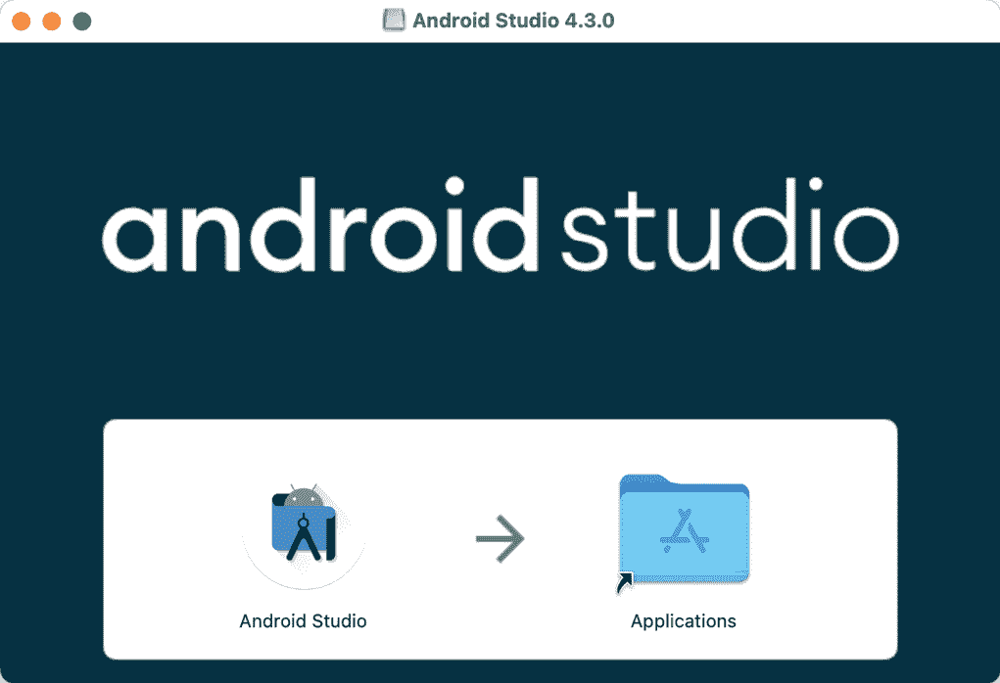

图 2-1

要安装该包，将 Android Studio 图标拖动到“应用程序”（Applications）文件夹中。Android Studio 包将随后安装到系统的应用程序文件夹中，此过程通常需要几秒钟完成。

要启动 Android Studio，在 Finder 窗口的应用程序文件夹中找到可执行文件并双击它。

为了方便以后访问该工具，可以从 Finder 窗口将 Android Studio 图标拖动到 Dock 栏上。

#### 2.3.3 在 Linux 上安装

下载 Linux 版本的 Android Studio 包后，打开终端窗口，进入要安装 Android Studio 的目录，并执行以下命令：

```bash
tar xvfz /<path to package>/android-studio-<version>-linux.tar.gz
```

请注意，Android Studio 束将安装到名为 `android-studio` 的子目录下。因此，假设上述命令是在 `/home/demo` 中执行的，软件包将被解压到 `/home/demo/android-studio`。

要启动 Android Studio，打开终端窗口，进入 `android-studio/bin` 子目录，并执行以下命令：

```bash
./studio.sh
```

### 2.4 安装额外的 Android SDK 包

当您启动 Android Studio 时，会出现如下所示的“欢迎使用 Android Studio”界面：

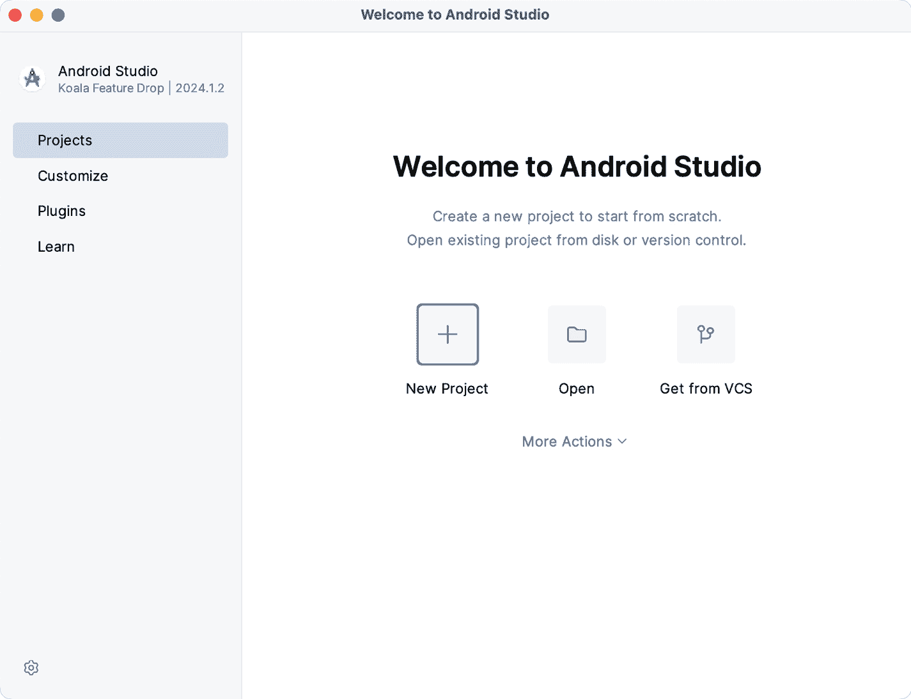

图 2-2

到为止的操作已安装了 Android Studio IDE 和当前默认的 Android SDK 包。在继续操作之前，值得花些时间验证安装了哪些包，并安装任何缺失或更新的包。

此任务可以通过点击欢迎对话框中的“更多操作”（More Actions）链接并从下拉菜单中选择“SDK Manager”（SDK Manager）选项来完成。一旦调用，将出现设置对话框中的 Android SDK 界面，如图 2-3 所示：

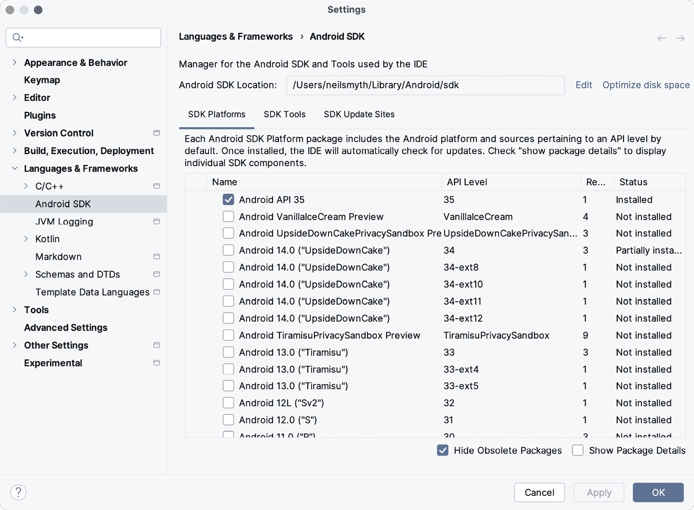

图 2-3

Google 为每个版本的 Android Studio 都配了一个最高支持的 Android SDK 应用程序接口 (API) 级别。在 Android Studio Koala Feature Drop 中，对应的是 Android Vanilla Ice Cream (API Level 35)。可以使用以下链接确认此信息：

[`developer.android.com/studio/releases#api-level-support`](https://developer.android.com/studio/releases#api-level-support)

在首次安装 Android Studio 之后，可能只安装了最新支持版本的 Android SDK。要安装旧版本的 Android SDK，请选择对应版本的复选框并点击 `Apply`（应用）按钮。本书的其余部分假设已安装了 Android Vanilla Ice Cream (API Level 35) SDK。

书中的大多数示例将支持低至 Android 8.0 (Oreo) 的较旧 Android 版本。这确保了程序可以在广泛的 Android 设备上运行。在 SDK 版本列表中，启用 Android 8.0 (Oreo) 侧的复选框并点击 `Apply` 按钮。在生成的确认对话框中点击 `OK` 按钮安装 SDK。随后的对话将在执行安装之前会要求接受许可和条款。安装完成后点击 `Finish`（完成）。

可能还会列出最新 SDK 有可用更新。要访问有关待更新包的详细信息，请启用位于屏幕右下角的“Show Package Details”（显示包详情）选项。这将显示与图 2-4 所示类似的信息：

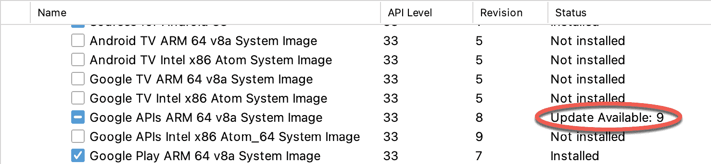

图 2-4

上图强调了可用更新。要安装更新，请启用项目名称左侧的复选框并点击 `Apply` 按钮。

除了 Android SDK 包外，还安装了几个构建 Android 应用程序的工具。要查看当前安装的包并检查更新，请留在 SDK 设置界面，并如图 2-5 所示选择 `SDK Tools`（SDK 工具）标签：

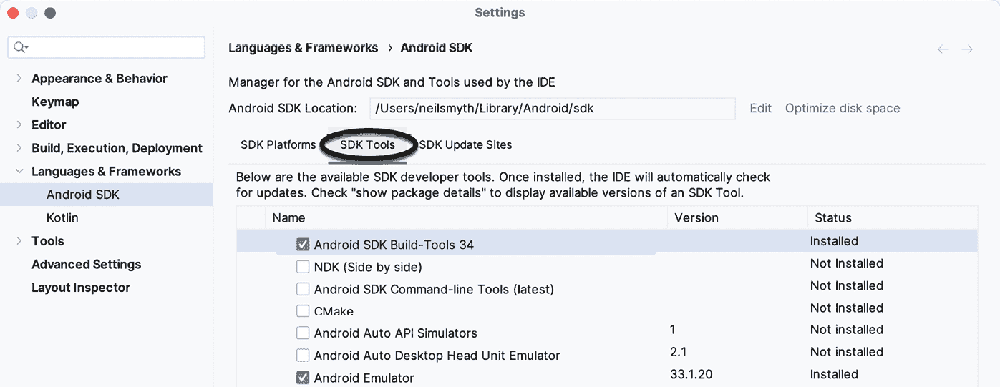

图 2-5

在 Android SDK Tools 界面，确保以下包在“Status”（状态）列中显示为“Installed”（已安装）：

- Android SDK Build-tools
- Android Emulator
- Android SDK Platform-tools
- Google Play Services
- Intel x86 Emulator Accelerator (HAXM installer)
- Google USB Driver (Windows only)
- Layout Inspector image server for API 31-35

*注意：Intel x86 Emulator Accelerator (HAXM installer) 需要启用 VT-x 支持的 Intel 处理器。它无法安装在基于 Apple 芯片的 Mac 或基于 AMD 的 PC 上。*

如果上述任何包被列为“Not Installed”（未安装）或需要更新，请选择这些包旁边的复选框并点击 `Apply` 按钮启动安装过程。如果出现 HAXM 模拟器设置对话框，请选择推荐的内存分配：


图 2-6

安装完成后，检查包列表并确保所选包在“Status”列中显示为“Installed”。如果有任何包未安装，请确保它们已选中并再次点击 `Apply` 按钮。

### 2.5 安装 Android SDK 命令行工具

Android Studio 包含了允许从命令行执行某些任务的工具。要在您的系统中安装这些工具，请打开 SDK Manager，选择 `SDK Tools` 标签，并找到图 2-7 所示的“Android SDK Command-line Tools (latest)”包：


图 2-7

如果命令行工具尚未安装，请启用它并点击 `Apply`，然后点击 `OK` 完成安装。安装完成后，点击 `Finish` 并关闭 SDK Manager 对话框。

为了让开发操作系统能够找到这些工具，必须将它们添加到系统的 `PATH` 环境变量中。

无论使用什么操作系统，您都需要配置 `PATH` 环境变量以包含以下路径（`<path_to_android_sdk_installation>` 代表您安装 Android SDK 的文件位置）：

- `<path_to_android_sdk_installation>/sdk/cmdline-tools/latest/bin`
- `<path_to_android_sdk_installation>/sdk/platform-tools`

可以通过启动 SDK Manager 并参考设置面板顶部的“Android SDK Location:”字段来识别系统上的 SDK 位置，如图 2-8 所示：

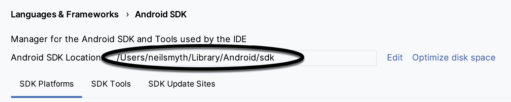

图 2-8

一旦确定了 SDK 位置，将其添加到 `PATH` 变量的步骤取决于操作系统：

#### 2.5.1 Windows 8.1

1. 在开始屏幕上，将鼠标移动到屏幕右下角并从菜单中选择“Search”（搜索）。在搜索框中输入“Control Panel”（控制面板）。当结果区域出现“Control Panel”图标时，点击它以在桌面上启动该工具。
2. 在“Control Panel”中，使用“Category”（类别）菜单将显示方式更改为“Large Icons”（大图标）。从列表中选择“System”（系统）。

#### Windows

3. 在 `Environment Variables`（环境变量）对话框中，在 `System variables`（系统变量）列表中找到 `Path` 变量，选中它并点击 `Edit…`（编辑）按钮。使用编辑对话框中的 `New`（新建）按钮向路径添加两个新项目。例如，假设 Android SDK 安装在 `C:\Users\demo\AppData\Local\Android\Sdk`，需要添加以下项目：

```
C:\Users\demo\AppData\Local\Android\Sdk\cmdline-tools\latest\bin
C:\Users\demo\AppData\Local\Android\Sdk\platform-tools
```

4. 点击对话框中的 `OK` 并关闭系统属性控制面板。

通过在键盘上按下 `Windows + R` 打开命令提示符窗口，并在 `Run`（运行）对话框中输入 `cmd`。在命令提示符窗口中，输入：

```
echo %Path%
```

返回的路径变量值应包含 Android SDK 平台工具文件夹的路径。通过尝试运行 `adb` 工具来验证 `platform-tools` 值是否正确：

```
adb
```

执行该工具时，它应该输出命令行选项列表。

同样，通过尝试运行 `avdmanager` 命令行工具来检查工具路径设置（如果 `avdmanager` 工具报告 Java 问题无需担心——稍后会解决）：

```
avdmanager
```

如果其中一个或两个命令出现类似下面的信息，则很可能是向 `Path`环境变量中添加了错误的路径：

```
'adb' is not recognized as an internal or external command, operable program or batch file.
```

#### 2.5.2 Windows 10

右键点击 `Start`（开始）菜单，从弹出菜单中选择 `Settings`（设置），并在“Find a setting”（查找设置）文本框中输入“编辑系统环境变量”。在 `System Properties`（系统属性）对话框中，点击 `Environment Variables...`（环境变量）按钮。按照 Windows 8.1 列出的步骤从第 3 步开始操作。

#### 2.5.3 Windows 11


右键点击任务栏上的`Start`图标，从弹出菜单中选择`Settings`（设置）。当`Settings`对话框出现时，向下滚动类别列表并选择“About”（关于）选项。在“About”屏幕上，从“Related links”（相关链接）部分选择`Advanced system settings`（高级系统设置）。当系统属性窗口出现时，点击`Environment Variables...`（环境变量）按钮。按照 Windows 8.1 列出的步骤从第 3 步开始操作。

### 2.5.4 Linux

可以通过在主目录下的`.bashrc`文件中添加命令在 Linux 上实现此配置（具体细节取决于所使用的 Linux 发行版）。假设 Android SDK 压缩包安装在`/home/demo/Android/sdk`，则`.bashrc`文件中的`export`行如下：

```
export PATH=/home/demo/Android/sdk/platform-tools:/home/demo/Android/sdk/cmdline-tools/latest/bin:/home/demo/android-studio/bin:$PATH
```

另请注意，上述命令将`android-studio/bin`目录添加到`PATH`变量中。这将使得无论在终端窗口的当前目录如何，都可以执行`studio.sh`脚本。

### 2.5.5 macOS

可以使用多种技术在 macOS 上修改`$PATH`环境变量。最干净的方法是在`/etc/paths.d`目录下创建一个新文件，其中包含要添加到`$PATH`的路径。假设 Android SDK 安装位置为`/Users/demo/Library/Android/sdk`，可以通过在`/etc/paths.d`目录下创建一个名为`android-sdk`的新文件并包含以下行来配置路径：

```
/Users/demo/Library/Android/sdk/cmdline-tools/latest/bin
/Users/demo/Library/Android/sdk/platform-tools
```

注意，由于这是一个系统目录，创建文件时必须使用`sudo`命令。例如：

```
sudo vi /etc/paths.d/android-sdk
```

### 2.6 Android Studio 内存管理

Android Studio 是一个大型且复杂的软件应用程序，具有许多后台进程。尽管 Android Studio 过去因性能不佳而受到批评，但 Google 在最近的发布中进行了重大的性能改进，并在每个新版本中持续改进。这些改进允许用户配置 Android Studio IDE 以及用于构建和运行应用程序的后台进程所使用的内存量。这允许软件利用具有更大内存的系统。

如果你在空闲内存足够增加这些值的系统上运行 Android Studio（此功能仅适用于具有 5GB 或更多内存的 64 位系统），并发现 Android Studio 性能似乎下降，那么尝试这些内存设置可能是值得的。Android Studio 还可能通过类似于下面所示的对话框通知你可以提高性能：

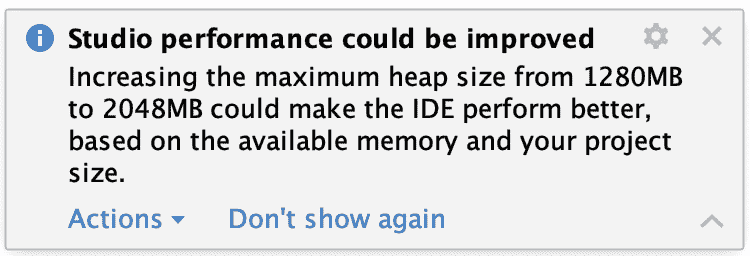

图 2-9

要查看并修改当前内存配置，选择主菜单选项`File -> Settings...`（文件 -> 设置...）（macOS 上为`Android Studio -> Settings...`），并在弹出的对话框中，选择`Appearance & Behavior`（外观与行为），然后选择左侧导航面板中`System Settings`（系统设置）下的`Memory Settings`（内存设置）选项，如下图 2-10。

图 2-10

在更改内存时，确保不要分配超过需要或系统能够承受的内存。

本章创建的项目是一个基础的货币汇率转换计算器（事实上，它非常简单，仅支持从美元转换为欧元，并使用估算的汇率进行转换）。该项目还将使用最基础的 Android Studio 项目模板之一。这种简单性允许我们介绍 Android 应用开发的一些关键方面，而不会因为一次性引入过多的概念（例如推荐的应用程序架构和 Android 架构组件）而让初学者无从入手。在遵循本章的教程时，请放心，这个初始示例项目中使用的技术和代码将在后面的章节中进行更详细的介绍。

## 3.2 创建新的 Android 项目

应用开发过程的第一步是在 Android Studio 环境中创建一个新项目。因此，请先启动 Android Studio，会出现“Welcome to Android Studio”界面，如图 3-1 所示：

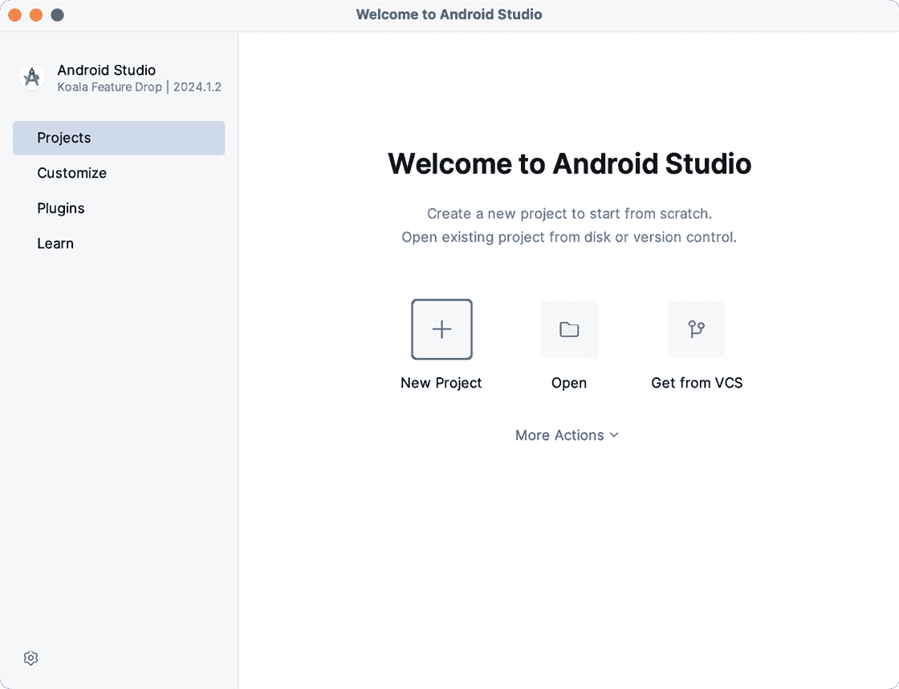

图 3-1

一旦出现此窗口，Android Studio 就已准备好创建新项目。要创建新项目，点击`New Project`（新建项目）选项以显示`New Project`向导的第一个屏幕。

## 3.3 创建 Activity

下一步是为应用程序定义要创建的初始 Activity 类型。提供为手机和平板电脑、Wear OS、电视或汽车创建项目的选项。在开发 Android 应用时，可以使用多种 Activity 类型，其中许多将在后面的章节中进行详细介绍。然而，对于本示例，请从`Templates`（模板）面板中选择`Phone and Tablet`选项，然后选择创建`Empty Views Activity`（空视图 Activity）。`Empty Views Activity`选项会创建一个由单个`TextView`对象组成的模板用户界面。

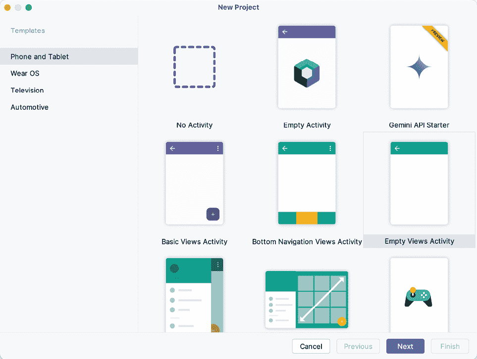

图 3-2

选中`Empty Views Activity`后，点击`Next`（下一步）继续项目配置。

## 3.4 定义项目和 SDK 设置

在项目配置窗口（图 3-3）中，将`Name`（名称）字段设置为`AndroidSample`。应用程序名称是在 Android Studio 中引用和标识应用程序的名称，如果完成的应用程序要在 Google Play 商店出售，也将使用该名称。

`Package name`（包名）在 Android 应用生态系统中唯一标识应用程序。虽然它可以设置为任何唯一标识您的应用的字符串，但传统上它是基于域名的反转 URL，后跟应用程序名称。例如，如果您的域名是`www.mycompany.com`，且应用程序命名为`AndroidSample`，那么包名可以指定如下：

`com.mycompany.androidsample`

如果您没有域名，可以在`Company Domain`（公司域名）字段中输入任何其他字符串，或者使用`example.com`进行测试，但在发布应用之前需要进行更改：

`com.example.androidsample`

`Save location`（保存位置）设置将默认位于您主目录下名为`AndroidStudioProjects`的文件夹，可以通过点击包含当前路径设置文本字段右侧的文件夹图标进行更改。

将`minimum SDK`（最低 SDK）设置设置为`API 26`（Oreo；Android 8.0）。除非某个必要功能仅在较新版本中可用，否则此最低 SDK 将用于书中创建的大多数项目。这里的目标是使用最新的 Android SDK 构建应用，同时保持与运行旧版本 Android 的设备的兼容性（在这种情况下，远可追溯到 Android 8.0）。`Minimum SDK`设置下方的文字将概述当前运行该应用的 Android 设备百分比。点击`Help me choose`按钮（在图 3-3 中突出显示）以查看仍在使用的各种 Android 版本的完整细分：

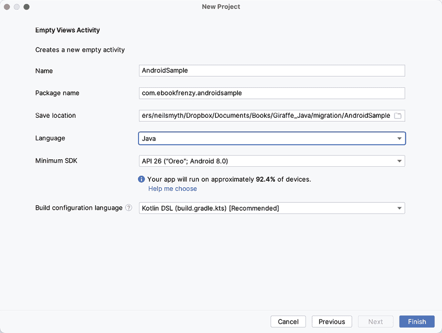

图 3-3

最后，将`Language`（语言）菜单更改为`Java`，并在点击`Finish`（完成）创建项目之前选择`Kotlin DSL (build.gradle.kts)`作为构建配置语言。

## 3.5 修改示例应用程序

项目创建后，将出现一个主窗口，其中包含我们的`AndroidSample`项目，如下方的图 3-4 所示：

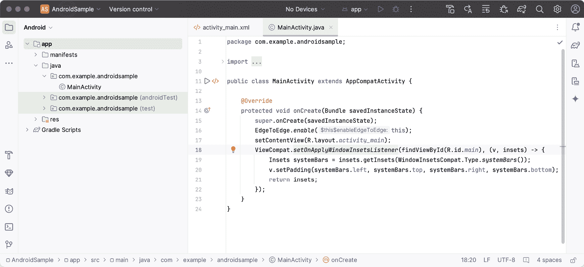

图 3-4

新创建的项目和相关文件的引用列在主项目窗口左侧的`Project`（项目）工具窗口中。`Project`工具窗口有几种显示信息的模式。默认情况下，此面板应处于`Android`模式。此设置由面板顶部的菜单控制，如图 3-5 突出显示。如果面板当前不是`Android`模式，请使用菜单切换模式：

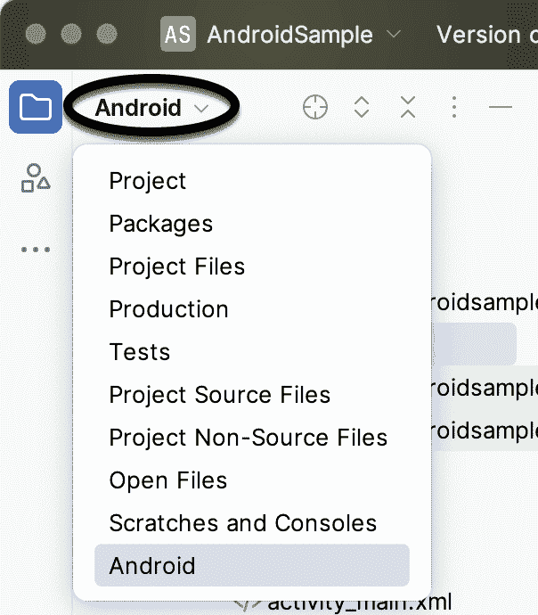

图 3-5

## 3.6 修改用户界面

我们的 Activity 用户界面设计存储在名为`activity_main.xml`的文件中，该文件位于`Project`工具窗口文件层次结构的`app -> res -> layout`下。一旦在`Project`工具窗口中找到它，双击`activity_main.xml`文件将其加载到用户界面`Layout Editor`（布局编辑器）工具中，该工具将出现在 Android Studio 主窗口的中间面板：

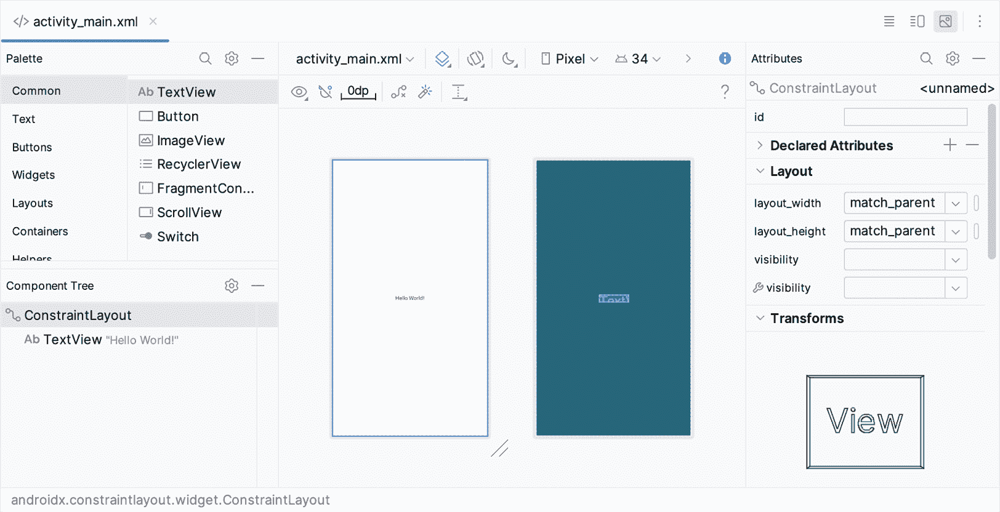

图 3-6

在`Layout Editor`窗口顶部的工具栏上有一个菜单（图中设置为`Pixel`），它反映在`Layout Editor`面板的设备表示中。点击此菜单可以使用一系列其他设备选项。

使用`System UI Mode`按钮打开或关闭设备的夜间模式。要在横屏和竖屏之间切换设备方向，请使用显示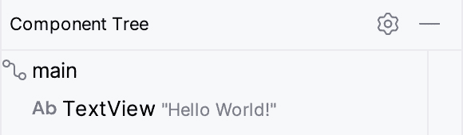的按钮。

图 3-7

从组件树层次可以看出，用户界面布局由名为`main`的`ConstraintLayout`父对象的`TextView`子对象组成。

在继续之前，检查`Layout Editor`的`Autoconnect`模式已启用。这意味着当组件添加到布局中时，`Layout Editor`将自动添加约束，以确保组件在不同的屏幕尺寸和设备方向上正确放置（该主题将在未来的章节中进行更详细的介绍）。`Autoconnect`按钮出现在`Layout Editor`工具栏中，用 U 形图标表示。当禁用时，图标上会有一条斜线（如图 3-8 所示）。如有必要，点击此按钮重新启用`Autoconnect`模式。

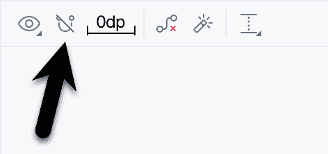

图 3-8

修改应用程序的下一步是向布局添加一些额外的组件，其中第一个是`Button`（按钮），用户点击它可以启动货币转换。

`Palette`（调色板）面板包含两列，左列包含视图类别列表。右列列出了当前选中类别中包含的组件。例如，在图 3-9 中，当前在`Buttons`类别中选择了`Button`视图：

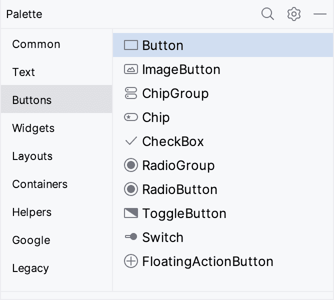

图 3-9

从`Buttons`列表中点击并拖动`Button`对象，将其释放到用户界面设计的水平中心位置，使其位于现有`TextView`小部件下方：

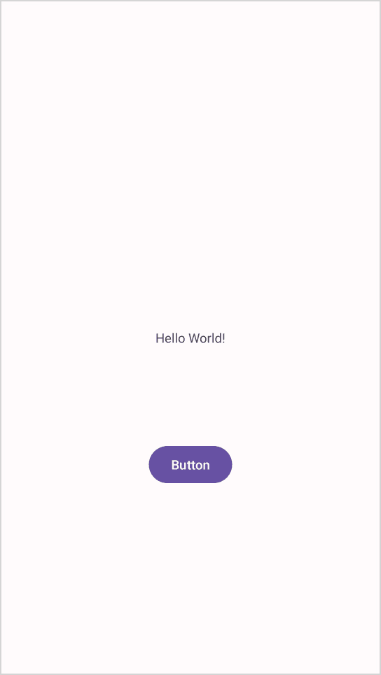

图 3-10

下一步是更改`Button`组件当前显示的文本。设计区域右侧的面板是`Attributes`（属性）面板。该面板显示分配给布局中选中组件的属性。在此面板中，在`Common Attributes`（常用属性）部分找到`text`属性，并将当前值从“Button”更改为“Convert”，如图 3-11 所示：

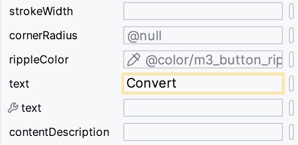

图 3-11

旁边带有扳手图标的第二个文本属性允许设置文本属性，该属性仅在`Layout Editor`工具中显示，而在运行时不会显示。这对于测试视觉组件和布局在不同设置下的表现非常有用，无需反复运行应用程序。

以防`Autoconnect`（自动连接）系统未能设置所有的布局连接，点击`Infer Constraints`（推断约束）按钮（图 3-12）为布局添加任何缺失的约束：

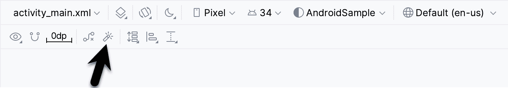

图 3-12

有必要解释`Layout Editor`工具右上角的警告按钮，如图 3-13 所示。该警告表示布局可能存在问题。要查看任何问题的详情，请点击该按钮：

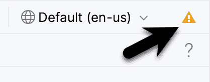

图 3-13

点击后，将出现`Problems`工具窗口（图 3-14），描述了问题的性质：

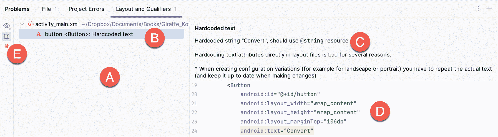

图 3-14

该工具窗口分为两个面板。左侧面板（上图标记为 A）列出了在布局文件中检测的问题。在我们的示例中，仅列出了以下问题：

```
button <Button>: Hardcoded text
```

当从列表中选中一个项目（B）时，右侧面板将更新以提供有关问题的更多细节（C）。在这种情况下，解释如下：

```
Hardcoded string "Convert", should use @string resource
```

工具窗口还包含一个预览编辑器（D），允许对布局文件进行手动修正。

此 I18N（国际化）消息告诉我们，项目未来的国际化可能存在潜在问题（“I18N”源于“internationalization”一词以“I”开头，以“N”结尾，中间有 18 个字母）。警告提醒我们，在开发 Android 应用程序时，应尽可能将文本字符串等属性和值存储为资源。这样做使得可以通过修改资源文件而不是更改应用程序源代码来更改应用程序的外观。这在将用户界面翻译成不同的口语语言时尤为宝贵。如果用户界面中的所有文本都包含在单个资源文件中，例如可以将该文件交给翻译人员，由他们执行翻译工作并返回翻译后的文件以包含在应用程序中。这使得在不需要进行任何源代码更改的情况下就能支持多种语言。在这种情况下，我们将创建一个名为`convert_string`的新资源，并为其分配字符串“Convert”。

首先，点击`Show Quick Fixes`（显示快速修复）按钮（E），并从菜单中选择`Extract string resource`（提取字符串资源）选项，如图 3-15 所示：

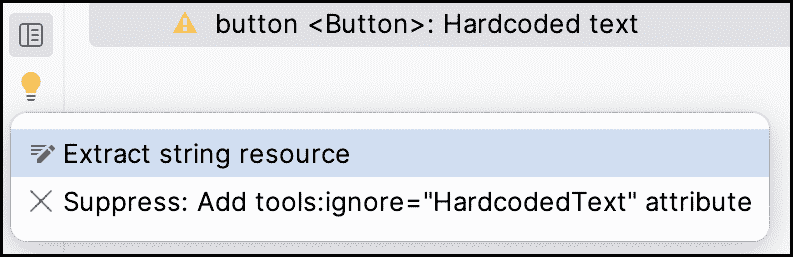

图 3-15

选择此选项后，将出现`Extract Resource`（提取资源）面板（图 3-16）。在此面板中，将资源名称字段更改为`convert_string`，在点击`OK`按钮之前将资源值设置为`Convert`：

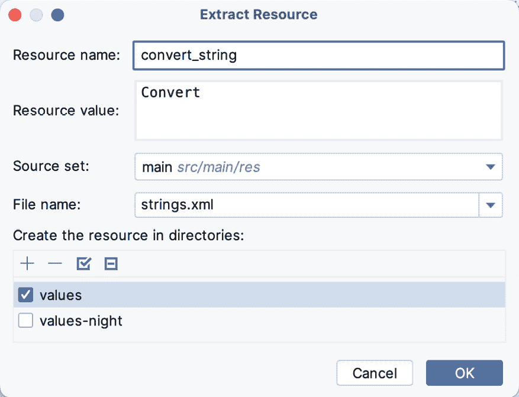

图 3-16

下一个要添加的小部件是`EditText`小部件，用户将向其中输入要转换的美元金额。从`Palette`面板中选择`Text`类别，并点击并拖动`Number (Decimal)`组件到布局中，使其水平居中并置于现有`TextView`小部件上方。选中小部件后，使用`Attributes`工具窗口将`hint`属性设置为“dollars”。点击警告图标并将字符串提取到名为`dollars_hint`的资源。

本章稍后编写的代码将需要访问用户输入的美元值。这通过引用布局中分配的`id`实现。可以在`Attributes`工具窗口中查看并更改 Android Studio 分配的默认`id`，如图 3-17 所示：


图 3-17

将`id`改为`dollarText`，并在`Rename`对话框中点击`Refactor`（重构）按钮。这将确保项目其他地方对旧`id`的引用更新为新的`id`：


图 3-18

如有必要，重复设置`TextView`小部件`id`的步骤。

点击`Infer Constraints`按钮添加任何缺失的布局约束。此时，布局应如图 3-19 所示：


图 3-19

## 检查布局和资源文件

在进入下一步之前，我们将查看用户界面设计和资源处理的一些内部方面。在上节中，我们通过`Layout Editor`工具修改`activity_main.xml`文件来更改用户界面。实际上，`Layout Editor`所做的只是提供了一种易于编辑底层 XML 内容的方法。在实践中，没有理由不直接修改 XML 来进行用户界面更改，在某些情况下，这实际上比使用`Layout Editor`工具更快。在`Layout Editor`面板的右上角有视图模式按钮，如下方图 3-20 所示：

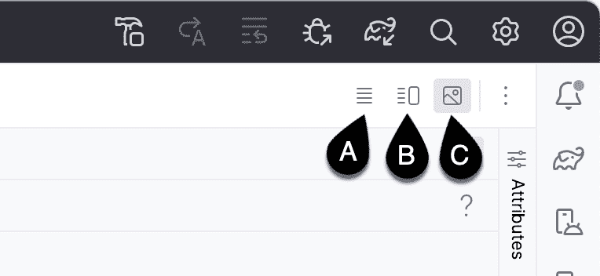

图 3-20

默认情况下，编辑器将处于设计模式（按钮 C），此时显示布局的视觉表示。在代码模式（A）中，编辑器将显示布局的 XML，而在分屏模式（B）中，同时显示布局和 XML，如图 3-21 所示：

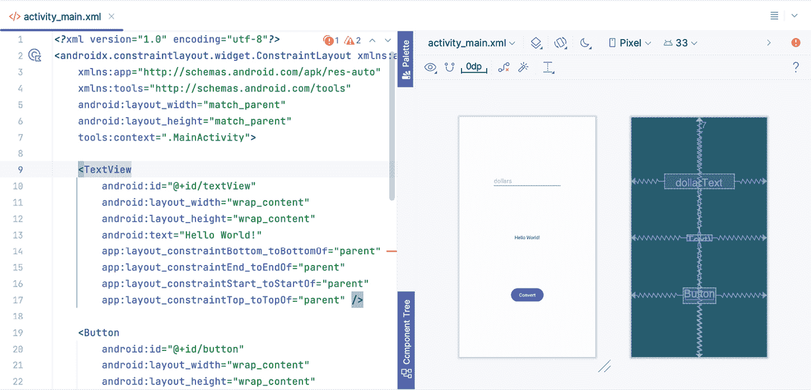

图 3-21

视图模式按钮左侧的按钮（上方图 3-20 中标记为 B）用于快速在代码模式和分屏模式之间切换。


从 XML 文件的结构可以看出，用户界面由`ConstraintLayout`组件组成，该组件反过来又是`TextView`、`Button`和`EditText`对象的父。我们还可以看到，例如，`Button`的`text`属性被设置为我们的`convert_string`。尽管复杂性和内容各异，但所有用户界面布局都是以这种层次、基于 XML 的方式组织的。

当对 XML 布局进行更改时，这些更改将反映在布局画布上。也可以在布局画布面板内直接进行视觉化修改，更改将显示在 XML 列表中。要查看此效果，请切换到`Split`模式并修改 XML 布局，将`ConstraintLayout`的背景颜色更改为红色调如下：

```xml
<?xml version="1.0" encoding="utf-8"?>
<androidx.constraintlayout.widget.ConstraintLayout xmlns:android="http://schemas.android.com/apk/res/android"
    xmlns:app="http://schemas.android.com/apk/res-auto"
    xmlns:tools="http://schemas.android.com/tools"
    android:id="@+id/main"
    android:layout_width="match_parent"
    android:layout_height="match_parent"
    tools:context=".MainActivity"
    android:background="#ff2438" >
</androidx.constraintlayout.widget.ConstraintLayout>
```

注意，布局颜色会实时更改以匹配 XML 文件中的新设置。同样注意，在 XML 编辑器的左边距（也称为`gutter`）中包含颜色设置的行旁边会出现一个小红色方块。这是对该属性已设置红色这一事实的视觉提示。点击红色方块将显示一个颜色选择器，允许选择不同的颜色：

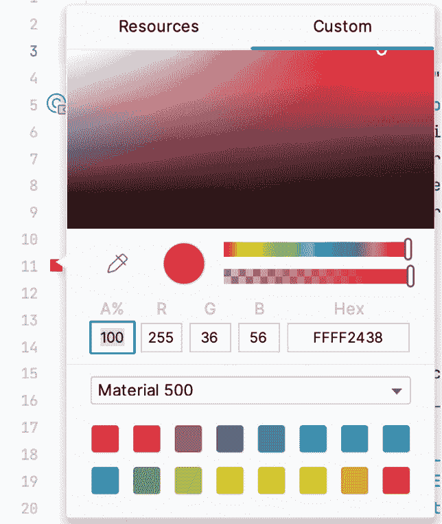

图 3-22

在继续之前，删除布局文件中的`background`属性，使`background`回到默认设置。

最后，使用`Project`面板找到`app -> res -> values -> strings.xml`文件并双击它将其加载到编辑器中。目前，XML 的内容如下：

```xml
<resources>
    <string name="app_name">AndroidSample</string>
    <string name="convert_string">Convert</string>
    <string name="dollars_hint">dollars</string>
</resources>
```

为了演示资源的实际应用，将当前分配给`convert_string`资源的字符串值更改为“Convert to Euros”，然后通过选择编辑器面板中布局文件的选项页返回 Layout Editor 工具。注意，布局已经获取了该字符串的新资源值。

访问 XML 文件中引用的资源值还有一种快速方法。在`Split`或`Code`模式下使用 Layout Editor 工具时，点击`@string/convert_string`属性设置使其变为高亮，然后按`Ctrl-B`（macOS 上为`Cmd-B`）。Android Studio 随后会打开`strings.xml`文件并将您带到该文件中声明此资源的的行。利用此机会将字符串资源恢复为原始的“Convert”文本，并为字符串资源添加以下额外的条目，该资源稍后将在应用代码中引用：

```xml
<resources>
    <string name="app_name">AndroidSample</string>
    <string name="convert_string">Convert</string>
    <string name="dollars_hint">dollars</string>
    <string name="no_value_string">No Value</string>
</resources>
```

资源字符串也可以通过点击编辑器窗口右上角的`Open editor`链接，使用 Android Studio 的翻译编辑器（Translations Editor）进行编辑。这会在 Android Studio 窗口的主面板中显示翻译编辑器：

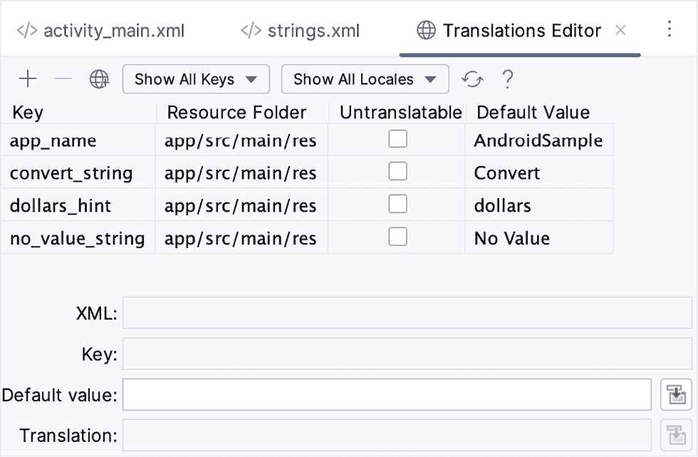

图 3-23

此编辑器允许编辑分配给资源键的字符串，并管理多种语言的翻译。

### 3.8 添加交互

此示例项目的最后一步是使应用程序具有交互性，当用户在`EditText`字段中输入美元值并点击转换按钮时，转换后的欧元值将显示在`TextView`上。这涉及在`Button`组件上实现一些事件处理。具体来说，需要配置`Button`，以便在触发`onClick`事件时调用应用代码中的方法。事件处理可以通过多种方式实现，并将在随后的标题为 “Android 事件处理概述与示例” 的章节中介绍。将布局编辑器返回`Design`模式，在布局编辑器中选择`Button`组件，参考`Attributes`工具窗口，并如下所示指定名为`convertCurrency`的方法：

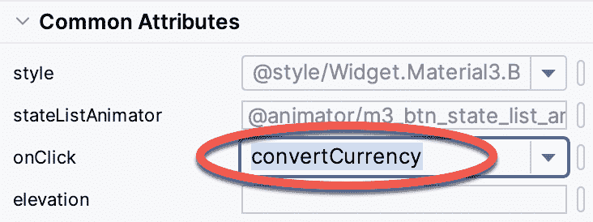

图 3-24

接下来，在`Project`工具窗口中双击`MainActivity.java`文件（`app -> java -> <package name> -> MainActivity`）将其加载到代码编辑器中，并向类文件添加`convertCurrency`方法的代码，使其内容如下，注意还需要导入一些额外的 Android 包：

```java
package com.example.androidsample;

import android.os.Bundle;
import android.view.View;
import android.widget.EditText;
import android.widget.TextView;
import java.util.Locale;

public class MainActivity extends AppCompatActivity {
    @Override
    protected void onCreate(Bundle savedInstanceState) {
        super.onCreate(savedInstanceState);
    }

    public void convertCurrency(View view) {
        EditText dollarText = findViewById(R.id.dollarText);
        TextView textView = findViewById(R.id.textView);
        if (!dollarText.getText().toString().isEmpty()) {
            float dollarValue = Float.parseFloat(dollarText.getText().toString());
            float euroValue = dollarValue * 0.85F;
            textView.setText(String.format(Locale.ENGLISH,"%.2f", euroValue));
        } else {
            textView.setText(R.string.no_value_string);
        }
    }
}
```

### 3.9 总结

设置 Android 开发环境并不复杂，但涉及许多步骤。完成这些步骤后，值得运行示例以确保环境已正确安装和配置。在本章中，我们创建了一个示例应用程序，并使用 Android Studio Layout Editor 工具修改了用户界面布局。在此过程中，我们探索了尽可能使用资源（特别是字符串值）的重要性，并简要介绍了布局。最后，我们在`Button`上添加了`onClick`事件，并连接到一个已实现的方法，该方法用于从`EditText`提取用户输入，将美元转换为欧元，然后将结果显示在`TextView`上。

现在应用程序准备好测试了，下一章节将详细介绍设置用于测试的模拟器的步骤。

## 4. 在 Android Studio 中创建 Android 虚拟设备 (AVD)

尽管 Android Studio 预览面板允许我们看到正在设计的布局，但为了彻底测试其运行是否正常，仍然需要编译并运行整个应用程序。Android 应用程序可以通过在物理设备上安装并运行，或者在 Android 虚拟设备 (AVD) 模拟器环境中运行来完成测试。在使用`AVD`之前，必须首先对其其进行创建和配置，以匹配特定设备型号的规格。在本章中，我们将以`Pixel 4`手机作为示例，学习创建一个这样一个虚拟设备。

## 4.1 关于 Android 虚拟设备

`AVDs`是一种模拟器，允许在无需将应用程序安装到物理设备的情况下测试 Android 应用程序。`AVD`可以被配置为模拟硬件功能，包括屏幕尺寸、内存容量以及摄像头、GPS 支持或加速度计等功能的存在。Android Studio 标准安装程序的一部分安装了几个模拟器模板，允许为各种设备配置`AVDs`。此外，您还可以通过指定处理器类型、内存容量以及屏幕尺寸和像素密度等属性，创建自定义配置以匹配任何物理设备。

`AVD`会话可以以独立窗口的形式出现，也可以嵌入在 Android Studio 窗口中。新的`AVDs`使用`Virtual Device Manager`进行创建和管理，它可以在命令行模式下使用，也可以使用更用户友好的图形界面。要创建新的`AVD`，第一步是启动`AVD Manager`。这可以在 Android Studio 环境中通过点击右侧工具窗口中的`Device Manager`按钮来实现，如图 4-1 所示：


图 4-1

打开后，管理器将以工具窗口的形式出现，如图 4-2 所示：


图 4-2

如果您是在计算机上首次安装 Android Studio（而不是升级现有的安装），安装程序可能已经创建了一个可用的初始`AVD`实例，如图 4-3 所示：

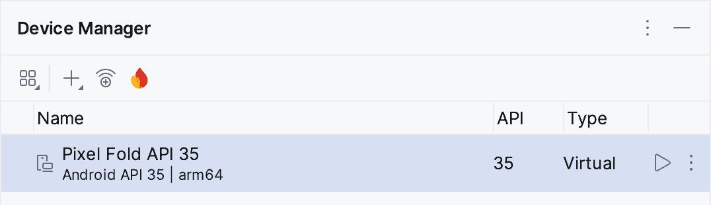

图 4-3

如果您的系统中存在此`AVD`，您可以使用它来测试应用。如果没有创建`AVD`，或者您想为不同类型的设备创建`AVDs`，请按照本章其余部分的步骤操作。要添加新的`AVD`，请点击`Device Manager`工具栏上的`+`按钮，并选择`Create Virtual Device`选项打开虚拟设备配置对话框：


图 4-4

在对话框中，执行以下步骤以创建一个兼容`Pixel 4`的模拟器：

1. 从`Category`面板选择`Phone`选项，显示可用的 Android 手机`AVD`模板。

2. 选择`Pixel 4`设备选项并点击`Next`。

3. 在`System Image`屏幕上，选择最新版本的 Android。如果尚未安装系统镜像，Release Name 旁边将提供`Download`链接。点击此链接下载并安装系统镜像。如果所需的镜像不在列表中，请点击`x86 Images`（如果您运行带有 Apple 芯片的 Mac，则点击`ARM images`）和`Other images`标签以查看备选列表。

4. 点击`Next`继续，并在 name 字段中输入描述性名称（例如，`Pixel 4 API 35`）或接受默认名称。

5. 点击`Finish`创建`AVD`。

6. 如果以后需要对`AVD`进行修改，重新打开`Device Manager`，从列表中选择该`AVD`，并点击`Actions`列中的笔形图标来编辑设置。

## 4.2 启动模拟器

要测试新创建的`AVD`模拟器，请从`Device Manager`选择该模拟器并点击三角形`Start`按钮。模拟器将嵌入到 Android Studio 主窗口中并开始启动过程。模拟器启动所需的时间取决于`AVD`及其运行系统的配置：


图 4-5

要隐藏和显示模拟器工具窗口，请点击`Running Devices`工具窗口按钮（标记为 A）。点击标签旁边的`x`关闭按钮（B）可以退出模拟器。模拟器工具窗口可以容纳多个模拟器会话，每个会话由一个标签表示。例如，图 4-6 显示了一个具有两个模拟器会话的工具窗口：


图 4-6

要切换会话，请点击相应的标签。

虽然模拟器可能默认以竖屏方向显示，但可以更改或其他默认选项。在`Device Manager`中，选择新的`Pixel 4`条目，并点击设备行`Actions`列中的笔形图标。在配置屏幕中，找到`Startup orientation`部分并更改方向设置。退出并重启模拟器会话以使此更改生效。关于模拟器的更多细节将在下一章“使用和配置 Android Studio AVD 模拟器”中介绍。

为了节省本章下一节的时间，请在继续之前保持模拟器运行。

## 4.3 在 AVD 中运行应用程序

配置`AVD`模拟器后，现在可以编译并运行之前章节创建的示例`AndroidSample`应用程序。在 Android Studio 中加载`AndroidSample`项目后，确保新的`Pixel 4 AVD`显示在设备菜单中（见下方图 4-7 中的标记 A），然后点击由三角形表示的运行按钮（B）、选择`Run -> Run 'app'`菜单选项，或使用快捷键`Ctrl-R`：


图 4-7

设备菜单 (A) 可用于选择不同的`AVD`实例或物理设备作为运行目标，并可以在多个设备上运行应用。该菜单还提供了访问`Device Manager`以及设备配置和故障排除选项的接口：


图 4-8

一旦应用程序安装并运行，第一个 fragment 的用户界面将出现在模拟器中（fragment 是 Android 项目中可重用的部分，通常由用户界面布局和一些代码组成，该主题将在本文的“Android Fragment 简介”章节中讨论）：

androidsample_running.jpg

图 4-9

一旦运行过程开始，`Run`工具窗口将出现。`Run`工具将在应用程序包安装和启动时显示诊断信息。图 4-10 显示了典型成功启动应用程序时的`Run`工具窗口输出：


图 4-10

上方 图 4-8 所示的`Run`（运行）目标菜单包含一个用于在多个模拟器和设备上并行运行应用程序的选项。选择该选项后，系统将显示 图 4-11 所示的对话框，列出系统上配置的`AVDs`以及任何已连接的物理设备。在点击`Run`按钮之前，勾选要运行的模拟器或设备旁边的复选框：

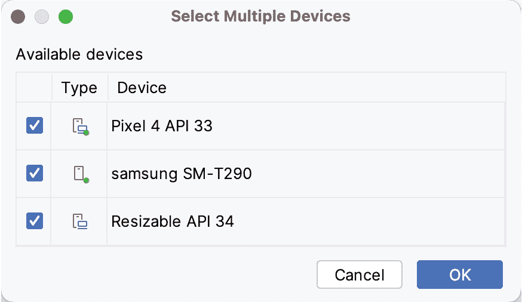

图 4-11

点击`Run`按钮后，Android Studio 将在选定的模拟器和设备上启动该应用程序。

## 4.5 停止运行的应用程序

要停止正在运行的应用程序，请点击主工具栏上的停止按钮，如 图 4-12 所示：

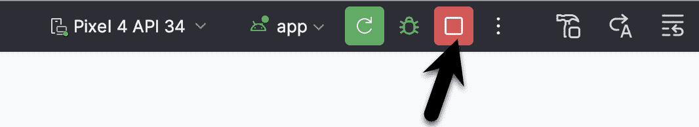

图 4-12

也可以使用`Run`工具窗口终止应用程序。首先，通过应用程序运行时会出现的窗口栏按钮来显示`Run`工具窗口。一旦`Run`工具窗口出现，点击下方 图 4-13 所示的高亮显示的停止按钮：

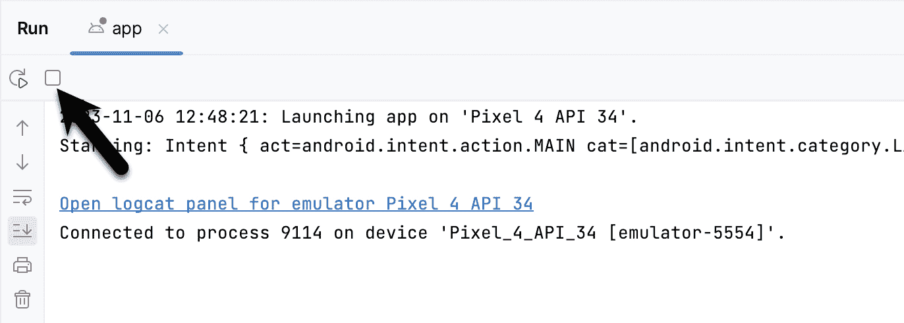

图 4-13

## 4.6 在独立窗口中运行模拟器

到本章目前为止，我们仅将模拟器作为嵌入在 Android Studio 主窗口内的工具窗口进行使用。在`Settings`（设置）对话框中，可以配置模拟器在独立窗口中显示。该对话框可以通过点击 Android Studio 工具栏上的高亮显示的的`IDE and Project Settings`（IDE 和项目设置）按钮来打开，具体如 图 4-14 所示：

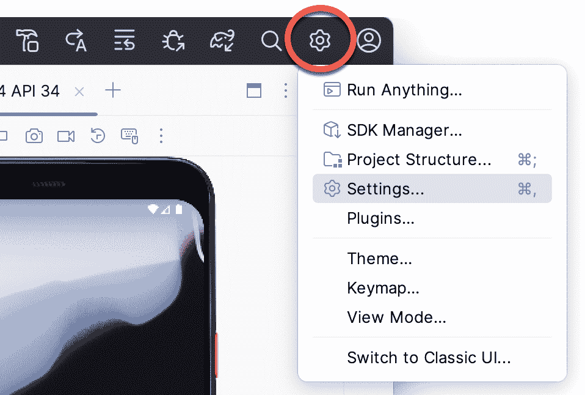

图 4-14

在`Settings`对话框中，在侧边面板导航到`Tools` -> `Emulator`，并禁用`Launch in the Running Devices`（在运行设备中启动）工具窗口选项：

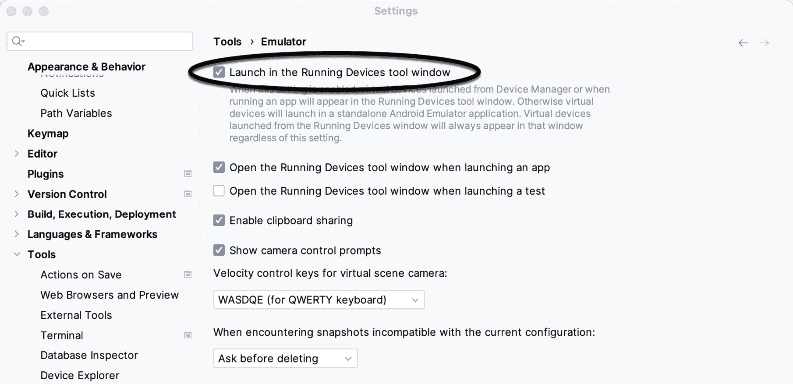

图 4-15

禁用该选项后，点击`Apply`（应用）按钮，随后点击`OK`提交更改，然后点击标记为 B #AVD_Creation.xhtml__idTextAnchor084) 所示的按钮退出当前模拟器。

再次运行应用程序，模拟器将如下所示以独立窗口形式显示：


图 17

在 `Options` 菜单中，选择 `View`（视图）-> `Float`（浮动）可以分离 Android Studio 窗口中的模拟器：


图 18

要将 `Running Devices` 工具窗口停靠，请点击图 19 所示的 `Dock`（停靠）按钮：


图 19

## 4.7 移除设备边框

模拟器可以配置为显示或不显示设备边框。要更改此设置，退出模拟器，打开 `Device Manager`（设备管理器），通过图 20 所示的 `Edit`（编辑）选项选择 AVD：


图 20

在设置屏幕中，禁用 `Enable device frame`（启用设备边框）选项并点击 `Finish`（完成）按钮：


图 21

禁用设备边框后，模拟器将如图 22 所示显示：


图 22

## 4.8 总结

应用程序的开发遵循编码、编译和运行周期。可以使用 `Device Manager`（设备管理器）创建并管理 AVD，这些 AVD 可以通过独立窗口或工具窗口形式进行测试。

## 5. 使用和配置 Android Studio 模拟器

本章将介绍在独立和工具窗口模式下，配置 AVD 模拟器的许多功能。

### 5.1 模拟器环境

当以独立模式启动时，模拟器会显示一个启动屏幕。加载完成后，将出现如图 5-1 所示的 Pixel 4 设备界面：


图 5-1

### 5.2 模拟器工具栏选项

模拟器工具栏（图 5-2）提供了对模拟器控制选项的快速访问：


图 5-2

工具栏中的每个按钮都对应一个快捷键，可以通过鼠标指针悬停在按钮上或通过扩展控制面板的帮助选项来识别。

虽然工具栏包含的许多选项一目易见，但我们将对每个选项进行介绍：

- `退出 / 最小化`：工具栏最上方的 `x` 按钮选中后退出模拟器，而 `-` 选项最小化整个窗口。

- `电源`：`Power` 按钮模拟物理设备上的电源按钮。点击并释放此按钮将锁定设备并关闭屏幕。长按此按钮将触发设备关机请求。

- `音量增大 / 减小`：控制模拟环境内音频音量的两个按钮。

- `左旋转 / 右旋转`：在竖屏和横屏方向之间旋转模拟设备。

- `截图`：对设备屏幕内容进行截图。捕获的图像存储在扩展控制面板设置屏幕中指定的位置，本文稍后将概述。

- `缩放模式`：此按钮切换进入和退出缩放模式，详情将在本文稍后介绍。

- `返回`：执行标准的 Android `Back` 导航返回上一个屏幕。

- `首页`：显示设备的主屏幕。

- `预览`：模拟标准的 Android `Overview` 导航，显示当前运行的应用程序。

- `折叠设备`：模拟折叠设备的折叠和展开。此选项仅在模拟器运行折叠设备系统镜像时可用。

- `扩展控制`：显示扩展控制面板，允许配置模拟位置和电话活动、电池强度、蜂窝网络类型以及指纹识别等选项。

位于模拟器工具栏上的缩放按钮用于进入和退出缩放模式。当缩放模式激活时，工具栏按钮将处于按下状态，当鼠标指针悬停在设备屏幕上时，指针将显示为放大镜。点击鼠标左键将导致显示相对于屏幕上的选点放大，重复点击将增加放大倍数。相反，点击鼠标右键将缩小放大倍数。关闭缩放按钮会将显示恢复为默认大小。

在缩放模式下，点击并拖动将定义一个矩形区域，释放鼠标按钮后视图将缩放到该区域。

在缩放模式下，可以使用模拟器窗口内的水平和垂直滚动条来移动屏幕的可视区域。

## 5.4 调整模拟器窗口大小

可以通过点击并拖动窗口的任何角或侧边，随时更改模拟器窗口的大小（以及设备对应的表示大小）。

## 5.5 扩展控制选项

扩展控制工具栏按钮会显示如图 5-3 所示的面板。默认情况下，将显示位置设置。从左侧面板中选择不同的类别将显示相应的控制组：

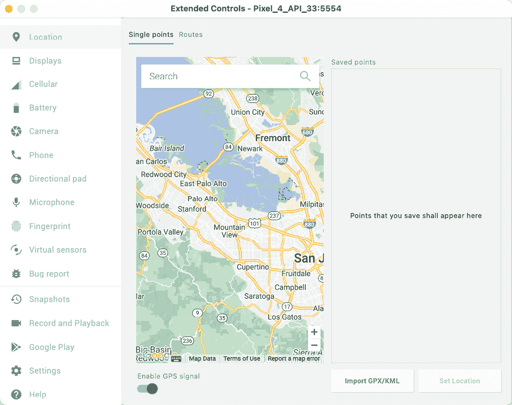

图 5-3

### 5.5.1 位置

位置控制允许以十进制或六十进制坐标将模拟的位置信息发送到模拟器。位置信息可以是单个位置的形式，也可以是代表设备移动的点序列，后者通过 GPS 交换格式 (GPX) 或 Keyhole 标记语言 (KML) 格式的文件提供。或者，可以使用集成的 Google Maps 面板视觉化地选择点或旅行路线。

### 5.5.2 显示

除了模拟器屏幕内显示的主显示外，显示选项允许在同一个 Android 实例中运行额外的显示器。这对于为如 Microsoft Surface Duo 等双屏设备测试应用程序非常有用。这些额外的屏幕可以配置为任何所需的尺寸，并与主屏幕出现在同一个模拟器窗口中。

### 5.5.3 蜂窝

可以在蜂窝设置屏幕更改模拟的蜂窝连接类型。可以选择不同的网络类型（`CSM`、`EDGE`、`HSDPA` 等）以及一系列语音和数据场景，例如漫游和拒绝访问。

### 5.5.4 电池

此扩展控制屏幕面板可以模拟各种电池状态和充电条件，包括电池电量水平、电池健康状况以及 AC 充电器当前是否连接。

### 5.5.5 摄像头

当摄像头激活时，模拟器会模拟 3D 场景。这表现为虚拟建筑的内部，在模拟器内录制视频或拍摄照片之前，可以通过按住 `Option` 键（Windows 上为 `Alt`）同时使用鼠标指针和键盘键进行导航。此扩展配置选项允许上传不同的图像以在虚拟环境中显示。

### 5.5.6 电话

电话扩展控制在模拟器中提供了两个简单但实用的模拟。第一个选项模拟来自指定电话号码的入电电话。这在测试应用程序如何处理高层中断时特别有用。

第二个选项允许在模拟器会话中模拟接收短信。与现实世界一样，这些消息出现在 `Message` 应用中，并触发模拟器内的标准通知。

### 5.5.7 方向键

方向键（`D-Pad`）是内置在 Android 设备中或外部连接（如游戏控制器）的另一组控制控件，提供方向控制（左、右、上、下）。方向键设置允许在模拟器中模拟 `D-Pad` 交互。

### 5.5.8 麦克风

麦克风设置允许启用麦克风并模拟虚拟耳机和麦克风连接。还提供了一个启动模拟器语音助手的按钮。

### 5.5.9 指纹

许多 Android 设备现在配备内置指纹检测硬件。AVD 模拟器使得测试指纹认证成为可能，无需在带有指纹传感器的物理设备上测试应用程序。在模拟器中配置指纹测试的细节将在本章稍后介绍。

### 5.5.10 虚拟传感器

虚拟传感器选项允许模拟加速度计和磁力计，以模拟设备物理运动的效果，通过 `yaw`、`pitch` 和 `roll` 设置模拟旋转、移动和倾斜。

### 5.5.11 快照

快照包含当前运行的 AVD 会话状态，可用于保存和快速恢复，使模拟器能够轻松返回到精确状态。快照将在本章稍后介绍。

### 5.5.12 录制和播放

允许以 WebM 或动画 GIF 格式录制并保存模拟器屏幕和音频。

### 5.5.13 Google Play

如果模拟器运行安装了 Google Play 服务的 Android 版本，此选项将显示当前的 Google Play 版本。它还提供了将模拟器更新到最新版本的选项。

### 5.5.14 设置

设置面板提供一组配置选项。使用此面板为工具栏和扩展控制面板选择较深的主题，指定要保存截图的文件系统位置，配置 OpenGL 支持级别，并配置模拟器窗口位于桌面上其他窗口之上。

### 5.5.15 帮助

帮助屏幕包含三个子面板，其中列有键盘快捷键列表、访问模拟器在线文档的链接、报告 bug 和发送反馈的链接，以及模拟器版本信息。

## 5.6 使用快照

当模拟器首次启动时，它会执行冷启动，就像物理 Android 设备电源一样。冷启动过程可能需要一段时间才能完成，因为操作系统需要加载并启动所有后台进程。为了避免每次启动模拟器都经过此过程，系统配置为每次退出时自动保存模拟器的当前状态快照（快速启动快照）。下次启动模拟器时，快速启动快照将加载到内存中，并从离开的地方继续执行，使模拟器重启的时间仅为冷启动所需时间的一部分。

扩展控制面板的快照屏幕可以在模拟器执行期间任何时候存储额外的快照。这保存了整个模拟器的精确状态，使模拟器能够恢复到拍摄快照时的精确时刻。从该屏幕，可以使用拍摄快照按钮（如图 5-4 中的 A 所示）拍摄快照。要恢复现有快照，请从列表（B）中选择它并点击屏幕底部的运行按钮（C）。还提供了编辑（D）快照名称和描述以及删除（E）当前选定快照的选项：

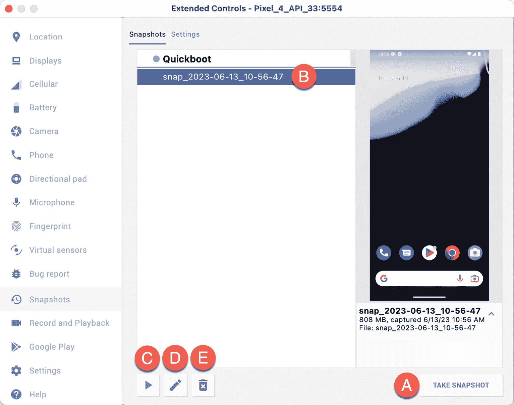

图 5-4

您还可以通过主工具栏中的运行目标菜单进行选择，决定使用冷启动、最近的快速启动快照或之前的快照来启动模拟器，如图 5-5 所示：

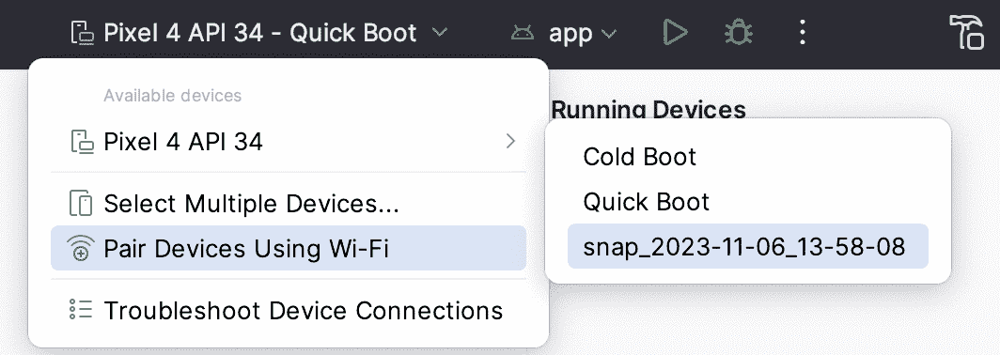

图 5-5

模拟器允许配置最多 10 个模拟指纹，并可用于测试 Android 应用中的指纹身份验证。配置模拟指纹的第一步是启动模拟器，打开 `Settings`（设置）应用，并选择 `Security`（安全）选项。

在 `Security` 设置屏幕中，选择指纹（fingerprint）选项。在弹出的信息屏幕上，点击 `Next`（下一步）按钮进入指纹设置屏幕。在启用指纹安全之前，必须配置一种备份屏幕解锁方法（例如 `PIN`）。输入并确认合适的 `PIN`，并通过接受默认通知选项来完成 `PIN` 输入过程。

继续通过剩余屏幕，直到 `Settings` 应用要求在传感器上进行指纹。此时，显示扩展控制（Extended Controls）对话框，在左侧面板中选择 `Fingerprint`（指纹）类别，并确保主设置面板中已选择 `Finger 1`（手指 1）：


图 5-6

点击 `Touch Sensor`（触摸传感器）按钮以模拟 `Finger 1` 触摸指纹传感器。模拟器将报告指纹添加成功：

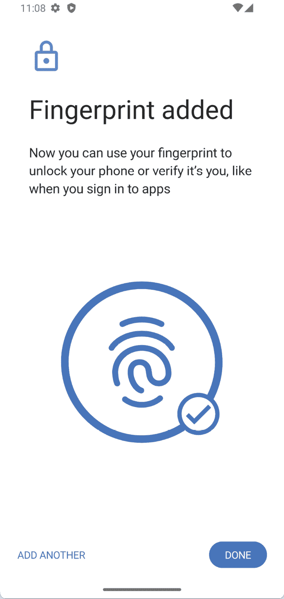

图 5-7

要添加更多指纹，请点击 `Add Another`（添加另一个）按钮，并在再次点击 `Touch Sensor` 按钮之前从扩展控制面板菜单中选择另一个手指。

### 5.8 工具窗口模式下的模拟器

如上一章（“在 Android Studio 中创建 Android 虚拟设备 (AVD)”）概述，Android Studio 可以配置为在嵌入式工具窗口中启动模拟器，使其不会在独立窗口中出现。当在此模式下运行时，工具栏中将提供与独立模式相同的控制控件，如图 5-8 所示：

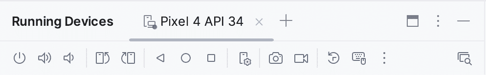

图 5-8

从左到右，这些按钮执行以下任务（细节与独立模式一致）：

*   `Power`（电源）

*   `Volume Up`（音量上）

*   `Volume Down`（音量减）

*   `Rotate Left`（左旋转）

*   `Rotate Right`（右旋转）

*   `Back`（返回）

*   `Home`（首页）

*   `Overview`（概览）

*   `Common Android Settings`（通用 Android 设置）

*   `Screenshot`（截图）

*   `Snapshots`（快照）

*   `Hardware Input`（硬件输入）

*   `Extended Controls`（扩展控制）

*   `Layout Inspector`（布局检查器）

## 5.9 通用 Android 设置

`Running Devices`（运行设备）工具栏中的 `Common Android Settings` 按钮可以快速访问多个设备配置设置，包括系统字体大小、屏幕大小和深色模式。点击后，将出现如图 5-9 所示的面板：

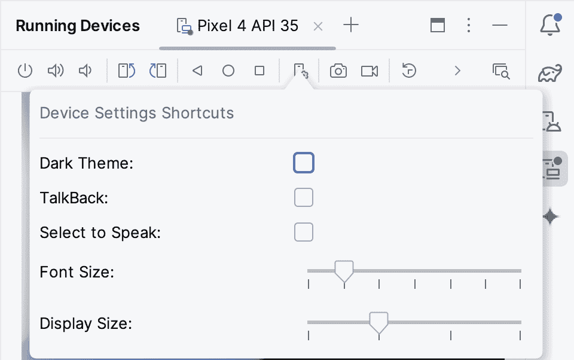

图 5-9

在此面板内进行的更改将立即反映在 AVD 会话中。

## 5.10 创建可调整大小的模拟器

除了配置为匹配特定 Android 设备模型的模拟器外，Android Studio 还提供了可调整大小的 AVD，允许你在手机、平板电脑和折叠设备尺寸之间切换。要创建可调整大小的模拟器，打开 `Device Manager`（设备管理器）并点击 `Create device`（创建设备）按钮。接下来，选择如图 5-10 所示的 `Resizable`（可调整大小）设备定义，并按照通常步骤创建新的 AVD：


图 5-10

在工具窗口在新模拟器上运行应用时，工具栏中会出现 `Display mode`（显示模式）选项，允许你切换模拟器配置，如图 5-11 所示：


图 5-11

当你在工具窗口在新模拟器上运行应用时，工具栏中会出现 `Display mode`（显示模式）选项，允许你如图 5-11 所示切换模拟器配置：


`Running Devices`（运行设备）工具栏中的`Common Android Settings`按钮可以快速访问多个设备配置设置，包括系统字体大小、屏幕大小和深色模式。点击后，将出现如图 5-9 所示的面板：


图 5-9

在此面板内进行的更改将立即反映在 AVD 会话中。

## 5.10 创建可调整大小的模拟器

除了配置为匹配特定 Android 设备模型的模拟器外，Android Studio 还提供了可调整大小的 AVD，允许你在手机、平板电脑和折叠设备尺寸之间切换。要创建可调整大小的模拟器，打开`Device Manager`（设备管理器）并点击`Create device`（创建设备）按钮。接下来，选择如图 5-10 所示的`Resizable`（可调整大小）设备定义，并按照通常步骤创建新的 AVD：


图 5-10

当你在工具窗口在新模拟器上运行应用时，工具栏中会出现`Display mode`（显示模式）选项，允许你切换模拟器配置，如图 5-11 所示：


图 5-11

（注：后续部分原文存在大量重复，此处仅翻译核心含义）

### 5.11 总结

Android Studio 是一个强大且功能丰富的环境。本章介绍了如何使用模拟器、配置指纹、使用通用设置以及创建可调整大小的 AVD。

## 6. Android Studio 界面概览

在深入学习之前，熟悉 Android Studio 的界面非常重要。本章将介绍 IDE 的各个区域和组件。

### 6.1 欢迎屏幕

当 Android Studio 启动且没有打开项目时，会显示如图 6-1 所示（如果上次退出时打开了项目，下次启动时将跳过此屏幕）：


图 6-1

除了最近的项目列表，欢迎屏幕还提供了打开和创建项目的选项，以及更改主题和字体设置。Android Studio 插件可以通过`Plugins`选项进行查看、安装和管理。其他选项可以通过如图 6-2 所示的菜单获取：

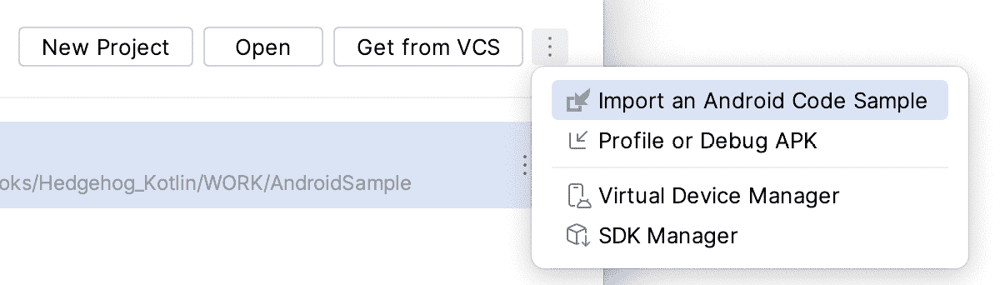

图 6-2

### 6.2 主窗口

项目打开后，Android Studio 的主窗口通常如图 6-5 所示：

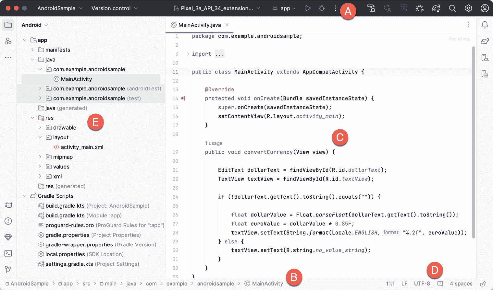

图 6-5

主窗口的各种元素总结如下：

A – `Toolbar`（工具栏）—— 常用操作的快捷键。工具栏按钮提供了对一组常用菜单操作的快速访问。可以通过右键点击工具栏并选择`Customize Toolbar…`选项来自定义工具栏。工具栏菜单如图 6-6 所示，提供了创建、打开项目以及在多个项目打开时进行切换的便捷方法：

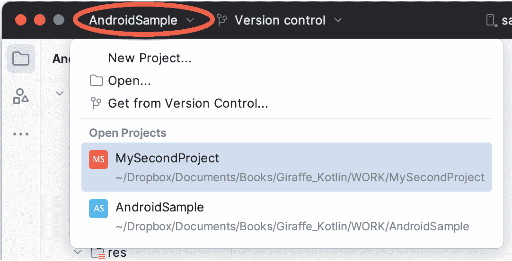

图 6-6

## B – 导航栏

导航栏提供了一种在构成项目的文件和文件夹之间移动的便捷方法。点击导航栏中的某个元素将弹出一个菜单，列出该位置的子文件夹和文件以供选择。同样，点击类名将显示包含该类中所有方法的菜单：

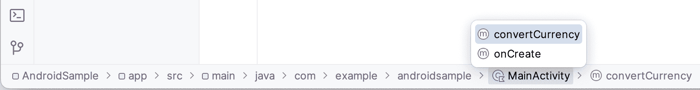

图 6-7

从列表中选择一个方法，即可跳转到代码编辑器中相应的位置。你可以使用`View -> Appearance -> Navigation Bar`选项来隐藏、显示和更改此栏的位置。

## C – 编辑器窗口

编辑器窗口显示开发者当前正在工作的文件内容。当打开多个文件时，每个文件都由位于编辑器顶部边缘的标签页表示，如图 6-8 所示：

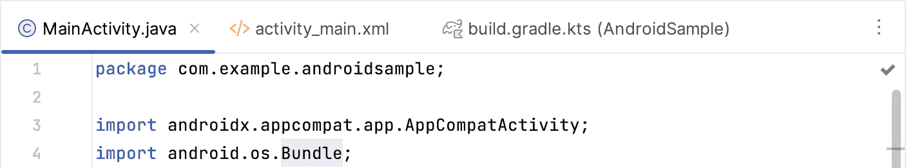

图 6-8

## D – 状态栏

状态栏显示关于项目和 Android Studio 活动的信息消息。悬停在状态栏条目上将显示该字段的描述。许多字段是交互式的，允许用户通过点击来执行任务或获取更详细的状态信息。

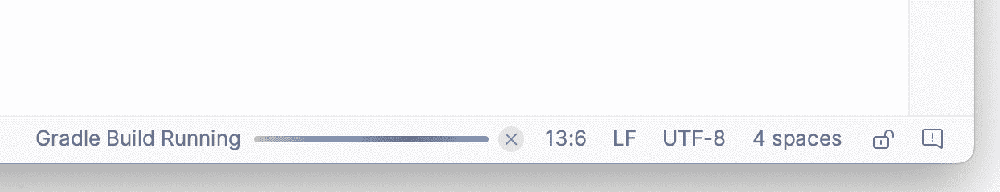

图 6-9

可以使用`View -> Appearance -> Status Bar Widgets`菜单更改状态栏中显示的组件。

## E – 项目工具窗口

项目工具窗口提供了项目文件结构的层级概述，允许对特定文件和文件夹进行导航。工具栏可用于以不同的方式显示项目。默认设置是 Android 视图，这是本书其余部分中主要使用的模式。

项目工具窗口只是 Android Studio 环境中许多可用工具之一。

## 6.4 工具窗口

除了项目视图工具窗口外，Android Studio 还包含了许多其他窗口，启用后，这些窗口会显示沿主窗口左侧和右侧边缘的工具窗口栏，包含显示和隐藏每个工具窗口的按钮。图 6-10 显示了典型的工具窗口栏配置，尽管按钮及其位置可能会根据你安装的 Android Studio 而有所不同。

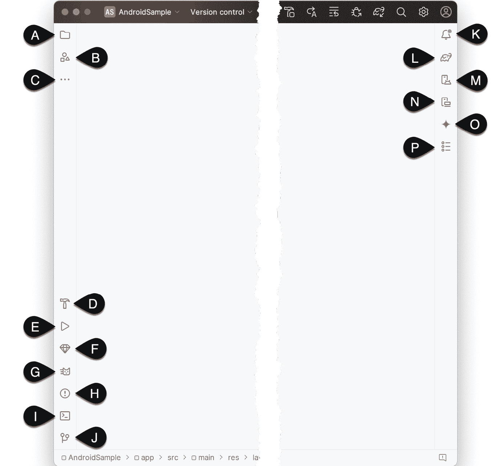

图 6-10

点击按钮将显示相应的工具窗口，再次点击将隐藏窗口。按钮在工具窗口栏中的位置表示窗口在显示时将位于窗口的哪侧。可以通过点击并拖动按钮到其他窗口工具栏中的不同位置来更改这些位置。

Android Studio 提供了广泛的工具窗口，最常用的如下：

- **项目 Project (A)** – 项目视图提供了项目文件结构概述，允许在文件之间进行快速导航。通常，在项目视图中双击文件将导致该文件加载到适当的编辑工具中。

- **资源管理器 Resource Manager (B)** - 用于添加和管理项目中的资源和资产的工具，例如图像、颜色和布局文件。

- **更多工具窗口 More Tool Windows (C)** 显示包含当前未在工具窗口栏中显示的附加工具窗口的菜单。当从此菜单选择工具窗口时，它将作为按钮出现在工具窗口栏中。

- **构建 Build (D)** 在 Android Studio 构建当前项目时，显示每个过程步骤的实时视图。

- **运行 Run (E)** – 当应用程序正在运行时，运行工具窗口将可用，并提供运行结果视图，以及停止或重启正在运行进程的选项。如果应用程序在设备或模拟器上安装和运行失败，此窗口通常会提供有关问题的诊断信息。

- **应用质量分析 App Quality Insights (F)** - 提供对基于云的 Firebase 应用质量和崩溃分析平台的访问。

- **Logcat (G)** – `Logcat`工具窗口提供了对运行应用程序监控日志输出的访问，并提供了对应用程序截图、视频以及停止和重启进程的选项。

- **问题 Problems (H)** - 查看项目内所有当前错误或警告的中心位置。双击问题列表中的项将带你进入问题所在的文件和位置。

- **终端 Terminal (I)** – 提供对运行 Android Studio 的系统上的终端窗口的访问。在 Windows 系统上，这是命令提示符界面，而在 Linux 和 macOS 系统上，它以终端提示的形式存在。

- **版本控制 Version Control (J)** - 当项目文件受源代码版本控制时使用此工具窗口，允许访问 Git 仓库和代码更改历史。

- **通知 Notifications (K)** - Android Studio 有时会针对事件（如项目构建完成或应用程序在设备或模拟器上成功启动）显示弹出通知。通知工具窗口提供了查看通知历史的中心位置。

- **Gradle (L)** – `Gradle`工具窗口提供了构成项目构建配置的 Gradle 任务视图。该窗口列出了将项目各种元素编译为可执行应用程序的涉及的任务。右键点击顶层 Gradle 任务并选择`Open Gradle Config`菜单选项可以将当前项目的 Gradle 构建文件加载到编辑器中。本书将在稍后部分详细介绍 Gradle。

- **设备管理器 Device Manager (M)** - 提供对设备管理器工具窗口的访问，可以在其中添加、删除和管理物理 Android 设备连接和模拟器。

- **运行中的设备 Running Devices (N)** - 如果启用了在工具窗口中运行模拟器的选项，则包含 AVD 模拟器，详情参见创建 Android 设备 (AVD)。

- **Gemini (O)** - Android Studio 的 AI 驱动编码助手。目前处于预览阶段，该工具通过提供编码建议和解决方案来帮助开发应用程序。

- **助手 Assistant (P)** 显示助手面板，其内容取决于你当前使用的 Android Studio 功能。

- **应用检查 App Inspection** - 提供对数据库检查器和后台任务检查器的访问。数据库检查器允许你在运行期间检查、查询和修改应用的数据库。后台任务检查器允许监控和管理使用`WorkManager`创建的后台工作任务。

- **书签 Bookmarks** – 书签工具窗口提供了对书签文件和代码行的快速访问。例如，在项目视图中右键点击文件可以访问“添加到书签”菜单选项。同样，你可以通过将光标移动到该行并按下`F11`键（macOS 上为`F3`）为源文件中的代码行设置书签。可以通过此工具窗口访问所有书签。

- **构建变体 Build Variants** - 为当前应用程序项目配置不同的构建目标提供了快捷方法（例如调试和发布版本的不同构建，或针对不同设备类别的多个构建）。

- **设备文件管理器 Device File Explorer** - 通过`View -> Tool Windows -> Device File Explorer`菜单可用，此工具窗口提供了对当前连接的 Android 设备或模拟器文件系统的直接访问，允许浏览文件并将文件复制到本地文件系统。

- **布局检查器 Layout Inspector** - 提供组成用户界面布局层次的可视化 3D 渲染。

- **Structure（结构）** – 结构工具提供了当前编辑器中显示的源文件结构的高级视图。此信息包含了文件中的类、方法和变量等项的列表。在结构列表中选择一个项，将带您跳转到编辑器窗口中源文件的对应位置。

- **TODO** – 如名称所示，此工具提供了一个审阅项目中尚未完成项的地方。Android Studio 通过扫描组成项目的源文件，查找匹配指定 TODO 模式的注释，来编译此列表。您可以通过打开`Settings（设置）`对话框并导航到`Editor（编辑器）`下的`TODO`条目来查看和更改这些模式。

## 6.5 工具窗口菜单

每个工具窗口在顶部边缘都有自己的工具栏。这些工具栏中的菜单按钮随工具的不同而异，尽管所有工具窗口都包含一个`Options（选项）`菜单（在图 6-11 中标记为 A）：

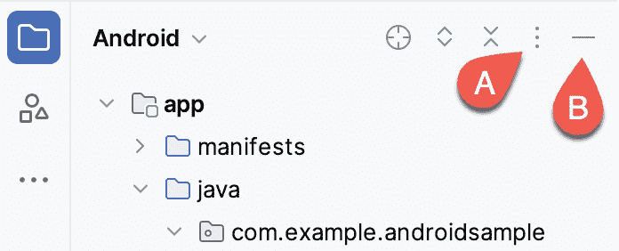

图 6-11

`Options`菜单允许更改窗口的各个方面。例如，图 6-12 显示了 Project 工具窗口的`Options`菜单。可以使用这些设置，例如取消停靠窗口使其浮动在 Android Studio 主窗口边界之外，以及移动和调整工具面板的大小：

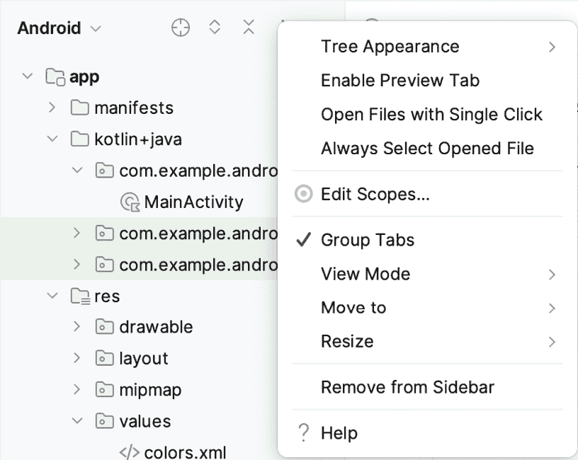

图 6-12

所有工具窗口在工具栏的最右侧还包含一个按钮（在上方图 6-11 中标记为 B），提供了隐藏工具窗口视图的额外方法。可以通过点击该窗口使其获取焦点，然后输入搜索词（例如 Project 工具窗口中的文件名）来对工具窗口内的项进行搜索。搜索框将出现在窗口的工具栏中，并匹配搜索词的项会被高亮显示。

## 6.6 Android Studio 快捷键

Android Studio 包含了许多快捷键，以便在执行常用任务时节省时间。您可以在 Android Studio 项目窗口内选择`Help -> Keyboard Shortcuts PDF`菜单选项，查看并打印完整的快捷键映射列表。您也可以通过打开`Settings`对话框并点击`Keymap`条目来列出和修改快捷键，如下方的图 6-13 所示：


图 6-13

## 6.7 Switcher 和最近文件导航

在 Android Studio 主窗口内导航的另一种实用机制是使用`Switcher（切换器）`。通过`Ctrl-Tab`快捷键访问，切换器会作为一个面板出现，列出工具窗口和当前打开的文件（图 6-14）。


图 6-14

一旦显示，只要`Ctrl`键保持按下，切换器就会保持可见。按住`Ctrl`键并反复点击`Tab`可以在各种选择选项之间循环，释放`Ctrl`键则选中当前高亮的并在主窗口中显示。

除了`Switcher`之外，`Recent Files（最近文件）`面板提供了到最近打开文件的导航（图 6-15）。可以使用`Ctrl-E`快捷键（macOS 上为`Cmd-E`）访问此处。一旦显示，可以使用鼠标指针选择选项，或使用键盘方向键滚动浏览文件名和工具窗口选项。按下`Enter`键将选中当前高亮的项：

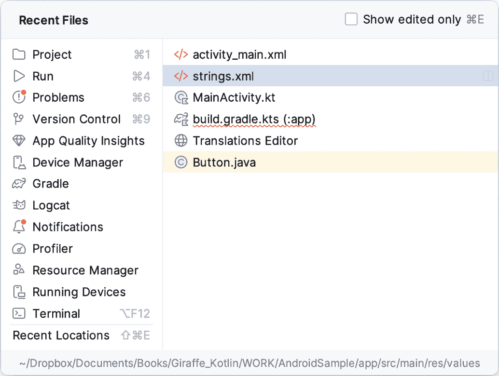

图 6-15

## 6.8 更改 Android Studio 主题

可以使用`Settings`对话框更改 Android Studio 环境的整体主题。一旦显示设置对话框，选择左侧面板中的`Appearance & Behavior（外观与行为）`，然后选择`Appearance（外观）`。然后在点击`OK`按钮之前更改`Theme（主题）`菜单的设置。可用主题取决于平台，但通常包括`Light（浅色）`、`IntelliJ`、`Windows`、`High Contrast（高对比度）`和`Darcula`等选项。图 6-16 显示了选择了`Dark（深色）`主窗口示例：


图 6-16

要将 Android Studio 主题与操作系统的亮/色模式设置同步，请启用`Sync with OS`选项并使用下拉菜单控制每种模式使用哪个主题：


图 6-17

Android Studio 市场中提供了数百个额外主题可供下载，点击`Get more themes（获取更多主题）`链接即可访问。

## 6.9 总结

Android Studio 环境的主要元素包括欢迎界面和主窗口。每个打开的项目都分配有它自己的主窗口，主窗口反过来由菜单栏、工具栏、编辑和设计区域、状态栏以及一组工具窗口组成。工具窗口出现在主窗口的侧面。

Android Studio 中只有极少数的操作是无法通过快捷键触发的。可以随时从 Android Studio 主窗口内访问默认快捷键的映射。

## 7. 在物理 Android 设备上测试 Android Studio 应用

虽然通过 Android 模拟器（AVD）测试应用程序可以完成很多工作，但在物理 Android 设备上进行测试是不可替代的，且某些 Android 功能仅在物理设备上可用。

与 AVD 实例以及连接的设备之间的通信由 Android 调试桥（ADB）处理。本章解释了如何在 macOS、Windows 和基于 Linux 的系统上配置`adb`环境以启用应用程序测试。

### 7.1 Android 调试桥（ADB）概述

ADB 的主要目的是促进开发系统（在本例中为 Android Studio）与模拟器及 Android 设备之间的交互。ADB 允许通过 WiFi 或 USB 线连接设备。

ADB 由一个客户端、一个在开发系统中运行的服务器进程以及在 AVD 或真实的 Android 设备上运行的守护进程组成。

ADB 客户端有多种形式。例如，在 Android SDK 的`platform-tools`子目录下提供了名为`adb`的命令行工具。同样，Android Studio 也有内置客户端。

可以使用命令行工具执行各种任务。例如，列出活跃的虚拟或物理设备。以下命令输出表示系统中存在 AVD 但没有物理设备：

```
$ adb devices
List of devices attached
emulator-5554 device
```

3. 返回主设置界面，并注意标题为`Developer options`（开发者选项）的新选项（在较新版本的 Android 中，此选项列在系统设置屏幕上）。选择此选项，并在屏幕上找到如图 7-2 所示的`USB debugging`（USB 调试）选项：


图 7-2

4. 启用`USB debugging`选项，并在请求确认时点击`Allow`（允许）按钮。

如果你使用的是三星 Galaxy 设备，在启用调试选项之前，可能需要在设置应用中关闭`Auto Blocker`（自动锁）功能。

设备现在已配置为接受通过 USB 连接来自开发系统上`adb`的调试连接。剩下的工作是配置开发系统以便在连接设备时检测到它。虽然这是一个相对简单的过程，但步骤取决于开发系统运行的是 Windows、macOS 还是 Linux。请注意，以下步骤假设 Android SDK platform-tools 目录已包含在系统的`PATH`环境变量中，正如“设置 Android Studio 开发环境”章节描述的那样。

### 7.2.1 macOS ADB 配置

要在 macOS 系统上配置`ADB`环境，请使用 USB 线将设备连接到计算机系统，打开终端窗口并执行以下命令来重启`adb`服务：

```bash
adb kill-server
adb start-server
```

```
* daemon not running. starting it now on port 5037 *
* daemon started successfully *
```


一旦服务器成功运行，执行以下命令验证设备是否已检测到：

```bash
adb devices
```

```text
List of devices attached

74CE000600000001 offline
```

如果设备被列为`offline`（离线），请查看 Android 设备并检查是否有如图 7-3 所示的寻求`Allow USB debugging`权限的对话框。在点击`OK`之前，勾选`Always allow from this computer`（始终允许来自此计算机）旁边的复选框。


图 7-3

再次执行`adb devices`命令现在应该将设备列为可用：

```text
List of devices attached

015d41d4454bf80c device
```

如果设备未列出，请尝试注销并重新登录 macOS 桌面，如果问题仍然，请重启系统。

### 7.2.2 Windows ADB 配置

配置基于 Windows 的开发系统使用`ADB`连接到 Android 设备的第一步是在系统上安装相应的`USB drivers`。需要安装的`USB drivers`取决于 Android 设备的型号。如果你拥有像 Pixel 手机这样的 Google 设备，则必须在你的 Windows 系统上安装并配置`Google USB Driver`包。实现此操作的详细步骤列在以下网页上：

[`developer.android.com/sdk/win-usb.html`](http://developer.android.com/sdk/win-usb.html)

对于不支持`Google USB driver`的 Android 设备，有必要下载由设备制造商提供的驱动程序。可以在线上获取驱动程序列表以及下载和安装信息：

[`developer.android.com/tools/extras/oem-usb.html`](https://developer.android.com/tools/extras/oem-usb.html)

安装驱动程序且设备已被识别为正确的设备类型后，打开命令提示符窗口并执行以下命令：

```cmd
adb devices
```

此命令应输出关于已连接设备的信息，类似于所示：

```text
List of devices attached

HT4CTJT01906 offline
```

如果设备被列为`offline`或`unauthorized`（未授权），请查看设备显示器并检查是否有如图 7-3 所示的寻求`Allow USB debugging`权限的对话框。在点击`OK`之前，勾选`Always allow from this computer`旁边的复选框。再次执行`adb devices`命令现在应该将设备列为就绪：

```text
List of devices attached

HT4CTJT01906 device
```

如果设备未列出，执行以下命令来重启`ADB`服务：

```bash
adb kill-server
adb start-server
```

如果设备仍然未列出，尝试执行以下命令：

```bash
android update adb
```

请注意，可能还需要重启系统。

### 7.2.3 Linux adb 配置

在本章中，我们将再次使用 Ubuntu Linux 作为参考示例，在 Linux 上配置`adb`以连接到物理 Android 设备进行应用测试。

在 Ubuntu Linux 上进行物理设备测试需要安装名为`android-tools-adb`的包，这反过来要求 Android Studio 用户是`plugdev`组的成员。这是大多数 Ubuntu 版本上用户账户的默认设置，可以通过运行`id`命令进行验证。如果未列出`plugdev`组，请运行以下命令将你的账户添加到该组：

```bash
sudo usermod -aG plugdev $LOGNAME
```

满足组成员要求后，可以通过执行以下命令安装`android-tools-adb`包：

```bash
sudo apt-get install android-tools-adb
```

在完成上述更改后，重启 Ubuntu 系统。系统重启后，打开终端窗口，启动`adb`服务并检查设备列表：

```bash
adb start-server
adb devices
```

```text
* daemon not running. starting it now on port 5037 *
* daemon started successfully *
```

```text
List of devices attached

015d41d445bf80c offline
```

如果设备被列为`offline`，请查看 Android 设备并检查是否有如图 7-3 所示的寻求`Allow USB debugging`权限的对话框。

### 7.3 解决连接问题

如果你无法通过上述步骤连接到设备，请显示目标菜单（图 7-4）并选择`Device Connections`选项：


图 7-4

连接助手将扫描设备并报告问题。

### 7.4 在 Android 设备上启用无线调试

按照上述 7.2 节第 1 至 3 步操作，这次启用如图 7-5 所示的`Wireless Debugging`（无线调试）选项：


图 7-5

接下来，点击上面的`Wireless debugging`项以显示如图 7-6 所示的屏幕：


图 7-6

如果你的设备带有摄像头，选择`Pair device with QR code`（使用二维码配对设备），否则选择`Pair device with pairing code`（使用配对码配对设备）。根据你的选择，设置应用将启动摄像头会话或显示配对码，如图 7-7 所示：


图 7-7

选择选项后，返回 Android Studio 并从如图 7-8 所示的`Pair Devices Using WiFi`（通过 WiFi 配对设备）选项：


图 7-8

在配对对话框中，根据你之前在设备设置应用中的选择，选择`Pair using QR code`（使用二维码配对）或`Pair using pairing code`（使用配对码配对）：


图 7-9

使用 Android 设备扫描二维码，或者将设备屏幕上显示的配对码输入到 Android Studio 对话框（图 7-10）以完成配对过程：


图 7-10

如果配对过程失败，请尝试重启开发系统和 Android 设备并重试。

假设在你选择的开发平台上已成功配置了`adb`，下一步是尝试在设备上运行“在 Android Studio 中创建示例 Android 应用”章节创建的测试应用程序。启动 Android Studio，打开`AndroidSample`项目，并验证设备是否如图 7-11 所示显示在设备选择菜单中：


图 7-11

从列表中选择设备并点击运行按钮以安装并运行应用。

## 7.6 设备镜像（Device Mirroring）

设备镜像允许你在物理设备上运行应用，同时在 Android Studio 的运行设备（Running Devices）工具窗口中查看显示。换句话说，尽管应用程序运行在物理设备上，但它会像 AVD 实例一样出现在 Android Studio 中。

将设备连接到 Android Studio 后，显示运行设备工具窗口并点击`Device Mirroring`设置链接以显示设置对话框。在设置对话框中，启用物理 Android 设备的镜像并点击`OK`。下次运行应用时，Android Studio 将在运行设备工具窗口中镜像物理设备的显示。

## 7.7 总结

虽然 Android 虚拟设备模拟器提供了良好的测试环境，但必须记住，没有真正的替代品可以确保应用程序在物理 Android 设备上正确运行。

但是，默认情况下，Android Studio 环境未配置为将 Android 设备视为目标测试设备。因此，需要执行一些步骤，通过 USB 线或通过 WiFi 网络从 Android Studio 开发环境直接将应用程序加载到 Android 设备上。实现这一目标的具体步骤取决于开发平台。在本章中，我们涵盖了适用于 Linux、macOS 和基于 Windows 平台的这些步骤。

## 8. Android Studio 代码编辑器的基础

为 Android 开发应用程序涉及大量的编程工作，根据定义，这涉及输入、审查和修改代码行。意不意外的是，开发者使用 Android Studio 的大部分时间通常都在编辑器窗口内编辑代码。

现代代码编辑器必须远超输入、删除、剪切和粘贴的基本功能。今天，代码编辑器的实用性通常由等因素衡量，例如它减少了程序员所需的输入量、在大型源文件中进行导航的易用性，以及编辑器在编写代码时实时检测并突出显示编程错误。正如本章将所示，这些只是 Android Studio 编辑器出色的少数领域之一。

虽然本章不是 Android Studio 编辑器功能的详尽概述，但旨在提供工具关键功能的指南。经验丰富的程序员会发现，其中某些功能是目前大多数代码编辑器通用的，而许多功能是该编辑环境独有的。

### 8.1 Android Studio 编辑器

当选择 Java、Kotlin、XML 或其他基于文本的文件进行编辑时，Android Studio 编辑器出现在主窗口的中心。例如，图 8-1 显示了一个加载了 Java 源文件的典型编辑器会话：


图 8-1

构成编辑器窗口的元素可以总结如下：

**A – 文档标签页（Document Tabs）**：Android Studio 可以随时打开多个文件进行编辑。每打开一个文件时，它都会被分配一个文档标签页，在编辑器窗口顶部边缘的标签栏中显示文件名。当空间不足以显示所有标签页时，标签栏的最右侧会出现一个很小的下拉菜单。点击此菜单将列出其他已打开的文件列表。标签页中文件名下方的红色波浪线表示该文件中的代码包含一个或多个错误，在项目编译和运行之前需要处理这些错误。

在文件之间切换只需点击相应的标签页或使用`Alt-Left`和`Alt-Right`键盘快捷键。也可以使用切换器机制（通过`Ctrl-Tab`键盘快捷键访问）进行文件间的导航。

要将编辑器面板从 Android Studio 主窗口分离以便在单独窗口中显示，请点击标签页并将其拖到主窗口之外的桌面区域。要将编辑器返回主窗口，点击分离编辑器窗口中的文件标签页，并将其拖放到主窗口中的原始编辑器标签栏上。

**B – 编辑器行槽区域（The Editor Gutter Area）**：编辑器使用行槽区域显示信息图标和控件。该行槽区域中的一些典型项目包括调试断点标记、用于折叠和展开代码块的控件、书签、更改标记和行号。行号默认开启，但可以通过在行槽上点击右键并选择`Appearance -> Show Line Numbers`菜单选项来禁用。

**C – 代码结构位置栏（Code Structure Location）**：编辑器底部的此栏显示光标当前位置与代码整体结构的关系。例如，在图中，该栏指示当前正在编辑`convertCurrency`方法，且该方法包含在`MainActivity`类中：


图 8-2

双击栏内的某个元素将把光标移动到代码文件中对应的位置。例如，双击`convertCurrency`条目将把光标移动到源代码中`convertCurrency`方法的顶部。同样，点击`MainActivity`条目将显示可供选择的代码导航点列表：


图 8-3

**D – 编辑区域（The Editor Area）**：用户审查、输入和编辑代码的主要区域。本章的后续部分将详细介绍编辑区域的关键功能。

**E – 验证与标记侧边栏（The Validation and Marker Sidebar）**：Android Studio 引入了名为“实时代码分析”的功能。这意味着当你编写代码时，编辑器会分析代码以检查警告和语法错误。验证侧边栏顶部的指示器随代码的添加实时更新，以指示发现的错误警告数量。点击此指示器将显示包含代码问题摘要的弹出窗口，如图 8-4 所示：


图 8-4

向上和向下箭头在代码中的错误位置之间移动。绿色对钩表示未检测到警告或错误。

侧边栏还通过相同的颜色编码在检测到问题的位置显示标记。当代码行在编辑器区域可见时，将鼠标指针悬停在标记上将显示包含问题描述的弹出窗口：


图 8-5

当代码行已滚动出编辑器可视区域时，将鼠标指针悬停在标记上将显示一个“透镜”覆盖层，其中包含问题所在的代码块（如图 8-6）。

图 8-6

值得注意的是，透镜覆盖不仅限于侧边栏中的警告和错误。悬停在侧边栏的任何部分都会导致出现透镜，其中包含源文件中对应位置的代码。

### 8.6 状态栏

虽然状态栏属于主窗口而非编辑器，但它确实包含有关当前活动会话的信息。这些信息包括光标在行和字符上的当前位置，以及文件的编码格式（`UTF-8`、`ASCII`等）。点击状态栏中的这些值可以更改相应的设置。例如，点击行号会显示`Go to Line:Column`对话框。使用`View -> Appearance -> Status Bar Widgets`菜单选项可以添加或删除组件。例如，如果你在 Android Studio 中遇到性能问题，`Memory Indicator`是一个非常有用的组件。

在概述了构成 Android Studio 编辑器的元素后，本章的其余部分将更详细介绍编辑环境的关键功能。

## 8.2 分割编辑器窗口

默认情况下，编辑器将显示一个显示当前选中文件内容的面板。在同时处理多个源文件时，一个实用的功能是将编辑器拆分为多个窗格。要拆分编辑器，请右键点击编辑器窗口内的文件标签，并选择`Split Right`（向右拆分）或`Split Down`（向下拆分）菜单选项。例如，图 8-7 显示了拆分器的用法，编辑器被拆分为三个面板：


图 8-7

拆分面板的方向可以通过右键点击相应的标签并选择`Change Splitter Orientation`（更改拆分方向）菜单选项随时更改。重复这些步骤可以取消拆分单个面板，此时从菜单中选择`Unsplit`选项。可以通过右键点击任何标签并选择`Unsplit All`选项来移除所有拆分面板。

窗口分割可显示不同的文件，或为同一个文件提供多个窗口，允许同时查看和编辑同一文件的不同区域。

### 8.3 代码补全

Android Studio 编辑器对 Java 编程语法、构成 Android SDK 的类和方法以及你自己的代码库都拥有大量的内置知识。随着代码的输入，编辑器会扫描输入内容，并在适当的情况下就完成语句或引用可能的内容提供建议。当编辑器检测到补全建议时，将出现一个包含建议列表的面板。例如，图 8-8 显示编辑器正在为`String`声明的开头提供可能的选项：


图 8-8

如果没有任何自动补全建议是正确的，请继续输入，编辑器将继续在适当的地方完善建议。要接受最顶部的建议，请按键盘上的`Enter`或`Tab`键。要选择不同的建议，使用方向键在列表中上下移动，再次使用`Enter`或`Tab`键选择高亮项。

可以使用`Ctrl-Space`键盘序列手动调用补全建议。这在更改编辑器中的单词或声明时非常有用。当光标置于编辑器中的某个单词上时，该单词将自动高亮显示。按下`Ctrl-Space`将显示一系列备选建议。按`Tab`键将当前单词替换为建议列表中的高亮项。

除了实时自动补全功能，Android Studio 编辑器还提供了智能补全（Smart Completion）系统。智能补全通过`Shift-Ctrl-Space`键盘序列调用，在选择后，它将根据代码的当前上下文提供更详细的建议。再次按下`Shift-Ctrl-Space`快捷键将从更广泛的范围内提供更多建议。

代码补全对许多程序员来说是个人喜好。为了承认这一事实，Android Studio 对自动补全设置提供了高程度的控制。可以通过打开`Settings`对话框并在设置面板中选择`Editor -> General -> Code Completion`来查看和修改这些设置，如图 8-9 所示：


图 8-9

### 8.4 语句补全

Android Studio 编辑器提供的另一种自动补全形式是语句补全（Statement Completion）。它可以自动填充方法和循环语句等项的括号和大括号。语句补全通过`Shift-Ctrl-Enter`（macOS 上为`Shift-Cmd-Enter`）键盘序列调用。例如，考虑以下代码：

```
myMethod()
```

在编辑器中输入此代码后，触发语句补全将导致编辑器自动为方法添加大括号：

```java
myMethod() {

}
```

### 8.5 参数信息


还可以请求编辑器提供方法接受的参数信息。当光标置于方法调用的括号之间时，使用 `Ctrl-P`（macOS 上为 `Cmd-P`）键盘序列将显示该方法已知接受的参数，最可能的建议将**加粗**显示：


图 8-10

### 8.6 参数名称提示

可以配置代码编辑器在方法调用显示参数名称提示。例如，图 8-11 高亮了 `Snackbar` 类 `make()` 和 `setAction()` 方法调用中的参数名称提示：


图 8-11

此模式的设置可以通过打开 `Settings` 对话框并在侧边栏导航到 `Editor -> Inlay Hints -> Java` 来配置。在生成的屏幕上为你选择的编程语言开启或关闭 `Parameter names`（参数名称）选项。要调整提示设置，点击 `Exclude list...` 链接进行任何调整。

### 8.7 代码生成

除了输入代码时完成代码外，编辑器在某些条件下还可以为你生成代码。当光标位于文件中需要生成代码的位置时，可以使用快捷键 `Alt-Insert`（macOS 上为 `Cmd-N`）访问可见的代码生成选项列表：


图 8-12

例如，考虑我们希望在项目中的 `Activity` 准备被操作系统销毁时收到通知的情况。正如本书后续章节概述的，这可以通过重写 `Activity` 超类的 `onStop()` 周期方法来实现。要让 Android Studio 为此生成存根方法，请从代码生成列表中选择 `Override Methods…` 选项，并从可用方法列表中选择 `onStop()` 方法：


图 8-13

选择要重写的方法后，点击 OK 将在 Java 源文件的当前光标位置生成存根方法，如下所示：

```java
@Override
protected void onStop() {
    super.onStop();
}
```

### 8.8 代码折叠

当源代码文件达到一定大小时，即使是格式最整齐、组织良好的代码也可能变得难以处理和导航。Android Studio 认为，并不总是需要让每个代码块的内容都保持可见。通过使用 Android Studio 编辑器的代码折叠（code folding）功能，可以让代码导航变得更容易。代码折叠通过展开箭头（disclosure arrows）进行控制，当鼠标指针悬停在源行间隙（gutter area）时，这些箭头会出现在每个代码块的开头。例如，图 8-14 突出了一个当前未折叠的方法声明的展开箭头：


图 8-14

点击此标记将折叠该语句，使其只显示签名行，如图 8-15 所示：


图 8-15

要展开折叠的代码段，请点击编辑器行间隙中的展开箭头。要在不展开代码的情况下查看隐藏代码，将鼠标指针悬停在“{…}”指示器上，如图 8-16 所示。编辑器随后将显示包含折叠代码块的透镜层：


图 8-16

文件中的所有代码块都可以使用 `Ctrl-Shift-Plus` 和 `Ctrl-Shift-Minus` 键序列（macOS 上为 `Cmd-Shift-Plus` 和 `Cmd-Shift-Minus`）进行折叠或展开。

默认情况下，Android Studio 编辑器在打开源文件时会自动折叠某些代码。要配置发生这种情况的情况，请在设置对话框中导航到 `Editor -> General -> Code Folding` 项（图 8-17）：


图 8-17

### 8.9 快速查找文档

通过将光标置在所需文档的声明上并按下 `Ctrl-Q` 快捷键（macOS 上为 `Ctrl-J`），即可访问与上下文相关的 Java 和 Android 文档。这将显示一个包含该项目相关参考文档的弹出窗口。例如，图 8-18 显示了 `FloatingActionButton` 类的文档。


图 8-18

### 8.10 代码重格式化

通常，Android Studio 编辑器会在添加代码时根据缩进、间距以及语句和代码块的嵌套自动格式化代码。在需要对代码进行重格式化的情况下（这很常见，例如从网站剪切粘贴示例代码时），编辑器提供了源代码重格式化功能，选择后将自动重格式化代码以匹配当前主流的代码风格。

按下 `Ctrl-Alt-L`（macOS 上为 `Cmd-Opt-L`）快捷键序列来重格式化源代码。要显示重格式代码对话框（图 8-19），请使用 `Ctrl-Alt-Shift-L`（macOS 上为 `Cmd-Opt-Shift-L`）。此对话框提供了仅重格式化当前选中的代码、编辑器中活动的整个源文件，或仅重格式化由于源码控制更新而更改的代码选项：


图 8-19

通过打开设置对话框并在侧边面板中选择 `Code Style` 以访问支持的编程和标记语言列表，可以更改全范围的代码风格偏好。选择一种语言将提供大量的格式化样式选项，所有这些选项都可以从 Android Studio 默认值进行修改，以匹配您偏好的代码风格。例如，要配置上述对话框中重排（Rearrange）代码选项的设置，请展开 `Code Style` 部分，选择 `Java`，并在 `Java` 设置中选择 `Arrangement` 选项卡。

### 8.11 查找示例代码

Android Studio 编辑器提供了一种访问与代码列表中当前高亮条目相关的示例代码的方法。此功能对于学习如何使用特定的 Android 类或方法非常有帮助。要查找示例代码，在编辑器中高亮方法或类名，右键点击它，并选择 `Find Sample Code` 菜单选项。如果有可用的示例代码，`Find Sample Code` 面板将出现并列出匹配的示例。从列表中选择示例会将相应的代码加载到右侧面板。

### 8.12 实时模板（Live Templates）

在编写 Android 代码时，你会发现有一些经常使用的常用结构。例如，一个常见需求是使用 `Toast` 类向用户显示弹出消息。Live 模板是常用代码结构的集合，可以通过在编辑器中输入初始字符，然后按一个特殊键（默认设置为 `Tab` 键）来插入模板代码。要实地体验这一操作，请在代码编辑器中输入 `toast` 然后按 `Tab` 键，Android Studio 将在光标位置插入以下代码并准备好编辑：

```
Toast.makeText(, "", Toast.LENGTH_SHORT).show();
```

要列出并编辑现有模板、更改特殊键或添加您自己的模板，请打开设置对话框并在左侧导航面板的 `Editor` 部分选择 `Live Templates`：


图 8-20

使用上方图 8-20 中的标记 A 添加、删除、复制或重置模板。要修改模板，从列表中选择 B 并在 C 面板中更改设置。

### 8.13 总结

Android Studio 编辑器极力减少编写代码所需的工作，并使代码更容易阅读和导航。本章介绍了关键编辑器功能，包括代码补全、代码生成、编辑器分屏、代码折叠、重格式化、文档查找和实时模板。

# 9 在 Android Studio 中引入 Gemini

自从图灵（Alan Turing）提出识别计算机何时变得“智能”的测试以来，发生了巨大变化。随着 OpenAI 等其他公司的人工智能突破，AI 通过集成到 Android Studio 进入 Android 开发领域也并不意外。

本章将介绍 Android Studio 中的 AI 功能，并探索它们如何让您的开发工作变得更加轻松。

### 9.1 介绍 Gemini AI

最初名为 Bard 的 `Gemini` 是 Google DeepMind 部门的人工智能技术。Gemini 被归类为大模型（LLM）生成式人工智能。

为了训练 Gemini，Google 向其输入了大量的多样化内容，包括书籍、论文、图像、源代码和从抓取的数据。Gemini 然后根据这些数据创建了一个模型，并利用该模型对各种输入（如问题、图像、请求或编程代码）生成响应。

一旦在 Android Studio 中启用 Gemini，它可以生成示例代码、解释特定的编程目标、提供代码补全建议并改进或扩展现有代码。

### 9.2 在 Android Studio 中启用 Gemini

在 Android Studio 中启用 Gemini 之前，必须先启用它。此过程非常简单，但需要您在 Android Studio 中登录 Google 账户。如果当前未登录，请点击 Android Studio 工具栏上的配置按钮，然后点击登录按钮：


图 9-1

当登录向导屏幕出现时，请确保如图 9-2 所示启用了 Gemini in Android Studio，然后点击完成按钮。Android Studio 将打开浏览器窗口，您可以在其中完成登录过程并授予 Android Studio 访问您帐户的权限。


图 9-2

如果你已经通过 Android Studio 登录了 Google 账号，但尚未启用 Gemini，请显示配置菜单并选择下方图 9-3 中突出显示的 `Enable Integrations...` 链接：


图 9-3

在设置对话框的 Gemini 区域点击 `Allow` 按钮，然后点击 `OK` 按钮：


图 9-4

一旦你登录并启用了 Gemini，通过点击图 9-5 中显示的按钮来显示 Gemini 工具窗口：


图 9-5

### 9.3 Gemini 配置

Gemini 的配置设置位于 Android Studio 设置对话框中的 Gemini 页面（标记为图 9-6 中的 A）。启用基于 AI 的内联代码补全选项（B），以允许 Gemini 分析你的代码并在你输入代码时提供编码建议。只有在你允许 Gemini 使用你的项目上下文（C）来提供建议时，此功能才可用。如果你对 Google 查看你的代码有顾虑，请在启用此功能之前花些时间阅读隐私政策：


图 9-6

### 9.4 向 Gemini 提问

你可以与 Gemini 聊天，以获取有关 Android 开发问题的答案。为此，请使用 Gemini 工具窗口底部的聊天框。

Gemini 可以解释 Android 开发概念、向你展示如何实现特定任务、解释错误信息、教你如何使用 Android Studio 功能，并提供你可以在项目中使用的代码示例。例如，你可以问 Gemini 如何画一个圆：


图 9-7

Gemini 将解释如何画一个圆并提供示例代码。在 Gemini 的响应中，每个代码示例下方都有一组按钮，如图 9-8 所示：


图 9-8

从左到右，按钮执行以下任务：

- `Copy`：将示例代码复制到剪贴板，准备粘贴到你的代码中。
- `Insert at Cursor`：将代码粘贴到代码编辑器的当前光标位置。
- `Explore in Playground`：一个实验性功能，它将代码放入名为 `gemini-playground.kts` 的 Kotlin 脚本文件中，你可以在那里测试小型代码示例。你也可以通过在播放器代码文件中问题前加上 `// @Gemini` 直接与 Gemini 交互。
- `Insert into a New Kotlin File`：向项目中添加包含示例代码的新代码文件。

### 9.5 问题上下文

当你向 Gemini 提问时，它将使用之前问题的上下文来形成答案。虽然当你对特定主题有后续问题时这很有帮助，但如果 Gemini 没有意识到你的问题上下文已经变化，可能会导致误导性的答案。例如，假设你问 Gemini 如何使用 `Widget` 框架创建一个组件。一旦你收到答案，你又向 Gemini 要显示图像的示例代码。根据你之前的问题，Gemini 可能会假设你想在组件内显示图像，并提供相应的步骤和代码。在这种情况下，如果你的目标是学习如何在普通的 Android view 而不是组件上显示图像，那么 Gemini 就会给你错误信息。

为了避免这个问题，在提问下一个问题时，告诉 Gemini 你正在不同的上下文中提问，或者在构思问题时更加具体。

### 9.6 内联代码补全

当你向编辑器中输入代码时，Gemini 可以提供代码补全建议。它是根据你正在输入的代码以及对项目其余代码的分析来实现的。Gemini 推断你意图的能力非常好，甚至可能会感到不可思议。

当代码补全启用并处于激活时，下方图 9-9 中显示的按钮将出现在代码编辑器的状态栏：


图 9-9

点击此按钮可以激活和禁用代码补全，并访问 Gemini 配置设置。

假设我们正在编写一个网上银行应用，需要一个 Java 类来包含客户账户信息。我们可能从如下所示创建类开始：

```java
public class BankAccount {
    Float accountBalance;
}
```

在我们声明 `accountBalance` 变量并按回车后，Gemini 将建议一个名为 `accountName` 的额外变量。假设我们需要这个变量，可以通过按 `Tab` 键接受它：

```java
public class BankAccount {
    Float accountBalance;
    String accountName;
}
```

接下来，Gemini 建议了一个账户号码变量：

```java
public class BankAccount {
    Float accountBalance = 0f;
    String accountName;
    String accountNumber;
}
```

一旦声明了变量，Gemini 将建议一个构造函数来初始化账户名称和号码属性：

```java
public BankAccount(String name, String number) {
    this.accountName = name;
    this.accountNumber = number;
}
```

接下来，Gemini 建议一个向账户存款的方法：

```java
public void deposit(Float amount) {
    this.accountBalance += amount;
}
```

在我们接受该方法后，Gemini 建议一个取款方法：

```java
public void withdraw(Float amount) {
    this.accountBalance -= amount;
}
```

然后是 `getBalance()` 方法：

```java
public Float getBalance() {
    return this.accountBalance;
}
```

Gemini 将继续提供建议，直到你认为类已经完整。考虑一下 Gemini 仅根据初始的三行代码就生成了上述代码，我们可以开始体会 Gemini 的强大。

### 9.7 总结

随着 Gemini 集成到 Android Studio，开发者现在可以在开发 Android 应用时使用 AI。一旦启用 Android Studio 中的 Gemini，它可以回答你的问题、提供代码示例、建议代码补全并扩展现有代码。

# 10 Android 架构概述

到目前为止，本书已经搭建了适用于使用 Android Studio 开发 Android 应用的环境。通过创建 Android Studio 应用项目也迈出了应用开发的第一步。

然而，在进一步研究 Android 应用开发的实际问题之前，理解 Android SDK 和通用 Android 开发的一些抽象概念是关重要的。现在清晰地这些概念将为建立进一步知识奠下坚实的基础。

从本章的 Android 架构概述开始，并在接下来的几章中，目标是提供 Android 开发基础的详细概述。

## 10.1 Android 软件栈

Android 结构化为一个由应用程序、操作系统、运行时环境、中间件和服务库组成的软件栈。这种架构可以通过视觉方式表示，如图 10-1 所示。栈的每一层以及每层中的相应元素都紧密集成并经过仔细调整，以为移动设备提供最优的应用和执行环境。本章的剩余部分将介绍 Android 栈的不同层，从底部的 Linux 内核开始。


图 10-1

## 10.2 Linux 内核

Linux 内核位于 Android 软件栈的底部，在设备硬件与 Android 软件栈上层之间提供了一个抽象层。内核提供了抢占式多任务处理、低级核心系统服务（如内存、进程和电源管理），以及用于设备显示、WiFi 和音频等硬件的网络栈和设备驱动程序。


原始 Linux 内核由 Linus Torvalds（林纳·托瓦兹）于 1991 年开发。它与 Richard Stallman（理查·斯坦曼）在自由软件基金会开发的工具、实用程序和编译器相结合，创建了名为 GNU/Linux 的完整操作系统。各种 Linux 发行版都是基于这些基础衍生而来的，例如 Ubuntu 和红帽企业 Linux（Red Hat Enterprise Linux）。

然而，需要注意的是，Android 仅使用了 Linux 内核。尽管如此，值得注意的是，Linux 内核最初是为传统的桌面和服务器计算机系统设计的。事实上，Linux 现在最广泛地部署在任务关键的企业服务器环境中。我们在 Android 软件栈的核心位置发现这种软件，这既证明了当今移动设备的强大，也证明了 Linux 内核的效率和性能。

## 10.3 硬件抽象层

硬件抽象层（HAL）由一组库模块组成，与摄像头、麦克风和加速度计等设备组件接口。当 Android 栈需要访问硬件组件时，它会使用 HAL 库模块。每个 Android 设备制造商都有其特定硬件配置的抽象层，允许标准的 Android 库和框架在任何设备上运行，而无需针对特定硬件进行修改。

## 10.4 Android 运行时 – ART

当在 Android Studio 中构建 Android 应用时，它会被编译为中间字节码格式（DEX 格式）。当应用程序随后加载到设备上时，Android 运行时（ART）使用一种称为预执行编译（AOT 编译）的过程，将字节码翻译为设备处理器所需的本地指令。这种格式被称为可执行和链接格式（ELF）。

每当随后启动应用程序时，都会运行 ELF 可执行版本，从而获得更快的应用程序性能和更长的电池续航时间。

这与旧版 Android 实现使用的即时编译（JIT）编译方法形成对比，在旧版本中，字节码在每次启动应用程序时都在虚拟机（VM）中进行翻译。

## 10.5 Android 库

除了一组标准的 Java 开发库（提供字符串处理、网络和文件操作等通用任务的支持）外，Android 开发环境还包含 Android 库。这些是专门用于 Android 开发的一组 Java 库。此类库的示例包括应用程序框架库，以及促进用户界面构建、图形绘制和数据库访问的库。

Android 开发者可用的某些关键核心 Android 库摘要如下：

- `android.app` – 提供对应用程序模型的访问，是所有 Android 程序的基石。
- `android.content` – 促进应用程序与应用程序组件之间的内容访问、发布和消息传递。
- `android.database` – 用于访问由内容提供发布的数据，包含 `SQLite` 数据库管理类。
- `android.graphics` – 一个低级 2D 图形绘制 API，包括颜色、点、过滤器、矩形和画布。
- `android.hardware` – 呈现一个提供对加速度计和光线传感器等硬件访问的 API。
- `android.opengl` – 指向 `OpenGL ES` 3D 图形渲染 API 的 Java 接口。
- `android.os` – 为应用程序提供标准操作系统服务的访问，包括消息、系统服务和进程间通信。
- `android.media` – 提供启用音频和视频播放的类。
- `android.net` – 一组提供网络栈访问的 API。包括 `android.net.wifi`，它提供了对设备无线栈的访问。
- `android.print` – 包括一组类，允许从 Android 应用程序将内容发送到配置的打印机。
- `android.provider` – 一组便利类，提供对标准 Android 内容提供者数据库的访问，例如日历和联系人应用程序维护的数据库。
- `android.text` – 用于在设备显示上渲染和操作文本。
- `android.util` – 一组实用类，用于执行字符串和数字转换、XML 处理以及日期操作等任务。
- `android.view` – 应用程序用户界面的基础构建块。
- `android.widget` – 丰富的预构建用户界面组件集合，如按钮、标签、列表视图、布局管理器、单选按钮等。
- `android.webkit` – 一组类，旨在在应用程序中构建网页浏览功能。

在涵盖了 Android 运行时基于 Java 的库之后，现在是将注意力转向 Android 软件栈这一层中基于 C/C++ 的库了。

### 10.5.1 C/C++ 库

在前节概述的 Android 运行时核心库是基于 Java 的，为 Android 开发者提供了主要的 API。然而，需要注意的是，核心库并没有执行许多实际工作，它们本质上是对一组基于 C/C++ 的库的 Java“封装器”。例如，当调用 `android.opengl` 库在设备屏幕上绘制 3D 图形时，该库最终会调用 `OpenGL ES` C++ 库，该库又与底层 Linux 内核协作执行绘制任务。

包含 C/C++ 库是为了实现广泛且化的的功能，包括 2D 和 3D 图形绘制、安全套接层（SSL）通信、`SQLite` 数据库管理、音频和视频播放、位图和矢量字体渲染、显示子系统和图形层管理以及标准 C 库 (`libc`)。

在实践中，典型的 Android 开发者将仅通过 Java 核心 API 访问这些库。如果需要直接访问这些库，可以使用 Android 原生开发包（NDK），其目的是通过 Java 接口（JNI）从 Java 代码调用非 Java 或 Kotlin 语言（如 C 和 C++）的本地方法。

## 10.6 应用框架

应用框架是一组共同构成 Android 应用程序运行和管理环境的服务。该框架实现了这样一个理念：Android 应用程序是由重用、可交换和可替换的组件构建的。这一概念更进一步，因为应用程序还可以发布其功能以及相应的数据，以便其他应用程序可以发现并重用它们。

Android 框架包括以下关键服务：

- Activity 管理 – 控制应用程序生命周期和活动栈的所有方面。
- 内容提供者 – 允许应用程序发布并共享数据。
- 资源管理器 – 提供对非代码嵌入资源的访问，如字符串、颜色设置和用户界面布局。
- 通知管理器 – 允许应用程序向用户显示警报和通知。
- 视图系统 – 用于创建应用程序用户界面的扩展视图集。
- 包管理器 – 应用程序查找设备上当前安装的其他应用程序信息的系统。
- `Telephony Manager`（电话管理器）——为应用程序提供设备可用电话服务的信息，例如状态和订阅者信息。
- `Location Manager`（位置管理器）——提供对位置服务的访问，允许应用程序接收位置更改的更新。

## 10.7 应用程序

位于 Android 软件栈顶端的是应用程序。这些由特定 Android 实现提供的原生应用程序（例如网络浏览器和电子邮件应用程序）以及用户在购买设备后安装的第三方应用程序组成。

## 10.8 总结

良好的 Android 开发知识基础需要对 Android 的整体架构有理解。Android 被实现为一种软件栈架构，由 `Linux kernel`（Linux 内核）、运行时环境、相应的库、应用程序框架和一组应用程序组成。应用程序主要使用 `Java` 或 `Kotlin` 编写，并在 `Android Studio` 构建环境中被编译为字节码格式。当应用程序随后安装到设备上时，这些字节码将由 `Android Runtime` (`ART`) 编译编译为 CPU 使用的本地格式。Android 架构的核心目标是性能和效率，既体现在应用程序执行中，也体现在应用程序设计中复用的实现上。

## 11. Android 应用程序的构造分析

无论你之前的编程经验是基于 Windows、macOS、Linux 甚至 iOS 的，都有很大可能 Android 开发与你以前遇到过的任何事物大不相同。

因此，本章的目标是提供对 Android 应用程序架构背后高层概念的理解。在此过程中，我们将详细探索用于构建应用程序的各种组件，以及允许这些组件协同工作以创建一个内聚应用程序的机制。

### 11.1 Android Activities（活动）

熟悉 `Java`、`Kotlin`、`C++` 或 `C#` 等面向对象编程语言的人将熟悉将应用程序功能元素封装在类中，然后将类实例化为对象并进行操作以创建应用程序的概念。这仍然适用，因为 Android 应用程序是用 `Java` 和 `Kotlin` 编写的。然而，Android 还将复用组件的概念推到了更高的水平。

Android 应用程序是通过组合一个或多个被称为 `Activities` 的组件创建的。Activity 是一个单一、独立的应用程序功能模块，通常直接对应于单个用户界面屏幕及其相应的功能。例如，一个预约应用程序可能会有一个 Activity 屏幕，显示当天设置的预约。该应用程序还可能使用第二个 Activity，该屏幕由一个用户可以在其中输入新预约的界面组成。

`Activities` 旨在作为完全可复用且可交换的构建块，可以在不同的应用程序之间共享。一个现有的电子邮件应用程序可能包含一个用于编写和发送电子邮件消息的 Activity。开发者可能正在编写一个也需要发送电子邮件消息的应用程序。开发者无需为新应用程序专门开发一个电子邮件编写 Activity，而是可以使用现有电子邮件应用程序中的 Activity。

`Activities` 是作为 `Android Activity` 类的子类创建的，并且必须实现为与应用程序中的其他 Activity 完全独立。换句话说，共享的 Activity 不能依赖于在程序流的已知点处被调用（因为其他应用程序可能会以意料之外的方式使用该 Activity），而且一个 Activity 不能直接调用另一个 Activity 的方法或访问其实例数据。相反，这种目标通过使用 `Intents`（意图）和 `Content Providers`（内容提供者）来实现。

默认情况下，Activity 无法向调用它的 Activity 返回结果。如果需要此功能，则必须显式地作为源 Activity 的子 Activity 启动它。

### 11.2 Android Fragments（片段）

如上所述，Activity 通常代表应用中的一个单一用户界面屏幕。一种方案是使用单一的用户界面布局和一个相应的 Activity 类文件来构建 Activity。然而，更好的替代方案是将 Activity 拆分为不同的部分。每个部分都是一个 `fragment`（片段），由用户界面布局的局部和一个匹配的类文件（声明为 `Android Fragment` 类的子类）组成。在这种情况下，Activity 变成一个容器，其中嵌入了一个或多个片段。

`Fragments` 为每个用户界面屏幕都由独立 Activity 提供了一个高效的替代方案。相反，应用程序可以使用一个 Activity，在不同的片段之间切换。

### 11.3 Android Intents（意图）

`Intents` 是 Activity 启动另一个 Activity 并实现流程的机制。`Intents` 由要执行的操作的描述以及（可选的）执行操作的数据组成。

### 11.4 Broadcast Intents（广播意图）

另一种 `Intent` 类型是广播意图，它是向所有已注册感兴趣的 `Broadcast Receiver` 发送的系统级意图。例如，Android 系统通常会发送广播意图来指示设备状态的变化，例如系统启动、连接外部电源或屏幕开启或关闭。

广播意图可以是正式的（异步的），因为它同时发送给所有感兴趣的 `Broadcast Receiver`；也可以是有序的，因为它一次发送给一个接收器，处理后可以被中止或传递给下一个 `Broadcast Receiver`。

### 11.5 Broadcast Receivers（广播接收器）

`Broadcast Receivers` 是应用程序响应广播意图的机制。`Broadcast Receiver` 必须由应用程序注册并配置 `Intent Filter`（意图过滤器）以指示它感兴趣的广播类型。当匹配的意图广播时，无论注册该接收器的应用程序当前是否运行，运行时都会调用它。接收器随后有 5 秒钟来完成所需的任务（如启动 Service、更新数据或向用户发出通知）。

### 11.6 Android Services（服务）

`Android Services` 是在后台运行且没有用户界面的进程。它们可以从 Activity、`Broadcast Receiver` 或其他 `Services` 启动和管理。`Android Services` 适用于需要继续执行任务但并不一定需要用户可见用户界面的情况。

Android 运行时为 `Services` 赋予了比许多其他进程更高的优先级，系统只有在释放资源时作为最后手段时才会将其终止。然而，如果运行时需要杀死一个 `Service`，一旦有了足够的资源，它将自动重启。`Service` 可以通过声明自己为需要在在前台运行来降低被终止的风险。这是通过调用 `startForeground()` 实现的。这种方法仅建议用于会对用户体验产生不利影响的情况（例如，当用户正在收听由 `Service` 流出的音频时）。

`Service` 可能作为实际解决方案的示例场景包括（如前提到的）：当应用程序不再活跃时也应继续播放的音频流，或者在某股票达到指定价格时需要通知用户的股票市场跟踪应用程序。

## 11.7 内容提供者 (Content Providers)

`Content Providers` 实现了一种在应用程序之间共享数据的机制。任何应用程序都可以通过实现 `Content Provider` 来向其他应用程序提供其底层数据的访问，包括添加、删除和查询数据的能力（受权限限制）。对数据的访问通过 `Content Provider` 定义的通用资源标识符 (`URI`) 提供的。数据可以以文件或整个 `SQLite` 数据库的形式进行共享。

原生 Android 应用程序包含了几个标准的 `Content Providers`，允许应用程序访问联系人和多媒体文件等数据。当前 Android 系统上可用的 `Content Providers` 可以使用 `Content Resolver` 进行定位。

## 11.8 应用程序清单 (Application Manifest)

`Application Manifest` 文件是将组成应用程序的各种元素结合在一起的“胶水”。在这个基于 XML 的文件中，应用程序概述了构成完整应用程序的活动（activities）、服务、广播接收器、数据提供者和权限。

## 11.9 应用程序资源 (Application Resources)

除了清单文件和包含字节码的 `Dex` 文件外，Android 应用程序包通常包含一组资源文件。这些文件包含了用户界面中显示的字符串、图像、字体和颜色等资源，以及用户界面布局的 XML 表达式。默认情况下，这些文件存储在应用程序项目层次结构的 `/res` 子目录中。

## 11.10 应用程序上下文 (Application Context)

当应用程序被编译时，会创建一个名为 `R` 的类，其中包含对应用程序资源的引用。应用程序清单文件和这些资源结合创建了所谓的 `Application Context`（应用程序上下文）。该上下文由 `Android Context` 类表示，可以在应用程序代码中使用它以便在运行时访问应用程序资源。此外，可以在应用程序上下文中调用广泛的方法，以收集信息并在运行时更改应用程序的环境。

## 11.11 总结 (Summary)

许多不同的元素可以组合在一起创建一个 Android 应用程序。在本章中，我们提供了对 `Activities`、`Fragments`、`Services`、`Intents` 和 `Broadcast Receivers` 的高级概述，以及对清单文件和应用程序资源的概述。

通过以活动和意图的形式创建独立的独立功能模块，并实现内容提供者以实现应用程序之间的数据共享，可以促进最大的重用和操作性。

虽然活动专注于用户与应用程序交互的区域（活动本质等同于单个用户界面屏幕，通常由一个或多个片段组成），但后台处理通常由 `Services` 和 `Broadcast Receivers` 处理。

构成应用程序的组件在清单文件中为 Android 运行时系统进行了概述，该文件结合应用程序的资源代表了应用程序的上下文。

本章涵盖了许多对普通开发者来说可能是新的内容。但请放心，在随后的章节中将对这些概念进行大量的探索和实际应用，以确保为构建自己的应用程序奠定坚实的知识基础。

## 12. Android 视图绑定 (Android View Binding) 概述

开发 Android 应用程序的一个部分涉及代码与构成用户界面布局的视图之间的交互。本章将查看在代码中访问布局视图的可用选项，重点介绍一种名为视图绑定（view binding）的选项。在涵盖视图绑定的基础之后，本章将概述如何将 `AndroidSample` 项目转换为使用这种方法。

### 12.1 通过 ID 查找视图 (Find View by Id)

正如在“Android 应用程序剖析”章节中所概述的，构成应用程序的所有资源都被编译成一个名为 `R` 的类。在这些资源中包含了定义布局的资源。在 `R` 类中有一个名为 `layout` 的子类，它包含了布局资源，包括构成用户界面的视图。大多数应用程序都需要实现代码与这些视图之间的交互，例如，当读取输入 `EditText` 视图的值或更改在 `TextView` 上显示的内容时。

在 Android Studio 3.6 引入之前，从应用程序代码内部访问视图的最常用选项是编写代码，通过 `findViewById()` 方法根据其 ID 手动查找视图。例如：

```
TextView exampleView = findViewById(R.id.exampleView);
```

获取引用后，就可以访问视图的属性。例如：

```
exampleView.setText("Hello");
```


虽然通过 ID 查找视图仍然是一个可行的选项，但它具有一些局限性，`findViewById()` 最显著的缺点是可能会获取尚未在布局中创建的视图引用，导致在尝试访问视图属性时出现空指针异常。

自 Android Studio 3.6 以来，已经以视图绑定的形式提供了从应用程序代码访问视图的替代方法。

## 12.2 视图绑定（View Binding）

当在应用程序模块中启用视图绑定时，Android Studio 会为每个布局文件自动生成绑定类。在代码内部可以使用此绑定类访问布局视图，而无需使用 `findViewById()`。

Android Studio 生成的绑定类名称基于布局文件名转换为所谓的“驼峰命名法”（camel case）并在末尾附加“Binding”。例如，对于 `activity_main.xml` 文件，绑定类将名为 `ActivityMainBinding`。

Android Studio Koala 在项目模板中使用视图绑定是不一致的。例如，我们在创建 `AndroidSample` 项目时使用的空视图模板没有使用视图绑定。另一方面，基础视图模板是使用视图绑定实现的。如果你使用没有使用视图绑定的模板，了解如何向项目中添加它是非常重要的。

## 12.3 转换 AndroidSample 项目

在本章的剩余部分中，我们将通过将 `AndroidSample` 项目转换为使用视图绑定代替 `findViewById()` 来练习迁移到视图绑定。

首先启动 Android Studio 并打开在“在 Android Studio 中创建 Android 示例”章节中创建的 `AndroidSample` 项目。

## 12.4 启用视图绑定（Enabling View Binding）

要使用视图绑定，必须首先对需要的每个模块的 `build.gradle.kts` 文件进行更改。对于 `AndroidSample` 项目，这将对 `build.gradle.kts (Module: app)` 文件进行细微更改。将此文件加载到编辑器，找到 `android` 部分并添加条目以启用 `viewBinding` 属性，如下所示：

```kotlin
plugins {
    alias(libs.plugins.android.application)
}

android {
    buildFeatures {
        viewBinding = true
    }
}
```

完成此更改后，点击编辑器面板顶部的 `Sync Now` 链接，然后使用 `Build` 菜单清理并重建项目，以确保生成了绑定类。下一步是在代码中使用该绑定类。

## 12.5 使用 View Binding

此过程的第一步是“实例化”（inflate）视图绑定类，以访问布局中的根视图。该根视图随后将作为布局的内容视图（content view）。

执行这些任务的逻辑位置是在与布局相关的 activity 的 `onCreate()` 方法中。一个典型的 `onCreate()` 方法如下：

```java
@Override
protected void onCreate(Bundle savedInstanceState) {
    super.onCreate(savedInstanceState);
    EdgeToEdge.enable(this);
    setContentView(R.layout.activity_main);
    ViewCompat.setOnApplyWindowInsetsListener(findViewById(R.id.main),
              (v, insets) -> {
                Insets systemBars =
                    insets.getInsets(WindowInsetsCompat.Type.systemBars());
                v.setPadding(systemBars.left, systemBars.top,
                             systemBars.right, systemBars.bottom);
                return insets;
            });
}
```

要切换到使用视图绑定，需要导入视图绑定类并按照如下方式修改类。注意，由于布局文件命名为 `activity_main.xml`，我们可以推断 Android Studio 生成的绑定类命名为 `ActivityMainBinding`。注意，如果你在创建项目时使用了 `com.example` 以外的域名，则需要更改下方的导入语句以反映这一点：

```java
import android.widget.EditText;
import android.widget.TextView;
import com.example.androidsample.databinding.ActivityMainBinding;

public class MainActivity extends AppCompatActivity {
    private ActivityMainBinding binding;

    @Override
    protected void onCreate(Bundle savedInstanceState) {
        super.onCreate(savedInstanceState);
        EdgeToEdge.enable(this);
        setContentView(R.layout.activity_main);
        binding = ActivityMainBinding.inflate(getLayoutInflater());
        View view = binding.getRoot();
        setContentView(view);
        ViewCompat.setOnApplyWindowInsetsListener(binding.main, (v, insets) -> {
            Insets systemBars =
                insets.getInsets(WindowInsetsCompat.Type.systemBars());
            v.setPadding(systemBars.left, systemBars.top, systemBars.right,
                         systemBars.bottom);
            return insets;
        });
    }
}
```

现在我们有了绑定的引用，可以如下方式通过名称访问视图：

```java
public void convertCurrency(View view) {
    if (!binding.dollarText.getText().toString().isEmpty()) {
        Float dollarValue = Float.valueOf(
                            binding.dollarText.getText().toString());
        Float euroValue = dollarValue * 0.85F;
        binding.textView.setText(String.format(Locale.ENGLISH,"%.2f",
                                             euroValue));
    } else {
        binding.textView.setText(R.string.no_value);
    }
}
```

## 12.6 选择方案

尽管 Empty Activity 模板中没有采用视图绑定，但 Google 强烈建议尽可能使用视图绑定。

## 12.7 本书中的 View Binding

本书中任何依赖未实现视图绑定模板的章节将首先进行迁移。与其每次都重复这些步骤，章节将在此此处此处。

## 12.8 迁移项目

将项目转换为视图绑定的过程涉及以下步骤：

1. 编辑在 `Project window -> Gradle Scripts -> build.gradle.kts (app)` 中列出的模块级 Gradle 脚本。

2. 找到文件中的 `android` 部分，并添加项以启用 `viewBinding`：

```kotlin
android {
    buildFeatures {
        viewBinding = true
    }
}
```

3. 编辑 `MainActivity.java` 并按照如下方式修改它（其中 `reverse domain` 代表创建项目时使用的域名，`binding name` 是 `activity_main` 的绑定名称，例如 `ActivityMainBinding`）：

```java
import android.view.View;
import com.example.androidsample.databinding.ActivityMainBinding;

public class MainActivity extends AppCompatActivity {
    private ActivityMainBinding binding;

    @Override
    protected void onCreate(Bundle savedInstanceState) {
        super.onCreate(savedInstanceState);
        EdgeToEdge.enable(this);
        setContentView(R.layout.activity_main);
        binding = ActivityMainBinding.inflate(getLayoutInflater());
        View view = binding.getRoot();
        setContentView(view);
        ViewCompat.setOnApplyWindowInsetsListener(binding.main, (v, insets) -> {
            Insets systemBars =
                insets.getInsets(WindowInsetsCompat.Type.systemBars());
            v.setPadding(systemBars.left, systemBars.top, systemBars.right,
                         systemBars.bottom);
            return insets;
        });
    }
}
```

4. 通过绑定对象的属性按名称访问视图。

## 12.9 总结

在 Android Studio 3.6 引入之前，从 App 代码中访问布局视图需要使用 `findViewById()` 方法。现在提供了视图绑定形式的替代方案。

因此，开发 Android 应用的一个重要因素是理解 Android 的应用程序和 Activity 生命周期周期管理模型，以及一个应用程序如何响应在其执行生命周期内可能被施加的状态变化。

## 13.1 Android 应用程序与资源管理

操作系统将每个运行的 Android 应用程序视为独立的进程。如果系统识别到设备上的资源即将达到容量，它将采取措施终止进程以释放内存。

在决定终止哪个进程以释放内存时，系统会同时考虑所有当前运行进程的优先级和状态，结合这些因素创建出 Google 所称的“重要性层级”（importance hierarchy）。然后系统将从最低优先级开始，按层级向上终止进程，直到释放出足够的资源以供系统运行。

## 13.2 Android 进程状态

进程宿载应用程序，而应用程序由组件组成。在 Android 系统中，进程的当前状态由其宿载应用程序中排名最高的活动组件定义。如图 13-1 所示，进程在任何给定时刻可能处于以下五种状态之一：


图 13-1

### 13.2.1 前台进程

这些进程被赋予最高级别的优先级。在任何时刻，活跃的前台进程可能只有一个或两个，它们通常是系统最后被终止的进程。进程必须满足以下标准的一个或多个，才能获得前台状态：

- 宿载一个用户正在交互的 Activity。
- 宿载一个与用户正在交互的 Activity 连接的 `Service`。
- 宿载一个通过调用 `startForeground()` 表示终止将破坏用户体验的 `Service`。
- 宿载正在执行其 `onCreate()`、`onResume()` 或 `onStart()` 回调的 `Service`。
- 宿载一个正在执行其 `onReceive()` 方法的 `Broadcast Receiver`（广播接收）。

### 13.2.2 可见进程

包含一个对用户可见但不是用户正在交互的 Activity 的进程被归类为“可见进程”。这通常发生在进程中的某个 Activity 对用户可见，但另一个 Activity（如部分屏幕或对话框）处于前台时。如果一个进程宿载了一个本身已绑定到可见或前台 Activity 的 `Service`，该进程也具备可见状态资格。

### 13.2.3 服务进程

包含一个已经启动且正在执行的 `Service` 的进程。

### 13.2.4 后台进程

包含一个或多个当前对用户不可见的 Activity，且未宿载任何符合服务进程状态的 `Service` 的进程。如果需要为更高优先级的进程释放额外内存，这类此类进程面临很高的终止风险。Android 维护着后台进程的动态列表，按时间顺序终止进程，使得最久未在前台的进程首先被杀死。

### 13.2.5 空进程

空进程不再包含活跃的应用程序，但被保留在内存中，准备作为新启动应用程序的宿主。这正比于保持公交车门敞开并引擎运转，以等待乘客到达。此类进程被认为优先级最低，是第一个被杀掉以释放资源的进程。

## 13.3 进程间依赖关系

确定最高优先级进程比上一节概述的要复杂，因为进程之间往往相互依赖。因此，在确定进程的优先级时，Android 系统还会考虑该进程是否以某种方式为另一个更高优先级的进程提供服务（例如，作为一个服务进程为前台进程提供内容提供）。作为一个基本规则，Android 文档规定，一个进程的排名永远不会低于它正在服务的另一个进程。

## 13.4 Activity 生命周期

正如我们之前确定的，Android 进程的状态主要由构成其宿载应用程序的 Activity 和组件的状态决定。因此，重要的是，这些 Activity 在应用程序的执行生命周期内也会经历不同的状态转换。Activity 的当前状态在某种取决于它在所谓的“Activity 栈”（Activity Stack）中的位置。

## 13.5 Activity 栈

运行时系统为在 Android 设备上运行的每个应用程序维护一个 Activity 栈。当应用程序启动时，第一个启动的应用程序 Activity 被放入栈中。当启动第二个 Activity 时，它被放置在栈顶，而先前的 Activity 被向下推。栈顶的 Activity 称为活动（或运行中） Activity。当活动 Activity 退出时，它会被运行时系统从栈中弹出，栈中紧邻其下方的 Activity 变为当前活动 Activity。例如，栈顶的 Activity 可能会因为其负责的任务已完成而退出。或者，用户可能选择了屏幕上的“返回”按钮以回到上一个 Activity，导致当前 Activity 被运行时系统从栈中弹出并销毁。Android Activity 栈的视觉化表示如图 13-2 所示。

如图所示，新的 Activity 在启动时被推入栈顶。当前活动 Activity 位于栈顶，直到它被新的 Activity 推向下移动，或者在它退出或用户导航到上一个 Activity 时从栈中弹出。如果资源变得受限，运行时将杀死 Activity，从栈底的 Activity 开始。

Activity 栈是编程术语中所谓的“后进先出”（LIFO）栈，因为最后一个被推入栈的元素是第一个被弹出的。


图 13-2

## 13.6 Activity 状态

Activity 在应用程序执行期间可以处于几种状态之一：

- 活动/运行（Active / Running）—— Activity 位于 Activity 栈顶，是设备屏幕上可见的前任务，拥有焦点并正在与用户交互。在资源短缺的情况下，它最不容易被终止。
- 暂停（Paused）—— Activity 对用户可见但当前没有焦点（通常是因为当前活动 Activity 部分遮挡了该 Activity）。暂停的 Activity 保留在内存中，保持连接到窗口管理器，保留所有状态信息，并在移动到 Activity 栈顶时可以快速恢复到活动状态。
- 停止（Stopped）—— Activity 当前对用户不可见（换句话说，它在设备显示器上被其他 Activity 遮挡）。与暂停的 Activity 一样，它保留所有状态和成员信息，但在低内存情况下，被终止的风险更高。
- 已杀死（Killed）——运行时系统为了释放内存终止了该 Activity，它不再存在于 Activity 栈中。如果应用程序需要，必须重启此类 Activity。

## 13.7 配置变更


在本章中，我们已经了解了导致 Android activity 状态变化的两种原因，即 activity 在前台和后台之间的移动，以及运行时系统为了释放内存而终止 activity。事实上，还有第三种场景会导致 activity 的状态发生剧烈变化，即涉及设备配置的变化。

默认情况下，任何影响 activity 外表的配置更改（例如在竖屏和横屏之间旋转设备或更改系统字体设置）都会导致 activity 被销毁并重建。其背后的原因是此类更改会影响用户界面布局等资源，而销毁并重建受影响的 activity 是 activity 响应配置更改的最快方法。不过，也可以配置 activity，使系统不要因特定的配置更改重启它。

## 13.8 处理状态变化

从本章应该清楚，应用程序以及根据定义其中包含的组件在整个生命周期内将经历许多状态。特别重要的一点是，这些状态变化（包括完全终止）是 Android 运行时根据用户操作和设备资源可用性施加给应用程序的。

但在实践中，这些状态变化并非完全在没有任何通知的情况下发生，在大多数情况下，应用程序会收到运行时系统的更改通知，并获得相应反应的机会。这通常涉及保存或恢复内部数据结构和用户界面状态，从而允许用户在应用程序之间无缝切换，并至少提供多个应用程序并发运行的假象。

Android 提供了两种方法处理应用内对象生命周期状态的变化。一种方法是响应操作系统的状态变化方法调用，将在下一章“处理 Android Activity 状态变化”中进行详细介绍。

Google 推荐的新方法涉及包含在 Jetpack Android 架构组件中的生命周期类，这些类在“使用 Jetpack 构建现代 Android 应用架构”中介绍，并在名为“使用 Android 生命周期感知组件”的章节中进行了更详细的解释。

### 13.9 总结

移动设备通常被认为是资源受限的，特别是在内置内存容量方面。因此，Android 操作系统的主要职责之一是确保应用程序（以及操作系统本身）对用户保持响应。

应用程序托管在 Android 的进程中。每个应用程序由 activity 和 Service 形式的组件组成。

Android 运行时系统有权终止进程和单个 activity 以释放内存。运行时系统在决定一个进程是否是终止的合适候选时会考虑进程状态。进程的状态在很大程度上取决于该进程托管的 activity 的状态。

本章的核心信息是，应用程序在它的执行生命周期内会经历各种状态，并且对其在 Android 运行时环境中的命运控制非常有限。那些不直接与用户交互的进程和 activity 面临运行时系统终止的风险更高。因此，Android 应用开发的一个基本元素是应用程序响应操作系统的状态变化通知的能力。

## 14. 处理 Android Activity 状态变化

根据“理解 Android 应用程序和 Activity 生命周期”章节中概述的信息，现在显而易见，组成应用程序的 activity 和 fragment 在应用程序的生命周期内会经过各种不同的状态。Android 运行时系统强制从一个状态到另一个状态的更改，因此在很大程度上不受 activity 自身的控制。然而，这并不意味着应用无法对这些更改做出反应并采取行动。

本章的主要目的是提供 activity 如何被通知状态变化的概述，并概述建议保存或恢复状态信息的区域。在涵盖这些信息后，本章将简要提到 activity 的寿命。

### 14.1 新旧生命周期技术

直到最近，有一种在应用中构建生命周期感知的标准方法。这种方法在本章中介绍，涉及在 activity 或 fragment 实例中实现一组方法（每个生命周期状态对应一个），操作系统在当对象的生命周期状态更改时调用这些方法。自 Android 操作系统早期以来，这种方法一直保持不变，虽然在今天仍然是一个可行的选项，但它确实有一些局限性，这些将在本章稍后部分解释。

随着 Jetpack Android 架构组件中生命周期类的引入，现在有了更好的生命周期处理方法。这种现代的生命周期管理方法（结合 Jetpack 组件和架构指南）将在后面的章节中详细介绍。然而，出于几个原因，理解传统的生命周期方法仍然至关重要。首先，作为一名 Android 开发者，你无法完全隔离开传统的生命周期方法，并且仍然会使用其中的一些。更重要的是，理解旧的生命周期方法将为在书中后学习新方法提供坚实的基础。

### 14.2 Activity 和 Fragment 类

在极少数例外，应用程序的 activity 和 fragment 分别创建为`AppCompatActivity`类和`Fragment`类的子类。例如，考虑在“创建示例 Android 应用”中创建并随后转换为使用 view binding 的 AndroidSample。将此项目加载到 Android 环境中，并定位到`MainActivity.java`文件（位于`app` -> `java` -> `<your domain>` -> `androidsample`）。找到文件后，双击它将其加载到编辑器中，其内容应如下：

```java
package com.example.androidsample;

import androidx.appcompat.app.AppCompatActivity;
import android.os.Bundle;
import androidx.core.view.ViewCompat;
import androidx.core.view.WindowInsetsCompat;
import androidx.activity.EdgeToEdge;
import androidx.core.graphics.Insets;
import android.view.View;
import com.example.androidsample.databinding.ActivityMainBinding;
import java.util.Locale;

public class MainActivity extends AppCompatActivity {
    private ActivityMainBinding binding;

    @Override
    protected void onCreate(Bundle savedInstanceState) {
        super.onCreate(savedInstanceState);
        EdgeToEdge.enable(this);
        binding = ActivityMainBinding.inflate(getLayoutInflater());
        View view = binding.getRoot();
        setContentView(view);
        ViewCompat.setOnApplyWindowInsetsListener(binding.main, (v, insets) -> {
            Insets systemBars = insets.getInsets(WindowInsetsCompat.Type.systemBars());
            v.setPadding(systemBars.left, systemBars.top, systemBars.right, systemBars.bottom);
            return insets;
        });
    }

    public void convertCurrency(View view) {
}
```

```java
if (!binding.dollarText.getText().toString().isEmpty()) {
    float dollarValue = Float.parseFloat(binding.dollarText.getText().toString());
    float euroValue = dollarValue * 0.85F;
    binding.textView.setText(String.format(Locale.ENGLISH,"%.2f", euroValue));
} else {
    binding.textView.setText(R.string.no_value_string);
}
```

在创建项目时，我们指示 Android Studio 同时创建了一个名为`MainActivity.java`的初始化 Activity。如上述代码所示，`MainActivity`类是`AppCompatActivity`类的子类。

查阅`AppCompatActivity`类的参考文档可以发现它本身也是`Activity`类的子类。可以在 Android Studio 编辑器中使用`Hierarchy`工具窗口来验证这一点。在编辑器中加载了`MainActivity.java`文件后，点击类声明行中的`AppCompatActivity`并按下键盘快捷键`Ctrl-H`。层级工具窗口将出现，显示所选类的类层级结构。正如图 14-1 所示，`AppCompatActivity`继承自`FragmentActivity`类，而`FragmentActivity`最终本身也是`Activity`类的子类：


图 14-1

`Activity`和`Fragment`类包含一系列方法，供 Android 运行时调用以便在状态更改时通知对象。在本章中，我们将这些方法称为生命周期方法。Activity 或 Fragment 类需要重写这些方法并实现必要的功能，以对状态变化做出相应响应。

其中一个方法名为`onCreate()`，再次回到上述代码片段，我们可以看到该方法在`MainActivity`类中已经为我们重写并实现了。在随后的章节中，我们将探索`onCreate()`以及`Activity`和`Fragment`类的其他相关生命周期方法。

## 14.3 动态状态与持久化状态

生命周期管理的关键目标是确保 Activity 的状态在适当的时间被保存和恢复。在此背景下，我们说的状态是指 Activity 当前持有的数据以及用户界面的外观。例如，Activity 可能在内存中维护一个数据模型，该模型需要保存到数据库、内容提供程序或文件中。由于它会从一次应用程序调用持续到下一次调用，此类状态信息被称为持久化状态（persistent state）。

用户界面的外观（例如输入到文本框但尚未提交到应用程序内部数据模型的文本）被称为动态状态（dynamic state），因为它通常只在应用程序的单次调用期间被保留（也称为用户界面状态或实例状态）。

理解这两种状态之间的区别非常重要，因为它们保存的方式以及保存的原因是不同的。

保存持久化状态的目的是避免 Activity 在后台被运行时系统杀死时可能导致的数据丢失。另一方面，动态状态的保存和恢复出于稍微复杂的原因。

例如，假设一个应用程序包含一个 Activity（我们称为`Activity A`），其中包含一个文本框和一些单选按钮。在使用过程中，用户在文本框中输入了一些文本并在单选按钮上进行了选择。然而，在执行保存这些更改的操作之前，用户切换到了另一个 Activity，导致`Activity A`被推入 Activity 栈（Activity Stack）并置于后台。一段时间后，运行时系统确定内存不足并杀死`Activity A`以释放资源。然而，对于用户而言，`Activity A`被置于后台，并准备好随时移动到前台。当返回`Activity A`到前台时，用户理所当然预期输入的文本和单选按钮的选择已被保留。但在这种情况下，将创建一个`Activity A`的新实例，如果动态状态没有被保存和恢复，之前的用户输入就会丢失。

因此，保存动态状态的主要目的是提供一种在前台和后台 Activity 之间无缝切换的感知，无论 Activity 是否在用户不知情的情况下被杀死并重启。

保存持久化状态和动态状态的机制在本章的后续章节中将变得更加清晰。

### 14.4 Android 生命周期方法

如前所述，`Activity`和`Fragment`类包含几个生命周期方法，它们在实例状态更改时充当事件处理器。Android `Activity`和`Fragment`类支持的主要方法如下：

- `onCreate(Bundle savedInstanceState)` – 当 Activity 首次创建时调用的方法，是执行大多数初始化任务的理想位置。该方法接收一个`Bundle`对象形式的参数，该对象可能包含来自 Activity 上次调用的动态状态信息（通常与用户界面状态有关）。

- `onRestart()` – 当 Activity 在之前被运行时系统停止后准备重启时调用。

- `onStart()` – 始终在调用`onCreate()`或`onRestart()`方法后立即调用。此方法向 Activity 表示它即将对用户可见。如果 Activity 移动到 Activity 栈的顶端，在此之后将调用`onResume()`；如果它被另一个 Activity 推入栈中，则调用`onStop()`。

- `onResume()` – 表示 Activity 现在位于 Activity 栈的顶端，并且是用户正在交互的 Activity。

- `onPause()` – 表示上一个 Activity 即将成为前台 Activity。此调用之后将调用`onResume()`或`onStop()`方法，取决于 Activity 返回前台还是对用户不可见。在此方法中可以采取措施存储尚未由程序保存的持久化状态信息。为了避免切换 Activity 延迟，应避免在此方法中执行耗时操作，如向数据库存储数据或执行网络操作。此方法还应该停止任何动画。

- `onStop()` – Activity 不再对用户可见。此调用后的两种可能场景是：Activity 再次移动到前台时调用`onRestart()`，或者被终止时调用`onDestroy()`。

- `onDestroy()` – Activity 即将被销毁，可能是由于 Activity 完成任务并调用了`finish()`方法，也可能是运行时为了释放内存或由于配置更改（如设备方向）而终止它。需要注意的是，当 Activity 终止时并不总是会调用`onDestroy()`。

- `onConfigurationChanged()` – 当发生了 Activity 已指示不需要重启的配置更改时调用。该方法传递一个`Configuration`对象，概述了新的设备配置，随后，响应该变化将是 Activity 的责任。

以下生命周期方法仅适用于`Fragment`类：

- `onAttach()` – 当 Fragment 分配给 Activity 时调用。

- `onCreateView()` – 用于创建并返回 Fragment 的用户界面布局层级结构。

- `onViewCreated()` – 在`onCreateView()`返回后调用。

- `onViewStatusRestored()` – Fragment 保存的视图层级结构已恢复。

除了上述的生命周期方法外，还有两个专门用于保存和恢复活动动态状态的方法：

* `onRestoreInstanceState(Bundle savedInstanceState)` – 如果活动是从之前保存了状态的调用中重启的，则在调用`onStart()`方法后会立即调用此方法。与`onCreate()`类似，该方法会传递过一个包含先前的状态数据的`Bundle`对象。当在`onCreate()`和`onStart()`中完成活动初始化后，恢复之前的状态更具意义时，通常会使用此方法。

* `onSaveInstanceState(Bundle outState)` – 在活动被销毁之前调用此方法，以便保存当前的动态状态（通常与用户界面有关）。该方法会传递一个`Bundle`对象，状态应保存到该对象中，并且在活动重启时，该对象会随之传递给`onCreate()`和`onRestoreInstanceState()`方法。请注意，此方法仅在运行时确定需要保存动态状态时才会被调用。

在重写上述方法时，有一点很重要：除`onRestoreInstanceState()`和`onSaveInstanceState()`之外，方法的实现必须包含对父类中对应方法的调用。例如，下面的方法重写了`onRestart()`方法，但也包含了对父类实例方法的调用：

```java
protected void onRestart() {
    super.onRestart();
    Log.i(TAG, "onRestart");
}
```

在方法重写中未能调用此父类方法将导致运行时在执行期间抛出异常。虽然`onRestoreInstanceState()`和`onSaveInstanceState()`的调用是可选的（例如），但正如“保存和恢复状态”部分讨论的，使用它们有显著的益处。

### 14.5 生命周期 (Lifetimes)

将涵盖的最后一个主题涉及活动可能转换的整个、可见和前台的生命周期：

* **整个生命周期 (Entire Lifetime)** – “整个生命周期”一词用于描述从初始调用`onCreate()`到`onDestroy()`之间发生的所有事务。

* **可见生命周期 (Visible Lifetime)** – 涵盖`onStart()`到`onStop()`之间的期间。

* **前台生命周期 (Foreground Lifetime)** – 指`onResume()`和`onPause()`之间的期间。

生命周期的概念如图 14-2 所示：


## 14.6 折叠屏设备与多恢复 (Foldable Devices and Multi-Resume)


如前所述，活动在失去焦点时可能处于暂停状态。长期以来，Android 一直包含了多窗口支持，允许多个活动同时出现。虽然最初用于大型设备，但现在活动可以处于恢复状态，因为用户当前只与一个活动进行交互。

活动可以通过实现`onStateChanged()`回调来获取其获得或失去顶层状态的通知。

### 14.7 禁用配置重启 (Disabling Configuration Restarts)

如前所述，活动可以指示在某些配置更改期间不应重启。这通过在清单文件的`activity`元素中添加`configChanges`指令来实现。例如，下面的清单文件片段表明该活动不应通过方向或字体大小进行重启：

```xml
<activity
    android:name=".MainActivity"
    android:configChanges="orientation|fontScale"
    android:label="@string/app_name">
```

## 14.8 生命周期周期方法的局限性 (Lifecycle Method Limitations)

正如在本章开头提到的，生命周期方法已经使用了多年，直到最近，它们仍然处理状态变化的唯一机制。然而，仍存在改进空间。

生命周期方法的一个问题是，它们没有为活动或片段提供在执行期间任何一点轻松发现其生命周期状态的方法。相反，对象必须在内部跟踪状态，或者等待下次生命周期方法的调用。

此外，这些方法没有提供一种简单的方法让一个对象观察应用内其他对象的生命周期状态。这是一个严重的考虑因素，因为特定活动或片段的生命周期状态变化可能会影响应用中的许多其他对象。

生命周期方法适用于`Fragment`和`Activity`类的子类。因此，无法构建真正感感知生命周期的自定义类。

最后，生命周期方法导致大多数生命周期处理代码被写在活动或片段中，这可能导致代码复杂且易出错。理想情况下，这部分代码应该位于受状态变化影响的其他类中。例如，一个流媒体视频应用可能会包含一个专门设计用于管理输入流的类。如果应用需要在主活动停止时暂停流，那么相应的代码应该位于流媒体类中，而不是主活动中。

所有这些以及更多问题都可以通过生命周期感知组件（lifecycle-aware components）来解决，该主题将从“使用 Jetpack 构建现代应用架构”章节开始介绍。

### 14.9 总结 (Summary)

所有活动都派生自 Android`Activity`类，该类又包含了几个生命周期方法，这些方法旨在由运行时系统在活动状态发生时调用。同样，`Fragment`类也包含了几个类似的方法。通过重写这些方法，活动和片段可以对状态变化做出响应，并在时采取措施保存并恢复应用的当前状态。生命周期状态可以被认为有两种形式：持久化状态（persistent state）指的是在应用调用之间需要存储的数据（例如存储到文件或数据库）。而动态状态（dynamic state）则与用户界面的当前外观有关。

虽然生命周期方法有一些局限性，可以通过生命感知组件来避免，但理解这些方法对于充分理解书中后面介绍的生命管理新方法至关重要。

在本章中，我们重点介绍了 Activity 可用的生命周期方法，并涵盖了 Activity 生命周期的概念。在下一章（标题为通过示例 Android Activity 状态变化）中，我们将实现一个示例应用程序，将这些大部分理论付诸实践。

## 15 通过示例 Android Activity 状态变化

之前的章节详细讨论了组成 Android 应用程序的 Activity 的状态和生命周期。在本章中，我们将通过创建一个示例应用程序，将处理 Activity 状态变化的理论付诸实践。该示例应用程序的目的是为 Activity 在 Android 运行时通过各种状态的过程提供真实世界的演示。在下一章（标题为保存和恢复 Android Activity 状态）中，我们将扩展在本章构建的示例项目，以演示动态 Activity 状态的保存和恢复。

## 15.1 创建状态更改示例项目

此练习的第一步是创建一个新项目。启动 Android Studio，如有必要，使用`File -> Close Project`菜单选项关闭任何当前打开的项目，以便显示欢迎界面。

从欢迎界面选择`New Project`，在出现的新项目对话框中，点击`Next`按钮之前选择`Empty Views Activity`模板。

在`Name`字段中输入`StateChange`并指定`com.ebookfrenzy.statechange`为包名。在点击`Finish`按钮之前，将`Minimum API level`设置为`API 26: Android 8.0 (Oreo)`并将`Language`菜单更改为`Java`。完成项目创建过程后，`StateChange`项目应列在 Android Studio 主窗口左侧的 Project 工具窗口中。使用节 12.8 将项目迁移到 View Binding 中概述的步骤将项目转换为使用 view binding。

接下来的操作涉及 Activity 用户界面的设计。它存储在一个名为`activity_main.xml`的文件中，该文件应该已经加载到 Layout Editor 工具中。如果没有加载，请在 Project 工具窗口中导航到它，可以在`app -> res -> layout`文件夹找到它。一旦找到，双击该文件即可将其加载到 Android Studio Layout Editor 工具中。


图 15-1

### 15.2 设计用户界面

将用户界面布局加载到 Layout Editor 工具后，是为示例应用程序设计用户界面的时候。与其用户界面设计中的“Hello World!”`TextView`，Activity 需要一个`EditText`视图。在 Component Tree 面中选择`TextView`对象并按键盘上的`Delete`键将其从设计中删除。

从 Layout Editor 左侧的`Palette`中，选择`Text`类别，从文本组件列表中点击并拖动`Plain Text`组件到布局画布上。将组件移动到显示中心，使中心辅助线出现，并将其放置到位，使布局类似于图 15-2 所示。


图 15-2

使用`EditText`控件时，必须为视图指定输入类型。这定义了用户将插入文本或数据的类型。例如，如果输入类型设置为`Phone`，则用户将被限制在视图中输入数字。或者，如果输入类型设置为`TextCapCharacters`，则输入将默认为大写字母。输入类型设置也可以组合。

对于此示例，我们将使用默认输入类型来支持普通文本输入。将来要选择不同的设置，请选择布局中的`EditText`控件并在 Attributes 工具窗口中找到`inputType`条目。接下来，点击当前设置左侧的旗帜图标打开选项列表，如下方的图 15-3 所示。`Type`菜单提供了将输入限制为文本、数字、日期时间和电话号码的选项。`Variations`菜单为当前选择的输入类型提供额外选项。例如，文本输入类型有一种变体可将电子邮件地址作为输入。

一旦选择了类型和变体，可以使用旗帜复选框列表进一步自定义输入类型：


图 15-3

留在 Attributes 工具窗口中，将视图的`id`更改为`editText`并点击生成的对话框中的`Refactor`按钮。

默认情况下，`EditText`显示文本为“Name”。留在 Attributes 面板中，从文本属性字段中删除此内容，以便视图在布局中为空白。

在继续操作之前，点击布局编辑器工具栏上的`Infer Constraints`按钮以添加任何缺失的约束。

### 15.3 重写 Activity 生命周期方法

此时，项目包含一个名为`MainActivity`的单条 Activity，它派自`AppCompatActivity`类。该 Activity 的源代码包含在`MainActivity.java`文件中，该文件已经在编辑器会话中打开并由编辑器标签页表示。在 Project 工具窗口（`app -> java -> com.ebookfrenzy.statechange -> MainActivity`）中双击它将其加载到编辑器。

到目前为止，Activity 重写的唯一生命周期方法是`onCreate()`方法，它已实现以设置 Activity 的用户界面。现在我们将修改该方法，在每次执行时在 Android Logcat 输出诊断消息。为了实现这一点，我们将使用`Log`类，这我们需要导入并声明标签：

```java
package com.ebookfrenzy.statechange;

import android.util.Log;
import androidx.annotation.NonNull;
import android.view.View

public class MainActivity extends AppCompatActivity {
    private ActivityMainBinding binding;
    private static final String TAG = "StateChange";

    @Override
    protected void onCreate(Bundle savedInstanceState) {
        Log.i(TAG, "onCreate");
    }
}
```

下一个任务是重写更多方法，每个方法都包含相应的日志调用。这些重写方法可以手动添加，也可以使用 Android Studio 代码编辑器章节概述的`Alt-Insert`快捷键生成。注意，如果是自动生成的，仍然需要添加`Log`调用：

```java
@Override
protected void onStart() {
    super.onStart();
    Log.i(TAG, "onStart");
}

@Override
protected void onResume() {
    super.onResume();
    Log.i(TAG, "onResume");
}

@Override
protected void onPause() {
    super.onPause();
    Log.i(TAG, "onPause");
}

@Override
protected void onStop() {
    super.onStop();
    Log.i(TAG, "onStop");
}

@Override
protected void onRestart() {
    super.onRestart();
    Log.i(TAG, "onRestart");
}

@Override
protected void onDestroy() {
    super.onDestroy();
    Log.i(TAG, "onDestroy");
}

@Override
protected void onSaveInstanceState(@NonNull Bundle outState) {
    super.onSaveInstanceState(outState);
    Log.i(TAG, "onSaveInstanceState");
}
```

```java
protected void onRestoreInstanceState(@NonNull Bundle savedInstanceState) {
    super.onRestoreInstanceState(savedInstanceState);
    Log.i(TAG, "onRestoreInstanceState");
}
```

### 15.4 过滤 Logcat 面板

在`MainActivity.java`的重写方法中添加代码目的是将日志信息输出到 Logcat 工具窗口，该窗口通过 图 15-4 所示的按钮显示：


图 15-4

Logcat 工具窗口可以配置为显示与设备或模拟器会话相关的所有事件，也可以仅限于与当前所选应用相关的事件。输出也可以限制为仅匹配特定特定过滤器的日志事件。

当当前应用运行时，Logcat 工具窗口将如下方的 图 15-5 所示：


图 15-5

上图中标记为 A 的菜单允许你选择要显示日志输出的设备或模拟器。此输出出现在标记为 C 的输出面板中。可以通过在标记为 B 的字段中输入选项来过滤日志输出。默认的键设置`package:mine`将输出限制为由当前应用包（在本例中为 `com.ebookfrenzy.statechange`）生成的日志消息。留空此字段将允许显示来自所选设备或模拟器的日志输出，包括操作系统生成的诊断消息。也可以组合多个键以进一步过滤输出。例如，我们可以按照 own 配置 Logcat 面板，仅显示与我们的`StateChange`标签相关的消息：

`package:mine tag:StateChange`

我们可以通过在键值前加上减号 (-) 来排除输出。除了 StateChange 标签外，我们可能还有使用不同标签的诊断消息。为了过滤日志以排除此第二个标签的输出，我们可以输入以下键选项：

`package:mine tag:StateChange -tag:OtherTag`

除了你自己的标签值外，还可以从 Android 内置的一系列预定义诊断标签中进行选择。当你向过滤器字段输入内容时，Logcat 将列出匹配的标签列表，如 图 15-6 所示：


图 15-6

或者，使用`Ctrl-Space`访问完整的过滤建议列表。

可以使用级别键根据根据严重程度来控制显示哪些消息。要过滤掉错误消息之外的所有消息，将使用以下键：

`level:error`

除了 error 之外，Logcat 面板还支持 verbose、info、warn 和 assert 级别设置。

Logcat 还支持多个日志面板，每个面板都有自己的过滤设置。要添加另一个面板，请点击上方 图 15-5 中标记为 D 的`+`按钮。使用相应的标签页在不同面板之间切换，或者通过右键点击当前显示的面板并选择`Split-Right`（向右拆分）或`Split-Down`（向下拆分）菜单选项来水平或垂直排列面板。要重命名面板，右键点击标签页并选择`Rename Tab`（重命名标签页）选项。在继续之前，关闭除一个以外的所有 Logcat 面板，并按如下方式配置过滤器：

`package:mine tag:StateChange`

### 15.5 运行应用程序

为了获得最佳结果，应在物理 Android 设备或模拟器上运行应用程序。配置设备并连接到开发计算机后，点击 Android Studio 工具栏上的运行按钮，如下方的 图 15-7 所示：


图 15-7

如果出现`Choose Device`（选择设备）对话框，请从中选择物理 Android 设备或模拟器（假设你尚未将其配置为默认目标）。Android Studio 构建应用并将其安装到设备后，应用应该启动并在前台运行。

查看 Logcat 面板应指示哪些方法目前为止已被触发：


图 15-8

### 15.6 实验 Activity

诊断功能工作正常后，是时候运行应用程序以理解 activity 生命周期周期状态变化了。首先，考虑 Logcat 面板中的初始日志事件序列：

`onCreate`

`onStart`

`onResume`

显然，初始状态变化与 “理解 Android 应用和 Activity 生命周期” 中概述的完全一致。但请注意，并没有调用`onRestoreInstanceState()`，因为 Android 运行时检测到在这种情况下没有需要恢复的状态。

点击设备屏幕底部状态栏上的`Home`图标，并注意日志中报告的方法调用序列如下：

`onPause`

`onStop`

`onSaveInstanceState`

在这种情况下，运行时已经注意到 activity 不再处于前台，对用户不可见，并停止了活动，但并不是没有为 activity 保存动态状态的机会。取决于运行时最终是销毁了 activity 还是重启了它，activity 将会通过调用`onRestart()`被通知已重启，或者当用户返回 activity 时再次通过创建序列。

### 15.7 总结

*(注：此处由于原文未提供 15.7 总结的具体文本，仅根据上下文逻辑预留或完成翻译要求。根据提供的原文内容，最后一段序列翻译如下：)*

`onPause`

`onStop`

`onSaveInstanceState`

`onDestroy`

`onCreate`

`onStart`

`onRestoreInstanceState`

`onResume`

显然，运行时系统允许 activity 在被销毁和重启之前保存状态。

## 16. 保存和恢复 Android Activity 的状态

如果前面的几个章节实现了目标，现在对于在 activity 生命周期中的特定时间点保存和恢复界面状态的重要性应该变得更加清晰。

在本章中，我们将扩展在 “Android Activity 状态示例” 中创建的示例应用程序，以演示运行时系统销毁并重建 activity 时涉及的保存和恢复步骤。保存和恢复动态状态的关键部分涉及使用 Android SDK`Bundle`类，该主题将在本章中讨论。

### 16.1 保存动态状态


正如我们所学到的，activity 可以通过运行时系统调用其内部的`onSaveInstanceState()`方法来保存动态状态信息。传递给该方法的参数是一个`Bundle`对象的引用，方法必须将任何需要保存的动态数据存储在在该对象中。随后，`Bundle`对象将由运行时系统代表 activity 进行存储，并在调用 activity 的`onCreate()`和`onRestoreInstanceState()`方法时，将其作为参数传递给这些方法。然后，可以在这些方法中从`Bundle`对象中检索数据并用于恢复 activity 的状态。

## 16.2 用户界面状态的默认保存

在上一章中，`StateChange`示例应用程序的诊断输出显示，当运行该程序的设备发生旋转到足以触发方向变化时，activity 会经历多次状态变化。

再次启动`StateChange`应用，并在执行设备旋转之前在`EditText`字段中输入一些文本（在运行 Android 9 或更高版本的设备或模拟器上，可能需要点击状态栏中的旋转按钮来完成旋转）。旋转设备后，Logcat 窗口将出现以下状态变化序列：

```
onPause
onStop
onSaveInstanceState
onDestroy
onCreate
onStart
onRestoreInstanceState
onResume
```

显然，这导致了 activity 被销毁并重建。然而，通过查看运行应用程序的用户界面，应该发现输入到`EditText`字段中的文本已得到保留。鉴于 activity 被销毁并重建，且我们没有添加任何特定代码来确保文本被保存和恢复，这种行为需要一些解释。

事实上，Android SDK 包含的大多数 view 控件已经实现了 activity 自动重启时保存和恢复状态所需的行为。启用此行为的唯一要求是 activity 中的`onSaveInstanceState()`和`onRestoreInstanceState()`覆盖方法必须包含对父类相应方法的调用：

```java
@Override
protected void onSaveInstanceState(@NonNull Bundle outState) {
    super.onSaveInstanceState(outState);
}

@Override
protected void onRestoreInstanceState(@NonNull Bundle savedInstanceState) {
    super.onRestoreInstanceState(savedInstanceState);
}
```

可以通过在 XML 布局文件中将`android:saveEnabled`属性设置为`false`来禁用用户界面视图的自动状态保存。对于本示例，我们将禁用用户界面布局中`EditText`视图的自动状态保存机制，然后向应用程序添加代码来手动保存和恢复视图的状态。

为了配置`EditText`视图使其在 activity 重启时不会保存和恢复状态，请编辑`activity_main.xml`文件，使该视图的条目如下（注意，可以通过将 Layout Editor 切换到 Code 模式来编辑 XML，如 “在 Android Studio 中创建示例 Android 应用”所示）：

```xml
<EditText
    android:id="@+id/editText"
    android:layout_width="wrap_content"
    android:layout_height="wrap_content"
    android:ems="10"
    android:inputType="text"
    android:saveEnabled="false"
    app:layout_constraintBottom_toBottomOf="parent"
    app:layout_constraintEnd_toEndOf="parent"
    app:layout_constraintStart_toStartOf="parent"
    app:layout_constraintTop_toTopOf="parent" />
```

做出更改后，运行应用程序，输入文本并旋转设备，以验证文本不再被保存和恢复。

### 16.3 Bundle 类

对于需要在超出用户界面视图组件提供的默认功能之外保存状态的情况，`Bundle`类提供了一个使用键值对机制存储数据的容器。键的形式为字符串值，而与这些键关联的值可以是原始值或任何实现了`Parcelable`接口的对象。许多类已经实现了`Parcelable`接口。自定义类可以通过实现`Parcelable`接口中定义的 set 方法来使其变为“可序列化（parcelable）”，详细信息可以在 Android 文档中找到：

https://developer.android.com/reference/android/os/Parcelable.html

`Bundle`类还包含一组方法，可用于获取和设置各种数据类型的键值对，包括原始类型（包括`Boolean`、`char`、`double`和`float`值）和对象（如`String`和`CharSequence`）。

对于本示例，由于已经禁用了`EditText`视图的文本自动保存，我们需要确保用户输入到`EditText`字段的文本被保存到`Bundle`对象并随后恢复。这将演示如何在 Android 应用程序中手动保存和恢复状态，并将分别使用`Bundle`类的`putCharSequence()`和`getCharSequence()`方法来实现。

### 16.4 保存状态

扩展`StateChange`应用程序的第一步是确保在`MainActivity` activity 的`onSaveInstanceState()`方法中从`EditText`组件中提取用户输入的文本，然后作为键值对保存到`Bundle`对象中。

要从`EditText`对象中提取文本，我们必须首先在用户界面中识别该对象。显然，这涉及到 Java 代码（包含在`MainActivity.java`中）与用户界面的 XML 表示（包含在`activity_main.xml`中）之间的桥。为了提取输入到`EditText`组件的文本，我们需要访问该用户界面。

用户用户界面中的每个组件都关联有一个唯一标识符。默认情况下，Layout Editor 根据对象类型为新添加的组件构造`id`。如果布局包含多个相同类型的视图，类型名称后面会跟一个顺序数字（尽管这可以并且更改为有意义的内容）。正如在 Android Studio 主窗口中选择`activity_main.xml`文件并显示 Layout Editor 时检查 Component Tree 面板所示，`EditText`组件分配了 id `editText`：

![as_component_tree1] 图 16-1

现在我们可以通过对象的`getText()`方法获取`editText`视图包含的文本，该方法反过来返回当前文本：

```java
CharSequence userText = binding.editText.getText();
```

最后，我们可以使用`Bundle`对象的`putCharSequence()`方法保存文本，传递键（可以是任何字符串值，但在本例中我们声明为“savedText”）和`userText`对象作为参数：

```java
outState.putCharSequence("savedText", userText);
```

将这一切整合在一起，`MainActivity.java`文件中修改后的`onSaveInstanceState()`方法读取如下：

```java
protected void onSaveInstanceState(@NonNull Bundle outState) {
    super.onSaveInstanceState(outState);
    Log.i(TAG, "onSaveInstanceState");
    CharSequence userText = binding.editText.getText();
    outState.putCharSequence("savedText", userText);
}
```

保存的动态状态可以在那些将`Bundle`对象作为参数传递的生命周期方法中恢复。这让开发者可以选择使用`onCreate()`或`onRestoreInstanceState()`。使用哪种方法取决于 Activity 的性质。在 Activity 完成初始化任务后最适合恢复状态的情况下，通常`onRestoreInstanceState()`方法更合适。在本例中，我们将向`onRestoreInstanceState()`方法中添加代码，使用`savedText`键从`Bundle`中提取保存的状态。然后，我们可以使用对象的`setText()`方法在`editText`组件上显示文本：

```java
@Override
protected void onRestoreInstanceState(@NonNull Bundle savedInstanceState) {
    super.onRestoreInstanceState(savedInstanceState);
    Log.i(TAG, "onRestoreInstanceState");
    CharSequence userText =
        savedInstanceState.getCharSequence("savedText");
    binding.editText.setText(userText);
}
```

### 16.6 测试应用程序

剩下的就是再次构建并运行`StateChange`应用程序。运行并处于前台台时，触摸`EditText`组件并在旋转设备到另一种方向之前输入一些文本。以前文本的变化会丢失，但得益于我们在本章中为 Activity 增加的代码，新文本保留在`editText`组件中。

在验证代码执行符合预期后，注释掉这两个方法中的`super.onSaveInstanceState()`和`super.onRestoreInstanceState()`调用，重新启动应用并注意设备旋转后文本仍然被保留。默认的保存和恢复系统本质上被自定义实现取代了，从而提供在 Activity 内部动态且选择性保存和恢复状态的方法。

### 16.7 总结

Android 应用中动态状态的保存和恢复是在适当的生命周期方法中实现适当的代码。对于大多数用户界面视图，这由`Activity`超类自动处理。在其他情况下，这通常包括在`onSaveInstanceState()`方法中提取值和设置，并将数据作为键值对保存在运行时系统传递给 Activity 的`Bundle`对象中。

可以通过在 Activity 的`onCreate()`或`onRestoreInstanceState()`方法从`Bundle`对象中提取值并根据存储的值更新 Activity 来恢复状态。

在本章中，我们使用了这些技术更新了`StateChange`项目，使`Activity`能够跨越销毁及随后的重建来保留更改。

## 17. 理解 Android 视图、视图组和布局

除了收听流媒体音频外，用户与 Android 设备的交互主要是视觉和触觉的。所有这些交互都通过设备上安装的应用程序的用户界面发生，包括内置应用程序和用户安装的任何第三方应用程序。因此，开发 Android 应用的关键元素之一涉及设计和创建用户界面，这并不令人意外。

本章涵盖了 Android 用户界面结构，包括可以组合成用户界面的元素概述：视图（Views）、视图组（View Groups）和布局（Layouts）。

### 17.1 为不同的 Android 设备进行设计

“Android 设备”一词涵盖了许多具有不同尺寸和分辨率的平板电脑和智能手机产品。因此，应用程序用户界面现在必须仔细设计，以确保在尽可能广泛的显示尺寸上正确呈现。其关键部分是确保用户界面布局在不同设备上运行时能够正确缩放。这在很大程度上可以通过细致的规划和使用本章概述的布局管理器来实现。

同样重要的是，大多数基于 Android 的智能手机和平板电脑都可以用户以竖屏和横屏模式持有。良好的用户界面应该能够适应此类变化，并进行合理的布局调整以利用每种方向上的可用屏幕空间。

### 17.2 视图和视图组

用户界面中的每个项目都是 Android`View`类的子类（准确来说是`android.view.View`）。Android SDK 提供了一组预构建视图，可用于构建用户界面。典型示例包括标准项，如`Button`、`CheckBox`、`ProgressBar`和`TextView`类。此类视图也被称为控件（widgets）或组件。对于 SDK 提供的控件无法满足的需求，可以通过子类和扩展现有类来创建新视图，或者通过直接在`View`类之上构建创建一个完全全新的组件。

视图还可以包含多个其他视图（也称为复合视图）。此类视图派自 Android`ViewGroup`类（`android.view.ViewGroup`），而`ViewGroup`本身是`View`的子类。此类视图的一个示例是`RadioGroup`，它旨在包含多个`RadioButton`对象，以便在任何时间只有一个对象可以处于“开启”状态。在结构方面，复合视图由单个父视图（派生自`ViewGroup`类，其他称为容器视图或根元素）组成，它可以包含其他视图（称为子视图）。

另一类基于`ViewGroup`的容器视图是布局管理器。

### 17.3 Android 布局管理器

除了上一节讨论的控件式视图外，SDK 还包含了一组被称为布局（layouts）的视图。布局是容器视图（因此派生自`ViewGroup`），用于控制子视图在屏幕上的定位方式。

Android SDK 包含以下可能在 Android 用户界面设计中布局视图：

*   `ConstraintLayout`：在 Android 7 中引入，此布局管理器推荐用于大多数布局需求。`ConstraintLayout`允许通过分配给每个子视图的简单约束设置来定义布局中视图的位置和行为。这种布局的灵活性允许快速地创建复杂的布局，而无需嵌套其他布局类型，从而提高了布局性能。`ConstraintLayout`也紧密集成到 Android Studio 布局编辑器中。除非另有说明，它是书中大多数示例的首选布局。

*   `LinearLayout`：根据方向将子视图排列在单行或单列中。可以在每个控件上设置权重值，以指定该控件相对于其他控件应占据布局空间。

*   `TableLayout`：将子视图排列为行列网格格式。表格中的每行由一个`TableRow`对象子表示，该对象反过来为每个单元格包含一个视图对象。

*   `FrameLayout`：`FrameLayout`的目的是分配一个屏幕区域，通常用于显示单个视图。如果添加了多个子视图，它们默认会堆叠并定位在布局区域的左上角。通过在每个控件上设置重力值来实现单个子视图的交替定位。例如，在子视图上设置`center_vertical`重力值将使其位于在包含它的`FrameLayout`视图的垂直中心。

*   `RelativeLayout`：`RelativeLayout`允许通过指定子视图的对齐方式和外边距，使子视图彼此以及相对于包含它的布局视图进行定位。例如，子视图`View A`可以配置为位于包含`RelativeLayout`视图的垂直和水平中心。另一方面，`View B`也可以被配置为在布局视图内水平居中，但位于`View A`顶部上方 30 像素处，从而使其在垂直方向上相对于`View A`定。在设计必须在各种屏幕尺寸和方向上运行的用户界面时，`RelativeLayout`管理器会非常有帮助。

*   `AbsoluteLayout`：允许子视图在包含布局视图内的特定的 X 和 Y 坐标处定位。不建议使用这种布局，因为其缺乏响应屏幕尺寸和方向变化的灵活性。

*   `GridLayout`：`GridLayout`实例被不可见的线条划分，形成一个包含行和列单元格的网格。子视图随后被放置在单元格中，并可以配置为在水平和垂直方向上跨越多个单元格，从而快速方便地实现各种布局选项。`GridLayout`中组件之间的间隔可以通过在相邻单元格中放置名为`Space`的特殊类型视图或设置外边距参数来实现。

*   `CoordinatorLayout`：`CoordinatorLayout`作为 Android Design Support Library 的随 Android 5.0 引入，专门用于协调应用程序屏幕顶部与其他视图元素与其他应用栏（app bar）的外观和行为。当使用`Basic Views Activity`模板创建新活动时，主布局中的父视图将使用`CoordinatorLayout`实例实现。该布局管理器将在后文中进行详细介绍，从“使用浮动操作按钮和 Snackbar”章节开始。

在考虑 Android 应用程序的用户界面布局时，值得记住，正如下一节所述，这些布局可以相互嵌套，以创建几乎任何所需复杂程度的用户界面设计。

### 17.4 视图层级

用户界面中的每个视图都表示显示器上的一个矩形区域。视图负责在那个矩形内绘制的内容，并响应发生在屏幕该区域的事件（例如，触摸事件）。

用户界面屏幕由一个视图层级组成，其中根视图位于树的顶部，子视图位于下方的分支上。容器视图的子视图显示在其父视图之上，并被限制在父视图显示区域边界内。例如，考虑图 17-1 所示的用户界面：


图 17-1


除了可见的按钮和复选框视图外，用户界面实际上包含了许多布局视图，这些布局视图控制可见视图的定位方式。图 17-2 显示了用户界面的另一种视图，这次突出了布局视图与子视图之间的关系：


图 17-2

正如之前讨论过的样，用户界面是以视图层级的形式构建的，顶部有一个根视图。由于如此，我们也可以通过图 17-3 所示的视图树的形式来将上述用户界面示例视觉化：


图 17-3

视图层级图可能最清晰地概述了构成图 17-1 所示的用户界面的各种视图之间的关系。当用户界面显示给用户时，Android 运行时会遍历视图层级，从根视图开始向下遍历树并渲染每个视图。

## 17.5 创建用户界面

在对视图、布局和视图层级概念有更清楚的理解后，接几章将重点关注为 Android 活动创建用户界面步骤。事实上，有三种不同的用户界面设计方法：使用 Android Studio Layout 编辑器工具、手动编写`XML`布局资源文件或编写`Java`代码，每种方法都将被涵盖。

## 17.6 总结

Android 应用程序用户界面屏幕中的每个元素都是视图，它们最终派生自`android.view.View`类。每个视图表示设备显示器的一个矩形区域，既负责该矩形内出现的内容，也负责处理视图边界内的事件。多个视图可以组合成单一的复合视图。复合视图中的视图是容器视图的子视图，容器视图通常是`android.view.ViewGroup`的子类（它本身又是`android.view.View`的子类）。用户界面是由视图层级形式构建的视图组成的。

Android SDK 包含了一系列预构建视图，可用于创建用户界面。这些包含了文本字段和按钮等基本组件，外还有系列用于控制子视图定位的布局管理器。如果提供的视图不能满足特定需求，可以创建自定义视图，可以通过扩展或组合现有视图，也可以通过派生`android.view.View`并创建一个全新的视图类。

用户界面可以使用 Android Studio Layout 编辑器工具、手动编写`XML`布局资源文件或编写`Java`代码来创建。这些方法中的每一种都将在接下来的章节中介绍。

# 18. Android Studio Layout 编辑器工具指南

想要考虑到不需要某种形式用户界面的 Android 应用程序概念是有挑战性的。大多数 Android 设备配有触摸屏和键盘（虚拟或物理），点击和滑动是用户与应用程序之间的主要交互。这些交互通常通过应用程序的用户界面进行。

一个设计良好且实现的用户界面是创建成功且流行的 Android 应用程序的关键因素，其复杂程度取决于应用程序的设计需求，简单不等。无论复杂程度如何，Android Studio Layout 编辑器工具都显著简化了设计和实现 Android 用户界面的任务。

## 18.1 Basic 与 Empty Views Activity 模板

正如“Android 应用的结构”章节所述，Android 应用程序由一个或多个活动组成。活动是一个独立的应用程序功能模块，通常对应于单个用户界面屏幕。因此，在使用 Android Studio Layout 编辑器时，我们总是在为活动编写布局。

在创建新的 Android Studio 项目时，有多个模板可以作为主活动用户界起点。最基础的模板是 `Basic Views Activity`和`Empty Views Activity`模板。尽管它们初看之下相似，但它们之间存在显著差异。要在布局编辑器中查看这些差异，请使用“View Options”启用“Show System UI”，如下方的图 18-1 所示：


图 18-1


图 18-2

另一方面，基础视图活动（`Basic Views Activity`）由多个布局文件。顶层布局文件使用 `CoordinatorLayout`作为根视图，包含一个可配置的应用程序栏（包含一个`toolbar`），该应用栏显示在设备屏幕顶部（在图 18-3 中标记为 A），以及一个悬浮操作按钮（标记为 B 的邮件按钮）。除了这些项目外，`activity_main.xml`布局文件还包含对名为`content_main.xml`的第二个文件的引用，该文件包含内容布局（标记为 C）：


图 18-3

基础视图活动包含两个屏幕的布局，每个屏幕都包含一个按钮和一个文本视图。此模板旨在演示如何在应用内部实现多个屏幕之间的导航。如果运行一个使用基础视图活动模板且未修改过的程序，将显示这两个屏幕中的第一个（在图 18-4 中标记为 A）。点击“Next”按钮将导航到第二个屏幕（B），该屏幕反过来包含一个返回第一个屏幕的按钮：


图 18-4

此应用行为使用了两个 Android 特性，称为片段（`fragments`）和导航（`navigation`），这些将在标题分别为“Android 片段简介”和“导航架构组件概述”的章节中开始介绍。

`content_main.xml`文件包含一个特殊的片段，称为导航宿主片段（`Navigation Host Fragment`），它允许根据`res -> layout -> nav_graph.xml`文件中配置的设置，在视图中切换不同的内容。在基础视图活动模板案例中，`nav_graph.xml`文件被配置为根据用户选择的“Next”和“Previous”按钮，在`fragment_first.xml`和`fragment_second.xml`文件中定义的用户界面布局之间进行切换。

如果你在活动中既不需要悬浮操作按钮也不需要菜单，并且不需要`CoordinatorLayout`提供的特殊应用栏行为（例如在某些滚动操作期间使应用栏和工具栏折叠的选项，该主题将在标题为“使用 AppBar 和折叠工具栏布局”的章节中介绍），那么`Empty Views Activity`模板将很有帮助。然而，基础视图活动非常有帮助，因为它默认提供了这些元素。事实上，使用基础视图活动模板创建一个新活动并删除不需要的元素，比使用`Empty Views Activity`模板并手动实现折叠工具栏、菜单或悬浮操作按钮等行为要快得多。

尽管由于此书中并非所有的示例都需要基础视图活动模板的功能，除非示例需要基础视图活动模板提供的某些功能，否则本章的大多数示例将使用`Empty Views Activity`模板。

为了以后参考，如果你需要菜单但不需要悬浮操作按钮，请使用基础视图活动并按照以下步骤删除悬浮操作按钮：

1. 在“Project”工具窗口的`app -> res -> layout`下，双击主`activity_main.xml`布局文件以将其加载到布局编辑器中。将布局加载到布局编辑器工具后，选择悬浮操作按钮并按下键盘上的 Delete 键从布局中移除该对象。

2. 找到并编辑对应活动的 Java 代码（位于`app -> java -> <package name> -> <activity class name>`），并如下所示从`onCreate`方法中删除悬浮操作按钮代码：

```java
@Override
protected void onCreate(Bundle savedInstanceState) {
    super.onCreate(savedInstanceState);
    binding = ActivityMainBinding.inflate(getLayoutInflater());
    setContentView(binding.getRoot());
    NavController navController = Navigation.findNavController(this, R.id.nav_host_fragment_content_main);
    appBarConfiguration = new AppBarConfiguration.Builder(navController.getGraph()).build();
    NavigationUI.setupActionBarWithNavController(this, navController, appBarConfiguration);
    binding.fab.setOnClickListener(new View.OnClickListener() {
        @Override
        public void onClick(View view) {
            Snackbar.make(view, "Replace with your own action", Snackbar.LENGTH_LONG)
                    .setAction("Action", null).show();
        }
    });
}
```

如果你需要悬浮操作按钮但不需要菜单，请使用基础视图活动模板并按照以下步骤操作：

1. 编辑主活动类文件并删除`onCreateOptionsMenu`和`onOptionsItemSelected`方法。

2. 在“Project”工具窗口中选择`res -> menu`项并按下键盘上的 Delete 键从项目中删除文件夹和相应的菜单资源文件。

如果你需要使用基础视图活动模板但既不需要导航功能也不需要第二个内容片段，请按照以下步骤操作：

1. 在“Project”工具窗口中，导航并双击`app -> res -> navigation -> nav_graph.xml`文件将其加载到导航编辑器中。

2. 在编辑器中，选择图面板中的`SecondFragment`条目，并按下键盘 Delete 键将其从图中移除。

3. 找到并删除`SecondFragment.java`（`app -> java -> <package name> -> SecondFragment`）和`fragment_second.xml`（`app -> res -> layout -> fragment_second.xml`）。

4. 最后的任务是从`FirstFragment`类中删除某些代码，以便点击按钮视图时不再导航到已不存在的第二个片段。找到`FirstFragment.java`文件，双击将其加载到编辑器，并使`onViewCreated()`方法中的代码如下：

```java
public void onViewCreated(@NonNull View, Bundle savedInstanceState) {
    super.onViewCreated(view, savedInstanceState);
    binding.buttonFirst.setOnClickListener(new View.OnClickListener() {
        @Override
        public void onClick(View view) {
            NavHostFragment.findNavController(FirstFragment.this)
                .navigate(R.id.action_FirstFragment_to_SecondFragment);
        }
    });
}
```

## 18.2 Android Studio 布局编辑器

如前面的章节所示，布局编辑器工具提供了一个“所见即所得”（`WYSIWYG`）的环境，其中可以从调板中选择视图并将其放在代表 Android 设备显示的画布上。一旦视图放置在画布上，就可以对其进行移动、删除和调整大小（受父视图的限制）。此外，可以使用“Attributes”工具窗口修改所选视图的各种属性。

在底层，布局编辑器工具构建一个包含正在设计的界面定义的`XML`资源文件。因此，布局编辑器工具以三种不同的模式运行：设计（`Design`）、代码（`Code`）和拆分（`Split`）。

## 18.3 设计模式

在设计模式下，可以通过直接操作视图调板和布局的图形化表示来视觉化地操作用户界面。图 18-5 突出了 Android Studio 布局编辑器设计模式的关键区域：


图 18-5

A – Palette（调板）– 调板提供了 Android SDK 视图组件范围。这些按分类分组以便导航。可以通过从调板拖动视图组件并将其释放到布局上的所需位置来向布局添加项目。

### B – 设备屏幕

设备屏幕为正在设计的用户界面布局提供了可视化的“所见即所得”表示。该布局允许通过对视图进行选择、删除、移动和调整大小，从而实现直接的设计操纵。可以使用工具栏中的菜单随时更改布局所代表的设备模型。

### C – 组件树

正如前一章节概述（“理解 Android 视图、视图组和布局”）所述，用户界面是使用层级结构构建的。组件树提供了用户界面设计层级结构的视觉概览。在组件树中选择一个元素，将选中布局中相应的视图。同样，在设备屏幕布局中选择一个视图，将选中组件树层级结构中的该视图。

### D – 属性

面板中列出的所有组件视图都有一组相关的属性，这些属性可用于调整视图的行为和外观。布局编辑器的属性面板提供了访问布局中当前选中视图属性的通道，允许进行更改。

### E – 工具栏

布局编辑器工具栏提供了对广泛选项的快速访问，包括但不限于：对设备屏幕布局进行放大和缩小、更改当前显示的设备模型、在竖屏和横屏之间旋转布局，以及切换到不同的 Android SDK API。工具栏还有一组上下文相关的按钮，当在设备屏幕布局中选择相关的视图类型时，这些按钮将会出现。

### F – 模式切换控件

这三个按钮提供了在布局编辑器工具的`Design`、`Code`和`Split`模式之间来回切换。

### G - 缩放和平移控件

此控制面板允许你对设计画布进行放大和缩小、抓取画布并在放大后移动以寻找被遮挡的区域。

## 18.4 调板

布局编辑器面板由两个面板组成，旨在便于查找和预览视图组件，以便将其添加到布局设计中。类别面板（在图 18-6 中标记为 A）列出了 Android SDK 支持的不同类别视图组件。当从列表中选择一个类别时，第二个面板 (B) 将更新并显示属于该类别的组件列表：


图 18-6

要将调板上的组件添加到布局画布上，请从组件列表或预览面板中选择该项，将其拖到画布上的所需位置，然后将其放置。

可以通过点击调板工具栏中的搜索按钮（在上方图 18-6 中标记为 C）并输入组件名称，来在所选类别内搜索特定组件。随着字符的输入，匹配的结果将出现在组件列表面板中。如果你不确定组件的类别，可以在搜索操作之前或期间选择`All Results`类别。

## 18.5 设计模式和布局视图

布局编辑器默认以`Design`模式出现，如上方的图 18-5 所示。此模式提供了用户界面的视觉表示。可以通过点击图 18-7 中标记为 C 的按钮来选择`Design`模式：


图 18-7

当布局编辑器工具处于`Design`模式时，可以用两种方式查看布局。上方图 18-5 中所示视图是`Design`视图，显示了布局和控件在运行的应用程序中的外观。另一种模式`Blueprint`（蓝图）视图可以替代或与`Design`视图同时显示。图 18-8 中的工具栏菜单提供了显示`Design`、`Blueprint`或两种视图的选项。还提供了可用设置来调整色盲模式。第五种选项`Force Refresh Layout`（强制刷新布局）会导致布局重新构建并重绘。当布局进入意外状态或未能准确反映当前设计设置时，这非常有用：


图 18-8

显示布局视图、设计视图或两者都取决于个人偏好。一种好的方法是像图 18-9 所示从同时显示两者开始：


图 18-9

## 18.6 夜间模式

要在设计工作期间以夜间模式查看布局，请选择下方图 18-10 所示的菜单，并将设置更改为`Night`：


图 18-10

模式菜单还包括测试动态颜色的选项，该主题在章节“Material Design 3 主题和动态颜色教程”中有所介绍。

## 18.7 代码模式

在使用 Android Studio 布局编辑器工具时，重要的是记住它所做的仅仅是提供一种创建`XML`布局资源文件的易用方法。通过选择图 18-7 中标记为 A 的按钮，可以在设计过程中查看并直接编辑底层的`XML`。图 18-11 显示了处于`Code`模式下的 Android Studio 布局编辑器，允许通过修改`XML`来更改用户界面：


图 18-11

## 18.8 分屏模式

在`Split`模式下，编辑器并排显示`Design`和`Code`视图，允许使用设计画布可视化地修改用户界面并直接对`XML`进行更改。通过使用上方图 18-7 中标记为 B 的按钮来选择。

`XML`的任何更改都会反映在设计画布上，反之亦然。图 18-12 显示了`Split`模式下的编辑器：


图 18-12

## 18.9 设置属性

属性面板提供了当前选中组件的所有可用设置。例如，图 18-13 显示了`TextView`控件的一些属性：


图 18-13

属性工具窗口分为以下不同部分：


`id`：包含`id`属性，该属性定义了在应用程序源码中引用当前选中对象的名称。

`Declared Attributes`（已声明属性）：包含所有已赋值属性。

`Layout`（布局）：定义当前选中视图对象相对于屏幕以及布局中对象的定位和大小的设置。

`Transforms`（变换）：包含允许当前对象进行旋转、缩放和偏移的控件。

`Common Attributes`（常用属性）：当前选中视图类经常需要更改的属性列表。

`All Attributes`（所有属性）：当前选中对象可用属性的完整列表。

也可以通过选择属性工具窗口工具栏中的搜索按钮并输入属性名称来搜索特定属性。

某些属性在值字段的右侧有一个窄按钮。这表示可以使用“资源（`Resources`）”对话框来协助选择合适的属性值。点击该按钮可显示该对话框。此按钮的外观会发生变化，以反映相应的属性值是存储在资源文件中还是硬编码的。如果值存储在资源文件中，文本属性字段右侧的按钮将被填充，以指示该值不是硬编码的，如下方的图 18-14 所示：


图 18-14

具有有限数量有效选项的属性将显示一个下拉菜单（图 18-15），可以从中进行选择。


图 18-15

点击滴管图标可以显示颜色选择调板。同样，当出现旗帜图标时，点击它可以显示该属性可用的选项列表，而图像图标则会打开资源管理器面板，允许为属性选择图像和其他资源类型。

## 18.10 变换

属性工具窗口内的变换面板（图 18-16）提供了一组控件和属性，用于控制当前选中对象的视觉方面，包括旋转、`alpha`（用于视图的淡入淡出）、缩放（大小）和平移（相对于当前位置的偏移）：


图 18-16

面板包含视图的可视化表示，视图会随着属性的变化而更新。这些更改也会反映在布局画布的视图中。

## 18.11 工具性切换

在代码（`Code`）模式下查看 Android Studio XML 布局文件的内容时，你会发现许多定义视图外观和行为的属性以`android:`前缀开头。这表示这些属性是在`android`命名空间内设置的，并在应用运行时生效。例如，以下布局文件的节选部分在`Button`视图上设置了多种属性：

```xml
<Button
    android:id="@+id/button"
    android:layout_width="wrap_content"
    android:layout_height="wrap_content"
    android:text="Button"
```

除了`android`命名空间外，Android Studio 还提供了一个`tools`命名空间。当在此命名空间内设置属性时，它们仅在布局编辑器的预览中生效。在设计布局时，你可能发现`EditText`视图显示某些文本，但在应用运行时需要视图保持空白。为了实现这一点，你可以使用`tools`命名空间按如下所示设置视图的文本属性：

```xml
<EditText
    android:id="@+id/editTextTextPersonName"
    android:layout_width="wrap_content"
    android:layout_height="wrap_content"
    android:ems="10"
    android:inputType="textPersonName"
    tools:text="Sample Text"
```

此类工具属性是通过通过在带有扳手图标标记的属性字段中输入值在属性工具窗口中设置的，如下方的图 18-17 所示：


图 18-17

工具属性对于在设计过程中更改视图的可见性特别有用。布局中可能包含一个根据用户操作在应用运行时程序化显示和隐藏的视图。为了模拟视图的隐藏，可以在视图的 XML 声明中添加以下工具属性：

```xml
tools:visibility="invisible"
```

虽然使用`invisible`设置后视图将不再可见，但它仍然存在于布局中，并占据其可见时相同的空间。要让布局的行为就像视图不再存在一样，应将可见性属性设置为`gone`，如下所示：

```xml
tools:visibility="gone"
```

在上述两个示例中，可见性设置仅适用于布局编辑器，而对运行中的应用没有影响。要同时在布局编辑器和运行中的应用中控制可见性，应使用`android`命名空间设置相同的属性：

```xml
android:visibility="gone"
```

虽然这些可见性工具属性很有用，但手动编辑 XML 布局文件是一个繁琐的过程。为了方便更改这些设置，Android Studio 在布局编辑器的“组件树（`Component Tree`）”面板中提供了一系列切换按钮。要访问这些控件，请点击面板中相应视图右侧的边距。例如，图 18-18 显示了名为`myButton`的`Button`视图的工具可见性切换控件：


图 18-18

这些切换按钮控制`android`和`tools`命名空间对应视图的可见性，并提供未设置（`not set`）、`visible`、`invisible`和`gone`选项。当设置了冲突属性时（例如，`android`命名空间切换设置为`visible`，而`tools`值设置为`invisible`），`tools`命名空间在布局预览中具有优先级。当做出切换选择时，Android Studio 会自动向 XML 元素添加相应的属性。

除了组件树面板中的可见性切换按钮外，布局编辑器还包含图 18-19 所示的工具可见性和位置切换按钮：


图 18-19

该按钮切换当前的工具可见性设置。例如，如果上述`Button`视图当前的工具可见性属性设置为`gone`，切换此按钮将使其可见。这使得在视图从布局添加或移除时可以快速检查布局。此切换对于检查布局中的视图是否正确约束也非常有用，该主题在 Android Studio 中使用 `ConstraintLayout` 的指南

图 18-20

选中后，将出现包含目标对象兼容视图类型列表的对话框。例如，图 18-21 显示了现有`TextView`视图可以转换的类型：


图 18-21

这种技术也有助于将布局从一种类型转换为另一种类型（例如将`ConstraintLayout`转换为`LinearLayout`）。

## 18.13 显示示例数据

在 Android Studio 中设计布局时，会出现这样一种情况：用户界面中要显示的内容在应用完成并运行之前无法可用。这有时会导致我们很难从布局编辑器内部评估布局在应用运行时的外观。为了解决这个问题，布局编辑器允许指定示例数据，这些示例数据将用示例图像和数据填充布局编辑器中的视图。这些示例数据仅显示在布局编辑器中，在应用运行时不会显示。可以通过直接编辑布局的`XML`或通过视觉化方式使用设计时辅助工具（在设计区域中右键点击小部件并选择`Set Sample Data` [设置示例数据]菜单选项）来配置示例数据。设计时辅助工具面板将为选定的视图项显示一系列预配置的示例数据选项，包括各种配置的文本和图像组合。例如，图 18-22 显示了在选择显示于`RecyclerView`列表中的示例数据时显示的选项：


图 18-22

或者，可以在布局设计过程中提供自定义的文本和图像进行显示。后续章节标题为“布局编辑器示例数据教程”的章节包含一个在布局编辑器中使用示例数据的示例。由于示例数据是作为`tools`属性实现的，可以使用上方图 18-19 中高亮显示的切换按钮来控制预览中数据的可可见性。

## 18.14 创建自定义设备定义

布局编辑器工具栏中的设备菜单（图 18-23）提供了预配置的设备类型列表，选择后，这些类型将作为设备屏幕画布出现。除了预配置的设备类型外，之前在 Android Studio 环境中配置过的任何`AVD`实例也将列在菜单中。要添加额外的设备配置，显示设备菜单，选择`Add Device Definition` [添加设备定义]选项，并按照标题为在 Android Studio 中创建 Android 虚拟设备 (AVD)章节中概述的步骤进行操作。


图 18-23

## 18.15 修改当前设备

作为设备选择菜单的替代方案，可以通过从设备菜单中选择`Custom` [自定义]选项，点击位于设备屏幕右下角的缩放句柄（图 18-24），并拖动以选择另一种设备显示格式。随着屏幕调整大小，将出现标记，指示可选择的各种尺寸选项和方向：


图 18-24

## 18.16 布局验证

布局验证选项允许在一系列 Pixel 尺寸的屏幕上同时预览用户界面布局。要访问布局验证工具窗口，选择`View -> Tool Windows -> Layout Validation` [视图 -> 工具窗口 -> 布局验证]菜单选项。加载后，该面板将如图 18-25 所示显示，在多个设备屏幕配置上渲染布局：


图 18-25

## 18.17 总结

开发 Android 应用的关键部分涉及创建用户界面。这是在 Android Studio 环境中使用`Layout Editor` [布局编辑器]工具完成的，它有三种模式。在`Design` [设计]模式下，从调色板选择视图组件，将其放置在代表 Android 设备屏幕的布局上，并使用属性列表进行配置。表示用户界面布局的底层`XML`可以在`Code` [代码]模式下直接编辑。而`Split` [分割]模式允许通过视觉和直接编辑`XML`创建并修改布局。这些模式结合提供了一个丰富且直观的用户界面设计环境。

布局验证面板允许在各种设备屏幕尺寸上快速预览用户界面布局。

## 19. Android ConstraintLayout 指南

正如“理解 Android View、视图组和布局”章节中所讨论的，Android 提供了几种布局管理器来设计用户界面。随着 Android 7，Google 引入了一种解决了旧布局管理器许多缺点的布局。这种名为`ConstraintLayout`的布局将简单、表达性且灵活的布局系统与 Android Studio 布局编辑器工具内置的强大功能相结合，以便于创建能够自动适应不同屏幕尺寸和设备方向变化的响应式用户界面布局。

本章将概述`ConstraintLayout`的基本概念，而下一章将详细概述如何在 Android Studio 布局编辑器工具内部中使用`ConstraintLayout`创建基于约束的布局。

### 19.1 ConstraintLayout 如何工作

与其他所有布局一样，`ConstraintLayout`管理其所包含的视觉组件（也称为小部件）的定位和缩放行为。它是基于在每个子小部件上设置的约束连接来实现的。

为了完全理解并使用`ConstraintLayout`，掌握以下关键概念是至关重要的：

- `Constraints` [约束]

- `Margins` [外边距]

- `Opposing Constraints` [对向约束]

- `Constraint Bias` [约束偏移]

- `Chains` [链]

- `Chain Styles` [链样式]

- `Guidelines` [辅助线]

- `Groups` [组]

- `Barriers` [屏障]

- `Flow` [流]

#### 19.1.1 约束

约束是一组规则，规定了小部件相对于其他小部件、容器`ConstraintLayout`的边以及名为`lines`的特殊元素的对齐和距离。约束还规定了活动的用户界面布局如何响应设备方向的变化或在不同尺寸的设备上的显示。为了正确配置，小部件必须具有足够的约束连接，以便其位置可以在`ConstraintLayout`布局引擎中得到解析。

#### 19.1.2 外边距

外边距是指定固定距离的约束形式。考虑一个需要放置在设备屏幕右上角的`Button`对象。这可以通过将`Button`的顶部和右边缘连接到父级`ConstraintLayout`的相应边来实现边缘约束来实现，如图 19-1 所示：


图 19-1

如上图所示，这些约束连接中的每一个都有关联的外边距值，规定了小部件距离父布局两边的固定距离。在此配置下，无论屏幕尺寸或设备方向如何，`Button`对象始终距离父级`ConstraintLayout`的顶部和右边缘 20 和 15 设备独立像素 (dp)。

虽然上述配置在某些情况下是可以接受的，但它没有提供任何灵活性来让`ConstraintLayout`布局引擎调整小部件的位置以响应设备旋转并支持不同尺寸的屏幕。为了给布局添加这种响应性，有必要实现对向约束。

#### 19.1.3 对向约束

在单个组件上沿同一轴运行的两个约束被视为**相对约束**。换句话说，一个在左侧和右侧都有约束的组件被认为具有水平方向的相对约束。例如，图 19-2 展示了在之前的布局中同时添加水平和垂直方向的相对约束：


图 19-2

这里需要理解的关键点是，一旦在特定轴上实现了相对约束，组件的定位将变为基于百分比而非基于坐标。例如，组件现在不再固定在距离布局顶部 20dp 处，而是位于距离顶部 30% 的位置。在不同的方向以及在较大或较小的屏幕上运行时，`Button`将始终相对于父布局尺寸处于相同的位置。

现在需要理解的是，图 19-2 中列出的布局不仅使用了相对约束，还通过应用了约束偏置（`constraint bias`）实现的。

### 19.1.4 约束偏置 (Constraint Bias)

现在已经确定，`ConstraintLayout`中的组件可能会受到相对约束连接的影响。默认情况下，相对约束是相等的，导致相应的组件在相对轴线上居中。例如，图 19-3 展示了一个使用水平和垂直相对约束，在包含它的`ConstraintLayout`中居中的组件：


图 19-3

为了允许在存在相对约束的情况下调整组件的位置，`ConstraintLayout`实现了一项名为“约束偏置”的功能。约束偏置允许组件在相对轴线上的定位根据指定的百分比向其中一个约束倾斜（偏置）。例如，图 19-4 显示了之前的约束布局，其中设置了 75% 的水平偏置和 10% 的垂直偏置：


图 19-4

下一章题为在 Android Studio 中使用 ConstraintLayout 的指南，将更详细地涵盖这些概念，并解释这些功能如何集成到 Android Studio 布局编辑器工具中。然而，目前`ConstraintLayout`类还有几个领域需要介绍。

#### 19.1.5 链 (Chains)

`ConstraintLayout`链提供了一种方法将两个或多个组件的布局行为定义为一个组的方法。链可以在垂直或水平轴上声明，并进行配置以定义链中组件的间距和尺寸。

当组件通过双向约束连接时，它们就构成了链。例如，图 19-5 展示了三个以这种方式链联的组件：


图 19-5

链中的第一个元素是链头（`chain head`），它在垂直链中对应于顶部的组件，在水平链中对应于最左侧的组件。整个链的布局行为主要通过设置链头组件上的属性来配置。

### 19.1.6 链样式 (Chain Styles)

`ConstraintLayout`链的布局行为由应用于链头组件的链样式设置决定。`ConstraintLayout`类目前支持以下链布局样式：

- **散开链 (Spread Chain)** – 链中的组件在可用空间内均匀分布。这是链的默认行为。


图 19-6

- **内部散开链 (Spread Inside Chain)** – 链中的组件在链头和最后一个组件之间均匀分布。链头和最后一个组件不包含在间距的分布中。


图 19-7

- **权重链 (Weighted Chain)** – 允许通过权重属性定义链中每个组件所占据的空间。


图 19-8

- **紧凑链 (Packed Chain)** – 构成链的组件紧凑在一起，没有间距。可以应用偏置来控制链相对于父容器的水平或垂直位置。


图 19-9

### 19.2 基线对齐 (Baseline Alignment)

到目前为止，本章仅提到了相对于组件侧边决定对齐的约束（通常称为侧边约束）。然而，一个常见的需求是让组件相对于其显示的内容对齐，而不是相对于组件本身的边界。为了满足这一需求，`ConstraintLayout`提供了基线对齐支持。


例如，假设图 19-1 中之前的理论布局需要将`TextView`组件位于`Button`左侧 40dp 处。在这种情况下，`TextView`需要与`Button`视图基线对齐。这意味着`Button`内的文本需要与`TextView`内的文本在垂直对齐。此布局的额外约束需要如图 19-10 所示进行连接：


图 19-10

现在`TextView`沿`Button`的基线垂直对齐，并在水平方向上位于`Button` 40dp 处。

## 19.3 配置组件尺寸

控制组件尺寸是用户界面设计的关键要素。`ConstraintLayout`提供了三个可以设置在组件上的选项来管理尺寸行为：

- **固定 (Fixed)** – 组件固定为指定的尺寸。

- **匹配约束 (Match Constraint)** – 允许布局引擎调整尺寸以满足约束。也称为`AnySize`或`MATCH_CONSTRAINT`选项。

- **包裹内容 (Wrap Content)** – 组件的大小由其内容（即文本或图形）决定。

## 19.4 引导线 (Guideline)

引导线是`ConstraintLayout`中提供的特殊元素，为约束的连接提供了额外的目标。可以在`ConstraintLayout`实例中添加多个引导线，引导线可以配置为水平或垂直方向。添加后，可以建立布局中组件到引导线的约束连接。当多个组件需要沿某一轴对齐时，这特别有用。例如，在图 19-11 中，位于`ConstraintLayout`中的三个`Button`对象沿垂直引导线约束：


图 19-11

## 19.5 组 (Group)

`ConstraintLayout`的此功能允许将组件放入逻辑组，并作为一个整体控制这些组件的可见性。`Group`是布局中其他组件的引用列表。一旦定义，更改组实例的可见性属性（可见、不可见或隐藏）将应用到所有组成员上。单个布局可以包含多个组，一个组件也可以属于多个组。如果组之间发生冲突，则 XML 文件中最后声明的组具有优先级。

## 19.6 屏障 (Barrier)

- 与辅助线（guidelines）类似，屏障（barriers）是虚拟视图，可用于约束布局内的视图。与辅助线一样，`barrier`可以是垂直的或水平的，并且一个或多个视图可以被约束在它上（为了避免混淆，这些被称为受约束视图）。然而，与辅助线不同，辅助线在布局中保持固定位置，而`barrier`的位置是由一组所谓的“参考视图”（reference views）定义的。引入屏障是为了解决某些经常发生的视图重叠问题。例如，考虑下方的图 19-12 所示的布局：


图 19-12

上述布局需要注意的关键点是：`View 3`的宽度设置为匹配约束模式（match constraint），并且该视图的左边缘连接到`View 1`的右侧边缘。按照目前的实现方式，增加`View 1`的宽度将产生预期效果，即减少`View 3`的宽度：


图 19-13

然而，如果`View 2`增加宽度而不是`View 1`，就会出现问题：


图 19-14

由于`View 3`只被`View 1`约束，它不会调整大小以适应`View 2`宽度的增加，导致视图重叠。

解决这个问题的方法是添加一个垂直屏障，并将`Views 1`和`View 2`指定为屏障的参考视图，以便它们控制屏障的位置。这样`View 3`的左边缘将相对于屏障进行约束，使其成为受约束视图。

现在当`View 1`或`View 2`的任一宽度增加时，屏障将移动以适应两个视图中最宽的那一个，导致`View 3`的宽度相对于新的屏障位置发生变化：


图 19-15

在使用屏障时，与单个屏障关联的参考视图和受约束视图的数量没有限制。

## 19.7 流布局辅助工具 (Flow Helper)

`ConstraintLayout Flow`辅助工具允许一组视图以流式网格布局样式显示。与`Group`辅助工具一样，`Flow`包含了对其负责布局的视图的引用，并提供了各种配置选项，包括垂直和水平方向、换行行为（包括换行前的最大控件数量）、间距和对齐属性。链（Chain）行为也可以应用于`Flow`布局，包括散开（spread）、内部散开（spread inside）和紧凑（packed）选项。

图 19-16 表示了使用`Flow`辅助工具实例在水平模式且无换行设置的情况下，五个大小相同的按钮的布局：


图 19-16

图 19-17 显示了相同的按钮在水平流配置中的情况，并设置为每第三个控件后换行：


图 19-17

图 19-18 另一方面显示了将换行设置为使用内部散开链模式的按钮（其效果仅在第二行可见，因为第一行是满的）。该配置还设置了`gap`属性以在按钮之间添加间距：


图 19-18

作为`Flow`辅助工具灵活性的最后一个演示，图 19-19 显示了五个大小异的按钮，配置为水平紧凑链模式，并在每第三个控件后换行。此外，通过设置`horizontal-bias`值为`1.0`，网格内容已右对齐（值为`0.0`将导致左对齐，而`0.5`将使网格内容居中对）：


图 19-19

## 19.8 比例 (Ratios)

控件的尺寸可以使用比例设置定义。例如，一个控件可以使用比例设置进行约束，使得无论任何调整大小的行为如何，宽度始终是高度的两倍。

## 19.9 ConstraintLayout 的优势

`ConstraintLayout`提供了这种灵活性，使得可以在单个布局实例中实现旧布局的许多功能，而在以前这可能需要嵌套多个布局。这通过允许设计所谓的“扁平”或“浅层”布局层级，避免了布局嵌套固有的问题，从而使布局更加不复杂，并提高了运行时用户界面的渲染性能。

`ConstraintLayout`的实现也是为了适应当今广泛的 Android 设备屏幕尺寸。`ConstraintLayout`的灵活性使得更容易设计出能够响应并适应运行应用程序的设备的用户界面。

最后，正如标题为在 Android Studio 中使用 ConstraintLayout 的指南的章节将演示的，Android Studio 布局编辑器已针对基于`ConstraintLayout`的用户界面设计进行了增强。

## 19.10 ConstraintLayout 的可用性

尽管`ConstraintLayout`是随着 Android 7 引入的，但它是作为独立的支持库提供的，兼容的 Android 版本可以追溯到 API 9（Gingerbread）。这允许使用该布局的应用运行在较旧的 Android 版本上。

## 19.11 总结

`ConstraintLayout`是随 Android 7 引入的布局管理器，旨在创建适应各种 Android 设备尺寸和方向的灵活布局。`ConstraintLayout`使用约束来控制控件相对于父`ConstraintLayout`实例、辅助线和其他控件的对齐。`ConstraintLayout`是 Android Studio 项目的默认布局，并在设计用户界面时推荐使用。这种简单而灵活的布局管理方法允许复杂且响应式用户界面的实现。


图 20-2

两种视图中约束连接的外观都可以使用图 20-3 所示的`View Options`菜单进行更改：


图 20-3

除了显示用户界面布局的两种模式外，`Layout Editor`工具还提供了三种为特定布局设计建立所需约束的方法。

## 20.2 自动连接模式 (Autoconnect Mode)

自动连接（Autoconnect）顾其实名，在项目添加到布局中时会自动建立约束连接。可以使用图 20-4 所示的工具栏按钮开启或关闭`Autoconnect`模式：


图 20-4

`Autoconnect`模式使用算法根据组件的位置以及组件与父布局两侧及其他元素的接近程度，决定建立最佳约束。如果任何自动约束连接未能提供预期的效果，可以像本章后面提到的那样手动修改。

## 20.3 推断模式 (Inference Mode)

推断模式使用一种涉及算法和概率的启发式方法，在组件已添加到布局后自动实现约束连接。这种模式通常用于关闭`Autoconnect`功能且在没有任何约束连接的情况下将对象添加到布局的场景。这允许通过从调色板将对象拖放到布局画布上，并进行尺寸和位置更改，直到布局外观符合要求为止。本质上，这涉及到在不担心约束的情况下“绘制”布局。推断模式也可以在设计过程中期间使用，用以填充布局中缺失的约束。

当点击`Infer constraints`按钮(图 20-5）时，约束会自动添加到布局中：


图 20-5

与`Autoconnect`模式一样，`Layout Editor`工具始终存在推断错误约束的可能性，尽管这些约束可以进行手动修改和修正。

## 20.4 手动操作约束

实现约束连接的第三种选择是手动进行。这样做时，理解`Layout Editor`工具中组件周围出现的各种句柄（handles）将帮助。例如，考虑图 20-6 所示的组件：


图 20-6

弹簧状的线条 (A) 代表从组件侧边引到目标的已建立的约束连接。对象每个角的小正方形标记 (B) 是缩放句柄，点击并拖动它们可以用于调整组件尺寸。位于组件每侧的小圆圈句柄 (C) 是侧边约束锚点。要创建约束连接，点击句柄并将生成的线条拖到要连接的元素上（例如引导线，或父布局的侧面或另一个组件的侧面），如图 20-7 所示。当连接到另一个组件的侧面时，将线条拖到该组件的侧边约束句柄，并在组件和句柄高亮时释放线条：


图 20-7

如果约束线条被拖到组件并释放但未附加到约束句柄上，布局编辑器将显示一个菜单，列出约束可以附加的所有侧。例如，在图 20-8 中，约束可以附加到目标按钮组件的上边缘或下边缘：


图 20-8

额外的标记指示了基线约束（baseline constraints）的锚点，其中组件内部的内容（而非外部边缘）被用作对齐点。要显示此标记，右键点击组件并选择`Show Baseline`菜单选项。要从基线约束句柄建立约束连接，将鼠标指针悬停在句柄上直到其高亮，然后点击并拖动到目标上（例如另一个组件的基线锚点，如图 20-9 所示）：


图 20-9

要隐藏基线锚点，再次右键点击组件并选择`Hide Baseline`菜单选项。

## 20.5 在 Inspector 中添加约束

也可以使用`Android Studio Layout Editor`工具中`Attributes`工具窗口的`Inspector`面板，向视图内的视图添加约束，如图 20-10 所示。中间的正方形代表当前选中的视图，正方形周围的区域表示（如果有的话）应用于视图对应侧的约束：


图 20-10

视图侧面缺少约束的情况由一条指向带有加号的蓝色圆圈的虚线表示（如上图中视图底边缘所示）。要添加约束，点击此蓝色圆圈，布局编辑器将添加一个到它认为最合适的目标的约束。

## 20.6 在 Attributes 窗口中查看约束

可以通过显示`Attributes`工具窗口的`Constraints`部分来查看当前选组件上配置的约束列表，如下图 20-11 所示：


图 20-11

点击列表中的约束将选中设计布局中的该约束。

## 20.7 删除约束

要删除单个约束，在设计布局中或`Attributes`工具窗口中选择该约束使其高亮（在图 20-12 中，例如选择了最右侧的约束），然后按下键盘删除键。该约束将从布局中移除。


图 20-12

另一种方案是在按住`Ctrl`键（macOS 上为`Cmd`）的同时将鼠标指针悬停在约束锚点上，并在其变为红色后点击该锚点：


或者，通过右键点击组件并选择`Clear Constraints of Selection`菜单选项移除该组件的所有约束。

要移除布局中每个组件的所有约束，使用图 20-14 中高亮的工具栏按钮：


图 20-14

## 20.8 调整约束偏置 (Adjusting Constraint Bias)

上一章概述了使用偏置设置优于另一个对立约束的概念。`Android Studio Layout Editor`工具中的偏置使用位于`Attributes`工具窗口的`Inspector`进行调整，如图 20-15 所示。图中箭头指示的两个滑块用于控制当前选中组件的垂直和水平对立约束的偏置。


图 20-15

## 20.9 理解 ConstraintLayout 边距

约束可以配合边距（margins）使用，以实现组件与另一个元素（如另一个组件、辅助线或父布局的边缘）之间的固定间隙。例如，考虑图 20-16 应用于`Button`对象的水平约束：


图 20-16

按照目前的配置，水平约束延伸到父级`ConstraintLayout`的左边缘和右边缘。因此，该组件具有相反的水平约束，这意味着`ConstraintLayout`布局引擎在运行时对组件的实际位置具有裁量权。这使得布局具有一定的灵活性，以适应不同的屏幕尺寸和设备方向。水平偏置（horizontal bias）设置还可以控制组件的位置，一直延伸到布局的右侧。例如，图 20-17 显示了应用了 100% 水平偏置的同一个按钮：


图 20-17

`ConstraintLayout`边距可以出现在约束连接的末端，代表一个固定间隙，组件无法移动到该区域内，即使调整偏置或响应活动其他处的布局也是如此。在图 20-18 中，右侧约束现在包含一个 50dp 的边距，即使偏置仍设置为 100%，组件也无法移动到该区域。


图 20-18

可以在检查器（Inspector）中修改组件上现有的边距值。如图 20-19 所示，正在使用下拉菜单将当前选中组件的右边距更改为 16dp。或者，点击当前值也可以在字段中输入数字。


图 20-19

可以使用图 20-20 中工具栏高亮显示的选项随时更改新约束的默认边距：


图 20-20

## 20.10 相反约束和偏置的重要性

如上一章所述，在在使用`ConstraintLayout`时，相反的约束、边距和偏置是 Android 响应式布局设计的基石。当一个组件在没有相反约束连接的情况下被施加约束时，这些约束本质上是边距约束。这在布局编辑器工具中通过带有边距测量值的实直线在视觉上直观地显示了这一点，如图 20-21 所示。


图 20-21

上述约束将组件固定在该位置。结果是，如果设备旋转到横屏模式，该组件将不再可见，因为垂直约束将其将其推出了设备屏幕的顶部（如图 20-22 所示）。如果在比设计过程中屏幕更小的设备上运行应用，也会出现类似的问题。


图 20-22

当实现相反约束时，约束连接由类似弹簧的锯齿线表示（弹簧比喻旨在表示组件的位置并非固定在绝对 X 和 Y 坐标上）：


图 20-23

在上述布局中，配置了垂直和水平偏置设置，使得组件始终位于距离底部 90% 距离处，以及距离父布局左边缘 35% 处。因此，当旋转时，组件仍然可见，并且相对于屏幕尺寸保持在相同的位置：


**图 20-24**

在设计响应式且自适应的用户界面布局时，在手动设计用户界面布局和修正自动创建的约束时，考虑偏置和相反约束是非常重要的。

## 20.11 配置组件尺寸

`ConstraintLayout`中组件的内部尺寸也可以使用检查器进行配置。如上一章概述的，组件尺寸可以设置为环绕内容（wrap content）、固定（fixed）或匹配约束（match constraint）模式。当前选中组件上每个维度的流行设置显示在检查器中代表组件的正方形内，如图 20-25 所示：


图 20-25

上述图形将水平和垂直尺寸设置为环绕内容模式（由指向内部的 V 字形表示）。检查器使用以下视觉指示来表示三种维度模式：

| 固定尺寸（Fixed Size） |  |
| --- | --- |
| 匹配约束（Match Constraint） |  |
| 包裹内容（Wrap Content） |  |

表 20-1

要更改当前设置，点击指示器可以在三个设置之间循环。

此外，可以使用“水平扩展”（Expand Horizontally）和“垂直扩展”（Expand Vertically）选项，根据布局中约束允许的最大量，将组件尺寸在水平或垂直方向上扩展。这些选项可以通过右键点击布局内的组件，并从弹出的菜单中选择“组织”（图 20-26）来实现。使用时，当前选中的组件将在水平或垂直方向上增大。


图 20-26

### 20.12 设计时工具定位

名为“Android Studio 布局编辑器指南”的章节引入了工具空间的概念，并解释了如何使用它设置仅在布局编辑器内有效的可见性属性。在后台，Android Studio 还使用 `tools` 属性在将组件放入布局时保持其位置。

例如，在禁用自动连接模式的情况下将 `Button` 放入布局。虽然组件在预览画布中看起来位置正确，但在运行应用时，它将出现在左上角。这是因为组件没有约束来告诉父级 `ConstraintLayout` 将其放置在哪里。

组件在布局编辑器中看起来位置正确，是因为 Android Studio 设置了绝对 X 和 Y 位置工具属性，以便在添加约束之前将其保持在正确位置。在 XML 布局文件中，这可能读取如下：

```xml
<Button
    android:id="@+id/button4"
    android:layout_width="wrap_content"
    android:layout_height="wrap_content"
    android:text="Button"
    tools:layout_editor_absoluteX="111dp"
    tools:layout_editor_absoluteY="88dp" />
```

一旦为组件添加足够的约束，布局编辑器将删除这些 `tools` 属性。一种无需运行应用即可快速识别哪些组件缺少约束的实用技巧，是点击图 20-27 中高亮显示的按钮来切换工具位置可见性。任何跳转到左上角的组件都没有完全约束，其位置是由临时的 `tools` 绝对 X 和 Y 位置属性保持的。


图 20-27

### 20.13 添加辅助线

指南线（Guidelines）提供了约束可以锚定的额外元素。可以通过右键点击布局并选择 `Vertical Guideline`（垂直指南线）或 `Horizontal Guideline`（水平指南线）菜单选项，或者使用工具栏菜单选项添加指南线，如图 20-28 所示：


图 20-28

或者，也可以从 `Palette`（调色板）的 `Helpers`（助手）部分拖入水平或垂直 `Guidelines`，并将其放置在布局画布或 `Component Tree`（组件树）面板上，如图 20-29 中的箭头所示：


图 20-29

添加后，指南线将以虚线的形式显示在布局中，可以通过点击并拖动该线来移动。要建立到指南线的约束连接，点击组件的约束句柄，并在释放之前将其拖到指南线上。在图 20-30 中，两个 `Buttons`（按钮）的左侧通过约束连接到一条垂直指南线。

垂直指南线的位置可以指定为相对于父布局左侧或右侧的绝对距离，水平指南线则可以指定为相对于顶部或底部的绝对距离。例如，下图中的垂直指南线距离父布局左边缘 `97dp`：


图 20-30

或者，指南线也可以相对于父布局总宽度或高度的百分比进行定位。要在这三种模式之间切换，请选择指南线并点击指南线底部或末端的圆形，具体取决于指南线是垂直还是水平的。例如，图 20-31 显示了一个基于百分比定位的指南线：


图 20-31

### 20.14 添加屏障（Barriers）

可以通过右键点击布局并从 `Add helpers`（添加助手）菜单中选择 `Vertical`（垂直屏障）或 `Horizontal Barrier`（水平屏障）选项，或使用工具栏菜单选项添加屏障，如图 20-28 所示。或者，在 `Palette` 的 `Helpers` 部分找到 `Barrier` 类型，并将其拖放到布局画布或 `Component Tree` 面板上。

一旦向布局添加了屏障，它将作为 `Component Tree` 面板中的一项出现：


图 20-32

要将视图作为引用视图（换句话说，控制屏障位置的视图），从 `Component Tree` 内部将组件拖到屏障项上。例如，在图 20-33 中，名为 `textView2` 和 `textView3` 的组件被分配为屏障的引用组件：


图 20-33

添加引用视图后，需要配置屏障以指定屏障相对于这些视图的方向。这是屏障方向设置，当在 `Component Tree` 面板中选择屏障时，在 `Attributes`（属性）工具窗口中定义：


图 20-34

下图显示了一个包含屏障的布局，其中 `textView1` 和 `textView2` 作为引用视图，`textview3` 作为约束视图。由于屏障是从引用视图的末端向约束视图推挤，因此屏障方向已设置为 `end`：


图 20-35

### 20.15 添加组（Group）

要向布局添加 `Group`（组），右键点击布局并从 `Add helpers` 菜单中选择 `Group` 选项，或使用图 20-28 所示的工具栏菜单选项。或者，在 `Palette` 的 `Helpers` 部分找到 `Group` 项，并将其拖放到布局画布或 `Component Tree` 面板上。

要向组添加组件，在 `Component Tree` 中选择它们并将其拖动到 `Group` 项上。例如，图 20-36 显示了三个选中的组件被添加到一个组中：


图 20-36

组所引用的任何组件将以斜体显示在 `Component Tree` 中组项下方，如图 20-37 所示。要从组中移除组件，请选择它并按下键盘上的删除键：


图 20-37

一旦将组件分配给组，使用 `Attributes` 工具窗口的 `Constraints`（约束）部分修改可见性设置：


图 20-38

### 20.16 使用流助手（Flow Helper）

可以像之前添加其他助手一样，使用菜单或 `Palette` 添加流助手。正如使用 `Group` 助手（图 20-36）所示，通过将组件拖入 `Component Tree` 添加到流。添加流助手并分配组件后，在 `Component Tree` 中选择它，并使用工具窗口的 `Common Attributes` 部分配置流布局：


图 20-39

### 20.17 组件对齐与分布

当选择多个组件时，Android 布局编辑器提供了一系列对齐和分布操作。按住 Shift 键并点击包含在操作中的每个组件，右键点击布局，并从 `Align` 菜单显示的许多选项中进行选择：


图 20-40

如下图 20-41 所示，这些选项也可以通过布局工具栏中的 `Align` 按钮访问：


图 20-41

同样，`Pack`（打包）菜单（图 20-42）可用于对选中的组件重新定位，使其在垂直或水平方向上聚集。它通过更改组件的绝对 `x` 和 `y` 坐标来实现，但不应用任何约束。另一方面，`Pack` 菜单中的两个分布选项会移动选中的组件使其分开，并应用约束以保持这种间距：


图 20-42

### 20.18 将其他布局转换为 ConstraintLayout

对于使用一个或多个 Android 布局类（例如 `RelativeLayout` 或 `LinearLayout`）的现有用户界面布局，布局编辑器提供了将用户界面转换为使用 `ConstraintLayout` 的选项。

当布局编辑器打开并处于设计模式时，`Component Tree` 面板显示在 `Palette` 下方。要将布局转换为 `ConstraintLayout`，在 `Component Tree` 中找到它，右键点击它并选择 `Convert <current layout> to Constraint Layout` 菜单选项：


图 20-43

当选择此菜单选项时，Android Studio 将选定布局转换为 `ConstraintLayout`，并使用推理建立约束，以匹配原始布局类型的布局行为。

### 20.19 总结

重新设计的布局编辑器工具结合 `ConstraintLayout`，使得在 Android Studio 中设计复杂的用户界面布局成为一个相对快速且直观的过程。本章详细介绍了约束、外边距和偏移的概念，同时也探索了基于 `ConstraintLayout` 的设计如何集成到布局编辑器工具中。

## 21. 在 Android Studio 中使用 ConstraintLayout 链（Chains）和比例

前面的章节介绍了 `ConstraintLayout` 类的关键功能，并概述了在 Android Studio 布局编辑器中基于 `ConstraintLayout` 的用户界面设计的最佳实践。尽管在标题为“Android ConstraintLayout 指南”的章节中概述了 `ConstraintLayout` 链和比例的概念，但我们尚未讨论如何在布局编辑器中使用这些功能。因此，本章的重点是提供在使用 `ConstraintLayout` 类时创建和管理链与比例的实际步骤。

### 21.1 创建链（Chain）

链可以通过在 Activity 的 XML 布局资源文件中添加几行代码，或者通过使用布局器的某些针对链的特定功能来实现。

考虑一个由三个 `Button` 控件组成的布局，它们被约束定位在 `ConstraintLayout` 父布局的左上角、顶部中央和右上角，如图 21-1 所示：


图 21-1

为了表示此类布局，XML 资源布局文件可能包含以下按钮控件项：

```xml
<Button
    android:id="@+id/button1"
    android:layout_width="wrap_content"
    android:layout_height="wrap_content"
    android:layout_marginStart="8dp"
    android:layout_marginTop="16dp"
    android:text="Button"
    app:layout_constraintHorizontal_bias="0.5"
    app:layout_constraintStart_toStartOf="parent"
    app:layout_constraintTop_toTopOf="parent" />

<Button
    android:id="@+id/button2"
    android:layout_width="wrap_content"
    android:layout_height="wrap_content"
    android:layout_marginEnd="8dp"
    android:layout_marginStart="8dp"
    android:layout_marginTop="16dp"
    android:text="Button"
    app:layout_constraintHorizontal_bias="0.5"
    app:layout_constraintEnd_toStartOf="@+id/button3"
    app:layout_constraintStart_toEndOf="@+id/button1"
    app:layout_constraintTop_toTopOf="parent" />

<Button
    android:id="@+id/button3"
    android:layout_width="wrap_content"
    android:layout_height="wrap_content"
    android:layout_marginEnd="8dp"
    android:layout_marginTop="16dp"
    android:text="Button"
    app:layout_constraintHorizontal_bias="0.5"
    app:layout_constraintEnd_toEndOf="parent"
    app:layout_constraintTop_toTopOf="parent" />
```

按照目前的配置，没有双向约束来将这些控件组成一条链。为了解决这个问题，需要从 `button1` 的右侧到 `button2` 的左侧，以及从 `button3` 的左侧到 `button2` 的右侧添加额外的约束，如下：

```xml
<Button
    android:id="@+id/button1"
    android:layout_width="wrap_content"
    android:layout_height="wrap_content"
    android:layout_marginStart="8dp"
    android:layout_marginTop="16dp"
    android:text="Button"
    app:layout_constraintHorizontal_bias="0.5"
    app:layout_constraintStart_toStartOf="parent"
    app:layout_constraintTop_toTopOf="parent"
    app:layout_constraintEnd_toStartOf="@+id/button2" />

<Button
    android:id="@+id/button2"
    android:layout_width="wrap_content"
    android:layout_height="wrap_content"
    android:layout_marginEnd="8dp"
    android:layout_marginStart="8dp"
    android:layout_marginTop="16dp"
    android:text="Button"
    app:layout_constraintHorizontal_bias="0.5"
    app:layout_constraintEnd_toStartOf="@+id/button3"
    app:layout_constraintStart_toEndOf="@+id/button1"
    app:layout_constraintTop_toTopOf="parent" />

<Button
    android:id="@+id/button3"
    android:layout_width="wrap_content"
    android:layout_height="wrap_content"
    android:layout_marginEnd="8dp"
    android:layout_marginTop="16dp"
    android:text="Button"
    app:layout_constraintHorizontal_bias="0.5"
    app:layout_constraintEnd_toEndOf="parent"
    app:layout_constraintTop_toTopOf="parent" />
```

```xml
<Button
    android:id="@+id/button1"
    android:layout_width="wrap_content"
    android:layout_height="wrap_content"
    android:layout_marginStart="8dp"
    android:layout_marginTop="16dp"
```


## 21. 在 Android Studio 中使用 ConstraintLayout 链和比例

前面的章节介绍了`ConstraintLayout`类的关键功能，并概述了在 Android Studio 布局编辑器中基于`ConstraintLayout`的用户界面设计的最佳实践。尽管在标题为“Android ConstraintLayout 指南”的章节中概述了`ConstraintLayout`链和比例的概念，但我们尚未讨论如何在布局编辑器中使用这些功能。因此，本章的重点是提供在使用`ConstraintLayout`类时创建和管理链与比例的实际步骤。

### 21.1 创建链（Chain）

链可以通过在 Activity 的 XML 布局资源文件中添加几行代码，或者通过使用布局器的某些针对链的特定功能来实现。

考虑一个由三个`Button`控件组成的布局，它们被约束定位在`ConstraintLayout`父布局的左上角、顶部中央和右上角，如图 21-1 所示：


图 21-1

为了表示此类布局，XML 资源布局文件可能包含以下按钮控件项：

```xml
<Button
    android:id="@+id/button1"
    android:layout_width="wrap_content"
    android:layout_height="wrap_content"
    android:layout_marginStart="8dp"
    android:layout_marginTop="16dp"
    android:text="Button"
    app:layout_constraintHorizontal_bias="0.5"
    app:layout_constraintStart_toStartOf="parent"
    app:layout_constraintTop_toTopOf="parent" />

<Button
    android:id="@+id/button2"
    android:layout_width="wrap_content"
    android:layout_height="wrap_content"
    android:layout_marginEnd="8dp"
    android:layout_marginStart="8dp"
    android:layout_marginTop="16dp"
    android:text="Button"
    app:layout_constraintHorizontal_bias="0.5"
    app:layout_constraintEnd_toStartOf="@+id/button3"
    app:layout_constraintStart_toEndOf="@+id/button1"
    app:layout_constraintTop_toTopOf="parent" />

<Button
    android:id="@+id/button3"
    android:layout_width="wrap_content"
    android:layout_height="wrap_content"
    android:layout_marginEnd="8dp"
    android:layout_marginTop="16dp"
    android:text="Button"
    app:layout_constraintHorizontal_bias="0.5"
    app:layout_constraintEnd_toEndOf="parent"
    app:layout_constraintTop_toTopOf="parent" />
```

按照目前的配置，没有双向约束来将这些控件成成一条链。为了解决这个问题，需要从`button1`的右侧到`button2`的左侧，以及从`button3`的左侧到`button2`的右侧添加额外的约束，如下：

```xml
<Button
    android:id="@+id/button1"
    android:layout_width="wrap_content"
    android:layout_height="wrap_content"
    android:layout_marginStart="8dp"
    android:layout_marginTop="16dp"
    android:text="Button"
    app:layout_constraintHorizontal_bias="0.5"
    app:layout_constraintStart_toStartOf="parent"
    app:layout_constraintTop_toTopOf="parent"
    app:layout_constraintEnd_toStartOf="@+id/button2" />

<Button
    android:id="@+id/button2"
    android:layout_width="wrap_content"
    android:layout_height="wrap_content"
    android:layout_marginEnd="8dp"
    android:layout_marginStart="8dp"
    android:layout_marginTop="16dp"
    android:text="Button"
    app:layout_constraintHorizontal_bias="0.5"
    app:layout_constraintEnd_toStartOf="@+id/button3"
    app:layout_constraintStart_toEndOf="@+id/button1"
    app:layout_constraintTop_toTopOf="parent" />

<Button
    android:id="@+id/button3"
    android:layout_width="wrap_content"
    android:layout_height="wrap_content"
    android:layout_marginEnd="8dp"
    android:layout_marginTop="16dp"
    android:text="Button"
    app:layout_constraintHorizontal_bias="0.5"
    app:layout_constraintEnd_toEndOf="parent"
    app:layout_constraintTop_toTopOf="parent" />
```

### 21.2 更改链样式（Changing the Chain Style）

如果没有配置链样式，`ConstraintLayout`将默认使用分散（spread）样式。可以通过右键点击任何视图并选择分散（spread）、内部分散（spread inside）或打包（packed）来更改链样式。

图 21-2 展示了更改链样式的效果：


图 21-2

### 21.3 内部分散样式（Spread Inside Style）

图 21-3 显示了使用上述技术将链更改为内部分散的效果：


图 21-3

### 21.4 打包样式（Packed Chain Style）

图 21-4 显示了链更改为打包：


图 21-4

### 21.5 带有偏移的打包链样式（Packed Chain Style with Bias）

打包链的位置可能受到偏移值的影响。偏移值可以在 0.0 到 1.0 之间，0.5 代表中央。通过选择链控件并在属性面板中为`layout_constraintHorizontal_bias`或`layout_constraintVertical_bias`赋值来控制。图 21-5 显示了一个水平偏移为 0.2 的打包链：


图 21-5

### 21.6 权重链（Weighted Chain）

链的最后区域涉及对单个控件进行加权，控制链中每个控件占据可用空间的大小。权重链可以使用分散样式实现，链中任何响应权重属性的控件都必须配置匹配约束模式（垂直链为高度，水平链为宽度）。控件尺寸的匹配约束模式可以通过选择控件、显示属性面板并将尺寸更改为`match_constraint`（等同于`0dp`）来配置。图 21-6 例如，按钮的`layout_width`约束已设置为`match_constraint`，表示控件的宽度将根据现有的约束设置：


图 21-6

假设已选择了分散样式并且三个按钮都已配置为尺寸匹配约束，则链中的控件将等宽扩展以填充可用空间：


图 21-7

每个组件相对于链中其他组件所占的空间大小，可以通过向组件添加权重（weight）属性来控制。图 21-8 显示了将`button1`的`layout_constraintHorizontal_weight`属性设置为 4，并将`button2`和`button3`的属性均设置为 2 的效果：


图 21-8

由于这些权重值，`button1`占据了空间的一半 (4/8)，而`button2`和`button3`各占据空间的四分之一 (2/8)。

### 21.7 使用比例

`ConstraintLayout`比例允许一个组件的某个维度相对于该组件的另一个维度（也称为宽高比）进行缩放。例如，可以将宽高比设置应用到`ImageView`，以确保其宽度始终是高度的两倍。

尺寸比例约束是通过将受限维度设置为“匹配约束（match constraint）”，并在该组件上将`layout_constraintDimensionRatio`属性设置为所需的比例来配置的。该比例值可以指定为浮点值或“宽:高”比例设置。例如，下面的 XML 代码段为`ImageView`组件配置了 2:1 的比例：

```xml
<ImageView
    android:layout_width="0dp"
    android:layout_height="100dp"
    android:id="@+id/imageView"
    app:layout_constraintDimensionRatio="2:1" />
```

上面的示例演示了当仅将一个维度设置为“匹配约束”时如何配置比例。当两个维度都设置为“匹配约束”模式时，也可以应用比例。这涉及到指定比例并在其前面加上`H`或`W`，以指示两个维度中的哪一个是相对于另一个维度受限的。

例如，考虑以下`ImageView`对象的 XML 代码段：

```xml
<ImageView
    android:layout_width="0dp"
    android:layout_height="0dp"
    android:id="@+id/imageView"
    app:layout_constraintBottom_toBottomOf="parent"
    app:layout_constraintRight_toRightOf="parent"
    app:layout_constraintLeft_toLeftOf="parent"
    app:layout_constraintTop_toTopOf="parent"
    app:layout_constraintDimensionRatio="W,1:3" />
```


在上面的示例中，高度将根据应用于它的约束条件来定义。在这种情况下，配置的约束条件使其连接到父视图的顶部和底部，实际上是拉伸组件以填充整个父视图的高度。另一方面，宽度维度被限制为`ImageView`高度维度的三分之一。因此，无论布局显示在什么尺寸的屏幕或方向上，`ImageView`的高度始终与父视图相同，而宽度为该高度的三分之一。

在不手动编辑 XML 资源文件的情况下也可以相同的结果。每当组件维度设置为“匹配约束”模式时，属性面板的检查器（Inspector）区域就会出现一个比例控制开关。例如，图 21-10 显示了一个按钮组件的布局宽度和高度属性分别设置为“匹配约束”模式和 100dp，并在组件尺寸预览中高亮了比例控制开关：


图 21-10

默认情况下，比例尺寸控制开关是关闭的。点击该控件可以启用比例约束，并显示一个可以在其中更改比例的额外字段：


图 21-11

### 21.8 总结

链（chains）和比例（ratios）都是`ConstraintLayout`类的强大功能，旨在为 Android 应用程序设计灵活且响应的用户界面布局提供额外选项。正如本章概述，Android Studio 布局编辑器已经过增强，以便在用户界面设计过程中更容易使用这些功能。

## 22. Android Studio 布局编辑器 ConstraintLayout 教程

为 Android 应用程序设计用户界面最简单最高效的方法是使用 Android Studio 布局编辑器工具。本章将概述如何使用这种方法创建基于`ConstraintLayout`的用户界面。本章包含的练习也将作为从一个“骨架级”的 Android Studio 项目开始创建一个 activity 的机会。

在涵盖了 Android Studio 布局编辑器的使用后，本章还将介绍布局检查器（Layout Inspector）工具。

### 22.1 Android Studio 布局编辑器工具示例

此阶段示例的第一步是创建一个新的 Android Studio 项目。启动 Android Studio，通过选择`File` -> `Close Project`菜单选项关闭任何之前打开的项目。

从欢迎界面选择`New Project`选项，选择`Empty Views Activity`模板，并点击 Next。在`Name`字段中输入`LayoutSample`，并指定`com.ebookfrenzy.layoutsample`为包名。在点击`Finish`按钮之前，将 Minimum API 级设置改为`API 26: Android 8.0 (Oreo)`，并将语言菜单更改为`Java`。

### 22.2 准备布局编辑器环境

在`app` -> `layout`文件夹中找到并双击`activity_main.xml`布局文件，将其加载到布局编辑器中。由于本教程旨在获得约束方面的经验，请使用该按钮关闭自动连接（Autoconnect）功能。禁用后，按钮将出现一条划线，如图 22-1 所示：


图 22-1

如果自动连接按钮右侧的默认值未设置为`8dp`，请点击它并在结果面板中选择`8dp`。

在 Android Studio 中，显示资源管理器（Resource Manager）窗口（`View` -> `Tool Windows` -> `Resource Manager`）。在文件导航器中找到`Galaxy23.webp`并将其拖放到资源管理器窗口。在结果对话框中，点击`Next`，然后点击`Import`按钮将图像添加到项目中。现在图像应该出现在资源管理器中，如下图 22-2 所示：


图 22-2

图像也会出现在项目窗口的`res` -> `drawables`部分：


图 22-3

### 22.3 向用户界面添加组件

从`Common`调板类别中将`ImageView`对象拖入显示视图的中心。注意会出现水平和垂直虚线，表示显示的中心轴。居中后，松开鼠标按钮将视图放置到位。一旦放置在布局中，资源对话框将出现，寻找视图中显示的图像。在对话框顶部的搜索栏中输入“galaxy”以找到`galaxys6.png`资源，如图 22-4 所示：


图 22-4

选择图像并点击`OK`将其分配给`ImageView`对象。如有必要，使用调整柄调整`ImageView`的大小并将其重新定位到布局中心。此时，布局应与图 22-5 所示：


图 22-5

从调板的 Common（常用）部分拖动`TextView`对象，并将其放置在`ImageView`之上，如图 22-6 所示。

使用 Attributes（属性）面板，展开 Common Attributes（常用属性）部分中的`textAppearance`属性条目，将`textSize`属性更改为`24sp`，将`textAlignment`设置为`center`，并将文本更改为“Samsung Galaxy S23”。


图 22-6

接下来，在布局的底部添加三个`Button`组件，并将这些视图的`text`属性设置为“Buy Now”、“Pricing”和“Details”。完成后的布局现在应该与图 22-7 一致：


图 22-7

此时，组件的约束还不够，以让布局引擎能够在运行时对组件进行定位和调整大小。如果现在运行应用，所有组件都将置于显示器的左上角。

将组件添加到布局后，使用 Layout Editor（布局编辑器）工具栏中的设备旋转菜单（如图 22-8 中的箭头所示）以横屏模式查看用户界面：


图 22-8

由于缺少约束，布局无法适应设备方向的变化，导致内容未居中，并且部分图像和所有三个按钮都位于屏幕的可视区域之外。要使之成为一个响应式用户界面，还需要进行一些工作。

### 22.4 添加约束

约束是创建能够适应设备方向变化和不同屏幕尺寸的布局的关键。首先将布局旋转回竖屏模式，并选择`ImageView`之上的`TextView`组件。选中组件后，从`TextView`的左侧、右侧和顶侧建立到父级`ConstraintLayout`对应侧边的约束，如图 22-9 所示。将顶部约束的间距设置为`16`：


图 22-9

约束好`TextView`组件后，选择`ImageView`实例，并在左右侧建立对立约束，每个约束都连接到父级布局的对应侧。接下来，从`ImageView`的顶部到`TextView`的底部，以及从`ImageView`的底部到中间`Button`组件的顶部建立约束连接。如有必要，点击并拖动`ImageView`以使其保持在布局的垂直中心。

在`ImageView`仍被选中状态下，使用属性面板中的`Inspector`（检查器）将`ImageView`的顶部和底部边距分别更改为`24`和`8`，并将组件的高度和宽度维度属性均更改为`match_constraint`，以便组件能够调整大小以匹配约束。这些设置将允许布局引擎在需要时放大或缩小`ImageView`的尺寸以适应布局变化：


图 22-10

图 22-11 显示了`ImageView`相对于布局中其他元素的当前实现约束：


图 22-11

最后一个任务是为三个`Button`组件添加约束。在本例中，按钮将放置在一个链（chain）中。首先通过点击图 22-1 中高亮的工具栏按钮，在 Layout Editor 中开启`Autoconnect`（自动连接）。

接下来，点击`Buy Now`按钮，然后按住 Shift 点击另外两个按钮以选取所有三个。右键点击`Buy Now`按钮，从弹出的菜单中选择`Chains`（链）-> `Create Horizontal Chain`（创建水平链）。默认情况下，链将使用`spread`（分布）样式显示，这是本例的正确行为。

最后，在`Buy Now`按钮底部和布局底部之间建立间距为`8`的约束。对剩余按钮重复此步骤。

完成这些步骤后，按钮应按照图 22-12 所示概述进行约束：


图 22-12

### 22.5 测试布局

在布局中添加约束后，将屏幕旋转到横屏模式，并验证布局是否适应新的屏幕尺寸。

虽然`Layout Editor`工具提供了一个良好的视觉环境来设计用户界面布局，但在涉及测试时，对运行的应用测试是不可替代的。在物理 Android 设备或模拟器会话上启动应用，并验证用户界面反映了在 Layout Editor 中创建的布局。例如，图 22-13 显示了横屏模式下的运行应用：


图 22-13

用户界面设计现在已完成。设计更复杂的用户界面布局是上述步骤的延续。将视图拖放到显示器上，进行定位、约束并设置属性。

## 23.1 手动创建 XML 布局

XML 布局文件的结构非常直观，并遵循视图树的层次级方法。XML 资源文件的第一行应当包含以下标准声明：

```xml
<?xml version="1.0" encoding="utf-8"?>
```

紧随声明之后的是布局的根元素，它通常是一个容器视图（例如布局管理器）。这通过起始标签和结束标签，以及任何需要在视图上设置的属性来表示。例如，下面的 XML 声明了一个`ConstraintLayout`视图作为根元素，并设置了`match_parent`属性，使其填充设备显示的所有可用空间：

```xml
<?xml version="1.0" encoding="utf-8"?>

<androidx.constraintlayout.widget.ConstraintLayout
    xmlns:android="http://schemas.android.com/apk/res/android"
    xmlns:app="http://schemas.android.com/apk/res-auto"
    xmlns:tools="http://schemas.android.com/tools"
    android:layout_width="match_parent"
    android:layout_height="match_parent"
    android:paddingLeft="16dp"
    android:paddingRight="16dp"
    android:paddingTop="16dp"
    android:paddingBottom="16dp"
    tools:context=".MainActivity">

</androidx.constraintlayout.widget.ConstraintLayout>
```

在上面的示例中，布局元素还在每个侧面配置了`16dp`（密度无关像素）的内边距。Android 布局中的任何间距规范必须使用以下测量单位之一：

- `in` – 英寸。
- `mm` – 毫米。
- `pt` – 磅（1/72 英寸）。
- `dp` – 密度无关像素。一种基于设备显示器相对于`160dpi`基准物理密度的抽象测量单位。
- `sp` – 缩放无关像素。与`dp`类似，但会根据用户的字体偏好进行缩放。
- `px` – 实际像素。不建议使用，因为不同的显示器每英寸像素不同。建议使用`dp`而非此单位。

任何需要添加到`ConstraintLayout`父元素的子元素都必须嵌套在起始和结束标签之间。在下面的示例中，添加了一个`Button`控件作为`ConstraintLayout`的子元素：

```xml
<?xml version="1.0" encoding="utf-8"?>

<androidx.constraintlayout.widget.ConstraintLayout
    xmlns:android="http://schemas.android.com/apk/res/android"
    xmlns:app="http://schemas.android.com/apk/res-auto"
    xmlns:tools="http://schemas.android.com/tools"
    android:layout_width="match_parent"
    android:layout_height="match_parent"
    tools:context=".MainActivity">

    <Button
        android:text="My Button"
        android:layout_width="wrap_content"
        android:layout_height="wrap_content"
        android:id="@+id/button" />

</androidx.constraintlayout.widget.ConstraintLayout>
```

按照目前的实现，该按钮没有任何约束连接。因此，在运行时，按钮将出现在屏幕的左上角（尽管由于父布局分配的内边距缩小了`16dp`）。然而，如果向按钮两侧添加相反的约束，它将位于布局的中央：

```xml
<Button
    android:text="My Button"
    android:layout_width="wrap_content"
    android:layout_height="wrap_content"
    android:id="@+id/button"
    app:layout_constraintBottom_toBottomOf="parent"
    app:layout_constraintEnd_toEndOf="parent"
    app:layout_constraintStart_toStartOf="parent"
    app:layout_constraintTop_toTopOf="parent" />
```

要向布局中添加第二个控件，请将其嵌入`ConstraintLayout`元素的主体内。例如，下面的修改为布局中添加了一个`TextView`控件：

```xml
<?xml version="1.0" encoding="utf-8"?>

<androidx.constraintlayout.widget.ConstraintLayout
    xmlns:android="http://schemas.android.com/apk/res/android"
    xmlns:app="http://schemas.android.com/apk/res-auto"
    xmlns:tools="http://schemas.android.com/tools"
    android:layout_width="match_parent"
    android:layout_height="match_parent"
    android:paddingLeft="16dp"
    android:paddingRight="16dp"
    android:paddingTop="16dp"
    android:paddingBottom="16dp"
    tools:context=".MainActivity">
```


布局编辑器工具可以生成 XML 资源文件，这意味着这两种界面设计方法可以结合，为用户界面开发提供一种"兼者之长"的方法。

# 24. 使用约束集管理约束

在本书到此处，所有的用户界面设计任务都是使用 Android Studio 布局编辑器工具完成的，无论是文本模式还是设计模式。编写 XML 资源文件或使用 Android Studio 布局编辑器的替代方案是编写 Java 代码来直接创建、配置和操作组成 Android Activity 用户界面的视图对象。在本章中描述视图属性以及布局约束的创建与管理等关键概念之前，将先探索编写 Java 代码创建用户界面的某些优点和缺点。

在下一章中，将创建并使用示例项目，以演示这种创建 Android 用户界面方法中涉及的一些典型步骤。

## 24.1 Java 代码与 XML 布局文件

使用 XML 资源文件设计用户界面比编写 Java 代码有许多优势。事实上，Google 在 Android 文档中花费了大量精力来赞扬 XML 资源优于 Java 代码的优点。正如上一节所讨论的，XML 方法的一个关键优势是使用 Android Studio 布局编辑器工具，它可以生成 XML 资源。第二个优势是，一旦创建了应用程序，就可以通过修改 XML 文件更改用户界面屏幕，从而避免重新编译应用程序。此外，即使在编写 XML 布局，也可以通过 Android Studio 布局编辑器工具的预览功能获取用户界面外观的即时反馈。为了测试由 Java 创建的用户界面外观，开发者不可避免地将通过编写代码、编译和测试的循环来完成设计工作。

关于使用 Java 代码创建布局的优势，Java 相比 XML 资源文件最显著的优势体现在处理动态用户界面时。XML 资源文件在定义静态布局时本质上最有用，这些布局在 Activity 的每次调用之间不太可能发生显著变化。另一方面，Java 代码非常适合在运行时动态创建用户界面。当用户界面受外部因素影响、每次执行 Activity 时显示可能不同时，这种方法特别有用。

当需要在 Activity 运行时实时对基于静态 XML 资源的布局进行动态更改时，了解在 Java 代码中操作用户界面组件的知识也会有用。

最后，某些开发者倾向于编写 Java 代码而不是使用布局工具和 XML，无论后者提供多大的优势。

## 24.2 创建视图

如前所述，Android SDK 包含了一个视图类工具箱，以满足大多数基本的用户界面设计需求。在 Java 中创建视图就是创建这些类的实例，并传递与该视图要关联的 Activity 引用作为参数。

第一个视图（通常是一个可以添加额外子视图的容器视图）通过调用 Activity 的`setContentView()`方法向用户显示。可以通过调用对象的`addView()`方法向根视图添加额外的视图。

当使用 Java 代码操作 XML 布局资源文件中所包含的视图时，有必要获取视图的 ID。这一规则对于在 Java 中创建的视图同样适用。因此，对于在后续 Java 代码中需要进行某些类型访问的任何视图，都有必要为其分配一个 ID。这通过调用相关视图对象的`setId()`方法来实现。在随后的代码中，可以通过对象的`getId()`方法获取视图的 ID。

## 24.3 视图属性

每个视图类都关联有一系列属性。这些属性设置直接设置在视图实例上，通常定义了视图对象将如何显示或行为。属性的示例包括在`Button`对象上显示的文本，或`ConstraintLayout`视图的背景颜色。Android SDK 中的每个视图类都有一组预定义的方法，允许用户设置和获取这些属性值。例如，`Button`类有一个`setText()`方法，可以在 Java 代码内部调用它，将按钮上显示的文本设置为特定的字符串值。另一方面，`ConstraintLayout`对象的背景颜色可以通过调用对象的`setBackgroundColor()`方法来设置。

## 24.4 约束集

属性设置是视图对象内部的，决定了视图的显示和行为，而约束集控制视图相对于其父视图和其他兄弟视图如何显示。每个`ConstraintLayout`实例都关联一组约束，定义了其子视图是如何定位和受限的。

在 Java 代码中处理约束集的关键是`ConstraintSet`类。该类包含一系列方法，允许执行诸如创建、配置和将约束应用到`ConstraintLayout`实例的任务。此外，`ConstraintLayout`实例的当前约束可以复制到`ConstraintSet`对象中并应用到其他布局（无论经过修改）。

`ConstraintSet`实例的创建就像创建任何其他 Java 对象一样：

```
ConstraintSet set = new ConstraintSet();
```

一旦创建了约束集，就可以在该实例上调用方法来执行广泛的任务。

### 24.4.1 建立连接

`ConstraintSet`类的`connect()`方法用于在视图之间建立约束连接。以下代码配置了一个约束集，其中`Button`视图的左侧连接到`EditText`视图的右侧，边距为 70dp：

```
set.connect(button1.getId(), ConstraintSet.LEFT,
          editText1.getId(), ConstraintSet.RIGHT, 70);
```

### 24.4.2 将约束应用到布局

一旦配置了约束集，必须将其应用到`ConstraintLayout`实例才能生效。约束集通过调用`applyTo()`方法应用，并传递要应用的布局对象的引用：

```
set.applyTo(myLayout);
```

### 24.4.3 父约束连接

子视图与其父`ConstraintLayout`之间的连接也可以通过引用`ConstraintSet.PARENT_ID`常量建立。在以下示例中，配置了约束集将`Button`视图的顶部连接到父布局的顶部，边距为 100dp：

```
set.connect(button1.getId(), ConstraintSet.TOP,
          ConstraintSet.PARENT_ID, ConstraintSet.TOP, 100);
```

### 24.4.4 尺寸约束

有几种方法可以控制视图的尺寸行为。例如，以下代码将`Button`视图的水平尺寸设置为`wrap_content`，并将`ImageView`实例的垂直尺寸最大限制为 250dp：

```
set.constrainWidth(button1.getId(), ConstraintSet.WRAP_CONTENT);
set.constrainMaxHeight(imageView1.getId(), 250);
```

### 24.4.5 约束偏移

正如"Android Studio 中使用 ConstraintLayout 指南"章节所述，当一个视图具有对立的约束时，它将沿着约束轴（即水平轴或垂直轴）居中。这种居中对齐可以通过在特定的约束轴上应用偏移（bias）来调整。当使用 Android Studio 布局编辑器时，这可以通过属性（Attributes）工具窗口中的控件来实现。然而，在处理约束集（constraint set）时，可以使用`setHorizontalBias()`和`setVerticalBias()`方法添加偏移，并引用视图 ID 和作为 0 到 1 之间浮点值的偏移值。

例如，下面的代码将一个`Button`的左侧和右侧约束到父布局的相应侧，在应用 25% 的水平偏移之前：

```
set.connect(button1.getId(), ConstraintSet.LEFT, ConstraintSet.PARENT_ID, ConstraintSet.LEFT, 0);
set.connect(button1.getId(), ConstraintSet.RIGHT, ConstraintSet.PARENT_ID, ConstraintSet.RIGHT, 0);
set.setHorizontalBias(button1.getId(), 0.25f);
```

### 24.4.6 对齐约束

也可以使用约束集应用对齐方式。Android Studio 布局编辑器提供的全套对齐选项也可以通过`centerVertically()`和`centerHorizontally()`方法使用约束集进行配置，这两个方法都会根据正在配置的对齐方式接受不同的参数。此外，可以使用`center()`方法将视图在两个其他视图之间居中。

在下面的代码中，`button2`的位置使其与`button1`水平对齐：

```
set.centerHorizontally(button2.getId(), button1.getId());
```

### 24.4.7 复制和应用约束集

可以使用`clone()`方法将`ConstraintLayout`实例当前的约束集复制到约束集对象中。例如，下行代码将名为`myLayout`的`ConstraintLayout`实例的约束设置复制到约束集对象中：

```
set.clone(myLayout);
```

复制后，可以将约束集直接应用于另一个布局，或者像下面的示例所示，在应用到第二个布局之前进行修改：

```
ConstraintSet set = new ConstraintSet();
set.clone(myLayout);
set.constrainWidth(button1.getId(), ConstraintSet.WRAP_CONTENT);
set.applyTo(mySecondLayout);
```

### 24.4.8 ConstraintLayout 链（Chains）

可以使用`createHorizontalChain()`和`createVerticalChain()`方法在约束集中创建垂直水平链。使用这些方法的语法如下：

```
createHorizontalChain(int leftId, int leftSide, int rightId, int rightSide, int[] chainIds, float[] weights, int style);
```

根据上述语法，下面的示例创建了一个从`button1`开始到`button4`结束的水平散布链。在这些视图之间是`button2`和`button3`，它们的权重均设置为零：

```
int[] chainViews = {button2.getId(), button3.getId()};
float[] chainWeights = {0, 0};
set.createHorizontalChain(button1.getId(), ConstraintSet.LEFT, button4.getId(), ConstraintSet.RIGHT, chainViews, chainWeights, ConstraintSet.CHAIN_SPREAD);
```

可以通过将要删除的视图 ID 传递给`removeFromHorizontalChain()`或`removeFromVerticalChain()`方法从链中移除视图。可以使用`addToHorizontalChain()`或`addToVerticalChain()`方法将视图添加到现有链中。在这两种情况下，方法接受的参数是新视图要插入的视图之间的 ID，格式如下：

```
set.addToHorizontalChain(newViewId, leftViewId, rightViewId);
```

### 24.4.9 引导线（Guidelines）

使用`create()`方法向约束集添加引导线，然后使用`setGuidelineBegin()`、`setGuidelineEnd()`或`setGuidelinePercent()`方法进行定位。在下面的代码中，创建了一个垂直引导线并将其定位在父布局宽度 50% 处。然后将按钮视图的左侧连接到该引导线且没有边距：

```
set.create(R.id.myGuideline, ConstraintSet.VERTICAL_GUIDELINE);
set.setGuidelinePercent(R.id.myGuideline, 0.5f);
set.connect(button.getId(), ConstraintSet.LEFT, R.id.myGuideline, 0);
```

### 24.4.10 移除约束

可以通过将要删除的视图 ID 传递给`removeFromHorizontalChain()`或`removeFromVerticalChain()`方法从链中移除视图。可以使用`addToHorizontalChain()`或`addToVerticalChain()`方法将视图添加到现有链中。在这两种情况下，方法接受的参数是新视图要插入的视图之间的 ID，格式如下：

```
set.addToHorizontalChain(newViewId, leftViewId, rightViewId);
```

可以使用`clear()`方法从约束集中移除视图，并传递视图 ID 和要移除约束的锚点：

```
set.clear(button.getId(), ConstraintSet.LEFT);
```

同样，可以使用`clear()`方法一次性移除视图上的所有约束：

```
set.clear(button.getId());
```

### 24.4.11 缩放

可以使用`setScaleX()`和`setScaleY()`方法调整布局内视图的缩放，这些方法接受要执行操作的视图以及表示缩放比例的浮点值。在下面的代码中，按钮对象被缩放为宽度的两倍和高度的一半：

```
set.setScaleX(myButton.getId(), 2f);
set.setScaleY(myButton.getId(), 0.5f);
```

### 24.4.12 旋转

可以使用`setRotationX()`和`setRotationY()`方法分别在 X 或 Y 轴上旋转视图，这两个方法必须传递要旋转的视图 ID 以及表示旋转角度的浮点值。旋转中心点可以通过`setTransformPivot()`、`setTransformPivotX()`和`setTransformPivotY()`方法定义。下面的代码在 500, 500 处的中心点沿 Y 轴旋转按钮 30 度：

```
set.setTransformPivot(button.getId(), 500, 500);
set.setRotationY(button.getId(), 30);
```

### 24.5 总结

除了编写 XML 布局资源文件或使用 Android Studio 布局编辑器之外，还可以使用 Java 代码动态创建 Android 用户界面。使用 Java 代码创建布局包括创建视图实例并对这些对象设置属性以定义所需的外观和行为。

视图相对于`ConstraintLayout`父布局及任何兄弟视图的位置和大小是通过约束集定义的。约束集由`ConstraintSet`类的实例表示，一旦创建，就可以广泛的方法调用进行配置，以执行建立约束连接、控制视图尺寸行为以及创建链等任务。

# 25 Android ConstraintSet 教程

上一章介绍了`ConstraintLayout`和`ConstraintSet`类在 Java 代码中创建和修改用户界面的基本概念。本章将通过创建一个完全使用 Java 代码创建的示例布局将这些概念付诸实践。

## 25.1 在 Android Studio 中创建示例项目

启动 Android Studio 并在欢迎界面选择 New Project 选项，在生成的新项目对话框中选择 Empty Views Activity 模板，然后点击 Next 按钮。

在`Name`字段中输入`JavaLayout`，并指定`com.ebookfrenzy.javalayout`为包名。在点击`Finish`按钮之前，将`Minimum API level`设置为`API 26: Android 8.0 (Oreo)`并将`Language`菜单设置为`Java`。

项目创建完成后，`MainActivity.java`文件将自动加载到编辑面板。正如我们预期的那样，Android Studio 创建了一个模板 Activity 并重写了`onCreate()`方法，为添加 Java 代码以创建用户界面提供了理想的位置。

## 25.2 向 Activity 添加视图

`onCreate()`方法目前设计为使用资源布局文件作为用户界面。因此，首先从该方法中删除以下行：

```
@Override
protected void onCreate(Bundle savedInstanceState) {
    super.onCreate(savedInstanceState);
    EdgeToEdge.enable(this);
    setContentView(R.layout.activity_main);
    ViewCompat.setOnApplyWindowInsetsListener(findViewById(R.id.main),
             (v, insets) -> {
                 Insets systemBars =
```


```java
insets.getInsets(WindowInsetsCompat.Type.systemBars());

v.setPadding(systemBars.left, systemBars.top,
        systemBars.right, systemBars.bottom);

return insets;

});
```

下一步的修改是向 Activity 添加一个带有单个 `Button` 视图子元素的 `ConstraintLayout` 对象。这涉及创建 `ConstraintLayout` 和 `Button` 类的新实例。然后需要将 `Button` 视图作为子视图添加到 `ConstraintLayout` 视图中，而该视图通过调用 Activity 实例的 `setContentView()` 方法显示：

```java
package com.ebookfrenzy.javalayout;

import androidx.appcompat.app.AppCompatActivity;
import android.os.Bundle;
import androidx.constraintlayout.widget.ConstraintLayout;
import android.widget.Button;
import android.widget.EditText;

public class MainActivity extends AppCompatActivity {

    @Override
    protected void onCreate(Bundle savedInstanceState) {
        super.onCreate(savedInstanceState);
        configureLayout();
    }

    private void configureLayout() {
        Button myButton = new Button(this);
        ConstraintLayout myLayout = new ConstraintLayout(this);
        myLayout.addView(myButton);
        setContentView(myLayout);
    }
}
```

当像这样创建用户界面对象的新实例时，必须向构造方法传递创建该对象所在的上下文（context），在此情况下，它是当前 Activity。由于上述代码位于 Activity 类中，通过标准的 `this` 关键字引用上下文：

```java
Button myButton = new Button(this);
```

完成上述添加后，编译并运行应用程序（在物理设备或模拟器上均可）。启动后，可见结果是在 `ConstraintLayout` 视图的左上角出现一个没有任何文本的按钮，如图 25-1 所示：


图 25-1

## 25.3 设置视图属性

对于本次练习，我们需要 `ConstraintLayout` 视图的背景为蓝色，并让 `Button` 视图在黄色背景上显示内容为“Press Me”的文本。这些任务可以通过如下代码片段所示，在 Java 代码中设置视图的属性来实现。为了让按钮上的文本能够轻松翻译成其他语言，将其作为 `String` 资源添加。在 Project 工具窗口中，找到 `app -> res -> values -> strings.xml` 文件并修改它以为“Press Me”字符串添加资源值：

```xml
<resources>
    <string name="app_name">JavaLayout</string>
    <string name="press_me">Press Me</string>
</resources>
```

虽然这是处理代码中直接引用字符串的推荐方法，但后续许多代码示例将直接将字符串输入代码，以避免在书其余部分重复此步骤。

一旦字符串被存储为资源，可以通过以下方式从代码内部访问：

```java
getString(R.string.press_me);
```

创建字符串资源后，在 `configureLayout()` 方法中添加代码设置按钮的文本和颜色属性：

```java
import android.graphics.Color;

public class MainActivity extends AppCompatActivity {

    private void configureLayout() {
        Button myButton = new Button(this);

        myButton.setText(getString(R.string.press_me));
        myButton.setBackgroundColor(Color.YELLOW);

        ConstraintLayout myLayout = new ConstraintLayout(this);
        myLayout.setBackgroundColor(Color.BLUE);

        myLayout.addView(myButton);
        setContentView(myLayout);
    }
}
```

当应用程序编译并运行时，布局将反映出这些属性，即布局将呈现蓝色背景，且按钮将在黄色背景上显示分配的文本。

## 25.4 创建视图 ID

当布局完成后，它将由一个 `Button` 和一个 `EditText` 视图组成。在 `ConstraintSet` 类的方法引用这些视图之前，必须为它们分配唯一的 ID。此过程的第一步是创建一个新的资源文件。右键点击 `app -> res -> values` 文件夹，选择 `New -> Values File` 选项，并将新资源命名为 `id.xml`。创建资源文件后，修改其内容如下：

```xml
<?xml version="1.0" encoding="utf-8"?>

<resources>
    <item name="myButton" type="id" />
    <item name="editText" type="id" />
</resources>
```

此处教程中仅创建了 `Button`，因此修改 `configureLayout()` 方法为对象分配相应的 ID：

```java
private void configureLayout() {
    Button myButton = new Button(this);

    myButton.setText(getString(R.string.press_me));
    myButton.setBackgroundColor(Color.YELLOW);
    myButton.setId(R.id.myButton);
}
```

## 25.5 配置约束集

如果没有约束，`ConstraintLayout` 视图会将 `Button` 视图放在屏幕的左上角。为了指示布局视图将按钮放在不同的位置（在本例中为水平垂直居中），需要创建一个 `ConstraintSet` 实例，使用适当设置对其进行初始化并应用于父布局。对于此示例，需要配置按钮使其宽度和高度限制显示文本的大小，并在父布局中居中。再次编辑 `configureLayout()` 方法以进行这些更改：

```java
import androidx.constraintlayout.widget.ConstraintSet;

private void configureLayout() {
    Button myButton = new Button(this);

    myButton.setText(getString(R.string.press_me));
    myButton.setBackgroundColor(Color.YELLOW);
    myButton.setId(R.id.myButton);

    ConstraintLayout myLayout = new ConstraintLayout(this);
    myLayout.setBackgroundColor(Color.BLUE);
    myLayout.addView(myButton);
    setContentView(myLayout);

    ConstraintSet set = new ConstraintSet();

    set.constrainHeight(myButton.getId(), ConstraintSet.WRAP_CONTENT);
    set.constrainWidth(myButton.getId(), ConstraintSet.WRAP_CONTENT);

    set.connect(
            myButton.getId(),
            ConstraintSet.START,
            ConstraintSet.PARENT_ID,
            ConstraintSet.START,
            0);

    set.connect(
            myButton.getId(),
            ConstraintSet.END,
            ConstraintSet.PARENT_ID,
            ConstraintSet.END,
            0);

    set.connect(
            myButton.getId(),
            ConstraintSet.TOP,
            ConstraintSet.PARENT_ID,
            ConstraintSet.TOP,
            0);

    set.connect(
            myButton.getId(),
            ConstraintSet.BOTTOM,
            ConstraintSet.PARENT_ID,
            ConstraintSet.BOTTOM,
            0);

    set.applyTo(myLayout);
}
```

### 25.6 添加 `EditText` 视图

要添加到布局中的下一个项是 `EditText` 视图。第一步是创建 `EditText` 对象，按照 `id.xml` 资源文件中声明的分配 ID，并将其添加到布局中。现在需要对 `configureLayout()` 方法进行如下代码更改，以实现这些步骤：

```java
private void configureLayout() {
    Button my_Button = new Button(this);

    myButton.setText(getString(R.string.press_me));
    myButton.setBackgroundColor(Color.YELLOW);
    myButton.setId(R.id.myButton);

    EditText myEditText = new EditText(this);
    myEditText.setId(R.id.myEditText);

    ConstraintLayout myLayout = new ConstraintLayout(this);
    myLayout.setBackgroundColor(Color.BLUE);

    myLayout.addView(myButton);
    myLayout.addView(myEditText);

    setContentView(myLayout);
}
```

`EditText` 控件的设计是根据其显示的内容调整大小，在布局中水平居中，并放置在现有 `Button` 视图上方 70dp。在 `configureLayout()` 方法中添加代码，使其如下：

```java
set.connect(
        myButton.getId(),
        ConstraintSet.START,
        ConstraintSet.PARENT_ID,
        ConstraintSet.START,
        0);

set.connect(
        myButton.getId(),
        ConstraintSet.END,
        ConstraintSet.PARENT_ID,
        ConstraintSet.END,
        0);

set.connect(
        myButton.getId(),
        ConstraintSet.TOP,
        ConstraintSet.PARENT_ID,
        ConstraintSet.TOP,
        0);

set.connect(
        myButton.getId(),
        ConstraintSet.BOTTOM,
        ConstraintSet.PARENT_ID,
        ConstraintSet.BOTTOM,
        0);

set.constrainHeight(myEditText.getId(), ConstraintSet.WRAP_CONTENT);
set.constrainWidth(myEditText.getId(), ConstraintSet.WRAP_CONTENT);

set.connect(
        myEditText.getId(),
        ConstraintSet.START,
        ConstraintSet.PARENT_ID,
        ConstraintSet.START,
        0);

set.connect(
        myEditText.getId(),
        ConstraintSet.END,
        ConstraintSet.PARENT_ID,
        ConstraintSet.END,
        0);

set.connect(
        myEditText.getId(),
        ConstraintSet.BOTTOM,
        myButton.getId(),
        ConstraintSet.TOP,
        70);

set.applyTo(myLayout);
```

运行应用程序测试，应该显示 `EditText` 字段居于按钮上方，并有 70dp 的间距。

### 25.7 将密度无关像素（dp）转换为像素（px）

本练习的下一个任务是设置 `EditText` 视图的宽度为 200dp。正如“Android Studio 布局编辑器 ConstraintLayout 教程章节概述所示，在用户界面布局中设置尺寸和位置时，使用密度无关像素（`dp`）比使用像素（`px`）更好。要使用 `dp` 设置位置，必须在运行时考虑设备显示密度，将 `dp` 值转换为 `px` 值。因此，为了将 `EditText` 视图的宽度设置为 200dp，需要在类中添加以下代码：

```java
package com.ebookfrenzy.javalayout;

import android.content.res.Resources;
import android.util.TypedValue;

public class MainActivity extends AppCompatActivity {

    private int convertToPx(int value) {
        Resources r = getResources();

        return (int) TypedValue.applyDimension(
                TypedValue.COMPLEX_UNIT_DIP,
                value,
                r.getDisplayMetrics());
    }

    private void configureLayout() {
        Button myButton = new Button(this);

        myButton.setText(getString(R.string.press_me));
        myButton.setBackgroundColor(Color.YELLOW);
        myButton.setId(R.id.myButton);

        EditText myEditText = new EditText(this);
        myEditText.setId(R.id.myEditText);

        ConstraintLayout myLayout = new ConstraintLayout(this);
        myLayout.setBackgroundColor(Color.BLUE);

        myLayout.addView(myButton);
        myLayout.addView(myEditText);

        setContentView(myLayout);

        set.connect(
                myButton.getId(),
                ConstraintSet.START,
                ConstraintSet.PARENT_ID,
                ConstraintSet.START,
                0);

        set.connect(
                myButton.getId(),
                ConstraintSet.END,
                ConstraintSet.PARENT_ID,
                ConstraintSet.END,
                0);

        set.connect(
                myButton.getId(),
                ConstraintSet.TOP,
                ConstraintSet.PARENT_ID,
                ConstraintSet.TOP,
                0);
```


`set.connect(myButton.getId(), ConstraintSet.BOTTOM, ConstraintSet.PARENT_ID, ConstraintSet.BOTTOM, 0);`

`set.constrainHeight(myEditText.getId(), ConstraintSet.WRAP_CONTENT);`

`set.constrainWidth(myEditText.getId(), convertToPx(200));`

`set.connect(myEditText.getId(), ConstraintSet.START, ConstraintSet.PARENT_ID, ConstraintSet.START, 0);`

`set.connect(myEditText.getId(), ConstraintSet.END, ConstraintSet.PARENT_ID, ConstraintSet.END, 0);`

`set.connect(myEditText.getId(), ConstraintSet.BOTTOM, myButton.getId(), ConstraintSet.TOP, 70);`

`set.applyTo(myLayout);`

运行应用程序测试，应该显示 `EditText` 字段居于按钮上方，并有 70dp 的间距。

## 25.8 总结

本章中的示例展示了如何在布局中添加 `EditText` 视图并使用 `ConstraintLayout` 进行定位。我们还涵盖了如何将密度无关像素 (`dp`) 转换为像素 (`px`) 以确保在不同屏幕密度下的尺寸一致。

## 26. 使用 Apply 的指南

在学习了一些 Android 开发概念后，现在是介绍 Apply Changes 的时机。在之前的版本中，每当需要测试更改时，Android Studio 都会编译代码、转换为 Dex 格式、生成 APK 包并将其安装。在完成这些步骤后，应用程序才能进行测试。相比之下，Apply Changes 允许许多代码更改立即生效。考虑一个已经在 Android Studio 中开发并在设备或模拟器上启动的应用程序，如果方法内部发生了更改，Apply Changes 将推送更新的代码。

### 26.1 引入 Apply Changes

### 26.2 理解 Apply Changes 选项

Android Studio 提供了适用于运行应用程序的选项：`Run App`、`Apply Code Changes` 和 `Apply Changes and Restart Activity`。

- **Run App**：停止并重启当前运行的应用程序。如果上次启动以来项目未发生任何更改，此选项将重启应用程序。反之，如果项目发生了更改，Android Studio 将重新构建并重新安装应用程序。
- **Apply Code Changes**：当对项目的更改仅涉及方法体的修改，或者添加了新类或新方法时，可以使用此选项。选中后，更改将应用于运行的应用程序，而无需重启应用程序或当前运行的活动。然而，当对任何项目资源（例如布局文件）进行更改时，无法使用此模式。其他限制包括删除方法、更改方法签名、重命名类以及其他结构性代码更改。如果项目清单发生了更改，无法使用此选项。
- **Apply Changes and Restart Activity**：选中后，此模式将动态应用项目内对任何代码或资源的更改并重启活动，而无需重新安装或重启应用程序。与 `Apply Code Changes` 选项不同，当对代码和资源进行更改时可以使用它。但是，涉及某些结构性代码更改和清单修改的限制仍然适用。

### 26.3 使用 Apply Changes

当项目已加载到 Android Studio 但尚未在设备或模拟器上运行时，可以像往常一样点击工具栏上的运行（在图 26-1 中标记为 A）或调试（B）按钮来启动：


图 26-1

应用启动并运行后，将出现一个停止按钮（在图 26-2 中标记为 A），并且“应用更改”（Apply Changes）和“重启活动”（Restart Activity）（B）以及“应用代码更改”（Apply Code Changes）（C）按钮将可用：


图 26-2

如果在选择应用更改按钮时无法应用更改，Android Studio 将显示一条指示失败的消息和说明。例如图 26-3 显示了在对资源文件进行更改后选择“应用代码更改”选项时，Android Studio 显示的消息：


图 26-3

在这种情况下，解决方案是使用“应用更改并重启活动”选项（提供了一个链接）。同样，当尝试应用涉及删除方法的方法的更改时，将出现以下消息：


图 26-4

在这种情况下，唯一的选项是点击“运行应用”按钮以重新安装并重启应用。作为手动选择正确选项的替代方案，Android Studio 可以配置为自动回退到执行“运行应用”操作。

### 26.4 配置应用更改回退设置

应用更改回退设置位于 Android Studio 设置对话框中。在设置对话框中，选择左侧面板中的 `Build, Execution, Deployment` 条目，然后选择 `Deployment`，如图 26-5 所示：


图 26-5

一旦启用了所需的选项，点击 `Apply`，然后点击 `OK` 按钮提交更改并关闭对话框。启用这些默认设置后，Android Studio 将会在需要时自动重新安装并重启应用。

### 26.5 应用更改教程

启动 Android Studio，从欢迎屏幕选择 `New Project` 选项，并在弹出的新项目对话框中点击 `Next` 按钮之前，选择 `Basic Views Activity` 模板。

在 `Name` 字段中输入 `ApplyChanges` 并指定 `com.ebookfrenzy.applychanges` 为包名。在点击 `Finish` 按钮之前，将 `Minimum API level` 设置更改为 `API 26`：Android 8.0 (Oreo)，并将 `Language` 菜单改为 `Java`。

### 26.6 使用应用代码更改

首先点击运行按钮并选择模拟器或物理设备作为运行目标。点击运行按钮后，跟踪示例应用在设备或模拟器上出现之前的时间。

运行后，点击操作按钮（屏幕右下角显示信封图标的按钮）。注意会出现一个 `Snackbar` 实例，显示为“Replace with your own action”的文本，如图 26-6 所示：


图 26-6

一旦应用运行，应用更改按钮应该已经启用，这表明某些项目更改可以在不重新安装和重启应用的情况下应用。要查看此操作，编辑 `MainActivity.java` 文件，找到 `onCreate` 方法，并修改操作代码，以便在选择操作按钮时显示不同的消息：

```
binding.fab.setOnClickListener(new View.OnClickListener() {

    @Override

    public void onClick(View view) {

        Snackbar.make(view, "Apply Changes is Amazing!", Snackbar.LENGTH_LONG)

              .setAnchorView(R.id.fab)

              .setAction("Action", null).show();

    }

});
```

实现代码更改后，点击“应用代码更改”按钮，注意几秒钟内会出现一条消息，指示应用已更新。点击操作按钮，注意新消息现在显示在 `Snackbar` 中。

### 26.7 使用应用更改并重启活动

任何资源更改都要求使用“应用更改并重启活动”选项。在 Android Studio 中，选择 `app -> res -> layout -> fragment_first.xml` 布局文件。在设计模式下的布局编辑器工具中，选择默认的 `TextView` 组件并将属性工具窗口中的 `text` 属性更改为“Hello Android”。

在点击“应用代码更改”按钮之前，确保上述“配置应用更改回退设置”中概述的回退选项已关闭。注意请求失败了，因为此更改涉及项目资源。点击“应用更改并重启活动”按钮，并验证活动已重启并在 `TextView` 控件上显示新文本。

### 26.8 使用运行应用

如前所述，删除方法需要完全重新安装并重启应用。要体验这一点，编辑 `MainActivity.java` 文件并在 `onCreate` 方法之后添加一个新方法：

```
public void demoMethod() {

}
```

使用“应用代码更改”按钮并确认更改已在无需重新安装应用的情况下应用。接下来，运行此类更改的唯一方法是点击“运行应用”按钮。

### 26.9 总结

应用更改是 Android Studio 的一项功能，旨在加速开发应用时执行的编译、构建和运行周期。应用更改可以在许多情况下无需重新安装或重启应用的情况下将更新推送到运行中的应用程序。应用更改根据所应用的修改性质提供几种不同级别的支持。

## 27. Gradle 版本指南

新创建的 Android Studio 项目由大约 80 个自动生成的文件组成。当你点击运行按钮时，Android Studio 使用名为 `Gradle` 的构建系统生成附加文件、编译源代码、解析库依赖并创建安装包。构建完成后，项目文件夹将包含大约 700 个文件。

本章将解释 Gradle 构建系统如何确定哪些库，以及你如何使用该系统为项目添加库依赖。

### 27.1 库和插件依赖

在之前的“Android 架构概述”（Architecture.xhtml__idTextAnchor274）章节中，我们简要提到了 Java 框架及其包含的库。当 `Gradle` 构建项目时，它需要知道完成构建所需的库及其版本号。例如，一个项目可能依赖于 `2.6.0` 版本的 Room 数据库运行时 (`androidx.room:room-runtime`)。遗憾的是，当我们在项目中编写 Room 数据库代码时，`Gradle` 不将相应的库依赖添加到构建中。相反，我们必须通过 Gradle 文件和版本目录手动添加。

### 27.2 项目 Gradle 构建文件

每个 Android Studio 都有一个项目级 Gradle 文件，你可以在 Project 工具窗口中导航到 `Gradle Scripts -> build.gradle.kts (<Project name>)` 来找到它。该文件的主要目的是定义构建整个项目所需的插件，通常内容如下：

```
plugins {

    alias(libs.plugins.android.application) apply false

}
```

### 27.3 模块 Gradle 构建文件

一个 Android Studio 项目由一个或多个模块组成，每个模块都有自己的构建配置和库依赖。一个新项目将包含一个模块，其 `gradle` 构建文件将会在 `Gradle Scripts` 文件夹中以 `build.gradle.kts` (Module: app) 的名称列出，其部分内容如下：

```kotlin
plugins {

    alias(libs.plugins.android.application) apply false

}

android {

.

.

}

dependencies {

    implementation(libs.androidx.appcompat)

    implementation(libs.material)

    implementation(libs.androidx.activity)

    implementation(libs.androidx.constraintlayout)

    testImplementation(libs.junit)

    androidTestImplementation(libs.androidx.junit)

    androidTestImplementation(libs.androidx.espresso.core)

}
```

`plugins` 再次包含了构建项目所需的插件，在大多数情况下，它将与项目级构建文件中声明的插件保持一致。当某个模块需要其他模块不需要的插件时，这些插件就会在这里进行声明。

`dependencies` 包含了该模块所依赖的库列表，这些库必须被解析才能成功完成构建。

### 27.4 版本目录文件（Version Catalog File）

此前我们提到除了库的名称外，依赖项还必须包含库的版本号。然而，你可能已经注意到，到目前为止回顾的所有配置文件没有一个包含版本信息。这就是版本目录（version catalog）用用场。版本目录位于项目工具窗口 `Gradle Scripts` 文件夹下的 `libs.versions.toml` 文件中。下面是一个版本目录文件的示例：

```toml
[versions]

agp = "8.4.0"

junit = "4.13.2"

junitVersion = "1.1.5"

espressoCore = "3.5.1"

appcompat = "1.6.1"

material = "1.12.0"

activity = "1.9.0"

constraintlayout = "2.1.4"

[libraries]

material = { group = "com.google.android.material", name = "material", version.ref = "material" }

activity = { group = "androidx.activity", name = "activity", version.ref = "activity" }

[plugins]

androidApplication = { id = "com.android.application", version.ref = "agp"}
```

该目录被标记为 `[versions]`、`[libraries]` 和 `[plugins]` 的部分。为了帮助理解目录是如何运作的，我们将使用 `material` 库作为示例。在 `[libraries]` 部分，`material` 库的声明如下：

`material = { group = "com.google.android.material", name = "material", version.ref = "material" }`

上面的 `group` 条目告诉我们，Java API 框架中 Material 库组的实际名称是 `com.google.android.material`，而 `versions.ref` 赋值声明了如何在 `[versions]` 目录部分引用该库。该声明被赋值一个名为“material”的值，该值将用于在模块级构建文件中引用该库。

参考 `[versions]` 部分，我们发现该库被分配了版本 1.12.0：

`material = "1.12.0"`

最后，该库在模块级构建文件的 `dependencies` 部分中声明如下：

```kotlin
dependencies {

.

.

    implementation(libs.material)

}
```

注意，在构建文件中引用该库的语法是在 `[libraries]` 目录条目中使用的名称前加上 `libs.` 前缀。

尽管我们在这个示例中关注的是一个库，但插件的语法是相同的。

### 27.5 添加依赖项

你将为书中的几个项目添加依赖项，在每种情况下，我们都会引导你完成整个过程。作为示例，我们将演示如何为之前的假设项目添加 Room 数据库运行时库依赖项。首先，我们必须在 `libs.versions.toml` 版本目录文件的 `[libraries]` 部分中添加以下条目：

```toml
[libraries]

.

.

androidx-roomruntime = { group = "androidx.room", name = "room-runtime", version.ref = "roomRuntime" }
```

接下来，将版本号添加到 `[versions]` 目录部分：

```toml
[versions]

.

.

roomRuntime = "2.6.1"
```

最后，将该库添加到模块级 gradle 构建文件的 `dependencies` 部分：

```kotlin
dependencies {

.

.

    implementation(libs.androidx.room.runtime)

}
```

另一个示例是 `androidx.navigation:navigation-fragment` 库。在这种情况下，库组是 `androidx.navigation`，名称是 `navigation-fragment`。该库在版本目录中的声明如下：

```toml
[versions]

.

.

navigationFragment = "2.7.7"

[libraries]
```


`navigation-fragment = { group = "androidx.navigation", name = "navigation-fragment", version.ref = "navigationFragment" }`

一旦库被添加到目录中，gradle 构建文件的依赖项将如下：

```kotlin
dependencies {
    implementation(libs.navigation.fragment)
}
```

### 27.6 库更新

虽然声明库和插件依赖项主要是一项手动任务，但 Android Studio 能为你做的一件事是在有更新版本的库可用时通知你。它在你编辑目录时通过这种方式来实现。将鼠标指针悬停在版本上会显示图 27-1 所示的面板：

[图 27-1: new_version_popup]

### 27.7 总结

Android Studio 项目通过多个步骤构建，其中一个步骤是解析并包含所需的库。虽然新创建的项目将包含基础库和插件，但更复杂的项目会有更多的依赖。为了跨模块的一致性并提供统一的位置，Gradle 使用版本目录。当代码使用更多库和插件时，你需要编辑构建和目录文件。

## 28 事件处理的概述与示例

之前的章节已经涵盖了 Android 应用的用户界面设计，但一个尚未涵盖的领域涉及用户界面交互如何触发活动执行任务。换句话说，通过之前的章节，我们知道如何创建一个包含按钮视图的用户界面，但不知道在用户触摸它时会发生什么。

因此，本章的主要目标是提供 Android 应用事件处理的概述，并结合一个示例项目。

### 28.1 理解 Android 事件

Android 事件有多种形式，但通常是响应外部动作产生的。常见的事件形式，特别是对于平板电脑和智能手机，涉及到与触摸屏的某种交互。此类事件属于输入事件。

Android 框架维护一个事件队列，事件发生时会被放入队列。然后按照先进先出（FIFO）原则从队列中取出。在输入事件的情况下（例如触摸屏幕），事件将传递给位于屏幕触摸位置的视图。除了事件通知外，视图还会接收有关事件性质的一系列信息（取决于事件类型），例如接触点的坐标。

为了处理已传递的事件，视图必须就绪一个事件监听器。所有用户界面组件都派自`View`类，该类包含一系列事件监听器接口，每个接口都包含一个回调方法的抽象声明。为了响应特定类型的事件，视图必须注册相应的事件监听器并实现相应的回调。例如，如果一个按钮要响应点击事件（等同于用户触摸并松开按钮视图，就像点击物理按钮一样），它必须既注册`View.onClickListener`事件监听器（通过调用目标视图的`setOnClickListener()`方法），又要实现相应的`onClick()`回调方法。如果在屏幕上按钮视图的位置检测到“点击”事件，当 Android 框架会在它在将该事件从事件队列中移除时，将调用该视图的`onClick()`方法。当然，任何在响应按钮点击时应执行的任务或其他方法的调用，都应该在`onClick()`回调方法的实现体中完成。

### 28.2 使用 android:onClick 资源

在详细探索事件监听器之前，值得注意的是，当仅需在用户“点击”用户界面中的某个按钮视图时调用回调方法时，可以使用一种快捷方法。考虑一个包含名为`button1`的按钮视图的用户界面布局，要求是当用户触摸按钮时，调用在 activity 类中声明的`buttonClick()`方法。实现此行为仅需编写`buttonClick()`方法（该方法接受触发点击事件的视图引用作为参数），并在 XML 文件中的按钮视图声明中添加一行代码即可。例如：

```xml
<Button
      android:id="@+id/button1"
      android:layout_width="wrap_content"
      android:layout_height="wrap_content"
      android:onClick="buttonClick"
      android:text="Click me" />
```

这提供了一种捕获点击事件的简单方法。然而，它并没有事件处理器所提供的选项范围，而这是本章其余部分的主题。正如后续章节概述的，`onClick`在涉及片段（fragments）的布局中也有局限性。在 Android Studio 布局编辑器中工作时，当在设备屏幕布局选择合适的视图类型时，可以在属性（Attributes）面板中找到并配置`onClick`属性。

### 28.3 事件监听器和回调方法

在本章稍后概述的示例 activity 中，将详细介绍注册事件监听器和实现回调方法的步骤。在这样做之前，值得花些时间概述 Android 框架中提供的事件监听器以及与每个监听器相关的回调方法。

*   `onClickListener` – 用于检测点击式事件，即用户触摸然后释放由视图占据的设备显示区域。对应于`onClick()`回调方法，该方法将接收事件的视图引用作为参数传递。
*   `onLongClickListener` – 用于检测用户是否在视图上长时间保持触摸。对应于`onLongClick()`回调方法，该方法将接收事件的视图作为参数传递。
*   `onTouchListener` – 用于检测与触摸屏的任何接触，包括单个或多次触摸以及手势动作。对应于`onTouch()`回调，此主题将在题为 Android 触摸和多点事件处理的章节中进行更详细的讨论。回调方法将接收事件的视图和一个`MotionEvent`对象作为参数传递。
*   `onCreateContextMenuListener` – 监听由于长点击产生的上下文菜单创建。对应于`onCreateContextMenu()`回调方法。回调传递菜单、接收事件的视图和一个菜单上下文对象。
*   `onFocusChangeListener` – 检测由于与轨迹球或导航键交互导致焦点离开当前视图。对应于`onFocusChange()`回调方法，该方法将接收事件的视图和一个`Boolean`值（用于指示焦点是获取了还是丢失）。
*   `onKeyListener` – 用于检测在视图拥有焦点时按下设备上的按键。对应于`onKey()`回调方法。它将接收事件的视图、被按物理键的`KeyCode`和一个`KeyEvent`对象作为参数传递。

### 28.4 事件处理示例

在本章的剩余部分中，我们将创建一个 Android Studio 项目，用于演示事件监听器和相应回调方法的实现，以检测用户何时点击了按钮。回调方法中的代码将更新一个文本视图（text view），以指示事件已处理。

从欢迎界面选择`New Project`选项，在生成的新项目对话框中，点击`Next`按钮之前选择`Empty Views Activity`模板。

在`Name`字段中输入`EventExample`，并指定`com.ebookfrenzy.eventexample`为包名。在点击`Finish`按钮之前，将最低 API 级别设置更改为`API 26: Android 8.0 (Oreo)`，并将语言菜单更改为`Java`。按照节 12.8 迁移项目到 View Binding 中概述的步骤，将项目转换为使用 view binding。

### 28.5 设计用户界面

示例中`MainActivity`类的用户界面布局将由一个`ConstraintLayout`、一个`Button`和一个`TextView`组成，如图 28-1（Event_Handling.xhtml__idTextAnchor661）所示。

image/event_example_ui.jpg 28-1

定位并选择 Android Studio 创建的（位于项目窗口`app -> res -> layouts`下）`activity_main.xml`文件并双击加载。

确保`Autoconnect`已启用，然后从调面板中拖入`Button`组件并移动它使其位于`TextView`的正下方。当位置正确时，释放组件以便自动连接系统添加约束。

选择“Hello World!”`TextView`组件，并使用属性面板将其 ID 设置为`statusText`。重复此步骤将`Button`组件的 ID 设置为`myButton`。

通过点击布局工具栏中的`Infer Constraints`按钮添加缺失的约束。

选中`Button`组件后，使用属性面板将其文本属性设置为`Press Me`。将按钮上的字符串提取为名为`press_me`的资源。

### 28.6 事件监听器和回调方法

完成用户界面布局后，下一步是注册事件监听器和回调方法。在本示例中，需要为`myButton`视图注册`onClickListener`。这通过调用按钮视图的`setOnClickListener()`方法、传递一个新的`onClickListener`对象作为参数并实现`onClick()`回调方法来实现。由于此任务只需要在创建活动时执行，良好的位置是`MainActivity`类的`onCreate()`方法。

```java
package com.ebookfrenzy.eventexample;

import androidx.appcompat.app.AppCompatActivity;
import android.os.Bundle;
import android.view.View;
import android.widget.Button;

public class MainActivity extends AppCompatActivity {

    @Override
    protected void onCreate(Bundle savedInstanceState) {
        super.onCreate(savedInstanceState);
        setContentView(view);

        binding.myButton.setOnClickListener(
            new Button.OnClickListener() {
                public void onClick(View v) {
                }
            }
        );
    }
}
```

上面的代码已经在按钮上注册了事件监听器并实现了`onClick()`方法。然而，如果此时运行应用程序，将没有任何迹象表明安装在按钮上的事件监听器正在工作，因为目前在`onClick()`回调方法的体内部尚未实现任何代码。本示例的目标是在点击按钮时在`TextView`上显示一条消息，因此需要对代码进行一些更改：

```java
@Override
protected void onCreate(Bundle savedInstanceState) {
    binding.myButton.setOnClickListener(
        new Button.OnClickListener() {
            public void onClick(View v) {
                binding.statusText.setText("Button clicked");
            }
        }
    );
}
```

在 AVD 模拟器或物理 Android 设备上编译并运行应用程序以完成此教程阶段。在触摸并松开按钮视图（也称为“点击”）时，文本视图应该更改为显示“Button clicked”文本。

### 28.7 消费事件

检测视图上的标准点击（相对于长点击）是事件处理的一个简单用。现在将扩展该示例以包含对长点击事件的检测，长点击发生在用户点击并按住屏幕上的视图时，并借此涵盖了事件消费的主题。

考虑本章上一部分中`onClick()`方法的代码。该回调被声明为`void`，因此在执行完成后，它不会向 Android 框架返回任何值。

另一方面，分配给`onLongClickListener`的代码需要向 Android 框架返回一个`Boolean`值。该返回值的目的是向 Android 运行时指示回调是否已经消费了该事件。如果回调返回`true`值，框架将丢弃该事件。反，如果回调返回`false`值，Android 框架将认为该事件仍然处于激活状态，并将其传递给同一视图上注册的下一个匹配事件监听器。

与许多编程概念一样，这通过示例演示效果最好。第一步是为示例活动中的按钮视图添加用于长点击的事件监听器和回调方法：

```java
@Override
protected void onCreate(Bundle savedInstanceState) {
    binding.myButton.setOnLongClickListener(
        new Button.OnLongClickListener() {
            public boolean onLongClick(View v) {
                binding.statusText.setText("Long button click");
                return true;
            }
        }
    );
}
```

当检测到长点击时，`onLongClick()`回调方法将在文本视图上显示“Long button click”。然而，请注意回调方法返回了`true`值以表示它已消费了该事件。运行应用程序并按住按钮视图直到出现“Long button click”文本。当松开按钮时，文本视图显示“Long button click”，表明`onClick`监听器没有被调用。

接下来，修改代码使`onLongClick`监听器现在返回一个`false`值：

```java
button.setOnLongClickListener(
    new Button.OnLongClickListener() {
        public boolean onLongClick(View v) {
            TextView myTextView = findViewById(R.id.myTextView);
            myTextView.setText("Long button click");
            return false;
        }
    }
);
```

再次编译并运行应用程序，并在按钮上执行长点击，直到出现长点击消息。然而，在这次松开按钮后，请注意`onClick`监听器也被触发了，且文本更改为“Button clicked”。这是因为`onLongClick`监听器返回的`false`值向 Android 框架指示该事件未被该方法消费，有资格传递给视图上的下一个监听器。在这种情况下，运行时确定按钮上的`onClick`也对对此类型的事件感兴趣，并随后调用了`onClick`监听器代码。

### 28.8 总结

如果用户界面包含的视图不对用户交互做出任何反应，那么该用户界面将毫无用处。Android 通过事件监听器和回调方法的概念桥接了用户界面与应用程序后端代码之间的差距。`View`类定义了一组可以注册在视图对象上的事件监听器。每个事件监听器都随带有一个回调方法。

当当用户界面上的视图上发生事件时，该事件被放入事件队列中，并由 Android 运行时按照先入先原则进行处理。如果发生事件的视图具有与事件类型匹配的监听器，则会调用相应的回调方法。该代码将在返回之前执行活动所需的任何任务。某些回调方法要求返回一个`Boolean`值，以指示该事件是否需要传递给视图上的其他监听器或被系统丢弃。

既然已经涵盖了事件处理的基础，下一章将探索触摸事件，特别强调处理多点触摸。

## 29. Android 触摸和多点事件处理

大多数基于 Android 的设备使用触摸屏作为用户与设备之间的主要接口。上一章介绍了屏幕触摸如何转换为运行 Android 应用程序中的操作。然而，触摸事件的处理远不止响应视图对象上的单指点击。例如，大多数 Android 设备可以同时检测到多个触摸点。触摸也不限于显示器上的一点。当用户在屏幕表面滑动一个或多个接触点时，触摸是动态的。

应用程序还可以将触摸解释为手势。例如，水平滑动通常用于翻页电子书页码，或者捏合动作如何缩放屏幕显示的图像。本章将解释涉及运动的触摸处理，并探索拦截多个并发触摸的概念。识别特定手势的主将在下一章介绍。

## 29.1 拦截触摸事件

视图对象可以通过注册`onTouchListener`监听器并实现相应的`onTouch()`回调方法来拦截触摸事件。例如，下面的代码确保名为`myLayout`的`ConstraintLayout`视图实例上的任何触摸都会调用`onTouch()`方法：

```java
binding.myLayout.setOnTouchListener(
    new ConstraintLayout.OnTouchListener() {
        public boolean onTouch(View v, MotionEvent m) {
            //在此处执行任务
            return true;
        }
    }
);
```


如代码示例所示，`onTouch()` 回调需要返回一个布尔值，指示 Android 运行时系统是否应该将事件传递给在同一视图上注册的其他事件监听器，或将其丢弃。该方法传递了触发事件的视图引用以及一个类型为 `MotionEvent` 的对象。

## 29.2 MotionEvent 对象

传递给 `onTouch()` 回调方法的 `MotionEvent` 对象是获取事件信息的关键。对象中的信息包括触摸在视图中的位置以及所执行的操作类型。`MotionEvent` 对象也是处理多点触摸的关键。

## 29.3 理解触摸动作

触摸事件处理的一个重要方面是识别用户执行的操作类型。与事件关联的操作类型可以通过调用传递给 `onTouch()` 回调方法的 `MotionEvent` 对象的 `getActionMasked()` 方法来获取。当触点在视图上发生第一次触摸时，`MotionEvent` 对象将包含一个类型为 `ACTION_DOWN` 的动作类型以及触摸坐标。当该触摸点从屏幕上抬起时，会产生一个 `ACTION_UP` 事件。在 `ACTION_DOWN` 和 `ACTION_UP` 事件之间的任何触摸移动都将由 `ACTION_MOVE` 事件表示。

当在视图上同时进行多次触摸时，这些触摸被称为指针（pointers）。在多点触摸场景中，指针的开始和结束分别对应类型为 `ACTION_POINTER_DOWN` 和 `ACTION_POINTER_UP` 的事件动作。要标识触发事件的指针索引，必须调用 `MotionEvent` 对象的 `getActionIndex()` 回调方法。

## 29.4 处理多点触摸

标题为“Android 事件处理概述与示例”的章节开始在单点触摸事件的狭窄范围内探索事件处理。在实践中，大多数 Android 设备都能响应多个连续的触摸（但重要的是，可以检测到的同时触摸数量取决于设备）。

正如之前讨论的，在多点触摸情况下，每次触摸都被 Android 框架视为一个指针。每个指针又反过来通过一个索引值引用并分配一个 ID。可以通过调用当前 `MotionEvent` 对象的 `getPointerCount()` 方法获取当前指针的数量。当前指针列表中特定索引处的指针 ID 可以通过调用 `MotionEvent.getPointerId()` 方法获取。例如，以下代码段获取了指针计数以及索引为 0 的指针 ID：

```java
public boolean onTouch(View v, MotionEvent m) {

    int pointerCount = m.getPointerCount();

    int pointerId = m.getPointerId(0);

    return true;

}
```

注意，当 `onTouch` 监听器触发时，指针计数将始终大于或等于 1（因为至少必须发生一次触摸，回调才会触发）。

视图上的触摸，特别是涉及跨屏幕移动的触摸，会在接触点从屏幕抬起之前产生一系列事件。应用程序可能需要跨越多个触摸事件跟踪单个触摸。虽然特定触摸手势的 ID 不会在事件之间发生变化，但重要的是，随着其他触摸事件的到来和离开，索引值会发生变化。在跨多个事件处理触摸手势时，必须使用 ID 值作为触摸引用，以确保跟踪的是同一个触摸。在调用需要索引值的方法时，应通过调用 `MotionEvent` 对象的 `findPointerIndex()` 方法将触摸的 ID 转换为相应的索引值来获取。

## 29.5 多点触摸应用程序示例

在本章剩余部分创建的示例应用程序将跟踪在布局视图上移动的最多两个触摸手势。随着每个触摸事件的触发，每个触摸的坐标、索引和 ID 将显示在屏幕上。

从欢迎屏幕选择“New Project”（新建项目）选项，在出现的新项目对话框中，点击“Next”（下一步）按钮之前选择“Empty Views Activity”模板。

在“Name”（名称）字段中输入 `MotionEvent`，并指定 `com.ebookfrenzy.motionevent` 为包名。在点击“Finish”（完成）按钮之前，将“Minimum API level”（最低 API 级别）设置改为 `API 26: Android 8.0 (Oreo)`，并将“Language”（语言）菜单设置为 `Java`。

按照第 12.8 节“将项目迁移到 View Binding”所述调整项目使用 view binding。

## 29.6 设计 Activity 用户界面

应用程序唯一 Activity 的用户界面由一个包含两个 `TextView` 对象的 `ConstraintLayout` 视图组成。在 Project 工具窗口中，导航到 `app -> res -> layout` 并双击 `activity_main.xml` 布局资源文件，将其加载到 Android Studio 布局编辑器中。

选择并删除默认的“Hello World!” `TextView` 小部件，然后在启用自动连接的情况下，拖放一个新的 `TextView` 小部件，使其水平居中并位于布局顶部边缘的 16dp 边距线上：


图 29-1

拖入第二个 `TextView` 小部件，并对其进行定位和约束，使其与第一个小部件底部保持 32dp 的间距：


图 29-2

使用“Attributes”（属性）工具，将 `TextView` 小部件 ID 分别改为 `textView1` 和 `textView2`。将显示的文本改为“Touch One”和“Touch Two”。

## 29.7 实现触摸监听器

为了接收事件通知，需要在 `MainActivity` 类的 `onCreate()` 方法中为布局注册触摸监听器。从 Android Studio 面板选择 `MainActivity.java` 标签页显示源代码。在 `onCreate()` 方法中添加代码注册监听器，此时它将调用一个传递 `MotionEvent` 对象的 `handleTouch()` 方法：

```java
package com.ebookfrenzy.motionevent;

import androidx.appcompat.app.AppCompatActivity;

import androidx.constraintlayout.widget.ConstraintLayout;

import android.os.Bundle;

import android.view.View;

import com.ebookfrenzy.motionevent.databinding.ActivityMainBinding;

public class MainActivity extends AppCompatActivity {

    private ActivityMainBinding binding;

    @Override

    protected void onCreate(Bundle savedInstanceState) {

        super.onCreate(savedInstanceState);

        binding = ActivityMainBinding.inflate(getLayoutInflater());

        setContentView(binding.getRoot());

        binding.main.setOnTouchListener(new ConstraintLayout.OnTouchListener() {

            public boolean onTouch(View v, MotionEvent m) {

                handleTouch(m);

                return true;

            }

        });

    }

}
```

当我们设计用户界面时，父 `ConstraintLayout` 没有分配可以通过 view binding 机制访问的 ID。由于该布局组件是 UI 层次结构中的顶层组件，我们通过上述代码中的 `root` 属性引用它。

在测试应用程序之前，最后的任务是实现由监听器调用的 `handleTouch()` 方法。该方法的代码如下：

```java
void handleTouch(MotionEvent m) {

    int pointerCount = m.getPointerCount();

    for (int i = 0; i < pointerCount; i++) {

        int x = (int) m.getX(i);

        int y = (int) m.getY(i);

        int id = m.getPointerId(i);

    }

}
```

```java
int action = m.getActionMasked();

int actionIndex = m.getActionIndex();

String actionString;

switch (action)

{

    case MotionEvent.ACTION_DOWN:

        actionString = "DOWN";

        break;

    case MotionEvent.ACTION_UP:

        actionString = "UP";

        break;

    case MotionEvent.ACTION_POINTER_DOWN:

        actionString = "PNTR DOWN";

        break;

    case MotionEvent.ACTION_POINTER_UP:

        actionString = "PNTR UP";

        break;

    case MotionEvent.ACTION_MOVE:

        actionString = "MOVE";

        break;

    default:

        actionString = "";

}

String touchStatus = "Action: " + actionString + " Index: " + actionIndex + " ID: " + id + " X: " + x + " Y: " + y;

if (id == 0)

    binding.textView1.setText(touchStatus);

else

    binding.textView2.setText(touchStatus);
```

在编译和运行应用程序之前，值得花时间系统地梳理这段代码，以突出显示所执行的任务。

代码首先获取用户界面中两个 `TextView` 对象的引用，并识别当前视图上有多少个活跃的指针：

```java
TextView textView1 = findViewById(R.id.textView1);

TextView textView2 = findViewById(R.id.textView2);

int pointerCount = m.getPointerCount();
```

接下来，`pointerCount` 变量启动了一个 `for` 循环，为每个活跃的指针执行任务。循环的前几行获取了触摸的 `X` 和 `Y` 坐标，以及相应的事件 `ID`、动作类型和 `actionIndex`。最后，声明了一个字符串变量：

```java
for (int i = 0; i < pointerCount; i++)

{

    int x = (int) m.getX(i);

    int y = (int) m.getY(i);

    int id = m.getPointerId(i);

    int action = m.getActionMasked();

    int actionIndex = m.getActionIndex();

    String actionString;
```

由于动作类型等于整数值，因此使用 `switch` 语句将动作类型转换为更有意义的字符串值，并存储在之前声明的 `actionString` 变量中：

```java
switch (action)

{

    case MotionEvent.ACTION_DOWN:

        actionString = "DOWN";

        break;

    case MotionEvent.ACTION_UP:

        actionString = "UP";

        break;

    case MotionEvent.ACTION_POINTER_DOWN:

        actionString = "PNTR DOWN";

        break;

    case MotionEvent.ACTION_POINTER_UP:

        actionString = "PNTR UP";

        break;

    case MotionEvent.ACTION_MOVE:

        actionString = "MOVE";

        break;

    default:

        actionString = "";

}
```

一旦实现，结果就是在应用程序代码中的一组方法，这些方法会在检测到特定类型的手势时被调用。这些方法内部的代码可以被实现，以执行任何响应相应手势时需要完成的任务。

在本章的剩余部分中，我们将通过创建一个示例项目来将上述步骤付诸实践。

## 30.2 创建示例手势检测项目

该项目旨在检测 `GestureDetector` 类目前支持的全范围常见手势，并向用户显示状态信息，以指示检测到的手势类型。

从欢迎界面选择 `New Project` 选项，在弹出的新项目对话框中，在点击 `Next` 按钮之前选择 `Empty Views Activity` 模板。

在 `Name` 字段中输入 `CommonGestures`，并指定 `com.ebookfrenzy.commongestures` 为包名。在点击 `Finish` 按钮之前，将 `Minimum API level` 设置为 `API 26: Android 8.0 (Oreo)`，并将 `Language` 菜单设置为 `Java`。

按照章节 12.8 “Migrating a Project to View Binding” 中的概述调整项目以使用 view binding。

创建新项目后，在 Project 工具窗口中导航到 `app -> res -> layout -> activity_main.xml` 文件并双击它将其加载到 Layout Editor 工具中。

在 Layout Editor 工具中，选择“Hello, World!” `TextView` 组件，并在 `Attributes` 工具窗口中将 `gestureStatusText` 设置为 `ID`。最后，将 `textSize` 设置为 `20sp` 并启用粗体 `textStyle`：


图 30-1

## 30.3 实现监听器类

如前所述，有创建一个实现 `GestureDetector.OnGestureListener` 接口的类，如果需要检测双击，还需要实现 `GestureDetector.OnDoubleTapListener` 接口。虽然这可以是一个全新的类，但在当前的活动类中实现它也是完全有效的。因此，我们将修改 `MainActivity` 类为此示例实现这些监听器接口。编辑 `MainActivity.java` 文件，使其内容如下：

```java
package com.ebookfrenzy.commongestures;

import android.view.GestureDetector;

.

.

public class MainActivity extends AppCompatActivity

        implements GestureDetector.OnGestureListener,

        GestureDetector.OnDoubleTapListener

{

.

.

}
```

声明该类实现了监听器接口要求在类中也实现对应的方法：

```java
package com.ebookfrenzy.commongestures;

.

.

import android.view.MotionEvent;

public class MainActivity extends AppCompatActivity

        implements GestureDetector.OnGestureListener,

        GestureDetector.OnDoubleTapListener {

.

.

    @Override

    public boolean onDown(MotionEvent event) {

        binding.gestureStatusText.setText ("onDown");

        return true;

    }

    @Override

    public boolean onFling(MotionEvent event1, MotionEvent event2,

                               float velocityX, float velocityY) {


```java
binding.gestureStatusText.setText("onFling");

return true;

}

@Override

public void onLongPress(MotionEvent event) {

    binding.gestureStatusText.setText("onLongPress");

}

@Override

public boolean onScroll(MotionEvent e1, MotionEvent e2,

                           float distanceX, float distanceY) {

    binding.gestureStatusText.setText("onScroll");

    return true;

}

@Override

public void onShowPress(MotionEvent event) {

    binding.gestureStatusText.setText("onShowPress");

}

@Override

public boolean onSingleTapUp(MotionEvent event) {

    binding.gestureStatusText.setText("onSingleTapUp");

    return true;

}

@Override

public boolean onDoubleTap(MotionEvent event) {

    binding.gestureStatusText.setText("DoubleTap");

    return true;

}

@Override

public boolean onDoubleEvent(MotionEvent event) {

    binding.gestureStatusText.setText("DoubleEvent");

    return true;

}

@Override

public boolean onSingleTap(MotionEvent event) {

    binding.gestureStatusText.setText("onSingleTap");

    return true;

}

}
```

## 30.4 创建 `GestureDetector` 实例

更新活动类以实现监听器接口后，下一步是创建一个 `GestureDetector` 实例。由于这只需要在活动创建时执行一次，因此此代码的最佳位置是 `onCreate()` 方法：

```java
public class MainActivity extends AppCompatActivity

        implements GestureDetector.OnGestureListener,

    GestureDetector.OnDoubleTapListener {

    ActivityMainBinding binding;

    private GestureDetector gDetector;

    @Override

    protected void onCreate(Bundle savedInstanceState) {

        super.onCreate(savedInstanceState);

        gDetector = new GestureDetector(this,this);

        gDetector.setOnDoubleTapListener(this);

    }

}
```

## 30.5 实现 `onTouchEvent` 方法

如果此时编译并运行应用程序，在设备上执行手势也不会发生任何事情。这是因为还没有添加用于拦截触摸事件并传递给 `GestureDetector` 的代码。为了实现这一点，有必要在活动类中重写 `onTouchEvent()` 方法，并实现调用 `GestureDetector` 实例的 `onTouchEvent()` 方法：

```java
@Override

public boolean onTouchEvent(MotionEvent event) {

    gDetector.onTouchEvent(event);

    // 确保调用父类的实现

    return super.onTouchEvent(event);

}
```

## 30.6 测试应用程序

在物理 Android 设备或 AVD 模拟器上编译并运行应用程序。启动后，尝试滑动、按下、滚动动作以及双击和单击。注意文本视图将更新以反映事件，如图 30-2 所示：


图 30-2

## 30.7 总结

用户与触摸屏幕之间的任何物理接触都可以被称为“手势”。由于缺乏物理键盘和鼠标指针，手势被广泛用于用户与应用程序之间交互的方法。虽然手势可以包含任何动作序列，但有一组触摸设备用户熟悉的常用手势。通过使用 Android `GestureDetector` 类，可以在应用程序中轻松地检测到这些所谓的“常见手势”。在本章中，我们通过理论和示例项目的实现概述了该技术的使用。

上一章涵盖了如何从 Android 内部检测所谓的“通用手势”。然而，在实践中，手势理论上可以涉及 Android 设备屏幕上的几乎任何触摸动作序列。考虑到这一点，`Android SDK` 允许应用程序开发者定义几乎任何性质的自定义手势，并并在用户执行这些手势时触发事件。这是一个多阶段的过程，其细节是本章的主题。

## 31.1 Android Gesture Builder 应用程序

`Android SDK` 允许开发者设计自定义手势，并将这些手势存储在与 Android 应用程序包捆绑的手势文件中。这些自定义手势文件最简单的创建方法是使用 `Gesture Builder`。创建手势文件涉及在物理设备或模拟器上启动 `Gesture Builder` 应用，并在画布上“绘制”应用程序需要检测的手势。一旦设计好手势，就可以下载包含手势数据的文件并将其添加到项目中。在应用程序代码中，该文件被加载到 `GestureLibrary` 类的实例中，该实例可用于搜索用户在设备屏幕上执行的任何匹配手势。

## 31.2 `GestureOverlayView` 类

为了方便在应用程序内检测手势，`Android SDK` 提供了 `GestureOverlayView` 类。这个透明视图可以放置在用户界面其他视图之上，以检测手势。

## 31.3 检测手势

手势的检测是通过加载使用 `Gesture Builder` 应用创建的手势文件，然后在 `GestureOverlayView` 类的实例上注册 `GesturePerformedListener` 事件监听器来实现的。随后声明外层类实现 `OnGesturePerformedListener` 接口以及该接口所需的相应 `onGesturePerformed` 回调方法。如果监听器检测到手势，Android 运行时系统将触发 `onGesturePerformed` 回调方法。

## 31.4 识别特定手势

当检测到手势时，会调用 `onGesturePerformed` 回调方法，并作为传递检测到手势的 `GestureOverlayView` 对象的引用以及一个包含手势信息的 `Gesture` 对象。

通过访问 `Gesture` 对象，`GestureLibrary` 可以将检测的手势与之前加载到应用程序的手势文件中的手势进行比较。`GestureLibrary` 通过为每个手势计算预测分，报告用户执行的手势与手势文件中条目匹配的概率。预测分达到 1.0 或更高通常被接受为文件中存储的手势与用户在设备屏幕上执行的手势之间的良好匹配。

## 31.5 安装并运行 Gesture Builder 应用程序

创建手势文件的简单方法是使用允许捕获并保存手势动作的应用程序。虽然 Google 最初提供了一个用于此目的的应用，但它在较新版本的 Android 上没有得到充分维护。幸运的是，有一个 `Gesture Builder Tool` 应用作为替代方案，可以在 Google Play Store 通过以下 URL 获取：

https://play.google.com/store/apps/details?id=migueldp.runeforge

## 31.6 创建手势文件

一旦 `Gesture Builder Tool` 加载，点击设备屏幕底部的 `Create New Gesture` 按钮，并在灰色画布上使用圆形轨迹“绘制”手势，如图 31-1 所示。假设手势按要求显示（用设备屏幕上的黄线表示），点击 `save` 按钮将手势添加到手势文件中，并在提示名称时输入“Circle Gesture”：


图 31-1

手势保存后，`Gesture Builder Tool` 将显示当前定义的列表。

## 31.7 创建示例项目

从欢迎界面选择 `New Project` 选项，并在弹出的对话框中选择 `Empty Activity` 模板。

在 `Name` 字段中输入 `Gestures` 并指定 `com.renzy` 为包名。在点击 `Finish` 按钮之前，将 `Minimum API` 级别改为 26 (Oreo)，并将 `Language` 设置为 Java。按照 3.8 节所述调整项目使用 view binding。

## 31.8 从 SD 卡提取手势文件

由于手势是在应用内创建的，它被添加到名为 `gesture.txt` 的文件中。然而，在此文件添加到 Android 项目之前，必须将其拷贝出设备。最简单的方法是使用 `Device File Explorer` 工具。使用 `Tools -> Device File Explorer` 显示此工具。显示后，选择设备并导航文件系统到：

`/storage/emulated/0/Android/data/migueldp.runeforge/files/gesture.txt`

在该文件夹中找到 `gesture.txt` 文件，右键点击它，选择 `Save As` 选项。

## 31.9 将手势文件添加到项目

在 Android Studio 工具窗口中，找到并右键点击 `res` 文件夹（位于 `app` 下），选择 `New -> Directory`。在 New Directory 对话框中，输入 `raw` 作为文件夹名称。使用适用于你操作系统的文件管理器，找到从设备提取的 `gestures` 文件，并将其复制粘贴到项目窗口中的 `raw` 文件夹中。

## 31.10 设计用户界面

此示例应用需要一个由 `ConstraintLayout` 组成界面，上方叠加 `GestureOverlayView` 以拦截用户执行的任何手势。找到 `app -> res -> layout -> activity_main.xml` 文件，双击它将其加载到布局编辑器，并选择删除默认的 `TextView` 控件。

切换到布局编辑器的代码模式并修改 XML 如下：

```xml
<?xml version="1.0" encoding="utf-8"?>

<androidx.constraintlayout.widget.ConstraintLayout

    xmlns:android="http://schemas.android.com/apk/res/android"

    xmlns:app="http://schemas.android.com/apk/res-auto"

    xmlns:tools="http://schemas.android.com/tools"

    android:layout_width="match_parent"

    android:layout_height="match_parent"

    tools:context=".MainActivity">

    <android.gesture.GestureOverlayView

        android:id="@+id/gOverlay"

        android:layout_width="0dp"

        android:layout_height="0dp"

        app:layout_constraintBottom_toBottomOf="parent"

        app:layout_constraintEnd_toEndOf="parent"

        app:layout_constraintStart_toStartOf="parent"

        app:layout_constraintTop_toTopOf="parent" />

</androidx.constraintlayout.widget.ConstraintLayout>
```

既然 `gestures` 文件已经添加到项目中，下一步是编写一些代码，在 activity 启动时加载该文件。对于本项目，实现此目的的代码将如下所示被添加到 `MainActivity` 类中：

```java
package com.ebookfrenzy.customgestures;

.

import android.gesture.GestureLibraries;

import android.gesture.GestureLibrary;

import android.gesture.GestureOverlayView;

import android.gesture.GestureOverlayView.OnGesturePerformedListener;

public class MainActivity extends AppCompatActivity

        implements OnGesturePerformedListener {

    private ActivityMainBinding binding;

    private GestureLibrary gLibrary;

    @Override

    protected void onCreate(Bundle savedInstanceState) {

        super.onCreate(savedInstanceState);

.

        gestureSetup();

    }

    private void gestureSetup() {

        gLibrary =

                GestureLibraries.fromRawResource(this,

                               R.raw.gestures);

        if (!gLibrary.load()) {

            finish();

        }

    }

.

}
```

除了必要的导入指令外，上述代码还创建了一个名为 `gLibrary` 的 `GestureLibrary` 实例，然后将位于 raw 资源文件夹中的手势文件内容加载其中。activity 类也经过修改以实现 `OnGesturePerformedListener` 接口，这需要添加 `onGesturePerformed` 回调方法（该方法将在本章稍后创建）。

## 31.12 注册事件监听器

为了让 activity 接收用户在屏幕上执行手势的通知，必须按照如下代码片段在 `gLayout` 视图上注册 `OnGesturePerformedListener` 事件监听器：

```java
private void gestureSetup() {

    gLibrary =

            GestureLibraries.fromRawResource(this,

                               R.raw.gestures);

    if (!gLibrary.load()) {

        finish();

    }

    binding.gOverlay.addOnGesturePerformedListener(this);

}
```

## 31.13 实现 `onGesturePerformed` 方法

在对应用的首次测试之前，剩下的工作就是实现 `onGesturePerformed` 回调方法。当在 `GestureOverlayView` 实例上执行手势时，将调用此方法：

```java
package com.ebookfrenzy.customgestures;

.

import android.gesture.Prediction;

import android.widget.Toast;

import android.gesture.Gesture;

import java.util.ArrayList;

public class MainActivity extends AppCompatActivity implements OnGesturePerformedListener {

    private GestureLibrary gLibrary;

.

    public void onGesturePerformed(GestureOverlayView overlay, Gesture

            gesture) {
```


```
ArrayList<Prediction> predictions =
        gLibrary.recognize(gesture);

if (!predictions.isEmpty() && predictions.get(0).score > 1.0) {
    String action = predictions.get(0).name;
    Toast.makeText(this, action, Toast.LENGTH_SHORT).show();
}
```

当 Android 运行时在手势叠加视图对象上检测到手势时，会调用`onGesturePerformed`方法。作为参数传入的是检测手势的`GestureOverlayView`对象的引用以及一个`Gesture`类型的对象。`Gesture`类用于存储定义特定手势的信息（本质上是描述手势路径的一系列带时间的时间点）。

### 31.14 测试应用

在模拟器或物理设备上构建并运行应用，然后执行手势。注意当手势被识别时，应该会出现提示。

### 31.15 配置 GestureView

默认情况下，`GestureOverlayView`配置为显示黄色线条。绘制识别和未识别手势的颜色可以通过`android:gestureColor`和`android:uncertainGestureColor`属性定义。例如，要隐藏手势，请如下所示修改`activity_main.xml`：

```xml
<android.gesture.GestureOverlayView
    android:id="@+id/gOverlay"
    android:layout_width="0dp"
    android:layout_height="0dp"
    app:layout_constraintBottom_toBottomOf="parent"
    app:layout_constraintEnd_toEndOf="parent"
    app:layout_constraintStart_toStartOf="parent"
    app:layout_constraintTop_toTopOf="parent"
    android:gestureColor="#000000"
    android:uncertainGestureColor="#000000" />
```

### 31.16 拦截手势

如前所述，`GestureOverlayView`是一个可以位于其他视图之上的透明叠加层。这引出了：当手势被识别时，手势叠加拦截的事件是否应该传递给底层视图。这通过`GestureOverlayView`实例的`android:eventsInterceptionEnabled`属性控制。当设置为`true`时，当识别出手势，事件不会传递给底层视图。

### 31.17 检测缩放手势

在离开一般的触摸处理和特别是手势识别之前，本章的最后一个主题是处理缩放手势。虽然可以使用本章之前节中概述的步骤创建并检测各种范围的手势，但实际上，使用目前讨论的技术无法检测缩放手势（使用两个手指进行拉伸和捏合动作，通常用于视图或图像的缩放）。

在本章的剩余部分，我们将创建一个示例，用于演示缩放手势识别的实现。

## 31.18 缩放手势示例项目

从欢迎界面选择**New Project（新建项目）**选项，在弹出的新项目对话框中，点击**Next（下一步）**按钮之前选择**Empty Views Activity**模板。

在**Name（名称）**字段中输入`PinchExample`，并指定`com.ebookfrenzy.pinchexample`为包名。在点击**Finish（完成）**之前，将**Minimum API level（最低 API 级别）**设置为`API 26: Android 8.0 (Oreo)`，并将**Language（语言）**菜单设置为`Java`。按照 12.8 Migrating a Project to View Binding 中的步骤将项目转换为使用 view binding。

在`activity_main.xml`文件中，选择默认的`TextView`对象并使用**Attributes（属性）**工具窗口将**ID**设置为`myTextView`。

找到并将`MainActivity.java`文件加载到 Android Studio 编辑器中，并按所示修改文件：

```java
package com.ebookfrenzy.pinchexample;

import android.view.MotionEvent;
import android.view.ScaleGestureDetector;
import android.view.ScaleGestureDetector.SimpleOnScaleGestureListener;

public class MainActivity extends AppCompatActivity {

    private ActivityMainBinding binding;
    ScaleGestureDetector scaleGestureDetector;

    @Override
    protected void onCreate(Bundle savedInstanceState) {
        super.onCreate(savedInstanceState);
        scaleGestureDetector =
                new ScaleGestureDetector(this,
                        new MyOnScaleGestureListener());
    }

    @Override
    public boolean onTouchEvent(MotionEvent event) {
        scaleGestureDetector.onTouchEvent(event);
        return true;
    }

    public class MyOnScaleGestureListener extends SimpleOnScaleGestureListener {

        @Override
        public boolean onScale(ScaleGestureDetector detector) {
            float scaleFactor = detector.getScaleFactor();
            if (scaleFactor > 1) {
                binding.myTextView.setText("Zooming In");
            } else {
                binding.myTextView.setText("Zooming Out");
            }
            return true;
        }

        @Override
        public boolean onScaleBegin(ScaleGestureDetector detector) {
            return true;
        }

        @Override
        public void onScaleEnd(ScaleGestureDetector detector) {
        }
    }
}
```

该代码声明了一个名为`MyOnScaleGestureListener`的新类，继承自 Android 的`SimpleOnScaleGestureListener`类。该接口要求实现三个方法（`onScale()`、`onScaleBegin()`和`onScaleEnd()`）。在此实例中，`onScale()`方法识别缩放因子并在文本视图上显示消息，指示检测到的缩放手势类型。

在`onCreate()`方法中，创建了一个新的`ScaleGestureDetector`实例，并将封装的引用和我们新类`MyOnScaleGestureListener`的实例作为参数传递。最后，为活动实现了`onTouchEvent()`回调方法，该方法调用`ScaleGestureDetector`对象对应的`onTouchEvent()`方法并传递`MotionEvent`。

## 32 Fragment（片段）简介

随着章节的进行，你会发现许多地方都使用了 Fragment。本章将概述它们是什么以及如何创建它们。

### 32.1 什么是 Fragment？

Fragment 是用户界面中自包含的模块化部分，它可以嵌入到活动中，并被视为一种“子活动”，具有与完整活动相似的生命周期。

### 32.2 创建 Fragment

构成 Fragment 的两个组件是一个 XML 布局文件和一个对应的 Java 类。Fragment 的 XML 布局格式与任何其他布局格式相同，可以包含布局管理器和视图的任何组合。例如，下面的 XML 布局用于一个包含红色背景且包含单个`TextView`的`ConstraintLayout` Fragment：

```xml
<?xml version="1.0" encoding="utf-8"?>
<androidx.constraintlayout.widget.ConstraintLayout
    xmlns:android="http://schemas.android.com/apk/res/android"
    xmlns:app="http://schemas.android.com/apk/res-auto"
    xmlns:tools="http://schemas.android.com/tools"
    android:id="@+id/constraintLayout"
    android:layout_width="match_parent"
    android:layout_height="match_parent"
    android:background="@android:color/holo_red_dark"
    tools:context=".FragmentOne">

    <TextView
        android:id="@+id/textView1"
        android:layout_width="wrap_content"
        android:layout_height="wrap_content"
```


```xml
android:text="My First Fragment"
android:textAppearance="@style/TextAppearance.Large"
android:textColor="@color/white"
app:layout_constraintBottom_toBottomOf="parent"
app:layout_constraintEnd_toEndOf="parent"
app:layout_constraintStart_toStartOf="parent"
app:layout_constraintTop_toTopOf="parent" />
</androidx.constraintlayout.widget.ConstraintLayout>
```

与布局对应的类必须是 `Android Fragment` 类的子类。该类至少应该重写 `onCreateView()` 方法，该方法负责加载 fragment 布局。例如：

```java
package com.example.myfragmentdemo;

import android.os.Bundle;
import android.view.LayoutInflater;
import android.view.View;
import android.view.ViewGroup;
import androidx.fragment.app.Fragment;

public class FragmentOne extends Fragment {

    @Override
    public View onCreateView(LayoutInflater inflater,
            ViewGroup container,
            Bundle savedInstanceState) {

        // 为此 fragment 加载布局
        binding = FragmentTextBinding.inflate(inflater, container, false);

        return binding.getRoot();
    }
}
```

除了 `onCreateView()` 方法外，该类还可以重写标准的生命周期方法。一旦 fragment 布局和类创建完成，fragment 就可以在应用程序的 activity 中使用了。

### 32.3 使用布局 XML 文件向 Activity 添加 Fragment

可以通过编写 Java 代码或将 fragment 嵌入 activity 的 XML 布局文件中将其纳入 activity 中。无论使用哪种方法，需要注意的关键点是：当使用支持库以兼容旧版本的 Android 发布时，任何使用 fragment 的 activity 必须实现为 `FragmentActivity` 的子类，而不是 `AppCompatActivity` 类：

```java
package com.example.myfragmentdemo;

import android.os.Bundle;
import androidx.fragment.app.FragmentActivity;
import android.view.Menu;

public class MainActivity extends FragmentActivity {

    // ...

}
```

fragment 使用 `FragmentContainerView` 类嵌入到 activity 布局文件中。接面的示例布局将本章上一节中创建的 fragment 嵌入到 activity 布局中：

```xml
<?xml version="1.0" encoding="utf-8"?>

<androidx.constraintlayout.widget.ConstraintLayout
    xmlns:android="http://schemas.android.com/apk/res/android"
    xmlns:app="http://schemas.android.com/apk/res-auto"
    xmlns:tools="http://schemas.android.com/tools"
    android:layout_width="match_parent"
    android:layout_height="match_parent"
    tools:context=".MainActivity">

    <androidx.fragment.app.FragmentContainerView
        android:id="@+id/fragment2"
        android:name="com.ebookfrenzy.myfragmentdemo.FragmentOne"
        android:layout_width="0dp"
        android:layout_height="wrap_content"
        android:layout_marginStart="32dp"
        android:layout_marginEnd="32dp"
        app:layout_constraintBottom_toBottomOf="parent"
        app:layout_constraintEnd_toEndOf="parent"
        app:layout_constraintStart_toStartOf="parent"
        app:layout_constraintTop_toTopOf="parent"
        tools:layout="@layout/fragment_one" />

</androidx.constraintlayout.widget.ConstraintLayout>
```

`<fragment>` 元素中的关键属性是 `android:name`（必须引用与 fragment 关联的类）和 `tools:layout`（必须引用包含 fragment 布局的 XML 资源文件）。

一旦添加到 activity 的布局中，可以在 Android Studio 布局编辑器中查看并操作 fragment。例如，图 32-1 显示了 Android Studio 布局编辑器中带有嵌入 fragment 的上述布局：


图 32-1

### 32.4 在代码中添加和管理 Fragments

通过 activity 的 XML 布局文件向 activity 添加 fragment 的简单代价是 activity 无法在运行时移除 fragment。为了在运行期间对 fragment 进行完全动态控制，必须通过代码添加这些 activity。这种方法的优点是，可以在应用程序运行时动态地添加、移除 fragment，甚至让它们之间相互替换。

当使用代码管理 fragment 时，fragment 仍然由一个 XML 布局和一个相应的类组成。区别在于在宿主 activity 中操作 fragment 时。添加 fragment 有一套标准的步骤序列：

1. 创建 fragment 实例。
2. 向类传递任何参数。
3. 获取管理器（manager）的引用。
4. 在 manager 实例上调用 `beginTransaction()` 方法。
5. 调用事务实例的 `add()` 方法，传递视图的 ID 和 fragment 实例。
6. 调用事务的 `commit()` 方法。

例如，以下代码添加了一个 fragment，使其显示在 ID 为 `LinearLayout1` 的容器中：

```java
FragmentOne firstFragment = new FragmentOne();

FragmentManager fragManager = getSupportFragmentManager();

FragmentTransaction transaction = fragManager.beginTransaction();

transaction.add(R.id.LinearLayout, firstFragment);

transaction.commit();
```

上面的代码为了清晰起见分解了每一步。然而，最后四行可以简化为一行：

```java
getFragmentManager().beginTransaction().add(R.id.LinearLayout, firstFragment).commit();
```

一旦添加到容器中，随后可以通过调用事务实例的 `remove()` 方法来移除 fragment。同样，可以通过调用事务实例的 `replace()` 方法替换一个 fragment。这需要视图的 ID 和新 fragment 的实例。被替换的 fragment 也可以被放入回栈（back stack）中，以便在用户返回时可以恢复它。这是通过在调用 `commit()` 方法之前，调用事务的 `addToBackStack()` 方法实现的：

```java
FragmentTwo secondFragment = new FragmentTwo();

transaction.replace(R.id.LinearLayout, secondFragment);

transaction.addToBackStack(null);

transaction.commit();
```

### 32.5 处理事件

如之前所述，fragment 就像一个具有自己的布局、类和生命周期的子 activity。fragment 内部的视图组件（如按钮和文本视图）可以像普通 activity 一样产生事件。这引出了问题：哪个类会接收来自 fragment 中视图的事件：是 fragment 本身，还是它所属的 activity？问题的答案取决于如何声明事件处理程序。

在题为 Android 事件处理概述与示例的章节中，讨论了两种处理事件的方法。第一种方法涉及在 activity 代码中配置监听器和回调方法。例如：

```java
binding.button.setOnClickListener(new Button.OnClickListener() {

    public void onClick(View v) {

        // 当按钮被点击时
        // 执行的代码

    }

});
```

在拦截点击事件的情况下，第二种方法是在 XML 布局文件中设置 `android:onClick` 属性：

```xml
<Button
    android:id="@+id/button1"
    android:layout_width="wrap_content"
    android:layout_height="wrap_content"
    android:onClick="onClick"
    android:text="Click me" />
```

fragment 中 view 生成的事件的通用规则是：如果使用事件监听器和回调方法在 fragment 类中声明了事件监听器，则事件将首先由 fragment 处理。然而，如果使用了 `android:onClick` 资源，事件将直接传递给包含该 fragment 的 activity。

### 32.6 实现 Fragment 间的通信

一旦一个或多个 fragment 被嵌入到 activity 中，很可能需要在 fragment 与 activity 之间以及 fragment 与 fragment 之间进行某种形式的通信。良好的做法要求 fragment 之间不直接通信。所有通信都应该通过封装它的 activity 进行。

要与 fragment 通信，activity 必须通过分配给它的 ID 识别 fragment 对象。一旦获取了该引用，activity 就可以调用 fragment 对象的公共方法。

反方向的通信（从 fragment 到 activity）稍微复杂一些。首先，fragment 必须定义一个监听器接口，然后在 activity 类中实现该接口。例如，以下代码在名为 `ToolbarFragment` 的 fragment 上声明了一个 `ToolbarListener` 接口。代码还声明了一个变量，稍后将存储对 activity 的引用：

```java
public class ToolbarFragment extends Fragment {

    ToolbarListener activityCallback;

    public interface ToolbarListener {

        public void onButtonClick(int position, String text);

    }

    .

    .

}
```

上述代码规定，任何实现 `ToolbarListener` 接口的类都必须实现一个名为 `onButtonClick` 的回调方法，该方法相应接受一个整数和一个 `String` 作为参数。

接下来，需要重写并实现 fragment 类的 `onAttach()` 方法。当 fragment 初始化并与 activity 关联时，Android 系统会自动调用此方法。该方法被传递包含该 fragment 的 activity 的引用。该方法必须存储此 activity 的本地引用，并验证它是否实现了 `ToolbarListener` 接口：

```java
@Override
public void onAttach(Context context) {

    super.onAttach(context);

    try {

        activityCallback = (ToolbarListener) activity;

    } catch (ClassCastException e) {

        throw new ClassCastException(activity.toString()
                + " must implement ToolbarListener");

    }

}
```

执行此示例后，activity 的引用将存储在本地变量 `activityCallback` 中，如果该 activity 没有实现 `ToolbarListener` 接口，则会抛出异常。

下一步是从 fragment 内部调用 activity 的回调方法。这何时以及如何发生，完全取决于 fragment 需要联系 activity 的情况。例如，以下代码在点击按钮时调用 activity 的回调方法：

```java
public void buttonClicked(View view) {

    activityCallback.onButtonClick(arg1, arg2);

}
```

剩下的工作就是修改 activity 类以实现 `ToolbarListener` 接口。例如：

```java
public class MainActivity extends FragmentActivity
        implements ToolbarFragment.ToolbarListener {

    public void onButtonClick(String arg1, int arg2) {

        // 实现回调方法的代码

    }

    .

    .

}
```


正如我们从上述代码中看到的，`activity` 声明它实现了 `ToolbarFragment` 类的 `ToolbarListener` 接口，然后按照接口的要求实现了 `onButtonClick()` 方法。

### 32.7 总结

`Fragment` 为创建可复用的用户界面布局和应用行为模块提供了一种强大的机制，这些模块一旦被创建，就可以被嵌入到 `activity` 中。一个 `fragment` 由一个用户界面布局文件和一个类组成。可以通过将 `fragment` 添加到 `activity` 的布局文件或编写代码在运行时管理 `fragment`，从而在 `activity` 中使用 `fragment`。在代码中添加到 `activity` 的 `fragment` 可以在运行时动态删除和替换。`fragment` 之间的所有通信都应该通过嵌入片段的 `activity` 执行。

在本章涵盖了 `fragment` 的基础知识后，下一章将通过一个教程来强化本章概述的技术。

## 33 在 Android Studio 中使用 Fragments - 示例

如上一章所述，`fragment` 为创建可复用的应用功能模块提供了一种方便的机制，这些模块由用户界面的部分和相应的行为组成。一旦创建，`fragment` 就可以嵌入到 `activity` 中。

在上一章探索了 `fragment` 的通用理论后，本章旨在使用 Android Studio 创建一个 Android 应用程序示例，演示创建和使用 `fragment` 以及在 `activity` 内部实现两个 `fragment` 之间通信的实际步骤。

### 33.1 关于示例 Fragment 应用

本章创建的应用程序将由一个 `activity` 和两个 `fragment` 组成。第一个 `fragment` 的用户界面将包含一个由 `EditText` 视图、`SeekBar` 和 `Button` 组成的工具，它们都包含在 `ConstraintLayout` 视图中。第二个 `fragment` 将仅由 `ConstraintLayout` 视图中的一个 `TextView` 对象组成。

这两个 `fragment` 将嵌入主 `activity` 中，并实现通信逻辑：当第一个 `fragment` 中的按钮被按下时，输入到 `EditText` 中的文本将出现在第二个 `fragment` 的 `TextView` 上，字体大小由第一个 `fragment` 中 `SeekBar` 决定。

由于此应用程序旨在较早的 Android 版本上运行，我们需要使用 Android support 库。

### 33.2 创建示例项目

从欢迎界面选择 `New Project` 选项，在生成的新项目对话框中，点击 `Next` 按钮之前选择 `Empty Views Activity` 模板。

在 `Name` 字段中输入 `FragmentExample`，并指定 `com.ebookfzy.fragmentexample` 为包名。在点击 `Finish` 按钮之前，将 `Minimum API level` 设置为 `API 26: Android 8.0 (Oreo)`并将`Language` 菜单更改为 `Java`。按照 `12.8 Migrating a Project to View Binding` 中的步骤修改项目使用 view binding。

### 33.3 创建第一个 Fragment 布局

下一步是为 `activity` 中使用的第一个 `fragment` 创建用户界面。

该用户界面将由一个 XML 布局文件和一个类组成。虽然可以手动添加它们，但让 Android Studio 为我们创建会更快。在项目工具窗口中，找到 `app -> java -> com.ebookrenzy.fragmentexample` 项并右键点击。从生成的菜单中选择 `New -> Fragment -> Gallery...` 选项，显示下方 `Figure 33-1` 所示的对话框：


Figure 33-1

在点击 `Next` 按钮之前选择 `Fragment (Blank)` 模板。在随后的屏幕上，将 `fragment` 命名为 `ToolbarFragment`，布局文件命名为 `fragment_toolbar`：


Figure 33-2

使用 `Design` 模式将 `fragment_toolbar.xml` 文件加载到布局编辑器。接下来，在 `Component Tree` 面板中右键点击 `FrameLayout` 项，并选择 `Convert FrameLayout to ConstraintLayout` 菜单选项，在确认对话框中接受默认设置。将 `id` 更改为 `constraintLayout`。确保 `Autoconnect` 模式已启用，然后选择并删除默认的 `TextView`，并布局添加 `Plain Text`、`Seekbar` 和 `Button` 控件，使它们的布局与图 33-3 所示所示匹配。最后，将视图 ID 分别更改为 `editText1`、`seekBar1` 和 `button1`。

将按钮上的文本改为“Change Text”，将文本提取为名为 `change_text` 的字符串资源，并移除 `EditText` 视图中的 `Name` 文字。最后，将 `Seekbar` 的 `layout_width` 属性设置为 `match_constraint`，并将左右边缘的边距设置为 `16dp`。

使用 `Infer constraints` 工具栏按钮添加任何缺失的约束，此时布局应与下方的图 33-3 所示匹配：


图 33-3

### 33.4 将 Fragments 迁移到 View Binding

与 `Empty Views Activity` 模板一样，当向项目中添加新 `fragment` 时，Android Studio 不会启用视图绑定支持。因此，我们需要在继续本教程的下一个步骤之前执行此迁移。首先编辑 `ToolbarFragment.java` 文件，并如下所示导入 `fragment` 的绑定：

```java
import com.ebookfrenzy.fragmentexample.databinding.FragmentToolbarBinding;
```

接下来，找到 `onCreateView()` 方法并进行以下声明和更改（这包括添加 `onDestroyView()` 方法，以确保在 fragment 毁时移除绑定引用）：

```java
private FragmentToolbarBinding binding;

@Override
public View onCreateView(LayoutInflater inflater, ViewGroup container,
                         Bundle savedInstanceState) {

    // 膨胀此 fragment 的布局

    return inflater.inflate(R.layout.fragment_toolbar, container, false);

    binding = FragmentToolbarBinding.inflate(inflater, container, false);

    return binding.getRoot();
}

@Override
public void onDestroyView() {

    super.onDestroyView();

    binding = null;
}
```

完成这些更改后，该 `fragment` 就可以使用视图绑定。

### 33.5 添加第二个 Fragment

重复创建 toolbar `fragment` 的步骤，添加另一个名为 `TextFragment` 的空白 `fragment`，其布局文件名为 `fragment_text`。再次将 `FrameLayout` 容器转换为 `ConstraintLayout`（将 `id` 更改为 `constraintLayout2`）并移除默认的 `TextView`。

从调色板中拖放一个 `TextView` 控件，并将其放置在布局中心，使用 `Infer constraints` 按钮添加任何缺失的约束。将 `TextView` 的 `id` 更改为 `textView2`，文本改为“Fragment Two”，并修改 `textSize` 属性为 `24sp`。

完成后，布局应与图 33-4 所示：


图 33-4

重复上一节执行的步骤，将 `TextFragment` 类迁移到使用视图绑定如下：

```java
import com.ebookfrenzy.fragmentexample.databinding.FragmentTextBinding;

private FragmentTextBinding binding;

@Override
public View onCreateView(LayoutInflater inflater, ViewGroup container,
                         Bundle savedInstanceState) {

    // 膨胀此 fragment 的布局

    return inflater.inflate(R.layout.fragment_text, container, false);

    binding = FragmentTextBinding.inflate(inflater, container, false);

    return binding.getRoot();
}

@Override
public void onDestroyView() {

    super.onDestroyView();

    binding = null;
}
```

### 33.6 将 Fragments 添加到 Activity

应用程序的主 `activity` 关联了一个名为 `activity_main.xml` 的 XML 布局文件。在本例中，`fragment` 将使用该文件中的 `<fragment>` 元素添加到 `activity` 中。使用 `Project` 工具窗口，导航到 `FragmentExample` 项目的 `app` -> `res` -> `layout` 部分，并双击 `activity_main.xml` 文件将其加载到 Android Studio 布局编辑器工具中。

在 `Design` 模式下的 `Layout Editor` 工具中，选择并删除布局中的默认 `TextView` 对象，并在调色板中选择 `Common` 类别。从视图列表中拖出 `FragmentContainerView` 组件并将其置于布局上，使其水平居中，并放置在虚线出现的位置，表示顶部布局边距：


图 33-5

将 `fragment` 拖放到布局上，将出现一个对话框显示项目内可用的 `Fragments` 列表，如图 33-6 所示：


图 33-6

从列表中选择 `ToolbarFragment` 项并点击 OK。添加完成后，点击布局右上角的红色警告按钮。一条未知消息将指示布局编辑器需要知道显示哪个 `fragment`。选择未知的 `fragment`，然后点击图 33-7 所示右侧面板中的 `Pick Layout...` 链接：


图 33-7

在图 33-8 所示的对话框中，选择 `fragment_toolbar` 项并点击 OK：


图 33-8

选中 `fragment` 后，将 `layout_width` 属性设置为 `match_constraint` 以填充宽度。从调色板中点击并拖入另一个 `FragmentContainerView` 项，使其水平居中并位于第一个 `fragment` 的下方。在提示时，点击 OK 前选择 `TextFragment` 项。显示 `Problems` 工具窗口并重复之前的步骤，这次选择 `fragment_text` 布局。

注意 `fragment` 现在在布局可见，如图 33-9 所示：


图 33-9

在进行下一步之前，选择布局中的 `TextFragment` 实例，并在 `Attributes` 工具窗口内 fragment 的 `ID` 更改为 `text_fragment`。

### 33.7 让 Toolbar Fragment 与 Activity 通信

当用户触摸 toolbar `fragment` 中的按钮时，`fragment` 类需要提取 `EditText` 中的文本和 `SeekBar` 的当前值并发送到 text `fragment`。如 Android Fragments 简介所述，`fragment` 之间不应直接通信，而是使用嵌入它们的 `activity` 作为中介。

此过程的第一步是确保 toolbar `fragment` 对点击按钮做出响应。我们还需要实现一些代码来跟踪 `SeekBar` 视图的值。在本例中，我们将在 `ToolbarFragment` 类中实现这些监听器。选择 `ToolbarFragment.java` 文件并按如下所示修改：

```java
package com.ebookfrenzy.fragmentexample;

import androidx.annotation.NonNull;
import androidx.annotation.Nullable;

import android.content.Context;
import android.widget.SeekBar;

public class ToolbarFragment extends Fragment implements SeekBar.OnSeekBarChangeListener {

    private static int seekvalue = 10;

}
```

```java
@Override
public void onViewCreated(@NonNull View view, @Nullable Bundle savedInstanceState) {

    super.onViewCreated(view, savedInstanceState);

    binding.seekBar1.setOnSeekBarChangeListener(this);

    binding.button1.setOnClickListener(new View.OnClickListener() {

        public void onClick(View v) {

            buttonClicked(v);

        }

    });

}

public void buttonClicked (View view) {

}

@Override
public void onProgressChanged(SeekBar seekBar, int progress, boolean fromUser) {

    seekvalue = progress;

}

@Override
public void onStartTrackingTouch(SeekBar arg0) {

}

@Override
public void onStopTrackingTouch(SeekBar arg0) {

}
```

在继续下去之前，我们需要花一些时间来解释上述代码更改。首先，该类被声明实现了 `OnSeekBarChangeListener` 接口。这是因为用户界面包含一个 `SeekBar` 实例，而 `fragment`（片段）需要在用户通过滑动滑块来更改字体大小时接收通知。实现 `OnSeekBarChangeListener` 接口要求实现 `onProgressChanged()`、`onStartTrackingTouch()` 和 `onStopTrackingTouch()` 方法。这些方法已经实现，但只有 `onProgressChanged()` 方法需要执行任务，即将新值存储在名为 `seekvalue` 的变量中，该变量在类的开头已声明。此外，还声明了一个变量用于存储 `EditText` 对象的引用。

添加了 `onViewCreated()` 方法以便在按钮上设置 `OnClickListener`，它被配置为在检测到点击事件时调用名为 `buttonClicked()` 的方法。随后也实现了该方法，尽管它目前没有执行任何操作。

此过程的下一个阶段是设置监听器，允许 `fragment` 在按钮被点击时调用活动（活动类）。这遵循了上一章中概述的机制：

```java
public class ToolbarFragment extends Fragment
    implements SeekBar.OnSeekBarChangeListener {

        private static int seekvalue = 10;

        private FragmentToolbarBinding binding;

        ToolbarListener activityCallback;

        public interface ToolbarListener {
```


`public void onButtonClick(int position, String text);`

`@Override`

`public void onAttach(Context context) {`

`super.onAttach(context);`

`try {`

`activityCallback = (ToolbarListener) context;`

`} catch (ClassCastException e) {`

`throw new ClassCastException(context.toString() + " must implement ToolbarListener");`

`}`

`}`

`public void buttonClicked (View view) {`

`activityCallback.onButtonClick(seekvalue, binding.editText1.getText().toString());`

`}`

上述实现将产生一个属于活动类的名为`onButtonClick()`的方法，该方法会在用户点击按钮时被调用。因此，剩下的工作就是声明活动实现了`ToolbarListener`并实现`onButtonClick()`方法。由于早期版本中的fragment使用了Android Support Library，活动也需要更改为继承自`FragmentActivity`而不是`AppCompatActivity`。结合这些要求产生了如下的`MainActivity.java`：

```java
package com.ebookrenzy.fragmentexample;

import androidx.appcompat.app.AppCompatActivity;

import androidx.fragment.app.FragmentActivity;

import android.os.Bundle;

public class MainActivity extends FragmentActivity implements ToolbarFragment.ToolbarListener {

    public void onButtonClick(int fontsize, String text) {

    }

}
```

按照目前的代码更改，`toolbar fragment`将检测用户何时点击按钮，并调用活动上的方法，传递`EditText`字段的内容和`SeekBar`视图的当前设置。现在活动任务是与`Text Fragment`（文本片段）进行通信并传递这些值，以便片段能够相应地更新`TextView`。

## 33.8 让活动与文本片段进行通信

正如《Android Fragments 导论》所述，活动可以通过获取片段类的引用并在对象上调用公共方法来与片段进行通信。因此，在`TextFragment`类中，我们现在将实现一个名为`changeTextProperties()`的公共方法，该方法接收一个字体大小的整数和一个要显示的新文本字符串作为参数。该方法将使用这些值来修改`TextView`对象。在Android Studio编辑面板中，找到并修改`TextFragment.java`文件以添加此新方法：

```java
package com.ebookrenzy.fragmentexample;

public class TextFragment extends Fragment {

    public void changeTextProperties(int fontsize, String text) {

        binding.textView2.setTextSize(fontsize);

        binding.textView2.setText(text);

    }

}
```

当`TextFragment`片段被放在活动的布局中时，它被赋予了一个ID`text_fragment`。使用此ID，活动现在可以获取片段实例的引用并在对象上调用`changeTextProperties()`方法。编辑`MainActivity.java`文件并如下修改`onButtonClick()`方法：

```java
public void onButtonClick(int fontsize, String text) {

    TextFragment textFragment = (TextFragment)

        getSupportFragmentManager().findFragmentById(R.id.text_fragment);

    textFragment.changeTextProperties(fontsize, text);

}
```


## 33.9 测试应用程序

该项目的代码现在已完成，最后一个任务是运行应用程序。当应用程序启动时，主活动将启动并随后创建和显示两个片段。当用户触摸`toolbar fragment`中的按钮时，活动将由`toolbar fragment`调用`onButtonClick()`方法，并传递`EditText`的内容和`SeekBar`视图的当前设置。现在由活动调用第二个片段的`changeTextProperties()`方法，修改`TextView`以反映新的文本和字体大小：


图 33-10

## 33.10 总结

本章的目标是通过创建一个示例项目，来演示在 Android 应用程序中使用片段的步骤。涵盖的主题包括使用 Android Support Library 以兼容引入片段之前的 Android 版本、在活动布局中使用片段，以及实现片段间的通信。

## 34. 使用 Jetpack 构建现代 Android 应用架构

多年来，Google 并没有推荐构建 Android 应用的特定方法，除了提供工具和开发包让开发者决定最适合特定项目或个人编程风格的方法。这种情况在 2017 年引入架构组件后发生了变化，这些组件在 2018 年发布时成为了 Android Jetpack 的一部分。

本章概述了 Jetpack 的概念、Android 应用架构建议以及关键架构组件。在介绍基础之后，这些主题将在后续章节中进行详细讨论并通过实践示例进行演示。

Android Jetpack 包含 Android Studio、Android 架构组件（Android Architecture Components）、Android 支持库以及一套关于如何构建 Android 应用的指南。Android 架构组件的设计是为了在开发 Android 应用时更快、更方便地执行常用任务，同时符合架构指南的核心原则。

虽然本书将涵盖所有的 Android 架构组件，但本章将重点关注核心架构指南以及`ViewModel`、`LiveData`和`Lifecycle`组件，同时介绍`Data Binding`（数据绑定）和仓库（Repositories）。

在继续之前，重要的是要理解 Jetpack 的应用开发方法是可选的。虽然 Google 强调了多年来受欢迎的其他技术的某些缺点，但并没有完全否定那些应用开发方法。Google 的立场是：虽然开发应用没有绝对的对错方法，但存在一种推荐的方法。

### 34.2 “旧”架构

在标题为“在 Android Studio 中创建一个 Android 应用示例”的章节中，创建了一个 Android 项目，该项目由单个活动（activity）组成，其中包含了用于显示和管理用户界面的所有代码，以及应用程序的后端逻辑。在 Jetpack 引入之前，最常见的架构遵循这种范式，即应用由多个活动组成（应用中的每个屏幕对应一个活动），每个活动类在某种程度上都混合了用户界面代码和后端代码。

这种方法导致了一系列与应用生命周期相关的问题（例如，用户每次旋转设备时，活动都会被销毁并重建，导致任何未保存到持久化存储中的应用数据丢失），以及诸如导航效率低下等问题（涉及到用户访问的每个应用屏幕都要启动新活动）。

### 34.3 现代 Android 架构

在最基础的层面，Google 现在提倡“单活动应用”，让不同的屏幕作为内容加载到同一个活动中。

现代架构指南还建议将应用中不同职责的区域划分到完全独立的模块中（这一概念被称为“关注点分离”）。这种方法的关键之一是`ViewModel`组件。

### 34.4 ViewModel 组件

`ViewModel`的目的是将应用程序与用户界面相关的数据模型和逻辑，与负责显示、管理用户界面以及与操作系统交互的代码隔离开。通过这种设计，应用将由一个或多个 UI 控制器（如活动）以及负责处理这些控制器所需数据的`ViewModel`实例组成。

`ViewModel`只知道数据模型和相应的逻辑。它不知道用户界面，也不尝试直接访问或响应与用户界面内视图相关的事件。当 UI 控制器需要数据进行显示时，它请求`ViewModel`提供。同样，当用户在用户界面的视图中输入数据时，UI 控制器将其传递给`ViewModel`进行处理。

这种职责分离解决了 UI 控制器生命周期相关的问题。无论 UI 控制器在应用生命周期内被重建多频繁，`ViewModel`实例都会保留在内存中，从而保持数据的一致性。例如，活动使用的`ViewModel`将一直保留在内存中，直到活动结束，而在单活动中，这意味着直到应用退出。


图 34-1

### 34.5 LiveData 组件

考虑一个显示实时数据的应用，例如金融股票的当前价格。应用可以使用股票价格 Web 服务持续用最新信息更新`ViewModel`中的数据模型。这些实时数据只有在及时显示给用户时才有用。UI 控制器只有两种方式可以确保在用户界面上显示最新数据：一种是控制器持续检查`ViewModel`以判断数据自上次显示以来是否变化。然而，这种方法的问题在于它可能不够高效。为了保持数据馈的实时性，UI 控制器必须在循环中运行，持续检查数据变化。

更好的解决方案是让 UI 控制器在`ViewModel`中的特定数据项变化时接收通知。这通过使用`LiveData`组件实现。`LiveData`是一个数据持有者，允许一个值变得可观察。简单来说，可观察对象可以在其数据发生变化时通知其他对象，从而解决了确保用户界面始终与`ViewModel`中的数据保持匹配的问题。

这意味着，例如，对`ViewModel`值感兴趣的 UI 控制器可以设置一个观察者（observer），该观察者会在值变化时反过来接收通知。例如在我们假设的应用程序中，股票价格将被封装在`ViewModel`内的`LiveData`对象中，UI 控制器将为该值分配一个观察者，声明一个在值变化时调用的方法。当数据变化触发该方法时，将从`ViewModel`读取更新后的值并使用它来更新用户界面。


图 34-2

`LiveData`实例也可以被声明为可变的（mutable），允许观察实体更新`LiveData`对象中持有的底层值。例如，用户可能会在用户界面中输入一个需要覆盖存储在`ViewModel`中值的值。

使用`LiveData`的另一个关键优势是它感知其观察者的生命周期状态。例如，如果一个活动包含一个`LiveData`观察者，相应的`LiveData`对象将知道活动生命周期状态的变化并做出相应响应。如果活动被暂停（可能应用被放入后台），`LiveData`对象将停止向观察者发送事件。假设活动刚刚启动或在暂停后恢复，在这种情况下，`LiveData`对象将向观察者发送`LiveData`事件，以便活动拥有最新的值。同样，`LiveData`实例会在知道活动销毁时移除观察者以释放资源。

到目前为止，我们只讨论了 UI 控制器使用观察者。但在实践中，观察者可以在任何符合 Jetpack 生命周期管理方法的对象中使用。

### 34.6 ViewModel Saved State

Android 允许用户将活动应用放入后台，并在设备上执行其他任务（包括运行其他应用）后返回。当设备资源不足时，操作系统将通过终止后台应用进程来解决问题，从最近未使用的应用开始。然而，当用户返回被终止的后台应用时，它应该处于进入后台时的状态，无论它是否曾终止过。在与`ViewModel`关联的数据方面，可以使用`ViewModel Saved State`模块来实现。该模块允许值存储在应用的保存状态中，并在系统启动的进程终止时进行恢复。该主题将在后续的 Android ViewModel Saved State 教程章节中介绍。

### 34.7 LiveData 和 Data Binding

Android Jetpack 包含了数据绑定库（Data Binding Library），它允许`ViewModel`中的数据直接映射到 XML 用户界面布局文件中的特定视图。在之前创建的`AndroidSample`项目中，必须编写代码来获取`EditText`和`TextView`视图的引用，并设置和获取文本属性以反映数据变化。数据绑定允许在`ViewModel`中存储的`LiveData`值直接在 XML 布局文件中被引用，避免了编写代码来保持布局视图更新的需求。


图 34-3

将更详细地介绍数据绑定，从章节“Android Jetpack 数据绑定概览”开始。

## 34.8 Android 生命周期（Android Lifecycles）

从 Android 组件创建到其被销毁的时间被称为生命周期。在这个生命周期中，组件会在不同的生命周期状态之间切换，通常受操作系统的控制并响应用户操作。例如，一个活动（activity）将在初始化状态开始，然后过渡到创建（created）状态。一旦活动运行，它将切换到启动（started）状态，并从那里循环经过各种状态，包括创建、启动、恢复（resumed）和销毁（destroyed）。

许多 Android 框架类和组件允许其他对象访问它们的当前状态。也可以使用生命周期观察者（Lifecycle observers），以便当另一个对象的生命周期状态发生变化时，该对象接收到通知。`ViewModel`组件在后台使用这种技术来识别观察者何时重启或被销毁。此功能不仅限于 Android 框架和架构组件。它也可以构建在任何使用架构组件包含的生命周期组件的类中。能够检测并响应其他对象生命周期状态变化的对象被称为生命感知的（lifecycle-aware）。相比之下，提供其生命周期状态访问的对象被称为生命所有者（lifecycle owners）。标题为“使用 Android 生命周期感知组件”

图 34-4

### 34.10 总结

直到最近，Google 倾向于不推荐任何特定的 Android 应用结构化方法。现在，随着 Android Jetpack 的引入，情况发生了变化。Android Jetpack 由工具、组件、库和架构指南组成。Google 现在建议将应用项目划分为单独模块，每个模块负责特定的功能区域，即所谓的“关注点分离”。

特别是，指南建议将应用的视图数据模型与处理用户界面的代码分离。此外，负责从网络服务或数据库等数据源收集的代码应该构建在独立的仓库模块中，而不是与视图模型（view model）打包在一起。

Android Jetpack 包含了 Android 架构组件，旨在使开发推荐指南的应用程序变得更容易。本章介绍了`ViewModel`、`LiveData`和`Lifecycle`组件。这些将在下一章开始进行详细介绍。本章中未提到的其他架构组件将在书后部分介绍。

## 35. Android ViewModel 教程

上一章介绍了 Android Jetpack 的基本概念，并概述了现代 Android 应用架构的基础。Jetpack 定义了一套建议，描述了 Android 应用项目应该如何结构化，同时提供了一系列库和组件，使其更容易遵循这些指南，以更少的代码和更少的错误开发出可靠的应用。

为了帮助强化和澄清上一章提供的信息，本章将逐步演示创建一个使用`ViewModel`组件的示例应用项目。下一章将通过包含`LiveData`和数据绑定支持进一步增强此示例。

### 35.1 关于项目

在“在 Android Studio 中创建示例 Android 应用”章节中，创建了一个名为`AndroidSample`的项目，其中应用的所有代码都封装在主`Activity`类文件中。在接下来的章节中，创建并使用了`AVD`模拟器来运行该应用。当应用运行时，我们亲身体验了以这种方式开发应用时发生的问题：当`TextView`小部件上显示的数据在设备旋转期间丢失时。

本章将实现相同的货币转换器应用，使用`ViewModel`组件并遵循 Google 应用架构指南，以避免`Activity`生命周期复杂性。

### 35.2 创建 ViewModel 示例项目

在创建`AndroidSample`项目时，选择了`Empty Views Activity`模板作为项目基础。然而，本项目将使用`Basic Views Template`模板。

从欢迎界面选择`New Project`选项，在出现的新项目对话框中，点击`Next`按钮之前选择`Basic Views Activity`模板。

在`Name`字段中输入`ViewModelDemo`并指定`com.ebookfrenzy.viewmodeldemo`为包名。在点击`Finish`按钮之前，将`Minimum API`级别更改为`API 26: Android 8.0 (Oreo)`，并将`Language`设置为`Java`。

## 35.3 移除不需要的项目元素

正如 Android Studio 布局编辑器工具指南所示，`Basic Views Activity`模板包含了所有项目都需要的功能。在向项目添加`ViewModel`之前，我们首先需要移除导航功能、第二个内容片段和浮动按钮，如下：

1. 在 Project 工具窗口中双击`activity_main.xml`布局文件，选择浮动按钮，并按键盘删除键从布局中移除该对象。

2. 编辑`MainActivity.java`文件，从`onCreate`方法中移除浮动按钮代码如下：

```java
@Override
protected void onCreate(Bundle savedInstanceState) {
    ...
    binding.fab.setOnClickListener(new View.OnClickListener() {
        @Override
        public void onClick(View view) {
            Snackbar.make(view, "Replace with your own action", Snackbar.LENGTH_LONG)
                .setAnchorView(R.id.fab)
                .setAction("Action", null).show();
        }
    });
}
```

3. 在 Project 工具窗口中，导航并双击`app -> res -> navigation -> nav_graph.xml`文件将其加载到导航编辑器。

4. 在编辑器中，选择图面板中的`SecondFragment`项并按键盘删除键将其从图中移除。

5. 找到并删除`SecondFragment.java`和`fragment_second.xml`文件。

6. 最后一个任务是从`FirstFragment`类中移除一些代码，使得`Button`视图在点击时不再导航到已不存在的第二个 fragment。编辑`FirstFragment.java`文件并移除`onViewCreated()`方法中的代码，使其内容如下所示：

```java
public void onViewCreated(@NonNull View view, Bundle savedInstanceState) {
    super.onViewCreated(view, savedInstanceState);
    binding.buttonFirst.setOnClickListener(new View.OnClickListener() {
        @Override
        public void onClick(View view) {
            NavHostFragment.findNavController(FirstFragment.this)
                    .navigate(R.id.action_FirstFragment_to_SecondFragment);
        }
    });
}
```


### 35.4 设计 Fragment 布局

下一步是设计 fragment 的布局。首先，在 Project 工具窗口中找到`fragment_first.xml`文件并双击它将其加载到布局编辑器中。加载完成后，选择并删除现有的`Button`、`TextView`和`ConstraintLayout`组件。接下来，在组件树（Component Tree）面板中右键点击`NestedScrollView`实例，并选择如图 35-1 所示的“Convert NestedScrollView to ConstraintLayout”菜单选项，并在生成的对话框中接受默认设置：


图 35-1

选择转换后的`ConstraintLayout`组件，使用属性工具窗口将`id`改为`constraintLayout`。

添加一个新的`TextView`，将其放置在布局中心，并将`id`改为`resultText`。接下来，从调板中拖入一个`Number (Decimal)`视图并放置在现有`TextView`上方。在选中视图的情况下，参考属性工具窗口并将`id`改为`dollarText`。

将一个`Button`拖到布局中，将其放置在`TextView`下方，并将文本属性改为“Convert”。在按钮仍被选中的情况下，将`id`属性更改为`convertButton`。此时，布局应该类似于图 35-2 所示（注意这三个视图已使用垂直链进行了约束）：


图 35-2

最后，点击布局编辑器右上角的警告图标，并将硬编码字符串转换为资源。

### 35.5 实现 ViewModel

完成用户界面布局后，需要在 view model 中创建该应用的数据模型。首先，在 Project 工具窗口中找到`com.ebookfrenzy.viewmodeldemo`条目，右键点击它并选择`New -> Java Class`菜单选项。将新类命名为`MainViewModel`并按回车键。编辑新类文件使其内容如下所示：

```java
package com.ebookfrenzy.viewmodeldemo.ui.main;

import androidx.lifecycle.ViewModel;

public class MainViewModel extends ViewModel {

    private static final Float rate = 0.74F;

    private String dollarText = "";

    private Float result = 0F;

    public void setAmount(String value) {

        this.dollarText = value;

        result = Float.parseFloat(dollarText)*rate;

    }

    public Float getResult() {

        return result;

    }

}
```

该类声明了变量来存储当前的美元字符串值以及转换后的金额，并带有 getter 和 setter 方法以提供对这些数据值的访问。调用时，`setAmount()`方法接收当前美元金额作为参数并存储在本地变量`dollarText`中。美元字符串值被转换为浮点数，乘以一个虚构的汇率，生成的欧元值存储在`result`变量中。另一方面，`getResult()`方法返回赋值给`result`变量的当前值。

### 35.6 将 Fragment 与 ViewModel 关联

fragment 需要某种方式来获取`ViewModel`的引用，以便访问模型并观察数据变化。`Fragment`或`Activity`使用`ViewModelProvider`类的实例来维护其所依赖的数据的`ViewModels`引用。

在`Fragment`内部使用`ViewModelProvider`类创建`ViewModelProvider`实例。调用时，类初始化器会传入当前`Fragment`或`Activity`的引用，并返回如下`ViewModelProvider`实例：

```java
ViewModelProvider viewModelProvider = new ViewModelProvider(this);
```

一旦创建了`ViewModelProvider`实例，可以使用索引值来请求特定的`ViewModel`类。提供程序将创建该`ViewModel`类的新实例或返回已有的实例，例如：

```java
ViewModel viewModel = viewModelProvider.get(MainViewModel.class);
```

编辑`FirstFragment.java`并重写`onCreate()`来设置`ViewModel`：

```java
import androidx.lifecycle.ViewModelProvider;

import androidx.annotation.Nullable;

public class FirstFragment extends Fragment {

    private MainViewModel viewModel;

    @Override

    public void onCreate(Nullable savedInstanceState) {

        super.onCreate(savedInstanceState);

        viewModel = new ViewModelProvider(this).get(MainViewModel.class);

    }

}
```

### 35.7 修改 Fragment

fragment 类需要对按钮点击做出响应并与存储在`ViewModel`中的数据交互。该类还需要布局中视图引用以响应点击、提取当前值并显示转换后的金额。

在名为示例应用的章节中，使用了按钮的点击属性来指定点击时调的方法。遗憾的是，该属性只能调用`Activity`的方法，不能在`Fragment`中使用。为了解决这个问题，我们必须在`Fragment`中添加一些代码来为按钮设置监听器。这可以在`FirstFragment.java`的`onViewCreated()`方法中实现：

```java
public class MainFragment extends Fragment {

    private MainViewModel viewModel;

    @Override

    public void onViewCreated(@NonNull View view, @Nullable savedInstanceState) {

        super.onViewCreated(view, savedInstanceState);

        binding.convertButton.setOnClickListener(v -> {

        });

    }

}
```

### 35.8 访问 ViewModel 数据

点击按钮时，`onClick()`方法需要从`EditText`视图读取当前值，确认字段不为空，然后调用`ViewModel`实例的`setAmount()`方法。随后随后需要调用`ViewModel`的`getResult()`方法并将转换后的值显示在`TextView`组件上。

由于项目中尚未使用`LiveData`，因此在每次创建`Fragment`时，都有必要从`ViewModel`获取最新的结果值。继续留在`FirstFragment.java`文件，在`onViewCreated()`方法中按如下方式实现这些要求：

```java
import java.util.Locale;

@Override

public void onViewCreated(@NonNull View view, @Nullable savedInstanceState) {

    super.onViewCreated(view, savedInstanceState);

    binding.resultText.setText(String.format(Locale.ENGLISH,"%.2f", viewModel.getResult()));

    binding.convertButton.setOnClickListener(v -> {

        if (!binding.dollarText.getText().toString().equals("")) {

            viewModel.setAmount(String.format(Locale.ENGLISH,"%s", binding.dollarText.getText()));

        }

    });

}
```

```java
binding.resultText.setText(String.format(Locale.ENGLISH,"%.2f",

    viewModel.getResult()));

} else {

    binding.resultText.setText("No Value");

}

});
```

### 35.9 测试项目

完成此项目开发阶段后，在模拟器或物理设备上构建并运行应用，输入一个美元数值并点击“Convert”（转换）按钮。转换后的金额应该出现在`TextView`上，这表明 UI 控制器和`ViewModel`的重构按预期工作。

当运行原始的`AndroidSample`应用时，旋转设备会导致`resultText` `TextView`控件上显示的值丢失。现在用`ViewModelDemo`应用重此此测试，你会注意到在旋转后当前的欧元值被保留了。这是因为当`Fragment`被销毁和重建时，`ViewModel`留在了内存中，并且我们在`onViewCreated()`方法中添加了代码，以便每次`Fragment`重新启动时都使用`ViewModel`中的结果数据值来更新`TextView`。

虽然这是对原始`AndroidSample`应用的一项改进，但通过使用`LiveData`和数据绑定（data binding）可以做更多工作来简化项目，这两个都是后续章节的主题。

### 35.10 总结

在本章中，我们重新回顾了书中之前创建的`AndroidSample`项目，并创建了一个符合 Android Jetpack 架构指南的新版本项目。示例项目还演示了如何使用`ViewModels`将数据处理与用户界面相关的代码分离来。最后，本章展示了`ViewModel`方法如何避免在处理`Fragment`和`Activity`生命周期时出现的问题。

## 36. Android Jetpack LiveData 教程

上一章开始构建一个符合推荐的 Jetpack 架构指南的应用。这些初始步骤涉及在`ViewModel`实例中为应用用户界面实现数据模型。

本章将进一步使用`LiveData`架构组件来增强应用设计。一旦在本章中为项目添加了对`LiveData`支持，接下来的章节（从“Android Jetpack Data Binding 概述”开始）将使用 Jetpack Data Binding 库从项目中消除更多代码。

### 36.1 LiveData - 回顾

`LiveData`之前在“使用 Jetpack 构建现代 Android 应用架构”章节中介绍过。正如之前所述，`LiveData`组件可以用作 view model 中数据值的包装器。一旦包含在`LiveData`实例中，这些变量就可以对应用内的其他对象是观测的，通常是 UI 控制器，如`Activities`和`Fragments`。这允许 UI 控制器每当底层`LiveData`值变化时接收到通知。通过创建`Observer`类的实例并定义一个`onChange()`方法（当`LiveData`值变化时调用）来设置观察者。一旦创建了`Observer`实例，就会通过调用`LiveData`对象的`observe()`方法将其附加到`LiveData`对象上。

`LiveData`实例可以使用`MutableLiveData`类声明为可变的，允许`ViewModel`和 UI 控制器更改底层数据值。

### 36.2 在 ViewModel 中添加 LiveData

启动 Android Studio，打开上一章创建的`ViewModelDemo`项目，并打开`MainViewModel.java`文件，该文件目前内容如下：

```java
package com.ebookfrenzy.viewmodeldemo;

import androidx.lifecycle.ViewModel;

public class MainViewModel extends ViewModel {

    private static final Float rate = 0.74F;

    private String dollarText = "";

    private Float result = 0F;

    public void setAmount(String value) {

        this.dollarText = value;

        result = Float.parseFloat(dollarText)*rate;

    }

    public Float getResult()

    {

        return result;

    }

}
```

本章的这一阶段旨在将`result`变量封装在`MutableLiveData`实例中（该对象需要是可变的，以便在用户每次请求货币转换时都能更改值）。从修改类开始使其现在内容如下，注意在使用`LiveData`时需要导入一个额外的包：

```java
package com.ebookfrenzy.viewmodeldemo;

import androidx.lifecycle.MutableLiveData;

import androidx.lifecycle.ViewModel;

public class MainViewModel extends ViewModel {

    private static final Float rate = 0.74F;

    private String dollarText = "";

    private Float result = 0F;

    private MutableLiveData<Float> result = new MutableLiveData<>();

    public void setAmount(String value) {

        this.dollarText = value;

        result.setValue(Float.parseFloat(dollarText)*rate);

    }

    public Float getResult()

    {

        return result;

    }

}
```

等等，提供的源文本在结束处有一些乱码/重复部分。让我根据提供的文本重新清理一下逻辑：

本章的这一阶段旨在将`result`变量封装在`MutableLiveData`实例中（该对象需要是可变的，以便在用户每次请求货币转换时都能更改值）。从修改类开始使其现在内容如下，注意在使用`LiveData`时需要导入一个额外的包：

```java
package com.ebookfrenzy.viewmodeldemo;

import androidx.lifecycle.MutableLiveData;

import androidx.lifecycle.ViewModel;

public class MainViewModel extends ViewModel {

    private static final Float rate = 0.74F;

    private String dollarText = "";

    private Float result = 0F;

    private MutableLiveData<Float> result = new MutableLiveData<>(); // 此处原文存在逻辑冲突

    public void setAmount(String value) {

        this.dollarText = value;

        result.setValue(Float.parseFloat(dollarText)*rate);

    }

    public Float getResult()

    {

        return result;

    }

}
```


### 36.3 实现观察者

现在转换结果已包含在 `LiveData` 实例中，下一步是在 UI 控制器配置观察者，在示例中它是 `FirstFragment`。找到 `FirstFragment.java` 类（`app -> java -> <包名> -> FirstFragment`），双击加载它，并修改`onViewCreated()`方法创建一个名为`resultObserver`的新观察者：

```java
package com.ebookfrenzy.viewmodeldemo;

import androidx.lifecycle.Observer;

@Override
public void onViewCreated(@NonNull View view, @Nullable Bundle savedInstanceState) {
    super.onViewCreated(view, savedInstanceState);

    final Observer<Float> resultObserver = new Observer<Float>() {
        @Override
        public void onChanged(@Nullable Float result) {
            binding.resultText.setText(String.format(Locale.ENGLISH, "%.2f", result));
        }
    };
}
```

`resultObserver`实例声明了`onChange()`方法，当它被调用时，会被传递当前结果值，然后将其转换为字符串并显示在`resultText` TextView对象上。下一步是将观察者添加到结果`LiveData`对象中，该引用可以通过调用`ViewModel`对象的`getResult()`方法获取。由于更新结果TextView现在是`onChanged()`回调方法的职责，现在可以删除执行此项任务的现有代码行：

```java
@Override
public void onViewCreated(@NonNull View view, @Nullable Bundle savedInstanceState) {
    super.onViewCreated(view, savedInstanceState);
    binding.resultText.setText(String.format(Locale.ENGLISH, "%.2f", viewModel.getResult()));
}
```

```java
viewModel.getResult().observe(getViewLifecycleOwner(), resultObserver);

binding.convertButton.setOnClickListener(v -> {
    if (!binding.dollarText.getText().toString().equals("")) {
        viewModel.setAmount(String.format(Locale.ENGLISH, "%s", binding.dollarText.getText()));
        binding.resultText.setText(String.format(Locale.ENGLISH, "%.2f", viewModel.getResult()));
    } else {
        binding.resultText.setText("No Value");
    }
});
```

编译并运行应用，在美元字段中输入一个值，点击 Convert（转换）按钮，并验证转换后的欧元金额是否显示在`TextView`上。这确认了观察者收到了结果值已变化的通知，并调用了`onChanged()`方法来显示最新数据。

注意上述`onViewCreated()`方法的实现，在每次调用该方法时负责显示当前结果值的代码行被删除了。最初这样做是为了确保如果`Fragment`因为任何原因被重建，显示的值能够被恢复。由于`LiveData`会监控其观察者的生命周期状态，这一步不再是必要的。当`LiveData`检测到UI控制器已重建时，它会自动触发任何相关的观察者并提供最新数据。通过在`TextView`对象显示欧元值时旋转设备并确认该值没有丢失，可以验证这一点。

在进入下一章之前，关闭项目，复制`ViewModelDemo`项目文件夹，并将其保存为`ViewModelDemo_LiveData`，以便以后保存`ViewModel`状态时使用。

### 36.4 总结

本章演示了如何使用 Android `LiveData`组件来确保显示给用户的数据与存储在`ViewModel`中的数据一致。这一简单过程包括将`ViewModel`数据值封装在`LiveData`对象中，并在UI控制器中设置一个订阅该`LiveData`值的观察者。每当`LiveData`值发生变化时，观察者就会收到通知，调用`onChanged()`方法并传递更新后的值。

为项目添加`LiveData`支持在某种程度上简化了项目设计。使用`Data Binding Library`（数据绑定库）还可以实现更多重大的改进，其细节将在下一章中介绍。

## 37. Android Jetpack Data Binding 概述

在题为[使用 Jetpack 构建现代 Android 应用架构]的章节中，我们介绍了 Android `Data Binding`（数据绑定）的概念。我们解释了如何使用它直接将用户界面布局中的视图连接到应用内其他对象中的方法和数据，而无需编写代码。本章将提供更多关于数据绑定的详细信息，重点介绍在 Android Studio 项目中如何实现数据绑定。在下一章的教程（[Android Jetpack Data Binding 教程]）将提供一个数据绑定运行的实战示例。

### 37.1 数据绑定概述

Android Jetpack `Data Binding Library`提供了数据绑定支持，主要提供了一种简单的方法，将用户界面布局中的视图连接到存储在应用代码中的数据（通常位于`ViewModel`实例中）。数据绑定还提供了一种方便的方法，将用户界面控件（如`Button`控件）映射到其他对象（如UI控制器和`ViewModel`实例）中的事件和监听方法。

数据绑定与`LiveData`组件结合使用时会变得特别强大。例如，考虑一个使用数据绑定到`ViewModel`中`LiveData`变量的`EditText`视图。通过这种连接，`ViewModel`中数据值的任何变化将自动显示在`EditText`视图中；当使用双向绑定时，输入`EditText`的任何数据都将自动用于更新`LiveData`值。最令人印象的是，这可以在初始化绑定所需的代码之外无需额外代码即可。

传统上，将交互式视图（如`Button`控件）连接到UI控制器中的方法需要开发者编写代码来实现监听方法。数据绑定使得这变得像在布局中引用该方法一样简单。

### 37.2 数据绑定的关键组件

Android 项目默认未配置数据绑定。在应用开始运行之前，必须组合几个元素。这些涉及项目配置、布局文件、数据绑定类以及数据绑定表达式的使用。

### 37.2.1 项目配置

在项目可以使用数据绑定之前，必须配置为使用 Data Binding 库并启用对数据绑定类的支持。幸运的是，只需在`build.gradle.kts`文件（Gradle Scripts 下列出的`build.gradle.kts (Module: app)`）中添加几行代码即可实现。以下列出了部分构建配置：

```kotlin
android {
    buildFeatures {
        dataBinding = true
    }
}
```

### 37.2.2 数据绑定布局

正如我们在之前的章节中所看到的，应用的用户界面通常包含在 XML 布局文件中。在这些布局文件之一中的视图能够利用数据绑定之前，必须将布局文件转换为数据绑定文件。

正如书前面所述的，XML 布局文件定义了布局中组件的层次结构，从顶层或根视图开始。根视图总是以布局容器的形式出现，例如`ConstraintLayout`、`FrameLayout`或`LinearLayout`实例，如`ViewModelDemo`项目中的`fragment_main.xml`文件所示：

```xml
<?xml version="1.0" encoding="utf-8"?>
<androidx.constraintlayout.ConstraintLayout
    xmlns:android="http://schemas.android.com/apk/res/android"
    xmlns:app="http://schemas.android.com/apk/res-auto"
    xmlns:tools="http://schemas.android.com/tools"
    android:id="@+id/main"
    android:layout_width="match_parent"
    android:layout_height="match_parent"
    tools:context=".ui.main.MainFragment">
</androidx.constraintlayout.ConstraintLayout>
```

要使用数据绑定，布局层次结构必须有一个布局组件作为根视图，反过来成为当前根视图的父级。对于上述示例，这需要对现有布局文件进行以下更改：

```xml
<?xml version="1.0" encoding="utf-8"?>
<layout xmlns:app="http://schemas.android.com/apk/res-auto"
    xmlns:tools="http://schemas.android.com/tools"
    xmlns:android="http://schemas.android.com/apk/res/android">

    <data>
        <variable
            name="myViewModel"
            type="com.ebookfrenzy.myapp.ui.main.MainViewModel" />
    </data>

    <androidx.constraintlayout.widget.ConstraintLayout
        android:id="@+id/main"
        android:layout_width="match_parent"
        android:layout_height="match_parent"
        tools:context=".ui.main.MainFragment">
    </androidx.constraintlayout.widget.ConstraintLayout>
</layout>
```

### 37.2.3 布局文件的 data 元素

数据绑定布局文件需要某种方式来声明项目中的类，布局中的视图将绑定到这些类（例如，`ViewModel`或UI控制）。声明这些类后，布局文件需要一个变量名称在绑定表达式中引用这些实例。

这是通过使用`data`元素实现的，下方的示例所示：

```xml
<?xml version="1.0" encoding="utf-8"?>
<layout xmlns:app="http://schemas.android.com/apk/res-auto"
    xmlns:tools="http://schemas.android.com/tools"
    xmlns:android="http://schemas.android.com/apk/res/android">

    <data>
        <variable
            name="myViewModel"
            type="com.ebookfrenzy.myapp.ui.main.MainViewModel" />
    </data>

    <androidx.constraintlayout.widget.ConstraintLayout
        android:id="@+id/main"
        android:layout_width="match_parent"
        android:layout_height="match_parent"
        tools:context=".ui.main.MainFragment">
    </androidx.constraintlayout.widget.ConstraintLayout>
</layout>
```

上面的`data`元素声明了一个类型为`MainViewModel`的新变量`myViewModel`（注意，必须声明`MainViewModel`类的完整包名）。

`data`元素可以导入其他类，这些类可以在布局文件的其他地方被引用。例如，如果你有一个类包含一个在显示给用户之前需要调用的方法，可以按如下方式导入该类：

```xml
<data>
    <import type="com.ebookfrenzy.FormattingTools" />
    <variable
        name="viewModel"
        type="com.frenzy.myapp.ui.main.MainViewModel" />
</data>
```

### 37.2.4 绑定类

对于绑定布局文件中`data`元素中引用的每个类，Android Studio 将自动生成一个对应的绑定类。此`DataBinding`类的子类将根据布局文件名、使用首字母大写命名法并添加`Binding`后缀进行命名。因此，名为`fragment_main.xml`的文件的绑定类将命名为`MainBinding`。绑定类包含布局文件中指定的绑定，并将它们映射到绑定对象中的变量和方法。

虽然绑定类是自动生成的，但必须编写代码来根据对应的数据绑定布局文件创建该类的实例。坦率地说，这可以通过利用`DataBindingUtil`类来实现。

`Activity`或`Fragment`的初始化代码通常会设置内容视图或“膨胀（inflate）”用户界面布局文件。这意味着代码打开了布局文件、解析 XML 并配置内存中的所有视图对象。在现有的`Activity`类中，实现此点的代码可以在`onCreate()`方法中找到，读取如下：

```java
setContentView(R.layout.activity_main);
```

在`Fragment`的情况下，这发生在`onCreateView()`方法中：

```java
return inflater.inflate(R.layout.fragment_main, container, false);
```

在`Activity`类中创建绑定类实例只需要按照如下方式修改此初始化代码：

```java
ActivityMainBinding binding;
binding = DataBindingUtil.setContentView(this, R.layout.activity_main, false);
```

在`Fragment`的情况下，代码读取如下：

```java
FragmentMainBinding binding;
binding = DataBindingUtil.inflate(inflater, R.layout.fragment_main, container, false);
binding.setLifecycleOwner(this);
View view = binding.getRoot();


```java
return view;
```

### 37.2.5 数据绑定变量配置

如上所述，数据绑定布局文件包含 `data` 元素，该元素包含 `variable` 元素，这些元素由变量名和要建立绑定的类类型组成。例如：

```xml
<data>
    <variable
        name="viewModel"
        type="com.ebookfrenzy.viewmodeldemo.ui.main.MainViewModel" />

    <variable
        name="uiController"
        type="com.frenzy.viewmodeldemo_databinding.ui.main.MainFragment" />
</data>
```

在上面的示例中，第一个变量知道它将绑定到类型为 `MainViewModel` 的 `ViewModel` 类实例，尚未连接到实际的 `MainViewModel` 对象实例。这需要额外的步骤，将应用内部使用的 `MainViewModel` 实例分配给布局文件中声明的变量。这是通过调用赋值给布局文件中声明的变量来实现的：

```java
MainViewModel mViewModel = ViewModelProvider(this).get(MainViewModel.class);

binding.setViewModel(mViewModel);
```

第二个变量引用了形式为 `MainFragment` 的 UI 控制器。在这种情况下，UI 控制器（无论是 `Activity` 还是 `Fragment`）需要如下方式将自己赋值：

```java
binding.setUiController(this);
```

### 37.2.6 绑定表达式（单向）

绑定表达式定义了特定视图如何与对象交互。例如，`Button` 上的绑定表达式可能会声明在响应点击时调用的方法。或者，绑定表达式可能会定义存储在 `ViewModel` 中的数据如何在 `TextView` 中显示以及如何格式化。

绑定表达式使用声明式语言，允许逻辑和类访问来决定绑定数据的使用。表达式可以通过数学表达式、方法调用、字符串拼接、数组访问和比较操作。此外，默认导入了所有标准 Java 类，因此许多在 Java 中实现的内容也可以在表达式中完成。正如讨论过的，`data` 元素也可以用于导入自定义类以增加功能。

绑定表达式以 `@` 符号开头，后跟着大括号 `{}` 中的表达式。

考虑一个包含变量 `result` 的 `ViewModel` 实例。假设该类已在布局文件中分配给变量 `viewModel` 并需要绑定到 `TextView` 对象，以便视图始终显示最新结果。如果此值存储为 `String` 对象，则在布局文件中声明如下：

```xml
<TextView
    android:id="@+id/resultText"
    android:layout_width="wrap_content"
    android:layout_height="wrap_content"
    android:text="@{viewModel.result}"
    app:layout_constraintBottom_toBottomOf="parent"
    app:layout_constraintEnd_toEndOf="parent"
    app:layout_constraintStart_toStartOf="parent"
    app:layout_constraintTop_toTopOf="parent" />
```

在上面的 XML 中，`text` 属性设置为 `viewModel` 对象的 `result` 属性存储的值。

然而，假设 `result` 在模型中存储为 `Float` 值而不是 `String`。如果是这样，上面的表达式将导致编译错误。显然，在 `TextView` 显示它之前，必须将 `Float` 值转换为字符串。为了解决此类问题，绑定表达式可以包含使用标准 Java 语言类完成转换的必要步骤：

```java
android:text="@{String.valueOf(viewModel.result)}"
```

warning：`myViewModel.result.getValue()` 是一个包装字段（boxed field），但需要解箱才能执行 `String.valueOf(viewModel.result.getValue())`。

Java 中的值可以以原始值的形式存在，例如 `boolean` 类型（称为解箱），或者包装在 Java 对象中，例如 `Boolean` 类型，并通过对该对象的引用进行访问（即包装）。解箱过程涉及从对象中拆出原始值。

为了避免出现此消息，请按照如下所示，将违规的操作封装在 `safeUnbox()` 调用中：

```xml
android:text="@{String.valueOf(safeUnbox(myViewModel.result))}"
```

也可以使用字符串拼接。例如，为了在结果字符串值后包含“dollars”一单词，可以使用以下表达式：

```xml
android:text='@{String.valueOf(safeUnbox(myViewModel.result)) + " dollars"}'
```

请注意，由于附加的结果字符串被包裹在双引号中，因此该表达式现在使用单引号封装，以避免语法错误。

表达式语法还允许声明三元语句。在下面的表达式中，将根据结果值是否大于 10 显示不同的文本。

```xml
@{myViewModel.result > 10 ? "Out of range" : "In range"}
```

表达式也可以被构造以访问数据数组中的特定元素：

```xml
@{myViewModel.resultsArray[3]}
```

### 37.2.7 绑定表达式（双向绑定）

到目前为止涵盖的表达式类型被称为单向绑定。换句话说，布局随着相应值的变化而不断更新，但从布局内部对值进行的更改不会更新存储的值。

另一方面，双向绑定允许数据模型响应布局的变化而进行更新。例如，可以为 `EditText` 视图配置双向绑定，这样当用户输入不同的值时，该值将用于更新对应的数据模型值。在声明双向表达式时，语法与单向表达式相似，但它以 `@=` 开头。例如：

```xml
android:text="@={myViewModel.result}"
```

### 37.2.8 事件和监听器绑定

绑定表达式还可以响应视图上的事件触发方法调用。例如，`Button` 视图可以配置为在点击时调用某个方法。在题为“在 Android Studio 中创建一个 Android 应用示例”的章节中，例如，按钮的 `onClick` 属性被配置为调用应用主 `Activity` 中名为 `convertCurrency()` 的方法。在 XML 文件中，表示如下：

```xml
android:onClick="convertCurrency"
```

`convertCurrency()` 方法在以下几行声明：

```java
public void convertCurrency(View view) {
    .
    .
}
```

请注意，这种类型的方法调用始终传递发生事件的视图的引用。在数据绑定中可以使用以下表达式实现相同的效果（假设布局已绑定到一个变量名为 `uiController` 的类）：

```xml
android:onClick="@{uiController::convertCurrency}"
```

另一个选项（也是提供向方法传递参数的选项）被称为监听器绑定。下面的表达式使用这种方法在同一个 `viewModel` 实例上调用一个无参数的方法：

```xml
android:onClick='@{() -> myViewModel.methodOne()}'
```

下面的表达式调用了一个需要三个参数的方法：

```xml
android:onClick='@{() -> myViewModel.methodTwo(viewModel.result, 10, "A String")}'
```

绑定表达式提供了一种丰富且灵活的语言，将用户界面视图绑定到其他对象的数据和方法。本章仅涵盖了最常见的用例。要了解更多关于绑定表达式的知识，请查看在线 Android 文档：

https://developer.android.com/topic/libraries/data-binding/expressions

### 37.3 总结

Android 数据绑定提供了一种系统，用于在界面布局中的视图与应用架构中其他对象的数据和方法之间创建连接，无需编写代码。一旦完成了一些初始配置步骤，数据绑定涉及在布局文件的视图元素中使用绑定表达式。这些绑定表达式可以是单向的，也可以是双向的，还可以用于绑定响应用户界面内按钮点击等事件的回调方法。

## 38. Android Jetpack 数据绑定教程

到本书为止，我们已经涵盖了现代 Android 应用架构的基本概念，并更详细地查看了 `ViewModel` 和 `LiveData` 组件。数据绑定的概念在上一章中也有涵盖，现在将在本章中进一步修改 `ViewModelDemo` 应用。

### 38.1 移除冗余代码

如果你仍然需要，请复制 `ViewModelDemo` 项目文件夹并将其保存为 `ViewModelDemo_LiveData` 以供下一章使用。复制完成后，打开原始的 `ViewModelDemo` 项目，准备实现数据绑定。

在 `ViewModelDemo` 应用中实现数据绑定之前，将通过删除项目内到在本章结束时不再需要的代码来演示数据绑定的威力。

启动 Android Studio，打开 `ViewModelDemo` 项目，编辑 `FirstFragment.java` 文件，并按如下修改代码：

```java
package com.ebookfrenzy.viewmodeldemo;

.
.

import android.arch.lifecycle.Observer;

.
.

public class MainFragment extends Fragment {

    private MainViewModel viewModel;

.
.

    @Override
    public void onViewCreated(@NonNull view, @Nullable Bundle savedInstanceState) {
        super.onViewCreated(view, savedInstanceState);

        final Observer<Float> resultObserver = new Observer<Float>() {
            @Override
            public void onChanged(@Nullable result) {
                binding.resultText.setText(
                    String.format(Locale.ENGLISH, "%.2f", result)
                );
            }
        };

        viewModel.getResult().observe(getViewLifecycleOwner(), resultObserver);

        binding.convertButton.setOnClickListener(v -> {
            if (!binding.dollarText.toString().equals("")) {
                viewModel.setAmount(
                    String.format(Locale.ENGLISH, "%s", binding.dollarText.getText())
                );
            } else {
                binding.resultText.setText("No Value");
            }
        });
    }

.
.
```

接下来，编辑 `MainViewModel.java` 文件并继续如下删除（注意将 `dollarText` 转换为 `LiveData`）：

```java
package com.ebookfrenzy.viewmodeldemo;

import android.arch.lifecycle.MutableLiveData;
import android.arch.lifecycle.ViewModel;

public class MainViewModel extends ViewModel {

    private static final Float rate = 0.74F;

    final public MutableLiveData<String> dollarValue = new MutableLiveData<>();

    private String dollarText = "";

    final private public MutableLiveData<Float> result = new MutableLiveData<>();

    public void setAmount(String value) {
        this.dollarText = value;
        result.setValue(Float.valueOf(dollarText) * rate);
    }

    public MutableLiveData<Float> getResult() {
        return result;
    }
}
```

虽然我们在数据绑定中添加了一些额外的代码，但数据绑定显著减少了需要编写的代码量。

### 38.2 启用数据绑定

使用数据绑定的第一步是在 Android Studio 项目中启用它。这涉及在 Gradle Scripts -> `build.gradle.kts (Module :app)` 文件中添加新属性。

在 `build.gradle.kts` 文件中添加以下元素以在项目中启用数据绑定：

```kotlin
plugins {
    alias(libs.plugins.androidApplication)
}

android {
    // ... existing code

    buildFeatures {
        viewBinding = true
        dataBinding = true
    }

    // ... existing code
}
```

一旦添加了项目，编辑器屏幕顶部会出现一个包含 `Sync Now`（立即同步）链接的栏。点击此链接根据新的构建配置设置重新同步项目。

### 38.3 添加布局元素

如“Android Jetpack Data Binding 概述”所示，为了使用数据绑定，布局层次结构必须有一个布局组件作为根视图。这需要对 `fragment_first.xml` 布局文件（`app -> res -> layout -> fragment_first.xml`）进行以下更改。在布局编辑器工具中打开此文件，切换到 `Code` 模式并进行这些更改：

```xml
<?xml version="1.0" encoding="utf-8"?>

<layout
    xmlns:app="http://schemas.android.com/apk/res-auto"
    xmlns:tools="http://schemas.android.com/tools"
    xmlns:android="http://schemas.android.com/apk/res/android">

    <androidx.constraintlayout.widget.ConstraintLayout
        xmlns:android="http://schemas.android.com/apk/res/android"
        xmlns:app="http://schemas.android.com/apk/res-auto"
        xmlns:tools="http://schemas.android.com/tools"
        android:id="@+id/main"
        android:layout_width="match_parent"
        android:layout_height="match_parent"
        tools:context=".FirstFragment">

        .

    </androidx.constraintlayout.widget.ConstraintLayout>

</layout>
```

完成这些更改后，切换回 `Design` 模式，注意新的根视图虽然在布局画布上不可见，但现在列在组件树中，如图 38-1 所示：


图 38-1

构建并运行应用，验证添加布局元素没有更改用户界面外观。

### 38.4 在布局文件中添加数据元素

将布局文件转换为数据绑定布局文件的下一步是添加数据元素。在本示例中，布局将绑定到 `MainViewModel`，因此编辑 `fragment_first.xml` 文件以如下方式添加数据元素：

```xml
<?xml version="1.0" encoding="utf-8"?>

<layout
    xmlns:app="http://schemas.android.com/apk/res-auto"


`xmlns:tools="http://schemas.android.com/tools"`

`xmlns:android="http://schemas.android.com/apk/res/android">`

```xml
<data>
    <variable
        name="myViewModel"
        type="com.ebookfrenzy.viewmodeldemo.MainViewModel" />
</data>

<androidx.constraintlayout.widget.ConstraintLayout
    android:id="@+id/main"
    android:layout_width="match_parent"
    android:layout_height="match_parent"
    tools:context=".FirstFragment">
</layout>
```

构建并重新运行应用以确保这些更改生效。

### 38.5 使用绑定类

下一步是修改`FirstFragment.java`文件代码以膨胀数据绑定。最佳方法是重写`onCreateView()`方法：

```java
.
.
import androidx.databinding.DataBindingUtil;
import com.ebookfrenzy.viewmodeldemo.R;
.
.
public class MainFragment extends Fragment {
.
.
    public View onCreateView(@NonNull LayoutInflater inflater, @Nullable ViewGroup container,
                             @Nullable Bundle savedInstanceState) {
        binding = FragmentMainBinding.inflate(inflater, container, false);
        binding = DataBindingUtil.inflate(inflater, R.layout.fragment_first, container, false);
        binding.setLifecycleOwner(this);
        return binding.getRoot();
    }
.
}
```

旧代码膨胀了`fragment_first.xml`（换说，创建了包含所有视图对象的布局）并返回根视图（顶层容器）的引用。数据绑定库包含一个工具类，提供了一个特殊的膨胀方法，该方法除了构建 UI 外，还会返回布局数据绑定类的实例。新代码调用此方法并将绑定类的引用存储在变量中：`binding = DataBindingUtil.inflate(inflater, R.layout.fragment_first, container, false);`。`binding`对象必须在 fragment 存在期间保留在内存中。为了确保实例在 fragment 消失时被销毁，将当前 fragment 声明为生命周期所有者：`binding.setLifecycleOwner(this);`。

### 38.6 将 ViewModel 实例分配给数据变量

此时，数据绑定知道它将绑定到类型为`MainViewModel`的类实例，但尚未连接到实际的`MainViewModel`对象。这需要额外的步骤，将应用内使用的`MainViewModel`实例分配给布局文件中声明的`viewModel`变量。在`FirstFragment.java`文件的`onViewCreated()`方法中添加如下代码：

```java
.
.
import static com.ebookfrenzy.viewmodeldemo.BR.myViewModel;
.
.
@Override
public void onViewCreated(@NonNull View view, @Nullable Bundle savedInstanceState) {
    super.onViewCreated(view, savedInstanceState);
    binding.setVariable(myViewModel, viewModel);
}
```

如果 Android Studio 报告`myViewModel`未定义，请使用`Build -> Make Project`重新构建项目以生成类。完成这些更改后，下一步是在视图元素中插入一些绑定表达式。

### 38.7 添加绑定表达式

第一个绑定表达式将`resultText` `TextView`绑定到模型中的结果值。编辑`fragment_first.xml`文件，找到`resultText`元素，修改其`text`属性如下：

```xml
<TextView
    android:id="@+id/resultText"
    android:layout_width="wrap_content"
    android:layout_height="wrap_content"
    android:text="TextView"
    android:text='@{safeUnbox(myViewModel.result) == 0.0 ? "Enter value" : String.valueOf(safeUnbox(myViewModel.result)) + " euros"}'
    android:layout_constraintBottom_toBottomOf="parent"
    android:layout_constraintEnd_toEndOf="parent"
    android:layout_constraintStart_toStartOf="parent"
    android:layout_constraintTop_toTopOf="parent" />
```

该表达式首先检查结果值是否为零，如果是，则提示。如果不是，则将其转换为字符串并与“euros”拼接后显示给用户。

结果值只需要单向绑定，因为布局不需要更新存储在`ViewModel`中的值。另一方面，`dollarValue` `EditText`视图需要双向绑定，以便数据模型可以使用用户输入的最新值，并在生命周期事件（例如由设备旋转触发）时在视图中重新显示当前值。`dollarText`元素应声明如下：

```xml
<EditText
    android:id="@+id/dollarText"
    android:layout_width="wrap_content"
    android:layout_height="wrap_content"
    android:layout_marginTop="96dp"
    android:ems="10"
    android:importantForAutofill="no"
    android:inputType="numberDecimal"
    android:text="@={myViewModel.dollarValue}"
    app:layout_constraintEnd_toEndOf="parent"
    app:layout_constraintHorizontal_bias="0.502"
    android:layout_constraintStart_toStartOf="parent"
    android:layout_constraintTop_toTopOf="parent" />
```

现在添加了这些初始绑定表达式，必须编写一个方法在用户点击`Button`小部件时执行转换。

### 38.8 添加转换方法

当点击 Convert 按钮时，它将调用`ViewModel`上的方法进行转换计算，并将欧元值放入`result` `LiveData`变量中。现在在`MainViewModel.java`文件中添加此方法：

```java
public class MainViewModel extends ViewModel {
    private static final Float usd_to_eu_rate = 0.74F;
    final public MutableLiveData<String> dollarValue = new MutableLiveData<>();
    final public MutableLiveData<Float> result = new MutableLiveData<>();

    public void convertValue() {
        if ((dollarValue.getValue() != null) &&
            (!dollarValue.getValue().isEmpty())) {
            result.setValue(Float.parseFloat(dollarValue.getValue())
                                            * rate);
        } else {
            result.setValue(0F);
        }
    }
}
```

注意，在没有有效的美元数值的情况下，会给`result` `LiveData`变量分配一个零值。这确保了如果用户没有输入任何值，分配给`resultText` `TextView`的绑定表达式将显示“输入数值”（Enter value）消息。

### 38.9 添加监听器绑定

在测试项目之前的最后一步是在布局文件中的`Button`元素中添加监听器绑定表达式，以便在点击按钮时调用`convertValue()`方法。再次在 Code 模式下编辑`fragment_first.xml`文件，找到`convertButton`元素，并添加如下`onClick`条目：

```xml
<Button
    android:id="@+id/convertButton"
    android:layout_width="wrap_content"
    android:layout_height="wrap_content"
    android:onClick="@{() -> myViewModel.convertValue()}"
    android:text="@string/convert_text"
    app:layout_constraintBottom_toBottomOf="parent"
    app:layout_constraintEnd_toEndOf="parent"
    app:layout_constraintHorizontal_bias="0.5"
    app:layout_constraintStart_toStartOf="parent"
    app:layout_constraintTop_toBottomOf="@+id/resultText" />
```

### 38.10 测试应用

编译并运行应用，测试在美元字段中输入数值并点击`Convert`（转换）按钮是否会在`TextView`上显示正确的结果（并带有“euros”（欧元）后缀），以及在美元字段为空时尝试转换是否会显示“输入数值”提示。此外，验证用户界面中显示的信息在设备旋转后仍然保留。

### 38.11 总结

本章的主要目标是完成设置项目使用数据绑定的步骤，并演示单向、双向和监听器绑定表达式的使用。本章还提供了一个实用示例，说明了通过结合`LiveData`将用户界面视图与应用的后端数据和逻辑连接，可以节省多少代码编写。

## 39. Android ViewModel 状态保存教程

应用状态的保存和恢复是为了在应用被放入后台后，为用户提供外观和行为的连续性。用户期望可以在一个应用切换到另一个应用，并在返回原始应用时，发现它处于切换之前的精确状态。

正如“理解 Android 应用和 Activity 生命周期”章节所述，当用户将应用放入后台时，如果资源受限，该应用可能会被操作系统终止。当用户尝试将已终止的应用返回到前台时，Android 会在一个新进程中重新启动应用。由于这一切对用户来说是不可见的，因此应用有责任将其恢复到最初放入后台时的相同状态，而不是以其“初始启动”状态呈现。对于基于`ViewModel`的应用，这种行为的大部分可以通过`ViewModel Saved State`模块来实现。

### 39.1 理解 ViewModel 状态保存

如前面的章节所述，`ViewModel`为应用开发带来了许多益处，包括在设备旋转等配置更改时恢复 UI 状态。要看到这一效果，请运行`ViewModelDemo`应用（或者，如果你需要创建项目，请从书中附带下载`ViewModelDemo_LiveData`项目）。

一旦运行，输入美元数值并将其转换为欧元。显示美元和欧元数值，旋转设备或模拟器。

### 39.2 实现 ViewModel 状态保存

基本的 ViewModel 状态保存通过引入`ViewModel Saved State`库来实现。该库扩展了`ViewModel`类，以支持在后台进程终止并在重新启动后维持状态。

保存状态的关键是`SavedStateHandle`类，它用于保存和恢复视图模型的状态。`SavedStateHandle`对象包含一个键值映射，允许通过引用相应的键来保存数据。需要声明不同的`ViewModel`子类，其中包含一个可以接收`SavedStateHandle`实例的构造函数。考虑以下标准 ViewModel 声明代码：

```java
package com.ebookrenzy.viewmodeldemo.ui.main;
import androidx.lifecycle.ViewModel;
import androidx.lifecycle.MutableLiveData;

public class MainViewModel extends ViewModel {
}
```

创建该类实例的代码可能类似于：

```java
private MainViewModel mViewModel;
mViewModel = new ViewModelProvider(this).get(MainViewModel.class);
```

另一方面，设计用于保存状态的 ViewModel 子类需要声明如下：

```java
package com.ebookrenzy.viewmodeldemo.ui.main;
import android.util.Log;
import androidx.lifecycle.ViewModel;
import androidx.lifecycle.MutableLiveData;
import androidx.lifecycle.SavedStateHandle;

public class MainViewModel extends ViewModel {
    private SavedStateHandle savedStateHandle;

    public MainViewModel(SavedStateHandle savedStateHandle) {
        this.savedStateHandle = savedStateHandle;
    }
}
```

在创建上述 ViewModel 实例时，必须为`ViewModelProvider`类初始化器传递`SavedStateViewModelFactory`实例，如下：

```java
SavedStateViewModelFactory factory =
    new SavedStateViewModelFactory(getActivity().getApplication(),this);
mViewModel = new ViewModelProvider(this).get(MainViewModel.class);
```

### 39.3 保存和恢复状态

可以在 ViewModel 内部通过将对象或值传递给`SavedStateHandle`实例的`set()`方法来保存，并提供在执行检索时要引用的键字符串：

```java
private static final String NAME_KEY = "Customer Name";
savedStateHandle.set(NAME_KEY, customerName);
```

当与`LiveData`对象一起使用时，可以使用`SavedStateHandle`实例的`getLiveData()`方法恢复之前保存的值，再次引用相应的键，如下：

```java
MutableLiveData<String> restoredName = savedStateHandle.getLiveData(NAME_KEY);
```

要恢复普通的（非`LiveData`）对象，请使用`SavedStateHandle`的`get()`方法：

```java
String restoredName = savedStateHandle.get(NAME_KEY);
```


其他有用的`SavedStateHandle`方法包括：

- `contains(String key)` - 返回一个布尔值，表示保存的状态是否包含指定键的值。
- `remove(String key)` - 从保存的状态中移除该值和键。返回被移除的值。
- `keys()` - 返回一个包含保存状态中所有键的`String`字符串集合。

## 39.4 为 ViewModelDemo 项目添加保存状态支持

在涵盖了`ViewModel`状态支持的基础知识后，可以将`ViewModelDemo`应用扩展以包含此支持。首先，将在“Android Jetpack LiveData 教程”](LiveData_Tutorial.xhtml__idTextAnchor790)中创建的`ViewModelDemo_LiveData`项目加载到 Android Studio（示例代码中也有该项目的副本）。

接下来，修改`MainViewModel.java`文件，使构造函数接受并存储`SavedStateHandle`实例。同时，导入`androidx.lifecycle.SavedStateHandle`，声明一个键字符串常量，并修改结果`LiveData`变量，以便值现在从构造函数中的保存状态中获取：

```
package com.ebookfrenzy.viewmodeldemo.ui.main;

import androidx.lifecycle.ViewModel;

import androidx.lifecycle.MutableLiveData;

import androidx.lifecycle.SavedStateHandle;

public class MainViewModel extends ViewModel {

    private static final String RESULT_KEY = "Euro Value";

    private static final Float rate = 0.74F;

    private String dollarText = "";

    final private SavedStateHandle savedStateHandle;

    final private MutableLiveData<Float> result = new MutableLiveData<>();

    public MainViewModel(SavedStateHandle savedStateHandle) {

        this.savedStateHandle = savedStateHandle;

        result = savedStateHandle.getLiveData(RESULT_KEY);

    }

}
```

在`MainViewModel.java`文件中，修改`setAmount()`方法，以包含在每次计算出新的欧元金额时保存结果值代码：

```
public void setAmount(String value) {

    this.dollarText = value;

    result.setValue(Float.valueOf(dollarText)* rate);

    Float convertedValue = Float.parseFloat(dollarText)* rate;

    result.setValue(convertedValue);

    savedStateHandle.set(RESULT_KEY, convertedValue);

}
```

完成对`ViewModel`的更改后，打开`FirstFragment.java`文件并进行以下更改，以便在`ViewModel`创建过程中包含一个`Saved State`工厂实例：

```
import androidx.lifecycle.SavedStateViewModelFactory;

@Override

public void onCreate(@Nullable Bundle savedInstanceState) {

    super.onCreate(savedInstanceState);

    SavedStateViewModelFactory factory =

            new SavedStateViewModelFactory(

                    getActivity().getApplication(),this);

    mViewModel = new ViewModelProvider(this, factory).get(MainViewModel.class);

    // TODO: Use the ViewModel

}
```

当屏幕 UI 填充了美元和欧元值后，将应用置于后台，使用`adb`工具终止它，然后从设备或模拟器屏幕重新启动它。重启后，之前的货币金额应该仍然显示在`TextView`和`EditText`组件中，这证明了状态已成功保存并恢复。

### 39.5 总结

一个良好的应用程序在从后台调回前台时，始终向用户呈现相同的状态，无论操作系统在此期间是否终止了包含该应用的进程。在处理`ViewModels`时，可以通过利用`ViewModel`状态保存模块来来实现这一点。这涉及修改`ViewModel`构造函数以接受`SavedStateHandle`实例，该实例反过来可以通过一系列方法调用来保存和恢复数据值。在创建`ViewModel`实例时，必须传递一个`SavedStateViewModelFactory`实例。一旦实现了这些步骤，应用程序将在后台终止期间自动保存并恢复状态。

## 40. 使用 Android 生命周期周期感知组件

早早的章节“理解 Android 应用和 Activity 生命周期”描述了使用生命周期方法来跟踪`activity`或`fragment`等 UI 控制器内部生命状态的变化。这些方法的主要问题之一是它们将处理生命周期变化的负担交给了 UI 控制器。……（为了简洁省略了文本）

本章将介绍能够将生命周期感知构建到 Android 应用中的术语和关键组件。

### 40.1 生命周期感知

如果一个对象被认为是生命周期感知的，则说明它能够检测并响应应用内其他对象生命周期状态的变化。某些 Android 组件（`LiveData`是一个很好的例子）已经是生命周期感知的。通过实现`LifecycleObserver`接口，也可以配置任何类为生命周期感知。

### 40.2 生命周期所有者

生命周期感知组件只能观察作为生命周期所有者的对象的状态。生命所有者实现了`LifecycleOwner`接口，并分配了一个伴随的`Lifecycle`对象，负责存储组件的当前状态并向生命周期观察者提供状态信息。大多数 Android 框架组件（如`activity`和`fragment`类）都是生命所有者。自定义类也可以使用`LifecycleRegistry`类并实现`LifecycleObserver`接口来配置为生命所有者。例如：

```
public class SampleOwner implements LifecycleOwner {

    private LifecycleRegistry lifecycleRegistry;

    @Override

    protected void onCreate(Bundle savedInstanceState) {

        super.onCreate(savedInstanceState);

        lifecycleRegistry = new LifecycleRegistry(this);

    }

    @NonNull

    @Override

    public Lifecycle getLifecycle() {

        return lifecycleRegistry;

    }

}
```

除非生命所有者是另一个生命周期感知组件的子类，否则该类需要通过调用`LifecycleRegistry`类的方法来触发生命周期状态变化。可以使用`markState()`方法传递新的状态值来触发生命周期状态变化：

```
public void resuming() {

    lifecycleRegistry.markState(Lifecycle.State.RESUMED);

}
```

上述调用将导致对相应事件处理程序的调用。或者也可以调用`LifecycleRegistry.handleLifecycleEvent()`方法并传递要触发的生命周期事件（这将导致生命周期状态发生）。

```
lifecycleRegistry.handleLifecycleEvent(Lifecycle.Event.ON_START);
```

## 40.3 生命周期观察者 (Lifecycle Observers)

为了观察生命周期所有者（lifecycle owner）的状态，生命周期感知组件必须实现`DefaultLifecycleObserver`接口，并重写其需要观察的任何生命周期变化事件的方法。

```
public class SampleObserver implements DefaultLifecycleObserver {

    // 生命周期事件方法重写写在这里

}
```

随后，创建该观察者类的实例，并将其添加到由`Lifecycle`对象维护的观察者列表中。

```
getLifecycle().addObserver(new SampleObserver());
```

如果观察者不再需要跟踪生命周期状态，可以随时从`Lifecycle`对象中移除。

图 40-1 展示了提供生命周期感知的关键元素之间的关系：


图 40-1

## 40.4 生命周期状态与事件

当生命周期所有者的状态发生变化时，分配`Lifecycle`对象将更新为新状态。在任何时刻，生命周期所有者都处于以下五个状态之一：

- `Lifecycle.State.INITIALIZED`
- `Lifecycle.State.CREATED`
- `Lifecycle.State.STARTED`
- `Lifecycle.State.RESUMED`
- `Lifecycle.State.DESTROYED`

当组件在不同状态之间转换时，`Lifecycle`对象将向添加到列表的任何观察者触发事件。在生命周期观察者中可以重写以下事件方法：

- `onCreate()`
- `onResume()`
- `onPause()`
- `onStop()`
- `onStart()`
- `onDestroy()`

例如，以下代码重写了`DefaultLifecycleObserver.onResume()`方法：

```
@Override

public void onResume(@NonNull LifecycleOwner owner) {

    // 响应 Resume 状态事件执行任务

}
```

图 40-2 中的流程图说明了生命周期所有者的状态变化序列，以及在每次状态转换之间观察者上触发的生命周期事件：


图 40-2

### 40.5 总结

本章介绍了生命周期感知的基础，以及 Android Jetpack 的 Android Lifecycle 包类和接口。该包包含了用于创建生命周期所有者、观察者和生命周期感知组件的多个类和接口。生命周期所有者关联`Lifecycle`对象，该对象维护所有者的状态记录和订阅的观察者列表。当所有者的状态发生变化时，会通过生命周期事件方法通知观察者以响应变化。

下一章将创建一个 Android Studio 项目，演示如何使用和创建生命周期感知组件，包括创建生命周期观察者和所有者，以及对生命周期状态变化和事件的处理。

## 41. Android Jetpack 生命周期感知教程

上一章概述了生命周期感知的概况，并概述了在 Android 应用项目中实现此点的关键类和接口。本章将以这些知识为基础，通过构建一个 Android Studio 项目来突出生命周期感知的实际应用。

### 41.1 创建示例生命周期项目

从欢迎屏幕选择“New Project”快速启动选项，在出现的新项目对话框中，点击“Next”按钮之前，选择“Empty Views Activity”模板。

在`Name`字段中输入`LifecycleDemo`，并指定`com.ebookfrenzy.lifecycledemo`为包名。在点击“Finish”按钮之前，将最低 API 级别设置设置为`API 26: Android 8.0 (Oreo)`，并将语言菜单改为`Java`。

### 41.2 创建生命周期观察者

如前所述，Activity 和 Fragment 已经实现了`LifecycleOwner`接口，并准备好被其他对象观察。为了在实践中查看，本教程的下一步是向项目中添加新类，该类能够观察`MainActivity`实例。

要添加新类，在 Project 工具窗口中右键点击`app` -> `java` -> `com.ebookfrenzy.lifecycledemo`，并从列表中选择`New` -> `Java Class...`。在 New Class 对话框中，将类命名为`DemoObserver`并按回车键创建`DemoObserver.java`文件。新文件应自动在编辑器中打开，其内容如下：

```
package com.ebookfrenzy.lifecycledemo;

public class DemoObserver {

}
```

留在编辑器中，修改类文件以声明它将实现`DefaultLifecycleObserver`接口：

```
package com.ebookfrenzy.lifecycledemo;

import androidx.lifecycle.DefaultLifecycleObserver;

public class DemoObserver implements DefaultLifecycleObserver {

}
```

下一步是重写`DefaultLifecycleObserver`类的生命周期方法。在本例中，所有事件都将被处理，每个事件都会向 Logcat 面板输出显示事件类型的消息。按照以下列表更新观察者类：

```
package com.ebookfrenzy.lifecycledemo;

import android.util.Log;

import androidx.annotation.NonNull;

import androidx.lifecycle.LifecycleOwner;

.

.

public class DemoObserver implements DefaultLifecycleObserver {

    private String LOG_TAG = "DemoObserver";

    @Override

    public void onCreate(@NonNull LifecycleOwner owner) {

        Log.i(LOG_TAG, "onCreate");

    }

    @Override

    public void onResume(@NonNull LifecycleOwner owner) {

        Log.i(LOG_TAG, "onResume");

    }

    @Override

    public void onPause(@NonNull LifecycleOwner owner) {

        Log.i(LOG_TAG, "onPause");

    }

    @Override

    public void onStart(@NonNull LifecycleOwner owner) {

        Log.i(LOG_TAG, "onStart");

    }

    @Override

    public void onStop(@NonNull LifecycleOwner owner) {

        Log.i(LOG_TAG, "onStop");

    }

    @Override

    public void onDestroy(@NonNull LifecycleOwner owner) {

        Log.i(LOG_TAG, "onDestroy");

    }

}
```

完成`DemoObserver`类后，下一步是将其作为观察者添加到`MainActivity`类。

### 41.3 添加观察者

观察者通过调用所有者`Lifecycle`对象的`addObserver()`方法来添加，该引用通过调用`getLifecycle()`方法获取。编辑`MainActivity.java`类文件并编辑`onCreate()`方法以添加观察者：

```
@Override

protected void onCreate(Bundle savedInstanceState) {

    super.onCreate(savedInstanceState);

.

.

    getLifecycle().addObserver(new DemoObserver());

}
```


观察者类创建并添加后，应用已准备好进行测试。

### 41.4 测试观察者

由于`DemoObserver`类向 Logcat 控制台输出诊断信息，如果配置了过滤器只显示`DemoObserver`消息，将更容易看到输出。使用之前在“通过示例 Android Activity 状态变化”中概述的步骤，显示 Logcat 面板并在过滤器字段中输入以下键：

`package:mine tag:DemoObserver`

在成功启动应用后，Logcat 输出应指示以下生命周期状态变化和事件：

- `onCreate`
- `onStart`
- `onResume`

在应用仍运行时，执行设备旋转以触发 Activity 的销毁和重建，产生以下额外的输出：

- `onPause`
- `onStop`
- `onDestroy`
- `onCreate`
- `onStart`
- `onResume`

在移动到本章的下一节之前，请花些时间将应用程序的输出与上一章图 40-2 中的流程图进行对比。

## 41.5 创建生命周期所有者（Lifecycle Owner）

本章的最后一个任务是创建一个自定义生命周期所有者类，并演示如何在该类内部触发事件并修改生命周期状态。

在 Project 工具窗口中右键点击`app` -> `java` -> `com.ebookfrenzy.lifecycledemo`项，选择`New` -> `Java Class...`菜单选项以添加新类。在`Create Class`对话中将类命名为`DemoOwner`，然后按回车键。将新的`DemoOwner.java`文件加载到代码编辑器后，对其如下修改：

```java
package com.ebookfrenzy.lifecycledemo;

import androidx.lifecycle.Lifecycle;
import androidx.lifecycle.LifecycleOwner;
import androidx.lifecycle.LifecycleRegistry;
import androidx.annotation.NonNull;

public class DemoOwner implements LifecycleOwner {
}
```

该类需要一个`LifecycleRegistry`实例，该实例通过引用自身初始化，并配置`getLifecycle()`方法返回该`LifecycleRegistry`实例。声明一个变量来存储`LifecycleRegistry`引用，并编写一个构造函数来初始化`LifecycleRegistry`实例：

```java
public class DemoOwner implements LifecycleOwner {

    private final LifecycleRegistry lifecycleRegistry;

    public DemoOwner() {
        lifecycleRegistry = new LifecycleRegistry(this);
    }

    @NonNull
    @Override
    public Lifecycle getLifecycle() {
        return lifecycleRegistry;
    }
}
```

接下来，类必须通知注册表生命周期状态的变化。可以通过`LifecycleRegistry`对象的`markState()`方法标记状态，或者通过使用`handleLifecycleEvent()`方法触发生命周期事件来实现。自定义类中什么是状态变化取决于该类的目的。在本示例中，我们将添加一些调用时会触发生命周期事件的方法：

```java
private final LifecycleRegistry lifecycleRegistry;

public void startOwner() {
    lifecycleRegistry.handleLifecycleEvent(Lifecycle.Event.ON_START);
}

public void stopOwner() {
    lifecycleRegistry.handleLifecycleEvent(Lifecycle.Event.ON_STOP);
}

@NonNull
@Override
public Lifecycle getLifecycle() {
    return lifecycleRegistry;
}
```

`DemoOwner`类中的最后一项更改是将`DemoObserver`类作为观察者添加。此调用通过向类构造函数添加以下内容来实现：

```java
public DemoOwner() {
    lifecycleRegistry = new LifecycleRegistry(this);
    getLifecycle().addObserver(new DemoObserver());
}
```

将`MainActivity.java`文件加载到代码编辑器，找到`onCreate()`方法，并添加代码创建`DemoOwner`类的实例并调用`startOwner()`和`stopOwner()`方法。同时注意，添加`DemoObserver`作为观察者的调用已被移除。虽然一个观察者可以与多个所有者一起使用，但在情况下移除它是为了避免在`Logcat`工具窗口中产生重复且混乱的输出：

```java
private DemoOwner demoOwner;

@Override
protected void onCreate(Bundle savedInstanceState) {
    super.onCreate(savedInstanceState);

    getLifecycle().addObserver(new DemoObserver());

    demoOwner = new DemoOwner();
    demoOwner.startOwner();
    demoOwner.stopOwner();
}
```

## 41.6 测试自定义生命周期所有者

最后一次构建并运行应用程序，参考`Logcat`工具窗口，并确认观察者按以下顺序检测到创建、启动和停止生命周期事件：

- `onCreate`
- `onStart`
- `onStop`

注意，尽管没有在`DemoOwner`类中添加代码来手动执行此操作，但“已创建”状态的变化被触发了。这些是在所有者实例首次被创建以及处理`ON_STOP`事件时自动触发的。

## 41.7 总结

本章提供了在 Android 应用程序中实现生命周期感知的实用演示，包括创建生命周期观察者以及设计和实现基础生命周期所有者类。

# 42. 导航架构组件概览

如今，极少有 Android 应用程序仅由单个屏幕组成。事实上，大多数应用程序包含多个屏幕，用户通过屏幕手势、按钮点击和菜单选择在这些屏幕之间进行导航。在引入 Android Jetpack 之前，在应用程序中实现导航很大程度上是一个手动编码过程，没有简单的方法来查看和组织可能复杂的导航路径。然而，随着 Android 导航架构组件的引入以及 Android Studio 对导航图的支持，这种情况已显著改善。

## 42.1 理解导航

每个应用程序都有一个在程序启动和经过任何启动页后出现的主屏幕。用户通常从此主屏幕执行任务，从而导致其他屏幕出现。这些屏幕通常以其他 activity（活动）和 fragment（片段）的形式存在。例如，消息应用有一个列出当前消息的主屏幕，用户可以从那里导航到联系人列表或设置屏幕。联系人列表屏幕可能会允许用户导航到其他屏幕，可以在那里添加新用户或更新现有联系人。从图形上看，应用程序的导航图可以如图 42-1 所示：

（图像占位符或描述）

构成应用程序的每个屏幕（包括主屏幕）被称为目的地（destination），通常是一个 fragment 或 activity。Android 导航架构使用导航栈来跟踪用户在各个目的地之间的路径。当应用程序首次启动时，主屏幕是第一个放入栈中的目的地，并成为当前目的地。当用户导航到另一个目的地时，该屏幕成为当前目的地并推入栈中，位于主目的地之上。例如，图 42-2 显示了假设的消息应用在用户启动并导航到“添加联系人”屏幕后导航栈的当前状态：

（图像占位符或描述）

当用户使用系统返回键返回屏幕时，每个目的地都会从栈中弹出，直到主屏幕再次成为栈中的唯一目的地。在图 42-3 中，用户已从添加联系人屏幕返回，将其从栈中弹出，并使联系人列表屏幕成为当前目的地：

（图像占位符或描述）

在目的地之间进行导航和管理导航栈的所有工作由导航控制器处理，由`NavController`类表示。

## 42.2 声明导航主机

导航宿主（Navigation host）是一个嵌入到 activity 的用户界面布局中的特殊片段（`NavHostFragment`），并作为用户将导航到的目的地的占位符。例如，图 42-4 显示了一个典型的 activity 屏幕，并突出了由导航宿主片段代表的区域：


图 42-4

`NavHostFragment`可以通过 Android Studio 布局编辑器从调色板的容器（Containers）部分拖放实例，或者通过如下方式手动编辑 XML 将其放置到 activity 布局中：

```xml
<?xml version="1.0" encoding="utf-8"?>

<FrameLayout xmlns:android="http://schemas.android.com/apk/res/android"
    xmlns:app="http://schemas.android.com/apk/res-auto"
    xmlns:tools="http://schemas.android.com/tools"
    android:id="@+id/container"
    android:layout_width="match_parent"
    android:layout_height="match_parent"
    tools:context=".MainActivity">

    <androidx.fragment.app.FragmentContainerView
        android:id="@+id/demo_nav_host_fragment"
        android:name="androidx.navigation.fragment.NavHostFragment"
        android:layout_width="match_parent"
        android:layout_height="match_parent"
        app:defaultNavHost="true"
        app:navGraph="@navigation/navigation_graph" />

</FrameLayout>
```

上述导航宿主片段元素中的注意点是`name`属性中对`NavHostFragment`的引用、`defaultNavHost`设置为`true`，以及将包含导航图的文件分配给`navGraph`属性。

当 activity 启动时，此导航宿主片段将被图中指定的首页目的地替换。当用户在应用屏幕之间导航时，宿主片段将被对应目的地的片段替换。

## 42.3 导航图

导航图（Navigation graph）是一个包含应用导航中包含目的地的 XML 文件。除了这些目的地，文件还包含了定义目的地之间导航的导航动作（actions），以及从一个目的地传递数据到另一个目的地的可选参数。Android Studio 提供了一个导航图编辑器，可用于可视化或通过手动编辑 XML 来设计图表并实现动作。

图 42-5 显示了设计模式下的 Android Studio 导航图编辑器：


图 42-5

目的地列表（A）列出了图中的所有目的地。从列表中选择一个目的地将定位并选中图中对应的目的地（这对于在大图图中定位特定目的地特别有用）。导航图面板（B）包含每个目的地的对话框，代表其用户界面布局。在例例中，此图包含两个名为`mainFragment`和`secondFragment`的目的地。目的地之间的箭头（C）代表导航动作连接。可以通过将鼠标指针悬停在源地边缘，直到出现一个圆圈，然后从圆圈点击并拖动到目的地来添加动作。属性面板（D）允许查看和修改当前所选目的地或动作连接的属性。在上面的图中，显示了动作的属性。可以通过点击标记为 E 的按钮并从菜单中选择选项来添加新目的地。可以选择选项将现有的片段或 activity 作为目的地，或创建新的空白片段目的地。组件树面板（F）提供了导航图的层级概述。

可以通过将编辑器切换到代码（Code）模式查看和修改导航图的底层 XML。以下 XML 列表代表了上方图 42-5 所示目的地和动作连接的导航图：

```xml
<?xml version="1.0" encoding="utf-8"?>

<navigation xmlns:android="http://schemas.android.com/apk/res/android"
    xmlns:app="http://schemas.android.com/apk/res-auto"
    xmlns:tools="http://schemas.android.com/tools"
    android:id="@+id/navigation_graph"
    app:startDestination="@id/mainFragment">

    <fragment
        android:id="@+id/mainFragment"
        android:name="com.ebookfrenzy.navigationdemo.MainFragment"
        android:label="fragment_main">

        <action
            android:id="@+id/mainToSecond"
            app:destination="@id/secondFragment" />

    </fragment>

    <fragment
        android:id="@+id/secondFragment"
        android:name="com.ebookfrenzy.navigationdemo.SecondFragment"
        android:label="fragment_second" />

</navigation>
```

导航图可以拆分为多个文件以提高组织性并促进重用。通过这种方式，嵌套图被嵌入到根节点。要创建嵌套图，点击要嵌套的目的地并从菜单中选择选项。它将作为新节点出现在图中。

## 42.4 获取导航控制器

从一个目的地导航到另一个目的地通常是响应应用内的某个事件，例如点击按钮。在触发导航动作之前，代码必须获取导航控制器的引用。这需要调用`Navigation`或`NavHostFragment`类的`findNavController()`方法。例如，可以使用代码访问 activity 的导航控制器。注意，为了让代码工作，activity 必须包含一个导航宿主片段：

```java
NavController controller = Navigation.findNavController(activity, R.id.demo_nav_host_fragment);
```

在这种情况下，方法传递了 activity 布局中嵌入的`NavHostFragment`的 ID。

或者，可以通过将任何视图传递给方法来标识与视图关联的导航控制器：

```java
NavController controller = Navigation.findNavController(binding.button);
```

最后的选项通过调用`NavHostFragment`类的`findNavController()`方法并传递片段的引用来查找片段的导航控制器：

```java
NavController controller = NavHostFragment.findNavController(fragment);
```

## 42.5 触发导航动作

一旦找到了控制器，就可以调用控制器的`navigate()`方法并传递要执行动作的资源 ID 来触发导航动作。例如：

```java
controller.navigate(R.id.goToContactsList);
```

动作的 ID 在选择动作连接时在导航图编辑器的属性面板中定义。

在导航动作期间，可以使用在导航图文件中声明的参数从一个目的地传递数据到另一个目的地。参数由名称、类型和可选默认值组成，可以在 XML 中手动添加，也可以在图中选择动作箭头或目的地时使用属性面板添加。在图 42-6 中，声明了一个名为`contactsCount`的整数参数，默认值为 0：

添加后，参数将放置在接收目的地的 XML 元素中，例如：

```xml
<fragment
    android:id="@+id/secondFragment"
    android:name="com.ebookfrenzy.navigationdemo.SecondFragment" />
```

```xml
<fragment
    android:label="fragment_second"
```


`tools:layout="@layout/fragment_second"` >

```xml
<argument
    android:name="contactsCount"
    android:defaultValue=0
    app:type="integer" />
```

</fragment>

`Navigation Architecture Component`提供了两种在目的地之间传递数据的方法。一种是将数据放入一个`Bundle`对象中，并在操作（`action`）期间将其传递给目的地，然后在目的地中对其进行解包并提取参数。

这种特定方法的缺点是它不是“类型安全的”。换句话说，如果接收的目的地将参数视为与声明不同的类型（例如，将`string`视为`integer`），则此种错误将不会被编译器捕获，并可能在运行时导致问题。

更好的选项（本书使用的）是`safeargs`。`safeargs`是一个用于 Android Studio `Gradle`构建系统的插件，它会自动生成特殊类，允许以类型安全的方式传递参数。`safeargs`参数传递方法将在下一章中描述和演示（Android Jetpack Navigation Component 教程）。

## 42.7 总结

Android 应用用户界面语境下的导航是指用户在不同屏幕之间来回移动的能力。过去实现非常耗时且难以组织，而现在`Android Studio`和`Navigation Architecture Component`在 Android 项目中实现和管理导航变得容易。

应用中的不同屏幕被称为目的地（`destinations`），通常由`fragments`或`activities`表示。所有应用都有一个主目的地（`home destination`），包括应用首次加载时显示的屏幕。此布局的内容区域由一个`navigation host fragment`替换，当用户导航应用时，它会被切换为其他目的地`fragments`。导航路径由`navigation graph`文件定义，该文件由目的地以及连接它们在一起的操作（`actions`）以及要在目的地之间传递任何参数组成。导航由`navigation controllers`处理，它们除了管理导航栈（`navigation stack`）外，还提供了从应用代码内部启动导航操作的方法。

# 43. Android Jetpack Navigation Component 教程

上一章描述了`Android Jetpack Navigation Component`以及它如何与`Android Studio`的导航图表功能集成，为在 Android 应用屏幕之间实现导航提供了一种简单的方法。在本章中，将创建一个新的`Android Studio`项目，该项目使用这些导航功能来实现一个包含多个屏幕的示例应用。除了演示`Android Studio`导航编辑器的使用外，示例项目还将实现使用类型安全参数在源和目的地屏幕之间传递数据。

## 43.1 创建 NavigationDemo 项目

在欢迎界面上选择`New Project`选项，在生成的新项目对话框中，选择`Empty Views Activity`模板，然后点击`Next`按钮。

在`Name`字段中输入`NavigationDemo`，并指定`com.ebookfrenzy.navigationdemo`为包名（`package name`）。在点击`Finish`按钮之前，将`Minimum API level`设置更改为`API 26: Android 8.0 (Oreo)`，并把`Language`菜单更改为`Java`。

## 43.2 在构建配置中添加导航

一个新的`Empty Views Activity`项目默认不构建配置文件中包含`Navigation`组件库。下一步是将导航库添加到构建配置中。首先编辑`Gradle Scripts` -> `libs.version.toml`文件并按如下方式进行修改（记住现在可能有该库的更新版本）：

```toml
[versions]
.
.
navigationFragment = "2.7.7"

[libraries]
.
.
androidx-navigation-fragment = { group = "androidx.navigation", name = "navigation-fragment", version.ref = "navigationFragment" }
```

接下来，打开`Gradle Scripts` -> `build.gradle.kts (Module: app)`文件，并在`dependencies`部分添加以下指令。同时，借此机会启用此模块的视图绑定（`view binding`）：

```kotlin
android {
    buildFeatures {
        viewBinding = true
    }
}

dependencies {
    implementation(libs.androidx.navigation.fragment)
}
```

在文件中添加导航依赖项后，点击`Sync Now`链接以重新同步项目的构建配置。

## 43.3 创建导航图资源文件

在构建配置中添加了导航库后，现在可以向项目添加导航图资源文件（`navigation graph resource file`）。正如 Navigation Architecture Component 概述 所述，这是一个 XML 文件，包含了用户可以导航的`fragments`和`activities`，以及执行转换的操作（`actions`）和要在目的地之间传递的任何数据。

在`Project`工具窗口中，找到`res`文件夹（`app -> res`），右键点击它并选择`New` -> `Android Resource File`菜单：


图 43-1

选择菜单项后，会出现`New Resource File`对话框。在此对话框中，将文件命名为`navigation_graph`，并将`Resource type`菜单更改为`Navigation`，如 图 43-2

图 43-2

导航资源文件添加到项目后，它将出现在主面板中，准备添加目的地。将编辑器切换到`Code`模式，在添加任何目的地之前查看 XML：

```xml
<?xml version="1.0" encoding="utf-8"?>
<navigation xmlns:android="http://schemas.android.com/apk/res/android"
    xmlns:app="http://schemas.android.com/apk/res-auto"
    android:id="@+id/navigation_graph">
</navigation>
```

回到编辑器的`Design`模式，注意`Destinations`面板的`Host`部分指示项目内检测到导航主机：


图 43-3

在添加任何目的地之前，下一步是项目添加导航主机碎片。

## 43.4 声明导航主机

对于本项目，导航主机碎片将包含在主活动的用户界面中。首先，在`Project`工具窗口定位主活动布局文件（`app -> res -> layout -> activity_main.xml`），将其加载到布局编辑器并删除默认的`TextView`组件。

当编辑器处于`Design`模式，从`Palette`的`Containers`部分拖入一个`NavHostFragment`元素，将其放置到活动布局的容器区域，如 图 43-4 箭头所示：


图 43-4

从生成的 Navigation Graphs 对话框选择上一节创建的`navigation_graph.xml`文件并点击`OK`按钮。

选中布局中新添加`NavHostFragment`实例，使用`Attributes`工具窗口将元素的`ID`更改为`demo_nav_host_fragment`，然后点击`Infer constraints`按钮。

将布局编辑器切换到`Code`模式并查看 XML 文件。注意编辑器已正确配置`navigation graph`属性以引用`navigation_graph.xml`文件，且`defaultNavHost`属性设置为`true`：

```xml
<?xml version="1.0" encoding="utf-8"?>
<androidx.constraintlayout.widget.ConstraintLayout
    xmlns:android="http://schemas.android.com/apk/res/android"
    xmlns:app="http://schemas.android.com/apk/res-auto"
    xmlns:tools="http://schemas.android.com/tools">
</androidx.constraintlayout.widget.ConstraintLayout>
```

```xml
    android:layout_width="match_parent"
    android:layout_height="match_parent"
    tools:context=".MainActivity">
    <androidx.fragment.app.FragmentContainerView
        android:id="@+id/demo_nav_host_fragment"
        android:name="androidx.navigation.fragment.NavHostFragment"
        android:layout_width="409dp"
        android:layout_height="729dp"
        app:defaultNavHost="true"
        app:layout_constraintBottom_toBottomOf="parent"
        app:layout_constraintEnd_toEndOf="parent"
        app:layout_constraintStart_toStartOf="parent"
        app:layout_constraintTop_toTopOf="parent"
        app:navGraph="@navigation/navigation_graph" />
</androidx.constraintlayout.widget.ConstraintLayout>
```

返回`navigation_graph.xml`文件并确认已检测到`NavHostFragment`实例（如果更改未显示，可能需要关闭并重新打开文件）：


图 43-5

## 43.5 添加导航目的地

留在导航图中，现在是时候添加第一个目的地了。点击如图 43-6 所示的新目的地按钮，以选择或创建一个目的地：


图 43-6

接下来，从菜单中选择创建新目的地（Create new destination）选项。在弹出的对话框中，选择“Fragment (Blank)”模板，将新 fragment 命名为`FirstFragment`，布局命名为`fragment_first`，然后点击完成（Finish）按钮。在项目重新构建的简短延迟后，新 fragment 将作为目的地出现在图中，如图 43-7 所示：


图 43-7

目的地节点上方的房屋图标表示这是起始目的地。这意味着当创建`NavHostFragment` activity 时，该目的地将是第一个显示的。如要将起始更改更改另一个，请在图中选择该节点并点击工具栏上的房屋按钮。

通过将编辑器切换到代码模式来查看导航图的 XML 内容：

```xml
<?xml version="1.0" encoding="utf-8"?>
<navigation xmlns:android="http://schemas.android.com/apk/res/android"
    xmlns:app="http://schemas.android.com/apk/res-auto"
    xmlns:tools="http://schemas.android.com/tools"
    android:id="@+id/navigation_graph"
    app:startDestination="@id/firstFragment">
    <fragment
        android:id="@+id/firstFragment"
        android:name="com.ebookfrenzy.navigationdemo.FirstFragment"
        android:label="fragment_first"
        tools:layout="@layout/fragment_first" />
</navigation>
```

在执行任何导航之前，图至少还需要另一个目的地。重复上述步骤添加一个命名为`SecondFragment`的 fragment 以及命名为`fragment_second`的布局文件。新 fragment 将作为另一个目的地出现在图中，如图 43-8 所示：


图 43-8

## 43.6 设计目的地 fragment 布局

在添加用于在目的地之间跳转的动作之前，现在是为图中两个目的地 fragment 添加一些用户界面组件的好时机。首先双击`firstFragment`目的地，使`fragment_first.xml`文件加载到布局编辑器，然后选择并删除默认的`TextView`实例。在组件树（Component Tree）面板中，右键点击`FrameLayout`条目并选择“从 FrameLayout 转换为 ConstraintLayout”（Convert from FrameLayout to ConstraintLayout）菜单选项，在生成的转换对话框中接受默认设置：


图 43-9

使用属性（Attributes）工具窗口将`ConstraintLayout`的 ID 改为`constraintLayout`，然后将`Button`和纯文本`EditText`控件拖放到布局中，使其看起来像下方图 43-10 所示所示：


图 43-10

一旦视图位置正确，点击推断（Infer）按钮以添加缺失的约束。选择`EditText`并使用属性窗口删除“Name”文本并将 ID 更改为`userText`。返回`navigation_graph.xml`并双击`secondFragment`目的地将`fragment_second.xml`加载到布局。选择并删除默认的`TextView`实例，并上述步骤将`FrameLayout`转换为`ConstraintLayout`并更改 ID。

## 43.7 添加到图中

现在两个目的地已添加到图中且相应的用户界面已设计，项目需要一种方法让用户从第一个 fragment 导航到第二个 fragment。这将通过向图添加动作（action）来实现。

要建立一个以第一个 fragment 为起点、第二个 fragment 为目的地的动作，打开导航图并将鼠标指针悬停在`firstFragment`目的地的垂直中心上，会出现一个高亮显示的圆圈，如图 43-11 所示：


图 43-11

点击圆圈内部并将线条拖到`secondFragment`目的地：


图 43-12

释放线条以建立动作，此时线条将变为箭头，如图 43-13 所示：


图 43-13

可以随时通过选择并按删除键删除动作。选中箭头后，查看属性窗口中的属性并将 ID 更改为`mainToSecond`。这是代码中引用该动作的 ID。将编辑器切换到代码模式，注意动作已包含在 XML 中：

```xml
<?xml version="1.0" encoding="utf-8"?>
<navigation xmlns:android="http://schemas.android.com/apk/res/android"
    xmlns:app="http://schemas.android.com/apk/res-auto"
    xmlns:tools="http://schemas.android.com/tools"


`android:id="@+id/navigation_graph"`

`app:startDestination="@id/firstFragment"`

```xml
<fragment
    android:id="@+id/firstFragment"
    android:name="com.ebookfrenzy.navigationdemo.FirstFragment"
    android:label="fragment_first"
    tools:layout="@layout/fragment_first" >
    
    <action
        android:id="@+id/mainToSecond"
        app:destination="@id/secondFragment" />
</fragment>

<fragment
    android:id="@+id/secondFragment"
    android:name="com.ebookfrenzy.navigationdemo.SecondFragment"
    android:label="fragment_second"
    tools:layout="@layout/fragment_second" />
```

## 43.8 实现 OnFragmentInteractionListener

在添加触发动作的代码之前，必须修改`MainActivity`类以实现`OnFragmentInteractionListener`接口。该接口是在导航图编辑器中创建空白片段时在`fragment`类中生成的，为了符合接口，`activity`需要一个名为`onFragmentInteraction()`的方法来实现处理`fragment`与`activity`之间的通信。

编辑`MainActivity.java`文件并将其修改为如下：

```java
import android.net.Uri;

public class MainActivity extends AppCompatActivity implements SecondFragment.OnFragmentInteractionListener {

    @Override
    protected void onCreate(Bundle savedInstanceState) {
        super.onCreate(savedInstanceState);
        setContentView(R.layout.activity_main);
    }

    @Override
    public void onFragmentInteraction(Uri uri) {
    }
}
```

如果`Android Studio`报告`OnFragmentInteractionListener`未定义（某些版本的`Android Studio`会自动添加，而另一些不会），请编辑`SecondFragment.java`文件并添加以下内容：

```java
import android.net.Uri;

public interface OnFragmentInteractionListener {
    // TODO: 更新参数类型和名称
    void onFragmentInteraction(Uri uri);
}
```

## 43.9 为目标 Fragment 添加 View Binding 支持

由于我们将在访问`fragment`布局中的某些视图，必须修改当前代码以启用视图绑定（view binding）支持。首先编辑`FirstFragment.java`文件并进行以下更改：

```java
import com.ebookfrenzy.navigationdemo.databinding.FragmentFirstBinding;

public class FirstFragment extends Fragment {
    private FragmentFirstBinding binding;

    @Nullable
    @Override
    public View onCreateView(@NonNull LayoutInflater inflater, @Nullable ViewGroup container,
                             @Nullable Bundle savedInstanceState) {
        binding = FragmentFirstBinding.inflate(inflater, container, false);
        return binding.getRoot();
    }

    @Override
    public void onDestroyView() {
        super.onDestroyView();
        binding = null;
    }
}
```

对`SecondFragment.java`文件重复上述步骤，引用`FragmentSecondBinding`。

## 43.10 触发动作

现在动作已添加到导航图（navigation graph）中，下一步是在第一个`fragment`中添加一些代码，以便在点击`Button`组件时触发该动作。找到`FirstFragment.java`文件，将其加载到代码编辑器，并重写`onViewCreated()`方法以获取按钮实例的引用，并配置`onClickListener`实例，以便在用户点击按钮时调用：

```java
import androidx.annotation.NonNull;
import androidx.annotation.Nullable;
import android.widget.Button;
import androidx.navigation.Navigation;

public class FirstFragment extends Fragment {
    @Override
    public void onViewCreated(@NonNull View view,
                             @Nullable Bundle savedInstanceState) {
        super.onViewCreated(view, savedInstanceState);

        binding.button.setOnClickListener(new View.OnClickListener() {
            @Override
            public void onClick(View view) {
                Navigation.findNavController(view).navigate(
                        R.id.mainToSecond);
            }
        });
    }
}
```

上述代码获取导航控制器的引用并在该实例上调用`navigate()`方法。编译并运行应用以验证过渡。作为设置监听器的替代方案，`Navigation`类还包含名为`createOnClickListener()`的方法，它提供了更高效的设置方式。因此，可以使用以下单行代码实现相同的结果：

```java
binding.button.setOnClickListener(Navigation.createOnClickListener(R.id.mainToSecond));
```

## 43.11 使用 Safeargs 传递数据

下一个目标是将输入到`EditText`中的文本传递到第二个`fragment`并在那里显示。正如上一章所述，`Android Navigation`支持两种传递数据的方法。使用safeargs的第一步是在`libs.versions.toml`文件中添加插件：

```toml
[libraries]
navigation-safe-args-plugin = { module = "androidx.navigation:navigation-safe-args-plugin", version.ref = "navigation" }
```

接下来，编辑项目级的`build.gradle.kts`文件以添加插件类路径依赖：

```kotlin
buildscript {
    dependencies {
        classpath(libs.navigation.safe.args.plugin)
    }
}
```

接着，编辑模块级的`build.gradle.kts`文件（`:app`）以应用插件并同步项目：

```kotlin
plugins {
    alias(libs.plugins.android.safeargs)
}
```

下一步是定义目标将接收的任何参数。编辑导航图，选择`secondFragment`目标，并在属性（Attributes）窗口中找到`Arguments`部分。点击`+`按钮添加新参数。将参数命名为`message`，类型设置为`String`，在默认值中输入`No Message`，然后点击`Add`按钮。新配置的参数将如下出现在`navigation_graph.xml`文件的`secondFragment`元素中：

```xml
<fragment
    android:id="@+id/secondFragment"
    android:name="com.ebookfrenzy.navigationdemo.SecondFragment"
    android:label="fragment_second"
    tools:layout="@layout/fragment_second" >
    
    <argument
        android:name="message"
        app:argType="string"
        android.defaultValue="No Message" />
</fragment>
```

构建项目时，safeargs插件将生成以下额外的类，可以在导航过程中传递和接收参数：

- `FirstFragmentDirections`：此类表示导航动作的起点（使用导航起点类的命名并加上`Directions`），并提供对动作对象的访问。
- `ActionMainToSecond`：表示执行过渡的动作的类（根据导航文件中分配给动作的ID命名，前加上`Action`）。该类包含目标上配置的每个参数的setter方法。
- `SecondFragmentArgs`：在目标片段中使用该类，用于访问从源片段传递的参数（类命名方式为导航目标点的类名，并在末尾附加`Args`）。该类为传递到目标位置的每个参数都提供了一个getter方法（例如`getMessage()`）。

使用这些类，可以对`FirstFragment.java`文件中`onViewCreated()`方法内的`OnClickListener`代码进行如下修改，以便从`EditText`控件中提取当前文本，将其应用于操作，并启动到第二个片段的过渡：

```java
binding.button.setOnClickListener(view1 -> {
    FirstFragmentDirections.MainToSecond action =
            FirstFragmentDirections.mainToSecond();
    action.setMessage(binding.userText.getText().toString());
    Navigation.findNavController(view1).navigate(action);
});
```

上述代码获取了`action`对象的引用，使用`setMessage()`方法设置消息参数字符串，然后调用导航控制器的`navigate()`方法并传递`action`对象。如果`Android Studio`报告`FirstFragmentDirections`未定义，请使用`Build -> Make Project`菜单选项重新构建项目以生成该类。

接下来只需修改`SecondFragment.java`类文件，在执行导航后接收参数并将其显示在`TextView`控件上。对于本示例，实现这些任务的代码将通过`onStart()`生命周期方法添加。编辑`SecondFragment.java`文件并添加此方法，使其内容如下：

```java
@Override
public void onStart() {
    super.onStart();
    SecondFragmentArgs args = SecondFragmentArgs.fromBundle(getArguments());
    String message = args.getMessage();
    binding.argText.setText(message);
}
```


上述方法代码首先获取`TextView`控件的引用。接下来，调用`SecondFragmentArgs`类的`fromBundle()`方法来从源位置提取`SecondFragmentArgs`对象。由于示例中的参数在`navigation_graph.xml`文件中命名为`message`，因此在`args`对象上调用相应的`getMessage()`方法获取字符串值。然后将该字符串显示在`TextView`控件上。

编译并运行应用，并在点击`Button`控件之前输入一些文本。当第二个片段目标出现时，`TextView`应显示在第一个片段中输入的文本，这表明数据已在导航目标之间成功传递。

### 43.12 总结
本章提供了一个使用`Navigation`架构组件和`Android Studio`导航图编辑器实现`Android`应用导航的实用示例。涵盖的主题包括创建包含现有和新目标片段的导航图、在`Activity`布局中嵌入导航主机片段（`navigation host fragment`）、编写触发导航事件的代码以及使用`safeargs`插件在目标之间传递参数。

### 44 MotionLayout 简介
`MotionLayout`类为用户界面布局中的视图添加动画效果提供了一种简便的方法。本章将首先概述`MotionLayout`并介绍`MotionScenes`（运动场景）、`Transitions`（过渡）和`Keyframes`（关键帧）的概念。在涵盖这些基础知识后，接下来的两个章节（标题为“Android MotionLayout 编辑器教程”和“MotionLayout KeyCycle 教程”）将通过创建示例项目，提供`MotionLayout`动画运行的更多细节和示例。

#### 44.1 MotionLayout 概述
`MotionLayout`是一种布局容器，其主要目的是使布局内视图从一个状态到另一个状态的过渡产生动画。例如，`MotionLayout`可以在指定时间内让`ImageView`实例从屏幕的左上角移动到右下角。除了视图的位置外，其他属性的变化也可以进行动画处理，例如颜色、大小或旋转角度。这些状态变化也可以进行插值（使得视图在整个动画过程中移动、旋转并改变大小）。

使用`MotionLayout`的视图运动可以在两点之间沿直线执行，也可以实现为遵循由起点和终点之间不同位置的中间点的路径。`MotionLayout`还支持使用触摸和滑动来启动并控制动画。

`MotionLayout`动画完全在`XML`中声明，通常不需要编写代码。这些`XML`声明可以在`Android Studio`代码编辑器中手动实现、使用`MotionLayout`编辑器进行视觉化实现，或结合这两种方法。

#### 44.2 MotionLayout
在实现动画时，通常用于用户界面的`ConstraintLayout`容器必须首先转换为`MotionLayout`实例（可以通过在布局编辑器中右键点击`ConstraintLayout`并选择`Convert to MotionLayout`菜单选项来实现）。`MotionLayout`至少需要`ConstraintLayout`库的2.0.0版本。

意料意外，由于它是`ConstraintLayout`的子类，`MotionLayout`支持`ConstraintLayout`的所有布局功能。因此，当在使用`MotionLayout`设计不需要动画的视图时，可以类似地设计用户界面布局。

对于需要进行动画的视图，声明了两个`ConstraintSets`，用于定义视图在动画开始和结束时的外观和位置。`transition`定义了关键帧，以便在这些起始结束状态之间对目标视图应用额外效果，以及用于启动和控制动画的点击和滑动处理器。

开始和结束的`ConstraintSets`以及过渡是在`MotionScene` XML文件中声明的。

#### 44.3 MotionScene
正如我们在前面的章节中看到的，`XML`布局文件包含了配置静态视图外观和布局行为所需的信息，在使用`MotionLayout`时情况依然如此。对于非静态视图（即将进行动画的视图），这些视图仍然在布局文件中声明，但与这些视图相关的开始、结束和过渡声明存储在一个单独的文件中，称为`MotionScene`文件（之所以这样命名是因为所有的声明都定义在`MotionScene`元素中）。该文件被导入布局文件并包含了开始和结束的`ConstraintSets`以及`Transition`声明（单个文件可以包含多个`ConstraintSet`对和`Transition`声明，允许针对特定视图的动画）。

以下列表显示了一个`MotionScene`文件的模板：

```xml
<?xml version="1.0" encoding="utf-8"?>

<MotionScene

    xmlns:android="http://schemas.android.com/apk/res/android"

    xmlns:motion="http://schemas.android.com/apk/res-auto">

    <Transition

        motion:constraintSetEnd="@+id/end"

        motion:constraintSetStart="@id/start"

        motion:duration="1000">

        <KeyFrameSet>

        </KeyFrameSet>

    </Transition>

    <ConstraintSet android:id="@+id/start">

    </ConstraintSet>

    <ConstraintSet android:id="@+id/end">

    </ConstraintSet>

</MotionScene>
```

在上述`XML`中，声明了命名为`start`和`end`（尽管可以使用任何名称）的`ConstraintSets`，此时它们尚未包含任何约束元素。`Transition`元素定义了这些`ConstraintSets`代表动画的起点和终点，并包含一个空的`KeyFrameSet`元素，准备填充额外的动画关键帧条目。`Transition`元素还包含一个毫秒级的`duration`属性，用于控制动画的运行时间。

`ConstraintSets`并不意味着视图的移动。你可以让起始和结束集声明屏幕上相同的位置，然后使用过渡动画来制作其他属性的变化，例如缩放和旋转角度。

### 44.4 配置 ConstraintSets
`MotionScene`文件中的`ConstraintSets`允许将全套`ConstraintLayout`设置应用于视图，涉及定位、尺寸以及与父视图和其他其他视图的关系。此外，`ConstraintSet`声明中还可能包含以下属性：

- `alpha`
- `visibility`
- `elevation`
- `rotation`
- `rotationX`
- `rotationY`
- `translationX`
- `translationY`
- `translationZ`
- `scaleX`
- `scaleY`

例如，若要在动画期间将视图旋转180°，可以在起始和结束约束中声明如下内容：

```xml
<ConstraintSet android:id="@+id/start">

    <Constraint

        .

        .

        motion:layout_constraintStart_toStartOf="parent"

        android:rotation="0">

    </Constraint>

</ConstraintSet>

<ConstraintSet android:id="@+id/end">

    <Constraint

        .

        .

        motion:layout_constraintBottom_toBottomOf="parent"

        android:rotation="180">

    </Constraint>

</ConstraintSet>
```

上述更改告诉`MotionLayout`视图将从0°开始，在动画期间旋转完整的180°，最后以倒置的状态静止。

### 44.5 自定义属性
除了上述列出的标准属性外，还可以指定一系列自定义属性（使用`CustomAttribute`声明）。事实上，视图类型上几乎几乎任何可用属性都可以指定为自定义属性以包含在动画中。要识别属性名称，请从目标视图类的文档中查找`getter/setter`名称，删除`get/set`前缀，并将剩余字符的第一个字母转为小写。例如，要在代码中更改`Button`视图的背景颜色，我们可能如下所示调用`setBackgroundColor()`设置方法：

```java
myButton.setBackgroundColor(Color.RED)
```

在约束集或关键帧（`keyframe`）中设置此属性时，属性名称将为`backgroundColor`。除了属性名称外，还必须从以下选项列表使用相应的类型声明值：

- `motion:customBoolean` - 布尔属性值。
- `motion:customColorValue` - 颜色属性值。
- `motion:customDimension` - 维度属性值。
- `motion:customFloatValue` - 浮点属性值。
- `motion:customIntegerValue` - 整数属性值。
- `motion:customStringValue` - 字符串属性值

例如，颜色设置将需要使用`customColorValue`类型进行赋值：

```xml
<CustomAttribute

    motion:attributeName="backgroundColor"

    motion:customColorValue="#43CC76" />
```

例如，以下`MotionScene`文件的片段在声明视图的起始和结束约束的同时，还将其背景颜色从绿色更改为红色：

```xml
.

.

<ConstraintSet android:id="@+id/start">

    <Constraint

        android:layout_width="wrap_content"

        android:layout_height="wrap_content"

        motion:layout_editor_absoluteX="21dp"

        android:id="@+id/button"

        motion:layout_constraintTop_toTopOf="parent"

        motion:layout_constraintStart_toStartOf="parent" >

        <CustomAttribute

            motion:attributeName="backgroundColor"

            motion:customColorValue="#33CC33" />

    </Constraint>

</ConstraintSet>

<ConstraintSet android:id="@+id/end">

    <Constraint

        android:layout_width="wrap_content"

        android:layout_height="wrap_content"

        motion:layout_editor_absoluteY="1dp"

        android:id="@+id/button"

        motion:layout_constraintEnd_toEndOf="parent"

        motion:layout_constraintBottom_toBottomOf="parent" >

        <CustomAttribute

            motion:attributeName="backgroundColor"

            motion:customColorValue="#F80A1F" />

    </Constraint>

</ConstraintSet>

.
```

### 44.6 触发动画
如果没有某些事件告诉`MotionLayout`开始动画，`MotionScene`文件中的任何设置都将影响布局（视图将根据`ConstraintSet`中的设置进行定位除外）。

动画可以配置为响应屏幕点击（`OnClick`）或滑动手势（`OnSwipe`）来启动。`OnClick`处理程序会导致动画开始并运行到完成，而`OnSwipe`则将同步动画以沿时间轴来回移动。`OnSwipe`处理程序还会响应“飞掷”（`flinging`）动作。`OnSwipe`处理程序提供了选项，用于配置动画如何响应不同方向的拖拽，以及滑动操作锚定的目标视图的哪一侧。这允许例如，向左的运动让视图沿相应方向移动，同时防止向上运动导致视图向侧移动（除非这确实是所需的行为）。

`OnSwipe`和`OnClick`声明包含在`MotionScene`文件的`Transition`元素中。在这两种情况下，必须指定视图ID。例如，要实现一个锚定在名为`button`的视图底部响应向下拖动的`OnSwipe`处理程序，可以将以下`XML`放在`Transition`元素中：

```xml
.

<Transition

    motion:constraintSetEnd="@+id/end"

    motion:constraintSetStart="@id/start"

    motion:duration="1000">

    <KeyFrameSet>

    </KeyFrameSet>

    <OnSwipe

        motion:touchAnchorId="@+id/button"

        motion:dragDirection="dragDown"

        motion:touchAnchorSide="bottom" />

</Transition>

.
```

或者，为同一个按钮添加`OnClick`处理程序：

```xml
<OnClick motion:targetId="@id/button"

    motion:clickAction="toggle" />
```

在上面的示例中，操作设置为`toggle`模式。该模式和其他可用选项总结如下：

- `toggle` - 到相反的状态。例如，如果视图当前位于过渡起点，它将过渡到结束点，反之亦然。
- `jumpToStart` - 立即变为起始状态而不使用动画。
- `jumpToEnd` - 立即变为结束状态而不使用动画。
- `transitionToStart` - 动画过渡到起始状态。
- `transitionToEnd` - 动画过渡到结束状态。

### 44.7 弧形运动
默认情况下，视图的位置将在起始和结束点之间直线移动。要将运动更改为弧形路径，请在起始约束中使用如下`pathMotionArc`属性，并配置`startHorizontal`或`startVertical`设置来定义弧形是凹形还是凸形：

```xml
<ConstraintSet android:id="@+id/start">

    <Constraint

        android:layout_width="wrap_content"

        android:layout_height="wrap_content"

        motion:layout_editor_absoluteX="21dp"

        android:id="@+id/button"

        motion:layout_constraintTop_toTopOf="parent"

        motion:layout_constraintStart_toStartOf="parent"

        motion:pathMotionArc="startVertical" >

</ConstraintSet>
```


目前列出的所有`ConstraintSet`属性仅适用于动画的起点和终点。换句话说，如果将`rotation`属性在终点设置为180°，那么`rotation`将在动画开始时启动，并在到达终点时完成。因此，无法配置`rotation`在动画进行到50%处时达到完整的180°，然后在结束时旋转回原始朝向。幸运的是，这种效果可以通过关键帧（Keyframes）来实现。

`Keyframes`用于定义动画过程中的中间点，在这些点上会发生状态变化。例如，可以声明`Keyframes`使得视图的背景颜色在动画进行到50%处过渡为蓝色，在75%处变为绿色，并在动画结束时恢复原始颜色。`Keyframes`实现在`MotionScene`文件的`Transition`元素中，该元素嵌入在`KeyFrameSet`元素中。

`MotionLayout`支持多种类型的关键帧，总结如下：

## 44.8.1 属性关键帧 (Attribute Keyframes)

属性关键帧（使用`KeyAttribute`声明）允许在动画时间轴的中间点更改视图属性。`KeyAttribute`支持上述`ConstraintSets`列出的属性，并结合了指定更改在动画时间轴中何时生效的能力。例如，以下关键帧声明将逐渐导致按钮视图在水平（`scaleX`）和垂直（`scaleY`）方向上尺寸增加，在时间轴50%处达到最大尺寸。在时间轴的剩余时间内，视图尺寸将缩小到原始尺寸：

```xml
<Transition
    motion:constraintSetEnd="@+id/end"
    motion:constraintSetStart="@id/start"
    motion:duration="1000">
    <KeyFrameSet>
        <KeyAttribute
            motion:motionTarget="@+id/button"
            motion:framePosition="50"
            android:scaleX="2.0" />
        <KeyAttribute
            motion:motionTarget="@+id/button"
            motion:framePosition="50"
            android:scaleY="2.0" />
    </KeyFrameSet>
</Transition>
```

## 44.8.2 位置关键帧 (Position Keyframes)

位置关键帧（`KeyPosition`）修改视图在起点和终点之间移动时遵循的路径。通过在时间轴上的不同点放置关键位置，可以为动画应用几乎任意复杂程度路径。位置使用`x`和`y`坐标结合过渡时间轴中的相应点来声明。这些坐标必须相对于以下坐标系之一声明：

- `parentRelative`（相对于父容器）：`x`和`y`坐标相对于指定坐标的父容器，以百分比表示（表现为0.0到1.0之间的值）：
  
  图 44-2

- `deltaRelative`（相对增量）：`x`和`y`坐标相对于起点和终点，而不是父容器。例如，起点为(0, 0)，终点为(1, 1)。请注意，`x`和`y`坐标可以是负值：
  
  图 44-3

- `pathRelative`（相对路径）：`x`和`y`坐标相对于路径，其中起点和终点之间的直线作为图表的X轴。再次，坐标以百分比表示（0.0到1.0）。这与`deltaRelative`坐标空间相似，但考虑了路径的角度。坐标同样可能是负的：
  
  图 44-4

例如，以下`ConstraintSets`在设备屏幕的两侧声明了起点和终点。默认情况下，使用这些点的视图过渡将跨越屏幕直线移动，如 图 44-5 所示：
  
  图 44-5

然而，假设视图需要遵循类似于下方 图 44-6 所示的路径：
  
  图 44-6

要实现这一点，可以在过渡中如下如下声明关键帧位置点：

```xml
<KeyPosition
    motion:motionTarget="@+id/button"
    motion:framePosition="25"
    motion:keyPositionType="pathRelative"
    motion:percentY="0.3"
    motion:percentX="0.25"/>

<KeyPosition
    motion:motionTarget="@+id/button"
    motion:framePosition="75"
    motion:keyPositionType="pathRelative"
    motion:percentY="-0.3"
    motion:percentX="0.25"/>
```

上述元素使用`pathRelative`坐标系在时间轴25%和75%处创建了关键帧点。第一个位置在(0.25, 0.3)，第二个位置在(0.75, -0.3)。这些关键帧可以在 图 44-7 中可视化：
  
  图 44-7

## 44.8.3 线性度 (Linearity)

在没有额外设置的情况下，上述动画将以恒定速度执行。要改变动画速度（例如使其加速后减速），可以在`ConstraintSet`中使用`transitionEasing`属性。对于复杂需求，可以通过在贝塞尔曲线上绘制点来定义线性度，例如：

```xml
motion:transitionEasing="cubic(0.2, 0.7, 0.3, 1)"
```

如果你不熟悉贝塞尔曲线，可以考虑使用[`cubic-bezier.com/`](https://cubic-bezier.com/)上的曲线生成器。然而，对于大多数需求，可以使用内置的`accelerate`和`decelate`值来指定缓动。

## 44.8.4 触发关键帧 (KeyTrigger)

触发关键帧（`KeyTrigger`）允许在动画到达时间轴内的指定帧位置时调用视图上的方法。这还考虑了动画的方向。例如，可以根据动画正向还是反向运行调用不同的方法。假设有一个按钮在动画移动超过时间轴20%时变得可见。`KeyTrigger`将在`Transition`的`KeyFrameSet`中如下实现，使用`onPositiveCross`属性：

```xml
<KeyFrameSet>
    <KeyTrigger
        motion:framePosition="20"
        motion:onPositiveCross="show"
        motion:motionTarget="@+id/button"/>
</KeyFrameSet>
```

同样，如果当动画反向并降至10%以下时隐藏同一个按钮，可以使用`onNegativeCross`属性添加第二个关键触发器：

```xml
<KeyTrigger
    motion:framePosition="10"
    motion:onNegativeCross="show"
    motion:motionTarget="@+id/button"/>
```

如果动画使用`toggle`动作，使用`onCross`属性：

```xml
<KeyTrigger
    motion:framePosition="10"
    motion:onCross="show"
    motion:motionTarget="@+id/button"/>
```

## 44.9 循环与时间循环关键帧 (Cycle and Time Cycle Keyframes)

虽然可以使用位置关键帧向动画添加中间状态变化，如果需要实现大量重复的位置和更改，这将很快变得复杂。对于需要以预测的变化重复执行状态更改的情况，`MotionLayout`包含了`Cycle`和`Time Cycle`关键帧。名为MotionLayout关键循环教程的章节将详细介绍此主题。

## 44.10 从代码启动动画

在本章为止，我们只查看了如何使用`OnSwipe`和`OnClick`程序来控制动画。你也可以通过调用`MotionLayout`实例上的方法从代码内部启动动画。例如，以下代码将为名为`motionLayout`的布局运行一个耗时为2000ms的从开始到结束的过渡：

```java
motionLayout.setTransitionDuration(2000);
motionLayout.transitionToEnd();
```

在没有额外设置的情况下，用于动画的开始和结束状态将是`MotionScene`文件中`Transition`声明中定义的状态。若要使用特定的开始和结束约束集，请在调用`MotionLayout`实例的`setTransition()`方法时通过`id`引用它们：

```java
motionLayout.setTransition(R.id.myStart, R.id.myEnd);
motionLayout.transitionToEnd();
```

若要在动画运行时监控其状态，请按照如下所示为`MotionLayout`实例添加过渡监听器：

```java
motionLayout.setTransitionListener(transitionListener);

MotionLayout.TransitionListener transitionListener =
    new MotionLayout.TransitionListener() {
        @Override
        public void onTransitionStarted(MotionLayout motionLayout, int startId, int endId) {
            // 当过渡开始时调用
        }

        @Override
        public void onTransitionChange(MotionLayout motionLayout, int startId, int endId, float progress) {
            // 每次属性改变时调用。跟踪进度值以查找
            // 当前位置
        }

        @Override
        public void onTransitionCompleted(MotionLayout motionLayout, int currentId) {
            // 当过渡完成时调用
        }

        @Override
        public void onTransitionTrigger(MotionLayout motionLayout, int triggerId, boolean positive, float progress) {
            // 当跨越触发关键帧阈值时调用
        }
    };
```

## 44.13 总结

`MotionLayout`是`ConstraintLayout`的子类，专门用于为用户界面布局中的视图添加动画效果而设计。`MotionLayout`的工作原理是对视图在由开始和结束约束集定义的两个状态之间的过渡进行动画处理。可以使用关键帧在这些结束点之间添加额外的动画效果。

动画可以通过`OnClick`或`OnSwipe`处理器触发，也可以通过对`MotionLayout`实例调用方法进行编程触发。

## 45. Android MotionLayout 编辑器教程

现在已经涵盖了`MotionLayout`的基础知识，本章将提供一个机会在示例项目中尝试`MotionLayout`。除了继续探索`MotionLayout`的主要功能外，本章还将引入`MotionLayout`编辑器，并探索如何使用它可视化地构建和修改`MotionLayout`动画。

在本章创建的项目将使用开始和结束`ConstraintSets`、手势处理器以及`Attribute`（属性）和`Position`（位置）关键帧。

### 45.1 创建 MotionLayoutDemo 项目

点击欢迎屏幕上的`New Project`按钮，在出现的新项目对话框中选择`Empty Views Activity`模板，然后点击`Next`按钮。

在`Name`字段中输入`MotionLayoutDemo`并指定`com.ebookfrenzy.motionlayoutdemo`为包名。在点击`Finish`按钮之前，将`Minimum API level`设置更改为`API 26: Android 8.0 (Oreo)`，并将`Language`菜单改为`Java`。

### 45.2 ConstraintLayout 到 MotionLayout 的转换

Android Studio已经在`activity_main.xml`布局文件中放置了一个`ConstraintLayout`容器作为父视图。下一步是将该容器转换为`MotionLayout`实例。在`Component Tree`中，右键点击`ConstraintLayout`条目并选择`Convert to MotionLayout`菜单选项：


图 45-1

选择后，点击确认对话框中的`Convert`按钮。一旦转换完成，`MotionLayout`编辑器将出现在Android Studio的主窗口中，如图 45-2 所示：


图 45-2

作为转换的一部分，Android Studio将创建一个名为`res`的新文件夹，并在其中放置名为`activity_scene.xml`的`MotionLayout`场景文件：


图 45-3

该文件包含一个`MotionScene`元素，其中包含定义动画的`ConstraintSet`和`Transition`条目。默认情况下，该文件将包含：

```xml
<?xml version="1.0" encoding="utf-8"?>
<MotionScene xmlns:android="http://schemas.android.com/apk/res/android"
    xmlns:motion="http://schemas.android.com/apk/res-auto">
    <Transition constraintSetStart="@+id/start" constraintSetEnd="@+id/end" duration="1000">
        <KeySet />
    </Transition>
    <ConstraintSet android:id="@+id/start" />
    <ConstraintSet android:id="@+id/end" />
</MotionScene>
```


在`MotionLayout`编辑器中进行的任何更改都将存储在此文件中。同样，也可以直接编辑此文件，以便在`MotionLayout`编辑器之外实现动画设置。

### 45.3 配置开始和结束约束

当`activity_main.xml`文件加载到`MotionLayout`编辑器中后，确保选中了`MotionLayout`框，然后删除默认的`TextView`，最后从调色板中拖入`Button`视图到布局画布的左上角，如图 45-4 所示：


图 45-4

选中按钮后，使用`Attributes`工具窗口将`id`改为`myButton`。正如上一章概述的，`MotionLayout`动画主要是指定视图在两个状态之间如何过渡。因此，实现动画的第一步是指定定义这些状态的约束。

对于此示例，开始点将是布局视图的顶部中央。要配置这些约束，请选择编辑器中的开始约束集条目：


图 45-5

当选中开始框时，所有的约束和布局更改都将应用于开始点约束集。要返回整个布局的标准约束和属性，请点击`Motion Layout`框。

接下来，选择`ConstraintSet`列表中的`myButton`项。注意`Source`列显示按钮是根据布局文件中的约束定位的。相反，我们希望按钮根据开始约束集进行定位。在`myButton`条目仍被选中的情况下，点击`Edit`按钮并从菜单中选择`Create Constraint`：


图 45-6

起始约束集（start constraint set）必须将按钮位于布局的顶部，带有 8dp 的偏移并水平居中。在`myButton`仍处于选中状态下，使用属性（Attributes）工具窗口为视图的顶部、左侧和右侧设置约束如下：


图 45-7

选择结束约束集（end constraint set）项（如上方图 45-5 中标记为 D），并重复步骤创建一个新约束，这次将按钮放置在布局的水平中心，但距离布局底部边缘有 8p 的偏移：


图 45-8

配置好起始和结束约束后，打开`activity_main_scene.xml`文件并注意约束已经添加到文件中：

```xml
<?xml version="1.0" encoding="utf-8"?>
<MotionScene
    xmlns:android="http://schemas.android.com/apk/res/android"
    xmlns:motion="http://schemas.android.com/apk/res-auto">
    <ConstraintSet android:id="@+id/start">
        <Constraint
            android:id="@+id/myButton"
            android:layout_width="wrap_content"
            android:layout_height="wrap_content"
            motion:layout_constraintTop_toTopOf="parent"
            android:layout_marginTop="8dp"
            motion:layout_constraintStart_toStartOf="parent"
            motion:layout_constraintEnd_toEndOf="parent" />
    </ConstraintSet>
    <ConstraintSet android:id="@+id/end">
        <Constraint
            android:id="@+id/myButton"
            android:layout_width="wrap_content"
            android:layout_height="wrap_content"
            motion:layout_constraintStart_toStartOf="parent"
            motion:layout_constraintEnd_toEndOf="parent"
            motion:layout_constraintBottom_toBottomOf="parent"
            android:layout_marginBottom="8dp" />
    </ConstraintSet>
</MotionScene>
```

同样注意，`Transition`元素已经预先配置，用于在 1000 毫秒内执行起始点和结束点之间的过渡。尽管我们尚未添加操作来启动过渡，但在`MotionLayout`编辑器内部预览动画仍然是。

### 45.4 预览 MotionLayout 动画

要在不构建和运行应用的情况下预览动画，请选择`MotionLayout`编辑器中如下方图 45-9 所示标记为 A 的过渡箭头。这将显示动画时间轴面板（标记为 B）：


图 45-9

要测试动画，点击滑块 (C) 并沿着时间轴拖动。随着滑块移动，布局画布中的按钮将沿虚线路径线 (D) 移动。使用工具栏按钮 (E) 执行完整动画，以不同的速度连续重复动画（无论是向前、向后还是往回切换）。

## 45.5 添加 OnClick 手势

虽然已经创建了简单的`MotionLayout`动画过渡，但我们仍然需要一种方法在运行的 App 内部启动动画。这可以通过分配点击或滑动处理器来实现。在本示例中，我们将配置动画在用户点击按钮时启动。在`MotionLayout`编辑器中，如果动画在循环设置上运行，请暂停时间轴动画。接下来，选择过渡箭头（如上方图 45-9 中标记为 A），在属性工具窗口中找到`OnClick`属性部分，并点击下方图 45-10 中箭头指示的`+`按钮：


图 45-10

`OnClick`面板中为第一个属性出现一个空行。对于属性名，输入`targetId`；对于值，输入按钮的 id (`@id/myButton`）。在下一个一个空行中，在属性名中输入`clickAction`。在值字段中，点击向下箭头显示有效选项菜单：


图 45-11

对于此示例，选择`toggle`操作。这将导致视图在点击时动画到相反的位置。输入这些设置后，它们应该与图 45-12 所示的的：


图 45-12

再次打开`activity_main_scene.xml`文件并检查在`Transition`项中定义的`OnClick`属性：

```xml
<Transition
    motion:constraintSetEnd="@+id/end"
    motion:constraintSetStart="@id/start"
    motion:duration="1000">
    <KeyFrameSet>
    </KeyFrameSet>
    <OnClick motion:targetId="@id/myButton"
        motion:clickAction="toggle" />
</Transition>
```

在设备或模拟器上编译并运行应用，并确认点击按钮会导致它在`MotionScene`中定义的起始点和结束点之间来回切换。

## 45.6 为 Transition 添加属性关键帧

到为止，示例仅在演示按钮从一个位置到另一个位置的运动。属性关键帧（`KeyAttribute`）提供了一种方法，可以在过渡时间轴内指定属性变化点。例如，`KeyAttribute`可以定义为当视图移动到时间轴 30% 时，其大小必须增加 50%。在本示例中，我们将在动画的中点添加一个旋转效果。

首先在 Motion Editor 中打开`activity_main.xml`文件，选择过渡连接，然后点击图 45-13 中选中的按钮：


图 45-13

从菜单中选择`KeyAttribute`选项：


图 45-14

一旦选中，将出现图 45-15 所示的对话框。在对话框中，确保选择了`ID`选项并引用了`myButton`。在 position 字段中输入`50`（以百分比指定，0 为起点，100 为终点）。最后，在点击`Add`按钮之前，从属性下拉菜单中选择`rotation`项：


图 45-15

一旦添加了`KeyAttribute`，时间轴中会出现该属性的行。点击该行将其高亮，然后点击行左侧的展开箭头以展开属性过渡图。注意时间轴上出现了一个小菱形标记（如下方图 45-16 所示），指示关键帧的位置。图表表示效果的线性。在这种情况下，按钮将稳定地旋转到指定的角度，在关键帧位置达到最大旋转。当到达终点时，按钮将旋转回 0 度：


图 45-16

要更改`KeyAttribute`的属性，在时间轴上选择它，然后参考属性窗口。在`KeyAttribute`面板中，将`rotation`属性更改为 360 度：


图 45-17

通过来回移动滑块并观察按钮在布局画布动画路径上的旋转，来检查属性是否正常。参考`activity_main_scene.xml`文件，它显示如下：

```xml
<Transition
    motion:constraintSetEnd="@+id/end"
    motion:constraintSetStart="@id/start"
    motion:duration="1000">
    <KeyFrameSet>
    <KeyAttribute
        motion:motionTarget="@+id/myButton"
        motion:framePosition="50"
        android:rotation="360" />
    </KeyFrameSet>
    <OnClick motion:targetId="@id/myButton"
        motion:clickAction="toggle" />
</Transition>
```

使用过渡滑块或通过编译运行应用来测试动画，并验证按钮现在在动画期间会旋转。

### 45.7 向过渡中添加自定义属性 (CustomAttribute)

`KeyAttribute`属性仅限于缩放和旋转等内置效果。通过声明`CustomAttributes`也可以进行额外的更改。与存储在`Transition`中的`KeyAttributes`不同，`CustomAttributes`位于起始和结束约束集（constraint sets）中。因此，这些属性只能声明为在起始和结束点生效（换句话说，你不能在过渡时间线的中间某个位置指定属性关键帧）。

在本示例中，我们将配置按钮使其颜色从红色变为绿色。首先，选择标记为 A 的起始框（如图 45-18 所示），然后选择`myButton`视图约束集（B）：


图 45-18

引用`Attributes`工具窗口，点击下文所示`CustomAttributes`部分的`+`按钮：


图 45-19

在弹出的对话框中（如图 45-20 所示），将属性类型更改为`Color`，并在`Attribute Name`字段中输入`backgroundColor`。最后，将值设置为`#F80A1F`：


图 45-20

点击 OK 提交更改，然后选择结束约束集（如上方的图 45-18 中标记为 C），并重复这些步骤添加自定义属性，这次将`#33CC33`指定为颜色的 RGB 值。

使用时间线滑块或运行应用，确保按钮在动画期间更改了颜色。这些`CustomAttributes`的添加将如下反映在`activity_main_scene.xml`文件中：

```xml
<ConstraintSet android:id="@+id/start">
    <Constraint>
        <CustomAttribute
            motion:attributeName="backgroundColor"
            motion:customColorValue="#F80A1F" />
    </Constraint>
</ConstraintSet>
<ConstraintSet android:id="@+id/end">
    <Constraint>
        <CustomAttribute
            motion:attributeName="backgroundColor"
            motion:customColorValue="#33CC33" />
    </Constraint>
</ConstraintSet>
```

### 45.8 添加位置关键帧

本教程的最后一个任务是向动画路径添加两个位置关键帧（`KeyPosition`），以向动画引入一些横向移动。在`MotionLayout`编辑器中显示过渡时间线的情况下，点击按钮以创建一个关键帧（如上文图 45-13 所示），并在菜单中选择`KeyPosition`选项，如下文所示（图 45-21）：


图 45-21

在弹出的对话框中，按照图 45-22 所示设置属性：


图 45-22

点击`Add`按钮提交更改，然后重复步骤添加一个配置如下的关键帧：
- Position: `75`
- Type: `parentRelative`
- PercentX: `0.85`
- PercentY: `0.75`

完成这些更改后，`activity_main_scene.xml`中将添加以下关键帧项：

```xml
<KeyFrameSet>
    <KeyPosition
        motion:targetId="@+id/myButton"
        framePosition="25"
        keyType="parentRelative"
        percentX="0.15" />
    <KeyPosition
        motion:targetId="@+id/myButton"
        framePosition="75"
        keyType="parentRelative"
        percentX="0.85"
        percentY="0.75" />
</KeyFrameSet>
```


最后一次测试应用并验证按钮是否遵循下方所示的路径：


图 45-23

位置关键帧由图 45-24 中虚线上的菱形标记表示：


图 45-24

要视觉上调整关键帧的位置，点击标记并将其拖到新位置。`Layout` 编辑器将显示：


图 45-25

### 45.9 总结

本章介绍了 `MotionLayout` 并探索了如何使用它为用户界面添加动画。示例涵盖了将 `ConstraintLayout` 转换为 `MotionLayout`、在过渡文件中创建起始和结束约束集，以及添加 `OnClick` 处理程序。还涵盖了自定义属性和位置关键帧。

## 46. MotionLayout 关键帧循环教程

之前的章节介绍并演示了使用 `MotionLayout` 容器结合 `MotionLayout` 编辑器功能将动画集成到应用用户界面的概念。本章简要提到了循环（`KeyCycle`）和时间循环（`KeyCycle`）关键帧，并解释了如何使用这些帧来实现涉及大量状态变化的动画。

本章将更详细地介绍循环关键帧，然后在示例项目中演示如何创建它们。

### 46.1 循环关键帧概述

位置关键帧可以为动画时间线添加中间状态变化。虽然这对于少数量的状态变化效果良好，但如果状态变化较多，实现起来将非常繁琐。例如，要让按钮在被点击时抖动 50 次以表示发生错误，将涉及手动创建 100 个位置关键帧。同样，在视图跨越屏幕时实现弹跳效果也同样耗费时间。

对于需要重复执行状态变化的情况，`MotionLayout` 包含了 `Cycle` 和 `TimeCycle` 关键帧。两者执行相同的任务，区别在于 `KeyCycle` 帧是基于动画路径中的帧位置，而 `KeyTimeCycles` 是基于时间的（每秒循环数 Hz）。

使用这些 `KeyCycle` 帧，动画时间线本质上被分为子部分（称为循环），每个循环包含一个或多个波形，定义了如何修改视图的属性。在创建 `KeyCycle` 循环时需要以下信息：

- `target view`：执行更改的视图 ID。
- `frame position`：循环开始的时间线位置。
- `wave period`：循环中包含的波数量。
- `attribute`：被波形修改的视图属性。
- `wave offset`：从关键帧基线按指定量偏移循环。
- `wave shape`：波形（正弦、余弦、锯齿波、方波、三角波、弹跳或反锯齿波）。

考虑以下循环关键帧集：

```xml
<KeyFrameSet>
    <KeyCycle
        motion:framePosition="0"
        motion:motionTarget="@+id/button"
        motion:wavePeriod="1"
        motion:waveOffset="0dp"
        motion:waveShape="sin"
        android:translationY="50dp"/>

    <KeyCycle
        motion:framePosition="25"
        motion:motionTarget="@+id/button"
        motion:wavePeriod="1"
        motion:waveOffset="0dp"
        motion:waveShape="sin"
        android:translationY="50dp"/>

    <KeyCycle
        motion:framePosition="50"
        motion:motionTarget="@+id/button"
        motion:wavePeriod="1"
        motion:waveOffset="0dp"
        motion:waveShape="sin"
        android:translationY="50dp"/>

    <KeyCycle
        motion:framePosition="75"
        motion:motionTarget="@+id/button"
        motion:wavePeriod="1"
        motion:waveOffset="0dp"
        motion:waveShape="sin"
        android:translationY="50dp"/>

    <KeyCycle
        motion:framePosition="100"
        motion:motionTarget="@+id/button"
        motion:wavePeriod="1"
        motion:waveOffset="0dp"
        motion:waveShape="sin"
        android:translationY="50dp"/>
</KeyFrameSet>
```

上述关键帧集将时间线划分为四个相等的循环。每个循环都配置为包含一个 `sin` 波形，该形状会将按钮的 `translationY` 属性调整 50dp。执行此动画时，它将导致按钮在指定范围内多次垂直振荡。此关键帧集可以如图 46-1 所示，其中五个点代表关键帧位置：


图 46-1

按照目前的实现方式，每个循环包含一个波。假设我们需要在最后一个循环中包含四个波，而不是这些均匀分布的波。可以通过增加最后一个 `KeyCycle` 元素的 `wavePeriod` 属性轻松实现这一点，如下所示：

```xml
...

<KeyCycle
    motion:framePosition="75"
    motion:motionTarget="@+id/button"
    motion:wavePeriod="4"
    motion:waveOffset="0dp"
    motion:waveShape="sin"
    android:translationY="50dp"/>

...
```

进行更改后，帧集可以以后波的形式如下：


图 46-2

到为止，本章的示例一直都在使用 `sin` 波。在 `MotionLayout` 中处理循环关键帧时，还有其他几种波形可用。例如，图 46-3 展示了将所有循环关键帧的 `waveShape` 属性更改为锯齿波形状的效果：


图 46-3

除了 `sin` 和 `sawtooth`，`MotionLayout` 还支持 `triangle`、`square`、`bounce` 和 `reverseSawtooth` 波形。

在上面的示例中，每个循环都在沿 Y 轴的相同范围内移动按钮。然而，假设我们需要第二个循环沿 Y 轴正方向移动按钮的距离。这涉及如下所示调整第二个循环的 `waveOffset` 属性：

```xml
<KeyCycle
    motion:framePosition="25"
    motion:target="@+id/button"
    motion:wavePeriod="1"
    motion:waveOffset="100dp"
    motion:waveShape="sin"
    android:translationY="50dp"/>
```

通过此更改，我们得到了一个类似于图 46-4 的时间线：


图 46-4

现在，按钮在第二个循环期间的移动范围将在 Y 轴的 0 到 150dp 之间。

```xml
<KeyCycle
    motion:framePosition="25"
    motion:target="@+id/button"
    motion:wavePeriod="1"
    motion:waveOffset="100dp"
    motion:waveShape="sin"
    android:translationY="50dp"/>
```


图 46-5

### 46.2 使用循环编辑器

尽管并不复杂，但通过直接编辑 `MotionScene` 文件中的 XML 来获取所需的精确循环可能需要一些时间。为了方便，Google 的工程师开发了循环编辑器（Cycle Editor），以便可视化地设计和测试循环关键帧。循环编辑器工具是一个 Java 归档文件（jar），需要安装 Java 运行环境。

可以从以下 URL 下载 `CycleEditor.jar`：

https://github.com/googlesamples/android-Layout/releases/1.0/

下载后，打开命令提示符或终端，切换到 jar 文件所在的目录，并运行以下命令：

```bash
java -jar CycleEditor.jar
```

一旦工具加载，将出现所示图 46-6 的屏幕：


图 46-6

标记为 A 的面板显示关键帧集的 XML 并可以直接编辑。面板 B 以波的形式显示渲染。遗憾的是，在更改时不会实时重绘；相反，必须通过 `File -> parse` 来刷新。当点击 B 中的播放按钮时，标记为 D 的面板将显示实时渲染。`Examples` 菜单提供了用于学习以及作为自己的基础示例关键帧集。

### 46.3 创建 CycleDemo 项目

在欢迎界面选择 **New Project** 选项，并在出的新项目对话框中选择 **Empty Views Activity** 模板，然后点击 **Next** 按钮。

在 **Name** 字段中输入 `CycleDemo`，并在 **package name** 中指定 `com.ebookrenzy.keycycledemo`。在点击 **Finish** 按钮之前，将 **Minimum API level** 设置为 `API 26: Android 8.0 (Oreo)`并将 **Language** 菜单更改为 `Java`。

### 46.4 配置起始结束约束

本教程旨在动画化按钮从屏幕一侧到另一侧的移动，包括使其沿 Y 轴上下移动的循环效果。第一步是配置起始和结束约束。

将 `activity_main.xml` 文件加载到 `MotionLayout` 编辑器后，选择并删除默认的 `TextView` 组件。在从调色板拖放 `Button` 视图之前，确保已选择图 46-9 下方的 `Motion` 框（标记为 E），然后将其放置，并在垂直方向上居中，并位于布局画布的左边缘：


图 46-8

要配置起始点的约束，选择编辑器窗口中的起始约束集项（如图 46-9 所示，标记为 A）：


图 46-9

接下来，在 `ConstraintSet` 列表内选择按钮项 (B)。在按钮项仍被选中的情况下，点击编辑按钮 (C) 并从菜单中选择 `Create Constraint`（创建约束）。

在按钮仍被选中时，使用 `Attributes` 工具窗口对视图的顶部、左侧和底部设置约束，如下所示：


图 46-10

选择结束约束集项（在下方的 Figure 46-9 中标记为 D），并重复这些步骤以创建一个新的约束，这次是对按钮的顶部、底部和右侧边缘设置约束：


图 46-11

### 46.5 创建循环

下一步是使用 `Cycle Editor` 为动画生成循环关键帧。在 `Cycle Editor` 运行时，请参考下方的 Figure 46-12 所示的控制面板：


图 46-12

使用标记为 A 的菜单，将要修改的属性从旋转（rotation）更改为 `translationY`（垂直偏移）。

接下来，使用 `KeyCycle` 控制 (B) 选择循环 0，这样在面板其他处所做的更改将应用于第一个循环。将 `Period`（周期）滑块移动到 1 并将 `translationY` 滑块移动到 60，如 Figure 46-13 所示（在移动滑块时，参考 XML 面板查看 `translationY` 值的精确设置）：


图 46-13

选择 `File -> Parse XML` 菜单选项查看图表中的更改。使用 Table 46-1 中列出的值，配置 `KeyFrames`（关键帧）1 到 4 的设置（记住你已经配置了 `KeyCycle 0` 列中的设置）：

|   | KeyCycle 0 | KeyCycle 1 | KeyCycle 2 | KeyCycle 3 | KeyCycle 4 |
| --- | --- | --- | --- | --- | --- |
| Position | 0 | 25 | 50 | 75 | 100 |
| Period | 1 | 2 | 3 | 2 | 1 |
| translationY | 60 | 60 | 150 | 60 | 60 |

表 46-1

在完成这些更改后，关键帧集 XML 的内容应如下：

```xml
<KeyFrameSet>
    <KeyCycle
        motion:framePosition="0"
        motion:motionTarget="@+id/button"
        motion:wavePeriod="1"
        motion:waveOffset="0dp"
        motion:waveShape="sin"
        android:translationY="60dp"/>

    <KeyCycle
        motion:framePosition="25"
        motion:motionTarget="@+id/button"
        motion:wavePeriod="2"
        motion:waveOffset="0dp"
        motion:waveShape="sin"
        android:translationY="60dp"/>

    <KeyCycle
        motion:framePosition="50"
        motion:motionTarget="@+id/button"
        motion:wavePeriod="3"
        motion:waveOffset="0dp"
        motion:waveShape="sin"
        android:translationY="150dp"/>

    <KeyCycle
        motion:framePosition="75"
        motion:motionTarget="@+id/button"
        motion:wavePeriod="2"
        motion:waveOffset="0dp"
        motion:waveShape="sin"
        android:translationY="60dp"/>

    <KeyCycle
        motion:framePosition="100"
        motion:motionTarget="@+id/button"
        motion:wavePeriod="1"
        motion:waveOffset="0dp"
        motion:waveShape="sin"
        android:translationY="60dp"/>
</KeyFrameSet>
```


要查看带有新循环的图表，选择 `File -> Parse XML` 选项以刷新波形模式，它现在应该如 Figure 46-14 所示：


图 46-14

### 46.6 预览动画

现在可以从 `Cycle Editor` 内部预览基于循环的动画。点击播放按钮（在 Figure 46-15 中标记为 A）来启动动画。要将循环与水平移动相结合，将第二个菜单 (B) 从 `Stationary`（静止）更改为 `East`（东侧）。此外，花些时间实验时间和线性的设置（C 和 D）。


图 46-15

## 46.7 将 KeyFrameSet 添加到 MotionScene

在 `Cycle Editor` 中，高亮并仅复制 `KeyCycle` 元素，将其粘贴到 `activity_main.xml` 文件的 `Transition` 部分，以便它们被放置在 `MotionScene` 之间。注意新增的 `duration` 设置以及添加的 `OnClick` 处理，例如：

```xml
<Transition
    android:id="@+id/transition"
    motion:from="@+id/start"
    motion:to="@+id/end"
    motion:duration="7000">
    <KeyFrameSet>
        <KeyCycle
          motion:framePosition="0"
          motion:motionTarget="@+id/button"
          motion:wavePeriod="1"
          motion:waveOffset="0dp"
          motion:waveShape="sin"
          android:translationY="60dp"/>
    </KeyFrameSet>
    <OnClick action="toggle" />
```

在继续之前，检查每个 `target` 属性是否正确声明。在编写时，`Cycle Editor` 使用了过时的的：

```xml
<Transition
    android:id="@+id/transition"
    motion:from="@+id/start"
    motion:to="@+id/end"
    motion:duration="7000">
    <KeyFrameSet>
        <KeyCycle
          motion:framePosition="0"
          motion:motionTarget="@+id/button"
          motion:wavePeriod="1"
          motion:waveOffset="0dp"
          motion:waveShape="sin"
          android:translationY="60dp"/>
    </KeyFrameSet>
    <OnClick action="toggle" />
```

完成这些更改后，编译并在设备或模拟器上运行应用，点击按钮启动并查看动画。

`Cycle` 波形形成也可以在 Android Studio 中查看，如下方的 Figure 46-16 所示：


图 46-16

`Cycle` 关键帧集并不限于动画一个。例如，在 `activity_main.xml` 的 `Transition` 部分添加以下 `KeyFrameSet`，为移动按钮添加一些旋转效果：

```xml
<KeyFrameSet>
    <KeyCycle
      motion:framePosition="0"
      motion:motionTarget="@+id/button"
      motion:wavePeriod="1"
      motion:waveOffset="0dp"
      motion:waveShape="sin"
      android:translationY="60dp"/>
    <KeyCycle
      motion:framePosition="25"
      motion:motionTarget="@+id/button"
      motion:wavePeriod="2"
      motion:waveOffset="0dp"
      motion:waveShape="sin"
      android:translationY="60dp"/>
    <KeyCycle
      motion:framePosition="50"
      motion:motionTarget="@+id/button"
      motion:wavePeriod="3"
      motion:waveOffset="0dp"
      motion:waveShape="sin"
      android:translationY="150dp"/>
    <KeyCycle
      motion:framePosition="75"
      motion:motionTarget="@+id/button"
      motion:wavePeriod="2"
      motion:waveOffset="0dp"
      motion:waveShape="sin"
      android:translationY="60dp"/>
    <KeyCycle
      motion:framePosition="100"
      motion:motionTarget="@+id/button"
      motion:wavePeriod="1"
      motion:waveOffset="0dp"
      motion:waveShape="sin"
      android:translationY="60dp"/>
</KeyFrameSet>
```

### 46.8 总结

基于循环的关键帧提供了一种实用的方法，用于构建涉及大量匹配波形状态变化的帧动画。正如本章所述，使用 `Cycle Editor` 应用可以显著简化这些循环关键帧的生成

## 47. 使用悬浮操作按钮和 Snackbar

本章的目标之一是提供材料设计（material design）概念的概述。材料设计最初作为 Android 5.0 的一部分引入，是一套设计指南，规定了 Android 用户界面以及运行在 Android 上的应用的外观和行为。

作为实现材料设计概念的一部分，Google 还引入了 Android 设计支持库（Android Design Support Library）。该库包含多个组件，允许将材料设计的许多关键功能构建到 Android 应用中。这些组件中的两个——悬浮操作按钮（floating action button）和 `Snackbar` 将在本章中介绍，后续章节将介绍许多其他组件。

### 47.1 材料设计

材料设计的原则定义了 Android 环境的整体视觉效果。材料设计由 Google 的 Android 团队创建，规定构成 Android 用户界面和运行在其上的应用的元素在行为、阴影、动画和样式方面应以特定方式显示和运行。材料设计的原则之一是用户界面的元素看起来具有物理深度，并且感觉项目是由物理材料层层构建而成的。例如，按钮通过阴影效果看起来悬浮在其所在的布局表面之上。按下按钮时，按钮会发生弯曲并抬起，就像是由薄材料制成的，在释放时会产生波动波纹。

材料设计还规定了许多标准用户界面元素的布局和行为。一个关键示例是屏幕顶部的应用栏（app bar）应该如何显示，以及它相对于活动主内容内发生的滚动活动应该如何表现。

材料设计涵盖了广泛的领域，从推荐的颜色到对象的动画效果。可以通过以下链接在网上找到材料设计概念和指南的完整描述，它是所有 Android 开发者的推荐读物：

[`material.io/design/introduction`](https://material.io/design/introduction)

### 47.2 设计库

实现采用材料设计原则的 Android 应用所需的许多构建块包含在 Android 设计支持库中。该库包含一组用户界面组件，可以包含在 Android 应用中以实现材料设计的大部分外观、感觉和行为。该库中的两个组件——悬浮操作按钮和 `Snackbar` 将在本章中介绍，而其他组件将在后面的章节介绍。

### 47.3 悬浮操作按钮 (FAB)

悬浮操作按钮看起来悬浮在应用用户界面的表面之上。它通常促进用户界面屏幕中最常见的操作。可以将悬浮操作按钮放置在屏幕上，允许用户向联系人列表添加条目或从应用内部发送电子邮件。例如，图 47-1 显示了允许用户在标准 Android 联系人应用中添加新联系人的悬浮操作按钮：


图 47-1

使用悬浮操作按钮时应遵循若干规则以符合材料设计指南。悬浮操作按钮必须是圆形的，尺寸上可以是 56 x 56dp（默认）或 40 x 40dp（微型）。按钮在手机上距离屏幕边缘至少 16dp，在桌面级电脑和平板设备上至少为 24dp。无论大小如何，按钮必须包含一个大小为 24x24dp 的内部图标，并且建议每个用户界面屏幕只有一个悬浮操作按钮。

悬浮操作按钮可以制作动画，或设计为在触摸时变形为其他项目。例如，悬浮操作按钮可以在点击时旋转，或变形为另一个元素，例如工具栏或列出相关操作的面板。

### 47.4 Snackbar

`Snackbar` 组件提供了一种以屏幕底部面板的形式向用户呈现信息的方法，如图 47-2 所示。`Snackbar` 实例包含一条短的文本消息和一个可选的操作按钮，当用户点击该按钮时将执行相应任务。一旦显示，`Snackbar` 将自动超时，或者可以由用户通过滑动操作手动移除。在 `Snackbar` 显示期间，应用将继续正常运行并正常响应用户交互。


图 47-2

在本章的剩余部分，将创建一个示例应用程序，它使用悬浮操作按钮和 `Snackbar` 的基本功能向项目列表添加条目。

### 47.5 创建示例项目

从欢迎界面选择“新建项目”（New Project）选项，在生成的新项目对话框中，点击“下一步”（Next）按钮之前选择“Basic Views Activity”模板。

在“名称”（Name）字段中输入 `FabExample`，并指定 `com.ebookfrenzy.fabexample` 为包名。在点击“完成”（Finish）按钮之前，将“最低 API 级别”（Minimum API level）设置更改为 `API 26`：Android 8.0 (Oreo)，并将“语言”（Language）菜单更改为 `Java`。

### 47.6 查看项目

由于选择了 Basic Views Activity 模板，该活动包含四个布局文件。`activity_main.xml` 文件由一个 `CoordinatorLayout` 管理器组成，其中包含应用栏、Material 工具栏和悬浮操作按钮的条目。

`content_main.xml` 文件代表活动内容区域的布局，包含一个 `NavHostFragment` 实例。该文件通过以下包含指令嵌入到 `activity_main.xml` 文件中：

```xml
<include layout="@layout/content_main" />
```

`activity_main.xml` 文件中的悬浮操作按钮元素内容如下：

```xml
<com.google.android.material.floatingactionbutton.FloatingActionButton
    android:id="@+id/fab"
    android:layout_width="wrap_content"
    android:layout_height="wrap_content"
    android:layout_gravity="bottom|end"
    android:layout_marginEnd="@dimen/fab_margin"
    android:layout_marginBottom="16dp"
    app:srcCompat="@android:drawable/ic_email" />
```

这声明了按钮将位于屏幕底部，边距由 `dimens.xml` 文件中的 `fab_margin` 标识符表示（在本例中设置为 16dp）。XML 进一步声明按钮的内部图标将采用标准内置邮件图标的形式。

空白模板还配置了悬浮操作按钮，在用户点击时显示 `Snackbar` 实例。实现此功能的代码可以在 `MainActivity.java` 文件的 `onCreate()` 方法中找到，内容如下：

```java
binding.fab.setOnClickListener(new View.OnClickListener() {
    @Override
    public void onClick(View view) {
        Snackbar.make(view, "Replace with your own action", Snackbar.LENGTH_LONG)
            .setAction("Action", null).show();
    }
});
```

代码通过视图绑定访问悬浮操作按钮，并添加点击时调用的 `OnClickListener` 处理程序。该方法显示了一个带有消息但没有操作的 `Snackbar` 实例。

当项目编译并运行时，悬浮操作按钮将显示在屏幕底部，如图 47-3

图 47-3

点击悬浮操作按钮将触发 `onClick` 处理方法，导致 `Snackbar` 在屏幕底部出现：


图 47-4

### 47.7 移除导航功能

正如“Android Studio 布局编辑器工具指南”概述所示，Basic Views Activity 模板包含多个片段和按钮，用于在片段之间进行导航。这些功能对于本教程来说是不必要的，如果不移除，稍后会导致问题。在继续教程之前，请按照以下方式修改项目：

1. 在 `Project` 工具窗口中，导航并双击 `app -> res -> navigation -> nav_graph.xml` 文件，将其加载到导航编辑器中。

2. 在编辑器的 `Component Tree` 面板中选择 `SecondFragment` 项，并按键盘上的删除键将其从图中移除。

3. 找到并删除 `SecondFragment.java` (`app -> java -> <package name> -> SecondFragment`) 文件和 `fragment_second.xml` (`app -> res -> layout -> fragment_second.xml`) 文件。

4. 找到 `FirstFragment.java` 文件，双击将其加载到编辑器中，并移除 `onViewCreated()` 方法中的代码，使其内容如下：

```java
binding.buttonFirst.setOnClickListener(new View.OnClickListener() {
    @Override
    public void onClick(View view) {
        NavHostFragment.findNavController(FirstFragment.this)
                      .navigate(R.id.action_FirstFragment_to_SecondFragment);
    }
});
```

### 47.8 修改悬浮操作按钮

由于本示例的目标是配置悬浮操作按钮向列表添加条目，因此当前按钮上显示的电子邮件图标需要更改为更能指示所执行操作的内容。用于按钮的图标名为 `ic_add_entry.png`，可以在以下 URL 下载的示例代码的 `project_icons` 文件夹中找到：

[`www.payloadbooks.com/product/koalajava`](https://www.payloadbooks.com/product/koalajava)

在操作系统的文件系统导航器中找到此图像并复制图像文件。在 `Project` 工具窗口中右键点击 `app -> res -> drawable` 项，并从菜单中选择 `Paste` 将该文件添加到文件夹中：


图 47-5

接下来，编辑 `activity_main.xml` 文件，将图标的源从 `@android:drawable/ic_dialog_email` 改为 `@drawable/ic_add_entry`，如下：

```xml
<com.google.android.material.floatingactionbutton.FloatingActionButton
    android:id="@+id/fab"
    android:layout_width="wrap_content"
    android:layout_height="wrap_content"
    android:layout_gravity="bottom|end"
```


/android.layout_margin="@dimen/fab_margin"

`android:layout_marginBottom="16dp"`

`app:srcCompat="@drawable/ic_add_entry" />

在布局预览中，按钮的内部图标已变为加号。

我们还可以通过向`OnClickListener`中添加代码，让悬浮操作按钮在点击时执行几乎任何操作。例如，对`MainActivity.java`文件进行以下更改，每次点击按钮时都会调用`displayMessage()`方法来显示 toast 消息：

```java
import android.widget.Toast;

binding.fab.setOnClickListener(new View.OnClickListener() {

    @Override

    public void onClick(View view) {

        displayMessage("Fab clicked");

        Snackbar.make(view, "Replace with your own action", Snackbar.LENGTH_LONG)

                      .setAction("Action", null).show();

    }

});

public void displayMessage(String message) {

    Toast.makeText(this,message,Toast.LENGTH_SHORT).show();

}
```

### 47.9 为 Snackbar 添加操作

也可以为`Snackbar`添加操作，用户点击时它会执行某任务。编辑`MainActivity.java`文件并修改`Snackbar`的创建代码，添加一个标题为“My Action”的操作，并配置一个名为`actionOnClickListener`的`OnClickListener`，该监听器反过来显示一个 toast 消息：

```java
binding.fab.setOnClickListener(new View.OnClickListener() {

    @Override

    public void onClick(View view) {

        Snackbar.make(view, "Replace with your own action", Snackbar.LENGTH_LONG)

                      .setAction("My Action", actionOnClickListener).show();

    }

});
```

在`MainActivity.java`中添加该监听器：

```java
View.OnClickListener actionOnClickListener = new View.OnClickListener() {

    @Override

    public void onClick(View view) {

        Snackbar.make(view, "Replace with your own action", Snackbar.LENGTH_LONG)

                      .setAction("Action", null).show();

    }

};
```

运行应用并点击悬浮操作按钮，此时 Snackbar 应该变为“Action Complete”：

``

图 47-6

### 47.10 总结

在学习使用这些功能的示例之前，本章提供了物化设计（Material Design）、悬浮操作按钮和`Snackbar`的概概述。悬浮操作按钮和`Snackbar`是 Android 物化设计方法的一部分。

# 使用 TabLayout 组件创建标签页界面

上一章概述了物化设计的概念，并引入了设计库提供的两个组件：悬浮操作按钮和 Snackbar。本章将演示如何使用另一个设计组件`TabLayout`，它可以与`ViewPager`结合使用来创建标签页界面。

### 48.1 ViewPager2 简介

虽然`ViewPager2`不属于设计库，但在与`TabLayout`使用时它是非常有用的辅助类。`ViewPager2`的主要作用是允许用户切换不同的页面，每个页面通常由一个片段表示。与`ViewPager2`关联的片段由`FragmentStateAdapter`实例管理。

至少，分配给`ViewPager2`的适配器必须实现两个方法。第一个方法`getItemCount()`返回要给用户的片段总数。第二个方法`createFragment()`接收一个页面编号并返回相应的呈现给用户的片段对象。

### 48.2 TabLayout 组件概述

如前所述，`TabLayout`是物化设计引入的组件之一，并包含在设计支持库中。"TabLayout`的目的是为用户提供一行标签，可以通过选择这些显示不同的页面。标签可以是固定的，也可以是滚动的，用户可以左右滑动以查看当前屏幕未显示的更多标签。标签上显示的内容可以是文本、图像或文本与图像的组合。图 48-1 例如，显示了一个包含四个图像标签的应用标签栏：

``

图 48-1

另一方面，图 48-2 显示了一个包含四个文本标签的`TabLayout`配置，且采用滚动模式：

``

图 48-2

本章的剩余部分将通过创建一个示例项目，演示如何结合使用`TabLayout`、`ViewPager2`和四个片段。

### 48.3 创建 TabLayout 项目

在欢迎界面选择 New Project 选项，在生成的新项目对话框中选择 Basic Views Activity 模板，然后点击 Next 按钮。

在`Name`字段中输入`TabLayoutDemo`，并指定`com.ebookfrenzy.tablayoutdemo`为包名。在点击`Finish`按钮之前，将`Minimum API level`设置为`API 26: Android 8.0 (Oreo)`，并将`Language`更改为`Java`。

项目创建完成后，将`content_main.xml`文件加载到`Layout Editor`工具中，选择`NavHostFragment`对象并将其删除。由于我们不会使用`Basic Views Activity`模板中的导航功能，请编辑`MainActivity.java`文件并修改`onCreate()`方法以移除导航代码：

```java
@Override

protected void onCreate(Bundle savedInstanceState) {

    super.onCreate(savedInstanceState);

    binding = ActivityMainBinding.inflate(getLayoutInflater());

    setContentView(binding.getRoot());

    setSupportActionBar(binding.toolbar);

    NavController navController =

        Navigation.findNavController(this, R.id.nav_host_fragment_content_main);

    appBarConfiguration =

        new AppBarConfiguration.Builder(navController.getGraph()).build();

    NavigationUI.setupActionBarWithNavController(this, navController, appBarConfiguration);

    binding.fab.setOnClickListener(new View.OnClickListener() {

        @Override

        public void onClick(View view) {

            Snackbar.make(view, "Replace with your own action", Snackbar.LENGTH_LONG)

                    .setAction("Action", null).show();

        }

    });

}
```

最后，删除`onSupportNavigateUp()`方法：

```java
@Override

public boolean onSupportNavigateUp() {

    NavController navController = Navigation.findNavController(this, R.id.nav_host_fragment_content_main);

    return NavigationUI.navigateUp(navController, appBarConfiguration)

            || super.onSupportNavigateUp();

}
```

### 48.4 创建第一个 Fragment

`TabLayout`上的每个标签在被选中时将显示不同的 fragment。在`Project`工具窗口中右键点击`app` -> `java` -> `com.ebookfrenzy.tablayoutdemo`条目，并选择`New` -> `Fragment` -> `Fragment (Blank)`选项来创建第一个 fragment。在弹出的对话框中，在`Fragment Name:`字段中输入`Tab1Fragment`，在`Fragment Layout Name:`字段中输入`fragment_tab1`。点击`Finish`按钮创建新的 fragment：

``

图 48-3

编辑`Tab1Fragment.java`文件，如果 Android Studio 没有自动添加，请按照如下所示添加`OnFragmentInteractionListener`接口声明：

```java
...

import android.net.Uri;

...

    public interface OnFragmentInteractionListener {

        // TODO: Update argument type and name

        void onFragmentInteraction(Uri uri);

    }

...
```

将新创建的`fragment_tab1.xml`文件（位于`app` -> `res` -> `layout`）加载到`Layout Editor`工具中，在`Component Tree`面板中右键点击`FrameLayout`条目，并选择`Convert FrameLayout to ConstraintLayout`选项。在弹出的对话框中，点击`OK`之前确认所有转换选项都已选中。将布局的`ID`更改为`constraintLayout`。

一旦布局转换为`ConstraintLayout`，请从布局中删除`TextView`。从`Palette`找到`TextView`组件并将其拖动到布局的中心。编辑对象的`text`属性使其显示为“Tab 1 Fragment”，将该字符串提取为名为`tab_1_fragment`的资源，并点击`Infer Constraints`工具栏按钮。此时，布局应该与图 48-4 保持一致：

``

图 48-4

### 48.5 复制 Fragments

到目前为止，项目包含了四个所需 fragment 中的一个。与其使用前面的步骤创建剩余三个 fragment，直接复制第一个 fragment 会更快。每个 fragment 都由一个布局 XML 文件和一个 Java 类文件组成，每个都需要复制。

在`Project`工具窗口中右键点击`fragment_tab1.xml`文件，并从弹出的菜单中选择`Copy`选项。右键点击布局条目，这次选择`Paste`选项。在弹出的对话框中点击`OK`按钮之前，将新布局文件命名为`fragment_tab2.xml`。编辑新的`fragment_tab2.xml`文件，并将`TextView`上的文本改为“Tab 2 Fragment”，按照通常步骤将字符串提取为名为`tab_2_fragment`的资源。

要复制`Tab1Fragment`类，右键点击位于`app` -> `java` -> `com.ebookfrenzy.tablayoutdemo`下的类并选择`Copy`。右键点击`com.ebookfrenzy.tablayoutdemo`条目并选择`Paste`。在`Copy Class`对话框中，在`New name:`字段中输入`Tab2Fragment`并点击`OK`。编辑`Tab2Fragment.java`文件并修改`onCreate()`方法以加载`fragment_tab2`布局：

```java
@Override

public View onCreateView(LayoutInflater inflater, ViewGroup container,

      Bundle savedInstanceState) {

    // Inflate the layout for this fragment

    return inflater.inflate(R.layout.fragment_tab2, container);

}
```

重复上述步骤两次以创建剩余两个 fragment 的布局和类。完成这些步骤后，项目结构应该与图 48-5 一致：

``

### 48.6 添加 TabLayout 和 ViewPager2

fragment 创建完成后，下一步是在主布局中添加`TabLayout`和`ViewPager2`。编辑`activity_main.xml`文件并按照所示 XML 添加这些元素。注意`TabLayout`组件嵌入在`AppBarLayout`中，而`ViewPager2`放置在`AppBarLayout`之后：

```xml
<?xml version="1.0" encoding="utf-8"?>

<androidx.coordinatorlayout.widget.CoordinatorLayout xmlns:android="http://schemas.android.com/apk/res/android"

    xmlns:app="http://schemas.android.com/apk/res-auto"

    xmlns:tools="http://schemas.android.com/tools"

    android:layout_width="match_parent"

    android:layout_height="match_parent"

    tools:context=".MainActivity">

    <com.google.android.material.appbar.AppBarLayout

        android:layout_width="match_parent"

        android:layout_height="wrap_content"

        android:theme="@style/TabLayoutDemo.AppBarOverlay">

        <androidx.appcompat.widget.Toolbar

            android:id="@+id/toolbar"

            android:layout_width="match_parent"

            android:layout_height="?attr/actionBarSize"

            android:background="?attr/colorPrimary"

            app:popupTheme="@style/TabLayoutDemo.PopupOverlay" />

        <com.google.android.material.tabs.TabLayout

            android:id="@+id/tabLayout"

            android:layout_width="match_parent"

            android:layout_height="wrap_content"

            app:tabMode="fixed"

            app:tabGravity="fill"/>

    </com.google.android.material.appbar.AppBarLayout>

    <androidx.viewpager2.widget.ViewPager2

        android:id="@+id/view_pager"
```


```xml
android:layout_width="match_parent"
android:layout_height="match_parent"
app:layout_behavior="@string/appbar_scrolling_view_behavior" />

<include layout="@layout/content_main" />

<com.google.android.material.floatingactionbutton.FloatingActionButton
    android:id="@+id/fab"
    android:layout_width="wrap_content"
    android:layout_height="wrap_content"
    android:layout_gravity="bottom|end"
    android:layout_marginEnd="@dimen/fab_margin"
    android:layout_marginBottom="16dp"
    app:srcCompat="@android:drawable/ic_dialog_email" />

</androidx.coordinatorlayout.widget.CoordinatorLayout>
```

本示例将使用`ViewPager2`方法来处理分配给`TabLayout`标签页的 fragment。这需要在布局资源文件中添加`ViewPager2`，并向项目中添加一个子自`FragmentStateAdapter`的新类，用于管理用户选择标签项时将显示的 fragment。

在 Project（项目）工具窗口中右键点击`com.ebookfrenzy.tablayoutdemo`项，选择`New -> Java Class`（新建 -> Java 类）菜单选项向项目添加新类。在新建类对话框中，在`Name:`字段中输入`TabPagerAdapter`，在列表中选择`Class`项，然后按键盘上的回车键。

编辑`TabPagerAdapter.java`文件，使其内容如下：

```java
package com.ebookfrenzy.tablayoutdemo;

import androidx.annotation.NonNull;
import androidx.fragment.app.*;
import androidx.viewpager2.adapter.FragmentStateAdapter;

public class TabPagerAdapter extends FragmentStateAdapter {
    int tabCount;

    public TabPagerAdapter(@NonNull FragmentActivity fragmentActivity, int numberOfTabs) {
        super(fragmentActivity);
        this.tabCount = numberOfTabs;
    }

    @NonNull
    @Override
    public Fragment createFragment(int position) {
        switch (position) {
            case 0:
                return new Tab1Fragment();

            case 1:
                return new Tab2Fragment();

            case 2:
                return new Tab3Fragment();

            case 3:
                return new Tab4Fragment();

            default:
                return null;
        }
    }

    @Override
    public int getItemCount() {
        return tabCount;
    }
}
```

该类声明为扩展`FragmentStateAdapter`类，并实现了一个构造函数，允许在创建实例时将所需的页数传递给该类。当需要特定页面时将调用`createFragment()`方法。使用 switch 语句来识别请求的页码并返回相应的 fragment 实例。最后，`getItemCount()`方法返回对象实例创建时传递的计数值。

### 48.8 执行初始化任务

剩余的任务涉及初始化`TabLayout`、`ViewPager2`和`TabPagerAdapter`实例，并将主活动类声明为实现四个标签页 fragment 的 fragment 交互监听器。编辑`MainActivity.java`文件，使其内容如下：

```java
package com.ebookfrenzy.tablayoutdemo;

import android.net.Uri;

import com.google.android.material.tabs.TabLayoutMediator;

public class MainActivity extends AppCompatActivity implements
    Tab1Fragment.OnFragmentInteractionListener,
    Tab2Fragment.OnFragmentInteractionListener,
    Tab3Fragment.OnFragmentInteractionListener,
    Tab4Fragment.OnFragmentInteractionListener {

    @Override
    protected void onCreate(Bundle savedInstanceState) {
        configureTabLayout();
    }

    protected void configureTabLayout() {
        for (int i = 0; i < 4; i++) {
            binding.tabLayout.addTab(binding.tabLayout.newTab());
        }

        final TabPagerAdapter adapter =
            new TabPagerAdapter(this, binding.tabLayout.getTabCount());

        binding.viewPager.setAdapter(adapter);

        new TabLayoutMediator(binding.tabLayout, binding.viewPager,
            (tab, position) -> tab.setText("Tab " + (position + 1) + " Item")).attach();
    }

    @Override
    public void onFragmentInteraction(Uri uri) {
    }
}
```

代码首先创建四个标签页并按如下方式将其添加到`TabLayout`实例中：

```java
for (int i = 0; i < 4; i++) {
    binding.tabLayout.addTab(binding.tabLayout.newTab());
}
```

接下来创建一个`TabPagerAdapter`类的实例。注意，创建`TabPagerAdapter`实例的代码传递了分配给`TabLayout`组件的标签数量。然后将`TabPagerAdapter`实例分配为`ViewPager2`实例的适配器：

```java
final TabPagerAdapter adapter =
    new TabPagerAdapter(this, binding.tabLayout.getTabCount());

binding.viewPager.setAdapter(adapter);
```

最后，使用`TabLayoutMediator`类实例来连接`TabLayout`和`ViewPager2`对象：

```java
new TabLayoutMediator(binding.tabLayout, binding.viewPager,
    (tab, position) -> tab.setText("Tab " + (position + 1) + " Item")).attach();
```

该类确保`TabLayout`标签页与当前选中的 fragment 保持同步。此过程涉及确保在每个标签上显示正确的文本。在这种情况下，文本被配置为读取“Tab `<n>` Item”，其中`<n>`被替换为当前选中标签的数字。

### 48.9 测试应用程序

在设备或模拟器上编译并运行应用，确保选择一个标签会导致相应的 fragment 显示在屏幕的区域区域：


图 48-6

### 48.10 自定义 TabLayout

本示例中的`TabLayout`使用固定模式（fixed mode）配置。这种模式适用于标题较短的有限数量的标签页。当使用固定模式时，较多的标签页或较长的标题可能会迅速变成问题，如图 48-7 所示：


图 48-7

为了让标签页适应可用显示宽度，本例中的`TabLayout`使用了多行文本。尽管如此，第二行仍截断了，导致无法查看完整标题。解决此问题的最佳方法是将`TabLayout`切换到可滚动模式（scrollable mode）。在这种模式下，标题以全长度单行格式出现，允许用户水平滑动浏览项目，如图 48-8 所示：


图 48-8

要将`TabLayout`切换到可滚动模式，请将`activity_main.xml`布局资源文件`app:tabMode`属性从“fixed”更改为“scrollable”：

```xml
<android.support.design.widget.TabLayout
    android:id="@+id/tabLayout"
    android:layout_width="match_parent"
    android:layout_height="wrap_content"
    app:tabMode="scrollable"
    app:tabGravity="fill" />

</android.support.design.widget.AppBarLayout>
```

在固定模式下，可以配置`TabLayout`以控制标签项如何占据屏幕空间。这是通过`app:tabGravity`属性的，其结果在宽显示器（如横屏平板电脑）上更为明显。例如，设置为“fill”时，项目将均匀分布在`TabLayout`的宽度上，如图 48-9 所示：


图 48-9

将属性值更改为“center”将导致项目相对于标签栏的中心进行定位：


图 48-10

### 48.11 总结

`TabLayout`是 Android 设计实现中引入的组件之一。`TabLayout`组件的目的是呈现一系列标签项，当用户选择时向其显示不同的内容。标签项可以显示文本、图像或者的结合。与`ViewPager2`类和 fragment 结合，可以相对容易地创建标签布局，每个标签项的选择都会显示不同的 fragment。

`RecyclerView`的目的是允许以可滚动列表的形式向用户呈现信息。然而，`RecyclerView`相比`ListView`提供了若干优势。特别是，`RecyclerView`在管理组成列表的视图方面效率高得多，它会在列表项滚动出屏幕时复用现有的列表项视图，而不是创建新视图（因此得名为“recycler”，即回收器）。这提高了性能并减少了列表占用的资源，在向用户展示大量数据时，这一特性尤为有益。

与`ListView`不同，`RecyclerView`还提供了三种内置布局管理器的选择，用于控制列表项向用户呈现呈现的方式：

- `LinearLayoutManager` – 列表项以水平或垂直滚动列表的形式呈现。

  

  图 49-1

- `GridLayoutManager` – 列表项以网格格式呈现。当列表项大小一致时，使用此管理器效果最佳。

  

  图 49-2

- `StaggeredGridLayoutManager` – 列表项以交错网格格式呈现。当列表项大小不一时，使用此管理器效果最佳。

  

  图 49-3

对于这三种内置管理器都无法提供所需布局的情况，可以通过子类化`RecyclerView.LayoutManager`类来实现自定义布局管理器。

`RecyclerView`中显示的每个列表项都是作为`ViewHolder`类的实例创建的。`ViewHolder`实例包含了`RecyclerView`显示列表项所需的所有内容，包括要显示的信息和用于显示该项的视图布局。

与`ListView`一样，`RecyclerView`依赖适配器（adapter）作为`RecyclerView`实例与要向用户显示的数据之间的中介。适配器被创建为`RecyclerView.Adapter`类的子类，并且至少必须实现以下方法，这些方法会被分配给适配器的`RecyclerView`对象在不同时间点调用：

- `getItemCount()` – 此方法必须返回列表中要显示的项数量计数。
- `onCreateViewHolder()` – 此方法创建并返回一个`ViewHolder`对象，该对象使用用于显示数据的视图进行初始化。此视图通常通过膨胀 XML 布局文件来创建。
- `onBindViewHolder()` – 此方法接收由`onCreateViewHolder()`方法创建的`ViewHolder`对象，以及一个指示即将要显示的列表项的整数值。`ViewHolder`对象中包含了由`onCreateViewHolder()`方法分配的布局。`onBindViewHolder()`方法负责在布局的视图中填充与指定项对应的文本和图形，并将对象返回给`RecyclerView`，随后它将呈现呈现给用户。

在布局中添加`RecyclerView`只需在它要出现的 activity 的 XML 内容内容布局文件中添加相应的元素即可。例如：

```xml
<?xml version="1.0" encoding="utf-8"?>

<androidx.constraintlayout.widget.ConstraintLayout
    xmlns:android="http://schemas.android.com/apk/res/android"
    xmlns:app="http://schemas.android.com/apk/res-auto"
    xmlns:tools="http://schemas.android.com/tools"
    android:layout_width="match_parent"
    android:layout_height="match_parent"
    app:layout_behavior="@string/appbar_scrolling_view_behavior"
    tools:context=".MainActivity"
    tools:showIn="@layout/activity_card_demo">

    <androidx.recyclerview.widget.RecyclerView
        android:id="@+id/recycler_view"
        android:layout_width="0dp"
        android:layout_height="0dp"
        app:layout_constraintBottom_toBottomOf="parent"
        app:layout_constraintEnd_toEndOf="parent"
        app:layout_constraintStart_toStartOf="parent"
        app:layout_constraintTop_toTopOf="parent"
        tools:listItem="@layout/card_layout" />

</androidx.constraintlayout.widget.ConstraintLayout>
```


在上述示例中，`RecyclerView` 与 `AppBar` 和 `Toolbar` 一起嵌入了主 activity 布局文件的 `CoordinatorLayout` 中。这提供了一些额外功能，例如配置 `Toolbar` 和 `AppBar`，当用户在 `RecyclerView` 内向上滚动时它们滚出屏幕（该主题在“使用 AppBar 和折叠工具栏布局”章节中有更详细的介绍）。

## 49.2 CardView 概览

`CardView` 类是一种用户界面视图，允许使用卡片隐喻分组呈现信息。卡片通常使用 `RecyclerView` 实例以列表形式呈现，并可以配置阴影效果和圆角。图 49-4 显示了 `CardView` 实例。

随 `CardView` 呈现的用户界面布局定义在 XML 文件中，并在运行时加载到 `CardView` 中。`CardView` 可以包含任何复杂度的布局，可以使用 `RelativeLayout` 和 `LinearLayout` 等标准布局管理器。

```xml
<?xml version="1.0" encoding="utf-8"?>

<androidx.cardview.widget.CardView
    xmlns:card_view="http://schemas.android.com/apk/res-auto"
    xmlns:android="http://schemas.android.com/apk/res/android"
    android:id="@+id/card_view"
    android:layout_width="match_parent"
    android:layout_height="wrap_content"
    android:margin="5dp"
    card_view:cardRadius="12dp"
    card_view:cardElevation="3dp">

    <RelativeLayout
        android:layout_width="match_parent"
        android:layout_height="wrap_content"
        android:padding="16dp">

        <ImageView
            android:id="@+id/item_image"
            android:layout_width="100dp"
            android:layout_height="100dp"
            android:layout_alignParentLeft="true"
            android:layout_alignParentTop="true"
            android:layout_marginRight="16dp" />

    </RelativeLayout>

</androidx.cardview.widget.CardView>
```

当与 `RecyclerView` 结合创建可滚动卡片列表时，回收器的 `onCreateViewHolder()` 方法会膨胀卡片的布局文件，将其分配给 `ViewHolder` 实例并返回给 `RecyclerView` 实例。

## 49.3 总结

本章介绍了 Android `RecyclerView` 和 `CardView` 组件。`RecyclerView` 为在 Android 应用中显示滚动列表提供了一种资源高效的方式。`CardView` 在以卡片形式呈现分组数据（例如姓名和地址列表）时非常有用。正如在下一章包含的教程中所概述和演示的那样，`RecyclerView` 和 `CardView` 结合使用时特别有用。

# 50. Android RecyclerView 和 CardView 教程

本章将创建一个示例项目，使用 `CardView` 和 `RecyclerView` 组件创建一个可滚动的卡片列表。完成后的应用将显示包含图像和文本的卡片列表。除了显示卡片列表外，项目还将实现为在选择卡片时向用户显示消息，指示点击了哪张卡片。

## 50.1 创建 CardDemo 项目

在欢迎屏幕上选择 New Project（新建项目）选项，在弹出的新项目对话框中，点击 Next（下一步）按钮之前，选择 `Basic Views Activity` 模板。

在 `Name` 字段中输入 `CardDemo`，并指定 `com.ebookfrenzy.carddemo` 为包名。在点击 Finish（完成）按钮之前，将 `Minimum API level` 设置更改为 `API 26: Android 8.0 (Oreo)`，并将 `Language` 菜单更改为 `Java`。

## 50.2 修改 Basic Views Activity 项目

由于选择了 `Basic Views Activity`，布局包含一个悬浮动作按钮，但该项目并不需要它。将 `activity_main.xml` 布局文件加载到 `Layout Editor`（布局编辑器）工具中，选择悬浮动作按钮，按下键盘删除键将该对象从布局中移除。编辑 `MainActivity.java` 文件，如下所示从 `onCreate` 方法中移除悬浮动作按钮和导航控制器代码：

```java
@Override
protected void onCreate(Bundle savedInstanceState) {
    super.onCreate(savedInstanceState);

    binding = ActivityMainBinding.inflate(getLayoutInflater());
    setContentView(binding.getRoot());

    setSupportActionBar(binding.toolbar);

    NavController navController =
            Navigation.findNavController(this, R.id.nav_host_fragment_content_main);

    appBarConfiguration =
            new AppBarConfiguration.Builder(navController.getGraph()).build();

    NavigationUI.setupActionBarWithNavController(this, navController,
            appBarConfiguration);

    binding.fab.setOnClickListener(new View.OnClickListener() {
        @Override
        public void onClick(View view) {
            Snackbar.make(view, "Replace with your own action", Snackbar.LENGTH_LONG)
                    .setAction("Action", null).show();
        }
    });
}
```

同样，移除 `onSupportNavigateUp()` 方法，然后打开 `content_main.xml` 文件并删除布局中的 `nav_host_fragment_content_main` 对象，使只保留 `ConstraintLayout` 父布局。

## 50.3 设计 CardView 布局

卡片中包含的视图布局将在独立的 XML 布局文件中定义。在 `Project` 工具窗口中，右键点击 `app -> res -> layout` 条目，选择 `New -> Layout Resource File`（布局资源文件）菜单选项。在 `New Resource Dialog`（新建资源对话框）中，点击 OK 按钮之前，在 `File name:` 字段输入 `card_layout`，并在 `root element` 字段输入 `androidx.cardview.widget.CardView`。

将 `card_layout.xml` 文件加载到 `Layout Editor` 工具中，切换到 `Code` 模式，并修改布局如下：

```xml
<?xml version="1.0" encoding="utf-8"?>

<androidx.cardview.widget.CardView
    xmlns:android="http://schemas.android.com/apk/res/android"
    xmlns:app="http://schemas.android.com/apk/res-auto"
    android:layout_width="match_parent"
    android:layout_height="wrap_content"
    android:id="@+id/card_view"
    android:layout_margin="5dp"
    app:cardBackgroundColor="#80B3EF"
    app:cardCornerRadius="12dp"
    app:cardElevation="3dp"
    app:contentPadding="4dp">

    <androidx.constraintlayout.widget.ConstraintLayout
        android:id="@+id/relativeLayout"
        android:layout_width="match_parent"
        android:layout_height="wrap_content"
        android:padding="16dp">

        <ImageView
            android:id="@+id/itemImage"
            android:layout_width="100dp"
            android:layout_height="100dp"
            app:layout_constraintStart_toStartOf="parent"
            app:layout_constraintTop_toTopOf="parent" />

        <TextView
            android:id="@+id/itemTitle"
            android:layout_width="236dp"
            android:layout_height="wrap_content"
            android:layout_marginStart="16dp"
            android:textSize="30sp"
            app:layout_constraintEnd_toEndOf="parent"
            app:layout_constraintStart_toEndOf="id/itemImage"
            app:layout_constraintTop_toTopOf="parent" />

        <TextView
            android:id="@+id/itemDetail"
            android:layout_width="236dp"
            android:layout_height="wrap_content"
            android:layout_marginStart="16dp"
            android:layout_marginTop="8dp"
            app:layout_constraintEnd_toEndOf="parent"
            app:layout_constraintStart_toStartEndOf="id/itemImage"
            app:layout_constraintTop_toBottomOf="@+id/itemTitle" />

    </androidx.constraintlayout.widget.ConstraintLayout>

</androidx.cardview.widget.CardView>
```

## 50.4 添加 RecyclerView

选择 `content_main.xml` 布局文件，从 `Containers` 部分拖入 `RecyclerView` 对象到布局中，使其居中并填充整个屏幕。使用 `Attributes` 窗口将该视图的 ID 更改为 `recyclerView`，并将 `layout_width` 和 `layout_height` 设置为 `match_parent`。

## 50.5 添加图片

除了两个 `TextView` 外，卡片布局还包含一个 `ImageView`，`RecyclerView` 适配器已配置显示图片。在项目测试之前，必须添加这些图片。用于项目的图片命名为 `android_image_<n>.jpg`，可以在以下 URL 找到：

`https://www.example.com`

在文件系统中找到这些图片。右键点击 `Project` 工具窗口中的 `app -> res -> drawable` 条目并选择粘贴这些图片。

## 50.6 创建 RecyclerView 适配器

如上一节所述，`RecyclerView` 需要一个适配器来处理列表项。通过右键点击 `Project` 工具窗口中的 `app -> java -> com.ebookfrenzy.carddemo` 条目并选择 `New -> Java Class` 选项，向项目添加此新类。在新类对话框中，在 `Name` 字段输入 `RecyclerAdapter`，在列表中选择 `Class`，然后按回车键创建 Java 类文件。

编辑 `RecyclerAdapter.java` 文件，添加导入指令并声明该类现在继承 `RecyclerView.Adapter`。与其创建一个独立的类来提供显示的数据，我们将在适配器中添加一些基础数组作为应用的数据：

```java
R.drawable.android_image_8 };
}
```

在 `RecyclerAdapter` 类中，我们现在需要一个自己的 `ViewHolder` 类实现，并配置为引用 `card_layout.xml` 文件中的视图元素。继续在 `RecyclerAdapter.java` 文件中，按照如下方式实现该类：

```java
public class RecyclerAdapter extends RecyclerView.Adapter<RecyclerAdapter.ViewHolder> {
    .
    .

    static class ViewHolder extends RecyclerView.ViewHolder {
        ImageView itemImage;
        TextView itemTitle;
        TextView itemDetail;

        ViewHolder(View itemView) {
            super(itemView);

            itemImage = itemView.findViewById(R.id.itemImage);
            itemTitle = itemView.findViewById(R.id.itemTitle);
            itemDetail = itemView.findViewById(R.id.itemDetail);
        }
    }
}
```

`ViewHolder` 类包含一个 `ImageView` 和两个 `TextView` 变量，以及一个构造方法，该方法通过对 `card_layout.xml` 文件中三个视图项的引用来初始化这些变量。

下一个添加到 `RecyclerAdapter.java` 文件中的项是 `onCreateViewHolder()` 方法的实现：

```java
@NonNull
@Override
public ViewHolder onCreateViewHolder(ViewGroup viewGroup, int i) {
    View v = LayoutInflater.from(viewGroup.getContext())
            .inflate(R.layout.card_layout, viewGroup, false);

    return new ViewHolder(v);
}
```

此方法将由 `RecyclerView` 调用以获取 `ViewHolder` 对象。它填充 `card_layout.xml` 视图层级文件，并创建一个我们的 `ViewHolder` 类的实例，用视图层级进行初始化，然后将其返回给 `RecyclerView`。

`onBindViewHolder()` 方法的作用是在 `ViewHolder` 对象的视图层级中填充要显示的数据。它接收一个 `ViewHolder` 对象和一个表示要显示的列表项的整数值。现在应该添加此方法，使用项目编号作为数据数组的索引。然后，这些数据将使用 `ViewHolder` 类构造方法中创建的引用显示在布局视图上：

```java
@Override
```


`public void onBindViewHolder(ViewHolder viewHolder, int i) {`

```
viewHolder.itemTitle.setText(titles[i]);

viewHolder.itemDetail.setText(details[i]);

viewHolder.itemImage.setImageResource(images[i]);
```

`}`

适配器类的最后一个要求是实现 `getItem()` 方法，在此情况下，该方法返回 `titles` 数组中的项数：

```java
@Override

public int getItemCount() {

    return titles.length;

}
```

### 50.7 初始化 RecyclerView 组件

此时，项目已经包含一个 `RecyclerView` 实例、一个用于 `CardView` 实例的 XML 布局文件以及一个 `RecyclerView` 适配器。在测试目前进展之前的最后一步是使用布局管理器（layout manager）初始化 `RecyclerView`，创建适配器实例并将该实例分配给 `RecyclerView` 对象。为了本示例，`RecyclerView` 将配置为使用 `LinearLayoutManager` 布局选项。

这里有一点复杂，因为我们需要能够使用视图绑定（view binding）从 `MainActivity` 类内部访问 `recyclerView` 组件。问题是 `recyclerView` 包含在 `content_main.xml` 布局文件中，而该文件又包含在 `activity_main.xml` 文件中。为了访问 `content_main.xml` 文件，我们需要在它包含时为其分配一个 id。要做到这一点，编辑 `activity_main.xml` 文件并修改 `include` 元素，使其内容如下：

```xml
.
.
<include

    android:id="@+id/contentMain"

    layout="@layout/content_main" />
.
.
```

一旦为包含的文件分配了 id，就可以使用以下绑定访问 `recyclerView` 组件：

`binding.contentMain.recyclerView`

现在编辑 `MainActivity.java` 文件并修改 `onCreate()` 方法来实现初始化代码：

```java
package com.ebookfrenzy.carddemo;

...

import androidx.recyclerview.widget.LinearLayoutManager;

import androidx.recyclerview.widget.RecyclerView;

.

.
public class MainActivity extends AppCompatActivity {

    private RecyclerView recyclerView;

    private RecyclerView.LayoutManager layoutManager;

    private RecyclerView.Adapter adapter;

...

    @Override

    protected void onCreate(Bundle savedInstanceState) {

...

        setSupportActionBar(toolbar);

        layoutManager = new LinearLayoutManager(this);

        binding.contentMain.recyclerView.setLayoutManager(layoutManager);

        adapter = new RecyclerAdapter();

        binding.contentMain.recyclerView.setAdapter(adapter);

    }

.

}
```

### 50.8 测试应用程序

在物理设备或模拟器上编译并运行应用，然后滚动查看不同的项：(image/as_card_demo.jpg) 图 50-2

### 50.9 响应选择

该项目的最后阶段是使列表中的卡片变为可选，这样点击卡片时就会触发应用内的事件。对于此示例，卡片将被配置为在触碰时在屏幕上显示一条消息。为了响应点击，需要修改 `ViewHolder` 类为每个项分配一个 `OnClickListener`。编辑 `RecyclerAdapter.java` 文件并修改 `ViewHolder` 声明，使其内容如下：

```java
.

.

import com.google.android.Snackbar;

.

class ViewHolder extends RecyclerView.ViewHolder{

    ImageView itemImage;

    TextView itemTitle;

    TextView itemDetail;

    ViewHolder(View itemView) {

        super(itemView);

        itemImage = itemView.findViewById(R.id.itemImage);

        itemTitle = itemView.findViewById(R.id.itemTitle);

        itemDetail = itemView.findViewById(R.id.itemDetail);

        itemView.setOnClickListener(new View.OnClickListener() {

            @Override public void onClick(View v) {

            }

        });

    }

}
```

在 `onClick` 处理器的体内，现在可以添加代码来显示指示卡片已被点击的消息。由于点击产生的操作可能取决于点击了哪张卡片，识别选定的卡片也是重要的。此信息可以通过调用 `RecyclerView.ViewHolder` 类的 `getAdapterPosition()` 方法获取。继续在 `RecyclerAdapter.java` 文件中，为 `onClick` 处理器添加代码使其如下：

```java
@override

public void onClick(View v) {

    int position = getAdapterPosition();

    Snackbar.make(v, "点击了项目 " + (position + 1),

        Snackbar.LENGTH_LONG)

        .setAction("Action", null).show();

}
```

最后一个任务是启用 Android 应用中触碰时出现的材质设计波纹效果（ripple effect）。这需要在 `card_layout.xml` 文件的 `CardView` 实例声明中添加以下属性：

```xml
<?xml version="1.0" encoding="utf-8"?>

<androidx.cardview.widget.CardView

    xmlns:android="http://schemas.android.com/apk/res/android"

    xmlns:card_view="http://schemas.android.com/apk/res-auto"

    android:layout_width="match_parent"

    android:layout_height="match_parent"

    android:id="@+id/card_view"

    android:layout_margin="5dp"

    app:cardBackgroundColor="#80B3EF"

    app:cardCornerRadius="12dp"

    app:cardElevation="3dp"

    app:contentPadding="4dp"

    android:foreground="?selectableItemBackground"

    android:clickable="true" >
```

再次运行应用，并验证点击列表中的卡片是否会触发触碰处的标准波纹效果，以及显示报告选定项目编号的 `Snackbar`。

### 50.10 总结

本章详细介绍了结合 `CardView` 和 `RecyclerView` 组件以显示可滚动卡片式项目列表的步骤。该示例还涵盖了对列表项点击的检测，包括识别所选项目以及在被点击的 `CardView` 实例上启用波纹效果视觉反馈。

## 51. 布局编辑器示例数据教程

在上一节中创建的 `CardDemo` 项目提供了一个很好的示例，说明了在对完成的应用进行测试之前，很难从布局编辑器内部准确判断用户界面的实际外观。当用户界面中要显示的内容只有在用户安装并运行应用后才能生成或获取时，这个问题就会经常发生。

长期以来，Android Studio 布局编辑器一直提供了指定简单属性的功能，这些属性仅在设计布局时有效。例如，可以为布局编辑器中的 `TextView` 分配一个“仅设计时有效”的字符串资源，该资源在应用运行时不会显示。随着 Android Studio 布局编辑器引入了示例数据支持，这一功能得到了极大扩展，并将在本章中用它来改进 `CardDemo` 项目的布局编辑器体验。

### 51.1 为项目添加示例数据

在用户界面布局的设计阶段，`RecyclerView` 实例（图 51-1）与上一节末尾测试的运行应用几乎没有相似之处：


图 51-1

在书中前面的“使用 Jetpack 构建的现代 Android 应用架构”章节中，已经介绍了示例数据的概念。为了演示示例数据的使用，现在将对项目进行修改，使得完全填充的卡片可以在布局编辑器内部显示在 `RecyclerView` 中。在此之前，值得注意的是，布局编辑器有一系列预配置的示例数据模板，可以在设计用户界面时使用。要查看这些模板的效果，请将 `content_main.xml` 布局文件加载到布局编辑器并选择 `RecyclerView` 实例。右键点击 `RecyclerView` 并选择 `Set Sample Data`（设置示例数据）菜单选项以显示设计视图属性面板：


图 51-2

将模板更改为 `Email Client` 选项并将项目计数更改为 12，注意 `RecyclerView` 更改为显示来自模板的数据：


图 51-3

这些模板可以在不进行任何额外工作的情况下显示示例数据，并且通常提供足够完成布局设计的内容。然而，在本示例中，将使用示例数据来显示 `RecyclerView` 中的卡片，正如在运行应用中预期出现一样。在布局编辑器仍加载着 `content_main.xml` 文件的情况下，切换到 Code 模式并找到 `RecyclerView` 元素，其内容如下：

```xml
<androidx.recyclerview.widget.RecyclerView

    android:id="@+id/recyclerView"

    android:layout_width="0dp"

    android:layout_height="0dp"

    app:layout_constraintBottom_toBottomOf="parent"

    app:layout_constraintEnd_toEndOf="parent"

    app:layout_constraintStart_toStartOf="parent"

    app:layout_constraintTop_toTopOf="parent"

    tools:itemCount="12"

    tools:listitem="@layout/recycler_view_item" />
```

注意当前配置的两个特殊的 `tools` 属性，用于在列表中显示 12 个项目，每个项目都使用包含在 `recycler_view_item.xml` 文件中的布局。布局编辑器提供了系列可以在布局文件中配置的 `tools` 选项。虽然这些设置的所有覆盖范围超出了本书的范围，但在以下 URL 中可以找到每个设置的完整描述：

https://developer.android.com/studio/write/tool-attributes#toolssample_resources

上述引用的 `recycler_view_item.xml` 文件是当选择示例数据模板时由布局编辑器自动生成的，可以在项目工具窗口中找到。

切换回 Design 模式，在选中 `RecyclerView` 的情况下，使用设计视图属性面板将模板切回默认设置。`recycler_view_item.xml` 文件将从项目中移除，同时 `content_main.xml` XML 文件中的两个 `tools` 属性行也会随之移除（如果 Android Studio 未能删除这些行，则可以在 Code 视图中手动删除）。

要切换到使用卡片布局显示示例数据，请添加一个 `listitem` 属性来引用 `card_layout.xml` 文件。在布局中选中 `RecyclerView` 后，在 Attributes 工具窗口中搜索 `listitem` 属性，并在字段中输入 `@layout/card_layout`，如图 51-4 所示：


图 51-4

注意每个列表项现在都显示了卡片布局，尽管没有任何图像并使用了示例文本数据：


图 51-5

下一步是在卡片布局的视图中显示一些图像和不同的文本。这可以采用布局编辑器提供的模板示例数据形式，也可以采用本项目添加的自定义示例数据。将 `card_layout.xml` 文件加载到布局编辑器，选择 `ImageView` 并显示视图属性面板。从 `src` 菜单选择内置的 `scenic` 图像集，如图 51-6 所示：


图 51-6

接下来，右键点击 `itemTitle` `TextView`，选择 `Set Sample Data` 菜单选项，并在设计属性中选择 `cities` 。对 `itemDetail` 视图重复此步骤，这次选择 `full_names` 选项，如图 51-7 所示：

（注：此处图片缺失）

在 Design 模式下打开 `content_main.xml` 文件，注意 `RecyclerView` 现在正在使用内置图像和示例数据：


### 51.2 使用自定义示例数据

本章的最后一步是演示在布局编辑器中使用自定义示例数据和图像。这需要创建一个示例数据目录并添加一些文本和图像文件。在项目工具窗口中，右键点击 `app` 项并选择 `New -> Sample Data Directory` 菜单选项，此时项目窗口会出现一个名为 `sampledata` 的新目录。如果新文件夹可见，请将工具窗口从 Android 模式切换到 Project 模式，并在 `CardDemo -> app` 下找到文件夹，如图 51-9 所示：


图 51-9

右键点击 `sampledata` 目录，创建一个名为 `images` 的目录，并按照上一节中概述的相同步骤将 Android 图像复制到新文件夹中。在 `card_layout.xml` 文件中，再次显示 `ImageView` 的设计属性面板，这次点击 `Browse` 链接并在资源对话框中选择新添加的 Android 图像（如果图像文件夹未出现，请尝试重新构建项目）：

（注：此处图片缺失）

图 51-10（此处缺失）

再次右键点击 `sampledata` 目录，选择 `New -> File` 选项，将文件命名为 `chapters` 并输入以下内容：

```

Chapter One

Chapter Two

Chapter Three

Chapter Four

Chapter Five

Chapter Six

Chapter Seven

Chapter Eight

```

接下来，创建一个名为 `items` 的第二个文本文件，内容如下：

```

Item one details

```

# 项目二详情

项目三详情

项目四详情

项目五详情

项目六详情

项目七详情

项目八详情

在创建了示例数据文本文件后，剩下的工作是在 `card_layout.xml` 文件的视图元素中引用它们，如下所示：

```xml
<TextView

    android:id="@+id/itemTitle"

    android:layout_width="236dp"

    android:layout_height="39dp"

    android:layout_marginStart="16dp"

    android:textSize="30sp"

    app:layout_constraintLeft_toRightOf="@+id/itemImage"
```


`app:layout_constraintStart_toEndOf="@+id/itemImage"`

`app:layout_constraintTop_toTopOf="parent"`

`tools:text="@sample/chapters" />`

```xml
<TextView
    android:id="@+id/itemDetail"
    android:layout_width="236dp"
    android:layout_height="16dp"
    android:layout_marginStart="16dp"
    android:layout_marginTop="8dp"
    app:layout_constraintLeft_toRightOf="@+id/itemImage"
    app:layout_constraintStart_toEndOf="@+id/itemImage"
    app:layout_constraintTop_toBottomOf="@+id/itemTitle"
    tools:text="@sample/items" />
```

重新构建应用并返回 `content_main.xml` 文件中的布局设计，此时自定义的示例数据和图像应该显示在 `RecyclerView` 列表中：


图 51-11

与其使用两个独立的文本文件和对图像集的引用，另一种方案是在 JSON 文件中声明示例数据。例如：

```json
{
  "mydata": [
    {
      "chapter" : "Chapter One",
      "details": "Item one details",
      "image": "@sample/images"
    },
    {
      "chapter" : "Chapter Two",
      "details": "Item two details",
      "image": "@sample/images"
    }
  ]
}
```

假设上述内容包含在一个名为 `chapterdata.json` 的文件中，则示例数据将如下方式在视图 XML 元素中被引用：

```xml
<ImageView
    ...
    tools:src="@sample/chapterdata.json/mydata/image" />

<TextView
    ...
    tools:text="@sample/chapterdata.json/mydata/chapter" />

<TextView
    ...
    tools:text="@sample/chapterdata.json/mydata/details" />
```

### 51.3 总结

本章演示了如何在布局编辑器中使用示例数据，以更真实地呈现用户界面在运行时外观。本教程涵盖的步骤包括使用现有的示例数据模板以及集成自定义示例数据。

## 52. 使用 AppBar 和 Collapsing Toolbar 布局

在本章中，我们将探索如何对活动布局中的应用 bar 进行自定义，并使其对其他屏幕视图中的滚动事件做出响应。通过结合使用 `CoordinatorLayout`、`AppBarLayout` 和 `CollapsingToolbarLayout` 容器，可以配置 app bar 显示图像并在视图中执行淡入淡出动画。例如，可以配置列表的向上滚动动作，使 app bar 从视图中退回，并在执行向下滚动动作时重新出现。

本章将从构成 app bar 的元素概述开始，逐步介绍 app bar 配置的各种示例。

### 52.1 AppBar 的结构

App bar 是应用程序运行时显示在屏幕顶部的区域，可以配置为包含各种项目，包括状态栏、工具栏（`toolbar`）、标签栏（`tab bar`）和弹性空间区域。例如，[图 52-1]显示了一个包含状态栏、工具栏和标签栏的 app bar：


图 52-1

空白背景颜色可以填充弹性空间区域，或者如[图 52-2]所示，显示在 `ImageView` 对象上的图像：


图 52-2

正如本章其余部分将演示的那样，如果活动用户界面布局的主内容区域包含可滚动的内容，可以配置 app bar 的元素进行展开和收缩。

### 52.2 示例项目

对于此示例，将对名为“Android RecyclerView and CardView”的项目进行修改。首先启动 Android Studio 并加载此项目。项目加载后，运行应用并注意在滚动列表时工具栏始终保持可见，如[图 52-3]所示：


第一步是进行配置，使工具栏在向上移动期间收缩，并在向下滚动时展开。

### 52.3 协调 RecyclerView 和 Toolbar

在布局编辑器中加载 `activity_main.xml` 文件，切换到 Code 模式并查看[图 52-4]所示的层级结构：


图 52-4

层级结构的顶层是 `CoordinatorLayout`，顾其名，它协调视图元素之间的交互。例如在“使用悬浮操作按钮”中强调的，`CoordinatorLayout` 同样可以用于根据某些视图的滚动将 app bar 滑入或滑出视图。

在滚动元素上（在本例中为 `RecyclerView`），必须将 `android:layout_behavior` 属性设置为 `appbar_scrolling_view_behavior`。在 `content_main.xml` 文件中，找到顶级 `ConstraintLayout` 元素并注意该属性已设置：

```xml
<androidx.constraintlayout.widget.ConstraintLayout
    xmlns:android="http://schemas.android.com/apk/res/android"
    xmlns:app="http://schemas.android.com/apk/res-auto"
    xmlns:tools="http://schemas.android.com/tools"
    android:layout_width="match_parent"
    android:layout_height="match_parent"
    app:layout_behavior="@string/appbar_scrolling_view_behavior">
```

接下来，打开 `activity_main.xml` 文件，切换到 Code 模式并找到 `AppBarLayout` 元素。注意层级结构中 `AppBarLayout` 的唯一子是 `Toolbar`。为了让工具栏对 `RecyclerView` 发生的滚动事件做出响应，在该元素上设置 `app:layout_scrollFlags` 属性。该属性的值取决于所需的交互性质，必须由以下一个或多个组成：

- `scroll`：表示视图将滚动出屏幕。如果不设置此项，视图在滚动事件期间将固定在屏幕顶部。
- `enterAlways`：与 `scroll` 选项结合使用时，向上滚动动作会导致视图退回。在此模式下的任何向下滚动动作都会导致视图重新出现。
- `enterAlwaysCollapsed`：设置在视图上，在向下滚动达到列表限制之前，该视图不会从折叠状态展开。如果设置了 `minHeight` 属性，视图将在初始滚动期间出现，但仅持续到最小高度。随后它将保持该高度，直到到达列表顶部才会完全展开。注意此选项仅在同时使用 `enterAlways` 和 `scroll` 选项时才有效。

```xml
app:layout_scrollFlags="scroll|enterAlways|enterAlwaysCollapsed"
android:minHeight="20dp"
```

- `exitUntilCollapsed`：设置后，视图在向上滚动过程中会折叠，直到达到 `minHeight` 阈值。在该点处，它将保持该高度，直到滚动方向改变。

在此示例中，`Toolbar` 上设置了 `scroll` 和 `enterAlways` 选项，如下：

```xml
<com.google.android.material.appbar.MaterialToolbar
    android:id="@+id/toolbar"
    android:layout_width="match_parent"
    android:layout_height="?attr/actionBarSize"
    app:layout_scrollFlags="scroll|enterAlways" />
```

设置好相应的属性后，重新运行应用并在 `RecyclerView` 列表中进行向上滚动动作。这将导致工具栏折叠出视图（图 52-5）。向下的滚动动作则将使工具栏重新出现。


图 52-5

## 52.4 引入折叠工具栏布局

`CollapsingToolbarLayout` 容器通过提供更多选项，以及对响应协调滚动动作的应用栏及其子项折叠的更强控制，增强了标准工具栏的功能。`CollapsingToolbarLayout` 类旨在作为 `AppBarLayout` 的子元素添加。它提供了诸许多功能，例如随着工具栏的折叠和展开自动调整工具栏标题的字体大小。`parallax` 模式允许应用栏中的指定内容在折叠时淡出视图，而 `pin` 模式则允许应用栏的元素在收缩期间保持在固定位置。

还可以使用 `scrim` 选项，用于指定工具栏在折叠序列期间过渡的颜色。

为了查看这些功能的功能，将修改 `activity_main.xml` 文件中的应用栏，以使用 `CollapsingToolbarLayout` 类，并添加一个 `ImageView` 以更好地演示 `parallax` 模式的效果。使用 `CollapsingToolbarLayout` 的新视图层级结构由图 52-6 中的图表表示：


图 52-6

在 `Code` 模式下的 `Layout Editor` 工具中加载 `activity_main.xml` 文件，并修改布局如下：

```xml
<?xml version="1.0" encoding="utf-8"?>
<androidx.coordinatorlayout.widget.CoordinatorLayout xmlns:android="http://schemas.android.com/apk/res/android"
    xmlns:app="http://schemas.android.com/apk/res-auto"
    xmlns:tools="http://schemas.android.com/tools"
    android:layout_width="match_parent"
    android:layout_height="match_parent"
    android:fitsSystemWindows="true"
    tools:context=".MainActivity">

    <com.google.android.material.appbar.AppBarLayout
        android:layout_width="match_parent"
        android:layout_height="wrap_content"
        android:fitsSystemWindows="true">

        <com.google.android.material.appbar.CollapsingToolbarLayout
            android:id="@+id/collapsing_toolbar"
            android:layout_width="match_parent"
            android:layout_height="match_parent"
            app:layout_scrollFlags="scroll|enterAlways"
            android:fitsSystemWindows="true"
            app:expandedTitleMarginBottom="30dp"
            app:expandedTitleMarginStart="15dp"
            app:expandedTitleMarginEnd="64dp">

            <ImageView
                android:id="@+id/backdrop"
                android:layout_width="match_parent"
                android:layout_height="200dp"
                android:scaleType="centerCrop"
                android:fitsSystemWindows="true"
                app:layout_collapseMode="parallax"
                android:src="@drawable/appbar_image" />

            <com.google.android.material.appbar.MaterialToolbar
                android:id="@+id/toolbar"
                android:layout_width="match_parent"
                android:layout_height="?attr/actionBarSize"
                app:layout_scrollFlags="scroll|enterAlways"
                app:layout_collapseMode="pin" />

        </com.google.android.material.appbar.CollapsingToolbarLayout>

    </com.google.android.material.appbar.AppBarLayout>

    <include
        android:id="@+id/contentMain"
        layout="@layout/content_main" />

</androidx.coordinatorlayout.widget.CoordinatorLayout>
```

使用你操作系统的文件导航器，在代码示例的 `project_icons` 文件夹中找到 `appbar_image.jpg` 文件并复制。在 `Project` 窗口中右键点击 `app` -> `res` -> `drawable` 条目并选择 `Paste`。

运行时，应用栏应该如图 52-7 所示：


图 52-7

向上滚动列表将导致应用栏逐渐折叠。在收缩期间，图像将淡出到 `scrim` 属性定义的颜色，同时标题文本的字体大小将按相应的速率缩小，直到只剩下工具栏：


图 52-8

由于 `activity_main.xml` 文件中的工具栏元素配置为使用 `pin` 模式，工具栏在滚动的初始阶段保持可见（在向上滚动期间，工具栏不会从视图中消失）。

如果折叠模式设置为 `parallax`，工具栏将与图像一起收回。继续向上滚动将导致工具栏也折叠，只剩下状态栏：


图 52-9

由于 `CollapsingToolbarLayout` 元素的滚动标志包含 `enterAlways` 选项，向下滚动动作将使应用栏再次展开。

为了在向上滚动时固定工具栏位置，请将 `activity_main.xml` 文件中 `CollapsingToolbarLayout` 元素的 `layout_scrollFlags` 属性中的 `enterAlways` 替换为 `exitCollapsed`，如下：

```xml
<com.google.android.material.appbar.CollapsingToolbarLayout
    android:id="@+id/collapsing_toolbar"
    android:layout_width="match_parent"
    android:layout_height="match_parent"
    app:layout_scrollFlags="scroll|exitCollapsed"
    android:fitsSystemWindows="true"
    app:expandedTitleMarginBottom="30dp"
    app:expandedTitleMarginStart="15dp"
    app:expandedTitleMarginEnd="64dp">
```


## 52.5 修改标题和遮罩颜色

作为最后一个任务，编辑`MainActivity.java`文件并在`onCreate()`方法中添加一些代码，更改折叠布局实例的标题并设置不同的遮罩颜色（注意，遮罩颜色也可以在布局文件中设置）：

```java
package com.ebookfrenzy.carddemo;

import com.google.android.material.appbar.CollapsingToolbarLayout;
import android.graphics.Color;

@Override
protected void onCreate(Bundle savedInstanceState) {
    super.onCreate(savedInstanceState);
    binding = ActivityMainBinding.inflate(getLayoutInflater());
    setContentView(binding.getRoot());
    setSupportActionBar(binding.toolbar);
    binding.collapsingToolbar.setTitle("My Toolbar Title");
    binding.collapsingToolbar.setContentScrimColor(Color.GREEN);
    layoutManager = new LinearLayoutManager(this);
    binding.contentMain.recyclerView.setLayoutManager(layoutManager);
    adapter = new RecyclerAdapter();
    binding.contentMain.recyclerView.setAdapter(adapter);
}
```

最后运行一次应用，并注意新标题出现在应用栏中，且滚动现在会使工具栏从视图中收回时变为绿色。

### 52.6 总结

大多数 Android 应用顶部的应用栏（app bar）可以由多个元素组成，包括工具栏（toolbar）、标签布局（tab layout）和视图（image view）。当嵌入`CoordinatorLayout`父布局时，可以使用不同的选项来控制应用栏响应活动主内容滚动事件的行为。为了对这种行为进行更好的控制，`CollapsingToolbarLayout`提供了一系列额外的控制级别，用于控制应用栏内容相对于滚动操作的展开和收缩。

## 53. Android 服务概览

`Service`类旨在允许应用程序启动并执行后台任务。与旨在快速执行任务后退出的广播接收器（broadcast receivers）不同，服务旨在执行需要较长时间才能完成的任务（例如通过互联网连接下载文件或向用户流式传输音乐），但不需要用户界面。

本章将提供可用服务的概述，包括绑定服务（bound services）和意图服务（intent services）。在介绍这些基础知识后，后续章节将通过一些服务的运行示例。

## 53.1 Intent Service（意图服务）

如前所述，服务默认在启动它的组件相同的主线程中运行。因此，服务需要执行的任何 CPU 密集型任务都应该在新的线程中进行，从而避免影响调用应用程序的性能。

`JobIntentService`类是一个便利类（继承自`Service`类），它为处理后台任务设置了一个工作线程，并异步处理每个请求。一旦服务处理了所有队列中的请求，它就会退出。使用`JobIntentService`类时，只需要实现`onHandleWork()`方法，该方法包含为每个请求要执行的代码。

对于不需要同步处理请求的服务，`JobIntentService`是推荐的选项。然而，需要同步处理请求的服务需要继承自`Service`类，并手动实现和管理线程，以高效地处理任何 CPU 密集型任务。

### 53.2 Bound Service（绑定服务）

绑定服务允许启动组件与服务交互并从服务处接收结果。这种交互也可以通过实现进程间通信（IPC）跨进程边界发生。例如，一个活动（activity）可能会启动服务来处理音频播放。该活动极可能会包含一个用户界面，为用户提供暂停播放或跳到下一曲目的控制控件。同样，服务可能需要向调用活动通信信息，以指示当前音频轨道已结束，并提供即将开始播放的下一曲目的详细信息。

组件（在此上下文中称为客户端）通过调用`bindService()`方法启动并绑定到绑定服务。此外，多个组件可以同时绑定到一个服务。当客户端不再需要服务绑定时，应调用`unbindService()`方法。当最后一个绑定的客户端从服务上取消绑定时，Android 运行时系统将终止该服务。需要记住，绑定服务也可以通过调用`startService()`来启动。一旦启动，组件就可以通过`bindService()`调用绑定到它。当通过调用`startService()`启动绑定服务时，即使在最后一个客户端从其取消绑定后，它仍将继续运行。

绑定服务必须包含`onBind()`方法的实现，该方法在服务最初创建以及其他客户端随后绑定到正在运行的服务时都会被调用。该方法的目的是向绑定的客户端返回一个类型为`IBinder`的对象，该对象包含了客户端与服务通信所需的信息。

在实现客户端与绑定服务之间的通信时，推荐的技术取决于客户端和服务是否位于同一个进程或不同的进程中，以及该服务是否对该客户端是私有的。本地通信可以通过扩展`Binder`类并从`onBind()`方法返回一个实例来实现。另一方面，进程间通信需要`Messenger`和`Handler`的实现。这两种方法的细节将在后面的章节中介绍。

### 53.3 服务的结构

如前提到的，服务必须创建为 Android `Service`类（更具体说是`android.app.Service`）或其子类（如`android.app.IntentService`）的子类。在子类过程中，取决于所创建的服务的具体性质，必须重写以下一个或父类回调方法：

- `onStartCommand()` – 当另一个组件通过调用`startService()`方法启动服务时，调用此方法。绑定服务不需要实现此方法。
- `onBind()` – 当组件通过调用`bindService()`方法绑定到服务时调用。在实现绑定服务时，此方法必须返回一个`IBinder`对象，以便与客户端进行通信。
- `onCreate()` – 旨在作为执行初始化任务的地方，此方法在调用`onStartCommand()`或首次调用`onBind()`方法之前立即被调用。
- `onDestroy()` – 当服务被销毁时调用。
- `onHandleWork()` – 仅适用于`JobIntentService`子类。调用此方法来处理服务的逻辑。它在与主应用程序分离的线程中执行。

注意，`IntentService`类包含了它自己的`onStartCommand()`和`onBind()`回调方法的实现，因此在子类中不需要实现它们。

## 53.4 控制销毁服务的重启选项

`onStartCommand()`回调方法需要返回一个整数值，以定义当 Android 运行时系统销毁服务时应该发生什么。这些方法可能的返回值如下：

- `START_NOT_STICKY` – 告知系统，除非有待交付的意图，否则服务在销毁时不应重启。
- `START_STICKY` – 表示如果在`onStartCommand()`方法返回后被销毁，则应在销毁后尽快重启服务。如果没有等待交付的意图，则调用`onStartCommand()`回调方法时传入`null`意图。服务时正在处理的意图将被丢弃。
- `START_REDELIVER_INTENT` – 表示如果服务在从`onStartCommand()`返回后被销毁，则应重启服务并重新递送当前意图以及任何待处理意图。

## 53.5 在清单文件中声明服务

服务要生效，必须首先在清单文件中声明。这涉及在现有的`<application>`条中嵌入一个配置相应的`<service>`元素。至少，`<service>`元素必须包含一个声明服务类名的属性，如下 XML 片段所示：

```xml
<manifest>
    <application
        android:icon="@mipmap/ic_launcher"
        android:label="@string/app_name" >
        <activity
            android:label="@string/app_name"
            android:name=".MainActivity" >
            <intent-filter>
                <action android:name="android.intent.action.MAIN" />
                <category android:name="android.intent.category.LAUNCHER" />
            </intent-filter>
        </activity>
        <service android:name=".MyService">
    </application>
</manifest>
```

默认情况下，服务（services）是公开的，可以被其所在应用程序包之外的组件访问。要将服务设为私有，必须在清单文件的`<service>`元素中将`android:exported`声明为`false`。例如：

```xml
<service android:name="MyService"
         android:exported="false">
</service>
```

在使用`JobIntentService`时，清单中的`Service`声明还必须如下所示请求`BIND_JOB_SERVICE`权限：

```xml
<service
    android:name=".MyJobIntentService"
    android:permission="android.permission.BIND_JOB_SERVICE" />
```

如前所述，默认情况下服务在与调用组件相同的进程中运行。要强制服务运行在自己的进程中，请向`<service>`元素添加`android:process`属性，并声明一个以冒号（`:`）开头的进程名称：

```xml
<service android:name=".MyService"
    android:exported="false"
    android:process=":myprocess">
</service>
```

冒号前缀表示该新进程对本地应用程序私有。然而，如果进程名以小写字母而非冒号开头，则进程将是全局的，可供其他组件使用。

最后，使用与 Activity 相同的意图过滤器（intent filter）机制，服务也可以向设备上运行的其他应用程序发布功能。有关意图过滤器的更多细节，请参考章节 Android Intent 概述。

## 53.6 在系统启动时启动运行的服务

鉴于服务的后台特性，服务在 Android 系统首次启动时需要启动并不罕见。这可以通过创建一个广播接收器（broadcast receiver）来实现，并配置意图过滤器以监听系统`android.intent.action.BOOT_COMPLETED`意图。当检测到此类意图时，广播接收器将调用服务并返回。注意，为了运行，此类广播接收器必须请求`android.permission.RECEIVE_BOOT_COMPLETED`权限。

### 53.7 总结

Android 服务是一种强大的机制，允许应用程序执行后台任务。服务一旦启动，无论调用应用程序是否为前台任务，即使启动服务的组件被销毁，它都将继续运行。

服务派生自`Android Service`类。绑定服务（Bound services）为其他客户端组件提供了通信接口，并且通常一直运行到最后一个客户端从服务中解绑。

默认情况下，服务在与调用应用程序相同的进程和主线程中本地运行。因此，应该在服务内部创建一个新线程来处理 CPU 密集型任务。远程服务（Remote services）可以通过对应用程序清单文件中相应的`<service>`条目进行微配置更改，在单独的进程中启动。

`IntentService`类（`Android Service`类的子类）提供了一种在单独的工作线程中处理异步服务请求的方便机制。

## 54. Android Intent 概述

到本书的这个阶段，读者应该已经清楚 Android 应用程序包含一个或多个 Activity 等内容。然而，一个尚未详细介绍的领域是一个 Activity 触发另一个 Activity 的机制。

### 54.1 Intent 概述

意图（`android.content.Intent`）是一个 Activity 用此启动另一个 Activity 的消息系统。意图分为显式（explicit）或隐式（implicit）。

### 54.2 显式意图

显式意图通过引用目标 Activity 的组件名称来请求特定的 Activity。这种方法在启动位于相同应用程序中的 Activity 时最常见。显式意图通过创建`Intent`类的实例发出，并将 Activity 上下文和要启动的 Activity 组件名称传递进去。然后调用`startActivity()`方法并传递意图对象。

```java
Intent i = new Intent(this, ActivityB);
startActivity(i);
```

可以在启动之前，通过调用意图对象的`putExtra()`方法将数据添加到意图对象中，传递给接收 Activity。数据必须以键值对的形式添加。

```java
Intent i = new Intent(this, ActivityB);
i.putExtra("myString", "This is a message for ActivityB");
i.putExtra("myInt", 100);
startActivity(i);
```

目标 Activity 作为`Bundle`对象的一部分接收数据，该对象可以通过调用`getIntent().getExtras()`获取。`Activity`类的`getIntent()`方法返回启动 Activity 的意图，而`Intent`类的`getExtras()`方法返回一个包含数据的`Bundle`。

```java
Bundle extras = getIntent().getExtras();
if (extras != null) {
    String myString = extras.getString("myString");
    int myInt = extras.getInt("myInt");
}
```

```xml
<activity android:name="com.ebookfrenzy.intent1.intent1.ActivityA" >
    <intent-filter>
        <action android:name="android.intent.action.MAIN" />
        <category android:name="android.intent.category.LAUNCHER" />
    </intent-filter>
</activity>
<activity
    android:name="ActivityB"
    android:label="ActivityB" >
</activity>
</manifest>
```

### 54.3 从 Activity 返回数据

如上一节的示例所示，虽然数据被传输到了`ActivityB`，但没有方法可以将数据返回给第一个 Activity（我们将其称为`ActivityA`）。然而，这可以通过将`ActivityB`启动为`ActivityA`的子活动来实现。通过创建一个`ActivityResultLauncher`实例，可以将 Activity 启动为子活动。`ActivityResultLauncher`实例是通过调用`registerForActivityResult()`方法创建的，并以 lambda 的形式传递一个回调处理器。当子活动返回时，该处理器将被调用并传递返回的数据。一旦创建了`ActivityResultLauncher`实例，就可以带一个 intent 参数调用它来启动子活动。创建`ActivityResultLauncher`实例的代码通常如下：

```java
ActivityResultLauncher<Intent> startForResult = registerForActivityResult(
    new ActivityResultContracts.StartActivityForResult(),
    new ActivityResultCallback<ActivityResult>() {
        @Override
        public void onActivityResult(ActivityResult result) {
            if (result.getResultCode() == Activity.RESULT_OK) {
                Intent data = result.getData();
                // 处理返回数据的代码
            }
        }
    });
```


一旦启动器准备就绪，就可以如下方式调用它并传递要启动的 intent：

```java
Intent i = new Intent(this, ActivityB.class);
startForResult.launch(i);
```

要向父级 Activity 返回数据，子活动必须实现`finish()`方法，该方法的目的是创建一个包含要返回数据的新 intent 对象，然后调用包含该 Activity 的`setResult()`方法，传递一个结果代码和包含返回数据的 intent。结果代码通常为`RESULT_OK`或`RESULT_CANCELED`，但也可以根据开发者的需求自定义值。如果子活动崩溃，父 Activity 将收到`RESULT_CANCELED`结果代码。

下面的代码说明了一个典型的子活动`finish()`方法的代码：

```java
public void finish() {
    Intent data = new Intent();
    data.putExtra("returnString1", "给父 Activity 的消息");
    setResult(RESULT_OK, data);
    super.finish();
}
```

## 54.4 隐式意图 (Implicit Intents)

与引用要启动的 Activity 类名的显式意图不同，隐式意图通过指定要执行的动作以及接收 Activity 要处理的数据类型来识别要启动的 Activity。例如，类型为`ACTION_VIEW`的动作配以`URI`对象形式的网页 URL，将指示 Android 系统搜索并随后启动一个具备浏览器能力的 Activity。以下隐式意图在 Android 设备上执行时，将导致指定的网页在 Web 浏览器中显示：

```java
Intent intent = new Intent(Intent.ACTION_VIEW, Uri.parse("https://www.frenzy.com"));
startActivity(intent);
```

当 Activity 发出上述隐式意图时，Android 系统将通过称为“意图解析”（intent resolution）的过程，在设备上搜索已注册能够处理 HTTP 方案下`ACTION_VIEW`请求的 Activity。在系统使用隐式意图启动 Activity 之前，用户必须验证或启用该 Activity。如果这两个条件均未满足，意图将不会启动该 Activity。在探索这两个选项之前，我们首先需要谈论意图过滤器（intent filters）。

### 54.5 使用意图过滤器

意图过滤器是 Activity 向 Android 意图过程“宣告”其支持的动作和数据处理能力的机制。这些声明还包括了执行链接验证所需的设置。接下来的`AndroidManifest.xml`文件展示了名为`WebView`的应用中名为`WebActivity`的 Activity 的配置，并配置了适当的意图过滤器：

```xml
<?xml version="1.0" encoding="utf-8"?>
<application
    android:allowBackup="true"
    android:icon="@mipmap/ic_launcher"
    android:label="@string/app_name"
    android:roundIcon="@mipmap/ic_launcher_round"
    android:supportsRtl="true"
    android:theme="@style/Theme.WebView">
    <activity
        android:name="WebActivity"
        android:exported="true">
        <intent-filter android:autoVerify="true">
            <action android:name="android.intent.action.VIEW" />
            <category android:name="android.intent.category.BROWSABLE" />
            <category android:name="android.intent.category.DEFAULT" />
            <data android:scheme="https" />
            <data android:host="www.frenzy.com"/>
        </intent-filter>
    </activity>
</application>
</manifest>
```

该清单文件配置了`WebActivity` Activity，当来自另一个 Activity 的隐式意图包含`https://www.frenzy.com` URL 时，将响应并启动该 Activity。例如，下面的代码将启动`WebActivity`（假设`WebView`应用已被用户验证或启用作为支持链接）：

```java
Intent intent = new Intent(Intent.ACTION_VIEW, Uri.parse("https://www.frenzy.com"));
startActivity(intent);
```

### 54.6 自动链接验证

在 Android 设备上使用链接来启动 Activity 被认为存在潜在的安全风险。为了降低这种风险，用于启动意图的链接必须被自动验证，或者由用户手动添加为支持链接。要启用自动验证，目标 Activity 中对应的意图声明必须将`autoVerify`设置为`true`：

```xml
<intent-filter android:autoVerify="true">
.
</intent-filter>
```

接下来，链接必须与网站关联。这是通过在网站的`.well-known`文件夹中创建一个名为`assetlinks.json`的数字资产链接来实现的。

数字资产链接包含一个关系声明，允许目标应用使用网站链接，以及一个目标声明，声明了同伴应用包名和 SHA256 证书指纹。一个典型的资产链接文件可能如下：

```json
[{
  "relation": ["delegate_permission/common.handle_all_urls"],
  "target": {
    "namespace": "android_app",
    "package_name": "com.ebookfrenzy.mywebview",
    "sha256_cert_fingerprints": [
      "<此处为您的证书指纹>"
    ]
  }
}]
```

在 macOS 和 Linux 系统上，可以在此处找到文件：

`$HOME/.android/debug.keystore`

一旦找到该文件，可以在终端或命令提示符窗口中运行以下命令来获取 SHA 256 指纹：

```
keytool -list -v -keystore <path to debug.keystore file here>
```

当提示输入密码时，输入“android”，随后将显示输出，包括 SHA 256 指纹：

证书指纹：

SHA1: 11:E8:66:11:B6:94:3D:AA:7E:50:63:99:77:B8:6A:90:FF:B6:9C:6D

SHA256: 7F:EE:E3:C8:38:41:C3:EA:11:56:83:94:2A:4C:D2:EA:A0:69:F8:96:D1:17:77:02:46:EC:AD:6E:3C:64:A9:29

当你准备好构建应用的发布版本时，必须确保将发布版的 SHA 256 指纹添加到资源文件中。关于生成发布密钥库文件的详细信息，请参阅标题为创建、测试和上传 Android App Bundle 的章节。一旦你拥有了发布版密钥库文件，请运行上述`keytool`命令来获取指纹。

一旦你将数字资源文件放置在网站上的正确位置，请在设备或模拟器上安装应用，并等待 30 秒以验证链接。要检查验证状态，请在命令行或终端提示符中运行以下命令：

```
adb shell pm get-app-links --user cur com.example.mywebview
```

输出结果应包含对链接已验证的确认：

```
com.example.mywebview:
    ID: 0e399bca-bf58-4cfc-8c7b-d1a6c3b065ec
    Signatures: [7F:EE:E3:C8:38:41:C3:EA:11:56:83:94:2A:4C:D2:EA:A0:69:F8:96:D1:17:77:02:46:EC:AD:6E:3C:64:A9:29]
    Domain verification state:
        www.ebookfrenzy.com: verified
    User 0:
        Verification link handling allowed: true
        Selection state:
          Disabled:
              www.ebookfrenzy.com
```

你也可以通过设备或模拟器上的设置应用按照以下步骤来检查状态：

1. 启动设置应用。
2. 从主列表中选择“应用”。
3. 从已安装的应用列表中找到并选择你的应用。
4. 在应用的设置页面上，选择“默认打开”选项。

在应用的设置页面上选择“默认打开”选项。

页面显示出来后，该页面应指示链接已验证，如图 54-1 所示：


图 54-1

要查看哪些链接已验证，点击上图用箭头指示的信息按钮，以显示以下面板：


图 54-2

`assetlinks.json`文件可以包含多个数字资源链接，允许单个网站与多个应用关联。如果你无法使用自动链接验证，请向你的应用中添加代码以提示用户手动启用链接。

## 54.7 手动启用链接

在无法通过上述步骤自动验证链接的情况下，唯一的选项是请求用户手动启用应用链接。这涉及启动目标应用在设置应用中的“默认打开”屏幕，用户可以在那里启用链接。

由于“默认打开”屏幕的突然出现可能会让普通用户感到困惑，因此建议在启动设置应用之前显示一个说明性对话框。

为了给用户提供手动启用链接的选项，在尝试启动意图之前需要执行以下代码：

```java
// 此处代码用于显示说明启用链接的对话框
Intent intent = new Intent(
      Settings.ACTION_APP_OPEN_BY_DEFAULT_SETTINGS,
      Uri.parse("package:com.ebookfrenzy.mywebview"));
startActivity(intent);
```

上述示例代码将为我们的目标应用`MyWebView`显示“默认打开”设置屏幕，用户可以在那里点击“添加链接”按钮：


图 54-3

点击后，该页面应指示链接已验证，如图 54-1 所示：（重复）

## 54.8 检查意图的可用性

通常情况下，假设某个活动对于特定意图是不可用的不明智的，特别是因为缺少匹配的动作会导致应用程序崩溃。幸运的是，可以识别活动对指定意图的可用性。可以使用以下方法：

```java
public static boolean isIntentAvailable(Context context, String action) {
    PackageManager packageManager = context.getPackageManager();
    final intent = new Intent(action);
    List<ResolveInfo> list = packageManager.queryIntentActivities(intent, PackageManager.MATCH_DEFAULT);
    return list.size() > 0;
}
```


### 54.9 总结

意图是一个 Android 活动可以启动另一个活动的消息机制。显式意图通过引用接收类的名称来引用特定的活动。显式意图通常但并非限于用于启动同一个应用程序内的活动。隐式意图指定要执行的操作和数据类型，并让 Android 运行时找到匹配的活动。隐式意图通常用于启动不同应用程序中的活动。

在使用隐式意图时，安全限制要求在启动意图之前自动验证或手动启用包含目标的应用。自动验证涉及在链接 URL 相应的网站上放置数字资产链接。

活动可以通过数据封装到意图对象中向接收活动发送数据。只有当子活动启动时，才能从活动返回数据。

活动通过在清单文件中指定意图过滤器来向 Android 解析过程声明。发送和接收活动都必须请求适当权限以执行访问联系人或互联网等任务。

在涵盖了理论之后，接下来的几章将在 Android Studio 中创建示例来将显式和隐式意图投入使用。

## 55. Android 显式意图——实例

标题为“Android 意图概述”的章节涵盖了使用意图启动活动的理论。本章将通过创建一个示例应用程序来将该理论付诸实践。在本章创建的示例 Android Studio 项目将演示使用显式意图启动活动，包括发送和接收活动之间的数据传输。下一章（“Android 隐式意图——实例”）将介绍隐式意图的使用。

### 55.1 创建 ExplicitIntent 项目

启动 Android Studio，并在“快速启动”屏幕中选择“新建项目”（New Project）选项。在生成的新项目对话框中，选择“空视图活动”（Empty Views Activity）模板，然后选择“下一步”（Next）按钮。将应用程序命名为 `ExplicitIntent`，并将语言菜单设置为 `Java`。按照节 12.8“将项目迁移到视图绑定”中列出的步骤，将项目转换为使用视图绑定。

### 55.2 设计 MainActivity 的用户界面布局

`MainActivity` 的用户界面将包含一个 `ConstraintLayout` 视图，其中包含 `EditText`（纯文本）、`TextView` 和 `Button` 视图，分别命名为 `editText1`、`textView1` 和 `button1`。使用项目（Project）窗口找到 `MainActivity` 的 `activity_main.xml` 资源文件（位于 `app -> res -> layout` 下），并双击将其加载到 Android Studio 布局编辑器工具中。选择默认的“Hello World!” `TextView`，使用属性（Attributes）工具窗口为其分配 ID `textView1`。

从调色板（palette）拖入一个 `Button` 对象，将其放置在水平居中并位于 `TextView` 底部边缘下方。将文本属性更改为读取“Send Text”，并配置 `onClick` 属性以调用名为 `sendText` 的方法。

接下来，添加一个纯文本（Plain Text）对象，使其水平居中并置于 `TextView` 顶部边缘上方。使用属性工具窗口移除分配给文本属性的“Name”字符串，并将 ID 设置为 `editText1`。布局完成后，点击工具栏上的“推断约束”（Infer constraints）按钮以添加相应的约束：


图 55-1

最后，点击布局编辑器窗口右上角的红色警告按钮，并使用生成的面板将“Send Text”字符串提取到名为 `send_text` 的资源中。布局完成后，用户界面应类似于图 55-2 所示：


图 55-2

### 55.3 创建第二个 Activity 类

当用户触碰“Send Text”按钮时，将发布一个意图，请求启动第二个活动，用户可以在其中输入响应。因此，下一步是创建第二个活动。在项目窗口中，右键点击 `app -> java` 下的 `com.ebookfrenzy.explicitintent` 包名，选择 `New -> Activity -> Empty Views Activity` 菜单选项以显示新建 Android Activity 对话框，如图 55-3 所示：


图 55-3

在 `Activity Name` 和 `Title` 字段中输入 `SecondActivity`，将布局文件命名为 `activity_second`，并将语言（Language）菜单更改为 `Java`。由于此活动不会在应用程序启动时自动启动（将在点击按钮时由 `MainActivity` 通过意图启动），请在点击“完成”（Finish）按钮之前确保“启动活动”（Launcher Activity）选项已禁用。

### 55.4 为 SecondActivity 设计用户界面布局

第二个活动用户界面所需的元素是纯文本 `EditText`、`TextView` 和 `Button` 视图。考虑到这些要求，将 `activity_second.xml` 布局加载到布局编辑器工具中并添加视图。

在设计过程中，注意按钮视图上的 `onClick` 属性已配置为调用名为 `returnText` 的方法，且 `TextView` 和 `EditText` 视图分别分配了 ID `textView2` 和 `editText2`。完成后，布局应类似于图 55-4。注意按钮上的文本（“Return Text”）已提取到名为 `return_text` 的字符串资源。

布局完成后，点击“推断约束”工具栏按钮为布局添加必要的约束：


图 55-4

### 55.5 检查应用程序清单

为了让 `MainActivity` 能够使用意图启动 `SecondActivity`，`AndroidManifest.xml` 文件中需要存在 `SecondActivity` 的条目。在项目窗口中找到该文件（`app -> manifests`），双击将其加载到编辑器，并验证 Android Studio 是否自动添加了该活动的条目：

```xml
<?xml version="1.0" encoding="utf-8"?>
<manifest xmlns:android="http://schemas.android.com/apk/res/android"
    xmlns:tools="http://schemas.android.com/tools">

    <application
        android:allowBackup="true"
        android:dataExtractionRules="@xml/data_extraction_rules"
        android:fullBackupContent="@xml/backup_rules"
        android:icon="@mipmap/ic_launcher"
        android:label="@string/app_name"
        android:roundIcon="@mipmap/ic_launcher_round"
        android:supportsRtl="true"
        android:theme="@style/ExplicitIntent"
        tools:targetApi="31">

        <activity
            android:name=".SecondActivity"
            android:exported="false" />

        <activity
            android:name=".MainActivity"
            android:exported="true">
            <intent-filter>
                <action android:name="android.intent.action.MAIN" />
                <category android:name="android.intent.category.LAUNCHER" />
            </intent-filter>
        </activity>
    </application>
</manifest>
```

创建第二个活动并列在清单文件中后，是时候在 `MainActivity` 类中编写一些代码来发布意图了。

### 55.6 创建意图

`MainActivity` 的目标是在用户触碰“Send Text”按钮时创建并启动意图。作为意图过程的一部分，用户在 `EditText` 视图中输入的问题字符串将作为键值对被添加到意图对象中。当创建 `MainActivity` 的用户界面布局时，按钮对象已配置为在用户“点击”时调用名为 `sendText()` 的方法。现在需要按照如下方式将该方法添加到 `MainActivity` 类的 `MainActivity.java` 源文件中：

```java
package com.ebookfrenzy.explicitintent;

import android.content.Intent;

public class MainActivity extends AppCompatActivity {

    public void sendText(View view) {

        Intent i = new Intent(this, SecondActivity.class);

        String myString = binding.editText1.getText().toString();

        i.putExtra("qString", myString);

        startActivity(i);

    }

}
```

`sendText()` 方法的代码遵循了“Android Intent 概述”中概述的技术。首先，创建一个新的 `Intent` 实例，并将当前活动和 `SecondActivity` 的类名作为参数传递。接下来，将输入 `EditText` 对象的文本作为键值对添加到意图对象，并通过调用 `startActivity()` 启动意图，并将意图对象作为参数。编译并运行应用程序，触碰“Send Text”按钮启动 `SecondActivity`。使用返回按钮（位于显示屏底部工具栏中）或在较新版本的 Android 系统上从屏幕边缘向右滑动返回 `MainActivity` 屏幕。

### 55.7 提取意图数据

现在 `SecondActivity` 已从 `MainActivity` 启动，下一步是提取意图中包含的 `String` 数据值，并将其赋值给 `SecondActivity` 用户界面中的 `TextView` 对象。这除了适配活动以使用视图绑定（view binding）之外，还需要在 `SecondActivity.java` 源文件的 `onCreate()` 方法中添加一些代码：

```java
package com.ebookfrenzy.explicitintent;

import android.content.Intent;
import android.view.View;
import com.ebookfrenzy.explicitintent.databinding.ActivitySecondBinding;

public class SecondActivity extends AppCompatActivity {

    private ActivitySecondBinding binding;

    public void onCreate(Bundle savedInstanceState) {
        super.onCreate(savedInstanceState);
        EdgeToEdge.enable(this);
        setContentView(R.layout.SecondActivity);

        binding = ActivitySecondBinding.inflate(getLayoutInflater());
        View view = binding.getRoot();
        setContentView(view);

        ViewCompat.setOnApplyWindowInsetsListener(binding.main, (v, insets) -> {
            Insets systemBars = insets.getInsets(WindowInsetsCompat.Type.systemBars());
            v.setPadding(systemBars.left, systemBars.top, systemBars.right, systemBars.bottom);
            return insets;
        });

        Bundle extras = getIntent().getExtras();
        if (extras == null) {
            return;
        }

        String qString = extras.getString("qString");
        binding.textView2.setText(qString);
    }
}
```

在模拟器或物理 Android 设备上编译并运行应用程序。在点击“Send Text”（发送文本）按钮之前，在 `MainActivity` 中的文本框中输入一些文本。现在，该消息应该出现在 `SecondActivity` 用户界面的 `TextView` 组件上。

### 55.8 启动 SecondActivity 作为子 Activity

为了让 `SecondActivity` 能够向 `MainActivity` 返回数据，必须将 `SecondActivity` 作为 `MainActivity` 的子 Activity 启动。这意味着我们需要调用 `registerForActivityResult()` 并声明一个回调处理器，以便在 `SecondActivity` 返回时调用它。该回调将提取 `SecondActivity` 返回的数据并显示在 `textView1` 上。

对 `registerForActivityResult()` 的调用返回一个 `ActivityResultLauncher` 实例，可以在 `sendText()` 内部调用以启动 intent。编辑 `MainActivity.java` 文件，使其如下：

```java
import android.app.Activity;
import androidx.activity.result.ActivityResult;
import androidx.activity.result.ActivityResultCallback;
import androidx.activity.result.ActivityResultLauncher;
import androidx.activity.result.contract.ActivityResultContracts;

public class MainActivity extends AppCompatActivity {

    ActivityResultLauncher<Intent> startForResult = registerForActivityResult(
            new ActivityResultContracts.StartActivityForResult(),
            new ActivityResultCallback<ActivityResult>() {
                @Override
                public void onActivityResult(ActivityResult result) {
                    if (result.getResultCode() == Activity.RESULT_OK) {
                        Intent data = result.getData();
                        String returnString = data.getExtras().getString("returnData");
                        binding.textView1.setText(returnString);
                    }
                }
            });

    public void sendText(View view) {
        Intent i = new Intent(this, SecondActivity.class);
        String myString = binding.editText1.getText().toString();
        i.putExtra("qString", myString);
        startActivity(i);
        startForResult.launch(i);
    }
}
```

### 55.9 从子 Activity 返回数据

`SecondActivity` 现在作为 `MainActivity` 的子 Activity 启动，而 `MainActivity` 也被修改为处理从 `SecondActivity` 返回的数据。现在只需修改 `SecondActivity.java` 以实现 `finish()` 方法并添加一个名为 `returnText()` 的方法。当 activity 退出时触发 `finish()` 方法（例如当用户选择设备上的返回键时）：

```java
public void returnText(View view) {
    String returnString = binding.editText2.getText().toString();
    Intent resultIntent = new Intent();
    resultIntent.putExtra("returnData", returnString);
    setResult(Activity.RESULT_OK, resultIntent);
    finish();
}
```


`public void returnText(View view) { finish(); }`

`finish()` 方法在 activity 退出时触发（例如，当用户选择设备上的返回键时）。上述代码展示了 `returnText()` 方法，它通过调用 `finish()` 来结束当前 activity。

## 5.10 测试应用程序

在模拟器或物理 Android 设备上编译并运行应用程序。在点击“Send Text”（发送文本）按钮之前，在 `MainActivity` 中的文本框中输入一些文本。现在，该消息应该出现在 `SecondActivity` 用户界面的 `TextView` 组件上。

### 5.11 总结

在上一章介绍了 intents 的基础之后，下一章将使用隐式 intents。

## 6. Android Intents – 实例示例

本章将创建一个隐式 intents 的示例。

## 6.1 创建 Android Studio 隐式项目

从欢迎界面选择 `New Project`，在新项目对话框中选择 `Empty Views Activity` 模板。

在 `Name` 字段中输入 `ImplicitIntent` 并指定名为 `com.ebookfrenzy.implicitintent`。由于此示例将使用较新 Android 版本的功能，在点击 `Finish` 之前，将 `Minimum API level` 设置为 `API 31: Android 12.0 (S)`，并将 `Language` 菜单更改为 `Java`。

## 6.2 设计用户界面

`MainActivity` 类的用户界面非常简单，仅由 `ConstraintLayout` 和两个 `Button` 对象组成。在 `Project` 窗口中，找到`app -> res -> layout -> activity_main.xml`文件并双击将其加载到 `Layout Editor` 工具中。删除默认的 `TextView`，并在启用 `Autoconnect` 模式的情况下，在布局中放置 `Button` 组件，使其如下所示：

```
/as_implicit_ui.jpg
图 56-1
```

将按钮上的文本设置为“Show Web Page”和“Enable Links”，并将文本提取到字符串资源中。选择每个 `Button` 并使用 `Attributes` 工具窗口配置 `onClick` 属性，分别调用名为 `showWebPage` 和 `enableLink` 的方法。

## 6.3 创建隐式 Intent

如所述，隐式 intent 将 `showWebPage()` 方法内部创建并发布，该方法需要在 `MainActivity` 类中实现，该类的代码位于 `MainActivity.java` 源文件中。在 `Project` 窗口中找到该文件并双击加载到编辑面板。加载后，修改代码以添加 `showWebPage()` 和 `enableLink()` 方法以及必要的导入：

```java
package com.ebookfrenzy.implicitintent;

import androidx.appcompat.app.AppCompatActivity;
import android.os.Bundle;
import android.net.Uri;
import android.content.Intent;
import android.view.View;

public class MainActivity extends AppCompatActivity {
    public void showWebPage(View view) {
        Intent intent = new Intent(Intent.ACTION_VIEW,
                Uri.parse("https://www.ebookfrenzy.com"));
        startActivity(intent);
    }
    public void enableLink(View view) {
    }
}
```

`showWebPage()` 方法执行的任务非常简单。首先，创建一个新的 intent 对象。然而，代码并没有指定 intent 的类名，而是使用 `ACTION_VIEW` 选项来指明 intent 的性质（向用户显示某些内容）。该 intent 对象还包含一个包含要显示的 URL 的 URI。这告诉 Android 意图解析系统，该 activity 正在请求显示网页。然后，通过调用 `startActivity()` 方法发出该 intent。

在模拟器或物理 Android 设备上编译并运行该应用程序，运行后，点击“Show Web Page”按钮。点击后，应该出现一个网页浏览器视图并加载由 URL 指定网页。此时，一个成功的隐式意图已经执行完毕。

### 56.4 添加第二个匹配的 Activity

本章的剩余部分将演示，当设备上安装了多个符合隐式意图要求的 activity 时，会产生的影响。为了实现这一点，将在设备或模拟器上创建并安装第二个应用程序。首先在 Android Studio 中创建一个新项目，应用程序名称设置为 `MyWebView`，使用与在本章稍早创建 `ImplicitIntent` 项目时相同的 SDK 配置选项，再次选择 Empty Views Activity。

如果你有一个用于托管数字资产链接（Digital Asset Links）文件的网站，并想尝试自动验证（auto verification），请在指定包名时使用你的网站 URL。例如，如果你的网站托管在 `www.mycompany.com`，则包名需要设置为如下：

`com.mycompany.mywebview`

如果你没有网站或不计划使用自动验证，请使用以下包名：

`com.ebookfrenzy.mywebview`

点击 Finish 创建项目，然后按照第 12.8 Migrating a Project to View Binding 节所述，将项目转换为使用 view bindings。

## 56.5 将 Web View 添加到 UI 中

新 `MyWebView` 项目中包含的唯一 activity 的用户界面将由一个 Android `WebView` 小部件的实例组成。在 Project 工具窗口中，找到`activity_main.xml`文件，它包含该 activity 的用户界面描述，双击它将其加载到 `Layout Editor` 工具中。

在 `Layout Editor` 工具的 Design 模式下，选择默认的 `TextView` 小部件，并使用键盘 delete 键从布局中删除。

从调色板的 Widgets 部分将 `WebView` 对象拖到现有的 `ConstraintLayout` 视图上，如图 56-2 所示：

```

图 56-2
```

在继续之前，将 `WebView` 实例的 ID 改为 `webView1`，并使用 Infer constraints 按钮添加任何缺失的约束。

## 56.6 获取 Intent URL

当创建用于显示浏览器窗口的隐式意图对象时，网页 URL 将封装在 intent 对象中的 `Uri` 对象中。`MainActivity` 类中 `onCreate()` 方法的任务是从 intent 对象中提取此 `Uri`，将其转换为 URL 字符串并赋值给 `WebView` 对象。为了实现此功能，修改 `MainActivity.java` 文件，使其读取如下：

```java
package com.ebookfrenzy.mywebview;

import java.net.URL;
import android.net.Uri;
import android.content.Intent;
import android.webkit.WebView;

public class MainActivity extends AppCompatActivity {
    private ActivityMainBinding binding;

    @Override
    protected void onCreate(Bundle savedInstanceState) {
        handleIntent();
    }

    private void handleIntent() {
        Intent intent = getIntent();
        Uri data = intent.getData();
        URL url = null;
        try {
            url = new URL(data.getScheme(),
                          data.getHost(),
                          data.getPath());
        } catch (Exception e) {
            e.printStackTrace();
        }
        binding.webView1.loadUrl(url.toString());
    }
}
```

添加到 `onCreate()` 方法中的新代码执行了以下任务：

- 获取导致此 activity 启动的 intent 引用
- 从 intent 对象提取 `Uri` 数据
- 将 `Uri` 数据转换为 `URL` 对象
- 将 URL 加载到 web view 中，在此过程中将 URL 转换为 `String`

`MyWebView` 项目的代码部分现在已完成。剩下的工作是修改 manifest 文件。

## 5.7 修改 MyWebView Manifest 文件

在测试之前，必须对 `MyWebView` manifest 文件进行多项更改。首先，该 activity 需要请求访问互联网的权限（因为需要加载网页）。这通过向 manifest 文件添加适当的权限行来实现：

`<uses-permission name="android.permission.INTERNET" />`

此外，检查 `MyWebView` 项目的 `AndroidManifest.xml` 文件中 intent-filter 部分的内容，将发现以下内容：

```xml
<intent-filter>
    <action name="android.intent.action.MAIN" />
    <category name="android.intent.category.LAUNCHER" />
</intent-filter>
```

在上面的 XML 中，`android.intent.action.MAIN` 条目表示该 activity 在没有数据的情况下启动时是应用程序的入口点——另一方面，`android.intent.category.LAUNCHER` 指令则表示该 activity 应该列在设备的应用程序启动器屏幕中。

由于该 activity 不需要作为应用程序的入口点、在没有数据的情况下运行（在此例为 URL），且不需要显示在启动器中，因此该 activity 的 manifest 文件不需要 `MAIN` 或 `LAUNCHER` 指令。然而，`MainActivity` activity 的 intent filter 需要进行修改，以指示它可以处理 HTTP 方案的 `ACTION_VIEW`。

Android 还要求处理隐式意图的 activity 在 intent filter 中包含所谓的可浏览（browsable）和默认（default）类别。因此，修改后的 intent filter 如下，其中 `<website url>` 被替换为你的网站地址或 `www.ebookzy.com`，取决于创建 `MyWebView` 项目时使用的包名：

```xml
<intent-filter autoVerify="true">
    <action name="android.intent.action.VIEW" />
    <category name="android.intent.category.BROWSABLE" />
    <category name="android.intent.category.DEFAULT" />
    <data scheme="https" />
    <data host="<website url>"/>
</intent-filter>
```

将这些需求汇总，形成完整的 `AndroidManifest.xml` 文件：

```xml
<?xml version="1.0" encoding="utf-8"?>
<manifest xmlns:android="http://schemas.android.com/apk/res/android"
    package="com.ebookfrenzy.mywebview">

    <uses-permission name="android.permission.INTERNET" />

    <application
        android:allowBackup="true"
        android:icon="@mipmap/ic_launcher"
        android:label="@string/app_name"
        android:roundIcon="@mipmap/ic_launcher_round"
        android:supportsRtl="true"
        android:theme="@style/Theme.MyWebView">
        <activity
            android:name=".MainActivity"
            android:exported="true">
            <intent-filter autoVerify="true">
                <action name="android.intent.action.VIEW" />
                <category name="android.intent.category.BROWSABLE" />
                <category name="android.intent.category.DEFAULT" />
                <data scheme="https" />
                <data host="<website url>"/>
            </intent-filter>
        </activity>
    </application>
</manifest>
```


双击项目工具窗口（Project tool window）中的文件名，将`AndroidManifest.xml`文件加载到清单文件编辑器中。加载后，修改 XML 以匹配上述更改，记得输入正确的网站 URL。

对清单文件进行适当修改后，新的活动（activity）已准备好安装到设备上。

## 56.8 在设备上安装`MyWebView`软件包

在`MyWebView`主活动作为隐式意图的接收者使用之前，必须先将其安装到设备上。这通过正常方式运行应用程序来实现。由于清单文件既不包含`android.intent.action.MAIN`，也不包含`android.intent.category.LAUNCHER`设置，因此必须指示 Android Studio 安装应用但不启动它。要配置此行为，请如图 56-3 所示，从工具栏上选择应用 -> `Edit configurations…`菜单：


图 56-3

在`Run/Debug Configurations`对话框中，将面板`Launch Options`区域的`Launch`选项更改为`Nothing`，然后点击`Apply`，随后点击 OK：


图 56-4

配置好此设置后，照常运行应用。注意，应用已安装到设备上，但尚未启动。

## 56.9 测试应用程序

安装`MyWebView`应用后，重新运行`ImplicitIntent`并点击`Show Web Page`按钮。注意，网页仍然加载到 Chrome 浏览器中，而不是`MyWebView`应用的主活动中。这是因为`MyWebView`活动尚未验证或启用打开启动意图中包含的链接。必须在`enableLink()`方法中添加某些代码来手动启用链接。

## 56.10 手动启用链接

在`enableLink()`方法中，我们需要创建并启动一个意图（intent），以显示`MyWebView`应用的“默认打开”（Open by Default）设置屏幕。将`MainActivity.java`文件加载到代码编辑器并修改`enableLink()`方法，使其如下所示，确保将`<reverse domain>`替换为`com.ebookfrenzy`或您自己的反向域名，取决于您在创建`MyWebView`项目时选择的包名：

```java
import android.provider.Settings;

public void enableLink(View view) {

    Intent intent = new Intent(

            Settings.ACTION_APP_OPEN_BY_DEFAULT_SETTINGS,

            Uri.parse("package:<reverse domain>.mywebview"));

    startActivity(intent);

}
```

重新运行`ImplicitIntent`应用并点击`Enable Link`按钮，显示`MyWebView`应用的“默认打开”设置屏幕：


图 56-5

点击`Add Link`按钮（如上方标记的 A），启用您的 URL 旁边的选框，并点击`Add`按钮：


图 56-6

在点击返回箭头（如上方图 56-5 中标记的 B）返回`ImplicitIntent`应用之前，确认该链接现在已列为支持。现在点击`Open Web Page`，将页面加载到`MyWebView`应用中，而不是 Chrome 浏览器：


图 56-7

## 56.11 自动链接验证

如果您为`MyWebView`包名选择了自己的网站 URL，现在可以采取自动链接验证的额外步骤。首先从您测试的设备或模拟器上卸载`MyWebView`应用。在网站上放置数字资产链接（Digital Asset Links）文件后，我们将重新安装应用以触发验证过程。

使用名为 Android Intent 概述的章节概述概述步骤，找到您的`debug.keystore`文件，并使用`keytool`工具获取您的`SHA-256`证书指纹：

```bash
keytool -list -v -keystore <path to debug.keystore file here>
```

接下来，在浏览器中打开以下页面：

`https://developers.google.com/digital-asset-links/tools/generator`

页面加载后，将您的网站 URL 输入到`Hosting site domain`字段，将`com.<domain here>.mywebview`输入到`App package name`，并将您的`SHA-256`指纹输入到`App package fingerprint (SHA256)`字段：


图 56-8

点击`Generate`语句按钮显示生成的语句，并将其放在名为`assetlinks.json`的文件中，位于 Web 服务器上名为`.well-known`的文件夹中。返回生成器页面并点击`Test statement`按钮，以验证文件是否有效且位置正确。

假设测试成功，我们准备好尝试应用链接。在您的设备或模拟器上重新安装`MyWebView`应用，并使用`Settings`应用导航到`MyWebView`的“默认打开”页面。该页面应显示链接已验证：


图 56-9

再次运行`ImplicitIntent`应用，点击`Open Web Page`按钮，验证页面是否出现在`MyWebView`应用中，而不是 Chrome 浏览器。

### 56.12 总结

隐式意图（implicit intents）提供了一种机制，一个活动可以通过指定操作类型以及可选数据来请求另一个活动的服务。然而，要成为隐式意图的候选目标，必须配置为从传入意图中提取正确的数据，并包含在配置正确的清单中。包含目标活动的应用还必须通过数字资产链接进行验证或手动启用。

在本章中，创建了一个示例来演示隐式意图的发布、能够处理此类意图的活动的创建以及链接验证过程。

## 57. Android 广播意图和广播接收器

意图除了提供启动应用程序活动的机制外，还用于向系统上的其他组件广播系统级消息。这涉及广播意图和广播接收器的实现，这两者都是本章的主题。

### 57.1 广播意图概述

广播意图是通过`Activity`类的`sendBroadcast()`、`sendStickyBroadcast()`或`sendOrderedBroadcast()`方法播出的`Intent`对象（后者用于需要广播结果的情况）。除了在应用程序组件之间提供消息和事件系统外，广播意图还被 Android 系统用于通知感兴趣应用程序的关键系统事件（例如外部电源或耳机的连接或断开）。

创建广播意图时，它必须包含一个操作字符串、可选数据和一个类别字符串。与标准意图一样，数据使用键值对结合意图对象的`putExtra()`方法添加到广播意图中。可选的类别字符串可以通过调用`addCategory()`方法分配给广播意图。

```java
Intent intent = new Intent();

intent.setAction("com.example.Broadcast");

intent.putExtra("MyData", 1000);

sendBroadcast(intent);
```

上述代码可以在 Android 3.0 之前的版本的 Android 设备上成功启动相应的广播接收器。然而，在较新的 Android 版本中，广播接收器将无法接收到该 intent。这是因为 Android 3.0 引入了一种启动控制安全措施，防止已停止应用程序的组件通过 intent 启动。如果一个应用程序刚刚安装且尚未运行过，或者被用户使用设备上的应用程序管理器手动停止，则该应用程序被认为处于停止状态。

然而，为了绕过这个问题，可以在发送 intent 之前向其添加一个标记，以指示允许该 intent 启动停止应用程序的组件。该标记为`FLAG_INCLUDE_STOPPED_PACKAGES`，并将按照后续对之前代码片段的适配如下所示进行使用：

```java
Intent intent = new Intent();

intent.addFlags(Intent.FLAG_INCLUDE_STOPPED_PACKAGES);

intent.setAction("com.example.Broadcast");

intent.putExtra("MyData", 1000);

sendBroadcast(intent);
```

### 57.2 广播接收器概述

应用程序通过注册广播接收器来监听特定的广播 intent。广播接收器通过扩展 Android`BroadcastReceiver`类并重写`onReceive()`方法来实现。广播接收器可以在代码中（例如在 activity 内部）或 manifest 文件中注册。

注册实现的一部分包括创建 intent 过滤器（intent filters），以指示接收器需要监听的特定广播 intent。这是通过引用广播 intent 的 action 字符串来实现的。当检测到匹配的广播时将调用广播接收器的`onReceive()`方法，此时该方法有 5 秒钟在返回之前执行任何必要的任务。

需要注意的是，广播接收器不需要持续运行。如果检测到匹配的 intent，Android 运行时系统会在调用`onReceive()`方法之前自动启动广播接收器。

以下代码概述了一个广播接收器子类的模板：

```java
package com.example.broadcastdetector;

import android.content.BroadcastReceiver;

import android.content.Context;

import android.content.Intent;

public class MyReceiver extends BroadcastReceiver {

    public MyReceiver() {

    }

    @Override

    public void onReceive(Context context, Intent intent) {

        // 在此处实现检测到

        // 广播时要执行的代码

    }

}
```

在 manifest 文件中注册广播接收器时，必须为该接收器添加`<receiver>`条目。

以下 manifest 文件示例注册了上述示例广播接收器：

```xml
<?xml version="1.0" encoding="utf-8"?>

<manifest xmlns:android="http://schemas.android.com/apk/res/android"

    package="com.example.broadcastdetector.broadcastdetector"

    android:versionCode="1"

    android:versionName="1.0" >

    <uses-sdk android:minSdkVersion="33" />

    <application

        android:icon="@mipmap/ic_launcher"

        android:label="@string/app_name" >

        <receiver android:name="MyReceiver" >

        </receiver>

    </application>

</manifest>
```

在 Android 8.0 之前的 Android 版本上运行时，与接收器关联的 intent 过滤器可以放在 manifest 文件中的 receiver 元素中，如下所示：

```xml
<receiver android:name="MyReceiver" >

    <intent-filter>

        <action android:name="com.example.Broadcast" >

        </action>

    </intent-filter>

</receiver>
```

在 Android 8.0 或更高版本上，必须在代码中使用`Activity`类的`registerReceiver()`方法并配合适当配置的`IntentFilter`对象来注册接收器：

```java
IntentFilter filter = new IntentFilter("com.example.Broadcast");

MyReceiver receiver = new MyReceiver();

registerReceiver(receiver, filter, RECEIVER_EXPORTED);
```

当代码中注册的广播接收器不再需要时，可以通过调用 activity 类的`unregisterReceiver()`方法进行注销，并将接收器对象的引用作为参数。例如，以下代码将注销上述广播接收器：

```java
unregisterReceiver(receiver);
```

需要记住，某些系统广播 intent 只有在代码中注册而不是在 manifest 文件中注册才能被广播接收器检测到。可以在网上查看 Android`Intent`类关于系统广播 intent 及相应要求的详细概述：

`https://developer.android.com/reference/android/content/Intent`

### 57.3 从广播获取结果

使用`sendBroadcast()`方法发送广播 intent 时，发起的 activity 无法从接收该广播的任何广播接收器获取结果。如果需要结果，则必须使用`sendOrderedBroadcast()`方法。当使用此方法发送广播 intent 时，它将按顺序传递给每个感兴趣的广播接收器。当所有广播接收器都获得了处理广播的机会后，结果接收器的`onReceive()`方法将被调用并传递结果数据。

默认情况下，广播 intent 在发送并被感兴趣的接收器处理后就会消失。然而，广播 intent 可以定义为“粘性”（sticky）。粘性 intent 及其包含的数据在执行完成后仍保留在系统中。可以通过调用`registerReceiver()`方法的返回值（使用常规参数：广播接收器和 intent 过滤器的引用）获取粘性 intent 中存储的数据。许多 Android 系统广播都是粘性的，与电量状态相关的广播就是一个典型的例子。

可以通过调用`removeStickyBroadcast()`方法随时移除粘性广播，并将要移除的广播 intent 引用作为参数传递。

## 57.5 广播 intent 示例

本章的剩余部分将通过创建一个基于 Android Studio 的广播 intent 操作示例。在第一个中，将创建一个简单的应用程序来发布自定义广播 intent。然后将创建一个广播接收器，在检测到广播时在 Android 屏幕上显示消息。最后，将修改广播接收器以检测系统外部电源已断的通知。

## 57.6 创建示例应用程序

在欢迎界面上选择 New Project 选项，并在出现的新项目对话框中选择 Empty Views Activity 模板，然后点击 Next 按钮。

在 Name 字段输入`SendBroadcast`并指定`com.ebookfrenzy.sendbroadcast`为包名。在点击 Finish 按钮之前，将 Minimum API level 设置为`API 33: Android 13.0 (Tiramisu)`并将 Language 菜单更改为 Java。

创建新项目后，在 Project 工具窗口的`app -> res -> layout`下定位并加载`activity_main.xml`布局文件，并在 Layout Editor 工具的 Design 模式下将`TextView`对象替换为`Button`，并设置 text 属性显示为“Send Broadcast”。一旦设置了文本值，按照通常步骤将字符串提取到名为`send_broadcast`的资源。

在布局中仍选中按钮的情况下，在属性（Attributes）面板中找到`onClick`属性，并将其配置为调用名为`broadcastIntent`的方法。

## 57.7 创建并发送广播意（Broadcast Intent）

在创建了`SendBroadcast`应用程序的框架后，现在是实现发送广播意代码了。这涉及之前指定的作为用户界面`Button`视图`onClick`目标的`broadcastIntent()`方法。找到`MainActivity.java`文件并双击它，修改它以添加创建和发送广播意的代码。修改后，该类的源代码应如下：

```java
package com.ebookfrenzy.sendbroadcast;

import androidx.appcompat.app.AppCompatActivity;

import android.os.Bundle;
```


导入`android.content.Intent`；

导入`android.view.View`；

`public class MainActivity extends AppCompatActivity {`

.

.

`public void broadcastIntent(View view)`

`{`

`Intent intent = new Intent();`

`intent.setAction("com.ebookfrenzy.sendbroadcast");`

`intent.addFlags(Intent.FLAG_INCLUDE_STOPPED_PACKAGES);`

`sendBroadcast(intent);`

`}`

`}`

注意，在此例中，意的动作字符串为`com.ebookfrenzy.sendbroadcast`。当在本章的后续部分创建广播接收器类时，意过滤器（`intent filter`）声明必须匹配此动作字符串。

发送广播意的应用程序创建到此结束。剩下的就是构建一个匹配的广播接收器。

## 57.8 创建广播接收器

要创建广播接收器，需要创建一个新类，该类派自`BroadcastReceiver`超类。在`Project`（项目）工具窗口中，导航到`app` -> `java`并右键点击包名。从弹出的菜单中选择`New` -> `Other` -> `Broadcast Receiver`选项，将类命名为`MyReceiver`，并确保选择了`Exported`和`Enabled`选项。这些设置允许 Android 系统在需要时启动接收器，并确保该类可以接收来自其他应用程序的消息。配置好类后，点击`Finish`（完成）。

一旦创建，Android Studio 将自动将新的`MyReceiver.java`类文件加载到编辑器中，其内容应如下：

```java
package com.ebookfrenzy.sendbroadcast;

import android.content.BroadcastReceiver;

import android.content.Context;

import android.content.Intent;

public class MyReceiver extends BroadcastReceiver {

    @Override

    public void onReceive(Context context, Intent intent) {

        // TODO: 当 BroadcastReceiver 接收到

        // Intent 广播时会调用此方法。

        throw new UnsupportedOperationException("Not yet implemented");

    }

}
```

如代码所示，Android Studio 为新类生成了一个模板以及为`onReceive()`方法生成了一个存根。现在需要对类进行一些更改以实现所需的行为。因此，在`MyReceiver.java`文件中，修改代码如下：

```java
package com.ebookfrenzy.sendbroadcast;

import android.content.BroadcastReceiver;

import android.content.Context;

import android.content.Intent;

import android.widget.Toast;

public class MyReceiver extends BroadcastReceiver {

    @Override

    public void onReceive(Context context, Intent intent) {

        // TODO: 当 BroadcastReceiver 接收到

        // Intent 广播时会调用此方法。

        throw new UnsupportedOperationException("Not yet implemented");

        Toast.makeText(context, "Broadcast Intent Detected.",

                     Toast.LENGTH_LONG).show();

    }

}
```

广播接收器的代码现在已完成。

## 57.9 注册广播接收器

项目需要公开广播接收器的存在，并且必须包含一个意过滤器以指定该接收器感兴趣的广播意。当在上一节创建`BroadcastReceiver`类时，Android Studio 自动在清单文件（`manifest`）中添加了一个`<receiver>`元素。因此，剩下的是在`MainActivity.java`文件中添加代码以创建意过滤器并注册接收器：

```java
package com.ebookfrenzy.sendbroadcast;

.

.

import android.content.BroadcastReceiver;

import android.content.IntentFilter;

.

.

public class MainActivity extends AppCompatActivity {

    BroadcastReceiver receiver;

    @Override

    protected void onCreate(Bundle savedInstanceState) {

        super.onCreate(savedInstanceState);

.

.

        configureReceiver();

    }

    private void configureReceiver() {

        IntentFilter filter = new IntentFilter();

        filter.addAction("com.ebookfrenzy.sendbroadcast");

        receiver = new MyReceiver();

        registerReceiver(receiver, filter);

    }

.

}
```

在不再需要广播接收器时注销它也是重要的：

```java
@Override
protected void onDestroy() {
    super.onDestroy();
    unregisterReceiver(receiver);
}
```

## 57.10 测试示例

要测试广播发送器和接收器，请在设备上运行`SendBroadcast`应用程序并等待其出现。运行后，触碰按钮，此时显示“Broadcast Intent.”的 toast 消息应该弹出并持续几秒钟然后消失。

## 57.11 监听系统广播

此示例的最后阶段是修改广播接收器的意过滤器，以监听当外部电源断开设备时广播的系统意。该动作是`android.intent.action.POWER_DISCONNECTED`。修改`MainActivity.java`文件中的`configureReceiver()`方法以添加：

```java
private void configureReceiver() {

    IntentFilter filter = new IntentFilter();

    filter.addAction("com.ebookfrenzy.sendbroadcast");

    filter.addAction("android.intent.action.POWER_DISCONNECTED");

    receiver = new MyReceiver();

    registerReceiver(receiver, filter);

}
```

由于`MyReceiver.java`文件中的`onReceive()`方法现在将监听两种类型的广播意，因此值得修改代码，使当前意的动作字符串也显示在 toast 消息中。该字符串可以通过对作为`onReceive()`方法参数的`intent`对象调用`getAction()`方法获取：

```java
public void onReceive(Context context, Intent intent) {

    String message = "Broadcast intent detected " + intent.getAction();

    Toast.makeText(context, message, Toast.LENGTH_LONG).show();

}
```

通过重新安装修改后的`SendBroadcast`包来测试接收器。点击`SendBroadcast`应用程序中的现在现在产生包含自定义动作字符串的新消息：

`intent intent detected com.ebookfrenzy.sendbroadcast`

接下来，移除为 Android 设备供电的 USB 连接器，此时接收器将在 toast 消息中报告以下内容（在竖屏设备上消息可能会被截断）。如果应用在模拟器上运行，显示扩展控制，选择电池选项并将充电器连接设置设置为`None`。

`intent intent detected android.intent.action.POWER_DISCONNECTED`

为了避免当设备断开电源连接时出现此消息，启动`Settings`应用程序并选择`Apps`选项。从列表中选择`SendBroadcast`应用程序并点击`Uninstall`按钮。

## 57.12 总结

广播意图（`Broadcast intents`）是一种机制，可以发布意图供 Android 系统上的多个组件消费。广播通过注册一个`Broadcast Receiver`（广播接收器）来检测，而接收器被配置为监听匹配特定操作字符串的意图。通常情况下，广播接收器保持休眠状态，直到系统检测到匹配的意图时将其唤醒。Android 系统还使用广播意图来发布事件通知，例如低电量警告或设备外部电源的连接或断开。

本章在提供广播意图和接收器概述的同时，还通过示例演示了如何发送广播意图以及实现一个广播接收器来监听自定义和系统广播意图。

# 58. Android 本地绑定服务 – 示例

如前一章所述，绑定服务（`Bound services`）为 Android 服务与一个或多个客户端组件之间实现通信提供了机制。本章将在“Android 服务概览”中提供的绑定服务概述的基础上，开始本地绑定服务的示例实现。

## 58.1 理解绑定服务

提供绑定服务的目的是允许应用程序在后台执行任务。多个客户端组件可以绑定到某个绑定服务，并在绑定后，使用各种机制与该服务交互。

绑定服务是作为`Android Service`类的子类创建的，并且至少必须实现`onBind()`方法。客户端组件通过调用`bindService()`方法绑定到服务。对绑定服务的首次绑定请求将导致调用该服务的`onBind()`方法（随后的绑定请求不会触发`onBind()`调用）。想要绑定到服务的客户端还必须实现一个`ServiceConnection`子类，该子类包含`onServiceConnected()`和`onServiceDisconnected()`方法，这两个方法将分别在客户端-服务器连接建立或断开时被调用。在`onServiceConnected()`方法中，将传递一个`IBinder`对象，该对象包含了客户端与服务交互所需的所有信息。

## 58.2 绑定服务的交互选项

实现客户端组件与绑定服务之间交互存在两种推荐的机制。假设绑定服务是本地的，且与客户端组件属于同一个应用程序（私有的，换句话说，它在同一个进程中运行，其他应用程序中的组件不可用）。在这种情况下，推荐的方法是创建一个`Binder`类的子类并扩展它以为服务提供一个接口。然后通过`onBind()`方法返回该`Binder`对象的实例，随后供客户端组件使用以直接访问服务中持有的方法和数据。

当服务不是应用程序的本地服务时（换句话说，它在与客户端组件不同的进程中运行），最佳交互方式是使用`Messenger/Handler`实现。在本章的剩余部分，将创建一个示例来演示创建、启动和与本地私有绑定服务交互的步骤。

## 58.3 本地绑定服务示例

在本章剩余部分中创建的示例应用程序将由单个 Activity 和一个绑定服务组成。绑定服务的目的是从系统获取当前时间并将该信息返回给 Activity，由 Activity 显示给用户。该绑定服务将是与 Activity 相同应用程序的本地私有服务。

从欢迎屏幕选择`New Project`选项，在生成的新项目对话框中，选择`Empty Views Activity`模板，然后点击`Next`按钮。

在`Name`字段中输入`LocalBound`并指定`com.ebookfrenzy.localbound`为包名。在点击`Finish`按钮之前，将`Minimum API level`设置为`API 26: Android 8.0 (Oreo)`，并将`Language`菜单改为`Java`。使用章节 12.8 Migrating a Project to View Binding 中的步骤将项目迁移到 View Binding。

项目创建完成后，下一步是添加一个新类来作为绑定服务。

## 58.4 向项目添加绑定服务

要向项目添加新类，在 Project 工具窗口中右键点击包名（位于`app -> java -> com.ebookfrenzy.localbound`下），并选择`New -> Service -> Service`菜单选项。指定`BoundService`为类名，并在点击`Finish`创建类之前，确保`Exported`和`Enabled`选项都已选中。Android Studio 将将`BoundService.java`文件加载到编辑器中，其读取内容如下：

```java
package com.ebookfrenzy.localbound;

import android.app.Service;

import android.content.Intent;

import android.os.IBinder;

public class BoundService extends Service {

    public BoundService() {

    }

    @Override

    public IBinder onBind(Intent intent) {

        // TODO: Return the communication channel to the service.

        throw new UnsupportedOperationException("Not yet implemented");

    }

}
```

## 58.5 实现 Binder

如前所述，本地绑定服务可以通过向客户端传递适当配置的`Binder`对象来与客户端通信。这是通过在绑定服务类内部创建一个`Binder`子类，并通过添加一个或多个客户端可以调用的新方法来实现的。这通常涉及实现一个返回绑定服务实例引用的方法。有了该实例的引用，客户端就可以直接访问绑定服务中的数据并调用其中的方法。

对于此示例，需要对上一节创建的模板类`BoundService`进行一些更改。首先，需要声明一个`Binder`子类。该类将包含一个名为`getService()`的方法，该方法将返回当前实例（由`this`关键字表示）。考虑到这些要求，编辑`BoundService.java`文件并进行如下修改：

```java
package com.ebookfrenzy.localbound;

import android.app.Service;

import android.content.Intent;

import android.os.IBinder;

import android.os.Binder;

public class BoundService extends Service {

    private final IBinder myBinder = new MyLocalBinder();

    public BoundService() {

    }

    @Override

    public IBinder onBind(Intent intent) {

        // TODO: Return the communication channel to the service.

        throw new UnsupportedOperationException("Not yet implemented");

    }

    public class MyLocalBinder extends Binder {

        BoundService getService() {

            return BoundService.this;

        }

    }

}
```


对类进行更改后，值得花一点时间回顾一下这里执行的步骤。首先，声明了一个 `Binder` 的新子类（命名为 `MyLocalBinder`）。该类包含一个方法，用于返回 `BoundService` 类的当前实例。创建一个 `MyLocalBinder` 类的新实例并赋值给 `myBinder` `IBinder` 引用（由于 `Binder` 是 `IBinder` 的子类，此处赋值不存在类型不匹配）。

接下来，需要修改 `onBind()` 方法以返回 `myBinder` 对象的引用，并实现一个新的公共方法，以便在任何绑定到服务的客户端调用时都能返回当前时间：

```java
package com.ebookfrenzy.localbound;

...

private final IBinder myBinder = new MyLocalBinder();
```

```java
public BoundService() {
}

@Override
public IBinder onBind(Intent intent) {
    return myBinder;
}

public String getCurrentTime() {
    SimpleDateFormat dateformat =
            new SimpleDateFormat("HH:mm:ss MM/dd/yyyy",
                    Locale.US);
    return (dateformat.format(new Date()));
}

public class MyLocalBinder extends Binder {
    BoundService getService() {
        return BoundService.this;
    }
}
}
```

此时，绑定服务已经完成，并准备好添加到项目清单文件中了。在 Project 工具窗口中找到并双击 `LocalBound` 项目的 `AndroidManifest.xml` 文件。一旦加载到 Manifest 编辑器，请验证 Android Studio 是否已为该服务添加了如下的 `<service>` 条目：

```xml
<?xml version="1.0" encoding="utf-8"?>

<manifest xmlns:android="http://schemas.android.com/apk/res/android"
    package="com.ebookfrenzy.localbound.localbound">

    <application
        android:allowBackup="true"
        android:icon="@mipmap/ic_launcher"
        android:label="@string/app_name"
        android:theme="@style/AppTheme">

        <service
            android:name=".BoundService"
            android:enabled="true"
            android:exported="true">
        </service>

        <activity
            android:name=".MainActivity">
            <intent-filter>
                <action android:name="android.intent.action.MAIN" />
                <category android:name="android.intent.category.LAUNCHER" />
            </intent-filter>
        </activity>

    </application>
</manifest>
```

下一阶段是在 activity 内部编写代码以绑定到服务并调用 `getCurrentTime()` 方法。

### 58.6 将客户端绑定到服务

在本教程中，客户端是运行应用程序的 `MainActivity` 实例。如前所述，为了成功绑定到服务并接收到由服务的 `onBind()` 方法返回的 `IBinder` 对象，必须创建一个 `ServiceConnection` 子类并实现 `onServiceConnected()` 和 `onServiceDisconnected()` 回调方法。编辑 `MainActivity.java` 文件并进行如下修改：

```java
package com.ebookfrenzy.localbound;

import androidx.appcompat.app.AppCompatActivity;

import android.os.Bundle;
import android.os.IBinder;
import android.content.Context;
import android.content.Intent;
import android.content.ComponentName;
import android.content.ServiceConnection;

import com.ebookfrenzy.localbound.BoundService.MyLocalBinder;

public class MainActivity extends AppCompatActivity {

    BoundService myService;
    boolean isBound = false;

    .
    .

    final private ServiceConnection myConnection = new ServiceConnection() {
        @Override
        public void onServiceConnected(ComponentName className,
                                       IBinder service) {
            MyLocalBinder binder = (MyLocalBinder) service;
            myService = binder.getService();
            isBound = true;
        }

        @Override
        public void onServiceDisconnected(ComponentName name) {
            isBound = false;
        }
    };
}
```

当客户端成功绑定到服务时，将调用 `onServiceConnected()` 方法。该方法接收的参数是服务的 `onBind()` 方法返回的 `IBinder` 对象。该参数被强制转换为 `MyLocalBinder` 类型的对象。然后调用 binder 对象的 `getService()` 方法以获取服务实例的引用，随后该引用被赋值给 `myService`。一个布尔标志位表示连接已建立。

当连接结束时，会调用 `onServiceDisconnected()` 方法，并将布尔标志位设置为 false。

建立连接后，下一步是修改 activity 以绑定到该服务。这涉及创建一个 `intent` 并调用 `bindService()` 方法，这些操作可以在 activity 的 `onCreate()` 方法中执行：

```java
@Override
public void onCreate(Bundle savedInstanceState) {
    super.onCreate(savedInstanceState);

    .
    .

    Intent intent = new Intent(this, BoundService.class);
    bindService(intent, myConnection, Context.BIND_AUTO_CREATE);
}
```

### 58.7 完成示例

剩下的工作是添加一种机制来调用 `getCurrentTime()` 方法并将结果显示给用户。按照惯例，Android Studio 已经为该 activity 创建了模板 `activity_main.xml` 文件，其中仅包含一个 `TextView`。将此文件加载到 Layout 编辑器，并在 Design 模式选择 `TextView` 组件并将 ID 更改为 `myTextView`。在 `TextView` 下方添加一个 `Button` 视图，并将按钮上的文本更改为“Show Time”，将文本提取为名为 `show_time` 的字符串资源。完成这些更改后，布局应该类似于图 58-1 所示。如果缺少任何约束，请点击 Layout 编辑器工具栏上的 Infer Constraints（推断约束）按钮。


图 58-1

通过选择 `Button` 并配置 `onClick` 属性调用名为 `showTime` 的方法完成用户界面设计。

最后，编辑 `MainActivity.java` 文件代码以实现 `showTime()` 方法。该方法调用服务的 `getCurrentTime()` 方法，并将结果赋值给 `TextView`：

```java
package com.ebookfrenzy.localbound;

..

import android.widget.TextView;

import com.ebookfrenzy.localbound.BoundService.MyLocalBinder;

public class MainActivity extends AppCompatActivity {

    BoundService myService;
    boolean isBound = false;

    public void showTime(View view) {
        String currentTime = myService.getCurrentTime();

        TextView myTextView = findViewById(R.id.myTextView);
        myTextView.setText(currentTime);
    }

    .
    .
}
```

### 58.8 测试应用程序

代码更改完成后，对应用程序进行测试运行。显示后，点击按钮，注意文本视图将更改为当前日期和时间。示例已成功启动并绑定到服务，然后调用服务的方法来执行任务，并将结果返回给 activity。

### 58.9 总结

当绑定服务是本地且私有的应用程序时，该应用程序内的组件无需使用进程间通信（IPC）即可与服务交互。简单来说，服务的 `onBind()` 方法返回一个包含运行服务实例引用的 `IBinder` 对象。客户端组件实现 `ServiceConnection` 子类，其中包含在连接和断开服务时调用的回调方法。前者接收由 `onBind()` 方法返回的 `IBinder` 对象，从而允许调用服务中的公共方法。

在涵盖了本地绑定服务的实现后，下一章将重点介绍使用 IPC 与远程绑定服务进行交互。

## 59. Android 远程绑定服务 - 实例教程

在关于 Android 服务的最后一章中，将开发一个示例应用程序，演示使用 `Messenger` 和 `Handler` 配置来促进客户端与远程绑定服务之间的交互。

如上一章所述，客户端与本地服务之间的交互可以通过向客户端返回一个包含服务对象引用的 `IBinder` 对象来实现。然而，对于远程服务，这种方法是不可通的，因为远程服务运行在不同的进程中，因此无法从客户端直接访问。

对于远程服务，必须创建一个 `Messenger` 和 `Handler` 配置，这允许消息在客户端和服务的之间跨进程边界进行传递。

具体而言，服务会创建一个 `Handler` 实例，该实例在接收到来自客户端的消息时会被调用。在初始化方面，应由 `Handler` 负责创建一个 `Messenger` 对象，该对象反过来创建一个 `IBinder` 对象，并在 `onBind()` 方法中返回给客户端。客户端使用此 `IBinder` 对象来创建 `Messenger` 对象的实例，并随后向服务处理程序发送消息。客户端每发送一次消息，处理程序的 `handleMessage()` 方法就会被调用一次，并传递一个 `message` 对象。

本章创建的示例将包含一个运行在独立进程中的 activity 和一个绑定服务。`Messenger`/`Handler` 机制将向服务发送一个字符串，该字符串将显示在 Logcat 输出中。

### 59.2 创建示例应用程序

从欢迎界面选择 `New Project` 选项，在出现的新项目对话框中，选择 `Empty Views Activity` 模板，然后点击 `Next` 按钮。

在 `Name` 字段中输入 `RemoteBound`，并指定 `com.ebookfrenzy.remotebound` 为包名。在点击 `Finish` 按钮之前，将 `Minimum API level` 设置为 `API 26`：Android 8.0 (Oreo)，并将 `Language` 菜单设置为 `Java`。

### 59.3 设计用户界面

在 Project 工具窗口中找到 `activity_main.xml` 文件并双击它将其加载到 Layout Editor 工具中。在 Layout Editor 工具的 Design 模式下，右键点击默认的 `TextView` 实例，选择 `Convert view...` 菜单选项，从弹出的对话框中选择 `Button` 视图并点击 `Apply`。将按钮的文本属性更改为“Send Message”，并将该字符串提取到名为 `send_message` 的新资源。

最后，配置 `onClick` 属性以调用名为 `sendMessage` 的方法。

### 59.4 实现远程绑定服务

要为此示例实现远程绑定服务，在 Project 工具窗口中右键点击包名（位于 `app` -> `java` 下），并选择 `New` -> `Service` -> `Service` 菜单选项为项目添加一个新类。指定 `RemoteService` 为类名，并在点击 `Finish` 创建类之前，确保选中了 `Exported` 和 `Enabled` 选项。

下一步是为新服务实现处理程序类。这通过扩展 `Handler` 类并实现 `handleMessage()` 方法来实现。当接收到来自客户端的消息时，将调用此方法。它将接收一个 `Message` 对象作为参数，包含客户端需要传递给服务的任何数据。在本例中，这将包含一个要显示给用户的字符串的 `Bundle` 对象。实现此后，`RemoteService.java` 文件中的修改后的类应如下：

```java
package com.ebookfrenzy.remotebound;

import android.app.Service;
import android.content.Intent;
import android.os.IBinder;
import android.os.Bundle;
import android.os.Handler;
import android.os.Looper;
import android.os.Message;
import android.os.Messenger;
import android.util.Log;

public class RemoteService extends Service {

    public RemoteService() {
    }

    static class IncomingHandler extends Handler {

        String TAG = "RemoteService";

        public IncomingHandler() {
            super(Looper.getMainLooper());
        }

        @Override
        public void handleMessage(Message msg) {
            Bundle data = msg.getData();
            String dataString = data.getString("MyString");

            Log.i(TAG, "Message = " + dataString);
        }
    }

    @Override
    public IBinder onBind(Intent intent) {
        // TODO: 将通信通道返回给服务。
        throw new UnsupportedOperationException("Not yet implemented");
    }
}
```

实现处理程序后，服务代码方面剩下的唯一任务是修改 `onBind()` 方法，使其返回一个包含 `Messenger` 对象的 `IBinder` 对象，而该对象反又包含一个对处理程序的引用：


```java
final Messenger myMessenger = new Messenger(new IncomingHandler());

@Override

public IBinder onBind(Intent intent) {

    return myMessenger.getBinder();

}
```

上述代码的第一行创建了处理程序的实例，并将其传递给新`Messenger`对象的构造函数。在`onBind()`方法中，调用 messenger 的`getBinder()`方法来返回 messenger 的`IBinder`对象。

### 59.5 在 Manifest 中配置服务

为了准确描绘客户端与远程服务之间的通信，有必要配置服务使其与应用程序的其他部分分开运行。这通过在清单文件中该服务的`<service>`标签内添加`android:process`属性来实现。要启动远程服务，还需要为该服务提供意图过滤器（intent filter）。要实现此更改，请修改`AndroidManifest.xml`文件以所需的条目：

```xml
<?xml version="1.0" encoding="utf-8"?>

<manifest xmlns:android="http://schemas.android.com/apk/res/android"

    package="com.ebookfrenzy.remotebound">

    <application

        android:allowBackup="true"

        android:icon="@mipmap/launcher"

        android:label="@string/app_name"

        android:supportsRtl="true"

        android:theme="@style/AppTheme">

        <service

            android:name=".RemoteService"

            android:enabled="true"

            android:exported="true"

            android:process=":my_process">

        </service>

        <activity android:name=".MainActivity">

            <intent-filter>

                <action android:name="android.intent.action.MAIN" />

                <category android:name="android.intent.category.LAUNCHER" />

            </intent-filter>

        </activity>

    </application>

</manifest>
```

### 59.6 启动并绑定远程服务

与本地绑定服务一样，客户端组件需要实现`ServiceConnection`类的实例，包含`onServiceConnected()`和`onServiceDisconnected()`方法。同样，`onServiceConnected()`方法将接收远程服务`onBind()`方法返回`IBinder`对象，用于向服务器处理程序发送消息。在本例中，客户端是`MainActivity`，其代码位于`MainActivity.java`。加载此文件并进行修改，以添加`ServiceConnection`类以及存储接收到的`Messenger`对象引用的变量，以及一个指示是否已连接的布尔标记：

```java
package com.ebookfrenzy.remotebound;

import androidx.appcompat.app.AppCompatActivity;

import android.os.Bundle;

import android.os.IBinder;

import android.os.Message;

import android.os.Messenger;

import android.os.RemoteException;

import android.content.ComponentName;

import android.content.Context;

import android.content.Intent;

import android.content.ServiceConnection;

import android.view.View;

public class MainActivity extends AppCompatActivity {

    Messenger myService = null;

    boolean isBound;

    final private ServiceConnection myConnection = new ServiceConnection() {

        public void onServiceConnected(ComponentName className, IBinder service) {

            myService = new Messenger(service);

            isBound = true;

        }

        public void onServiceDisconnected(

            ComponentName className) {

            myService = null;

            isBound = false;

        }

    };

}
```

接下来，必须添加一些代码来绑定到远程服务。这涉及创建一个`intent`，以匹配在清单文件中声明的服务的意图过滤器（intent filter），然后调用`bindService()`方法，并将`intent`和`ServiceConnection`实例的引用作为参数提供。对于此示例，该代码将在 activity 的`onCreate()`方法中实现：

```java
@Override

protected void onCreate(Bundle savedInstanceState) {

    super.onCreate(savedInstanceState);

    setContentView(R.layout.activity_main);

    Intent intent = new Intent(getApplicationContext(),

                                RemoteService.class);

    bindService(intent, myConnection, Context.BIND_AUTO_CREATE);

}
```

### 59.7 向远程服务发送消息

在测试应用程序之前，剩下的工作是在`MainActivity`类中实现`sendMessage()`方法，该方法配置为在用户触摸界面上的按钮时调用。此方法需要检查服务是否已连接，创建一个包含服务器要显示的的字符串的`bundle`，将其添加到`Message`对象中，并发送到服务器：

```java
public void sendMessage(View view) {

    if (!isBound) return;

    Message msg = Message.obtain();

    Bundle bundle = new Bundle();

    bundle.putString("MyString", "Message Received");

    msg.setData(bundle);

    try {

        myService.send(msg);

    } catch (RemoteException e) {

        e.printStackTrace();

    }

}
```

代码更改完成后，编译并运行应用程序。加载后，打开 Logcat 工具并在过滤器中输入以下内容：`package:mine tag:RemoteService`。

在 Logcat 工具窗口保持可见的情况下，点击用户界面上的按钮，此时日志消息应该显示如下：`Message Received`。

### 59.8 总结

为了实现客户端与远程服务之间的交互，应用必须实现一个处理器/消息通信框架。本章已经涵盖了该技术背的基本概念，并实现了一个旨在演示客户端与绑定服务之间通信的示例，每个服务运行在独立的进程中。

## 60. Java 线程、处理器和执行器概述

线程是任何多任务操作系统的基石，可以被视为运行在主进程内部的微进程，其目的是允许应用程序内部的并行执行。在本章中，我们将探索在 Android 开发中使用线程的重要性，并演示如何创建和管理它们。

### 60.1 主线程

当 Android 应用程序首次启动时，运行时系统会创建一个单线程，所有的应用程序组件默认将在该线程中运行。该线程通常被称为主线程（main thread）。主线程的主要作用是在事件处理和与用户界面中的视图交互方面处理界面。应用程序内启动的任何额外组件默认也会运行在主线程上。

应用程序中任何使用主线程执行耗时任务的组件都会导致整个应用程序看起来像锁死了一样，直到任务完成。这通常会导致操作系统向用户显示“应用程序未响应（Application is not responding）”的警告。显然，这远不是任何应用程序所需的行为。这可以通过将要执行的任务启动在单独的线程中简单避免，允许主线程不受干扰地继续处理其他任务。

### 60.2 线程处理器（Handlers）

显然，Android 开发的一个关键规则之一是永远不要在应用程序的主线程执行耗时操作。第二个同样重要的规则是，独立线程中的代码在任何情况下都绝不能直接更新用户界面的任何部分。

对用户界面的任何更改必须始终从主线程内部执行。这是是因为 Android UI 工具包不是线程安全的。在多个线程内部尝试处理非线程安全的代码通常会导致间歇性问题和不可预测的应用程序行为。

如果在线程中执行的代码需要与用户界面进行交互，它必须通过与主 UI 线程同步来实现。这是通过在主线程中创建一个 handler 实现，该 handler 反而接收来自另一个线程的消息并相应地更新用户界面。

### 60.3 线程示例

本章的剩余部分将通过一些简单的示例来提供对线程的基本介绍。第一步将强调在主线程之外的独立线程中执行耗时任务的重要性。

启动 Android Studio，从欢迎界面选择`New Project`选项，在弹出的新项目对话框中，选择`Empty Activity`模板，然后点击`Next`按钮。

在`Name`字段中输入`ThreadExample`，并指定`com.ebookfrenzy.threadexample`为包名。在点击`Finish`按钮之前，将 Minimum API level 设置为`API 26: Android 8.0 (Oreo)`，并将语言菜单更改为`Java`。按照章节`12.8 Migrating a Project to View Binding`中的步骤，将项目转换为使用 view binding。

### 60.4 构建应用

将项目的`activity_main.xml`文件加载到 Layout Editor 工具中。选择默认的`TextView`组件，并在属性工具窗口将视图的 ID 更改为`myTextView`。

在用户界面上添加一个`Button`视图，位置直接位于现有`TextView`对象下方，如图 60-1 所示。一旦添加了按钮，点击工具栏上的`Infer Constraints`按钮以添加缺失的约束。

将文本更改为“Press Me”，并将字符串提取到名为`press_me`的资源中。在布局中仍选中按钮视图的情况下，找到`onClick`属性并输入`buttonClick`作为方法名。


图 60-1

接下来，将`MainActivity.java`文件加载到编辑面板中，并为`buttonClick()`方法添加代码，当用户点击`Button`视图时将调用该方法。由于这里的目标是演示在主线程上执行耗时任务的问题，代码将在`TextView`上显示不同文本之前简单地暂停 20 秒：

```java
public void buttonClick(View view) {

    long endTime = System.currentTimeMillis() + 20 * 1000;

    while (System.currentTimeMillis() < endTime) {

        synchronized (this) {

            try {

                wait(endTime - System.currentTimeMillis());

            } catch (Exception e) {

            }

        }

    }

    binding.myTextView.setText("Button Pressed");

}
```

代码更改完成后，在物理设备或模拟器上运行应用程序。一旦应用程序运行，点击按钮，此时应用程序看起来像冻结了。例如，无法再次触摸按钮，在某些情况下，操作系统会报告应用程序未响应，如图 60-2 所示。


图 60-2

显然，任何在`buttonClick()`方法中需要时间才能完成的任务，都需要在独立的线程中执行。

### 60.5 创建新线程

要创建一个新线程，需要将在该线程中执行的代码放置在`Runnable`实例的`run()`方法中。然后，需要创建一个新的`Thread`对象，并将`Runnable`实例的引用传递给构造函数。最后，调用线程对象的`start()`方法来启动线程运行。因此，为了在`buttonClick()`方法中执行任务，需要进行以下更改：

```java
public void buttonClick(View view) {

    Runnable runnable = new Runnable() {

        public void run() {

            long endTime = System.currentTimeMillis() + 20 * 1000;

            while (System.currentTimeMillis() < endTime) {

                synchronized (this) {

                    try {

                        wait(endTime - System.currentTimeMillis());

                    } catch (Exception e) {

                    }

                }

            }

        }

        binding.myTextView.setText("Button Pressed");

    };

    Thread myThread = new Thread(runnable);

    myThread.start();

}
```

事实上，如果需要，可以使用 Java lambda 表达式来简化`runnable`的声明。进行此更改将导致如下声明：

```java
Runnable runnable = () -> {

    long endTime = System.currentTimeMillis() + 20 * 1000;

    while (System.currentTimeMillis() < endTime) {

        synchronized (this) {

            try {

                wait(endTime - System.currentTimeMillis());

            } catch (Exception e) {

            }

        }

    }

};

Thread myThread = new Thread(runnable);

myThread.start();
```


当现在运行应用程序时，点击按钮会导致延迟操作在新线程中执行，从而让主线程能够继续处理用户界面，包括响应额外的按钮点击。事实上，每次点击按钮时，都会创建一个新线程，允许任务并发执行多次。

仔细检查`buttonClick()`方法更新后的代码，会发现更新`TextView`的代码已被移除。如之前所述，从非主线程内部更新用户界面元素违反了 Android 开发的一项关键规则。因此，为了更新用户界面，有必要为线程实现一个`Handler`。

### 60.6 实现线程处理器

线程处理器（Handlers）实现在应用程序的主线程，主要用于响应应用程序内其他线程发送的消息来更新用户界面。`Handlers`是继承自`Handler`类的子类，可以通过指定由线程执行的`Runnable`或通过重写`handleMessage()`回调来使用（当线程向 handler 发送消息时将调用该回调）。

为了本示例，将实现一个处理器以从之前创建的线程内部更新用户界面。在 Android 编辑器中加载`MainActivity.java`文件并修改代码添加`Handler`实例：

```java
import android.os.Handler;
import android.os.Message;
import android.os.Looper;

public class MainActivity extends AppCompatActivity {

    Handler handler = new Handler(Looper.getMainLooper()) {

        @Override
        public void handleMessage(Message msg) {

            binding.myTextView.setText("Message Received");

        }

    };
```

上述代码更改声明了一个处理器，并在该处理器中实现了`handleMessage()`回调，当线程向处理器发送消息时，该回调将被调用。在此实例中，代码只是在`TextView`对象上显示一个字符串。

现在剩下的只需修改`buttonClick()`方法中创建的线程，在延迟完成后向`handler`发送消息：

```java
public void buttonClick(View view) {

    Runnable runnable = () -> {

        long endTime = System.currentTimeMillis() + 20 * 1000;

        while (System.currentTimeMillis() < endTime) {

            synchronized (this) {

                try {

                    wait(endTime - System.currentTimeMillis());

                } catch (Exception e) {

                }

            }

        }

        handler.sendEmptyMessage(0);

    };

    Thread myThread = new Thread(runnable);

    myThread.start();

}
```

注意，唯一的更改是调用了`handler`的`sendEmptyMessage()`方法。由于`handler`目前没有对接收到的任何消息内容进行任何操作，因此它发送了一个空消息对象。编译并运行应用程序，并在执行后点击按钮。20 秒后，新文本将出现在用户界的`TextView`对象中。

### 60.7 向处理器传递消息

虽然上一个示例触发了`handleMessage()`处理器回调，但它没有利用`message`对象向`handler`发送数据。在教程的此阶段，示例将进一步修改，以便在线程和`handler`之间传递数据。首先，`buttonClick()`方法中更新的线程将从系统获取字符串格式的日期时间，并将该信息存储在`Bundle`对象中。然后将调用`handler`对象的`obtainMessage()`方法从消息池中获取一个`message`对象。最后，在通过`handler`对象的`sendMessage()`方法发送之前，将`bundle`添加到`message`对象中：

```java
public void buttonClick(View view) {

    Runnable runnable = () -> {

        long endTime = System.currentTimeMillis() + 20 * 1000;

        while (System.currentTimeMillis() < endTime) {

            synchronized (this) {

                try {

                    wait(endTime - System.currentTimeMillis());

                } catch (Exception e) {

                }

            }

        }

        handler.sendEmptyMessage(0);

        Message msg = handler.obtainMessage();

        Bundle bundle = new Bundle();

        bundle.putString("myKey", "Thread Completed");

        msg.setData(bundle);

        handler.sendMessage(msg);

    };

    Thread myThread = new Thread(runnable);

    myThread.start();

}
```

接下来，更新`handler`的`handleMessage()`方法，从`message`对象的`bundle`对象中提取日期时间字符串并将其显示在`TextView`对象上：

```java
Handler handler = new Handler(Looper.getMainLooper()) {

    @Override
    public void handleMessage(Message msg) {

        Bundle bundle = msg.getData();

        String string = bundle.getString("myKey");

        binding.myTextView.setText(string);

    }

};
```

最后，编译并运行应用程序，测试点击按钮现在是否会在线程结束后将“Thread Completed”消息显示在`TextView`对象上。

### 60.8 Java Executor 并发

到本章为止，我们只关注了直接创建和管理 Java 线程。虽然对于简单的多线程任务是可以的，但在涉及大量线程的复杂情况时，这可能证明是不够的。例如，启动和停止线程涉及到系统开销。基础线程 API 也没有提供用于调度或重复任务执行的内置选项，也没有从任务中返回结果的选项。

直接操作线程的缺点可以通过使用 Java 并发框架中的`Executor`类（属于`java.util.concurrent`包）来克服。该框架允许创建一组活动线程池，并管理任务如何分配给这些线程。这使得现有线程可以重用于其他任务，而无需不断创建新线程。

该框架还提供了额外功能，包括在任务完成后返回结果的能力（称为`Callable`任务）、检查线程状态以及调度任务在超时后或按重复的时间间隔执行运行。

### 60.9 使用 Runnable 任务

探索该框架的第一步是修改`buttonClicked()`方法，使用并发框架`Executor`在单独线程中运行任务：

```java
import java.util.concurrent.ExecutorService;
import java.util.concurrent.Executors;

public void buttonClick(View view) {

    ExecutorService executor = Executors.newSingleThreadExecutor();

    executor.submit(new Runnable() {

        public void run() {

            long endTime = System.currentTimeMillis() + 10 * 1000;

            while (System.currentTimeMillis() < endTime) {

                synchronized (this) {

                    try {

                        wait(endTime - System.currentTimeMillis());

                    } catch (Exception e) {

                    }

                }

            }

            Message msg = handler.obtainMessage();

            Bundle bundle = new Bundle();

            bundle.putString("myKey", "Button Pressed");

            msg.setData(bundle);

            handler.sendMessage(msg);

        }

    });

    executor.shutdown();

}
```

当执行上述代码时，超时将像以前一样在单独线程中执行。然而，对方法进行的更改需要一些解释。首先，从系统的`Executors`实例获取`ExecutorService`实例的引用：

```java
ExecutorService executor = Executors.newSingleThreadExecutor();
```

在这种情况下，请求了一个包含一个线程的池。可以通过以下方式请求具有指定线程数量的池：

```java
ExecutorService executor = Executors.newFixedThreadPool(10);
```

接下来，通过调用`executor`服务实例的`submit()`方法在线程上启动一个`Runnable`任务：

```java
executor.submit(new Runnable(){

    public void run(){

        long endTime = System.currentTimeMillis() + 20 * 1000;
```

注意，上述声明可以通过将其转换为 lambda 表达式来简化：

```java
executor.submit(() -> {

    long endTime = System.currentTimeMillis() + 20 * 1000;
```

从现在开始，任务将一直运行直到完成。然而，执行器服务将继续运行。如果你不再需要该服务，应该将其关闭。

### 60.10 关闭执行器

`ExecutorService`提供了几种启动关闭的技术。要通知服务在当前运行的任务达到完成状态后关闭，应该如下所示调用`shutdown()`方法：

```java
executor.shutdown();
```

另一方面，调用`shutdownNow()`方法将停止所有在服务上运行的任务，并取消对待处理任务的处理：

```java
executor.shutdownNow();
```

### 60.11 使用 Callable 和 Futures

如前所述，`ExecutorService`支持调用名为`Callable`的可调用任务，这些任务能够在任务完成后返回结果。运行在单独线程上的任务预计需要一些时间才能完成（否则它们根本就不需要在单独线程中运行了）。这引出了一个问题：结果如何返回到启动任务的代码中。这是通过使用`Future`类型实现的，它代表在未来某个点将提供的值。当执行可调用任务时，它返回一个`Future`实例，应用随后可以使用该实例在任务完成后获取结果。

要看到这一操作，首先编辑`activity_main.xml`以添加一个标签为“Status”的额外按钮，并配置`onClick`属性以调用名为`statusClick`的方法：(image/as_thread_example.jpg 图 60-3)。接下来，修改`buttonClick()`以执行一个配置为通过`Future`变量返回`String`值的`Callable`任务：

```java
import java.util.concurrent.Callable;
import java.util.concurrent.Future;

public class MainActivity extends AppCompatActivity {

    Future<String> future;

    public void buttonClick(View view) {

        ExecutorService executor = Executors.newSingleThreadExecutor();

        future = executor.submit(new Callable<String>() {

            public String call() {

                long endTime = System.currentTimeMillis() + 10 * 1000;

                while (System.currentTimeMillis() < endTime) {

                    synchronized (this) {

                        try {

                            wait(endTime - System.currentTimeMillis());

                        } catch (Exception e) {

                        }

                    }

                }

                return("Task Completed");

            }

        });

        executor.shutdown();

    }

}
```

注意，除了导入`java.util.concurrent.Future`包并声明一个存储字符串值的`Future`变量外，对启动任务的方式也进行了一些更改：

```java
future = executor.submit(new Callable<String>() {

    public String call() {
```

这里的关键点是，我们现在不是提交`Runnable`任务，而是传递了一个`Callable`任务（声明为返回`String`值）。还要注意任务的结果被赋值给了`Future`变量。此外，使用了`call()`方法而不是之前提交`Runnable`任务时使用的`run()`方法。最后，添加了返回语句来返回字符串值：

```java
return("Task Completed")
```

### 60.12 处理 Future 结果

`buttonClick()`方法现在配置为启动`Callable`任务并将结果赋值给`Future`变量。应用现在需要知道任务何时完成以及结果可用。一种方案是调用`Future`变量的`get()`方法。由于该方法在执行失败或被中断时可能会抛出异常，必须如下所示在`try/catch`语句中执行：

```java
String result = null;
try {
    result = future.get();
} catch (ExecutionException | InterruptedException e) {
    e.printStackTrace();
}
```

遗憾的是，`get()`方法将阻塞当前线程直到线程中的任务完成，从而失去了在单独线程中运行任务的目的。另一种方案是为`get()`方法提供超时时间，超时后控制将返回当前线程。例如，以下代码会导致`get()`调用在 3 秒后超时：

```java
result = future.get(3, TimeUnit.SECONDS);
```

然而，更好的替代方案是调用`Future`实例的`isDone()`方法来检查线程状态，并在任务完成后调用`get()`方法。为了实现这种行为，请在`MainActivity.java`文件中按如下添加`statusClick()`方法：


```java
import java.util.concurrent.ExecutionException;
import java.util.concurrent.TimeUnit;
import java.util.concurrent.TimeoutException;

public void statusClick(View view) {
    if (future != null && future.isDone()) {
        String result = null;
        try {
            result = future.get(3, TimeUnit.SECONDS);
```

```java
        | TimeoutException e) {
            e.printStackTrace();
        }
        binding.myTextView.setText(result);
    } else {
        binding.myTextView.setText("Waiting");
    }
}
```

完成更改后，运行应用并点击“Press Me”按钮。在任务运行期间，点击 Status 按钮。只要任务仍在运行，`TextView` 中就会显示“Waiting”消息。然而，一旦任务完成，`isDone()`方法将返回`true`值，`get()`方法将被调用，并且任务返回的字符串（“Task Complete”）将显示在`TextView`上。

### 60.13 调度任务

最后一个要涵盖的领域涉及使用`ExecutorService`来调度任务执行。这涉及到使用`ScheduledExecutorService`实例，并在该实例上调用`schedule()`方法，同时传入要执行的`Runnable`任务以及一个时间延迟。`schedule()`调用将返回一个`ScheduledFuture`实例，该实例可用于识别任务启动前的剩余时间。

例如，以下代码调度了一个任务在 30 秒后运行，并访问了剩余的延迟时间：

```java
ScheduledExecutorService executor = Executors.newScheduledThreadPool(1);
Runnable task = () -> {
    // 在此处执行任务的代码
};
ScheduledFuture<?> future = executor.schedule(task, 30, TimeUnit.SECONDS);
long delayRemaining = future.getDelay(TimeUnit.SECONDS);
```

同样，`ScheduledExecutorService`可用于在可选的初始延迟后，以固定的间隔重复执行某个任务。例如，以下代码导致任务在初始 30 秒延迟后每隔 10 秒执行一次：

```java
executor.scheduleAtFixedRate(task, 30, 10, TimeUnit.SECONDS);
```

`scheduleAtFixedRate()`方法无论之前调度的任务是否完成，都会启动任务的下一个实例。若要指定一个任务执行结束与下一次执行开始之间的固定时间，请使用`scheduleWithFixedDelay()`方法。在接下来的示例中，第一个任务在延迟 0 秒后被调度，随后的每次执行将在上一个任务完成 10 秒后发生：

```java
executor.scheduleWithFixedDelay(task, 0, 10, TimeUnit.SECONDS);
```

### 60.14 总结

本章的目标是提供 Android 应用中线程的概述。当应用在进程中首次启动时，运行时系统创建一个主线程，所有随后启动的应用组件默认在该线程运行。主线程的主要作用是处理用户界面，因此在该线程中执行的任何耗时任务都会导致应用假死的假象。因此，将可能需要时间完成的任务启动在单独的线程是非常关重要的。

由于 Android 用户界面工具包不是线程安全的，因此不应在主线程之外的任何线程对用户界面进行更改。可以通过在主线程中创建一个`handler`来实现用户界面更改，从其他非主线程向其发送消息。

线程可以直接创建，也可以使用 Java 并发框架内置的执行器服务来创建。对于更复杂的线程需求，该框架提供了线程池的自动管理、任务结果返回以及执行调度。

## 61. 在 Android 中发起运行时权限请求

在前面的章节中创建的许多示例项目中，已对`AndroidManifest.xml`文件进行了修改，以请求应用执行特定任务的权限。例如，在某些情况下，已请求了互联网访问权限，以允许应用下载和显示网页。到目前为止的每种情况下，在清单文件中添加请求就是应用获得用户许可以执行指定任务的全部要求。

然而，对于运行在 Android 6.0 或更高版本上的应用，某些权限需要额外的步骤才能正常工作。在下一章中将遇到第一类所谓的“危险”权限。然而，在到达该点之前，本章将概述在最新一代 Android 上运行时请求此类权限的涉及步骤。

### 61.1 理解普通权限和危险权限

Android 通过要求用户授予应用执行某些任务的权限来实施安全。在 Android 6 引入之前，在应用安装到设备时总是请求权限。例如，[图 61-1](#Permission_Requests.xhtml__idTextAnchor1185)显示了通过 Google Play 安装应用时寻求各种权限的典型屏幕。


图 61-1

对于许多类型的权限，这种场景仍然适用于 Android 6.0 或更高版本上的应用。这些权限被称为普通权限，仍然要求在安装时由用户接受。第二类权限被称为危险权限，也必须像普通权限一样在清单文件中声明，但当应用程序首次启动时必须向用户请求。当发出此类请求时，它将以对话框的形式出现，如[图 61-2](#Permission_Requests.xhtml__idTextAnchor187)所示：


图 61-2

属于危险类别的权限完整列表包含[表 61-1](#Permission_Requests.xhtml__idTextAnchor189)中：

| 权限组 | 权限 |
| :--- | :--- |
| 日历 | `READ_CALENDAR`、`WRITE_CALENDAR` |
| 相机 | `CAMERA` |
| 联系人 | `READ_CONTACTS`、`WRITE_CONTACTS`、`GET_ACCOUNTS` |
| 位置 | `ACCESS_FINE_LOCATION`、`ACCESS_COARSE_LOCATION` |
| 麦风 | `RECORD_AUDIO` |
| 通知 | `POST_NOTIFICATIONS` |
| 电话 | `READ_PHONE_STATE`、`CALL_PHONE`、`READ_CALL_LOG`、`WRITE_CALL_LOG`、`ADD_VOICEMAIL`、`PROCESS_OUTGOING_CALLS` |
| 传感器 | `BODY_SENSORS` |
| 短信 | `SEND_SMS`、`RECEIVE_SMS`、`RECEIVE_WAP_PUSH`、`RECEIVE_MMS` |
| 存储 | `MANAGE_EXTERNAL_STORAGE`、`READ_EXTERNAL_STORAGE`、`WRITE_EXTERNAL_STORAGE` |

表 61-1

`MANAGE_EXTERNAL_STORAGE`权限允许应用访问外部存储上的所有文件，包括属于其他应用的文件。因此，只有在 Google 在审核确认需要这种访问级别后，才会为应用启用。在提交到 Google Play 商店之前，可以通过执行以下`adb`命令临时在测试设备上启用访问：

```bash
adb shell appops set <package name> MANAGE_EXTERNAL_STORAGE allow
```

可以使用以下方式关闭此模式：

```bash
adb shell appops set <package name> MANAGE_EXTERNAL_STORAGE default
```

### 61.2 创建权限项目

在欢迎界面选择 New Project 选项，在新项目对话框中选择 Empty Views Activity 模板，然后点击 Next 按钮。

在 Name 字段中输入`PermissionDemo`并指定`com.ebookfrenzy.permissiondemo`为包名。在点击 Finish 按钮之前，将 Minimum API level 设置为`API 26: Android 8.0 (Oreo)`并将 Language 菜单设置为 Java。

### 61.3 检查权限

Android 支持库包含多个方法，用于在 Android 应用的代码中寻求和管理危险权限。这些 API 调用无论应用运行在哪个 Android 版本上都是安全的，但只有在 Android 6.0 或更高版本上执行时才会产生实际的操作。

在应用尝试使用需要批准的危险权限的功能之前，无论之前是否已授予过权限，代码都必须检查该权限是否已授予。这可以通过调用`ContextCompat`类的`checkSelfPermission()`方法来实现，并将当前 Activity 的引用和请求的权限作为参数传递。该方法将检查权限是否已被授予，并返回与`PackageManager.PERMISSION_GRANTED`或`PackageManager.PERMISSION_DENIED`匹配整数值。

在示例项目的`MainActivity.java`文件中，修改代码以检查应用是否已获得录制音频权限：

```java
package com.ebookfrenzy.permissiondemoactivity;

import androidx.appcompat.app.AppCompatActivity;

import androidx.core.content.ContextCompat;

import androidx.annotation.NonNull;

import android.os.Bundle;

import android.Manifest;

import android.content.pm.PackageManager;

import android.util.Log;

public class MainActivity extends AppCompatActivity {
    private static final String TAG = "PermissionDemo";

    @Override
    protected void onCreate(Bundle savedInstanceState) {
        super.onCreate(savedInstanceState);
        setupPermissions();
    }

    private void setupPermissions() {
        int permission = ContextCompat.checkSelfPermission(this,
                Manifest.permission.RECORD_AUDIO);
        if (permission != PackageManager.PERMISSION_GRANTED) {
            Log.i(TAG, "Permission to record denied");
        }
    }
}
```

编辑`AndroidManifest.xml`文件（位于项目工具窗口的`app -> manifests`下），并添加以下行来请求录制权限：

```xml
<?xml version="1.0" encoding="utf-8"?>
<manifest xmlns:android="http://schemas.android.com/apk/res/android"
    package="com.ebookfrenzy.permissiondemoactivity" >
    <uses-permission android:name="android.permission.RECORD_AUDIO" />
    <application
        android:allowBackup="true"
        android:icon="@mipmap/launcher"
        android:label="@string/app_name"
        android:supportsRtl="true"
        android:theme="@style/AppTheme" >
        <activity android:name=".MainActivity" >
            <intent-filter>
                <action android:name="android.intent.action.MAIN" />
                <category android:name="android.intent.category.LAUNCHER" />
            </intent-filter>
        </activity>
    </application>
</manifest>
```

在设备或模拟器上运行应用并打开`Logcat`窗口。注意，尽管权限已添加到清单文件中，但仍然出现了拒绝的消息。这是因为 Android 要求除了在清单文件中添加请求外，应用还必须主动请求权限。

### 在运行时请求权限

权限请求是通过调用`ActivityCompat`类的`requestPermissions()`方法发出的。当调用此方法时，权限请求将被异步处理，并在任务完成后调用名为`onRequestPermissionsResult()`的方法。`requestPermissions()`方法接受当前 Activity 的引用、请求权限的标识符和请求码作为参数。请求码可以是任何整数，用于标识是哪个请求触发了`onRequestPermissionsResult()`方法的调用。修改`MainActivity.java`以声明一个请求码，并在权限检查失败时请求录制权限：

```java
import androidx.core.app.ActivityCompat;

public class MainActivity extends AppCompatActivity {
    private static final String TAG = "PermissionDemo";
    private static final int RECORD_REQUEST_CODE = 101;

    @Override
    private void setupPermissions() {
        int permission = ContextCompat.checkSelfPermission(this,
                Manifest.permission.RECORD_AUDIO);
        if (permission != PackageManager.PERMISSION_GRANTED) {
            Log.i(TAG, "Permission to record denied");
            makeRequest();
        }
    }

    protected void makeRequest() {
        ActivityCompat.requestPermissions(this,
                new String[]{Manifest.permission.RECORD_AUDIO},
                RECORD_REQUEST_CODE);
    }
}
```

接下来，实现`onRequestPermissionsResult()`方法，其内容如下：

```java
@Override
public void onRequestPermissionsResult(int requestCode,
        @NonNull String[] permissions, @NonNull int[] grantResults) {
    super.onRequestPermissionsResult(requestCode, permissions, grantResults);
    if (requestCode == RECORD_REQUEST_CODE) {
        if (grantResults.length == 0
                || grantResults[0] != PackageManager.PERMISSION_GRANTED) {
            Log.i(TAG, "Permission has been denied by user");
        } else {
            Log.i(TAG, "Permission has been granted");
        }
    }
}
```

在模拟器或设备上编译并运行应用。一旦用户授予了权限，`checkSelfPermission()`方法将在后续调用中返回`PERMISSION_GRANTED`。


```java
.setTitle("Permission required");

builder.setPositiveButton("OK",
    (dialog, id) -> makeRequest());
AlertDialog dialog = builder.create();
dialog.show();
} else {
    makeRequest();
}
}
```

该方法仍然检查权限是否已授予，但现在还会识别是否需要显示理由（rationale）。如果用户之前拒绝了请求，将显示一个对话框，其中包含解释说明和一个`OK`按钮，并在该按钮上配置了监听器，以便在点击按钮时调用`makeRequest()`方法。如果之前没有进行过权限请求，代码将直接跳转到请求权限。

### 61.6 测试权限应用

在执行测试的设备或模拟器会话上，启动`Settings`应用，选择`Apps`选项，然后滚动并选择`PermissionDemo`应用。在应用设置屏幕上，点击`uninstall`按钮移除该应用。

重新运行应用，当权限请求对话框出现时，点击`Don’t allow`按钮。停止并重启应用，并验证理由对话框是否出现。点击`OK`按钮，并在权限请求对话框出现时点击`While using the app`按钮。

返回`Settings`应用，选择`Apps`选项，再次从列表中选择`PermissionDemo`应用。一旦列出应用的设置，验证`Permissions`部分是否列出了`Microphone`权限。

返回`Settings`应用，选择`Apps`选项，再次从列表中选择`PermissionDemo`应用。一旦列出应用的设置，验证`Permissions`部分是否列出了`Microphone`权限：


图 61-4

### 61.7 总结

在 Android 6.0 引入之前，应用请求访问某些功能的权限的唯一步骤是在应用程序的清单文件（manifest file）中添加适当的行。用户在安装应用时会收到提示以批准权限。对于大多数权限来说仍然如此，但一组被认为是“危险”的权限除外。被认为危险的权限通常可能允许应用违反用户的隐私，例如允许访问麦克风、联系人列表或外部存储。

正如本章概述，基于 Android 6 或更高版本的应用现在在应用启动时必须向用户请求危险权限的批准，并在清单文件中包含权限请求。

## 62. Android 通知教程

通知提供了一种在应用运行或处于后台时向用户传达消息的方式。通知可以分为本地通知或远程通知。本地通知是由设备上的应用本身触发的。另一方面，远程通知由远程服务器发起并传递给用户。

通知显示在状态栏中，每条通知都可以包含诸如打开应用等的操作。Android 还支持直接回复（Direct Reply）通知，该功能允许用户在通知中输入回复并提交。本章概述了`local notifications`的实现。

本章的剩余部分将介绍创建和发布一个简单通知。直接回复支持的主题将在下一章中介绍。

### 62.1 通知概述

当在 Android 上发起通知时，它会以图标的形式出现在状态栏中。要查看通知，用户需要向下移动以拉下通知栏。在运行 Android 8 或更高版本的设备上，长按应用图标将显示任何待处理的通知。典型的通知可能包含执行任务的动作按钮。用户还可以在通知中输入内联回复并发送，而无需启动应用。

### 62.2 创建 `NotifyDemo` 项目

从欢迎屏幕选择`New Project`选项，在弹出的新项目对话框中，点击`Next`按钮之前选择`Empty Views Activity`模板。

在`Name`字段中输入`NotifyDemo`并指定`com.ebookfrenzy.notifydemo`为包名。在点击`Finish`按钮之前，将`Minimum API level`设置更改为`33: Android 13 (Tiramisu)`，并将`Language`菜单改为`Java`。

### 62.3 设计用户界面

主活动（main activity）将包含一个按钮，其目的是创建并发布一个意图（intent）。在`Layout Editor`工具中定位并加载`activity_main.xml`文件，删除默认的`TextView`组件。

在启用`Autoconnect`的情况下，从面板将`Button`对象拖放放置到布局画布的中心。

在布局中选中`Button`后，使用`Attributes`面板配置`onClick`属性以调用名为`sendNotification`的方法。


图 62-6

### 62.4 创建第二个 Activity

在此示例中，应用将包含第二个活动，该活动将由用户从通知内部启动。通过右键点击`app -> java`中的`com.ebookfrenzy.notifydemo`包名并选择`New -> Activity -> Empty Views Activity`菜单选项显示`New Android Activity`对话框，以此添加此新活动。

在`Activity Name`字段中输入`ResultActivity`并将布局文件命名为`activity_result`。由于此活动在应用程序时不启动（它将通过通知内部的`intent`启动），因此在点击`Finish`按钮之前，确保`Launcher Activity`选项已禁用非常重要。

打开第二个活动的布局文件（`app -> res -> layout -> activity_result.xml`），并拖放一个`TextView`控件，使其位于布局的中心。编辑`TextView`的文本使其显示为“Result Activity”，并将属性值提取到字符串资源。

### 62.5 创建通知通道

在应用发送通知之前，它必须创建一个通知通道。通知通道由三部分组成：一个用于在应用内唯一标识该通道的 ID、一个通道名称以及通道描述（后两项用户用户可见）。通道是通过配置`NotificationChannel`实例，然后将该对象传递给`NotificationManager`类的`createNotificationChannel()`方法来创建的。在本示例中，应用将包含一个名为“NotifyDemo News”的单一通知通道。编辑`MainActivity.java`文件并实现代码，以便应用启动时创建该通道：

```java
import android.app.NotificationManager;
import android.app.NotificationChannel;
import android.content.Context;
import android.graphics.Color;

public class MainActivity extends AppCompatActivity {
    NotificationManager notificationManager;

    @Override
    protected void onCreate(Bundle savedInstanceState) {
        super.onCreate(savedInstanceState);

        notificationManager = (NotificationManager)
            getSystemService(Context.NOTIFICATION_SERVICE);

        createNotificationChannel(
            "com.ebookfrenzy.notifydemo.news",
            "NotifyDemo News",
            "Example News Channel"
        );
    }

    protected void createNotificationChannel(String id, String name, String description) {
        int importance = NotificationManager.IMPORTANCE_LOW;
        NotificationChannel channel = new NotificationChannel(id, name, importance);
        channel.setDescription(description);
        channel.enableLights(true);
        channel.setLightColor(Color.RED);
        channel.enableVibration(true);
        channel.setVibrationPattern(
            new long[]{100, 200, 300, 400, 500, 400, 300, 200, 400});
        notificationManager.createNotificationChannel(channel);
    }
}
```

该代码声明并初始化了一个`NotificationManager`实例，然后以低优先级级别（其他选项为高、max、min 和 none）创建新通道，并配置了名称和描述属性。通道中还添加了一系列可选设置，以自定义用户如何接收通知到达提醒。最后，通过将通知通道对象传递给通知管理器实例的`createNotificationChannel()`方法来创建通道。

### 62.6 请求通知权限

在测试应用程序之前，必须在应用程序的清单文件中请求适当的权限。具体而言，应用将需要向用户发布通知的权限。在 Project 工具窗口中，找到并双击`AndroidManifest.xml`文件将其加载到编辑器中，并修改 XML 以添加该权限：

```xml
<?xml version="1.0" encoding="utf-8"?>
<manifest xmlns:android="http://schemas.android.com/apk/res/android"
    package="com.ebookfrenzy.audioapp" >
    <uses-permission android:name="android.permission.POST_NOTIFICATIONS" />
</manifest>
```

上述步骤足以确保当应用安装在运行 Android 6.0 之前版本的 Android 设备上时，用户会启用通知权限。在 Android 中，通知访问被归类为“危险权限”，因为它赋予了应用可能损害用户隐私的权限。为了让示例应用在 Android 6 或更高版本的设备上运行，必须添加代码在运行时请求权限。编辑`MainActivity.java`文件，首先添加一些导入指令和一个常量，作为所请求权限的标识符：

```java
import androidx.core.app.ActivityCompat;
import androidx.core.content.ContextCompat;
import androidx.annotation.NonNull;
import android.widget.Toast;
import android.Manifest;
import android.content.pm.PackageManager;

public class MainActivity extends AppCompatActivity {
    private static int NOTIFICATION_REQUEST_CODE = 101;
}
```

接下来，需要在类中添加一个方法，其目的是将接收要请求的权限和相应的请求标识符作为参数。留在`MainActivity.java`类中，如下如下实现此方法：

```java
protected void requestPermission(String permissionType, int requestCode) {
    int permission = ContextCompat.checkSelfPermission(this, permissionType);
    if (permission != PackageManager.PERMISSION_GRANTED) {
        ActivityCompat.requestPermissions(this, new String[]{permissionType}, requestCode);
    }
}
```

使用本书书中“在 Android 中进行运行时请求”章节概述的步骤，上述方法在发出请求之前验证指定的权限是否已被授予，并将标识码作为参数传递。当请求处理完毕后，活动（activity）上将调用`onRequestPermissionsResult()`方法，传递标识码和请求结果。因此，下一步是在`MainActivity.java`文件中如下实现此方法：

```java
@Override
public void onRequestPermissionsResult(int requestCode, @NonNull String[] permissions, @NonNull int[] grantResults) {
    super.onRequestPermissionsResult(requestCode, permissions, grantResults);
    if (requestCode == NOTIFICATION_REQUEST_CODE) {
        if (grantResults.length == 0 || grantResults[0] != PackageManager.PERMISSION_GRANTED) {
            Toast.makeText(this, "Notification permission required", Toast.LENGTH_LONG).show();
        }
    }
}
```

上述代码在检查相应的权限是否授予之前，检查请求标识码以识别哪个权限请求。如果权限被拒绝，将向用户显示消息，指示应用将无法工作且记录按钮被禁用。在测试应用之前，只需在应用启动时调用新添加的`requestPermission()`方法。留在`MainActivity.java`文件中，如下修改`onCreate()`方法：

```java
@Override
protected void onCreate(Bundle savedInstanceState) {
    super.onCreate(savedInstanceState);

    requestPermission(Manifest.permission.POST_NOTIFICATIONS, NOTIFICATION_REQUEST_CODE);
    notificationManager = (NotificationManager)
        getSystemService(Context.NOTIFICATION_SERVICE);
}
```

代码更改完成后，在运行 Android 13 或更高版本的设备或模拟器上编译并运行应用。当如图 62-7 所示的对话框出现时，点击允许（Allow）按钮以启用通知：


Figure 62-7

启动应用后，将其置于后台并打开设置。在设置应用中，选择应用选项，选择`NotifyDemo`项目，然后在后续屏幕上点击通知。通知屏幕应该列出`NotifyDemo News`分类对用户开启状态：


Figure 62-8

继续之前，请确保已为应用启用了通知点。

虽然本示例并非强制要求，但值得注意的是，可以通过调用通知管理器的`deleteNotificationChannel()`方法从应用内部删除通道，并传递要删除的通道`ID`：

```java
String channelID = "com.ebookfrenzy.notifydemo.news";
notificationManager.deleteNotificationChannel(channelID);
```

### 62.7 创建和发布通知

通知是通过`Notification.Builder`类创建的，并且必须包含图标、标题和内容。打开`MainActivity.java`文件并如下所示实现`sendNotification()`方法以构建基础通知：


```java
import android.app.Notification;
import android.view.View;

public void sendNotification(View view) {
    String channelID = "com.ebookfrenzy.notifydemo.news";
    Notification notification =
            new Notification.Builder(MainActivity.this,
                    channelID)
            .setContentTitle("Example Notification")
            .setContentText("This is an example notification.")
            .setSmallIcon(android.R.drawable.ic_dialog_info)
            .setChannelId(channelID)
            .build();
}
```

一旦构建了通知，就需要使用`NotificationManager`实例的`notify()`方法进行发布。访问`NotificationManager`并发布通知的代码需要如下所示添加到`sendNotification()`方法中：

```java
protected void sendNotification(View view) {
    int notificationID = 101;
    String channelID = "com.ebookfrenzy.notifydemo.news";
    Notification notification =
            new Notification.Builder(MainActivity.this,
                    channelID)
            .setContentTitle("New Message")
            .setContentText("You've received new messages.")
            .setSmallIcon(android.R.drawable.ic_dialog_info)
            .setChannelId(channelID)
            .build();
    notificationManager.notify(notificationID, notification);
}
```

注意，当发布通知时，它会被分配一个通知 ID。该 ID 可以任意整数，并在稍后更新通知时使用。

编译并运行应用，点击主活动界面上的按钮。当通知图标出现在状态栏中时，从状态栏触摸并向下拖以查看完整通知：


图 62-9

点击并按通知以查看额外信息：


图 62-10

接下来，将应用置于后台，导航到显示所有应用启动器图标的桌面屏幕，并注意如图 62-11 中的箭头所示，`NotifyDemo`启动器图标上出现了一个通知点：


图 62-11

如果没有出现圆点，请检查设置应用中`NotifyDemo`的通知选项，以确认已启用通知点（如本章前面所述）。如果圆点仍未出现，触摸并长按设备主屏幕的空白区域，从弹出的菜单中选择`Home Settings`选项，并启用`Notification dots`。

在启动器图标上长按将显示一个包含通知的弹出窗口：


图 62-12

如果一个应用有多个待处理通知，长按菜单弹出窗口将包含通知计数（如上图所示）。此数字可以在构建通知时通过调用`setNumber()`方法在应用内部进行配置：

```java
Notification notification = new Notification.Builder(MainActivity.this, CHANNEL_ID)
    .setContentTitle("Example Notification")
    .setContentText("This is an example notification.")
    .setSmallIcon(android.R.drawable.ic_dialog_info)
    .setChannelId(CHANNEL_ID)
    .setNumber(0)
    .build();
```

按照目前的实现，点击通知无论在何处访问都没有效果。下一步是配置通知以启动一个活动（Activity）。

## 2.8 从通知启动活动

通知应该允许用户执行某些操作，例如启动应用或响应通知采取其他操作。一个常见需求是在用户点击通知时启动属于该应用的活动。这种方法需要启动一个活动，并配置一个`Intent`来启动该活动。假设应用包含一个名为`ResultActivity`的活动，则意的创建方式如下：

```java
Intent resultIntent = new Intent(this, ResultActivity.class);
```

此意需要被封装在`PendingIntent`实例中。`PendingIntent`对象的设计用于允许将意传递给其他应用程序，本质上是授予这些应用程序在未来的某个时刻执行该意。在这种情况下，使用`PendingIntent`对象是为了为通知系统提供一种方法，在用户点击通知面板时启动`ResultActivity`活动：

```java
PendingIntent pendingIntent = PendingIntent.getActivity(this, 0, resultIntent, PendingIntent.FLAG_IMMUTABLE);
```

剩下的工作是在构建通知期间使用`setContentIntent()`方法分配`PendingIntent`对象。将这些更改整合在一起得到了修改后的`sendNotification()`方法，其内容如下：

```java
import android.app.PendingIntent;
import android.content.Intent;
import android.graphics.drawable.Icon;

protected void sendNotification(View view) {
    int notificationId = 101;
    Intent resultIntent = new Intent(this, ResultActivity.class);
    PendingIntent pendingIntent = PendingIntent.getActivity(this, 0, resultIntent, PendingIntent.FLAG_IMMUTABLE);
    String CHANNEL_ID = "com.ebookfrenzy.notifydemo.news";
    Notification notification = new Notification.Builder(MainActivity.this, CHANNEL_ID)
        .setContentTitle("Example Notification")
        .setContentText("This is an example notification.")
        .setSmallIcon(android.R.drawable.ic_dialog_info)
        .setChannelId(channelID)
        .setContentIntent(pendingIntent)
        .build();
    notificationManager.notify(notificationId, notification);
}
```

编译并重新运行应用，点击按钮并显示通知。然而这一次，点击通知将启动`ResultActivity`。

### 62.9 为通知添加操作

为通知添加交互性的另一种方法是创建操作（Actions）。它们显示为通知消息下方的按钮，并程序设定在用户点击时触发特定的意。以下代码如果添加到`sendNotification()`方法中，将添加一个标记为“Open”的操作按钮，该按钮在选中时会启动引用的待处理意：

```java
final Icon icon = Icon.createWithResource(MainActivity.this, android.R.drawable.ic_dialog_info);
Notification.Action action = new Notification.Action.Builder(icon, "Open", pendingIntent).build();
Notification notification = new Notification.Builder(MainActivity.this, CHANNEL_ID)
    .setContentTitle("Example Notification")
    .setContentText("This is an example notification.")
    .setSmallIcon(R.drawable.ic_info_24dp)
    .setChannelId(channelID)
    .setContentIntent(pendingIntent)
    .setActions(action)
    .build();

notificationManager.notify(notificationId, notification);
```

将上述代码添加到方法中并运行应用。发布通知，并注意通知中出现的“打开（Open）”操作（取决于 Android 版本，可能需要向下拖动通知面板以显示“打开”操作）：


图 62-13

点击该操作将触发挂起意图并启动`ResultActivity`。

### 62.10 组合通知（Bundled Notifications）

如果一个应用倾向于定期发布通知，可能会导致这些通知迅速堆满状态栏和通知栏，给用户带来欠佳的体验。对于新闻或消息类应用尤为如此，因为每当有突发新闻或来自联系人的新消息时都会发送通知。例如图 62-14 中的通知：


图 62-14

现在想象一下收到了十条甚至二十条新消息。为了避免这个问题，Android 允许将通知组合成组。

要进行组合通知，必须通过`setGroup()`方法将每条通知指定为属于同一组，并且必须发布一条额外的通知并配置为摘要通知（summary notification）。例如下面的代码创建并发布了上方图 62-14 所示的三条通知，但将它们组合到了同一个组中。该代码还发布了一个作为摘要的通知：

```java
final String GROUP_KEY_NOTIFY = "group_key_notify";

Notification.Builder builderSummary =
    new Notification.Builder(this, channelID)
              .setSmallIcon(android.R.drawable.ic_dialog_info)
              .setContentTitle("A Bundle Example")
              .setContentText("You have 3 new messages")
              .setGroup(GROUP_KEY_NOTIFY)
              .setGroupSummary(true);

Notification.Builder builder1 =
    new Notification.Builder(this, channelID)
              .setSmallIcon(android.R.drawable.ic_dialog_info)
              .setContentTitle("New Message")
              .setContentText("You have a new message from Kassidy")
              .setGroup(GROUP_KEY_NOTIFY);

Notification.Builder builder2 =
    new Notification.Builder(this, channelID)
              .setSmallIcon(android.R.drawable.ic_dialog_info)
              .setContentTitle("New Message")
              .setContentText("You have a new message from Caitlyn")
              .setGroup(GROUP_KEY_NOTIFY);

Notification.Builder builder3 =
    new Notification.Builder(this, channelID)
              .setSmallIcon(android.R.drawable.ic_dialog_info)
              .setContentTitle("New Message")
              .setContentText("You have a new message from Jason")
              .setGroup(GROUP_KEY_NOTIFY);

int notificationId0 = 100;
int notificationId1 = 101;
int notificationId2 = 102;
int notificationId3 = 103;
```

通过使用`setGroup(GROUP_KEY_NOTIFY)`，所有通知都被关联在一起。`setGroupSummary(true)`方法将该通知识别为组的头部。

## 63 直接回复教程（Direct Reply Tutorial）

直接回复是 Android 的一项功能，允许用户无需启动应用即可回复通知。

### 63.1 创建 DirectReply 项目

从欢迎界面选择 New Project（新建项目），在弹出的对话框中选择 Empty Activity（空活动）。在 Name（名称）字段输入`DirectReply`，并指定`com.ebookrenzy.directreply`为包名。在点击 Finish（完成）之前，将 API level 设置为 API 33，语言设置为 Java。

### 63.2 设计用户界面

将布局工具加载`activity_main.xml`文件。在启用 Autoconnect（自动连接）的情况下，在现有的“Hello World!”标签下方添加一个`Button`对象。在继续之前，选择“Hello World!”`TextView`，将 id 更改为`textView`，并将按钮上的文本修改为“Notify”。


图 63-1

### 63.3 请求通知

在 Project（项目）窗口中，找到并双击`AndroidManifest.xml`将其加载到编辑器，并修改 XML 添加权限：

```xml
<?xml version="1.0" encoding="utf-8"?>
<manifest xmlns:android="http://schemas.android.com/apk/res/android"
    package="com.ebookrenzy.audioapp">
    <uses-permission android:name="android.permission.POST_NOTIFICATIONS" />
</manifest>
```

编辑`MainActivity.java`文件，首先添加额外的导入指令和一个常量，用作所请求权限的请求码：

```java
import androidx.annotation.NonNull;
import androidx.core.app.ActivityCompat;
import androidx.core.content.ContextCompat;
import android.widget.Toast;
import android.Manifest;
import android.content.pm.PackageManager;

public class MainActivity extends AppCompatActivity {
    private static final int NOTIFICATION_REQUEST_CODE = 101;
}
```

接下来，需要向类中添加一个方法，其目的是接收要请求的权限和对应的请求标识码作为参数。在`MainActivity.java`类文件中，按如下方式实现该方法：


```java
protected void requestPermission(String permissionType, int requestCode) {
    int permission = ContextCompat.checkSelfPermission(this, permissionType);
    if (permission != PackageManager.PERMISSION_GRANTED) {
        ActivityCompat.requestPermissions(this, new String[]{permissionType}, requestCode);
    }
}
```

当请求被处理后，activity 上的`onRequestPermissionsResult()`方法将被调用，并传递识别码和请求结果。因此，下一步是在`MainActivity.java`文件中如下实现该方法：

```java
@Override
public void onRequestPermissionsResult(int requestCode,
        @NonNull String[] permissions, @NonNull int[] grantResults) {
    super.onRequestPermissionsResult(requestCode, permissions, grantResults);
    if (requestCode == NOTIFICATION_REQUEST_CODE) {
        if (grantResults.length == 0
                || grantResults[0] !=
                PackageManager.PERMISSION_GRANTED) {
            Toast.makeText(this,
                    "Notification permission required",
                    Toast.LENGTH_LONG).show();
        }
    }
}
```

在测试应用之前，剩下的工作是在应用启动时调用新添加的`requestPermission()`方法。在`MainActivity.java`文件中，如下修改`onCreate()`方法：

```java
@Override
protected void onCreate(Bundle savedInstanceState) {
    super.onCreate(savedInstanceState);
    binding = ActivityMainBinding.inflate(getLayoutInflater());
    View view = binding.getRoot();
    setContentView(view);
    requestPermission(Manifest.permission.POST_NOTIFICATIONS,
            NOTIFICATION_REQUEST_CODE);
}
```

## 63.4 创建通知通道

与上一章一样，在发送通知之前必须创建一个通道。编辑`MainActivity.java`文件并添加以下代码创建一个新通道：

```java
import android.app.NotificationChannel;
import android.app.NotificationManager;
import android.content.Context;
import android.graphics.Color;

public class MainActivity extends AppCompatActivity {
    private NotificationManager notificationManager;
    private final String channelID = "com.ebookrenzy.directreply.news";

    @Override
    protected void onCreate(Bundle savedInstanceState) {
        notificationManager = (NotificationManager)
                getSystemService(Context.NOTIFICATION_SERVICE);
        createNotificationChannel(channelID,
                "DirectReply News", "Example Channel");
    }

    protected void createNotificationChannel(String id,
            String name, String description) {
        int importance = NotificationManager.IMPORTANCE_HIGH;
        NotificationChannel channel =
                new NotificationChannel(id, name, importance);
        channel.setDescription(description);
        channel.enableLights(true);
        channel.setLightColor(Color.RED);
        channel.enableVibration(true);
        channel.setVibrationPattern(new long[]{100, 200, 300, 400});
        notificationManager.createNotificationChannel(channel);
    }
}
```

## 63.5 构建 RemoteInput 对象

在通知中实现直接回复的关键元素是`RemoteInput`类。之前的章节介绍了`PendingIntent`类，并解释了它如何允许应用程序从原始应用启动该 intent。在名为“Android Tutorial”的章节中，创建了一个 pending intent，允许从通知中启动 activity。`RemoteInput`类允许在`PendingIntent`对象包含用户输入。当`PendingIntent`对象中的 intent 被触发时（例如启动 activity），该 activity 将接收用户提供的任何输入。

在通知中实现直接回复的第一步是创建`RemoteInput`对象。这是通过`RemoteInput.Builder()`方法实现的。为了构建`RemoteInput`对象，需要一个从意 中提取的键。该对象还需要一个显示在通知输入框中的标签字符串。编辑`MainActivity.java`文件并添加`sendNotification()`方法。注意添加了一些之后将使用的导入和变量：

```java
package com.ebookrenzy.reply;

import android.app.PendingIntent;
import android.app.RemoteInput;
import android.content.Intent;

public class MainActivity extends AppCompatActivity {
    private static int notificationId = 101;
    private static String KEY_TEXT_REPLY = "key_text_reply";
    private NotificationManager notificationManager;
    private static String channelID = "com.ebookrenzy.directreply.news";

    public void sendNotification(View view) {
        String replyLabel = "Enter your reply";
        RemoteInput remoteInput =
                new RemoteInput.Builder(KEY_TEXT_REPLY)
                .setLabel(replyLabel)
                .build();
    }
}
```

现在`RemoteInput`对象已经通过键和标签字符串完成，它需要放在通知操作中。但在执行该步骤之前，需要创建`PendingIntent`实例。

## 63.6 创建 PendingIntent

创建`PendingIntent`的步骤与“Android Tutorial”章节中列出的步骤相同，只是 intent 将配置为启动`MainActivity`。在`MainActivity.java`文件中，添加如下代码创建`PendingIntent`：

```java
public void sendNotification(View view) {
    String replyLabel = "Enter your reply";
    RemoteInput remoteInput =
            new RemoteInput.Builder(KEY_TEXT_REPLY)
            .setLabel(replyLabel)
            .build();
    Intent resultIntent = new Intent(this, MainActivity.class);
    PendingIntent resultPendingIntent =
            PendingIntent.getActivity(
                    this,
                    0,
                    resultIntent,
                    PendingIntent.FLAG_MUTABLE);
}
```

## 63.7 创建操作

内联回复可以通过通知中的操作（action）访问。该操作需要创建并配置图标、标签和`PendingIntent`对象。修改`sendNotification()`方法添加以下内容：

```java
import android.graphics.Icon;
import android.app.Notification;

public void sendNotification(View view) {
    String replyLabel = "Enter your reply";
    RemoteInput remoteInput =
            new RemoteInput.Builder(KEY_TEXT_REPLY)
            .setLabel(replyLabel)
            .build();
    Intent resultIntent = new Intent(this, MainActivity.class);
    PendingIntent resultPendingIntent =
            PendingIntent.getActivity(
                    this,
                    0,
                    resultIntent,
                    PendingIntent.FLAG_MUTABLE);
    final Icon icon = Icon.createWithResource(MainActivity.this, android.R.drawable.ic_dialog_info);
    Notification.Action replyAction =
            new Notification.Action.Builder(icon,
                    "Reply", resultPendingIntent)
            .addRemoteInput(remoteInput)
            .build();
}
```

在教程的这个阶段，我们已经构建了`RemoteInput`、`PendingIntent`和`Notification.Action`对象并准备就绪。下一步是构建并发布通知：

```java
public void sendNotification(View view) {
    String replyLabel = "Enter your reply";
    RemoteInput remoteInput =
```

```java
new RemoteInput.Builder(KEY_TEXT_REPLY)
    .setLabel(replyLabel)
    .build();

Intent resultIntent = new Intent(this, MainActivity.class);
PendingIntent resultPendingIntent =
    PendingIntent.getActivity(
        this,
        0,
        resultIntent,
        PendingIntent.FLAG_IMMUTABLE
    );
final Icon icon =
    Icon.createWithResource(MainActivity.this,
        android.R.drawable.ic_dialog_info);

Notification.Action replyAction =
    new Notification.Action.Builder(
            icon,
            "Reply", resultPendingIntent)
        .addRemoteInput(remoteInput)
        .build();

Notification newMessageNotification =
    new Notification.Builder(this, channelID)
        .setColor(ContextCompat.getColor(this,
                    android.R.color.holo_blue_dark))
        .setSmallIcon(
                    android.R.drawable.ic_dialog_info)
        .setContentTitle("My Notification")
        .setContentText("This is a test message")
        .addAction(replyAction).build();

NotificationManager notificationManager =
    (NotificationManager)
        getSystemService(Context.NOTIFICATION_SERVICE);
notificationManager.notify(notificationId,
    newMessageNotification);
```

完成这些更改后，编译并运行应用，允许通知，并测试点击按钮是否成功发出通知。当查看通知栏时，通知应该如图 63-2 所示：

(image/as_direct_reply.jpg)

图 63-2

点击“回复”（Reply）操作，出现文本输入字段，并显示创建`RemoteInput`对象时设置的回复标签。

(image/as_direct_reply_enter.jpg)

图 63-3

输入一些文本并点击输入字段末尾的发送按钮。

# 接收直接输入

现在通知已成功向用户请求输入，应用程序需要对该输入进行处理。本教程的目标是让用户输入的文本显示在活动界面的`TextView`小部件上。

当用户输入文本并点击发送按钮时，`MainActivity`将通过`PendingIntent`对象启动。该`intent`中包含了用户通过通知输入的文本。在 Activity 的`onCreate()`方法中，调用`getIntent()`将返回启动该 Activity 的`intent`副本。将其传递给`RemoteInput.getResultsFromIntent()`方法，将返回一个包含回复文本的`Bundle`，该文本可以被提取并分配给`TextView`小部件。这导致`MainActivity.java`文件中的`onCreate()`方法被修改，其内容如下：


```java
@Override
protected void onCreate(Bundle savedInstanceState) {
    createNotification(channelID, "Direct Reply");
    handleIntent();
}

private void handleIntent() {
    Intent intent = this.getIntent();
    Bundle remoteInput = RemoteInput.getResultsFromIntent(intent);
    if (remoteInput != null) {
        String inputString = remoteInput.getCharSequence(KEY_TEXT_REPLY).toString();
        binding.textView.setText(inputString);
    }
}
```

完成这些代码更改后，构建并运行应用。点击按钮发出通知，并在通知面板中输入一些文本。注意，`MainActivity` 中的 `TextView` 小部件已更新，显示了输入的内联文本。

# 更新通知

在通知中发送回复后，你可能会注意到进度指示器在通知面板中继续旋转，如图 63-4 所示：

(image/as_direct_reply_progress.jpg)

图 63-4

通知显示此指示器是因为它正在等待 Activity 的响应，以确认收到发送的文本。执行此任务的推荐方法是使用新消息更新通知，指示回复已收到并处理。由于原始通知发布时已分配了 ID，因此可以再次使用它进行更新。在 `handleIntent()` 方法中添加以下代码来执行此任务：

```java
private void handleIntent() {
    Intent intent = this.getIntent();
    Bundle remoteInput = RemoteInput.getResultsFromIntent(intent);
    if (remoteInput != null) {
        String inputString = remoteInput.getCharSequence(KEY_TEXT_REPLY).toString();
        binding.myTextView.setText(inputString);
        Notification repliedNotification =
            new Notification.Builder(this, channelID)
                .setSmallIcon(
                        android.R.drawable.ic_dialog_info)
                .setContentText("Reply received")
                .build();
        notificationManager.notify(notificationId, repliedNotification);
    }
}
```

最后一次测试应用，验证在发送内联回复后进度指示器是否消失：

(image/as_direct_reply_received.jpg)

图 63-5

## 总结

直接回复通知功能允许用户在通知内输入文本，并通过 `intent` 传递给 Activity。直接回复是通过 `RemoteInput` 类实现的，该类的实例可以嵌入到操作（action）中并与通知打包。在处理直接回复通知时，让 `NotificationManager` 服务知道回复已收到并处理是关重要的。实现这一点的最佳方法是使用首次发布通知时提供的通知 ID 来更新通知。

# 折叠屏设备与多窗口支持

无论我们是否准备好，折叠屏设备都会到来（对于第一代三星 Galaxy Fold 来说，甚至可能在设备准备好之前就出现了）。为了准备这一新类设备，了解一些需要采取的额外步骤以确保应用在折叠屏设备上运行正常很重要。

幸运的是，支持折叠屏的大部分功能已经以多窗口支持的形式存在于 Android 中。多窗口支持最初在 Android 7 中引入。与之前的 Android 版本不同，多窗口支持允许在设备屏幕上同时显示多个 Activity。

Android 中的多窗口支持提供了三种不同的窗口支持。分屏模式适用于大多数手机、折叠屏设备和平板设备，它提供了一个分屏环境，其中两个 Activity 并排或上下排列。系统提供了一个可移动的分割线，用户通过拖动它可以调整分配给相邻 Activity 的屏幕百分比：

(image/Image24272.jpg)

图 64-1

自由窗口模式（Freeform mode）为大屏幕设备提供了一个窗口化环境，目前由设备制造商决定是否启用。自由窗口与分屏模式的区别在于，它允许每个 Activity 显示在独立的、可缩放的窗口中，并且不限于同时显示两个 Activity。例如，图 64-2 显示了一个处于自由窗口模式的设备，其中计算器和第二个应用显示在独立的窗口中：


图 64-2

画中画（Picture-in-picture）支持顾如其名，允许用户在执行其他任务时在较小的窗口中继续播放视频，该主题将从“Android 画中画模式”章节开始介绍。

## 64.2 使用折叠屏模拟器

尽管在编写本书时，市场上还没有用于进行应用测试的折叠设备，但 `Android SDK` 中包含了折叠屏模拟器。要创建一个折叠屏模拟器，请选择 `Android Studio Tools -> AVD Manager` 菜单，点击 `Create Virtual Device` 按钮，并在硬件选择屏幕中，从下方图 64-3 所示处选择其中一个 `Foldable` 选项：


图 64-3

在选择折叠屏后，继续完成创建过程，选择 `Android 10 API 29` 或更高版本作为系统镜像。

一旦模拟器运行，工具栏中会出现一个额外的按钮，允许模拟器在折叠和展开的配置之间进行切换：


图 64-4

## 64.3 进入多窗口模式

可以通过显示 `Overview screen`（概览屏幕）、长按工具栏中列出的应用图标，并选择如图 64-5 所示的 `Split screen`（分屏）菜单选项来进入分屏模式：


图 64-5

进入分屏模式后，`Overview` 按钮将变为显示两个矩形（在图 64-6 中标记为 A），当前 Activity 将填充屏幕的一部分（B），`Overview screen` 将出现在屏幕的相邻部分，允许选择第二个 Activity 显示（C）：


图 64-6

一旦选择了第二个应用，屏幕将如上文图 64-1 所示被均匀平分。

要退出分屏模式，只需将分隔两个 Activity 的分割线拖动到最远边缘，使仅一个 Activity 填充整个屏幕，或者长按 `Overview` 按钮直到它恢复为单个方框。

## 64.4 启用并使用自由窗口支持

虽然并非所有设备都受到官方支持，但在大屏幕设备和模拟器上可以启用自由窗口多窗口模式。要启用此模式，请在模拟器运行或设备连接时运行以下 `adb` 命令：

```
adb shell settings put global enable_freeform_support 1
```

在进行此更改后，可能需要重启设备设置才会生效。

一旦启用，在 `Overview screen` 中长按应用图标时，将会出现一个额外的选项（选项），如图 64-7 所示：


图 64-7

## 64.5 检查自由窗口支持

如本章前面所述，Google 将是否启用自由窗口多窗口模式的选择权交给了各个 Android 设备制造商。由于只有在大屏幕设备上使用自由窗口才有意义，因此无法保证每个可能运行该应用的设备都提供自由窗口功能。幸运的是，如果设备不支持自由窗口模式，系统会忽略所有自由窗口特定的方法和属性，因此使用这些内容不会导致应用在不支持自由窗口的设备上崩溃。然而，可能会出现检测设备是否支持自由窗口多窗口模式很有用的情况。幸运的是，这可以通过检查包管理器中的自由窗口管理功能来实现。下面的代码示例检查了自由窗口多窗口支持，并根据测试结果返回 `Boolean` 值：

```java
public Boolean checkFreeform() {
    return getPackageManager().hasSystemFeature(
            PackageManager.FEATURE_FREEFORM_WINDOW_MANAGEMENT);
}
```

## 64.6 在应用中启用多窗口支持

清单文件中的 `android:resizableActivity` 设置控制应用是否支持多窗口行为。此设置可以在应用程序级别或单个 Activity 级别进行。例如，下面的片段配置了名为 `MainActivity` 的 Activity 同时支持分屏和自由窗口多窗口模式：

```xml
<activity
    android:name=".MainActivity"
    android:resizeableActivity="true"
    android:label="@string/app_name"
    android:theme="@style/NoActionBar">
    <intent-filter>
        <action android:name="android.intent.action.MAIN" />
        <category android:name="android.intent.category.LAUNCHER" />
    </intent-filter>
</activity>
```

将该属性设置为 `false` 将防止 Activity 进入分屏或自由窗口模式，且菜单中不会出现相应的按钮。在分屏配置中选择一个不支持多窗口的应用作为第二个 Activity 时，会出现“该应用可能不支持多窗口”的消息。

## 64.7 指定多窗口属性

`<layout>` 元素提供了许多属性，用于指定 Activity 在进入多窗口模式时的尺寸和位置。在自由窗口模式下启动 Activity 的初始高度、宽度和位置可以使用以下属性指定：

- `android:defaultWidth`：Activity 的默认宽度。
- `android:defaultHeight`：Activity 的默认高度。
- `android:gravity`：Activity 的初始位置（`start`、`end`、`left`、`right`、`top`）。

注意，上述属性仅适用于 Activity 在自由窗口模式下显示。示例配置了 Activity 在屏幕顶部以特定的高度和宽度显示：

```xml
<activity android:name=".MainActivity ">
    <layout android:defaultHeight="350dp"
        android:defaultWidth="450dp"
        android:gravity="start|end" />
</activity>
```

可以使用以下 `<layout>` 属性指定 Activity 在分屏或自由窗口模式下可缩小的最小宽度高度：

- `android:minimalHeight`：在分屏或自由窗口模式下，Activity 可缩小的最小高度。
- `android:minimalWidth`：在分屏或自由窗口模式下，Activity 可缩小的最小宽度。

当用户将分屏分割线滑出最小高度宽度边界时，系统将停止调整收缩 Activity 的布局，并简单地裁剪界面以为相邻 Activity 留出空间。

下面的清单文件片段为 Activity 实现了最小宽度高度属性：

```xml
<activity android:name=".MainActivity ">
    <layout android:minimalHeight="400dp"
        android:minimalWidth="290dp" />
</activity>
```

可能会出现这种情况：Activity 需要检测其当前是否以多窗口模式显示给用户。可以通过调用 `Activity` 类的 `isInMultiWindowMode()` 方法获取当前状态。调用该方法时，它根据 Activity 是否当前全屏返回 true 或 false 值：

```
if (this.isInMultiWindowMode()) {
    // Activity 运行在多窗口模式
} else {
    // 不在多窗口模式
}
```

如果 Activity 重写了 `onWindowModeChanged()` 回调方法，将接收到进入或退出多窗口模式的通知。进入多窗口模式时传递的第一个参数为 true，退出时为 false。新的配置包含在作为第二个参数的 `Configuration` 对象中：

```java
@Override
public void onWindowModeChanged(boolean isInWindowMode,
                                 Configuration newConfig) {
    super.onWindowModeChanged(isInWindowMode, newConfig);
    if (isInWindowMode) {
        // Activity 进入了多窗口模式
    } else {
        // Activity 退出了多窗口模式
    }
}
```

正如处理 Activity 状态变化 30 章节中所述，Android 10 及更高版本允许多个 Activity 同时处于恢复状态（也称为多重恢复）。用户最近交互的 Activity 被称为顶层恢复 Activity。为了跟踪 Activity 获取和丢失顶层状态，可以在 Activity 内部实现 `onTopResumedActivity()` 回调方法，例如：

```java
@Override
public void onTopResumedActivity(boolean isTopResumed) {
    super.onTopResumedActivity(isTopResumed);
    if (isTopResumed) {
        // Activity 现在是顶层恢复 Activity
    } else {
        // Activity 不是顶层恢复 Activity
    }
}
```

在运行 Android 9 的设备上，也可以通过在应用文件中启用以下属性来利用多重恢复：

```xml
<meta-data
android:name="allow_multiple_resumed_activities" android:value="true" />
```

## 64.10 在多窗口模式下启动 Activity

在本书的 Android Intents – 示例 90 章节中，创建了一个示例应用，其中使用 Intent 启动第二个 Activity。默认情况下，通过 Intent 启动的 Activity 被认为与源 Activity 位于同一个任务栈中。然而，通过传递适当的标志可以将 Activity 启动到新的任务栈中。

当多窗口模式下的 Activity 在同一任务栈中启动另一个 Activity 时，新的 Activity 将替换源 Activity（用户通过返回按钮回到源 Activity）。

在分屏模式下启动到新的任务栈中时，第二个 Activity 将出现在源 Activity 相邻的窗口中，允许同时查看两个 Activity。在自由模式下，启动的 Activity 将出现在与源 Activity 独立的窗口中。

为了向新的任务栈启动 Activity，必须在启动前设置以下标志：

- `FLAG_ACTIVITY_ADJACENT`
- `FLAG_MULTIPLE_TASK`
- `FLAG_ACTIVITY_NEW_TASK`

例如，以下代码配置并启动了一个设计在独立窗口中的第二个 Activity：

```java
Intent i = new Intent(this, SecondActivity.class);
i.addFlags(Intent.FLAG_ACTIVITY_ADJACENT|
           Intent.FLAG_ACTIVITY_MULTIPLE_TASK|
           Intent.FLAG_ACTIVITY_NEW_TASK);
startActivity(i);
```

## 64.11 配置自由模式 Activity 的大小和位置

默认情况下，在自由模式下启动到不同任务栈的 Activity 将位于屏幕中心，大小由系统决定。此窗口的位置和维度可以通过 `ActivityOptions` 类向 Intent 传递启动边界设置来控制。此过程的第一步是创建一个 `Rect` 对象，配置表示矩形的左（X）、顶（Y）、右（X）和底（Y）坐标。例如，以下代码创建了一个 `Rect` 对象，其左上角位于 0, 0，右下角位于 100, 100：

```java
Rect rect = new Rect(100, 800, 900, 700);
```

下一步是创建 `ActivityOptions` 的基本实例并使用 `setLaunchBounds()` 对其初始化：


```java
ActivityOptions options = ActivityOptions.makeBasic();
ActivityOptions bounds = options.setLaunchBounds(rect);
```

最后，将`ActivityOptions`转换为`Bundle`并传递给`startActivity()`方法：

```java
startActivity(i, bounds.toBundle());
```

## 64.12 总结

Android 7 引入了多窗口支持，这是一种允许屏幕上同时显示多个`Activity`的系统。此功能现在成了为折叠设备提供支持的基础。多窗口支持提供的三种模式为：分屏、自由和画中画。在分屏模式下，屏幕水平或垂直划分为两个窗格，每个窗格显示一个`Activity`。自由模式仅支持某些 Android 设备，允许每个`Activity`出现在独立的、可移动且可调整大小的窗口中。在本章概述，Android SDK 提供了许多方法和属性设置，用于检测、响应和控制应用内的多窗口行为。

## 65 Android SQLite 数据库概述

不需要存储至少一些持久化数据的移动应用程序寥寥无几。使用数据库是大多数应用的一个基本方面，范围从几乎完全由数据驱动的应用到需要存储少量数据（如当前游戏得分）的应用。在考虑典型 Android 应用的瞬时生命周期时，持久化数据存储的重要性变得更加明显。由于 Android 运行时系统始终存在终止应用程序组件以释放资源的风险，制定一种避免数据丢失的全面数据存储策略是设计和实现任何应用开发策略的关键因素。

本章将介绍与 Android 操作系统绑定的 SQLite 数据库管理系统，并概述在 Android 应用中实现持久化 SQLite 数据库存储的 Android SDK 类。在深入探讨 Android 开发背景下的 SQLite 之前，将先对数据库和 SQL 进行简要概述。

### 65.1 理解数据库表

数据库表（Database Tables）提供了数据库中最基础的数据结构级别。每个数据库可以包含多个表，每个表都设计用于存储特定类型的信息。例如，数据库可能包含一个客户表，其中包含特定业务每个客户的名称、地址和电话号码。同一个数据库可能还包含一个产品表，用于存储该业务销售的产品描述以及相关的产品代码。

数据库中的每个表都分配有一个名称，该名称在该特定数据库中必须是唯一的。表名一旦分配给某个数据库中的表，除非在另一个数据库的范围内，否则不能用于另一个表。

### 65.2 简介数据库架构（Database Schema）

数据库架构（Database Schema）定义了存储在数据库表中的数据的特征。例如，客户数据库表的架构可能会定义客户名称为长度不超过 20 个字符的字符串，并将客户电话号码定义为特定格式的数值数据字段。

架构还用于定义整个数据库的结构以及每个数据库中各个表之间的关系。

### 65.3 列与数据类型

在这个阶段，将数据库表视为类似于电子表格是有帮助的，数据存储在行和列中。

每一列（Column）代表对应表中的一个数据字段。例如，一个表的名称、地址和电话数据字段都是列。

每一列反过来被定义为包含特定类型的数据。因此，用于存储数字的列被定义为包含数值数据。

#### 65.4 数据库行

每个保存到表中的新记录都存储在某行（Row）中。每一行反过来由与所保存记录相关数据列组成。

再次考虑本章前面描述的电子表格类比。客户表中的每个条目都等同于电子表格中的行，每一列都包含每个客户的数据（名称、地址、电话等）。当向表中添加新客户时，会创建一个新行，并将该客户的数据存储在该新行的相应列中。

行有时也被称为记录（records）或条目（entries），这些术语通常可以通用使用。

### 65.5 简介主键（Primary Keys）

每个数据库表都应该包含一个或多个列，用于唯一标识表中的每一行。这在数据库术语中被称为主键（Primary Key）。例如，一个表可以使用银行账户号码列作为主键。或者，客户表可以使用客户的社会安全号码作为主键。

主键允许数据库管理系统唯一地识别表中的特定行。没有主键，将无法检索或删除表中的特定行，因为无法确定是否选择了正确的行。例如，假设存在一个表，其中客户的姓氏被定义为主键。想象一下，如果数据库中记录了多个名为“Smith”的客户，会产生什么样的问题。如果没有某种确定的方法来唯一标识某个特定行，要确保在任何时候访问的正确的数据将是不可能的。

主键可以由表中的单列或多列组成。要符合单列主键的条件，任何两行都不可以包含匹配的主键值。当使用多个列构造主键时，单个列的值不需要是唯一的，但所有列的值组合在一起必须是唯一的。

### 65.6 什么是 SQLite？

SQLite 是一种嵌入式关系型数据库管理系统（RDBMS）。大多数关系型数据库（Oracle、SQL Server 和 MySQL 为主要示例）都是独立运行的服务器进程，并与需要数据库访问的应用程序协作。SQLite 被称为嵌入式，是因为它是以库的形式提供的，并链接到应用程序中。因此，没有在后台运行的独立数据库服务器。所有的数据库操作都通过调用 SQLite 库中的函数在应用程序内部进行处理。

SQLite 的开发者已将该技术置于公有领域，结果使其现在成为一种广泛部署的数据库解决方案。

SQLite 使用 C 语言编写，因此 Android SDK 在底层数据库接口周围提供了一个基于 Java 的“封装器”（wrapper）。它由类组成，可以在应用程序的 Java 或 Kotlin 代码中使用，以创建和管理基于 SQLite 的数据库。

有关 SQLite 的更多信息，请参阅 [`www.sqlite.org`](http://www.sqlite.org)。

### 65.7 结构化查询语言 (SQL)

SQLite 数据库使用一种名为结构化查询语言（Structured Query Language）的高级语言访问数据。这通常缩写为 SQL，读作 sequel。SQL 是大多数关系型数据库管理系统使用的标准语言。SQLite 大部分符合 SQL-92 标准。

SQL 是一种简单且易用的语言，专门设计用于读取和写入数据库数据。由于 SQL 包含一小部分关键字，因此可以快速学习。此外，大多数 DBMS 实现之间的 SQL 语法大同小异，因此在为一个系统学习了 SQL 后，你的技能可能会转移到其他数据库管理系统。

虽然本章将使用一些基础的 SQL 语句，但对 SQL 的详细概述超出了本书的范围。然而，许多其他资源提供了比我们在这里单个章节中能希望提供的要多多的 SQL 概览。

### 65.8 在 Android 虚拟设备 (AVD) 上尝试 SQLite

对于熟悉数据库和 SQLite 的读者来说，直接开始创建一个使用 SQLite 的 Android 应用程序可能看起来令人畏畏。幸运的是，Android 预装了 SQLite，包括一个交互式环境，可以在连接到运行中的 Android AVD 模拟器实例的`adb shell`会话中发布 SQL 命令。这是学习 SQLite 和 SQL 的有效方法，对于识别运行在模拟器中的应用程序所创建的数据库问题是非常有价值的工具。

为数据库文件创建了合适的位置后，按照如下方式启动交互式 SQLite 工具：

```bash
root@android:/data/data/databases # sqlite3 ./mydatabase.db

sqlite3 ./mydatabase.db

SQLite version 3.8.10.2 2015-05-20 18:17:19

Enter ".help" for usage hints.

sqlite>
```

在`sqlite>`提示符下，可以输入命令来执行创建表、插入和检索数据等任务。例如，要在我们的数据库中创建一个包含存储 ID、名称、地址和电话号码字段的新表，需要以下语句：

```sql
create table contacts (_id integer primary key autoincrement, name text, address text, phone text);
```

注意，表中的每一行都应该有一个对于该行唯一的主键。在上面的示例中，我们将`_id`字段指定为主键，将其声明为`integer`类型，并要求 SQLite 在每次添加新行时自动递增数字。这是确保每行都具有唯一主键的常用方法。在大多数其他平台上，主键的名称是任意的。但在 Android 的情况下，键必须命名为`_id`，以便使用所有 Android 数据库相关类完全访问数据库。其余字段均被声明为`text`类型。

要列出当前选择数据库中的表，请使用`.tables`语句：

```sql
sqlite> .tables

contacts
```

向表中插入记录：

```sql
sqlite> insert into contacts (name, address, phone) values ("Bill Smith", "123 Main Street, California", "123-555-2323");

sqlite> insert into contacts (name, address, phone) values ("Mike Parks", "10 Upping Street, Idaho", "444-444-1212");
```

从表中检索所有行：

```sql
sqlite> select * from contacts;

1|Bill Smith|123 Main Street, California|123-555-2323
2|Mike Parks|10 Upping Street, Idaho|444-444-1212
```

提取符合特定标准的行：

```sql
sqlite> select * from contacts where name="Mike Parks";

2|Mike Parks|10 Upping Street, Idaho|444-444-1212
```

退出`sqlite3`交互式环境：

```bash
sqlite> .exit
```

在模拟器环境中运行 Android 应用程序时，任何数据库文件将使用之前讨论的路径约定在模拟器的文件系统上创建。这样做的好处是，你可以通过`adb`连接，导航到数据库文件所在，将其加载到`sqlite3`交互工具中，并对数据进行操作以识别应用程序代码中可能出现的问题。

同样需要注意的是，虽然可以通过`adb shell`连接到物理 Android 设备，但 shell 默认没有获得足够的权限来创建和管理 SQLite 数据库。因此，数据库问题的调试最好使用 AVD 会话进行。

### 65.9 Android SQLite 类

如前所述，SQLite 是用 C 语言编写的，而 Android 应用程序主要使用 Java 或 Kotlin 开发。为了弥补这种“语言差异”，Android SDK 包含了一组类，在 SQLite 数据库管理系统之上提供了一个编程层。本章的剩余部分将提供该范围内每个主要类的基本概述。

#### 65.9.1 Cursor

专门提供的用于访问数据库查询结果的类。例如，在数据库上执行的 SQL SELECT 操作可能会从数据库中返回多个匹配的行。可以使用`Cursor`实例来逐条遍历这些结果，然后在应用程序代码中使用各种方法对这些结果进行访问。该类的一些关键方法如下：

- `close()` – 释放游标使用的所有资源并关闭游标。

- `getCount()` – 返回结果集中包含的行数。

- `moveToFirst()` – 移动到结果集中的第一行。

- `moveToLast()` – 移动到结果集中的最后一行。

- `moveToNext()` – 移动到结果集中的下一行。

- `move()` – 从结果集中当前位置按指定的偏移量移动。

- `get<type>()` – 返回当前游标位置行中指定列索引处包含指定`<type>`值（变体包括`getString()`、`getInt()`、`getShort()`、`getFloat()`和`getDouble()`）。

#### 65.9.2 SQLiteDatabase

该类提供了应用程序代码与底层 SQLite 数据库之间的主要接口，包括创建、删除和对数据库执行基于 SQL 操作的能力。该类的一些关键方法如下：

- `insert()` – 向数据库表中插入新行。

- `delete()` – 从数据库表中删除行。

- `query()` – 执行指定的数据库查询并通过`Cursor`对象返回匹配结果。

- `execSQL()` – 执行不返回结果数据的单个 SQL 语句。

- `rawQuery()` – 执行 SQL 查询语句并以`Cursor`对象的形式返回匹配结果。

#### 65.9.3 SQLiteOpenHelper

旨在更地创建和更新数据库的辅助类。在寻求数据库访问的应用程序代码中必须对该类进行子类化，并在该子类中实现以下回调方法：

- `onCreate()` – 在第一次创建数据库时调用。此方法将新创建数据库的`SQLiteDatabase`对象作为参数传递。这是初始化数据库（创建表和插入任何初始数据行）的理想位置。

- `onUpgrade()` – 在应用程序代码包含较新的数据库版本号时调用。这通常用于应用程序在设备上更新，且需要同时更新数据库模式以处理额外数据的情况。

除了上述强制回调方法外，在数据库打开时调用的`onOpen()`方法也可以在子类中实现。

子类的构造函数也必须实现，以调用父类，并传递上下文、数据库名称和数据库版本。

`SQLiteOpenHelper`类的常用方法包括：

- `getWritableDatabase()` – 打开或创建一个可读写的数据库。以`SQLiteDatabase`对象的形式返回数据库引用。

- `getReadableDatabase()` – 创建或打开一个只读数据库。以`SQLiteDatabase`对象的形式返回数据库引用。

- `close()` – 关闭数据库。

#### 65.9.4 ContentValues

`ContentValues`是一个便利类，允许声明键值对，这些对由表列标识符和存储在每列中的值组成。该类在数据库表中插入或更新项时特别有用。

### 65.10 Android Room 持久库

Android SDK SQLite 类的局限在于它们需要中等代码工作，并且没有利用新的架构指南和功能（如 LiveData 和生命周期管理）。Android Jetpack 组件包含了 Room 持久库来解决这些缺陷。该库在 SQLite 数据库系统之上提供了一个高级接口，以便在 Android 设备上轻松存储数据，同时符合现代应用程序架构的建议。

后续章节将提供使用 SQLite 和 Room 持久库进行 SQLite 数据库管理的概述和教程。

#### 65.11 总结

SQLite 是一个轻量级的嵌入式数据库管理系统，包含在 Android 框架中，为 Android 应用程序实现组织良好的持久数据存储提供了机制。与 Room 持久库结合，Android 为 Android 应用内部的数据存储提供了一种现代方式。

## 66. Android SQLite 数据库教程

名为“Android SQLite 数据库概述”的章节涵盖了使用 SQLite 数据库管理系统将关系型数据库存储集成到 Android 中的基本原理。在本章中，我们将创建一个使用 SQLite 数据库的项目，用于存储和检索数据。

### 66.1 关于数据库示例

示例项目是一个简单的数据输入和检索应用程序，允许用户添加、查询和删除数据库条目。该应用程序背后的思想是一个包含客户姓名和电话的简单联系人数据库。

数据库文件的名称将为`customerDB.db`，它将包含一个名为`customers`的表。数据库表中的每条记录都将包含一个唯一的`customer ID`、客户姓名和客户电话，分别对应列名`customername`和`customerphone`。`customer ID`列将作为主键，并由数据库管理系统自动分配和递增。

### 66.2 创建 SQLDemo 项目

启动 Android Studio，从欢迎界面选择`New Project`（新建项目）选项，在弹出的新项目对话框中，点击`Next`（下一步）按钮之前选择`Empty Views Activity`模板。

在`Name`字段中输入`SQLDemo`并指定`com.ebookfrenzy.sqldemo`为包名。在点击`Finish`（完成）按钮之前，将`Minimum API level`（最低 API 级别）设置为`API 26`：Android 8.0 (Oreo)，并将`Language`（语言）菜单更改为`Java`。参考 12.8 将项目迁移到 View Binding 中的步骤，为项目启用视图绑定。

### 66.3 设计用户界面

打开`activity_main.xml`文件并删除默认的`TextView`组件。在布局中添加两个`Plain Text`（纯文本）字段、三个`Buttons`（按钮）和一个`TextView`，并按照图 66-1所示进行布局：


图 66-1

将`Plain Text`视图的`hint`属性分别更改为“name”和“phone”，并移除默认的“Name”文本属性。修改按钮使其显示为“Add”、“Find”和“Delete”，并将`TextView`文本改为“Database Ready”，将所有字符串值提取到资源，并手动或使用`Infer constraints`（推断约束）按钮应用布局约束。

将`Plain Text`视图和`TextView`的 ID 分别更改为`customerName`、`customerPhone`和`statusText`。最后，配置按钮调用名为`addCustomer`、`findCustomer`和`deleteCustomer`的方法。

### 66.4 创建数据模型


完成后，应用程序将由一个`activity`和一个数据库处理器类组成。数据库处理器将是`SQLiteOpenHelper`的子类，并在底层 SQLite 数据库与`activity`类之间提供一个抽象层，由`activity`调用数据库处理器来与数据库进行交互（添加、删除和查询数据库条目）。

为了以结构化的方式实现这种交互，需要实现第三个类，用于在数据库条目数据在`activity`和处理器之间传递时持有这些数据。这实际上是一个非常简单的类，能够持有`customer ID`、`name`和`phone`值，以及用于访问这些值的 getter 和 setter 方法。该类的实例可以在`activity`和数据库处理器中创建，并根据需要进行传递。本质上，这个类代表了数据库模型。

在 Project 工具窗口中导航到`app -> java`并右键点击包名。从弹出菜单中选择`New -> Java Class`选项，并在`Create New Class`对话框中将类命名为`Customer`，在按下 Enter 键之前将`Kind`菜单更改为`Class`。

一旦创建，`Customer.java`源文件将加载到 Android Studio 编辑器。加载后，修改代码以添加相应的构造函数：

```java
package com.ebookfrenzy.sqldemo;

public class Customer {

    private int id;

    private String customerName;

    private String customerPhone;

    public Customer() {
    }

    public Customer(int id, String customerName, String customerPhone) {
        this.id = id;
        this.customerName = customerName;
        this.customerPhone = customerPhone;
    }

    public Customer(String customerName, String customerPhone) {
        this.customerName = customerName;
        this.customerPhone = customerPhone;
    }

    public void setID(int id) {
        this.id = id;
    }

    public int getID() {
        return this.id;
    }

    public void setCustomerName(String customerName) {
        this.customerName = customerName;
    }

    public String getCustomerName() {
        return this.customerName;
    }

    public void setCustomerPhone(String customerPhone) {
        this.customerPhone = customerPhone;
    }

    public String getCustomerPhone() {
        return this.customerPhone;
    }
}
```

完成后的类包含用于内部存储的数据成员。

## 66.5 实现数据处理器

数据处理器将通过子类`SQLiteOpenHelper`来实现，并如 Android SQLite 数据库概述所示，添加构造函数和`onCreate()`方法。由于处理器需要代表`activity`添加、查询和删除数据，因此还需要在该类中添加相应的方法。

首先向项目中添加一个名为`DBHelper`的新类。一旦创建了该类，将其修改如下：

```java
package com.ebookfrenzy.sqldemo;

import android.database.sqlite.SQLiteDatabase;
import android.database.sqlite.SQLiteOpenHelper;
import android.content.Context;
import android.content.ContentValues;
import android.database.Cursor;

public class DBHelper extends SQLiteOpenHelper {

    public DBHelper(Context context, String name, SQLiteDatabase.Cursor factory, int version) {
        super(context, name, factory, version);
    }

    @Override
    public void onCreate(SQLiteDatabase db) {
    }

    @Override
    public void onUpgrade(SQLiteDatabase db, int oldVersion, int newVersion) {
    }
}
```

现在源文件中已填充了模板`onCreate()`和`onUpgrade()`方法，下一个任务是修改代码以声明数据库名称、表名、表列和版本的常量：

```java
public class DBHelper extends SQLiteOpenHelper {

    private static final int DATABASE_VERSION = 1;
    private static final String DATABASE_NAME = "customerDB.db";
    public static final String TABLE_CUSTOMERS = "customers";
    public static final String COLUMN_ID = "id";
    public static final String COLUMN_CUSTOMERNAME = "customername";
    public static final String COLUMN_CUSTOMERPHONE = "customerphone";
}
```

接下来，需要实现`onCreate()`方法，以便在数据库首次初始化时创建`customers`表。这涉及构造一个 SQL `CREATE`语句，包含创建适当列的新表的指令，然后通过作为`onCreate()`参数传递的`SQLiteDatabase`对象的`execSQL()`方法传递该语句：

```java
@Override
public void onCreate(SQLiteDatabase db) {
    String CREATE_CUSTOMERS_TABLE = "CREATE TABLE " +
            TABLE_CUSTOMERS + "(" +
            COLUMN_ID + " INTEGER PRIMARY KEY," +
            COLUMN_CUSTOMERNAME
            + " TEXT," + COLUMN_CUSTOMERPHONE + " TEXT" + ")";

    db.execSQL(CREATE_CUSTOMERS_TABLE);
}
```

当调用处理程序时提供的数据库版本号大于之前使用的版本号时，会调用`onUpgrade()`方法。在此情况下要执行的具体步骤将取决于具体的应用程序，因此在本示例中，我们将删除旧数据库并创建一个新数据库：

```java
@Override
public void onUpgrade(SQLiteDatabase db, int oldVersion, int newVersion) {
    db.execSQL("DROP TABLE IF EXISTS " + TABLE_CUSTOMERS);
    onCreate(db);
}
```

在`MyDBHandler.java`处理程序类中，剩余需要实现的是添加、查询和删除数据库表条目的方法。

## 66.6 添加处理程序方法

插入数据库记录的方法将命名为`addCustomer()`，它将接受我们的`Customer`数据模型类实例作为参数。在方法体内部将创建一个`ContentValues`对象，并填充好从`Customer`对象中提取出的数据列的键值对。

接下来，将通过调用`getWritableDatabase()`获取数据库引用，然后调用返回的数据库对象的`insert()`方法。最后，在插入完成后，需要关闭数据库：

```java
public void addCustomer(Customer customer) {
    ContentValues values = new ContentValues();
    values.put(COLUMN_CUSTOMERNAME, customer.getCustomerName());
    values.put(COLUMN_CUSTOMERPHONE, customer.getCustomerPhone());
    SQLiteDatabase db = this.getWritableDatabase();
    db.insert(TABLE_CUSTOMERS, null, values);
    db.close();
}
```

## 66.7 查询处理程序方法

查询数据库的方法将命名为`findCustomer()`，它将接受包含要查找客户名称的`String`对象作为参数。使用该字符串将构造一个 SQL `SELECT`语句以查找表中所有匹配的记录。在本示例中，将仅返回第一个匹配项，并将其包含在我们的`Customer`数据模型类的新实例中：

```java
public Customer findCustomer(String customername) {
    String query = "SELECT * FROM " + TABLE_CUSTOMERS + " WHERE " + COLUMN_CUSTOMERNAME + " = \"" + customername + "\"";
    SQLiteDatabase db = this.getWritableDatabase();
    Cursor cursor = db.rawQuery(query, null);
    Customer customer = new Customer();
    if (cursor.moveToFirst()) {
        cursor.moveToFirst();
        customer.setID(Integer.parseInt(cursor.getString(0)));
        customer.setCustomerName(cursor.getString(1));
        customer.setCustomerPhone(cursor.getString(2));
        cursor.close();
    } else {
        customer = null;
    }
    db.close();
    return customer;
}
```

## 66.8 删除处理程序方法

删除方法将命名为`deleteCustomer()`，并将以`Customer`对象形式接收的待删除条目作为参数。该方法将使用 SQL `SELECT`语句根据客户名称搜索条目，如果找到，则将其从表中删除。删除是否成功将体现在`Boolean`返回值中：

```java
public boolean deleteCustomer(String customername) {
    boolean result = false;
    String query = "SELECT * FROM " + TABLE_CUSTOMERS + " WHERE " + COLUMN_CUSTOMERNAME + " = \"" + customername + "\"";
    SQLiteDatabase db = this.getWritableDatabase();
    Cursor cursor = db.rawQuery(query, null);
    Customer customer = new Customer();
    if (cursor.moveToFirst()) {
        customer.setID(Integer.parseInt(cursor.getString(0)));
        db.delete(TABLE_CUSTOMERS, COLUMN_ID + " = ?", new String[] { String.valueOf(customer.getID()) });
        cursor.close();
        result = true;
    }
    db.close();
    return result;
}
```

## 66.9 实现 Activity 方法

在测试应用程序之前的最后一项任务是为用户界面上的三个按钮编写`onClick`处理程序。将`java`源文件加载到编辑器中，并按照如下方式添加`onClick`方法：

```java
package com.ebookrenzy.sqldemo;

public class MainActivity extends AppCompatActivity {
    private ActivityMainBinding binding;
    private MyDBHandler dbHandler;

    @Override
    protected void onCreate(Bundle savedInstanceState) {
        super.onCreate(savedInstanceState);
        EdgeToEdge.enable(this);
        binding = ActivityMainBinding.inflate(getLayoutInflater());
        View view = binding.getRoot();
        setContentView(view);
        ViewCompat.setOnApplyWindowInsetsListener(binding.main, (v, insets) -> {
            Insets systemBars = insets.getInsets(WindowInsetsCompat.Type.systemBars());
            v.setPadding(systemBars.left, systemBars.top, systemBars.right, systemBars.bottom);
            return insets;
        });
        dbHandler = new MyDBHandler(this, null, 1);
    }

    public void addCustomer(View view) {
        Customer customer = new Customer(binding.customerName.getText().toString(), binding.customerPhone.getText().toString());
        dbHandler.addCustomer(customer);
        binding.customerName.setText("");
        binding.customerPhone.setText("");
    }

    public void findCustomer(View view) {
        Customer customer = dbHandler.findCustomer(binding.customerName.getText().toString());
        if (customer != null) {
            binding.customerPhone.setText(customer.getCustomerPhone());
            binding.statusText.setText("Match Found");
        } else {
            binding.statusText.setText("No Match Found");
        }
    }

    public void deleteCustomer(View view) {
        boolean result = dbHandler.deleteCustomer(binding.customerName.getText().toString());
        if (result) {
            binding.statusText.setText("Record Deleted");
            binding.customerName.setText("");
            binding.customerPhone.setText("");
        }
    }
}
```

## 66.10 测试应用程序


代码编写完成后，在 AVD 会话或物理 Android 设备上编译并运行应用程序。应用程序运行时，在用户界面表单输入客户名称和电话号码并点击 `Add` 按钮。记录添加后，文本框将清空。重复这些步骤向数据库添加第二个客户。接下来，将新添加客户之一的名称输入客户名称字段并点击 `Find` 按钮。表单应更新为所选客户的 ID 和电话。点击 `Delete` 按钮删除所选记录。随后按客户名称搜索应显示该记录已不存在。

## 66.11 总结

本章逐步演示了 Android 应用程序中 SQLite 数据库存储的实际应用。为了进一步开发你的新数据库技能，请考虑扩展示例以包含更新数据库表中现有记录的能力。

## 67 了解 Android Content Providers

上一章工作是创建一个使用 SQLite 数据库存储示例应用程序。当通过这种方式实现时，数据对于应用程序来说是私有的，因此对运行相同设备上的其他应用程序是不可见的。虽然这可能是许多应用程序类型期望的行为，但不可避免会出现某些情况，代表应用程序存储的数据可以让其他应用程序受益。一个典型的例子是 Android 设备内置联系人应用程序存储的数据。虽然联系人应用程序主要负责管理地址簿详情，但这些数据也提供给任何需要访问的其他应用程序。Android 应用程序之间的这种数据共享通过实现内容提供来实现。

内容提供者（Content provider）为不同的 Android 应用程序提供了结构化数据的访问权限。这些数据以数据表（类似于 SQLite 数据库）或文件句柄的形式向应用程序暴露。这本质上涉及一种客户端/服务器架构，其中请求访问数据的应用程序是客户端，内容提供者是服务器，负责代表客户端执行操作并返回结果。

一个成功的内容提供者实现涉及多个元素，在本章的剩余部分将详细介绍每一个元素。

## 67.2 内容提供者 (The Content Provider)

内容提供者是通过 `android.content.ContentProvider` 类的子类创建的。通常，负责管理共享数据的应用程序将实现一个内容提供者，以便与其他应用程序共享该数据。

创建内容提供者涉及实现代表其他客户端应用程序管理数据的方法。这些方法如下如下：

### 67.2.1 `onCreate()`

此方法在内容提供者首次创建时调用，用于执行内容提供者所需的任何初始化任务。

### 67.2.2 `query()`

当客户端请求从内容提供者检索数据时，将调用此方法。该方法识别要检索的数据（单行或多行），执行数据提取，并将结果封装在 `Cursor` 对象中返回。

### 67.2.3 `insert()`

当需要向提供者数据库插入新行时，调用此方法。该方法必须识别数据目标位置，执行插入并返回新添加行的完整 URI。

### 67.2.4 `update()`

当需要代表客户端更新现有行时调用的方法。该方法使用传递的参数来更新相应的表行，并返回操作结果导致更新的行数。

### 67.2.5 `delete()`

当需要从表中删除行时调用此方法。该方法删除指定的行，并返回被删除行数的计数。

### 67.2.6 `getType()`

返回内容提供者存储的数据的 MIME 类型。

在内容提供者中实现这些方法时，重要的一点是，除了 `onCreate()` 方法外，这些方法可以从多个进程同时被调用，因此必须是线程安全的。

一旦实现了内容提供者，随之产生的问题是如何在 Android 系统中标识该提供者。这就是内容 URI 发挥作用场的地方。

## 67.3 内容 URI (The Content URI)

Android 设备可能包含多个内容提供者。因此，系统必须提供某种方式来区分不同的提供者。同样，单个内容提供者可能提供对多种形式内容的访问（通常以数据库表的形式存在）。因此，客户端应用程序需要一种方法来指定所需的底层数据。这是通过内容 URI 实现的。

内容 URI 用于识别特定内容提供者中的特定数据。URI 的 Authority（授权）部分标识内容提供者，通常以内容提供者的包名形式存在。例如：

`com.example.mydbapp.myprovider`

通过在 authority 之后附加表名，可以引用提供者数据结构中的特定数据库表。例如，以下 URI 引用了内容提供者中名为 `products` 的表：

`com.example.mydbapp.myprovider/products`

同样，通过在 URI 之后附加行 ID（row ID），可以引用指定表中的特定行。例如，以下 URI 引用了 `products` 表中 `ID` 列值等于 3 的行：

`com.example.mydbapp.myprovider/products/3`

在内容提供者中实现 `insert`、`query`、`update` 和 `delete` 方法时，由这些方法负责识别传入的 URI 是指向表中的特定行还是引用了多行，并采取相应的操作。鉴于 URI 可以扩展到多个级别，这可能是一项复杂的任务。然而，使用 `UriMatcher` 类可以显著简化这一过程，将在下一章中概述。

## 67.4 内容解析器 (The Content Resolver)

对内容提供者的访问是通过 `ContentResolver` 对象实现的。应用程序可以通过调用应用程序上下文（application context）的 `getContentResolver()` 方法获取其内容解析器的引用。

内容解析器对象包含一组方法，这些方法与内容提供者的方法（`insert`、`query`、`delete` 等）镜像。应用程序只需调用这些方法并指定要执行操作的内容 URI。然后，内容解析器对象和内容提供者对象将进行通信，代表应用程序执行请求的任务。

## 67.5 `<provider>` Manifest 元素

为了让内容提供者在 Android 系统中可见，必须在其所属应用程序的 Android manifest（清单）文件中进行声明。这是通过 `<provider>` 元素实现的，该元素必须包含以下项：

- `android:authority` – 内容提供者的完整授权 URI。例如 `com.example.mydbapp.mydbapp.myprovider`。

- `android:name` – 实现内容提供者的类名。在大多数情况下，此值将与 authority 使用相同的值。

同样，`<provider>` 元素可以用于定义客户端应用程序必须具备的权限，以便访问底层数据。如果没有声明权限，默认行为是允许所有应用程序访问。

权限可以设置为涵盖整个内容提供者，也可以限制于特定的表和记录。

### 67.6 总结

属于应用程序的数据通常对该应用程序私有，其他应用程序无法访问。当需要共享数据时，就需要设置内容提供者。本章涵盖了实现应用程序数据共享的基本元素，并概述了内容提供者、内容 URI 和内容解析器的概念。

在下一章中，之前创建的 `SQLDemo` 项目将被扩展，以通过内容提供者提供数据。

## 68. Android 内容提供者教程

正如上一章所述，内容提供者提供了一种机制，使一个 Android 应用程序存储的数据可以其他应用程序访问。在提供了内容提供者的理论概述之后，本章将通过扩展 `SQLDemo` 项目来实现基于内容提供者的数据库访问，继续介绍内容提供者。

### 68.1 复制 SQLDemo 项目

为了保持原始 `SQLDemo` 项目完好，我们在修改它以实现内容提供者支持之前，将为项目创建一个备份。使用你操作系统的文件管理器导航到包含 Android Studio 项目的目录，并将 `SQLDemo` 项目文件夹复制到名为 `SQLDemo_provider` 的新文件夹中。

在 Android Studio 欢迎界面，打开 `SQLDemo_provider` 项目，使其加载到主窗口。

### 68.2 添加内容提供者包

下一步是向 `SQLDemo` 项目添加一个新包，以包含内容提供者类。在 Project（项目）工具窗口中导航到 `app` -> `java`，右键点击它，并选择 `New` -> `Package` 菜单选项。当 `Choose Destination Directory`（选择目标目录）对话框出现，从 Directory Structure 面板选择 `..\app\src\main\java` 并点击 OK。

在 `New Package` 对话框中，在按下回车键之前，在 `name` 字段输入以下包名：

`com.ebookfrenzy.sqldemo.provider`

现在新包应该列在 Project 工具窗口中，如图 38-1 所示：


图 68-1

## 68.3 创建内容提供者类

正如在理解 Android 内容提供者中讨论的那样，内容提供者是通过继承 `android.content.ContentProvider` 类创建的。因此，下一步是向新的提供者包添加一个类，作为此应用程序的内容提供者。在 Project 工具窗口中找到新包，右键点击它并选择 `New` -> `Other` -> `Content Provider` 菜单选项。在 `Configure Component`（配置组件）对话框中，在 `Class Name` 字段输入 `MyContentProvider`，并在 `URI Authorities` 字段输入以下内容：

`com.ebookfrenzy.sqldemo.provider.MyContentProvider`

在点击 Finish 创建新类之前，确保新的内容提供者类已导出并启用。

一旦创建了新类，`MyContentProvider.java` 文件应列在 Project 工具窗口中提供者包下方，并自动加载到编辑器中，其将将如下列表所示：

```java
package com.ebookfrenzy.sqldemo.provider;

import android.content.ContentProvider;

import android.content.ContentValues;

import android.database.Cursor;

import android.net.Uri;

public class MyContentProvider extends ContentProvider {

    public MyContentProvider() {

    }

    @Override
    public int delete(Uri uri, String selection, String[] selectionArgs) {
        // 实现此方法以处理删除一个或多行的请求。
        throw new UnsupportedOperationException("Not yet implemented");
    }

    @Override
    public String getType(Uri uri) {
        // TODO: 实现此方法以处理针对给定 URI 的 MIME 类型请求。
        throw new UnsupportedOperationException("Not yet implemented");
    }

    @Override
    public Uri insert(Uri uri, ContentValues values) {
        // TODO: 实现此方法以处理插入新行的请求。
        throw new UnsupportedOperationException("Not yet implemented");
    }

    @Override
    public boolean onCreate() {
        // TODO: 实现此方法在启动时初始化你的内容提供者。
        return false;
    }

    @Override
    public Cursor query(Uri uri, String[] projection, String selection,
                          String[] selectionArgs, String sortOrder) {
        // TODO: 实现此方法以处理来自客户端的查询请求。
        throw new UnsupportedOperationException("Not yet implemented");
    }

    @Override
    public int update(Uri uri, ContentValues values, String selection,
                          String[] selectionArgs) {
        // TODO: 实现此方法以处理更新一个或多行的请求。
        throw new UnsupportedOperationException("Not yet implemented");
    }
}
```

通过快速查看文件中的代码可以发现，Android Studio 已经为类填充了 `ContentProvider` 子类要求实现的每个方法的存根（stubs）。很快就有需要开始实现这些方法，但首先需要声明一些与提供者相关的常量。

## 68.4 构建 Authority（权限）和 URI

如上一章概述的，所有内容提供者都必须有一个权限（authority）。在实践中，权限是完整的包名，在本例中为上一节创建的 `com.ebookfrenzy.sqldemo.provider.MyContentProvider`。内容 URI 会根据应用程序而异，但对于本示例，它将包含权限以及结尾。在 `MyContentProvider.java` 文件中，进行以下操作：

```java
package com.ebookfrenzy.sqldemo.provider;

public class MyContentProvider extends ContentProvider {
    private static final String AUTHORITY = "com.ebookfrenzy.sqldemo.provider.MyContentProvider";
    private static final String CUSTOMERS_TABLE = "customers";
    public static final Uri CONTENT_URI = Uri.parse("content://" + AUTHORITY + "/" + CUSTOMERS_TABLE);
```

上述语句通过创建一个名为 `AUTHORITY` 的新 `String` 并将权限赋值给它开始。同样，创建并初始化了第二个名为 `CUSTOMERS_TABLE` 的 `String`。最后，这两个字符串元素与 `content://` 结合，并使用 `Uri` 类的 `parse()` 方法转换为 `Uri`。结果赋值给变量 `CONTENT_URI`。

## 68.5 在内容提供者中实现 URI 匹配

当调用内容提供者的方法时，它们将接收一个参数 argument，指示要执行操作的数据。此 `URI` 可能以对特定行的引用形式存在。`URI` 也可能更通用，例如仅指定数据库表。识别 Uri 类型并采取相应的行动是每个方法的职责。通过使用 `UriMatcher` 实例可以简化这一任务。一旦创建了 `UriMatcher`，就可以配置它返回与检测到的类型对应的特定值。在本教程中，我们将配置 `UriMatcher` 在当 `URI` 引用整个表时返回 `1`，当 `URI` 引用特定行的 ID 时返回 `2`。在创建 `UriMatcher` 实例之前，我们首先创建两个表示两种 `URI` 整数变量：

```java
package com.ebookfrenzy.sqldemo.provider;

import android.database.sqlite.SQLiteDatabase;
import android.database.sqlite.SQLiteQueryBuilder;
import android.content.UriMatcher;
import android.text.TextUtils;
import com.ebookfrenzy.sqldemo.MyDBHandler;

public class MyContentProvider extends ContentProvider {
    public static final int CUSTOMERS = 1;
    public static final int CUSTOMER_ID = 2;
    private static final UriMatcher sURIMatcher = new UriMatcher(UriMatcher.NO_MATCH);

    static {
        sURIMatcher.addURI(AUTHORITY, CUSTOMERS_TABLE, CUSTOMERS);
        sURIMatcher.addURI(AUTHORITY, CUSTOMERS_TABLE + "/#", CUSTOMER_ID);
    }
```

声明 Uri 类型变量后，现在是时候添加代码创建 `UriMatcher` 实例并配置它返回相应的变量了：


```java
public class MyContentProvider extends ContentProvider {
    private MyDBHandler myDB;

    public static final int CUSTOMERS = 1;
    public static final int CUSTOMER_ID = 2;
    private static final UriMatcher sURIMatcher = new UriMatcher(UriMatcher.NO_MATCH);

    static {
        sURIMatcher.addURI(AUTHORITY, CUSTOMERS_TABLE, CUSTOMERS);
        sURIMatcher.addURI(AUTHORITY, CUSTOMERS_TABLE + "/#", CUSTOMER_ID);
    }
```

`UriMatcher` 实例（命名为`sURIMatcher`）现在已准备就绪，当`URI`中仅引用客户表时返回`CUSTOMER`的值，当`URI`包含表中特定行的ID时，返回`CUSTOMER_ID`。

### 68.6 实现 Content Provider 的 `onCreate()` 方法

当内容提供类被创建并初始化时，将调用该类的`onCreate()`方法。在此方法中，必须执行该类的任何初始化任务。对于本示例，需要执行的操作只是创建一个 "Android SQLite 数据库教程" 中实现的`MyDBHandler`类的实例。一旦创建了该实例，它将需要能够被类中的其他方法访问，因此还需要对数据库句柄进行声明，这导致了`MyContentProvider.java`文件的以下代码更改：

```java
@Override
public boolean onCreate() {
    myDB = new MyDBHandler(getContext(), null, null, 1);
    return false;
}
```

### 68.7 实现 Content Provider 的 `insert()` 方法

当客户端应用程序或活动请求向底层数据库插入数据时，将调用内容提供类的`insert()`方法。然而，此时项目`MyContentProvider.kt`文件中仅存在一个一个存根方法，其内容如下：

```kotlin
public Uri insert(Uri uri, ContentValues values) {
    TODO("Implement this to handle requests to insert a new row.");
}
```

作为方法的参数传递的是一个指定插入位置的`URI`和一个包含要插入数据的`ContentValues`对象。现在需要修改此方法以执行以下任务：

- 使用`sUriMatcher`对象识别`URI`类型。
- 如果`URI`无效，则抛出异常。
- 获取底层`SQLite database`可写实例的引用。
- 执行`SQL`插入操作，将数据插入数据库表。
- 通知相应的内容解析器（content resolver）数据库已发生更改。
- 返回新添加表行的`URI`。

将这些需求结合在一起得到了修改后的`insert()`方法，其内容如下：

```java
@Override
public Uri insert(Uri uri, ContentValues values) {
    int uriType = sURIMatcher.match(uri);
    SQLiteDatabase sqlDB = myDB.getWritableDatabase();
    long id = 0;
    switch (uriType) {
        case CUSTOMERS:
            id = sqlDB.insert(MyDBHandler.TABLE_CUSTOMERS, null, values);
            break;
        default:
            throw new IllegalArgumentException("Unknown URI: " + uri);
    }
    getContext().getContentResolver().notifyChange(uri, null);
    return Uri.parse(CUSTOMERS_TABLE + "/" + id);
}
```

### 68.8 实现 Content Provider 的 `query()` 方法

当调用内容提供者返回数据时，将调用提供者类的`query()`方法。当调用时，该方法将接收以下部分或全部参数：

- **URI**：指定执行查询的数据源的`URI`。它可以采取具有多个结果的通用查询形式，也可以针对单个表行`ID`的特定查询。
- **Projection（投影）**：数据库表中的行可以包含多列数据。在本应用程序中，例如，这些对应于`ID`、客户名称和电话号码。投影参数简单是一个`String`数组，其中包含要在结果数据集中返回的每个列的名称。
- **Selection（选择条件）**：作为查询一部分执行的选择中的"where"元素。此参数控制从指定的数据库中选择哪些行。例如，如果查询要求只选择名为"John Andrews"的客户，那么传递给`query()`方法的选择字符串将是`customername = "John Andrews"`。
- **Selection Args（选择参数）**：需要传递给`SQL`查询操作以执行选择的任何额外参数。
- **Sort Order（排序）**：所选行的排序顺序。

调用时，`query()`方法需要执行以下操作：

- 使用`sUriMatcher`识别`Uri`类型。
- 如果`URI`无效，则抛出异常。
- 根据传递给方法的标准构建`SQL`查询。为了方便起见，可以使用`SQLiteQueryBuilder`类来构建查询。
- 在数据库上执行查询操作。
- 通知内容解析器该操作。
- 返回包含查询结果的`Cursor`对象。

考虑到这些需求，`MyContentProvider.kt`文件中`query()`方法的代码现在应该如文所示：

```java
@Override
public Cursor query(Uri uri, String[] projection, String selection, String[] selectionArgs, String sortOrder) {
    SQLiteQueryBuilder queryBuilder = new SQLiteQueryBuilder();
    queryBuilder.setTables(MyDBHandler.TABLE_CUSTOMERS);
    int uriType = sURIMatcher.match(uri);
    switch (uriType) {
        case CUSTOMER_ID:
            queryBuilder.appendWhere(MyDBHandler.COLUMN_ID + "=" + uri.getLastSegment());
            break;
        case CUSTOMERS:
            break;
        default:
            throw new IllegalArgumentException("Unknown URI");
    }
    Cursor cursor = queryBuilder.query(myDB.getReadableDatabase(), projection, selection, selectionArgs, null, sortOrder);
    cursor.setNotificationUri(getContext().getContentResolver(), uri);
    return cursor;
}
```

### 68.9 实现 Content Provider 的 `update()` 方法

当请求对现有数据库行进行更改时，将调用内容提供的`update()`方法。该方法接收`ContentValues`对象形式的新值`URI`以及常规的选择字符串。调用时，`update()`方法通常会执行以下步骤：

- 使用`sUriMatcher`识别`URI`类型。
- 如果`URI`无效，则抛出异常。
- 获取底层`SQLite database`可写实例的引用。
- 根据选择标准和`URI`类型在数据库上执行相应的更新操作。
- 通知内容解析器数据库更改。
- 返回由于更新而更改的行数。

通用的`update()`方法（以及我们将在项目中使用的方法）内容如下：

```java
@Override
public int update(Uri uri, ContentValues values, String selection, String[] selectionArgs) {
    int uriType = sURIMatcher.match(uri);
    SQLiteDatabase sqlDB = myDB.getWritableDatabase();
    int rowsUpdated = 0;
    switch (uriType) {
        case CUSTOMERS:
            rowsUpdated = sqlDB.update(MyDBHandler.TABLE_CUSTOMERS, values, selection, selectionArgs);
            break;
        case CUSTOMER_ID:
            String id = uri.getLastPathSegment();
            if (TextUtils.isEmpty(selection)) {
                rowsUpdated = sqlDB.update(MyDBHandler.TABLE_CUSTOMERS, values, MyDBHandler.COLUMN_ID + "=" + id, null);
            } else {
                rowsUpdated = sqlDB.update(MyDBHandler.TABLE_CUSTOMERS, values, MyDBHandler.COLUMN_ID + "=" + id + " and " + selection, selectionArgs);
            }
            break;
        default:
            throw new IllegalArgumentException("Unknown URI: " + uri);
    }
    return rowsUpdated;
}
```

```java
getContext().getContentResolver().notifyChange(uri, null);
return rowsUpdated;
}
```

## 68.10 实现 Content Provider 的 `delete()` 方法

与其他许多 content provider 方法一样，`delete()`方法接收一个`URI`、一个选择字符串（selection string）以及一组可选的选择参数（selection arguments）。一个典型的`delete()`方法在被调用时还会执行以下任务（目前你对此已经非常熟悉）：

- 使用`sUriMatcher`来识别`URI`类型。
- 如果`URI`无效，则抛出异常。
- 获取底层`SQLite`数据库的可写实例的引用。
- 根据选择标准和`Uri`类型在数据库上执行相应的删除操作。
- 通知内容解析器（content resolver）数据库已发生变化。
- 返回由于删除操作而更改的行数。

典型的`delete()`方法在许多方面与`update()`方法相似，可以如下所示实现：

```java
@Override
public int delete(Uri uri, String selection, String[] selectionArgs) { 
    int uriType = sURIMatcher.match(uri);
    SQLiteDatabase sqlDB = myDB.getWritableDatabase();
    int rowsDeleted = 0;
    switch (uriType) {
        case CUSTOMERS:
            rowsDeleted = sqlDB.delete(MyDBHandler.TABLE_CUSTOMERS, selection, selectionArgs);
            break;
        case CUSTOMER_ID:
            String id = uri.getLastPathSegment();
            if (TextUtils.isEmpty(selection)) {
                rowsDeleted = sqlDB.delete(MyDBHandler.TABLE_CUSTOMERS, MyDBHandler.COLUMN_ID + "=" + id, null);
            } else {
                rowsDeleted = sqlDB.delete(MyDBHandler.TABLE_CUSTOMERS, MyDBHandler.COLUMN_ID + "=" + id + " and " + selection, selectionArgs);
            }
            break;
        default:
            throw new IllegalArgumentException("Unknown URI: " + uri);
    }
    getContext().getContentResolver().notifyChange(uri, null);
    return rowsDeleted;
}
```

实现了这些方法后，就本示例的要求来看，content provider 类已经完成。下一步是确保在项目清单（manifest）中声明该 content provider，以便对任何内容解析器可见。

### 68.1 在清单文件中声明 Content Provider

除非在所属的应用程序清单文件中声明 content provider，否则内容解析器将无法定位并访问它。如所述，content providers 使用`<provider>`标签声明，且清单项必须正确引用 content provider 权限（authority）和内容`URI`。

因此，在`Project`窗口中找到`manifests -> AndroidManifest.xml`文件并双击将其加载到编辑面板。在编辑面板中，确保当`MyContentProvider`类添加到项目时，Android Studio 已经添加了 content provider 声明：


```xml
<?xml version="1.0" encoding="utf-8"?>
<manifest xmlns:android="http://schemas.android.com/apk/res/android"
    xmlns:tools="http://schemas.android.com/tools">
    <application
        android:allowBackup="true"
        android:dataExtractionRules="@xml/data_extraction_rules"
        android:fullBackupContent="@xml/backup_rules"
        android:icon="@mipmap/ic_launcher"
        android:label="@string/app_name"
        android:roundIcon="@mipmap/ic_launcher_round"
        android:supportsRtl="true"
        android:theme="@style/Theme.Demo"
        tools:targetApi="31">
        <provider
            android:name=".provider.MyContentProvider"
            android:authorities="com.ebookrenzy.sqldemo.provider.MyContentProvider"
            android:enabled="true"
            android:exported="true"></provider>
        <activity
            android:name=".MainActivity"
            android:exported="true">
            <intent-filter>
                <action android:name="android.intent.action.MAIN" />
                <category android:name="android.intent.category.LAUNCHER" />
            </intent-filter>
        </activity>
    </application>
</manifest>
```

在测试应用程序之前，最后剩下的工作是修改数据库处理器类，使用 content provider 而不是直接访问数据库。

### 68.12 重构数据库处理器

当此应用程序最初创建时，它被设计为使用数据库处理器来直接访问底层数据库。现在已经实现了 content provider，需要修改数据库处理器，以便通过 content resolver 使用 content provider 执行所有数据库操作。

第一步是修改`MyDBHandler.kt`类，使其获取`ContentResolver`实例的引用。这可以在类的构造方法中实现：

```java
package com.ebookfrenzy.sqldemo;

import android.content.ContentResolver;
import com.ebookfrenzy.sqldemo.provider.MyContentProvider;

public class MyDBHandler extends SQLiteOpenHelper {
    private ContentResolver myCR;
    public MyDBHandler(Context context, String name, SQLiteDatabase.CursorFactory factory, int version) {
        super(context, DATABASE_NAME, factory, DATABASE_VERSION);
        myCR = context.getContentResolver();
    }
}
```

接下来，需要重写`addCustomer()`、`findCustomer()`和`removeCustomer()`方法以使用内容解析器和 content provider：

```java
public void addCustomer(Customer customer) {
    ContentValues values = new ContentValues();
    values.put(COLUMN_NAME, customer.getCustomerName());
    values.put(COLUMN_PHONE, customer.getCustomerPhone());
    myCR.insert(MyContentProvider.CONTENT_URI, values);
}

public Customer findCustomer(String customername) {
    String[] projection = {COLUMN_ID, COLUMN_NAME, COLUMN_PHONE };
    String selection = "customername = \"" + customername + "\"";
    Cursor cursor = myCR.query(MyContentProvider.CONTENT_URI, projection, selection, null, null);
    Customer customer = new Customer();
    if (cursor.moveToFirst()) {
        customer.setID(Integer.parseInt(cursor.getString(0)));
        customer.setCustomerName(cursor.getString(1));
        customer.setCustomerPhone(cursor.getString(2));
        cursor.close();
    } else {
        customer = null;
    }
    return customer;
}

public boolean deleteCustomer(String customername) {
    boolean result = false;
    String selection = "customername = \"" + customername + "\"";
    int rowsDeleted = myCR.delete(MyContentProvider.CONTENT_URI, selection, null);
    if (rowsDeleted > 0) {
        result = true;
    }
    return result;
}
```

### 68.13 总结

本章的目标是提供关于实现 Android content provider 的具体步骤的更详细概述，特别关注 content provider 类中`query`、`insert`、`delete`和`update`方法的结构和实现。本章还涵盖了使用`content resolver`类来访问 content provider 中数据的实际应用，并修改了`Database`项目以同时使用`content provider`和`content resolver`。

# 69. Android Content Provider 客户端教程

在这一专门介绍`Content Providers`的最后一章节中，我们将构建一个应用程序，该程序将访问我们`SQLDemo` content provider 中包含的数据并显示客户联系人列表。

## 69.1 创建 SQLDemoClient 项目

启动`Android Studio`，从欢迎界面选择`New Project`选项，在出现的新项目对话框中点击`Next`按钮之前选择`Empty Views Activity`模板。

在`Name`字段中输入`SQLDemoClient`，并指定`com.ebookfrenzy.sqldemoclient`为包名。在点击`Finish`按钮之前，将`Minimum API level`设置为`API 26: Android 8.0 (Oreo)`，并将`Language`菜单更改为`Java`。使用 12.8 将项目迁移到 View Binding 节中的步骤为项目启用 view binding。

### 69.2 设计界面

打开`activity_main.xml`文件并删除默认的`TextView`。在布局中添加一个`button`和一个`TextView`，将按钮文本改为“Reload”，并调整视图位置使布局类似于图 69-1：


图 69-1

使用`Infer`约束按钮配置布局约束，将`TextView`的`textAppearance`属性更改为`Display1`，并将按钮的`onClick`属性设置为名为`reload()`方法。

### 69.3 访问 Content Provider

访问 content provider 的代码将包含在`reload()`方法中。第一步是通过调用`Content Resolver`实例的`query()`方法获取`Cursor`对象。调用`query()`时，我们需要提供由`SQLDemo`的 content provider 管理的客户表的内容 URI，其读取如下：

`content://com.ebookfrenzy.sqldemo.provider.MyContentProvider/customers`

一旦我们获得了`Cursor`对象的引用，就可以遍历数据库记录并使用我们的`TextView`组件显示数据。编辑`MainActivity.java`文件并按所示添加`reload()`方法：

```java
package com.ebookfrenzy.sqldemoclient;

.

.

import android.database.Cursor;

import android.net.Uri;

.

.

public class MainActivity extends AppCompatActivity {
.
.
    public void reload(View view) {
        Cursor cursor = getContentResolver().query(
                Uri.parse(
    "content://com.ebookfrenzy.sqldemo.provider.MyContentProvider/customers"),
                null, null, null, null);
        if (cursor != null) {
            if (cursor.moveToFirst()) {
                StringBuilder stringBldr = new StringBuilder();
                while (!cursor.isAfterLast()) {
                    int nameindex = cursor.getColumnIndex("customername");
                    int phoneindex = cursor.getColumnIndex("customerphone");
                    if ((nameindex != -1) && (phoneindex != -1)) {
                        String string = cursor.getString(nameindex) + "\n" +
                                         cursor.getString(phoneindex);
                        stringBldr.append(string).append("\n");
                    }
                }
            }
        }
    }
}
```

### 69.4 添加查询权限

在测试应用程序之前，最后一项任务是向 content provider 请求权限。要请求权限，按所示编辑`AndroidManifest.xml`：

```xml
<?xml version="1.0" encoding="utf-8"?>
<manifest xmlns:android="http://schemas.android.com/apk/res/android" xmlns:tools="http://schemas.android.com/tools">
<queries>
    <provider android:authorities="com.ebookfrenzy.sqldemo.provider.MyContentProvider" android:exported="true" />
</queries>
</manifest>
```

### 69.5 测试项目

在设备或模拟器上构建并运行应用程序，点击`Reload`按钮。该程序应该查询数据库并在`TextView`上显示：


图 69-2

### 69.6 总结

在本章中，我们创建了一个简单的应用程序来演示从客户端访问 content provider 中的数据。这涉及将提供者的内容 URI 传递给 content resolver 的`query()`方法，并在项目清单文件中请求权限。

## 70. Android 持久化库

Room 持久化库包含在 Android 架构组件中，旨在以符合架构指南的方式更方便地为 Android 应用程序添加数据库支持。在前面的章节中涵盖了 SQLite 数据库的基础知识后，本章将探索基于`Room`的管理、协同工作的关键要素以及它们在架构和编码方面如何实现。在涵盖这些主题后，接下来的两个章节将通过示例`Room`项目将这些理论付实践。

## 70.1 回顾现代应用架构

标题为“使用 Jetpack 构建现代应用架构”的章节介绍了现代应用架构的概念，并强调了应用内不同区域隔离的重要性。图 70-1 所示的图概述了典型 Android 应用的推荐架构：


图 70-1

### 70.2 数据库持久化的关键要素

在稍后详细介绍之前，首先总结一下使用`Room`持久化库处理 SQLite 数据库涉及的关键要素：

### 70.2.1 Repository

如之前所述，仓库模块包含了处理应用程序使用的所有数据所需的代码。这避免了 UI 控制器和`ViewModel`包含直接访问数据库或网络服务的代码。

### 70.2.2 Room Database

`room database`对象提供了底层 SQLite 数据库的接口。它还为仓库提供了数据访问对象（`DAO`）。应用程序应该只有一个`room database`实例，该实例可以访问多个数据库表。

### 70.2.3 Data Access Object (DAO)

`DAO`包含了仓库在 SQLite 数据库中插入、检索和删除所需的 SQL 语句。这些 SQL 语句映射到方法，然后在内部调用这些方法以执行相应的查询。

### 70.2.4 Entities

实体（entity）是一个定义数据库表结构的类，它定义了表名、列名和数据类型，并指定哪一列作为主键。除了声明表结构外，实体类还包含用于提供访问这些数据字段的 getter 和 setter 方法。`DAO`在响应 SQL 查询方法调用时，返回给存储库（repository）的数据将以这些实体类实例的形式存在。随后将调用 getter 方法从实体对象中提取数据。同样，当存储库需要向数据库写入新记录时，它会创建一个实体实例，通过 setter 调用在对象上配置值，然后调用在`DAO`中声明的插入方法，并传递要保存的实体实例。

### 70.2.5 SQLite 数据库

SQLite 数据库负责存储和提供数据访问。应用代码（包括存储库）不应直接访问此底层数据库。所有的数据库操作都通过`room database`、`DAOs`和`entities`的组合来完成。

图 70-2 中的架构图说明了这些不同元素如何交互，以便在 Android 应用中提供基于 Room 的数据库存储：


图 70-2

上述架构图中的带编号连接可以总结如下：

1. 存储库与`Room Database`交互以获取数据库实例，该实例随后被用于获取`DAO`实例的引用。
2. 存储库创建实体实例并为其配置数据，然后将它们传递给`DAO`用于搜索和插入操作。
3. 存储库调用`DAO`的方法并传递要插入到数据库的实体，并在响应搜索查询时接收实体实例。
4. 当`DAO`有结果要返回给存储库时，它会将它们封装成实体对象。
5. `DAO`与`Room Database`交互以启动数据库操作并处理结果。


`Room Database` 处理所有与底层 SQLite 数据库的底层交互，提交查询并接收结果。

在涵盖了使用 Room 持久化库进行数据库访问的关键元素的基本概述后，现在是时候详细探索 `entities`、`DAOs`、`room databases` 和 `repositories` 了。

## 70.3 理解实体

每个数据库表都将有一个关联实体类。该类定义了表的结构，并表现为一个夹杂了一些特殊 Room 注解的标准 Java 类。一个声明要存储在数据库表中的数据的 Java 类示例如下：

```java
public class Customer {

    private int id;
    private String name;
    private string address;

    public Customer(String name, String address) {
        this.id = id;
        this.name = name;
        this.address = address;
    }

    public int getId() {
        return this.id;
    }

    public String getName() {
        return this.name;
    }

    public int getAddress() {
        return this.address;
    }

    public void setId(int id) {
        this.id = id;
    }

    public void setName(String name) {
        this.name = name;
    }

    public void setAddress(int quantity) {
        this.address = address;
    }
}
```

按照目前的实现方式，上述代码声明了一个基础 Java 类，其中包含若干表示数据库表字段的变量以及一组 getter 和 setter 方法。然而，该类目前还不是一个实体。要使此类成为实体并使其在 SQL 语句中可用，需要如下添加一些 Room 注解：

```java
@Entity(tableName = "customers")
public class Customer {

    @PrimaryKey(autoGenerate = true)
    @NonNull
    @ColumnInfo(name = "customerId")
    private int id;

    @ColumnInfo(name = "customerName")
    private String name;

    private String address;

    public Customer(String name, String address) {
        this.id = id;
        this.name = name;
        this.address = address;
    }

    public int getId() {
        return this.id;
    }

    public String getName() {
        return this.name;
    }

    public int getAddress() {
        return this.address;
    }

    public void setId(int id) {
        this.id = id;
    }

    public void setName(String name) {
        this.name = name;
    }

    public void setAddress(int quantity) {
        this.address = address;
    }
}
```

## DAO 方法

参数也可以传递到方法中，并在相应的 SQL 语句中引用。考虑下面的 DAO 声明，它用于搜索与客户名称匹配的数据库记录（注意 `WHERE` 条件中引用的列是分配给该实体类的）：

```java
@Query("SELECT * FROM customers WHERE name = :customerName")
List<Customer> findCustomer(String customerName);
```

在此示例中，该方法接收一个字符串，该字符串通过在变量前加上冒号（`:`）被包含在 SQL 语句中。基础的插入操作可以使用 `@Insert` 注解声明如下：

```java
@Insert
void addCustomer(Customer customer);
```

这被称为“方便注解”，因为 Room 持久库可以推断出传递给 `addCustomer()` 方法的 `Customer` 实体将要插入数据库，而无需编写插入语句。可以在单个事务中插入多条数据库记录，如下：

```java
@Insert
public void insertCustomers(Customer... customers);
```

接下来的 DAO 声明删除所有与提供的客户匹配的记录：

```java
@Query("DELETE FROM customers WHERE name = :name")
void deleteCustomer(String name);
```

作为使用 `@Query` 注解执行删除的替代方案，可以使用 `@Delete` 方便注解。在下面的示例中，所有与传递 `deleteCustomers()` 方法的实体集匹配的 `Customer` 记录将从数据库中删除：

```java
@Delete
public void deleteCustomers(Customer... customers);
```

`@Update` 方便注解在更新记录时提供类似的行为：

```java
@Update
public void updateCustomers(Customer... customers);
```

这些数据库操作 DAO 方法也可以声明返回一个 `int` 值，表示受事务影响的行数，例如：

```java
@Delete
public int deleteCustomers(Customer... customers);
```

## 70.5 Room 数据库

Room 数据库类通过扩展 `RoomDatabase` 类创建，并作为嵌入 Android 系统的实际 SQLite 数据库之上的层。该类负责创建并返回一个新的 Room 实例，并提供对数据库相关 DAO 实例的访问。

Room 持久库提供了一个数据库构建器来创建数据库实例。每个 Android 应用应该只有一个 Room 实例，因此最好在类内部实现防御性代码，以防止创建多个实例。以下代码概述了用于示例客户表的 Room 实现示例：

```java
import android.content.Context;
import android.arch.persistence.room.Database;
import android.arch.persistence.room.Room;
import android.arch.persistence.room.RoomDatabase;

@Database(entities = {Customer.class}, version = 1)
public class CustomerRoomDatabase extends RoomDatabase {
    public abstract CustomerDao customerDao();
    private static CustomerRoomDatabase INSTANCE;
    static CustomerRoomDatabase getDatabase(final Context context) {
        if (INSTANCE == null) {
            synchronized (CustomerRoomDatabase.class) {
                if (INSTANCE == null) {
                    INSTANCE = Room.databaseBuilder(
                        context.getApplicationContext(),
                        CustomerRoomDatabase.class, "customer_database")
                    .build();
                }
            }
        }
        return INSTANCE;
    }
}
```

上述需要注意的重要区域是类声明上方的注解，以及分配实例的名称 `customer_database`。

## 70.6 仓库（Repository）

仓库负责获取 Room 实例、使用该实例访问 DAO，然后调用方法。一个设计为如下工作的仓库的典型构造函数如下：

```java
public class CustomerRepository {
    private CustomerDao customerDao;
    private RoomDatabase db;

    public CustomerRepository(Application application) {
        db = CustomerRoomDatabase.getDatabase(application);
        customerDao = db.customerDao();
    }
}
```

一旦仓库可以访问 DAO，它就可以调用方法。例如，下面的代码调用了 `getAllCustomers()`：

```java
private LiveData<List<Customer>> allCustomers;
```

在调用 `DAO` 方法时，重要的是，除非方法返回 `LiveData`（它会自动在单独的线程上运行），否则不能在应用的主线程执行该操作。尝试这样做会导致应用锁定，因为某些数据库事务可能需要更长时间。这个问题可以通过使用 Java 线程轻松解决（如需更多信息或关于如何使用线程的提醒，请参阅“Java 线程、Handlers 和 Executors 概述”章节）。

## 70.7 内存数据库

本章概述的示例使用了在 Android 设备上作为持久化存储存在的 SQLite 数据库。这确保了即使在应用进程终止后数据仍然存在。

Room 持久库还支持内存数据库。它们完全常留在内存中，并在应用终止时丢失。与内存数据库配合所需的唯一更改是调用 Room 类的 `Room.inMemoryDatabaseBuilder()` 方法而不是 `Room.databaseBuilder()`。下面的代码显示了区别（注意内存数据库不需要名称）：

```java
// 创建一个文件存储数据库
INSTANCE = Room.databaseBuilder(
    context.getApplicationContext(),
    CustomerRoomDatabase.class, "customer_database")
.build();

// 创建一个内存数据库
INSTANCE = Room.inMemoryDatabaseBuilder(
    context.getApplicationContext(),
    CustomerRoomDatabase.class)
.build();
```

## 70.8 数据库检查器（Database Inspector）

Android Studio 包含数据库检查器工具窗口，允许对与运行应用相关的 Room 数据库进行查看、搜索和修改，如图 70-3 所示：


图 70-3

数据库检查器将在“Android Room 数据库和仓库教程”章节中介绍。

在涵盖了 SQLite 基础和 Room 架构组件后，下一步是创建一个示例应用程序将这些理论付诸实践。由于示例应用程序的用户界面需要基于表单的布局，下一章名为“Android TableLayout 和 TableRow 教程”的章节将稍微偏离核心主题，介绍 `TableLayout` 和 `TableRow` 视图的基础知识。

## 71. Android TableLayout 和 TableRow 教程

在开始编写本书的下一章（“Android Room 数据库和存储库教程”）时，最初计划包含为 Room 数据库示例应用程序设计用户界面布局的步骤。然而，很快看出，实现用户界面的最佳方法是使用 Android 的 `TableLayout` 和 `TableRow` 视图，该主题值得拥有一个独立的章节。因此，本章将专门关注下一章要完成的数据库应用程序的用户界面设计，并在此过程中花一些时间介绍 Android Studio 中表格布局的基本概念。

### 71.1 TableLayout 和 TableRow 布局视图

`TableLayout` 容器视图允许用户界面元素以由行和列组成的表格格式在屏幕上组织。`TableLayout` 中的每一行都由一个 `TableRow` 实例占据，而 `TableRow` 又被分为单元格，每个单元格包含一个子视图（该可能是一个包含多个子视图的容器）。

表格中的列数由列数最多的一行决定，默认情况下，每列的宽度由该列中最宽的单元格定义。列可以配置为可收缩或可扩展（或两者兼有），使其相对于父级 `TableLayout` 改变大小。此外，单个单元格可以配置为跨多列。

考虑图 71-1 所示的用户界面布局：


图 71-1

从布局的视觉上看，很难识别出用于设计界面的 `TableLayout` 结构。然而，图 71-2 所示的层级树使得结构变得稍微更容易理解：


图 71-2

该布局包含一个带有 `TableLayout`、`LinearLayout` 和 `RecyclerView` 子项的父级 `LinearLayout` 视图。`TableLayout` 包含三个 `TableRow` 子项，代表表格中的三行。`TableRows` 包含两个子视图，每个代表一个表格列单元格的内容。`LinearLayout` 子视图包含三个 `Button` 子项。

图 71-2 所示的布局是下一章将完成的数据库示例所需的精确布局。因此，本章的剩余部分将用于使用 Android Studio 布局编辑器（Layout Editor）工具逐步完成此用户界面的设计。

### 71.2 创建 Room 数据库项目

从欢迎界面选择 `New Project` 菜单选项，在出现的新项目对话框中，选择 `Empty Views Activity` 模板，然后点击 `Next` 按钮。

在 `Name` 字段中输入 `RoomDemo`，并指定 `com.ebookfrenzy.roomdemo` 为包名。在点击 `Finish` 按钮之前，将 `Minimum API level` 设置为 `API 26: Android 8.0 (Oreo)`，并将 `Language` 菜单改为 `Java`。

按照第 12.8 节将项目迁移到视图绑定节概述的步骤将项目迁移到视图绑定。

### 71.3 转换为 LinearLayout

在项目（Project）窗口（`app -> res -> layout`）中找到 `activity_main.xml` 文件并双击将其加载到布局编辑器工具中。默认情况下，Android Studio 使用 `ConstraintLayout` 作为用户界面的根布局元素。这需要转换为垂直方向的 `LinearLayout`。

在设计（Design）模式下的布局编辑器工具中，在组件树（Component Tree）面板中找到 `ConstraintLayout` 组件，右键点击它显示如图 71-3 所示的菜单，并选择 `Convert view...` 选项：


图 71-3

在结果对话框（图 71-4）中，在点击 `Apply` 按钮之前，选择转换为 `LinearLayout` 的选项：


图 71-4

默认情况下，布局编辑器会将 `ConstraintLayout` 转换为水平的 `LinearLayout`，因此在组件树窗口中选择布局组件，参考属性（Attributes）工具窗口，并将 `orientation` 属性更改为垂直方向：


图 71-5

转换完成后，选择并删除布局中的默认 `TextView` 小部件。

### 71.4 向用户界面添加 TableLayout

继续留在 `activity_main.xml` 文件中并参考调色板（Palette）中的布局（Layouts）类别，拖入 `TableLayout` 视图并将其放置在 `LinearLayout` 画布区域的顶部。

一旦完成这些初始步骤，布局的组件树应该如图 71-6 所示：


图 71-6


Android Studio 自动为`TableLayout`添加了四个`TableRow`实例。由于示例只需要三行，请选择并删除第四个`TableRow`实例。可以随时通过从调色板拖入`TableRow`对象并将其放到`TableLayout`上添加更多行。

选中`TableLayout`后，使用属性工具窗口将`layout_height`属性更改为`wrap_content`并将`layout_width`更改为`match_parent`。

## 71.5 配置 TableRows

从调色板的文本（Text）部分将两个`TextView`对象拖到组件树中顶部的`TableRow`项上（图 71-7）：


图 71-7

在属性工具窗口中，将左布局的`TextView`属性更改为“Product ID”。对右侧的`TextView`重复此步骤，将文本更改为“Not assigned”并指定 ID 为`productID`。

将另一个`TextView`小部件拖到第二个`TableRow`项上，并将视图上的文本更改为“Product Name”。在调色板中找到`Plain Text`对象并将其拖入，在组件树中放置在 Product Name `TextView`下方，如图 71-8 所示。接下来，从`text`属性中删除“Name”字符串并将 ID 设置为`productName`。


图 71-8

将另一个`TextView`和一个`Number (Decimal)`文本字段拖到第三个`TableRow`上，将`TextView`放置在`EditText`之方。将`TextView`文本更改为“Product Quantity”，并将`EditText`对象的 ID 设置为`productQuantity`。

按 Shift 点击选择下方图 71-9 所示布局中的所有部件，并使用属性工具窗口将所有对象的`textSize`属性设置为`18sp`：


图 71-9

## 71.6 向布局添加按钮栏

下一步是向父`LinearLayout`视图添加一个`LinearLayout (Horizontal)`视图，其位置紧邻`TableLayout`视图下方。首先点击组件树（Component Tree）中`TableLayout`条目左侧的小收起箭头，使`TableRows`折叠隐藏在视图中。从布局编辑器（Layout Editor）调色板的 Layouts 部分拖入一个`LinearLayout (horizontal)`实例，将其拖动到组件树面板中`TableLayout`条目的正下方，并将`layout_height`属性更改为`wrap_content`：


图 71-10

将三个`Button`对象拖到新的`LinearLayout`上，并为每个按钮分配分别读取“Add”（添加）、“Find”（查找）和“Delete”（删除）的字符串资源。此类按钮栏布局中的按钮通常应显示为无边界样式（borderless style）。使用每个按钮的属性（Attributes）工具窗口，将样式设置更改为`Widget.AppCompat.Button.Borderless`，并将`textColor`属性设置为`?attr/colorPrimary`。将按钮的 ID 分别更改为`addButton`、`findButton`和`deleteButton`。


图 71-11

在组件树中选中新的水平`LinearLayout`视图，将`gravity`属性更改为`center_horizontal`，以便按钮在显示区域水平居中。在继续之前，将上述步骤添加的所有文本属性提取到字符串资源。

## 71.7 添加 RecyclerView

在组件树中，点击新添加的水平`LinearLayout`条目左侧的展开箭头，以折叠所有子项。

从调色板（Palette）的 Containers 部分将一个`RecyclerView`实例拖到组件树中，将其放置在按钮栏`LinearLayout`下方，如图 71-12 所示。确保`RecyclerView`是作为父垂直`LinearLayout`视图的直接子项，而不是水平按钮栏`LinearLayout`的子项。


图 71-12

在布局中选中`RecyclerView`，将视图的 ID 更改为`product_recycler`并将`layout_height`属性设置为`match_parent`。在继续之前，检查组件树面板中的布局层级是否与下图所示匹配：


图 71-13

## 71.8 调整布局边距

剩下的工作是调整一些布局设置。首先点击组件树面板中的第一个`TableRow`条目以选中它。按住键盘上的`Cmd/Ctrl`键并点击第二个和第三个`TableRows`、水平`LinearLayout`以及`RecyclerView`，以便选中所有五个项目。在属性（Attributes）面板中，找到`layout_margin`属性类别，找到后将值更改为`10dp`，如图 71-14 所示：


图 71-14

设置边距后，用户界面应该如图 71-1 所示。

## 71.9 总结

Android`TableLayout`容器视图提供了一种以行和列配置排列视图组件的方法。虽然`TableLayout`视图提供了整体容器，但每一行及其包含的单元格是通过`TableRow`视图实例实现的。在本章中，在 Android Studio 中使用`TableLayout`和`TableRow`容器设计了一个用户界面。下一章将为此用户界面添加功能，使用仓库（repository）和 Room 持久库来实现 SQLite 数据库功能。

# 72. Android Room 数据库和仓库教程

本章将把“The Android Room Persistence Library”中获得的知识与上一章创建的的项目相结合，提供一个详细的教程，演示如何使用 Room 持久库实现基于 SQLite 的数据库存储。遵循 Android 架构指南，该项目将使用视图模型（view model）和仓库。教程将使用“The Android Room Persistence Library”中涵盖的所有元素，包括实体（entities）、数据访问对象（DAO）、Room 数据库以及异步数据库查询。

## 72.1 关于 RoomDemo 项目

上一章创建的用户界面布局是创建一个基础库存应用的第一步，该应用用于存储产品名称和数量。完成后，该应用将提供添加、删除和搜索数据库条目的功能，同时显示当前存储在数据库中的所有产品的滚动列表。随着数据库条目的添加或删除，此产品列表将自动更新。

## 72.2 修改构建配置

启动 Android Studio 并打开上一章中的`RoomDemo`项目。在向项目添加任何新类之前，第一步是向构建配置添加一些额外的库和插件，包括 Room 持久库。第一步是向 Gradle 构建配置添加`ksp`插件和额外的库。使用项目（Project）工具窗口，找到并编辑`Gradle Scripts -> libs.versions.toml`文件，如下（请注意现在可能会有更新版本的库）：

```toml
[versions]
.
.
roomRuntime = "2.6.1"
fragment = "1.8.2"

[libraries]
.
.
androidx-room-compiler = { module = "androidx.room:room-compiler", version.ref = "roomRuntime" }
androidx-room-runtime = { group = "androidx.room", name = "room-runtime", version.ref = "roomRuntime" }
androidx-fragment = { group = "androidx.fragment", name = "fragment", version.ref = "fragment" }
.
```

点击`Sync Now`链接提交更改。接下来，对模块级`build.gradle.kts`文件进行以下更改（`app -> Gradle Scripts -> build.gradle.kts (Module :app)`）：

```kotlin
dependencies {
    .
    .
    implementation(libs.androidx.room.runtime)
    implementation(libs.androidx.fragment)
    annotationProcessor(libs.androidx.room.compiler)
.
.
}
```

## 72.3 构建实体

该项目将从创建数据库表模式的实体开始。该实体将由一个产品 ID 整数、一个存储产品名称的字符串列以及另一个存储数量的整数值组成。

product id 列将作为主键并自动生成。表 72-1 总结了实体的结构：

| 列名 | 数据类型 |
|---|---|
| productid | Integer / 主键 / 自动递增 |
| productname | String |
| productquantity | Integer |

通过右键点击项目窗口中的`app -> java -> com.ebookrenzy.roomdemo`条目并选择`New -> Java Class`为实体添加类文件。在新类对话框中，将类命名为`Product`，选择`Class`条目并按回键生成文件。

当`Product.java`文件在编辑器中打开时，将其修改为如下：

```java
package com.ebookrenzy.roomdemo;

public class Product {
    private int id;
    private String name;
    private int quantity;

    public Product(String name, int quantity) {
        this.name = name;
        this.quantity = quantity;
    }

    public int getId() {
        return id;
    }

    public String getName() {
        return name;
    }

    public int getQuantity() {
        return quantity;
    }

    public void setId(int id) {
        this.id = id;
    }

    public void setName(String name) {
        this.name = name;
    }

    public void setQuantity(int quantity) {
        this.quantity = quantity;
    }
}
```

该类现在有了数据库表列的变量以及对应的 getter 和 setter 方法。当然，在该类在添加注解之前不会成为一个实体（entity）。在编辑器仍打开类文件的情况下，添加注解和相应的导入语句：

```java
package com.ebookfrenzy.roomdemo;

import androidx.room.ColumnInfo;

import androidx.room.Entity;
import androidx.room.PrimaryKey;

@Entity(tableName = "products")
public class Product {
    @PrimaryKey(autoGenerate = true)
    @ColumnInfo(name = "productId")
    private int id;

    @ColumnInfo(name = "productName")
    private String name;

    private int quantity;
}
```

这些注解将此声明为名为`products`的表的实体，并为`id`和`name`变量分配了列名。`id`列也被配置为主键并自动生成。由于在 SQL 查询中没有必要引用`quantity`列，因此没有为`quantity`变量分配列名。

## 72.4 创建数据访问对象 (DAO)

定义好产品实体后，下一步是创建 DAO 接口。再次参考 Project 工具窗口，右键点击`app` -> `java` -> `com.ebookfrenzy.roomdemo`项，并选择`New` -> `Java Class`选项。在新类对话框中，在`Name`字段中输入`ProductDao`，并在列表中选择`Interface`，如图 72-1 所示：


图 72-1

按下回车键生成新接口，并在`ProductDao.java`文件加载到代码编辑器后，进行以下更改：

```java
package com.ebookfrenzy.roomdemo;

import androidx.lifecycle.LiveData;
import androidx.room.Dao;
import androidx.room.Insert;
import androidx.room.Query;
import java.util.List;

@Dao
public interface ProductDao {
    @Insert
    void insertProduct(Product product);

    @Query("SELECT * FROM products WHERE productName = :name")
    List<Product> findProduct(String name);

    @Query("DELETE FROM products WHERE productName = :name")
    void deleteProduct(String name);

    @Query("SELECT * FROM products")
    LiveData<List<Product>> getAllProducts();
}
```

`DAO`实现了从`products`数据库中插入、查找和删除记录的方法。插入方法传递一个包含要存储数据的`Product`实体对象，而查找和删除记录的方法则传递一个包含要操作的产品名称的字符串。`getAllProducts()`方法返回一个包含数据库中所有记录的`LiveData`对象。此方法将用于保持用户界面布局中`RecyclerView`产品列表与数据库的同步。

## 72.5 添加 Room 数据库

在将仓库（repository）添加到项目之前的最后一个任务是实现 Room 数据库实例。向项目添加一个名为`ProductRoomDatabase`的新类，这次选择`Class`选项。

一旦文件已生成，请按照“Android Room 持久化库”章节概述的步骤对其进行修改：


## 72.6 添加仓库

向项目添加一个名为`Repository`的新类，选择`Class`选项。仓库类将负责代表`ViewModel`与数据库交互。它必须提供`ViewModel`可以调用以启动这些操作的方法。除了`getAllProducts()`方法（返回`LiveData`对象）外，这些数据库操作必须在单独线程上执行。

留在`Repository.java`文件中，添加一个将结果返回给仓库的处理器的代码：

```java
package com.ebookfrenzy.roomdemo;

import android.os.Handler;
import android.os.Looper;
import android.os.Message;
import java.util.concurrent.ExecutorService;
import java.util.concurrent.Executors;
import androidx.lifecycle.MutableLiveData;
import java.util.List;

public class Repository {
    private final MutableLiveData<List<Product>> searchResults = new MutableLiveData<>();
    private List<Product> results;
    Handler handler = new Handler(Looper.getMainLooper()) {
        @Override
        public void handleMessage(Message msg) {
            searchResults.setValue(results);
        }
    };
}
```

上述声明了一个名为`searchResults`的`MutableLiveData`变量，每当异步任务完成时，搜索操作的结果都会存储其中（稍后`ViewModel`中的观察者将监控此数据）。

仓库类现在必须提供`ViewModel`可以调用以启动操作的方法。然而，仓库需要通过`ProductRoomDatabase`实例获取引用。为`Repository`类添加构造函数以执行这些任务：

```java
import android.app.Application;

public class Repository {
    private final MutableLiveData<List<Product>> searchResults = new MutableLiveData<>();
    private List<Product> results;
    private final ProductDao productDao;

    public Repository(Application application) {
        ProductRoomDatabase db;
        db = ProductRoomDatabase.getDatabase(application);
        productDao = db.productDao();
    }
}
```

存储`DAO`引用后，方法准备好按以下方式添加到`Repository`类中：

```java
public void insertProduct(Product newproduct) {
    ExecutorService executor = Executors.newSingleThreadExecutor();
    executor.submit(() -> productDao.insertProduct(newproduct));
    executor.shutdown();
}

public void deleteProduct(String name) {
    ExecutorService executor = Executors.newSingleThreadExecutor();
    executor.submit(() -> productDao.deleteProduct(name));
    executor.shutdown();
}

public void findProduct(String name) {
    ExecutorService executor = Executors.newSingleThreadExecutor();
    executor.submit(() -> {
        results = productDao.findProduct(name);
        handler.sendEmptyMessage(0);
    });
    executor.shutdown();
}
```

在插入和删除方法的情况下，创建并使用了相应的新线程来执行相应的数据库操作。在`findProduct()`方法的情况下，向处理器发送了一条消息，表示新结果可用。

还剩最后一个任务来完成仓库类。用户界面布局中的`RecyclerView`必须与数据库中存储的当前产品列表保持同步。`ProductDao`类已经包含一个名为`getAllProducts()`的方法，该方法使用SQL查询选择数据库中的所有记录并将它们封装在`LiveData`对象中返回。仓库需要在初始化时调用一次此方法，并将结果存储在一个`LiveData`对象中，该对象可以被`ViewModel`观察，进而被UI控制器观察。一旦设置完成，每当数据库表发生变化时，UI控制器观察者都会收到通知，`RecyclerView`就可以用最新的产品列表进行更新。在`ProductRepository.java`文件中，在构造函数内添加`LiveData`变量并调用DAO的`getAllProducts()`方法：

```java
import androidx.lifecycle.LiveData;

public class ProductRepository {
    private final MutableLiveData<List<Product>> searchResults =
            new MutableLiveData<>();

    private List<Product> results;
    private final LiveData<List<Product>> allProducts;
    private final ProductDao productDao;

    public ProductRepository(Application application) {
        ProductRoomDatabase db;
        db = ProductRoomDatabase.getDatabase(application);
        productDao = db.productDao();
        allProducts = productDao.getAllProducts();
    }
}
```

为了完成仓库，添加`ViewModel`可以调用的方法以获取`allProducts`和`searchResults`活数据对象的引用：

```java
public LiveData<List<Product>> getAllProducts() {
    return allProducts;
}

public MutableLiveData<List<Product>> getSearchResults() {
    return searchResults;
}
```

## 72.7 添加 ViewModel

`ViewModel`负责创建仓库的实例并提供方法和`LiveData`对象，UI控制器利用这些内容来保持用户界面与底层数据库同步。正如在`ProductRepository.java`中实现的，仓库的构造函数需要访问应用上下文以获取`Room Database`实例。为了让`ViewModel`能够访问应用上下文以便将其传递给仓库，`ViewModel`需要继承自`AndroidViewModel`而不是`ViewModel`。

首先，在Project工具窗口中找到`com.ebookfrenzy.viewmodeldemo`，右键点击它并选择`New -> Java Class`菜单选项。接下来，将新类命名为`MainViewModel`并按回车键。最后，编辑新类文件，将类改为扩展`AndroidViewModel`并实现默认构造函数：

```java
package com.ebookfrenzy.roomdemo.ui.main;

import android.app.Application;
import androidx.lifecycle.AndroidViewModel;
import androidx.lifecycle.LiveData;
import androidx.lifecycle.MutableLiveData;
import com.ebookfrenzy.roomdemo.Product;
import com.ebookfrenzy.roomdemo.ProductRepository;
import java.util.List;

public class MainViewModel extends AndroidViewModel {
    final private ProductRepository repository;
    final private LiveData<List<Product>> allProducts;
    final private MutableLiveData<List<Product>> searchResults;

    public MainViewModel (Application application) {
        super(application);
        repository = new ProductRepository(application);
        allProducts = repository.getAllProducts();
        searchResults = repository.getSearchResults();
    }
}
```

构造函数创建了一个仓库实例，然后使用它获取结果和活数据对象的引用，以便UI控制器可以观察它们。现在`ViewModel`中剩下的工作是实现从UI控制器内部响应按钮点击以及在`LiveData`对象上设置观察者时调用的方法：

```java
MutableLiveData<List<Product>> getSearchResults() {
    return searchResults;
}

LiveData<List<Product>> getAllProducts() {
    return allProducts;
}

public void insertProduct(Product product) {
    repository.insertProduct(product);
}

public void findProduct(String name) {
    repository.findProduct(name);
}

public void deleteProduct(String name) {
    repository.deleteProduct(name);
}
```

## 72.8 创建产品项布局

数据库中每个产品的名称将出现在主用户界面的`RecyclerView`列表中。这需要一个布局资源文件，其中包含列表中的每行一个`TextView`。现在通过在Project工具窗口中右键点击`app -> res -> layout`项并选择`New -> Layout Resource File`菜单选项来添加此文件。将文件命名为`product_list_item`并将根节点改为`LinearLayout`。

```xml
<?xml version="1.0" encoding="utf-8"?>
<LinearLayout xmlns:android="http://schemas.android.com/apk/res/android"
    android:layout_width="match_parent"
    android:layout_height="wrap_content"
    android:orientation="vertical"
    android:padding="8dp">

    <TextView
        android:id="@+id/productName"
        android:layout_width="match_parent"
        android:layout_height="wrap_content"
        android:textSize="16sp"
        android:textColor="@android:color/black" />
</LinearLayout>
```

数据库中每个产品的名称将出现在主用户界面的`RecyclerView`列表中。这需要一个布局资源文件，其中包含列表中的每行一个`TextView`。现在通过在Project工具窗口中右键点击`app -> res -> layout`项并选择`New -> Layout Resource File`菜单选项来添加此文件。将文件命名为`product_list_item`并将根节点改为`LinearLayout`。

```xml
<?xml version="1.0" encoding="utf-8"?>
<LinearLayout xmlns:android="http://schemas.android.com/apk/res/android"
    android:layout_width="match_parent"
    android:layout_height="wrap_content"
    android:orientation="vertical"
    android:padding="8dp">

    <TextView
        android:id="@+id/productName"
        android:layout_width="match_parent"
        android:layout_height="wrap_content"
        android:textSize="16sp"
        android:textColor="@android:color/black" />
</LinearLayout>
```

数据库中每个产品的名称将出现在主用户界面的`RecyclerView`列表中。这需要一个布局资源文件，其中包含列表中的每行一个`TextView`。现在通过在Project工具窗口中右键点击`app -> res -> layout`项并选择`New -> Layout Resource File`菜单选项来添加此文件。将文件命名为`product_list_item`并将根节点改为`LinearLayout`。

```xml
<?xml version="1.0" encoding="utf-8"?>
<LinearLayout xmlns:android="http://schemas.android.com/apk/res/android"
    android:layout_width="match_parent"
    android:layout_height="wrap_content"
    android:orientation="vertical"
    android:padding="8dp">

    <TextView
        android:id="@+id/productName"
        android:layout_width="match_parent"
        android:layout_height="wrap_content"
        android:textSize="16sp"
        android:textColor="@android:color/black" />
</LinearLayout>
```

数据库中每个产品的名称将出现在主用户界面的`RecyclerView`列表中。这需要一个布局资源文件，其中包含列表中的每行一个`TextView`。现在通过在Project工具窗口中右键点击`app -> res -> layout`项并选择`New -> Layout Resource File`菜单选项来添加此文件。将文件命名为`product_list_item`并将根节点改为`LinearLayout`。

```xml
<?xml version="1.0" encoding="utf-8"?>
<LinearLayout xmlns:android="http://schemas.android.com/apk/res/android"
    android:layout_width="match_parent"
    android:layout_height="wrap_content"
    android:orientation="vertical"
    android:padding="8dp">

    <TextView
        android:id="@+id/productName"
        android:layout_width="match_parent"
        android:layout_height="wrap_content"
        android:textSize="16sp"
        android:textColor="@android:color/black" />
</LinearLayout>
```

数据库中每个产品的名称将出现在主用户界面的`RecyclerView`列表中。这需要一个布局资源文件，其中包含列表中的每行一个`TextView`。现在通过在Project工具窗口中右键点击`app -> res -> layout`项并选择`New -> Layout Resource File`菜单选项来添加此文件。将文件命名为`product_list_item`并将根节点改为`LinearLayout`。

```xml
<?xml version="1.0" encoding="utf-8"?>
<LinearLayout xmlns:android="http://schemas.android.com/apk/res/android"
    android:layout_width="match_parent"
    android:layout_height="wrap_content"
    android:orientation="vertical"
    android:padding="8dp">

    <TextView
        android:id="@+id/productName"
        android:layout_width="match_parent"
        android:layout_height="wrap_content"
        android:textSize="16sp"
        android:textColor="@android:color/black" />
</LinearLayout>
```

数据库中每个产品的名称将出现在主用户界面的`RecyclerView`列表中。这需要一个布局资源文件，其中包含列表中的每行一个`TextView`。现在通过在Project工具窗口中右键点击`app -> res -> layout`项并选择`New -> Layout Resource File`菜单选项来添加此文件。将文件命名为`product_list_item`并将根节点改为`LinearLayout`。

```xml
<?xml version="1.0" encoding="utf-8"?>
<LinearLayout xmlns:android="http://schemas.android.com/apk/res/android"
    android:layout_width="match_parent"
    android:layout_height="wrap_content"
    android:orientation="vertical"
    android:padding="8dp">

    <TextView
        android:id="@+id/productName"
        android:layout_width="match_parent"
        android:layout_height="wrap_content"
        android:textSize="16sp"
        android:textColor="@android:color/black" />
</LinearLayout>
```

数据库中每个产品的名称将出现在主用户界面的`RecyclerView`列表中。这需要一个布局资源文件，其中包含列表中的每行一个`TextView`。现在通过在Project工具窗口中右键点击`app -> res -> layout`项并选择`New -> Layout Resource File`菜单选项来添加此文件。将文件命名为`product_list_item`并将根节点改为`LinearLayout`。

```xml
<?xml version="1.0" encoding="utf-8"?>
<LinearLayout xmlns:android="http://schemas.android.com/apk/res/android"
    android:layout_width="match_parent"
    android:layout_height="wrap_content"
    android:orientation="vertical"
    android:padding="8dp">

    <TextView
        android:id="@+id/productName"
        android:layout_width="match_parent"
        android:layout_height="wrap_content"
        android:textSize="16sp"
        android:textColor="@android:color/black" />
</LinearLayout>
```

数据库中每个产品的名称将出现在主用户界面的`RecyclerView`列表中。这需要一个布局资源文件，其中包含列表中的每行一个`TextView`。现在通过在Project工具窗口中右键点击`app -> res -> layout`项并选择`New -> Layout Resource File`菜单选项来添加此文件。将文件命名为`product_list_item`并将根节点改为`LinearLayout`。

```xml
<?xml version="1.0" encoding="utf-8"?>
<LinearLayout xmlns:android="http://schemas.android.com/apk/res/android"
    android:layout_width="match_parent"
    android:layout_height="wrap_content"
    android:orientation="vertical"
    android:padding="8dp">

    <TextView
        android:id="@+id/productName"
        android:layout_width="match_parent"
        android:layout_height="wrap_content"
        android:textSize="16sp"
        android:textColor="@android:color/black" />
</LinearLayout>
```


数据库中每个产品的名称将出现在主用户界面的`RecyclerView`列表中。这需要一个布局资源文件，其中包含列表中的每行一个`TextView`。现在通过在 Project 工具窗口中右键点击`app -> res -> layout`项并选择`New -> Layout Resource File`菜单选项来添加此文件。将文件命名为`product_list_item`并将根节点改为`LinearLayout`。

### 添加适配器

`RecyclerView`需要一个适配器类来提供数据。正如“使用 RecyclerView 和 CardView”章节概述，`RecyclerView`实例需要一个适配器类来提供数据。通过在 Project 工具窗口中右键点击`com.ebookfrenzy.roomdemo`并选择`New -> Java Class`添加此类。在对话框中，将类命名为`ListAdapter`并从列表中选择`Class`：

```java
package com.ebookfrenzy.roomdemo.ui.main;

import android.view.LayoutInflater;
import android.view.View;
import android.view.ViewGroup;
import android.widget.TextView;
import androidx.annotation.NonNull;
import androidx.recyclerview.widget.RecyclerView;
import com.ebookfrenzy.roomdemo.Product;
import java.util.List;

public class ListAdapter extends RecyclerView.Adapter<ListAdapter.ViewHolder> {
    private int productLayout;
    private List<Product> productList;

    public ListAdapter(int layoutId) {
        productList = layoutId;
    }

    public void setList(List<Product> products) {
        productList = products;
        notifyDataSetChanged();
    }

    @Override
    public int getItemCount() {
        return productList == null ? 0 : productList.size();
    }

    @NonNull
    @Override
    public ViewHolder onCreateViewHolder(ViewGroup parent, int viewType) {
        View view = LayoutInflater.from(parent.getContext()).inflate(productList, parent, false);
        return new ViewHolder(view);
    }

    @Override
    public void onBindViewHolder(final ViewHolder holder, final int listPosition) {
        TextView item = holder.item;
        item.setText(productList.get(listPosition).getName());
    }

    static class ViewHolder extends RecyclerView.ViewHolder {
        TextView item;

        ViewHolder(View itview) {
            super(iteview);
            item = itview.findViewById(R.id.product_row);
        }
    }
}
```

### 72.10 准备主 Activity

最后一个需要修改的组件是`MainActivity`类，它需要为`Button`视图配置监听器并对`ViewModel`类中的活数据对象设置观察者。在添加此代码之前，必须进行准备工作以添加一些导入和变量。编辑`MainActivity.java`文件并按如下方式修改：

```java
import androidx.lifecycle.ViewModelProvider;
```

```java
public class MainActivity extends AppCompatActivity {

    private ActivityMainBinding binding;
    private MainViewModel viewModel;
    private ProductListAdapter adapter;

    @Override
    protected void onCreate(Bundle savedInstanceState) {
        super.onCreate(savedInstanceState);

        viewModel = new ViewModelProvider(this).get(MainViewModel.class);
        listenerSetup();
        observerSetup();
        recyclerSetup();
    }
}
```

在代码的不同阶段，应用程序需要清除用户界面上显示的产品信息。为了避免代码重复，请添加以下`clearFields()`方便函数：

```java
private void clearFields() {
    binding.productID.setText("");
    binding.productName.setText("");
    binding.productQuantity.setText("");
}
```

在应用进行构建和测试之前，需要将上述`onCreate()`方法调用的三个设置方法添加到类中。

### 72.11 添加按钮监听器

主片段（fragment）的界面布局包含三个按钮，每个按钮在用户点击时都需要执行特定的任务。编辑`MainActivity.java`文件并添加`listenerSetup()`方法：

```java
import com.ebookfrenzy.roomdemo.Product;

private void listenerSetup() {
    binding.addButton.setOnClickListener(view -> {
        String name = binding.productName.getText().toString();
        String quantity = binding.productQuantity.getText().toString();
        if (!name.isEmpty() && !quantity.isEmpty()) {
            Product product = new Product(name,
                    Integer.parseInt(quantity));
            viewModel.insertProduct(product);
            clearFields();
        } else {
            binding.productID.setText("Incomplete information");
        }
    });
    binding.findButton.setOnClickListener(view ->
            viewModel.findProduct(binding.productName.getText().toString()
            )
    );
    binding.deleteButton.setOnClickListener(view -> {
        viewModel.deleteProduct(binding.productName.getText().toString());
        clearFields();
    });
}
```

`addButton`监听器执行了一些基础验证，确保用户已输入产品名称和数量，并使用这些数据创建一个新的`Product`实体对象（注意：数量字符串被转换为整数以匹配实体数据类型）。在清除字段之前，会调用`ViewModel.insertProduct()`方法并传递`Product`对象。

`findButton`和`deleteButton`监听器将产品名称传递给`ViewModel.findProduct()`或`deleteProduct()`方法。

### 72.12 添加 LiveData 观察者

用户界面现在需要添加观察者，以便与`ViewModel`中的`searchResults`和`allProducts` LiveData 对象保持同步。在`MainActivity.java`文件中，按照如下方式实现观察设置方法：

```java
import java.util.Locale;

private void observerSetup() {
    viewModel.getAllProducts().observe(this,
            products -> adapter.setList(products));
    viewModel.getSearchResults().observe(this,
            products -> {
                if (!products.isEmpty()) {
                    binding.productID.setText(String.format(Locale.US, "%d",
                            products.get(0).getId()));
                    binding.productName.setText(products.get(0).getName());
                    binding.productQuantity.setText(
                    String.format(Locale.US, "%d",
                            products.get(0).getQuantity()));
                } else {
                    binding.productID.setText("No Match");
                }
            });
}
```

“所有产品”观察者将当前的产品列表传递给`RecyclerAdapter`的`setList()`方法，显示的列表将在那里更新。

“搜索结果”观察者检查数据库中是否至少找到一个匹配的结果，从列表中提取第一个匹配的`Product`实体对象，获取对象中的数据，在需要时进行转换，并将其分配给布局中的`TextView`和`EditText`视图。如果产品搜索失败，将通过产品 ID `TextView`上显示的消息通知用户。

### 72.13 初始化 RecyclerView

添加最后的设置方法来初始化并配置`RecyclerView`和适配器：

```java
import androidx.recyclerview.widget.LinearLayoutManager;

private void recyclerSetup() {
    adapter = new ProductListAdapter(R.layout.product_list_item);
    binding.productRecycler.setLayoutManager(
            new LinearLayoutManager(getContext()));
    binding.productRecycler.setAdapter(adapter);
}
```

### 72.14 测试 RoomDemo 应用

在设备或模拟器上编译并运行应用，添加一些产品，并确保它们自动出现在`RecyclerView`中。对现有产品进行搜索，并验证产品 ID 和数量字段是否相应更新。最后，输入一个现有产品的名称，从数据库中删除它，并确认它已从`RecyclerView`产品列表中移除。

### 72.15 使用数据库检查

如之前在“Android Room 持久化库”中所述，可以使用 Database Inspector 工具检查与运行的应用程序相关的数据库内容，并进行微小更改。在使用 RoomDemo 应用添加一些记录后，使用`View -> Tool Windows -> App Inspection`菜单显示 Database Inspector。

在 Databases 面板中，双击`products`表以查看数据库中当前的表行。启用 Live updates（实时更新）选项，然后使用运行中的应用添加更多记录。注意，Database Inspector 会实时更新表数据以反映更改。

关闭 Live updates 以使表格不再是只读的，双击表行中的数量单元格，并在按下回车键之前更改该值。返回运行中的应用并搜索该产品，以确认在检查器中进行的更改已保存到数据库表中。

最后，点击表查询按钮（由箭头指示）以显示新的查询标签页，确保选择了`product_database`，然后在查询文本框中输入 SQL 语句并点击 Run 按钮：

行列表应更新以反映 SQL 查询结果。

### 72.16 总结

本章演示了使用 Room 持久化库将 SQLite 数据库存储数据。完成的项目使用了仓库（repository）将`ViewModel`与所有数据库操作分离。演示了实体、DAO 和 Room 实例的创建，包括在执行某些数据库操作时使用异步任务。

## 73. 创建、测试和上传 Android App Bundle

到本书为止，我们一直在以一种适用于测试和调试的模式构建应用程序项目。另一方面，要构建通过 Google Play 发布给客户的应用程序包，还需要额外的步骤。首要要求是以发布模式（release mode）而非调试模式（debug mode）编译应用程序。其次，应用程序必须使用私钥进行签名，该密钥将唯一标识你作为应用程序的开发者。最后，应用程序必须打包成 Android App Bundle（Android 应用应用资源包）。


虽然这些任务可以在 Android Studio 环境之外完成，但使用 Android Studio 的构建机制可以更方便地执行这些程序，正如本章剩余部分所述。不过，首先需要了解关于 Android App Bundles 的信息。

## 73.2 Android App Bundles

当用户从 Google Play 安装应用时，该应用将以`APK`文件的形式下载。该文件包含了在用户设备上安装和运行应用所需的所有内容。在 Android Studio `3.2`引入之前，开发者会使用 Android Studio 生成一个或多个`APK`文件并将其上传到 Google Play。支持多种设备类型、屏幕尺寸和语言需要为每个目标设备和语言创建并上传多个自定义的`APK`文件，或者生成一个包含所有不同配置资源和平台二进制文件的单一大型通用`APK`。

创建多个`APK`文件涉及大量工作，且每次更新应用时都必须重复，这给应用发布过程带来了相当大的时间开销。

通用`APK`选项虽然减轻了开发者的负担，但导致了一个完全意想不到的问题。通过分析应用安装指标，Google 发现安装包`APK`文件越大（导致下载时间变长和存储占用增加），应用获得的转化频次就越少。转化率的计算方式为：在 Google Play 上查看该应用后完成安装的用户所占的百分比。Google 估计，`APK`文件大小每增加`6MB`，应用程序的转化率就会下降 1%。

Android App Bundles 解决了这些问题，它允许开发者从 Android Studio 内部创建一个单一包，并让 Google Play 为每个单独支持的配置自动生成自定义的`APK`文件（这一概念被称为动态交付 Dynamic Delivery）。

一个 Android App Bundle 是一个`ZIP`文件，包含了为应用项目内已支持的设备和语言构建`APK`文件所需的所有文件。例如，项目可能包含针对不同屏幕尺寸的资源和图像。当用户安装应用时，Google Play 会接收有关设备的信息，包括显示屏、处理器架构和语言。利用这些信息，适当的预生成`APK`文件将传输到用户的设备上。

动态交付的额外优点是将应用拆分为多个模块，称为动态功能模块（dynamic feature modules），每个模块包含应用内特定功能区域的代码和资源。每个动态功能模块包含在一个与基础模块分离的独立`APK`文件中，并且在用户需要该功能时才会下载到设备上。动态交付和应用包还允许创建即时动态功能模块（instant dynamic feature modules），可以在无需安装整个应用的情况下在设备上立即运行。

尽管仍然可以从 Android Studio 生成`APK`文件，但应用包现在是向 Google Play 上传应用的的推荐方式。

## 73.3 注册 Google Play Console 账号

应用程序提交过程的第一步是创建一个 Google Play Console 账户。要此操作，请访问`https://play.google.com/apps/publish/signup/`并按照说明完成注册过程。注意，注册需要支付一次性的`$25`费用。一旦应用开始销售，Google 将保留与应用相关的所有收入的 30%。创建账户后，可以通过`https://play.google.com/console`开发者控制台。

下一步是收集有关应用程序的信息。为了将你的应用程序推向市场，需要以下信息：

*   标题（Title）——应用程序的标题。
*   短描述（Short Description）—— 最多 80 字的应用描述。
*   完整描述（Full Description）—— 最多 4000 字的应用描述。
*   截图（Screenshots）—— 至少需要两个。
*   语言（Language）——应用程序的语言。
*   宣传文本（Promotional Text）—— 应用出现在特写功能中时使用的文本。
*   应用类型（Application Type）—— 你的应用程序是游戏还是应用。
*   类别（Category）—— 描述你应用程序的类别。
*   地区（Locations）—— 你希望提供应用程序的地理位置。
*   联系详情（Contact Details）—— 用户联系你寻求支持的方法包括网页、电子邮件和电话。
*   定价与分发（Pricing & Distribution）——应用程序的价格以及营销的地理位置。

收集好上述信息后，点击 Google Play Console 中的“创建应用”按钮。

## 73.4 在控制台中配置应用程序

当首次点击“创建应用”按钮时，将显示应用详情和声明屏幕，如下方的图 73-1 所示：

```
（此处为图片）
```

图 73-1

一旦完全配置了应用条目，点击上方图中亮亮的“创建应用”按钮以添加应用并显示仪表板屏幕。在仪表板中，找到“设置您的应用”部分并展开任务列表以配置应用商店列表：

```
（此处为图片）
```

图 73-2

逐一完成列表并提供应用所需的信息，确保在每一步都保存更改。

## 73.5 启用 Google Play 应用签名

直到最近，Google Play 上传是在 Android Studio 内部使用发布应用密钥进行签名，然后上传到 Google Play 控制台。虽然这种选项仍然可用，上传文件的推荐方式是使用名为 Google Play 应用签名。对于新创建的应用，这涉及启用 Google Play 应用签名并在 Android Studio 内部生成上传密钥来签名应用包文件。当上传 Android Studio 生成的应用包文件时，Google Play 控制台会移除上传密钥，并使用安全存储在 Google Play 服务器中的应用签名密钥进行签名。对于现有应用，需要额外的步骤来启用 Google Play 签名，将在本章结束时介绍。

在 Google Play 控制台中，从“所有应用”屏幕中选择新添加的应用条目（通过左侧导航面板顶部的选项访问），展开“设置”部分（如下方图 73-3 中标记为 A），并选择“应用签名”选项（B）。

```
（此处为图片）
```

图 73-3

点击`Create release`按钮 (C) 以启用 Google Play 应用签名。控制台现在已准备好创建您的第一个测试版本发布。然而，在此之前，下一步是在 Android Studio 内部中生成`upload key`。这是生成已签名应用包（signed app bundle）过程的一部分。请保持当前 Google Play Console 页面在浏览器中加载，因为我们将在本章节稍后回到这里。

# 73.6 创建密钥库文件 (Keystore)

要创建密钥库文件，选择 Android Studio 中的`Build` -> `Generate Signed Bundle / APK…`菜单选项，显示如图 73-4 所示的`Generate Signed Bundle or APK Wizard`对话框：


图 73-4

点击`Next`按钮之前，确认已选择`Android App Bundle`选项。

如果您已有的发布密钥库文件，请点击下一个屏幕上的`Choose existing…`按钮，并导航选择该文件。如果您尚未创建密钥库文件，请点击`Create new…`按钮以显示`New Key Store`对话框（图 73-5）。点击`Key store path`字段右侧的按钮，导航到文件系统中合适的位置，为密钥库文件输入名称（例如`release.keystore.jks`）并点击`OK`按钮。

`New Key Store`对话框分为两个部分。顶部部分与密钥库文件相关。在此部分，在`Password`和`Confirm`字段中输入一个强密码来保护密钥库文件。对话框的下半部分与将存储在密钥库文件中的`upload key`相关。


图 73-5

在`New Key Store`对话框的`Key`部分中，输入以下详细信息：

- 用于引用密钥的别名（alias）。可以是任何字符序列，但系统仅使用前八位。
- 用于保护密钥的足够强力的密码。
- 密钥有效的年数（Google 建议时长超过 25 年）。
- 此外，必须为剩余字段中的至少一个提供信息（例如，您的姓和名或组织名称）。

信息输入完毕后，点击`OK`按钮创建包。

# 73.7 创建 Android 应用包 (App Bundle)

下一步是指示 Android Studio 以发布模式构建应用包文件，并使用新创建的私钥对其进行签名。此时，`Generate Signed Bundle or APK`对话框应仍显示，且`keystore path`、`passwords`和`key alias`字段已填充信息：


图 73-6

确保`Export Encrypted Key`选项已启用，并在假设其他设置正确的情况下，点击`Next`按钮进入应用包生成屏幕（图 73-7）。在此屏幕中，检查`Destination Folder:`设置，以验证生成应用包文件的位置是否可以接受的。如果偏好使用其他位置，请点击文本字段右侧的按钮，并导航到所需的文件系统位置。


图 73-7

点击`Create`按钮并等待`Gradle`系统构建应用包。构建完成后，将出现一个对话框，提供选项在资源管理器窗口中打开包含应用包文件的文件夹，或将文件加载到`APK Analyzer`：


图 73-8

此时，应用已准备好提交到 Google Play。点击`locate`链接打开文件系统浏览器窗口。该文件应命名为`bundle.aab`并位于项目文件夹的`app/release`子目录下，除非指定了其他位置。

在此过程中生成的私钥应在签名和发布未来应用时使用，因此，应将其保存在安全的地方并进行安全备份。

# 73.8 生成测试 APK 文件

此阶段的一个可选步骤是从应用包生成 APK 文件，并在设备或模拟器会话上安装并运行它们。Google 了一了一个名为`bundletool`的命令行工具，专门为此目的而设计，可以从以下 URL 下载：

[`github.com/google/bundletool/releases`](https://github.com/google/bundletool/releases)

在编写本书时，`bundletool`以`.jar`格式提供，可以如下所示从命令行执行（注意版本号自本书出版以来可能已经更改）：

```bash
java -jar bundletool-all-0.9.0.jar
```

运行上述命令将列出工具中所有可用选项。要从应用包生成 APK 文件，使用`build-apks`选项。文件也需要签名以生成可以安装到设备或模拟器上的 APK 文件。为了实现这一点，包含`--ks`选项指定在本章之前创建的密钥库文件路径，并包含`--ks-key-alias`选项指定生成密钥时提供的别名。最后，必须使用`--output`标志指定生成 APK 文件的路径（APK Set）。将这些要求汇总如下命令（考虑到操作系统路径的差异）：

```bash
java -jar bundletool-all-0.9.0.jar build-apks --bundle=/tmp/MyApps/app/release/bundle.aab --output=/tmp/MyApks/output_apks.apks --ks=/MyKeys/release.keystore.jks --ks-key-alias=MyRelease
```

执行此命令时，将弹出请求密钥库密码的提示，然后生成 APK 。。生成的 APK Set 是一个包含所有 APK 文件的 ZIP 文件。要将 APK 文件安装到连接的设备，使用类似的命令：

```bash
java -jar bundletool-all-0.9.0.jar install-apks=/tmp/MyApks.apks
```

此命令将指示工具识别连接设备的适当 APK 文件并安装它们，以便启动和测试应用。

也可以从 APK Set 中提取 APK 文件而不安装它们。此过程的第一步是获取连接设备的规范：

```bash
java -jar bundletool-all-0.9.0.jar get-device-spec --output=/tmp/device.json
```

上述命令将生成类似下面的 JSON 文件：

```json
{
  "supportedAbis": ["x86"],
  "supportedLocales": ["en-US"],
  "screenDensity": 420,
  "sdkVersion": 27
}
```

接下来，使用此规范文件从 APK Set 中提取匹配的 APK 文件：

```bash
java -jar bundletool-all-0.9.0.jar extract-apks --apks=/tmp/MyApks.apks --output-dir=/tmp/nexus5_apks --device-spec=/tmp/device.json
```

执行后，通过`--output-dir`标志指定的目录将包含适用于设备的 APK 文件。

图 73-10

上传完成后，向下滚动屏幕并输入发布名称和可选的发布说明。发布名称可以是任何帮助你识别该发布的信息，且它对用户不可见。

在应用包文件（app bundle file）上传后，Google Play 将生成所有必要的 APK 文件以供测试。一旦 APK 文件生成，滚动到屏幕底部并点击`Save（保存）按钮。保存完成后，点击`Review release（审核发布）按钮。

## 73.10 探索应用包

在审核发布界面上，点击已上传的包右侧的箭头，如图图 73-11 所示：


图 73-11

在弹出的面板中，点击 Explore bundle

图 73-12

点击 Go to device catalog

图 73-13

目前，应用已准备好测试，但只有在控制台中设置了某些测试人员后才能发布。

## 73.11 管理测试人员

如果应用仍处于内部测试（Internal）、Alpha 或 Beta 测试阶段，可以通过以下步骤：在 Google Play 控制台中选择应用，点击导航面板中的`Internal testing（内部测试）`，并选择`Testers（测试人员）`选项卡来指定授权测试人员列表，如图图 73-14 所示：


图 73-14

要添加测试人员，点击`Create email list（创建电子邮件列表）`按钮，命名列表并手动指定或通过上传`CSV`文件指定测试用户的电子邮件地址。

现在可以从屏幕上复制“Join on the web（网页加入）”URL 并提供给测试用户，以便他们接受测试邀请并下载应用。

## 73.12 发布应用进行测试

现在已经创建了内部发布并添加了测试人员列表，应用已准备好发布进行测试。留在内部测试界面中，在点击最近创建的发布的`Edit（编辑）`按钮之前，先选择`Releases（发布）`选项卡：


图 73-15

在审核发布界面上，滚动到最后并点击`Start rollout to Internal testing（开始发布到内部测试）`按钮。在发布处理的简短延迟后，应用将可以供指定用户下载和测试。

## 73.13 上传新的应用包版本

为您的应用程序上传的上应用包文件版本号（version code）始终为`1`。如果尝试上传具有相同版本号的包文件，控制台将拒绝该文件并显示以下错误：

`You need to use a different version code for your APK because you already have one with version code 1.`

要解决这个问题，需要增加嵌入包文件中的版本号。这在项目的模块级`build.gradle.kts`文件中进行，如图图 73-16 所示：


图 73-16

该文件通常读取如下：

```kotlin
plugins {
    id("com.android.application")
}

android {
    namespace = "com.ebookfrenzy.biometricdemo"
    compileSdk = 34
    defaultConfig {
        applicationId = "com.ebookfrenzy.biometricdemo"
        minSdk = 33
        targetSdk = 34
        versionCode = 1
        versionName = "1.0"
    }
}
```

要更改版本号，请更改`versionCode`旁边声明的数字。要同时更改显示给应用程序用户的版本名称，请更改`versionName`字符串。例如：

```
versionCode 2
versionName "2.0"
```

在进行这些更改后，重新构建 APK 文件并再次上传。

## 73.14 分析应用包文件


Android Studio 提供了分析应用包文件内容的能力。要分析包文件，选择 Android Studio `Build -> Analyze APK…`菜单选项，并导航到选择要审核的包文件。一旦加载到工具中，将显示有关包的原始大小和下载大小的信息，连同包的文件结构列表，如图 73-17 所示：


图 73-17

选择`classes.dex`文件将在下方面板中显示该文件的类结构。


图 73-18

同样，在文件中选择资源或图像文件，可以通过点击`Compare with previous APK（与之前的 APK 比较）`来查看两个文件之间的大小差异。

## 73.15 总结

一旦应用项目完成或准备好测试，就可以将其上传到 Google Play 控制台并发布到内部、Alpha 或 Beta 测试。包上传后，Google Play 将移除上传密钥并替换为存储的应用签名密钥，应用已准备好发布。可以通过加载到 Android Studio 随时查看包的内容。

## 74 Android 应用内购概述

在 Android 和 iOS 等操作系统的应用早期，最常见的盈利方式是收取下载和安装费用。不久后出现了另一种盈利机会，即嵌入广告。最常见且利润丰厚的选项是让用户在安装应用后付费。Google 通过 Google Play 内购 API 和 Play 控制台支持内购。本章将概述内购，并介绍如何将内购集成到您的 Android 项目中。

### 74.1 为内购准备项目

在应用中构建内购需要 Google Play 开发者控制台账号，详情已在创建、测试和上传 Android 应用包章节中介绍。您还必须注册 Google 商户账户。这些设置可以在 Play 控制台中 `Setup -> Payments profile` 中找到。请注意商户注册并非所有国家都可用。有关详情，请参考以下页面：

`https://support.google.com/googleplay/android-developer/answer/9306917`

一旦构建文件已修改且应用包已上传到控制台，下一步是添加用户可以购买的内购商品或订阅。

## 74.2 创建内购商品和订阅

商品和订阅可以使用 Play 控制台导航面板中“变现”（Monetize）部分列出的选项进行创建和管理，如下方的图 74-1 所示：


图 74-1

每个商品或订阅都需要一个 ID、标题、描述和定价信息。购买分为消耗性商品（用户在每次需要时都必须购买，例如游戏中的虚拟货币）、非消耗性商品（用户只需购买一次，例如内容访问权限）和订阅制。消耗性与非消耗性商品统称为受管理商品。

适用于销售需要定期续订的商品，例如访问新闻内容或应用的高级功能。在创建订阅时，基础方案（base plan）指定价格、续订周期（每月、每年等）以及订阅是否自动续订。还可以为用户提供优惠方案和预购订阅选项。

## 74.3 结算客户端初始化

应用与 Google Play 结算库之间的通信由`BillingClient`实例处理。此外，`BillingClient`包含一组可以调用的方法，用于执行同步和异步结算相关活动。当初始化结算客户端时，需要为它提供一个`PurchasesUpdatedListener`回调处理程序的引用。客户端将调用此处理程序通知您的应用任何购买活动的结果。为了避免重复通知，建议每个应用只保留`BillingClient`实例。

可以使用`newBuilder()`方法创建`BillingClient`实例，并传入当前 activity 或 fragment 上。然后通过`setListener()`方法将购买更新处理程序分配给客户端：

```java
private final PurchasesUpdatedListener purchasesUpdatedListener =
    new PurchasesUpdatedListener() {
        @Override
        public void onPurchasesUpdated(BillingResult billingResult,
                List<Purchase> purchases) {
            if (billingResult.getResponseCode() ==
                    BillingClient.BillingResponseCode.OK
                    && purchases != null) {
                // 购买成功
                for (Purchase purchase : purchases) {
                    // 处理购买
                }
            } else if (billingResult.getResponseCode() ==
                    BillingClient.BillingResponseCode.USER_CANCELED) {
                // 用户取消购买
            } else {
                //在此处处理错误
            }
        }
};

private BillingClient billingClient = BillingClient.newBuilder(context)
    .setListener(purchasesUpdatedListener)
    .enablePendingPurchases(
        PendingPurchasesParams.newBuilder()
            .enableOneTimeProducts().build()
    )
    .build();
```

## 74.4 连接到 Google Play 结算库

成功创建结算客户端后，下一步是初始化与 Google Play 结算库的连接。必须调用结算客户端实例的`startConnection()`方法来建立此连接。由于连接是异步执行的，必须实现`BillingClientState`以接收指示连接是否成功的回调。还应该添加代码重写`onServiceDisconnected()`方法。当与结算库的连接丢失时会调用此方法，用于向用户报告问题并重试连接。

一旦设置和连接任务完成，`BillingClient`实例将调用`onBillingFinished()`方法，该方法用于检查客户端是否就绪：

```java
billingClient.startConnection(new BillingClientState() {
    @Override
    public void onBillingFinished(@NonNull BillingResult billingResult) {
        if (billingResult.getResponseCode() ==
                BillingClient.BillingResponseCode.OK) {
            // 连接成功
        } else {
            // 连接失败
        }
    }
    @Override
    public void onServiceDisconnected() {
        // 连接丢失
    }
});
```

## 74.5 查询可用商品

一旦结算环境初始化并准备就绪，下一步是请求可购买的商品或订阅的详细信息。这通过调用`BillingClient`的`queryProductDetailsAsync()`方法并传入一个配置适当的`QueryDetailsParams`实例来实现，该实例包含商品 ID 和类型（`ProductType.SUBS`用于订阅，`ProductType.INAPP`用于受管理商品）：

```java
QueryDetailsParams queryProductDetailsParams =
    QueryDetailsParams.newBuilder()
        .setProductList(
            ImmutableList.of(
                QueryDetailsParams.Product.newBuilder()
                    .setProductId("one_button_click")
                    .setProductType(BillingClient.ProductType.INAPP)
                    .build())
        )
    .build();

billingClient.queryProductDetailsAsync(queryProductDetailsParams,
    new ProductDetailsResponseListener() {
        public void onProductDetailsResponse(
                @NonNull BillingResult billingResult,
                @NonNull List<ProductDetails> productDetailsList) {
            if (!productDetailsList.isEmpty()) {
                // 处理匹配商品列表
            } else {
                // 未找到匹配的商品
            }
        }
    }
);
```

`queryProductDetailsAsync()`方法传递了一个`ProductDetailsResponseListener`处理程序，该处理程序反过来会被调用并传入包含匹配商品信息的`ProductDetail`对象列表。例如，我们可以调用这些对象的方法获取商品名称、标题、描述、价格和优惠详情。

## 74.6 启动购买流程

一旦用户查询并选择了某个商品或订阅，购买流程就可以启动。我们通过调用`BillingClient`的`launchBillingFlow()`方法来实现，传入当前 activity 以及一个使用所购商品`ProductDetail`对象配置的`BillingFlowParams`实例。

```java
BillingFlowParams billingFlowParams =
    BillingFlowParams.newBuilder()
        .setProductDetailsList(
            ImmutableList.of(
                BillingFlowParams.ProductDetailsParams.newBuilder()
                    .setProductDetails(productDetails)
                    .build())
        )
    .build();

billingClient.launchBillingFlow(this, billingFlowParams);
```

购买操作的成功与否将通过章之前概述的`PurchasesUpdatedListener`回调处理程序报告。

## 74.7 完成购买

当购买成功时，`PurchasesUpdatedListener`处理程序将收到一个包含每个商品`Purchase`对象的列表。你可以通过调用`Purchase`实例的`getPurchaseState()`方法来验证商品是否已购买：

```java
if (purchase.getPurchaseState() == Purchase.PurchaseState.PURCHASED) {
    // 购买完成。
} else if (purchase.getPurchaseState() == Purchase.PurchaseState.PENDING) {
    // 待处理中
}
```

注意，只有在初始化期间调用了`enablePendingPurchases()`方法，您的应用才会支持延迟订单。待处理订单将一直保持该状态，直到用户完成支付流程。

当非消耗性项目购买完成后，必须对其进行确认（acknowledge），以防止向用户发放退款。这需要项目的购买令牌（purchase token），该令牌可以通过调用`Purchase`对象的`getPurchaseToken()`方法获取。此令牌用于创建`AcknowledgePurchaseParams`实例和`AcknowledgePurchaseResponseListener`处理器。托管商品购买和订阅通过如下方式调用`BillingClient`的`acknowledgePurchase()`方法进行确认：

```java
AcknowledgePurchaseParams acknowledgePurchaseParams =
        AcknowledgePurchaseParams.newBuilder()
            .setPurchaseToken(purchase.getPurchaseToken())
            .build();
AcknowledgePurchaseResponseListener acknowledgePurchaseResponseListener =
                new AcknowledgePurchaseResponseListener() {
    @Override
    public void onAcknowledgePurchaseResponse(
                            @NonNull BillingResult billingResult) {
        billingClient.acknowledgePurchase(
                                    acknowledgePurchaseParams,
                                    acknowledgePurchaseResponseListener);
    }
};
```

对于消耗性购买，您需要在项目被消耗后通知 Google Play，以便用户可以再次购买。这需要一个包含购买令牌的已配置`ConsumeParams`实例、一个`ConsumeResponseListener`以及对计单客户端`consumeAsync()`方法的：

```java
ConsumeParams consumeParams =
        ConsumeParams.newBuilder()
            .setPurchaseToken(purchase.getPurchaseToken())
            .build();
ConsumeResponseListener listener = new ConsumeResponseListener() {
    @Override
    public void onConsumeResponse(BillingResult billingResult,
                                    @NonNull String purchaseToken) {
        if (billingResult.getResponseCode() ==
                            BillingClient.BillingResponseCode.OK) {
            // 消耗成功
        }
    }
};

billingClient.consumeAsync(consumeParams, listener);
```

## 74.8 查询之前的购买记录

在处理应用内购买时，检查用户是否已购买某个产品或订阅是一项常见需求。通过调用`BillingClient`实例的`queryPurchasesAsync()`方法并实现`PurchaseResponseListener`，可以生成用户之前购买的所有特定类型项目的列表。例如，以下代码获取了所有尚未消耗的购买项目列表：

```java
QueryPurchasesParams queryPurchasesParams =
        QueryPurchasesParams.newBuilder()
            .setProductType(BillingClient.ProductType.INAPP)
            .build();
billingClient.queryPurchasesAsync(queryPurchasesParams,
                        new PurchasesResponseListener() {
    @Override
    public void onQueryPurchasesResponse(@NonNull BillingResult billingResult,
                                        @NonNull List<Purchase> list) {
        // 处理购买列表
    }
});
```


要获取活跃订阅列表，请将`ProductType`值从`INAPP`更改为`SUBS`。或者，要获取每个产品最近购买记录列表，请调用`BillingClient.queryPurchaseHistoryAsync()`方法：

```java
QueryPurchaseHistoryParams queryPurchaseHistoryParams =
        QueryPurchaseHistoryParams.newBuilder()
            .setProductType(BillingClient.ProductType.INAPP)
            .build();
billingClient.queryPurchaseHistoryAsync(queryPurchaseHistoryParams,
        new PurchaseHistoryResponseListener() {
    @Override
    public void onPurchaseHistoryResponse(@NonNull BillingResult billingResult,
                                        @NonNull List<PurchaseHistoryRecord> list) {
        // 处理购买历史
    }
});
```

## 74.9 总结

应用内购买通过向用户出售虚拟产品和订阅，为 Android 应用提供了盈利方式。本章探讨了托管商品和订阅，并解释了消耗性产品与非消耗性产品的区别。使用 Google Play 应用内购买库可以在应用添加应用内购买。这涉及创建并初始化计单客户端，并调用其方法来执行购买、列出可用产品和消耗现有购买等任务。下一章将包含一个演示如何在 Android 项目中添加应用内购买的教程。

# 75. Android 应用内购买教程

在上一章中，我们探索了如何将应用内购买集成到 Android 项目中，并查看了一些开发项目时可以使用代码示例。本章将通过创建一个示例项目来演示如何在 Android 应用中添加消耗性应用内产品，从而将理论付诸实践。教程还将展示如何在 Google Play 控制台中添加和管理应用内产品，以及如何启用测试支付以便在无需花费真实的情况下购买。

## 75.1 关于应用内购买项目

该项目的简单概念是：在一个应用中，在点击按钮之前必须购买一个应用内产品。该应用内产品在每次点击按钮时都会被消耗，因此用户每次想要能够点击按钮时都需要重新购买该产品。在初始化时，应用将连接到应用商店，获取产品详情并显示产品名称。一旦应用确认该产品可用，购买按钮将启用，点击后将进入购买流程。购买完成后，第二个按钮将启用，用户可以点击它并消耗购买的项目。

## 75.2 创建 InAppPurchase 项目

此项练习的第一步是创建一个新项目。启动 Android Studio 并在欢迎界面选择`New Project`。在点击`Next`按钮之前，在新项目对话框中选择`Empty Views Activity`模板。

在`Name`字段中输入`InAppPurchase`，并指定在 Google Play 生态系统中唯一的包名（例如`com.<company>.InAppPurchase`）。在点击`Finish`之前，将`Minimum API level`设置为`26: Android 8.0 (Oreo)`并将`Language`设置为`Java`。项目创建后，按照第 12.8 节迁移到 View Binding 中概述的步骤将项目转换为使用 View Binding。

## 75.3 为项目添加库

在编写代码之前，必须向项目配置添加某些库，包括标准的 Android 计单库。在项目的后续，我们还需要使用`ImmutableList`类，它是 Google Guava Core Java 库的一部分。编辑版本目录（`Gradle Scripts -> libs.versions.toml`）并添加以下内容：

```toml
[versions]
billing = "7.0.0"
gauvaJre = "24.1-jre"
gauvaAndroid = "32.0.1-android"

[libraries]
billingclient = { group = "com.android.billingclient", name = "billing", version.ref = "billing" }
guava-jre = { group = "com.google.guava", name="guava", version.ref = "gauvaJre" }
guava-android = { group = "com.google.guava", name="guava", version.ref = "gauvaAndroid" }
```

更改后，点击编辑器顶部的`Sync Now`链接，按如下方式修改`Gradle Scripts -> build.gradle.kts (Module: app)`文件：

```kotlin
dependencies {
    implementation(libs.billingclient)
    implementation(libs.guava.jre)
    implementation(libs.guava.android)
}
```

再次点击编辑器面板顶部的`Sync Now`链接以提交更改。

## 75.4 设计用户界面

用户界面将由现有的`TextView`和两个`Buttons`组成。在编辑器中加载`activity_main.xml`文件后，将两个`Button`视图拖放到布局中，使其中一个位于`TextView`上方，另一个位于下方。选择`TextView`并将`id`属性改为`statusText`。

点击工具栏上的`Clear all Constraints`按钮，并按住 Shift 点击所有三个视图。右键点击最上方的`Button`视图，选择`Center -> Horizontally in Parent`菜单。再次重复此步骤，选择`Chains -> Create Vertical Chain`。更改顶部按钮的`text`属性，使其显示为“Consume Purchase”，并将`id`改为`consumeButton`。此外，配置`onClick`属性以调用名为`consumePurchase`的方法。

选择底部的按钮并重复上述步骤，将文本设置为“Buy Product”，将`id`设置为`buyButton`，并将`onClick`回调设置为`makePurchase`。完成后，布局应与图 75-1 所示：


图 75-1

## 75.5 将应用添加到 Google Play 商店

使用标题为创建、测试和上传 Android App Bundle 的章节中概述的步骤，登录 Play Console，创建一个新应用，并设置一个新的内部测试轨道，包括指定测试者的电子邮件地址。返回 Android Studio 并为项目生成一个签名的发布版应用包（bundle）。一旦生成了包文件，将其上传到内部测试轨道并发布进行测试。

现在应用已在 Google Play 商店中，我们准备好为该项目创建一个应用内产品了。

## 75.6 创建应用内产品

在 Play Console 中选中应用，向下滚动左侧面板中的选项列表直到出现`Monetize`（变现）部分。在该部分内，选择`Products`下的`In-app products`，如图 75-2 所示：


图 75-2

在 In-app products 页面上，点击`Create product`按钮：


图 75-3

在新产品屏幕上，保存新产品之前输入以下信息：

- **Product ID**：`one_button_click`
- **Name**：A Button Click
- **Description**：这是一个测试应用内产品，允许点击按钮一次。
- **Default price**：设置为你偏好货币的最低价格。

## 75.7 启用许可测试人员

在测试应用内计费时，在不花费任何金的情况下进行测试购买是很有用的。这可以通过为内部测试轨道测试者启用许可测试（license testing）来实现。许可测试者在购买时可以使用测试付款卡，这样他们就不会被收费。

在 Play Console 中，返回主屏幕并选择`Setup -> License testing`（设置 -> 许可测试）选项：


图 75-4

在许可测试屏幕内，添加为内部测试轨道添加的测试者，将`License response`设置为`RESPOND_NORMALLY`，并保存更改：


图 75-5

现在应用和应用内产品已在 Play Console 中设置好，我们可以向项目添加代码了。

## 75.8 初始化 BillingClient

编辑`MainActivity.java`文件并进行以下更改以开始实现应用内购买功能：

```java
import androidx.annotation.NonNull;
import android.util.Log;
import com.android.billingclient.api.*;

// ... ...

public class MainActivity extends AppCompatActivity {
    private ActivityMainBinding binding;
    private BillingClient billingClient;
    private ProductDetails productDetails;
    private Purchase purchase;
    static final String TAG = "InAppPurchaseTag";

    @Override
    protected void onCreate(Bundle savedInstanceState) {
        super.onCreate(savedInstanceState);
        binding = ActivityMainBinding.inflate(getLayoutInflater());
        View view = binding.getRoot();
        setContentView(view);
        billingSetup();
    }

    private void billingSetup() {
        billingClient = BillingClient.newBuilder(this)
                .setListener(purchasesUpdatedListener)
                .enablePendingPurchases(
                    PendingPurchasesParams.newBuilder()
                            .enableOneTimeProducts().build()
                )
                .build();
        billingClient.startConnection(new BillingStateListener() {
            @Override
            public void onBillingFinished(@NonNull BillingResult billingResult) {
                if (billingResult.getResponseCode() == BillingClient.BillingResponseCode.OK) {
                    Log.i(TAG, "OnBillingSetup connected");
                    queryProduct();
                } else {
                    Log.i(TAG, "OnBillingSetup failed");
                }
            }
            @Override
            public void onBillingServiceDisconnected() {
                Log.i(TAG, "OnBillingSetup connection lost");
            }
        });
    }
}
```

当应用启动时，`onCreate()`方法现在会调用`billingSetup()`，该方法反过来创建一个 billing client 实例并尝试连接到 Google Play Library。连接尝试完成后，将调用`onBillingFinished()`监听器并输出连接成功或失败的 Logcat 消息。最后，我们还实现了`onBillingServiceDisconnected()`。

如果连接成功，将调用`queryProduct()`。必须添加该方法以及分配给 billing client 的`purchasesUpdatedListener`。

## 75.9 查询产品

为了确保产品可以购买，我们需要创建一个`QueryProductDetailsParams`实例，并配置在 Play Console 中指定的`product ID`，然后将其传递给 billing client 的`queryProductDetailsAsync()`方法。这将要求我们添加`onProductDetailsResponse()`回调方法，在该方法中我们将产品是否存在、提取产品名称并将其显示在状态`TextView`上。现在我们已获得产品详情，也可以安全地启用购买按钮。在`MainActivity`文件中，添加`queryProduct()`方法，其内容如下：

```java
import com.google.common.collect.ImmutableList;
import java.util.List;

private void queryProduct() {
    QueryProductDetailsParams queryProductDetailsParams =
        QueryProductDetailsParams.newBuilder()
            .setProductList(
                ImmutableList.of(
                    QueryProductDetailsParams.Product.newBuilder()
                        .productId("one_button_click")
                        .productType(BillingClient.ProductType.INAPP)
                        .build()))
            )
            .build();
    billingClient.queryProductDetailsAsync(
        queryProductDetailsParams,
        new ProductDetailsListener() {
            public void onProductDetailsResponse(
                @NonNull BillingResult billingResult,
                @NonNull List<ProductDetails> productDetailsList) {
                if (!productDetailsList.isEmpty()) {
                    productDetails = productDetailsList.get(0);
                    runOnUiThread(() -> {
                        binding.buyButton.setEnabled(true);
                    });
                }
            }
        });
}
```

```java
binding.statusText.setText(productDetails.getName());
});
} else {
    Log.i(TAG, "onProductDetailsResponse: No products");
}
}
}
```

这里使用的许多代码在上一章中应该已经熟悉了。监听器代码检查至少有一个产品匹配查询条件。然后，从第一个匹配的产品中提取`ProductDetails`对象，将其存储在`productDetails`变量中，并在`TextView`上显示产品名称属性。


需要注意的是，当我们在状态`TextView`上显示产品名称时，是通过调用`runOnUiThread()`的。这是必要的，因为监听器运行不在主线程上，因此无法安全地直接对用户界面进行更改。`runOnUiThread()`方法提供了一种在不使用协程在主线程上执行代码的快速方便的方法。

## 75.10 启动购买流程

当用户点击购买按钮时，将调用`makePurchase()`来启动购买过程。我们现在可以如下添加此方法：

```java
public void makePurchase(View view) {
    BillingFlowParams billingFlowParams =
        BillingFlowParams.newBuilder()
            .setProductDetailsParamsList(
                ImmutableList.of(
                    BillingFlowParams.ProductDetailsParams.newBuilder()
                        .setProductDetails(productDetails)
                        .build()
                )
            )
            .build();
    billingClient.launchBillingFlow(this, billingFlowParams);
}
```

## 75.11 处理购买更新

购买过程的结果将通过在初始化阶段分配给结算客户端的`PurchaseUpdatedListener`报告给应用。现在如下添加此处理器：

```java
private final PurchasesUpdatedListener purchasesUpdatedListener = new PurchasesUpdatedListener() {
    @Override
    public void onPurchasesUpdated(BillingResult billingResult,
                                   List<Purchase> purchases) {
        if (billingResult.getResponseCode() ==
                BillingClient.BillingResponseCode.OK
                && purchases != null) {
            for (Purchase purchase : purchases) {
                completePurchase(purchase);
            }
        } else if (billingResult.getResponseCode() ==
                BillingClient.BillingResponseCode.USER_CANCELED) {
            Log.i(TAG, "onPurchasesUpdated: Canceled");
        } else {
            Log.i(TAG, "onPurchasesUpdated: Error");
        }
    }
};
```

如果用户取消购买或发生其他错误，该处理器将输出日志消息。然而，成功的购买会导致调用`completePurchase()`方法，并向该方法传递当前的`Purchase`对象。按照概述添加此方法：

```java
private void completePurchase(Purchase item) {
    purchase = item;
    if (purchase.getPurchaseState() == Purchase.PurchaseState.PURCHASED)
        runOnUiThread(() -> {
            binding.consumeButton.setEnabled(true);
            binding.statusText.setText("Purchase Complete");
        });
}
```

此方法在验证产品已购买且支付仍处于待处理状态之前存储了购买信息。“消耗”按钮被启用，并通知用户购买成功。购买按钮也会禁用，以防止用户在消耗购买之前重复购买。

## 75.12 消耗产品

现在用户已经能够点击“消耗”按钮了，下一步是确保产品被消耗，这样在下次点击另一个按钮之前只能执行一次点击。这要求我们现在编写`consumePurchase()`方法：

```java
public void consumePurchase(View view) {
    ConsumeParams consumeParams =
        ConsumeParams.newBuilder()
            .setPurchaseToken(purchase.getPurchaseToken())
            .build();
    ConsumeResponseListener listener = new ConsumeResponseListener() {
        @Override
        public void onConsumeResponse(BillingResult billingResult,
                                      @NonNull String purchaseToken) {
            if (billingResult.getResponseCode() ==
                    BillingClient.BillingResponseCode.OK) {
                runOnUiThread(() -> {
                    binding.consumeButton.setEnabled(false);
                    binding.statusText.setText("Purchase consumed");
                });
            }
        }
    };
    billingClient.consumeAsync(consumeParams, listener);
}
```

此方法创建了一个`ConsumeParams`实例，并使用当前购买的购买令牌（从之前在`completePurchase()`方法中保存的`Purchase`对象获取）对其进行配置。它被传递给在 IO Dispatcher 中启动的`consumePurchase()`方法。如果产品成功消耗，将在主线程中执行代码以禁用消耗按钮、启用购买按钮并更新状态文本。

## 75.13 恢复购买

有了目前为止添加的代码，我们可以在单个会话内购买并消耗产品。如果我们在消耗之前购买并退出，那么购买在应用重启时将会丢失。我们可以通过配置`QueryPurchases`来搜索应用内购买（In-App），并连同监听器传递给客户端的`queryPurchases()`方法。如下将新监听器添加到`MainActivity.java`：

```java
private void reloadPurchase() {
    QueryPurchases queryPurchases = QueryPurchases.newBuilder()
        .setProductType(BillingClient.ProductType.APP)
        .build();
    billingClient.queryPurchases(queryPurchases, purchasesListener);
}

private final PurchasesResponseListener purchasesListener = new PurchasesResponseListener() {
    @Override
    public void onPurchasesResponse(@NonNull BillingResult billingResult, @NonNull List<Purchase> list) {
        if (!list.isEmpty()) {
            purchase = list.get(0);
            binding.consumeButton.setEnabled(true);
        } else {
            binding.consumeButton.setEnabled(false);
        }
    }
};
```

如果传递给监听器的购买列表不为空，则将列表中的第一个购买赋值给`purchase`变量，并启用消耗按钮（在更完整的实现中，应该添加代码检查这是一个正确的产品并处理多个购买返回）。如果没有找到购买，则禁用消耗按钮直到再次进行购买。剩下的就是在结算设置期间调用我们的`reloadPurchase()`方法：

```java
private void billingSetup() {
    if (billingResult.getResponseCode() == BillingClient.BillingResponseCode.OK) {
        Log.i(TAG, "OnBillingSetup connected");
        queryProduct();
        reloadPurchase();
    } else {
        Log.i(TAG, "OnBillingSetup failed");
    }
}
```

## 75.14 测试应用

在测试应用之前，我们需要将此版本上传到 Play Console。由于我们已经上传了版本 1，我们需要在`build.gradle.kts (Module: app)`文件中增加版本号：

```kotlin
defaultConfig {
    applicationId = "com.ebookfrenzy.inapppurchase"
    minSdk = 26
    targetSdk = 32
    versionCode = 2
    versionName = "2.0"
}
```

同步构建配置，然后按照“创建、测试和上传 Android App Bundle”章节中的步骤生成新的应用 bundle，将其上传到内部测试轨道，并将其发布给测试人员。接下来，使用内部测试链接，在已登录其中一个测试账户的设备或模拟器上安装应用。要找到测试链接，在 Google Play Console 中选择该应用，并在导航面板中选择`Internal testing`（内部测试）选项，然后选择`Testers`（测试人员）标签页，如图 75-6 所示：


图 75-6

滚动到屏幕上的“How testers join your test”（测试人员如何加入测试）部分并点击`Copy link`（复制链接）：


图 75-7

在测试设备或模拟器上打开`Chrome`浏览器，输入测试链接，并按照指示从 Play Store 安装应用。应用启动后，稍等片刻，应该会在`TextView`上显示产品名称。点击购买按钮将开始购买流程，如图 75-8 所示：


图 75-8

点击购买按钮使用测试卡完成购买，并等待`Consume Purchase`（消费购买）按钮启用。在点击此按钮之前，尝试再次购买该产品，并验证无法购买，因为你已经拥有该产品。

点击`Consume Purchase`按钮，等待`TextView`上出现“Purchase consumed”（购买已消费）消息。产品被消费后，现在应该可以再次购买。再次进行一次购买，然后终止并重启应用。应用应该能找到之前的未消费购买记录并启用消费按钮。

### 75.15 故障排除

如果你在购买过程中遇到问题，请确保设备已通过 USB 线或 WiFi 连接到`Android Studio`，并在`Logcat`面板中选择它。在`Logcat`搜索栏中输入`InAppPurchaseTag`并检查诊断输出，必要时在代码中添加额外的`Log`调用。有关失败的更多信息，一个实用的技巧是从`BillingResult`实例中访问调试消息，例如：

```java
} else if (billingResult.getResponseCode()
              == BillingClient.BillingResponseCode.USER_CANCELED) {
    Log.i(TAG, "onPurchasesUpdated: Purchase Canceled");
} else {
    Log.i(TAG, billingResult.getDebugMessage());
}
```

请注意，只要你不更改模块级`build.gradle.kts`文件中的应用版本号，你现在应该可以直接在设备或模拟器上运行修改后的应用版本，而无需重新打包并上传到控制台。

如果未列出测试付款卡，请确保设备用户账户已添加到许可测试人员（license testers）列表中。如果应用运行在物理设备上，请尝试在模拟器上运行。如果所有方法都失败了，你可以输入有效的支付方式进行测试购买，然后通过`Play Console`主页上的`Order Management`屏幕给自己退款。

### 75.16 总结

在本章中，我们创建了一个项目，演示了如何在 Android 应用中添加应用内产品。这包括在`Google Play Console`中创建产品，以及编写代码来初始化并连接计费客户端、查询可用产品、以及购买和消费产品。我们还解释了如何使用`Play Console`添加许可测试人员，以便在测试期间不花费资金的情况下进行购买。

# 76. 在 Android 上创建和管理溢出菜单

用户界面设计中一个书中尚未涵盖的领域涉及 Android 应用内菜单的概念。菜单提供了一种机制，可以在界面布局的视图组件之外，为用户提供额外的选择。虽然 Android 开发者可以使用几种不同的菜单系统，但本章将侧重于更常用的溢出菜单（Overflow menu）。本章将涵盖通过 XML 手动创建菜单以及使用`Android Studio Layout Editor`工具进行视觉化创建菜单的方法。

### 76.1 溢出菜单

溢出菜单（也称为选项菜单）是用户从设备屏幕可以访问的菜单，允许开发者在应用程序用户界面内容之外包含其他应用程序选项。溢出菜单的位置取决于设备上运行的 Android 版本。从 Android 4.0 及更高版本开始，溢出菜单按钮位于操作工具栏的右上角（图 76-1），由三个正方形叠加的图标表示：


图 76-1

### 76.2 创建溢出菜单

菜单中的项目可以在 XML 文件中声明，然后根据需要进行膨胀并显示给用户。这涉及使用`<menu>`元素，并为每个菜单项包含一个`<item>`子元素。例如，下面的 XML 定义了一个由两个颜色选择菜单项组成的菜单：

```xml
<menu xmlns:android="http://schemas.android.com/apk/res/android"
      xmlns:app="http://schemas.android.com/apk/res-auto"
      xmlns:tools="http://schemas.android.com/tools"
      tools:context=".MainActivity">
    <!-- 此处定义了两个与颜色选择相关的菜单项 -->
</menu>
```

*(注：根据原文逻辑，此处 XML 完整内容如下)*

```xml
<menu xmlns:android="http://schemas.android.com/apk/res/android"
      xmlns:app="http://schemas.android.com/apk/res-auto"
      xmlns:tools="http://schemas.android.com/tools"
      tools:context=".MainActivity">
    <item android:id="@+id/menu_red"
          android:priority="1"
          app:showAsAction="never"
          android:title="@string/red"/>
    <item android:id="@+id/menu_green"
          android:priority="2"
          app:showAsAction="never"
          android:title="@string/green"/>
</menu>
```

在上面的 XML 中，`android:priority`属性决定了菜单显示时的顺序。相反，`app:showAsAction`属性控制相应项目作为操作栏条目出现的条件。例如，如果设置为`ifRoom`，则当有空间时该项目将出现在操作栏中。图 76-2 显示了对两个项目设置此属性的效果：


图 76-2

应使用此属性以避免操作栏过于拥挤。


默认情况下，Android Studio 在创建新应用项目时创建一个菜单 XML 文件。该文件位于 `app -> res -> menu` 文件夹下，包含一个标题为“Settings”的单菜单项：

```xml
<menu xmlns:android="http://schemas.android.com/apk/res/android"
      xmlns:app="http://schemas.android.com/apk/res-auto"
      xmlns:tools="http://schemas.android.com/tools"
      tools:context=".MainActivity">
    <item android:id="@+id/action_settings"
          android:priority="100"
          app:showAsAction="never"
          android:title="@string/action_settings"/>
</menu>
```

此菜单已配置为在用户在界面选择溢出菜单时显示，因此只需根据需要对其进行修改。

### 76.3 显示溢出菜单

溢出菜单通过重写对应 Activity 的 `onCreateOptionsMenu()` 方法并膨胀菜单 XML 文件来创建。例如，以下代码创建了名为 `menu_main` 的 XML 文件中的菜单：

```java
@Override
public boolean onCreateOptionsMenu(Menu menu) {
    getMenuInflater().inflate(R.menu.menu_main, menu);
    return true;
}
```

与菜单 XML 文件一样，Android Studio 在新创建的 Android 项目的主 Activity 中已经重写了此方法。如果你的 Activity 不需要溢出菜单，请删除或注释掉该方法。

### 76.4 响应菜单项选择

一旦实现了菜单，问题随之变为应用程序如何在用户选择菜单项时接收通知。活动（activity）要接收菜单选择通知，只需要重写 `onOptionsItemSelected()` 方法。传递给此方法的参数是所选菜单项的引用。可以对该项调用 `getItemId()` 方法来获取 ID，该 ID 可以用来识别选中了哪一个项。例如：

```java
@Override
public boolean onOptionsItemSelected(MenuItem item) {
    if (id == R.id.menu_red) {
        // 选中了红色项
    } else if (id == R.id.menu_green) {
        // 选中了绿色
    } else {
        return super.onOptionsItemSelected(item);
    }
    return(true);
}
```

### 76.5 创建可检查的项组

除了配置独立的菜单项外，还可以创建菜单项组。这在创建可检查菜单项时特别有用，因为在任何时刻，多个选项中只能选中一个。可以通过将菜单项封装在 `<group>` 标签中将它们分配到一个组。使用 `android:checkableBehavior` 属性将组声明为可检查，将其值设置为 `single`、`all` 或 `none`。以下 XML 声明了两个菜单项构成一个组，在任何时间内只能选中其中一个：

```xml
<menu xmlns:android="http://schemas.android.com/apk/res/android"
    xmlns:app="http://schemas.android.com/apk/res-auto">
    <group android:checkableBehavior="single">
        <item
            android:id="@+id/menu_red"
            android:title="@string/red_string"/>
        <item
            android:id="@+id/menu_green"
            android:title="@string/green_string"/>
    </group>
</menu>
```

当菜单组被配置为可检查时，菜单中的项旁边会出现一个小圆圈，如图 76-3 所示。需要注意的是，此指示器的设置和取消不会自动发生。因此，检查和取消勾选菜单项是应用程序的责任。


图 76-3

继续本章之前使用的颜色示例，其实现方式如下：

```java
@Override
public boolean onOptionsItemSelected(MenuItem item) {
    if (id == R.id.menu_red) {
        item.setChecked(!item.isChecked())
        mainLayout.setBackgroundColor(android.graphics.Color.RED);
    } else if (id == R.id.menu_green) {
        item.setChecked(!item.isChecked());
        mainLayout.setBackgroundColor(android.graphics.Color.GREEN);
    } else {
        return super.onOptionsItemSelected(item);
    }
    return(true);
}
```

### 76.6 菜单与 Android Studio 菜单编辑器

Android Studio 允许通过简单将菜单资源文件加载到菜单编辑器工具中、从调板中拖放菜单元素并设置属性来视觉化设计菜单。这极地简化了菜单设计过程，但要重要的是，仍然需要在 `onOptionsItemSelected()` 方法中编写代码来实现菜单行为。

要视觉化设计菜单，找到菜单资源文件并双击它将其加载到菜单编辑器工具中。例如，图 76-4 显示了以 Design 模式加载到菜单编辑器的基础活动默认菜单资源文件：


图 76-4

调板 (A) 包含可以添加到设计区域 (C) 菜单中的项。组件树 (B) 是识别菜单层级结构的有用工具。属性面板 (D) 包含了当前选中项的常用属性子集。

可以通过将对象拖放到布局画布上来向菜单中添加新元素。在布局编辑器中处理菜单时，有时将项拖放到到组件树上会更简单。虽然菜单编辑器提供了一种视觉化方法，但底层的菜单仍然以 XML 格式存储，可以通过切换到 Code 模式进行查看。

### 76.7 创建项目

为了查看菜单运行效果，点击 New Project（新建项目）按钮并选择 Basic Activity 模板。输入包名 `com.ebookrenzy.menuexample` 并将 API 级别设置为 `8.0` (Oreo)。

项目创建后，导航到 `app -> res -> layout` 并双击 `main.xml` 将其加载到菜单编辑器。切换到 Design 模式并删除默认项。

### 76.8 设计菜单

在 Project 窗口中，找到 `app -> res -> menu` 并双击它将其加载到布局编辑器。从调板中将一个组拖放到布局画布上，如图 76-5 所示。


图 76-5

虽然组已经添加，但请参考组件树验证该元素是否存在。选择组条目，并在属性面板中将 `checkableBehavior` 设置为 `single`，这样任何时候都只能选择一个菜单项。


图 76-6

接下来，从调板拖出 Menu Item 元素并将它们丢到组件树中的组上。选择第一个项并使用属性面板将标题更改为 "Red"，ID 改为 `menu_red`。


图 76-7

对剩余菜单项重复这些步骤，将标题设置为 "Green" 和 "Blue"，并设置相应的 ID `menu_green`、`menu_yellow` 和 `menu_blue`。


图 76-8

完成这些步骤后，菜单布局应与下方图 76-10 所示：


图 76-9

将布局编辑器切换到 Code 模式并检查菜单的 XML 表示，它应该如下所示：

```xml
<menu xmlns:android="http://schemas.android.com/apk/res/android"
    xmlns:app="http://schemas.android.com/apk/res-auto"
    xmlns:tools="http://schemas.android.com/tools"
    tools:context="com.ebookrenzy.menuexample.MainActivity">
    <group android:checkableBehavior="single">
        <item android:title="@string/red_string"
            android:id="@+id/menu_red"/>
        <item android:title="@string/green_string"
            android:id="@+id/menu_green"/>
        <item android:title="@string/yellow_string"
            android:id="@+id/menu_yellow"/>
        <item android:title="@string/blue_string"
            android:id="@+id/menu_blue"/>
    </group>
</menu>
```

## 76.9 修改 `onOptionsItemSelected()` 方法

当从菜单中选择项目时，应用程序活动中重写的 `onOptionsItemSelected()` 方法将被调用。该方法的作用是识别选中了哪一个项目，并将布局视图的背景颜色更改为相应的颜色。找到并双击 `app` -> `java` -> `com.ebookfrenzy.menuexample` -> `MainActivity` 文件，并如下所示修改该方法：

```java
package com.ebookfrenzy.menuexample;

.

.

import androidx.constraintlayout.widget.ConstraintLayout;

public class MainActivity extends AppCompatActivity {

.

.

    public boolean onOptionsItemSelected(MenuItem item) {
        int id = item.getItemId();
        ConstraintLayout mainLayout =
                findViewById(R.id.layoutView);

        if (id == R.id.menu_red) {
            item.setChecked(!item.isChecked());
            mainLayout.setBackgroundColor(android.graphics.Color.RED);
        } else if (id == R.id.menu_green) {
            item.setChecked(!item.isChecked());
            mainLayout.setBackgroundColor(android.graphics.Color.GREEN);
        } else if (id == R.id.menu_yellow) {
            item.setChecked(!item.isChecked());
            mainLayout.setBackgroundColor(android.graphics.Color.YELLOW);
        } else if (id == R.id.menu_blue) {
            item.setChecked(!item.isChecked());
            mainLayout.setBackgroundColor(android.graphics.Color.BLUE);
        } else {
            return super.onOptionsItemSelected(item);
        }
        return(true);
    }
.
.
```

## 76.10 测试应用程序

在模拟器或物理 Android 设备上构建并运行应用程序。使用溢出菜单（overflow menu）选择菜单项目，并验证布局背景颜色是否发生了相应的变化。注意，当前选中的颜色将作为菜单中的选中项显示：


图 76-11

## 76.11 总结

Android 溢出菜单可以通过运行应用显示顶部操作栏的最右侧访问。此菜单为应用程序为用户提供额外的选项的位置。

菜单的结构最容易在 XML 文件中定义，应用程序活动通过重写和实现 `onOptionsItemSelected()` 方法来接收菜单项选择通知。

## 77. Android Studio 主/详情流（Primary/Detail Flow）教程

本章将在详细探索 Android Studio 包含的主/详情流模板的元素之前，先解释主/详情用户界面设计的概念。随后将创建一个示例应用程序，演示修改模板以满足应用程序开发者特定需求的步骤。

### 77.1 主/详情流

主/详情流是一种界面设计概念，其中向用户显示项目列表（称为主列表）。当从列表中选择一个项目时，与该项目相关的额外信息将在详情面板（detail pane）中呈现给用户。例如，一个电子邮件应用程序可能包含一个接收消息的主列表，其中包含发送者地址和邮件主题。从主列表中选择一条消息后，邮件正文将出现在详情面板中。

在横屏模式的平板尺寸 Android 设备屏幕上，主列表显示在屏幕左侧的狭窄垂直面板中。屏幕的其余部分用于详情面板，这种布局被称为双窗格模式（two-pane mode）。例如，图 77-1 显示了主/详情双窗格布局，其中列出了主项目，项目一的内容显示在详情面板中：


图 77-1

在较小的手机尺寸 Android 设备上，主列表占据整个屏幕，当从主列表中进行选择时，详情面板将出现在单独的屏幕上。在这种模式下，详情屏幕包含一个操作栏（action bar）以返回到主列表。[图 77-2] 展示了：


图 77-2

### 77.2 创建主/详情流

在本章的下一节中，将介绍组成主/详情流的元素。通过使用主/详情模板创建一个项目是实现这一点。在本章结束时，将使用该项目。

从欢迎界面选择 `Primary/Detail` 模板，并在弹出的对话框中选择 `No Activity`。在 `Name` 字段中输入 `PrimaryDetailFlow`，并将 `com.ebookfrenzy.detailflow` 作为包名。在点击 `Next` 按钮之前，将 `Minimum API level` 更改为 `26`（Android 8.0），并将 `Language` 更改为 `Java`。

### 77.3 添加主/详情活动

在项目窗口中，右键点击 `app` -> `java` -> `com.ebookfrenzy.detailflow` 并选择 `New` -> `Primary/Detail Activity`。在新活动对话框中，确保启用了 `Launcher Activity` 复选框。图 77-3 展示了：


图 77-3

### 77.4 修改主/详情流模板

虽然主/详情模板的结构最初看起来可能很困惑（将会所示），但模板提供的许多功能可以保持不变。在本章的剩余部分中，将对 `PrimaryDetailFlow` 项目进行修改，使主列表显示列表，详情面板包含 `WebView` 而不是当前的 `TextView`。当用户选择网站时，相应的网页将在详情面板加载并显示。

## 77.5 修改内容模型

目前的内容由 `PlaceholderContent` 类定义。因此，首先选择 `PlaceholderContent.java` 文件（位于项目窗口中的 `app` -> `java` -> `com.ebookfrenzy.detailflow` 文件夹）并查看代码。文件底部有一个名为 `PlaceholderItem` 的类声明，它目前可以存储表示内容和 ID 的三个字符串。然而，更新后的项目需要每个对象包含一个 `id` 字符串、一个网站名称字符串和一个相应的 `URL` 字符串。为了添加这些功能，请修改 `PlaceholderItem` 类如下：


```java
public static class PlaceholderItem {
    public String id;
    public String website_name;
    public String website_url;

    public PlaceholderItem(String id, String website_name, String website_url) {
        this.id = id;
        this.website_name = website_name;
        this.website_url = website_url;
    }

    @Override
    public String toString() {
        return website_name;
    }
}
```

注意，封装 `PlaceholderContent` 类当前包含一个 `for` 循环，通过多次调用 `createPlaceholderItem()` 和 `makeDetails()` 方法添加 25 个项目。此许多代码将不再需要，并应如下所示从类中删除：

```java
public static final Map<String, PlaceholderItem> ITEM_MAP = new HashMap<String, PlaceholderItem>();
```

```java
private static final int COUNT = 25;

static {
    // Add some sample items.
    for (int i = 1; i <= COUNT; i++) {
        addItem(createPlaceholderItem(i));
    }
}

private static void addItem(PlaceholderItem item) {
    ITEMS.add(item);
    ITEM_MAP.put(item.id, item);
}

private static PlaceholderItem createPlaceholderItem(int position) {
    return new PlaceholderItem(String.valueOf(position), "Item " + position, makeDetails(position));
}

private static String makeDetails(int position) {
    StringBuilder builder = new StringBuilder();
    builder.append("Details about Item: ").append(position);
    for (int i = 0; i < position; i++) {
        builder.append("\nMore details information here.");
    }
    return builder.toString();
}
```

这段代码需要修改，以所需的网站数据初始化数据模型：

```java
public static final Map<String, PlaceholderItem> ITEM_MAP =
        new HashMap<String, PlaceholderItem>();

static {
    // Add 3 sample items.
    addItem(new PlaceholderItem("1", "Payload Publishing",
            "https://www.payloadbooks.com"));
    addItem(new PlaceholderItem("2", "Amazon",
            "https://www.amazon.com"));
    addItem(new PlaceholderItem("3", "New York Times",
            "https://www.nytimes.com"));
}
```

代码现在利用了修改后的 `PlaceholderItem` 类来存储每个项目的 ID、网站名称和 URL。

## 77.6 修改详情窗格（Detail Pane）

详情窗格的布局（当用户从主列表中选择项目时显示的屏幕）包含在 `activity_item_detail.xml` 文件中，该文件包含一个 `FrameContainerView` 实例，用于显示实际的详情窗格内容。如果应用以单窗格模式显示，框架容器将显示包含在 `fragment_item_detail.xml` 文件中的布局，而多窗格模式将显示 `fragment_item_detail.xml (sw600dp)` 布局。

Android Studio 为 `fragment_item_detail.xml` 提供的模板布局包含一个包含应用栏（app bar）、工具栏（toolbar）、悬浮操作按钮（floating action button）和文本视图（text view）的 Coordinator 布局。在本例中，我们需要显示的是一个 `WebView`，因此打开此文件并删除布局中 `item_detail_container` 视图之外的所有视图。最简单的方法是在如下所示，在组件树（Component Tree）中选择所有不需要的视图，然后按下键盘删除键：


图 77-4

从 `Palette`（调色板）的 Widgets 部分拖出一个 `WebView` 对象并将其掉到布局画布的中心，并将 `id` 更改为 `website_detail`。

接着编辑 `fragment_item_detail.xml (sw600dp)` 文件，在拖放 `WebView` 到布局上之前先删除默认的 `TextView` 实例，再次将 `id` 更改为 `website_detail`。这两个文件的布局现在都应该类似于图 77-5：


图 77-5

## 77.7 修改 `ItemDetailFragment` 类

此时，用户界面详情窗格已经过修改，但对应的 Java 类仍设计为处理 `TextView` 对象而不是 `WebView`。通过在项目工具窗口（Project tool window）中双击 `ItemDetailFragment.java` 文件来加载该类的源码。

为了仅加载与当前选中项目对应的网页 URL，只需要更改几行代码。一旦完成此更改，代码读取将如下：

```java
.
.
import android.webkit.WebResourceRequest;
import android.webkit.WebView;
import android.webkit.WebViewClient;
.
.

public class ItemDetailFragment extends Fragment {
.
.
    @Override
    public View onCreateView(LayoutInflater inflater, ViewGroup container,
                                 Bundle savedInstanceState) {
        binding = FragmentItemDetailBinding.inflate(inflater, container, false);
        View rootView = binding.getRoot();
        mToolbarLayout = rootView.findViewById(R.id.toolbar_layout);
        mTextView = binding.ItemDetail;
        updateContent();
        rootView.setOnDragListener(dragListener);
        return rootView;
    }
.
.
    private void updateContent() {
        if (mItem != null) {
            binding.websiteDetail.setWebViewClient(new WebViewClient(){
                @Override
                public boolean shouldOverrideUrlLoading(WebView view, WebResourceRequest request) {
                    return super.shouldOverrideUrlLoading(view, request);
                }
            });
            binding.websiteDetail.loadUrl(mItem.website_url);
        }
    }
.
.
}
```

在上述代码中，进行了更改以删除对工具栏布局和项目详情元素的引用，这些元素之前已从 `fragment_item_detail.xml` 文件中删除。

接下来，修改了 `updateContent()` 以访问 `website_detail` 视图（之前是 `TextView`，现在是 `WebView`）并从选中的项目中提取网站 URL。创建了 `WebViewClient` 类实例并分配了 `shouldOverrideUrlLoading()` 回调方法。该方法的实现是为了强制系统使用 `WebView` 实例加载页面，而不是使用 Chrome 浏览器。

## 77.8 修改 `ItemListFragment` 类

还需要对 `ItemListFragment.java` 文件进行细微更改，以确保网站名称出现在主列表中。编辑此文件，找到 `onBindViewHolder()` 方法，并修改 `setText()` 调用以引用网站名称：

```java
@Override
public void onBindViewHolder(final ViewHolder holder, int position) {
    holder.mIdView.setText(mValues.get(position).id);
    holder.mContentView.setText(mValues.get(position).website_name);
.
.
    // identify the id of the content
    ClipData.Item clipItem = new ClipData.Item(mValues.get(position).id);
    ClipData dragData = new ClipData((PlaceholderContent.PlaceholderItem) v.getTag()).website_name,
            new String[]{ClipDescription.MIMETPE_TEXT_PLAIN},
            clipItem
);
```

### 77.9 添加 Manifest 权限

最后一步是通过文件为应用程序添加互联网权限。这将允许 `WebView` 对象访问互联网并下载网页。导航到项目工具窗口中的 `AndroidManifest.xml` 文件（app -> manifests），并双击将其加载到编辑器。加载后，在文件中添加相应的权限行：

```xml
<?xml version="1.0" encoding="utf-8"?>

<manifest xmlns:android="http://schemas.android.com/apk/res/android"

    package="com.ebookfrenzy.PrimaryDetailflow" >

    <uses-permission android:name="android.permission.INTERNET" />

    <application

        android:allowBackup="true"

.
```

### 77.10 运行应用程序

在配置恰当的模拟器或连接的 Android 设备上编译并运行应用程序。根据显示的大小，应用程序将以小屏或双窗格模式显示。无论如何，主列表都应该预先加载内容模型中定义的三个网站名称。

### 77.11 总结

主/详情用户界面由一个主项目列表组成，当选择某一项时，会在详情面板中显示有关该选择的额外信息。主/详情工作流（Primary/Detail Flow）是 Android Studio 提供的一个模板，允许快速且相对易地地创建主/详情布局。正如本章所示，通过对默认模板文件进行细微修改，就可以用极少的代码编写和设计工作实现广泛的基于主/详情的功能。

# 78. Android 生物识别认证教程

触控传感器现在已集成在许多 Android 设备中，用于识别用户并提供对设备和应用功能的访问权限，例如使用指纹识别进行应用内支付选项。指纹识别只是多种认证方法之一，还包括密码、PIN 码以及最近推出的面部识别。

尽管目前市场上只有少数 Android 设备提供面部识别，但这在未来可能会变得更加常见。针对此，Google 已经开始从以指纹为核心的添加应用认证的方式转变为一种更具通用性的方法，称为“生物识别认证”。

本章将概述生物识别认证，并提供一个详细的、分步的教程，演示如何在 Android 应用项目中实现生物识别认证的实用方法。

## 78.1 生物识别认证概述

关键生物识别认证组件是 `BiometricPrompt` 类。该类执行了许多在早期 Android 版本中必须编写代码完成的工作，包括显示标准对话框以引导用户完成认证过程、执行认证并将结果报告给应用。该类还处理了频繁的失败认证尝试，并在用户重试之前强制执行超时。

`BiometricPrompt` 类包含一个伴侣类 `Builder`，可以使用它来配置和创建 `BiometricPrompt` 实例，包括定义显示在生物识别认证对话框中的文本，以及对对话框中取消按钮（也称为负向按钮）进行自定义。

`BiometricPrompt` 实例还被分配了一组认证回调（callbacks），这些回调将被调用以向应用提供认证操作的结果。此外使用了 `CancellationSignal` 实例来允许应用在认证进行期间取消认证。

涵盖这些基础知识后，本章的剩余部分将在示例项目中实现基于指纹的生物识别认证。

### 78.2 创建生物认证项目

从欢迎界面选择 `New Project`（新建项目）选项，在出现的新项目对话框中，点击 `Next`（下一步）按钮之前选择 `Empty Views Activity`（空视图活动）模板。

在 `Name`（名称）字段中输入 `BiometricDemo` 并指定 `com.ebookfrenzy.biometricdemo` 为包名。在点击 `Finish`（完成）按钮之前，将 `Minimum API level`（最低 API 级别）设置为 `API 29: Android (Q)` 并将 `Language`（语言）菜单设置为 `Java`。

### 78.3 配置设备指纹认证

指纹认证适用于包含触控传感器且已采取适当配置步骤保护设备并录入至少一个指纹的设备。有关配置模拟器会话以测试指纹认证的步骤，请参阅章节[使用和配置 Android Studio AVD 模拟器]。

通过打开 `Settings`（设置）应用并选择 `Security`（安全）选项在物理设备上配置指纹认证。在 `Security` 设置屏幕内，选择 `Fingerprint`（指纹）选项。在出现的信息屏幕上点击 `Next` 按钮进入 `Fingerprint` 设置屏幕。在启用指纹安全之前，必须配置备份的锁屏解锁方法（如 `PIN`）。如果锁屏幕未加密，请按照步骤配置 `PIN`、`pattern`（图案）或 `password`（密码）安全。

锁屏加密后，进入指纹检测屏幕并在提示时触摸传感器（[图 78-1]），如有需要重复此过程添加额外的指纹。


图 78-1

### 78.4 在 Manifest 文件添加生物识别权限

生物识别认证要求应用请求 `USE_BIOMETRIC` 权限。在 Android Studio 项目窗口中，定位并编辑 `app -> manifests -> AndroidManifest.xml` 文件以添加该权限：

```xml
<?xml version="1.0" encoding="utf-8"?>

<manifest xmlns:android="http://schemas.android.com/apk/res/android"

    package="com.ebookfrenzy.biometricdemo">

    <uses-permission android:name="android.permission.USE_BIOMETRIC" />
```


### 78.5 设计用户界面

为了保持示例简单，用户界面中的视觉元素将是一个`Button`。并选择`activity_main.xml`布局资源文件将其加载到布局编辑器中。

删除`TextView`对象，从调色板的`Common`分类拖入`Button`对象并放置在中心。使用`Attributes`窗口将按钮的`text`属性改为“Authenticate”。最后配置`onClick`属性调用名为`authenticateUser`方法。

完成上述步骤后，布局应如[图 78-2]所示。


图 78-2

### 78.6 添加 Toast 便利方法

在示例的各个地方，应用将设计为通过`Toast`向用户显示信息。与其多次重复相同的`Toast`代码，将在Activity中添加一个名为`notifyUser()`的便利方法。该方法接受单个`String`并作为`Toast`消息显示给用户。现在编辑`MainActivity.java`文件并添加该方法：

```java
import android.widget.Toast;

private void notifyUser(String message) {
    Toast.makeText(this, message, Toast.LENGTH_LONG).show();
}
```

### 78.7 检查安全设置

在本章较早之前，已对用于测试应用的设备或模拟器进行了锁屏配置并注册了指纹。然而，要在应用中包含防御性代码，以在尝试寻求指纹认证之前确保这些需求。这些步骤将在`MainActivity.java`文件的`onCreate`方法执行，使用`Keyguard`和`PackageManager`管理服务。注意，已添加代码来验证应用是否配置了`USE_BIOMETRIC`权限：

```java
package com.ebookfrenzy.biometricdemo;

import androidx.appcompat.app.AppCompatActivity;
import androidx.core.app.ActivityCompat;
import android.widget.Toast;
import android.Manifest;
import android.content.pm.PackageManager;
import android.app.Keyguard;
import android.app.KeyguardManager;

public class MainActivity extends AppCompatActivity {
    @Override
    protected void onCreate(Bundle savedInstanceState) {
        checkBiometricSupport();
    }

    private void checkBiometricSupport() {
        KeyguardManager keyguardManager = (KeyguardManager) getSystemService(KEYGUARD_SERVICE);
        if (!keyguardManager.isKeyguardSecure()) {
            notifyUser("Lock screen security not enabled in Settings");
        }

        if (ActivityCompat.checkSelfPermission(this,
            Manifest.permission.USE_BIOMETRIC) != PackageManager.PERMISSION_GRANTED) {
            notifyUser("Fingerprint authentication permission not enabled");
        }
    }
}
```

上述代码更改首先通过使用`KeyguardManager`来验证是否已配置备用屏幕解锁方法（换句话说，可以使用`PIN`或其他验证方法作为指纹认证的替代方案来解锁屏幕）。如果锁屏未加密，代码将向用户报告此问题并从方法返回。

随后，该方法会检查用户是否已为应用启用了生物识别验证权限，然后使用`PackageManager`验证设备上是否可以使用指纹认证。

### 78.8 配置身份验证回调

当配置生物识别提示对话框时，需要分配一组身份验证回调方法，可以通过这些方法来通知应用验证过程的成功或失败。这些方法需要封装在`BiometricPrompt.AuthenticationCallback`类实例中。在`MainActivity.java`文件中，添加一个方法来创建并返回一个实现了相应方法的类实例：

```java
import android.hardware.biometrics.BiometricPrompt;

private BiometricPrompt.AuthenticationCallback getAuthenticationCallback() {
    return new BiometricPrompt.AuthenticationCallback() {
        @Override
        public void onAuthenticationError(int errorCode, CharSequence errString) {
            notifyUser("Authentication error: " + errString);
            super.onAuthenticationError(errorCode, errString);
        }

        @Override
        public void onAuthenticationHelp(int helpCode, CharSequence helpString) {
            super.onAuthenticationHelp(helpCode, helpString);
        }

        @Override
        public void onAuthenticationFailed() {
            super.onAuthenticationFailed();
        }

        @Override
        public void onAuthenticationSucceeded(BiometricPrompt.AuthenticationResult result) {
            notifyUser("Authentication Succeeded");
            super.onAuthenticationSucceeded(result);
        }
    };
}
```

### 78.9 添加 CancellationSignal

一旦启动，生物识别验证过程将独立于应用执行。为了给应用提供取消操作的方法，会创建一个`CancellationSignal`类实例并将其传递给生物识别验证过程。随后可以使用该`CancellationSignal`实例在需要时取消过程。取消信号可以配置一个监听器，该监听器会在取消完成后被调用。在Activity中添加一个新方法来配置并返回`CancellationSignal`对象，如下：

```java
import android.os.CancellationSignal;

private CancellationSignal cancellationSignal;

private CancellationSignal getCancellationSignal() {
    cancellationSignal = new CancellationSignal();
    cancellationSignal.setOnCancelListener(() -> notifyUser("Cancelled via signal"));
    return cancellationSignal;
}
```

### 78.10 启动生物识别提示

剩下的只需向`authenticateUser()`方法中添加代码，创建并配置`BiometricPrompt`实例并启动验证。按所示添加`authenticateUser()`方法：

```java
import android.view.View;

public void authenticateUser(View view) {
    BiometricPrompt biometricPrompt = new BiometricPrompt.Builder(this)
        .setTitle("Biometric Demo")
        .setSubtitle("Authentication is required to continue")
        .setDescription("This app uses biometric authentication to protect your data.")
        .setNegativeButton("Cancel", this.getMainExecutor(), (dialogInterface, i) ->
            notifyUser("Authentication cancelled"))
        .build();

    biometricPrompt.authenticate(getCancellationSignal(), getMainExecutor(), getAuthenticationCallback());
}
```

`BiometricPrompt.Builder`类创建一个新的`BiometricPrompt`实例，并配置了标题、字幕和描述文本以显示在提示对话框中。负按钮被配置为显示“Cancel”文本，并配置了一个监听器在点击此按钮时显示消息。最后，调用`BiometricPrompt`实例的`authenticate()`方法，并传递`AuthenticationCallback`和`CancellationSignal`实例。生物识别提示还需要知道在哪个线程上执行验证。这是通过传递一个配置所需线程的`Executor`来定义的。在这种情况下，使用`getMainExecutor()`方法将主`Executor`对象传递给`BiometricPrompt`实例，以便验证过程在应用的主线程上进行。

### 78.11 测试项目

现在项目已完成，在物理Android设备或模拟器会话上运行应用并点击Authenticate（验证）按钮，如图 78-3所示显示`BiometricPrompt`对话框：


图 78-3

运行后，触摸指纹传感器或使用模拟器中的扩展控制面板来模拟指纹触摸，正如“使用和配置 Android Studio AVD 模拟器”章节所述。假设检测到已注册的指纹，提示对话框将返回主Activity，此时将出现来自成功身份验证回调方法的吐司消息（Toast）。

再次点击Authenticate按钮，使用未注册的指纹尝试验证。这次，生物识别提示对话框将指示指纹未被识别：


图 78-4

点击生物识别提示对话框之外的Activity来验证错误处理回调是否正常工作。提示对话框将消失，并显示带有以下消息的Toast：

`Authentication error: Fingerprint operation canceled by user.`

检查使用Cancel按钮取消提示对话框是否会触发“Authentication Canceled”Toast消息。最后，尝试使用未注册的指纹多次验证，并注意在多次尝试后，提示对话框会指示发生了过多失败，并且在此之前无法进行后续尝试。

### 78.12 总结

本章概述了如何将生物识别验证集成到Android应用项目中。这涉及使用`BiometricPrompt`类，一旦配置了适当的消息文本和回调，该类会自动处理验证过程的大部分。

## 79. 使用 Android Storage Access Framework 访问云存储

近年来，远程存储服务（也称为“云存储”）被广泛采用，用于存储用户文件和数据。驱动这一增长的有两个关键因素。首先，大多数移动设备现在都提供了持续、高速的互联网连接，从而使得数据传输既快速又廉价。第二个因素是，与传统的计算机系统（如台式机和笔记本电脑）相比，这些移动设备在内部存储资源方面受到了限制。例如，今天一台高规格的Android平板通常带有256 GB的存储容量。与配备1 TB硬盘的中端笔记本电脑系统相比，对文件进行无缝远程存储已成为今天许多移动应用程序的核心需求。

为了承认这一事实，Google在Android 4.4 SDK中引入了存储访问框架（Storage Access Framework）。本章将提供存储访问框架的高层概述，以便为下一章中标题为“Android 存储访问框架示例”的更详尽的教程做准备。

### 79.1 存储访问框架

从用户的角度来看，存储访问框架提供了一个直观的用户界面，允许用户在Android应用程序内部浏览、选择、删除和创建由存储服务（也称为文档提供者）托管的文件。使用此浏览界面（也称为选择器），用户可以浏览其所选文档提供者托管的文件（如文档、音频、图像和视频）。例如，图 79-1显示了选择器界面显示了一个由文档提供者服务托管的文件集合：


图 79-1

文档提供者可以从云服务到运行在客户端应用程序同一台设备上的本地文档提供者不等。在编写时，兼容存储访问框架的最突出的文档提供者是Box，以及意料之中的Google Drive。其他云存储提供商和应用程序开发者很快可能也会提供符合Android存储访问框架的服务。

除了云文档提供者外，选择器还提供了对设备内部存储的访问，为应用程序用户提供一系列文件存储选项。

通过一组`Intents`，Android应用程序开发者只需几行代码即可将这些存储功能整合到应用程序中。从开发者角度来看，存储访问框架的一个特别引人注目的方面是：用户选择的底层文档提供者对应用程序是完全透明的。一旦在应用程序中使用框架实现了存储功能，它将与所有文档提供者配合工作而无需任何代码修改。

### 79.2 使用存储访问框架

Android包含了一组`Intents`，旨在将存储访问框架的功能集成到Android应用程序中。这些意向用户显示存储访问框架选择器用户界面，并通过调用启动意图的Activity的`onActivityResult()`方法将交互结果返回给应用程序。当`onActivityResult()`方法被调用时，它将接收到所选文件的`Uri`以及一个指示操作成功与否的值。

存储访问框架意图可以总结如下：

- `ACTION_OPEN_DOCUMENT` – 为用户提供访问选择器用户界面的权限，以便从设备上配置的文档提供者中选择文件。所选文件以`Uri`对象的形式返回给应用程序。
- `ACTION_CREATE_DOCUMENT` – 允许用户选择文档提供者、该提供者存储上的一个位置以及新文件的文件名。一旦选择完成，存储访问框架将创建该文件，并将该文件的`Uri`返回给应用程序以进行进一步处理。

### 79.3 过滤选择器文件列表

当启动意图时，选择器用户界面内列出的文件可以使用各种选项进行过滤。例如，考虑以下配置`ACTION_OPEN_DOCUMENT`意图的代码：

```java
Intent intent = new Intent(Intent.ACTION_OPEN_DOCUMENT);
```

启动时，上述意图将显示选择器用户界面，允许用户浏览并选择由可用文档提供者托管的任何文件。一旦用户选择了文件，该文件的引用将以`Uri`对象的形式提供给应用程序。随后，应用程序可以使用`openFileDescriptor(Uri, String)`方法打开文件。然而，存在某种风险，即并非文档提供者列出的所有文件都能通过这种方式打开。可以通过使用`CATEGORY_OPENABLE`选项修改意图并在选择器中排除此类文件。例如：

```java
Intent intent = new Intent(Intent.ACTION_OPEN_DOCUMENT);
intent.addCategory(Intent.CATEGORY_OPENABLE);
```

当现在显示意图时，无法使用`openFileDescriptor()`方法打开的文件将列出，但用户无法选择它们。

另一种实用的过滤方法允许按文件类型限制可选择的文件。这涉及指定应用程序能够处理的文件类型。例如，图像编辑应用程序可能只想为用户提供从文档提供者选择图像文件的选项。这是通过配置意图对象并指定要供用户选择的文件MIME类型来实现的。例如，以下代码指定了只有图像文件适用于选择器中的选择：

```java
intent.addCategory(Intent.CATEGORY_OPENABLE);
intent.setType("image/*");
```

这可以进一步精化以将选择限制为JPEG图像：

```java
intent.setType("image/jpeg");
```

或者，音频播放器应用可能只能处理音频文件：

```java
intent.setType("audio/*");
```


```java
intent.setType("audio/*");
```

音频应用可能被进一步限制为仅支持 MP4 文件的播放：

```java
intent.setType("audio/mp4");
```

在处理存储访问框架时可以使用广泛的 MIME 类型设置，其中常见的可以在网上找到：

https://en.wikipedia.org/wiki/Internet_media_type#List_of_common_media_types

### 79.4 处理意图结果

由于我们正在启动会返回结果的意图，需要使用 `registerForActivityResult()` 方法（在标题为“Android 显式意图 – 示例”](#Explicit_Intents.xhtml__idAnchor1090)的章节中介绍）创建一个启动器并声明一个 lambda 来处理返回的数据，例如：

```java
ActivityResultLauncher<Intent> startOpenForResult = registerForActivityResult(
    new ActivityResultContracts.StartActivityForResult(),
    new ActivityResultCallback<ActivityResult>() {
        @Override
        public void onActivityResult(ActivityResult result) {
            if (result.getResultCode() == Activity.RESULT_OK) {
                Intent data = result.getData();

                // 在此处从 Uri 读取文件内容
            }
        }
    });
```

声明后，可以如下方式配置并启动意图：

```java
Intent intent = new Intent(Intent.ACTION_OPEN_DOCUMENT);
intent.addCategory(Intent.CATEGORY_OPENABLE);
intent.setType("text/plain");
startOpenForResult.launch(intent);
```

### 79.5 读取文件内容

读取由文档提供者托管的文件内容所需的具体步骤在很大程度上取决于文件的类型。例如，从文本文件中读取行的步骤与读取图像或音频文件的步骤不同。

通过从 `Uri` 对象中提取文件描述符，然后将图像解码为 `BitmapFactory` 实例，可以将图像文件分配给 `Bitmap` 对象。例如：

```java
ParcelFileDescriptor pFileDescriptor =
        getContentResolver().openFileDescriptor(uri, "r");

FileDescriptor fileDescriptor =
        pFileDescriptor.getFileDescriptor();

Bitmap image = BitmapFactory.decodeFileDescriptor(fileDescriptor);

pFileDescriptor.close();

myImageView.setImageBitmap(image);
```

请注意，文件描述符是以 `"r"` 模式打开的。这表示该文件将以读取模式打开。其他选项包括 `"w"` 用于写入访问，以及 `"rwt"` 用于读写访问，其中文件中的现有内容将被新内容截断。

读取文本文件的内容需要稍多工作，并需要使用 `InputStream` 对象。例如，以下代码从文本文件中读取每一行：

```java
InputStream inputStream = getContentResolver().openInputStream(uri);
BufferedReader reader = new BufferedReader(new InputStreamReader(
        inputStream));

String readline;

while ((readline = reader.readLine()) != null) {
    // 对文件中的每一行进行操作
}

inputStream.close();
```

### 79.6 向文件写入内容

向由文档提供者托管的打开文件写入内容与读取类似，不同之处使用的是输出流而不是输入流。例如，以下代码向指定 `Uri` 引用的基于存储的文件的输出流写入文本：

```java
try {
    ParcelFileDescriptor pFileDescriptor = this.getContentResolver().
            openFileDescriptor(uri, "w");

    FileOutputStream fileOutputStream =
            new FileOutputStream(pFileDescriptor.getFileDescriptor());

    String textContent = "Some sample text";

    fileOutputStream.write(textContent.getBytes());
    fileOutputStream.close();
    pFileDescriptor.close();

} catch (FileNotFoundException e) {
    e.printStackTrace();

} catch (IOException e) {
    e.printStackTrace();
}
```

首先，从 `Uri` 中提取文件描述符，这次请求对目标文件的写入权限。随后使用该文件描述符获取文件输出流的引用。在关闭文件描述符和输出流之前，将内容（在此例中为某些文本）写入输出流中。

### 79.7 删除文件

是否可以从存储中删除文件取决于该文件的文档提供者是否支持删除文件。假设允许删除，可以如下所示对指定的 `Uri` 执行删除操作：

```java
if (DocumentsContract.deleteDocument(getContentResolver(), uri))
    // 删除成功
else
    // 删除失败
```

### 79.8 获取对文件的持久访问权限

当应用程序通过存储访问框架（Storage Access Framework）获取文件访问时，该访问将一直有效，直到运行该应用程序的 Android 设备重启。通过“获取” `Uri` 的必要权限，可以获得对特定文件的持久访问权限。例如，以下代码为 `fileUri` `Uri` 实例引用的文件持久化读写权限：

```java
final int takeFlags = intent.getFlags()
        & (Intent.FLAG_GRANT_READ_URI_PERMISSION
        | Intent.FLAG_GRANT_WRITE_URI_PERMISSION);

getContentResolver().takePersistableUriPermission(fileUri, takeFlags);
```

一旦应用程序获取了文件的权限，并且假设应用程序已保存了 `Uri`，用户应该能够在设备重启后继续访问该文件，而无需用户从选择器界面重新选择文件。

如果在任何时候不再需要这些持久化权限，可以通过调用内容解析器的 `releasePersistableUriPermission()` 方法来释放它们：

```java
final int releaseFlags = intent.getFlags()
        & (Intent.FLAG_GRANT_READ_URI_PERMISSION
        | Intent.FLAG_GRANT_WRITE_URI_PERMISSION);

getContentResolver().releasePersistableUriPermission(fileUri, releaseFlags);
```

### 79.9 总结

思考近年来人们对存储的感知发生了什么变化是有趣的。“存储”一词曾是大容量硬盘的同义词，而现在它同样可能指代托管在云端的远程存储空间。存储访问框架为用户和应用程序开发人员提供了一种简单的机制，以访问存储在云中的文件。通过一组 `Intent` 和内置的选择器界面，现在可以集成云端存储了。

# 80 访问框架示例

在上一章涵盖了存储访问框架的基础知识后，本章将介绍创建一个示例应用程序，该程序使用存储访问框架来存储和管理文件。

### 80.1 关于访问框架示例

在本章中创建的 Android 将采用原始文本编辑器的形式，旨在创建并将文本文件远程存储到云服务中。在实践中，该示例将与任何兼容存储访问框架的云端存储提供者配合，但为了本示例，假设使用了 Google Drive。

### 80.2 创建访问框架示例

从欢迎屏幕上选择 New Project（新建项目）选项，在出现的新项目对话框中，点击 Next（下一步）按钮之前选择 Empty Views Activity 模板。

在 Name（名称）字段中输入 `StorageDemo`，并指定 `com.ebookfrenzy.storagedemo` 为包名。在点击 Finish（完成）按钮之前，将 Minimum API level 设置为 `API 26: Android 8.0 (Oreo)`，并将语言菜单设置为 Java。

### 80.3 设计用户界面

用户界面需要由三个 `Button` 视图和一个 `EditText` 视图组成。在 Project 工具窗口中，导航到 `app -> res -> layout` 下的 `activity_main.xml` 布局文件并双击将其加载到布局编辑器工具中。

将一个 `Button` 控件拖并放置在布局的左上角，当左侧和顶部的虚线边距线出现时释放鼠标以放置控件。放置第二个 `Button`，使中间和顶部的边距线出现。然后放置第三个 `Button` 控件，使顶部和右侧的边距线出现。

分别将三个按钮的文本属性更改为“New”、“Open”和“Save”。接下来，放置一个 `Plain Text` 小部件，使其水平居中，并位于中心 `Button` 的下方，以便用户界面的布局与图 80-1 所示一致。使用布局编辑器工具栏中的 `Infer Constraints`（推断约束）按钮来添加任何缺失的约束。

在布局中选择 `Plain Text` 小部件，删除当前的文本属性设置，使字段初始为空白，并将 ID 设置为 `fileText`。接下来，分别将字符串属性提取为命名为 `string`、`open_string` 和 `save_string` 的资源值。


图 80-1

使用属性（Attributes）工具窗口，配置 `Button` 组件的 `onClick` 属性，分别调用名为 `newFile`、`openFile` 和 `saveFile` 的方法。

### 80.4 添加 Activity 启动器

按照标题为 Android 显式 Intent – 实例示例章节概述概述步骤，我们需要开始注册 activity 启动器以处理文件内容的创建、打开和保存。

在 `MainActivity.java` 文件中，如下所示为每个三个操作分别添加一个启动器：

```java
import androidx.activity.result.ActivityResult;
import androidx.activity.result.ActivityResultCallback;
import androidx.activity.result.ActivityResultLauncher;
import androidx.activity.result.contract.ActivityResultContracts;

import android.app.Activity;
import android.content.Intent;
import android.net.Uri;

import java.io.IOException;

ActivityResultLauncher<Intent> startOpenForResult =
    registerForActivityResult(
        new ActivityResultContracts.StartActivityForResult(),
        new ActivityResultCallback<ActivityResult>() {
            @Override
            public void onActivityResult(ActivityResult result) {
                if (result.getResultCode() == Activity.RESULT_OK) {
                    Intent data = result.getData();

                    if (data != null) {
                        Uri currentUri = data.getData();

                        try {
                            String content = readFileContent(currentUri);
                            binding.fileText.setText(content);
                        } catch (IOException e) {
                            // Handle error
                        }
                    }
                }
            }
        });

ActivityResultLauncher<Intent> startSaveForResult =
    registerForActivityResult(
        new ActivityResultContracts.StartActivityForResult(),
        result -> {
            if (result.getResultCode() == Activity.RESULT_OK) {
                Intent data = result.getData();

                if (data != null) {
                    Uri currentUri = data.getData();

                    try {
                        writeFileContent(currentUri);
                    } catch (IOException e) {
                        // Handle error
                    }
                }
            }
        });

ActivityResultLauncher<Intent> startCreateForResult =
    registerForActivityResult(
        new ActivityResultContracts.StartActivityForResult(),
        new ActivityResultCallback<ActivityResult>() {
            @Override
            public void onActivityResult(ActivityResult result) {
                if (result.getResultCode() == Activity.RESULT_OK) {
                    Intent data = result.getData();

                    if (data != null) {
                        binding.fileText.setText("");
                    }
                }
            }
        });
```

### 80.5 创建新文件

当选中 New 按钮时，应用程序需要触发一个 `ACTION_CREATE_DOCUMENT` Intent 来创建一个纯文本类型的文件。在设计用户界面时，New 按钮被配置为调用 `newFile()`。需要在该方法内部启动相应的 Intent。

继续留在 `MainActivity.java` 文件中，如下实现该方法：

```java
package com.ebookfrenzy.storagedemo;

public class MainActivity extends AppCompatActivity {
```


`public void newFile(View view) {`

`Intent intent = new Intent(Intent.ACTION_CREATE_DOCUMENT);`

`intent.addCategory(Intent.CATEGORY_OPENABLE);`

`intent.setType("text/plain");`

`intent.putExtra(Intent.EXTRA_TITLE, "newfile.txt");`

`startCreateForResult.launch(intent);`

`}`

此代码创建了一个新的 `ACTION_CREATE_DOCUMENT` `Intent` 对象。然后对该 Intent 进行配置，使得仅返回可以使用文件描述符打开的文件（通过 `Intent.CATEGORY_OPENABLE` 设置）。接下来，代码指定要打开的文件类型为纯文本类型，并有一个占位符文件名（用户可以在选择器中更改它）。当执行此方法且 Intent 完成后，将调用 `startCreateForResult()` 并传递新创建文档的 `Uri`。

## 80.6 保存到存储文件

现在应用程序已经能够创建新的基于存储的文件，下一步是添加能够将用户输入的任何文本保存到文件的功能。用户界面的配置为：当用户选中 Save 按钮时，将调用 `saveFile()` 方法。该方法将负责启动一个类型为 `ACTION_OPEN_DOCUMENT` 的新 Intent，这将导致选择器界面出现，使用户可以选择要存储文本的文件。

由于我们只处理纯文本文件，因此需要配置 Intent，以将用户的选择选项限制为匹配 `text/plain` MIME 类型的现有文件。在确定了 `saveFile()` 方法要执行的操作后，现在可以将其按照所示添加到 `MainActivity.java` 类文件中：

```
public void saveFile(View view) {

    Intent intent = new Intent(Intent.ACTION_OPEN_DOCUMENT);

    intent.addCategory(Intent.CATEGORY_OPENABLE);

    intent.setType("text/plain");

    startSaveForResult.launch(intent);

}
```

赋值给 `startSaveForResult()` 的 lambda 表达式调用了名为 `writeFileContent()` 的方法，并传递了要写入文本文件的 `Uri`。继续留在 `MainActivity.java` 文件中，现在实现该方法，代码如下：

```
package com.ebookfrenzy.storagedemo;

import java.io.FileOutputStream;

import android.os.ParcelFileDescriptor;

public class MainActivity extends AppCompatActivity {

    private void writeFileContent(Uri uri) throws IOException {

        try {

            ParcelFileDescriptor pfd = getContentResolver()

                .openFileDescriptor(uri, "w");

            FileOutputStream fileOutputStream = new FileOutputStream(pfd.getFileDescriptor());

            String textContent = binding.fileText.getText().toString();

            fileOutputStream.write(textContent.getBytes());

            fileOutputStream.close();

            pfd.close();

        } catch (IOException e) {

            e.printStackTrace();

        }

    }

}
```

该方法首先从用户选择的文件的 `Uri` 获取并打开文件描述符。由于代码需要写入文件，因此以写入模式（`"w"`）打开描述符。随后，该文件描述符将作为创建输出流的基础，以便应用程序能够向文件写入内容。

用户输入的文本将从编辑框对象中提取，并在文件描述符和流关闭之前写入输出流中。代码中还添加了逻辑以处理在文件写入过程中遇到的任何 `IO exceptions`。

## 80.7 打开和读取存储文件

在编写了创建和保存文本文件的代码后，最后的任务是添加一些功能，以从存储中打开并读取文件。这将涉及编写 `openFile()` `onClick` 事件处理器方法并实现它，使其启动一个 `ACTION_OPEN_DOCUMENT` 意图：

```
public void openFile(View view)

{

    Intent intent = new Intent(Intent.ACTION_OPEN_DOCUMENT);

    intent.addCategory(Intent.CATEGORY_OPENABLE);

    intent.setType("text/plain");

    startOpenForResult.launch(intent);

}
```

下一个任务是实现由 `startOpenForResult()` lambda 调用的 `readFileContent()` 方法：

```
package com.ebookfrenzy.storagedemo;

import java.io.BufferedReader;

import java.io.InputStream;

import java.io.InputStreamReader;

public class MainActivity extends AppCompatActivity {

    private String readFileContent(Uri uri) throws IOException {

        InputStream inputStream =

            getContentResolver().openInputStream(uri);

        BufferedReader reader =

            new BufferedReader(new InputStreamReader(

                inputStream));

        StringBuilder stringBuilder = new StringBuilder();

        String currentline;

        while ((currentline = reader.readLine()) != null) {

            stringBuilder.append(currentline).append("\n");

        }

        inputStream.close();

        return stringBuilder.toString();

    }

}
```

该方法首先提取所选文本文件的文件描述符并将其打开以便读取。随后，与 `Uri` 关联的输入流被打开并作为 `BufferedReader` 实例的输入源。

文件中的每一行都会被读取并存储在 `StringBuilder` 对象中。一旦读取完所有行，输入流和文件描述符都将被关闭，并将文件内容作为 `String` 对象返回。

## 80.8 测试存储访问应用程序

完成编码阶段后，应用程序已准备好进行测试。编译并运行应用程序，选择 `New` 按钮。存储访问框架（Storage Access Framework）随后将显示如图 80-2 所示的下载界面：


图 80-2

点击上方指定的菜单按钮，选择 `Drive` ，然后是 `My Drive`，并导航到 Google Drive 存储上的合适位置保存文件。在选择器界面底部的文本字段中，在选择保存选项之前，将名称从`"newfile.txt"`更改为合适的名称（但保留 `.txt` 扩展）。


图 80-3

一旦创建新文件，应用程序应返回主活动，通知面板可能会出现一条显示为`"1 file uploaded"`的通知。


图 80-4

此时，可以使用文本编辑器在浏览器窗口中查看保存到 Google Drive 上的文件。

## 80.9 总结

本章详细介绍了如何使用存储访问框架创建一个示例 Android 应用程序。

# 81 在 Android 上使用 VideoView 和 MediaController 进行视频播放

智能手机和平板电脑的主要用途之一是提供在线内容的访问。视频是一种广泛使用的关键内容形式，尤其是在设备上。Android SDK 包含了两个类，使得在 Android 上实现视频播放变得极其简单。本章将提供这两个类——`VideoView` 和 `MediaController` 的概述。

## 81.1 介绍 Android VideoView

在 Android 应用程序中显示视频的最简单方法是使用 `VideoView` 类。该视觉组件在添加到布局时会提供一个可以播放视频的表面。Android 目前支持以下视频格式：

- H.263
- H.264 AVC
- H.265 HEVC
- MPEG-4 SP
- VP8
- VP9

`VideoView` 类有一系列方法可以调用以管理视频播放。其中一些常用的方法包括：

- `setVideoPath(String path)`：指定要播放的视频媒体路径（字符串格式）。这可以是远程视频文件 URL，也可以是设备本地视频文件。
- `setVideoUri(Uri uri)`：执行与 `setVideoPath()` 方法相同的任务，但接收的是 `Uri` 对象而不是字符串。
- `start()`：开始视频播放。
- `stop()`：停止视频播放。
- `pause()`：暂停视频播放。
- `isPlaying()`：返回一个布尔值，指示视频正在播放。
- `setOnPreparedListener(MediaPlayer.OnPreparedListener)`：允许在视频准备好播放时调用回调方法。
- `setOnErrorListener(MediaPlayer.OnErrorListener)`：允许在视频播放期间发生错误时调用回调方法。
- `setOnCompletionListener(MediaPlayer.OnCompletionListener)`：允许在到达视频结束时调用回调方法。
- `getDuration()`：返回视频持续时间。除非在 `OnPreparedListener()` 回调方法内部调用，否则通常返回 -1。
- `getCurrentPosition()`：返回指示当前播放位置的整数值。
- `setMediaController(MediaController)`：指定一个 `MediaController` 实例，允许向用户显示播放控件。

## 81.2 介绍 Android MediaController 类

如果使用 `VideoView` 类播放视频，用户将无法对播放进行任何控制，视频将一直运行到视频末尾。这个问题可以通过将 `MediaController` 类的实例挂载到 `VideoView` 实例来解决。`MediaController` 将提供一组控件，允许用户管理播放（例如暂停以及在视频时间轴上向后或向前跳进/后）。

控件的位置通过将控制器实例锚定（anchor）到用户界面布局中的特定视图（view）来指定。一旦挂载并锚定，控件会在播放开始时短暂出现，此后用户可以通过点击该实例所锚定的视图，在任何时间点恢复控件显示。

该类的一些关键方法如下：

- `setAnchorView(View view)` – 指定控制器将锚定的视图。这决定了控件在屏幕上的位置。
- `show()` – 显示控件。
- `show(int timeout)` – 控件在指定的时间（以毫秒为单位）内显示。
- `hide()` – 向用户隐藏控制器。
- `isShowing()` – 返回一个布尔值，指示控件当前对用户是否可见。

## 81.3 创建视频播放示例

本章剩余部分将创建一个示例应用程序，使用 `VideoView` 和 `MediaController` 类来播放 MPEG-4 视频文件。

从欢迎屏幕选择 `New Project` 选项，在出现的新项目对话框中，点击 `Next` 按钮之前选择 `Empty Views Activity` 模板。

在 `Name` 字段中输入 `VideoPlayer`，并指定 `com.ebookfrenzy.videoplayer` 为包名。在点击 `Finish` 按钮之前，将 `Minimum API level` 设置更改为 `API 33: Android 13 (Tiramisu)`，并将 `Language` 菜单更改为 Java。使用章节 12.8 迁移项目到 View Binding 中的步骤，为项目启用视图绑定（view binding）。

## 81.4 设计 VideoPlayer 布局

主 Activity 的用户界面将仅由一个 `VideoView` 类的实例组成。使用 `Project` 工具窗口找到 `app -> res -> layout -> activity_main.xml` 文件，双击它，将 `Layout Editor` 工具切换到 `Design` 模式，并删除默认的 `TextView` 控件。

从 `Palette` 面板的 `Widgets` 类中，将 `VideoView` 实例拖放到布局中以填充可用画布区域，如图 81-1 所示。使用 `Attributes` 面板，将 `layout_width` 和 `layout_height` 属性分别更改为 `match_constraint` 和 `wrap_content`。此外，移除连接 `VideoView` 底与父 `ConstraintLayout` 底部的约束。最后，将组件的 `ID` 更改为 `videoView1`。


图 81-1

## 81.5 下载视频文件

`VideoPlayer` 应用将播放的视频是用 MPEG-4 格式编码的短动画片段。使用网络浏览器导航到以下 URL 播放视频：

[`www.ebookfrenzy.com/android_book/demo.mp4`](https://www.ebookfrenzy.com/android_book/demo.mp4)

留在浏览器窗口内，右键点击视频播放，选择保存或下载视频到本地文件的选项，并选择合适的临时文件系统位置，将文件命名为 `demo.mp4`。

在 Android Studio 中，在 `Project` 工具窗口找到 `res` 文件夹，右键点击它，选择 `New -> Directory` 菜单选项，在名称字段中输入 `raw` 然后按 `Return` 键。使用你操作系统的文件系统导航器找到上述下载的 `demo.mp4` 文件并复制。返回 Android Studio，右键点击新创建的 `raw` 目录并选择 `Paste` 选项将视频文件复制到项目中。添加完成后，`raw` 文件夹应与 `Project` 工具窗口中的图 81-2 一致：


图 81-2

## 81.6 配置 VideoView

下一步是为 `VideoView` 配置要播放的视频路径，然后开始播放。将在主 Activity 初始化后执行，因此将 `MainActivity.java` 文件加载到编辑器中，并按照下方列出的代码对其进行修改：

```
package com.ebookfrenzy.videoplayer;

import androidx.appcompat.app.AppCompatActivity;

import android.os.Bundle;

import android.net.Uri;

public class MainActivity extends AppCompatActivity {

    private ActivityMainBinding binding;

    @Override

    protected void onCreate(Bundle savedInstanceState) {

        super.onCreate(savedInstanceState);

        configureVideoView();

    }

    private void configureVideoView() {

        binding.videoView1.setVideoURI(Uri.parse("android.resource://"

                    + getPackageName() + "/" + R.raw.demo));

        binding.videoView1.start();

    }

}
```


这段代码获取`VideoView`实例的引用，为其分配一个指向电影文件的`Uri`对象，然后启动视频。在模拟器或物理设备上运行应用程序进行测试。在应用程序启动后，视频开始之前可能会有短暂延迟。


图 81-3

## 81.7 添加 MediaController

目前`VideoPlayer`应用没有方法可以控制播放。如前文所述，可以使用`MediaController`类来实现。

为`VideoView`添加控制器，修改一次`configureVideoView()`方法：

```java
package com.ebookfrenzy.videoplayer;

import android.widget.MediaController;

public class MainActivity extends AppCompatActivity {

    private ActivityMainBinding binding;

    private MediaController mediaController;

    private void configureVideoView() {

        binding.videoView1.setVideoURI(Uri.parse("android.resource://"

                    + getPackageName() + "/" + R.raw.demo));

        mediaController = new MediaController(this);

        mediaController.setAnchorView(binding.videoView1);

        binding.videoView1.setMediaController(mediaController);

        binding.videoView1.start();

    }

}
```

当这些这些更改应用程序时，点击`VideoView`画布会在视频播放上方显示控件。这些控件应包含`Seekbar`以及快进、后退和播放/暂停按钮。在控件从视图消失后，可以通过再次点击`VideoView`画布恢复它们。只需额外三行代码，我们的视频播放器应用程序现在有了媒体控件，如图 81-4 所示：


图 81-4

## 81.8 设置 onPreparedListener

作为处理视频媒体的最后一个示例，将进一步扩展`Activity`以演示配置监听器的机制。在这种情况下，将实现一个监听器，其目的是将视频时长作为消息输出到 Android Studio 的`Logcat`面板。该监听器还将配置视频播放持续循环：

```java
package com.ebookfrenzy.videoplayer;

import android.util.Log;

public class MainActivity extends AppCompatActivity {

    private ActivityMainBinding binding;

    private MediaController mediaController;

    String TAG = "VideoPlayer";

    private void configureVideoView() {

        binding.videoView1.setVideoURI(Uri.parse("android.resource://"

                + getPackageName() + "/" + R.raw.demo));

        MediaController mediaController = new MediaController(this);

        mediaController.setAnchorView(binding.videoView1);

        binding.videoView1.setMediaController(mediaController);

        binding.videoView1.setOnPreparedListener(mp -> {

            mp.setLooping(true);

            Log.i(TAG, "Duration = " + binding.videoView1.getDuration());

        });

        binding.videoView.start();

    }

}
```

现在在视频播放开始之前，Android Studio 的`Logcat`面板中会出现一条如下所示的消息，视频在播放结束后将重新启动：

```
2023-06-27 09:25:41.313 3050-3050 VideoPlayer com.ebookfrenzy.videoplayer I Duration = 25365
```

# 81. 总结

Android 设备是向用户交付内容的极佳平台，特别是视频媒体形式。正如本章概述，Android SDK 提供了两个类，即`VideoView`和`MediaController`，它们结合使得将视频播放集成到 Android 应用中变得快速简单，通常只需要几行 Java 代码。

## 82. Android 画中画模式

在之前的章节中介绍 Android 的多任务处理时，曾简要提到了画中画（`PiP`）模式，但没有进行任何详细介绍。`PiP`模式主要为视频播放设计，允许活动屏幕缩小尺寸并将其放置在屏幕上的任何位置。在此状态下，活动继续运行，且无论设备上运行着其他什么活动，窗口都会保持可见。这允许用户例如在执行检查邮件或处理电子表格等任务的同时，继续观看视频播放。

本章将提供画中画模式的概述，在下一章中将为`VideoPlayer`项目添加画中画支持。

### 82.1 画中画功能

正如本章稍后部分解释以及下一章中演示的那样，可以通过来自运行应用内部的 API 调用将活动放入`PiP`模式。当进入`PiP`模式时，可以指定配置选项来控制`PiP`窗口的宽高比，并定义要包含的活动屏幕区域。例如，图 82-1 显示了处于`PiP`模式下的视频播放活动：


图 82-1

图 82-2 显示了用户点击窗口后的`PiP`模式窗口。在该模式下，窗口看起来变得更大，并在中心包含一个全屏操作，点击该操作后会将窗口恢复到全屏模式；同时右上角还有一个退出按钮，用于关闭窗口并将应用置于后台。当在此模式下显示时，任何添加到`PiP`窗口的自定义操作都将出现在屏幕上。在图 82-2 的情况下，`PiP`窗口包含了自定义的播放和暂停操作按钮：


图 82-2

本章其余部分将概述如何从 Android 应用内部启用和管理`PiP`模式。

### 82.2 启用画中画模式

`PiP`模式目前仅支持运行 API 26 的设备：即 Android 8.0 (Oreo) 或更高版本。实现`PiP`模式的第一步是在项目的清单文件中启用它。`PiP`模式按活动进行配置，通过为需要`PiP`支持的每个活动元素添加以下行代码来实现：

```xml
<activity android:name=".MyActivity"
    android:supportsPictureInPicture="true"
    android:configChanges="screenSize|smallestScreenSize|screenLayout|orientation">
    <intent-filter>
        <action android:name="android.intent.action.MAIN" />
        <category android:name="android.intent.category.LAUNCH" />
    </intent-filter>
</activity>
```

`android:supportsPictureInPicture`启用该活动的`PiP`功能，而`android:configChanges`属性通知 Android 该活动可以处理变化。如果没有此设置，每次活动进入和退出`PiP`时，视频将从头重新开始。

### 82.3 配置画中画参数

`PiP`行为通过使用`PictureInParams`定义，其实例可以使用`Builder`类如下创建：

```java
Rational rational = new Rational(videoView.getWidth(), videoView.getHeight());
PictureInParams params = new PictureInParams.Builder()
    .setAspectRatio(rational)
    .setActions(actions)
    .build();
```

一旦定义，可以随时使用`setPictureInParams()`方法设置`PiP`参数，如下：

```java
setPictureInParams(params);
```

还可以使用以下方法调用来自定义参数：

- `setActions()`：用于定义在活动处于`PiP`模式时可以在`PiP`窗口内执行的操作。这些操作将在本章稍后部分介绍。
- `setAspectRatio()`：声明`PiP`窗口的优选宽高比。该方法接收一个`Rational`对象作为参数。
- `setSourceHint()`：接收一个`Rect`对象作为参数，定义在`PiP`窗口内显示的区域。

### 82.4 进入画中画模式

通过调用`enterInMode()`方法并传递`PictureInParams`对象，可以将活动放入画中画模式：

```java
enterInMode(params);
```

如果不需要参数，请按照上一节所述创建默认`PictureInParams`对象。如果之前使用`setPictureInParams()`方法设置了参数，则这些参数将与`enterInMode()`方法中指定的参数相结合。

## 82.5 检测画中画模式变化

当活动进入`PiP`模式时，隐藏必要的视图是非常重要的，这样只有视频播放在`PiP`窗口内可见。当活动重新进入全屏模式时，必须恢复隐藏的用户界面组件。这些和其他应用特定的任务可以通过重写`onPictureInPictureModeChanged()`方法来实现。当添加到活动后，每当活动在`PiP`和全屏模式之间切换时，该方法就会被调用，并传递一个`Boolean`值表示活动当前是否处于`PiP`模式：

```java
@Override
public void onPictureInPictureModeChanged(boolean isInPictureInPictureMode) {
    super.onPictureInPictureModeChanged(isInPictureInPictureMode);
    if (isInPictureInPictureMode) {
        // 活动进入画中画模式
    } else {
        // 活动进入全屏模式
    }
}
```

### 82.6 添加画中画操作

当用户点击画中画（PiP）窗口时，画中画动作将以图标的形式出现在窗口内。实现 PiP 操作是一个多步骤过程，首先要实现让 PiP 窗口通知 activity 已选择动作的方法。这通过在 activity 中设置`broadcast receiver`（广播接收器），并在 PiP 动作中创建一个`pending intent`（等待意图）来实现，该意图随后配置为广播接收器正在监听的`intent`。当`intent`触发广播接收器时，可以使用存储在`intent`中的数据来识别所执行的操作，并在 activity 中采取必要的行动。

PiP 动作使用`RemoteAction`实例声明，这些实例使用图标、标题、描述和`PendingIntent`对象进行初始化。一旦创建了一个或多个动作，它们就会被添加到`ArrayList`中，并在构建`PictureInPictureParams`对象时通过`setActions()`方法传递。

以下代码段演示了`Intent`、`PendingIntent`和`RemoteAction`对象的创建，以及一个`PictureInPictureParams`实例的创建，该实例随后被应用于 activity 的 PiP 设置：

```java
final ArrayList<RemoteAction> actions = new ArrayList<>();

Intent actionIntent = new Intent("MY_PIP_ACTION");
final PendingIntent pendingIntent =
        PendingIntent.getBroadcast(MyActivity.this,
                              REQUEST_CODE, actionIntent, FLAG_IMMUTABLE);

final Icon icon = Icon.createWithResource(MyActivity.this,
                                          R.drawable.action_icon);

RemoteAction remoteAction = new RemoteAction(icon,
                                            "My Action Title",
                                            "My Action Description",
                                            pendingIntent);

actions.add(remoteAction);

PictureInPictureParams params =
    new PictureInPictureParams.Builder()
            .setActions(actions)
            .build();

setPictureInPictureParams(params);
```

## 总结

画中画模式是 Android 8.0 引入的一种多任务功能，专门用于允许用户在其他应用和 activity 中执行任务时，视频播放仍在小窗口中继续。在使用 PiP 模式之前，必须先在`manifest`文件中启用支持 PiP 的 activity。

PiP 模式的行为通过`PictureInPictureParams`类的实例进行配置，并通过从 activity 内部调用`enterPictureInPictureMode()`方法启动。在 PiP 模式下，应只显示视频播放，这要求任何其他用户界面元素在选择全屏模式之前都必须隐藏。这些和其他与模式切换相关的任务可以通过重写`onPictureInPictureModeChanged()`方法完成。

当用户点击画中画窗口时，PiP 动作将作为图标叠加在 PiP 窗口上。当选中时，这些动作会触发 activity 内部的行为。PiP 窗口使用`broadcast receivers`和`pending intents`通知 activity 动作。

## Android 画中画教程

接上章节，本章将对现有的`VideoPlayer`项目进行增强，以添加画中画支持，包括检测 PiP 模式变化以及添加一个用于显示当前运行视频信息的 PiP 动作。

### 在 Manifest 中添加画中画支持

在 Android 应用项目中添加 PiP 支持的第一步是在项目的`Manifest`文件中启用它。打开`manifests`-> `AndroidManifest.xml`文件，并修改`activity`元素以启用 PiP 支持：

```xml
<activity
    android:name=".MainActivity"
    android:supportsPictureInPicture="true"
    android:configChanges="screenSize|smallestScreenSize|screenLayout|orientation"
    android:exported="true">
    <intent-filter>
        <action android:name="android.intent.action.MAIN" />
        <category android:name="android.intent.category.LAUNCHER" />
    </intent-filter>
</activity>
```

### 添加画中画按钮

按照目前的设计，`VideoPlayer`activity 的布局仅包含一个`VideoView`。为了支持 PiP 模式，必须在布局中添加一个`Button`。将`activity_main.xml`加载到编辑器中，并将`Button`从调色板拖到布局中，如图 83-1 所示。将按钮上的文本改为“Enter PiP”，并将 ID 改为`pipButton`。

### 进入画中画

现在必须在`MainActivity.java`中添加`enterPipMode`回调。找到该文件，打开它并添加此方法：

```java


`import android.app.PictureInPictureParams;`

`import android.util.Rational;`

```
public void enterPipMode(View view) {

    Rational rational = new Rational(binding.video1.getWidth(), binding.video1.getHeight());

    PictureInPictureParams params = new PictureInPictureParams.Builder()

            .setAspectRatio(rational)

            .build();

    binding.pipButton.setVisibility(View.INVISIBLE);

    binding.video1.setMediaController(null);

}
```

该方法首先获取`Button`的引用，然后创建一个包含`VideoView`宽度和高度的`Rational`对象。随后使用`PictureInPictureParams.Builder`创建`PictureInPictureParams`，并将`Rational`对象作为视频播放的宽高比传递。由于视频在 PiP 模式下不需要按钮可见，因此将其设置为`INVISIBLE`。视频播放控件也会被隐藏，因此视频视图在 PiP 模式下不会被遮挡。

在运行 Android 8 或更高版本的设备或模拟器上编译并运行应用，并在视频播放开始之前点击 PiP 模式按钮。视频播放应该最小化并出现在 PiP 窗口中，如图 83-2 所示。

点击画中画窗口，然后点击中心的全屏模式标记。尽管 activity 返回了全屏模式，但按钮和媒体播放控件仍然处于隐藏状态。

## 检测画中画变化

正如上一章所述，通过重写受影响 activity 中的`onPictureInPictureModeChanged()`方法可以检测 PiP 模式的变化。在这种，必须编写该方法来检测 activity 是正在进入还是退出 PiP 模式，并采取相应操作重新激活 PiP 按钮和播放控件。继续在`MainActivity.java`文件中，添加此方法：

```java
@Override

public void onPictureInPictureModeChanged(boolean isInPictureInPictureMode) {

    super.onPictureInPictureModeChanged(isInPictureInPictureMode);

    if (isInPictureInPictureMode) {

    } else {

        binding.pipButton.setVisibility(View.VISIBLE);

        binding.video1.setMediaController(mediaController);

    }

}
```

## 添加广播接收器

项目的最后一步是为 PiP 窗口添加一个操作。该操作的目的是显示一个包含当前播放视频名称的`Toast`消息。这需要在 PiP 窗口与活动（activity）之间进行通信。实现这一目标的最简单的方法之一是在活动中实现一个`broadcast receiver`，并使用`pending intent`从 PiP 窗口向活动广播消息。每当活动进入 PiP 模式时，都必须执行这些步骤，因此必须在`onPictureInPictureModeChanged()`方法中添加代码。现在找到该方法，并开始添加一些代码来创建`intent filter`并初始化`broadcast receiver`：

```java
import android.content.BroadcastReceiver;

import android.content.Context;

import android.content.Intent;

import android.content.IntentFilter;

import android.widget.Toast;

public class MainActivity extends AppCompatActivity {

    private BroadcastReceiver receiver;

    @Override

    public void onPictureInPictureModeChanged(boolean isInPictureInPictureMode) {

        super.onPictureInPictureModeChanged(isInPictureInPictureMode);

        if (isInPictureInPictureMode) {

            IntentFilter filter = new IntentFilter();

            filter.addAction("com.ebookfrenzy.videoplayer.VIDEO_INFO");

            receiver = new BroadcastReceiver() {

                @Override

                public void onReceive(Context context, Intent intent) {

                    Toast.makeText(context, "Favorite Home Movie Clips", Toast.LENGTH_LONG).show();

                }

            };

            registerReceiver(receiver, filter, Context.RECEIVER_EXPORTED);

        } else {

            binding.pipButton.setVisibility(View.VISIBLE);

            binding.videoView1.setMediaController(mediaController);

            if (receiver != null) {

                unregisterReceiver(receiver);

            }

        }

    }

}
```

### 83.6 添加 PiP 操作

实现`broadcast receiver`后，下一步是创建一个`RemoteAction`对象，并配置一个图像来表示 PiP 窗口中的操作。

对于本示例，将使用一个名为`ic_info_24dp.xml`的图像图标文件。该文件可以在以下 URL 源码下载压缩包的`project_icons`文件夹中找到：[`www.payloadbooks.com/product/koalajava`](https://www.payloadbooks.com/product/koalajava)

找到该文件并将其粘贴到 Project 窗口中的`app` -> `drawables`文件夹下：


图 83-3

下一步创建一个将发送给`broadcast receiver`的`Intent`。此意图需要封装在`PendingIntent`对象中，以便在用户稍后点击 PiP 窗口中的按钮时触发该意图。编辑`MainActivity.java`文件，添加一个方法来创建`Intent`和`PendingIntent`对象，如下：

```java
import android.app.PendingIntent;

import static android.app.PendingIntent.FLAG_IMMUTABLE;

public class MainActivity extends AppCompatActivity {

    private static int REQUEST_CODE = 101;

    private void createPipAction() {

        Intent actionIntent = new Intent("com.ebookrenzy.videoplayer.VIDEO_INFO");

        final PendingIntent pendingIntent = PendingIntent.getBroadcast(MainActivity.this, REQUEST_CODE, FLAG_IMMUTABLE);

    }

}
```

现在已经创建了`Intent`对象和`PendingIntent`实例，需要创建一个`RemoteAction`对象，其中包含显示在 PiP 窗口中的图标以及`PendingIntent`对象。保留`createPipAction()`方法，并如下方式添加代码：

```java
import android.app.RemoteAction;

import android.graphics.drawable.Icon;

import java.util.ArrayList;

private void createPipAction() {

    final ArrayList<RemoteAction> actions = new ArrayList<>();

    Intent actionIntent = new Intent("com.ebookrenzy.videoplayer.VIDEO_INFO");

    final PendingIntent pendingIntent = PendingIntent.getBroadcast(MainActivity.this, REQUEST_CODE, FLAG_IMMUTABLE);

    final Icon icon = Icon.createWithResource(MainActivity.this, R.drawable.ic_info_24dp);

    RemoteAction remoteAction = new RemoteAction(icon, "Info", "Video Info", pendingIntent);

    actions.add(remoteAction);

}
```

现在需要创建一个包含该操作的`PictureInPictureParams`对象并应用参数，以便操作显示在 PiP 窗口中：

```java
private void createPipAction() {

    final ArrayList<RemoteAction> actions = new ArrayList<>();

    Intent actionIntent = new Intent("com.ebookrenzy.videoplayer.VIDEO_INFO");

    final PendingIntent pendingIntent = PendingIntent.getBroadcast(MainActivity.this, REQUEST_CODE, actionIntent, FLAG_IMMUTABLE);

    final Icon icon = Icon.createWithResource(MainActivity.this, R.drawable.ic_info_24dp);

    RemoteAction remoteAction = new RemoteAction(icon, "Info", "Video Info", pendingIntent);

    actions.add(remoteAction);

    PictureInPictureParams params = new PictureInPictureParams.Builder()

            .setActions(actions)

            .build();

    setPictureInPictureParams(params);

}
```

在测试操作之前的最后一个任务是在活动进入 PiP 模式时调用`createPipAction()`：

```java
@Override

public void onPictureInPictureModeChanged(boolean isInPictureInPictureMode) {

    super.onPictureInPictureModeChanged(isInPictureInPictureMode);

    if (isInPictureInPictureMode) {

        registerReceiver(receiver, filter);

        createPipAction();

    } else {

        binding.pipButton.setVisibility(View.VISIBLE);

        binding.videoView1.setMediaController(mediaController);

    }

}
```

### 83.7 测试画中画操作

重新运行并将活动置于 PiP 模式。点击 PiP 窗口以显示新操作，如图 83-4
图 83-4

点击操作按钮并等待`Toast`消息出现，显示视频名称：


图 83-5

### 83.8 总结

本章介绍了如何在 Android Studio 项目中添加画中画支持，包括启用和进入 PiP 模式以及实现 PiP 操作。这包括使用广播接收器和挂图来实现窗口与活动之间的通信。

## 84. 使用 MediaPlayer 和 MediaRecorder 进行 Android 音频录制和播放

本章将提供`MediaRecorder`类的概述，并解释如何使用该类录制音频或视频。还将涵盖使用`MediaPlayer`类播放音频。在介绍基础知识后，将创建一个示例应用程序来演示这些技术。除了处理音频和视频之外，本章还将涉及将文件保存到 SD 卡。

### 84.1 播放音频

在音频播放方面，大多数 Android 实现支持 AAC LC/LTP、HE-AACv1 (AAC+)、HE-AACv2 (增强 AAC+)、AMR-NB、AMR-WB、MP3、MIDI、Ogg Vorbis 和 PCM/WAVE 格式。

可以使用`MediaPlayer`或`AudioTrack`类来执行音频播放。`AudioTrack`是一个更高级的选项，它使用流式音频缓冲区并对音频提供更强大的控制。相比之下，`MediaPlayer`类提供了一个更易于编程的接口来实现音频播放，并能够满足大多数音频需求。

`MediaPlayer`类关联了一系列方法，应用程序可以调用这些方法来执行特定的任务。该类中一些关键方法的子集如下：

- `create()` – 被调用以创建该类的新实例，并传递要播放音频的`Uri`。
- `setDataSource()` – 设置音频播放的源。
- `prepare()` – 指令播放器准备开始播放。
- `start()` – 开始播放。
- `pause()` – 暂停播放。可以通过调用`resume()`方法恢复播放。
- `stop()` – 停止播放。
- `setVolume()` – 接收两个浮点数参数，指定左通道和右通道的播放量。
- `resume()` – 恢复之前暂停的播放会话。
- `reset()` – 重置媒体播放器实例的状态。本质上是将实例重置为未初始化状态。至少，重置后的播放器需要重新设置数据源，并调用`prepare()`方法。
- `release()` – 在播放器实例不再需要时调用。此方法确保播放器持有的任何资源都会被释放。

在典型的实现中，应用程序将实例化`MediaPlayer`类的实例，设置要播放的音频源，然后调用`prepare()`之后调用`start()`。例如：

```java
MediaPlayer mediaPlayer = new MediaPlayer();

mediaPlayer.setDataSource("https://www.yourcompany.com/myaudio.mp3");

mediaPlayer.prepare();

mediaPlayer.start();
```


# 84.2 使用 MediaRecorder 类录制音频和视频

与音频播放一样，录制可以使用几种不同的技术进行。一种方案是使用`MediaRecorder`类，与`MediaPlayer`类一样，它提供了几个用于录制音频的方法：

- `setAudioSource()` – 指定要录制的音频源（通常，对于设备麦克风，这将是`MediaRecorder.AudioSource.MIC`）。
- `setVideoSource()` – 指定要录制的视频源（例如`MediaRecorder.VideoSource.CAMERA`）。
- `setOutputFormat()` – 指定录制的音频或视频存储的格式（例如`MediaRecorder.OutputFormat.AAC_ADTS`）。
- `setAudioEncoder()` – 指定录制音频的音频编码器（例如`MediaRecorder.AudioEncoder.AAC`）。
- `setOutputFile()` – 配置存储录制的音频或视频的文件路径。
- `prepare()` – 准备`MediaRecorder`实例以开始录制。
- `start()` – 开始录制过程。
- `stop()` – 停止录制过程。一旦录制机停止，在重新启动之前必须完全完全的重新配置和准备。
- `reset()` – 重置录制机。实例在重启之前需要完全的重新配置和准备。
- `release()` – 应在录制机实例不再需要时调用。此方法确保实例持有的所有资源都被释放。

使用此类的典型实现将设置源、输出、编码格式和输出文件。然后将调用`prepare()`和`start()`方法。当录制结束时，将调用`stop()`方法，然后调用`reset()`方法。当应用程序不再需要录制机实例时，建议调用`release()`方法：

```java
MediaRecorder mediaRecorder = new MediaRecorder();

mediaRecorder.setAudioSource(MediaRecorder.AudioSource.MIC);

mediaRecorder.setOutputFormat(MediaRecorder.OutputFormat.AAC_ADTS);

mediaRecorder.setAudioEncoder(MediaRecorder.AudioEncoder.AAC);

mediaRecorder.setOutputFile(audioFilePath);

mediaRecorder.prepare();

mediaRecorder.start();

// ...

mediaRecorder.stop();

mediaRecorder.reset();

mediaRecorder.release();
```

要录制音频，应用程序清单文件必须包含`android.permission.RECORD_AUDIO`权限：

```xml
<uses-permission android:name="android.permission.RECORD_AUDIO" />
```

正如在 Android 中请求运行时权限章节概述的，访问麦克风属于危险权限范畴。因此，为了支持 Android 6，在应用程序启动时必须对麦克风访问提出特定请求，这些步骤将在本章稍后介绍。

# 84.3 关于示例项目

本章的剩余部分将创建一个示例应用程序，演示使用`MediaPlayer`和`MediaRecorder`类在 Android 设备上实现音频的录制和播放。

在开发使用特定硬件功能的应用程序时（以麦克风为例），在尝试代码代码访问它之前，检查该功能的可用性非常重要。因此，本章创建的应用程序还将包含检测设备上是否存在麦克风的代码。

完成后，此应用程序将提供一个直观的界面，允许用户录制和播放音频。录制的音频将存储在设备上的音频文件中。既然如此，本教程还将简要探索使用 SD 卡存储的机制。

# 84.4 创建 AudioApp 项目

从欢迎界面选择 New Project（新建项目）选项，并在出现的新项目对话框中选择 Empty Views Activity 模板，然后点击 Next（下一步）按钮。

在 Name 字段输入`AudioApp`，并指定`com.ebookrenzy.audioapp`为包名。在点击 Finish（完成）按钮之前，将 Minimum API level 设置为 API 31: Android 12.0，并将 Language 设置为 Java。按照将项目迁移到视图绑定中的步骤为项目添加绑定支持。

## 84.5 设计用户界面

一旦创建了新项目，从 Project 窗口选择`activity_main.xml`文件，并在 Layout Editor 的 Design 模式下选择“Hello World!”TextView 并从布局中删除它。

向布局中拖放三个`Button`视图。按钮的位置对于本示例并不重要，但图 84-1 显示了使用垂直链的建议布局。

配置按钮显示 Play、Record 和 Stop 字符串资源，并将它们的 ID 分别设置为`playButton`、`recordButton`和`stopButton`。

选择 Play 按钮，并在 Attributes 面中配置`onClick`属性，在用户选择时调用名为`playAudio`方法。重复这些步骤配置其他按钮调用名为`recordAudio`和`stopAudio`方法。


图 84-1

# 84.6 检查麦克风可用性

在没有麦克风的设备上录制音频会导致 Android 系统抛出异常。因此，在尝试之前检查麦克风的存在至关重要。有几种方法可以实现这一点，包括检查物理是否存在。另一种更容易且可能在不同的 Android 设备上生效的方法是询问 Android 系统是否安装了针对特定功能的包。这涉及到创建一个`PackageManager`类的实例，然后调用对象的`hasSystemFeature()`方法。`PackageManager.FEATURE_MICROPHONE`是本例中关注的特征。

在本例中，我们将创建一个名为`hasMicrophone()`的方法，该方法会被调用以检查麦克风是否存在。在 Project 工具窗口中，找到并双击`MainActivity.java`文件，对其修改以添加此方法：

```java
package com.ebookfrenzy.audioapp;

import android.content.pm.PackageManager;

public class MainActivity extends AppCompatActivity {

    protected boolean hasMicrophone() {

        PackageManager pmanager = this.getPackageManager();

        return pmanager.hasSystemFeature(

                PackageManager.FEATURE_MICROPHONE);

    }

}
```

## 84.7 初始化 Activity

下一步是修改 activity 以执行若干初始化任务。留在`MainActivity.java`文件中，按如下修改代码：

```java
package com.ebookfrenzy.audioapp;

import java.io.File;

import java.io.IOException;

import androidx.annotation.NonNull;

import android.media.MediaRecorder;

import android.os.Environment;

import android.media.MediaPlayer; 

public class MainActivity extends AppCompatActivity {

    private ActivityMainBinding binding;

    private static MediaRecorder mediaRecorder;

    private static MediaPlayer mediaPlayer;

    private static String audioFilePath;

    private boolean isRecording = false;

    @Override

    protected void onCreate(Bundle savedInstanceState) {

        super.onCreate(savedInstanceState);

        audioSetup();

    }

    private void audioSetup() {

        if (!hasMicrophone()) {

            binding.stopButton.setEnabled(false);

            binding.playButton.setEnabled(false);

            binding.recordButton.setEnabled(false);

        } else {

            binding.playButton.setEnabled(false);

            binding.stopButton.setEnabled(false);

        }

        File audioFile = new File(this.getFilesDir(), "myaudio.3gp");

        audioFilePath = audioFile.getAbsolutePath();

    }

}
```

添加的代码调用了`hasMicrophone()`方法来确定设备是否包含麦克风。如果没有，所有按钮都将被禁用；否则，只有停止（Stop）和播放（Play）按钮被禁用。

下一行代码需要更多的解释：

```java
File audioFile = new File(this.getFilesDir(), "myaudio.3gp");

audioFilePath = audioFile.getAbsolutePath();
```

这段代码在应用程序的内部存储中创建一个名为`myaudio.3gp`的新文件，用于存储音频录制。

## 84.8 实现`recordAudio()`方法

当用户触摸 Record（Record）按钮时，将调用`recordAudio()`方法。该方法需要开启关闭相应的按钮，并配置`MediaRecorder`实例，提供有关音频源、输出格式和编码以及要存储音频的文件位置的信息。最后，需要调用`MediaRecorder`对象的`prepare()`和`start()`方法。结合起来，这些要求在`MainActivity.java`文件中导致如下方法实现：

```java
public void recordAudio (View view) {

    isRecording = true;

    binding.stopButton.setEnabled(true);

    binding.playButton.setEnabled(false);

    binding.recordButton.setEnabled(false);

    try {

        mediaRecorder = new MediaRecorder(this);

        mediaRecorder.setAudioSource(MediaRecorder.AudioSource.MIC);

        mediaRecorder.setOutputFormat(

            MediaRecorder.OutputFormat.THREE_GPP);

        mediaRecorder.setOutputFile(audioFilePath);

        mediaRecorder.setAudioEncoder(MediaRecorder.AudioEncoder.AMR_NB);

        mediaRecorder.prepare();

    } catch (Exception e) {

        e.printStackTrace();

    }

    mediaRecorder.start();

}
```

## 84.9 实现`stopAudio()`方法

`stopAudio()`方法启用 Play（播放）按钮，关闭 Stop（停止）按钮，然后停止并重置`MediaRecorder`实例。实现此点的代码如下所示，并被添加到`MainActivity.java`文件中：

```java
public void stopAudio (View view) {

    binding.stopButton.setEnabled(false);

    binding.playButton.setEnabled(true);

    if (isRecording) {

        binding.recordButton.setEnabled(false);

        mediaRecorder.stop();

        mediaRecorder.release();

        mediaRecorder = null;

        isRecording = false;

    } else {

        mediaPlayer.release();

        mediaPlayer = null;

        binding.recordButton.setEnabled(true);

    }

}
```

## 84.10 实现`playAudio()`方法

`playAudio()`方法将创建一个新的`MediaPlayer`实例，将位于 SD 卡上的音频文件分配为数据源，然后准备并开始播放：

```java
public void playAudio (View view) throws IOException {

    binding.playButton.setEnabled(false);

    binding.recordButton.setEnabled(false);

    binding.stopButton.setEnabled(true);

    mediaPlayer = new MediaPlayer();

    mediaPlayer.setDataSource(audioFilePath);

    mediaPlayer.prepare();

    mediaPlayer.start();

}
```

## 84.11 配置并请求权限

在测试应用程序之前，必须在清单文件中为应用程序请求适当的权限。特别是，应用程序将需要访问麦克风的权限。在 Project 工具窗口中，找到并双击`AndroidManifest.xml`文件将其加载到编辑器中并修改 XML 以添加权限标签：

```xml
<?xml version="1.0" encoding="utf-8"?>

<manifest xmlns:android="http://schemas.android.com/apk/res/android" xmlns:tools="http://schemas.android.com/tools">

    <uses-permission android:name="android.permission.RECORD_AUDIO" />

    <application
```

上述步骤将确保在运行 Android 6.0 之前的设备上安装应用程序时启用麦克风访问权限。麦克风访问在 Android 中被分类为危险权限，因为它允许应用程序损害用户的隐私。为了让示例应用程序在 Android 6 或更高版本上运行，需要添加代码运行时请求权限。

编辑`MainActivity.java`文件，首先添加一些导入指令和一个作为请求标识码的常量：

```java
import androidx.core.app.ActivityCompat;

import androidx.core.content.ContextCompat;

import android.widget.Toast;

import android.Manifest;

public class MainActivity extends AppCompatActivity {

    private static final int RECORD_REQUEST_CODE = 101;

}
```

接下来，需要在类中添加一个方法，其目的是接收要请求的权限和相应的请求标识码作为参数。留在`MainActivity.java`类文件中，如下实现此方法：

```java
protected void requestPermission(String permissionType, int requestCode) {

    int permission = ContextCompat.checkSelfPermission(this, permissionType);

    if (permission != PackageManager.PERMISSION_GRANTED) {

        ActivityCompat.requestPermissions(this, new String[]{permissionType}, requestCode);

    }
```


使用本书中在 Android 中进行运行时请求章节概述的步骤，上述方法在发出请求之前验证指定的权限是否已授予，并将标识码作为参数传递。

当请求被处理后，将在 activity 上调用`onRequestPermissionsResult()`方法，传递标识码和请求结果。因此，下一步是在`MainActivity.java`文件中实现此方法：

```java
@Override
public void onRequestPermissionsResult(int requestCode, @NonNull String[] permissions, @NonNull int[] grantResults) {
    super.onRequestPermissionsResult(requestCode, permissions, grantResults);
    if (requestCode == RECORD_REQUEST_CODE) {
        if (grantResults.length == 0
                || grantResults[0] !=
                PackageManager.PERMISSION_GRANTED) {
            binding.recordButton.setEnabled(false);
            Toast.makeText(this,
                        "Record permission required",
                        Toast.LENGTH_LONG).show();
        }
    }
}
```

上述代码通过检查请求标识码来识别是哪一个权限请求已返回，然后再检查是否授予了相应的权限。如果权限被拒绝，将向用户显示一条消息，指示应用将无法运行并禁用录音按钮。

在测试应用之前，剩下的工作是在应用启动时调用新添加的`requestPermission()`方法来请求麦克风访问。在`MainActivity.java`文件中，按如下修改`audioSetup()`方法：

```java
private void audioSetup(){
    binding.recordButton = findViewById(R.id.recordButton);
    binding.playButton = findViewById(R.id.playButton);
    binding.stopButton = findViewById(R.id.stopButton);
    if (!hasMicrophone())
    {
        stopButton.setEnabled(false);
        playButton.setEnabled(false);
        recordButton.setEnabled(false);
    } else {
        playButton.setEnabled(false);
        stopButton.setEnabled(false);
    }
    File audioFile = new File(this.getFilesDir(), "myaudio.3gp");
    audioFilePath = audioFile.getAbsolutePath();
    requestPermission(Manifest.permission.RECORD_AUDIO,
            RECORD_REQUEST_CODE);
}
```

### 84.12 测试应用程序

在带有麦克风的 Android 设备上编译并运行应用，允许访问麦克风并点击 Record（录制）。录制完成后，触摸 Stop（停止），然后点击 Play（播放）。此时，录制的音频应通过设备扬声器播放。

### 84.13 总结

Android SDK 提供了几种实现音频录制和播放的机制。本章介绍了其中两种：`MediaPlayer` 和 `MediaRecorder` 类。在涵盖使用这些技术的理论后，本章通过创建一个旨在录制并播放音频的示例应用。在 Android 中处理音频时，本章还研究了在尝试录制音频之前，确保运行应用的设备具有麦克风的步骤。

# 85. 在 Android Studio 中使用 Google Maps Android API

当 Google 在许多年前推出地图服务时，很难说他们是否预料到会有可以集成到移动应用程序中的版本。当最终被称为 Google Maps 的第一个 Web 版本在 2005 年推出时，iPhone 尚未引发智能手机革命，而 Google 在六个月后才收购了开发 Android 操作系统的公司。无论 Google 对 Google Maps 的未来有何种愿景，现在可以通过 Google Maps Android API 直接通过 Android 应用访问 Google Maps 的所有功能，这是非常了不起的。

本章旨在概述 Google Maps 系统和 Google Maps Android API。本章将概述组成 API 的不同元素，详细说明配置用于 Google Maps 开发环境所需的步骤，然后通过一些代码示例演示 Google Maps Android 集成的一些基础知识。

## 85.1 Google Maps Android API 的元素

Google Maps Android API 由一组核心类组成，这些类组合为 Android 应用程序提供地图功能。地图的关键元素如下：

*   `GoogleMap` – Google Maps Android API 的主类。该类负责下载和显示地图瓦片，并显示和响应地图控件。`GoogleMap` 对象不是由应用程序直接创建的，而是在创建 `MapView` 或 `MapFragment` 实例时创建。可以在应用程序中获取 `GoogleMap` 对象的引用。
*   `MapView` – `View` 类的子类，该类提供了绘制地图的画布。
*   `SupportMapFragment` – `Fragment` 类的子类，允许将地图放置在 Activity 中。
*   `Marker` – `Marker` 类的目的是允许在地图上标记位置。
*   `Shapes` – 在地图上绘制线条和形状是通过使用 `Polyline`、`Polygon` 和 `Circle` 类实现的。
*   `UiSettings` – `UiSettings` 类自定义显示在地图上的哪些控件。
*   `My Location Layer`（我的位置层） – 启用时，我的位置层会将地图中心置于用户的当前位置。

熟悉 Google Maps API 的最佳方法是运行示例。本章的剩余部分将创建一个基于 Google Maps 的应用。

### 85.2 创建 Google Maps 项目

从欢迎界面上选择 New Project（新建项目）选项，并在生成的新项目对话框中选择 No Activity（无活动）模板。

在 Name 字段中输入 `MapDemo`，并指定 `com.ebookrenzy.mapdemo` 为包名。在点击 Finish（完成）按钮之前，将 Minimum API level（最低 API 级别）设置为 26：Android 8.0 (Oreo)，并将 Language（语言）菜单设置为 Java。

接下来，在 Project 工具窗口右键点击 `app` -> `java` -> `com.ebookrenzy.mapdemo`，选择 New -> `Google` -> `Google Maps Views Activity` 菜单选项。最后，在点击 Finish 按钮之前，在 New Android Activity 对话框中勾选 Launcher Activity：


图 85-1

## 85.3 创建 Google Cloud 结算账户

在使用 Google Maps 之前，必须创建一个 Google Cloud 结算账户（如果你已经有了账户，可以跳过此节）。要执行此操作，打开浏览器并使用以下链接导航到 Google Cloud 控制台：

`https://console.cloud.google.com/`

接下来，点击控制台页面左角的菜单按钮，并选择图 85-2 所示的 Billing（结算）项：


图 85-2

## 85.4 创建新的 Google Cloud 项目

下一步是创建一个 Google Cloud 项目并将其与 `MapDemo` 关联。要执行此操作，请使用以下 URL 返回 Google Cloud 控制台首页：

`https://console.cloud.google.com/home/dashboard`

在仪表台中，点击位于顶部栏的 `Select a project`（选择项目）按钮：


图 85-3

当项目选择对话框出现时，点击 `New Project`（新建项目）按钮（如图 85-4 所示）：


图 85-4

当新项目屏幕出现时，为项目提供一个名称。控制台将在项目名称字段下方显示项目的默认 `id`。如果你不喜欢默认的 `id`，可以点击 `Edit`（编辑）按钮进行更改：


图 85-5

点击 `Create`（创建）按钮，稍等片刻，你将返回仪表盘，那里将列出你的新项目。

### 85.5 启用 Google Maps SDK

现在我们已经创建了一个新的 Google Cloud 项目，下一步是允许该项目使用 Google Maps SDK。要启用 Google Maps 支持，请在 Google Cloud 控制台中选择你的项目，点击左角的菜单按钮，并选择 `Google Maps Platform` 条目。然后，从生成的菜单中选择 `APIs` 选项，如图 85-6 所示：


图 85-6

在 `APIs` 屏幕上，点击 `Maps SDK for Android` 选项，并在生成的屏幕上点击 `Enable`（启用）按钮：


图 85-7

重复上述步骤以启用 `Geocoding API` 凭据，在本章稍后的部分将需要该凭据，以允许我们的应用显示用户的当前位置。

一旦启用了项目的凭据，点击返回箭头回到产品详情页，为下一步做准备。

## 85.6 生成 Google Maps API 密钥

在应用程序使用 Google Maps Android SDK 之前，必须配置一个 API 密钥以与启用了 Maps 功能的 Google Cloud 项目关联。要生成 API 密钥，选择 `Credentials` 菜单选项（如图 85-8 中的 A 所示），点击 `Create Credentials`（创建凭据）按钮（B）：


图 85-8

凭据创建后，将出现一个显示 API 密钥的对话框：


图 85-9

## 85.7 将 API 密钥添加到 Android Studio 项目

现在我们已经生成了允许应用使用 Google Maps SDK 的 API 密钥，我们必须将其添加到项目中。返回 Android Studio，编辑 `manifests -> AndroidManifest.xml` 文件，并找到 API 密钥条目，内容如下：

```xml
<meta-data
    android:name="com.google.android.geo.API_KEY"
    android:value="YOUR_API_KEY" />
```

删除文本 `YOUR_API_KEY` 并将其替换为 Google Play Console 中创建的 API 密钥。

接下来，编辑 `Gradle Scripts -> local.properties` 文件并添加新行，内容如下（用你的项目的 API 密钥替换 `YOUR_API_KEY`）：

```
MAPS_API_KEY=YOUR_API_KEY
```

### 85.8 测试应用程序

运行应用程序进行测试以验证 API 密钥是否配置正确。如果配置正确，应用程序将运行并在屏幕上显示地图。

如果没有显示地图，请检查以下区域：

- 如果应用程序运行在模拟器上，请确保模拟器运行的 Android 版本包含 Google APIs。可以通过选择 `Tools -> Android -> AVD Manager` 菜单选项来更改 AVD 配置的当前操作系统，点击 AVD Actions 列中的铅笔图标，然后点击当前 Android 版本旁边的 `Change…` 按钮。在系统镜像对话框中选择包含 Google APIs 的目标。
- 检查 `Logcat` 输出，查看任何与 Google Maps API 验证问题相关的区域。这通常意味着 API 密钥输入错误。确保 `AndroidManifest.xml` 和 `local.properties` 文件中的 API 密钥与 Google Cloud 控制台中生成的密钥匹配。
- 在 Google API 控制台中验证 `Credentials` 面板中是否已启用 `Maps SDK for Android`。

## 85.9 理解地理编码和反向地理编码

如果不先介绍地理编码（Geocoding）主题，就无法讨论地图和地理位置。地理编码将基于文本的地理位置（如街道地址）转换为以经纬度表示的地理坐标。

可以使用 Android 的 `Geocoder` 类来实现地理编码。例如，可以向 `Geocoder` 类实例传递一个表示位置的字符串，例如城市名、街道地址或机场代码。`Geocoder` 将尝试查找位置的匹配项，并返回一个可能匹配该位置字符串的 `Address` 对象列表，按匹配程度排序，最匹配的项位于列表的第 0 位。然后可以从 `Address` 对象中提取各种信息，包括经度和纬度。

以下代码请求华盛顿特区国家航空航天博物馆（National Air and Space Museum in Washington, D.C.）位于“600 Independence SW, 华盛顿特区 20560”地址的地理位置：

```java
import java.io.IOException;
import java.util.List;
import android.location.Address;
import android.location.Geocoder;

double latitude;
double longitude;
List<Address> geocodeMatches = null;
try {
    geocodeMatches = new Geocoder(this).getFromName("600 Independence SW, 华盛顿特区 20560", 1);
} catch (IOException e) {
    // TODO-generated catch block
    e.printStackTrace();
}

if (!geocodeMatches.isEmpty()) {
    latitude = geocodeMatches.get(0).getLatitude();
    longitude = geocodeMatches.get(0).getLongitude();
}
```

注意 `1` 的值作为第二个参数传递给 `getFromName()`。这告诉 `Geocoder` 返回一个结果。考虑到地址的特定性，应该只有一个匹配项。然而，对于位置名称，可能需要请求多个匹配项并允许用户选择正确的。

上面的代码是正向编码的示例，因为坐标是根据文本计算的。反向地理编码（Reverse geocoding）正如其名，涉及将地理坐标转换为可读的地址字符串。请考虑以下代码：

```java
import java.io.IOException;
import java.util.List;
import android.location.Address;
import android.location.Geocoder;

String Address1;
String Address2;
String State;
String Zipcode;
String Country;
List<Address> geocodeMatches = null;
try {
    geocodeMatches = new Geocoder(this).getFromLocation(38.8874245, -77.020729, 1);
} catch (IOException e) {
    // TODO-generated catch block
    e.printStackTrace();
}

if (!geocodeMatches.isEmpty()) {
    Address1 = geocodeMatches.get(0).getAddressLine(0);
    Address2 = geocodeMatches.get(0).getAddressLine(1);
    State = geocodeMatches.get(0).getAdminArea();
    Zipcode = geocodeMatches.get(0).getPostalCode();


`Country = geocodeMatches.get(0).getCountryName();`

地理编码并不是在 Android 设备上执行的，而是在设备需要翻译时连接的服务器上执行，并在翻译完成后返回结果。只有在设备具有活跃的互联网连接时才能进行地理编码。

## 85.10 为应用程序添加地图

向应用程序添加地图最简单的方法是在 activity 的用户界面布局 XML 文件中指定它。下面的示例布局文件显示了在 Android Studio 创建的`activity_maps.xml`文件添加的`SupportMapFragment`实例：

```xml
<fragment xmlns:android="http://schemas.android.com/apk/res/android"
    xmlns:tools="http://schemas.android.com/tools"
    android:layout_width="match_parent"
    android:layout_height="match_parent"
    android:id="@+id/map"
    tools:context=".MapsActivity"
    android:name="com.google.android.gms.SupportMapFragment"/>
```

## 85.11 请求当前权限

正如“发起运行时请求”章节概述的，某些权限被认为是危险的，在 Android 6.0 或更高版本中需要进行特殊处理。一组权限允许应用程序识别用户的当前位置。编辑位于项目窗口`manifests`文件夹下的`AndroidManifest.xml`文件，并添加以下权限行：

```xml
<uses-permission android:name="android.permission.FINE_LOCATION" />
<uses-permission android:name="android.permission.COARSE_LOCATION" />
```

这些设置将确保应用程序在安装在旧版本的 Android 上时可以提供获取位置权限。然而，为了支持 Android 6.0 或更高版本，我们需要在`MapsActivity.java`文件中添加一些代码在运行时请求此权限。开始添加一些导入指令和一个作为权限代码的常量：

```java
package com.example.demo;

import androidx.annotation.NonNull;
import androidx.core.content.ContextCompat;
import androidx.core.app.ActivityCompat;
import android.Manifest;
import android.widget.Toast;
import android.content.pm.PackageManager;

public class MapsActivity extends FragmentActivity implements OnMapReady {

    private static final int LOCATION_REQUEST_CODE = 101;
    private GoogleMap mMap;
}
```

接下来，必须向类中添加一个方法来向用户请求指定的权限。在`MapsActivity.java`类文件中，如下所示实现该方法：

```java
protected void requestPermission(String permissionType, int requestCode) {
    ActivityCompat.requestPermissions(this, new String[]{permissionType}, requestCode);
}
```

当用户对权限请求做出响应时，activity 的`onRequestPermissionsResult()`方法将被调用。在`MapsActivity.java`文件中，实现该方法的方法如下：

```java
@Override
public void onRequestPermissionsResult(int requestCode, @NonNull String[] permissions, @NonNull int[] grantResults) {
    super.onRequestPermissionsResult(requestCode, permissions, grantResults);
    if (requestCode == LOCATION_REQUEST_CODE) {
        if (grantResults.length == 0 || grantResults[0] != PackageManager.PERMISSION_GRANTED) {
            Toast.makeText(this, "Unable to show location - permission required", Toast.LENGTH_LONG).show();
        } else {
            SupportMapFragment mapFragment = (SupportMapFragment) getSupportFragmentManager()
                    .findFragmentById(R.id.map);
            mapFragment.getMapAsync(this);
        }
    }
}
```

如果用户未授予权限，应用程序将显示消息，指示无法显示当前位置。相反，如果授予了权限，地图将刷新，以便显示位置标记。

## 85.12 显示用户的当前位置

一旦授予了适当的权限，可以通过获取显示地图的`GoogleMap`对象的引用，并调用该实例的`setMyLocationEnabled()`方法传递`true`值，在地图上显示用户的当前位置。

当地图准备好显示时，activity 的`onMapReady()`方法会被调用。当地图在`onRequestPermissionsResult()`方法中刷新时也会调用此方法。默认情况下，Android Studio 已实现此方法并添加了一些代码，将地图指向澳大利亚，并在悉尼市上方放置标记。找到并编辑`MapsActivity.java`文件中的`onMapReady()`方法，删除此模板代码，并添加代码在启用显示用户当前位置之前检查已授予位置权限。如果尚未授予，将通过调用之前添加的`requestPermission()`方法向用户请求：

```java
@Override
public void onMapReady(GoogleMap googleMap) {
    mMap = googleMap;

    // 在悉尼添加一个标记并移动相机
    LatLng sydney = new LatLng(-34, 151);
    mMap.addMarker(new MarkerOptions().position(sydney).title("Marker in Sydney"));
    mMap.moveCamera(CameraUpdateFactory.newLatLng(sydney));

    if (mMap != null) {
        int permission = ContextCompat.checkSelfPermission(this, Manifest.permission.FINE_LOCATION);
        if (permission == PackageManager.PERMISSION_GRANTED) {
            mMap.setMyLocationEnabled(true);
        } else {
            requestPermission(Manifest.permission.FINE_LOCATION, LOCATION_REQUEST_CODE);
        }
    }
}
```

现在运行应用程序时，将出现图 85-10 所示的对话框请求位置权限。如果授予权限，地图上将出现一个蓝点表示设备位置。


图 85-10

## 85.13 修改地图类型

通过对相应的`GoogleMap`对象调用`setMapType()`方法可以动态修改显示的地图类型，传递以下值之一：

- `GoogleMap.MAP_TYPE_NONE`: 不显示地图片的空白网格。
- `GoogleMap.MAP_TYPE_NORMAL`: 由经典地图组成的标准视图。
- `GoogleMap.MAP_TYPE_SATELLITE`: 显示地图区域的卫星图像。
- `GoogleMap.MAP_TYPE_HYBRID`: 显示叠加了地图的卫星图像。
- `GoogleMap.MAP_TYPE_TERRAIN`: 显示地形线和颜色。

例如，对`onMapReady()`方法的以下更改将地图切换到卫星模式：

```java
if (mMap != null) {
    int permission = ContextCompat.checkSelfPermission(this, Manifest.permission.FINE_LOCATION);
    if (permission == PackageManager.PERMISSION_GRANTED) {
        mMap.setMyLocationEnabled(true);
    } else {
        requestPermission(Manifest.permission.FINE_LOCATION, LOCATION_REQUEST_CODE);
    }
    mMap.setMapType(GoogleMap.MAP_TYPE_SATELLITE);
}
```

或者，可以在嵌入地图的 XML 布局文件中指定地图类型，使用`map:mapType`属性以及`none`、`normal`、`hybrid`、`satellite`或`terrain`值。例如：

```xml
<?xml version="1.0" encoding="utf-8"?>
<fragment xmlns:android="http://schemas.android.com/apk/res/android"
    xmlns:map="http://schemas.android.com/apk/res-auto"
    android:id="@+id/map"
    android:layout_width="match_parent"
    android:layout_height="match_parent"
    map:mapType="hybrid"
    android:name="com.google.android.gms.maps.SupportMapFragment"/>
```

## 85.14 启用缩放控件和指南针

是否显示缩放控件和指南针控件可以通过程序进行控制，也可以在 XML 布局资源文件的 map 元素中控制。要通过程序配置控件，必须获取与`GoogleMap`对象关联的`UiSettings`引用：

```java
import com.google.android.gms.maps.UiSettings;

UiSettings mapSettings;
mapSettings = mMap.getUiSettings();
```

通过调用`UiSettings`对象的`setZoomControlsEnabled()`方法可以开启或关闭缩放控件。例如：

```java
mapSettings.setZoomControlsEnabled(true);
```

或者，可以在 XML 资源文件的 map 元素中设置`map:uiZoomControls`属性：

```xml
map:uiZoomControls="false"
```

可以通过调用`UiSettings`实例的`setCompassEnabled()`方法，或者通过 XML 资源中使用`map:uiCompass`属性来显示指南针。请注意，指南针图标仅在地图摄像倾斜或旋转偏离默认方向时才会出现。

正如本章前面介绍的，“我的位置”（My Location）按钮只有在启用“我的位置”模式时才会出现。即使在该模式下，也可以通过调用`UiSettings`实例的`setMyLocationButtonEnabled()`方法来防止该按钮出现。

## 85.15 处理地图手势交互

Google Maps Android API 可以响应各种用户交互。这些交互可用于更改显示的地图区域、缩放级别，甚至是视角（例如为某些城市显示地图区域的 3D 视图）。

### 85.15.1 地图缩放手势

可以使用与`GoogleMap`实例关联的`UiSettings`对象的`setZoomGesturesEnabled()`方法来开启或关闭与地图放大缩放相关的手势。例如，以下代码关闭了示例地图的缩放手势：

```java
UiSettings mapSettings;
mapSettings = map.getUiSettings();
mapSettings.setZoomGesturesEnabled(false);
```

在 XML 资源文件中通过将`map:uiZoomGestures`属性设置为`true`或`false`，也可以实现相同的效果。

启用后，当用户在屏幕上进行捏合手势时，将发生缩放。同样，双击会放大，而双指轻触会缩小。相反，单指缩放手势是通过轻触两次但不松开第二次轻触，然后在屏幕上上下滑动手指来分别放大或缩小。

### 85.15.2 地图滚动/平移手势

滚动或平移手势允许用户通过单指在屏幕上拖动地图来移动地图。可以通过代码中调用`UiSettings`实例的`setScrollGesturesEnabled()`方法来启用滚动手势：

```java
UiSettings mapSettings;
mapSettings = mMap.getUiSettings();
mapSettings.setScrollGesturesEnabled(true);
```

或者，可以在 XML 资源布局文件中使用`map:uiScrollGestures`属性在地图实例上启用滚动功能。

### 85.15.3 地图倾斜手势

倾斜手势允许用户通过在屏幕上放置手指并上下移动来调整地图的投影角度。例如，可以通过调用`UiSettings`实例的`setTiltGesturesEnabled()`方法来开启或关闭倾斜手势：

```java
UiSettings mapSettings;
mapSettings = mMap.getUiSettings();
mapSettings.setTiltGesturesEnabled(true);
```

也可以在 XML 布局资源文件中使用`map:uiTiltGestures`属性来开启或关闭倾斜手势。

### 85.15.4 地图旋转手势

当启用地图旋转手势时，用户可以通过在屏幕上放置两个手指并进行圆周旋转来旋转地图的方向。这种手势的支持在代码中通过调用`UiSettings`实例的`setRotateGesturesEnabled()`方法来开启或关闭，例如：

```java
UiSettings mapSettings;
mapSettings = mMap.getUiSettings();
mapSettings.setRotateGesturesEnabled(true);
```

也可以在 XML 资源布局文件中使用`map:uiRotateGestures`属性来开启或关闭旋转手势。

## 85.16 创建地图标记

标记（Markers）用于通知用户地图上的位置，形式可以是标准图标或自定义图标。标记还可以包含标题和可选的文本（称为片段/snippet），并可以配置为允许用户拖动到地图上的不同位置。当用户点击标记时，会弹出一个信息窗口，显示关于该标记位置的附加信息。

标记由`Marker`类的实例表示，并通过调用相应`GoogleMap`对象的`addMarker()`方法添加到地图中。一个包含标记所需的各种选项（如标题和片段文本）的`MarkerOptions`类实例将作为参数传递给此方法。标记的位置通过指定纬度和经度值定义，这些值也包含在`MarkerOptions`实例的一部分中。例如，以下代码在地图的特定位置添加了一个包含标题、片段和位置的标记：

```java
import com.google.android.gms.maps.model.Marker;
import com.google.android.gms.maps.model.LatLng;
import com.google.android.gms.maps.model.MarkerOptions;

LatLng position = new LatLng(38.8874245, -77.020729);
Marker museum = mMap.addMarker(new MarkerOptions()
                    .position(position)
                    .title("Museum")
                    .snippet("National Air and Space"));
```


执行上述代码将在指定的特定位置添加标记，并如图 85-11 所示显示包含标题和片段的信息窗口。


图 85-11

## 85.17 控制地图相机

因为 Android 设备屏幕是平面的而地球是球体，Google Maps Android API 使用墨卡托投影将其表示在平面上。地图的默认视图就像通过悬浮在地图上方并正对着地图的相机呈现的一样。Google Maps API 允许实时更改摄像机的目标、缩放、方向和倾斜：

- **目标（Target）**：设备显示中心指定的经纬度。
- **缩放（Zoom）**：以级别为单位指定。级别增加 1 会使显示的地图宽度翻倍。
- **倾斜（Tilt）**：指定为跨越可视地图区域的弧角（即相机正对着地图的底点）。
- **方向（Bearing）**：从北方向顺时针方向测量的角度。

相机更改通过创建 `CameraUpdate` 类实例来实现。`CameraUpdate` 实例是通过调用 `CameraUpdateFactory` 方法创建的。一旦有了 `CameraUpdate` 实例，即可通过调用 `GoogleMap` 实例的 `moveCamera()` 方法应用。为了获得相机变化时的流畅动画效果，可以调用 `animateCamera()` 方法代替 `moveCamera()`。

`CameraUpdateFactory` 方法摘要如下：

- `CameraUpdateFactory.zoomIn()`：提供一个放大一级的 `CameraUpdate` 实例。
- `CameraUpdateFactory.zoomOut()`：提供一个缩小一级的 `CameraUpdate` 实例。
- `CameraUpdateFactory.zoomTo(float)`：生成一个缩放级别变为指定值的 `CameraUpdate` 实例。
- `CameraUpdateFactory.zoomBy(float)`：提供一个缩放级别增加或减少指定值的 `CameraUpdate` 实例。
- `CameraUpdateFactory.zoomBy(float, Point)`：创建一个缩放级别增加或减少指定值的 `CameraUpdate` 实例。
- `CameraUpdateFactory.newLatLng(LatLng)`：创建一个 `CameraUpdate` 实例，更改相机的目标纬度和经度。
- `CameraUpdateFactory.newLatLngZoom(LatLng, float)`：生成一个 `CameraUpdate` 实例，更改相机的纬度、经度和缩放级别。
- `CameraUpdateFactory.newCameraPosition(CameraPosition)`：返回一个 `CameraUpdate` 实例，将相机移动到指定的位置。可以使用 `CameraPosition.Builder()` 获取 `CameraPosition` 实例。

例如，以下代码使用动画将相机放大一级：

```java
mMap.animateCamera(CameraUpdateFactory.zoomIn());
```

另一方面，以下代码将相机移动到新位置，并将缩放级别调整为 10，且不使用动画：

```java
private static final LatLng position =
    new LatLng(38.8874245, -77.0200729);

mMap.moveCamera(CameraUpdateFactory.newLatLngZoom(position, 10));
```

最后，下一个代码示例使用 `CameraPosition.Builder()` 创建了一个具有目标、缩放、方位和倾斜角变化的 `CameraPosition` 对象。然后使用动画将此更改应用于相机：

```java
import com.google.android.gms.maps.model.CameraPosition;
import com.google.android.gms.maps.CameraUpdateFactory;

...

CameraPosition cameraPosition = new CameraPosition.Builder()
    .target(position)
    .zoom(50)
    .bearing(70)
    .tilt(25)
    .build();

mMap.animateCamera(CameraUpdateFactory.newCameraPosition(cameraPosition));
```

# 85.18 总结

本章介绍了构成 Google Maps Android API 的关键类和方法，并概述了如何准备开发环境和应用程序项目以使用该 API。

# 86 使用 Android 打印框架打印

Android 打印框架用于从 Android 应用程序打印内容。虽然后续章节将更详细探讨为应用程序添加打印支持的选项，但本章将重点关注 Android 目前提供的各种打印选项以及启用这些选项的步骤。

本章还将提供 Android 开发者可以使用的各种打印功能概述，以便在应用程序中构建打印支持。

## 86.1 Android 打印架构

打印框架提供了 Android 打印功能。简单来说，该框架由一个打印管理器（Print Manager）和若干打印服务插件组成。

打印管理器负责处理来自设备应用程序的打印请求，并与设备上安装的打印服务插件交互，从而确保打印请求得到执行。

默认情况下，许多 Android 设备都安装了打印服务插件，以便使用 Google Cloud Print 和 Google Drive 服务进行打印。其他打印类型的打印服务插件如果尚未安装，也可以从 Google Play 商店获取。

目前适用于 HP、爱普（Epson）、三星和佳能打印机的打印服务插件，其他打印机制造商的插件未来很可能会发布。然而，Google Cloud Print 服务插件可以从 Android 打印到几乎任何类型和型号的打印机。

本书将使用 HP 打印服务插件作为参考示例。

## 86.2 打印服务插件

打印服务插件的目的是让应用程序能够打印到通过局域无线网络或蓝牙对 Android 设备可见的兼容打印机。

可以通过加载 Google Play 应用并搜索“Print Service Plugin”来验证 Android 设备上是否存在打印服务插件。

一旦插件在 Play 商店列出，如果尚未安装，可以通过点击“安装”按钮进行安装。例如图 86-1 显示了 Google Play 中的 HP 打印服务插件。

打印服务插件会自动检测 Android 设备当前连接的网络上的兼容打印机，并在从应用程序打印时将它们列为选项。


图 86-1

## 86.3 Google Cloud Print

Google Cloud Print 是 Google 提供的一项服务，允许您从任何连接互联网的地方通过网络将内容打印到打印机上。Google Cloud Print 支持多种云就（Cloud Ready）和经典型（Classic）设备及打印机型号。云就打印机内置了通过网络进行打印的技术。提供云就打印机的制造商包括兄弟得（Brother）、佳能（Canon）、戴尔（Dell）、爱普（Epson）、HP、柯达（Kodak）和三星。要确认您的打印机是否既是云就的又受 Google Cloud Print 支持，请查看以下 URL 中的打印机列表：

[`www.google.com/cloudprint/learn/printers.html`](https://www.google.com/cloudprint/learn/printers.html)

对于经典非云就打印机，Google Cloud Print 通过在连接到经典打印机的计算机系统上（直接连接或通过家庭或办公室网络连接）安装软件来提供云打印支持。

要设置 Google Cloud Print，请访问以下网页并使用您登录 Android 设备时相同的 Google 账户 ID 登录：

[`www.google.com/cloudprint/learn/index.html`](https://www.google.com/cloudprint/learn/index.html)

一旦打印机添加到您的 Google Cloud 账户，当您从内部打印时，它们将列为打印目标选项。

## 86.4 打印到 Google Drive

除了支持物理打印机外，还可以将打印输出保存到 Google Drive。从设备上打印时，选择“保存到 Google Drive”。打印内容将随后转换为 PDF 文件并保存到与设备上当前激活的 Google 账户相关的云存储中。

## 86.5 保存为 PDF

Android 提供的最后一个打印选项允许将打印内容本地保存为设备上的 PDF 文件。一旦选择，该选项将要求为 PDF 文件命名并指定保存设备位置。

在测试 Android 应用程序的打印功能时，“保存为 PDF”和“Google Drive”选项在节省纸张方面极具价值。

## 86.6 从 Android 设备打印

Google 建议可以打印内容的应用程序通过将打印选项放在溢出菜单来实现。许多与 Android 捆绑应用程序现在都包含了“打印...”菜单选项。例如图 86-2 显示了通过选择 Chrome 浏览器应用程序溢出菜单中的“共享...”选项访问打印选项：


图 86-2

一旦从应用程序选择了打印选项，将出现标准的 Android 打印屏幕，显示打印内容的预览，如图 86-3 所示：


图 86-3

点击屏幕顶部的面板将显示完整的打印选项：


图 86-4

Android 打印面板提供了标准的打印选项，如纸张尺寸、颜色、方向和打印份数。可以通过点击当前打印机或 PDF 输出选择来访问其他打印目标选项。

## 86.7 为 Android 应用构建打印支持的选项

### 86.7.1 图像打印

如名所示，此选项允许图像打印集成到 Android 应用中。在应用程序中添加此功能时，第一步是创建 `PrintHelper` 类的新实例：

```java
PrintHelper imagePrinter = new PrintHelper(context);
```

接下来，可以通过调用 `PrintHelper` 实例的 `setScaleMode()` 方法来指定打印图像的缩放模式。选项如下：

- `SCALE_MODE_FIT` – 图像将被缩放以适应纸张大小，而不会进行裁剪或改变宽高比。这通常会导致在一个维度上出现留白。
- `SCALE_MODE_FILL` – 图像将被缩放以填充纸张大小，并在必要时进行裁剪，以避免打印输出中出现留白。

如果不设置缩放模式，系统将默认使用 `SCALE_MODE_FILL`。例如，下面的代码将之前声明的 `PrintHelper` 实例的缩放模式设置为适应模式：

```java
imagePrinter.setScaleMode(PrintHelper.SCALE_MODE_FIT);
```

同样，也可以配置颜色模式，以指示打印输出是彩色还是黑白。这是通过向 `PrintHelper` 实例的 `setColorMode()` 方法传递以下选项之一实现的：

- `COLOR_MODE_COLOR` – 表示图像将以彩色打印。
- `COLOR_MODE_MONOCHROME` – 表示图像将以黑白打印。

除非按如下方式指定单色选项，否则打印框架将默认彩色打印：

```java
imagePrinter.setColorMode(PrintHelper.COLOR_MODE_MONOCHROME);
```

完成打印操作所需的只是一个要打印的图像以及调用 `PrintHelper` 实例的 `printBitmap()` 方法，并传递一个代表分配给打印任务名称的字符串以及图像的引用（形式为 `Bitmap` 对象或图像的 `Uri` 引用）：

```java
Bitmap bitmap = BitmapFactory.decodeResource(
    getResources(),
    R.drawable.oceanscene
);

imagePrinter.printBitmap("My Test Print Job", bitmap);
```

一旦启动打印任务，打印框架将显示打印对话框，并处理后续与用户的交互以及在用户选择的打印目标上打印图像。

### 86.7.2 创建并打印 HTML 内容

Android 打印框架还提供了一种在应用程序内打印基于 HTML 的内容的简单方法。这些内容可以是由托管在网站上的页面 URL 引用的 HTML 内容，也可以是应用程序内部动态创建的 HTML 内容。

为了启用 HTML 打印，`WebView` 类已经过扩展，以最少的代码要求支持打印。

在动态创建 HTML 内容（与加载和打印现有网页相反）时，该过程涉及创建一个 `WebView` 对象并与其关联一个 `WebViewClient` 实例。然后配置 web view 客户端，以便在 HTML 加载到 `WebView` 完成后启动打印任务。配置好 web view 客户端后，HTML 被加载到 `WebView` 中，并触发打印过程。

例如，考虑以下代码：

```java
public void printContent() {
    WebView webView = new WebView(this);

    webView.setWebViewClient(new WebViewClient() {
        @Override
        public boolean shouldOverrideLoading(WebView view, String url) {
            return false;
        }

        @Override
        public void onPageFinished(WebView view, String url) {
            createWebPrintJob(view);
            myWebView = null;
        }
    });

    String htmlDocument =
        "<html><body><h1>Android Print Test</h1><p>" +
        "This is sample content.</p></body></html>";

    webView.loadDataWithBaseURL(
        null,
        htmlDocument,
        "text/HTML",
        "UTF-8",
        null
    );

    myWebView = webView;
}
```

该方法首先声明了一个名为 `myWebView` 的变量，其中将存储方法中创建的 `WebView` 实例引用。在 `printContent()` 方法内部，创建了一个 `WebView` 类的实例，并为其分配了一个 `WebViewClient` 实例。分配给 web view 对象的 `WebViewClient` 被配置为指示 HTML 内容的加载由 `WebView` 实例处理（通过从 `shouldOverrideLoading()` 方法返回 `false`）。更重要的是，声明并实现了一个 `onPageFinished()` 处理方法，以调用 `createWebPrintJob()` 方法。当所有 HTML 内容加载到 web view 时，`onPageFinished()` 回调方法将自动被调用。这确保了在内容就绪之前不会启动打印任务，从而确保所有内容都能被打印。

接下来，创建一个包含某些 HTML 的字符串作为内容。然后将其加载到 web view 中。一旦 HTML 加载完成，`onPageFinished()` 方法将触发。最后，该方法存储了 web view 对象的引用。如果没有这一关键步骤，存在较大的风险，即 Java 运行时系统会假设应用程序不再需要该 web view 对象并将其丢弃以释放内存（Java 术语中称为垃圾收集），导致打印任务在完成之前就终止。

此示例中剩下的工作是按所示实现 `createWebPrintJob()` 方法：

```java
private void createWebPrintJob(WebView webView) {
    PrintManager printManager =
        (PrintManager) this.getSystemService(Context.PRINT_SERVICE);

    PrintDocumentAdapter printAdapter =
        webView.createPrintDocumentAdapter("MyDocument");

    String jobName = getString(R.string.app_name) + " Document";

    PrintJob printJob = printManager.print(
        jobName,
        printAdapter,
        new PrintAttributes.Builder().build()
    );
}
```


该方法获取`PrintManager`服务的引用，并指示 web view 创建打印适配器。创建一个字符串来存储打印任务的（在这种情况下，它是应用程序名称加上“Document”单词）。

最后最后通过调用打印管理器的`print()`方法启动打印任务，传递任务名称、打印适配器和一组默认打印属性。如果需要，可以自定义打印属性以指定分辨率（每英寸点数）、页边和颜色选项。

## 86.7.3 打印网页

打印网页的步骤与上述步骤相似，不同之处在于向 web view 传递要打印的网页 URL 而动态生成的 HTML，例如：

```java
myWebView.loadUrl("https://developer.android.com/google/index.html");
```

同样重要的是，`WebViewClient`配置只有在网页加载后要自动打印时才是必要的。如果打印是由用户在页面加载后选择菜单选项启动的，则只需要在应用程序代码中包含`createWebPrintJob()`方法中的代码。

## 86.7.4 打印自定义文档

虽然打印框架引入的 HTML 和网页打印功能为从 Android 应用程序内部打印内容提供了便利路径，但显然对于更高级的打印需求，这些选项将过于简单。打印框架还为更复杂的打印任务提供了自定义文档打印支持。这允许将文本和图形形式的内容绘制在画布上然后进行打印。

与可以相对容易实现的 HTML 和图像打印不同，自定义文档打印是一个更复杂、多阶段的流程，该过程将在本书的“Android 自定义文档打印指南”章节中进行概述。这些步骤可以总结如下：

*   连接到 Android 打印管理器（Print Manager）
*   创建一个继承自`PrintDocumentAdapter`类的自定义打印适配器
*   创建一个`PdfDocument`实例来表示文档页面
*   获取`PdfDocument`实例页面的引用，每个页面都关联着一个`Canvas`实例
*   在页面画布上绘制内容
*   通知打印框架文档已准备好打印

上述步骤中概述的自定义打印适配器必须实现几个方法，Android 系统将在打印期间调用这些方法来执行特定任务。其中最重要的是`onLayout()`方法，它负责根据用户更改设置（如纸张大小或页面方向）重新编排文档布局；以及`onWrite()`方法，它负责渲染要打印的页面。标题为“Android 自定义文档打印指南”的章节将详细介绍这一主题。

### 86.8 总结

Android SDK 可以在运行中的应用程序内部打印内容。打印输出可以重定向到配置适当的打印机、本地 PDF 文件或通过 Google Drive 传输云端。从 Android 应用开发者的角度来看，可以使用打印框架（Printing framework）在应用程序中使用这些功能。到目前，最容易实现的打印选项是涉及图像和 HTML 内容的。然而，可以使用框架的自定义文档打印功能实现更高级的打印。

## 87. Android HTML 和 Web 内容打印示例

如前一章节“使用 Android 打印框架进行打印”中概述，Android 打印框架可以同时打印网页和动态创建的 HTML 内容。虽然这两种打印方法之间有很多相似之处，但也存在一些需要考虑的细微差别。本章将通过创建两个示例应用来使这两种打印选项更加清晰。

### 87.1 创建 HTML 打印示例应用

从欢迎屏幕上选择“New Project”（新建项目）选项，在弹出的新项目对话中，点击“Next”（下一步）按钮之前选择“Empty Views Activity”模板。

在`Name`字段中输入`HTMLPrint`，并指定`com.ebookfrenzy.htmlprint`为包名。在点击“Finish”（完成）按钮之前，将 Minimum API level（最低 级别）设置为`API 26: Android 8.0 (Oreo)`，并将语言设置为`Java`。

### 87.2 打印动态 HTML 内容

本教程的第一阶段是向项目添加代码以创建一些 HTML 内容并将其作为打印作业发送到打印框架。

首先找到`MainActivity.java`文件（位于 Project 工具窗口的`app -> java -> com.ebookfrenzy.htmlprint`下），并将其加载到编辑面板。加载后，修改代码使其读取内容如下列表所示：

```java
package com.ebookfrenzy.htmlprint;

import androidx.appcompat.app.AppCompatActivity;

import android.os.Bundle;

import android.webkit.WebView;

import android.webkit.WebViewClient;

import android.webkit.WebResourceRequest;

import android.print.PrintAttributes;

import android.print.PrintDocumentAdapter;

import android.print.PrintManager;

import android.content.Context;

public class MainActivity extends AppCompatActivity {

    private WebView myWebView;

    @Override

    protected void onCreate(Bundle savedInstanceState) {

        super.onCreate(savedInstanceState);

        setContentView(R.layout.activity_htmlprint);

        printWebView();

    }

    private void printWebView() {

        WebView webView = new WebView(this);

        webView.setWebViewClient(new WebViewClient() {

            public boolean shouldOverrideUrlLoading(WebView view, WebResourceRequest request) {

                return false;

            }

            @Override

            public void onPageFinished(WebView view, String url) {

                createPrintJob(view);

                myWebView = null;

            }

        });

        String htmlDocument = "<html><body><h1>Android Print</h1><p>This is sample content.</p></body></html>";

        webView.loadDataWithBase(null, htmlDocument, "text/html", "UTF-8", null);

        myWebView = webView;

    }

    private void createPrintJob(WebView webView) {

        PrintManager printManager = (PrintManager) this

            .getSystemService(Context.PRINT_SERVICE);

        PrintDocumentAdapter printAdapter = webView.createPrintDocumentAdapter("MyDocument");

        String jobName = getString(R.string.app_name) + " Print Test";

        printManager.print(jobName, printAdapter, new PrintAttributes.Builder().build());

    }

}
```

如果你配置了物理打印机，可以打印到打印机、保存到 Google Drive，或选择保存为 PDF 文件的选项。一旦启动打印任务，请在所选目标位置检查生成的输出。请注意，使用“保存为 PDF”选项时，系统会要求指定 PDF 文件名和位置。`Downloads`文件夹是一个很好的选择，可以通过点击设备上其他应用图标之间的`Downloads`图标（在 Android 8 上重命名为`Files`）查看其内容。

### 87.3 创建网页打印示例

在本章创建的第二个示例应用程序将为用户提供一个溢出菜单（Overflow menu）选项，用于打印当前在`WebView`实例中显示的网页。

从欢迎界面选择`New Project`选项，在出现的新项目对话框中，点击`Next`按钮之前选择`Basic Views Activity`模板。

在`Name`字段中输入`WebPrint`，并指定`com.ebookfrenzy.webprint`为包名。在点击`Finish`按钮之前，将`Minimum API level`设置更改为`API 26: Android 8.0 (Oreo)`，并将`Language`菜单改为`Java`。

### 87.4 移除悬浮按钮

选择`Basic Views Activity`模板提供了一个上下文菜单和一个悬浮按钮（floating action button）。由于应用不需要悬浮按钮，可以在继续之前将其移除。将`activity_main.xml`布局文件加载到布局编辑器中，选择悬浮按钮，并按键盘`Delete`键从布局中删除该对象。编辑`MainActivity.java`文件，如下所示从`onCreate`方法中移除悬浮按钮代码：

```java
@Override

protected void onCreate(Bundle savedInstanceState) {

    super.onCreate(savedInstanceState);

    binding = ActivityMainBinding.inflate(getLayoutInflater());

    setContentView(binding.getRoot());

    setSupportActionBar(binding.toolbar);

    binding.fab.setOnClickListener(new View.OnClickListener() {

        @Override

        public void onClick(View view) {

            Snackbar.make(view, "Replace with your own action",

                    Snackbar.LENGTH_LONG)

                .setAction("Action", null).show();

        }

    });

}
```

# 87.5 移除导航功能

正如“Android Studio 布局编辑器工具指南”概述所示，`Basic Views Activity`模板包含多个 fragment 和按钮，用于从一个 fragment 导航到另一个 fragment。这些功能对于本教程来说是不必要的，如果不移除，稍后会导致问题。在继续教程之前，请按照以下方式修改项目：

1. 在`Project`工具窗口中，导航并双击`app -> res -> navigation -> nav_graph.xml`文件，将其加载到导航编辑器中。
2. 在编辑器中，选择图表面板中的`SecondFragment`条目，并按键盘删除键将其从图表中移除。
3. 找到并删除`SecondFragment.java`（`app -> java -> <package name> -> SecondFragment`）和`fragment_second.xml`（`app -> res -> layout -> fragment_second.xml`）文件。
4. 找到`FirstFragment.java`文件，双击将其加载到编辑器，并移除`onViewCreated()`方法中的代码，使其如下：

```java
public void onViewCreated(@NonNull View view, Bundle savedInstanceState) {

    super.onViewCreated(view, savedInstanceState);

    binding.buttonFirst.setOnClickListener(new View.OnClickListener() {

        @Override

        public void onClick(View view) {

            NavHostFragment.findNavController(FirstFragment.this)

                .navigate(R.id.action_FirstFragment_to_SecondFragment);

        }

    });

}
```

5. 编辑`MainActivity.java`文件并移除以下导航代码：

```java
@Override

protected void onCreate(Bundle savedInstanceState) {

    super.onCreate(savedInstanceState);

    binding = ActivityMainBinding.inflate(getLayoutInflater());

    setContentView(binding.getRoot());

    setSupportActionBar(binding.toolbar);

    NavController navController =

        Navigation.findNavController(this, R.id.nav_host_fragment_content_main);

    appBarConfiguration = new AppBarConfiguration.Builder(

        navController.getGraph()).build();

    NavigationUI.setupActionBarWithNavController(this, navController,

        appBarConfiguration);

}

@Override

public boolean onSupportNavigateUp() {

    NavController navController = Navigation.findNavController(this,

            R.id.nav_host_fragment_content_main);

    return NavigationUI.navigateUp(navController, appBarConfiguration)

            || super.onSupportNavigateUp();

}
```

### 87.6 设计用户界面布局

将`content_main.xml`布局资源文件加载到布局编辑器工具中（如果尚未加载）。在设计模式下，选择`nav_host_fragment_main`。从控件面板中拖入一个`WebView`对象到中心位置。

在继续下一步之前，必须向项目中添加额外的权限以允许`WebView`访问网络。通过在项目窗口中找到`AndroidManifest.xml`文件并双击它来实现。编辑 XML 内容如下：

```xml
<?xml version="1.0" encoding="utf-8"?>

<manifest xmlns:android="http://schemas.android.com/apk/res/android"

    package="com.ebookfrenzy.webprint">

    <uses-permission android:name="android.permission.INTERNET" />

    <application android:allowBackup="true">
```

### 87.7 从 MainActivity 访问 WebView

正如“Android RecyclerView 和 CardView”章节中的项目一样，我们需要使用视图绑定（view binding）从`MainActivity`类访问包含在`content_main.xml`中的组件（此处为 WebView）。为了访问`content_main.xml`中的视图，我们需要在包含时为其分配`id`。编辑`activity_main.xml`文件并修改`include`元素如下：

```xml
<include

    android:id="@+id/contentMain"

    layout="@layout/content_main" />
```


### 87.8 将网页加载到 WebView

在打印网页之前，必须将其加载到`WebView`实例中。这将通过调用`WebView`实例的`loadUrl()`方法来实现，该调用将放在名为`configureWebView()`方法中，并在`MainActivity`类的`onStart()`方法内部调用。因此，编辑`MainActivity.java`文件并进行修改：

```java
package com.ebookfrenzy.webprint;

import android.view.Menu;
import android.view.MenuItem;
import android.webkit.WebView;
import android.webkit.WebViewClient;
import android.webkit.WebResourceRequest;

public class MainActivity extends AppCompatActivity {

    private WebView myWebView;

    @Override
    protected void onStart() {
        super.onStart();
        configureWebView();
    }

    private void configureWebView() {
        myWebView = findViewById(R.id.myWebView);

        myWebView.setWebViewClient(new WebViewClient() {
            @Override
            public boolean shouldOverrideUrlLoading(
                    WebView view, WebResourceRequest request) {
                return super.shouldOverrideUrlLoading(view, request);
            }
        });

        myWebView.loadUrl("https://www.payloadbooks.com");
    }
}
```

### 87.9 添加打印菜单选项

现在将使用“在 Android 上创建和管理溢出菜单”章节中概述的技术，将打印网页的选项添加到溢出菜单（Overflow menu）中。第一个要求是一个用于标记菜单选项的字符串资源。在 Project 工具窗口中，找到`app` -> `res` -> `values` -> `strings.xml`文件，双击将其加载到编辑器中，并修改它以添加一个新的字符串资源：

```xml
<resources>
    <string name="app_name">WebPrint</string>
    <string name="action_settings">Settings</string>
    <string name="print_string">Print</string>
</resources>
```

接下来，将`app` -> `res` -> `menu` -> `menu_main.xml`文件加载到菜单编辑器中，切换到 Code 模式，并将 Settings 菜单选项替换为打印选项：

```xml
<menu xmlns:android="http://schemas.android.com/apk/res/android"
    xmlns:tools="http://schemas.android.com/tools"
    tools:context="com.ebookfrenzy.webprint.MainActivity">

    <item
        android:id="@+id/action_settings"
        android:title="@string/action_settings"
        android:orderInCategory="100"
        app:showAsAction="never" />

    <item
        android:id="@+id/action_print"
        android:orderInCategory="100"
        app:showAsAction="never"
        android:title="@string/print_string" />
</menu>
```

在配置菜单选项方面，剩下的工作是修改`MainActivity.java`文件中的`onOptionsItemSelected()`处理程序方法：

```java
@Override
public boolean onOptionsItemSelected(MenuItem item) {
    int id = item.getItemId();

    if (id == R.id.action_print) {
        createWebPrintJob(myWebView);
        return true;
    }

    return super.onOptionsItemSelected(item);
}
```

实现`onOptionsItemSelected()`方法后，当从溢出菜单中选择打印选项时，活动将调用名为`createWebPrintJob()`的方法。该方法的实现与之前 HTMLPrint 项目中使用的相同，现在可以将其添加到`MainActivity.java`文件中，其内容如下：

```java
package com.ebookfrenzy.webprint;

import android.print.PrintAttributes;
import android.print.PrintDocumentAdapter;
import android.print.PrintManager;
import android.content.Context;

public class MainActivity extends AppCompatActivity {

    private WebView myWebView;

    private void createWebPrintJob(WebView webView) {
        PrintManager printManager = (PrintManager) this
            .getSystemService(Context.PRINT_SERVICE);

        PrintDocumentAdapter printAdapter =
            webView.createPrintDocumentAdapter("MyDocument");

        String jobName = getString(R.string.app_name) +;
        printManager.print(
            jobName,
            printAdapter,
            new PrintAttributes.Builder().build()
        );
    }
}
```

- `onWrite()`：该方法在每次调用`onLayout()`之后被调用，负责在待打印页面的画布上渲染内容。在其他参数中，该方法会接收一个文件描述符，渲染完成后，生成的 PDF 文档必须写入该描述符。随后，将调用`onWriteFinished()`回调方法，并传递一个包含待打印页范围信息的参数。在`PrintDocumentAdapter`子类中，实现`onWrite()`方法是强制性的。
- `onFinish()`：一个可选方法。如果实现了该方法，打印框架会在打印过程完成后由其调用一次，从而为应用程序提供执行任何可能必要的清理操作的机会。

## 88.2 准备自定义文档打印项目

从欢迎界面选择`New Project`（新建项目）选项，在出现的新项目对话框中，点击`Next`（下一步）按钮之前选择`Empty Views Activity`模板。

在`Name`字段中输入`CustomPrint`，并指定`com.ebookfrenzy.customprint`为包名。在点击`Finish`（完成）按钮之前，将`Minimum API level`（最低 API 级别）设置更改为`API 26: Android 8.0 (Oreo)`，并将`Language`（语言）菜单更改为`Java`。

### 88.3 设计 UI

将`activity_main.xml`布局文件加载到`Layout Editor`（布局编辑器）工具中，并在 Design 模式下选择并删除“Hello World!”`TextView`对象。从调色板的`Common`部分拖入`Button`视图并将其放置在布局视图的中心。选中`Button`视图后，将`text`属性更改为“Print Document”，并将字符串提取到新资源中。完成后，用户界面布局应与图 88-1 所示所示。

当在应用程序中选中按钮时，需要调用一个方法来启动文档打印过程。保持`Attributes`（属性）工具窗口打开，将`onClick`属性设置为调用名为`printDocument`的方法。


图 88-1

### 88.4 创建自定义打印器

在 Android 应用内部打印自定义文档的大部分工作涉及自定义打印器的实现。本示例将需要一个实现了`onLayout()`和`onWrite()`回调方法的打印器。在`MainActivity.java`文件中，添加此新类的模板，使其读取内容如下：

```java
package com.ebookfrenzy.customprint;

.
.

import android.os.CancellationSignal;
import android.os.ParcelFileDescriptor;
import android.print.PageRange;
import android.print.PrintAttributes;
import android.print.PrintDocumentAdapter;
import android.content.Context;

public class MainActivity extends AppCompatActivity {

    public static class MyPrintDocumentAdapter
            extends PrintDocumentAdapter {

        Context context;

        MyPrintDocumentAdapter(Context context) {
            this.context = context;
        }

        @Override
        public void onLayout(
                PrintAttributes oldAttributes,
                PrintAttributes newAttributes,
                CancellationSignal cancellationSignal,
                LayoutResultCallback callback,
                Bundle metadata) {
        }

        @Override
        public void onWrite(
                final PageRange[] pageRanges,
                final ParcelFileDescriptor destination,
                final CancellationSignal cancellationSignal,
                final WriteResultCallback callback) {
        }
    }
}
```

目前这个新类已经包含一个构造函数方法，它在创建新类实例时被调用。构造函数接收调用活动的`context`作为参数，并将其存储，以便在两个回调方法中引用它。类建立后，下一步是实现这两个回调方法，从`onLayout()`开始。

### 88.5 实现 `onLayout()` 方法

继续留在`MainActivity.java`文件中，开始添加`onLayout()`方法中的代码所需的某些导入指令：

```java
package com.ebookfrenzy.customprint;

.
import android.print.PrintDocumentInfo;
import android.print.pdf.PrintedDocument;
import android.graphics.pdf.PdfDocument;

public class MainActivity extends AppCompatActivity {
.
}
```

接下来，修改`MyPrintDocumentAdapter`类，声明在`onLayout()`方法中使用的变量：

```java
public static class MyPrintDocumentAdapter
        extends PrintDocumentAdapter {

    Context context;
    int pageHeight;
    PdfDocument myPdfDocument;
    int totalpages = 4;
}
```

注意，在本示例中，将打印一个四页文档。在更复杂的情况下，应用程序可能需要根据内容相对于用户纸张尺寸和页面方向的数量和布局动态计算要打印的页数。声明变量后，按照以下代码实现`onLayout()`方法：

```java
@Override
public void onLayout(
        PrintAttributes oldAttributes,
        PrintAttributes newAttributes,
        CancellationSignal cancellationSignal,
        LayoutResultCallback callback,
        Bundle metadata) {

    myPdfDocument = new PrintedPdfDocument(context, newAttributes);

    pageHeight =
        Objects.requireNonNull(
            newAttributes.getMediaSize()
        ).getHeightMils() / 1000 * 72;

    pageWidth =
        newAttributes.getMediaSize().getWidthMils() / 1000 * 72;

    if (cancellationSignal.isCanceled()) {
        callback.onLayoutCancelled();
        return;
    }

    if (totalpages > 0) {
        PrintDocumentInfo.Builder builder =
            new PrintDocumentInfo.Builder("print_output.pdf")
                .setContentType(
                    PrintDocumentInfo.CONTENT_TYPE_DOCUMENT
                )
                .setPageCount(totalpages);

        PrintDocumentInfo info = builder.build();
        callback.onLayoutFinished(info, true);
    } else {
        callback.onLayoutFailed("Page count is zero.");
    }
}
```


该方法执行了许多任务，每项都需要详细解释。

首先，创建一个`PdfDocument`类实例作为新的 PDF 文档。打印框架调用`onLayout()`方法时传入的参数之一是`PrintAttributes`类型的对象，包含了用户为打印输出选择的纸张尺寸、分辨率和颜色设置。创建 PDF 文档时使用了这些设置以及构造函数之前存储的活动`context`：

```java
myPdfDocument = new PrintedPdfDocument(context, newAttributes);
```

该方法随后使用`PrintAttributes`对象提取文档页的高度和宽度。这些维度在对象中以千分之一英寸的形式存储。由于本示例后续使用这些值的方法以 1/72 英寸为单位，因此在存储这些数字之前对其进行了转换：

```java
pageHeight = newAttributes.getMediaSize().getHeightMils()/1000 * 72;
```

```java
pageWidth = newAttributes.getMediaSize().getWidthMils()/1000 * 72;
```

虽然本示例没有利用用户的颜色选择，但可以通过调用`PrintAttributes`对象的`getColorMode()`方法获取此属性，该方法将返回`COLOR_MODE_COLOR`或`COLOR_MODE_MONOCHROME`之一。

当`onLayout()`方法被调用时，会传递一个类型为`LayoutResultCallback`的对象。该对象提供了一种方法，允许该方法将状态信息传回打印框架。例如，如果用户取消了打印过程，则会调用`onLayout()`方法。进程已取消的事实通过`CancellationSignal`参数中的一个设置来指示。如果检测到取消操作，`onLayout()`方法必须调用`LayoutResultCallback`对象的`onLayoutCancelled()`方法，以通知打印框架已收到取消请求且布局任务已取消：

```java
if (cancellationSignal.isCanceled()) {
    callback.onLayoutCancelled();
    return;
}
```

当布局工作完成后，该方法要求调用`LayoutResultCallback`对象的`onLayoutFinished()`方法，并传递两个参数。第一个参数是一个`PrintDocumentInfo`对象，包含有关打印文档的信息。这些信息包括 PDF 文档的名称、内容类型（在这种情况下，是文档而非图像）以及页数。第二个参数是一个`Boolean`值，用于表示自上一次调用`onLayout()`方法以来布局是否发生了变化：

```java
if (totalpages > 0) {
    PrintDocumentInfo.Builder builder = new PrintDocumentInfo
            .Builder("print_output.pdf")
            .setContentType(
                PrintDocumentInfo.CONTENT_TYPE_DOCUMENT)
            .setPageCount(totalpages);
    PrintDocumentInfo info = builder.build();
    callback.onLayoutFinished(info, true);
} else {
    callback.onLayoutFailed("Page count is zero.");
}
```

如果页数为零，代码将通过调用`LayoutResultCallback`对象的`onLayoutFailed()`方法向打印框架报告此失败。调用`onLayoutFinished()`方法通知打印框架布局工作已完成，从而触发对`onWrite()`方法的调用。

### 88. 实现`onWrite()`回调方法

`onWrite()`回调方法负责渲染文档页面，然后通知打印框架文档已准备好打印。完成后，`onWrite()`方法的实现如下：

```java
package com.ebookfrenzy.customprint;

import java.io.FileOutputStream;

import java.io.IOException;

...

import android.graphics.pdf.PdfDocument.PageInfo;

...

@Override
public void onWrite(final PageRange[] pageRanges,
                    final ParcelFileDescriptor destination,
                    final CancellationSignal cancellationSignal,
                    final WriteResultCallback callback) {

    for (int i = 0; i < totalpages; i++) {

        if (pageInRange(pageRanges, i)) {

            PageInfo newPage = new PageInfo.Builder(pageWidth,
                    pageHeight, i).create();

            PdfDocument.Page page =
                    myPdfDocument.startPage(newPage);

            if (cancellationSignal.isCanceled()) {

                callback.onWriteCancelled();

                myPdfDocument.close();

                myPdfDocument = null;

                return;
            }

            drawPage(page, i);

            myPdfDocument.finishPage(page);
        }
    }

    try {

        myPdfDocument.writeTo(new FileOutputStream(
                destination.getFileDescriptor()));

    } catch (IOException e) {

        callback.onWriteFailed(e.toString());

        return;

    } finally {

        myPdfDocument.close();

        myPdfDocument = null;
    }

    callback.onWriteFinished(pageRanges);
}
```

`onWrite()`方法从遍历文档中的每一页开始。然而，重要的是要考虑到用户可能请求只打印组成文档的某些页面。打印框架的用户界面面板提供了指定要打印特定页面或页码范围的选项。例如，图 88-2 显示了打印面板配置为打印文档的第 1-4 页、第 9 页和第 11-13 页。


在将页面写入 PDF 文档时，`onWrite()`方法必须采取措施确保只打印用户指定的页面。为了实现这一点，打印框架通过参数传递一个`PageRange`对象数组，指示要打印的页码范围。在上面的`onWrite()`实现中，对每一页都会调用`pageInRange()`方法，以验证该页是否在指定的范围内。`pageInRange()`方法的代码将在本章稍后部分实现。

```java
for (int i = 0; i < totalpages; i++) {
    if (pageInRange(pageRanges, i)) {
```

对于位于任何指定范围内的每一页，都会创建一个新的`PdfDocument.Page`对象。在创建新页时，之前由`onLayout()`方法存储的高度和宽度值将作为参数传递，以便页码与用户选择的打印选项相匹配：

```java
PageInfo newPage = new PageInfo.Builder(pageWidth, pageHeight, i).create();

PdfDocument.Page page = myPdfDocument.startPage(newPage);
```

与`onLayout()`方法一样，`onWrite()`方法要求响应取消请求。在这种情况下，代码通知打印框架已取消，并在关闭并置空`myPdfDocument`之前：

```java
if (cancellationSignal.isCanceled()) {
    callback.onWriteCancelled();

    myPdfDocument.close();

    myPdfDocument = null;

    return;
}
```

只要打印进程没有取消，方法就会调用一个方法在当前页面上绘制内容，然后调用`myPdfDocument`对象的`finishPage()`方法。

```java
drawPage(page, i);

myPdfDocument.finishPage(page);
```

`drawPage()`方法负责在页面上绘制内容，并在`onWrite()`方法完成后实现。当数量的页面已添加到 PDF 文档后，将使用文件描述符写入文档，该描述符是作为参数传递给`onWrite()`方法的。由于任何原因写入操作失败，将通过调用`WriteCallback`对象（也是作为`onWrite()`方法的参数传递的）的`onWriteFailed()`方法通知框架。

```java
try {
    myPdfDocument.writeTo(new FileOutputStream(
            destination.getFileDescriptor()));

} catch (IOException e) {
    callback.onWriteFailed(e.toString());

    return;

} finally {
    myPdfDocument.close();

    myPdfDocument = null;
}
```

最后，调用`WriteResultsCallback`对象的`onWriteFinish()`方法通知打印框架文档已准备好打印。

## 页面在范围内

如前所述，当`onWrite()`方法被调用时，会传递一个`PageRange`对象数组，指示要打印的文档页码范围。`PageRange`类设计用于存储页码范围的起始和结束页，随后可以通过类的`getStart()`和`getEnd()`方法进行访问。

在上一节的`onWrite()`方法实现中，调用了一个名为`pageInRange()`的方法，该方法将`PageRange`对象数组和页码作为参数传递。`pageInRange()`方法的作用是识别指定的页码是否在指定的范围内，并可以如下所示在`MainActivity.java`类中的`MyPrintDocumentAdapter`类中实现：

```java
public class MyPrintDocumentAdapter extends PrintDocumentAdapter {
    ...
}
```

```java
private boolean pageInRange(PageRange[] pageRanges, int page) {
    for (PageRange pageRange : pageRanges) {
        if ((page >= pageRange.getStart()) &&
            (page <= pageRange.getEnd()))
            return true;
    }

    return false;
}
```

### 88.8 在页面画布上绘制内容

现在我们已经到了需要编写代码来在页面上绘制内容的阶段，以便它们准备好进行打印。所绘制的内容完全取决于应用程序特定需求，仅受限于 Android`Canvas`类所能实现的功能。然而，在这个示例中，我们将在画布上绘制一些简单的文本和图形。

`onWrite()`方法被设计为调用一个名为`drawPage()`的方法，该方法接收两个参数：代表当前页面的`PdfDocument.Page`对象以及一个表示页码的整数。在`MainActivity.java`文件中，该方法现在应该按照如下方式实现：

```java
package com.ebookfrenzy.customprint;

...

import android.graphics.Canvas;
import android.graphics.Color;
import android.graphics.Paint;

public class MainActivity extends AppCompatActivity {

    ...

    public static class MyPrintDocumentAdapter extends PrintDocumentAdapter {

        ...

        private void drawPage(PdfDocument.Page page, int pagenumber) {

            Canvas canvas = page.getCanvas();

            pagenumber++; // 确保页码从 1 开始

            int titleBaseLine = 72;

            int leftMargin = 54;

            Paint paint = new Paint();

            paint.setColor(Color.BLACK);

            paint.setTextSize(40);

            canvas.drawText(
                "Test Print Document Page " + pagenumber,
                leftMargin,
                titleBaseLine,
                paint);

            paint.setTextSize(4);

            canvas.drawText(
                "This is some content to verify that document printing works",
                leftMargin,
                titleBaseLine + 35,
                paint);

            if (pagenumber % 2 == 0)
                paint.setColor(Color.RED);
            else
                paint.setColor(Color.GREEN);

            PageInfo pageInfo = page.getInfo();

            canvas.drawCircle(
                pageInfo.getPageWidth()/2f,
                pageInfo.getPageHeight()/2f,
                150,
                paint);
        }

        ...
    }
}
```

代码中的页码从 0 开始。由于文档传统上从 1 开始，该方法首先对存储的页码加 1。然后获取与页面关联的`Canvas`对象的引用，并声明了一些页边距和基线值：

```java
Canvas canvas = page.getCanvas();

pagenumber++;

int titleBaseLine = 72;

int leftMargin = 54;
```

接下来，代码创建了`Paint`和`Color`对象用于绘制，设置了字体大小，并绘制了页面标题文本，包括当前的页码：

```java
Paint paint = new Paint();

paint.setColor(Color.BLACK);

paint.setTextSize(40);

canvas.drawText(
    "Test Print Document Page " + pagenumber,
    leftMargin,
    titleBaseLine,
    paint);
```

随后减小了字体，并在标题下方绘制了一些正文内容：

```java
paint.setTextSize(14);

canvas.drawText(
    "This is some content to verify that document printing works",
    leftMargin,
    titleBaseLine + 35,
    paint);
```


该方法的最后一项任务是绘制一个圆（偶数页为红色，奇数页为绿色）。在确定页面是奇数还是偶数后，方法获取了页的高度和宽度，然后使用这些信息将圆置在页面中心：

```java
if (pagenumber % 2 == 0)
    paint.setColor(Color.RED);
else
    paint.setColor(Color.GREEN);

PageInfo pageInfo = page.getInfo();

canvas.drawCircle(pageInfo.getPageWidth() / 2f, pageInfo.getPageHeight() / 2f, 150, paint);
```

在画布上绘制完成后，该方法将控制权交回`onWrite()`方法。随着`drawPage()`方法的完成，`MyPrintDocumentAdapter`类编写完成。

### 88.9 启动打印任务

当用户点击“打印文档”按钮时，将调用`printDocument()` `onClick`处理方法。现在在开始测试之前剩下的工作是将此方法添加到`MainActivity.java`文件中，特别注意确保将其放置在`MyPrintDocumentAdapter`类之外：

```java
package com.ebookfrenzy.customprint;

...

import android.print.PrintManager;
import android.view.View;

public class MainActivity extends AppCompatActivity {

    public void printDocument(View view) {
        PrintManager printManager =
                (PrintManager) this.getSystemService(Context.PRINT_SERVICE);

        String jobName = this.getString(R.string.app_name) + " Document";

        printManager.print(jobName, new MyPrintDocumentAdapter(this), null);
    }

    ...

}
```

该方法在创建新的`String`对象作为打印任务的名称之前，先获取了设备上运行的`PrintManager`服务的引用。最后，调用`PrintManager`的`print()`方法来启动打印任务，传递任务名称和我们自定义打印文档适配器类的实例。

### 88.10 测试应用程序

在 Android 设备或模拟器上编译并运行应用程序。程序加载后，触摸“打印文档”按钮启动打印任务，并选择一个合适的输出目标。

检查打印输出，输出内容应包含文本和图形。例如，图 88-3 显示了准备保存到设备上的四个页面。

尝试其他打印配置选项，例如更改打印面板中的纸张大小、方向和设置。打印输出应反映每次设置的变化，表明自定义打印文档适配器工作正常。


图 88-3

### 88.11 总结

虽然自定义打印比 HTML 和图像打印选项更复杂，但它为在 Android 应用程序中打印复杂内容提供了极大的灵活性。实现自定义打印的大部分工作涉及创建一个适配器类，该类不仅要在页面上绘制内容，还能在用户更改设置（如纸张大小和打印范围）时做出正确响应。

应用链接（App link）是一种标准的 HTTP URL，它是从网站或 App 等外部源直接链接到应用中特定位置的一种方法。应用链接（也称为深度链接 `deep links`）主要用于鼓励用户与 App 交互，并允许用户共享 App 内容。

应用链接的实现是一个多步骤过程，涉及在项目清单文件（`manifest`）中添加意图过滤器（`intent filters`）、在关联的应用活动（`activities`）中实现链接处理代码，以及使用数字资产链接（`digital asset links`）文件将 App 与基于网页的内容关联。

这些步骤可以通过手动修改项目更改或使用 Android Studio 的 App 链接助手（App Links Assistant）自动完成。

本章的剩余部分将从项目必须进行的更改来概述应用链接的实现。下一章（“Android Studio App 链接教程”）将演示如何使用 App 链接助手来实现相同的效果。

### 889.2 App 链接意图过滤器

应用链接 URL 需要映射到应用项目中的特定活动。这是通过向项目的`AndroidManifest.xml`文件中添加意图过滤器来实现，这些过滤器设计用于响应`android.intent.action.VIEW`动作以启动活动。意图过滤器在要启动的活动元素内声明，并且包含概述应用链接 URL 的方案（`scheme`）、主机（`host`）和路径（`path`）的数据。例如，下面的清单片段声明了一个意图过滤器，当检测到匹配`http://www.example.com/welcome`的应用链接时，启动名为`MyActivity`的活动：

```xml
<activity android:name="com.ebookfrenzy.myapp.MyActivity">
    <intent-filter android:autoVerify="true">
        <action android:name="android.intent.action.VIEW" />

        <category android:name="android.intent.category.DEFAULT" />
        <category android:name="android.intent.category.BROWSABLE" />

        <data
            android:scheme="http"
            android:host="www.example.com"
            android:pathPrefix="/welcome" />
    </intent-filter>
</activity>
```

可以使用意图过滤器标签的`order`属性指定处理歧义意图过滤器的顺序，如下所示：

```xml
<application>
    <activity android:name="com.ebookfrenzy.myapp.MyActivity">
        <intent-filter android:autoVerify="true" android:order="1">
            .
            .
```

意图过滤器将导致应用链接启动正确的活动，但必须在目标活动中添加代码以适当处理该意图。

### 889.3 处理 App 链接意图

在大多数情况下，启动的活动需要获取应用链接 URL 的访问权限，并根据 URL 的结构采取特定操作。继续上面的示例，当通过包含路径`/welcome/newuser`的 URL 启动活动时，其显示的内容可能与路径设置为`/welcome/existinguser`的 URL 启动时不同。

当链接启动活动时，会为其传递一个意图对象（`intent object`），该对象包含有关启动该活动的动作的数据，包括一个包含应用链接 URL 的`Uri`对象。在活动的初始化阶段，可以添加如下代码来提取这些数据：

```java
Intent appLinkIntent = getIntent();
String appLinkAction = appLinkIntent.getAction();
Uri appLinkData = appLinkIntent.getData();
```

获取了应用链接的`Uri`后，可以使用构成 URL 路径的各种组件来决定在活动内执行的操作。在下面的代码示例中，使用 URL 的最后一个组件来识别是否应该为新用户或现有用户显示内容：

```java
String userType = appLinkData.getLastPathSegment();

if (userType.equals("newuser")) {
    // 显示新用户内容
} else {
    // 显示现有用户内容
}
```

### 889.4 将 App 与网站关联

在应用链接生效之前，必须将应用链接 URL 与该应用链接所依据的网站关联。通过创建一个名为`assetlinks.json`的数字资产链接文件并将其安装在网站的`.well-known`文件夹内。请注意，数字资产链接仅适用于基于 HTTPS 的网站。

数字资产链接文件包含一个关系声明（`relation statement`），用于允许目标 App 使用网站的链接 URL 启动，以及一个目标声明（`target statement`），用于声明该项目的伴侣 App 包名和 SHA-256 证书指纹。例如，一个典型的资产链接文件可能如下：

```json
[{
    "relation": ["delegate_permission/common.handle_all_urls"],
    "target": {
        "namespace": "android_app",
        "package_name": "<app package name here>",
        "sha256_cert_fingerprints": ["<app certificate here>"]
    }
}]
```


`assetlinks.json`文件可以包含多个资产链接，允许单个网站关联到多个 App。

## 889.5 总结

Android App 链接允许通过网站和其他 App 启动活动。应用链接是通过项目清单中的意图过滤器和启动活动中的意图处理代码来实现的。通过数字链接文件，Android 在使用应用链接时不再需要让用户选择目标 App。

# 90. Android Studio App 链接教程

本章将提供 Android 应用链接的实际演示，允许通过 URL 启动活动。除了启动活动外，显示的内容将在 URL 的路径中指定。

## 90.1 关于示例 App

本章使用的项目是`AppLinking`，它是一个用于查找地标信息的基础应用。该应用通过标准内容提供者（content provider）访问 SQLite 数据库。该应用包含了一些景点记录的现有数据库。除了现有数据库，该应用还允许用户添加和删除记录。

项目由两个活动组成，分别命名为`AppLinkingActivity`和`LandmarkActivity`。`AppLinkingActivity`是启动时的主活动。该活动允许用户输入搜索标准并向数据库添加记录。当搜索找到匹配记录时，`LandmarkActivity`将启动并显示相关地标的信息。

本章将增强应用以支持应用链接，以便可以在应用内显示特定的地标记录。

## 90.2 数据库模式

示例应用的数据包含在名为`landmarks.db`的文件中，位于项目层级的`app -> assets -> databases`文件夹中。数据库包含一个名为`locations`的表，其结构如表 90-1 所示：

| | 类型 | 描述 |
| :--- | :--- | :--- |
| `_id` | String | 主索引，此列包含唯一标识数据库中地标的字符串值。 |
| `title` | String | 地标名称（例如伦敦桥）。 |
| `description` | String | 地标的描述。 |
| `personal` | Boolean | 表明记录是私人的还是公共的。用户添加的所有记录此值均设为`true`。数据库提供的现有记录此值设为`false`。 |

表 90-1

## 90.3 加载并运行项目

项目位于示例源码代码下载压缩包的`AppLinking`文件夹中，该 URL 如下：

[`www.payloadbooks.com/product/koalajava`](https://www.payloadbooks.com/product/koalajava)

找到文件夹后，在 Android Studio 中打开它，并在设备或模拟器上运行应用。一旦应用启动，将出现如下方图 90-1 所示的屏幕：


图 90-1

按照目前的实现，地标是使用位置 ID 定位的。默认数据库配置当前包含两个由 ID `londonbridge`和`toweroflondon`引用的记录。在 ID 字段中输入`londonbridge`并点击 Find 按钮来测试搜索功能。当找到匹配的记录时，将启动第二个活动（`LandmarkActivity`）并传递要显示的记录信息。这些信息以添加到`Intent`对象的额外数据的形式存在。`LandmarkActivity`使用这些信息从数据库中提取记录，并使用图 90-2 所示的屏幕向用户显示：


图 90-2

## 90.4 添加 URL 映射

现在应用已经加载到 Android Studio 并经过了测试，我们可以添加应用链接（app link）支持。目标是让`LandmarkActivity`屏幕响应应用链接点击并启动并显示信息。这是通过将 URL 映射到`LandmarkActivity`实现的。例如，URL 的格式如下：

`http://<website domain>/landmarks/<landmarkId>`

完成所有步骤后，例如以下 URL 将导致应用显示有关伦敦塔的信息：

`http://www.yourdomain.com/landmarks/toweroflondon`

要向项目添加 URL 映射，请通过`Tools -> App Links Assistant`菜单选项打开 App Links 助手。打开后，助手将如图 90-3 所示出现：


图 90-3

接下来，点击`Create Applink`按钮显示下方的面板：


图 90-4

点击`Open URL Mapping Editor`按钮将 URL 映射到一个活动。在映射屏幕中，点击`+`按钮（在图 90-5 中高亮）来添加新的 URL：


图 90-5

在`Add URL Mapping`对话框的`Host`字段中，输入你自己的网站的 URL。如果你没有可用于本教程的网站，仍然可以使用`http://www.example.com`遵循本章的大部分内容，但无法测试需要 Digital Asset Links 文件的功能。

`Path`字段（在下方图 90-6 中标记为 B）是声明 URL 路径组件的地方。路径必须以`/`开头，因此在此字段中输入`/landmarks`。

`Path`菜单 (B)提供了以下三个路径匹配选项：

- `path` – URL 必须精确匹配 URL 的路径组件才能启动活动。例如，如果路径设置为`/landmarks`，则`http://www.example.com/landmarks`将被视为匹配。然而，`http://www.example.com/landmarks/londonbridge` URL 将不被视为匹配。
- `pathPrefix` – 指定路径仅被视为前缀。在`/landmarks`组件之后可以包含额外的路径组件（例如，`http://www.example.com/landmarks/londonbridge`仍被视为匹配）。
- `pathPattern` – 允许使用基本正则表达式和通配符形式的模式匹配指定路径，例如`landmarks/*/[l-L]ondon/*`

由于此示例中的路径是地标 ID 组件的前缀，请选择`pathPrefix`菜单选项。

最后，使用`Activity`菜单 (C) 选择`LandmarkActivity`作为响应应用链接启动的活动：


图 90-6

完成对话框中的设置后，点击`OK`按钮提交更改。通过在映射屏幕的`Check URL Mapping`字段中输入以下 URL（其中`<your domain>`设置为在上方`Host`字段中指定的域名），检查 URL 格式是否正确并分配给相应的活动：

`http://<your domain>/landmarks/toweroflondon`

如果映射配置正确，`LandmarkActivity`将列为映射的活动：


图 90-7

最新版本的 Android 要求为 HTTP 和 HTTPS 协议声明 App Links，即使只使用了其中一种。因此，在继续下一步之前，请重复上述步骤将 URL 的 HTTPS 版本添加到列表中。

下一步也将在 App Links 助手的 URL 映射屏幕中执行，因此请保持该屏幕选中状态。

## 90.5 添加 Intent 过滤器

如上一章所述，需要意图过滤器（intent filter）来响应应用链接点击启动目标活动。事实上，当添加 URL 映射时，意图过滤器已添加到项目清单文件中。在 App Links 助手中选中 URL 映射，向下滚动屏幕直到看到意图过滤器。预览应包含修改`AndroidManifest.xml`文件：


图 90-8

尽管 App Links 为我们添加了意图过滤器，但在处理应用链接时可能没有包含`autoVerify`设置。打开`manifests -> Android.xml`文件，并将此设置添加到两个意图过滤器中如下：

```xml
<intent-filter autoVerify="true">
    <data scheme="http" />
    <data host="www.example.com" />
    <data pathPrefix="/landmarks" />
</intent-filter>

<intent-filter autoVerify="true">
    <data scheme="https" />
    <data host="www.example.com" />
    <data pathPrefix="/landmarks" />
</intent-filter>
```

## 90.6 添加 Intent 处理代码

之前的步骤确保了响应格式正确的应用链接 URL 启动活动。下一步是在`LandmarkActivity`类中处理意图，以便从数据库中提取并向用户显示记录。在修改`LandmarkActivity.java`文件中的代码之前，查看某些代码区域是值得的。在代码编辑器中打开`LandmarkActivity.java`文件，并找到`onCreate()`和`handleIntent()`方法，它们目前读取如下：

```java
@Override
protected void onCreate(Bundle savedInstanceState) {
    super.onCreate(savedInstanceState);
    binding = ActivityLandmarkBinding.inflate(getLayoutInflater());
    View view = binding.getRoot();
    setContentView(view);
    handleIntent(getIntent());
}

private void handleIntent(Intent intent) {
    String landmarkId = intent.getStringExtra(AppLinkingActivity.LANDMARK_ID);
    displayLandmark(landmarkId);
}
```

在目前的格式下，代码在`Intent`包的额外数据中查找地标 ID。由于现在可以通过应用链接启动活动，必须更改此代码以处理这两种情况。从删除`onCreate()`方法中的`handleIntent()`调用开始：

```java
@Override
protected void onCreate(Bundle savedInstanceState) {
    super.onCreate(savedInstanceState);
    binding = ActivityLandmarkBinding.inflate(getLayoutInflater());
    View view = binding.getRoot();
    setContentView(view);
}
```

要添加初始 App 链接意图处理代码，返回`App Links Assistant`面板，并点击步骤 2 下列出的`Select Activity`按钮。在活动选择对话框中，在点击`Insert Code`按钮之前，选择`LandmarkActivity`条目：


图 90-9

返回`LandmarkActivity.java`文件，注意以下代码已插入到`onCreate()`方法中（注意，如果 Android Studio 无法完成请求，你可以手动添加此代码）：

```java
// ATTENTION: This was auto-generated to handle app links.
Intent appLinkIntent = getIntent();
String appLinkAction = appLinkIntent.getAction();
Uri appLinkData = appLinkIntent.getData();
```

这段代码访问`Intent`对象并提取`Action`字符串和`Uri`。如果活动启动是源于 App 链接，则 action 字符串将设置为`android.intent.action.VIEW`，这与清单文件中添加的意图过滤器中声明的 action 相匹配。相反，如果活动是通过主活动中`findLandmark()`方法的标准意图启动代码启动的，则 action 字符串将为`null`。通过检查赋值给 action 字符串的值，可以编写代码识别活动是如何启动的并采取相应的操作：

```java
import android.net.Uri;

@Override
protected void onCreate(Bundle savedInstanceState) {
    super.onCreate(savedInstanceState);
    // ATTENTION: This was auto-generated to handle app links.
    Intent appLinkIntent = getIntent();
    String appLinkAction = appLinkIntent.getAction();
    Uri appLinkData = appLinkIntent.getData();
    String landmarkId = appLinkData.getLastPathSegment();
    if (landmarkId != null) {
        displayLandmark(landmarkId);
    }
}
```

剩下的是在方法中添加一些额外的代码，以识别 App 链接 URL 路径中的最后一个组件，并在查询数据库时将其作为地标 ID：

```java
@Override
protected void onCreate(Bundle savedInstanceState) {
    // ATTENTION: This was auto-generated to handle app links.
    Intent appLinkIntent = getIntent();
    String appLinkAction = appLinkIntent.getAction();
    Uri appLinkData = appLinkIntent.getData();

    if (appLinkAction != null) {
        if (appLinkAction.equals("android.intent.action.VIEW")) {
            String landmarkId = appLinkData.getLastPathSegment();
            if (landmarkId != null) {
                displayLandmark(landmarkId);
            }
        }
    } else {
        handleIntent(appLinkIntent);
    }
}
```


如果`action`字符串不是`null`，则会在提取`Uri`路径的最后一个组件之前进行检查，以验证其是否设置为`android.intent.action.VIEW`。该组件随后用于执行数据库查询的地标 ID。相反，如果`action`字符串为`null`，则调用现有的`handleIntent()`方法从意图数据中提取 ID。

### 90.7 测试 App

在设备或模拟器上运行 App，确保仍然可以搜索示例地标。我们现在已成功为 App 添加了 App 链接支持。如果你为 App 链接指定了自己的网站 URL，我们现在可以通过创建并安装数字资产链接（Digital Asset Links）文件来将示例更进一步。

### 90.8 创建数字资产链接文件

正如标题为[Android 意图概述]的章节概述的，为了完全支持 App 链接，我们需要在 App 链接引用的网站上安装数字资产链接文件。首先，按照[Android 意图概述]中列出的步骤找到你的`debug.keystore`文件并识别你的`SHA256`指纹。

接下来，在网络浏览器中打开以下页面：

`https://developers.google.com/digital-asset-links/tools/generator`

页面加载后，将你的网站 URL 输入到 Hosting site domain 字段，将`com.ebookfrenzy.applinking`作为 App 包包名，并将你的`SHA256`指纹输入到 App package fingerprint (SHA256) 字段：


图 90-10

点击`Generate`语句显示生成的语句，并将其作为`assetlinks.json`放置在你 Web 服务器上的`.well-known`文件夹中。返回 Android Studio 项目并点击`Test`按钮以验证链接配置。如果测试成功，将出现类似下面的输出：


图 90-11

## 90.9 总结

本章演示了 Android 项目中实现 App 链接支持的步骤，包括使用 Android Studio 中的 Link Assistant、意图过滤器、使用数字链接文件进行网站关联以及链接测试。

## 91 使用 Material Design 3 主题

Android App 的外观旨在符合 Material Design 定义的一系列指南。Google 开发 Material Design 是为了在不同 App 之间提供设计的一致性，同时允许 App 开发者在颜色、字体和形状方面包含他们的品牌形象。除了设计指南外，Material Design 还包含了一套用于设计用户界面的 UI 组件，我们在本书中使用了其中许多组件。

本章将概述主题（theming）在 Android Studio 项目中如何工作，并探索如何修改为新创建的项目提供的默认配置以满足你的品牌需求。

### 91.1 Material Design 2 与 Material Design 3

在开始之前，重要的是 Google 正在从 Material Design 2 迁移到 Material Design 3，并且 Android Studio Kotlin 项目默认使用 Material Design 3。Material Design 3 为 Material You 提供了基础，Material You 是 Android 12 引入的一项功能，允许 App 自动调整主题元素以适应用户的配置偏好。例如，Material Design 3 提供的动态颜色允许 App 中使用的颜色自适应以匹配用户的壁纸。

在探索 Material Design 3 之前，我们必须考虑它在 Android Studio 项目中是如何使用的。应用程序项目使用的主题被声明为`AndroidManifest.xml`文件中`application`元素的属性，例如：

```xml
<?xml version="1.0" encoding="utf-8"?>

<manifest xmlns:android="http://schemas.android.com/apk/res/android"
    xmlns:tools="http://schemas.android.com/tools">

    <application
        android:supportsRtl="true"
        android:theme="@style/Theme.MyDemoApp"
        tools:targetApi="31">

        <activity
.
.
.
```

如之前讨论的那样，所有与项目主题相关的文件都包含在`res -> values`文件夹下的`colors.xml`和`themes.xml`文件中，如图图 91-1 所示：


图 91-1

主题本身声明在`themes`文件夹下的两个`themes.xml`文件中。这些资源文件声明了不同的调色板，包含 Material 主题颜色槽（color slots），用于设备在亮色或深色（夜间）模式下的显示。注意，每个文件中`style name`属性必须与`AndroidManifest.xml`文件中引用的匹配，例如：

```xml
<resources xmlns:tools="http://schemas.android.com/tools">

    <!-- 基础应用主题。 -->

    <style name="Base.Theme.MyDemoApp" parent="Theme.Material3.DayNight.NoActionBar">

        <!-- 在此处自定义您的亮色主题。 -->

        <!-- <item name="colorPrimary">@color/my_light_primary</item> -->

    </style>

    <style name="Theme.MyDemoApp" parent="Base.Theme.MyDemoApp" />

</resources>
```

这些颜色槽（也称为颜色属性）用于 Material 组件在屏幕上渲染时设置颜色。例如，`colorPrimary`颜色槽被用`Material Button`组件的背景颜色。

MD3 中的颜色槽分组为`Primary`（主色）、`Secondary`（次色）、`Tertiary`（三级色）、`Error`（错误色）、`Background`（背景）和`Surface`（表面）。这些槽进一步分为由一个基础颜色和一个“在其之上”（on）基础颜色组成的对。这通常对应于 Material 组件的背景颜色和前景颜色。

用于着色的特定分组在组件之间会有不同。例如，`Material Button`组件将使用`colorPrimary`基础颜色作为背景颜色，并使用`colorOnPrimary`用于其内容（即它显示的文本或图标）。另一方面，`FloatingActionButton`组件使用`colorPrimaryContainer`作为背景颜色，使用`colorOnPrimaryContainer`作为前景颜色。通常可以通过更改主题文件中的颜色设置并查看布局编辑器中的渲染结果，来快速识别特定组件类型的正确分组。

假设我们需要将`colorPrimary`更改为红色。我们通过在`colors.xml`文件中为红色添加一个新条目，然后将其分配给`themes.xml`文件中的`colorPrimary`槽来实现。因此，MD3 主题夜色下的`colorPrimary`槽读取如下：

```xml
<resources xmlns:tools="http://schemas.android.com/tools">

    <!-- 基础应用主题。 -->

    <style name="Base.Theme.MyDemoApp" parent="Theme.Material3.DayNight.NoActionBar">

        <item name="colorPrimary">@color/my_bright_primary</item>

    </style>

    <style name="Theme.MyDemoApp" parent="Base.Theme.MyDemoApp" />

</resources>
```

该颜色随后在`colors.xml`文件中声明：

```xml
<?xml version="1.0" encoding="utf-8"?>

<resources>

.
.

    <color name="my_bright_primary">#FC0505</color>
</resources>
```

### 91.4 构建自定义主题

正如我们所见，实现主题的编码工作相对简单。然而，困难的部分通常是选择互补色来组成主题。幸运的是，Google 开发了一个工具，可以轻松为您的应用程序设计自定义颜色和字体主题。该工具被称为`Material Theme Builder`，可以访问：

`https://m3.material.io/theme-builder`

图 91-2 显示了 Theme Builder 的最新版本。然而，Google 每隔几周就会重新设计构建器，因此您看到的用户界面可能与当前设计不匹配：


图 91-2

通过在上方图中提供自定义的源颜色（标记为 A）、选择标准壁纸（B）、上传源图像（C）或进行单个核心颜色选择（D），可以生成自定义的 Material 颜色主题。标记为 E 的区域预览了亮度和深色模式下的颜色方案（标记为 F）。

一旦定义了主题颜色，点击`Pick your fonts`按钮（G）将显示图 91-3 所示的屏幕，您可以在那里选择字体：


图 91-3

### 91.5 总结

Material Design 提供了定义 Android 应用外观的指南和组件。通过设计指定显示应用时使用的颜色、字体和形状的主题，可以为应用应用个人品牌。Google 提供了 Material Theme Builder 来设计主题，减轻了选择互补色的任务。一旦使用该工具设计了主题，就可以将相应文件导出并在 Android Studio 项目中使用。

## 92 Material Design 3 主题与动态颜色教程

本章将向你展示如何使用`Theme Builder`创建新的 Material Design 3 主题并将其集成到 Android Studio 项目中。教程还将演示如何为应用添加并测试动态颜色。

### 92.1 创建 ThemeDemo 项目

从欢迎界面选择`New Project`选项并在新项目对话框中选择`Empty Views Activity`模板，然后点击`Next`按钮。

在`Name`字段中输入`ThemeDemo`并指定`com.ebookfrenzy.themedemo`为包名。在点击`Finish`按钮之前，将`Minimum API level`设置为`API 26: Android 8.0 (Oreo)`并将`Language`更改为`Java`。

### 92.2 设计界面

主活动将由包含一些界面组件的简单布局组成，这些组件将使能够看到之后执行主题工作的效果。有关 MD3 组件的信息，请参考以下网页：

`https://material.io/blog/migrating-material-3`

布局将在`activity_main.xml`文件中设计，该文件目前包含单个`Text`视图。在布局编辑器中打开此文件，删除`Text`视图，关闭`Autoconnect`模式（在图 92-1 中标记为 A），并点击按钮清除布局中的所有约束（B）。


图 92-1

从调面板（Palette）的按钮部分，将`Chip`、`CheckBox`、`Switch`和`Button`视图拖到布局画布上。接下来，将一个`FloatingActionButton`拖到布局画布上，将其放置在`Button`组件下方。当提示选择显示在`FloatingActionButton`上的图标时，从资源工具窗口选择`ic_lock_power_off`图标，如图图 92-2 所示：


图 92-2

将`Chip`小部件的文本属性更改为“This is my chip”，并将`chipIcon`属性设置为`@android:drawable/ic_btn_speak_now`，以便布局看起来像图 92-3 左侧所示所示：


图 92-3

要设置约束，选择所有组件，右键点击`Chip`视图，并从生成的菜单中选择`Chains -> Create Vertical Chain`（链 -> 创建垂直链）。重复此步骤，这次选择`Center -> Horizontally in Parent`（居中 -> 水平水平）菜单选项。

在设备或模拟器上编译并运行应用，验证用户界面是否与上述图 92-3 所示。下一步是创建一个自定义主题并将其应用于项目。

### 92.3 构建新主题

项目的主题将使用`Material Theme Builder`设计和生成。打开浏览器窗口并导航到以下 URL 以访问构建器工具：

`https://m3.material.io/theme-builder`

一旦加载了构建器，选择一张壁纸，然后点击`Core colors`（核心颜色）部分的`Primary`颜色圆显示颜色选择器。在颜色选择器中，点击`Apply`（应用）按钮之前，选择任何你认为适合主题基础的颜色：


图 92-4

检查颜色方案，并使用`Core colors`面板进行任何必要的颜色调整，直到你对颜色槽满意。一旦主题准备就绪，点击`Pick your fonts`（选择字体）按钮并进行字体选择。

点击`Export theme`（导出主题）按钮。在生成的面板中，点击`Export`（导出）并选择`Jetpack Compose (Theme.kt)`选项。提示时，将文件保存到计算机文件系统的合适位置。主题将保存为名为`material-theme.zip`的压缩文件。

使用适用于你操作系统的相应工具解压主题文件，它应该在名为`material-theme`的文件夹中包含以下文件夹和文件：

- `values/colors.xml` - 亮模式的颜色定义。
- `values/themes.xml` - 亮模式的主题。
- `values/colors.xml` - 深色模式的颜色定义。
- `values-night/themes.xml` - 深色模式的主题。

现在主题文件已经生成，需要将其集成到 Android Studio 项目中。

### 92.4 将主题添加到项目

在将新主题添加到项目之前，我们需要先移除旧的主题文件。如果`Project`工具窗口处于`Project Files`（项目文件）模式，这将更简单。要切换模式，请使用`Project`工具窗口顶部的菜单（如下所示），并选择`Project Files`：


图 92-5

选中`Project Files`模式后，导航到`app -> src -> main -> res -> values`文件夹，选择并删除`colors.xml`和`themes.xml`文件。还要删除位于`values-night`文件夹中的`themes.xml`文件。

打开你操作系统的文件系统导航工具，找到新材质主题`values`文件夹中的`colors.xml`和`themes.xml`文件，并将它们复制并粘贴到`Project`工具窗口中的`values`文件夹。重复此步骤复制`values-night`文件夹中的`themes.xml`和`colors.xml`文件，这次将它们粘贴到`values-night`文件夹。

将`Project`工具窗口切换回`Android`模式，此时值资源文件部分应与图 92-6 匹配：


图 92-6

接下来，修改亮色`themes.xml`文件以匹配当前项目如下：

```xml
<resources>

    <style name="Base.Theme.ThemeDemo" parent="Theme.Material3.Light.NoActionBar">

        <item name="colorPrimary">@color/md_theme_light_primary</item>

        <item name="colorOnPrimary">@color/md_theme_light_onPrimary</item>

    </style>

    <style name="Theme.ThemeDemo" parent="Base.Theme.ThemeDemo" />

</resources>
```


重复这些步骤对`themes.xml (night)`文件进行相同的修改。

返回`activity_main.xml`文件，确认用户界面是否使用自定义主题颜色渲染，并使用下方高显的按钮在亮色模式和深色模式之间切换：


图 92-7

### 92.5 启用动态颜色支持

应用需要在运行 Android 12 或更高版本的设备或模拟器上运行，并带有壁纸设置以测试动态颜色。在设备或模拟器上启动`Settings`（设置）应用并选择`Wallpaper & style`（壁纸与样式）。在壁纸设置中，点击浏览壁纸（图 92-8 中的 A），并选择一张与主题颜色不同的壁纸图像。一旦选择，将壁纸设置为主屏幕。返回`ThemeDemo`应用并确保选中了壁纸选项（B）。随着点击每个选项，壁纸示例将变为：


图 92-8

要启用动态颜色，我们需要调用`DynamicColors`类的`applyIfAvailable()`方法。为了为整个应用启用动态颜色，需要在自定义`Application`实例的`onCreate()`方法中调用它。首先在`app -> java -> com.ebookrenzy.themedemo`下添加名为`ThemeDemoApplication.java`的新 Java 类，并修改如下：

```java
package com.ebookrenzy.themedemo;

import android.app.Application;

import com.google.android.material.color.DynamicColors;

public class ThemeDemoApplication extends Application {

    @Override
    public void onCreate() {
        super.onCreate();
        DynamicColors.applyToActivitiesAvailable(this);
    }
}
```

创建自定义`Application`类后，我们必须配置项目使用该类而不是默认的`Application`实例。为此，请编辑`AndroidManifest.xml`文件并添加引用新类的`android:name`元素：

```xml
<?xml version="1.0" encoding="utf-8"?>
<manifest xmlns:android="http://schemas.android.com/apk/res/android"
    package="com.ebookrenzy.themedemo">

    <application
        android:name=".ThemeDemoApplication"
        android:allowBackup="true">
...
    </application>
</manifest>
```

### 92.6 总结

在本章中，我们使用了 Material Theme Builder 设计新主题，并解释了将生成的主题集成到 Android Studio 项目的步骤。最后，章节演示了如何实现和使用 Material You 动态颜色功能。

## 93. Android Studio 中 Gradle 概述

在《Gradle 版本目录指南》章节中，我们引入了库版本目录，并解释了 Gradle 构建系统如何依赖它来确保项目使用正确的库和版本进行构建。在随后的章节中，除了对版本目录和库依赖关系进行了一些修改外，我们理所当然地认为 Android Studio 会采取必要的步骤来编译和运行已创建的应用程序项目。Android Studio 一直通过一个名为`Gradle`的系统在后台实现这一工作。

现在是时候查看如何使用`Gradle`来编译和打包应用程序项目的各种元素，并开始探索在 Android Studio 中构建项目有更高级需求时，如何配置该系统了。

### 93.1 Gradle 概览

`Gradle`是一个自动化构建工具包，它允许通过一组构建配置文件来配置和管理项目的构建方式。这包括定义项目将如何构建、成功构建需要满足哪些依赖项，以及构建过程的最终结果（或结果）应该是什么。

`Gradle`的优势在于它为开发者提供的灵活性。`Gradle`系统是一个自包含包含的、基于命令行的环境，可以通过插件集成到其他环境中。在 Android Studio 的情况下，`Gradle`集成是通过适当命名的 Android Studio 插件提供的。

尽管 Android Studio 插件允许在 Android Studio 内部启动和管理`Gradle`任务，但仍然可以使用`Gradle`命令行封装来构建基于 Android Studio 的项目，包括在未安装 Android Studio 的系统上。

构建项目的配置规则声明在基于`Groovy`编程语言的`Gradle`构建文件和脚本中。

### 93.2 Gradle 与 Android Studio

`Gradle`为 Android 应用程序项目的构建带来了许多强大的特性。其中一些关键特性如下：

#### 93.2.1 性默认值

`Gradle`实现了一种被称为“约定优于配置”（convention over configuration）的概念。这意味着`Gradle`拥有一套预定义的、合理的默认配置设置，除非构建文件中的设置覆盖了它们，否则将使用这些默认设置。这意味着可以使用开发者所需的最小配置执行构建。只有当默认配置不能满足你的构建需求时，才需要对构建文件进行更改。

#### 93.2.2 依赖项

`Gradle`功能的另一个关键领域是依赖项。例如，考虑 Android Studio 项目中的一个模块，它触发了一个意图（intent）来加载项目中的另一个模块。第一个模块实际上对第二个模块有依赖，因为如果在运行时无法找到并启动第二个模块，应用程序将无法构建。这种依赖关系可以在第一个模块的`Gradle`构建文件中声明，以便将第二个模块包含在应用程序构建中，或者在找不到或无法构建第二个模块时标记错误。依赖项的其他示例是项目编译和运行所依赖的库和`JAR`文件。

`Gradle`依赖项可以分为本地或远程。本地依赖项引用执行构建的计算机系统本地文件系统上的项。远程依赖项引用存在于远程服务器（通常称为仓库）上的项。

Android Studio 项目的远程依赖项使用另一个名为`Maven`的项目管理工具进行处理。如果使用`Gradle`构建文件中使用`Maven`语法声明了远程依赖项，则该依赖项将从指定的仓库自动下载并包含在构建过程中。例如，下面的依赖项声明导致`AppCompat`库从 Google 仓库添加到项目中：

```
implementation(libs.androidx.appcompat)
```

#### 93.2.3 构建变体

除了依赖项外，`Gradle`还为 Android Studio 项目提供构建变体支持。这允许从单个项目构建应用程序的多个变体。Android 运行在许多不同的设备上，涵盖各种处理器类型和屏幕尺寸。为了尽可能针对广泛的设备类型和尺寸，通常需要构建应用程序的多个变体（例如，一个带有手机用户界面，另一个用于平板电脑大小的屏幕）。通过使用`Gradle`，这在 Android Studio 中现在是可行的。

#### 93.2.4 Manifest 条目

每个 Android Studio 项目都关联有一个`AndroidManifest.xml`文件，其中包含有关应用程序的配置细节。在`Gradle`构建文件中可以指定多个 manifest 条目，这些条目会在项目构建时自动生成到 manifest 文件中。这种能力补充了构建变体功能，允许对应用程序版本号、应用程序 ID 和 SDK 版本信息等元素为每个构建变体进行不同的配置。

#### 93.2.5 APK 签名

《创建、测试和上传 Android App Bundle》章节涵盖了如何使用 Android Studio 环境创建带签名的发布版 APK 文件。也可以将通过 Android Studio 用户界面输入的签名信息包含在`Gradle`构建文件中，以便从命令行生成带签名的 APK 文件。

#### 93.2.6 ProGuard 支持

`ProGuard`是 Android Studio 自带的一个工具，用于优化、压缩和混淆 Java 字节码，使其更高效且更难被反向工程（他人通过分析编译后的 Java 字节码来识别应用程序逻辑的方法）。`Gradle`构建文件允许你控制在构建应用程序时是否对程序运行`ProGuard`。

### 93.3 属性与设置 Gradle 构建文件

`gradle`构建配置由配置、属性和设置文件组成。例如，`gradle.properties`文件包含与 Java 虚拟机 (`JVM`) 使用的命令行标志相关的特殊设置，以及项目是否使用`AndroidX`库。作为典型用户，你可能不需要更改此文件中的任何设置。

另一方面，`settings.gradle.kts`文件定义了构建系统需要下载和安装任何额外库时搜索的在线仓库。一个典型的`settings.gradle.kts`文件如下：

```
pluginManagement {
    repositories {
        google()
        mavenCentral()
        gradlePluginPortal()
    }
}

dependencyResolutionManagement {
    repositoriesMode.set(RepositoriesMode.FAIL_ON_PROJECT_REPOS)
    repositories {
        google()
        mavenCentral()
    }
}

rootProject.name = "ThemeDemo"
include(":app")
```

与`gradle.properties`文件一样，可能不需要对此文件进行更改。

### 93.4 顶级 Gradle 构建文件

一个完整的 Android Studio 项目包含构建 Android 应用程序所需的一切，由模块、库、manifest 文件和 Gradle 构建文件组成。

每个项目包含一个顶级 Gradle 构建文件。该文件列为`build.gradle.kts (Project: <project name>)`，可以在项目工具窗口中找到，如图 93-1（Gradle_Overview.xhtml__idTextAnchor1770）所示：


图 93-1

默认情况下，顶级 Gradle 构建文件的内容如下：

```
plugins {
    alias(libs.plugins.androidApplication) apply false
}
```

在大多数情况下，无需对此构建文件进行任何更改。

### 93.5 模块级 Gradle 构建文件

一个 Android Studio 应用项目由一个或多个模块组成。例如，假设有一个名为`GradleDemo`的应用项目，它分别包含命名为`Module1`和`Module2`的模块。在这种情况下，每个模块都需要其自己的 Gradle 构建文件。从项目结构上来看，这些文件的位置如下：

- `Module1/build.gradle.kts`
- `Module2/build.gradle.kts`

默认情况下，`Module1/build.gradle.kts`文件的内容将类似于列出的代码：

```kotlin
plugins {
    alias(libs.plugins.androidApplication)
}

android {
    namespace = "com.example.gradlesample"
    compileSdk = 34

    defaultConfig {
        applicationId = "com.example.gradlesample"
        minSdk = 26
        targetSdk = 34
        versionCode = 1
        versionName = "1.0"
        testInstrumentationRunner = "androidx.test.runner.AndroidJUnitRunner"
    }

    buildTypes {
        release {
            isMinifyEnabled = false
            proguardFiles(
                getDefaultProguardFile("proguard-android-optimize.txt"),
                "proguard-rules.pro"
            )
        }
    }

    compileOptions {
        sourceCompatibility = JavaVersion.VERSION_1_8
        targetCompatibility = JavaVersion.VERSION_1_8
    }
}

dependencies {
    implementation(libs.androidx.appcompat)
    implementation(libs.material)
    implementation(libs.androidx.activity)
    implementation(libs.androidx.constraintlayout)
    testImplementation(libs.junit)
    androidTestImplementation(libs.androidx.junit)
    androidTestImplementation(libs.androidx.espresso.core)
}
```

从文件内容可以看出，构建文件首先声明了使用 Gradle Android 插件：

```kotlin
plugins {
    alias(libs.plugins.androidApplication)
}
```

文件的`android`节声明了项目的命名空间，然后指定了在构建`Module1`时使用的 SDK 版本。

```kotlin
android {
    namespace = "com.example.gradlesample"
    compileSdk = 34
```

`defaultConfig`节中声明的项定义了在构建过程中生成到模块`AndroidManifest.xml`文件中的元素。这些设置可以在构建文件中修改，它们取自最初创建模块时在 Android Studio 中录入的设置：

```kotlin
defaultConfig {
    applicationId = "com.example.gradlesample"
    minSdk = 26
    targetSdk = 34
    versionCode = 1
    versionName = "1.0"
    testInstrumentationRunner = "androidx.test.runner.AndroidJUnitRunner"
}
```

`buildTypes`节包含了关于在构建应用发布版本时，是否以及如何对 APK 文件上运行 ProGuard 的指令：

```kotlin
buildTypes {
    release {
        isMinifyEnabled = false
        proguardFiles(
            getDefaultProguardFile("proguard-android-optimize.txt"),
            "proguard-rules.pro"
        )
    }
}
```


一个 Android Studio 应用项目由一个或多个模块组成。例如，假设有一个名为`GradleDemo`的应用项目，它分别包含命名为`Module1`和`Module2`的模块。在这种情况下，每个模块都需要其自己的 Gradle 构建文件。从项目结构上来看，这些文件的位置如下：

- `Module1/build.gradle.kts`
- `Module2/build.gradle.kts`

默认情况下，`Module1/build.gradle.kts`文件的内容将类似于列出的代码：

```kotlin
plugins {
    alias(libs.plugins.androidApplication)
}

android {
    namespace = "com.example.gradlesample"
    compileSdk = 34

    defaultConfig {
        applicationId = "com.example.gradlesample"
        minSdk = 26
        targetSdk = 34
        versionCode = 1
        versionName = "1.0"
        testInstrumentationRunner = "androidx.test.runner.AndroidJUnitRunner"
    }

    buildTypes {
        release {
            isMinifyEnabled = false
            proguardFiles(
                getDefaultProguardFile("proguard-android-optimize.txt"),
                "proguard-rules.pro"
            )
        }
    }

    compileOptions {
        sourceCompatibility = JavaVersion.VERSION_1_8
        targetCompatibility = JavaVersion.VERSION_1_8
    }
}

dependencies {
    implementation(libs.androidx.appcompat)
    implementation(libs.material)
    implementation(libs.androidx.activity)
    implementation(libs.androidx.constraintlayout)
    testImplementation(libs.junit)
    androidTestImplementation(libs.androidx.junit)
    androidTestImplementation(libs.androidx.espresso.core)
}
```

从文件内容可以看出，构建文件首先声明了使用 Gradle Android 插件：

```kotlin
plugins {
    alias(libs.plugins.androidApplication)
}
```

文件的`android`节声明了项目的命名空间，然后指定了在构建`Module1`时使用的 SDK 版本：

```kotlin
android {
    namespace = "com.example.gradlesample"
    compileSdk = 34
```

`defaultConfig`节中声明的项定义了在构建过程中生成到模块`AndroidManifest.xml`文件中的元素。这些设置可以在构建文件中修改，它们取自最初创建模块时在 Android Studio 中录入的设置：

```kotlin
defaultConfig {
    applicationId = "com.example.gradlesample"
    minSdk = 26
    targetSdk = 34
    versionCode = 1
    versionName = "1.0"
    testInstrumentationRunner = "androidx.test.runner.AndroidJUnitRunner"
}
```

`buildTypes`节包含了关于在构建应用发布版本时，是否以及如何对 APK 文件运行 ProGuard 的指令：

```kotlin
buildTypes {
    release {
        isMinifyEnabled = false
        proguardFiles(
            getDefaultProguardFile("proguard-android-optimize.txt"),
            "proguard-rules.pro"
        )
    }
}
```

按照目前的配置，在构建`Module1`时不会运行 ProGuard。要启用 ProGuard，必须将`minify`项从`false`改为`true`。`proguard-rules.pro`文件可以在项目的模块目录中找到。对此文件的更改将覆盖`proguard-android.txt`文件中的默认设置，该文件位于 Android SDK 安装目录下的`tools/proguard`目录中。由于此文件中没有声明`debugType`，将使用默认值：不带 ProGuard 构建、使用调试密钥签名，并包含调试符号。

模块中还可以包含一个名为`productFlavors`的额外节。为了配置签名设置，通常有几种方式：

1. 直接在构建文件中硬编码：

```kotlin
signingConfigs {
    release {
        storeFile = file("keystore.jks")
        storePassword = "yourpassword"
        keyAlias = "youralias"
        keyPassword = "yourkeypassword"
    }
}
```

2. 使用环境变量：

```kotlin
signingConfigs {
    release {
        storeFile = file("keystore.jks")
        storePassword = System.getenv("KEYSTOREPASSWD")
        keyAlias = System.getenv("KEYALIAS")
        // ...
    }
}
```

3. 在运行时交互式提示：

```kotlin
signingConfigs {
    release {
        storeFile = file("keystore.jks")
        storePassword = System.console().readLine("Enter Keystore password: ")
        // ...
    }
}
```


最后，`dependencies` 节列出了模块所需的各种本地和远程库。

- `<menu>` 645
- `<provider>` 557
- `<receiver>` 464
- `<service>` 430, 474, 481
- `.well-known` 文件夹 437, 460, 764

## A

- `AbsoluteLayout` 128
- `ACCESS_COARSE_LOCATION` 权限 498
- `ACCESS_FINE_LOCATION` 权限 498
- `acknowledgePurchase()` 方法 629
- `ACTION_CREATE_DOCUMENT` 680
- `ACTION_CREATE_INTENT` 680
- `ACTION_DOWN` 228
- `ACTION_MOVE` 228
- `ACTION_OPEN_DOCUMENT` intent 672
- `ACTION_POINTER_DOWN` 228
- `ACTION_POINTER_UP` 228
- `ACTION_UP` 228
- `ACTION_VIEW` 455
- 激活/运行状态 102
- `Activity` 89, 105
  - 在 Java 代码中添加视图 205
  - `class` 105
  - 创建 14
  - 全生命周期 109
  - 前台生命周期 109
  - 生命周期方法 108
  - 生命周期 99
  - 从 434 返回数据
  - 状态更改示例 113
  - 状态更改 105
  - 状态 102
- Activity 生命周期 101
- Activity 管理器 88
- `ActivityResultLauncher` 435
- Activity 栈 101
- 实际屏幕像素 196

## adb

- `adb` 命令行工具 59
  - 连接测试 65
  - 设备配对 63
  - 在 Android 设备上启用 59
  - Linux 配置 62
  - 列出设备 59
  - macOS 配置 60
  - 概述 59
  - 重启服务器 60
  - 测试连接 65
  - WiFi 调试 63
  - Windows 配置 61
  - 无线调试 63
  - 无线配对 63
- `add` 方法 463
- `add()` 方法 728
- `addView()` 方法 199
- `ADD_VOICE` 权限 498

## android

- `checkable` 647
- `exported` 431
- `gesture` 246
- `layout` 属性 231
- `onClick` 255
- `process` 646
- `runtime` 481
- `android` Activity 89
- `android` 架构 85
- `android` 事件 228
- `android` 意图 105
- `android` 状态 102
- `android` SDK 59
- `android` 应用 431
- `android` 内容 647
- `android.content` 435
- `android.database` 205
- `android.hardware` 246
- `android.net` 246
- `android.intent.action.BOOT_LETED` 431
- `android.intent.action.MAIN` 455
- `android.intent.category.LAUNCHER` 646
- `android` 库 647
- `android` 原生开发包 101
- `android.media` 246
- `android.opengl` 246
- `android.os` 102
- `android.permission.RECORD_AUDIO` 498
- `android.print` 246
- `android.provider` 557
- `android` SDK 位置 59
- `android` SDK 管理器 59, 63
- `android` SDK 版本要求 63
- `android` SDK 工具 59
- `android` 软件栈 88
- Android 存储访问框架 672
- Android Studio
- Android 项目 14

## 工具窗口

## 更新

## 欢迎界面

## Windows 安装

### `android.text`

### `android.util`

### `android.view`

### `android.view.View`

### `android.view.ViewGroup`

### Android 虚拟设备。参阅 AVD

- 概述
- Android 虚拟设备管理器

### `android.webkit`

### `android.widget`

### AndroidX 库

### API Key

### APK 分析器

### APK 文件

- APK 文件
- 分析
- APK 签名
- APK 向导对话框

### app

- 在操作栏中显示方式

### 应用架构

- 现代架构

### AppBar

- 结构
- `appbar_scrolling_view_behavior`

### App Bundles (应用包)

- 创建
- 概述
- 版本
- 上传

### `AppCompatActivity` 类

### 应用检查器 (App Inspector)

### Application (应用)

- 停止
- 应用上下文 (Application Context)
- 应用框架 (Application Framework)
- 应用清单 (Application Manifest)
- 应用资源 (Application Resources)

### App Link (应用链接)

- 添加意图过滤器 (Intent Filter)
- 数字资产链接文件 (Digital Asset Links file)
- 意图过滤器处理
- 意图过滤器
- 意图处理
- 测试
- URL 映射

### App Links (应用链接)

- 自动验证
- `autoVerify`
- 概述

### Apply Changes (更改)

- 更改并重启 Activity
- 应用代码更改
- 备用设置
- 选项
- 运行应用
- 教程

### `applyToActivitiesIfAvailable()` 方法

### 架构组件 (Architecture Components)

### `ART`

### `assetlinks.json`

- 属性关键帧 (Attribute Keyframes)
- 支持的格式
- 音频播放
- 音频录制
- 自动拦截 (Auto Blocker)
- 自动连接模式
- 自动链接
- `autoVerify`
- 状态
- 冷启动
- 命令行创建
- 创建
- 设备帧
- 显示模式
- 在窗口中启动
- 快速启动 (quickboot)
- 可调整大小
- 运行应用程序
- 快照
- 独立模式
- 启动
- 启动尺寸和方向

### 后进程 (Background Process)

### 障碍 (Barriers)

- 添加
- 约束视图
- 基线对齐 (Baseline Alignment)
- `beginTransaction()` 方法

### `BillingClient`

- `acknowledgePurchase()` 方法
- `consumeAsync()` 方法
- `getPurchaseState()` 方法
- 初始化
- `launchBillingFlow()` 方法
- `queryProductDetailsAsync()` 方法
- `queryPurchasesAsync()` 方法

### `BillingResult`

- `getDebugMessage()`

### 绑定表达式 (Binding Expressions)

- 单向
- 双向

### `BIND_JOB_SERVICE` 权限

### `bindService()` 方法

### 生物识别认证 (Biometric Authentication)

- 回调
- 概述
- 教程

### 生物识别提示 (Biometric Prompt)

### `BitmapFactory`

### 黑色活动 (black activity)

### 空模板 (Blank template)

### 蓝视图 (Blueprint view)

### `BODY_SENSORS` 权限

### 绑定服务 (Bound Service)

- 添加到项目
- 实现 Binder
- 交互选项

### `BoundService` 类

## 广播意图

### 示例

### 概述

### 发送

### 粘性 (Sticky)

## 广播接收器

### 添加到 manifest 文件

### 创建

### 概述

### `BroadcastReceiver` 类

### `BroadcastReceiver` 超类

### `BufferedReader` 对象

## 构建变体

### 工具窗口

### `Bundle` 类

### 捆绑通知

## C

### 日历权限

### `CALL_PHONE` 权限

### `CAMERA` 权限

### 摄像头权限

### `CameraUpdateFactory` 类

### 方法

### `CancellationSignal`

### `Canvas` 类

### CardView

- 布局文件
- 响应选择

### `CardView` 类

### `CATEGORY_OPENABLE`

## C/C++ 库

### 链偏置

### 链头

### 链

### 链的创建

### 链样式

### 更改链样式

### `CheckBox`

### `checkSelfPermission()` 方法

### `Circle` 类

### 代码补全

## 代码编辑器

### 基础

### 代码补全

### 代码生成

### 代码格式化

### 文档页签

### 编辑区域

### 标格区域 (Gutter Area)

### 实时模板

### 分屏

### 语句完成

### 状态栏

### 代码生成

### 代码格式化

## 代码示例

### 下载

### 冷启动

## CollapsingToolbarLayout

### 示例

### 介绍

### 视差模式

### 固定模式

### 设置遮罩颜色

### 设置标题

### 使用图像

### `Color` 类

### `COLOR_MODE_COLOR`

### `COLOR_MODE_MONOCHROME`

## 通用手势

### 检测

### 组件树

## 约束偏置

### 调整

## ConstraintLayout

### 优势

### 可用性

### 障碍 (Barriers)

### 对齐

### 链偏置

### 链头

### 链

### 链样式

### 约束

### 转换为布局

### 删除约束

### 指南 (Guidelines)

### 手动约束

### 边距

### 对抗约束

### 概述

### 紧凑链 (Packed chain)

### 比例

### 铺满 (Spread)

### 内部铺满 (Spread inside)

### 教程

### 使用 Android Studio

### 权重链 (Weighted chain)

### 控件尺寸

### 组件组

## ConstraintLayout 链

### 的创建

### 布局编辑器

## ConstraintLayout 样式

### 更改

### 约束

## ConstraintSet

### `addToHorizontalChain()` 方法

### `addToVerticalChain()` 方法

### 对齐约束

### 应用到布局

### `applyTo()` 方法

### `centerHorizontally()` 方法

### `centerVertically()` 方法

### 链

### `clear()` 方法

### `clone()` 方法

### `connect()` 方法

## 连接到父级 200

## 约束偏移 201

## 复制约束 201

## 创建 200

## 创建连接 200

## `createHorizontalChain()` method 201

## `createVerticalChain()` method 201

## 指南线 202

## `removeFromHorizontalChain()` method 202

## `removeFromVerticalChain()` method 202

## 移除约束 202

## 旋转 203

## 缩放 202

## `setGuidelineBegin()` method 202

## `setGuidelineEnd()` method 202

## `setGuidelinePercent()` method 202

## `setHorizonalBias()` method 201

## `setRotationX()` method 203

## `setRotationY()` method 203

## `setScaleX()` method 202

## `setScaleY()` method 202

## `setTransformPivot()` method 203

## `setTransformPivotX()` method 203

## `setTransformPivotY()` method 203

## `setVerticalBias()` method 201

## 尺寸约束 201

## 教程 205

## ID 207

## ConstraintSet 类 199, 200

## 约束集 200

## ConstraintSets

## 配置 344

## `consumeAsync()` method 629

## `ConsumeParams` 641

## `ConsumeResponseListener` 629

## 联系人权限 498

## 容器视图 127

## Content Provider 88, 555, 573

### `<provider>` 557

## Content Provider（续/续）

### 访问 573

### 授权 (Authority) 561

### 客户端教程 573

### `ContentProvider` 类 555

### Content Resolver 556

### `ContentResolver` 569

### content URI 556

### Content URI 561, 573

### `ContentValues` 563

### `delete()` 556, 567

### `getType()` 556

### `insert()` 555, 563

### `onCreate()` 555, 563

### 概览 91

### `query()` 555, 564

### 教程 559

### `update()` 556, 565

### `UriMatcher` 562

### `UriMatcher` 类 556

### `ContentProvider` 类 555

### Content Resolver 556

### `getContentResolver()` 556

### `ContentResolver` 569

### `getContentResolver()` 556

### content URI 556

### Content URI 556, 561

### `ContentValues` 563

### `Context` 类 91

### `CoordinatorLayout` 128, 423

### `createPrintDocumentAdapter()` method 749

### 自定义属性 345

### 自定义打印 737, 749

### 自定义手势识别 241

### 自定义打印适配器 751

### 自定义打印适配器 749

### 自定义主题构建 779

### 循环编辑器 373

### 循环关键帧 353

### 循环关键帧概览 369

## D

### 危险权限

- 列表 498

### 数据访问对象 (DAO) 578

### 数据访问对象 (DAO) 582

### 数据库检查器 585, 608

- 实时更新 609
- SQL 查询 609

### 数据库行 542

### 数据库架构 541

### 数据库表 541

## 数据绑定

### 绑定表达式 295

### 数据绑定 273

### 绑定类 294

### 启用 300

### 事件和监听器绑定 296

### 关键组件 291

### 概览 291

### 教程 299

### 使用 LiveData 273

## DDMS 32

## 调试

### 在设备上启用 59

## `debug.keystore` 文件 437, 459

## 转换为像素

## 设备定义

- 自定义
- 设备文件浏览器 (Device File Explorer)
- 设备框架 (device frame)
- 设备镜像 (Device Mirroring)
  - 启用
  - 设备配对
- 数字资产链接文件 (Digital Asset Links file)
- 直接回复输入 (Direct Reply Input)
- 文档提供程序 (document provider)
- dp

## 动态颜色

- `applyToActivitiesIfAvailable()` 方法
  - 在 Android 中启用

## 动态状态

- 保存

## E

- 空进程 (Empty Process)
- 空模板 (Empty template)

## 模拟器

- 电池 (battery)
- 移动网络配置 (cellular configuration)
- 配置指纹 (configuring fingerprints)
- 方向键 (directional pad)
- 扩展控制选项 (extended control options)
- 扩展控制 (Extended controls)
- 指纹 (fingerprint)
- 位置位置配置 (location configuration)
- 电话设置 (phone settings)
- 可调整大小 (Resizable)
- 调整大小 (resize)
- 旋转 (rotate)
- 屏幕录制 (Screen Record)
- 快照 (Snapshots)
- 启动 (starting)
- 截屏 (take screenshot)
- 工具栏 (toolbar)
- 工具栏选项 (toolbar options)
- 工具窗口模式 (tool window mode)
- 虚拟传感器 (Virtual Sensors)
- 缩放 (zoom)
- `enablePendingPurchases()` 方法
  - 启用 ADB 支持

## 事件处理

- 示例 (example)
- 事件监听器 (Event Listener)
- 事件监听器 (Event Listeners)

## 事件

- 消费 (consuming)
- `execSQL()`
- 显式 (explicit)
- 意图 (intent)
  - 显式意图 (explicit intent)
  - 显式意图 (Explicit Intent)

## 扩展控制

- 选项 (options)

## F

### 文件

- 之间切换 (switching between)
- `findPointerIndex()` 方法
- `findViewById()`

### 指纹

- 仿真 (emulation)
- 指纹识别 (Fingerprint authentication)
  - 设备配置 (device configuration)
  - 权限 (permission)
  - 实现步骤 (steps to implement)

### 指纹识别

- 概述 (overview)
- 教程 (tutorial)
- `FLAG_INCLUDE_STOPPED_PACKAGES`
- 灵活空间区域 (flexible space area)
- 浮动按钮 (floating action button)
  - 更改外观 (changing appearance of)
  - 外边距 (margins)
  - 移除 (removing)
  - 尺寸 (sizes)
- 折叠屏设备 (Foldable Devices)
  - 多任务恢复 (multi-resume)
  - 折叠屏模拟器 (Foldable Emulator)
  - 折叠屏 (Foldables)
- 前台进程 (Foreground Process)
- 正向地理编码 (Forward-geocoding)

### Fragment

- 创建 (creation)
- 事件处理 (event handling)
- XML 文件 (XML file)
- `FragmentActivity` 类
- Fragment 通信 (Fragment Communication)
- Fragment (Fragments)
  - 在代码中添加 (adding in code)
  - 复制 (duplicating)
  - 示例 (example)
  - 概述 (overview)
- `FragmentStateAdapter` 类
- `FrameLayout`

### G

### Gemini

- 提问 (asking questions)
- 配置 (configuration)
- 启用 (enabling)
- 在 Android Studio 中 (in Android Studio)
- 行内代码补全 (inline code completion)
- 概述 (overview)
- 练习场 (playground)
- 问题上下文 (question context)
- 工具窗口 (tool window)
- `Geocoder` 对象
- 地理编码 (Geocoding)
- 手势构建器应用程序 (Gesture Builder Application)
  - 编译与运行 (building and running)
- `GestureDetector` 类

### GestureDetectorCompat

- 实例创建 (instance creation)
- `GestureDetectorCompat` 类
- `GestureDetector.OnDoubleTapListener`
- `GestureDetector.OnGestureListener`

### `GestureLibrary`

### `GestureOverlayView`

- 配置颜色 (configuring color)
- 配置多笔画 (configuring multiple strokes)
- `GestureOverlayView` 类

### `GesturePerformedListener`

### 手势 (Gestures)

- 拦截 (interception of)

### 手势文件 (Gestures File)

- 创建 (creation)
- 从 SD 卡提取 (extract from SD card)
- 加载到应用程序 (loading into application)

- `getFromLocation()` 方法 722
- `getId()` 方法 200
- `getIntent()` 方法 434
- `getItemId()` 方法 647
- `getPointerCount()` 方法 228
- `getPointerId()` 方法 228
- `getPurchaseState()` 方法 629
- `getService()` 方法 475
- `getWritableDatabase()` 551

### GNU/Linux 86

### Google Cloud

- 账单账户 716
- 新项目 717

### Google Cloud Print 732

### Google Drive 672

- 打印到 732

### GoogleMap 715

- 地图类型 725
- `GoogleMap.MAP_TYPE_HYBRID` 725
- `GoogleMap.MAP_TYPE_NONE` 725
- `GoogleMap.MAP_TYPE_NORMAL` 725
- `GoogleMap.MAP_TYPE_SATELLITE` 725
- `GoogleMap.MAP_TYPE_TERRAIN` 725

### Google Maps Android API 715

- 控制地图相机 729
- 显示控制控件 726
- 地图标记 728
- 概览 715

### Google Maps SDK 715

- API Key 719
- 凭据 719
- 启用 718
- Android 版 Maps SDK 719

### Google Play 应用签名 614

### Google Play Console 635

- 创建应用内商品 635
- 许可测试人员 636

### Google Play 开发者中心 612

### Gradle

- APK 签名设置 796
- 编译变体 792
- 命令行任务 797
- 依赖项 791
- Manifest 条目 792
- 概览 771
- 合理默认值 791

#### Gradle 编译文件

- 顶级 793

#### Gradle 编译文件

- 模块级 794
- `gradle.properties` 文件 792

### `GridLayout` 128

### `GridLayoutManager` 399

## H

- HAL（硬件抽象层） 86
- `Handler` 类 480
- 硬件抽象层 86
- HP 插件 731
- HTML 打印 735
- HTML 打印示例 739

## I

- `IBinder` 429, 473
- `IBinder` 对象 471, 481
- 图片打印 734
- 隐式 90
- 隐式意图 433
- 隐式意图 435
- 隐式意图示例 451
- 优先级层次 99
- 在中 195
- `INAPP` 630
- 应用内商品 625
- 应用内购买 633
  - `acknowledgePurchase()` 629
  - `BillingClient` 626
  - `BillingResult` 644
  - `consumeAsync()` 629
  - `ConsumeParams` 641
  - `ConsumeResponse` 629
  - 消耗商品 641
  - `enablePendingPurchases()` 629
  - `getPurchaseState()` 629
  - `launchBillingFlow()` 628
  - 库 633
  - `newBuilder()` 626
  - `onBillingServiceDisconnected()` 回调 638
  - `onBillingServiceDisconnected()` 方法 627
  - `onBillingSetupFinished()` 监听 638
  - `onProductDetailsResponse()` 回调 638
  - 概览 625
  - `ProductDetail` 628
  - `ProductDetails` 639
  - 商品 625
  - `ProductType` 630
  - `ProductType.INAPP` 630
  - `ProductType.SUBS` 630
  - 购买流程 640
  - `PurchaseResponse` 630
  - `PurchasesListener` 629
  - `PurchasesListener` 640
  - 购买更新 640
  - `queryProductDetails()` 638
  - `queryProductDetails()` 方法 628
  - `queryPurchasesAsync()` 642
  - `queryPurchasesAsync()` 方法 630
  - `runOnUiThread()` 639
  - 订阅 625
  - 教程 633

## 概述

### `JobIntentService`

- `BIND_JOB_SERVICE` 权限
- `onHandleWork()` 方法

## K

### `KeyAttribute`

### 键盘快捷键

### `KeyCycle`

#### Cycle Editor

- `tutorial`

### `Keyframe`

### `Keyframes`

### `KeyFrameSet`

### `KeyPosition`

- `deltaRelative`
- `parentRelative`
- `pathRelative`

### Keystore File

- 创建

### `KeyTimeCycle`

### `keytool`

### `KeyTrigger`

### Killed state

## L

### 大语言模型

### `launchBillingFlow()` 方法

### `layout_collapseMode`

- `parallax`
- `pin`
- `layout_constraintDimentionRatio`
- `layout_constraintHorizontal_bias`
- `layout_constraintVertical_bias`

### 布局编辑器

#### ConstraintLayout 链

- `Layout Editor`
- `自动连接模式`
- `代码模式`
- `组件树`
- `设计模式`
- `设备屏幕`
- `示例项目`
- `推理模式`
- `调色板`
- `属性面板`
- `示例数据`
- `设置属性`
- `工具栏`
- `用户界面设计`
- `视图转换`

### 布局编辑器工具

- 更改方向
- 概述

### 布局检查器

### 布局管理器

### `LayoutResultCallback` 对象

### 布局

### `layout_scrollFlags`

- `始终折起模式`
- `始终展开模式`
- `退出直到折起模式`
- `滚动模式`

### 布局验证

- `libc`
- `libs.versions.toml` 文件
- `License 测试人员`

### 生命周期

- 感知
- 组件
- 所有者
- 状态和事件
- `tutorial`

### `生命周期感知组件`

### 生命周期方法

### 生命周期观察者

- 创建一个

### 生命周期周期所有者

- 创建一个

### 生命周期

- 现代
- `LinearLayout`
- `LinearLayoutManager`
- `LinearLayoutManager` 布局
- `Linux Kernel` 内核
- 列出设备
- `LiveData`
  - 添加到 `ViewModel`
  - `观察者`
  - `tutorial`

### `Live Templates`

### `LLM`

### `本地绑定服务`

- `示例`

### `位置管理器`

### `位置权限`

## Logcat

- 工具窗口

## LogCat

- 启用

## M

- `MANAGE_EXTERNAL_STORAGE`
  - 启用 `adb`
  - 测试

### Manifest 文件

- 权限
- `Maps`
- `MapView`
  - 添加到布局中
- `Marker` 类

### 主/详情流

- 创建
- 双窗格模式
- `match_parent` 属性
- `Material design`
- `Material Design 2`
- `Material Design 2` 主题化
- `Material Design 3`
- `Material Theme Builder`
- `Material You`

### MediaController

- 添加到 `VideoView` 实例
- `MediaController` 类
- 方法
- `MediaPlayer` 类
- 方法
- `MediaRecorder` 类
- 方法
- 录制音频

### 内存指示器

### 菜单编辑器

- 菜单项选择

### 菜单

- 菜单编辑器

### Messenger 对象

### 麦克风

- 检查可用性

## 麦风权限 498

## mm 195

## MotionEvent 227, 228, 249

- `getActionMasked()` 228

## MotionLayout 343

- 弧线运动 348
- 属性关键帧 348
- 约束集 (ConstraintSets) 344
- 自定义属性 364
- 自定义属性 345
- 循环编辑器 373
- 编辑器 355
- 关键属性 348
- 关键循环 369
- 关键帧 348
- 关键帧集 (KeyFrameSet) 378
- 关键位置 349
- 关键时间循环 369
- 关键触发器 352
- 点击 (OnClick) 347, 360
- 滑动 (OnSwipe) 347
- 概览 343
- 位置关键帧 349
- 正在预览动画 360
- 触发关键帧 352
- 教程 355

## MotionScene

- 约束集 344
- 自定义属性 345
- 文件 344
- 概览 343
- 过渡 344
- `moveCamera()` 方法 729

## 多设备

- 在 31 上测试应用

## 多点触摸

- 处理 228
- 多恢复 110

## 多触控 (Multi-Touch)

- 示例 228
- 多控事件处理 227

## 多窗口

- 属性 537

## 多窗口模式

- 检测 538
- 进入 535
- 启动活动到 539
- 多窗口通知 538
- 多窗口支持 110

## 多窗口支持

- 启用 536

## 我的位置层 715

## N

## 导航 321

- 添加目的地 330
- 概览 321
- 使用 safeargs 传递数据 338
- 传递参数 326
- 栈 321
- 教程 327

## 导航动作

- 触发 325

## 导航架构组件 321

## 导航组件

- 教程 327

## 导航控制器

- 访问 325
- 导航图 324, 328
  - 添加动作 334
  - 创建一个 328
- 导航宿 322
  - 声明 329
- `newBuilder()` 方法 626
- 正常权限 497

## 通知

- 添加动作 516
- 直接回复 (Direct Reply) 528
- 签基础的 512
- 从 514 启动活动
- 等待意图 (PendingIntent) 524
- 回复动作 (Reply Action) 526
- 更新直接回复 529
- 捆的 517
- 概览 505

## 通知管理器 88

## 观察者

- 实现一个 LiveData 287
- `onAttach()` 方法 256
- `onBillingService()` 回调 638
- `onBillingService()` 方法 627
- `onBillingSetupFinished()` 监听 638
- `onBind()` 方法 430, 471, 479
- `onBindViewHolder()` 方法 407

## 点击 (OnClick) 347

- `onClickListener` 222, 223, 226
- `onClick()` 方法 221
- `onCreateContextMenuListener` 222
- `onCreate()` 方法 100, 108, 430
- `onCreateOptionsMenu()` 方法 646
- `onCreateView()` 方法 109
- `onDestroy()` 方法 108, 430
- `onDoubleTap()` 方法 235
- `onDown()` 方法 235
- `onFling()` 方法 235
- `onFocusChangeListener` 222

## OnFragmentInteractionListener

- 实现 335
- `onGesturePerformed()` 方法 241
- `onHandleWork()` 方法 430
- `onKeyListener` 222
- `onLayoutFailed()` 方法 754
- `onLayoutFinished()` 方法 755
- `onLongClickListener` 222
- `onLongClick()` 方法 225
- `onLongPress()` 方法 235
- `onMapReady()` 方法 724
- `onOptionsItemSelected()` 方法 646
- `onOptionsItemsSelected()` 方法 651
- `onPageFinished()` 回调 740

## 索引引用

`onPause()` 方法 108

`onProductDetailsResponse()` 回调 638

`onReceive()` 方法 100, 464, 465, 467

`onRequestPermissionsResult()` 方法 501, 712, 510, 522

`onRestart()` 方法 108

`onRestoreInstanceState()` 方法 109

`onResume()` 方法 100, 108

`onSaveInstanceState()` 方法 109

`onScaleBegin()` 方法 247

`onScaleEnd()` 方法 247

`onScale()` 方法 247

`onScroll()` 方法 235

`OnSeekBarChangeListener` 266

`onServiceConnected()` 方法 471, 475, 482

`onServiceDisconnected()` 方法 471, 475, 482

`onShowPress()` 方法 235

`onSingleTapUp()` 方法 235

`onStartCommand()` 方法 430

`onStart()` 方法 108

`onStop()` 方法 108

`onTouchEvent()` 方法 235, 247

`onTouchListener` 222

`onTouch()` 方法 227

`onUpgrade()` 550

`onViewCreated()` 方法 109

`onViewStatusRestored()` 方法 109

`openFileDescriptor()` 方法 672

`OpenJDK` 3

## 溢出菜单

- 溢出菜单 645
- 创建 645
- 显示 646
- 概述 645
- XML 文件 645
- 可检查项目组 647

## P

- 包资源管理器 15
- 包管理器 88
- `PackageManager` 类 708
- `PackageManager.FEATURE_MICROPHONE` 708
- `PackageManager.PERMISSION_DENIED` 499
- `PackageManager.PERMISSION_GRANTED` 499
- 包名 14
- 打包链链 153, 182
- `PageRange` 756, 757
- `Paint` 类 759
- `parentRelative` 349
- 父视图 129
- `pathRelative` 350
- 暂停状态 102
- `PdfDocument` 737
- `PdfDocument.Page` 749, 756
- `PendingIntent` 类 524
- 权限 499
  - 普通 497
- 持久化状态 107
- 手机权限 498
- 选择器 671
- 双指缩放检测 247
  - 示例 247
- 双指缩放手势 241
- 关键帧 349
- `POST_NOTIFICATIONS` 权限 498, 522
- `PrintAttributes` 754
- `PrintDocumentAdapter` 737, 749
- `Printing` 颜色 734
  - 单色 734
- `Printing` 架构 731
- `Printing Framework` 框架 731
- `Print Job` 启动 760
- `PrintManager` 服务 741

## Problems

- 窗口 54, 55
- 进程
  - 优先级 99
  - 状态 99
- `PROCESS_OUTGOING_CALLS` 权限 498
- 进程状态 99
- `ProductDetail` 628
- `ProductDetails` 639
- `ProductType` 630

## Profiler

- 窗口 55
- `ProgressBar` 127
- `proguard-rules.pro` 文件 796
- ProGuard 支持 792
- 项目名称 14
- 项目窗口 15, 53
- pt 195
- `PurchaseResponseListener` 630
- `PurchasesUpdatedListener` 629
- `PurchaseUpdatedListener` 640
- `putExtra()` 方法 433, 463
- px 196

## Q

- `queryProductDetailsAsync()` 638
- `queryPurchasesAsync()` 642
- 快速启动快照 44
- 快速文档 75

## R

- `RadioButton` 127
- 比例 183
- `READ_CALENDAR` 权限 498
- `READ_CALL_LOG` 权限 498
- `READ_CONTACTS` 权限 498
- `READ_EXTERNAL_STORAGE` 权限 499
- `READ_PHONE_STATE` 权限 498
- `READ_SMS` 权限 498
- `RECEIVE_MMS` 权限 498

## `RECEIVE_SMS` 权限 498

## `RECEIVE_WAP_PUSH` 权限 498

## 最近文件导航 56

## `RECORD_AUDIO` 权限 498

### 录音频

- 权限 707

## `RecyclerView` 399

- 添加到布局文件 400
- `GridLayoutManager` 399
- 初始化 408
- `LinearLayoutManager` 399
- `StaggeredGridLayoutManager` 399

## `RecyclerView Adapter`

- 创建 406
- `RecyclerView.Adapter` 400, 406
- `getItemCount()` 方法 400
- `onBindViewHolder()` 方法 400
- `onCreateViewHolder()` 方法 400

## `RecyclerView.ViewHolder`

- `getAdapterPosition()` 方法 410
- `registerForActivityResult()` 方法 434, 448
- `registerReceiver()` 方法 465

## `RelativeLayout` 128

- `releasePersistableUriPermission()` 方法 675

## 释放准备 611

## `Remote Bound Service` 479

- 客户端通信 479
- 实现 479
- Manifest 文件声明 481
- `RemoteInput.Builder()` 方法 524
- `RemoteInput` 对象 524

## `Remote Service`

- 启动与绑定 482
- 发送消息 483

## `Repository`

- 教程 595
- Repository 模块 274

## 可缩放模拟器 47

## `Resource`

- 字符串创建 20
- 资源文件 22
- 资源管理 99
- 资源管理器 53, 88
- 结果接收器 465
- 逆地理编码 721
- 逆地理编码 720

## `Room`

- 数据访问对象 (DAO) 578
- 实体 578, 579
- 内存数据库 585
- Repository 578
- `Room Database` 578
- 教程 595
- `Room Database Persistence` 577
- `Room Persistence Library` 546, 577
- 根元素 127
- 根视图 129

## 运行

- 工具窗口 53

## 运行中的设备

- 工具窗口 65
- `runOnUiThread()` 639

## S

- safeargs 338
- 示例数据 144, 413
  - 教程 413
- 保存状态 273, 307
- `SavedStateHandle` 308, 309
  - `contains()` 方法 309
  - `keys()` 方法 309
  - `remove()` 方法 309
- SavedState 模块 307
- `SavedStateViewModel` 308
- `ScaleDetector` 类 247
- 尺寸无关 195
- SDK 软件包 5
- 安全套接层 (SSL) 87
- `SeekBar` 259
- `sendBroadcast()` 463, 465
- `sendOrderedBroadcast()` 方法 463, 465
- `SEND_SMS` 权限 498
- `sendStickyBroadcast()` 方法 463
- 传感器权限 498

## `Service`

- 结构分析 430
- 系统启动时启动 431
- Manifest 文件项 430
- 概述 90
- 在独立进程中运行 431
- `ServiceConnection` 类 482
- 服务进程 100
- 服务重启动选项 430
- `setAudioEncoder()` 方法 706
- `setAudioSource()` 方法 706
- `setBackgroundColor()` 200
- `setCompassEnabled()` 方法 726
- `setContentView()` 方法 199, 205
- `setId()` 方法 200
- `setMyLocationButtonEnabled()` 方法 727
- `setOnClickListener()` 方法 221, 223
- `setOnDoubleTapListener()` 方法 235, 238
- `setOutputFile()` 方法 706
- `setOutputFormat()` 方法 706
- `setResult()` 方法 435
- `setRotateGesturesEnabled()` 方法 727
- `setScrollGesturesEnabled()` 方法 727
- `setText()` 方法 124
- `setTiltGesturesEnabled()` 方法 727
- `settings.gradle` 文件 792
- `settings.gradle.kts` 文件 792
- `setTransition()` 353
- `setVideoSource()` 方法 706
- `setZoomControlsEnabled()` 方法 726, 727

## SHA-256 证书指纹 437

### `shouldOverrideUrlLoading()` 方法 740

### `SimpleOnScaleGestureListener` 247

### `SimpleOnScaleGestureListener` 类 249

### `SMS` 权限 498

### `Snackbar` 381, 382, 383

### `emulator` 43

### `sp` 195

### `Spread chain` 152

### `Spread inside` 182

### `Spread inside chain` 152

### `SQL` 542

### `SQL CREATE` 550

### `SQLite` 541

- `AVD` 命令行使用 543
- `Columns and Data Types` 541
- `overview` 542
- `Primary keys` 542
- `tutorial` 547

### `SQLiteDatabase` 550

### `SQLiteOpenHelper` 548, 549

### `SQL SELECT` 551, 552

### `StaggeredGridLayoutManager` 399

### `startActivity()` 方法 433

### `startForeground()` 方法 100

### `START_NOT_STICKY` 430

### `START_REDELIVER_INTENT` 430

### `START_STICKY` 430

### 状态

- `restoring` 124

### 状态变化

- `handling` 103

### `Statement Completion` 72

### `Status Bar Widgets` 69

### `Memory Indicator` 69

### `Sticky Broadcast Intents` 465

### `Stopped state` 102

### `Storage Access Framework` 671

- `ACTION_CREATE_DOCUMENT` 672
- `ACTION_OPEN_DOCUMENT` 672
- `deleting a file` 675
- `example` 677
- `file creation` 680
- `file filtering` 672
- `file reading` 673
- `file writing` 674
- `intents` 672
- `MIME Types` 673
- `Persistent Access` 675
- `picker` 671
- `Storage permissions` 498
- `StringBuilder` 680
- `strings.xml` 文件 247

### 结构

- `tool window` 55
- `Structured Query Language` 542
- `Structure tool window` 55
- `SUBS` 630
- `subscriptions` 625
- `SupportMap` 类 715
- `Switcher` 55
- `System Broadcasts` 469
- `system requirements` 3

## T

### `TabLayout`

- `adding to layout` 391

### app

- `tabGravity` 396
- `tabMode` 396
- `example` 388
- `fixed` 391
- `getItemCount()` 方法 387
- `overview` 387
- `Table` 387, `Row` 387
- `TableRow` 387

## U

### `tool window` 55

### `Templates` 353

### `Time` 353

### `tool window` 55

### `Tool windows` 55

## V

### `Version catalog` 217

- `dependencies` 219
- `libraries` 218
- `libs.versions.toml` 文件 218
- `plugins` 218
- `versions` 218

### `ViewModel`

## 添加 LiveData

## 数据访问

## 概述

## 保存状态

## 保存状态

## 教程

## `ViewModelProvider`

## ViewModel 保存状态

## `ViewPager`

### 添加到布局

### 示例

## Views

### 使用 Java 创建

### 视图系统

### 虚拟设备配置对话框

### 虚拟传感器

### 可见进程

## W

### `WebViewClient`

### WebView 视图

### 加权链

## 欢迎界面

### 组件尺寸

### 组件组对齐

### 组件调面板

### WiFi 调试

### 无线调试

### 无线配对

### `wrap_content` 属性

### `WRITE_CALENDAR` 权限

### `WRITE_CALL_LOG` 权限

### `WRITE_CONTACTS` 权限

### `WRITE_EXTERNAL_STORAGE` 权限

## X

### XML 布局文件

- 手动创建
- 对比 Java 代码

