# Android Studio Narwhal 核心指南——Java 版


- 11.10 总结

# 20. 在 Android 中使用 ConstraintLayout 指南

## Studio

- 26.9 总结
- 27.4 版本目录文件
- 27.5 添加依赖
- 27.6 库更新
- 27.7 总结
- 31.8 从 SD 卡中提取手势文件
- 32.7 总结
- 35.3 移除的项目元素
- 38.6 将 `ViewModel` 实例分配给数据绑定变量
- 41.7 总结
- 43.10 触发动作
- 43.11 使用 `Safeargs` 传递数据

## 44. 使用悬浮按钮（Floating Action Button）和 Snackbar

- 44.1 Material Design
- 44.2 设计库
- 44.3 悬浮按钮（FAB）
- 44.4 Snackbar
- 44.5 创建示例项目
- 44.6 复习项目
- 44.7 移除导航功能
- 44.8 修改悬浮按钮
- 44.9 为 Snackbar 添加动作
- 44.10 总结

- 47.8 测试应用
- 47.9 响应卡片选择
- 47.10 总结
- 48.6 总结
- 53.12 总结
- 55.7 设计用户界面
- 56.11 使用 `Future`
- 56.13 任务
- 56.14 总结
- 59.10 总结

## 60. SQLite 数据库概述

- 61.4 创建数据模型
- 67.5 添加 Room 数据库
- 67.14 测试 RoomDemo 应用
- 67.15 使用数据库检查器
- 69.9 总结
- 70.8 初始化计费客户端
- 71.12 总结
- 73.3 生成 API
- 73.5 注册应用

# 75. 使用 Gemini AI 进行视频分析

- 75.3 测试应用
- 75.4 总结

# 76. Gemini AI 生成

- 76.2 初始化模型
- 76.3 发送请求
- 76.4 更新碎片（Fragments）
- 76.5 添加到 Firebase
- 76.6 总结

# 77. 使用 Material Design 3

- 77.1 Material Design 2 与 3
- 77.2 理解 Material Design
- 77.3 Material Design 3
- 77.4 构建自定义主题
- 77.5 总结

# 78. Material Design 3 与动态颜色教程

- 78.1 创建 ThemeDemo 项目
- 78.2 设计用户界面
- 78.3 构建新主题
- 78.4 将主题添加到项目
- 78.5 启用动态颜色
- 78.6 总结

# 79. Android Studio 中 Gradle 概述

- 79.1 Gradle 概述
- 79.2 Gradle 与默认设置
  - 79.2.1 依赖项
  - 79.2.2 构建变体
  - 79.2.3 Manifest 条目
  - 79.2.4 APK 签名
  - 79.2.6 ProGuard 支持
- 79.3 属性与设置 Gradle 文件
- 79.4 顶层 Gradle 文件
- 79.5 模块级 Gradle 文件
- 79.6 在构建文件中配置签名设置
- 79.7 从命令行运行 Gradle 任务
- 79.8 总结

## 1.1 下载代码示例

书中包含的示例源代码和 Android Studio 项目文件可以在此处下载：

<https://www.payloadbooks.com/product/narwhaljava>

将项目从代码示例加载到 Android Studio 的步骤如下：

1. 在“Welcome to Android Studio”（欢迎）对话框中，点击“Open”（打开）按钮选项。
2. 在项目选择对话框中，导航并选择包含要导入项目的文件夹，然后点击“OK”（确定）。

## 1.2 反馈

我们希望您对购买本书感到满意。如果您在书中发现任何错误，或者有任何意见、问题或疑虑，请通过 `info@payloadbooks.com` 与我们联系。

## 1.3 勘误

虽然我们尽力确保本书内容的准确性，但对于涵盖如此规模和复杂程度的主题，难免会包含一些错误和疏忽。书中任何已知问题将同解决方案并在以下 URL 列出：

<https://www.payloadbooks.com/narwhal-java-errata>

如果您发现勘误列表中未列出的错误，请发送电子邮件给我们的技术支持团队 `info@payloadbooks.com` 告知我们。他们将为您提供帮助，并努力解决您遇到的任何问题。

# 2. 设置 Android Studio 开发环境

在开始开发 Android 应用程序之前，第一步是配置计算机系统作为开发平台。这涉及几个步骤，包括安装 Android Studio 集成开发环境（IDE）、Android 软件开发包（SDK）和 OpenJDK Java 开发环境。

本章将涵盖在 Windows、macOS 和 Linux 系统上安装 Android 应用开发所需组件的步骤。

## 2.1 系统要求

Android 应用开发可以在任何类型的系统上进行：

- Windows 10 或 11 64 位
- 运行 Intel 或 Apple 芯片的 macOS 12 或更高版本
- 带有 Intel i5 或更高处理器的 Chrome OS 设备
- 使用 2.31 或更高版本 GNU Library（glibc）的 Linux 系统
- 至少 16 GB RAM
- 约 8 GB 可用磁盘空间
- 最小屏幕分辨率 1280 x 800

## 2.2 下载 Android Studio 安装包

开发 Android 应用的大部分工作将在 Android Studio 环境中完成。书中的内容和示例是基于 Android Studio Narwhal 2025.1.1 并使用 Android API 36 SDK（Baklava）创建的，在编写时，这些都是最新发布版本。

然而，Android Studio 更新频繁，因此自本书出版后可能已经发布了更新版本。

可以从主下载页下载最新版本的 Android Studio，该页面位于 URL：

<https://developer.android.com/studio/index.html>

如果该页面提供了下载新版本 Android Studio 的说明，那么本书与软件之间可能存在差异。如果这些差异成为问题，在网上搜索“Android Studio Narwhal”应该会提供下载旧版本的选项。或者，访问以下网页在归档中查找 Android Studio Narwhal 2025.1.1：

<https://developer.android.com/studio/archive>

## 2.3 安装 Android Studio

下载完成后，安装 Android Studio 的具体步骤取决于执行安装的操作系统。

### 2.3.1 在 Windows 上安装

在 Windows 资源管理器中找到下载的 Android Studio 安装可执行文件（命名为 `android-studio-<version>-windows.exe`），并双击它以开始安装过程。如果弹出用户账户控制对话框，请点击“是”。

当 Android Studio 安装向导出现时，依次通过各个屏幕，配置安装以满足您的要求，包括 Android Studio 应安装的文件系统位置，以及是否应让其他系统用户可以使用。

在提示选择要安装的组件时，确保勾选了 Android Studio 和 Android Virtual Device（Android 模拟器）所有选项。

虽然 Android Studio 应安装在系统的哪个位置没有严格规定，但本书的其余部分将假设安装在 `C:\Program Files\Android\Android Studio`，并且 Android SDK 包已安装在用户的 `AppData\Local\Android\sdk` 子文件夹中。配置好选项后，点击“Install”（安装）按钮开始安装过程。

在带有开始菜单的 Windows 版本上，可以从安装期间添加到该菜单的选项启动新安装的 Android Studio。可以通过导航到 `Android Studio\bin` 目录，右键点击 `studio64` 可执行文件并选择“Pin to Taskbar”（固定到任务栏）菜单选项将其固定到任务栏以便访问（在 Windows 11 上，可以通过选择菜单中的“显示更多选项”找到此选项）。

### 2.3.2 在 macOS 上安装

macOS 版 Android Studio 以磁盘镜像（`.dmg`）文件形式下载。下载好 `android-studio-<version>-mac.dmg` 文件后，在 Finder 窗口中找到它并双击打开，如图 2-1 所示：


图 2-1

要安装该包，将 Android Studio 图标拖到 Applications 文件夹。Android Studio 包将安装到系统的 Applications 文件夹，此过程通常需要几秒钟完成。

要启动 Android Studio，在 Applications 文件夹中找到可执行文件并双击它。为了以后方便访问，可以将 Android Studio 图标从 Finder 窗口拖到 Dock 栏。

### 2.3.3 在 Linux 上安装

下载 Linux 版 Android Studio 安装包后，打开终端窗口，进入要安装 Android Studio 的目录，并执行以下命令：

```bash
tar xzvf <path to package>/android-studio-<version>-tar.gz
```

注意，Android Studio 软件包将安装在名为 `android-studio` 的子目录下。因此，假设上述命令在 `/home/demo` 中执行，软件包将解压到 `/home/demo/android-studio`。

要启动 Android Studio，打开终端窗口，进入 `android-studio/bin` 目录，并执行以下命令：

```bash
../studio.sh
```

## 2.4 Android Studio 安装向导

如果您之前安装过旧版本的 Android Studio，在首次启动此新版本时，可能会出现一个对话框，提供从以前版本导入设置的选项。如果您有以前版本的设置并想将其导入到最新安装中，请选择相应的选项和位置。或者，指示您不需要导入任何之前的设置并点击“OK”（确定）继续。

如果您是第一次安装 Android Studio，安装过程启动后出现的初始对话框可能类似于下图 2-2：

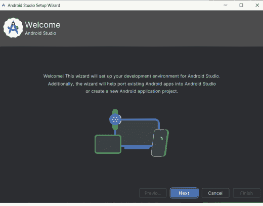

图 2-2

如果出现此对话框，点击“Next”（下一步）按钮显示“Install Type”（安装类型）屏幕（图 2-3）。在此屏幕上，在点击“Next”之前选择“Standard”（标准）安装选项。

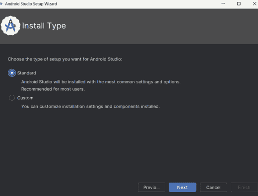

图 2-3

点击“Next”，并在“Verify Settings”（验证设置）屏幕上检查选项，然后进入“License Agreement”（许可协议）屏幕。启用“Accept”（接受）复选框并点击“Finish”（完成）按钮开始安装。

在完成这些初始设置步骤后，点击“Finish”按钮，显示使用您选择的 UI 主题的“Welcome to Android Studio”：

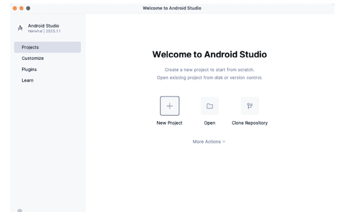

图 2-4

## 2.5 安装额外的 Android SDK 软件包

到为止的操作已经安装了 Android Studio IDE 和当前默认的 Android SDK 软件包。在继续操作之前，值得花些时间验证安装了哪些包，并安装任何缺失或更新的包。此任务可以通过点击欢迎对话框中的“更多操作（More Actions）”链接并从下拉菜单中选择“SDK Manager”选项来完成。调用后，将显示设置对话框中的 Android SDK 界面，如图 2-5 所示：

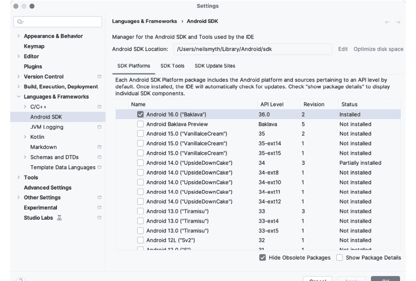

图 2-5

Google 将每个版本的 Android Studio 与 Android SDK 支持的最高应用程序编程接口（API）级别配对。对于 Android Studio Narwhal，该级别为 API 级别 36（Baklava）。可以通过以下链接确认此信息：

<https://developer.android.com/studio/releases#api-level->

首次安装 Android Studio 之后，可能只安装了最新支持版本的 Android SDK。要安装旧版本的 Android SDK，请选择对应版本的复选框并点击“应用（Apply）”按钮。本书其余部分假设已安装了 Android API 级别 36（Baklava）SDK。

本书中的大多数示例将追溯到 Android 8.0（Oreo）的旧版本 Android。这确保了应用程序可以在各种 Android 设备上运行。在 SDK 版本列表中，启用 Android 8.0（Oreo）旁的复选框并点击“应用”按钮。在生成的确认对话框中点击“确定（OK）”按钮安装 SDK。随后的对话将在执行安装前寻求接受许可和条款。安装完成后，点击“完成（Finish）”。

最新 SDK 也可能列出可用更新。要访问有关准备更新的包的详细信息，请启用屏幕左下角的“显示包详情（Show Package Details）”选项。这将显示与图 2-6 类似的信息。

| 名称 | API 级别 | 状态 |
| --- | --- | --- |
| Android ARM 64 v8a 系统映像 | 35 | 未安装 |
| Android Intel x86 Atom 系统映像 | 35 | 未安装 |
| Google TV ARM 64 v8a 系统映像 | 35 | 未安装 |
| Google TV x86 Atom 系统映像 | 35 | 未安装 |
| Google APIs ARM 64 v8a 系统映像 | 38 | 可用更新：39 |
| Google APIs Intel x86_Atom 系统映像 | 39 | 未安装 |
| Google Play ARM 64 v8a 系统映像 | 33 | 已安装 |

图 2-6

上图强调了可用更新。要安装这些更新，请启用项目名称左侧的复选框并点击“应用”按钮。

除了 Android SDK 软件包外，还安装了用于构建 Android 应用程序的工具。要查看当前安装的包并检查更新，请留在 SDK 设置界面并如图 2-7 所示选择“SDK Tools”选项卡：

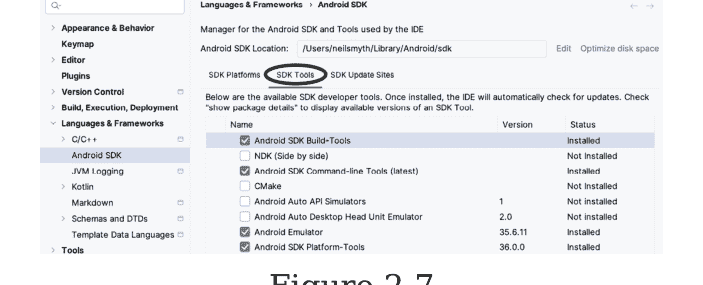

图 2-7

在 Android SDK Tools 界面中，确保以下包在“状态”列中为已安装（Installed）：

- Android SDK Build-tools
- Android SDK Command-line tools (latest)
- Android Emulator
- Android SDK Platform-tools
- Google Play Services
- Intel x86 Emulator Accelerator (HAXM installer)
- Google USB Driver（仅限 Windows）
- Layout Inspector image server for API 31-36

> 注意：Intel x86 Emulator Accelerator (HAXM installer) 需要启用 VT-x 支持的 Intel 处理器。它无法在基于 Apple 芯片的 Mac 或基于 AMD 的 PC 上安装。

如果上述任何包被列为未安装（Not Installed）或需要更新，请选择相应包旁的复选框并点击应用（Apply）按钮启动安装过程。如果出现 HAXM 模拟器设置对话框，请选择推荐的内存分配：

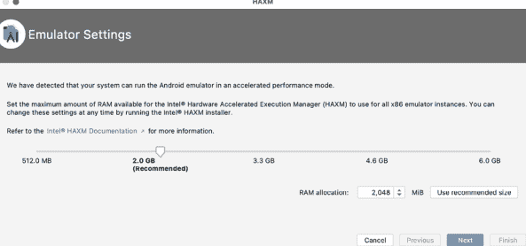

安装完成后，检查包列表并确保所选包在“状态”列中显示为“已安装”。如果任何包被列为“未安装”，请确保它们已被选中并再次点击“应用”按钮。

## 2.6 设置命令行工具访问

在上一节中，我们安装了 Android SDK 的命令行工具。顾如名，这些工具设计用于从命令提示符或终端窗口运行。为了确保你的操作系统能够找到这些工具，你需要将它们添加到系统的 `PATH` 环境变量中。

无论使用何种操作系统，你都需要配置 `PATH` 环境变量以包含以下路径（其中 `<path to android sdk installation>` 代表你安装 Android SDK 的文件系统位置）：

```text
<path_to_android_sdk_installation>/sdk/cmdline-tools/latest/bin
<path_to_android_sdk_installation>/sdk/platform-tools
```


你可以通过启动 SDK Manager 并参考设置面板顶部的“Android SDK Location”字段来识别 SDK 在系统中的位置，如图 2-9 所示：


图 2-9

一旦确定了 SDK 的位置，将其添加到 `PATH` 变量的步骤取决于操作系统：

### 2.6.1 Windows

- 点击任务栏上的“开始”图标，从生成的菜单中选择“设置”。当设置对话框出现时，向下滚动列表并选择“高级系统设置”。在关于界面，选择“高级环境变量”。在环境变量对话框中，找到系统变量中的 `Path` 变量，选中并点击“编辑”。在编辑对话框中使用“新建”按钮添加两个条目。例如，假设 Android SDK 安装在 `C:\Users\demo\AppData\Local\Android\Sdk\cmdline-tools\latest\bin` 和 `C:\Users\demo\AppData\Local\Android\Sdk\platform-tools`。

- 点击每个对话框确定。

按下 Windows + R 运行对话框中输入 `cmd` 打开命令提示符。在命令行窗口输入：

```text
echo %Path%
```

返回路径变量值应包含 Android SDK 平台工具的路径。通过尝试运行 `adb` 工具来验证 `platform-tools` 值是否正确：

```text
adb
```

执行该工具将输出选项列表。同样，通过尝试运行 AVD Manager 命令行工具来检查工具路径（如果 `avdmager` 工具报告 Java 问题，稍后会处理）：

```text
avdmager
```

如果其中一个或两个命令都出现类似下面的消息，很可能是将错误的路径附加到了 `Path` 环境变量：

`'adb'` 不是内部或外部命令、可程序或批文件。

### 2.6.2 Linux

在 Linux 上，可以通过向家目录下的 `.bashrc` 文件添加命令来实现此配置（具体取决于所使用的 Linux 发行版）。假设 Android SDK 压缩包安装在 `/home/demo/Android/sdk`，`.bashrc` 文件中的 `export` 行将如下所示：

```bash
export PATH=/home/demo/Android/sdk/platform-tools:/home/demo/Android/sdk/cmdline-tools/latest/bin:/home/demo/android-studio/bin:$PATH
```

请注意，上述命令将 `android-studio/bin` 目录添加到 `PATH` 变量。这将允许在终端窗口的任何当前目录下都执行 `studio.sh` 脚本。

### 2.6.3 macOS

在 macOS 上有多种技术可以修改 `$PATH` 环境变量。最干净的方法是在 `/etc/paths.d` 目录下添加一个新文件，其中包含要添加到 `$PATH` 的路径。假设 Android SDK 的安装位置为 `/Users/demo/Library/Android/sdk`，可以通过在 `/etc/paths.d` 目录下创建一个名为 `android-sdk` 的新文件并包含以下行来配置路径：

```text
/Users/demo/Library/Android/sdk/cmdline-tools/latest/bin
/Users/demo/Library/Android/sdk/platform-tools
```

注意，由于这是一个系统目录，在创建文件时需要使用 `sudo` 命令。例如：

```bash
sudo vim /etc/paths.d/android-sdk
```

上述命令使用 Vim 文本编辑器创建并编辑 `android-sdk` 文件。如果你熟悉该编辑器，可以运行 `vimutor` 命令快速学习基础知识。

## 2.7 Android Studio 内存管理

Android Studio 是一个大型且复杂的软件应用程序，具有许多后台进程。尽管 Android Studio 过去曾因性能表现不佳而受到批评，但 Google 在最近的发布中进行了重大的性能改进，并在每个新版本中持续优化。这些改进包括允许用户配置 Android Studio IDE 以及用于构建和运行应用程序的后台进程所使用的内存。这使得软件能够利用具有更大内存的系统。

如果你运行 Android Studio 的系统具有足够的空闲内存来增加这些值（此功能仅适用于具有 5GB 或更多内存的 64 位系统），并且发现 Android Studio 性能似乎有所下降，那么尝试这些内存设置可能是值得的。Android Studio 还可能通过类似于下方所示的对话框通知你可以提高性能：

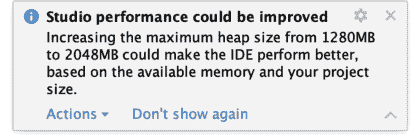

图 2-10

要查看并修改当前的内存配置，请选择 `File -> Settings...` 主选项（macOS 上为 `Android Studio -> Settings...`），在弹出的对话框中，选择左侧导航面板中的 `Appearance & Behavior`，然后选择 `System Settings` 下的 `Memory Settings` 选项，如下图 2-11 所示：

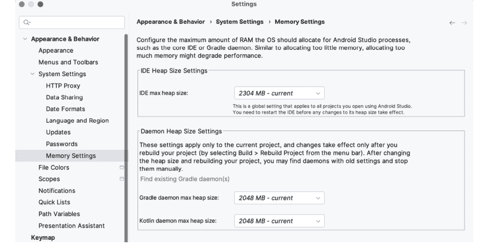

图 2-11

在更改内存分配时，请确保不要分配比需要更多或你的系统在不减慢其他进程的情况下无法承受的内存。堆大小（heap size）设置会调整分配给 Android Studio 的内存，并且无论当前加载的项目如何都生效。

另一方面，当从 Android Studio 内部构建和运行项目时，会有几个后台进程（称为守护进程 `daemons`）执行编译和运行应用的任务。在编译运行大型且复杂的项目时，可以通过调整守护进程堆设置来缩短构建时间。与 IDE 设置不同，这些守护进程设置仅适用于当前项目，并且只有在 Android Studio 中打开项目时才能访问。

要从已打开的项目内部显示 SDK Manager，请从主菜单中选择 `Tools -> SDK Manager...` 菜单选项。

## 2.8 更新 Android Studio 和 SDK

Android Studio 和 Android SDK 会不定期发布新版本。新版本的 SDK 使用 Android SDK Manager 进行安装。当有更新准备好安装时，Android Studio 通常会通知你。

要手动检查 Android Studio 更新，请使用 Android Studio 主窗口的 `Help -> Check for Updates...` 菜单选项（macOS 上为 `Android Studio -> Check for Updates...`）。

## 2.9 总结

在开始开发 Android 应用程序之前，第一步是搭建合适的开发环境。这由 Android SDK 和 Android Studio IDE（包含 OpenJDK 开发环境）组成。本章涵盖了在 Windows、macOS 和 Linux 上安装这些包的必要步骤。

# 3. 在 Android Studio 中创建一个示例 Android 应用程序

本书的前几个章节已经解释了如何使用 Android Studio IDE 配置适用于开发 Android 应用程序的环境。在转向稍高级的话题之前，现在是验证所有所需的开发包已安装并正常运行的好时。实现这一目标最佳方法是创建一个 Android 应用程序并编译运行它。本章将涵盖如何使用 Android Studio 创建 Android 应用程序项目。一旦项目创建，稍后的章节将探索如何使用 Android 模拟器环境对应用程序进行测试运行。

## 3.1 关于项目

在本章创建的项目是一个原始的货币汇率转换器（事实上，它非常简单，只支持从美元转为欧元，并使用估算汇率进行转换）。该项目还将使用最基础的 Android Studio 项目模板之一。这种简单性允许我们介绍 Android 应用开发的一些关键方面，而不会一次性通过推荐的应用架构和 Android 架构组件让初学者感到压力。在遵循本章的教程时，请放心，初始示例项目使用的技术和代码在稍后会有更详细的介绍。

## 3.2 创建新的 Android 项目

应用程序开发过程的第一步是在 Android Studio 环境中创建一个新项目。因此，首先启动 Android Studio，出现如[图 3-1](Figure 3-1)所示的“Welcome to Android Studio”屏幕：

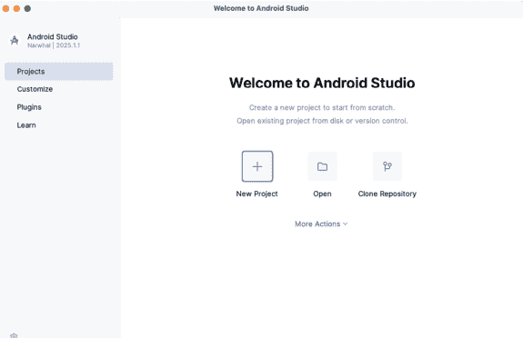

一旦此窗口出现，Android Studio 就准备好新建项目。要创建新项目，点击 `New Project` 选项。

## 3.3 创建 Activity

下一步是定义要创建的 Activity 类型。提供了手机和平板电脑、Wear OS、电视或汽车项目的创建选项。但对于本示例，请从 Templates 面板中选择 `Phone and Tablet`，然后选择创建 `Empty Views Activity` 选项。`Empty Views Activity` 会创建一个由单个 `TextView` 组成的模板用户界面。

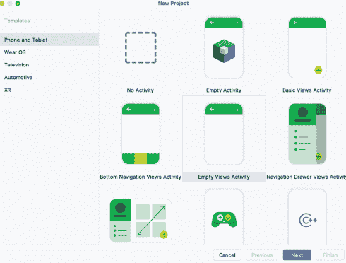

图 3-2

## 3.4 定义项目和 SDK 设置

在项目配置窗口（图 3-3）中，将 `Name` 字段设置为 `AndroidSample`。应用程序名称是在 Android Studio 内部引用和标识应用程序的名称，也是如果完成的应用程序发布到 Google Play 商店时将使用的名称。

`Package name`（包名）在 Android 应用程序生态系统中唯一标识应用程序。虽然它可以被设置为任何唯一标识你应用的字符串，但传统上基于你域名的反向 URL，后加上应用程序名称。例如，如果你的域名是 `www.mycompany.com`，且应用程序被命名为 `AndroidSample`，那么包名可能指定为：`com.mycompany.androidsample`。

如果你没有域名，可以在 `Company Domain` 字段中输入任何其他字符串，或者使用 `example.com` 进行测试，但在发布应用程序之前需要更改它：`com.example.androidsample`。

`Save location`（保存位置）设置将默认到你主目录下的名为 `AndroidStudioProjects` 文件夹中的位置，可以通过点击包含当前路径设置文本字段右侧的文件夹图标进行更改。

将 `minimum SDK` 设置为 `API 26`（Oreo; Android 8.0）。此最小 SDK 将用于本书中创建的大多数项目，除非某个功能仅在较新的版本中可用。这里的目标是使用最新的 Android SDK 构建应用，同时保留对运行旧版本 Android 的设备的兼容性（在这种情况下，可追溯到 Android 8.0）。`Minimum SDK` 设置下方的文本将概述目前运行该应用程序的 Android 设备百分比。点击 `Help me choose` 按钮查看仍在使用的各种 Android 版本的完整细分：

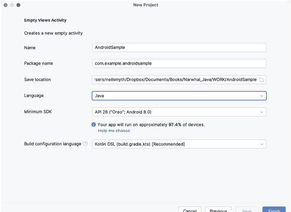

图 3-3

最后，将 `Language` 菜单更改为 `Java` 并选择 `Kotlin DSL (build.gradle.kts)` 作为构建配置语言，然后点击 `Finish` 创建项目。

## 3.5 修改示例应用程序

项目创建后，将出现主窗口，其中包含我们的 AndroidSample 项目，如下方的[图 3-4](#)所示：

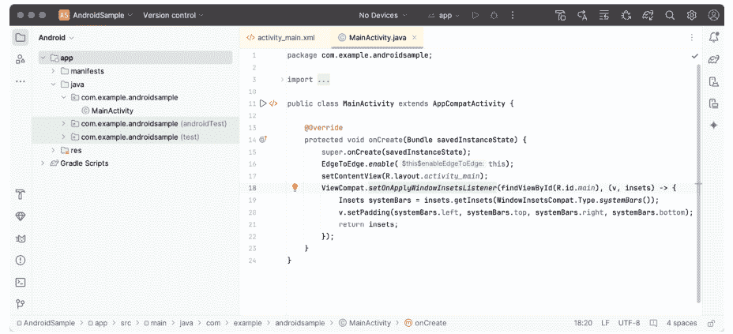

图 3-4

新创建的项目以及相关文件的引用列在主项目窗口左侧的 Project（项目）工具窗口中。Project 工具窗口有多种显示信息的模式。默认情况下，此面板应处于 Android 模式。此设置由面板顶部的菜单控制，如[图 3-5](#)所示。如果面板当前不是 Android 模式，请使用菜单进行切换。

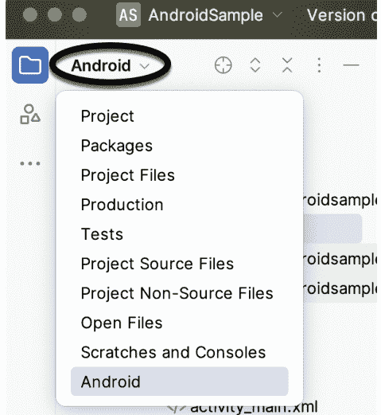

图 3-5

## 3.6 修改用户界面

我们活动（activity）的用户界面设计存储在一个名为 `activity_main.xml` 的文件中，该文件位于 Project 工具窗口层级结构中的 `app -> res -> layout` 路径下。在 Project 工具窗口中找到该文件后，双击文件将其加载到用户界面 Layout Editor（布局编辑器）工具中，它将出现在 Android Studio 主窗口的中间面板中：

### 图 3-6

Layout Editor 窗口顶部工具栏上有一个菜单（在上面的图中设置为 Pixel），它反映在 Layout Editor 面板中设备的视觉化表示上。点击此菜单可以使用一系列其他设备选项。

使用 System UI Mode（系统 UI 模式）按钮可以开启或关闭设备屏幕布局的夜间模式（Night mode）。要在设备表示的横屏和竖屏之间切换，请使用显示图标的下拉菜单。正如我们在设备屏幕上看到的，内容布局已经包含一个显示“Hello World!”消息的标签。

面板左侧运行着调色板（palette），包含不同类别的用户界面组件，这些组件可用于构建用户界面，例如按钮、标签和文本字段。然而，需要注意，并不是所有用户界面组件对用户都是可见的。其中一类就是布局（layouts）。Android 支持多种布局，它们对视觉用户界面组件在屏幕上的定位和管理提供了不同程度的控制。

虽然从用户界面的视觉表示上很难看出，但当前的设计是使用 `ConstraintLayout` 创建的。这可以通过查看 Component Tree（组件树）面板中的信息来确认，该面板默认位于 Layout Editor 面板的左下角，如图 3-7 所示：

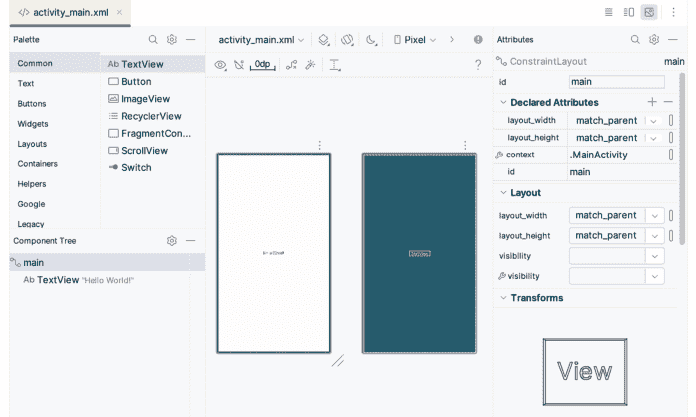

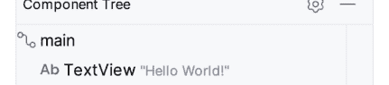

### 图 3-7

从组件树层级结构可以看出，用户界面布局由一个名为 `main` 的 `ConstraintLayout` 父布局和一个 `TextView` 子对象组成。

在继续之前，请检查 Layout Editor 的 Autoconnect（自动连接）模式已启用。这意味着当组件添加到布局中时，Layout Editor 将自动添加约束，以确保组件在不同尺寸和设备方向上正确定位（该主题将在后续章节中进行详细详细介绍）。Autoconnect 按钮出现在 Layout Editor 工具栏中，用一个 U 形图标表示。当禁用时，图标上会带有一条斜线（图 3-8）。如有必要，点击此按钮重新启用 Autoconnect 模式。

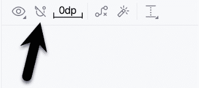

### 图 3-8

修改应用程序的下一步是向布局中添加一些额外的组件，其中第一个是 Button（按钮），供用户点击以启动货币转换。

Palette（调色板）面板由两列组成，左列包含视图组件类别列表。右列列出了当前选择类别包含的组件。在[图 3-9]中，当前在 Buttons 类别中选择了 Button 视图：

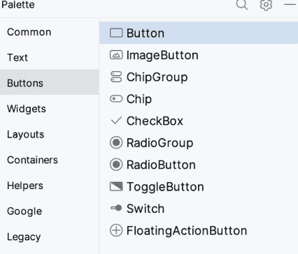

### 图 3-9

点击并拖动 `Button` 对象，将其释放到用户界面设计的水平中心，使其位于现有的 `TextView` 小部件下方：

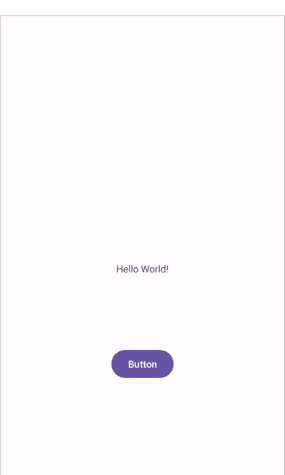

### 图 3-10

下一步是更改 Button 组件当前显示的文本。位于设计区域右侧的面板是 Attributes（属性）面板。此面板显示给布局中当前选择组件的属性。在此面板中，在 Common Attributes（常用属性）部分找到 `text` 属性，并将当前值从 `"Button"` 更改为 `"Convert"`，如图 3-11 所示：

```text
strokeWidth []
cornerRadius @null
rippleColor @color/m3_button_rip []
text Convert
text []
contentDescription []
```

### 图 3-11

带有扳手图标的 `text` 属性允许设置文本属性，它只显示在 Layout Editor 中，但对于使用不同设置测试应用很有用。如果 Autoconnect 系统未能设置所有布局，点击按钮（图 3-12）来添加缺失的约束：

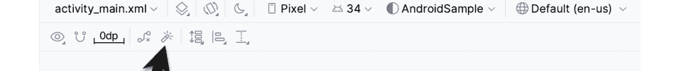


### 图 3-12

有必要解释 Layout Editor 工具右上角的警告按钮，如图 3-13 所示。此警告表示布局存在潜在问题。要了解任何问题的详情，请点击该按钮：

点击时，将出现 Problems（问题）窗口，描述这些问题：

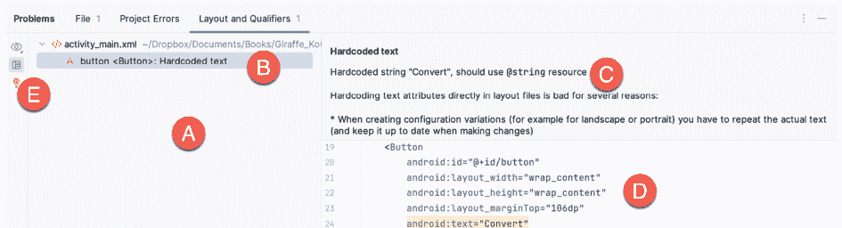

### 图 3-14

此工具分为两个面板。左面板（标记为 A）列出了布局文件中检测到的问题。在我们的示例中，只列出了以下问题：

- Hardcoded text `"Button"`, should use `@string` resource

当选择列表中一项时（B），右面板将更新以提供问题的详情。在这种情况下，解释如下：

- Hardcoded string `"Convert"`, should use `@string` resource


工具还包含一个预览编辑器（D），允许进行手动修正。此 I18N 信息告我们关于项目未来的国际化存在潜在问题（“I18N”源于“internationalization”一词以 I 开头，以 N 结尾，中间有 18 个字母）。该警告提醒我们，在开发 Android 应用时，尽可能将属性和值（如字符串）存储为资源。这样做可以通过修改资源文件而不是更改源代码来更改应用程序的外观。这在将用户界面翻译成另一种语言时可能特别有用。用户界面中的所有文本都在一个资源文件中，例如，可以将文件交给翻译人员，他们将执行翻译工作并返回翻译后的文件用于应用程序。这使得无需更改源代码即可针对多种语言。在此情况下，我们将创建一个名为 `convert_string` 的新资源。首先点击 Quick Fixes（显示快速修复）按钮（E），并从菜单中选择 *Extract string resource*（提取字符串资源）选项，如图 3-15 所示：

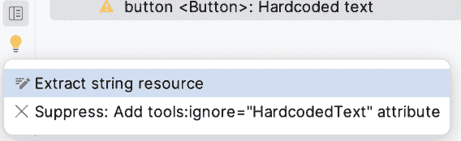

## 图 3-15

选择此选项后，将出现 Extract Resource（提取资源）面板。在此面板中，将资源名称字段更改为 `convert_string`，并将资源值保留为 `Convert`，然后点击 OK 按钮。

下一个要添加的小部件是一个 EditText 控件，用户将在其中输入要转换的金额。从调色板（Palette）面板中选择 Text 类别，并将 Number (Decimal) 组件拖到布局中，使其水平居中，并放置在现有的 TextView 控件上方。选中该控件后，使用属性（Attributes）工具窗口将 hint 属性设置为 "dollars"。点击警告图标，并将字符串提取到命名为 `dollars_hint` 的资源中。

在本章稍后编写的代码需要访问用户输入到 EditField 中的美元数值。它将通过引用分配给用户界面布局中该控件的 id 来实现这一点。在布局中选中控件时，可以从属性工具窗口查看并更改 Android Studio 为该控件分配的默认 id，如图 3-17 所示。

将 id 更改为 `dollarText`，并在重命名（Rename）对话框中点击 *Refactor*（重构）按钮。这确保了项目其他地方对旧 id 的任何引用都会自动更新为新 id。

如有必要，重复步骤将 TextView 控件的 id 设置为 `textView`。

点击 *Infer Constraints*（推断约束）按钮添加任何缺失的布局约束。此时，布局应该类似于图 3-19 所示：

## 图 3-19

## 3.7 检查布局和资源文件

在继续下一步之前，我们将查看用户界面设计和资源处理的一些内部方面。在上一节中，我们通过使用布局编辑器工具通过修改 `activity_main.xml` 文件来更改用户界面。事实上，布局编辑器的作用仅仅是提供了一种编辑文件底层 XML 内容的友好用户的方法。在实践中，没有理由不直接修改 XML 来进行用户界面更改，在某些情况下，这实际上比使用布局编辑器工具更快。在布局编辑器面板的右上角有视图模式（View Modes）按钮，在下图 3-20 中标记为 A 到 C：

默认情况下，编辑器将处于设计模式（按钮 C），此时只显示布局的视觉表示。在代码模式（A）下，编辑器将显示布局的 XML，而在拆分模式（B）下，同时显示布局和 XML，如图 3-21 所示：

## 图 3-20

## 图 3-21

视图模式按钮左侧的按钮（上述图 3-20 中标记为 B）用于在代码模式和拆分模式之间快速切换。

从 XML 文件的结构可以看出，用户界面由 `ConstraintLayout` 组件组成，该组件又是 `TextView`、`Button` 和 `EditText` 对象的父对象。我们还可以看到，例如 `Button` 的 `text` 属性设置为我们的 `convert` 字符串资源。尽管界面复杂性和内容各异，但所有用户界面布局都是按照这种层次化的、基于 XML 的结构组织的。随着 XML 布局的更改，这些更改将反映在布局画布上。也可以从布局画布面板内从视觉上修改布局，更改将出现在 XML 列表中。要查看此操作，切换到拆分模式并修改 XML 布局以更改 `ConstraintLayout` 的背景颜色如下：

```xml
<?xml version="1.0" encoding="utf-8"?>
<androidx.constraintlayoutlayout.widget.ConstraintLayout
xmlns:android="http://schemas.android.com/apk/res/android"
xmlns:app="http://schemas.android.com/apk/res-auto"
xmlns:tools="http://schemas.android.com/tools"
android:id="@id/main"
android:layout_width="match_parent"
android:layout_height="match_parent"
tools:context=".MainActivity"
android:background="#ff2438" 
>
```

注意布局颜色会实时更改以匹配 XML 文件中的新设置。还要注意，XML 编辑器左侧边距（也称为行槽）中包含颜色设置的行旁边会出现一个小方块。这是在该属性上设置了红色的视觉提示。点击红色方块将显示一个颜色选择器，允许选择不同的颜色：

## 图 3-22

在继续之前，从布局文件中删除背景属性，使背景恢复到默认设置。

最后，使用项目（Project）面板找到 `app -> res -> values -> strings.xml` 文件并双击它将其加载到编辑器中。目前，XML 的内容如下：

```xml
<resources>
<string name="app_name">AndroidSample</string>
<string name="convert_string">Convert</string>
<string name="dollars_hint">dollars</string>
</resources>
```

为了演示资源的实际作用，将分配给 `convert_string` 的字符串值更改为 "Convert to Euros"，然后选择布局标签页返回布局。利用此机会将字符串恢复为原始的 "Convert"，并为稍后引用的资源添加以下条目：

```xml
<resources>
  <string name="app_name">AndroidSample</string>
  <string name="convert_string">Convert</string>
  <string name="dollars_hint">dollars</string>
  <string name="no_value_string">No Value</string>
</resources>
```

也可以通过点击窗口右上角的 Editor 链接使用 Android Studio Translations（翻译）来编辑资源字符串。将在 Android 窗口的主面板中显示翻译编辑器（Translation Editor）：

## 图 3-23

此编辑器允许编辑分配给资源键的字符串并管理多种语言的翻译。

## 3.8 添加交互

此示例项目的最后一步是使应用程序具有交互性，以便当用户在 `EditText` 字段中输入美元值并点击转换按钮时，转换后的欧元值会出现在 `TextView` 上。这涉及在 `Button` 控件上实现某些事件处理。具体来说，需要配置 `Button`，以便在触发 `onClick` 事件时调用应用程序代码中的方法。事件处理可以通过多种方式实现，将在稍后题为“Android 事件处理概述与示例”的章节中介绍。将布局编辑器返回设计模式，在布局编辑器中选择 `Button` 控件，并按如下指定名为 `convertCurrency` 的方法：

## 图 3-24

接下来，在项目工具窗口双击 `MainActivity.java` 文件（`app -> java -> <name> -> MainActivity`）将其加载到代码编辑器中，并向类文件添加 `convertCurrency` 方法的代码，使其内容如下，注意还需要导入一些额外的 Android 程序包：

```java
package com.example.androidsample;

import android.os.Bundle;
import android.view.View;
import android.widget.EditText;
import android.widget.TextView;
import java.util.Locale;

public class MainActivity extends AppCompatActivity {
    @Override
    protected void onCreate(Bundle savedInstanceState) {
        super.onCreate(savedInstanceState);
    }
}
```

```java
public void convertCurrency(View view) {
    EditText dollarText = findById(R.id.dollarText);
    TextView textView = findById(R.id.textView);

    if (!dollarText.getText().toString().isEmpty()) {
        float dollarValue = Float.parseFloat(dollarText.getText().toString());
        float euroValue = dollarValue * 0.85F;
        textView.setText(String.format(Locale.ENGLISH,"%.2f", euroValue));
    } else {
        textView.setText(R.string.no_value_string);
    }
}
```

该方法首先通过调用名为 `findViewById` 的方法并传递布局文件中指定的 ID，获取 `EditText` 和 `TextView` 对象的引用。随后会检查用户是否输入了美元金额，将其从 `String` 转换为浮点值，然后转换为欧元。最后，结果显示在 `TextView` 组件上。

如果对上述任何内容不清楚，请放心，这些概念将在后面的章节中进行详细详细介绍。特别是使用 `findViewById` 从代码内部访问组件的主题，以及对被称为“视图绑定（view binding）”的替代技术的介绍，将在标题为“Android 视图绑定概述”的章节中介绍。

## 3.9 总结

虽然并不十分复杂，但设置 Android 开发环境仍涉及多个步骤。在完成这些步骤后，值得运行一个示例以确保环境已正确安装和配置。在本章中，我们创建了一个示例应用程序，并使用 Android Studio 布局编辑器（Layout Editor）工具修改了用户界面布局。在此过程中，我们探索了尽可能使用资源（特别是字符串值）的重要性，并简要提到了布局。接下来，我们查看了用于存储 Android 应用程序用户界面设计的底层 XML。

最后，我们在按钮（Button）上添加了一个 `onClick` 事件，该事件连接到一个实现的方法上，用于从 `EditText` 组件中提取用户输入，将其从美元转换为欧元，然后将结果显示在 `TextView` 上。

应用程序已准备好进行测试，设置测试目的模拟器所需的步骤将在下一章中详细介绍。

# 4. 在 Android Studio 中创建 Android 虚拟设备 (AVD)

尽管 Android Studio 的预览（Preview）面板允许我们看到正在设计的布局，但为了彻底测试其运行情况，仍然需要编译并运行整个应用程序。可以通过在物理设备上安装运行或在 Android 虚拟设备 (AVD) 模拟器环境中运行来测试 Android 应用程序。在使用 AVD 之前，必须先创建并配置它以匹配特定设备模型的规格。在本章中，我们将以 Pixel 9 手机为参考示例创建一个这样的虚拟设备。

## 4.1 关于 Android 虚拟设备

AVD 是模拟器，允许在无需将应用程序安装到物理 Android 设备的情况下测试 Android 应用程序。AVD 可以配置为模拟各种硬件功能，包括屏幕尺寸、内存容量以及摄像头、GPS 导航支持或加速度计等功能的存在。Android Studio 标准安装的一部分包含了几个模拟器模板，允许为各种设备配置 AVD。可以通过指定处理器类型、内存容量以及屏幕尺寸和像素密度等属性，创建以匹配任何物理 Android 设备的自定义配置。

AVD 会话可以以单独窗口的形式出现，也可以嵌入在 Android Studio 窗口中。

新的 AVD 使用 Android 虚拟设备管理器（Android Virtual Device Manager）创建和管理，它可以使用命令行模式，也可以使用更用户友好的图形用户界面。创建新 AVD 的第一步是启动 AVD 器。这可以通过 Android Studio 环境中点击右侧工具窗口栏中的 *设备管理器（Device Manager）* 按钮来实现，如图 4-1 所示：

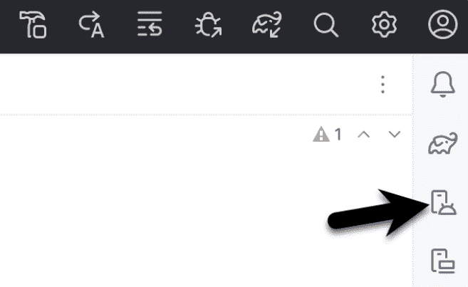

## 图 4-1

打开后，管理器将显示出来，如图 4-2 所示：

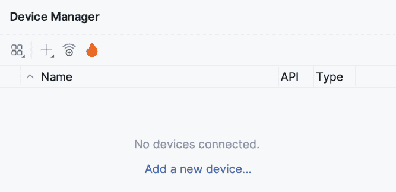

## 图 4-2

如果是第一次安装 Android Studio（而不是升级现有的），安装程序可能已创建可用的 AVD 实例，如图 4-3 所示：

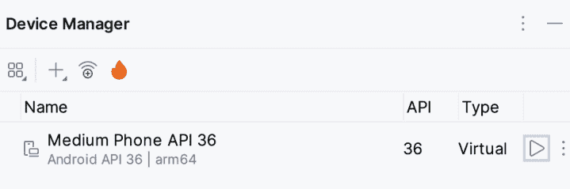

## 图 4-3

如果系统上存在 AVD，则可以使用它。如果没有创建 AVD，或者你想为不同的设备类型创建 AVD，请按照本章后续步骤操作。要创建新的 AVD，点击设备管理器中的 `+` 按钮并选择创建虚拟设备（Create Virtual Device）选项：

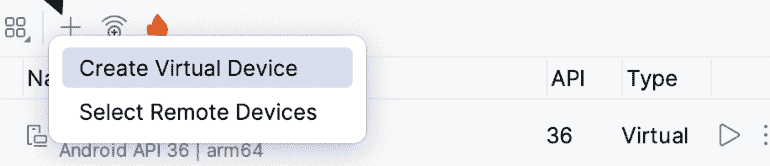

## 图 4-4

选择虚拟设备选项后，将显示图 4-5所示的添加设备对话框：

| 形态 | 名称 | API | 高度 | 密度 |
| :--- | :--- | :--- | :--- | :--- |
| 手机 | 小手机 | 24+ | 720 | 1280 320 dpi |

## 图 4-5

在对话框中执行以下步骤创建 Pixel 9：

- 从形态面板选择手机选项以显示可用 Android 模板。
- 选择 Pixel 9 设备并点击下一步。
- 在配置屏幕上，从 API 菜单（A）选择最新的 Android 版本。
- 使用服务菜单（B）选择包含的服务。如果你计划完成应用内，请选择“Google Play”服务。
- 在名称字段输入描述性名称（D）。
- 通过选择其他设置选项卡（E）查看其他选项。
- 点击完成创建 AVD。

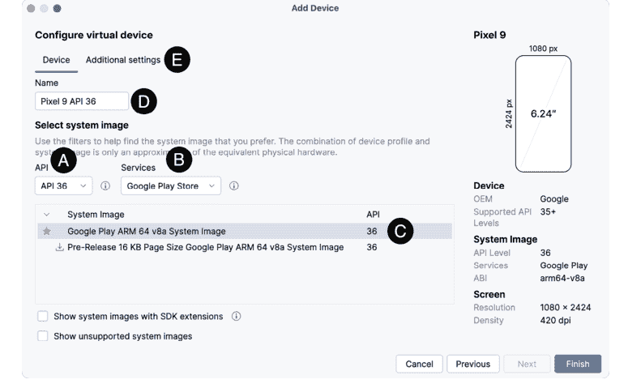

## 图 4-6

## 4.2 远程设备

使用 AVD 模拟器或自有设备进行测试的替代方案是在 Google 托管的远程设备上运行应用程序。然而，要使用此服务，你需要创建 Firebase 并在 Android Studio 中启用它。Firebase 提供了一个免费计划（称为 Spark），每个设备模型提供 30 分钟的测试时间。额外时间需要升级到 Blaze 计划。

从图 4-4所示的菜单中选择选择远程设备将显示以下内容：

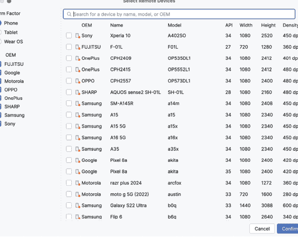

## 图 4-7

选择一个或多个远程设备并点击确认按钮后，它们将出现在设备管理器窗口中。

## 4.3 启动模拟器

要测试新的 AVD 模拟器，请从设备管理器中选择模拟器并点击启动按钮（位于上述突出菜单左侧的三角形）。模拟器将嵌入在 Android Studio 主窗口中并开始启动过程。模拟器启动所需的时间取决于 AVD 及其运行的系统的配置。


要隐藏或显示模拟器工具窗口，请点击“运行设备”（Running Devices）工具窗口（标记为 A）。点击标签页旁的“x”关闭按钮（B）退出模拟器。模拟器工具窗口可以容纳多个模拟器会话，每个会话由一个标签页表示。例如[图 4-9](#)显示了一个包含两个模拟器会话的工具窗口：

切换会话时，点击相应的标签页。

## 4.4 在 AVD 中运行应用程序

配置好 AVD 模拟器后，现在就可以编译并运行前面的章节中创建的 AndroidSample 示例应用程序。在 Android Studio 中加载 AndroidSample 项目后，确保新创建的 Pixel 9 AVD 显示在设备菜单中（见下方[图 4-10](#)中的标记 A），然后点击由三角形表示的运行按钮（B）、选择“运行（Run）-> 运行 'app'”菜单选项或使用快捷键 `Ctrl-R`：

### 图 4-10

设备菜单（A）可用于选择不同的 AVD 实例或物理设备作为运行目标，并用于在多个设备上运行应用。菜单还提供了访问设备管理器以及设备连接配置和故障排除选项的通道：

### 图 4-11

应用程序安装并运行后，用户界面将在模拟器中出现。一旦运行过程开始，信息将出现在运行（Run）工具中。运行工具窗口会在应用程序包安装和启动期间显示诊断信息。如果窗口没有自动打开，请点击图 4-12 所示的按钮：

### 图 4-12

启动过程中遇到问题，运行工具窗口将提供信息以帮助定位问题原因。

假设应用程序加载到模拟器并按预期运行，我们已经安全地验证了 Android 开发环境已正确安装和配置。在应用运行时，移动滑块以验证应用是否按如预期运行。

## 4.5 在多个设备上运行

图 4-11 所示的运行目标菜单包含一个在多个模拟器和设备上并行运行应用的选项。选择此选项后，将显示图 4-13 所示的对话框，列出系统上配置的所有 AVD 以及任何连接的物理设备。在点击运行按钮之前，启用目标模拟器或设备旁边的复选框：

### 图 4-13

点击运行按钮后，Android Studio 将会在选定的模拟器和设备上启动应用。

## 4.6 停止运行的应用程序

要停止运行的应用程序，请点击主工具栏上的停止按钮，如图 4-14 所示：

### 图 4-14

也可以使用运行工具窗口终止应用。首先，使用应用运行时变为窗口栏按钮显示运行工具窗口。一旦运行工具窗口出现，点击下方图 4-15 中高亮标记的停止按钮：

### 图 4-15

## 4.7 支持深色主题

要测试应用在启用深色主题时的行为，请点击运行设备工具窗口中的“设备 UI 快捷方式”按钮并在弹出的对话框中启用“深色主题”选项：

### 图 4-16

启用深色主题后，AndroidSample 应用将如图 4-17 所示：

### 图 4-17

在继续之前，使用设备 UI 快捷方式对话框关闭深色模式。

## 4.8 在独立窗口中运行模拟器

到本章为止，我们一直将模拟器作为嵌入在 Android Studio 主窗口内的工具窗口使用。在设置（Settings）对话框中，可以将模拟器配置为在独立窗口中出现，可以通过点击 Android Studio 工具栏上的“IDE 和项目设置”按钮来显示，如图 4-18 所示：

### 图 4-18

在设置对话框中，在侧边面板导航到“工具（Tools）-> 模拟器（Emulator）”，并禁用“在工具窗口中启动（Launch in tool window）”选项：

### 图 4-19

禁用该选项后，点击“应用”后点击“确定”以提交更改，然后点击上方标记为 B 的关闭按钮退出模拟器。再次运行示例应用，此时模拟器将作为一个独立窗口出现，如下：

选择独立模式还是工具窗口模式取决于个人偏好。如果你倾向于让模拟器在工具窗口中运行，请返回设置并启用“在工具窗口中启动”。在决定使用独立模式之前，请记住，运行设备工具窗口也可以在“选项（Options）”菜单中从 Android Studio 主窗口中分离，该菜单通过点击图 4-21 所示的按钮进行访问：

### 图 4-21

在选项菜单中，选择“视图（View）-> 浮动（Float）”将工具窗口从 Android Studio 主窗口分离：

### 图 4-22

要重新停靠运行设备工具窗口，请点击图 4-23 所示的“停靠（Dock）”按钮：

## 4.9 移除设备外框

模拟器可以配置为带有或不带设备外框。要更改设置，退出模拟器，打开设备管理器，从列表中选择 AVD，并点击图 4-24 中箭头所示的菜单：

### 图 4-24

选择“编辑（Edit）”选项，并在配置界面选择“其他设置（Additional settings）”选项卡，在点击“完成（Finish）”按钮之前将设备皮肤（Device skin）更改为“无（None）”：

### 图 4-25

一旦禁用设备外框，模拟器下次启动时将如图 4-26 所示：

### 图 4-26

## 4.10 总结

典型的应用程序开发遵循编码、编译和在测试环境中运行的循环。Android 应用程序可以在物理 Android 设备或 Android 虚拟设备（AVD）模拟器上进行测试。AVD 使用 Android Studio 设备管理器工具创建和管理，该工具可以作为命令行工具使用，也可以通过图形界面使用。在创建 AVD 以模拟特定的 Android 设备型号时，虚拟设备的硬件规格应配置为与物理设备匹配。AVD 模拟器会话可以作为独立窗口显示，也可以嵌入到 Android Studio 主用户界面。

# 5. 使用和配置 Android Studio AVD 模拟器

在本章中，我们将探索 Android Studio AVD 模拟器的功能，重点关注其配置选项，以自定义独立和工具窗口模式下的环境。

## 5.1 模拟器环境

当在独立窗口启动时，模拟器在加载过程中会显示初始启动屏幕。加载完成后，会出现主模拟器窗口，其中包含所选设备类型（对于图 5-1，此这是一个 Pixel 4 设备）：

### 图 5-1

位于窗口右侧的工具栏提供了访问模拟器控制和配置选项的快捷方式。

## 5.2 模拟器工具栏选项

模拟器工具栏（图 5-2）提供了对模拟器环境外观和行为的相关选项的访问。

### 图 5-2

工具栏中的每个按钮都有相应的键盘快捷键，可以通过鼠标悬停在按钮上等待工具提示出现，或者通过扩展控制面板的帮助选项来识别。

虽然工具栏包含的许多选项是显而易见的，但为了完整起见，将对每个选项介绍：

- **退出 / 最小化** – 工具栏最顶部的“x”按钮在选中后会退出模拟器会话，而“–”选项会将窗口最小化。
- **电源** – 电源按钮模拟物理 Android 设备上的硬件电源按钮。点击并释放此按钮将锁定设备并关闭屏幕。长按此按钮将启动设备“关机”请求序列。
- **音量增大/减小** – 控制模拟器环境内播放音频音量的两个按钮。
- **截屏** – 拍摄设备屏幕显示内容的截图。捕取的图像存储在扩展控制面板设置屏幕中指定的位置，本章稍后将进行概述。
- **缩放模式** – 此按钮用于进入和退出缩放模式，其细节将在本章稍后部分介绍。
- **左旋/右旋** – 在竖屏和横屏取向之间旋转模拟的设备。
- **返回** – 执行标准的 Android“返回”导航以返回上一个屏幕。
- **主页** – 显示设备的主屏幕。
- **概览** – 模拟选择标准的 Android“概览”导航，显示设备上当前运行的应用程序。
- **折叠设备** – 模拟可折叠设备的折叠和展开。只有当模拟器运行可折叠设备系统镜像时，此选项才可用。
- **扩展控制** – 显示扩展控制面板，允许配置模拟位置和电话活动、电池电量、蜂窝网络类型和指纹识别等选项。

## 5.3 在缩放模式下工作

位于模拟器工具栏上的缩放按钮用于进入和退出缩放模式。当缩放模式激活时，工具栏按钮处于按下状态，且当鼠标指针悬停在设备屏幕上时会显示为放大镜。点击左鼠标键将导致显示相对于屏幕上的所选点进行放大，重复点击将增加缩放级别。相反，点击右鼠标键将减小缩放级别。关闭缩放按钮将显示恢复为默认大小。

在缩放模式下点击并拖动将定义一个矩形区域，当释放鼠标键时，视图将缩放到该区域。

在缩放模式下，可以使用模拟器窗口内的水平和垂直滚动条对屏幕区域进行移动。

## 5.4 调整模拟器窗口大小

可以通过点击并拖动窗口的任何角或侧边，随时更改模拟器窗口的大小（以及设备相应的表示）。

## 5.5 扩展控制选项

扩展控制工具栏按钮显示如图 5-3 所示的面板。默认情况下，将显示显示设置。从左侧面板选择不同的类别将显示相应的控件组：

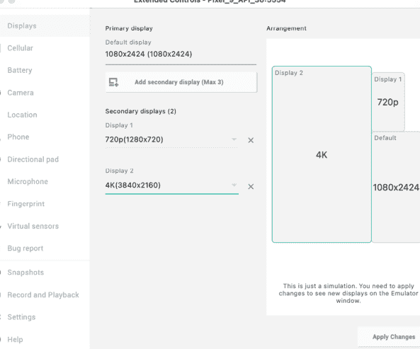

### 5.5.1 显示

显示设置屏幕允许为模拟器添加额外的屏幕尺寸，以便在各种设备尺寸下测试应用程序。要添加显示尺寸，点击“添加辅助显示”按钮并使用下拉菜单更改屏幕尺寸。点击“应用更改”按钮创建显示器，它们将出现在模拟器窗口中默认显示器的旁边。模拟器除默认显示器外支持三个辅助屏幕。

### 5.5.2 蜂窝

可以在蜂窝设置屏幕内更改正在模拟的蜂窝连接类型。提供的选项可以模拟不同的网络类型（CSM、EDGE、HSDPA 等），以及一系列语音和数据场景，例如漫游和拒绝访问。

### 5.5.3 电池

在扩展控制屏幕的此面板上，可以模拟各种电池状态和充电条件，包括电池电量、电池健康状况以及当前是否连接了交流充电器。

### 5.5.4 摄像头

当摄像头激活时，模拟器会模拟 3D 场景。这表现为虚拟建筑的内部，在模拟器内录制视频或拍照之前，可以通过按住 `Option` 键（Windows 上的 `Alt` 键）配合鼠标指针和键盘键进行导航。此扩展配置选项允许上传不同的图像以便在虚拟环境中显示。

### 5.5.5 位置

位置控制允许以十进制或六十制坐标发送模拟的位置信息。位置信息可以是单个位置的形式，也可以是代表设备移动的点序列，后者通过 GPS 交换格式（GPX）或 Keyhole 标记语言（KML）格式的文件提供。或者，可以使用集成的 Google Maps 面板视觉化地选择单点或旅行路线。

### 5.5.6 电话

电话扩展控制为模拟器提供了两个简单但实用的模拟。第一个选项模拟来自指定电话号码的入入电话。这在测试应用程序如何处理高层中断时特别有用。

第二个选项允许在模拟器会话中模拟接收短信。与在现实世界中一样，这些消息会出现在“消息”应用中，并触发模拟器内的标准通知。

### 5.5.7 方向键

方向键（D-Pad）是内置在 Android 设备中或外部连接（如游戏控制器）的另一组控件，提供方向控制（左、右、上、下）。方向键设置允许在模拟器内模拟 D-Pad 交互。

### 5.5.8 麦克风

麦克风设置允许启用麦克风并模拟虚拟耳机和麦克风连接。还提供了一个启动模拟器语音助理的按钮。

### 5.5.9 指纹

许多 Android 设备现在都内置指纹检测硬件。AVD 模拟器使得测试指纹验证成为可能，无需带有指纹传感器的物理设备上测试应用程序。模拟器内配置指纹测试的细节将在本章稍后介绍。

### 5.5.10 虚拟传感器

虚拟传感器选项允许模拟加速度计和磁计，模拟设备物理运动的效果，例如旋转、移动以及倾斜的偏航、俯仰和横滚角设置。

### 5.5.11 错误报告

当在使用模拟器时遇到问题并想向 Google 提交错误报告时，请使用此屏幕。

### 5.5.12 快照

快照包含当前运行 AVD 会话的状态，以便保存和快速恢复，使模拟器能够返回到精确状态。快照将在本章稍后介绍。

录制和回放允许模拟器屏幕和音频以 WebM 或动画 GIF 格式保存。

### 5.5.14 Google Play

如果模拟器运行安装了 Google 服务的 Android 版本，此选项将显示当前的 Google Play 版本。它还提供了将模拟器更新到最新版本的选项。

### 5.5.15 设置

设置面板提供了一小组配置选项。使用此面板为工具栏和扩展控制面板选择较深的主题，指定保存截图的系统位置，配置 OpenGL 支持级别，并配置模拟器窗口显示在桌面上其他窗口之上。

### 5.5.16 帮助

帮助屏幕包含三个子面板，包含快捷键列表、访问模拟器在线文档的链接、提交错误和发送反馈的链接以及模拟器版本信息。

## 5.6 使用快照

当模拟器首次启动时，它会执行冷启动，就像物理 Android 设备开机一样。冷启动过程需要一些时间才能完成，因为操作系统需要加载并启动所有后台进程。为了避免每次启动模拟器时都经历此过程，系统配置为每次退出时自动保存模拟器当前状态的快照（称为快速启动快照）。下次启动模拟器时，快速启动快照将加载到内存中并从上次停止的地方继续执行，允许模拟器在冷启动所需的一部分时间内重启。

扩展控制面板的快照屏幕可以在执行模拟器过程中的任何时间点存储额外的快照。

这保存了整个模拟器的精确状态，允许模拟器恢复到拍摄快照时的精确时间点。在屏幕上，可以使用 `Take Snapshot`（拍摄快照）按钮（图 5-4 中标记为 A）拍摄快照。要恢复现有快照，请从列表（B）中选择并点击屏幕底部的运行按钮（C）。系统还提供了选项来编辑（D）快照名称和描述，并删除（E）当前选中的快照：

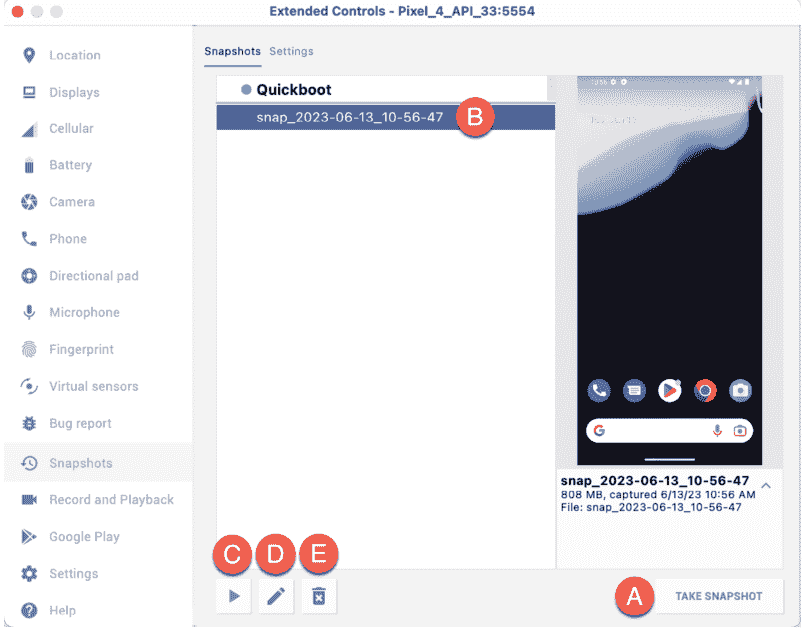

### 图 5-4

你还可以通过从主工具栏的运行（run）菜单中进行选择，决定使用冷启动、最近的快速启动快照或之前的快照来启动模拟器，如图 5-5 所示：

### 图 5-5

## 5.7 配置指纹模拟

模拟器允许配置最多 10 个模拟指纹，用于测试 Android 应用中的指纹认证（该主题在“Android 生物识别认证教程”中介绍）。配置模拟指纹始于启动模拟器、打开 `Settings`（设置）应用并选择 `Security`（安全）选项。

在 `Security` 设置界面中，选择 `fingerprint`（指纹）选项。在显示的信息屏幕上，点击 `Next`（下一步）按钮进入指纹设置屏幕。在启用指纹安全之前，必须配置一种备份屏幕解锁方法（例如 PIN）。输入并确认合适的 PIN，通过接受默认通知选项完成 PIN 输入过程。继续后续剩余屏幕，直到 `Settings` 应用请求在传感器上指纹。此时，显示 `Extended Controls`（扩展控制）对话框，在左侧面板中选择 `Fingerprint`（指纹）类别，并确保主设置面板中选择了 `Finger 1`（指纹 1）：

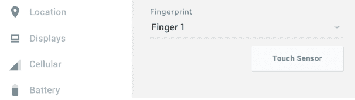

### 图 5-6

点击 `Touch Sensor`（触摸传感器）按钮来模拟 `Finger 1` 触摸指纹传感器。模拟器将报告成功添加指纹：


### 指纹已添加

现在你可以使用指纹解锁手机或验证身份，例如在登录应用时。

### 图 5-7

要添加更多指纹，请在再次点击 `Touch Sensor`（触摸传感器）按钮之前，点击 `Add Another`（添加另一个）按钮，并在扩展控制面板菜单中选择另一个手指。

## 5.8 工具窗口模式下的模拟器

如上一章（“在 Android Studio 中创建 Android 虚拟设备（AVD）”）概述，Android Studio 可以配置为在嵌入工具窗口中启动模拟器，使其不再显示在独立窗口中。当在此模式下运行时，工具栏中将提供与独立模式相同的控制控件，如图 5-8 所示：

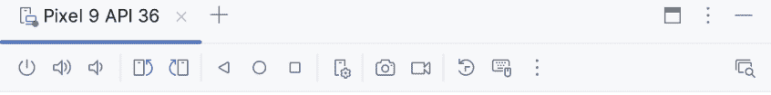

### 图 5-8

从左到右，这些按钮执行以下任务（详细信息与独立模式一致）：

- `Power`（电源）
- `Volume Up`（音量上）
- `Volume Down`（音量减）
- `Rotate Left`（左旋转）
- `Rotate Right`（右旋转）
- `Back`（返回）
- `Home`（主页）
- `Overview`（概览）
- `Common Android Settings`（常用 Android 设置）
- `Screenshot`（截图）
- `Record Screen`（录屏）
- `Snapshots`（快照）
- `Hardware Input`（硬件输入）
- `Extended Controls`（扩展控制）
- `Layout Inspector`（布局检查器）

## 5.9 Common Android Settings

`Running Devices` 工具栏中的 `Common Android Settings` 按钮提供了快速访问多个设备配置设置，包括系统字体大小、屏幕大小和深色模式。点击后，将出现图 5-9 所示的面板：

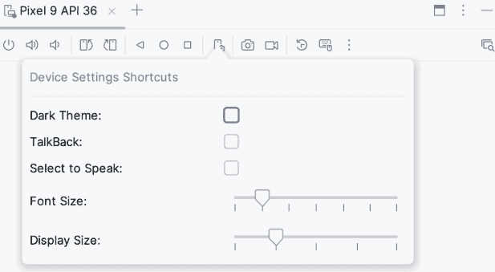

### 图 5-9

在此面板中进行的更改将立即反映在 AVD 会话中。

## 5.10 创建可调整大小的模拟器

除了匹配特定 Android 设备模型的模拟器外，Android Studio 还提供了可调整大小的 AVD，允许你在手机、平板电脑和折叠设备尺寸之间切换。要创建可调整大小的模拟器，打开 `Device Manager`（设备管理器）工具窗口，点击 `+` 工具栏按钮，并选择 `Create Virtual Device`（创建虚拟设备）菜单选项。在 `Add Device`（添加设备）对话框中，在搜索栏中输入“Resizable”并选择 `Resizable` 设备配置：

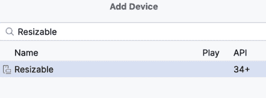

### 图 5-10

当你在工具窗口的新模拟器上运行应用时，工具栏中会出现 `Display mode`（显示模式）选项，允许你如图 5-11 所示切换模拟器配置：

### 图 5-11

如果模拟器在独立模式下运行，则可以在侧边工具栏找到 `Display mode` 选项，如下所示：

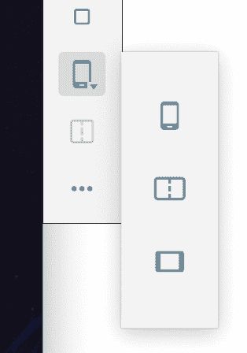

### 图 5-12

一旦选择了折叠显示模式，可以使用 `Change posture`（更改姿态）菜单在打开、关闭和半开配置下测试应用：

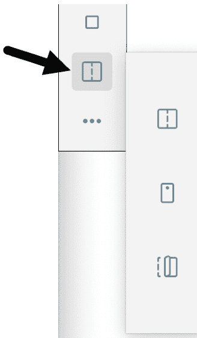

## 5.11 总结

Android Studio 包含一个 Android 虚拟设备环境，旨在使测试更加容易。本章对模拟器进行了简单介绍并强调了其功能。

# 6. 用户界面之旅

虽然人们想要直接运行示例，但 Android Studio 是一个强大且功能丰富的环境，在很大程度上是直观的。尽管如此，现在花时间熟悉布局将缩短学习曲线。

## 6.1 欢迎界面

欢迎界面（图 6-1）在 Android Studio 运行但没有打开任何项目时显示。如果 Android Studio 在项目仍打开时之前退出，工具在下次运行时将跳过欢迎界面，自动打开之前活跃的项目。

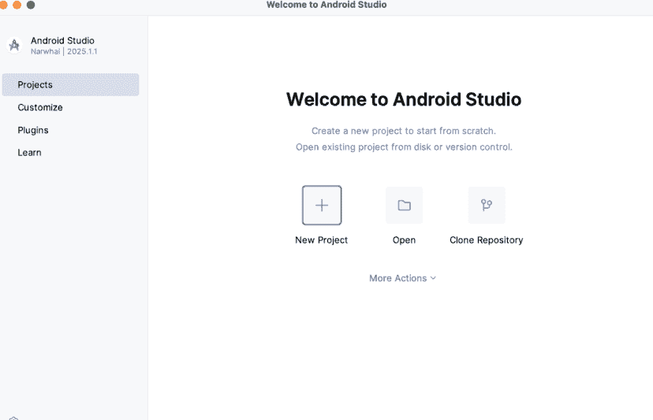

### 图 6-1

除了最近项目列表，欢迎界面还提供了执行打开和创建项目等任务的选项。此外，`Customize`（自定义）屏幕提供了更改 IDE 和编辑器使用的主题和字体设置的选项。可以使用 `Plugins`（插件）选项查看、安装和管理 Android Studio 插件。

在最近项目列表处，选择 `More Actions`（更多操作）链接或使用图 6-2 所示的菜单可以获取更多选项：

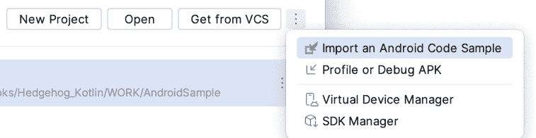

### 图 6-2

## 6.2 菜单栏

当创建新项目或打开现有项目时，将出现 Android Studio 主窗口。当打开多个项目时，每个项目将分配自己的主窗口。窗口的精确配置取决于 Android Studio 运行的操作系统，以及上次打开项目时显示了哪些工具和面板。例如，主菜单栏的出现将取决于宿主操作系统。在 macOS 上，Android Studio 遵循将菜单栏放置在桌面顶部的标准惯例，如图 6-3 所示。

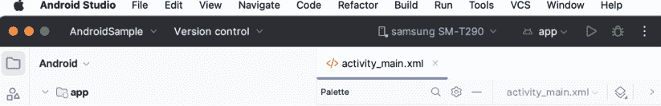

### 图 6-3

然而，当 Android Studio 在 Windows 或 Linux 上运行时，可以通过图 6-4 中高亮的按钮访问主菜单。

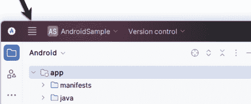

### 图 6-4

## 6.3 主窗口

一旦打开项目，Android Studio 主窗口通常类似于图 6-5。

主窗口的各种元素可以总结如下：

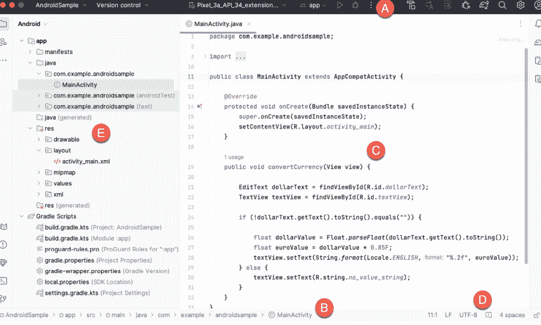

- A - 工具栏 - 一组用于频繁执行操作的快捷键。工具栏按钮提供了对一组特定菜单栏操作的快速访问。可以通过右键点击工具栏并选择“自定义工具栏...”菜单选项来自定义工具栏。图 6-6 显示的工具栏菜单提供了一种方便的方法来执行如创建和打开项目，以及在打开多个项目时进行窗口切换：

### 图 6-5


# Android Studio 版本控制

## 新建和打开项目

- `An... New Project...`
- `Open...`
  - `Get from Version Control...`

### 打开项目

#### `AS MySecondProject`

`~/Drob/Documents/Books/Giraffe_Kotlin/WORK/MySecondProject`

#### `AS AndroidSample`

`~/Drob/Documents/Books/Giraffe_Kotlin/WORK/AndroidSample`

`res`

图 6-6

### B - 导航栏

导航栏提供了在组成项目的文件和文件夹之间移动的方法。点击导航栏中的元素将弹出一个菜单，列出该位置下的子文件夹和文件供选择。同样，点击类名将显示一个列出该类包含方法的菜单：

```text
convertCurrency

onCreate

AndroidSample > app > src > main > java > com > example > androidsample > MainActivity > convertCurrency
```

图 6-7

从列表中选择一个方法将跳转到代码编辑器中相应的位置。您可以使用“查看 -> 外观 -> 导航栏”菜单选项来隐藏、显示和更改此栏的位置。

### C - 编辑器窗口

编辑器窗口显示开发者当前正在编辑的文件的内容。当打开多个文件时，每个文件都由位于编辑器顶部的标签页表示，如图 6-8 所示：


图 6-8

### D - 状态栏

状态栏显示有关项目和 Android Studio 的信息消息。悬停在状态栏项目上将显示该字段的描述。许多字段是交互式的，允许用户点击以执行任务或获取更详细的状态信息。


图 6-9

状态栏中显示的小部件可以使用“查看 -> 外观 -> 状态栏小部件”菜单进行更改。

### E - 项目工具窗口

项目工具窗口提供了项目文件结构的层级概述，允许对特定文件和文件夹进行导航。可以使用工具栏以几种不同的方式显示项目。默认设置是 Android 视图，这是本书其余部分主要使用的模式。

项目工具窗口只是 Android Studio 环境中许多可用工具之一。

## 6.4 工具窗口

除了项目视图工具窗口外，Android Studio 还包含许多其他窗口。当这些窗口启用时，会显示位于主窗口左侧和右侧的工具窗口栏，其中包含用于显示和隐藏每个工具窗口的按钮。图 6-10 显示了典型的工具窗口栏配置，尽管按钮及其位置可能会根据你安装的 Android Studio 而有所不同。

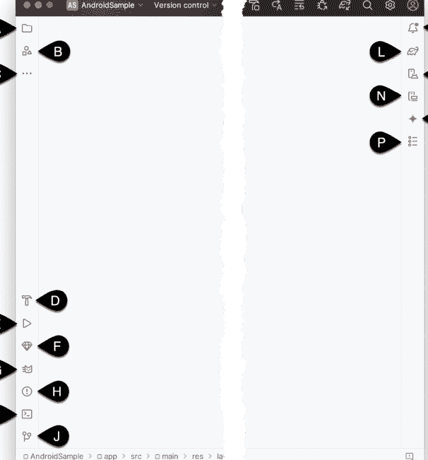

图 6-10

点击按钮将显示相应的窗口，再次点击则将隐藏窗口。按钮在工具窗口栏中的位置表示窗口在显示时将出现在窗口的一侧。可以通过点击并拖动按钮到其他窗口工具栏的不同位置来更改这些位置。

Android Studio 提供了广泛的工具窗口，其中最常用的如下：

- **项目 (A)**：项目视图提供了项目文件结构的概述，允许在文件之间进行快速导航。通常，在项目视图中双击文件将导致该文件加载到适当的编辑工具中。
- **资源管理器 (B)**：用于在项目内添加和管理资源及资产的工具，例如图像、颜色和布局文件。
- **更多工具窗口 (C)**：显示包含当前未在工具窗口栏中显示的额外工具窗口的菜单。当从此菜单中选择工具窗口时，它将作为按钮出现在工具窗口栏中。
- **构建 (D)**：在 Android Studio 构建当前项目时，显示每个过程步骤的实时视图。
- **运行 (E)**：当应用程序正在运行时，运行工具窗口将可用，并提供运行结果视图，以及停止或重启正在运行进程的选项。如果应用程序在设备或模拟器上安装和运行失败，此窗口通常会提供有关问题的诊断信息。
- **App 洞察 (F)**：提供访问云端 Firebase 应用程序质量和崩溃分析平台。
- **Logcat (G)**：Logcat 工具窗口提供了监控运行应用程序日志输出的访问，以及对应用程序截图、视频以及停止和重启进程的选项。
- **问题 (H)**：查看所有当前错误的中心位置。
- **终端 (I)**：终端工具窗口提供了命令行界面的访问。
- **版本控制 (J)**：版本控制工具窗口提供了 Git 和其他控制系统的访问。
- **通知 (K)**：通知工具窗口提供了事件和更新。
- **Gradle (L)**：Gradle 工具窗口提供了编译项目的任务视图。
- **设备管理器 (M)**：提供对物理设备和模拟器的访问。
- **运行设备 (N)**：包含 AVD 模拟器和当前运行的设备。
- **Gemini (O)**：Android Studio 的 AI 驱动编程助手。
- **助手 (P)**：显示助手面板，其随功能而异。
- **App 检查**：提供对数据库检查器和后台任务检查器的访问。
- **书签**：书签工具窗口提供了对已书签文件和代码行的快速访问。
- **构建变体**：构建变体工具窗口提供了配置不同构建目标的快速方法。
- **设备文件管理器**：提供对所连接设备文件系统的直接访问。
- **布局检查器**：提供 UI 层次的可视 3D 渲染。
- **结构**：提供当前编辑器中源文件的高层级视图。
- **TODO**：提供了一个查看待完成事项的地方。

通过打开 Settings（设置）对话框并导航到 Editor 下的 TODO 项进行检查和更改。

## 6.5 工具窗口菜单

每个工具窗口在顶部边缘都有自己的工具栏。这些工具栏中的菜单按钮随工具不同，但所有工具窗口都包含一个 Options（选项）菜单（图 6-11 中标记为 A）：

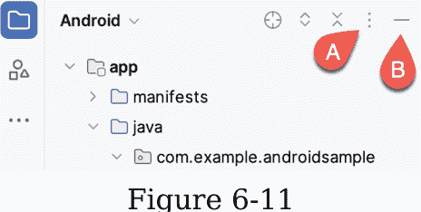

Options 菜单允许更改窗口的各个方面。例如，图 6-12 显示了 Project 工具窗口的 Options 菜单。可用设置可以解锁窗口并允许其浮动在 Android 主窗口边界之外，以及移动和调整工具窗口的大小：

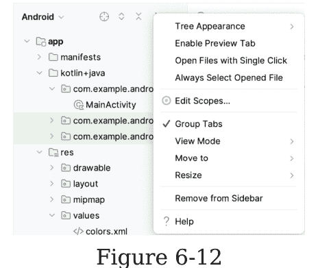

所有工具窗口的工具栏最右侧还包含一个按钮（上方图 6-11 中标记为 B），提供了隐藏工具窗口的其他方法。可以通过点击该窗口使其获得焦点，然后输入搜索词（例如 Project 工具窗口中的文件名）来对该工具窗口内的项进行搜索。搜索框将出现在窗口的工具栏中，并匹配搜索内容的项。

## 6.6 Android Studio 快捷键

Android Studio 包含了许多快捷键，以便在执行常用任务时节省时间。可以通过选择 Android Studio 项目窗口中的 `Help -> Keyboard Shortcuts PDF` 菜单选项来查看并打印完整的快捷键映射列表。您也可以通过打开 Settings 对话框并点击 Keymap 项来列出和修改快捷键，如图 6-13 所示：

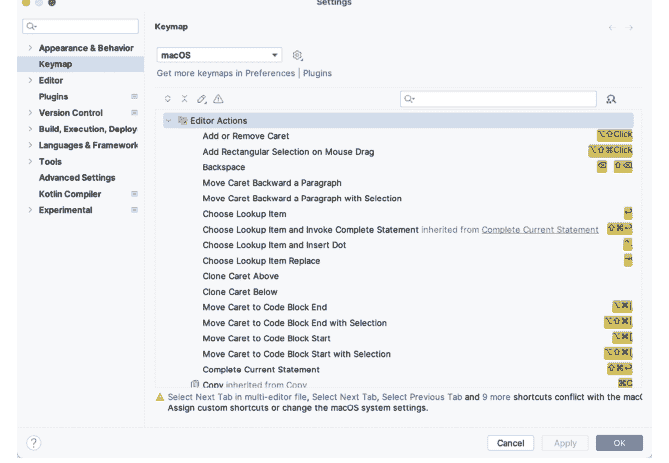

## 6.7 切换器和最近文件导航

在 Android Studio 主窗口内进行导航的另一种实用机制是使用 Switcher（切换器）。通过 `Ctrl-Tab` 快捷键访问切换器，切换器将以面板的形式出现，列出所有工具窗口和当前打开的文件（图 6-14）。

图 6-13

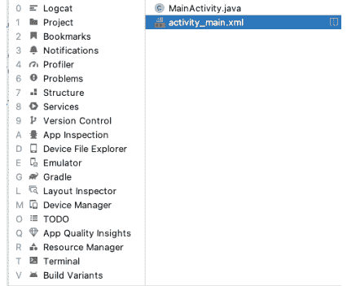

图 6-14

一旦显示，只要 Ctrl 键保持按下状态，切换器就会保持可见。在按住 Ctrl 键的同时反复点击 Tab 键可以在各种选择选项之间循环，而释放 Ctrl 键则会选择当前高亮的项并在主窗口中显示。

除了 Switcher 之外，Recent Files（最近文件）面板提供了到最近打开文件的导航（图 6-15）。可以使用 `Ctrl-E` 快捷键（macOS 上为 `Cmd-E`）访问它。一旦显示，可以使用鼠标指针选择选项，或使用键盘方向键滚动浏览文件名和工具窗口选项。按 Enter 键将选择当前高亮的项：

```text
Recent Files

Project activity_main.xml

Run strings.xml

Problems MainActivity.kt

Version Control build.gradle.kts (:app)

App Quality Insights Translations Editor

Device Manager Button.java

Gradle

Local

Notifications

Profiler

Resource Manager

Running Devices

Terminal

Recent Locations

~/Dropbox/Documents/Books/Gradle/Kotlin/WORK/AndroidSample/app/src/main/res/values
```

图 6-15

## 6.8 更改 Android Studio 主题

可以使用 Settings 对话框更改 Android Studio 环境的整体主题。一旦显示了设置对话框，在左侧面板中选择 Appearance & Behavior（外观与行为）选项，然后选择 Appearance（外观）。然后，在点击 OK 按钮之前更改 Theme（主题）菜单的设置。可用主题取决于平台，但通常包括 Light（浅色）、IntelliJ、Windows、High Contrast（高对比度）和 Darcula 等选项。图 6-16 显示了选择了 Dark（深色）主题的主窗口示例：

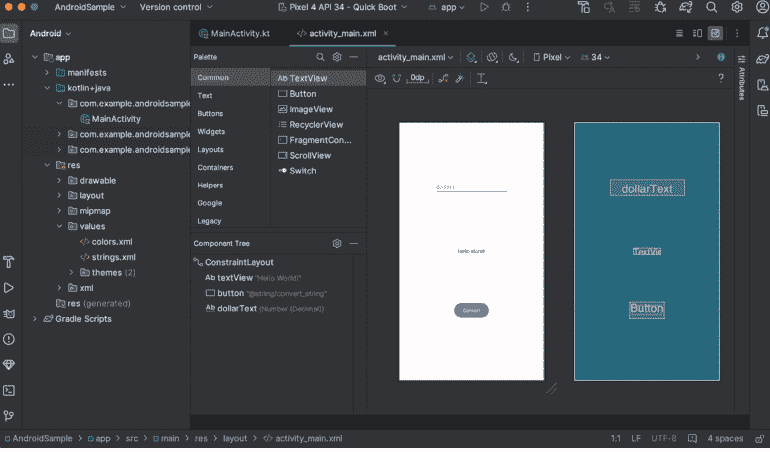

图 6-16

要使 Android Studio 主题与操作系统的亮暗模式同步，请启用 Sync with OS（与操作系统同步）选项，并使用下拉菜单控制每个模式使用哪种主题：

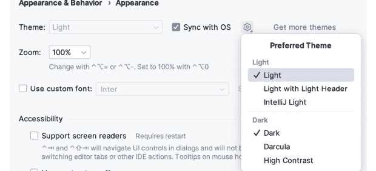

图 6-17

Android Studio Marketplace 提供了数百个额外主题，可以通过点击 `Get more themes`（获取更多主题）链接来访问。

## 6.9 总结

Android Studio 环境的主要元素包括欢迎界面和主窗口。每个项目都有分配自己的主窗口，主窗口又由菜单栏、工具栏、编辑和设计区域、状态栏和一组工具窗口组成。工具窗口显示在主窗口的侧边。

Android Studio 中极少的操作是无法通过快捷键触发的。可以随时从 Android Studio 主窗口内访问默认快捷键的映射。

# 7. 在物理设备上测试 Android Studio 应用

虽然使用 Android 虚拟设备（AVD）进行测试可以实现许多功能，但某些功能仅在物理设备上可用。本章解释了如何在 macOS、Windows 和 Linux 上启用 ADB。

## 7.1 Android 桥接（ADB）概述

ADB 的主要目的是为了便于开发系统（在此例中为 Android Studio）与 AVD 以及物理设备之间的交互。ADB 由一个客户端、一个在后台运行的服务器进程和一个守护程序进程组成。ADB 客户端可以以多种形式存在。例如，在 Android SDK `platform-tools` 目录下提供了一个名为 `adb` 的命令行工具客户端。同样，Android Studio 也有一个内置的客户端。

可以使用 ADB 命令行工具执行各种任务，例如激活虚拟或物理设备。以下命令输出表示系统上存在 AVD：

```shell
$ adb devices

List of devices attached

emulator-5554 device
```

## 7.2 在 Android 设备上启用 USB 调试

在 ADB 连接到设备之前，必须配置该设备以允许连接。在运行 Android 6.0 或更高版本的设备上，实现此目的的步骤如下：

- 打开 Settings 应用并选择 About phone（关于手机）选项（在某些 Android 版本中，位于 System 页面）。
- 在 About 屏幕上，向下滚动到 Build number（版本号）字段并点击七次，直到消息显示开发者模式已启用。如果 About 屏幕上没有列出 Build number，则可以通过 Software information（软件信息）选项获取。或者，如果可用，展开列表中的 Advanced 部分。
- 返回 Settings 主界面，并注意出现一个名为 Developer options（开发者选项）的新选项（在较新版本的 Android 中，此选项列在 System 设置屏幕上）。

| Wi-Fi MAC address |
| :--- |
| 02:00:00:44:55:66 |
| Build number |
| PPP18002.012 |

图 7-1

- 选择此选项，并在生成的屏幕上，找到图 7-2 所示的 USB debugging 选项：

```text
Debugging

USB debugging

Debug mode when USB is connected
```

图 7-2

- 启用 USB debugging 选项，并在请求确认时点击 Allow 按钮。

现在设备已配置为接受来自开发系统通过 USB 连接的 ADB 调试连接。剩下的工作是配置开发系统在设备连接时检测到设备。虽然这是一个相对简单的过程，但步骤取决于开发系统运行的是 Windows、macOS 还是 Linux。注意，以下步骤假设 Android SDK `platform-tools` 目录已包含在操作系统的 `PATH` 中。

### 7.2.1 macOS ADB 配置

要在 macOS 系统上配置 ADB 环境，请使用 USB 线将设备连接到计算机，打开终端窗口，并执行以下命令以重启 ADB 服务：

```shell
$ adb kill-server

$ adb start-server
```

```text
* daemon not running. starting it now on port 5037 *
* daemon started successfully *
```

一旦服务器成功运行，执行以下命令以验证设备已检测到：

```shell
$ adb devices
```

```text
连接设备列表
74CE000600000000 offline
```

如果设备列表显示为 `offline`（离线），请查看 Android 设备并检查是否有[图 7-3](#)所示的对话框，请求允许“允许 USB 调试”。在点击“确定”（OK）之前，请勾选“始终允许此计算机”旁边的复选框。

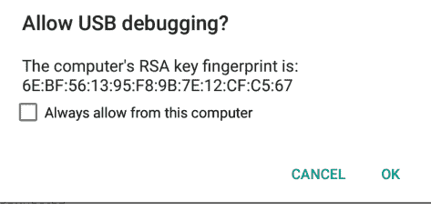

图 7-3

再次执行 `adb devices` 命令现在应该会列出设备为可用：

```text
连接设备列表
015d41d454bf80c device
```

如果设备未列在列表中，如果问题仍然存在，请尝试注销并重新登录 macOS 桌面并重启系统。

### 7.2.2 Windows ADB 配置

配置基于 Windows 的开发系统以使用 ADB 连接到 Android 设备的第一步是在系统上安装相应的 USB 驱动程序。需要安装的 USB 驱动程序取决于 Android 设备的型号。如果你有 Google 设备（如 Pixel 手机），则必须在 Windows 系统上安装并配置 Google USB 驱动程序包。实现此目的的详细步骤概述在以下网页上：[https://developer.android.com/sdk/win-usb.html](#)。

对于 Google USB 驱动程序不支持的 Android 设备，有必要下载由设备制造商提供的驱动程序。可以在此处获取驱动程序列表以及下载和安装信息：

`https://developer.android.com/tools/extras/oem-usb.html`

在安装驱动程序且设备现在被识别为正确的设备类型后，打开命令提示符窗口并执行以下命令：

```shell
adb devices
```

此命令应输出有关已连接设备的信息，类似于所示：

```text
连接设备列表
HT4CTJT01906 offline
```

如果设备列表显示为 `offline` 或未授权（`unauthorized`），请查看设备显示并检查是否有图 7-3 所示的对话框，请求允许 USB 调试。在点击“确定”（OK）之前，请勾选“始终允许此计算机”旁边的复选框。再次执行 `adb devices` 命令现在应该会列出设备为就绪：

```text
连接设备列表
HT4CTJT01906 device
```

如果设备未列在列表中，执行以下命令重启 ADB 服务端：

```shell
adb kill-server

adb start-server
```


如果设备仍然未列在列表中，尝试执行以下命令：

```
android update adb
```

注意，可能也需要重启系统。

## 7.2.3 Linux ADB 配置

在本章中，我们将再次使用 Ubuntu Linux 作为参考示例，在 Linux 上配置 ADB 以连接到物理 Android 设备进行应用测试。

在 Ubuntu Linux 上进行物理设备测试需要安装名为`android-tools-adb`的包，这反过来要求 Android Studio 用户成为`plugdev`组的成员。这是大多数 Ubuntu 版本中用户账户的默认设置，可以通过运行`id`命令进行验证。如果未列出`plugdev`组，请运行以下命令将您的账户添加到该组：

```
sudo usermod -aG plugdev $LOGNAME
```

满足组身份要求后，可以通过执行以下命令安装`android-tools-adb`包：

```
sudo apt-get install android-tools-adb
```

完成上述更改后，重启 Ubuntu 系统。系统重启后，打开终端（Terminal）窗口，启动 ADB 服务端，并检查连接设备列表：

```
$ adb start-server
* daemon not running. starting it now on port 5037 *
* daemon started successfully *
```

```
$ adb devices
015d41d454bf80c offline
```

如果设备列表显示为 offline 或未授权，请查看 Android 设备并检查是否有图 7-3 所示的对话框，请求允许*允许 USB 调试。在点击“确定”（OK）之前，请勾选*始终允许此计算机*旁边的复选框。

## 7.3 解决 USB 连接问题

如果你无法通过上述步骤成功连接到设备，请显示运行目标菜单（图 7-4）并选择“疑排除设备连接”（Troubleshoot Device Connections）选项：

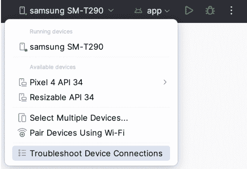

图 7-4

连接向导（connection assistant）将扫描设备并报告问题及可能的解决方案。

## 7.4 在 Android 设备上启用无线调试

遵循上述 7.2 节中的步骤 1 到 3，这次启用如图 7-5 所示的“无线调试”（Wireless Debugging）选项：

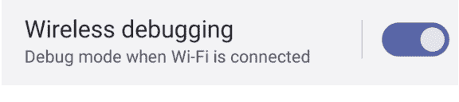

图 7-5

接下来，点击上面的无线调试项以显示图 7-6 所示的屏幕：

## 无线调试


图 7-6

如果你的设备带有摄像头，选择*用二维码配对设备*（Pair device with QR code），否则选择*用配对码配对设备*（Pair device with pairing code）选项。根据你的选择，设置应用将启动摄像头或显示配对码，如图 7-7 所示：


图 7-7

选择完成后，返回 Android Studio 并选择图 7-8 所示的“通过 WiFi 配对设备”（Pair Devices Using WiFi）选项：

```
samsung-T290 app  ⋮

pairing devices

samsung-T290

Available devices

Pixel 4 API 34

Select Multiple Devices...

Pair Devices Using Wi-Fi

Troubleshoot Device Connections
```

图 7-8

在配对对话框中，根据你在设备上的选择，选择**使用二维码配对**（Pair using QR code）或**使用配对码配对**（Pair using pairing code）：


图 7-9

或者将设备上显示的配对码输入到 Android Studio 对话框（图 7-10）中以完成配对过程：


图 7-10

如果配对过程失败，尝试重启开发系统和 Android 设备并重试。

## 7.5 测试 ADB 连接

假设已成功配置了 ADB，下一步是在设备上运行“创建示例应用”章节中创建的应用。启动 Android Studio，打开项目，并验证设备是否出现在图 7-11 所示的选择列表中：


图 7-11

从列表中选择设备并点击运行按钮。

## 7.6 设备镜像

设备镜像允许你在物理设备上运行应用，同时在 Android Studio 的“运行设备”窗口中显示屏幕。也就是说，尽管应用运行在物理设备上，但它以类似于 AVD 实例的方式显示在 Android Studio 中。

将设备连接到 Android Studio 后，打开运行设备窗口并点击“设备镜像设置”（Device Mirror settings）链接显示设置对话框。在设置对话框中，启用物理 Android 设备镜像并点击“确定”。返回主窗口后，Android Studio 将镜像物理设备的显示。

## 7.7 总结

虽然 Android 虚拟机模拟器提供了一个极佳的测试环境，但记住确保应用程序在物理 Android 设备上正常运行是不可替代的。

然而，默认情况下，Android Studio 环境未配置为检测 Android 设备作为测试设备。因此，有必要执行某些步骤，通过 USB 线缆或 WiFi 网络从 Android Studio 开发环境直接将应用加载到 Android 设备。

# 8. Android Studio 代码编辑器基础

开发 Android 应用涉及大量的编程工作，根据定义，这包含了代码的输入、审查和修改。不出乎意料的是，开发者在使用 Android Studio 时花费的大部分时间通常都是在编辑器窗口内编辑代码。

现代代码编辑功能必须远超输入、删除、剪切和粘贴等基础操作。如今，代码编辑器的性能通常通过以下因素衡量：它在多大程度上减少了程序员所需的输入量、在大型源文件中导航的易用性，以及编辑器在编写代码时实时检测并高亮编程错误的能力。如本章所示，这些只是 Android Studio 编辑器出色的少数领域之一。

本章并非对 Android Studio 编辑器功能的详尽概述，但旨在提供一份该工具关键功能的指南。丰富的程序员会发现，其中一些功能在如今大多数代码编辑器中都是通用的，而许多功能是该编辑环境所独有的。

## 8.1 Android Studio 编辑器

当选择 Java、Kotlin、XML 或其他文本文件进行编辑时，Android Studio 编辑器会出现在主窗口中央。例如，图 8-1 显示了一个加载了 Java 源代码文件的典型编辑器会话：

```
MainActivity.java  activity_main.xml  build.gradle.kts (AndroidSample)
```

```
package com.example.androidsample;

import ...

public class MainActivity extends AppCompatActivity {

    private MainActivityBinding binding;

    @Override

    protected void onCreate(Bundle savedInstanceState) {

        super.onCreate(savedInstanceState);

        setContentView(R.layout.activity_main);

        binding = MainActivityBinding.inflate(getLayoutInflater());

        View view = binding.getRoot();

        setContentView(view);

    }

    public void convertCurrency(View view) {

        if (binding.textField.getText().toString().equals("")) {

            float doubleValue = Float.parseFloat(binding.textField.getText().toString());

            binding.resultText.setText(String.format(Locale.ENGLISH, "$.2f", doubleValue));

        } else {

            binding.textField.setText("No Value");

        }

    }

}
```

图 8-1

构成编辑器窗口的元素可以总结如下：

**A - 文档标签页 (Document Tabs)**：Android Studio 可以随时打开多个文件进行编辑。每当打开一个文件，它就会被分配一个文档标签页，在编辑器窗口顶部标签栏中显示文件名。当空间不足以显示所有标签页时，标签栏的最右侧会出现一个小下拉菜单。点击此菜单将列出其他已打开的文件列表。标签页中文件名下方的红色波浪线表示该文件中的代码包含一个或多个错误，在项目编译运行之前需要解决这些错误。

在文件之间切换只需点击相应的标签页或使用`Alt-Left`和`Alt-Right`快捷键。也可以使用切换器（Switcher）机制（通过`Ctrl-Tab`快捷键访问）在文件间导航。

若要将编辑器面板从 Android Studio 主窗口分离以便在独立窗口中显示，请点击标签页并拖动到主窗口之外的桌面区域。要将编辑器返回主窗口，请点击分离编辑器窗口中的文件标签页，将其拖放到主窗口中原始的编辑器标签栏上。

**B - 编辑器行槽区域 (The Editor Gutter Area)**：编辑器使用槽区域来显示信息图标和控件。该槽区域的常见典型项目包括调试断点标记、折叠和展开代码块的控件、书签、XML 文件引用以及行号。例如，图 8-2 显示了`MainActivity.java`文件中`MainActivity`类声明首行的编辑器槽区域：

```
16  class MainActivity : ComponentActivity() {
17      override fun onCreate(savedInstanceState:
18          super.onCreate(savedInstanceState)
```

图 8-2

将鼠标指针悬停在槽图标上将显示工具提示说明。上面的示例包含一个执行主 Activity 的按钮、一个 XML 文件引用，以及一个表示`onCreate()`方法覆盖了父类方法的指示。

行号默认开启，但可以通过在槽区域点击右键并选择 Appearance（外观）-> Show Line Numbers（显示行号）来禁用。

**C - 代码结构位置 (Code Structure Location)**：编辑器底部的此栏显示光标相对于代码整体结构的当前位置。例如，在图中该栏表示当前正在编辑`convertCurrency`方法，且该方法位于`MainActivity`类中：

图 8-3

双击栏中的元素将把光标移动到代码文件中的对应位置。例如，双击`convertCurrency`条目将光标移动到源代码中`convertCurrency`方法的顶部。同样，点击`MainActivity`条目将显示一个供选择的导航点列表：


图 8-4

**D - 编辑器区域 (The Editor Area)**：用户审查、输入和编辑代码的主要区域。本章的后续章节将详细介绍编辑区域的关键功能。

**E - 验证与标记侧边栏 (The Validation and Marker Sidebar)**：Android Studio 集成了一个名为“即时代码分析”（on-the-fly code analysis）的功能。这意味着当您编写代码时，编辑器会分析代码以检查警告和语法错误。验证侧边栏顶部的指示会实时更新，显示随着代码添加而发现的错误和警告数量。点击此指示将弹出窗口，其中包含编辑器代码问题的摘要，如图 8-5 所示：


图 8-5

上下箭头用于在代码中的错误位置之间移动。绿色勾钩表示未检测到警告或错误。侧边栏还会使用相同的颜色编码在检测到问题的位置显示标记。当代码行在编辑器区域中可见时，将鼠标指针悬停在标记上将显示包含问题描述的弹出窗口：


图 8-6

将鼠标指针悬停在当前滚动出视图区域的代码行上，将显示一个“透镜”（lens）覆盖在代码上，而无需滚动到该位置：

```javascript
EditText dotText = findById(id.dotText);
TextView textView = findById(id.textView);
if (dotText.getText().toString().equals("0")) {
  float dotValue = parseFloat(dotText.getText().toString());
  float cursorValue = parseFloat(textView.getText().toString(), "N2f", cursorValue);
} else {
  textView.setText("0%");
}
```

图 8-7

值得注意的是，透镜并不不仅限于侧边栏中的警告和错误。悬停在侧边栏的任何部分都会导致出现一个透镜，显示该位置存在的代码。

**F - 状态栏 (The Status Bar)**：虽然状态栏是主窗口的一部分而非编辑器，但它包含了一些关于当前编辑会话的信息。这些信息包括光标在行和字符方面的当前位置以及文件的编码格式（UTF-8、ASCII 等）。点击状态栏中的这些值可以更改相应的设置。例如，点击行号会显示“转到行:列”（Go to Line:Column）对话框。使用 View -> Appearance -> Status Bar Widgets 菜单可以添加和删除小部件。例如，如果您遇到性能问题，内存指示（Memory Indicator）是一个非常有用的小部件。

在提供了构成 Android Studio 编辑器的元素概述后，本章其余部分将更详细介绍编辑环境的关键功能。

## 8.2 浮动代码工具栏 (The Floating Code Toolbar)

浮动代码工具栏为代码编辑器中常用的任务提供了快速访问。当在编辑器中选择代码时，它会自动出现，如下图 8-8 所示：

```
doSomething()
Extract Surround // :
```

图 8-8

```java
public void convertCurrency(View view) { no usages
  EditText(
    TextView
    Safe delete 'convertCurrency')
  Creates a new scratch file from the selected fragment.
  if (id)
    Change access modifier
    Create new scratch file from selection
    Float  Add Jenkins int(3);
    Float  Adjust code style settings
    text      Generate overloaded method with default parameter values
    Value());
} else {
  Press F1 to toggle toolbar
}
```

图 8-9

预设工具栏项目还包括对 Gemini AI 功能的访问、代码提取、代码重格式化，以及为所选代码添加注释标记的选项。使用“更多”菜单（如图 8-10 所示）可以自定义或隐藏工具栏：

```
{
doSomething()
Extract Surround // [] []
Customize Toolbar...
Don't Show Toolbar
}
```


图 8-10

当选中自定义选项时，将显示如图 8-11 所示的对话框，允许对项目进行移动、编辑和删除：


图 8-11

要添加项目，点击“添加...”按钮并从操作列表中进行选择：


图 8-12

## 8.3 分割编辑器窗口

默认情况下，编辑器将显示一个显示当前选中文件内容的面板。在同时处理多个源文件时，一个实用的功能是将编辑器拆分为多个面板。要拆分编辑器，请右键点击编辑器窗口内的标签页，然后选择“向右拆分”或“向下拆分”菜单选项。例如，图 8-13 显示了拆分器的用法，编辑器被分为三个面板：


图 8-13

可以通过右键点击相应的标签页并选择“更改拆分方向”选项随时更改拆分面板的方向。重复这些步骤可以取消单个面板的拆分，这次从菜单中选择“取消拆分”。可以通过右键点击任何标签页并选择“取消拆分”来移除所有拆分面板。

窗口拆分可显示不同的文件，或为同一个文件提供多个窗口，允许同时查看和编辑同一文件的不同区域。

## 8.4 代码补全

Android Studio 编辑器对 Java 语法以及构成 Android SDK 的 Java 类和方法有大量的内置知识，同时也对你自己的代码库有了解。随着代码的输入，编辑器会扫描正在输入的内容，并在适当的情况下就完成一个语句或引用可能需要的内容提供建议。当编辑器检测到补全建议时，将出现一个包含建议列表的面板。例如，在图 8-14 中，编辑器正在为 `String` 声明的开头提供可能的选项：

```java
public class MainActivity extends AppCompatActivity {

  Stri

  @ String java.lang

  @ StrictMath java.lang

  @ StringBuffer java.lang
```

图 8-14

如果没有任何自动补全建议是正确的，请继续输入，编辑器将在适当的情况下继续完善建议。要接受最顶部的建议，请按键盘上的 `Enter` 或 `Tab` 键。要选择不同的建议，请使用箭头方向键在列表中上下移动，再次使用 `Enter` 或 `Tab` 键选中高亮项。

可以使用 `Ctrl-Space` 键组合手动调用补全。这在更改编辑器中的单词或声明时非常有用。当光标置于编辑器中的某个单词上时，该单词会自动高亮。按 `Ctrl-Space` 将显示建议列表。按 `Tab` 键可以将当前单词替换为建议列表的高亮项。

除了实时自动补全功能外，Android Studio 编辑器还提供了智能补全系统。智能补全使用 `Shift-Ctrl-Space` 键组合调用，选中后将根据代码的当前上下文提供更详细的建议。再次使用 `Shift-Ctrl-Space` 快捷键将从更广泛的范围内提供更多建议。

代码补全对许多程序员来说可能是个人喜好。考虑到这一事实，Android Studio 对自动补全设置提供了很高的控制权限。可以通过打开设置对话框并在设置面板中选择 `Editor -> General -> Code Completion` 来查看和修改这些设置，如图 8-15 所示：


图 8-15

## 8.5 语句补全

Android Studio 编辑器提供的另一种自动补全形式是语句补全。它可以自动填充方法和循环语句等项的圆括号和大括号。语句补全使用 `Shift-Ctrl-Enter`（macOS 上为 `Shift-Cmd-Enter`）键组合调用。考虑以下代码：

```java
myMethod()
```

在编辑器中输入此代码后，触发语句补全将导致编辑器自动为该方法添加大括号：

```java
myMethod() {

}
```

## 8.6 参数信息

还可以请求编辑器提供关于方法接受参数的信息。当光标位于方法的括号之间时，使用 `Ctrl-P`（macOS 上为 `Cmd-P`）键组合将显示可能的建议：

| `String format, Object args` |
| :--- |
| `Locale, Object args` |

## 8.7 参数提示

可以配置编辑器在方法调用中显示参数名称提示。例如，图 8-17 高亮了 `make()` 和 `setAction()` 方法中的参数名称：

```java
binding.fab.setOnClickListener(new View.OnClickListener() {

    @Override
    public void onClick(View view) {
        displayMessage("Fab clicked");
        Snackbar.make("your action", Snackbar.LENGTH_LONG)
            .setAction("My Action").show();
    }
});
```

图 8-17

可以通过打开设置对话框并导航到 `Editor -> Inlay Hints -> Values -> Java` 来配置此模式的设置。在所选屏幕上开启或关闭参数选项。要调整提示设置，点击排除链接进行任何调整。

## 8.8 代码生成

除了输入时完成代码外，编辑器在某些条件下还可以为您生成代码。如图 8-18 所示的代码生成列表可以通过光标位于要生成位置时的 `Alt-Insert`（macOS 上为 `Cmd-N`）快捷键访问：


图 8-18

例如，考虑我们希望在项目中的 Activity 将被操作系统销毁时收到通知的情况。正如后续章节所述，这可以通过重写 Activity 基类的 `onStop()` 生命周期方法来实现。要让 Android Studio 为此生成存根方法，从代码生成列表中选择“覆盖方法...”选项，并在生成的可用列表中选择 `onStop()` 方法：


图 8-19

选择要覆盖的方法后，点击 OK 将 Java 源文件中当前光标位置生成存根方法，如下：

```java
@Override
protected void onStop() {
    super.onStop();
}
```

## 8.9 代码折叠

一旦源文件达到一定大小，即使是格式良好且组织良好的也可能变得难以处理和导航。Android Studio 认为并不总是需要显示所有代码块的内容。使用 Android 编辑器的代码折叠功能可以使导航变得更容易。代码折叠通过鼠标指针悬停在行槽区域时出现在源文件中每个代码块开头的显示箭头来控制。例如，图 8-20 高亮了方法的显示箭头。

当前未折叠的声明：

```java
@Override
public boolean onCreateOptionsMenu(Menu menu) {
    // 展开菜单；如果存在操作栏，这将向操作栏中添加项。
    getInflater().inflate(menu, R.menu_main);
    return true;
}
```

图 8-20

点击此标记将折叠语句，使其只显示方法签名，如图 8-21 所示：

```java
@Override
public boolean onCreateOptionsMenu(Menu menu) {...}
```

图 8-21

要展开一段代码，请点击编辑器行边标槽（gutter）中的展开箭头。若要在不展开的情况下查看隐藏的代码，请将鼠标指针悬停在`{...}`指示器上，如图 8-22 所示。编辑器将显示包含折叠代码块的透镜视图：

```java
@Override
public boolean onCreateOptionsMenu(Menu menu) {
    // 展开菜单；如果存在操作栏，这将向操作栏中添加项。
    getInflater().inflate(menuRes, R.menu_main);
    return true;
}
```

// 正如你在 `AndroidManifest.xml` 中指定父 Activity 时。

图 8-22

文件中的所有代码块都可以使用 `Ctrl-Shift-Plus` 和 `Ctrl-Shift-Minus` 键盘序列（macOS 为 `Cmd-Shift-Plus` 和 `Cmd-Shift-Minus`）进行折叠或展开。

默认情况下，Android Studio 编辑器在打开源文件时会自动折叠某些代码。要配置发生这种情况的，请在设置（Settings）对话框中导航到编辑器（Editor） -> 常用（General） -> 代码折叠（Code Folding）（图 8-23）：


图 8-23

## 8.10 快速文档查询

将光标悬停在需要文档的声明上或按下 `Ctrl-Q` 快捷键（macOS 为 `Ctrl-J`），即可访问上下文相关的 Java 和 Android 文档。这将显示一个包含该项目相关参考文档的面板。例如，图 8-24 显示了 Android `FloatingActionButton` 类的文档。

## 8.11 代码重格式

```java
@Override
public boolean onCreateOptionsMenu(Menu menu) {
    // 展开 com.ebookfrenzy.fabexample.MainActivity
    getMenuInflate public boolean onCreateOptionsMenu(
        Menu menu
    return true;
}

@Override
public boolean onCreateOn
    // 处理 acti
    // 自动
```

```text
来自类 android.app.Activity 标准选项

初始化 Activity 的标准选项的内容

你应该将菜单项放置在 menu 中。

这只在第一次显示菜单时调用一次。若要在每次显示菜单时更新菜单，请参见 onPrepareOptionsMenu。
```


通常情况下，Android Studio 编辑器会在添加语句和代码块时，自动根据缩进、间距以及语句和代码块的嵌套对代码进行格式化。在需要重格式化代码行的情况下（当从网站剪切粘贴示例代码时很常见），编辑器提供了源代码重格式化功能，选择该功能后，它将自动重格式化代码以匹配主流的代码风格。

按下 `Ctrl-Alt-L`（macOS 为 `Cmd-Opt-L`）快捷键序列来重格式化源代码。要显示重格式代码（Reformat Code）对话框图 8-25，请使用 `Ctrl-Alt-Shift-L`（macOS 为 `Cmd-Opt-Shift-L`）。此对话框提供了仅重格式化当前选中代码、编辑器中当前整个源文件，或仅重格式化因源代码控制更新引起的代码选项：

图 8-25

通过打开设置对话框并在侧边面板选择代码样式（Code Style）来访问支持的编程和标记语言列表，可以更改完整的代码样式偏好。选择一种语言将提供大量的格式化样式选项，所有选项都可以根据你偏好的代码样式进行修改。例如，要配置上述对话框中 Android Studio 默认的调整代码（Rearrange code）选项的设置，请展开代码样式部分，选择 Java，并在 Java 设置中选择排列（Arrangement）选项卡。

## 8.12 实时模板（Live Templates）

在编写 Android 代码时，你会发现有一些经常使用的常用结构。例如，一个常见的需求是使用 Android `Toast` 类向用户显示弹出消息。实时模板是代码结构的集合，可以通过在编辑器中输入初始字符，然后按一个特殊键（默认设置为 `Tab` 键）来将模板代码插入编辑器中。若要体验这一操作，请在代码编辑器中输入代码后按 `Tab` 键，Android Studio 将在光标处插入以下代码并准备编辑：

```java
Toast.makeText("", Toast.LENGTH_SHORT).show();
```


要列出并编辑现有模板、更改特殊键或添加你自己的模板，请打开设置对话框，从左侧导航面板的编辑器（`Editor`）部分选择实时模板（`Live Templates`）：


图 8-26

使用图 8-26 中标记为 A 的按钮添加、删除、复制或重置模板。从列表 (B) 中选择模板并在面板 (C) 中修改设置。

## 8.13 总结

`Android Studio` 编辑器极力减少编写代码所需的输入并使代码更易读。本章涵盖了关键编辑器功能，包括代码补全、代码生成、窗口分割、代码折叠、重格式、文档查询和实时模板。

# Android 架构概述

到目前为止，书中已经建立了开发环境，并通过创建 `Android` 项目迈了开发的第一步。

然而，在进一步研究 `Android` 开发的实际问题之前，理解 `Android SDK` 和 `Android` 开发的一些抽象概念是重要的。现在清晰理解这些概念将为后续奠定基础。

从本章的 `Android` 架构概述开始并在后续几章节中继续，目标是提供详细的概述。

### 9.1 软件栈

`Android` 结构是由应用程序、操作系统、运行时环境、中间件、服务和库组成的软件栈。这种架构可以通过图 9-1 进行可视化表示。栈的每一层以及每层中相应的元素都紧密集成并经过仔细调整，以为移动设备提供最佳的应用开发和执行环境。本章其余部分将介绍栈的不同层，从底部的 `Linux` 内核开始。

### 9.2 Linux 内核

`Linux` 内核位于 `Android` 软件栈底部，在设备硬件和 `Android` 软件栈上层之间提供了抽象。内核提供了抢占式多任务、底层核心系统服务（如内存、进程和电源管理），以及网络栈和显示器、`WiFi` 和音频等设备的驱动程序。

原始 `Linux` 内核由 `Linus Torvalds` 于 1991 年开发。它与 `Richard Stallman` 在自由软件基金开发的系列工具、实用程序和编译器相结合，创建了一个名为 `GNU/Linux` 的完整操作系统。各种 `Linux` 发行版都是基于这些基础衍生出来的，例如 `Ubuntu` 和 `Red Hat Enterprise Linux`。

然而，值得注意的是 `Android` 只使用了 `Linux` 内核。尽管如此，值得注意的是，`Linux` 内核最初是为传统的桌面和服务器计算机系统设计的。

广泛部署在任务关键型企业服务器环境中。这证明了如今移动设备的强大以及 `Linux` 内核的效率和性能，因为我们可以在 `Android` 软件栈的核心发现此软件。

## 9.3 硬件抽象层

硬件抽象层（`HAL`）由一组库模块组成，这些模块与摄像头、麦克风和加速度计等设备组件接口。当 `Android` 栈需要访问硬件组件时，它使用 `HAL` 库模块。每个 `Android` 设备制造商都为其特定的硬件配置提供了一个抽象层，使得标准的 `Android` 库和框架无需针对特定硬件进行更改即可在任何设备上运行。

## 9.4 Android Runtime – ART

在 `Android Studio` 中构建 `Android` 应用时，它会被编译成中间字节码格式（`DEX` 格式）。当随后将应用程序加载到设备时，`Android` 运行时（`ART`）使用一种称为提前编译（`AOT`）的过程将字节码翻译为设备处理器所需的本地指令。这种格式被称为可执行与链接格式（`Executable and Linkable Format`）。

每当随后启动应用程序时，都会运行 `ELF` 可执行版本，从而获得更快的应用性能和更长的电池续航。这与旧版 `Android` 实现使用的即时编译（`JIT`）方法形成对比，在那种方法中，字节码每次启动应用程序时都在虚拟机（`VM`）中进行翻译。

## 9.5 Android 库

除了一组标准的 `Java` 开发库（提供字符串处理、网络和文件操作等通用任务的支持）外，`Android` 开发环境还包含了 `Android` 库。这些是专门用于 `Android` 开发的 `Java` 库。此类库的示例包括应用框架库，以及便于用户界面构建、图形绘制和数据库访问的库。

`Android` 开发者可以使用的一些关键核心 `Android` 库摘要如下：

- **android.app** – 提供对应用模型的访问，是所有 `Android` 应用的基石。
- **android.content** – 促进应用程序与应用组件之间的内容访问、发布和消息传递。
- **android.database** – 用于访问内容提供发布的数据，包含 `SQLite` 数据库管理类。
- **android.graphics** – 一个低级 2D 图形绘制 API，包括颜色、过滤器、矩形和画布。
- **android.hardware** – 提供一个访问加速度计和光线传感器等硬件的 API。
- **android.opengl** – 指向 `OpenGL ES` 3D 图形渲染 API 的 `Java` 接口。
- **android.os** – 为应用程序提供对标准操作系统服务的访问，包括消息、系统服务和进程间通信。
- **android.media** – 提供启用音频视频播放的类。
- **android.net** – 一组提供网络栈访问的 API。包括 *android.net.wifi*，它提供对设备无线栈的访问。
- **android.print** – 包括一组类，允许从 `Android` 应用内部将内容发送到配置的打印机。
- **android.provider** - 一组便利类，提供对标准 `Android` 内容提供数据库的访问，如日历和联系人应用维护的。
- **android.text** – 用于在设备显示上渲染和操作文本。
- **android.util** – 一组工具类，用于执行字符串和数字转换、`XML` 处理以及日期时间操作等任务。
- **android.view** - 应用用户界面的基础构建。
- **android.widget** – 一个丰富的预构建用户界面组件集合，如按钮、标签、列表视图、布局管理器、单选按钮等。
- **android.webkit** – 一组旨在允许在应用程序中构建网络浏览功能的类。

在涵盖了 `Android` 运行时基于 `Java` 的库之后，现在是时候关注 `Android` 软件栈这一层基于 `C/C++` 的库了。

### 9.5.1 C/C++ 库

在前节概述的 `Android` 运行时核心库是基于 `Java` 的，并为 `Android` 开发者提供主要的 API。然而，重要的是，核心库并没有执行许多实际工作，事实上它们本质上是一组基于 `C/C++` 库的 `Java`“封装器”。例如，当调用 `android.opengl` 库来在设备显示器上绘制 3D 图形时，该库最终会调用 `OpenGL ES` `C++` 库，而该库又与底层 `Linux` 内核协作以执行绘制任务。

包含 `C/C++` 库是为了满足广泛且多样化的功能，包括 2D 和 3D 图形绘制、安全套接层 (`SSL`) 通信、`SQLite` 数据库管理、音频视频播放、位图和矢量字体渲染、显示子系统和图形层管理以及标准 `C` 系统库（`libc`）的实现。

在实践中，典型的 `Android` 开发者将仅通过基于 `Java` 的 `Android` 核心 API 访问这些库。如果需要直接访问这些库，可以使用 `Android Native Development Kit` (`NDK`)，其目的是通过 `Java Native Interface` (`JNI`) 从 `Java` 代码内部调用非 `Java` 或 `Kotlin` 编程语言（如 `C` 和 `C++`）的本地方法。

## 9.6 应用框架

应用框架是一组服务，共同构成了 `Android` 应用运行和管理的环境。该框架实现了 `Android` 应用是由可重用、可交换和可替换的组件构建的理念。这一概念更进一步，应用程序可以发布其功能以及任何相关数据，以便其他应用程序可以找到并重用这些功能。

`Android` 框架包含以下关键服务：

- **Activity Manager (活动管理器)** - 控制应用程序生命周期和活动栈的各个方面。
- **Content Providers (内容提供者)** - 允许应用程序与其他应用程序发布和共享数据。
- **Resource Manager (资源管理器)** - 提供对非代码嵌入资源的访问，如字符串、颜色设置和用户界面布局。
- **Notifications** - 允许应用程序向用户显示警告和通知。
- **View System (视图系统)** - 用于创建应用程序用户界面的可扩展视图集合。
- **Package Manager (包管理器)** - 应用程序通过该系统查找安装在设备上的其他应用程序的信息。
- **Telephony Manager (电话管理器)** - 向应用程序提供设备上可用电话服务的信息，如状态和订阅者信息。
- **Location Manager (位置管理器)** - 提供对位置服务的访问，允许应用程序接收位置变化的更新。

## 9.7 应用程序

位于 `Android` 软件栈顶端的是应用程序。这些包括由特定 `Android` 实现提供的原生应用程序（例如网络浏览器和电子邮件应用）以及用户在购买设备后安装的第三方应用程序。

## 9.8 总结

良好的 `Android` 开发知识基础需要对 `Android` 的整体架构有理解。`Android` 实现为一种软件栈架构，由 `Linux` 内核、运行时环境、相应的库、应用框架和应用程序组成。应用程序主要使用 `Java` 或 `Kotlin` 编写，并在 `Android Studio` 构建环境中编译成字节码。当随后安装到设备上时，字节码由 `Android` 运行时 (`ART`) 编译为 `CPU` 使用的本地格式。

以及在应用设计中实现复用。

# 10 Android 应用的剖析

无论你之前的编程经验如何（无论是基于 `Windows`、`macOS`、`Linux` 还是 `iOS`），`Android` 开发很有可能与你以前遇到过的任何东西都不太相同。

因此，本章的目标是提供对 `Android` 应用架构背后的高层概念的理解。在此，我们将详细探索用于构建应用程序的各种组件，以及允许这些组件协同工作以创建一个统一应用程序的机制。

### 10.1 Android Activities（活动）

熟悉 `Java`、`Kotlin`、`C++` 或 `C#` 等面向对象语言的人，都会熟悉将应用程序功能元素封装在类中，然后将它们实例化为对象并进行操作以创建应用程序的概念。这一点仍然适用，因为 `Android` 应用是用 `Java` 和 `Kotlin` 编写的。然而，`Android` 还将复用组件的概念提升到了更高的水平。

`Android` 应用通过组合一个或多个被称为 `Activity` 的组件来创建。`Activity` 是一个单一、独立的应用程序功能模块，通常直接对应于单个用户界面屏幕及其相应的功能。例如，一个预约应用程序可能会有一个显示当天安排预约的 `Activity` 屏幕。该应用程序还可能使用第二个 `Activity`，其包含一个用户可以输入新预约的屏幕。

`Activity` 旨在设计为完全复用且可交换的构建块，可以在不同的应用程序之间共享。一个现有的电子邮件应用程序可能包含一个用于编写和发送电子邮件消息的 `Activity`。开发者可能正在编写一个也需要发送电子邮件消息的应用程序。开发者无需专门为新应用程序开发一个邮件撰写 `Activity`，而是可以使用现有电子邮件应用程序中的 `Activity`。

`Activity` 是作为 `Android Activity` 类的子类创建的，并且必须实现为与应用程序中的其他 `Activity` 完全独立。换句话说，共享的 `Activity` 不能依赖于在程序流的已知点被调用（因为其他应用程序可能会以意想不到的方式使用该 `Activity`），而且一个 `Activity` 不能直接调用另一个 `Activity` 的方法或访问实例数据。相反，这通过 `Intent`（意图）和 `Content Provider`（内容提供者）来实现。

默认情况下，`Activity` 无法向调用它的 `Activity` 返回结果。如果需要此功能，必须显式地作为源 `Activity` 的子 `Activity` 启动它。

### 10.2 Android Fragments（碎片）

如上所述，`Activity` 通常代表应用中的一个单一用户界面屏幕。一种方案是使用单一的用户界面布局和一个对应的 `Activity` 类文件来构建 `Activity`。然而，更好的替代方案是将 `Activity` 拆分为不同的部分。每个部分都是一个 `Fragment`，它由用户界面布局的一部分和一个匹配的类文件（声明为 `Android Fragment` 类的子类）组成。在这种情况下，`Activity` 变成一个容器，其中嵌入了一个或多个 `Fragment`。

`Fragment` 为每个用户界面屏幕由单独的 `Activity` 表示提供了一种高效的替代方案。相反，应用可以有一个单一 `Activity` 在不同的 `Fragment` 之间切换，每个 `Fragment` 代表一个不同的屏幕。

### 10.3 Android Intents（意图）

`Intent` 是一个 `Activity` 启动另一个 `Activity` 并实现组成应用程序的 `Activity` 流的机制。`Intent` 由对要执行的操作的描述以及可选的、在该操作上执行的数据组成。

`Intent` 可以是*显式的*（explicit），即它们通过类名引用 `Activity` 来请求启动特定的 `Activity`；也可以是*隐式的*（implicit），即通过说明要执行的操作类型或提供要执行该操作的特定类型的数据。在隐式 `Intent` 的情况下，`Android` 运行时将使用一种称为 `Intent` 解析（`Intent Resolution`）的过程，选择与 `Intent` 指定标准最匹配的 `Activity` 进行启动。

### 10.4 Broadcast Intents（广播意图）

另一种类型的 `Intent` 是*广播意图*（`Broadcast Intent`），它是发送到所有注册了“感兴趣”广播接收器（`Broadcast Receiver`）的系统级意图。例如，`Android` 系统通常发送广播意图来指示设备状态的变化，例如系统启动完成、外部电源连接到设备或屏幕的开启或关闭。

广播意图可以是*普通的*（normal，异步的），因为它在大致相同的时间发送给所有感兴趣的广播接收器；也可以是*有序的*（ordered），因为它是一次发送给一个接收器，接收器可以处理并决定终止或允许传递给下一个广播接收器。

## 10.5 Broadcast Receivers（广播接收器）

广播接收器是应用程序响应广播意图的机制。广播接收器必须由应用程序注册，并配置 `Intent Filter`（意图过滤器）以指示它感兴趣的广播类型。当广播匹配的意图时，无论注册该接收器的应用程序当前是否运行，`Android` 运行时都会调用该接收器。接收器随后有 5 秒的时间在返回之前完成所需任务（如启动 `Service`、更新数据或向用户发出通知）。广播接收器在后台运行，没有用户界面。

### 10.6 Android Services（服务）

`Android Service` 是在后台运行且没有用户界面的进程。它们可以从 `Activity`、广播接收器或其他 `Service` 中启动和管理。`Android Service` 非常适用于应用程序需要继续执行任务但不一定需要用户可见用户界面的情况。虽然 `Service` 缺乏用户界面，但它们仍然可以使用通知（notifications）和 `Toast`（显示在屏幕上且不中断当前可见 `Activity` 的小通知消息）来通知用户事件，并能够发出 `Intent`。

`Android` 运行时赋予 `Service` 的优先级高于许多其他进程，只有在释放资源的最后手段情况下，才会将其终止。然而，如果运行时需要杀死一个 `Service`，它将在资源充足时自动重启。`Service` 可以通过声明自己为需要在前台运行来降低被终止的风险。这是通过调用 `startForeground()` 实现的。这仅建议在终止会对体验产生不利的影响（例如，如果用户正在听由 `Service` 传输的音频），或作为需要在股票达到指定价格时通知用户的股票跟踪应用程序时使用。

## 10.7 Content Providers（内容提供者）

`Content Provider` 实现了在应用程序之间共享数据的机制。任何应用程序都可以通过实现 `Content Provider`，向其他应用程序提供访问其底层数据的权限，包括添加、删除和查询数据的能力（取决于权限）。对数据的访问通过 `Content Provider` 定义的通用资源标识符（`URI`）提供。数据可以作为文件或 `SQLite` 数据库进行共享。

原生 `Android` 应用包含几个标准的 `Content Provider`，允许应用程序访问联系人和多媒体文件等数据。`Android` 系统上当前提供的 `Content Provider` 可以使用 `Content Resolver` 进行定位。

## 10.8 The Application Manifest（应用程序清单）

`Application Manifest` 文件是将组成应用程序的各种元素结合在一起的胶水。在这个基于 `XML` 的文件中，应用程序概述了组成完整应用程序的 `Activity`、`Service`、广播接收器、数据提供者和权限。

## 10.9 Application Resources（应用程序资源）

除了清单文件和包含字节码的 `Dex` 文件，`Android` 包通常包含一组资源文件。这些文件包含出现在用户界面中的字符串、图像、字体和颜色等资源，以及用户界面布局的 `XML` 表示。这些文件是默认存储在应用项目层次结构的 `/res` 子目录中。

## 10.10 应用上下文 (Application Context)

当应用被编译时，会创建一个名为 `R` 的类，其中包含对应用资源的引用。应用清单文件和这些资源共同创建了所谓的应用上下文（`Application Context`）。该上下文由 `Android Context` 类表示，可以在应用代码中使用它在运行时访问应用资源。此外，可以在应用上下文中调用许多方法，用以收集信息并在运行时更改应用的环境。

## 10.11 总结

许多不同的元素可以组合成一个 `Android` 应用程序。在本章中，我们对 `Activities`（活动）、`Fragments`（片段）、`Services`（服务）、`Intents`（意图）和 `Broadcast Receivers`（广播接收器）进行了高级概述，并对清单文件和应用资源进行了概述。

通过以活动和意图的形式创建独立功能模块，并实现内容提供者（`Content Providers`）来实现应用之间的数据共享，可以促进最大的重用和互操作性。

活动专注于用户与应用程序交互的区域（活动本质上等同于单个用户界面屏幕，通常由一个或多个片段组成），而后台处理通常由服务和广播接收器处理。

构成应用的组件在清单文件中为 `Android` 运行时系统列出，结合应用资源即代表了应用的上下文。

本章涵盖了许多对普通开发者来说可能是新的内容。不过，请放心，后续章节将对这些概念进行广泛的探索和实际应用，以确保为构建自己的应用程序奠定坚实的知识基础。

# 11. Android 视图绑定 (View Binding) 概述

开发 `Android` 应用的一个基本部分涉及代码与构成用户界面布局的视图之间的交互。本章将介绍在代码中访问布局视图的可用选项，并重点介绍一种名为视图绑定（view binding）的选项。在涵盖视图绑定的基础知识后，本章将概述如何将 `AndroidSample` 项目转换以使用这种方法。

### 11.1 通过 ID 查找视图

正如“`Android` 应用剖析”章节所概述的，构成应用程序的所有资源都被编译到一个名为 `R` 的类中。在这些资源中包含了定义布局的资源。在 `R` 类中有一个名为 *layout* 的子类，它包含了布局资源，包括构成用户界面的视图。大多数应用都需要实现代码与这些视图之间的交互，例如，当读取输入到 `EditText` 视图中的值或更改在 `TextView` 上显示的内容时。

在 `Android Studio` 3.6 之前，从应用代码内部访问视图的最常见选项是编写代码，通过 `findViewById()` 方法根据其 ID 手动查找视图。例如：

```


`TextView exampleView = findViewById(R.id.exampleView);`

获取引用后，就可以访问视图的属性了。例如：

```
exampleView.setText("Hello");
```

虽然通过 ID 查找视图仍然是一个可行的选项，但它具有一些局限性，`findViewById()` 最显著的缺点是可能会获取到一个尚未在布局中创建的视图引用，导致在尝试访问视图属性时抛出空指针异常。

自 Android Studio 3.6 以来，已经以视图绑定的形式提供了另一种从应用代码访问视图的替代方法。

### 11.2 视图绑定 (View Binding)

当应用模块中启用视图绑定时，Android Studio 会为每个布局文件自动生成绑定类（binding class）。可以在代码中使用此绑定类访问布局视图，而无需使用 `findViewById()`。

Android Studio 生成的绑定类名称基于布局文件名，将其转换为所谓的“驼峰命名法”，并在末尾附加“Binding”单词。例如，对于 `activity_main.xml` 文件，绑定类将名为 `ActivityBinding`。

Android Studio 在项目模板中使用视图绑定是不一致的。例如，我们在创建 `AndroidSample` 项目时使用的 Empty Views Activity 模板并没有使用视图绑定。

当应用模块中启用视图绑定时，Android Studio 会为每个布局文件自动生成一个绑定类。可以在代码中使用此绑定类访问布局视图，而无需使用 `findViewById()`。

Android Studio 生成的绑定类名称基于布局文件名，将其转换为所谓的“驼峰命名法”，并在末尾附加“Binding”单词。例如，对于 `activity_main.xml` 文件，绑定类将名为 `ActivityBinding`。

Android Studio 在项目模板中使用视图绑定是不一致的。例如，我们在创建 `AndroidSample` 项目时使用的 Empty Views Activity 模板并没有使用视图绑定。

当应用模块中启用视图绑定时，Android Studio 会为每个布局文件自动生成一个绑定类。可以在代码中使用此绑定类访问布局视图，而无需使用 `findViewById()`。

Android Studio 生成的绑定类名称基于布局文件名，将其转换为所谓的“驼峰命名法”，并在末尾附加“Binding”单词。例如，对于 `activity_main.xml` 文件，绑定类将名为 `ActivityBinding`。

Android Studio 在项目模板中使用视图绑定是不一致的。例如，我们在创建 `AndroidSample` 项目时使用的 Empty Views Activity 模板并没有使用视图绑定。

当应用模块中启用视图绑定时，Android Studio 会为每个布局文件自动生成一个绑定类。可以在代码中使用此绑定类访问布局视图，而无需使用 `findViewById()`。

Android Studio 生成的绑定类名称基于布局文件名，将其转换为所谓的“驼峰命名法”，并在末尾附加“Binding”单词。例如，对于 `activity_main.xml` 文件，绑定类将名为 `ActivityBinding`。

Android Studio 在项目模板中使用视图绑定是不一致的。例如，我们在创建 `AndroidSample` 项目时使用的 Empty Views Activity 模板并没有使用视图绑定。

当应用模块中启用视图绑定时，Android Studio 会为每个布局文件自动生成一个绑定类。可以在代码中使用此绑定类访问布局视图，而无需使用 `findViewById()`。

Android Studio 生成的绑定类名称基于布局文件名，将其转换为所谓的“驼峰命名法”，并在末尾附加“Binding”单词。例如，对于 `activity_main.xml` 文件，绑定类将名为 `ActivityBinding`。

Android Studio 在项目模板中使用视图绑定是不一致的。例如，我们在创建 `AndroidSample` 项目时使用的 Empty Views Activity 模板并没有使用视图绑定。

当应用模块中启用视图绑定时，Android Studio 会为每个布局文件自动生成一个绑定类。可以在代码中使用此绑定类访问布局视图，而无需使用 `findViewById()`。

Android Studio 生成的绑定类名称基于布局文件名，将其转换为所谓的“驼峰命名法”，并在末尾附加“Binding”单词。例如，对于 `activity_main.xml` 文件，绑定类将名为 `ActivityBinding`。

Android Studio 在项目模板中使用视图绑定是不一致的。例如，我们在创建 `AndroidSample` 项目时使用的 Empty Views Activity 模板并没有使用视图绑定。

当应用模块中启用视图绑定时，Android Studio 会为每个布局文件自动生成一个绑定类。可以在代码中使用此绑定类访问布局视图，而无需使用 `findViewById()`。

Android Studio 生成的绑定类名称基于布局文件名，将其转换为所谓的“驼峰命名法”，并在末尾附加“Binding”单词。例如，对于 `activity_main.xml` 文件，绑定类将名为 `ActivityBinding`。

Android Studio 在项目模板中使用视图绑定是不一致的。例如，我们在创建 `AndroidSample` 项目时使用的 Empty Views Activity 模板并没有使用视图绑定。

当应用模块中启用视图绑定时，Android Studio 会为每个布局文件自动生成一个绑定类。可以在代码中使用此绑定类访问布局视图，而无需使用 `findViewById()`。

Android Studio 生成的绑定类名称基于布局文件名，将其转换为所谓的“驼峰命名法”，并在末尾附加“Binding”单词。例如，对于 `activity_main.xml` 文件，绑定类将名为 `ActivityBinding`。

Android Studio 在项目模板中使用视图绑定是不一致的。例如，我们在创建 `AndroidSample` 项目时使用的 Empty Views Activity 模板并没有使用视图绑定。

当应用模块中启用视图绑定时，Android Studio 会为每个布局文件自动生成一个绑定类。可以在代码中使用此绑定类访问布局视图，而无需使用 `findViewById()`。

Android Studio 生成的绑定类名称基于布局文件名，将其转换为所谓的“驼峰命名法”，并在末尾附加“Binding”单词。例如，对于 `activity_main.xml` 文件，绑定类将名为 `ActivityBinding`。

Android Studio 在项目模板中使用视图绑定是不一致的。例如，我们在创建 `AndroidSample` 项目时使用的 Empty Views Activity 模板并没有使用视图绑定。

### 1.3 转换项目 (Converting the project)

在 `AndroidSample` 项目中，我们还没有启用视图绑定。首先，我们需要将布局文件转换为使用绑定类。

Android Studio 生成的绑定类名称基于布局文件名，将其转换为所谓的“驼峰命名法”，并在末尾附加“Binding”单词。例如，对于 `activity_main.xml` 文件，绑定类将名为 `ActivityBinding`。

Android Studio 在项目模板中使用视图绑定是不一致的。例如，我们在创建 `AndroidSample` 项目时使用的 Empty Views Activity 模板并没有使用视图绑定。

当应用模块中启用视图绑定时，Android Studio 会为每个布局文件自动生成一个绑定类。可以在代码中使用此绑定类访问布局视图，而无需使用 `findViewById()`。

### 1.4 启用视图绑定 (Enabling View Binding)

要使用视图绑定，必须对 `build.gradle.kts` 文件进行一些更改。在 `android` 块中添加 `buildFeatures` 条目：

```kotlin
android {
  buildFeatures {
    viewBinding = true
  }
}
```

完成更改后，点击编辑器顶部的 `Sync Now` 链接以同步 Gradle 项目。

### 11.5 使用视图绑定 (Using View Binding)

在后续章节中，我们将使用绑定类代替 `findViewById()`。执行这些任务的逻辑位置位于 `onCreate()` 方法中。典型的 `onCreate()` 方法如下：

```kotlin
@override
protected fun onCreate(savedInstanceState: Bundle?) {
  super.onCreate(savedInstanceState)
  EdgeToEdge.enable(this)
  setContentView(R.layout.activity_main)
}
```

一旦同步完成，我们就可以使用绑定类来填充布局：

```kotlin
class MainActivity : AppCompatActivity() {
    private lateinit var binding: ActivityBinding

    @override
    protected fun onCreate(savedInstanceState: Bundle?) {
        super.onCreate(savedInstanceState)
        EdgeToEdge.enable(this)
        // 使用绑定类膨胀布局
        binding = ActivityBinding.inflate(layoutInflater)
        setContentView(binding.root)

        ViewCompat.setOnWindowInsetsListener(binding.main) { v, insets ->
            val systemBars = insets.getInsets(WindowCompat.Type.systemBars())
            v.setPadding(systemBars.left, systemBars.top, systemBars.right, systemBars.bottom)
            insets
        }
    }
}
```

现在我们有了绑定的引用，就可以通过名称访问视图了：

```kotlin
fun convertCurrency(view: View) {
  if (binding.dollarText.text.toString().isEmpty()) {
    val dollarValue = Float.valueOf(
        binding.dollarText.text.toString())
    val euroValue = dollarValue * 0.85F
    binding.textView.setText(String.format(Locale.ENGLISH,"%.2f",
        euroValue))
  } else {
    binding.textView.setText(R.string.no_value_string)
  }
}
```

### 11.6 选择选项 (Choosing an Option)

尽管 Google 在 Empty Views Activity 项目模板中没有采用视图绑定，但 Google 强烈建议尽可能使用视图绑定。因此，在开发自己的项目时应使用视图绑定。

### 11.7 书中示例的视图绑定 (View Binding in the Book Examples)

本书中任何依赖于未实现视图绑定项目模板的章节将首先进行迁移。与其在每次迁移时都重复这些步骤，需要执行操作，但这些章节会引导你回到此处以刷新记忆（别担心，几几个章节后，必要的更改将变成你的本能）。为了方便这一过程，接下来的部分将更简要地总结了迁移步骤。

## 11.8 将项目迁移到 View Binding

将项目模块转换为使用 view binding 的过程涉及以下步骤：

- 1. 编辑 Project 窗口中列出的模块级 Gradle 构建脚本文件，该路径为 `Gradle Scripts -> build.gradle.kts (Module :app)`。
- 2. 找到文件中的 `android` 部分，并如下所示添加项以启用 `viewBinding` 属性：

```
buildFeatures {
    viewBinding = true
}
```

- 3. 点击编辑器顶部的 `Sync Now` 链接，以使用这些新的构建设置重新同步项目。
- 4. 编辑 `MainActivity.java` 文件并将其修改为如下内容（其中 `<reverse domain>` 表示创建项目时使用的域名，`<project name>` 替换为项目的小写名称，例如 `androidsample`），`<binding name>` 是对应布局资源的绑定类名称（例如，`activity_main.xml` 的绑定类为 `MainActivityBinding`）。

```
import android.view.View;
import com.<reverse domain>.<project name>.databinding.<binding name>;
```

```
public class MainActivity extends AppCompatActivity {
    private <binding name> binding;

    @Override
    protected void onCreate(Bundle savedInstanceState) {
        super.onCreate(savedInstanceState);
        EdgeToEdge.enable(this);
        setContentView(R.layout.activity_main);
        binding = <binding name>.inflate(getLayoutInflater());
        View view = <binding name>.getRoot();
        setContentView(view);
        View.setOnApplyWindowInsetsListener(binding.main, (v, insets) -> {
            Insets systemBars = insets.getInsets(WindowInsetsCompat.Type.systemBars);
            v.setPadding(systemBars.left, systemBars.top, systemBars.right, systemBars.bottom);
            return insets;
        });
    }
}
```


通过绑定对象的属性按名称访问视图。

## 11.9 使用 AI 执行转换

手动将项目转换为 view binding 的替代方案是让 Android Studio 的 Gemini AI 代理为我们完成任务。此主题将在“在 Android Studio 中引入 Gemini”章节中介绍。

## 11.10 总结

在 Android Studio 3.6 引入之前，从应用代码内部访问布局视图需要使用`findViewById()`方法。现在有了 view bindings 形式的替代方案。View bindings 由 Android Studio 为每个 XML 布局文件自动生成的类组成。这些类包含了对对应布局中每个视图的绑定，提供了比`findViewById()`方法更安全的选项。然而，从 Android Studio Narwhal 开始，某些项目模板默认未启用 view bindings。需要额外的步骤来手动在每个项目模块中启用并配置支持。

## 12 在 Android Studio 中引入 Gemini

自从艾兰·图灵提出通过测试来识别计算机何时变得“智能”以来，情况发生了许多变化。随着 OpenAI 等其他公司在人工智能领域取得近期突破，将 Google Gemini 集成到 Android Studio 中，AI 进入 Android 应用开发也并不令人意外。

本章将解释 Android Studio 中可用的 AI 特性，并探索它们如何让你的开发者工作变得更加轻松。

## 12.1 介绍 Gemini AI

Gemini 最初称为 Bard，是由 Google 的 DeepMind 部门开发的人工智能技术。Gemini 被归类为大型语言模型（LLM）生成式人工智能。

为了“训练” Gemini，Google 向其输入了大量的多样化内容，包括书籍、研究论文、图像、源代码和从抓取的数据。Gemini 然后根据这些数据创建了一个模型，并利用它来响应各种输入（如问题、请求或编程代码）。

一旦在 Android Studio 中启用 Gemini，它就可以生成示例代码、解释如何实现特定的编程目标、提供代码补全建议并改进或扩展现有代码。

## 12.2 在 Android Studio 中启用 Gemini

在 Android Studio 中使用 Gemini 之前，你必须启用它。此过程非常简单，但要求你在 Android Studio 中登录你的 Google 账户。如果你尚未登录，请点击 Android Studio 工具栏中的个人资料按钮，然后点击登录按钮：


图 12-1

当登录向导屏幕出现时，在点击 Finish 按钮之前，确保已启用 Gemini in Android Studio 选项（如图 12-2 所示）。Android Studio 还会打开一个浏览器窗口，你将在其中完成登录过程并授权 Android Studio 访问你的账户：


图 12-2

当你已经通过 Android Studio 登录了 Google 账户但尚未启用 Gemini 时，显示个人资料菜单并选择下方图 12-3 中所示高亮的 Enable Integrations... 链接：

## 图 12-3

在 Settings 对话框的 Gemini 区域点击 Allow 按钮，然后点击 Finish：


图 12-4

## 12.3 Gemini 配置

一旦启用了 Gemini，显示个人资料菜单并选择图 12-3 中所示高亮的 Enable Integrations... 链接：


图 12-5

## 12.4 提问 Gemini

Gemini 的设置位于 Gemini 页面（如图 12-6 中的 A 所示）。启用 AI-based completions 选项（B），允许 Gemini 分析你的代码。此功能在你启用了 Gemini 后才可用：


图 12-6

## 12.5 问题上下文

Gemini 将解释如何画圆并提供示例代码。在 Gemini 响应的每个代码示例下方有一组按钮，如图 12-7 所示：

```
canvas.drawCircle(cx, cy, radius, paint)
```

## 图 12-7

当你向 Gemini 提问时，它将使用之前的上下文来形成回答。虽然对于特定主题的后续问题很有帮助，但如果 Gemini 没有意识到你的问题上下文发生了变化，可能会导致误导性答案。例如，你询问 Gemini 如何使用 Widget 框架创建一个 widget。一旦收到回答，你要求 Gemini 提供显示图像的示例代码。根据之前的问题，Gemini 可能认为你想在 widget 中显示图像并提供相应的步骤和代码。在这种，如果你的目标是学习如何在普通的 Android view 而不是 widget 中显示图像， Gemini 就会给你错误的信息。

为了避免这个问题，在问下一个问题时告诉 Gemini 你在不同的上下文中提问，或者在构建提问时更具体一些。


图 12-8

## 12.6 内联代码补全

当你向编辑器输入代码时，Gemini 可以生成代码补全建议。它是根据你输入的代码以及对项目其余代码的分析来实现的。Gemini 推断你意图的能力如此强大，最初可能会感到不可思议。

当代码补全启用并激活时，图 12-9 所示高亮的按钮将出现在代码编辑器的状态栏中。

## 图 12-9

点击此按钮可激活或禁用代码补全，并访问 Gemini 配置设置。

假设我们正在编写一个在线银行应用，需要一个 Java 类来包含客户账户信息。我们可能会从如下创建该类开始：

```java
public class BankAccount {

    Float accountBalance;

}
```

在我们声明了`accountBalance`变量并按回车后，Gemini 将建议一个名为`accountName`的额外变量。假设我们需要这个变量，可以通过按 Tab 键接受它：

```java
public class BankAccount {

    Float accountBalance;

    String accountName;

}
```

接下来，Gemini 建议了一个账号变量：

```java
public class BankAccount {

    Float accountBalance = 0f;

    String accountName;

    String accountNumber;

}
```

一旦声明了变量，Gemini 将建议一个构造函数来初始化账户名称和账号属性：

```java
public BankAccount(String name, String number) {

    this.accountName = name;

    this.accountNumber = number;

}
```

接下来，Gemini 将建议一个向账户存款资金的方法：

```java
public void deposit(Float amount) {

    this.accountBalance += amount;

}
```

在我们接受此方法后，Gemini 将推荐以下取款方法：

```java
public void withdraw(Float amount) {

    this.accountBalance -= amount;

}
```

然后，是`getBalance()`方法：

```java
public float getBalance() {

    return this.accountBalance;

}
```

Gemini 将继续提供建议，直到你对该类的完整性感到满意。请考虑，Gemini 完全是根据初始的三行代码生成了上述代码，没有任何额外的输入，我们可以开始体会 Gemini 在 Android Studio 中的强大之处。

## 12.7 转换和记录代码

除了生成代码外，Gemini 还可以根据你的指令修改、改进和记录现有代码。要使用转换功能，请在编辑器中突出显示代码段，右键点击，并选择 Gemini - Transform Selected Code...（转换选定代码...）菜单选项：


图 12-10

或者，每当在编辑器中选择代码时，都会显示下面的工具栏：

```
29 void doSomething() { no usages
30   for (int i = 0; i < 10; i++) {
31       System.out.println("Hello World!");
32   }
33 }
34 
35 💡 Extract Surround // :
```

图 12-11

将鼠标指针悬停在 Gemini 工具栏按钮上，选择 Transform Selected Code...（转换选定代码...）菜单选项：

```
29 void doSomething() { no usages
30   for (int i = 0; i < 10; i++) {
31       System.out.println("Hello World!");
32   }
33 
34 
35 ⊕ Extract Surround // : 
36 Transform Selected Code...
37 Document Method "doSomething"
38 
39 Explain Code
40 Suggest Improvements
41 Rethink Variable Names in Method "doSomething"
42 Generate Unit Test Scenarios
```

图 12-12

Gemini 将显示一个对话框，你在其中将解释转换需求。例如，我们可能会发现应用在每次执行特定循环时都会冻结。为了解决这个问题，我们可以要求 Gemini 异步执行循环操作：

```java
void doSomething() { 1 usage
for (int i = 0; i < 10; i++) {
    System.out.println("Hello World!");
}
```

> 异步循环
Gemini 可能会生成错误的代码。请谨慎使用代码。了解更多

## 图 12-13

按下回车键将开始转换，一旦完成，将出现建议更改面板。代码面板显示原始代码以及高亮显示建议更改的新代码：


## 图 12-14

点击图 12-14 中标记为 A 的按钮以接受并将更改应用于原始代码。如果需要更多更改，点击 Refine（精炼）按钮 (B) 并输入额外的指令。

使用按钮 C 在统一（合并）模式和并排比较之间切换，并关闭窗口以放弃更改。

在上面的示例中，我们的原始代码如下：

```java
void doSomething() {

for (int i = 0; i < 10; i++) {

    System.out.println("Hello World!");

}

}
```

在经过 Gemini 转换后，代码已调整为异步运行循环：

```java
import android.os.Handler;

void doSomething() {

    Handler handler = new Handler();

    new Thread(() -> {

        for (int i = 0; i < 10; i++) {

            handler.post(() -> {

                System.out.println("Hello World!");

            });

        }

        try { Thread.sleep(500); } catch (InterruptedException e) {}

    }).start();

}
```

Gemini 可以执行各种转换任务，包括改进你编写的代码以及向现有代码添加新功能。要让 Gemini 记录代码，请突出显示代码段并选择 document（记录）选项。Gemini 将继续提供建议，直到你对该类的完整性感到满意。请考虑，Gemini 完全是根据初始的三行代码生成了上述代码，没有任何额外的输入，我们可以开始体会 Gemini 在 Android Studio 中的强大之处。

（选项取决于代码类型）

例如，我们可能会发现我们的应用在每次执行特定循环时都会冻结。为了解决这个问题，我们可以要求 Gemini 异步执行循环操作：

以下注释是 Gemini 通过选中`doSomething()`方法生成的：

```java
/**
* 此方法演示了使用后台线程的异步执行。
* 在每次迭代，它向 Handler 队列发送一个 Runnable。
* 该 Runnable 向控制台打印 "Hello World!"。
* 在每次迭代之间引入了 500 毫秒的延迟。
 */
void doSomething() { ... }
```

## 12.8 智能重命名

在编写代码时，经常需要更改类、变量和函数的名称，特别是随着项目的增长。例如，你可能会认为多处引用的变量“customer”太通用了。一种解决方案是使用 Android Studio 的重构功能将其更改新名称。Gemini 的智能重命名功能更进一步，它会扫描代码（例如一个类或函数）并提供它认为能让你的代码更一致、更易理解的替代名称。

要使用智能重命名，请右键点击类或函数并选择 Rethink（重新思考）选项（菜单选项的具体措辞取决于上下文）：

```kotlin
class StockWidget {
    private var size = 0
    private var mode = "default"
}
```

当 Gemini 分析完代码后，将出现图 12-16 中的对话框，其中包含重命名建议。使用复选框选择要接受的建议，然后使用预览面板查看更改：

## 重命名本地变量

| 变量名 | 值 |
| --- | --- |
| parameterId | glanceId |
| property job | update.job |
| property readMode | mediumSize |
| variable size | gridSize |
| variable state | price |
| parameter state | price |
| parameter state | price |
| parameter setCount | price |
| parameter timeInterval | updateMillis |

```kotlin
全选  取消全选

class StockWidget(
    val sizemode: SizeMode = SizeMode.Responsive(
        const.Mode, mediumMode
    )
) {
 suspend fun provideSlice(context: Context, id: GlanceId?) {
        if (id == null) {
            val startTime = System.now()
            Duration.seconds(20).toMillis()
            context
        }
    }

    overrideContent(
```

点击 OK 接受更改并将其应用于你的代码。

## 12.9 Agent 模式下的 Gemini

使用 Agent 模式时，Android Studio 中的 Gemini 可以执行涵盖整个项目的步骤任务。当给定一个目标时，Gemini 将分析项目，概述它将采取的步骤，并在代表你对项目代码和配置更改之前请求批准。在“Android View Binding 概述”中，我们手动将项目转换为使用 view binding。此转换过程需要多个项目文件的更改，是 Gemini 代理可以工作的良好示例。

启动 Android Studio 并打开原始的 AndroidSample 项目文件夹（即尚未迁移到 view binding 的项目版本）。一旦项目加载，显示 Gemini 工具窗口并

如图 12-17 所示，选择显示的 Agent 标签页：


图 12-17

在工具窗口底部的聊天框中输入“Convert this project to view binding”并点击发送按钮：


图 12-18

Gemini 将分析项目文件，并在短暂延迟后，概述其完成转换所需的步骤，并请求许可进行这些更改：

## 将此项目转换为视图绑定 (view binding)

好的，我可以帮忙。视图绑定是一项允许你更方便地编写与视图交互代码的功能。它会为每个 XML 布局文件生成一个绑定类。

首先，我需要在`app/build.gradle.kts`文件中启用视图绑定。我将在`android`块中添加以下内容：


```kotlin
buildFeatures {
    viewBinding = true
}
```

然后，我将更新`MainActivity.java`文件以使用生成的绑定类。这涉及：

1. 声明绑定类的实例。
2. 在`onCreate()`中使用绑定类加载布局。
3. 通过绑定类实例访问视图，而不是使用`findViewById()`。

你希望我继续进行这些更改吗？


当指示继续时，Gemini 将显示每项建议的代码更改，并请求你批准或拒绝该更改：


图 12-20

对每项更改点击“批准”（批准），然后检查代码以验证更改是否正确，最后在构建并运行应用以测试转换。

## 12.10 总结

随着 Gemini 集成到 Android Studio 中，开发者现在可以在开发 Android 应用时使用 AI 辅助的力量。一旦激活 Android Studio 中的 Gemini，它就可以回答你的问题、提供代码示例、建议代码补全，并以几年前无法想象的方式重写和扩展现有代码。

# 13. 理解 Android 应用程序和 Activity 生命周期

在前面的章节中，我们学习了 Android 应用程序运行在进程中，并以 Activity、Service 和广播接收器的形式由多个组件组成。本章旨在通过查看 Android 运行时系统中应用程序和 Activity 的生命周期来扩展这些知识。

无论现在的移动设备与过去的桌面系统相比拥有多少内存和计算能力，重要的是，根据现代桌面和笔记本系统的标准，这些设备仍然被认为是“资源受限的”，特别是在内存方面。Android 系统的一个职责是确保这些有限资源得到有效管理，并确保操作系统及其运行的应用程序始终对用户保持响应。为了实现这一点，Android 对运行应用程序的进程以及组成应用程序的各个组件的生命周期和状态拥有完全控制权。

因此，开发 Android 应用的重要因素是理解 Android 的应用程序和 Activity 生命周期管理模型，以及应用程序如何在其执行生命周期内可能发生的状态变化。

## 13.1 Android 应用程序与资源管理

操作系统将每个运行的 Android 应用程序视为独立的进程。如果系统识别到设备上的资源达到容量，它将采取措施终止进程以释放内存。

在确定终止哪个进程以释放内存时，系统会同时考虑所有当前运行进程的优先级和状态，结合这些因素创建 Google 所谓的“重要性层次结构”。然后开始终止进程，从最低优先级开始并按层级向上移动，直到系统释放了足够的资源供其运行。

## 13.2 Android 进程状态

进程托管应用程序，而应用程序由组件组成。在 Android 系统中，进程的当前状态由其托管的应用程序中排名最高的活动组件定义。如图 13-1 所示，进程在任何时刻都可以处于以下五种状态之一：


图 13-1

### 13.2.1 前台进程

这些进程被分配了最高级别的优先级。在任何时候，活跃的前台进程可能只有一个或两个，它们通常是系统最后终止的进程。进程必须满足以下任一或多个标准才能获得前台状态：

- 托管一个用户正在交互的 Activity。
- 托管一个与用户正在交互的 Activity 连接的 Service。
- 托管一个通过调用`startForeground()`指明终止会破坏用户体验的 Service。
- 托管一个正在执行其`onCreate()`、`onResume()`或`onStart()`回调的 Service。
- 托管一个正在执行其`onReceive()`方法的广播接收器。

### 13.2.2 可见进程

可见但不是前台的进程被分类为可见进程。该进程对用户可见，但不是活跃的 Activity。这通常发生在进程托管一个 Activity（例如对话框）时。

### 13.2.3 Service 进程

确定最高优先级比前一节描述的要复杂，因为进程之间往往存在相互依赖。因此，在确定进程的优先级时，Android 系统还会考虑该进程是否在为另一个进程服务。

### 13.2.4 后台进程

不在前台或可见的进程是后台进程。如果需要额外的内存，该进程面临被终止的高风险。

### 13.2.5 空进程

空进程不再包含活跃的应用程序，并保留在内存中备用。它们是第一个被杀死的。

## 13.3 进程间依赖

确定最高优先级比前一节描述的要复杂，因为进程之间往往存在相互依赖。因此，在确定进程的优先级时，Android 系统还会考虑该进程是否在为另一个进程服务。

## 13.4 Activity 生命周期

正如我们之前确定的，Android 进程的状态主要由组成应用程序的 Activity 的状态决定。因此，重要的是这些 Activity 也会经历不同的状态转换。

## 13.5 Activity 栈

运行时系统为运行在 Android 设备上的每个应用程序维护一个 Activity 栈（Activity Stack）。当应用程序启动时，第一个启动的应用程序 Activity 被放入栈中。当启动第二个 Activity 时，它被放在栈顶，而上一个 Activity 被推下。栈顶的 Activity 称为活跃（或运行中）Activity。当活跃 Activity 退出时，它会被运行时从栈中弹出，栈中位于其下方的 Activity 变成当前的活跃 Activity。例如，栈顶的 Activity 可能会因为它负责的任务已完成而退出。或者，用户可能选择了屏幕上的“返回”按钮以返回上一个 Activity，导致当前 Activity 被运行时系统从栈中弹出并销毁。Android Activity 栈的视觉表示如图 13-2 所示。()

Activity 栈就是编程术语中所说的“后进先出”（LIFO）栈，因为最后一个推入栈的项是第一个弹出的项。

## 13.6 活动状态

在应用程序执行过程中，活动可以处于以下几种状态之一：

- **活跃 / 运行中 (Active / Running)**：该活动位于活动栈（Activity Stack）的顶端，是设备屏幕上可见的前台任务，拥有焦点，并且当前正在与用户交互。在资源短缺的情况下，这种活动最不容易被终止。
- **已暂停 (Paused)**：该活动对用户可见，但当前没有焦点（通常是因为当前活动部分遮挡了该活动）。已暂停的活动保留在内存中，仍与窗口管理器保持连接，保留所有状态信息，并在移动到活动栈顶端时，可以快速恢复到活跃状态。
- **已停止 (Stopped)**：该活动目前对用户不可见（换句话说，它在设备显示上被其他活动遮挡）。与已暂停活动一样，它保留了所有的状态和成员信息，但在低内存情况下被终止的风险更高。
- **已杀死 (Killed)**：运行时系统已终止该活动以释放内存，该活动不再存在活动栈中。如果应用程序需要，则必须重启此类活动。

## 13.7 配置更改

到本章为止，我们已经看了导致 Android 活动状态变化的两种原因，即活动在前台和后台之间的移动，以及运行时系统通过终止活动来释放内存。事实上，还有第三种场景会导致活动状态发生剧烈变化，这种场景涉及对设备配置的更改。

默认情况下，任何影响活动外观的配置更改（例如在设备竖屏和横屏之间旋转方向，或更改系统字体设置）都会导致活动被销毁并重建。背后的逻辑是，此类更改会影响用户界面布局等资源，而销毁并重建受影响的活动是活动响应配置更改的最快方式。然而，也可以配置活动，使系统针对特定的配置更改不重启它。

## 13.8 处理状态变化

从本章可以清楚地看出，应用程序以及根据定义其中包含的组件在整个生命周期内将经历许多状态。特别重要的一点是，这些状态变化（包括完全终止）是 Android 运行时根据用户操作和设备资源可用性施加给应用程序的。

但在实践中，这些状态变化并非完全在不经通知的情况下实施的，在大多数情况下，应用程序会收到运行时系统的更改通知，并获得做出相应反应的机会。这通常涉及保存或恢复内部数据结构和用户界面状态，从而允许用户在应用程序之间无缝切换，并至少提供多个应用程序并发运行的假象。

Android 提供了两种方法处理应用内对象生命周期状态的变化。一种方法涉及响应操作系统的状态变化方法调用，这将在名为“处理 Android 活动更改”的章节中详细介绍。

Google 推荐的这种方法涉及 Jetpack Android 架构组件中包含的生命周期类，这些类在“使用 Jetpack 构建现代 Android 应用架构”中介绍，并在名为“使用 Android 生命周期感知感知组件”的章节中string了更详细的解释。

## 13.9 总结

移动设备通常被认为是资源受限的，特别是在内置内存容量方面。因此，Android 操作系统的首要责任是确保应用程序以及整个操作系统对用户保持响应。

应用程序托管在 Android 的进程中。每个应用程序反过来以活动（Activities）和服务（Services）形式的组件组成。

Android 运行时系统有权终止进程和单个活动以释放内存。运行时系统在决定一个进程是否是终止的候选人时，会考虑进程状态。进程的状态很大程度上取决于该进程所托管的活动的状况。

本章的核心信息是，应用程序在执行生命周期内会经历各种状态，并且对其在 Android 运行时环境中的命运控制力非常小。那些不直接与用户交互的进程和活动被运行时系统终止的风险更高。因此，Android 应用开发的一个要素是应用程序具备响应操作系统状态变化通知的能力。

# 14. 处理 Android 活动状态更改

根据“理解 Android 应用程序和生命周期”章节概述的信息，现在显而易见，组成应用程序的活动和碎片（fragments）在应用程序的生命周期内会经过不同的状态。Android 运行时系统实施从一个状态到另一个状态的变化，因此这在很大程度上不受活动本身的控制。然而，这并不意味着应用无法对这些更改做出反应并采取适当行动。

本章的主要目的是提供关于活动如何被通知状态更改的高级概述，概述建议保存或恢复状态信息的区域。在涵盖这些信息后，本章将简要触及活动的生命周期。

## 14.1 新旧生命周期技术对比

直到最近，一直有一种标准方法可以向应用中构建生命周期感知。这种方法在本章中介绍，涉及在活动或碎片实例内部实现一组方法（每个生命周期状态对应一个），操作系统会在该对象的生命周期状态更改时调用这些方法。这种方法从 Android 操作系统的早期开始一直保持不变，虽然今天仍然是一个可行的选项，但它确实有一些局限性，这些将在本章稍后解释。

随着 Jetpack Android 架构组件引入了生命周期类，现在有了更好的生命周期处理方法。这种现代的生命周期管理方法（结合 Jetpack 组件和架构指南）将在后面的章节中详细介绍。然而，出于几个原因，理解传统的生命周期方法仍然至关重要。首先，作为 Android 开发者，你无法完全不受传统生命周期方法的影响并仍然会使用其中。更重要的是，理解处理生命周期的旧方法将为以后学习新方法打下坚实的基础。

## 14.2 活动和碎片类

除了少数例外，应用程序的活动和碎片分别作为 Android `AppCompatActivity` 类和 `Fragment` 类的子类创建。

例如，考虑在“在 Android Studio 中示例 Android 应用”中创建的 AndroidSample 项目，并随后转换为使用视图绑定。将此项目加载到 Android Studio 环境中，并找到`MainActivity.java`文件（位于`app -> java -> <your domain> -> androidsample`）。找到文件后，双击它将其加载到编辑器中，其内容应如下：

```java
private ActivityMainBinding binding;

@Override
protected void onCreate(Bundle savedInstanceState) {
    super.onCreate(savedInstanceState);
    EdgeToEdge.enable(this);
    binding = ActivityMainBinding.inflate(getLayoutInflater());
    View view = binding.getRoot();
    setContentView(view);
    View.setOnApplyWindowInsetsListener(binding.main, (v, insets) -> {
        Insets systemBars = insets.getInsets(WindowInsetsCompat.Type.systemBars());
        v.setPadding(systemBars.left, systemBars.top, systemBars.right, systemBars.bottom);
        return insets;
    });
}

public void convertCurrency(View view) {
    if (binding.dollar.getText().toString().isEmpty()) {
        float dollarValue = Float.parseFloat(binding.dollar.getText().toString());
        float euroValue = dollarValue * 0.85F;
        binding.textView.setText(String.format(Locale.ENGLISH,"%.2f", euroValue));
    } else {
        binding.textView.setText(R.string.no_value_string);
    }
}
```

当项目创建时，我们指示 Android Studio 同时也创建一个名为`MainActivity.java`的初始化 Activity。如上述代码所示，`MainActivity`类是`AppCompatActivity`类的子类。

查看`AppCompatActivity`类的参考文档可以发现它本身也是`Activity`类的子类。可以在 Android Studio 编辑器的层次（Hierarchy）工具窗口中验证这一点。

将`MainActivity.java`文件加载到编辑器中，点击类声明行中的`AppCompatActivity`并按下键盘快捷键 Ctrl-H。随后将出现层次工具窗口，显示所选类的类层次结构。如图 14-1 所示，`AppCompatActivity`继承自`FragmentActivity`类，而`FragmentActivity`最终也是`Activity`类的子类：


图 14-1

`Activity`和`Fragment`类包含一系列方法，供 Android 运行时在对象状态发生时调用以通知对象。在本章中，我们将这些方法称为生命周期方法。Activity 或 Fragment 类需要重写这些方法并实现必要的功能，以对状态变化做出相应响应。

其中一个方法名为`onCreate()`，再次回到上述代码段，我们可以该方法在`MainActivity`类中已经为我们重写并实现。在随后的章节中，我们将探索`onCreate()`以及 Activity 和 Fragment 类的其他相关生命周期方法。

## 14.3 动态状态与持久化状态

生命周期管理的关键目标是确保 Activity 的状态在适当的时间保存和恢复。在此语境下讨论状态时，我们指的是 Activity 当前持有的数据以及用户界面的外观。例如，Activity 可能在内存中维护一个需要保存到数据库、内容提供程序或文件的数据模型。因为它从一次应用程序调用持续到另一次，因此这种状态信息被称为持久化状态（persistent state）。

用户界面的外观（例如输入到文本框但尚未提交到应用程序内部数据模型的文本）被称为动态状态（dynamic state），因为它通常只在应用程序的单次运行保留（也称为用户界面状态或实例状态）。

理解这些状态之间的差异非常重要，因为它们的保存方式以及保存的原因各不。

保存持久化状态的目的是避免 Activity 在后台时被运行时系统杀死而导致的数据丢失。另一方面，动态状态的保存和恢复的原因稍微复杂一些。

例如，假设应用程序包含一个 Activity（我们将其称为 Activity A），该 Activity 包含一个文本框和一些单选按钮。在使用应用程序的过程中，用户在文本框中输入文本并在单选按钮中进行选择。然而，在执行保存这些更改的操作之前，用户切换到了另一个 Activity，导致 Activity A 被推入 Activity 栈并被置于后台。一段时间后，运行时系统确定内存不足并杀死 Activity A 以释放资源。然而，对于用户而言，Activity A 被置于后台，并准备好随时移动到前台。当返回 Activity A 回到前台时，用户理所地预期输入的文本和单选按钮的选择已被保留。然而，在这种情况下，将创建一个 Activity A 的新实例，如果未对动态状态进行保存和恢复，之前的用户输入将会丢失。因此，保存动态状态的主要目的是为了提供一种在前台和后台 Activity 之间无缝切换的感知，无论 Activity 是否可能在用户不知情的情况下被杀死并重启。

保存持久化状态和动态状态的机制将在本章的后续章节中变得更加清晰。

## 14.4 Android 生命周期方法

如前所述，Activity 和 Fragment 类包含若干生命周期方法，这些方法在实例状态更改时作为事件处理器工作。Android Activity 和 Fragment 类支持的主要方法如下：


- `onCreate(savedInstanceState)`：当 Activity 首次创建时调用的方法，是执行大多数初始化任务的理想位置。该方法接收一个 `Bundle` 对象形式的参数，该对象可能包含来自 Activity 之前调用的动态状态信息（通常与用户界面状态有关）。

- `onRestart()`：当 Activity 在之前被运行时系统停止后重启时调用。

- `onStart()`：在 `onCreate()` 或 `onRestart()` 方法之后立即调用。此方法指示 Activity 它即将对用户可见。如果 Activity 移动到 Activity 栈的顶部，则此之后将调用 `onResume()`；如果它被另一个 Activity 推入栈中，则调用 `onStop()`。

- `onResume()`：表示 Activity 现在处于 Activity 栈的顶端，并且是用户正在交互的 Activity。

- `onPause()`：表示之前的 Activity 即将成为前台 Activity。随后将调用 `onResume()` 或 `onStop()` 方法，取决于 Activity 是回到前台还是对用户不可见。可以在此方法中采取步骤存储应用未保存的持久化状态。为了避免切换 Activity 之间的延迟，应避免在此方法中执行耗时操作，如将数据存储到数据库或执行网络操作。此方法还应停止任何 CPU 密集型任务（如动画）。

- `onStop()`：Activity 对用户不再可见。调用后的两种可能场景是：Activity 再次移动到前台则调用 `onRestart()`，Activity 终止则调用 `onDestroy()`。

- `onDestroy()`：Activity 即将销毁，是因为 Activity 已完成任务并调用了 `finish()` 方法，或者是运行时正在终止它以释放内存或由于配置更改（如设备方向改变）。需要注意的是，当 Activity 终止时并不总是调用 `onDestroy()`。

- `onConfigurationChanged()`：当发生 Activity 已经指示不需要重启的配置更改时调用。该方法接收一个概述新设备配置的 `Configuration` 对象，然后由 Activity 负责对更改做出反应。

以下生命周期方法仅适用于 Fragment 类：

- `onAttach()`：当 fragment 被配给一个 activity 时调用。

- `onCreate()`：用于创建并返回 fragment 的用户界面视图层级结构。

- `onViewCreated()`：在 `onCreateView()` 返回后调用。

- `onViewStatusRestored()`：fragment 保存的视图层级结构已恢复。

除了上述的生命周期方法外，还有两个专门用于保存和恢复活动之*动态状态*的方法：

- `onRestoreInstanceState(Bundle savedInstanceState)`：如果活动是从之前保存了状态的调用处重启的，则在调用 `onStart()` 方法后立即调用此方法。与 `onCreate()` 类似，该方法会传递一个包含之前状态数据的 `Bundle` 对象。此方法通常用于在 `onCreate()` 和 `onStart()` 完成活动初始化后，恢复之前的状态更具意义的场景。

- `onSaveInstanceState(Bundle outState)`：在 activity 销毁之前调用，以便可以保存当前的*动态状态*（通常与用户界面有关）。该方法会接收一个用于保存状态的 Bundle 对象，该状态随后会在活动重启时传递给 `onCreate()` 和 `onRestoreInstanceState()` 方法。请注意，只有当运行时确定需要保存动态状态时，才会调用此方法。

在重写上述方法时，重要的是，除了 `onRestoreInstanceState()` 和 `onSaveInstanceState()` 之外，方法实现必须包含对父类中对应方法的调用。例如，以下方法重写了 `onRestart()` 方法，但也包含了对父类实例该方法的调用：

```java
protected void onRestart() {
  super.onRestart();
  Log.i(TAG, "onRestart");
}
```

如果在方法重写中未调用该类，将导致执行期间出现运行时错误。虽然在 `onRestoreInstanceState()` 和 `onSaveInstanceState()` 方法中对父类的调用是可选的（例如，在实现自定义保存和恢复行为时可以省略它们），但使用它们有许多益处，该主题将在“保存和恢复 Android Activity ”章节中讨论。

# 14.5 生命周期

最后一个要涵盖的主题涉及对活动或 fragment 在执行过程中将经历的整个、可见和前台生命周期的概述：

- **整个生命周期 (Entire Lifetime)**： “整个生命周期”一词用于描述从初始调用 `onCreate()` 方法到对象终止前调用 `onDestroy()` 之间发生的一切。

- **可见生命周期 (Visible Lifetime)**：涵盖调用 `onStart()` 和 `onStop()` 之间的执行期间。在此期间，活动或 fragment 对用户是可见的，尽管它可能不是用户当前正在交互的对象。

- **前台生命周期 (Foreground Lifetime)**：指调用 `onResume()` 和 `onPause()` 方法之间的执行期间。需要注意的是，活动或 fragment 在整个生命周期内可能会多次经过前台和可见生命周期。

生命周期和生命周期方法的概念如图 14-2 所示：


图 14-2

# 14.6 折叠屏设备与多恢复

如之前所述，当一个活动移动到前台并是用户当前交互的活动时，它被认为处于恢复状态。在标准设备上，应用任何时候只能有一个处于恢复状态的活动，而所有其他活动可能处于暂停或停止状态。

一段时间以来，Android 已经包含了多窗口支持，允许多个活动同时出现在分屏或自由布局配置中。虽然这最初主要针对大屏幕平板设备，但随着折叠屏设备的引入，这一功能可能会变得流行。

在运行 Android 10 且启用了多窗口支持的设备上（大多数折叠屏设备也是如此），多个应用活动可能同时处于恢复状态（这种概念被称为多恢复，multi-resume），允许这些活动继续运行功能（例如流媒体内容播放或更新视觉数据），即使另一个活动当前拥有焦点。尽管多个活动可以处于恢复状态，但这些活动中只有一个活动会被认为是最顶层的恢复活动（换句话说，即用户最近交互的活动）。

活动可以通过实现 `onTopResumedActivityChanged()` 回调方法来通知其是否获得了或丢失了顶层恢复状态。

# 14.7 禁用配置更改重启

如之前概述，活动可以指示其在某些配置更改发生时不进行重启。这是通过在项目清单文件中的 `activity` 元素中添加 `android:configChanges` 指令实现的。例如，下面的清单文件片段表示在发生与方向或设备宽度字体大小相关的配置更改时，不应重启活动：

```xml
<activity android:name="MainActivity"
android:configChanges="orientation|fontScale"
android:label="@string/app_name">
```

# 14.8 生命周期周期方法的局限性

如本章开头所述，生命周期方法已经使用了多年，直到最近，它们仍然处理活动和 fragment 生命周期周期状态变化的唯一机制。然而，这种方法存在改进空间。

生命周期方法的一个问题是，它们没有提供让活动或 fragment 在任何一点轻松发现其当前生命周期状态的方法。相反，对象必须在内部跟踪状态，或者等待下一次生命周期方法的调用。

此外，这些方法没有提供让一个对象观察应用内其他对象生命周期状态变化的方法。这是一个重要的考虑，因为给定活动或 fragment 的生命周期状态变化可能会影响应用许多许多对象。

生命周期方法仅适用于 Fragment 和 Activity 类的子类。因此，无法构建出真正感知周期的自定义类。

最后，生命周期方法导致大多数生命周期处理代码都写在活动或 fragment 中，这可能导致代码复杂且易出错。理想情况下，这些代码大部分应该位于受更改影响的其他类中。例如，一个流媒体视频应用可能会包含一个专门设计用于管理输入流的类。如果应用需要在主活动停止时暂停流，则执行此操作的代码应该位于流类中，而不是主活动。

所有这些以及更多问题将通过生命周期组件（lifecycle-components）得到解决，该主题将从“使用 Jetpack 构建现代 Android 应用”章节开始。

# 14.9 总结

所有活动都派自 Android Activity 类，该类包含了几个生命周期方法，这些方法设计用于运行时系统在活动状态更改时调用。同样，Fragment 类包含几个类似的方法。通过重写这些方法，活动和 fragment 可以响应状态变化，并在必要时采取措施保存和恢复活动及应用程序的当前状态。生命周期状态可以被认为有两种形式。持久状态是指在应用调用之间需要存储的数据（例如，到文件或（数据库）。另一方面，动态状态与用户界面的当前显示有关。虽然生命周期方法具有一些局限性（可以使用感知生命周期组件避免），但理解这些方法对于充分理解书中稍后介绍的生命周期管理新方法至关重要。

在本章中，我们重点介绍了 Activity 可用的生命周期方法，并涵盖了 Activity 生命周期的概念。在下一章（为“通过示例 Android Activity 状态变化”）中，我们将通过实现一个示例应用程序，将这些理论付诸实践。该示例应用程序的目的是演示 Activity 在 Android 运行时通过各种状态的真实情况。在下一章标题为“保存和恢复 Android Activity 状态”）中，本章构建的示例项目将被扩展，以演示动态 Activity 状态的保存和恢复。

## 15 通过示例 Android Activity 状态变化

之前的章节详细讨论了组成 Android 应用程序的 Activity 的状态和生命周期。在本章中，我们将通过创建一个示例应用程序，将处理 Activity 状态变化的理论付诸实践。该示例应用程序的目的是提供 Activity 在 Android 运行时通过各种状态的真实演示。在下一章标题为“保存和恢复 Android Activity 状态”）中，本章构建的示例项目将被扩展，以演示动态 Activity 状态的保存和恢复。

### 15.1 创建状态变化示例项目

此练习的第一步是创建一个新项目。启动 Android Studio，如果有必要，使用 `File -> Close Project` 菜单选项关闭任何当前打开的项目，以便显示欢迎界面。

从欢迎界面选择 `New Project` 选项，在出现的新项目对话框中，点击 `Next` 按钮之前选择 `Empty Views Activity` 模板。

在 `Name` 字段输入 `StateChange` 并指定 `com.ebookfrenzy.statechange` 为包名。在点击 `Finish` 按钮之前，将 `Minimum API level` 设置为 `API 26: Android 8.0 (Oreo)`，并将语言设置为 `Java`。完成项目创建过程后，StateChange 项目应列在 Android Studio 主窗口左侧的 Project 工具窗口中。使用 Gemini Agent 或节 [11.8 迁移项目到 View Binding] 中概述的步骤将项目转换为使用 view binding。

接下来的操作涉及 Activity 的用户界面设计。它存储在名为 `activity_main.xml` 的文件中，该文件应该已经加载到 Layout Editor 工具中。如果没有，请导航到 Project 工具窗口，可以在 `app -> res -> layout` 文件夹中找到它。一旦找到，双击该文件将将其加载到 Android Studio Layout Editor。


图 15-1

### 15.2 设计用户界面

当用户界面布局加载到 Layout Editor 工具中后，是时候为示例应用程序设计用户界面了。用户界面设计中目前是“Hello World!” TextView，但 Activity 需要一个 `EditText` 视图。在 Component Tree 面板中选择 `TextView` 对象并按键盘上的 `Delete` 键将其从设计中删除。

从 Layout Editor 左侧的 Palette 中，选择 `Text` 类别，并从文本组件列表中点击并拖动 `Plain Text` 组件到布局画布上。将组件移动到显示中心，使中心引导线出现，并将其到位，使布局类似于[图 15-2]。


图 15-2

使用 `EditText` 小部件时，必须为视图指定输入类型（input type）。这定义了用户将输入的文本或数据类型。例如，如果输入类型设置为 `Phone`，用户将受到限制在视图中输入数字。或者，如果输入类型设置为 `TextCapCharacters`，输入将默认为大写字母。输入类型设置也可以组合。

对于此示例，我们将使用默认输入类型来支持普通文本输入。将来要选择不同的设置，请选择布局中的 `EditText` 组件并在 Attributes 工具窗口中找到 `inputType` 条目。接下来，点击当前设置左侧的旗帜图标以打开选项列表，如下图 15-3 所示。`Type` 菜单提供了将文本限制为数字、日期时间和电话号码的选项。`Variations` 菜单为当前选择的输入类型提供了额外选项。例如，文本输入类型有一个可将电子邮件地址作为输入的变体。

一旦选择了类型和变体，就可以使用旗帜复选框列表进一步自定义输入类型：


图 15-3

留在 Attributes 工具窗口中，将视图的 id 改为 `editText` 并点击弹出对话框中的 `Refactor` 按钮。默认情况下，`editText` 显示为“Name”的文本。留在 Attributes 面板中，从 `text` 属性字段删除删除内容，使视图在布局中为空。

在继续之前，点击布局编辑器工具栏上的 `Infer Constraints` 按钮以添加任何缺失的约束。

### 15.3 重写 Activity 生命周期方法

此时，项目包含一个名为 `MainActivity` 的 Activity，它派生自 `AppCompatActivity` 类。该 Activity 的源代码包含在 `MainActivity.java` 文件中，该文件已经在编辑器会话中打开并由编辑器栏中的标签页表示。

Activity 重写的唯一生命周期方法是 `onCreate()` 方法，该方法在设置 Activity 的用户界面之前已经实现。我们现在修改此方法，以便在每次执行时在 Android Log 中输出诊断消息。

```java
package com.ebookrenzy.statechange;

import android.util.Log;
import android.annotation.NonNull;
import androidx.appcompat.app.AppCompatActivity;
import android.os.Bundle;

public class MainActivity extends AppCompatActivity {
    private static final String TAG = "StateChange";

    @Override
    protected void onCreate(@NonNull Bundle savedInstanceState) {
        super.onCreate(savedInstanceState);
        Log.i(TAG, "onCreate");
    }
}
```

下一个任务是重写更多方法，每个方法都包含相应的日志调用。如果方法是自动生成的，仍然需要手动添加 Log 调用：


```java
@Override
protected void onStart() {
    super.onStart();
    Log.i(TAG, "onStart");
}

@Override
protected void onResume() {
    super.onResume();
    Log.i(TAG, "onResume");
}

@Override
protected void onPause() {
    super.onPause();
    Log.i(TAG, "onPause");
}

@Override
protected void onStop() {
    super.onStop();
    Log.i(TAG, "onStop");
}

@Override
protected void onRestart() {
    super.onRestart();
    Log.i(TAG, "onRestart");
}

@Override
protected void onDestroy() {
    super.onDestroy();
    Log.i(TAG, "onDestroy");
}

@Override
protected void onSaveInstanceState(@NonNull Bundle outState) {
    super.onSaveInstanceState(outState);
    Log.i(TAG, "onSaveInstanceState");
}

@Override
protected void onRestoreInstanceState(@NonNull Bundle savedInstanceState) {
    super.onRestoreInstanceState(savedInstanceState);
    Log.i(TAG, "onRestoreInstanceState");
}
```

### 15.4 过滤 Logcat 面板

添加到`MainActivity.java`重写方法中的代码将日志信息输出到`Logcat`工具中，该工具通过图 15-44 所示的按钮显示：


图 15-44

`Logcat`工具窗口可以配置为显示与设备或模拟器会话相关的事件，或者限制为与当前应用程序相关的事件。输出也可以被限制为匹配特定过滤器的日志事件。


# 图 15-5

上图中标记为 A 的菜单允许你选择显示日志输出的设备或模拟器。此输出出现在标记为 C 的输出面板中。可以通过在标记为 B 的字段中输入选项对日志输出进行过滤。默认键设置`package:mine`将输出限制为当前应用包（在本例中为`com.ebookfrenzy.statechange`）生成的日志消息。留空此字段将允许显示所选设备或模拟器的日志输出，包括由操作系统生成的诊断消息。还可以组合多个键以进一步过滤日志输出。例如，我们可以配置`Logcat`面板，仅显示与我们的`StateChange`标签相关的消息，如下所示：`package:mine tag:StateChange`

我们可以通过在键值前加上减号（`-`）来排除输出。除了`StateChange`标签外，我们可能还有使用不同标签生成的诊断消息。为了过滤日志以排除此第二个标签的输出，我们可以输入以下键值选项：`package:mine tag:StateChange -tag:OtherTag`

除了你自己的标签值外，还可以从 Android 内置的一系列预定义诊断标签中选择。在过滤字段中输入内容时，`Logcat`将显示匹配的标签列表，如图 15-6 所示：


# 图 15-6

或者，使用`Ctrl-Space`访问完整的过滤建议列表。

`level`键可以根据严重程度控制显示哪些消息。要过滤掉错误消息之外的所有消息，将使用以下键：

`level:error`

除了`error`外，`Logcat`面板还支持`verbose`、`info`、`warn`和`assert`级别设置。

`Logcat`还支持多个日志面板，每个面板都有自己的过滤设置。要添加另一个面板，点击上方图 15-5 中标记为 D 的`+`按钮。使用相应的标签在不同面板之间切换，或者通过右键点击当前显示的面板并选择`Split-Right`（向右拆分）或`Split-Down`（向下拆分）菜单，按水平或垂直方向排列面板。要重命名面板，右键点击标签并选择`Rename Tab`选项。在继续之前，关闭除一个以外的所有`Logcat`面板并按如下配置过滤器：

```text
package:mine tag:StateChange
```

## 15.5 运行应用程序

为了获得最佳结果，应在物理 Android 设备或模拟器上运行应用程序。配置设备并连接到开发计算机后，点击 Android Studio 工具栏上的运行按钮，如下图 15-7 所示：


图 15-7

如果出现`Choose Device`对话框，请选择物理 Android 设备或模拟器（假设你尚未将其配置为默认目标）。Android Studio 构建应用并将其安装到设备后，它应该启动并在前台运行。查看`Logcat`面板应指示目前为止触发了哪些方法：


图 15-8

## 15.6 实验 Activity

诊断功能工作正常后，现在是时候运行应用程序以理解`Activity`生命周期的变化。首先，考虑`Logcat`面板中日志事件的初始序列：

- `onCreate`
- `onStart`
- `onResume`

显然，初始状态变化与[理解 Android 应用和 Activity 生命周期]中概述的描述完全一致。但请注意，此处并没有调用`onRestoreInstanceState()`，因为 Android 运行时检测到在这种情况下没有需要恢复的状态。

进入设备主屏幕，并注意日志中报告的方法调用序列，如下：

- `onPause`
- `onStop`
- `onSaveInstanceState`

在这种情况下，运行时注意到`activity`不再处于前台，对用户不可见，并且已停止该`activity`，但并不是没有为`activity`提供保存动态状态的机会。取决于运行时最终是销毁了`activity`还是重启了它，`activity`将被通过调用`onRestart()`通知其已重启，或者在用户返回`activity`时将再次经历创建序列。

正如“理解 Android 应用和 Activity 生命周期”中所述的那样，`activity`的销毁和重建可以通过对设备进行允许的配置更改来触发，例如从竖屏旋转到横屏。要查看这一过程，当`StateChange`应用处于前台时旋转设备。当使用模拟器时，可以使用模拟器工具栏上的旋转按钮模拟设备。要完成旋转，可能还需要在设置应用中启用自动旋转（`Settings -> Display -> touch -> Auto-rotate screen`）。

日志中生成的方法调用序列应如下：

- `onPause`
- `onStop`
- `onSaveInstanceState`
- `destroy`
- `onCreate`
- `onStart`
- `onRestoreInstanceState`
- `onResume`

显然，运行时系统允许`activity`在被销毁和重启之前保存状态。

## 15.7 总结

“一画胜于千言”这句谚语在学习新编程范式的示例中同样适用。在本章中，我们创建了一个示例来演示`activity`可能会经历的不同状态。在本章开发项目期间，我们还查看了如何从`activity`生成诊断信息。在下一章中，我们将扩展示例以演示如何保存和恢复状态。

# 16. 保存和恢复 Activity 状态

如果前面的几章节实现了目标，那么现在对于保存和恢复`activity`状态的重要性应该变得更加清晰。在本章中，我们将扩展示例以演示当运行时系统销毁并重建`activity`时涉及的步骤。保存和恢复状态的一个关键组件涉及使用 Android SDK `Bundle`类，该主题也将涵盖。

## 16.1 保存动态状态

正如我们所学的，`activity`可以通过运行时调用`activity`的`onSaveInstanceState()`方法来保存动态状态。作为参数传递的是一个`Bundle`对象的引用，方法必须向其中存储需要保存的数据。该`Bundle`对象由运行时代表`activity`进行存储，并在调用时作为参数传递给`activity`的`onCreate()`和`onRestoreInstanceState()`方法。随后可以在这些方法中从`Bundle`对象中检索数据并恢复`activity`的状态。

## 16.2 用户界面状态的默认保存

在上章中，`StateChange`示例应用程序的诊断输出显示，当运行它的设备旋转以触发方向变化时，`activity`会经历状态变化。再次启动`StateChange`应用，并在执行设备旋转之前向`EditText`输入某些文本（在运行 Android 9 或更高版本的设备或模拟器上，可能需要点击状态栏上的旋转按钮来完成旋转）。旋转设备后，`Logcat`窗口应出现以下状态变化序列：

- `onPause`
- `onStop`
- `onSaveInstanceState`
- `destroy`
- `onCreate`
- `onStart`
- `onRestoreInstanceState`
- `onResume`

显然，这导致了`activity`被销毁并重新创建。然而，查看运行应用程序的用户界面，显示输入到`EditText`字段中的文本已保留。鉴于`activity`被销毁并重建，且我们没有添加任何特定代码来确保文本被保存和恢复，这种行为需要解释。

事实上，大多数带有 Android SDK 的视图控件都已经实现了在`activity`重启时保存和恢复状态所需的行为。启用此行为的唯一要求是`activity`中的`onSaveInstanceState()`和`onRestoreInstanceState()`覆盖方法必须包含对父类相应方法的调用：

```java
@Override
protected void onSaveInstanceState(@NonNull Bundle outState) {
    super.onSaveInstanceState(outState);
}
```

```java
@Override
protected void onRestoreInstanceState(@NonNull Bundle savedInstanceState) {
    super.onRestoreInstanceState(savedInstanceState);
}
```

可以通过在 XML 布局文件中将`android:saveEnabled`属性设置为`false`来禁用用户界面视图的自动保存功能。在本例中，我们将禁用用户界面布局中`EditText`视图的自动状态保存机制，然后在应用程序中添加代码来手动保存和恢复视图的状态。要配置`EditText`视图在`activity`重启时不保存和恢复状态，请编辑`activity_main.xml`文件，使视图条目如下所示（注意，可以通过“在 Android Studio 中创建示例 Android 应用”部分所述，将布局编辑器切换到代码视图模式来编辑 XML）：

```xml
<EditText
    android:id="@+id/editText"
    android:layout_width="wrap_content"
    android:layout_height="wrap_content"
    android:ems="10"
    android:inputType="text"
    android:saveEnabled="false"
    app:layout_constraintBottom_toBottomOf="parent"
    app:layout_constraintEnd_toEndOf="parent"
    app:layout_constraintStart_toStartOf="parent"
    app:layout_constraintTop_topOf="parent" />
```

进行更改后，运行应用程序，输入文本并旋转设备，以验证文本不再被保存和恢复。

## 16.3 Bundle 类

对于需要保存超出用户界面视图组件提供的默认功能之外状态的情况，`Bundle`类提供了一个容器，使用键值对机制来存储数据。键的形式为字符串值，而与这些键关联的值可以是原始值或任何实现了 Android `Parcelable`接口的类。许多类已经实现了`Parcelable`接口。可以通过实现`Parcelable`接口中定义的方法来使自定义类变为“可序列化”的，具体细节可以在 Android 文档中找到：

`https://developer.android.com/reference/android/os/Parcelable.html`

`Bundle`类还包含一组方法，用于获取和设置各种数据类型的键值对，包括原始类型（包括 Boolean、char、double 和 float 值）和对象（如`String`和`CharSequence`）。

在本例中，在禁用了`EditText`视图的文本自动保存后，我们需要确保用户输入到`EditText`字段中的文本被保存到`Bundle`对象并随后恢复。这将演示如何在 Android 应用程序中手动保存和恢复状态，并将分别使用`Bundle`类的`putCharSequence()`和`getCharSequence()`方法来实现。

## 16.4 保存状态

扩展`StateChange`的第一步是确保在`MainActivity`的`onSaveInstanceState()`方法中从`EditText`组件中提取用户输入的文本，然后以键值对的形式保存到`Bundle`对象中。

要从`EditText`对象中提取文本，必须首先在用户界面中识别该对象。显然，这涉及到`activity`的 Java 代码（包含在`MainActivity.java`源文件中）与用户界面的 XML 表示（包含在`activity_main.xml`资源文件中）之间建立桥梁。为了提取输入`EditText`组件的文本，我们需要访问该用户界面对象。用户界面中的每个组件都关联有一个唯一的标识符。默认情况下，布局编辑器工具根据对象类型为新添加的组件构建`id`。如果布局中包含多个相同类型的视图，则类型名称后面会跟上一个顺序数字（尽管开发者可以并且应该将其改为更具意义的内容）。正如在选中`activity_main.xml`文件并显示布局编辑器工具时检查 Android Studio 主窗口中的组件树面板所示，`EditText`组件被分配了`id: editText`：


图 16-1

我们现在可以通过对象的`getText()`方法获取`editText`视图包含的文本，该方法反过来返回当前文本：

```java
CharSequence userText = binding.editText.getText();
```

最后，我们可以使用`Bundle`对象的`putCharSequence()`方法保存文本，将键（可以是任何字符串值，在此例中，我们将其声明为`"savedText"`）和`userText`对象作为参数传递：

`outState.putCharSequence("savedText", userText);`

将这一切结合在一起，我们在`MainActivity.java`文件中修改后的`onSaveInstanceState()`方法如下：

```java
package com.ebookfrenzy.statechange;

public class MainActivity extends AppCompatActivity {

  protected void onSaveInstanceState(@NonNull Bundle outState) {
    super.onSaveInstanceState(outState);
    Log.i(TAG, "onSaveInstanceState");

    CharSequence userText = binding.editText.getText();
    outState.putCharSequence("savedText", userText);
  }
}
```

现在已经完成了保存状态的步骤，下一阶段是在需要时恢复它。

## 16.5 恢复状态


保存的动态状态可以在那些将`Bundle`对象作为参数传递的生命周期方法中恢复。这让开发者可以选择`onCreate()`或`onRestoreInstanceState()`。使用哪种方法取决于 activity 的性质。在执行完 activity 初始化任务后最适合恢复状态的情况下，通常`onRestoreInstanceState()`方法更合适。在本例中，我们将向`onRestoreInstanceState()`方法中添加代码，使用“savedText”键提取保存的状态。然后我们可以使用对象的`setText()`方法在编辑组件上显示文本：

```java
@Override
protected void onRestoreInstanceState(@NonNull Bundle savedInstanceState) {
  super.onRestoreInstanceState(savedInstanceState);
  Log.i(TAG, "onRestoreInstanceState");

  CharSequence userText = savedInstanceState.getCharSequence("savedText");
  binding.editText.setText(userText);
}
```

## 16.6 测试应用程序

剩下的工作就是再次构建并运行`StateChange`应用程序。运行并处于前台后，触摸`EditText`组件并输入一些文本，然后旋转设备到另一个方向。以前文本更改会丢失，但得益于我们在本章向 activity 中添加的代码，新文本保留在`editText`组件中。

在验证代码符合预期后，注释掉两个方法中的`super.onSaveInstanceState()`和`super.onRestoreInstanceState()`调用，重新启动应用并注意在设备旋转后文本仍然保留。默认的状态和恢复系统实际上被自定义实现取代，从而提供了一种在 activity 中动态且选择性保存和恢复状态的方法。

## 16.7 总结

Android 应用程序中动态状态的保存和恢复是在适当的生命周期方法中实现代码。对于大多数用户界面视图，这由 Activity 超类自动处理。在其他情况下，这通常包括在`onSaveInstanceState()`方法中提取值和设置，并将数据作为键值对保存到运行时系统传递给 activity 的对象中。

可以在 activity 的`onCreate()`或`onRestoreInstanceState()`方法中通过从`Bundle`对象中提取值并根据存储的值更新 activity 来恢复状态。

在本章中，我们使用了这些技术来更新`StateChange`项目，使得 Activity 能够在销毁和随后的重建过程中保留更改。

# 17. 理解 Android 视图（Views）、视图组（View Groups）和布局（Layouts）

除了音频音频之外，用户与 Android 设备的交互主要是视觉和触感的。所有的交互都是通过设备上安装的应用的用户界面进行的，包括内置应用程序以及用户安装的第三方应用程序。因此，开发 Android 应用的一个关键要素涉及设计和创建用户界面，这似乎并不令人意外。

本章涵盖了 Android 用户界面结构，包括可以组合成用户界面的元素概述：视图（Views）、视图组（View Groups）和布局（Layouts）。

## 17.1 针对不同的 Android 设备设计

“Android 设备”一词涵盖了许多具有不同屏幕尺寸和分辨率的平板电脑和手机产品。因此，应用程序用户界面现在必须仔细设计，以确保在尽可能广泛的显示尺寸上正确呈现。其中的关键部分之一是确保用户布局在不同设备上运行时能够正确调整大小。这在很大程度上可以通过仔细规划和使用本章概述的布局管理器来实现。

此外，必须记住，大多数基于 Android 的手机和平板电脑都可以用户以竖屏和横屏模式手持。良好的用户界面应该能够适应这些变化，并做出合理的布局调整，以利用每种方向下的可用屏幕空间。

## 17.2 视图和视图组

用户界面中的每个项目都是 Android 类（准确来说是`android.view.View`）的子类。Android SDK 提供了一组预构建视图，可用于构建用户界面。典型示例包括标准项，如`Button`、`CheckBox`、`ProgressBar`和`TextView`类。这些视图也被控件（widgets）或组件。对于控件无法满足的需求，可以通过子类和扩展现有类来创建新视图，或者通过直接在`View`类之上构建完全全新的组件。

视图也可以包含多个视图（也称为复合视图）。此类视图继承自 Android`ViewGroup`（`android.view.ViewGroup`），而其本身又是`View`的子类。此类视图的示例是`RadioGroup`，它旨在包含多个`RadioButton`对象，使得任何时间只有一个可以处于“开启”状态。在结构方面，复合视图由单个父视图（派自`ViewGroup`类，其他称为容器视图或根元素）组成，能够包含其他视图（称为子视图）。另一类基于`ViewGroup`的容器视图是布局管理器。

## 17.3 Android 布局管理器

除了上一节讨论的控件式视图外，SDK 还包含了一组被称为布局（layouts）的视图。布局是容器视图（因此继承自`ViewGroup`），设计用于控制子视图在屏幕上的位置。

Android SDK 包含了以下可能在 Android 用户界面设计中使用的布局视图：

- `ConstraintLayout` - 引入于 Android 7 中，该布局管理器推荐用于大多数布局需求。`ConstraintLayout`允许通过分配给每个子视图的简单约束设置，来定义布局中视图的位置和行为。该布局的灵活性允许快速、方便地创建复杂布局，而无需在每个布局内部嵌套其他布局类型，从而提升了布局性能。`ConstraintLayout`同样紧密集成到 Android Studio 布局编辑器工具中。除非另有说明，它是书中大多数示例的首选布局。

- `LinearLayout` - 根据所选的方向将子视图对置在单行或单列中。可以在每个子视图上设置权重（weight）值，以指定该子视图相对于其他子视图应占据布局空间的比例。

- `TableLayout` - 将子视图按行和列的网格格式排列。表格中的每一行由一个`TableRow`对象项目表示，该子项目又包含每个单元格的视图对象。

- `FrameLayout` - 布局的目的是分配屏幕的一个区域，通常用于显示单个视图。如果添加了多个子视图，它们默认将相互堆叠，并定位在布局区域的左上角。通过为每个子视图设置重力（gravity）值来实现单个子视图的交替定位。例如，在子视图上设置垂直重力值将使其位于包含的`FrameLayout`视图的垂直中心。

- `RelativeLayout` - `RelativeLayout`允许通过指定子视图的对齐方式和边距，使子视图相对于彼此以及所在的布局视图进行定位。例如，子视图 A 可以被配置为位于包含的`RelativeLayout`视图的水平垂直中心。另一方面，视图 B 可能也可以配置为在布局视图内水平居中，但在视图 A 顶部上方 30 像素处，从而使其垂直位置相对于视图 A。当在设计必须适配各种屏幕尺寸和方向的用户界面时，`RelativeLayout`管理器会很有帮助。

- `AbsoluteLayout` - 允许子视图位于包含的布局视图内特定的 X 和 Y 坐标处。不建议使用这种布局，因为它缺乏响应屏幕尺寸和方向变化的灵活性。

- `GridLayout` - `GridLayout`实例由不可见的线划分，形成包含行和列单元格的网格。子视图被放置在单元格中，并可以配置为水平或垂直跨越多个单元格，从而快速方便地实现各种布局选项。`GridLayout`中组件之间的间隔可以通过在相邻单元格放置名为`Space`的特殊视图或设置边距参数来实现。

- `CoordinatorLayout` - 作为 Android 5.0 Android Design Support Library 的一部分引入，`CoordinatorLayout`专门用于协调应用程序屏幕顶部应用栏与其他视图元素的外观和行为。当使用 Basic Views 模板创建新活动时，主布局中的父视图将使用`CoordinatorLayout`实例实现。该布局将在“使用 FloatingActionButton 和 Snackbar”章节中进行更详细的介绍。

在考虑 Android 应用的用户界面布局时，值得记住，正如下一节所述，这些布局可以相互嵌套以创建任何所需复杂度的用户界面设计。

## 17.4 视图层次结构

用户界面中的每个视图代表显示器上的矩形区域。视图负责在该矩形内绘制内容，并响应该屏幕部分的事件（如触摸事件）。

用户界面屏幕由视图层次结构组成，根视图位于树的顶部，子视图位于下方的分支。容器视图的子视图显示在其父视图之上，并被限制在父视图显示区域边界内。考虑图 17-1 所示的用户界面：


图 17-1

除了可见的按钮和复选框视图外，用户界面实际上包含许多布局视图，用于控制可见视图的位置。

17-2 展示了用户界面的另一种视角，这次重点强调了布局视图与子视图之间的关系：


图 17-2

正如之前讨论过的，用户界面是以视图层级结构构建的，在顶部有一个根视图。既然如此，我们也可以通过图 17-3 所示的视图树形式将上述用户界面示例视觉化：


图 17-3

视图层级图可能可能构成构成图 17-1 所示用户界面的各种视图之间的关系提供了最清晰的概览。当用户界面显示给用户时，Android 运行时会遍历视图层级结构，从根视图开始沿着树形向下遍历，并渲染每一个视图。

## 17.5 创建用户界面

在对视图、布局和视图层级概念有了更清晰的理解后，接下来的章节将重点关注为 Android Activity 创建用户界面涉及的步骤。事实上，有三种不同的用户界面设计方法：使用 Android Studio 布局工具、手动编写 XML 布局资源文件或编写 Java 代码，每种方法都将被涵盖。

## 17.6 总结

Android 应用用户界面屏幕中的每个元素都是视图，它们最终派自`android.view.View`类的子类。每个视图代表设备显示器矩形区域，既负责该矩形内显示的内容也负责处理发生在视图边界内的事件。多个视图可以组合创建一个单一复合视图。复合视图中的视图是容器视图的子视图，容器视图通常是`android.view.ViewGroup`的子类（它本身又是`android.view.View`的子类）。用户界面由以视图层级形式构建的视图组成。

Android SDK 包含系列预构建的视图，可用于创建用户界面。这些包括文本字段和按钮等基本组件，以及一系列用于控制子视图定位的布局管理器。如果提供的视图不能满足特定需求，可以通过扩展或组合现有视图，或者通过派生`android.view.View`并创建一个全新的视图类来创建自定义视图。

用户界面可以使用 Android Studio 布局编辑器工具、手动编写 XML 布局资源文件或编写 Java 代码来创建。这些方法中的每将在后续章节中介绍。

# 18. Android Studio 布局编辑器工具指南

很难想象出一个不需要某种形式用户界面的 Android 应用概念。大多数 Android 设备都配备了触摸屏和键盘（虚拟或物理），点击和滑动是用户与应用程序之间的主要交互。这些交互不可避免地通过应用程序的用户界面进行。

一个设计良好且实现的用户界面是创建一个成功且流行的 Android 应用的关键因素，根据单个应用程序的设计需求，它可以从简单到极其复杂不等。无论复杂程度如何，Android Studio 布局编辑器工具都显著简化了设计和实现 Android 用户界面的任务。

## 18.1 视图 vs 空视图 Activity 模板

正如“Android 应用剖析”章节概述的那样，Android 应用由一个或多个 Activity 组成。Activity 是应用程序功能的独立模块，通常直接对应于单个用户界面屏幕。因此，当使用 Android Studio 布局编辑器时，我们总是在为 Activity 编写布局。

在创建新的 Android Studio 项目时，有多个模板可以作为主 Activity 用户界面的起点。最基础的模板是 Basic Views Activity（基础视图 Activity）和 Empty Views Activity（空视图 Activity）模板。虽然这两个选项乍看起来相似，但它们之间存在显著差异。要在布局编辑器中查看这些差异，使用 View Options（视图选项）菜单启用 Show System UI（显示系统 UI），如下图 18-1 所示：


图 18-1

Empty Views Activity 模板创建一个单一布局文件，由一个包含`TextView`对象的`ConstraintLayout`管理器实例组成，如图 18-2 所示：


图 18-2

另一方面，Basic Views Activity 由多个布局文件组成。顶层布局文件具有作为根视图的`CoordinatorLayout`、跨设备屏幕顶部的可配置 app bar（包含一个`toolbar`，在图 18-3 中标记为 A）以及一个浮动操作按钮（标记为 B 的邮件按钮）。除了这些项目外，`activity_main.xml`布局文件包含指向名为`content_main.xml`的第二个文件的引用，该文件包含内容布局（标记为 C）：


图 18-3

Basic Views Activity 包含包含按钮和文本视图的两个屏幕的布局。该模板旨在演示如何在应用内的多个屏幕之间实现导航。如果运行使用 Basic Activity 模板的未修改的程序，将出现这些屏幕中的第一个（在图 18-4 中标记为 A）。按下 Next（下一步）按钮将导航到第二个屏幕（B），反过来它包含一个返回第一个屏幕的按钮：

### 第一个片段 (First Fragment)

### 第二个片段 (Second Fragment)

（注：此处原文为占位符 Lorem Ipsum，根据要求应保留原样或不翻译）

Lorem ipsum dolor sit amet, consectetur adipiscing elit. Aliquam non neque, nisl massa. Maenas sodales, velit hendrerisque tellus, finibus diam. Suspendisse hendrerit, vel dictum arcu niquam nisl, eleifend in mauris. Praesent in tellus.

Lorem ipsum dolor sit amet, consectetur adipiscing elit. Aliquam non neque, nisl massa. Maenas sodales, velit hendrerisque tellus, finibus diam. Suspendisse hendrerit, vel dictum arcu niquam nisl, eleifend in mauris. Praesent in tellus.

Duis non mollis, quam, consectetur elementum. Phasellus eu, nisl vel tellus condimentum erat, dapibus in tellus, nec vestibulum. Pellentesque massa, quam ante in facilisis. Condimentum et porttitor varius, dictum a, a neque facilisis.

Duis non mollis, quam, consectetur elementum. Phasellus eu, nisl vel tellus condimentum erat, dapibus in tellus, nec vestibulum. Pellentesque massa, quam ante in facilisis. Condimentum et porttitor varius, dictum a, a neque facilisis.

Aenean non velit, lacinia sed est, ultricies in massa. Prain in mollis, nisl diam eu non ante. Maurisque hendrerit, vel dictum arcu niquam nisl, eleifend in mauris. Praesent in tellus. Pellentesque velit, nec neque placerat.

Aenean non velit, lacinia sed est, ultricies in massa. Prain in mollis, nisl diam eu non ante. Mauris hendrerit, vel dictum arcu niquam nisl, eleifend in mauris. Praesent in tellus. Pellentesque velit, nec neque placerat.


这种应用行为使用了两个称为片段（fragments）和导航（navigation）的 Android 功能，这些功能将分别从“片段简介”和“导航架构组件概述”章节开始介绍。

`content_main.xml` 文件包含一个特殊的片段，被称为导航宿片段（Navigation Host Fragment），它允许根据 `res -> layout -> nav_graph.xml` 文件中配置的设置，在视图中切换不同内容的切和切出。在 Basic Views Activity 模板的情况下，`nav_graph.xml` 文件被配置为根据用户选择的 Next 和 Previous 按钮，在 `fragment_first.xml` 和 `fragment_second.xml` 文件中定义的用户界面布局之间进行切换。

如果你在 Activity 中不需要浮动操作按钮或菜单，不需要 `CoordinatorLayout` 提供的特殊应用行为，Empty Views Activity 模板将有用（例如在某些滚动操作期间让 app bar 和 toolbar 从视图中折叠的功能，该主题将在“使用 AppBar 和折叠 Toolbar”章节中介绍）。

（...布局）。然而，Basic Views Activity（基础视图活动）非常有帮助，因为它默认就提供了这些元素。事实上，使用 Basic Views Activity 模板创建一个新活动并删除你不需要的元素，通常比使用 Empty Views Activity（空视图活动）模板并手动实现如工具栏折叠、菜单或悬浮操作按钮等行为要快得多。

然而，由于本书中的并非所有示例都需要 Basic Views Activity 模板的功能，因此本章的大多数示例将使用 Empty Views Activity 模板，除非示例需要 Basic Views Activity 模板提供的某项功能。

为了方便以后参考，如果你需要菜单但不需要悬浮操作按钮，请使用 Basic Views Activity 并按照以下步骤删除悬浮操作按钮：

- 1 在 Project 工具窗口中，双击 `app -> res -> layout` 下的主活动 `activity_main.xml` 布局文件，将其加载到布局编辑器中。布局加载到 Layout 工具后，选择悬浮操作按钮并按下键盘上的 Delete 键以从布局中移除该对象。

- 2 找到并编辑对应活动的 Java 代码（位于 `app -> java -> <package name> -> <activity class name>`），并从 `onCreate` 中删除悬浮操作按钮代码：

```java
@Override
protected void onCreate(Bundle savedInstanceState) {
    super.onCreate(savedInstanceState);

binding = ActivityMainBinding.inflate(getLayoutInflater());
setContentView(binding.getRoot());

setSupportActionBar(binding.toolbar);
``````java

NavController navController = Navigation.findNavController(this,

R.id.nav_host_fragment_content_main);

appBarConfiguration = new

AppBarConfiguration.Builder(navController.getGraph()).build();

NavigationUI.setupActionBarWithNavController(this, navController,

appBarConfiguration);

binding.fab.setOnClickListener(new View.OnClickListener() {

    @Override

    public void onClick(View view) {

        Snackbar.make(view, "Replace with your own action",

            Snackbar.LENGTH_LONG)

            .setAction("Action", null).show();

    }

});

```

如果你需要悬浮操作按钮但不需要菜单，请使用 Basic Views Activity 模板并按照以下步骤操作：

- 1 修改主活动类文件并删除 `onCreateOptionsMenu` 和 `onOptionsItemSelected` 方法。
- 2 在 Project 工具窗口中选择 `res -> menu` 项，并按下键盘上的 Delete 键从项目中删除该文件夹和相应的菜单资源文件。

如果你需要使用 Basic Views Activity 模板，但既不需要导航功能也不需要第二个内容片段，请遵循以下步骤：

- 1 在 Project 工具窗口中，导航并双击 `app -> res -> navigation -> nav_graph.xml` 文件，将其加载到导航编辑器中。
- 2 在编辑器中，在图面板中选择 `SecondFragment` 条目并按下键盘 delete 键将其从图表中移除。
- 3 找到并删除 `SecondFragment.java`（`app -> java -> <package name> -> SecondFragment`）和 `fragment_second.xml`（`app -> res -> layout -> fragment_second.xml`）文件。
- 4 最后一项任务是从 `FirstFragment` 类中移除一些代码，以便 `Button` 视图在点击时不再导航到已不存在的第二个片段。找到 `FirstFragment.java` 文件，双击将其加载到编辑器中，并移除 `onCreateView()` 方法中如下所示的代码：

```java
public void onCreateView(@NonNull view, Bundle savedInstanceState) {

    super.onViewCreated(view, savedInstanceState);

    binding.buttonFirst.setOnClickListener(new View.OnClickListener() {

        @Override

        public void onClick(View view) {

            NavHostFragment.findNavController(FirstFragment.this).navigate(R.id.action_FirstFragment_to_SecondFragment);

        }

    });

}

```

## 18.2 Android Studio 布局编辑器

如前面的章节所示，布局编辑器工具提供了一个“所见即所得”（WYSIWYG）的环境，在该环境中，可以从调色板中选择视图，然后将其放置在代表 Android 设备显示的画布上。一旦视图放置在画布上，就可以对其进行移动、删除和调整大小（受父视图约束的限制）。此外，可以使用 Attributes（属性）工具修改与选中视图相关的各种属性。

在底层，布局编辑器工具构建一个 XML 资源文件，其中包含正在设计的用户界面定义。因此，布局编辑器以三种模式运行：设计（Design）、代码（Code）和拆（Split）。

## 18.3 设计模式

在设计模式下，可以通过直接操作视图调色板和布局的图形表示来对用户界面进行视觉化操作。图 18-5 显示了 Android Studio 编辑器在设计模式下的关键区域：

- **A - 调色板 (Palette)** - 调色板提供了 Android SDK 提供的系列视图组件的访问。这些组件按分类分组以便导航。可以通过从调色板中拖拽视图组件并将其掉到布局上所需位置来向布局添加项。
- **B - 设备屏幕 (Device Screen)** - 设备屏幕提供了正在设计的用户界面布局的视觉化“所见即所得”表示。该布局允许通过选择、删除、移动和调整视图的大小来来实现直接的设计操纵。可以使用工具栏中的菜单随时更改布局所代表的设备模型。
- **C - 组件树 (Component Tree)** - 如前一章节（“理解 Android 视图、视图组和布局”）所述，用户界面是使用层次结构构建的。组件树提供了用户界面设计层次结构的视觉概览。从组件树中选择元素将导致布局中相应的视图被选中。同样，从设备屏幕布局中选择视图将选中组件树层次结构中的该视图。
- **D - 属性 (Attributes)** - 调色板中列出的所有组件视图都有一组关联属性，可用于调整该视图的行为和外观。布局编辑器的属性面板提供了对布局当前选中视图属性的访问，允许进行更改。
- **E - 工具栏 (Toolbar)** - 布局编辑器工具栏提供了对广泛选项的快速访问，包括但不限于放大和缩小设备屏幕布局、更改当前显示的设备模型、在竖屏和横屏之间旋转布局以及切换到不同的 Android SDK API 级别。工具栏还有一组上下文相关的按钮，当在设备屏幕布局中选择相关视图时这些按钮会出现。
- **F - 模式切换控制 (Mode Switching Controls)** - 这三个按钮提供了在布局器的设计、代码和拆分模式之间切换的方法。
- **G - 缩放和平移控制 (Zoom and Pan Controls)** - 此控制面板允许您对设计画布进行放大缩小、抓取画布并在放大后移动以找到隐藏区域。

## 18.4 调色板 (Palette)

布局编辑器的调色板分为两个面板，旨在轻松查找和预览用于布局设计的视图组件。分类面板（如图 18-6 中的 A 所示）列出了 Android SDK 支持的不同视图组件类别。从列表中选择一个类别时，第二个面板（B）将更新并显示该类的组件列表：

要将调色板上的组件添加到布局画布上，从组件列表中选择该项或将其拖到画布上的所需位置并放置。

在所选类别内搜索特定组件可以通过点击调色板工具栏中的搜索按钮（如图 18-6 中的 C 所示）并输入组件名称来实现。随着字符的输入，匹配的结果将出现在组件列表中。如果不确定组件的类别，可以在搜索操作之前或期间选择“所有结果”（All Results）类别。

## 18.5 设计模式与布局视图

布局编辑器默认以设计模式显示，如图 18-5 所示。这种模式提供了视觉用户界面的表示。可以通过点击图 18-7 中标记为 C 的按钮来选择设计模式：

在设计模式下使用 Layout 编辑器工具时，可以通过两种方式查看布局。上方图 18-5 所示的视图是设计视图（Design view），它显示了布局和控件在运行应用中的实际样式。第二种模式是蓝图视图（Blueprint view），它可以替代设计视图显示或与设计视图同时显示。图 18-8 中的工具栏菜单提供了显示设计视图、蓝图视图或两种视图的选项。还有可用设置来调整色盲。第五个选项“强制刷新布局”（Force Refresh Layout）会导致布局重新构建并重绘。当布局进入意外状态或未能准确反映当前设计设置时，此功能非常有用：

是否显示布局视图、设计视图或两者都取决于个人偏好。一种好的方法是如图 18-9 所示同时显示两者：

## 18.6 夜间模式

要在设计工作期间以夜间模式查看布局，请选择下方图 18-10 所示的菜单并将设置更改为*Night:*：

该模式菜单还包括用于测试动态颜色的选项，该主题在“Material Design 3 主题与动态颜色教程”章节中有介绍。

## 18.7 代码模式

在使用 Android Studio Layout 编辑器工具时，必须记住它所做的只是提供了一种易于用户的方法来创建 XML 布局资源文件。在设计过程中，可以通过选择图 18-7 中标记为 A 的按钮来查看并直接编辑底层的 XML。图 18-11 显示了代码模式下的 Android Studio Layout 编辑器工具，允许通过修改 XML 来用户界面声明：

```xml
<xml version="1.0" encoding="utf-8"?>

<androidx.constraintlayout.widget.ConstraintLayout xmlns:android="http://schemas.android.com/apk/res/android"

    xmlns:app="http://schemas.android.com/apk/res-auto"

    android:layout_width="match_parent"

    android:layout_height="match_parent"

    app:layout_constraintBottom_toTopOf="@+id/button"

    tools:context=".MainActivity">
```


图 18-11

## 18.8 分屏模式

在分屏模式（Split mode）下，编辑器并排显示设计视图和代码视图，允许使用设计画布可视化地修改用户界面并直接对 XML 声明进行更改。使用上方图 18-7 中标记为 B 的按钮选择分屏模式。对 XML 的任何更改都会反映在设计画布上，反之亦然。图 18-12 显示了分屏模式下的编辑器：


图 18-12

## 18.9 设置属性

属性面板（Attributes panel）提供了当前所选组件的所有可用设置。例如，图 18-13 显示了 `TextView` 控件的一些属性：


图 18-13

属性窗口分为以下部分：

- `id`：控件的唯一标识。
- `Declared`（已声明）：已设置的属性。
- `Layout`（布局）：定义控件在布局中位置和大小的属性。
- `Transforms`（变换）：控制控件旋转、缩放和偏移的属性。
- `Common`（常用）：最常用的属性。
- `All`（所有属性）：该控件的所有属性。

在属性窗口中，可以通过在标记有扳手图标的属性字段中输入值来设置工具属性。为了实现此效果，你会使用 `tools` 命名空间设置视图的 `text` 属性如下：

```xml
tools:text="Sample Text"
```

这意味着你可能需要 `EditText` 视图显示某些文本，但在应用运行时视图是空白的。

运行应用。要同时在布局编辑器和运行中的应用中控制可见性，可以使用 `android` 命名空间设置相同的属性：

```xml
android:visibility="gone"
```

虽然这些可见性工具属性非常有用，但手动编辑 XML 布局文件是一个繁琐的过程。为了方便更改这些设置，Android Studio 在布局编辑器的“组件树”（Component Tree）面板中提供了一组开关。要访问这些控件，请点击面板中对应视图右侧的边距区域。例如，图 18-18 显示了名为 `myButton` 的 View 的工具可见性切换控件：


图 18-18

这些开关控制着 `android` 和 `tools` 命名空间对应视图的可见性，并提供了 `not set`（未设置）、`visible`（可见）、`invisible`（不可）和 `gone`（隐藏且不占空间）选项。当设置了冲突的属性时（例如，`android` 命名空间的开关设置为 `visible`，而 `tools` 值设置为 `invisible`），`tools` 命名空间在布局预览中具有优先级。当选择一个开关时，Android Studio 会自动在布局文件的 XML 视图元素中添加相应的属性。

除了组件树面板中的可见性开关外，布局编辑器还包含下方图 18-19 所示的高亮显示工具可见性与位置菜单：


图 18-19

此按钮用于切换当前的 `tools` 可见性设置。例如，如果上述的 Button 视图当前 `tools` 可见性属性设置为 `gone`，则切换此按钮将使其变为可见。这使得在视图添加到或从布局中移除时，能够快速检查布局行为。该开关对于检查布局中的视图是否被正确约束也很有用，该主题在“在 Android Studio 中使用 ConstraintLayout 指南”章节中有介绍。

## 18.12 转换视图

在布局中，将一个视图从一种类型转换为另一种类型（例如将 `TextView` 转换为 `EditText`），可以在 Android Studio 布局编辑器中轻松完成：只需在屏幕布局或组件树窗口中右键点击该视图，并选择“转换视图...”（Convert view...）菜单选项（图 18-20）：


图 18-20

选中后，将出现一个对话框，列出所选对象可以转换的兼容视图类型列表。例如，图 18-21 显示了现有 `TextView` 视图可以转换的类型。


图 18-21

这种技术对于将布局从一种类型转换为另一种类型（例如将 `ConstraintLayout` 转换为 `LinearLayout`）也很有帮助。

## 18.13 显示示例数据

在 Android Studio 中设计布局时，会出现这样的情况：用户界面内要显示的内容在应用完成并运行之前无法获取。这有时会导致人们很难在布局编辑器中评估布局在应用运行时时的外观。为了解决这个问题，布局编辑器允许指定示例数据，用示例图像和数据填充布局编辑器中的视图。这些示例数据仅在布局编辑器中显示，应用运行时不会显示。可以通过直接编辑布局的 XML 或通过使用设计时辅助工具（在设计区域右键点击小部件并选择“设置示例数据”（Set Sample Data）选项）来配置示例数据。设计时辅助面板将为选定的视图项显示一系列预配置的示例数据选项，包括各种配置下的文本和图像组合。例如，图 18-22 显示了在选择示例数据出现在 `RecyclerView` 列表中时所显示的示例数据选项：


图 18-22

或者，可以在布局设计过程中提供自定义的文本和图像进行显示。在布局编辑器中使用示例数据的示例包含在随后的题为“布局编辑器示例教程”的章节。由于示例数据是作为 `tools` 属性实现的，预览中数据的可见性可以通过上方图 18-19 中高亮的切换按钮进行控制。

## 18.14 创建自定义设备定义

布局编辑器工具栏中的设备菜单（图 18-23）提供了预配置的设备类型列表，选中后它们将作为设备屏幕画布出现。除了预配置的设备类型外，之前在 Android Studio 环境中配置的任何 AVD 实例也会列在菜单中。要添加额外的设备配置，显示设备菜单，选择“添加设备定义”（Add Device Definition）选项并按照“在 Android Studio 中创建虚拟设备（AVD）”章节中概述的步骤操作。


图 18-13

## 18.15 更改当前设备

作为设备选择菜单的替代方案，可以通过从设备菜单中选择“自定义”（Custom）选项，点击位于设备屏幕右下角的缩放句柄（图 18-24），并拖动以选择另一种设备显示格式。随着屏幕调整大小，将出现标记，指示可选的各种尺寸选项和方向：


图 18-24

## 18.16 布局验证

布局验证选项允许在系列 Pixel 尺寸的屏幕上预览用户界面布局。要访问布局验证工具窗口，选择“视图（View）-> 工具窗口（Tool Windows）-> 布局验证（Layout Validation）”菜单选项。加载后，该面板将如图 18-25 所示出现，布局在多个设备屏幕配置上渲染：


图 18-25

## 18.17 总结

开发 Android 应用程序的关键部分包括创建用户界面。这是在 Android Studio 环境中使用布局编辑器工具完成的，该工具以三种模式运行。在设计模式（Design mode）中，从调板中选择组件，放置在代表 Android 设备屏幕的布局上，并使用属性列表进行配置。表示用户界面的 XML 可以在代码模式（Code mode）中直接编辑。拆分模式（Split mode）则允许通过可视化和直接编辑 XML 来创建布局。这些模式结合提供了扩展且直观的用户界面设计环境。布局验证面板可以快速预览用户界面布局。

# 19. Android ConstraintLayout 指南

正如在“理解 Android 视图、视图组和布局”章节中所述，Android 提供了多种布局管理器来设计用户界面。从 Android 7 开始，谷歌引入了一种解决了许多旧布局管理器缺陷的布局。这种名为 `ConstraintLayout` 的布局将简单、表现性且灵活的布局系统与 Android Studio 布局编辑器工具中强大的功能相结合，便于创建适应不同屏幕尺寸和设备方向变化的响应式用户界面布局。

本章将概述 `ConstraintLayout` 的基本概念，下一章将详细概述如何在 Android Studio 布局编辑器中使用 `ConstraintLayout` 创建基于约束的布局。

## 19.1 ConstraintLayout 工作原理

与其他所有布局一样，`ConstraintLayout` 管理它包含的视觉组件（也称为小部件）的位置和大小行为。它是基于每个子小部件设置的约束连接来实现的。

为了充分理解并使用 `ConstraintLayout`，理解以下关键概念至关重要：

- 约束（Constraints）
- 边距（Margins）
- 相对约束（Opposing Constraints）
- 约束偏移（Constraint Bias）
- 链（Chains）
- 链样式（Chain Styles）
- 指南（Guidelines）
- 组（Groups）
- 屏障（Barriers）
- 流（Flow）

### 19.1.1 约束（Constraints）

约束是一组规则，规定了控件与其他控件、容器 `ConstraintLayout` 的边界以及称为指南的特殊元素的对齐和距离。约束还决定了 Activity 用户界面布局如何响应设备方向的变化，或在不同屏幕尺寸的设备上显示。为了充分配置，控件必须具有足够的约束连接，以便 `ConstraintLayout` 布局引擎能够在水平和垂直平面上都解析其位置。

### 19.1.2 边距（Margins）

边距是一种指定固定距离的约束形式。考虑一个需要放置在设备屏幕右上角的 `Button` 对象。这可以通过实现从 `Button` 顶部和右边缘的边距约束并连接到父级 `ConstraintLayout` 的相应侧边来实现，如图 19-1 所示：


图 19-1

如上图所示，这些约束连接中的每一个都关联有一个边距，规定了控件距离父布局两个侧的固定距离。在此配置下，无论屏幕尺寸或设备方向如何，`Button` 对象将始终根据两个约束连接的指定，分别距离父级 `ConstraintLayout` 的顶部和右边缘 20 和 15 个设备独立像素（dp）处。

虽然上述配置在某些情况下是可以接受的，但它没有在允许 `ConstraintLayout` 布局引擎调整控件位置以响应设备旋转和支持不同屏幕方面提供任何灵活性。要向布局中添加这种响应性，必须实现对向约束。

### 19.1.3 对向约束（Opposing Constraints）

在单个控件上沿同一轴运行的两个约束被称为对向约束。换句话说，左侧和右侧都有约束的控件被认为具有水平对向约束。例如，图 19-2 展示了在之前的布局中同时添加水平和垂直对向约束：


图 19-2

这里要理解的关键点是，一旦在特定轴上实现了对向约束，控件的定位将变为基于百分比而非基于坐标。例如，控件不再固定在布局顶部的 20dp 处，而是位于距离顶部 30% 的位置。在不同的方向以及在更大或更小的屏幕上运行时，`Button` 将始终位于相对于父布局尺寸的相同位置。

现在，重要的是理解的是，图 19-2 概述的布局不仅使用了对向约束，还通过应用约束偏置（constraint bias）来实现。

### 19.1.4 约束偏置（Constraint Bias）

现在已经确定 `ConstraintLayout` 中的控件可能会受到对向约束连接的影响。默认情况下，对向约束是相等的，导致相应的控件在对向轴上居中。例如，图 19-3 显示了一个控件在包含它的 `ConstraintLayout` 中通过对向的水平和垂直约束实现居中：


图 19-3

为了允许在对向约束的情况下调整控件位置，`ConstraintLayout` 实现了一项名为“约束偏置”（constraint bias）的功能。约束偏置允许控件沿对向轴的定位根据指定的百分比偏向其中一个约束。例如，图 19-4 显示了之前的约束布局，其具有 75% 的水平偏置和 10% 的垂直偏置：

使用约束偏置的控件偏移（Offset）

图 19-4

下一章题为“在 Android Studio 中使用 ConstraintLayout 指南”，它将更详细地介绍这些概念，并解释这些功能是如何集成到 Android Studio 布局编辑器工具中的。然而，目前还需要涵盖 `ConstraintLayout` 类的另外几个领域。

### 19.1.5 链（Chains）

`ConstraintLayout` 链提供了一种方法，可以将两个或多个控件的布局行为定义为一组。链可以在垂直或水平轴上声明，并配置以定义链中控件的间距和大小。

当控件通过双向约束连接时，它们就成了链。例如，图 19-5 展示了三个这样链成链的控件：


图 19-5

链中的第一个元素是链头（chain head），它在垂直链中翻译为顶部控件，在水平链的情况下翻译为最左侧的控件。整个链的布局行为主要通过在链头控件上设置属性来配置。

### 19.1.6 链样式（Chain Styles）

`ConstraintLayout` 链的布局行为由应用于链头控件的链样式决定。`ConstraintLayout` 类目前支持以下布局样式：

- **散开链（Spread Chain）**：链中的控件均匀分布在可用空间内。这是链的默认行为。


图 19-6

- **内部散开链（Spread Inside）**：链中的控件在链头和最后一个控件之间均匀分布。链头不包含在分布中。


图 19-7

- **权重链（Weighted Chain）**：允许通过权重定义链中控件占据的空间。


图 19-8

- **紧凑链（Packed Chain）**：构成链的控件聚集。可以应用偏置来控制链相对于父容器的位置。


图 19-9

## 19.2 基线对齐（Baseline Alignment）

到目前为止，本章仅提到相对于控件侧边的对齐（通常称为侧边约束）。然而，一种常见的需求是控件相对于其显示的内容而非控件本身对齐。为了满足这一需求，`ConstraintLayout` 提供了基线对齐支持。例如，假设图 19-1 之前的布局需要 `TextView` 位于 `Button` 左侧 40dp。在这种情况下，`TextView` 需要与 `Button` 基线对齐。这意味着 `Button` 内的文本需要与 `TextView` 内的文本垂直对齐。该布局的额外约束需要如图 19-10 所示连接：


图 19-10

`TextView` 现在沿 `Button` 的基线垂直对齐，并水平距离 `Button` 40dp。

## 19.3 配置控件尺寸（Configuring Widget Dimensions）

控制控件尺寸是用户界面设计的关键元素。`ConstraintLayout` 提供三个可以设置的选项来管理尺寸行为。这些设置为高度和宽度单独配置：

- **固定（Fixed）**：控件固定为指定的尺寸。
- **匹配约束（Match Constraint）**：允许由布局引擎调整大小以满足现有的约束。也称为 `AnySize` 或 `MATCH_CONSTRAINT` 选项。
- **包裹（Wrap）**：控件的大小由其内容（即文本或图形）决定。

## 19.4 指南辅助（Guideline Helper）

指南是 `ConstraintLayout` 中提供的特殊元素，提供了可以连接约束的附加目标。可以在 `ConstraintLayout` 实例中添加多个指南，这些可以配置为水平或垂直方向。一旦添加，就可以从布局中的控件建立指南的连接。这在多个控件必须沿某一轴对齐时特别有用。例如，在图 19-11 中，包含在 `ConstraintLayout` 中的三个 `Button` 对象沿垂直指南约束：


图 19-11

## 19.5 组辅助（Group Helper）

`ConstraintLayout` 的此功能允许控件放入逻辑组，并作为一个整体控制这些控件的可见性。组是其他控件引用列表。一旦定义，更改组的可见性属性（可见、不可见或隐藏）将应用于所有组员。

这些成员（members）使得通过更改单个属性即可轻松隐藏或显示多个组件（widgets）。单个布局可以包含多个组，而一个组件可以属于多个组。如果组之间发生冲突，则 XML 文件中最后声明的组具有优先级。

## 19.6 屏障辅助类（Barrier Helper）

与辅助线（guidelines）类似，屏障（barriers）是用于约束布局内视图的虚拟视图。与辅助线一样，屏障可以是垂直或水平的，并且一个或多个视图可以约束在它上面（为了避免混淆，辅助线通常保持在布局内的固定位置，而屏障的位置是由一组所谓的“参考视图”（reference views）定义的）。引入屏障是为了解决某些频繁发生的视图重叠问题。考虑下方图 19-12 所示的布局：


图 19-12

上述布局需要注意的关键点是：`View 3` 的宽度设置为匹配约束模式（constraint mode），且该视图的左边缘连接到 `View 1` 的右边缘。按照目前的实现方式，增加 `View 1` 的宽度将产生减少 `View 3` 宽度的预期效果：


图 19-13

然而，如果增加的是 `View 2` 的宽度而不是 `View 1`，就会出现问题：


图 19-14

由于 `View 3` 仅受到 `View 1` 的约束，它不会为了适应 `View 2` 宽度的增加而调整大小，导致视图重叠。

解决此问题的办法是添加一个垂直屏障，并将 `View 1` 和 `View 2` 分配为屏障的“参考视图”，以便它们控制屏障的位置。这样，`View 3` 的左边缘将相对于屏障进行约束，使其成为“约束视图”（constrained view）。

现在，当 `View 1` 或 `View 2` 任一宽度增加时，屏障都会移动以适应两个视图中最宽的那一个，从而导致 `View 3` 的宽度相对于新的屏障位置发生变化：


图 19-15

在使用屏障时，与单个屏障关联的参考视图和约束视图的数量没有限制。

## 19.7 流布局辅助类（Flow Helper）

`ConstraintLayout` Flow 辅助类允许视图组以流式布局风格显示。与 `Group` 辅助类一样，`Flow` 包含了对其负责定位的视图的引用，并提供了各种配置选项，包括垂直和水平方向、换行行为（包括换行前的最大组件数量）、间距和对齐属性。链（Chain）行为也可以应用于 `Flow` 布局，包括散开（spread）、内部散开（spread inside）和紧凑（packed）选项。

图 19-16 显示了使用 `Flow` 辅助类实例在水平模式且无换行设置的情况下，五个均匀大小按钮的布局：


图 19-16

图 19-17 显示了相同的按钮在水平流配置中的情况，并设置为每第三个组件后换行：

``` 


```text
Button | Button | Button

Button | Button
```

图 19-17

另一方面，图 19-18 显示了将换行设置为使用散开模式链模式的按钮（其效果仅在第二行可见，因为第一行是满的）。该配置还有 `gap` 属性用于在按钮之间添加间距：

```text
Button | Button | Button

Button      | Button
```

图 19-18

作为 Flow 辅助类灵活性的最后一个演示，图 19-19 显示了五个大小不的按钮，配置为水平紧凑链模式，并在每第三个组件后换行。此外，通过设置水平偏置（horizontal-bias）值为 `1.0`，网格内容已右对齐（值为 `0.0` 会导致左对齐，而 `0.5` 会使网格内容居中对齐）：

```text
Button | Button | Button

      Button | Button
```

图 19-19

## 19.8 比例（Ratios）

组件的维度可以使用比例设置定义。例如，可以使用比例设置来约束组件，使得无论任何调整大小的行为如何，宽度始终是高度维度的两倍。

## 19.9 ConstraintLayout 的优势

`ConstraintLayout` 提供了一层灵活性，使得可以在单个布局实例中实现许多旧布局的功能，而以前可能需要嵌套多个布局。这通过允许设计所谓的“扁平”或“浅层”布局层级，避免了布局嵌套固有的问题，从而使布局变得不复杂，并提升了运行时用户界面的渲染性能。

实现 `ConstraintLayout` 也是为了解决当今各种广泛的 Android 设备屏幕尺寸问题。`ConstraintLayout` 的灵活性使得设计能够响应并适应运行 App 的设备的用户界面变得更容易。

最后，正如在《Android Studio 中使用 ConstraintLayout 指南》章节中将演示的那样，Android Studio 布局编辑器工具已专门针对 `ConstraintLayout` 进行了增强。

## 19.10 ConstraintLayout 的可用性

尽管 `ConstraintLayout` 是随 Android 7 引入的，但它是作为独立的支持库从主 SDK 中提供的，可以追溯到 API 9（Gingerbread）。这使得使用此布局的应用可以在较旧的 Android 版本上运行。

## 19.11 总结

`ConstraintLayout` 是随 Android 7 引入的布局管理器。它的设计旨在创建适应市场上多种 Android 设备尺寸和方向的灵活布局。`ConstraintLayout` 使用约束来控制组件相对于父 `ConstraintLayout` 实例、屏障以及布局中其他组件的对齐和定位。`ConstraintLayout` 是新建 Android Studio 项目的默认布局，并在设计用户界面布局时推荐使用。这种简单而灵活的布局管理方法可以实现复杂且响应式的用户界面。

# 20. Android Studio 中使用 ConstraintLayout 指南

正如在之前的章节中多次提到的，Google 对 Android Studio 布局编辑器工具进行了重大改进，其中许多完全是为了支持使用 `ConstraintLayout` 进行用户界面设计。现在上一章已经概述了 `ConstraintLayout` 的基本概念，本章将详细探讨这些概念，并概述布局编辑器工具如何设计和实现基于 `ConstraintLayout` 的用户界面。

## 20.1 设计视图和布局视图

《Android Studio 布局编辑器工具指南》章节解释过，Android Studio 布局编辑器工具提供了两种查看 Activity 用户界面布局的方式，即设计视图（Design views）和布局视图（Layout views，也称为蓝图）。这些布局视图可以单独显示，也可以如图 20-1 所示并排显示：


图 20-1

设计视图（位于上方左侧）提供了布局的所见即所得表示，其中布局以在运行的应用中的方式显示。另一方面，布局视图显示的是蓝图风格的视图，其中阴影轮廓表示组件。如上图 20-1 所示，布局视图还显示了约束连接（在这种情况下，用于在布局中居中的相反约束）。当选择布局中的特定组件或鼠标指针悬停在设计区域上时，这些约束也会覆盖在设计视图上，如图 20-2 所示：

图 20-2

两种视图中约束连接的显示可以使用图 20-3 所示的视图选项（View Options）菜单进行更改：

```xml
```

`activity_main.xml`

- 显示所有约束
- 显示边距
- 淡化未选视图
- 实时渲染
- 显示系统 UI
- 显示提示

图 20-3

除了显示用户界面布局两种模式外，布局编辑器（Layout Editor）工具提供了三种建立特定布局设计所需约束的方法。

## 20.2 自动连接模式（Autoconnect Mode）

顾名，自动连接在项添加到布局时会自动建立约束连接。可以使用图 20-4 所示的工具栏按钮来开启或关闭自动连接模式。

图 20-4

自动连接模式使用算法，根据组件的位置以及组件与父布局两侧及其他元素的接近程度，来决定建立最佳约束。如果任何自动约束连接未能提供预期的效果，可以像本章后述的那样进行手动修改。

## 20.3 推断模式（Inference Mode）

推断模式使用涉及算法和概率的启发式方法，在组件已添加到布局后自动实现约束连接。这种模式通常用于自动连接功能关闭、且对象在没有任何约束连接的情况下被添加到布局时。这允许通过从调色板将对象拖动到布局画布上并进行尺寸和位置更改，直到布局符合要求来设计布局。本质上，这涉及到在不担心约束的情况下“绘制”布局。推断模式也可以在设计过程中用于填补布局中缺失的约束。

当点击“推断约束”（Infer constraints，图 20-5）时，约束会自动添加到布局中：

图 20-5

与自动连接模式一样，布局编辑器工具始终存在推断错误约束的可能性，尽管这些可以手动进行修改和纠正。

## 20.4 手动操作约束

实现约束连接的第三种选择是手动进行。这样做时，了解布局编辑器工具中组件周围出现的各种句柄（handles）会有帮助。例如，考虑图 20-6 所示的组件：

图 20-6

弹簧线（A）代表从组件侧到目标已建立的约束连接。对象每个角上的小正方形标记（B）是缩放句柄，点击并拖动它们可以调整组件尺寸。位于组件每侧的小圆圈句柄（C）是侧约束锚点。要创建约束连接，点击句柄并将生成的线拖动到要连接约束的元素（例如引导线或父布局或另一个组件的侧边），如图 20-7 所示。当连接到另一个组件的侧边时，将线拖动到该组件的侧约束句柄，并在组件和句柄被高亮时释放线：

图 20-7

如果将约束线拖动到组件并释放，但未附加到约束句柄上，布局编辑器将显示一个菜单，其中列出了约束可以附加的侧边列表。在图 20-08 中，约束可以附加到目标按钮组件的顶部或底部边缘：

图 20-08

额外的标记指示了基线约束（baseline constraints）的锚点，其中组件内部的内容（而非外部边缘）被用作对齐点。要显示此标记，右键点击组件并选择“显示基线”（Show Baseline）菜单选项。要从基线约束句柄建立约束连接，将鼠标指针悬停在句柄上直到其高亮，然后点击并拖动到目标（例如另一个组件的基线锚点，如图 20-9 所示）。

图 20-9

要隐藏基线锚点，再次右键点击组件并选择“隐藏基线”（Hide Baseline）菜单选项。

## 20.5 在检查器中添加约束

也可以使用 Android Studio 布局编辑器工具中的检查器（Inspector）工具窗口向视图中添加约束，如图 20-10 所示。中间的正方形表示当前选中的视图，正方形周围的区域表示应用到视图对应侧的约束（如果有）：

视图侧边缺失约束由一条指向带有加号的蓝色圆圈的虚线表示（如上图中视图底部边缘所示）。要添加约束，点击此蓝色圆圈，布局编辑器将添加一个连接到它认为布局内最合适目标的约束。

## 20.6 在属性窗口中查看约束

可以通过显示属性（Attributes）工具窗口的约束（Constraints）部分来查看当前选择组件上配置的约束列表，如下图 20-11 所示：

图 20-11

点击列表中的约束将在设计布局中选中该约束。

## 20.7 删除约束

要删除单个约束，在设计布局或属性工具窗口内选择该约束使其高亮（例如，在图 20-12 中，选择了最右侧的约束），并按下键盘上的删除键。约束将从布局中移除。

另一种选项是按住 Ctrl 键（macOS 上为 Cmd）并将鼠标指针悬停在约束锚点上，并在其变为红色后点击锚点：

或者，通过右键点击组件并选择“清除选择约束”（Clear Constraints of Selection）菜单选项来移除组件上的所有约束。

要移除布局中每个组件的所有约束，请使用图 20-14 所示的高亮工具栏。

## 20.8 调整约束偏移（Constraint Bias）

前一节概述了使用偏移（bias）设置来倾向于某一个对立约束而非另一个的概念。Android Studio 布局编辑器工具中的偏移使用位于属性工具窗口中的检查器进行调整，如图 20-15 所示。图中箭头指示的两个滑块用于控制当前选择组件的垂直和水平对立约束的偏移。

## 20.9 理解 ConstraintLayout 边距

约束可以配合边距（margins）使用，实现组件与另一个元素（例如另一个组件、引导线或父布局侧边）之间的固定间隙。例如，考虑应用于图 20-16 `Button` 对象的水平约束：

图 20-16

按照目前的配置，约束运行到父 `ConstraintLayout` 的左右边缘。因此，组件具有对立的水平约束，表明 `ConstraintLayout` 布局引擎在组件的实际运行时方面具有裁量权。这使得布局具有一定的活性，以适应不同的屏幕尺寸和设备方向。水平偏移设置也可以控制组件的位置，直到右侧。

例如，布局 20-17 显示了应用了 100% 水平偏向（bias）的相同按钮：


图 20-17

`ConstraintLayout` 边距（margins）可以约束连接的末端，表示一个固定的间隙，组件无法移动到间隙内，即使调整偏向或响应活动其他部分的布局变化也是如此。图 20-18 中，右侧约束包含一个 50dp 的边距，即使偏向仍设置为 100%，组件也无法进入该间隙。


图 20-18

组件上现有的边距值可以在检查器（Inspector）中进行修改。如图 20-19 所示，正在使用下拉菜单将当前选中组件的右侧边距更改为 16dp。或者，点击当前值也可以在字段中输入数字。


图 20-19

新约束的默认边距可以随时使用工具栏中在图 20-20 中高亮显示的选项进行更改。


图 20-20

## 20.10 对立约束和偏向的重要性

正如前一节所述，在 Android 中使用 `ConstraintLayout` 时，对立的约束、边距和偏向构成了响应式布局设计的基石。当一个组件在没有对立约束连接的情况下被设置约束时，这些约束本质上是边距约束。这在布局编辑器中通过带有边距测量的实线在视觉上表示出来，如图 20-21 所示。


上述约束将组件固定在相应位置。结果是，如果设备旋转到横屏模式，该组件将不再可见，因为垂直约束将其推到了设备屏幕的顶部边缘（如图 20-22 所示）。如果应用程序运行在比设计过程中使用的屏幕更小的设备上，也会出现类似的问题。


当实现对立约束时，约束连接由类似像弹簧一样的锯齿线表示（这种弹簧的比喻旨在指示组件的位置没有固定在绝对的 X 和 Y 坐标上）：


在上述布局中，配置了垂直和水平偏向设置，使得组件始终位于在距离父布局底部 90% 距离处以及距离左边缘 35% 处。因此，当旋转时，组件仍然可见，并且相对于屏幕尺寸位于相同的位置：


在设计响应式且自适应的用户界面布局时，手动设计用户界面布局和修正自动创建的约束时，考虑偏向和立约束是非常重要的。

## 20.11 配置组件尺寸

`ConstraintLayout` 中组件的内部尺寸也可以使用检查器进行配置。正如前一节概述的那样，组件尺寸可以设置为 `wrap content`（包裹内容）、`fixed`（固定）或 `match constraint`（匹配约束）模式。当前选中组件上每个维度的流行设置显示在检查器中代表组件的正方形内，如图 20-25 所示：


上图将水平和垂直尺寸设置为 `wrap content` 模式（由指向内的 V 形符号表示）。检查器使用以下视觉指示器来表示三种维度模式：

| Fixed Size | - |
| :--- | :--- |
| Match Constraint | ~~~ |
| Wrap Content | >>> |

表 20-1

要更改当前设置，点击指示器以在三个设置之间循环。此外，可以使用 Expand Horizontally（水平扩展）和 Expand Vertically（垂直扩展）选项将组件的大小在水平或垂直方向扩展到布局中约束和其他组件允许的最大量。这些选项可以通过右键点击布局中的组件，并从生成的菜单中选择 Organize（组织）选项来访问（图 20-26）。使用时，当前选中的组件将在水平或垂直方向上增大以填充其周围的可用空间。


图 20-26

## 20.12 设计时工具定位

标题为“Android Studio 布局编辑器指南”的章节引入了 `tools` 命名空间的概念，并解释了如何使用它来设置仅在布局编辑器内生效可见性属性。在后台，Android Studio 使用 `tools` 属性在将无约束的组件放在布局上时将其保持在位置上。想象一下，在禁用自动连接模式的情况下将一个 `Button` 放置在布局上。虽然组件在预览画布中似乎处于正确位置，但运行应用程序时，它将出现在屏幕的左上角。因为组件没有约束来告诉 `ConstraintLayout` 父布局应该将其放在哪里。

组件在布局编辑器中似乎位于正确位置，是因为 Android Studio 设置了绝对 X 和 Y 定位属性，以在可以添加约束之前将其保持在正确位置。在 XML 布局文件中，其读取内容可能如下：

```xml
<Button
    android:id="@id/button4"
    android:layout_width="wrap_content"
    android:layout_height="wrap_content"
    android:text="Button"
    tools:layout_editor_absoluteX="111dp"
    tools:layout_editor_absoluteY="88dp" />
```


一旦添加了足够的约束，布局编辑器将移除这些 `tools` 属性。在运行应用程序之前，快速识别哪些组件缺少约束的实用技巧是点击[图 20-27](#)中高亮的按钮以切换工具可见性。任何跳转到左上角的组件都是由临时工具 `X` 和 `Y` 定位属性固定的。


图 20-27

## 20.13 添加辅助线

`Guidelines` 提供了可以锚定的额外元素。可以通过右键点击布局并选择 `Vertical Guideline`（垂直辅助线）或 `Horizontal Guideline`（水平辅助线）选项，或者如图 20-28 所示使用工具栏选项添加：


图 20-28

或者，可以从 `Palette` 的 `Helpers` 部分拖动水平和垂直 `Guidelines`，并释放到图 20-29 箭头所示的布局画布或组件树面板上：


图 20-29

一旦添加，辅助线将以虚线的形式显示在布局中，可以通过点击并拖动线条进行移动。要建立到辅助线的约束，点击组件的约束句柄并拖到辅助线，然后释放。在图 20-30 中，两个 `Button` 的左侧通过约束连接到垂直辅助线。

垂直辅助线的位置可以指定为距离父布局左侧或右侧的绝对距离（对于水平辅助线则为顶部或底部）。例如，下图中的垂直辅助线距离父布局左边缘为 `97dp`：


或者，辅助线可以根据父布局总宽度或高度的百分比进行定位。要在这三种模式之间切换，选择辅助线并点击辅助线底部或末端的圆圈（取决于辅助线是垂直还是水平）。例如，图 20-31 显示了一个基于百分比定位的辅助线。

## 20.14 添加屏障（Adding Barriers）

可以通过在布局上点击右键，从“添加”（`Add`）辅助菜单中选择*垂直屏障* `Vertical Barrier` 或*水平屏障* `Horizontal Barrier` 选项，或者使用如图 20-28 所示的工具栏菜单选项。或者，可以在面板的“辅助”（`Helpers`）部分找到屏障类型，并将其拖放到布局画布或组件树（`Component Tree`）面板上。

一旦在布局中添加了屏障，它将作为组件树面板中的一个项目出现：

| Component Tree |
| --- |
| ConstraintLayout |
| textView1 "TextView" |
| textView2 "TextView" |
| textView3 "TextView" |
| Vertical Barrier |

图 20-30

要将视图作为引用视图（换句话说，即控制屏障位置的视图），请将控件从组件树内部拖动到屏障条目上。例如，图 20-33 所示，名为 `textView2` 和 `textView3` 的控件已被分配为该屏障的引用控件：

图 20-33

添加引用视图后，需要配置屏障以指定屏障相对于这些视图的方向。这是屏障方向设置，当在组件树面板中选中屏障时，会在“属性”（`Attributes`）工具窗口中定义：

图 20-34

下图显示了一个包含已声明屏障的布局，其中 `textView1` 和 `textView2` 作为引用视图，`textView3` 作为受约束视图的末端。由于屏障是从引用视图的末端向受约束视图推挤，因此屏障方向已设置为末端（`end`）：

## 20.15 添加组（Adding a Group）

要在布局中添加组（`Group`），请在布局上点击右键并从“添加”辅助菜单中选择“组”（`Group`）选项，或使用如图 20-28 所示的工具栏菜单选项。或者，可以在面板的“辅助”（`Helpers`）部分找到组项，并将其拖到布局画布或组件树面板上。

要向组添加控件，请选择它们并将它们拖动到组条目上。例如，图 20-36 所示了三个选中的控件被添加到一个组中：

图 20-35

图 20-36

组所引用的任何控件将以斜体形式显示在组件树的组条目下方，如图 20-37 所示。要从组中删除控件，请选择它并按下键盘上的删除键：

图 20-37

一旦将控件分配给组，请使用“属性”工具窗口的“约束”（`Constraints`）部分来修改可见性设置：

图 20-38

## 20.16 使用流辅助工具（Working with the Flow Helper）

如之前概述其他辅助工具所示，可以使用菜单或面板添加流（`Flow`）辅助工具。与组辅助工具[图 20-36]类似，通过将组件树内部的控件拖动到 `Flow` 条目上将其添加到 `Flow` 实例。在添加流辅助工具并为其分配控件后，在组件树中选中它，并使用属性工具窗口的“通用属性”（`Common Attributes`）部分来配置流布局行为：

### 通用属性（Common Attributes）

| orientation | horizontal |
| --- | --- |
| flow_wrapMode | chain |
| flow_maxElementsWrap | 3 |

### 水平（Horizontal）

| 属性 | 值 | |
| --- | --- | --- |
| flow_horizontalAlign |  |  |
| flow_horizontalGap |  |  |
| flow_horizontalBias |  |  |
| flow_horizontalStyle |  |  |

### 垂直（Vertical）

| 属性 | 值 | |
| --- | --- | --- |
| flow_verticalAlign |  |  |
| flow_verticalGap |  |  |
| flow_verticalBias |  |  |
| flow_verticalStyle |  |  |

> 图 20-39

## 20.17 控件组的对齐与分布（Widget Group Alignment and Distribution）

Android Studio 布局编辑器工具提供了在布局中选择两个或多个控件时可以执行的一系列对齐和分布操作。按住 Shift 点击要包含在操作中的每个控件，在布局上点击右键并从“对齐”（`Align`）菜单中显示的许多选项中进行选择：

图 20-40

如下图 20-41 所示，这些选项也可以通过布局编辑器工具栏中的“对齐”（`Align`）按钮访问：

图 20-41

同样，“打包”（`Pack`）菜单（图 20-42）可用于共同重新定位所选控件，使它们在垂直或水平方向上紧凑排列。它通过更改控件的绝对 `x` 和 `y` 坐标来实现，但不会应用约束。另一方面，“打包”菜单中的两个分布选项会移动所选控件，使其在垂直或水平轴上均匀间距，并在视图之间应用约束以保持这种间距：

图 20-42

## 20.18 将其他布局转换为 ConstraintLayout（Converting other Layouts to ConstraintLayout）

对于使用一个或多个其他 Android 布局类（如 `Relative` 或 `LinearLayout`）的现有界面布局，布局编辑器工具提供了将用户界面转换为 `ConstraintLayout` 的选项。

当布局编辑器工具打开并处于设计模式时，组件树面板显示在面板（`Palette`）下方。要将布局转换为 `ConstraintLayout`，请在组件树中找到它，对其点击右键并选择*转换为 ConstraintLayout*（`Convert to ConstraintLayout`）选项：

图 20-43

## 20.19 总结（Summary）

重新设计的布局编辑器结合 `ConstraintLayout` 使得使用 Android Studio 设计复杂的用户界面变得快速且直观。本章涵盖了约束、外边距和偏移的概念，同时也探索了如何在布局编辑器中使用基于 `ConstraintLayout` 的设计。

## 21. 使用 ConstraintLayout 链和比例（Working with ConstraintLayout Chains and Ratios）

之前的章节介绍了 `ConstraintLayout` 类的关键功能，并概述了基于 `ConstraintLayout` 的设计最佳实践。虽然在“ConstraintLayout 指南”章节中概述了链和比例的概念，但我们尚未如何在布局编辑器中使用这些功能。因此，本章的重点是使用 `ConstraintLayout` 类时创建和管理链和比例。

### 21.1 创建链（Creating a Chain）

链可以通过向 activity 的 XML 布局文件添加几行代码或使用布局编辑器的某些链功能来实现。考虑由三个 `Button` 控件组成的布局，被约束在 `ConstraintLayout` 父布局的左上、顶部中央和右上，如图 21-1 所示：

图 21-1

为了表示这样的布局，XML 布局文件可能包含以下按钮的条目：

```xml
<Button
    android:id="@id/button1"
    android:layout_width="wrap_content"
    android:layout_height="wrap_content"
    android:layout_marginStart="8dp"
    android:layout_marginTop="16dp"
    android:text="Button"
    app:layout_constraintHorizontalBias="0.5"
    app:layout_constraintStartStartOf="parent"
    app:layout_constraintTopToTopOf="parent" />
```

```xml
<Button
    android:id="@id/button2"
    android:layout_width="wrap_content"
    android:layout_height="wrap_content"
    android:layout_marginEnd="8dp"
    android:layout_marginStart="8dp"
    android:layout_marginTop="16dp"
    android:text="Button"
    app:layout_constraintHorizontalBias="0.5"
    app:layout_constraintToEndEndOf="@id/button3"
    app:layout_constraintStartToEndOf="@id/button1"
    app:layout_constraintTopToTopOf="parent" />
```

```xml
<Button
    android:id="@id/button3"
    android:layout_width="wrap_content"
    android:layout_height="wrap_content"
    android:layout_marginEnd="8dp"
    android:layout_marginTop="16dp"
    android:text="Button"
    app:layout_constraintHorizontalBias="0.5"
    app:layout_constraintToEndEndOf="parent"
    app:layout_constraintTopToTopOf="parent" />
```

按照目前的配置，没有双向约束来将这些控件组合成一条链。为了解决这个问题，需要从 `button1` 右侧到 `button2` 左侧添加额外的约束，以及从 `button3` 左侧到 `button2` 右侧的约束，如下所示：

```xml
android:layout_marginStart="8dp"
android:layout_marginTop="16dp"
android:text="Button"
app:layout_constraintHorizontal_bias="0.5"
app:layout_constraintStart_toStartOf="parent"
app:layout_constraintTop_toTopOf="parent"
app:layout_constraintEnd_toStartOf="@id/button2" />
```

```xml
<Button
    android:id="@id/button2"
    android:layout_width="wrap_content"
    android:layout_height="wrap_content"
    android:layout_marginEnd="8dp"
    android:layout_marginStart="8dp"
    android:layout_marginTop="16dp"
    android:text="Button"
    app:layout_constraintHorizontal_bias="0.5"
    app:layout_constraintEnd_toStartOf="@id/button3"
    app:layout_constraintStart_toEndOf="@id/button1"
    app:layout_constraintTop_toTopOf="parent" />
```

```xml
<Button
    android:id="@id/button3"
    android:layout_width="wrap_content"
    android:layout_height="wrap_content"
    android:layout_marginEnd="8dp"
    android:layout_marginTop="16dp"
    android:text="Button"
    app:layout_constraintHorizontal_bias="0.5"
    app:layout_constraintEnd_toEndOf="parent"
    app:layout_constraintTop_toEndOf="@id/button2" />
```


通过这些更改，小组件现在配置了双向水平约束。这构成了`ConstraintLayout`链，在布局编辑器中通过链连接进行视觉化表示，如下方的图 21-2 所示。注意，在此配置下，链默认设置了散布链（spread chain）样式。


图 21-2

也可以通过右键点击其中一个视图并选择 `Chains -> Create Horizontal Chain`（创建水平链）或 `Chains -> Create Vertical Chain`（创建垂直链）菜单选项来创建链。

## 21.2 更改链样式

如果未配置链样式，`ConstraintLayout` 将默认使用散布链（spread chain）样式。可以通过右键点击链中的任何小组件并选择 `Cycle Chain Mode`（链模式）菜单选项来更改样式。每点击一次菜单选项，样式将按照散布（spread）、内部散布（spread inside）和排列（packed）的顺序切换到另一个设置。

或者，可以在 Attributes 属性窗口中展开 `layout_constraints` 属性，并根据链的方向更改 `horizontal_chainStyle` 或 `vertical_chainStyle` 属性：

| `layout_constraints` | |
| :--- | :--- |
| `layout_constraintHorizontal_bias` | |
| `layout_constraintHorizontal_chainStyle` | `spread_inside` |
| `layout_constraintHorizontal_weight` | `packed` |
| | `spread` |

图 21-3

## 21.3 内部散布链样式

图 21-4 展示了使用上述技术将链样式更改为内部散布链（spread inside chain）样式的效果：


图 21-4

## 21.4 排列链样式

使用相同技术将链样式属性更改为`packed`（排列）会导致布局发生变化，如图 21-5 所示：


图 21-5

## 21.5 带偏置的排列链

排列链的位置可能会应用偏置值（bias）的影响。偏置值可以在 0.0 到 1.0 之间，0.5 代表父容器的中心。偏置通过选择链头小组件并在 Attributes 面中为 `layout_constraintHorizontal_bias` 属性赋值来控制。图 21-6 显示了一个水平偏置设为 0.2 的排列链：


图 21-6

## 21.6 加权链

链的探索的最后一个区域涉及对单个小组件进行权重，以控制链中每个小组件在可用空间中所占空间。加权链可以使用散布链样式实现，链中任何响应权重属性的小组件必须将其相应的维度属性（垂直链为高度，水平链为宽度）配置为`match constraint`（匹配约束）模式。

小组件维度的匹配约束模式可以通过选择小组件、显示 Attributes 面并将维度更改为`match_constraint`（同于 0dp）来配置。在图 21-7 中，按钮的 `layout_width` 约束已设置为`match_constraint`（0dp），表示小组件的宽度将根据现有的约束设置确定：


图 21-7

假设已选择散布链样式且三个按钮都已配置为宽度维度设置为匹配约束，链中的小组件将等宽扩展以填充可用空间：


图 21-8

每个小组件相对于链中其他小组件占据的空间可以通过向小组件添加权重属性来控制。图 21-9 显示了将 `button1` 的 `layout_constraintWeight` 属性设为 4，将 `button2` 和 `button3` 设为 2 的效果：


图 21-9

由于这些权重值，`button1` 占据了一半的空间 (4/8)，而 `button2` 和 `button3` 各占据了四分之一 (2/8) 的空间。

## 21.7 使用比例

`ConstraintLayout` 比例允许一个小组件维度相对于其另一个维度进行设置（也称为宽高比）。例如，可以将宽高比设置应用到 `ImageView`，以确保其宽度始终是高度的两倍。可以通过将受限维度设置为`match constraint`并配置 `layout_constraintRatio` 来应用比例设置。

该比例值可以以浮点数或宽:高的格式指定。下面的 XML 示例显示了对 `ImageView` 配置了 2:1 的比例：

```xml
<ImageView
    android:layout_width="0dp"
    android:layout_height="100dp"
    android:id="@id/imageView"
    app:layout_constraintRatio="2:1" />
```

上述示例演示了当一个维度设置为`match constraint`时如何配置比例。比例也可以在两个维度都设置为`match constraint`时应用。这涉及到在比例前指定 H 或 W 以指示哪个维度相对于另一个维度。考虑以下 `ImageView` 的 XML 示例：

```xml
<ImageView
    android:layout_width="0dp"
    android:layout_height="0dp"
    android:id="@id/imageView"
    app:layout_constraintBottomToBottomOf="parent"
    app:layout_constraintRightToRightOf="parent"
    app:layout_constraintLeftToLeftOf="parent"
    app:layout_constraintTopToTopOf="parent"
    app:layout_constraintRatio="W,1:3" />
```

在示例中，高度将取决于应用于它的约束。在这种情况下，约束已配置为连接父容器的顶部和底部，从而使小组件延伸到整个父容器的高度。另一方面，宽度维度被约束为 `ImageView` 高度的三分之一。无论布局出现在什么尺寸或方向上，`ImageView` 的高度将与父容器相同，宽度为该高度的三分之一。

这些结果也可以无需手动编辑 XML 资源文件来实现。每当小组件维度设置为`match constraint`模式时，属性面板的 Inspector 区域会出现比例控制开关。图 21-10 显示了按钮小组件的布局宽度和高度属性分别设置为`match constraint`和 100dp，并高亮了小组件尺寸预览中的比例控制开关：


默认情况下，比例尺寸控制是关闭的。点击该控件将启用比例约束并显示一个可以更改比例的额外字段。

## 21.8 总结

链和比例都是`ConstraintLayout`类的强大功能，旨在为 Android 应用程序中设计灵活且响应的用户界面布局提供更多选项。正如本章所述，Android Studio 布局编辑器已经过增强，以便在用户界面设计过程中更容易使用这些功能。

## 22. Android Studio 布局编辑器 `ConstraintLayout` 教程

设计 Android 应用程序用户界面最简单且最高效的方法是使用 Android Studio 布局编辑器工具。本章将概述如何使用这种方法创建基于`ConstraintLayout`的用户界面。本章包含的练习也将作为一个机会，概述如何从一个“骨架”的 Android Studio 项目开始创建一个 Activity（活动）。

在介绍完 Android Studio 布局器的用法后，本章还将介绍 Layout Inspector（布局检查）工具。

## 22.1 Android Studio 布局编辑器工具示例

此阶段示例的第一步是创建一个新的 Android Studio 项目。启动 Android Studio，通过选择 `File -> Close Project` 选项关闭任何之前打开的项目。

在欢迎界面选择 New Project 选项，选择 Empty Views Activity 模板，并点击 Next。在 Name 字段中输入 `New LayoutSample`，并指定 `com.ebookfrenzy.layoutsample` 为包名。在点击 Finish 按钮之前，将 Minimum API level 设置为 `API 26: Android 8.0 (Oreo)`，并将 Language 菜单设置为 Java。

## 22.2 准备布局编辑器

### 环境

在 `app -> res -> layout` 文件夹中找到并双击 `activity_main.xml` 布局文件，将其加载到布局编辑器工具中。由于本教程旨在获得使用约束的，请使用布局编辑器工具栏上的按钮关闭 Autoconnect（自动连接）功能。禁用后，按钮将出现一条斜线，如图 22-1 所示：


图 22-1

如果 Autoconnect 按钮右侧的默认边距值未设置为 8dp，请点击并在生成的面板中选择 8dp。

用户界面设计还将使用 `ImageView` 对象来显示图像。在继续之前，应将此图像添加到项目中，以便后续章节使用。该文件名为 `GalaxyS23.webp`，可以在以下 URL 提供的示例代码 `project_icons` 文件夹中找到：

https://www.payloadbooks.com/product/narwhaljava

在 Android Studio 中，显示 Resource Manager（资源管理器）工具窗口（`View -> Tool Windows -> Resource Manager`）。在操作系统的文件导航器中找到 `GalaxyS23.webp` 图像，将其拖放到 Resource Manager 工具窗口中。在生成的对话框中，点击 Next，然后点击 Import 按钮，将图像添加到项目中。现在图像应该出现在 Resource Manager 中，如下图 22-2 所示：


图 22-2

该图像还将出现在 Project 工具窗口的 `res -> drawable` 部分：

图 22-3

## 22.3 向用户界面添加小部件

选择并删除“Hello World”TextBox，然后从 Common（常用）调色板类别中，将 `ImageView` 对象拖到显示视图的中心。注意，会出现水平和垂直虚线，表示显示器的中心轴。当居中时，松开鼠标按钮将视图放置在到位。

一旦放置在布局中，就会出现 Resources 对话框，请求要在视图中显示的图像。在对话框顶部的搜索栏中输入“galaxy”以找到 `galaxys23.png` 资源，如图 22-4 所示。


图 22-4

选择图像并点击 OK 将其分配给 `ImageView` 对象。如有必要，使用调整大小的手柄调整 `ImageView` 的大小，并将其重新定位在布局中心。此时，布局应与图 22-5 一致：


图 22-5

从调色板的 Common 部分点击并拖动 `TextView` 对象，将其放置在 `ImageView` 上方，如图 22-6 所示。

使用 Attributes（属性）面板，展开 Common Attributes 部分中的 `textAppearance` 属性，将 `textSize` 属性更改为 24sp，将 `textAlignment` 设置为 center（居中），并将文本更改为“Samsung Galaxy S23”。


图 22-6

接下来，在布局底部添加三个 `Button` 小部件，并将这些视图的 `text` 属性设置为“Buy Now”、“Pricing”和“Details”。完成后的布局现在应与图 22-7 一致：


图 22-7

此时，小部件尚未受到足够的约束，以便布局引擎能够在运行时对它们进行定位和调整大小。如果现在运行应用程序，所有小部件都将位于显示器的左上角。

将小部件添加到布局后，使用位于布局编辑器工具栏上的设备旋转菜单（如[图 22-8](#)中的箭头所示）在横向模式下查看用户界面：

```text
activity_main.xml 👁️ 🌙 Pixel 34 LayoutSample 👁️ ↩ 0dp ♫ ✨
```


缺乏约束会导致布局无法适应设备方向的变化，导致内容偏离中心，并且部分图像超出了屏幕区域。仍然需要一些工作来使其成为响应式用户界面。

### 22.4 添加约束

约束是创建适应设备方向变化和不同屏幕尺寸的关键。首先将布局旋转回竖向模式，并选择 `ImageView` 上方的 `TextView` 小部件。选中小部件后，从 `TextView` 的左、右、顶部建立到父布局对应侧边的约束，如图 22-9 所示。将顶部约束的间距设置为 16：


图 22-9

在 `TextView` 有约束后，选择 `ImageView` 并在两侧建立对立约束，每个连接到父布局的对应侧。接下来，从 `ImageView` 的顶部到 `TextView` 的底部建立约束，并从 `ImageView` 的底部到中间 `Button` 的顶部建立约束。如有必要，点击并拖动 `ImageView` 以保持在布局的垂直中心。

选中 `ImageView` 后，使用属性面板中的 Inspector 将 `ImageView` 的顶部和底部边距分别更改为 24 和 8，并将高度和宽度维度属性更改为 `match_constraint`（匹配约束），以便小部件将匹配约束。这些设置将允许布局引擎放大或缩小 `ImageView` 的尺寸以适应布局变化：


图 22-11 显示了 `ImageView` 相对于布局中其他元素的当前实施约束：


图 22-11

### 22.5 测试布局

在向布局添加约束条件后，将屏幕旋转至横屏模式，并验证布局是否能够适应新的屏幕尺寸。

虽然布局编辑器（Layout Editor）为设计用户界面布局提供了良好的视觉环境，但在进行测试时，运行应用程序是不可替代的。在物理 Android 设备或模拟器会话上启动应用，验证用户界面是否反映了在布局编辑器中创建的布局。例如，图 22-13 显示了横屏模式下的应用程序：

图 22-12


图 22-13

用户界面设计现在完成。设计更复杂的用户界面布局是上述步骤的延续。将视图拖放到显示器上，根据需要进行定位、约束并设置属性。


### 22.6 使用布局检查器

构成用户界面布局的组件层级可以使用布局检查器（Layout Inspector）工具查看。应用必须在运行 Android API 29 或更高版本的设备或模拟器上运行，才能访问此信息。应用运行后，选择 `Tools -> Layout Inspector` 菜单选项，然后使用图 22-14 中标记为 A 的菜单选择要检查的进程。

一旦检查器加载，最左侧的面板（A）显示构成用户界面布局的组件层级。中间面板（B）视觉化地表示布局设计。点击视觉布局中的组件将导致该项在层级列表中高亮，从而易于找到用户组件相对于整个布局层级的位置。

最右侧面板（图 22-14 中标记为 C）包含当前所选组件的所有属性设置，允许对组件的内部配置进行深入分析。在适当的情况下，值单元格将包含指向项目源代码中属性设置位置的链接。


图 22-14

要以 3D 视图查看布局，点击标记为 D 的按钮。这会显示层级的“爆炸式”表示，以便进行旋转和检查。这对于识别被遮挡的视图等任务非常有用：


图 22-15

点击并拖动渲染图以在三维空间内旋转，使用上方箭头指示的滑块增加层之间的间距。再次点击标记为 D 的按钮以返回 2D 视图。

### 22.7 总结

Android Studio 中的布局编辑器工具已与 `ConstraintLayout` 类紧密集成。本章通过创建一个示例用户界面，概述了如何使用布局编辑器工具添加小部件和约束，从而实现基于 `ConstraintLayout` 的用户界面。本章还介绍了实时布局检查器（Live Layout Inspector）工具，该工具对于分析用户界面布局的结构组成非常有用。

## 23. 在 Android Studio 中手动设计 XML 布局

虽然使用 Android Studio 布局编辑器设计布局极大地提高了效率，但仍然可以通过手动编辑底层 XML 来创建 XML 布局。本章将介绍 Android XML 布局格式的基础。

### 23.1 手动创建 XML 布局

XML 布局文件的结构非常直观，遵循视图树的层级方法。XML 资源文件的第一行理想情况下包含以下标准声明：

```xml
<?xml version="1.0" encoding="utf-8"?>
```

该声明之后应当是布局的根元素，通常是一个容器视图（例如布局管理器）。这由起始标签和结束标签以及任何需要在视图上设置的属性来表示。例如，以下 XML 声明一个 `ConstraintLayout` 视图作为根元素，并设置 `match_parent` 属性以使其填充设备的所有可用空间：

```xml
<?xml version="1.0" encoding="utf-8"?>

<androidx.constraintlayoutlayout.widget.ConstraintLayout
    xmlns:android="http://schemas.android.com/apk/res/android"
    xmlns:app="http://schemas.android.com/apk/res-auto"
    xmlns:tools="http://schemas.android.com/tools"
    android:layout_width="match_parent"
    android:layout_height="match_parent"
    android:paddingLeft="16dp"
    android:paddingRight="16dp"
    android:paddingTop="16dp"
    android:paddingBottom="16dp"
    tools:context=".MainActivity">

</androidx.constraintlayoutlayout.widget.ConstraintLayout>
```

在上面的示例中，布局元素还配置了每侧 16dp（密度无关像素）的内边距。Android 布局中的任何间距指定都必须使用以下测量单位之一：

- `in`：英寸（Inches）。
- `mm`：毫米（Millimeters）。
- `pt`：磅（Points，英寸的 1/72）。
- `dp`：密度无关像素。一种基于设备显示器相对于 160dpi 显示基线的物理密度的抽象测量单位。
- `sp`：缩放无关像素。与 `dp` 类似，但根据用户的字体偏好进行缩放。
- `px`：实际屏幕像素。不建议使用，因为不同屏幕的像素密度不同。使用 `dp` 来指定 Android 布局中的间距。

以下 XML 声明一个 `ConstraintLayout` 视图并在 `ConstraintLayout` 内部设置布局属性：

```xml
<?xml version="1.0" encoding="utf-8"?>

<androidx.constraintlayoutlayout.widget.ConstraintLayout
    xmlns:android="http://schemas.android.com/apk/res/android"
    xmlns:app="http://schemas.android.com/apk/res-auto"
    xmlns:tools="http://schemas.android.com/tools"
    android:layout_width="match_parent"
    android:layout_height="match_parent"
    android:paddingLeft="16dp"
    android:paddingRight="16dp"
    android:paddingTop="16dp"
    android:paddingBottom="16dp"
    tools:context=".MainActivity">
```

在上面的示例中，布局元素还配置了每侧 16dp（密度无关像素）的内边距。Android 布局中的任何间距指定都必须使用以下测量单位之一：

- `in`：英寸（Inches）。
- `mm`：毫米（Millimeters）。
- `pt`：磅（Points，英寸的 1/72）。
- `dp`：密度无关像素。一种基于设备显示器相对于 160dpi 显示基线的物理密度的抽象测量单位。
- `sp`：缩放无关像素。与 `dp` 类似，但根据用户的字体偏好进行缩放。
- `px`：实际屏幕像素。不建议使用，因为不同屏幕的像素密度不同。使用 `dp` 来指定 Android 布局中的间距。

该声明之后应当是布局的根元素，通常是一个容器视图（例如布局管理器）。这由起始标签和结束标签以及任何需要在视图上设置的属性来表示。以下 XML 声明一个 `ConstraintLayout` 视图作为根元素，并设置 `match_parent` 属性以使其填充设备的所有可用空间：

```xml
<?xml version="1.0" encoding="utf-8"?>

<androidx.constraintlayoutlayout.widget.ConstraintLayout
    xmlns:android="http://schemas.android.com/apk/res/android"
    xmlns:app="http://schemas.android.com/apk/res-auto"
    xmlns:tools="http://schemas.android.com/tools"
    android:layout_width="match_parent"
    android:layout_height="match_parent"
    android:paddingLeft="16dp"
    android:paddingRight="16dp"
    android:paddingTop="16dp"
    android:paddingBottom="16dp"
    tools:context=".MainActivity">

</androidx.constraintlayoutlayout.widget.ConstraintLayout>
```

在上面的示例中，布局元素还配置了每侧 16dp（密度无关像素）的内边距。Android 布局中的任何间距指定都必须使用以下测量单位之一：

- `in`：英寸（Inches）。
- `mm`：毫米（Millimeters）。
- `pt`：磅（Points，英寸的 1/72）。
- `dp`：密度无关像素。一种基于设备显示器相对于 160dpi 显示基线的物理密度的抽象测量单位。
- `sp`：缩放无关像素。与 `dp` 类似，但根据用户的字体偏好进行缩放。
- `px`：实际屏幕像素。不建议使用，因为不同屏幕的像素密度不同。使用 `dp` 来指定 Android 布局中的间距。


构成用户界面布局的组件层级可以使用布局检查器（Layout Inspector）工具查看。应用必须在运行 Android API 29 或更高版本的设备或模拟器上运行才能访问此信息。应用运行后，选择 `Tools -> Layout Inspector` 菜单选项，然后使用图 22-14 中标记为 A 的菜单选择要检查的进程。

一旦检查器加载，最左侧的面板（A）显示构成用户界面布局的组件层级。中间面板（B）视觉化地表示布局设计。点击视觉布局中的组件将导致该项在层级列表中高亮，从而易于找到用户组件相对于整个布局层级的位置。

最右侧面板（图 22-14 中标记为 C）包含当前所选组件的所有属性设置，允许对组件的内部配置进行深入分析。在适当的情况下，值单元格将包含指向项目源代码中属性设置位置的链接。


图 22-14

要以 3D 视图查看布局，点击标记为 D 的按钮。这会显示层级的“爆炸式”表示，以便进行旋转和检查。这对于识别被遮的视图等任务非常有用：


图 22-15

点击并拖动渲染图以在三维空间内旋转，使用上方箭头指示的滑块增加层之间的间距。再次点击标记为 D 的按钮以返回 2D 视图。

## 22.7 总结

Android Studio 中的布局编辑器工具已与 `ConstraintLayout` 类紧密集成。本章通过创建一个示例用户界面，概述了如何使用布局编辑器工具添加小部件和约束，从而实现基于 `ConstraintLayout` 的用户界面。本章还介绍了实时/Live 布局检查器（Live Layout Inspector）工具，该工具对于分析用户界面布局的结构组成非常有用。

## 23. 在 Android Studio 中手动设计 XML 布局

虽然使用 Android Studio 布局编辑器设计布局极大地提高了效率，但仍然可以通过手动编辑底层 XML 来创建 XML 布局。本章将介绍 Android XML 布局格式的基础。

### 23.1 手动创建 XML 布局

XML 布局文件的结构非常直观，遵循视图树的层级方法。XML 资源文件的第一行理想情况下包含以下标准声明：

```xml
<?xml version="1.0" encoding="utf-8"?>
```

该声明之后应当是布局的根元素，通常是一个容器视图（例如布局管理器）。这由起始标签和结束标签以及任何需要在视图上设置的属性来表示。例如，以下 XML 声明一个 `ConstraintLayout` 视图作为根元素，并设置 `match_parent` 属性以使其填充设备的所有可用空间：

```xml
<?xml version="1.0" encoding="utf-8"?>
<androidx.constraintlayoutlayout.widget.ConstraintLayout
xmlns:android="http://schemas.android.com/apk/res/android"
xmlns:app="http://schemas.android.com/apk/res-auto"
xmlns:tools="http://schemas.android.com/tools"
android:layout_width="match_parent"
android:layout_height="match_parent"
android:paddingLeft="16dp"
android:paddingRight="16dp"
android:paddingTop="16dp"
android:paddingBottom="16dp"
tools:context=".MainActivity"
</androidx.constraintlayoutlayout.widget.ConstraintLayout>
```

在上面的示例中，布局元素还配置了每侧 16dp（密度无关像素）的内边距。Android 布局中的任何间距指定都必须使用以下测量单位之一：

- `in`：英寸（Inches）。
- `mm`：毫米（Millimeters）。
- `pt`：磅（Points，英寸的 1/72）。
- `dp`：密度无关像素。一种基于设备显示器相对于 160dpi 显示基线的物理密度的抽象测量单位。
- `sp`：缩放无关像素。与 `dp` 类似，但根据用户的字体偏好进行缩放。
- `px`：实际屏幕像素。不建议使用，因为不同屏幕的像素密度不同。使用 `dp` 来指定 Android 布局中的间距。


图 23-1

### 23.2 手动编写 XML 与可视化布局设计

是手动编写 XML 还是在设计模式下使用布局编辑器工具取决于个人偏好。然而，使用设计模式具有其优势。

首先，设计模式通常会更快，因为避免了输入 XML 行的需要。此外，设计模式避免了学习 Android SDK 视图类各种属性值复杂性的需要。与其不断查阅 Android 文档来寻找正确的关键字和值，大多数属性可以通过参考“属性”（Attributes）面板来找到。

抛开设计模式的所有优势不谈，重要的是，用户界面设计的这两种方法绝不是互互斥的。作为应用程序开发者，你可能会在设计模式下创建界面，同时通过直接编辑生成的 XML 资源对设计进行微调和布局调整。界面设计的这两种视图在 Android Studio 环境中并排显示，使得在 XML 和视觉布局之间进行无缝工作变得简单。

### 23.3 总结

Android Studio 布局编辑器工具为设计用户界面提供了一种视觉直观的方法。通过使用拖放范式结合一组属性编辑器，该工具为应用程序开发者带来了显著的生产力效益。

用户界面设计也可以通过手动编写 XML 布局资源文件来实现，其格式结构良好且易于理解。

布局编辑器工具可以生成 XML 资源文件的事实，意味着这两种界面设计方法可以结合，为用户界面开发提供一种“兼取所长”的方法。

## 24. 使用约束集（Constraint Sets）管理约束

到本书为止，所有的用户界面设计任务都是使用 Android Studio 布局编辑器工具完成的，无论是文本模式还是设计模式。编写 XML 资源文件或使用 Android Studio 布局编辑器的替代方案是编写 Java 代码来直接创建、配置和操作组成 Android Activity 用户界面的视图对象。本章将在描述编写 Java 代码创建用户界面的某些优缺点之前，先探讨视图属性以及布局约束的创建和管理等关键概念。

在下一章中，将创建并使用一个示例项目，以演示这种 Android 用户界面创建方法涉及的一些典型步骤。

### 24.1 Java 代码与 XML 布局文件

使用 XML 资源文件设计用户界面比编写 Java 代码有许多优势。事实上，Google 在 Android 文档中花费了大量精力来赞扬 XML 资源优于 Java 代码的优点。正如上一节所述的，XML 方法的一个关键优势是使用 Android Studio 布局编辑器工具，它可以生成 XML 资源。第二个格优势是，一旦创建了应用程序，就可以通过修改 XML 文件来更改用户界面屏幕，从而避免重新编译应用程序。此外，即使是手动编写 XML 布局，也可以通过 Android Studio 布局编辑器的预览功能获取用户界面外观的即时反馈。要测试 Java 创建的用户界面的外观，开发者不可避免地需要通过编写代码、编译和测试的循环来完成设计工作。

关于使用 Java 编码创建布局的优势，Java 优于 XML 资源文件最显著的优势在处理动态用户界面时发挥作用。XML 资源文件在定义静态布局时内生最有用，因为静态布局在每次调用之间不太可能发生显著变化。相比之下，Java 代码适用于在运行时动态创建用户界面。当用户界面可能受外部因素影响每次 Activity 执行时显示得不同时，这种方法尤为有用。

当在 Activity 运行时必须实时对基于静态 XML 资源的布局进行动态更改时，了解如何在 Java 代码中操作用户界面组件也可能有用。

最后，无论后两种方法提供哪些优势，一些开发者喜欢编写 Java 代码而不是使用布局工具和 XML。

### 24.2 创建视图

如前所述，Android SDK 包含一个视图类工具箱以满足大多数基本用户界面设计需求。在 Java 中创建视图就是创建这些类的实例，并向与该视图关联的 Activity 传递一个参数引用。

第一个视图（通常是一个可以添加额外子视图的容器视图）通过调用 Activity 的 `setContentView()` 方法向用户显示。可以通过调用对象的 `addView()` 方法向根视图添加额外的视图。

在使用 Java 代码操作包含在 XML 布局资源文件中的视图时，必须获取视图的 ID。同样的规则对于在 Java 中创建的视图也适用。因此，对于在后续 Java 代码中需要某些类型访问的视图，必须为其分配一个 ID。这是通过调用相关视图对象的 `setId()` 方法实现的。在后的代码中，可以通过对象的 `getId()` 方法获取视图的 ID。

### 24.3 视图属性

每个视图类都关联有一系列属性。这些属性设置直接在视图实例上设置，通常定义了视图将如何显示或行为。属性的示例包括显示在 `Button` 对象上的文本，或 `ConstraintLayout` 视图的背景颜色。Android SDK 中的每个视图类都有一组预定义的方法，允许用户设置和获取这些属性值。例如，`Button` 类有一个 `setText()` 方法，可以从 Java 代码中调用它以将按钮上显示的文本设置为特定的字符串值。另一方面，`ConstraintLayout` 对象的背景颜色可以通过调用对象的 `setBackgroundColor()` 方法设置。

### 24.4 约束集

虽然属性设置是视图内部的并决定了视图如何显示和行为，但约束集控制视图如何相对于父视图和其他兄弟视图显示。每个 `ConstraintLayout` 实例都关联一组约束，定义了子视图的位置和约束。

在 Java 代码中使用约束集的关键是 `ConstraintSet` 类。该类包含一系列方法，允许对 `ConstraintLayout` 实例进行创建、配置和应用约束。此外，`ConstraintLayout` 实例的当前可以复制到 `ConstraintSet` 对象中（无论是否经过修改）。

`ConstraintSet` 实例像任何其他 Java 对象一样创建：

```java
ConstraintSet set = new ConstraintSet();
```

创建约束集后，就可以在该实例上调用方法来执行广泛的任务。

#### 24.4.1 建立连接

`ConstraintSet` 类的 `connect()` 方法用于建立视图之间的约束。以下代码配置了一个约束集，其中 `Button` 视图的左侧连接到 `EditText` 视图的右侧，间距为 70dp：

```java
set.connect(button1.getId(), ConstraintSet.LEFT, editText1.getId(), ConstraintSet.RIGHT, 70);
```

#### 24.4.2 应用约束

一旦配置了约束集，必须将其应用于 `ConstraintLayout` 实例才能生效。约束集的应用是通过调用 `applyTo()` 方法实现的，传递应用设置的对象引用：

```java
set.applyTo(myLayout);
```

#### 24.4.3 父约束连接

子视图与其父级 `ConstraintLayout` 之间的连接也可以通过引用 `ConstraintSet.PARENT_ID` 常量建立。在以下示例中，约束集将 `Button` 视图的顶部连接到父布局的顶部，间距为 100dp：

```java
set.connect(button1.getId(), ConstraintSet.TOP, ConstraintSet.PARENT_ID, ConstraintSet.TOP, 100);
```

#### 24.4.4 尺寸约束

有几种方法可以控制视图的尺寸行为。例如，以下代码将 `Button` 视图的水平尺寸设置为 `wrap_content` 并将 `ImageView` 实例垂直尺寸限制为最大 250dp。

```java
set.constrainWidth(button1.getId(), ConstraintSet.WRAP_CONTENT);
set.setMaxHeight(imageView.getId(), 250);
```

#### 24.4.5 约束偏移（Constraint Bias）

正如“在 Android Studio 中使用 ConstraintLayout 指南”章节概述的，当一个视图具有相反的约束时，它将沿着约束轴（即水平或垂直方向）居中。这种居中对齐可以通过在特定的约束轴上应用偏移（bias）来调整。当使用 Android Studio 布局编辑器时，可以通过属性（Attributes）工具窗口中的控件来实现。然而，在处理约束时，可以使用 `setHorizontalBias()` 和 `setVerticalBias()` 方法添加偏移，并引用视图 ID 和作为 0 到 1 之间浮点数值的偏移量值。

例如，下面的代码在应用 25% 的水平偏移之前，先将按钮（Button）的左侧和右侧约束到父布局的相应侧：

```java
set.connect(button1.getId(), ConstraintSet.LEFT,
set.connect(button1.PARENT_ID, ConstraintSet.LEFT, 0);
set.connect(button1.getId(), ConstraintSet.RIGHT,
set.connect(button1.PARENT_ID, ConstraintSet.RIGHT, 0);
setHorizontalBias(button1.getId(), 0.25f);
```

#### 24.4.6 对齐约束（Alignment Constraints）

也可以使用约束集应用对齐方式。Android Studio 布局编辑器提供的全套对齐选项也可以通过约束集使用 `centerVertically()` 和 `centerHorizontally()` 方法进行配置，这两个方法都会根据配置的对齐方式接受不同的参数。此外，可以使用 `center()` 方法将视图在两个其他视图之间居中。

在下面的代码中，对 `button2` 进行定位使其与 `button1` 在水平方向对齐：

#### 24.4.7 复制和应用约束集

`ConstraintLayout` 实例的当前约束集可以使用 `clone()` 方法复制到约束集对象中。例如，下行代码将 `ConstraintLayout` 实例的约束设置复制到约束集对象中：

```java
set.clone(myLayout);
```

一旦复制，可以将约束集直接应用到另一个布局，或者像下面的示例所示，在应用到第二个布局之前进行修改：

```java
ConstraintSet set = new ConstraintSet();
set.clone(myLayout);
set.constrainWidth(button1.getId(), ConstraintSet.WRAP_CONTENT);
set.applyTo(mySecondLayout);
```

#### 24.4.8 约束布局链（ConstraintLayout Chains）

也可以在约束集中使用 `createHorizontalChain()` 和 `createVerticalChain()` 方法创建水平链。使用这些方法的语法如下：

```java
createHorizontalChain(int leftId, int leftSide, int rightId,
 rightSide, int[] chainIds, float[] weights, int style);
```

根据上述语法，接下来的示例创建了一个从 `button1`、`button2` 和 `button3` 开始的水平分布链（spread chain），并将两者的权重都设置为零：

```java
int[] chainViews = {button2.getId(), button3.getId()};
float[] weights = {0, 0};
```

```java
set.createHorizontalChain(button1.getId(), ConstraintSet.LEFT,
button4.getId(), ConstraintSet.RIGHT,
chainViews, weights,
ConstraintSet.CHAIN_SPREAD);
```

可以通过将要移除的视图 ID 传递给 `removeFromHorizontalChain()` 或 `removeFromVerticalChain()` 方法从链中移除视图。可以使用 `addToHorizontalChain()` 或 `addToVerticalChain()` 方法将视图添加到现有链中。在这两种情况下，方法接收的参数是新视图要插入的视图之间的 ID，如下：

```java
setAddToHorizontalChain(newView, leftView, rightView);
```

#### 24.4.9 辅助线（Guidelines）

使用 `createGuideline()` 方法向约束集添加辅助线，然后使用 `setGuidelineBegin()`、`setGuidelineEnd()` 或 `setGuidelinePercent()` 方法进行定位。在下面的代码中，创建一个垂直辅助线并将其位于父布局宽度的 50% 处。然后将按钮视图的左侧连接到辅助线且没有边距：

```java
set.create(R.id.myGuideline, ConstraintSet.VERTICAL_GUIDELINE);
set.setGuidelinePercent(R.id.myGuideline, 0.5f);
```


```java
set.connect(button.getId(), ConstraintSet.LEFT,
R.id.myGuideline, ConstraintSet.RIGHT, 0);
```

```java
set.applyTo(layout);
```

## 24.4.10 移除约束

可以使用`clear()`方法从约束集中的视图移除约束，传递的参数为视图 ID 和要移除约束的锚点：

```java
set.clear(button.getId(), ConstraintSet.LEFT);
```

同样，通过在`clear()`方法中仅引用视图，可以移除视图上的所有约束：

```java
set.clear(button.getId());
```

## 24.4.11 缩放 (Scaling)

可以使用`ConstraintSet`的`setScaleX()`和`setScaleY()`方法调整布局内视图的缩放，这些方法接收要执行操作的视图以及表示缩放的浮点值作为参数。在下面的代码中，将按钮对象缩放为原始宽度的两倍和高度的一半：

```java
setScaleX(button.getId(), 2f);
setScaleY(button.getId(), 0.5f);
```

## 24.4.12 旋转 (Rotation)

视图可以使用`rotationX()`和`rotationY()`方法在 X 轴或 Y 轴上旋转，这些方法分别接收要旋转的视图和表示旋转角度的浮点值。可以通过`setTransformPivot()`、`setPivotX()`和`setPivotY()`方法定义旋转中心。下面的代码在 500, 500 处的中心点旋转按钮 30 度：

```java
setTransformPivot(button.getId(), 500, 500);
```

## 24.5 总结

除了使用 Android Studio 布局编辑器编写 XML 布局文件外，也可以在 Java 代码中动态创建用户界面。在 Java 代码中创建布局包括创建实例并设置属性以定义外观。

视图相对于`ConstraintLayout`父视图及其兄弟视图的定位是通过约束集定义的。约束集由`ConstraintSet`实例表示，一旦创建，就可以使用方法调用进行配置，以执行建立连接、控制视图大小和创建链等任务。

在本章介绍了`ConstraintSet`类的基础知识，下一节将通过教程演示这些功能。

# 25. Android ConstraintSet 教程

上一节介绍了使用 Java 代码创建和修改用户界面布局的`ConstraintLayout`和`ConstraintSet`基本概念。本节将通过创建一个完全使用 Java 代码且不使用 Android Studio 布局编辑器的示例来演示这些概念。

## 25.1 在 Android Studio 中创建示例项目

启动 Android Studio 并在欢迎界面选择 New Project，在出现的新项目对话框中选择 Empty Activity 模板并点击 Next。

在 Name 字段输入`GridLayout`并指定`com.ebookfrenzy.javlayout`为包名。在点击 Finish 之前，将 Minimum API level 设置为 API 26: Android 8.0 (Oreo)，并将 Language 菜单设置为 Java。

项目创建后，`MainActivity.java`文件应该会自动加载到编辑面板。正如你所预期的，Android Studio 创建了一个模板 Activity 并重写了`onCreate()`方法，为添加 Java 代码以创建用户界面提供了理想位置。

## 25.2 向 Activity 添加视图

`onCreate()`方法目前设计为使用资源布局文件创建用户界面。因此，首先从方法中删除以下行：

```java
@Override
protected void onCreate(Bundle savedInstanceState) {
```

```java
super.onCreate(savedInstanceState);
EdgeToEdge.enable(this);
setContentView(R.layout.activity_main);
ViewCompat.setOnApplyWindowInsetsListener(findViewById(R.id.main),
    (v, insets) -> {
        Insets systemBars =
            insets.getInsets(WindowInsetsCompat.Type.systemBars());
        setPadding(systemBars.left, systemBars.top,
            systemBars.right, systemBars.bottom);
        return insets;
    });
```

下一次修改是向活动添加一个`ConstraintLayout`视图子项。这涉及创建`ConstraintLayout`和`Button`类的新实例。然后需要将`Button`视图作为子视图添加到`ConstraintLayout`中，随后通过调用活动实例的`setContentView()`方法显示：

```java
import com.ebookfrenzy.javlayout;
import androidx.appcompat.app.AppCompatActivity;
import android.os.Bundle;
import android.constraintlayout.widget.ConstraintLayout;
import android.widget.Button;
import android.widget.EditText;
```

```java
public class MainActivity extends AppCompatActivity {

    @Override
    protected void onCreate(Bundle savedInstanceState) {
        super.onCreate(savedInstanceState);
        configureLayout();
    }
```

```java
private void configureLayout() {
    Button myButton = new Button(this);
    ConstraintLayout myLayout = new ConstraintLayout(this);
    myLayout.addView(myButton);
    setContentView(myLayout);
}
```

当以这种方式创建用户界面对象的新实例时，必须向构造方法传递创建该对象的上下文，在本例中，即是当前活动。由于上述代码位于活动类内部，因此通过标准的`this`关键字引用上下文：

```java
Button myButton = new Button(this);
```

完成上述添加后，编译并运行应用程序（在物理设备或模拟器上均可）。启动后，可见结果是在`ConstraintLayout`视图的左上角出现一个没有任何文本的按钮，如图 25-1 所示：


## 25.3 设置视图属性

在本次练习中，我们需要`ConstraintLayout`视图的背景为蓝色，并且`Button`视图在黄色背景上显示为“Press Me”的文本。这些任务可以通过如下代码片段所示，在 Java 代码中设置视图属性来实现。为了让按钮上的文本能够轻松翻译成其他语言，将其作为 String 资源添加。在 Project（项目）工具窗口中，找到`app -> res -> values -> strings.xml`文件，并修改它以为“Press Me”字符串添加资源值：

```xml
<resources>
  <string name="app_name">JavaLayout</string>
  <string name="press_me">Press Me</string>
</resources>
```

虽然这是处理代码中直接引用字符串的推荐方法，但后续许多代码示例将直接将字符串输入代码，以避免在书其余部分重复此步骤。

一旦字符串存储为资源，就可以如下所示从代码内部访问：

```java
getString(R.string.press_me);
```

创建字符串资源后，向`configureLayout()`方法添加代码以设置按钮文本和颜色属性：

```java
import android.graphics.Color;

public class MainActivity extends AppCompatActivity {

    private void configureLayout() {
        Button myButton = new Button(this);
        myButton.setText(getString(R.string.press_me));
        myButton.setBackgroundColor(Color.YELLOW);

        ConstraintLayout myLayout = new ConstraintLayout(this);
        myLayout.setBackgroundColor(Color.BLUE);

        myLayout.addView(myButton);
        setContentView(myLayout);
    }
}
```

当应用程序编译并运行时，布局将反映属性设置，使得布局呈现蓝色背景，且按钮将在黄色背景上显示分配的文本。

## 25.4 创建视图 ID

当布局完成后，它将包含一个`Button`和一个`EditText`。在`ConstraintSet`类的方法中引用这些视图之前，必须为它们分配唯一的视图 ID。此过程的第一步是创建一个包含这些 ID 值的新资源文件。

右键点击`app -> res -> values`文件夹，选择`New -> Values Resource File`菜单选项，并将新资源文件命名为`id.xml`。创建资源文件后，编辑它使其内容如下：

```xml
<?xml version="1.0" encoding="utf-8"?>
<resources>
    <item name="myButton" />
    <item name="editText" />
</resources>
```

在教程的此时，只创建了`Button`，因此编辑`configureLayout()`方法来分配相应的 ID：

```java
private void configureLayout() {
    Button myButton = new Button(this);
    myButton.setText(getString(R.string.press_me));
    myButton.setBackgroundColor(Color.YELLOW);
    myButton.setId(R.id.myButton);
}
```

## 25.5 配置 Set

如果没有约束，`ConstraintLayout`视图将`Button`置于左上角。为了指示布局将按钮放置在不同位置（在本例中为水平和垂直居中），有必要创建一个`ConstraintSet`实例，使用适当设置对其初始化并应用到布局。对于此示例，按钮需要配置其宽度约束到内容。编辑`configureLayout()`方法以进行这些更改：

```java
import androidx.constraintlayout.widget.ConstraintSet;

private void configureLayout() {
    Button myButton = new Button(this);
    myButton.setText(getString(R.string.press_me));
    myButton.setBackgroundColor(Color.YELLOW);
    myButton.setId(R.id.myButton);

    ConstraintLayout myLayout = new ConstraintLayout(this);
    myLayout.setBackgroundColor(Color.BLUE);
    myLayout.addView(myButton);
    setContentView(myLayout);

    ConstraintSet set = new ConstraintSet();
    set.clone(myLayout);
    set.constrainHeight(myButton.getId(), ConstraintSet.WRAP_CONTENT);
    set.constrainWidth(myButton.getId(), ConstraintSet.WRAP_CONTENT);
    set.connect(myButton.getId(), ConstraintSet.START, ConstraintSet.PARENT_ID, ConstraintSet.START, 0);
    set.connect(myButton.getId(), ConstraintSet.END, ConstraintSet.PARENT_ID, ConstraintSet.END, 0);
    set.connect(myButton.getId(), ConstraintSet.TOP, ConstraintSet.PARENT_ID, ConstraintSet.TOP, 0);
    set.connect(myButton.getId(), ConstraintSet.BOTTOM, ConstraintSet.PARENT_ID, ConstraintSet.BOTTOM, 0);
    set.applyTo(myLayout);
}
```

配置约束后，编译并运行应用程序，验证按钮现在位于布局的中心：`img/9c88bd66040d7ccfb16b51a9aae7bdb_341_0.png`

## 25.6 添加 EditText 视图

布局的下一个项目是`EditText`视图。第一步是创建`EditText`对象，分配`id.xml`中声明的 ID 并将其添加到布局。实现这些步骤的代码更改需要对`configureLayout()`方法进行如下修改：


```java
private void configureLayout() {
    Button myButton = new Button(this);
    myButton.setText(getString(R.string.press_me));
    myButton.setBackgroundColor(Color.YELLOW);
    myButton.setId(R.id.myButton);

    EditText myEditText = new EditText(this);
    myEditText.setId(R.id.editText);

    ConstraintLayout myLayout = new ConstraintLayout(this);
    myLayout.setBackgroundColor(Color.BLUE);
    myLayout.addView(myButton);
    myLayout.addView(myEditText);
    setContentView(myLayout);

    ConstraintSet set = new ConstraintSet();
    set.clone(myLayout);
    set.constrainHeight(myButton.getId(), ConstraintSet.WRAP_CONTENT);
    set.constrainWidth(myButton.getId(), ConstraintSet.WRAP_CONTENT);
    set.connect(myButton.getId(), ConstraintSet.START, ConstraintSet.PARENT_ID, ConstraintSet.START, 0);
    set.connect(myButton.getId(), ConstraintSet.END, ConstraintSet.PARENT_ID, ConstraintSet.END, 0);
    set.connect(myButton.getId(), ConstraintSet.TOP, ConstraintSet.PARENT_ID, ConstraintSet.TOP, 0);
    set.connect(myButton.getId(), ConstraintSet.BOTTOM, ConstraintSet.PARENT_ID, ConstraintSet.BOTTOM, 0);

    set.constrainHeight(myEditText.getId(), ConstraintSet.WRAP_CONTENT);
    set.constrainWidth(myEditText.getId(), ConstraintSet.WRAP_CONTENT);
    set.connect(myEditText.getId(), ConstraintSet.START, ConstraintSet.PARENT_ID, ConstraintSet.START, 0);
    set.connect(myEditText.getId(), ConstraintSet.END, ConstraintSet.PARENT_ID, ConstraintSet.END, 0);
    set.connect(myEditText.getId(), ConstraintSet.BOTTOM, myButton.getId(), ConstraintSet.TOP, 70);
    set.applyTo(myLayout);
}
```

该 `EditText` 小控件旨在根据其显示的内容调整大小，在布局中水平居中，并放置在现有 `Button` 视图上方 70dp 处。

```java
set.applyTo(myLayout);
```

运行应用程序进行测试，可以看到 `EditText` 字段位于按钮上方，并留有 70dp 的间距。

## 25.7 将密度无关像素（dp）转换为像素（px）

本练习的下一项任务是将 `EditText` 视图的宽度设置为 200dp。正如标题为“Android Studio 布局编辑器 ConstraintLayout 教程”的章节概述的，在用户界面布局中设置尺寸和位置时，使用密度无关像素（dp）而非像素（px）更好。使用 dp 设置位置，必须根据设备显示器的密度在运行时将 dp 值转换为 px 值。因此，为了将 `EditText` 视图的宽度设置为 200dp，需要在类中添加以下代码：`package com.ebookrenzy.javayout;`

```java
import android.content.res.Resources;
import android.util.TypedValue;

public class MainActivity extends AppCompatActivity {

    private int convertToPx(int value) {
        Resources r = getResources();
        return (int) TypedValue.applyDimension(
            TypedValue.COMPLEX_UNIT_DIP, value,
            r.getDisplayMetrics());
    }

    private void configureLayout() {
        Button myBuilder = new Button(this);
        myButton.setText(getString(R.string.press_me));
        myButton.setBackgroundColor(Color.YELLOW);
        myButton.setId(R.id.myButton);
    }
```

```java
EditText myEditText = new EditText(this);
myEditText.setId(R.id.myEditText);

int px = convertToPx(200);
myEditText.setWidth(px);
```

再次编译并运行应用程序，并注意 `EditText` 视图的宽度已经发生变化，如图 25-3 所示：


图 25-3

## 25.8 总结

在本章创建的示例 Activity 创建与之前的“在 Android Studio 中手动设计 XML 布局”章节中所创建的界面界面相似（尽管背景颜色和视图类型发生了变化）。退一步如何，本章应该让读者理解 Android Studio 布局编辑器工具和 XML 资源在很大程度上保护开发者免受创建 Android 用户界面布局的复杂性。然而，在某些情况下，使用 Java 创建用户界面是有意义的。例如，这种方法在创建动态用户界面布局时最为有用。

# 26. Android Studio 中 Apply Changes 使用指南

既然涵盖了使用 Android Studio 进行 Android 开发的一些基本概念，现在是引入 Android Studio Apply Changes（应用更改）功能的好时了。正如所有经验丰富的开发者所知，等待等待编译和运行所花费的每一秒都应该用于编写和完善代码。

## 26.1 介绍 Apply Changes

在 Android Studio 的早期版本中，每当需要测试项目的更改时，Android Studio 都会重新编译代码、转换为 Dex 格式、生成 APK 包文件并将其安装到设备或模拟器上。完成这些步骤后，应用程序才会启动并准备好测试。即使在快速的开发系统上，这个过程也需要相当的时间才能完成。对于大型应用程序，此过程花费一分钟或更长时间并不罕见。

相比之下，Apply Changes Allow 项目中的许多代码和资源更改在程序已经在设备或模拟器会话中运行时，几乎瞬间反映在应用中。

例如，考虑在 Android Studio 中开发已在设备或模拟器上启动的应用程序。如果对资源设置或方法内的代码进行了更改，Apply Changes 将更新后的代码和资源推送到运行的应用程序并动态地“切换”这些更改。随后更改将反映在运行的应用程序中，而无需构建、部署和重新启动整个应用程序。这通常允许在没有 Apply Changes 的情况下短时间内测试更改。

## 26.2 理解 Apply Changes

### 选项

Android Studio 提供了三种对运行中的应用程序应用更改的选项，分别是 Run App（运行应用）、Apply Changes（应用更改）以及 Restart Activity（重启 Activity）和 Apply Code Changes（应用代码更改）。这些选项可以总结如下：

- **Run App**：停止当前运行的应用程序并重启它。如果自上次启动以来项目未进行任何更改，则此选项将重启应用程序。相反，如果项目已发生更改，Android Studio 将在启动程序之前重新构建并将应用重新安装到设备或模拟器上。

- **Apply Code Changes**：当对项目的更改仅涉及现有方法体的修改，或者添加了新类或新方法时，可以使用此选项。选中时，更改将应用到运行的应用程序，而无需重启应用程序或当前运行的 Activity。然而，当对项目的任何资源（如布局文件）进行了更改时，无法使用此模式。其他限制还包括删除方法、更改方法签名、重命名类以及其他结构性代码更改。如果对项目清单（manifest）进行了更改，也无法使用此选项。

- **Apply Changes and Restart Activity**：选中时，此模式将动态应用项目内的任何代码或资源更改，并重启 Activity，而无需重新安装或重启应用程序。与 Apply Code Changes 选项不同，当对项目的代码和资源进行了更改时可以使用此选项。然而，涉及某些结构性代码更改和清单修改的限制仍然适用。

## 26.3 使用 Apply Changes

当项目加载到 Android Studio 但尚未在设备或模拟器上运行时，可以像往常一样使用工具栏上的运行（如图 26-1 所示）或调试（B 按钮[注：原文为 26-4，根据上下文和图片 352_0 应为 26-1]）按钮。

在应用程序启动并运行后，将出现停止按钮（如图 26-2 所示的 A 标记），并且 Apply Changes 和 Restart Activity（B）按钮将启用：[注：图片 352_1.png]

图 26-2

如果在选择一个 Apply Changes 按钮后无法应用更改，Android Studio 将显示一条指示失败的消息。例如，图 26-3 显示了对资源文件进行更改后选择 Apply Changes 时显示的消息：

> 更改未应用。修改资源需要重启 Activity。

> 应用更改并重启 Activity

图 26-3

在这种情况下，解决方案是使用 Apply Changes and Restart 选项（提供了链接）。同样，当尝试应用涉及删除方法的更改时，会出现以下消息：

```
更改未应用。删除方法需要重启应用。
重新安装并重启应用
```

图 26-4

情况下，唯一的选项是点击 Run App 按钮来重新安装并重启应用程序。作为手动选择正确选项的替代，可以配置 Android Studio 自动回退到执行 Run App 操作。

## 26.4 配置 Apply Changes 回退设置

更改设置位于 Android Studio 对话框中。在 Settings（设置）对话框中，选择左侧面板中的 Build, Execution, Deployment（构建、执行、部署）项，然后选择 Deployment（部署），如图 26-5 所示：


图 26-5

一旦启用了所需的选项，点击 Apply，然后点击 OK 按钮提交更改并关闭对话框。在启用这些默认设置后，Android Studio 将根据需要自动重新安装并重启应用程序。

## 26.5 Apply Changes 教程

启动 Android Studio，从 New Project 选项中

在欢迎屏幕上，点击 Next（下一步）按钮之前，在生成的新项目对话框中选择 Basic Views Activity 模板。

在 Name 字段中输入 `ApplyChanges` 并指定 `com.ebookfrenzy.applychanges` 为包名。在点击 Finish（完成）按钮之前，将 Minimum API level 设置更改为 `API 26: Android 8.0 (Oreo)`，并将 Language（语言）菜单更改 `Java`。

## 26.6 使用 Apply Code Changes（应用代码更改）

首先点击运行按钮，并选择一个模拟器或物理设备作为运行目标。点击运行按钮后，记录示例应用在设备或模拟器上出现之前的时间。

运行后，点击操作按钮（屏幕右下角显示信封图标的按钮）。注意此时会出现一个 Snackbar 实例，并显示内容为“Replace with your own action”的文本，如图 26-6 所示：


图 26-6

一旦应用运行，Apply Changes 按钮应该已经启用，这表明某些项目更改可以在无需重新安装和重启应用的情况下应用。为了演示此功能，编辑 `MainActivity.java` 文件，找到 `onCreate` 方法并修改操作代码，以便在选择操作按钮时显示不同的消息：

```java
binding.fab.setOnClickListener(new View.OnClickListener() {
    @Override
    public void onClick(View view) {}
```

```java
Snackbar.make(view, "Apply Changes is Amazing!",
Snackbar.LENGTH_LONG)
.setAnchorView(R.id.fab)
.setAction("Action", null).show();

}
));
```

实现代码更改后，点击 Apply Changes 按钮，注意几秒钟内会出现一条消息指示应用已更新。点击操作按钮，注意 Snackbar 中现在显示了新消息。

## 26.7 使用 Apply Changes and Restart Activity（应用更改并重启活动）

任何资源更改都要求使用 Apply Changes and Restart Activity。在 Android Studio 中，选择 `app -> res -> layout -> fragment_first.xml` 布局文件。在 Design（设计）模式下的 Layout 编辑器中，选择默认的 TextView 组件，并将工具窗口中的 `text` 属性更改为“Hello Android”。

在点击 Apply Code Changes 按钮之前，确保在“Configuring Apply Changes Fallback Settings”中概述的备退选项已关闭。注意请求会失败，因为此更改涉及项目资源。点击 Apply Changes and Restart Activity 按钮，并验证活动已重启并在 TextView 小部件上显示新文本。

## 26.8 使用 Run App（运行应用）

如前所述，删除一个方法需要对运行的应用进行完全重新安装并重启。为了体验这一点，编辑 `MainActivity.java` 文件，并在 `onCreate` 方法之后添加所示新方法：

```java
public void demoMethod() {
}
```

使用 Apply Code Changes 按钮并确认更改在未重新安装应用的情况下已应用。

接下来，删除新方法并验证点击两个 Apply Changes 按钮中的任意一个都会导致请求失败。此类更改后运行应用的唯一方法是点击 Run App 按钮。

## 26.9 总结

Apply Changes 是 Android Studio 的一项功能，旨在显著加速开发应用时的代码、构建和运行周期。Apply Changes 功能可以将更新推送到运行中的应用程序，且在许多情况下无需重新安装或重启应用。根据应用到项目中的修改性质，Apply Changes 提供了多个层次的支持。

# 27. Gradle 版本目录（Gradle Version Catalogs）

新创建的 Android Studio 项目将由 Android Studio 自动生成的约 80 个文件组成。当你点击运行按钮时，Android Studio 使用名为 Gradle 的构建系统来生成额外文件、编译源代码、解析库依赖并创建可安装的应用程序包。构建完成后，项目文件夹将包含约 700 个文件。

本章解释了 Gradle 构建系统如何确定在构建过程中包含哪些库，以及你如何使用该系统为项目添加库依赖项。

## 27.1 库和插件依赖

在之前题为“Android 架构概览”的章节中，我们简要讨论了 Java API Framework 及其包含的库。当 Gradle 构建项目时，它需要知道哪些库用于完成构建以及它们各自的版本号。例如，一个项目可能依赖于版本 2.6.0 的 Room Database 运行时库（`androidx.room:room-runtime`）。遗憾的是，当我们在项目中编写 Gradle 代码时，Gradle 不会自动向构建配置中添加相应的库依赖。相反，我们必须通过 Gradle 构建文件和版本目录手动添加。

## 27.2 项目 Gradle 构建文件


每个 Android Studio 项目都有一个项目级 Gradle 文件，你可以通过 Project 工具窗口中导航到 `Gradle Scripts -> build.gradle.kts (<Project name>)` 来找到它。该文件的主要目的是定义负责构建整个项目工作的插件，其内容通常如下：

```kotlin
plugins {
    alias(libs.plugins.android.application) apply false
}
```

在实践中，只有在极少数情况下才需要对此文件进行更改。

### 27.3 模块 Gradle 构建文件

Android 项目由一个或多个模块组成，每个模块都有自己的构建配置和库依赖。新项目包含一个模块，其 Gradle 构建文件将列在 Gradle Scripts 文件夹中，显示为 `build.gradle.kts (Module: app)`，其部分内容如下：

```kotlin
plugins {
    alias(libs.plugins.android.application) apply false
}

android {
    .
}
```

```kotlin
dependencies {
    implementation(libs.activity)
    implementation(libs.material)
    testImplementation(libs.junit)
    androidTestImplementation(libs.test)
    androidTestImplementation(libs.constraintlayout)
}
```

### 27.4 版本目录（Version Catalog）

如前所述，除了库名称外，版本文件还需要包含版本号。然而，在我们目前为止审查的配置文件中并没有包含版本信息。这就是版本目录的作用。版本目录位于 Gradle Scripts 文件夹中一个名为 `libs.versions.toml` 的文件中。示例版本目录如下：

```toml
[versions]
agp = "8.12.0"
junit = "4.13.2"
junitVersion = "1.2.1"
espressoCore = "3.6.1"
appcompat = "1.7.1"
material = "1.12.0"
activity = "1.10.1"
constraintlayout = "2.2.1"

[libraries]
appcompat = { group = "androidx.appcompat", name = "appcompat", version.ref = "appcompat" }
material = { group = "com.google.android.material", name = "material", version.ref = "material" }

[plugins]
android-application = { id = "com.android.application", version.ref = "agp" }
```

版本目录被分为 `[versions]`、`[libraries]` 和 `[plugins]` 三部分。为了帮助理解目录的工作原理，我们将 `material` 库作为示例。在 `[libraries]` 部分，`material` 库的声明如下：

`material = { group = "com.google.android.material", name = "material", version.ref = "material" }`

上面的 `group` 项告诉我们 Java API framework 中 Material 库的实际名称 `com.google.android.material`，而 `versions.ref` 赋值声明了如何在 `[versions]` 部分中引用它。该声明被赋值给名为“material”的值，这是我们在模块级构建文件中引用库的名称。参考 `[versions]` 部分，我们发现它被分配了版本 1.11.0：

```toml
material = "1.11.0"
```

最后，在模块级构建文件的 `dependencies` 部分中声明该库：

```kotlin
dependencies {
    implementation(libs.material)
}
```

注意，在构建文件中引用库的语法是在 `[libraries]` 目录条目使用的名称前加上前缀 `libs.`。虽然我们的示例关注的是库，但插件的语法也是相同的。

### 27.5 添加依赖项

你需要在书中的多个项目中添加依赖项，在每个情况下我们都会逐步介绍这一过程。作为示例，我们将演示如何为之前的假设项目添加 Room Database 运行时库依赖。首先，我们必须在 `[libraries]` 部分添加以下内容：

```toml
[libraries]
androidx-roomruntime = { group = "android.room", name = "room-runtime", version.ref = "roomRuntime" }
```

接下来，将版本号添加到 `[versions]` 目录表部分：

```toml
[versions]
roomRuntime = "2.6.1"
```

最后，将该库添加到模块级 Gradle 构建文件的 `dependencies` 部分：

```kotlin
dependencies {
    implementation(libs.androidx.navigation:navigation-fragment)
}
```

另一个例子是 `androidx.navigation-fragment` 库。在这种情况下，库的组（group）为 `androidx.navigation`，名称（name）为 `navigation-fragment`。该库在版本目录中的声明如下：

```toml
[versions]
navigationFragment = "2.8.9"
```

```toml
[libraries]
navigation-fragment = { group = "androidx.navigation", name = "navigation-fragment", version.ref = "navigationFragment" }
```

一旦将库添加到目录，Gradle 构建文件的依赖项将如下所示：

```kotlin
dependencies {
    implementation(libs.navigation.fragment)
}
```

### 27.6 库更新

虽然声明库和插件依赖主要是一项手动任务，但 Android Studio 会为你做的一件事是在有更高版本的库可用时通知你。它是通过在你编辑目录文件时高亮版本号来实现的。将鼠标指针悬停在高亮的数字上将显示图 27-1 所示的面板，并提供更改到最新版本的选项：

```toml
[versions]
agg = "8.3.0-rc01"
kotlin = "1.9.0"
androidx = "1.1" // org.jetbrains.kotlin.android 的新版本，1.9.0 可用：1.9.22 More... (MF1)
unit = "4.13.0" // 改为 1.9.22... 更多操作...
espressoCore = "3.5.1"
```

图 27-1

## 27.7 总结

Android Studio 项目使用 Gradle 系统进行构建，该过程涉及多个步骤。其中一个步骤是解析并包含项目所需的任何库。虽然新创建的项目将包含简单应用所需的基础库和插件，但更复杂的项目将具有额外的依赖项。这些依赖项在模块级 Gradle 构建文件中声明。为了跨项目模块提供版本一致性，并提供添加新库或更新版本号的单一位置，Gradle 使用版本目录文件（version catalog）。随着你的代码使用更多的库和插件，你必须编辑构建文件和目录文件以添加这些依赖项。

## 28. Android 事件处理概述与示例

在之前的章节中已经涵盖了许多关于 Android 应用用户界面设计的内容。然而，一个尚未涵盖的领域涉及用户与用户界面的交互如何触发底层活动（activity）执行任务。换句话说，从之前的章节中，我们知道如何创建一个包含按钮视图的用户界面，但不知道当用户触碰它时让应用程序内部发生什么。

因此，本章的主要目标是提供 Android 应用中事件处理的概述，并结合一个基于 Android Studio 的示例项目。

### 28.1 理解 Android 事件

Android 事件可以以多种形式存在，但通常是响应外部动作生成的。最常见的事件形式（特别是对于平板电脑和智能手机等设备）涉及与触摸屏幕的某种交互。此类事件属于输入事件。

Android 框架维护一个事件队列，事件在发生时会被放入队列中。然后按照先进先出（FIFO）的顺序从队列中移除。在输入事件（例如触摸屏幕）的情况下，事件将传递到位于屏幕上触摸发生位置的视图。除了事件通知外，视图还会接收到有关事件性质的一系列信息（取决于事件类型），例如用户手指与屏幕之间接触点的坐标。

为了处理已传递的事件，视图必须准备好事件监听器。所有用户界面组件都派生的 Android View 类包含了一系列事件监听接口，每个接口都包含一个回调方法（callback method）的抽象声明。为了对特定类型的事件做出响应，视图必须注册相应的事件监听器并实现相应的回调。例如，如果按钮要响应点击事件（等同于用户触碰并释放按钮视图，就像点击物理按钮一样），它还必须注册 `View.OnClickListener` 事件监听器（通过调用目标视图的 `setOnClickListener()` 方法）并实现相应的 `onClick()` 回调方法。如果在按钮视图所在的屏幕位置检测到“点击”事件，Android 框架将在该事件从事件队列中移除时调用该视图的 `onClick()` 方法。当然，任何在响应按钮点击时应该执行的任务或其他方法，都应该通过 `onClick()` 回调方法的实现来实现。

### 28.2 使用 `android:onClick` 资源

在详细探索事件监听器之前，值得注意的是，如果只需要在用户“点击”用户界面中的按钮视图时调用回调方法，则提供了一个快捷方法。考虑一个包含名为 `button1` 按钮视图的接口布局，要求当用户触碰按钮时，调用活动类（activity class）中声明的名为 `button()` 方法。实现此行为只需要编写 `onClick()` 方法（接受触发点击事件的视图引用作为参数）并在 XML 文件中按钮视图的声明中添加一行即可：

```xml
<Button
    android:id="@+id/button1"
    android:layout_width="wrap_content"
    android:layout_height="wrap_content"
    android:onClick="button"
    android:text="Click me" />
```

这提供了一种捕捉点击事件的简单方法。但它并没有提供事件处理器可以提供的各种选项，而这些是本章的主题。在涉及布局的情况下，在 Android Studio 布局编辑器中，`onClick` 属性可以在属性面板（Attributes panel）中找到并配置。

### 28.3 事件监听器与回调方法

在本章后出的示例活动中，注册事件监听器和实现回调方法的步骤将详细介绍。但在此之前，值得花时间概述 Android 框架提供的事件监听器以及每个关联的回调方法。

- `onClick`：用于检测用户触碰并释放视图区域的点击事件。对应于 `onClick()` 回调方法，该方法接受接收事件的视图作为参数。
- `onLongClickListener`：用于检测用户长时间按住视图。对应于 `onLongClick()` 回调方法，该方法接受接收事件的视图作为参数。
- `onTouchListener`：用于检测与触摸屏幕的任何接触，包括单次或多点触摸和手势动作。`onTouch()` 回调将在“Android 触摸和多点事件处理”章节中进行更详细的介绍。回调方法接受接收事件的视图和一个 `MotionEvent` 对象作为参数。
- `onCreateOptionsMenu`：监听由于长按产生的上下文菜单创建。对应于 `onCreateContextMenu()` 回调方法。回调接收菜单、接收事件的视图和一个上下文对象。
- `onFocusChangeListener`：检测焦点由于与滚轮或导航键的交互离开当前视图。对应于 `onFocusChange()` 回调方法，该方法接收事件的视图和一个指示焦点是获得还是丢失的布尔值。
- `onKeyListener`：用于检测当视图拥有焦点时按下设备上的按键。对应于 `getKey()` 回调方法。它接收事件的视图、被按下物理键的键码以及一个 `KeyEvent` 对象作为参数。

使用 `com.ebookfrenzy.eventexample` 作为包名。在点击“Finish”按钮之前，将最小 API 级别设置为 API 26：Android 8.0 (Oreo)，或将语言菜单设置为 Java。使用 Gemini Agent 或按照第 11.8 节“迁移项目到 View Binding”中概述的步骤，将项目转换为使用 view binding。

### 28.5 设计用户界面

本示例中 `MainActivity` 类的用户界面布局将由一个 `ConstraintLayout`、一个 `Button` 和一个 `TextView` 组成，如图 28-1 所示。


图 28-1

找到并选择 Android Studio 创建的 `activity_main.xml` 文件（位于项目工具窗口 `app -> res -> layouts` 下），并双击将其加载到布局编辑器工具中。

确保已启用自动补全（Autocomplete），然后从调色板中拖入 `Button` 组件并移动它，使其位于布局的水平居中位置且位于现有 `TextView` 组件下方。当位置正确时，将组件放置到位，以便自动连接系统添加适当的约束条件。

选择“Hello World!” `TextView` 并使用属性面板将 ID 设置为 `statusText`。重复此步骤将 `Button` 组件的 ID 更改为 `myButton`。

点击布局编辑器工具栏上的“推断约束”（Infer Constraints）按钮来添加任何缺失的约束。

在选中 `Button` 组件的情况下，使用属性面板将 `text` 属性设置为 `Press Me`。将按钮上的文本字符串提取到名为 `press_me` 的资源中。

完成用户界面布局后，下一步是注册事件监听器和回调方法。

## 28.6 事件监听器和回调方法

对于本示例，需要为 `myButton` 视图注册一个 `InputListener`。这通过调用按钮视图的 `setOnClickListener()` 方法，传递一个新的 `ClickListener` 对象作为参数，并实现 `onClick()` 回调方法来实现。由于此任务只需要在创建时执行，因此良好的位置是 `MainActivity` 类的 `onCreate()` 方法。

如果在编辑器会话中已打开 `MainActivity.java` 文件，请点击编辑器面板中的标签页来选择它。或者，在项目工具窗口中导航到 `app -> kotlin+java -> com.ebookfrenzy.eventexample -> MainActivity` 找到它并将其加载到代码编辑器。加载后，找到模板 `onCreate()` 方法并修改以获取按钮视图的引用、注册事件监听器并实现 `onClick()` 回调方法：

```java
package com.ebookfrenzy.eventexample;
```

```java
import android.view.View;
import android.widget.Button;

public class MainActivity extends AppCompatActivity {
```

```java
@Override
protected void onCreate(Bundle savedInstanceState) {
    super.onCreate(savedInstanceState);
```

```java
setContentView(view);

binding.myButton.setOnClickListener(
    new Button.OnClickListener() {
        public void onClick(View v) {
        }
    }
);
```

上述代码已经在按钮上注册了事件监听器并实现了 `onClick()` 方法。然而，如果此时运行应用程序，将没有任何迹象表明安装在按钮上的事件监听器正在工作，因为目前 `onClick()` 回调方法的体内尚未实现任何代码。本示例的目标是在点击按钮时在 `TextView` 上显示消息，因此需要进行进一步的代码更改：

```java
@Override
protected void onCreate(Bundle savedInstanceState) {
```

```java
binding.myButton.setOnClickListener(
    new Button.OnClickListener() {
        public void onClick(View v) {
```

```java
binding.statusText.setText("Button clicked");
        }
    }
);
```

通过在 AVD 模拟器或物理 Android 设备上编译并运行应用程序来完成此教程阶段。在触摸并释放按钮视图（也称为“点击”）时，文本视图应更改为显示“Button clicked”文本。

## 28.7 消费事件


对视图上标准点击（相对于长点击）的检测是事件处理的一个简单用例。现在示例将扩展以包含对长点击事件的检测，长点击发生在用户点击并按住屏幕上的视图时，借此涵盖了事件消费的主题。

考虑本章上部分 `onClick()` 方法的代码。该回调被声明为 `void`，因此在执行完毕后它不会向 Android 框架返回值。

另一方面，分配给 `OnLongClickListener` 的代码需要向 Android 框架返回一个 `Boolean` 值。该返回值的目的是指示 Android 运行时回调是否消费了该事件。如果回调返回 `true` 值，框架将丢弃该事件。相反，如果回调返回 `false` 值，Android 框架将认为事件仍处于激活状态，并将其传递给同一视图上注册的下一个匹配事件监听器。

与许多编程概念一样，这最好通过示例来演示。第一步是为示例活动中的按钮视图添加长点击事件监听器和回调方法：

```java
@Override
protected void onCreate(Bundle savedInstanceState) {
    binding.myButton.setOnLongClickListener(
        new Button.OnLongClickListener() {
            public boolean onClick(View v) {
                binding.statusText.setText("Long button click");
                return true;
            }
        }
    );
```

当检测到长点击时，`onClick()` 回调方法将在文本视图上显示“Long click”。然而，注意回调返回了 `true` 值以表示它已消费该事件。运行应用程序并按住按钮直到出现“Long click”文本。释放按钮时，文本视图不会更改，因为 `onClick` 监听器没有被调用。

接下来，修改代码使 `onLongClickListener` 现在返回 `false` 值：

```java
button.setOnLongClickListener(
    new Button.OnLongClickListener(View v) {
        TextView myTextView = findViewById(R.id.statusText);
        myTextView.setText("Long click");
        return false;
    }
);
```

再次编译并运行应用程序，对按钮执行长点击直到出现长点击消息。然而，这次释放按钮时，注意 `onClick` 监听器也被触发了，文本更改为“Button clicked”。这是因为 `onLongClickListener` 代码返回的 `false` 值指示 Android 框架该事件未被消费，可以传递给下一个监听器。

## 28.8 总结

如果用户界面包含的视图对用户交互没有任何反应，那么它就没有什么实际用途。Android 通过事件监听器和回调方法桥接了用户界面与应用程序后端代码之间的差距。`View` 类定义了一组可以注册在视图上的事件监听器。每个事件监听器都关联了一个回调方法。

当事件发生在用户界面视图上时，该事件被放入事件队列，并由 Android 运行时按照先来顺序进行处理。如果发生事件的视图注册了与事件类型匹配的监听器，则相应的回调方法将被调用。该代码随后将执行活动所需的任何任务并返回。

# 29. Android 触摸与多点事件处理

大多数基于 Android 设备使用触摸屏作为用户与设备之间的主要接口。上一章介绍了屏幕上的触摸操作如何转换为运行中的 Android 应用程序中的动作。然而，触摸事件的处理远比对视图对象上的单指点击响应要复杂得多。例如，大多数 Android 设备可以同时检测到多个触摸点。触摸也不局限于设备显示器单点。当用户在屏幕表面上滑动一个或多个接触点时，触摸可以是动态的。

应用程序还可以将触摸解释为一种`手势`（gesture）。例如，水平滑动通常用于翻页电子书，或者捏指缩放动作可以如何对屏幕上显示的图像进行放大或缩小。

本章将解释涉及运动的触摸处理，并探索拦截多个并发触摸的概念。识别不同手势的主题将在下一章中介绍。

## 29.1 拦截触摸事件

视图对象可以通过注册 `OnTouchEventListener` 监听器并实现相应的 `onTouch()` 回调方法来拦截触摸事件。例如，下面的代码确保了在名为 `gridLayout` 的 `ConstraintLayout` 视图实例上的任何触摸操作都会调用 `onTouch()` 方法：

```java
binding.myLayout.setOnTouchListener(
    new ConstraintLayout.setOnTouchListener() {
        public boolean onTouch(View v, MotionEvent m) {
            // 在此处执行任务
            return true;
        }
    }
);
```

如代码示例所示，`onTouch()` 回调需要返回一个布尔值，指示 Android 运行时应该将事件传递给在同一视图上注册的其他监听器，还是将其丢弃。该方法传递了触发事件的视图引用以及一个 `MotionEvent` 类型的对象。

## 29.2 MotionEvent 对象

传递给 `onTouch()` 回调方法的 `MotionEvent` 对象是获取事件信息的关键。对象中的信息包括触摸在视图中的位置以及所执行的动作类型。`MotionEvent` 对象也是处理多点触摸的关键。

## 29.3 理解触摸动作

触摸事件处理的一个重要方面是识别用户执行的动作类型。可以通过调用传递给 `onTouch()` 回调方法的 `MotionEvent` 对象的 `getActionMasked()` 方法来获取与事件关联的动作类型。当在视图上发生第一次触摸时，`MotionEvent` 对象将包含 `ACTION_DOWN` 动作类型以及触摸坐标。当触摸从屏幕上抬起时，会产生 `ACTION_UP` 事件。在 `ACTION_DOWN` 和 `ACTION_UP` 事件之间的任何触摸运动将由 `ACTION_MOVE` 事件表示。

当在视图上同时进行多个触摸时，这些触摸被称为指针（pointers）。在多点触摸场景下，指针分别以类型为 `ACTION_POINTER_DOWN` 和 `ACTION_POINTER_UP` 的事件动作开始和结束。要识别触发事件的指针的索引，必须调用 `MotionEvent` 对象的 `getActionIndex()` 回调方法。

## 29.4 处理多点触摸

标题为“Android 事件处理概述与示例”的章节开始在单点事件的狭窄背景下探索事件处理。在实践中，大多数 Android 设备可以响应多个连续的触摸（尽管需要注意的是，可以检测到的同时触摸数量取决于设备）。

正如之前讨论的，在多点触摸情况下，每个触摸都被 Android 框架被视为一个指针。每个指针反过来通过一个索引值被引用，并分配一个 ID。当前的指针数量可以通过调用当前 `MotionEvent` 对象的 `getPointerCount()` 方法获得。当前指针列表中特定索引处的指针的 ID 可以通过调用 `MotionEvent.getPointerId()` 获取。例如，下面的代码段获取了指针计数以及索引为 0 的指针的 ID：

```java
public boolean onTouch(View v, MotionEvent m) {
    int pointerCount = m.getPointerCount();
    int pointerId = m.getPointerId(0);
    return true;
}
```

注意，当 `onTouch` 监听器被触发时，指针计数将始终大于等于 1（因为至少必须发生一次触摸，回调才会触发）。

视图上的触摸，特别是涉及跨屏幕运动的触摸，会在接触点离开屏幕之前产生一系列事件。应用程序可能需要在多个触摸事件期间跟踪单个触摸。虽然某个特定触摸手势的 ID 不会在后续事件之间改变，但重要的是随着其他触摸事件的到来和离开，索引值会变化。在跨多个事件处理触摸手势时，必须使用 ID 值作为触摸引用，以确保跟踪的是同一个触摸。调用需要索引值的方法时，应通过调用 `MotionEvent` 对象的 `getPointerIndex()` 方法将触摸的 ID 转换为相应的索引值。

## 29.5 示例多点触摸应用程序

在本章剩余部分创建的示例应用程序将跟踪在布局视图上移动的最多两个触摸手势。当每个触摸的事件触发时，每个触摸的坐标、索引和 ID 将显示在屏幕上。

- 从欢迎界面选择 New Project（新建项目）选项，在弹出的新项目对话框中，点击 Next（下一步）按钮之前选择 Empty Views Activity 模板。
- 在 Name（名称）字段中输入 MotionEvent，并指定 `com.ebookfrenz.motevenvent` 为包名。在点击 Finish（完成）按钮之前，将 Minimum API level 设置为 API 26: Android 8.0 (Oreo)，并将语言设置为 Java。
- 使用 Gemini Agent 或第 11.8 节中的步骤适配项目使用视图绑定。

## 29.6 设计 Activity 用户界面

应用程序唯一 Activity 的界面由包含两个 `TextView` 对象的 `ConstraintLayout` 视图组成。在 Project 工具窗口中，导航到 `app -> res -> layout` 并双击 `activity_main.xml` 布局资源文件将其加载到 Android Studio 布局编辑器。选择并删除默认的“Hello World!” `TextView` 控件，然后在自动连接的情况下，拖放一个新的 `TextView` 控件，使其水平居中并位于布局顶部的 16dp 边距线上：


图 29-1

拖入第二个 `TextView` 控件并对其进行定位和约束，使其与第一个控件之间保持 32dp 的距离：


图 29-2

使用 Attributes 工具窗口将 `TextView` 控件的 ID 分别改为 `textView1` 和 `textView2`。将控件显示的文本改为“Touch One Status”和“Touch Two Status”，并使用布局编辑器右上角的警告按钮将字符串提取到资源。

## 29.7 实现触摸事件监听器

为了接收触摸事件通知，需要在 `MainActivity` 类的 `onCreate()` 方法中为布局视图注册触摸监听器。从 Android Studio 编辑器选择 MainActivity.java 标签页用于显示源代码的面板。在 `onCreate()` 方法中，添加代码以注册触摸监听器并实现代码，在这种情况下，代码将调用一个名为 `handleTouch()` 的第二个方法，并向其传递 `MotionEvent` 对象：

```java
import androidx.constraintlayout.widget.ConstraintLayout;
import android.view.MotionEvent;
import android.view.View;
```

```java
import com.ebookfrenzy.motionvent.databinding.MainActivityBinding;

public class MainActivity extends AppCompatActivity {

    private MainActivityBinding binding;

    @Override
    protected void onCreate(Bundle savedInstanceState) {

        setContentView(binding.view);

        binding.main.setOnTouchListener(new ConstraintLayout.OnTouchListener() {
            public boolean onTouch(View v, MotionEvent m) {
                handleTouch(m);
                return true;
            }
        });
    }
}
```

当我们设计用户界面时，父级 `ConstraintLayout` 没有分配一个允许我们通过视图绑定（view binding）机制访问它的 ID。由于该布局组件是 UI 布局层次结构中的顶层组件，我们能够使用上述代码中的根属性（root binding property）来引用它。

在测试应用程序之前，最后一个任务是实现监听器调用的 `handleTouch()` 方法。该方法的代码如下：

```java
void handleTouch(MotionEvent m) {

    int pointerCount = m.getPointerCount();

    for (int i = 0; i < pointerCount; i++) {
        int x = (int) m.getX(i);
        int y = (int) m.getY(i);
        int id = m.getPointerId(i);
        int action = m.getActionMasked();
        int actionIndex = m.getActionIndex();
        String actionString;

        switch (action) {
            case MotionEvent.ACTION_DOWN:
                actionString = "DOWN";
                break;
            case MotionEvent.ACTION_UP:
                actionString = "UP";
                break;
            case MotionEvent.ACTION_POINTER_DOWN:
                actionString = "PNTR DOWN";
                break;
            case MotionEvent.ACTION_POINTER_UP:
                actionString = "PNTR UP";
                break;
            case MotionEvent.ACTION_MOVE:
                actionString = "MOVE";
                break;
            default:
                actionString = "";
        }
    }

    String touchStatus = "Action: " + actionString + " Index: " + actionIndex + " ID: " + id + " X: " + x + " Y: " + y;

    if (id == 0) {
        binding.textView1.setText(touchStatus);
    } else
        binding.textView2.setText(touchStatus);
    }
}
```

在编译和运行应用程序之前，值得花时间系统地检查这段代码，以突出所执行的任务。

代码首先获取用户界面中两个 `TextView` 对象的引用，并识别视图上当前有多少活跃的 `TextView` 指针：

```java
TextView textView1 = findViewById(R.id.textView1);
TextView textView2 = findViewById(R.id.textView2);
```

```java
int pointerCount = m.getPointerCount();
```

接下来，变量 `pointerCount` 初始化了一个循环，为每个活跃指针执行任务。循环的前几行获取了触摸的 X 和 Y 坐标，以及相应的事件 ID、动作类型和动作索引。最后，声明了一个字符串变量：

```java
for (int i = 0; i < pointerCount; i++) {
```

```java
int x = (int) m.getX(i);
int y = (int) m.getY(i);
int id = m.getPointerId(i);
int action = m.getActionMasked();
int actionIndex = m.getActionIndex();
String actionString;
```

由于动作类型等于整数值，因此使用 `switch` 语句将动作类型转换为更有意义的字符串值，并存储在之前声明的 `actionString` 变量中：

```java
switch (action) {
```

```java
case MotionEvent.ACTION_DOWN:
actionString = "DOWN";
break;
case MotionEvent.ACTION_UP:
actionString = "UP";
break;
```


```
case MotionEvent.ACTION_POINTER_DOWN:
    actionString = "PNTR DOWN";
    break;
case MotionEvent.ACTION_POINTER_UP:
    actionString = "PNTR UP";
    break;
case MotionEvent.ACTION_MOVE:
    actionString = "MOVE";
    break;
default:
    actionString = "";
}
```

最后，使用`actionString`值、动作索引、触摸 ID 以及 X 和 Y 坐标构建字符串消息。然后使用 ID 值来决定该字符串应该显示在第一个还是第二个`TextView`对象上：

```
touchStatus = "Action: " + actionString + " Index: " + actionIndex + " ID: " + id + " X: " + x + " Y: " + y;
```

```
if (id == 0) 
    binding.textView1.setText(touchStatus);
else 
    binding.textView2.setText(touchStatus);
```

## 29.8 运行示例应用程序

编译并运行应用程序，启动后，在屏幕上尝试单次和多点触摸，并注意文本视图会更新以反映图 29-3 所示的事件。在模拟器上运行时，可以通过按住 Ctrl（macOS 上为 Cmd）键的同时点击鼠标按钮来模拟多点触摸（注意，模拟多点触摸可能不起作用）。

## 29.9 总结

应用程序通过注册触摸监听器并实现`onTouch()`方法来接收触摸事件，该方法接收一个`MotionEvent`对象。该对象包含了触摸的类型、坐标等信息。当涉及到多点触摸时，每个指针的索引会变化，直到触摸结束。本章介绍了如何通过在运行时使用`GestureDetector`类来检测触摸事件。

# 30. 使用 GestureDetector 类检测手势

“手势”术语定义了用户与屏幕之间连续的交互。典型的手势从屏幕被触摸开始，到最后一个手指或指向设备离开表面时结束。正确利用后，手势可以与应用程序进行交互。滑动切换电子书页面或涉及双点触摸的缩放都是手势与应用程序交互的典型示例。

Android SDK 提供了检测应用程序中常见和自定义手势的机制。常见手势包括点击、双按沿水平或垂直方向的滑动动作（在 Android 术语中称为 *fling*）。本章探讨了使用`GestureDetector`类检测 Android 设备上的常见手势。下一章[在 Android 中实现自定义手势和缩放]()将涵盖更复杂的自定义手势，如圆形运动和捏合。

### 30.1 实现常见手势检测

当用户与 Android 设备的屏幕交互时，系统会调用当前应用程序的`onTouchEvent()`方法，并传递包含用户触摸数据的`MotionEvent`对象。这些数据可以被解释以识别屏幕上的动作是否匹配常见手势（如点击或滑动）。通过使用`GestureDetector`类，可以用少量编程工作实现这一点。该类设计用于接收应用程序的运动信息，并根据检测到的常见手势类型触发方法调用。

检测常见手势的基本步骤如下：

- 定义实现`GestureDetector.OnGestureListener`接口的类，包括所需的`onFling()`、`onDown()`、`onScroll()`、`onPress()`、`onSingleTapUp()`和`onLongPress()`回调方法。注意，这可以是全新的类或封装 Activity 类。如果需要双击手势检测，类还必须实现`GestureDetector.OnDoubleTapListener`接口并包含相应的`onDoubleTap()`方法。

- 创建 Android `GestureDetector`类实例，并将步骤 1 中创建的类实例作为参数传递。

- 可选调用`GestureDetector`实例的`setDoubleTapListener`方法以根据需要启用双击检测。

- 在封装 Activity 中实现`onTouchEvent()`回调方法，该方法反过来必须调用`GestureDetector`实例的`onTouchEvent()`方法，并将当前的运动事件对象作为参数传递给该方法。

一旦实现，结果是在类中的一组方法

当检测到特定类型的手势时将调用的应用程序代码。这些方法中的代码可以被实现，以执行任何响应相应手势需要执行的任务。在本章的剩余部分中，我们将创建一个示例项目，旨在将上述步骤付诸实践。

### 30.2 创建示例手势检测项目

该项目旨在检测`GestureDetector`类支持的所有常见手势，并向用户显示状态信息，以指示检测到的手势类型。

在欢迎界面上选择 New Project（新建项目）选项，在弹出的新项目对话框中，点击 Next（下一步）按钮之前选择 Empty Views Activity 模板。

在 Name（名称）字段中输入`CommonGestures`，并指定`com.ebookfrenzy.commongestures`为包名。在点击 Finish（完成）按钮之前，将 Minimum API level（最低 API 级别）设置改为 API 26: Android 8.0 (Oreo)，并将 Language level（语言级别）菜单设置为 Java。

使用 Gemini Agent 或参考第 11.8 节“迁移项目到 View Binding”中概述的步骤调整项目以使用 view binding（视图绑定）。

新项目创建完成后，在 Project 窗口中导航到`app -> res -> layout -> activity_main.xml`文件并双击它将其加载到 Layout Editor（布局编辑器）工具中。

在 Layout Editor 工具中，选择 "Hello, World!" TextView 组件，并在 Attributes（属性）工具窗口中输入`gestureStatusText`作为 ID。最后，将 textSize 设置为 20sp 并启用粗体 textStyle（文本样式）：

# 图 30-1

### 30.3 实现监听器类

如前所述，如果需要检测双击检测，则必须创建一个实现`GestureDetector.OnGesture`接口的类，或者实现`GestureDetector.OnDoubleTapListener`接口的类。虽然这可以是一个全新的类，但在当前的 activity 类中实现它也是完全有效的。因此，我们将修改`MainActivity`类以为此示例实现这些监听器接口。编辑`MainActivity.java`文件使其内容如下：

```java
package com.ebookfrenzy.commongestures;

import android.view.GestureDetector;
```

```java
public class MainActivity extends AppCompatActivity
    implements GestureDetector.OnGestureListener,
    GestureDetector.OnDoubleTapListener
{
}
```

声明该类实现了监听器接口，要求在类中也实现对应的方法：

```java
package com.ebookfrenzy.commongestures;

import android.view.MotionEvent;
```

```java
public class MainActivity extends AppCompatActivity
implements GestureDetector.OnGestureListener,
GestureDetector.OnDoubleTapListener {
```

```java
@Override
public boolean onDown(MotionEvent event) {
    binding.gestureStatusText.setText("onDown")
    return true;
}
```

```java
@Override
public boolean onFling(MotionEvent event1, MotionEvent event2,
    float velocityX, float velocityY) {
    binding.gestureStatusText.setText("onFling")
    return true;
}
```

```java
@Override
public void onLongPress(MotionEvent event) {
    binding.gestureStatusText.setText("onLongPress")
}
```

```java
@Override
public boolean onScroll(MotionEvent e1, MotionEvent e2,
    float distanceX, float distanceY) {
    binding.gestureStatusText.setText("onScroll")
    return true;
}
```

```java
@Override
public void onShowPress(MotionEvent event) {
    binding.gestureStatusText.setText("onShowPress")
}
```

```java
@Override
public boolean onSingleTapUp(MotionEvent event) {
    binding.gestureStatusText.setText("onSingleTapUp")
    return true;
}
```

```java
@Override
public boolean onDoubleTap(MotionEvent event) {
    binding.gestureStatusText.setText("onDoubleTap");
    return true;
}
```

```java
@Override
public boolean onDoubleTapEvent(MotionEvent event) {
    binding.gestureStatusText.setText("onDoubleTapEvent");
    return true;
}
```

```java
@Override
public boolean onSingleTapConfirmed(MotionEvent event) {
    binding.gestureStatusText.setText("onSingleTapConfirmed");
    return true;
}
```

注意，这些方法中的许多都返回`true`。这向 Android Framework 表明该方法已消费了事件，不需要传递给栈中的下一个事件处理器。

### 30.4 创建 GestureDetector 实例

现在 activity 类已更新为实现监听器接口，下一步是创建`GestureDetector`类的实例。由于这只需要在 activity 创建时执行一次，因此此代码的最佳位置是`onCreate()`方法中。由于我们还想检测双击，代码还需要调用`GestureDetector`实例的`setDoubleTapListener()`方法：

```java
public class MainActivity extends AppCompatActivity
implements GestureDetector.OnGestureListener,
GestureDetector.OnDoubleTapListener (

private ActivityMainBinding binding;
private GestureDetector gDetector;

@Override
protected void onCreate(Bundle savedInstanceState) {
    super.onCreate(savedInstanceState);

    this.gDetector = new GestureDetector(this,this);
    gDetector.setOnDoubleTapListener(this);
}
```

### 30.5 实现 onTouchEvent 方法

如果此时编译并运行应用程序，即使在设备屏幕上执行手势，什么也不会发生。这是因为还没有添加任何代码来拦截触摸事件并将其传递给`GestureDetector`。为了实现这一点，需要重写`onTouchEvent()`方法并在类中实现它：

```java
@Override
public boolean onTouchEvent(MotionEvent event) {
    gDetector.onTouchEvent(event);
    return super.onTouchEvent(event);
}
```

### 30.6 测试应用程序

在物理设备或 AVD 模拟器上编译并运行应用程序。尝试滑动、滚动、滚动和双击。注意文本视图将如图 30-2 所示进行更新：

| 图 | 描述 |
|-------|-------------|
| 图 30-2 | ![img/9c88bd66040dccfb16b51a9a7bdb390_0] |

## 30.7 总结

与设备屏幕之间的任何物理接触都可以被视为手势。由于缺乏传统计算机系统的物理键盘和鼠标指针，手势被广泛用于用户与应用程序之间的交互。虽然手势可以包含任何序列，但有一组触摸设备用户熟悉的常用手势。通过`GestureDetector`类，可以在应用程序中轻松检测这些所谓的“常见手势”。在本章涵盖了常见手势之后，下一章将查看更广泛的手势类型，包括设计和检测自定义手势。

# 31. 在 Android 上实现自定义手势和缩放识别

前一章涵盖了在应用程序内部对“常见手势”的检测。在实践中，手势可能涉及显示器上任何序列的触摸动作。基于此，Android SDK 允许应用程序开发者定义任何性质的自定义手势，并在用户执行时触发事件。这个多阶段的过程是本章的主题。

### 31.1 Android Gesture Builder 应用

Android SDK 允许设计封装在 Android 应用程序中的自定义手势。这些自定义手势文件可以通过 Gesture Builder 应用轻松创建。创建手势文件涉及在物理设备或模拟器上启动 Gesture Builder 应用，并“绘制”需要应用程序检测的手势。一旦设计出手势，就可以下载包含手势数据的文件并添加到应用程序项目中。在应用程序代码中，该文件被加载到`GestureLibrary`类的实例中，用于搜索与用户在设备上执行的任何手势的匹配项。

### 31.2 GestureOverlayView 类

为了在应用程序中辅助手势检测，Android SDK 提供了`GestureOverlayView`类。此透明视图可以放置在用户界面的其他视图之上，以检测手势。

### 31.3 检测手势

手势的检测是通过加载使用 Gesture Builder 应用创建的手势文件，然后在`GestureOverlayView`类的实例上注册一个`GesturePerformedListener`事件监听器来实现的。随后，声明外围类同时实现`OnGesturePerformed`接口以及该接口所需的`onGesturePerformed`回调方法。如果监听器检测到手势，Android 运行时系统将触发对`onGesturePerformed`回调方法的调用。

### 31.4 识别特定手势

检测到手势时，会调用`onGesturePerformed`回调方法，并作为参数传递检测到手势的`GestureOverlayView`对象的引用，以及一个包含手势信息的`Gesture`对象。

通过访问`Gesture`对象，`GestureLibrary`可以将检测到的手势与之前加载到应用程序中的手势文件所包含的手势进行比较。`GestureLibrary`通过为每个手势计算预测分，报告用户执行的手势与手势文件条目匹配的概率。预测分达到 1.0 或更高通常被接受为文件中存储的手势与用户在设备显示上执行的手势之间的良好匹配。

### 31.5 安装和运行 Gesture Builder 应用

创建手势文件最简单的方法是使用允许捕和保存手势动作的应用程序。虽然 Google 最初提供了一个用于此目的的应用，但它在较新版本的 Android 上已未得到充分的维护。幸运的是，可以通过`Gesture Builder Tool`应用提供替代方案，它可以通过 Google Play Store 的以下 URL 获取：

https://play.google.com/store/apps/details?id=miueldp.runeforge

### 31.6 创建 Gesture Builder Tool

一旦加载了 Gesture Builder Tool，点击设备屏幕底部的“Create New Gesture”（创建新手势）按钮，并在灰色画布上使用圆形运动“画出”一个手势，如图 31-1 所示。假设手势显示符合要求（由设备屏幕上的黄色线表示），点击保存按钮将手势添加到手势文件中，在提示输入名称时输入“Circle Gesture”（圆形手势）：


图 31-1

保存手势后，Gesture Builder Tool 将显示当前定义的手势列表，该列表将仅包含新的 Circle Gesture。

### 31.7 创建示例项目


从欢迎界面选择“New Project”（新建项目）选项，在出现的新项目对话框中，点击“Next”（下一步）按钮之前选择“Empty Views Activity”模板。

在`Name`字段中输入`CustomGestures`，并指定`com.ebookfrenz.customgestures`为包名。在点击“Finish”（完成）按钮之前，将`Minimum API level`设置更改为`API 26: Android 8.0 (Oreo)`，并将`Language`菜单改为`Java`。使用`Gemini Agent`或第11.8节“迁移项目到View Binding”概述的步骤将项目适配为视图绑定。

## 31.8 从SD卡提取手势文件

由于每个手势都是在`Gesture Builder`应用中创建的，因此它们被添加到名为`gesture.txt`的文件中，该文件位于运行应用的模拟器或设备的存储中。然而，在将此文件添加到`Android Studio`项目之前，必须将其从设备存储中复制并保存到本地文件系统。这最简单的方法是使用`Android Studio`的`File Explorer`工具窗口。通过`View -> Tool Windows -> File Explorer`菜单项显示此工具。显示后，从下拉菜单选择创建手势文件的设备或模拟器，然后通过文件系统导航到文件夹：`/storage/emulated/0/Android/data/migudp.runeforge/files/gestures.txt`

在此文件夹中找到`gesture.txt`文件，右键点击它，选择“Save As...”（另存为）菜单选项，并将文件保存到临时位置，命名为`gestures`。

## 31.9 将手势文件添加到项目

一旦创建并从设备存储中提取了手势文件，就可以作为资源文件添加到`Android Studio`项目中。

在`Android Studio`工具窗口中，找到并右键点击`res`文件夹（位于`app`下方），从出现的菜单中选择`New -> Directory`新建目录。在`New Directory`对话框中，输入`raw`作为文件夹名称并按键盘回车键。使用适用于你操作系统类型的适当文件资源实用程序，找到之前从设备存储中提取的`gestures`文件，将其复制并粘贴到项目窗口中新的`raw`文件夹中。

## 31.10 设计用户界面

此示例应用程序需要一个由`ConstraintLayout`视图组成，在其上方叠加`GestureOverlay`以拦截用户执行的任何手势。找到`app -> res -> layout -> activity_main.xml`文件，双击它将其加载到`Layout Editor`工具中，选择并删除默认的


| Name | Permisso... | Date | Size |
|---|---|---|---|
| > com.google.android. drwxrxs--- | 2023-06-13 14:55 | 4 KB |
| > com.google.android. drwxrxs--- | 2023-06-13 15:45 | 4 KB |
| > com.google.android. drwxrxs--- | 2023-06-13 14:55 | 4 KB |

（注：此处示例表格内容为乱码或占位符，保留格式）

切换布局编辑器的`Code`模式修改XML如下：

```xml
<?xml version="1.0" encoding="utf-8"?>
<androidx.constraintlayout.widget.ConstraintLayout
    xmlns:android="http://schemas.android.com/apk/res/android"
    xmlns:app="http://schemas.android.com/apk/res-auto"
    xmlns:tools="http://schemas.android.com/tools"
    android:layout_width="match_parent"
    android:layout_height="match_parent"
    tools:context=".MainActivity">
```

## 31.11 加载手势文件

手势文件已添加到项目，下一步是编写代码在启动活动时加载它。对于此项目，将以下代码添加到`MainActivity`类中：

```java
package com.ebookfrenz.customgestures;

import android.gesture.GestureLibraries;
import android.gesture.GestureLibrary;
import android.gesture.GestureOverlayView;
import android.gesture.GestureOverlayView.OnPerformedListener;

public class MainActivity extends AppCompatActivity
    implements OnPerformedListener {

  private ActivityMainBinding binding;
  private GestureLibrary gLibrary;

  @Override
  protected void onCreate(Bundle savedInstanceState) {
    super.onCreate(savedInstanceState);
    gestureSetup();
  }

  private void gestureSetup() {
    gLibrary =
      GestureLibraries.fromRawResource(this,
      raw.gestures);
    if (!gLibrary.load()) {
      finish();
    }
  }
}
```

除了必要的导入指令外，上述代码还创建了一个名为`gLibrary`的`GestureLibrary`实例并加载内容。活动类也经过修改实现`OnPerformedListener`接口，这需要添加`onGesturePerformed`回调方法（将在本章稍后创建）。

## 31.12 注册监听器

为了让活动接收用户在屏幕上执行手势的通知，需要按照以下代码片段所示在`gLayout`视图上注册`OnPerformedListener`事件监听器：

```java
private void gestureSetup() {
  gLibrary =
```

```java
GestureLibraries.fromRawResource(this,
R.raw.gestures);
if (!gLibrary.load()) {
  finish();
}
```

```java
binding.gOverlay.addOnGesturePerformedListener(this);
```

## 31.13 实现onGesturePerformed方法

在对应用进行首次测试之前，剩下的工作就是实现`OnGesturePerformed`回调方法。当在`GestureLayerView`实例上执行手势时，就会调用此方法：

```java
package com.ebookfrenzy.customgestures;
```

```java
import android.gesture.Prediction;
import android.widget.Toast;
import android.gesture.Gesture;
import java.util.ArrayList;
```

```java
public class MainActivity extends AppCompatActivity implements OnGesturePerformedListener {

  private GestureLibrary gLibrary;

  public void onGesturePerformed(GestureOverlayView overlay, Gesture gesture) {
    ArrayList<Prediction> predictions = 
      gLibrary.recognize(gesture);

    if (!predictions.isEmpty() && predictions.get(0).score > 1.0) {
      String action = predictions.get(0).name;

      Toast.makeText(this, action, Toast.LENGTH_SHORT).show();
    }
  }
}
```

当`Android`运行时在手势覆盖层对象上检测到手势时，就会调用`onGesturePerformed`方法。作为参数传入的是检测手势的`GestureLayerView`对象的引用，以及一个类型为`Gesture`的对象。`Gesture`类用于存储定义特定手势（本质上是屏幕上描述构成手势的笔触路径的一系列定时点）。

`Gesture`对象被传递给我们`gLibrary`实例的`recognize()`方法，以便将当前手势与从`gesture`文件加载的每个手势进行比较。一旦完成此任务，`recognize()`方法将返回一个包含每次比较结果的`Prediction`对象的`ArrayList`对象。该列表按最佳匹配（位于数组位置0）到最差匹配进行排序。每个`prediction`对象中包含了`gesture`文件中对应手势的名称以及一个指示其与当前手势匹配程度的预测评分。

因此，上述方法中的代码获取位置0处的预测（最接近的匹配），确保其评分大于1.0，然后显示一个`Toast`消息（一种设计用于向用户显示通知弹出框的`Android`类），显示匹配手势的名称。

## 31.14 测试应用程序

在模拟器或物理`Android`设备上构建并运行应用程序，并在显示屏上执行圆形手势。执行后，应该出现一个包含检测到的手势名称的`Toast`通知。请注意，当手势被识别时，它会在显示屏上用亮黄色线条勾勒，而未识别的手势在覆盖层上显示为浅黄色线条。这在开发期间很有用，但对于实际应用程序可能并不理想。因此，仍然有一些额外的配置工作要做。

## 31.15 配置手势覆盖层

默认情况下，`GestureOverlay`配置为在手势期间显示黄色线条。绘制已识别和未识别手势的颜色可以通过`android:gestureColor`和`android:uncertainGestureColor`属性定义。例如，如下修改示例项目中的`activity_main.xml`文件：

```xml
<android.gesture.GestureOverlayView
    android:id="@id/gOverlay"
    android:layout_width="0dp"
    android:layout_height="0dp"
    app:layout_constraintBottomEndOfOf="parent"
    app:layout_constraintEndToEndOf="parent"
    app:layout_constraintStartToStartOf="parent"
    app:layout_constraintTopToTopOf="parent"
    android:gestureColor="#0000000"
    android:uncertainGestureColor="#00000000" />
```

重新运行应用程序后，手势现在应该是不可见的（因为它们被绘制在`ConstraintLayout`视图的白色背景上的白色上）。

## 31.16 拦截手势

如前所述`GestureOverlayView`是一个透明覆盖层，可以放置在其他视图之上。这引出了问题：当手势被识别时，被手势覆盖层拦截的事件是否应该传递给底层视图？

这是通过`GestureOverlayView`实例的`android:eventsInterceptionEnabled`属性控制的。当设置为`true`时，识别出手势时，手势事件不会传递给底层视图。当在可能配置为响应某些手势而滚动的视图上执行手势时，这是一个特别实用的设置。将此属性设置为`true`可以避免手势也被解释为让底层视图向特定方向滚动的指令。

## 31.17 检测缩指手势

在专门讨论触摸处理和手势识别之前，本章的最后一个主题是处理缩指手势。可以使用本章之前节概述的步骤创建并检测各种手势，但事实上，使用目前为止讨论的技术无法检测缩指手势（即使用两个手指进行拉伸和捏合动作，通常用于放大或缩小视图或图像）。

检测缩指手势最简单的方法是使用`Android`的`ScaleGestureDetector`类。简单来说，检测缩指手势涉及以下三个步骤：

- 声明实现`SimpleOnScaleGestureListener`接口的新类，包括所需的`onScale()`、`onScaleBegin()`和`onScaleEnd()`回调方法。

- 创建`ScaleGestureDetector`类的实例，并将步骤1中创建的类实例作为参数传递。

- 在`Activity`中实现`onTouchEvent`方法，该方法反过来调用`ScaleGestureDetector`的`onTouchEvent`方法。

在本章的剩余部分中，我们将创建一个用于演示缩指识别的示例。

## 31.18 缩指示例

在欢迎屏幕上选择`New Project`，并在生成的新项目对话框中，点击`Next`按钮之前选择`Empty Views`模板。

在`Name`字段输入`PinchExample`，并指定`com.ebookfrenzy.pincheample`为包名。在点击`Finish`按钮之前，将`Minimum API level`设置为`API 26: Android 8.0 (Oreo)`，并将`Language`设置为`Java`。将项目转换为`view binding`。

在`activity_main.xml`文件中，选择默认`TextView`对象并使用`Attributes`窗口将`ID`设置为`myTextView`。

在`Android Studio`编辑器中找到并加载`MainActivity.java`文件并如下修改：

```java
package com.ebookfrenzy.pincheample;

import android.os.Bundle;
import android.view.MotionEvent;
import android.view.ScaleGestureDetector;
import android.view.ScaleGestureDetector.SimpleOnScaleGestureListener;
import androidx.appcompat.app.AppCompatActivity;
import com.ebookfrenzy.pincheample.databinding.MainActivityBinding;

public class MainActivity extends AppCompatActivity {

    private MainActivityBinding binding;
    ScaleGestureDetector scaleGestureDetector;

    @Override
    protected void onCreate(Bundle savedInstanceState) {
        super.onCreate(savedInstanceState);
        binding = MainActivityBinding.inflate(getLayoutInflater());
        setContentView(binding.getRoot());

        scaleGestureDetector = new ScaleGestureDetector(this, new MyOnScaleGestureListener());
    }

    @Override
    public boolean onTouch(MotionEvent event) {
        scaleGestureDetector.onTouch(event);
        return true;
    }
}
```


```java
public class MyOnScaleGestureListener extends SimpleOnScaleGestureListener {

  @Override
  public boolean onScale(ScaleGestureDetector detector) {
    float scaleFactor = detector.getScaleFactor();

    if (scaleFactor > 1) {
      binding.myTextView.setText("Zooming In");
    } else {
      binding.myTextView.setText("Zooming Out");
    }
    return true;
  }

  @Override
  public boolean onScaleBegin(ScaleGestureDetector detector) {
    return true;
  }

  @Override
  public void onScaleEnd(ScaleGestureDetector detector) {
  }
}
```

}

}

该代码声明了一个名为`MyOnScaleGestureListener`的新类，它继承了 Android 的`SimpleOnScaleGestureListener`类。此接口要求实现三个方法（`onScale()`、`onScaleBegin()`和`onScaleEnd()`）。在此实例中，`onScale()`识别缩放因子并在文本视图上显示检测到的缩放手势类型。

在`onCreate()`方法中，创建了一个新的`ScaleGestureDetector`实例，并将包含它的活动引用以及我们新定义的`MyOnScaleGestureListener`类实例作为参数传递。最后，为活动实现了一个`onTouchEvent()`回调方法，该方法会调用`ScaleGestureDetector`对象对应的`onTouchEvent()`方法，并将`MotionEvent`对象作为参数传递。

在模拟器或物理 Android 设备上编译并运行应用程序，并在屏幕上执行缩放手势，注意文本视图会根据缩放动作显示放大或缩出的消息。在模拟器的独立模式下，可以通过按住 Ctrl（或 macOS 的 Cmd）键并点击拖动鼠标指针来模拟缩放手势，如图 31-3 所示：


图 31-3

## 31.19 总结

手势是触摸屏幕上接触点的运动，涉及一个或多个笔画，可以作为用户与应用程序之间的通信方法。Android 允许使用 Gesture Builder 应用设计手势。一旦创建，手势就可以保存到手势文件中，并在应用程序运行时使用`GestureLibrary`加载到活动中。

通过将透明的`GestureOverlay`类实例叠加在现有视图上，并实现`OnGesturePerformed`监听器，可以在显示区域检测手势。使用`GestureLibrary`，可以生成用户执行的手势与存储在手势文件中的势之间的匹配排序列表，并使用预测评分判断手势是否足够匹配。

可以通过实现`ScaleGestureDetector`类来检测缩放手势，本章也提供了一个示例。

# 32. Android Fragment 简介

随着对本书章节的深入阅读，你会发现发现 Android 系统背后的许多设计理念都是为了促进组成应用程序的不同元素之间的复用和交互。本章将探索的一个此类领域涉及 Fragments（碎片）。本章将概述碎片的的基础知识，包括它们是什么，以及如何在应用程序中创建和使用它们。下一章将通过教程展示在 Android Studio 中开发应用程序时碎片的实际应用，包括碎片之间通信的实现。

## 32.1 什么是 Fragment？

Fragment 是应用程序用户界面及其相应行为的自包含的、模块化的部分，可以嵌入到活动（Activity）中。在应用程序设计阶段，可以将碎片组合在一起以创建一个活动，并在应用程序运行时添加到活动或从活动中移除，以创建动态变化的用户界面。

Fragment 只能作为活动的一部分使用，不能实例化为独立的应用程序元素。然而，一个碎片可以被视为一个功能性的“子活动”，其生命周期与完整的活动相似。

碎片以 XML 布局文件的形式存储。可以通过在活动的布局文件中放置适当的`<fragment>`元素，或者通过活动类实现中的代码将它们添加到活动中。

## 32.2 一个 Fragment

构成碎片的两个组件都是一个 XML 布局文件和一个对应的 Java 类。碎片的 XML 布局文件格式与任何其他活动布局的格式相同，可以包含布局管理器和视图的任何组合和复杂性。例如，下面的 XML 布局用于一个由红色背景的`ConstraintLayout`组成的碎片，其中包含一个白色前景的`TextView`：

```xml
<xml version="1.0" encoding="utf-8"?>
<androidx.constraintlayout.widget.ConstraintLayout
    xmlns:android="http://schemas.android.com/apk/res/android"
    xmlns:app="http://schemas.android.com/apk/res-auto"
    xmlns:tools="http://schemas.android.com/tools"
    android:id="+id/constraintLayout"
    android:layout_width="match_parent"
    android:layout_height="match_parent"
    android:background="@android:color/holo_red_dark"
    tools:context="FragmentOne">

<TextView
    android:id="@+id/textView1"
    android:layout_width="wrap_content"
    android:layout_height="wrap_content"
    android:text="My First Fragment"
    android:textAppearance="@style/TextAppearance.AppCompat.Large"
    android:textColor="@color/white"
    app:layout_constraintBottom_toBottomOf="parent"
    app:layout_constraintEnd_toEndOf="parent"
    app:layout_constraintStart_toStartOf="parent"
    app:layout_constraintTop_toTopOf="parent" />
</androidx.constraintlayout.widget.ConstraintLayout>
```

与布局对应的类必须是 Android`Fragment`类的子类。该类至少应该重写`onCreate()`方法，方法负责加载碎片布局。例如：

```java
package com.example.myfragmentdemo;

import android.os.Bundle;
```

```java
import android.view.LayoutInflater;
import android.view.View;
import android.view.ViewGroup;
import androidx.x.fragment.app.Fragment;
```

```java
public class FragmentOne extends Fragment {

    @Override
    public View onCreateView(LayoutInflater inflater,
        ViewGroup container,
        Bundle savedInstanceState) {
        // 加载碎片的布局
        binding = FragmentTextBinding.inflate(inflater, container, false);
        return binding.getRoot();
    }
}
```

除了`onCreateView()`方法外，类还可以重写标准的生命周期方法。一旦创建了碎片布局和类，就可以在活动中使用该碎片。

## 32.3 使用布局文件向活动添加碎片

可以通过编写 Java 代码或将碎片嵌入活动的布局文件将其添加到活动。无论使用哪种方法，需要注意的关键点是，当使用支持库以兼容旧 Android 版本时，任何使用碎片的活动必须实现为`FragmentActivity`的子类，而不是`AppCompatActivity`类：

```java
package com.example.myfragmentdemo;

import android.os.Bundle;
import androidx.fragment.app.FragmentActivity;
import android.view.Menu;
```

```java
public class MainActivity extends FragmentActivity {
```

使用 Fragment 类嵌入到布局文件中。下面的示例将本章上一节创建的碎片嵌入到布局中：

```xml
<xml version="1.0" encoding="utf-8"?>
<androidx.constraintlayout.widget.ConstraintLayout
xmlns:android="http://schemas.android.com/apk/res/android"
xmlns:app="http://schemas.android.com/apk/res-auto"
xmlns:tools="http://schemas.android.com/tools"
android:layout_width="match_parent"
android:layout_height="match_parent"
tools:context=".MainActivity">

<androidx.fragment.app.FragmentContainerView
    android:id="@+id/fragment2"
    android:name="com.example.myfragmentFragmentOne"
    android:layout_width="0dp"
    android:layout_height="wrap_content"
    app:layout_marginStart="32dp"
    app:layout_marginEnd="32dp"
    app:layout_constraintBottomToBottomOf="parent"
    app:layout_constraintEnd_ToEndOf="parent"
    app:layout_constraintStartToStartOf="parent"
    app:layout_constraintTop_ToTopOf="parent"
    tools:layout="@layout/fragment_one" />
</androidx.constraintlayout.widget.ConstraintLayout>
```

`<fragment>`元素中的关键属性是`android:name`（必须引用碎片相关的类）和`tools:layout`（必须引用包含碎片 XML 资源文件）。一旦添加到活动的布局，就可以在 Android Studio 编辑器中查看和操作碎片。例如，图 32-1 显示了 Android 布局编辑器中带有嵌入碎片的上述布局：

## 32.4 在代码中添加和管理片段

通过 activity 的 XML 布局文件向其添加片段（fragment）虽然方便，但代价是 activity 无法在运行时移除该片段。为了在运行时对片段进行完全的动态控制，必须通过代码添加这些 activity。这种的处是，可以在应用程序运行期间动态地添加、删除片段，甚至让它们相互替换。

当使用代码管理片段时，片段仍然由一个 XML 布局文件和一个相应的类组成。区别在于宿主 activity 中操作片段的方式。使用代码向 activity 添加片段时有一套标准的步骤序列：

1. 创建片段类的实例。
2. 通过类实例传递任何额外的意（intent）参数。
3. 获取片段管理器（FragmentManager）实例的引用。
4. 在片段管理器实例上调用`beginTransaction()`方法。这会返回一个片段事务（FragmentTransaction）实例。
5. 调用片段事务实例的`add()`方法，将要包含片段的视图资源 ID 和片段类实例作为参数传递。
6. 调用片段事务的`commit()`方法。例如，下面的代码添加了一个由`FragmentOne`类定义的片段，使其显示在 ID 为`LinearLayout1`的容器视图中：

```
FragmentOne firstFragment = new FragmentOne();
firstFragment.setArguments(Intent().getExtras());
```

```
FragmentManager fragManager = getSupportFragmentManager();
FragmentTransaction transaction = fragManager.beginTransaction();
transaction.add(R.id.LinearLayout1, firstFragment);
transaction.commit();
```

上面的代码为了清晰起见，将每都分成了独立的语句。然而，最后四行可以缩写为一行代码：

`getSupportFragmentManager().beginTransaction().add(R.id.LinearLayout1, firstFragment).commit();`

一旦添加到容器中，后续可以通过调用片段事务实例的`remove()`方法来移除片段，传递要移除的片段实例引用：

```
transaction.remove(firstFragment);
```

同样，可以通过调用片段事务实例的`replace()`方法用一个片段替换另一个。它接受包含片段的视图 ID 和新片段的实例作为参数。被替换的片段也可以放置在所谓的回栈（back stack）中，以便在用户导航返回时可以快速恢复。这是通过在调用`commit()`方法之前调用片段事务对象的`addToBackStack()`方法实现的：

```
FragmentTwo secondFragment = new FragmentTwo();
transaction.replace(R.id.LinearLayout1, secondFragment);
transaction.addToBackStack(null);
transaction.commit();
```

## 32.5 处理片段事件

如前所述，片段就像一个具有自己的布局、类和生命周期的子 activity。片段内的视图组件（如按钮和文本视图）可以像普通 activity 一样产生事件。这引出了一个问题：由哪个类来接收来自片段中视图的事件，是片段本身，还是嵌入该片段的 activity？这个问题的答案取决于事件处理程序是如何声明的。在标题为“Android 事件处理概述与示例”的章节中讨论了两种处理事件的方法。第一种涉及在 activity 的代码中配置事件监听器和回调方法。例如：

```
binding.button.setOnClickListener(
    new Button.OnClickListener() {
        public void onClick(View v) {
            // 要执行的代码
            // 按钮被点击了
        }
    }
);
```

在拦截点击事件的情况下，第二种方法涉及在 XML 布局文件中设置`android:onClick`属性：

```xml
<Button
    android:id="@+id/button1"
    android:layout_width="wrap_content"
    android:layout_height="wrap_content"
    android:onClick="onClick"
    android:text="Click me" />
```

片段中视图生成的事件的一般规则是：如果在片段类中使用事件监听器和回调方法的方法声明了事件监听器，则事件将首先由片段处理。然而，如果使用了`android:onClick`资源，事件将直接传递给包含片段的 activity。

## 32.6 实现片段通信

一旦一个或多个片段嵌入 activity 中，很有可能需要进行某种形式的通信。片段与 activity 之间以及片段片段之间的通信是可能的。要与片段通信，activity 必须通过其 ID 标识片段。一旦获取了该引用，activity 就可以调用片段的公共方法。

反向通信（从片段到 activity）稍微复杂一些。片段必须定义一个监听器接口，该接口在 activity 中实现。例如，下面的代码为名为`ToolbarFragment`的片段声明了接口。该代码还声明了一个用于存储 activity 引用的变量：


```java
public class ToolbarFragment extends Fragment {
    ToolbarListener activityCallback;

    public interface ToolbarListener {
        void onButtonClick(int position, String text);
    }
}
```

接下来，需要重写并实现片段的`onAttach()`方法。当片段初始化并关联 activity 时，Android 系统会自动调用该方法。该方法传递 activity 的引用并验证其实现了`ToolbarListener`：

```java
@Override
public void onAttach(Context context) {
    super.onAttach(context);
    try {
        activityCallback = (ToolbarListener) activity;
    } catch (ClassCastException e) {
        throw new ClassCastException(activity.toString()
            + " must implement ToolbarListener");
    }
}
```

下一步是从片段内部调用 activity 的回调方法。何时以及如何发生完全取决于情况。例如，下面的代码在点击点击时调用 activity 的回调方法：

```java
public void onClick(View view) {
    activityCallback.onClick(arg1, arg2);
}
```

最后只需修改 activity 以实现`ToolbarListener`接口。例如：

```java
public class MainActivity extends FragmentActivity
    implements ToolbarFragment.ToolbarListener {

    public void onClick(String arg1, int arg2) {
        // 实现回调方法的代码
    }
}
```

## 32.7 总结

片段提供了一种强大的机制，用于创建可复用的用户界面布局和应用程序行为模块，这些模块在创建后可以嵌入 activity 中。片段由用户界面布局文件和一个类组成。可以通过将片段添加到 activity 的布局文件或编写代码在运行时管理片段来利用片段。通过代码添加到 activity 的片段可以在运行时动态地移除和替换。片段之间的所有通信都应该通过嵌入它们的 activity 进行。

在本章涵盖了片段（fragments）的基础知识后，下一章将通过一个教程来强化本章中概述的技术。

## 33. 在 Android Studio 中使用片段 - 示例

如上一章所述，片段为创建可重用的应用程序功能模块提供了一种方便的机制，这些模块由用户界面部分和相应的行为组成。一旦创建，片段就可以嵌入到活动（activities）中。

在上一章探索了片段的通用理论后，本章旨在使用 Android Studio 创建一个 Android 应用程序，以演示创建和使用片段的实际步骤，以及在活动内实现片段与另一个片段之间的通信。

### 33.1 关于示例片段应用程序

在本章创建的应用程序将由单个活动和两个片段组成。第一个片段的用户界面将包含一个工具栏，由一个`EditText`视图、一个`SeekBar`和一个`Button`组成，都包含在一个`ConstraintLayout`视图中。第二个片段将仅由`ConstraintLayout`视图中的一个`TextView`对象组成。

这两个片段将嵌入应用程序的主活动中，并实现通信：当第一个片段中的按钮被按下时，输入到`EditText`视图中的文本将出现在第二个片段的`TextView`上，其字体大小由第一个片段中`SeekBar`的位置决定。

由于此应用程序旨在运行在早期版本的 Android 上，我们需要使用适当的 Android 库库。

### 33.2 创建示例项目

从欢迎界面选择`New Project`，在生成的新项目对话框中，点击`Next`按钮之前选择`Empty Views Activity`模板。

在`Name`字段输入`FragmentExample`并指定`com.ebookfrenzy.fragmentexample`为包名。在点击`Finish`按钮之前，将`Minimum API level`设置更改为`26: Android 8.0 (Oreo)`，并将`Language`菜单设置为`Java`。使用 Gemini Agent 或`11.8 Migrating a Project to View Binding`中概述的步骤修改项目以使用 view binding。

### 33.3 创建第一个片段布局

下一步是为活动中使用的第一个片段创建用户界面。

该用户界面将由一个 XML 布局文件和一个片段类组成。虽然可以手动添加它们，但让 Android Studio 为我们创建它们会更快。在项目工具窗口中，找到`app -> java -> com.ebookfrenzy.fragmentexample`条目并右键点击。在弹出的菜单中，选择`New -> Fragment -> Gallery...`选项以显示图 33-1 所示的对话框：


# 图 33-1

点击`Next`按钮之前选择`Fragment (Blank)`模板。在后续序列中，将片段命名为`ToolbarFragment`，布局文件命名为`fragment_toolbar`：


# 图 33-2

使用`Design`模式将`fragment_toolbar.xml`文件加载到布局编辑器中。接下来，右键点击 Component Tree 面板中的`FrameLayout`条目，选择`Convert FrameLayout to ConstraintLayout`菜单选项，并在确认对话框中接受默认设置。将`id`更改为`constraintLayout`。确保启用`Autoconnect`模式，然后选择并删除默认的`TextView`，并添加`Plain Text`、`Seekbar`和`Button`组件到布局中，使其位置与图 33-3 所示的。最后，将视图 ID 分别更改为`editText1`、`seekBar1`和`button1`。

将按钮上的文本改为“Change Text”，将文本提取为名为`change_text`的字符串资源，并删除`EditText`视图中的`Name`文本。最后，将`SeekBar`的`layout_width`属性设置为`match_constraint`，并在左、右边缘设置间距为`16dp`。

使用`Infer constraints`按钮添加任何缺失的约束，此时布局应与图 33-2 所示：


图 33-3

### 33.4 将片段迁移到 View Binding

与`Empty Views Activity`模板一样，当向项目中添加新片段时，Android Studio 不会启用视图支持。因此，我们需要在移动到教程的下一步之前执行此迁移。首先编辑`ToolbarFragment.java`文件并如下所示导入片段的绑定：

```java
import com.ebookfrenzy.fragmentexample.databinding.FragmentToolbarBinding;
```

接下来，找到`onCreateView()`方法并进行以下声明和更改（包括添加`onDestroyView()`方法以确保在片段销毁时移除绑定引用）：

```java
private FragmentToolbarBinding binding;

@Override
public void onCreateView(LayoutInflater inflater, ViewGroup container, Bundle savedInstanceState) {
    // Inflate此片段的布局
    binding = FragmentToolbarBinding.inflate(inflater, container, false);
    return binding.getRoot();
}
```

```java
@Override
public void onDestroyView() {
    super.onDestroyView();
    binding = null;
}
```

（注：原文 OCR 在`onCreateView`中有冗余的 return/inflate 行；我已清理了逻辑以反映标准的 view binding 实现，同时保持了上下文。）

### 33.5 添加第二个片段

重复创建工具栏片段的步骤，添加另一个名为`fragment_text`的空白片段，布局文件命名为`fragment_text`。再次将`FrameLayout`容器转换为`ConstraintLayout`（将 id 更改为`constraintLayout2`）并删除默认的`TextView`。

从调色板拖入一个`TextView`并将其放在布局中心，使用`Infer constraints`按钮添加任何缺失的约束。将`TextView`的 id 更改为`textView2`，文本改为“Fragment Two”，并修改`textSize`属性为`24sp`。

完成后，布局应与图 33-4 所示：


图 33-4

重复上一节执行的步骤，将`TextFragment`类迁移以使用 view binding：

```java
import com.ebookfrenzy.fragmentexample.databinding.FragmentTextBinding;

private FragmentTextBinding binding;

@Override
public View onCreateView(LayoutInflater inflater, ViewGroup container, Bundle savedInstanceState) {
    // Inflate此片段的布局
    binding = FragmentTextBinding.inflate(inflater, container, false);
    return binding.getRoot();
}
```

```java
@Override
public void onDestroyView() {
    super.onDestroyView();
    binding = null;
}
```

### 33.6 将片段添加到活动

应用程序的主活动关联了一个名为`activity_main.xml`的 XML 布局文件。在本例中，将使用该文件中的`<fragment>`元素将片段添加到活动中。使用项目窗口，导航到 FragmentExample 项目的`app -> res -> layout`部分并双击`activity_main.xml`文件将其加载到 Android Studio 布局编辑器中。

在 Design 模式布局工具下，选择并删除布局中的默认`TextView`对象，选择调色板中的`Common`类别。从视图列表中拖入`FragmentContainerView`组件并将其放到布局中，使其水平居中并放置在虚线出现的位置，指示顶部布局边距：


将片段释放到布局上时，会弹出一个对话框，显示当前项目中可用的片段列表，如图 33-6 所示：


从列表中选择`ToolbarFragment`条目并点击 OK 关闭片段对话框。添加后，点击编辑器右上角的红色警告按钮以

布局编辑器用于显示“问题”窗口。“未知片段（unknown fragments）”消息将表示布局编辑器工具在预览期间需要知道显示哪个片段。选择“未知片段”项，然后点击右面板中的“选择布局（Pick Layout...）”链接，如[图 33-7](#)所示


# 图 33-7

在生成的对话框[图 33-8](#)中，选择`fragment_toolbar`，然后点击 OK：


# 图 33-8

选中片段后，将`layout_width`属性更改为`match_constraint`，使其占据屏幕全宽。从调板中拖入另一个`FragmentContainerView`条目，并将其放置为水平居中并位于第一个片段的底部下方。当出现提示时，在点击 OK 之前，从片段对话框中选择`TextFragment`条目。显示“问题”工具窗口并重复之前的步骤，选择`fragment_text`布局。使用“推断约束（Infer constraints）”按钮建立任何缺失的布局约束。

注意，片段现在布局中是可见的，如图 33-9 所示：


图 33-9

在继续后续步骤之前，选择布局中的`TextFragment`实例，并在“属性（Attributes）”工具窗口中将片段的 ID 更改为`text_fragment`。

## 33.7 让工具栏片段与 Activity 通信

当用户触摸工具栏片段中的按钮时，片段类需要从`EditText`视图中提取文本以及`SeekBar`的当前值，并将它们发送给文本片段。正如“Android 片段简介”中所概述，片段之间不应直接相互通信，而是应该使用嵌入它们的 Activity 作为中介。此过程的第一步是确保工具栏片段对点击的按钮做出响应。我们还需要实现一些代码来跟踪`SeekBar`视图的值。在本示例中，我们将在`ToolbarFragment`类中实现这些监听器。选择`ToolbarFragment.java`文件并对其进行修改，使其如下列表所示：

```java
package com.ebookfrenzy.fragmentexample;

import androidx.annotation.NonNull;
import androidx.annotation.Nullable;
import android.content.Context;
import android.widget.SeekBar;
```

```java
public class ToolbarFragment extends Fragment implements SeekBar.OnSeekBarChangeListener {

    private static int seekvalue = 10;

    @Override
    public void onViewCreated(@NonNull View view, @Nullable Bundle savedInstanceState) {
        super.onViewCreated(view, savedInstanceState);

        binding.seekBar1.setOnSeekBarChangeListener(this);
        binding.button1.setOnClickListener(new View.OnClickListener() {
            public void onClick(View v) {
                buttonClicked(v);
            }
        });
    }

    public void buttonClicked(View view) {
    }

    @Override
    public void onProgressChanged(SeekBar seekBar, int progress, boolean fromUser) {
        seekvalue = progress;
    }

    @Override
    public void onStartTrackingTouch(SeekBar arg0) {
    }

    @Override
    public void onStopTrackingTouch(SeekBar arg0) {
    }
}
```


在继续代码之前，我们需要花一些时间解释上述代码更改。首先，该类声明为实现了`OnSeekChangeListener`接口。这是因为用户界面包含一个`SeekBar`实例，当用户滑动滑条更改字体大小时，片段需要接收通知。实现`OnSeekChangeListener`接口要求实现`onChanged()`、`onStartTrackingTouch()`和`onStopTrackingTouch()`方法，但只需要实现`onChanged()`方法来执行任务，在本例中，是将新值存储在名为`seekvalue`的变量中，该变量在类的开头已声明。还声明了一个变量用于存储对`EditText`对象的引用。

添加了`onCreate()`方法，以便在按钮上设置`onClickListener`，其配置为在检测到点击事件时调用名为`buttonClicked()`的方法。该方法也已实现，尽管目前还没有执行任何操作。

此过程的下一阶段是设置监听器，允许片段在按钮被点击时调用 Activity。这遵循上一章中概述的机制：

```java
public class ToolbarFragment extends Fragment
implements SeekBar.OnSeekChangeListener {

    private static int seekvalue = 10;
    private FragmentToolbarBinding binding;
    ToolbarListener activityCallback;

    public interface ToolbarListener {
        public void onClick(int position, String text);
    }

    @Override
    public void onAttach(Context context) {
        super.onAttach(context);
        try {
            activityCallback = (ToolbarListener) context;
        } catch (ClassCastException e) {
            throw new ClassCastException(context.toString() + " must implement ToolbarListener");
        }
    }

    public void buttonClicked(View view) {
        activityCallback.onClick(seekvalue,
        binding.editText1.getText().toString());
    }
}
```

上述实现将导致当用户点击按钮时，调用属于 Activity 类的名为`onClick()`方法。因此，剩下的只需要声明 Activity 类实现了`ToolbarListener`。由于使用了 Android 支持库来支持片段，Activity 需要更改为`FragmentActivity`。将这些要求结合，得到了修改后的`MainActivity.java`文件：

```java
package com.ebookfrenzy.fragmentactivity;

import androidx.appcompat.app.AppCompatActivity;
import android.fragment.app.FragmentActivity;
import android.os.Bundle;

public class MainActivity extends FragmentActivity implements ToolbarFragment.ToolbarListener {

    public void onButtonClick(int fontsize, String text) {

    }
}
```

## 33.8 让 Activity 与片段通信

正如“Android 片段简介”概述，Activity 可以获取片段实例的引用并调用公共方法与片段通信。因此，在`TextFragment`类中，我们现在实现一个名为`changeTextProperties()`的公共方法，它接收一个字号的整数和新文本的字符串。该方法将使用这些值修改`TextView`对象。在 Android Studio 编辑面板中，找到并修改`TextFragment.java`文件以添加此方法：

```java
public class TextFragment extends Fragment {
    public void changeTextProperties(int fontsize, String text) {
        binding.textView2.setTextSize(fontsize);
        binding.textView2.setText(text);
    }
}
```

当`TextFragment`片段在 Activity 布局中时，它被赋予了 ID `text_fragment`。使用此 ID，Activity 现在可以获取片段实例的引用并调用`changeTextProperties()`方法。编辑`MainActivity.java`文件并如下所示修改`onButtonClick`方法：

```java
public void onButtonClick(int fontsize, String text) {
    TextFragment textFragment = (TextFragment)getSupportFragmentManager().findFragmentById(R.id.text_fragment);
    textFragment.changeTextProperties(fontsize, text);
}
```

## 33.9 测试应用程序

随着项目的编码完成，最后的任务是运行应用程序。主 Activity 将启动并随后创建并显示两个片段。当用户触摸工具栏片段中的按钮时，Activity 的`onButtonClick()`方法将被工具栏片段调用，并传递`EditText`视图的文本以及`SeekBar`的当前值。Activity 然后将调用第二个片段的`changeTextProperties()`方法，该方法将修改`TextView`以反映新内容。

文本和字体大小：


### Android Studio


图 33-10

## 33.10 总结

本章的目标是通过创建一个示例项目，演示在 Android 应用程序中使用片段（fragments）的步骤。涵盖的主题包括：使用 Android Support Library 以兼容在引入片段之前的 Android 版本，包括在 Activity 布局中使用片段，以及实现片段间的通信。

# 34. 结合 Jetpack 的现代 Android 应用程序架构

多年来，Google 并没有推荐构建 Android 应用程序的特定方法，而是提供工具和开发组件包，让开发者决定哪种方法最适合特定的项目或个人编程风格。这种情况在 2017 年随着 Android 架构组件（Android Architecture Components）的引入而发生了变化，这些组件随后在 2018 年发布时成为了 Android Jetpack 的一部分。

本章提供了 Jetpack 概念、Android 应用程序架构建议以及一些关键架构组件的概述。在介绍基础之后，这些主题将在后续章节中进行详细介绍，并通过实际示例进行演示。

## 34.1 什么是 Android Jetpack？

Android Jetpack 包含 Android Studio、Android 架构组件、Android Support Library 以及一组关于 Android 应用程序应该如何结构的指南。Android 架构组件的设计旨在让开发 Android 应用程序时更快速、更方便地执行任务，同时符合架构指南的核心原则。

虽然本书将涵盖所有的 Android 架构组件，但本章将重点介绍关键架构指南以及`ViewModel`、`LiveData`和`Lifecycle`组件，同时引入数据绑定（Data Binding）和存储库（Repositories）。

在继续之前，理解 Jetpack 应用程序开发方法是可选的，这一点非常重要。虽然 Google 强调了多年来流行的其他技术的缺点，但它并没有完全谴责那些应用程序开发方法。Google 的立场是，虽然开发应用程序没有绝对对错之分，但存在一种推荐的方法。

## 34.2 “旧”架构

在名为“在 Android Studio 中创建示例 Android 应用程序”的章节中，创建了一个由单个 Activity 组成的 Android 项目，它包含了显示和管理用户界面的所有代码，以及应用程序的后端逻辑。在 Jetpack 引入之前，最常见的架构遵循这种范式，应用程序由多个 Activity 组成（应用中的每个屏幕对应一个），每个 Activity 类在某种程度上都混合了用户界面和后端代码。这种方法导致了一系列与应用程序生命周期相关的问题（例如，用户每次旋转设备时，Activity 都会销毁并重建，导致任何未保存到某种持久化存储的应用程序数据丢失），以及诸如用户访问每个应用屏幕都要启动新 Activity 导致的导航效率低下等问题。

## 34.3 现代 Android 架构

在最基础层面，Google 现在提倡单 Activity 应用程序，不同的屏幕作为内容加载到同一个 Activity 中。现代架构指南还建议将应用程序中不同的责任区域划分到完全独立的模块中（这一概念被称为“关注点分离”）。这种方法的关键之一是`ViewModel`组件。

## 34.4 ViewModel 组件

`ViewModel`的目的是将应用程序与用户界面相关的数据模型和逻辑与负责显示、管理用户界面以及与操作系统交互的代码隔离开。通过这种设计，应用程序将由一个或多个 UI 控制器（如 Activity）以及负责处理这些控制器所需的数据的`ViewModel`实例组成。

`ViewModel`只感知数据模型和相应的逻辑。它对用户界面一无所知，也不会尝试直接访问或响应与用户界面内视图相关的事件。当 UI 控制器需要数据进行显示时，它会请求`ViewModel`提供。同样，当用户控制器将其传递给`ViewModel`进行处理时（UI 在用户界面内的视图中输入数据），这种责任分离解决了与 UI 控制器生命周期相关的问题。无论 UI 控制器在应用程序生命周期内重建多频繁，`ViewModel`实例都会保留在内存中，从而保持数据的一致性。例如，Activity 使用的`ViewModel`将一直留在内存中，直到 Activity 结束，而在单 Activity 应用程序中，这意味着直到程序退出为止。


## 34.5 LiveData 组件

考虑一个显示实时数据的应用程序，例如金融股票的当前价格。该程序可以使用股票价格 Web 服务持续用最新信息更新`ViewModel`中的数据模型。这些实时数据只有在及时显示给用户时才有意义。UI 控制器只有两种方式可以确保在用户界面中显示最新数据。一种方案是控制器持续检查`ViewModel`，以确定数据自上次显示以来是否发生了变化。然而，这种方法的问题在于它本可以更高效。为了保持数据馈的实时性，UI 控制器必须在循环中运行，持续检查数据变化。

更好的解决方案是让 UI 控制器在`ViewModel`内特定数据项更改时接收通知。这通过使用`LiveData`组件实现。`LiveData`是一个数据持有者，允许一个值变为可观察的（observable）。简单来说，可观察对象可以在发生变化时通知其他对象。

这意味着，例如，对`ViewModel`中的值感兴趣的 UI 控制器可以设置一个观察者，当值变化时会接收通知。在我们假设的应用程序中，例如股票价格被包装在`LiveData`对象中，UI 控制器在值变化时调用该方法。当触发时，该方法将接收`ViewModel`中的更新值并更新用户界面。


图 34-2

`LiveData`实例也可以被声明为可变的（mutable），允许观察实体更新`LiveData`中持有的底层值。例如，用户可能会在用户界面输入一个需要覆盖存储在`ViewModel`中的值。使用`LiveData`的另一个关键优势是它可以感知观察者的生命周期状态。例如，如果 Activity 包含一个`LiveData`观察者，相应的`LiveData`对象将知道 Activity 生命周期状态的变化并做出相应响应。如果 Activity 进入后台（可能是应用程序进入后台），`LiveData`对象将停止向观察者发送事件。假设 Activity 刚刚启动或在暂停后恢复。

在这种情况下，`LiveData`对象将向观察者发送`LiveData`事件，以便 Activity 拥有最新的值。同样，`LiveData`实例将会在 Activity 销毁时移除观察者以释放资源。

到目前为止，我们只讨论了 UI 控制器使用观察者。但在实践中，观察者可以在任何符合 Jetpack 生命周期管理方法的对象中使用。

## 34.6 ViewModel Saved State

Android 允许用户将活跃的应用程序放入后台，并在设备上执行其他任务后返回程序。当设备资源不足时，操作系统将通过终止后台应用程序进程来解决这个问题，从最久未使用的应用程序开始。然而，当用户返回已终止的后台程序时，它应该处于进入后台时的相同状态，无论其是否被终止。在与`ViewModel`关联的数据方面，可以使用 ViewModel Saved State 模块来实现。该模块允许将值存储在应用程序的保存状态中，并在系统启动终止的情况下进行恢复。该主题将在后续的“Android ViewModel Saved State 教程”章节中介绍。

## 34.7 LiveData 和数据绑定

Android Jetpack 包含了数据绑定库，它允许`ViewModel`中的数据直接映射到 XML 布局文件中的特定视图。在之前创建的 Android 项目中，必须编写代码来获取`EditText`和`TextView`视图的引用，并设置和获取文本属性以反映数据变化。数据绑定允许在 XML 中直接引用存储在`ViewModel`中的`LiveData`值。

布局文件避免了编写代码来保持布局视图更新的需求。


图 34-3

数据绑定（Data binding）将会有更详细的介绍，从“Android Jetpack 数据绑定概览”章节开始。

## 34.8 Android 生命周期

从 Android 组件创建到其被销毁的时间被称为生命周期（lifecycle）。在这个生命周期中，组件会在不同的生命状态之间切换，这通常受操作系统的控制并响应用户操作。例如，Activity 将从初始化状态开始，然后过渡到创建（created）状态。一旦 Activity 开始运行，它将切换到启动（started）状态，从那里循环经过各种状态，包括创建、启动、恢复（resumed）和销毁（destroyed）。

许多 Android Framework 类和组件允许其他对象访问其当前状态。也可以使用生命周期观察者（Lifecycle observers），当另一个对象的生命周期状态发生变化时，对象会接收通知。`ViewModel`组件在后台使用这种技术来识别观察者何时重新启动或被销毁。此功能不仅限于 Android 框架和架构组件。它也可以构建在任何使用架构组件包含的一组生命周期组件类中。

能够检测并响应其他对象生命周期状态变化的对象被称为感知感知（lifecycle-aware）。相比之下，提供其生命周期状态访问的对象被称为生命周期所有者（lifecycle owners）。标题为“使用 Android 生命周期感知组件”的章节将更详细地介绍生命周期。

## 34.9 Repository 模块

如果`ViewModel`从一个或多个外部源（如数据库或网络服务）获取数据，那么将处理这些数据源的代码与`ViewModel`类分离是非常关重要的。否则，这最终将违反关注点分离（separation of concerns）的原则。为了避免将此功能与`ViewModel`混合，Google 的架构指南建议将其放在一个独立的 Repository（存储库）模块中。

Repository 不是 Android 架构组件，而是由应用开发者创建的 Java 类，负责与各种数据源建立接口。该类随后为`ViewModel`提供接口，允许将数据存储在模型中。


## 34.10 总结

直到最近，Google 倾向于不推荐构建 Android 应用的特定方法。随着 Android Jetpack 的引入，这种情况现在发生了变化。Jetpack 包含工具、组件、库和架构指南。Google 现在建议将应用项目划分为单独模块，每个模块负责特定的功能区域，即所谓的“关注点分离”。

特别是，指南建议将应用的视图数据模型与处理用户界面的代码分离。此外，负责从网络服务或数据库等数据源收集数据的代码应该构建在独立的 repository 模块中，而不是与视图模型捆在一起。

Android Jetpack 包含了 Android 架构组件（Android Architecture Components），旨在让开发符合推荐指南的应用变得更加简单。

图 34-4


本章介绍了 `ViewModel`、`LiveData` 和 `Lifecycle` 组件。这些内容将从下一章开始进行更详细的介绍。本章中未提到的其他架构组件将在书的后部分介绍。

# 35. Android ViewModel 教程

上一章介绍了 Android Jetpack 的基本概念，并概述了现代 Android 应用架构的基础。Jetpack 定义了一套建议，描述了 Android 应用项目应该如何构建，同时提供了一系列库和组件，使用户更容易遵循这些指南，以更少的代码和更少的错误开发出可靠的应用。

为了帮助强化和澄清上一章提供的信息，本章将逐步演示创建一个使用 `ViewModel` 组件的示例应用项目。下一章将通过包含 `LiveData` 和数据绑定支持进一步增强此示例。

## 35.1 关于项目

在名为“在 Android Studio 中创建示例 Android 应用”的章节中，创建了一个名为 `AndroidSample` 的项目，应用的所有代码都捆绑在主 `Activity` 类文件中。在后续章节中，创建了一个 `AVD` 模拟器并用它运行了应用。在应用运行时，我们亲身体会了以这种方式开发应用时出现的问题：当设备旋转时，`TextView` 小部件上显示的数据会丢失。

本章将使用 `ViewModel` 组件实现相同的相同的货币转换器应用，并遵循 Google 应用架构指南以避免 `Activity` 生命周期的复杂性。

## 35.2 创建 ViewModel 示例

### 项目

在创建 `AndroidSample` 项目时，选择了 Empty Views Activity 模板作为项目基础。然而，本项目将使用 Basic Views Template 模板。

从欢迎界面选择 New Project（新建项目）选项，在生成的项目对话框中，点击 Next（下一步）按钮之前选择 Basic Views Activity 模板。

在 Name 字段中输入 `ViewModelDemo`，并指定 `com.ebookfrenzy.viewmodeldemo` 为包名。在点击 Finish（完成）按钮之前，将 Minimum API level 设置更改为 API 26: Android 8.0 (Oreo)，并将 Language（语言）菜单设置为 Java。

## 35.3 移除不需要的项目元素

正如《Android Studio 布局编辑器工具指南》所述，Basic Views Activity 模板包含了并非所有项目都需要的特性。在将 `ViewModel` 添加到项目之前，我们首先按照以下方式移除导航功能、第二个内容片段（fragment）和浮动按钮（floating action button）：

1. 在 Project 窗口中双击 `activity_main.xml` 布局文件，选择浮动按钮，并按 delete 键将其从布局中删除。

2. 编辑 `MainActivity.java` 文件并移除浮动按钮代码：

```java
@Override
protected void onCreate(Bundle savedInstanceState) {
    super.onCreate(savedInstanceState);
    // ...
    binding.fab.setOnClickListener(new View.OnClickListener() {
        @Override
        public void onClick(View view) {
            Snackbar.make(view, "Action", Snackbar.LENGTH_LONG)
                .setAnchorView(R.id.fab)
                .show();
        }
    });
}
```

3. 在 Project 窗口中导航并双击 `nav_graph.xml` 文件将其加载到编辑器。

4. 在编辑器中选择 `SecondFragment` 项并按 delete 键将其删除。

5. 定位并删除 `SecondFragment.java` 和 `fragment_second.xml` 文件。

6. 最后任务是从 `FirstFragment` 类中移除代码，以便点击按钮时不再导航到不存在的第二个片段。编辑 `FirstFragment.java` 文件，将 `onCreateView` 方法的代码更改为：

```java
public void onCreateView(@NonNull View view, Bundle savedInstanceState) {
    super.onViewCreated(view, savedInstanceState);
    binding.buttonFirst.setOnClickListener(new View.OnClickListener() {
        @Override
        public void onClick(View view) {
            NavHostFragment.findNavController(FirstFragment.this)
                .navigate(R.id.action_FirstFragment_to_SecondFragment);
        }
    });
}
```

## 35.4 设计片段布局

下一步是设计片段的布局。首先，在 Project 窗口中找到 `fragment_first.xml` 文件并双击将其加载到布局编辑器。一旦布局加载，选择并删除现有的 Button、TextView 和 ConstraintLayout 组件。接下来，在 Component Tree 面板中右键点击 NestedScrollView 实例，选择如图 35-1 所示的菜单选项，并在生成的对话框中接受默认设置：

选择转换后的 ConstraintLayout 组件并使用 Attributes 窗口将 `id` 更改为 `constraintLayout`。

添加一个新的 TextView，将其放在布局中心，并将 `id` 更改为 `resultText`。接下来，从调色板拖入一个 Number（Decimal）视图并将其放在现有 TextView 之上。在布局中选中该视图，参考 Attributes 窗口并将 `id` 更改为 `dollarText`。

将 Button 控件拖到布局中位于 TextView 下方，并将 `text` 属性更改为“Convert”。当按钮仍被选中时，将 `id` 属性更改为 `convertButton`。此时，布局应如图 35-2 所示（注意这三个视图已使用垂直链进行约束）：

最后，点击布局编辑器右上角的警告图标，并将硬编码的字符串转换为资源。

## 35.5 实现 ViewModel

完成用户界面布局后，需要在 view model 中为应用程序创建数据模型。首先，在 Project（项目）工具窗口窗口中找到 `com.ebookfrenzy.viewmodeldemo`，右键点击它并选择 New -> Java Class（新建 -> Java 类）选项。将新类命名为 `ViewModel` 并按回车键。编辑新类，使其内容如下：

```java
import android.lifecycle.ViewModel;

public class ViewModel extends ViewModel {

    private static final Float rate = 0.74F;
    private String dollarText = "";
    private Float result = 0F;

    public void setCount(String value) {
        this.dollarText = value;
        result = Float.parseFloat(dollarText)*rate;
    }

    public Float getResult()
    {
        return result;
    }
}
```

该类声明了变量用于共同存储当前字符串值和转换后的金额，并提供了 getter 和 setter 方法来访问这些数据值。当调用 `setAmount()` 方法时，它接收当前的美元金额作为参数并将其存储在本地变量 `dollarText` 中。美元字符串值被转换为浮点数，并乘以一个虚拟的汇率，并将生成的欧元值存储在 `result` 变量中。另一方面，`getResult()` 方法返回赋值给 `result` 变量的当前值。

## 35.6 将 Fragment 与 ViewModel 关联

需要某种方式让 fragment 获取 `ViewModel` 的引用，以便访问模型并观察数据变化。Fragment 或 Activity 通过 `ViewModel` 类的实例来维护其所依赖的用于数据的 ViewModels 引用。

在 Fragment 内部，使用 `ViewModelProvider` 类创建一个 `ViewModelProvider` 实例。当调用它时，类初始化器会接收当前 Fragment 或 Activity 的引用，并返回如下所示的 `ViewModelProvider` 实例：

```java
ViewModelProvider viewModelProvider = new ViewModelProvider(this);
```

一旦创建了 `ViewModelProvider` 实例，就可以使用索引值来请求特定的 `ViewModel` 类。提供程序将随后创建该 `ViewModel` 类的新实例，或返回一个现有实例，例如：

```java
ViewModel viewModel = viewModelProvider.get(MainViewModel.class);
```

编辑 `FirstFragment.java` 文件并重写 `onCreate()` 方法以设置 `ViewModelProvider`：

```java
import androidx.lifecycle.ViewModelProvider;
import androidx.annotation.Nullable;

public class FirstFragment extends Fragment {

    private MainViewModel viewModel;

    @Override
    public void onCreate(@Nullable Bundle savedInstanceState) {
        super.onCreate(savedInstanceState);
        viewModel = new ViewModelProvider(this).get(MainViewModel.class);
    }
}
```

由于可以访问模型视图，现在可以向 Fragment 中添加代码以开始处理数据模型。

## 35.7 修改 Fragment

需要更新 fragment 类以响应按钮点击并与存储在 `ViewModel` 中的数据值进行交互。该类还需要用户界面布局中三个视图的引用，以便响应按钮点击、提取当前美元值并显示转换后的货币金额。

在标题为“在 Android Studio 中创建示例 Android 应用程序”的章节中，`Button` 控件的 `onClick` 属性被用于指定用户点击按钮时调用的方法。遗憾的是，此属性只能调用 Activity 方法，而不能用于调用 Fragment 中的方法。为了克服这一局限性，我们必须在 Fragment 类中添加一些代码，在按钮上设置 `onClick` 监听器。这可以在 `FirstFragment.java` 文件的 `onViewCreated()` 生命周期方法中实现，如下所示：

```java
public class FirstFragment extends Fragment {

    private MainViewModel viewModel;

    @Override
    public void onViewCreated(@NonNull View view, @Nullable Bundle savedInstanceState) {
        super.onViewCreated(view, savedInstanceState);

        binding.convertButton.setOnClickListener(v -> {

        });
    }
}
```

添加监听器后，每当用户点击按钮时，就会调用 `onClick()` 方法中的任何代码。

## 35.8 访问 ViewModel 数据

点击按钮时，`onClick()` 方法需要从 `EditText` 视图读取当前值，确认该字段为空，然后调用 ViewModel 实例的 `setAmount()` 方法。该方法需要调用 ViewModel 的 `getResult()` 方法并将转换后的值显示在 `TextView` 控件上。

由于项目尚未使用 `LiveData`，因此在每次创建 Fragment 时，仍需要从 ViewModel 获取最新的结果值。

在 `FirstFragment.java` 文件中，在 `onViewCreated()` 方法中按如下方式实现这些要求：

```java
import java.util.Locale;

@Override
public void onViewCreated(@NonNull View v, @Nullable Bundle savedInstanceState) {
    super.onViewCreated(view, savedInstanceState);

    binding.resultText.setText(String.format(Locale.ENGLISH,"%.2f",
        viewModel.getResult()));

    binding.convertButton.setOnClickListener(v -> {
        if (!binding.dollarText.getText().toString().isEmpty()) {
            viewModel.setAmount(String.format(Locale.ENGLISH,"%s",
            binding.dollarText.getText()));
            binding.resultText.setText(String.format(Locale.ENGLISH,"%.2f",
                viewModel.getResult()));
        } else {
            binding.resultText.setText("No Value");
        }
    });
}
```

## 35.9 测试 ViewModel

完成此开发阶段后，在模拟器上构建并运行应用程序，点击按钮。转换后的金额应显示在 `TextView` 上，这表明逻辑运行正常。

运行原始的 `AndroidSample` 应用程序时，旋转设备会导致 `TextView` 上的值丢失。现在使用 `ViewModelDemo` 应用程序进行此测试，并注意旋转后保留了当前的欧元。这是因为 `ViewModel` 在 Fragment 被毁时仍然留在内存中，并且已添加更新代码。

## 35.10 总结

在本章中，我们回顾了书中之前创建的 `AndroidSample` 项目，并创建了一个符合架构指南的项目版本。示例项目还演示了使用 `ViewModel` 将数据处理与用户界面代码分离。最后，章节展示了 `ViewModel` 方法如何解决处理 Fragment 和 Activity 生命周期的问题。

# 36. Android Jetpack LiveData 教程

上一章节开始构建一个符合推荐 Jetpack 架构指南的应用程序。这些初始步骤在 `ViewModel` 实例中为应用程序用户界面实现了数据模型。

本章将使用 `LiveData` 架构组件进一步增强应用程序设计。在本章向项目添加 `LiveData` 支持后，接下来的章节（从“Android Jetpack Data Binding 概述”开始）将使用 Jetpack Data Binding 库从项目中消除更多代码。

## 36.1 LiveData - 回顾

`LiveData` 已在“使用 Jetpack 构建现代 Android 架构”章节中介绍过。如前，`LiveData` 组件可以作为 view model 中数据值的封装。一旦包含在 `LiveData` 实例中，这些变量就可以变为应用程序内其他对象的观察者，通常是 UI 控制器（如 Activity 和 Fragment）。这使得 UI 控制器每次底层 `LiveData` 值变化时都能接收通知。通过创建 `Observer` 类的实例并定义在 `LiveData` 值变化时调用的 `onChange()` 方法可以设置观察者。一旦创建了 `Observer` 实例，即可通过调用 `LiveData` 对象的 `observe()` 方法将其附加到 `LiveData` 对象上。

`LiveData` 实例可以使用 `MutableLiveData` 类进行声明，允许 ViewModel 和 UI 控制器更改底层数据值。

## 36.2 在 ViewModel 中添加 LiveData

启动 Android Studio，打开上一章节创建的 `ViewModelDemo` 项目，并打开 `MainViewModel.java` 文件，该文件目前的内容应该是：


```java
package com.ebookfrenzy.viewmodeldemo;

import androidx.lifecycle.ViewModel;

public class MainViewModel extends ViewModel {

    private static final Float rate = 0.74F;
    private String dollarText = "";
    private Float result = 0F;

    public void setAmount(String value) {
        this.dollarText = value;
        result = Float.parseFloat(dollarText)*rate;
    }

    public Float getResult() {
        return result;
    }
}
```

本章的这一阶段是将`result`变量封装在`MutableLiveData`实例中（该对象需要是可变的，以便在用户每次请求货币转换时都能更改其值）。首先修改类，使其内容如下所示，请注意在使用`LiveData`时需要导入一个额外的包：

```java
package com.ebookfrenzy.viewmodeldemo;

import androidx.lifecycle.MutableLiveData;
import androidx.lifecycle.ViewModel;

public class MainViewModel extends ViewModel {

    private static final Float rate = 0.74F;
    private String dollarText = "";
    private Float result = 0F;
    final private MutableLiveData<Float> result = new MutableLiveData<Float>();

    public void setAmount(String value) {
      this.dollarText = value;
      result = Float.parseFloat(dollarText)*rate;
    }

    public Float getResult() {
      return result;
    }
}
```

既然`result`变量已包含在可变的`LiveData`实例中，`setAmount()`和`getResult()`方法都必须进行修改。在`setAmount()`方法中，不能再使用赋值运算符（`=`）为`result`变量赋值。相反，必须调用`LiveData`的`setValue()`方法，并将新值作为参数传递。按照目前的实现，`getResult()`方法声明返回`Float`值，必须更改为返回`MutableLiveData`对象。对包`com.ebookfrenzy.viewmodeldemo`完成这些剩余的更改：

```java
import android.lifecycle.MutableLiveData;
import androidx.lifecycle.ViewModel;

public class MainViewModel extends ViewModel {

    private static final Float rate = 0.74F;
    private String dollarText = "";
    final private MutableLiveData<Float> result = new MutableLiveData<Float>();

    public void setAmount(String value) {
      this.dollarText = value;
      result = Float.parseFloat(dollarText)*rate;
      result.setValue(Float.parseFloat(dollarText)*rate);
    }

    public MutableLiveData<Float> getResult() {
      return result;
    }
}
```

### 36.3 实现观察者

现在转换结果已包含在`LiveData`实例中，下一步是在 UI 控制器（在本例中为`FirstFragment`类）中配置观察者。找到`FirstFragment.java`类（`app -> java -> <package name> -> FirstFragment`），双击将其加载到编辑器，并修改`onCreateView()`方法创建一个名为`resultObserver`的新观察者实例：

```java
package com.ebookfrenzy.viewmodeldemo;

@Override
public void onCreateView(@NonNull View view, @Nullable Bundle savedInstanceState) {
  super.onCreateView(view, savedInstanceState);

  binding.resultText.setText(String.format(Locale.ENGLISH,"%.2f",
      viewModel.getResult()));
}

final Observer<Float> resultObserver = new Observer<Float>() {
  @Override
  public void onChanged(@Nullable final Float result) {
    binding.resultText.setText(String.format(Locale.ENGLISH,"%.2f", result));
  }
};
```

`resultObserver`实例声明了`onChanged()`方法，当该方法被调用时，传入当前的结果值，将其转换为字符串显示在结果`TextView`对象上。下一步是将观察者添加到`result` `LiveData`对象中，该引用可以通过调用`ViewModel`对象的`getResult()`方法获取。由于更新`result TextView`现在是`onChanged()`回调方法的职责，可以删除执行此任务的现有代码行。

```java
@Override
public void onViewCreated(@NonNull view, @Nullable Bundle savedInstanceState) {
    super.onViewCreated(view, savedInstanceState);

    binding.resultText.setText(String.format(Locale.ENGLISH, "%.2f",
    viewModel.getResult()));

    final Observer<Float> resultObserver = new Observer<Float>() {
        @Override
        public void onChanged(@NonNull final Float result) {
            binding.resultText.setText(String.format(Locale.ENGLISH,
            "%.2f", result));
        }
    };

    viewModel.getResult().observe(getViewLifecycleOwner(), resultObserver);

    binding.convertButton.setOnClickListener(v -> {
        if (!binding.dollarText.getText().toString().equals("")) {
            viewModel.setAmount(String.format(Locale.ENGLISH, "%s",
            binding.dollarText.getText()));
            binding.resultText.setText(String.format(Locale.ENGLISH, "%.2f",
            viewModel.getResult()));
        } else {
            binding.resultText.setText("No Value");
        }
    });
}
```

编译并运行应用，在美元字段中输入一个值，点击`Convert`按钮，验证转换后的欧元金额是否显示在`TextView`上。这确认了观察者收到了结果已变化的通知，并调用了`onChanged()`方法来显示最新数据。

注意在上述`onCreate`方法实现中，删除了每次调用该方法时显示当前结果值的代码。这最初是为了确保如果`Fragment`因为任何原因被重建，显示的值也能恢复。由于`LiveData`会监控其观察者的生命周期状态，这一步不再需要。当`LiveData`检测到 UI 控制器被重建时，它会自动触发任何关联的观察者并提供最新数据。通过在`TextView`对象显示欧元值时旋转设备并确认值没有丢失来验证这一点。在进入下一章节之前，关闭项目，复制`ViewModelDemo`项目文件夹并将其保存为`ViewModel_LiveData`，以便以后保存 ViewModel 状态时使用。

## 36.4 总结

本章演示了如何使用 Android`LiveData`组件来确保显示给用户的数据始终与`ViewModel`中的数据一致。这包括将`result`变量封装在`LiveData`实例中并在 UI 控制器中设置观察者。每当结果变化时，观察者都会收到通知并调用`onChanged()`方法，同时传递更新的值。

将交互式视图（例如`Button`控件）连接到 UI 控制器中的方法，传统上需要开发者编写代码来实现一个监听器方法，以便在点击按钮时调用它。数据绑定使得这一切变得简单，只需在布局 XML 文件的`Button`元素中引用要调用的方法即可。

## 37.2 数据绑定的关键组件

Android Studio 项目默认没有配置数据绑定支持。在应用开始使用数据绑定之前，必须组合几个元素。这些涉及到项目构建配置、布局 XML 文件、数据绑定类以及数据绑定表达式语言的使用。虽然这初看起来可能非常复杂，但分离开来看，这些都是非常简单的步骤，一旦完成，在节省代码工作量方面将是物超所值的。本章的剩余部分将详细介绍每个元素。在涵盖了这些基础知识后，下一章将通过一个详细的教程来演示这些步骤。

### 37.2.1 项目构建配置

在项目可以使用数据绑定之前，它必须配置为使用 Android 数据绑定库，并启用对数据绑定类和绑定语法的支持。遗憾的是，这只需要在模块级`build.gradle.kts`文件中添加几行代码即可实现（该文件位于项目工具窗口 Gradle Scripts 下列为`build.gradle.kts`（Module: app）的文件）。以下列出了启用数据绑定的部分构建文件：

```kotlin
android {
    buildFeatures {
        dataBinding = true
    }
}
```

### 37.2.2 数据绑定布局文件

正如我们在之前的章节中看到的，应用的用户界面通常包含在 XML 布局文件中。在这些布局文件之一包含的视图利用数据绑定之前，必须将布局文件转换为数据绑定布局文件。

正如书前面概述的那样，XML 布局文件定义了布局中组件的层次结构，从顶层或根视图开始。根视图总是以布局容器的形式出现，例如`ConstraintLayout`、`FrameLayout`或`ViewModelDemo`项目中的`fragment_main.xml`文件：

```xml
<xml version="1.0" encoding="utf-8"?>
<android.constraintlayout.widget.ConstraintLayout
xmlns:android="http://schemas.android.com/apk/res/android"
xmlns:app="http://schemas.android.com/apk/res-auto"
xmlns:tools="http://schemas.android.com/tools"
android:id="@+id/main"
android:layout_width="match_parent"
android:layout_height="match_parent"
tools:context="ui.main.MainFragment">
</android.constraintlayout.widget.ConstraintLayout>
```

要使用数据绑定，布局层次结构必须有一个布局组件作为根视图，该组件反过来成为当前根视图的父级。

在上面的示例中，需要对现有布局文件进行以下更改：

```xml
<xml version="1.0" encoding="utf-8"?>
<layout xmlns:app="http://schemas.android.com/apk/res-auto"
xmlns:tools="http://schemas.android.com/tools"
xmlns:android="http://schemas.android.com/apk/res/android">
```

```xml
<androidx.constraintlayout.widget.ConstraintLayout
xmlns:android="http://schemas.android.com/apk/res/android"
xmlns:app="http://schemas.android.com/apk/res-auto"
xmlns:tools="http://schemas.android.com/tools"
android:id="@+id/main"
android:layout_width="match_parent"
android:layout_height="match_parent"
tools:context="ui.main.MainFragment">

</androidx.constraintlayout.widget.ConstraintLayout>
</layout>
```

### 37.2.3 布局文件数据元素

数据绑定布局文件需要某种方法声明项目中的类，布局中的视图将绑定到这些类（例如`ViewModel`或 UI 控制器）。声明这些类后，布局文件需要一个变量名在绑定表达式中引用这些实例。

这是通过使用`data`元素实现的，示例所示：

```xml
<?xml version="1.0" encoding="utf-8"?>

<layout xmlns:app="http://schemas.android.com/apk/res-auto"
xmlns:tools="http://schemas.android.com/tools"
xmlns:android="http://schemas.android.com/apk/res/android">

<data>
    <variable
    name="myViewModel"
    type="com.ebookfrenzy.myapp.ui.main.MainViewModel" />
</data>
```

```xml
<androidx.constraintlayout.widget.ConstraintLayout
android:id="@+id/main"
android:layout_width="match_parent"
android:layout_height="match_parent"
tools:context="ui.main.MainFragment">
```

上面的数据元素声明了一个名为`myViewModel`的类型为`MainViewModel`的新变量（注意，在声明变量时，必须声明`ViewModel`类的完整包名）。

数据元素可以导入其他类，这些类随后可以在布局文件的其他地方绑定表达式中引用。例如，如果你有一个类包含一个方法，在值显示给用户之前需要调用该方法，可以按如下方式导入该类：

```xml
<data>
  <import type="com.ebookfrenzy.MyFormattingTools" />
  <variable
    name="myViewModel"
    type="com.ebookfrenzy.myapp.ui.main.MainViewModel" />
</data>
```

### 37.2.4 绑定类

上面的数据元素声明了一个名为`myViewModel`的类型为`MainViewModel`的新变量（注意，在声明变量时，必须声明`ViewModel`类的完整包名）。

数据元素可以导入其他类，这些类随后可以在布局文件的其他地方绑定表达式中引用。例如，如果你有一个类包含一个方法，在值显示给用户之前需要调用该方法，可以按如下方式导入该类：

```xml
<data>
  <import type="com.ebookfrenzy.MyFormattingTools" />
  <variable
    name="myViewModel"
    type="com.ebookfrenzy.myapp.ui.main.MainViewModel" />
</data>
```


### 37.2.6 绑定表达式（单向）

绑定表达式定义了视图如何与绑定对象交互。例如，`Button` 上的绑定表达式可能会声明响应点击时调用对象上的哪个方法。或者，绑定表达式可能会定义存储在 `ViewModel` 中的哪个数据值显示在 `TextView` 中，以及如何呈现和格式化。绑定表达式使用声明式语言，允许使用逻辑以及对其他类和访问来决定如何使用绑定数据。表达式可以包括数学表达式、方法调用、字符串拼接、数组元素访问和比较操作。此外，所有标准 Java 语言库默认导入，因此许多在 Java 中可以完成的任务也可以在表达式中完成。数据元素还可以用于导入自定义类以增加表达式的属性。

绑定表达式以 `@` 符号开头，随后紧跟包含在花括号 `{}` 内的表达式。

例如，考虑一个包含名为 `result` 变量的 `ViewModel` 实例。假设该类在数据绑定布局文件中已赋值给名为 `viewModel` 的变量，并且需要绑定到 `TextView`，以便该视图能够始终显示最新的结果值。如果此值被存储为 `String` 对象，则在布局文件中应声明为：

```
<TextView
android:id="@id/resultText"
android:layout_width="wrap_content"
android:layout_height="wrap_content"
android:text="@{viewModel.result}
app:layout_constraintBottomToBottomOf="parent"
app:layout_constraintEndToEndEndOf="parent"
app:layout_constraintStartToStartOf="parent"
app:layout_constraintTopToTopOf="parent" />
```

在上面的 XML 中，`text` 属性被设置为存储在 `ViewModel` 对象 `result` `LiveData` 属性中的值。

然而，如果考虑 `result` 在模型中是作为 `Float` 值存储而不是 `String`，那么上述表达式将导致编译错误。显然，在 `TextView` 显示它之前，必须将 `Float` 值转换为字符串。为了解决此类问题，绑定表达式可以包含必要的步骤，使用标准的 Java 语言类完成转换：

```
android:text="@{String.valueOf(viewModel.result)}"
```

在进行此更改后运行应用，需要注意的是 Android Studio 控制台中可能会出现以下警告：

`warning: myViewModel.result.getValue() is a boxed field but needs to be boxed to execute String.valueOf(viewModel.result.getValue());`

Java 中的值可以以原始值的形式（如 `boolean` 类型，称为“未装箱”），也可以封装在 Java 对象中（如 `Boolean` 类型）并通过对该对象的引用进行访问（即“装箱”）。解箱过程涉及从对象中拆出原始值。

为了避免此消息，请按如下所示将错误的操作封装在 `safeUnbox()` 调用中：

`android:text="${String.valueOf(safeUnbox(myViewModel.result))}"`

也可以使用字符串拼接。例如，若要在结果字符串值后包含单词 "dollars"，以下表达式为：

`android:text="${String.valueOf(safeUnbox(myViewModel.result)) + "dollars"}"`

注意，由于附加的字符串被封装在双引号中，该表达式现在使用单引号封装以避免语法错误。

表达式语法还允许声明三元语句。在以下表达式中，视图将根据结果值是否大于 10 显示不同的文本。

```
@{myViewModel.result > 10 ? "Out of range" : "In range"}
```

表达式还可以构造为以访问数据数组中的特定元素：

`@{myViewModel.resultsArray[3]}`

### 37.2.7 绑定表达式（双向绑定）

到目前为止的表达式类型被称为单向绑定。换句话说，布局会随着对应值的变化而不断更新，但从布局对值进行的更改不会更新存储的值。

另一方面，双向绑定允许数据模型响应布局的变化而更新。例如，可以将 `EditText` 视图配置为双向绑定，这样当用户输入不同的值时，该值将用于更新对应的数据模型值。在声明双向表达式时，语法与单向表达式类似，但它以 `@=` 开头。例如：`android:text=@={viewModel.result}`

### 37.2 事件与监听器绑定

绑定表达式还可以响应视图上的事件触发方法调用。例如，可以将 `Button` 视图配置为在点击时调用某个方法。在“在 Android Studio 中创建 Android 应用”章节中，例如，按钮的 `onClick` 属性被配置为调用应用主 Activity 中名为 `convertCurrency()` 的方法。在 XML 文件中，这表示如下：`android:onClick="convertCurrency"`

`convertCurrency()` 方法按以下行声明：

```
public void convertCurrency(View view) {
}
```

注意，这种类型的方法调用始终会传递一个发生事件的视图的引用。在数据绑定中可以使用以下表达式实现相同的效果（假设布局已绑定到具有变量名 `uiController` 的类）：`android:onClick="@{uiController::convertCurrency}"`

另一个选项（并提供了向方法传递参数的能力）被称为监听器绑定。以下表达式使用这种方法调用同一个 `viewModel` 实例上的一个无参数方法：

```
android:onClick='@{() -> viewModel.methodOne()}'
```

以下表达式调用了方法需要三个参数的方法：

```
android:onClick='@{}() -> myViewModel.methodTwo(viewModel.result, 10, "String")'
```

绑定表达式提供了一种丰富且灵活的语言，将视图绑定到其他对象的数据和方法。本章仅涵盖了最常见的用例。要了解更多关于绑定的知识，请查看在线 Android 文档：`https://developer.android.com/topic/libraries/data-binding/expressions`

### 37.3 总结

Android 数据绑定提供了一个系统，无需编写代码即可在用户界面布局中的视图与应用架构中其他对象的数据和方法之间建立连接。一旦完成了一些初始配置步骤，数据绑定涉及在布局文件中使用绑定表达式。这些绑定表达式可以是单向的，也可以是双向的，并且还可以用于绑定方法以响应按钮点击等事件。

```
public MutableLiveData<Float> getResult() {
    return result;
}
```

虽然在实现数据绑定时会额外添加几行代码，但数据绑定显著减少了需要编写的代码。

### 38.2 启用数据绑定

使用数据绑定的第一步是在 Android Studio 项目中启用它。这涉及在 `Gradle Scripts -> build.gradle.kts (Module :app)` 文件中添加新属性。

在 `build.gradle.kts` 文件中，添加以下元素以在项目中启用数据绑定：

```kotlin
plugins {
    alias(libs.plugins.android.application)
}

android {
    buildFeatures {
        viewBinding = true
        dataBinding = true
    }
}
```

一旦添加了该项，编辑器屏幕顶部将出现一个包含“Sync Now”（立即同步）链接的栏。点击该链接以使用新的构建配置重新同步项目。

### 38.3 添加布局元素

正如“Jetpack Data Binding 概述”中所述，布局层级结构必须有一个布局组件作为根视图才能使用数据绑定。这要求对 `fragment_first.xml` 布局文件（`app -> res -> layout -> fragment_first.xml`）进行以下更改。在布局编辑器中打开此文件，切换回 Code 模式并进行这些更改：

```xml
<?xml version="1.0" encoding="utf-8"?>
<layout xmlns:app="http://schemas.android.com/apk/res-auto"
    xmlns:tools="http://schemas.android.com/tools"
    xmlns:android="http://schemas.android.com/apk/res/android">

<androidx.constraintlayout.widget.ConstraintLayout
    xmlns:android="http://schemas.android.com/apk/res/android"
    xmlns:app="http://schemas.android.com/apk/res-auto"
    xmlns:tools="http://schemas.android.com/tools"
    android:id="@id/main"
    android:layout_width="match_parent"
    android:layout_height="match_parent"
    tools:context=".FirstFragment">

</androidx.constraintlayout.widget.ConstraintLayout>
</layout>
```

完成这些更改后，切换回 Design 模式，你会发现新的根视图虽然在布局画布上不可见，但已列在组件树中，如图 38-1 所示。构建并运行应用以验证添加布局元素没有更改用户界面。

### 38.4 在布局文件中添加数据元素

将布局文件转换为数据绑定布局的下一步是添加 `<data>` 元素。在本例中，布局将绑定到 `ViewModel`，因此我们按照如下方式编辑了 `fragment_first.xml` 文件：

```xml
<?xml version="1.0" encoding="utf-8"?>
<layout xmlns:app="http://schemas.android.com/apk/res-auto"
    xmlns:tools="http://schemas.android.com/tools"
    xmlns:android="http://schemas.android.com/apk/res/android">

<data>
    <variable
        name="viewModel"
        type="com.frenzy.viewmodel.MainViewModel" />
</data>

<androidx.constraintlayout.widget.ConstraintLayout
    android:id="@id/main"
    android:layout_width="match_parent"
    android:layout_height="match_parent"
    tools:context=".FirstFragment">
</layout>
```

### 38.5 绑定类操作

下一步是修改 `FirstFragment.java` 文件以加载数据绑定。实现方法是重写 `onCreateView()` 方法：

```java
import androidx.databinding.DataBindingUtil;
import com.frenzy.viewmodel.R;

public class FirstFragment extends Fragment {

    @Override
    public View onCreateView(@NonNull LayoutInflater inflater, @Nullable ViewGroup container,
        @Nullable Bundle savedInstanceState) {
        // binding = FragmentMainBinding.inflate(inflater, container, false);
        binding = DataBindingUtil.inflate(inflater, R.layout.fragment_first, container, false);
        binding.setLifecycleOwner(this);
        return binding.getRoot();
    }
```

旧代码通过加载了 `fragment_first.xml` 布局文件（换句话说，创建了包含所有视图对象的布局）并返回根视图的引用（顶层布局容器）。数据绑定库包含一个工具类，它提供了一个特殊的加载方法，该方法在构建 UI 的同时，还会初始化并返回布局数据绑定类的实例。新代码调用此方法并将绑定类实例的引用存储在变量中：

绑定对象必须在 fragment 存在期间保留在内存中。为了确保 fragment 在消失时销毁实例，将当前 fragment 声明绑定对象的生命周期所有者（lifecycle owner）。

### 38.6 将 ViewModel 实例分配给数据绑定变量

此时，数据绑定已经知道它将绑定到 `MainViewModel` 类型的实例，但尚未连接到实际的 `MainViewModel` 对象。这需要额外的步骤，将应用内部使用的 `MainViewModel` 实例分配给布局文件中声明的 `viewModel` 变量。在 `FirstFragment.java` 文件的 `onViewCreated()` 方法中添加以下代码：

```java
import static com.frenzy.viewmodel.BR.viewModel;

@Override
public void onViewCreated(@NonNull View view, @Nullable Bundle savedInstanceState) {
  super.onViewCreated(view, savedInstanceState);
  binding.setVariable(viewModel, viewModel);
}
```

如果 Android Studio `viewModel` 未定义，请使用 `Build -> Make Project` 选项重新构建项目以强制生成类。完成这些更改后，下一步是在数据绑定布局文件的视图中插入绑定表达式。

### 38.7 添加绑定表达式

第一个绑定表达式将 `resultText` `TextView` 绑定到模型中的 `result` 值。编辑 `fragment_first.xml` 文件，找到 `resultText` 元素并修改其 `text` 属性如下：

```xml
<TextView
  android:id="@id/resultText"
  android:layout_width="wrap_content"
  android:layout_height="wrap_content"
  android:text="@{safeUnbox(viewModel.result) == 0.0 ? "Enter value: " + String.valueOf(safeUnbox(viewModel.result)) + " euros" : ""}"
  app:layout_constraintBottomOfMonth="parent"
  app:layout_ToEndEndOf="parent"
  app:layout_constraintStartToOf="parent"
  app:layout_constraintTopToTopOf="parent" />
```

表达式首先检查结果是否为零，如果是，则提示用户输入值。然而，如果结果不为零，将其转换为字符串并拼接“euros”后再显示给用户。

结果值只需要单向绑定，因为布局不需要更新存储在 `ViewModel` 中的值。相反，美元 `EditText` 视图需要使用双向绑定，以便数据模型可以使用用户输入的最新值进行更新，并在发生生命周期事件（如设备旋转触发的事件）时在视图中重新显示当前值。`dollarText` 元素现在声明如下：

```xml
<EditText
  android:id="@+id/dollarText"
  android:layout_width="wrap_content"
  android:layout_height="wrap_content"
  android:layout_marginTop="96dp"
  android:ems="10"
  android:importantForAutofill="no"
  android:inputType="numberDecimal"
  android:text="@{viewModel.dollarValue}"
  app:layout_ToEndEndOf="parent"
  app:layout_constraintHorizontal_bias="0.5022"
  app:layout_constraintStartToOf="parent"
  app:layout_constraintTopToTopOf="parent" />
```


现在添加了这些初始绑定表达式，必须编写一个方法在用户点击按钮组件时执行转换。

## 38.8 添加转换方法

点击 `Convert` 按钮时，它将调用 `ViewModel` 上的方法来执行转换计算，并将欧元数值存入结果 `LiveData` 变量中。现在在`MainViewModel.java`文件中添加此方法：

```java
public class MainViewModel extends ViewModel {

    private static final Float usd_to_eu_rate = 0.74F;

    public final MutableLiveData<String> dollarValue = new MutableLiveData<>()

    public final MutableLiveData<Float> result = new MutableLiveData<>();

    public void convertValue() {

        if ((dollarValue.getValue() != null) &&

            (!dollarValue.getValue().isEmpty())) {

            result.setValue(Float.parseFloat(dollarValue.getValue()) * usd_to_eu_rate);

        } else {

            result.setValue(0F);

        }

    }

}
```

注意，在没有有效的美元金额的情况下，`result` LiveData 变量将赋值为零值。这确保了赋值给`resultTextView`的绑定表达式在用户未输入任何值时会显示“Enter value”（输入值）消息。

## 38.9 添加监听器绑定

测试项目前的最后一步是在布局文件中的 `Button` 元素添加监听器表达式，以便在点击按钮时调用`convertValue()`方法。再次以 Code 模式编辑`fragment_first.xml`文件，找到`convertButton`元素，并如下添加`onClick`条目：

```xml
<Button

    android:id="@+id/convertButton"

    android:layout_width="wrap_content"

    android:layout_height="wrap_content"

    android:onClick="{ () -> viewModel.convertValue() }"

    android:text="@string/convert_text"

    app:layout_constraintBottomToBottomOf="parent"

    app:layout_constraintToEndEndOf="parent"

    app:layout_constraintHorizontalStartToStartOf_bias="0.5"

    app:layout_constraintStartToStartOf="parent"

    app:layout_constraintTopToBottomOf="@+id/resultText" />
```

## 38.10 测试应用

编译并运行应用，测试在美元字段中输入值并点击 `Convert` 按钮时，`TextView` 是否显示了正确的结果（带有“euros”后缀），以及在美元字段为空时尝试转换，是否会出现“Enter value”提示。此外，验证用户界面中显示的信息在设备旋转后是否仍然保留。

## 38.11 总结

本章的主要目标是完成设置项目使用数据绑定的步骤，并演示单向、双向和监听器绑定表达式的使用。本章还通过实际示例，说明了通过数据绑定结合 `LiveData` 将用户界面视图与应用的后端数据和逻辑连接可以节省多少代码编写。

# 39. Android ViewModel 状态保存教程

应用状态的保留和恢复是为了在应用进入后台后，为用户提供外观和行为的连续性。用户期望能够在不同应用之间切换，并在返回原始应用时，发现它正处于切换前的完全相同的状态。

正如“理解 Android 应用和 Activity 生命周期”章节中所述，当应用在后台运行时，如果资源受限，该应用可能会被操作系统终止。当用户尝试将已终止的应用重新带到前台时，Android 会在一个新进程中重新启动应用。由于这对用户来说是不可见的，因此应用有责任将其恢复到最初进入后台时的相同状态，而不是以其“初始启动”状态呈现。对于基于 `ViewModel` 的应用，许多此类行为可以使用 `ViewModel` Saved State 模块来实现。

### 39.1 理解 ViewModel 状态保存

在前几章中：

运行后，输入一个美元值并将其转换为欧元。

当美元和欧元值都显示后，旋转设备或模拟器，并注意在应用对方向变化响应后，两个值仍然可见。

遗憾的是，这种行为并不适用于后台应用进程的终止。在应用仍运行时，点击设备主页键将 `ViewModelDemo` 应用置于后台，然后通过打开 Terminal 工具窗口并运行以下命令来终止它（`<package name>` 是您创建项目时使用的名称，例如 `com.ebookfrenzy.viewmodeldemo`）：

如果未找到`adb`命令，请参考“设置 Android Studio 开发环境”章节以获取设置 Android Studio 环境的步骤。

一旦应用被终止，返回设备或模拟器并从启动器中选择该应用（不要在 Android Studio 内部运行应用）。一旦应用出现，它将像刚启动时那样显示，最后输入的美元和欧元值将丢失。然而，从用户的角度来看，应用是从原始数据恢复的。在这种情况下，应用未能提供用户对 Android 应用所预期的连续性。

### 39.2 实现 ViewModel 保存

基本的 `ViewModel` 状态保存是通过引入 `ViewModel` Saved State 库实现的。该库扩展了 `ViewModel` 类，以支持在后台进程终止及随后的重新启动期间维护状态。

保存状态的关键是`SavedStateHandle`类，它用于保存和恢复 `ViewModel` 实例的状态。`SavedStateHandle` 对象包含一个键值映射，允许通过引用相应的键来保存和恢复数据值。

为了支持状态保存，需要声明不同的 `ViewModel` 子类，在这种情况下它包含一个可以接收`SavedStateHandle`的构造函数。一旦声明，可以在创建时包含`SavedStateHandle`对象来创建此类 `ViewModel` 实例。考虑以下来自标准 `ViewModel` 声明的代码：

```java
package com.ebookfrenzy.viewmodeldemo.main;

import androidx.lifecycle.ViewModel;

import androidx.lifecycle.MutableLiveData;

public class MainViewModel extends ViewModel {

}
```

创建此类类实例的代码可能如下：
```java
private MainViewModel mViewModel;

mViewModel = new ViewModelProvider(this).get(MainViewModel.class);
```

另一方面，设计用于支持保存状态的 `ViewModel` 子类需要如下声明：
```java
package com.ebookfrenzy.viewmodeldemo.main;

import android.util.Log;

import androidx.lifecycle.ViewModel;

import androidx.lifecycle.MutableLiveData;

import androidx.lifecycle.SavedStateHandle;

public class MainViewModel extends ViewModel {

    private SavedStateHandle savedStateHandle;

    public MainViewModel(SavedStateHandle savedStateHandle) {

        this.savedStateHandle = savedStateHandle;

    }

}
```

当创建上述 `ViewModel` 类实例时，必须如下向`ViewModelProvider`初始化器传递`SavedStateViewModelFactory`实例：
```java
SavedStateViewModelFactory factory = new SavedStateViewModelFactory(getApplication(), this);

mViewModel = new ViewModelProvider(this, factory).get(MainViewModel.class);
```

### 39.3 保存和恢复状态

可以在 `ViewModel` 内部通过`SavedStateHandle`实例的`set()`方法保存对象或值，并提供检索时引用的键字符串：
```java
private final String NAME_KEY = "Customer Name";

savedStateHandle.set(NAME_KEY, customerName);
```

当配合 `LiveData` 对象时，可以使用`SavedStateHandle`实例的`getLiveData()`方法恢复之前保存的值，再次引用相应的键：
```java
MutableLiveData<String> restoredName = 

savedStateHandle.getLiveData(NAME_KEY);
```

要恢复普通（非 `LiveData`）对象，使用`SavedStateHandle`的`get()`方法：
```java
String restoredName = savedStateHandle.get(NAME_KEY);
```

其他有用的 `SavedStateHandle` 方法包括：

- `contains(String key)` - 返回一个布尔值，表示保存状态是否包含指定键的值。
- `remove(String key)` - 从保存的状态中删除对应的值和键。返回被删除的值。
- `keys()` - 返回包含在保存状态中的所有键的字符串集合（`String` set）。

## 39.4 为 ViewModelDemo 项目添加保存状态支持

在涵盖了 `ViewModel` 保存状态的基础知识后，可以扩展 `ViewModelDemo` 应用以包含此支持。首先，将“An Android Jetpack LiveData Tutorial”中创建的 `ViewModelDemo_LiveData` 项目加载到 Android Studio（示例代码下载中也有该项目的副本）。

接下来，修改`ViewModel.java`文件，使构造函数接收并存储`SavedStateHandle`实例。同时，导入`android.lifecycle.SavedStateHandle`，声明键字符串常量，并修改结果 `LiveData` 变量，以便从构造函数中的保存的状态中获取值：

```java
package com.ebookrenzy.viewmodeldemo.ui.main;
```

```java
import androidx.lifecycle.ViewModel;

import androidx.lifecycle.MutableLiveData;

import androidx.lifecycle.SavedStateHandle;
```

```java
public class MainActivity extends ViewModel {
```

```java
    private static final String RESULT_KEY = "Euro Value";

    private static final Float rate = 0.74F;

    private String dollarText = "";

    final SavedStateHandle savedStateHandle;

    final MutableLiveData<Float> result = new MutableLiveData<Float>();
```

```java
    public MainActivity(SavedStateHandle savedStateHandle) {

        this.savedStateHandle = savedStateHandle;

        result = savedStateHandle.getLiveData(RESULT_KEY);

    }
```

}

在`ViewModel.java`文件中继续修改`setAmount()`方法，包含代码以在每次计算欧元金额时保存结果值：

```java
public void setAmount(String value) {

    this.dollarText = value;

    result.setValue(Float.valueOf(dollarText)* rate);

    Float convertedValue = Float.parseFloat(dollarText)* rate;

    result.setValue(convertedValue);

    savedStateHandle.set(RESULT_KEY, convertedValue);

}
```

完成 `ViewModel` 的更改后，打开`FirstFragment.java`文件并进行以下更改，以便在创建 `ViewModel` 的过程中包含`SavedStateViewModelFactory`实例：

```java
import androidx.lifecycle.SavedStateViewModelFactory;
```

```java
@Override

public void onCreate(@Nullable Bundle savedInstanceState) {

    super.onCreate(savedInstanceState);
```

```java
SavedStateViewModelFactory factory =

    new SavedStateViewModelFactory(

        getActivity().getApplication(),this);

viewModel = new ViewModelProvider(this,

    factory).get(ViewModel.class);
}
```


当屏幕 UI 填充了美元和欧元值后，将应用置于后台，使用 `adb` 工具终止它，然后从设备或模拟器屏幕重新启动它。重启后，之前的货币金额在 `TextView` 和 `EditText` 组件中仍然可见，这证实了状态已成功保存并恢复。

## 39.5 总结

一个设计良好的应用程序从后台返回到前台时，无论操作系统在此期间是否终止了进程，都应该始终向用户呈现相同的状态。在处理 `ViewModel` 时，可以通过利用 `ViewModel Saved State` 模块来实现这一点。这涉及修改 `ViewModel` 构造函数以接收一个 `SavedStateHandle` 实例，该实例可以通过一系列方法调用来保存和恢复数据值。当创建 `ViewModel` 实例时，必须传递一个 `SavedStateViewModelFactory` 实例。一旦实现了这些步骤，应用程序将在后台终止期间自动保存和恢复状态。

# 40. 与 Android 生命周期感知组件协同工作

早前的章节“理解 Android 应用和生命周期”描述了如何使用生命周期方法来跟踪 UI 控制器（如 `activity` 或 `fragment`）内部生命周期状态的变化。这些方法的主要问题之一是，它们将处理生命周期变化的负担推加给了 UI 控制器。从表面上看，这似乎是逻辑方法，因为 UI 控制器毕竟是经历状态变化的对象。然而事实是，通常受状态变化影响的代码位于应用中的其他类中。这导致 UI 控制器中出现了复杂的代码，需要响应生命周期状态的变化来管理和操作其他对象。在遵循 Android 架构指南时，应尽量避免这种情况。

更清晰、更有逻辑的方法是应用中的对象能够观察其他对象的生命状态，并负责根据变化采取任何必要的行动。例如，负责跟踪用户位置的类可以观察 UI 控制器的生命状态，并在控制器进入暂停状态时挂起位置更新。当控制器进入恢复状态时，重新跟踪。这是通过 Android 架构组件绑定的 `Lifecycle` 包中提供的类和接口实现的。

本章将引入使生命周期感知构建到 Android 应用中的术语和关键组件。

## 40.1 生命周期感知

如果一个对象能够检测并响应应用内其他对象生命周期状态的变化，则称该对象是生命感知的。某些 Android 组件（`LiveData` 是一个典型的例子）已经是生命感知的。通过在类中实现 `LifecycleObserver` 接口，也可以将任何类配置为生命感知。

## 40.2 生命周期所有者

生命感知组件只能观察作为生命所有者的对象的状态。生命所有者实现 `LifecycleOwner` 接口，并被分配一个伴侣 `Lifecycle` 对象，用于负责存储组件的当前状态并向生命周期观察者提供状态信息。大多数标准的 Android Framework 组件（如 `activity` 和 `fragment` 类）都是生命所有者。

也可以使用 `LifecycleRegistry` 类并实现 `Observer` 接口将自定义类配置为生命所有者。例如：

```java
public class SampleOwner implements LifecycleOwner {

    private LifecycleRegistry lifecycleRegistry;

    @Override
    protected void onCreate(Bundle savedInstanceState) {

        super.onCreate(savedInstanceState);

        lifecycleRegistry = new LifecycleRegistry(this);

    }

    @NonNull
    @Override
    public Lifecycle getLifecycle() {

        return lifecycleRegistry;

    }

}
```

除非生命所有者是另一个生命感知组件的子类，否则该类需要通过调用 `LifecycleRegistry` 类的方法来触发生命状态变化。`markState()` 方法用于触发生命状态变化并传递新的状态值：

```java
public void resuming() {

    lifecycleRegistry.markState(Lifecycle.State.RESUMED);

}
```

上述调用也将导致对相应处理程序的调用。或者，可以调用 `LifecycleRegistry.handleLifecycleEvent()` 方法并传递要触发的生命周期事件（这将导致生命状态改变）。例如：

```java
lifecycleRegistry.handleLifecycleEvent(Lifecycle.Event.ON_START);
```

### 40.3 观察者

为了观察生命所有者的状态，生命感知组件必须实现 `DefaultLifecycleObserver` 接口，并对它需要观察的任何生命周期变化事件重写方法。

```java
public class SampleObserver implements DefaultLifecycleObserver {

    // 生命周期事件方法重写在这里
```

创建此观察者类的实例并添加到 `Lifecycle` 对象维护的观察者列表中。

```java
getLifecycle().addObserver(new SampleObserver());
```

如果观察者不再需要跟踪生命周期状态，可以随时从 `Lifecycle` 对象中移除。

图 40-1 阐明了提供生命感知的关键元素之间的关系：


图 40-1

## 40.4 生命周期状态与事件

当生命周期所有者（lifecycle owner）的状态发生变化时，对应的 `Lifecycle` 对象将更新为新状态。在任何时刻，生命周期所有者都处于以下五种状态之一：

- `Lifecycle.State.INITIALIZED`
- `Lifecycle.State.CREATED`
- `Lifecycle.State.STARTED`
- `Lifecycle.State.RESUMED`
- `Lifecycle.State.DESTROYED`

当组件在不同状态之间转换时，`Lifecycle` 对象会对列表中添加的任何观察者触发事件。在生命周期观察者中可以重写以下事件方法：

- `onCreate()`
- `onResume()`
- `onPause()`
- `onStop()`
- `onStart()`
- `onDestroy()`

例如，以下代码重写了 `DefaultLifecycleObserver` 的 `onResume()` 方法：

```java
@Override
public void onResume(@NonNull LifecycleOwner owner) {

    // 执行响应 Resume 状态事件的任务

}
```

图 40-2 中的流程图说明了生命周期所有者的状态变化序列，以及在每个状态转换之间在观察者上触发的生命周期事件：


图 40-2

## 40.5 总结

本章介绍了生命周期感知的基础，以及 Android Jetpack 包含的 Android Lifecycle 包中的类和接口。该包包含了多个类、观察者和生命周期感知组件。生命周期所有者被分配了一个 `Lifecycle` 对象，该对象维护了所有者状态的记录以及订阅的观察者列表。当所有者的状态发生变化时，会通过生命周期事件方法通知观察者以响应这些变化。

下一章将创建一个 Android Studio 项目，演示如何使用和创建生命周期感知组件，包括创建生命周期观察者和所有者，以及对生命周期状态变化和事件的处理。

# 41. Android Jetpack 生命周期感知教程

上一章概述了生命周期感知的概念，并列了在 Android 应用项目内实现此点的关键类和接口。本章将在此知识的基础上，通过构建一个 Android Studio 项目来突出生命周期感知的实际应用。

## 41.1 创建示例生命周期项目

从欢迎界面选择 `New Project`（新建项目）快速启动选项，在出现的新项目对话框中，点击 `Next` 按钮之前选择 `Empty Views Activity` 模板。

在 `Name` 字段输入 `LifecycleDemo`，并指定 `com.ebookfrenzy.lifecycledemo` 为包名。在点击 `Finish`（完成）按钮之前，将 `Minimum API level` 设置更改为 `API 26: Android 8.0 (Oreo)`，并将 `Language` 菜单设置为 `Java`。

## 41.2 创建生命周期观察者

如前所述，`Activity` 和 `Fragment` 已经实现了 `LifecycleOwner` 接口，并已准备好被其他对象观察。为了在实践中实现这一点，教程的下一步是向项目添加一个新类，该类能够观察 `MainActivity` 实例。

要添加新类，在 `Project` 工具窗口中右键点击 `app` -> `java` -> `com.ebookfrenzy.lifecycledemo`，并从菜单中选择 `New` -> `Java Class...`。在 `New Class` 对话框中，将类命名为 `DemoObserver` 并按键盘 `Return` 键创建 `DemoObserver.java` 文件。新文件应自动在编辑器中打开，内容如下：

```java
package com.ebookfrenzy.lifecledemo;

public class DemoObserver {

}
```

留在编辑器中，修改类文件以声明它将实现 `DefaultLifecycleObserver` 接口：

```java
package com.ebookfrenzy.lifecledemo;

import androidx.lifecycle.DefaultLifecycleObserver;

public class DemoObserver implements DefaultLifecycleObserver
```

下一步是重写 `DefaultLifecycleObserver` 类的生命周期方法。在本例中，所有事件都将被处理，每个事件都会向 `Logcat` 面板输出一条显示事件类型的消息。按照下面的代码清单更新观察者类：

```java
package com.ebookfrenzy.lifecledemo;

import android.util.Log;

import androidx.annotation.NonNull;
import androidx.lifecycle.LifecycleOwner;

public class DemoObserver implements DefaultLifecycleObserver {

    private String LOG_TAG = "DemoObserver";

    @Override
    public void onCreate(@NonNull LifecycleOwner owner) {

        Log.i(LOG_TAG, "onCreate");

    }

    @Override
    public void onResume(@NonNull LifecycleOwner owner) {

        Log.i(LOG_TAG, "onResume");

    }

    @Override
    public void onPause(@NonNull LifecycleOwner owner) {

        Log.i(LOG_TAG, "onPause");

    }

    @Override
    public void onStart(@NonNull LifecycleOwner owner) {

        Log.i(LOG_TAG, "onStart");

    }

    @Override
    public void onStop(@NonNull LifecycleOwner owner) {

        Log.i(LOG_TAG, "onStop");

    }

    @Override
    public void onDestroy(@NonNull LifecycleOwner owner) {

        Log.i(LOG_TAG, "onDestroy");

    }

}
```

完成 `DemoObserver` 类后，下一步是将其作为观察者添加到 `MainActivity` 类中。

## 41.3 添加观察者

观察者通过调用所有者 `Lifecycle` 对象的 `addObserver()` 方法添加到生命周期所有者，该引用通过调用 `getLifecycle()` 方法获取。修改 `MainActivity.java` 类文件并编辑 `onCreate()` 方法添加观察者：

```java
@Override
protected void onCreate(Bundle savedInstanceState) {

    super.onCreate(savedInstanceState);

    getLifecycle().addObserver(new DemoObserver());

}
```

观察者类创建并添加到生命周期所有者后，应用即可进行测试。

## 41.4 测试观察者

由于 `DemoObserver` 类向 `Logcat` 台输出诊断信息，如果配置过滤器只显示 `DemoObserver`，将更容易看到输出。按照之前在“Android State Changes”中概述的步骤，显示 `Logcat` 面板并在过滤器字段输入以下内容：

`package:mine tag:DemoObserver`

成功启动应用，`Logcat` 输出应指示以下生命周期变化和事件：

- `onCreate`
- `onStart`
- `onResume`

应用运行时，旋转设备以触发 `Activity` 的销毁和重建，产生以下输出：

- `onPause`
- `onStop`
- `onDestroy`
- `onCreate`
- `onStart`
- `onResume`

在进入本章下一节之前，花时间将输出与图 40-2 中的流程图进行比较。

## 41.5 创建生命周期所有者

本章的最后一个任务是创建一个自定义生命周期所有者类，并演示如何在该类内部触发事件并修改生命周期状态。

在 `Project` 工具窗口中右键点击 `app` -> `java` -> `com.ebookfrenzy.lifecycledemo` 项，选择 `New` -> `Java Class...` 菜单。在 `Create Class` 对话框中将类命名为 `DemoOwner` 然后按下 `Return` 键。将 `DemoOwner.java` 文件加载到代码编辑器后，将其修改如下：

```java
package com.ebookfrenzy.lifecledemo;

import androidx.lifecycle.Lifecycle;
import androidx.lifecycle.LifecycleOwner;
import androidx.lifecycle.LifecycleRegistry;
import androidx.annotation.NonNull;

public class DemoOwner implements LifecycleOwner {
```

该类需要一个用自身引用初始化的 `LifecycleRegistry` 实例，以及一个配置为返回该 `LifecycleRegistry` 实例的 `getLifecycle()` 方法。声明一个存储 `LifecycleRegistry` 引用的变量以及一个初始化 `LifecycleRegistry` 实例的构造函数：

```java
private final LifecycleRegistry lifecycleRegistry;

public DemoOwner() {

    lifecycleRegistry = new LifecycleRegistry(this);

}

@NonNull
@Override
public Lifecycle getLifecycle() {

    return lifecycleRegistry;

}
```

该类必须通知注册表生命周期状态的变化。可以通过 `LifecycleRegistry` 对象的 `markState()` 方法标记状态，或者通过触发生命周期事件来实现。`handleLifecycleEvent()` 方法。自定义类中什么构成了状态变化取决于该类的目的。在本示例中，我们将添加一些在调用时会触发生命周期事件的方法：

```java
public void startOwner() {

    lifecycleRegistry.handleLifecycleEvent(Lifecycle.Event.ON_START);

}
```

```java
public void stopOwner() {

    lifecycleRegistry.handleLifecycleEvent(Lifecycle.Event.ON_STOP);

}
```

```java
@NonNull
@Override
public Lifecycle getLifecycle() {

    return lifecycleRegistry;

}
```

`DemoOwner` 类的最后一个更改是将 `DemoObserver` 类作为观察者添加。通过在类构造函数中添加以下内容来实现此调用：

```java
public DemoOwner() {
```


`lifecycleRegistry = new LifecycleRegistry(this);`

`getLifecycle().addObserver(new DemoObserver());`

```java
private DemoOwner demoOwner;

@Override
protected void onCreate(Bundle savedInstanceState) {
    super.onCreate(savedInstanceState);

    getLifecycle().addObserver(new DemoObserver());

    demoOwner = new DemoOwner();

    demoOwner.startOwner();

    demoOwner.stopOwner();
}
```

将`MainActivity.java`文件加载到代码编辑器，并添加代码创建`DemoOwner`类的实例并调用`startOwner()`和`stopOwner()`方法。请注意，已经删除了将`DemoObserver`作为观察者的调用。虽然一个观察者可以与多个所有者一起使用，但在这种情况下将其删除是为了避免在 Logcat 工具窗口中产生重复且混淆的输出。

# 41.6 测试自定义生命周期所有者

最后一次构建并运行应用，参考 Logcat 工具窗口，并确认观察者按以下顺序检测创建、启动和停止生命周期事件：

- `onCreate`
- `onStart`
- `onStop`

注意，尽管没有在`DemoOwner`类中添加代码来手动执行此操作，但“已创建”状态变化仍然触发了。这些变化是在所有者实例首次创建以及处理`ON_STOP`事件时自动触发的。

## 41.7 总结

本章提供了在 Android 应用中实现生命周期感知的实操演示，包括创建生命周期观察者以及设计和实现基础的生命周期所有者类。

# 42. 导航架构组件概述

如今很少有 Android 应用仅由单个屏幕组成。事实上，大多数应用包含多个屏幕，用户通过屏幕手势、按钮点击和菜单选择在屏幕之间进行导航。在 Android Jetpack 引入之前，在应用内导航很大程度上是一个手动编码过程，没有简单的方法来查看和组织可能复杂的导航路径。然而，随着 Android 导航架构组件的引入以及 Android Studio 对导航图的支持，这种情况得到了显著改善。

## 42.1 理解导航

每个应用都有一个主屏幕，它在应用启动且任何启动屏出现后显示（启动屏是应用加载时临时显示的应用品牌屏幕）。用户通常从此主屏幕执行任务，从而导致其他屏幕的出现。这些屏幕通常以应用内其他 Activity 和 Fragment 的形式存在。例如，消息应用可能有一个列出当前消息的主屏幕，用户可以从那里导航到另一个屏幕以访问联系人列表或设置屏幕。联系人列表屏幕反过来允许用户导航到其他屏幕，在其中可以添加新用户或更新现有联系人。从图形上看，导航图可以如图 42-1 所示：


## 图 42-1

构成应用的每个屏幕（包括主屏幕）都被称为*目的地*（destination），它通常是一个 Fragment 或 Activity。Android 导航架构使用*导航栈*（navigation stack）来跟踪用户在应用内目的地之间的移动路径。当应用首次启动时，主屏幕是第一个被放入栈中的目的地，并成为*当前目的地*（current destination）。当用户导航到另一个目的地时，该屏幕将成为当前目的地并被*推入*（pushed）到主目的地之上。当用户导航到另一个目的地时，它们也会被推入栈。例如，[图 42-2]显示了假设的消息应用在用户启动应用并导航到“添加联系人”屏幕后，导航栈的当前状态：


## 图 42-2

当用户使用系统按钮在屏幕间导航时，每个目的地都会从栈中*弹出*（popped），直到主屏幕再次成为目的地。在图 42-3 中，用户从联系人屏幕返回，使列表屏幕成为当前目的地：


## 图 42-3

管理栈的所有工作都由控制器处理。使用架构组件向 Android 项目添加导航是一个简单的过程，涉及导航图，并且获取的代码极少。

## 42.2 声明导航宿主机

导航主机（navigation host）是一个嵌入到 Activity 中的特殊 Fragment（NavHost），作为用户将进行导航的目的地的占位符。例如，图 42-4 显示了该主机：


## 图 42-4

导航主机可以通过拖放或手动编辑 XML 放入 Activity 布局中，如下所示：

```xml
<?xml version="1.0" encoding="utf-8"?>

<FrameLayout xmlns:android="http://schemas.android.com/apk/res/android"
    xmlns:app="http://schemas.android.com/apk/res-auto"
    xmlns:tools="http://schemas.android.com/tools"
    android:id="@+id/container"
    android:layout_width="match_parent"
    android:layout_height="match_parent"
    tools:context=".MainActivity">

    <androidx.fragment.app.FragmentContainerView
        android:id="@+id/nav_host_fragment"
        android:name="androidx.navigation.fragment.NavHostFragment"
        android:layout_width="match_parent"
        android:layout_height="match_parent"
        app:defaultNavHost="true"
        app:navGraph="@navigation/navigation_graph" />

</FrameLayout>
```

导航主机的注意点是`name`属性、`defaultNavHost`设置为`true`以及对导航图的文件赋值。当活动启动时，此 Fragment 将被导航图中指定的目的地替换。

## 42.3 导航图

导航图是一个包含将包含在导航中的目的地 XML 文件。除了这些目的地外，该文件还包含目的地之间导航的动作，以及从一个目的地传递数据的可选参数。Android Studio 包含一个导航图编辑器，可以使用它可视化设计图形或手动编辑 XML。图 42-5 显示了设计模式下的 Android Studio 导航图编辑器：


## 图 42-5

目的地列表（A）列出了图中的所有目的地。从列表中选择目的地将定位并选中图中对应的目的地（对于在大图中定位特定目的地特别有用）。导航图面板（B）包含每个目的地的用户界面对话框。在本示例中，此图包含名为`mainFragment`和`secondFragment`的两个目的地。目的地之间的箭头（C）代表导航动作连接。通过将鼠标指针悬停在边缘直到出现圆，然后点击并拖动到目的地可以添加动作。属性面板（D）允许查看并修改当前选中目的地或动作连接的属性。在上面的图中，显示了动作的属性。通过点击按钮 E 并从菜单中选择可以添加新目的地。可以选择添加现有的 Fragment 或 Activity 作为目的地，也可以创建新的 Fragment 目的地。组件树面板（F）提供了导航图的层级概览。

可以通过将编辑器切换到代码模式查看并修改导航图的底层 XML。以下 XML 列表表示导航上图图 42-5 显示了目的地和动作连接的图：

```xml
<xml version="1.0" encoding="utf-8"?>

<navigation xmlns:android="http://schemas.android.com/apk/res/android"
    xmlns:app="http://schemas.android.com/apk/res-auto"
    xmlns:tools="http://schemas.android.com/tools"
    android:id="@id/navigation_graph"
    app:startDestination="@id/mainFragment">

    <fragment>
        android:id="@id/mainFragment"
        android:name="com.ebookfrenzy.navigationdemo.ui.main.MainFragment"
        android:label="fragment_main"
        tools:layout="@layout/fragment_main">

        <action>
            android:id="@id/mainToSecond"
            app:destination="@id/secondFragment" />
        </action>
    </fragment>

    <fragment>
        android:id="@id/secondFragment"
        android:name="com.ebookfrenzy.navigationdemo.SecondFragment"
        android:label="fragment_second"
        tools:layout="@layout/fragment_second">
    </fragment>
</navigation>
```

导航图也可以拆分到多个文件中，以改进组织并促进重用。当以这种方式结构时，嵌套图会被嵌入到根图中。要创建嵌套图，按住 Shift 并点击第一个目的地，然后选择“移动到嵌套图 -> 新图”菜单选项。随后，嵌套图将作为图中的一个新节点出现。双击嵌套图节点可将图文件加载到编辑器中以访问嵌套图。

## 42.4 访问导航控制器

从一个目的地导航到另一个通常是为了响应应用内的某个事件，例如按钮点击或菜单选择。在触发导航动作之前，代码必须先获取导航控制器实例的引用。这需要调用`Navigation`或`NavHostFragment`类的`findNavController()`方法。例如，下面的代码可以用于访问 Activity 的导航控制器。注意，为了使代码生效，activity 必须包含一个导航宿片段：

```java
NavController controller =
    Navigation.findNavController(activity, R.id.demo_nav_host_fragment);
```

在这种情况下，方法调用传递了 activity 的引用以及嵌入在 activity 布局中的 NavHostFragment 的 ID。

或者，可以通过将该值传递给该方法来标识与任何视图关联的导航控制器：

```java
NavController controller = Navigation.findNavController(binding.button);
```

最后一种选项通过调用`NavHostFragment`类的`findNavController()`方法并传递片段的引用来查找片段的导航控制器：

```java
NavController controller = NavHostFragment.findNavController(fragment);
```

## 42.5 触发导航动作

一旦找到导航控制器，就可以通过调用控制器的`navigate()`方法并传递要执行动作的资源 ID 来触发导航动作。例如：

```java
controller.navigate(R.id.getToContactsList);
```

当选中动作连接时，动作的 ID 在导航图编辑器的属性（Attributes）面板中定义。

## 42.6 传递参数

在导航动作期间，可以使用导航图文件中声明的参数将数据从一个目的地传递到另一个目的地。一个参数由名称、类型和可选的默认值组成，可以在 XML 中手动添加，也可以在图内选中动作箭头或目的地时使用属性面板添加。在图 4-6 中，例如声明了一个名为`contactsCount`的整数参数，其默认值为 0：


## 图 4-6

一旦添加，参数将放置在接收目的地的 XML 元素中，例如：

```xml
<fragment
    android:id="@id/secondFragment"
    android:name="com.ebookfrenzy.navigationdemo.SecondFragment"
    android:label="fragment_second"
    tools:layout="@layout/fragment_second">

    <argument
        android:name="contactsCount"
        android:defaultValue=0
        app:type="integer" />
</fragment>
```

导航组件提供了在导航动作期间在目的地之间传递数据的两种技术。一种方法是在导航图文件中声明参数。一个参数由名称、类型和可选的默认值组成，可以在 XML 中手动添加，也可以在图内选中动作箭头或目的地时使用属性面板添加。在图 4-6 中，例如，声明了一个名为`contactsCount`的整数参数，其默认值为 0：

这种方法的主要缺点是它不是类型安全的。也就是说，如果接收目的地处理参数的类型与声明不同（例如将字符串视为整数），编译器不会报错，但在运行时会导致问题。

书中使用的更好的选项是 Args。Safe Args 是一个插件，允许以类型安全的方式传递。

## 42.7 总结

在应用的上下文中，导航是指用户在不同屏幕之间移动的能力。实现这一点非常耗时且难以组织，Android Studio 和导航组件现在可以更轻松地管理导航。应用中的不同屏幕被称为目的地，通常由片段表示。应用首次加载时，导航路径由连接它们的动作的图文件定义。

# 43. Android Jetpack 导航教程

上一章介绍了 Jetpack Navigation 组件以及它如何与 Android Studio 功能集成，以提供屏幕间的便捷导航。在本章中，将创建一个使用这些特性的 Android 项目。除了演示导航图编辑器的使用外，示例项目还将实现使用类型安全传递数据。

## 43.1 创建 NavigationDemo 项目

在欢迎屏幕上选择 New Project，在出现的新项目对话框中，选择 Empty Views Activity 模板。

在 Name 字段输入 NavigationDemo，并指定`com.ebookfrenzy.navigationdemo`为包名。在点击 Finish 按钮之前，将 Minimum API 设置为 API 26：Android 8.0 (Oreo)，并将 Language 菜单设置为 Java。

## 43.2 向构建配置添加导航

新的 Views Activity 项目默认不在构建配置中包含导航库。下一步是向构建配置添加导航库。首先通过编辑 Gradle Scripts -> `libs.version.toml` 文件，并按如下方式进行修改（注意现在可能有更高版本的库）：

```toml
[versions]
navigationFragment = "2.9.2"
fragment = "1.8.8"
```

```toml
[libraries]
android-navigation-fragment = { group = "androidx.navigation", name = "navigation-fragment", version.ref = "navigationFragment" }
androidx-fragment = { group = "androidx.fragment", name = "Fragment", version.ref = "fragment" }
```

接下来，打开 Gradle Scripts -> `build.gradle.kts` (Module: app) 文件，并在 dependencies 部分添加以下指令。同时，借此机会为该模块启用 view binding：

```kotlin
buildFeatures {
    viewBinding = true
}
```

```kotlin
dependencies {
    implementation(libs.androidx.fragment)
    implementation(libs.android.navigation.fragment)
}
```


在文件中添加导航依赖项后，点击 Sync Now 链接重新同步项目的构建配置。

## 43.3 创建导航图资源文件

在将导航库添加到构建配置后，现在可以将导航图资源文件添加到项目中了。正如“导航架构组件概述”中所概述的，这是一个 XML 文件，包含了用户能够进行导航的片段（fragments）和活动（activities），以及执行跳转的动作（actions）和在目的地之间传递的任何数据。

在 Project 工具窗口中，找到 `res` 文件夹（app > res），右键点击它，并选择 `New -> Android Resource File` 菜单选项：


图 43-1

选择菜单项后，将出现 New Resource File 对话框。在此对话框中，将文件命名为 `navigation_graph`，并按照图 43-2 所示将 Resource type（资源类型）更改为 `Navigation`，点击 OK 按钮创建文件。


图 43-2

导航图资源文件被添加到项目后，它将出现在主面板中，准备好添加新的目的地。将编辑器切换到 Code 模式，并在添加任何目的地之前检查该图的 XML：

```xml
<?xml version="1.0" encoding="utf-8"?>

<navigation xmlns:android="http://schemas.android.com/apk/res/android"

xmlns:app="http://schemas.android.com/apk/res-auto"

android:id="@id/navigation_graph">

</navigation>
```

在 Destinations 面板的 Host 部分将编辑器切换回 Design 模式，这表示项目中未检测到任何导航宿主片段（navigation host fragments）：


图 43-3

在向导航图添加任何目的地之前，下一步是向项目添加一个导航宿主片段。

## 43.4 声明导航宿主

对于此项目，导航宿主片段将包含在主活动（main activity）的用户界面布局中。首先，在 Project 工具窗口中找到主活动布局文件（app -> res -> layout -> activity_main.xml），将其加载到布局编辑器工具中，并删除默认的 `TextView` 组件。

在布局编辑器的 Design 模式下，从 Palette（调板）的 Containers 部分拖入 `NavHostFragment` 元素，并将其放置到活动布局的容器区域，如图 43-4 箭头所示：


图 43-4

从弹出的 Navigation Graphs 对话框中选择上一节创建的 `navigation_graph.xml` 文件，并点击 OK 按钮。

在布局中使用新添加的 `NavHostFragment` 实例时，在点击 Infer constraints（推断约束）按钮之前，使用 Attributes 工具窗口将元素的 ID 更改为 `demo_nav_host_fragment`。

将布局编辑器切换到 Code 模式并检查 XML 文件。注意，编辑器已正确配置了导航图属性以引用 `navigation_graph.xml` 文件，并且 `defaultNavHost` 属性已设置为 `true`：

```xml
<?xml version="1.0" encoding="utf-8"?>

<androidx.constraintlayout.widget.ConstraintLayout

xmlns:android="http://schemas.android.com/apk/res/android"

xmlns:app="http://schemas.android.com/apk/res-auto"

xmlns:tools="http://schemas.android.com/tools"

android:layout_width="match_parent"

android:layout_height="match_parent"

tools:context=".MainActivity">
```

```xml
<androidx.fragment.app.FragmentContainerView

android:id="@id/demo_nav_host_fragment"

android:name="androidx.navigation.fragment.NavHostFragment"

android:layout_width="409dp"

android:layout_height="729dp"

app:defaultNavHost="true"

app:layout_constraintBottom_toBottomOf="parent"

app:layout_constraintEnd_EndOf="parent"

app:layout_constraintStart_toStartOf="parent"

app:layout_constraintTop_toTopOf="parent"

app:navGraph="@navigation/navigation_graph" />

</androidx.constraintlayout.widget.ConstraintLayout>
```

返回 `navigation_graph.xml` 文件并确认已检测到 `NavHostFragment` 实例（可能需要在更改生效前关闭并重新打开文件）：


图 43-5

## 43.5 添加导航目的地

留在导航图中，现在是添加第一个目的地的时间了。点击图 43-6 所示的新目的地按钮来选择或创建一个目的地：


图 43-6

接下来，从菜单中选择 `Create destination` 选项。在弹出的对话框中，选择 Fragment (Blank) 模板，将新片段命名为 `FirstFragment`，并点击 Finish。在项目重新构建的短暂等待后，新目的地将出现在图中，如图 43-7 所示：


图 43-7

目的地上方的房子图标表示这是起始目的地。要将起始目的地更改为另一个，请选择图中的节点。

通过将编辑器切换到代码模式检查导航图的 XML 内容：

```xml
<?xml version="1.0" encoding="utf-8"?>

<navigation xmlns:android="http://schemas.android.com/apk/res/android"

xmlns:app="http://schemas.android.com/apk/res-auto"

xmlns:tools="http://schemas.android.com/tools"

android:id="@id/navigation_graph"

app:startDestination="@id/firstFragment">

<fragment

    android:id="@id/firstFragment"

    android:name="com.example.navigation.FirstFragment"

    android:label="first"

    tools:layout="@layout/fragment_first" />

</navigation>
```

在执行任何导航之前，图至少还需要一个目的地。重复上述步骤添加 `SecondFragment`，如图 43-8 所示：


图 43-8

### 43.6 设计目的地布局

在添加用于目的地之间跳转的动作之前，现在是向目的地片段中添加一些用户界面组件的好时机。首先双击 `firstFragment` 目的地，使 `fragment_first.xml` 文件加载到布局编辑器中，然后选择并删除默认的 `TextView` 实例。在 Component Tree 面板中，右键点击 `FrameLayout` 条目，并选择 *Convert from FrameLayout to ConstraintLayout* 菜单选项，接受弹出对话框中的默认设置。

使用 Attributes 工具窗口将 `ConstraintLayout` 的 ID 更改为 `constraintLayout`，然后将 `Button` 和 `EditText` 控件拖到布局中，使其看起来像图 43-10 所示：


图 43-10

一旦视图位置正确，点击工具栏上的 `Infer constraints` 按钮以向布局添加任何缺失的约束。选择 `EditText` 视图并使用 Attributes 窗口删除默认的“Name”文本，并将控件的 ID 更改为 `userText`。接下来，将按钮文本属性更改为“Navigate”并将其提取到字符串资源。

返回 `navigation_graph.xml` 文件并双击 `secondFragment` 目的地，将 `fragment_second.xml` 文件加载到布局编辑器中。选择并删除默认的 `TextView` 实例并重复上述步骤将 `FrameLayout` 转换为 `ConstraintLayout`，将 id 更改为 `constraintLayout2`。接下来，拖入一个新的 `TextView` 控件将其放置在布局中心，并点击 `Infer constraints` 按钮以添加任何缺失的约束。选中新的 `TextView`，使用 Attributes 面板将 ID 更改为 `argText`。

### 43.7 为导航图添加动作

现在两个目的地已经添加到图中，并且设计了相应的用户界面布局，项目需要一种方法让用户从第一个片段导航到第二个片段。这将通过向图中添加动作来实现，然后可以在应用程序代码中引用它。

为了建立以第一个片段为起点、第二个片段为目的地的动作连接，打开导航图并将鼠标指针悬停在 `firstFragment` 目的地右边缘的垂直中心，会出现一个圆圈，如图 43-11 所示：


图 43-11

点击圆内并拖动生成的线条到第二个 Fragment 目标地：


图 43-12

释放线条以在源和目的地之间建立动作连接，此时线条将变为箭头，如图 43-13 所示：


图 43-13

可以随时通过选择动作连接并按下键盘上的 Delete 键来删除它。在选中箭头后，检查 Attributes（属性）窗口中可用的属性，并将 ID 更改为 `mainTo`。这是代码中引用该动作的 ID。将编辑器切换到 Code 模式，注意该动作现在已包含在 XML 中。

```xml
<xml version="1.0" encoding="utf-8"?>

<navigation xmlns:android="http://schemas.android.com/apk/res/android"

    xmlns:app="http://schemas.android.com/apk/res-auto"

    xmlns:tools="http://schemas.android.com/tools"

    android:id="@+id/navigation_graph"

    app:startDestination="@+id/firstFragment">

    <fragment

        android:id="@+id/firstFragment"

        android:name="com.ebookfrenzy.navigationdemo.FirstFragment"

        android:label="@fragment_first"

        tools:layout="@layout/fragment_first">

        <action

            android:id="@+id/mainToSecond"

            app:destination="@+id/secondFragment" />

        </action>

    </fragment>

    <fragment

        android:id="@+id/secondFragment"

        android:name="com.ebookfrenzy.navigationdemo.SecondFragment"

        android:label="@fragment_second"

        tools:layout="@layout/fragment_second" />

</navigation>
```

## 43.8 实现 `OnFragmentInteractionListener`

在添加代码来触发动作之前，必须修改 `MainActivity` 类以实现 `OnFragmentInteractionListener` 接口。该接口是在导航图编辑器中创建空白 Fragment 时，在 Fragment 类中生成的。为了符合该接口，活动需要一个名为 `onFragmentInteraction()` 的方法，来实现 fragment 与 activity 之间的通信。

编辑 `MainActivity.java` 文件并进行修改如下：

```java
import android.net.Uri;

public class MainActivity extends AppCompatActivity implements

    SecondFragment.OnFragmentInteractionListener {

    @Override

    protected void onCreate(Bundle savedInstanceState) {

        super.onCreate(savedInstanceState);

        setContentView(R.layout.activity_main);

    }

    @Override

    public void onFragmentInteraction(Uri uri) {

    }

}
```

如果 Android Studio 报告 `OnFragmentInteractionListener` 未定义（某些版本的 Android Studio 会自动添加它，而其他版本则不会），请编辑 `SecondFragment.java` 文件并添加以下内容：

```java
import android.net.Uri;

public interface OnFragmentInteractionListener {

    // TODO: Update argument type and name

    void onFragmentInteraction(Uri uri);

}
```

## 43.9 为目标 Fragment 添加 View Binding 支持

由于我们将在 fragment 布局中访问某些视图，我们必须修改当前代码以启用 view binding 支持。首先开始编辑 `FirstFragment.java` 文件并进行以下更改：

```java
import com.ebookfrenzy.navigationdemo.databinding.FragmentFirstBinding;

public class FirstFragment extends Fragment {

    private FragmentFirstBinding binding;

    @Nullable

    @Override

    public View onCreateView(@NonNull LayoutInflater inflater, @Nullable

        ViewGroup container, @Nullable Bundle savedInstanceState) {

        binding = FragmentFirstBinding.inflate(inflater, container, false);

        return binding.getRoot();

    }

    @Override

    public void onDestroyView() {

        super.onDestroyView();

        binding = null;

    }

}
```


对 `SecondFragment.java` 文件重复上述步骤，并引用 `FragmentSecondBinding`。

### 43.10 触发动作

现在动作已添加到导航图中，下一步是在第一个 fragment 中添加一些代码，以便在点击 Button 控件时触发动作。找到 `FirstFragment.java` 文件，将其加载到代码编辑器中，并重写 `onViewCreated()` 方法获取按钮实例的引用，并配置 `onClickListener` 实例以便在用户点击按钮时调用：

```java
import androidx.annotation.NonNull;
import androidx.annotation.Nullable;

import android.widget.Button;

import androidx.navigation.Navigation;

public class FirstFragment extends Fragment {

    @Override
    public void onViewCreated(@NonNull Nullable Bundle savedInstanceState) {
        super.onViewCreated(view, savedInstanceState);

        binding.button.setOnClickListener(new View.OnClickListener() {
            @Override
            public void onClick(View view) {
                Navigation.findNavController(view).navigate(R.id.mainToSecond());
            }
        });
    }
}
```

上述代码获取了导航器的引用并调用其 `navigate()` 方法，将动作的资源 ID 作为参数传递。编译并运行应用，验证点击按钮是否跳转到第二个 fragment。

### 43.11 使用 Safeargs 传递数据

下一个目标是将第一个 fragment 中输入的文本传递到第二个 fragment，并在那里显示在 TextView 中。如前文所述，导航组件支持两种传递数据的方法。本章将使用类型安全的参数。

使用 safeargs 的第一步是在 Gradle 配置中添加 safeargs 插件。使用 Project 窗口并编辑 `libs.toml`：

```toml
[libraries]
navigation-safe-args-plugin = { module = "androidx.navigation:navigation-args-gradle", version.ref = "navigation" }
```

接下来，编辑项目级的 `build.gradle.kts` 以添加插件依赖：

```kotlin
buildscript {
    dependencies {
        classpath(libs.navigation.args.plugin)
    }
}
```

接下来，编辑模块级的 `build.gradle.kts` 文件应用插件并同步项目：

```kotlin
plugins {
    alias(libs.plugins.android.application)
    id("androidx.navigation.safargs")
}
```

下一步是定义目的地接收的任何参数，在本例中是第二个 fragment。编辑导航图，选择 `secondFragment` 并定位 Attributes 窗口中的 Arguments 部分。点击 + 按钮（如图 43-14 所示）来添加新参数：


图 43-14

点击 + 按钮后，将出现对话框，在其中输入参数名称、类型和默认值。将参数命名为 `message`，将类型设置为 String，在默认值字段输入 No Message，然后点击 Add 按钮。

新配置的参数将所示出现在 `navigation_graph.xml` 文件的 `secondFragment` 中：

```xml
<fragment
    android:id="@+id/secondFragment"
    android:name="com.ebookfrenzy.navigationdemo.SecondFragment"
    android:label="fragment_second"
    tools:layout="@layout/fragment_second">

    <argument
        android:name="message"
        app:argType="string"
        android:defaultValue="No Message" />
</fragment>
```

下一步是在 `FirstFragment.java` 中添加代码，从 EditText 视图提取文本并在动作期间将其传递给第二个 fragment。这将涉及使用由 safeargs 插件自动生成的特殊导航类。目前，导航涉及 `FirstFragment` 类、`SecondFragment` 类、名为 `mainToSecond` 的动作以及名为 `message` 的参数。

当构建项目时，safeargs 插件将生成以下额外类，用于在导航期间传递和接收参数。

- `FirstFragmentDirections` - 此类代表导航动作的源（使用类名（在导航源的名称末尾附加 `"Directions"`）并提供对 action 对象的访问。
- `ActionMainToSecond` - 表示执行跳转所用操作的类（名称根据导航图文件中分配给操作的 ID 命名，并带有 `"Action"` 前缀）。该类为在目标上配置的每个参数都包含一个设置方法（setter method）。例如，由于第二个片段目标包含一个名为 `message` 的参数，因此该类包含一个名为 `setMessage()` 的方法。一旦配置完成，该类的实例将随后传递给导航控制器的 `navigate()` 方法，以跳转到目标。
- `SecondFragmentArgs` - 在目标片段中用于访问从源点传递的参数的类（使用导航目的类名并在末尾附加 `"Args"` 命名）。该类为传递到目标的每个参数都包含一个获取器方法（getter method），例如 `getMessage()`。

使用这些类，可以修改 `FirstFragment.java` 文件 `onCreateView()` 方法中的 `OnClickListener` 代码，以从 `EditText` 控件中提取当前文本，将其应用于操作并启动到第二个片段的跳转：

```java
binding.button.setOnClickListener(view1) -> {
    FirstFragmentDirections.mainToSecond(
        FirstFragmentDirections.mainToSecond()
    );

    action.setMessage(binding.user.text.toString());
    Nav.findNavController(view1).navigate(action);
};
```

上述代码获取了操作对象的引用，使用 `setMessage()` 方法设置消息参数字符串，然后调用导航控制器的 `navigate()` 方法并传递操作对象。如果 Android Studio 报告 `FirstFragmentDirections` 未定义，请使用 Build -> Make Project 选项重新构建项目以生成该类。

剩下的只需修改 `SecondFragment.java` 类文件，在执行跳转后接收参数并将其显示在 `TextView` 控件上。对于此示例，将使用生命周期方法添加实现这些任务的代码。编辑 `SecondFragment.java` 文件并添加此方法如下如下：

```java
@Override
public void onCreate() {
    super.onCreate();

    SecondFragmentArgs args = SecondFragmentArgs.fromBundle(getArguments());
    String message = args.getMessage();

    binding.arg.setText(message);
}
```

上述方法中的代码首先获取 `TextView` 控件的引用。接下来，调用 `SecondFragmentArgs` 类的 `fromBundle()` 方法来提取从源点接收到的 `SecondFragmentArgs` 对象。由于示例中的参数在 `navigation graph.xml` 文件中命名为 `message`，因此在 `args` 对象上调用相应的 `getMessage()` 方法以获取字符串值。该字符串随后显示在 `TextView` 控件上。

编译并运行应用，在点击 Button 控件之前输入一些文本。当第二个片段目标出现时，`TextView` 应显示在第一个片段中输入的文本，这表明数据已在导航目标之间成功传递。

### 43.12 总结

本章提供了使用导航架构组件（Navigation Architecture Component）和 Android Studio 导航图编辑器实现 Android 应用导航的实际示例。涵盖的主题包括创建包含现有和新目标片段的导航图、在活动布局中嵌入导航宿主片段（navigation host fragment）、编写触发导航事件的代码，以及使用 safeargs 插件在目标之间传递参数。

## 44. 使用悬动按钮和 Snackbar

本章的目标之一是提供材料设计（material design）概念的概述。材料设计最初作为 Android 5.0 的一部分引入的，是一套设计指南，规定了 Android 用户界面以及运行在 Android 上的应用的外观和行为。

作为实现材料设计概念的一部分，Google 还引入了 Android 设计支持库（Android Design Support Library）。该库包含多个组件，允许将材料设计的许多关键功能构建到 Android 应用中。这些组件中的两个——悬动按钮（floating action button）和 Snackbar 将在本章中介绍，并在后续章节中介绍许多其他组件。

### 44.1 材料设计

材料设计的设计原则定义了 Android 环境的整体外观。材料设计由 Google 的 Android 团队创建，规定构成 Android 用户界面和运行其上的应用的元素在行为、阴影、动画和样式方面以特定方式显示和运行。材料设计的原则之一是，用户界面的元素看起来具有物理深度，并且感觉物品是由物理材料层层构建的。例如，按钮通过阴影效果看起来悬浮在它所处的布局表面之上。按下按钮会导致按钮弯曲并抬起，就像是由薄材料制成的一样，在释放时会产生涟漪。

材料设计还规定了许多标准用户界面元素的布局和行为。一个关键示例是位于屏幕顶部的应用栏应该如何显示，以及它相对于活动主内容内发生的滚动活动应该如何表现。

材料设计涵盖了广泛的领域，从推荐的颜色样式到对象如何进行动画。材料设计概念和指南的完整描述可以在以下链接在线上找到，它是所有 Android 开发者的推荐阅读材料：https://material.io/design/introduction

### 44.2 设计库

实现采用材料设计原则的 Android 应用所需的许多构建块包含在 Android 设计支持库中。该库包含一组用户界面组件，可以包含在 Android 应用中以实现材料设计的大部分外观、感觉和行为。该库中的两个组件——悬动按钮和 Snackbar 将在本章中介绍，其他组件将在以后介绍。

### 44.3 悬动按钮

悬动按钮看起来悬浮在布局表面之上。它通常促进用户界面屏幕中最常见的操作。悬动按钮可以放置在屏幕上，允许用户向列表添加条目。例如图 44-1 显示了一个允许从应用发送电子邮件的悬动按钮。

在使用悬动按钮时应遵循以下材料设计规则：

- 必须是圆形的，尺寸可以是 56 x 56dp（默认）或 40 x 40dp（微型）。
- 按钮距离屏幕边缘至少应为 16dp，在平板设备上应为 24dp。
- 无论尺寸如何，按钮必须包含一个 24x24dp 的内部图标。
- 建议每个用户界面屏幕只有一个悬动按钮。

悬动按钮可以进行动画处理，或设计为触摸时变为其他项目。

### 44.4 Snackbar

Snackbar 组件提供了一种在屏幕底部向用户呈现信息的方式，如图 44-2 所示。Snackbar 实例包含简短的文本消息和一个可选的操作按钮，当用户点击时该按钮将执行任务。一旦显示，Snackbar 将自动超时，或者也可以由用户通过滑动操作手动移除。在 Snackbar 出现期间，应用将继续运行并响应用户交互。

### 44.5 创建示例项目

在欢迎界面上选择 New Project，并在产生的新项目对话框中选择 Basic Views Activity 模板，然后点击 Next 按钮。

在 Name 字段输入 `FabExample` 并指定 `com.ebookfrenzy.fabexample` 为包名。在点击 Finish 按钮之前，将 Minimum API level 设置为 API 26: Android 8.0 (Oreo)，并将 Language 菜单更改为 Java。

### 44.6 审查项目

由于选择了 Basic Views Activity 模板，该活动包含四个布局文件。`activity_main.xml` 文件由一个 CoordinatorLayout 管理器组成，其中包含 app bar、Material toolbar 和悬动按钮的条目。

`content_main.xml` 文件代表了活动内容区域的布局，包含一个 `NavHostFragment` 实例。该文件通过以下 `include` 指令嵌入到 `activity_main.xml` 文件中：

```xml
<include layout="@layout/content_main"/>
```

`activity_main.xml` 文件中的悬浮按钮（floating action button）元素如下：

```xml
<com.google.android.material.floatingactionbutton.FloatingActionButton
    android:id="@id/fab"
    android:layout_width="wrap_content"
    android:layout_height="wrap_content"
    android:gravity="bottom|end"
    android:layout_marginEnd="@dimens/fab_margin"
    android:layout_marginBottom="16dp"
    android:srcCompat="@android:drawable/ic_dialog_email" />
```

这声明该按钮将出现在屏幕右下角，边距由 `values/dimens.xml` 文件中的 `fab_margin` 标识符表示（在本例中，它设置为 16dp）。XML 进一步声明按钮的内部图标将采用标准内置 drawable 图标的形式。

空白模板还配置了悬浮按钮，当用户点击它时显示 `Snackbar` 实例。实现此功能的代码可以在 `MainActivity.java` 文件的 `onCreate()` 方法中找到，如下：

```java
@Override
binding.fact.setOnClickListener(new View.OnClickListener() {
    public void onClick(View view) {
        Snackbar.make(view, "Replace with your own action", Snackbar.LENGTH_LONG)
            .setAction("Action", null)
            .show();
    }
});
```


代码通过视图绑定（view binding）访问悬浮按钮，并设置了在点击按钮时调用的 `OnClickListener` 处理程序。此方法显示了一个配置了消息但没有操作的 `Snackbar` 实例。

当项目编译并运行时后，悬浮按钮将出现在屏幕底部，如图 44-3 所示：


图 44-3

点击悬浮按钮将触发 `OnClickListener` 处理方法，导致 `Snackbar` 显示在屏幕底部：


图 44-4

## 44.7 移除导航功能

如《Android Studio 布局编辑器工具指南》概述所示，它包含了多个用于之间相互跳转的片段和按钮。这些功能对于本教程来说是不必要的，如果不移除，稍后会导致问题。在继续教程之前，请按照以下方式修改项目：

- 在项目（Project）工具窗口中，导航到并双击 `app -> res -> navigation -> nav_graph.xml` 文件，将其加载到导航编辑器中。
- 选择编辑器内组件树（Component Tree）面板中的 `SecondFragment` 条目，并按下键盘上的删除键将其从图中移除。
- 找到并删除 `SecondFragment.java`（`app -> java -> <package name> -> SecondFragment`）和 `fragment_second.xml`（`app -> res -> layout -> fragment_second.xml`）文件。
- 找到 `FirstFragment.java` 文件，双击它将其加载到编辑器，并移除 `onCreate` 方法中的代码，使其内容如下：

```java
public void onCreate(@NonNull View view, Bundle savedInstanceState) {
    super.onCreate(savedInstanceState);

    binding.buttonFirst.setOnClickListener(v ->
        NavHostFragment.findNavController(FirstFragment).navigate(R.id.action_First_to_SecondFragment)
    );
}
```

## 44.8 更改悬浮按钮

由于此示例的目标是配置悬浮按钮以向列表添加条目，因此当前按钮上显示的电子邮件图标需要更改为更能指示所执行操作的内容。将用于按钮的图标名为 `ic_add_entry.png`，可以在从以下 URL 下载的示例代码的 `project_icons` 文件夹中找到：

https://www.payloadbooks.com/product/narwhaljava

在你的操作系统的文件导航器中找到此图片并复制图像文件。在 Project 窗口中右键点击 `app -> res -> drawable`，并从菜单中选择“粘贴（Paste）”将文件添加到文件夹中。

图 44-5

接下来，编辑 `activity_main.xml` 文件，将图标的源从 `@android:drawable/ic_dialog_email` 更改为 `@android:drawable/ic_add_entry`，如下：

```xml
<com.google.android.material.floatingactionbutton.FloatingActionButton
    android:id="@+id/fab"
    android:layout_width="wrap_content"
    android:layout_height="wrap_content"
    android:layout_gravity="bottom"
    android:layout_margin="@dimen/fab_margin"
    android:layout_marginBottom="16dp"
    app:srcCompat="@drawable/ic_add_entry" />
```

在布局预览中，按钮的内部图标将更改为加号。

我们还可以通过向 `OnClickListener` 中添加代码，让悬浮按钮在点击时执行几乎任何操作。例如，对 `MainActivity.java` 文件的以下更改每次点击按钮时都会调用名为 `displayMessage()` 的方法显示 toast 消息：

```java
import android.widget.Toast;

binding.fab.setOnClickListener(new View.OnClickListener() {
    @Override
    public void onClick(View view) {
        displayMessage("Fab clicked");
    }
});

public void displayMessage(String message) {
    Toast.makeText(this, message, Toast.LENGTH_SHORT).show();
}
```

## 44.9 为 Snackbar 添加操作

也可以为 `Snackbar` 添加一个操作，该操作在用户点击时执行。编辑 `MainActivity.java` 文件并修改 `Snackbar` 的创建代码，添加一个名为“Action”的操作：

```java
binding.fab.setOnClickListener(new View.OnClickListener() {
    @Override
    public void onClick(View view) {
        Snackbar.make(view, "Replace with your own action", Snackbar.LENGTH_LONG)
            .setAction("Action", actionOnClickListener).show();
    }
});
```

运行应用并点击悬浮按钮，此时 toast 消息和 `Snackbar` 都会显示。在 `Snackbar` 可用时，点击 Action 按钮，验证 `Snackbar` 的文本更改为“Action Complete”：


图 44-6

## 44.10 总结

在完成这些功能的示例项目之前，本章对材料设计、悬浮按钮和 `Snackbar` 提供了概括。

悬浮按钮和 `Snackbar` 是 Android 材料设计实现的一部分。悬浮按钮提供了一种突出特定屏幕内最常用操作的方式。`Snackbar` 为应用程序提供了一种向用户展示信息并允许用户对其操作的方式。

# 45. 使用 TabLayout 组件创建标签页界面

上一章概述了材料设计的概念。它引入了设计库提供的两个组件，即悬浮按钮和 `Snackbar`。本章将演示如何使用设计库的另一个组件——`TabLayout`，它可以与 `ViewPager` 类结合使用，在 Android 应用程序中创建标签页界面。

## 45.1 ViewPager2 简介

虽然它不是设计库的一部分，但在与 `TabLayout` 组件配合使用时，`ViewPager2` 是一个非常有用的类。`ViewPager2` 的主要作用是允许用户翻页不同的信息，其中每个布局片段代表一页。与 `ViewPager2` 的片段由 `FragmentStateAdapter` 实例管理。

分配给 `ViewPager2` 的适配器至少必须实现两个方法。第一个方法 `getItemCount()` 返回要显示给用户的总页数。第二个方法 `createFragment()` 接收一个页码并返回相应的准备好展示给用户的片段对象。

## 45.2 TabLayout 组件概述

正如之前讨论过的，`TabLayout` 是一个组件。

这些组件是在 Material Design 中引入的，并包含在设计支持库中。`TabLayout` 的目的是向用户展示一行标签（tabs），用户可以选择这些标签来显示不同的页面。标签可以是固定的，也可以是滚动的，用户可以向左或向右滑动查看当前屏幕上无法显示的更多标签。标签上显示的信息可以是文本、图像，或者是文本与图像的组合。例如，图 45-1 显示了一个包含四个显示图像标签的应用程序标签栏：


图 45-1

另一方面，图 45-2 显示了一个 `TabLayout` 配置，它包含四个以滚动配置显示文本的标签：

图 45-2

本章的剩余部分将通过创建一个示例项目，演示 `TabLayout` 组件如何配合 `ViewPager2` 和四个 fragment 使用使用。

## 45.3 创建 TabLayoutDemo 项目

从欢迎界面选择“New Project”（新建项目）选项，在弹出的新项目对话框中，点击“Next”（下一步）按钮之前，选择“Basic Views Activity”模板。

在“Name”（名称）字段中输入 `TabLayoutDemo`，并指定 `com.ebookfrenzy.tablayoutdemo` 为包包名。在点击“Finish”（完成）按钮之前，将“Minimum API level”设置更改为 API 26: Android 8.0 (Oreo)，并将“Language”（语言）菜单设置为 Java。

项目创建完成后，将 `content_main.xml` 文件加载到 Layout Editor（布局编辑器）工具中，选择 `nav_host_fragment_content_main` 对象并删除。由于我们不会使用 Basic Views Activity 模板的导航功能，请编辑 `MainActivity.java` 文件并修改 `onCreate()` 方法以移除导航代码：

```java
@Override
protected void onCreate(Bundle savedInstanceState) {
    super.onCreate(savedInstanceState);

    binding = ActivityBinding.inflate(getLayoutInflater());
    setContentView(binding.getRoot());
    setSupportActionBar(binding.toolbar);

    NavController navController =
        Navigation.findNavController(this, R.id.nav_host_fragment_content_main);

    NavigationConfiguration appBarConfiguration =
        new AppBarConfiguration.Builder(navController.getGraph()).build();

    NavigationUI.setupActionBarWithNavController(
        this, navController, appBarConfiguration
    );

    binding.fab.setOnClickListener(new View.OnClickListener() {
        @Override
        public void onClick(View view) {
            Snackbar.make(
                view,
                "Replace with your own action",
                Snackbar.LENGTH_LONG
            )
                .setAnchorView(R.id.fab)
                .setAction("Action", null)
                .show();
        }
    });
}
```

最后，删除 `onSupportNavigateUp()` 方法：

```java
@Override
public boolean onSupportNavigateUp() {
    NavController navController =
        Navigation.findNavController(this, R.id.nav_host_fragment_content_main);

    return NavigationUI.navigateUp(navController, appBarConfiguration);
}
```

## 45.4 创建第一个 Fragment

`TabLayout` 每个标签在选中时都会显示不同的 fragment。在 Project 工具窗口中右键点击 `app -> java -> com.ebookfrenzy.tablayout` 项，选择 `New -> Fragment -> Fragment (Blank)` 选项来创建第一个 fragment。在弹出的对话框中，在“Fragment Name”字段中输入 `Tab1Fragment`，在“Fragment Layout Name”字段中输入 `fragment_tab1`。点击“Finish”按钮创建新的 fragment：


图 45-3

编辑 `Tab1Fragment.java` 文件，如果 Android Studio 没有自动添加，请按照如下所示添加 `OnFragmentInteractionListener` 接口声明：

```java
import android.net.Uri;

public interface OnFragmentInteractionListener {
    // TODO: Update argument type and name
    void onFragmentInteraction(Uri uri);
}
```

将新创建的 `fragment_tab1.xml` 文件（位于 `app -> res -> layout`）加载到 Layout Editor 工具中，在 Component Tree（组件树）面板中右键点击 `FrameLayout` 项，选择“Convert FrameLayout to ConstraintLayout”菜单选项。在弹出的对话框中，点击 OK 之前确认选中了所有转换选项。将布局的 ID 更改为 `constraintLayout`。

一旦布局转换为 `ConstraintLayout`，从布局中删除 `TextView`。从 Palette（调色板）中找到 `TextView` 小部件并将其拖动到布局中心。编辑对象的文本属性，使其显示为“Tab 1 Fragment”，将字符串提取为名为 `tab_1_fragment` 的资源，并点击“InferConstraints”（推断约束）按钮。此时，布局应该与图 45-4 一致：


图 45-4

## 45.5 复制 Fragments

到目前为止，项目包含了四个所需 fragment 中的一个。复制第一个 fragment 比使用布局 XML 文件和 Java 类文件创建剩余的三个 fragment（每个文件都需要复制）要快得多。

在 Project 窗口中右键点击 `fragment_tab1.xml` 文件，从弹出的菜单中选择“Copy”（复制）选项。右键点击 `layout` 项，在点击 OK 按钮之前，在对话框中选择新的布局文件 `fragment_tab2.xml`。编辑新的 `fragment_tab2.xml` 文件并更改 `fragment_tab2.xml`。

为了复制 Tab1 类，右键点击 `com.ebookfrenzy.tablayout` 并选择 Copy。在 `com.ebookfrenzy.tablayout` 下选择 Paste。在 New 对话框中输入 `Tab2Fragment` 并点击 OK。编辑新的 `Tab2.java` 文件并修改 `onCreate()` 方法以 fragment 布局：

```java
@Override
public View onCreateView(
    LayoutInflater inflater,
    ViewGroup container,
    Bundle savedInstanceState
) {
    // Inflate the layout
    return inflater.inflate(R.layout.tab2, container, false);
}
```

执行上述步骤创建 fragment 布局文件。完成这些步骤后，项目结构应与图 45-5 一致：


图 45-5

## 45.6 添加 TabLayout 和 View2

完成后，下一步是在主布局文件中添加 `TabLayout` 和 `ViewPager2`。按照所示 XML 添加这些元素。注意 `TabLayout` 组件嵌入在 `AppBarLayout` 中，而 `ViewPager2` 放置在 `AppBarLayout` 之后：

```xml
<?xml version="1.0" encoding="utf-8"?>

<androidx.coordinatorlayout.widget.CoordinatorLayout
    xmlns:android="http://schemas.android.com/apk/res/android"
    xmlns:app="http://schemas.android.com/apk/res-auto"
```


```xml
xmlns:tools="http://schemas.android.com/tools"

android:layout_width="match_parent"

android:layout_height="match_parent"

tools:context=".MainActivity">

    <com.google.android.material.appbar.AppBarLayout

        android:layout_width="match_parent"

        android:layout_height="wrap_content"

        android:theme="@style/Theme.LayoutDemo.AppBarOverlay">

        <androidx.appcompat.widget.Toolbar

            android:id="@+id/toolbar"

            android:layout_width="match_parent"

            android:layout_height="@attr/actionBarSize"

            android:background="@attr/colorPrimary"

            app:popup="@style/Theme.LayoutDemo.PopupOverlay" />

        <com.google.android.material.tabs.TabLayout

            android:id="@+id/tabLayout"

            android:layout_width="match_parent"

            android:layout_height="wrap_content"

            app:tabMode="fixed"

            app:tabGravity="fill"/>

    </com.google.android.material.appbar.AppBarLayout>

    <androidx.viewpager2.widget.ViewPager2

        android:id="@+id/view_pager"

        android:layout_width="match_parent"

        android:layout_height="match_parent"

        app:layout_behavior="@string/appbar_scrolling_view_behavior" />

    <com.google.android.material.floatingactionbutton.FloatingActionButton

        android:id="@+id/fab"

        android:layout_width="wrap_content"

        android:layout_height="wrap_content"

        android:layout_gravity="bottomend"

        android:layout_marginEnd="@dimen/fab_margin"

        android:layout_marginBottom="@dimen/16dp"

        app:srcCompat="@drawable/ic_dialog_email" />

</androidx.coordinatorlayout.widget.CoordinatorLayout>
```

### 45.7 创建处理 Pager2 的方法

本示例将使用 ViewPager2 方法来

在分配给 TabLayout 标签页的 fragment，以及在布局资源文件中添加了 ViewPager2 的情况下，需要向项目中添加一个继承自 `FragmentStateAdapter` 的新类，用于管理在用户选择标签页项时将显示的 fragment。

在 Project 工具窗口中，右键点击 `com.ebookfrenzy.tablayoutdemo` 项，并选择 New -> Java Class 菜单选项，向项目中添加一个新类。在新类对话框中，在 Name 字段中输入 `TabPagerAdapter`，选择列表中的 Class 项，然后按键盘 Return 键。

编辑 `TabPagerAdapter.java` 文件，使其内容如下：

```java
import androidx.annotation.NonNull;
import androidx.fragment.app.*;
import androidx.viewpager2.adapter.FragmentStateAdapter;

public class TabPagerAdapter extends FragmentStateAdapter {

    int tabCount;

    public TabPagerAdapter(@NonNull FragmentActivity fragmentActivity,
        int numberOfOfTabs) {

        super(fragmentActivity);

        this.tabCount = numberOfTabs;
    }

    @NonNull
    @Override
    public Fragment createFragment(int position) {

        switch (position) {

            case 0:
                return new Tab1Fragment();

            case 1:
                return new Tab2Fragment();

            case 2:
                return new Tab3Fragment();

            case 3:
                return new Tab4Fragment();

            default:
                return null;
        }
    }

    @Override
    public int getItemCount() {
        return tabCount;
    }
}
```

该类被声明为扩展 `FragmentStateAdapter` 类，并实现了一个构造函数，允许在创建实例时将所需的页面数传递给该类。当需要特定页面时，将调用 `createFragment()` 方法。使用 switch 语句来识别请求的页码并返回相应的 fragment 实例。最后，`getItemCount()` 方法返回创建实例时传递的计数值。

## 45.8 执行初始化任务

剩余的任务涉及初始化 `TabLayout`、`ViewPager2` 和 `TabPagerAdapter` 实例，并声明主活动类实现针对四个标签页 fragment 的 fragment 交互监听器。编辑 `MainActivity.java` 文件，使其内容如下：

```java
package com.ebookfrenzy.tablayoutdemo;

import android.net.Uri;

import com.google.android.material.tabs.TabLayoutMediator;

public class MainActivity extends AppCompatActivity implements
    Tab1Fragment.OnFragmentInteractionListener,
    Tab2Fragment.OnFragmentInteractionListener,
    Tab3Fragment.OnFragmentInteractionListener,
    Tab4Fragment.OnFragmentInteractionListener {

    @Override
    protected void onCreate(Bundle savedState) {
        configureTabLayout();
    }

    protected void configureTabLayout() {
        for (int i = 0; i < 4; i++) {
            binding.tabLayout.addTab(binding.tabLayout.newTab());
        }

        final TabPagerAdapter adapter = new TabPagerAdapter(
            this, binding.tabLayout.getTabCount());

        binding.viewPager.setAdapter(adapter);

        new TabLayoutMediator(binding.tabLayout, binding.viewPager,
            (tab, position) -> tab.setText("Tab " + (position + 1) +
            " Item")).attach();
    }

    @Override
    public void onFragmentInteraction(Uri uri) {
    }
}
```

代码首先通过如下方式创建四个标签页并将它们添加到 `tabLayout` 实例中：

```java
for (int i = 0; i < 4; i++) {
    binding.tabLayout.addTab(binding.tabLayout.newTab());
}
```

接下来，创建一个 `TabPagerAdapter` 类的实例。

请注意，创建 `TabPagerAdapter` 实例的代码传递了分配给 TabLayout 组件的标签数量。然后将 `TabPagerAdapter` 实例赋值为 `ViewPager2` 实例的适配器：

```java
final TabPagerAdapter adapter = new TabPagerAdapter
(this, binding.tabLayout.getTabCount());

binding.viewPager.setAdapter(adapter);
```

最后，使用 `TabLayoutMediator` 类的实例将 TabLayout 与 ViewPager2 对象连接：

```java
new TabLayoutMediator(binding.tabLayout, binding.viewPager,
(tab, position) -> tab.setText("Tab " + (position + 1) + " Item")).attach();
```

该类确保 TabLayout 标签与当前选中的 fragment 保持同步。此过程涉及确保在每个标签上显示正确的文本。在这种情况下，文本被配置为“Tab <n> Item”，其中 <n> 被当前所选标签的数字替换。

### 45.9 测试应用程序

在设备或模拟器上编译并运行应用，并确保选择一个标签会导致相应的 fragment 出现在屏幕的内容区域：


### 45.10 定制 TabLayout

此示例项目中的 TabLayout 是使用固定模式（fixed mode）配置的。这种模式适用于数量有限且标题较短的标签。如[图 45-7](45-7)所示，使用固定模式时，较多的标签或较长的标题可能会迅速变成问题。


为了适应可用显示，TabLayout 使用了多行。尽管如此，标题仍被截断。解决此问题的最佳方案是将 TabLayout 切换为可滚动模式（scrollable）。在这种模式下，标题将以全长度单行格式出现，允许用户水平滑动查看项目，如图 45-8 所示：


要将 TabLayout 切换到滚动模式，请将 `activity_main.xml` 布局文件中的 `app:tabMode` 从 `fixed` 更改为 `scrollable`：

```xml
<android.support.widget.TabLayout
    android:id="@+id/layout"
    android:layout_width="match_parent"
    android:layout_height="wrap_content"
    app:tabMode="scrollable"
    app:tabGravity="fill"/>
```

在固定模式下，可以通过 `app:tabGravity` 配置 TabLayout 如何占据空间。例如，设置为 `fill` 时，项目将均匀分布在 TabLayout 的宽度上，如图 45-9：


将属性值更改为 `center` 将导致项目相对于中心对齐：

## 45.11 总结


# 46. 使用 RecyclerView 和 CardView 组件

RecyclerView 和 CardView 组件协同工作，为用户提供可滚动列表，其中信息以单个卡片的形式呈现。在本章开始实现示例项目之前，将详细介绍这两个类的细节。

## 46.1 RecyclerView 概览

与“使用悬浮按钮和 Snackbar”章节中概述的 ListView 类类似，RecyclerView 的目的是允许以可滚动列表的形式向用户呈现信息。然而，RecyclerView 相比 ListView 提供了许多优势。特别是，RecyclerView 在管理构成列表的视图方面高效得多，当列表项滚动出屏幕时，会重用现有视图而不是创建新的（因此被称为“回收器”/recyclerView）。这提升了性能并减少了列表使用的资源，这一特性对于向用户展示大量数据时特别有益。

与 ListView 不同，RecyclerView 还提供了三种内置布局管理器供选择，以控制如何向用户呈现列表项：

- `LinearLayout` – 列表项以水平或垂直滚动列表的形式呈现。


图 46-1

- `GridLayoutManager` - 列表项以网格格式呈现。当列表项的大小相同时，使用此布局管理器效果最佳。


图 46-2

- `StaggeredGridLayoutManager` - 列表项以交错网格格式呈现。当列表项的大小不一致时，使用此管理器效果最佳。


图 46-3

对于三个内置管理器都无法提供所需布局的情况，可以通过子类 `RecyclerView.LayoutManager` 类来实现自定义布局管理器。

在 `RecyclerView` 中显示的每个列表项都是作为 `ViewHolder` 类的实例创建的。`ViewHolder` 实例包含了 `RecyclerView` 显示列表项所需的所有内容，包括要显示的信息和用于显示该项的视图布局。

与 `ListView` 类似，`RecyclerView` 依赖于适配器（adapter）来在 `RecyclerView` 实例与显示给用户的数据之间当中介。

适配器被创建为 `RecyclerView.Adapter` 类的子类，并且至少必须实现以下方法，这些方法将被分配给适配器的 `RecyclerView` 对象在不同时间点进行调用：

- `getItemCount()` - 此方法必须返回列表中要显示的项的计数。

- `onCreateViewHolder()` - 此方法创建并返回一个 `ViewHolder` 对象，该对象使用用于显示数据的视图进行初始化。该视图通常是通过通过膨胀（inflating）XML 布局文件来创建的。

- `onBindViewHolder()` - 此方法接收由 `onCreateViewHolder()` 方法创建的 `ViewHolder` 对象，以及一个指示要显示的列表项的整数值。它包含在由 `onCreateViewHolder()` 方法指定的 `ViewHolder` 布局中。`onBindViewHolder()` 方法负责用对应于指定项目的文本和图形填充布局中的视图，并将对象返回给 `RecyclerView`，由其展示给用户。

将 `RecyclerView` 添加到布局中，是在其将出现的 activity 的 XML 内容布局文件中添加相应的元素。例如：

```xml
<?xml version="1.0" encoding="utf-8"?>
<ConstraintLayout xmlns:android="http://schemas.android.com/apk/res/android"
    xmlns:app="http://schemas.android.com/apk/res-auto"
    xmlns:tools="http://schemas.android.com/tools"
    android:layout_width="match_parent"
    android:layout_height="match_parent"
    app:layout_behavior="@string/appbar_scrolling_view_behavior"
    tools:context=".MainActivity"
    tools:showIn="@layout/card_demo">

    <androidx.recyclerview.widget.RecyclerView
```


```xml
android:id="@+id/recyclerView_view"
android:layout_width="0dp"
android:layout_height="0dp"
app:layout_constraintBottom_toBottomOf="parent"
app:layout_constraintEnd_EndOf="parent"
app:layout_constraintStart_toStartOf="parent"
app:layout_constraintTop_toTopOf="parent"
tools:listItem="@layout/card_layout" />
</androidx.constraintlayout.widget.ConstraintLayout>
```

在上面的示例中，`RecyclerView` 被嵌入到主活动文件的 `CoordinatorLayout` 中，并与 `AppBar` 和 `Toolbar` 一起。这提供了一些额外功能，例如配置 `Toolbar` 和 `AppBar`，当用户在 `RecyclerView` 中向上滚动时，它们滚出屏幕（该主题在“使用 AppBar 和折叠的 Toolbar 布局”章节中会有更详细的介绍）。

## 46.2 CardView 概述

`CardView` 类是一种用户界面视图，允许使用卡片隐喻（card metaphor）分组呈现信息。卡片通常使用 `RecyclerView` 实例以列表形式呈现，并可以配置为带有阴影效果和圆角。例如，图 46-4 显示了三个配置好的 `CardView` 实例，用于显示一个包含一个 `ImageView` 和两个 `TextView` 的布局：


# 图 46-4

与 `CardView` 实例一起呈现的用户界面布局定义在 XML 资源文件中，并在运行时加载到 `CardView` 中。`CardView` 布局可以包含任何复杂性的布局，使用如 `GridLayout` 和 `LinearLayout` 等标准布局管理器。下面的 XML 布局文件表示一个由 `RelativeLayout` 和单个 `ImageView` 组成的卡片视图布局。该卡片配置为提升以创建阴影效果，并带有圆角显示：

```xml
<?xml version="1.0" encoding="utf-8"?>
<androidx.cardview.widget.CardView xmlns:android="http://schemas.android.com/apk/res/android"
    xmlns:app="http://schemas.android.com/apk/res-auto"
    android:id="@+id/card_view"
    android:layout_width="match_parent"
    android:layout_height="wrap_content"
    app:cardCornerRadius="12dp"
    app:cardElevation="4dp"
    app:cardContentPadding="8dp">

    <RelativeLayout xmlns:android="http://schemas.android.com/apk/res/android"
        android:layout_width="match_parent"
        android:layout_height="wrap_content">

        <ImageView
            android:id="@+id/image"
            android:layout_width="100dp"
            android:layout_height="100dp" />

        <TextView
            android:id="@+id/text1"
            android:layout_width="wrap_content"
            android:layout_height="wrap_content"
            android:layout_below="@id/image"
            android:text="Text 1" />

        <TextView
            android:id="@+id/text2"
            android:layout_width="wrap_content"
            android:layout_height="wrap_content"
            android:layout_below="@id/text1"
            android:text="Text 2" />
    </RelativeLayout>
</androidx.cardview.widget.CardView>
```

## 46.3 总结

本章介绍了 `RecyclerView` 和 `CardView` 组件。`RecyclerView` 适用于以卡片形式呈现数据（如列表）。正如概述和演示的，结合使用 `RecyclerView` 和 `RecyclerView` 非常有用。

# 47. Android RecyclerView 和 CardView 教程

本章将创建一个示例项目，使用 `CardView` 和 `RecyclerView` 组件来创建滚动列表。完成后的应用程序将显示包含图像和文本的卡片。除了显示列表外，项目还将实现选择卡片时向用户显示消息。

## 47.1 创建 CardDemo 项目

从欢迎屏幕选择 New Project，在结果对话框中选择 Basic Activity 模板后点击 Next。在 Name 字段输入 CardDemo 并指定 `com.example.carddemo` 为包名。在点击 Finish 之前，将 Minimum API level 设置为 API 26: Android 8.0 (Oreo)，并将 Language Java Java。

## 47.2 修改 Basic Activity 项目

由于选择了 Basic Activity，布局包含一个悬浮按钮，这对于本项目不是需要的。加载 `activity_main.xml` 文件到布局编辑器，选择悬浮按钮并按删除键从布局中删除该对象。编辑 `MainActivity.java` 文件，从 `onCreate` 方法中移除悬浮按钮和导航器的代码：

```java
@Override
protected void onCreate(Bundle savedInstanceState) {
    super.onCreate(savedInstanceState);
    binding = ActivityMainBinding.inflate(getLayoutInflater());
    setContentView(binding.getRoot());
    setSupportActionBar(binding.toolbar);
    NavController navController = NavHost.findNavController(this, R.id.nav_host_fragment_main);
    appBarConfiguration = new AppBarConfiguration.Builder(navController.getGraph()).build();
    NavigationUI.setupActionBarWithNavController(this, navController, appBarConfiguration);
    binding.fab.setOnClickListener(new View.OnClickListener() {
        @Override
        public void onClick(View view) {
            Snackbar.make(view, "Replace with your own action",
                Snackbar.LENGTH_LONG)
                .setAction("Action", null).show();
        }
    });
}
```

此外，移除 `onSupportNavigateUp()` 方法，然后打开 `content_main.xml` 文件并删除布局中的 `nav_host_fragment_content_main` 对象，使只保留 `ConstraintLayout`。

## 47.3 设计 CardView 布局

卡片内部视图的布局将定义在独立的 XML 布局文件中。在 Project 工具窗口中，右键点击 `app -> res -> layout` 条目并选择 New -> Layout Resource Fileget。在 New Resource 对话框中，在 File name 字段中输入 `card_layout` 并在 root element 字段中输入 `androidx.cardview.widget.CardView`，然后点击 OK 按钮。

切换到代码模式，并修改布局如下：

```xml
<?xml version="1.0" encoding="utf-8"?>
<android.dx.cardwidget.CardView
    xmlns:android="http://schemas.android.com/apk/res/android"
    xmlns:app="http://schemas.android.com/apk/res-auto"
    android:layout_width="match_parent"
    android:layout_height="wrap_content"
    android:id="@id/card_view"
    android:layout_margin="5dp"
    app:cardBackgroundColor="#80B3EF"
    app:cardCornerRadius="12dp"
    app:cardElevation="3dp"
    app:contentPadding="4dp">

    <android.constraintlayout.widget.ConstraintLayout
        android:id="@id/relativeLayout"
        android:layout_width="match_parent"
        android:layout_height="wrap_content"
        android:padding="16dp">

        <ImageView
            android:id="@id/itemImage"
            android:layout_width="100dp"
            android:layout_height="100dp"
            app:layout_constraintLeft_toLeftOf="parent"
            app:layout_constraintStart_toStartOf="parent"
            app:layout_constraintTop_toTopOf="parent" />

        <TextView
            android:id="@id/itemTitle"
            android:layout_width="236dp"
            android:layout_height="39dp"
            android:layout_marginTop="16dp"
            android:textSize="30sp"
            app:layout_constraintLeft_toRightOf="@id/itemImage"
            app:layout_constraintStart_ToEndOf="@id/itemImage"
            app:layout_constraintTop_toTopOf="parent" />

        <TextView
            android:id="@id/itemDetail"
            android:layout_width="236dp"
            android:layout_height="16dp"
            android:layout_marginStart="16dp"
            android:layout_marginTop="8dp"
            app:layout_constraintLeftToRightOf="@+id/itemImage"
            app:layout_constraintStartEndOf="@+id/itemImage"
            app:layout_constraintTop_toBottomOf="@+id/itemTitle" />

    </android.constraintlayout.widget.ConstraintLayout>
</android.cardview.CardView>
```

## 47.4 添加 RecyclerView

选择 `content_main.xml` 文件，从调色板的“容器”（Containers）部分拖入一个 `RecyclerView` 对象到布局中，使其位于屏幕中心，它应该自动调整大小以填充整个屏幕。使用“推约束”（Infer constraints）工具栏为视图添加任何缺失的约束。使用“属性”（Attributes）工具窗口，将 `RecyclerView` 实例的 ID 更改为 `recyclerView`，并将 `layout_width` 和 `layout_height` 属性设置为 `match_constraint`。

## 47.5 添加图片文件

除了两个 `TextView` 之外，卡片布局还包含一个 `ImageView`，`RecyclerView` 适配器已配置为显示图片。在可以测试项目之前，必须添加这些图片。项目将使用的图片命名为 `android image <n>.jpg`，可以在以下 URL 下载的示例代码 `project_icons` 文件夹中找到：

https://www.payloadbooks.com/product/narwhalajava

在操作系统的文件管理器中找到这些图片，选择并复制这八张图片。在 Project 工具窗口中，右键点击 `app -> res -> drawable` 项，并选择“粘贴”（Paste）将文件添加到文件夹。


图 47-1

## 47.6 创建 RecyclerView 适配器

如上一章所述，`RecyclerView` 需要一个适配器来处理列表项的创建。在 Project 窗口中右键点击 `app -> java -> com.ebookrenzzy.carddemo` 项，并选择 `New -> Java Class` 菜单选项将此类添加到项目中。在新类对话框中，在 `Name` 字段输入 `RecyclerViewAdapter`，并在列表中选择 `Class`，然后按回车键创建新的 Java 类文件。

编辑 `RecyclerViewAdapter.java` 文件以添加一些导入指令，并声明该类现在继承自 `RecyclerViewAdapter`。不再创建一个单独类来提供要显示的数据，而是向适配器中添加了一些基础数组作为应用的数据：`package.ebookrenzzy.carddemo;`

```java
import android.view.LayoutInflater;
import android.view.View;
import android.view.ViewGroup;
import android.widget.ImageView;
import android.widget.TextView;
```

```java
import androidx.annotation.NonNull;
import androidx.recyclerview.widget.RecyclerView;
```

```java
public class RecyclerViewAdapter extends RecyclerView.Adapter<RecyclerViewAdapter.ViewHolder> {
```

```java
final private String[] titles = {"Chapter One",
    "Chapter Two",
    "Chapter Three",
    "Chapter Four",
    "Chapter Five",
    "Chapter Six",
    "Chapter Seven",
    "Chapter Eight"};
```

```java
final private String[] details = {"Item one details",
    "Item two details",
    "Item four details", "Item five details",
    "Item six details", "Item seven details",
    "Item eight details"};
```

```java
final private int[] images = {R.drawable.android_image_1,
    R.drawable.android_image_2,
    R.drawable.android_image_3,
    R.drawable.android_image_4};
```


在 `RecyclerView` 内部，我们现在需要 `ViewHolder` 类的实现：

```java
public class RecyclerViewAdapter extends RecyclerView.Adapter<RecyclerViewAdapter.ViewHolder> {

    static class ViewHolder extends RecyclerView.ViewHolder {

        ImageView itemImage;

        TextView itemTitle;

        TextView itemDetail;

        ViewHolder(View itemView) {

            super(itemView);

            itemImage = itemView.findViewById(R.id.itemImage);

            itemTitle = itemView.findViewById(R.id.itemTitle);

            itemDetail = itemView.findViewById(R.id.itemDetail);

        }

    }
```

下一个要添加到 `RecyclerView.java` 文件的项是 `onCreateViewHolder` 方法的实现：

```java
@Override

public View onCreateViewHolder(ViewGroup group, int i) {

    View v = LayoutInflater.from(group.getContext())

        .inflate(R.layout.card_layout, group, false);

    return new ViewHolder(v);

}
```

`onBindViewHolder` 方法的作用是用数据填充 `ViewHolder` 对象。它接收 `ViewHolder` 对象和一个表示要显示的列表项的整数。现在应该添加该方法，使用项目编号作为数组的索引：

```java
@Override

public void onBindViewHolder(ViewHolder viewHolder, int i) {

    viewHolder.itemTitle.setText(titles[i]);

    viewHolder.itemDetail.setText(details[i]);

    viewHolder.itemImage.setImageResource(images[i]);

}
```

适配器类的最后一个要求是实现 `getItemCount` 方法，在此情况下，它返回 `titles` 数组的长度：

```java
@Override

public int getItemCount() {

    return titles.length;

}
```

### 47.7 初始化 RecyclerView 组件

此时，项目包含 `RecyclerView` 实例、`CardView` 实例的布局以及 `RecyclerView` 的适配器。测试进度前的最后一步是使用布局管理器初始化 `RecyclerView`，创建适配器实例并将其分配给 `RecyclerView` 对象。这里有一处复杂之处，因为我们需要能够通过视图绑定（view binding）从 `MainActivity` 类访问 `recyclerView` 组件。问题是 `recyclerView` 包含在 `content_main.xml` 布局文件中，而该文件又包含在 `activity_main.xml` 中。为了进入 `content_main` 文件，需要在包含处分配一个 ID。要这样做，请编辑 `activity_main.xml` 文件并修改 `include` 元素如下：

```xml
<include

    android:id="@id/contentMain"

    layout="@layout/content_main" />
```

通过为包含的文件分配一个 id，可以使用以下绑定来访问 `recyclerView` 组件：
`binding.contentMain.recyclerView`

现在编辑 `MainActivity.java` 文件并修改 `onCreate()` 方法以实现初始化代码：

```java
package com.ebookfrenzy.carddemo;

import android.recyclerview.widget.LinearLayoutManager;

import android.recyclerview.widget.RecyclerView;

public class MainActivity extends AppCompatActivity {

    private RecyclerView recyclerView;

    private RecyclerView.LayoutManager layoutManager;

    private RecyclerView.Adapter adapter;

    @Override

    protected void onCreate(Bundle savedInstanceStateState) {

    setSupportActionBar(toolbar);

    layoutManager = new LinearLayoutManager(this);

    binding.contentMain.recyclerView.setLayoutManager(layoutManager);

    adapter = new RecyclerViewAdapter();

    binding.contentMain.recyclerView.setAdapter(adapter);

}
}
```

### 47.8 测试应用程序

在物理设备或模拟器会话上编译并运行应用，然后滚动列表中的不同的卡片项目：


图 47-2

### 47.9 响应卡片选择

项目的最后一个阶段是让列表中的卡片变为可选选择，这样点击卡片就会触发应用内的事件。在本示例中，卡片将被配置为在用户点击时在屏幕上显示消息。为了响应点击操作，需要修改 `ViewHolder` 类，在每个项目视图上分配一个 `onClickListener`。编辑 `RecyclerView.java` 文件并修改 `ViewHolder` 类声明，使其内容如下：

```java
import com.google.android.material.snackbar.Snackbar;

class ViewHolder extends RecyclerView.ViewHolder{

    ImageView itemImage;

    TextView itemTitle;

    TextView itemDetail;

    ViewHolder(View itemView) {

        super(itemView);

        itemImage = itemView.findViewById(R.id.item_image);

        itemTitle = itemView.findViewById(R.id.item_title);

        itemDetail = itemView.findViewById(R.id.item_detail);

        itemView.setOnClickListener(new View.OnClickListener() {

            @Override

            public void onClick(View v) {

            }

        });
    }
}
```

在 `onClick` 处理程序的体部，现在可以添加代码来显示一条指示卡片已被点击的消息。鉴于点击后执行的操作可能取决于点击了哪张卡片，因此识别被选中的卡片也很重要。此信息可以通过调用 `RecyclerView.ViewHolder` 类的 `getAdapterPosition()` 方法获取。继续留在 `RecyclerView.java` 文件中，为 `onClick` 处理程序添加代码，其内容如下：

```java
@Override

public void onClick(View v) {

    int position = getAbsoluteAdapterPosition();

    Snackbar.make(v, "Click detected on item " + (position + 1),

        Snackbar.LENGTH_LONG)

    .setAction("Action", null).show();

}
```

最后一个任务是启用 Android 应用中点击项目时出现的 Material 设计波纹效果（ripple effect）。这涉及在 `card_layout.xml` 文件的 `CardView` 实例声明中添加一些属性，如下：

```xml
<xml version="1.0" encoding="utf-8"?>

<android.cardview.widget.CardView

    xmlns:android="http://schemas.android.com/apk/res/android"

    xmlns:card_view="http://schemas.android.com/apk/res-auto"

    android:layout_width="match_parent"

    android:layout_height="match_parent"

    android:id="@+id/card_view"

    android:layout_margin="5dp"

    app:cardBackgroundColor="#80B3BEF"

    app:cardCornerRadius="12dp"

    app:cardElevation="3dp"

    android:contentPadding="4dp"

    android:foreground="selectable"

    android:clickable="true">
```

运行应用并验证点击卡片会触发波纹效果。

## 47.10 总结

本章介绍了结合 `CardView` 和 `RecyclerView` 组件的步骤，涵盖了点击卡片以触发波纹效果的反馈。

# 48. 与 AppBar 和折叠布局工作

在本章中，我们将探索如何自定义 `AppBarLayout` 并对滚动事件做出响应。使用 `CoordinatorLayout` 配合 `CollapsingToolbar`，`AppBar` 可以在滚动时出现或消失。对于滚动动作，将对滚动元素进行配置。

初始滚动动作，但直到达到最小高度为止。随后它将保持在该高度，并且在到达列表顶部之前将不会完全展开。请注意，此选项仅在同时使用 `enterAlways` 和 `scroll` 选项时才有效。例如：
`app:layout_scrollFlags="scroll|enterAlways|enterAlwaysCollapsed" android:minHeight="20dp"`

**exitUntilCollapsed** - 设置后，视图在向上滚动过程中会折叠，直到满足 `minHeight` 要求。在任何时候，它都将保持在该高度，直到滚动方向改变。

在此示例中，`Toolbar` 上设置了如下 `scroll` 和 `enterAlways` 选项：
`<com.google.android.material.app.MaterialToolbar
android:id="@+id/toolbar"
android:layout_width="match_parent"
android:layout_height="@attr/actionBarSize"
app:layout_scrollFlags="scroll|enterAlways" />`

设置好相应的属性后，重新运行应用并在 `RecyclerView` 列表中进行向上滚动动作。这会导致工具栏折叠并移出视图（图 48-5）。向下滚动动作将使工具栏重新出现。


图 48-5

## 48.4 引入折叠工具栏

### 布局

`CollapsingToolbarLayout` 容器通过提供更广泛的选项，以及对响应协调滚动动作的应用程序栏及其子项折叠的控制，增强了标准工具栏的功能。`CollapsingToolbarLayout` 类旨在作为 `AppBarLayout` 的子项添加。它提供了许多功能，例如当工具栏折叠和展开时自动调整工具栏标题的字体大小。视差模式（parallax mode）允许应用栏指定的内容在折叠时淡出视图，而固定模式（pin mode）则允许应用栏的元素在收缩期间保持在固定位置。

此外还有遮罩（scrim）选项，用于指定工具栏在折叠序列期间过渡的颜色。

为了看到这些功能的作用效果，将修改 `activity_main.xml` 文件中的应用栏，使其使用 `CollapsingToolbarLayout` 类，并添加一个 `ImageView` 以更好地演示视差模式的效果。使用 `CollapsingToolbarLayout` 的新视图层级由图 48-6 中的图表表示：


图 48-6

在 Code 模式将 `activity_main.xml` 文件加载到 Layout Editor 工具中，并修改布局使其内容如下：

```xml
<?xml version="1.0" encoding="utf-8"?>

<android.coordinatorlayout.widget.CoordinatorLayout

    xmlns:android="http://schemas.android.com/apk/res/android"

    xmlns:app="http://schemas.android.com/apk/res-auto"

    xmlns:tools="http://schemas.android.com/tools"

    android:layout_width="match_parent"

    android:layout_height="match_parent"

    android:fitsSystemWindows="true"

    tools:context=".MainActivity">

    <com.google.android.material.appbar.AppBarLayout

        android:layout_width="match_parent"

        android:layout_height="wrap_content"

        android:fitsSystemWindows="true">

        <com.google.android.material.appbar.CollapsingToolbar

            android:id="@id/collapsing_toolbar"

            android:layout_width="match_parent"

            android:layout_height="match_parent"

            app:layout_scrollFlags="scrollAlways"

            android:fitsSystemWindows="true"

            app:expandedTitleMarginBottom="30dp"

            app:expandedTitleMarginStart="15dp"

            app:expandedTitleMarginEnd="64dp">

            <ImageView

                android:id="@id/backdrop"

                android:layout_width="match_parent"

                android:layout_height="200dp"

                android:scaleType="centerCrop"

                android:fitsSystemWindows="true"

                app:layout_collapseMode="parallax"

                android:src="@drawable/appbar_image" />

        </com.google.android.material.appbar.CollapsingToolbarLayout>

        <com.google.android.material.appbar.MaterialToolbar

            android:id="@id/toolbar"

            android:layout_width="match_parent"

            android:layout_height="?attr/actionBarSize"

            app:layout_scrollFlags="scroll|enterAlways"

            app:layout_collapseMode="pin" />

    </com.google.android.material.appbar.AppBarLayout>

    <include

        android:id="@+id/contentMain"

        layout="@layout/content_main" />

</androidx.coordinatorlayout.widget.CoordinatorLayout>
```


使用你操作系统的文件导航器，在书籍代码示例的 `project_icons` 文件夹中找到 `appBar_image.jpg` 文件并复制它。在 Project 工具窗口中右键点击 `app -> res -> drawable` 条目，并选择结果菜单中的“粘贴（Paste）”。

运行时，应用栏应如[图 48-7](Figure 48-7)所示。


### 图 48-7

滚动应用栏将导致工具栏折叠。在收缩过程中，标题大小会缩小，直到工具栏可见：


### 图 48-8

由于 `CollapsingToolbarLayout` 的滚动标志属性包含了 `enterAlways` 选项，向下滚动将导致应用栏再次展开。为了让工具栏在向上运动时固定在位置，请将 `activity_main.xml` 中 `CollapsingToolbar` 元素的 `scrollFlags` 属性中的 `enterAlways` 替换为 `exitUntilCollapsed`：

```xml
<com.google.android.material.appbar.CollapsingToolbar
    android:id="@id/collapsing_toolbar"
    android:layout_width="match_parent"
    android:layout_height="match_parent"
    app:layout_scrollFlags="scroll|exitUntilCollapsed"
    android:fitsSystemWindows="true"
    app:expandedTitleMarginBottom="30dp"
    app:expandedTitleMarginStart="15dp"
    app:expandedTitleMarginEnd="64dp">
```

## 48.5 修改标题和遮罩

作为最后一个任务，编辑 `MainActivity.java` 文件并在 `onCreate()` 方法中添加代码，更改实例的标题并设置不同的遮罩颜色（注意遮罩颜色也可以在布局资源文件中设置）：

```java
package com.ebookfzy.cardddemo;

import com.google.android.material.appbar.CollapsingToolbarLayout;

import android.graphics.Color;

@Override
protected void onCreate(Bundle savedInstanceState) {
    super.onCreate(savedInstanceState);

    binding = ActivityMainBinding.inflate(getInflater());
    setContentView(binding.getRoot());
    setSupportActionBar(binding.toolbar);

    binding.collapsingToolbar.setTitle("My Toolbar Title");
    binding.collapsingToolbar.setScrimColor(Color.GREEN);

    layoutManager = new LinearLayoutManager(this);
    binding.contentMain.recyclerView.setLayoutManager(layoutManager);

    adapter = new RecyclerViewAdapter();
    binding.contentMain.recyclerView.setAdapter(adapter);
}
```

最后运行一次应用，注意新标题出现在应用栏中，并且滚动会导致工具栏在从视图收回时变为绿色。

## 48.6 总结

大多数 Android 应用顶部的应用栏由多个元素组成，包括工具栏、标签布局和图像视图。当嵌入 `CoordinatorLayout` 父布局时，有多种可用选项可以控制应用栏响应活动主要内容滚动事件的行为。为了对这种行为进行更细致的控制，`CollapsingToolbarLayout` 提供了一系列额外的控制级别，用于控制应用栏内容相对于滚动的展开和收缩。

# 49. Android 服务概览

Android `Service` 类允许应用程序启动并执行后台任务。与旨在快速执行任务后退出的广播接收器（broadcast receivers）不同，服务的设计是为了执行需要长时间才能完成的任务（例如通过互联网连接下载文件或向用户流式传输音乐），但这些任务不需要用户界面。

本章将概述可用服务，包括绑定服务（bound services）和基于意图的服务（intent services）。在介绍这些基础知识后，后续章节将通过一些服务的运行示例进行介绍。

## 49.1 Intent Service

如前所述，服务默认在启动它的组件所在的相同主线程中运行。因此，任何由服务执行的 CPU 密集型任务都应该在一个新的线程中进行，以避免影响调用应用程序的性能。

`IntentService` 类是一个便利类（继承自 `Service` 类），它为处理后台任务设置了一个工作线程，并异步处理每个请求。一旦服务处理了所有队列中的请求，它就会退出。使用 `IntentService` 类时，只需要实现 `onHandleWork()` 方法，其中包含每个请求要执行的代码即可。

对于不需要同步处理请求的服务，`JobIntentService` 是推荐的选项。然而，需要同步处理请求的服务将需要继承 `Service` 类并手动实现和管理线程，以高效地处理任何 CPU 密集型任务。

## 49.2 Bound Service

绑定服务允许启动组件与服务进行交互并接收其结果。这种交互也可以通过实现进程间通信（IPC）跨越进程边界进行。例如，一个活动（activity）可能会启动一个服务来处理音频播放。该活动很可能包含一个用户界面，为用户提供暂停播放或跳到下一曲目的控制控件。同样，服务很可能需要向调用的活动通信信息，以指示当前音频轨道已结束，并提供即将开始播放的下一曲目的详细信息。

组件（在此上下文中称为客户端）通过调用 `bindService()` 方法启动并绑定到绑定服务。此外，多个组件可以同时绑定到一个服务。当客户端不再需要该服务的绑定关系时，应该调用 `unbindService()` 方法。当最后一个绑定的客户端从服务中取消绑定时，Android 运行时系统将终止该服务。务必记住，绑定服务也可以通过调用 `startService()` 来启动。一旦启动，组件可以通过 `bindService()` 调用绑定到它。当通过调用 `startService()` 启动绑定服务时，即使在最后一个客户端从它取消绑定后，它也将继续运行。

绑定服务必须包含 `onBind()` 方法的实现，该方法在服务首次创建以及其他客户端随后绑定到运行中的服务时都会调用。此方法的目的是向绑定客户端返回一个 `IBinder` 类型的对象，该对象包含了客户端与服务通信所需的信息。

在实现客户端与绑定服务之间的通信时，推荐的技术取决于客户端和服务是否位于相同进程或不同的进程中，以及服务是否对客户端是私有的。本地通信可以通过扩展 `Binder` 类并从 `onBind()` 方法返回一个实例来实现。另一方面，进程间通信需要 `Messenger` 和 `Handler` 的实现。这两种方法的详细细节将在稍后的章节中介绍。

## 49.3 服务的结构

正如前面提到的，服务必须创建作为 Android `Service` 类（具体为 `android.app.Service`）或其子类（如 `android.app.IntentService`）的子类。在子类化过程中，取决于所创建服务的具体性质，必须重写以下一个或多个父类回调方法：

- `onStartCommand()`：当另一个组件通过调用 `startActivity()` 方法启动服务时，会调用此方法。绑定服务不需要实现此方法。
- `onBind()`：当组件通过调用 `bindService()` 方法绑定到服务时，调用此方法。在实现绑定服务时，此方法必须返回一个 `IBinder` 对象以便与客户端通信。
- `onCreate()`：旨在执行初始化任务的地方，此方法在调用 `onStartCommand()` 或第一次调用 `onBind()` 方法之前立即调用。
- `onDestroy()`：当服务被销毁时调用此方法。
- `onHandleWork()`：适用于 `JobIntentService` 子类。此方法被用于处理服务的逻辑。它在与应用程序主线程独立的线程中执行。

注意，`IntentService` 类包含了它自己的 `onStartCommand()` 和 `onBind()` 回调方法的实现，在子类中不需要重新实现它们。

## 49.4 控制被销毁服务的重启选项

`onStartCommand()` 回调方法需要返回一个整数值，以定义当 Android 运行时销毁服务时对服务应该发生什么。这些方法的可能的返回值如下：

- `START_NOT_STICKY`：通知系统，如果服务被销毁，除非有等待交付的意图（intents），否则不应重启服务。
- `START_STICKY`：表示如果销毁发生在 `onStartCommand()` 方法返回后，则应在销毁后尽快重启。如果没有等待交付的意图，调用 `onStartCommand()` 回调方法时将传入一个 `NULL` 意图值。服务被销毁时正在处理的意图将被丢弃。
- `START_REDELIVER_INTENT`：表示如果服务从 `onStartCommand()` 回调方法返回后被销毁，则应该重启服务，并将当前意图重新递交给 `onStartCommand()` 方法，随后是任何待处理意图。

## 49.5 在清单文件中声明服务

为了使服务可用，必须首先在清单文件中声明。这涉及到在现有的 `<application>` 条目中嵌入一个配置适当的 `<service>` 元素。至少，`<service>` 元素必须包含一个声明服务类名的属性，如下所示 XML 片段所示：

```xml
<application
    android:icon="@mipmap/ic_launcher"
    android:label="@string/app_name">

    <activity
        android:label="@string/app_name"
        android:name=".MainActivity">

        <intent-filter>
            <action android:name="android.intent.action.MAIN" />
            <category android:name="android.intent.category.LAUNCHER" />
        </intent-filter>
    </activity>

    <service android:name=".MyService" />
</application>
```

默认情况下，服务是公开的，可以被所在的应用程序包之外的组件访问。要使服务变为私有，必须在清单文件的 `<service>` 元素中将 `android:exported` 属性声明为 `false`。例如：

```xml
<service
    android:name=".MyService"
    android:exported="false" />
```

在使用 `JobIntentService` 时，清单中的服务声明还必须请求 `BIND_JOB_SERVICE` 权限，如下所示：

```xml
<service
    android:name=".MyIntentService"
    android:permission="android.permission.BIND_JOB_SERVICE" />
```

正如之前讨论的，服务默认在调用组件相同的进程中运行。为了强制服务在其自身的进程中运行，请向 `<service>` 元素添加 `android:process` 属性，并声明一个以冒号（`:`）开头的进程名称：

```xml
<service
    android:name="MyService"
    android:exported="false"
    android:process=":myprocess">
</service>
```

冒号前缀表示该新进程是本地应用程序私有的。然而，如果进程名称以小写字母而不是冒号开头，则该进程将是全局的，并供其他组件使用。最后，通过与 Activity 相同的意图过滤器机制，服务还可以向设备上运行的其他应用程序发布其功能。有关意图过滤器的更多细节，请参阅“Android Intent 概述”章节。

## 49.6 在系统启动时启动运行的服务

考虑到服务的后台特性，在 Android 系统首次启动时需要启动服务并不罕见。这可以通过创建一个广播接收器（broadcast receiver）来实现，并配置其意图过滤器监听系统的 `android.intent.action.BOOT_COMPLETED` 意图。当检测到此类意图时，广播接收器将调用必要的服务并返回。注意，为了使其运行，此类广播接收器必须请求 `android.permission.RECEIVE_BOOT_COMPLETED` 权限。

## 49.7 总结

Android 服务是一种强大的机制，允许应用程序在后台执行任务。服务一旦启动，无论调用它的应用程序是否是前台任务，即使启动服务的组件被销毁，它也将继续运行。

服务继承自 Android `Service` 类。绑定服务（Bound services）为其他客户端组件提供了通信接口，并且通常一直运行，直到最后一个客户端从服务中解绑。

默认情况下，服务在与调用应用程序相同的进程和主线程中本地运行。因此，应该在服务内部创建一个新线程来处理 CPU 密集型任务。通过对应用程序清单文件中相应的 `<service>` 条目进行微小的配置更改，可以在单独进程中启动远程服务（Remote services）。

`IntentService` 类（`Service` 类的子类）为在独立的工作线程中处理异步服务请求提供了方便的机制。

# 50. Android Intent 概述

读到本书的这里，应该已经清楚 Android 应用程序包含一个或多个 Activity 等内容。然而，一个尚未详细介绍的领域是一个 Activity 触发启动另一个 Activity 的机制。正如“Android 应用程序剖析”章节中简述的那样，这主要通过 Intent（意图）来实现。

在接下来的章节中通过基于 Android Studio 的 Intent 示例实现之前，本章旨在提供显式意图（explicit intents）和隐式意图（implicit intents）的概述，并介绍意图过滤器（intent filters）。

## 50.1 Intent 概述

Intent（`android.Intent`）是 Activity 启动另一个 Activity 的消息系统。例如，Activity 可以发出意图来请求启动同一应用程序内的另一个 Activity。Intent 的概念超越了此范围，允许 Activity 请求设备上任何其他适当注册的 Activity 的服务，例如，一个需要加载并向用户显示网页的应用程序中的 Activity。

应用程序并不需要包含第二个 Activity 来执行此任务，代码可以发送一个意图给 Android 运行时，请求任何已注册显示网页能力的 Activity 服务。运行时系统会将请求与设备上可用的 Activity 进行匹配，并启动匹配的 Activity，或者在存在多个匹配的情况下，允许用户决定使用哪个 Activity。

Intent 允许数据从发送 Activity 传输到接收 Activity。例如，在之前描述的场景中，发送 Activity 需要将要显示的网页 URL 发送给第二个 Activity。同样，接收 Activity 可以配置为在所需任务完成后向发送 Activity 返回数据。

虽然在随后的章节中才会介绍，但值得注意的是，除了启动 Activity 之外，Intent 还用于启动并与服务及广播接收器进行通信。

Intent 分为显式或隐式。

## 50.2 显式意图

显式意图通过引用目标 Activity 的组件名称（即类名）来请求启动特定的 Activity。这种方法在启动与发送 Activity 位于同一应用程序的 Activity 时常见（因为开发者知道类名）。

显式意图通过创建 Intent、Activity 上下文的实例和要启动的 Activity 的组件名称来发出。然后调用 `startActivity()` 方法并将意图对象作为参数传递。例如，以下代码段为启动类名为 `ActivityB` 的 Activity 发出意图：

```java
Intent i = new Intent(this, ActivityB.class);
startActivity(i);
```

可以在启动意图对象之前，通过调用意图对象的 `putExtra()` 方法将数据添加到意图对象中，从而传输到接收 Activity。数据必须以键值对的形式添加。以下代码扩展了之前的示例，分别为意图添加了键名为 `"String"` 和 `"myInt"` 的字符串和整数值：

```java
Intent i = new Intent(this, ActivityB.class);

i.putExtra("String", "This is a message for ActivityB");
i.putExtra("myInt", 100);

startActivity(i);
```


### 50.3 从 Activity 返回数据

如上一节的示例所示，虽然数据传输到了 `ActivityB`，但没有办法将数据返回给第一个 Activity（我们称之为 `ActivityA`）。然而，这可以通过将 `ActivityB` 启动 `ActivityA` 的子 Activity（sub-activity）来实现。通过创建 `ActivityResultLauncher` 实例来启动 Activity 作为子 Activity。`ActivityResultLauncher` 实例是通过调用 `registerForActivityResult()` 方法创建的，并以 lambda 形式传递回调处理程序。当子 Activity 返回时，该处理程序将被调用并传递返回的数据。

```java
ActivityResultLauncher<Intent> startForResult = registerForActivityResult(
    new ActivityResultContracts.StartForResult(),
    new ActivityResultCallback<ActivityResult>() {
        @Override
        public void onActivityResult(ActivityResult result) {
            if (result.getResultCode() == Activity.RESULT_OK) {
                Intent data = result.getData();
                // 处理返回数据的代码
            }
        }
    });
```

一旦启动器准备就绪，就可以如下所示调用它并传递要启动的意图：

```java
Intent i = new Intent(this, ActivityB.class);
startForResult.launch(i);
```

要向父 Activity 返回数据，子 Activity 必须实现 `finish()` 方法，该方法的目的是创建一个包含要返回数据的新 `Intent` 对象，然后调用其包围 Activity 的 `setResult()` 方法，并传递一个结果代码和一个包含返回数据的 `Intent`。结果代码通常为 `RESULT_OK` 或 `RESULT_CANCELED`，但也可以根据开发者的需求使用自定义值。如果子 Activity 崩溃，父 Activity 将接收 `RESULT_CANCELED` 结果代码。

以下代码说明了典型子 Activity `finish()` 的实现代码：

```java
public void finish() {
    Intent data = new Intent();
    data.putExtra("returnString", "Message to parent activity");
    setResult(RESULT_OK, data);
    super.finish();
}
```

### 50.4 隐式 Intent（Implicit Intents）

显式 Intent 引用要启动的 Activity 类名，而隐式 Intent 通过指定要执行的操作（action）和接收 Activity 要处理的数据类型来识别要启动的 Activity。例如，一个类型为 `ACTION_VIEW` 的操作配合以 URI 对象形式的网页 URL，将指示 Android 系统搜索并随后启动一个支持浏览器的 Activity。以下隐式 Intent 在 Android 设备上执行时，将导致指定的网页在浏览器 Activity 中显示：

```java
Intent intent = new Intent(
    Intent.ACTION_VIEW,
    Uri.parse("https://www.ebookfrenzy.com"));

startActivity(intent);
```

当 Activity 发出上述隐式 Intent 时，Android 系统将通过一种称为“意图解析”（intent resolution）的过程搜索设备上注册了处理 HTTP 方案数据的 `ACTION_VIEW` 请求的 Activity。在系统使用隐式 Intent 启动 Activity 之前，用户必须验证或启用该 Activity。如果这两个条件都不满足，Intent 将不会启动该 Activity。在探索这两个选项之前，我们首先需要介绍意图过滤器（intent filters）。

### 50.5 使用意图过滤器（Intent Filters）

意图过滤器是 Activity 向 Android 意图解析过程“宣告”支持的操作和数据处理能力的机制。这些声明还包括执行链接验证过程所需的设置。以下 `AndroidManifest.xml` 文件演示了名为 `MyWebView` 的 App 中名为 `Activity` 的 Activity 的配置，并配置了适当的意图过滤器：

```xml
<?xml version="1.0" encoding="utf-8"?>
<application
    android:allowBackup="true"
    android:icon="@mipmap/ic_launcher"
    android:label="@string/app_name"
    android:roundIcon="@mipmap/ic_launcher_round"
    android:supportsRtl="true"
    android:theme="@style/Theme.MyWebView">
    <activity
        android:name="Activity"
        android:exported="true">
        <intent-filter android:autoVerify="true">
            <action android:name="android.intent.action.VIEW" />
            <category android:name="android.intent.category.BROWSABLE" />
            <category android:name="android.intent.category.DEFAULT" />
            <data android:scheme="https" />
            <data android:host="www.ebookfrenzy.com"/>
        </intent-filter>
    </activity>
</application>
</manifest>
```

该清单文件配置了 `WebActivity` Activity，当 Intent 包含 `https://www.ebookfrenzy.com` URL 时，响应来自另一个 Activity 的隐式 Intent 并启动。以下代码示例将启动 `WebActivity` Activity（假设 WebView App 已经被用户验证或启用作为支持链接）：

```java
Intent intent = new Intent(
    Intent.ACTION_VIEW,
    Uri.parse("https://www.ebookfrenzy.com"));

startActivity(intent);
```

### 50.6 自动链接验证（Automatic Link Verification）

使用网页链接在 Android 设备上启动 Activity 被认为存在潜在的安全风险。为了最小化这种风险，用于启动 Intent 的链接必须经过自动验证，或者由用户手动添加为设备上的支持链接。要启用自动验证，目标 Activity 中相应的 Intent 声明必须将 `autoVerify` 设置为 `true`：

```xml
<intent-filter android:autoVerify="true">
</intent-filter>
```

接下来，链接 URL 必须与 App 链接所在的网站关联。这通过创建一个名为 `assetlinks.json` 的数字资产链接文件并将其安装网站的 `.well-known` 文件夹来实现。

数字资产链接文件包含一个关系语句（允许目标 App 使用网站的链接 URL 启动）以及一个目标语句（声明该项目的配套 App 包名和 SHA-256 证书指纹）。一个典型的资产链接文件可能如下：

```json
[{
    "relation": "delegate_permission/common.handle_all_urls",
    "target": {
        "namespace": "android_app",
        "package_name": "com.ebookfrenzy.mywebview",
        "sha256_cert_fingerprint": "<your certificate fingerprint here>"
    }
}]
```

注意，你可以手动创建此文件，也可以使用以下 URL 提供的在线工具生成：

`https://developers.google.com/digital-asset-links/tools/generator`

在开发 Android 时，命名空间（namespace）始终为 `"android_app"`，而包名（package name）对应于 App。当你测试 App 时，调试证书位于 Windows 上的以下位置：`\Users\<user name>\.android\`。在 macOS 和 Linux 系统上，可以在 `$HOME/.android/` 找到。

`assetlinks.json` 文件可以包含多个数字资产链接，允许单个网站与多个 App 关联。如果您无法使用自动链接验证，请在您的 App 中添加代码以提示用户手动启用链接。

### 50.7 手动启用链接

在无法通过上述步骤自动验证链接的情况下，唯一的选择是请求用户手动启用应用链接（app links）。这涉及启动 App 的设置应用中的“默认打开（Open by Default）”界面，用户可以在该界面启用链接。

由于“默认打开”界面的突然出现可能会让普通用户感到困惑，建议在启动设置应用之前显示一个解释性对话框。

为了给用户手动启用链接的选项，在尝试启动意图之前，需要执行以下代码：

```java
// 此处编写代码以显示一个对话框，解释需要启用链接
```

```java
Intent = new Intent(
    Settings.ACTION_OPEN_APP_BY_DEFAULT_SETTINGS,
    Uri.parse("package:com.ebookfrenzy.mywebview"));
```

```java
startActivity(intent);
```

上面的示例代码将为我们的目标应用 `MyWebView` 显示“默认打开”设置屏幕，用户可以在那里点击“添加链接（Add Link）”按钮。

#### 图 50-3

点击后，将出现一个使用意图中传递的链接初始化的对话框。可以通过如[图 50-4](#)所示设置勾选框来启用。


#### 图 50-4

### 50.8 检查意图可用性

假设某个活动（activity）对于特定意图（intent）可用是不明智的，特别是因为缺少匹配的操作（action）通常会导致应用程序崩溃。幸运的是，在发送到运行时系统之前，可以识别活动对于特定意图的可用性。可以使用以下方法识别指定意图操作类型的活动可用性：

```java
public static boolean isIntentAvailable(Context context, String action) {
    final PackageManager packageManager = context.getPackageManager();
    final Intent intent = new Intent(action);
    List<ResolveInfo> list = packageManager.queryIntentActivities(
        intent,
        packageManager.MATCH_DEFAULT_ONLY);
    return list.size() > 0;
}
```


## 50.9 总结

意图是一个 Android 活动启动另一个活动的消息传递机制。显式意图（explicit intent）通过引用接收活动的类名来引用要启动的特定活动。显式意图通常（但不仅限于）用于启动同一个应用程序内的活动。隐式意图（implicit intent）指定了要执行的操作和要处理的数据类型，并让 Android 运行时找到一个匹配的活动来启动。隐式意图通常用于启动位于不同应用程序中的活动。

在处理隐式意图工作时，安全限制要求用户在启动意图之前，自动验证或手动启用包含目标活动的 App。自动验证涉及在与链接 URL 对应的网站上放置数字资产链接（Digital Assets link）。

活动可以通过将数据以键值对的形式封装在意图对象中，从而向接收活动发送数据。只有当一个活动作为发送活动的子活动（sub-activity）启动时，才能从该活动返回数据。

活动通过在应用程序清单文件中指定意图过滤器（intent filters），向 Android 意图解析过程宣告其功能。发送和接收活动都必须请求适当的权限以执行访问设备联系人数据库或互联网等任务。

在介绍了意图的理论后，接下来的几章将在 Android Studio 中创建一些示例，将显式和隐式意图付诸实践。

## 51. Android 显式意图 - 实例

标题为“Android 意图概述”的章节涵盖了使用意图启动活动的理论。本章将通过创建一个示例应用程序将该理论付诸实践。

本章创建的示例 Android Studio 应用程序项目将通过创建一个显式意图演示如何在发送和接收活动之间传递数据。下一章（“隐式意图 - 实例”）将演示隐式意图。

## 51.1 创建显式意图示例

在启动屏幕上选择新项目（New Project），并在弹出的新意图对话框中选择空 Views Activity 模板，指定 `com.ebookfrenzy.explicitintent` 为包名。在点击完成按钮之前，将最低 API 级别设置为 26（Android 8.0），并将语言设置为 Java。

## 51.2 为 MainActivity 设计用户界面布局

`MainActivity` 的用户界面将由一个 `ConstraintLayout` 视图组成，其中包含 `EditText`、`TextView` 和 `Button` 视图。使用项目窗口找到 `app -> res -> layout` 下的 `activity_main.xml` 文件并双击将其加载到 Android Studio 编辑器。选择默认的“Hello World!” `TextView`，使用属性窗口为其分配 ID。

从调色板中拖入一个 `Button` 对象，将其放置在 `TextView` 下方。将其文本属性改为“Send Text”，并配置 `onClick` 属性调用名为 `sendText` 的方法。接下来，添加一个 `EditText` 对象，使其居中并位于 `TextView` 的上方。使用属性窗口将文本改为“Name”，并将 ID 设置为 `editText1`。布局完成后，点击工具栏进行约束：


图 51-1

最后，点击布局右上角的红色按钮，并在面板中将“Send Text”字符串提取到名为 `send_text` 的资源中。完成后，用户界面应如图 51-2 所示：


图 51-2

## 51.3 创建第二个活动类

当用户触摸“Send Text”按钮时，将发出意图请求启动一个用户可以在其中输入的第二个活动。因此，下一步是创建第二个活动。

在项目窗口中，右键点击 `app -> java` 下的 `com.ebookfrenzy.explicitintent` 包名，选择 `New -> Activity -> Empty Views Activity` 选项，显示如图 51-3 所示的新 Android Activity 对话框：


图 51-3

在活动名称和标题字段中输入 `SecondActivity`，布局文件命名为 `activity_second` 并将其设置为 Java。由于此活动不会在应用程序启动时启动（它将由 `MainActivity` 通过意图启动），在点击完成按钮之前，请确保禁用了启动活动（Launcher Activity）选项。

## 51.4 为 SecondActivity 设计用户界面布局

第二个活动的用户界面所需的元素是 Plain Text `EditText`、`TextView` 和 `Button` 视图。根据这些要求，将 `activity_second.xml` 布局加载到布局编辑器，并添加视图。

在设计过程中，注意按钮视图的 `onClick` 属性已配置为调用名为 `returnText` 的方法，`TextView` 和 `EditText` 视图分别分配了 ID `textView2` 和 `editText2`。完成后，布局应如[图 51-4](#)所示。注意按钮上的文本（“Return Text”）已提取到名为资源的 `return_text`。

布局完成后，点击推断约束（Infer constraints）工具栏按钮，为布局添加必要的约束：


## 51.5 检查应用清单文件

为了让 `MainActivity` 能够通过 intent 启动 `SecondActivity`，`AndroidManifest.xml` 文件中必须存在 `SecondActivity` 的条目。在 Project 工具窗口（`app -> manifests`）中找到该文件，双击它将其加载到编辑器中，并验证 Android Studio 是否已为该活动添加了条目：

```xml
<?xml version="1.0" encoding="utf-8"?>

<manifest xmlns:android="http://schemas.android.com/apk/res/android"
    xmlns:tools="http://schemas.android.com/tools">

    <application
        android:allowBackup="true"
        android:dataExtractionRules="@xml/data_extraction_rules"
        android:fullBackupContent="@xml/backup_rules"
        android:icon="@mipmap/ic_launcher"
        android:label="@string/app_name"
        android:roundIcon="@mipmap/ic_launcher_round"
        android:supportsRtl="true"
        android:theme="@style/Theme.ExplicitIntent"
        tools:targetApi="31">

        <activity
            android:name=".SecondActivity"
            android:exported="false" />

        <activity
            android:name=".MainActivity"
            android:exported="true">

            <intent-filter>
                <action android:name="android.intent.action.MAIN" />
                <category android:name="android.intent.category.LAUNCHER" />
            </intent-filter>

        </activity>

    </application>

</manifest>
```

当第二个活动创建并列在清单文件中后，现在是在 `MainActivity` 类中编写一些代码来发出 intent 了。

### 51.6 创建 Intent

`MainActivity` 的目标是在用户点击“Send Text”按钮时创建并启动一个 intent。作为 intent 创建过程的一部分，用户在 `EditText` 视图中输入的查询字符串将作为键值对添加到 intent 对象中。在创建 `MainActivity` 的用户界面布局时，按钮对象已配置为在用户“点击”时调用名为 `sendText()` 的方法。现在需要将此方法添加到 `MainActivity.java` 源文件中如下：

```java
package com.ebookfrenzy.explicitintent;

import android.content.Intent;

public class MainActivity extends AppCompatActivity {

    public void sendText(View view) {

        Intent i = new Intent(this, SecondActivity.class);

        String myString = binding.editText1.getText().toString();

        i.putExtra("qString", myString);

        startActivity(i);

    }

}
```

`sendText()` 方法的代码遵循了“Android Intent 概述”中概述的技术。首先，创建一个新的 `Intent` 实例，并将当前活动和 `SecondActivity` 的类名作为参数传递。接下来，将输入 `EditText` 对象的文本作为键值对添加到 intent 对象中，并通过调用 `startActivity()` 启动 intent，并将 intent 对象作为参数传递。

编译并运行应用，点击“Send Text”按钮以启动 `SecondActivity`。使用返回按钮（位于显示屏底部的工具栏中）或在较新的 Android 版本上从屏幕边缘向右滑动返回 `MainActivity` 屏幕。

## 51.7 提取 Intent 数据

现在 `SecondActivity` 已从 `MainActivity` 启动，下一步是从 intent 中提取 String 数据值，并将其赋值给 `SecondActivity` 用户界面中的 `TextView` 对象。这涉及到在适配活动以使用视图绑定的之外，向 `SecondActivity.java` 源文件中的 `onCreate()` 方法中添加一些代码：

```java
package com.ebookfrenzy.explicitintent;

import android.content.Intent;
import android.view.View;

import com.ebookfrenzy.explicitintent.databinding.ActivitySecondBinding;

public class SecondActivity extends AppCompatActivity {

    private ActivitySecondBinding binding;

    public void onCreate(Bundle savedInstanceState) {

        super.onCreate(savedInstanceState);

        EdgeToEdge.enable(this);

        setContentView(R.layout.SecondActivity);

        binding = ActivitySecondBinding.inflate(getLayoutInflater());

        View view = binding.getRoot();

        setContentView(view);

        ViewCompat.setOnApplyWindowInsetsListener(binding.main, (v, insets) -> {

            Insets systemBars =
                insets.getInsets(WindowInsetsCompat.Type.systemBars());

            v.setPadding(
                systemBars.left,
                systemBars.top,
                systemBars.right,
                systemBars.bottom
            );

            return insets;

        });

        Bundle extras = getIntent().getExtras();

        if (extras == null) {

            return;

        }

        String qString = extras.getString("qString");

        binding.textView2.setText(qString);

    }

}
```

在模拟器内或物理 Android 设备上编译并运行应用。在点击“Send Text”按钮之前，在 `MainActivity` 的文本框中输入一些文本。

## 51.8 将 SecondActivity 作为子活动启动

现在 `SecondActivity` 作为 `MainActivity` 的子活动启动，`MainActivity` 已被修改以处理从 `SecondActivity` 返回的数据。这意味着我们需要调用 `registerActivityResult()` 并声明一个在 `SecondActivity` 返回时调用的回调。编辑 `MainActivity.java` 文件如下：

```java
import android.app.Activity;
import android.content.Intent;
import android.view.View;

import androidx.activity.result.ActivityResult;
import androidx.activity.result.ActivityResultCallback;
import androidx.activity.result.ActivityResultLauncher;
import androidx.activity.result.contract.ActivityResultContracts;

public class MainActivity extends AppCompatActivity {

    ActivityResultLauncher<Intent> startForResult = registerActivityResult(

        new ActivityResultContracts.StartActivityForResult(),

        new ActivityResultCallback<ActivityResult>() {

            @Override

            public void onActivityResult(ActivityResult result) {

                if (result.getResultCode() == Activity.RESULT_OK) {

                    Intent data = result.getData();

                    String returnString =
                        data.getExtras().getString("returnData");

                    binding.textView1.setText(returnString);

                }

            }

        });

    public void sendText(View view) {

        Intent i = new Intent(this, SecondActivity.class);

        String myString = binding.editText1.getText().toString();

        i.putExtra("qString", myString);

        startForResult.launch(i);

    }

}
```

## 51.9 从子活动返回数据

`SecondActivity` 现在作为 `MainActivity` 的子活动启动，`MainActivity` 已修改处理返回的数据。现在只需修改 `SecondActivity` 实现 `finish()` 方法并添加一个名为 `returnText()` 方法。`finish()` 方法在活动退出时触发（当用户选择返回按钮时）：

```java
public void returnText(View view) {

    finish();

}

@Override

public void finish() {

    Intent data = new Intent();

    String returnString = binding.editText2.getText().toString();

    data.putExtra("returnData", returnString);

    setResult(RESULT_OK, data);

    super.finish();

}
```


打开`activity_second.xml`文件，选择按钮组件，并配置`onClick`属性调用`returnText()`方法。

## 51.10 测试应用

编译并运行应用，在`MainActivity`的文本字段中输入问题并点击“Send Text”按钮。当`SecondActivity`出现时，在`EditText`视图中输入文本并使用返回按钮或“Return Text”按钮返回`MainActivity`，响应将出现在文本对象中。

## 51.11 总结

在上一章涵盖了`intent`的基础之后，本章的目标是在Android Studio中创建一个应用项目，旨在演示显式`intent`的使用以及父活动与子活动之间数据传输的概念。

## 52. Android 隐式意图 - 实例演示

本章将在Android Studio中创建一个示例应用程序，用于演示隐式意图（`implicit intents`）的实际实现。目标是创建并发送一个意图，请求加载并向用户显示特定网页的内容。由于示例程序本身不包含能够执行此任务的活动（`activity`），将发布一个隐式意图，以便触发Android意图解析算法，从而识别并启动另一个应用程序中合适的活动。这很可能是Android操作系统内置的Chrome浏览器的某个`Activity`。

在成功启动内置浏览器后，将创建一个能够显示网页的`Activity`的新项目。该项目将安装到设备或模拟器上，以演示隐式意图和链接验证。

## 52.1 创建 Android Studio 隐式意图示例项目

从欢迎界面选择“New Project”（新建项目）选项，在弹出的新项目对话框中，选择“Empty Views Activity”模板，然后点击“Next”（下一步）按钮。

在Name（名称）字段输入`ImplicitIntent`，并指定`com.ebookfrenzy.implicitintent`为包名。由于此示例将使用仅在最新Android版本中可用的功能，请在点击Finish（完成）按钮之前将Minimum API level（最低API级别）设置为`API 31: Android 12.0 (S)`，并将语言菜单设置为`Java`。

### 52.2 设计用户界面

`MainActivity`类的用户界面非常，仅由一个`ConstraintLayout`和两个`Button`对象组成。在Project工具窗口中找到`app -> res -> layout -> activity_main.xml`文件并双击将其加载到Activity编辑器。

删除默认的`TextView`，并在启用Autoconnect（自动连接）模式的情况下，在布局中放置组件，使其显示如下：


图 52-1

将按钮上的文本设置为“Show Web Page”和“Enable Links”，并将文本提取到字符串资源中。

选择每个Button并使用Attributes（属性）工具窗口配置`onClick`属性，分别调用名为`showWebPage`和`enableLink`的方法。

## 52.3 创建隐式意图

如上所述，隐式意图将在名为`showWebPage()`的方法内部创建并发布，该方法反过来需要在`MainActivity`类中实现，即代码位于`MainActivity.java`源文件中。在Project工具窗口中找到该文件并双击将其加载到编辑面板。加载后，修改代码以添加`showWebPage()`和`enableLink()`方法以及一些必要的：

```java
package com.ebookfrenzy.implicitintent;

import android.net.Uri;

import android.content.Intent;

import android.view.View;

public class MainActivity extends AppCompatActivity {
```

```java
public void showWebPage(View view) {

    Intent intent = new Intent(Intent.ACTION_VIEW, Uri.parse("https://www.payloadbooks.com"));

    startActivity(intent);

}
```

```java
public void enableLink(View view) {

}
```

`showWebPage()`方法执行的任务非常简单。首先，创建一个新的`intent`对象。然而，代码并没有指定意图的类名，而是使用`ACTION_VIEW`选项指示了意图的性质（向用户显示某些内容）。`intent`对象还包含一个包含要显示的URL的URI。这告诉Android意图解析系统，该活动正在请求显示网页。然后通过调用`startActivity()`方法发布该意图。在模拟器或物理Android设备上编译并运行应用程序，运行后，点击“Show Web Page”按钮。点击时，应该出现一个浏览器视图并加载由URL指定的网页。到此时，一个成功的隐式意图已经执行完毕。

## 52.4 添加第二个匹配的 Activity

本章的剩余部分将演示设备上安装的多个符合隐式意图要求的Activity可能会产生的影响。将在设备或模拟器上创建并安装第二个应用程序来实现这一目标。方法是在Android Studio中创建一个新项目，将应用程序的名称设置为`MyWebView`，使用与本章之前创建`ImplicitIntent`项目时相同的SDK配置选项，并再次选择`Empty View Activity`。

如果你有一个网站来托管`Digital Asset Links`（数字资产链接）文件并想尝试自动验证，请在指定包名时使用你的网站URL。例如，如果你的网站托管在`www.mycompany.com`，则包名需要设置为如下：

`com.mycompany.webview`

如果你没有网站或不使用自动验证，请使用以下包名：

`com.ebookfrenzy.mywebview`

点击Finish创建项目，然后使用Gemini Agent或参考第11.8节“迁移项目到View Binding”中的步骤将项目转换为使用`view bindings`。

## 52.5 将 Web View 添加到 UI

新`WebView`项目中包含的唯一`Activity`的用户界面将由一个Android `WebView`组件的实例组成。在Project窗口中，找到`activity_main.xml`文件（该文件包含活动的用户界面描述），双击将其加载到Layout Editor工具中。

在Layout Editor的Design模式下，选择默认的`TextView`组件并使用键盘删除键从布局中移除。

从调色板的Widgets部分将`WebView`对象拖放到现有的`ConstraintLayout`视图上，如图52-2所示：


图 52-2

## 52.6 获取意图

新`WebView`项目包含的唯一`Activity`的`onCreate()`方法的任务是从意图对象中提取Uri。为了实现此功能，修改`MainActivity.java`文件使其内容如下：

```java
package com.ebookfrenzy.mywebview;

import java.net.URL;

import android.net.Uri;

import android.content.Intent;

import android.webkit.WebView;

import androidx.appcompat.app.AppCompatActivity;

public class MainActivity extends AppCompatActivity {

    private ActivityMainBinding binding;

    @Override

    protected void onCreate(Bundle savedInstanceState) {

        super.onCreate(savedInstanceState);

        binding = ActivityMainBinding.inflate(getLayoutInflater());

        setContentView(binding.getRoot());

        handleIntent();

    }

    private void handleIntent() {

        Intent intent = getIntent();

        Uri data = intent.getData();

        URL url = null;

        try {

            url = new URL(data.getScheme(), data.getHost(), data.getPath(), data.getQuery());

        } catch (Exception e) {

            e.printStackTrace();

        }

        binding.webView.loadUrl(url.toString());

    }

}
```

`onCreate`方法新增的代码执行了以下操作：
- 获取意图引用
- 从意图中提取Uri数据
- 将Uri数据转换为URL
- 将URL加载到`WebView`

## 52.7 修改 MyWebView 项目

### Manifest 文件

在测试之前，必须对MyWebView manifest文件进行若干更改。首先，该活动需要访问互联网的权限（因为它需要加载网页）。通过在清单文件中添加相应的权限行来实现：

```xml
<uses-permission android:name="android.permission.INTERNET" />
```

此外，检查`MyWebView`项目`AndroidManifest.xml`文件的意图过滤器部分将发现以下设置：

```xml
<intent-filter>
  <action android:name="android.intent.action.MAIN" />
  <category android:name="android.intent.category.LAUNCHER" />
</intent-filter>
```

在上述XML中，`android.intent.action.MAIN`表示该活动是在无数据输入启动时作为应用程序的入口；另一方面，`android.intent.category.LAUNCHER`指令表示该活动应该列在设备的应用程序启动屏幕上。

由于该活动不需要作为应用程序入口启动，无法在没有数据输入（在此情况下为URL）的情况下运行，且不需要出现在启动器中，因此该活动的清单文件中不需要MAIN或LAUNCHER指令。

然而，`MainActivity`类的意图过滤器需要修改，以指示它能够处理HTTP数据方案的`ACTION_VIEW`意图操作。

Android还要求处理隐式意图的活动不包含MAIN和LAUNCHER项，而意图过滤器中应包含所谓的`browsable`和`default`类别。因此，修改后的意图过滤器部分应如下所示，将`<website url>`替换为无论是通过你的网站地址还是`www.payloadbooks.com`，取决于你在创建MyWebWebView项目时使用的包名：

```xml
<intent-filter android:autoVerify="true">
  <action android:name="android.intent.action.VIEW" />
  <category android:name="android.intent.category.BROWSABLE" />
  <category android:name="android.intent.category.DEFAULT" />
  <data android:scheme="https" />
  <data android:host="<website url>" />
</intent-filter>
```

将这些要求结合在一起得到如下完整的`AndroidManifest.xml`文件：

```xml
<?xml version="1.0" encoding="utf-8"?>
<manifest xmlns:android="http://schemas.android.com/apk/res/android"
    package="com.ebookinfry.mywebview">

  <uses-permission android:name="android.permission.INTERNET" />

  <application
    android:allowBackup="true"
    android:icon="@mipmap/ic_launcher"
    android:label="@string/app_name"
    android:roundIcon="@mipmap/ic_launcher_round"
    android:supportsRtl="true"
    android:theme="@style/Theme.MyWebView">
    <activity
      android:name=".MainActivity"
      android:exported="true">
      <intent-filter android:autoVerify="true">
        <action android:name="android.intent.action.VIEW" />
        <category android:name="android.intent.category.BROWSABLE" />
        <category android:name="android.intent.category.DEFAULT" />
        <data android:scheme="https" />
        <data android:host="<website url>" />
      </intent-filter>
    </activity>
  </application>
</manifest>
```

在Project工具窗口中双击文件名，将`AndroidManifest.xml`文件加载到编辑器中。加载，修改XML以匹配上述更改，记得输入正确的网站URL。对manifest文件进行相应修改后，新的`activity`已准备好安装到设备上。

## 52.8 在设备上安装 MyWebView 包

在`WebView`主`activity`可以作为隐式`intent`的接收者之前，必须首先将其安装到设备上。这通过正常方式运行应用程序来实现。由于manifest既包含`android.intent.action.MAIN`也不包含`android.intent.category.LAUNCHER`设置，必须指示Android Studio安装但不启动应用。要配置此行为，如图52-3所示，从工具栏选择app -> Edit configurations...菜单：


在Run/Debug Configurations对话框中，将面板Launch Options区域的Launch选项更改为Nothing，然后点击Apply，最后点击OK：

# 图 52-4

配置好此设置后，照常运行应用。注意，应用已安装到设备上，但尚未启动。

## 52.9 测试应用程序

安装MyWebView应用后，重新运行ImplicitIntent并点击Show Page按钮。注意，网页仍然加载到Chrome浏览器中而不是MyWebView应用的主`activity`。这是因为MyWebView `activity`尚未验证或启用打开启动`intent`中包含的链接。必须在`enableLink()`方法中添加一些代码来手动启用链接。

## 52.10 手动启用链接

在`enableLink()`方法中，我们需要创建并启动一个`intent`来显示MyWebView应用的“默认打开”设置屏幕。将`MainActivity.java`文件加载到代码编辑器并修改`enableLink()`方法使其如下所示，确保将`<reverse domain>`替换为你在创建MyWebView项目时选择的包名`com.ebookrenzy`或你自己的反向域名：

```java
import android.provider.Settings;

public void enableLink(View view) {

    Intent intent = new Intent(

        Settings.ACTION_APP_OPEN_BY_DEFAULT_SETTINGS,

        Uri.parse("package:<reverse domain>.webview")

    );

    startActivity(intent);

}
```


重新运行`ImplicitIntent`应用并点击`Enable Link`按钮，显示`MyWebView`应用的“默认打开”设置屏幕：


# 图 52-5

启用`In the app`选项（上方标记为A），然后点击`Add link`（B）按钮。在弹出的对话框中，点击`Add`按钮之前启用链接：

# 图 52-6

在确认链接现在列为受支持之前，点击返回箭头（图52-5上方标记为C）返回`ImplicitIntent`应用。点击`Open WebView Page`现在应该将页面加载到`MyWebview`应用中而不是`Chrome`浏览器：


# 图 52-7

## 52.11 手动启用链接

如果你选择使用自己的反向域名作为包名，现在可以执行自动验证步骤。首先从设备上卸载应用。由于`manifest`既不包含`android.intent.action.MAIN`也不包含`android.intent.category.LAUNCHER`设置，必须指示`Android Studio`安装但不启动应用。要配置此行为，如图52-3所示，从工具栏选择`app -> Edit configurations...`菜单：


在`Run/Debug Configurations`对话框中，将面板`Launch Options`区域的`Launch`选项更改为`Nothing`，然后点击`Apply`，最后点击`OK`：

# 图 52-4

配置好此设置后，照常运行应用。注意，应用已安装到设备上，但尚未启动。

## 52.9 测试应用程序

安装`MyWebView`应用后，重新运行`ImplicitIntent`并点击`Show Page`按钮。注意，网页仍然加载到`Chrome`浏览器中而不是`MyWebView`应用的主`activity`。这是因为`MyWebView activity`尚未验证或启用打开启动`intent`中包含的链接。必须在`enableLink()`方法中添加一些代码来手动启用链接。

## 52.10 手动启用链接

在`enableLink()`方法中，我们需要创建并启动一个`intent`来显示`MyWebView`应用的“默认打开”设置屏幕。将`MainActivity.java`文件加载到代码编辑器并修改`enableLink()`方法使其如下所示，确保将`<reverse domain>`替换为你在创建`MyWebView`项目时选择的包名`com.ebookrenzy`或你自己的反向域名：

```java
import android.provider.Settings;

public void enableLink(View view) {

    Intent intent = new Intent(

        Settings.ACTION_APP_OPEN_BY_DEFAULT_SETTINGS,

        Uri.parse("package:<reverse domain>.webview")

    );

    startActivity(intent);

}
```

重新运行`ImplicitIntent`应用并点击`Enable Link`按钮，显示`MyWebView`应用的“默认打开”设置屏幕：


# 图 52-5

启用`In the app`选项（上方标记为A），然后点击`Add link`（B）按钮。在弹出的对话框中，点击`Add`按钮之前启用链接：

# 图 52-6

在确认链接现在列为受支持之前，点击返回箭头（图52-5上方标记为C）返回`ImplicitIntent`应用。点击`Open WebView Page`现在应该将页面加载到`MyWebview`应用中而不是`Chrome`浏览器：


# 图 52-7

## 52.11 手动启用链接

如果你选择使用自己的反向域名作为包名，现在可以执行自动验证步骤。首先从设备上卸载应用。由于`manifest`既不包含`android.intent.action.MAIN`也不包含`android.intent.category.LAUNCHER`设置，必须指示`Android Studio`安装但不启动应用。要配置此行为，如图52-3所示，从工具栏选择`app -> Edit configurations...`菜单：

（注：由于原始OCR文本存在大量重复和乱码，已根据作者意图进行了清理处理。）

```java
action string = data:

Intent intent = new Intent();

intent.setExtra("com.example.Broadcast");

intent.putExtra("MyData", 1000);

sendBroadcast(intent);
```

上述代码可以在`Android 3.0`之前的`Android`设备上成功启动相应的广播接收器。然而，在最近的`Android`版本中，广播接收器将无法接收`intent`。这是因为`Android 3.0`引入了启动控制安全措施，防止已停止的应用组件通过`intent`启动。如果一个应用程序是刚刚安装且此前未启动过，或者被用户使用设备上的应用程序管理器手动停止，则该应用程序被认为处于停止状态。然而，为了解决这个问题，可以在发送`intent`之前向其添加一个标志，以指示允许该`intent`启动已停止的应用程序。此标志为`FLAG_INCLUDE_STOPPED_PACKAGES`，并将按照如下对之前代码片段的适配性方式进行使用。

```java
Intent intent = new Intent();

intent.addFlags(Intent.FLAG_INCLUDE_STOPPED_PACKAGES);

intent.setAction("com.example.Broadcast");

intent.putExtra("MyData", 1000);

sendBroadcast(intent);
```

## 53.2 广播接收器概述

应用程序通过注册广播接收器来监听特定的广播`intent`。广播接收器是通过扩展`Android BroadcastReceiver`类并重写`onReceive()`方法实现的。广播接收器可以在代码中（例如在`activity`内部）或清单文件（`manifest file`）中注册。注册实现的一部分包括创建`intent filters`（意图过滤器），以指示接收器需要监听的特定广播`intent`。这是通过引用广播`intent`的`action`字符串来实现的。当检测到匹配的广播时，会调用广播接收器的`onReceive()`方法，此时，该方法有5秒钟的时间执行任何必要的任务，然后返回。需要注意的是，广播接收器并不需要持续运行。如果检测到匹配的`intent`，`Android`运行时系统会在调用`onReceive()`方法之前自动启动广播接收器。以下代码概述了一个广播接收器子类的模板：

```java
package com.example.broadcastdetector;
```

```java
import android.content.BroadcastReceiver;

import android.content.Context;

import android.content.Intent;
```

```java
public class MyReceiver extends BroadcastReceiver {

    public MyReceiver() {

    }

    @Override

    public void onReceive(Context context, Intent intent) {

        // 在此处实现检测到广播时

        // 时要执行的代码

    }

}
```

在清单文件中注册广播接收器时，必须为接收器添加一个`<receiver>`条目。
下面的示例清单文件注册了上述示例广播接收器：

```xml
<?xml version="1.0" encoding="utf-8"?>

<manifest xmlns:android="http://schemas.android.com/apk/res/android"

    package="com.example.broadcastdetector.broadcastdetector"

    android:versionCode="1"

    android:versionName="1.0" >
```

```xml
<uses-sdk android:minSdkVersion="33" />
```

```xml
<application

  android:icon="@mipmap/ic_launcher"

  android:label="@string/app_name">

  <receiver android:name="MyReceiver">

  </receiver>

</application>

</manifest>
```

在`Android 8.0`之前的`Android`版本上运行时，与接收器相关的`intent filters`可以如下所示放置在清单文件的`receiver`元素中：

```xml
<receiver android:name="MyReceiver">

  <intent-filter>

    <action android:name="com.example.Broadcast" />

  </intent-filter>

</receiver>
```

在`Android 8.0`或更高版本上，必须使用`Activity`类的`registerReceiver()`方法配合适当配置的`IntentFilter`对象在代码中注册接收器：

```java
IntentFilter filter = new IntentFilter("com.example.Broadcast");
```

```java
MyReceiver receiver = new MyReceiver();

registerReceiver(receiver, filter, RECEIVER_EXPORTED);
```

当代码中注册的广播接收器不再需要时，可以通过调用`activity`类的`unregisterReceiver()`方法进行注销，并将接收器对象的引用作为参数传递。例如，以下代码将注销上述广播接收器：`unregisterReceiver(receiver);`

请记住，某些系统广播`intent`只有在代码中注册而不是在清单文件中注册时，才能被广播接收器检测到。可以在网上查看`Android Intent`类文档，获取系统广播`intent`及相应要求的详细概述：
https://developer.android.com/reference/android/content/Intent

## 53.3 从广播获取 Intent 结果

当使用`sendBroadcast()`方法发送广播`intent`时，发起接收器无法从任何获取该广播的广播接收器接收结果。如果需要返回结果，则必须使用`sendOrderedBroadcast()`方法。当使用此方法发送广播`intent`时，它将顺序传递给每个广播接收器。使用此方法发送广播`intent`时调用了多个参数，包括另一个广播接收器（称为结果接收器），在所有广播接收器处理后通知它，以及一组数据引用，当所有广播接收器处理完后，结果接收器的`onReceive()`方法将被调用并传递数据。

## 53.4 粘性广播 intent

默认情况下，广播`intent`在发送并被感兴趣的接收器处理后消失。然而，广播`intent`可以定义为“粘性”。粘性`intent`在执行完成后仍保留在系统中。粘性`intent`中存储的数据可以通过调用`registerReceiver()`方法的返回值获取（使用通常的参数：接收器和过滤器）。许多`Android`系统广播都是粘性的，电量状态相关的广播就是一个典型的例子。

可以随时通过调用`removeStickyBroadcast()`方法移除粘性广播，并将要移除的广播`intent`作为参数传递。

## 53.5 广播 intent 示例

本章的剩余部分将通过创建一个基于`Android Studio`的广播`intent`操作示例来进行。在第一个实例，将创建一个简单的应用程序来发布自定义广播`intent`。然后将创建一个相应的广播接收器，在检测到广播时在`Android`设备的屏幕上显示消息。最后，将修改广播接收器以检测系统外部电源断开的通知。

## 53.6 创建示例应用程序

在欢迎屏幕上选择`New Project`选项，在结果的新对话框中选择`Empty Views Activity`模板，然后点击`Next`按钮。

在`Name`字段中输入`SendBroadcast`，并指定`com.ebookfrenzy.sendbroadcast`为包名。在点击`Finish`按钮之前，将`Minimum API level`更改为`API 33: Android 13.0 (Tiramisu)`，并将`Language`菜单更改为`Java`。

一旦创建新项目，在`Project`工具中通过`app -> res -> layout`找到并加载`activity_main.xml`文件，并在`Layout Editor`工具的`Design`模式下，将`TextView`对象替换为`Button`视图，并设置`text`属性使其显示为“Send Broadcast”。一旦设置了值，按照通常步骤将字符串提取到名为`send_broadcast`的资源中。

在布局中仍选中按钮的情况下，在属性（`Attributes`）面板中找到`onClick`属性并将其配置为调用名为`broadcastIntent`的方法。

## 53.7 创建和发送广播许可

在创建了`SendBroadcast`应用程序框架后，现在是实现发送广播许可的代码了。这涉及到实现之前指定的`broadcastIntent()`方法，该方法被作为用户界面中按钮的`onClick`目标。找到并双击`MainActivity.java`文件，并修改它以添加创建和发送广播许可的代码。修改后，该类的源代码应如下所示：

```java
package com.ebookfrenzy.sendbroadcast;
```

```java
import android.content.Intent;

import android.view.View;
```

```java
public class MainActivity extends AppCompatActivity {
```

```java
    public void broadcastIntent(View view) {

        Intent intent = new Intent();

        intent.setAction("com.ebookfrenzy.sendbroadcast");

        intent.addFlags(Intent.FLAG_INCLUDE_STOPPED_PACKAGES);

        sendBroadcast(intent);

    }
```

请注意，在本例中，意图的`action`字符串为`com.ebookfrenzy.sendbroadcast`。在本章后续部分创建广播接收器类时，意图过滤器（`intent filter`）声明必须匹配此`action`字符串。
发送广播许可的应用程序创建完成。剩下的就是构建一个匹配的广播接收器。

## 53.8 创建广播接收器

要创建广播接收器，需要创建一个子类自`BroadcastReceiver`超类的新类。在`Project`工具窗口中，导航到`app -> java`并右键点击包名。从弹出的菜单中选择`New -> Other -> Broadcast Receiver`选项，将类命名为`MyReceiver`，并确保选中了`Exported`和`Enabled`选项。这些设置允许`Android`系统在需要时启动接收器，并确保该类能够接收其他应用程序发送的消息。配置好类后，点击`Finish`。

一旦创建完成，`Android Studio`将自动将新的`MyReceiver.java`类文件加载到编辑器中，其内容如下：

```java
import android.content.BroadcastReceiver;

import android.content.Context;

import android.content.Intent;
```

```java
public class MyReceiver extends BroadcastReceiver {

    @Override

    public void onReceive(Context context, Intent intent) {

        // TODO: 当 BroadcastReceiver 接收到

        // Intent 广播时会调用此方法。

        throw new UnsupportedOperationException("Not yet implemented");

    }

}
```


如代码所示，Android Studio 为新类生成了一个模板以及`onReceive()`方法的存根。现在需要对类进行一些更改以实现所需的行为。因此，在`MyReceiver.java`文件中，修改代码如下所示：

```java
package com.ebookfrenzy.sendbroadcast;

import android.content.BroadcastReceiver;
import android.content.Context;
import android.content.Intent;
import android.widget.Toast;

public class MyReceiver extends BroadcastReceiver {
    @Override
    public void onReceive(Context context, Intent intent) {
        // TODO: 当 BroadcastReceiver 接收到
        //  intent 广播时会调用此方法。
        throw new UnsupportedOperationException("Not yet implemented");
        Toast.makeText(context, "Broadcast Intent Detected.",
               Toast.LENGTH_LONG).show();
    }
}
```

广播接收器的代码现在已完成。

## 53.9 注册广播接收器

项目需要公开广播接收器的存在，并且必须包含一个意图过滤器以指定该接收器感兴趣的广播许可。在上一节创建`BroadcastReceiver`类时，Android Studio 自动在 manifest 文件添加了一个`<receiver>`元素。因此，剩下的工作是在`MainActivity.java`文件中添加代码以创建意图过滤器并注册接收器：

```java
package com.ebookfrenzy.sendbroadcast;

import android.content.BroadcastReceiver;
import android.content.IntentFilter;
```

```java
public class MainActivity extends AppCompatActivity {
```

```java
BroadcastReceiver receiver;

@Override
protected void onCreate(Bundle savedInstanceState) {
    super.onCreate(savedInstanceState);
    configureReceiver();
}

private void configureReceiver() {
    IntentFilter filter = new IntentFilter();
    filter.addAction("com.ebookfrenzy.sendbroadcast");
    receiver = new MyReceiver();
    registerReceiver(receiver, filter, RECEIVER_EXPORTED);
}
```

在不再需要广播接收器时将其取消注册（unregister）也是非常重要的：

```java
@Override
protected void onDestroy() {
    super.onDestroy();
    unregisterReceiver(receiver);
}
```

## 53.10 测试广播示例

要测试广播发送器和接收器，请在设备或 AVD 上运行`SendBroadcast`应用，并等待它显示在屏幕上。运行后，点击按钮，此时显示为“Broadcast Intent Detected.”的 toast 消息应该会弹出几秒钟然后消失。

## 53.11 监听系统广播

此示例的最后阶段是修改广播接收器的意图过滤器，以监听当外部电源从设备断开时广播的系统意图。该 action 为`android.intent.action.ACTION_POWER_DISCONNECTED`。
修改`MainActivity.java`文件中的`configureReceiver()`方法以添加此额外的过滤器：

```java
private void configureReceiver() {
    IntentFilter filter = new IntentFilter();
    filter.addAction("com.ebookfrenzy.sendbroadcast");
    filter.addAction("android.intent.action.ACTION_POWER_DISCONNECTED");
    receiver = new MyReceiver();
    registerReceiver(receiver, filter, RECEIVER_EXPORTED);
}
```

由于`MyReceiver.java`文件中的`onReceive()`方法将监听两种类型的广播许可，因此值得修改代码，将意图的 action 字符串也显示在 toast 中。该字符串可以通过调用作为`onReceive`方法参数的 intent 对象的方法获取：

```java
public void onReceive(Context context, Intent intent) {
    String message = "Broadcast intent detected " + intent.getAction();
    Toast.makeText(context, message, Toast.LENGTH_LONG).show();
}
```

通过重新安装修改后的`SendBroadcast`包来测试接收器。在`SendBroadcast`应用程序中点击按钮现在会产生包含自定义 action 字符串的消息：`com.ebookfrenzy.sendbroadcast`

接下来，移除为 Android 设备供电的 USB 连接器，此时接收器应该在 toast 消息中报告以下内容（在竖屏设备上消息可能会截断）。如果应用在模拟器上运行，显示扩展控制，选择 Battery 选项并将充电连接设置为 None。

```
Broadcast intent detected
android.intent.action.ACTION_POWER_DISCONNECTED
```

为了避免每当断开电源时都出现此消息，请启动设置应用并选择 Apps 选项。从结果列表中选择`SendBroadcast`应用，然后点击卸载按钮。

## 53.12 总结

广播许可是一种机制，可以发布意图供 Android 系统上的多个组件使用。广播通过注册广播接收器来检测，接收器反过来被配置为监听特定 action 字符串的意图。通常情况下，广播接收器保持休眠状态，直到系统检测到匹配的意图时将其激活。Android 系统还使用广播许可来发布诸如低电警告或外部电源连接/断开等事件的通知。

本不仅提供了广播许可和接收器的概述，还通过了一个发送广播许可以及实现广播接收器以监听自定义和系统广播许可的示例。

# 54. Android 本地绑定服务 – 实例示例

如上一章所述，绑定服务（Bound services）为实现 Android 服务与一个或多个客户端组件之间的通信提供了机制。本章将在“Android 服务概览”中提供的绑定服务概述的基础上，开始对本地绑定服务进行实例实现。

### 54.1 理解绑定服务

提供绑定服务的目的是为了允许应用程序在后台执行任务。多个客户端组件可以绑定到绑定服务上，并且一旦绑定成功，就可以使用各种机制与该服务交互。

绑定服务是作为 Android `Service`类的子类创建的，并且至少必须实现`onBind()`方法。客户端组件通过调用`bindService()`方法绑定到服务。对绑定服务的首次绑定请求将导致对该服务的`onBind()`方法的调用（后续请求不会触发`onBind()`调用）。想要绑定到服务的客户端必须实现一个`ServiceConnection`子类，该子类包含`onConnected`和`onDisconnected`方法，这两个方法分别会在客户端与服务器连接建立或断开后被调用。在`onConnected()`方法中，将传递一个`IBinder`对象，该对象包含了客户端与服务交互所需的信息。

## 54.2 绑定服务的交互选项

实现客户端组件与绑定服务之间交互有两种推荐的机制。假设该绑定服务是本地的，并且与客户端组件属于同一个应用程序（也就是说，它在同一个进程中运行，对其他应用程序中的组件不可用）。在这种情况下，推荐的方法是创建一个`Binder`类的子类并扩展它以为服务提供接口。然后通过`onBind()`方法返回该`Binder`对象的实例，随后由客户端组件使用该实例直接访问服务中持的方法和数据。

当绑定服务不是应用程序本地的时（也就是说，它在与客户端组件不同的进程中运行），最佳交互方式是使用`Messenger/Handler`实现。

在本章的剩余部分中，将创建一个示例来演示创建、启动和与本地私有绑定服务交互的步骤。

## 54.3 本地绑定服务示例

在本章的剩余部分创建的示例应用程序将由单个 Activity 和一个绑定服务组成。绑定服务的目的是从系统获取当前时间并将该信息返回给 Activity，然后在 Activity 中显示给用户。该绑定服务是本地的，且与 Activity 属于同一个应用程序。

从欢迎界面选择`New Project`（新建项目）选项，在出现的新项目对话框中，选择`Empty Views Activity`模板然后点击`Next`（下一步）。

在`Name`字段中输入`LocalBound`并指定`com.ebookfrenzy.localbound`为包名。在点击`Finish`（完成）按钮之前，将`Minimum API level`设置更改为`API 26: Android 8.0 (Oreo)`，并将`Language`菜单设置为`Java`。使用 Gemini Agent 或第 11.8 节“将项目迁移到 View Binding”中的步骤将项目迁移到 View Binding。

项目创建完成后，下一步是添加一个新类作为绑定服务。

## 54.4 向项目添加绑定服务

要向项目添加新类，请在`Project`工具窗口中右键点击包名（位于`app -> java -> com.ebookfrenzy.localbound`下），并选择`New -> Service -> Service`菜单选项。指定`BoundService`为类名，并在点击`Finish`创建类之前，确保选中了`Exported`和`Enabled`选项。Android Studio 将将`BoundService.java`文件加载到编辑器中，其内容如下：

```java
package com.ebookfrenzy.localbound;

import android.app.Service;
import android.content.Intent;
import android.os.IBinder;
```

```java
public class BoundService extends Service {
    public BoundService() {
    }

    @Override
    public IBinder onBind(Intent intent) {
        // TODO: Return the communication channel to the service.
        throw new UnsupportedOperationException("Not yet implemented");
    }
```

## 54.5 实现 Binder

如前所述，本地绑定服务可以通过向客户端传递适当配置的`Binder`对象与绑定客户端通信。这是通过在绑定服务类内部创建一个`Binder`子类，并通过添加一个或多个客户端可以调用的新方法来扩展它的。这通常涉及实现一个返回绑定服务实例引用的方法。有了该实例引用，客户端就可以直接访问绑定服务中的数据并调用方法。

对于此示例，需要对上一节创建的模板类`AuthService`进行一些更改。首先，需要声明一个`Binder`子类。该类将包含一个名为`getService()`的方法，该方法将返回当前服务对象的引用（由`this`关键字表示）。考虑到这些要求，如下编辑`AuthService.java`文件：

```java
package com.ebookfrenzy.localbound;

import android.app.Service;
import android.content.Intent;
import android.os.IBinder;
import android.os.Binder;

public class BoundService extends Service {
    private final IBinder myBinder = new MyLocalBinder();

    public BoundService() {
    }

    @Override
    public IBinder onBind(Intent intent) {
        // TODO: Return the communication channel to the service.
        throw new UnsupportedOperationException("Not yet implemented");
    }

    public class MyLocalBinder extends Binder {
        BoundService getService() {
            return BoundService.this;
        }
    }
}
```

对类进行更改后，值得花一点时间回顾一下这里执行的步骤。首先，声明了一个`Binder`的子类（命名为`MyLocalBinder`）。该类包含一个单一方法来返回`BoundService`类实例的引用。创建了`MyLocalBinder`类的实例并赋值给`myBinder`引用（由于`Binder`是`IBinder`的子类，此处赋值没有类型匹配）。

接下来，需要修改`onBind()`方法以返回`myBinder`对象，并实现一个新的公共方法，以便任何绑定服务的客户端调用时返回当前时间：

```java
package com.ebookfrenzy.localbound;

import java.text.SimpleDateFormat;
import java.util.Date;
import java.util.Locale;
import android.app.Service;
import android.content.Intent;
import android.os.IBinder;
import android.os.Binder;

public class BoundService extends Service {
    private final IBinder myBinder = new MyLocalBinder();

    public String getCurrentTime() {
        SimpleDateFormat dateformat = new SimpleDateFormat("HH:mm:ss MM/dd/yyyy", Locale.US);
        return (dateformat.format(new Date()));
    }

    @Override
    public IBinder onBind(Intent intent) {
        return myBinder;
    }

    public class MyLocalBinder extends Binder {
        BoundService getService() {
            return BoundService.this;
        }
    }
}
```

此时，绑定服务已完成，并准备好添加到项目清单文件中。在`Project`工具窗口中找到并双击`LocalBound`项目的`AndroidManifest.xml`文件，在加载到 Manifest 编辑器后，验证 Android Studio 是否已为该服务添加了`<service>`条目，如下：

```xml
<?xml version="1.0" encoding="utf-8"?>
<manifest xmlns="http://schemas.android.com/apk/res/android" package="com.ebookfrenzy.localbound">
<application
  android:allowBackup="true"
  android:icon="@mipmap/ic_launcher"
  android:label="@string/app_name"
  android:theme="@style/AppTheme">
 <service
    android:name=".BoundService"
    android:enabled="true"
    android:exported="true">
```


```xml
</service>

<activity android:name=".MainActivity">
    <intent-filter>
        <action android:name="android.intent.action.MAIN" />
        <category android:name="android.intent.category.LAUNCHER" />
    </intent-filter>
</activity>

</application>
</manifest>
```

```xml
</manifest>
```

下一阶段是在 activity 内部编写代码，以绑定到服务并调用`getCurrentTime()`方法。

## 54.6 将客户端绑定到服务

对于本教程而言，客户端是运行应用程序的`MainActivity`实例。如前所述，要成功绑定到服务并接收`onBind()`方法，必须创建一个`ServiceConnection`子类并实现`onServiceConnected()`和`onDisconnected()`回调方法。编辑`MainActivity.java`文件并按照如下方式进行修改：

```java
package com.ebookfrenzy.localbound;
```

```java
import android.os.IBinder;

import android.content.Context;

import android.content.Intent;

import android.content.ComponentName;

import android.content.ServiceConnection;

import com.ebookfrenzy.localbound.BoundService.MyLocalBinder;
```

```java
public class MainActivity extends AppCompatActivity {

    BoundService myService;

    boolean isBound = false;
```

```java
final private ServiceConnection myConnection = new ServiceConnection()
{
```

```java
@Override
public void onServiceConnected(ComponentName classNameName,
IBinder service) {
    MyLocalBinder binder = (MyLocalBinder) service;
    myService = binder.getService();
    isBound = true;
```

```java
@Override
public void onServiceDisconnected(ComponentName name) {
    isBound = false;
}
```

当客户端成功绑定到服务时，会调用`onServiceConnected()`方法。该方法接收的参数是服务的`onBind()`方法返回的 IBinder 对象。该参数被强制转换为`MyLocalBinder`类型对象。然后调用 binder 对象的`getService()`方法以获取服务实例的引用，并将其赋值给`myService`。一个布尔标志位表示连接已成功建立。

当连接结束时，会调用`onServiceDisconnected()`方法并将布尔标志位设置为 false。

建立连接后，下一步是修改 activity 以绑定到服务。这涉及创建一个 intent 并调用`bindService()`方法，这些操作可以在 activity 的`onCreate()`方法中执行：

```java
@Override
public void onCreate(Bundle savedInstanceState) {
    super.onCreate(savedInstanceState);
}
```

```java
Intent intent = new Intent(this, BoundService.class);
bindService(intent, myConnection, Context.BIND_AUTO_CREATE);
```

## 54.7 完成示例

剩下的工作是添加一种调用`getCurrentTime()`方法并向用户显示结果的机制。按照惯例，Android Studio 已经为 activity 创建了一个模板文件`activity_main.xml`，其中仅包含一个 TextView。将此文件加载到 Layout Editor 工具中，使用 Design 模式选择 TextView 组件并将 ID 更改为`myTextView`。在 TextView 下方添加一个 Button，并将按钮上的文本改为“Show Time”，将文本提取到名为`show_time`的字符串资源。完成这些更改后，布局应当类似于图 54-1 所示。如果缺少任何约束，点击 Layout Editor 工具栏上的 Infer Constraints（推断约束）按钮。


图 54-1

选择 Button 并配置`onClick`属性以调用名为`showTime`的方法，从而完成用户界面设计。

最后，编辑`MainActivity.java`文件代码来实现`showTime()`方法。该方法调用服务的`getCurrentTime()`方法（得益`onServiceConnected()`方法，现在可以通过`myService`引用从 activity 内部调用并将并将字符串赋值给 TextView：

```java
package com.ebookfrenzy.localbound;
```

```java
import android.widget.TextView;

import android.view.View;
```

```java
import com.ebookfrenzy.localbound.BoundService.MyLocalBinder;
```

```java
public class MainActivity extends AppCompatActivity {
```

```java
    BoundService myService;

    boolean isBound = false;

    public void showTime(View view) {
        String currentTime = myService.getCurrentTime();

        TextView myTextView = findViewById(R.id.myTextView);

        myTextView.setText(currentTime);
    }
}
```

## 54.8 测试应用程序

代码更改完成后，对应用程序进行测试运行。一旦可见，触摸按钮并注意文本框更改为显示当前的日期和时间。该示例成功启动并绑定到服务，然后调用该服务的方法来执行任务，并将结果返回到 activity。

## 54.9 总结

当绑定服务是本地且对应用程序私有的时，该应用程序中的组件无需诉助于进程间通信（IPC）即可与服务进行交互。简单来说，服务的`onBind()`方法返回一个包含运行中的的服务实例引用的 IBinder 对象。客户端组件实现一个`ServiceConnection`子类，该子类包含在服务连接和断开时调用的回调方法。前者方法是由`onBind()`方法返回的 IBinder 对象，允许调用服务中的公共方法。

在涵盖了本地绑定服务的实现后，下一章将重点介绍使用 IPC 与远程绑定服务进行交互。

## 55. Android 绑定服务 – 实例演示

在专门用于 Android 服务的最后一个章节中，将开发一个示例来演示使用 messenger 和 handler 配置来促进客户端与绑定服务之间的交互。

### 55.1 客户端到远程服务

如上一章所述，客户端与本地服务的交互可以通过向客户端返回包含运行的服务实例引用的 IBinder 对象来实现。对于远程服务，这种方法不起，因为远程服务运行在不同的进程中。

对于远程服务，必须创建 Messenger 和 Handler 配置，以便在进程边界之间传递消息。具体而言，服务会创建一个 Handler 实例，该实例在接收消息时会被调用。在初始化方面，由 Handler 负责创建 Messenger 对象，进而通过`onBind()`方法返回给客户端。每当客户端发送消息时，就会调用 handler 的`handleMessage()`方法。示例将由运行在独立进程的 activity 和绑定服务组成。Messenger/Handler 机制会将字符串发送到服务，并在 Logcat 输出显示。

### 55.2 创建示例应用程序

在欢迎屏幕上选择 New Project，在新项目对话框中选择 Empty Views Activity 模板，然后点击 Next。

在 Name 字段中输入 RemoteBound 并指定`com.ebookfrenzy.remotebound`为包名。在点击 Finish 按钮之前，将 Minimum API level 设置为 API 26: Android 8.0 (Oreo)，并将 Language 菜单设置为 Java。

### 55.3 设计用户界面

在 Project 工具窗口中找到`activity_main.xml`文件并双击将其加载到 Layout Editor 工具中。在 Layout Editor 工具的 Design 模式下，右键点击默认的 TextView 实例，选择 Convert... 菜单选项，从弹出的对话框中选择 Button 视图并点击 Apply。将按钮的文本属性改为“Send Message”，并将字符串提取到名为`sendMessage`的新资源。

最后，配置`onClick`属性以调用名为`sendMessage`的方法。

### 55.4 实现远程绑定服务

为了实现示例的远程绑定服务，通过右键点击 Project 工具窗口中的包名（位于 app -> java 下）向项目添加新类，选择 New -> Service -> Service 菜单选项。指定 RemoteService 为类名，并确保 Exported 和 Enabled 均为

在点击“完成”创建类之前已选择了选项。

下一步是为新服务实现处理器类（handler class）。通过扩展`Handler`类并实现`handleMessage()`方法来实现。当从客户端接收到消息时，该方法会被调用。它将接收一个`Message`对象作为参数，其中包含了客户端需要传递给服务的任何数据。在本例中，这将包含一个要显示给用户的字符串的`Bundle`对象。一旦实现完成后，`RemoteService.java`文件中修改后的类应如下：

```java
package com.ebookfrenzy.remotervice;

import android.app.Service;

import android.content.Intent;

import android.os.IBinder;

import android.os.Bundle;

import android.os.Handler;

import android.os.Looper;

import android.os.Message;

import android.os.Messenger;

import android.util.Log;
```

```java
public class RemoteService extends Service {
```

```java
    public RemoteService() {
    }

    static class IncomingHandler extends Handler {
        String TAG = "RemoteService";

        public IncomingHandler() {
            super(Looper.getMainLooper());
        }

        @Override
        public void handleMessage(Message msg) {
```

```java
            Bundle data = msg.getData();

            String dataString = data.getString("MyString");

            Log.i(TAG, "Message = " + dataString);
        }
```

```java
        @Override
        public IBinder onBind(Intent intent) {
            // TODO: 返回通往服务的通信通道。
            throw new UnsupportedOperationException("Not yet implemented");
        }
```

处理器实现后，服务代码方面唯一剩余的任务是修改`onBind()`方法，使其返回一个包含`Messenger`对象的`IBinder`对象，而该`Messenger`对象又包含对处理器的引用：

```java
final Messenger myMessenger = new Messenger(new IncomingHandler());
```

```java
@Override
public IBinder onBind(Intent intent) {
    return myMessenger.getBinder();
}
```

上述代码段的第一行创建了我们处理器类的新实例，并通过新`Messenger`对象的构造函数将其传递。。在`onBind()`方法中，调用了消息对象的`getBinder()`方法来返回消息的`IBinder`对象。

## 55.5 在清单文件中配置远程服务

为了准确描绘客户端与远程服务之间的通信，有必要配置服务以便其与应用程序的其他部分分离运行。这通过在清单文件中`<service>`标签内为服务添加`android:process`属性来实现。要启动远程服务，还需要为服务提供一个意图过滤器（intent filter）。要实现此更改，请修改`AndroidManifest.xml`文件添加所需的条目：

```xml
<?xml version="1.0" encoding="utf-8"?>

<manifest xmlns:android="http://schemas.android.com/apk/res/android"
    package="com.ebookfrenzy.remotound">

    <application
        android:allowBackup="true"
        android:icon="@mipmap/ic_launcher"
        android:label="@string/app_name"
        android:supportsRtl="true"
        android:theme="@style/AppTheme">

        <service
            android:name=".RemoteService"
            android:enabled="true"
            android:exported="true"
            android:process=":my_process">
        </service>

        <activity
            android:name=".MainActivity">
            <intent-filter>
                <action android:name="android.intent.action.MAIN" />
                <category android:name="android.intent.category.LAUNCHER" />
            </intent-filter>
        </activity>

    </application>
</manifest>
```

## 55.6 启动并绑定远程服务

与本地绑定服务一样，客户端组件需要实现`ServiceConnection`类的实例，并包含`onServiceConnected()`和`onServiceDisconnected()`方法。同样，与本地服务相同，`onServiceConnected()`方法将接收远程服务`onBind()`方法返回的`IBinder`对象，并将其用于向服务器处理器发送消息。在本例中，客户端是`MainActivity`，其代码位于`MainActivity.java`。加载此文件并进行修改，以添加`ServiceConnection`类以及一个用于存储接收到的`Messenger`对象引用的变量，以及一个指示连接是否已建立的布尔标志位：

```java
package com.ebookfrenzy.remotound;
```

```java
import android.os.IBinder;

import android.os.Message;

import android.os.Messenger;

import android.os.RemoteException;

import android.content.ComponentName;
```


导入以下类：

```java
import android.content.Context;
import android.content.Intent;
import android.content.ServiceConnection;
import android.view.View;
```

定义`MainActivity`类，继承自`AppCompatActivity`：

```java
public class MainActivity extends AppCompatActivity {
```

声明`Messenger`类型的`myService`变量和布尔类型的`isBound`变量：

```java
Messenger myService = null;
boolean isBound;
```

定义`ServiceConnection`类型的`myConnection`变量，并实现其连接和断开回调：

```java
final private ServiceConnection myConnection = 
new ServiceConnection() {
    public void onServiceConnected(ComponentName className,
IBinder service) {
    myService = new Messenger(service);
    isBound = true;
}
```

```java
public void onServiceDisconnected(
ComponentName classNameName) {
  myService = null;
  isBound = false;
}
```

接下来，必须在`Activity`中添加一些代码来绑定到服务。这涉及为服务创建一个意图（`intent`）并调用`bindService()`方法。这包括为服务创建的意图和连接实例。这将在`onCreate()`方法中实现：

```java
@Override
protected void onCreate(Bundle savedInstanceState) {
  Intent intent = new Intent(getApplicationContext(), RemoteService.class);
  bindService(intent, myConnection, Context.BIND_AUTO_CREATE);
}
```

## 55.7 向远程服务发送消息

在测试应用程序之前，剩下的任务是在`MainActivity`中实现`sendMessage()`方法。该方法需要检查服务是否连接，创建一个包含要显示的字符串的`Bundle`，将其放入消息对象并发送到服务器：

```java
public void sendMessage(View view) {
  if (!isBound) return;
  Message msg = Message.obtain();
```

```java
Bundle bundle = new Bundle();
bundle.putString("MyString", "Message Received");
```

`msg.setData(bundle)`;

```java
try {
    myService.send(msg);
} catch (RemoteException e) {
    e.printStackTrace();
}
}
```

代码完成后，编译并运行应用程序。打开`Logcat`工具并输入以下过滤器：`tag:RemoteService`

在`Logcat`窗口保持可见的情况下，点击界面上的按钮，此时应该出现日志：`Message = Message Received`

## 55.8 总结

为了实现客户端与远程服务之间的交互，应用程序必须实现处理器/消息通信框架。本章涵盖了该技术的基本概念，并实现了一个设计用于演示独立进程间通信的示例应用程序。

# 56. Java 线程、处理器和执行器概述

线程是任何多任务操作系统的基石，可以被视为在主进程中的微进程，其目的是允许应用程序中至少出现并行执行路径。在本章中，我们将探讨`Android`开发中使用线程的重要性，并演示如何创建和管理它们。

### 56.1 主线程

当`Android`首次启动时，运行时系统会创建一个供所有应用程序组件运行的单线程。该线程通常被称为主线程。主线程的主要作用是处理用户界面的事件处理和视图交互。应用程序中启动的任何组件默认都会运行在主线程上。

应用程序中任何使用主线程执行耗时任务的组件都会导致整个应用程序看起来被锁定，直到任务完成。这通常会导致操作系统向用户显示“应用程序无响应”的警告。显然，这对于任何应用程序来说都不是理想的行为。可以通过简单地将要执行的任务放在单独的线程中来避免这种情况，让主线程不受干扰地继续其他任务。

### 56.2 线程处理器

显然，`Android`开发的一个关键规则之一就是绝不要在应用程序的主线程上执行耗时操作。第二条同样重要的规则是：在任何情况下，在独立线程中的代码都绝禁直接更新用户界面的任何部分。

对用户界面的任何更改必须始终在主线程内部执行。这是因为`Android` UI 工具包不是线程安全的。尝试从多个线程处理非线程安全的代码通常会导致间歇性问题和不可预料的应用程序行为。

如果在线程中执行的代码需要与用户界面交互，它必须通过与主 UI 线程同步来实现。这通过在主线程中创建一个`handler`来，该`handler`随后接收来自另一个线程的消息并相应地更新用户界面。

## 56.3 线程示例

本章的剩余部分将通过一些简单的示例，旨在对线程提供基础介绍。第一步将强调在主线程之外的线程中执行耗时任务的重要性。

启动`Android Studio`，选择`New Project`选项，并在生成的新项目对话框中，点击`Next`按钮之前选择`Empty Activity`模板。

在`Name`字段中输入`ThreadExample`并指定`com.ebookfrenzthreadexample`为包名。在点击`Finish`按钮之前，将`Minimum API level`设置为`API 26: Android 8.0 (Oreo)`，并将`Language`菜单设置为`Java`。使用`Gemini Agent`或按照第 11.8 节`Migrating a Project to View Binding`中的步骤将项目转换为`view binding`。

## 56.4 构建应用

将项目的`activity_main.xml`文件加载到`Layout Editor`工具中。选择默认的`TextView`组件，并在`Properties`窗口中将视图的`ID`更改为`myTextView`。

如图 56-1 所示，在用户界面上的现有`TextView`对象正下方添加一个`Button`视图。一旦添加了按钮，点击工具栏上的`Infer Constraints`按钮以添加缺失的约束。

将文本更改为“Press Me”，并将字符串提取到名为`press_me`的资源中。在布局中仍选中按钮视图的情况下，找到`onClick`属性并输入`buttonClick`作为方法名。


接下来，将`MainActivity.java`文件加载到编辑面板，并为`onClick()`方法添加代码，该方法将在用户点击`Button`视图时调用。由于这里的目标是演示在主线程上执行耗时任务的问题，代码将简单暂停 20 秒，然后在`TextView`对象上显示不同的文本：

```java
public void buttonClick(View view) {
    long endTime = System.currentTimeMillis() + 20 * 1000;
    while (System.currentTimeMillis() < endTime) {
        try {
            wait(endTime - System.currentTimeMillis());
        } catch (Exception e) {
        }
    }
    binding.myTextView.setText("Button Pressed");
}
```

代码更改完成后，在物理设备或模拟器上运行应用程序。一旦应用程序运行，点击按钮，此时应用程序将看起来冻结。例如，将无法第二次点击按钮，在某些情况下，操作系统将报告应用程序无响应，如图 56-2 所示。


显然，`buttonClick()`方法中任何需要时间完成的操作都需要在独立线程中执行。

### 56.5 创建新线程

要创建一个新线程，需要将要在该线程中执行的代码放置在`Runnable`实例的`run()`方法中。然后需要创建一个新的`Thread`对象，并将`Runnable`实例引用传递给构造函数。最后，需要调用线程对象的`start()`方法来启动线程运行。因此，为了执行`buttonClick()`方法中的任务，需要进行以下更改：

```java
Runnable runnable = new Runnable() {
    public void run() {
        long endTime = System.currentTimeMillis() + 20 * 1000;
        while (System.currentTimeMillis() < endTime) {
            synchronized (this) {
                try {
                    wait(endTime - System.currentTimeMillis());
                } catch (Exception e) {
                }
            }
        }
        binding.myTextView.setText("Button Pressed");
    }
};
Thread myThread = new Thread(runnable);
myThread.start();
```

事实上，可以使用`Java` lambda 表达式来简化`runnable`的声明。进行此更改将导致以下声明：

```java
Runnable runnable = () -> {
    long endTime = System.currentTimeMillis() + 20 * 1000;
    while (System.currentTimeMillis() < endTime) {
        synchronized (this) {
            try {
                wait(endTime - System.currentTimeMillis());
            } catch (Exception e) {
            }
        }
    }
    binding.myTextView.setText("Button Pressed");
};
Thread myThread = new Thread(runnable);
myThread.start();
```

现在运行应用程序时，触摸按钮会导致延迟在新线程中执行，留出主线程继续处理用户界面，包括对额外按钮点击的响应。事实上，每当触摸按钮时，都会创建一个新线程，允许任务并发执行多次。

仔细检查`button()`方法的更新代码，可以发现更新`TextView`的代码已被移除。正如之前提到的，从主线程以外的线程内部操作用户界面元素违反了`Android`开发的一项关键规则。因此，要更新用户界面，需要为线程实现一个`Handler`。

## 56.6 实现线程 Handler

线程`handler`实现在应用程序的主线程中，主要用于响应在应用程序进程内运行的其他线程发送的消息来更新用户界面。

`Handler`是`Android`的`Handler`类的子类，可以通过在线程需要时指定要执行的`Runnable`来使用，也可以通过重写`Handler`子类中的`handleMessage()`回调方法来使用，当线程向`handler`发送消息时会被调用。

为了本示例，将实现一个`handler`以从之前创建的线程内部更新用户界面。将`MainActivity.java`文件加载到`Android Studio`编辑器并修改代码，为`activity`添加一个`Handler`实例：

```java
import android.os.Handler;
import android.os.Message;
import android.os.Looper;

public class MainActivity extends AppCompatActivity {
    Handler handler = new Handler(Looper.getMainLooper()) {
        @Override
        public void handleMessage(Message msg) {
            binding.myTextView.setText("Message Received");
        }
    };
```

上述代码更改声明了一个`handler`并在该`handler`中实现了`handleMessage()`回调，该回调会在线程发送消息时被调用。在此实例中，代码仅在`TextView`对象上显示一个字符串。

现在剩下的只需修改`buttonClick()`方法中创建的线程，在延迟完成后向`handler`发送消息：

```java
public void buttonClick(View view) {
    Runnable runnable = () -> {
        long endTime = System.currentTimeMillis() + 20 * 1000;
        while (System.currentTimeMillis() < endTime) {
            try {
                wait(endTime - System.currentTimeMillis());
            } catch (Exception e) {
            }
        }
        handler.sendEmptyMessage(0);
    };
    Thread myThread = new Thread(runnable);
    myThread.start();
}
```

注意，唯一的更改是调用了`handler`的`sendEmptyMessage()`方法。由于`handler`目前不对收到的消息内容做任何处理，因此发送的是空消息对象。

编译并运行应用程序，并在执行时触摸按钮。在 20 秒后，新文本将出现在用户界面的`TextView`对象中。

## 56.7 向 Handler 传递消息

虽然之前的示例触发了`handleMessage()` handler 回调，但它没有利用消息对象向 handler 发送数据。在教程的阶段，将进一步修改示例以在线程和 handler 之间传递数据。首先，`button()`方法中更新的线程将从系统获取字符串格式的日期时间，并将信息存储在`Bundle`中。然后调用 handler 对象的`obtainMessage()`方法从消息池中获取消息对象。最后在通过 handler 对象的`sendMessage()`方法发送消息之前，将 bundle 添加到消息对象中：

```java
public void onClick(View view) {
    Runnable runnable = () -> {
        long endTime = System.currentTimeMillis() + 20 * 1000;
        while (System.currentTimeMillis() < endTime) {
            try {
                wait(endTime - System.currentTimeMillis());
            } catch (Exception e) {
            }
        }
        Message msg = handler.obtainMessage();
        Bundle bundle = new Bundle();
        bundle.putString("time", new Date().toString());
        msg.setBundle(bundle);
        handler.sendMessage(msg);
    };
    Thread myThread = new Thread(runnable);
    myThread.start();
}
```

```java
synchronized (this) {
  try {
    wait(endTime - System.currentTimeMillis());
  } catch (Exception e) {
  }
}
Message msg = handler.obtainMessage();
Bundle bundle = new Bundle();
bundle.putString("myKey", "Thread Completed");
```


```java
msg.setData(bundle);

handler.sendMessage(msg);

Thread myThread = new Thread(runnable);

myThread.start();
```

接下来，更新`handler`的`handleMessage()`方法，以从`bundle`对象中提取日期和时间字符串并将其显示在`TextView`对象上：

```java
Handler handler = new Handler(Looper.getMainLooper()) {

  @Override
  public void handleMessage(Message msg) {
    Bundle bundle = msg.getData();
    String string = bundle.getString("myKey");
    binding.myTextView.setText(string);
  }

};
```

最后，编译并运行应用程序。现在点击按钮，在线程完成后，`TextView`对象上将出现“Thread Complete”消息。

## 56.8 Java Executor 并发

在本章到目前为止，我们专门查看了如何直接创建和管理 Java 线程。虽然对于简单的多线程任务来说是可以接受的，但在处理涉及大量线程的复杂情况时，这被证明是不够的。例如，启动和停止线程涉及到系统开销。因此，创建一个并销毁大量线程的应用程序面临着性能下降的风险。基础线程 API 也没有提供调度或重复执行任务、或从任务中返回结果的预构建选项。

通过使用 Java 并发框架中的`Executor`类（属于`java.util.concurrent`包），可以克服直接与线程操作时存在的缺点。该框架允许创建活动线程池并管理如何将任务分配给这些线程。这使得现有线程可以重用于其他任务，而不需要不断创建新线程。

该框架还提供了额外功能，包括任务完成后返回结果的能力（称为`Callable`任务）、检查线程状态，以及调度任务在超时后或按重复的时间间隔运行。

### 56.9 使用 Runnable 任务

探索此框架的第一步是修改`buttonClicked()`方法，使用并发框架`Executor`在单独线程中运行任务：

```java
import java.util.concurrent.ExecutorService;
import java.util.concurrent.Executors;
```

```java
public void buttonClick(View view) {
  ExecutorService executor = Executors.newSingleThreadExecutor();

  executor.submit(new Runnable() {
    public void run() {
      long endTime = System.currentTimeMillis() + 10 * 1000;

      while (System.currentTimeMillis() < endTime) {
        synchronized (this) {
          try {
            wait(endTime - System.currentTimeMillis());
          } catch (Exception e) {
          }
        }

        Message msg = handler.obtainMessage();
        Bundle bundle = new Bundle();
        bundle.putString("myKey", "Button Pressed");
        msg.setData(bundle);
        handler.sendMessage(msg);
      }
    }
  });

  executor.shutdown();
}
```

当执行上述代码时，超时操作将像以前一样在单独线程中执行。然而，对方法进行的更改需要一些解释。首先，从系统`Executors`实例获取`ExecutorService`实例引用：

```java
ExecutorService executor = Executors.newSingleThreadExecutor();
```

在这种情况下，请求了一个只包含一个线程的池。也可以如下所示请求具有指定线程数量的池：

```java
ExecutorService executor = Executors.newFixedThreadPool(10);
```

接下来，通过调用执行服务实例的`submit(Runnable)`方法，在线程上启动`Runnable`任务：

```java
executor.submit(new Runnable() {
  public void run() {
    long endTime = System.currentTimeMillis() + 20 * 1000;
  }
});
```

注意，上面的声明可以通过将其转换为如下 lambda 表达式来简化：

```java
executor.submit(() -> {
  long endTime = System.currentTimeMillis() + 20 * 1000;
});
```

从现在开始，任务将一直运行到完成。然而，一旦完成，执行服务将继续运行。如果你不再需要该服务，应该将其关闭。

## 56.10 关闭 Executor 服务

`ExecutorService`提供了几种启动关闭的技术。要通知服务在当前运行的任务完成后自动关闭，应如下所示调用`shutdown()`方法：

```java
executor.shutdown();
```

另一方面，调用`shutdownNow()`方法则会停止服务上运行的所有任务，并取消对待处理任务的处理：

```java
executor.shutdownNow();
```

## 56.11 使用 Callable 任务和 Future

如前所述，`ExecutorService`支持所谓的“Callable”任务，这些任务能够在任务完成后返回结果。运行在单独线程上的任务通常预计需要一些时间来完成（否则它们可能根本不需要在单独线程中运行）。这引出了一个问题：如何将结果返回到启动任务的线程代码中？这是通过使用`Future`值类型实现的，它代表在未来某个点将提供的值。

当执行`callable`任务时，它会返回一个`Future`实例，随后应用程序可以使用该实例在任务完成后获取结果。要看到这一效果，首先开始编辑`activity_main.xml`文件，添加一个标签为“Status”的额外按钮并设置`onClick`属性。

## 56.12 处理 Future 结果

`buttonClick()`方法现在配置为启动`Callable`任务并将结果赋值给`Future`。应用程序现在需要知道任务何时完成以及结果可用。一种方法是调用`Future`变量的`get()`方法。由于该方法在执行失败或中断时会抛出异常，因此必须在所示的`try/catch`语句中执行：

```java
String result = null;

try {
    result = future.get();
} catch (ExecutionException | InterruptedException e) {
    e.printStackTrace();
}
```

遗憾的是，`get()`方法会阻塞当前线程直到线程中的任务完成，从而违背了最初在单独线程中运行任务的目的。另一种方法是为`get()`方法调用提供超时时间，超时后将返回控制权。例如，以下代码会导致`get()`调用在 3 秒后超时：

```java
result = future.get(3, TimeUnit.SECONDS);
```

然而，更好的替代方案是调用`Future`实例的`isDone()`方法来检查线程状态，并在任务完成后调用`get()`方法。要实现此行为，请在`MainActivity.java`文件中按如下所示添加`statusClick()`方法：

```java
import java.util.concurrent.ExecutionException;
import java.util.concurrent.TimeUnit;
import java.util.concurrent.TimeoutException;

public void statusClick(View view) {
  if (future != null && future.isDone()) {
    String result = null;

    try {
      result = future.get(3, TimeUnit.SECONDS);
    } catch (ExecutionException | InterruptedException e) {
      e.printStackTrace();
    }

    binding.myTextView.setText(result);
  }
}
```

```java
} else {
  binding.myTextViewText.setText("Waiting");
}
```

完成更改后，运行应用并点击“Press Me”按钮。在任务运行期间，点击“Status”按钮。只要任务仍在运行，`TextView`中就会显示“Waiting”消息。然而，一旦任务完成，`isDone()`方法将返回`true`值，`get()`方法将被调用，并且任务返回的字符串（“Task Complete”）将显示在`TextView`上。

### 56.13 任务调度

最后一个要涵盖的内容涉及使用`ExecutorService`来调度任务执行。这涉及到使用`ScheduledExecutorService`实例，在该实例上需要调用`schedule()`方法，并传递要执行的`Runnable`任务以及一个时间延迟。`schedule()`调用将返回一个`ScheduledFuture`实例，该实例可用于识别任务启动前的剩余时间。

例如，以下代码调度了一个任务在 30 秒后运行，并访问了剩余的延迟时间：

```java
ScheduledExecutorService executor =
    Executors.newScheduledThreadPool(1);

Runnable task = () -> {
  // 在此处执行任务的代码
};

ScheduledFuture<?> future =
    executor.schedule(task, 30, TimeUnit.SECONDS);

long delayRemaining = future.getDelay(TimeUnit.SECONDS);
```

同样，`ScheduledExecutorService`也可用于在可选的初始延迟后，按固定间隔重复执行任务。例如，以下代码导致任务在初始 30 秒延迟后每隔 10 秒执行一次：

```java
executor.scheduleAtFixedRate(task, 30, 10, TimeUnit.SECONDS);
```

`scheduleAtFixedRate()`方法无论之前调度的任务是否完成，都会启动任务的下一个实例。若要指定任务执行结束与下一次执行开始之间的固定时间间隔，请使用`scheduleWithFixedDelay()`方法。在接下来的示例中，第一个任务在延迟 0 秒后被调度，随后的每次执行都会在上一个任务完成后 10 秒后进行：

```java
executor.scheduleWithFixedDelay(task, 0, 10, TimeUnit.SECONDS);
```

## 56.14 总结

本章的目标是提供 Android 应用中线程的概述。当应用在进程中首次启动时，运行时系统会创建一个主线程，随后启动的所有应用组件默认都在该线程中运行。主线程的主要作用是处理用户界面，因此在该线程中执行的任何耗时任务都会导致应用看起来像卡死了。因此，将可能耗时的任务启动在单独线程中是至关重要的。

由于 Android 用户界面工具包不是线程安全的，不应在主线程之外的任何线程对用户界面进行更改。用户界面更改可以通过在主线程中创建一个`handler`来实现，从其他非主线程向其发送消息。

线程可以直接创建，也可以使用 Java 并发框架的执行器服务。对于更复杂的线程需求，该框架提供了线程池的自动管理、任务结果的返回以及执行调度。

## 57 在 Android 中请求运行时权限

在前面的章节中创建的许多示例项目中，已对`AndroidManifest.xml`文件进行了修改，以授予应用执行特定任务的权限。例如，在某些情况下，请求了互联网访问权限以允许应用下载和显示网页。到此为止的每种情况，只需在清单文件中添加请求即可让应用获得用户许可以执行指定任务。

然而，对于在 Android 6.0 或更高版本上运行的应用，有几种权限需要额外的步骤应用才能正常工作。这些所谓的“危险”权限中的第一个将在下一章中遇到。然而，在到达该点之前，本章将概述在最新一代 Android 上运行时请求此类权限的涉及步骤。

### 57.1 理解普通权限和危险权限

Android 通过要求用户授予应用执行某些任务的权限来实施安全保护。在 Android 6 引入之前，在应用安装到设备时，总是会请求权限。例如，图 57-1 显示了通过 Google Play 安装应用时寻求各种权限的典型界面。


### 图 57-1

对于许多类型的权限，这种场景仍然适用于 Android 6.0 或更高版本上的应用。这些权限被称为*普通权限*（normal permissions），并且仍要求用户在安装时接受。第二类权限被称为*危险权限*（dangerous permissions），也必须以与普通相同的方式在清单文件中声明，但在应用首次启动时也必须向用户请求。当进行此类请求时，它将以对话框的形式出现，如图 57-2 所示：


### 图 57-2

属于危险类别的权限完整列表包含在表 57-1 中：

| 权限组 | 权限 |
| --- | --- |
| 日历 | `READ_CALENDAR`<br>`WRITE_CALENDAR` |
| 相机 | `CAMERA` |
| 联系人 | `READ_CONTACTS`<br>`WRITE_CONTACTS` |
| 位置 | `ACCESS_FINE_LOCATION`<br>`ACCESS_COARSE_LOCATION` |
| 麦风 | `RECORD_AUDIO` |
| 通知 | `POST_NOTIFICATIONS` |
| 电话 | `READ_PHONE_STATE`<br>`CALL_PHONE` |
| 传感器 | `SENSORS` |
| 短信 | `SEND_SMS`<br>`RECEIVE_SMS` |
| 存储 | `MANAGE_EXTERNAL_STORAGE`<br>`WRITE_EXTERNAL_STORAGE` |

表 57-1

`MANAGE_EXTERNAL_STORAGE`权限允许应用访问设备外部存储上的所有文件，包括属于其他应用的文件。因此，只有当 Google 验证您的应用需要此权限后，才会为您的应用启用权限。在提交到 Google Play 之前，可以使用以下`adb`命令临时为设备启用此权限：

```bash
adb shell appops <package_name> allow
```

可以通过以下方式关闭此模式：

```bash
adb shell appops <package_name> default
```

### 57.2 创建权限示例

在欢迎界面上选择 New Project（新建项目），在出现的新项目对话框中，点击 Next 之前选择 Empty Views 模板。

在 Name 字段输入 PermissionDemo，并在 package name 中指定`com.ebookzy.permissiondemo`。在点击 Finish 按钮之前，将 Minimum API level 设置为 26：Android 8.0 (Oreo)，并将 Language 菜单设置为 Java。

### 57.3 检查权限

Android 支持库包含了多种方法，用于在 Android 应用代码中请求管理危险权限。这些 API 调用可以在运行应用的任何 Android 版本上安全执行，但只有在 Android 6.0 或更高版本上执行时才有意义。

在应用尝试使用需要危险权限的功能之前，无论之前是否已授予，代码都必须检查是否已授予。这可以通过调用`ContextCompat`类的`checkSelfPermission()`方法来实现，并将当前活动和请求的权限作为参数传递。该方法将检查权限是否已授予，并返回匹配`PackageManager.PERMISSION_GRANTED`或`PackageManager.PERMISSION_DENIED`的整数值。

在示例项目的`MainActivity.java`文件中，修改代码以检查是否已授予录音权限：

```java
import androidx.core.content.ContextCompat;
import androidx.annotation.NonNull;

import android.content.pm.PackageManager;
import android.util.Log;
```


```java
public class MainActivity extends AppCompatActivity {

    @Override

    private static final String TAG = "PermissionDemo";

    @Override

    protected void onCreate(Bundle savedInstanceState) {

        super.onCreate(savedInstanceState);

        setupPermissions();

    }

    private void setupPermissions() {

        int permission = ContextCompat.checkSelfPermission(this,

            Manifest.permission.RECORD_AUDIO);

        if (permission != PackageManager.PERMISSION_GRANTED) {

            Log.i(TAG, "Permission to record denied");

        }

    }

}
```

编辑 `AndroidManifest.xml` 文件（位于 Project 工具窗口的 `app -> manifests` 下），并添加以下行来请求录音权限：

```xml
<xml version="1.0" encoding="utf-8"?>

<manifest xmlns:android="http://schemas.android.com/apk/res/android"

    package="com.ebookfrenzy.permissiondemoactivity" >

    <uses-permission

    android:name="android.permission.RECORD_AUDIO" />

    <application

        android:allowBackup="true"

        android:icon="@mipmap/ic_launcher"

        android:label="@string/app_name"

        android:supportsRtl="true">

        <activity android:name=".MainActivity">

            <intent-filter>

                <action android:name="android.intent.action.MAIN" />

                <category

                android:name="android.intent.category.LAUNCHER" />

            </intent-filter>

        </activity>

    </application>

</manifest>
```

在设备或模拟器上运行该应用并打开 Logcat 工具窗口。注意，尽管权限已添加到 manifest 文件中，但仍然出现了权限拒绝的消息。这是因为 Android 要求在 manifest 文件中添加请求之外，应用还必须在运行时请求危险权限。

## 57.4 在运行时请求权限

权限请求是通过调用 `AppCompat` 类的 `requestPermissions()` 方法发出的。当调用此方法时，权限请求将进行异步处理，并在任务完成后会调用一个名为 `onRequestPermissionsResult()` 的方法。

`requestPermissions()` 方法的参数包括：当前 Activity 的引用、所请求权限的标识符以及一个请求代码。请求代码可以是任意整数值，用于标识是哪一个请求触发了 `onRequestPermissionsResult()` 方法的调用。修改 `MainActivity.java` 文件以声明请求代码，并在权限检查失败时请求权限：

```java
import androidx.core.app.AppCompatCompat;

public class MainActivity extends AppCompatActivity {

    private static final String TAG = "PermissionDemo";

    private static final int RECORD_REQUEST_CODE = 101;

}
```

```java
@Override

private void setupPermissions() {

    int permission = ContextCompat.checkSelfPermission(this,

    Manifest.permission.RECORD_AUDIO);

    if (permission != PackageManager.PERMISSION_GRANTED) {

        Log.i(TAG, "Permission to record denied");

        makeRequest();

    }

}
```

```java
protected void makeRequest() {

    ActivityCompat.requestPermissions(this,

    new String[] {Manifest.permission.RECORD_AUDIO},

    RECORD_REQUEST_CODE);

}
```

接下来，实现 `onRequestPermissionsResult()` 方法，使其内容如下：

```java
@Override

public void onRequestPermissionsResult(int requestCode,

 @NonNull String[] permissions, @NonNull int[] grantResults) {

  super.onRequestPermissionsResult(requestCode, permissions, grantResults);

  if (requestCode == RECORD_REQUEST_CODE) {

    if (grantResults.length == 0

      || grantResults[0] !=

      PackageManager.PERMISSION_GRANTED) {

      Log.i(TAG, "Permission has been denied by user");

    } else {

      Log.i(TAG, "Permission has been granted by user");

    }

  }

}
```

编译并在模拟器或设备上运行应用，注意会出现一个如图 57-3 所示的请求录音权限的对话框：


图 57-3

点击“在使用应用时”（While using the app）按钮，并检查 Logcat 面板是否出现了“用户已授予权限”（Permission has been granted by user）的消息。

一旦用户授予了请求的权限，后续调用 `checkSelfPermission()` 方法将返回 `PERMISSION_GRANTED` 结果，直到用户卸载并重新安装应用，或在设置中更改了该应用的权限。

## 57.5 为权限请求提供理由

从图 57-3 可以看出，用户可以拒绝请求的权限。在这种情况下，除非用户在点击拒绝按钮之前选择了“不再询问”（Never ask again）选项，否则应用在每次启动时都会继续请求该权限。用户的反复拒绝可能表明用户不理解应用为什么需要该权限。因此，如果在发出请求时说明需求的原因，用户可能更容易授予权限。遗憾的是，无法更改请求对话框的内容以包含解释。

最好的做法是将解释包含在一个单独的对话框中，该对话框可以在向用户展示请求对话框之前显示。这引出了何时显示此解释对话框的问题。Android 文档建议，只有当用户之前拒绝过该权限时才显示解释，并提供了一个方法来识别此类情况。

调用 `Activity` 类的 `shouldShowRequestPermissionRationale()` 方法，如果用户之前拒绝过对指定权限的请求，则将返回 `true`；如果之前未请求过，则返回 `false`。在结果为 `true` 的情况下，应用应该显示一个包含权限理由的对话框，一旦用户阅读并关闭对话框，就应重复权限请求。

要向示例应用中添加此功能，请修改 `onCreate()` 方法如下所示：

```java
import android.app.AlertDialog;

private void setupPermissions() {

    int permission = ContextCompat.checkSelfPermission(this,

    Manifest.permission.RECORD_AUDIO);

    if (permission != PackageManager.PERMISSION_GRANTED) {

        Log.i(TAG, "Permission to record denied");

    }

    if (ActivityCompat.shouldShowRequestPermissionRationale(this, Manifest.permission.RECORD_AUDIO)) {

        AlertDialog.Builder builder =

            new AlertDialog.Builder(this)

            .setMessage("Permission to access the microphone is required for this app.")

            .setTitle("Permission required");

        builder.setPositiveButton("OK",

            (dialog, id) -> makeRequest());

        AlertDialog dialog = builder.create();

        dialog.show();

    } else {

        makeRequest();

    }

}
```

该方法仍然检查权限是否已授予，但现在会识别是否需要显示理由。如果用户之前拒绝过请求，则会显示一个包含解释和 OK 按钮的对话框，并在按钮上配置了监听器，以便在点击按钮时调用 `makeRequest()`。如果之前未请求过权限，代码将直接跳转到获取权限。

### 57.6 测试权限应用

在进行测试的设备或模拟器会话上，启动设置应用，选择应用选项，然后滚动并选择 PermissionDemo 应用。在应用设置界面上，点击卸载按钮移除应用。

重新运行应用，并在权限请求对话框出现时点击“不允许”（Don’t allow）按钮。停止并重启应用，验证理由对话框是否出现。点击 OK 按钮，并在权限请求对话框出现时点击“在使用应用时”（While using the app）。

返回设置应用，选择应用选项，再次从列表中选择 PermissionDemo 应用。一旦列出了应用的设置项，请验证权限部分是否列出了麦克风权限：


图 57-4

## 57.7 总结

在 Android 6.0 引入之前，应用请求访问某些功能的权限的唯一必要步骤是在应用程序的 manifest 文件中添加相应的行。用户在安装应用时会被提示批准权限。对于大多数权限来说情况仍然如此，但一组被认为是危险的权限除外。被认为是危险的权限通常具有允许应用违反用户隐私的可能，例如允许访问麦克风、联系人列表或外部存储。本章所述，基于 Android 6 或更高版本的应用现在必须在应用启动运行时向用户请求危险权限，并在 manifest 文件中包含权限请求。

# 58. Android 通知教程

通知提供了一种让应用程序在未运行或当前处于后台时，向用户传递消息的方法。例如，消息类应用可能会通知用户有一条来自联系人的新消息。通知可以分为本地通知和远程通知。本地通知由应用程序本身在运行的设备上触发。相反，远程通知由远程服务器启动，并投送到设备上供用户展示。

通知显示在从屏幕状态栏向下划出的通知栏中，每个通知都可能包含某些操作，例如跳转到发送该通知的应用程序按钮。Android 还支持“直接回复”（Direct Reply）通知，这是一项允许用户在通知面板内直接输入并提交对通知进行回复的功能。

本章概述了在 Android 应用程序中本地通知的实现方法。下一章（“Android 直接回复通知教程”）将介绍直接回复通知的实现方法。

## 58.1 通知概述

当在 Android 设备上启动通知时，它将以图标的形式出现在状态栏中。例如，图 58-1 显示了带有多个通知图标的状态栏：


图 58-1

要查看通知，用户需要从状态栏开始向下划动的动作来拉下通知栏，如图 58-2 所示：


图 58-2

在运行 Android 8 或更高版本的设备上，长按应用启动器图标将显示与该应用关联的待处理通知，如图 58-3 所示：


图 58-3

Android 8 及更高版本还支持“通知点”（notification dots），当有通知等待用户查看时，它会出现在应用启动器图标上。

一个典型的通知会显示一条消息，并在被点击时启动负责发布该通知的应用程序。通知还可能包含操作按钮，点击后可以执行特定于相应应用的任务。例如，图 58-4 显示了一个包含两个操作按钮的通知，允许用户删除或保存接收到的消息：


图 58-4

用户还可以在通知中输入内联文本回复并将其发送给应用程序，如下图 58-5 所示。这允许用户在无需将相应的应用调到前台的情况下回复通知：


图 58-5

本章的剩余部分将介绍创建和发布一个包含操作的简单通知。关于直接回复支持的主题将在下一章“Android 直接回复通知教程”中进行介绍。

## 58.2 创建 NotifyDemo 项目

从欢迎屏幕选择“新项目”（New Project）选项，在弹出的新项目对话框中，点击“下一步”（Next）按钮之前，选择“空视图活动”（Empty Views Activity）模板。

在“名称”（Name）字段中输入 `NotifyDemo` 并指定 `com.ebookfrenzy.notifydemo` 为包名。在点击“完成”（Finish）按钮之前，将“最低 API”（Minimum API level）设置为 `API 33: Android 13 (Tiramisu)`，并将“语言”（Language）菜单设置为 `Java`。

### 58.3 设计用户界面

主活动将包含一个按钮，其目的是创建并发送意图。在布局编辑器工具中找到并加载 `activity_main.xml` 文件，删除默认的 `TextView` 组件。

在启用“自动连接”（Autoconnect）的情况下，从面板中将 `Button` 对象拖放到布局画布的中心，如图 58-6 所示。

在布局中选中 `Button` 组件后，使用“属性”（Attributes）面板配置 `onClick` 属性，以调用名为 `sendNotification` 的方法。


图 58-6

选中 `Button` 组件，将属性工具窗口中的 `text` 属性更改为“Notify”，并将属性值提取到字符串资源。

### 58.4 创建第二个活动

在此例中，应用程序将包含第二个活动，该活动将由用户从通知内部启动。右键点击 `app -> java` 下的 `com.ebookfrenzy.notifyydemo` 包名，并选择 `New -> Activity -> Empty Views Activity` 菜单选项，将此新活动添加到项目中。

```java
import androidx.core.app.ActivityCompat;

import androidx.core.content.Context;

import androidx.annotation.NonNull;

import android.widget.Toast;

import android.Manifest;

import android.content.pm.PackageManager;
```

```java
public class MainActivity extends AppCompatActivity {
```

```java
private static final int NOTIFICATION_REQUEST_CODE = 101;
```


接下来，需要向类中添加一个方法，其目的是将请求的权限和对应的请求标识码作为参数。在`MainActivity.java`类文件中，按照如下方式实现此方法：

```java
protected void requestPermission(String permissionType, int requestCode) {
    int permission = ContextCompat.checkSelfPermission(this,
        permissionType);
    if (permission != PackageManager.PERMISSION_GRANTED) {
        ActivityCompat.requestPermissions(this,
            new String[]{permissionType}, requestCode);
    }
}
```

使用本书“在 Android 中请求运行时权限”章节概述的步骤，上述方法在发出请求之前验证了指定的权限是否已经授予，并将标识码作为参数传递。

当请求被处理后，活动（activity）将调用`onRequestPermissions()`方法，并传递标识码和请求结果。因此，下一步是在`MainActivity.java`文件中按如下实现此方法：

```java
@Override
public void onRequestRequestPermissionsResult(int requestCode,
    @NonNull String[] permissions, @NonNull int[] grantResults) {
    super.onRequestPermissionsResult(requestCode, permissions, grantResults);
    if (requestCode == NOTIFICATION_REQUEST_CODE) {
        if (grantResults.length == 0
            || grantResults[0] != PackageManager.PERMISSION_GRANTED) {
            Toast.makeText(this,
                "Notification permission required",
                Toast.LENGTH_LONG).show();
        }
    }
}
```

上述代码通过检查请求标识码来识别是哪个权限请求已返回，然后再检查相应的权限是否已授予。如果权限被拒绝，将向用户显示消息，指示应用将无法运行且录制按钮将被禁用。

在测试应用之前，剩下的就是在应用启动时调用新添加的`requestPermission()`方法。在`MainActivity.java`文件中，按如下修改`onCreate()`方法：

```java
@Override
protected void onCreate(Bundle savedInstanceState) {
    super.onCreate(savedInstanceState);
    requestPermission(Manifest.permission.POST_NOTIFICATIONS,
        NOTIFICATION_REQUEST_CODE);
    notificationManager =
        (NotificationManager) getSystemService(Context.NOTIFICATION_SERVICE);
}
```

代码更改完成后，在运行 Android 13 或更高版本的设备或模拟器上编译并运行应用。当图 58-7 显示的对话框出现时，点击“允许”按钮启用通知：


# 图 58-7

启动应用后，将其置后台并打开设置应用。在设置中，选择“应用”，选择`NotifyDemo`项目，在随后的屏幕上点击“通知”。通知屏幕应该列出`NotifyDemo News`类别对用户处于激活状态：


# 图 58-8

在继续之前，确保已为该应用启用了通知点。虽然此示例并非强制要求，但值得注意的是，可以通过调用通知管理器的`deleteNotificationChannel()`方法从应用内部删除通道，并传递要删除的通道 ID：

```java
String channelID = "com.ebookfrenzy.notydemo.news";
notificationManager.deleteNotificationChannel(channelID);
```

### 58.7 创建并发布通知

通知使用`Notification.Builder`类创建，并且必须包含图标、标题和内容。打开`MainActivity.java`文件并按如下实现`sendNotification()`方法以构建基础通知：

```java
...
import android.app.Notification;
import android.view.View;

public void sendNotification(View view) {
    String channelID = "com.ebookfrenzy.notydemo.news";
    Notification notification =
        new Notification.Builder(MainActivity.this, channelID)
            .setTitle("Example Notification")
            .setContentText("This is an example notification.")
            .setSmallIcon(android.R.drawable.ic_dialog_info)
            .setChannelId(channelID)
            .build();
}
```

一旦构建了通知，就需要使用`NotificationManager`实例的`notify()`方法进行发布。访问`NotificationManager`并发布通知的代码需要按如下方式添加到`sendNotification()`方法中：

```java
protected void sendNotification(View view) {
    int notificationID = 101;
    String channelID = "com.ebookfrenzy.notifydemo.news";
    Notification notification =
        new Notification.Builder(MainActivity.this, channelID)
            .setContentTitle("New Message")
            .setContentText("You've received new messages.")
            .setSmallIcon(android.R.drawable.dialog_info)
            .setChannelId(channelID)
            .build();
    notificationManager.notify(notificationID, notification);
}
```

注意，当发布通知时，会被分配一个通知 ID。这可以是任何整数，并在以后更新通知时使用。

编译并运行应用，然后点击主界面上的按钮。当通知图标出现在状态栏中时，从状态栏向下拖动以查看完整通知：

> 示例通知
> 这是一个示例通知。

图 58-9

点击并按住通知查看更多信息：


图 58-10

接下来，将应用置后台，导航到显示所有应用启动图标的主屏幕，并注意到`NotifyDemo`启动图标上出现了一个通知点，如[图 58-11]中的箭头所示（等等，文本中写的是 11）：


# 图 58-11（等等，文本中写的是 11）

```java
Intent resultIntent = new Intent(this, ResultActivity.class);
```

```java
PendingIntent pendingIntent =
    PendingIntent.getActivity(
        this,
        0,
        resultIntent,
        PendingIntent.FLAG_IMMUTABLE
    );
```

```java
String CHANNEL_ID = "com.ebookfrenzy.notifydemo.news";
```

```java
Notification notification = new Notification.Builder(MainActivity.this,
    CHANNEL_ID)
    .setContentTitle("Example Notification")
    .setSmallIcon(android.R.drawable.ic_dialog_info)
    .setChannelId(channelId)
    .setContentIntent(pendingIntent)
    .build();
```

```java
notificationManager.notify(notificationId, notification);
```

编译并重新运行应用，点击按钮并显示通知栏。然而，这一次点击通知将导致`ResultActivity`启动。

## 58.9 向通知中添加操作（Actions）

为通知添加交互性的另一种方法是创建操作。这些操作显示为通知消息下方的按钮，并被为在用户点击时触发特定的意图。如果将以下代码添加到`sendNotification()`方法中，将添加一个标记为“Open”的操作，当被选中时会启动引用的 pending intent：

```java
final Icon icon = Icon.createWithResource(MainActivity.this,
    android.R.drawable.ic_dialog_info);
```

```java
Notification.Action action =
    new Notification.Action.Builder(icon, "Open", pendingIntent)
        .build();
```

```java
Notification notification = new Notification.Builder(MainActivity.this, CHANNEL_ID)
    .setContentTitle("Example Notification")
    .setContent("This is an example notification.")
    .setSmallIcon(R.drawable.ic_info_24dp)
    .setChannelId(channelID)
    .setContentIntent(pendingIntent)
    .setActions(action)
    .build();
```

```java
notificationManager.notify(notificationId, notification);
```

将上述代码添加到方法中并运行应用。发布通知，并注意通知中出现的 Open 操作（取决于 Android 版本，可能需要向下滑动通知面板以显示 Open 操作）：


图 58-13

点击操作将触发 pending intent 并启动`ResultActivity`。

### 58.10 组合通知（Bundled Notifications）

如果一个应用倾向于定期发布通知，可能会存在这些通知迅速拥堵状态栏和通知栏的危险，为用户提供不佳的体验。对于新闻或消息应用尤为如此，它们每当有突发新闻或来自联系人的新消息时就会发送通知。例如，考虑图 58-14 中的通知：


# 图 58-14

现在想象一下十条甚至二十条消息。为了避免这个问题，Android 允许将通知组合成组。

要组合通知，必须通过`setGroup()`方法指定每个通知属于同一个组，并且必须发布并配置额外的通知作为摘要通知（summary notification）。例如，以下代码创建并发布了图 58-14 中所示三个通知，但将它们组合到同一个组中。代码还发布了一个通知作为摘要：

```java
final String GROUP_KEY_NOTIFY = "group_key_notify";

Notification.Builder builderSummary =
    new Notification.Builder(this, channelID)
        .setSmallIcon(android.R.drawable.ic_dialog_info)
        .setContentTitle("A Bundle Example")
        .setContentText("You have 3 new messages")
        .setGroup(GROUP_KEY_NOTIFY)
        .setGroupSummary(true);
```

```java
Notification.Builder builder1 =
    new Notification.Builder(this, channelID)
        .setSmallIcon(android.R.drawable.ic_dialog_info)
        .setContentTitle("New Message")
        .setContentText("You have a new message from Kassidy")
        .setGroup(GROUP_KEY_NOTIFY);
```

```java
Notification.Builder builder2 =
    new Notification.Builder(this, channelID)
        .setSmallIcon(android.R.drawable.ic_dialog)
        .setTitle("New Message")
        .setContentText("You have a new message from Caitlyn")
        .setGroup(GROUP_KEY_NOTIFY);
```

```java
Notification.Builder builder3 =
    new Notification.Builder(this, channelID)
        .setSmallIcon(android.R.drawable.ic_dialog)
        .setTitle("New Message")
        .setContentText("You have a new message from Jason")
        .setGroup(GROUP_KEY_NOTIFY);
```

```java
int notificationId0 = 100;
int notificationId1 = 101;
int notificationId2 = 102;
int notificationId3 = 103;
```

```java
notificationManager.notify(notificationId1, builder1.build());
notificationManager.notify(notificationId2, builder2.build());
notificationManager.notify(notificationId3, builder3.build());
notificationManager.notify(notificationId0, builderSummary.build());
```


当代码执行时，尽管应用发布了四个通知，状态栏中也只会出现一个通知图标。在通知栏中，会显示一个单一摘要通知，列出每个组合通知中的信息：


图 58-15

进一步向下滑动通知项将展开面板，显示每个组合通知的详细信息：


图 58-16

## 58.11 总结

通知提供了一种在应用未运行或处于后台时向用户传递消息的方法。通知出现在状态栏和通知栏中。本地通知由运行的应用在设备上触发，而远程通知由远程服务器启动并传递到设备。本地通知使用 `NotificationCompat.Builder` 类创建，并使用 `NotificationManager` 服务发布。

如本章所示，可以配置通知以为用户提供选项（例如通过操作、意图和 `PendingIntent` 类启动活动）。通知组合为发布更多通知的应用提供了一种改进机制。

# 59. Android 直接回复通知教程

直接回复是一种允许用户在通知中输入文本并发送给关联通知的 Android 功能。这允许用户在不启动应用的情况下回复通知。本章将基于上一章学到的知识创建一个使用此通知功能的示例应用。

## 59.1 创建 DirectReply 项目

在欢迎界面选择 `New Project`，在弹出的新项目对话框中选择 `Empty Views Activity` 模板，然后点击 `Next` 按钮。

在 `Name` 字段输入 `DirectReply` 并指定 `com.french.directreply` 为包名。在点击 `Finish` 按钮之前，将 `Minimum API` 设置为 `API 33: Android 13`，并将 `Language` 设置为 `Java`。

## 59.2 设计用户界面

将 `activity_main.xml` 布局文件加载到布局工具。启用 `Autnect` 后，在现有的“Hello World!”标签下方添加一个按钮，如图 59-1 所示。在布局中选中按钮，使用 `Attributes` 工具将 `onClick` 属性设置为调用 `sendNotification` 方法。使用 `Infer Constraints` 按钮为布局添加任何缺失的约束。在继续之前，选择“Hello World!” `TextView`，将 `id` 属性更改为 `textView`，并将按钮文本修改为 `"Notify"`：


图 59-1

## 59.3 请求通知权限

在 `Project` 工具窗口中，找到并双击 `AndroidManifest.xml` 文件将其加载到编辑器，并修改 XML 以添加权限元素：

```xml
<?xml version="1.0" encoding="utf-8"?>

<manifest xmlns:android="http://schemas.android.com/apk/res/android"

package="com.ebookfrenzy.audioapp">
```

```xml
<uses-permission

android:name="android.permission.POST_NOTIFICATIONS" />
```

编辑 `MainActivity.java` 文件，开始添加一些额外的导入指令和一个作为所请求权限标识码的常量：

```java
import androidx.annotation.NonNull;

import androidx.core.app.ActivityCompat;

import androidx.core.content.ContextCompat;

import android.widget.Toast;
```

```java
import android.Manifest;

import android.content.pm.PackageManager;
```

```java
public class MainActivity extends AppCompatActivity {

    private static final int NOTIFICATION_REQUEST_CODE = 101;
```

接下来，需要向类中添加一个方法，其目的是将待请求的权限和相应的请求识别码作为参数。在 `MainActivity.java` 类文件中，如下如下实现该方法：

```java
protected void requestPermission(String permissionType, int requestCode) {

    int permission = ContextCompat.checkSelfPermission(this,

    permissionType);

    if (permission != PackageManager.PERMISSION_GRANTED) {

        ActivityCompat.requestPermissions(this,

        new String[]{permissionType}, requestCode);

    }

}
```

当请求处理完成后，活动上的 `onRequestPermissionsResult()` 方法将被调用，并传递识别码和请求结果。因此，下一步是在 `MainActivity.java` 文件中如下如下实现该方法：

```java
@Override

public void onRequestPermissionsResult(int requestCode,

@NonNull String[] permissions, @NonNull int[] grantResults) {

    super.onRequestPermissionsResult(requestCode, permissions, grantResults);

    if (requestCode == NOTIFICATION_REQUEST_CODE) {

        if (grantResults.length == 0

        || grantResults[0] == PackageManager.PERMISSION_GRANTED) {

            Toast.makeText(this,

            "Notification permission required",

            Toast.LENGTH_LONG).show();

        }

    }

}
```

在测试应用之前，剩下的工作工作是在应用启动时调用新添加的 `requestPermission()` 方法。在 `MainActivity.java` 文件中，如下修改 `onCreate()` 方法：

```java
@Override

protected void onCreate(Bundle savedInstanceState) {

    requestPermission(Manifest.permission.POST_NOTIFICATIONS,

    NOTIFICATION_REQUEST_CODE);

}
```

## 59.4 创建通知通道

与上一章节的示例一样，在发送通知之前，必须创建一个通道。编辑 `MainActivity.java` 文件并添加如下代码来创建一个新通道：

```java
import android.app.NotificationChannel;

import android.app.NotificationManager;

import android.content.Context;

import android.graphics.Color;
```

```java
public class MainActivity extends AppCompatActivity {

    private NotificationManager notificationManager;

    private final String channelID = "com.ebookfrenzy.directreply.news";

    @Override

    protected void onCreate(Bundle savedInstanceState) {

        notificationManager =

          (NotificationManager)

          getSystemService(Context.NOTIFICATION_SERVICE);

        createNotificationChannel(channelID,

          "DirectReply News", "Example News Channel");

    }

    protected void createNotificationChannel(String id,

      String name, String description) {

        int importance = NotificationManager.IMPORTANCE_HIGH;

        NotificationChannel channel =

            new NotificationChannel(id, name, importance);

        channel.setDescription(description);

        channel.enableLights(true);

        channel.setLightColor(Color.RED);

        channel.setVibrationPattern(new long[]{100, 200, 300, 400,

        500, 400, 300, 200, 400});

        notificationManager.createNotificationChannel(channel);

    }

}
```

## 59.5 构建 RemoteInput 对象

使通知中实现内联回复文字的关键元素是 `RemoteInput` 类。之前的章节引入了 `PendingIntent` 类，并解释了它如何允许应用程序创建一个意图，然后允许其他应用程序或服务从原始应用之外启动该意图。在标题为“Android 通知教程”的章节中，创建了一个挂起意图，允许从通知内部启动原始应用中的某个活动。`RemoteInput` 类允许将用户输入请求与意图一起包含在 `PendingIntent` 对象中。当 `PendingIntent` 对象中的意图被触发时（例如启动一个活动），该活动也将接收到用户提供的任何输入。

在通知中实现内联回复的第一步是创建 `RemoteInput` 对象。这是通过使用 `RemoteInput.Builder()` 方法实现的。构建 `RemoteInput` 对象需要一个键字符串，它将用于从生成的意图中提取输入。该对象还需要一个标签字符串，它将显示在通知的文本输入字段中。编辑 `MainActivity.java` 文件和 `sendNotification()` 方法。注意还添加了一些导入指令和变量，这些变量将在章节推进过程中中使用：

```java
package com.ebookfrenzy.directreply;

import android.app.PendingIntent;

import android.app.RemoteInput;

import android.content.Intent;
```

```java
public class MainActivity extends AppCompatActivity {

    private static final int notificationId = 101;

    private static final String KEY_TEXT_REPLY = "key_text_reply";

    private NotificationManager notificationManager;

    private static final String channelID = "com.ebookfrenzy.directreply.news";

    public void sendNotification(View view) {

        String replyLabel = "Enter your reply here";

        RemoteInput remoteInput =

            new RemoteInput.Builder(KEY_TEXT_REPLY)

            .setLabel(replyLabel)

            .build();

    }

}
```

现在 `RemoteInput` 对象已经创建并用键和标签初始化，它将需要放置在通知操作中。但在执行该步骤之前，需要创建 `PendingIntent` 实例。

## 59.6 创建 PendingIntent

创建 `PendingIntent` 的步骤与“Android 通知教程”章节中概述的相同，但该意图将配置为启动 `MainActivity`。在 `MainActivity.java` 文件中，如下代码创建 `PendingIntent`：

```java
// ... inside sendNotification ...

    String replyLabel = "Enter your reply here";

    RemoteInput remoteInput =

        new RemoteInput.Builder(KEY_TEXT_REPLY)

        .setLabel(replyLabel)

        .build();

    Intent resultIntent = new Intent(this, MainActivity.class);

    PendingIntent resultPendingIntent =

        PendingIntent.getActivity(

            this,

            0,

            resultIntent,

            PendingIntent.FLAG_MUTABLE);
```

## 59.7 创建回复操作

内联回复将通过操作按钮在通知中访问。该操作需要创建并使用图标、显示在按钮上的标签、`PendingIntent` 对象和 `RemoteInput` 对象进行配置。修改 `sendNotification()` 方法以添加创建此操作的代码：

```java
import android.graphics.drawable.Icon;

import android.app.Notification;

// ... inside sendNotification ...

    final Icon icon =

        Icon.createResource(MainActivity.this,

        android.R.drawable.ic_dialog_info);

    Notification.Action replyAction =

        new Notification.Action.Builder(

            icon,

            "Reply", resultPendingIntent)

            .addRemoteInput(remoteInput)

            .build();
```

在教程的这一阶段，我们已经构建并准备好使用 `RemoteInput`、`PendingIntent` 和通知操作对象。下一步是构建通知并发布它：

```java
Notification newMessageNotification =

    new Notification.Builder(this, channelID)

    .setColor(ContextCompat.getColor(this,

    android.R.color.holo_blue_dark)

    .setSmallIcon(

    android.R.drawable.ic_dialog_info)

    .setContentTitle("My Notification")

    .setContentText("This is a test message")

    .addAction(replyAction).build();
```

```java
NotificationManager notificationManager =

    (NotificationManager)

    getSystemService(Context.NOTIFICATION_SERVICE);

notificationManager.notify(notificationId,

    newNotification);
```


完成更改后，编译并运行应用程序，允许发送通知，并测试点击按钮是否能成功发出通知。当查看通知栏时，通知应该如图 59-2 所示：


图 59-2

点击回复（Reply）操作按钮，使文本输入字段出现，该字段将显示创建`RemoteInput`对象时嵌入其中的回复标签。


图 59-3

输入一些文本并点击输入字段末尾的发送箭头按钮。

## 59.8 接收直接回复输入

现在通知已成功向用户寻求输入，应用程序需要对该输入进行处理。本教程的目标是让用户在通知中输入的文本显示在活动用户界面的`TextView`部件上。

当用户输入文本并点击发送按钮时，将通过`PendingIntent`对象中的`intent`启动`MainActivity`。其中包含了用户通过通知输入的文本。在`MainActivity`的`onCreate()`方法中，调用`getIntent()`方法将返回启动该活动的`intent`副本。将此`intent`传递给`RemoteInput.getResultsFromIntent()`方法，将返回一个包含回复文本的`Bundle`，可以从中提取文本并赋值给`TextView`部件。这会导致`MainActivity.java`文件中的`onCreate()`方法被修改，内容如下：

```java
@Override
protected void onCreate(Bundle savedInstanceState) {
    createNotificationChannel(channelID, "DirectReply News",
        "Example News Channel");
    handleIntent();
}

private void handleIntent() {
    Intent intent = this.getIntent();
    Bundle remoteInput = RemoteInput.getResultsFromIntent(intent);

    if (remoteInput != null) {
        String inputString = remoteInput.getCharSequence(
            KEY_TEXT_REPLY).toString();

        binding.textView.setText(inputString);
    }
}
```

完成这些代码更改后，再次构建并运行应用程序。点击按钮发出通知，并在通知面板输入并发送一些文本。注意，`MainActivity`中的`TextView`部件已更新，显示了输入的内联文本。

## 59.9 更新通知

在通知中发送回复后，你会注意到进度指示仍在通知面板内继续旋转，如图 59-4 所示：


图 59-4

通知显示此指示器是因为它正在等待活动的响应，以确认收到发送的文本。执行此任务的推荐方法是使用新消息更新通知，指示回复已收到并处理。由于原始通知在发出时已分配了 ID，可以再次使用它来执行更新。在`handleIntent()`方法中添加以下代码来执行此任务：

```java
private void handleIntent() {
    Intent intent = this.getIntent();

    Bundle remoteInput = RemoteInput.getResultsFromIntent(intent);

    if (remoteInput != null) {
        String inputString = remoteInput.getCharSequence(
            KEY_TEXT_REPLY).toString();

        binding.myTextView.setText(inputString);

        Notification repliedNotification =
            new Notification.Builder(this, channelID)
                .setSmallIcon(
                    android.R.drawable.ic_dialog_info)
                .setContentText("Reply received")
                .build();

        notificationManager.notify(
            notificationId, repliedNotification);
    }
}
```

最后一次测试应用程序，验证在发送内联回复文本后进度指示器消失，并且出现了一个新面板，表示回复已收到：


图 59-5

## 59.10 总结

直接回复通知功能允许用户在通知内输入文本，并通过`intent`传递给相应应用程序的活动。直接回复的实现是通过`RemoteInput`类实现的，该类的实例可以嵌入操作中并与通知打包。在处理直接回复通知时，让`NotificationManager`服务知道回复已收到并处理至关重要。实现这一点的最佳方法是使用首次发出通知时提供的通知 ID 更新通知消息。

# 60. Android SQLite 数据库概述

不需要存储至少某些持久化数据的应用程序寥寥无几。数据库的使用是大多数应用程序的一个基本方面，从几乎完全由数据驱动的应用程序，到只需要存储少量数据（如游戏的实时得分）的应用程序。

考虑到典型的 Android 应用程序具有短暂的生命周期，持久化数据存储的重要性变得更加明显了。由于 Android 运行时系统始终存在终止应用程序组件以释放资源的风险，制定一个全面的数据存储策略以避免数据丢失，是任何应用程序设计和实现中的关键因素。

本章将提供 Android 自带的 SQLite 数据库系统的概述，以及用于实现 SQLite 数据库存储的 Android SDK 类概述。在深入探讨 SQLite 的细节之前，将先对数据库和 SQL 进行简要介绍。

## 60.1 理解数据库表

数据库表提供了数据最基础的结构。数据库可以包含多个表，每个表都设计用于存储特定类型的信息。例如，一个数据库可能包含一个客户表，存储每个特定客户的信息。同一个数据库可能还包含一个产品表，用于存储所售商品的描述及关联代码。数据库中的每个表都分配有一个名称，该名称在特定数据库内是唯一的。

## 60.2 引入数据库模式（Schema）

模式定义了数据库表中所存储数据的特征。例如，客户数据库表的模式可能会定义客户名称是长度超过 20 个字符的字符串，且客户电话是特定格式的数值字段。

模式还用于定义整个数据库的结构以及每个数据库中各种表之间的关系。

## 60.3 列和数据类型

在此阶段，将数据库表视为类似于存储数据的电子表格是有帮助的。

每一列对应相应表中的一个数据字段。例如，表的名称、地址和电话数据字段都是列。

每一列都被定义为包含特定类型的数据。因此，设计用于存储数字的列将被定义为包含数值数据。

在本章前面的部分提到，客户表中的每个条目等同于电子表格中的行，每一列都包含每个客户的数据（名称、地址、电话等）。当向表中添加新客户时，会创建一个新行，并将该客户的数据存储在该新行的对应列中。

“行”（Rows）有时也被称为记录（records）或条目（entries），这些术语通常可以通用使用。

## 60.5 介绍主键

每个数据库表应该包含一个或多个列，用于唯一标识表中的每一行。这在数据库术语中被称为主键（Primary Key）。例如，一个表可以使用银行账户列作为主键。或者，客户表可以使用客户的社会安全号码作为主键。

主键允许数据库管理系统识别表中的特定行。如果没有主键，将无法检索或删除表中的特定行，因为无法确定选定的是正确的行。例如，假设有一个表将客户的姓氏定义为主键。想象一下，如果数据库中记录了多个名为“Smith”的客户，可能会出现什么问题。如果没有某种保证的方法来唯一标识特定行，就无法确保在任何时候访问的都是正确的数据。

主键可以由表中的单列或多列组成。要符合单列主键的条件，任意两行不能包含匹配的主键值。当使用多个列构建主键时，单个列的值不需要是唯一的，但所有列的值组合起来必须是唯一的。

## 60.6 什么是 SQLite？

SQLite 是一种嵌入型关系数据库管理系统（RDBMS）。大多数关系型数据库（Oracle、SQL Server 和 MySQL 是主要示例）都是独立运行的服务器进程，并与需要访问数据库的应用程序协作。SQLite 被称为嵌入式，因为它是以库的形式提供并链接到应用程序中的。因此，没有独立的数据库服务器在后台运行。所有的数据库操作都是通过在应用程序内部调用 SQLite 库中包含的函数来处理的。

SQLite 的开发者已将该技术归入公有，结果是它现在是一种广泛部署的数据库解决方案。

SQLite 使用 C 语言编写，因此 Android SDK 为底层数据库接口提供了一个基于 Java 的“封装器”。它本质上由一组类组成，可以在应用程序的 Java 或 Kotlin 代码中使用这些类创建和管理基于 SQLite 的数据库。

有关 SQLite 的更多信息，请参阅 [https://www.sqlite.org](https://www.sqlite.org)。

## 60.7 结构化查询语言（SQL）

SQLite 数据库使用称为结构化查询语言（Structured Query Language）的高级语言访问数据。这通常缩写为 SQL，读作 sequel。SQL 是大多数关系数据库管理系统使用的标准语言。SQLite 大多符合 SQL-92 标准。

SQL 本质上是一种非常简单且易用的语言，专门设计用于读写数据库数据。由于 SQL 包含一组较少的关键字，因此可以快速学习。此外，大多数 DBMS 实现之间的 SQL 语法在很大程度上是完全相同的，因此只要学会了某个系统的 SQL，你的技能很可能会迁移到其他数据库管理系统中。

虽然本章将使用一些基本的 SQL 语句，但对 SQL 的详细概述超出了本书的范围。然而，还有许多其他资源可以提供比我们在这一章中能提供的好得多的 SQL 概览。

## 60.8 在 Android 虚拟设备（AVD）上尝试 SQLite

对于不熟悉数据库、特别是 SQLite 的读者来说，直接开始创建一个使用 SQLite 的 Android 应用程序可能看起来有些令人畏惧。幸运的是，Android 预装了 SQLite，包括一个交互式环境，允许从连接到运行中的 Android AVD 模拟器的`adb shell`中发布 SQL 命令。这既是学习 SQLite 和 SQL 的有用方法，也是识别运行在模拟器中的应用程序所创建的数据库问题的宝贵工具。

要启动交互式 SQLite 会话，首先要运行 AVD 会话。这可以通过 Android Studio 内部启动设备管理器（Tools -> Device Manager），选择之前配置过的 AVD，并点击启动按钮来实现。

一旦 AVD 启动运行，打开终端（Terminal）或命令提示符窗口，使用`adb`命令行工具连接到模拟器，如下所示（注意，`-e`标志指示工具查找要连接的模拟器，而不是物理设备）：

```bash
adb -e shell
```

连接成功后，shell 环境将提供一个命令提示符，你可以在其中输入命令。

在模拟器环境中运行 Android 应用程序时，任何数据库文件将根据之前讨论的路径约定在模拟器的文件系统上创建。这样做的好处是你可以通过`adb`连接，导航到数据库文件位置，将其加载到`sqlite3`交互式工具中，并对数据进行操作，以识别应用程序代码中可能出现的问题。

同样重要的是，虽然可以通过`adb shell`连接到物理 Android 设备，但默认情况下，该 shell 并没有获得足够的权限来创建和管理 SQLite 数据库。因此，数据库问题的调试最好使用 AVD 会话进行。或者，也可以使用 Android Studio 的 Database Inspector 在模拟器和设备上同时检查数据库，该主题将在稍后介绍。

## 60.9 Android Room 持久化库

如前所述，SQLite 是用 C 语言编写的，而 Android 应用主要使用 Java 或 Kotlin 开发。过去，为了弥补这种“语言差异”，Android SDK 包含了一组类，它们在 SQLite 数据库管理系统之上提供了一个层级。尽管这些类在 SDK 中仍然可用，但使用它们需要编写大量的代码，并且没有利用新的架构指南和特性（如 ViewModel 和 LiveData）。为了解决这些缺点，Android Jetpack 架构组件包含了 Room 持久化库。该库在 SQLite 系统之上提供了一个层级接口，使得能够以极少的代码在 Android 设备上本地存储数据，同时又符合现代应用程序架构的建议。

接下来的几章将提供使用 Room 持久化库进行 SQLite 数据库管理的概述和教程。

## 60.10 总结

SQLite 是一个轻量级的嵌入式关系型数据库管理系统，作为 Android 框架的一部分，为 Android 应用程序实现组织化的持久化数据存储提供了机制。与 Room 持久化库结合时，Android 提供了一种从 Android 应用内部实现数据存储的现代方法。

本章的目标是在 Android 应用程序开发的背景下，对通用数据库以及特别是 SQLite 进行概述。接下来的章节将提供 Room 持久化库的概述，之后我们将完成一个示例应用程序的创建。

# 61. Android SQLite 数据库教程

名为“Android SQLite 数据库概述”的章节涵盖了使用 SQLite 数据库管理系统将关系型数据库存储到 Android 应用程序中的基本原理。在本章中，我们将创建一个使用 SQLite 数据库的项目，用于存储和检索数据。

## 61.1 关于数据库示例

示例项目是一个简单的数据输入和检索应用程序，允许用户添加、查询和删除数据库条目。该应用程序背后的思想是一个简单的客户数据库，包含客户姓名和电话号码。

数据库文件名为`customerDB.db`，它反过来包含一个名为`customers`的单表。数据库表中的每条记录将包含一个唯一的客户 ID、客户姓名和客户电话，分别对应列名 `"customername"` 和 `"customerphone"`。客户 ID 列将作为主键，并由数据库管理系统自动分配和递增。

## 61.2 创建 SQLDemo 项目

启动 Android Studio，从欢迎界面上选择 New Project（新建项目）选项，在生成的新项目对话框中，点击 Next（下一步）按钮之前选择 Empty Views Activity 模板。

在 Name（名称）字段中输入`SQLDemo`，并指定`com.ebookfrenzy.sqldemo`为包名。在点击 Finish（完成）按钮之前，将 Minimum API level（最低 API 级别）设置为 API 26: Android 8.0 (Oreo)，并将 Language（语言）菜单设置为 Java。使用 Gemini Agent 或第 11.8 节“迁移项目到 View Binding”中的步骤，为项目启用视图绑定（view binding）。

## 61.3 设计界面

打开`activity_main.xml`文件并删除默认的 TextView 组件。在布局中添加两个 Plain Text（纯文本）字段、三个 Button（按钮）和一个 TextView，并如图 61-1 所示进行定位：


图 61-1

将 Plain Text 视图的 hint 分别改为 `"name"` 和 `"phone"`，并移除默认的 `"Name"` 属性。修改按钮使其显示 `"Add"`、`"Find"`、`"Delete"`，并将 TextView 文本改为 `"Database Ready"`，将所有字符串值提取到资源，并手动或使用 Infer constraints（推约束）按钮应用布局约束。

将 Plain Text 和 TextView 的 ID 分别改为`customerName`、`customerPhone`和`statusText`。最后，配置按钮调用名为`addCustomer`、`findCustomer`和`deleteCustomer`的方法。

## 61.4 创建数据模型

完成后，应用程序将由一个 activity 类和一个数据库处理器类组成。数据库处理器将是`SQLiteOpenHelper`的子类，并在底层 SQLite 数据库与 activity 类之间提供一个抽象层，由 activity 调用数据库处理器与数据库进行交互（添加、删除和查询数据库条目）。为了以结构化的方式实现这种交互，需要实现第三个类，用于持有在 activity 和处理器之间传递的数据库条目数据。这实际上是一个非常简单的类，能够持有客户 ID、姓名和电话值，以及用于访问这些值的 getter 和 setter 方法。可以在 activity 和数据库处理器中创建该类的实例，并根据需要来回传递。本质上，该类代表了数据库模型。

在 Project 工具窗口中导航到`app -> java`并右键点击包名。从弹出菜单中选择 New -> Java，在 New Class 对话框中将名称更改为`Customer`并将 Kind（类型）更改为 Class。一旦创建，`Customer.java`源文件将自动加载到 Android Studio 编辑器。加载后，修改代码添加相应的构造函数：

```java
package com.ebookfrenzy.sqldemo;

public class Customer {

    private int id;
```


```java
private String customerName;

private String customerPhone;

public Customer() {}

public Customer(int id, String customerName, String customerPhone) {
    this.id = id;
    this.customerName = customerName;
    this.customerPhone = customerPhone;
}

public void setID(int id) {
    this.id = id;
}

public int getID() {
    return id;
}

public void setCustomerName(String customerName) {
    this.customerName = customerName;
}

public String getCustomerName() {
    return customerName;
}

public void setCustomerPhone(String customerPhone) {
    this.customerPhone = customerPhone;
}

public String getCustomerPhone() {
    return customerPhone;
}

}
```

完成后的类包含了用于数据库条目列的数据成员。

### 61.5 实现数据处理器

数据处理器将通过派生 `SQLiteOpenHelper` 类来实现（如[Android SQLite 数据库概述](https://developer.android.com/guide/databases-intro)所示），添加构造函数、`onCreate()` 和 `onUpgrade()` 方法。由于处理器需要代表 activity 执行添加、查询和删除操作，因此还需要在类中添加相应的方法。

首先向项目添加一个作为处理器的新类，命名为 `MyDBHandler`。一旦创建了新类，将其修改如下：

```java
package com.ebookfrenzy.sqldemo;

import android.database.sqlite.SQLiteDatabase;
import android.database.sqlite.SQLiteOpenHelper;
import android.content.Context;
import android.content.ContentValues;
import android.database.Cursor;

public class MyDBHandler extends SQLiteOpenHelper {

  public MyDBHandler(Context context, String name,
      SQLiteDatabase.CursorFactory factory, int version) {
    super(context, name, factory, version);
  }

  @Override
  public void onCreate(SQLiteDatabase db) {
  }

  @Override
  public void onUpgrade(SQLiteDatabase db, int oldVersion,
      int newVersion) {
  }

}
```

```java
public class MyDBHandler extends SQLiteOpenHelper {

    private static final int DATABASE_VERSION = 1;

    private static final String DATABASE_NAME = "customerDB.db";

    public static final String TABLE_CUSTOMERS = "customers";

    public static final String COLUMN_ID = "id";

    public static final String COLUMN_CUSTOMERNAME = "customername";

    public static final String COLUMN_CUSTOMERPHONE = "customerphone";
```

接下来，需要实现 `onCreate()` 方法，以便在数据库首次初始化时创建客户表。这涉及构建一个 SQL `CREATE` 语句，其中包含带有适当列创建新表的指令，然后将其作为参数传递给 `SQLiteDatabase` 对象的 `execSQL()` 方法并在 `onCreate()` 中执行：

```java
@Override
public void onCreate(SQLiteDatabase db) {

    String CREATE_CUSTOMERS_TABLE = "CREATE TABLE " +
    TABLE_CUSTOMERS + " (" +
    COLUMN_ID + " INTEGER PRIMARY KEY," +
    COLUMN_CUSTOMERNAME + " TEXT," +
    COLUMN_CUSTOMERPHONE + " TEXT");

    db.execSQL(CREATE_CUSTOMERS_TABLE);

}
```

当调用处理程序时提供的数据库版本号大于之前使用的版本号时，会调用 `onUpgrade()` 方法。在此情况下执行的精确步骤将取决于具体的应用程序，因此在本示例中，我们将删除旧数据库并创建一个新的：

```java
@Override
public void onUpgrade(SQLiteDatabase db, int oldVersion, int newVersion) {

    db.execSQL("DROP TABLE IF EXISTS " + TABLE_CUSTOMERS);

    onCreate(db);

}
```

在 `MyDBHandler.java` 处理类中，剩余待实现的是添加、查询和删除数据库表条目的方法。

## 61.6 添加处理程序方法

插入数据库记录的方法将命名为 `addCustomer()`，它将接受我们的 `Customer` 数据模型类的实例作为参数。在方法体中将创建一个 `ContentValues` 对象，并用从 `Customer` 对象中提取出的数据列的键值对进行填充。接下来，通过调用 `getWritableDatabase()` 获取数据库引用，然后调用返回的数据库对象的 `insert()` 方法。最后，在插入完成后，需要关闭数据库：

```java
public void addCustomer(Customer customer) {

    ContentValues values = new ContentValues();

    values.put(COLUMN_CUSTOMERNAME, customer.getCustomerName());

    values.put(COLUMN_CUSTOMERPHONE, customer.getCustomerPhone());

    SQLiteDatabase db = this.getWritableDatabase();

    db.insert(TABLE_CUSTOMERS, null, values);

    db.close();

}
```

## 61.7 查询处理程序方法

查询数据库的方法将命名为 `findCustomer()`，它将接受一个包含要查找客户名称的 `String` 对象作为参数。使用该字符串将构建一个 SQL `SELECT` 语句以查找表中所有匹配的记录。在本示例中，将仅返回第一个匹配项，并包含在我们新的 `Customer` 数据模型类实例中：

```java
public Customer findCustomer(String customername) {

    String query = "SELECT * FROM " + TABLE_CUSTOMERS + " WHERE " +
    COLUMN_CUSTOMERNAME + " = \"" + customername + "\";

    SQLiteDatabase db = this.getWritableDatabase();

    Cursor cursor = db.rawQuery(query, null);

    Customer customer = new Customer();

    if (cursor.moveToFirst()) {

        customer.setID(Integer.parseInt(cursor.getString(0)));

        customer.setCustomerName(cursor.getString(1));

        customer.setCustomerPhone(cursor.getString(2));

        cursor.close();

    } else {

        customer = null;

    }

    db.close();

    return customer;

}
```

## 61.8 删除处理程序方法

删除方法将命名为 `deleteCustomer()`，并接受以 `Customer` 对象形式传入的待删除条目作为参数。该方法将使用 SQL `SELECT` 语句根据客户名称搜索条目，如果找到，则从表中删除它。删除是否成功将反映在一个布尔返回值中：

```java
public boolean deleteCustomer(String username) {

    boolean result = false;

    String query = "SELECT * FROM " + TABLE_CUSTOMERS + " WHERE " +
    COLUMN_CUSTOMERNAME + " = \"" + username + "\";

    SQLiteDatabase db = this.getWritableDatabase();

    Cursor cursor = db.rawQuery(query, null);

    Customer customer = new Customer();

    if (cursor.moveToFirst()) {

        customer.setID(Integer.parseInt(cursor.getString(0)));

        db.delete(TABLE_CUSTOMERS, COLUMN_ID + " = ?",
        new String[] { String.valueOf(customer.getID()) });

        cursor.close();

        result = true;

    }

    db.close();

    return result;

}
```

## 61.9 实现 Activity 事件方法

在测试应用程序之前的最后一个任务是为用户界面上的三个按钮编写 `onClick` 事件处理程序。将 `MainActivity.java` 源文件加载到编辑器中，并按所示添加 `onClick` 目标方法：

```java
package com.ebookfrenzy.sqldemo;

public class MainActivity extends AppCompatActivity {

    private ActivityMainBinding binding;

    private MyDBHandler dbHandler;

    @Override
    protected void onCreate(Bundle savedInstanceState) {

        super.onCreate(savedInstanceState);

        EdgeToEdge.enable(this);

        binding = MainActivityBinding.inflate(getLayoutInflater());

        View view = binding.getRoot();

        setContentView(view);

        ViewCompat.setOnApplyWindowInsetsListener(binding.main, (v, insets) -> {

            Insets systemBars = insets.getInsets(WindowInsetsCompat.Type.systemBars());

            v.setPadding(systemBars.left, systemBars.top,
            systemBars.right, systemBars.bottom);

            return insets;

        });

        dbHandler = new MyDBHandler(this, null, 1);

    }

    public void addCustomer (View view) {

        Customer customer =
            new Customer(binding.customerName.getText().toString(),
            binding.customerPhone.getText().toString());

        dbHandler.addCustomer(customer);

        binding.customerName.setText("");

        binding.customerPhone.setText("");

    }

    public void findCustomer (View view) {

        Customer customer = dbHandler.findCustomer(
            binding.customerName.getText().toString());

        if (customer != null) {

            binding.customerPhone.setText(
                String.valueOf(customer.getCustomerPhone()));

            binding.statusText.setText("Match Found");

        } else {

            binding.statusText.setText("No Match Found");

        }

    }

    public void deleteCustomer (View view) {

        boolean result = dbHandler.deleteCustomer(
            binding.customerName.getText().toString());

        if (result) {

            binding.statusText.setText("Record Deleted");

            binding.customerName.setText("");

            binding.customerPhone.setText("");

        } else {

            binding.statusText.setText("No Match Found");

        }

    }

}
```


## 61.10 测试应用程序

代码更改完成后，在 AVD 会话或物理 Android 设备上编译并运行应用程序。一旦应用程序运行，在用户界面中输入客户名称和电话，然后点击“Add”按钮。记录添加后，文本框将清空。重复这些步骤向数据库添加另一个客户。接下来，将新添加客户之一的名称输入客户字段并点击“Find”按钮。表单应更新该客户的 ID 和电话。点击“Delete”按钮删除该记录。随后按客户搜索将显示该记录已不存在。

## 61.11 总结

本章逐步介绍了 Android 应用程序中使用 SQLite 数据库存储的实际操作。为了进一步开发你的数据库技能，请考虑扩展示例以包含更新现有数据库记录的能力。

## 62. 理解 Android 内容提供者

上一章工作于创建一个使用 SQLite 数据库存储数据的示例应用程序。以这种方式实现时，对于同一设备上运行的其他应用程序是不可访问的。虽然这可能是许多应用程序类型的预期行为，但可能会出现某些情况，代表应用程序存储的数据可以让其他应用程序受益。一个典型的例子是内置联系应用程序的数据。虽然联系应用程序主要负责管理地址录详情，但这些数据也可以被任何需要访问的应用程序所访问。应用程序之间的数据共享通过实现内容提供者来实现。

## 62.2 内容提供者

内容提供者是作为类的子类创建的`android.content.ContentProvider`类。通常，负责管理待共享数据的应用程序将实现一个内容提供者（content provider），以便与其他应用程序共享该数据。

创建内容提供者涉及实现一些方法来代表其他客户端应用程序管理数据。这些方法如下：

### 62.2.1 onCreate()

此方法在内容提供者首次创建时被调用，应用于执行内容提供者所需的任何初始化任务。

### 62.2.2 query()

当客户端请求从内容提供者检索数据时，将调用此方法。此方法识别要检索的数据（单行或多行），执行数据提取，并将结果封装在`Cursor`对象中并返回。

### 62.2.3 insert()

当需要向提供者数据库插入新行数据时，将调用此方法。此方法必须识别数据的目的地，执行插入操作，并返回新添加行的完整 URI。

### 62.2.4 update()

当需要代表客户端更新现有行数据时，会调用此方法。该方法使用传递的参数来更新相应的表行，并返回操作结果导致更新的行数。

### 62.2.5 delete()

当需要从表中删除行时调用此方法。此方法删除指定的行，并返回被删除行的数量计数。

### 62.2.6 getType()

返回由内容提供者存储的数据的 MIME 类型。

在内容提供者中实现这些方法时，重要的一点是，除了`onCreate()`方法外，这些方法可能会从许多进程同时被调用，因此它们必须是线程安全的。

一旦实现了内容提供者，随之产生的问题就是如何在 Android 系统中标识该提供者。这就是内容 URI（content URI）发挥用场的地方。

## 62.3 内容 URI

一个 Android 设备可能包含多个内容提供者。因此，系统必须提供某种方式将一个提供者与其他区分开来。同样，单个内容提供者可能提供对多种形式内容的访问（通常以数据库表的形式存在）。因此，客户端应用程序需要一种方法来指定访问所需的底层数据。这是通过内容 URI 实现的。

内容 URI 用于识别特定内容提供者中的特定数据。URI 的 Authority（权限）部分用于标识内容提供者，通常采用内容提供者包名的形式。例如：

```
com.example.mydb.myprovider
```

通过在 authority 后面附加表名，可以引用提供者数据结构中的特定数据库表。例如，以下 URI 引用了内容提供者中名为`products`的表：

```
com.example.mydb.myprovider/products
```

同样，通过在 URI 后面附加行 ID，可以引用指定表中的特定行。例如，以下 URI 引用了`products`表中`ID`列存储的值等于 3 的该行：
`com.example.mydbapp.myprovider/products/3`

在实现内容提供者时，这些方法将负责识别目标为表中特定行（或引用多行）的传入 URI，并据此采取相应行动。鉴于 URI 可能会扩展到多个层级，这可能是一项复杂的任务。然而，使用`UriMatcher`类可以显著简化这一过程，将在下一节中概述。

## 62.4 Content Resolver

通过`ContentResolver`对象实现对内容提供者的访问。应用程序可以通过调用应用上下文的`getContentResolver()`方法获取其内容解析器的引用。
内容解析器包含一组与内容提供者相对应的方法（`insert`、`query`、`delete`等）。应用程序只需调用这些方法，并指定要执行操作的内容 URI。然后，内容解析器和内容提供者对象将通信以代表应用程序执行请求的任务。

## 62.5 `<provider>` Manifest 元素

为了让内容提供者在 Android 系统中可见，必须在其所属应用程序的 Android 清单（manifest）文件中进行声明。这是通过`<provider>`元素实现的，该元素必须包含以下项：

- **android:authority** - 内容提供者的完整权限 URI。例如`com.example.mydbapp.mydbapp.myprovider`。
- **android:name** - 实现内容提供者的类名。在大多数情况下，此值将与 authority 使用相同的值。

同样，`<provider>`元素也可用于定义客户端应用程序必须持有的权限，以获得访问底层数据的资格。如果没有声明权限，默认行为是允许所有应用程序拥有权限。权限可以设置为覆盖整个内容提供者，也可以限制于特定的表和记录。

## 62.6 总结

属于应用程序的数据通常对该应用程序私有，其他应用程序无法访问。当数据需要共享时，必须设置内容提供者。本章涵盖了组合实现应用程序间数据共享的基础应用程序元素，并概述了内容提供者、内容 URI 和内容解析器的概念。

在下一章中，将扩展之前创建的`SQLDemo`项目，以便通过内容提供者提供底层客户数据的访问。

# 63. Android 内容提供者教程

如上一节所述，内容提供者提供了一种机制，通过该机制，一个 Android 应用程序存储的数据可以其他应用程序访问。对内容提供者进行理论概述后，本章将通过扩展在“Android SQLite 数据库教程”章节中创建的`SQLDemo`项目，继续介绍内容提供者，以实现基于内容提供者的数据库访问。

### 63.1 复制 SQLDemo 项目

为了保持原始`SQLDemo`项目完整，我们在修改项目以实现应用程序内容提供者支持之前，将为项目创建一个备份副本。如果`SQLDemo`项目当前在 Android Studio 中打开，使用`File -> Close Project`关闭它。使用操作系统的文件管理器导航到包含 Android Studio 项目的目录，并将`SQLDemo`文件夹复制到名为`SQLDemo_provider`的新文件夹中。

在 Android Studio 欢迎界面，打开`SQLDemo_provider`项目。

### 63.2 添加内容提供者包

下一步是向`SQLDemo`项目添加一个新包，以包含内容提供者类。通过在项目窗口中导航到`app -> java`，右键点击它并选择`New -> Package`来添加此新包。当`Choose Directory`对话框出现时，从目录结构面板中选择`..\app\src\main\java`并点击 OK。

在`New Package`对话框中，在名称字段中输入以下包名然后按回车：`com.ebookzy.sqldemo.provider`

新包现在应列在项目列表中，如图 63-1 所示

### 63.3 创建内容提供者类

正如“理解 Android 内容提供者”所示，内容提供者是通过子类`android.content.ContentProvider`创建的。因此，下一步是在新的提供者包中添加一个类，作为应用程序的内容提供者。在项目窗口中找到新包，右键点击它并选择`New -> Other -> Content Provider`选项。在`Configure Component`对话框中，在`Class Name`字段中输入`MyContentProvider`，并在`URI Attributes`字段中输入以下内容：`com.ebookzy.sqldemo.provider.MyContentProvider`

在点击`Finish`创建新类之前，确保新的内容提供者类已导出并启用。

一旦创建了新类，`MyContentProvider.java`文件将列在提供者包下方并自动加载到编辑器中，显示为如下列表列所示：

```java
package com.ebookfrenzy.sqldemo.provider;

import android.content.ContentProvider;
import android.content.ContentValues;
import android.database.Cursor;
import android.net.Uri;
```

```java
public class MyContentProvider extends ContentProvider {

    public MyContentProvider() {

    }
```

```java
    @Override
    public int delete(Uri uri, String selection, String[] selectionArgs) {
        // 实现此方法以处理删除一个或多行的请求。
        throw new UnsupportedOperationException("尚未实现");
    }
```

```java
    @Override
    public String getType(Uri uri) {
        // TODO: 实现此方法以处理给定 URI 数据的 MIME 类型请求。
        throw new UnsupportedOperationException("尚未实现");
    }
```

```java
    @Override
    public Uri insert(Uri uri, ContentValues values) {
        // TODO: 实现此方法以处理插入新行的请求。
        throw new UnsupportedOperationException("尚未实现");
    }
```

```java
    @Override
    public boolean onCreate() {
        // TODO: 实现此方法以便启动时初始化内容提供者。
        return false;
    }
```

```java
    @Override
    public Cursor query(Uri uri, String[] projection, String selection, String[] selectionArgs, String sortOrder) {
        // TODO: 实现此方法以处理来自客户端的查询请求。
        throw new UnsupportedOperationException("尚未实现");
    }
```

```java
}
```

```java
    @Override
    public int update(Uri uri, ContentValues values, String selection,
                      String[] selectionArgs) {
        // TODO: 实现此方法以处理更新一个或多行的请求。
        throw new UnsupportedOperationException("尚未实现");
    }
```

通过快速查看该文件中的代码可以发现，Android Studio 已经为`ContentProvider`子类需要实现的每个方法都填充了存根方法（stubs）。很快就需要开始实现这些方法了，但首先需要声明与提供者内容权限（authority）和 URI 相关的常量。

## 63.4 构建 Authority 和内容 URI

如上一章所述，所有内容提供者都必须关联一个权限（authority）和内容内容 URI。在实践中，权限通常是内容提供者类本身的完整包名，在本例中，如上一节创建新的`ContentProvider`类时声明的`com.ebookfrenzy.sqldemo.provider.MyContentProvider`。

内容 URI 将根据应用程序需求而异，对于本示例，它将由权限加上在结尾的数据库表名组成。在`MyContentProvider.java`文件中，进行以下修改：

```java
package com.ebookfrenzy.sqldemo.provider;
```

```java
public class MyContentProvider extends ContentProvider {

    private static final String AUTHORITY =
            "com.ebookfrenzy.sqldemo.provider.MyContentProvider";
```

```java
    private static final String CUSTOMERS_TABLE = "customers";

    public static final Uri CONTENT_URI =
            Uri.parse("content://" + AUTHORITY + "/" +
                    CUSTOMERS_TABLE);
```

上述语句开始创建一个名为`AUTHORITY`的新 String 对象并将权限字符串赋值给它。同样，创建了名为`CUSTOMERS_TABLE`的第二个 String 对象并用我们的数据库表名（`customers`）进行初始化。

最后，创建了这两个字符串元素，以`content://`为前缀并使用`Uri`类的`parse()`方法转换为`Uri`对象。结果被赋值给变量`CONTENT_URI`。

## 63.5 在内容提供者中实现 URI 匹配

当调用内容提供者的方法时，它们将作为参数传递要执行操作的数据。此 URI 的形式可能是指向特定表中某特定行的引用。URI 也有可能更通用，例如仅指定数据库表。每个方法都负责识别 Uri 类型并采取相应的行动。通过使用`UriMatcher`实例可以显著减轻这一任务。一旦创建了`UriMatcher`，就可以将其配置为在被要求时返回一个与其检测到的 Uri 类型相对应的特定整数值。在本教程中，我们将配置`UriMatcher`实例，当 URI 引用整个`customers`表时返回值 1，当 URI 引用`customers`表中特定行的 ID 时返回值 2。在开始创建`UriMatcher`实例之前，我们先先创建两个整数变量来表示两种 URI 类型：

```java
package com.ebookfrenzy.sqldemo.provider;

import android.database.sqlite.SQLiteDatabase;
import android.database.sqlite.SQLiteQueryBuilder;
import android.content.uri.UriMatcher;
import android.content.text.TextUtils;
```

```java
import com.ebookfrenzy.sqldemo.MyDBHandler;
```

```java
public class MyContentProvider extends ContentProvider {

    private static final String AUTHORITY =
            "com.ebookfrenzy.sqldemo.provider.MyContentProvider";

    private static final String CUSTOMERS_TABLE = "customers";

    public static final Uri CONTENT_URI =
            Uri.parse("content://" + AUTHORITY + "/" + CUSTOMERS_TABLE);

    public static final int CUSTOMERS = 1;
    public static final int CUSTOMER_ID = 2;
```

声明了 Uri 类型变量后，现在是时候代码来创建`UriMatcher`实例并配置其返回相应的变量了：

```java
public class MyContentProvider extends ContentProvider {

    private MyDBHandler mydb;

    public static final int CUSTOMERS = 1;
    public static final int CUSTOMER_ID = 2;

    private static final UriMatcher sUriMatcher =
            new UriMatcher(UriMatcher.NO_MATCH);

    static {
        sUriMatcher.addURI(AUTHORITY, CUSTOMERS_TABLE, CUSTOMERS);
```


```java
sUriMatcher.addURI(AUTHORITY, CUSTOMERS_TABLE + "/{}", CUSTOMER_ID);
```

### 63.6 实现 `onCreate()` 方法

当内容提供者类创建并初始化时，将调用 `onCreate()` 方法。在此方法中，必须执行类的初始化任务。对于本示例，需要执行的是 `MyDBHandler` 的实例化。一旦创建了这个实例，它将需要在类的其他方法中访问，因此需要在 `MyContentProvider.java` 文件中添加以下代码：

```java
@Override
public boolean onCreate() {
    mydb = new MyHandler(getContext(), null);
    return false;
}
```

### 63.7 实现 `insert()` 方法

当客户端应用程序或活动请求将数据插入底层数据库时，内容提供者的 `insert()` 方法将被调用。然而，此时项目中 `MyContentProvider.java` 文件中的仅是存根方法，如下：

```java
@Override
public Uri insert(Uri uri, ContentValues values) {
    // TODO: 实现此方法以处理插入新行的请求。
    throw new UnsupportedOperationException("尚未实现");
}
```

传递给方法的参数是指定插入目的的 URI 以及包含插入数据的 `ContentValues` 对象。该方法现在需要修改以执行以下任务：

- 使用 `UriMatcher` 对象识别 URI 类型。
- 如果 URI 无效则抛出异常。
- 获取底层 SQLite 数据库的可写引用。
- 执行 SQL 插入操作将数据插入数据库表。
- 通知相应的解析器数据库已修改。
- 返回新添加行的 URI。

将这些需求结合在一起得到了修改后的 `insert()` 方法，如下：

```java
@Override
public Uri insert(Uri uri, ContentValues values) {
    int uriType = sUriMatcher.match(uri);
    SQLiteDatabase sqlDB = mydb.getWritableDatabase();
    long id = 0;

    switch (uriType) {
        case CUSTOMERS:
            id = sqlDB.insert(MyDBHandler.TABLE_CUSTOMERS, null, values);
            break;

        default:
            throw new IllegalArgumentException("未知 URI: " + uri);
    }

    getContext().getContentResolver().notifyChange(uri, null);
    return Uri.parse(CUSTOMERS_TABLE + "/" + id);
}
```

## 63.8 实现 Content Provider 的 `query()` 方法

当调用内容提供者来返回数据时，提供者类的 `query()` 方法会被调用。在调用时，此方法会接收以下部分或全部参数：

- **URI** - 指定执行查询的数据源的 URI。它可以是一个带有多个结果的通用查询，也可以是针对单个表行 ID 的特定查询。
- **Projection（投影）** - 数据库表中的行可能包含多列数据。例如，在本应用程序中，这些对应于 ID、客户名称和电话号码。`projection` 参数只是一个包含结果数据集中要返回的每个列名的字符串。
- **Selection（选择）** - 作为查询的一部分执行的“where”（条件）元素。此参数控制从指定的数据库中选择哪些行。例如，如果查询要求仅选择名为“John Andrews”的客户，那么传递给 `query()` 方法的选择字符串将是 `customername="John Andrews"`。
- **Selection Args（选择参数）** - 需要传递给 SQL 操作以执行选择的任何额外参数。
- **Sort Order（排序）** - 所选行的排序顺序。

调用时，`query()` 方法需要执行以下操作：

- 使用 `sUriMatcher` 识别 URI 类型。
- 如果 URI 无效，则抛出异常。
- 根据传递给方法的标准构建 SQL 查询。为了方便起见，可以使用 `SQLiteQueryBuilder` 类来构建查询。
- 在数据库上执行查询操作。
- 通知内容解析器（content resolver）该操作。
- 返回一个包含查询结果的 `Cursor` 对象。

考虑到这些要求，`MyContentProvider.kt` 文件中 `query()` 方法的代码现在应该如下所示：

```java
public Cursor query(Uri uri, String[] projection, String selection,
                    String[] selectionArgs, String sortOrder) {
    SQLiteQueryBuilder queryBuilder = new SQLiteQueryBuilder();

    queryBuilder.setTables(MyDBHandler.TABLE_CUSTOMERS);

    int uriType = sURIMatcher.match(uri);

    switch (uriType) {
        case CUSTOMER_ID:
            queryBuilder.appendWhere(
                MyDBHandler.COLUMN_ID + "=" + uri.getLastPathSegment()
            );
            break;

        case CUSTOMERS:
            break;

        default:
            throw new IllegalArgumentException("Unknown URI");
    }

    Cursor cursor = queryBuilder.query(
        myDB.getReadableDatabase(),
        projection,
        selection,
        selectionArgs,
        null,
        sortOrder
    );

    cursor.setNotificationUri(getContext().getContentResolver(), uri);
    return cursor;
}
```

## 63.9 实现 Content Provider 的 `update()` 方法

当请求对现有数据库表行进行更改时，内容提供者的 `update()` 方法会被调用。该方法接收一个以 `ContentValues` 对象形式包含新值的 URI，以及通常的选择选择参数字符串。

在调用时，`update()` 方法通常会执行以下步骤：

- 使用 `sUriMatcher` 识别 URI 类型。
- 如果 URI 无效，则抛出异常。
- 获取底层 SQLite 数据库的可写实例的引用。
- 根据选择标准和 URI 类型，在数据库上执行相应的更新操作。
- 通知内容解析器数据库的变动。
- 返回因更新操作而更改的行数。

一个通用的 `update()` 方法（以及我们将在项目中使用的方法）内容如下：

```java
@Override
public int update(Uri uri, ContentValues values, String selection,
                  String[] selectionArgs) {
    int uriType = sUriMatcher.match(uri);
    SQLiteDatabase db = mydb.getWritableDatabase();
    int rowsUpdated = 0;

    switch (uriType) {
        case CUSTOMERS:
            rowsUpdated = db.update(
                MyDBHandler.TABLE_CUSTOMERS,
                values,
                selection,
                selectionArgs
            );
            break;

        case CUSTOMER_ID:
            String id = uri.getLastPathSegment();

            if (TextUtils.isEmpty(selection)) {
                rowsUpdated = db.update(
                    MyDBHandler.TABLE_CUSTOMERS,
                    values,
                    MyDBHandler.COLUMN_ID + "=" + id,
                    null
                );
            } else {
                rowsUpdated = sqlDB.update(
                    MyDBHandler.TABLE_CUSTOMERS,
                    values,
                    MyDBHandler.COLUMN_ID + "=" + id + " and" + selection,
                    selectionArgs
                );
            }
            break;

        default:
            throw new IllegalArgumentException("Unknown URI: " + uri);
    }

    getContext().getContentResolver().notifyChange(uri, null);
    return rowsUpdated;
}
```

## 63.10 实现 Content Provider 的 `delete()` 方法

与其他许多内容提供者方法一样，`delete()` 方法接收一个 URI、一个选择字符串和一组可选的选择参数。一个典型的 `delete()` 方法在调用时还会执行以下任务（这些任务到目前为止大家已经非常熟悉了）：

- 使用 `sUriMatcher` 识别 URI 类型。
- 如果 URI 无效，则抛出异常。
- 获取底层 SQLite 数据库的可写实例的引用。
- 根据选择标准和 URI 类型，在数据库上执行相应的删除操作。
- 通知内容解析器数据库的变动。
- 返回因删除操作而更改的行数。

典型的 `delete()` 方法在许多方面与 `update()` 方法相似，并可以实现如下：

```java
@Override
public int delete(Uri uri, String selection, String[] selectionArgs) {
    int uriType = sUriMatcher.match(uri);
    SQLiteDatabase sqlDB = myDB.getWritableDatabase();
    int rowsDeleted = 0;

    switch (uriType) {
        case CUSTOMERS:
            rowsDeleted = sqlDB.delete(
                MyDBHandler.TABLE_CUSTOMERS,
                selection,
                selectionArgs
            );
            break;

        case CUSTOMER_ID:
            String id = uri.getLastPathSegment();

            if (TextUtils.isEmpty(selection)) {
                rowsDeleted = sqlDB.delete(
                    MyDBHandler.TABLE_CUSTOMERS,
                    MyDBHandler.COLUMN_ID + "=" + id,
                    null
                );
            } else {
                rowsDeleted = sqlDB.delete(
                    MyDBHandler.TABLE_CUSTOMERS,
                    MyDBHandler.COLUMN_ID + "=" + id + " and" + selection,
                    selectionArgs
                );
            }
            break;

        default:
            throw new IllegalArgumentException("Unknown URI: " + uri);
    }

    getContext().getContentResolver().notifyChange(uri, null);
    return rowsDeleted;
}
```

实现这些方法后，内容提供者类在示例要求已经完成。下一步是确保在清单文件中声明内容提供者，以便寻求访问的解析器可见。

## 63.11 在 Manifest 文件中声明内容提供者

除非在所属应用程序的清单文件中声明内容提供者，否则内容解析器将无法定位并访问它。如所述，内容提供者使用 `<provider>` 标签声明，且清单项必须正确引用内容提供者的权限和内容 URI。

因此，对于该项目，在 Project 窗口中找到 `manifests -> AndroidManifest.xml` 文件并双击加载到编辑面板。在编辑面板中，确保当 `MyContentProvider` 类添加到项目时，Android Studio 已经添加了内容提供者声明：

```xml
<?xml version="1.0" encoding="utf-8"?>
<manifest xmlns:android="http://schemas.android.com/apk/res/android"
    xmlns:tools="http://schemas.android.com/tools">

    <application
        android:allowBackup="true"
        android:dataExtractionRules="@xml/data_extraction_rules"
        android:fullBackupContent="@xml/backup_rules"
        android:icon="@mipmap/ic_launcher"
        android:label="@string/app_name"
        android:roundIcon="@mipmap/ic_launcher"
        android:supportsRtl="true"
        android:theme="@style/Theme.SQLDemo"
        tools:targetApi="31">

        <provider
            android:name="MyContentProvider"
            android:authorities="com.ebookfrenzy.sqldemo.provider.MyContentProvider"
            android:enabled="true"
            android:exported="true" />
    </application>
</manifest>
```

```xml
<activity
    name=".MainActivity"
    android:exported="true">

    <intent-filter>
        <action android:name="android.intent.action.MAIN" />
        <category android:name="android.intent.category.LAUNCHER" />
    </intent-filter>
</activity>

</manifest>
```

在测试应用程序之前，剩下的工作是修改数据库处理器类，以使用 content provider 而不是直接访问数据库。

## 63.12 修改数据库处理器

在最初创建此应用程序时，它的设计是使用数据库处理器来直接访问底层数据库。现在已经实现了一个 content provider，因此需要修改数据库处理器，以便通过 content resolver 使用 content provider 执行所有数据库操作。

第一步是修改 `MyDBHandler.kt` 类，使其获取对 `ContentResolver` 实例的引用。这可以在类的构造方法中实现：

```java
package com.ebookfrenzy.sqldemo;
```


```java
import android.content.ContentResolver;
```

```java
import com.ebookfrenzy.sqldemo.provider.MyContentProvider;
```

```java
public class MyDBHandler extends SQLiteOpenHelper {
```

```java
private ContentResolver myCR;
```

```java
public DBHandler(Context context, String name,
  SQLiteDatabase.CursorFactory factory, int version) {

  super(context, DATABASE_NAME, factory, DATABASE_VERSION);

  myCR = context.getContentResolver();

}
```

接下来，需要重写`addCustomer()`、`findCustomer()`和`removeCustomer()`方法，以便 content resolver 和 content provider 进行数据管理：

```java
public void addCustomer(Customer customer) {

  ContentValues values = new ContentValues();

  values.put(COLUMN_USERNAME, customer.getCustomerName());

  values.put(COLUMN_USERPHONE, customer.getCustomerPhone());

  myCR.insert(MyContentProvider.CONTENT_URI, values);

}
```

```java
public Customer findCustomer(String customername) {

  String[] projection = {COLUMN_ID,

  COLUMN_USERNAME, COLUMN_USERPHONE};

  String selection = "customername = \"" + customername + "\"";
```

```java
Cursor cursor = myCR.query(MyContentProvider.CONTENT_URI,

  projection, selection, null,

  null);
```

```java
Customer customer = new Customer();
```

```java
if (cursor.moveToFirst()) {

  cursor.moveToFirst();

  customer.setID(Integer.parseInt(cursor.getString(0)));

  customer.setCustomerName(cursor.getString(1));

  customer.setCustomerPhone(cursor.getString(2));

  cursor.close();

} else {

  customer = null;
```

```java
}

return customer;

}

public boolean deleteCustomer(String customername) {

  boolean result = false;

  String selection = "customername = \"" + customername + "\"";

  int rowsDeleted = myCR.delete(MyContentProvider.CONTENT_URI, selection, null);

  if (rowsDeleted > 0) {

    result = true;

  }

  return result;

}
```

随着数据库处理器类更新为使用 content resolver 和 content provider，该应用程序现在可以进行测试了。编译并运行应用程序，然后执行添加、查找和删除客户条目的操作。在操作和功能方面，应用程序的行为应该与直接访问数据库时完全一致，只是它现在使用了 content provider。

正如我们在下一章中看到的，由于现在实现了 content provider 并在清单文件中进行了声明，任何其他应用程序都可能访问该数据（因为没有声明权限，因此生效的是默认全访问）。其他应用程序获取访问权限唯一需要的信息是 content URI 和 customers 表中的列名。

## 63.13 总结

本章的目标是对实现 Android content provider 所涉及的具体步骤提供更详细的概述，特别强调了 content provider 类中查询、插入、删除和更新方法的结构和实现。还涵盖了使用 content resolver 类访问 content provider 中数据的实际用法，并对数据库项目进行了修改，以同时使用 content provider 和 content resolver。

# 64. Android Content Provider 客户端客户端教程

在专门介绍 Content Providers 的最后一个章节中，我们将构建一个应用程序，用于访问 SQLDemo content provider 中包含的数据并显示客户联系人列表。

## 64.1 创建 SQLDemoClient 项目

启动 Android Studio，从欢迎界面选择 *New Project*（新建项目）选项，并在弹出的新项目对话框中选择 Empty Views Activity（空视图活动）模板，然后点击 Next（下一步）按钮。

在 Name（名称）字段中输入 SQLDemoClient，并指定`com.befrenz.sqldemoclient`为包名。在点击 Finish（完成）按钮之前，将 Minimum API level 设置为 API 26: Android 8.0 (Oreo)，并将 Language（语言）菜单设置为 Java。使用 Gemini Agent 或章节 [11.8 Migrating a Project to View Binding] 中的步骤来为项目启用 view binding。

## 64.2 设计用户界面

打开`activity_main.xml`文件并删除默认的 TextView。在布局中添加一个按钮和一个 TextView，将按钮文本更改为“Reload”（重载），并调整视图使布局类似于[图 64-1]()。


使用 Infer constraints（推断约束）按钮配置布局约束，将 TextView 的' 属性更改为 Display1，并将按钮上的 onClick 属性设置为名为`reload()`的方法。

## 64.3 访问 Content Provider

访问 content provider 的代码将包含在`reload()`方法中。第一步是通过调用 Content Resolver 的`query()`方法获取 Cursor 对象。在调用`query()`时，我们需要提供由 SQLDemo content provider 管理的客户的 content URI，其格式如下：`content://com.ebookfrenzy.sqldemo.provider.MyContentProvider/customers`

一旦我们获得了 Cursor 对象的引用，就可以遍历数据库记录并使用我们的 TextView 组件显示数据。编辑`MainActivity.java`文件并按如下所示添加`reload()`方法：

```java
package com.ebookfrenzy.sqldocient;
```

```java
import android.database.Cursor;

import android.net.Uri;
```

```java
public class MainActivity extends AppCompatActivity {
```

```java
public void reload(View view) {

    Cursor cursor = getContentResolver().query(

    Uri.parse("content://com.ebookfrenzy.sqldemo.provider.MyContentProvider/customers"),

    null, null);
```

```java
if (cursor != null) {

    if (cursor.moveToFirst()) {

        StringBuilder stringBldr = new StringBuilder();
```

```java
while (!cursor.isAfterLast()) {

    int nameindex = cursor.getColumnIndex("customername");

    int phoneindex = cursor.getColumnIndex("customerphone");

    if ((nameindex != -1) && (phoneindex != -1)) {

        String string = cursor.getString(nameindex) + "\n" +

                        cursor.getString(phoneindex);

        stringBldr.append(string).append("\n\n");

        binding.textView.setText(stringBldr);

    }

    cursor.moveToNext();

    }

}

cursor.close();

}
```

## 64.4 添加查询权限

在我们测试应用程序之前，最后的任务是请求查询 content provider 的权限。编辑 manifests -> AndroidManifest.xml 文件并如下修改：

```xml
<?xml version="1.0" encoding="utf-8"?>

<manifest xmlns:android="http://schemas.android.com/apk/res/android"

    xmlns:tools="http://schemas.android.com/tools">

 <queries>

    <provider

        android:authorities="com.ebookfrenzy.sqldemo.MyContentProvider" />

 </queries>

</manifest>
```

## 64.5 测试项目

在用于测试 SQLDemo 应用程序的设备或模拟器上构建并运行应用程序，然后点击 Reload 按钮。应用程序应该查询客户数据库中的记录并将它们显示在 TextView 上：


图 64-2

## 64.6 总结

在本章中，我们创建了一个简单的应用程序来演示访问客户端应用程序存储的数据。这涉及到将 content URI 传递给 content resolver 实例的`query()`方法，并在项目清单文件中请求 content provider 的查询权限。`query()`调用返回 Cursor 对象，我们用它来遍历数据库记录。

# 65. Android Room 持久库

Room 持久库包含在 Android Architecture Components 中，其设计目的是更方便地为 Android 应用添加数据库存储支持，并且这种方式符合 Android 架构指南。在之前的几个章节中涵盖了 SQLite 数据库的基础知识后，本章将探索基于 Room 的数据库管理、共同工作以在 Android 应用中实现 Room 支持的关键元素，以及这些元素在架构和代码实现方面是如何实现的。在涵盖这些主题后，接下来的两个章节将通过一个 Room 数据库项目将这些理论付诸实践。

## 65.1 重新审现代应用架构

标题为“基于 Jetpack 的现代 Android 应用架构”的章节介绍了现代应用架构的概念，并强调了分离应用内不同责任区域的重要性。图 65-1 所示的图概述了典型 Android 应用的推荐架构：


图 65-1

在本本书早期的章节中已经详细介绍了该架构的前三个层级，现在是时候在 Room 持久库的背景下探索存储库和数据库架构层级了。

## 65.2 Room 数据库持久化的关键元素

在章节后面详细讨论之前，首先值得总结使用 Room 持久库处理 SQLite 数据库涉及的关键元素：

### 65.2.1 存储库（Repository）

如之前过的，仓库模块包含了直接处理应用使用的所有数据源所需的所有。这避免了 UI 控制器和 ViewModel 包含直接访问数据库或网络服务等源代码。

### 65.2.2 Room Database

Room 数据库对象提供了底层 SQLite 数据库的接口。它还为存储库提供了访问数据访问对象（DAO）。应用程序应该只有一个 Room 数据库实例，该实例可以访问多个数据库表。

### 65.2.3 数据访问对象（DAO）

DAO 包含存储库在 SQLite 数据库中插入、检索和删除数据所需的 SQL 语句。这些 SQL 语句映射到方法，然后从存储库调用这些方法来执行相应的查询。

### 65.2.4 实体（Entities）

实体是定义数据库表模式的类，定义了表名、列名和数据类型，并指定哪一列作为主键。除了声明表模式外，实体类还包含 getter 和 setter 方法，提供对这些数据字段的访问。DAO 响应 SQL 查询方法调用返回给存储库的数据将以这些实体实例的形式存在。然后将调用 getter 方法从实体对象中提取数据。同样，当存储库需要向数据库写入新记录时，它会创建一个实体实例，通过 setter 调用在对象上配置值，然后调用 DAO 中声明的 insert 方法，传递要保存的实体实例。

### 65.2.5 SQLite 数据库

SQLite 数据库负责存储和提供数据访问。应用程序代码（包括存储库在内）绝不应直接访问此底层数据库。所有的数据库操作都是通过 Room 数据库、DAO 和实体组合完成的。图 65-2 中的架构图说明了这些不同元素如何交互以在 Android 应用中提供基于 Room 的数据库存储：


图 65-2

上述架构图中的编号连接可以总结如下：

- 1. 存储库与 Room 数据库交互以获取数据库实例，该实例反过来又用于获取 DAO 实例的引用。
- 2. 存储库创建实体实例并配置数据，然后将它们传递给 DAO 用于搜索和插入操作。
- 3. 存储库调用 DAO 上的方法并传递要插入数据库的实体，并在响应搜索查询时收回实体实例。
- 4. 当 DAO 有结果要返回给存储库时，它将它们封装成实体对象。
- 5. DAO 与 Room 数据库交互以启动数据库操作并处理结果。
- 6. Room 数据库处理所有与底层 SQLite 数据库的底层交互，提交查询并接收结果。

在涵盖了使用 Room 持久库进行数据库访问的关键元素的基本概述后，是时候详细详细探索实体、DAO、Room 数据库和存储库了。

## 65.3 理解实体

每个数据库表都将有一个关联的实体类。该类定义了表的模式，形式为标准的 Java 类，并穿插了一些特殊的 Room 注解。一个声明存储在数据库表中的数据的 Java 类示例可能如下所示：

```java
public class Customer {

    private int id;

    private String name;

    private String address;

    public Customer(String name, String address) {

        this.id = id;

        this.name = name;

        this.address = address;

    }

    public int getId() {

        return this.id;

    }

    public String getName() {

        return this.name;

    }

    public int getAddress() {

        return this.address;

    }

    public void setId(int id) {

        this.id = id;

    }
```

```java
public void setName(String name) {

    this.name = name;

}
```

```java
public void setAddress(int quantity) {

    this.address = address;

}
```


按照目前的实现方式，上述代码声明了一个包含若干数据库字段变量和一组 getter/setter 方法的基础 Java 类。然而，该类还不是实体。为了使该类变为实体并在 SQL 语句中可用，需要添加一些 Room 注解：

```java
@Entity(table = "customers")
public class Customer {
```

```java
@PrimaryKey(autoGenerate = true)
@NonNull
@ColumnInfo(name = "customerId")
private int id;
```

```java
@ColumnInfo(name = "customerName")
private String name;
```

```java
private String address;
```

```java
public Customer(String name, String address) {
    this.id = id;
    this.name = name;
    this.address = address;
}
```

```java
public int getId() {
    return this.id;
}
```

```java
public String getName() {
    return this.name;
}
```

```java
public String getAddress() {
    return this.address;
}
```

```java
public void setId(@NonNull int id) {
    this.id = id;
}
```

```java
public void setName(String name) {
    this.name = name;
}
```

```java
public void setAddress(int quantity) {
    this.address = address;
}
```

上述注解首先声明该类代表一个实体并分配了名为 `"customers"` 的表名。这是在 DAO SQL 语句中引用该表的名称：

`@Entity(tableName = "customers")`

每个数据库表都需要一个列作为主键。在这种情况下，客户 ID 被声明为主键。还添加了注解来分配一个供 SQL 查询引用的列名，并指示该字段不能存储空值。最后，`id` 值配置为自动生成。这意味着系统会自动为新记录分配 `id` 以避免重复键。

还为客户姓名分配了列名。请注意，没有为地址字段分配列名。这意味着地址数据仍将存储在数据库中，但不需要在 SQL 语句中引用。如果实体中的一个字段不需要存储在数据库中，可以使用 `@Ignore` 注解：

```java
@Ignore String myString;
```

最后，对 `id` 变量的 setter 方法进行了修改，以防止尝试分配 `null` 值：

```java
public void setId(@NonNull int id) {
    this.id = id;
}
```

注解也可以包含在实体类中，以便使用被称为“外键”的关系型数据库概念与其他实体建立关系。外键允许一个表引用另一个表中的主键。例如，可以在名为 `Purchase` 的实体与我们现有的 `Customer` 实体之间建立如下关系：

```java
@Entity(foreignKeys = {@ForeignKey(entity = Customer.class,
    parentColumns = "customerId",
    childColumns = "buyerId",
    onDelete = ForeignKey.CASCADE,
    onUpdate = ForeignKey.RESTRICT)}
public class Purchase {

    @PrimaryKey(autoGenerate = true)
    @ColumnInfo(name = "purchaseId")
    private int purchaseId;

    @ColumnInfo(name = "buyerId")
    private int buyerId;
}
```

注意，外键声明还指定了当删除或更新父记录时要采取的操作。可用选项有 `CASCADE`、`NO_ACTION`、`RESTRICT`、`SET_DEFAULT` 和 `SET_NULL`。

## 65.4 数据访问对象（Data Access Objects）

数据访问对象（DAO）允许访问存储在 SQLite 数据库中的数据。DAO 被定义为标准的 Java 接口，并带有额外的注解，将特定的 SQL 语句映射到仓库（repository）随后可以调用的方法。

第一步是创建接口并使用 `@Dao` 注解将其声明为 DAO：

```java
@Dao
public interface CustomerDao {
}
```

接下来，添加由 SQL 语句和对应方法名组成的条目。例如，下面的声明允许通过调用名为 `getAllCustomers()` 的方法检索 `customers` 表中的所有行：

```java
@Dao
public interface CustomerDao {

    @Query("SELECT * FROM customers")
    LiveData<List<Customer>> getAllCustomers();

}
```

`getAllCustomers()` 方法返回一个 `List` 对象，其中包含从数据库表中检索出的每条记录对应的 `Customer` 实体对象。该 DAO 还使用了 `LiveData`，以便仓库可以观察数据库的变化。

参数也可以传递到方法中并在相应的 SQL 语句中引用。考虑下面的 DAO 声明，它搜索与客户名称匹配的数据库记录。注意，`WHERE` 条件中引用的列名是分配给类实体的名称：

```java
@Query("SELECT * FROM customers WHERE name = :customerName")
List<Customer> findCustomer(String customerName);
```

在这个示例中，方法传递了一个字符串值，该值随后通过在变量名前前加冒号（`:`）包含在 SQL 语句中。

基础的插入操作可以使用 `@Insert` 方便注解声明如下：

```java
@Insert
void addCustomer(Customer customer);
```

这被称为“方便注解”，因为 Room 持久库可以推导出传递给 `addCustomer()` 方法的 `Customer` 实体将要插入数据库，而无需提供 SQL `insert` 语句。也可以在一个事务中插入多条数据库记录，如下：

```java
@Insert
public void insertCustomers(Customer... customers);
```

下面的 DAO 声明删除了所有与提供的客户名称匹配的记录：

```java
@Query("DELETE FROM customers WHERE name = :name")
void deleteCustomer(String name);
```

作为使用 `@Query` 注解执行删除的替代方案，也可以使用 `@Delete` 方便注解。在下面的示例中，所有与传递给 `deleteCustomers()` 方法的实体集匹配的 `Customer` 记录将从数据库删除：

```java
@Delete
public void deleteCustomers(Customer... customers);
```

`@Update` 注解在更新记录时提供了类似的行为：

```java
@Update
public void updateCustomers(Customer... customers);
```


这些类型数据库操作的 DAO 方法也可以声明返回一个`int`值。

如图 65-3 所示，可以进行查看、搜索和修改的应用：


图 65-3

## 数据库检查器（Database Inspector）将在“Android Room 和仓库教程”章节中介绍。

## 65.9 总结

Android Room 持久库与 Android 架构组件（Android Architecture Components）一起，作为底层 SQLite 数据库之抽象层。该库的设计旨在符合 Android 架构指南的同时，使数据库操作更加简单。本介绍了在 Android 应用项目中构建基于 Room 的数据库存储所需的交互元素，包括实体（entities）、仓库（repositories）、数据访问对象（DAO）、注解（annotations）以及 Room 数据库实例。

在涵盖了 SQLite 和 Room 架构组件之后，下一步是创建一个示例应用程序将这些理论付诸实践。由于示例应用程序的用户界面需要基于表单的布局，下一章标题为“Android GridLayout 和 TableRow 教程”，它将稍微偏离核心主题，介绍 TableLayout 和 TableRow 视图的基础知识。

## 66. Android GridLayout 和 TableRow 教程

当开始编写本书的下一章（“Android Room 和仓库教程”）时，最初计划是包含为 Room 数据库示例应用设计用户界面布局的步骤。然而，很快明显，实现用户界面的最佳方法是使用 Android GridLayout 和 TableRow 视图，而且该主题值得作为一个独立的章节。因此，本章将专门关注下一章要完成的数据库应用程序的用户界面设计，并在此花一些时间介绍 Android Studio 中表格布局的基本概念。

### 66.1 GridLayout 和 TableRow 布局视图

TableLayout 容器允许以行和列组成的表格格式在屏幕上组织用户界面元素。TableLayout 中的每一行都由一个 TableRow 实例占据，该 TableRow 实例又被分为若干单元格，每个单元格包含一个子视图（该可能是一个包含多个子视图的容器）。

表格的列数由列数最多的行决定，默认情况下，每列的宽度由该列中最宽的单元格定义。列可以配置为可收缩或可伸伸（或两者兼有），以便相对于父 TableLayout 改变大小。此外，单个单元格可以配置为跨越多个列。考虑图 66-1 所示的用户界面布局：


图 66-1

从布局的视觉外观来看，很难识别设计界面的 TableLayout 结构。然而，图 62-2 所示的层级树使得结构稍微更容易理解：


图 66-2

该布局包含一个父 LinearLayout 视图，其具有父 TableLayout、LinearLayout 和 RecyclerView 子项。TableLayout 包含三个 TableRow 子，代表表格中的三行。TableRow 包含两个子视图，每个视图代表表格列单元格的内容。LinearLayout 子视图包含三个 Button 子项。

图 66-2 所示的布局是下一章将完成的数据库示例所需的确切布局。因此，本章的剩余部分将用于使用 Android Studio 布局编辑器工具逐步完成用户界的设计。

### 66.2 创建 Room 数据库项目

- 从欢迎界面选择 New Project（新建项目）菜单选项，在生成的新项目对话框中，点击 Next（下一步）按钮之前选择 Empty Views Activity（空视图活动）模板。
- 在 Name 字段输入`RoomDemo`并指定`com.ebookfrenzy.roomdemo`为包名。在点击 Finish（完成）按钮之前，将 Minimum API level 设置为`API 26: Android 8.0 (Oreo)`，并将 Language 菜单设置为 Java。
- 使用 Gemini Agent 或第 11.8 节“迁移项目到视图绑定”中概述的步骤将项目迁移到视图绑定。

### 66.3 转换为 LinearLayout

在 Project 工具窗口（app -> res -> layout）中找到`activity_main.xml`文件并双击它将其加载到 Layout Editor 工具中。默认情况下，Android Studio 使用 ConstraintLayout 作为用户界面的根布局元素。这需要被转换为垂直方向的 LinearLayout。

在 Design 模式下的 Layout Editor 工具中，在 Component Tree（组件树）面板中找到 ConstraintLayout 组件，右键点击它显示图 66-3 所示的菜单，并选择 Convert...（转换）选项：


图 66-3

在生成的对话框（图 66-4）中，在点击 Apply（应用）按钮之前选择转换为 LinearLayout 的选项：


图 66-4

默认情况下，布局编辑器会将 ConstraintLayout 转换为垂直方向的 LinearLayout。（注：此处 OCR 文本存在乱码，此处为逻辑技术流）。

### 66.4 为用户界面添加 TableLayout

（注：根据上下文重构，该章节已修复乱码部分）。

属性为`?attr/colorPrimary`。将按钮的 ID 分别更改为`addButton`、`findButton`和`deleteButton`。


图 66-11

在组件树（Component Tree）中选中新的水平`LinearLayout`视图，将`gravity`属性更改为`center horizontal`，以便按钮在显示器中水平居中。在继续之前，将上述步骤添加的所有文本属性提取到字符串资源。

## 66.7 添加 RecyclerView

在组件树中，点击新添加的水平`LinearLayout`项左侧的展开箭头，以折叠视图中的所有子项。

从调色板（Palette）的 Containers 部分，将`RecyclerView`实例拖到组件树中，将其放置在按钮栏`LinearLayout`下方，如图 66-12 所示。确保`RecyclerView`作为父垂直`LinearLayout`的直接子项添加，而不是水平按钮栏`LinearLayout`的子项。


图 66-12

在布局中选中`RecyclerView`后，将视图的 ID 更改为`product_recycler`，并将`layout_height`属性设置为`match_parent`。在继续之前，检查组件树面板中的布局层级结构是否与下图所示：


图 66-13

## 66.8 调整布局边距

剩下的工作只是调整一些布局设置。首先点击组件树面板中的第一个`TableRow`项以选中它。按住键盘上的 Cmd/Ctrl 键，点击第二个、第三个`TableRow`、水平`LinearLayout`以及`RecyclerView`，以便选中所有五个项目。在属性面板（Attributes panel）中，找到`layout_margin`属性类别，找到后，将值更改为 10dp，如图 66-14 所示：

| layout_gravity | | |
| layout_height | match_parent | |
| layout_margin | [10dp, ?, ?, ?, ?] |
| layout_margin | 10dp | |
| layout_min... | | | |
| layout_min... | | | |

图 66-14

设置边距后，用户界面应该如图 1 所示。

## 66.9 总结

Android`TableLayout`容器视图提供了一种以行和列配置排列视图组件的方法。虽然`TableLayout`视图提供了整体容器，但每行及其包含的单元格是通过`TableRow`视图实例实现的。在本章中，在 Android Studio 中使用`TableLayout`和`TableRow`容器设计了一个用户界面。下一章将为此界面添加功能，使用存储库（repository）和 Room 持久化库来实现 SQLite 数据库功能。

## 67. Android Room 数据库和存储库教程

本章将把“Android Room 持久化库”中学的知识与上一章创建的项目相结合，提供一个详细的教程，演示如何使用 Room 持久化库实现基于 SQLite 的数据库存储。遵循 Android 架构指南，项目将使用视图模型（view model）和存储库（repository）。教程将使用“Android Room 持久化库”中涵盖的所有元素，包括实体（entities）、数据访问对象（DAO）、Room 数据库和异步数据库查询。

### 67.1 关于 RoomDemo 项目

上一章创建的用户界面布局是创建一个简单的库存应用的第一步，该应用用于存储产品名称和数量。完成后，应用将提供添加、删除和搜索数据库条目的功能，同时显示当前存储在数据库中的所有产品的滚动列表。当数据库条目添加或删除时，此产品列表会自动更新。

### 67.2 修改构建配置

启动 Android Studio 并打开上一章开始的 RoomDemo 项目。在向项目添加任何新类之前，第一步是向构建配置添加一些额外的库和插件，包括 Room 持久化库。
使用 Project 工具窗口，找到并编辑`Gradle Scripts -> libs.versions.toml`文件，如下所示：

[versions]

```
roomRuntime = "2.6.1"
fragment = "1.8.6"
```

[libraries]

```
android-room-compiler = { module = "android.room:room-compiler", version.ref = "roomRuntime" }
android-room-runtime = { group = "android.room", name = "room-runtime", version.ref = "roomRuntime" }
android-fragment = { group = "android.fragment", name = "fragment", version.ref = "fragment" }
```

点击 Sync Now 链接提交更改。最后，对模块级`build.gradle.kts`文件（app -> Gradle Scripts -> build.gradle.kts (Module :app)）进行以下更改：

```
dependencies {
    implementation(libs.android.room.runtime)
    implementation(libs.android.fragment)
    annotationProcessor(libs.android.room.compiler)
}
```

### 67.3 构建实体

该项目将从创建定义数据库表的实体开始。该实体将包含一个用于产品 id 的整数、一个存储产品名称的字符串列以及另一个用于存储数量的整数值。product id 列将作为主键并自动生成。表 67-1 总结了实体的结构：

| Column | Data Type |
| --- | --- |
| productid | Integer / Auto Increment |
| productname | String |
| productquantity | Integer |

表 67-1

通过右键点击项目窗口中的`app -> java -> com.ebookfzy.roomdemo`项并选择`New -> Java Class`为实体创建一个类文件。在类对话框中，命名为*Product*，按下回键。

当*Product.java*文件在编辑器中打开时，将其修改为如下：

```
package com.ebookfzy.roomdemo;

public class Product {

    private int id;
    private String name;
    private int quantity;

    public Product(String name, int quantity) {
        this.name = name;
        this.quantity = quantity;
    }

    public int getId() {
        return this.id;
    }

    public String getName() {
        return this.name;
    }

    public int getQuantity() {
        return this.quantity;
    }

    public void setId(int id) {
        this.id = id;
    }

    public void setName(String name) {
        this.name = name;
    }

    public void setQuantity(int quantity) {
        this.quantity = quantity;
    }
}
```

该类现在拥有数据库表的变量以及相应的 getter 和 setter 方法。当然，在添加注解之前，该类不会成为实体。当类仍在编辑器中打开时，添加注解和相应的导入语句：

```
package com.ebookfzy.roomdemo;

import androidx.room.ColumnInfo;
import androidx.room.Entity;
import androidx.room.PrimaryKey;

@Entity(tableName = "products")
public class Product {

    @PrimaryKey(autoGenerate = true)
    @ColumnInfo(name = "productId")
    private int id;

    @ColumnInfo(name = "productName")
    private String name;

    private int quantity;
}
```

这些注解声明它是名为 products 的实体，并为 id 和 name 变量分配列名。id 列还配置为主键并自动生成。由于在 SQL 查询中不需要引用 quantity 列，因此没有为该变量分配列名。

### 67.4 创建数据访问对象

定义产品实体后，下一步是创建 DAO 接口。再次参考项目工具窗口，右键点击`app -> java -> com.ebookfzy.roomdemo`项并选择`New -> Java Class`get。在新类对话框中，在 Name 字段中输入 ProductDao 并在列表中选择 Interface，如图 67-1 所示：


图 67-1

按下回键生成新接口，并在 ProductDao.java 文件加载到代码编辑器后，进行以下更改：

```
package com.ebookfzy.roomdemo;

import androidx.lifecycle.LiveData;
import androidx.room.Dao;
import androidx.room.Insert;
import androidx.room.Query;
import java.util.List;

@Dao
public interface ProductDao {

    @Insert
    void insertProduct(Product product);

    @Query("SELECT * FROM products WHERE productName = :name")
    List<Product> findProduct(String name);

    @Query("DELETE FROM products WHERE productName = :name")
    void deleteProduct(String name);

    @Query("SELECT * FROM products")
    LiveData<List<Product>> getAllProducts();
}
```


该 DAO 实现了从 `products` 数据库中插入、查找和删除记录的方法。插入方法接收一个包含要存储数据的 `Product` 实体对象，而查找和删除记录的方法则接收一个包含要操作的产品名称的字符串。`getAllProducts()` 方法返回一个包含数据库中所有记录的 `LiveData` 对象。此方法将用于保持用户界面布局中的 `RecyclerView` 产品列表与数据库的同步。

## 67.5 添加 Room 数据库

在将仓库添加到项目之前，最后一项任务是实现 Room 数据库实例。向项目中添加一个名为 `ProductRoomDatabase` 的新类，这次选择 `Class` 对象。

文件生成后，按照“Android Room 持久化库”章节中列出的步骤对其进行如下修改：

```java
package com.ebookfrenzy.room.demo;
```

```java
import android.content.Context;
```

```java
import androidx.room.Database;
import androidx.room.Room;
```

```java
import androidx.room.RoomDatabase;

@Database(entities = {Product.class}, version = 1)
public abstract class ProductRoomDatabase extends RoomDatabase {

    public abstract ProductDao productDao();

    private static ProductRoomDatabase INSTANCE;

    static ProductRoomDatabase getDatabase(final Context context) {

        if (INSTANCE == null) {

            synchronized (ProductRoomDatabase.class) {

                INSTANCE = Room.databaseBuilder(
                    context.getApplicationContext(),
                    ProductRoomDatabase.class,
                    "product_database"
                ).build();
```

## 67.6 添加仓库

向项目中添加一个名为 `ProductRepository` 的新类，并选择 `Class` 选项。

仓库类负责代表 ViewModel 与 Room 数据库进行交互。它必须提供使用 DAO 插入、删除和查询产品记录的方法。除了 `getAllProducts()` DAO 方法（返回 `LiveData` 对象）外，这些数据库操作必须在与主线程分离的线程上执行。

在 `ProductRepository.java` 文件中，添加处理程序的代码以将搜索结果返回给仓库线程：

```java
package com.ebookfrenzy.roomdemo;

import android.os.Handler;
import android.os.Looper;
import android.os.Message;
```

```java
import java.util.concurrent.ExecutorService;
import java.util.concurrent.Executors;
```

```java
import androidx.lifecycle.MutableLiveData;

import java.util.List;
```

```java
public class ProductRepository {
```

```java
private final MutableLiveData<List<Product>> searchResults =
    new MutableLiveData<>();

private List<Product> results;
```

```java
Handler handler = new Handler(Looper.getMainLooper()) {

    @Override
    void handleMessage(Message msg) {
        searchResults.setValue(results);
    }
}
```

上述代码声明了一个名为 `searchResults` 的 `MutableLiveData` 变量，每当异步搜索任务完成时，搜索操作的结果就会存储其中（在教程稍后的部分，ViewModel 内部的观察者将监控此实时数据对象）。

仓库类现在必须提供一些 ViewModel 可以调用的方法来启动这些操作。然而，仓库需要通过 `ProductRoomDatabase` 实例获取 DAO 引用。为 `ProductRepository` 类添加一个构造方法来执行这些任务：

```java
import android.app.Application;

public class ProductRepository {
```

```java
private final MutableLiveData<List<Product>> searchResults =
    new MutableLiveData<>();
```

```java
private List<Product> results;
private final ProductDao productDao;
```

```java
public ProductRepository(Application application) {

    ProductRoomDatabase db;

    db = ProductRoomDatabase.getDatabase(application);

    productDao = db.productDao();
}
```

参考存储的 DAO，这些方法可以如下所示添加到 `ProductRepository` 类文件中：

```java
public void insertProduct(Product newProduct) {

    ExecutorService executor = Executors.newSingleThreadExecutor();

    executor.submit(() -> productDao.insertProduct(newProduct));

    executor.shutdown();
}
```

```java
public void deleteProduct(String name) {

    ExecutorService executor = Executors.newSingleThreadExecutor();

    executor.submit(() -> productDao.deleteProduct(name));

    executor.shutdown();
}
```

```java
public void findProduct(String name) {

    ExecutorService executor = Executors.newSingleThreadExecutor();

    executor.submit(() -> {

        results = productDao.findProduct(name);

        handler.sendEmptyMessage(0);
    });

    executor.shutdown();
}
```

在插入和删除方法的情况下，创建并使用了适当的新线程来执行相应的数据库操作。在 `findProduct()` 方法的情况下，会向处理程序发送一条消息，指示有新结果可用。

完成仓库类还剩最后一项任务。用户界面布局中的 `RecyclerView` 必须与数据库中存储的当前产品列表保持同步。`ProductDao` 类已经包含一个名为 `getAllProducts()` 的方法，该方法使用 SQL 查询选择所有数据库记录并将它们封装在 `LiveData` 对象中返回。仓库需要在初始化时调用此方法，并将结果存储在可以被 ViewModel 观察的 `LiveData` 对象中。一旦设置，当数据库发生变化时，UI 观察者将收到通知，`RecyclerView` 可以更新最新的产品列表。在 `ProductRepository.java` 文件中，添加一个 `LiveData` 变量并在构造函数中调用 `getAllProducts()` 方法：

```java
import androidx.lifecycle.LiveData;

public class ProductRepository {

    private final MutableLiveData<List<Product>> searchResults =
        new MutableLiveData<>();

    private List<Product> results;

    private final LiveData<List<Product>> allProducts;

    private final ProductDao productDao;

    public ProductRepository(Application application) {

        RoomDatabase db = ProductRoomDatabase.getDatabase(application);

        productDao = db.productDao();

        allProducts = productDao.getAllProducts();
    }
```

为了完成仓库，添加 ViewModel 可以调用以获取 `allProducts` 和 `searchResults` 实时数据对象的方法：

```java
public LiveData<List<Product>> getAllProducts() {

    return allProducts;
}
```

```java
public MutableLiveData<List<Product>> getSearchResults() {

    return searchResults;
}
```

## 67.7 添加 ViewModel

ViewModel 负责创建仓库并提供 UI 控制器可以以保持用户界面与底层数据库同步的方法和 `LiveData` 对象。正如在 `ProductRepository.java` 中实现的那样，仓库构造函数需要访问上下文以获取 Room 数据库实例。为了让 ViewModel 内部可以访问上下文以便传递给仓库，ViewModel 需要继承 `AndroidViewModel` 而不是 `ViewModel`。

在项目工具窗口中找到 `com.ebookfrenzy.viewmodeldemo` 条目，右键点击并选择 `New -> Java Class` 选项。接下来，将新类命名为 `ViewModel` 并按回车键。最后，编辑新类文件将类改为扩展 `AndroidViewModel` 并实现默认构造函数：

```java
package android.app.Application;

import androidx.lifecycle.AndroidViewModel;
import androidx.lifecycle.LiveData;
import androidx.lifecycle.MutableLiveData;

import com.ebookfrenzy.roomdemo.Product;
import com.ebookfrenzy.roomdemo.ProductRepository;

import java.util.List;
```

```java
public class ViewModel extends AndroidViewModel {

    final private ProductRepository repository;

    final private LiveData<List<Product>> allProducts;
```

```java
final private MutableLiveData<List<Product>> searchResults;

public MainViewModel(Application application) {

    repository = new ProductRepository(application);

    allProducts = repository.getAllProducts();

    searchResults = repository.getSearchResults();
}
```

构造函数创建了一个存储库实例，然后使用它获取结果和活动数据对象的引用，UI 控制器可以观察这些对象。现在 ViewModel 中剩余的工作是实现这些方法，将被 UI 控制器在响应按钮点击以及在 `LiveData` 对象上设置观察者时调用：

```java
MutableLiveData<List<Product>> getSearchResults() {

    return searchResults;
}
```

```java
LiveData<List<Product>> getAllProducts() {

    return allProducts;
}
```

```java
public void insertProduct(Product product) {

    repository.insertProduct(product);
}
```

```java
public void findProduct(String name) {

    repository.findProduct(name);
}
```

```java
public void deleteProduct(String name) {

    repository.deleteProduct(name);
}
```

## 67.8 创建产品项布局

数据库中每个产品的名称将出现在主用户界面的 `RecyclerView` 列表中。这需要一个布局资源文件，其中列表中的每行都包含一个 `TextView`。现在在 Project 工具窗口中右键点击 `app -> res -> layout` 条目，并选择 `New -> Layout Resource File` 菜单选项来添加此文件。将文件命名为 `product_list_item`，并在点击 OK 创建文件并将其加载到布局编辑器之前，将根元素更改为垂直 `LinearLayout`。在布局编辑器处于 Design（设计）模式下，从调色板拖入一个 `TextView` 对象到布局上，它将默认出现在布局的顶部：


图 67-2

选中布局中的 `TextView`，使用 Attributes（属性）工具将视图的 ID 设置为 `product_row`，并将 `layout_height` 设置为 `30dp`。在 Component Tree（组件树）窗口中选择 `LinearLayout` 条目，并将 `layout_height` 属性设置为 `wrap_content`。

## 67.9 添加 RecyclerView 适配器

正如“使用 RecyclerView 和 Card 控件”章节中详细概述的那样，`RecyclerView` 实例需要一个适配器类来提供要显示的数据。在 Project 工具窗口中右键点击 `app -> java -> com.ebookfrenzy.roomdemo` 条目，并选择 `New -> Java Class` 菜单添加此类。在对话框中，将类命名为 `ProductListAdapter` 并在列表中选择 `Class`，然后按下键盘上的 Return 键。将生成的 `ProductListAdapter.java` 类加载到编辑器后，按如下方式实现该类：

```java
package com.ebookfrenzy.roomdemo.ui.main;
```

```java
import android.view.LayoutInflater;
import android.view.View;
import android.view.ViewGroup;
```

```java
import android.widget.TextView;

import com.ebookfrenzy.roomdemo.R;

import androidx.annotation.NonNull;
import androidx.recyclerview.widget.RecyclerView;

import com.ebookfrenzy.roomdemo.Product;
```

```java
import java.util.List;
```

```java
public class ProductListAdapter
    extends RecyclerView.Adapter<ProductListAdapter.ViewHolder> {
```

```java
private final int productItemLayout;
private List<Product> productList;
```

```java
public ProductListAdapter(int layoutId) {

    productItemLayout = layoutId;
}
```


```java
public void setProductList(List<Product> products) {
    productList = products;
    notifyDataSetChanged();
}
```

```java
@Override
public int getItemCount() {
    return productList == null ? 0 : productList.size();
}
```

```java
@NonNull
@Override
public ViewHolder onCreateViewHolder(ViewGroup parent, int viewType) {
    View view = LayoutInflater.from(
        parent.getContext()).inflate(productItemLayout, parent, false);
    return new ViewHolder(view);
}
```

```java
@Override
public void onBindViewHolder(final ViewHolder holder, final int listPosition) {
    TextView item = holder.item;
    item.setText(productList.get(listPosition).getName());
}

static class ViewHolder extends RecyclerView.ViewHolder {
    TextView item;

    ViewHolder(View itemView) {
        super(itemView);
        item = itemView.findViewById(R.id.product_row);
    }
}
```

## 67.10 准备 `MainActivity`

最后一个需要修改的组件是 `MainActivity` 类，它需要在 `Button` 视图上配置监听器并在 `ViewModel` 类中的活动数据对象上设置观察者。在添加此代码之前，必须执行一些准备工作以添加导入和变量。编辑 `MainActivity.java` 文件并进行如下修改：

```java
import androidx.lifecycle.ViewModelProvider;

public class MainActivity extends AppCompatActivity {
```

```java
private ActivityBinding binding;
private MainViewModel viewModel;
private ProductListAdapter adapter;

@Override
protected void onCreate(Bundle savedInstanceState) {
    super.onCreate(savedInstanceState);
```

```java
viewModel = new ViewModelProvider(this).get(MainViewModel.class);

listenerSetup();
observerSetup();
recyclerSetup();
}
```

在代码的不同阶段，应用程序需要清除用户界面上显示的产品信息。为了避免代码重复，请添加以下 `clearFields()` 方便函数：

```java
private void clearFields() {
    binding.productID.setText("");
    binding.productName.setText("");
    binding.productQuantity.setText("");
}
```

在应用程序构建并测试之前，在 `onCreate()` 方法中调用的三个设置方法需要添加到 `MainActivity.java` 类中。

## 67.11 添加按钮监听器

主用户界面布局包含三个按钮，每个按钮在用户点击时需要执行特定任务。编辑 `MainActivity.java` 文件并添加 `listenerSetup()` 方法：

```java
import com.ebookfrenzy.roomdemo.Product;
```

```java
private void listenerSetup() {
    binding.addButton.setOnClickListener(view -> {
        String name = binding.productName.getText().toString();
        String quantity = binding.productQuantity.getText().toString();

        if (!name.isEmpty() && !quantity.isEmpty()) {
            Product product = new Product(
                name,
                Integer.parseInt(quantity)
            );
            viewModel.insertProduct(product);
            clearFields();
        } else {
            binding.productID.setText("Incomplete information");
        }
    });

    binding.findButton.setOnClickListener(view ->
        viewModel.findProduct(binding.productName.getText().toString())
    );

    binding.deleteButton.setOnClickListener(view -> {
        viewModel.deleteProduct(binding.productName.getText().toString());
        clearFields();
    });
}
```

## 67.12 添加 LiveData 观察者

用户界面现在需要添加观察者以与 `ViewModel` 中的 `searchResults` 和 `allProducts` 活动数据对象保持同步。在 `MainActivity.java` 文件中，按如下方式实现观察者设置：

```java
import java.util.Locale;
```

```java
private void observerSetup() {
    viewModel.getAllProducts().observe(
        this,
        products -> adapter.setProductList(products)
    );

    viewModel.getSearchResults().observe(
        this,
        products -> {
            if (!products.isEmpty()) {
                binding.productID.setText(
                    String.format(
                        Locale.US,
                        "%%%d",
                        products.get(0).getId()
                    )
                );
                binding.productName.setText(products.get(0).getName());
                binding.productQuantity.setText(
                    String.format(
                        Locale.US,
                        "%%%%d",
                        products.get(0).getQuantity()
                    )
                );
            } else {
                binding.productID.setText("No Match");
            }
        }
    );
}
```

“所有产品”观察者将当前产品列表传递给 `RecyclerView` 的 `setList()` 方法，那里将更新显示的的列表。“搜索结果”观察者检查数据库中是否至少找到一个匹配的结果，从列表中提取第一个匹配的 `Product` 实体对象，获取对象的数据，在需要时进行转换，并将其分配给布局中的 `TextView` 和 `EditText` 视图。如果产品搜索失败，将通过以下通知用户显示在产品 ID `TextView` 上的消息。

## 67.13 初始化 `RecyclerView`

添加最终设置方法来初始化并配置 `RecyclerView` 以及适配器如下：

```java
import android.recyclerview.widget.LinearLayoutManager;

private void recyclerViewSetup() {
    adapter = new ProductListAdapter(R.layout.product_list_item);
    binding.productRecyclerView.setLayoutManager(
        new LinearLayoutManager(this)
    );
    binding.productRecyclerView.setAdapter(adapter);
}
```

## 67.14 测试 `RoomDemo` 应用

在设备或模拟器上编译并运行该应用，添加一些产品，并确保它们自动出现在 `RecyclerView` 中。对现有产品进行搜索，并验证产品 ID 和数量字段是否随之更新。最后，输入一个现有产品的名称，将其从数据库中删除，并确认它已从 `RecyclerView` 产品列表中移除。

## 67.15 使用数据库检查器

如如之前在“Android Room 持久化库”中所述的那样，可以使用 Database Inspector 工具检查与正在运行的应用关联的 Room 数据库的内容，并进行细微的数据更改。在使用 `RoomDemo` 应用添加一些数据库记录后，使用 View -> Windows -> App Inspection 菜单选项显示 Database Inspector 工具：

在检查器窗口内部，从下方图 67-3 中标记为 A 的菜单中选择运行的应用：


在 Databases 面板 (B) 中，双击 `products` 表以查看存储在数据库中的行。启用 Live updates 选项 (C)，然后使用运行的应用向数据库添加更多行。请注意，Database Inspector 会实时更新表格数据 (D) 以反映更改。

关闭 Live updates 以使表格不再是只读的，双击表格某行的数量单元格，并在按下键盘 Enter 键之前更改该值。返回运行的应用并搜索该产品，以确认在检查器中对数量所所的更改已保存到数据库表中。

最后，点击查询按钮（如下方图 67-4 中的箭头所示）显示新的查询标签页 (A)，确保选择了产品数据库 (B)，并在查询文本字段 (C) 中输入 SQL 语句并点击运行 (D)：


图 67-4

行列表应当更新以反映 SQL 查询 (E) 结果。

## 67.16 总结

本章演示了使用 Room 持久化库在 SQLite 数据库中存储数据。完成的项目使用了存储库将 `ViewModel` 与所有数据库操作分离。它还演示了实体、DAO 和 Room 数据库实例的创建，包括在执行某些数据库操作时使用异步任务。

# 68. 创建、测试和上传 Android App Bundle

一旦 Android 项目完成并在广泛的 Android 设备上通过了测试，下一步就可以进行准备提交的工作了。但是，必须对应用进行发布包打包，并使用私钥进行签名。本章将介绍如何获取私钥、为项目准备 Android App Bundle 并将其上传到 Google Play。

## 68.1 发布准备流程

到目前为止，我们一直在以适用于测试和调试的模式下构建应用项目。另一方面，构建一个通过 Google Play 向客户发布的发布应用包需要额外的步骤。首要要求是以发布模式（release mode）而不是调试模式（debug mode）编译应用。其次，应用必须使用私钥签名，该私钥可唯一标识你为该应用的开发者。最后，应用必须打包成 Android App Bundle。虽然这些任务可以在 Android Studio 环境之外执行，但正如本章其余部分所述，使用 Android Studio 构建机制可以更轻松地完成它们。不过，理解 Android App Bundles 至关重要。

## 68.2 Android App Bundles

当用户从 Google Play 安装应用时，应用是以 APK 文件的形式下载的。该文件包含了在用户设备上安装和运行应用所需的一切。在 Android Studio 3.2 引入之前，开发者会使用 Android Studio 生成一个或多个 APK 文件并将它们上传到 Google Play。支持多种设备类型、屏幕尺寸和语言需要为每个目标设备和语言创建并上传多个自定义 APK 文件，或者生成一个包含所有不同配置资源和平台二进制文件的大型通用 APK。

创建多个 APK 文件涉及大量工作，且每次应用需要更新时必须重复，这给应用发布过程带来了相当的时间负担。

通用 APK 选项虽然减轻了开发者的负担，但导致了一个完全意外的问题。通过分析应用安装指标，Google 发现安装 APK 文件越大（导致下载时间变长和存储占用增加），在 Google Play 查看后完成应用安装的用户百分比（转化率）就越低。Google 估计，APK 文件大小每增加 6MB，应用的转化率就会下降 1%。

Android App Bundles 解决了这些问题，允许开发者从 Android Studio 创建单个包，并让 Google Play 为每个单独支持的配置自动生成自定义 APK 文件（这种概念称为动态交付 Dynamic Delivery）。

Android App Bundle 是一个 ZIP 文件，包含了为应用项目内支持的设备和语言构建 APK 文件所需的所有文件。例如，项目可能包含针对不同屏幕尺寸的资源和图像。当用户安装应用时，Google Play 会接收有关设备、处理器架构和语言的信息。利用这些信息，预生成的 APK 文件会被传输到设备上。动态交付的额外益处是将应用拆分为多个模块（称为动态模块），每个模块包含特定功能的代码，仅在需要时下载，无需安装整个应用。

虽然仍然可以使用 Android Studio 生成 APK 文件，但 app bundle 现在是上传到 Google Play 的推荐方法。

## 68.3 注册 Google Play Console 账户

应用提交过程的第一步是创建 Google Play Console 账户。执行此操作，请导航到 `https://play.google.com/apps/signup/` 并按照说明完成注册。请注意注册需要一次性支付 25 美元的费用。一旦应用上市，Google 将保留所有收入的 30%。创建账户后，可以通过 `https://play.google.com/console` 进入开发者控制。

下一步是收集应用信息。将你的应用推向市场需要以下信息：

- **标题**：应用的标题。
- **短说明**：最多 80 个字的描述。
- **完整说明**：最多 4000 个字的描述。
- **截图**：应用运行的 8 张截图（至少需要两张）。Google 建议提交 7 英寸或 10 英寸平板上运行的截图。
- **语言**：应用的语言（默认为英语）。
- **宣传文本**：当应用出现在 Google Play 环境中的特殊促销活动时使用的文本。
- **应用类型**：你的应用被视为游戏还是应用程序。
- **类别**：最符合应用的类别（例如：金融、健康健身、教育、运动等）。
- **地区**：你希望你的应用可以购买的地理位置。
- **联系详情**：用户就应用支持与你联系的方法。包括网站、电子邮件和电话。
- **定价与分发**：关于应用价格以及营销和销售的地理位置的信息。

收集上述信息后，点击 Google Play Console 内的“创建应用”链接开始创建流程。

# 负载媒体质

组织帐户

# 固定应用

在此处固定应用以便快速访问它们，并查看关键指标

# 16 个应用

通过筛选

图 68-1

## 68.4 在控制台中配置应用

当首次点击“创建应用 (Create app)”按钮时，将出现如图 68-2 所示的应用详情和声明屏幕：


图 68-2

一旦完全配置了应用条目，点击“创建应用”按钮（上图高亮显示）来添加应用并显示仪表板屏幕。在仪表板中，找到“设置应用 (Set up app)”部分并展开任务列表以配置应用商店列目：

设置您的应用


图 68-3

按照链接列表操作，并为您的应用提供所需信息，确保在每一步都保存更改。

## 68.5 创建密钥库文件

要创建密钥库文件，选择 Android Studio 的构建 (Build) -> 生成签名 Bundle / APK...(Generate Signed Bundle / APK...) 菜单选项，显示如图 68-4 所示的生成签名 Bundle 或 APK 对话框：


# 图 68-4


点击“下一步 (Next)”按钮之前，确认已选择“Android 应用包 (Android App Bundle)”。

如果您已有发布密钥库文件，点击下一个屏幕上的“选择现有 (Choose existing...)”按钮并导航选择该文件。如果您尚未创建密钥库文件，点击“新建 (Create new...)”按钮以显示“新密钥库 (New Key Store)”对话框（图 68-5）。点击密钥库路径（Key store path）字段右侧的按钮，导航到文件系统上的合适位置，为密钥库文件输入名称（例如 `release.keystore.jks`）并点击“确定 (OK)”按钮。

“新密钥库”对话框分为两个部分。顶部部分与密钥库文件有关。在此部分中，在“密码 (Password)”和“确认密码 (Confirm)”字段中输入强密码以保护密钥库文件。对话框的下部部分与存储在密钥库文件中的上传密钥有关。


图 68-5

在“新密钥库”对话框的“密钥 (Key)”部分中，输入以下信息：

- 引用密钥的别名 (alias)。可以是任何字符序列，但系统仅使用前八个。

- 用于保护密钥的足够强力的密码。

- 密钥有效的年数（Google 建议时长超过 25 年）。此外，必须为剩余字段中的至少一个提供信息（例如，您的姓和名或组织名称）。

输入信息后，点击“确定 (OK)”按钮以创建 Bundle。

## 68.6 创建 Android 应用包

下一步是指示 Android Studio 以发布模式构建应用包文件，并使用新创建的私钥对其进行签名。此时，“生成签名 Bundle 或 APK”对话框应仍显示，且密钥库路径、密码和密钥别名字段已填充了信息：


图 68-6

确保已启用“导出加密密钥 (Export Encrypted Key)”选项，并在假设其他设置正确的情况下，点击“下一步 (Next)”按钮继续进入应用生成屏幕（图 68-7）。在此屏幕中，检查“目标文件夹 (Destination Folder)”设置，以验证生成应用包文件的位置是可接受的。如果偏好另一个位置，请点击文本字段右侧的按钮并导航到所需的文件系统位置。


图 68-7

点击“创建 (Create)”按钮并等待 Gradle 系统构建应用包。构建完成后，将出现一个对话框，提供在资源管理器窗口中打开包含应用包文件的文件夹或将其加载到 APK 分析器中的选项：


图 68-8

此时，应用已准备好提交到 Google Play。点击“定位 (locate)”链接以打开文件浏览器窗口。除非指定了其他位置，否则文件应命名为 `app-release.aab` 并位于项目文件夹的 `app/release` 子目录中。

在此过程中生成的私钥应在签名和发布未来应用时使用，因此应保放在安全的地方并进行安全备份。

## 68.7 生成测试 APK 文件

此阶段的一个可选步骤是从应用包生成 APK 文件，并在设备或模拟器上安装并运行它们。Google 专门提供了一个名为 `bundletool` 的工具专门用于此目的，可以从以下地址下载：https://github.com/google/bundletool/releases

要将适当的 APK 文件安装到连接的设备上，请使用类似下面的命令：

```bash
java-jar bundletool-all-0.2.jar install-apks --apk=/tmp/MyApks.apk
```

也可以在不安装的情况下从应用包中提取 APK 文件。此过程的第一步是获取连接设备的规格：

```bash
java-jar bundletool-all-0.2.jar get-device-spec --output=/tmp/device.json
```

上述命令将生成一个类似下面的 JSON 文件：

```json
{
  "supportedAbis": ["x86"],
  "supportedLocales": ["en-US"],
  "screenDensity": 420,
  "sdkVersion": 27
}
```

接下来，使用此规格文件从应用包中提取的 APK 文件：

```bash
java-jar bundletool-all-0.2.jar extract-apks --apks=/tmp/MyApks.apk --output-dir=/tmp/nexus5_apk --device-spec=/tmp/device.json
```

执行时，通过 `--output-dir` 标志指定的目录将包含适用于指定设备配置的 APK 文件。

## 68.8 将应用包上传到 Google Play 开发者控制台

将 Android 应用引入市场的下一步是将其提交到 Google Play 开发者控制台，以便进行测试。

返回 Google Play 控制台，在导航面板的“测试”部分选择“内部测试 (Internal testing)”选项（图 68-9 中的 A），然后点击“创建新发布 (Create new release)”按钮 (B)：

在生成的屏幕上，拖放由 Android Studio 生成的包文件到上传投放点 (A)：


图 68-9

## 创建内部测试版本

内部测试版本可提供给您选择的最多550名测试人员

## 应用完整性

- 自动保护已开启

- 由 Google Play 签名的发布版本

应用工具帮助您确保用户按照您的意图体验应用和游戏

管理完整性保护 更改签名密钥

## App bundles


图 68-10

上传完成后，向下滚动屏幕并输入版本名称和可选的发布说明。发布版本名称可以是任何帮助您识别该版本的信息，且对用户不可见。上传应用包（app bundle）文件后，Google Play 将生成所有必要的 APK 文件以供测试。一旦生成 APK 文件，滚动到屏幕底部并点击“下一步”按钮以审核应用包。

## 68.9 探索应用包

在审核屏幕上，如图 68-11 所示，点击已上传应用包右侧的箭头：

新应用包

| 文件类型 | 版本 | API 级别 | 目标 SDK | 屏幕布局 | ABIs | 需要的功能 |
|---|---|---|---|---|---|---|
| App bundle | 1 (1.0) | 26+ | 36 | 4 | 4 | 1 -> |

图 68-11

此面板提供了与 API 级别、屏幕布局以及应用包支持的平台相关的摘要信息：

## 详情

## 下载

### 详情

发布版本

1 个版本

查看

支持的 Android 设备

1,298

前往设备目录

本地化

85 种本地化

查看

权限

`android.permission.USE_BIOMETRIC`

功能

`android.hardware.faketouch`

屏幕布局

小、普通、大、特大

原生平台

无限制

API 级别

29+

目标 SDK

29

OpenGL ES 版本

0.0+

OpenGL 纹理

不需要纹理

图 68-12

点击**前往设备目录**将显示该应用包文件支持的设备：

管理排除规则

| 设备目录 | 营销名称 | Android 版本 | 内存 | 芯片系统 | 目标状态 |
|---|---|---|---|---|---|
| Mobocel HERO | Mobocel HERO | 8.1 | 0.4 - 0.5 | Snapdragon SC7731E | 支持 |
| Hyundai HT10LC1MBKLTM | Hyundai HT10LC1MBKLTM | 11 | 4.0 - 4.1 | Snapdragon SC9863A | 支持 |
| OPPO PBF900 | Oppo A7 | 8.1 | 3.7 - 3.8 | Qualcomm SDM450 | 支持 |
| NAVITEL T787-4G | Navitel T787-4G | 12 | 3.0 - 3.1 | MediaTek MT8765A | 支持 |
| realtime RE58C2 | realtime CS53 | 13 - 15 | 3.9 - 8.2 | Snapdragon T6612 | 支持 |

图 68-13

关闭审核面板，然后点击屏幕底部的**保存并发布**按钮，并在验证对话框中确认选择：

图 68-14

目前，应用已准备好测试，但只有在控制台中设置了某些测试人员后才能发布。

## 68.10 管理测试人员

如果应用仍处于内部、Alpha 或 Beta 测试阶段，可以通过在 Google Play 控制台中选择应用、点击导航面板中的“内部测试”，并选择如图 68-15 所示的“测试人员”选项卡来指定授权测试人员列表：


图 68-15

要添加测试人员，点击“创建列表”按钮，命名列表并手动指定或通过上传 CSV 文件指定测试用户的电子邮件地址。

现在可以从屏幕上复制“网页版加入” URL 并提供给测试人员，让他们接受测试邀请并下载应用：

## 测试人员如何加入您的测试

网页版加入

测试人员可以在网页上加入您的测试

复制链接

图 68-16

## 68.11 上传新的应用包版本

为您的应用程序的第一个应用包文件版本号始终为 1。如果尝试上传具有相同版本号的包文件，控制台将通过以下错误拒绝该文件：

您需要为 APK 使用不同的版本号，因为您已经有一个版本号为 1 的版本了。

要解决这个问题，需要增加嵌入应用包文件中的版本号。这在项目的模块级 `build.gradle.kts` 文件中进行，如图 68-17 所示：


图 68-17

该文件通常读取如下：

```groovy
plugins {
    alias(libs.plugins.android.application)
}
```

```kotlin
android {
    namespace = "com.example.myapp"
    compileSdk = 36

    defaultConfig {
        applicationId = "com.example.myapp"
        minSdk = 26
        targetSdk = 35
        versionCode = 1
        versionName = "1.0"
    }
}
```

要更改版本号，请修改 `versionCode` 后面的数字。要更改显示给用户的版本号，请修改 `versionName` 字符串。例如：

`versionCode 2`

`versionName "2.0"`

进行这些更改后，重新构建应用包并再次上传。

## 68.12 分析应用包文件

Android Studio 提供分析应用包内容的功能。要分析包文件，选择 Android Studio `Build -> Analyze APK...` 菜单并并选择要审核的包文件。加载到工具后，将显示包的原始大小和下载大小，以及包结构列表，如图 68-18 所示：

`com.ebookfrenzy.biometricdex` (版本名称: 1.0, 版本号: 1)

APK 大小: 11.4 MB，下载大小: 4 MB

| 原始文件大小 | 下载大小 | 占总下载百分比 |
| --- | --- | --- |
| 9.1 MB | 3.4 MB | 37% |
| 299.2 KB | 291.8 KB | 7.1% |
| 903.7 KB | 196.4 KB | 4.8% |
| 494.4 KB | 112.3 KB | 2.7% |
| 9.9 KB | 7.2 KB | 0.1% |
| 1.3 KB | 1.3 KB | 0% |
| 777 B | 777 B | 0% |
| 400 B | 482 B | 0% |

`developer/answer/9306917`

随后必须将应用上传到控制台并启用应用购买。然而，除非在模块级 `build.gradle.kts` 文件中添加了 Google Play Billing Library，否则控制台不会为应用激活应用购买支持：

```kotlin
dependencies {
    implementation(libs.billingclient)
}
```

一旦修改了构建文件并将应用包上传到控制台，下一步是为用户添加可购买的应用内产品或订阅。

## 69.2 创建应用内产品和订阅

产品和订阅是通过 Play Console 导航面板中“变现”（Monetize）部分下方列出的选项进行创建和管理的，如下图 69-1 所示：


图 69-1

每个产品或订阅都需要一个 ID、标题、描述和定价信息。购买分为消耗性项目（用户每次需要时都必须购买，例如游戏中的虚拟货币）、非消耗性项目（用户只需购买一次，例如内容访问）和订阅制项目。消耗性和非消耗性产品统称为受管产品。

订阅适用于销售需要定期续订的项目，例如新闻内容的访问或应用的高级功能。在创建订阅时，基础计划指定了价格、续订周期（每月、每年等）以及订阅是否自动续订。还可以为用户提供折扣优惠和预购订阅的选项。

### 69.3 初始化 Billing Client

应用与 Google Play Billing Library 之间的通信由 `BillingClient` 实例处理。此外，`BillingClient` 包含一组可以调用的方法，用于执行同步和异步的结算相关活动。在初始化结算客户端时，需要为其提供一个 `PurchasesUpdatedListener` 回调处理程序的引用。客户端将调用此处理程序来通知您的应用任何购买活动的结果。为了避免重复通知，建议每个应用只保留一个 `BillingClient` 实例。可以使用 `newBuilder()` 方法创建 `BillingClient` 实例，传入当前的 activity 或 fragment 上文。然后通过 `setListener()` 方法将购买更新处理程序分配给客户端：

```java
private final PurchasesUpdatedListener purchasesUpdatedListener = 
    new PurchasesUpdatedListener() {
    @Override
    public void onPurchasesUpdated(BillingResult billingResult,
    List<Purchase> purchases) {

        if (billingResult.getResponseCode() ==
            BillingClient.BillingResponseCode.OK
            && purchases != null) {

            // 购买成功

            for (Purchase purchase : purchases) {
                // 处理购买
            }
        } else if (billingResult.getResponseCode() ==
            BillingClient.BillingResponseCode.USER_CANCELLED) {
            // 用户取消了购买
        } else {
            //在此处处理错误
        }
    }
};

private BillingClient billingClient = BillingClient.newBuilder(context)
    .setListener(purchasesUpdatedListener)
    .enablePendingPurchases(
        PendingPurchases.newBuilder()
            .enableOneTimeProducts().build()
    )
    .build();
```

## 69.4 连接到 Google Play Billing Library

成功创建 `BillingClient` 后，下一步是初始化与 Google Play Billing Library 的连接。必须调用结算客户端实例的 `startConnection()` 方法来建立此连接。由于连接是异步执行的，必须实现 `BillingStateListener` 以接收指示连接是否成功的回调。还应该添加代码重写 `onBillingServiceDisconnected()` 方法。当与 Billing Library 的连接丢失时会调用此方法，用于向用户报告问题并重试连接。

一旦设置和连接任务完成，`BillingClient` 实例将调用 `onBillingSetupFinished()` 方法，该方法可以检查客户端是否就绪：

```java
billingClient.startConnection(new BillingClientStateListener() {

    @Override
    public void onBillingSetupFinished(
        @NonNull BillingResult billingResult) {

        if (billingResult.getResponseCode() ==
            BillingClient.BillingResponseCode.OK) {

            // 连接成功

        } else {

            // 连接失败
        }
    }
});
```


```java
}

}

@Override
public void onBillingServiceDisconnected() {
    // 现有连接已丢失
}

}
```

### 69.5 查询可用产品

一旦结算环境初始化并准备就绪，下一步是请求可购买的产品或订阅的详细信息。这通过调用`BillingClient`的`queryProductDetailsAsync()`方法并传入一个适当配置的`QueryProductDetailsParams`实例来实现，该实例包含产品 ID 和类型（订阅使用`ProductType.SUBS`，受管产品使用`ProductType.INAPP`）：

```kotlin
QueryProductDetailsParams queryProductDetailsParams =
    QueryProductDetailsParams.newBuilder()
        .setProductList(
            ImmutableList.of(
                QueryProductDetailsParams.Product.newBuilder()
                    .setProductId("one_button_click")
                    .setProductType(BillingClient.ProductType.INAPP)
                    .build()
            )
        )
        .build();

billingClient.queryProductDetailsAsync(
    queryProductDetailsParams,
    new ProductDetailsResponseListener() {
        @Override
        public void onProductDetailsResponse(
            @NonNull BillingResult billingResult,
            @NonNull QueryProductDetailsResult productDetailsResult
        ) {
            if (billingResult.getResponseCode() == BillingClient.OK) {
                List<ProductDetails> productDetails =
                    productDetailsResult.getProductDetailsList().get(0);

                // 处理产品列表
            } else {
                // 未找到的产品
            }
        }
    }
);
```

`queryProductDetailsAsync()`方法接收`ProductDetailsResponseListener`。当异步查询完成时，该处理程序被调用并传入一个`QueryProductDetailsResult`对象。该对象的`productDetailsList`属性包含匹配的`ProductDetails`列表。例如，我们可以调用这些`Product`实例的方法来获取名称、标题、描述、价格等信息。

## 69.6 启动购买流程

一旦产品或订阅被查询并选择购买，购买过程就准备好启动。我们通过调用`BillingClient`的`launchBillingFlow()`方法来实现，传入当前 activity 以及根据所选购商品详情配置的`BillingFlowParams`实例。

```kotlin
BillingFlowParams billingFlowParams =
    BillingFlowParams.newBuilder()
        .setProductDetailsParamsList(
            ImmutableList.of(
                BillingFlowParams.ProductDetailsParams.newBuilder()
                    .setProductDetails(productDetails)
                    .build()
            )
        )
        .build();

billingClient.launchBillingFlow(this, billingFlowParams);
```

购买操作的成功与否将通过前面提到的`PurchasesUpdatedListener`。

### 69.7 完成购买

当购买成功时，`PurchasesUpdatedListener`处理程序将收到一个包含每个项目的`Purchase`对象的列表。你可以通过如下调用`Purchase`实例的`getPurchaseState()`方法来验证项目是否已购买：

```java
if (purchase.getPurchaseState() == Purchase.PurchaseState.PURCHASED) {
    // 购买完成。
} else if (purchase.getPurchaseState() == Purchase.PurchaseState.PENDING) {
    // 支付处理中
}
```

请注意，只有在初始化期间调用了`enablePendingPurchases()`方法，应用才会支持等待处理购买。等待购买将一直持续直到用户完成支付流程。

非消耗性项目的购买完成后，必须对其进行确认以防止向用户发放退款。这需要购买令牌，令牌通过调用`Purchase`对象的`getPurchaseToken()`方法获得。该令牌用于创建一个`AcknowledgePurchaseParams`实例和一个`AcknowledgePurchaseEventListener`处理器。托管商品购买和订阅通过如下方式调用`BillingClient`的`acknowledgePurchase()`方法来确认：

```java
AcknowledgePurchaseParams acknowledgePurchaseParams =
    AcknowledgePurchaseParams.newBuilder()
        .setPurchaseToken(purchase.getPurchaseToken())
        .build();
```

```java
AcknowledgePurchaseResponseListener acknowledgePurchaseResponseListener =
    new AcknowledgePurchaseResponseListener() {
        @Override
        public void onAcknowledgePurchaseResponse(
            @NonNull BillingResult billingResult
        ) {
            billingClient.acknowledgePurchase(
                acknowledgePurchaseParams,
                acknowledgePurchaseResponseListener
            );
        }
    };
```

对于消耗型购买，你需要在项目被消耗后通知 Google Play，以便用户可以再次购买。这需要一个包含购买令牌（purchase token）的配置`ConsumeParams`实例、一个`ConsumeResponseListener`以及对计费客户端`consumeAsync()`方法的调用：

```java
ConsumeParams consumeParams =
    ConsumeParams.newBuilder()
        .setPurchaseToken(purchase.getPurchaseToken())
        .build();
```

```java
ConsumeResponseListener listener =
    new ConsumeResponseListener() {
        @Override
        public void onConsumeResponse(
            BillingResult billingResult,
            @NonNull String purchaseToken
        ) {
            if (billingResult.getResponseCode() ==
                BillingClient.BillingResponse.OK) {
                // 购买消耗成功
            }
        }
    };

billingClient.consumeAsync(consumeParams, listener);
```

## 69.8 查询之前的购买

在处理应用内计费时，检查用户是否已购买某个商品或订阅是一项常见需求。通过调用`BillingClient`实例的`queryPurchasesAsync()`方法并实现`PurchaseResponseListener`，可以生成用户特定类型的所有之前的购买列表。例如，以下代码获取了所有之前购买但尚未消耗的物品列表：

```java
QueryPurchasesParams queryPurchasesParams =
    QueryPurchasesParams.newBuilder()
        .setProductType(BillingClient.ProjectType.INAPP)
        .build();
```

```java
billingClient.queryPurchasesAsync(
    queryPurchasesParams,
    new PurchasesResponseListener() {
        @Override
        public void onQueryPurchasesResponse(
            @NonNull BillingResult result,
            @NonNull List<Purchase> list
        ) {
            // 处理购买列表
        }
    }
);
```

要获取活跃订阅列表，请将`ProductType`值从`INAPP`更改为`SUBS`。

另一种，要获取每个商品最近的购买列表，请调用`BillingClient`的`queryPurchaseHistoryAsync()`方法：

```java
QueryPurchaseHistoryParams queryPurchaseHistoryParams =
    QueryPurchaseHistoryParams.newBuilder()
        .setProductType(BillingClient.ProjectType.INAPP)
        .build();
```

```java
billingClient.queryPurchaseHistoryAsync(
    queryPurchaseHistoryParams,
    new PurchaseHistoryResponseListener() {
        @Override
        public void onPurchaseHistoryResponse(
            @NonNull BillingResult result,
            @NonNull List<PurchaseHistoryRecord> list
        ) {
            // 处理购买历史
        }
    }
);
```

## 69.9 总结

应用内购买提供了一种通过向用户销售虚拟商品和订阅从 Android 应用内部产生收入的方法。本章探讨了托管商品和订阅，并解释了消耗型和非消耗型商品之间的区别。使用 Google Play 应用内计费库可以为应用添加应用内购买支持。这涉及创建并初始化计费客户端，并在其上调用方法来执行购买、列出可用商品和消耗现有购买等任务。下一章将包含一个教程，演示如何向 Android Studio 项目中添加应用内购买。

# 70. Android 应用内购买教程

在上一章中，我们探索了如何将应用内购买集成到 Android 项目中，并查看了一些在开发自己的项目时可以使用的代码示例。本章将通过创建一个示例项目，将这些理论付诸实践，演示如何向 Android 应用添加一个消耗型应用内商品。该教程还将展示如何在 Google Play 管理中心中添加和管理应用内商品，并解释如何启用测试支付，以便在测试期间无需花费真实金钱即可进行购买。

### 70.1 关于应用内购买示例项目

该项目背后的简单概念是：在一个应用中，在点击按钮之前必须购买一个应用内商品。该应用内商品在每次点击按钮时都会被消耗，要求用户在每次想要点击按钮时都重新购买商品。在初始化时，应用将连接到应用商店，获取商品详情并显示商品名称。一旦应用确认商品可用，将启用购买按钮，点击该按钮将执行购买流程。购买完成后，将启用第二个按钮，用户可以点击它并消耗购买。

### 70.2 创建 InAppPurchase 项目

此练习的第一步是创建一个新项目。启动 Android Studio 并在欢迎界面上选择`New Project`get。在新项目对话框中点击`Next`按钮之前，选择`Empty Views Activity`模板。

在`Name`字段中输入`InAppPurchase`并指定在 Google Play 生态系统中唯一标识您的应用的包名（例如`com.yourcompany.InAppPurchase`）。在点击`Finish`按钮之前，将`Minimum API level`设置为`API 26: Android 8.0 (Oreo)`，并将`Language`菜单设置为`Java`。项目创建后，使用 Gemini Agent 或第 11.8 节“迁移项目到 View Binding”中概述的步骤将项目转换为使用 view binding。

### 70.3 向项目添加库

在编写代码之前，必须向项目配置添加某些库，包括标准的 Android 计费库。在项目中，我们还需要使用 Guava Core 的`ImmutableList`类。编辑版本目录（`Gradle Scripts -> libs.versions.toml`）并添加以下内容：

```toml
[versions]
billing = "8.0.0"
gaujavre = "33.4.8-jre"
gauvaandroid = "33.4.8-android"
```

```toml
[libraries]
billingclient = { group = "com.android.billingclient", name = "billing", version.ref = "billing" }
guava-jre = { group = "com.google.guava", name = "guava", version.ref = "gaujavre" }
guava-android = { group = "com.google.guava", name = "guava", version.ref = "gauvaandroid" }
```

完成更改后，在编辑器顶部点击`Sync Now`，修改`Gradle Scripts -> build.gradle.kts (Module: app)`文件如下：

```kotlin
dependencies {
    implementation(libs.billingclient)
    implementation(libs.guava.jre)
    implementation(libs.guava.android)
}
```

再次点击编辑器顶部的`Sync Now`链接以提交这些更改。

### 70.4 设计用户界面

用户界面将由现有的`TextView`和两个`Button`组成。将`activity_main.xml`文件加载到编辑器中，拖入两个`Button`视图到布局中，一个位于`TextView`上方，另一个位于下方。选择`TextView`并将`id`属性更改为`statusText`。点击工具栏上的`Clear all Constraints`按钮，并按 Shift 选择所有视图。右键点击最顶部的`Button`视图，选择`Center -> Horizontally in Parent`选项。再次重复此步骤，选择`Chains -> Create Vertical Chain`。更改顶部按钮的`text`属性使其显示“Consume Purchase”，并将`id`设置为`consumeButton`。此外，配置`onClick`属性以调用名为`consumePurchase`的方法。

选择底部的按钮并重复上述步骤，将文本设置为“Buy Product”，`id`设置为`buyButton`，并将`onClick`回调配置为`makePurchase`。完成后，布局应如图 70-1 所示：

## 70.5 将应用发布到 Google Play 商店

按照“创建、测试和上传 Android App Bundle”章节中概述的步骤，登录 Play Console，创建一个新应用，并设置一个新的内部测试轨道（internal testing track），包括指定测试人员的电子邮件地址。返回 Android Studio 并为项目生成签名的发布版应用包（release app bundle）。一旦生成了包文件，将其上传到内部测试轨道并发布测试。

现在应用已在 Google Play 商店中，我们准备好为该项目创建一个应用内产品了。

### 70.6 创建应用内产品


在 Play Console 中选中应用，向下滚动左侧面板中的选项列表，直到“Monetize with Play”（通过 Play 盈利）部分出现。在该部分，选择“Products”（产品）下的`In-app products`（应用内产品）选项，如图 70-2 所示：

# 图 70-2

在应用内产品页面，点击`Create product`（创建产品）按钮：

# 图 70-3

在新产品屏幕上，在保存新产品之前，输入以下信息：

- **Product ID（产品 ID）：** `one_button_click`
- **Name（名称）：** `A Button Click`
- **Description（描述）：** 这是一个测试用应用内产品，允许点击一次按钮。
- **Default price（默认价格）：** 设置为你偏好货币的最低价格。

## 70.7 启用许可测试人员

在测试应用内计费时，能够在不花费资金的情况下进行测试购买是有用的。这可以通过为内部轨道测试人员启用许可测试（license testing）来实现。许可测试人员在购买时可以使用测试付款卡，这样他们就不会被收费。

在 Play Console 中，返回主屏幕并选择 Setup（设置）-> License testing（许可测试）选项。

在许可测试屏幕中，添加为内部测试轨道添加的测试人员，将 License 响应设置为 `RESPOND_NORMALLY`，并保存更改：

# 许可测试

测试您的许可验证和应用内计费集成。显示更多

# 图 70-4

现在应用和应用内产品都已 Play Console 中设置好，我们可以开始向项目中添加代码了。

### 70.8 初始化 BillingClient

编辑`MainActivity.java`文件并进行以下更改以开始实现应用内购买功能：

```java
import android.annotation.NonNull;

import android.util.Log;
import com.android.billingclient.api.*;
```

```java
public class MainActivity extends AppCompatActivity {

    private MainActivity binding;
    private BillingClient billingClient;
    private ProductDetails productDetails;
    private Purchase purchase;

    static final String TAG = "InAppPurchaseTag";

    @Override
    protected void onCreate(Bundle savedInstanceState) {

        billingSetup();
    }

    private void billingSetup() {

        billingClient = BillingClient.newBuilder(this)
            .setListener(purchasesUpdatedListener)
            .enablePendingPurchases(
                PendingPurchasesParams.newBuilder()
                    .enableOneTimeProducts().build())
            .build();
    }

    billingClient.startConnection(new BillingClientState() {

        @Override
        public void onBillingSetupFinished(@NonNull BillingResult billingResult) {

            if (billingResult.getResponseCode() ==
                    BillingClient.BillingResponse.OK) {
                Log.i(TAG, "OnBillingSetupFinish connected");
                queryProduct();
            } else {
                Log.i(TAG, "OnBillingSetupFinish failed");
            }
        }

        @Override
        public void onBillingServiceDisconnected() {
            Log.i(TAG, "OnBillingSetupFinish connection lost");
        }
    });
```

当应用启动时，`onCreate()`方法现在将调用`billingSetup()`，该方法反过来创建一个新的 billing client 实例并尝试连接到 Google Play Billing Library。当连接尝试完成后，将调用`onBillingSetupFinished()`监听器并输出指示连接尝试成功或失败的 Logcat 消息。最后，我们还实现了`onBillingServiceDisconnected()`回调，当 Google Play Billing Library 连接丢失时，该回调将被调用。

如果连接成功，将调用`queryProduct()`。必须添加此方法以及分配给 billing client 的`purchasesUpdatedListener`。

### 70.9 查询产品

为了确保产品可以购买，我们需要创建一个`QueryProductDetailsParams`实例，并配置在 Play Console 中指定的产品 ID，然后将其传递给 billing client 的`queryProductDetailsAsync()`方法。这将要求我们添加`onProductDetailsResponse()`回调，在其中我们将检查产品是否存在，提取产品名称并在状态 TextView 上显示它。现在我们已经获取了产品详情，可以继续...

```java
import com.google.common.collect.ImmutableList;
import java.util.List;

private void queryProduct() {

    QueryProductDetailsParams productDetailsParams =
        QueryProductDetailsParams.newBuilder()
            .setProductId("one_button_click")
            .setProductType(BillingClient.ProductType.INAPP)
            .build();

    billingClient.queryProductDetailsAsync(
        productDetailsParams,
        (billingResult, productDetailsList) -> {
            if (billingResult.getResponseCode() ==
                BillingClient.ResponseCode.OK) {
                productDetails = productDetailsList.get(0);
                runOnUiThread(() -> {
                    binding.buyButton.setEnabled(true);
                    binding.statusText.setText(productDetails.getName());
                });
            } else {
                Log.i(TAG, "onProductDetailsResponse: No products");
            }
        }
    );
}
```

这里使用的许多代码在上一章中应该很熟悉。监听器代码检查至少有一个匹配的产品。然后从匹配的产品中提取`ProductDetails`对象，存储在`productDetails`变量中，显示产品名称。

需要注意的是，当我们在 TextView 上显示产品名称时，是通过调用`runOnUiThread()`实现的。这是因为监听器不是在主线程运行的，因此它无法安全地更改用户界面。`runOnUiThread()`方法提供了一种不使用协程并在主线程执行代码的快捷方法。

### 70.10 启动购买流程

当用户点击购买按钮时，将调用`makePurchase()`开始购买过程。我们现在可以添加此方法：

```java
public void makePurchase(View view) {

    BillingFlowParams billingFlowParams =
        BillingFlowParams.newBuilder()
            .setProductDetailsParams(
                ImmutableList.of(
                    BillingFlowParams.ProductDetailsParams.newBuilder()
                        .setProductDetails(productDetails)
                        .build()
                )
            )
            .build();

    billingClient.launchBillingFlow(this, billingFlowParams);
}
```

### 70.11 处理购买更新

购买过程的结果将通过初始化阶段分配给 billing client 的`PurchasesUpdatedListener`报告给应用。现在按照如下添加此处理程序：

```java
private final PurchasesUpdatedListener purchasesUpdatedListener = new
    PurchasesUpdatedListener() {
    @Override
    public void onPurchasesUpdated(BillingResult billingResult,
        List<Purchase> purchases) {

        if (billingResult.getResponseCode() ==
            BillingClient.ResponseCode.OK
            && purchases != null) {
            for (Purchase purchase : purchases) {
                completePurchase(purchase);
            }
        } else if (billingResult.getResponseCode() ==
            BillingClient.ResponseCode.USER_CANCELED) {
            // 处理用户取消
        }
    }
};
```

```java
Log.i(TAG, "onPurchasesUpdated: Purchase Canceled");
} else {
  Log.i(TAG, "onPurchasesUpdated: Error");
}
;
```

如果用户取消购买或发生其他错误，处理器将输出日志消息。然而，购买成功将导致调用`completePurchase()`方法，并向该方法传递当前的`Purchase`对象。按照下文所述添加此方法：

```java
private void completePurchase(Purchase item) {

  purchase = item;

  if (purchase.getState() == Purchase.PurchaseState.PURCHASED)
    runOnUiThread(() -> {
      binding.consumeButton.setEnabled(true);
      binding.statusText.setText("Purchase Complete");
    });

}
```

此方法在验证产品确实已购买且支付仍处于挂起状态之前存储该购买记录。“消耗”按钮被启用，并会通知用户购买成功。同时也会禁用购买按钮，以防止用户在消耗购买之前重复购买。

### 70.12 消耗产品

现在用户可以点击“消耗”按钮，下一步是确保产品已通过消耗，这样在点击另一个按钮购买之前，只能执行一次点击。这要求我们现在编写`consumePurchase()`方法：

```java
public void consumePurchase(View view) {
  ConsumeParams consumeParams = 
    ConsumeParams.newBuilder()
      .setPurchaseToken(purchase.getPurchaseToken())
      .build();
```

```java
ConsumerResponseListener listener = new ConsumerResponseListener() {
    @Override
    public void onConsumeResponse(BillingResult billingResult, 
        @NonNull String purchaseToken) {
        if (billingResult.getResponseCode() ==
            BillingClient.BillingResponse.OK) {
            runOnUiThread(() -> {
                binding.consumeButton.setEnabled(false);
                binding.statusText.setText("Purchase consumed");
            });
        }
    }
};
billingClient.consumeAsync(consumeParams, listener);
```

此方法创建了一个`ConsumerParams`实例，并使用当前购买的购买令牌（从之前在`completePurchase()`方法中保存的`Purchase`对象获取）对其配置。它被传递给`consumePurchase()`方法，该方法在带有 IO 调度器的协程中启动。如果产品成功消耗，将在主线程中执行代码以禁用消耗按钮、启用购买按钮并更新状态文本。

### 70.13 恢复之前的购买

通过目前为止添加的代码，我们可以在单次会话中购买并消耗产品。如果我们进行购买并在消耗它之前退出应用，那么当应用重启时，购买记录将会丢失。我们可以通过配置`QueryPurchasesParams`实例来搜索未消耗的应用内产品，并将其传递给结算客户端的`queryPurchasesAsync()`方法，同时带上一个带有结果调用的监听器引用。在`MainActivity.java`文件中所示添加新函数和监听器：

```java
private void reloadPurchase() {
  QueryPurchasesParams queryPurchasesParams = QueryPurchasesParams.newBuilder()
    .setProductType(BillingClient.ProductType.INAPP)
    .build();

  billingClient.queryPurchasesAsync(
    queryPurchasesParams,
    purchasesListener
  );
}

private final PurchasesResponseListener purchasesListener = new
PurchasesResponseListener() {
  @Override
  public void onQueryPurchasesResponse(@NonNull BillingResult billingResult, List<Purchase> list) {
    if (list.isEmpty()) {
      purchase = list.get(0);
      binding.consumeButton.setEnabled(true);
    } else {
      binding.consumeButton.setEnabled(false);
    }
  }
};
```

如果传递给监听器的购买列表不为空，则将消耗中的第一个购买分配给`purchase`变量，并启用消耗按钮（在更完整的实现中，应该添加代码通过比较产品 ID 来检查是否是正确的产品，并处理多个购买的返回）。如果没有找到任何购买，则将禁用消耗按钮，直到进行下一次购买。剩下的工作是在结算设置过程中如下调用我们新的`reloadPurchase()`方法：


```java
private void billingSetup() {
  // ...
  if (billingResult.getResponseCode() ==
    BillingClient.BillingResponse.OK) {

    Log.i(TAG, "OnBillingSetupFinish connected");
    queryProduct();
    reloadPurchase();
  } else {
    Log.i(TAG, "OnBillingSetupFinish failed");
  }
}
```

## 70.14 测试应用

在能够测试应用之前，我们需要将此最新版本上传到 Play Console。由于我们已经上传了版本 1，我们首先需要增加 `build.gradle.kts (Module: app)` 中的版本号：

```kotlin
defaultConfig {
  applicationId "com.ebookfrenzy.inapppurchase"
  minSdk 26
  targetSdk 32
  versionCode 2
  versionName "2.0"
}
```

同步构建配置，然后按照[创建、测试和上传 Android App 包](#)中的步骤生成新的应用程序包，将其上传到内部测试轨道，并将其发布给测试人员。接下来，使用内部测试链接，在已登录其中一个测试账户的设备或模拟器上安装应用。要找到测试链接，请在 Google Play Console 中选择应用，并在导航面板中选择“内部测试”选项，然后选择“测试人员”选项。

## 71. Android 生物识别认证教程

触摸传感器现在已内置于许多 Android 设备中，用于识别用户并提供对设备和应用功能的访问，例如使用指纹识别的应用内支付选项。指纹识别只是多种身份验证方法之一，包括密码、PIN 码以及最近的面部识别。

尽管目前市场上只有少数 Android 设备提供面部识别，但这在未来可能会变得更加常见。为了这一点，Google 已开始从以指纹为中心的应用内添加身份验证的方法，转向一种不具特定针对性的方法，称为生物识别认证。

本章将提供生物识别认证的概述，并提供一个详细的、分步的教程，演示如何在 Android 应用项目内实现生物识别认证的实用方法。

### 71.1 生物识别认证概述

关键的生物识别认证组件是 `BiometricPrompt` 类。该类执行了许多在早期 Android 版本中必须编写代码才能完成的工作，包括显示标准对话框以引导用户完成身份验证过程、执行认证并将结果报告给应用。该类还处理多次失败的身份验证尝试，并在用户再次尝试之前强制执行超时。

`BiometricPrompt` 类包含一个伴侣类 `Builder`，用于配置和创建 `BiometricPrompt` 实例，包括定义要在生物识别认证对话框中显示的文本，以及对话框中出现的取消按钮（也称为否定按钮）的自定义。

`BiometricPrompt` 实例还被分配了一组身份验证回调，这些回调将被调用以向应用提供身份验证操作的结果。还使用了 `CancellationSignal` 实例，允许应用在认证进行过程中取消认证。

在涵盖这些基础知识后，本章的剩余部分将在示例项目中实现基于指纹的生物识别认证。

### 71.2 创建生物识别认证项目

从欢迎界面上选择“New Project”（新建项目）选项，在弹出的新项目对话框中，点击“Next”（下一步）按钮之前选择“Empty Views Activity”模板。

在“Name”字段中输入 `BiometricDemo`，并指定 `com.ebookfrenzy.biometricdemo` 为包名。在点击“Finish”（完成）按钮之前，将“Minimum API level”（最低 API 级别）设置为 `API 29: Android (Q)`，并将“Language”（语言）菜单设置为 `Java`。

### 71.3 配置设备指纹认证

指纹认证仅在包含触摸传感器的设备上，且已采取适当的配置步骤保护设备并录入至少一个指纹的设备上可用。有关配置模拟器会话以测试指纹认证的步骤，请参考章节“使用和配置 Android Studio AVD 模拟器”。

在物理设备上打开“Settings”（设置）应用并选择“Security”（安全）选项来配置指纹认证。在安全设置屏幕内，选择“Fingerprint”（指纹）选项。在生成的信息屏幕上点击“Next”按钮以进入指纹设置屏幕。在启用指纹安全之前，必须配置备份的屏幕解锁方法（如 PIN）。如果锁屏未加密，请按照步骤配置 PIN、模式或密码安全。锁屏加密后，继续进入指纹检测屏幕，并在提示时触摸传感器（图 71-1），如果需要，重复此过程以添加更多指纹。


图 71-1

### 71.4 在 Manifest 文件中添加生物识别权限

生物识别认证要求应用在项目清单文件中请求 `USE_BIOMETRIC` 权限。在 Android Studio 项目工具窗口中，找到并编辑 `app -> manifests -> AndroidManifest.xml` 文件，按如下所示添加权限请求：

```xml
<?xml version="1.0" encoding="utf-8"?>
<manifest xmlns:android="http://schemas.android.com/apk/res/android"
    package="com.ebookfrenzy.biometricdemo">

<uses-permission android:name="android.permission.USE_BIOMETRIC" />
.
```

### 71.5 设计用户界面

为了使示例尽可能简单，用户界面中的唯一视觉元素将是一个 `Button` 视图。找到并选择 `activity_main.xml` 布局资源文件，将其加载到 Layout Editor 工具中。

删除示例的 `TextView` 对象，从调色板的 Common（常用）类别拖入并释放 `Button` 对象，并将其放置在布局画布的中心。使用“Attributes”（属性）工具窗口，将按钮的 `text` 属性更改为“Authenticate”，将其提取到资源中。最后，配置 `onClick` 属性以调用名为 `authenticateUser` 的方法。

完成上述步骤后，布局应与图 71-2 所示：


### 71.6 添加 Toast 便利方法

在本示例代码的各个位置，应用将被设计为通过 Toast 消息向用户显示信息。为了多次重复相同的 Toast，将在主 Activity 中添加一个名为 `notifyUser()` 的便利方法。该方法将接受单个 `String` 值并作为 Toast 消息显示给用户。现在编辑 `MainActivity.java` 文件并按如下添加此方法：

```java
import android.widget.Toast;

private void notifyUser(String message) {
    Toast.makeText(this,
    message,
    Toast.LENGTH_LONG).show();
}
```

### 71.7 检查安全设置

在本章较早之前已经采取了在测试应用的设备或模拟器上配置锁屏和注册指纹的步骤。然而，在应用中包含防御性代码是很重要的，以确保在尝试指纹认证之前已满足这些要求。这些步骤将在 `MainActivity.java` 文件中的 `onCreate` 方法中执行，使用 `Keyguard` 和 `PackageManager` 服务。注意已添加代码来验证应用已配置了 `USE_BIOMETRIC` 权限：

```java
import androidx.core.app.ActivityCompat;
import android.Manifest;
import android.content.pm.PackageManager;
import android.app.KeyguardManager;

public class MainActivity extends AppCompatActivity {

    @Override
    protected void onCreate(Bundle savedInstanceState) {

        checkBiometricSupport();
    }

    private void checkBiometricSupport() {

        KeyguardManager keyguardManager =
            (KeyguardManager) getSystemService(KEYGUARD_SERVICE);

        if (!keyguardManager.isKeyguardSecure()) {
            notifyUser("设置中未启用锁屏安全");
        }

        if (ActivityCompat.checkSelfPermission(this,
            Manifest.permission.USE_BIOMETRIC) !=
            PackageManager.PERMISSION_GRANTED) {

            notifyUser("未启用指纹认证权限");
        }
    }
}
```

上述代码更改开始使用 `Keyguard` 管理器验证是否已配置备份的屏幕解锁方法（也就是说，可以使用 PIN 或其他验证方法作为指纹认证的替代方案来解锁屏幕）。如果锁屏未加密，将向用户报告问题并从方法返回。

该方法在使用包管理器验证设备上是否可用指纹认证之前，会检查用户是否为应用启用了生物识别权限。

### 71.8 配置身份验证回调

在配置生物识别提示对话框时，需要为它分配一组身份验证回调方法，这些方法将被调用以通知应用认证过程的成功或失败。这些方法需要封装在 `BiometricPrompt.AuthenticationCallback` 类实例中。继续留在 `MainActivity.java` 文件中，添加一个方法来创建并返回一个实现了相应方法的类实例：

```java
import android.hardware.biometrics.BiometricPrompt;

private BiometricPrompt.AuthenticationCallback getAuthenticationCallback() {

    return new BiometricPrompt.AuthenticationCallback() {

        @Override
        public void onAuthenticationError(int errorCode,
            CharSequence errString) {

            notifyUser("Authentication error: " + errString);

            super.onAuthenticationError(errorCode, errString);
        }

        @Override
        public void onAuthenticationHelp(int helpCode,
            CharSequence helpString) {

            super.onAuthenticationHelp(helpCode, helpString);
        }

        @Override
        public void onAuthenticationFailed() {

            super.onAuthenticationFailed();
        }

        @Override
        public void onAuthenticationSucceeded(
            BiometricPrompt.AuthenticationResult result) {

            notifyUser("Authentication Succeeded");

            super.onAuthenticationSucceeded(result);
        }
    };
}
```

### 71.9 添加取消信号（CancellationSignal）

一旦启动，生物识别过程将独立于应用程序运行。为了为应用提供取消操作的方法，需要创建一个 `CancellationSignal` 类的实例并将其传递给生物识别过程。该 `CancellationSignal` 实例可以在需要时用于取消过程。该取消信号实例可以配置一个监听器，该监听器会在取消完成后被调用。在 Activity 类中添加一个新方法来配置并返回 `CancellationSignal` 对象，如下所示：

```java
import android.os.CancellationSignal;
```

```java
private CancellationSignal cancellationSignal;
```

```java
private CancellationSignal getCancellationSignal() {

    cancellationSignal = new CancellationSignal();

    cancellationSignal.setOnCancelListener(() ->
        notifyUser("Cancelled via signal")
    );

    return cancellationSignal;
}
```

### 71.10 启动生物识别提示（Biometric Prompt）

剩下的工作是在 `authenticateUser()` 方法中添加代码，创建并配置 `BiometricPrompt` 实例并启动身份验证。如下所示添加 `authenticateUser()` 方法：

```java
import android.view.View;
```

```java
public void authenticateUser(View view) {

    BiometricPrompt biometricPrompt = new
    BiometricPrompt.Builder(this)

        .setTitle("Biometric Demo")

        .setSubtitle("Authentication is required to continue")

        .setDescription(
          "This app uses biometric authentication to protect your
          data.")

        .setNegativeButton("Cancel", this.getMainExecutor(),
          (dialogInterface, i) ->
            notifyUser("Authentication cancelled")
        )

        .build();

    biometricPrompt.authenticate(getCancellationSignal(),
        getMainExecutor(),
        getAuthenticationCallback());
}
```


`BiometricPrompt.Builder`类创建了一个新的`BiometricPrompt`实例，并配置了标题、字幕和描述文本以显示在提示对话框中。负按钮被配置为显示“Cancel”文本，并配置了一个监听器在点击此按钮时显示消息。最后，调用`BiometricPrompt`实例的`authenticate()`方法，并传递`AuthenticationCallback`和`CancellationSignal`实例。生物识别提示还需要知道在哪个线程上执行身份验证。这是通过传递一个配置了所需线程的`Executor`定义的。在这种情况下，使用`getMainExecutor()`方法将主执行器对象传递给`BiometricPrompt`实例，以便身份验证在应用程序的主线程上进行。

## 71.11 测试项目

现在项目已完成，在物理 Android 设备或模拟器会话上运行应用，并点击“Authenticate”按钮，如图 71-3 所示显示生物识别提示对话框：

# 生物识别演示

继续操作需要身份验证

此应用使用生物识别身份来保护您的数据。


触摸指纹传感器

取消

# 图 71-3

运行后，可以触摸指纹传感器或使用模拟器内的扩展控制面板来按照“使用和配置 Android Studio AVD 模拟器”章节概述模拟指纹触摸。假设检测到已注册的指纹，提示对话框将返回主 Activity，此时将显示来自成功身份验证回调的 toast 消息。

再次点击“Authenticate”按钮，使用未注册的指纹尝试身份验证。这次，生物识别提示对话框将指示指纹未被识别：

# 生物识别演示

继续操作需要身份验证

此应用使用生物识别身份来保护您的数据。


未识别

# 图 71-4

点击生物识别提示对话框之外的 Activity 以验证错误处理回调是否正常。提示对话框将消失，并出现带有以下消息的 toast 消息：
身份验证错误：指纹操作已由用户取消。

检查使用“Cancel”按钮取消提示对话框是否会触发“Authentication Canceled”的 toast 消息。最后，使用未注册的指纹多次尝试身份验证，并注意在尝试几次后，提示对话框将指示发生了过多错误，在稍后之前无法再次尝试。

## 71.12 总结

本章概述了如何将生物识别身份集成到 Android 应用项目中。这涉及使用`BiometricPrompt`类，一旦配置了适当的消息文本和回调，该类会自动处理大部分身份验证过程。

# 72. 将 Gemini AI 集成到 Android 应用中

随着人工智能日益成为我们个人和职业生活中不可或缺的一部分，一个不可避免的问题随然而生：是否将其集成到我们开发的应用中。答案显然取决于应用的类型，但随着 AI 能力的不断演进和改进，大多数应用可能会最终使用 AI。作为 AI 研究和开发的前沿公司，Google 引入了一系列令人惊讶的工具、API 和框架，用于直接集成 AI 能力。本章将概述如何利用这些服务将 AI 集成到您的应用程序中。

## 72.1 Gemini 模型

从 Android 开发者的角度来看，将 AI 集成应用的两个主要组件是 AI 模型和与之交互的应用程序接口 (API)。Gemini 提供了多个模型，每个模型都针对特定需求进行了定制。虽然每个模型的能力会随版本而变化，但目前的分类如下：

- **Gemini Pro** - 最强大的 AI，用于根据图像、音频、视频和文本生成快速且准确的响应。
- **Gemini Flash** - 一种成本效益高的模型，根据图像、音频、视频和文本生成响应结果。
- **Gemini Flash Live** - 该模型实现了与 Gemini 的实时交互，并对文本、视频和音频提供文本和音频响应。
- **Imagen** - 设计用于根据描述生成图像。
- **Veo** - 根据文本和图像生成视频内容。

有关最新模型及其能力的详细信息，请参考以下网页：https://ai.google.dev/gemini-api/docs/models

## 72.2 Firebase AI Logic 和 Gemini API 提供者

为了在 Android 应用内部访问 Gemini AI 功能，我们需要集成 Firebase AI 客户端 SDK 库并使用它们与选择的 Gemini API 提供者（也称为生成式后端）交互。Gemini 目前支持以下 API 提供者：

- **Gemini Developer API** - Gemini Developer API 提供许多 Gemini AI 功能的免费访问（受配额限制）。付费功能（如图像生成）需付费，并需要 Google Cloud 结算账户。
- **Vertex AI Gemini API** - Vertex AI Gemini API 需要 Google Cloud 结算账户，并适用于需要额外功能（如监控或选择 Vertex AI 端点的地理位置）的企业级项目。将 Android Studio 项目与 Firebase 集成并启用 API 是多步骤过程，从“准备 Firebase AI Logic 项目”章节开始详细介绍。集成完成后，应用即可访问 Gemini AI 的所有功能，包括文本提示、视频分析和图像生成。

## 72.3 初始化 AI 模型

无论使用哪种 API，将 Gemini 集成到 Android 应用的第一步都是初始化生成式模型。这是一个两步过程，首先是创建一个配置了提供程序 AI 选择的`FirebaseAI`实例。例如，以下代码基于 Gemini Developer API 创建了一个`FirebaseAI`实例：

```
FirebaseAI firebaseAI = FirebaseAI.getInstance(GenerativeBackend.googleAI());
```

以下是等效的 Vertex AI API 语句：

```
FirebaseAI firebaseAI = FirebaseAI.getInstance(GenerativeBackend.vertexAI());
```

`vertexAI()`方法也可以提供一个可选的位置。在以下示例中，应用程序将连接到位于美国的 Vertex AI 端点：

```
FirebaseAI firebaseAI = FirebaseAI.getInstance(GenerativeBackend.vertexAI("us-east5"));
```

然后调用`FirebaseAI`实例的`generativeModel()`方法来创建`GenerativeModel`实例，并将模型名称作为参数：

```
GenerativeModel model = firebaseAI.generativeModel("gemini1.5");
```

在实践中，上述步骤通常在一个语句中完成，例如：

```
GenerativeModel model = FirebaseAI.getInstance(GenerativeBackend.googleAI()).model("gemini1.5-flash");
```

一旦初始化了生成式模型，就可以准备好接收输入并生成内容。在探索内容生成之前，首先需要了解如何封装输入内容。

## 72.4 多模态内容

在使用 Gemini AI 时，内容分为两类：输入内容和输出内容。输入内容指的是发送到生成式模型的数据，包括文本、图像、文档、视频。模型使用这些数据来生成输出内容（文本、图像等）。

输入内容可以是简单的包含问题的单个文本字符串。对于更复杂的请求，Gemini 还支持多模态输入内容。这意味着一个生成内容的请求可以包含多种类型的输入值。例如，生成请求的输入内容可以包含图像和文本。多模态输入内容在传递给`Content.Builder()`方法之前封装成`Content`对象。使用`Content.Builder()`方法创建`Content`对象。例如，包含图像、视频和文本的输入可能声明如下：

```
Content.Builder contentBuilder = new Content.Builder();
contentBuilder.addImage(bitmap);
contentBuilder.addLineData(videoBytes, "video/mp4");
contentBuilder.addText(prompt);
content = contentBuilder.build();
```

## 72.5 生成内容

一旦模型初始化且输入内容准备就绪，下一步是将请求发送给模型进行处理。这涉及调用模型的`generateContent()`等方法并等待响应。响应以`GenerateContentResponse`对象的形式返回，从中可以检索输出内容。

模型返回输出内容可能需要一段时间。因此，内容生成调用应该是异步的，以便应用程序对用户保持响应。在使用 Java 语言时，必须设置监听器并在模型响应时触发回调。第一步是使用生成式模型初始化`GenerativeModelFutures`对象：

```
GenerativeModelFutures modelFutures = GenerativeModelFutures.from(model);
```

接下来，我们通过模型对象调用内容生成方法并将结果赋值给`ListenableFuture`实例：

```
ListenableFuture<GenerateContentResponse> response = modelFutures.generateContent(content);
```

最后的要求是调用`Futures`实例的`addCallback()`方法，传递一个填充了`onSuccess()`和`onFailure()`方法的`FutureCallback`对象。因为我们在处理异步 futures 和多线程，回调需要使用`ExecutorService`进行管理。例如：

```
final ExecutorService executor = Executors.newSingleThreadExecutor();
```

如果内容生成成功，`onSuccess()`方法将被调用并传递一个包含生成输出的`GenerateContentResponse`对象。

```
Futures.addCallback(response, new FutureCallback<>() {
  @Override
  public void onSuccess(GenerateContentResponse result) {
    // 处理生成的内容
  }

  @Override
  public void onFailure(@NonNull Throwable t) {
    // 处理失败
  }
}, executor);
```

为了简洁，`ListenableFuture`和回调声明通常合并如下：

```
Futures.addCallback(modelFutures.generateContent(content), new FutureCallback<>() {});
```

## 72.6 启动会话

我们目前涵盖的选项在单个内容生成请求之间不保留上下文。考虑以下 Gemini AI 交互示例：

问题：“谁是第一个到达珠穆拉玛峰的登山者？”
回答：“第一个登顶珠穆拉玛峰的登山者是理查德·希马拉雅和丹增诺尔盖。他们于1953年5月29日登顶了。”
问题：“他们有多大了？”
回答：“请提供上下文！我需要知道‘他们’指的是谁才能告诉您年龄。”

从记录中可以看出，当被要求详细之前的答案时，Gemini 没有保留第一个问题的上下文。为了在输入之间保持上下文，我们必须与模型启动会话。会话通过调用生成式模型的`startChat()`方法创建，该方法返回一个`Chat`对象。通过调用`Chat`对象的`sendMessage()`方法将输入内容发送给模型，输出内容以`GenerateContentResponse`对象的形式返回，如下所示：

```
ChatFutures chatSession = modelFutures.startChat();
ListenableFuture<GenerateContentResponse> chatResponse = chatSession.sendMessage(content);
Futures.addCallback(chatResponse, new FutureCallback<>() {
  @Override
  public void onSuccess(GenerateContentResponse result) {
    // 处理聊天响应
  }
});
```

开启聊天功能后，之前的问题将生成类似下面的输出：

问题：“谁是第一个到达珠穆拉玛峰的登山者？”
回答：“第一个登顶珠穆拉玛峰的登山者是理查德·希马拉雅和丹增诺尔盖。他们于1953年5月29日登顶了。”
问题：“他们有多大了？”
回答：“理查德·希马拉雅登顶时是33岁。丹增诺尔盖登顶时大约39岁。他的确切出生日期未知，所以他的年龄是一个估计值。”

## 72.7 图像生成

图像生成由 Gemini AI 的 Imagen 模型提供，它可以根据文本描述生成图像。使用 Gemini Developer API 初始化 Imagen 模型的示例语句如下：

```
ImagenModel imagenModel = FirebaseAI.getInstance(GenerativeBackend.googleAI()).model("imagen-3.0-generate-002");
```

上述语句创建一个带有默认设置的 Imagen 模型。然而，Imagen 模型包含了可以在初始化时定义的配置选项，例如：

```
ImagenGenerationConfig generationConfig = new ImagenGenerationConfig.Builder()
  .setNumberOfImages(1)
  .setAspectRatio(ImagenAspectRatio.LANDSCAPE_4x3)
  .setImageFormat(ImagenImageFormat.png())
  .build();
```

```
ImagenSafetySettings safetySettings = new ImagenSafetySettings(
  ImagenSafetyFilterLevel.BLOCK_LOW_AND_ABOVE,
  ImagenPersonFilterLevel.ALLOW_ADULT
);
```

```
ImagenModel imageModel = FirebaseAI.getInstance(GenerativeBackend.googleAI())
  .imageModel(
    "imagen-3.0-generate-002",
    generationConfig,
    safetySettings
);
```

通过调用 API 提供者的`imageModel()`方法创建模型，该方法需要模型名称，以及可选的`ImagenGenerationConfig`和`ImagenSafetySettings`对象。

`ImagenGenerationConfig`对象包含用于配置输出内容的属性：

- **negativePrompt**：指示模型从图中排除特定元素。例如防止图像包含狗或树。
- **numberOfImages**：每个文本提示生成的图像数量，最多四张。默认值为四张。
- **aspectRatio**：生成图像的宽高比。支持的比例有 3:4、4:3、16:9、19:16 和 1:1。
- **imageFormat**：定义图像格式（PNG 或 JPEG）。对于 JPEG 图像，可以提供可选的压缩质量值。
- **addWatermark**：控制是否在生成的图像中添加水印。这可以用于识别图像是否是由 AI 生成的。

Imagen 有了一套强制性和可选的内置过滤器，用于防止生成不适当图像。虽然强制性的`mandatorySafetyFilter`无法移除，但`ImagenSettingsObject`的`ImagenSafetyFilterLevel`属性控制了可选过滤器执行的严格程度。支持的选项如下：

- **BLOCK_ALL** - 最宽松的设置。所有可选内容过滤器均关闭，但强制过滤器保持激活状态。
- **BLOCK_ONLY_HIGH** - 保留最严格的过滤器。这减少了拦截请求的数量，但可能会允许生成某些被拦截的和较少反感的内容。
- **BLOCK_MEDIUM_AND_ABOVE** - 中度过滤，会有更多的拦截请求和较少反感的内容。
- **BLOCK_LOW_AND_ABOVE** - 严格的过滤器执行导致请求拒绝增加，但反感内容有限。

`personFilterLevel`属性支持以下值，用于控制图像是否可以包含人物：

- **ALLOW_ADULT** - 允许成人图像。拦截儿童图像的请求。
- **ALLOW_ALL** - 内容可以包含成人和儿童图像。
- **BLOCK_ALL** - 内容不能包含任何年龄的人物图像。

一旦创建并初始化模型，就可以通过将提示文本传递给模型的`generateImages()`方法来生成内容，如本章早期概述所示，使用 futures：

```
ImagenModelFutures imagenFutures = ImagenModelFutures.from(imagenModel);
Futures.addCallback(imagenFutures.generateImages(prompt), new ...
```


`FutureCallback<Void>()` 的 `onSuccess` 回调中，`result` 参数包含了图像生成的结果。请求成功完成后，通过返回的`ImagenGenerationResponse`对象的`getImages()`方法访问生成的图像。该方法返回一个包含`InlineImage`实例的`List`对象，每个实例代表一个生成的图像。调用这些实例上的`asBitmap()`方法将其转换为位图格式，以便在应用代码的其他地方使用：

```
Bitmap firstBitmap = result.getImages().get(0).asBitmap();
```

## 72.8 总结

Google 提供了将 AI 集成到 Android 应用中的工具和 API，包括用于文本、图像和视频生成的 Gemini 模型。要访问 Gemini AI，应用必须与 Firebase 集成，并使用 Firebase Logic SDK 访问 Gemini Developer 和 Vertex AI API 提供程序。发送到模型的输入内容可以是单个文本提示，也可以是封装在`Content`对象中的混合类型多模态值。随后在模型上调用`generateContent()`方法将内容对象提交给 Gemini 进行处理。默认情况下，Gemini 不会保留请求之间的上下文。要维护上下文，必须使用`startChat()`和`sendMessage()`方法与模型建立聊天会话。图像生成由 Imagen 模型提供，该模型通过`ImagenGenerationConfig`和`ImagenSafetySettings`对象进行配置，并使用`generateImages()`方法生成。

# 73. 准备 Gemini Firebase AI Logic 项目

上一章概述了 Android 应用开发背景下 Gemini AI 的层级介绍。在本章及后续章节中，我们将使用一个示例项目来学习 Gemini Developer API 并探索 Gemini AI 特性，包括图像生成和视频分析。

完成后，示例应用将包含三个屏幕，每个屏幕展示一个不同的 Gemini AI。本章涵盖了初始项目设置，包括访问 Google Cloud 和 AI Studio 账户，以及在 Firebase 控制台中启用 Gemini Developer API。

### 73.1 打开 GeminiDemo 启动项目

为了节省时间，我们将使用一个包含屏幕布局和导航逻辑的启动项目，并对其进行扩展以包含 Gemini AI 特性。如果你尚未执行此操作，请使用以下链接下载项目源码：https://www.payloadbooks.com/product/narwhalajava

在示例代码文件夹中，复制"GeminiDemo start"文件夹并重命名为"GeminiDemo"，然后启动 Android Studio 并打开 GeminiDemo 项目文件夹。

该项目包含一个导航栏、三个屏幕碎片（fragments）和一个视图模型（view model）。大部分 Gemini AI 集成将在`GeminiViewModel`类中完成，该类利用`LiveData`根据生成模型的响应更新用户界面。

运行 GeminiDemo 应用并在各个屏幕之间导航，包括从照片库中选择图像和视频的选项。如果你正在使用模拟器，稍后将提供向库中添加图像和视频的说明。

### 73.2 创建 Google Cloud 账户

你创建的 Gemini AI 项目将在你的 Google Cloud 账户中存储和管理。如果你还没有账户，可以使用以下链接免费设置：

https://cloud.google.com/

在注册期间，你可能需要输入支付方式（如信用卡）。这仅用于验证你的身份，除非你开始使用后续章节涵盖的计费服务，否则你不会被收费。

### 73.3 生成 Gemini API key

使用 Gemini APIs 的应用必须使用 Google AI Studio 生成的 API 密钥进行验证。打开浏览器窗口并使用以下 URL 访问 AI Studio 仪表板：

https://aistudio.google.com

使用你的 Google Cloud 账户凭据登录并在提示时接受服务条款。当图 73-1 所示的对话框出现时，选择 Get API key 选项：

# 构建是时候了

体验来自 GoogleMind 的多模态模型


（注：按内容流，此处为单一页面头部重复，以下仅为一次展示）

-   addWatermark - 控制是否在生成的图像中添加水印。这可以用于识别图像是由 AI 生成的。Imagen 有了一套强制性和可选的内置过滤器，用于防止生成不适当图像。虽然强制性的`mandatorySafetyFilter`无法移除，但`ImagenSettingsObject`的`ImagenSafetyFilterLevel`属性控制了可选过滤器执行的严格程度。支持的选项如下：

-   `BLOCK_ALL` - 最宽松的设置。所有可选内容过滤器均关闭，但强制过滤器保持激活状态。

-   `BLOCK_ONLY_HIGH` - 保留最严格的过滤器。这减少了拦截请求的数量，但可能会允许生成某些被拦截的较少反感的内容。

-   `BLOCK_MEDIUM_AND_ABOVE` - 中度过滤，会有更多的拦截请求和较少反感的内容。

-   `BLOCK_LOW_AND_ABOVE` - 严格的过滤器执行导致请求拒绝增加，但反感内容有限。

`personFilterLevel`属性支持以下值，用于控制图像是否可以包含人物：

-   `ALLOW_ADULT` - 允许成人图像。拦截儿童图像的请求。

-   `ALLOW_ALL` - 内容可以包含成人和儿童图像。

-   `BLOCK_ALL` - 内容不能包含任何年龄的人物图像。

一旦创建并初始化模型，就可以通过将提示文本传递给模型的`generateImages()`方法来生成内容，如本章早期概述所示，使用 futures：

```
ImagenModelFutures imagenFutures =
    ImagenModelFutures.from(imagenModel);

Futures.addCallback(imagenFutures.generateImages(prompt), 
    new FutureCallback<Void>() {
        @Override
        public void onSuccess(ImagenGenerationResponse<ImagenInlineImage> result) {
            // 处理结果
        }

        @Override
        public void onFailure(@NonNull Throwable t) {
            // 处理失败
        }
    });
```


`executor);` 请求成功完成后，通过返回的 `ImagenGenerationResponse` 对象的 `getImages()` 方法访问生成的图像。该方法返回一个包含 `InlineImage` 实例的 `List` 对象，每个实例代表一个生成的图像。调用这些实例上的 `as` 方法将其转换为位图格式，以便在应用代码的其他地方使用：

```java
Bitmap firstBitmap = result.getImages().get(0).asBitmap();
```

## 72.8 总结

Google 提供了将 AI 集成到 Android 应用中的工具和 API，包括用于文本、图像和视频生成的 Gemini 模型。要访问 Gemini AI，应用必须与 Firebase 集成，并使用 Firebase Logic SDK 访问 Gemini Developer 和 Vertex AI API 提供。发送到模型的内容可以是单个文本提示，也可以是封装在 `Content` 对象中的混合类型多模态值。随后在模型上调用 `generateContent()` 方法将内容对象提交给 Gemini 进行处理。

默认情况下，Gemini 不会保留请求之间的上下文。要维护上下文，必须使用 `startChat()` 和 `sendMessage()` 方法与模型建立聊天会话。图像生成由 Imagen 模型提供，该模型通过 `ImagenGenerationConfig` 和 `ImagenSafetySettings` 对象进行配置，并使用 `generateImages()` 方法生成。

# 73. 准备 Gemini Firebase AI Logic 项目

上一章概述了 Android 应用开发背景下 Gemini AI 的层级介绍。在本章及后续章节中，我们将使用一个示例项目来学习 Gemini Developer API 并探索 Gemini AI 特性，包括图像生成和视频分析。

完成后，示例应用将包含三个屏幕，每个屏幕展示一个不同的 Gemini AI。本章涵盖了初始项目设置，包括访问 Google Cloud 和 AI Studio 账户，以及在 Firebase 控制台中启用 Gemini Developer API。

## 73.1 打开 GeminiDemo 启动项目

为了节省时间，我们将使用一个包含屏幕布局和导航逻辑的启动项目，并对其进行扩展以包含 Gemini AI 特性。如果你尚未执行此操作，请使用以下链接下载项目源码：https://www.payloadbooks.com/product/narwhalajava

在示例代码文件夹中，复制 `GeminiDemo start` 文件夹并重命名为 `GeminiDemo`，然后启动 Android Studio 并打开 `GeminiDemo` 项目文件夹。

该项目包含一个导航栏、三个屏幕碎片和一个视图模型。大部分 Gemini AI 集成将在 `GeminiViewModel` 类中完成，该类利用 `LiveData` 根据生成模型的响应更新用户界面。

运行 `GeminiDemo` 应用并在各个屏幕之间导航，包括从照片库中选择图像和视频的选项。如果你正在使用模拟器，稍后将提供向库中添加图像和视频的说明。

## 73.2 创建 Google Cloud 账户

你创建的 Gemini AI 项目将在你的 Google Cloud 账户中存储和管理。如果你还没有账户，可以使用以下链接免费设置：

https://cloud.google.com/

在注册期间，你可能需要输入支付方式（如信用卡）。这仅用于验证你的身份，除非你开始使用后续章节涵盖的计费服务，否则你不会被收费。

## 73.3 生成 Gemini API key

使用 Gemini APIs 的应用必须使用 Google AI Studio 生成的 API 密钥进行验证。打开浏览器窗口并使用以下 URL 访问 AI Studio 仪表板：

https://aistudio.google.com

使用你的 Google Cloud 账户凭据登录并在提示时接受服务条款。当图 73-1 所示的对话框出现时，选择 `Get API key` 选项：

# 构建是时候了

体验来自 GoogleMind 的多模态模型


## 73.4 将 Google Cloud 项目添加到 Firebase

当我们之前生成 API 密钥时，AI Studio 创建了一个名为 `Gemini API` 的 Google Cloud 项目。该项目必须连接到 Firebase 才能启用 Gemini APIs。打开浏览器窗口并导航到 Firebase 控制台：https://console.firebase.com/

在控制台中，选择启动新 Firebase 项目的选项：


在项目创建屏幕上，找到并点击 `Add Firebase to Google Cloud project` 链接，如图 73-6 所示：


在下一个屏幕上，从下拉菜单中选择你的 `Gemini API` 项目，然后点击 `Continue` 按钮。

继续各个屏幕，在提示时禁用 Google Analytics（在本示例中不会使用），并在最后一个屏幕上点击 `Add Firebase` 按钮。集成过程完成后，将显示图 73-8 所示的屏幕：


图 73-8

点击 `Continue`（继续）返回 Firebase 控制台。

## 73.5 在 Firebase 中注册应用

现在 Google Cloud 项目已与 Firebase 集成，下一步是注册 `GeminiDemo` 应用。在 Firebase 控制台中，使用[图 73-9](#)中标记为 A 的菜单选择 Gemini API 项目，然后点击 Android 按钮（B）开始注册应用：


图 73-9

应用注册界面将引导你完成几个步骤，首先是输入应用的包名（`com.example.geminidemo`）和可选的别名（例如，“Gemini Demo”）。


图 73-10

输入信息后，点击 `Register app`（注册应用）按钮。下一步是下载 Google Services 文件并将其包含在 Android Studio 项目中。该 JSON 文件包含每个注册项目的 ID 和 API 密钥。点击下载文件并保存以备用：

## 下载并添加配置文件


图 73-11

第三步概述了 Android Studio 构建配置所需的更改。我们稍后会介绍这一点，因此请点击 `Next`（下一步），然后点击 `Continue to console`（继续控制台）按钮：

## 下一步工作

你已准备就绪！

- 请确保查阅文档，以了解如何在你的应用中开始使用每个 Firebase 产品。
- 你也可以探索示例 Firebase 应用。
- 或者，继续到控制台以探索 Firebase。

图 73-12

## 73.6 启用 Gemini API 提供程序

在使用 Gemini 生成内容之前，我们必须在 Firebase 控制台中为该项目启用 Gemini Developer API。打开 Firebase 项目控制台，从图 73-13 中标记为 A 的菜单中选择 Gemini API 项目。在导航面板（B）中选择 AI Logic 项，然后点击 `Get Started`（开始使用）按钮（C）：


图 73-13

在提供程序选择屏幕上，点击 Gemini Developer API 框中的 `Get started with this API`（开始此 API）按钮：

### Firebase AI Logic

通过选择 Gemini API 提供程序开始。你以后可以启用其他 API 提供程序。

无论你选择哪个提供程序，你都可以：

- 访问 Gemini 和 Imagen 模型的能力
- 访问实验性 Gemini 模型
- 集成 Firebase App Check 以防止 API 滥用
- 使用 Firebase Remote Config 更新远程设备上的模型和提示，并进行 A/B 测试

### Gemini Developer API

免费开始并为你的生产应用享受慷慨的配额。

#### 关键特性

- 免费开始，并升级到按需付费定价（Blaze 计划）以获得更多配额和功能
- 尝试模型和提示，并在 Google Studio 中获取代码片段


### Vertex AI Gemini API

使用企业级服务构建，提供可扩展性和监控。

#### 关键特性

- 需要按需付费定价（Blaze 计划）
- 选择访问模型的区域
- 在 Firebase 控制台中监控你的 AI
- 集成 Cloud Storage 以在请求中发送大文件
- 尝试模型和提示，并在 Vertex AI Studio 中获取代码片段


图 73-14

一旦启用 API，点击 `Continue`（继续）以显示已启用应用的列表。如需查看或更改提供程序选择，请点击图 73-15 中高亮显示的 `Settings`（设置）选项卡，请记住 Gemini Developer 和 Vertex AI API 可以同时启用：

### Firebase AI Logic

所有应用 AI 监控 **新** 设置

提供反馈 设置

| API 设置 | Vertex AI Gemini API 未启用 |
| --- | --- |
| Gemini Developer API 已启用 | 使用企业级服务构建，提供可扩展性和监控 |
| Vertex AI Gemini API 未启用 | 启用所需的 API |

图 73-15

## 73.7 添加 JSON 服务文件

我们现在准备好将下载的 `google-services.json` 文件添加到项目构建配置中。在 Android Studio 中加载 `GeminiDemo` 项目的情况下，使用下方图 73-16 显示的菜单将 Project 工具窗口切换到 Project 模式：


图 73-16

打开操作系统的文件系统浏览器，导航到保存 `google-services.json` 文件的位置，并将其拖到 Project 工具窗口中的 `app` 文件夹中：


图 73-17

当 `app` 文件夹高亮时，释放鼠标按钮将文件置入位置：


图 73-18

一旦添加，`app` 文件夹中的文件位置必须与下方所示：


图 73-19

如有必要，在窗口内点击并拖动文件进行重新定位，然后恢复 Project 工具窗口到


图 74-1

如果你正在使用模拟器，照片库可能是空的。要添加照片，请将它们从宿主机电脑拖放到模拟器主屏幕上。接下来，打开模拟器中的 Files 应用，导航到 Downloads 文件夹，并对图像进行长按操作以选择它（如图 74-2 中的标记 A 所示）。选择菜单（B），然后选择 `Open with`（打开方式）（C）：


图 74-2

在提示时，选择 Photos 应用。停止并重启 `GeminiDemo` 应用，并打开媒体选择器以访问添加的图像。

当选择图像时，应用将其显示在提示文本字段上方的 `ImageView` 上，相应的 `Uri` 存储在 `TextFragment.java` 类文件中定义的 `selectedImageUri` 变量中：

```java
public class TextImageFragment extends Fragment {

    private Uri selectedImageUri;

    @Override
    public void onCreate(@Nullable Bundle savedInstanceState) {
        super.onCreate(savedInstanceState);

        imagePickerLauncher = registerForActivityResult(
            new ActivityContracts.GetContent(),
            uri -> {
                if (uri != null) {
                    binding.imageView.setURI(uri);
                    selectedImageUri = uri;
                }
            }
        );
    }
}
```

## 74.3 调用 Gemini API

Ask Gemini 按钮已预配置为调用名为 `askGemini(String message)` 的方法，其代码如下：

```java
public void askGemini(String message) {
    binding.resultText.setText("Generating response...");

    Bitmap bitmap = uriToBitmap(requireContext(), selectedImageUri);

    viewModel.setTextAndImage(bitmap, message);
}
```

该方法在将选定的图像转换为位图之前会显示一条正在处理请求的消息。随后将提示文本和位图传递给 `GeminiViewModel.java` 文件中定义的存根方法 `sendTextAndImage()`：

```java
public void sendTextAndVideo(Context context, Uri uriOUri, String prompt) {
}
```

编辑 `GeminiViewModel.java` 文件进行以下修改：

```java
import androidx.annotation.NonNull;

import com.google.common.util.concurrent.FutureCallback;
import com.google.common.util.concurrent.Futures;
import com.google.common.util.concurrent.ListenableFuture;
import com.google.firebase.ai.type.Content;
import com.google.firebase.ai.type.GenerateContentResponse;

import java.util.concurrent.ExecutorService;
import java.util.concurrent.Executors;
```

```java
public class GeminiViewModel extends ViewModel {

    final private ExecutorService executor =
        Executors.newSingleThreadExecutor();

    public void sendTextAndImage(Bitmap bitmap, String prompt) {

        Content.Builder contentBuilder = new Content.Builder();

        if (bitmap != null) {
            contentBuilder.addImage(bitmap);
        }

        contentBuilder.addText(prompt);

        Content content = contentBuilder.build();

        ListenableFuture<GenerateContentResponse> response =
            model.generateContent(content);

        Futures.addCallback(
            response,
            new FutureCallback<GenerateContentResponse>() {

                @Override
                public void onSuccess(GenerateContentResponse result) {


`genResult.postValue(result.getText());`

```java
@Override
public void onFailure(@NonNull Throwable t) {
    // Handle error
}
```

该方法创建了一个内容生成器实例，并如果提供了图像位图，则用提示文本填充它。然后使用`Futures`包装类和执行器服务异步调用`generateContent(content)`方法，从而允许应用在等待响应时保持响应状态。操作成功后，`future`监听器将调用`onSuccess()`方法并传递生成的结果。结果随后被发布到`genResult` `LiveData`实例中，该结果将由`TextImageFragment`类中的观察者检测并显示给用户。

## 74.4 测试应用

`GeminiDemo`项目的第一阶段现在已准备好进行测试。运行应用，向`Gemini`提一个问题并等待响应。接下来，选择一张照片并向`Gemini`手机与图像相关的问题：


这辆车花了多少钱？

向`Gemini`提问

选择一张照片

仅从图像无法确定这辆特定汽车的准确成本，因为这是一幅插图，没有提供型号年份、配置级别或是新车还是旧车等细节。

然而，描述的汽车是一辆"雪佛兰`Spark`"，可能来自*2012-2015年款*。根据其设计，特别是在北美销售的第二代机型。

该型号的二手价格示例

图 74-3

## 74.5 迁移到聊天

如果我们在不提供上下文的情况下对同一主题提问后续问题，模型将无法回答，因为它不记得之前的交互。作为本章的最后一步，我们将上下文转换为聊天。编辑`GeminiViewModel.java`文件并进行以下操作：

```java
ChatSession chatSession = model.startChat();
```

```java
public void sendMessage(String prompt, Bitmap bitmap) {
    Content.Builder contentBuilder = new Content.Builder();
    if (bitmap != null) {
        contentBuilder.addImage(bitmap);
    }
    contentBuilder.addText(prompt);
    Content content = contentBuilder.build();
    chatSession.sendMessage(content);
}
```

重新运行应用并在不提供上下文的情况下询问后续问题，验证模型可以回答：


图 74-4

## 74.6 总结

本章完成了`GeminiDemo`的第一个屏幕，允许将文本和图像传递给`Gemini`模型。

## 75 使用 Gemini 进行视频分析

现在`Gemini`应用可以回答问题并分析图像，本章将处理视频内容进行分析。

### 75.1 打开 Gemini 项目

如果你还没有，可以使用以下链接下载代码：https://www.payloadbooks.com

在继续之前，按照"准备`Gemini`逻辑"中的步骤将`google-services.json`文件添加到项目中。

### 75.2 更新视图

`GeminiViewModel`类包含一个名为`sendTextVideo()`的方法，当在`Text`屏幕点击`Ask Gemini`按钮时调用。该方法接收应用上下文、视频的`Uri`以及提示文本，其代码如下：

```java
public void sendTextVideo(Context context, Uri videoUri, String prompt) {
}
```

该方法的目的是根据提示文本让`Gemini`模型分析视频并将响应呈现给用户。编辑`GeminiViewModel.java`文件以完成`sendTextVideo()`：

```java
import android.content.ContentResolver;
import java.io.ByteArrayOutputStream;
import java.io.IOException;
import java.io.InputStream;

public void sendTextVideo(Context context, Uri videoUri, String prompt) {
    ContentResolver resolver = context.getContentResolver();
    if (videoUri == null) {
        genResult.postValue("Please select a video.");
        return;
    }
    String mimeType = resolver.getType(videoUri);
    executor.execute(() -> {
        try (InputStream inputStream = resolver.openInputStream(videoUri)) {
            ByteArrayOutputStream byteStream = new ByteArrayOutputStream();
            byte[] buffer = new byte[1024 * 4];
            int bytesRead;
            while ((bytesRead = inputStream.read(buffer)) != -1) {
                byteStream.write(buffer, 0, bytesRead);
            }
            byte[] videoBytes = byteStream.toByteArray();
            Content.Builder contentBuilder = new Content.Builder();
            contentBuilder.addLineData(videoBytes, mimeType);
            contentBuilder.addText(prompt);
            Content finalContent = contentBuilder.build();
            ListableFuture<GenerateContentResponse> response = model.generateContent(finalContent);
            Futures.addCallback(response,
                new FutureCallback<GenerateContentResponse>() {
                    @Override
                    public void onSuccess(GenerateContentResponse result) {
                        genResult.postValue(result.getText());
                    }
                    @Override
                    public void onFailure(@NonNull Throwable t) {
                        // Handle error
                    }
                }, executor);
        } catch (IOException e) {
            e.printStackTrace();
        }
    });
}
```

```java
new FutureCallback<GenerateContentResponse>() {
    @Override
    public void onSuccess(GenerateContentResponse result) {
        genResult.postValue(result.getText());
    }
    @Override
    public void onFailure(@NonNull Throwable t) {
        genResult.postValue("Error: " + t.getMessage());
    }
}, executor);
} catch (IOException e) {
    genResult.postValue("Error reading video file: " + e.getMessage());
}
```

在继续下一步之前，我们需要花一些时间来解释`sendTextAndVideo()`方法。当调用该方法时，它会将应用上下文、所选视频的`URI`以及文本提示字符串传递给它。
应用上下文为我们提供了访问`ContentResolver`实例的权限，反过来允许应用访问存储在设备上的内容。通过使用内容解析器，我们识别视频类型，从视频`URI`打开输入流，并将视频转换为字节数组：

```java
try (InputStream inputStream = resolver.openInputStream(videoUri)) {
    ByteArrayOutputStream byteStream = new ByteArrayOutputStream();
    byte[] buffer = new byte[1024 * 4];
    int bytesRead;
    while ((bytesRead = inputStream.read(buffer)) != -1) {
        byteStream.write(buffer, 0, bytesRead);
    }
    byte[] videoBytes = byteStream.toByteArray();
```

接下来，提示和视频字节数组被用于构建一个内容对象，然后通过`Future`包装器传递给生成式模型的`generateContent()`方法：

```java
Content.Builder contentBuilder = new Content.Builder();
contentBuilder.addLineData(videoBytes, mimeType);
contentBuilder.addText(prompt);
Content finalContent = contentBuilder.build();
```

```java
ListenableFuture<GenerateContentResponse> response = model.generateContent(finalContent);
```

```java
Futures.addCallback(response, new FutureCallback<GenerateContentResponse>() {
}, executor);
```

在操作成功后，`Future`监听器会调用`onSuccess()`方法并传递响应文本。随后，该文本会被发布到`genResult` `LiveData`实例中，在那里将由`TextVideoFragment`类中的观察者检测到并显示在结果`TextView`上：

```java
@Override
public void onSuccess(GenerateContentResponse result) {
    genResult.postValue(result.getText());
}
```

与`sendTextAndImage()`方法一样，上述任务是使用执行服务和`Futures`包装类异步执行的。

## 75.3 测试应用

运行应用，选择"文本 + 视频"屏幕，并从你的照片库中选择一个视频。可以通过从宿主机计算机将视频拖放到模拟器的主屏幕上添加到模拟器中。由于内存限制，大型高清视频文件可能会导致模拟器上的应用崩溃。尝试使用短视频或较低分辨率来减小文件大小。

在模拟器中打开"文件"应用，导航到"下载"文件夹，并播放视频几秒。重启应用并从库中选择该视频。使用提示字段向`Gemini`询问关于视频的问题。例如，你可以要求`Gemini`描述视频、识别衣物等元素，或提供对话转录。请耐心等待，因为`Gemini`有时需要几分钟才能提供完整的响应：


以下是视频的详细列表：

- 00:00-01:01 老虎脸部的特写，正专注地盯着相机，可以看到它橙黑相间的条纹毛发，以及胡须上的水滴。
- 01:01-02:02 一只老虎站在浅水中，与一根含在嘴里的树枝互动。老虎用嘴咬并推这个物体，头部周围可以看到溅起的水花。
- 02:02-03:03 极近特写镜头聚焦在老虎爪子上，它将一根树枝按在设备表面。当它审视树枝时，框架上方可以看到老虎的部分口鼻和毛发。
- 03:03-04:04 一个从宽屏设备观察老虎的视角（POV）镜头。老虎的头部占据了画面的大部分比例，直视镜头。

图 75-1

## 75.4 总结

在本章中，我们利用`Gemini` Developer API 将视频分析功能整合到`GeminiDemo`项目中。我们使用了`PickVisualMedia` Activity 让应用访问存储在设备上的视频。随后，将选定的视频转换为字节流，并与文本提示一起封装进`Content`对象中。最后使用`generateContent()`方法将输入内容传递给模型。

# 76. Gemini AI 生成

本章将通过设计最终的 UI 屏幕并扩展 ViewModel，使用`Gemini Imagen`模型添加从文本到图像的生成支持，从而完成`GeminiDemo`项目。本章中的步骤将演示如何创建和配置`Imagen`模型实例，并使用它根据文本描述生成图像。

## 76.1 打开 GeminiDemo 项目

如果你是按顺序阅读 AI 章节，请启动 Android Studio 并打开上一章的`GeminiDemo`项目。或者，打开上一章的`GeminiDemo_step3`项目。

## 76.2 初始化 Imagen 模型

在写作时，`Imagen` API 仍处于预览阶段。上述更改包含了提到的`@Preview`注解。当你读到这里时，该预览注解可能不再需要。为了验证，请尝试移除该注解看看是否发生语法错误。

```java
import com.google.firebase.ai.type.ImagenImage;
import com.google.firebase.ai.type.ImagenGenerationResponse;
import com.google.firebase.ai.type.ImagenAspectRatio;
import com.google.firebase.ai.type.ImagenFormat;
import com.google.firebase.ai.type.ImagenGenerationConfig;
import com.google.firebase.ai.type.PersonFilterLevel;
import com.google.firebase.ai.type.ImagenSafetyLevel;
import com.google.firebase.ai.type.ImagenSafetySettings;
import com.google.firebase.ai.type.ImagenModel;
import com.google.firebase.ai.type.ImagenFutures;
import android.graphics.Bitmap;
import androidx.lifecycle.LiveData;
import androidx.lifecycle.MutableLiveData;
import androidx.lifecycle.ViewModel;
import java.util.concurrent.ExecutorService;
import java.util.concurrent.Executors;

@PreviewAPI
public class GeminiViewModel : ViewModel() {
    final ExecutorService executor = Executors.newSingleThreadExecutor();
    final MutableLiveData<String> genResult = new MutableLiveData<>();
    final MutableLiveData<Bitmap> genImage = new MutableLiveData<>();
```


```java
ImagenGenerationConfig generationConfig = new ImagenGenerationConfig.Builder()
    .setNumberOfImages(1)
    .setAspectRatio(ImagenAspectRatio.LANDSCAPE_4x3)
    .setImageFormat(ImagenFormat.png())
    .build();

ImagenSafetySettings safetySettings = new ImagenSafetySettings(
    ImagenSafetyLevel.BLOCK_LOW_AND_ABOVE,
    PersonFilterLevel.ALLOW_ADULT
);

ImagenModel imageModel = FirebaseAI.getInstance(
    GenerativeBackend.googleAI())
    .imageModel(
        "imagen-3.0-generate-002",
        generationConfig,
        safetySettings
    );

ImagenModelFutures imagenFutures = ImagenFutures.from(imageModel);
```

## 76.3 发送图像生成请求

初始化 `ImagenModel` 后，下一个需求是一个向模型发送图像生成提示的方法。该方法将由图像生成屏幕调用并传递所需的图像描述。生成的图像将赋值给`genImage` LiveData 变量，以便在图像生成屏幕上显示。根据这些要求，为`GeminiViewModel`类添加以下内容：

```java
class GeminiViewModel : ViewModel() {
  public void generateImageFromText(String prompt) {
    Futures.addCallback(ImagenFutures.generateImages(prompt),
      new FutureCallback<>() {
        @Override
        public void onSuccess(ImagenGenerationResponse<ImagenInlineImage> result) {
          genResult.postValue("Image generated successfully.");
          genImage.postValue(result.getImages().get(0).asBitmap());
        }

        @Override
        public void onFailure(Throwable t) {
          genResult.postValue("Error: " + t.getMessage());
        }
      }, executor);
  }
}
```

```java
@Override
public void onFailure(@NonNull Throwable t) {
    genResult.postValue(t.getMessage());
}
```

随后将使用`Futures`类和执行服务（executor service）来调用`generateImages()`模型方法，并为其传递图像提示文本：

如果请求成功，将在监听器回调处理器从图像响应对象中提取生成的图像，将其转换为位图，并发布到`genImage` LiveData 变量：

```java
@Override
public void onSuccess(ImagenGenerationResponse<ImgenInline> result) {
    genResult.postValue("Image generated successfully.")
    genImage.postValue(genResult.getResult().get(0).asBitmap());
}
```

或者，如果生成请求失败，`catch`语句将发布错误消息：

```java
@Override
public void onFailure(@NonNull Throwable t) {
    genResult.postValue(t.getMessage());
}
```

## 76.4 更新

如果仍然需要`@PreviewAPI`注解，则在 fragment 类中也需要进行类似的更改。首先按照如下方式编辑`ImageGenFragment.java`文件：

```java
import com.google.firebase.ai.type.PreviewAPI;
```

```java
@PublicPreviewAPI
public class ImageGenFragment extends Fragment {
.
```

在`TextImageFragment`和`TextVideoFragment`类文件中重复上述更改。

## 76.5 升级到 Firebase Blaze 计划

在生成图像之前，你可能需要从免费的 Firebase Spark 计划升级到与 Google Cloud 计费账户关联的 Blaze 按需计费计划。如果需要升级，当请求生成图像时，`GeminiDemo`应用将显示与以下相似的消息：

Imagen API 目前仅对已计费的用户开放。

你当前的计划级别显示在 Firebase 控制台中左下角，如图 76-1 所示：


图 76-1

点击“升级”（Upgrade）按钮并在弹出的对话框中选择 Blaze 计划选项：

## Firebase 价格方案


图 76-2

在[图 76-3](#)所示的屏幕上，按照步骤设置计费账户并完成升级：


图 76-3

Firebase AI Logic 的费用非常低（几分钱而非美元或当地货币等），产生的成本应该微乎其微。

## 76.6 测试图像生成

运行应用，在底部导航栏中选择“图像生成”（Image Gen），并在“生成图像”（Generate Image）按钮之前输入描述。如果请求违反了模型的安全设置或 Google 的强制内容过滤器，错误将在文本组件上报告。如果图像生成成功，它将如图 76-4 所示显示在屏幕上：


图 76-4

## 76.7 总结

`ImagenModel`根据文本描述生成图像。配置`ImagenModel`有多种选项可用，包括宽高比、格式和要生成的图像数量。`ImagenModel`包含了内置规则，以防止生成不适当的图像。还可以应用额外的可选过滤器，包括图像是否可以包含成人或儿童。一旦模型完成初始化和配置，就会调用`generateImages()`方法并传递图像描述。生成的图像以`ImagenInlineImage`实例的形式返回，封装在`ImagenGenerationResponse`对象中，可以从该对象进行访问并转换为位图格式。

## 77. 使用 Material Design 3 主题

Android 应用的外观旨在符合 Material Design 定义的一套指南。Google 开发 Material Design 是为了在不同应用之间提供某种程度的设计一致性，同时允许开发者在颜色、排版和形状选择方面包含自己的品牌设计（这一概念被称为 Material 主题/Material theming）。除了设计指南外，Material Design 还包含了一套用于设计用户界面布局的 UI 组件，其中许多组件我们在本书中都使用过。

本章将概述主题化在 Android Studio 项目中如何工作，并探索如何修改为新创建的项目提供的默认设计配置以满足你的品牌需求。

### 77.1 Material Design 2 与 Material Design 3

在开始之前，需要注意的是 Google 正在从 Material Design 2 过渡到 Material Design 3，且 Android Studio Narwhal 项目默认使用 Material Design 3。Material Design 3 是 Material You 的基础，这是 Android 12 中引入的一项功能，允许应用自动调整主题元素，以配合用户在设备上配置的偏好。例如，Material Design 3 提供的色彩支持允许应用中使用的颜色自动适应以匹配用户的壁纸选择。

## 77.2 理解 Material Design

### 主题化

我们知道 Android 应用的用户界面是通过组装布局、文本字段和按钮等组件创建的。

### 77.3 Material Design 3 主题

在探索 Material Design 3 之前，我们必须考虑它如何在 Android 项目中使用的。主题本身声明在`themes.xml`文件中，例如：

```xml
<?xml version="1.0" encoding="utf-8"?>
<manifest xmlns:android="http://schemas.android.com/apk/res/android"
  android:supportsRtl="true"
  android:targetApi="31">

  <application
      android:theme="@style/Theme.MyApplication">
```

该颜色然后在`colors.xml`文件中声明：

```xml
<?xml version="1.0" encoding="utf-8"?>
<resources>
<color name="my_bright_primary">#FC0505</color>
</resources>
```

## 77.4 构建自定义主题

正如我们所见，实现主题的代码编写相对简单。然而，困难的部分通常是选择互补色来组成主题。幸运的是，Google 开发了一个工具，可以轻松地为你的应用设计自定义颜色和字体主题。该工具被称为 Material Theme Builder，地址为：

https://m3.material.io/theme-builder

图 77-2 显示了 Theme Builder 的最新版本。然而，Google 每几周就会重新设计构建器，因此你看到的用户界面可能与当前设计不匹配：

### Material Theme Builder

构建 Material 颜色方案以映射动态颜色、作为回退颜色或代表品牌主题。

颜色库会自动对输入的色彩色度（chroma）和色调（tone）进行关键调整，以创建关键颜色。了解更多关于

### 源图像

源自用户的壁纸选择，通过动态颜色创建 5 种关键颜色。选择壁纸或添加自己的壁纸以查看生成的颜色效果。

了解更多关于动态


### 核心颜色

选择用于生成色调色板和方案的关键颜色。

### 颜色匹配

保持输入颜色真实。


### 主要

作为主源色

### 次要

作为次源色

### 三级

作为三级源色

### 错误

用于背景和表面

### 中性

用于中性色调和变体

### 扩展颜色

输入一种颜色，将自动生成分配的一组互补色调。

1 / 2

添加主题颜色


### 图 77-2

通过提供上图中选择的源色（标记为 A）、选择标准壁纸（B）、上传源图像（C）或进行单独颜色选择（D），可以生成自定义的 Material 颜色主题。标记为 E 的按钮预览了亮色和深色模式下的方案。

标记为 F 的区域显示了示例应用界面、亮深色颜色方案图表以及更新以预览你的颜色选择的小部件。由于面板比典型的浏览器窗口长，你必须向下滚动以查看所有信息。

一旦定义了主题颜色，点击 Pick your fonts（G）按钮将显示图 77-3 所示的屏幕，你可以在那里选择应用将使用的字体：


图 77-3

要将主题整合到你的设计中，点击 Export theme 按钮（上方标记为 A）并选择 Android Views (XML) 选项。下载后，`themes.xml`和`colors.xml`文件可以替换项目中的现有文件。注意，导出的`themes.xml`文件中的主题名称必须更改以匹配你的项目。

## 77.5 总结

Material Design 提供了定义 Android 应用外观的指南和组件。通过设计指定显示应用时使用的颜色、字体和形状的主题，可以为应用应用个人品牌设计。Google 最近引入了 Material Design 3，它取代了 Material Design 2 并支持 Material You 的新功能，包括动态颜色。Google 还提供了 Material Theme Builder 来设计你自己的主题，这减轻了选择互补主题颜色的任务。一旦使用该工具设计了主题，就可以导出相应的文件并在 Android Studio 项目中使用它们。

## 78. Material Design 3 主题与动态颜色教程

本章将向你如何使用 Material Theme Builder 工具创建一个新的 Material Design 3 主题，并将其整合到 Android Studio 项目中。教程还将演示如何为应用添加并测试动态颜色的支持。

### 78.1 创建 ThemeDemo 项目

在欢迎界面上选择 New Project（新建项目）选项，在生成的新项目对话框中，点击 Next（下一步）按钮之前选择 Empty Views Activity 模板。

在 Name（名称）字段中输入`ThemeDemo`，并指定`com.ebookfrenzy.themedemo`为包名。在点击 Finish（完成）按钮之前，将 Minimum API level（最低 API ）更改为 API 26: Android 8.0 (Oreo)，并将 Language（语言）菜单设置为 Java。

### 78.2 设计用户界面

主活动将由一个简单的布局组成，包含一些用户界面组件，这将使我们能够看到在本章之后执行的主题操作的效果。关于 MD3 组件的信息，请参考以下页面：

https://material.io/blog/migrating-material-3

布局将在`activity_main.xml`文件中设计，该文件目前包含一个 Text view。在布局编辑器中打开此文件，删除 Text view，关闭 Autoconnect（自动连接）模式（图 78-1 中标记为 A），并点击按钮清除布局中的所有约束。

### 图 78-1

在 Project Files（项目文件）模式下，导航到`app -> src -> main -> res -> values`文件夹，选择并删除`colors.xml`和`themes.xml`文件。还要删除位于`values-night`文件夹中的`themes.xml`文件。

### 图 78-2

一旦主题准备就绪，点击并使用 Core（核心）面板进行任何必要的调整。


### 图 78-3

将 Project 工具窗口切换回 Android 模式，此时值资源文件部分应该与之匹配


### 78.3 构建新主题

项目主题将使用 Material Theme Builder 进行设计和生成。打开浏览器并导航到以下 URL：

https://m3.material.io/theme-builder

一旦加载了构建器，选择一张壁纸，然后点击 Core colors 显示你喜欢的任何颜色作为主题色。


检查颜色方案直到你对主题满意。一旦主题准备就绪，点击 Export theme 按钮并选择 Jetpack Compose (Theme.kt) 选项。在提示时，将文件保存到计算机上的合适位置。主题将保存为名为`material-theme.zip`的压缩文件。解压文件，它应包含：

- `values/colors.xml` - 亮色模式颜色定义
- `values/themes.xml` - 亮色模式主题
- `values-night/colors.xml` - 暗模式颜色定义
- `values-night/themes.xml` - 暗主题

## 78.4 将主题添加到项目

在将新主题添加到项目之前，我们需要先删除旧的主题文件。如果 Project 工具窗口处于 Project Files 模式，这将更容易。使用下方 Project 工具窗口顶部的菜单切换模式：


### 图 78-5


打开操作系统的文件导航工具，找到新主题 `values` 文件夹中的 `colors.xml` 和 `themes.xml` 文件，复制并粘贴到 `Project` 工具窗口中的 `values` 文件夹中。重复此步骤，将 `values-night` 文件夹中的 `themes.xml` 和 `colors.xml` 文件复制，并将其粘贴到 `values-night` 文件夹中。

## 图 78-6

| values |
| :--- |
| colors (2) |
| </colors.xml |
| </colors.xml (night) |
| </strings.xml |
| themes (2) |
| </themes.xml |
| </themes.xml (night) |

## 图 78-6

接下来，修改 `themes.xml` 文件以匹配当前项目如下：

```xml
<resources>
<style name="Base.Theme.ThemeDemo" parent="Base.Theme.Material3.Light.NoActionBar">
  <item name="colorPrimary">@color/md_theme_light_primary</item>
  <item name="colorOnPrimary">@color/md_theme_light_onPrimary</item>
  .
</style>

<style name="Theme.ThemeDemo" parent="Base.Theme.ThemeDemo" />
</resources>
```

重复这些步骤，对 `themes.xml (night)` 文件进行相同的修改。

返回 `activity_main.xml` 文件，确认用户界面是否使用自定义主题颜色渲染，并使用下方高亮的按钮在亮色和深色模式之间切换：


图 78-7

## 78.5 启用动态颜色支持

应用需要在运行 Android 12 或更高版本的设备或模拟器上运行，并设置正确的壁纸设置以测试动态颜色。在设备或模拟器上，启动“设置”应用并从选项列表中选择“壁纸和样式”。在壁纸设置屏幕上，点击浏览壁纸选项（图 78-8 中标记为 A），并选择一张包含与你的主题颜色显著不同的壁纸图像。选择完成后，将该壁纸分配到主屏幕。

返回“壁纸和样式”屏幕，确保选择了壁纸颜色选项（B）。每点击一个选项，壁纸示例都会更改以反映所选择：


## 图 78-8

要启用动态颜色，我们需要调用 `DynamicColors` 类的 `applyToActivitiesIfAvailable()` 方法。为了为整个应用启用动态颜色支持，需要在自定义 `Application` 实例的 `onCreate()` 方法内部调用它。首先，在 `app -> java -> com.ebookfrenzy.themedemo` 下向项目添加一个新的 Java 类文件，命名为 `ThemeDemoApplication.java`，并修改其内容如下：

```java
package com.ebookfrenzy.themedemo;

import android.app.Application;
import com.google.android.material.color.DynamicColors;

public class ThemeDemoApplication extends Application {
    @Override
    public void onCreate() {
        super.onCreate();
        DynamicColors.applyToActivitiesIfAvailable(this);
    }
}
```

创建自定义的 `Application` 类后，我们必须配置项目使用该类而不是默认的 `Application` 实例。要做到这一点，编辑 `AndroidManifest.xml` 文件并添加引用新类的 `android:name` 元素：

```xml
<?xml version="1.0" encoding="utf-8"?>
<manifest xmlns:android="http://schemas.android.com/apk/res/android"
package="com.ebookfrenzy.themedemo">
<application
    android:name="ThemeDemoApplication"
    android:allowBackup="true">
```

构建并运行应用，并注意布局使用了与壁纸颜色匹配的主题。将 ThemeDemo 应用置到后台，返回“壁纸和样式”设置屏幕，并选择一张不同的壁纸。再次将 ThemeDemo 应用带到前台。此时，它将已经动态适应以匹配新的壁纸。

## 78.6 总结

在本章中，我们使用 Material Theme Builder 设计了一个新主题，并解释了将生成的主题文件集成到 Android Studio 项目中的步骤。最后，本章演示了如何实现和使用 Material You 动态颜色功能。

## 79. Android Studio 中的 Gradle 概述

在《Gradle 版本目录指南》一章节中，我们引入了库版本目录（library version catalog），并解释了 Gradle 构建系统如何依赖它来确保项目使用正确的库和版本进行构建。除了中间章节对版本目录和库依赖的某些修改外，人们通常认为 Android Studio 会采取必要步骤来编译和运行创建的应用项目。Android Studio 一直在后台使用名为 Gradle 的系统实现这一目标。

是时候查看 Gradle 如何用于编译和打包项目的各种元素，并开始探索当在 Android Studio 中构建项目有更高级需求时，如何配置该系统了。

### 79.1 Gradle 概述

Gradle 是一个自动化构建工具包，允许通过一组构建配置文件对项目进行配置和管理。这包括定义项目将如何被构建、成功构建需要满足哪些依赖，以及构建过程的结果（或多个结果）应该是什么。

Gradle 的优势在于它为开发者提供的灵活性。Gradle 系统是一个自包含的、基于命令行的环境，可以通过插件集成到其他环境中。在 Android Studio 的情况下，Gradle 集成通过适当相应的 Android Studio 插件提供。

尽管 Android Studio 插件允许从 Android Studio 内部启动和管理 Gradle 任务，但 Gradle 命令行包装器仍用于构建基于 Android Studio 的项目，包括在没有安装 Android Studio 的系统上。

构建项目的配置规则在基于 Groovy 编程语言的 Gradle 构建文件中声明。

### 79.2 Gradle 与 Android Studio

Gradle 为 Android 应用项目带来了许多强大功能。其一些关键功能如下：

#### 79.2.1 默认值

Gradle 实现了一种称为约定配置的概念。这意味着 Gradle 有一组预定义的合理配置设置将被使用，除非被构建文件覆盖。这意味着可以使用最少的配置进行构建。只有当默认配置不能满足你的需求时，才需要修改构建文件。

#### 79.2.2 依赖

Gradle 的另一个关键领域是依赖。考虑 Android Studio 项目中的一个模块触发对另一个模块的加载。如果无法找到第二个模块，第一个模块将构建失败。这种依赖可以在 Gradle 构建文件中声明，以便将其包含在构建中。依赖的其他示例是项目编译和运行所需的库文件。

Gradle 依赖可以分为本地和远程。

本地依赖引用执行构建的本地文件系统的项。远程依赖引用远程服务器上的项（通常称为仓库）。

Android 项目使用另一个项目管理工具 Maven 处理依赖。如果在 Gradle 构建文件中使用 Maven 语法声明远程依赖，该依赖将从指定的仓库下载并包含在构建中。以下依赖声明会导致 AppCompat 库被添加到项目中：

```gradle
implementation(libs.android.appcompat)
```

#### 79.2.3 构建变体

除了依赖之外，Gradle 还为 Android Studio 项目提供了构建变体支持。这允许从单个项目构建多个变体。Android 运行在许多不同的设备上，涵盖处理器类型和屏幕尺寸。为了目标尽可能广泛的设备类型和尺寸，通常需要构建应用程序的多个变体（例如，一个带有手机界面，另一个带有平板电脑屏幕）。通过使用 Gradle，这在 Android Studio 中是可以实现的。

#### 79.2.4 Manifest 条目

每个 Android Studio 项目都关联一个 `AndroidManifest.xml` 文件，包含有关应用的配置细节。可以在 Gradle 构建文件中指定多个 Manifest 条目，这些在构建项目时会自动生成到清单文件中。这种能力补充了构建变体功能，允许指定如应用程序版本号等元素，为每个构建变体（build variant）配置不同的应用 ID 和 SDK 版本信息。

## 79.2.5 APK Signature

“创建、测试和上传 Android App Bundle”章节涵盖了如何使用 Android Studio 环境创建签名的发布版 APK 文件。你也可以将通过 Android Studio 用户界面输入的签名信息包含在 Gradle 构建文件中，以便从命令行生成带签名的 APK 文件。

## 79.2.6 ProGuard 支持

ProGuard 是 Android Studio 自带的一个工具，它可以优化、压缩和混淆 Java 字节码，使其更高效且更难被反向工程破解（即他人通过分析编译后的 Java 代码来识别应用程序逻辑的方法）。Gradle 构建文件允许你控制在构建应用程序时是否对其运行 ProGuard。

## 79.3 属性和设置 Gradle 构建文件

Gradle 构建配置由配置、属性和设置文件组成。例如，`gradle.properties` 文件包含了与 Java 虚拟机（JVM）使用的命令行标志相关的特殊晦门设置，以及项目是否使用 Android 库和 Kotlin 编码风格支持。作为典型用户，你可能不需要更改此文件中的任何设置。

另一方面，`settings.gradle.kts` 文件定义了当构建系统需要下载和安装构建项目所需的任何额外库和插件时搜索哪些在线仓库，以及项目名称。一个典型的 `settings.gradle.kts` 文件如下：

```kotlin
pluginManagement {
  repositories {
    google()
    mavenCentral()
    gradlePluginPortal()
  }
}
```

```kotlin
dependencyResolutionManagement {
  repositoriesMode.set(RepositoriesMode.FAIL_ON_PROJECT_REPOS)
  repositories {
    google()
    mavenCentral()
  }
}
```

```kotlin
rootProject.name = "ThemeDemo"
include(":app")
```

与 `gradle.properties` 文件一样，可能不需要对此文件进行任何更改。

## 79.4 根级 Gradle 构建文件

一个完整的 Android Studio 项目包含了构建 Android 应用程序的所有内容，由模块、库、清单文件和 Gradle 构建文件组成。每个项目包含一个根级 Gradle 构建文件。该文件列为 `build.gradle.kts (Project: <project name>)`，可以在项目工具窗口中找到，如图 79-1 所示：

默认情况下，根级 Gradle 构建文件的文件的内容如下：

```kotlin
plugins {
    alias(libs.plugins.android.application) apply false
}
```

在大多数情况下，没有必要对此构建文件进行任何更改。

## 79.5 模块级 Gradle 构建文件

Android Studio 应用项目由一个或多个模块组成。例如，有一个名为 GradleSample 的假设应用项目，它包含命名为 Module1 和 Module2 的模块。在这种情况下，每个模块都需要自己的 Gradle 构建文件。从项目结构来看，这些文件的位置如下：

- `Module1/build.gradle.kts`
- `Module2/build.gradle.kts`

默认情况下，Module1 的 `build.gradle.kts` 文件类似于下面列表所示：

```kotlin
plugins {
    alias(libs.plugins.android.application)
}

android {

    namespace = "com.example.gradlelesample"

    compileSdk = 36

    defaultConfig {

        applicationId = "com.example.gradlelesample"

        minSdk = 26

        targetSdk = 36

        versionCode = 1

        versionName = "1.0"

        testInstrumentationRunner = "androidx.test.runner.AndroidJUnitRunner"

    }

    buildTypes {

        release {

            isMinifyEnabled = false

            proguardFiles(

                getDefaultProguardFile("proguard-android-optimize.txt"),

                "proguard-rules.pro"

            )

        }

    }

    compileOptions {

        sourceCompatibility = JavaVersion.VERSION_11

        targetCompatibility = JavaVersion.VERSION_11

    }

    dependencies {

        implementation(libs.android.appcompat)

        implementation(libs.material)

        implementation(libs.android.activity)

        implementation(libs.android.constraintlayout)

        testImplementation(libs.junit)

        androidTestImplementation(libs.android.junit)

        androidTestImplementation(libs.android.espresso.core)

    }

}
```

从文件内容可以看出，构建文件首先声明使用 Gradle Android 应用程序插件。文件的 `android` 部分声明了项目命名空间，然后说明了构建 Module1 时使用的 SDK 版本。

在 `defaultConfig` 部分中声明的项定义了在构建期间生成到模块 `AndroidManifest.xml` 文件中的元素。这些设置可以在构建文件中进行修改，它们源自首次创建模块时在 Android Studio 中输入的设置。

## 79.6 在构建文件中配置签名设置

本书书的“创建、测试和上传 Android App Bundle”章节涵盖了使用 Android Studio 用户界面设置密钥和生成签名的发布版 APK 文件的步骤。这些设置也可以在 `build.gradle.kts` 文件的 `signingConfigs` 部分中声明。例如：

```kotlin

defaultConfig {

  signingConfigs {

    release {

      storeFile("keystore.release")

      storePassword "your keystore password here"

      keyAlias "your key alias here"

      keyPassword "your key password here"

    }

  }

}

```

上面的示例将密钥密码信息直接嵌入到构建文件中。这种方法的另一种替代方案是从系统环境变量中提取这些值：

```kotlin

signingConfigs {

  release {

    storeFile("keystore.release")

    storePassword System.getenv("KEYSTOREPASSWORD")

    keyAlias "your key alias here"

    keyPassword System.getenv("KEYPASSWORD")

  }

}

```

另一种方法是配置构建文件，让 Gradle 在构建过程中提示输入密码：

```kotlin

signingConfigs {

  release {

    storeFile("keystore.release")


```text
storePassword System.console().readline()

}

}
```

`Enter Keystore password: ")`

`keyAlias "your key alias here"`

`keyPassword System.console().readLine("\nEnter Key password: ")`


## 79.7 从命令行运行 Gradle 任务

每个 Android Studio 项目都包含一个 Gradle 包装器，用于从命令行调用 Gradle 任务。该工具位于每个项目文件夹的根目录中。虽然该包装器在 Windows 系统上可以执行，但在 Linux 和 macOS 上使用之前，可能需要启用执行权限。要启用执行权限，请打开终端，切换目录到需要该包装器的项目文件夹，并执行以下命令：`chmod +x gradlew`

一旦文件具有执行权限，则需要将该文件的位置添加到你的`$PATH`环境变量中，或者在运行时名称前加上`./`前缀。例如：`./gradle tasks`

Gradle 将项目构建视为几个不同的任务。通过在项目目录内运行以下命令可以获取当前项目可用任务的完整列表（如果在 macOS 或 Linux 上运行，请记住在命令前加上`./`）：`gradlew tasks`

要构建适用于设备或模拟器测试的项目调试发布版本，请使用`assembleDebug`选项：`gradlew assembleDebug`

或者，要构建应用程序的发布版本：`gradlew assembleRelease`

## 79.8 总结

在大多数情况下，Android Studio 在后台执行应用构建，无需开发人员的干预。此构建过程使用 Gradle 系统处理，Gradle 是一个自动化构建工具包，旨在允许通过一组构建配置文件来配置和管理项目的构建方式。虽然 Gradle 的默认行为足以满足许多基础项目构建需求，但对于更复杂的项目，配置构建过程是不可避免的。本章概述了 Android Studio 项目背景下的 Gradle 构建系统和配置文件。

# 索引

# 符号

- `<application>` 390
- `<fragment>` 265
- `<fragment>` 元素 265
- `<provider>` 507
- `<receiver>` 424
- `<service>` 390, 434, 441
- `@PublicPreviewAPI` 632, 633
- `.well-known` 文件夹 397, 420

# A

- `AbsoluteLayout` 140
- `ACCESS_COARSE_LOCATION` 权限 458
- `ACCESS_FINE_LOCATION` 权限 458
- `acknowledgePurchase()` 方法 579
- `ACTION_DOWN` 240
- `ACTION_MOVE` 240
- `ACTION_POINTER_DOWN` 240
- `ACTION_POINTER_UP` 240
- `ACTION_UP` 240
- `ACTION_VIEW` 415
- 激活 / 运行状态 114
- `Activity` 89, 117
  - 在代码中添加视图 217
  - 类 17
  - 创建 14
  - 整个生命周期 121
  - 前台生命周期 121
  - 生命周期方法 120
  - 生命周期 111
  - 从 394 返回数据
  - 状态更改示例 125
  - 状态更改 117
  - 状态 114
  - 可见生命周期 121
- `Activity` 生命周期 113
- `Activity` Manager 88
- `ActivityResultLaunched` 395
- `Activity` 栈 113
- 实际屏幕像素 208
- `adb`
  - 命令行工具 63
  - 连接测试 69
  - 设备配对 67
  - 在 Android 设备上启用 63
  - Linux 配置 66
  - 列出设备 63
  - macOS 配置 64
  - 概述 63
  - 重启服务器 64
  - 测试连接 69
  - WiFi 调试 67
  - Windows 配置 65
  - 无线调试 67
  - 无线配对 67
- `addCategory()` 方法 423
- `addView()` 方法 211
- `ADD_VOICEMAIL` 权限 458
- `Agent` 模式 108
- `AI Studio` 609, 611
- `android`
  - 导出 391
  - 手势颜色 258
  - `layout_behavior` 属性 383
  - `onClick` 391, 441
  - 不确定手势颜色 258
- `Android`
  - `Activity` 89
  - 架构 85
  - 事件 233
  - `int intents` 90
  - `onClick` 资源 233
  - 运行时 86
  - SDK 包 6
- `android.app` 86
  - 架构组件 281
- `android.content.` 86
- `android.content.Intent` 393
- `android.database` 86
- Android 桥接。参见 ADB
- Android 开发
  - 系统要求 3
- Android 设备
  - 为不同的设备设计 139
- `android.graphics` 87
- `android.hardware` 87
- `android.intent.action` 429
- `android.intent.action.BOOT_COMPLETED` 391
- `android.intent.action.MAIN` 415
- `android.intent.category.LAUNCHER` 415
- Android 库 86
- `android.media` 87
- Android Monitor 工具窗口 33
- Android 原生开发包 87
- `android.net` 87
- `android.opengl` 87
- `android.os` 87
- `android.print` 87
- Android 项目
  - 创建新 13
- `android.provider` 87
- Android SDK
  - 识别 9
- Android SDK Manager 8, 10
- Android SDK 包
  - 版本要求 8
- Android SDK 工具
  - 命令行访问 9
  - Linux 10
  - macOS 10
  - Windows 7
- Android 软件栈 85
  - 更改主题 61
- Android Studio
  - 下载 3
  - 安装 4
  - Linux 5
  - macOS 安装 4
  - Windows 4
  - 导航栏 55
  - 项目窗口 56
  - 设置 5
  - 工具窗口 56
  - 更新 5
  - 欢迎界面 53
- `android.text` 87
- `android.util` 87
- `android.view` 87
- `android.view.View` 142
- `android.view.ViewGroup` 142
- `android.webkit` 87

# B

- 后台进程 112
- 障碍 166
  - 添加视图 185
  - 约束视图 166
- 基线对齐 165
- `beginTransaction` 方法 266
- `BillingClient` 580
  - `acknowledgePurchase()` 方法 579
  - `consumeAsync()` 方法 580
  - `getPurchaseState()` 方法 579
- `BillingResult` 593
  - `getDebugMessage()` 593
- `Binding` 表达式 303
  - 单向 303
  - 双向 304
- `BIND_JOB_SERVICE` 权限 391
- `bindService()` 方法 389, 431
- 生物识别身份 595
  - 回调 599
- 生物识别认证 595
- 生物识别提示 600
- 黑色活动 14
- 空白模板 143
- 蓝图视图 171
- `BODY_SENSORS` 权限 458
- `Bound` 服务 389, 431
  - 向项目添加 432
  - 实现 `Binder` 432
  - 交互选项 431
- `BoundService` 类 433
- 广播意图 423
  - 示例 426
  - 发送 426
  - 粘性 425
- 广播接收器 423
  - 向清单文件添加 428
  - 创建 227
  - 概述 90, 424
- 广播接收器类 424
- 广播接收器父类 427
- 构建变体 58
  - 工具窗口 58
- `Bundle` 类 134
- 捆绑通知 477

# C

- 日历权限 458
- `CALL_PHONE` 权限 458
- `CAMERA` 权限 458
- 相机权限 458
- 取消信号 600
- `CardView`
  - 布局文件 369
  - 响应选择 377
- `CardView` 类 369
- `C/C++` 库 87
- 链偏移量 194
- 链头 164
- 链 164
  - 创建 191
- 链样式
  - 更改 193
- 链样式 164
- 聊天对象 606
- 复选框 139
- `checkSelfPermission()` 方法 462
- 代码补全 76
- 代码编辑器
  - 基础 71
  - 代码补全 76
  - 代码生成 79
  - 代码格式化 82
  - 文档标签 72
  - 编辑区域 73
  - 浮动工具栏 74
  - 自定义 74
  - 隐藏 74
  - 行号区域 72
  - 实时模板 82
  - 拆分 76
  - 语句完成 78
  - 状态栏 74
- 代码生成 79
- 代码格式化 82
- 代码示例
  - 下载 1
- 冷启动 46
- `CollapsingToolbarLayout`
  - 示例 384
  - 介绍 384
  - 视差模式 384
  - 固定模式 384
  - 设置遮罩颜色 387
  - 设置标题 387
  - 带有图片 384
- 常用手势 247
  - 探测 247
- 组件树 17
- 约束偏移 (`Constraint Bias`) 163
  - 调整 177
- `ConstraintLayout`
  - 优势 169
  - 可用性 170
  - 屏 (`Barriers`) 166
  - 基线对齐 (`Baseline Alignment`) 165
  - 链偏移 (`chain bias`) 194
  - 链头 (`chain head`) 164
  - 链 (`chains`) 164
  - 链样式 (`chain styles`) 164
  - 约束偏移 (`Constraint Bias`) 163
  - 约束 (`Constraints`) 161
    - 转换为 189
    - 删除约束 176
    - 引导线 (`guidelines`) 183
  - 引导线 (`Guidelines`) 166
  - 手动约束操作 173
  - 边距 (`Margins`) 162, 179
  - 对抗约束 (`Opposing Constraints`) 162, 179
  - 概览 161
  - 压缩链 (`Packed chain`) 165, 194
  - 比例 (`ratios`) 169, 195
  - 散布链 (`Spread chain`) 164
  - 内部散布 (`Spread inside`) 194
  - 内部散布链 (`Spread inside chain`) 164
  - 教程 199
  - 在 Android Studio 中使用 171
  - 权重链 (`Weighted chain`) 164, 194
  - 组件尺寸 (`Widget Dimensions`) 165, 181
  - 组件组对齐 (`Widget Group Alignment`) 187
- `ConstraintLayout` 链
  - 创建 191
  - 在布局编辑器中 191
- `ConstraintLayout` 链样式
  - 更改 193
- 约束 (`Constraints`)
  - 删除 176
- `ConstraintSet`
  - `addToHorizontalChain()` method 214
  - `addToVerticalChain()` method 214
  - 对齐约束 213
  - 应用到布局 212
  - `applyTo()` method 212
  - `centerHorizontally()` method 213
  - `centerVertically()` method 213
  - 链 (`chains`) 213
  - `clear()` method 214
  - `clone()` method 213
  - `connect()` method 212
  - 连接到父视图 212
  - 约束偏移 (`constraint bias`) 213
  - 复制约束 213
  - 创建 212
  - 创建连接 212
  - `createHorizontalChain()` method 213
  - `createVerticalChain()` method 213
  - 引导线 (`guidelines`) 214
  - `removeFromHorizontalChain()` method 214
  - `removeFromVerticalChain()` method 214
  - 删除约束 214
  - 旋转 215
  - 缩放 214
  - `setGuidelineBegin()` method 214
  - `setGuidelineEnd()` method 214
  - `setGuidelinePercent()` method 214
  - `setHorizontalBias()` method 213
  - `setRotationX()` method 215
  - `setRotationY()` method 215
  - `setScaleX()` method 214
  - `setScaleY()` method 214
  - `setTransformPivot()` method 215
  - `setTransformPivotX()` method 215
  - `setTransformPivotY()` method 215
  - `setVerticalBias()` method 213
  - 尺寸约束 (`sizing constraints`) 213
  - 教程 217
  - 视图 ID (`view IDs`) 219
- `ConstraintSet` 类 211, 212
- 约束集 (`Constraint Sets`) 212
- `consumeAsync()` method 580
- `ConsumeParams` 590
- `ConsumeResponseListener` 580
- 联系人权限 (`Contacts permissions`) 458
- 容器 (`container view`) 139
- `Content.Builder()` method 604
- 内容提供者 (`Content Provider`) 88, 505, 523
  - `<provider>` 507
  - 访问 523
  - 权限 (`Authority`) 511
  - 客户端教程 523
- `ContentProvider` 类 505
- 内容解析器 (`Content Resolver`) 506
- `ContentResolver` 519, 629
- 内容 URI 506
- 内容 URI 511, 523
- `ContentValues` 513
  - `delete()` 506, 517
  - `getType()` 506
  - `insert()` 505, 513
  - `onCreate()` 505, 513
  - 概览 91
  - `query()` 505, 514
  - 教程 509
  - `update()` 506, 515
- `UriMatcher` 512
- `UriMatcher` 类 506
- `ContentResolver` 506
  - `getContentResolver()` 506
- `ContentValues` 513
- `Context` 类 91
- `CoordinatorLayout` 140, 383
- 自定义手势 (`Custom Gesture`)
  - 认知 253
- 自定义主题 (`Custom Theme`)
  - 构建 639

# D

- 危险权限 (`dangerous permissions`)
  - 列表 458
- 深色主题 (`Dark Theme`) 33
- 数据访问对象 (`DAO`) 528, 532
- 数据库监视检查器 (`Database Inspector`) 535, 558
  - 实时更新 559
  - SQL 查询 559
- 数据库行 (`Database Rows`) 492
- 数据库模式 (`Database Schema`) 491
- 数据库表 (`Database Tables`) 491
- 数据绑定 (`Data binding`)
  - 绑定表达式 303
- 数据绑定 (`Data Binding`) 283
  - 绑定类 302
  - 启用 308
  - 事件与监听 304
  - 关键组件 299
  - 概览 299
  - 教程 307
  - 配合 `LiveData` 使用 283
- 调试 (`Debugging`)
  - 在设备上启用 63
- `debug.keystore` 397, 419
- `DefaultLifecycleObserver` 320, 323
- 密度无关像素 (`Density-independent pixels`) 207
  - 转换为像素 223
- 设备定义 (`Device Definition`)
  - 自定义 157
- 设备文件管理器 (`Device Explorer`) 58
- 设备帧 (`device frame`) 37
- 设备镜像 (`Device Mirroring`) 69
- 设备配对 67
- 设备 UI 快捷键 33
- 数字资产链接 (`Digital Asset Links`) 397
- 直接回复 (`Direct Reply`) 488
  - 显示 44
- `dp` 207
- 动态颜色 (`Dynamic Colors`) `applyToActivities()` method 648
  - 在 Android 中启用 647
- 动态状态 (`Dynamic State`) 119
  - 保存 133

# E

- 空进程 (`Empty Process`) 113
- 空模板 (`Empty template`) 143
- 模拟器 (`Emulator`)
  - 电池 44
  - 蜂窝配置 44
  - 方向数字键 (`directional pad`) 44
  - 扩展控制 43
  - 指纹 (`fingerprint`) 44
  - 位置配置 44
  - 手机设置 44
  - 可调整 (`Resizable`) 49
  - 调整 43
  - 旋转 42
  - 屏幕录制 (`Screen Record`) 45
  - 快照 (`Snapshots`) 45
  - 启动 31
  - 截图 42
  - 工具栏 41
  - 工具栏选项 41
  - 虚拟传感器 (`Virtual Sensors`) 45
  - 缩放 42
- 事件 (`Events`)
  - `enablePendingPurchases()` method 579
  - 启用 ADB 63
- 事件处理 (`Event Handling`) 233
  - 示例 234
- 事件监听器 (`Event Listener`) 235
- 事件监听器 (`Event Listeners`) 234
  - 消费 237
- `execSQL()` method 500
- 显式 (`explicit`) 90
- 显式意 (`explicit intent`) 393
- 显式意 (`Explicit Intent`) 395
- 扩展控制选项 43

# F

- 文件 (`Files`)
  - 切换 72
- `findPointerIndex()` method 240
- `ViewViewById()` 93
- 指纹 (`Fingerprint`)
  - 模拟 46
  - 设备配置 596
  - 权限 596
  - 实施步骤 595
- 指纹认证 (`Fingerprint Authentication`)
  - 概览 595
- `Firebase`
  - 添加 Google Cloud 611
  - 控制台 611
- `FLAG_INCLUDE_STOPPED_PACKAGES` 423
- 灵活空间 (`flexible space`) 381
- 悬浮按钮 (`floating action button`) 14, 144
  - 更改外观 352
  - 边距 350
  - 尺寸 350
- 悬浮代码工具栏 74
  - 定制化 74
  - 隐藏 74
- 折叠屏设备 (`Foldable Devices`) 122
  - 多恢复 122
- 前台进程 (`Foreground Process`) 112
- `Fragment`
  - 创建 263
  - 事件处理 267
  - XML 文件 264
- `FragmentActivity` 类 119
- `Fragment` 通信 (`Fragment Communication`) 268
- `Fragments` 263
  - 在代码中添加 266
  - 复制 358
  - 示例 271
  - 概览 263
- `FragmentStateAdapter` 类 361
- `FrameLayout` 140

# G

- `Gemini` 99
  - 智能体模式 (`Agent Mode`) 108
  - 提问 102
  - 配置 101
  - 启用 99
  - 在 Android Studio 中 99
  - 内联代码补全 103
  - 游乐场 (`playground`) 102
  - 提议更改 106
  - 问题上下文 103
  - 智能重命名 102
  - 工具窗口 100
  - 转换代码 104
- `Gemini AI`
  - 聊天 606
  - 聊天示例 625
  - 内容块 604
  - `Content.Builder()` method 604
  - `Gemini Flash` 603
  - `Gemini Flash Live` 603
  - `Gemini Pro` 603
  - `generateContentStream()` 629
  - 生成式 API Key 609
  - `generativeModel()` 618
  - `GenerativeModelFutures` 619
  - 图像生成 631
  - `Imagen` 603, 606, 631
  - `ImagenFutures` 608
  - 初始化模型 618
  - 初始化 604
  - 输入内容 604
  - 模型 503
  - 多模态内容 604
  - 输出内容 604
  - 概览 603
  - 项目设置 609
  - 发送消息 606
  - 启动 606
  - `Veo` 5
  - 生成式 AI 604
  - `GenerateContentResponse` 605
  - `generateContentStream()` 629
  - `generateImages()` 608
  - `generativeModel()` 618
  - `GenerativeModelFutures` 619
- `onBillingServiceDisconnected()` callback 587
- `onBillingServiceDisconnected()` method 577
- `onBillingSetupFinished()` listener 587
- `onProductDetailsResponse()` callback 587
- 概述 575
- `ProductDetail` 578
- `ProductDetails` 588
- `products` 575
- `ProductType` 580
- `ProductType.INAPP` 580
- `ProductType.SUBS` 580
- 购买流程 589
- `PurchaseListener` 580
- `PurchasesUpdatedListener` 579
- `PurchaseUpdatedListener` 589
- 购买更新 589
- `queryProductDetailsAsync()` 587
- `queryProductDetailsAsync()` method 578
- `queryPurchasesAsync()` method 591
- `runOnUiThread()` 588
- 订阅 575
- 教程 583
- 内存数据库 535
- `Intent` 90
  - 显式 90
  - 隐式 90
- `Intent` 可性
  - 检查过滤器 400
- `Intent Filters` 396
- `Intents` 393
  - `ActivityResultResult` 395
  - 概述 393
  - `registerForActivityResult()` 408
- `Intent Service` 389
- `Intent URL` 413
- Java 原生接口 87
- `Jetpack` 281
  - 概述 281
- `JobIntentService` 389
  - `BIND_JOB_SERVICE` 权限 391
  - `onHandleWork()` method 389

# K

- 快捷键 60
- Keystore 文件创建 564
- `keytool` 397
- 被杀死状态 114

# L

- 大语言模型 99
- `launchBilling()` method 578
- `layout_collapseMode` 386
  - 钉钉 386
- `layout_constraintDimensionRatio` 196
- `layout_constraintHorizontal_bias` 194
- `layout_constraintVertical_bias` 194
- 布局编辑器 `ConstraintLayout` 链 191
- 布局编辑器 16, 199
  - 自动连接模式 173
  - 代码模式 150
  - 组件树 148
  - 设计模式 147
  - 设备屏幕 148
  - 项目 199
  - 推理模式 173
  - 调色板 148
  - 属性面板 148
  - 示例数据 156
  - 设置属性 151
  - 工具栏 148
  - 用户界面设计 199
  - 视图转换 155
- 布局编辑器工具
  - 更改方向 17
  - 概述 147
- 布局检查器 59
- 布局管理器 139
- 布局 139
- `layout_scrollFlags`
  - `enterAlwaysCollapsed` 模式 383
  - `enterAlwaysways` mode 383
  - `exitUntilCollapsed` mode 383
  - 滚动模式 383
- 布局验证 158
- `libc` 87
- `libs.versions.toml` 230
- 许可测试员 585
- 生命周期
  - 意识感知 319
  - 组件 284
  - 所有者 319
  - 状态和事件 321
  - 教程 323
- 生命周期感知组件 319
- 生命周期方法 120
- 生命周期观察者 323
  - 创建一个 323
- `Lifecycle Owner` 创建一个 325
- 现代生命周期 284
- `LinearLayout` 140
- `LinearLayoutManager` 367
- `LinearLayoutManager` 布局 376
- Linux 内核 86
- 列出设备 63
- `LiveData` 282, 299
  - 添加到 `ViewModel` 293
  - 观察者 295
  - 教程 293
- Live 模板 82
- `LLM` 99
- 本地绑定的服务 431
  - 示例 431
- 位置管理器 88
- 位置权限 458
- `Logcat` 窗口 58
  - 启用 LogCat 129

# M

- `MANAGE_EXTERNAL_STORAGE` 459
  - 启用 adb 459
  - 测试 459
- `Manifest` 文件
  - 权限 415
- `match_parent` 属性 207
- `Material design` 349
- `Material Design 2` 637
- `Material Design 2` 主题 637
- `Material Design 3` 637
- `Material Theme Builder` 639
- `Material You` 637
- 内存指示 74
- `Messenger` 对象 441
- 麦风权限 458
- `mm` 207
- `MotionEvent` 239, 240, 261
  - `getActionMasked()` 240
- 多模态输入内容 604
- 在 32 上进行多设备测试应用
- 多点触摸处理 240
- 多恢复 122
- 多触控示例 240
- 多触控事件处理 239
- 多窗口支持 122

# N

- 导航 329
  - 添加目的地 338
  - 概述 329
  - 使用 `safeargs` 传递数据 345
  - 传递参数 334
  - 栈 329
  - 教程 335
- 导航动作触发 333
- 导航组件 329
- 导航组件
  - 教程 335
- 导航控制器 333
- 导航图 332, 336
  - 添加动作 341
  - 创建一个 336
- 导航主机 330
  - 声明 337
- `newBuilder()` method 576
- 正常权限 457
- 通知
  - 添加动作 476
  - 直接回复 488
  - 基础输入 472
  - 从 474 启动
  - `PendingIntent` 484
  - 回复动作 486
  - 更新直接回复 489
  - 封装 477
  - 概述 465
- 通知管理器 88

# O

- 观察者
  - 实现 `LiveData` 295
- `onAttach()` method 268
- `onBillingServiceDisconnected()` callback 587
- `onBillingServiceDisconnected()` method 577
- `onBillingSetupFinished()` listener 587
- `onBind()` method 390, 431, 439
- `onBindViewHolder()` method 375
- `onClickListener` method 234, 235, 238
- `onOnClick()` method 233
  - `ContextMenuListener` 234
- `onCreate()` method 112, 120, 390
- `onCreateView()` method 121
- `onDestroy()` method 120, 390
- `onDoubleTap()` method 247
- `onDown()` method 247
- `onFling()` method 247
- `onFocusChangeListener` 234
- `FragmentInteractionListener` 343
- `onGesturePerformed()` method 253
- `onHandleWork()` method 390
- `onKeyListener` 234
- `onLongClickListener` 234
- `onLongClick()` method 237
- `onLongPress()` method 247
- `onPause()` method 120
- `onProductDetailsResponse()` callback 587
- `onReceive()` method 112, 424, 425
- `onRequestPermissionsResults()` method 461, 470, 482
- `onRestart()` method 120
- `onRestoreInstanceState()` method 121
- `onResume()` method 112, 120
- `onSaveInstanceState()` method 121
- `onScaleBegin()` method 259
- `onScaleEnd()` method 259
- `onScale()` method 259
- `onScroll()` method 247
- `onSeekChangeListener` 278
- `onServiceConnected()` method 431, 435, 442
- `onServiceDisconnected()` method 431, 435, 442
- `onShowPress()` method 247
- `onSingleTapUp()` method 247
- `onStartCommand()` method 390
- `onStart()` method 120
- `onStop()` method 120
- `onEvent()` method 247, 259
- `onTouchListener` 234
- `onTouch()` method 239
- `onUpgrade()` method 500
- `onViewCreated()` method 121
- `onViewStatusRestored()` method 121

# P

- `OpenJDK` 3
- 包管理器 15
- 包管理器 88
- `PackageManager.PERMISSION_DENIED` 459
- `PackageManager.PERMISSION_GRANTED` 459
- 包名 14
- 打包链 165, 194
- 父视图 141
- 暂停状态 114
- `PendingIntent` 类 484
- 权限检查 459
  - 正常 457
- 持久状态 119
- 过滤器级别 608
- 手机权限 458
- 缩放手势检测 259
  - 示例 259
- 缩放手势识别 253
- `POST_NOTIFICATIONS` 权限 458, 482
- 窗口 58, 59
- 进程
  - 优先级 111
  - 状态 111
- `PROCESS_OUTGOING_CALLS` 权限 458
- 进程状态 111
- `ProductDetail` 578
- `ProductDetails` 588
- `ProductType` 580
- `Profiler` 窗口 59
- `ProgressBar` 139
- `proguard-rules.pro` 文件 655
- `ProGuard` 支持 652
- 项目名称 14
- 项目窗口 15, 57
- `pt` 207
- `PurchaseResponseListener` 580
- `PurchasesUpdatedListener` 579
- `PurchaseUpdatedListener` 589
- `putExtra()` method 393, 423
- `px` 208

# Q

- `queryProductDetailsAsync()` 587
- `queryPurchasesAsync()` 591
- 快速启动快照 46
- 快速文档 81

# R

- `RadioButton` 139
- 比例 195
- `READ_CALENDAR` 权限 458
- `READ_CALL_LOG` 权限 458
- `READ_CONTACTS` 权限 458
- `READ_EXTERNAL_STORAGE` 权限 459
- `READ_PHONE_STATE` 权限 458
- `READ_SMS` 权限 458
- `RECEIVE_MMS` 权限 458
- `RECEIVE_SMS` 权限 458
- `RECEIVE_WAP_PUSH` 权限 458
- 最近文件 60
- `RECORD_AUDIO` 权限 367
- `RecyclerView` 367
  - 添加到布局文件 368
  - `GridLayoutManager` 367
  - 初始化布局管理器 376
  - `LinearLayoutManager` 367
  - `StaggeredGridLayoutManager` 367
- 布局适配器
  - 创建一个 374
  - 368
  - 缩放 368
- `RecyclerView` 适配器
  - 创建 374
- `Recycl.Adapter` 368, 374
  - `getItemCount()` method 368
  - `onBindViewHolder()` method 368
  - `onCreateViewHolder()` method 368
- `RecyclerView.ViewHolder`
  - `getAdapterPosition()` method 378
- `registerForActivityResult()` method 394, 408
- `registerReceiver()` method 425
- `RelativeLayout` 140
- 发布准备 561
- 远程绑定服务 439
  - 客户端通信 439
  - 实现 439
  - 清单文件声明 441
- `RemoteInput.Builder()` method 484
- `RemoteInput` 对象 484
- 远程服务
  - 启动和绑定 442
  - 发送消息 443
- 仓库
  - 教程 545
- 仓库模块 284
- 可调整模拟器 49
- 资源
  - 字符串创建 20
- 资源文件 22
- 资源管理 111
- 资源管理器 57, 88
- 结果接收器 425
- `Room`
  - 数据访问对象 (`DAO`) 528
  - 实体 528, 529
  - 内存数据库 535
  - 仓库 528
  - `Room` 数据库 528
  - 教程 545
- `Room` 数据库持久 527
- `Room` 持久化库 495, 527
- 根元素 139
- 根视图 141
- 运行
  - 窗口 57
- 运行中的设备
  - 窗口 69
- `runOnUiThread()` 588

# S

- 安全防护 345
- 示例数据 156
- 保存状态 283, 315
- `SavedStateHandle` 方法 316, 317
  - `contains()` method 317
  - `keys()` method 317
  - `remove()` method 317
- 保存状态模块 315
- `SavedStateViewModelFactory` 316
- 缩放手势检测器 类 259
- 尺寸无关的 207
- SDK 软件包 6
- 安全套层 (`SSL`) 87
- `SeekBar` 271
- `sendBroadcast()` 方法 423, 425
- `sendOrderedBroadcast()` 方法 423, 425
- `SEND_SMS` 权限 458
- `sendStickyBroadcast()` 方法 423
- 传感器权限 458
- `Service` (服务)
  - 结构分析 390
  - 在系统时启动 391
  - `manifest` 文件条目 390
  - 概述 90
  - 在独立类中运行 391
- `ServiceConnection` 类 442
- 服务进程 112
- 服务重启选项 390
- `setBackgroundColor()` 212
- `setContent()` 方法 211, 217
- `setId()` 方法 212
- `setOnClickListener()` 方法 233, 235
- `setOnDoubleTapListener()` 方法 247, 250
- `setResult()` 方法 395
- `setText()` 方法 136
- `settings.gradle` 文件 652
- `settings.gradle.kts` 文件 652
- `SHA-256` 指纹 397
- `SimpleOnScaleGestureListener` 259
- `SimpleOnScaleGestureListener` 类 261
- 智能命名 102
- `SMS` 权限 458
- `Snackbar` 349, 350, 351
- `Snapshots` (快照)
  - 模拟器 25
- `sp` 207
- 扩散链 164
- 内部扩散 194
- 内部扩散链链 164
- `SQL` 492
- `SQL CREATE` 500
- `SQLite` 491
  - AVD 命令行使用 493
  - 列和数据类型 491
  - 概述 492
  - 主键 492
  - 教程 497
- `SQLiteDatabase` 500
- `SQLiteOpenHelper` 498, 499
- `SQL SELECT` 501, 502
- `StaggeredGridLayoutManager` (交错网格布局管理器) 367
- `startActivity()` 方法 393
- `startChat()` 606
- `startForeground()` 方法 112
- `START_NOT_STICKY` 390
- `START_REDELIVER_INTENT` 390
- `START_STICKY` 390
- `State` (状态)
  - 恢复 136
- `State Change` (状态更改)
  - 处理 115
- `Statement Completion` (语句完成) 78
- `Status Bar Widgets` (状态栏组件) 74
  - 内存指示器 74
- `Sticky Broadcast Intents` (粘性广播) 425
- 停止状态 114
- 存储权限 459
- `strings.xml` 文件 24
- `Structure` (结构)
  - 工具窗口 59
- `Structured Query Language` (结构查询语言) 492
- 结构工具窗口 59
- `SUBS` (订阅) 580
- 订阅 575
- `Switcher` (切换器) 60
- `System Broadcasts` (系统广播) 429
- 系统要求 3

# T

- `TabLayout` (标签页布局)
  - 添加到布局 359
  - `app`
  - `tabGravity` 属性 364
  - `tabMode` 属性 364
  - 示例 356
  - 固定模式 363
  - `getItem()` 方法 355
  - 概述 355
- `TableLayout` 140, 537
- `TableRow` 537
- `Telephony Manager` (电话管理器) 88
- `Templates` (模板)
  - 空白 vs. 空 143
- `Terminal` (终端)
  - 工具窗口 58
- `Theme` (主题)
  - 构建自定义 639
  - 主题生成器 639
  - 主题化 637
  - 教程 643
- `TODO`
  - 工具窗口 59
- `ToolbarListener` 268
- `tools` (工具)
  - 布局 265
- 工具窗口栏 56
- 工具窗口 56
- `Touch Actions` (触摸操作) 240
- `Touch Event Listener` (触摸事件监听器)
  - 实现 241
- `Touch Events` (触摸事件)
  - 拦截 239
- 触摸处理 239

# U

- `unbindService()` 方法 389
- `unregisterReceiver()` 方法 425
- `UriMatcher` 类 506, 512
- `UriMatcher` 类 506
- USB 连接问题
  - 解析 66
- `USE_BIOMETRIC` 596
- 用户界面状态 119
- `USE_SIP` 权限 458

# V

- `Veo` 2 603
- 版本目录 229
  - 依赖 231
  - 库 230
  - `libs.versions.toml` 文件 230
  - 插件 230
  - 版本 230
- `Vertex AI`
  - `generateContent()` 629
- `view bindings` (视图绑定)
  - 启用 94
  - 使用 94
- `View class` (`View` 类)
  - 设置属性 218
- 视图转换 155
- `ViewGroup` 139
- `View Groups` (视图组) 139
- 视图层级 141
- `ViewHolder` 类 368
  - 示例实现 375
- `ViewModel`
  - 添加 `LiveData` 293
  - 数据访问 291
  - 概述 282
  - 保存状态 315
  - Saved State 283, 315
  - 教程 287
- `ViewModelProvider` 290
- `ViewModel` Saved State 315
- `ViewPager` (视图切换器)
  - 添加到布局 359
  - 示例 356
- `Views` (视图) 139
  - Java 创建 211
- 视图系统 88
- `Virtual Sensors` (虚拟传感器) 45
- 可见进程 112

# W

- `WebView` 视图 413
- 加权链 164, 194
- 欢迎界面 53
- 组件尺寸 165
- 组件组对齐 187
- 组件调板 200
- WiFi 调试 67
- 无线调试 67
- 无线配对 67
- `wrap_content` 属性 209
- `WRITE_CALENDAR` 权限 458
- `WRITE_CALL_LOG` 权限 458
- `WRITE_CONTACTS` 权限 458
- `WRITE_EXTERNAL_STORAGE` 权限 459

# X

## XML Layout File (`XML` 布局文件)

- 手动创建 207
- vs. Java 代码 211

