# Android 6：面向程序员的指南：应用驱动的方法

Deitel & Associates, Inc.

Deitel® 系列页

## Deitel 开发者系列

## CourseSmart 网络书籍

## 编程系列

## Simple 系列

要接收 Deitel 出品、资源中心、培训合作伙伴、优惠等最新动态，请加入以下 Deitel 社区：

- Facebook™ — `deitel.com/DeitelFan`
- Twitter™ — `@deitel`
- Google™ — `google.com`
- YouTube™ — `youtube.com`
- LinkedIn™

与作者联系，或发送电子邮件至：`deitel@pearson.com`

有关 Deitel 出品的更新、资源中心、培训合作伙伴、优惠及更多信息，请访问我们的网站：`www.pearson.com/`

或

有关许可的信息，请访问：`www.pearson.com/permissions/`

有关 Deitel 课程，请访问 `deitel.com/training`

## 互动视频

`www.deitel.com/LiveLessons/`

有关培训，请向我们发送电子邮件：`deitel@pearson.com`

有关 Deitel 课程，请访问 `deitel.com/training`

有关资源中心，请访问 `www.deitel.com/ResourceCenters`

# 前言

## 在开始之前

# I Android 简介

### 1.1 简介：全球领先的操作系统

### 1.2 Android 特性

### 1.3 Android 操作系统

### 1.4 Android 4.1–4（冰甜果）

#### 1.4.1 Android 2.2（Froyo）

#### 1.4.2 Android 2.3（姜饼）

#### 1.4.3 Android 3.0 到 3.2（Honeycomb）

#### 1.4.4 Android 4.0 到 4.04（冰甜果）

#### 1.4.5 Android 4.1–4（果冻酱）

#### 1.4.6 Android 4.4（KitKat）

#### 1.4.7 Android 5.0 和 5.1（棒糖）

#### 1.4.8 Android 6（棉糖）

### 1.5 从 Google Play 下载应用

### 1.6 包

### 1.7 Android 开发包（SDK）

### 1.8 面向对象编程：快速复习

#### 1.8.1 汽车作为对象

#### 1.8.2 方法与类

#### 1.8.3 实例化

#### 1.8.4 重用

#### 1.8.5 消息与方法调用

#### 1.8.6 属性和实例变量

#### 1.8.7 封装

#### 1.8.8 继承

#### 1.8.9 面向对象分析与设计（OOAD）

### 1.9 在 Android 虚拟机设备（AVD）中测试计算器应用

#### 1.9.1 在 Android Studio 中打开计算器应用项目

#### 1.9.2 创建 Android 虚拟机设备（AVD）

#### 1.9.3 在 Nexus 6 手机 AVD 上运行计算器应用

#### 1.9.4 在 Android 设备上运行计算器应用

## 2 欢迎应用 35

Dive-Into® Android Studio：介绍视觉化 GUI 设计、布局、无障碍辅助和国际化

## 3 提示计算器应用 73

## 4 国旗测验应用 105

## 5 绘图应用

### 6.1 引言 220

## 7 WeatherApp 256

## 8 Twitter Searches 286

## 9 Address Book

## xviii

## 10 Google Play 与应用商店业务问题 384

## 索引

# 前言

欢迎来到 Android 软件开发包（SDK）、Java™ 编程语言以及快速演变的 Android Studio 集成开发环境（IDE）构建的智能手机和平板电脑应用开发的动态世界。我们介绍的许多 Android 技术也适用于 Android 和 Android TV 开发，因此在读完本书后，你将很好地准备好为这些平台开发应用。

《面向程序员的 Android 6：应用驱动方法》（Android 6 for Programmers）为专业开发者提供了前沿的移动计算技术。在我们的应用驱动方法中，我们通过完整的应用程序来介绍概念，而不是使用代码段。第 2–9 章每章介绍一个应用，包含应用介绍以及通过试驾展示构建该应用所用技术的概述。随后我们会提供详细的操作指导。所有代码均可在此处获取：

```text
http://www.deitel.com/AndroidFP3
```

Android 开发者的机会是巨大的。Android 设备的销量呈指数级增长。第一代 Android 手机于 2008 年 10 月发布。根据 IDC 的数据，2015 年前三个月，Android 占智能手机市场份额 78%，而 Apple 为 18.3%，Microsoft 为 2.7%，Blackberry 为 0.3%。2014 年出出了 10 亿台设备。在 2015 年 Google I/O 大会上，Google 宣布 Google Play——Google 的市场，热门移动平台之间的激烈竞争正导致社区的快速创新。

# 目标读者

我们假设你是一个具有面向对象编程经验的 Java 程序员。我们还假设你熟悉 XML——因为 Android 项目包含许多 XML 文件——你应该能够快速掌握这些材料。本书并不是 Java 教程。如果你对学习 Java 感兴趣，可能会查看我们的推荐：

- [面向程序员的 Java](http://www.deitel.com/java)
- Java 基础 LiveLessons 视频。这些视频可通过 SafariBooks.com 订阅者获取，或从 Informit.com 和 Udemy.com 购买。访问 `http://www.deitel.com/LiveLessons` 获取订阅和购买链接。
- [如何编程，第 10 版](http://www.deitel.com/books/howp; ISBN 0-138070)

如果你不熟悉 XML，有很多免费在线教程可用，包括：

- `http://www.ibm.com/developerworks/xml/newto`
- `http://www.w3schools.com/xml/default.asp`
- `http://bit.ly/DeitelXMLBasics`
- `http://bit.ly/StructureXMLData`

# 特性

以下是本书的一些特性：

**应用驱动方法。** 第 2–9 章每章介绍一个完全编码的应用——我们讨论了应用的功能、应用运行中的截图、试驾并概述构建它所使用的技术和架构。我们构建了应用的 GUI 和源文件，提供了完整的代码和详细的操作指导。我们讨论了应用中 Android API。

**Android 6 SDK。** 我们涵盖了新的 Android 6 软件开发包（SDK）特性。

**Android Studio IDE。** 基于 IntelliJ 的免费 Android Studio 社区是 Google 推荐的 Android 开发 IDE（原始 Android 开发工具是基于 Eclipse 的）。Android Studio 结合免费的 Android 软件开发包（SDK）和 Java 开发包（JDK），提供了创建、运行、调试以及导出 Android 应用（例如上传到 Google Play 等）所需的所有软件。请查看前言后的“开始之前”部分获取所有软件的下载和安装说明。

**Material 设计。** 从 Android 5 开始，Google 引入了基于其材料设计规范的：

```text
http://www.google.com/design/spec/material-design/introduction.html
```

在规范中，Google 概述了材料设计的指南和原则，提供了动画技术、样式元素、位置元素、用户交互模式、可访问性、国际化等细节。Google 在其移动端和浏览器应用中使用材料设计。材料设计是一个巨大的课题。在书中，我们关注材料设计的以下方面：

- 使用 Android 内置 Material 主题——这些为 Android 内置的用户界面组件提供了与材料设计原则一致的视觉效果。
- 使用内置的 Android 应用模板——这些让 Google 遵循材料设计原则。
- 适当使用用户界面组件，材料设计指南建议用于特定目的，例如 `FloatingActionButtons`、`TextInputLayouts` 和 `RecyclerViews`。除了 Google 的材料设计规范外，你可能想读《Android User Interface: Implementing Material Design for Developers, 2nd Edition: MaterialDesign》一书：

```text
http://bit.ly/IanCliftonMaterialDesign
```

由我们的专业同事、前程序员 Ian Clifton。Ian：Google 在 2014 年宣布了材料设计指南，创建了一套建议应用外观和行为的设计系统。其目标是提供一个设计框架，实现所有应用的视觉外观，并创建出以前应用间不存在的行为一致性。

**支持与兼容性库。** 开发者在使用 Android 特性时面临的一个大挑战是与早期 Android 平台的向后兼容性。许多新功能现在通过支持库引入。其中一个库就是 AppCompat 库。Android Studio 的应用模板已更新为使用 AppCompat 库及其主题，使你能够开发新应用。从一开始就使用 AppCompat 库创建应用，可以让你决定支持旧版本的 Android 时，避免需要重新实现代码。

1. `http://www.idc.com/prodserv/smartphone-os-market-share.jsp`
2. `http://www.businessinsider.com/android-2014-strategy-analytics-2015`
3. `http://bit.ly/y015GoogleIO` keynote

在 2015 年 Google I/O 开发者大会上，Google 引入了 Android 设计支持库：

```text
http://android-developers.blogspot.com/2015/05/android-design-support-library.html
```

在 Android 2.1 及更高版本中使用 Material Design 设计。Material 设计支持也内置在 Android Studio 的大多数应用程序中。

**REST Web 服务与 JSON。** 第 7 章介绍了天气预报器应用，该应用演示了如何使用表述状态传输（REST）Web 服务——在本例中是来自 OpenWeatherMap 的 6 天天气预报服务。该 Web 服务返回 JavaScript 对象表示（JSON）格式的天气数据——这是一种流行的数据交换格式，用于以键值对的形式表示对象。该应用还使用了 `.json` 包中的类来处理 Web 服务的响应。

**Android 6.0 权限。** Android 6.0 采用了一种全新的权限模型，旨在提供更好的用户体验。在 Android 6.0 之前，用户在安装时需要预先授予应用可能需要的所有权限，这往往会阻碍用户安装应用。使用新模型后，应用在安装时不会请求任何权限。用户只有在第一次使用相应功能时才会被请求授予权限。第 5 章介绍了新的权限模型，以及如何使用它来尊重用户的权限，以便在设备的外部存储上存储图像。

**片段（Fragments）。** 通过第 4 章，我们使用片段来创建和合并每个应用 GUI 的部分。你可以组合片段来创建利用平板电脑屏幕尺寸的用户界面。你还可以轻松地交换片段以使你的 GUI 更加动态，你将在第 9 章中发现。

**View-Holder 模式、ListView 和 RecyclerView。** 第 7–9 章中的应用都显示了可滚动列表。第 7 章介绍了数据并引入了 view-holder 模式，该模式通过重用滚动出屏幕的 UI 组件来提高滚动性能。第 8 章和第 9 章在更灵活、更高效的 RecyclerView 中展示数据列表，这需要使用 view-holder 模式。

**打印。** 我们演示了 Android 打印框架中的 `PrintAdapter`（第 5 章），用于从应用进行打印。`PrintAdapter` 提供了一个选择打印机的接口、一个确定给定设备是否提供打印服务的方法以及一个打印 Bitmap 方法。它是 Android 支持库的一部分。

**沉浸式模式（Immersive Mode）。** 屏幕顶部的状态栏和底部的菜单按钮可以隐藏。用户可以通过从屏幕顶部滑动访问状态栏，通过从底部向上滑动访问带有返回按钮、主页按钮和最近应用程序的系统栏。

**在 Android 智能手机、平板电脑和模拟器上测试。** 为了获得最佳开发体验，你应该在 Android 智能手机和平板电脑上测试你的应用。你仍然可以使用 Android 模拟器（“开始之前”部分）获得有意义的体验；然而，它更消耗处理器且速度可能缓慢，特别是对于具有许多活动部件的游戏。在第 1 章中，我们提到了一些在模拟器上不支持的 Android 特性。

# 教学特性

**Cloud Test Lab。** Google 正在开发新的 Cloud Test Lab——这是一个在线平台，可以在各种设备、设备方向、地区、语音语言和网络条件下测试你的应用。你将能够运行自动化测试并接收包含应用截图和视频的详细报告，以及帮助发现问题和改进应用的错误日志。欲了解更多信息并获知 Cloud Test Lab 何时可用：

```text
http://developers.google.com/cloud-test-lab/
```

**Android Wear 和 Android TV。** Android 运行在智能手表上。Android TV 直接运行在智能电视和连接到电视的媒体播放器上（通常通过 HDMI 通道）。我们介绍的许多 Android 技术适用于 Android Wear 和 Android TV 开发。Android SDK 提供了 Android Wear 和 Android TV 模拟器，即使你没有设备，也可以为这些平台测试应用。从开发者角度了解更多关于这些技术的信息：

```text
http://developer.android.com/wear/index.html
```

针对 Android Wear 以及：

```text
http://developer.android.com/tv/index.html
```

**多媒体。** 应用使用系列 Android 多媒体功能，包括图形、逐帧动画和音频。

**将应用上传到 Google Play。** 第 10 章“Google Play 与应用业务问题”介绍了 Google Play 以及设置商家帐户，以便你可以出售自己的应用。你将学习如何准备应用提交到 Google Play，寻找应用定价的技巧，并寻找通过应用内广告和虚拟商品内销售来实现变现的资源。你还将发现营销应用的资源。第 10 章可以在第 1 章之后阅读。

# 教学特性

**语法高亮。** 为了提高可读性，我们对代码进行了语法高亮，类似于 Android Studio 使用语法高亮的方式。我们的语法高亮约定如下：

```text
注释看起来像这样
关键字看起来像这样
常量和字面量看起来像这样
所有其他代码看起来像这样
```

**代码突出显示。** 我们通过将代码段封装在黄色矩形中来强调每个程序中的代码段。

**用于强调。** 我们使用了不同的字体约定：

- 关键术语的定义出现使用粗体红褐色。
- IDE 中的组件显示为粗体 Helvetica 字体。
- 程序代码使用 Lucida 字体。

# xxvi 前言

在书中，你将结合视觉化编程（点击和拖放）和编写代码来创建 GUI。我们使用不同的字体来区分代码元素和 IDE 元素：

- 当我们引用程序中的组件时，我们使用 Lucida 字体，例如 `saveButton`。
- 当我们引用 IDE 中的 GUI 组件时，我们使用粗体 Helvetica 字体，例如“文件”菜单或“运行”按钮。

**使用字符。** 我们使用字符表示从我们的菜单中选择项目。例如，我们使用符号 `File > New` 表示你应该从 `File` 菜单中选择 `New`。

**源代码。** 书中所有的源代码均可下载：

```text
http://www.deitel.com/books/AndroidFP3
```

**文档。** 开发应用所需的所有 Android 文档位于：

```text
http://developer.android.com
```

**Android Studio 的概览** 位于：

```text
http://developer.android.com/tools/studio/index.html
```

**章节目标。** 每个章节的开头都列出了学习目标。

**图表。** 包含了表格、代码列表和截图。

**软件工程。** 我们强调程序的清晰性和性能，专注于构建良好的面向对象的软件。

**索引。** 我们包含了详尽的索引供参考。每个关键词定义的页码以粗体显示。

# 使用开源应用

线上的免费开源 Android 应用是学习 Android 应用开发的极佳资源。我们鼓励你下载开源应用并阅读它们的源代码，以理解它们是如何工作的。

**注意：** 开源许可的条款差异很大。有些允许你出于任何目的自由使用应用源代码，而另一些规定代码仅供个人使用——不可用于创建出售或公开的应用。**请务必仔细阅读许可协议。** 如果你希望基于开源应用创建商业应用，你应该考虑让知识产权律师审查许可；因为这些律师的收费昂贵。

我们的 `Android 6 App-Development Fundamentals LiveLessons` 视频将向你展示使用 Android 6 和 Java™ 编程语言开始构建强大的 Android 应用所需的知识。

# 加入 Deitel & Associates, Inc. 社交社区

**编程语言和 Android Studio。** 包含了约 16–20 小时的专家级培训，与《面向程序员的 Android 6：应用驱动方法》同步。有关我们制作的 Deitel LiveLessons 视频的更多信息，请访问：

```text
http://www.deitel.com/livelessons
```


或通过邮件 `deitel@deitel.com` 与我们联系。如果您订阅了 `SafariBooksOnline.com`，也可以访问我们的 `LiveLessons` 视频。如需免费 10 天试用，请在此处注册：

```text
http://www.safarifooksonline.com/register
```

# 加入 Deitel & Associates, Inc. 社交社区

要接收我们的出版物、新及更新的应用程序、在线资源中心、导师指导的现场培训课程的更新，并加入以下平台的 Deitel 社交社区：

- Facebook®—`http://facebook.com/DeitelFan`
- LinkedIn®—`http://bit.ly/DeitelLinkedIn`
- Twitter®—`http://twitter.com/deitel`
- Google+—`http://google.com/+DeitelFan`
- YouTube®—`http://youtube.com/DeitelTV`

并订阅 Deitel® Buzz Online 新通讯：

```text
http://www.deitel.com/newsletter/subscribe.html
```

# 联系作者

```text
deitel@deitel.com
```

随着 Android 的演进，我们将在以下地址及时发布修正和说明：

```text
http://www.deitel.com/books/AndroidFP3
```

以及在 Facebook、LinkedIn、Twitter、Google+ 和 Deitel® Buzz Online 上发布。访问 `http://www.deitel.com` 可以：

- 下载代码示例
- 查看在线编程资源中心列表
- 接收本书的更新，请订阅免费的 Deitel® Buzz Online 邮件通讯：`http://www.deitel.com/newsletter/subscribe.html`
- 获取有关我们在全球客户现场提供的 Dive Into® 系列导师指导编程培训的课程信息。

# 致谢

感谢 Barbara Deitel 为本项目投入了大量时间——她创建了我们所有的 Android 资源中心，并耐心研究了数百个技术细节。

# 前言

我们感谢朋友兼专业同事 Pearson Technology Group 总编辑 Mark L. Taub 的努力和长达 20 年的指导。Mark 和他的团队出版了我们所有的专业书籍和 LiveLions 产品。Michelle Housley 招募了 Android 社区成员评审手稿。我们挑选了封面艺术，由 Chuti Prasersith 设计了封面。John Fuller 管理我们所有 Detail 系列书籍的制作。

我们感谢 Michael Morgana，他曾是 Deitel & Associates, Inc. 的同事，现为 PHPHOTO 的 Android 开发人员，他共同合著了本书的第一版以及我们的《面向程序员的 iPhone：应用驱动方法》。Michael 是一位极具才华的开发者。

最后，感谢 Deitel & Associates, Inc. 的总裁 Abbey Aubrey，她是卡内基·梅隆大学管理学院的毕业生，获得了工商管理学士学位。Abbey 管理了 Deitel & Associates, Inc. 的业务运营 17 年，并合著了我们的多部出版物，包括第 1 章和第 10 章之前的版本。

# 《面向程序员的 Android 6：应用驱动方法》与《如何编写近期事件》的内容评审

我们要感谢以下评审过本书或其之前版本的专业人士和学者。他们仔细审查了文本和代码，并为改进提供了无数建议：Paul Beuster（Professional, Mobile Developer Solutions）、Eric. Bowen（Driving Systems, LLC 首席运营官）、Tony Cantrell（Georgia Northwestern Technical College）、Jan G. Clifton（独立承包商、Android 开发者及《Android 用户界面设计：为开发者实现 Material 设计》第 2 版作者）、Daniel Galpin（Kellogg 公司 Android 开发者）、Jim Hathaway（Advocate 和 Intro 社区开发者）、Douglas Jones（Fellow Technologies 软件工程师）、Charles Lask（Naugaught Community）、Enrique Lopez-Lopez（Sext 首席 Android 架构师及阿拉巴马大学计算机科学教师）、Sebastian Nykholm（Mobiata Android 开发者）、Luis Ramirez（Reverb 主工程师）、Ronan “Zero” Schwartz（SWCOZ, Openensource）、Arijit Sengupta（Wright University）、Donald Smith（Columbia College）、Jesus Ubaldo Quevedo-Torero（Wisconsin大学 Parkside 分校）、Dawn Wick（Southwestern Community College）和 Frank Xu（Gannon University）。

好了，就是这些！通过《面向程序员的 Android 6：应用驱动方法》，我们很快开始使用 Android 6 和 Android Studio 开发 Android 应用。我们希望你们阅读这本书像我们编写它一样愉快。

# 关于作者

Paul Deitel 是 Deitel & Associates, Inc. 的首席执行官，麻省理工学院（MIT）毕业生，拥有计算机科学学士学位，辅修电气工程。他从小就对数学感兴趣，并已编写了 40 年文章。Abbey Deitel 是 Deitel & Associates, Inc. 的总裁，卡内基·梅隆大学管理学院毕业生，获得工商管理学士学位。

## 关于 Deitel & Associates, Inc.

Deitel & Associates, Inc. 由 Paul Deitel 创立，已向全球客户（包括思科、IBM、西门子、戴尔、NASA 等）交付了数百门课程。Paul 目前正在 `deitel.com` 攻读教育博士。Abbey 也是卡内基·梅隆大学的毕业生。Paul Deitel 还是 Oracle 的最有价值专业人士（MVP）以及 Deitel 的 Java 认证开发者。他的动力源于创新的热情。Paul 是麻省理工学院毕业生。

## 安装 Android Studio

Google 的 Android Studio 带有最新的软件开发包（SDK），并基于 JetBrains 推出的流行的 Java IDE IntelliJ IDEA。要下载 Android Studio，请访问：

```text
http://developer.android.com/sdk/index.html
```

并点击 Download Android Studio 按钮。下载完成后，运行安装程序并按照屏幕指令安装完整的 IDE。如果你之前安装过旧版本的 Android Studio，在安装过程结束时将显示“完整安装”选项，并提供导入你之前的设置的选项。在本文编写时，Android Studio 1.4 是当前版本，Android Studio 1.5 已作为早期访问版（early access release）发布。

## 使用早期访问版本

在构建发布到 Google Play 或或其他应用商店的应用时，最好使用最新版本的 Android Studio。如果你想使用 Android 早期访问和 Beta 版本中的功能，Google 会在所谓的金丝通道（Canary Channel）和 Beta通道（Beta Channel）发布这些版本。你可以配置 Android Studio 从这些通道获取更新。要将 Android Studio 更新到最新的早期访问版或 Beta 版本：

1. 打开 Android Studio。
2. 在 Welcome to Android Studio 窗口中，点击 Configure（配置）。
3. 点击 Check for Update（检查更新）。
4. 在 Plugin and Plugins（插件）对话框中，点击 Updates 链接。
5. 在 Updates 对话框中，从自动检查更新（Automatically check updates）选框框侧下拉列表中选择 Canary Channel 或 Beta Channel。
6. 点击 OK，然后点击 Close（关闭）。
7. 点击 Check for Update。
8. IDE 将检查更新并告诉你是否有可应用的更新。
9. 点击 Update and Restart（更新并重启）以安装最新版本的 Android Studio。

如果你之前在 Android Studio 中打开了项目但没有关闭，IDE 将跳过 Welcome to Android Studio 窗口并打开上一个项目。在这种情况下，你可以在 Mac 上通过 `Android Studio > Check for Updates...` 访问 Updates，在 Windows/Linux 上可以通过 `Help > Check for Update...` 访问。然后从上面的第 4 步继续。关于 Google 的 Android Studio 技巧与列表，请访问：

```text
http://developer.android.com/sdk/installing/studio-tips.html
```

## 配置 Android Studio 显示行号

默认情况下，Android Studio 不会在你编写的代码旁边显示行号。要开启行号以便更好地跟踪我们带有行号的代码示例：

1. 打开 Android Studio。


2. 当 Welcome to Android Studio 窗口出现时，点击 Configure，然后点击 Settings（设置）以打开默认设置。如果没有出现 Welcome to Android Studio 窗口，请使用 Mac 上的菜单选择 `Android Studio > Preferences...` 或在 Windows/Linux 上选择 `File > Other Settings > Default...`。
3. 展开 `Editor > General` 节点并选择 Appearance（外观），然后确保勾选了 Show line numbers（显示行号）并点击 OK。

## 配置 Android Studio 禁止代码折叠

默认情况下，Studio 的代码折叠功能是启用的。此功能将代码行折叠为单行，让你专注于代码的其他方面。例如，Java 源代码中所有的 import 语句都可以折叠为单行以隐藏它们，或者任何方法都可以折叠为单行。如果你需要详细查看代码，可以展开这些内容。如果你想这样做，请按照上一节的步骤操作，然后在 `Editor > General > Folding` 下取消勾选 Show code folding outline（显示代码折叠大纲）。

## Android 6 SDK

本书的代码示例是用 Android 6 写的。在本文编写时，Android 6 SDK 包含在 Android Studio 中。随着新 Android 版本的发布，最新版本会被包含，这可能会导致我们的代码无法正常编译。在使用本书时，我们建议使用 Android 6。你可以按照以下方式安装其他 Android 平台版本：

1. 打开 Android Studio。
2. 当 Welcome to Android Studio 窗口出现时，点击 Configure，然后点击 SDK manager 显示 SDK manager。如果出现的是项目窗口而不是 Welcome to Android Studio 窗口，可以通过 `Tools > SDK Manager` 访问 SDK manager。
3. 在 SDK Platforms 选项卡中，勾选想要安装的 Android 版本，然后点击 Apply 和 OK。IDE 将下载并安装额外的平台版本。IDE 将帮助你保持安装的版本为最新。

## 创建 Android 虚拟设备（AVDs）

Android 模拟器允许你在计算机上测试应用，而不是在 Android 设备上测试——当然，如果你没有 Android 设备，这是至关重要的。为此，请创建在模拟器中运行的 Android 设备（AVDs）。模拟器的运行可能较慢，因此大多数 Android 开发者倾向于在设备设备进行测试。此外，模拟器不支持某些功能，包括电话、USB 连接以及耳机和蓝牙。有关最新的模拟器功能和局限性，请访问：

```text
http://developer.android.com/tools/devices/emulator.html
```

该页面 Hardware Acceleration（硬件加速）部分讨论了可以提高模拟器性能的功能，例如使用计算机的图形处理器（GPU）提高图形性能，以及使用 Intel HAXM（硬件加速执行管理器）提高整体 AVD 性能。此外还有更快的第三方模拟器，例如 Genymotion。

在你安装 Android Studio 之后并在模拟器中运行应用之前，你必须为 Android 6 创建至少一个 Android 虚拟设备（AVD）。每个 AVD 定义了你想要模拟的设备特性，包括：

- 以像素为单位的屏幕大小
- 像素密度
- 用于存储数据的 SD 卡大小
- 以及更多。

为了在多个 Android 设备上测试应用，你可以创建每个唯一设备的 AVD。默认情况下，Android Studio 会创建设备制造商的修改。在 IDE 中打开项目后创建 AVD 是简单的。由于如此，我们将在 1.9 节介绍如何创建 AVD。

## 为测试应用设置 Android 设备

在 Android 设备上测试应用比使用 AVD 更快。要在 Android 设备上执行应用，请按照以下指令操作：

`http://developer.android.com/tools/device.html`

如果你在 Microsoft Windows 上开发，还需要在本节之前安装 Android 设备的 Windows 驱动。在 Windows 的某些情况下，你可能还需要特定设备的 USB 驱动。有关各种设备的 USB 驱动列表，请访问：

`http://developer.android.com/tools/extras/oem-usb.html`

## 下载书籍代码示例

Android 6 for Programmers: An App-Driven Approach 的源代码可从下载：

`http://www.deitel.com/books/AndroidFP3/`

点击 Download Code Examples 链接将包含示例的 ZIP 文件下载到计算机。根据你的操作系统，双击 ZIP 文件解压存档，或右键点击选择提取存档内容。记住提取出的文件在系统中的位置，以便以后访问。

## 关于 Android Studio 和 Android SDK 的说明

如果你将我们的某个应用导入 Android Studio 但无法编译，这可能是 Android Studio 或 Android 平台工具更新的结果。对于此类问题，请检查 StackOverflow 上的 Android 问答：

```text
http://stackoverflow.com/questions/tagged/android
```

以及 Google+ Android 开发社区：

```text
http://bit.ly/GoogleAndroiddevelopment
```

或写信给我们：

```text
deitel@deitel.com
```

你已经安装了学习 Android 6 for Programmers: An App-Driven Approach 以及 Android 应用开发所需的所有软件并下载了代码示例，可以开始开发自己的应用了。祝愉快！

# Android 简介

## 目标

在本章中，你将了解到：

- Android 的历史以及 Android SDK。
- 用于下载应用程序的 Google Play 商店。
- 本书中使用的 Android 程序包，帮助你创建 Android 应用程序。
- 面向技术概念的快速回顾。
- Android 应用开发的关键软件，包括 Android SDK、Java SDK 和 Android Studio 集成开发环境（IDE）。
- Android Android 文档。
- 在 Android Studio 中测试运行 Android 小费计算器应用。
- 优秀 Android 应用的特征。

# 第一章 Android 简介

## 提纲

- 1.1 简介
- 1.2 Android——全球领先的移动操作系统
- 1.3 Android 特性
- 1.4 Android 操作系统
  - 1.4.1 2.2（Froyo）
  - 1.4.2 2.3（Gingerbread）
  - 1.4.3 3.0（Honeycomb）
  - 1.4.4 4.0 至 4.4（Ice Cream）
  - 1.4.5 4.1（Jelly Bean）
  - 1.4.6 4.4（KitKat）
  - 1.4.7 5.0（Lollipop）
  - 1.4.8 6（Marshmallow）
- 1.5 从 Google Play 下载应用程序
- 1.6 程序包
- 1.7 Android 开发工具包（SDK）
- 1.8 面向对象编程：快速回顾
  - 1.8.1 作为对象的汽车
  - 1.8.2 方法与类
  - 1.8.3 实例化
  - 1.8.4 复用
  - 1.8.5 消息与方法调用
  - 1.8.6 属性与实例变量
  - 1.8.7 封装


# 1.8.8 继承

# 1.8.9 面向对象分析与设计 (OAD)

# 1.9 在 Android 虚拟设备 (AVD) 中测试-运行小费计算器

## 1.9.1 在 Android Studio 项目中操作小费计算器应用

## 1.9.2 创建虚拟设备 (AVDs)

## 1.9.3 在 Nexus 6 手机 Android 上运行小费计算器

## 1.9.4 在 Android 设备上运行小费计算器应用

# 1.10 构建 Android 资源

# 1.12 总结

# 1.1 简介

欢迎来到 Android 开发！我们希望《Android 6 程序员进阶：一种应用驱动的方法》这本书能带给你带来一段充满启发性、趣味且收获颇丰的体验。

本书面向 Java 程序员。我们使用完整的运行程序，因此，如果你不熟悉 Java 但在其他语言（如 C#、Objective-C 或带有类库的 C++）上有面向对象的编程经验，你应该能够快速掌握这些内容，并通过 Android 开发学习大量的 Java 和 Java 风格的面向编程。

## 应用驱动的方法

我们使用应用驱动的方法——在运行 Android 应用程序的背景下引入新功能，每章一个应用。对于每个应用，我们将其进行描述，然后让你进行测试运行。接下来，我们将简要概述关键的 `Android Studio SDK`（软件开发环境）以及我们实现应用所用的 Android 技术。在需要的部分，我们将指导如何使用 Android Studio 设计 GUI。我们提供了完整的源代码列表，并使用语法高亮来强调代码部分。我们还会展示一张或多张应用截图。然后，我们将提供详细的代码演练，强调应用中引入的新型编程概念。你可以在以下地址下载书中所有应用的源代码：

```
http://www.deitel1.com/books/Android6/
```

# 1.2 Android——全球领先的移动操作系统

Android 设备的销量正在快速增长，为 Android 应用开发者创造了巨大的机遇。

- 第一代 Android 手机于 2008 年 10 月发布。截至 2015 年 6 月，Android 占全球智能手机市场份额的 82.8%，相比之下，苹果占 13.9%，微软占 2.6%。¹
- Google Play 已下载了数十亿次应用程序，2014 年全球出货了超过十亿台 Android 设备。²
- 根据《PC World》的数据，2014 年出货的约 2 亿亿平板电脑中，67.3% 是 Android 平板电脑，相比之下，iOS 占 27.6%，微软占 5.1%。³
- Android 设备现在包括智能手机、平板电脑、电子阅读器、机器人、喷气发动机、NASA 卫星、游戏机、冰箱、电视、相机、医疗设备、开关以及车载“信息娱乐”系统（控制收机、电话、恒温器等）。⁴
- 最近的一份报告显示，移动应用收入（跨所有移动平台）预计到 2019 年将达到 990 亿美元⁵

# 1.3 Android 特性

## 开放与开源

开发 Android 的优点之一是平台的开放性。该操作系统是开源免费的。这允许你查看 Android 的源码并了解其功能是如何实现的。你可以通过报告漏洞来贡献 Android：

```
http://source.android.com/source/report-bugs.html
```

或者通过参与开源项目讨论组

```
http://source.android.com/community/index.html
```

互联网上有许多 Google 及其他提供的开源 Android 应用（图 1.1）。图 1.2 显示了你可以在哪里获取 Android 源码，以及开源操作系统和获取信息的背后的哲学。

1. http://www.idc.com/prodserv/smartphone-os-market-share.jsp.
2. http://www.cnet.com/news/android-shipments-excel-1-billion-for-first-time-in-2014/
3. http://www.pcworld.com/article/2896396/windows-forecast-to-gradually-grab-tablet-market-share-from-ios-and-android.html.
4. http://www.businessweek.com/articles/2013-05-29/behind-the-internet-of-things-and-its
5. http://www.telecom.com/mobile-app-forecast-calls-for-99-billion-2019/

# 1.3 Android 特性

## 多点触摸屏幕

Android 智能手机将手机、互联网、MP3 播放器、游戏机、数字相机等功能整合进一个带有全彩多点触摸屏幕的手持设备中。通过手指轻触，你可以轻松地在手机通话、运行应用、播放音乐、浏览网页等功能之间切换。屏幕可以显示键盘，用于输入电子邮件、短信以及在应用中录入数据（某些 Android 设备还带有实体键盘）。

## 手势

多点触摸屏幕允许你通过一次或多个同时触摸涉及的手势来控制设备（图 1.3）。

| 手势名称 | 物理动作 | 用途 |
|---|---|---|
| 点击 (Touch) | 轻点屏幕一次。 | 打开应用、按下按钮或菜单项。 |
| 双击 (Double touch) | 点击屏幕两次。 | 放大图片、Google 地图和地图。双击屏幕恢复缩小。 |
| 长按 (Long press) | 按住屏幕并保持手指在相应。 | 选择视图中的项目——例如，勾选列表中的一项。 |
| 滑动 (Swipe) | 触摸屏幕，然后沿滑动方向移动手指并松开。 | 逐项翻页序列（如照片）。滑动会自动停止在下一个项目。 |
| 拖动 (Drag) | 触摸并跨屏幕移动手指。 | 移动对象或图标，或滚动查看网页或列表。 |
| 缩放 (Pinch zoom) | 将两个手指捏在一起，或将它们分开。 | 在屏幕上放大或缩小（例如，调整文本和图片的大小）。 |

**图 1.3** | 一些常见的 Android 手势。

## 内置应用

Android 自带默认应用，这些应用根据设备、制造商或移动运营商而异。通常包含的一些应用有**电话、联系人、信息、浏览器、计算器、日历和照片**。

## Web 服务

Web 服务是存储在某台计算机上的软件组件，可以通过互联网被另一台计算机上的应用（或其他软件组件）访问。通过 Web 服务，你可以创建**混合应用 (mashups)**，这让你能够通过快速*组合*来自不同机构以及可能来自其他形式的信息源的互补 Web 服务，来快速开发应用。例如，10 个目的地 (10 Destinations)

```
http://www.100destinations.co.uk
```

将 Twitter 的照片和推文与 Google Maps 的地图功能相结合，让你通过他人的照片探索世界各国。

# 第一章 Android 简介

Programmableweb 提供了一个包含超过 14,000 个 API 和混合应用的目录，此外还提供了创建混合应用的指南和示例代码。图 1.4 列出了一些流行的 Web 服务。我们在第 7 章将使用 `OpenWeatherMap.org` 的 Web 服务。

| Web 服务来源 | 途用途 |
|---|---|
| Google Maps | 地图服务 |
| Twitter | 微博客 |
| YouTube | 视频搜索 |
| Facebook | 社交分享 |
| Instagram | 照片共享 |
| Foursquare | 移动签到 |
| LinkedIn | 商务社交网络 |
| Netflix | 电影拍卖 |
| eBay | 互联网拍卖 |
| Wikipedia | 协作百科全书 |
| PayPal | 支付 |
| Amazon 电子商务 | 购买书籍及其他产品 |
| Salesforce.com | 客户关系管理 (CRM) |
| Skype | 互联网电话 |
| Microsoft Bing | 搜索 |
| Flickr | 照片共享 |
| Zillow | 房地产定价 |
| Yahoo Search | 搜索 |
| WeatherBug | 天气 |

**图 1.4** | 一些流行的 Web 服务 (http://www.programmableweb.com/category/all/apis)。

# 1.4 Android 操作系统

Android 操作系统是由 Android, Inc. 开发的，该公司于 2005 年被 Google 收。开放手机联盟（Open Handset Alliance™）

```
http://www.openhandsetalliance.com/oha/members.html
```

旨在维护和演进 Android，推动移动技术创新，并在降低用户体验的同时降低成本。

在本节中，我们将介绍 Android 操作系统的演进过程，展示其版本及其核心功能。Android 市场是碎片化的——许多设备仍在使用旧版本的 Android——因此，作为开发者，了解每个版本引入的特性对你有帮助。

## 1.4 Android 操作系统

Android 版本命名规范\每个 Android 版本都以甜点命名，并按字母顺序排列（图 1.5）。

| Android 版本 | 名称 | Android 版本 | 名称 |
|---|---|---|---|
| Android 1.5 | Cupcake | Android 4.0 | Ice Cream Sandwich (冰淇淋明治) |
| Android 1.6 | Donut | Android 4.1–4.3 | Jelly Bean (果冻豆) |
| Android 2.0–2.1 | Eclair | Android 4.4 | KitKat (巧克力卷饼) |
| Android 2.2 | Froyo | Android 5.0–5.1 | Lollipop (棒棒糖) |
| Android 2.3 | Gingerbread (姜饼饼) | Android 6.0 | Marshmallow (棉花糖) |
| Android 3.0–3.2 | Honeycomb (蜂) | | |

**图 1.5** | Android 版本及其对应的名称。

### 1.4.1 Android 2.2 (Froyo)

**Android 2.2**（也称为 Froyo，于 2010 年 5 月发布）引入了外部存储，允许将应用存储在外部存储设备上，而不是 Android 设备的内部内存。它还引入了**Android 云到设备消息 (C2DM)**。云计算允许你通过互联网按需使用“云端”（即远程计算机服务器）上的软件和数据，而不是将其存储在你的计算机或移动设备上。云让你能够灵活增加或减少计算资源以满足任何时刻的需求，这比购买昂贵的硬件来确保你有卓越的存储和处理能力更具成本效益。C2DM 允许开发者从其服务器向安装在 Android 设备上的应用发送数据，即使应用当前未运行。服务器会通知应用与其联系以接收更新的警报或使用数据。

有关更多 Android 2.2 特性的信息——OpenGL ES 2.0 图形能力、多媒体框架以及——请访问：

```
http://developer.android.com/about/versions/android-2.2-highlights.html
```

### 1.4.2 Android 2.3 (Gingerbread)

**Android 2.3** (Gingerbread) 于 2010 年 1 月发布，增加了更多用户改进，包括重新设计的键盘、改进的导航功能、提高功率效率等。它还为通信添加了若干开发者功能（例如，在应用内更易接收电话的技术）、多媒体（例如，新的音频和图形 API）以及游戏（例如，改进的性能和新传感器，如用于更好运动处理的陀螺仪）。

```
http://code.google.com/android/c2dm/
```

第一章 Android 简介 Android 2.3 中最重要的新功能之一是支持近场通信 (NFC)——这是一种短距离无线连接，允许几厘米内的两个设备之间进行通信。NFC 支持和功能随 Android 设备而异。NFC 可用于支付（例如，将支持 NFC 的设备接触自动售卖机）、与联系人交换数据和照片、配设备和配件。更多 Android 2.3 开发者功能，

```
http://developer.android.com/about/versions/android-2.3-highlights.html
```

### 1.4.3 Android 到 3.2 (Honeycomb)

Android 3.0 (Honeycomb) 包含了针对大屏幕（如平板电脑）的用户界面改进，以及重新设计的键盘以实现更高效的打字、视觉吸引人的 3D 用户界面、应用内屏幕间更简单的导航等。新的 Android 3.0 开发者特性包括：

- fragments (片段)，描述应用用户界面的部分，可以组合成一个屏幕或跨多个屏幕显示
- 屏幕顶部的持久操作栏 (Action Bar)，为用户提供交互应用的选项
- 为现有应用添加大屏幕布局，以针对不同尺寸优化应用
- 一种视觉吸引力且功能更强大的用户界面，被称为“Holo”，具有全息的外观和感觉
- 新的动画框架
- 改进的图形和多媒体能力
- 使用多核处理器架构以增强性能
- 增加的蓝牙支持（例如，允许应用确定是否连接了耳机或键盘等设备）
- 以及用于动画用户界面或图形对象的动画框架。

有关 Android 3.0 用户和开发者特性平台技术的列表，请访问：

```
http://developer.android.com/about/versions/android-3.0-heights.html
```

### 1.4.4 Android 到 4.0.4 (Ice Cream Sandwich)

Android 4.0 (Ice Cream Sandwich) 于 2011 年发布，将 Android 2.3 (Gingerbread) 和 Android 3.0 (Honeycomb) 合并为适用于所有 Android 设备的操作系统。这允许你在智能手机中整合此前仅在平板电脑上提供的 Honeycomb 特性——“Holo”用户界面、新的启动器（用于自定义设备主屏幕和启动应用）等——并轻松地扩展你的应用以适应不同设备。Ice Cream Sandwich 添加了若干 API 以改进设备间的通信，并为残障人士提供辅助功能（例如，视力

# 1.4 Android 操作系统

（障碍等）、社交网络等（图 1.6）。有关 Android 4.0 API 的完整列表，请参阅：

```
http://developer.android.com/about/versions/android-4.0.html
```

| 特性 | 描述 |
|---|---|
| 人脸检测 | 使用相机，兼容的设备可以检测用户眼部运动、鼻子和嘴巴的位置。相机还允许你根据用户的视线方向创建可以改变视角的应用程序。 |
| 虚拟摄像机师 | 在拍摄多人的视频时，相机将自动聚焦在正在说话的人身上。 |
| Android Beam | 使用 NFC，Android Beam 允许你通过触碰两个 Android 设备来共享内容（例如：联系人、照片、视频）。 |
| Wi-Fi Direct | Wi-Fi P2P API 允许你使用 Wi-Fi 连接多个 Android 设备。设备之间的无线通信距离比使用蓝牙更远。 |
| 社交 API | 在社交网络和应用之间访问并共享信息（需要用户许可）。 |
| 日历 API | 在多个应用之间添加和共享事件，管理警报和参与者。 |
| 辅助功能 API | 使用新的辅助功能来增强视力障碍等残障人士的用户体验。“触摸探索”模式允许视力障碍用户触摸屏幕，并听到对所触摸内容的语音描述。 |
| Android@Home 框架 | 使用 Android Home 框架创建控制用户家中电器的应用程序，例如恒温器、灌溉系统、网络灯泡等。 |
| 蓝牙健康设备 | 创建与体重秤、心率监测仪等蓝牙设备通信的应用程序。|

**图 1.6** | 一些“冰淇淋明治”开发者特性

(http://developer.android.com/about/versions/android-4.0.html).

### 1.4.5 Android 4.1–4.3 (Jelly Bean)

**Android Jelly Bean** 于 2012 年发布，侧重于许多幕后改进，例如更好的性能、辅助功能、对国际用户的支持等。新功能包括支持增强的蓝牙连接（蓝牙在 Android 4.3 中引入）、支持外接显示器、支持在单台平板电脑上使用多个用户、受限制的用户配置文件、改进的安全性、外观增强（例如：可缩放的应用、锁定小部件、可扩展通知）、优化的位置和传感器能力、更好的媒体能力（音频/视频）以及应用与屏幕之间更无缝的切换（图 1.7）。此外，Google 还推出了与 Android 平台版本独立开发的新 API：

# 第1章 Android 简介

- Google Cloud Messaging——一种跨平台解决方案，允许开发者向设备发送消息
- Google Play Services——一组用于将 Google 功能集成到应用程序中的 API

有关 Jelly Bean 的特性列表，请参阅：

```
http://developer.android.com/about/versions/jelly-bean.html
```

| 特性 | 描述 |
|---|---|
| Android Beam | 经过增强，除了 NFC 外还支持通过蓝牙进行通信。 |
| 锁小部件 | 创建在设备锁定时出现在用户屏幕上的小部件，或修改现有的主屏幕小部件，使其在设备锁定时也可见。 |
| 全景照片 | 用于处理新的全景照片功能的 API，允许用户拍摄 360 度照片，类似于 Google 地图街景视图中使用的照片。 |


| 特性 | 描述 |
|---|---|
| 幻灯（Daydreams） | 幻灯是在设备连接底座或充电时激活的交互式屏保。幻灯可以播放视频并响应用户交互。 |
| 语言支持 | 新功能帮助应用触达国际用户，例如双向文本（从左到右或从右到左）、国际键盘、额外的键盘布局等。 |
| 开发者选项 | 几项新的跟踪和调试功能可以帮助你改进应用，例如包含截图和设备状态信息的错误报告。 |

**图 1.7** 一些 Jelly Bean 特性（<http://developer.android.com/about/versions/jelly-bean.html>）

### 1.4.6 Android 4.4（KitKat）

4.4 KitKat 于 2013 年 10 月发布，包含了许多改进，减少了在各种设备上运行 Android 的碎片化问题。KitKat 增强了性能，使开发者能够针对内存受限的设备设计并运行其应用程序。

Android KitKat 还包括安全和辅助功能、改进的图形和媒体能力等。图 1.8 列出了 KitKat 的一些特性。有关完整列表，请参阅：

```text
http://developer.android.com/about/versions/4-4.html
```

## 1.4 Android 操作系统

| 特性 | 描述 |
|---|---|
| 沉浸式模式 | 屏幕顶部的状态栏和底部的菜单按钮可以隐藏，允许应用填充整个屏幕。 |
| 打印框架 | 在应用程序中构建打印功能，包括通过 Wi-Fi 或云查找可用打印机并指定打印页码。 |
| 存储访问框架 | 创建文档提供程序，允许用户跨多个应用浏览、创建和编辑文件（例如：文档和图像）。 |
| SMS 提供程序 | 使用新的 SMS 提供程序创建或多媒体短信应用。用户现在可以选择默认短信应用。 |
| 切换框架 | 新框架使创建切换动画变得更容易。 |
| 屏幕录制 | 录制你的应用程序视频以创建教程和营销材料。 |
| 增强的辅助功能 | 字幕 API 允许应用更改用户的偏好（例如：语言、字体大小）。 |
| Chromium WebView | 支持网络标准 HTML5、CSS3 和更快版本的 JavaScript。 |
| 步数检测器步数器 | 创建检测用户是在跑步、行走还是爬楼并计算步数的应用程序。 |
| 主机模拟器（HCE） | HCE 允许任何应用在不需要运营商控制 SIM 卡安全元件的情况下执行安全的 NFC 交易（例如：移动支付）。 |

**图 1.8** 一些 Android KitKat 框架（<http://developer.android.com/about/versions/4-4.html>）

### 1.4.7 Android 5.0 和 5.1（Lollipop）

Android Lollipop 于 2014 年 11 月发布——这是一个重大更新，为手机和平板电脑提供了数千项 API 增强，允许开发者为可穿戴设备（例如：智能手表）、电视和汽车创建应用。最大的变化之一是 Material Design——一套全新的用户界面设计（也用于 Google Web 应用）。其他功能包括新的 Android Runtime、通知增强（允许用户在不离开应用的情况下与通知交互）、网络增强（蓝牙、Wi-Fi、移动数据和 NN）、高性能图形（OpenGL ES 3.1 和 Android 扩展包）、电池优化能力（多通道混音和支持 USB 外围设备）、增强的相机能力、屏幕共享、新的传感器支持、增强的辅助功能、多 SIM 卡支持等。图 1.9 列出了部分 Lollipop 特性。有关完整列表，请参阅：

## 第 12 章 第一章 Android 简介

| 特性 | 描述 |
|---|---|
| Google 为 Android 和 Web 应用打造的全新视觉风格 | Lollipop 版本中的核心新功能。材料设计（Material Design）帮助你创建具有精美过渡、为用户界面增加深度的效果以及大型组件、自定义功能等应用。更多详情，请访问 <https://www.google.com/design/spec/material-design/introduction.html> |
| ART 运行时 | 用兼容 64 位的运行时替换了原始的 Android 运行时，该运行时结合了解释执行、预编译（AOT）编译和即时编译（JIT）编译来提高性能。 |
| 最近屏幕中的并发文档和活动 | 应用现在可以在“最近任务”屏幕上同时显示多个活动和文档。例如，如果用户在网络浏览器中打开了多个标签页，或者在点击最近任务按钮时打开了多个文档，每个标签页或文档都可以作为一个用户可以选择的项目出现。 |
| 屏幕捕捉和共享 | 应用现在可以捕获设备屏幕并通过网络与其他用户共享内容。 |
| Volta 项目 | 特指电池续航，包括新的 `JobScheduler` 可以在设备充电、连接到无序网络（即使用 Wi-Fi 或蜂窝数据）或空闲时执行异步任务。 |

**图 1.9** 一些 Android 特性（<http://developer.android.com/about/versions/lollipop.html>）。

### 1.4.8 Android 6.0（棉芙糖）

**Android Marshmallow** 于 2015 年 9 月发布，是本书编写时的 Android 当前版本。一些新功能包括：Now on Tap（在应用上下文中获取 Google 信息）、Doze 和 Standby（用于省电）、让应用安装更简单的权限机制、指纹认证、更好的数据保护、文本选择支持、4K 显示支持、新的音频和视频功能、新的相机功能（手电筒和图像处理 API）等。图 1.10 列出了 Lollipop 的部分特性。

```text
http://developer.android.com/about/versions/marshmallow/android-6.0-changes.html
```

| 特性 | 描述 |
|---|---|
| Doze | 通过软件和传感器，Android 可以判断设备在一段时间内处于静止状态——例如你夜夜把它放在桌子上——并防止耗电进程的运行。 |

**图 1.10** 一些 Android Marshmallow 特性（<http://developer.android.com/about/versions/marshmallow/android-6.0-changes.html>）。（2 部分中的第 1 部分）。

eBooksWorld.ir

## 1.5 从 Google Play 下载应用

| 特性 | 描述 |
|---|---|
| 应用待命（App Standby） | 对于用户已打开但最近未交互的应用，Android 会推迟后台网络活动。 |
| Now on Tap | 在任何应用内长按主页键，Google Now 会检查屏幕内容并以卡片形式呈现相关信息。例如，在一条讨论某部电影的短信中，会显示一个包含该电影信息的卡片。同样，在提到餐厅名称的短信中，会显示一个带有评分、位置和电话号码的卡片。 |
| 新权限模型 | 在 Android 6.0 之前，用户需要在安装时预先授予应用可能需要的所有权限——这导致许多人避开某些应用。使用新模型后，应用仅在首次使用相应功能时才会授予权限。 |
| 指纹认证 | 对于带有指纹读取器的设备，应用现在可以通过指纹认证用户。 |
| 应用链接（App Linking） | 允许开发者将应用与其自己的 Web 域名和卡片链接关联，从而启动来自同一开发者的特定应用。 |
| 自动备份直接共享（Direct Share） | Android 可以自动备份和恢复应用。你可以在应用中定义直接目标，允许用户通过其他应用——直接从你的应用共享数据。 |
| 语音交互 API | 允许应用响应语音交互。 |
| 蓝牙手写笔支持 | 应用可以响应蓝牙手写笔的压力敏感交互——例如，在绘图应用中，将笔按下屏幕可能会产生更粗的线条。 |

**图 1.** 一些 Android Marshmallow 特性（<http://developer.android.com/versions/marshmallow/android-6.0-changes.html>）。（2 部分中的第 2 部分）

## 1.5 从 Google Play 下载应用

本书编写时，Google Play 上有超过 160 万个应用，且数量正在快速增长。图 1.1 列出了不同类别中的一些免费和付费应用。你可以通过安装在 Android 设备上的 Play Store 应用下载应用。你也可以登录你的 Google Play 账号：

```text
play.google.com
```

然后指定要安装应用的 Android 设备。随后，它将通过设备的 Wi-Fi 或 3G/4G 连接进行下载。在第 10 章“Google Play 和应用业务问题”中，我们将讨论其他商店、免费提供你的应用或收取费用等内容。

+ 8 <http://www.statista.com/statistics/266210/number-of-available-applications-in-the-google-play-store/>。

# 第一章 Android 简介

某些类别中的热门应用

| Google Play 类别 | 应用 |
|---|---|
| 图书与参考 | WolframAlpha, Dictionary.com, Audible for Android, Kindle |
| 商务 | Polaris Office, OfficeSuite 8, QuickBooks Online, PayPal Here |
| 通讯 | Snapchat, LinkedIn, Pinterest, Instagram, WeChat, Line |
| 教育 | Google Classroom, Star Tracker, Sight Words, Math Tricks |
| 娱乐 | Showtime Anime, Discovery Channel |
| 财务 | PayPal, Credit Karma |
| 游戏 | Angry Birds, Candy Crush |
| 健康与健身 | Fitbit, MyFitnessPal |
| 生活方式 | Yelp, TripAdvisor |
| 媒体与视频 | Netflix, YouTube |
| 音乐与音频 | Spotify, Pandora |
| 新闻与杂志 | BBC News, Reuters |
| 摄影 | Adobe Lightroom |
| 生产力工具 | Microsoft Word, Google Docs |
| 购物 | Amazon, eBay |
| 社交 | Facebook, Meetup |
| 体育 | ESPN, Score |
| 工具 | CCleaner, Files |
| 交通 | Uber, Lyft |
| 旅行 | Expedia, Booking |
| 天气 | AccuWeather, Yahoo |
| 小部件 | Weather Underground |

图 1.11 一些 Google Play 中的应用。

## 1.6 软件包

Android 使用一系列包，即相关类的集合。其中某些包是 Android 特定的，有些是 Java 特定的。这些包让你方便地使用 Android 特性并将其整合到应用中。为了了解 Android 支持库的概述，请访问：

<http://developer.android.com/tools/support-library>

图 1.12 列出了书中使用的许多软件包。要查看完整的包列表，请参阅：

<http://developer.android.com/reference/packages>

## 1.6 软件包

| 软件包 | 描述 |
|---|---|
| `android.animation` | 用于属性动画的类。 |
| `android.app` | Android 应用模型的高级类。 |
| `android.content` | 访问资源（如媒体、绘图等）、影响行为的设备配置。 |
| `android.database` | 处理内容提供者返回的数据。 |
| `android.database.sqlite` | 用于私有数据库的 SQLite 管理。 |
| `android.graphics` | 场景的图形工具。 |
| `android.graphics.drawable` | 用于显示的元素（如渐变等）。 |
| `android.hardware` | 设备硬件。 |
| `android.media` | 处理音频和视频接口的类。 |
| `android.net` | 网络访问类。 |
| `android.os` | 操作系统服务。 |
| `android.preference` | 处理用户的偏好。 |
| `android.provider` | 内容提供者的访问。 |
| `android.support.design.widget` | Android 支持库类，允许 GUI 增强在当前和旧平台上运行。 |
| `android.support.v4.print` | v4 Android 支持库的一部分，用于 API 级别 4 及以上的平台，包含了使用 Android 4 打印框架的功能。 |
| `android.support.v7.app` | v7 Android 支持库的一部分，用于 API 级别 7 及以上的平台。包含应用兼容性库组件，如应用操作栏。 |
| `android.support.v7.widget` | v7 Android 支持库的一部分，适用于 API 级别 7 及更高版本的平台。包含 GUI 组件和布局。（第 7 章的天气应用。） |
| `android.text` | 文本渲染和跟踪文本变化。（第 3 章的小费计算器应用。） |
| `android.util` | 通用方法和 XML 工具类。（第 4 章的旗帜应用。） |
| `android.widget` | 用于控件的用户界面类。（第 3 章的小费计算器应用。） |
| `android.view` | 用于布局和用户交互的用户界面类。（第 4 章的旗帜应用。） |

**图 1.12** 本书中列出的使用的 Android Java 包，按其首次出现的章节列出。我们将在卷 2 中讨论额外的包。（共 2 个部分中的第 2 部分。）

## 1.7 Android 开发工具包（SDK）

Android SDK 提供了构建 Android 应用所需的工具。它随 Android Studio 一起安装。有关如何下载使用 Java SE 7 和 Android Studio 开发 Android 应用所需的软件的详情，请参阅“开始之前”部分（序言之后）。

### Android Studio

Android Studio⁹ 在 2013 年 Google I/O 开发者大会上发布，现在是 Google 首选的 Android IDE。该 IDE 包含：

- GUI 设计
- 支持语法高亮和行号的代码编辑器
- 自动缩进和自动补全（即类型提示）
- 调试器
- 版本控制系统
- 重构支持

以及更多。

### Android 模拟器

包含在 Android SDK 中的 Android 模拟器允许你在 Windows、Mac OS 或 Linux 内的模拟环境中运行 Android 应用，而无需使用 Android 设备。模拟器会显示真实的 Android 用户界面窗口。如果你没有 Android 设备进行测试，它特别有用。你可以在将应用部署到 Google Play 之前，轻松地在各种 Android 设备上测试它们。

在模拟器中运行应用之前，你需要创建一个 Android 虚拟设备（AVD），它定义了你想测试的设备特性，包括硬件、系统镜像、屏幕尺寸和数据存储。如果你想为多个 Android 设备测试你的应用，你需要为每个设备创建单独的 AVD，或者使用 Google 的云端测试实验室：

> Android Studio 基于 JetBrains IntelliJ Java IDE（<http://www.jetbrains.com/idea/>）

```text
https://developers.google.com/cloud-test-lab
```

它允许你在许多不同的设备上进行测试。

你可以在模拟器上重现大多数 Android 手势（图 1.13）并使用键盘和鼠标进行控制（图 1.14）。模拟器上的手势是有限的，因为你的计算机无法模拟所有的 Android 功能。例如，要在模拟器中测试应用，你需要创建模拟最终 GPS 读数的功能。此外，你可以使用加速度计模拟方向变化（到竖屏或横屏模式），加速度计（响应向上/向下、左/右和向前/后加速度的设备）需要模拟器内置的功能。然而，模拟器可以使用连接到计算机的 Android 设备的传感器，如下所示：

```text
http://tools.android.com/tips/hardware-emulation
```

图 1.15 列出了模拟器上不可用的 Android 功能。你可以将应用安装在 Android 设备上来测试这些功能。你将在第 2 章的欢迎应用中开始创建 AVD 并使用模拟器开发 Android 应用。

| 手势 | 模拟器操作 |
|---|---|
| 点击 | 点击鼠标一次。在第 3 章的小费计算器应用中引入。 |
| 双击 | 双击鼠标。 |
| 长按 | 点击并按住鼠标。在第 8 章的 Twitter® 搜索应用中引入。 |
| 拖动 | 点击、按住并拖动鼠标。在第 6 章的大炮游戏应用中引入。 |
| 滑动 | 点击并按住鼠标，向方向移动指针并释放鼠标。在第 7 章的天气查看应用中引入。 |
| 缩放 | 按住 Ctrl 键。会出现两个模拟两个触摸的控件。将圆移动到起始位置，点击并按住鼠标并将圆拖到结束位置。 |

**图 1.13** 模拟器上的 Android 手势。

| 控件 | 模拟器操作 |
|---|---|
| 返回 | Esc |
| 电话/拨号按钮 | F3 |


| 相机 | `Ctrl-KEYPAD_5`, `Ctrl-F3` |
| 挂断按钮 | `F4` |
| 主页 | `Home` 键 |
| 菜单（左软键） | `F2` 或 `Page Down` |

**图 1.14** | Android 控件

**图 1.15** | 模拟器上不可用的 Android 功能

# 第一章 Android 简介

该方法告诉对象如何执行其任务。例如，一个程序可能会调用某个特定银行账户的存款方法来增加账户余额。

## 1.8.6 属性与实例变量

汽车除了具有完成任务的能力外，还具有属性，例如它的颜色、车门数量、油箱中的油量、当前速度以及总行驶里程记录（即里程表读数）。就像它的能力一样，汽车的属性被表示为其工程设计中的部分（例如，这些设计包含了里程表和仪表）。每辆汽车都维护着自己的属性。例如，每辆汽车都知道自己的油箱里有多少油，但不知道其他汽车里有多少油。

对象拥有它在程序中使用时随身携带的属性。这些属性被指定为对象类的一部分。例如，银行账户对象拥有一个余额，代表该账户中的金额。每个银行账户对象都知道它所代表的账户的余额，但不知道银行中其他账户的余额。属性是由类指定的。

## 1.8.7 封装

类将属性和方法封装（即包装）到对象中——对象的属性和方法是紧密相关的。对象之间可以相互通信，但它们不允许知道其他对象是如何实现的——细节隐藏在对象内部。信息隐藏对于良好的软件工程来说至关重要。

## 1.8.8 继承

可以通过继承快速、方便地创建新的对象类——新类吸收其父类的特征，并可以选择地对其进行自定义并添加自身的独特特征。在我们的情况下，“敞篷车”无疑是“汽车”通用类的对象，但更具体地说，它的顶可以升高或降低。

## 1.8.9 面向对象分析与设计 (OOAD)

你将如何为你的程序创建代码？也许像许多程序员一样，只需打开电脑并开始打字。这种方法对于小型程序可能有效，但如果你要创建一个控制成千上万台自动取款机的软件系统，或者假设你在一个由1000名软件开发人员组成的团队中构建美国航空系统？对于如此巨大且复杂的项目，你不应该坐下来就开始编写程序。

为了创造最好的结果，你应该遵循详细的分析来确定你的项目需求（即决定系统应该做什么），并开发满足这些需求的设计（即决定系统应该如何做）。理想情况下，你应该在编写任何代码之前，仔细地通过这个过程审查设计（以及让其他软件专业人员审查你的设计）。如果这个过程涉及从面向对象的角度分析和设计你的系统，它被称为面向对象分析与设计 (OOAD) 过程。像 Java 这样的语言是面向对象的。在这样的语言中编程被称为面向对象编程 (OOP)，允许你将面向对象的设计实现为运行的系统。

## 1.9 在 Android 模拟设备 (AVD) 中测试小费计算器应用

在本节中，你将使用 Android 模拟设备运行并与你的第一个 Android 应用交互，如果你有真实的 Android 设备也可以使用它。小费计算器（图 1.16a）——你将在第 3 章中构建——会计算并显示餐厅账单金额和总金额。通过触摸数字键盘，应用程序会根据你通过 `SeekBar` 指定的小费百分比计算并显示小费和总账单金额——我们默认使用 15%（图 1.16a）。你可以通过移动 `SeekBar` 的滑块来选择 0–30% 范围内的小费百分比——这会更新小费百分比并在 `SeekBar` 下方的 `Views` 中显示更新后的账单总额（图 1.16b）。

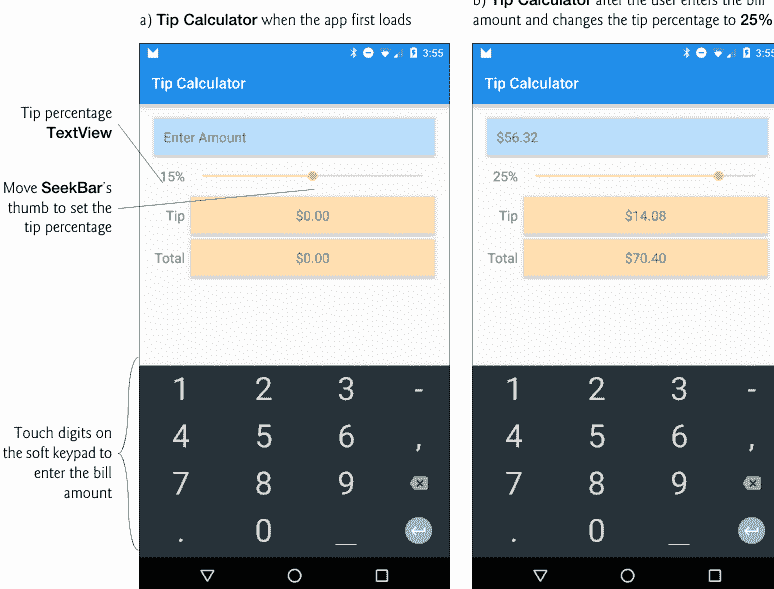

**图 1.16** 应用首次加载时的小费计算器，以及用户输入账单金额并更改小费百分比后。

### 1.9.1 在 Android Studio 中打开小费计算器应用项目

要打开小费计算器应用项目，请执行以下步骤：

1. **检查设置。** 如果你还没有这样做，请执行“入门 (You Begin)”部分指定的步骤。

2. **打开 Android Studio。** 使用 Android Studio 快捷键打开 IDE。在 Windows 上，快捷键将出现在你的开始菜单或开始屏幕上。在 OS X 上，快捷键位于应用程序文件夹中。在 Linux 上，快捷键的位置取决于你解压包含 Android Studio 文件的 ZIP 文件的位置。当你第一次打开 Android Studio 时，会出现“欢迎 Android Studio”窗口（图 1.17）。

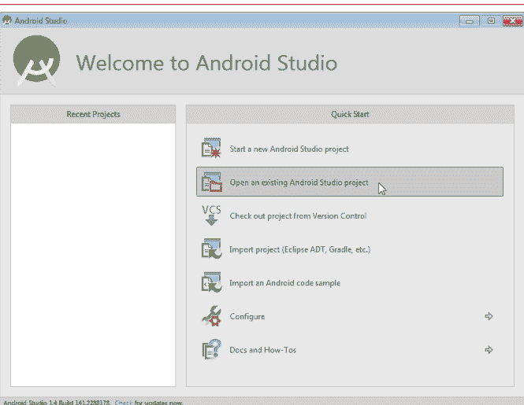

**图 1.17** | **欢迎 Android Studio** 窗口。

3. **打开小费计算器应用项目。** 在 Android 项目中，当另一个项目已打开时，你可以选择 `File > Open...` 导航到该项目的位置并打开它，或者在 **Welcome to Android Studio Window**（图 1.17）中选择 **Open an existing project**（打开现有项目）。导航到项目，选择项目文件夹并点击 **Open** (Mac) 或 **OK** (Windows/Linux)。这创建一个支持 Android 6 且支持 Google Play Services API 的错误对话框会出现，Android Studio 将更新设置以使用 SDK。此时，IDE 在 IDE 左侧的 Project 窗口（图 19）中显示其内容。如果 Project 窗口不可见，你可以通过选择 `View > Tool Windows > Project` 来查看它。

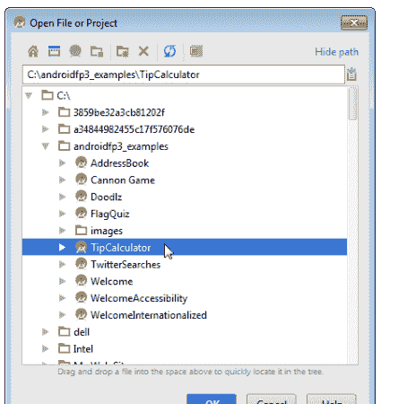

图 1.18 | Open 或 Project 对话框


图 1.19 小费计算器的 Project 窗口。

### 1.9.2 创建 Android 模拟设备 (AVDs)

正如我们在“准备 (Before You Begin)”中讨论过的，可以通过创建 Android 模拟设备 (AVD) 为多个设备测试应用。在本节中你将创建两个 AVD——Google 的 Nexus 6 手机和 Nexus 9 平板。要创建这些 AVD，请按照以下步骤：

1. 在 Android Studio 中，选择 `Tools > Android > AVD Manager` 显示 Android 设备窗口（图 1.20）。

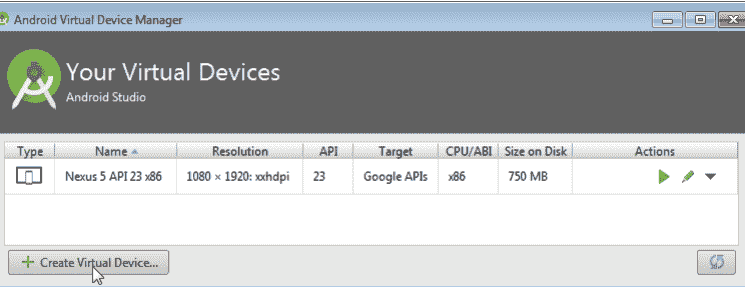

**图 1.20** | 设备管理器。

2. 点击 `Create Device...` 打开虚拟设备配置窗口（图 1.21）。默认选择类别是“Phone”，你也可以为 Tablet、Wear 和 TV 创建 AVD。为了方便起见，Google 提供了许多配置好的设备供你快速创建 AVD。选择 `Nexus 6`，然后点击 `Next`。

3. 选择要创建的虚拟设备的镜像——在这种情况下，选择 Android 版本名称值为 `Marshmallow`、API 级别、ABI（二进制信息）值为 `x86` 以及 Target 值为 `android-6.0 (with Google APIs)`，然后点击 `Next`。此 Target 创建支持 Android 6 且支持 Google Play Services API。

4. 对于 Android 名称，选择 `Nexus 6 API`。

5. 点击虚拟设备配置窗口左下角的 `Show Advanced Settings`，滚动到高级设置底部，取消勾选 `Enable Keyboard input` 并点击 `Finish` 创建 AVD。

6. 重复步骤 1–6，以创建一个名为 `Nexus 9 API 23` 的 Nexus 9 平板——你将在第 2 章中使用此平板电脑 AVD。

## 1.9.3 在 Nexus 6 手机 AVD 上运行小费计算器应用

测试你的设置。如果你还没有执行过，请先执行“开始之前”（Before You Begin）部分中的步骤。

1. 检查你的设置。如果你还没有执行过，请先执行“开始之前”部分中的步骤。

2. 启动 Nexus 6 AVD。对于本次测试，我们使用你在 1.9.2 节中配置的 Nexus 6 手机 AVD。选择 `Tools > Android > AVD Manager` 以显示 Android 虚拟设备对话框（图 1.22）。在 Nexus 6 AVD 行中点击“在模拟器中启动 AVD”（Launch AVD in the emulator）按钮。AVD 加载需要一些时间——在 AVD 加载完成之前不要尝试运行应用。加载完成后，AVD 将显示锁屏。在实际设备上，你通过手指滑动来解锁。在 AVD 上，你通过将鼠标悬停在 AVD 的“屏幕”上并向上拖动鼠标来执行滑动手势。图 1.23 显示了解锁后的 AVD。

# 第一章 Android 简介

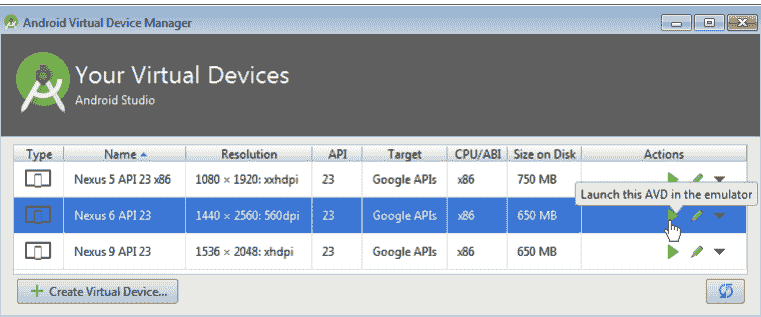

**图 1.22** Android 虚拟设备管理器对话框。

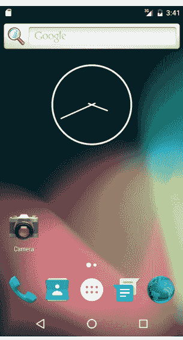

**图 1.23** 解锁 AVD 后 Nexus 5 AVD 的主屏幕。

3. **启动小费计算器应用。** 在 Android Studio 中，选择 `Run > Run 'app'` 或点击 Android Studio 工具栏上的 `Run 'app'` 按钮。这将显示一个**设备选择器**（Device Chooser）对话框（图 1.24），其中已选定当前运行的 AVD。点击 **OK** 在你在步骤 2 中启动的 AVD（图 1.25）中运行**小费计算器**（Tip Calculator）。作为在步骤 2 中打开**Android 虚拟设备**管理器的替代方案，你可以点击 Android Studio 工具栏上的 `Run 'app'` ► 按钮，就会出现**设备选择器**对话框。然后你可以使用对话框中的**启动模拟器**（Launcher emulator）选项来选择要启动的 AVD 并在其中运行应用。

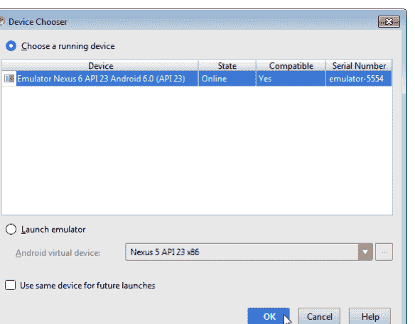

**图 1.24 | 设备选择器**，用于选择测试应用的 AVD 或设备。

4. **探索 AVD。** 在 AVD 屏幕底部是出现在设备触摸屏上的各种软按钮。你触摸这些按钮与应用和 Android 操作系统交互。在 AVD 中，触摸通过点击鼠标完成。向下按钮 ▼ 会关闭键盘。当屏幕上没有数字键盘时，会出现后退按钮 ◀。触摸此按钮将你带回应用的上一个屏幕，或者如果你处于当前应用的意图屏幕（intent screen），则返回到上一个应用。主页按钮 ◠ 将你返回设备的主屏幕。最近应用按钮 ◳ 允许你查看最近使用的应用。屏幕顶部是应用栏，它显示应用名称并可能包含其他应用特定的软按钮——某些可能出现在应用栏上，另一些出现在应用的选项菜单中，位于屏幕顶部的应用栏。应用栏上的选项数量取决于设备的大小——我们将在第 5 章中讨论这一点。

5. **输入总金额。** 通过在数字键盘上输入数字输入总金额 `$5.32`。如果你出错，按右下角的删除键删除你最后输入的数字。尽管数字键盘包含小数点，但应用配置为仅允许输入数字 0–9。每当你触摸一个数字或删除一个数字时，`billTotal` 中的金额和显示的小费金额都会更新。在输入金额后，触摸屏幕上的数字键盘上的按钮。请注意，你的 AVD 或设备的 Android 版本或你安装的任何内容和自定义键盘可能有所不同。我们配置了 AVD 显示键盘，以获得更好的屏幕对比度。在主屏幕上，触摸你的 Android 设备上的主页 ◠ 图标，触摸启动器 ◠ 图标，然后打开 **Settings** 设置应用。在 **Personal touch**（个性化设置）部分，触摸 **Language and Input** 语言与输入：点击 **Android Keyboard (AOSP)**。在设备上触摸 **Google Keyboard**，触摸 **Appearance & layouts** 外观与布局，然后触摸 **Theme. Material Dark** 以更改深色背景键盘。

6. **更改小费百分比。** 在 `SeekBar` 上触摸并拖动滑块，将小费百分比从 15% 更改到其他值。当你拖动滑块时，小费百分比会更新，并显示新的小费和账单总额。请注意，在你的 AVD 或设备上，根据 Android 版本或你安装的内容以及自定义键盘，可能有所不同。我们配置了 AVD 显示键盘，以获得更好的屏幕对比度。在主屏幕上，触摸你的 Android 设备上的主页 ◠ 图标，触摸启动器 ◠ 图标，然后打开 **Settings** 设置应用。在 **Personal touch**（个性化设置）部分，触摸 **Language and Input** 语言与输入：点击 **Android Keyboard (AOSP)**。在设备上触摸 **Google Keyboard**，触摸 **Appearance & layouts** 外观与布局，然后触摸 **Theme. Material Dark** 以更改深色背景键盘。

7. **删除刚才的输入并重新计算。** 通过按删除键删除当前账单金额，然后输入一个新的账单金额来测试应用的重新计算功能。每当你触摸一个数字或删除一个数字时，`billTotal` 中的金额和显示的小费金额都会更新。请注意，在你的 AVD 或设备上，根据 Android 版本或你安装的内容以及自定义键盘，可能有所不同。我们配置了 AVD 显示键盘，以获得更好的屏幕对比度。在主屏幕上，触摸你的 Android 设备上的主页 ◠ 图标，触摸启动器 ◠ 图标，然后打开 **Settings** 设置应用。在 **Personal touch**（个性化设置）部分，触摸 **Language and Input** 语言与输入：点击 **Android Keyboard (AOSP)**。在设备上触摸 **Google Keyboard**，触摸 **Appearance & layouts** 外观与布局，然后触摸 **Theme. Material Dark** 以更改深色背景键盘。

8. **更改小费百分比。** 在 `SeekBar` 上触摸并拖动滑块，将小费百分比从 15% 更改到其他值。当你拖动滑块时，小费百分比会更新，并显示新的小费和账单总额。请注意，在你的 AVD 或设备上，根据 Android 版本或你安装的内容以及自定义键盘，可能有所不同。我们配置了 AVD 显示键盘，以获得更好的屏幕对比度。在主屏幕上，触摸你的 Android 设备上的主页 ◠ 图标，触摸启动器 ◠ 图标，然后打开 **Settings** 设置应用。在 **Personal touch**（个性化设置）部分，触摸 **Language and Input** 语言与输入：点击 **Android Keyboard (AOSP)**。在设备上触摸 **Google Keyboard**，触摸 **Appearance & layouts** 外观与布局，然后触摸 **Theme. Material Dark** 以更改深色背景键盘。

9. **删除刚才的输入并重新计算。** 通过按删除键删除当前账单金额，然后输入一个新的账单金额来测试应用的重新计算功能。每当你触摸一个数字或删除一个数字时，`billTotal` 中的金额和显示的小费金额都会更新。请注意，在你的 AVD 或设备上，根据 Android 版本或你安装的内容以及自定义键盘，可能有所不同。我们配置了 AVD 显示键盘，以获得更好的屏幕对比度。在主屏幕上，触摸你的 Android 设备上的主页 ◠ 图标，触摸启动器 ◠ 图标，然后打开 **Settings** 设置应用。在 **Personal touch**（个性化设置）部分，触摸 **Language and Input** 语言与输入：点击 **Android Keyboard (AOSP)**。在设备上触摸 **Google Keyboard**，触摸 **Appearance & layouts** 外观与布局，然后触摸 **Theme. Material Dark** 以更改深色背景键盘。

10. **更改小费百分比。** 在 `SeekBar` 上触摸并拖动滑块，将小费百分比从 15% 更改到其他值。当你拖动滑块时，小费百分比会更新，并显示新的小费和账单总额。请注意，在你的 AVD 或设备上，根据 Android 版本或你安装的内容以及自定义键盘，可能有所不同。我们配置了 AVD 显示键盘，以获得更好的屏幕对比度。在主屏幕上，触摸你的 Android 设备上的主页 ◠ 图标，触摸启动器 ◠ 图标，然后打开 **Settings** 设置应用。在 **Personal touch**（个性化设置）部分，触摸 **Language and Input** 语言与输入：点击 **Android Keyboard (AOSP)**。在设备上触摸 **Google Keyboard**，触摸 **Appearance & layouts** 外观与布局，然后触摸 **Theme. Material Dark** 以更改深色背景键盘。

11. **删除刚才的输入并重新计算。** 通过按删除键删除当前账单金额，然后输入一个新的账单金额来测试应用的重新计算功能。每当你触摸一个数字或删除一个数字时，`billTotal` 中的金额和显示的小费金额都会更新。请注意，在你的 AVD 或设备上，根据 Android 版本或你安装的内容以及自定义键盘，可能有所不同。我们配置了 AVD 显示键盘，以获得更好的屏幕对比度。在主屏幕上，触摸你的 Android 设备上的主页 ◠ 图标，触摸启动器 ◠ 图标，然后打开 **Settings** 设置应用。在 **Personal touch**（个性化设置）部分，触摸 **Language and Input** 语言与输入：点击 **Android Keyboard (AOSP)**。在设备上触摸 **Google Keyboard**，触摸 **Appearance & layouts** 外观与布局，然后触摸 **Theme. Material Dark** 以更改深色背景键盘。

5. **输入总金额。** 通过在数字键盘上输入数字输入总金额 `$5.32`。如果你出错，按右下角的删除键删除你最后输入的数字。尽管数字键盘包含小数点，但应用配置为仅允许输入数字 0–9。每当你触摸一个数字或删除一个数字时，`billTotal` 中的金额和显示的小费金额都会更新。在输入金额后，触摸屏幕上的数字键盘上的按钮。请注意，你的 AVD 或设备的 Android 版本或你安装的任何内容和自定义键盘可能有所不同。我们配置了 AVD 显示键盘，以获得更好的屏幕对比度。在主屏幕上，触摸你的 Android 设备上的主页 ◠ 图标，触摸启动器 ◠ 图标，然后打开 **Settings** 设置应用。在 **Personal touch**（个性化设置）部分，触摸 **Language and Input** 语言与输入：点击 **Android Keyboard (AOSP)**。在设备上触摸 **Google Keyboard**，触摸 **Appearance & layouts** 外观与布局，然后触摸 **Theme. Material Dark** 以更改深色背景键盘。

5. **输入总金额。** 通过在数字键盘上输入数字输入总金额 `$5.32`。如果你出错，按右下角的删除键删除你最后输入的数字。尽管数字键盘包含小数点，但应用配置为仅允许输入数字 0–9。每当你触摸一个数字或删除一个数字时，`billTotal` 中的金额和显示的小费金额都会更新。在输入金额后，触摸屏幕上的数字键盘上的按钮。请注意，你的 AVD 或设备的 Android 版本或你安装的任何内容和自定义键盘可能有所不同。我们配置了 AVD 显示键盘，以获得更好的屏幕对比度。在主屏幕上，触摸你的 Android 设备上的主页 ◠ 图标，触摸启动器 ◠ 图标，然后打开 **Settings** 设置应用。在 **Personal touch**（个性化设置）部分，触摸 **Language and Input** 语言与输入：点击 **Android Keyboard (AOSP)**。在设备上触摸 **Google Keyboard**，触摸 **Appearance & layouts** 外观与布局，然后触摸 **Theme. Material Dark** 以更改深色背景键盘。

5. **输入总金额。** 通过在数字键盘上输入数字输入总金额 `$5.32`。如果你出错，按右下角的删除键删除你最后输入的数字。尽管数字键盘包含小数点，但应用配置为仅允许输入数字 0–9。每当你触摸一个数字或删除一个数字时，`billTotal` 中的金额和显示的小费金额都会更新。在输入金额后，触摸屏幕上的数字键盘上的按钮。请注意，你的 AVD 或设备的 Android 版本或你安装的任何内容和自定义键盘可能有所不同。我们配置了 AVD 显示键盘，以获得更好的屏幕对比度。在主屏幕上，触摸你的 Android 设备上的主页 ◠ 图标，触摸启动器 ◠ 图标，然后打开 **Settings** 设置应用。在 **Personal touch**（个性化设置）部分，触摸 **Language and Input** 语言与输入：点击 **Android Keyboard (AOSP)**。在设备上触摸 **Google Keyboard**，触摸 **Appearance & layouts** 外观与布局，然后触摸 **Theme. Material Dark** 以更改深色背景键盘。


5. 输入总金额

通过在数字键盘上输入数字输入总金额 `$5.32`。如果你出错，按右下角的删除键删除你最后输入的数字。尽管数字键盘包含小数点，但应用配置为仅允许输入数字 `0–9`。

每当你触摸一个数字或删除一个数字时，根据你的 AVD 或设备的 Android 版本或你安装的任何内容以及自定义键盘，可能会不同。我们配置了 AVD 显示键盘，以获得更好的屏幕对比度。

在主屏幕上，触摸你的 Android 设备上的主页 ◠ 图标，触摸启动器 ◠ 图标，然后打开 `Settings` 设置应用。在 `Personal touch`（个性化设置）部分，触摸 `Language and Input` 语言与输入：点击 `Android Keyboard (AOSP)`。在设备上触摸 `Google Keyboard`，触摸 `Appearance & layouts` 外观与布局，然后触摸 `Theme. Material Dark` 以更改深色背景键盘。

6. 选择自定义 AVD

根据你的 AVD 或设备的 Android 版本或你安装的任何内容，可以使用 1.24 的启动模拟器选项来选择要运行应用的 AVD。


**图 1.24 | 设备选择器**，用于选择测试应用的 AVD 或设备。

### AVD 启动故障排除

如果你无法启动 AVD，请尝试以下步骤以减少内存占用：

1. 检查你的设置。如果你还没有执行过，请先执行“开始之前”部分中的步骤。

2. 启动 Nexus 6 AVD。对于本次测试，我们使用你在步骤 1.9.2 中配置的 Nexus 6-phone AVD。选择 `Tools > Android > Android Manager` 以显示 Android 虚拟设备对话框（图 1.22）。在 Nexus 6 AVD 行中点击“在模拟器中启动 AVD”（`Launch AVD in the emulator`）按钮。

   AVD 加载需要一些时间——在 AVD 加载完成之前不要尝试运行应用。加载完成后，AVD 将显示锁屏。在实际设备上，你通过手指滑动来解锁。在 AVD 上，你通过将鼠标悬停在 AVD 的“屏幕”上并向上拖动鼠标来执行滑动手势。图 1.23 显示了解锁后的 AVD。

3. 启动小费计算器应用。在 Android Studio 中，选择 `Run > Run 'app'` 或点击 Android Studio 工具栏上的 `Run 'app'` 按钮。这将显示一个设备选择器（`Device Chooser`）对话框（图 1.24），其中已选定当前运行的 AVD。

   点击 `OK` 在你在步骤 2 中启动的 AVD（图 1.25）中运行小费计算器（`Tip Calculator`）。作为在步骤 2 中打开 Android 虚拟设备管理器的替代方案，你可以点击 Android Studio 工具栏上的 `Run 'app'` ► 按钮，就会出现设备选择器对话框。然后你可以使用对话框中的启动模拟器（`Launcher emulator`）选项来选择要启动的 AVD 并在其中运行应用。

4. 探索 AVD。在 AVD 屏幕底部是出现在设备触摸屏上的各种软按钮。你触摸这些按钮与应用和 Android 操作系统交互。在 AVD 中，触摸通过点击鼠标完成。

   向下按钮 ▼ 会关闭键盘。当屏幕上没有数字键盘时，会出现后退按钮 ◀。触摸此按钮将你带回应用的上一个屏幕，或者如果你处于当前应用的意图屏幕（intent screen），则返回到上一个应用。

   主页按钮 ◠ 将你返回设备的主屏幕。最近应用按钮 ◳ 允许你查看最近使用的应用。

   屏幕顶部是应用栏，它显示应用名称并可能包含其他应用特定的软按钮——某些可能出现在应用栏上，另一些出现在应用的选项菜单中，位于屏幕顶部的应用栏。应用栏上的选项数量取决于设备的大小——我们将在第 5 章中讨论这一点。

5. 在图 1.25 中，根据你的 AVD 或设备的 Android 版本或你安装的任何内容以及自定义键盘，可能会不同。我们配置了 AVD 显示键盘，以获得更好的屏幕对比度。

   在主屏幕上，触摸你的 Android 设备上的主页 ◠ 图标，触摸启动器 ◠ 图标，然后打开 `Settings` 设置应用。在 `Personal touch`（个性化设置）部分，触摸 `Language and Input` 语言与输入：点击 `Android Keyboard (AOSP)`。在设备上触摸 `Google Keyboard`，触摸 `Appearance & layouts` 外观与布局，然后触摸 `Theme. Material Dark` 以更改深色背景键盘。

6. 选择自定义 AVD。根据你的 AVD 或设备的 Android 版本或你安装的任何内容，可以使用 1.24 的启动模拟器选项来选择要运行应用的 AVD。

实用、有趣、有吸引力且持久。清晰的应用名称、吸引人的图标和引人入胜的描述可能会吸引用户在 Google Play 或许多其他应用商店下载你的应用。但一旦用户下载了应用，是什么能让他们经常使用它并将其推荐给他人呢？图 1.27 显示了一些优秀应用的特征。

## 优秀应用的特征

### 优秀的游戏

- 娱乐性和趣味性。
- 具有挑战性。
- 难度递进的关卡。
- 显示课程和排行榜以记录高分。
- 提供音频和视觉反馈。
- 提供单机版、多人版和网络版。
- 具有高质量的动画。
- 将输入/输出和计算密集型代码卸载到单独的执行线程以提高响应速度和性能。
- 利用增强现实技术进行创新——用虚拟组件增强真实世界环境；这在视频类应用中尤为流行。
- 提供实用的功能和准确的信息。
- 提高个人和业务的效率。
- 让任务更加方便（例如：维护待办列表、管理支出）。
- 让用户获取的信息更充分。
- 提供信息（例如：最新的股票价格、新闻、极端天气预警、交通更新）。
- 使用基于位置的服务提供本地服务（例如：本地商店的优惠券、最佳油价、食物外卖）。

### 通用特征

- 使用最新的 Android 特性，但兼容多个 Android 版本以支持尽可能广泛的受众。
- 运行正常。
- 及时修复 Bug。
- 遵循标准的 Android GUI 规范。
- 启动快速。
- 具有响应性。

**图 1.27 | 优秀应用的特征。（第 1 部分，共 2 部分。）**

http://www.statista.com/statistics/266210/number-of-available-applications-in-the-google-play/

# 第一章 Android 简介

## 优秀应用的特征

### 通用特征（续）

- 无需过多的内存、带宽或电量。
- 具有新颖性和创造性。
- 持久——你的用户会经常使用的东西。
- 使用专业级的图标，这些图标将出现在 Google Play 和用户的设备上。
- 使用高质量的图形、图像、动画、音频和视频。
- 直观且易用（不需要详尽的帮助文档）。
- 残障人士也可访问（http://developer.android.com/guide/topics/ui/accessibility/index.html）。
- 为用户提供向他人介绍你应用的方法（例如：你可以给他们提供分享到 Facebook 或 Twitter 的选项）。
- 为内容驱动型应用提供额外内容（例如：游戏关卡、文章、谜题）。
- 为提供应用的每个国家进行本地化（第 2 章）（例如：翻译应用的文本和音频，使用基于本地的图形等）。
- 比竞争应用提供更好的性能和易用性。
- 利用设备的内置功能。
- 无需过多的权限。
- 设计用于在广泛的 Android 设备上优化运行。
- 针对新硬件设备做好未来准备——指定你的应用使用的确切功能，以便 Google Play 在商店中过滤并仅为兼容的设备显示它（http://android-developers.blogspot.com/2010/06/future-proofing-your-app.html）。

**图 1.27 | 优秀应用的特征（第 2 部分，共 2 部分。）**

## 1.11 Android 开发资源

图 1.28 列出了来自 Android 开发者网站的一些关键文档。当你深入 Android 开发时，你可能会对工具、设计问题、安全等产生疑问。有几个 Android 开发者小组和论坛，你可以在那里获取最新公告或提问（图 1.29）。图 1.30 列出了几个你可以在其中找到 Android 开发技巧、视频和资源的网站。

| 标题 | 链接 |
| --- | --- |
| 应用组件 | http://developer.android.com/guide/components/index.html |
| 使用 Android 模拟器 | http://developer.android.com/tools/devices/emulator.html |
| 包索引 | http://developer.android.com/reference/packages.html |
| 类索引 | http://developer.android.com/reference/classes.html |

**图 1.28 | Android 开发者的关键文档。（第 1 部分，共 2 部分。）**

### Android 开发资源（续）

| 标题 | 链接 |
| --- | --- |
| Android 设计数据备份 | http://developer.android.com/design/index.html<br>http://developer.android.com/guide/topics/data/backup.html |
| 安全技巧 | http://developer.android.com/training/articles/security-tips.html |
| Android Studio 调试工具帮助 | http://developer.android.com/sdk/index.html<br>http://developer.android.com/tools/debugging/index.html<br>http://developer.android.com/tools/help/index.html |
| 保持应用响应的性能技巧 | http://developer.android.com/training/articles/performance-tips.html<br>http://developer.android.com/training/articles/performance-tips.html |
| 启动清单（针对 Google Play） | http://developer.android.com/distribute/tools/launch-checklist.html |
| 开始发布 | http://developer.android.com/distribute/googleplay/start.html |
| 管理应用内存 Google 开发者分发协议 | http://developer.android.com/training/articles/memory.html<br>http://play.google.com/about/distribution-agreement.html |

**图 1.28 | Android 开发者的关键文档。（第 2 部分，共 2 部分。）**

| 标题 | 订阅 | 描述 |
| --- | --- | --- |
| Android Discuss | 使用 Google Groups 订阅：android-discuss@googroups.com | 一个可以从中获得答案的通用讨论组。 |
| Stack Overflow | https://stackoverflow.com/tagged/android | 用于应用开发问题。 |
| Android Developers | http://groups.google.com/forum#!android-developers | 丰富的开发者使用此。 |
| Android Forums | http://www.androidforums.com | 与开发者一起提问、分享技巧。 |

**图 1.29 | Android 新闻组和论坛。**

| Android 开发技巧、视频和资源 | 链接 |
| --- | --- |
| Google 提供的 Android 示例和工具 | https://github.com/google |
| 用于 Android 编程技巧和指南的 BrightHut™ 网站 | http://www.brighthut.com/mobile/android.aspx |
| Android Developers 博客 | http://android-developers.blogspot.com/ |
| HTC Android 开发者中心 | http://www.htdev.com/ |
| Stack Overflow 上的热门用户 | https://stackoverflow.com/tags/android/topusers |


| Android Weekly 周报 | http://androidweekly.net/ |
| --- | --- |
| Chet Haasse 的 Codependent 博客 | http://graphics-geek.com/ |
| Romain Guy 的 Android 博客 | http://www.curious-create.org/category/android/ |
| YouTube 上的 Android Developers频道 | http://www.youtube.com/user/androiddevelopers |
| Google/O 2015 大会视频 | https://events.google.com/io2015/videos/ |

图 1.30 | Android 开发技巧、视频和资源。

## 1.12 总结

本章介绍了 Android 的发展历史并讨论了其功能。我们提供了在线文档的链接，以及你可以通过新闻组和论坛与开发者社区联系并解答疑问。我们讨论了 Android 的特性。我们引入了构建各种 Android 应用所需的 Java、Android 包。你将在本书中使用许多这些包。我们还讨论了 Java 编程和 Android SDK。我们学习了手势以及如何在 Android 设备和模拟器上执行每个手势。我们快速回顾了基础面向对象技术概念，包括类、对象、属性、行为、封装、信息隐藏、继承等。你在 Android 模拟器上的手机和平板电脑 AVD 上测试了小计算器应用。

在第 2 章中，你将在 Android Studio 中构建你的第一个 Android 应用。该应用将显示文本和图像。你还将学习 Android 无障碍辅助和国际化。

# 2 欢迎应用 (Welcome App)

Dive-Into® Android Studio：介绍视觉化 GUI 设计、布局、辅助功能和国际化


## 目标

在本章中你将：

- 了解 Android Studio IDE 的基础，你将使用它来编写、测试和调试你的 Android 应用。
- 使用 IDE 创建新项目。
- 使用 IDE 的布局编辑器以视觉化的方式（无需编程）设计图形用户界面 (GUI)。
- 在 GUI 中显示文本和图像。
- 编辑视图（GUI 组件）的属性。
- 在 Android 模拟器中构建并启动应用。
- 通过为用于 Android 的 TalkBack 和触摸探索（Explore-by-Touch）功能指定字符串，使应用更符合视障人士的辅助需求。
- 支持国际化，以便你的应用可以显示不同语言的本地化字符串。

## 提纲

- 2.1 简介
- 2.2 技术概述
  - 2.2.1 Android Studio
  - 2.2.2 LinearLayout, TextView 和 ImageView
  - 2.2.3 可扩展标记语言 (XML)
  - 2.2.4 应用资源
  - 2.2.5 国际化
- 2.3 创建应用
  - 2.3.1 启动 Android Studio
  - 2.3.2 创建新项目
  - 2.3.3 创建项目对话框
  - 2.3.4 目标 Android 设备
  - 2.3.5 向移动端添加 Activity
  - 2.3.6 自定义应用图标
- 2.4 Android Studio 窗口
  - 2.4.1 项目窗口
  - 2.4.2 编辑窗口
  - 2.4.3 组件树
  - 2.4.4 应用资源
  - 2.4.5 布局编辑器
  - 2.4.6 默认 GUI
  - 2.4.7 XML，默认 GUI
- 2.5 使用布局编辑器构建应用的 GUI
  - 2.5.1 向项目添加图像
  - 2.5.2 添加图标
  - 2.5.3 相对于 LinearLayout 的更改
  - 2.5.4 更改布局的 id 和方向
  - 2.5.5 配置 TextView 的 id 和文本属性
  - 2.5.6 配置 TextView 的文本大小属性——缩放像素 (sp) 和密度无关像素 (dp)
  - 2.5.7 设置 TextView 的颜色 属性
  - 2.5.8 设置 TextView 的 gravity 属性
  - 2.5.9 设置 TextView 的布局:gravity 属性
  - 2.5.10 设置 TextView 的 weight:gravity 属性
  - 2.5.11 添加图像以显示图像
  - 2.5.12 预览设计
- 2.6 运行欢迎应用
- 2.7 让你的应用具备辅助功能
- 2.8 你的应用国际化
  - 2.8.1 本地化
  - 2.8.2 遵循本地化资源的文件夹结构
  - 2.8.3 向应用的属性文件中添加字符串
  - 2.8.4 区域性字符串
  - 2.8.5 在 AVD 上测试西班牙语应用
  - 2.8.6 在设备上测试西班牙语应用
  - 2.8.7 TalkBack 与本地化
  - 2.8.8 本地化检查列表
  - 2.8.9 专业翻译
- 2.9 总结

## 2.1 简介

在本章中，你将构建“欢迎应用”，创建一个显示欢迎信息和图像的小型应用。你将使用 Android Studio 在 Android 手机和平板电脑上运行（图 2.1），支持竖屏和横屏模式：

- 在竖屏下，设备的高度大于宽度。
- 在横屏下，宽度大于高度。

你将使用 Android Studio 通过拖放技术构建 GUI。你将直接编辑 GUI 的 XML。你将在 Android 模拟器和 Android 设备（如果你有的话）上执行你的应用。

你将为应用提供描述性文本，使该应用更便于视障人士使用。正如你所看到的，Android 的“触摸探索”（Explore by Touch）允许我们触摸屏幕上的项目，并听到 TalkBack 朗读相应的描述文本。我们将讨论如何测试这些功能，这些功能仅在 Android 设备上可用。

## 2.2 技术概述

Android 顶部系统栏显示项目包括时间、电池指示、蜂窝网络连接

### 2.2.1 Android Studio

在本章中，你将构建“欢迎应用”，创建一个显示欢迎信息和图像的小型应用。你将使用 Android Studio 在 Android 手机和平板电脑上运行（图 2.1），支持竖屏和横屏模式。Android Studio 是一个强大的 Android 开发集成开发环境 (IDE)，提供了各种工具帮助你构建、测试和调试应用。

### 2.2.2 LinearLayout, TextView 和 ImageView

这些是 Android 应用中常用的 UI 组件。

- `LinearLayout` 是一个水平或垂直排列其子视图的视图组。
- `TextView` 是显示文本的控件。
- `ImageView` 是显示图像的控件。

### 2.2.3 可扩展标记语言 (XML)

XML 是一种用于存储和传输数据的基于文本标记语言。在 Android 中，XML 用于定义用户界面的布局。

### 2.2.4 应用资源

应用资源是应用使用的值，例如字符串、颜色和尺寸。这些资源存储在项目的 `res` 文件夹中。

### 2.2.5 国际化

国际化允许你的应用适应不同的语言和地区。这是通过使用资源而非硬编码值来实现的。

## 2.3 创建应用

### 2.3.1 启动 Android Studio

### 2.3.2 创建新项目

### 2.3.3 创建项目对话框

### 2.3.4 目标 Android 设备

### 2.3.5 向移动端添加 Activity

### 2.3.6 自定义应用图标

## 2.4 Android Studio 窗口

### 2.4.1 项目窗口

### 2.4.2 编辑窗口

### 2.4.3 组件树

### 2.4.4 应用资源

### 2.4.5 布局编辑器

### 2.4.6 默认 GUI

### 2.4.7 XML，默认 GUI

## 2.5 使用布局编辑器构建应用的 GUI

### 2.5.1 向项目添加图像

### 2.5.2 添加图标

### 2.5.3 相对于 LinearLayout 的更改

### 2.5.4 更改布局的 id 和方向 (orientation)

### 2.5.5 配置 TextView 的 id 和文本属性

### 2.5.6 配置 TextView 的文本大小属性——缩放像素 (sp) 和密度无关像素 (dp)

### 2.5.7 设置 TextView 的颜色 属性

### 2.5.8 设置 TextView 的 gravity 属性

### 2.5.9 设置 TextView 的布局:gravity 属性

### 2.5.10 设置 TextView 的 weight:gravity 属性

### 2.5.11 添加图像以显示图像

### 2.5.12 预览设计

## 2.6 运行欢迎应用

## 2.7 让你的应用具备辅助功能

## 2.8 你的应用国际化

### 2.8.1 本地化

### 2.8.2 遵循本地化资源的文件夹结构

### 2.8.3 向应用的属性文件中添加字符串

### 2.8.4 区域性字符串

### 2.8.5 在 AVD 上测试西班牙语应用

### 2.8.6 在设备上测试西班牙语应用

### 2.8.7 TalkBack 与本地化

### 2.8.8 本地化检查列表

### 2.8.9 专业翻译

## 2.9 总结


## 2.9 总结

### 2.3.1 启动 Android Studio

正如你在第 1.9 节中所做的那样，通过快捷方式打开 Android Studio：

IDE 显示欢迎窗口（图 1.17）或你上次打开的项目。

### 2.3.2 创建新项目

项目是一组相关的文件，例如构成应用程序的代码文件、资源文件和图像。要创建一个应用，你必须先创建一个项目。要这样做，请在欢迎窗口中点击“新建 Android Studio 项目”（Start a new Android Studio project），如果已经打开了项目，选择 `File > New New Project...`。这将显示“创建新项目”（Create New Project）对话框（图 2.2）。

创建新项目对话框中正在执行的步骤

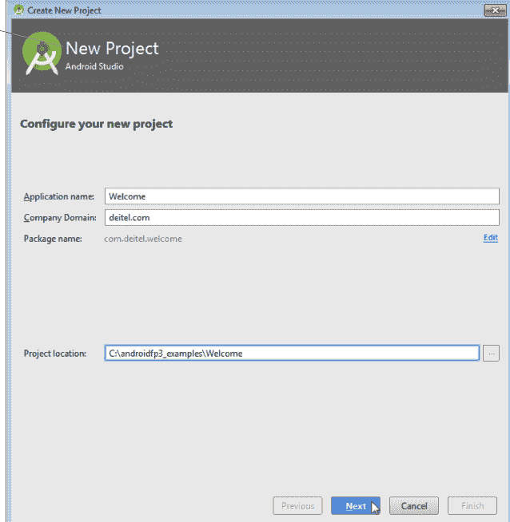

**图 2.2** | 创建新项目对话框——新项目步骤。

### 2.3.3 创建新项目对话框

在创建新项目对话框的“配置你的新项目”（Configure your new project）步骤中，指定以下信息，然后点击“下一步”（Next）：

- 1. `Application name`（应用名称）字段——你的应用名称。在此字段中输入 `welcome`。
- 2. `Company Domain`（公司域名）字段——你公司的网站域名。我们使用了 `deit1.com` 网站域名。出于学习目的，你可以使用 `example.com`，但如果你打算发布你的应用，则必须更改它。
- 3. `Package name`（包名）字段——你的应用源码的 Java 包名。Android 和 Google 商店将其显示为你的应用的唯一标识符，在你上传到 Google 商店的应用所有地方，包名必须保持一致。包名通常以你的公司或组织的 `Company Domain` 开头，此处域名是 `deit1.com`，所以你的 Java 包名以 `deit1.com` 开头。后面是一个点（`.`）和全写的且无空格的应用名称。IDE 会根据你为“Application Name”和“Company Domain”输入的文本设置包名文本。你可以点击生成的包名旁边的“编辑”（Edit）链接来自定义包。
- 4. `Project location`（项目位置）字段——在计算机上存储项目的地点路径。默认情况下，Android Studio 将新文件夹放置在你用户目录下的 `AndroidProjects` 子文件夹中。项目的文件夹名称由带有空格的项目名称组成。你可以通过输入路径或点击字段右侧的省略号（`...`）按钮并浏览到存储项目的位置来自定义位置。选择位置后，点击 `OK` 进入下一步。


> 错误预防小技巧 2：
> 如果你保存项目的路径中包含空格，“创建新项目”对话框将显示“你的项目位置包含空白字符。不建议这样做。”要解决此问题，请点击创建新项目对话框位置字段右侧的省略号（`...`）按钮，并选择一个不包含空格的位置；否则，你的项目可能无法编译或运行。

### 2.3.4 目标 Android 设备步骤

在新项目对话框的“目标 Android 设备”（Target Android Devices）步骤中（图 2.3）：

- 1. 为你的应用应该支持的每个 Android 设备（手机和平板、可穿戴设备、Android 和访客）勾选复选框。对于 Welcome 应用，确保只勾选了 `Phone` 和 `Tablet` 类型。
- 2. 接下来，为你选择的每种设备类型在下拉列表中选择“最低 SDK”（Minimum SDK），然后点击“下一步”。最低 SDK 是运行应用所需的最低 Android API 级别。这允许你的应用在支持该 API 级别的设备上执行。为本书中的应用选择 `API23: Android 6.0 (Marshmallow)` 并点击**Next**。图 2.4 显示了 Android SDK 版本及其对应的 API 级别——此处未显示的版本为已弃用，不应使用。运行每个平台版本的 Android 设备百分比请见 `http://developer.android.com/about/dashboards/index.html`。

### 软件工程观察 2.1

较低的 **Minimum SDK** 值使你的应用运行在更多设备上——例如，在本文编写时，API 15 就能覆盖 94% 的设备。通常，你应该针对你的应用可以运行的最低 API 级别。当你的应用安装在较旧平台上时，你必须禁用在旧平台上不可用的新功能。


**图 2.3** | 创建新项目——目标 Android 设备步骤。

### 2.3 创建应用

| SDK 版本 | API 级别 | SDK 版本 | API 级别 | SDK 版本 | API 级别 |
| :--- | :--- | :--- | :--- | :--- | :--- |
| 6.0 | 23 | 4.3 | 18 | 2.3–2.7 | 10 |
| 5.1 | 22 | 4.2.x | 17 | 2.2 | 8 |
| 5.0 | 21 | 4.1.x | 16 | | |
| 4.4 | 19 | 4.0.3–4.4 | 15 | | |

**图 2.4** | Android 版本和 API 级别。（`http://developer.android.com/about/dashboards/index.html`）

### 2.3.5 添加 Activity

在“向移动设备添加 Activity”（Add to Mobile）步骤中（图 2.5），你选择一个模板。对于 Welcome 应用，选择 `Empty Activity`。这些模板提供了应用应用应用 Activity 布局。


**图 2.5** | 创建新项目对话框——向移动设备添加步骤。

图 2.6 显示了模板。在“向移动设备添加 Activity”步骤中，你选择一个模板。对于此应用，选择 `Empty Activity`。

| 模板 | 描述 |
| :--- | :--- |
| `Blank Activity`（空白 Activity） | 用于单屏幕应用，提供了应用顶部的状态栏。包含 Material Design 功能。 |
| `Fullscreen Activity`（全屏 Activity） | 用于占据整个屏幕的单屏幕应用（类似于 `Blank Activity`）。 |
| `Master/Detail Flow`（主/详情流） | 用于显示主列表并应用，可以详情详情。在平板上，主列表和详情并列显示。在手机上，主列表在屏幕屏幕中显示详情。 |

### 2.3.6 配置 Activity

此步骤（图 2.7）取决于上一步选择的模板。对于 `Empty Activity`，此步骤允许你指定：

- `Activity Name`（Activity 名称）——`MainActivity` 是提供的默认名称。这是控制应用应用的 Activity 类。从第 3 章开始，我们将修改该类来实现应用的功能。
- `Layout Name`（布局名称）——`activity_main` 是提供的默认名称。它（以 `.xml` 结尾）存储应用 GUI 的 XML 表示。我们将在第 2.5 节中使用可视化技术构建。

对于此应用，保持默认设置，然后点击创建项目。


**图 2.7** | 创建新项目对话框——配置 Activity 步骤。

### 2.4 Android Studio 窗口

创建项目后，IDE 同时打开 `MainActivity.java` 和 `activity_main.xml`。关闭 `MainActivity.java`，以便 IDE 如图 2.8 所示。IDE 显示了布局编辑器，你可以开始设计应用的 GUI。在本章中，我们只讨论构建 Welcome 应用所需的 IDE 功能。我们将在全书中介绍更多 IDE 功能。

项目窗口显示 `app` 节点下的项目文件

编辑器窗口（如布局和代码编辑器）在此处显示

组件树以及选中项属性在属性窗口中


折叠的标签——你可以点击标签展开相应的窗口

**图 2.8** | 在 Android Studio 中打开欢迎项目。

### 2.4.1 项目窗口

项目窗口提供了对项目文件的访问。你可以在 IDE 中打开多个项目。在每个项目中，我们展开了 Welcome 应用项目的内容——`res` 文件夹。`app` 文件夹包含创建应用 GUI 和逻辑的文件。`app` 文件夹的内容组织在嵌套文件夹中。在本章中，你将只使用 `res` 文件夹中的文件，我们将在 2.4.4 节中讨论它们——我们将在后续章节在使用它们时讨论其他文件夹和文件。

# 46 第2章 欢迎应用（Welcome App）

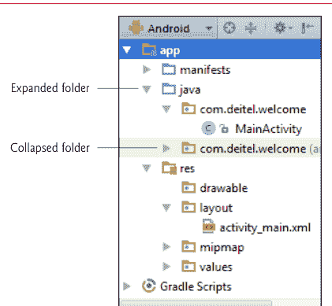

**图 2.9** | 项目窗口。

### 2.4.2 编辑器窗口

图 2.8 中 **Project**（项目）窗口的右侧是布局编辑器窗口。当你点击项目窗口中的一个文件时，其内容将根据文件类型显示在相应的编辑器窗口中。对于 Java 文件，将显示 Java 源代码编辑器。对于代表 GUI（例如 `activity_main.xml`）的 XML 文件，默认显示编辑器的 **Design**（设计）标签页，你可以点击 **Text**（文本）标签页与设计预览并排查看相应的 XML——如果预览没有出现，你可以通过 **View > Tools > Preview**（视图 > 工具 > 预览）来查看。对于其他 XML 文件，将根据 XML 文件的用途显示自定义编辑器或基于文本的 XML 编辑器。Java 和 XML 编辑器帮助你通过代码补全快速编写代码——你可以按 **Enter**（或 **Return**）来自动补全代码补全窗口中当前亮的代码元素或 XML 元素、属性名或值。

### 2.4.3 组件树窗口

当布局编辑器在 **Design** 视图下打开时，**Component Tree**（组件树）会出现在 IDE 的右侧（图 2.8）。此窗口显示了组成 GUI 的 *layouts*（布局）和 *views*（视图，即 GUI 组件）。例如，一个布局（父节点）可能包含许多嵌套视图（子节点），包括其他布局。

### 2.4.4 资源文件

像 `activity_main.xml` 这样的布局文件是应用资源，存储在项目的 **res** 文件夹子文件夹中。子文件夹包含不同的资源类型。本应用中使用的如图 2.10 所示，其他的（`menu`, `anim`, `color`, `mipmap`, `raw` 和 `xml`）将在后续讨论。

### 2.4.5 Android Studio 窗口

| 资源子文件夹 | 说明 |
| --- | --- |
| `drawable` | 以 `drawable` 开头的文件夹通常包含图像。这些文件夹可能包含表示形状和其他类型的 drawables（例如表示按钮按下和取消状态的图像）。 |
| `layout` | 以 `layout` 开头的文件夹包含描述 GUI 的 XML 文件，例如 `activity_main.xml` 文件。 |
| `values` | 以 `values` 开头的文件夹包含指定值的数组（`arrays.xml`）、颜色（`colors.xml`）、尺寸（`dimens.xml`）以及字体（`strings.xml`）和样式（`styles.xml`）。这些文件名遵循约定但并非强制——实际上，你可以将这些类型的资源放在一个文件中。例如，如果代码中多处引用了某个尺寸资源，你可以在资源文件中更改尺寸值，而不是在应用的源文件中搜索每个硬编码的值。 |

**图 2.10** | 本章使用的项目 `res` 文件夹子文件夹。

### 布局编辑器

当你创建一个文件时，IDE 在布局编辑器中打开应用的 `activity_main.xml` 文件（图 11）。你也可以双击 `res/layout` 文件夹中的 `activity_main.xml` 来打开它。

#### 为 GUI 选择屏幕类型

Android 设备可以运行在多种设备上。在本章中，你将设计 Android GUI。正如我们在第 2 节提到的，我们使用模拟 Google 6 手机的 AVD。布局带有各种屏幕尺寸和分辨率的设备配置，你可以使用它们来设计 GUI。在本章中，我们使用预定义的 Nexus 6，你可以在图 11 的下拉列表中选择。Nexus 4 并不意味着应用只能在 Nexus 6 上运行——它仅意味着设计适用于屏幕尺寸和分辨率类似的设备。在后面的章节中，你将看到如何设计以适应各种设备的 GUI。调色板 `Widgets`（视图）以及其他可以拖放到画布上的其他项——虚拟设备下拉列表你可以用来设计 GUI——在本章选择 Nexus 6。

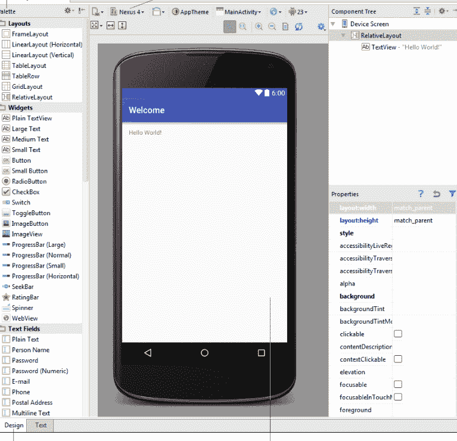

布局编辑器的 Design 标签 | 应用默认 GUI 的布局编辑器视图。

**图 11**

### 2.4.6 默认 GUI

空白页（Blank Page，图 11）的默认 GUI 由白色背景和一个包含 "Hello world!" 的 `TextView` 组成。`RelativeLayout` 相对于另一个视图或布局本身排列视图——例如，你可以指定一个视图位于下方并在水平方向居中。对于欢迎应用，你将 `RelativeLayout` 更改为垂直的 `LinearLayout`，文本和图像将在屏幕上从上到下排列并具有相同的高度。`TextView` 显示文本。你将添加一个 `ImageView` 来显示图像。我们将在第 2.5 节详细介绍这些每一个项。

### 2.4.7 默认 GUI 的 XML

如之前，`activity_main.xml` 文件包含 GUI 的 XML 表示。图 12 显示了初始 XML。为了书籍出版，我们减少了默认 XML 中的缩进。你将直接编辑此 XML 将 `RelativeLayout` 更改为 `LinearLayout`。

```xml
<xml version="1.0" encoding="utf-8"?>
<RelativeLayout xmlns:android="http://schemas.android.com/apk/android"
    xmlns:tools="http://schemas.android.com/tools"
    android:layout_width="match_parent"
    android:layout_height="match_parent"
    android:padding="16dp"
    android:paddingBottom="@id/activity_vertical_margin"
    android:paddingLeft="@id/activity_horizontal_margin"
    android:paddingRight="@id/activity_horizontal_margin"
    android:paddingTop="@id/activity_vertical_margin"
    tools:context=".MainActivity">
    <TextView
    android:layout_width="wrap_content"
    android:layout_height="wrap_content"
    android:text="@string/hello_world" />
</RelativeLayout>
```

**图 12** | 项目 `activity_main.xml` 文件的初始内容。

属性值以 `@` 开头，例如

`@id/activity_vertical_margin`

在第 6 行中，有在其他文件中定义值的资源。默认情况下，XML 编辑器显示资源值（第 6 行资源的 `16dp`），并用浅绿色背景（如果使用深色 Android Studio 则为浅灰色）突出显示该值。这让你看到在特定上下文使用的资源实际值。如果你点击字面值（`@id/activity_vertical_margin`），编辑器相反显示资源名称。

### 2.5 使用布局编辑器构建应用

我们将创建欢迎应用。IDE 的布局编辑器允许通过拖放视图（如 `TextView`、`ImageView` 和按钮）来构建 GUI。默认情况下，空 Activity 模板的 GUI 存储在名为 `activity_main.xml` 的 XML 文件，位于 `res` 文件夹。在本章中，我们将使用布局编辑器构建 GUI。你将直接编辑 XML 将 `RelativeLayout` 更改为 `LinearLayout`。

#### 2.5.1 向项目添加图像

对于此应用，你需要在项目中添加图像。我们将使用 Debug 图标（`.png`），它位于项目的 `drawable` 文件夹中。资源文件名——必须小写。

`drawable` 文件夹

Android 设备具有各种屏幕尺寸、分辨率和像素密度（即每英寸像素），通常提供各种密度的图像，操作系统根据最接近设备的像素密度进行选择。

| 密度 | 说明 |
| --- | --- |
| `drawable-1dpi` | 低密度—120 像素/英寸 |
| `drawable-mdpi` | 中密度—160 像素/英寸 |
| `drawable-hdpi` | 高密度—240 像素/英寸 |
| `drawable-xxhdpi` | 高密度—320 像素/英寸 |
| `drawable-xhdpi` | 超高密度—480 像素/英寸 |
| `drawable-xxxhdpi` | 超超高密度—640 像素/英寸 |

**图 2.13** | Android 密度。


Android Studio 只显示一个包含应用 `drawable` 资源的文件夹，即使你的项目包含多个密度。对于存储在磁盘 `drawable-xxxhdpi` 文件夹中的资源 `filename.xml`，Android Studio 在项目的 `drawable` 文件夹中显示`filename.xml (xxxhdpi)`。

## 2.5 使用布局编辑器构建应用的 GUI

> **观感观察 2.1**：低分辨率图像的缩放效果不佳。为了让图像渲染良好，高像素密度设备需要比低像素密度设备更高分辨率的图像。

### 将 bug.png 添加到项目

执行以下步骤将图像添加到此项目：

1. 在 Project（项目）窗口中，展开项目的 `res` 文件夹。
2. 在文件系统中的书籍示例 (`examples`) 文件夹中，打开 `images` 文件夹，然后进入 `welcome` 子文件夹。
3. 复制 `draw.png` 文件，然后在 Android Studio 的 Project 窗口中选择 `res` 文件夹下的 `drawable` 子文件夹，并将该文件粘贴到该子文件夹中。
4. 在弹出的 Copy（复制）对话框中，点击 OK。

现在可以在应用中使用该图像。当应用安装时，图标和名称将与其他所有已安装的应用一起出现在启动器中，您可以通过设备主屏幕上的图标访问它。要添加启动器图标，右键点击 `res` 文件夹，然后选择 New（新建） > Asset（资源）。这将打开 Asset Studio 窗口（图 2.14），它允许您从现有图像、剪贴画或纹理配置应用的图标。

对于此应用，我们选择了位于书籍示例 `images` 文件夹中的 `orange.png` 图像。要使用该图像：

1. 点击省略号按钮进入 Image file（图像文件）字段。
2. 导航到书籍示例文件夹中的 `images` 文件夹。
3. 选择 `orange.png` 并点击 OK。Preview（预览）区域将显示缩放后图像的预览。
4. 点击 Next（下一步），然后完成。

IDE 会创建该图像的多个缩放版本，每个版本命名为 `i_launcher.png`，并将它们放置在项目的 `mipmap` 子文件夹中。`mipmap` 文件夹与 `drawable` 子文件夹类似，但专门用于应用的图标。当您将其上传到 Google Play 时，可以针对各种设备尺寸和屏幕分辨率上传多个版本的应用。`mipmap` 文件夹中的所有图像都会随着您应用的每个版本一起上传，而您可以从特定应用中移除特定像素密度的 `drawable` 文件夹，以减小特定设备的总安装大小。

> **观感观察 2.2**：图像的缩放效果不佳。对于您打算放在 Google Play 商店中的应用，您可能希望艺术家为适当的分辨率设计图标。在第 10 章，我们将讨论将应用提交到 Google Play 商店，并列出几家提供免费和付费图标设计服务的公司。

- 关于 `mipmap` 术语的来源，请参见 https://en.wikipedia.org/wiki/Mipmap。

## 第 2 章 欢迎应用

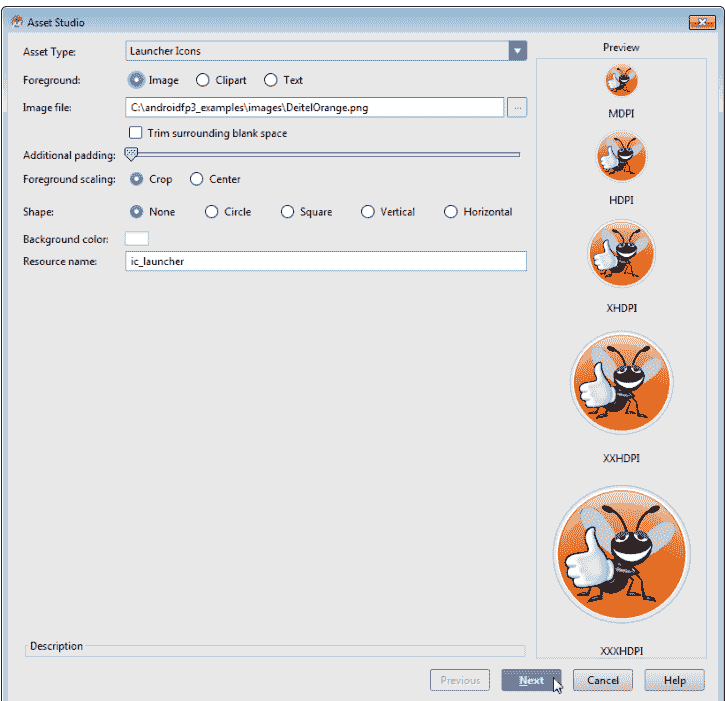

**图 2.14** | 在 Asset Studio 窗口中配置启动器图标。

### 2.5.3 将 RelativeLayout 改为 LinearLayout

当您打开布局 XML 文件时，布局的设计将出现在布局编辑器中，布局的视图及其层级关系将出现在 Component Tree（组件树）窗口中（图 2.15）。要配置布局视图，您可以在布局编辑器或 Component Tree 中选择它，然后使用 Component Tree 下方的 Properties（属性）窗口来指定视图的属性值，而无需直接编辑 XML。在设计更复杂的布局时，直接在 Component Tree 中工作通常更简单。

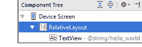

**图 2.15** | Component Tree 窗口中的层级 GUI 视图。

## 2.5 使用布局编辑器构建应用的 GUI

对于某些 GUI 修改——例如将默认的 `RelativeLayout` 改为 `LinearLayout`——您必须直接编辑布局的 XML。（这可能会随着 Google 改进编辑器功能而变化）。操作如下：

1. 点击布局编辑器底部的 Text（文本），切换到布局 XML 文本视图。
2. 在 XML 顶部（图 2.12 中的第 2 行），双击 XML 元素名称以选择它，然后输入 `LinearLayout`。
3. 当您在第 2 行输入时，IDE 同时编辑对应的 XML 标签（图 2.12 中的第 17 行）以保持同步，并弹出一个代码补全窗口，显示与您目前输入的字母开头的元素名称。一旦 `LinearLayout` 在代码补全窗口中出现并高亮，按 Enter（或 Return）键选择 `LinearLayout` 并启用 Android Studio 自动完成代码。
4. 保存更改并切换回布局编辑器的 Design 标签。

Component Tree 现在应该出现在图 2.16 中。

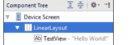

**图 2.16** | 将 `RelativeLayout` 改为 `LinearLayout` 后的 Component Tree。

### 2.5.4 修改 LinearLayout 的 id 和方向

在本节中，您将学习 `LinearLayout` 的属性。为每个布局组件分配一个相关的名称。这有助于您在 Component Tree 中轻松地识别每个组件，并使您能够以程序化的方式管理视图，正如我们在后续部分将做的那样。

当在布局编辑器中显示 GUI 时，您可以使用 Component Tree 下方的 Properties 窗口（图 2.8）来配置所选视图的属性。您也可以通过点击画布上的视图来编辑最常用的属性（正如您在本节中将做的那样）。布局编辑器会显示一个小对话框，您可以在其中查看视图的属性以及依赖于特定视图的其他属性：

- 对于 `LinearLayout`，可以设置 `orientation`（方向）来指定布局的子项是水平方向还是垂直方向。
- 对于 `TextView`，可以设置 `text`（文本）。
- 对于 `ImageView`，可以设置 `src`（源）。

#### 设置 LinearLayout 的方向

要更改 `LinearLayout` 的方向，双击布局编辑器中的 `orientation`，然后从下拉菜单中选择 `vertical`（垂直），如图 2.17 所示。这设置了属性，并在布局的 XML 中定义了 `id`。


**图 2.17** | 设置 `LinearLayout` 的方向。

#### id 属性

在布局的 XML 中指定 `id`：

```xml
@id/welcome
```

`@id/` 前缀表示将使用资源，`welcome` 指明特定的资源。

### 2.5.5 配置 TextView 的 id 和 text

#### 设置 TextView 的 id

双击布局编辑器中的 `TextView` 并在 Properties 窗口中定位其属性。

#### 使用资源配置 TextView 的 text

根据 Android 资源文档：

```text
http://developer.android.com/guide/topics/resources/index.html
```

将字符串、数组、颜色和其他资源放置在项目 `res` 子文件夹中的 XML 文件是一个很好的做法，这样这些资源就可以与应用代码分开管理。

如果您希望对应用进行本地化，可以为每种语言创建值，正如我们在 2.8 节中演示的那样。要设置 `TextView` 的 `text`，在 `strings.xml` 文件中创建一个新字符串：

1. 双击布局编辑器中的 `welcome TextView` 或选择 `welcome TextView` 并在 Properties 窗口中定位 `text` 属性。
2. 点击值右侧的省略号 (`...`) 按钮显示 Resource 对话框。
3. 在 Resources 中，点击 New Resource（新建资源），选择 New String Value...（新建字符串值...）显示 New String Value 对话框并填充 Resource name 和 Resource value 字段，如图 2.18 所示。保持其他设置（我们将在后续章节中讨论这些）并点击 OK 创建名为 `welcome` 的新资源，并将其设置为 `text` 属性的值。

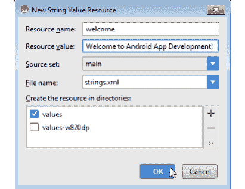

**图 2.18** | New String Value 对话框。

在 Properties 窗口中，`text` 属性现在应该如图 2.19 所示。`@string/` 前缀表示将使用字符串资源来获取 `text` 属性的值，`welcome` 指明特定的字符串资源。默认情况下，资源被放置在 `strings.xml` 文件（位于项目的 `res/values` 文件夹）。

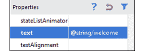

**图 2.19** | 修改 TextView text 属性后的 Properties 窗口。

# 56 第 2 章 欢迎应用

## 2.5.6 配置 TextView 的 textSize——缩放像素和密度无关像素

尺寸可以使用多种测量单位（图 2.20）。支持多种屏幕尺寸的文档建议在视图和其他屏幕元素的尺寸上使用密度无关像素（`dp`），并使用缩放无关像素（`sp`）作为字体大小：

```text
http://developer.android.com/guide/practices/screens_support.html
```

| 单位 | 描述 | 单位 | 描述 |
|---|---|---|---|
| `dp` 或 `dip` | 密度无关像素 | `in` | 英寸 |
| `sp` | 缩放无关像素 | `mm` | 毫米 |

**图 2.20** 测量单位。

使用密度无关像素定义 GUI可以让 Android 平台根据给定设备的屏幕密度缩放 GUI。每个密度无关像素等于 160-dpi 屏幕上的一个像素。每个密度无关像素将按 240/160（即 1.5）的倍数进行缩放。因此，一个具有 100 个密度无关像素的组件将是 150 个实际像素。在 120 dpi 的屏幕上，每个密度无关像素将按 120/160（即 0.75）的倍数进行缩放。因此，具有 100 个密度无关像素的组件将是 75 个实际像素。缩放无关像素的缩放方式与密度无关像素类似，但还会根据用户偏好的字体大小（如设备设置中所指定的）进行缩放。

### 为手机设备的字体大小创建尺寸资源

你将在布局编辑器中找到 `TextView`。要更改字体大小：

1. 选择 `welcome_TextView`。
2. 找到 `textSize` 属性，点击右侧列显示省略号 (`...`) 并点击按钮显示 Resources（资源）对话框。
3. 在 Resources 对话框中，点击 New Resource（新建资源），然后选择 New Dimension Value...（新建尺寸值）显示新建尺寸值对话框。
4. 在上方对话框中，指定 `welcome_textSize` 为资源名称，指定 `40sp` 为资源值，然后点击 OK 关闭对话框并返回 Resources 框。值 `40sp` 中的字母 `sp` 表示这是一个缩放无关像素测量。尺寸值中的字母 `dp`（例如 `10dp`）表示密度无关像素测量。用于在手机上显示文本。

在 Properties（属性）窗口中，`textSize` 属性现在包含值：

```
@dimen/welcome_textSize
```

`@dimen` 前缀表示 `textSize` 属性的值是一个尺寸资源，`welcome_textSize` 表示要使用的特定尺寸资源。默认情况下，该资源放置在 `dims.xml` 文件中——位于项目的 `res/values` 文件夹下。

### 为大平板设备的字体大小创建尺寸资源

`40sp` 的字体大小适用于手机尺寸设备，但对于平板电脑来说太小了。Android 可以根据设备尺寸、方向、像素密度、语言、区域等自动选择资源值。要为较大的设备指定字体大小，例如：

1. 如上所述重新打开 New Dimension Value 对话框。
2. 输入 `welcome_textSize` 作为资源名称（资源名称必须匹配，Android 才能自动选择不同的资源值），并输入 `80sp` 作为资源值。
3. 接下来，你将创建一个专门针对较大设备（如宽度和高度至少为 `600dp` 的平板电脑）的新值资源文件夹。在 New Dimension Resource 对话框中，取消勾选 `values` 复选框，并点击 Add (+) 打开 New Resource Directory（新建资源目录）。在此框的 Available qualifiers（可用限定符）中，选择 Screen，然后点击 >> 按钮添加到 Screen width，然后选择 Chosen qualifiers（已选限定符）。接下来，在 Screen width 字段中输入 `600`。
4. 接下来，将 Screen Height 限定符添加到 Chosen qualifiers，并为 Screen height 输入 `600`。
5. 点击 OK 创建一个名为 `values-xlarge` 的资源文件夹。
6. 在 New Dimension Resource 对话框中，勾选 `values-w600dp-h600dp` 复选框，然后点击 OK。这会在 `.xml` 文件创建另一个 `welcome_textSize` 尺寸资源，该文件存储在项目的 `res/values/w600dp_dim.xml` 中。Android 将此用于屏幕宽度和高度至少为 `600dp` 的超大屏幕设备，这是大多数平板电脑的特征。新的 `dim.xml` 资源文件出现在 Android Studio 项目的 `res/values/dim.xml` 节点中。

```
dim.xml (w600dp-h600dp)
```

### 2.5.7 设置 TextView 的 Color 属性

在应用中选择颜色时，Google 的 Material Design 指南建议使用 Material Design 调色板中的颜色：

```text
http://www.google.com/design/spec/style/color.html
```

颜色通过 RGB（红-绿-蓝）或 ARGB（透明-红-绿-蓝）指定。ARGB 值由 0-255 范围内的整数组成，定义颜色中红蓝量。自定义颜色以十六进制格式定义，RGB 组件的值在 `00`（0 的十六进制值）到 `FF`（255 的十六进制值）的范围内。

Android 还支持 `00`（完全透明）到 `FF`（完全不透明）范围的 alpha（透明度）值。要使用 alpha，将颜色指定为 `#AARRGGBB`，其中前两个十六进制表示 alpha 值。

如果颜色组件的两个数字相同，可以使用缩写格式 `#RGB` 或 `#ARGB`。例如，RGB 值。

## 使用布局编辑器构建应用 GUI

要将 `TextView` 的 `textColor` 属性设置为资源：

1. 在 Properties 窗口中点击省略号 (`...`) 显示 Resources 对话框。
2. 点击 New Resource 并选择 New Color Value...
3. 在 Color Value 对话框中，输入 `welcome_textColor` 作为资源名称，输入 `#FFFFFF` 作为资源值，然后点击 OK。

### 2.5.8 设置 TextView 的 gravity 属性

为了让文本在换行时居中，你可以将其 `gravity` 属性设置为 `center`。要这样做，扩展该属性的节点，然后勾选 `center`。

### 2.5.9 设置 TextView 的 layout:gravity 属性

放在布局中的每个视图都有各种布局属性，允许你自定义视图在布局中的尺寸和位置。当你在布局编辑器或组件树中选择视图时，Properties 窗口首先列出布局和样式属性，然后按字母顺序列出视图特定属性：

| | | |
|---|---|---|
| `layoutwidth` | `wrap_content` | 切换 'expect' 属性显示 |
| `layoutheight` | `wrap_content` | 大多数程序员不修改的属性——默认隐藏 |
| `layoutgravity` | | 将所选属性重置为默认值 |
| `layoutmargin` | | 显示当前选择属性的简要描述 |
| `layoutweight` | | |
| `style` | | |
| `accessibilityLiveReg` | | |
| `accessibilityTraversi` | | |
| `tabindex` | | |
| `alpha` | | |
| `autoLink` | | |
| `background` | | 布局和样式属性列在前面 |

在本应用中，我们希望 `TextView` 在 `LinearLayout` 中水平居中。为了实现这一点，你将按照以下步骤将其 `layout:gravity` 属性设置为水平居中：

1. 选中 `TextView` 后，扩展 Properties 窗口中 `layout:gravity` 属性的节点。
2. 点击 `center` 选项右侧的值字段，然后选择水平选项。

## 第 2 章 欢迎应用

在布局 XML 文件中，布局属性具有以 `layout...` 开头的属性名。前述的 `layout:gravity` 属性在 XML 中表示：

```xml
android:layout_gravity="center_horizontal"
```

### 2.5.10 设置 TextView 的 layout:weight 属性


`LinearLayout` 可以根据使用 `layout:weights` 定义的子视图来按比例调整大小，该属性指定了视图相对于其他视图权重的相对大小。默认情况下，你添加到 `LinearLayout` 的每个视图的 `layout:weight` 均为 `0`，表示该视图不应按比例调整大小。

在此应用中，我们将让 `TextView` 和 `ImageView` 占据 `LinearLayout` 垂直空间的一半。你可以通过将每个视图的 `layout:weight` 设置为相同的值来实现此目的。`LinearLayout` 使用每个 `layout:weight` 占总 `layout:weight` 的比例来为视图分配空间。在此应用中，你将把 `TextView` 和 `ImageView` 的 `layout:weight` 都设置为 `1`（见第 2.5.11 节）——总的 `layout:weight` 将为 `2`，每个视图将占据布局高度的 `1/2`。

如果你想让 `TextView` 占据 `LinearLayout` 高度的三分之一，可以将 `layout:weight` 设置为 `1`，并将 `ImageView` 的 `layout:weight` 设置为 `2`。在这种情况下，总的 `layout:weight` 将为 `3`，因此 `TextView` 将占据高度的 `1/3`，`ImageView` 将占据 `2/3`。

将 `layout:weight` 设置为 `1`。布局编辑器会在 `layout:height` 属性旁边显示一个灯泡 💡 图标——如果没有立即显示，请点击属性窗口中的 `layout:height` 属性。这些图标由 IDE 中名为 Android 的工具生成，用于警告潜在问题并帮助你修复它们。当你点击灯泡时，IDE 会显示消息“使用 `layout:height` 代替 `wrap_content` 以获得更好的性能”。点击该消息以应用建议。此更改允许 `LinearLayout` 更高效地计算子视图的大小。布局编辑器现在显示如图 25 所示。

> **错误预防提示 2.2**
>
> Android 会检查常见错误，并针对更好的安全性、增强的性能、改进的国际化和本地化提供建议。某些错误会在构建应用和编写代码时出现。你也可以选择 `Inspect Code...` 对特定文件或整个项目进行分析。欲更多信息，请访问 `http://developer.android.com/tools/help/lint.html`。有关 Android Lint 的配置选项和输出，请访问 `http://developer.android.com/tools/debugging/improving-lint.html`。

### 2.5.11 添加 `ImageView` 以显示图像

接下来，你将向 GUI 添加一个 `ImageView` 以显示你在第 2.5.1 节中添加的图像。你通过从调色板（Palette）部分拖入一个 `ImageView` 来实现。当你将视图拖到画布上时，布局编辑器会显示引导线、绿色引导线和工具提示：

- 橙色引导线显示每个视图在布局中的边界位置。
- 绿色引导线表示新视图相对于现有视图的放置位置——默认情况下，新视图被添加到垂直 `LinearLayout` 的底部，除非你将鼠标置在边界布局顶部视图的橙色框上方。
- 工具提示显示了如果你将视图释放到当前位置，该视图将如何被配置。

添加并配置 `ImageView`：

1. 从 `Palette > Widgets` 部分将 `ImageView` 拖到画布上，如图 2.26 所示。在松开鼠标之前，确保设计顶部的工具提示中出现 **center**——这表示布局编辑器将把设计 `ImageView` 的 `layout:gravity` 属性设置为中心，以便将 `ImageView` 在 `LinearLayout` 中水平居中。

   当你松开鼠标释放 `ImageView` 时，布局假设 `ImageView` 的 `layout:weight` 应与 `TextView` 相同，并将 `layout:weight` 设置为 `1`。在你放入它时，它还将 `layout_height` 设置为 `0dp`。

   新的 `welcomeTextImageView` 出现在设计视图的 `TextView` 下方，并在组件树（Component Tree）中位于 `welcomeTextTextView` 下方。`ImageView` 的属性显示在属性（Properties）窗口中。

   

   **图 2.25** | 配置 `TextView` 后的布局编辑器窗口。

   工具提示指示布局编辑器将选择新的 `ImageView` 的 `layout:gravity` 属性，以便 `ImageView` 在 `LinearLayout` 中水平居中。

   橙色引导线显示 `TextView` 的边界。

   当你将 `ImageView` 拖到设计界面时，布局编辑器线条指示 `ImageView`（或你拖入的任何其他视图）将放置的位置。

   **图 2.26** 将 `ImageView` 拖入 GUI。

2. 在属性（Properties）窗口中，找到 `ImageView` 的 `src` 属性（用于指定要显示的图像），然后点击其值字段的省略号按钮显示资源（Resources）对话框（2.27）。当对话框打开时，输入搜索资源列表以查找你在第 2.5.1 节中添加的图像，然后点击 **OK**。

   对于放置在 `drawable` 文件夹中的每张图像，IDE 都会生成一个唯一的资源 ID（即资源名称），你可以用它来引用该图像。图像的源 ID 是不带文件扩展名的文件名——对于 `png` 文件为 `bug`。

3. 在布局编辑器中双击 `ImageView` 并将其 `id:` 设置为 `bugImageView`。GUI 现在显示如图 28 所示。如果你在布局编辑器中选择 `ImageView`，Android Lint 会显示一个灯泡——见 2.7。

| Project | System |
|---|---|
| abc_ | |
| textfield_search | |
| bug | |
| notification_template | |
| action_ | |
| action_bar | |
| action_bar_content | |
| action_bar_root | |
| action_bar_spinner | |

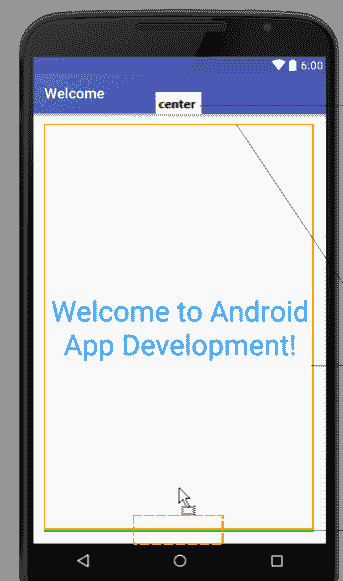

**图 2.27** | 从资源对话框中选择 `bug`。

Android Lint 显示 `ImageView` 缺少属性。


**图 2.28** | 完成的设计。

### 2.5.12 预览设计

Android Studio 允许你预览横向设计并预览多个设备的预览。要切换设计的横向预览，只需点击布局编辑器工具栏上的 `Go` 按钮。要预览多个设备，点击布局编辑器顶部的设备下拉菜单（图 2.11），选择 `Preview Sizes`。

这将显示许多设备的缩略图（图 29）——有些是竖式的，有些是横向的。你可以快速判断你的设计是否适用于各种设备。

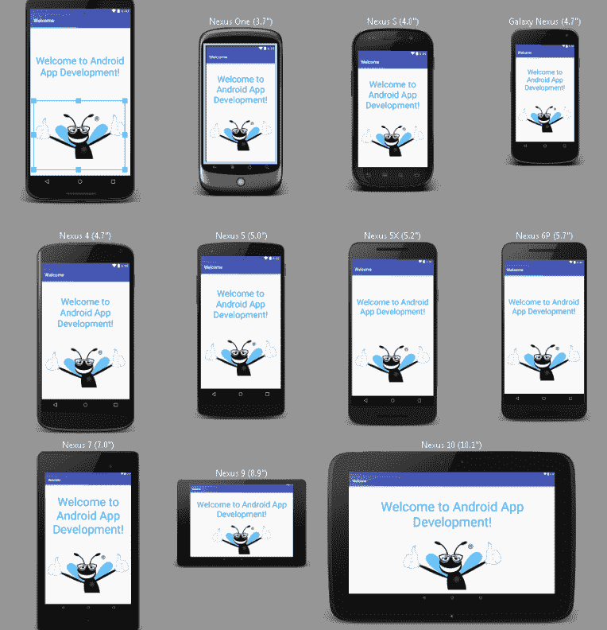

**图 29** | 各种设备的预览。

可以通过点击下拉菜单返回显示单个设备。你也可以通过在下拉菜单中选择特定设备来预览设计。

## 2.6 运行应用

你现在已准备好运行欢迎应用。按照第 1.9.3 节所示的步骤将应用运行在你之前配置的 Nexus 6 手机和 Nexus 9 平板的 AVD 上。图 2.30–2.31 分别显示运行在 Nexus 6 AVD（竖式和横向）和 Nexus 9 AVD（横向）上的应用。

你可以通过 `Ctrl+F11` 或 `control+F11` 切换 AVD 的竖式和横向。通常，对于在手机和平板上运行的应用，你还会提供一个更好地利用可用空间的平板布局，我们将在后面的章节中演示。如果你有 Android 设备，可以按照第 1.9.4 节的步骤在你的设备上运行应用。

# 第 2 章 欢迎应用


**图 2.31** | 在 Nexus 9 AVD 中运行的欢迎应用。

## 2.7 使您的应用具有辅助性

Android 包含了辅助功能，帮助某些残障的人士使用他们的设备。对于视觉障碍人士，TalkBack 可以朗读屏幕文本或您提供的文本（在设计 GUI 或通过编程提供时），帮助用户理解视图的作用。Android 提供了“触控探索”（Explore by Touch），使用户可以听到 TalkBack 读出用户触摸屏幕区域的内容。

当启用 TalkBack 时，用户触摸一个指定了辅助文本的视图，设备会振动以指示用户触摸了重要视图，TalkBack 会读出辅助文本。所有标准的 Android 视图都支持辅助功能。

TalkBack 默认朗读文本——例如，当用户触摸 `TextView` 时，TalkBack 会读出该 `TextView`。你可以在设置中的“辅助功能”（Accessibility）下启用 TalkBack。在该页面，你还可以启用其他功能，如较大的字体大小和使用放大屏幕区域的手势。

目前 AVD 不支持 TalkBack，因此你必须在设备上运行此应用，才能听到 TalkBack 朗读文本。当你启用 TalkBack 时，Android 会带你通过一个使用 TalkBack 和“触控探索”的教程。

### 为 `ImageView` 启用 TalkBack

在欢迎应用中，我们不需要为 `TextView` 提供更多描述性文本，因为 TalkBack 会读取 `TextView` 的内容。然而，对于 `ImageView`，除非你提供，否则 TalkBack 没有文本可朗读。

在 Android 中，一种良好的做法是为任何不显示文本的视图的描述属性（description property）提供文本，以确保每个视图都能与 TalkBack 使用。出于这个原因，IDE 通过显示灯泡图标 💡 警告我们出现了一些问题——正如你在布局编辑器中 `ImageView` 旁边的图 2.28 中所看到的那样。

如果你点击灯泡，将看到消息“辅助功能：在……上缺少 `contentDescription` 属性”。你提供的文本应该帮助用户理解组件的作用。对于 `ImageView`，文本应该描述该图像。

要添加 `ImageView` 的 `contentDescription`（并消除警告）：

1. 在布局编辑器中点击 `bugImageView`。
2. 在属性窗口中，点击描述属性右侧的省略号按钮以打开资源对话框。
3. 点击 `New Resource`（新建资源），选择 `New String Value...`（新建字符串值）以显示新字符串资源对话框。
4. 在 `Name`（名称）字段中指定 `delete_logo`，在 `Resource`（资源）字段中指定 `"delete-thumbs-up logo"`，然后按 `OK`。新的字符串资源将自动作为 `contentDescription` 的值。

更改 `ImageView` 的 `contentDescription` 后，布局编辑器将移除警告灯。

### 在启用 TalkBack 时测试应用

在启用了 TalkBack 的设备上运行应用，然后让 `TextView` 和 `ImageView` 让 TalkBack 读出相应的文本。

### 动态创建的视图

某些应用会根据用户交互动态创建视图。对于此类视图，你可以通过编程设置辅助文本。有关 Android 及其他辅助功能的更多信息，以及开发应用时的检查清单，请访问：

```text
http://developer.android.com/design/patterns/accessibility.html
http://developer.android.com/guide/topics/accessibility
```

## 2.8 您的应用程序国际化

为了接触尽可能广泛的受众，你应该设计你的应用，使其能够针对不同的地区和口语语言进行定制。然后，如果你打算在（例如）法国提供你的应用，你就需要将资源（文本、音频文件等）翻译成法语。你还可能根据地区使用不同的颜色、图形和声音。

对于每个地区，你将拥有一套独立的、定制的资源集。当用户启动应用时，Android 会找到并加载与设备地区设置匹配的资源。将应用设计成可定制的被称为**国际化**（internationalization）。为每个地区定制应用资源被称为**本地化**（localization）。

### 2.8.1 本地化

将字符串值定义为字符串资源（正如我们在本应用中所做的）的一个关键优势是，你可以通过为这些字符串资源创建其他语言的额外 XML 资源文件轻松本地化。

在每种语言中，你使用相同的字符串资源名称，但提供翻译后的字符串。Android 然后可以根据设备的偏好地区选择合适的资源文件。

### 2.8.2 为本地化资源命名文件夹

包含本地化字符串的 XML 资源存放在项目 `res` 文件夹的子文件夹中。Android 使用特殊的文件夹命名方案来自动选择正确的本地化资源——例如，`values-fr` 将包含一个法语的 `strings.xml` 文件，`values-es` 将包含一个西班牙语的 `strings.xml` 文件。

你也可以为这些文件命名，`values-en-US` 将包含美国英语的 `strings.xml` 文件，`values-en-GB` 将包含英国英语的 `strings.xml` 文件。

如果没有为给定地区提供本地化资源，Android 将使用应用的默认资源——即 `res` 文件夹下的 `values` 子文件夹。我们稍后详细讨论这些备用资源命名规范。

### 2.8.3 向项目添加翻译

Android Studio 提供了翻译编辑器（Translations Editor），可以快速方便地为应用中的现有字符串添加翻译。按照以下步骤向项目添加翻译后的字符串：

1. 在 Project 窗口中，展开 `values` 文件夹，打开 `strings.xml` 文件。
2. 在编辑器的右上角，点击 `Open editor` 链接以打开翻译编辑器。
3. 在翻译编辑器中，点击地球图标以添加新的翻译。
4. 在翻译编辑器中，选择你想要支持的地区。
5. 在翻译编辑器中，点击资源的单元格并输入翻译后的字符串。
6. 通过选择 `File > Save All` 或点击 `Save All` 工具栏按钮来保存 `strings.xml`。

### 2.8.4 本地化字符串

在本应用中，GUI 包含一个显示字符串的 `TextView`。这些字符串在 `strings.xml` 文件中被定义为字符串资源。你现在可以在 `strings.xml` 版本中提供翻译后的字符串。对于此应用，你将把字符串替换为西班牙语字符串。

在翻译编辑器中：

1. 点击 Spanish (es) 翻译资源的单元格，然后在窗口底部的 `Translation:` 中输入西班牙语字符串。
2. 接下来，点击 `deitel_logo` 资源的数值单元格，并在 `Translation:` 中输入。
3. 我们选择不翻译 `app_name` 资源，尽管我们本可以翻译。窗口应该如图 2.32 所示。
4. 保存 `strings.xml`。

### 2.8.5 在 AVD 上用西班牙语测试应用

要在 AVD 上用西班牙语测试应用，你可以使用安装在 AVD 上的 `Custom Locale` 应用。

1. 点击 AVD 上的主（`O`）图标。
2. 点击启动器（`::`）图标，然后找到并点击 `Custom Locale` 应用图标打开它。
3. 拖动鼠标滚动到 `español` 选项，点击它并点击 `SELECT 'ES'` 按钮更改 AVD 的地区。

## 第 2 节 Welcome 应用

接下来，运行 Welcome 应用，它将安装并启动本地化应用（图 2.33 所示）。当应用开始执行时，Android 会检查 AVD（或设备）的语言设置，确定 AVD（或设备）被设置为西班牙语，并使用在 `res/values-es/strings.xml` 中定义的西班牙语 Welcome 字符串。

注意，应用的名称在应用顶部仍以英语形式显示。这是因为我们没有在 `res/values-es/strings.xml` 文件中提供 `app_name` 字符串资源的本地化版本。如果 Android 找不到字符串资源的本地化版本，它将使用 `res/values/strings.xml` 文件中的默认版本。

## 将 AVD 恢复为英文

要将 AVD 恢复为英文：

1. 点击英语主页图标。
2. 点击启动器图标，然后找到并点击 `Custom Locale` 应用的图标打开它。
3. 拖动鼠标到 `en-US - en-us` 选项，然后点击它，并点击 `SELECT 'EN-US'` 按钮以更改 AVD 的语言区域。


**图 2.33** 在 Nexus 6 AVD 中运行西班牙语的 Welcome 应用。

### 2.8.6 在设备上测试西班牙语应用

要测试设备，你必须更改设备的语言设置。操作如下：

1. 触摸设备上的主页图标。
2. 触摸启动器图标，然后找到并触摸设置（Settings）。
3. 在设置应用中，滚动到个人（Personal）部分，然后触摸语言与输入（Language & input）。
4. 触摸语言（Language，列表中的第一项），然后从列表中选择 Español（Spanish）。

设备将语言更改为西班牙语并返回语言与输入设置，现在设置显示为西班牙语。从 IDE 运行应用以在设备上安装并运行本地化版本。

## 2.9 应用的国际化

要恢复你的 Android（AVD）或设备：

1. 触摸模拟器或设备上的主页图标。


2. 触摸启动器图标，然后找到并触摸设置（Settings）应用——图标在西班牙语中现在名为 Ajustes。

3. 触摸`idiomas de texto`以访问语言设置。

4. 触摸语言（Language），然后在列表中选择英语（United States）。

### 2.8.7 TalkBack 与本地化

TalkBack 目前支持英语、西班牙语、意大利语、法语和德语。如果你在指定为西班牙语并启用 TalkBack 的设备上运行 Welcome 应用，当你触摸每个视图时，TalkBack 会读取西班牙语字符串。当你首次将设备切换到西班牙语并启用 TalkBack 时，Android 会自动下载西班牙语语音合成引擎。如果 TalkBack 没有读取西班牙语字符串，说明语音合成引擎尚未下载并安装。在这种情况下，你应该尝试稍后执行应用。

### 2.8.8 本地化检查清单

有关本地化应用的更多信息，请务必查看 Android Check 清单：

```text
http://developer.android.com/distribute/tools/localization-checklist
```

### 2.8.9 专业翻译

应用开发公司通常设有内部翻译专人员，或聘请其他公司进行翻译。事实上，在 Google Play Developer Console（你用它在 Google Play 商店发布应用）中，你可以找到翻译服务，并在翻译编辑器（Translations Editor）中订购翻译……关于 Google Play Developer Console 的更多信息，请参见第 10 节：

```text
http://developer.android.com/distribute/googleplay-console
```

有关翻译的更多信息，请参见：

```text
https://support.google.com/l10n/answer/627218
```

## 2.9 总结

在本章中，你使用 Android Studio 构建了 Welcome 应用，该应用无需代码即可显示消息和图像。你使用 IDE 的布局编辑器创建了一个简单的 GUI，并通过属性（Properties）窗口配置了视图属性。

你将默认的 GridLayout 更改为 LinearLayout，然后将其配置为垂直排列视图。应用在 TextView 中显示文本，在 ImageView 中显示图片。你修改了 TextView，使其从默认 GUI 变为应用文本在 GUI 中居中显示，并使用了更大的字体和标准主题颜色之一。你还使用了编辑器的 GUI 控制调板（Palette），将项目`res`文件夹中资源文件中的数值进行拖放操作。

你学习到 Android 具有辅助功能功能，可以帮助某些残障的人士使用设备。我们展示了如何启用 Android 的 TalkBack，允许设备通过朗读文本来帮助视觉障碍人士理解应用的功能和内容。我们讨论了 Android 的“触摸探索”（Explore by Touch）功能，该功能允许用户通过触摸屏幕来听 TalkBack 读取屏幕触摸位置附近的内容。对于应用的 ImageViews，你提供了可以与 TalkBack 和“触摸探索”配合的内容描述（content descriptions）。

最后，你学习了如何使用 Android 的国际化功能让你的应用触及尽可能广泛的观众。你使用西班牙语字符串对 TextView 文本和 ImageViews 辅助字符串的 Welcome 应用进行了本地化，然后在配置为西班牙语的 Android 设备上测试了应用。

Android 开发是 GUI 设计与 Java 编码的结合。在下一章中，你将使用布局编辑器视觉化开发 GUI，并使用 Java 编程指定应用行为，开发一个的小费计算应用。

# 3 小费计算应用

介绍 GridLayout、EditText、SeekBar、事件处理、NumberFormat、自定义应用主题以及使用 Java 定义应用功能。


## 目标

在本章中，你将：

- 更改默认主题。
- 自定义主题颜色。
- 使用 GridLayout 设计 GUI。
- 使用 IDE 组件树向 GridLayout 添加视图。
- 使用 TextView、EditText 和 SeekBar。
- 使用 Java 面向对象（包括类、对象、接口、内部类和继承）为应用添加功能。
- 程序化更改 TextView 中的文本。
- 使用事件处理响应与 EditText 和 SeekBar 的交互。
- 指定默认显示键盘。
- 指定应用仅支持竖屏。

## 大纲

3.1 引言

3.2 测试小费计算应用

3.3 技术概述

3.3.1 类

3.3.2 生命周期方法

3.3.3 AppCompat 库与类

3.3.4 使用 GridLayout 布局

3.3.5 使用布局编辑器和属性自定义 GUI

3.3.6 将数字格式化为本地化的货币和百分比字符串

3.3.7 实现 Android 的 TextWatcher

3.8 实现位置 OnChangeListener

3.3.9 Material 主题

3.3.10 Material Design：高度与阴影

3.3.11 Material Design 颜色

3.3.12 AndroidManifest.xml

3.3.13 在属性窗口中搜索

3.4 构建 GUI

3.4.1 GridLayout 介绍

3.4.2 创建 TipCalculator 项目

3.4.3 更改为 GridLayout

3.4.4 添加 TextView、EditText 和 SeekBar

3.4.5 自定义视图

3.5 默认主题与自定义主题颜色

3.5.1 父级主题

3.5.2 自定义主题颜色

3.5.3 常用属性值的样式

3.6 添加应用逻辑

3.6.1 包和导入语句

3.6.2 MainActivity 继承 AppCompatActivity

3.6.3 类变量与实例变量

3.6.4 覆写 Activity `onCreate`

3.6.5 MainActivity 方法实现接口

3.6.6 匿名内部类实现 OnChangeListener

3.6.7 匿名内部类实现 TextWatcher

## 3.2 测试小费计算器应用

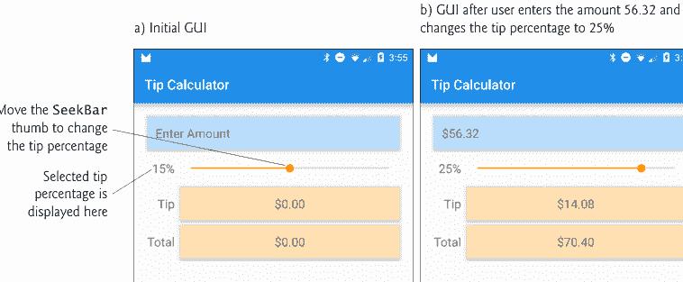

- 移动滑动块按钮以更改小费百分比。
- 此处显示所选的小费百分比。
- 点击数字键盘上的数字以整数形式输入账单——应用会将你的输入内容除以`100.0`来计算账单金额。
- 从右向左点击删除数字键。

**图 3.1** 输入账单并计算小费。

2. 在主屏幕上，点击启动器图标，然后打开设置应用。

3. 在“个人设置”部分，点击“语言和输入”。

4. 在 AVD 上，点击“Android 键盘 (OSP)”。在设备上点击 Google 键盘——我们假设你使用的是标准的 Android 键盘。

5. 点击“外观与布局”，然后点击“主题”。

6. 点击“深色模式”以更改深色背景的键盘。

## 3.2 测试小费计算器应用

### 打开并运行应用

执行第 1.9.1 和 1.9.3 节中的步骤在 Android Studio 中打开小费计算器应用项目并在 Nexus 6 AVD 上运行该应用。如果你愿意，也可以执行 1.9.4 中的步骤在 Android 手机上运行该应用。

### 输入账单总额

通过点击数字键盘上的数字输入账单总额`56.32`。如果你输错了，按下键盘上的删除键来擦除你输入的最后一个数字。尽管键盘上包含小数点，但应用已配置为只能输入数字`0–9`——键盘上的其他按钮会被忽略，且当你点击无效的输入按钮时，Android 设备会振动。每当你点击数字或删除数字时，应用都会读取你之前输入的内容，并：

- 将其转换为数字。
- 将该数字除以`100.0`并显示新的账单金额。
- 根据当前的小费百分比（默认为`15%`）重新计算小费和总金额。
- 在 Tip 和 Total 的 TextView 中显示新的小费金额和总金额。

如果你删除了所有数字，应用会在蓝色 TextView 中重新显示“输入金额”，并将`0.00`除以`100.0`。应用随后计算并更新橙色 TextView 中的小费和总金额。

所有货币金额都以本地特定的格式显示，小费百分比也以本地特定的格式显示。对于美国用户，当你输入数字`5`、`6`和`2`时，账单总额分别显示为`$0.05`、`$0.56`和`$5.62`。

### 选择小费百分比

使用 SeekBar（UI 中通常称为滑块）来指定百分比。拖动 SeekBar 直到百分比达到`25%`。当你拖动按钮时，小费和总额会持续更新。默认情况下，SeekBar 允许你选择从`0`到`100`的取值，但此应用指定了最大值为`30`。

## 3.3 技术概述

本节介绍了你将用于构建小费计算器应用时用到的 IDE 和 Android 特性。我们假设你已经熟悉面向对象的编程——我们在《面向程序员的 Java》书中介绍了 Java：

```text
http://bit.ly/JavaSE
```

你将：

- 使用 Android 类创建对象。
- 调用类和对象上的方法。
- 定义并调用你自己的方法。
- 使用继承来创建一个定义小费计算器功能的类。
- 使用事件处理、匿名内部类和接口来处理用户交互。

### 3.3.1 Activity（活动）

Android 应用有四种可执行组件——活动（activities）、服务（services）、内容提供者（content providers）和广播（broadcasters）。在本章中，我们将讨论定义为 `android.app` 类的活动。一个应用可以有多个 Activity，其中一个是你启动应用后看到的第一个。你通过视图（views）与 Activity 交互——这些继承自 View（`android.view`）的 GUI 组件。

在 Android 3.0 之前，应用的每个屏幕通常都关联一个独立的 Activity。正如你将看到的，从第 4 章开始，一个 Activity 可以管理多个碎片（Fragments）。在手机上，每个 Fragment 占据整个屏幕，Activity 在 Fragment 之间切换。在平板电脑上，Activity 通常在每个屏幕显示多个 Fragment，以利用更大的屏幕。

### 3.3.2 生命周期方法

在整个生命周期内，Activity 可以处于几种状态之一：活跃（active，即运行）、暂停（paused）或停止（stopped）。Activity 响应各种事件在这些状态之间转换：

- 一个活跃的 Activity 在屏幕上可见并“拥有焦点”——即它处于前台。你可以与当前处于前台的 Activity 交互。
- 一个暂停的 Activity 在屏幕上可见但没有焦点——例如当显示警告对话框时。在它变为活跃之前，你无法与暂停的活动交互——例如当用户关闭对话框时。
- 一个停止的活动在屏幕上不可见——它处于后台，并且当系统需要内存时可能会被系统杀死。当另一个 Activity 进入前台并变为活跃时，该 Activity 停止。例如，当你接到电话时，手机变为活跃状态，你正在使用的应用会被停止。

当 Activity 在这些状态之间转换时，Android 会运行生命方法——所有方法都由 `android.app` 包中的 Activity 类定义。当 Activity 启动时，你会重写 `onCreate` 方法——即当它的 GUI 即将显示时，以便与其进行交互。其他生命方法包括 `onStart`、`onPause`、`onStop` 和 `onDestroy`。我们将在后面的章节中讨论这些大部分方法。每个 Activity 生命周期方法都必须重写父类版本；否则会发生异常。这是因为每个生命类都必须在重写的生命方法中包含你需要的功能。更多关于 Activity 生命周期的信息请参见：

```text
http://developer.android.com/reference/android/app/Activity.html
```

### 3.3.3 AppCompat Library 与 ClassActivity

开发者在使用新 Android 特性时面临的一个大挑战是向下兼容。Google 通过 Support Library 引入了许多新的 Android 特性——一组允许你针对当前和过去的 Android 使用新特性的库。

其中一个就是 AppCompat，它允许在 Android 2.1（API 7）及以上的设备上提供应用栏（以前称为操作栏）——应用栏最初在 Android 3.0（API 11）中引入。Android Studio 应用模板包含了 AppCompat 库，使你创建的新功能可以在几乎所有设备上运行。

Android Studio 的空 Activity 模板将应用的 MainActivity 类定义为 AppCompatActivity（包 `android.support.v7.app`）的子类——它是 Activity 的间接子类，支持较新的 Android 特性。

## 软件工程观察 3.1

从一开始使用 AppCompat 库创建应用，当你需要支持旧版本的 Android 以针对更广泛的潜在受众时，就可以避免重新实现代码。


## 软件工程观察 3.2

即使使用了 AppCompat 库，某些 Android 特性在旧版 Android 版本中也不可用。Android 的打印功能仅在 Android 4.4 及更高版本中可用。如果你在应用中使用此类功能，必须将其限制在支持的平台上，或者在不支持这些功能的 Android 版本上禁用它们。


## 3.3 技术概述

使用你在第 2.7–2.8 节中学到的技巧，处理访问性字符串并将应用的其他文本进行国际化。

### 3.3.7 实现接口 TextWatcher 处理 EditText 文本变化

为了在用户更改此应用中 EditText 的文本时做出响应，你将使用一个匿名类来实现 `TextWatcher` 接口（来自 `android.text` 包）。具体而言，你将使用 `onChanged` 在用户输入每个数字时，显示格式化为货币形式的金额并计算总额。如果你不熟悉匿名内部类：

```text
http://ly/AnonymousInnerClasses
```

### 3.3.8 实现接口 OnSeekChangeChangeListener 处理滑滑块位置变化

你将使用另一个匿名类来实现 `SeekBar.OnSeekChangeChangeListener`（来自 `android.widget` 包），以响应用户移动 SeekBar 滑滑块的操作。具体而言，你将使用 `onProgressChanged` 在用户移动 SeekBar 滑滑块时，显示编辑后的百分比并计算总额。

### 3.3.9 Material 主题

主题为你提供了与 Android 一致的视觉外观和感受。你为 Android 5 创建并使用的项目应遵循 Google 的 Material 设计指南。有几种预定义的 Material 设计主题：

- “light（浅色）”主题具有白色栏、白色背景以及黑色或深灰色的文本。
- 带有深色栏的“light（浅色）”主题与其他相同，但默认情况下栏为黑色，文字为白色。
- “dark（深色）”主题具有黑色栏、深灰色背景以及白色或浅灰色调的文本。

对于其中每一个主题，都有：

- 一个 `Theme.Material` 版本（例如 `Theme.Material.Light`），适用于不使用 AppCompat 库且运行在 Android 5 及更高版本上的应用。
- 一个 `Theme.AppCompat` 版本（例如 `Theme.AppCompat.Light`），适用于使用 AppCompat 库且运行在 Android 2.1 及更高版本上的应用。

在设计 GUI 时，你可以从预定义的主题中选择，甚至可以创建自己的主题。对于本章，我们将使用 `Theme.AppCompat.Light.DarkActionBar`，这是 Android Studio 应用模板中的默认主题。使用 AppCompat 的应用必须使用 AppCompat 主题之一；否则某些视图将无法正确渲染。有关如何查看和采样截屏的更多信息：

```text
http://www.google.com/design/spec/style/color.html#color-themes
http://developer.android.com/training/material/theme.html
```

# 性能提示 3.1

许多 Android 手机使用 AMOLED 屏幕。在类屏幕上，黑色像素是关闭的且不消耗功率。使用深色主题的应用可以减少约 40% 的功耗（`http://bit.ly/AndroidAMOLEDdisplay`）。

### 3.3.10 Material 设计：高度（Elevation）与阴影

Google 的 Material 设计指南建议用户界面中的对象应该像现实世界的物体一样捕捉。当你查看一个视图时，`elevation` 属性会自动为该视图投射阴影。`elevation` 值越大，阴影越明显。对于此应用，我们将使用显示金额的蓝色和橙色 `TextView` 的 `elevation`。

Material 设计指南包含了针对各种屏幕组件的高度建议——例如，对话框的高度为 `24dp`，菜单的高度为 `8dp`。对于其他推荐的高度，请参阅：

```text
http://www.google.com/design/spec/what-is-material/elevation-shadows.html
```

### 3.3.11 Material 设计：颜色


应用开发者经常自定义主题的颜色以匹配公司的品牌形象。如果你需要自定义颜色，Google 的 Material 设计指南建议你选择由主色（不超过三种深浅色）和强调色组成的调色板。主色用于渲染状态栏和屏幕顶部的应用栏，并可以在你的 GUI 中看到，例如`SeekBar`、`Checkbox`和`RadioButton`。强调色用于着色你 GUI 中的各种视图，你可以使用 Android Studio 的主题编辑器（第 3.5.2 节）来修改主题的颜色。

你可以从 Material 设计调色板中找到推荐的颜色：

```
http://www.google.com/design/spec/style/color.html#color-palette
```

对于调色板建议，请访问：

```
http://www.materialpalette.com/
```

该网站允许你从 Google Material 设计调色板中挑选颜色，然后为你的应用推荐主色的三种色调、强调色以及颜色。对于调色板建议，请访问：

- `Theme.Material` 版本
- `Theme.AppCompat` 版本
- 主色
- 强调色
- 颜色。`http://www.google.com/design/spec/style/color`

## 3.4 构建 GUI

在本节中，我们将展示构建 GUI 的精确步骤。此应用使用`GridLayout`将视图排列成行列。每行的高度由最高的视图决定。同样，每列的宽度由最宽的视图决定。

| 列 0 | 列 1 |
| --- | --- |
| 行 0 | 输入金额 |
| 行 1 | 15% |
| 行 2 | 小 $0.00 |
| 行 3 | 总 $0.00 |

**图 3.2** 按行标记的 TipCalculator GridLayout

**视图的 id 属性值**

图 3.3 显示了视图的属性值。为了清晰起见，我们的命名规范是在 id 属性中使用视图名称以及对应的 Java 变量名。在第一行，同一个网格单元中有两个组件——`amountTextView`（初始显示 **输入金额**）隐藏了接收用户输入的`editText`。正如你很快将看到的，我们将用户的输入限制为仅数字且以整数输入，因此用户输入 $34.56 时输入的是 3456。这确保了用户不会输入无效内容。然而，金额应该以货币形式显示。当用户输入每个数字时，我们将金额除以 100.0 并在`amountTextView`中显示本地区域的货币格式金额。

> `amountTextView`（正如你看到的，`editText`隐藏在该 TextView 下方）

### 3.4.2 创建 TipCalculator 项目

按照第 2.3 节的步骤，使用 Empty Activity 模板创建一个新项目。在 Create Project 对话框的 New Project 步骤中指定以下值：

- Application name: Tip Calculator
- Company Name: dein1.com（或你自己的域名）

对于“创建项目”对话框中的剩余步骤，请按照与第 2.3 节相同的步骤操作。此外，请按照第 2.5.2 节的步骤为项目添加应用图标。

一旦项目进入 Android Studio，在布局编辑器中，从虚拟设备下拉列表中选择 Nexus 6（图 2.11）。我们再次使用此设备作为设计的基础，删除 Hello world! TextView。

### 3.4.3 切换为 GridLayout

还记得空活动（Empty Activity）的默认布局是`LinearLayout`。在这里，你将其更改为`GridLayout`：

1. 点击布局编辑器底部的 Text（文本），从设计（Design）视图切换到你的 XML 文本。
2. 在 XML 顶部，将`RelativeLayout`更改为`GridLayout`。
3. 回布局编辑器的 Design 选项卡。

为 GridLayout 指定两列和默认边距

记得在图 3.2 中我们看到了两列。要实现这一点，在组件树（Component Tree）窗口中选择`GridLayout`，然后将`columnCount`属性更改为 2——该属性出现在属性窗口（Properties window）与其他布局属性一起。你不需要设置`rowCount`——它会随着我们构建 GUI 而增加。

默认情况下，没有边距——通过间距来分隔`GridLayout`单元格周围的视图。设计指南建议视图之间至少留出 8dp 的间距：

```
http://developer.android.com/design/style-metrics.html
```

`GridLayout`可以强制执行这种推荐的间距。在组件树中选中`GridLayout`，在属性窗口中，将`GridLayout`的`useDefaultMargins`（将其设置为 0）更改为使用单元格周围的推荐边距。

### 3.4.4 添加 TextView、EditText 和 SeekBar

现在你将构建图 3.2 所示的布局。在本节中我们从基础布局和视图开始。在第 3.4.5 节中，你将自定义属性以完成设计。然后，在第 3.4.6 节中，你将更改默认主题并自定义其两种颜色。当你将每个视图添加到 GUI 时，请使用图 3.3 中的名称初始化其属性。你将使用组件树窗口将视图添加到`GridLayout`中。如果你将视图拖到错误的位置，可以将其拖到正确的位置。

你还可以通过拖动视图来调整其大小。对于`GridLayout`，布局编辑器会显示绿色引导线网格，帮助你定位视图。当你将视图拖过网格时，编辑器的提示框将指示如果在该位置释放视图，视图将被放置的行和列。

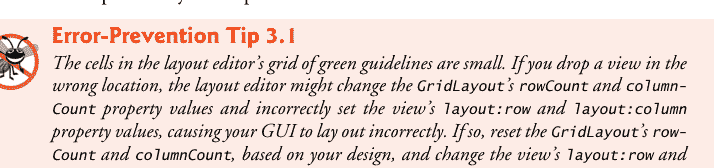

> 错误预防提示 3

布局编辑器引导线网格中的单元格很小。如果你将视图拖到错误的位置，布局编辑器可能会更改`GridLayout`的`rowCount`和`columnCount`值，并错误地设置视图的`layout:row`和`layout:column`值，导致 GUI 布局不正确。如果是这样，请根据设计重置`GridLayout`的`rowCount`和`columnCount`，并将视图的`layout:row`和`layout:column`属性更改为设计所需的行和列。

### 步骤 1：在第一行添加视图

第一行由`amountTextView`和`amountEditText`组成——两者占据同一个单元格并跨越两列。每当你在组件树的`GridLayout`上绘制一个视图时：

此 TextView 使用应用中的中等字体。编辑器的调板（Palette）为各种视图提供了非负的 Plain Text（普通文本）、Large（大）、Medium Text（中文本）和小 Text（小文本）（位于 Widgets 部分）。Plain Text TextView 使用默认字体大小。对于其他，IDE 使用 Material 主题对应字体大小的样式配置 TextView 的外观。

执行以下步骤以向`GridLayout`添加一个`EditText`和一个`TextView`，用于接收和显示账金额：

1. 这允许你仅输入非负整数，应用将该整数除以 100.0 以显示账金额。调板的 Text Fields（文本字段）部分提供了各种输入形式的`EditText`，包括姓名、密码、电子邮件地址、电话号码、时间和日期。当用户与`EditText`交互时，将根据调板的 Text Fields 部分显示适当的键盘。将一个`EditText`拖放到组件树窗口的`GridLayout`上——这会创建一个带有你所选 id 的`EditText`。将 id 更改为`amountEditText`。设置`EditText`的`layout:columnSpan`为 2——这些设置确保了 TextView 跨越行 0 的两列。

2. 从调板的 Widgets 部分将一个 Medium TextView 拖到组件树窗口中的`amountEditText`上方——在`amountEditText`之前会出现一条水平线，表示 TextView 将放置在其之后。IDE 会创建一个新的 TextView 并将其嵌套在`GridLayout`中。编辑器中显示默认文本。你将在步骤 5（第 3.4.5 节）中更改此。将 TextView 的 id 更改为`amountTextView`，然后设置`layout:row`为 0，`layout:column`为 0 且`layout:columnSpan`为 2——这些设置确保了 TextView 跨越行 0 的两列，正如你将看到的 TextView 背景颜色一样。

### 步骤 2：在第二行添加视图

接下来，向`GridLayout`添加`percentTextView`和`seekBar`以显示和选择小费类型（确保将每个视图的 id 设置为指定的指定的名称）：

1. 从调板的 Widgets 部分将一个 Medium TextView (`percentTextView`) 拖到组件树窗口中的`amountTextView`上方——在`amountTextView`之前会出现一条水平线，表示 TextView 将放置在其之后。IDE 会创建一个新的 TextView 并将其嵌套在`GridLayout`中。编辑器中显示默认文本。你将在步骤 5（第 3.4.5 节）中更改此。

2. 从调板的 Widgets 部分将一个 SeekBar (`percentSeekBar`) 拖到组件树窗口中的`percentTextView`上方。

### 步骤 3：在第三行添加视图

接下来，将`tipLabelTextView`和`tipTextView`添加到`GridLayout`以显示小费：

1. 将一个 Medium TextView (`tipLabelTextView`) 拖到组件树窗口中的`percentSeekBar`上方——在`percentSeekBar`之前会出现一条水平线，表示 TextView 将放置在其之后。IDE 会创建一个新的 TextView。

2. 将一个 Medium TextView (`tipTextView`) 拖到`tipLabelTextView`上方。

### 步骤 4：在第四行添加视图

接下来，将`totalLabelTextView`和`totalTextView`添加到`GridLayout`以显示金额：

1. 将一个 Medium TextView (`totalLabelTextView`) 拖到组件树窗口中的`tipTextView`上方——在`tipTextView`之前会出现一条水平线，表示 TextView 将放置在其之后。IDE 会创建一个新的 TextView。

2. 将一个 Medium TextView (`totalTextView`) 拖到`totalLabelTextView`上方。

回顾目前的布局

GUI 应该如图 3.4 所示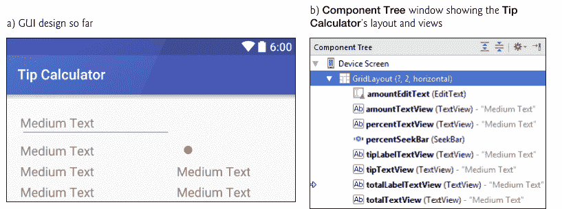

> 关于 EditText 的说明

当 TextView 的属性为空时，提示值（如果你指定）将显示——这通常用于`EditText`（TextView 的子类），帮助用户理解`EditText`的用途。我们正将其用于`amountTextView`以告知用户输入账金额。

### 3.4.5 自定义视图

你现在将自定义属性。正如你在第 2.5 节中所做的，你将创建 String、dimension 和颜色资源。

### 步骤 5：指定字面文本

接下来，为`amountTextView`、`percentTextView`、`labelTextView`和`totalTextView`指定字面文本。当 TextView 的属性为空时，提示值（如果你指定）将显示——这通常用于`EditText`（TextView 的子类），帮助用户理解其用途。我们正将其用于`amountTextView`以告知用户输入账金额：

1. 在内容树中选择`amountTextView`，并在属性窗口找到其 hint 属性。
2. 点击属性值旁的省略号 (...) 显示资源对话框。
3. 在对话框中点击 New Resource，然后选择 New String... 并输入 Resource name amount 和 Resource value “Enter Amount”。保留其他设置并点击 OK 创建新的 String 资源并将其设置为`amountTextView`的 hint。

重复这些步骤，为`percentTextView`、`labelTextView`和`totalTextView`设置 text 属性，使用 3.5 所示的值。

| View | Resource name | Resource Value |
|---|---|---|
| `percentTextView` | tip_percentage | 15% |
| `labelTextView` | tip | Tip |
| `totalLabelTextView` | total | Total |

> 图 3.5 | String 资源值和名称。

### 步骤 6：右对齐左列的 TextView

在图 3.2 中，`percentTextView`、`labelTextView`和`totalTextView`是右对齐。你可以按照以下方法一次对三个视图进行对齐：

1. 选择`percentTextView`。
2. 在 Windows/Linux 上按住 Ctrl 键或在 Mac 上按住 Command 键，点击`labelTextView`和`totalTextView`。现在三个视图都被选中了。
3. 展开`layout:gravity`属性节点并勾选右侧复选框。

### 步骤 7：配置 amountEditText

在最终的应用中，`amountEditText`隐藏在`amountTextView`之后，并且它被配置为仅允许用户输入数字。选择`amountEditText`并设置以下属性：

1. 将`digits`属性设置为`0123456789`——这允许只输入数字，即使数字键盘上包含其他字符，例如减号 (-)、逗号 (,) 和句号 (.)。
2. 将`maxLength`属性设置为`6`。这会将账单金额限制为最多六位数——因此支持的最大账单金额为 9999.99。

### 步骤 8：配置 amountTextView

为了完成`amountTextView`的格式化，选择它并设置以下属性：

1. 删除`text`属性的默认值（"Medium Text"）——我们将根据用户的输入在此处显示文本。
2. 展开`layout:gravity`属性节点，并将`fill`设置为`horizontal`。这表示`TextView`应该占据该`GridLayout`中剩余的所有水平空间。
3. 将`background`属性（指定视图的背景颜色）设置为新的颜色资源`amount_background`，值为`#BDBEF8`——这是 Google Material 调色板中的浅蓝色。
4. 在`TextView`周围添加内边距（padding）。视图的内边距指定了视图内容周围的额外空间。`all padding`表示内边距应应用于视图内容的上、右、下、左。你也可以单独设置每个内边距。展开`padding`属性，点击`all`，然后点击省略号按钮。创建一个名为`textView_padding`的新资源，值为`12dp`。你稍后会使用这个资源。
5. 最后，通过将`elevation`属性设置为新的维度资源`elevation`（值为`4dp`），为视图添加阴影。我们选择这样做是为了演示强调阴影效果。

### 步骤 9：配置 percentTextView

确保`percentTextView`的位置比`percentSeekBar`高。如果它是垂直居中的，看起来会更好。要做到这一点，展开`layout:gravity`属性节点，将`center`值设置为`vertical`。回想你之前将`layout:gravity`设置为`right`。这些设置的组合在布局 XML 中显示为

```
android:layout_gravity="center_vertical|right"
```

使用竖线 ( | ) 分隔多个`layout:gravity`值——在这种情况下，表示`TextView`应在网格单元内垂直居中并右对齐。

### 步骤 10：配置 percentSeekBar

选择`percentSeekBar`并配置以下属性：

1. 默认情况下，`SeekBar`的范围是 0 到 100，其当前值由`progress`属性指示。此应用允许 0 到 30 的小费百分比，并指定默认为 15%。`SeekBar`的`max`属性设置为`30`，`progress`属性设置为`15`。
2. 展开`layout:gravity`属性节点，并将`fill`设置为`horizontal`，使`SeekBar`占据其`GridLayout`列中的所有水平空间。
3. 将`layout:height`属性设置为新的维度资源 (`seekbar_height`)，值为`40dp`，`SeekBar`将在此处显示。

### 步骤 11：配置 tipTextView 和 totalTextView

为了完成`tipTextView`和`totalTextView`的格式化，同时选择两者并设置以下属性：

1. 删除`text`属性的默认值（"Medium Text"）——我们将通过程序化显示计算的小费和总额。


- 2. 展开`layout:gravity`属性节点，并将`fill`设置为`horizontal`，使每个`TextView`占据`TextViews`区域的所有水平空间。
- 3. 将`background`属性设置为新的颜色资源`result_background`，值为`#FFE00E2`——这是 Google Material Design 调色板中的浅橙色。
- 4. 将`gravity`属性设置为`center`，这样计算的小费和总金额将在这些`TextView`之间居中。
- 5. 展开`padding`属性节点，点击省略号按钮，然后选择你之前为`amountTextView`创建的名为`textView_padding`的资源。
- 6. 最后，通过将`elevation`属性设置为你之前创建的`elevation`维度，为每个视图添加阴影。

## 3.5 默认主题和自定义主题颜色

每个应用都有你所使用的标准视图的默认外观。主题在应用的`AndroidManifest.xml`文件（第 3.7 节）中指定。你可以通过位于应用`res/values`文件夹下的`styles.xml`文件中定义资源来自定义主题的属性，例如定义颜色方案的属性。

### 3.5.1 父主题

`style.xml`文件包含一个名为“AppTheme”的样式，该样式被应用的`AndroidManifest.xml`文件引用以指定应用主题。该样式还指定了一个父主题，这类似于 Java 中的继承——新样式继承了父主题的属性和默认值。就像 Java 子类一样，样式可以使用自定义值针对特定应用来覆盖父主题属性。例如，人们这样做是为了使用公司的品牌颜色。你可以在第 3.5 节中使用此概念来自定义应用中的三种颜色。

正如我们之前提到的，Android Studio 的应用模板现在包含了对`AppCompat`库的支持，这使你能够在旧版本的 Android 系统中使用新功能。默认情况下，Android Studio 将父主题设置为：

```text
Theme.AppCompat.Light.DarkActionBar
```

这是`AppCompat`库中预定义主题之一——使用此主题的应用使用浅色背景，应用顶部的深色条除外。每个`AppCompat`使用 Google 的 Material Design 来设计你的 GUI。

### 3.5.2 自定义主题颜色

第 3.3.1 节讨论了主题的主色、强调色在应用中的哪些位置应用。在本节中，你将使用 Android Studio 编辑器更改图中所示的主色、深色主色和强调色。这里是可以覆盖的许多主题属性中的三个。有关完整列表，请访问：

```text
http://developer.android.com/reference/android/R.attr.html
```

## 3.5 默认主题与自定义主题颜色

- 3. 接下来，点击主题编辑器中的`colorPrimaryDark`切换开关以显示资源对话框。主题编辑器会识别新的`colorPrimary`值，并自动显示一个颜色切换器，其中包含了你应该为`colorPrimaryDark`使用的推荐色调——在这种情况下，是 Material Blue 700。点击该颜色开关（图 3.9），然后点击 OK。

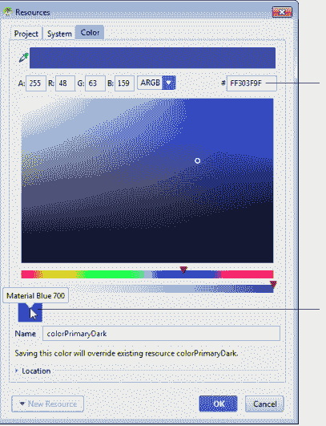

图 3.9 为`colorPrimaryDark`选择 Material Blue 700 颜色开关。

- 4. 接下来，点击主题编辑器中的`colorAccent`切换开关以显示资源对话框。主题编辑器识别到你更改了`colorPrimary`值，并显示各种互补强调色的开关。在对话框中，选择 Orange 400 颜色开关，然后点击 OK 更改`colorAccent`的值（图 3.10），再次点击 OK。

你已完成应用设计，它应该如图 3.11 所示。

### 3.5.3 作为样式的常用属性值

正如你将在稍后的应用中看到的，样式资源可以定义应用于多个视图的常用属性值。你通过设置视图的`style`属性将样式应用到给定视图。你对样式进行的任何后续更改都会自动应用到所有使用该样式的视图。例如，我们在 3.4.5 节第 11 步中配置相同的`textView`和`totalTextView`。我们可以定义一个样式资源来指定`layout:gravity`、`background`、`gravity`、`padding`和`elevation`属性，然后将`TextView`的`style`属性设置为相同的样式资源。

## 第 3 章 小费计算器应用

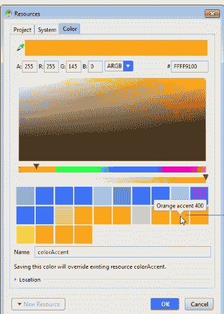

选择 Orange 400 作为新的`colorAccent`值。

图 3.10 | 为`colorAccent`选择 Orange 400 颜色块。


图 3.11 | 完成设计。

## 3.6 添加应用逻辑

`MainActivity`类（图 3.12-18）实现了小费计算器的逻辑。它计算小费和总金额，然后以特定的货币格式显示它们。要查看该文件，在 Project 窗口中展开`app/Java/tipcalculator`节点并双击`MainActivity.java`。你只需要输入图 3.12-18 中的代码。

### 3.6.1 `package`和`import`语句

图 3.12 显示了`MainActivity.java`中的`package`语句和`import`语句。第 3 行的`package`语句是在创建项目时插入的。当你打开 Java 文件时，`import`语句是折叠的——左侧有一个加号。你可以点击加号查看完整的`import`列表。

```java
// MainActivity.java
// 根据小费百分比计算账单总额
package com.deitel.calculator;

import android.os.Bundle; // 用于保存状态
import android.support.v7.app.AppCompatActivity; // 基类
import android.text.EditText; // 用于 EditText
import android.text.Watcher; // EditText 监听器
import android.widget.EditText; // 账单输入
import android.widget.SeekBar; // 用于更改小费百分比
import android.widget.SeekBarListener; // SeekBar 监听器
import android.widget.TextView; // 显示文本
import java.text.NumberFormat;
```

图 3.12 | `MainActivity`的`package`和`import`语句。

第 5-14 行导入了使用的类：

- `android.os.Bundle`（第 5 行）存储键值对信息——通常表示应用的状态或需要在活动之间传递的数据。当另一个应用即将出现在屏幕上时（例如用户接到电话或启动另一个应用），Android 给当前执行的应用机会将其状态保存在`Bundle`中。Android 可能会杀死应用——例如为了回收内存。当应用返回屏幕时，Android 将之前保存的状态`Bundle`传递给`Activity`的`onCreate`方法（第 3.6.4 节）。我们在第 8 章中使用`Bundle`在活动之间传递数据。

- `android.support.v7.app.AppCompatActivity`（第 6 行）提供了应用的基本周期方法——我们稍后会讨论这些。`AppCompat`是`android.app.Activity`的子类，支持在当前和旧平台上运行的较新的 Android 功能。

- `android.text.Editable`（第 7 行）允许你修改 GUI 中文本的内容和标记。

- 你实现`android.text.Watcher`（第 8 行）以响应用户更改`EditText`中文本的事件。

- `android.widget`（9，10）包含 Android GUI 中使用的控件（即视图）。`SeekBar`（第 9 行）和`TextView`（第 12 行）实现了`SeekBarChangeListener`（第 11 行），以响应用户移动`SeekBar`。

- `android.text.NumberFormat`（第 14 行）提供了数值功能，例如货币格式。

### 3.6.2 `MainActivity`子类

`MainActivity`类（第 18 行）是`Activity`的子类。IDE 将此类作为`Activity`的子类生成（图 3.15）。每个子类必须重写`onCreate`方法。我们稍后会讨论这一点。

```java
// MainActivity 类
public MainActivity extends Activity {
```

图 3.13 | `MainActivity`的子类。

### 3.6.3 类变量和实例变量

图 3.14 显示了分别使用的变量（第 20-23 行）。同样，`NumberFormat`对象使用设备的本地化格式化值。

```java
// 货币和格式化对象
private final NumberFormat currencyFormat;
private final NumberFormat percentFormat;
private double billAmount;
private double percent;
private TextView amountTextView;
private TextView percentTextView;
private TextView tipTextView;
private TextView totalTextView;
```

图 3.14 | `MainActivity`的实例变量。

输入`percent`（第 25 行）的账单金额将存储为`double`。例如，如果你通过`SeekBar`选择 25%，应用将账单金额乘以 0.25 来计算小费。

### 3.6.4 重写`Activity`方法`onCreate`

`onCreate`方法——在创建项目时自动生成（第 33-36 行）——在`Activity`启动时由系统调用。方法初始化`Activity`的实例变量和视图。此方法应该尽可能简单，以便应用能够快速加载。事实上，如果应用加载时间超过五秒，操作系统将显示 ANR（应用未响应）对话框——给予用户强制终止应用的选项。你将在第 Q 章学习如何演示。

```java
// 当 activity 首次创建时
@Override
protected void onCreate(Bundle savedInstanceState) {
    super.onCreate(savedInstanceState); // 调用父类版本
    ContentView(R.layout.activity_main); // 填充 GUI

    // 获取程序化操作的 TextView
    amountTextView = (TextView) findViewById(R.id.amountTextView);
    percentTextView = (TextView) findViewById(R.id.percentTextView);
    tipTextView = (TextView) findViewById(R.id.tipTextView);
    totalTextView = (TextView) findViewById(R.id.totalTextView);
    tipTextView.setText(currencyFormat.format(percent)); // 设置文本为 0

    // 设置 amountEditText 的 Watcher
    amountEditText = (EditText) findViewById(R.id.amountEditText);
    amountEditText.addChangeListener(amountEditTextWatcher);

    // 设置 percentSeekBar 的 OnSeekBarChangeListener
    percentSeekBar = (SeekBar) findViewById(R.id.percentSeekBar);
    percentSeekBar.setOnSeekBarChangeListener(seekBarListener);
}
```

## `onCreate`的`Bundle`参数

在执行过程中，用户可能会更改设备配置——例如，旋转设备、连接蓝牙键盘或弹出实体键盘。为了良好的用户体验，应用应该在这些配置更改期间继续顺畅运行。当系统调用`onCreate`时，它会传递一个`Bundle`参数，其中包含`Activity`的保存状态（如果有的话）。你可以在`Activity`方法`on()`或`onSaveInstanceState`中保存状态（在后续应用中演示）。第 35 行了父类的`onCreate`方法，在重写`onCreate`时这是所需的。

## 生成的`R`类资源 ID

当你构建 GUI 并添加资源（如`strings.xml`文件中的字符串或`activity.xml`文件中的视图）时，IDE 会生成一个`R`类，其中包含嵌套类，表示项目`res`文件夹中的每种资源类型。嵌套类被声明为静态，因此你可以在代码中通过`R.ClassName`访问它们。通过`R`的嵌套类，IDE 会生成静态`int`常量，使你能够程序化的方式引用资源（我们稍后会讨论）。类`R`中的某些嵌套类：

- `R.drawable`—包含可绘制项目的常量，如图像，你将它们放在应用`res`文件夹的各种文件夹中。
- `R.id`—包含你的 XML 布局中视图的常量。
- `R.layout`—包含代表项目中每个布局文件的常量（例如`activity_main.xml`）。
- `R.string`—包含`strings.xml`文件中每个字符串的常量。

## 填充 GUI（Inflating the GUI）

对`setContentView`的调用（第 36 行）接收常量`R.layout.activity_main`，该 XML 文件代表`MainActivity`——`setContentView`方法用于加载相应的 XML 文档并将其转换为应用的 GUI。这被称为填充（inflating）GUI。

## 获取组件的引用

一旦布局填充，你就可以获取单个组件的引用，以便程序化地与它们交互。要做到这一点，请使用`findViewById`。此方法接收一个表示特定视图 ID 的`int`并返回其引用。每个视图的`R.id`常量的名称由你在设计 GUI 时指定的组件 ID 决定。例如，`amountEditText`是`R.id.amountEditText`。

第 39–42 行引用我们在应用中程序化更改的`TextView`。第 39 行获取`EditText`的引用，当用户输入金额时它会更新。第 40 行获取`percentTextView`的引用，当用户更改账单时它会更新。第 41–42 行引用显示计算出的小费和总额的`TextView`。

## 3.6 添加应用逻辑

### 在`TextView`中显示初始值

第 43–44 行通过调用`CurrencyFormat`方法将`tipTextView`的文本和`totalTextView`的文本设置为符合特定区域货币格式的 0。这些`TextView`中的每个文本都将随着用户输入金额而变化。

## 注册监听器

第 47–49 行获取`amountEditText`并调用`addTextChangedListener`来注册`TextWatcher`对象，该对象对用户更改`EditText`内容时生成的事件做出响应。我们将此监听器（图 18）定义为匿名内部类，并将其赋值给`amountEditText`实例实例变量。虽然我们在第 49 行中为`amountEditText`定义了匿名内部类，但编码人员……

## 软件工程观察

与其在大型方法中定义匿名内部类，不如将其定义为私有实例变量，以便你的代码更易调试、修改和维护。第 52–53 行获取`SeekBar`的引用。第 54 行调用`SeekBar`的`setOnChangeListener`方法来注册`OnSeekChangeListener`对象，该对象对用户移动`SeekBar`滑块时生成的事件做出响应。图 17 将此监听器定义为匿名类，赋值给实例变量`SeekBarListener`。

## 关于数据绑定（Data Binding）的说明


Android 现在有一个数据绑定库，可以用于目标 API 级别 7 及以上的 Android 应用。你可以在 XML 文件中包含绑定表达式，这些表达式可以操作 Java 对象并动态更新双方数据，你的布局文件包含带有每个 id 的视图。对于每个带有 id 的视图，你可以创建一个“binding”的实例来替换所有对 `findViewById()` 的调用，这可以极大简化具有复杂用户界面 Activity 和 Fragment 类中的 `onCreate` 方法。每个实例变量的名称都是对应视图的 id。“Binding”类基于布局 `layout–activity_main.xml`，类名为 `ActivityMainBinding`。此时，数据绑定库处于早期版本，数据绑定表达式的语法和 Android Studio 工具可能会发生重大变化。你可以在此处学习更多关于 Android 数据绑定：

```
https://developer.android.com/tools/data-binding/guide.html
```

### 3.6.5 `MainActivity` 方法 `calculate()`

`calculate` 方法（图 16）由 `EditText` 和 `SeekBar` 的监听器调用，每当用户更改账单金额时更新金额和总额 `TextView`。第 60 行在 `percentTextView` 中显示小费百分比。第 63–64 行根据 `billAmount` 计算金额和总额。第 67–68 行以货币格式显示金额。

```java
// 计算并显示小费和金额
private void calculate() {
    // 在 percentTextView 中格式化并显示
    percentTextView.setText(currencyFormat.format(percent));
    // 计算小费和总额
    double tip = billAmount * percent;
    double total = billAmount + tip;

    // 以货币格式显示小费和总额
    tipTextView.setText(currencyFormat.format(tip));
    totalTextView.setText(currencyFormat.format(total));
}
```

图 16 | Activity 方法 `calculate`。

### 3.6.6 实现接口 `OnSeekChangeListener` 的匿名内部类

第 72–87 行（图 17）创建了响应 `percentSeekBar` 事件的匿名内部类对象。该对象被赋值给实例变量 `seekListener`。第 54 行（图 15）将 `seekListener` 注册为 `percentSeekBar` 的 `OnSeekChangeListener` 事件处理器。为了清晰，我们以这种方式定义所有简单的事件处理对象，这样就不会用代码弄乱 `onCreate` 方法。

```java
// SeekBar 进度改变监听器对象
final OnSeekChangeListener seekListener = new OnSeekChangeListener() {
    // 更新百分比，然后调用 calculate
    @Override
    public void onProgressChanged(SeekBar seekBar, int progress, boolean fromUser) {
        percent = progress / 100.0; // 根据进度设置百分比
        calculate(); // 计算并显示小费和总额
    }
    @Override
    public void onStartTrackingTouch(SeekBar seekBar) {}
    @Override
    public void onStopTrackingTouch(SeekBar seekBar) {}
};
```

图 17 | 实现接口 `OnSeekChangeListener` 的匿名内部类。

### 重写方法 `onProgressChanged`（接口 `OnSeekChangeListener`）

第 75–87 行（图 17）实现了 `OnSeekChangeListener` 的方法。`onProgressChanged` 方法在 `SeekBar` 位置改变时被调用。第 78 行使用 `progress` 参数（一个表示 `SeekBar` 位置的 int）计算百分比。我们将其除以 100.0 以得到百分比。第 79 行调用方法重新计算并显示。

### 重写 `onStartTrackingTouch` 和 `onStopTracking`

Java 要求你重写所实现的接口中的每个方法。此应用不需要知道用户何时开始移动滑块（`onStartTracking`）或停止移动它（`onStopTracking`），因此我们为每个方法提供了空方法体（第 82–86 行）以符合接口约定。

### Android Studio 重写方法工具

Android Studio 可以为你创建从类或实现的方法。当你将光标放在类体中并选择 `Code > Override Methods...` 选项，IDE 会显示 `Select Methods Override` 对话框，列出可以在当前类中重写的每个方法、类层次结构中的所有继承方法以及整个类层次结构中的接口方法。

> **预防提示 3.2**
>
> 使用 Android Studio 的 `Code > Override Methods...` 选项可以帮你更快编写代码并减少错误。

## 3.7 实现 `TextWatcher` 的匿名内部类

图 31 第 90–114 行创建了响应 `amountEditText` 事件的匿名内部类对象，并将其赋值给实例变量 `amountEditWatcher`。第 49 行（图 35）注册此对象以监听当文本更改时发生的 `amountEditText` 事件。

```java
// EditText 文本更改事件监听器对象
private final TextWatcher amountEditWatcher = new TextWatcher() {
 // 当用户修改账单金额时调用
 public void onTextChanged(CharSequence s, int start, int before, int count) {
    try {
        // 获取账单金额并显示货币格式的值
        nbillAmount = Double.parseDouble(s.toString()) / 100.0;
        amountTextView.setText(currencyFormat.format(billAmount));
    } 
    catch (NumberFormatException e) { // 如果 s 为空或非数字
        amountTextView.setText("");
        nbillAmount = 0.0;
    }

    recalculate(); // 更新总额和 TextView
 }
};
```

图 18 | 实现接口 `TextWatcher` 的匿名内部类。（第一部分，共 2 部分）

## 100 第 3 章 小费计算器应用

```java
108 @Override
public void afterTextChanged(Editable s) { }

111 @Override
public void beforeTextChanged(
    CharSequence s, int start, int count, int after) {
}; 
}
```

图 3.18 | 实现 `TextWatcher` 接口的匿名内部类。（2 部分中的 2 部分）

### 重写 `TextWatcher` 接口的 `onTextChanged` 方法

每当 `EditText` 中的文本发生更改时，`onTextChanged` 方法（第 92–106 行）就会被调用。该方法接收四个参数。在例例中，我们只使用了 `CharSequence s`，它包含了 `amountEditText` 文本的计数。其他参数表示从上一个长度 `before` 开始的字符计数。

第 97 行将来自 `EditText` 的用户输入转换为以“分”为单位的数字，因此我们将转换后的值除以 100.0 以获得实际金额——例如，如果用户输入 2495，账单金额为 24.95。第 98 行显示更新后的账单。如果发生异常，第 101–102 行将清空 `amountTextView`并将 `billAmount` 设置为 0.0。第 105 行调用 `calculate()` 来根据当前账单重新计算并显示小费和总额。

### `amountEditTextTextWatcher` 的其他方法

此应用不需要知道文本发生了哪些更改（`beforeTextChanged`）或文本是否已经更改（`afterTextChanged`），因此我们简单地为这些 `TextWatcher` 接口方法中的每个方法重写了一个空方法体（第 108–113 行），以满足接口合约。

## 3.7 `AndroidManifest.xml`

在本节中，你将修改 `AndroidManifest.xml` 文件以指定此 Activity 只支持一种设备方向，并且当 Activity 首次出现在屏幕上或导航回 Activity 时，虚拟键盘应始终显示。要打开清单，请在项目窗口的 manifest 文件夹中双击 `AndroidManifest.xml`。图 3.19 显示了带有我们更改的完整清单——文件的其余部分是由 Android Studio 在我们创建应用项目时自动生成的。我们将讨论 manifest 的某些方面。有关 manifest 可能包含的所有元素、其属性及其值的列表，请访问

```xml
<?xml version="1.0" encoding="utf-8"?>
<manifest xmlns:android="http://schemas.android.com/apk/res/android"
    package="com.deitel.tipcalculator">
```

图 3.18 | `AndroidManifest.xml` 内容。

```xml
<application
    android:allowBackup="true"
    android:icon="@mipmap/ic_launcher"
    android:label="@string/app_name"
    android:supportsRtl="true"
    android:theme="@style/AppTheme">
    <activity
        android:name="MainActivity"
        android:label="@string/app_name"
        android:orientation="portrait"
        android:windowInputMode="stateVisible">
        <intent-filter>
            <action android:name="android.intent.action.MAIN" />
            <category android:name="android.intent.category.LAUNCHER" />
        </intent-filter>
    </activity>
</application>
```

图 3.19 | `AndroidManifest.xml` 内容。（2 部分中的 2 部分）

### 3.7.1 `manifest` 元素

`manifest` 元素（第 2–24 行）指示此 XML 文件代表应用的清单。该元素的 `package` 属性指定了创建应用时定义的 Java 包名（第 3.4 节）。记住，提交到 Google Play Store 的包名被用作唯一标识符。

### 3.7.2 `application` 元素

manifest 的嵌套 `application` 元素（第 5–21 行）指定了应用的属性，包括：

- `allowBackup`：Android 是否应自动备份应用数据，以便以后恢复到设备或新设备上。
- `icon`：你在启动器中点击以执行应用的图标。
- `label`：应用的名称，通常在启动器中的图标下方显示，并在应用执行时显示在标题栏中。
- `supportsRtl`：应用界面是否可以水平翻转，以支持阿拉伯语和希伯来语等从右向左的语言。
- `theme`：决定应用视图的主题。

嵌套在 `application` 中的元素定义了应用的组件，例如 Activity。

### 3.7.3 `activity` 元素

`application` 的嵌套 `activity` 元素（第 10–20 行）描述 Activity。应用可以有多个 Activity，其中一个被指定为用户点击启动器中的应用图标执行它时显示的 Activity。每个 `activity` 元素至少指定以下属性：

- `name`：Activity 的名称。符号 `"MainActivity"` 是 `"com.deitel.MainActivity"` 的简写（其中 `com.deitel.` 是你在创建应用项目时指定的域名）。
- `label`：Activity 的名称。这通常显示在标题栏中。

例如，我们添加了以下属性：

- `orientation`：Activity 的方向。例如，将其设置为 portrait。
- `windowInputMode`：软键盘行为。Activity 处于这种状态。如果存在匹配项，Android 就会显示键盘。

# 第 3 章 小费计算器

你使用 Android Studio 构建了应用的 GUI，并通过组件树（Component Tree）窗口自定义了主题。你还编辑了布局的 XML，并使用主题编辑器（Theme Editor）自定义了 `AppCompat.DarkActionBar` 主题，主色和强调色是在创建项目时由 IDE 设置的。我们提供了 `MainActivity` 的代码，它是 `AppCompatActivity` 的子类（也是 `Activity` 的间接子类），定义了应用的逻辑。

在你的应用中，你使用 `GridLayout` 将视图按行和列排列。`MainActivity` 类显示 `TextView` 并接收来自 `EditText` 和 `SeekBar` 的输入。我们讨论了 Java 面面向编程的能力，包括类、对象、方法、接口、匿名内部类和继承。我们解释了将 UI 从 XML 文件填充到其屏幕表示的本质。你学习了 Android 的 `Activity` 类以及部分 Activity 生命周期周期。在 `onCreate` 方法中，你重写了 `onCreate` 方法，使用 `findViewById` 获取应用程序交互的每个视图的引用。你定义了一个实现 `ClickListener` 的匿名内部类，以便应用在用户向 `EditText` 输入金额时计算小费和总额。你还定义了一个实现 `SeekBarChangeListener` 接口的匿名内部类，以便用户在移动 SeekBar 滑块更改百分比时，应用可以计算新的小费。

最后，你编辑了 `AndroidManifest.xml` 文件，指定 `MainActivity` 支持竖屏模式，并且 `MainActivity` 应该始终显示键盘。我们还讨论了 Android Studio 在你创建项目时放在清单中的其他元素。

在第 4 章中，你将构建“国旗测验”应用，在该应用中，用户将看到国旗图形并必须在 2、4、6 或 8 个选项中猜出所属国家。你将使用菜单和复选框来自定义测验，指定猜测选项的数量，并将国旗限制在世界的特定地区。

# 国旗测验应用

片段（Fragments）、菜单、偏好设置、显式意图、`Handler`、资源管理器、补间动画、动画器、Toasts、颜色状态列表、多设备方向布局、用于调试的错误消息日志


## 目标

- 在本章中你将：
  - 使用片段（Fragments）在手机和平电脑的 Activity GUI 上更好地利用可用的屏幕空间。
  - 在应用栏上显示设置图标，使用户访问应用的偏好设置。
  - 使用 `PreferenceFragment` 自动管理和持久化应用的偏好。
  - 使用 `SharedPreferences.Editor` 修改与应用关联的键对数据。
  - 使用应用的子文件夹组织资源并使用 `AssetManager` 对进行操作。
  - 定义动画并将其应用于视图（View）。
  - 使用 `Handler` 调度在 GUI 线程上执行的任务。
  - 使用 `Toasts` 向用户短暂显示消息。
  - 使用显式意图（explicit Intent）启动特定的 Activity。
  - 使用来自 `java.util` 包的集合类。
  - 为多个设备方向定义布局。
  - 使用 Android 的日志机制记录错误消息。

# 第 4 章 国旗测验应用

## 提纲

- 4.1 引言
- 4.2 试运行国旗测验应用
  - 4.2.1 配置测验设置
  - 4.2.2 参加测验
- 4.3 技术概述
  - 4.3.1 菜单
  - 4.3.2 片段
  - 4.3.3 Fragment 生命周期周期方法
  - 4.3.4 管理片段
  - 4.3.5 偏好设置
  - 4.3.6 `assets` 文件夹
  - 4.3.7 Resource 文件夹
  - 4.3.8 支持不同的屏幕尺寸和分辨率
  - 4.3.9 确定显示的设备
  - 4.3.10 用于用户反馈的 Toasts
  - 4.3.11 使用 `Handler` 调度未来的 `Runnable`
  - 4.3.12 为视图实现动画
  - 4.3.13 使用 `ViewUtils` 创建圆形视图
  - 4.3.14 根据视图颜色状态指定颜色


## 4.1 引言

国旗测验测试你正确识别不同国家和地区国旗的能力（图 4.1）。默认情况下，应用显示一个国旗和国家名称，你点击猜测答案——其中一个是正确的，其他是随机选择的错误答案。应用会在整个测验过程中显示进度，在当前国旗图像上的`TextView`中显示题号（共 10 题）。

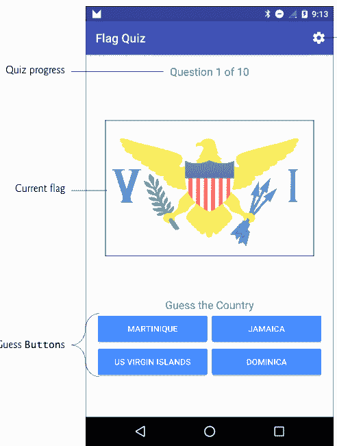

正如你所看到的，应用还允许你通过指定显示二、四、六或八个猜测按钮，以及选择包含在测验中的世界地区来定制测验。这些选项的显示方式取决于应用的运行方向和设备的方向——应用支持任何设备的竖屏，但只有平板电脑支持横屏。

在竖屏模式下，应用在应用栏上显示设置图标。当用户触摸它时，应用会显示一个单独的屏幕（另一个`Activity`），用于设置按钮数量和测验中使用的世界地区。在平板电脑横屏模式下（图 4.2），应用使用不同的布局，始终同时显示应用的设置和测验。

首先，你将试运行应用。然后我们将概述构建它所用的技术。接下来，你将设计应用的 GUI。最后，我们将展示并演示应用的完整源代码，更详细讨论应用的新功能。

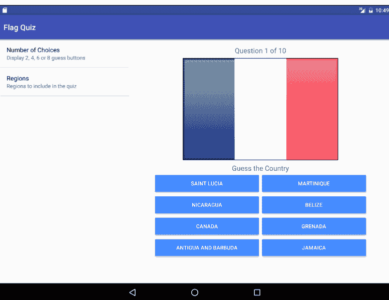

## 4.2 试运行国旗测验应用

现在你将试运行国旗测验应用。要做到这一点，请打开 Android Studio，从书籍示例文件夹打开`FlagQuiz`应用，然后在 AVD 或设备上执行应用。这将构建项目并运行应用（图 4.1 或图 4.2）。

### 4.2.1 配置测验设置

当你第一次安装并运行应用时，测验被配置为显示四个猜测按钮，并从世界所有地区选择国旗。在本次试运行中，你将选项更改为仅从北美洲选择国旗，并保持应用每页四个国旗的默认设置。

在手机或竖屏模式的 AVD 上，触摸应用栏上的设置图标（图 4.1）以查看设置（图 4.3(a)）。在平板电脑设备或横屏模式的平板 AVD 上，设置显示在屏幕左侧（图 4.2）。触摸“选项数量”（Number of Choices）以显示用于选择每个国旗应显示的按钮数量的对话框（图 4.3(b)）。在平板电脑设备或横屏模式的平板 AVD 上，整个应用变灰，对话框居中显示（屏幕）。默认情况下，选中了 4——我们使用了此默认设置。为了让测验更简单，你可以选择 2；为了让测验更具挑战性，你可以选择 6 或 8。点击取消（CANCEL）（或点击对话框以外的屏幕）返回设置屏幕。

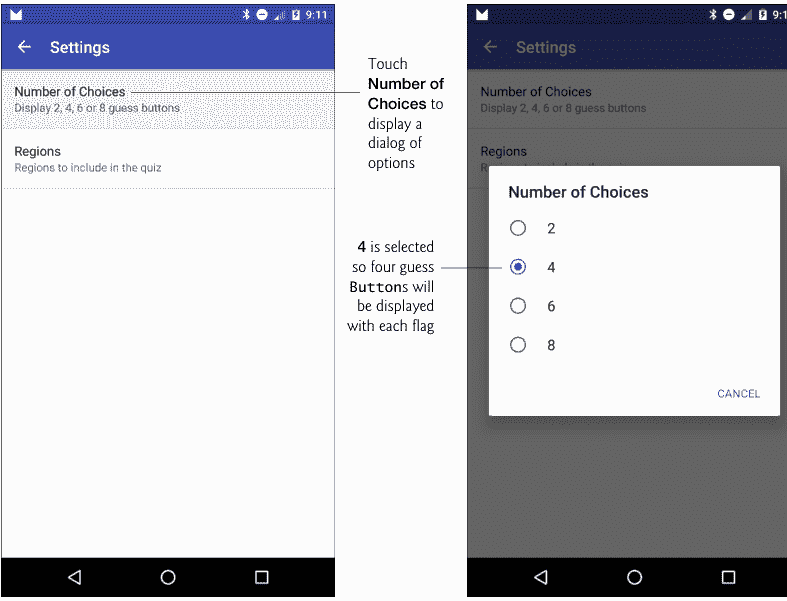

**图 4.3 | 国旗测验设置屏幕和“选项数量”对话框。**

接下来，点击“区域”（Regions）（图 4.4(a)）显示代表世界区域的复选框（图 4.4(b)）。默认情况下，当第一个应用执行时所有区域都已启用，因此与应用相关的每个旗帜都可以被随机选择用于测验。点击非洲、亚洲、欧洲、大洋洲（澳大利亚、新西兰及周边岛屿）和南美旁边的复选框以取消勾选——这会将这些区域的国家排除在测验之外。点击确定保存设置。在手机、平板电脑或竖屏的 AVD 上，点击返回键返回测验屏幕并使用更新后的设置开始新测验。在平板设备或横屏模式的安卓平板上，屏幕右侧会立即显示带有更新后设置的新测验。

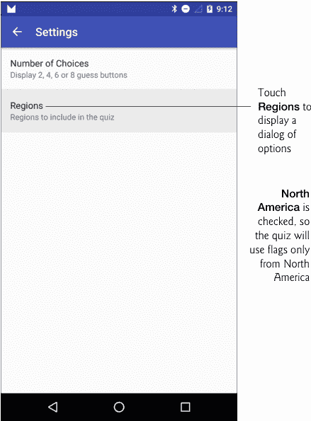

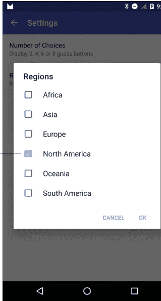

**图 4.4** 国旗测验屏幕和**区域**对话框（在取消勾选**非洲、亚洲、欧洲、大洋洲和南美**后）。

### 4.2.2 进行测验

一个新的测验将根据你选择的答案数量以及仅来自你选择区域的旗帜开始。通过点击你认为与每个旗帜匹配的数量的猜测按钮（Guess Button）来完成测验。

#### 做出正确选择

如果选择正确（图 4.5(a)），应用将禁用所有按钮并在屏幕底部显示国家名称，随后跟上一个感叹号（图 4.5(b)）。在短时间延迟后，应用将加载下一面旗帜，并将旗帜和一组新按钮动画到屏幕上。应用通过圆形揭示效果从当前测验问题过渡到下一个问题：

- 首先，一个大直径圆收缩到屏幕上，直到其直径为零，隐藏当前测验的旗帜和猜测按钮。
- 然后，圆的直径从零增大，直到新问题的旗帜和猜测按钮在屏幕上完全可见。

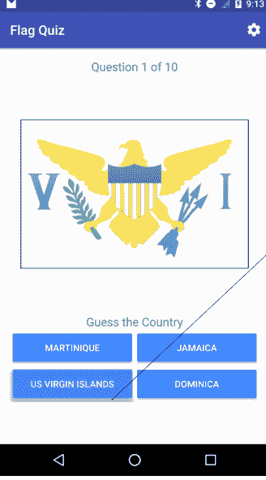


**图 4.5** | 选择正确答案和显示正确答案。

#### 做出错误选择

对于你点击的每个错误国家名称按钮（图 4.6(a)），应用将：

- 禁用正确的国家名称按钮
- 使用动画让旗帜水平抖动
- 在屏幕底部显示“错误!”（Incorrect!）（图 4.6(b)）。

继续猜测，直到你得到该旗帜的正确答案。

#### 完成测验

当你选完 10 个国家名称后，应用上方会弹出一个对话框，显示你的总猜测次数和正确答案的百分比（图 4.7）。这是一个模态对话框，你必须与其进行交互才能将其关闭——对于非模态对话框，点击 AVD 或设备的返回键将关闭该对话框。当你点击对话框的“重置测验”（RESET QUIZ）按钮时，Android 会关闭对话框并开始一个新的测验，使用与你刚刚完成的测验相同的猜测选项数量和区域。

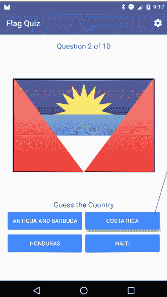

正在被点击的按钮 / Activity 更高的高度

错误答案按钮被禁用

用红色显示“错误!”

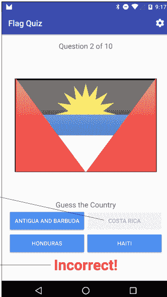

**图 4.6** | 国旗测验应用中禁用的错误答案。

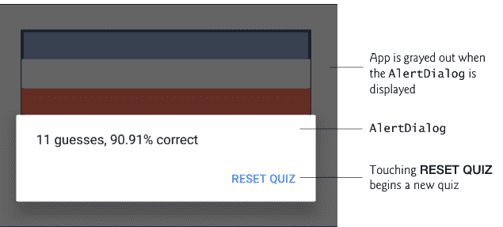

**图 4.7** | 测验后的结果。

## 4.3 技术概述

本节介绍了你将用于构建国旗测验应用的功能。

### 4.3.1 菜单

当你创建菜单时，默认选中 4——我们使用了此默认设置。为了让测验更简单，你可以选择 2；为了让测验更具挑战性，你可以选择 6 或 8。点击取消（CANCEL）（或点击对话框之外的屏幕）返回设置屏幕。

### 4.3.2 Fragment

就像`Activity`，每个`Fragment`都有一个生命周期，并提供了你可以重写的方法来响应生命周期事件。

- **onCreate**——该方法（你将重写`SettingsFragment`类）在`Fragment`创建时调用。`MainActivity`和`SettingsFragment`在应用填充父布局时创建。
- **onCreateView**——该方法（你将重写`MainActivityFragment`类）在`onCreate`之后调用，返回一个包含`Fragment` GUI 的`View`。当你使用此方法时，你可以通过编程方式从预先定义的 XML 布局中填充 GUI。

`Fragment`可以将自己的菜单项添加到`Activity`的菜单中。像`Activity`类，`Fragment`也有生命周期方法`onCreateOptionsMenu`和事件处理方法`onItemSelected()`。

我们会在书中遇到时讨论`Fragment`生命周期方法。有关完整的生命周期详情，请参考：

```http
http://developer.android.com/guide/fragments.html
```

### 4.3.3 管理 Fragment

`Activity`通过`FragmentManager`（package `android.app`）管理其`Fragment`——可以通过`Activity`的`getFragmentManager`方法访问。如果`Activity`需要与声明在`Activity`布局中的`Fragment`交互，`Activity`可以使用`FragmentManager`的`findFragmentById`获取指定`Fragment`的引用。正如你在第 9 章所看到的，`FragmentManager`使用`FragmentTransaction`动态地添加、删除和切换`Fragment`。

### 4.3.4 偏好

在 4.2.1 节中，你通过更改应用设置自定义了测验。这些设置以键值对的形式持久化存储在文件中，使你能够快速查找一个对应的值。文件中的键必须是字符串（`String`），值可以是原始类型的值。此类文件通过`SharedPreferences`类（`android.content`）的对象进行操作，且该文件仅供创建它的应用程序访问。

`PreferenceFragment`使用`Preference`对象（包`android.preference`）来管理设置并通过`SharedPreferences`对象将它们存储在文件中。此应用使用`Preference`的子类`ListPreference`来管理每个旗帜显示的按钮数量，并使用`Preference`的子类`MultiSelectPreference`来管理用户可以选择的区域。`ListPreference`创建一组互斥的单选按钮，只能选择其中一个——4.3(b)。`MultiSelectPreference`创建复选框，在测验中可以选择任意数量的框（4.4(b)）。你使用`PreferenceManager`对象（包`android.preference`）来访问并与应用的默认的`SharedPreferences`文件交互。

你将直接与应用的默认的`SharedPreferences`文件交互：

- 开始测验时，你将查询应用的设置以确定要切换的按钮数量以及从中选择的区域。
- 当用户更改区域时，应用将确保至少选择了一个区域；否则，将没有旗帜包含在测验中。如果未选择任何项，应用将编辑区域设置以选择北美。

要修改`SharedPreferences`对象的内容，你将使用一个`SharedPreferences.Editor`对象（4.6.7）。

### 4.3.5 Assets 文件夹

此应用的旗帜在需要时加载到应用中，并位于应用的`assets`文件夹中。为了将旗帜添加到项目中，我们从文件系统中将每个区域的文件夹复制到应用的项目（Project）窗口中（第 4.4.4 节）。图像位于应用的`drawable`文件夹中，包含了示例。

## 4.4 创建项目、资源文件和类

### 4.4.1 创建项目

### 4.4.2 空 Activity 模板

### 4.4.3 配置 Java

### 4.4.4 将图像添加到项目

### 4.4.5 strings.xml 和格式化资源

### 4.4.6 arrays.xml

### 4.4.7 colors.xml

### 4.4.8 button_touch.xml

### 4.4.9 编辑 menu_main.xml

### 4.4.10 创建抖动动画

### 4.4.11 用于指定的 preferences.xml

### 4.4.12 添加 SettingsActivity 和 SettingsFragment

## 4.5 构建应用

### 4.5.1 适用于竖屏设备的 activity_main.xml 布局

### 4.5.2 设计 Fragment_main.xml

### 4.5.3 图形工具栏（Toolbar）

### 4.5.4 适用于平板方向的 activity_main.xml 布局

## 4.6 MainActivity 类

### 4.6.1 package 和 import

### 4.6.2 字段

### 4.6.3 重写 onCreate 方法

### 4.6.4 重写 onCreateCreated 方法

### 4.6.5 重写 onCreateOptionsMenu 方法

### 4.6.6 重写 onItemSelected 方法

### 4.6.7 实现 PreferenceChangeListener 的匿名内部类

## 4.7 MainActivityFragment 类

### 4.7.1 package 和 import

### 4.7.2 字段

### 4.7.3 重写 onCreateView 方法

### 4.7.4 guessRows 方法

### 4.7.5 updateRegions 方法

### 4.7.6 resetQuiz 方法

### 4.7.7 getCountryName 方法

### 4.7.8 animate 方法

### 4.7.9 实现 InnerClickListener 的匿名内部类

### 4.7.10 disableButtons 方法

## 4.8 SettingsActivity 类

## 4.9 SettingsFragment 类

## 4.10 AndroidManifest.xml

## 4.11 总结


与应用的`drawable`文件夹不同（后者的图像内容位于每个文件夹的根目录下），`assets`子文件夹将每个区域的旗帜存放在单独子文件夹中。`assets`子文件夹中的文件通过`AssetManager`（包`android.content.res`）进行访问，它可以提供指定子文件夹中所有旗帜的列表，并可用于访问资源。

### 4.3.7 资源文件夹

在第 2.4 节中，你学习了应用`res`文件夹下的`drawable`、`layout`和`values`子文件夹。在本应用中，你还将使用`menu`、`anim`、`color`和`xml`资源文件夹。图 4.8 概述了这些文件夹以及`animator`和`raw`文件夹。

- 我们从 http://www.free-country-flags.com 获取了图像。

## 第 4 章 旗帜测验应用

| 资源子文件夹 | 描述 |
| --- | --- |
| `anim` | 以`anim`开头的文件夹包含定义补间动画（tweened animations）的 XML 文件，这些动画可以随时间改变对象的透明度、大小、位置和旋转。你将在第 4.4.10 节中看到一个动画，然后在第 4.7.10 节中你将播放它来创建一个抖动效果，为用户的错误猜测提供视觉反馈。 |
| `animator` | 以`animator`开头的文件夹包含定义属性动画（property animations）的 XML 文件，这些动画随时间改变对象属性的值。在 Java 中，属性通常被实现为具有`set`和`getter`方法的类实例。 |
| `color` | 以`color`开头的文件夹包含定义颜色状态（color states）的 XML 文件——即各种状态的颜色列表，例如按钮的状态（未按下、按下、启用、禁用等）。你将在第 4.4.8 节中使用颜色列表来定义猜词按钮在启用或禁用时的颜色。 |
| `raw` | 以`raw`开头的文件夹包含资源文件（如音频），这些文件以流的形式被读入应用中。你将在本章中使用资源来播放声音。 |
| `menu` | 以`menu`开头的文件夹包含描述菜单内容的 XML 文件。当你创建一个项目时，IDE 会识别出一个带有“设置”（Settings）选项的菜单。 |
| `xml` | 以`xml`开头的文件夹包含不符合其他类别的 XML 文件——通常是设备内部使用的 XML 文件。在第 4.4.11 节中，你将创建一个 XML 文件，代表你的应用`SettingsActivityFragment`显示的设置。 |
| **图 4.8** | 项目`res`文件夹内的其他子文件夹。 |

## 4.3.8 支持不同的屏幕尺寸和分辨率

在第 2.5 节中，你了解到 Android 设备具有各种屏幕尺寸、分辨率和像素密度（每英寸点数或 DPI）。你还了解到通常会提供多个分辨率的图像和其他资源，以便 Android 能根据设备的密度选择最佳资源。同样，在第 2.8 节中，你学习了如何使用字符串资源来为设备的像素密度选择合适的名称，并根据设备的本地语言和地区选择正确的语言字符串。这意味着你可以从第 4.3.7 节讨论的任何资源中选择资源。

对于此应用，你将使用最小宽度和方向来确定使用哪种布局——一个用于手机和平板的竖屏，另一个用于横屏。为了实现这一点，你将定义两个显示`MainActivity`内容的布局：

- `content_main.xml`是显示`MainActivity-Fragment`的默认布局。
- `content_main.xml (sw700dp-land)`在设备（即平板电脑）处于横屏（land）方向时使用。

## 4.3 技术概述

限定限定符文件夹名称（在磁盘上）格式为：

`qualifier-qualifier`

其中`qualifier`由一个或多个由破折号（`-`）分隔的限定符组成。目前有 19 种限定符类型，你可以用它们指定 Android 何时选择资源文件。我们将在书中解释其他限定符。有关`res`子文件夹所有限定符及其定义规则的完整描述，请访问：

```text
http://developer.android.com/guide/topics/resources/providing-resources.html#AlternativeResources
```

## 4.3.9 判断设备方向

在本应用中，当在手机尺寸设备上或处于竖屏方向运行时显示菜单（第 4.6.5 节）。为了确定这一点，我们将获取`Configuration`类实例（包`android.content`），它包含设备当前方向的`ORIENTATION_PORTRAIT`或`ORIENTATION_LANDSCAPE`。

## 4.3.10 用于显示消息的 Toast

`Toast`（包`android.widget`）会短暂显示消息后从屏幕上消失。`Toast`通常用于显示微小的错误或信息。我们使用`Toast`用于：

- 在用户更改应用设置时指示测验将重置。
- 在用户取消选择所有区域时指示必须至少选择一个区域——在这种情况下，应用会将北美设置为测验的默认区域。

## 4.3.11 使用 Handler 在将来执行 Runnable

当用户做出猜测时，应用会显示正确答案几秒钟然后显示下一个。为了实现这一点，我们使用`Handler`（包`android.os`）。`Handler methodDelayed`接收一个要执行的`Runnable`和一个毫秒级的延迟。延迟结束后，`Handler`的`Runnable`在创建`Handler`的线程中执行。

> **预防错误提示 4.1**
>
> 与 GUI 交互或修改的操作必须在 GUI 线程（也称为 UI 线程或主线程）中执行，因为组件不是线程安全的。


## 4.3.12 将动画应用到 View

当用户做出错误猜测时，应用通过`Animation`（包`android.view.animation`）向`ImageView`显示旗帜。我们使用`AnimationUtils`静态方法`LoadAnimation`从描述动画选项的 XML 文件加载动画。我们还通过`setRepeatCount`方法指定动画重复的次数，并在`ImageView`上调用`startAnimation`（以`Animation`作为参数）来执行动画。

## 4.3.13 使用 ViewAnimationUtils 创建圆形展开动画

动画可以使应用程序更具视觉吸引力。在这个应用中，在用户做出正确选择后不久，会将旗帜和答案按钮移出屏幕，并将下一个旗帜和答案按钮引入屏幕。为了实现这一点，在 4.7.9 节中，你将使用`ViewAnimationUtils`类通过调用`createCircularReveal`方法创建一个展开动画器。然后，你通过调用`Animator`方法`duration`和`start`设置动画时长并启动它。动画表现为一个显示 UI 元素的缩小或放大的圆形视图。

## 4.3.14 通过颜色状态列表根据 View 的状态指定颜色

颜色状态文件（Color State List）定义了一个根据 View 状态改变颜色的颜色资源。例如，你可以为`Button`的背景颜色定义一个颜色状态列表，为按钮的按下、未按下和启用状态指定不同的颜色。同样，对于`CheckBox`，你可以为它的已选中或未未选中状态指定不同的颜色。

在这个应用中，当用户做出错误猜测时，应用会禁用该猜测按钮。在禁用的按钮中，文本默认为白色。为了解决这个问题，你将定义一个颜色状态列表，根据`Button`的启用或禁用状态指定`Button`的文本颜色（4.4.8 节）。有关颜色状态列表的更多信息，请访问：

```text
http://developer.android.com/topics/resources/color-list-resource.html
```

### 4.3.15 AlertDialog

你可以通过`AlertDialogs`（包`android`）向用户显示消息、选项和确认。`AlertDialog`是一个模态对话框——当它显示时，用户在对话框消失（关闭）之前无法与之交互。正如你将看到的，你使用`AlertDialog.Builder`对象创建并配置`AlertDialog`，然后使用它来创建`AlertDialog`。

`AlertDialogs`可以显示按钮、复选框、单选按钮和项目列表，用户可以通过触摸来响应消息。它们还可以显示自定义 GUI。标准的`AlertDialog`可能有三个按钮：

- 负向操作（Negative action）：取消用户指定的操作，通常标记为 CANCEL（取消）或 NO（否）。当对话框中有多个按钮时，它是最左侧的按钮。
- 正向操作（Positive action）：接受用户指定的操作，通常标记为 OK 或 YES（是）。当对话框中有多个按钮时，它是最右侧的按钮。
- 中性操作（Neutral action）：此按钮表示用户不想取消或接受对话框指定的操作。例如，如果一个应用要求用户注册以获取额外功能，它会提供一个 REMIND ME later（稍后提醒我）中性按钮。

## 4.3 技术概览

我们在测验结束时使用`AlertDialog`向用户显示结果（4.7.10 节），并允许用户点击按钮来重置测验。你将实现`DialogInterface.OnClickListener`接口（包`android.content`）来处理按钮事件。你可以在此处学习更多关于 Android 对话框的信息：

```text
http://developer.android.com/guide/topics/ui/dialogs.html
```

## 4.3.16 记录异常消息

当发生异常或你想跟踪代码执行某些重要方面时，可以使用 Android 内置的日志机制为调试目的记录消息。Android 提供了`Log`类（包`android.util`），它具有各种静态方法，表示不同详细程度的消息。记录的消息可以在 Android Device Monitor 的底部 Logcat 或使用 Android log 工具查看。你可以从 Android Studio 中选择`View > Tool Windows > Android Monitor`打开 Android Device Monitor。有关记录消息的更多详情，请访问：

```text
http://developer.android.com/tools/debugging/debugging-log.html
```

### 4.3.17 通过显式 Intent 启动 Activity

正如 3.7.4 节所学到的，Android 使用名为“意图消息”（intent messaging）的技术在同一个应用内的 Activity 或不同应用之间的 Activity 之间通信。`AndroidManifest.xml`文件中声明的每一项都可以指定指示哪个 Activity 能够处理的 intent。在每情况下，IDE 为应用的唯一 Activity 创建了一个意图过滤器（intent filter），以响应预定义的命名动作 MAIN，该动作指定该 Activity 可用于启动应用并开始执行。Activity 是使用`Intent`启动的，该`Intent`指定要执行的 Activity 以及执行该 Activity 数据。

#### 隐式 Intent 和显式 Intent

此应用使用显式 Intent（explicit Intent）。当它在竖屏模式运行时，其偏好设置显示在 Settings（4.8 节）中——特定的 Activity 了解如何管理这些偏好设置。4.6.6 节展示了如何使用显式 Intent 启动同一应用中的 Activity。

Android 支持隐式 Intent（implicit Intents），你不需要显式指定由哪个组件来处理该 Intent。例如，你可以创建一个 Intent 来显示 URL 的内容，并允许 Android 根据数据类型启动最合适的 Activity（浏览器）。如果有多个 Intent 可以处理传递给`startActivity`的 Activity 和数据，系统将显示一个对话框，用户可以在其中选择 Activity（可能是用户安装的多个浏览器之一）。如果系统找不到可以处理的 Activity，该方法将抛出`ActivityNotFoundException`。你可以通过先使用`Intent`方法`resolveActivity`来判断是否有 Activity 可以处理该 Intent，从而避免此异常防止应用崩溃。有关 Intent 的更多信息，请访问：

```text
http://developer.android.com/guide/components/intents-filters.html
```

## 第 4 章 旗帜测验应用

## 4.3.18 Java 数据结构

此应用使用了来自`java.util`包的数据结构。应用动态加载用于命名区域的图像文件，并将它们存储在`ArrayList<String>`中。我们为每个游戏洗牌文件名（4.7.7 节）。我们使用`ArrayList<String>`来持有当前测验中合格的国家。我们还使用`Set<String>`来存储测验中的世界区域。我们使用接口类型的变量收集对象，这样就可以更改数据结构而不影响应用的其他部分。

![9a5b58f29717a0e37196]

### 4.3.19 Java SE 7 特性

Android 遵循 Java SE 7。有关 Java 7 引入的功能完整列表，请访问：

```text
http://www.oracle.com/technetwork/java/javase/jdk7-relnotes-14859.html
```

此应用使用了以下 Java 7 特性：

- 泛型实例的类型推断：如果编译器可以从上下文推断对象的类型，可以在创建对象时将`<type>`替换为`<>`。例如，在 MainActivity 的 MainActivity 中，实例变量`quizList`被声明为`List<String>`，因此编译器知道它必须包含 String。因此，我们在创建相应的 ArrayList 对象时，可以使用 Java 7 的菱运算符`<>`，如下所示所示，编译器推断出`<>`是`<String>`：

- Try-with-resources：与其声明资源、在 try 块中使用并在 finally 块中使用，你可以使用`try-with-resources`语句在 try 块的括号中声明资源并在块中使用。当程序控制离开 try 块时，资源会自动关闭。例如，在 MainActivity 的 MainActivity 代码中，我们使用`InputStream`读取应用图像的字节并使用它们创建 Drawables（4.7.7 节）：

```java
quizList = new ArrayList<String>();

try (InputStream stream = assets.open("region/" + nextImage + ".png")) {
} catch (Exception e) 
// 可能抛出异常的代码
}
```

### 4.3.20 AndroidManifest.xml

正如你在第 3 章中所学到的，在你创建应用时会为你创建一个`AndroidManifest.xml`文件。Android 应用中的所有 Activity 都必须列在应用的清单文件中。我们将向你如何向项目添加额外的 Activity。当你添加 Set-

## 4.4 创建项目、资源文件和额外类

将 Activity 添加到项目中（第 4.4.2 节）时，IDE 会将其添加到清单文件中。有关`AndroidManifest.xml`的完整细节，请访问：

```text
http://developer.android.com/guide/topics/manifest/manifest-intro.html
```

我们将在后续的应用程序中介绍`AndroidManifest.xml`文件的其他方面。

## 4.4 创建项目、资源文件和额外类

在本节中，你将创建项目并配置 Flag Quiz（国旗测试）应用使用的字符串、数组、颜色和动画资源。你将为第二个 Activity 创建额外的类，该 Activity 允许用户更改应用的设置。

### 4.4.1 创建项目

按照第 2.3 节的步骤创建一个新项目。在 New Project 对话框的 New Project 步骤中指定值：

- Application name（应用程序名称）：Flag Quiz
- Company Domain（公司域名）：dete1.com（或指定自己的域名）

对于 New Project 对话框中的剩余步骤，使用 Activity to Mobile 步骤，使用与 2.3 相同的设置，然后在 Add an activity 中选择 Blank Activity 而非 Empty Activity，并勾选 Fragment 复选框。使用 Activity、Layout Name（布局名称）、Title（标题）和 Resource Name（资源名称）提供的默认名称，然后点击 Finish 创建项目。IDE 将创建 Java 和资源文件，包括：

- 一个`MainActivity`类
- 一个名为`MainActivityFragment`的 Fragment，由`MainActivity`显示
- `MainActivity`和`MainActivityFragment`的布局文件，以及
- 一个定义`MainActivity`选项的`menu.xml`文件。

此外，按照第 2.5.2 节的步骤向你的项目添加图标。当你在 Android Studio 中打开项目时，IDE 会显示来自虚拟设备列表的`content_main.xml`（图 2.11）——我们再次使用此设备作为我们设计的基础。

### 4.4.2 Blank Activity 模板布局


`Blank Activity`是一个向后兼容的模板（适用于`Android 2.1`及更高版本），它使用了`Android Design Support Library`的功能。该模板可以带有或不带有`Fragment`。当你选择使用`Fragment`选项时，`IDE`会创建名为`activity_main.xml`、`content_main.xml`和`fragment_main.xml`的布局。

## `activity_main.xml`

`activity_main.xml`中的布局包含一个`CoordinatorLayout`（来自`Android Design Support Library`中的`android.support.design.widget`包）。`Android`定义的`CoordinatorLayout`通常包含一个`app bar`，定义为`Toolbar`（包`android.support.v7.widget`）。模板定义了`app bar`，以确保与不支持`app bar`的早期`Android`版本向后兼容。`CoordinatorLayouts`有于管理基于`material design`的嵌套视图的交互——当视图动画移出屏幕时，将`GUI`的部分移开，当视图动画进入屏幕时，将`GUI`恢复到原始位置。

`activity_main.xml`布局（通过`XML`中的`<include>`元素）包含了在`content_main.xml`中定义的`GUI`。默认布局还包含一个`FloatingActionButton`——它的悬浮高度比`GUI`组件高，因此它“悬浮”在`GUI`之上。`FloatingActionButton`通常强调用户通过触摸按钮可以执行的操作。每个基于`Blank Activity`模板的应用程序都包含一个`FloatingActionButton`和其他材料设计特性。你将从第 7 章开始使用`FloatingActionButtons`。

## `content_main.xml`

`content_main.xml`布局定义了`MainActivity`的`GUI`中出现在`app bar`下方和系统栏上方的部分。当你选择`Blank Activity`的`Fragment`选项时，此文件仅包含一个`<fragment>`元素，它定义了`fragment_main.xml`中定义的`MainActivity` `GUI`。如果你不选择模板的`Fragment`选项，此文件将定义一个包含`TextView`的`RelativeLayout`，你在这里定义`MainActivity`的`GUI`。

## `fragment_main.xml`

`fragment_main.xml`布局仅在你选择`Blank Activity`的`Fragment`选项时才定义。使用`Fragment`时，这里是你定义主`GUI`的地方。

## 准备设计 GUI

此应用不需要`FloatingActionButton`，因此删除`activity_main.xml`布局中右下角的亮粉色按钮。此外，在`Component Tree`中选择`CoordinatorLayout`，并将布局的`id`设置为`coordinatorLayout`。打开`fragment_main.xml`布局，并移除应用定义的`Hello World!` `TextView`。

## 配置 Java SE 7 支持

我们在此应用使用了`SE 7`编程特性。默认情况下，新的`Android Studio`项目使用`SE 6`。要使用`Java SE 7`：

1. 右键点击项目文件夹并选择`Open Module Settings`以打开`Project Structure`窗口。
2. 确保选择了窗口顶部的`Properties`（属性）选项卡。
3. 在`Source Compatibility`（源兼容性）和`Target Compatibility`（目标兼容性）下拉列表中，选择`1, 7`，然后点击`OK`。

## 将国旗图像添加到项目

按照以下步骤创建`assets`文件夹并将国旗添加到项目：

1. 右键点击`Project`窗口中的文件夹并选择`New > Folder > Assets Folder`。在出现的`Customize Activity`中，点击`Finish`。
2. 导航到磁盘上包含书籍示例的文件夹，并复制`images/Flagquiz`文件夹下的所有文件夹。
3. 点击`Project`窗口中的`assets`，粘贴上一步中复制的文件夹。

## XML 和格式化字符串

在第 3.4 节中，你学习了如何创建`String`资源，现在现在使用它们来设计`GUI`。

1. 右键点击项目文件夹并选择`Open Module Settings`以打开`Project Structure`窗口。
2. 确保选择了窗口顶部的`Properties`选项卡。
3. 在`Source Compatibility`和`Target Compatibility`下拉列表中，选择`1, 7`，然后点击`OK`。

`Android`设计指南指出`GUI`中的文本应该是简洁、简单且友好的，参见`http://developer.android.com/design/writing.html`。

| Key（键） | Default value（默认值） |
|---|---|
| `number_of_choices` | `2, 4, 6` 或 `8` |
| `world_regions` | `Regions` |
| `world_regions_description` | `Regions to include in the quiz` |
| `guess_country` | `Guess the Country` |
| `results` | `%1d guesses, %f correct` |
| `incorrect_answer` | `Incorrect!` |
| `default_region_message` | `One region must be selected. North America as the default.` |
| `restarting_quiz` | `Quiz will restart with new settings` |
| `question` | `Question %1d of %2d` |
| `reset_quiz` | `Reset Quiz` |
| `image_description` | `Image of the current flag in the quiz` |
| `default_region` | `North_America` |

**图 4.9** | 应用使用的`String`资源。

### 格式字符串：`String`资源

`results`和`question`资源是格式化字符串。当`String`资源包含格式化符时，你需要对其进行本地化。在`results`资源中：

```
%1d guesses, $%2.0f
```

## `arrays.xml`

技术上，你应用中`res/values`文件夹下的所有内容都可以定义在文件中。然而，为了方便管理类型的资源，通常会为每个类型使用单独的文件。例如，按照习惯，数组通常定义在`arrays.xml`中，颜色在`colors.xml`中，字符串在`strings.xml`中，数值在`values.xml`中。此应用使用了三个定义在`arrays.xml`中的数组资源：

- `regions_list`列出了世界区域的名称——这些值用于从相应的文件夹加载图像文件名，并作为用户在`SettingsActivityFragment`中选择的选中值
- `regions_list_for_settings`指定了用空格分隔的世界区域名称——这些值用于`SettingsActivityFragment`显示区域-复选框
- `2, 4, 6` 和 `8`——这些值用于`SettingsActivityFragment`显示单选按钮，允许用户选择显示的按钮数量。

图 4.10 显示了这三个数组资源的名称和元素值。

| Array resource name（数组资源名称） | Values（值） |
|---|---|
| `regions_list` | `Africa, Asia, Europe, North_America, Oceania, South_America` |
| `regions_list_for_settings` | `Africa, Asia, Europe, North America, Oceania, South America` |
| `guesses_list` | `2, 4, 6, 8` |

**图 4.10** | 定义在`arrays.xml`中的字符串数组资源。

## 4.4 创建项目、资源文件和额外类

要创建`arrays.xml`并配置数组资源，请执行以下步骤：

1. 在项目的资源文件夹中，点击`values`文件夹，然后选择`New`（新建） > `Values resource file`（值资源文件），显示新建资源文件对话框。由于你点击了`values`文件夹，该对话框已预配置为在`values`文件夹中添加值资源。
2. 在`File name`（文件名）中指定`arrays.xml`并点击`OK`（确定）创建文件。
3. `Android Studio`未为数组提供`String`资源编辑器，因此你需要编辑`XML`来创建数组资源。

每个数组资源都具有以下格式：

```
<string-array name="resource_name">
  <item>first element value</item>
  <item>second element value</item>
  ...
</string-array>
```

图 4.11 显示了完成的`XML`文件。

```xml
<?xml version="1.0" encoding="utf-8"?>
<resources>
  <string-array name="regions_list">
    <item>Africa</item>
    <item>Asia</item>
    <item>Europe</item>
    <item>North_America</item>
    <item>Oceania</item>
    <item>South_America</item>
  </string-array>
  <string-array name="regions_list_for_settings">
    <item>Africa</item>
    <item>Asia</item>
    <item>Europe</item>
    <item>North_America</item>
    <item>Oceania</item>
    <item>South America</item>
  </string-array>
  <string-array name="guesses_list">
    <item>2</item>
    <item>4</item>
    <item>6</item>
    <item>8</item>
  </string-array>
</resources>
```

图 4.11 | `arrays.xml`定义了 Flag Quiz 应用中使用的`String`数组资源。

## 第 4 章 Flag Quiz 应用

## `colors.xml`

该应用用绿色显示正确答案，用红色显示错误答案。对于任何其他资源，颜色资源都应该在`XML`中定义，这样你就可以在不修改`Java`源码的情况下轻松更改颜色，并可以使用`Android`资源功能为各种场景（不同的语言区域、夜间白天等）提供颜色资源。通常，颜色定义在`colors.xml`中，该文件由大多数`Android Studio`模板为你创建，或者在你使用第 2.5.7 节所示的技术定义颜色时创建；否则，你必须手动创建该文件。

`Blank Activity`模板已包含一个`colors.xml`文件，定义了主题的主色（`primary`）、深主色（`primary dark`）和强调色（`accent`）资源。在这里，你将为正确和错误答案添加颜色，并修改应用的强调色。为此，你将直接编辑`XML`，而不是使用编辑器来修改主题颜色（如你在第 3 节中所的那样）。

从`res/values`文件夹打开`colors.xml`（图 4.12）并添加第 6 行和第 7 行。此外，将名为`colorAccent`（第 5 行）的色的十六进制值从`#FF4081`（应用模板默认的亮粉色）更改为`#4488FF`（比这些更浅的蓝色），用于`colorPrimary`和`colorcolorPrimary`。在`IDE`中注意，`XML`编辑器在每个颜色的左侧显示了颜色开关。

```xml
<?xml version="1.0" encoding="utf-8"?>
<resources>
  <color name="colorPrimary">#3F51B5</color>
  <color name="colorPrimaryDark">#303F9F</color>
  <color name="colorAccent">#4488FF</color>
  <color name="correct_answer">#00CC00</color>
  <color name="incorrect_answer">#FF0000</color>
</resources>
```

图 4.12 | `colors.xml`定义了应用主题颜色。

## `button_text_color.xml`

如第 4.13 节所述，当为按钮 颜色（前景或背景）提供颜色状态列表资源时，将根据状态从颜色列表中选择适当颜色。对于此应用，你定义了按钮在启用和禁用状态下的文本颜色。创建颜色状态列表资源文件：

1. 右键点击项目的`res`文件夹，然后选择`New > Android resource file`显示新建资源文件对话框。
2. 在`File name`（文件名）中指定`button_text_color.xml`。
3. 在`Resource type`（资源类型）下拉菜单中选择`Color`。根元素将自动变为`selector`，目录名称（`Directory`）将自动变为`color`。
4. 点击`OK`创建文件。`button_text_color.xml`文件将放置在`res/color`文件夹中，`IDE`会随文件自动创建该文件夹。
5. 将图 4.13 所示的文本添加到文件中。

## 4.4 创建项目、资源文件和额外类

`<selector>`（第 2–10 行）包含`<item>`元素，每个元素指定特定按钮中的一种颜色属性。在这个颜色状态列表中，我们在每个`<item>`中指定了次`android:state_enabled`属性：一次用于启用状态（`true`；第 3–5 行），一次用于禁用状态（`false`；第 7–9 行）。

```xml
<?xml version="1.0" encoding="utf-8"?>
<selector xmlns:android="http://schemas.android.com/apk/res/android">
  <item android:color="@color/white" android:state_enabled="true" />
  <item android:color="@color/gray" android:state_enabled="false" />
</selector>
```

图 4.13 | `button_text_color.xml`定义了启用和禁用状态。

在下一章中，我们将展示如何指定哪些项目显示在应用栏上。

## 创建摇动动画

在本节中，你将创建一个用户猜测错误时摇动旗字的动画。我们将在第 4.7.10 节展示应用如何使用此动画。创建动画：

1. 右键点击项目的`res`文件夹，然后选择`New > Android resource file`打开新建资源文件对话框。
2. 在`Name`字段中输入`incorrect_shake.xml`。
3. 在`Resource type`（资源类型）下拉菜单中选择`Animation`。`IDE`将根元素更改为`set`，目录名称更改为`anim`。
4. 点击`OK`直接打开文件。

`IDE`不为动画提供编辑器，因此你必须如图 4.14 所示修改文件的`XML`内容。

```xml
<?xml version="1.0" encoding="utf-8"?>
<set xmlns:android="http://schemas.android.com/apk/res/android"
android:interpolator="android:anim/decelerate_interpolator">
  <translate duration="100" android:fromXDelta="0"
android:toXDelta="-5%" />
  <translate duration="100" android:fromXDelta="-5%"
android:startOffset="100" />
  <translate duration="100" android:fromXDelta="-5%"
android:toXDelta="-5%" android:startOffset="200" />
</set>
```

图 4.14 | `incorrect_shake.xml`定义了当用户猜测错误时播放的旗帜动画。

## 4.4 创建项目、资源文件和额外类

动画由一系列三个平移动画组成。平移动画使`View`在其父容器内移动。`Android`还支持属性动画，你可以对任何类型的对象进行动画处理。

第一个动画 (6–7) 在指定时间内将一个`View`从起始位置移动到结束位置。`android:fromXDelta`属性和`android:toDelta`属性分别是`View`在动画开始时的偏移量和`View`在动画结束时的偏移量。这些属性可以具有：


- 绝对值（单位为像素）
- 动画 View 尺寸的百分比
- 动画 View 父容器大小的百分比

对于 `android:fromXDelta` 属性，我们指定了 0 的绝对值。对于 `android:toDelta` 属性，我们指定了值 -5%，这表示 View 应该向左（负号方向）移动 View 宽度的 5%（带有 p）。若要移动 View 宽度的 5%，只需移除 p 即可。`android:duration` 属性指定了动画持续的时间（毫毫秒）。因此，6–7 中的动画在 100 毫秒内将 View 向左移动父容器宽度的 5%。

第二个动画（9–10）从第一个动画结束的地方继续，将 View 从 -5% 偏移量在毫秒内移动到 0%。默认情况下，所有动画都会同时应用（即并行执行），但你可以使用 `android:startOffset` 属性来指定动画在未来多少毫秒后开始。这可以用于对一组动画进行排序。在这种情况下，第二个动画在第一个动画 100 毫秒后开始。第三个动画（第 12–13 行）与第二个相同，但方向相反，并在第一个动画开始 200 毫秒后开始。

### 4.4.1 用于指定应用设置的 `preferences.xml`

在本节中，你将创建一个 `preferences.xml` 文件，该文件使用 `ActivityFragment` 来显示应用设置。创建文件的步骤如下：

1. 点击项目根文件夹，然后选择 New > Android resource file 以打开资源文件对话框。
2. 在 File name 中输入 `preferences.xml`。
3. 在 Resource 下拉列表中选择 XML。根元素将自动更改为 `PreferencesScreen`，它表示显示设置的屏幕。Directory name 将自动更改为 `xml`。
4. 点击 OK 创建文件。`preferences.xml` 文件将创建在自动生成的项目文件夹中。
5. 如果 IDE 没有自动打开 `res/preferences.xml`，请双击该文件将其打开。

现在你将向该文件中添加两种类型的设置：`ListPreference` 和 `MultiSelectListPreference`。每个设置都具有某些属性，我们在图 4.15（针对 `ListPreference`）和图 4.16（针对 `MultiSelectPreference`）中解释了这些属性。要将设置及其属性添加到文件中，你需要编辑 XML。图 4.17 显示了完整的 XML 文件。

## 第 4 章 旗帜测验 App

| 属性 | 值 | 描述 |
|---|---|---|
| `entries` | `@array/guesses_list` | 将显示在选项列表中的字符串数组。 |
| `entryValues` | `@array/guesses_list` | 与 `Entries` 设置中的选项关联的值数组。所选项的值将存储在应用的 `SharedPreferences` 中。 |
| `key` | `pref_numberOfChoices` | 存储在应用 `SharedPreferences` 中的设置名称。 |
| `title` | `@string/number_of_choices` | 在 GUI 中显示的设置标题。 |
| `summary` | `@string/number_of_choices_description` | 显示在标题下方的设置摘要描述。 |
| `persistent` | `true` | 设置在应用终止后是否持久化——`true` 表示 `PreferenceFragment` 类每次更改值时都会立即持久化该值。 |
| `defaultValue` | `4` | `Entries` 属性中默认选中的项。 |

**图 4.15** | `ListPreference` 属性值。

| 属性 | 值 | 描述 |
|---|---|---|
| `entries` | `@array/regions_list_for_settings` | 将显示在选项列表中的字符串数组。 |
| `entryValues` | `@array/regions_list` | 与 `Entries` 设置中的选项关联的值数组。所有选中项的值都将存储在应用的 `SharedPreferences` 中。 |
| `key` | `pref_regionsToInclude` | 存储在应用 `SharedPreferences` 中的设置名称。 |
| `title` | `@string/world_regions` | 在 GUI 中显示的设置标题。 |
| `summary` | `@string/world_regions_description` | 显示在标题下方的设置摘要描述。 |
| `persistent` | `true` | 设置在应用终止后是否持久化。 |
| `defaultValue` | `@array/regions_list` | 该设置的默认值数组——在这种情况下，所有区域将默认被选中。 |

**图 4.16** | `MultiSelectListPreference` 属性值。

## 4.4 创建项目、资源文件和额外类

```xml
<?xml version="1.0" encoding="utf-8"?>
<PreferenceScreen xmlns:android="http://schemas.android.com/apk/res/android">
  <Preference
    android:entries="@array/guesses_list"
    android:entryValues="@array/guesses_list"
    android:key="pref_numberOfChoices"
    android:title="@string/number_of_choices"
    android:summary="@string/number_of_choices_description"
    android:persistent="true"
    android:defaultValue="4" />
  <MultiSelectListPreference
    android:entries="@array/regions_list_for_settings"
    android:entryValues="@array/regions_list"
    android:key="pref_regionsToInclude"
    android:title="@string/world_regions"
    android:summary="@string/world_regions_description"
    android:persistent="true"
    android:defaultValue="@array/regions_list" />
</PreferenceScreen>
```

**图 4.17** | `preferences.xml` 定义了设置。

### 4.4.2 向项目添加 `SettingsActivity` 和 Fragment

在本节中，你将向项目创建 `ActivityFragment`（在 4.8 节讨论）和 `SettingsActivity`（4.9 节），执行以下步骤：

1. 右键点击 app 文件夹并选择 New > Android resource file。
2. 在 Activity Name 字段中输入 `SettingsActivity`。Layout Name 将根据你的输入进行更新。
3. 在 `strings.xml` 中指定 Title。
4. 勾选 Use Fragment 以生成类。
5. 选择 `MainActivity` 作为层级父。
6. 点击 Finish 创建布局。

IDE 在 `res/layout` 文件夹中创建 `activity_settings.xml`、`content_settings.xml` 和 `fragment_settings.xml`，并在 app 包中创建 `SettingsActivity.java` 和 `SettingsFragment.java`。

## 4.5 构建应用的 GUI

在本节中，你将构建旗帜测验应用的界面。在之前的两个章节中，你已经学习了如何创建 GUI 和配置组件属性，因此 4.5.1–4.4 主要侧重于许多功能。你需要设置的组件属性如下所示。

### 4.5.1 竖屏设备下的 `activity_main.xml` 布局

在之前的应用中，你在 `activity_main.xml` 中定义 GUI。在使用 Fragment 时，Activity 的 GUI 通常显示一个或多个 Fragment。在本应用中，`activity_main.xml` 布局使用 `<include>` 元素包含了 `content_main.xml` 中定义的 GUI。`content_main.xml` 显示 `fragment_main.xml` 中定义的 `MainActivityFragment`。所有三个文件都是你在 4.4.1 创建项目时由 IDE 创建的。

`content_main.xml` 文件以 `<fragment>` 元素作为根布局。运行时，`MainActivityFragment` 的 GUI 将填充 `<fragment>` 元素占据的屏幕部分。

> 根据 Android 设计指南，屏幕边缘与应用内容之间的建议间距为 16dp；然而，许多应用（如游戏）会使用全屏。

我们在应用代码中处理多个 Fragment。为了在引用这些 Fragment 时代码更易读，我们更改了这个 `<fragment>` 元素的 `id` 属性。具体步骤如下：

1. 在 Design 标签中打开 `activity_main.xml`。
2. 在 Component 窗口中选择 IDE 创建的默认 id `fragment`。
3. 在 Properties 窗口中将 `id` 设置为 `quizFragment`。
4. 保存 `content_main.xml`。

### 4.5.2 定义 `fragment_main.xml` 布局

你会为每个 Fragment 定义一个布局，尽管你不需要为此应用的 `SettingsActivityFragment` 定义布局——它的 GUI 是通过继承自父类 `PreferenceFragment` 的功能自动生成的。本节介绍了 `MainActivityFragment` 的布局（`fragment_main.xml`）。图 4.18 显示了你在向布局添加组件时应该如何设置这些 `id` 值。

## 4.5 构建应用程序的 GUI

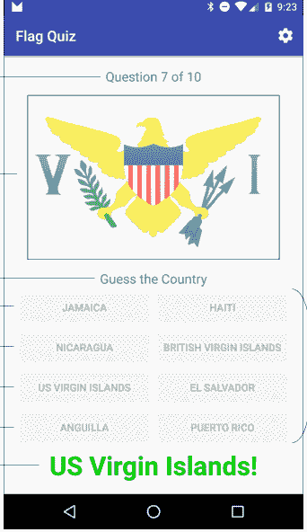

图 4.18 | 旗帜测验 GUI 的组件，其 `id` 属性值已标记——这些组件排列在一个垂直的 `LinearLayout` 中。

使用你在第 3 章中学习的技巧，你将构建图 4.18 所示的 GUI。回想，在组件树（Component Tree）窗口中选择特定的 GUI 组件是最简单的。你将从基础布局和控件开始，然后通过自定义控件的属性来完成设计。

### 步骤 1：从 `RelativeLayout` 切换到 `LinearLayout`

与之前两个应用的 `activity_main.xml` 布局一样，`fragment_main.xml` 中的默认布局是 `RelativeLayout`。在这里，你将为此应用的设计改为垂直的 `LinearLayout`：

1. 打开 `main.xml` 文件，并切换到 Text（文本）选项卡。
2. 在 XML 中，将 `RelativeLayout` 改为 `LinearLayout`。
3. 切换回 Design（设计）选项卡。
4. 在组件树中选择 `LinearLayout`。
5. 在 Properties（属性）窗口中，将 `LinearLayout` 的 `orientation`（方向）设置为 `vertical`（垂直）。
6. 确保 `layout:width` 和 `layout:height` 设置为 `match_parent`。
7. 将 `LinearLayout` 的 `id` 设置为 `quizLinearLayout` 以供程序化访问。

默认情况下，IDE 将你的布局的 Padding Left（左内边距）和 Padding Right（右内边距）属性设置为名为 `@dim/activity_horizontal_margin` 的预定义维度——它位于项目 `res/values` 文件夹下的 `dims.xml` 文件中。该资源的值为 16dp，因此布局的左右两侧会有 16dp 的内边距。当你创建应用项目时，IDE 会创建此资源。同样，IDE 将 Padding Top（上内边距）和 Padding Bottom（底内边距）属性设置为 `@dim/activity_vertical_margin`——这是另一个值为 16dp 的预定义维度资源。因此，在布局的上下会有 16dp 的内边距。`MainActivity` 的所有 GUI 将相对于 `MainActivity` 的其他 GUI 缩进 16dp。

### 步骤 2：将 `question itemTextView` 拖入 `LinearLayout`

从调色板（Palette）的 Widgets 部分将一个 `TextView` 组件拖到组件树窗口中的 `quizLinearLayout` 上，然后将其 `id` 设置为 `questionNumberTextView`。使用 Properties 窗口设置以下属性：

- `layoutgravity: center`——将组件在布局中水平居中。
- `layoutmargin: @dim/spacing`——设置此项作为底部边距，以便在该组件下方添加 8dp 的空间。使用你在第 2.5.6 节中学习的技巧创建此维度资源。
- `text: @string/question`——要设置此项，点击 `text` 属性，然后点击省略号（...）按钮。在 Resources（资源）对话框的 Properties 选项卡（图 4.19）中，选择 `question` 资源，然后点击 OK。

### 步骤 3：将 `ImageView` 拖入 `LinearLayout`

从调色板的 Widgets 部分将一个 `ImageView` 组件拖到组件树窗口中的 `quizLinearLayout` 上，然后将其 `id` 设置为 `flagImageView`。使用 Properties 窗口设置以下属性：

- `layoutwidth: match_parent`
- `layoutheight: 0dp`——这将允许 View 高由其 `weight`（权重）属性决定。
- `layoutgravity: center`
- `layoutmargin bottom: @dim/spacing`——在该组件下方添加 8dp 的空间。
- `layoutmargin left and right: @dim/activity_horizontal_margin`——在该组件的左右添加 16dp 的空间，这样完整的旗帜就能显示左右移动的旗帜摇动动画。
- `layoutweight: 1`——将此组件的 `layoutweight` 设置为 1（所有组件的默认值均为 0）会让 `ImageView` 比 `quizLinearLayout` 中的其他组件更重要。当 Android 布局组件时，它们将只使用所需的垂直空间，而 `flagImageView` 将占据所有剩余的垂直空间。IDE 建议将 `flagImageView` 的权重设置为 0dp 以在运行时布局 GUI。

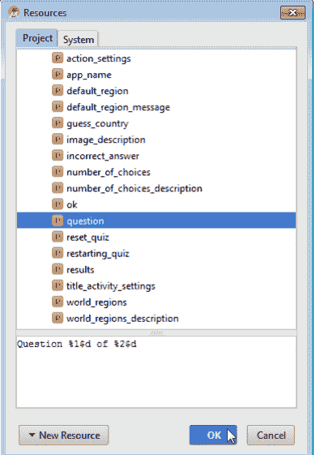

图 4.19 | 资源选择器——选择已有的 String 资源 `question`。

- `adjustBounds: true`——将 ImageView 的 Adjust View Bounds（调整视图边界）属性设置为 `true`（通过勾选复选框）可确保 ImageView 保持图片的比例。
- `contentDescription: @string/image_description`
- `scaleType: fitCenter`——这表示 ImageView 应该缩放图像以填充 ImageView 的宽度或高度，同时保持原始比例。如果宽度小于 ImageView，图像将水平居中。同样，如果高度小于 ImageView，图像将垂直居中。

> **外观观察 4.3**
>
> 回想一下，Android 中的最佳实践是确保每个 UI 组件都能与 TalkBack 使用。对于没有描述文本的组件（如图像），请设置组件的描述属性。

### 步骤 4：将 `guessCountryTextView` 添加到 `LinearLayout`

从调色板将一个 Medium Text 组件拖到组件树中的 `quizLinearLayout`，然后将其 `id` 属性设置为 `guessCountryTextView`。使用 Properties 窗口设置以下属性：


- `layout:gravity center: horizontal`
- `text: @string/guess_country`

### 步骤 5：将按钮添加到 `LinearLayout`

对于此应用，我们将按钮添加到 `LinearLayout`——为了匹配水平空间，我们的 `quizLinearLayout` 是一个水平布局。你将在第 7 步设置属性。遵循以下步骤添加按钮：

1. 从调色板的 Widgets 部分将一个 Button 拖到组件树中的 `quizLinearLayout`，将其 `id` 设置为 `row1LinearLayout` 并将其布局设置为 `wrap`。
2. 从调色板的 Widgets 部分将一个 Button 拖到组件树中的 `row1LinearLayout`。你不需要设置其 `id`，因为在应用代码中是通过 `id` 引用的。
3. 对第一行重复步骤 2。
4. 对剩余的布局重复步骤 1–3 以创建三行按钮。


### 步骤 6：将 `answerTextView` 添加到 `LinearLayout`

从调色板的 Widgets 部分将一个 **Text** 组件拖到`quizLinearLayout`上，将其 id 设置为`answerTextView`。使用 Properties 窗口设置以下内容：

- `gravity: center` 并设置为水平。
- `gravity: center_horizontal`——当在行或更多行时更改对齐方式。
- `textSize: @answer_size`——更改字体大小为 36sp。使用你在第 2.5.6 节中学习的技巧更改维度资源。
- `textSize: bold` 此 TextView 将通过程序设置。

### 步骤 7：设置按钮的属性

一旦你完成了步骤 6，按照图 4.21 所示的值配置按钮——你可以在组件树中选择所有按钮，然后设置这些属性：

- 将按钮的`layout_width`设置为`0dp`并`layoutweight`设置为`1`，使单个 LinearLayout 中的按钮匹配水平空间。
- 将按钮的`layout_height`设置为`match_parent`，以使按钮的高度与 LinearLayout 的一致。
- 将按钮的`lines`设置为`2`，确保对于行数不同的国名，按钮的高度相同——如果按钮文本过长，无法放入两行内的部分将被简单截断。

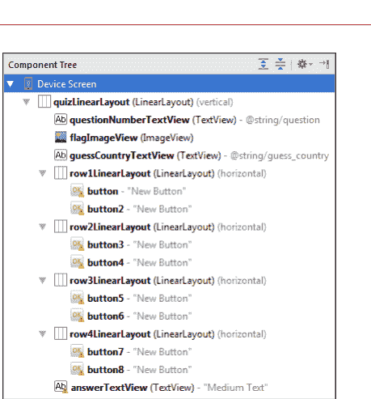

图 4.20 | fragment_main.xml 的组件树窗口。

- 将`style`属性设置为`android:style/Widget.Material.Button.Colored`可使按钮根据应用程序主题呈现彩色外观。按钮的颜色将是应用强调色，这是你在 4.4.7 节中指定的。要设置此属性，点击省略号 (...) 打开主题资源对话框，在 System 选项卡中选择选择 Widget.Material.Button.Colored 并点击 OK。
- 将`textcolor`属性设置为你在 4.4.8 中定义的颜色列表，以确保文本根据每个按钮的启用/禁用状态更改颜色。

| GUI 组件 | 布局参数 | 值 |
| --- | --- | --- |
| Buttons | layout:width | 0dp |
|  | layout:height | match_parent |
|  | layout:weight | 1 |
| 其他属性 | lines | 2 |
|  | textColor | @color/button_text_color |
|  | style | android:style/Widget.Material.Button.Colored |

图 4.21 | fragment_main.xml 中按钮组件的属性值。

## 4.5.3 布局编辑器工具栏

你现在已经完成了 MainActivityFragment 的 GUI。布局编辑器的工具栏（图 4.22）包含按钮，允许你预览其他屏幕尺寸和方向的设计。特别是，你可以查看许多屏幕尺寸和方向的缩略图。要此操作，首先打开`content_main.xml`，然后点击布局编辑器顶部的虚拟设备下拉菜单，选择“预览所有屏幕尺寸”（Preview All Screen Sizes）。图 4.23 概述了布局编辑器工具栏中的某些按钮。

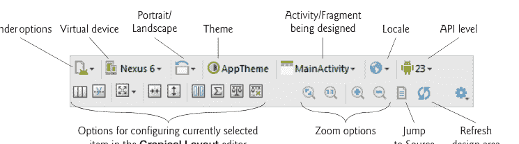

图 4.22 画布配置选项。

| 选项 | 说明 |
| --- | --- |
| 渲染选项 | 一次只显示一个设计屏幕，或同时在各种屏幕尺寸上查看你的设计 |
| 虚拟设备 | Android 运行在各种设备上，因此布局编辑器带有许多设备配置，代表了你设计 GUI 时所使用的各种屏幕尺寸和分辨率。在本书书中，我们根据应用使用预定义的 Nexus 6 和 Nexus 9 屏幕。在图 4.22 中，我们使用了 Nexus 6。 |
| 竖屏/横屏 | 在竖屏和横屏方向之间切换设计区域。可用于设置 GUI 的主题。 |
| 正在设计的 Activity/fragment | 显示与设计的 GUI 对应的 Activity 或 Fragment 类。对于国际化应用（第 2.8 节），允许你选择特定的本地化，以便查看设计在不同语言字符串下的显示效果 |
| API 级别 | 指定设计的 API 级别。每个新 API 级别的发布通常会有新功能。布局编辑器窗口仅显示所选 API 级别可用的功能。 |

图 4.23 画布配置选项说明。

## 4.5.4 平板横屏模式下的 content_main.xml 布局

正如我们之前提到的，MainActivity 的默认`content_main.xml`布局显示 MainActivityFragment 的 GUI。你现在将为 MainActivity 定义平板电脑的横屏布局，这将会将 SettingsActivityFragment 和 MainActivityFragment 并列显示。要实现此操作，你将创建第二个`content_main.xml`布局，Android 仅在适当的设备上使用该布局。

### 创建平板横屏模式下的 content_main.xml

要创建布局，请执行以下步骤：

1. 右键点击项目的`res/layout`文件夹，选择 New > Layout file。
2. 在 New Resource File 对话框的 File name 中输入`content_main.xml`。
3. 确保 Root element（根元素）字段指定了`LinearLayout`。
4. 在 Available Qualifiers（可用限定符）列表中，选择 Smallest Width（最小宽度）限定符，然后点击 >> 按钮将该限定符添加到 Chosen Qualifiers（已选限定符）列表中，将其值设置为 700——该布局适用于宽度至少 700 像素的屏幕。
5. 在 Available Qualifiers 列表中，选择 Orientation（方向）限定符，然后点击 >> 按钮将该限定符添加到 Chosen Qualifiers 列表中，将其值设置为 Landscape（横屏）。
6. 点击 OK。

这创建了`content_main.xml`文件，它存储在名为`layout-sw700dp-land`的 res 子文件夹中，表示该布局仅在最小宽度 (sw) 为 700dp 且设备处于 (landscape) 横屏方向时使用。Android 使用 sw 和 land 限定符在运行时选择合适的资源。

在 Android Studio 中，Project（项目）窗口不会显示单独的`layout`和`layout-sw700dp-land`文件夹（如果你在磁盘上浏览项目文件夹，将会看到它们）。相反，它将布局合并到 Project 窗口`res/layout`文件夹中的单个节点`content_main.xml (2)`处——(2) 表示该节点中有两个布局。

展开此节点：

- `content_main.xml`
- `content_main.xml (sw700dp-land)`。

不带限定符的布局是默认布局。带有限定符的布局仅在合适时使用。创建文件后，Android Studio 会在布局编辑器中打开该布局。Design（设计）视图将以布局方向呈现布局。

### 创建平板电脑的 GUI

接下来，你将构建平板布局的 GUI：

1. 在 Component Tree（组件树）窗口中选择 LinearLayout (vertical)，并将 orientation 属性设置为 horizontal（横向）。
2. 点击 Palette（调色板）custom 部分中的`<fragment>`。在 Fragments 对话框中，选择 SettingsActivityFragment，并点击 OK。然后点击 Component Tree 窗口中的 LinearLayout 节点。这将`<fragment>`添加到布局中。将`<fragment>`的 id 设置为`settingsActivityFragment`。
3. 重复上一步，但这次选择 MainActivityFragment。同样，将此`<fragment>`的 id 设置为`quizFragment`。
4. 在 Component Tree 视图中选择`settingsActivityFragment`。设置`layoutwidth=0dp`、`layoutheight=match_parent`并`layoutweight`为 1。
5. 在 Component Tree 视图中选择`quizFragment`。设置`layoutwidth=0dp`、`layoutheight=match_parent`并`layoutweight`为 2。由于 MainActivityFragment-`layoutweight=2`而 SettingsActivityFragment-`layoutweight`为1，因此权重总和为 3，MainActivityFragment 将占据布局水平空间的三之二。
6. 切换到 Text 标签页，并在你的 LinearLayout 标签中添加以下行，以确保布局的顶部出现在应用栏下方，而不是隐藏在它后面：

```
xmlns:app="http://schemas.android.com/apk/res/auto"
app:layout_behavior="@string/scrolling_behavior"
```

在布局编辑器中选择一个 Fragment 将显示任何 fragment 的预览——如果你没有指定预览哪个 fragment，请在 Component Tree 中右键点击并选择 Layout...然后在 Resources 对话框中选择该 fragment 的名称。

## 第4章 知识测验应用

## 4.6 MainActivity 类

```java
package com.example.quiz;

import android.content.Intent;
import android.content.SharedPreferences;
import android.content.SharedPreferences.OnChangeListener;
import android.content.res.Configuration;
import android.os.Bundle;
import android.os.preference.PreferenceManager;
import android.support.v2.AppCompat;
import android.support.v7.widget.Toolbar;
import android.view.Menu;
import android.view.MenuItem;
import android.widget.Toast;
import java.util.Set;

public class MainActivity extends Activity {
    // 用于从 SharedPreferences 读取数据的键
    public static String CHOICES = "pref_numberOfOfChoices";
    public static String REGIONS = "pref_regionsToInclude";

    private boolean phoneDevice = true; // 用于强制竖屏模式
    private boolean preferencesChanged = true; // 如果偏好发生变化

    @Override
    protected void onCreate(Bundle savedInstanceState) {
        super.onCreate(savedInstanceState);
        setContentView(R.layout.activity_main);
    }
}
```

## 第 4 章 旗帜测试应用

```java
// 配置 MainActivity
@Override
void onCreate(Bundle savedInstanceState) {
    super.onCreate(savedInstanceState);
    ContentView(R.layout.activity_main);
    Toolbar toolbar = (Toolbar) findViewById(R.id.toolbar);
    setSupportActionBar(toolbar);

    // 在 SharedPreferences 中设置默认值
    PreferenceManager.setDefaultValues(this, R.xml.preferences, false);

    // 注册 SharedPreferences 变化的监听器
    PreferenceManager.getDefaultPreferences(this);
    registerOnSharedPreferenceChangeListener(this, preferenceListener);

    // 确定屏幕尺寸
    int screenSize = getResources().getConfiguration().screenLayout &
        Configuration.SCREENLAYOUT_SIZE_MASK;

    // 如果设备是平板，将 phoneDevice 设置为 false
    if (screenSize == Configuration.SCREENLAYOUT_SIZE_LARGE ||
        screenSize == Configuration.SCREENLAYOUT_SIZE_XLARGE)
        phoneDevice = false; // 不是手机尺寸的设备

    // 如果在手机尺寸的设备上运行，仅允许竖屏方向
    setRequestedOrientation(
        Activity.SCREEN_ORIENTATION_PORTRAIT);
}
```

图 4.26 MainActivity 覆盖的 Activity 方法 onCreate。

- Context（包`android.content`），提供了对应用运行环境信息的访问权限，并允许你使用各种 Android 服务——在 Android 中，Context 就是你正在设置默认偏好的那个 Activity (this)。
- 在第 4.4.11 节中创建的偏好 XML 文件（`R.xml.preferences`）的资源 ID。
- 一个布尔值，用于表示在每次调用`setDefaultValues`方法时是否应该重置默认值——false 表示在第一次调用此方法时应设置默认偏好值。

每当用户更改应用时，你的 MainActivity 应该调用`MainActivity.updateQuery`或`updatePreferences`来识别这些变化。MainActivity 注册了一个`OnSharedPreferenceChangeListener`（第 41-43 行），以便在每当偏好发生变化时它都会收到通知。`PreferenceManager.getDefaultPreferences`返回代表应用偏好的 SharedPreferences 对象的引用，而`SharedPreferences.registerOnSharedPreferenceChangeListener`则注册该监听器（在第 4.6.7 节中定义）。

## 4.6 MainActivity 类

### 为设备配置竖屏方向

第 46–52 行确定了应用是运行在平板电脑还是手机上。继承的方法`getResources`返回应用对象（`android.content.res`），用于访问应用资源并确定有关其环境的信息。方法`getConfiguration`返回一个 Configuration 对象（`android.content.res`），该对象包含一个公有实例变量`screenLayout`，它指定了设备的屏幕尺寸类别。要做到这一点，首先使用位按“与” (&) 操作符将`screenLayout`的值与 Configuration 相结合。然后，将结果与`SCREENLAYOUT_SIZE_LARGE`和`SCREENLAYOUT_SIZE_XLARGE`进行比较（第 50–51 行）。如果匹配其中任一个，则应用运行在平板尺寸的设备上。最后，如果设备是手机，第 66–70 行使用`setRequestedOrientation`强制让应用以竖屏方向运行 MainActivity。

### 4.6.4 被覆盖的 Activity 方法 onStart

被覆盖的 Activity 方法`onStart`（图 4.27）在两种场景下被调用：

- 当应用首次执行时，`onStart`在`onCreate`之后被调用。在这种情况下，我们使用`onStart`是为了确保在应用安装并首次执行时，或者在随后启动应用时用户更新了偏好，能够根据应用的默认偏好正确配置测试。
- 当应用以竖屏方向运行且用户打开 SettingsActivity 时，MainActivity 会暂停，同时显示 SettingsActivity。当用户返回 MainActivity 时，它会被再次调用。在这种情况下，我们使用`onStart`是为了确保如果用户进行了任何偏好更改，测试将重新配置。


在这两种情况下，如果发生了方向变化，`onStart` 会调用 `MainActivityFragment.updateGuessRows`（4.7 节）和 `updateRegions`（4.5 节）方法来识别测试。要获取测试，需要获取 `MainActivity` 的引用以便调用其方法。第 68–70 行使用 `AppCompatActivity.getFragmentManager()` 获取 `FragmentManager`，然后调用 `findFragmentById` 方法。接下来，第 71–74 行调用 `MainActivityFragment.updateGuessRows` 和 `updateRegions` 方法，并将应用的 `SharedPreferences` 对象作为参数传递，以便这些方法加载当前偏好。第 77 行将测试的行偏好 `preferencesChanged` 设置为 `false`。

```java
// 在 onCreate 执行完成后调用
@Override
protected void onStart() {
    super.onStart();

    if (preferencesChanged) {
        // 现在默认偏好已经设置，
        // 初始化 MainActivityFragment 并启动测试
        MainActivityFragment quizFragment = (MainActivityFragment) getSupportFragmentManager().findFragmentById(R.id.quizFragment);
        71 quizFragment.updateGuessRows(
        72 PreferenceManager.getDefaultSharedPreferences(this);
        73 quizFragment.updateRegions(
        74 PreferenceManager.getDefaultSharedPreferences(this);
        75 quizFragment.resetQuiz();
        76
        77 preferencesChanged = false;
        78 }
        79
```

图 4.27 | `MainActivity` 覆盖的 `Activity` 方法 `onStart`。（2 部分中的第 1 部分）

图 4.27 | `MainActivity` 覆盖的 `Activity` 方法 `onCreateStart`。（2 部分中的第 2 部分。）

### 4.6.5 被覆盖的 Activity 方法 onCreateOptionsMenu

被覆盖的 `Activity` 方法 `onCreateOptionsMenu` 此方法以及 `onCreateItemsSelected`（4.6.6 节）被 Android 的 Blank Activity 增强了。在这里，我们希望仅在应用以竖屏运行时显示菜单。第 84 行检查设备的当前方向。此公有实例变量包含 `Configuration.PORTRAIT` 或 `Configuration.LANDSCAPE`。

```java
// 如果在手机上运行
82 public boolean onCreateOptionsMenu(Menu menu) {
83 // 获取设备的当前方向
84 int orientation = getResources().getConfiguration().orientation;
85 // 显示应用的菜单
86 if (orientation == Configuration.PORTRAIT) {
87 // 填充菜单
88 getInflater().inflate(R.menu.menu_main, menu);
89 return true;
90 } else
91 return false;
92
```

图 4.28 | `MainActivity` 覆盖的 `Activity` 方法 `onCreateOptionsMenu`。

### 4.6.6 被覆盖的方法 onOptionsItemSelected

该方法在选择菜单项时调用。当你创建项目时 IDE 提供的默认菜单包含 `Settings` 项，如果用户选择了 `Settings`。

```java
// 在手机上运行时显示 SettingsActivity
@Override
public boolean onOptionsItemSelected(MenuItem item) {
    Intent preferencesIntent = new Intent(this, SettingsActivity.class);
    return super.onOptionsItemSelected(item);
}
```

图 4.29 | `MainActivity` 覆盖的 `Activity` 方法 `onOptionsItemSelected`。

### 4.6.7 实现 SharedPreferenceChangeListener 的匿名内部类

`PreferencesChangeListener` 对象（图 4.30）是一个实现 `SharedPreferenceChangeListener` 接口的匿名内部类对象。该对象在方法注册以监听应用偏好的变化。当发生变化时，`onSharedPreferenceChanged` 方法将 `preferencesChanged` 设置为 `true`（第 111 行），然后创建 `MainActivityFragment`（第 113–115 行），以便可以使用新偏好重置测试。如果发生了 `CHOICES`，第 118 行调用 `MainActivityFragment` 的 `updateGuessRows` 并重置测试。

```java
// SharedPreferences 变化的监听器
private SharedPreferenceChangeListener sharedPreferenceChangeListener =
    new SharedPreferenceChangeListener() {
        // 当偏好变化时调用此方法
        @Override
        public void onSharedPreferenceChanged(SharedPreferences sharedPreferences, String key) {
            preferencesChanged = true; // 用户更改了应用设置

            MainActivityFragment quizFragment = (MainActivityFragment)
                getSupportedFragmentManager().findFragmentById(
                    R.id.quizFragment);

            if (key.equals(CHOICES)) { // 显示的选项发生了变化
                quizFragment.updateGuessRows(sharedPreferences);
            }
        }
    }
```

图 4.30 | 实现 `SharedPreferenceChangeListener` 的匿名内部类。（2 部分中的第 1 部分。）

## 第 4 章 Flag 旗测验 App

```java
quizFragment.resetQuiz();
else if (key.equals(REGIONS)) { // regions 包含更改的区域
    Set<String> regions = sharedPreferences.getString(REGIONS, null);

    if (regions != null && regions.size() > 0) {
        quizFragment.updateRegions(sharedPreferences);
        quizFragment.resetQuiz();
    }
    else {
        // 选择一个区域——将北美作为默认
        sharedPreferences.editor = sharedPreferences.edit();
        regions.add(getString(R.default_region));
        editor.putStringSet(REGIONS, regions);
        editor.apply());

        Toast.makeText(MainActivity.this, R.string.default_region_message,
            Toast.LENGTH_SHORT).show();

        Toast.makeText(MainActivity.this, R.string.restarting_quiz,
            Toast.LENGTH_SHORT).show();
    }
}
```

图 4.30 | 匿名内部类实现 `OnSharedPreferenceChangeListener`（第 2/2 部分）。

如果 `REGIONS` 偏好发生变化，第 122–123 行获取包含启用区域的 `Set<String>`。`SharedPreferences.getString` 为指定的 `key` 返回一个 `Set<String>`。测验必须至少有一个区域，或者如果 `Set<String>` 不为空，则第 126–127 行调用 `MainActivityFragment` 的 `updateRegions` 和 `resetQuiz`。

如果 `Set<String>` 为空，则第 131–135 行将北美设置为默认区域以更新 `REGIONS` 偏好。要获取区域名称，第 133 行调用 `Activity` 继承的方法 `getString`，该方法返回对应指定 ID（`R.string.default_region`）的 `String`。

要更改 `SharedPreferences` 对象，首先调用其 `edit` 方法获取一个 `SharedPreferences.Editor`（第 131–132 行），它可以向 `SharedPreferences` 文件中添加键-值对、删除键-值对或修改与特定键关联的值。第 134 行调用 `SharedPreferences.Editor` 方法 `putStringSet` 来存储 `regions` 的内容（即 `Set<String>`）。第 135 行通过调用 `SharedPreferences.Editor.apply` 提交（保存）更改，这会立即更改内存中 `SharedPreferences` 的表示，并在后台异步将更改写入文件。还有一个 `commit` 方法，它可以同步（立即）地将更改写入文件。

第 137–139 行使用 `Toast` 指明已设置默认区域。`Toast.makeText` 方法接收的参数包括：显示 `Toast` 的 `Context`、要显示的消息以及 `Toast` 显示的持续时间。`Toast` 方法用于显示 `Toast`。无论哪种偏好发生变化，第 143–145 行都会显示一个 `Toast`，表示测验将使用新偏好进行重置。图 4.31 显示了用户更改 App 偏好后出现的 `Toast`。


图 4.31 | 偏好更改后显示的 `Toast`。

## 4.7 MainActivityFragment 类

`MainActivityFragment` 类（图 4.32–4.42）——Android Support Library 中 `Fragment` 类（包 `android.support.v4.app`）的子类——它构建了旗帜测验 GUI 并实现了测验逻辑。

### 4.7.1 包声明和导入语句

图 4.32 显示了 `MainActivity` 的包声明和导入语句。第 5–36 行导入了 App 使用的各种 Java 和 Android 类及接口。我们高亮了关键的导入语句，并在第 4.3 节中讨论了相应的类和接口，以及它们在第 4.7.2–4.7.11 节中出现的位置。

```java
1 // MainActivityFragment.java
2 // 包含 Flag 逻辑
3 package com.deitel.flagquiz;
4
5 import java.io.IOException;
6 import java.io.InputStream;
7 import java.security.SecureRandom;
8 import java.util.ArrayList;
9 import java.util.Collections;
10 import java.util.List;
11 import java.util.Set;
12
13 import android.animation.Animator;
14 import android.animation.AnimatorListener;
15 import android.app.AlertDialog;
16 import android.content.DialogInterface;
17 import android.content.SharedPreferences;
18 import android.content.res.AssetManager;
19 import android.graphics.drawable.Drawable;
20 import android.os.Bundle;
21 import android.support.v4.app.DialogFragment;
22 import android.support.v4.Fragment;
23 import android.os.Handler;
24 import android.util.Log;
25 import android.view.LayoutInflater;
26 import android.view.View;
27 import android.view.OnClickListener;
28 import android.view.ViewUtils;
29 import android.animation.Animation;
30 import android.view.AnimationUtils;
31 import android.widget.Button;
32 import android.widget.ImageView;
33 import android.widget.LinearLayout;
34 import android.widget.TextView;
```

图 4.32 | `MainActivityFragment` 包声明、导入语句（第 1/2 部分）。

## 4.7.2 MainActivityFragment 类

图 4.33 显示了 `MainActivityFragment` 的字段。

```java
38 public class MainActivityFragment extends Fragment {
39 final String TAG = "FlagQuizActivity";
40 final int FLAGS_IN_QUIZ = 10;
41 List<String> fileNameList;
42 List<String> countryList;
43 Set<String> regionsSet;
44 String correctAnswer;
45 int totalGuesses;
46 int correctAnswers;
47 int guessRows;
48 int randomIndex;
49 Handler handler;
50 Animation shakeAnimation;
51 LinearLayout quizLayerView;
52 TextView questionTextView;
53 ImageView flagImageView;
54 LinearLayout[] guesss;
55 TextView answerTextView;
}
```

图 4.33 | `MainActivityFragment` 字段。

## 4.7.3 MainActivityFragment 类良好实践

为了可读性和维护性，使用字符串常量来表示不需要本地化的文件名（例如消息）。`fileNameList`（第 44 行）持有启用区域。`countryList`（第 45 行）持有测验的国家。`regionsSet`（第 46 行）存储地理区域。`correctAnswer`（第 47 行）持有当前答案。`totalGuesses`（第 48 行）存储猜测次数。`correctAnswers`（第 49 行）是目前为止正确猜测的数量；如果用户完成测验，该值将等于 `FLAGS_IN_QUIZ`。`guessRows`（第 50 行）是旗帜的选择。`randomIndex`（第 51 行）用于随机挑选旗帜。当玩家回答正确且测验未结束时，`handler` 对象（第 52 行）会在短暂延迟后发布下一个旗帜。

动画 `shake`（第 53 行）持有在猜测错误时应用到旗帜上的抖动动画。第 55–59 行包含了程序化管理 GUI 的变量。

### 4.7.4 重写的 Fragment 方法 onCreate


`MainActivity`的`onCreate`方法（图 4.3）加载 GUI 并初始化了大部分`MainActivity`实例变量。`guessRows`和`regionsSet`在`MainActivity`调用`updateRows`和`updateRegions`时初始化。在调用父类`onCreate`方法（第 65 行）后，`MainActivity`的 GUI（第 66–67 行）使用`LayoutInflater`加载，`onCreate`接收的参数包括：

- 要加载的布局资源 ID。
- `Fragment`将显示其中的`ViewGroup`（组对象），即`onCreate`的第二个参数。
- 布尔值，表示加载的 GUI 是否需要附加到第二个参数中的`ViewGroup`上。在`Fragment`的`onCreate`方法中，此值始终为`false`——系统会自动将 fragment 附加到宿主 Activity。在此处传递`true`会导致异常。

`inflate`方法返回一个包含加载 GUI 的`View`。我们将其存储在局部变量`view`中，以便在初始化其他实例变量后返回它。

## 第4章 旗帜测验 App

```java
// 当 MainActivityFragment 的 View 创建时配置它
@Override
public void onCreate(LayoutInflater inflater, ViewGroup container,
    Bundle savedInstanceState) {
    super.onCreate(inflater, container, savedInstanceState);
    View view =
        inflater.inflate(R.layout.fragment_main, container, false);
    
    fileName = new ArrayList<String>(); // 占位符
    quizCountList = new ArrayList<Integer>();
    random = new Random();
    handler = new Handler();
}
```

```java
// 为错误答案加载摇动动画
shakeAnimation = AnimationUtils.loadAnimation(getActivity(),
shakeAnimation.setRepeatCount(3); // 动画重复3次
```

```java
// 获取 GUI 组件的引用
quizLinearLayout = view.findViewById(R.id.quizLinearLayout);
questionTextView = view.findViewById(R.id.questionTextView);
answerView = (TextView) view.findViewById(R.id.textView);
flagImageView = (ImageView)view.findViewById(R.id.flagImageView);
guessListView = view.findViewById(R.id.guessListView);
(LinearLayout) view.findViewById(R.id.row1LinearLayout);
guessListView[0] = (LinearLayout) view.findViewById(R.id.row1LinearLayout);
guessListView[1] = (LinearLayout) view.findViewById(R.id.row2LinearLayout);
guessListView[2] = (LinearLayout) view.findViewById(R.id.row3LinearLayout);
guessListView[3] = (LinearLayout) view.findViewById(R.id.row4LinearLayout);
answerTextView = (TextView) view.findViewById(R.id.answerTextView);
```

```java
//为猜猜按钮配置监听器
for (LinearLayout row : guessLayouts) {
    for (int column = 0; column < row.getChildCount(); column++) {
        Button button = (Button)row.getChildAt(column);
        button.setOnClickListener(guessButtonListener);
    }
}
```

```java
// 设置 questionTextView 的文本
questionTextView.setText(
    getString(R.string.question, 1, FLAGS_IN_QUIZ));
return view; // 返回用于显示的 fragment 的 view
```

**图 4.34** | `MainActivity`在`onCreate`上的重写方法。

第 69–70 行创建了`ArrayList<String>`对象，用于存储启用地理地区的旗帜图像文件和国家名称。

## 4.7 `MainActivityFragment`类

第 71 行创建了`SecureRandom`对象，用于对测验的旗帜和猜猜按钮进行随机化。第 72 行创建了`Handler`对象`handler`，我们将用它在用户纠正当前旗帜后，延迟两秒显示下一面旗帜。

第 75–76 行动态加载在猜想错误时应用到旗帜上的摇动动画：`AnimationUtils`静态方法`loadAnimation`从由`R.anim.incorrect_shake`表示的 XML 文件中加载动画。第一个参数继承自的方法`getActivity`返回托管此 Fragment 的 activity。`getActivity`是`Activity`的子类，它通过`Animation`方法`repeatCount`指定动画应重复的次数。

第 80–94 行引用我们将通过程序管理的 GUI 组件。第 97–102 行遍历`guessLinearLayouts`中的每个猜猜按钮，并注册`guessButton`（第 4.10 节）作为`OnClickListener`——我们实现此接口以处理用户触摸任何猜猜按钮时的事件。

第 105–106 行通过调用`Fragment`继承的重载方法`getString`将`questionNumberTextView`中的文本设置为字符串。`format`的第一个参数是字符串资源`R.string.question`，它代表格式化字符串：

> 问题第 %1d 个，共 %2d 个

此字符串包含两个值的占位符（如第 4.4.5 节所述）。其余参数是要插入到格式化字符串中的值。第 107 行将`questionNumberTextView`中的文本设置为字符串。

## 第 4 章 旗帜测试应用

从`fileNameList`获取名称。如果`quizCountriesList`尚未包含该文件名，我们就将其添加到`quizCountriesList`并增加`flagCounter`。我们重复此过程，直到选择了 10 个（`FLAGS_IN_QUIZ`）唯一文件名。然后第 173 行调用`loadNextFlag`（图 4.38）来加载测试的第一个项目。

## 4.7 方法`loadNextFlag`

`loadNextFlag`方法（图 4.38）加载并显示下一面旗帜以及对应的答案按钮。`quizCountriesList`中的图像名称格式为：

`regionName-countryName`（不带 `.png` 扩展名）。

```java
// 在用户获得正确旗帜后，加载下一个旗帜
private void loadNextFlag() {
    // 获取下一个旗帜的文件名并从列表中移除
    String nextImage = quizCountriesList.remove(0);
    int correctAnswer = answerTextView.setText(""); // 更新答案文本
    answerTextView.setText(correctAnswer);

    // 显示当前题号
    questionTextView.setText(getString(
        R.string, (correctAnswers[i], FLAGS_IN_QUIZ)));

    // 从图像名称中提取名称
    String name = nextImage.substring(nextImage.indexOf('=')+1);
    // 使用 AssetManager 从 assets 文件夹加载图像
    AssetManager assets = getActivity().getAssets();

    // 获取代表下一个旗帜的资源的 InputStream
    // 并尝试使用该 InputStream
    try {
        InputStream stream = assets.open("/" + nextImage + ".png");
        // 将资源加载为 Drawable 并显示在 flagImageView 上
        Drawable drawable = Drawable.fromStream(stream, nextImage);
        flagImageView.setImageDrawable(drawable);

        flagImageView.animate(false); // 将旗帜动画切换到下一个
    } catch (IOException exception) {
        Log.e(TAG,"Error loading " + nextImage, exception);
    }

    Collections.shuffle(fileNameList); // 打乱文件名

    // 将正确答案放在 fileNameList 的末尾
    int correct = fileNameList.indexOf(correctAnswer);
    fileNameList.add(fileNameList.remove(correct));
}
```

**图 4.38** | `MainActivityFragment`（2 部分中的第 1 部分）。

## 4.7 `MainActivityFragment`类

```java
// 根据 guessRows 的值添加 2、6 或 8 个按钮
for (int row = 0; row < guessRows; row++) {
    // 在 currentRowRow 中放置按钮
    for (int column = 0;
         column < guessLinearLayouts[row].getChildCount();
         column++) {
        // 获取用于配置的 Button 引用
        Button newGuessButton = (Button)guessLinearLayouts[row].getChildAt(column);
        newGuessButton.setEnabled(true);
        
        // 获取国家名称并将其设置为 newGuessButton 的文本
        String filename = fileNameList.get((row * 2) + column);
        newGuessButton.setText(getCountryName(filename));
    }
}
// 随机用正确答案替换其中一个按钮
int row = random.nextInt(guessRows); // 随机选择行
int column = random.nextInt(guessLinearLayouts[row]); // 随机选择列
String countryName = getCountryName(correctAnswer);
((Button)guessLayout.getChildAt(column)).setText(countryName);
```

**图 4.38** | `MainActivityFragment`方法`loadNext`（2 部分中的第 2 部分）。

第 179 行从`queryList`移除名称并将其设置在`nextImage`。我们还将将其保存到`correctAnswer`中，以便稍后确定用户是否猜对。接下来，我们使用`answerTextView`并使用格式化的字符串资源`string.question`在`numberTextView`（第 184–185 行）中显示当前数字。

第 188 行从`nextImage`中提取作为加载图像的 assets 文件夹。接下来我们使用`AssetManager`，然后使用`InputStream`（来自`java.io`包）从旗帜图像文件读取字节。我们将该流作为类`Drawable`静态方法`createFromStream`的参数，它会创建一个`Drawable`对象（来自`android.graphics.drawable`包）。`Drawable`是一个通过调用`setImage(Drawable)`来显示图像的方法。如果发生异常，我们将记录它以便调试（第 204 行）。接下来，我们调用该方法并传入`false`，将下一个旗帜和按钮动画到屏幕上（第 201 行）。

第 207 行移动了`fileNameList`，第 210–211 行修正答案并将其移动到`fileNameList`的末尾——稍后我们将此答案插入其中一个猜按钮中。

第 214–222 行遍历`guessLayouts`中当前`guessRows`数量对应的按钮。对于每个按钮：

- 第 220–221 行获取下一个按钮的引用
- 第 222 行启用按钮
- 第 225 行从`fileNameList`中获取旗帜名称
- 第 226 行使用`getCountryName`方法（第 4.7.8 节）的返回值设置按钮的文本。

第 231-235 行随机选择一行（基于当前的`guessRows`数量）和列，然后设置对应按钮的文本。

### 4.7.8 方法`getClassName`

第 231-235 行随机选择一行（基于当前的`guessRows`数量）和列，然后设置对应按钮的文本。

第 231-235 行随机选择一行（基于当前的`guessRows`数量）和列，然后设置对应按钮的文本。

第 231-235 行随机选择一行（基于当前的`guessRows`数量）和列，然后设置对应按钮的文本。（等待，让我根据 OCR 文本重新对齐逻辑）。

### 4.7.9 方法`animate`

`animate`方法（图 4.40）在旗帜上执行圆形展开动画。

```java
Animator animator;

// 如果 quizLinearLayout 应该向外动画
if (animateOut) {
    // 创建圆形展开动画
    animator = ViewAnimationUtils.createCircularReveal(
        quizLinearLayout, centerX, centerY, radius, 0);
    animator.addListener(new AnimatorAdapter() {
        // 当动画结束时
        @Override
        public void onEnd(Animator animation) {
            loadNextFlag();
        }
    });
} else // 如果 quizLinearLayout 应该向内动画
    animator = ViewAnimationUtils.createCircularReveal(
        quizLinearLayout, centerX, centerY, 0, radius);
}

animator.setDuration(500); // 设置动画时长为 500 毫秒
animator.start(); // 开始动画
```

等待，OCR 提供的内容非常乱。我将根据文本流提供版本。

## 第 4 章 旗帜测验应用程序

## 4.7.10 实现`OnClickListener`的匿名内部类

在图 4.34 中，97–102 行将`guessButtonListener`（图 4.41）注册为每个按钮的事件处理对象。实例变量`guessButtonListener`指向一个实现`OnClickListener`的匿名内部类，用于响应按钮事件。该方法接收`Click`作为参数`v`。我们获取按钮的文本（第 290 行）和解析后的名称（第 291 行），并将`totalGesses`加增。如果猜测正确（第 294 行），我们增加`correctAnswers`。接下来，我们将`answerView`的文本设置为国家名称，并将颜色更改为常量`R.color.correct_answer`所表示的颜色（绿色），我们可以使用我们的方法`disableButtons`（第 4.7.11 节）来禁用所有按钮。


```java
// 当触摸到猜想按钮时
private OnClickListener guessButtonListener = new OnClickListener() {
    @Override
    public void onClick(View v) {
        Button button = (Button) v;
        String guess = button.getText().toString();
        String answer = getCountryName(correctAnswer);
        ++Gesses; // 增加用户猜测的次数
        if (guess.equals(answer)) { // 如果猜测正确
            correctAnswers++; // 增加正确答案的数量

            // 用绿色字体显示正确答案
            answerView.setText("+" + answer);
            answerView.setTextColor(R.color.correct_answer,
                getResources().getColor(getContext().theme()));

            disableButtons(button); // 禁用所有猜想按钮
            // 如果用户正确识别了测验中的 FLAGS_IN_QUIZ 旗帜
            if (correctAnswers == FLAGS_IN_QUIZ) {
                // 显示测验统计并开始新测验
                Dialog guessResults = new AlertDialog {
                    // 创建一个 AlertDialog 并返回它
                    @Override
                    public void onCreate(Bundle bundle) {
                        AlertDialog.Builder builder = new AlertDialog.Builder(getActivity());
                        builder.setMessage(
                            getString(R.string.results,
                                totalGesses,
                                (100 / (double)totalGesses)));

                        // "重置测验"
                        builder.setPositiveButton(R.string.reset_quiz,
                            new DialogInterface.OnClickListener()
```

图 4.41 | 实现`OnClickListener`的匿名内部类（第 2 部分的第部分）。

## 4.7 `MainActivityFragment` 类

```java
public void onClick(DialogInterface dialog,
    int id) {
    resetQuiz();
}

return builder.create(); // 返回 AlertDialog
};

// 使用 FragmentManager 显示 DialogFragment
quizResults.setCancelable(false);
quizResults.show(getFragmentManager(), "quiz results");
// 否则，如果答案正确但测验未结束
else { 在 2 秒后加载下一面旗帜
    new Runnable() {
        @Override
        public void run() {
            animate(true); // 在屏幕外对旗帜动画
        }
    }, 2000); // 2000 毫秒对应 2 秒延迟
}

else // 答案错误
flagImageView.startAnimation(shakeAnimation); // 播放抖动动画

// 用红色显示“错误！”
answerText.setText(R.string.incorrect_answer);
answerText.setTextColor(getContext().getColor(R.color.incorrect_answer));
guessButton.setEnabled(false); // 禁用错误答案
}
```

**图 4.41** 实现`OnClickListener`的匿名答案。（第 2 部分的第 2 部分）

如果`correctAnswers`等于`FLAGS_QUIZ`（第 306 行），则测验结束。308–332 行创建一个扩展`DialogFragment`（`android.support.v4.app`）的新匿名类，并使用它来显示测验结果。`DialogFragment`的`onCreateDialog`使用`AlertDialog.Builder`（稍后将讨论）来配置创建一个显示测验结果的`AlertDialog`，然后返回它。当用户触摸此测验时，会调用`resetQuiz`开始一个新游戏（第 325 行）。第 335 行表示该对话框是取消的——用户必须与对话框交互，因为触摸对话框外部或触摸返回键都不会返回测验。要显示`DialogFragment`，第 336 行调用了它的`show`方法，并将`getFragmentManager`返回的`FragmentManager`和一个字符串作为参数传递。第二个参数可以配合`getTag`一起使用，以便以后提供`DialogFragment`的引用——在本答案中我们没有使用此功能。

## 第 4 章 旗帜测验应用程序

如果`correctAnswers`小于`FLAGS_IN_QUIZ`，则第 340–346 行调用`Handler`对象的`postDelayed`方法。第一个参数是一个实现`Runnable`接口的匿名内部类——这代表要执行的任务，`animate(true)`，它会将旗帜和答案按钮移出屏幕，并在若干毫秒后开始过渡到下一个问题。如果猜测不正确，第 350 行调用`ImageView.startAnimation`来播放在`onCreate()`中加载的`shakeAnimation`方法。我们还设置了`answerText` `TextView`用红色显示“错误”（351–353），然后显示与正确答案相对应的猜测对话框。

## 外观外观选项 4.4

你可以使用带有`AlertBuilder`方法`setTitle()`的`AlertDialog`（它显示在对话框上方）。根据 Android 对话框设计指南（http://developer.android.com/design/dialogs），你可能不需要创建标题。此外，对话框应该显示选项。

## 创建和配置 `AlertDialog`

第 313–329 行使用`AlertDialog.Builder`创建`AlertDialog`。第 313–315 行将对话框的消息设置为`answerView`，它显示总猜测次数。第 316–318 行显示了正确猜测的`answerView`。在这种情况下，我们只需要用于事件的按钮。第 17 行在应用栏上显示一个向上按钮，用户可以点击它返回父级`MainActivity`。当你向项目添加`SettingsActivity`及其分级 fragment（第 4.4.12 节）时，IDE 添加了这一行。

### 4.7.11 方法按钮

`disableButtons`方法（4.42）找到按钮并禁用它们。该方法在用户做出正确猜测时被调用。

```java
361      // 禁用所有按钮的方法
362      private void disableButtons() {
363          for (int row = 0; row < guessRows; row++) {
```

图 4.42 | `MainActivity`禁用（第 1 部分）

## 4.8 `SettingsActivity` 类

```java
LinearLayout guessRow = guessLinearLayouts[row];
for (int i = 0; i < guessRow.getChildCount(); i++) {
    guessRow.getChild(i).setEnabled(false);
}
```

图 4.42 | `MainActivity`禁用。（第 2 部分）

## 4.8 `SettingsActivity` 类

`SettingsActivity`类（图 443）在应用程序以竖屏模式运行时显示`SettingsActivity`。重写的`onCreate`（第 11–18 行）调用由`activity_settings`（资源`R.layout.settings`定义）的内容，然后显示`Toolbar`。第 17 行在应用栏上显示一个向上按钮，用户可以点击它返回父级`MainActivity`。

```java
// SettingsActivity.Java
// 在手机上显示 SettingsActivityFragment
package com.deitel.flaguiz;

import android.os.Bundle;
import android.support.v7.app.AppCompatActivity;
import android.support.v7.widget.Toolbar;

public class SettingsActivity extends AppCompatActivity {
    // 初始化 Toolbar 并添加“向上”按钮
    @Override
    protected void onCreate(Bundle savedInstanceState) {
        super.onCreate(savedInstanceState);
        setContentView(R.layout.activity_settings);
        Toolbar toolbar = (Toolbar) findViewById(R.id.toolbar);
        setSupportActionBar(toolbar);
        getSupportActionBar().setDisplayHomeAsUpEnabled(true);
    }
}
```

图 4.43 | `SettingsActivity`在手机设备和和平板竖屏下显示`SettingsActivityFragment`。

## 4.9 `SettingsActivityFragment` 类

`SettingsActivityFragment`类（图 444）继承自`PreferenceFragment`（`android.preference`）。当`SettingsActivity`被创建时，`onCreate`方法（第 10–14 行）通过调用继承的`PreferenceFragment`方法`addPreferencesResource`从`preferences.xml`（第 4.4.11 节）构建偏好界面。当用户与偏好界面交互时，偏好设置会自动存储在设备上的`SharedPreferences`文件中。如果文件不存在，将创建它；否则将对其更新。我们移除了其中其他未使用的自动生成代码。

```java
1 // SettingsActivityFragment.java
2 // 用于管理应用设置的 PreferenceFragment 子类
3 package com.deleit.flagquiz;
4 import android.os.Bundle;
5 import android.preference.PreferenceFragment;
6 
7 public class SettingsActivityFragment extends PreferenceFragment {
8   // 从 res/xml 中的 preferences.xml 创建 UI
9   @Override
10  public void onCreate(Bundle bundle) {
11    super.onCreate(bundle);
12    addPreferencesFromResource(R.xml.preferences); // 从 XML 加载
13  }
```

图 4.44 | 显示应用偏好设置`SettingsActivityFragment`子类。

## 4.10 `AndroidManifest.xml`

4.45 显示了 Flag App 自动生成的清单。每个 Activity 必须在`AndroidManifest.xml`中声明，否则 Android 将不知道该 Activity 的存在且无法启动它。当你创建应用时，IDE 会自动在`AndroidManifest.xml`中声明`MainActivity`（第 11–21 行）。符号

`.MainActivity`

第 12 行表示该类位于第 2 行指定的包中，它是`com.deleit.flagquiz.MainActivity`的简写。

我们添加了第 14 行，稍后我们将进行讨论。

```xml
1 <?xml version="1.0" encoding="utf-8"?>
2 <manifest package="com.deleit.flagquiz"
3 xmlns:android="http://schemas.android.com/apk/res/android">
4 
5 <application
6   android:allowBackup="true"
7   android:icon="@mipmap/launcher"
8   android:label="@string/app_name"
9   android:supportsRtl="true"
10  android:theme="@style/AppTheme">
11  <activity
12    android:name=".MainActivity"
13    android:label="@string/app_name"
```

图 4.45 | 声明了`SettingsActivity`的`AndroidManifest.xml`。（2 部分中的第 1）。

```xml
android:launchMode="singleTop"
android:theme="@style/AppTheme.NoActionBar"
<intent-filter>
  <action android:name="android.intent.action.MAIN" />
  <category android:name="android.intent.category.LAUNCHER" />
</intent-filter>
</activity>
<activity
  android:name="SettingsActivity"
  android:label="@string/title_activity_settings"
  android:parentActivityName="MainActivity"
  android:theme="@style/AppTheme.NoActionBar">
  <meta-data
    android:name="android.support.PARENT_ACTIVITY"
    android:value="com.deitel.flagquiz.MainActivity"/>
</activity>
</manifest>
```

**图 4.45** 声明了`SettingsActivity`的`AndroidManifest.xml`。（2 部分中的第 2）

当你将`SettingsActivity`添加到项目中（第 4.4 节）时，IDE 会自动将`SettingsActivity`添加到清单文件中（第 22–30 行）。如果你使用 IDE 工具创建新的 Activity，则必须通过插入类似第 22–30 行的`<activity>`元素来声明新 Activity。有关清单文件的完整详细信息，请访问：

```text
http://developer.android.com/guide/topics/manifest-intro.html
```

## 启动模式（Launch Mode）

第 14 行指定了其启动模式。默认情况下，每个 Activity 使用“标准”（standard）启动模式。当 Android 接收到启动 Activity 的 Intent 时，Android 会创建一个 Activity 实例。回顾第 4.4.12 节，你指定了`SettingsActivity`的层级父类。再次，这允许 Android 定义应用标题栏上的向上按钮，用户可以点击它可以返回到指定的父 Activity。当用户点击此按钮且 Activity 使用“标准”启动模式时，Android 将使用 Intent 启动父 Activity。这导致产生`MainActivity`的新实例。这也会导致 FlagQuiz 在`MainActivity`的`SharedPreferenceChangeListener`（第 6.7 节）中尝试访问已不存在的 fragment 时崩溃——因为它定义在另一个`MainActivity`实例中。


第 14 行通过将 `launchMode` 更改为 `"singleTop"` 修复了这个问题。使用此启动模式，当用户点击向上按钮时，Android 会将现有的 `MainActivity` 带到前台，而不是创建一个新的 `MainActivity` 对象。有关 `<activity>` 元素的 `launchMode` 的更多信息，请访问：

```
https://developer.android.com/guide/topics/manifest/element.html#lmode
```

## 4.11 总结

在本章中，你构建了一个 `Flag Quiz` 应用，用于测试用户正确识别旗帜的能力。本章的一个关键功能是使用 `Fragments` 来创建 `Activity` 的 GUI 界面。你使用了两个 `Activity` 分别显示 `MainActivityFragment` 和 `SettingsActivity`。在竖屏布局下，你使用 `Activity` 来显示 `Fragment`。你使用了 `PreferenceFragment` 子类来自动维护和持久化设置，并使用了 `DialogFragment` 子类显示 `AlertDialog`。我们讨论了 `Fragment` 的生命周期并展示了如何对其进行交互。你使用了 `FragmentManager` 的引用来与其交互。

在横屏布局下，你提供了一个菜单使用户可以使用 `SettingsActivity`。我们使用了颜色列表来确保按钮在启用和禁用状态下的文字都是可的。你使用了 `Toast` 在屏幕上显示错误信息或提示信息。

我们在 XML 中定义了动画并将其应用于 `ImageView`，当你使用 `ViewModel` 创建循环动画时。你学习了如何使用 Android 内置日志机制和类进行调试。你使用了 `java.util` 包中的各种类和接口。

最后，我们展示了 `AndroidManifest.xml`。我们讨论了自动生成的 `<activity>` 元素。我们将 `MainActivity` 的 `launchMode` 更改为 `"singleTop"`，以便当用户点击标题栏上的按钮时应用使用 `MainActivity` 的实例，而不是创建一个新的。

# 5 Doodlz 应用

2D 图形, `Canvas`, `Bitmap`, 加速度计, `SensorManager`, 多触摸事件, `MediaStore`, 打印, Android 6.0 权限, `Gradle`


## 目标

在本章中你将：

- 检测用户触摸屏幕、滑动屏幕以及离开屏幕。处理多触摸以便使用户可以同时使用多个手指绘制。

- 使用 `SensorManager` 和加速度计检测运动事件。

- 使用 `Paint` 对象指定线条的颜色和宽度。

- 使用 `Path` 对象存储线条数据，并使用 `Canvas` 将每个线条绘制到 `Bitmap` 中。

- 创建菜单并在标题栏显示菜单项。

- 使用打印框架和 Android 支持库的 `PrintHelper` 类使使用户能够打印绘图。

- 使用 Android 6.0 的新权限请求保存图像到外部存储的权限。

- 使用 `Gradle` 构建系统为应用添加库。

在第 5 章中，我们展示了 `Doodle` 应用，它利用 Android 的图形能力将设备屏幕变成虚拟画布。你将了解更多 Android 的沉浸式模式和功能。

## 第 5 章 Doodiz App

## 5.1 简介

## 5.2 在 Android 虚拟设备 (AVD) 中测试 Doodiz App

## 5.3 技术概述

- 5.3.1 Activity 与生命周期方法

- 5.3.2 自定义 View

- 5.3.3 使用 SensorManager 监听加速度计事件

- 5.3.4 自定义对话框

- 5.3.5 使用 Canvas、Paint 和 Bitmap 绘图

- 5.3.6 处理触摸事件并在列表中存储路径

- 5.3.7 保存到数据中

- 5.3.8 打印与 Android 支持库的 Printer 类

- 5.3.9 新 Android 6.0 (Marshmallow) 权限模型

- 5.3.10 使用 Gradle 构建系统添加依赖

## 5.4 创建项目与资源

- 5.4.1 创建项目

- 5.4.2 在应用菜单中添加支持库

- 5.4.3 strings 字符串

- 5.4.4 导入菜单项的设计图标

- 5.4.5 MainActivityFragment 菜单

- 5.4.6 在 AndroidManifest 中添加权限

## 5.5 构建应用的 GUI

- 5.5.1 用于 MainActivity 的 content_main.xml

- 5.5.2 用于 MainActivityFragment 的 fragment_main.xml

- 5.5.3 用于 ColorDialogFragment 的 color_fragment.xml

- 5.5.4 用于 LinearLayoutDialogFragment 的 line_width.xml

- 5.5.5 Padding 类 EraseImageDialogFragment

## 5.6 MainActivity 类

## 5.7 MainActivityFragment 类

- 5.7.1 package 语句、import 语句与字段

- 5.7.2 重写方法在 CreateView 上

- 5.7.3 onResume 和 enableAccelerometerListening 方法

- 5.7.4 onPause 和 disableAccelerometerListening 方法

- 5.7.5 处理加速度计事件的匿名内部类

- 5.7.6 onCreate 方法

- 5.7.7 重写的 CreateOptions 和 onItemSelected 方法

- 5.7.8 SaveInstance 方法

- 5.7.9 重写方法 onRequest-PermissionResult

## 5.8 DoodleView 类

- 5.8.1 package 语句与 import 语句

- 5.8.2 静态与实例变量

- 5.8.3 构造函数

- 5.8.4 重写方法在 SizeChanged 上

- 5.8.5 用于 drawingColor 或 getColor:Line 和 getWidth 的方法

- 5.8.6 重写方法 onDrawTouch-Event

- 5.8.8 touchStarted

- 5.8.9 touchMoved

- 5.8.11 SaveImage 方法

## 5.9 ColorDialogFragment 类

- 5.9.1 重写方法 onCreateDialog

- 5.9.2 GetFragment 方法

- 5.9.3 重写生命周期方法

- 5.9.4 onAttach 和 Destroy 方法

- 5.9.4 响应 Alpha-绿色和蓝色 Seekbar 事件的匿名内部类

## 5.10 LineWidthFragment 类

- 5.10.1 onCreateDialog 方法

- 5.10.2 响应 width-SeekBar 事件的匿名内部类

## 5.11 EraseDialogFragment 类

## 5.12 总结

大纲

## 5.1 简介

`Doodle` 应用允许你通过在屏幕上拖动一个或多个手指来绘画（图 5.1）。该应用提供了设置绘图颜色和线宽的选项。附加选项允许你：

- 清空屏幕

- 将当前绘图保存到设备上并保存

- 打印当前绘图。

根据设备的屏幕大小，应用的部分或全部选项将以图标形式直接显示在应用栏上——任何无法容下的选项将显示在出现在应用栏上的溢出选项菜单 ⋮ 中。


**图 5.1** | 带有完成画面的 `Doodle` 应用。

此应用引入了 Android 6.0 的新权限机制。例如，Android 需要用户许可才能允许应用在设备上保存文件（如此应用设置）。在 Android 6.0 中，应用不再是在安装时通过列出所需的完整权限列表来提示用户，而是在首次执行特定任务需要该权限时，才单独请求每项权限。在本应用中，当用户首次尝试保存绘图时，Android 会提示权限。

首先，你将测试该应用。然后，我们将概述构建它所用的技术。接下来，你将设计应用的 GUI。最后，我们将浏览应用的完整代码，重点介绍应用的新功能。

## 5.2 在 Android 虚拟设备 (AVD) 中测试 Doodiz App

**打开并运行应用**

打开 Android Studio，从 `examples` 文件夹中的 `Doodlez` 文件夹打开 `Doodle` 应用，然后在 AVD 或设备上执行该应用。这将构建项目并运行应用。

**理解应用的选项**

图 5.2(a) 和 (b) 显示了应用的选项。图 5.2(c) 显示了溢出菜单。

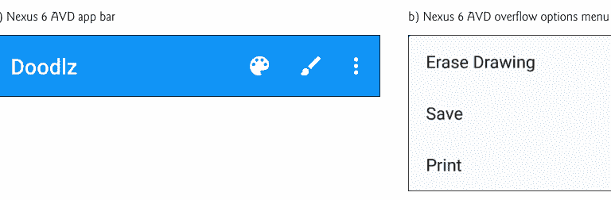

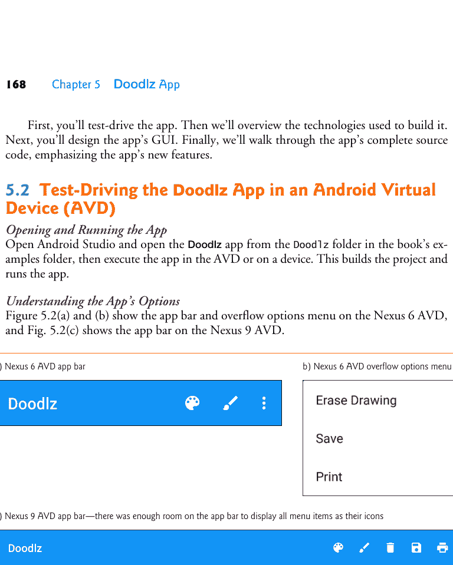

**图 5.2** | 带有选项的 `Doodle` 应用。

此应用具有以下选项：

- **Color** 🎨— 更改绘图颜色

- **Line** ✎— 更改线条粗细

- **Erase** 🧼— 清除图像

- **Save** 💾— 保存图像

- **Print** 🖨️— 打印绘图。

a) 选择深绿色作为绘制颜色

b) 选择更粗的线条

| 选择颜色 | 选择线宽 |

| --- | --- |

| Alpha [slider] | [slider] |

| 红色 [slider] | |

| 绿色 [slider] | |

| 蓝色 [slider] | 设置线宽 |

| [image] 设置颜色 | |

**图 5.6** | 将颜色改为深绿色并加粗线条。


**图 5.7** | 绘制茎部和草地。

*完成绘制*

接下来，将绘制颜色更改为半透明的蓝色（图 5.8(a)），并选择一条较细的线条（图 5.8(b)）。然后画出雨滴（图 5.9）。

a) 选择蓝色作为绘制颜色

b) 选择更细的线条

| 选择颜色 | 选择线宽 |

| --- | --- |

| Alpha | |

| 红色 | |

| 绿色 | |

| 蓝色 | 设置线宽 |

图 5.8 | 将线条颜色改为蓝色并变细线条。


图 5.9 | 使用新的线条颜色和线宽画雨。

### 保存图像

你可以将图像保存到设备并使用“照片”应用查看。要执行此操作，触摸应用栏——如果图标未显示在应用栏上，则从选项菜单中选择“保存”。然后你可以打开“照片”应用查看此图像以及存储在设备上的图像。

### 打印图像

要打印图像，触摸应用栏——如果图标未显示在应用栏上，则从选项菜单中选择“打印”。这将显示打印选项对话。默认情况下，你可以将其保存为 PDF 文档。要选择打印机，点击“保存为 PDF”并从可用打印机列表中选择。如果列表中没有打印机，你需要免费配置 Google Cloud Print。有关此信息，请访问：

```
http://www.google.com/cloudprint/learn/
```

## 5.3 技术概述

本节介绍了我们在 `Doodle` App 中使用的新技术。

### 5.3.1 Activity 和 Fragment 生命周期方法

`Fragment` 的生命与其 `Activity` 绑定。有六个生命方法对应相应的 `Fragment` 方法——`onCreate`、`onStart`、`onResume`、`onPause`、`onStop` 和 `onDestroy`。当系统在 `Activity` 上调用这些方法时，也会调用 `Activity` 附加 `Fragment` 的相应的 `Fragment` 方法（以及其他 `Fragment` 生命周期方法）。

此应用使用了 `Fragment` 生命周期 `onResume` 和 `onPause`。当 `Fragment` 显示在屏幕上供用户交互时，`Activity` 的 `onResume` 方法会被调用。当 `Activity` 恢复 `Fragment`且 `Activity` 恢复时，所有 `Fragment` 的 `onResume` 方法都会被调用。`MainActivity` 重写 `onResume` 以启用监听传感器事件，以便用户可以使用绘制（第 5.7 节）。

当另一个 `Activity` 焦点时，`Activity` 的 `onPause` 方法会被调用，导致当前 `Activity` 暂停并将焦点交给后台。当 `Activity` 托管 `Fragment` 且 `Activity` 暂停时，所有 `Fragment` 的 `onPause` 方法都会被调用。最后，`MainActivity` 重写 `onPause` 以挂起监听摇晃加速事件（第 5.7.4 节）。

> 性能提示 5.1

> 当应用暂停时，它应该移除传感器事件的监听器，这样这些事件在不在屏幕上时就不会传递给应用。这可以节省电池。

我们在需要时讨论其他的 `Activity` 和 `Fragment` 生命周期方法。关于完整 `Activity` 生命周期更多信息，请访问：

```
http://developer.android.com/reference/android/app/Activity.html#ActivityLifecycle
```

关于完整 `Fragment` 生命周期更多信息，请访问：

```
http://developer.android.com/guide/components/fragments.html#Lifecycle
```

### 5.3.2 自定义视图

你可以创建一个 `View` 类或其子类的自定义视图，正如我们在 `DoodleView`（第 5.8 节）中所做的那样。要在布局文件中添加自定义组件，必须提供其完全限定名称（即包名和类名），因此在将其添加到布局之前，自定义视图的类必须存在。我们演示了如何创建 `DoodleView` 类并将其添加到布局（第 5.5.2 节）。

### 5.3.3 使用 SensorManager 监听加速度计事件

在此应用中，你可以摇晃设备来擦除绘制。大多数设备都有加速度计来检测设备运动。目前支持的传感器包括重力、陀螺仪、光、线性加速度、磁场、方向、压力、旋转和矢量温度。你将使用 `Sensor` 的类型常量来指定应用应该接收数据的传感器。传感器列表可以在此处找到：

```
http://developer.android.com/reference/android/hardware/Sensor.html
```

我们将在第 5.7 节讨论加速度计和传感器事件处理。有关讨论，请参：

```
http://developer.android.com/guide/topics/sensors/overview.html
```

（注：OCR 文本在 5.3.4 到 5.3.6 节之间存在大量重复。我已经清理了重复内容，并根据提供的标题维护了逻辑结构。）

## 5.3.8 打印与 Android Support PrintHelper 类

在本应用中，我们使用 Android 框架中的 `PrintHelper`（第 5.8.12 节）来打印当前图形。`PrintHelper` 类提供了选择打印机的用户界面、判断给定设备是否支持打印的方法，以及一个打印 `Bitmap` 方法。`PrintHelper` 是 Android Support Library 的一部分，该库为当前和旧版本提供了新的 Android 功能。支持库还包含了如 `PrintHelper` 等支持特定 Android 版本的额外功能。

## 5.3.9 Android 6.0 (Marshmallow) 新权限模型

Android 要求应用在写入外部存储之前拥有 `android.permission.WRITE_EXTERNAL_PERMISSION` 权限。对于 Doodle，我们需要为用户绘制的图像指定此权限。

Android 6.0 (Marshmallow) 拥有全新的权限模型，旨在提供更好的用户体验。在 6.0 之前，用户在安装时需要授予应用可能需要的所有权限——这导致许多人不安装应用。使用新模型后，安装时不会请求任何权限。相反，只有在用户第一次使用相应功能时，才会被要求授予权限。

一旦用户授予了权限，该应用将一直拥有该权限，直到：

- 应用被重新安装

- 用户通过 Android 设置更改了应用的权限。

你将在第 5.7.8–5.7.9 节中学习如何实现这种新权限模型。

## 5.3.10 使用 Gradle 构建系统添加依赖

Android Studio 使用 Gradle 构建系统将你的代码编译为 APK 文件——可安装的程序。Gradle 还负责处理项目依赖关系，例如在构建过程中包含应用所使用的任何库。对于 Doodle，你需要在项目中添加一个支持库，以便可以使用 `PrintHelper` 打印图像（第 5.4.2 节）。

## 5.4 创建项目与资源

在本节中，你将创建项目，为应用的菜单项导入 Material Design 图标，并通过 GUI 和你的应用的 Java 代码使用各种资源。

## 5.4.1 创建项目

创建一个新的 `Activity` 项目。在“新建项目”（Create New Project）对话框的“下一步”步骤中指定以下值：

- Application name（应用名称）：`Doodle`

- Application Domain（应用域）：`com.doodle`（或指定你自己的域名）


对于“新建项目”对话框中的剩余步骤，使用与第 4.4.1 节中相同的设置。这将创建一个包含 Fragment 的`MainActivity`。该 Fragment 将定义应用的绘制区域并响应用户的触摸。按照第 2.5.2 节的步骤为你的项目添加图标。

一旦在 Android Studio 中打开项目，在布局编辑器中，从虚拟设备下拉下拉列表中选择 Nexus 6（图 2.1）。同时，删除`fragment_main.xml`中的`Hello world!` `TextView`以及`activity_main.xml`中的`FloatingActionButton`。

使用主题编辑器（第 3.5.2 节）将 Material Blue 500 设置为应用的颜色，Material Blue 700 设置为深色，Light blue 450 设置为连接色。此外，按照第 4.4.3 节的步骤为 Java SE 7 配置项目。

## 5.4.2 为项目添加支持库

本应用需要 Android Support Library 来使用 Helper 类。要将应用支持库作为依赖项，请遵循以下步骤：

1. 右键点击 app 文件夹，然后选择 Open Module（打开模块）。
2. 在弹出的 Project Structure（项目结构）窗口中，打开 Dependencies（依赖）选项卡。
3. 点击添加按钮 (+)，然后选择 Library dependency（库依赖项）以打开 Choose Library dependency（选择库依赖项）。
4. 从列表中选择`support-v4 (com.android.support:support-v4:23.1.0)`，然后点击 OK。依赖项将出现在 Dependencies 列表中。
5. 点击 OK。IDE 将显示 Gradle sync in progress...（正在同步 Gradle...），同时项目配置使用 Android Support Library。

关于何时以及如何设置 Android Support Library 的更多信息，请访问：

```
http://developer.android.com/tools/support-library
http://developer.android.com/tools/support-library/setup.html
```

## 5.4.3 strings.xml

你在之前的章节中创建了资源，我们在这里只显示 String 资源名称和对应的值（图 5.10）。双击`res/values`文件夹下的`strings.xml`，然后点击 Open editor（打开编辑器）链接显示 Translations Editor（翻译编辑器）以创建这些资源。

> **外观观察 5.2**

> 对于支持大写字母的语言，Google 的 Material 设计规范指示按钮的文本应使用全大写字母（例如 CANCEL 或 SET COLOR）。

| Key（键） | Default Value（默认值） |
| :--- | :--- |
| button_erase | Erase Image |
| button_set_color | Set Color |
| button_set_line_width | Set Line Width |
| line_imageview_description | This displays the line thickness |

图 5.10 | Doodle 应用使用的 String 资源。（两部分第一部分。）

## 第 5 章 Doodlz 应用

| Key（键） | Default Value（默认值） |
| :--- | :--- |
| label_alpha | Alpha |
| label_red | Red |
| label_green | Green |
| label_blue | Blue |
| menuitem_color | Color |
| menuitem_delete | Erase Drawing |
| menuitem_line_width | Line Width |
| menuitem_save | Save |
| menuitem_print | Print |
| message_error | Erase Drawing |
| message_saved | There was saving |
| permission_explanation | write to external storage |
| title_color | Color |
| title_line_width | Line Width |

### 5.4.4 为应用菜单导入 Material Design 图标

本应用的菜单为每个菜单项指定了图标。使用第 4.4 节中学习的技巧导入矢量：

- `ic_palette_24dp`
- `ic_brush_24dp`
- `ic_delete_24dp`
- `ic_save_24dp`
- `ic_print_24dp`

括号中的名称显示在 Studio 中。打开其 XML 文件并将颜色更改为：

```
@color/white
```

### 5.4.5 MainActivity 菜单

在第 4 章中，你编辑了 IDE 提供的默认菜单。在本应用中，你将为 `MainActivity` 定义自己的菜单。删除项目菜单文件夹中的`main.xml`文件。你还需要从 Activity 中移除`onCreateMenu`和`onOptions`，因为它们将不会被使用。

### 针对不同 Android 版本的菜单

请记住，打印功能在 Android 4.4 之前的版本不可用。如果你正在开发适用于多个 Android 版本的应用，你可能希望使用资源限定符（resource qualifiers）创建多个菜单。例如，你可以为 Android 4.4 之前的版本创建一个菜单资源，并为 Android 4.4 及更高版本创建一个独立的。在`pre-Android44`的菜单资源中，你可以省略早期版本中不可用的菜单选项。

### 创建菜单

要创建菜单，请遵循以下步骤：

1. 右键点击`res/menu`文件夹并选择 New > Menu resource file（菜单资源文件）以打开 New Resource 对话框。
2. 在 File name（文件名）中输入`doodle_fragment_menu.xml`并点击 OK。IDE 在编辑器中打开文件并显示文件的 XML。你必须直接编辑 XML 以向菜单资源中添加菜单项。
3. 在这里，我们使用每个菜单项的`showsAction`来指定如果有空间，该菜单项应显示在应用栏上。使用 Android Support Libraries 提供向后兼容的应用时，必须使用 XML 命名空间的`showsAction`属性，而不是`android` XML 命名空间。编辑 `<menu>` 元素的起始标签以包含 XML 命名空间。
4. 将图 5.1 中的第一个菜单项添加到 XML 文件中。该菜单项的 id 为`@id/color`，标题属性为`@string/menuitem_color`，图标属性为`@drawable/ic_palette_24dp`，`showsAction`属性为`room`。`ifRoom`值表示，如果有可用空间，Android 应将菜单项显示在应用栏上；否则，该菜单项将作为文本项出现在应用栏右侧的溢出选项菜单中。

```xml
<item
    android:id="@id/color"
    android:title="@string/menitem_color"
    android:icon="@drawable/ic_palette_24dp"
    app:showAsAction="ifRoom"
</item>
```

**图 5.11** 表示菜单项的 `<item>` 元素。

5. 针对图 5.12 中的每个 ID 和值重复步骤 3，以创建线宽、删除、保存和打印的菜单项，然后保存并关闭菜单文件。完成后的菜单 XML 如图 5.13 所示。

| Id | 标题 |
|---|---|
| `@id/line_width` | `@string/menitem_line_width` |
| `@id/delete_drawing` | `@string/menitem_delete` |
| `@id/save` | `@string/menitem_save` |
| `@id/print` | `@string/menitem_print` |

**图 5.12** `MainActivityFragment` 的额外菜单项。

```xml
<?xml version="1.0" encoding="utf-8"?>
<menu xmlns:android="http://schemas.android.com/apk/res/android"
    xmlns:app="http://schemas.android.com/apk/res-auto">
<item
    android:id="@id/color"
    android:title="@string/menitem_color"
    android:icon="@drawable/ic_palette_24dp"
    app:showAsAction="ifRoom"
</item>
<item
    android:id="@id/line_width"
    android:title="@string/menitem_line_width"
    android:icon="@drawable/ic_brush_24dp"
    app:showAsAction="ifRoom"
</item>
<item
    android:id="@id/delete_drawing"
    android:title="@string/menitem_delete"
    android:icon="@drawable/ic_delete_24dp"
    app:showAsAction="ifRoom"
</item>
```

**图 5.13** `doodle_fragment_menu.xml`（共 2 部分的第 1 部分）。

```xml
<item>
  android:id="@id/save"
  android:title="@string/menuitem_save"
  android:icon="@drawable/ic_save_24dp"
  app:showAsAction="ifRoom"
</item>
<item>
  android:id="@id/print"
  android:title="@string/menuitem_print"
  android:icon="@drawable/ic_print_24dp"
  app:showAsAction="ifRoom"
</item>
```

图 5.13 | `doodle_fragment_menu.xml`（共 2 部分的第 2 部分。）

## 5.4.6 向 AndroidManifest.xml 添加权限

除了在应用请求用户动态授予权限时使用 Android 6.0 的新权限模型外，每个应用还必须在 AndroidManifest.xml 文件中指定它使用的权限。操作如下：

1. 展开 manifests 文件夹并打开`AndroidManifest.xml`。
2. 在 `<manifest>` 元素内部且 `<application>` 元素之前添加：

```xml
<uses-permission
  android:name="android.permission.WRITE_EXTERNAL_STORAGE" />
```

## 5.5 构建应用的 GUI

在本节中，你将创建应用的 GUI 以及用于应用对话框的类。

### 5.5.1 MainActivity 的 content_main.xml 布局

`MainActivity` 的 `content_main.xml` 布局仅包含 `MainActivity`，它是在你创建项目时自动生成的。为了提高代码的可读性，我们更改了 fragment id 属性：

1. 在编辑器的设计（Design）视图中打开`content_main.xml`。
2. 在组件树（Component Tree）中选择 fragment，然后在属性窗口中将 Fragment 的 id 改为 `doodleFragment` 并保存布局。

### 5.5.2 MainActivityFragment 的 fragment_main.xml 布局

`MainActivityFragment` 的 `fragment_main.xml` 布局只需要显示一个 Doodle。布局文件是在创建项目时自动生成的。要将 fragment 的根元素从`RelativeLayout`更改为`Doodle`，你必须先创建类`Doodle`（`View` 的子类），在布局中放置自定义视图时可以选择它：

1. 展开项目中的 java 文件夹。
2. 右击`com.deite1.doodlez`节点，然后选择 New > Java Class。
3. 在出现的 New Class 对话中，在 Name 字段输入`DoodleView`，然后点击 OK。文件将在编辑器中自动打开。
4. 在`DoodleView.java`中，通过将类定义扩展 `View` 来指示 `DoodleView` 是 `View` 的子类。如果 IDE 不允许导入 `android.view.View`，将光标放在 `Views` 之后。然后点击 `DoodleView` 定义上方出现的红色灯泡（💡）并选择 Import Class。
5. IDE 将显示一个错误，指示你没有为新类定义构造函数。要修复此问题，将光标紧接 `extending` 之后。点击 `DoodleView` 定义上方出现的红色灯泡（💡）并选择 Create constructor matching。在 Choose Super Constructor 对话中，选择两个参数的构造函数，然后点击 OK。IDE 将把构造函数添加到类中。在第 5.5.3 节中，Android 在填充 View 时会调用该双参数构造函数——第二个参数指定了布局文件中的 View 属性。你可以了解更多关于 View 构造函数的信息：`http://developer.android.com/reference/android/view/View(android.content.Context)`
6. 切换到布局编辑器中的`fragment_main.xml`并点击 Tab。
7. 将`RelativeLayout`更改为`com.deite1.doodlez.DoodleView`。
8. 移除 top、right、bottom 和 left padding 的属性——DoodleView 应该占据整个屏幕。
9. 在设计视图中，在组件树中选择 CustomView—`com.deite1.doodlez.DoodleView`，将 id 设置为 `doodle`。
10. 保存`fragment_main.xml`。

### 5.5.3 ColorDialogFragment 的 fragment_color.xml 布局

`ColorDialogFragment` 的 `fragment_color.xml` 布局包含一个双列的 GridLayout，用于显示选择和预览绘图的 UI。在本节中，你将创建 `ColorDialogFragment` 的布局。要添加 `fragment_color.xml`：

1. 在项目窗口中展开 `res/layout` 节点。
2. 右击 `Layout` 文件夹并选择 New > Layout。
3. 在 File 字段中输入`fragment_color.xml`。
4. 根元素选择 `GridLayout`。
5. 在组件树中选择 `GridLayout`。
6. 在属性窗口中将 `columnCount` 设置为 2。
7. 使用调面板（Palette）将 TextViews 和 SeekBars 拖到 `GridLayout` 节点上，如图中所示的每个项。

#### 将 View 添加到布局

View 不需要它自己的类——我们将通过直接编辑布局来添加 View 对象，所以：

1. 点击布局底部的 Tab 切换到代码（XML）视图。
2. 在 `</layout>` 标签之前添加以下代码：

```xml
<View
    android:layout_width="wrap_content"
    android:layout_height="@dim/color_height"
    android:id="@id/colorView"
    android:layout_column="0"
    android:layout_columnSpan="2"
    android:layout_gravity="fill_horizontal"/>
```

3. 回到布局的设计视图。根据图中配置 GUI 属性。对于维度 `color_height`，记得在资源（Resources）中可以点击 New 并选择 New Dimension... 打开 New Dimension Resource 对话框。为 `color_height` 指定 80dp。
4. 保存并关闭`fragment_color.xml`。

| GUI 组件 | 属性 | 值 |
| --- | --- | --- |
| `alphaLayout` | `columnCount` | 2 |
| | `orientation` | vertical |
| | `useDefaultMargins` | true |
| | padding top | `@dim/activity_vertical_margin` |
| | padding bottom | `@dim/activity_vertical_margin` |


# 第5章 Doodlez App

| GUI 组件 | 属性 | 值 |
|---|---|---|
|  | padding left | `@dim/activity_horizontal_margin` |
|  | padding right | `@dim/activity_horizontal_margin` |
| `alphaTextView` | Layout Parameters | 0 |
|  | layoutcolumn | right, center, vertical |
|  | layoutgravity | 0 |
|  | layoutrow | Other Properties |
|  | text | `@string/label_alpha` |
| `alphaSeekBar` | Layout Parameters | 1 |
|  | layoutcolumn | fill_horizontal |
|  | layoutgravity | 0 |
|  | layoutrow | Other Properties |
|  | max | 255 |
| `redTextView` | Layout Parameters | 0 |
|  | layoutcolumn | right, center, vertical |
|  | layoutgravity | 1 |
|  | layoutrow | Other Properties |
|  | text | `@string/label_red` |
| `redSeekBar` | Layout Parameters | 1 |
|  | layoutcolumn | fill_horizontal |
|  | layoutgravity | 1 |
|  | layoutrow | Other Properties |
|  | max | 255 |
| `greenTextView` | Layout Parameters | 0 |
|  | layoutcolumn | right, center, vertical |
|  | layoutgravity | 2 |
|  | layoutrow | Other Properties |
|  | text | `@string/label_green` |
| `greenSeekBar` | Layout Parameters | 1 |
|  | layoutcolumn | fill_horizontal |
|  | layoutgravity | 2 |
|  | layoutrow | Other Properties |
|  | max | 255 |

## 5.5 构建应用程序的 GUI

| GUI 组件 | 属性 | 值 |
|---|---|---|
| `blueTextView` | 布局参数<br>`layout:column`<br>`layout:gravity`<br>`layout:row`<br>其他属性<br>`text` | 0<br>right, center_vertical<br>3<br>`@string/label_blue` |
| `blueSeekBar` | 布局参数<br>`layout:column`<br>`layout:gravity`<br>`layout:row`<br>其他属性<br>`max` | 1<br>fill_horizontal<br>3<br>255 |
| `colorView` | 布局参数<br>`layout:height`<br>`layout:column`<br>columnspan<br>`layout:gravity` | `@dimen/color_view_height`<br>2<br>fill_horizontal |

图 5.16 fragment_color.xml 中 GUI 组件的属性值。（第 2 部分，共部分）

### 向项目添加 `ColorDialogFragment` 类

要添加 `ColorDialogFragment` 类，请右键点击上层包 `com.deitel.doodl2` 并选择 **New > Java Class** 以显示“创建新类”对话框。

1. 在项目文件夹中，右键点击上层包 `com.deitel.doodl2` 并选择 **New > Java Class** 以显示“创建新类”对话框。
2. 在 **Name** 字段中输入 `ColorDialogFragment`。
3. 点击 **OK** 创建该类。你将在第 5.9 节创建此类的代码。

### 5.5.4 `LineWidthDialogFragment` 的 `fragment_line_width.xml` 布局

`LineWidthDialogFragment` 的 `fragment_line_width.xml` 布局包含一个 `GridLayout`，用于显示用于选择和预览新线宽的 GUI。在本节中，你将创建 `LineWidthDialogFragment` 的布局和类。

要添加 `fragment_line_width.xml` 布局：

1. 在 Project 窗口中展开项目的 `res/layout` 节点。
2. 右键点击布局文件夹并选择 **New > Layout resource file** 以显示“新资源”对话框。
3. 在 **Dialog Name** 字段中输入 `fragment_line_width.xml`。
4. 在 **Root element** 字段中输入 `GridLayout`，然后点击 **OK**。
5. 在 Component Tree（组件树）窗口中，选择 `GridLayout` 并将其 id 值更改为 `LineWidthDialogGridLayout`。
6. 使用布局编辑器的 Palette（调色板），将一个 `ImageView` 和一个 `SeekBar` 拖到 `LineWidthDialogLayout` 节点上，使 Component Tree 窗口如 5.17 所示。如图所示设置每个项的 id。

   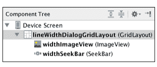

   **图 5.17** | `fragment_line_width.xml` 的组件树。

7. 按照图 5.18 所示的值配置 GUI 组件。为维度值 `line_imageview_height` 赋值 `50dp`。
8. 保存并关闭 `fragment_line_width.xml`。

| GUI 组件 | 属性 | 值 |
|---|---|---|
| `LineWidthDialog` | column Count | 1 |
|  | orientation | vertical true |
|  | useDefaultMargins | `@dim/activity_vertical_margin` |
|  | padding top | `@dim/activity_vertical_margin` |
|  | padding bottom | `@dim/activity_horizontal_margin` |
|  | padding left | `@dim/activity_horizontal_margin` |
|  | padding right | `@dim/activity_horizontal_margin` |
| `ImageView` | Layout Parameters |  |
|  | layoutheight | `@dim/line_imageview_height` |
|  | gravity | fill_horizontal |
|  | Other Properties | `@string/line_imageview_description` |
| `SeekBar` | Layout Parameters |  |
|  | gravity | fill_horizontal |
|  | Other Properties |  |
|  | max | 50 |

**图 5.18** | `fragment_line_width.xml` 中 GUI 组件的属性值。

### 向项目添加 `LineWidthDialogFragment`

要向项目添加 `LineWidthDialogFragment` 类：

1. 在项目的 `java` 文件夹中，右键点击上层包名 `com.deitel.doodl2` 并选择 **New > Java Class** 以显示 **Create New** 对框。
2. 在 **Name** 字段中输入 `LineWidthDialogFragment`。
3. 点击 **OK** 创建该类。

### 5.5.5 添加 `EraseImageDialogFragment`

`EraseImageDialogFragment` 不需要布局资源，因为它将显示一个包含文本的简单 `AlertDialog`。要向项目添加 `EraseImageDialogFragment` 类：

1. 在你的项目 `java` 文件夹中，右键点击上层包 `com.deitel.doodl2` 并选择 **New > Java Class** 以显示“创建新类”。
2. 在 **Name** 字段中输入 `EraseImageDialogFragment`。
3. 点击 **OK** 创建该类。

## 5.6 `MainActivity` 类

此应用程序由六个类组成：

- `MainActivity`（下文讨论）——这是应用程序 Fragments 的 Activity。
- `MainActivityFragment`（第 5.7 节）——管理 `DoodleView` 和加速度计事件处理器。
- `DoodleView`（第 5.8 节）——提供绘制、打磨和打印功能。
- `ColorDialogFragment`（第 5.9 节）——当用户选择设置颜色选项时显示的 DialogFragment。
- `EditTextDialogFragment`（第 5.10 节）——当用户选择设置线高选项时显示的 DialogFragment。
- `EraseImageDialogFragment`（第 5.11 节）——当用户选择擦除或摇晃设备擦除当前绘画时显示的 DialogFragment。

`MainActivity` 的 `onCreate`（图 5.19）初始化 GUI（第 16 行）并配置其栏（第 17–18 行），它使用了第 4.6 节中的技术来确定设备的尺寸和方向。如果设备是大屏（第 26 行），则使用横屏模式（第 27 行），否则使用竖屏模式（第 30–31 行）。

```java
// MainActivity.java
// 设置
package com.deitel.doodl2;

import android.content.Context;
import android.content.Configuration;
import android.os.Bundle;
import android.support.v7.app.AppCompatActivity;
import android.support.v7.widget.Toolbar;

// MainActivity 类
public class MainActivity extends AppCompatActivity {

    // 初始化
    @Override
    protected void onCreate(Bundle savedInstanceState) {
        super.onCreate(savedInstanceState);

        setContentView(R.layout.activity_main);

        Toolbar toolbar = (Toolbar) findViewById(R.id.toolbar);
        setSupportActionBar(toolbar);

        // 获取屏幕尺寸
        Configuration screenSize = getResources().getConfiguration();

        // 对于大屏设备，使用横屏
        if (screenSize.screenWidthDp >= Configuration.SCREEN_LARGE) {
            setOrientation(ActivityInfo.LANDSCAPE);
        } else {
            // 否则使用竖屏
            setOrientation(ActivityInfo.PORTRAIT);
        }
    }
}
```

图 5.19 | `MainActivity` 类。

## 5.7 `MainActivityFragment`

`MainActivityFragment`（第 5.7 节）显示 `DoodleView` 并管理加速度计事件处理器，用于应用程序的功能。

### 5.7.1 包设置、导入语句和字段

`MainActivityFragment`（第 5.7 节）显示 `DoodleView`（第 5.8 节），管理加速度计信息，如图 5.20 所示。第 25–27 行的 `float` 变量用于判断用户是否摇晃了设备以擦除。

```java
// MainActivityFragment.java

// Fragment
package com.deitel.doodlel2;

import android.Manifest;
import android.app.AlertDialog;
import android.content.Context;
import android.content.DialogInterface;
import android.content.pm.PackageManager;
import android.hardware.Sensor;
import android.hardware.SensorEventListener;
import android.hardware.SensorManager;
import android.os.Bundle;
import android.support.v4.fragment.Fragment;
import android.view.LayoutInflater;
import android.view.Menu;
import android.view.Inflater;
import android.view.MenuItem;
import android.view.View;
import android.view.ViewGroup;

public class MainActivityFragment extends Fragment {

    private DoodleView doodleView; // 处理触摸和绘制

    private float acceleration;
    private float currentAcceleration;
    private float lastAcceleration;
    private boolean dialogOpen = false;

    // 使用该值判断用户是否摇晃设备以擦除
    private static final int ACCELERATION_THRESHOLD = 100000;

    // 用于识别保存图像所需的请求
    private static final int SAVE_IMAGE_PERMISSION_REQUEST_CODE = 1;
}
```

图 5.20 | `MainActivityFragment` 的包声明、导入语句和字段。

### 5.7.2 重写 Fragment 方法 `onCreateView`

`onCreateView` 方法加入 `MainActivityFragment` 的 GUI 并初始化实例变量。Fragment 可以在应用程序的标题栏和选项菜单中放置项。为了实现这一点，Fragment 必须调用 `setOptionsMenu` 方法并传递 `true`。如果父 Activity 有选项菜单，则 Activity 和 Fragment 的项将放置在标题栏或选项菜单中（取决于其设置）。

```java
// 当 Fragment 的视图需要创建时
@Override
public View onCreateView(
        LayoutInflater inflater,
        ViewGroup container,
        Bundle savedInstanceState) {
```

图 5.21 | 重写 Fragment 方法 `onCreateView`（第 1 部分，共部分）

```java
super.onCreateView(inflater, container, savedInstanceState);

View view =
    inflater.inflate(R.layout.fragment_main, container, false);

setHasOptionsMenu(true); // 此 fragment 有要显示的菜单项

// 获取 DoodleView 的引用
doodleView = (DoodleView) findViewById(R.id.doodleView);

// 初始化加速度值
acceleration = 0.00f;
currentAcceleration = SensorManager.GRAVITY_EARTH;
lastAcceleration = SensorManager.GRAVITY_EARTH;

return view;
```


## 图 5.21 | 重写 Fragment 方法（第2部分，共2部分）

第 48 行获取了`DoodleView`的引用，然后第 51–53 行初始化了变量，通过加速度的变化来判断用户是否摇动了设备。我们最初将`currentAcceleration`和`lastAcceleration`设置为`Sensor.GRAVITY_EARTH`，这代表地球重力产生的加速度。`SensorManager`还为太阳系中的其他行星、月球以及其他趣味数值提供了常量，你可以在此处查看：

```
http://developer.android.com/reference/hardware/SensorManager.html
```

## 5.7.3 方法 onResume 和 enableAccelerometerListening

加速度计监听应仅在`MainActivity`可见时开启。因此，我们重写了`Fragment`方法`onResume`（图 5.22，第 58–62 行），该方法在`Fragment`位于屏幕上并供用户交互时被调用。`onResume`调用方法`enableAccelerometerListening`（第 65–79 行）来开始监听加速度计事件。使用`SensorManager`来注册加速度计事件的监听器。

方法`enableAccelerometerListening`使用`Activity`的`getSystemService`获取系统的`SensorManager`服务，这允许应用程序与设备传感器进行交互。第 72–74 行使用`SensorManager.registerListener`注册以接收加速度计事件，该方法接收三个参数：

- 用于响应事件的`SensorEventListener`（定义在 5.7.5 节中）。
- 代表应用程序想要接收的传感器数据类型的`Sensor`对象——这通过调用`SensorManager.getDefaultSensor`并传递`Sensor`类型（在本应用中为`SENSOR_ACCELEROMETER`）来获取。
- `Android`传递传感器事件的速率——`SENS_DELAY_NORMAL`表示默认速率。可以使用更快的速率来获取更准确的数据，但这会消耗更多的 CPU 和电量。

## 5.7 MainActivityFragment 类 191

```java
// 开始监听传感器事件
@Override
public void onResume() {
    super.onResume();
    enableAccelerometerListening(); // 监听摇动事件
}

// 开启加速度计事件监听
private void enableAccelerometerListening() {
    SensorManager sensorManager = (SensorManager) getActivity().getSystemService(Context.SENSOR_SERVICE);
    // 注册加速度计事件监听器
    sensorManager.registerListener(sensorEventListener,
    sensorManager.getDefaultSensor(Sensor.TYPE_ACCELEROMETER),
    sensorManager.SENSOR_DELAY_NORMAL);
}
```

图 5.22 方法`onPause`和`enableAccelerometerListening`。

### 5.7.4 方法 onPause 和 disableAccelerometerListening

为了确保在`MainActivityFragment`不在屏幕上时停止加速度计，我们重写了生命周期方法`onPause`（图 5.23，第 78–82 行），该方法调用方法`disableAccelerometerListening`（第 85–94 行）。`AccelerometerEventListener`使用类`sensorManager`的`unregisterListener`方法停止监听加速度计。

```java
// 停止监听加速度计事件
@Override
public void onPause() {
    super.onPause();
    disableAccelerometerListening(); // 停止监听摇动
}

// 关闭加速度计事件监听
private void disableAccelerometerListening() {
    SensorManager sensorManager = (SensorManager) getActivity().getSystemService(Context.SENSOR_SERVICE);
    // 停止监听加速度计事件
    sensorManager.unregisterListener(sensorEventListener,
    sensorManager.getDefaultSensor(Sensor.TYPE_ACCELEROMETER));
}
```

图 5.23 方法`onPause`和`disableAccelerometerListening`。

### 5.7.5 用于加速度计事件的匿名内部类

图 5.24 重写了`SensorEventListener`方法`onChanged`（第 100–123 行）来处理加速度计事件。如果用户移动了设备，该方法将判断该移动是否足以被考虑。如果是，第 121 行调用`confirmErase`（第 7.6 节）到`EraseImageLogFragment`（第 5.11 节），并确认用户是否真的想删除图像。`SensorEventListener`还包含`AccuracyChanged`（第 127 行）——我们在此不使用该方法，因此我们提供一个接口要求的空方法体。

```java
// 加速度计处理器
final SensorEventListener sensorListener =\ new SensorEventListener() {
    // 通过加速度计判断用户是否摇动了设备
    @Override
    public void onChanged(SensorEvent event) {
        // 确保没有显示其他对话框
        if (!dialogOnScreen)
            // 获取 SensorEvent 的 x, y, z 值
            float x = event.values[0];
            float y = event.values[1];
            float z = event.values[2];
            // 保存之前的加速度值
            lastAcceleration = currentAcceleration;
            // 计算当前加速度
            currentAcceleration = x * x + y * y + z * z;
            // 计算加速度的变化
            acceleration = currentAcceleration - lastAcceleration;
            // 如果加速度超过特定阈值
            if (acceleration > ACCELERATION_THRESHOLD)
                confirmErase();
    }
    // InterfaceEventListener 要求的方法
    @Override
    public void onAccuracyChanged(Sensor sensor, int accuracy) {
}
};
```

**图 5.24** | 实现`SensorEventListener`以处理加速度计事件的匿名内部类。

当屏幕上已经显示对话框时，用户仍然可以摇动设备。因此，`onChanged`首先检查是否显示了对话框（第 103 行）。此测试确保了没有显示对话框；否则`onChanged`将返回。这非常重要，因为传感器事件是在不同的执行线程中发生的。

## 5.7 MainActivityFragment 类

如果没有这个测试，当屏幕上还有另一个对话框时，我们将能够显示删除图像的确认对话框。
`SensorEvent`参数包含了发生的传感器变化信息。对于加速度计事件，该参数的`values`数组包含三个元素，代表（单位为`$meters/second^2$`）在`$x$`（左/右）、`$y$`（上/下）和`$z$`（前/后）方向上的加速度。`SensorEvent`使用的坐标系统的描述和图表可见：

```
http://developer.android.com/reference/hardware/SensorEvent.html
```

这还关联了传感器的`$x$`和`$z$`值的实际含义。为了快速处理传感器事件（正如我们所做的），数据数组被每个传感器事件复用。第 105–107 行存储加速度值。第 110 行存储`currentAcceleration`的旧值。第 113 行计算`$x$`和`$z$`加速度值的和并将其入`currentAcceleration`。然后，使用`currentAcceleration`和`lastAcceleration`值，我们计算出一个可以与`ACCELERATION_THRESHOLD`常数比较的值。如果该值大于常量，说明用户移动了设备导致应用发生了摇动。在这种情况下，我们调用方法`confirmErase`。

### 5.7.6 方法 confirmErase

`confirmErase`方法（图 5.25）简单地创建了一个`EraseDialogFragment`（第 5.11 节）并使用`DialogFragment`方法显示它。

```java
// 是否应该删除图像
private void confirmErase() {
    EraseDialogFragment fragment = new EraseDialogFragment();
    fragment.show(getFragmentManager(), "erase dialog");
}
```

图 5.25 | 方法`confirmErase`显示`EraseDialogFragment`。

### 5.7.7 重写的 Fragment 方法 onCreateOptionsMenu 和 onOptionsSelectedItem

图 5.26 重写了`Fragment`的`onCreateOptionsMenu`（第 137–141 行），使用方法的`Inflater`参数将选项添加到菜单中。当用户选择菜单项时，`Fragment`方法`onItemSelectedSelected`（第 144–169 行）响应该选择。

我们使用`Menu`的`getItemID`（第 147 行）获取所选菜单项的资源 ID，然后根据选择采取不同的操作。操作如下：

- 对于`R.id.color`，第 149–150 行创建并显示`ColorDialogFragment`（第 5.9 节），允许用户选择绘画颜色。

# 194 第 5 章 Doodly 应用

- 对于`R.id.line_width`，第 153–155 行创建并显示`LineWidthDialogFragment`（节 5.10），允许用户选择新的线宽。
- 对于`R.id.delete_drawing`，第 158 行调用`confirmErase`（节 5.7.6）显示`EraseDialogFragment`（节 5.11）并确认用户是否想要删除图像。
- 对于`R.id.save`，第 161 行调用`saveImage`，在检查外部存储写入权限并在必要时请求后，将绘画保存为存储在用户“照片”中的图像。
- 对于`R.id.print`，第 164 行调用`doodleView.printImage`方法，允许用户将图像保存为 PDF 或打印图像。

```java
// displays the fragment's menu items
@Override
public void onCreateOptionsMenu(Menu menu, MenuInflater inflater) {
    super.onCreateOptionsMenu(menu, inflater);
    inflater.inflate(R.menu.doodle_fragment_menu, menu);
}

// handle choose from options menu
@Override
public boolean onOptionsItemSelected(MenuItem item) {
    // switch on the MenuItem id
    switch (item.getItemId()) {
        case R.id.color:
            ColorDialog color = new ColorDialogFragment();
            color.show(getFragmentManager());
            return true; // consume the menu event
        case R.id.line_width:
            LineWidthFragment widthDialog = new LineWidthFragment();
            widthDialog.show(getFragmentManager(), "line width dialog");
            return true; // consume the menu event
        case R.id.delete_drawing:
            confirmErase(); // confirm before erasing image
            return true; // consume the menu event
        case R.id.save:
            saveImage(); // check permission and save current image
            return true; // consume the menu event
        case R.id.print:
            doodleView.printImage(); // print the current images
            return true; // consume the menu event
    }
    return super.onOptionsItemSelected(item);
}
```

图 5.26 | 在`onCreateOptionsMenu`和`onOptionsItemSelected`中重写 Fragment 方法。

## 5.7 MainActivityFragment 类

### 5.7.8 方法 saveImage

方法`saveImage`（图 5.27）在用户在选项菜单中选择“保存”（Save）选项时由`onOptionsItemSelected`调用。`saveImage`方法实现了 Android 6.0 权限模型的一部分，该模型在执行任务之前会检查应用是否具有所需的权限。如果没有，应用将在尝试执行任务之前向用户请求权限。

第 176–178 行检查应用是否具有写入外部存储的权限，以便其可以保存图像。如果应用没有`permission.WRITE_EXTERNAL_STORAGE`权限，第 181–182 行使用内置的`shouldShowRequestRationale`来决定是否应该显示为什么应用需要该权限的解释。当向用户解释为什么应用需要权限有帮助时，该方法返回 true——如果是这样，创建一个带有解释的对话框。当用户点击“确定”按钮时，第 195–197 行使用继承的 Fragment 方法`requestPermissions`请求权限。如果不需要解释——例如，如果这是应用第一次需要权限——第 207–209 行会立即请求权限。

```java
// request the permission needed for saving the image
// necessary or save the image if the app has permission
void saveImage() {
    // checks if the app does not have permission needed
    // to save the image
    if (getContext().checkSelfPermission(
            Manifest.permission.WRITE_EXTERNAL_STORAGE) !=
            PackageManager.PERMISSION_GRANTED) {
        // shows an explanation of why permission is needed
        if (shouldShowRequestRationale(
                Manifest.permission.WRITE_EXTERNAL_STORAGE)) {
            AlertDialog.Builder builder = new AlertDialog.Builder(getActivity());
            // set the message
```


`builder.setMessage(R.string.permission_explanation);`

// add an OK button to the dialog

`builder.setPositiveButton(android.R.string.ok, new Dialog.OnClickListener() {`

`@Override`

`public void onClick(Dialog dialog, int which) {`

// request permission

`requestPermissions(new String[]{Manifest.permission.write_EXTERNAL_STORAGE, SAVE_IMAGE_PERMISSION_REQUEST_CODE});`

`}`

`});`

`}`

`}`

`}`

图 5.27 | 方法 `saveImage`。（部分 2）

```java
202 // display the dialog
203 builder.create().show();
204 }
205 else {
206 // request_permission
207 requestPermissions(
208     new String[] {Manifest.permission.WRITE_EXTERNAL_STORAGE,
209     SAVE_IMAGE_PERMISSION_REQUEST_CODE});
210 }
211 
212 else { // app already has permission to write to storage
213 doodleView.saveImage(); // save the image
214 }
215 }
```

图 5.27 | 方法Image

`requestPermissions` 方法接收应用请求的权限字符串数组和一个用于标识请求的标识（`SAVE_IMAGE_PERMISSION_REQUEST_CODE`）。当用户做出选择（图 5.28）时，系统会调用 `onRequestPermissionsResult`。此应用只有一个权限请求，因此 `switch` 语句在第 224–229 行中只有一个 `case`，用于执行请求的相应操作。

图 5.28 | 允许用户拒绝或允许存储的对话框。

## 5.7 重写方法 onRequestPermissionsResult

`onRequestPermissionsResult`（图 5.29）接收所请求的代码并处理用户的响应。如果应用具有写入外部存储的权限，那么第 213 行调用 `doodleView.saveImage()` 方法来保存图像。

```java
// Called by the system when the user enters or denies the
// permission for saving an image
@Override
public void onPermissionsResult(int requestCode,
    String[] permissions, int[] grantResults) {
    // chooses appropriate action based on which
    // requested permission
    switch (requestCode) {
        case SAVE_PERMISSION_REQUEST:
            if (grantResults[0] == PackageManager.PERMISSION_GRANTED)
                doodleView.saveImage(); // save the image
            return;
    }
}
```

图 5.29 | 重写方法 `onRequestPermissionsResult`。

## 5.10 方法 getDoodleView 和 setDialogOnScreen

`getDoodleView` 和 `setDialogOnScreen` 方法被应用中 `DialogFragment` 子类的方法调用。`getDoodleView` 返回 `DoodleView` 的引用，以便 `DialogFragment` 可以设置画布、线宽或图像。`setDialogOnScreen` 被应用中 `DialogFragment` 子类的 `Fragment` 生命周期方法调用，用于指示涂鸦何时出现在屏幕上。

```java
// returns the DoodleView
public DoodleView getDoodleView() {
    return doodleView;
}
```

图 5.30 | 方法 `getDoodleView` 和 `setDialogOnScreen`（部分 1，共 2。）

# 第 5 章 Doodlz App

```java
236
237   // 表示是否显示了对话框
238   public void setDialogOnScreen(boolean visible) {
239       dialogOnScreen = visible;
240   }
241 }
```

图 5.30 | 方法 `getDoodleView` 和 `setDialogOnScreen`（2.2 的第 2 部分）

## 5.8 DoodleView 类

`DoodleView` 类 (5.8.1–5.8.12) 处理用户的触摸操作并绘制相应的线条。

### 5.8.1 package 语句和 import 语句

图 5.31 列出了 `DoodleView` 的包语句和导入语句。这里高亮显示了新的类和接口。其中许多内容在第 5.3 节中讨论过，其余部分将在我们使用 `DoodleView` 的过程中进行讨论。

```java
1   // DoodleView.java
2   // Doodlz 应用的主视图。
3   package com.deitel.doodlz;
4
5   import android.content.Context;
6   import android.graphics.Bitmap;
7   import android.graphics.Canvas;
8   import android.graphics.Color;
9   import android.graphics.Paint;
10  import android.graphics.Path;
11  import android.graphics.Point;
12  import android.provider.MediaStore;
13  import android.support.v4.print.PrintHelper;
14  import android.util.Attribute;
15  import android.doodleView.Gravity;
16  import android.view.MotionEvent;
17  import android.view.View;
18  import android.widget.Toast;
19
20  import java.util.HashMap;
21  import java.util.Map;
```

图 5.31 | `DoodleView` 的包语句和导入语句。

### 5.8.2 静态变量和实例变量

`DoodleView` 的静态变量和实例变量（图 5.32）用于管理用户当前正在绘制的线条集的数据并绘制这些线条。第 34 行创建了 `pathMap`，它将每个手指 ID（称为指针）映射到当前正在绘制的线条的对应的 `Path` 对象。第 25 行维护每个手指的上一个点——当每个手指移动时，我们从它的当前点到之前的位置绘制一条线。我们将在使用 `DoodleView` 类时讨论其他字段。

```java
// 用于绘图的视图
public class DoodleView extends View {
    // 用于判断手指是否足够再次绘图
    private static final float TOUCH_TOLERANCE = 10;
    private Bitmap bitmap; // 用于显示或保存的画布
    private Canvas bitmapCanvas; // 用于在 bitmap 上绘图
    private final Paint paintScreen; // 用于将 bitmap 绘制到屏幕
    private final Paint paintLine; // 用于在 bitmap 上绘制线条
    // 当前绘制的 Paths 和这些 Paths 中的 Points 的映射
    private final Map<Integer, Path> pathMap = new HashMap<>();
    private final Map<Integer, Point> previousPointMap = new HashMap<>();
```

图 5.32 | `DoodleView` 类实例变量。

### 5.8.3 构造函数

构造函数 (5.33) 初始化了类的几个实例——两个 Map 在第 5.32 行的声明中初始化。5.33 的第 40 行创建了 `Paint` 对象 `screen`，用于在屏幕上显示用户的绘图，第 43 行创建了指定我们当前绘制的线条设置的 `Paint` 对象。第 44-48 行设置了 `paintLine` 对象的设置。我们向 `Paint` 的 `setAntiAlias` 传递 `true` 以启用抗锯齿，从而平滑线条的边缘。接下来，我们通过 `Paint` 的 `setStyle` 方法将 `Paint` 的样式设置为 `Paint.Style.STROKE`。样式 `FILL`、`FILL_AND` 和 `STROKE` 分别代表带边框的填充形状和填充形状。默认选项是 `Paint.Style.FILL`。我们使用 `Paint` 的 `setStrokeWidth` 方法设置线宽。我们还使用 `Paint` 的 `setStrokeCap` 方法通过 `Paint.ROUND` 将线条圆化。

```java
// DoodleView 构造函数初始化 DoodleView
public DoodleView(Context context, AttributeSet attrs) {
    super(context, attrs); // 将 context 传递给 View 的构造函数
    paintLine = new Paint();
    // 设置涂色线条的初始设置
    paintLine = new Paint();
    paintLine.setAntiAlias(true); // 平滑绘制线条的边缘
    paintLine.setColor(Color.BLACK); // 默认颜色为黑色
    paintLine.setStyle(Paint.Style.STROKE); // 实线
    paintLine.setStrokeWidth(5); // 设置默认线宽
    paintLine.setStrokeCap(Paint.Cap.ROUND); // 圆形线端
}
```

图 5.33 | `DoodleView` 构造函数。

### 5.8.4 重写方法 onChanged

`ImageView` 的大小在它被加载（inflated）并添加到 `MainActivity` 的视图层次级之前是不确定的；因此，我们无法在 `Create` 时确定绘图 Bitmap 的大小。我们重写了 `onChanged` 方法（图 5.34），该方法在 `DoodleView` 的大小发生变化时被调用——例如，当它被添加到 Activity 层级或当用户旋转设备时。在此应用程序中，只有当 `DoodleView` 被添加到 `DoodleActivity` 的视图层次级时，`onChanged` 才会被调用，因为该应用在手机上始终以竖屏显示，在平板上以横屏显示。

**软件工程观察 5.3**

在支持竖屏和横屏的应用程序中，每当用户旋转设备时，`onChanged` 都会被调用。在此应用程序中，这将产生一个新的 Bitmap。在替换 Bitmap 时，你应该调用 Bitmap 的 `recycle` 方法来释放资源。


```java
// 基于 View 大小的 Bitmap 和 Canvas
@Override
public void onChanged(int w, int h, int oldW, int oldH) {
    bitmap = Bitmap.createBitmap(getWidth(), getHeight(),
    Bitmap.Config.ARGB_8888);
    canvas = new Canvas(bitmap);
    bitmap.eraseColor(Color.WHITE); // 用白色清除 Bitmap
}
```

> **图 5.34** | 重写方法。

> **基于 View 大小的 Bitmap 和 Canvas** ... 用白色清除 Bitmap ... Canvas 参数的 `drawBitmap` 方法。第一个参数是 Bitmap，后两个参数是 bitmap 在 View 上放置的左上角的 x 坐标，以及指定绘图特征的 `Paint` 对象。

### 5.8.5 方法 clear, setDrawingColor, getColor, setLineWidth 以及 getLineWidth 返回当前的线宽。

# 第 5 章 Doodly App

```java
// perform custom drawing when the DoodleView is refreshed on screen
@Override
protected void onDraw(Canvas canvas) {
    // draw the background screen
    canvas.drawBitmap(bitmap, 0, 0, paintScreen);
    // for each path currently being drawn
    for (Integer key : pathMap.keySet()) {
        canvas.drawPath(pathMap.get(key), paintLine); // draw line
    }
}
```

图 5.36 | 重写的的 View 方法 `onDraw`。

### 5.8.7 重写的方法 onTouchEvent

当用户接收到触摸事件时，会调用 `onTouchEvent` (5.37)。Android 支持多点触控——即允许有多个手指同时触摸屏幕。在任何时候，用户都可以用更多的手指触摸屏幕，或从屏幕上移开手指。每个原因（称为指针/pointer）都有一个唯一的 ID，用于在跨越触摸时标识它。我们使用该 ID 来定位代表当前绘制每条线的对应的 `Path` 对象。这些 Paths 存储在 `pathMap` 中。

```java
@Override
public boolean onTouchEvent(MotionEvent event) {
    int action = event.getActionMasked(); // 事件类型
    int actionIndex = event.getActionIndex(); // 指针（即手指）的索引
    // 确定触摸是开始、结束还是正在移动
    if (action == MotionEvent.ACTION_DOWN ||
        action == MotionEvent.ACTION_POINTER_DOWN) {
        touchStarted(event.getX(actionIndex), event.getY(actionIndex));
        event.getPointerId(actionIndex);
    } else if (action == MotionEvent.ACTION_UP ||
        action == MotionEvent.ACTION_POINTER_UP) {
        touchEnded(event.getPointerId(actionIndex));
    } else {
        touchMoved(event);
    }
    invalidate(); // 重绘
    return true;
}
```


图 5.37 | 重写的方法 `onTouchEvent`。

`MotionEvent` 的 `getActionMasked` 方法（第 102 行）返回一个表示 `MotionEvent` 类型的整数，你可以将其配合 `MotionEvent` 的常量来确定如何处理每个事件。`MotionEvent` 的 `getIndex` 方法（第 103 行）返回一个表示哪个手指导致该事件的唯一 ID。索引并不是手指的唯一标识——它仅仅是手指信息在该 `MotionEvent` 对象中所在的索引。为了获取在用户从屏幕上移开手指时跨 `MotionEvents` 持续的手指 ID，我们使用 `MotionEvent` 的 `getPointerID` 方法（第 109 和第 113 行），并将手指索引作为参数。

如果 `action` 是 `MotionEvent.ACTION_DOWN` 或 `MotionEvent.ACTION_POINTER_DOWN`（第 106-107 行），则用户用新手指触摸了屏幕。第一个触摸屏幕的手指会生成 `MotionEvent.ACTION_POINTER_DOWN` 事件，而所有其他手指都会生成 `MotionEvent.ACTION_POINTER_DOWN`。对于其他情况，我们调用 `touchStarted` 方法（图 5.38）来存储触摸的初始坐标。如果 `action` 是 `MotionEvent.ACTION_UP` 或 `MotionEvent.ACTION_POINTER_UP`，则用户从屏幕上移开了手指，我们可以调用 `touchEnded`（图 5.40）将完成的 `Path` 绘制到 `own` 中，这样我们就有了 `Path` 的永久记录。对于所有其他触摸事件，我们调用 `touchMoved`（图 5.39）来绘制线条。第 119 行（来自 5.37）调用继承自的 `View` 方法 `invalidate` 来重绘屏幕，第 120 行返回 `true` 表示事件已处理。

### 5.8.touchStarted 方法

`touchStarted` 方法（图 5.38）在手指首次触摸屏幕时被调用。触摸的坐标作为参数包含在内。如果给定 ID 已经存在 `Path`（第 129 行），我们调用 `Path` 的 `reset` 方法来清除任何现有点，因为我们正复用该 `Path` 来绘制新的笔画。否则，我们创建一个新的 `Path` 并将其添加到 `touchMap` 中，然后向 `previousPointMap` 添加一个新的 `Point`。第 142-144 行调用 `moveTo` 方法来设置 `Path` 坐标，并指定新 `Point` 的 `x` 和 `y` 值。

```java
// 当手指触摸屏幕时被调用
124 private void touchStarted(float x, float y, int lineID) {
125     Path path; // 用于存储给定 touch id 的路径
126     Point point; // 用于存储路径中的上一个点
127 
128     // 如果 lineID 已经有一个路径
129     if (touchMap.containsKey(lineID)) {
130         path = touchMap.get(lineID); // 获取 Path
131         path.reset(); // 重置路径，因为开始了新的触摸
132         point = previousPointMap.get(lineID); // 获取 Path 的上一个点
133     }
134     else {
135         path = new Path(); // 将 Path 添加到 Map
136         touchMap.put(lineID, path);
137         point = new Point(); // 创建一个新的 Point
138         previousPointMap.put(lineID, point); // 将 Point添加到 Map
139     }
140 
141     // 移动到触摸坐标
142     path.moveTo(x, y);
143 }
```

图 5.38 | `DoodleView` 类的 `touchStarted` 方法。

### 5.8 touchMoved 方法

`touchMoved` 方法（图 5.39）在用户移动多个手指跨越屏幕时被调用。`MotionEvent` 的 `getCount` 方法（第 150 行）返回触摸的数量。`MotionEvent` 的 `get` 方法（第 151 行）返回导致事件的手指索引。`MotionEvent` 的 `getActionMasked` 方法（第 152 行）返回一个表示 `MotionEvent` 类型的整数，你可以配合 `MotionEvent` 的常量来确定触摸是开始、结束还是移动。`MotionEvent` 的 `getX` 方法（第 153 行）和 `getY` 方法（第 154 行）返回手指的坐标。`MotionEvent` 的 `getPointerID`（第 155 行）返回手指的唯一 ID。

如果 `action` 是 `MotionEvent.ACTION_DOWN` 或 `MotionEvent.ACTION_POINTER_DOWN`（第 156-157 行），则用户用新手指触摸了屏幕。第一个触摸屏幕的手指生成 `MotionEvent.ACTION_POINTER_DOWN` 事件，而所有其他手指生成 `MotionEvent.ACTION_POINTER_DOWN`。对于其他情况，我们调用 `touchStarted`（图 5.38）存储初始坐标。如果 `action` 是 `MotionEvent.ACTION_UP` 或 `MotionEvent.ACTION_POINTER_UP`，用户从屏幕上移开了手指，我们可以调用 `touchEnded`（图 5.40）将完成的 `Path` 绘制到位中，这样我们就有了 `Path` 的永久记录。对于所有其他触摸事件，我们调用 `touchMoved`（图 5.39）来绘制线条。第 173 行（来自 5.37）调用继承的 `View` 方法 `invalidate` 来重绘屏幕，第 174 行返回 `true` 表示事件已处理。

```java
// 当用户拖动屏幕时
private void touchMoved(MotionEvent event) {
    // 计算用户距离上一次更新的距离
    float deltaX = Math.abs(newX - point.x);
    float deltaY = Math.abs(newY - point.y);

    // 如果距离足够产生影响
    if (deltaX >= TOUCH_TERANCE || deltaY >= TOUCH_TERANCE) {
        // 将路径移动到新位置
        path.quadTo(point.x, point.y, (newX + point.x) / 2,
            (newY + point.y) / 2);
        // 存储新坐标
        point.x = (int)newX;
        point.y = (int)newY;
    }
}
```

图 5.39 | `DoodleView` 类的 `touchMoved` 方法。

### 5.8.10 touchedEnded

`touchedEnded` 方法（图 5.40）在用户从屏幕上抬起手指时被调用。该方法接收刚刚结束触摸的手指 ID（`ID3D`）。第 187 行调用 `bitmapCanvas.drawPath` 方法将 `Path` 绘制到 `Bitmap` 对象上。重置 `Path` 不会擦除对应的线条，因为这些线条已经绘制到了显示在屏幕上的位图中。这些线条正由用户绘制。

```java
// 当用户完成一次触摸时
private void touchedEnded(int lineID) {
    Path path = touchMap.get(lineID); // 获取对应的 Path
    bitmapCanvas.drawPath(path, paintLine); // 绘制到 bitmapCanvas
    path.reset(); // 重置路径
}
```

图 5.40 | `DoodleView` 类的 `touchedEnded` 方法。

### 5.8.11 saveImage 方法

`saveImage` 方法（图 5.41）保存当前绘制。第 194 行为图像创建文件名，第 197-199 行通过调用 `MediaStore.Images.Media.insertImage` 方法将图像存储在设备的照片中。该方法用于定位图像应该存储在设备上的位置。

- 用于定位图像存储在设备上位置的 `ContentResolver`
- 需要存储的 `bitmap`
- 图像名称
- 图像描述

`insertImage` 方法返回表示图像在设备上位置的字符串，如果无法保存图像，则返回 `null`。第 201–217 行检查图像是否保存并显示适当的 `Toast`。

```java
191     // 将当前图像保存到 Gallery
192 public void saveImage() {
193     // 使用 "Doodle" 加上当前时间作为图像名称
194     final String name = "Doodle" + System.currentTimeMillis() + ".jpg";
195 
196     // 将图像插入设备中
197     String location = MediaStore.Images.insertImage(
198         getContext().getContentResolver(), bitmap, name,
199         "Doodle Drawing");
200 
201     if (location != null) {
202         // 显示表示图像已保存的消息
203         Toast message = Toast.makeText(getContext(),
204             R.string.message_saved,
205             Toast.LENGTH_SHORT);
206         message.setGravity(Gravity.CENTER, message.getXOffset() / 2,
207             message.getYOffset() / 2);
208         message.show();
209     }
210     else {
211         // 显示表示保存错误的消息
212         Toast message = Toast.makeText(getContext(),
213             R.string.message_error_saving, Toast.LENGTH_SHORT);
214         message.setGravity(Gravity.CENTER, message.getXOffset() / 2,
215             message.getYOffset() / 2);
216         message.show();
217     }
218 }
```

图 5.41 | `ImageView` 方法 `saveImage`。

### 5.8.12 方法 printImage

`printImage` 方法（图 5.42）使用 Android 库的 `PrintHelper` 类来打印当前绘图——这适用于运行 Android 4.4 或更高版本的设备。第 222 行查找设备是否支持打印。如果是，第 227 行创建一个 `PrintHelper` 对象，它将按 `FIT` 模式缩放到纸张的可打印区域内。还有 `PrintHelper.SCALE_FILL` 缩放模式，它会导致图像填充纸张，可能会裁剪掉边缘。最后，第 228 行调用 `PrintHelper` 的 `printBitmap` 方法，传递参数为打印任务名称（使用 `printer-helper` 识别打印任务）和包含要打印图像的 `Bitmap`。这将显示 Android 的打印对话框，允许用户选择将图像保存为设备上的 PDF 文档或打印到可用的打印机。

```java
// 打印当前图像
public void printImage() {
    if (PrintHelper.systemSupportsPrint()) {
        // 使用 Android Support Library 的 PrintHelper 打印图像
        PrintHelper printHelper = new PrintHelper(getContext());
        // 将图像调整到页面边界并打印图像
        printHelper.setScale(PrintHelper.SCALE_MODE_FIT);
        printHelper.printBitmap("Doodle Image", bitmap);
    } else {
        // 显示表示系统不允许打印的消息
        Toast message = Toast.makeText(getContext(),
            R.string.message_error_printing, Toast.LENGTH_SHORT);
        message.setGravity(Gravity.CENTER, message.getXOffset() / 2);
        message.show();
    }
}
```

图 5.42 | `DoodleView` `printImage`。

### 5.9 ColorDialogFragment 类

`ColorDialogFragment`（图 5.43–47）扩展了 `DialogFragment` 以创建一个用于设置绘图颜色的 `AlertDialog`。该类的实例变量（第 18–23 行）用于引用设置新颜色的 GUI 控件、绘制其预览，并将颜色存储为表示颜色 ARGB 值的 32 位整型 `int`。

```java
// ColorDialog.Java
// 允许用户在 DoodleView 上设置绘图颜色
package com.deitel.doodle;

import android.app.Activity;
import android.app.AlertDialog;
import android.app.Dialog;
import android.content.DialogInterface;
import android.graphics.Color;
import android.os.Bundle;
import android.support.v4.app.DialogFragment;
import android.view.View;
import android.widget.SeekBar;
import android.widget.SeekBar.OnSeekBarChangeListener;

// 用于设置颜色对话框的类
public class ColorDialogFragment extends DialogFragment {
    private SeekBar alphaSeekbar;
    private SeekBar redSeekbar;
    private SeekBar greenSeekBar;
    private SeekBar blueSeekBar;
    private View colorView;
    private int color;
```

图 5.43 | `DialogFragment` 包语句、导入语句和实例变量。（2 部分中的第 1 部分。）

`onCreateDialog` 方法（图 5.44）包含了由 `fragment_color` 定义的自定义 `View`（第 31–53 行），该 `View` 包含获取选择的 XML，然后通过调用 `setView` 将该 `View` 附加到 `AlertDialog`。第 39–47 行获取 `SeekBars` 的引用。接下，`colorChangeListener`（图 5.7）作为 `SeekBars` 事件的监听器。

```java
25 // 创建 AlertDialog
public Dialog onCreateDialog(Bundle bundle) {
26     // 创建对话框
    AlertDialog.Builder builder = new AlertDialog.Builder(getActivity());
27     // 设置视图
    colorView = builder.getLayoutInflater().inflate(
28         R.layout.fragment_color, null);
29     // 设置标题
    builder.setTitle(R.string.title_color);
30     // 获取 SeekBars
    alphaSeekBar = (SeekBar) colorView.findViewById(R.id.alphaSeekBar);
31     redSeekBar = (SeekBar) colorView.findViewById(R.id.redSeekBar);
32     greenSeekBar = (SeekBar) colorView.findViewById(R.id.greenSeekBar);
33     blueSeekBar = (SeekBar) colorView.findViewById(R.id.blueSeekBar);
34     // 注册 SeekBar 监听器
    alphaSeekBar.setOnSeekBarChangeListener(colorChangeListener);
35     redSeekBar.setOnSeekBarChangeListener(colorChangeListener);
```


```java
36 greenSeek.setOnSeekBarChangeListener(changedChangeListener);

37 blueSeek.setOnSeekBarChangeListener(changedChangeListener);

38 // 使用绘图颜色设置 SeekBar 值

final DoodleView doodleView = getDoodleFragment().getDoodleView();

39 color = doodleView.getDrawingColor();

40 alphaSeek.setProgress(Color.alpha(color));

41 redSeek.setProgress(Color.red(color));

42 greenSeek.setProgress(Color.green(color));

43 blueSeek.setProgress(Color.blue(color));

// 添加设置颜色按钮

builder.setButton(R.string.button_color,

45 new Dialog.Interface.OnClickListener() {

46 public void onClick(DialogInterface dialog, int id) {

47 doodleView.setDrawingColor(color);

48 });

49

// 返回对话框

return builder.create();

50 }
```

**图 5.44** | 重写的 `DialogFragment` 方法 `onCreate`。（2 部分中的第 2 部分）

第 56 行（45）调用 `getDoodleFragment`（图 5.45）获取 `DoodleFragment` 的引用，然后调用 `MainActivity` 的 `DoodleView` 方法获取 `DoodleView`。第 57–61 行调用 `DoodleView` 的当前绘图颜色，用于设置 `SeekBar` 值：`Color` 的静态方法 `alpha`、`red`、`green` 和 `blue` 从颜色中提取 ARGB 值，`SeekBar` 的 `setProgress` 方法定位滑块。第 72 行返回 `AlertDialog`。

### 5.9 方法 `getDoodleFragment`

`getDoodleFragment` 方法（图 5.45）使用 `FragmentManager` 获取 `DoodleFragment` 的引用。

```java
// 获取 MainActivity 的引用

private MainActivity getDoodleFragment() {

    return (MainActivity) getFragmentManager().findFragmentById(

    R.id.doodleFragment);

}
```

**图 5.45** | 方法 `getDoodleFragment`。

### 5.9.3 重写的生命周期方法 `onAttach` 和 `onDetach`

当 `ColorDialogFragment` 添加到父 `Activity` 时，调用 `onAttach` 方法（图 5.46，第 82–89 行）以获取 `MainActivity` 的引用。如果该引用不为空，第 88 行调用 `MainActivity` 的 `setDialogOnScreen` 方法以表示选择颜色对话框现在显示。当 `DialogFragment` 从父 `Activity` 移除时，调用 `onDetach`（第 92–99 行）。

## 210 第 5 章 Doodleliz App

调用。第 98 行调用 `MainActivityFragment` 的 `setDialogOnClick` 方法，表示选择颜色对话框不再显示在屏幕上。

```java
// 现在显示的 MainActivityFragment

@Override

public void onAttach(Activity activity) {

    super.onAttach(activity);

    MainActivityFragment fragment = getDoodleFragment();

    if (fragment != null) {

        fragment.setDialogOnClick(true);

    }

}

// 不再显示的 MainActivityFragment

@Override

public void onDetach() {

    super.onDetach();

    MainActivityFragment fragment = getDoodleFragment();

    if (fragment != null) {

        fragment.setDialogOnClick(false);

    }

}
```

**图 5.46** | 在 `onDetach` 上重写的生命周期方法。

### 5.9.4 响应 Alpha、红、绿、蓝 `SeekBars` 事件的匿名内部类

图 5.47 定义了一个匿名内部类，它实现了 `OnSeekChangeListener`，用于响应用户在“选择颜色”对话框中调整 `SeekBars` 时的事件。它在图 5.44 中注册为 `SeekBars` 的事件处理程序（第 50–53 行）。当 `Seekbar` 的滑块改变时，会调用 `onProgress` 方法（图 5.47，第 105–114 行）。如果用户移动 `Seekbar` 的滑块（第 109 行），第 110–112 行将存储新颜色。`Color` 的静态方法将 `SeekBars` 的值合并为颜色，并以 `int` 类型返回相应的颜色。我们随后使用 `View.setColor` 更新视图，使其颜色与 `SeekBars` 的当前状态匹配。

```java
// 颜色对话框中 SeekBars 的 OnSeekChangeListener

private final OnSeekChangeListener onChangeListener =

    new OnSeekChangeListener() {

        // 显示更新后的颜色

        @Override

        public void onProgressChanged(SeekBar seekbar, int progress,

            boolean fromUser) {

}

}

}
```

**图 5.47** | 实现 `OnSeekChangeListener` 以响应 alpha、红、绿、蓝 `SeekBars` 事件的匿名内部类。（2 部分中的第 1 部分。）

### 5.10 `LineWidthDialogFragment` 类

```java
109 if (fromUser) // 用户更改了 SeekBar 进度，而非程序更改

110 color = Color.argb(alphaSeekBar.getProgress(),

111     redSeekBar.getProgress(), greenSeekBar.getProgress(),

112     blueSeekBar.getProgress());

113

114 colorView.setBackground(color);

115

116 @Override

117     public void onStartTrackingTouch(SeekBar seekBar) {} // 必须实现

118

119 @Override

120     public void onStopTrackingTouch(SeekBar seekBar) {} // 必须实现

121

122 }

```

**图 5.47（续）** | 实现接口 `OnSeekChangeListener` 以响应 alpha、红、绿、蓝 `SeekBars` 事件的匿名类。（2 部分中的第 2 部分）

`LineWidthDialogFragment` 类继承 `DialogFragment` 以创建一个设置宽度的 `AlertDialog`。该类与 `ColorDialogFragment` 类相似，因此我们只讨论主要的区别。唯一的实例变量是一个 `ImageView`（第 21 行），我们在其中绘制一条线来显示当前的宽度设置。

```java
1 // LineWidthDialogFragment.java

2 // 允许用户在 DoodleView 上设置绘制颜色

3 package com.deitel.doodle1;

4

5 import android.app.Activity;

6 import android.app.AlertDialog;

7 import android.app.Dialog;

8 import android.content.DialogInterface;

9 import android.graphics.Bitmap;

10 import android.graphics.Canvas;

11 import android.graphics.Paint;

12 import android.os.Bundle;

13 import android.support.v4.app.DialogFragment;

14 import android.view.View;

15 import android.widget.ImageView;

16 import android.widget.SeekBar;

17 import android.widget.seekBar.OnSeekChangeListener;

19 // 用于选择线条宽对话框的类

20 public class LineWidthDialogFragment extends DialogFragment {

21     private ImageView imageView;
```

**图 5.48** | `LineWidthDialogFragment` 类。（3 部分中的第 1 部分。）

## 212 第 5 章 Doodly App

```java
// 创建一个 AlertDialog 并返回它

@Override

public void onCreateDialog(Bundle bundle) {

    // 创建对话框

    AlertDialog.Builder builder =

        new AlertDialog.Builder(getActivity());

    View lineHeightDialogView =

        getActivity().LayoutInflater().inflate(

        R.layout.line_width, null);

    builder.setView(lineHeightDialogView);

    // 设置 AlertDialog 的消息

    builder.setTitle(R.string.line_width_dialog);

    // 获取 ImageView

    ImageView lineHeight = (ImageView) lineHeightDialogView.findViewById(R.id.lineWidthSeekBar);

    // 配置 SeekBar

    final View doodleView = getDoodleView().getDoodleView();

    final SeekBar widthseekBar = (SeekBar) lineHeightView.findViewById(R.id.widthSeekBar);

    widthseekBar.setOnSeekBarChangeListener((lineWidthChanged) -> {

        doodleView.setLineWidth(lineWidthChanged);

    });

    // 添加设置宽度按钮

    builder.setPositiveButton(R.string.button_set_width,

        new Dialog.OnClickListener() {

            @Override

            public void onClick(DialogInterface dialog, int id) {

                doodleView.setLineWidth(widthseekBar.getProgress());

            }

        });

    return builder.create(); // 返回对话框

}

// 返回 MainActivityFragment 的引用

private MainActivityFragment getDoodleFragment() {

    return (MainActivityFragment) getFragmentManager().findFragmentById(R.id.doodleFragment);

}

// 通知 MainActivityFragment 对话框正在显示

@Override

public void onAttach(Activity activity) {

    super.onAttach(activity);

    MainActivityFragment fragment = getDoodleFragment();

    if (fragment != null) {

        fragment.setDialogScreen(true);

    }

}
```

**图 5.48** | `LineWidthDialog` 类（3 部分中的第 2 部分）。

### 5.10 `LineWidthDialogFragment` 类（续）

```java
// 通知 MainActivityFragment 对话框不再显示

@Override

public void onDetach() {

    super.onDetach();

    MainActivityFragment fragment = getDoodleFragment();

    if (fragment != null) {

        fragment.setDialogScreen(false);

    }

}

// 宽度对话框中 SeekBar 的 OnSeekChangeListener

private final OnSeekChangeListener lineWidthChanged =

    new OnSeekChangeListener() {

        final Bitmap bitmap = Bitmap.createBitmap(

            400, 100, Bitmap.Config.ARGB_8888);

        final canvas = new Canvas(bitmap); // 绘制到位图中

    };

    @Override

    public void onProgressChanged(SeekBar seekBar, int progress,

        boolean fromUser) {

        // 配置表示当前 SeekBar 值的 Point

        Point p = new Point();

        p.setColor(getDoodleFragment().getView().getDrawingColor());

        p.setStrokeCap(Paint.CAP_ROUND);

        p.setStrokeWidth(progress);

        // 擦除线并绘制新的

        bitmap.eraseColor(getContext().getColor());

        getResources().getColor(android.R.color.transparent));

        getContext().getColor(getContext().getColor());

        canvas.drawLine(50, 50, 370, 50, p);

        widthImageView.setImageBitmap(bitmap);

    }

    @Override

    public void onStartTrackingTouch(SeekBar seekBar) {} // 要求的

    @Override

    public void onStopTrackingTouch(SeekBar seekBar) {} // 要求的
```


图 5.48 | `LineWidthDialog`

## 5.10.2 响应 `SeekBar` 事件的匿名内部类

第 87-116 行定义了 `WidthChangedOnSeekChangeListener`，响应用户在“选择宽度”对话框中调整 `SeekBar` 时的事件。第 89-90 行创建一个 `Bitmap` 来显示线条粗细。第 91 行创建一个 `Canvas` 用于在 `Bitmap` 上绘制。`OnChanged` 方法第 93-109 行根据当前绘制颜色和 `SeekBar` 的值绘制线条。

首先，第 97-101 行配置绘制线条的 `Paint` 对象。`Paint` 的 `setCap` 方法（第 100 行）指定了线条的样式——在本例中是圆形（`Paint.Cap.ROUND`）。第 104-106 行使用定义的 `android.R.transparent`，通过 `Bitmap.erase` 方法擦除背景。我们使用 `canvas` 绘制线条，第 108 行通过传递给 `ImageView.setImageBitmap` 方法显示位图。

## 5.11 `EraseDialogFragment` 类

`EraseDialogFragment` 类（图 5.49）继承 `Dialog`，以创建一个确认用户是否真的删除整个图像的 `AlertDialog`。该类与 `ColorDialog` 和 `LineWidthDialogFragment` 相似，因此我们只讨论带有“删除”和“取消”按钮的 `onCreateDialog` 方法。

第 24-30 行将“删除”按钮设置为正按钮——当用户点击它时，第 27 行的监听器调用 `DoodleView` 的 `clear` 方法删除图像。第 33 行将“取消”设置为负按钮——当用户点击它时，对话框将关闭。在本例中，我们使用了定义的字符串 `android.string.cancel`。其他定义的资源请访问：

> http://developer.android.com/reference/R.string.html

```java
// EraseDialogFragment.java

// 允许用户擦除图像

package com.doodlz;

import android.app.Activity;
import android.app.AlertDialog;
import android.app.Dialog;
import android.support.v4.app.DialogFragment;
import android.content.DialogInterface;
import android.os.Bundle;
```

第 34 行返回 `AlertDialog`。

图 5.49 | `EraseDialogFragment` 类。（2 部分中的第 1 部分。）

www.EBooksWorld.com

## S.11 `EraseImageDialogFragment` 类

```java
// 用于擦除图像对话框的类

public class EraseImageDialogFragment extends DialogFragment {

    // 创建一个 AlertDialog 并返回它

    @Override
    public void onCreate(Bundle bundle) {

        AlertDialog.Builder builder =
            new AlertDialog.Builder(getActivity());

        // 设置 AlertDialog 的消息

        builder.setMessage(R.string.message_erase);

        // 添加擦除按钮

        builder.setPositiveButton(R.string.button_erase,
            new DialogInterface.OnClickListener() {

                public void onClick(DialogInterface interface, int id) {

                    getFragment().getView().clear(); // 清除内容

                }

            });

        // 添加取消按钮

        builder.setNegativeButton(android.string.cancel, null);

        return builder.create(); // 返回对话框

    }

}

// 获取 MainActivityFragment 的引用

private MainActivityFragment getFragment() {

    return (MainActivityFragment) getActivityManager().findFragmentById(
        R.id.dialogfragment);

}

// 通知 MainActivityFragment 对话框已显示

@Override
public void onAttach(Activity activity) {

    super.onAttach(activity);

    MainActivityFragment fragment = getFragment();

    if (fragment != null)
        fragment.setDialogOnScreen(true);

}

// 通知 MainActivityFragment 对话框已不再显示

@Override
public void onDetach() {

    super.onDetach();

    MainActivityFragment fragment = getFragment();

    if (fragment != null)
        fragment.setDialogOnScreen(false);

}
```


图 5.49 | `EraseImageDialogFragment` 类。（2 部分中的 2 部分。）

## 216 第 5 章 Doodliz 应用

## 5.12 总结

在本章中，你构建了 Doodliz 应用，它允许用户通过在屏幕上拖动一个或多个手指来绘画。你通过使用 Android 的 `SensorManager` 注册响应加速度计事件的 `SensorEventListener`，实现了“摇晃擦除”功能，并学习了 Android 支持许多其他传感器。你创建了 `DialogFragment` 的子类，用于在 `AlertDialog` 中显示自定义视图。你还探索了 Fragment 生命周期方法 `onAttach` 和 `onDestroy`，它们分别在 Fragment 挂载到父 Activity 时被调用。

我们展示了如何将 `Canvas` 与 `Bitmap` 关联，这意味着将 `Canvas` 绘制到 `Bitmap` 中。我们演示了如何处理多点触摸，以便应用程序响应多个手指同时在屏幕上拖动。通过重写 `onTouchEvent` 方法，你在处理触摸事件时存储了每个手指的信息，该方法返回一个包含事件类型和产生该事件的指针（手指）ID 的 `MotionEvent`。我们使用这些 ID 来区分不同的手指，并向 `Path` 对象中添加信息。

你使用了 `ContentResolver` 和 `MediaStore.Images.Media.insertImage` 方法将图像保存到设备上。为了启用此功能，你使用了 Android 6.0 的新权限机制来请求保存到外部存储的权限。

我们展示了如何使用打印框架允许用户打印他们的画作。你使用了 Android Support Library 的 `PrinterHelper` 类来打印 `Bitmap`。`PrinterHelper` 显示了一个用户界面，用于选择打印机或将图像保存为 PDF 文档。由于需要将 Android Support Library 引入应用，你使用 Gradle 指定了应用对该库的依赖关系。

在第 6 章中，你将使用多线程和逐帧动画创建一个大炮游戏。你将处理触摸手势来发射大炮。你还将学习如何创建一个游戏循环，尽可能快地更新显示以创建流畅的动画，并让游戏无论设备处理器速度如何，感觉都是以相同的速度执行。

## 6 大炮游戏应用

手动逐帧动画、图形、声音、线程、`SurfaceView` 和 `SurfaceHolder`、沉浸式模式与全屏

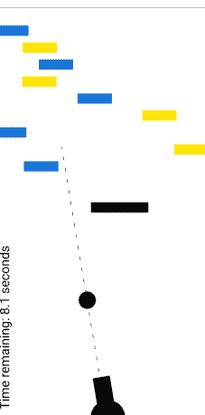

## 目标

在本章中，你将：

- 创建一个易于编码且好玩的简单游戏应用。
- 创建一个自定义的 `SurfaceView` 子类，从单独执行线程中显示游戏图形。
- 使用 `Paints` 和 `Canvas` 绘制图形。
- 重写 `View` 的方法，在用户触摸屏幕时发射炮弹。
- 执行简单的碰撞检测。
- 使用 `SoundPool` 和 `AudioManager` 为你的应用添加声音。
- 重写 Fragment 生命周期方法 `onDestroy`。
- 使用沉浸式模式让游戏占据整个屏幕，但仍允许用户访问系统栏。

## 218 第 6 章 大炮游戏应用

## 大纲

- 6.1 引言
- 6.2 测试驱动大炮游戏应用
- 6.3 技术概述
- 6.3.1 使用资源文件夹 `res/raw`
- 6.3.2 Activity 和帧周期
- 6.3.3 重写 View 方法 `onTouch`
- 6.3.4 使用 `SoundPool` 和线程添加声音
- 6.3.5 使用 `SurfaceView` 和 `SurfaceHolder` 进行逐帧动画
- 6.3.6 简单检测
- 6.3.7 沉浸式模式
- 6.4 构建 GUI 和资源文件
- 6.4.1 创建项目
- 6.4.2 调整主题以移除应用标题和栏
- 6.4.3 `strings.xml`
- 6.4.4 颜色
- 6.4.5 为应用添加声音
- 6.4.6 添加的
- 6.4.7 添加 `main.xml`
- 6.4.8 添加 `fragment.xml`
- 6.5 这些类的概述
- 6.6 Activity 的子类 `MainActivity`
- 6.7 Fragment 的子类 `MainActivity`
- 6.8 `CannonElement`
- 6.8.1 实例变量和构造函数
- 6.8.2 方法以及 `playSound`
- 6.9 `CannonElement` 的子类 `Target`
- 6.10 `Target` 的子类
- 6.11 `Cannon` 类
- 6.11.1 实例变量和构造函数
- 6.11.2 方法 `align`
- 6.11.3 方法 `Fireball`
- 6.11.4 方法 `draw`
- 6.11.5 方法 `getball`
- 6.12 `SurfaceView` 的子类 `Cannon`
- 6.12.1 实例变量和构造函数
- 6.12.2 方法 `getScreen` 和 `reverseY`
- 6.12.3 方法 `update`
- 6.12.4 方法 `draw`
- 6.13 `SurfaceView` 的子类 `Cannon`
- 6.13.1 `package` 和 `import`
- 6.13.2 实例变量和构造函数
- 6.13.3 构造函数
- 6.13.4 重写 View `onSizeChanged`
- 6.13.5 方法 `getScreenWidth`
- 6.13.6 方法 `getScreenHeight` 和 `playSound`
- 6.13.7 方法 `updatePositions`
- 6.13.8 方法
- 6.13.9 方法 `showDialog`
- 6.13.10 方法 `drawElements`
- 6.13.4 重写 View `onTouch`
- 6.13.5 使用线程创建游戏循环
- 6.13.6 方法 `hideSystemBars` 和 `showBars`
- 6.14 总结

## 6.1 引言

大炮游戏允许你在十秒限制内摧毁目标（图 6.1）。游戏由四种视觉组件组成——一个你控制的大炮、炮弹、九个目标以及一个防御目标的障碍物。你通过触摸屏幕来瞄准并发射大炮——大炮指向触摸点并向该方向发射炮弹。

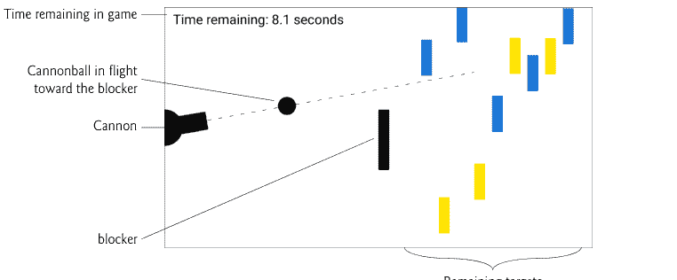

图 6.1 完成的大炮游戏。

每当你摧毁一个目标，剩余时间就会增加三秒，而每当你击中障碍物，剩余时间就会扣除二秒。在时间耗尽前摧毁所有目标即可胜利——如果计时归零，你就失败了。游戏结束后，应用将显示 `AlertDialog` 通知你是胜利还是失败，并显示发射次数和经过的时间（图 6.2）。

- a) 用户摧毁所有目标后显示的 `AlertDialog`
- b) 游戏结束用户摧毁所有目标后显示的 `AlertDialog`

| 胜利了！<br>发射次数：18<br>总时间：21.7<br>重置 | 失败了！<br>发射次数：5<br>总时间：7.0<br>重置 |

图 6.2 大炮应用显示胜利和失败的 `AlertDialog`。

当你发射大炮时，游戏播放发射声。当炮弹击中目标时，会播放玻璃破碎声，该目标消失。当炮弹击中障碍物时，会播放击中声，炮弹会反弹。障碍物无法被摧毁。目标和障碍物以不同的速度垂直移动，并在撞击屏幕顶部或底部时改变方向。

[注意：Android 模拟器在某些计算机上运行较慢。为了获得最佳体验，你应该在 Android 设备上测试此应用。在缓慢的模拟器上，炮弹有时会穿过障碍物或目标。]

## 6.2 测试大炮游戏应用

打开并运行应用

打开 Android Studio，并从书籍示例中的 `CannonGame` 文件夹打开 `Cannon Game` 应用，然后在 AVD 或设备上运行该应用。这将构建项目并运行应用。

玩游戏

点击屏幕以瞄准并发射大炮。只有当屏幕上没有另一门大炮时，你才能发射大炮。如果你在 AVD 上运行，则使用鼠标来破坏目标。尽快摧毁所有目标——如果计时结束或你破坏了所有目标，游戏将结束。

## 6.3 技术概述

本节将按照在章节中出现的顺序介绍我们在 Cannon Game 应用中使用的新技术。

### 6.3.1 使用资源文件夹 `res/raw`

媒体文件（如 Cannon Game 应用中使用的文件）放置在应用的源码文件夹 `res/raw` 中。第 6.4.5 节描述了如何创建此文件夹。你将应用的声音拷贝到其中。

### 6.3.2 Activity 和 Fragment 生命周期方法

我们在 5.3.1 中引入了 Activity 和 Fragment 生命周期方法。此应用使用了 Fragment 生命周期方法 `onDestroy`。当 Activity 关闭时，其 `onDestroy` 方法会被调用，从而轮调用该 Activity 托管的所有 Fragment 的 `onDestroy` 方法。我们在 `MainActivityFragment` 中使用此方法来释放大炮视图资源。


> 错误预防提示 6.1
> `onDestroy` 不保证会被调用，因此它应该只用于释放资源，而不是保存数据。Android 文档建议您在 `onPause` 或 `onSaveInstanceState` 中保存数据。

### 6.3.3 重写 View 方法 `onTouchEvent`

用户通过触摸设备屏幕与此应用交互。触摸会将大炮对齐到屏幕上的触摸点，然后发射大炮。为了为 `CannonView` 处理简单的触摸事件，你将重写 `onTouchEvent` 方法 (6.13.14)，然后使用来自 `MotionEvent`（`android.view` 包）的常量来测试发生了哪种事件。

### 6.3.4 使用 `SoundPool` 和 `AudioManager` 添加声音

应用的音效使用 `SoundPool`（`android.media` 包）进行管理，它可以用于加载、播放和卸载声音。声音使用 Android 的音频流来播放闹钟、音乐、通知、系统声音和电话呼铃。你将使用 `SoundPool` 配置并创建一个 `SoundPool` 对象。你还将使用 `AudioAttributes.Builder` 对象创建一个与 `SoundPool` 的 `AudioAttributes` 对象。我们调用 `AudioAttributes::setUsage` 将音频指定为游戏音频。Android 建议使用音频流播放声音，可以通过设备按钮控制音量。此外，我们使用 Activity 的 `setVolumeStream` 方法接收来自 `AudioManager`（`android.media`）的常量来控制设备音量。

### 6.3.5 使用 Threads、`SurfaceView` 和 `SurfaceHolder` 进行帧动画

通过从单独线程更新游戏元素手动执行动画。为了实现这一点，我们使用 `Thread` 方法引导 `Canvas` 更新游戏元素的位置，然后绘制它们。`run` 方法驱动帧动画——这被称为游戏循环。用户界面的所有更新必须在 GUI 线程中执行，因为 GUI 组件不是线程安全的——在线程之外执行更新会导致 GUI 崩溃。然而，复杂的逻辑通常需要在单独线程中执行，并且这些线程需要绘制到屏幕上。Android 提供了 `SurfaceView`——一个 `View` 的子类，提供了一个其他线程可以以安全方式在屏幕上显示图形的区域。


> 性能提示 6.1
> 减少在 GUI 线程中的工作量很重要，以确保 GUI 保持响应且不显示 ANR（应用无响应）对话框。

你可以通过 `SurfaceHolder` 类操纵 `SurfaceView`，`SurfaceHolder` 方法允许一次只有一个线程绘制 `SurfaceView`。每个 `SurfaceView` 子类都应该实现 `SurfaceCallback`，它包含了在 `SurfaceView` 创建、更改（例如尺寸或方向）或销毁时调用的方法。

### 6.3.6 碰撞检测

Cannon 执行简单的碰撞检测，确定炮弹是否与 Canvas 的边缘、障碍物或游戏目标碰撞。这些技术在第 6.3 节节介绍。开发框架通常提供了更复杂的“像素级”碰撞检测（免费且基于），用于开发从简单的 2D 游戏到最复杂的 3D 控制台游戏（例如用于 Sony PlayStation® 和 Microsoft Xbox® 的游戏）。图 6.3 列出了一些游戏开发框架——还有几十种支持多个平台（包括 Android 和 iOS）或其他编程语言。

游戏开发框架

- AndEngine—http://www.andengine.org
- Cocos2D—http://code.google.com/p/cocos2d-android
- GameMaker—http://www.yogames.com/studio
- libgdx—https://libgdx.com
- Unity—http://www.unity3d.com
- Unreal Engine—http://www.unrealengine.com

**图 6.3** 游戏开发框架。

## 沉浸式模式

为了让用户沉浸在游戏中，游戏开发者经常使用全屏主题，例如 **Theme.Material.Light.NoActionBar.Fullscreen**，它只显示底部系统栏。在手机横屏模式下，该应用出现在屏幕右边缘。在 Android 4.4 (KitKat) 中，Google 增加了对全屏**沉浸式模式**（第 6.13 节）的支持，这允许应用程序占据整个屏幕。当应用处于沉浸式模式时，用户可以从屏幕顶部滑动显示系统栏。如果用户不与系统栏交互，它们将在几秒后消失。

## 6.4 构建 GUI 和资源文件

在本节中，你将创建应用的资源文件、GUI 和类。

### 6.4.1 创建项目

对于此应用，你将手动添加 Fragment——大部分使用 **Empty Activity** 模板。在 **New Project** 对话框中，选择：

* 应用名称：Cannon Game
* 包名：（或指定您自己的名称）
* 语言：Java
* Minimum SDK：Android 4.4 (KitKat)

### 6.4.2 调整主题以移除应用标题和应用栏

正如我们在第 6.3.7 节提到的，游戏开发者经常使用全屏主题。AppCompat 默认不包含全屏主题，但你可以修改应用的主题来实现。操作如下：

打开 `<style>` 元素的行：

```xml
<item name="windowTitle">true</item>
<item name="windowActionBar">false</item>
<item name="android:fullscreen">true</item>
```

第一行表示不显示标题（通常是应用名称）。第二行表示不显示应用栏。最后一行表示应用应使用全屏。

### 6.4.3 字符串资源

你之前创建了字符串资源，所以我们在这里显示字符串资源名称和对应值的表格（图 6.4）。点击 `res/values` 文件夹中的 `strings.xml`，然后点击 `Open editor` 链接显示翻译编辑器以创建这些字符串。

| Key | Value |
|---|---|
| results_format | 次数：%d\n总时长：%2.f |
| reset_game | 重置游戏 |
| win | 你赢了！ |
| lose | 你输了！ |
| time_remaining_format | 剩余时间：%1.f 秒 |

**图 6.4** 应用使用的字符串资源。

### 6.4.4 颜色

此应用在 Canvas 上绘制交替颜色。对于此应用，我们在 `colors.xml` 中添加了以下深蓝色和黄色：

```xml
<color name="dark">#197602</color>
<color name="light">#FFE100</color>
```


### 6.4.5 将声音添加到应用

正如我们之前提到的，声音文件存储在应用的`res/raw`文件夹中。此应用使用了三个声音文件——`blocker_hit.wav`、`target_hit.wav`和`cannon_fire.wav`，它们位于书籍示例的`sounds`文件夹中。将这些文件添加到你的项目中：

1. 右键点击应用的`res`文件夹，然后选择**New > Android resource directory**，打开 New Resource Directory 对话框。
2. 在 Resource type 下拉菜单中选择**raw**。目录名称将自动更改为`raw`。
3. 点击**OK**创建文件夹。
4. 将音频文件复制并粘贴到`res/raw`文件夹中。在弹出的 Copy 对话框中点击**OK**。

### 6.4.6 添加 `MainActivityFragment` 类

接下来，你把`MainActivityFragment`添加到项目中：

1. 在 Project 窗口中，右键点击`com.deitel.cannongame`节点并选择**New > Fragment (Blank)**。
2. 为 Fragment 指定`MainActivityFragment`，为 Fragment Layout 指定`fragment_main`。
3. 取消勾选**Include fragment factory methods?**和**Include interface callbacks?**复选框。

默认情况下，`fragment_main.xml`包含一个显示`TextView`的`FrameLayout`。`FrameLayout`设计用于显示一个视图，但也可用于分层视图。移除此应用中的`TextView`后，`FrameLayout`将显示`CannonView`。

### 6.4.7 编辑 `activity_main.xml`

在此应用中，`MainActivity`布局只显示`MainActivityFragment`。按如下方式编辑布局：

1. 在布局编辑器中打开`activity_main.xml`并切换到**Text**标签页。
2. 将`RelativeLayout`改为`fragment`并移除`padding`属性，使元素填充整个屏幕。
3. 切换到**Design**视图，在 Component Tree 中选择`fragment`，然后将 id 设置为`fragment`。
4. 将名称设为`com.deitel.cannongame.MainActivity`——与其手动输入，你可以点击 name 属性值字段右侧的省略号按钮，然后从弹出的 Fragments 对话框中选择该类。

记住，编辑器的 Design 视图可以显示特定层中的 fragment 显示预览。如果你没有在 MainActivity-layout 中指定要查看哪个 fragment，布局编辑器将显示“Rendering Problems”（渲染问题）消息。如果你指定了要预览的 fragment，请在 Design 视图或 Component Tree 中点击该 fragment 并点击**Choose Layout....**。然后在 Resources 对话框中选择该 fragment 布局的名称。

### 6.4.8 为 `fragment_main.xml` 添加 `CannonView`

你现在将把`CannonView`添加到`fragment_main.xml`。你必须先创建`CannonView.java`，以便在布局中放置 CustomView 时可以选择`CannonView`。按照以下步骤创建`CannonView.java`并将`CannonView`添加到布局：

#### 本应用的类概述

1. 在 Project 窗口中展开`java`文件夹。
2. 右键点击`package.deitel.cannongame`文件夹，然后选择**New > Java Class**。
3. 在弹出的 Create Class 对话框中，在 Name 字段中输入`CannonView`，然后点击**OK**。文件将在编辑器中自动打开。
4. 在`CannonView.java`中，如果没有出现`android.view.SurfaceView`的 import 语句，将光标置于类名`SurfaceView`的末尾。行开头会出现红色灯泡菜单，选择**Import Class**。
5. 如果你还没有这样做，将光标置于`SurfaceView`末尾。点击红色灯泡菜单并选择**Create constructor matching super**。在弹出的 Choose Super Class Constructor 对话框列表中选择两个参数的构造函数，然后点击**OK**。IDE 将自动将构造函数添加到文件中。
6. 回到布局编辑器中`fragment_main.xml`的**Design**视图。
7. 点击 Palette（调色板）中 Custom 部分的**CustomView**。
8. 在弹出的 Views 对话框中选择`CannonView (com.deitel.cannongame)`，然后点击**OK**。
9. 悬停并点击 Component Tree 中的`FrameLayout`。视图（CustomView——即`CannonView`）将与`FrameLayout`一起出现在 Component Tree 中。
10. 确保在 Component Tree 窗口中选择了 view (CustomView)。在 Properties 窗口中，将`layout:width`和`layout:height`设置为`match_parent`。
11. 在 Properties 窗口中，将 id 从`view`改为`cannonView`。
12. 保存并关闭`fragment_main.xml`。

此应用包含八个类：

- `MainActivity`（Activity 子类；第 6.6 部分）——托管`MainActivity-Fragment`。
- `MainActivityFragment`（第 6.7 部分）——显示`CannonView`。
- `GameElement`（第 6.8 部分）——上下移动（`Blocker`和`Target`）或跨越`Cannonball`的项目的父类。
- `Blocker`（第 6.9 部分）——上下移动（`Blocker`和`Target`）或跨越`Cannonball`的项目的父类。
- `Target`（第 6.10 部分）——上下移动（`Blocker`和`Target`）或跨越`Cannonball`的项目的父类。
- `Cannon`（第 6.11 部分）——上下移动（`Blocker`和`Target`）或跨越`Cannonball`的项目的父类。
- `Cannonball`（第 6.12 部分）——上下移动（`Blocker`和`Target`）或跨越`Cannonball`的项目的父类。

# 第 6 章 大炮游戏应用程序

```java
49 super.onDestroy();

50 cannonView.releaseResources();

51 }

52 }
```

**图 6.6** | `MainActivity` 创建并管理 `CannonView`。（2 部分中的第 2 部分）

## 6.8 `GameElement` 类

`GameElement`类（图 6.7）——`Blocker`、`Target`和`Cannonball`的父类——包含了大炮游戏应用中移动对象的共同通用领域属性和功能。

```java
// GameElement.java

// 表示一个矩形边界的游戏元素

// package com.deitel.cannongame;

import android.graphics.Canvas;
import android.graphics.Paint;
import android.graphics.Rect;

public class GameElement {

    protected CannonView view; // 包含此 GameElement 的视图

    protected Paint paint = new Paint(); // 用于绘制此 GameElement 的 Paint

    protected Rect rect; // GameElement 的矩形边界

    private float velocity; // 此 GameElement 的垂直速度

    private int size; // 与此 GameElement 关联的大小

    public GameElement(CannonView view, int color, int size, int x,

        int y, int width, int length, float velocityY) {

        this.view = view;

        paint.setColor(color);

        rect = new Rect(x, y, x + width, y + length); // 设置边界

        this.size = size;

        velocity = velocityY;

    }

    // 更新 GameElement 位置并检查墙壁碰撞

    public void update(double interval) {

        // 更新垂直位置

        rect.offset(0, (int)(velocity * interval));

        // 如果此 GameElement 与墙碰撞，则反转方向

        if (rect.top < 0 && velocity < 0 ||

            rect.bottom > view.getScreenHeight() && velocity > 0)

            velocity *= -1; // 反转此 GameElement 的速度

    }

}
```

**图 6.7** | `GameElement` 类表示一个矩形边界的游戏元素。（2 部分中的第 1 部分）

## 6.8 `GameElement` 类

```java
37 // 在给定的 Canvas 上绘制此 GameElement

38 public void draw(Canvas canvas) {

39     canvas.drawRect(rect, paint);

40 }

41

42 // 播放与此类型 GameElement 对应的声音

43 public void playSound() {

44     view.playSound(soundId);

45 }

```

图 6.7 | `GameElement` 类表示一个矩形边界的游戏元素。（2 部分中的第 2 部分。）

### 6.8.1 实例与构造函数

`GameElement`构造函数接收`CannonView`的引用（第 6.13 节），该视图实现了游戏逻辑并绘制游戏元素。构造函数接收一个`int`表示`GameElement`的 32 位颜色，以及一个`int`表示与此`GameElement`关联的 ID ID。`CannonView`存储游戏中的所有声音并为每个声音提供一个 ID。构造函数还接收：

- 表示`GameElement`左上角 x 和 y 位置的 ints
- 表示其宽度和高度的 ints
- 此`GameElement`的初始速度`velocityY`。

第 21 行计算`GameElement`的边界并将其存储在表示矩形的`Rect`对象中。

### 6.8.2 方法 `update`、`draw` 和 `playSound`

`GameElement`拥有以下方法：

- `update`（第 27–35 行）——在游戏循环的每次迭代中，调用此方法来更新`GameElement`的位置。第 29 行根据垂直速度（`velocityY`）和调用`update`之间经过的时间（该方法通过参数`interval`接收）来更新形状的垂直位置。第 32–34 行检查此`GameElement`是否与屏幕的顶部或底部边缘碰撞，如果是，则反转其垂直速度。
- `draw`（第 38–40 行）——当`GameElement`需要在屏幕上绘制时调用此方法。该方法接收一个`Canvas`并在屏幕上绘制此`GameElement`为矩形——我们重写了`Cannonball`以绘制圆形。`GameElement`的`paint`实例变量指定了矩形的颜色，`GameElement`的形状指定了矩形在屏幕上的边界。
- `playSound`（第 43–45 行）——每个游戏元素都有一个关联的声音，可以通过调用`playSound`来播放。此方法将`soundId`实例变量的值传递给`CannonView`的`playSound`方法。`CannonView`类加载并维护游戏声音的引用。

# 第 6 章 大炮游戏应用程序

## 6.9 `GameElement` 的子类 `Blocker`

`Blocker`类（图 6–8）——`GameElement`的子类——代表阻塞物，使用户难以破坏目标。如果`Cannonball`碰撞到阻塞物，则从剩余时间中减去`Blocker`的`missPenalty`。`getMissPenalty`方法（第 17–19 行）返回`missPenalty`——当从剩余时间中减去`missPenalty`时，从`CannonView::testForCollisions`调用（第 6.13.11 节）。`Blocker`构造函数（第 9–14 行）将其参数和击中阻塞物的声音 ID（`CannonView.BLOCKER_SOUND_ID`）传递给父构造函数（第 11 行），然后初始化`missPenalty`。

```java
// Blocker.java

// 为 Blocker 定制的 GameElement 子类

package com.deitel.cannongame;

public class Blocker extends GameElement {

    private int missPenalty; // 此 Blocker 的 missPenalty

    // 构造函数

    public Blocker(CannonView view, int color, int missPenalty, int x,

        int y, int width, int length, float velocityY) {

        super(view, color, 0, x, y, width, length, velocityY); 

        this.missPenalty = missPenalty;

    }

    // 返回此 Blocker 的 missPenalty

    public int getMissPenalty() {

        return missPenalty;

    }

}
```

图 6.8 `GameElement` 的子类 `Blocker`

## 6.10 `GameElement` 的子类 `Target`

`Target`类（图 6–9）——`GameElement`的子类——代表玩家可以破坏的目标。如果`Cannonball`碰撞到目标，则在剩余时间中加上`Target`的`hitPenalty`。`getHitReward`方法（第 17–19 行）返回`hitReward`——当在剩余时间中加上`hitReward`时，从`CannonView::testForCollisions`调用（第 6.13.11 节）。`Target`构造函数（第 9–14 行）将其参数和击中目标的声音 ID（`CannonView.TARGET_SOUND_ID`）传递给父构造函数（第 11 行），然后初始化`hitReward`。

```java
// Target.java

// 为 Target 定制的 GameElement 子类

package com.deitel.cannongame;

public class Target extends GameElement {

    private int hitReward; // 此 Target 的 hitReward

    // 构造函数

    public Target(CannonView view, int color, int hitReward, int x,

        int y, int width, int length, float velocityY) {

        super(view, color, 0, x, y, width, length, velocityY);

        this.hitReward = hitReward;

    }

    // 返回此 Target 的 hitReward

    public int getHitReward() {

        return hitReward;

    }

}
```


图 6.9 `GameElement` 的子类 `Target`

## 6.11 `Cannon` 类

`Cannon` 类（图 6.10-6.14）代表大炮游戏应用中的大炮。大炮有底座和炮管，它可以发射大炮弹。

### 6.11.1 实例与构造函数

`Cannon` 构造函数（图 6.10）有四个参数。它接收：
- 包含它的 `CannonView`（`view`）
- 大炮底座的半径（`baseRadius`）
- 炮管的长度（`barrelLength`）以及
- 炮管的宽度（`barrelWidth`）

第 25 行设置了 `Point` 对象的描边宽度，以便使用给定的 `barrelWidth` 绘制炮管。第 27 行将大炮炮管初始化为与屏幕顶部和底部平行。

```java
// Cannon.java
// 表示大炮并发射大炮弹
package com.deitel.cannongame;

import android.graphics.Canvas;
import android.graphics.Color;
import android.graphics.Paint;
import android.graphics.Point;
```

**图 6.10** `Cannon` 实例变量与构造函数。（2 部分中的第 I 部分。）

# 第 6 章 大炮游戏 App

```java
public class Cannon {
    // 大炮的半径
    private int barrelRadius; // 大炮的半径
    private int barrelLength; // 炮管长度
    private Point barrelEnd = new Point(); // 炮管的端点
    private double barrelAngle; // 炮管的角度
    private Cannonball cannonball; // 炮弹
    private Paint paint = new Paint(); // 用于绘制大炮的画笔
    private CannonView view; // 包含大炮的视图

    public Cannon(CannonView view, int barrelRadius, int barrelLength) {
        this.view = view;
        this.barrelRadius = barrelRadius;
        this.barrelLength = barrelLength;
        paint.setStroke(barrelRadius); // 设置炮管宽度
        paint.setColor(Color.BLACK); // 大炮的颜色为黑色
        align(Math.PI / 2); // 炮管指向右侧
    }
}
```

**图 10** 大 `Cannon` 实例和构造函数。（2/2 部分）

## 6.11.2 方法 `align`

`align` 方法（图 6.11）用于对准大炮。该方法接收弧度为单位的炮管半径参数。我们使用大炮和 `barrelAngle` 来确定炮管端点 `barrelEnd` 的 x 和 y 坐标——这是为了从屏幕左边缘的大炮中心到大炮的炮管端点绘制一条线。第 32 行存储了 `barrelAngle`，以便炮弹能以该角度发射。

```java
public void align(double barrelAngle) {
    this.barrelAngle = barrelAngle;
    barrelEnd.x = (int) (barrelLength * Math.sin(barrelAngle));
    barrelEnd.y = (int) (-barrelLength * Math.cos(barrelAngle)) + view.getY();
}
```

**图 6.11** 大炮方法 `align`。

## 6.11.3 方法 `fireCannonball`

`fireCannonball` 方法（图 6.12）沿着屏幕当前的轨迹（`barrelAngle`）发射炮弹。第 41–46 行计算了炮弹速度的水平分量和垂直分量。第 49–50 行计算了炮弹的半径，该半径是屏幕高度的 `CannonView.CANBALL_RADIUS_PERCENT` 百分比。第 53–56 行“装填大炮”（即创建一个新的 `Cannonball` 并将其放置在大炮内部）。最后，我们播放炮弹发射的音效（第 58 行）。

## 6.11 `Cannon` 类

```java
// 在大炮指向的方向上创建并发射炮弹
public void fireCannonball() {
    // 计算炮弹速度的 x 分量
    int velocityX = (int)(CannonView.CANNON_SPEED_PERCENT * 
        view.getWidth() * Math.sin(barrelAngle));
    // 计算炮弹速度的 y 分量
    int velocityY = (int)(CannonView.CANNON_SPEED_PERCENT * 
        view.getHeight() * Math.cos(barrelAngle));
    // 计算炮弹的半径
    int radius = (int)(view.getHeight() * 
        CannonView.CANNON_RADIUS_PERCENT);
    // 构造炮弹并将其放置在大炮中
    cannonball = new Cannonball(view, Color.BLACK,
        CannonView.CANNON_SOUND_ID, -radius,
        view.getHeight() / 2 - radius, radius, velocityX,
        velocityY);
    cannonball.playSound(); // 播放发射炮弹的声音
}
```

**图 6.12** 大炮方法 `fireCannonball`。

## 6.11.4 方法 `draw`

`draw` 方法（图 6.13）在屏幕上绘制大炮。我们分两个部分绘制大炮：首先绘制炮管，然后绘制大炮的底座。

```java
// 在 Canvas 上绘制大炮
public void draw(Canvas canvas) {
    // 绘制炮管
    canvas.drawLine(0, view.getHeight() / 2, barrelEnd.x,
    barrelEnd.y, paint);
    // 绘制大炮底座
    canvas.drawCircle(0, (int)view.getHeight() / 2,
    (int)baseRadius, paint);
}
```

**图 6.13** 大炮方法 `draw`。

*使用 `Canvas` 方法 `drawLine` 方法绘制炮管*
我们使用 `Canvas` 的 `drawLine` 方法来显示炮管（第 64–65 行）。该方法接收五个参数——前四个是线条起点和终点的 x-y 坐标，最后一个是指定线条特征（如厚度）的 `Paint` 对象。回想一下，`paint` 已配置为按照构造函数中给出的厚度绘制炮管（图 6.10, 25）。

使用 `Canvas` 方法 `drawCircle` 方法绘制大炮底座
第 68–69 行使用 `Canvas` 的 `drawCircle` 方法，通过绘制一个以屏幕左边缘为中心的圆来绘制大炮的半圆。因为圆是根据其中心点显示的，所以该圆的半部分被绘制在了 `View` 的左侧。

## 6.11.5 方法 `getCannonball` 和 `removeCannonball`

图 6.14 显示了 `getCannonball` 和 `removeCannonball` 方法。`getCannonball` 方法（第 73–75 行）返回 `Cannon` 存储的当前 `Cannonball` 实例。炮弹值为 `null` 意味着当前游戏中没有炮弹。`Cannon` 使用此方法来避免在屏幕上已经有一个炮弹时发射大炮（节 6.13.38, 6.26）。`removeCannonball` 方法（第 78–80 行）通过将 `cannonball` 设置为 `null` 来从游戏中移除炮弹。`Cannon` 使用此方法在炮弹销毁或离开屏幕后从游戏中移除炮弹（节 6.13.11, 6.29）。

```java
// 移除此大炮发射的炮弹
public Cannonball getCannonball() {
    return cannonball;
}

// 从游戏中移除炮弹
public void removeCannonball() {
    cannonball = null;
}
```

**图 6.14** `CannonView` 方法 `getCannonball` 和 `removeCannonball`。

## 6.12 `Cannonball` 是 `GameElement` 的子类

`GameElement` 的 `Cannonball` 子类（节 6.12.1–6.12.4）代表从大炮上发射的炮弹。

### 6.12.1 实例变量和构造函数

`Cannonball` 构造函数（图 6.15）接收大炮的半径。第 15–16 行使用了宽度和高度来初始化炮弹。第 18 行初始化了炮弹。

```java
package com.deiteball;

import android.graphics.Canvas;
import android.graphics.Rect;

// 代表大炮发射的炮弹
public class Cannonball extends GameElement {
    private float velocityX;
    private float velocityY;
    private boolean isOnScreen;

    // 构造函数
    public Cannonball(Cannon view, int color, int soundId, int x, int y, int radius, float velocityX, float velocityY) {
        super(view, color, soundId);
        this.velocityX = velocityX;
        this.velocityY = velocityY;
        this.isOnScreen = true;
    }
}
```

**图 6.15** `Cannonball` 实例变量和构造函数。（1/2 部分）

### 6.12.2 方法 `getRadius`, `colidesWith`, `isOnScreen` 和 `velocityY`

`getRadius` 方法（第 22–24 行）通过宽度返回炮半径。`isOnScreen` 方法（第 32–34 行）在屏幕上。

```java
// getRadius
private int getRadius() {
    return (shape.right - left) / 2;
}

// 是否与 GameElement 碰撞
public boolean colidesWith(GameElement element) {
    return Rect.intersects(shape, element) && velocityX > 0;
}

// 是否在屏幕上
public boolean isOnScreen() {
    return isOnScreen;
}

// 反转水平速度
public void reverseVelocityX() {
    velocityX = -velocityX;
}
```

**图 6.16** `Cannonball` 方法 `getRadius`, `colidesWith`, `isOnScreen` 和 `velocityY`。

#### 与另一个 `GameElement` 的碰撞检测

`collidesWith` 方法（第 27–29 行）检查炮弹是否与 `GameElement` 碰撞。我们根据炮弹的边界进行简单的碰撞检测：
- 存储在 `shape` 中的边界必须与 `GameElement` 相交。
- 炮弹必须正在水平移动。

#### 使用 `reverseVelocity` 反转炮弹的水平速度

`reverseVelocity` 方法通过将 `velocityX` 乘以 -1 来反转水平速度。如果碰撞返回真，`CannonView` 会调用 `reverseVelocity` 来反转水平速度（节 6.13.11）。

### 6.12.3 方法 `update`

`update` 方法（图 6.17）调用父类的 `update` 方法（第 44 行）来更新炮弹的垂直速度并检查垂直碰撞。第 47 行使用 `Rect` 的 `offset` 方法水平平移炮弹的边界。我们将水平速度（`velocityX`）乘以通过的时间量（`interval`）来确定平移量。第 50–53 行在炮弹碰到屏幕边缘时将 `isOnScreen` 设置为 `false`。

```java
// 更新炮弹的位置
@Override
public void update(double interval) {
    super.update(interval); // 更新炮弹的垂直速度
    // 更新水平位置
    shape.offset((int)(velocityX * interval), 0);
    // 如果炮弹移出屏幕
    if (shape.top < 0 || shape.left < 0 ||
        shape.bottom > view.getHeight() ||
        shape.right > view.getWidth()) {
        isOnScreen = false; // 设置为移除
    }
}
```

**图 6.17** 重写的 `Element` 方法 `update`。

### 6.12.4 方法 `draw`

`draw` 方法（图 6.18）重写了 `GameElement` 的 `draw` 方法，并使用 `Canvas` 的 `drawCircle` 方法在当前位置绘制炮弹。前两个参数代表圆圆心的坐标。第三个参数是圆的半径。最后一个参数是指定绘制特征的 `Paint` 对象。

## 6.13 `CannonView` 的 `SurfaceView` 子类

```java
56    // 在指定的画布上绘制炮弹
57    @Override
58    public void draw(Canvas canvas) {
59        canvas.drawCircle(shape.left + getRadius(),
60          shape.top + getRadius(), getRadius(), paint);
61  }
62 }
```

**图 6.18** 重写的 `GameElement` 方法 `draw`。

## Cannon Game 游戏应用程序

`CannonView`（图 6.19–33）是 `SurfaceView` 的自定义子类，它实现了大炮游戏的逻辑，并在屏幕上绘制游戏对象。

### 6.13.1 包声明和 import 语句

图 6.19 列出了 `CannonView` 类的包声明语句和 import 语句。第 6.3 节讨论了 `CannonView` 使用的新按键和接口。我们在图 6.19 中高亮了它们。

```java
1 // CannonView.java
2 // 显示并控制大炮游戏
3 package com.example.cannongame;
4 
5 import android.app.Activity;
6 import android.app.AlertDialog;
7 import android.app.Dialog;
8 import android.app.DialogFragment;
9 import android.content.Context;
10 import android.content.DialogInterface;
11 import android.graphics.Canvas;
12 import android.graphics.Color;
13 import android.graphics.Point;
14 import android.graphics.Point;
15 import android.graphics.media.AudioAttributes;
16 import android.media.SoundPool;
17 import android.os.Bundle;
18 import android.util.AttributeSet;
19 import android.util.Log;
20 import android.util.SparseIntArray;
21 import android.view.MotionEvent;
22 import android.view.SurfaceHolder;
23 import android.view.SurfaceView;
24 import android.view.View;
25 import android.view.View;
26 
27 
28 import java.util.ArrayList;
29 import java.util.Random;
0
```

**图 6.19** `CannonView` 类的包声明和 import 语句。（共 2 部分的第一）

```java
public class CannonView extends SurfaceView
```


`implements SurfaceHolder.Callback {`

## 图 6.19：CannonView 类的包声明和 import 语句

（第 2 共 2 部分。）

### 6.13 实例变量和常量

图 6.20 列出了 `CannonView` 类大量的常量和实例变量。我们将解释在游戏中遇到的每一个变量。许多变量用于计算，以根据屏幕缩放游戏元素的大小。

```java
private static String TAG = "CannonView"; // 用于错误日志

// 游戏播放的常量

public static double MISS_PENALTY = 2; // 命中时扣除的秒数

public static double HIT_REWARD = 3; // 命中时增加的秒数

// 大炮的常量

public static double CANNON_BARREL_RADIUS_PERCENT = 3.0 / 40;

public static double CANNON_BARREL_WIDTH_PERCENT = 3.0 / 40;

public static double CANNON_BARREL_LENGTH_PERCENT = 3.0 / 10;

// 炮弹的常量

public static double CANNONBALL_RADIUS_PERCENT = 3.0 / 80;

public static double CANNONBALL_SPEED_PERCENT = 3.0 / 2;

// 目标的常量

public static double TARGET_WIDTH_PERCENT = 1.0 / 40;

public static double TARGET_LENGTH_PERCENT = 3.0 / 20;

public static double TARGET_FIRST_X_PERCENT = 3.0 / 5;

public static double TARGET_SPACING_PERCENT = 1.0 / 60;

public static int PIECES;

public static double TARGET_MIN_SPEED_PERCENT = 3.0 / 4;

public static double TARGET_MAX_SPEED_PERCENT = 6.0 / 4;

// 障碍物的常量

public static double BLOCKER_WIDTH_PERCENT = 1.0 / 40;

public static double BLOCKER_LENGTH_PERCENT = 1.0 / 4;

public static double BLOCKER_X_PERCENT = 1.0 / 2;

public static double BLOCKER_SPEED_PERCENT = 1.0;

// 文字大小为屏幕宽的 1/18

public static double TEXT_SIZE_PERCENT = 1.0 / 18;

private CannonThread cannonThread; // 控制游戏循环

private Activity activity; // 用于在 GUI 线程显示游戏对话框

private boolean dialogIsDisplayed = false;

// 游戏对象

private Cannon cannon;
```

图 6.20 | `CannonView` 类的常量和实例变量。（第 1 共 2 部分。）

```java
private Blocker blocker;

private ArrayList<Target> targets;

// 尺寸变量

private int screenWidth;

private int screenHeight;

// 用于游戏循环和统计统计的变量

private boolean gameOver; // 游戏是否结束？

private float timeLeft; // 剩余时间（秒）

private int shotsfired; // 用户发射的次数

private double elapsedTime; // 经过的时间

// 管理声音的常量和变量

public static final int TARGET_SOUND_ID = 0;

public static final int CANNON_SOUND_ID = 1;

public static final int BLOCKER_SOUND_ID = 2;

private SoundPool soundPool; // 播放音效

private SparseArray soundMap; // 将 ID 映射到 SoundPool
```

图 6.20 | `CannonView` 类的静态和实例变量。（第 2 共 2 部分）

### 6.13.3 构造函数

6.21 显示了 `CannonView` 的构造函数。当 `View` 被填充（inflate）时，构造函数会被带有 `Context` 和 `AttributeSet`。`Context` 是显示包含 `CannonView` 的 `MainActivity` Activity，而 `AttributeSet`（包 `android.util`）包含了在 XML 文件中设置的 `CannonView` 属性。这些参数被传递给父类构造函数（第 96 行），以确保自定义 `View` 正确配置了指向 XML 中指定的任何标准 `View` 属性的引用。第 99 行存储了对 `MainActivity` 的引用，我们可以在游戏结束时使用它从 GUI 线程显示一个 `AlertDialog`。虽然我们选择存储 `Activity` 引用，但我们可以通过调用继承的 `View.getContext()` 随时访问它。

```java
// 构造函数

public CannonView(Context context, AttributeSet attrs) {

    super(context, attrs); // 调用父类构造函数

    activity = (Activity)context; // 存储 MainActivity 的引用

    register SurfaceHolder.Callback listener

    getHolder().addCallback(this);
```

图 6.21 | `CannonView` 构造函数。（第 1 共 2 部分）

```java
// 为游戏音频配置音频属性

AudioAttributes.Builder attrBuilder = new AudioAttributes.Builder();

attrBuilder.setUsage(AudioAttributes.USAGE_GAME);

// 初始化 SoundPool 以播放应用程序的三个音效

SoundPool.Builder builder = new SoundPool.Builder();

builder.setMaxStreams(3);

builder.setAudioAttributes(attrBuilder.build());

soundPool = builder.build();

// 创建声音映射并预加载声音

soundMap = new SparseArray(3); // 创建新的 SparseIntArray

soundMap.put(TARGET_ID, soundPool.load(context, R.cannon_fire, 1));

soundMap.put(BLOCK_ID, soundPool.load(context, R.block_hit, 3));

textPaint = new Paint();

backgroundPaint = new Paint();

backgroundPaint.setColor(Color.WHITE);
```

图 6.21 | 配置音频属性（第 2 共 2 部分）

### 注册 SurfaceHolder 监听器

图 6.19 | `CannonView` 类的包声明和 import 语句。

### 配置音频属性并加载声音

图 6.21 | `CannonView` 构造函数。

### 6.13.4 重写 View 方法 onChanged

### 创建 Paint 对象用于绘制背景和计时器

# 242 第 6 章 大炮游戏 App

……已构建（图 6.21，第 113–119 行）。`soundID` 被用作 `soundMap` 的键，在 `SoundPool` 中定位 `soundID` 的 ID。`GameElement` 类的对象可以调用 `play()` 方法来播放它的声音。

```java
// get width of the game screen

public int getScreenWidth() {

    return screenWidth;

}

// get height of the game screen

public int getScreenHeight() {

    return screenHeight;

}

// plays a sound with the given soundID in soundMap

public void playSound(int soundID) {

    soundPool.play(soundMap.get(soundID), 1, 1, 1, 0, 1f);

}
```

图 6.21 | `CannonView` 方法 `getScreenWidth()`、`getHeight()` 和 `playSound()`。

## 6.13.6 方法 newGame

方法 `newGame()`（图 6.24）重置了用于控制游戏的实例变量。第 160–163 行创建了一个新的 `Cannon` 对象，具有：

- 屏幕高度的 `CANNON_RADIUS_PERCENT` 作为底半径；
- 屏幕宽的 `CANNON_BARREL_LENGTH_PERCENT` 作为炮管长度；
- 以及屏幕高度的 `CANNON_BARREL_WIDTH_PERCENT` 作为炮管宽度。

```java
// reset all the screen elements and start a new game

public void newGame() {

    cannon = new Cannon(this);

    (int)(CANNON_RADIUS_PERCENT * screenHeight);

    (int)(CANNON_BARREL_LENGTH_PERCENT * screenWidth);

    (int)(CANNON_BARREL_WIDTH_PERCENT * screenHeight);

}

Random random = new Random(); // 用于确定随机速度

targets = new ArrayList<>(); // 构建一个新的目标列表
```

```java
// initialize targetX for the first Target from the left

int targetX = (int)(TARGET_FIRST_X_PERCENT * screenWidth);

// calculate coordinate of Targets

int targetY = (int)((0.5 - TARGET_LENGTH_PERCENT / 2) * screenHeight);
```

图 6.24 | `CannonView` 方法 `newGame()`。（2 部分中的第 1 部分）

# 6.13 CannonView SurfaceView 的子类 243

```java
// add TARGET_PIECES Targets to the Target list

for (int n = 0; n < TARGET_PIECES; n++) {
```

```java
// determine a random velocity between min and max values
// for target n

double velocity = screenheight * (random.nextDouble() *
TARGET_MAX_SPEED_PERCENT - TARGET_MIN_SPEED_PERCENT) +
TARGET_MIN_SPEED_PERCENT);
```

```java
// alternate Target colors between dark and light

int color = (n % 2 == 0) ?
getResources().getColor(R.color.dark,
getContext().getTheme()) :
getResources().getColor(R.color.light,
getContext().getTheme());
```

```java
velocity = -1; // 为下一个 Target 重置初始速度
```

```java
// create a new Target to the Target list

target.add(new Target(this, color, HIT_REWARD, targetX, targetY,
(int)TARGET_WIDTH_PERCENT * screenWidth,
(int)TARGET_LENGTH_PERCENT * screenHeight));
```

```java
// increase the x coordinate to position the next Target more
// to the right

targetX += (TARGET_WIDTH_PERCENT + TARGET_SPACING_PERCENT) *
screenWidth;
}
```

```java
// create a new Blocker

blocker = new Blocker(this, Color.BLACK, MISS_PENALTY,
(int)BLOCKER_X_PERCENT * screenWidth,
(int)(0.5 * BLOCKER_LENGTH_PERCENT) * screenHeight,
(int)BLOCKER_WIDTH_PERCENT * screenWidth,
(int)BLOCKER_LENGTH_PERCENT * screenHeight));
```

```java
timeLeft = 10; // 设置倒计时为 10 秒
```

```java
shotsFired = 0; // 设置初始射击次数

totalElapsedTime = 0.0; // 将经过的时间置零
```

```java
if (gameOver) { // 在上一个游戏结束后开始新游戏

    gameOver = false; // 游戏未结束

    cannonThread = new CannonThread(getHolder()); // 创建线程

    cannonThread.start(); // 启动游戏循环线程

}
```

```java
hideSystemBars();
```

图 6.24 | `CannonView` 方法 `newGame()`。（2 部分中的第 2 部分）

# 第 6 章 大炮游戏 App

第 165 行创建了一个 `Random` 对象，用于随机化速度。第 166 行创建了一个新的 `Targets ArrayList` 列表。第 169 行初始化 `targetX` 为第一个 `Target` 位于屏幕左侧的像素数。第一个 `Target` 位于屏幕宽的 `TARGET_FIRST_X_PERCENT` 处。第 172–173 行初始化 `targetY`，使所有 `Target` 在屏幕上垂直居中。第 176–203 行创建了 `TARGET_PIECES` 并将它们添加到 `targets` 列表中。第 180–182 行将新 `Target` 的值设置为屏幕高度范围内的随机值。第 185–189 行将新 `Target` 的颜色在 `R.color.dark` 和 `R.color.light` 之间交替，并设置为负速度。第 191 行反转每个 `Target` 的速度，使得某些目标向上移动，某些向下移动。`Target` 被构建并添加到 `targets` 列表中（第 194–197 行）。`Target` 的宽度为屏幕宽的 `TARGET_WIDTH_PERCENT`，高度为屏幕高度的 `TARGET_HEIGHT_PERCENT`。最后，增加 `targetX` 以为下一个 `Target` 定位。

第 206–211 行创建并存储了一个新的 `Blocker`。`Blocker` 位于屏幕宽度处，并在屏幕上垂直居中以开始游戏。`Blocker` 的宽度为屏幕宽的 `BLOCKER_WIDTH_PERCENT`，高度为屏幕高度的 `BLOCKER_LENGTH_PERCENT`。`Blocker` 的速度为屏幕高度的 `BLOCKER_SPEED_PERCENT`。

如果 `gameOver` 为 `true`（仅在第一个游戏结束后发生），第 219 行重置 `gameOver`，第 220–221 行创建一个新的 `CannonThread` 并调用其 `start()` 方法开始游戏循环。第 224 行调用 `hideStatusBar()`（第 6.13.6 节）将 App 置于浸式模式——这会隐藏系统栏并允许用户随时通过从向下滑动来禁用它们。

## 6.13.7 方法 updatePositions

`updatePositions()` 方法（图 6.25）由 `CannonThread` 的 `run()` 方法（节 6.13.10）调用，根据前后帧之间的毫秒数更新元素的位置并进行简单的碰撞检测。

```java
// repeatedly by CannonThread to update elements

private void updatePositions(double elapsedMS) {
```


进入 `/path/to/xxx` 目录，找到 `xxx.json`。

在表达式 `cvar = avar + bvar` 中，加法运算符（`+`）将 `avar` 与 `bvar` 相加，得到它们的和 `cvar`。

在 `List.of(arg0, arg1, arg2)` 中，`List` 接口的工厂方法 `of()` 接受一系列的元素，返回包含它们的只读列表。

之后我们这样调用 `cmd` 命令：`cmd arg0 arg1 arg2`。

```
if (condVar > someVal) {console.log("xxx")}
```

---

```java
double interval = elapsedMS / 1000.0; // 转换为秒

// 如果炮弹在屏幕上，更新其位置
if (cannon.getCannonball() != null)
    cannon.getCannonball().update(interval);

blocker.update(interval); // 更新 blocker 的位置

for (GameElement target : targets)
    target.update(interval); // 更新 target 位置
```

**图 6.25** CannonView 方法 updatePositions。（2 部分中的第 1 部分）

```java
timeLeft -= interval; // 减少剩余时间
// 如果计时器归零
if (timeLeft <= 0) {
    timeLeft = 0;
    gameOver = true; // 游戏结束
    cannonThread.isRunning(false); // 停止线程
    showGameOverDialog(R.string.lose); // 显示失败对话框
}

// 如果所有目标都被命中
if (Targets.isEmpty()) {
    cannonThread.isRunning(false); // 停止线程
    showGameOverDialog(R.string.win); // 显示胜利对话框
    gameOver = true;
}
```

图 6.25 | CannonView 方法 updatePositions。（2 部分中的第 2 部分）

---

## 第 6 章 大炮游戏 App

```java
// 对齐炮管，如果屏幕上还没有炮弹，则发射炮弹
public void alignAndFireCannonball(MotionEvent event) {
    // 获取在该视图中触摸的坐标
    Point touchPoint = new Point((int) event.getX(),
    (int) event.getY());

    // 在 y 轴上
    // 计算触摸点到屏幕中心的距离
    double centerY = (screenHeight / 2 - touchPoint.y);
    double angle = 0; // 将角度初始化为 0

    // 计算炮管与水平面之间的夹角
    angle = Math.atan2(touchPoint.x, centerY);

    // 将炮管指向触摸屏幕的点
    cannon.angle(angle);

    // 如果屏幕上已经没有炮弹，则发射炮弹
    if (cannon.getCannonball() == null) {
        cannon.fireCannonball();
    }
}
```

图 6.26 | 方法 alignAndFireCannonball。

## 6.13.9 方法 showGameOverDialog

当游戏结束时，`showGameOverDialog` 方法（图 6.27）会显示一个 `AlertDialog`（使用 4.7 节中学的技巧），用于指示玩家是胜利还是失败、发射的次数以及总经过的时间。调用 `setButton`（第 301–311 行）会为新游戏创建一个按钮。

```java
// 游戏结束时显示 AlertDialog
private void showGameOverDialog(final int messageId) {
    // 创建一个 AlertDialog 并返回它
    AlertDialog.Builder builder =
    new AlertDialog.Builder(getActivity());

    // 为 messageId 创建对话框资源
    builder.setTitle(getResources().getString(messageId));

    @Override
    public void onCreate(Bundle bundle) {
        // ... (代码继续)
    }
}
```

图 6.27 | 方法 showGameOverDialog（第 1 部分，共 2 部分）。

## 6.13.10 SurfaceView 的子类 CannonView

```java
// 显示发射次数和总经过时间
builder.setMessage(getResources().getString(R.string.results_format, shotsFired, totalElapsed));
builder.setPositiveButton(R.string.reset_game, new DialogInterface.OnClickListener() {
    // 当按下“重置游戏”按钮时调用
    @Override
    public void onClick(DialogInterface dialog, int which) {
        dialogIsDisplayed = false;
        newGame(); // 设置并启动一个新游戏
    }
}); // 返回 AlertDialog
```

```java
// 在 GUI 线程中，使用 FragmentManager 显示对话框
activity.runOnUiThread(new Runnable() {
    public void run() {
        showSystemBars(); // 退出沉浸式模式
        dialogIsDisplayed = true;
        gameResult.setCancelable(false); // 模态对话框
        gameResult.show(activity.getFragmentManager(), "results");
    }
});
```

图 6.28 | CannonView 方法 gameOverDialog（第 2 部分，共 2）。按钮监听器的 `onClick` 方法表示对话框不再显示，并调用 `newGame` 来设置并启动新游戏。必须从 GUI 线程显示对话框（第 318–327 行），以指定一个应尽快在 GUI 线程中执行的 `Runnable`。参数是一个实现 `Runnable` 的匿名类对象。`Runnable` 的 `run` 方法调用 `showSystemBars`（第 6.13.16 节）移除沉浸式模式，表示对话框已显示并将其显示。

## 6.13.11 方法 drawGameElements

`drawGameElements` 方法（图 6.28）使用 `CannonThread`（第 6.13 节）从 `SurfaceView` 的 `SurfaceHolder` 获取的 `Canvas`，在 `SurfaceView` 上绘制大炮、炮弹、阻挡物和目标物。

### 使用 drawRect 方法清空 Canvas

首先，我们调用 `Canvas` 的 `drawRect` 方法（第 333–334 行），来调用 `Canvas`，以便游戏元素可以在新位置显示。该方法接收矩形的左上角 `y` 坐标、宽度、高度以及用于绘制特征的 `Paint` 对象——回想 `backgroundPaint` 设置了绘制颜色。

```java
// 在给定的 Canvas 上绘制游戏
public void drawGameElements(Canvas canvas) {
    // 清除背景
    canvas.drawRect(0, canvas.getWidth(), canvas.getHeight(), backgroundPaint);

    // 显示剩余时间
    canvas.drawText(getResources().getString(R.string.time_remaining, timeLeft), 50, 100, paint);

    cannon.draw(canvas); // 绘制大炮
    // 绘制炮弹
    if (cannon.getCannonBall() != null &&
        cannon.getCannonBall().isOnScreen())
        cannon.getCannonBall().draw(canvas);

    blocker.draw(canvas); // 绘制阻挡物
    // 绘制所有目标物
    for (GameObject target : targets)
        target.draw(canvas);
}
```

**图 6.28** Canvas 方法 drawGameElements。

**使用 Canvas 方法 drawText 绘制剩余时间**
接下来，我们调用 `Canvas` 的 `drawText` 方法（第 337–338 行）来显示游戏中的剩余时间。我们传递了参数：要显示的字符串、显示它的 `x` 和 `y` 坐标，以及 `textPaint`（在图 6.22 的第 138–139 行中配置），用于描述文本应如何渲染（即文本字体大小、颜色和其他属性）。

**绘制大炮、炮弹、阻挡物和目标物：使用 draw 方法**
第 339–350 行绘制了大炮、炮弹（如果它在屏幕上）、阻挡物以及每个目标物。这些元素都是通过调用 `draw` 方法并传入 `canvas` 来绘制的。

### 方法 testForCollisions

`testForCollision` 方法（图 6.29）检查炮弹是否与任何目标物或阻挡物碰撞，并在发生碰撞时在游戏中应用相应效果。第 359–360 行检查炮弹是否在屏幕上。如果是，第 362 行调用炮弹的 `collidesWith` 方法来判断炮弹是否与目标物碰撞。如果发生碰撞，第 363 行调用目标对象的 `playSound` 方法播放目标被击中的声音（带有目标物），且第 368–369 行从屏幕上移除炮弹和目标物。

```java
// 检查球是否与阻挡物或任何目标物碰撞
// 处理碰撞
public void testForCollisions() {
    // 移除与炮弹碰撞的任何目标
    if (cannonball() != null &&
        cannonball().isOnScreen()) {
        for (int n = 0; n < targets.size(); n++) {
            if (cannonball().collidesWith(targets.get(n))) {
                targets.get(n).playSound(); // 播放目标击中声音
            }
        }

        // 将击中奖励加入剩余时间
        timeLeft += targets.get(n).getHitReward();
        cannon.removeCannonball(); // 从游戏中移除炮弹
        targets.remove(n); // 移除目标物
        --n; // 确保我们不会跳过目标 n
        break;
    } else { // 如果炮弹不应在屏幕上，则移除
        cannon.removeCannonball();
    }

    // 检查球是否与阻挡物碰撞
    if (cannonball() != null &&
    cannon.getCannonball().collidesWith(blocker)) {
        blocker.playSound(); // 播放阻挡物击中声音
    }

    // 反转球的方向
    cannon.getCannonball().reverseXX();
    // 从剩余时间内减去阻挡物的惩罚
    timeLeft -= blocker.getMissPenalty();
}
```

图 6.29 CannonView 方法 testForCollisions。

## 6.13.12 方法 stopgame 和 releaseResources

`MainActivity` 类的 `onPause` 和 `onDestroy` 方法（第 6.13 节）分别调用 `CannonView` 类的 `stopgame` 和 `releaseResources` 方法（图 6.30）。`stopGames`（第 393–396 行）从主 `Activity` 调用，以便在 `Activity` 的 `onPause` 方法被调用时停止游戏——为了简单起见，我们在这个示例中没有存储状态。`releaseResources` 方法（第 399–402 行）调用 `SoundPool` 的 `release` 方法来释放与 `SoundPool` 相关的资源。

```java
// 停止游戏：由 CannonGameFragment 的 onPause 方法调用
public void stopGame() {
    if (cannonThread == null)
        cannonThread.setRunning(false); // 通知线程终止
}

// 释放资源：由 CannonGame 的 onDestroy 调用
public void releaseResources() {
    soundPool.release(); // 释放 SoundPool 使用的所有资源
    soundPool = null;
}
```

**图 6.30** | 查看 stopGame 和 releaseResources 方法。

## 6.13.1 实现 SurfaceHolder.Callback 方法

图 6.31 显示了 `SurfaceHolder.Callback` 接口的 `surfaceChanged`、`surfaceCreated` 和 `surfaceDestroyed` 方法。`surfaceChanged` 方法在本文应用中方法体为空，因为轴始终处于横屏模式。该方法在 `SurfaceView` 的大小或方向发生变化时被调用，通常用于根据这些变化重绘图形。

```java
// 当 surface 大小发生变化时被调用
@Override
public void surfaceChanged(SurfaceHolder holder, int format, int width, int height) {
}

// 当 surface 首次创建时被调用
@Override
public void surfaceCreated(SurfaceHolder holder) {
    if (dialog) // 设置并启动新游戏
        newGame();
        cannonThread = new CannonThread(holder); // 创建线程
        cannonThread.setRunning(true); // 开始运行游戏
        cannonThread.start(); // 游戏循环线程
}

// 当 surface 被销毁时调用
@Override
public void surfaceDestroyed(SurfaceHolder holder) {
    // 确保线程正常终止
    boolean retry = true;
    cannonThread.setRunning(false); // 终止 cannonThread
}
```

**图 6.31** | 实现 SurfaceHolder.Callback 方法。（2 部分中的第 1 部分）。

## 6.13 SurfaceView 的子类 CannonView

```java
while (retry) {
    try {
        cannonThread.join(); // 等待 cannonThread 完成
        retry = false;
    }
    catch (InterruptedException e) {
        Log.e(TAG, "Thread interrupted", e);
    }
}
```


### 图 6.31｜实现 `SurfaceHolder.Callback` 方法（2 部分中的第 2 部分）

`surfaceCreated` 方法（第 410–418 行）在 `SurfaceView` 创建时被调用——例如，当应用加载或从后台返回时。由于我们使用 `surfaceCreated` 创建并启动 `CannonView` 以开始游戏循环，因此需要在此处完成相关操作。

`surfaceDestroyed` 方法（第 421–436 行）在 `SurfaceView` 被销毁时被调用——例如，当应用终止时。我们使用 `surfaceDestroyed` 来确保 `CannonThread` 结束。首先，第 425 行调用 `CannonView` 的 `setRunning` 方法并传入 `false` 参数，以指示线程应该停止；第 427–435 行等待线程终止。这确保了在销毁执行后，不会再尝试向 `SurfaceView` 绘图。

### 6.13.14 重写 `onTouchEvent` 方法

在这个示例中，我们重写了 `onTouchEvent`（图 6.32）来确定用户何时触摸屏幕。`MotionEvent` 参数包含了有关发生事件的信息。第 442 行使用 `MotionEvent` 的 `getAction` 方法来确定发生了哪种事件（`MotionEvent.ACTION_DOWN`）。接下来的几行判断用户是触摸了屏幕还是拖动手指（`MotionEvent.ACTION_MOVE`）。无论哪种情况，第 448 行都会调用 `cannonView` 的 `alignFireCannonball` 方法，将大炮对准并向该点发射炮弹。第 451 行返回 `true`，表示该事件已处理。

```java
// 当用户在此活动中触摸屏幕时被调用
@Override
public boolean onTouchEvent(MotionEvent e) {
  // 获取代表引起此事件的动作类型的整数
  int action = e.getAction();

  // 用户触摸了屏幕或沿屏幕滑动
  if (action == MotionEvent.ACTION_DOWN ||
      action == MotionEvent.ACTION_MOVE) {
    // 向触摸点发射炮弹
    alignFireCannonball(e);
  }
}
```

图 6.32｜在 `View` 上重写 `onTouchEvent` 方法

## 第 6 章 大炮游戏 App

```java
451  return true;
452  }
453
```

**图 6.32**｜重写 `onTouchEvent` 方法（2 部分中的第 2 部分）。

### 6.13.15 `CannonThread`：使用线程创建游戏循环

图 6.33 定义了一个更新游戏的 `Thread` 子类。该线程维护了对 `SurfaceView` 的 `SurfaceHolder` 的引用（第 456 行），以及一个指示线程是否正在运行的布尔值。

```java
// 控制游戏循环的 Thread 子类
454  private class CannonThread extends Thread {
455    private SurfaceHolder surfaceHolder; // 用于操作画布
456    private boolean isRunning = true; // 默认运行

458      // 初始化 surface holder
459    public CannonThread(SurfaceHolder holder) {
460        surfaceHolder = holder;
461        setName("CannonThread");
463          }

465    // 更改运行状态
466    public void setRunning(boolean running) {
467      isRunning = running;
469    }

471    // 控制游戏循环
473    @Override
474    public void run() {
475      long previousFrameTime = System.currentTimeMillis();

477      while (isRunning) {
479        // 从此线程获取绘制画布
481        canvas = surfaceHolder.lockCanvas();

483        // 锁定 surfaceHolder 进行绘制
484        synchronized(surfaceHolder) {
485            long currentTime = System.currentTimeMillis();
486            double elapsedTime = currentTime - previousFrameTime;

488            // 更新游戏状态
489            updatePosition(elapsedTime/1000.0); // 更新位置
491            testCollisions(); // 测试碰撞
492            drawGameElements(canvas); // 使用画布绘制
493            previousFrameTime = currentTime; // 更新帧时间
494        }
495    } finally {
496 // 允许其他线程使用 Canvas
497     if (canvas != null) {
498 surfaceHolder.unlockCanvasAndPost(canvas);
499     }
500  }
501 }
```

**图 6.33**｜锁定 `surfaceHolder` 进行绘制

`run` 方法（第 471–499 行）绘制帧动画——这被称为游戏循环。第 474 行在线程开始时设置了毫秒时间。第 476–498 行在 `isRunning` 为 `false` 之前循环。我们首先通过 `lockCanvas` 获取用于绘制 `SurfaceView` 的画布。一次只能有一个线程绘制 `SurfaceView`。

为了隐藏系统栏和应用栏并将 UI 调整为沉浸式模式，你向 `setSystemUIVibility` 传递第 505–510 行中通过位或运算符（`|`）组合的常量。要显示系统栏和应用栏，向 `setSystemUIVibility` 传递第 517–519 行中组合的常量。

这些 `View` 的组合确保了 `CannonView` 不会在每次系统栏和应用栏隐藏并重新显示时调整大小。相反，系统栏和应用栏会覆盖在 `CannonView` 上——也就是说，当系统栏在屏幕运行时，`CannonView` 的部分会被临时隐藏。有关沉浸模式的更多信息，请访问：

`http://developer.android.com/training/system-ui/immersive.html`

```java
// hide system bars and app bar
private void hideSystemBars() {
    if (Build.VERSION.SDK_INT >= Build.VERSION_CODES.KITKAT)
        setSystemUIVibility(
            View.SYSTEM_UI_FLAG_STABLE |
            View.SYSTEM_UI_FLAG_HIDE_NAVIGATION |
            View.SYSTEM_UI_FLAG_FULLSCREEN |
            View.SYSTEM_UI_FLAG_HIDE_NAVIGATION |
            View.SYSTEM_UI_FLAG_FULLSCREEN |
            View.SYSTEM_UI_FLAG_IMMERSIVE);
}
```

```java
// show system bars and app bar
private void showSystemBars() {
    if (Build.VERSION.SDK_INT >= Build.VERSION_CODES.KITKAT)
        setSystemUIVibility(
            View.SYSTEM_UI_FLAG_STABLE |
            View.SYSTEM_UI_FLAG_HIDE_NAVIGATION |
            View.SYSTEM_UI_FLAG_FULLSCREEN);
}
```

图 6.34｜`DoodleView` 方法 `hideSystemBars` 和 `showSystemBars`

## 6.1 总结

在本章中，你创建了大炮游戏 App，该游戏挑战玩家在 10 秒时间限制结束前销毁九个目标。用户通过触摸屏幕来发射大炮。为了在单独线程中进行绘图，你通过扩展 `SurfaceView` 创建了一个自定义视图。你学习了自定义组件的类名在表示组件的 XML 元素中必须是全限定的。

我们介绍了额外的 Fragment 生命周期方法。你学习了当 Fragment 被销毁时会调用 `onPause` 方法，当 Fragment 被销毁时会调用 `onDestroy` 方法。你还添加了使用系统的 `AudioManager` 服务获取设备的当前音乐音量并将其作为播放音量。

此 App 通过在单独的执行线程上对 `SurfaceView` 上的游戏元素进行动画处理。为了实现这一点，你扩展了 `Thread` 类并创建了一个 `run` 方法，该方法通过调用 `Canvas` 类的方法来显示图形。你使用了 `SurfaceView` 的 `SurfaceHolder` 获取相应的 `Canvas`。

你还学习了如何根据动画帧之间经过的时间来构建控制游戏的游戏循环，以便无论设备的处理器速度如何，游戏在所有设备上都能以相同的整体速度运行。最后，你使用了沉浸模式让 App 能够使用整个屏幕。

在第 7 章中，你将构建 WeatherViewer App。你将使用 Web 服务与来自 OpenWeather.org 的 16 天天气预报 Web 服务进行交互。与当今许多 Web 服务一样，OpenWeatherMap.org Web 服务将以 JavaScript 对象表示（JSON）格式返回预报数据。你将使用 `org.json` 包中的 `JSONObject` 和 `JSONArray` 类来处理响应。然后，你将在 `ListView` 中显示每日预报。

# 第 7 章 WeatherViewer App

REST Web 服务、`AsyncTask`、`HttpURLConnection`、处理 JSON 响应、`JSONObject`、`JSONArray`、`ListView`、`ArrayAdapter`、`ViewHolder` 模式、`TextInputLayout`、`FloatingActionButton`。


## 7.1 引言

### 目录

- 7.2 测试 WeatherViewer App
- 7.3 技术概述
  - 7.3.1 Web 服务
  - 7.3.2 JavaScript 对象表示（JSON）和 `org.json` 包
  - 7.3.3 使用 `HttpURLConnection` 连接 REST Web 服务
  - 7.3.4 使用 `AsyncTask` 在 GUI 外部执行网络请求
  - 7.3.5 `ListView`、`ArrayAdapter` 和 `ViewHolder` 模式
  - 7.3.6 `TextInputLayout`
  - 7.3.7 `EditText`
  - 7.3.8 `Snackbar`
- 7.4 构建 App 的 GUI 和资源文件
  - 7.4.1 创建项目
  - 7.4.2 `AndroidManifest.xml`
  - 7.4.3 `strings.xml`
  - 7.4.4 `colors.xml`
  - 7.4.5 `activity_main.xml`
  - 7.4.6 `content_main.xml`
  - 7.4.7 `item.xml`
- 7.5 类 `Weather`
  - 7.5.1 `package` 语句、`import` 语句和实例变量
  - 7.5.2 构造函数
  - 7.5.3 方法 `convertTimestampToDay`
- 7.6 类 `WeatherArrayAdapter`
  - 7.6.1 `package` 语句和 `import` 语句
  - 7.6.2 嵌套类 `ViewHolder`
  - 7.6.3 实例变量和构造函数
  - 7.6.4 重写的 `ArrayAdapter` 方法 `getView`
  - 7.6.5 用于在单独线程下载图片的 `AsyncTask` 子类
- 7.7 类 `MainActivity`
  - 7.7.1 `package` 语句和 `import` 语句
  - 7.7.2 重写的 `Activity` 方法 `onCreate`
  - 7.7.4 方法 `dismissKeyboard` 和 `create`
  - 7.7.5 用于调用 Web 服务的 `AsyncTask` 子类
  - 7.7.6 方法 `convertJSONArrayList`
- 7.8 总结

### 7.1 引言

WeatherViewer App（图 7.1）使用 OpenWeather REST 服务获取 16 天天气预报，并以 JavaScript 对象表示（JSON）格式显示在可滚动列表中：

- 天气状况
- 最低和最高温度（°F）
- 湿度百分比

有关 OpenWeather 返回的所有详情，请访问：

```text
http://openweathermap.org/api
```

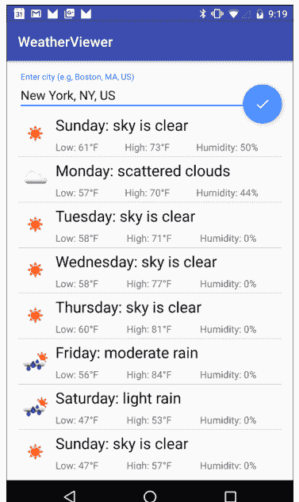

图 7.1｜显示纽约、美国天气预报的 Weather App

### 7.2 测试 WeatherViewer App

#### 打开并运行 App

打开 Android Studio 并打开 WeatherViewer 文件夹。在运行此 App 之前，你必须添加自己的 OpenWeather API 密钥。参见 7.3.1 关于获取密钥以及将其放置在项目中的信息。添加密钥后，执行 App。

#### 查看 16 天天气预报

首次执行时，界面顶部的 `EditText` 获取焦点并显示虚拟键盘，以便输入城市名称（图 7.2）。你应该考虑在城市后面加上逗号和国家代码。在这种情况下，我们输入了 New York, US。

一旦输入城市，触摸圆形 `FloatingActionButton` 的完成图标将城市提交给 App，然后 App 显示该城市的 16 天天气预报（见图 7.1）。

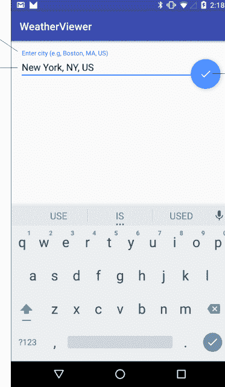

图 7.2｜输入城市

### 7.3 技术概述

本节介绍了你将用于构建 WeatherViewer App 的功能。

#### 7.3.1 Web 服务

本章介绍了 Web 服务，它促进了在互联网上运行的程序的移植性和重用性。Web 服务是一种可以通过网络访问的软件组件。

Web 服务所在的机器称为**Web 服务主机**。客户端——在本例中为 **WeatherViewer App**——向 Web 服务主机发送请求，主机处理请求并向客户端返回响应。

这种分布式计算以多种方式有利于系统。例如，App 可以按需通过服务获取数据，而不是将数据直接存储在设备上。同样，缺乏执行特定计算能力的 App 可以使用服务来利用另一个系统的优越资源。

#### REST Web 服务

表述状态转换（Representational State Transfer，REST）是指一种用于实现网络服务的架构风格——通常被称为 RESTful Web 服务。如今许多最流行的免费和付费 Web 服务都是 RESTful 的。

尽管 REST 本身并不是一种标准，但 RESTful Web 服务使用了许多标准，例如超文本传输协议（HTTP），浏览器使用它与 Web 服务器进行通信。RESTful Web 服务中的每种方法都由唯一的 URL 标识。因此，当服务器接收到请求时，它立即知道要执行什么操作。此类服务可以在应用程序中使用，甚至直接在浏览器地址栏中使用。

#### Web 服务通常需要 API 密钥

使用 Web 服务需要提供者的唯一 API 密钥。当你的应用程序向 Web 服务发送请求时，API 密钥允许提供者：

- 确认你有权限使用该 Web 服务。
- 跟踪你的使用情况——许多 Web 服务限制了你在特定时间内可以进行的请求总数（例如每秒、每分钟、每小时等）。

某些 Web 服务在提供 API 密钥之前需要进行身份验证——实际上，在你允许使用 Web 服务之前，你需要以程序的方式登录该 Web 服务。

#### OpenWeatherMap.org Web 服务

WeatherViewer 应用中使用的 OpenWeatherMap.org 服务是免费的，但 OpenWeatherMap.org 限制了 Web 服务请求次数——目前的限制为每分钟 1200 次请求和每天 170 万次请求。

OpenWeatherMap.org 对你使用的免费层采用增值服务；他们提供了具有更高请求限制、更频繁的数据更新和其他功能的层。关于 OpenWeatherMap.org Web 服务的更多信息，请访问：

```text
http://openweathermap.org/api
```


### OpenWeatherMap.org Web 服务许可

OpenWeatherMap.org 对其 Web 服务使用知识共享公共许可。许可证条款请参见：

```text
http://creativecommons.org/licenses/by-sa/2.0/
```

关于许可证条款的更多信息，请参见许可证部分位于：

```text
http://openweathermap.org/terms
```

### 获取 OpenWeatherMap.org API 密钥

在运行此应用之前，你必须从以下地址获取自己的 OpenWeatherMap.org API 密钥：

```text
http://openweathermap.org/register
```

注册后，从确认网页复制十六进制 API 密钥，然后用该密钥替换 `strings.xml` 中的 `YOUR_API_KEY`。

## 7.3 技术概述

### 7.3.2 JavaScript 对象表示法（JSON）和 `org.json` 包

JavaScript 对象表示（JSON）是用于表示数据的 XML 替代方案。JSON 是一种基于文本的数据交换格式，用于以字符串形式的键值对来表示 JavaScript 中的对象。JSON 是一种简单的格式，易于创建、读取和解析，而且因为它比 XML 简洁得多，它允许程序在互联网上高效地传输数据。每个 JSON 对象都表示为包含在大括号中的属性名和值的列表，格式如下：

```json
[propertyName1: value1, propertyName2: value2]
```

每个属性都是一个字符串。数组在 JSON 中用方括号表示，格式如下：

```json
[value1, value2, value3]
```

每个数组元素可以是字符串、JSON 对象、`true`、`false` 或 `null`。图 7.3 是本节使用的 OpenWeather.org 每日预报 Web 服务返回的 JSON 示例——此特定示例包含了两天的天气数据（15–57）。

```json
{
  "id": 5128581,
  "name": "New York",
  "coord": {"lon": -74.005966, "lat": 40.714272},
  "country": "US",
  "population": 0,
  "cod": 200,
  "message": 0.0102,
  "cnt": 1,
  "list": [ // 你将使用这个对象数组来获取每日天气
    {
      "dt": 1442492000,
      "day": 79.9,
      "min": 71.74,
      "max": 82.53,
      "night": 71.85,
      "eve": 82.53,
      "morn": 71.74
    },
    {
      "pressure": 1037.39,
      "humidity": 64,
      "weather": [
        {
          "id": 0,
          "main": "Clear",
          "description": "sky is clear",
          "icon": "01d"
        }
      ]
    }
  ]
}
```

**图 7.3** 来自 OpenWeatherMap.org 每日预报 Web 服务的 JSON 示例。（第一部分，共 2 部分）。

```json
"speed": 0.92,
"deg": 250,
"clouds": 0
}, // 第一个数组结束，第二个数组开始
{
  "id": 142250600,
  "temp": {
    "day": 79.92,
    "min": 66.72,
    "max": 83.1,
    "night": 70.79,
    "eve": 81.99,
    "morn": 66.72
  },
  "pressure": 1037.39,
  "humidity": 64,
  "weather": [
    {
      "id": 0,
      "main": "Clear",
      "description": "sky is clear",
      "icon": "01d"
    }
  ],
  "speed": 0.92,
  "deg": 250,
  "clouds": 0
}
```

**图 7.3** OpenWeatherMap.org 每日预报 Web 服务的示例。（第二部分，共 2 部分）。

OpenWeather.org 响应中的 `"list"` 属性将是一个包含以下内容的数组：

- `"dt"`：自 1970 年以来的时间戳
- `"day"`：白天温度
- `"min"`：最低温度
- `"max"`：最高温度
- `"night"`：夜间温度
- `"eve"`：晚上温度
- `"morn"`：早晨温度
- `"pressure"`：气压
- `"humidity"`：湿度
- `"weather"`：天气状况数组
- `"speed"`：风速
- `"deg"`：风向
- `"clouds"`：云量

### `org.json` 包

你将使用 `org.json` 中的以下类来处理数据：

- `JSONObject`：该类的一个实例表示一个 JSON 对象。
- `JSONArray`：该类表示一个 JSON 数组。

### 7.3.3 `HttpConnection` 调用 REST Web 服务

为了调用 OpenWeather.org 每日获取服务，你将向 Web 服务发送 HTTP 请求并使用 `HttpConnection` 获取响应。为了接收 JSON 响应，你将从 `HttpConnection` 输入流读取所有数据并将其放入字符串。

### 7.3.4 使用 `AsyncTask` 在 GUI 线程之外执行请求

你应该在 GUI 线程之外执行耗时操作或阻塞执行（例如网络、文件和数据库访问）。这有助于保持应用程序的响应能力并避免无响应（ANR）对话框。回顾第 6 章，对用户界面的更新必须在 GUI 线程中进行，因为组件不是线程安全的。

为了执行会导致 GUI 更新的耗时任务，Android 提供了 `AsyncTask`（`os` 包），它在一个线程中执行耗时操作并将结果传递给 GUI 线程。

### 7.3.5 `ListView`、`ArrayAdapter` 和 `ViewHolder` 模式

本应用使用 `ListView`（`android.widget` 包）显示数据——这是一个滚动项目列表。`ListView` 是 `Adapter`（`android.widget` 包）的子类，表示一个通过适配器从数据源获取数据的视图。在本应用中，我们使用 `ArrayAdapter` 的子类创建一个对象，使用 `ArrayList` 集合中的数据绑定 `ListView`。

## 第 7 章 WeatherViewer 应用

### 视图节点模式（View-Holder Pattern）

默认情况下，`ListView` 可以显示一个或两个 `TextView`。在本应用中，你将自定义 `ListItems`，以便在自定义布局中显示一个 `ImageView` 和几个 `TextView`。创建自定义 `ListItems` 涉及到动态创建新对象的高昂开销。对于具有复杂列表项布局且用户正在快速滚动的列表型列表来说，这种开销可能会防止平滑滚动。为了减少这种开销，移出屏幕的 `ListView` 项会被重用。Android 会重用这些持有者来处理正在滑出屏幕的新条目。对于复杂的列表项，你可以利用重用列表项中的现有组件来提升 `ListView` 的性能。

为了实现这一点，我们引入了 `ViewHolder`（通常命名为 `ViewHolder`），它包含用于显示 `ListView` 项数据的视图的变量。当一个 `ListView` 项被创建时，你会创建一个 `ViewHolder` 对象，并使用指向该项嵌套视图的变量对其进行初始化。然后，你将该 `ViewHolder` 存储在项（即一个 `View`）中。`View` 的 `setTag` 方法允许你通过 `View` 的 `setTag` 方法向 `View` 添加任何对象。我们通过包含该项引用的 `ViewHolder` 对象来指定这一点。

当新项被添加以滚动屏幕时，`ListView` 会检查是否有可重用的视图。如果没有，它将从 XML 文件膨胀新项的视图，然后将 GUI 组件的引用存储在 `ViewHolder` 对象中。然后，我们使用 `setTag` 将该 `ViewHolder` 对象设置为该项的标签。如果有可重用的视图，我们获取该项的 `setTag`，它将返回之前为该 `ListView` 项创建的现有 `ViewHolder` 对象。无论对象是如何创建的，我们都将在 `ViewHolder` 引用的视图中显示数据。

## 7.6 悬浮按钮（FloatingActionButton）

用户通过触摸来启动操作。在 Android 5.0 的 Material Design（材料设计）中，Google 引入了悬浮按钮（Google 将其称为 “FAB”），它悬浮在用户界面之上——它是用户界面其他元素之间设计层级更高的 Material 设计元素——并且执行一项重要操作。例如，应用可以使用一个包含图标的悬浮按钮来促进添加新内容的操作。在本应用中，我们使用一个包含完成图标（✓）的悬浮按钮，使用户能够向应用提交查询并获取城市天气预报。随着 Android 6.0 和新的 Android Support Library 的发布，悬浮按钮被正式化为类 `FloatingActionButton`（包 `android.support.design.widget`）。

`FloatingActionButton` 子类。Material Design 建议你将 `FloatingActionButton` 放置在手机设备边缘，且距离平板电脑设备边缘至少 24dp——默认应用模板已为你配置了这些。有关如何以及何时应该使用 `FloatingActionButton` 的更多信息，请访问：

```text
https://www.google.com/design/spec/components/buttons-floating-action.html
```

## 7.4 构建应用的 GUI 和资源文件

### 7.3.7 `TextInputLayout`

在本应用中，你将使用一个 `EditText` 使用户输入你想要获取天气预报的城市。为了帮助理解 `EditText` 的用途，你可以提供在 `EditText` 为空时显示的提示文本（hint text）。一旦用户开始输入，提示文本就会消失。Android Design Library 解决了这个问题。在 `TextInputLayout` 应用中，`TextInputLayout`（包 `android.support.widget`）在 `EditText` 获得焦点时会显示提示。

### 7.3.8 `Snackbar`

`Snackbar`（包 `android.support.design.widget`）是 Material Design 的组件，类似于 `Toast`。`Snackbar` 可以出现在屏幕上，用户可以通过滑动来关闭它们。在本应用中，我们将使用 `Snackbar` 来显示信息消息。

## 7.4 构建应用的 GUI 和资源文件

在本节中，我们将回顾 GUI 和资源文件。

### 7.4.1 创建项目

使用 Blank Activity 模板创建一个新项目。在 New Project 对话框中指定：

- 应用名称：WeatherViewer
- 域名：example.com

### 7.4.2 `AndroidManifest.xml`

Weather 被设计为竖屏方向。此外，在 `<manifest>` 元素中添加以下 Android 访问权限：

```xml
<uses-permission android:name="android.permission.INTERNET" />
```

这允许你访问网络服务。

### Android 6.0 中自动授予的权限

Android 6.0 的权限模型认为 Internet 访问是一项基本能力。对于完整的权限列表，请访问：

```text
developer.android.com/preview/features#best-practices
```


### 7.4.3 `strings.xml`

| Key | Value |
| :--- | :--- |
| `api_key` | `http://openweathermap.org/data/2.5/forecast?` |
| `invalid_url` | |
| `weather_condition` | 天气的图形化表示 |
| `high_temp` | 高: |
| `low_temp` | 低: |
| `description` | 天: |
| `humidity` | 湿度: |
| `hint_text` | 输入城市, MA |
| `read_error` | 无法读取 |
| `connect_error` | 无法连接 |

### 7.4.4 `colors.xml`

Android Activity 模板自定义了应用的主色和颜色。在本应用中，我们将强调色改为蓝色（AA8AF）。

### 7.4.5 `activity_main.xml`

Android Activity 模板将 `MainActivity` 分为两个文件：

- `activity_main.xml` 定义了 `Toolbar` 和 `FloatingActionButton`。
- `content_main.xml` 包含在 `activity_main.xml` 中，定义了 GUI 的其他部分。

### 7.4.6 `content_main.xml`

此布局包含在 `activity_main.xml` 中，执行以下步骤：

1. 移除默认的 `EditText`，并将 `RelativeLayout` 改为垂直 `LinearLayout`。
2. 接下来，插入一个 `EditText`。在编辑器的 Design 窗口中，点击 Search 部分的 Custom-View。在弹出的对话框中，开始输入 `EditText`。IDE 高亮了 `EditText`，点击 OK，在 Component Tree 中点击 `LinearLayout` 以插入 `EditText` 作为嵌套布局。
3. 要向布局添加 `EditText`，切换到布局的 Text，然后将 `EditText` 元素的闭合 `/>` 改为 `>`；将光标放在其右侧，按 Enter 并输入 `/`。IDE 将自动完成闭合标签。双击 `EditText`。按 Enter 编辑 `EditText` 文本，将其 `layout_width` 设置为 `match_parent`，`layout_height` 设置为 `wrap_content`。在 Design 视图中，将 `EditText` 的 `id` 设置为 `locationEditText`，勾选 `singleLine` 属性复选框，并将 `hint` 属性设置为字符串资源 `hint_text`。
4. 为了完成布局，将 `ListView` 拖入 Component Tree。将其 `layout_width` 设置为 `match_parent`，`layout_height` 设置为 `0dp`，`layout_weight` 设置为 `1`，并将 `id` 设置为 `weatherListView`。记住 `layout_height` 的值为

当使用权重（`lay-weight`）确定 View 的高度时，IDE 建议使用 `0dp` 以实现更高效的渲染。

## 7.4.7 `list_item.xml`

现在你将把 `list_item.xml` 添加到项目中，并选择自定义布局用于在 `ListView` 项目中显示数据（图 7.5）。该布局将由 `weatherArrayAdapter` 填充，以为新的 `ListView` 目创建用户界面（第 7.6.4 节）。

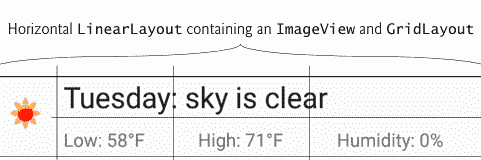

**图 7.5** 在 `ListView` 中显示一天天气的布局。

### 步骤 1：创建布局文件并自定义 `LinearLayout` 方向

通过以下步骤创建 `list_item.xml` 布局文件夹：

1. 右键点击项目中的 Layout，选择 New > Layout resource file。
2. 在 New Resource File 对话框的 File name 字段中输入 `list_item.xml`。
3. 确保在 Root element 字段中指定了 `LinearLayout`，然后点击 OK。`list_item.xml` 文件将出现在 Project 窗口的 Layout 目录，并在布局编辑器中打开。
4. 选择 `LinearLayout` 并将其方向更改为 horizontal（水平）——此布局将由一个 `ImageView` 和一个包含其他视图的 `GridLayout` 组成。

### 步骤 2：添加显示天气图标的 `ImageView`

执行以下步骤添加并配置 `ImageView`：

1. 从 Palette（调色板）中拖入一个 `ImageView` 到 Component Tree（组件树）中的 `LinearLayout` 上。
2. 将 `id` 设置为 `conditionImageView`。
3. 将 `layout:width` 设置为 `50dp`——为此值定义维度资源 `image_side_length`。
4. 将 `layout:height` 设置为 `match_parent`——`ImageView` 的高度将与 `ListView` 项目的高度匹配。
5. 将 `contentDescription` 设置为第 7.4.3 节中创建的字符串资源 `weather_condition_image`。
6. 将 `scaleType` 设置为 `fitCenter`——图标将适应 `ImageView` 的边界并在水平和垂直方向上居中。

## 7.5 Class `Weather`

### 步骤 3：添加显示 `TextViews` 的 `GridLayout`

执行以下步骤添加并配置 `GridLayout`：

1. 从 Palette 中拖入一个 `GridLayout` 到 Component Tree 中的 `LinearLayout` 上。
2. 将 `columnCount` 设置为 `3`，`rowCount` 设置为 `2`。
3. 将 `layout:weight` 设置为 `0dp`——此 `GridLayout` 的宽度将由 `layout:weight` 决定。
4. 将 `layout:height` 设置为 `match_parent`——`GridLayout` 的高度将与 `ListView` 项目一致。
5. 将 `layout:weight` 设置为 `1`——`GridLayout` 的宽度将占据特定 `LinearLayout` 中剩余的所有水平空间。
6. 使用 `setDefaultMargins` 属性在 `GridLayout` 的单元格之间添加默认间距。

### 步骤 4：添加 `TextView`

执行以下步骤添加并配置 `TextViews`：

1. 在 Component Tree 中向 Grid 拖入一个 Large Text（大文本），并将其 `id` 设置为 `dayTextView`，`layout:column` 设置为 `0`，`layout:columnSpan` 设置为 `3`。
2. 在 Component Tree 中向 `GridLayout` 拖入两个 Plain TextView（普通文本），并将它们的 `id` 分设置为 `lowTextView`、`hTextView` 和 `humidityTextView`。将这些 `TextView` 的 `row` 设置为 `1`，`layout:columnWeight` 设置为 `1`。这些 `TextView` 将出现在 `GridLayout` 的第二行，由于它们具有相同的 `layout:columnWeight`，各列的将将等分配。
3. 将 `lowTextView` 的 `layout:column` 设置为 `0`，`hTextView` 的 `layout:column` 设置为 `1`，`humidityTextView` 的 `layout:column` 设置为 `2`。

`list_item.xml` 布局完成。你不需要更改任何 `TextView` 的 `text` 属性——它们将通过程序设置。

此应用由三个类组成，将在第 7.5–7.7 节中讨论：

- `Weather` 类（本节）代表一天的天气数据。`MainActivity` 类将 JSON 数据转换为 `ArrayListView<Weather>`。
- `WeatherArrayAdapter`（第 7.6 节）定义了一个自定义的 `ArrayAdapter`，用于将 `Array<Weather>` 绑定到 `MainActivity` 的 `ListView` 上。`ListView` 项目目从 0 开始索引，每个 `ListView` 项目目的嵌套视图将根据 `Array<Weather>` 中相同索引的 `Weather` 对象进行填充。
- `MainActivity` 类（第 7.7 节）定义了应用的用户界面，以及与 `OpenWeatherMap.org` 每日获取 Web 服务交互并处理 JSON 响应的逻辑。

在本节中，我们重点关注 `Weather` 类。

## 270 第 7 章 WeatherViewer 应用

### 7.5.1 `package` 语句、`import` 语句和类变量

图 7.6 包含了 `package` 语句、`import` 语句以及 `Weather` 类的实例。你将使用来自 `java.text` 和 `java.util` 包的类（第 5–8 行）将每天的时间戳转换为那天几的名称（周一、周二等）。实例被声明为 `final`，它们在初始化后不需要修改。我们还将它们设为 `public`——回 Java Strings 是不可变的，所以尽管实例是公开的，但它们的值是可以改变的。

```java
// Weather.java

// 维护一天的天气信息

package com.deilet.weatherview;

import java.text.NumberFormat;

import java.text.SimpleDateFormat;

import java.util.Calendar;

import java.util.TimeZone;
```

```java
class Weather {

final String minTemp;

final String maxTemp;

final String humidity;

final String description;

final String icon;
```

图 7.6 `package` 语句、`import` 语句和实例。

### 7.5.2 构造函数

构造函数（图 7.7）初始化类的变量：

- 使用 `NumberFormat` 格式化数值。第 22–23 行调用 `convertTimestampToDay`（第 7.5.3 节）获取日期名称。
- 第 25–26 行使用 `NumberFormat` 对象设置温度。我们在格式化后的字符串末尾添加“°”符号。OpenWeather 也支持摄氏温度格式。
- 第 28–29 行使用 `NumberFormat` 格式化百分比。
- 第 30–32 行设置 `iconURL`——这将用于下载图像。

```java
// 构造函数

public Weather(long timestamp, double minTemp, double maxTemp,

double humidity, String description, String iconName) {

 // NumberFormat

NumberFormat numberFormat = NumberFormat.getInstance();

numberFormat.setMaximumDigits(0);

this.dayOfWeek = convertTimestampToDay(timestamp);

this.minTemp = numberFormat.format(minTemp) + "\u00B";

this.maxTemp = numberFormat.format(maxTemp) + "\u00B";

this.humidity = NumberFormat.getInstance().format(humidity) / 100.0;

this.description = description;

this.iconURL = "http://openweathermap.org/img/w/" + iconName + ".png";

}
```

图 7.7 | `Weather` 构造函数。

### 7.5.3 `convertTimestampDay` 方法

工具方法 `convertTimestampDay`（图 7.8）接收一个表示自 1970 年 1 月 1 日 GMT 来的秒数的 `long` 类型——这是 Linux 系统的标准表示方法。为了执行转换：

- 第 37 行创建一个 `Calendar` 对象来处理日期和时间，第 38 行调用 `setTimeInMillis()` 方法使用时间戳设置时间。时间戳是秒，所以我们乘以 `1000` 转换为毫秒。
- 第 39 行获取默认 `TimeZone` 对象，我们根据设备时区调整时间（第 42–43 行）。
- 第 46 行创建一个 `SimpleDateFormat` 来格式化 Date 对象。构造函数参数 `"EEEE"` 将日期格式化为星期名称（周一、周二等）。有关格式完整列表请访问：

`http://developer.android.com/reference/java/text/SimpleDateFormat.html`

- 第 47 行格式化并返回星期名称。`Calendar.getTime()` 返回包含时间的 Date 对象。该 Date 被传递给 `SimpleDateFormat` 以格式化星期名称。

```java
// 将时间戳转换为星期几（例如周一、周二、……）

private String convertTimestampToDay(long timestamp) {

 Calendar calendar = Calendar.getInstance(); // 创建 Calendar

 calendar.setTimeInMillis(timestamp * 1000); // 设置时间

 TimeZone tz = TimeZone.getDefault(); // 获取设备时区

}
```

图 7.8 | `Weather` `convertTimestampDay` 方法（第 1/2 部分）。

# 第 7 章 WeatherViewer 应用

```java
// 调整设备时区的时间
```

```java
calendar.add(Calendar.MILLISECONDS);

tz.getOffset(Calendar.getTimeInMillis());
```

```java
// 返回日名的 SimpleDateFormat
```

```java
SimpleDateFormat formatter = new SimpleDateFormat("EEEE");

formatter.format(calendar.getTime());
```

**图 7.8** 天气方法 `convertTimestampToDay`（第 2 部分，共部分）

## 7.6 类 `WeatherArrayAdapter`

`WeatherArrayAdapter` 类定义了 `ArrayAdapter` 的子类，用于将 `Array-List-view` 绑定到 `MainActivity` 的 `ListView` 上。

### 7.6.1 包声明和导入语句

图 7.9 包含了 `WeatherArrayAdapter` 的包声明和导入语句。

我们将在遇到这些类型时对其进行导入。

此应用的 `ListView` 需要一个自定义布局。每个项目都包含一张图片（天气状况图标）和代表日期、天气描述、最低温度、最高温度和湿度的文本。为了将天气数据映射到列表项中，我们可以创建一个 `ArrayAdapter` 类（第 23 行），并重写 `ArrayAdapter` 方法 `getgetView` 来为每个 `ListView` 项目配置自定义布局。

```java
// WeatherArrayAdapter.java

// 用于在 ListView 中显示 List<Weather> 元素的 ArrayAdapter

package com.detail.weather;

import android.content.Context;

import android.graphics.Bitmap;

import android.graphics.BitmapFactory;

import android.os.AsyncTasks;

import android.view.LayoutInflater;

import android.view.View;

import android.view.ViewGroup;

import android.widget.ArrayAdapter;

import android.widget.ImageView;

import android.widget.TextView;

import java.io.InputStream;

import java.net.HTTPConnection;

import java.net.URL;

import java.util.HashMap;

import java.util.List;

import java.util.Map;

class WeatherArrayAdapter extends ArrayAdapter {
```


**图 7.9** `WeatherArrayAdapter` 类包声明和导入语句。

### 7.6.2 嵌套类 `ViewHolder`

嵌套类 `ViewHolder`（图 7.10）定义了 `WeatherAdapter` 类在操作 `ViewHolder` 对象时直接访问的实例变量。当创建一个 `ListItem` 项目时，我们会为其分配一个新的 `ViewHolder` 对象。如果存在一个可以复用的现有 `ListItem` 项目，我们将简单地更新该项目的 `ViewHolder` 对象。

```java
// 当列表项滚出屏幕和屏幕时复用视图
private static class ViewHolder {
    ImageView contentView;
    TextView textView;
    TextView lowTextView;
    TextView hiTextView;
    TextView humidityTextView;
}
```

**图 7.10** 嵌套类 `ViewHolder`。

### 7.6.3 实例变量和构造函数

图 11 定义了 `WeatherArrayAdapter` 类的实例变量和构造函数。我们使用实例变量 `bitmaps`（第 34 行）——作为一个 `Map<String, Bitmap>`——缓存之前加载的天气状况，这样当用户滚动查看天气时，不需要重新加载。缓存的图像将保留在内存中，直到 Android 终止应用。构造函数（第 37–39 行）简单地调用父类的三参数构造函数，将 `Context`（即显示 `ListView` 的活动）和 `List<Weather>`（数据列表）作为第一个两个参数传递。父类构造函数代表布局的资源 ID，该布局包含一个 `TextView`，用于显示 `ListView` 的项目数据。`-1` 表示我们在此应用中使用了自定义布局，因此可以显示多个 `TextView`。

```java
// 存储已下载的 Bitmaps 以复用
private Map<String, Bitmap> bitmaps = new HashMap<>();

// 初始化继承自父类的构造函数
public WeatherArrayAdapter(Context context, List<Weather> forecast) {
    super(context, forecast);
}
```

**图 11** `WeatherArrayAdapter` 类实例变量和构造函数。

### 7.6.4 重写的 `ArrayAdapter` 方法 `getView`

方法 `getView`（图 7.12）被调用以获取 `ListView` 项目数据的显示内容。重写此方法允许你将数据映射到自定义的 `ListView` 项目。该方法接收 `ListView` 项目的索引、代表 `ListView` 项目的 `View`（`convertView`）及其父容器作为参数。通过转换 `convertView`，你可以自定义 `ListView` 项目的内容。第 45 行调用继承的 `ArrayAdapter` 方法 `getItem`，从 `List<Weather>` 中获取将要显示的 `Weather` 对象。

第 47 行定义了 `ViewHolder` 变量，根据方法 `getView`（`convertView` 参数）是否为空，将变量设置为新的 `ViewHolder` 对象或现有的对象。

```java
// 为 ListItems 创建自定义视图
@Override
public View getView(int position, View convertView, ViewGroup parent) {
    // 此指定 ListView 位置的天气对象
    Weather day = getItem(position);
    ViewHolder viewHolder; // 持有列表项视图引的对象

    // 检查来自滚出 ListView 项目的可复用 ViewHolder
    if (convertView == null) { // 没有可复用的 ViewHolder，因此创建一个
        viewHolder = new ViewHolder();
        LayoutInflater inflater = LayoutInflater.from(getContext());
        convertView = inflater.inflate(R.layout.list_item, parent, false);
    } else {
        viewHolder = (ViewHolder) convertView;
    }

    viewHolder.conditionImageView = convertView.findViewById(R.id.conditionImageView);
    viewHolder.dayTextView = convertView.findViewById(R.id.dayTextView);
    viewHolder.lowTextView = convertView.findViewById(R.id.lowTextView);
    viewHolder.highTextView = convertView.findViewById(R.id.highTextView);
    viewHolder.humidityTextView = convertView.findViewById(R.id.humidityTextView);

    convertView.setTag(viewHolder);
    return convertView;
} else { // 复用现有 ViewHolder
    viewHolder = (ViewHolder) convertView.getTag();

    // 如果天气图标已加载，则使用它
    if (bitmaps.containsKey(day.iconURL())) {
        Bitmap bitmap = bitmaps.get(day.iconURL());
        viewHolder.conditionImageView.setImageBitmap(bitmap);
    }

    // 从 Weather 获取其他数据并放入视图
    Context context = getContext();
    viewHolder.dayTextView.setText(context.getString(R.string.day_of_week, day.day));
    viewHolder.lowTextView.setText(context.getString(R.string.low_temp, day.minTemp));
    viewHolder.highTextView.setText(context.getString(R.string.high_temp, day.maxTemp));
    viewHolder.humidityTextView.setText(context.getString(R.string.humidity, day.humidity));

    return convertView;
}
```

**图 7.12** 重写的 `ArrayAdapter` 方法（第 1 部分，共部分）

### 7.6.5 用于在单独线程下载图片的 `ArrayAdapter` 子类

嵌套类继承自 `AsyncTask` 类并定义了如何在单独线程下载天气状况图像，然后将图像返回给 GUI 线程供 `ListItem` 项目的 `ImageView` 使用。

```java
// 在单独线程中加载天气图标的 AsyncTask
private class LoadImageTask extends AsyncTask<String, Void, Bitmap> {
    private ImageView imageView; // 显示缩略图
}
```

**图 7.13** 用于在单独线程下载图片的 `AsyncTask` 子类（第 1 部分，共部分）

# 276 第 7 章 WeatherViewer 应用

```java
101  // 存储用于设置下载的 Bitmap 的 ImageView
102  public LoadImageTask(ImageView imageView) {
103      this.imageView = imageView;
104  }
105
106
107  // load image(params[]) 是代表图像的 String URL
108  @Override
109  protected Bitmap doInBackground(String... params) {
110      Bitmap bitmap = null;
111      HttpConnection connection = null;
113      try {
114          URL url = new URL(params[0]); // 为图片创建 URL
116          // 打开一个 HttpConnection，获取其输入流
117          // 并下载图片
118          connection = (HttpConnection) url.openConnection();
119          InputStream inputStream = connection.getInputStream();
120          bitmap = BitmapFactory.decodeStream(inputStream);
121          bitmap.put(params[0], bitmap); // 缓存以便稍后使用
122      } catch (Exception e) {
123          e.printStackTrace();
124      }
126      catch (Exception e) {
127          e.printStackTrace();
128      }
129      finally {
130          connection.disconnect(); // 关闭 HttpURLConnection
131      }
132  }
133  
134  return bitmap;
135  }
136
137
138  // 在列表项设置天气状况图像
139  @Override
140  protected void onPostExecute(Bitmap bitmap) {
141      imageView.setImageBitmap(bitmap);
142  }
143  }
144}
```

**图 7.13 | 用于单独线程中下载图片的 `AsyncTask` 子类。（2 中的 2 部分）**

`AsyncTask` 是一个需要三个参数的泛型：

- 第一个是变长参数类型（`String`），用于 `AsyncTask` 的 `doInBackground` 方法，你*必须*重载该方法（第 108–136 行）。当你调用任务的 `execute` 方法时，它会创建一个线程，`doInBackground` 在线程中执行任务。此应用将天气状况图标的 URL 字符串作为参数传递给 `AsyncTask` 的 `execute` 方法（图 7.12，第 80–81 行）。

- 第二个用于 `AsyncTask` `progressUpdate` 方法的变长参数类型。该方法在 GUI 线程中执行，用于接收长时间运行任务的中间更新。重写此方法是可选的。在此例中我们没有使用它，因此我们忽略了这个参数。

- 第三个是任务的结果（`Bitmap`），它被传递给 `AsyncTask` 的 `onPostExecute` 方法（139–143）。该方法在 GUI 线程中执行，并允许 `ListView` 项根据作为 `LoadImageTask` 类构造函数参数指定的项进行更新（第 103–105 行），并存储在第 100 行的实例变量中。使用 `AsyncTask` 的用处是它处理了创建线程和在适当线程上执行其方法的细节，因此你不需要与线程机制进行交互。

## 下载天气状况图像

`doInBackground` 使用 `HttpConnection` 来下载天气图片。第 114 行将传递给 `AsyncTask` `execute` 方法的 URL 字符串（`params`）连接到 `URL` 对象。接下来，第 118 行调用 `URL` 的 `getConnection()`——需要进行强制转换，它返回 `HttpConnection`。`OpenConnection` 请求 URL 发送的内容。第 120 行获取输入流以解码并返回一个包含图片的 `Bitmap`（第 121 行）。第 122 行解码下载的图片以备可能的重用，第 123 行调用 `HttpConnection.disconnect()` 释放其资源。第 139 行返回下载的 `Bitmap`，然后它被传递到 GUI 线程中的 `onPostExecute`——以显示图像。

`MainActivity` 定义了应用的用户界面、与 `OpenWeather.org` 交互的逻辑提供了每日天气服务以及处理 JSON 响应的逻辑。嵌套的 `AsyncTask` 子类 `GetWeatherData` 在单独线程中执行网络请求（第 7.7 节）。`MainActivity` 在此应用中不需要菜单，因此我们从自动生成的代码中删除了 `onCreateOptionsMenu` 和 `onItemSelectedSelected` 方法。

图 7.14 包含了 `MainActivity` 的包语句和导入语句。我们将在遇到这些导入类型时讨论它们。

```java
// MainActivity.java
2 // 显示指定城市的预预报
3 package com.detail.weather;
```

**图 7.14 | `MainActivity` 包语句和导入语句。（1 中的 2 部分）**

```java
4 import android.content.Context;
5 import android.os.AsyncTask;
6 import android.os.Bundle;
7 import android.support.design.widget.FloatingActionButton;
8 import android.support.design.widget.Snackbar;
9 import android.support.v7.app.AppCompatActivity;
10 import android.support.v7.widget.Toolbar;
11 import android.view.View;
12 import android.view.input.InputMethodManager;
13 import android.widget.EditText;
14 import android.widget.ListView;
15 import org.json.JSONArray;
16 import org.json.JSONException;
17 import org.json.JSONObject;
18 import java.io.BufferedReader;
19 import java.io.IOException;
20 import java.io.InputStreamReader;
21 import java.net.HttpConnection;
22 import java.net.URL;
23 import java.net.URLEncoder;
24 import java.util.ArrayList;
25 import java.util.List;
```

**图 7.14 | `MainActivity` 包语句和导入语句。（2 中的 2 部分）**

## 7.2 实例变量

`MainActivity`（图 7.15）继承自 `AppCompatActivity` 并定义了三个实例变量：

- `weatherList`（第 32 行）是一个 `ArrayList<Weather>`，用于存储 `Weather`——每个对象代表每日预报中的一天。
- `weatherAdapter` 将引用一个 `WeatherArrayAdapter` 对象（第 7.6 节），将列表绑定到 `ListView` 的项上。
- `weatherList` 将引用 `MainActivity` 的 `ListView`。

```java
30 public class MainActivity extends AppCompatActivity {
31 // 代表预报的 Weather 对象列表
32 private List<Weather> weatherList = new ArrayList<>();
33
34 // 将 Weather 对象绑定到 ListView 的适配器
35 private WeatherArrayAdapter weatherAdapter;
36 private ListView weatherList; // 显示天气信息
```


# 第 7 章 WeatherViewer 应用

## 7.7.3 重写的 `onCreate`

**图 7.15 | `MainActivity` 的实例变量。**

重写的 `onCreate`（图 7.15）配置 `MainActivity` GUI。第 41–45 行是在你创建项目时选择空白 Activity 模板由 Android Studio 生成的。这些行填充 GUI，配置应用的 `Toolbar` 并将其附加 activity。记住，AppCompat 必须提供自己的 `Toolbar`，因为早期 Android 版本不支持栏（bars）。

第 48–50 行配置 `weatherListView` 的 `ListAdapter`——在此例中，是 `WeatherArrayAdapter` 子类的对象。`List` 方法 `adapter` 将 `WeatherArrayAdapter` 连接到 `ListView` 以填充列表项。

```java
// 配置 Toolbar, ListView 和 FAB

@Override
protected void onCreate(Bundle savedInstanceState) {
    super.onCreate(savedInstanceState);

    // 填充布局并配置 Toolbar 代码
    setContentView(R.layout.activity_main);

    Toolbar toolbar = (Toolbar) findViewById(R.id.toolbar);
    setSupportActionBar(toolbar);

    // 创建适配器将 weatherlist 绑定到 weatherListView
    weatherListView = (ListView) findViewById(R.id.weatherListView);
    weatherAdapter = new WeatherArrayAdapter(this, weatherList);
    weatherListView.setAdapter(weatherAdapter);

    // 配置 FAB 以隐藏键盘并启动网络服务请求
    FloatingActionButton fab = findViewById(R.id.fab);

    fab.setOnClickListener(new View.OnClickListener() {
        @Override
        public void onClick(View view) {
            // 从 locationEditText 获取文本并创建网络服务调用
            EditText locationEditText = (EditText) findViewById(R.id.locationEditText);
            URL url = URL.create(locationEditText.getText().toString());

            // 隐藏键盘并启动 GetWeatherData 从
            // OpenWeatherMap.org 下载天气数据，在单独线程中
            if (url != null) {
                dismissKeyboard(locationEditText);

                GetWeatherData task = new GetWeatherData();
                task.execute(url);
            } else {
                Snackbar.make(findViewById(R.id.coordinatorLayout),
                    R.string.invalid_url, Snackbar.LENGTH_LONG).show();
            }
        }
    });
}
```

**图 16 | 重写的 `onCreate` 方法。**

第 53–75 行配置了来自空活动（Blank Activity）模板的 `FloatingActionButton`。`OnClick` 监听方法由 Android Studio 自动生成，但我们实现了它的方法体。我们获取 `EditText` 的引用，然后在第 61 行使用它获取用户输入。将其传递给方法 `createSection (7.7.4)` 以创建一个代表服务请求的 URL，用于获取城市天气。如果 URL 创建成功，第 66 行通过调用 `dismissKeyboard (7.7.4)` 方法程序化地隐藏键盘。第 67 行创建一个新的 `EditText` 以在独立线程中获取天气预报，第 68 行执行任务，并将服务请求的 URL 作为 `AsyncTask execute` 传递。如果 URL 创建失败，第 71–72 行创建一个 `Snackbar` 表明 URL 无效。

## 7.7.4 方法 `dismissKeyboard` 和 `createURL`

图 7.17 显示了 `MainActivity` 中的 `dismissKeyboard` 和 `createURL`。当用户触摸 `FloatingActionButton` 提交应用时，会调用 `dismissKeyboard`（79–83）来隐藏软键盘。Android 提供了一项服务用于程序化管理键盘。你通过调用继承的上下文方法 `getSystemService` 并传入适当上下文来获取（以及许多其他 Android 服务）的引用——在本例中使用 `Context.INPUT_METHOD_SERVICE`。此方法可以返回许多不同类型的对象，你必须将其值强制转换为相应的类型——`InputMethodManager(package.android.view.input)`。要关闭键盘，请调用 `InputMethodManager.hideInputFromWindow(line 82)`。

```java
// 当用户触摸 FAB 时程序化地关闭键盘
private void dismissKeyboard(View view) {
    InputMethodManager imm = (InputMethodManager) getSystemService(
        Context.INPUT_METHOD_SERVICE);

    imm.hideInputFromWindow(view.getWindow(), 0);
}
```

```java
// 使用 String city 为 openweathermap.org 服务创建 createURL
private String createURL(String city) {
    String apiKey = getString(R.string.api_key);
    String baseUrl = getString(R.string.web_service_url);

    try {
        // 为指定的城市和英制单位（华氏度）创建 URL
        String url = baseUrl + URLLEncoder.encode(city, "UTF-8")
            + "&units=metric&appid=" + apiKey;

        return new URL(url).toString();
    } catch (Exception e) {
        e.printStackTrace();
        return null;
    }

    return null; // URL 格式错误
}
```

**图 7.17 | `MainActivity` 方法 `dismissKeyboard` 和 `createURL`。**

## 7.7 类 `MainActivity`

方法 `createURL`（第 86–101 行）组装网络服务请求的 URL 字符串表示（第 92–93 行）。然后第 94 行尝试创建并返回一个用 URL 字符串初始 URL 对象。在第 93 行，我们为网络服务查询添加参数：

```text
&units=imperial&count=6&appid=
```

`units` 参数可以是英制（用于华氏度温度）、公制（摄氏度）或标准（开尔文）——如果你不包含 `units` 参数，默认为标准单位。`count` 指定预报中应包含多少天。最大值为 16，默认值为 7——提供无效的天数将导致生成 7 天预报。最后，`appid` 参数用于你的 OpenWeather.org API 密钥，将其加载到字符串源 `api_key` 中。默认情况下，返回的结果为 JSON 格式，但你可以添加值为 `XML` 或 `HTML` 的 `mode` 参数，分别从网页接收 XML 数据。

## 7.7.5 用于调用网络服务的 `AsyncTask` 子类

嵌套的 `AsyncTask` 子类 `GetWebServerTask`（图 7.18）执行网络服务请求，在独立线程中处理响应，并将预报信息作为 `JsonObject` 传递给 UI 线程。

```java
// 调用 REST 服务以获取天气数据并
// 将数据保存到本地 HTML 文件

private class GetWebServerTask
extends AsyncTask<Void, JSONObject> {

    @Override
    protected JSONObject doBackground(URL... params) {

        HttpURLConnection connection = null;

        try {
            connection = (HttpURLConnection) params[0].openConnection();

            int response = connection.getResponseCode();

            if (response == HttpURLConnection.HTTP_OK) {
                StringBuilder builder = new StringBuilder();

                try (BufferedReader reader = new BufferedReader(
                    new InputStreamReader(connection.getInputStream()))) {

                    String line;

                    while ((line = reader.readLine()) != null) {
                        builder.append(line);
                    }

                } catch (IOException e) {
                    Snackbar.make(findViewById(R.id.coordinatorLayout),
                        R.string.read_error, Snackbar.LENGTH_LONG).show();

                    e.printStackTrace();
                }
            }
        }
```

```java
133

134      return new JSONObject(builder.toString());
135  }
136  else {
137      Snackbar.make(findViewById(R.id.coordinatorLayout),
138              R.string.connect_error, Snackbar.LENGTH_LONG).show();
139      }
140  }
141  catch (Exception e) {
142      Snackbar.make(findViewById(R.id.coordinatorLayout),
143              R.string.connect_error, Snackbar.LENGTH_LONG).show();
144      e.printStackTrace();
145  }
146  finally {
147      connection.disconnect();
148  }
149

150  return null;
151  }
152  @Override
153  protected void onPostExecute(JSONObject result) {
154      updateUI(result);
155      adapter.notifyDataSetChanged();
156      listView.smoothToPosition(0);
157  }
}
```

**图 7.18 | 调用网络服务的 `AsyncTask`。（部分 2）**

当 `onPostExecute` 在 GUI 线程中被调用时，第 156 行调用 `notifyDataSetChanged()`，使 `listView` 更新。这确保了新的天气数据位于顶部。

## 7.7.6 `convertJSONToArray`

在 7.3.2 节中，我们解码了 OpenWeather.org 返回的 JSON。方法 `convertJSONToArray`（图 7.19）从 `JSONObject` 参数中提取天气数据。在 `JSONObject` 或 `JSONArray` 中处理数据可能会导致 `JSONException`，除非将第 168–188 行放置在 `try` 块中。

```java
// 从包含预报的 JSONObject 创建天气对象
private void convertJSONToArray(JSONObject forecast) {
    weatherList.clear(); // 清空旧天气数据

    try {
        // 获取预报 "list" JSONArray
        JSONArray list = forecast.getJSONArray("list");

        // 将 list 的每个元素转换为 Weather 对象
        for (int i = 0; i < list.length(); i++) { // 获取一天的数据
            JSONObject day = list.getJSONObject(i);

            // 获取温度 "temp" JSONObject
            JSONObject temperatures = day.getJSONObject("temp");

            // 获取描述和图标的 "weather" JSONObject
            JSONObject weather = day.getJSONArray("weather").getJSONObject(0);

            // 将新天气添加到 weatherList
            weatherList.add(new Weather(
                day.getLong("dt"), // 时间戳
                temperatures.getDouble("min"), // 最低温度
                temperatures.getDouble("max"), // 最高温度
                day.getDouble("humidity"), // 湿度比
                weather.getString("description"), // 天气状况
                weather.getString("icon")); // 图标名称
            ));
        }
    } catch (JSONException e) {
        e.printStackTrace();
    }
}
```

**图 7.19 | `MainActivity` 方法 `convertJSONToArray`。**

```java
catch (JSONException e) {
    e.printStackTrace();
}
```


图 7.19 | method `convertJSONToArrayList`（第 2 部分，共 2 部分）。

第 168 行通过调用 `JSONObject` 方法 `getJSONArray` 并以数组名称作为参数使用了 "List" 类型的 `JSONArray`。第 171–179 行为 `JSONArray` 中的每个元素创建一个 `Weather` 对象。`JSONArray` 方法 `length` 返回数组的元素个数（第 171 行）。

第 172 行通过调用 `getObject`（其以索引作为参数）从 `JSONArray` 中创建一个代表某天天气预报的 `JSONObject`。第 175 行获取 "temp" JSON 对象，该对象包含该日期。第 178–179 行获取 "weather" JSON 对象，然后获取当天的描述和图标。

第 182–184 行创建一个天气对象并将其添加到 `weatherList` 中。第 183 行使用 `JSONObject` 方法 `getDouble` 从对象中获取最小 "min" 温度和最大 "max" 温度，并从日期对象中获取 "humidity" 百分比。最后，187–188 行使用 `getString` 从天气对象中获取天气描述和天气图标字符串。

## 本节总结

在本章中，你构建了 `WeatherViewer` 应用。该应用从 `OpenWeather.org` 提供的 Web 服务获取了 16 天预报，并在 `ListView` 中显示了这些预报。我们讨论了 Web 服务的架构风格——即真正的状态转换（REST）。你学习了如何使用 Web 标准（如超文本传输协议 HTTP）来调用 RESTful Web 服务并接收它们的响应。

所使用的 `OpenWeather.org` Web 服务以 JavaScript 符号记法（JSON）格式的字符串形式返回了预报。你学习了这种基于 JSON 的格式，在该格式中，对象被表示为键/值对的集合。你使用了来自 `org.json` 包的 `JSONObject` 和 `JSONArray` 类来处理数据。

为了调用该服务，你将服务的 URL 字符串转换为 `URL` 对象。然后，你使用该 URL 开启 `HttpConnection` 连接，以通过 HTTP 请求调用 Web 服务。应用从 `HttpConnection` 的输入流（Input-Stream）中读取所有数据，并将其解析为字符串，然后将该字符串转换为 `JSONObject` 以进行处理。我们演示了如何使用 `AsyncTask` 对象在 GUI 线程之外执行耗时操作。这对于响应时间不定的 Web 服务请求尤为重要。

你在 `ListView` 中显示了天气数据，并使用 `ArrayAdapter` 的子类为每个 `ListView` 项目提供数据。我们展示了如何通过“视图-保持者模式”（view-holder pattern）来提高 `ListView` 的性能，即在项目滚动出屏幕时复用现有的 `ListView` 项目视图。

最后，你还使用了 Android Design Support Library 中的几个材料设计功能：一个 `EditTextLayout` 用于在用户开始输入后仍让 `EditText` 的提示（hint）显示在屏幕上；一个 `FloatingActionButton` 用于用户提交输入；以及一个 `Snackbar` 用于向用户显示信息。

在第 8 章中，我们将构建 `Twitter Searches` 应用。许多移动应用都会显示项目列表，就像我们在本应用中所做的那样。在第 8 章中，你将使用一个从 `ArrayList<String>` 获取数据的 `RecyclerView` 来此。对于大数据集，`RecyclerView` 比 `ListView` 更高效。你还将应用数据存储为用户偏好（preferences），并学习如何启动设备浏览器来显示网页。

## 8

## Twitter® Searches App

`SharedPreferences`, `SharedPreferences.Editor`, `Implicit Intents`, `Intent Choosers`, `RecyclerView`, `RecyclerView.Adapter`, `RecyclerView.ViewHolder`, `RecyclerView.ItemDecoration`

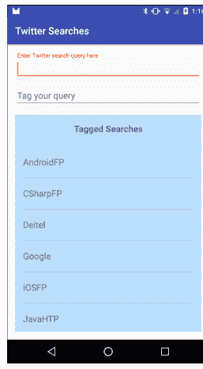

| 目标 |
| :--- |
| 在本章中你将： |
| - 使用 `SharedPreferences` 存储与应用相关的键值对数据。 |
| - 使用隐式 `Intent`（Implicit Intent）在浏览器中打开网站。 |
| - 使用隐式 `Intent` 显示一个包含可共享文本列表的意图选择器（intent chooser）。 |
| - 在 `RecyclerView` 中显示滚动项目列表。 |
| - 使用 `RecyclerView.Adapter` 的子类指定 `RecyclerView` 的数据。 |
| - 使用 `RecyclerView.ViewHolder` 的子类为 `RecyclerView` 实现视图-保持者模式。 |
| - 使用 `RecyclerView.ItemDecoration` 的子类在 `RecyclerView` 项目之间显示分隔线。 |
| - 使用 `AlertDialog.Builder` 对象创建一个显示选项列表的对话框（`AlertDialog`）。 |

## 8.1 引言

## 提纲

- 8.1 引言
- 8.2 测试驱动应用
- 8.2.1 添加收藏搜索
- 8.2.2 查看 Twitter 搜索结果
- 8.2.3 编辑搜索
- 8.2.4 删除搜索
- 8.2.6 滚动查看已保存的搜索
- 8.3 技术概览
- 8.3.1 在 `SharedPreferences` 文件中存储键值数据
- 8.3.2 隐式 `Intent` 与意图选择
- 8.3.3 `RecyclerView`
- 8.3.4 `RecyclerView.Adapter` 和 `ViewHolder`
- 8.3.5 `RecyclerView.ItemDecoration`
- 8.3.6 在对对话框中显示选项列表
- 8.4 构建应用的 UI 和资源
- 8.4.1 创建项目
- 8.4.2 `AndroidManifest.xml`
- 8.4.3 添加 `RecyclerView` 库
- 8.4.4 `colors.xml`
- 8.4.5 `strings.xml`
- 8.4.6 `arrays.xml`
- 8.4.7 `dimensions.xml`
- 8.4.8 添加按钮
- 8.4.9 `activity_main.xml`
- 8.4.10 `content_main.xml`
- 8.4.11 `activity_item.xml`
- 8.5 `MainActivity` 类
- 8.5.1 包声明与导入语句
- 8.5.2 `MainActivity` 字段
- 8.5.3 重写 `onCreate`
- 8.5.4 `TextView` 事件处理与 FAB
- 8.5.5 `saveOnClickListener`
- 8.5.6 `addTagged` 方法
- 8.5.7 匿名类实现
- 8.5.8 `ViewOnClickListener` 显示搜索结果
- 8.5.9 匿名类实现
- 8.5.10 `ViewOnClickListener` 分享、编辑
- 8.5.11 `shareSearch` 方法
- 8.5.12 `deleteSearch` 方法
- 8.6 Search `RecyclerView.Adapter` 的子类
- 8.6.1 包、导入语句、变量和构造函数
- 8.6.2 Nested `ViewHolder` `RecyclerView.ViewHolder` 的子类
- 8.6.3 重写的 `RecyclerView.Adapter` 方法
- 8.7 Item `RecyclerView.ItemDecoration` 的子类
- 8.8 关于 Fabric：Twitter 的开发平台
- 8.9 本节总结

### 8.1 引言

Twitter 的搜索机制让人们能够轻松关注 3 亿月活跃用户讨论的话题。可以使用 Twitter 运算符（见 8.2 节）对搜索进行精调，否则在移动设备上操作会非常耗时且繁琐。`Twitter Searches` 应用（图 8.1 a）允许你保存收藏的搜索标签（图 8.1 b），这些标签以列表形式显示。你可以滚动查看保存的搜索，并触摸标签进行分享、编辑和删除。

1. https://about.twitter.com/company.
2. http://www.businessinsider.com/twitter-active-users-2015-7?r=UK&ir=T.

## 第8章 Twitter Searches 应用

a) 带有多个保存搜索的应用

b) 用户输入“Deitel”后的应用

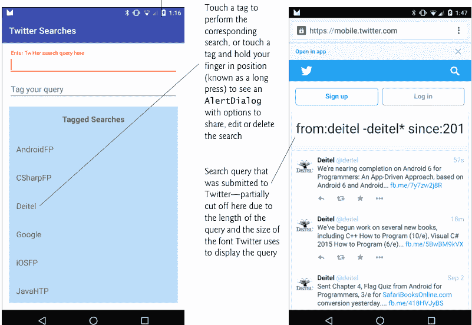

图 8.1 | Twitter Searches 应用。

应用支持竖屏和横屏方向。在 `Flag Quiz` 应用中，我们通过为每种方向提供单独布局来实现这一点。在 `Doodle` 应用中，你是通过编程设置方向来实现的。在本应用中，我们通过设计一个可以动态调整的 GUI 来支持两种方向。

首先，你将测试应用。然后我们将解释构建该应用的技术。接下来，我们将设计应用的 GUI。最后，我们将通过应用的完整源码来详细介绍新功能。

## 8.2 测试驱动应用

### 打开并运行应用

打开 Android Studio 并打开书籍示例文件夹中的 `Twitter Searches` 文件夹，然后在 AVD 或设备上执行应用。这会构建项目并运行应用（图 8.2）。

### 8.2.1 添加收藏搜索

触摸顶部的 `EditText`，输入 `Deitel` 作为搜索查询——从此处：运算符定位来自特定 Twitter 账户的推文。图 8.3 显示了搜索

## 8.2 演示应用程序

用于输入查询表达式的 `EditText`——提示文本：**在此处输入搜索查询** 指明了 `EditText` 的用途。

用于为您的搜索添加标签的 `EditText`——提示文本 **标记您的查询** 指明了 `EditText` 的用途。

当 `EditText` 获得焦点时，它外围的 `TextInputLayout` 会将提示文本动画到 `EditText` 上方的位置。

保存的搜索将显示在这里。

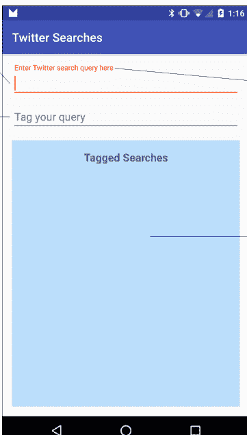

**图 8.2** | Twitter Searches 应用首次运行时时的界面。

运算符——可以使用多个运算符来构建更复杂的查询。完整列表可以在此处找到：

```
http://bit.ly/TwitterSearchOperators
```


| 示例 | 查找包含内容的推文 |
| --- | --- |
| `google android` | 隐式逻辑与运算符——查找包含 `google` **and** `android` 的推文。 |
| `google OR android` | 逻辑 OR 运算符——查找包含 `google` **or** `android` 的推文。 |
| `"how to program"` | “引号”内的字符串——查找包含 `"how to program"` 的推文。 |
| `android ?` | `?`（问号）——查找关于 `android` 问题的推文。 |
| `google -android` | `-`（减号）——查找包含 `google` 但不包含 `android` 的推文。 |
| `android :)` | `:)`（笑脸）——查找包含 `android` 的正面推文。 |
| `android :(` | `:(`（悲脸）——查找包含 `android` 的负面推文。 |

**图 8.3** | 某些 Twitter 搜索运算符。（部分共 2 部分）

# 第 8 章 Twitter® 搜索应用程序

| 示例 | 查找包含内容的推文 |
| --- | --- |
| `since:2013-10-01` | 查找在指定日期或之后发表的推文，日期格式必须为 `YYYY-MM-DD`。 |
| `near:"New York City"` | 查找位于“纽约市”附近的推文。 |
| `from:GoogleCode` | 查找来自 Twitter 账号 `@GoogleCode` 的推文。 |
| `to:GoogleCode` | 查找发送给 Twitter 账号 `@GoogleCode` 的推文。 |

图 8.3 | 某些搜索运算符。（部分共 2 部分）

在底部的 `EditText` 中输入 `Deitel` 作为搜索查询（图 8.4(a)）。这将是在应用程序中 Tagged Searches（已标记搜索）部分显示的短名称。点击保存按钮以保存搜索——标签 `Deitel` 将出现在 Tagged Searches 标题下的列表中（图 8.4(b)）。当您保存搜索时，软键盘会消失，这样你就可以看到已保存的搜索列表（第 8.5.5 节）。

a) 输入 Twitter 搜索和搜索标签。

b) 保存 Twitter 搜索和搜索标签后。

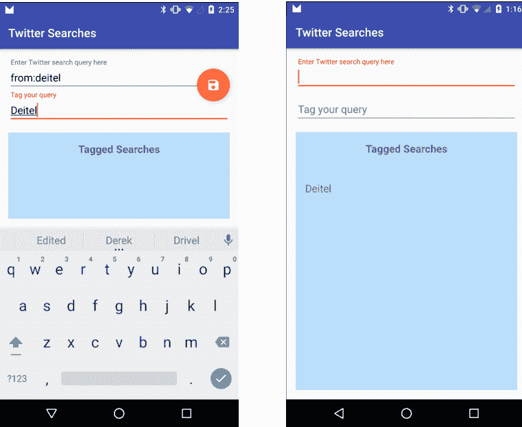

图 8.4 | 正在输入 Twitter 搜索。

## 8.2.2 查看 Twitter 搜索结果

要查看搜索结果，点击标签“Deitel”。这会启动设备的 Web 浏览器并将代表已保存搜索的 URL 传递给 Twitter 网站。Twitter 会读取 URL 中的搜索查询，然后以网页的形式返回与查询匹配的推文（如果有的话）（图 8.5）。当您查看完结果后，点击返回键返回到 Twitter Searches，在其中您可以保存更多搜索，并编辑、删除和分享已保存的搜索。对于 `from:deitel` 查询，Twitter 会显示账户名中包含 `deitel` 的相关用户，以及来自这些账号的最新推文。


**图 8.5** | 查看来自 `deitel` 的搜索结果——模糊处理了一个 Twitter 账号。

## 8.2.3 编辑搜索

您还可以分享、编辑或删除搜索。要查看这些选项，长按搜索——即点击标签并将手指停在屏幕上，直到出现包含共享（Share）、编辑（Edit）和删除（Delete）选项的对话框。如果您使用 AVD（安卓模拟器），点击并按住搜索标签上的左鼠标键以执行长按。当您按下“Deitel”时，图 8.6(a) 中的 Alert-Dialog 显示标记为“Delete”的搜索的共享、编辑和删除选项。如果您不想执行这些任务的任何一个，请点击 CANCEL（取消）。

- a) 选择 Edit 编辑现有搜索。
- b) 编辑名为“Delete”的保存搜索。

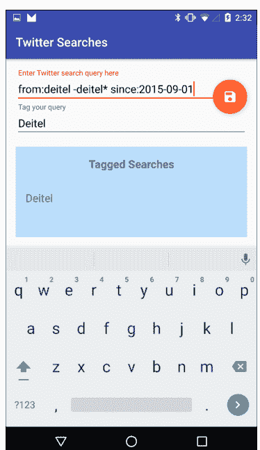

**图 8.6** 编辑保存的搜索。

要编辑查询（标记为“Delete”），点击对话框的 Edit 选项。应用程序会将搜索查询和标签加载到 `EditText` 中进行编辑。让我们将搜索限制为 2015 年 9 月 1 日之后来自 `@delete` 账号的推文。添加一个空格，然后输入 `-delete*：since:2015-06-01`。`since` 运算符将搜索限制在指定日期或之后，日期格式必须为 `YYYY-MM-DD`。减号查找包含一个术语但不包含另一个的推文。问号运算符查找提问题的推文。笑脸和悲脸查找正面和负面推文。字符串运算符查找引号内的文本。`OR` 和运算符允许复杂的查询。

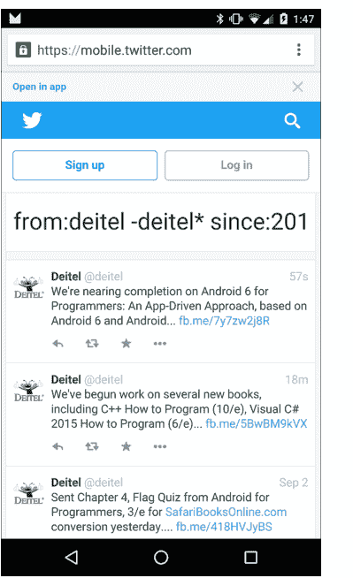

**图 8.7** | 测试应用程序。

## 8.2.4 分享搜索

Android 可以轻松分享各种类型的信息：电子邮件、即时消息（短信）、Facebook 等。在此应用程序中，您可以通过长按搜索并从出现的对话框中选择 Share（共享）来实现（图 8.8(a)）。如果没有应用程序可以处理该内容，选择器将显示相关信息。如果只有一个应用程序可以处理该内容，将直接启动而无需选择。

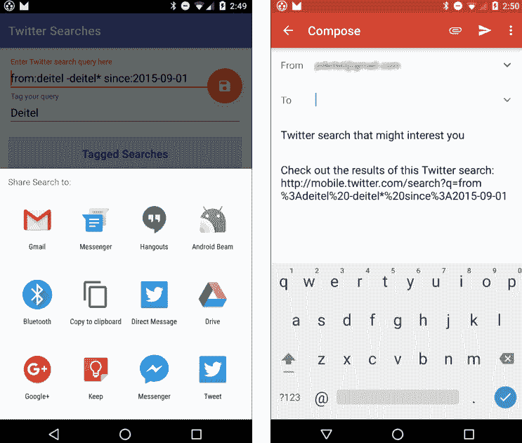

**图 8.8** | 通过搜索共享。

## 8.2.5 删除搜索

要删除搜索，长按搜索标签并从出现的对话框中选择 Delete（图 8.9）。应用程序将会提示您确认是否删除该搜索——点击 CANCEL（取消）将返回主界面而不删除搜索。点击 DELETE 将删除搜索。


**图 8.9** | 删除确认对话框。

## 8.2.6 滚动查看保存的搜索

图 8.10 显示了保存多个收藏搜索后的应用程序——目前显示的这些。如果搜索数量超过屏幕显示范围，应用程序允许您滚动查看。与桌面应用程序不同，触摸屏应用程序通常不显示滚动条来指示可滚动区域。要滚动，只需在 Tagged Searches 列表中滑动手指（在 AVD 中为移动鼠标）。此外，将设备旋转到横屏模式，查看 GUI 如何动态调整。


## 8.3 技术概述

本节将介绍构建 Twitter Searches 应用程序将用到的功能。

### 8.3.1 在 SharedPreferences 文件中存储键值对数据

每个应用程序都有与该程序相关的、包含键值对的 SharedPreferences 文件——每个键都能让您快速查找到对应值。第 4 章的旗帜测验应用程序将设置存储在设备上的 SharedPreferences 文件。该应用程序的 PreferenceFragment 为您创建了 SharedPreferences 文件。在此应用程序中，您将创建并管理名为 `searches` 的 SharedPreferences，在其中存储用户创建的标签对（键）和 Twitter 搜索查询（值）。再次，使用 `SharedPreferences.Editor` 来对标签-查询对进行更改。

## 性能提示 8.1


此应用存储的数据并不多，因此我们在 `MainActivity`/子线程中从设备中读取已保存的搜索内容。耗时较长的数据访问不应在 UI 线程中进行；否则应用将显示“应用程序未响应”（ANR）对话框——这通常在阻止用户与应用交互五秒钟后发生。有关设计响应式应用的信息，请参阅 <http://developer.android.com/training/articles/perf-an.html>，并考虑第 7 章所示的 `AsyncTasks`。

### 8.3.2 隐式意图和意图选择器

在第 4 章中，你使用显式意图（`Intent`）来启动同一应用中的 Activity。Android 也支持隐式意图，你不需要指定具体的哪个意图。在此应用中，你将使用隐式意图：

- 一个启动设备默认浏览器以根据嵌入 URL 中的搜索查询显示 Twitter 搜索；
- 一个允许用户从多种可以共享文本的应用程序中进行，以便用户可以共享喜欢的 Twitter 搜索。

在任何一种情况下，如果系统找不到处理该操作的 Activity，则 `startActivity` 方法将抛出 `ActivityNotFoundException`。处理此异常是一个良好的编程习惯，可以防止你的应用崩溃。有关意图的更多信息，请访问：

```text
http://developer.android.com/components/intents-filters.html
```

当 Android 接收到隐式意图时，它会找到包含该操作（action）和数据类型的所有 Activity。如果只有一个，Android 会启动该应用中的该 Activity。如果有多个应用可以处理该意图，Android 会显示一个对话框，让用户选择由哪个应用处理该意图。例如，当此应用的用户选择搜索且设备只有一个网络浏览器时，Android 会立即启动该浏览器执行搜索并显示结果。如果安装了两个或多个网络浏览器，用户必须选择由哪个浏览器执行此任务。

### 8.3.3 RecyclerView

在第 7 章中，你使用 `ListView` 来显示预测——一组有限的数据。许多移动应用会显示大量的信息列表。例如，电子邮件应用显示电子邮件列表，通讯录应用显示联系人列表，新闻应用显示头条列表，在每种情况下，用户都点击某一项以查看更多信息——所选电子邮件的内容、所选联系人的详情或新闻故事的正文。

#### RecyclerView 对比 ListView

在此应用中，你将使用 `RecyclerView`（包名 `android.support.v7.widget`）显示可滚动的标签搜索列表——这是一种灵活、可定制的视图，你可以控制应用如何显示数据列表。`RecyclerView` 被设计为更好的 `ListView`。通过 `RecyclerView` 重用视图的能力（第 8.3.4 节），它提供了更好的数据与表示的分离，以及为展示项目提供了更灵活的自定义选项（第 8.3.5 节）。例如，`ListView` 的项始终以垂直列表形式显示，而 `RecyclerView` 具有布局管理器（layout managers），可以以垂直列表或网格形式显示项。你也可以定义自己的布局管理器。

#### RecyclerView 布局管理器

对于此应用，`RecyclerView` 将使用 `LinearLayoutManager`（`RecyclerView.LayoutManager` 的子类）来指定项将以垂直列表的形式出现，并且列表项将每个在 `TextView` 中以 `String` 形式显示搜索标签。你也可以为 `RecyclerView` 的项设计自定义布局。

### 8.3.4 RecyclerView.Adapter 和 RecyclerView.ViewHolder

在第 7 章中，我们使用 Adapter 将数据绑定到 `ListView`。我们还引入了“持有者模式”（holder-pattern）来重用滚动出屏幕的视图。记得我们调用过一个名为 `ViewHolder`（第 8.6 节）的类，它维护了 `ListItem` 项中视图的引用。Adapter 子类为每个 `ListItem` 存储一个 `ViewHolder` 对象，这样你就不需要强制使用这种模式，但为了你的视图的滚动性能，建议使用它。

`RecyclerView` 通过使该模式成为强制性，将持有者模式正式化。`RecyclerView.Adapter` 将 `RecyclerView` 的列表项绑定到 `List` 中的数据（第 8.6 节）。每个 `RecyclerView` 项都有一个对应的 `RecyclerView.ViewHolder` 子类的对象（第 8.6.2 节），该对象维护了用于重用的项引用。`RecyclerView` 及其 Adapter 协同工作回收滚动出屏幕的视图。

### 8.3.5 RecyclerView.ItemDecoration

`ListView` 类会自动在项之间显示一条水平线，但 `RecyclerView` 不提供任何默认设置。为了在项之间显示水平线，你将定义 `RecyclerView.ItemDecoration` 的子类，在 `RecyclerView` 上绘制线条（第 8.7 节）。

### 8.3.6 在 AlertDialog 中显示选项列表

此应用允许你点击 `RecyclerView` 项以显示包含选项列表的 `AlertDialog`，用户只能选择其中一个。你将使用 `AlertDialog.Builder` 的 `setItems` 方法来指定显示选项的 String 资源容器名称，并设置当用户点击其中一个选项时调用的事件处理程序。

## 8.4 构建应用的 GUI 和资源文件

在本节中，你将构建 Twitter 应用的 GUI 和资源文件。回顾第 8.3.3 节，`RecyclerView` 并不定义如何渲染其列表项。因此，你还需要创建一个定义列表项 GUI 的布局。`RecyclerView` 在创建列表项时会根据需要加载（inflate）此布局。

### 8.4.1 创建项目

使用 Blank Activity 模板创建一个新项目。此应用不需要 Fragments，因此在配置 Blank Activity 时，不要勾选 Use a Fragment 复选框。在 Create New Project 对话框的 New Project 步骤中指定以下值：

- Application name: Twitter Searches
- Company Domain: `deitel.com`（或指定你自己的域名）

按照之前应用中的步骤为你的项目添加图标。从 `content_main.xml` 中删除 `"Hello world!"` TextView，因为它没有被使用。此外，按照第 4.4.3 节的步骤为项目配置 Java SE7 支持。

### 8.4.2 AndroidManifest.xml

大多数用户启动此应用是为了执行一次已保存的搜索。当 Activity 中的第一个 GUI 组件是 `EditText` 时，Android 会在 Activity 显示时赋予该组件焦点。当 `EditText` 接收到焦点时，它的虚拟键盘将会显示。在此应用中，我们希望在用户触摸应用的 `EditText` 之前阻止软键盘显示。要做到这一点，请按照第 3.7 节的步骤设置 window-SoftInput 选项，将其设置为 `stateHidden`。

### 8.4.3 颜色资源

`colorAccent` 资源的十进制值为 `#FF5722`，然后添加一个名为 `colorTaggedSearches` 的新颜色资源，值为 `#BBDEBF`。

### 8.4.5 strings.xml

将图 8.11 中的字符串资源添加到 `strings.xml` 中。

| 键 | 默认值 |
| --- | --- |
| `query_prompt` | 在此处输入 Twitter 搜索查询 |
| `tag_prompt` | 为您的查询添加标签 |
| `save_description` | 点击此按钮保存您已标记的搜索 |
| `tagged_searches` | 已标记的搜索 |
| `search_URL` | `http://mobile.twitter.com/search=?` |
| `share_edit_delete_title` | 分享、编辑或删除搜索 `%s` |
| `cancel` | 取消 |
| `share_subject` | 你可能感兴趣的 Twitter 搜索 `%s` |
| `share_message` | 查看此 Twitter 搜索的结果：`%s` |
| `share_search` | 搜索至： |
| `confirm_message` | 你确定要删除 `%s` 吗？ |
| `delete` | 删除 |

> **图 8.11** | 在 **Twitter Searches** 应用中使用的字符串资源。

### 8.4.6 arrays.xml

回顾第 4 章，数组资源通常定义在 `arrays.xml` 中。按照第 4.6 节的步骤创建一个 `arrays.xml` 文件，然后将图 8.12 中的资源添加到该文件中。

| 数组资源名称 | 值 |
| --- | --- |
| `dialog_items` | 分享、编辑、删除 |

> **图 8.12** | 在 `arrays.xml` 中定义的字符串数组资源。

### 8.4.7 dims.xml

将图 8.13 所示的维度资源添加到 `dims.xml` 文件中。

| 资源名称 | 值 |
| --- | --- |
| `fab_margin_top` | `90dp` |

> **图 8.13** | 在 `dims.xml` 中的维度资源。

### 8.4.8 添加保存按钮图标

使用 Android 的 Vector Asset Studio（第 4.4.9 节）将 Content 组中的 Material Design 保存图标添加到项目中——这将用作悬动按钮（FloatingActionButton）图标。添加矢量图标后，进入项目的 `res/drawable` 文件夹，打开图标 XML 文件并将 `path` 元素的 `android:fillColor` 值更改为：

```xml
android:color="white"
```


这将使图标在应用的强调色背景下更加可见，该强调色是由应用主题应用于悬动按钮的。

### 8.4.9 activity_main.xml

在本节中，你将自定义 Android Blank Activity 模板中内置的悬动按钮。默认情况下，该按钮包含邮件图标，并位于 `MainActivity` 布局的右下角。你将用 8.4.8 节添加的保存图标替换邮件图标，并替换布局右侧的按钮。执行以下步骤：

1. 打开`activity_main.xml`，在设计视图（Design view）中，在组件树（Component Tree）中选择`FloatingActionButton`。
2. 将`contentDescription`属性设置为`save_description`字符串资源，并将`src`属性设置为`ic_save_24dp` Drawable 资源。
3. 将`layout_gravity`属性从`"bottomend"`更改为`"topend"`，以便悬动按钮移动到布局顶部。
4. 将`layout_margin`属性更改为`layout_marginend`，使其仅适用于悬动按钮的右侧（对于从左到右的语言则为左侧）。
5. 在悬动按钮的 XML 元素中添加该行以为其顶部边距指定新值——这会将按钮从布局顶部向下移动，位于`content_main.xml`定义的 GUI 之中：

```xml
android:layout_marginTop="@dimen/fab_margin_top"
```

### 8.4.10 content_main.xml

此应用`content_main.xml`中的`RelativeLayout`包含两个`EditTextLayout`和一个`LinearLayout`，后者又包含一个`TextView`和一个`RecyclerView`。使用布局编辑器和组件树窗口找到图 8.14 所示的布局结构。在创建 GUI 组件时，按照图中所示设置它们的 id。该布局中有几个组件不需要 id，因为因为的 Java 代码没有直接引用它们。

## 8.4 构建应用的 GUI 和资源文件 301


`queryTextInputLayout`

`tagTextInputLayout`

`recyclerView`

**图 8.14 | Twitter Searches** 标记了 id 值的 GUI 组件。

**步骤 1：** 如下添加`queryTextInputLayout`及其嵌套的`EditText`：

1. 插入一个`LinearLayout`。在编辑器的设计视图中，点击调板（Palette）Custom 部分中的`CustomView`。在弹出的对话框中，输入`TextInputLayout`以搜索自定义 GUI 组件列表。一旦 IDE 高亮了`TextInputLayout`，点击 OK，在组件树中点击`RelativeLayout`以将`TextInputLayout`作为嵌套布局插入。选择`TextInputLayout`并将其 id 设置为`queryTextInput`。
2. 要向`TextInputLayout`添加`EditText`，请切换到编辑器的文本视图（Text view），将`TextInputLayout`元素的结束标签改为`>`，将光标移动到`>`的右侧，按回车并输入`<`。
3. 回到设计视图，在组件树中选择`EditText`，将`layout_gravity`属性从`"bottomend"`更改为`"topend"`，以便悬动按钮移动到布局顶部。

# 第 8 章 Twitter 搜索应用

- `ItemDecorator`类（第 8.7节）是`RecyclerView.ItemDecoration`的子类，`RecyclerView`使用它在各个项目之间绘制一条水平线。

第 8.5.1–8.5.10节详细描述了`MainActivity`类。此应用不需要菜单，因此我们删除了`MainActivity`的`onCreateMenu`和`onItemSelected`方法，以及项目`res/menu`文件夹中相应的菜单资源。

## 8.5.1 包声明和导入语句

图 8.15 显示了`MainActivity`的包和导入语句。当我们在`MainActivity`类中遇到时，会导入第 8.3节中引入的类型。

```java
// MainActivity.Java
// 管理你喜爱的 Twitter 搜索，方便在设备的 Web 浏览器中访问和显示

package com.demo.twittersearches;

import android.alert.AlertDialog;
import android.content.Context;
import android.content.DialogInterface;
import android.content.Intent;
import android.content.SharedPreferences;
import android.net.Uri;
import android.os.Bundle;
import android.support.design.widget.FloatingActionButton;
import android.support.design.widget.TextInputLayout;
import android.support.v7.app.AppCompatActivity;
import android.support.v7.LinearLayoutManager;
import android.support.v7.RecyclerView;
import android.support.v7.Toolbar;
import android.text.Editable;
import android.text.TextWatcher;
import android.view.View;
import android.view.OnClickListener;
import android.view.OnLongClickListener;
import android.view.InputMethodManager;
import android.widget.EditText;
import android.widget.TextView;
import java.util.ArrayList;
import java.util.Collections;
import java.util.List;
```

图 8.15 | `MainActivity`的包和导入语句。

在 Viewer 应用中，`MainActivity`类（图 8.16）继承自`AppCompatActivity`（第 32 行），以便能够显示应用栏，并在运行过去或当前 Android 版本的设备上使用 AppCompat 库的其他特性。静态字符串常量`SEARCHES`（第 34 行）代表`SharedPreference`的名称，它将在设备上存储标签-查询对。

## 8.5 MainActivity 类

```java
32 public class MainActivity extends AppCompatActivity {
33     // 存储保存搜索的 SharedPreferences XML 文件名
34     private static String SEARCHES = "searches";
35     private EditText queryEditText; // 用户输入查询的地方
36     private EditText tagEditText; // 用户输入查询标签的地方
37     private FloatingActionButton saveFloatingButton; // 保存搜索
38     private SharedPreferences savedSearches; // 用户喜爱的搜索
39     private List<String> tags; // 保存搜索的标签列表
40     private SearchesAdapter adapter; // 用于将数据绑定到 RecyclerView
41
```

**图 16** Activity 字段。

第 36–41 行定义了`MainActivity`的实例变量：

- 第 36–37 行声明了`EditText`，我们将使用它来获取用户输入的查询内容和标签。
- 第 38 行声明了一个`FloatingActionButton`，用户点击它可以来保存搜索。在 Blank Activity 模板中，它是在`onCreate`（第 8.5节，第 3 部分）中被声明为局部变量的——我们重命名了它并将其变为实例变量，这样我们可以在`EditText`为空时隐藏按钮，并在两个`EditText`都包含信息时显示它。
- 第 39 行声明了`SharedPreferences`实例变量`savedSearches`，我们将用它来操作代表用户搜索的标签-查询对。
- 第 40 行声明了`List<String> tags`，用于存储用户搜索的排序后的名称。
- 第 41 行声明了`SearchesAdapter`实例变量`adapter`，它将引用`RecyclerView Adapter`子类，该子类为`RecyclerView`提供数据。

## 8.5.3 重写的 Activity 方法 onCreate

重写的 Activity 方法`onCreate`（图 8.17）初始化了 Activity 的实例变量和 GUI 组件。第 52–57 行获取了`queryEditText`和`tagEditText`的引用，并为每个`EditText`注册了一个`TextWatcher`（第 8.5节，第 4 部分），当用户在`EditText`中输入或删除字符时，该监听器会收到通知。

```java
43 // 配置 GUI 并注册事件监听器
44 @Override
45 protected void onCreate(Bundle savedInstanceState) {
46     super.onCreate(savedInstanceState);
47     setContentView(R.layout.activity_main);
48     Toolbar toolbar = (Toolbar) findViewById(R.id.toolbar);
49     setSupportActionBar(toolbar);
```

**图 8.17** | 重写的 Activity 方法 onCreate。（2 部分中的第 1 部分）。

```java
    // 获取 EditTexts 的引用并向它们添加 TextWatchers
    queryEditText = ((EditText)findViewById(R.id.queryTextInputInputLayout)).editTextText();
    queryEditText.addTextChangedChangedListener(textWatcher);

    tagedEditText = ((EditText)findViewById(R.id.tagTextInputLayout)).editTextText();
    tagedEditText.addChangeListener(textWatcher);

    // 获取包含用户保存搜索的 SharedPreferences
    savedSearches = getSharedPreferences(SEARCHES, MODE_PRIVATE);

    // 将保存的标签存储在 ArrayList 中进行排序
    tags = new ArrayList(savedSearches.getAll().keySet());
    Collections.sort(tags, String.CASE_INSENSITIVE_ORDER);

    // 获取 RecyclerView 的引用以进行配置
    recyclerView = new RecyclerView(findViewById(R.id.recyclerView));

    // 使用 LinearLayoutManager 在垂直列表中显示项目
    recyclerView.setLayoutManager(new LinearLayoutManager(this));

    // 创建 SearchesAdapter 将数据绑定到 RecyclerView
    adapter = new SearchesAdapter(this);
    recyclerView.setAdapter(adapter);

    // 使用 ItemDecorator 在项目之间绘制水平线
    recyclerView.addItemDecoration(new ItemDecorator(this));

    // 为 saveFloatingButton 注册监听
    saveFloatingButton = (FloatingActionButton) findViewById(R.id.fab);
    saveFloatingButton.setOnClickListener(saveActionListener);

    // 因为 EditText 为空，初始隐藏按钮
    updateSaveFAB();
```

图 8.17 | 重写的 Activity 方法 onCreate。（2 部分中的第 2 部分）。

## 8.5 MainActivity 类（续）

### 获取 SharedPreferences 对象中的键

我们希望按字母顺序显示标签以便用户查找。首先，第 63 行从`SharedPreferences`获取所有的键，并将它们存储在`ArrayList`中。然后我们调用`keySet()`方法获取所有。

### 对标签列表进行排序

第 64 行使用`Collections.sort`对标签进行排序。用户可能会输入混合大小写的字母，我们通过传递预定义的`String.CASE_INSENSITIVE_ORDER`来执行不区分大小写的排序。

### 配置 RecyclerView

第 67–79 行配置了`RecyclerView`：

- 第 67–68 行获取`RecyclerView`的引用。
- `RecyclerView`可以以不同的方式排列项目。对于此应用，我们使用`LinearLayoutManager`在垂直列表中显示项目。`LinearLayoutManager`的构造函数创建了一个`Context`对象，在此处是`MainActivity`。第 71 行创建了`SearchesAdapter`（第 8.6节）——`RecyclerView.Adapter`的子类——它将为`RecyclerView`提供数据。第 76 行调用`RecyclerView`的`setAdapter`方法指定`SearchesAdapter`将
- 第 79 行创建了一个名为`ItemDecorator`的`RecyclerView.ItemDecoration`子类（第 8.7节），并将其传递给`addItemDecoration`方法。这使得`RecyclerView`能够在项目之间绘制水平线。

### 为 FloatingActionButton 监听器

第 82–85 行展示了如何注册其`OnClickListener`。实例变量`saveActionListener`指向一个实现`OnClickListener`的匿名内部类对象。`setOnOnClickListener`（第 8.5.5节）。第 85 行调用方法`updateSaveFAB`（第 8.5.4节），因为当`onCreate`第一次调用时`EditText`为空，所以初始隐藏按钮。

## 8.5.4 TextWatcher 事件处理器和 updateSaveFAB

图 18 定义了一个实现`TextWatcher`接口的匿名内部类（第 89–103 行）。当应用中任何`EditText`的内容变化时，`TextWatcher`的`onChanged`方法会调用`updateSaveFAB`。第 54 行和 57 行（图 8.17）将实例变量`TextWatcher`注册为`EditText`事件的监听器。

# 第 8 章 Twitter 搜索应用

```java
// 根据 EditText 的内容隐藏/显示保存浮动按钮
private final TextWatcher textwatcher = new TextWatcher() {
    @Override
    public void beforeTextChanged(CharSequence s, int start, int count,
        int after) {
    }

    @Override
    // 用户更改输入后隐藏/显示保存浮动按钮
    public void onChanged(CharSequence s, int start, int before,
        int count) {
        updateSaveFAB();
    }

    @Override
    public void afterTextChanged(Editable s) { }
}

// 显示或隐藏保存浮动按钮
private void updateSaveFAB() {
    if (editText.getText().toString().isEmpty() ||
        tagEditText.getText().toString().isEmpty()) {
```


```java
saveFloatingActionButton.hide();

} else {

saveFloatingActionButton.show();

}

}
```

**图 8.18** `EditText` 事件处理器和 `saveFAB` 更新。

更新后的 `saveFAB`（图 8.18，106–113 行）检查两个 `EditText` 是否都有文本（第 108–109 行）。如果其中一个（或两个）`EditText` 为空，第 110 行调用 `FloatingActionButton.hide` 方法来隐藏按钮，因为一个标签-查询对同时需要查询内容和标签。如果两者都包含文本，第 112 行调用 `FloatingActionButton.show` 方法显示按钮，以便用户可以点击它来存储标签-查询对。

## 8.5.5 `saveButton` 的 `OnClickListener`

图 8.19 定义了变量 `buttonlistener`，它指向实现 `OnClickListener` 接口的匿名内部对象。第 84 行（图 8.17）将 `saveButtonListener` 注册为 `saveFloatingActionButton` 的事件处理器。第 119–125 行（图 8.19）重写了 `OnClickListener` 接口方法。第 121–122 行从 `EditText` 中获取字符串。如果用户输入了查询和标签（第 124 行）：

- 第 126–128 行隐藏软键盘。
- 第 130 行调用 `addTaggedSearch` 方法（第 8.5.6 节）来存储标签-查询对。
- 第 131–132 行清空两个 `EditText`。
- 第 133 行调用 `queryEditText.requestFocus` 方法将输入光标置在 `queryEditText` 中。

## 8.5 `MainActivity` 类

```java
// saveButtonListener 将标签-查询存入 SharedPreferences

private final OnClickListener saveButtonListener =
    new OnClickListener() {

        // 如果查询和标签都不为空，则更新/搜索

        @Override
        public void onClick(View view) {

            String query = editText.getText().toString();

            String tag = tagEditText.getText().toString();

            if (query.isEmpty() && !tag.isEmpty()) {

                // 隐藏虚拟键盘

                ((InputMethodManager)getSystemService(
                    Context.INPUT_METHOD_SERVICE))
                    .hideSoftInputFromWindow(
                        view.getWindowToken(), 0);
            }

            taggedSearch(tag, query); // 添加/更新搜索

            queryEditText.setText(""); // 清空 queryText

            tagEditText.setText(""); // 清空 tagEditText

            queryEditText.requestFocus();
        }
    };
```

**图 8.19** 实现 `saveButton.OnClickListener` 以保存新搜索或更新搜索的匿名类。

## 8.5.6 `addTaggedSearch` 方法

图 8.19 中的处理器调用 `addTaggedSearch` 方法（图 8.20）向 `savedSearches` 添加新搜索或修改现有的搜索。

```java
// 将新搜索存入文件，然后刷新所有按钮

private void addTaggedSearch(String tag, String query) {

    // 获取一个 SharedPreferences.Editor 以存储新的标签/查询对

    SharedPreferences.Editor preferencesEditor =
        savedSearches.edit();

    preferencesEditor.apply(); // 更新偏好

    // 如果标签是新的，添加标签并排序，然后显示更新后的列表

    if (!tags.contains(tag)) {

        tags.add(tag);

        Collections.sort(tags, String.CASE_INSENSITIVE_ORDER);
    }

    adapter.notifyDataChanged(); // 更新 RecyclerView 中的标签
}
```

**图 8.20** `MainActivity` 的 `addTaggedSearch` 方法。

### 编辑 `SharedPreferences` 对象的内容

回顾第 4.6.7 节，要更改 `SharedPreferences` 对象的内容，必须先调用其 `edit` 方法获取一个 `SharedPreferences.Editor` 对象（图 8.20，第 141 行），它可以添加、删除键值对并修改 `SharedPreferences` 文件中特定键关联的值。第 142 行调用 `PreferencesEditor.putString` 来保存搜索的标签（键）和查询（对应值）——如果标签已存在。

# 第 8 章 Twitter® 应用程序

```java
// itemLongClicklistener 显示一个对话框，允许用户分享
// 编辑或删除已保存的搜索

private final OnLongClickListener itemLongClickClickListener =
    new OnLongClickListener() {

        @Override
        public boolean onLongClick(View view) {

            // 获取用户触摸的 tag

            final String tag =
                ((TextView) view).getText().toString();

            // 创建一个新的 AlertDialog

            AlertDialog.Builder builder =
                new AlertDialog.Builder(MainActivity.this);

            // 设置 AlertDialog 的标题

            builder.setTitle(
                getString(R.string.edit_delete_title, tag));

            // 设置要显示的项目列表并创建事件处理器

            builder.setItems(
                R.array.dialog_items,
                new DialogInterface.OnClickListener() {

                    @Override
                    public void onClick(
                        DialogInterface dialog, int which) {

                        switch (which) {

                            case 0: // 分享
                                shareSearch(tag);
                                break;

                            case 1: // 编辑

                                // 设置 EditText 以匹配的 tag 和查询

                                editEditText.setText(tag);

                                queryEditText.setText(
                                    savedSearches.getString(tag, ""));
                                break;

                            case 2: // 删除
                                deleteSearch(tag);
                                break;
                        }
                    }
                }
            );

            // 设置 AlertDialog 的负性按钮

            builder.setNegativeButton(
                getString(R.string.cancel), null);

            builder.create().show(); // 显示 AlertDialog

            return true;
        }
    };
```

**图 8.22** 用于匿名内部类的局部变量。

- `final`：第 178 行将赋值给用户长按项目的 `final` 局部变量 `tag`——对于匿名内部类中的任何局部变量或方法参数都是需要的。

## 8.5 `MainActivity` 类

### 显示项目列表的 `AlertDialog`

第 181–186 行创建了一个 `AlertDialog.Builder`，并将对话框的标题设置为格式化字符串（`R.string.share_edit_delete_title`），其中 `tag` 替换了格式占位符。第 186 行调用 Activity 继承的方法 `getString` 检索了多个参数——一个表示格式化字符串的 String 资源 ID 以及替换字符串中格式占位符的值。对于按钮，`AlertDialog` 可以显示一个项目列表。第 189–209 行使用 `AlertDialog.Builder` 的 `setItems` 方法指定对话框应该显示 String 数组 `R.array.dialog_items`，并定义了一个当用户触摸列表中的任何项目时响应的匿名内部类。

### 对话框项目列表的事件处理器

第 190–208 行中的匿名类确定了用户在对话列表中选择了哪个项目，并执行相应的操作。如果用户选择“分享”，则会调用 `shareSearch`（第 195 行）。如果用户选择“编辑”，第 199–201 行会在 `EditText` 中显示搜索的查询和 `tag`。如果用户选择“删除”，则会调用 `deleteSearch`（第 204 行）。

### 配置负性按钮和显示对话框

第 212 行配置了对话框的负性按钮。当负性按钮的处理器为 `null` 时，负性按钮仅会关闭对话框。第 214 行创建并显示对话框。

### 8.5.9 `shareSearch` 方法

当用户选择分享搜索时（图 8.22），会调用 `shareSearch` 方法（图 8.23）。第 222–232 行创建了一个表示要分享搜索的 String。第 226–232 行创建并配置了一个 `Intent`，允许用户使用可以处理该 `Intent` 的 Activity 发送搜索 URL。

```java
// 选择用户选择应用来分享保存搜索的 URL

void shareSearch(String tag) {

    // 创建表示搜索的 URL

    String urlString = getString(R.string.search_URL) +
        Uri.encode(SavedSearches.get(tag), "UTF-8");

    // 为 urlString 创建 Intent

    Intent shareIntent =
        new Intent(Intent.ACTION_SEND);

    shareIntent.setAction(Intent.ACTION_SEND);

    shareIntent.putExtra(
        Intent.EXTRA_SUBJECT,
        getString(R.string.share_subject));

    shareIntent.putExtra(
        Intent.EXTRA_TEXT,
        getString(R.string.share_message, urlString));

    shareIntent.setType("text/plain");

    // 显示可以分享纯文本的应用

    startActivity(
        Intent.createChooser(
            shareIntent,
            getString(R.string.share_search)));
}
```

**图 8.23** `MainActivity` 的 `shareSearch` 方法。

## 第 8 章 Twitter 应用程序

### 向 `Intent` 添加额外信息（Extras）

`Intent` 包含一个 `Bundle` 额外信息——传递给处理 `Intent` 的 Activity 的附加信息。例如，邮件 Activity 可以接收表示社交网络分享的额外信息、主题、收件人地址和正文。第 228–231 行使用 `putExtra` 添加 `Intent`。额外信息可以是原始类型值、数组、整个 `Bundle` 对象，参见 `Intent` 类的 `putExtra` 方法列表。

第 228–231 行的额外信息包含了调用者的主题，会被忽略。第 232 行设置 `Intent` 的 MIME 类型为文本——此类数据由任何能够发送文本消息的 Activity 处理。

### 显示 `IntentChooser`

在 8.8(a) 中显示选择器，我们将 `Intent` 和 String 传递给 `Intent` 的静态 `chooser` 方法。

### 8.5.10 `deleteSearch` 方法

`deleteSearch`（图 8.24）在用户选择删除搜索时调用（图 8.22）。第 222–232 行创建一个表示要删除搜索的 String。

```java
// 用户确认后删除搜索

private void deleteSearch(String tag) {

    // 创建一个新的 AlertDialog 并设置其消息

    AlertDialog.Builder confBuilder =
        new AlertDialog.Builder(this);

    confBuilder.setMessage(
        getString(R.string.confirm_message, tag));

    // 配置负性（取消）按钮

    confBuilder.setNegativeButton(
        getString(R.string.cancel), null);

    // 配置正性（删除）按钮

    confBuilder.setPositiveButton(
        getString(R.string.delete),
        new DialogInterface.OnClickListener() {

            public void onClick(
                DialogInterface dialog, int tag) {

                tags.remove(tag); // 从 tags 中移除 tag
            }

            // 获取 SharedPreferences.Editor 以移除保存的搜索

            SharedPreferences.Editor preferencesEditor =
                savedSearches.edit();

            preferencesEditor.remove(tag); // 删除搜索

            preferencesEditor.apply(); // 保存更改

            // 绑定 tags 到 RecyclerView 以显示更新后的列表

            adapter.notifyDataSetChanged();
        }
    );

    confBuilder.create().show(); // 显示 AlertDialog
}
```

**图 8.24** `MainActivity` 的 `deleteSearch` 方法。（第 1/2 部分）

## 8.6 `SearchesAdapter` `RecyclerView.Adapter` 的子类

本节介绍了 `RecyclerView Adapter`，它将 `MainActivity` 中名为 `tags` 的 `List<String>` 项目绑定到应用程序的 `RecyclerView` 中。

### 8.6.1 包语句、导入语句、实例变量和构造函数

```java
// SearchesAdapter.java
// RecyclerView 的子类，用于将数据绑定到项目

package com.deitel.twittersearches;

import android.support.v7.widget.RecyclerView;
import android.view.LayoutInflater;
import android.view.View;
```

**图 8.25** `SearchesAdapter` 包语句、导入语句、实例变量和构造函数。（第 1/2 部分）

## 第 8 章 Twitter® 搜索应用

```java
import android.view.ViewGroup;
import android.widget.TextView;

import java.util.List;

public class SearchesAdapter
    extends RecyclerView.Adapter<SearchesAdapter.ViewHolder> {

    // 来自 MainActivity 注册的用于每个列表项的监听器

    private final View.OnClickListener clickListener;

    private final View.OnLongClickListener longClickListener;

    // 使用 List-String 来获取 RecyclerView 项目的数据
```


`private final List<String> tags;` // 搜索标签

```
public SearchesAdapter(List<String> tags,
                       View.OnClickListener clickListener,
                       View.OnLongClickListener longClickListener) {
    this.tags = tags;
    this.clickListener = clickListener;
    this.longClickListener = longClickListener;
}
```

**图 8.25** `SearchesAdapter` 的包语句、导入语句、实例变量和构造函数。（第 2 部分，共 2 部分。）

### 8.6.2 RecyclerView.ViewHolder 的下一个 ViewHolder

`RecyclerView` 中的每个项目都必须包装在自己的 `RecyclerView.ViewHolder` 中。对于此应用，我们定义了一个名为 `ViewHolder` 的 `RecyclerView.ViewHolder`（图 8.26）。`ViewHolder` 构造函数（第 39–48 行）接收一个 `View` 对象以及 `View` 的 `OnClick` 和 `OnLongClick` 事件的监听器。`View` 代表 `RecyclerView` 中的一个项目，它被传递给父类的构造函数（第 42 行）。第 43 行引用该项目的 `TextView`。第 47 行注册了 `TextView` 的 `OnLongClickListener`，该监听器根据 `TextView` 的标签使用分享、编辑或删除对话框。当 `RecyclerView.Adapter` 创建新列表项的方法 `onCreateViewHolder`（第 8.6.3 节）时，会调用该构造函数。

```java
// RecyclerView.ViewHolder 的嵌套类，用于在 RecyclerView 上下文中
// 实现 模式——滚动出屏幕视图的复用
// 逻辑由框架为你处理
public static class ViewHolder extends RecyclerView.ViewHolder {
    private final TextView textView;
```

**图 8.26** `SearchesAdapter` 作为 `RecyclerView.ViewHolder` 的嵌套子类。（第 1 部分，共 2 部分。）

### 8.6 RecyclerView.Adapter 的子类 SearchesAdapter

```java
// 配置 RecyclerView 项目的 ViewHolder
public ViewHolder(View itemView,
                 View.OnClickListener clickListener,
                 View.OnLongClickListener longClickListener) {
    super(itemView);
    textView = (TextView) itemView.findViewById(R.id.textView);
    //为 itemView 附加监听器
    itemView.setOnClickListener(clickListener);
    itemView.setOnLongClickListener(longClickListener);
}
```

图 8.26 | `SearchesAdapter` 作为 `RecyclerView.Adapter` 的嵌套 `ViewHolder` 子类。（第 2 部分，共 2 部分）

### 8.6.3 重写的 RecyclerView.Adapter 方法

图 8.2 定义了重写的 `RecyclerView.Adapter` 方法 `onCreateViewHolder`（第 52–61 行）、`onBindViewHolder`（第 64–67 行）和 `getItemCount`（第 70–73 行）。

```java
// 设置列表项及其 ViewHolder
@Override
public ViewHolder onCreateViewHolder(ViewGroup parent,
                                   int type) {
    // 载载 list_item 布局
    View view = LayoutInflater.from(parent.getContext()).inflate(
            R.layout.list_item, parent, false);
    //为当前项目创建 ViewHolder
    return (new ViewHolder(view, clickListener, longClickListener));
}

// 设置列表项的文本以显示搜索标签
@Override
public void onBindViewHolder(ViewHolder holder, int position) {
    holder.textView.setText(tags.get(position));
}

// 返回适配器绑定的项目数量
@Override
public int getItemCount() {
    return tags.size();
}
```

图 8.27 | `SearchesAdapter` 重写的 `RecyclerView.Adapter` 方法 `onCreateViewHolder`、`onBindViewHolder` 和 `getItemCount`。

## 318 第 8 章 Twitter 搜索应用

#### 重写 onCreateViewHolder 方法
`RecyclerView` 调用其 `RecyclerView.Adapter` 的 `onCreateViewHolder` 方法（第 52-61 行）来为每个 `RecyclerView` 项目进行载入操作（第 56-57 行），并将其包装在 `ViewHolder` 对象中（第 60 行）。返回这个新的 `ViewHolder` 以进行显示。

#### 重写 onBindViewHolder 方法
`RecyclerView` 调用其 `RecyclerView.Adapter` 的 `onBindViewHolder` 方法（第 64-67 行）来为 `TextView` 设置文本。该方法接收：
- 一个 `ViewHolder` 对象
- 一个表示位置的 `int`。

#### 重写 getItemCount 方法
`RecyclerView` 调用其 `RecyclerView.Adapter` 的 `getItemCount` 方法（第 70-73 行）来获取它需要显示的项目总数。

### 8.7 RecyclerView.ItemDecoration 的子类 ItemDivider

`RecyclerView.ItemDecoration` 在项目之间绘制装饰（如线条）（图 28）。构造函数定义了分隔符的 Android 资源。

```java
// ItemDivider.java
package com.deitel.searches;

import android.content.Context;
import android.graphics.Canvas;
import android.graphics.drawable.Drawable;
import android.support.widget.RecyclerView;
import android.view.View;

class ItemDivider extends RecyclerView.ItemDecoration {
    private Drawable divider;

    // 构造函数加载内置 Android 分隔符
    public ItemDivider(Context context) {
        int[] attrs = {android.R.attr.listDivider};
        divider = context.obtainStyledAttributes(attrs).getDrawable(0);
    }

    // 将列表项绘制到 RecyclerView 上
    @Override
    public void onDraw(Canvas c, RecyclerView parent, RecyclerView.State state) {
        super.onDraw(c, parent, state);
        // 计算所有分隔符的左/右 x 坐标
        int left = parent.getPaddingLeft();
        int right = parent.getWidth() - parent.getPaddingRight();

        // 每个项目之间绘制一条线
        for (int i = 0; i < parent.getChildCount() - 1; i++) {
            View item = parent.getChild(i);
            // 计算当前分隔符的顶部/底部 y 坐标
            int top = item.getTop() + ((RecyclerView.LayoutParams)
                    item.getLayoutParams()).bottomMargin();
            int bottom = top + divider.getHeight();

            // 使用计算出的边界绘制分隔符
            divider.setBounds(left, top, right, bottom);
            divider.draw(c);
        }
    }
}
```

**图 8.28** `ItemDivider` 作为 `RecyclerView.ItemDecoration` 的子类，用于在 `RecyclerView` 中显示水平线。（第 2 部分，共 2 部分）

调用 `RecyclerView` 的 `A` 方法，并减去调用 `RecyclerView` 的 `getPadding` 方法的结果，该方法返回 `RecyclerView` 右边缘与其内容之间的内边距量。

第 32–44 行通过遍历所有最后一个项目并在每个项目之间绘制分割线，在 `RecyclerView` 的画布（`Canvas`）上绘制分割线。第 33 行获取并存储当前的 `RecyclerView` 项目。第 36–37 行使用项目的底部 `y` 坐标作为外边距，计算其 `y` 坐标。第 38 行使用其顶部 `y` 坐标（由 `Drawable` 方法 `getIntrinsicHeight` 返回）来计算分割线的底部 `y` 坐标。第 41 行设置分割线的边界，第 42 行将其绘制到画布上。

## 8.8 关于 Fabric 的说明：Twitter 的移动开发平台

在第 7 章中，你使用了 REST 服务来获取天气预报。Twitter 提供了丰富的 REST 服务，允许你将 Twitter 功能集成到你的应用中。使用这些服务需要 Twitter 开发者帐户和特殊身份验证。本章的重点不在如何使用 Twitter Web 服务。因此，应用程序会在你在网页浏览器中的 Twitter 网站输入搜索内容时执行搜索。Twitter 网站将结果直接返回到设备的网页浏览器进行显示。

直接使用第 7 章的技术处理 Twitter Web 服务可能具有挑战性。Twitter 现在提供了 `Fabric`——一个适用于 Android 和 iOS 的强健移动开发平台。`Fabric` 将 Twitter Web 服务的细节封装在集成到项目中的库中，使得开发者更容易为其应用添加 Twitter 功能。此外，你还可以添加移动身份管理（用于用户登录网站和应用，称为 `Digits`）、基于广告的变现能力（称为 `MoPub`）以及应用崩溃报告（称为 `Crashlytics`）。

要使用 `Fabric`，请在以下地址注册：

```
https://get.fabric.io/
```


并安装 Android Studio 插件。安装完成后，你只需点击 Android 工具栏上的插件图标，并按照步骤将 `Fabric` 库添加到你的项目单元。上述网站还提供了丰富的 `Fabric` 文档和教程。

## 8.9 总结

在本章中，你创建了 Twitter 搜索应用。你使用 `SharedPreferences` 文件来存储和管理代表用户保存的 Twitter 搜索结果的键值对。

我们引入了 `RecyclerView`（来自`android.support.v7.widget`包）——这是一个灵活、可定制的视图，允许你控制应用程序如何显示滚动数据列表。你学习了 `RecyclerView` 支持不同的布局管理器，并使用 `LinearLayoutManager`（`RecyclerView.LayoutManager` 的子类）将此应用的 `RecyclerView` 项目垂直排列。

我们再次使用了视图-持有者（view-holder）模式来复用滚动出屏幕的视图。我们了解到 `RecyclerView` 规范化了视图-持有者模式，使其成为强制性。你创建了 `RecyclerView.Adapter` 的子类，将 `RecyclerView` 的列表项绑定到数据。你还创建了 `RecyclerView.ViewHolder` 的子类，以维护每个列表项值的引用以便复用。为了在 `RecyclerView` 项目之间显示装饰器，你定义了 `RecyclerView.ItemDecoration` 的子类，在 `RecyclerView` 上绘制分割线。

你使用了两个隐式 `Intent`，且未指定处理每个 `Intent` 的精确组件。你使用其中一个启动设备的默认浏览器来访问嵌入在 URL 中的搜索查询，并显示了意图选择器（`Intent chooser`），允许用户从多种可以共享文本的应用中进行选择。

最后，你显示了一个包含选项列表的 `AlertDialog`，用户可以从中仅选择一个。你使用 `AlertDialog.Builder.setItems` 方法来指定一个包含显示选项名称的字符串数组，并设置了用户触摸其中一个选项时调用的事件处理器。

在第 9 章中，我们将构建数据库驱动的通讯录应用，它提供了快速方便访问存储的联系人信息，以及添加联系人、删除联系人和编辑现有联系人的功能。你将学习如何在 GUI 中动态切换 `Fragment`，并提供优化手机和平板电脑屏幕区域的布局。

## 9 通讯录应用

`FragmentTransactions` 和 `Fragment` 后退栈、`SQLite`、`SQLiteDatabase`、`SQLiteOpenHelper`、`ContentProvider`、`ContentResolver`、`LoaderManager`、`Cursor` 和 GUI 样式。

### 目标

在本章中，你将：

- 使用 `FragmentTransactions` 和后栈动态地从 GUI 中挂载和卸载 `Fragment`。
- 使用 `RecyclerView` 显示来自数据库的数据。
- 使用 `SQLiteOpenHelper` 创建并打开数据库。
- 使用 `ContentProvider` 和 `SQLiteDatabase` 与 SQLite 数据库中的数据交互。
- 使用 `ContentResolver` 调用 `ContentProvider` 的方法来执行与数据库的任务。
- 使用 `LoaderManager` 和 `Loaders` 在 GUI 线程之外执行异步访问。
- 使用 `Cursors` 操作数据查询结果。
- 定义包含常用 GUI 属性和值的样式，然后将其应用到多个 GUI 组件上。

### 大纲

#### 9.1 简介

#### 9.2 测试驱动通讯录应用

- 9.2.1 添加联系人
- 9.2.2 查看联系人
- 9.2.3 编辑联系人
- 9.2.4 删除联系人

#### 9.3 技术概述

- 9.3.1 使用 `Fragments` 显示 `Fragment`
- 9.3.2 在 `Fragment` 和宿主 Activity 之间传递数据
- 9.3.3 操作 SQLite 数据库
- 9.3.4 `ContentProviders` 和解析器 (`Resolvers`)
- 9.3.5 `Loader` 和 `LoadManager`
- 9.3.6 定义样式并将其应用到 GUI 组件

#### 9.4 构建 UI

- 9.4.1 创建项目
- 9.4.2 创建应用的类
- 9.4.3 添加图标
- 9.4.4 `strings.xml`
- 9.4.5 `styles.xml`
- 9.4.6 `textview.xml`
- 9.4.7 `MainActivity`
- 9.4.8 `ContactsFragment`
- 9.4.9 `DetailFragment`
- 9.4.10 `AddEditFragment`

#### 9.5 本章概述

#### 9.6 数据库类

- 9.6.1 静态字段
- 9.6.2 内部类

#### 9.7 `AddressDatabaseHelper`

#### 9.8 `AddressBookDataProvider`

- 9.8.1 `ContentProvider` 方法
- 9.8.2 `onCreate`
- 9.8.3 `query`
- 9.8.4 `insert`
- 9.8.5 `update`
- 9.8.6 `delete` 和字段

#### 9.9 `MainActivity` 类

- 9.9.1 父类、实现的接口
- 9.9.2 `onCreate`
- 9.9.3 `ContactsFragment`, `ContactsFragment`-Listener 方法
- 9.9.4 `displayContact`
- 9.9.5 `displayAddedFragment`
- 9.9.6 `DetailFragment`, `DetailFragment`-Listener 方法
- 9.9.7 `AddEditFragment`, `AddEditFragment`-Listener 方法

#### 9.10 `ContactsFragment` 类

- 9.10.1 父类和实现的接口
- 9.10.2 `ContactsFragmentListener`
- 9.10.3 重写的 `Fragment` 方法 `onCreateView`
- 9.10.4 重写的 `Fragment` 方法 `onAttach` 和 `onDestroy`
- 9.10.5 重写的 `Fragment` 方法 `onActivityCreated`
- 9.10.6 方法 `updateContactList`
- 9.10.7 `LoaderManager`, `Callbacks`>Cursor

#### 9.11 `ContactsAdapter` 类

#### 9.12 `AddEditFragment` 类

- 9.12.1 父类和实现的接口
- 9.12.2 `AddEditFragmentListener`
- 9.12.3 字段
- 9.12.4 重写的 `Fragment` 方法 `onAttach` 和 `onDestroy`
- 9.12.5 重写的方法 `onCreateView`
- 9.12.6 `TextWatcher` 监听器和方法 `UpdateSaveButton`
- 9.12.7 `View.OnClickListener` 监听器 `ButtonClicked` 和方法 `SaveContact`
- 9.12.8 `LoaderManager`, `Callbacks`>Cursor

#### 9.13 `DetailFragment` 类

- 9.13.1 父类和实现的接口
- 9.13.2 `DetailFragmentListener`
- 9.13.3 字段
- 9.13.4 重写的 `Fragment` 方法 `onAttach` 和 `onDestroy`
- 9.13.5 重写的方法 `onCreateView` 和 `onOptionsItems`
- 9.13.6 方法 `DeleteContact` 和 `DialogConfirmDelete`
- 9.13.7 `LoaderManager`, `Callbacks`>Cursor 方法

#### 9.14 总结

### 9.1 介绍

通讯录应用（图 9.1）提供了对存储在设备 SQLite 数据库中的联系人信息的便捷访问。你可以：

- 按字母顺序滚动联系人列表
- 通过点击联系人列表中的联系人姓名查看联系人详情
- 添加新联系人
- 编辑或删除现有联系人。

该应用提供了平板电脑布局（图 9.2），该布局始终在屏幕的三分之一处显示联系人列表，并使用屏幕剩余的三分之二显示所选联系人的数据或用于添加和编辑联系人的屏幕。

a) 联系人列表

b) 用户点击联系人列表中的 Paul 后显示的详情


**图 9.1** | 联系人列表和所选联系人的详情。

a) 在手机或平板电脑的横屏模式下，应用图标将与其文本一起显示


**图 9.2** | 通讯录在平板电脑上以横屏模式运行。

此应用展示了几项技术：

- 你将使用 `FragmentTransactions` 动态地添加或从 Activity GUI 中移除 `Fragment`。你还将利用 `Fragment` 后退栈（back stack）来启用返回按钮支持，使用户可以返回到已显示过的 `Fragment`。
- 你将在 `RecyclerView` 中显示数据库数据。
- 你将使用 `SQLiteOpenHelper` 的子类创建并打开数据库。
- 你将使用 `ContentProvider`、`ContentResolver` 和 `SQLiteDatabase` 对象执行插入、更新、删除和查询操作。
- 你将使用 `LoaderManager` 和 `Loaders` 在 GUI 线程之外执行数据库操作，并在 GUI 线程中接收结果。
- 最后，你将定义包含常用 UI 属性和值的样式，然后将它们应用于多个 GUI 组件。

首先，你将对应用进行试运行。然后，我们将概述构建它所使用的技术。接下来，你将创建应用的 GUI 和资源文件。最后，我们将展示并逐步分析应用的完整源代码，详细讨论应用的新功能。

### 9.2 试运行通讯录应用

#### 打开并运行应用

打开 Android Studio，并从书籍示例中的 `examples` 文件夹打开通讯录应用，然后在 AVD 或设备上执行该应用。这将构建项目并运行它。

#### 9.2.1 添加联系人

第一次运行应用时，联系人列表将为空。点击 `+` `FloatingActionButton` 以显示添加新条目的屏幕（图 9.3）。该应用要求每个联系人都必须有一个名称，因此只有当 `Name` 的 `EditText` 不为空时，(P) 的 `FloatingActionButton` 才会显示。在添加联系人信息后，点击 P 将联系人存储在数据库中并返回到应用主界面。如果你选择不添加联系人，只需点击设备返回键即可返回主界面。如果需要，可以添加更多联系人。在平板电脑上，添加联系人后，新联系人的详情将显示在联系人列表旁边（图 9.2）。注意，在平板电脑上，联系人列表始终显示。


**图 9.3** | 向数据库添加联系人。

#### 9.2.2 查看联系人

在手机或手机 AVD 上，点击你刚刚添加的联系人姓名以查看该联系人的详情（如你在图 9.1 中所示）。同样，在平板电脑上，详情会自动显示在联系人列表旁边（图 9.2）。

#### 9.2.3 编辑联系人

查看联系人详情时，点击应用栏的编辑图标以显示预填充了联系人数据的 `EditTexts`（图 9.4）。根据需要编辑数据，然后点击 `FloatingActionButton` 将联系人存储在数据库中并返回应用主界面。如果你选择不编辑该联系人，只需点击设备返回键即可返回上一个屏幕。在平板电脑上，更新后的联系人详情将显示在联系人列表的右侧。


**图 9.4** | 编辑联系人数据。

#### 9.2.4 删除联系人

查看联系人详情时，点击应用栏的删除图标以删除联系人。对话框将要求你确认此操作（图 9.5）。点击 `DELETE` 将从数据库中删除该联系人，应用将显示更新后的联系人列表。点击 `CANCEL` 则保留联系人。

联系人的详情


删除联系人


**图 9.5** | 从数据库中删除联系人。

### 9.3 技术概述

本节介绍了你构建通讯录应用将用到的功能。

#### 9.3.1 使用 `FragmentTransactions` 显示 `Fragment`

在早期的应用中，我们演示了如何显示联系人列表。在手机上我们使用 Activity，在平板电脑上我们使用 `Fragment` 进行添加和编辑。为了实现这一点，你将使用 Android 的后退栈（一种按后进先出顺序存储 `Fragment` 的结构）来提供返回按钮支持，使用户返回。关于 `Fragment` 的更多信息，请访问：

`http://developer.android.com/guide/components/fragments`

#### 9.3.2 `Fragment` 与 Host Activity 之间的数据通信

在 `Fragment` 之间进行通信的最佳实践是通过 Host Activity 进行——这使得 `Fragment` 更具重用性，它们彼此不引用。通常，每个 `Fragment` 会定义一个接口，该接口由 Host Activity 实现。我们使用这种技术让 `MainActivity` 通知用户的操作：

- 选择要显示的副本
- 点击内容列表 `Fragment` 的 `FloatingActionButton`
- 点击详情 `Fragment` 的操作
- 点击完成现有联系人的编辑或添加新的

#### 9.3.3 操作 SQLite 数据库

信息存储在 SQLite 数据库中。根据 sqlite.org 的说明，请访问：

`http://developer.android.com/guide/topics/data-storage.html#db`

#### 9.3.4 `ContentProvider` 和 `ContentResolver`

`ContentProvider`（包`android.provider`）暴露应用的数据供该应用或其他应用使用。Android 提供了多种内置 `ContentProvider`。例如，你的应用可以与 Android 联系人和日历数据进行交互。还有用于电话功能、媒体存储（例如图像）和用户字典的 `ContentProvider`。

除了暴露给其他应用外，`ContentProvider` 还允许你在设备上执行搜索时提供自定义建议，并支持应用之间的复制粘贴操作。

在此应用中，我们使用 `ContentProvider` 在 GUI 线程之外异步访问数据库——这是在使用 9.3.5 节介绍的 `Loaders` 和 `LoaderManager` 时必需的。你将定义 `ContentProvider` 的子类，指定如何：

- 查询数据库以查找特定联系人或所有联系人
- 向数据库插入新内容
- 更新数据库中的现有联系人
- 从数据库中删除现有联系人。

`ContentProvider` 将使用 `SQLiteOpenHelper` 的子类创建数据库并获取 `SQLiteDatabase` 对象以执行上述任务。当数据库发生更改时，`ContentProvider` 将通知监听者这些更改，以便在 GUI 中更新数据。

#### URIs

`ContentProvider` 将定义 URIs 来帮助确定要执行的任务。例如，在应用中，`ContentProvider` 的 `query` 方法被用于两种不同的查询——一个返回单个联系人的 `Cursor`，另一个返回数据库中所有联系人名称的 `Cursor`。

#### `ContentResolver`

为了调用 `ContentProvider` 的查询、插入、更新和删除功能，我们使用 Activity 内置的 `ContentResolver`（位于 `android` 包）。`ContentProvider` 和 `ContentResolver` 会为你处理通信——如果你的 `ContentProvider` 向其他应用暴露数据，则也包括跨应用通信。正如你所看到的，`ContentResolver` 的方法将第一个参数接收指定要访问的 `ContentProvider` 的 `Uri`。每个 `ContentResolver` 都会调用 `ContentProvider` 的相应方法，该方法使用该 `Uri` 来帮助确定要执行的任务。有关 `ContentProviders` 和 `ContentResolvers` 的更多信息，请参见：

`http://developer.android.com/guide/topics/providers/content-providers.html`


# 第 9 章 通讯录应用

## 9.3 Loader 和 LoaderManager——异步数据库访问

正如我们所说的，耗时操作或在完成之前会阻塞执行的操作（例如文件和数据库访问）应该在 GUI 线程之外执行。这有助于保持应用的响应能力，并避免当 Android 确定 GUI 未响应时出现“应用未响应 (ANR)”对话框。Loader 和 LoaderManager 帮助你从任何 Activity 或 Fragment 执行异步数据访问。

### Loaders

Loader（位于 `android` 包）执行异步数据访问。在与 ContentProvider 交互以加载和操作数据时，你通常会使用 `CursorLoader`——它是 `AsyncTaskLoader` 的子类，使用 `AsyncTask` 在单独线程中执行数据访问。Loaders 还负责：

- 监控相应数据源的变化，并为相应的 Activity 或 Fragment 提供更新的数据。
- 在发生配置更改时，重新连接到上一个 Loader，而不是执行新查询。

### LoaderManager 和 LoaderManager.LoaderCallbacks

Activity 的 Loaders 由其 LoaderManager（位于 `android.app` 包）创建并管理，它将每个 Loader 的生命周期与其 Activity 或 Fragment 的生命周期绑定。此外，LoaderManager 会调用 `LoaderManager.LoaderCallbacks` 的方法，在 Loader 完成以下操作时通知 Activity 或 Fragment：

- 被创建；
- 完成数据加载；
- 被重置且数据不再可用。

## 9.4 构建 GUI 和资源文件

你将在此应用的多个 Fragment 子类中使用 Loaders 和 LoadManagers。有关关于 Loaders 和 LoadManagers 的更多信息，请参见：

```text
http://developer.android.com/guide/components/loaders.html
```

### 9.4.1 定义样式并将其应用于 GUI 组件

你可以将常用的组件属性-值对定义为样式资源（9.4.5）。然后你可以将样式应用到所有共享这些值的组件上（9.4.9）。你对样式属性进行的任何后续更改将自动应用到你使用的所有 GUI 组件上。我们将此样式应用于显示联系人信息的 TextView。有关样式的更多信息，请访问：

```text
http://developer.android.com/guide/topics/ui/themes.html
```

### 9.4.2 指定 TextView 背景

默认情况下，TextView 没有边框。要定义边框，你可以为 TextView 的 `background` 属性值指定一个 `drawable`。该 drawable 可以是一个图像，在本应用中，你将在资源文件中将 Drawable 定义为形状（第 9.4.6 节）。与图像一样，此类 drawable 的资源定义在应用的一个（或多个）drawable 文件夹中。有关 drawable 的更多信息，请访问：

```text
http://developer.android.com/guide/topics/resources/drawable-resource.html
```

### 9.4.3 创建项目

使用 Blank Activity 模板创建一个新项目。在配置项目时，勾选 Fragment 复选框。在“Create New Project”对话框的“New Project”步骤中指定以下值：

- 应用名称：Address Book
- 公司域名：detail.com（或指定你自己的域名）

按照之前应用中使用的步骤为项目添加图标。按照第 9.4.3 节的步骤为你的项目配置 Java SE 7。按照第 8.4.3 节的步骤将 RecyclerView 库添加到此项目中。在 `colors.xml` 中，将 `colorAccent` 值更改为 `#FF4081`。

### 9.4.4 创建应用的类

当你创建此项目时，Android Studio 会为你定义 `MainActivity` 和 `MainActivityFragment` 类。在本应用中，我们将 `MainActivityFragment` 重命名为 `ContactsFragment`。操作如下：

1. 在编辑器中打开 `MainActivity` 类。
2. 右键点击类名并选择 Refactor > Rename....。IDE 会高亮类名以便进行编辑。
3. 输入 `ContactsFragment` 并按回车键。IDE 会重命名类及其构造函数，并更改类名。

包 `com.detail1.addressbook`

此应用由七个必须添加到项目的类组成（File > New Java Class）。`com.detail1.addressbook` 中的额外类有：

- `ClassTableAdapter` 是 `RecyclerView.Adapter` 的子类，为 `ContactsFragment.RecyclerView` 提供数据。
- `ClassEditFragment` 是 `Fragment` 的子类，为添加新项或编辑现有项提供 GUI。
- `ClassDetailFragment` 是 `Fragment` 的子类，用于显示数据。
- `ClassDivider` 是 `RecyclerView.ItemDecoration` 的子类，用于在项目之间绘制水平线。
- `ClassDatabaseHelper` 是 `SQLiteHelper` 的子类，用于创建数据库。
- `ClassAddressContentProvider` 是 `ContentProvider` 的子类，定义如何管理数据库。要创建它，使用 New > ContentProvider。在 `com.detail1.addressbook` 中并勾选 Exported，然后点击 Finish。Exported 表示该 Provider 不仅适用于此应用，也适用于其他应用。IDE 在 `AndroidManifest.xml` 中将 ContentProvider 声明为 `<provider>` 元素——嵌套在 `<application>` 元素中。

我们将在第 9.5 节中概述所有类，并在第 9.6-13 节中讨论它们。

### 9.4.5 添加应用图标

使用 Android Studio 的 Vector Asset Studio（4.4.9）添加 Material Design 图标；将 (+)、编辑 () 和删除图标添加到项目中——这些将作为 `FloatingActionButton:icon` 使用。添加矢量图标后，进入 `res/drawable` 文件夹，编辑每个文件并将 `<path>` 元素的 `android:color` 设置为 `"/white"`。

### 9.4.6 strings.xml

图 9.6 显示了此应用的资源名称和对应的值。双击 `res/values` 文件夹中的 `strings.xml` 以显示创建这些字符串的资源编辑器。

| 资源名称 | 值 |
|---|---|
| `menuitem_edit` | Edit |
| `menuitem_delete` | Delete |
| `hint_name_required` | Name (Required) |
| `hint_email` | E-Mail |
| `hint_phone` | Phone |
| `hint_street` | Street |
| `hint_city` | City |
| `hint_state` | State |
| `hint_zip` | Zip |
| `label_name` | Name: |
| `label_email` | E-Mail: |
| `label_phone` | Phone: |
| `label_street` | Street: |
| `label_city` | City: |
| `label_state` | State: |
| `label_zip` | Zip: |
| `confirm_title` | Are You Sure? |
| `confirm_message` | This will permanently delete the contact |
| `button_cancel` | Cancel |
| `button_delete` | Delete |
| `contact_added` | Contact added successfully |
| `contact_not_added` | Contact was not added due to an error |
| `contact_updated` | Contact updated |
| `contact_not_updated` | Contact was not updated due to an error |

**图 9.6** | 通讯录应用中使用的字符串资源。（部分 1/2）

| 资源名称 | 值 |
|---|---|
| `invalid_query_uri` | 无效的查询 Uri: |
| `invalid_insert_uri` | 无效的插入 Uri: |
| `invalid_update_uri` | 无效的更新 Uri: |
| `invalid_delete_uri` | 无效的删除 Uri: |
| `insert_failed` | 插入失败: s |

> **图 9.6** **通讯录应用**中使用的字符串资源。（2/2 部分）

### 9.4.7 styles.xml

在本节中，你将为显示联系人信息的 DetailFragment TextView 定义样式（第 9.4.9 节）。像其他资源一样，样式资源被放置在应用的 `res/values` 文件夹中。当你创建一个项目时，IDE 会创建一个包含预定义样式的 `.xml` 文件。每个新样式都指定了一个用于将样式应用到 UI 组件的名称，以及一个或多个指定要应用值的项目项。要创建一个新样式，请在应用的 `res/values` 文件夹中打开 `styles.xml` 文件，然后在文件的 `<resources>` 标签之前添加图 9.7 中的代码。完成后，保存并关闭 `styles.xml`。

```xml
1 <style name="ContactLabelTextView">
2 <item name="android:layout_width">wrap_content</item>
3 <item name="android:layout_height">wrap_content</item>
4 <item name="android:layout_gravity">right|center_vertical</item>
5 </style>
6
7 <style name="ContactTextView">
8 <item name="android:layout_width">wrap_content</item>
9 <item name="android:layout_height">wrap_content</item>
10 <item name="android:layout_gravity">fill_horizontal</item>
11 <item name="android:textSize">16sp</item>
12 <item name="android:background">@drawable/textview_border</item>
13 </style>
```

> **图 9.7** 定义 DetailFragment TextView 的新样式。

第 1–5 行定义了一个名为 `ContactLabelTextView` 的新样式，它定义了布局 `layout_width`、`layout_height` 和 `layout_gravity` 的值。你将此样式应用到显示每个联系人信息的 DetailFragment TextView 上。每个新样式都由一个包含 `item` 元素的 `style` 元素组成。样式的名称用于应用。`item` 元素的名称指定属性，当样式应用到视图（view）时，其值会被赋值给属性。第 7–13 行定义了另一个名为 `ContactTextView` 的新样式，该样式将应用到显示联系人信息的 DetailFragment TextView 上。第 12 行将 `android:background` 属性设置为第 9.4.8 节中的 drawable 资源。

### 9.4.8 textview_border.xml

你在上一节中创建的 `ContactTextView` 样式定义了你用于显示联系人详情的 TextView 的外观。你指定了一个名为 `@drawable/textview_border` 的 Drawable（即图像或图形）作为 TextView 的 `android:background` 属性的值。在本节中，你将在应用的 `app/drawable/` 文件夹中定义该 Drawable。要定义该 Drawable：

1. 右键点击 `res/drawable` 文件夹并选择 New（新建）> Drawable resource file（Drawable 资源文件）。
2. 指定 `textview_border.xml` 为文件名并点击 OK。
3. 将内容替换为图 9.8 中的 XML 代码。

```xml
<?xml version="1.0" encoding="utf-8"?>

<shape xmlns:android="http://schemas.android.com/apk/res/android"
    android:shape="rectangle">

    <corners android:radius="5dp"/>

    <stroke android:width="1dp" android:color="#555"/>

    <padding android:top="10dp" android:left="10dp" android:bottom="10dp" android:right="10dp"/>

</shape>
```

> **图 9.8** | XML 元素的 `shape` 属性（第 3 行）的值可以为 `"rectangle"`（在本例中）、`"oval"` 或 `"ring"`。

`shape` 属性值 `"rectangle"`（在本例中）、`"oval"` 或 `"ring"`。`corners` 元素（第 4 行）指定了矩形的半径，从而使角部圆角。`stroke` 元素（第 5 行）定义了矩形的宽度线条颜色。`padding` 元素（第 6–7 行）指定了应用此 Drawable 的元素内容周围的间距。你必须单独指定顶部、左、底部和右部的边距量。定义形状的完整细节可以在此处查看：

> http://developer.android.com/guide/topics/resources/drawable-html#Shape

### 9.4.9 MainActivity 的布局

默认情况下，MainActivity 包含一个带有 `FloatingActionButton` 的布局，并包含了布局文件 `main.xml`。在此应用中，我们根据需要在应用的 Fragments（片段）中提供 `FloatingActionButton`。因此，请在 `res/layout` 文件夹中打开 `activity_main.xml` 并删除预定义的 `FloatingActionButton`。此外，设置 `CoordinatorLayout`——我们在显示 Snackbars 时会使用它。从 `MainActivity` 的 `onCreate` 中移除配置 `FloatingActionButton` 的代码。

#### 手机布局：content_main.xml

在此应用中，你提供了两个要包含在 MainActivity 中的 `content_main.xml` 布局——一个用于手机尺寸设备，一个用于平板电脑尺寸设备。对于手机布局，请在 `res/layout` 文件夹中打开 `content_main.xml` 并将其内容替换为图 9.9 中的 XML。MainActivity 动态地在 `fragment_container` 中显示应用的 Fragments。此布局填充了 MainActivity 布局中的可用空间，四周留有 16dp 的内边距。`app:layout_behavior` 属性（第 20 行）被 `CoordinatorLayout` 用于管理其视图之间的交互。设置此属性可确保布局的内容滚动到 `activity_main.xml` 中定义的 `Toolbar` 之下。

```xml
9 <FrameLayout
10 android:id="@id/fragment_container"
11 xmlns:android="http://schemas.android.com/apk/res/android"
12 xmlns:app="http://schemas.android.com/apk/res-auto"
13 xmlns:tools="http://schemas.android.com/tools"
14 android:layout_width="match_parent"
15 android:layout_height="match_parent"
16 android:paddingLeft="@dim/activity_margin"
17 android:paddingRight="@dim/activity_margin"
18 android:paddingTop="@dim/activity_margin"
```


`19` `android:paddingBottom="@dim/activity_margin"`

`20` `app:layout_behavior`

`21`

> **图 9.9** `content_main.xml` 用于手机设备。

## 平板布局：`content_main.xml`

在此应用中，你提供了两个 `content_main.xml` 布局要包含在 `MainActivity` 中——一个用于手机尺寸设备，一个用于平板电脑尺寸设备。对于平板布局，在 `res/layout` 文件夹中打开 `content_main.xml` 并将其内容替换为图 9.10 中的 XML。`MainActivity` 动态地在 `fragment_container` 中显示应用的 `Fragments`。此布局填充了 `MainActivity` 布局中的可用空间，四周留有 `16dp` 的内边距。`app:layout_behavior` 属性（第 20 行）被 `CoordinatorLayout` 用于管理其视图之间的交互。设置此属性可确保布局的内容滚动到 `activity_main.xml` 中定义的 `Toolbar` 之下。

```xml
9 <FrameLayout
10 android:id="@id/fragment_container"
11 xmlns:android="http://schemas.android.com/apk/res/android"
12 xmlns:app="http://schemas.android.com/apk/res-auto"
13 xmlns:tools="http://schemas.android.com/tools"
14 android:layout_width="match_parent"
15 android:layout_height="match_parent"
16 android:paddingLeft="@dim/activity_margin"
17 android:paddingRight="@dim/activity_margin"
18 android:paddingTop="@dim/activity_margin"
19 android:paddingBottom="@dim/activity_margin"
20 app:layout_behavior
21
```

```xml
<?xml version="1.0" encoding="utf-8"?>

<LinearLayout

3 xmlns:android="http://schemas.android.com/apk/res/android"

4 xmlns:app="http://schemas.android.com/apk/res-auto"

5 xmlns:tools="http://schemas.android.com/tools"

6 android:layout_width="match_parent"

7 android:layout_height="match_parent"

8 android:baselineAligned="false"

9 android:divider="@id/listDivider"

10 android:orientation="horizontal"

11 android:paddingBottom="@dim/activity_margin"

12 android:paddingLeft="@dim/activity_margin"

13 android:paddingRight="@dim/activity_margin"

14 android:paddingTop="@dim/activity_margin"

15 android:showDividers="middle"

16 android:weightSum="3"

17 android:layout_behavior="@string/appbar_scrolling_view">

18

19 <Fragment

20 android:id="@id/ContactsFragment"

21 android:name="com.deitel.addressbook.ContactsFragment"

22 android:layout_width="0dp"

23 android:layout_height="match_parent"

24 android:layout_margin="@dim/activity_margin"

25 android:layout_weight="1"

26 tools:layout="@layout/fragment_contacts"/>

27

28 <FrameLayout

29 android:id="@id/rightPaneContainer"

30 android:layout_width="0dp"

31 android:layout_height="match_parent"

32 android:layout_margin="@dim/activity_margin"

33 android:layout_weight="2"/>

34 </LinearLayout>
```

> **图 9.10** `content_main.xml` 用于平板设备。（2/2 部分）

## 9.4.8 `ContactsFragment` 的布局

除了将 `MainActivity` 重命名为 `ContactsFragment` 之外，还将相应的布局文件重命名为 `fragment_contacts.xml`。我们替换了默认的 `TextView`，将布局从 `RelativeLayout` 更改为 `FrameLayout` 并删除了布局的边距。我们添加了一个名为 `recyclerView` 的 `RecyclerView` 和一个 `FloatingActionButton` 按钮。布局的 XML 如图 9.11 所示。确保按照所示设置 `RecyclerView` 和 `FloatingActionButton` 属性。

```xml
<FrameLayout

2 xmlns:android="http://schemas.android.com/apk/res/android"

3 android:layout_width="match_parent"

4 android:layout_height="match_parent">

5

6 <android.support.v7.widget.RecyclerView

7 android:id="@id/recyclerView"

8 android:layout_width="match_parent"

9 android:layout_height="match_parent"/>

10 </FrameLayout>
```

> **图 9.11** `fragment_contacts.xml` 布局（1/2 部分。）

# 第 9 章 联系录应用程序

```xml
<android.support.widget.FloatingActionButton

    android:id="@id/addButton"

    android:layout_width="wrap_content"

    android:layout_height="wrap_content"

    android:layout_gravity="top"

    android:layout_margin="@dim/fab_margin"

    android:src="@drawable/ic_add_24dp" />

</FrameLayoutLayout>
```

图 9.11 `fragment_counts.xml` 布局（2 部分中的第 2 部分。）

## 9.4.9 `DetailFragment` 的布局

当用户在 `MainActivity` 中触碰联系人时，应用会显示 `DetailFragment`（图 9.12）。该 fragment 的布局（`fragment_details.xml`）包含一个 `ScrollView`，该 `ScrollView` 包含一个垂直的 `GridLayout`，其中有两列 `TextView`。`ScrollView` 为过大到无法在屏幕上显示的内容提供了滚动功能。我们使用 `ScrollView` 以确保如果设备没有足够的垂直空间来显示图 9.12 中的所有 `TextView`，用户也可以滚动查看联系人的详情。对于此 fragment，创建一个新的 `fragment_details.xml` 资源文件并将 `ScrollView` 指定为根元素。在创建 fragment 后，向 `ScrollView` 添加一个 `GridLayout`。


图 9.12 | 用 `id` 属性值标记的 `DetailFragment` GUI 组件。

## 9.4 构建 GUI 和资源文件

### `GridLayout` 设置

对于 `GridLayout`，我们将 `layout:width` 设置为 `match_parent`，`layout:height` 设置为 `wrap_content`，`columnCount` 设置为 `2`，并将 `useDefaultMargins` 设置为 `true`。`layout:height` 的值使父级 `ScrollView` 能够确定 `GridLayout` 的实际高度，并决定是否提供滚动功能。如图 9.12 所示，向 `GridLayout` 添加 `TextViews`。

### 左列 `TextView` 设置

对于左列中的每个 `TextView`，按照图 9.12 所示设置 `TextView` 的 `id` 属性，并设置：

- `layout:row` 设置为 `0–6` 之间的某个值，取决于行数。
- `layout:count` 设置为 `0`。
- `text` 设置为 `strings.xml` 中相应的 String 资源。
- `style` 设置为 `@style/ContactLabelTextView`——样式资源使用 `@style/styleName` 语法指定。

### 右列 `TextView` 设置

对于右列中的每个 `TextView`，按照图 9.12 所示设置 `TextView` 的 `id` 属性，并设置：

- `layout:row` 设置为 `0–6` 之间的某个值，取决于行数。
- `layout:count` 设置为 `1`。
- `style` 设置为 `@style/ContactTextView`。

## 9.4.10 `AddEditFragment` 的布局

当用户触碰 `ContactsFragment` 中的编辑项或 `DetailFragment` 中的编辑应用项时，`MainActivity` 使用 `fragment_add_edit.xml` 显示 `AddEditFragment`（图 9.13），该文件具有一个根 `LinearLayout`，其中包含一个 `ScrollView` 和一个 `FloatingActionButton`。`ScrollView` 包含七个 `LinearLayout`。

### `ScrollView` 设置

对于 `ScrollView`，我们将 `layout:width` 和 `layout:height` 设置为 `match_parent`。

### `LinearLayout` 设置

对于 `LinearLayout`，我们将 `layout:width` 设置为 `match_parent`，`layout:height` 设置为 `wrap_content`，并将 `orientation` 设置为 `vertical`（垂直）。然后我们添加了图 9.13 中带有 `id` 的第七个 `LinearLayout`，每个项目的 `layout:width` 设置为 `match_parent`，`layout:height` 设置为 `wrap_content`。

### `EditText` 设置

我们在每个 `EditTextLayout` 中放置了一个 `EditText`，并将其 `hint` 属性设置为 `strings` 中相应的 String 资源。我们还设置了每个 `EditText` 的 `inputType` 和一些属性。对于显示软键盘的设备，`inputType` 指定了要为相应的 `EditText` 显示哪种键盘。这允许我们根据用户在给定 `EditText` 中必须输入的特定数据类型来定制键盘。为了在 `nameTextInputLayout`、`phoneTextInputLayout`、`emailTextInputLayout`、`streetTextInputLayout`、`cityTextInputLayout` 和 `stateTextInputLayout` 中布局的 `EditTexts` 软键盘上显示“下一项”按钮（→），我们将 `imeOptions` 属性设置为 `actionNext`。


**图 9.13** | 用 `id` 属性值标记的 `AddEditText` GUI 组件。该 GUI 的根组件是一个包含垂直 `GridLayout` 的 `ScrollView`。

当这些 `EditTexts` 中的某一个拥有焦点时，该 `EditText` 会将焦点转移到布局中的下一个 `EditText`。如果 `zipTextInputLayout` 中的 `EditText` 拥有焦点，你可以通过触摸键盘来隐藏软键盘——对于此 `EditText`，将 `imeOptions` 属性设置为 `actionDone`。设置 `inputType` 以如下显示相应的关键词：

- `nameTextInputLayout` 的 `EditText`：勾选 `personName`——用于输入姓名并以大字母开头。
- `phoneTextInputLayout` 的 `EditText`：勾选 `phone`——用于输入数字。
- `emailTextInputLayout` 的 `EditText`：勾选 `email`——用于输入电子邮件。
- `streetTextInputLayout` 的 `EditText`：勾选 `street`——用于输入街道。
- `cityTextInputLayout` 的 `EditText`：勾选 `city`——用于输入城市。
- `stateTextInputLayout` 的 `EditText`：勾选 `state`——用于输入州。

## 9.5 概述章节的类

### 9.4.11 `DetailFragment` 的菜单

当用户触碰联系人时，`MainActivity` 使用 `fragment_details.xml` 布局中的一个包含 `menu_main.xml` 的菜单来显示，该菜单允许编辑或删除联系目。`menu_main.xml` 如下：

```xml
<?xml version="1.0" encoding="utf-8"?>

<menu xmlns:android="http://schemas.android.com/apk/res/android"

    xmlns:app="http://schemas.android.com/apk/res-auto">

  <item

      android:id="@+id/edit"

      android:icon="@drawable/ic_edit_24dp"

      android:title="@string/edit"

      app:showAsAction="never" />

  <item

      android:id="@+id/delete"

      android:icon="@drawable/ic_delete_24dp"

      android:title="@string/delete"

      app:showAsAction="never" />

</menu>
```

图 9.14 | 菜单 `fragment_details.xml`。

## 9.5 概述章节的类

该应用由多个包组成，我们在此概述这些类。

**`com.deitel.data` 包**

该包包含以下三个类：

- `DatabaseDescription`（9.6）——该类包含了与 `ContentProvider` 使用的静态字段，嵌套的 `Contact` 类描述了数据库的表和列。
- `AddressBookDatabaseHelper`（9.7）——`SQLiteOpenHelper` 的子类，用于创建数据库并允许 `AddressBookContentProvider` 访问它。
- `AddressBookContentProvider`（9.8）——`ContentProvider` 的子类，定义了数据库的查询、插入和删除操作。

**`com.deitel.addressbook` 包**

该包包含以下类：

- `MainActivity`（9.9）——该类管理 `Fragments` 并在联系人被选中、添加、更新或删除时对其做出响应。
- `ContactsFragment`（9.10）——该类管理联系人列表 `RecyclerView` 以及用于添加联系人的 `FloatingActionButton`。
- `ContactsAdapter`（9.11）——`RecyclerView.Adapter` 的子类，用于 `ContactsFragment` 将联系人列表绑定到 `RecyclerView`。`RecyclerViewAdapter` 在 8.3 和 8.6 节中引入，因此它仅使用此类中的数据库操作。
- `AddEditFragment`（9.12）——该类管理 `EditTextLayout` 以及用于添加或编辑联系人的 `FloatingActionButton`。`AddEditFragment` 的嵌套接口由 `MainActivity` 实现，以便在保存新或更新联系人。
- `DetailFragment`（9.13）——该类管理显示所选联系人详情的样式 `TextView` 以及允许用户编辑或删除所显示联系人的应用项。`DetailFragment` 的嵌套接口由 `MainActivity` 实现，以便在删除或用户触碰应用栏进行编辑时做出响应。

## 9.6 `DatabaseDescription` 类

```java
// DatabaseDescription.java
```


// 描述此应用数据库的表名和列名，

// 以及 `ContentProvider` 所需的其他信息

`package com.deitil.addressbook.data;`

`import android.content.ContentUris;`

`import android.net.Uri;`

`import android.provider.BaseColumns;`

`public class DatabaseDescription` {

    // `ContentProvider` 的名称：通常是包名

    `public static final String AUTHORITY = "com.deitil.addressbook.data";`

    // 用于与 `ContentProvider` 交互的 `BASE_URI`

    `private static final Uri BASE_CONTENT_URI =` 

        `Uri.parse("content://" + AUTHORITY);`

}

**图 9.15** `DatabaseDescription` 类及其声明字段。

## 9.6.2 嵌套 Content 类

该嵌套类（图 9.16）定义了数据库的表名（第 21 行）、通过 `ContentProvider` 访问该表的 `Uri`（第 24–25 行）以及表的列名（28–34 行）。`AddressDatabaseHelper` 类（第 9.7 节）将使用表名和列名来创建数据库。方法`buildContentUri`为数据库表中的特定类创建一个`Uri`（第 37–39 行）。用于处理`"content://"`的`ContentProvider.android`工具方法会在第一个参数的`Uri`末尾附加正斜杠（`/`）和记录 ID。对于每个数据库表，你通常会有一个与`contrast`类似的类。

```java
// 嵌套类定义 contacts 表的内容
public static final String TABLE_NAME = "contacts"; // 表名

// contents 表的 Uri
public static final String CONTENT_URI = 
    BASE_CONTENT_URI.appendPath(TABLE_NAME).build();

// contacts 表列的列名
public static final String COLUMN_NAME = "name";
public static final String COLUMN_PHONE = "phone";
public static final String COLUMN_EMAIL = "email";
public static final String COLUMN_STREET = "street";
public static final String COLUMN_CITY = "city";
public static final String COLUMN_STATE = "state";
public static final String COLUMN_ZIP = "zip";
```

**图 9.16** `DatabaseDescription` 嵌套类内容。（第 1 部分，共 2 部分）。

## 第 9 章 通录应用

```java
// 为特定的联系人创建 Uri
public static Uri buildContactUri(long id) {
    return ContentUri.withAppendedId(CONTENT_URI, id);
}
```

图 9.16 | `DatabaseDescription` 嵌套类 `Contact`。（第 2 部分，共 2 部分。）

在数据库中，表现在有一个主键，用于唯一标识该行。在与 `ListView` 和 `Cursor` 一工作时，此列名必须为`"_id"`——Android 在 `SQLite` 数据库也使用此 ID。对于 `RecyclerView` 来说这不是必须的，但由于 `ListView` 和 `RecyclerView` 之间的相似性，而且我们正在使用 `Cursor` 和 `SQLite` 数据库，所以我们在这里使用了它。我们没有直接在类中定义此常量，而是实现了接口`BaseColumns`(provider, 第 20 行)，它定义了值为`"_id"`的常量`_ID`。

## 9.7 AddressDatabaseHelper 类

`AddressDatabaseHelper` 类（图 9.7）扩展了抽象的`SQLiteOpenHelper`，它可以帮助创建数据库并管理数据库版本更改。

```java
// AddressDatabaseHelper.java
// 定义应用数据库的 SQLiteHelper 类
package com.detail.address.data;

import android.content.Context;
import android.database.sqlite.SQLiteDatabase;
import android.database.sqlite.SQLiteOpenHelper;
import com.detail.address.data.DatabaseDescription;

class AddressDatabaseHelper extends SQLiteOpenHelper {
    private static final String DATABASE_NAME = "AddressBook.db";
    private static final int DATABASE_VERSION = 1;

    public AddressDatabaseHelper(Context context) {
        super(context, DATABASE_NAME, null, DATABASE_VERSION);
    }

    @Override
    public void onCreate(SQLiteDatabase db) {
        // 创建表的 SQL
        final String CREATE_CONTACTS_TABLE = "CREATE TABLE " + Contact.TABLE_NAME + " (";
```

图 9.17 | `SQLiteOpenHelper` 的子类 `AddressDatabaseHelper` 定义了应用数据库。（第 I 部分，共 2 部分。）

## 9.7 AddressBookDatabaseHelper 类 345

```java
Contact.ID + " integer primary key," +
Contact.COLUMN_NAME + " TEXT," +
Contact.COLUMN_PHONE + " TEXT," +
Contact.COLUMN_EMAIL + " TEXT," +
Contact.COLUMN_STREET + " TEXT," +
Contact.COLUMN_CITY + " TEXT," +
Contact.COLUMN_STATE + " TEXT," +
Contact.COLUMN_ZIP + " TEXT");
db.executeSQL(CREATE_TABLES); // 创建表

// 定义当架构更改时如何升级数据库
@Override
public void upgrade(SQLiteDatabase db, int oldVersion,
                    int newVersion) {
}
```

图 9.17 | `SQLiteHelper` 的子类 `AddressBookDatabaseHelper` 定义了应用数据库。（第 2 部分，共 2 部分。）

### 构造函数

构造函数（第 16–18 行）简单地调用父类构造函数，它需要四个参数：

- 创建或打开数据库的 `context`
- 数据库名称
- 数据库工厂（`CursorFactory`）
- 数据库版本

### 被重写的方法

你必须重写此类的抽象`onCreate`和`upgrade`方法。如果数据库不存在，将调用 `DatabaseHelper` 的`onCreate`方法来创建它。如果提供的版本比存储的数据库版本新，将调用`upgrade`方法来更新数据库到新版本。

`onCreate`方法（第 22–35 行）指定了 SQL `CREATE TABLE` 命令。由于我们不需要升级数据库，我们可以简单地留空`upgrade`方法。`SQLiteHelper`还提供了`downgrade`方法，可能用于修复应用中的 Bug。

## 第 9 章 通录应用

## 9.8 AddressBookContentProvider 类

`ContentProvider` 的子类 `AddressBookContentProvider` 定义了如何对应用数据库执行查询、插入删除操作。

> **错误预防提示 9.1**
> `ContentProviders` 可以被多个线程和多个进程调用，需要注意的是 `ContentProviders` 默认不提供同步。然而，`SQLite` 不会对访问进行同步，因此在此应用中没有提供同步机制。

### 9.8.1 AddressBookContentProvider 字段

`AddressBookContentProvider`（图 9.18）定义了多个字段：

- 实例变量`dbHelper`（第 17 行）是 `AddressDatabaseHelper` 对象的引用，该对象创建数据库并启用可读可写访问。
- 类变量`uriMatcher`（第 20–21 行）是一个`UriMatcher`对象（位于`android.content`）。`ContentProvider` 使用 `UriMatcher` 来确定执行的操作。
- `UriMatcher` 获取常量`ONE_CONTACT`和`CONTACT`（第 24–25 行）——`ContentProvider` 在其查询、插入、更新删除方法的 `switch` 语句中使用这些常量。

```java
// AddressBookContentProvider.java
// 用于应用数据库的 ContentProvider 子类
package com.detail.address.data;

import android.content.ContentProvider;
import android.content.ContentValues;
import android.content.UriMatcher;
import android.database.Cursor;
import android.database.SQLException;
import android.database.sqlite.SQLiteBuilder;
import android.net.Uri;
import com.detail.android.data.DatabaseDescription.Contact;

public class AddressBookContentProvider extends ContentProvider {
    // 访问数据库
    private AddressBookDatabaseHelper dbHelper;

    // UriMatcher 帮助确定执行的操作
    private static final UriMatcher uriMatcher = new UriMatcher(UriMatcher.NO_MATCH);

    // 与 UriMatcher 使用以确定操作的常量
    private static final int ONE_CONTACT = 1; // 操作一个联系人
    private static final int CONTACTS = 2; // 操作联系人列表
}
```

图 9.18 | `AddressBookContentProvider` 字段。（第 1 部分，共 2 部分）。

## 9.8 AddressBookContentProvider 类

```java
// static block to configure this ContentProvider's UriMatcher
static {
    // 用于指定特定 id (#) 的 Content 的 Uri
    uriMatcher.addUri(DatabaseDescription.AUTHORITY,
        Contact.TABLE_NAME + "/#", ONE_CONTACT);

    // 用于 Contacts 表的 Uri
    uriMatcher.addUri(DatabaseDescription.AUTHORITY,
        Contact.TABLE_NAME, CONTACTS);
}
```

图 9.18 | `AddressBookContentProvider` 字段。（第 2 部分，共 2 部分）

代码第 28–36 行定义了一个静态块，用于将 `Uri` 添加到静态 `UriMatcher` 中——该块在类 `AddressBookContentProvider` 被加载到内存时执行。`UriMatcher` 的`addUri`方法接受三个参数：

- 一个表示 `ContentProvider` 权限的字符串（在本应用中为`DatabaseDescription.AUTHORITY`）
- 一个表示路径的字符串——每个调用 `ContentProvider` 的 `Uri` 包含位于权限其后的`="/#"`以及 `ContentProvider` 用来确定要执行任务的路径
- 当提供给 `ContentProvider` 的 `Uri` 与 `UriMatcher` 中存储的 `Uri` 匹配时，`UriMatcher` 返回的 `int`

代码第 31–35 行添加了如下形式的 `Uri`：

```
content://com.deitel.addressbook.data/contacts/
```

其中 `#` 是一个通配符，用于匹配数字字符字符串——在这种情况下，它是 `contacts` 表中某个联系人的唯一主键值。还有一个匹配任意数量字符的通配符。当 `Uri` 匹配此格式时，`UriMatcher` 返回`ONE_CONTACT`。

代码第 34–35 行添加了如下形式的 `Uri`：

```
content://com.deitel.addressbook.data/contacts
```

它代表整个 `contacts` 表。当此时，`UriMatcher` 返回常量`CONTACTS`。在我们讨论 `AddressBookContentProvider` 类的其余部分时，你将看到 `UriMatcher` 以及常量`ONE_CONTACT`和`CONTACTS`是如何使用的。

### 9.8.2 重写方法 onCreate 和 getDataType

如你所见，`ContentResolver` 会调用 `ContentProvider` 的方法。当 Android 接收来自 `ContentResolver` 的请求时，它会自动创建相应的 `ContentProvider`——如果之前已经创建过，则使用现有的。当创建 `ContentProvider` 时，Android 会调用其`onCreate`方法来配置 `ContentProvider`（图：9.19，第 39–44 行）。第 42 行处理 `AddressBookDatabase-Helper` 对象，使提供程序能够访问数据库。当第一次调用提供程序访问数据库时，将调用 `AddressBookDatabaseHelper` 对象的`onCreate`来创建数据库（图 19–25）。

```java
// 当 AddressBookContentProvider 创建时被调用
@Override
public boolean onCreate() {
    // 创建 AddressBookDatabaseHelper
    dbHelper = new AddressBookDatabaseHelper(getContext());
    return true; // ContentProvider 创建成功
}
```

```java
// 必须的方法：在此应用中未未使用，因此我们返回 null
@Override
public String getType(Uri uri) {
    return null;
}
```


图 19.19 重写的 `ContentProvider` 方法 `onCreate` 和 `getType`。

`getType`（图 19.9，第 47–50 行）是一个必需的 `ContentProvider` 方法，在本应用中简单地返回 `null`。这通常用于为具有特定 MIME 类型的 `Uri` 创建并启动 `Intent`。Android 可以使用 MIME 类型来确定处理 `Intent` 的适当属性。

### 9.8.3 重写方法 `query`

重写的 `ContentProvider` `query`（图 19.20）从提供程序的数据源（在本例中为数据库）检索数据。该方法返回一个用于与数据交互的 `Cursor`。`query` 方法接收五个参数：

- `uri` — 一个表示数据的字符串。
- `projection` — 一个表示要检索特定列的字符串数组。如果此参数为 `null`，则结果中将包含所有列。
- `selection` — 包含选择标准的字符串。这是 SQL 的 `WHERE` 子句，在指定时不包含 `WHERE` 关键字。如果此参数为 `null`，则结果中将包含所有行。
- `selectionArgs` — 一个包含替换选择字符串中占位符参数的字符串数组。
- `sortOrder` — 一个表示排序顺序的字符串。这是 SQL 的 `ORDER BY` 子句，在指定时不包含 `ORDER BY` 关键字。如果此参数为 `null`，则由提供程序决定顺序——除非你提供了适当的排序，否则无法保证返回给应用的顺序。

### `SQLiteQueryBuilder`

第 58 行创建了一个 `SQLiteQueryBuilder`（位于 `android.database.sqlite` 包），用于构建提交到数据库的 SQL 查询。第 59 行使用 `setTables` 来指定从 `contacts` 表中查询什么内容。

```java
// 查询数据库
@Override
public Cursor query(Uri uri, String[] projection, String selection, String[] selectionArgs, String sortOrder) {
    // 创建 SQLiteQueryBuilder
    SQLiteQueryBuilder queryBuilder = new SQLiteQueryBuilder();
    queryBuilder.setTables(Contact.TABLE_NAME);

    switch (matcher.match(uri)) {
        case ONE_CONTACT: // 根据 id 选择联系人
            queryBuilder.appendWhere("id = ?");
            break;
        case CONTACTS: // 选择所有联系人
            break;
        default:
            throw new IllegalArgumentException();
    }

    // 执行查询
    Cursor cursor = queryBuilder.query(dbHelper.getReadableDatabase(), 
        projection, selection, selectionArgs, sortOrder);

    // 配置 Cursor 以监听内容变化
    cursor.setNotificationUri(getContext().getContentResolver(), uri);
    return cursor;
}
```

图 19.20 重写的 `ContentProvider` 方法 `query`。

```
content://com.deitel.addressbook.data/contacts/5
```

### 查询数据库

第 74–75 行使用 `SQLiteBuilder query` 执行数据库操作并返回结果的 `Cursor`。该方法的参数与 `ContentProvider` 的 `query` 接收到的参数相似：

- `SQLiteDatabase` — 返回一个只读的 `SQLiteDatabase` 对象。
- `projection` — 一个表示要检索特定列的字符串。如果此参数为 `null`，则结果中将包含所有列。
- `selection` — 包含选择标准的字符串。如果在指定时不包含 `WHERE` 关键字，且此参数为 `null`，则结果中将包含所有行。
- `selectionArgs` — 一个包含替换 `selection` 中任何占位符 (`?`) 参数的字符串。
- `groupBy` — 一个包含分组标准的字符串。这是 `GROUP BY` 子句，在指定时不包含 `BY` 关键字。如果此参数为 `null`，则不进行分组。
- `having` — 当使用 `groupBy` 时，此参数是一个指示结果中包含哪些组的字符串。这是 SQL 的 `HAVING` 子句，在指定时不包含 `HAVING` 关键字。如果此参数为 `null`，则由 `groupBy` 指定的所有组都将包含在结果中。
- `sortOrder` — 一个表示排序顺序的字符串。这是 SQL 的 `ORDER BY` 子句，在指定时不包含 `ORDER` 关键字。如果此参数为 `null`，由提供程序决定此排序顺序。

### 注册 `Cursor` 以监听内容变化

第 78 行调用 `Cursor` 的 `setNotificationUri`，指示当其所引的数据发生变化时应更新 `Cursor`。第一个参数是调用 `ContentProvider` 的 `ContentResolver`，第二个是调用 `ContentProvider` 的 `Uri`。第 79 行返回包含查询结果的 `Cursor`。

### 9.8.4 重写的 `Insert` 方法

重写的 `ContentProvider` `insert` 方法（图 9.21）向 `contacts` 表添加新记录。`insert` 方法接收两个参数：

- `uri` — 表示将插入数据的表的字符串。
- `values` — 一个包含键值对的 `ContentValues` 对象，其中列名是键，每个键的值是即要插入对应列的数据。

第 87–108 行检查 `Uri` 是否对应 `contacts` 表——如果不是，则该 `Uri` 对插入操作无效，且第 106–107 行将抛出 `UnsupportedOperationException`。

## 9.8 `AddressBookContentProvider` 类

```java
// 在数据库中插入新的联系人
@Override
public Uri insert(Uri uri, ContentValues values) {
    Uri newContentUri = null;

    switch (uriMatcher.match(uri)) {
        case CONTACT:
            // 插入新联系人——成功返回新联系人的行 ID
            long rowId = dbHelper.getWritableDatabase().insert(
                Contact.TABLE_NAME, null, values);

            // 如果联系人插入成功，则创建一个适当 Uri；
            // 否则，抛出异常
            if (rowId > 0) { // SQLite 行 ID 从 1 开始
                newContentUri = Contact.buildContentUri(rowId);
                // 通知观察者数据库已更改
                getContext().getContentResolver().notifyChange(uri, null);
            }
            else
                throw new SQLException(
                    getContext().getString(R.string.insert_failed) + uri);
            break;

        default:
            throw new UnsupportedOperationException(
                getContext().getString(R.string.invalid_insert) + uri);
    }

    return newContentUri;
}
```

图 9.21 | 重写的 `ContentProvider` 方法 `insert`。

异常。如果 `Uri` 为空，第 90–91 行将在数据库中插入新联系人。首先，我们使用 `AddressDatabaseHelper` 的 `getWritableDatabase` 方法获取一个用于修改数据的 `SQLiteDatabase`。

`SQLiteDatabase` 的 `insert` 方法（第 90–91 行）将来自第三个参数对象的对象的值插入到由第一个参数指定的表中——该表中的列。该方法的第二个参数（在应用中未被使用）名为 `nullColumnName`，它的存在是因为 SQLite 不支持向表中插入完全为空的行——这等同于向方法传递一个空的 `ContentValues` 对象。该方法并没有通过禁止传递空的 `ContentValues` 来处理，而是使用 `nullColumnName` 参数来识别接受 `NULL` 值的列。

如果插入操作成功，返回新的唯一 ID，否则返回 -1。如果 `rowID` 大于 0（SQLite 中的行从 1 开始索引）。如果是这样，第 96 行创建一个表示新联系人的 `Uri`，第 99 行通知 `ContentResolver` 数据库已更改，`ContentResolver` 的客户端代码可以响应数据库的变化。如果 `rowID` 不大于 0，则数据库操作失败，第 102–103 行将抛出 `SQLException`。

## 9.8.5 重写的方法 `update`

重写的 `ContentProvider` 方法 `update`（图 9.22）更新现有的记录。该方法接收四个参数：

- `uri` — 一个表示要更新的行的字符串。
- `values` — 一个包含列及其对应值的 `ContentValues` 对象。
- `selection` — 一个包含选择标准的字符串。这是 SQL 的 `WHERE` 子句，具体内容，但不包含 `WHERE` 关键字。如果此参数为 `null`，则所有行将包含在结果中。
- `selectionArgs` — 一个包含替换选择字符串中任何参数占位符 (`?`) 的参数字符串数组。

```java
// 在数据库中更新现有的联系人
@Override
public int update(Uri uri, ContentValues values,
    String selection, String[] selectionArgs) {
    int numberOfRowsUpdated = // 成功则为 1；否则为 0
    switch (uri.match(uri)) {
        case CONTACT:
            // 获取要更新的联系人的 uri id
            String id = uri.getPathSegment();
            // 更新联系人
            numberOfRowsUpdated = dbHelper.getWritableDatabase().update(
                TABLE_NAME, values, CONTACT._ID + " =" + id,
                selectionArgs);
            break;
        default:
            throw new UnsupportedOperationException(
                getContext().toString(R.string.invalid_update_uri) + uri);
    }
    return numberOfRowsUpdated;
}
```

图 9.22 | 重写的 `ContentProvider` 方法 `update`。

此应用中的更新仅在特定的联系人上执行，因此第 119–123 行仅检查 `ONE_CONTACT` uri。第 122 行获取 `uri` 的最后段，即 ID。第 125–127 行获取可写数据库，然后调用其 `update` 方法用这些值更新特定联系人。该方法返回行数。

- `uri` — 一个表示要更新的行的字符串。
- `values` — 一个包含列及其对应值的 `ContentValues` 对象。
- `selection` — 一个包含选择标准的字符串。

如果插入操作成功，返回新的唯一 ID，否则返回 -1。如果 `rowID` 大于 0（SQLite 中的行从 1 开始索引）。如果是这样，第 96 行创建一个表示新联系人的 `Uri`，第 99 行通知 `ContentResolver` 数据库已更改，`ContentResolver` 的客户端代码可以响应数据库的变化。

## 9.8.6 重写的方法 `delete`

重写的 `ContentProvider` 方法 `delete`（图 9.23）移除现有的记录。该方法接收三个参数：

- `uri` — 一个表示要删除的行的字符串。
- `selection` — 一个包含选择标准的字符串。
- `selectionArgs` — 一个包含替换选择字符串中任何参数占位符 (`?`) 的参数数组。

```java
// 在数据库中删除现有的联系人
@Override
public int delete(Uri uri, String selection, String[] selectionArgs) {
    int numberOfRowsDeleted;

    switch (uriMatcher.match(uri)) {
        case CONTACT:
            // 获取要删除的联系人的 uri id
            String id = uri.getPathSegment();
            // 删除联系人
            numberOfRowsDeleted = dbHelper.getWritableDatabase().delete(
                TABLE_NAME, CONTACT._ID + " =" + id,
                selectionArgs);
            break;
        default:
            throw new UnsupportedOperationException(
                getContext().toString(R.string.invalid_delete_uri) + uri);
    }

    // 通知观察者数据库已更改
    if (numberOfRowsDeleted != 0) {
        getContext().getContentResolver().notifyChange(uri, null);
    }

    return numberOfRowsDeleted;
}
```

图 9.23 | 重写的 `ContentProvider` 方法 `delete`。


图 9.23 | 重写的 `ContentProvider` 方法 `delete`。

此应用中的删除仅在特定的联系人上执行，因此第 147–159 行检查 `ONE_CONTACT` uri。第 153 行获取 uri 的最后段，即 ID。第 154 行获取可写数据库，然后调用其 `delete` 方法移除特定联系人。该方法返回行数。

## 9.9 MainActivity

`MainActivity` 管理应用的 Fragments 并协调它们之间的交互。在手机上，`MainActivity` 每次显示一个 Fragment，从 `ContactsFragment` 开始。在平板电脑上，`MainActivity` 始终在左侧显示 `ContactsFragment`，并根据情况在右侧二之三显示 `DetailFragment` 或 `AddFragment`。

### 9.9.1 超类、实现的接口和字段

`MainActivity`（图 9.24）使用 v4 库中的 `FragmentTransaction` 添加和移除应用的 Fragments。`MainActivity` 实现了接口：

- `ContactsFragment.ContactsListener` 包含 `ContactsFragment` 用于在用户选择联系人或添加新联系人时通知 `MainActivity` 的回调方法。
- `DetailFragment.DetailListener`（9.13.2 节）包含 `DetailFragment` 用于在用户删除联系人或编辑现有联系人时通知 `MainActivity` 的回调方法。
- `AddFragment.AddEditEventListener`（9.12.2 节）包含 `AddFragment` 用于在保存新联系人或更改现有联系人时通知 `MainActivity` 的回调方法。

常量 `CONTACT_URI`（第 11 行）用作 `MainActivity` 及其片段之间传递的键值对中的键。实例变量 `ContactsFragment`（第 19 行）用于在添加或删除联系人后通知 `ContactsFragment` 更新联系人列表。

### 9.9.2 MainActivityClass

```java
public class MainActivity extends AppCompatActivity

implements ContactsFragment.ContactsFragmentListener,

    DetailFragment.DetailFragmentListener,

    AddedEditFragment.AddedEditEventListener {
```

```java
// key 用于在传递给 Fragment 的 Uri 中存储联系人数据

public static final String CONTACT_URI = "contact_uri";
```

```java
private ContactsFragment contactsFragment; // 显示联系人列表
```

图 9.24 | `MainActivity` 的父类、实现的接口和字段。（部分 2，共 2 部分）

### 9.9.3 重写的 onCreate 方法

重写方法 `onCreate`（图 9.25）用于加载 `MainActivity` 的 GUI。如果该程序运行在手机尺寸的设备上，它将创建并显示一个 `ContactsFragment`。如果 Activity 在关闭或因配置更改后被恢复，`savedInstanceState` 将不为 null。在这种情况下，第 43-45 行仅引用现有的 `ContactsFragment`——在手机上，它本位于 Android 中；而在平板电脑上，它是第 25 行加载的 `MainActivity` 布局的一部分。

```java
// 当 MainActivity 首次加载时显示 ContactsFragment

@Override

protected void onCreate(Bundle savedInstanceState) {

    super.onCreate(savedInstanceState);

    setContentView(R.layout.activity_main);

    Toolbar toolbar = (Toolbar) findViewById(R.id.toolbar);

    // 如果布局包含 ContactsFragment，则手机布局位于：

    if (savedInstanceState == null &&

        findViewById(R.id.fragmentContainer) != null) {

        // 创建 ContactsFragment

        contactsFragment = new ContactsFragment();

        // 将 fragment 添加到 FrameLayout

        FragmentTransaction transaction =

            getSupportFragmentManager().beginTransaction();

        transaction.add(R.id.fragmentContainer, contactsFragment);

        transaction.commit();

    } else {

        contactsFragment =

            ((ContactsFragment) getSupportFragmentManager().

            findFragmentById(R.id.contactsFragment));

    }

}
```

图 9.25 | 重写的 Activity 方法 `onCreate`。

## 第 9 章 通讯录应用

如果 `MainActivity` 中存在 `R.id.fragmentContainer`（第 32 行），则该程序运行在手机上。在这种情况下，第 33 行创建 `ContactsFragment`，然后第 37–40 行使用 `FragmentTransaction` 将 `ContactsFragment` 添加到用户界面。第 37–38 行调用 `FragmentManager` 的 `beginTransaction` 方法以获取一个 `FragmentTransaction`。接下来，第 33 行调用 `FragmentTransaction` 的 `add` 方法，指定当 `FragmentTransaction` 完成时，将 `ContactsFragment` 附加到第一个参数 ID 的 View 上。最后，第 40 行使用 `FragmentTransaction` 的 `commit` 方法完成事务并显示 `ContactsFragment`。

### 9.9.4 ContactsFragment.ContactsFragmentListener

图 9.26 显示了 `MainActivity` 对 `ContactsFragment.Listener` 接口中回调方法的实现。`OnItemSelected` 方法（第 50–60 行）由 `ContactsFragment` 调用，当用户在手机上运行时（第 52 行）通知 `MainActivity`；第 53 行调用 `displaySelected`，它将 `fragmentContainer`（定义在 9.4 节）中的 `ContactsFragment` 替换为显示联系人信息的 `DetailFragment`。在平板电脑上，第 56 行调用 `FragmentManager` 的 `popBackStack` 方法来弹出（移除）栈顶元素（如果有的话），第 58 行调用 `displayContact`，它将 `RightPaneContainer`（定义在 9.4.7 节）的内容替换为显示联系人信息的 `DetailFragment`。

```java
// 为选定的联系人显示 DetailFragment

@Override

public void onItemSelected(Uri contactUri) {

    if (findViewById(R.id.fragmentContainer) != null) {

        // (根据 OCR 片段的逻辑)

    }

}
```

（注：提供的 OCR 文本在中间部分存在混乱。我将根据提供的原始文本流进行重新对齐。）

### 9.9.5 displayContact 方法

`displayContact` 方法（图 9.92）创建 `DetailFragment`。如果第二个参数为 null，则正在添加新联系人。如果 `uri` 不为空，第 95 行将其放入 `Bundle` 中。

### 9.9.6 displayAddFragment 方法

`displayAddFragment` 方法（图 9.28）接收一个 View 资源 ID 和一个代表要编辑联系人的 Uri。

## 9.9 MainActivityClass 359

```java
// 显示 AddEditFragment 以编辑现有联系人

@Override

public void onEditContact(Uri contactUri) {

    if (findViewById(R.id.fragmentContainer) != null) // 手机

        displayAddEditFragment(R.id.fragmentContainer, contactUri);

    else // 平板

        displayAddEditFragment(R.id.rightPaneContainer, contactUri);

}
```

**图 2.91** | `DetailFragment.DetailEditListener` 方法。（2 部分中的第 2 部分。）

方法 `onEditContact`（第 116–122 行）由 `DetailFragment` 调用，用于在用户触摸应用栏项以编辑联系人时通知 `MainActivity`。Detail 传递一个表示要编辑的联系人的 Uri，以便在 `AddEditFragment` 中进行编辑。如果布局包含 `FragmentContainer`，则第 119 行在 `FragmentContainer` 中调用 `displayAddEditFragment`；否则，第 121 行在 `rightPaneContainer` 中显示 `AddEditFragment`。

### 9.9.7 AddEditFragment.AddEditFragmentListener 方法

方法 `onAddEditCompleted`（图 9.30）来自 `AddEditFragment-Listener` 接口，由 `AddEditFragment` 调用，用于在用户保存新联系人或更改现有联系人时通知 `MainActivity`。第 128 行从回栈中弹出 `AddEditFragment`，第 129 行更新 `ContactsFragment` 的列表。如果应用运行在平板电脑上（第 131 行），第 133 行弹出回栈以移除 `DetailFragment`（如果存在）。第 136 行在 `rightPaneContainer` 中显示新或更新的联系人详情。

```java
// 在保存新联系人或更新的联系人后更新 GUI

@Override

public void onAddEditCompleted(Uri contactUri) {

    // 移除回栈顶端

    getSupportedFragmentManager().popBackStack();

    contactsFragment.updateContactList(); // 刷新联系人

    if (findViewById(R.id.fragmentContainer) == null) { // 平板

        // 移除回栈顶端

        getSupportedFragmentManager().popBackStack();

        // 在平板上，显示刚刚添加或编辑的联系人

        displayContact(contactUri, R.id.rightPaneContainer);

    }

}
```

**图 9.30** | `AddEditFragment.AddEditFragmentListener` 方法。

## 9.10 ContactsFragment 类

`ContactsFragment` 类在 `RecyclerView` 中显示联系人列表，并提供了一个 `FloatingActionButton`，用户可以点击它来添加新联系人。

### 9.10.1 父类和实现的接口

图 9.31 列出了 `ContactsFragment` 的包语句、导入语句以及类定义的开头。`ContactsFragment` 使用 `LoaderManager` 和 `Loader` 来查询 `AddressBookContentProvider` 并接收 `Cursor`，`ContactsAdapter`（第 9.11 节）使用该 `Cursor` 将数据绑定 `RecyclerView`。`ContactsFragment` 实现了 `LoaderManager.LoaderCallbacks<Cursor>`（第 23 行），以便能够响应来自 `LoaderManager` 的方法以创建 `Loader` 并处理 `AddressBookContentProvider` 返回的结果。

```java
// ContactsFragment.java

// 显示联系人名称字母顺序列表的子类

package com.detail.address;

import android.content.Context;

import android.database.Cursor;

import android.net.Uri;

import android.os.Bundle;

import android.support.widget.FloatingActionButton;

import android.support.v4.Fragment;

import android.support.v4.content.Cursor;

import android.support.v4.content.Loader;

import android.support.v7.widget.LinearLayoutManager;

import android.support.widget.RecyclerView;

import android.view.LayoutInflater;

import android.view.View;

import android.view.ViewGroup;

import com.detail.address.data.DatabaseDescription;

public class ContactsFragment extends Fragment implements LoaderManager.LoaderCallbacks<Cursor> {
```

> 图 9.31 `ContactsFragment` 父类和实现的接口。

### 9.10.2 ContactsFragmentListener

图 9.32 定义了嵌套接口 `ContactsFragmentListener`，它包含了 `MainActivity` 实现的回调方法，以便在用户选择联系人时（第 28 行）以及用户触摸 `FloatingActionButton` 以添加新联系人时（第 31 行）接收通知。

## 9.10 ContactsFragment 类

```java
25 // MainActivity 实现的回调方法

26 public interface ContactsFragmentListener {

27     // 选中联系人时调用

28     void onContactSelected(Uri contactUri);

29 

30     // 点击添加按钮时调用

31     void onAddContact();

32 }
```


**图 9.32** | 嵌套接口 `ContactsFragmentListener`

## 9.10.3 字段

图 9.33 显示了 `ContactsFragment` 的字段。第 34 行声明了一个常量，用于在处理来自 `AddressBookProvider` 返回的结果时标识 `Loader`。在这种情况下，我们只有一个 `Loader`——如果一个类使用多个 `Loader`，每个 `Loader` 都应该有一个具有唯一整数值的常量，以便在 `LoaderManager.Loader<Cursor>` 回调方法中识别要操作的哪个 `Loader`。实例监听器（第 37 行）将引用实现接口的对象（`MainActivity`）。实例变量 `contactsAdapter`（第 39 行）将引用绑定数据到 `RecyclerView` 的 `ContactsAdapter`。

```java
private static final int CONTACT_LOADER = 0; // 标识 Loader

// 用于在选中联系人时通知 MainActivity
private ContactsFragmentListener listener;

private ContactsAdapter contactsAdapter; // RecyclerView 的适配器
```

**图 9.33** | `ContactsFragment` 字段

## 9.10.4 重写的 Fragment `onCreate`

重写的 `Fragment` 方法（图 9.34）充载了 `RecyclerView` 并配置了其布局。第 47–55 行创建 `RecyclerView`。第 56–67 行填充 `ContactsAdapter`。此方法在之前的章节中已经介绍过，我们重点关注新功能。第 70–74 行表示应该显示该 `Fragment`。`Fragment` 的 `onCreateView`（11 行）的参数是待显示的 `Fragment`。

```java
// 配置此 GUI
@Override
public View onCreateView(LayoutInflater inflater, ViewGroup container,
   Bundle savedInstanceState) {

   // 充载 UI
   View view = inflater.inflate(R.layout.fragment_contacts, container, false);

   // 获取 RecyclerView 的引用
   RecyclerView recyclerView =
      (RecyclerView) view.findViewById(R.id.recyclerView);

   // 设置布局管理器
   recyclerView.setLayoutManager(new LinearLayoutManager(getActivity()));

   // 创建适配器和条项监听器
   ContactsAdapter adapter =
      new ContactsAdapter(new ContactsAdapter.ClickListener() {
         @Override
         public void onClick(Uri contact) {
            listener.onItemSelected(contact);
         }
      });

   // 设置适配器
   recyclerView.setAdapter(adapter);

   // 添加自定义装饰器绘制分割线
   recyclerView.addItemDecoration(new ItemDivider(getContext()));

   // 优化布局性能
   recyclerView.setFixedSize(true);

   // 获取 FloatingActionButton 并配置监听器
   FloatingActionButton addButton =
      (FloatingActionButton) view.findViewById(R.id.addButton);

   addButton.setOnClickListener(() -> {
      // 点击 FAB 时显示 AddFragment
      listener.onAddContact();
   });

   return view;
}
```

图 9.34 | 重写的 `Fragment` 方法 `onCreateView`

## 9.10.5 重写的 Fragment 方法 `onAttach` 和 `onDestroy`

`ContactsFragment` 类重写了生命周期方法 `onAttach` 和 `onDestroy`（图 9.35）来设置实例监听器。在这种情况下，当 `Fragment` 挂载（第 96 行）返回 `listener`，当 `Fragment` 卸载时（第 103 行）设置为 `null`。

```java
// 挂载时设置 ContactsFragmentListener
@Override
public void onAttach(Context context) {
   super.onAttach(context);
   listener = (ContactsFragmentListener) context;
}

// 卸载时移除 ContactsFragmentListener
@Override
public void onDestroy() {
   super.onDestroy();
   listener = null;
}
```

**图 9.35** | 重写的 `Fragment` 方法 `onAttach` 和 `onDestroy`

## 9.10.6 重写的 Fragment 方法 `onCreateView`

`Fragment` 生命周期方法 `onCreateView`（图 9.36）在 `Fragment` 的 `Activity` 被创建且 `Fragment` 的 `onCreateView` 方法执行后被调用——此时 `Fragment` 的 UI 已经是 `Activity` 视图层次的一部分。我们使用此方法初始化 `LoaderManager`——在层次存在之后这样做很重要，因为在显示加载的数据之前必须存在 `RecyclerView`。第 110 行使用 `fragment getLoaderManager` 获取 `Fragment` 的 `Loader` 对象。接下来我们调用 `LoaderManager` 的 `initLoader` 方法，它接收三个参数：

- 用于标识 `Loader` 的整数 ID
- 包含 `Loader` 构造函数参数的 `Bundle`，如果没有参数则为 `null`
- `LoaderManager.LoaderCallbacks`（这代表 `ContactsAndAdapter`）的引用——你将在 9.10.8 节中看到该接口方法 `onCreate`、`onLoadFinished` 和 `onReset` 的实现。

还没有具有指定 ID 的活动 `Loader`，`initLoader` 方法将异步调用 `onCreateLoader` 方法来创建并启动该 ID 的 `Loader`。如果已经存在活动 `Loader`，`initLoader` 方法将立即调用 `onLoadFinished` 方法。

# 第 9 章 通讯录应用

## 9.9.6 `onCreate`

```java
// 当此 fragment 的 activity 创建时初始化一个 Loader
@Override
public void onCreate(Bundle savedInstanceState) {
   super.onCreate(savedInstanceState);
   getLoaderManager().initLoader(CONTACTS_LOADER, null, this);
}
```

图 9.36 | `getActivity` 上的重写方法

## 9.10.7 方法 `updateList`

`ContactsFragment updateList`（图 9.37）仅在数据更改时通知 `Adapter`。当添加新联系人或对现有联系人进行更新或删除时，会调用此方法。

```java
// 当其他 Fragment 更新数据库时，从 MainActivity 调用
public void updateContactList() {
   contactsAdapter.notifyDataSetChanged();
}
```

图 9.37 | 方法 `updateList`

## 9.10.8 `LoaderManager.LoaderCallbacks<Cursor>` 方法

图 9.38 展示了 `ContactsFragment` 对 `LoaderManager.LoaderCallbacks<Cursor>` 接口中回调方法的实现。

```java
// 由 LoaderManager 调用以创建 Loader
@Override
public Loader<Cursor> onCreateLoader(int id, Bundle args) {
   // 根据 id 创建合适的 Cursor：
   // 此 fragment 中只有一个 Loader，因此 switch 是多余的
   switch (id) {
      case CONTACTS_LOADER:
         return new Loader(getActivity(),
            Contacts.CONTENT_URI, // 联系人表表的 Uri
            null, // 空选择项返回所有列
            null, // 空选择项返回所有行
            null, // 无选择参数
            Contacts.COLUMN_NAME + " COLLATE ASC"); // 排序顺序
      default:
         return null;
   }
}
```

图 9.38 | `LoaderManager.LoaderCallbacks<Cursor>` 方法（部分 1，共 2）

### `ContactsAdapter` 类

```java
// 当加载完成时，由 LoaderManager 调用
@Override
public void onLoadFinished(Loader<Cursor> loader, Cursor data) {
   contactsAdapter.swapCursor(data);
}
```

```java
// 当 Loader 重置时，由 LoaderManager 调用
@Override
public void onLoadReset(Loader<Cursor> loader) {
   contactsAdapter.swapCursor(null);
}
```

图 9.38 | `LoaderManager.LoaderCallbacks` 方法（部分 2，共 2）

### 方法 `onCreateLoader`

`LoaderManager` 调用 `onCreateLoader`（第 119–134 行）为指定的 ID 创建并返回一个新的 `Loader`，`LoaderManager` 在 `Fragment` 或 `Activity` 的生命周期上下文中管理该 `Loader`。第 123–133 行根据 `onCreateLoader` 第一个参数接收到的 ID 确定要创建的 `Loader`。

> **良好的编程实践 9.1**
>
> 对于 `ContactsProvider`，我们只需要一个 `Loader`，因此 `switch` 语句是没有必要的，但我们在这里包含它作为一种良好的实践示例。


第 125–130 行创建并返回一个管理 `AddressBookContextProvider` 的 `Cursor`。`Loader` 接收上下文，`Loader` 的生命周期被管理，且 `uri`、`projection`、`selection` 和排序参数与 `ContentProvider` 的 `query` 方法（第 9.8.3 节）中的相同。在这种情况下，我们为 `projection`、`selection` 和 `selectionArgs` 指定了 `null`，以表示联系人应以不区分大小的方式进行排序。

### 方法 `onLoadFinished`

方法 `onLoadFinished`（第 137–140 行）在 `Loader` 完成其数据加载后由 `LoaderManager` 调用，因此我们可以处理 `Cursor` 中的结果。在这种情况下，我们调用 `ContactsAdapter.swapCursor` 方法并将 `Cursor` 作为参数传入，`ContactsAdapter` 根据新的联系人数据刷新 `RecyclerView`。

### 方法 `onLoadReset`

方法 `onLoadReset`（第 143–146 行）在 `Loader` 重置且其数据不再可用时由 `LoaderManager` 调用。此时，应用应立即断开与数据的连接。在这种情况下，我们调用 `ContactsAdapter.swapCursor` 方法并传入 `null` 参数，以表示没有数据可以绑定到 `RecyclerView`。

## 9.11 `ContactsAdapter` 类

在第 8.6 节中，我们讨论了如何创建一个用于将数据绑定到 `RecyclerView` 的 `RecyclerView.Adapter`。在这里，我们仅强调了有助于 `ContactsAdapter`（图 9.39）从 `Cursor` 用联系人名称填充 `RecyclerView` 的新代码。

```java
// ContactsAdapter.java

// 将联系人绑定到 RecyclerView 的 RecyclerView.Adapter 子类
package com.deitel.addressbook;

import android.database.Cursor;
import android.net.Uri;
import android.support.v7.widget.RecyclerView;
import android.view.LayoutInflater;
import android.view.View;
import android.view.ViewGroup;
import android.widget.TextView;

import com.deitel.addressbook.data.DatabaseDescription;

public class ContactsAdapter
   extends RecyclerView.Adapter<ContactsAdapter.ViewHolder> {

   // ContactsFragment 实现的接口，用于在用户
   // 点击 RecyclerView 中的项时做出响应
   public interface ContactClickListener {
      void onClick(Uri contactUri);
   }

   // RecyclerView.ViewHolder 的嵌套子类，用于在 RecyclerView
   // 背景下实现 ViewHolder 模式
   public class ViewHolder extends RecyclerView.ViewHolder {
      private long rowId;
      private TextView textView;

      // 配置 RecyclerView 节点
      public ViewHolder(View itemView) {
         super(itemView);
         textView = (TextView) itemView.findViewById(R.id.text);
      }

      // 为 itemView 绑定监听器
      public void setOnClickListener(ContactClickListener listener) {
         this.listener = listener;
      }

      @Override
      public void onClick(View view) {
         listener.onClick(Contacts.buildUri(rowId));
      }

      // 设置联系人的数据库行 ID
      public void setRowId(long rowId) {
         this.rowId = rowId;
      }
   }

   // ContactsAdapter 实例变量
   private Cursor cursor = null;
   private final ContactClickListener clickListener;

   // 构造函数
   public ContactsAdapter(ContactClickListener clickListener) {
      this.clickListener = clickListener;
   }

   // 设置新的列表项及其 ViewHolder
   @Override
   public ViewHolder onCreateViewHolder(ViewGroup parent, int viewType) {
```


```java
// 动态载入 android.R.layout.simple_item_1，parent

View view = LayoutInflater.from(parent.getContext()).inflate(
    android.R.layout.simple_item_1, parent, false);

return new ViewHolder(view);
}

// 设置列表项文本以显示搜索目标

@Override
public void onBindViewHolder(ViewHolder holder, int position) {
    cursor.moveToPosition(position);

    holder.setRowId(cursor.getLong(cursor.getColumnIndex(Contact._ID)));

    holder.textView.setText(
        cursor.getString(cursor.getColumnIndex(Contact.COLUMN_NAME)));
}

// 返回适配器绑定的项目数量

@Override
public int getItemCount() {
    return (cursor == null) ? cursor.getCount() : 0;
}

// 交换适配器当前的 Cursor 为新 Cursor

public void swapCursor(Cursor cursor) {
    this.cursor = cursor;
    notifyDataChanged();
}
```

图 9.39 | 绑定到 `RecyclerView` 的 `RecyclerView.Adapter` 子类（部分 1，共 2）。

## 嵌套类 `ViewHolder`

`ViewHolder` 类（第 26–51 行）维持对 `RecyclerView` 项目的 `TextView` 的引用以及联系人的数据库行 ID（`rowID`）。`rowID` 是必要的，因为我们在显示之前会对计数进行排序，每个联系人在 `RecyclerView` 中的排序位置很可能与其在数据库中的联系人行 ID 不匹配。`ViewHolder` 的构造函数存储了 `RecyclerView` 项目的 `TextView` 及其 `View.OnClickListener` 的引用，该监听会将联系人的 URI 传递给适配器的基方法。

## 重写的 `RecyclerView.Adapter` 方法 `onCreateView`

`onCreateViewHolder` 方法（第 63–69 行）为 `ViewHolder` 对象膨胀 GUI。在这种情况下，我们使用了预定义的 `android.layout.simple_item_1`，它定义了一个包含一个 `TextView` 文本的布局。

## 重写的 `RecyclerView.Adapter` 方法 `onBindViewHolder`

`onBindViewHolder` 方法（第 72–78 行）使用 `Cursor` 的 `moveToPosition` 方法将联系人移动到当前 `RecyclerView` 项目的位置。第 75 行设置了 `ViewHolder` 的 `rowID`。为了获取此值，我们使用 `Cursor` 的 `getColumnIndex` 方法来查找 `Contact._ID` 列的索引号。然后我们使用 `Cursor` 的 `get` 方法来获取联系人的行 ID。第 76–77 行设置了 `ViewHolder` 的文本，在此情况下使用了类似的过程：查找 `Contact._NAME` 列的索引号，然后调用 `Cursor` 的 `getString` 来获取联系人的名称。

## 重写的 `RecyclerView.Adapter` 方法 `getItem`

`getItem` 方法（第 81–84 行）返回 `Cursor` 中的总行数，或者如果 `Cursor` 不为空。

## 方法 `swapCursor`

`swapCursor` 方法（第 87–90 行）替换适配器的 `Cursor` 并通知适配器数据已更改。此方法从 `ContactsFragment` 的 `onLoadFinished` 和 `onLoaderReset` 方法调用。

# 9.12 `AddEditFragment` 类

`AddEditFragment` 为添加新联系人或编辑现有联系人提供了 GUI。该类中使用的许多编程概念在本章早些或之前的章节中已经介绍过，因此这里重点关注新功能。

## 9.12.1 超类和实现的接口

图 9.40 列出了包语句、导入语句以及 `AddEditFragment` 类定义的开始部分。该类继承了 `Fragment` 并实现了 `LoaderManager.LoaderCallback` 接口以响应 Loader 事件。

```java
1 // AddEditFragment.java
2 // 用于添加新联系人或编辑现有联系人的 Fragment
3 package com.deitel.addressbook;
```

图 9.40 | `AddEditFragment` 包语句和导入语句。（第一部分，共 2 部分）

```java
4 import android.content.ContentValues;
5 import android.content.Context;
6 import android.database.Cursor;
7 import android.net.Uri;
8 import android.os.Bundle;
9 import android.support.widget.CoordinatorLayout;
10 import android.support.widget.FloatingButton;
11 import android.support.widget.Snackbar;
12 import android.support.widget.TextInputLayout;
13 import android.support.v4.Fragment;
14 import android.support.v4.LoaderManager;
15 import android.support.v4.content.Cursor;
16 import android.support.v4.content.CursorLoader;
17 import android.text.Editable;
18 import android.text.TextWatcher;
19 import android.view.LayoutInflater;
20 import android.view.View;
21 import android.view.ViewGroup;
22 import android.view.inputMethodManager;

24 import com.deitel.addressbook.DataBase;

27 public class AddEditFragment extends Fragment
28 implements LoaderManager.Callbacks<Cursor> {
```

图 9.40 | `AddEditFragment` 包语句和导入语句。（第二部分，共 2 部分）

## 9.12.2 `AddEditFragmentListener`

图 9.41 声明了嵌套接口 `AddFragmentListener`，它包含在用户保存新联系人或更改现有联系人时调用的回调方法 `onEditCompleted`。

```java
30 // 由 MainActivity 实现的回调方法
31 public interface AddFragmentListener {
32 // 当联系人保存时调用
33 void onEditCompleted(Uri contactUri);
34 }
```

图 9.41 | 嵌套接口 `AddFragmentListener`。

## 9.12.3 字段

图 9.42 列出了类的字段：

- `CONTACT_LOADER`（第 37 行）标识查询 `ContentProvider` 以检索一个用于编辑的联系人的 Loader。
- 实例监听器（第 39 行）引用 `AddFragmentListener`（`MainActivity`），当用户保存或更新联系人时会对其进行通知。
- 实例变量 `contactUri`（第 40 行）代表要编辑的联系人。
- 实例变量 `addingContact`（第 41 行）指定是在添加新联系人还是编辑现有联系人（`false`）。
- 第 44–53 行的实例引用 `Fragment` 的 `TextInputLayouts`、`FloatingActionButton` 和 `CoordinatorLayout`。

```java
// 用于标识 Loader 的常量
private static final int CONTACT_LOADER = 0;

private AddFragmentListener listener; // MainActivity

private Uri contactUri; // 选定联系人的

private boolean addingContact = true; // 添加 (true) 或编辑

// 用于联系人信息的 EditTexts
private TextInputLayout nameTextInputLayout;
private TextInputLayout phoneTextInputLayout;
private TextInputLayout emailTextInputLayout;
private TextInputLayout cityTextInputLayout;
private TextInputLayout stateTextInputLayout;
private TextInputLayout zipTextInputLayout;

private FloatingActionButton saveContactFAB;
```

图 9.42 | `AddEditFragment` 字段。

## 9.12.4 重写的 `Fragment` 方法 `onAttach`、`onDetach` 和 `onCreate`

图 9.43 显示了重写的 `Fragment` 方法 `onAttach`、`onDetach` 和 `onCreate`。`onAttach` 在 `AddEditFragment` 附加时将实例指向宿 Activity，在 `AddEditFragment` 销毁时将其设置为 `null`。

```java
// Fragment 附加时设置 AddFragmentListener
@Override
public void onAttach(Context context) {
    super.onAttach(context);
    listener = (AddFragmentListener) context;
}

// Fragment 分离时移除 AddFragmentListener
@Override
public void onDetach() {
    super.onDetach();
    listener = null;
}
```

图 9.43 | 重写的 `Fragment` 方法 `onAttach`、`onDetach` 和 `onCreate`（第一部分，共 2 部分）。

```java
// 当 Fragment 需要创建视图时调用
@Override
public View onCreateView(
    LayoutInflater inflater, ViewGroup container,
    Bundle savedInstanceState) {

    super.onCreateView(inflater, container, savedInstanceState);
    setHasOptionsMenu(true); // Fragment 有菜单项

    // 膨胀 UI 并获取 EditText 的引用
    view = inflater.inflate(R.layout.add_edit, container, false);

    nameTextInputLayout =
        view.findViewById(R.id.nameTextInputLayout);

    nameTextInputLayout.getText().addTextChangedListener(
    phoneTextInputLayout =
        view.findViewById(R.id.phoneTextInputLayout);

    emailTextInputLayout =
        view.findViewById(R.id.emailTextInputLayout);

    streetTextInputLayout =
        view.findViewById(R.id.streetTextInputLayout);

    cityTextInputLayout =
        view.findViewById(R.id.cityTextInputLayout);

    stateTextInputLayout =
        view.findViewById(R.id.stateTextInputLayout);

    zipTextInputLayout =
        view.findViewById(R.id.zipTextInputLayout);

    // 设置 FloatingActionButton 的事件监听器
    saveContactFAB =
        (FloatingActionButton) view.findViewById(
            R.id.saveContactButton);

    saveContactFAB.setOnClickListener((n // 显示简短消息的 Snackbar

    coordinatorLayout =
        (CoordinatorLayout) getActivity().findViewById(
            R.id.coordinatorLayout);

    arguments = getArguments(); // 创建新联系人时为空

    if (arguments != null) {
        addNewContact = false;
        contactUri =
            arguments.getParcelable(MainActivity.CONTACT_URI);
    }

    // 如果编辑现有联系人，创建 Loader 来获取联系人
    if (contactUri != null) {
        getLoaderManager().initLoader(
            CONTACT_LOADER, null, this);
    }

    return view;
}
```

图 9.43 | 重写的 `Fragment` 方法 `onAttach`、`onDetach` 和 `onCreateView`（第二部分，共 2 部分）。

# 第 9 章 通讯录应用

`onCreate` 方法展开 GUI 并获取 `Fragment` 的 `TextInputLayout` 引用，并配置 `FloatingActionButton`。接下来，我们使用 `getArguments` 方法来配置参数的 `Bundle`（第 107 行）。当我们从 `MainActivity` 启动 `AddEditFragment` 时，为 `Bundle` 参数传递 `null`，因为我们正在添加新联系人的信息。在这种情况下，`getArguments` 返回 `null`。如果 `getArguments` 返回 `null`（第 109 行），则用户正在编辑现有的联系人。第 111 行通过调用 `getParcelable` 方法从 `Bundle` 读取联系人的 URI。如果联系不为 `null`，第 116 行使用 `Fragment` 的 `LoaderManager` 初始化一个 Loader，`AddEditFragment` 将使用该 Loader 获取正在编辑的联系人数据。

## 9.12.5 `TextWatcher` `onChanged` 方法更新 `saveSaveButtonFAB`

图 9.44 显示了 `TextWatcher onChanged` 和 `updatedSaveButtonFAB` 方法。当用户编辑名称 `TextInput` 的 `Edit` 中的文本时，监听器会调用 `updatedSaveButtonFAB` 方法。在此应用中，文本不能为空，因此只有当 `TextInput` 的 `Edit` 不为空时，`updatedSaveButtonFAB` 方法才会显示 `FloatingActionButton`。

```java
// 检测名称 TextInput 的 Edit 中的文本发生变化
// 用以隐藏或显示 saveButtonFAB
private final TextWatcher onChanged = new TextWatcher() {

    @Override
    public void beforeTextChanged(
        CharSequence s, int start, int count, int after) {
    }

    // 当 nameTextInputLayout 中的文本变化时被调用
    @Override
```


`public void onTextChanged(CharSequence s, int start, int before, int count)` {

    `updateSaveButtonFAB()`;  

}

`@Override`  

`public void afterTextChanged(Editable s) { }`  

`};`

// 只有当名称不为空时才显示`saveButtonFAB`  
`private void updateSaveButtonFAB() {`  
    `String input = nameTextInput.getEdit().getText().toString();`  
    // 如果联系人有名称，则显示`FloatingActionButton`  
    `if (input.trim().length() != 0)`  
        `saveContactFAB.show();`  
    `else`  
        `saveContactFAB.hide();`  
`}`

```
图 9.44 | TextWatcher onChanged监听器方法 updatedSaveButtonFAB。
```

## 9.12 View.OnClickListener `saveContactButtonClicked` 和 `saveContact` 方法

当用户触摸 Fragment 的 `FloatingActionButton` 时，执行`saveContactButtonClicked`监听器（图 9.45，第 152–162 行）。`onClick`方法隐藏键盘（第 157–159 行），然后调用`saveContact`方法。

```java
// 响应用户保存联系人时生成的事件
private View.OnClickListener saveContactButtonClicked = new View.OnClickListener() {
    @Override
    public void onClick(View v) {
        ((InputMethodManager) getActivity().getSystemService(Context.INPUT_METHOD_SERVICE)).hideSoftInput(getWindow(), 0);
        saveContact(); // 保存联系人到数据库
    }
}

// 将联系人信息保存到数据库
private void saveContact() {
    ContentValues contentValues = new ContentValues();
    contentValues.put(Content.COLUMN_NAME, nameInputLayout.getInput().getText().toString());
    contentValues.put(Content.COLUMN_PHONE, phoneInputLayout.getInput().getText().toString());
    contentValues.put(Content.COLUMN_EMAIL, emailInputLayout.getInput().getText().toString());
    contentValues.put(Content.COLUMN_STREET, streetInputLayout.getInput().getText().toString());
    contentValues.put(Content.COLUMN_CITY, cityInputLayout.getInput().getText().toString());
    contentValues.put(Content.COLUMN_STATE, stateInputLayout.getInput().getText().toString());
    contentValues.put(Content.COLUMN_ZIP, zipInputLayout.getInput().getText().toString());
}
```

`if (addingNextContact)` {  
    // 使用 Activity 的 `ContentResolver` 调用  
    // 插入`AddressBookProvider`  
    `Uri newContact = getActivity().getContentResolver().insert(`  
        `Content.CONTENT_URI, contentValues);`  
    `if (newContact == null)` {  
        `Snackbar.make(coordinatorLayout, R.string.added, Snackbar.LONG).show();`  
    `}`  
    `listener.onEdit(newContact);`  
`}`

```
9.45 | View.OnClickListener saveContactButtonClicked 方法 saveContact。（第 1 部分）
```

```java
else {
    Snackbar.make(coordinatorLayout, R.string.added, Snackbar.LONG).show();
}
else {
    // 使用 Activity 的 ContentResolver 调用
    // 更新 AddressBookProvider
    int updatedRows = getActivity().getContentResolver().update(
        contactUri, contentValues, null);
    if (updatedRows > 0) {
        listener.onEdit(contactUri);
        Snackbar.make(coordinatorLayout, R.string.updated, Snackbar.LONG).show();
    } else {
        Snackbar.make(coordinatorLayout, R.string.updated, Snackbar.LONG).show();
    }
}
```

**9.45** View.OnClickListener `saveContactButtonClicked` 方法 `saveContent`。（第 2 部分）

`saveContent`方法第 165–215 行创建`ContentValues`对象，第 167 行添加代表正在编辑联系人的列名和值。`saveContent`方法第 165–215 行创建`ContentValues`对象，第 167 行添加代表正在编辑联系人的列名和值。

## 9.12.7 LoaderManager.Callbacks\<Cursor> 方法

图 9.46 显示了`AddEditFragment`对`LoaderManager.Callbacks<Cursor>`接口的实现。这些方法在用户编辑现有联系人时使用。`onCreateLoader`方法第 219–233 行为正在编辑的联系人创建`Cursor`。`onReset`在`AddEditFragment`中不需要，因此为空。

```java
// LoaderManager 调用创建 Loader
@Override
public Loader<Cursor> onCreateLoader(int id, Bundle args) {
    // 根据 id 创建相应的 Loader
    // 这里只有一个 Loader，所以 switch 是不必要的
    switch (id) {
        case CONTACT_LOADER:
            return new CursorLoader(getActivity(),
                contactUri, // 返回联系人的 uri
                null, // 投影返回所有列
                null, // 查询条件
                null, // 查询参数
                sort);
        default:
            return null;
    }
}
```

```java
// 加载完成后由 LoaderManager 调用
@Override
public void onLoadFinished(Loader cursor, Cursor data) {
    // 如果数据库中存在数据，则显示数据
    if (data != null && data.moveToFirst()) {
        // 获取每个数据项的列索引
        int nameIndex = data.getColumnIndex(Content.COLUMN_NAME);
        int phoneIndex = data.getColumnIndex(Content.COLUMN_PHONE);
        int emailIndex = data.getColumnIndex(Content.COLUMN_EMAIL);
        int streetIndex = data.getColumnIndex(Content.COLUMN_STREET);
        int cityIndex = data.getColumnIndex(Content.COLUMN_CITY);
        int stateIndex = data.getColumnIndex(Content.COLUMN_STATE);
        int zipIndex = data.getColumnIndex(Content.COLUMN_ZIP);

        // 使用获取的数据填充 EditText
        nameInputLayout.getEditText().setText(data.getString(nameIndex));
        phoneInputLayout.getEditText().setText(data.getString(phoneIndex));
        emailInputLayout.getEditText().setText(data.getString(emailIndex));
        streetInputLayout.getEditText().setText(data.getString(streetIndex));
        cityInputLayout.getEditText().setText(data.getString(cityIndex));
        stateInputLayout.getEditText().setText(data.getString(stateIndex));
        zipInputLayout.getEditText().setText(data.getString(zipIndex));
    }
}
```

**图 9.46** LoaderManager.LoaderCallbacks\<Cursor> 方法。（第 I 部分）

```java
262 zipTextInputLayout.getEditText().setText(
263     data.getString(zipIndex));
264
265
266 updatesSaveButtonFAB();
267 }
268 }
269 // Loader 被重置时由 LoaderManager 回调
270 @Override
271 public void onLoaderReset(Cursor loader) { }
272 }
```

图 9.46 | LoaderManager.Callbacks\<Cursor> 方法。（部分 2，共 2 部分）

## 13 DetailFragment 类

`DetailFragment`显示类信息并在应用栏上提供菜单项，使用户可以编辑或删除联系人。

### 超类和实现的接口

图 9.47 列出了包语句、导入语句以及`DetailFragment`类的开头。它继承了`Fragment`并实现了`LoaderManager.Callbacks<Cursor>`接口以响应`LoaderManager`事件。

```java
1 // DetailFragment.java
2 // 显示一个联系人详情的 Fragment 子类
3 package com.demo.addressbook;

5 import android.app.AlertDialog;
6 import android.app.Dialog;
7 import android.content.Context;
8 import android.content.DialogInterface;
9 import android.content.database.Cursor;
10 import android.net.Uri;
11 import android.os.Bundle;
12 import android.support.v4.app.Fragment;
13 import android.support.v4.app.LoaderManager;
14 import android.support.v4.content.Cursor;
15 import android.support.v4.content.Loader;
16 import android.view.LayoutInflater;
17 import android.view.Menu;
18 import android.view.MenuInflater;
19 import android.view.View;
20 import android.view.ViewGroup;
21 import android.view.View;
22 import android.widget.TextView;
```

图 9.47 | 包语句、导入语句、超类和实现的接口。（部分 1，共 2 部分）

```java
25 import com.deitel.addressbook.data.DatabaseDescription;

27 public class DetailFragment extends Fragment
28     implements LoaderManager.LoaderCallbacks<Cursor> {
29
```

**图 9.47** 包语句、导入语句、超类和实现的接口。（部分 2，共 2 部分。）

### DetailFragmentListener

图 9.48 声明了嵌套接口`DetailFragmentListener`，它包含了`MainActivity`在用户删除联系人（第 32 行）以及用户编辑项目以编辑联系人（第 35 行）时需要实现的回调方法。

```java
30 // MainActivity 实现的回调方法
31 public interface DetailFragmentListener {
32     void onDelete(); // 在删除联系人时调用
33
34     // 将要编辑的联系人的 Uri 传递给 DetailFragmentListener
35     void onEditContact(Uri contactUri);
36 }
```

**图 9.48** 嵌套接口 `DetailFragmentListener`。

### 字段

图 9.49 显示了类的字段：

- 常量`CONTACT_LOADER`（第 38 行）标识了查询`AddressBookProvider`以检索要显示内容的 Loader。
- 实例变量（第 40 行）在通知用户删除联系人或发起编辑联系人时，指向`DetailFragmentListener`（`MainActivity`）。
- 实例变量`contact`（第 41 行）代表要显示的联系人。
- 第 43-49 行的实例变量指向 Fragment 的 View。

```java
38 private static final int_LOADER = 0; // 标识 Loader
39
40 private DetailFragmentListener listener; // MainActivity
41 Uri contactUri; // 选中联系人的 Uri
42
43 private TextView firstName; // 显示联系人姓名
44 private TextView phoneText; // 显示联系人电话
45 private TextView emailText; // 显示联系人邮箱
46 private TextView streetTextView; // 显示联系人街道
47 private TextView cityTextView; // 显示联系人城市
```

**图 9.49** `DetailFragment`字段。（部分 1，共 2 部分）

```java
48 private TextView stateTextView; // 显示联系人州
49 private TextView zipTextView; // 显示联系人邮政编码
```


图 9.49 | `DetailFragment` 字段。（部分 2，共 2 部分。）

### 在 `onAttach`、`onDetach` 和 `onCreateView` 上重写的方法

图 50 包含了重写的 `DetailFragment` 方法 `onAttach`、`onDetach` 和 `onCreateView`。`onAttach` 和 `onDestroy` 方法在 `DetailFragment` 挂载时将实例监听器指向 `Activity`，并在 `DetailFragment` 销毁时将该监听器置为 `null`。`onCreate` 方法（第 66-95 行）获取联系人的 `URI`（第 74-77 行）。第 80-90 行初始化 GUI 并获取 `TextView` 的引用。第 93 行使用 `FragmentManager` 最小化一个 `DetailFragment` 用于获取联系人数据的 `Loader`。

```java
51 // fragment 挂载时设置 DetailFragmentListener
52 @Override
53 public void onAttach(Context context) {
54     super.onAttach(context);
55     listener = (DetailFragmentListener) context;
56 }
57 
58 // fragment 卸载时移除 DetailFragmentListener
59 @Override
60 public void onDestroy() {
61     super.onDestroy();
62     listener = null;
63 }
64 
65 // 当 DetailFragment 的 view 需要创建时调用
66 @Override
67 public View onCreateView(
68     LayoutInflater inflater,
69     View container,
70     Bundle savedInstanceState) {
71     super.onCreateView(inflater, container, savedInstanceState);
72     setHasOptionsMenu(true); // 显示 fragment 的菜单项
73 // 从参数获取联系人的 Uri
74 Bundle arguments = getArguments();
75 if (arguments != null)
76     contactUri = arguments.getParcelable(CONTACT_URI);
77 
78 // 加载 Fragment 布局
79 View view =
80     inflater.inflate(R.layout.detail, container);
81 
82 // 获取 EditTexts
83 nameTextView = (TextView) view.findViewById(R.id.firstName);
```

图 9.50 | 重写的 `onAttach`、`onDetach` 和 `onCreateView`。（部分 1，共 2 部分）

```java
85 phoneTextView = (TextView) view.findViewById(R.id.phoneText);
86 emailTextView = (TextView) view.findViewById(R.id.emailText);
87 streetTextView = (TextView) view.findViewById(R.id.streetTextView);
88 cityTextView = (TextView) view.findViewById(R.id.cityTextView);
89 stateTextView = (TextView) view.findViewById(R.id.stateTextView);
90 zipTextView = (TextView) view.findViewById(R.id.zipTextView);
91 // 初始化 loader
92 getLoaderManager().initLoader(CONTACT_LOADER, null, this);
93 return view;
94 }
```

图 9.50 | 重写的 `onAttach`、`onDetach` 和 `onCreateView`。（部分 2，共 2 部分。）

### 重写的方法 `onCreateOptionsMenu` 和 `onOptionsItemSelected`

`DetailFragment` 在应用栏显示用于编辑和删除当前联系人的菜单项。

```java
97 // 显示 fragment 的菜单项
98 @Override
99 void onCreateOptionsMenu(Menu menu, Menu inflater) {
100     super.onCreateOptionsMenu(menu, inflater);
101     inflater.inflate(R.menu.details, menu);
102 }
103 // 处理菜单项选择
104 @Override
105 boolean onOptionsItemSelected(MenuItem item) {
106     switch (item.getItemId()) {
107         case R.id.action_edit:
108             listener.onEditContact(contactUri); // 将 Uri 传递给监听
109             return true;
110         case R.id.action_delete:
111             deleteContact();
112             return true;
113     }
114     return super.onOptionsItemSelected(item);
115 }
```

图 9.51 | 重写的 `onCreateOptionsMenu` 和 `onOptionsItemSelected`。

### 方法 `deleteContact` 和 `DialogFragment confirmDelete`

`deleteContact`（图 9.52，第 120–123 行）显示一个 `DialogFragment`（第 126–157 行），询问用户是否删除当前显示的联系人。如果你在对话框中使用 `DELETE`，第 147–148 行通过 `ContentResolver` 的 `delete` 方法调用 `AddressBookProvider` 的 `delete` 方法并将其从数据库中删除。`delete` 方法接收联系人的 `Uri`、确定删除内容的字符串以及插入 `WHERE` 子句的参数字符串。在这种情况下，最后两个参数为 `null`，要删除的联系人的行 ID 嵌入在此 `Uri` 中——该字符串从 `AddressBookProvider` 的 `delete` 方法中提取。第 149 行调用监听器的 `onContactDeleted`，以便 `MainActivity` 能够从屏幕上移除 `DetailFragment`。

```java
// 删除联系人
private void deleteContact() {
    // 使用 FragmentManager 显示 confirmDelete DialogFragment
    confirmDelete.show(getFragmentManager(), "confirmDelete");
}

// 用于删除联系人的 DialogFragment
private final DialogFragment confirmDelete = new DialogFragment() {
    // 创建一个新的 AlertDialog 并返回它
    @Override
    public Dialog onCreate(Bundle bundle) {
        AlertBuilder builder = new AlertBuilder(getActivity());
        builder.setTitle(R.string.confirm_title);
        builder.setMessage(R.string.confirm_message);
        // 提供一个简单的关闭对话框的 OK 按钮
        builder.setPositiveButton("OK", (dialog, which) -> {
            // DialogInterface.OnClickListener
        });

        @Override
        public void onClick(int button) {
            // 使用 Activity 的 ContentResolver 调用
            // AddressBookContentProvider 的 delete
            getActivity().getContentResolver().delete(
                contactUri, null, null);
            listener.onContactDeleted(); // 通知监听器
        }

        return builder.create();
    }
};
```

图 9.52 | `deleteContact` 方法和 `confirmDelete` `DialogFragment`。（部分 1，共 2 部分）

# 9.13 `DetailFragment` 类 381

```java
builder.setNegativeButton(R.string.button_cancel, null);
return builder.create(); // 返回 AlertDialog
```

图 9.52 | 方法 `deleteContact` 和 `DialogFragment Confirm`（第 2 部分，共 2 部分）

## 9.13 `LoaderManager.LoaderCallback<Cursor>` 方法

图 9.53 显示了 `DetailFragment` 对 `LoaderManager.LoaderCallback<Cursor>` 接口的实现。`onCreateLoader` 方法（第 160–181 行）为正在显示的特定内容创建一个 `Cursor`。`onLoadFinished` 方法（第 184–206 行）检查 cursor 是否非空，如果是，则调用 cursor 方法 `moveToFirst()`。如果此方法返回 `true`，则在数据库中找到了匹配 uri 的联系人，第 189–204 行从 cursor 获取联系信息并在 GUI 中显示。`DetailFragment` 不需要 `onLoaderReset`，因此它没有执行任何操作。

```java
// 由 LoaderManager 调用创建 Loader
@Override
public Cursor onCreateLoader(int id, Bundle args) {
    // 根据 id 参数创建合适的 Cursor；
    // 此 fragment 中只有一个 Cursor，所以 switch 是必要的
    Cursor cursor;
    switch (id) {
        case LOADER:
            cursor = newLoader(getActivity(),
                uri, // 要显示的联系人 uri
                null, // projection 返回所有列
                null, // selection 返回所有行
                null); // sort 参数
            break;
        default:
            cursor = null;
    }
    return cursor;
}
```

```java
// 加载完成后由 LoaderManager 调用
@Override
public void onLoadFinished(Loader<Cursor> loader, Cursor data) {
    // 如果数据库中存在联系人，显示其数据
    if (data != null && data.moveToFirst()) {
        // 获取每个数据的列索引
        int nameIndex = data.getColumnIndex(Contact.COLUMN_NAME);
        int phoneIndex = data.getColumnIndex(Contact.COLUMN_PHONE);
        int emailIndex = data.getColumnIndex(Contact.COLUMN_EMAIL);
        int streetIndex = data.getColumnIndex(Contact.COLUMN_STREET);
        int cityIndex = data.getColumnIndex(Contact.COLUMN_CITY);
        int zipIndex = data.getColumnIndex(Contact.COLUMN_ZIP);
        // 使用获取的数据填充视图
        nameTextView.setText(data.getString(nameIndex));
        phoneView.setText(data.getString(phoneIndex));
        emailView.setText(data.getString(emailIndex));
        streetView.setText(data.getString(streetIndex));
        cityView.setText(data.getString(cityIndex));
        zipView.setText(data.getString(zipIndex));
    }
}

// Loader 重置时由 Manager 调用
@Override
public void onLoadReset(Loader<Cursor> loader) {
}
```


图 9.53 | `LoaderManager.LoaderCallback<Cursor>` 方法。（2 部分中的第 1 部分）

382 第9章 通讯录应用

## 9.14 总结

在本章中，你创建了一个用于查看、编辑和删除 SQLite 数据库信息的移动应用。你使用了一个 activity 来托管应用所有的 Fragments。在手机设备上，你一次显示一个 Fragment；在平板电脑上，你显示了联系人列表并将其替换为用于查看和添加联系人的 Fragment。你使用了 `FragmentManager` 和 `FragmentTransactions` 来动态显示 Fragments。为了在 Fragments 和宿 activity 之间通信，你在每个 Fragment 中定义了回调方法来处理事件。

如前所述，长时间运行或阻塞执行的操作（例如文件和数据库访问）应该在 GUI 线程之外执行。你使用了 `Loader` 来执行异步数据访问。你学习了 `Loader` 是由 Activity 或 Fragment 创建并管理的，并将每个 `Loader` 的生命周期与其绑定。你实现了 `LoaderCallbacks` 来响应 `Loader` 的创建、完成或重置。

在第10章中，我们将讨论 Android 应用开发的业务。你将看到如何准备提交到 Google Play（包括图标）。我们将讨论如何在设备上测试并在 Google Play 上发布。我们介绍了优秀应用的特性以及需要遵循的 Android 设计指南。我们提供了定价和营销应用的技巧。我们还回顾了提供免费应用以带动其他产品销量，例如功能更丰富的版本或高级内容。

# 10 Google Play 与应用业务

## 目标

在本章中，你将介绍：

- 准备发布应用。
- 应用定价以及免费与付费应用的优劣。
- 通过应用内广告实现应用变现。
- 使用应用内购买销售虚拟商品。
- 注册 Google Play。
- 设置商户账户。
- 将应用上传到 Google Play。
- 从应用中启动 Google Play。
- 其他 Android 应用市场。
- 你可以迁移应用以扩大市场的其他热门移动应用平台。
- 营销你的应用。

## 提纲

- 10.1 引言
- 10.2 准备发布应用
    - 10.2.1 测试你的应用
    - 10.2.2 用户许可协议
    - 10.2.3 图标和标签
    - 10.2.4 应用版本控制
    - 10.2.5 内容访问付费许可
    - 10.2.6 代码混淆
    - 10.2.7 获取用于数字签名的私钥
    - 10.2.8 特性图和截图
    - 10.2.9 应用推广视频
- 10.3 你的定价：免费或付费
    - 10.3.1 付费应用
    - 10.3.2 免费应用
- 10.4 通过应用内广告实现应用变现
- 10.5 应用变现：使用应用内购买销售虚拟商品
- 10.6 在 Google Play 注册
- 10.7 设置 Google 商户账户
- 10.8 将应用上传到 Google Play
- 10.9 从应用内启动 Play Store
- 10.10 在 Google Play 中管理你的应用
- 10.11 其他 Android 市场
- 10.12 其他移动平台及应用迁移
- 10.13 营销你的应用
- 10.14 总结

## 10.1 引言

在第2到9章中，我们开发了各种完整的 Android 应用。当你已经在模拟器和 Android 设备上开发并测试了自己的应用后，下一步是将它们提交到 Google Play（以及/或其他市场）以向全球观众分发。在本章中，我们将讨论：

- 注册 Google Play 并设置 Google 付商户账户以便对应用进行签名
- 准备发布应用以及
- 将它们上传到 Google Play。

在某些情况下，我们将让你参考 Android 文档而不是书中的步骤，因为这些步骤可能会发生变化。我们将告诉你其他可以分发应用的 Android 市场。我们将讨论你应该免费提供应用还是收取费用，并介绍实现应用变现的关键手段，包括应用内广告、应用内购买以及销售虚拟商品。

## 第 10 章 Google Play 与应用业务问题

- 创建应用图标
- 在你的应用中包含《用户许可协议》（可选）
- 为你的应用进行版本控制（例如 1.0, 1.1, 2.0, 2.3, 3.0）
- 为发布编译你的应用
- 在 Android 设备上测试你的应用发布版本

```
http://developer.android.com/tools/testing/what_to_test.html
```

在发布应用之前，你还应该阅读《核心应用质量》文档：
`http://developer.android.com/distribute/essentials/quality/core.html`

该文档为所有应用提供了指南；《平板电脑质量》文档
`http://developer.android.com/distribute/essentials/tablets.html`

该文档专门为平板电脑应用提供了指南；在 Google Play Store 发布应用的《发布清单》
`http://developer.android.com/distribute/tools/launch-checklist.html`

以及针对在全球范围内市场销售的应用《本地化清单》
`http://developer.android.com/distribute/tools/localization-checklist.html`

本节其余部分详细讨论了你在发布应用之前需要的一些项目以及其他考虑因素。

### 10.2.1 测试你的应用

你应该在各种设备上彻底测试你的应用。应用在电脑的模拟器上可能运行得完美，但在特定的 Android 设备上运行时可能会出现问题。Google 的 Cloud Test Lab（云测试实验室）
`https://developers.google.com/cloud-test-lab`

可以帮助你在广泛的设备上测试你的应用。

### 10.2.2 用户许可协议

你可以选择在应用中包含一份《用户许可协议》（EULA）。EULA 是一种你通过该协议向用户许可软件的协议。它通常规定了使用条款、对重新分发和反向工程的限制、产品责任、对适用法律的合规性等。为你的应用起草 EULA 时，你可能需要咨询律师。要查看 EULA 示例，请参阅
`http://www.rocketlawyer.com/document/end-user-license-agreement.html`

- 1. 在此时尚不可用。

### 10.2.3 图标与标签

为你的应用设计一个图标，并提供一个将在 Google Play 和用户设备上显示的文本标签（名称）。图标可以是你的自定义 Logo、应用中的图像或自定义图像。Google 的 Material Design（物化设计）文档提供了应用所需的所有细节：

```
https://www.google.com/design/spec/style/icons.html
```

产品图标为 48-dp 宽和 1-dp 边框。Android 将这些缩放为各种屏幕尺寸和密度的所需尺寸。因此，指南建议你以 192-192 dp 的尺寸设计图标并留出 4-dp 的边缘——相比缩放到较大尺寸的小尺寸图像，缩放到较小尺寸的大尺寸图像效果更好。Google Play 还会显示高分辨率应用图标。此图标应该是：

- 512-512 像素
- 32 位 PNG
- 最大 1 MB

由于图标是最重要的品牌资产，因此保持其高质量至关重要。考虑聘请一位经验平面设计师来帮助你创建一个引人注目的、专业的图标。图 10.1 列出了一些提供免费、专业设计图标以及付费图标设计服务的公司和机构。一旦你创建了图标，可以使用 Android Studio（如你在 4.4.9 节中所做）将其添加到项目中，它将根据你的原始图标生成各种尺寸的图标。

| 公司 | URL | 服务 |
|---|---|---|
| glyphlab | `http://www.github.com/icon-design/` | 设计自定义图标。 |
| Iconiza | `http://www.iconiza.com/` | 按固定费用设计自定义图标并出售图标。 |
| The Iconfactory | `http://iconfactory.com/home` | 自定义和库存图标。 |
| Rosetta® | `https://design.rosetta.com/` | 收费设计图标。 |
| The Noun Project | `https://thenounproject.com/` | 来自许多艺术家的数千个图标。 |
| Elance® | `https://www.elance.com` | 图标设计师。 |

**图 10.1** | 某些图标设计形式。

### 10.2.4 应用的应用版本控制

为你的应用包含版本名称（显示给用户）和版本代码（Google Play 内部使用的整数版本号）是非常重要的，并考虑你更新数字的策略。例如，你的应用的第一个版本名称可能是 1.0，小更新必须是 1.1 和 1.2，下一次大更新必须是 2.0。版本代码是一个整数，通常从 1 开始，并且每发布一个新版本的应用，它就会加 1。有关更多指南，请参阅《应用版本控制》：

```
http://developer.android.com/tools/publishing/versioning.html
```

### 10.2.5 通过许可控制对付费应用的访问

Google 许可服务允许你创建许可策略来控制对付费应用的访问。例如，你可能使用许可策略来限制允许的并发设备安装数。要了解更多关于许可服务的信息，请访问

```
http://developer.android.com/google/play/1licensing/index.html
```

### 10.2.6 代码混淆

你应该“混淆”任何上传到 Google Play 的应用，以防止对你代码的反向工程并保护你的应用。`ProGuard` 工具在你构建发布版本时通过重命名类、方法来混淆代码。要了解如何使用 `ProGuard`，请访问：

```
http://developer.android.com/tools/proguard.html
```

### 10.2.7 获取数字签名私钥

在将应用上传到 Google Play 或或其他市场之前，你需要数字证书（用于加密应用以标识你是应用作者的密码）。有关签名应用的详细信息，请参阅

```
http://developer.android.com/tools/publishing/app-signing.html
```

### 10.2.8 特色图片与截图

截图提供了应用的预览，因为用户在下载之前无法测试。

#### 特色图片

特色图片用于 Google 手机、平板电脑和 Android TV。以下 Android 博客文章讨论了特色图片：

```
http://android-developers.blogspot.com/2011/10/featured-image.html
```

#### 截图与使用 Android Monitor

你可以使用 Android Monitor 截图——该工具随 Android Studio 安装并有助于调试运行在模拟器和设备上的应用。获取截图的方法：

1. 在模拟器或设备上运行你的应用。
2. 在 Android Studio 中，选择 Tools > Android > Android Monitor 打开 Android Monitor。
3. 在 Devices 选项卡（图 10.3）中，选择你要获取屏幕捕捉的设备。
4. 点击 Screen Capture 按钮显示 Device Screen Capture 窗口。
5. 在确保屏幕显示你想捕捉的内容后，点击 Save 按钮保存图像。
6. 如果你想在保存图像之前更改屏幕，请在设备（或 AVD）上进行更改，按下 Device Screen Capture 窗口中的 Refresh 按钮重新捕捉屏幕。你还可以使用 Rotate 捕捉横向方向的图像。

### 10.2.9 为发布准备应用

选择展示应用功能的吸引截图。图 10.2 描述了图像要求。

| 规格 | 描述 |
|---|---|
| 尺寸 | 宽度或高度最小 320 像素，最大 3840 像素；最大维度可以是最小维度的倍数 |
| 格式 | 24 位 PNG 或 JPEG 格式，无 Alpha 通道（透明）效果。 |

**图 10.2** | 截图规格。

有关你可以包含在应用列表中的图像更多信息，请访问

```
https://support.google.com/googleplay/android-developer/answer/1078870
```

## 10.2.10 推广应用视频

Google Play 允许你也包含一个托管在 YouTube 上的短宣传视频 URL。要使用此功能，你必须注册 YouTube 账户并将视频上传到该网站。图 10.4 列出了几个宣传视频示例。视频显示了一个人拿着设备并与应用进行交互。另一些则使用了屏幕录屏。图 10.5 列出了几种视频制作工具和服务（部分免费，部分需付费）。此外，Android Studio 在 Android Monitor 窗口中提供了录屏（Screen Record）工具。

| 应用 | URL |
| --- | --- |
| Pac-Man 256 | `https://youtu.be/RF0gRvm-yg` |
| Angry Birds 2 | `https://youtu.be/JOUEknadEY` |
| Real Estate and Homes by Trulia® | `https://youtu.be/b3DPKbNqe` |
| Essential Asset 3 | `https://youtu.be/xm8qb0aZr8` |

**图 10.4** | Google Play 中应用的宣传视频示例。

| 工具和服务 | URL |
| --- | --- |
| Animoto | `http://animoto.com` |
| Apptain | `http://www.apptain.com` |
| CamStudio™ | `http://camstudio.org` |
| Jing | `http://www.techsmith.com/jing.html` |
| Cantasia Studio™ | `http://www.techsmith.com/cantasia.html` |
| TurboDemo™ | `http://www.turbodemo.com/eng/index.php` |

**图 10.5** | 用于创建宣传视频的工具和服务。

## 10.3 应用定价：免费或付费

你为你为通过 Google Play 分发的应用设置价格。许多开发者免费提供其应用作为一种营销、宣传手段，并通过增加内容和服务的销售来获取收入，例如提供同类应用的更多功能版本，以及通过应用内购买或应用内广告销售额外内容。图 10.6 列出了应用变现的方法。Google Play 特有的应用变现方式列如下：

```
http://developer.android.com/distribute/monetize/index.html
```

| 应用变现方式 |
| --- |
| 在 Google Play 中销售应用。 |
| 在其他 Android 应用市场中销售应用。 |

**图 10.6** | 应用变现的方式。（2 部分中的第 1 部分）

| 应用变现方式 |
| --- |
| 销售付费升级版。 |
| 销售虚拟商品（第 10.5 节）。 |
| 将应用出售给公司由其将其品牌化为自有品牌。 |
| 使用移动广告服务投放应用内广告（第 10.4 节）。 |
| 直接向你的客户出售应用内广告位。 |
| 利用它驱动功能更丰富的应用版本的销售。 |

**图 10.6** | 应用变现的方式。（2 部分中的第 2 部分）

### 10.3.1 付费应用

应用的平均价格因类别而异。例如，根据发现网站 Appbrain (`http://www.appbrain.com`)，益游戏应用的平均价格为 1.51 美元，商务应用的平均价格为 8.44 美元。虽然这些价格看起来很低，但请记住成功的应用会售出数万、数十万或百万份。

在为你的应用设置价格时，从研究你的竞争对手开始。他们收取多少费用？他们的应用相似吗？你的应用功能更丰富吗？比竞争对手更低的价格提供应用会吸引用户吗？你的目标是收回开发成本并产生额外收入吗？

如果你改变策略，最终可以免费提供你的应用吗？因为目前无法将你的免费应用改为付费应用。Google Play 中付费应用的财务交易由 Google Wallet 处理：

```
http://google.com/wallet
```


尽管某些移动运营商（如 AT&T、Sprint 和 T-Mobile）的客户可以选择运营商账单支付，将费用记在他们的无线账单中。你的收益每月支付到你的 `Google Payments` 商户账户。你负责为你通过 `Google Play` 赚取的收入纳税。

### 10.3.2 免费应用

用户下载的应用中超过 90% 是免费的，而且这个比例多年来一直在增加。鉴于用户如果发现应用是免费的可能下载，可以提供免费的“轻量版”应用鼓励用户尝试。例如，如果你的应用是一个游戏，你可以提供一个包含前几关的免费版本。当用户完成免费关卡后，应用将提供选项，在 `Google Play` 上购买你包含更多游戏关卡的更强大的应用。或者，你的应用将显示消息，用户可以在应用内购买额外的关卡以进行无缝升级（第 10.5 节）。许多公司使用免费应用来建立品牌意识并推动其他产品和服务的销售（图 10.7）。

| 免费应用 | 功能 |
|---|---|
| Amazon® Bank of America | 在 Amazon 上浏览并购买物品。查找你所在地区的 ATM 和分行，检查余额和账单。 |
| Best Buy | 浏览并购买物品。 |
| Epicurious | 查看最新新闻。 |
| ESPN | 获取最新新闻。 |
| Gourmet | 获取最新新闻。 |
| New York Times | 获取最新新闻。 |
| NYTimes | 报理赔。 |
| Progressive Insurance | 报理赔。 |
| State Today | 获取最新新闻。 |
| Women's Health Workouts | 查看运动课程。 |

**图 10.7** | 公司使用免费应用建立意识。

## 10.4 通过应用内广告变现

许多开发者提供免费应用并带有应用内广告——类似于你在网站上看到的横幅广告。移动广告网络如 `AdMob`（`http://www.google.com/admob/`）以及 `AdSense for Mobile`（`http://www.google.com/adsense/`）向你的应用投放相关广告。顶级免费应用每天可能赚数百到数千美元。

## 10.5 应用变现：使用应用内购买销售虚拟商品

`Google Play` 的应用内购买服务（`http://developer.android.com/google/play/billing/index.html`）允许通过运行 2.3 或更高版本的应用销售虚拟商品（例如数字内容）（图 10.8）。应用内购买适用于通过 `Google Play` 购买的应用；不能用于第三方。要使用应用内购买，你需要 `Google` 账户（参见第 10.6 节）和 `Payments` 商户账户（参见第 10.7 节）。`Google` 就通过你的应用进行的所有应用内购买向你支付分成。

| 虚拟商品 | 本地化指南 | 头像 |
| --- | --- | --- |
| 杂志订阅 | | |
| 虚拟服装 | 额外游戏关卡 | 游戏场景 |
| 附加功能 | 铃声 | 图标 |
| 电子卡片 | 电子礼物 | 虚拟货币 |
| 壁纸 | 图片 | 虚拟宠物 |
| 音频 | 视频 | 电子书 |

销售虚拟商品比应用内广告产生更高的用户收入。一些销售虚拟商品方面特别成功的应用包括 `Angry Birds`、`DragonVale`、`Zynga Poker`、`Beweled Blitz`、`NYTimes` 和 `Candy Crush`。虚拟商品在手机游戏中特别受欢迎。

要实现应用内购买，请遵循以下步骤（`http://developer.android.com/google/play/billing/integrate.html`）。更多关于应用内购买的信息，包括订阅、应用、安全最佳实践、测试等，请访问（`http://developer.android.com/google/play/billing/overview.html`）。你也可以在此处参加免费的应用内产品培训课程（`http://developer.android.com/training/in-app-billing/index.html`）。

# 394 第 10 章 Google Play 与应用业务问题

### 通过其他应用市场销售的应用内购买

如果你选择通过其他市场销售你的应用（第 10.11 节），第三方移动支付提供商可以让你使用移动支付提供者的 `API` 在你的应用中构建应用内购买（图 10.9）——你无法使用 `Google` 的应用内计费。首先，在你的应用中构建额外的锁定功能（例如，游戏关卡、头像）。当用户选择购买时，应用内购买工具将处理财务交易并向应用返回一条验证付款的消息。随后，应用将解锁额外的功能。

| 提供商 | URL | 描述 |
| --- | --- | --- |
| PayPal 移动支付库 | `https://developer.paypal.com/webapps/developer/docs/classic/mobile_gs/` | 用户点击“使用 PayPal 支付”按钮，登录其 `PayPal` 账户，然后点击“支付”。 |
| Amazon 应用内购买 | `https://developer.amazon.com/appandservices/apis/earn/in-app-purchasing` | 适用于通过 `Android Amazon App Store` 销售的应用内购买。 |
| Samsung 应用内购买 | `http://developer.samsung.com/in-app/` | 专为三星设备设计的应用内购买。用户点击“通过手机”，输入手机号，然后通过回复发送到手机的短信完成交易。 |
| Boku | `http://www.boku.com/` | |

图 10.9 用于应用内购买的移动支付提供商。

## 10.6 在 Google Play 注册

要在 `Google Play` 上发布你的应用，你必须在以下地址注册账户（`http://play.google.com/apps/publish`）。需要支付一次性 25 美元的注册费用。与其他流行的移动平台不同，`Google Play` 上传应用没有审核过程，尽管会有自动恶意软件测试。你必须遵守 `Google Play` 开发者计划政策。如果你的应用违反了这些政策，可能会被从你的账户中移除；严重或重复违规可能导致账户终止（图 10.10）。

> 违反 Google Play 开发者内容政策的行为
> - 侵犯他人的知识产权（例如，商标、专利和版权）。
> - 非法活动。
> - 侵犯个人隐私。
> - 干扰他方的服务。
> - 损害用户的设备或个人数据。
> - 赌博。

图 10.10 | 违反 `Google Play` 开发者内容政策的部分示例（`http://play.google.com/about/developer-content-policy.html#showlanguages`）。（部分 i，共 2 部分）

# 违反 Google Play 开发者内容政策的行为
- 创建“垃圾邮件”用户体验（例如，误导用户关于应用的用途）。
- 对用户的服务费用或无线运营商的网络产生负面影响。
- 冒充或欺骗。
- 宣传仇恨或暴力。
- 提供色情或淫秽内容或任何不适合 18 岁以下儿童的内容。
- 系统级通知和小组件中的广告。

**图 10.10** 违反 `Google Play 开发者内容政策`（`http://play.google.com/developer-content-policy.html#showlanguages`）的某些示例。（部分 2，共 2 部分）

## 10.7 设置 Google Payments 商户账户

要在 `Google Play` 上销售应用，你需要一个 `Google Payments` 商户账户，该账户面向全球 150 多个国家的 `Google Play` 开发者。一旦你注册并登录 `Google Play`（`http://play.google.com/apps/publish/`）：

- 设置一个**商户账户**链接并提供
- `Google` 可以联系你的信息，以及
- 用户可以联系你的客户支持联系方式信息。

## 10.8 将你的应用上传到 Google Play

一旦你准备好文件并准备好上传应用，请查看以下地址中“发布清单”的步骤（`http://developer.android.com/distribute/tools/launch-checklist.html`）。然后登录 `Google Play` 并点击“**在 Google Play 上发布 Android 应用**”按钮开始上传过程（第 10.6 节）。你将能够上传：

1. **应用 .apk 文件**，包含你的应用代码文件、资源和清单文件。
2. **至少两张你的应用截图**，将包含在 `Google Play` 中。你可以包含 `Android` 手机、7 英寸平板电脑、10 英寸平板电脑、`Android TV` 和 `Android Wear` 的截图。
3. **高分辨率应用图标**（512x512 像素），将包含在 `Google Play` 中。
4. **宣传图形**，由 `Google` 编辑团队用于推广应用和你的应用产品页。此图像必须为 1024 像素宽 x 500 像素高的 `JPEG` 格式，或无 `Alpha` 通道的 24 位 `PNG` 格式。
5. **促销图形**（可选），如果你决定推广你的应用，`Google` 可能会使用它（例如，查看 `Google Play` 精选应用中的某些图形）。该图形必须为 180 像素宽 x 120 像素高的 `JPEG` 格式，或无 `Alpha` 通道的 24 位 `PNG` 格式。
6. **宣传视频**（可选），将包含在 `Google Play` 中。

除了应用资产外，你将被要求提供以下内容：

1. **语言**。默认情况下，你的应用将以英语列出。如果你想以其他语言列出，请选择它们。
2. **标题**。应用在 `Google Play` 中显示的标题（30 个字符）。
3. **短描述**。你应用的简短描述（80 个字符）。
4. **描述**。你应用的详细描述（4,000 个字符）。
5. **近期更改**。你应用任何更改的说明（500 个字符）。
6. **应用类型**。选择“应用”或“游戏”。
7. **类别**。选择最适合你的应用的类别。
8. **价格**。要付费销售应用，你需要设置商户账户。
9. **内容分级**。选择“高成熟”、“中等成熟”或“所有人”。
10. **地区**。默认情况下，你的应用将在当前和未来的国家列出。如果你不希望应用在所有国家可用，可以选择特定的国家。
11. **网站**。你的应用列表中将包含一个开发者网站链接。提供指向你网站上该页面的直接链接，感兴趣下载你应用的用户可以在那里找到更多信息。
12. **电子邮件**。你的电子邮件地址也将包含在 `Google Play` 中，以便客户可以与你联系提问或报告错误。
13. **电话号码**。如果 `Google Play` 中包含你的电话号码，除非你提供支持电话号码，否则留空此字段是正确的。
14. **隐私政策**。指向你隐私政策的链接。

| 语言 | 描述 |
| --- | --- |
| 阿非利语 | |
| 阿姆哈拉语 | |
| 阿拉伯语 | |
| 亚美尼亚语 | |
| 巴斯克语 | |
| 白俄罗斯语 | |
| 孟加拉语 | |
| 保加利亚语 | |
| 缅甸语 | |
| 加泰罗尼亚语 | |
| 中文（简体） | |
| 中文（繁体） | |
| 捷克语 | |
| 丹麦语 | |
| 荷兰语 | |
| 英语 | |
| 爱沙尼亚语 | |
| 菲律宾语 | |
| 芬兰语 | |
| 法语 | |
| 德语 | |
| 格鲁吉亚语 | |
| 希腊语 | |
| 希伯来语 | |
| 印地语 | |
| 匈牙利语 | |
| 冰岛语 | |
| 印度尼西亚语 | |
| 意大利语 | |
| 日语 | |
| 坎纳达语 | |
| 韩语 | |
| 老挝语 | |
| 拉脱维亚语 | |
| 立陶宛语 | |
| 马来语 | |
| 马雅拉姆语 | |
| 马拉地语 | |
| 马其顿语 | |
| 蒙古语 | |
| 尼泊尔语 | |
| 挪威语 | |
| 波斯语 | |
| 波兰语 | |
| 葡萄牙语（巴西） | |
| 葡萄牙语（葡萄牙） | |
| 罗马尼亚语 | |
| 俄语 | |
| 塞尔维亚语 | |
| 西班牙语 | |
| 瑞典语 | |
| 斯瓦希里语 | |
| 泰米尔语 | |
| 泰卢固语 | |
| 泰语 | |
| 土耳其语 | |
| 乌克兰语 | |
| 越南语 | |
| 祖鲁语 | |

## 10.9 从应用内部启动 Play Store

为了引导所有安装，你可以从应用内部启动 `Play Store`（通常通过包含一个按钮），这样用户就可以下载你发布的其他应用或购买功能超出先下载的“轻量版”的相关应用。你还可以启动 `Play Store` 以允许用户下载最新更新。

启动 `Play Store` 应用有两种方法。首先，你可以让 `Google Play` 搜索特定开发者名称、包名或字符字符串的应用。例如，如果你想鼓励用户下载你发布的其他应用，可以在应用中包含一个按钮，点击后会启动 `Play Store` 并对包含你的名称或公司名称的应用搜索。第二种方案是将用户带到 `Play Store` 应用中特定应用的详情页。要了解如何从应用启动 `Play Store`，请查看“链接你的产品”章节（`http://developer.android.com/distribute/tools/promote/linking.html`）。

## 第 10 章 Google Play 与应用业务问题

### 10.10 在 Google Play 中管理你的应用

`Google` 开发者控制台允许你管理帐户和应用、查看用户对你应用的评分（1 到 5 星）、回复用户评论、跟踪每个应用的总安装次数以及活跃安装次数（减去卸载次数）。你可以查看安装趋势以及应用下载在不同 `Android` 版本、设备等方面的分布情况。崩溃报告会列出用户反馈的任何崩溃和冻结信息。如果你已将应用更新到新版本，可以轻松地发布新版本。你可以从 `Google Play` 中移除你的应用，但之前下载过的用户可能仍将其保留在设备上。卸载了的用户即使在应用被移除后也可以重新安装（它将保留在 `Google` 的服务器上，除非因违反服务条款而被移除）。

## 10.11 其他 Android 应用市场

你可以选择通过其他 `Android` 市场（见图 10.12）或通过你自己的网站并使用如 `Androidlicense`（`http://www.androidlicense.com/`）服务来提供你的应用。要了解更多关于如何通过发布应用的信息（`http://developer.android.com/tools/publishing/public_overview.html`）。


# 第 10 章 Google Play 与应用业务问题

## 10.10 在 Google Play 中管理你的应用

## 10.11 其他 Android 应用市场

你可以选择通过其他 Android 市场（见图 10.12），或通过你自己的网站并使用如 `Androidlicense`（`http://www.androidlicense.com/`）等服务来提供你的应用。要了解更多关于如何发布应用的信息：

```text
http://developer.android.com/tools/publishing/

public_overview.html
```

| 市场 | URL |
| --- | --- |
| Amazon Appstore | `https://developer.amazon.com/public/solutions/platforms/android` |
| Opera Mobile Store | `http://android.opera.apps.com/en_us/` |
| Morozobo | `http://www.morobobo.com` |
| Appitalism® | `http://www.appitalism.com/index.html` |
| GetJar | `http://www.getjar.com` |
| SlideMe | `http://www.slidome.com` |
| AndroidPIT | `http://www.androidpit.com` |

图 10.12 | 其他 Android 应用市场。

## 10.12 其他移动应用平台与应用迁移

根据 `statista.com` 的数据，用户在 2016 年将下载约 2.25 亿个应用，2017 年将下载 2.7 亿个。通过将你的应用迁移到其他移动应用平台（见图 10.13），特别是到 iOS（针对 iPhone、iPad 和触摸设备），你可以触达更广泛的观众。

有各种工具可以帮助你迁移应用。例如，微软提供了 iOS 和 Android 开发者可以使用的工具，将应用迁移到 Windows；类似的工具也存在，可以将 Android 应用迁移到 iOS，反之亦然。此外，还有各种跨平台开发工具（见图 10.14）。

- 8. `http://www.statista.com/statistics/266488/forecast-of-mobile-apps-tools-moving-android-apps-`
- 9. `http://www.wired.com/2015/04/microsoft-unveils-tools-android-ios-windows/`

## 10.13 营销你的应用

| 平台 | URL |
| --- | --- |
| Android | `http://developer.android.com` |
| iOS (Apple) | `http://developer.apple.com/ios` |
| Windows | `https://dev.windows.com/en-us/windows-apps` |

图 10.13 | 热门应用平台。

| 工具 | 网站 |
| --- | --- |
| Appcelerator Titanium | `http://www.appcelerator.com/product/` |
| PhoneGap | `http://phonegap.com/` |
| Sencha | `http://www.sencha.com/` |
| Visual Studio | `https://www.visualstudio.com/en-us/features/mobile-development-vs-aspx` |
| Xamarin | `https://www.xamarin.com/` |

图 10.14 | 若干开发跨平台移动应用的工具——还有更多。

一旦你的应用发布，你就会希望向你的受众进行营销¹⁰。通过 Facebook、Twitter、Google+ 和 YouTube 等社交网站进行病毒式营销，可以帮助你的信息传播出去。根据皮尤研究中心的一项研究，互联网上 71% 的成人使用社交网络¹¹。图 10.15 列出了最流行的社交媒体网站。此外，电子邮件和电子新闻报仍然是有效且廉价的营销工具。

| 名称 | URL | 描述 |
| --- | --- | --- |
| Facebook | `http://www.facebook.com` | 社交网络 |
| Instagram | `https://instagram.com/` | 照片和视频分享 |
| Twitter | `http://www.twitter.com` | 微博博客、社交网络 |
| Google+ | `http://plus.google.com` | 社交网络 |
| Vine | `http://www.vine.com` | 社交视频分享 |
| Tumblr | `http://www.tumblr.com` | 博客 |
| Groupon | `http://www.groupon.com` | 每日交易 |

图 10.15 | 热门社交媒体网站。（2 部分中的第一部分。）

- 10. 有很多关于移动应用营销的书。访问 `http://amzn.to/2ZgpVXZ` 查看最新书籍。
- 11. `http://bits.blogs.nytimes.com/2015/01/09/americans-use-more-online-social-networks/?r=0`

| 名称 | URL | 描述 |
| --- | --- | --- |
| Foursquare | `http://www.foursquare.com` | 打卡 |
| Snapchat | `http://www.snapchat.com` | 视频消息 |
| Pinterest | `http://www.pinterest.com` | 在线收藏 |
| YouTube | `http://www.youtube.com` | 视频 |
| LinkedIn | `http://www.linkedin.com` | 社交网络 |
| Flickr | `http://www.flickr.com` | 照片分享 |

图 10.15 | 热门社交媒体网站。

此外，还可以将社交媒体融入公关活动中。图 10.18 列出了一些免费和付费的互联网公关资源，包括新闻稿发布网站、新闻稿撰写服务等。

| 互联网公关资源 | 链接 | 描述 |
| --- | --- | --- |
| 免费服务 PRWeb® | `http://www.prweb.com` | 在线新闻稿发布服务，提供免费和付费服务。 |
| ClickPress™ | `http://www.clickpress.com` | 提交新闻故事进行审核（免费）。如果通过，它们将显示在 ClickPress 网站上并提供给新闻引擎。付费后，ClickPress 将您的新闻稿分发到财经报纸。 |
| PRLog | `http://www.prlog.org/pub/` | 免费的新闻稿提交和发布。 |
| Newswire | `http://www.newswire.com` | 免费和付费的新闻稿提交与发布。 |
| openPR® | `http://www.openpr.com` | 免费的新闻稿发布。 |
| 付费型 PR Leap | `http://www.prleap.com` | 在线新闻稿发布服务。 |
| Marketwired | `http://www.marketwired.com` | 新闻稿发布允许您根据地理位置、行业等定位受众。 |
| Mobility PR | `http://www.mobilitypr.com` | 针对移动行业公司的公关服务。 |
| eReleases | `http://www.ereleases.com` | 新闻稿发布及服务，包括新闻稿的撰写、校对和编辑。查看编写有效新闻稿的提示。 |

图 10.18 | 互联网公关资源。

### 移动广告网络

购买广告位（例如，在其他 App 中、在线、报纸杂志或广播电视上）是营销 App 的另一种方式。移动广告网络（图 10.19）专门负责在移动平台上投放 Android 以及其他移动 App 的广告。

这些网络中的许多可以通过位置、无线运营商、平台（例如 Android、iOS、Windows、BlackBerry）等对受众进行定位。大多数 App 并不赚很多钱，因此请谨慎考虑在广告上的花费。

| 移动广告网络 | 链接 |
| --- | --- |
| AdMob（由 Google 提供） | `http://www.google.com/admob/` |
| Medialets | `http://www.medialets.com` |
| Tapjoy | `http://www.tapjoy.com` |
| Millennial Media® | `http://www.millennialmedia.com/` |
| Smaato® | `http://www.smaato.com` |
| mMedia™ | `http://www.mmedia.com` |
| InMobi™ | `http://www.inmobi.com` |

图 10.19 | 移动广告网络。

您还可以使用移动广告，通过广告实现免费 App 的变现。Android App 的平均 ECPM（每 1000 次展示有效成本）各不相同。Android 上的大多数广告收益取决于广告的点击率（CTR），而不是生成的展示次数。

与 ECPM 类似，CTR 会随 App、设备、世界地区等因素而异。您的广告网络中的广告目标以及更多因素也会影响收益。如果您的 App 有大量用户且 CTR 较高，您就可以获得丰厚的广告收入。此外，您的广告网络可能会使用收益更高的广告，从而增加您的收入。

## 10.14 总结

在本章中，我们学习了注册 Google Play 账号和设置 Google Wallet 账户的过程，以便您可以销售自己的 App。我们讨论了如何准备提交到 Google Play 的 App，包括在模拟器和 Android 设备上进行测试，以及将 App 提交到 Google Play 所需的资源。

我们介绍了将 App 上传到 Google Play 的步骤，展示了替代的 Android App 市场，并为 App 定价提供了建议。此外，我们还介绍了通过应用内广告和虚拟商品销售实现变现的资源，以及 App 在 Google Play 上线后进行营销的资源。

### 与作者及 Deitel & Associates, Inc. 保持联系

我们希望您喜欢阅读《Android 6 for Programmers》，就像我们喜欢编写它一样。我们将感谢您的反馈。请将您的问题、意见和建议发送至 `deitel@deitel.com`。

要获取有关《面向程序员的 Android 6》的最新消息，以及 Deitel 出版物企业培训信息，请订阅 Deitel® 在线电子邮件通讯。

```text
http://www.deitel.com/newsletter/subscribe.html
```

并在社交媒体上关注我们：

- Facebook：`http://facebook.com/DeitelFan`
- Twitter：`http://twitter.com/deitel`
- Google+：`http://google.com/+DeitelFan`
- YouTube：`http://youtube.com/DeitelTV`
- LinkedIn：`http://bit.ly/DeitelLinkedIn`

要了解更多关于 Deitel & Associates 为您的公司或组织提供的全球现场编程培训，请访问：

```text
http://www.deitel.com/training
```


或发送电子邮件至 `deitel@deitel.com`。祝你好运！

# 索引

## 数字
100 个目的地 5

## A
- 加速度计 17
- 加速度计传感器 174, 192
- 访问 Android 142
- Accessibility (辅助功能)
    - TalkBack 36, 38, 66
    - TalkBack 本地化 31
- 辅助功能 32, 36, 38
- 辅助功能内容描述 67
- 辅助功能通过触摸探索 9, 36, 38
- 辅助功能 API 9
- 访问内容提供者 (content providers) 15
- 文件中的 `actionbar` 元素 103
- `ACTION_STAND` 常量 313
- `ACTION_VIEW` 常量 111
- `activity` 状态 77
- `activity` 类 76, 77, 93, 94
- `findViewById` 方法 114, 143
- `getFragmentManager` 方法 114, 159
- `getInflater` 方法 144
- `getResources` 方法 143, 144
- `getGetString` 多参数 313
- `Activity` 类（续）
    - `getSystemService` 方法 190
    - `host Fragment` 114
    - 生命周期周期方法 173, 220
    - `onCreate` 方法 77, 95, 173
    - `onCreateOptionsMenu` 方法 113, 144
    - `onDestroy` 方法 173
    - `onItemItemSelected`
    - `onPause` 方法 173
    - `onResume` 方法 173
    - `onStart` 方法 143, 173
    - `onStop` 方法 173
    - `runOnUiThread` 方法 247
    - `backing` 226
    - `setContentView` 方法 96
    - `setRepresentation` 方法 143
    - `setVolumeControl` 方法 221, 226
    - `<element> activity` 元素 `Android.xml` 102
    - Activity 无响应 (ANR) 对话框 263, 306
    - Activity 模板 43
    - `activity_main` 49
    - `onFinishException` 类 19, 296
    - `adapter` 类 263
    - `adapterView` 类 263
    - `add` 方法 `FragmentTransaction` 356
    - `addCallback` 方法 `Surface` 240
    - `addItemDecoration` 方法 `RecyclContentView` 307
    - `addPreferencesFromResource` 方法 `PreferenceFragment` 161
    - `addToBackStack` 方法 `FragmentTransaction` 357
    - `adjustViewBounds` 属性 `ImageView` 128
    - AdMob 392
    - adventure review 292
    - 飞行模式 283
    - `AlertDialog` 类 118, 174
    - `AlertDialog.Builder` 类 118
    - `settheme` 297, 313
    - alpha (透明度) 值 57
    - alpha 动画 `View`
    - `alpha` 方法 类 209 命名规范 68
    - Amazon App 392 析 20
    - Android 2.2 (Froyo) 7
    - Android 2.3 (Gingerbread) 7
    - Android 3.x Honeycomb 8
    - Android 4.0 Ice Cream Sandwich 8
    - Android 6.0 权限 167, 176, 195
    - Android 6.0 (Marshmallow) 权限 176, 181
    - Android API 4
    - Android App 市场 398
    - Amazon Appstore 398
    - AndroidPIT 398
    - Appism
    - Android 云设备消息 (C2DM) 7
    - Android Support Library xxiv, 121, 122, 264, 265, 298
    - Android 开发文档 (developer.android.com) xxvi
    - Android 开发者博客 388
    - Android 设备制造商 xi
    - Android 设备 389
    - Android 项目类型 40
    - Android 模拟器 xxxiii
    - Android 面向程序员网站 xl, xvii
    - Android Jelly Bean
    - Android KitKat 10
    - Android Lint 60
    - Android Market 语言 396
    - 位置 397
    - Android Marshmallow 12
    - Android Newgroups
    - Android Discuss 33
    - Android 项目 `res` 文件夹 46, 54 值 55 xxii, xvii, xxii, 2
    - 版本和 API  42
    - Android 服务访问 142
    - Android 软件开发包 (SDK) xxii
    - Android 源代码文档 FAQ 4
    - 许可证 4
    - Android Studio xxii, xxii, 2, 16, 37
    - 组件树窗口 74, 78
    - 文档 33
    - Android Studio（续）布局编辑器 36, 37, 38, 44, 46, 49, 52, 60, 67
    - 录屏工具 390
    - 技巧与技巧 xxiv
    - Android Support Library xxiv, 77, 78, 114, 166, 177, 206
    - Android 版本
        - Android 1.5 (Cupcake) 7
        - Android 1.6 (Donut) 7
        - Android 2.0-2 (Eclair) 7
        - Android 2.2 (Froyo) 7
        - Android 2.3 (Gingerbread) 7
        - Android 3.x Honeycomb 8
        - Android 4.0 Ice Cream Sandwich 8
        - Android 4.1 7
        - Android 4.4 7
        - Android 6.0 权限 167, 176, 195
        - Android 6.0 (Marshmallow) 权限 176, 181
    - Android 虚拟设备 (AVD) xxiv, 16
    - 设置 模拟器选项 30
    - Android 设备管理器 24
    - Android 虚拟设备 (AVDS) xxiv,
    - Android Wear xxar
    - Android XML 命名空间 179
    - `android:lowback` 属性 manifest 元素 101
    - `android:background` 属性 `TextView` 335
    - `android:colorAccent` 89
    - `android:colorPriority` 89
    - `android:colorPrimaryDark` 89
    - `android:duration` 属性 translate 动画 129
    - `android:fromDelta` 属性 translate 129
    - `android:icon` 属性 manifest application 101
    - `android:id` 54
    - `android:label` 属性 activity 元素 102
    - `android:label` 属性 application 101
    - `android:layout_gravity` 属性 activity 元素 102
    - `android:name` 属性 activity 元素 102
    - `android:orientation` 属性 manifest 元素 102
    - `android:startOffset` 属性 a translation 129
    - `android:supportRt` 属性 application 101
    - `android:theme` 属性 application 101
    - `android:xml:` 属性 a translation 129
    - `android:windowInputMode` 属性 manifest 元素 102
    - `android:content` 115, 114, 172, 150, 333
    - `android:content.res` 115, 117, 143
    - `android:database` 329
    - `android:database.sqlite` 328
    - `android:graphics` 175
    - `android:graphics.drawable` 155
    - `android:intent.category.MAIN` 103
    - `android.intent.category.LAUNCH` 103
    - `android.media` 220, 221
    - `android.net` 311
    - `android.os` 93, 117, 263

## 索引 407

- `android.permission.WRITE_EXTERNAL_PERMISSION` 176
- `android.preference.package` 113
- `android.provider.package` 329, 344
- `android.support.design.widget` 包 265
- `android.support.v4.package` 113, 114
- `android.support.v7.package` 77, 93
- `android.support.v7.package` 296
- `android.text.page` 79, 93
- `android.util.page` 119, 239
- `android.view.package` 110, 220
- `android.view.animation package` 117
- `android.view.inputmethod package` 200
- `android.view.widget` 87, 91, 114, 263, 266
- Android.homeFramework 9
- AndroidLifecycle 398
- `AndroidManifest.xml` 81, 120
    - action 元素 130
    - activity 元素 102
    - application 元素 101
    - category 元素 103
    - interceptor-element 109
    - manifest 元素 100
    - provider 元素 332
- Android 项目的解压 65, 116
- 动画视图 110
    - `View` 的 alpha 值 128
    - framework手册 221
    - XML 文件中的选项 117
    - `View` 的旋转 128
    - `View` 的缩放动画 128
    - set 128
    - 动画（续）
    - `View` 的平移动画 128
    - tween 128
    - 基于 `view` 的圆形展开 156
- `Animation` 类 117
    - `setRepeatCount` 方法 117, 151
- `AnimationUtils` 类 117, 157
    - `LoadAnimation` 方法 117, 151
- `Animator` 类 圆形展开 118
    - `setStatusBar` 方法 118
    - `start` 方法 118
- Android 项目的 166
- `AnimationAdapter` 类 157
    - `onAnimationEnd` 方法 157
- 匿名类 76, 79
- ANR（程序未响应）对话框 263, 330
- ANR（应用程序未响应）对话框 95, 296
- 抗锯齿 199
- 服务的 API key 260
- `app apk`（Android 应用包文件） 388
- `app x app bar` 43, 77, 107
- 开发视图 339
- 添加 51
- app 链接 13
    - Android 平台 309
    - iPhone 399
    - Windows 399
- app 资源 38, 46
- Android 和我的 app 评论网站 401
- Android 应用评测来源 401
    - Android Police 401
    - AndroidGuys 401
    - AndroidLib 401
    - AndroidPIT 401
    - app 评论网站（续）
    - Androinica 401
    - AppBrain 401
    - Appicious 401
    - Appstorm 401
    - AppZoom 401
    - 最佳 Android 应用评测 401
    - Phondroid 401
    - Applicious 401
    - Crazy's Apps 401
    - Life of Android 401
    - State of Tech 401
- app 模板 xxx
- app XML 命名空间 179
- `AppComplexActivity` 类 77, 93, 94
- append-drawn 类 2
- SQLiteBuilder 的 `append` 方法 399
- `AndroidManifest.xml` 中的 `application` 元素 101
- ANR（应用程序未响应）（ANR）对话框 95, 296
- 应用资源 155
- `SharedPreferences.Editor` 类的方法 146, 310
- 第 1 方法 152
- Android app 的 `assets` 文件夹 115
- `AsyncTask` 类 263, 276, 277, 282, 230, 330
    - `execute` 方法 275
- `AsyncTaskLoader` 330
- UML 中类的 20 处属性 18
- 对象的 20
- `ARG` 207
- `ARGB` 颜色方案 169
- `Color` 类 `ARGB` 方法 210
- `ARGB_8888` 200
- `ArrayAdapter` 类 263, 272
- getMethod 273
- Array list 120, 263
    - runtime 122, 395
- `AssetManager` 类 115
    - 第 1 方法 152, 220

# 索引
- `AttributeClass` 239
- audio 视图 15
- audio stream 音乐 226
- audio streams 音乐 221
- audio 音量 221
- `AudioClasses` 221
    - `setUsage` 方法 221, 240
- `AudioAttributes.Builder` 类 240
    - `setAttributes` 方法 240
- `AudioManager` 221, 246
- 自动备份 13
- Android（Android 设备）16

## B
- back 栈 228, 356, 357, 358, 359
    - pop 356, 357
    - push 236
- 背景 activity 事件 226
- `a` 的属性 87, 88
    - `ContentProvider` 342
- `BaseColumns` 接口 344
- `FragmentManager` 的 `beginTransaction` 方法 356
- 行为
- Bezier 曲线 204
- bind 到 List 269
- `Bitmap` 174, 215
    - bitmap 编码 200
    - `createThreadPool` 方法 200
    - `errorClass` 方法 214
    - `recycle` 方法 200
- `Bitmap.Config.ARGB_8888` 200
    - 常量 200
- `BitmapFactory` 277
    - `decodeStream` 方法 277
- BlankArray 模板 43
- `Color` 的方法 209
- 蓝牙 Devices 9
- 蓝牙支持 13
- 品牌意识 392
    - Amazon Mobile 332
    - Best Buy 392
    - CNN 392
    - Epicurious Recipe 232
    - ECenter 332
    - NFL Mobile 392
    - Apple 392
    - Progressive Insurance 392
- 实例 15, 20
    - `Activity` 类 76, 77, 93
    - `ActivityNotFoundException` 119, 296
    - `Adapter` 263
    - `AdapterView` 263
    - `AlertDialog` 218
    - `AlertDialog.Builder` 118
    - `Animation` 117
    - `AnimationUtils` 117, 151
    - `AnimatorListener` 157
    - `AppActivity` 77, 93
    - `ArrayAdapter` 263, 272
    - `ArrayList` 120, 263
    - `AssetManager` 115, 220
    - `AsyncTask` 233, 360
    - `AsyncTaskLoader` 330
    - `AttributeSet` 239
    - `AudioManager` 221, 226
    - `Bitmap` 175, 214
    - `BitmapFactory` 277
    - `Bundle` 93, 96
    - `Collections` 120
    - `Color` 209
    - `Configuration` 117, 143
    - `ContentProvider` 229, 346
    - `ContentResolver` 175, 330, 342, 347, 350, 353, 374, 380
    - `ContentUri` 343
    - `ContentValues` 350, 374
    - `Context` 142
    - `CoordinatorLayout` 121
    - `Cursor` 329
    - `CursorFactory` 345
    - `CursorLoader` 330
    - `DialogFragment` 114, 159, 160
    - `DialogInterface` 119
    - `Drawable` 155
    - `EditText` 78, 94, 265
    - `FloatingActionButton` 264
    - `Fragment` 113
    - `FragmentManager` 114, 328

## C
- Cloud 到 Device Messaging?7
- Calendar API 9
- camera 5
- Cannon Game app 17
- `Canvas` 175, 175
    - `drawBitmap` 方法 201
    - `drawCircle` 236
    - `drawLine` 方法 203
    - `drawPath` 方法 201
    - `drawRect` 方法 247
    - `drawText` 方法 248
- carrier 201
- 不区分大小排序 307
- `manifest` 元素 103
- `GridLayout` 中的 cell 81
- app 特性 33
- check mark 406
- circular revelation 156
- circular reveal `Animator` 118
- 类（续）
    - `FragmentTransaction` 114, 328, 356, 357
    - `FrameLayout` 224
    - `GridLayout` 78, 81
    - `Handler` 117
    - `HttpConnection` 227
    - `ImageView` 38, 60
    - `InputMethodManager` 280
    - `InputStream` 155
    - `Intent` 102, 119
    - `JSONArray` 263
    - `JSONObject` 262
    - `LayoutInflater` 114
    - `LinearLayout` 37, 48, 297
    - `ListPreference` 115
    - `Loader` 330, 363, 330, 360
    - `Log` 109, 152
    - `MediaStore` 175
    - `MediaStore.Images.Media` 175
    - `Menu` 113, 144
    - `MenuInflater` 144
    - `MotionEvent` 175, 202, 220, 251
    - `MultiSelectListener` 115
    - `NumberFormat` 78, 94, 270
    - `Path` 175
    - `Preference` 115
    - `PreferenceFragment` 113, 115, 161
    - `PreferenceManager` 115, 141, 142
    - `PrintableHelper` 206
        - `Drawable` 96
        - `Id` 96
        - `Layout` 96
        - `String` 96
    - `RecyclerView` 296, 307
    - `RecyclerView.Adapter` 297, 307, 332
    - `RecyclerView.ItemDecoration` 297, 307, 332
    - 类（续）
    - `RecyclerView.LayoutManager` 297
    - `RelativeLayout` 143
    - `Resources` 175
    - `ScrollView` 336
    - `Seekbar` 74, 78, 94
    - `Sensor` 174
    - `SensorEvent` 193
    - `SharedPreferences` 115, 295, 305
    - `SharedPreferences.Editor` 115, 146, 310
    - `Snackbar` 265, 267, 280
    - `SQLiteDatabase` 329
    - `SQLiteBuilder` 318
    - `SurfaceView` 221, 240
    - `TextView` 78, 94
    - `Weird` 221

## 索引 411

文档（续）
类索引 32
数据备份 33
调试 33
开始发布 33
Google Play 开发者分配协议 33
启动检查清单（针对 Google Play） 33
管理您的应用的内存 33
包索引 32
安全提示 33
工具帮助 33
使用 Android 模拟器
`AsyncTask` 类的 `doInBackground` 方法 276, 282,
类 40 中使用的域名
下载大小
`dp`（密度无关像素） 56
拖拽事件 204
draw
- 圆形 175
- 文本 175
drawable 155
`createStream` 方法 155
Android 项目的 drawfolder 47
drawable 资源
- shape 元素 335
`Canvas` 类的 `drawInput` 方法 201
`Canvas` 类的 `drawCircle` 236
绘制特性 175
字体大小 175
线宽 175
`Canvas` 类的 `drawline` 方法 233
`Canvas` 类的 `drawPath` 方法 201, 205
`Canvas` 类的 `drawRect` 247
`Canvas` 类的 `drawText` 方法 248
驱动器大小 392
`Log` 类的 `e` 方法 152
`SharedPreferences` 类的 `edit` 方法 146, 309
可编辑接口 93
`editText`
- imeOptions 339, 340
- `editText` 类 78, 94,
- digits 属性 87
- input type 84
- match 属性 87
- 严格最大数字限制 78
elevation 126
视图的属性 80, 87
仿真 16, 386
手势 175
模拟器功能 17
模拟模拟器手势和控制 175
封装, 20
最终用户许可协议 (ULA) 386
`Bitmap` 类的 `eraseColor` 方法 214
事件处理 76
事件 76
`SQLiteDatabase` 类的 `executeSQL` 方法 345
可执行组件
- activity 76
- 广播接收器 76
- 内容提供者 76
- service 76
`AsyncMethod` 类的 `execute` 方法 275
隐式 Intent 119, 296
触摸探索 (Explore by Touch) 36, 68
扩展标记语言 (XML) 38
资源外部化 54

## F
FAB（浮动按钮） 264
Fabric（Twitter 的移动开发平台） 320
人脸检测 9, 400
详情 600
详情页 400
特色图片 388
匿名内部类中使用 final 本地变量 312
最终财务交易 394
`Activity` 类的 `findViewById` 方法 114
浮动按钮 (FAB) 264
`FloatingActionButton` 122, 264
- hide 方法 308
- show 方法 308
资源 115
- res/drawable 335
- res/raw 220, 223
字体大小 175
`NumberFormat` 类的 `format` 方法 97
String 资源中的多个格式化符 124
String 资源中的编号 124
论坛 33
Android 论坛 303
Stack Overflow 23
fragment 118
`Fragment` 类 76, 113
`getActivity` 方法 151
`getLoader` 方法 363
`getString` 方法 146, 151
`onActivityCreated` 方法 226, 363
`onOnAttach` 方法 174, 209, 365, 370, 388
`onCreate` 方法 114
`nonCreateOptionsMenu` 方法 114, 193

## 索引 412

`Fragment` 类（续）
`onView` 方法 114, 149, 226, 227
`destroy` 方法 220,
`onDetach` 方法 174, 209, 360, 378
`onOptionsItemsSelected` 方法 114, 193
`onPauseLifecycle` 方法 191
`onPauseLayout` 方法 176,
`onRequestPermissionsult` 方法 196
`onResume` 生命周期 190
`requestPermissions` 方法 195,
`setArguments` 方法 357
方法 189

Fragment 布局 132
Fragment 生命周期 174, 363, 370, 378
Fragment 生命周期 114
Fragment 方法 209
`FragmentActivity` 类
`getSupportFragmentManager` 方法 114, 143,
`FragmentManager` 类 114, 328
`beginTransaction` 356
`getFragmentTag` 方法 159
`opBackStack` 方法
`FragmentTransaction` 类 114, 326, 357
- add 方法 356
- addToBackStack 方法 357
- commit 方法 356
- replace 方法 357
`FragmentLayout` 类 224
免费应用 391
Froyo (Android 2.2) 7
`FullScreenActivity` 模板 343
在 XML 布局中完全限定自定义 `View` 的类名 174
面向未来 32

## G
游戏循环 221, 244, 253
游戏 31
游戏机 5
手势 5
- 双击 5
- 双控 5
- 拖拽 2
- 长按 5
- 捏合 5
- 双指缩放 5
- 点击 5
`Event` 类的 `getIndex` 方法 203
`getActioned` 方法 202
`getActivity` 方法 151
`SharedPreferences` 类的 `getAllId` 方法 307
`ContextWrapper` 类的 `setAssets` 方法 152, 155
`LayoutInflater` 方法 143, 144
`Sensor` 类的 `getConfiguration` 方法 306
`defaultSensor` 方法 159
`Fragment getFragmentTag` 方法
`getFragmentManager` 方法 114, 159
`SurfaceView` 类的 `getBackPressed` 240
`RecyclerView` 适配器 `getItemCount` 318, 368
`MenuItem` 类的 `getItemId` 方法 193
`getJSONArray` 方法 284
`JSONArray` 284
`Uri` 类的 `getLastPath` 349
`getLoaderManager` 方法 363
`Cursor` 类的 `getLong` 方法 368
`JSONObject` 类的 `getLong` 方法 284
`Activity` 类的 `getMenuInflater` 方法 144
`MotionEvent` 类的 `getPointerContext` 204
`SQLiteOpenHelper` 类的 `getReadableDatabase` 方法 350
`Activity` 类的 `getResources` 143, 144
`Context` 类的 `shared` 方法 306
`Activity` 类的 `getString` 方法 313
`Cursor` 类的 `getString` 方法 368
`Fragment` 类的 `getString` 方法 146, 151
`JSONObject` 类的 `getString` 方法 284
`SharedPreferences` 类的 `getString` 方法 311
`SharedPreferences` 类的 `getStringSet` 方法 146
`Activity` 类的 `getSupportFragmentManager` 方法 143, 145
`Context` 类的 `getSystemService` 方法 280
`Activity` 类的 `getSystemService` 方法 190
`View` 类的 `getTag` 方法 264
`ContentProvider` 类的 `getType` 348
`ArrayAdapter` 类的 `getView` 方法 273
`SQLiteOpenHelper` 类的 `getEditableDatabase` 方法 351

## 索引 413

`MotionEvent` 类的 `getX` 方法 204
`MotionEvent` 类的 `getY` 方法 204
`GridLayout` 类 78, 81
layout（组件） 36
view 37
i-Newswire 402
图标 386, 387
设计 99
layout 387
进入下一个状态按钮 64
API+
Google Cloud Messaging 7
Google Cloud Maps 5
Google Payments 385, 395
Google Payments 商户 391, 393
Google Play 13, 385, 391, 394
崩溃报告 398
高分辨率应用 395
宣传图形 395
专业视频 390
发布 395
在 Android 上发布 395
作者 393
屏幕 395
Google Play 开发者政策 394
`EditText` 78, 49, 60
命名规范 82
程序化创建 114
`ScrollView` 138
`TextView` 38, 49, 54
`ViewGroup` 338
view 117, 263, 330
布局编辑器中的引导线 60
传感器 174
布局或组件的 `id` 属性 53
图片
`ImageView` 类 38, 49, 60
`adjustiveBounds` 属性 135
`scaleType` 属性 135
`src` 属性 53, 62
`EditText`  339, 340
沉浸式模式 222, 247, 253, 254
`Intent` 119, 296, 311
应用内广告 390, 392
应用内购买 293
最佳实践 393
内购代码 390, 394
布局 XML 文件中的 `<include>` 元素 212
`LayoutInflater` 类的 `Inflate` 方法 149
`MenuInflator` 类的 `Inflate` 方法 144
填充 GUI 241
填充 VI 966
信息 20
实例 20
内存数据库 345
`EditText` 的 `input type` 84

## H
`Handler` 117
`postDelayed` 方法 117, 160
硬件加速管理器 (HAXM) xvii
硬件支持 155
行高 81
`FloatingToggleButton` 类的 `hide` 方法 308
隐藏软键盘 308
`InputMethodManager` `hideOfInputFromWindow` 280
Activity 的层级父节点 163
Gradle 构建系统 176
Android 开发者中的图形布局编辑器 308
图形 xx, 15
图形处理单元 (GPU) xxx
`TextView` 的 `gravity` 属性 58, 88
重力传感器 174
编辑器中的绿线 60
`Color` 类的 `green` 方法 209
`InputMethodManager` 类 280
`hideSoftInputFromWindow` 方法 280
`InputStream` 类 555
`isEditableDrawable` 方法 155
`EditText` 的 `inputTypeType` 339, 340
`ContentProvider` 类的 `insert` 方法 350
`ContentResolver` 类的 `insert` 方法 374

## I
`Gridlayout`
`column` 属性 83
`layout:columnOf` 一个视图 84
`layout:columnSpan` 一个视图 84
`layout:row` 一个视图 84
`row` 属性 83
`useDefaultMargins` 属性 83
`HttpConnection` 277
`disconnect` 方法 277
`openConnection` 方法 277
颜色 80
超文本传输 (HTTP) 260

## 索引 414

`SQLiteDatabase` 类的 `insert` 方法 351
`MediaStore.Media` 类的 `insertImage` 方法 175
实例 20
Intent HAXM xxxx
`intent` 构造函数 293
`intent` 类 114, 295
`Intent_DATA` 314
`Intent_EXTRA` 314
`Intent_filter` 314
`Intent_SEND` get量 314
在 Base 中插入方法 334
分离应用 102
国际化 37
接口（续）
`View.OnClickListener` 311
`Listener` 94
`Runnable` 117
`SeekBar` 98
`TextWatcher` 93
`Set` 120
`View` 类的 `touch` 方法 200
`touch` 方法 202

## L
横屏代码 241
横屏方向 102
大屏幕设备 8
启动另一个应用 311
`LaunchMode` 13

单个 163
"标准" 163
layout 16, 37
layout (GUI) 46
布局编辑器 36, 37, 44, 47, 49, 52, 60
设计选项卡 37
引导线 60
面板 48
工具 61
layout 方法
布局 47
layout XML 编辑器
设计区域 66
`layout:columnOf` 一个视图 84
`layout:columnSpan` 一个视图 84
`layout:gravity` 属性 一个视图, 59, 61, 88, 134
`layout:margin` 属性 一个视图 134
`layout:row` 一个视图在 `GridLayout` 84
`layout:weight` 属性 一个视图 60, 61, 134
`layout.Inflater` 类 114
`Inflat` 方法 149
`layout:activity_main.xml` 49
`GridLayout` 78, 81
`LinearLayout` 37, 48
`RelativeLayout` 48
`RelativeLayout` 48
`length` 方法
`JSONArray` 284

## J
Java, 444
Java 编程 395
Java 基础 341
Java 如何编程 399
Java SE 7 软件开发包 xxxx
`java.io` 包 155
`java.util` 包 78, 94
`java.util` 包 120

# 索引 415

- Android 4 许可证
- 许可策略 388
- 许可服务 388
- 生命周期周期方法 173, 220
- 应用的生命周期方法 93
- 光传感器 174
- 线宽 175
- 线性加速度传感器 174
- `LinearLayout` 37, 48
- orientation 属性 53
- 用于 `RecyclerView` 类的 `LinearLayoutManager` 297, 307
- 某个属性的次数 337
- 链接你的 35
- Linux 16
- list 接口 120
- `AssetManager` 类的 list 方法 152
- `ListPreference` 类 115
- `Listview` 360
    - 数据绑定 264
    - 性能 264
    - `setadapter` 方法 279
    - `smoothScrollToPosition` 方法 283
- `SoundPool` 类的 load 241
- `AnimationUtils` 类的 load`method` 117, 151
- 加载类 330, 363
- `LoaderManager` 类 330, 363
- `LoaderManager`, `LoaderCallbacks` 索引 330
    - `onclearate` 方法 365, 374, 381
    - `loadReset` 方法 365, 375, 381
    - `onloadFinished` 方法 365, 374, 381
- 本地化 37, 54, 67, 124
- 本地化清单 71
- 本地化资源 68
- 锁屏小部件 120
- `SurfaceHolder` 类的 `lockCanvas` 方法 253
- `Log` 类 119, 152
    - `e` 方法 152
- Android Studio 中的 `LogCat` 119
- Android DDMS 查看中的 `LogCat` 标签 119
- `logcat` 119
- 记录异常 119, 152
- 长按 239
- 长时操作 263, 330
- Mac OS X, 16
- 磁场传感器 174
- 主线程 117
- `Toast` 类的 `makeText`
- Lint, 60
- manifest activity 元素
    - `and:label` 属性属性 102
    - `and:name` 属性 102
    - `and:screenOrientation` on 属性 102
    - `and:windowInputSoft` manifest application 元素
    - `and:labelAllowBackup` 属性 101
    - `and:icon` 属性 101
    - `and:label` 属性属性 101
    - `and:supportStart` 属性 101
    - `and:theme` 属性 manifest元素
- `AndroidManifest.xml` 101
- manifest 文件 395
- 视觉执行动画 222
- Map 接口
    - `keyset` 方法 307
- mashup 5
- Master/File 模板 43
- material design 11, 12, 64
    - 色色板 38, 57
    - 图标 127
- Material themes xxii
- 规范 xiii
- 矢量图标 178
- `SeekBar` 的 max 属性 88
- `EditText` 的 `maxLength` 属性 87
- 媒体文件 220
- `MediaStore` 类 175
- `MediaStore.Images.Media` 类 175
    - `InsertImage` 方法 175
- 中号字体 84
- `Menu` 类 113, 144, 193
- Android 项目中的 `menu` 文件夹 46, 116
- menu item `showsAction` 129, 179
- `menuInflater` 类 144, 193
    - `inflate` 方法 144
- `JMenuItem` 类的 get 方法 193
- 商户账户 391, 395
- 方法调用 19
- 微博客 399, 400
- MIME 类型 314
- 最小屏幕宽度 116
- Android 项目中的 `mmap` 文件夹 46
- `mmap` 资源查找器 51
- 移动开发. 391
- 移动开发网络 392
    - AdMob 392
    - AdMob 403
    - InMobi 403
    - Mediaets 403
    - Millennial Media 403
    - 媒体 403
    - Smaato 203
    - Tapoy 403
- 移动支付提供商 394
    - Boko 394
    - PayPal 移动库 394
    - samsung 应用内购买 394
- 移动支付提供商 394
- dial 对话框 118
- `MODE_PRIVATE` 常量 306
- `MODE_WORLD_READABLE` 常量 306
- `MODE_WORLD_WRITABLE_constant` 306
- 应用变现 385, 392
- `MotionEvent` 类 175, 202, 220, 251
    - `getActionIndex` 方法 203
    - `getActionMasked` 方法 202
    - `getPointerCount` 方法 204
    - `getWidth` 方法 204
    - `getY` 方法 204
- `Path` 类的 move 方法 203
- `Cursor` 类的 `toFirst` 方法 375
- `Cursor` 类的 `toPosition` 方法 368
- MP3 播放器 5
- 多媒体 xxx
- 多重格式说明符 124
- `SelectListReference` 类 115
- 多触控 202
- 音乐音频流 221, 226
- 数字计数格式说明符 124
- 数字输入 78
- 数字键盘 74

# O

- 代码混淆 388
- 对象 18
- 对象 (实例) 20
- 面向对象分析设计 (OOAD) 220
- 面向对象语言 20
- 面向对象编程 (OOOP) 23
- OEM 原始设备制造商 4
- `Fragment` 类的 `onCreate` 方法 114, 149, 226
- `RecyclerView.Adapter` 类的 `onCreateViewHolder` 方法 318, 368
- `Activity` 类的 `destroy` 方法 173, 220
- `Fragment` 类的 `destroy` 方法 220, 227
- `Fragment` 类的 `detach` 方法 174, 209, 363, 370, 378
- `SQLiteOpenHelper` 类的 `onDraw` 方法 345
- `drawDraw` 方法 201
- `LoaderCallbacks` 接口的 `onLoad` 方法 365, 374, 381
- `loadReset` 方法 365, 375, 381
- `onloadFinished` 方法 365, 374, 381
- 本地化 37, 54, 67, 124
- 本地化清单 71
- 本地化资源 68
- 锁屏小部件 120
- `SurfaceHolder` 类的 `lockCanvas` 方法 253
- `Log` 类 119, 152
- `e` 方法 152
- Android Studio 中的 `LogCat` 119
- Android DDMS 查看中的 `LogCat` 标签 119
- `logcat` 119
- 记录异常 119, 152
- 长按 239
- 长时操作 263, 330
- Mac OS X, 16
- 磁场传感器 174
- 主线程 117
- `Toast` 类的 `makeText`
- Lint, 60
- manifest activity 元素
- and:label 属性属性 102
- and:name 属性 102
- and:screenOrientation on 属性 102
- and:windowInputSoft manifest application 元素
- and:labelAllowBackup 属性 101
- and:icon 属性 101
- and:label 属性属性 101
- and:supportStart 属性 101
- and:theme 属性 manifest元素
- `AndroidManifest.xml` 101
- manifest 文件 395
- 视觉执行动画 222
- Map 接口
- `keyset` 方法 307
- mashup 5
- Master/File 模板 43
- material design 11, 12, 64
- 色色板 38, 57
- 图标 127
- Material themes xxii
- 规范 xiii
- 矢量图标 178
- `SeekBar` 的 `max` 属性 88
- `EditText` 的 `maxLength` 属性 87
- 媒体文件 220
- `MediaStore` 类 175
- `MediaStore.Images.Media` 类 175
- `InsertImage` 方法 175
- 中号字体 84
- `Menu` 类 113, 144, 193
- Android 项目中的 `menu` 文件夹 46, 116
- menu item `showsAction` 129, 179
- `menuInflater` 类 144, 193
- `inflate` 方法 144
- `JMenuItem` 类的 get 方法 193
- 商户账户 391, 395
- 方法调用 19
- 微博客 399, 400
- MIME 类型 314
- 最小屏幕宽度 116
- Android 项目中的 `mmap` 文件夹 46
- `mmap` 资源查找器 51
- 移动开发. 391
- 移动开发网络 392
- AdMob 392
- AdMob 403
- InMobi 403
- Mediaets 403
- Millennial Media 403
- 媒体 403
- Smaato 203
- Tapoy 403
- 移动支付提供商 394
- Boko 394
- PayPal 移动库 394
- samsung 应用内购买 394
- 移动支付提供商 394
- dial 对话框 118
- `MODE_PRIVATE` 常量 306
- `MODE_WORLD_READABLE` 常量 306
- `MODE_WORLD_WRITABLE_constant` 306
- 应用变现 385, 392
- `MotionEvent` 类 175, 202, 220, 251
- `getActionIndex` 方法 203
- `getActionMasked` 方法 202
- `getPointerCount` 方法 204
- `getWidth` 方法 204
- `getY` 方法 204
- `Path` 类的 move 方法 203
- `Cursor` 类的 `toFirst` 方法 375
- `Cursor` 类的 `toPosition` 方法 368
- MP3 播放器 5
- 多媒体 xxx
- 多重格式说明符 124
- `SelectListReference` 类 115
- 多触控 202
- 音乐音频流 221, 226
- 数字计数格式说明符 124
- 数字输入 78
- 数字键盘 74

# N

- 命名规范
- UI 组件 82
- 近场通信 (NFC) 18
- 负性动作 118
- 网络访问 15
- 中性动作 118
- 新资源 55, 86
- Android Developers 33
- Deiz 403
- `notifyChanged` 方法类 263, 283, 310
- `notifyChanged` 方法 `ArrayAdapter` 263, 283, 310
- `Format` 类 78, 94, 97
- `onOptionsMenu` 方法 `Activity` 113, 144
- `onOptionsMenu` 方法 `Fragment` 114, 193, 379
- `onChanged` 接口 `SeekBar` 98

# U

- `Update` 方法类 `AsyncTask` 277, 282
- `onRequestResult` 方法类 365, 381
- `resume` 方法 `Activity` 173, 173
- `resume` 方法 `Fragment` 226, 363
- `onChangeListener` 接口 `SeekBar` 98
- `onChanged` 方法接口 `SensorEvent` 192, 222
- `SizeChanged` 方法类 `View` 200, 241
- `start` 方法 `Activity` 143, 173
- `stop` 方法 `Activity` 173
- `extChanged` 方法接口 `TextWatcher` 79, 94
- `onTouch` 方法类 `View` 118, 202, 251
- `onTouch` 方法类 `View` 175, 220, 251
- `grade` 方法类 501
- OOAD (面向对象分析设计) 220
- OOP (面向对象编程) 21
- open Handler 15
- open source 4
- `open` 方法类 `HttpUrl` 277
- openPR 402
- 操作系统 6
- 操作系统要求
- 操作系统服务 377, 113, 168
- 布局编辑器中的橙色线条 60
- orientation
    - 横向 36
    - 竖向 36
- `orientation` 实例类 `Configuration` 117
- `orientation` 属性的 `Layout` 53
- orientation 传感器 174
- `ORIENTATION_LANDSCAPE` 常量 117
- `ORIENTATION_PORTRAIT` 常量 117
- 原始设备制造商 (OEM) 4
- 包 (续.)
- `android.support.v7.widget` 296

# P
- 包 14
- 包名
- Activity 的父级 163
- `parse` 方法类 `Uri` 311
- 权限在 Android 6.0 (Marshmallow) 176, 181
- `WRITE_EXTERNAL_PERMISSION` 176
- 照片共享 400
- 照片全景 10
- 像素密度 50

# 418
# 索引

- `SoundPool` 类的 `play` 方法 241
- Play Store 应用 397
- touches 中的指针 (手指) 175, 198
- 触摸事件的指针 (pointer) 202
- 整理回栈 (pack the back stack) 356
- `FragmentManager` 类的 `popBackStack` 方法 356
- 竖屏方向 36, 102
- 对话中的正操作 138
- `Handler` 类的 `posted` 方法 117, 160
- PR  legacy代码 398
- `Preference` 类 115
- `Preference` 113, 115, 161
    - `addPreferences-Resource` 方法 161
- `PreferenceManager` 类 115, 141, 142
    - `setDefaultValues` 方法 141, 142
- 准备发布 398
- 传感器压力 174
- 启动时防止软键盘显示 298
- 预览屏幕尺寸 64, 138
- 价格 391
- 破解你的应用 (prying your app) 390
- 主键 341
- `printHelper` 类的 `print bitmap` 方法 206
- `printHelper` 类 206
- `printBitmap` 方法 206
    - `SCALE_MODE_FILL` 206
    - `SCALE_MODE_FIT` 206
- 私钥 388
- PRLog 402
- 产品图标大小 387
- 程序化类组件 114
- `SeekBar` 的 `progress` 属性 87
- ProGuard 388
- 项目 39 依赖 298
- 项目模板
  - 空 Activity (Blank Activity) 43
  - 全屏 Activity (Fullscreen Activity) 43
  - 主从详情应用 (Master-Detail Application) 43
  - Project Volta 12
  - 项目窗口 45, 52, 55, 56, 86
- 权限层级 119
- `PROTECTION_NORMAL`
- 权限 366
- `AndroidManifest.xml` 中的 `query` 元素 332
- promise setter 174
- 公共区域 401
- 发布应用的新版本 398
- 在 Android 设备上发布数据 15
- 推入回栈 357
- `Intent` 类的 `putExtra` 方法 314
- `Builder` 类的 `putParcelable` 方法 357
- `SharedPreferences.Editor` 类的 `put` 方法 310 146
- 二次贝塞尔曲线 204
- 第 260 类的 `quadTo` 方法
- `ContentProvider` 的 `query` 方法 348
- `SQLiteBuilder` 类的 `query` 方法 350
- `R` 类 96
    - `drawable` 类 96
    - `id` 类 96
    - `layout` 类 96
    - `layout.activity_main` 常量 96
    - `string` 类 96
- Android 项目的 `raw` 文件夹 46, 116
- `Rect` 类
    - `offset` 方法 236
- `Bitmap` 类的 `recycle` 方法 200
- `RecyclerView` 类 296, 307
    - `addItemDecoration` 方法 307
    - 列表项格式 302
    - `setAdapterLayout` 方法 357, 307
- `RecyclerView.Adapter` 类 297, 302
    - 针对 Cursor 365
    - `getItemContent` 方法 368
    - `onBindViewHolder` 方法 318, 368
    - `onViewViewHolder` 方法 318
- `RecyclerView.ItemDecorator` 297, 372
- `RecyclerView.LayoutManager` 类 297
- `SharedPreferences.ViewHolder` 类 297
- `Color` 类的红色 209
- 绘制视图 201
- `SensorManager` 类的 `registerListener` 方法 190
- `SharedPreferences` 类的 `registerOnSharedListener` 142
- `RelativeLayout` 48
- `SoundPool` 类的 `release` 方法 250
- 从市场移除应用 398
- 渲染和请求文本 116
- `FragmentTransaction` 类的 `replace` 方法 357
- 报告书籍 3
- 表述状态转换 (REST) 260
- 类的 `requestFocus` 方法
- `Fragment` 类的 `requestPermissions` 方法 195, 196
- 需求 20
- Android 项目的 `res` 文件夹 46, 54
- `res/drawable-mdpi` 文件夹 335
- Android 项目的 `res/raw` 文件夹 220
- `Path` 类的 `reset` 方法 203
- `Intent` 类的 `resolveActivity` 方法 119
- 资源 395
- res 文件 38
- res 文件夹限定名称 116
- 资源
  - 备用资源方法约定 68
  - 默认 68
  - 本地化检查清单 (Localization Checklist) 71
  - 本地化的 68
- `Resources` 类 143
- `Resources` 对话框 getConfiguration 方法 55, 56, 86
- REST (表述状态转换) 非常 Web 服务 260
- 在 `EditText` 中限制数字位数 78
- 可复用软件组件 18
- 复用 19
- 重用 19
- 反向工程 388
- RGB 169
- RGB 值 57
- `View` 的旋转动画 128
- `SCALE_MODE_FIT` 206
- 独立密度像素 (sp) 56
- `ImageView` 的 `scaleType` 属性 135
- 屏幕截屏 389
- Android Studio 中的截屏工具 390
- 屏幕分辨率 50
- 屏幕尺寸 50
    - GUI 设计 47
- 屏幕描述 389
- `ScrollView` 类 338
- SDK 版本和 API 级别 42
- 操作 (writer) 287
- 线性加速 174
- 磁场 174
- 方向 174
- 接近传感器 174
- 温度 174
- 服务 76
- 动画中的设置 128
- `setAdapter` 接口 120
- `ListView` 类的 `setAdapter` 279
- `RecyclerView` 类的 `setAdapter` 方法 307
- `Paint` 类的 `Intent` 方法 199
- `Fragment` 类的 `setArguments` 方法 357
- `View` 类的 `AudioAttributes` 方法 210
- `View` 类的 `setBackgroundColor` 方法 210
- `Activity` 类的 `setContentView` 方法 96
- `PreferenceManager` 类的 `setDefaults` 方法 141, 142
- `Animator` 类的 `setSelection` 方法 118
- `ImageView` 类的 `setDuration` 方法 175
- `Fragment` 类的 `setHasOptionsMenu` 方法 189
- `View` 类的 `setVisibility` 方法 214
- `InputStream` 类的 `setDrawable` 方法 155
- `AlertDialog` 类的 `setItems` 方法 297, 313
- `GridLayout` 的 `oldCount` 属性 83
- `Activity` 类的 `runOverride` 方法 247
- 保存日期 96
- 可缩放图表 127
- `View` 的缩放动画 128
- `SCALE_MODE_FILL` 206
- `max` 属性 88
- `SeekBar` 类 74, 94, 210
    - `onProgressChanged` 方法 79
- 向对象发送消息
- `Sensor` 类 174
- `SENSOR_DELAY_NORMAL` 常量 190
- `SensorEvent` 类 193
- `SensorEventListener` 192
- `SensorManager` 类 190
    - `getDefaultSensor` 方法 190
    - `unregisterListener` 方法 191
- `SensorManager`, `SENSOR_DELAY_NORMAL` 常量 190
- 加速度计 174, 192
- 重力 174
- 光 174
- `Animation` 类的 `setRepeatCount` 117, 151
- `Activity` 类的 `setRequestedMethod` 143
- `Paint` 类的 `strokeCap` 方法 199, 199
- `Paint` 类的 `strokeWidth` 方法 199
- `View` 类的 `setVisibility` 253
- `SQLQueryBuilder` 类的 `setTables` 349
- `View` 类的 `setTag` 方法 264
- 硬件模拟选项 30
- keys 的 `setItems` 108
- `AudioAttributes` 类的 `setUsage` 221, 240
- `Activity` 类的 `setControlMethod` 221, 226
- 颜色深浅 80
- shape 元素 335
- `SharedReferences` 类 115, 299, 305
    - `edit` 方法 106
    - `getAll` 方法 307
    - `getString` 方法 311
    - Settings 方法 146
    - `registerOnChangeListener` 142
- `SharedPreferences.Editor` 类 115, 146, 299, 306
    - `apply` 方法 146
    - put 方法 310
    - `putString` 方法 147
- `Fragment` 类的 `showRequestPermission` 195
- `DialogFragment` 类的 `show` 方法 159
- `FloatingActionButton` 类的 `show` 方法 308
- menu item 的 `showAsAttribute` 128, 179
- `LinearLayout` 的 `showDividers` 属性 336
- 集合的 shuffle 方法 210
- 签名应用 386
- 集合方法 235
- 简单触摸 220
- `simple_list_item` 368
- 滑块 76
- `View` 的 `simpleScrollToPosition` 方法 283
- `Snackbar` 类 265, 280
- 社交媒体类型 399
- 社交网络 390
- 软按钮 277
- sort 防止显示全部保留 298
- remain on 81
- 类型 339
- case immense 307
- `Collections` 类的 `sort` 方法 307
- 音效 220
- 音 字段 223
- `soundPool` 类 240
    - `load` 方法 241
    - `play` 方法 241
    - `release` 方法 250
- `soundBuilder.class`, 241
- 声音 220
- 源代码 2
- 编码 319
- `sp` (独立密度像素) 56
- (结构化查询语言) 329
- SQLite 15, 324, 329
- `SQLiteDatabase` 方法 325
    - `delete` 方法 354
    - `execSQL_method` 345
    - `insert` 方法 351
    - update 方法 352
- `SQLiteOpenHelper` 类 329, 344
    - `ReadableDatabase` 方法 350
    - `getWritableDatabase` 方法 351
    - `onCreate` 方法 345
    - `onDowngrade` 方法 345
    - `onUpgrade` 方法 345
- `SQLiteQueryBuilder` 类 348
    - `append` 方法 349
    - `query` 方法 350
    - `setTables` 方法 349
- 针对 Cursor 365
- 应用星级 398
- `Animator` 类的 `start` 方法 118
- `Activity` 类的 `startActivity` 方法 117
- 状态 117
- 音乐流 220
- 字符串资源 555
- 字符串格式化 124
- 字符串资源 555
- `String.CASE_INSENSITIVE` 307
- stroke 形状 335
- 结构化查询语言 (SQL) 329
- `View` 的样式 311
- `View` 的样式 31
- `View` 属性 339
- 资源 88
- 支持库 114
- `SurfaceHolder` 类的 `surfaceChanged` 方法 250
- `SurfaceHolder` 类的 `surfaceCreated` 方法 250
- `SurfaceHolder` 类的 `surfaceDestroyed` 方法 250
- `surfaceView` 类 221, 240
    - `setVisibility` 方法 240
- 同步 253
- 语法颜色, 2
- 系统栏 37
- `SYSTEM_UI_FLAG_IMMERSIVE` 254
- 主题
- Theme 编辑器 80
- `Theme.Compat.Light,Dark` 79
- 线程 (动画) 221
- 线程类 252
- `ThreadFactory` 17
- `TopCallback` 217
- `Toast` 类 117, 147
- 表 8
- TalkBack, 38, 66, 135
    - 启用禁用 66
    - 本地化 71
- 温度传感器 174
- 文本框 727
- 文本字段 728
- Text 的文本属性 53, 55, 134
- `makeText` 147
- `Logcat` 109
- 层编辑器中的穿搭 601
- 触摸事件 175, 202
    - 简单 220
- 跟踪应用安装 398
- 来自 Deitel 的训练 404
- 翻译动画 `and:duration` 属性 129
- `from:onDelta` 属性 129
- `from:startOffset` toextDelta 属性 125
- `View` 的翻译动画 128
- 补间移动 116, 128
- 层编辑器中的 Text 标签 37
- `TextView` 的外观属性 84
- Button 的字体颜色属性 137
- `TextView` 的字体颜色属性 58
- `TextView` 的字体大小属性 56, 136
- `TextView` 的字体样式属性 136
- `TextWatcher` 49
- Android 项目的 `values` 文件夹 47, 55
- vector asset 添加到项目 127
- Vector Asset Studio 113, 127, 178
- 版本号 387
- 版本名 387
- `VERSION_SDK_INT` 253
- 签名应用 386
- 应用版本管理 387

# 422 索引

view 15
视频共享 400
view 76

GUI 组件 37
view (GUI 组件) 46
View 动画 128
view 类 76, 210, 221
`ContentDescription` 属性 135
自定义子类 237
`getTagMethod` 264
`invalidate` 方法 200
`layout:gravity` 属性 134
`layout:margin` 属性 134
`OnChangeChanged` 方法 200, 241
`OnTouchEvent` 方法 175, 220, 220, 251
重绘 View 201
`requestFocus` 方法 308
`setsetVisibility` 方法 253
`setText` 214
`setMethod` 264
`sizeChanges` 241
`startAnimation` 方法 117
`View.OnClickListener` 接口 151
`View.OnTouchListener` 接口 311
`View.SYSTEM_UI_FLAG_IMMERSIVE` 254
`ViewAnimationUtils` 类 118
`createCircularReveal` 方法 118, 157
`setDuration` 方法 157

`ViewGroup` 类 338
view-holder 模式 264
view-holder 模式 297
`ImageView` 38, 49, 60
`TextView` 38, 49, 400
病毒式营销 399, 400
view 视频 400
虚拟摄像头操作员 29
虚拟商品 393
虚拟键盘模式
state:expanded 298
视觉障碍 36
语音交互 API 13
view 221

`LinearLayout` 的 `weightSum` 属性
`LinearLayout` 336
Welcome app 17
Android Studio 中的 Welcome  39
widget 16, 94
列宽 181
Wi-Fi Direct 9
`uri` 中的通配符 347
Windows 16
`www.delete.com/training` 404

- WeatherBug 66
web 服务 259
    - API key 267
    - host 259
    - REST 260
web services 5
    - AmazonCommerce 6
    - eBay 6
    - Facebook 6
    - Flickr 6
    - Foursquare 6
    - Google Maps 6
    - Instagram 6
    - LinkedIn 6
    - Microsoft Bing 6
    - Netflix 6
    - PayPal 6
    - Salesforce.com 6
    - Skype 6

`WRITE_EXTERNAL_PERMISSION` 176

# W

- XML 49
Android 项目的 `xml` 文件夹
XML 46, 115, 116
XML 命名空间
    - android 179
    - app 179
XML 资源文件 38
XML 工具 16

# Y

YouTube 390

Wikipedia 6
Yahoo Search 6
YouTube 6
Zillow 6

`www.EBooksWorld.com`

# 加入 INFORMIT 联盟营销团队！

你热爱我们的书目，并喜欢与同事和朋友分享它们……那为什么不趁此赚点佣金呢！

如果你有一个网站、博客，甚至是一个 Facebook 页面，你可以在你的页面上放置 InformIT 的链接来开始赚钱。

每当访问者点击这些链接并在 `informit.com` 上进行购买时，你将获得所有销售额的佣金*！

你带到我们网站的每笔订单都将为你带来佣金。你只需要做的发布你想要的书目链接，数量不限，剩下的交给我们处理即可。

# 申请并开始！

申请过程快捷简单。
了解更多信息请访问：

```
https://www.informit.com/affiliates/
```


`http://www.informit.com/affiliates/`

适用于`www.informit.com`上的所有书籍、电子书和视频销售
