# JavaTM Android 开发者训练营：创建你的第一个 Android 应用指南

Catherine McMahon

产品总监：Kathleen McMahon

产品经理：Kristen McNary

高级产品经理：Jim Gish

高级内容开发人员：Alyssa Pratt

开发编辑：Lisa Ruffolo

软件资源部

产品助理：Abigail Pupafff

营销经理：Eric LaScola

高级制作总监：Wendy Troeger

制作总监：Patty Stephan

高级内容项目经理：Jennifer K. Feltri-Gerome

总经理：Jackson Pendleton

## 目录

- 序言：xvii
- 序言：xvii
- 大型科技公司：31

## 第 3 章：参与！Android 用户输入、变量与操作

- Android 主题：83
- 预览主题：84
- 在`styles.xml`文件中更新主题：88
- 简化用户输入：89
- 使用 Android 文本框：90
- 添加字符串数组：93
- 为文本框设置`Hint`属性：98
- 使用 Android `Spinner`控制：100
- 添加`Button`、`TextView`和`ImageView`控制：102
- 为文本框编写`EditText`类：105
- 编写`Spinner`控制：107
- 实例化`Button`控制：108
- 声明变量：111
- 基本数据类型：112
- `String`数据类型：113
- 声明变量：113
- `GetText()`方法：114
- 处理数学运算：116
- 算术运算符：116
- 格式化数字：116
- 显示 Android 输出：117
- `GetSelectedItem()`方法：18
- `SetText()`方法：18
- 总结——本章小结：20
- 核心术语：22
- 开发者常见问题：22
- 课外拓展：23
- 案例编程项目：24

### 案例项目

- 卡塔琳娜岛渡轮快线：24
- 三项铁全注册 App：25
- 画笔计算器 App：26
- 芝加哥票价 App：27
- 分账 App：27
- 存钱罐儿童 App：28

## 第 4 章：探索！图标与决策控制

- 使用启动器图标：32
- 自定义启动器图标：34
- 显示`Action Bar`图标：40
- 字符串表：41
- `RadioButton`和`RadioGroup`控制：42
- 更改 Android 控制的文本颜色：43
- 更改外边距（`Margins`）：44
- 更改布局对齐方式（`Layout Gravity`）：44
- 添加`RadioGroup`：44
- 完成用户界面：48
- 编写`RadioButton`控制：49
- 编写`Button`控制：51
- 使用条件语句进行决策：53
- 使用`If`语句：53
- 使用`Else`语句：54
- 关系运算符（`Relational Operators`）：54
- 逻辑运算符（`Logical Operators`）：56
- 数据验证（`Data Validation`）：57
- `Toast`通知：57
- 嵌套`If`语句（`Nested If Statements`）：58
- 编写按钮事件（`Button Event`）：58
- 嵌套`If`语句（`Nested If Statements`）：60
- 运行并测试 App：64
- 总结——本章小结：64
- 核心术语：65
- 开发者常见问题：66
- 课外拓展：67

### 案例项目

- 照片打印 App：68
- 洗衣 App：70
- 租赁 App：72
- 瓷瓦 App：73
- 货币 App：74
- 平均收入县 App：76

## 第 5 章：调查！列表、数组与浏览器

- 创建列表：79
- 扩展列表：80
- 创建数组：83
- 声明数组：84
- 使用列表和适配器（`List and Adapter`）：85
- 向文件夹添加图片：87
- 添加字符串表：88
- 为`ListView`创建自定义布局：89
- 使用自定义布局编写列表：91
- 使用`onItemClick`方法：93
- 结构——`switch`语句（`Switch Statement`）：95
- Android 意图（`Android Intents`）：97
- 从 Android 设备启动浏览器：98
- 添加多个类文件：200
- 设计 XML 布局文件：202
- 打开类文件：205
- 运行并测试应用程序：206
- 总结——本章小结：207
- 核心术语：208
- 开发者常见问题：209
- 课外拓展：210

### 案例项目

- 凯尔特歌曲 App：212
- 动物声音儿童 App：213
- 静谧音乐 App：214
- 吉他独奏 App：215
- 铃声 App：216
- 创建自己的 App：217
- 咖啡馆 App：218

## 第 6 章：在 App 中实现音频

- 创建启动页（`Splash Screen`）：231
- `Activity`的生命周期：234
- 启动下一个`Activity`：235
- 定义`activity_main.xml`：238
- 变量：239


# 第 7 章 揭示！在 GridView 中显示图片

- 添加 GridView 控件
- 添加 ImageView 控件和图片文件
- 为图片创建数组
- 使用 `setAdapter` 使用适配器
- 编写 `OnClickListener`
- 编写自定义 Toast 通知
- 显示被选图片
- 自定义 `ImageAdapter` 类
- 定义 `ImageAdapter` 类的上下文 (Context)
- 计算数组长度
- 编写 `getView` 方法
- 运行与测试应用程序
- 本章总结
- 核心术语
- 开发者常见问题
- 进阶阅读
- 案例编程项目

## 案例项目

- 快速健康零食建议 App
- 世界新奇迹 App
- S.P.C.A. 救助收容所 App
- 租车 App
- Anthology 婚礼摄影 App
- 个人照片 App

# 第 8 章 设计：在平板电脑上使用 DatePicker

- 设计平板电脑应用
- 平板电脑设计最佳实践
- 为平板电脑添加 Android 虚拟设备
- 创建平板应用
- 创建字符串布局 (String Layout)
- 设计表格布局 (Table Layout)
- 日期、时间与时钟
- 实例化对象
- 使用 Calendar 类
- 日期格式 (Date Format)
- 从 DatePickerDialog 中选择日期
- 添加 `onDelete()` 方法
- 使用 `getTime()` 方法显示日期
- 运行与测试应用程序
- 本章总结
- 核心术语
- 开发者常见问题
- 进阶阅读

## 案例编程项目

- 阿巴拉契亚步径节平板应用
- 狗拉雪体验平板应用
- 乡村木屋租赁平板应用
- Final Touch 汽车美容中心平板应用
- Wild Ginger 晚餐外卖平板应用
- 创建你自己的平板应用

# 第 9 章 定制：在平板电脑上使用主/详情流 Activity 导航

- 理解响应式设计
- 使用应用模板
- 主/详情流模板 (Master/Detail Flow Template)
- 理解主/详情流模板的结构
- 向 Drawable 文件夹添加图像
- 设计一个 XML TableLayout
- 为第二个列表项创建 TextView XML 布局
- 为第三个列表项创建 WebView XML 布局
- 定制项目列表
- 在详情面板中显示自定义布局
- 运行与测试应用程序
- 本章总结
- 核心术语
- 开发者常见问题
- 进阶阅读
- 案例编程项目

## 案例项目

- Oasis Spa 平板应用
- 现代博物馆 (Modern Museums)
- 著名运动员 (Famous Athlete) 平板应用
- 快速健身 (Snap Fitness) 平板应用
- 热门平板应用 (Top Tablet Apps)
- 选择你的主题平板应用 (Pick Your Topic Tablet Apps)

# 第 10 章 创建动画

- 帧动画 (Android Animation)
- 为帧图像添加布局 (Adding the Layout for the Frame Image)
- 逐帧动画 (Frame-by-Frame Animation)
- 编写 Drawable 对象 (Coding the Drawable Object)
- 设置资源 (Setting the Resource)
- 添加两个控件 (Adding Two Controls)
- 使用开始和停止方法 (Using the Start and Stop Methods)
- 创建补间动画 (Creating Tween Animation)
- 创建用于启动补间动画的第二个 Activity 和 XML 布局 (Creating a Second Activity and XML Layout to Launch the Tween Animation)
- 为补间图像添加布局 (Adding the Layout for the Tween Image)
- 编写补间旋转 XML 文件 (Coding a Tween Rotation XML File)
- 编写开始动画 (Coding a Start Animation)
- 为横屏取向更改模拟器 (Changing the Emulator for Landscape Orientation)
- 运行与测试应用程序
- 本章总结
- 核心术语
- 开发者常见问题
- 进阶阅读
- 案例编程项目

## 案例项目

- 脸表情 App (Facial Expressions App)
- 改进你的高尔夫杆 App (Improve Your Golf Stroke App)
- Android 旋转 App (Android Rotation App)
- 卡通动画 App (Cartoon Animation App)
- 世界旗帜 App (Flags of the World App)
- 帧与补间动画 App (Frame and Tween Animation App)

# 第 11 章 探索：持久化数据

- 理解持久化数据
- 使用共享元素 (Shared Preferences)
- 使用内部存储 (Using Internal Storage)
- 使用外部存储 (Using External Storage)
- 使用 SQLite 数据库 (Using SQLite Databases)
- 使用网络连接 (Using a Network Connection)
- 创建 XML 布局文件 (Creating XML Layout Files)
- 创建第二个 Activity 和 XML 布局 (Creating a Second Activity and XML Layout)
- 实例化 XML 控件 (Instantiating the XML Controls)
- 使用 SharedPreferences 写入持久化数据 (Writing Persistent Data with SharedPreferences)
- 启动第二个 Activity (Launching the Second Activity)


# 目录

- 获取偏好设置 (Retrieving Preferences)  
- 编写 `ImageView` 控件 (Coding an `ImageView` Control)  
- 运行与测试应用程序  
- 本章总结  
- 核心术语  
- 开发者常见问题  
- 进阶阅读  

## 案例编程项目

### 案例项目：BMI 计算器 App (`BMI Calculator App`)  
### 案例项目：房贷贷款利率 App (`Home Mortgage Interest App`)  
### 案例项目：搬迁货车租赁 App (`Relocation Moving Truck Rental App`)  
### 案例项目：马拉松赛 App (`Marathon Race App`)  
### 案例项目：Amtrak 火车 App (`Amtrak Train App`)  
### 案例项目：你的个人五言诗 App (`Your Personal Limerick App`)  

## 第 12 章 结语：发布你的 Android 应用

- 理解 Google Play  
- 目标设备配置和语言  
- 使用翻译编辑器添加本地化 (Adding Localization Using the Translations Editor)  
- 在 Android 设备上测试你的应用  
- 创建 APK 包 (Creating an APK Package)  
- 准备用于上传的宣传材料  
- 提供图像  
- 提供描述  
- 包含社交网络  
- 注册 Google Play 账户  
- 将应用上传到 Google Play  
- 总结——章节总结  
- 关键术语  
- 开发者常见问题 (FAQs)  
- 本书之外  

---

# 前言

欢迎阅读《使用 Java 的开发者 Android 训练营：创建首个 Android 应用指南》第三版。本书专为具有一定编程经验或 Java 编程初学者，并希望在 Windows 或 Mac 电脑上进入 Android 移动设备开发精彩世界的人士设计。Google Android 正迅速成为移动设备（包括智能手机和平板电脑）的首选操作系统，全球近四分之三的移动设备运行在 Android 平台上。为了帮助你参与不断发展的 Android 市场，本书将侧重于为 Android 设备开发应用。

# 方法

《使用 Java 的开发者 Android 训练营》第三版所采用的方法非常直观。你将回顾一个完成的 Android 应用，识别人们使用该应用的原因，然后分析它执行的任务和解决的问题。你还将学习创建该应用所需的编程逻辑、Java 工具和代码语法。接下来，你将通过一个实操教程，该教程将引导你完成创建 Android 应用的过程，包括设计用户界面和编写代码。在每一步之后，你可以将自己的工作与插图进行对比，插图会准确显示界面应该是什么样子或代码应该包含什么内容。通过插图，你可以避免在创建应用时出错，并以一个引人注目的真实的 Android 应用结束章节。

《使用 Java 的开发者 Android 训练营》第三版使用的主要工具是开发者创建 Android 应用的标准工具：Android Studio，这是一个免费、开源的集成开发环境 (IDE)。Android Studio 包含一个用于测试应用程序的模拟器，因此你不需要智能手机或平板电脑即可运行本书中所涵盖的任何应用。前言的后半部分提供了下载和设置 Android Studio 的说明。

# 本书内容

本书向你介绍如何为 Android 移动设备编写应用。它将让你熟悉创建 Android 应用的开发软件、应用中使用的编程逻辑以及将软件设计和逻辑付诸实现的 Java 代码。你不需要 Android 设备，因为你可以使用 Android 模拟器运行你创建的应用。

# 本书不包含的内容

由于本书针对 Android 应用开发的新手，因此它不涵盖高级主题，例如针对每个平台的应用程序接口 (APIs)。相反，本书提供了一个跳板，开启你为了兴趣和盈利而创建 Android 应用的旅程。

此外，本书并非详尽的信息资源。你可以在网上找到大量关于 Android 平台的丰富信息、教程、示例和其他资源。你应该从书中学习到足够的知识，以便根据自己的需要修改和使用你编写的代码。学习如何创建 Android 应用的最佳方法是编写代码、犯错并学习如何修复它们。

# 结构与范围

第 1 节介绍了 Android 平台，并描述了当前的 Android 应用市场。你将使用 Android Studio 创建你的第一个项目，并熟悉 Android Studio 界面及其工具。按照编程传统，你的第一个项目被称为 Hello Android World，你将在模拟器中完成并运行它。

第 2 节侧重于用户界面。在开发一个用于选择和显示健康食谱的应用时，你将遵循一系列每次创建 Android 应用时都要重复的步骤。你将学习如何使用特定类型的控件开发用户界面、选择布局并编写响应按钮事件（如触摸或点击）的代码。在创建项目期间，你将开发一个包含多个屏幕并可以在屏幕之间切换的应用。最后，你将学习如何纠正 Java 代码中的错误。

第 3 节涵盖了输入变量和操作。你将开发一个 Android 应用，允许用户输入想要购买的票数，然后触摸或点击按钮计算票的总费用。为了实现这一点，你将使用 Android 主题创建一个用户界面，并在界面上添加控件，包括文本字段、按钮和旋转器控件。你将声明变量并使用算术运算进行计算，然后对数值进行转换和格式化。

第 4 节讨论了图标和决策控件。示例应用为医疗保健人员提供了一种移动方式，用于跟踪患者体重（从磅到公斤以及从公斤到磅的转换）。你将使用自定义应用程序代码创建此项目，学习如何微调用户界面的布局，并包含供用户选择的按钮。你将学习如何使用 `If` 语句、`Else` 语句和逻辑运算符来编写决策。

第 5 节描述了如何在 Android 应用中使用列表、数组和网络浏览器。你将设计并创建一个 Android 应用，用户可以作为热门景点的旅游指南。为了实现这一点，你将处理列表、图像和网络浏览器。它解释了如何在 Android 应用中包含音乐等音频。示例应用从启动界面打开，然后显示。为了开发此应用，你将创建并设置启动界面，了解 Activity 生命周期、暂停 Activity 以及播放、停止和恢复播放。`GridView` 在网格中显示图像。当用户触摸或点击缩略图时，应用会在网格下方显示较大的图像。它向你展示如何创建一个请求数据、存储并在多个 Activity 中修改数据产生结果的 Android 应用。你将学习 Android 应用保存持久数据的方法，并使用 `SharedPreferences` 类存储航空公司客户奖励。你将学习如何将 Android 应用发布到 Google Play Store。在发布应用之前，你将对其进行测试、准备发布、创建包并对应用进行数字签名，准备宣传材料。

# 本书特色

《使用 Java 的开发者 Android 训练营》第三版包含以下特色：

- **目标**：每章都包含目标列表，作为该章讨论主题的概述并作为实用的辅助。

- **GTK、In the Trench 和 Critical Thinking**：`GTK` 代表 `Good to Know`（值得知道）。这些注释提供了有关 Android 设备、Android 应用和 Android 开发工具的技巧。`In the Trench` 特性提供了编程建议和典型编程问题的实际解决方案。`Critical Thinking` 特性提出了引发深思的问题，并为编程和 Java 提供答案。

- **图表和表格**：章节中包含了大量的截图，指导你创建 Android 应用和了解 Android 市场。此外，还包含了许多表格，以提供有用信息的概览摘要。

- **逐步教程**：从第 1 节开始，你将通过执行开发过程中学到的系列实操教程来创建完整的 Android 应用。

# 前言

## 教师指南

- **代码语法特征**——每个新的编程概念或技术都通过一种代码语法特征引入，该特征会突出显示某种类型的语句或编程结构。在你在章节项目中使用它之前，将对其进行彻底的分析和解释。

- **总结**——每章末尾都有一个总结，回顾本章涵盖的 Android 术语、编程概念和 Java 编码技术，以便你检查自己对本章要点的理解程度。

- **关键术语**——每章都包含新术语的定义，并按字母顺序排列以便查阅。这一功能是回顾章节主要概念的另一个有用方法。

- **开发者常见问题解答（FAQs）**——每章都包含许多简答题，帮助你复习知识。

- **书之外**——除了复习题外，每章还提供了研究课题和问题。你可以通过网络查找这些问题的答案，并进一步扩展你的 Android 知识。

- **案例编程项目**——除第 12 章外，每章都概述了真实的编程项目，包括其目的、算法和条件。对于每个项目，你将使用在本章中学到的相同步骤和技术，自己创建一个运行的 Android 应用。

- **质量**——每个章节项目和案例编程项目都已使用 Windows 和 Mac OS X 计算机进行测试。

## 学生资源

本文章节项目和案例编程项目的源代码及项目文件可在 `www.CengageBrain.com` 获取。

有关下载、安装和设置执行书中步骤所需工具的完整说明，请参阅本前言中的“序言：使用 Studio 安装 Android SDK”部分。

## 教师指南

《使用 Java 的开发者 Android 强化训练营》（Android Boot Camp for Developers Using Java）第三版旨在作为一门专注于 Android 设备移动编程的完整课程教授，或者作为编程类或素养课程中的探索性主题。学生可以在 Windows 或 Mac 计算机上使用 Android Studio 模拟器，并开发 Android 应用。提供这样一个具有启发性的主题，就像今天移动环境的增长为编程课堂带来了兴奋感。Android 平台是免费且开源的，这意味着所有学生都可以在家庭计算机上访问它。

## 教师资源

采用本书的教师可以在教师伴侣网站（`sso.cengage.com`）获取以下教学工具：

**教师手册**。教师手册按章节对应书中内容，协助规划和组织一个高效、引人入胜的课程。手册包括学习目标、章节概述、课堂活动创意以及丰富的额外资源。还提供示例课程大纲。

**题库**。由 Cognero 驱动的 Cengage Learning 测试系统是一个灵活的在线系统，允许你：

- 从多个 Cengage Learning 解决方案编写、编辑和管理题库内容

- 从你的 LMS（学习管理系统）、你的教室或任何你想的地方交付测试

**PowerPoint 演示文稿**。每章都有 PowerPoint 幻灯片。它们作为课堂演示的辅助工具，可在网络上供学生进行章节复习，或打印后在课堂分发。教师可以为其他主题添加自己的幻灯片，或通过访问书中所有的图形文件来定制幻灯片。

**解决方案文件**。提供所有章节项目和章末练习的解决方案。

# 序言！使用 Android Studio 安装 Android SDK

## 设置 Android 环境

要开始开发 Android 应用，你必须首先在计算机上设置 Android 编程环境。为了建立开发环境，本前言将引导你完成 Windows 或 Mac 计算机的安装和设置。Android 软件开发工具包（SDK）允许开发者为 Android 平台创建应用程序。Android SDK 包含 Android Studio 以及包括源代码、开发工具、模拟器和构建 Android 应用所需的库在内的示例项目，这些应用是使用 Java 编程语言编写的。

虽然使用 Android Studio 安装 Android SDK 很容易，但你必须遵循本前言中的指令，正确地为创建 Android 应用做准备。在第 1 章编写你的第一个应用程序之前，请完成以下通用步骤，以便在计算机上成功安装 Android SDK 和 Android Studio：

- 为安装准备你的计算机。
- 下载并安装 Android Studio 集成开发环境（IDE）。
- 添加 Android SDK。
- 设置模拟器。

### 准备你的计算机

Android 软件开发工具包兼容 Windows Vista（32 或 64 位）、Windows 7（32 或 64 位）、Windows 8.x（32 或 64 位）、Windows 10（32 或 64 位）、Mac OS X（仅限 Intel）以及 Linux。PC 必须已安装 Java 开发工具包（JDK）7。要安装编写 Android 应用所需的基础文件，你的硬盘至少需要 1 GB 的可用空间。Android Studio 是 Android 开发官方推荐的 IDE，已取代 `Eclipse`。

在开始之前，确认你的计算机已安装了最新的 Java 更新。如有必要，前往 `java.com` 网站安装最新的 Java 更新，为安装 Android 做准备。在未安装 Java 更新的情况下，你无法安装 Android Studio。

### 使用 Android Studio 下载 SDK

用于移动应用程序的首选 Java 开发软件称为 Android SDK，它包含了 Android Studio 以及工具。Android SDK 为你提供了 API 库和开发者工具，用于构建、测试和调试 Android 应用。带有 Android Studio 的 Android SDK 是免费且开源的集成开发环境（IDE）。`AVD Manager` 提供了一个图形用户界面，你可以在其中创建和管理运行在 Android 模拟器中的 Android 虚拟设备（AVDs）。

要使用 Android Studio 下载 SDK 并启动 Android Studio，请完成以下步骤。注意，图中显示的图像在你的计算机上可能有所不同。

**步骤 1**
- 使用浏览器打开 `http://developer.android.com/sdk/`。

浏览器打开了页面（图 1）。


**图 1** Android 下载网站

版权 2016 Cengage Learning。保留所有权利。不得全部或部分复制、修改或复制。由于电子权利，电子书和章节可能会抑制第三方内容。编辑审查认为抑制的内容不会实质性影响整体学习体验。如果后续限制需要，Cengage Learning 保留随时删除额外内容的权利。

**步骤 2**
- 点击或点击 `Download Android Studio` 按钮下载最新版本的 Android Studio。如果你使用的是 Mac，按钮显示为 `Download Android Studio for Mac`。

网站会检测你是在运行 Windows 或 Mac OS 的计算机上安装 Android SDK。模拟器的最新 Android 系统镜像包含在此安装中。

打开了条款和条件网页（图 2）。


**图 2** Android Studio 的条款和条件

**步骤 3**
- 向下滚动页面，然后勾选“我已阅读并同意上述条款和条件”复选框。
- 点击或点击 `Download Android Studio for Windows` 或 `for Mac` 按钮。
- 将文件保存到你的计算机上。
- 导航到下载文件的位置，然后双击或双击下载的文件以开始设置。

打开了 Android Studio 对话框（图 3）。

# 设置 Android 环境

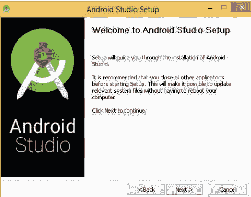

**图 3** Android Studio 安装对话框

**步骤 4**  
（继续按照安装向导的指示完成安装。）


- 点击或点击“下一步”（Next）按钮继续下载，并将 Android Studio 图标拖到“应用程序”（Applications）文件夹。如果您使用的是 Mac，请将 Android Studio 图标拖到“应用程序”文件夹。
- 在 Android Studio 的后续下载和安装过程中，接受默认设置。
- 默认情况下，Android Studio 在程序安装后会自动打开。

Android Studio 启动。您可能想在桌面上创建一个快捷方式，以便更容易启动 Android Studio。成功下载 Android Studio 后，您就可以开始使用各种预装模拟器进行编码，准备好测试您新构建的应用程序。本教科使用 Nexus 5 内置模拟器进行智能手机应用程序的测试。

# Mac 系统要求

在安装软件之前，请务必通过以下步骤确保您的 Mac 符合以下系统要求：

## 第 1 步

- 点击或点击 Mac 菜单栏上的苹果图标，然后点击或点击“关于本机”（About This Mac），打开“关于本机”对话框查看您当前的操作系统版本。您的操作系统应该是 Mac OS X 10.5.8 或更高版本（x86）。
- 在“关于”对话框中，验证您的 Mac 是否拥有 Intel 处理器。如果处理器显示为“未知”，在可能的情况下点击“更多信息”按钮以显示处理器类型。

# 致谢

《使用 Java 的开发者的 Android 训练营：创建首个 Android 应用程序指南》（第三版）是一个优秀专业团队的成果，他们朝着同一个目标努力：为学生提供相关且引人入胜的，促进他们的知识和职业。感谢 Cengage 的同事们——特别是高级产品经理 Jim Gish；高级内容开发 Alyssa Pratt；高级内容项目经理 Jennifer Feltri-George；开发编辑 Lisa Ruffolo 以及 MQA 测试员 Danielle Shaw。

写一本书类似于与一个痴迷的伴侣建立长期关系。在整段旅程中，生活在您周围继续进行：全职授课、在世界各地演讲、庆祝家庭的出生和生日。随着世界的运转，离您最近的人们通过协助处理其他所有任务，让您能够专注于专属写作。我的丈夫 Timothy 参与了我的游牧式生活，最重要的是他的爱、一些厨艺能力和耐心。特别感谢我的六个孩子 Tim、Brittany、Ryan、Daniel、Breanne 和 Eric，他们提供了非常需要的、充满自豪和欢笑的休息。感谢我家里最新的成员，我的孙子 Liam 和 Lochlan，他们让我比其他任何时候都更微笑，是的，我们等一下就出去。并特别感谢 Lisa Ruffolo，作为我的开发编辑和文字大师，在这一快速周转的新项目中，她完全超出了职责范围。

# 漂亮了！认识 Android

在本章中，你将学习：

- 理解 Android 市场
- 识别 Android 设备在移动市场中的作用
- 描述 Android 手机的特性
- 识别 Android 开发中使用的语言
- 描述 Google Play 在移动市场中的作用
- 使用 Android Studio 创建 Android 项目
- 解释 Android 项目视图的作用
- 指定用户界面中布局和组件控件的使用
- 在模拟器上运行 Android 应用程序
- 在 Android Studio 中打开已保存的 Android 项目

欢迎开启创建 Android 手机应用程序和为移动设备市场开发的旅程。移动计算已成为与互联网建立个人联系的最流行方式。手机和平板电脑构成了世界上增长最快的技术类别。手机的使用已迅速超越了对语音通话和短信的简单预期。移动设备（通常称为智能手机）的平均数据套餐通常包括浏览网页、玩如 Candy Crush 或 With Friends 这样的游戏、使用应用程序、检查电子邮件、听音乐、录制视频以及使用 GPS（全球定位系统）地图定位。

购买智能手机时，你可以从许多移动操作系统（OS）中选择，包括 iPhone 的 iOS、Google Android 和 Microsoft Phone。最近，Android 手机已成为销售冠军，超过了竞争对手。Android 市场正在爆炸式增长，每天有超过百万部新的 Android 手机激活，全球使用的 Android 设备总数超过十亿。Android 用户每月从 Google Play 下载超过 15 亿个应用程序和游戏。全球 73% 的移动设备运行在 Android 平台上。约 12.7% 的全球移动设备运行在 iOS 平台上。

## 在前线

超过三分之一的美国家庭为了方便处理移动运营商的一份账单而取消了固定电话。

为 Android 手机市场创建移动应用程序（简称 apps）是一个令人兴奋的就业机会。无论你是为创建企业级专业应用程序的技术公司担任开发者，还是创建一个游戏、小众程序或精明新应用的爱好者，Android 市场都提供了一种新的收入手段。

## GTK

根据《美国新闻与世界报道》（U.S. News & World Report），App 开发者被认为是技术领域的顶级工作，中位薪为 $90,060。

## 认识 Android

Android 手机建立在一个操作系统的基础上，该系统主要由一家名为 Android, Inc. 的公司创建。2005 年，Google 获取了 Android，在手机市场开启创业。Google 将 Android 平台整合为开源，Android 代码在 Apache 许可证下发布，允许任何人免费下载完整的开源 Android 代码。两年后，Google 发布了它的第一款开源移动设备，称为 Android（图 1-1）。在不到十年的时间里，Android 手机市场已成为最畅销的手机平台。

## 认识 Android 的开源平台

Android 是用于移动设备的第一个开源技术平台。作为一个开源系统，意味着没有公司或个人可以定义其功能或方向。Android 手机的快速成功归功于手机联盟（Open Handset Alliance，`openhandset.com`），这是一个由 80 家公司组成的开源业务联盟，定义了移动设备的标准。手机联盟由 Google 领导。其他成员包括三星、京瓷、HTC、德州仪器和 LG。Google 以 Ara 名了自己的手机。像 Apple 这样的竞争对手没有开源编码环境，而是使用封闭操作系统。开源社区的力量在于开发者共享其代码的能力。即使开源软件是免费的，也有许多开发者付费构建并改进该平台。例如，Apple 等封闭操作系统限制员工开发程序。Android 开源平台允许人们协作并改进代码。


由于开源环境，许多制造商在其品牌手机未使用 Android 系统。开源结构意味着制造商不需要支付费用或特许费。通过少量的定制，每个制造商都可以将 Android OS 放在其最新的设备上。这种低开销使得制造商能够以廉的价格出售手机，通常低于 $100。Android 移动设备的价格廉增加了这些设备的销量受欢迎程度。

开源社区也让 Android 手机对消费者具有吸引力。Android 有庞大的开发者社区编写扩展设备功能的应用程序。例如，用户可以从 Android 市场提供的超过 130 万个应用程序中受益，其中许多是免费的。因为 Android 手机平台已成为移动市场的领导，Android 应用程序市场预计将跟上。

## GTK

全球每部智能手机平均运行 41 个应用程序。

## Android 手机

Android 手机由多家公司销售，你可能熟悉这些名称，例如 Moto X、Galaxy、Droid、Xperia、一加、Nexus 和 HTC One（图 1-2）。


图 1-2 Android 模型

## 战在前

Android 也进军了电视市场。Chromecast 是一种可以将流媒体传输到电视的优盘盘。

## GTK

根据技术研究机构 Gartner 的数据，华为、小米和联想中国手机的市场份额合计四个百分点。

Android 设备有许多形状和大小，如图 1-2 所示。Android 操作系统支持所有类型的移动设备，包括智能手机、平板电脑、笔记本电脑、手表、MP4 播放器、汽车和网络电视。Android 设备具有多种屏幕模式，宽度和高度会根据设备的取向自动反转。在设计 Android 时，屏幕会影响界面的布局。为了充分利用特定设备的能力，你需要专门为该设备设计用户界面。例如，智能手机和平板电脑不仅物理尺寸不同，而且屏幕分辨率和像素密度也不同，这改变了开发过程。开发 Android 应用时，你可以在模拟器上测试结果，模拟器复制了应用在特定设备上的外观和感受。

Android 模拟器模拟典型移动设备的硬件和软件功能，只是无法拨打电话。你可以更改 Android 模拟器来模拟具有 4.5 英寸或更大屏幕的智能手机布局。Android 自动将内容缩放到你选择的设备屏幕大小，如果你在应用中使用低质量的图形，结果通常是像素化的显示。作为开发者，你需要随着市场转向不同的平台和屏幕分辨率继续更新你的应用。

Android 市场比 4 英寸到 5.5 英寸的 iPhone 具有更多种类和尺寸选项。这些额外的空间非常适合看电影、玩游戏或在手机上查看完整网页的用户。此外，许多类型的平板电脑也称为平板）运行在 Android 平台上。流行的 Android 平包括 Google Nexus、三星 Galaxy、Amazon Kindle 和 LG Pad。Android 平与 iPad（各种型号）以及 Windows 平直接竞争。


图 1-3 Android 平板

## Android 的功能

作为开发者，必须理解手机的功能。Android 平台提供了应用可以使用各种功能。某些功能因型号而异。大多数 Android 手机提供表 1-1 中列的功能。

| 功能 | 描述 |
| --- | --- |
| 3D 图形 | 界面可以支持用于 3D 交互体验的 3D 图形渲染。 |
| 人脸识别 | Android 提供识别或验证数字图像或视频帧中人脸的高功能。 |
| 前后摄像头 | Android 手机可以使用前或后摄像头，允许开发者创建视频通话应用。 |
| 多语言支持 | Android 支持多种人类语言。 |
| 屏幕键盘 | 屏幕键盘提供拼写检查建议以及完成单词的选项。屏幕键盘还支持输入。 |
| 电源管理 | Android 识别后台运行的应用的内存和处理器资源。你可以关闭这些应用以释放手机处理器内存。对于优化游戏，Android 支持使用陀螺仪、重力传感器、加速度和旋转向量，为游戏开发者提供高度灵敏且响应的控制。 |
| 语音识别 | Android 识别用于通话、短信和手机导航的语音。 |
| WiFi 热点 | Android 支持热点，允许手机作为无线或有线热点供其他设备连接到互联网。 |

表 1-1 Android 平台功能

## 编写 Android 应用

Android 应用使用 Java 语言编写。Java 是由 Sun Systems 开发的语言和平台。Java 模仿 C++ 语言。面向对象的编程鼓励良好的软件工程实践，如代码重用。2014 年 12 月发布的 Android 开发官方工具是 Android Studio，这是一个用于构建和集成开发工具及开源项目的集成开发环境（IDE）。Studio 用于创建 Android 应用。

在 Android Studio 之前，Eclipse ADT 是主要的 Android 开发环境。Eclipse 使用多种语言开发应用，包括 Java、C、C++、COBOL、Ada 和 Python。

## 环境 Android

如序言所示，设置 Android 环境的第一步是在 PC 或 Mac 上安装 Android Studio IDE。安装包含了 Android 软件包（SDK），它在 Android Studio 中运行。Android SDK 包含一组开发工具，帮助你设计程序界面、编写代码并使用内置 Android 手机模拟器测试程序。另一种语言 XML（可扩展标记语言）用于辅助 Android 模拟器的布局。

## Android 模拟器

Android 模拟器让你无需物理设备即可设计、原型和测试 Android 应用。当你在 Android Studio 中运行 Android 程序时，模拟器启动，你可以测试程序。你可以使用鼠标触摸设备屏幕。模拟器模拟真实 Android 手机的几乎所有功能，正在运行的模拟器可以播放视频和音频、渲染游戏动画并存储信息。

Android SDK 内提供了多个模拟器，用于从早期 Android 手机开始各种设备和版本。开发者应该在多个版本上测试他们的应用以确认特定平台的稳定性。Android Studio 提供了一种实时编辑模式，可在一系列设备上预览应用的用户界面（图 1-4）。

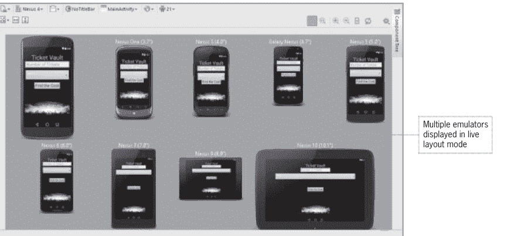

图 1-4 Android Studio 实时布局模式

第一个 Android 版本 1.0 于 2008 年 9 月推出。随后的每个版本增加了新功能并修复了平台的任何已知漏洞。Android 为每个版本采用了基于甜点的命名系统，如表 1-2 所示。

| 版本名称 | 发布日期 |
| --- | --- |
| 1.0 第一版本 | 2008 年 9 月 |
| 1.5 Cupcake | 2009 年 4 月 |
| 1.6 Donut | 2009 年 9 月 |
| 2.0 Eclair | 2009 年 10 月 |
| 2.2 Froyo（冰酸奶） | 2010 年 5 月 |
| 2.3 Gingerbread | 2010 年 12 月 |
| 3.0 Honeycomb | 2011 年 2 月 |
| 4.0 Ice Cream Sandwich | 2011 年 5 月 |
| 4.4 Kit Kat | 2013 年 7 月 |
| 5.0 Lollipop | 2014 年 11 月 |

表 1-2 Android 版本

> **批判思考**
>
> 在创建应用时，我应该只针对当前的 Android 版本吗？
>
> 为了支持尽可能多的 Android 设备，你应该将最低开发版本设置为允许应用提供核心功能的最低版本。

## 熟悉市场部署

Android 平台由 Android 操作系统、Android 应用开发工具和 Android 应用市场组成。编写并测试程序后，将应用编译成名为 `.apk` 的 Android 包文件。

Android 程序通过名为 Google Play（`play.google.com`）的在线商店销售和部署，该商店提供注册服务并证明程序符合可靠、高效性能的标准。Google Play 要求签署协议并支付一次性注册费（25 美元）。注册后，只要应用符合标准，就可以在 Google Play 上发布。你还可以根据需要发布更新。

如果你的应用是免费的，Google Play 免费提供你的应用。如果你想对应用收费，你的分成是销售额的 70%，运营商占 30%。例如，如果你为你的城市创建了一个应用，介绍所有的热门地点、酒店、景点和节日，并以 1.99 美元出售该应用，你每个应用将获得 1.39 美元。如果你卖出 5000 份应用，你将获得近 7000 美元。

你可以使用 Google Play 选择各种内容，包括可下载，例如媒体文件或照片，以及虚拟内容如游戏关或药水（图 1-5）。作为一名 Android 开发者，你有机会为一个相当新的市场开发应用，并轻松地分发给数百万 Android 移动设备用户。Google Play 的应用比 iTunes App Store 多了近 30 万个——多出约 17%。

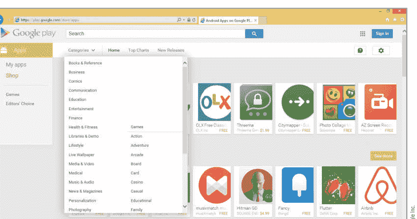

**图 1-5** Google Play

> **前线实战**
>
> Apple iTunes App Store 通过 iPhone Dev. 发布应用时需要缴纳 99 美元的注册费。iTunes App Store 的标准审核流程比 Google Play 更为严格。

在线公司亚马逊（Amazon）也有一个独立的应用商店（`amazon.com/appstore`），可以在其中部署和销售 Android 应用。亚马逊应用商店适用于亚马逊列出的类别。客户可以从他们的 PC 电脑和移动设备购买应用。

亚马逊应用商店建立了一套营销体系和搜索引擎，驱动着信赖的商店，并根据客户过去的购买记录创建应用推荐。亚马逊应用商店收取每年 99 美元的开发者计划费用，涵盖了亚马逊应用商店开发者计划的应用处理和账户管理。亚马逊还支付应用销售价格的 70%；此外，你可以发布免费应用。

## 首次涉军 Android 世界

在按照本书前言的说明安装了 Android Studio（`developer.android.com/sdk`）之后，下一步是创建你的第一个 Android 应用。按照编程传统，你的第一个程序是 Hello Android World。接下来的章节将向你介绍 Android Studio 的元素，并对如何创建应用进行详细描述。

# 第 1 章 哇！见见 Android

## 打开 Android Studio 创建新项目

要创建一个新项目，你首先打开 Android Studio。可能会出现一条消息，提示 Android Studio 有可用的更新。安装更新以确认你拥有最新版本的 Android Studio。

在创建你的第一个项目时，你需要提供以下信息：

- `Application name`（应用名称）——这是你应用程序的可读性标题，它将显示在 Android 设备上。
- `Company domain`（公司域名）——这在 Google Play 中唯一标识你的应用。开发者通常使用公司名称。例如，此本书的域名是 `androidbootstrap.net`。
- `Package name`（包名）——该包命名空间是你的源代码存放的地方。Android Studio 通过反转实体域名、插入点然后添加应用名称来创建包名。包名在发布到 Google Play 时必须是唯一的。在本例中，包名为 `net.androidboot.HelloWorld`。


- *Project location*（项目位置）——此位置标识你的硬盘或 USB 驱动器上存储与此 Android 项目相关文件的目录。

- *Form factor*（形态）——此值反映了用于显示应用的形状。形态包括屏幕尺寸和设备类型，如手机、平板、电视、可穿戴设备（手表）和 Google Glass。

- *Minimum SDK*（最低 SDK）——此值指定了你的应用程序所需的最小应用程序接口（API）级别。

- *Add an activity to mobile*（向移动设备添加活动）——此选项决定了 Android 设备将使用的 Activity。Activity（活动）类似于启动应用时打开的窗口或屏幕。创建 Activity 是可选的，但 Activity 总是用作应用程序的基础。

- *Activity name*（活动名称）——使用插件生成的类名。这将是 Android Activity 类的子类。Activity 可以运行和工作，例如创建用户界面。

## 创建 Hello World 项目

在 Android Studio 中，一个项目等同于一个使用 Java 的单个程序或应用。请确保你的电脑上插入了一个空的 USB（通用串行总）驱动器，以便将 Android 项目存储在该 USB 驱动器上。要创建一个新的 Android 项目，请遵循以下步骤：

## 第 1 步

- *打开 Android Studio 程序。*

Android Studio 对话框打开 Welcome to Android Studio 页面（图 1-6）。如果你已经打开了一个项目，点击菜单栏上的 File（文件）并点击 New Project（新建项目）。

## 首次涉军 Android 世界

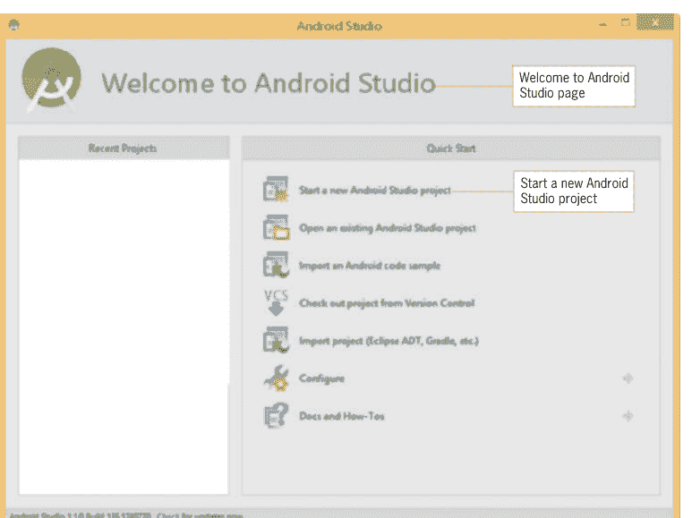

**图 1-6** Android Studio 对话框

### 第 2 步

- 在 Quick Start（快速启动）列表中，点击 Start a new Android Studio project 打开 New Project 对话框。

- 在 Configure your new project（配置你的新项目）页面，输入 Application name **Hello Android World.**。

- 在 Company Domain 文本框中输入 **androidbootcamp.net**。Package name 框会反向显示 Company 项、点，以及你在 Application name 框中输入的不带空格的文本。

- 在 Project location 框中输入 **D:\Workspace**。

一个名为 Hello World 的新应用被配置保存在 D:\Workspace USB 驱动器上（图 1-7）。Workspace（工作）是 Android Studio 存储你定义的项目的目录。当你指定 Workspace 目录名称时，Android Studio 会在该目录下创建文件来管理项目。

## 第 1 章 哇！见见 Android

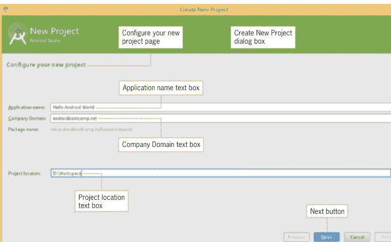

**图 1-7** 配置你的项目

在本书的其余部分中，该驱动器称为 D:。如果你使用的是 Mac，请输入 /Volumes/ 而不是 D:。

### 第 3 步

- 点击 Configure your project 页面上的 Next（下一步）。

- 选择 form factors，例如 Phone（手机）和 Tablet（平板）。

- 选择 Minimum SDK，例如 Android 4.0。

## 首次涉军 Android 世界

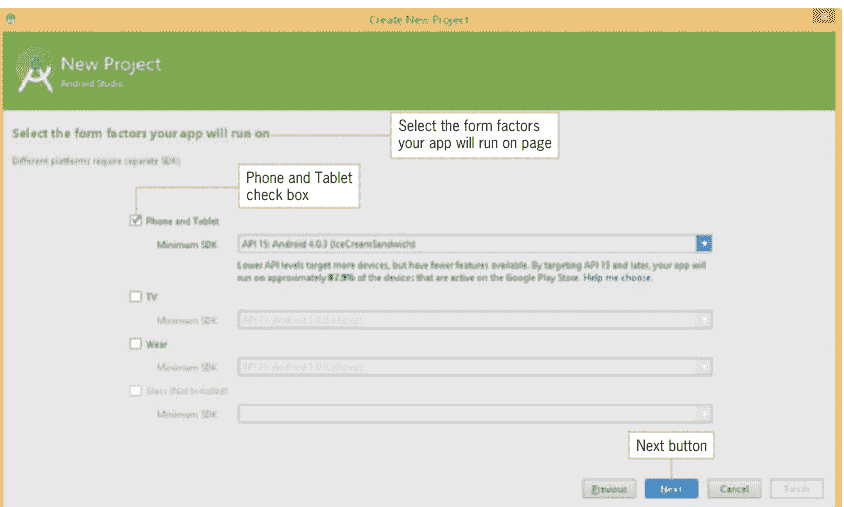

**图 1-8** 形态

### 第 4 步

- 点击 Add an activity to mobile 页面上的 Next（下一步）。

- 选择 Blank Activity。

## 第 1 章 哇！见见 Android

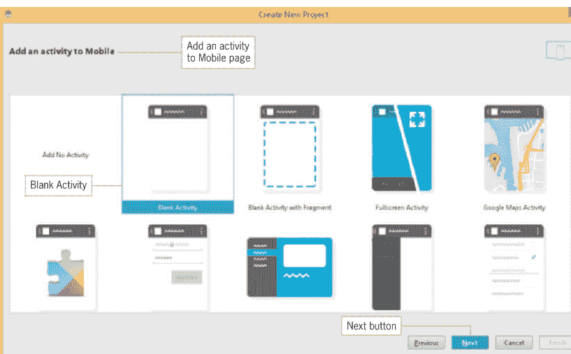

**图 1-9** Blank Activity

### 第 5 步

- 点击 Customize Activity 页面上的 Next（下一步）。

- 默认创建了一个 Activity MainActivity。

### 第 6 步

- 在 Customize Activity 页面，点击 Finish（完成）。

Android 项目文件已创建在 USB 驱动器上。项目 项目出现在左窗格中（图 1-11）。

## 构建用户界面

第一个 Android 应用将显示简单的消息“Hello World – My First App.”除了 Android 环境的工具和设备，脱颖而出的是用户体验——用户使用设备时的感受。确保界面直观且不影响功能是成功的关键。Android 支持两种构建应用用户界面的方法：通过 Java 代码和 XML 布局文件。XML 方法更优，因为它允许你在无需编写大量代码的情况下设计应用的用户界面。后续章节将介绍两种方法以及构建用户界面的细节。

## 浏览 Android 项目

窗口左侧的 **Android project** 包含了项目的关键源代码文件夹。如图 1-11 所示，Android 项目包含以下文件夹中的文件：

- **manifests folder**  AndroidManifest.xml 文件，该文件包含了 Android 运行所需的所有信息。

- **java folder** 项目的 Java 源文件。

- **res folder** 包含应用程序可能使用的所有资源，如图像、音乐和视频文件。原生编辑器 activity_main.xml 位于 res 文件夹名为 layout 的子文件夹中。

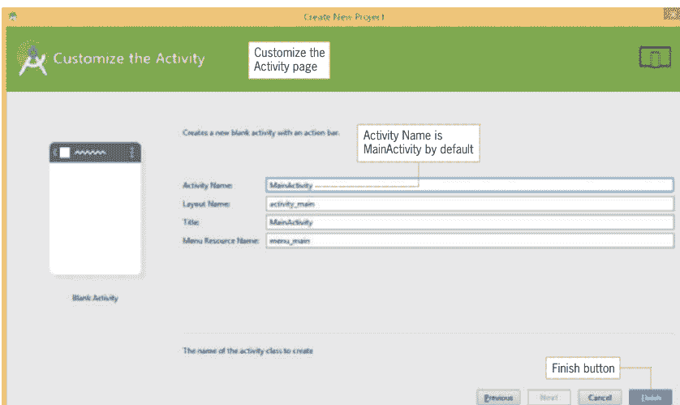

**图 1-11** Android Studio 用户界面

## 在虚拟设备中设计用户界面布局

为了辅助设计 Android 用户界面，Android SDK 包含了布局文件。你可以创建一个布局，然后向布局中添加组件（widgets）。布局是一个可以包含许多组件的容器。组件是单一元素，也称为对象，例如 TextView、Button 或 Checkbox。默认情况下，TextView 在模拟器中显示文本“Hello World”。模拟器右侧的属性面板（Properties panel）包含当前活动 Android 项目或对象的属性和设置。属性描述了对象可以执行的操作；例如，如果你更改了 TextView 的文本属性，更新后的文本将显示在模拟器中。接下来的章节将演示许多布局，每种布局都有独特的属性。

与其在开发测试阶段仅在智能手机上运行应用，Android Studio 显示了一个用于设计和布局的模拟器配置，称为 Android 虚拟设备（AVD）。通常，开发者会在各种设备上测试应用，以提供有用且准确的环境。要更改虚拟设备并查看属性，请遵循以下步骤：

### 步骤 1

-   点击或点击虚拟设备，在 `activity_main.xml` 选项卡上渲染带有按钮（模拟器按钮）的布局，然后在调色板（Palette）中选择或点击 Nexus 5 (5.0°, 1080 x 1920, xhdpi)。你可以使用已安装的任何智能手机和平板模拟器作为虚拟设备测试你的应用，在此请选择 Nexus 5 模拟器。

Nexus 5 模拟器显示在 `activity_main.xml` 选项卡上。注意 Android 在布局中放置了一个默认的 TextView 控件（图 1-2）。

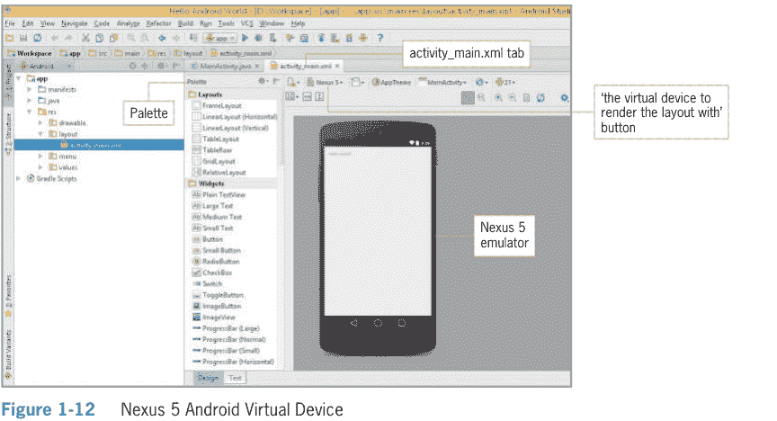

## 第 1 章 好了！认识 Android

### 步骤 2

-   在模拟器中，选择显示为“Hello World!”的默认 TextView 控件。

默认 TextView 控件被选中并显示在蓝色框框（图 1-13）。

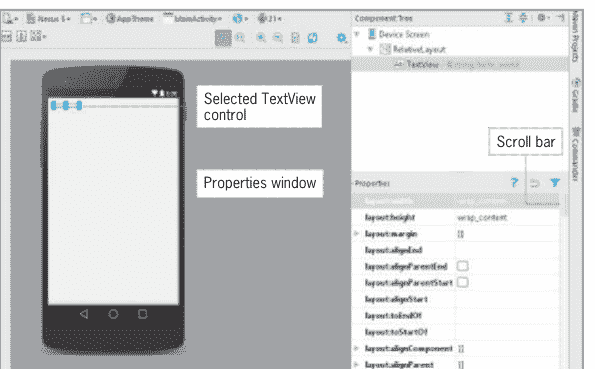

图 1-13 被选中的 TextView 控件

### 步骤 3

-   向下滚动属性面板以显示文本属性。

默认 TextView 控件的文本属性已显示（图 1-14）。组件树（Component Tree）指示 TextView 控件已被选中。组件树向你展示了模拟器布局的结构。

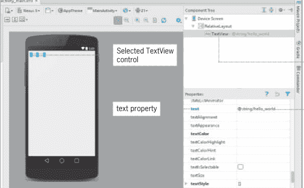

图 1-14 TextView 控件的文本属性

## 初探 Android 世界

### 修改 TextView 控件中的文本

默认情况下，模拟器上放置了一个显示“Hello World!”文本的 TextView。与其直接在文本属性中放置文本或硬编码文本，Android 建议将字符串等值以资源的形式存储在 `res` 文件夹中。编辑此内容的简单方法是修改资源文件，而不是更改 XML 源代码。如果 Hello Android 应用是针对多种语言（如西班牙语和中文）开发的，资源文件可以包含翻译后的文本。

要更改模拟器上 TextView 控件中的文本属性以显示适当的消息，图 1-4 显示的资源文件链接到 `@string/hello_world`。`@string` 部分指向 Android 项目中 `res/values` 子目录下的 `strings.xml` 文件位置。`hello` 属性是 `strings.xml` 文件中的默认值，赋值为 `Hello World`。当应用执行时，Android 会从项目的 `res` 文件夹加载文本和媒体资源（存储在子文件夹 `strings.xml` 文件中的文本）。要修改 `strings.xml` 文件中的文本，请遵循以下步骤：

-   在 Android 项目中，点击或点击 `res` 文件夹中 `values` 子文件夹旁边的箭头以展开文件夹内容。

-   双击或双击 `strings.xml` 文件，在项目窗口中显示 `strings.xml` 选项卡。

项目窗口的 `strings.xml` 选项卡中显示了三个默认字符串值（图 1-15）。

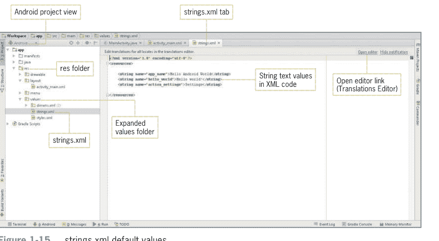

## 第 1 章 好了！认识 Android

### 步骤 2

-   点击或点击项目窗口右侧的 Open（打开编辑器）链接以显示翻译编辑器（Translations Editor）选项卡。

-   在翻译编辑器中，点击或点击 `hello_world` 列右侧的 Default Value (Hello world!)。

-   在翻译编辑器选项卡的底部，在 Default Value（默认值）框中输入 **Hello World – My First Android App**。

在翻译编辑器中，`hello_world` 的默认值已改为 Hello World – My First Android App（图 1-1）。

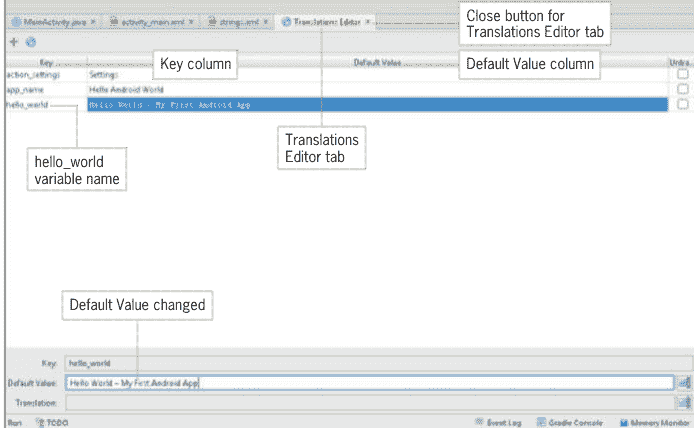

图 1-16 翻译编辑器

### 步骤 3

-   点击或点击 Close（关闭）按钮关闭翻译编辑器选项卡。

`hello_world` 的默认值已更改（图 1-17）。

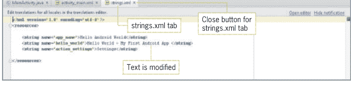

图 1-17 strings.xml

## 初探 Android 世界

### 步骤 4

-   点击或点击 `strings.xml` 选项卡旁边的关闭按钮关闭它。

模拟器显示了修改后的文本（图 1-18）。

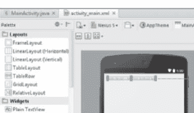

图 1-18 带有 TextView 控件的模拟器

> **思考题**

我可以直接在 `strings.xml` 中更改文本吗？

是的，你可以修改 XML 代码，但作为 Android 初学者，使用翻译编辑器更简单。

> **小知识**

要将应用部署到 Android 设备而不是模拟器，请用 USB 线连接设备。如果你使用的是 Windows 操作系统，可能需要安装 OEM 驱动程序。在 Android Studio 中，点击工具栏上的 Run（运行）。

## 在模拟器中测试应用程序

是时候查看结果了！记住 Android 模拟器（虚拟设备）运行较慢。可能需要超过一分钟才能显示最终结果。即使模拟器处于闲置状态也会消耗大量的 CPU，因此完成测试后应关闭模拟器。要运行应用程序，请遵循以下步骤：

### 步骤 1

-   点击或点击工具栏上的 'app' 按钮。

打开选择设备（Choose Device）对话框（图 1-19）。

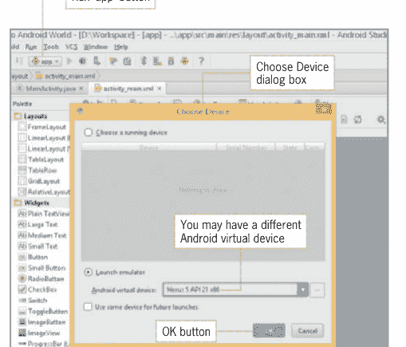

图 1-19 选择设备框

### 步骤 2

-   如有必要，在 Android 设备列表中选择 Nexus 5 API 21 x86（或较新版本的模拟器）。

-   点击或点击选择设备对话框中的 OK 按钮。

模拟器缓慢打开，在在中心显示时间，底部显示锁（图 1-20）。这可能需要超过一整分钟。

### 步骤 3

-   点击或点击锁图标并将其向屏幕垂直中心的时间滑动，以解锁虚拟设备。如果你使用的是 Mac，请拖动锁图标直到它变为解锁图标。

Android 设备解锁后，模拟器将显示指针钟和 App 按钮（圆圈内的六个小方块）（图 1-21）。

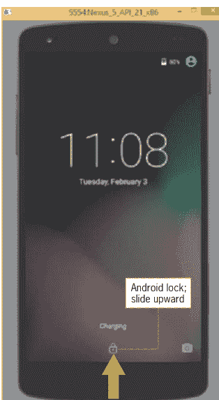

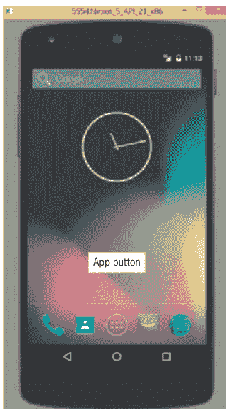

图 1-20 Android 模拟器

图 1-21 模拟器已解锁

### 第 4 步

- 再次点击或点击工具栏上的运行“app”按钮，将代码启动到已打开的模拟器中。

选择设备对话框再次打开，显示正在运行的模拟器选项（图 1-22）。

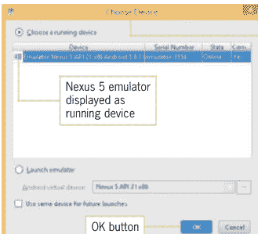

图 1-22 选择设备对话框显示正在运行的模拟器

### 第 5 步

- 点击或点击选择设备对话框中的 OK 按钮。

Hello World 应用在模拟器中打开，并显示修改后的消息（图 1-23）。

### 第 6 步

- 点击或点击 Close 按钮关闭模拟器。

- 点击或点击菜单栏上的 File，然后点击或点击 Close Project。

- 如果必要，点击或点击 Disconnect 按钮。

模拟的应用程序窗口关闭。程序每次运行时都会被保存。如果你在 Mac 上工作，请点击或点击 Quit Android Studio。

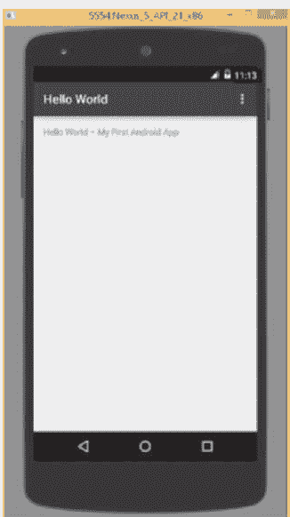

> Shift+F10 是在 Android Studio 中运行应用程序的 Windows 快捷键组合。在 Mac 上，快捷键为 Command+Shift+F11。

## 在 Android Studio 中打开已保存的程序

在保存并关闭 Android Studio 后，你可能需要重新打开项目并继续工作。要打开已保存的项目，可以遵循以下步骤：

## 第 1 步

- 打开 Android Studio。

- 点击或点击最近项目（Recent Projects）列中的 Hello Android World 项目。如果项目未列在最近项目中，点击或点击快速启动（Quick Start）列中的现有的 Android 项目，导航到保存项目的路径并点击或点击 OK 按钮。

程序加载到 Android Studio 中。你现在可以继续编写你的用户界面和代码。

## 总结——章节摘要

本章提供了 Android 开源平台的概述，该平台定位为快速创新，且不受专有系统的限制。凭借其丰富的特性集，Android Studio 环境允许你为这个市场份额最大的平台开发实用且富有创新的 Android 应用。在第一章“Hello Android World”中，你完成了一系列步骤，这些步骤开启了你在未来章节中创建更有趣的应用程序的旅程。

- Android 操作系统在完全开源许可下免费发布。

- Android 操作系统支持所有类型的移动设备，包括智能手机、平板电脑、互联网电视、如手表等 Android 可穿戴设备以及 Google Glass。

- 要编写 Android 应用，你可以使用 Android Studio，这是一个用于构建 Android 的开发环境，使用 Java 这种面向对象的编程语言。

- Android 模拟器允许你在不使用物理设备的情况下设计、开发、原型和测试 Android 应用程序。当你在 Android Studio 中运行 Android 程序时，模拟器会启动，让你像程序运行在指定的 Android 移动设备上一样测试程序。

- Android 平台由 Android 操作系统、Android 开发平台和 Android 应用市场 Google Play 组成。

- Android 支持两种构建应用程序用户界面的方法：Java 代码和 XML 布局文件。XML 方法更优优，因为它允许你设计应用程序的用户界面而无需编写大量代码。

- Android Studio 窗口左侧的项目视图（Project view）包含 Android 项目的文件夹。

- 要为 Android App 设计用户界面，你可以创建一个布局（layout），布局是一个显示如 TextView、Button 和 CheckBox 等控件的容器，这些控件也称为对象。

- 可以从文件夹中的 `strings.xml` 文件打开的翻译编辑器（Translations Editor）来更新文本属性（text property）。


- 创建应用程序后，你可以在 Android 模拟器中运行它以测试应用程序并确保其运行正常。

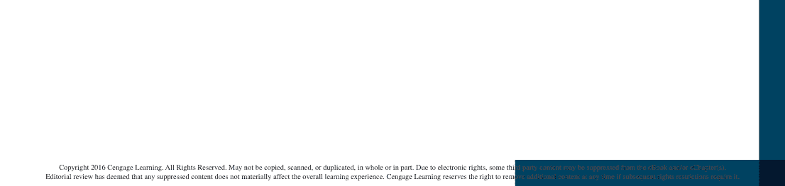

## 关键术语

`Android` 项目视图（Android project view）——`Android Studio` 程序窗口左侧的面板，其中包含当前项目的文件夹。

`Android Studio`——推荐的用于编写 `Java` 程序，以及为 `Android` 构建和集成应用程序开发工具及开源项目的 IDE。

`Android` 虚拟设备（Android Virtual Device, `AVD`）——`AVD` 用于设计和布局目的显示模拟器配置。

`AndroidManifest.xml`——包含 `Android` 运行应用程序所需的所有信息的文件。

`app`——移动应用程序。

组件树（Component Tree）——`Android` 项目窗口中的一个面板，显示模拟器布局的结构。

模拟器（emulator）——复制应用程序在特定设备上外观和感受的软件。

`Google Play`——一个销售为 `Android` 平台编写的程序的在线商店。

`Java`——一种由 Sun Microsystems 开发的面向对象的编程语言和平台。

`java` 文件夹——包含项目 `Java` 源文件的文件夹。

`layout`（布局）——一个可以包含控件和其他图形元素的容器，帮助你为应用程序设计界面。

`manifests` 文件夹——包含 `AndroidManifest.xml` 文件的文件夹，该文件包含了 `Android` 运行应用程序所需的的关于该应用程序的所有信息。

面向对象编程语言（object-oriented programming language）——一种允许代码复用的编程语言类型。

开源联盟（open-source alliance）——为移动设备开发开放标准的公司联盟。

属性面板（Properties pane）——包含当前项目设置的窗口。

属性（property）——描述项目的特征。

`res` 文件夹——包含应用程序可能需要的图像、音乐和视频文件的文件夹。

开发工具包（Software Development Kit, `SDK`）——用于应用程序的包。

控件（widget）——如 `TextView`、`Button` 或 `CheckBox` 等单个元素，也称为对象。

`XML`——可扩展标记语言的缩写，一种广泛使用的定义格式。

## 开发者常见问题

1. 以 `L` 开头的 Android 版本名称是什么？
2. `Google Play` 开发者账户的一次性费用是多少？
3. 当你在 `Google Play` 发布 Android 应用时，开发者保留价格的百分之几？
4. `Amazon` 开发者账户年费是多少？
5. `Google Play` 的网址地址是什么？
6. 使用哪两种语言创建 Android 应用？
7. `activity_main.xml` 存储在哪个子文件夹中？
8. 列出本章提到的三种控件。
9. Hello World 应用中使用的控件名称是什么？
10. 按哪两个键组合可以在 `Android Studio` 中运行 Android 应用？
11. `Kit Kat` 是哪个 Android 版本？
12. 使用字母主题命名法，未来 Android 设备操作系统的三个可能名称。
13. `XML` 代表什么？
14. `SDK` 代表什么？
15. 在 Android 视图中，图像文件存储在哪里？

## 书外拓展

搜索网络以回答以下问题以扩展你的 Android 知识。

1. 研究一种流行的 Android 智能手机或平板电脑型号，并写一段关于该设备的功能、规格、价格和制造商。
2. 列出第一章“认识 Android”部分中未提到的五个 Android 设备特性。
3. `Windows Store` 开发者账户目前的年费是多少？尽管 `Windows Store` 的移动端很小，但为什么许多开发者仍在学习创建 `Windows Store` 应用？
4. 转到 `Google Play` 网站并为以下类别截图：教育、游戏、地图、旅行和个人爱好。将截图放在处理文档中并对每个截图进行标记。

## 案例编程项目

完成以下一个或多个案例编程项目。使用本章教授的步骤和技术。将你创建的程序提交给教师。每个案例编程项目都标出了难度级别。

简单：*

中等：**

有挑战性：\*\*\*

### 案例项目 1–1：著名技术名言应用

#### 需求文档

应用标题：技术名言 (Tech Quotes)

目的：在 Tech Quotes 应用中，显示你选择的一个技术名言。

算法：首页显示每日每日技术名言。请在网上查找一个名言。

条件：你可以将名言改为你自己的（图 1-24）。

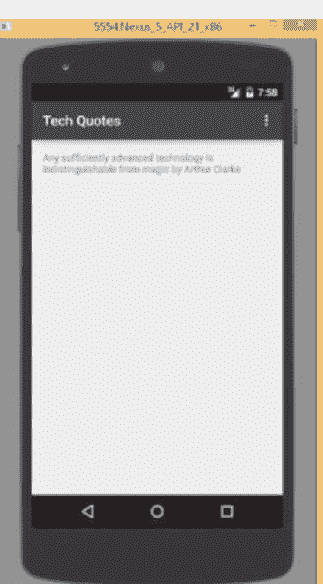

图 1-24 Tech Quotes 应用

### 案例项目 1–2：Android 甜点名称应用

#### 需求文档

应用标题：甜点名称 (Dessert Names)

目的：在甜点名称应用中，显示第 1 章介绍的 Android 版本名称（甜点）。

算法：首页显示本章列出的 Android 版本的甜点名称。

条件：替换 `strings.xml` 中的文本（图 1-25）。

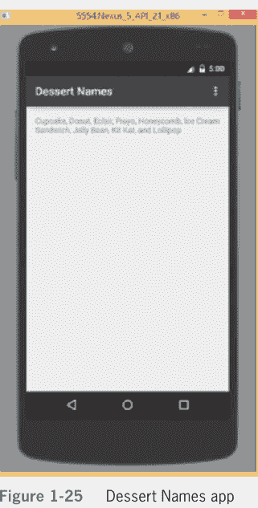

### 案例项目 1–3：大型科技公司 ★★★

#### 需求文档

应用标题：大型科技公司 (Large Tech Companies)

目的：在大型科技公司应用中，显示目前全球前五科技公司。

算法：首页显示用逗号隔开的全球前五科技公司。请研究此主题并根据收入进行排序。目前的公司顺序可能与图 1-26 中显示的顺序不同。

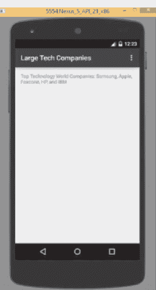

图 1-26 大型科技公司应用

版权所有 2016 Cengage Learning。保留所有权利。未经许可，不得全部或部分扫描或复制。（为了简洁，省略了版权声明）

# 第 2 章 简化！Android 用户界面

在使用 `Java` 编写移动应用之前，必须先对其进行设计。设计程序可以比比建造建筑。在浇筑混凝土板、钢梁到位和墙壁立起之前，建筑师和工程师必须设计建筑，以确保其运行既可靠又安全。计算机应用开发者也是如此。一旦在用户界面中设计好程序，就可以通过可扩展标记语言 (`XML`) 和 `Java` 代码来实现其设计所需的功能。

## 设计 Android 应用

为了阐明设计和实现 Android 应用的过程，在本章中，你将设计并编写图 2-1 和图 2-2 所示的健康食谱 (Healthy Recipes) 应用。


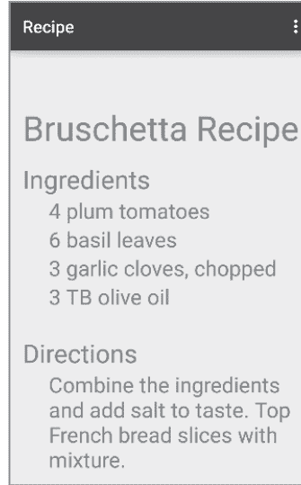

**图 2-1** 健康食谱 Android 应用

**图 2-2** 带有食谱的第二个屏幕

图 2-1 和 2-2 中的 Android 应用可以是一个显示健康食谱的大型应用的一部分。健康食谱应用首先显示食谱名称（意式烤面包谱 Bruschetta Recipe）和一张插图。如果用户点击“查看食谱”（VIEW RECIPE）按钮，第二个窗口将打开完整的食谱，包括制作意式烤面包的原料和准备步骤。

## 实战一线

如果你拥有流量套餐的手机、平板电脑或平板设备，请下载免费应用 `Epicurious`，以了解这个健康食谱应用在更大的应用程序是如何使用的。

## 总体视图

创建健康食谱应用时，你将遵循一套每次创建 Android 应用时都要重复的步骤：

1. 为应用中的每个屏幕创建一个界面（也称为 `XML` 布局）。
2. 为应用中的每个屏幕创建一个 `Java` 类（也称为 Activity）。
3. 根据需要为每个 `Java` 类编写适当的对象和操作代码。
4. 在 Android 模拟器中测试应用。

## 使用 Android 用户界面

在为 Android 应用编写任何代码之前，你需要设计用户界面来控制用户体验。Android 应用可以运行在各种设备上，如智能手机、平板电脑、手表、眼镜、电视、汽车等许多设备。**外形**（Form factor）指屏幕尺寸、配置或物理布局。

在本章中，你将学习：

- 使用 `TextView`、`ImageView` 和 `Button` 控件开发用户界面
- 使用翻译编辑器在 `strings.xml` 中添加文本
- 创建包含 `Button` 事件的 Android 项目
- 为用户界面描述相对布局（Relative layouts）和线性布局（Linear layouts）
- 创建多个 Android Activity
- 在 Android Manifest 文件查看 Activity
- 添加 `Java` 类文件
- 为代码窗口添加行号
- 使用 `onCreate` 方法编写代码
- 使用 `setContentView` 命令显示内容
- 使用 `Button` 事件处理程序打开第二个屏幕
- 使用 `OnClickListener` 检测用户交互
- 使用 `startActivity` 方法启动第二个屏幕
- 修正 `Java` 代码中的错误
- 在模拟器中运行完成的应用

## 第 2 章 简单易！Android 用户界面

每个控件的属性。在测试完应用后，你的客户决定更改应用内的所有文本。现在，你必须逐个控件、逐个文件（包括 `.xml` 和 `java` 文件）检查你输入的所有原始文本控件，然后对其进行替换。作为一种节省时间的替代方案，Android 在 `Resources` 文件夹中提供了 `strings` 文件。如果你的客户想要更改应用内的所有文本，你可以去单个文件位置进行更改。

在“健康食谱”应用中，`TextView` 控件显示的项目不会直接在属性面板中输入，而是输入在一个名为 `strings.xml` 的字符串数组中。`strings.xml` 是每个 Android 应用程序的默认文件，包含了应用程序的许多字符串。你在此文件中使用字符串表（String table）输入文本，因为它可以在不更改代码的情况下轻松更改。字符串是可以包含空格的字母和数字字符。Android 从项目的字符串表中加载资源。

字符串表还可以用于本地化。本地化是指使用字符串表根据用户的偏好语言更改文本。例如，Android 可以根据当前设备的配置和区域设置，在“翻译编辑器”（Translations Editor）中的字符串表中选择西班牙语的文本。开发者可以向翻译编辑器添加多个翻译。

每个字符串都由一个键（key，也称为 id 属性，即控件名称）和一个默认值（default value，即控件显示的文本）组成。在“健康食谱”应用中，第一个 `TextView` 控件显示布鲁斯塔（Bruschetta）食谱。控件的名称为 `txtTitle`，并在其中指定；启动屏幕上的第二个控件是 `ImageView`，显示完成后的食谱的图像。为了创建一个让视觉残障人士也能使用的应用程序，请为用户界面控件添加描述，以便它们能通过屏幕阅读器等基于语音的辅助服务为你读出。为了出于辅助目的显示食谱的描述，请使用键和默认值向字符串表添加描述文本。显示“查看食谱”的 `Button` 控件指定 `btnRecipe` 为其键，并将 `VIEW RECIPE` 为其默认值。要为启动屏幕的 `TextView`、`Image` 和 `Button` 添加文本到 `strings.xml` 文件，请遵循以下步骤：

### 步骤 1

- 在 Android 项目中，展开 `res` 文件夹下的 `values` 文件夹。
- 双击或双击 `strings.xml` 文件以显示其默认字符串资源。

显示 `strings.xml` 表，显示了字符串资源。注意 `strings.xml` 文件已包含三个默认字符串（图 2-6）。

## 使用 Android 用户界面

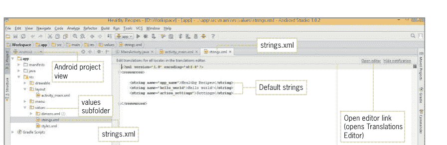

**图 2-6** 默认字符串资源

### 步骤 2

- 点击或点击“打开编辑器”（Open editor）链接。
- 在翻译编辑器中点击或点击“添加键”（Add Key，加号）按钮。
- 在“键”文本框中，输入 `txtTitle` 为 `TextView` 控件的字符串命名。
- 在“默认值”文本框中，输入 `Bruschetta Recipe` 以定义要显示的文本。

`TextView` 的键和默认值是通过翻译对话框控制的（图 2-7）。

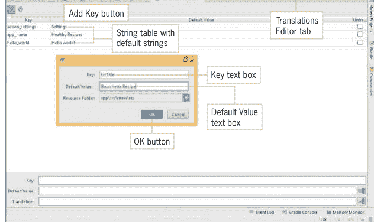

**图 2-7** 为 `TextView` 控件添加字符串

### 步骤 3

- 点击或点击 OK 按钮将 `txtTitle` 添加到字符串表。
- 在翻译编辑器中点击或点击“添加键”（Add Key，加号）按钮。
- 在“键”框中，输入 `description` 为 `ImageView` 控件的字符串命名。
- 在“默认值”文本框中，输入 `Recipe Image` 以解释将显示的图像。

`ImageView` 控件的键和默认值在对话框中输入（图 2-8）。

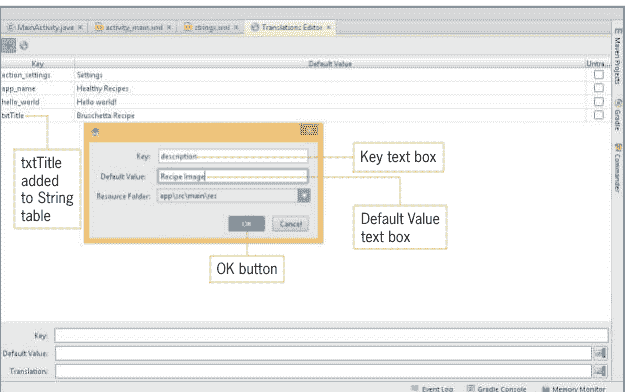

图 2-8 为辅助功能输入 `ImageView` 的键和默认值

### 步骤 4

- 点击或点击 OK 按钮。
- 在翻译编辑器中点击或点击“添加键”（Add Key，加号）按钮。
- 在“键”框中，输入 `btnRecipe` 为 `Button` 控件的字符串命名。
- 在“默认值”文本框中，输入 `View Recipe` 以定义文本。

`Button` 控件的键和默认值在对话框中输入（图 2-9）。

## 使用 Android 用户界面

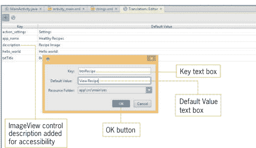

图 2-9 为 `Button` 控件添加字符串

“健康食谱”应用的第二个屏幕显示了布鲁斯塔食谱的配料和制作说明。注意图 2-1 和 2-2，屏幕通过 `txtTitle` 两次显示了相同的“布鲁斯塔食谱”标题。要添加第二个界面上的其余文本，请遵循以下步骤：

### 步骤 1

- 点击 OK 将 `Button` 控件的字符串添加到字符串表，然后在翻译编辑器中点击或点击“添加键”（Add Key，加号）按钮。
- 在“键”框中，输入 `txtIngredients` 为显示在第二个屏幕上的 `TextView` 控件命名。
- 在“默认值”框中，输入 `Ingredients` 以定义文本，然后点击或点击 OK 按钮将字符串添加到表中。
- 使用本步骤中教授的技巧，将表 2-1 中的字符串添加到字符串表。

| 键 (Key) | 默认值 (Default Value) |
|---|---|
| `txtItem1` | `4 plum tomatoes` |
| `txtItem2` | `6 basil leaves` |
| `txtItem3` | `3 garlic cloves, chopped` |
| `txtItem4` | `3 TB olive oil` |
| `txtDirections` | `Directions` |
| `txtMix` | `Combine the ingredients and add to salt. Top French bread slices with mixture.` |

表 2-1 “健康食谱”应用第二个屏幕的字符串

第一个和第二个用户界面的文本已添加到翻译编辑器（图 2-10）。

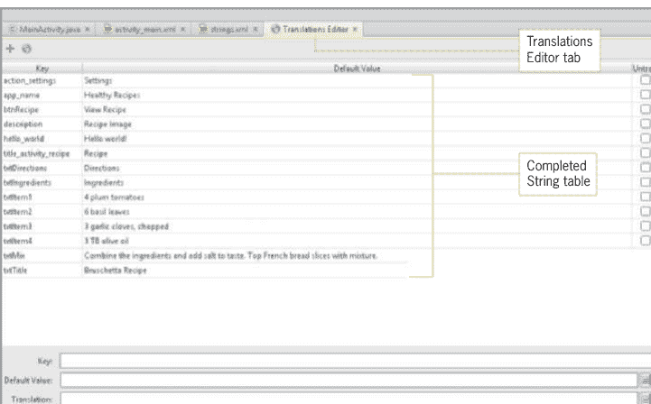

**图 2-10** 翻译编辑器中完成的字符串表

### 步骤 2

- 关闭“翻译编辑器”标签页。
- 关闭 `strings.xml` 标签页。
- 点击或点击“全部保存”（Save All）按钮以保存 Android 项目。

## 相对布局和线性布局

Android 界面包含一个布局资源设计器，控制控件在应用屏幕上的显示方式。`activity_main.xml` 底部的“设计”（Design）标签显示用户界面，该界面默认定义为相对布局的资源文件。**相对布局**如图 2-11 所示，相对于彼此的关系来组织布局组件。这比其他布局提供了更大的定位灵活性。可以通过在屏幕上拖放控件将布局放置在模拟器上。如图 2-11 所示，`ImageView` 控件位于开发者要求的任何位置。使用相对布局，你可以将 `ImageView`、`TextView`、`RadioButton` 或 `Button` 控件放在另一个控件的左侧、右侧、上方或下方。布局资源根据点击 `activity_main` 中“文本”（Text）标签定义的用户界面模板，以 `XML` 代码的形式存储在 Android 应用程序的 `res/layout` 资源目录中。

## 使用 Android 用户界面

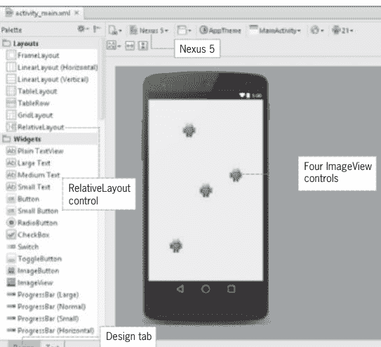

**图 2-11** 相对布局

另一种名为线性布局（Linear layout）的布局将布局组件组织在垂直列或水平行中。在图 2-12 中，多个 `ImageView` 控件（Android 图标）被拖动到模拟器窗口中。线性布局（垂直）将每个控件直接放置在上一个控件的下方，形成一个垂直列。要将默认的相对布局（Relative layout）更改为线性布局，请从调色板（Palette）中的“布局”（Layouts）类别中将 `LinearLayout (Vertical)` 布局拖到模拟器中。如果你选择线性布局并将图像拖动到模拟器上，图像将以多行的形式垂直排列，如图 2-12 所示。线性布局常用于在单行或单列中显示控件的表单。

## 第 2 章 简化！Android 用户界面

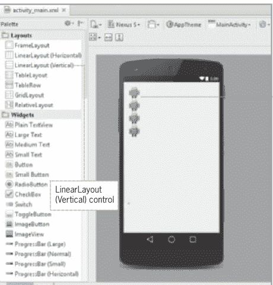

图 2-12 垂直方向的线性布局


你可以包含的其他布局还包括框架布局（Frame layout）、表格布局（Table layout）、表格行布局（Table Row layout）和网格布局（Grid layout）。你还可以使用布局组合，这意味着你可以将一个布局嵌套在另一个内部。

## 设计健康食谱应用的启动界面

当“健康食谱”应用打开时，初始界面如图 2-1 所示，显示一个带有“Bruschetta Recipe”（意式烤面包）文本的 `TextView`、一个带有配料图片的 `ImageView` 控件，以及一个带有“VIEW RECIPE”（查看食谱）文本的 `Button`。注意，控件不在线性布局中，而是使用相对布局，因此可以在屏幕上自由放置。

你可以使用属性面板（Properties pane）修改控件的属性。要更改控件的属性，请选择第一个控件，然后在属性面板中更改相应的属性，如文本或大小。

## Android 文本属性

最常用的文本属性更改显示的文本、修改文本大小以及更改文本对齐方式。文本属性（text property）使用来自字符串资源的文本来在控件内显示。字体大小属性（textSize property）可以使用各种测量单位，如表 2-2 所示。

首选的测量单位通常是 `sp`，代表缩放无关像素（scaled-independent pixels）。使用该单位的原因是，如果用户设置 Android 手机显示较大的字体以提高清晰度和方便观察，应用中的字体将进行缩放以满足用户的尺寸偏好。

| 测量单位 | 缩写 | 示例 |
| --- | --- | --- |
| 英寸 | `in` | `"0.5in"` |
| 毫米 | `mm` | `"20mm"` |
| 像素 | `px` | `"100px"` |
| 密度无关像素 | `dp` 或 `dip` | `"100dp"` 或 `"100dip"` |
| 缩放无关像素 | `sp` | `"10sp"` |

**表 2-2** 用于 `textSize` 属性的测量值

在“健康食谱”应用的启动界面上，标题的 `TextView` 控件、意式烤面包的 `ImageView` 控件以及 `Button` 控件都可以通过在控件拖动到模拟器时出现的绿色垂直线在屏幕上居中。相对布局允许控件放置在任何地方，绿色虚线会完美地居中每个控件。

所有调色板控件（如 `TextView` 和 `ImageView`）都可以使用名为 `layout:margin_top` 的属性。例如，如果你在 `layout:margin_top` 右侧输入 `50dp`，控件将距离屏幕顶部 50 像素，帮助你设计精确的布局。

用于表示名称的 `TextView` 控件命名为 `txtTitle`。要为 `TextView` 命名，请使用 `id` 属性。前缀 `txt` 表示这是一个 `TextView` 控件。对象的前缀传递了关于控件含义的信息。

要使用默认的相对布局在模拟器上放置 `TextView` 控件，请遵循以下步骤：

### 步骤 1

- 在调色板的“部件”（Widgets）中选择名为 `TextView` 的控件。将 `TextView` 拖到模拟器上。
- 使用默认的相对布局将 `TextView` 放置在模拟器上。
- 绿色虚线将控件完美居中。

如图 2-13 所示，在 Android 项目中具有多个根据设备分辨率命名的文件夹。

## 第 2 章 简化！Android 用户界面

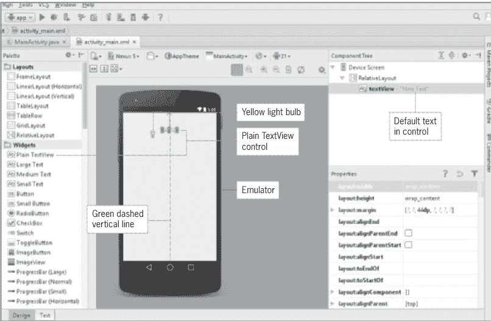

**图 2-13** 相对布局

意式烤面包的 `ImageView` 控件、标题的 `TextView` 控件以及 `Button` 控件都可以通过在控件拖动到模拟器时出现的绿色垂直线在屏幕上居中。相对布局允许控件放置在任何地方，绿色虚线会完美地居中每个控件。

为了不同的语言，你必须将这些额外的资源。

### 步骤 2

- 在调色板中选择 `TextView` 控件。
- 将 `TextView` 拖动到模拟器上。
- 使用 `id` 属性为 `TextView` 命名。

## Android 用户界面

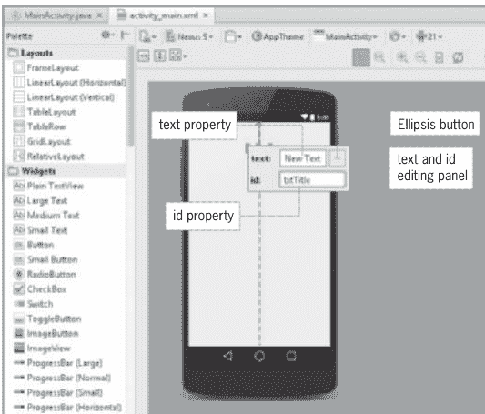

**图 2-14** 相对布局

### 步骤 3

- 在调色板中选择 `TextView` 控件。
- 将 `TextView` 拖动到模拟器上。
- 使用 `id` 属性为 `TextView` 命名。

## Android 用户界面

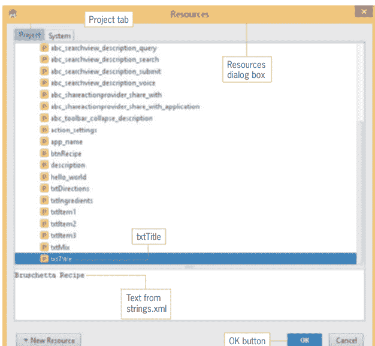

**图 2-15** 相对布局

## Android 用户界面

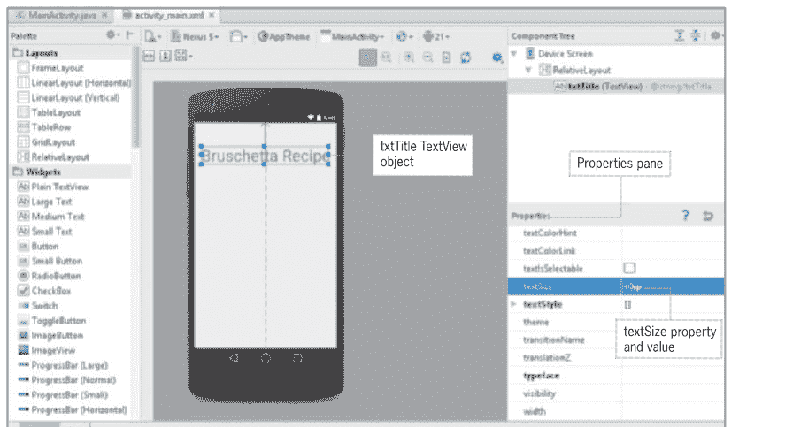

**图 2-16** 相对布局

## 设备尺寸和密度

Android 使用两个通用属性对屏幕进行分类：尺寸和密度。你应该预计你的应用将安装在具有不同尺寸和密度的设备上。

当你保存在 `drawable` 文件夹时，Android 会为这些创建一个 `drawable` 资源。Android 会自动缩放你的图像以适应屏幕。应用开发者可以创建为不同尺寸屏幕专门设计的图像，看起来清晰，没有任何模糊。

例如，高分辨率图像可以专门为 `xhdpi` 文件夹设计。通过使用适当的图像，可以在所有屏幕密度上获得最佳图形质量和性能。为了简单起见，本文将一个图像放置在通用的 `drawable` 文件夹中。

| 名称 | 说明 |
| --- | --- |
| `drawable` | 任何通用资源 |
| `xxdpi` | 极高密度屏幕 |
| `xhdpi` | 极高密度屏幕 |
| `hdpi` | 高密度屏幕 |
| `mdpi` | 中密度屏幕 |
| `ldpi` | 低密度屏幕 |

**表 2-3** `Drawable` 文件夹

将意式烤面包图像放置在 `res/drawable` 文件夹中供 `ImageView` 控件使用，该控件链接到资源图像。你应该已经有了老师给你的这些学生文件，或者你从网页（www.cengagebrain.com）下载的文件。

要将驱动器中的 `bruschetta.png` 图像放入 `res/drawable` 文件夹，请遵循以下步骤：

### 步骤 1

- 如果必要，将学生文件拷贝到你的 U 盘。打开包含学生文件的 U 盘文件夹。
- 要拷贝 `bruschetta.png` 文件，点击或点击 U 盘上的 `bruschetta.png` 文件，然后按 `Ctrl+C`。
- 要将图像粘贴到 `drawable` 文件夹，在 Android 项目视图中按住或右键点击 `drawable` 文件夹。

*快捷菜单打开（图 2-17）。*

## 使用 Android 用户界面

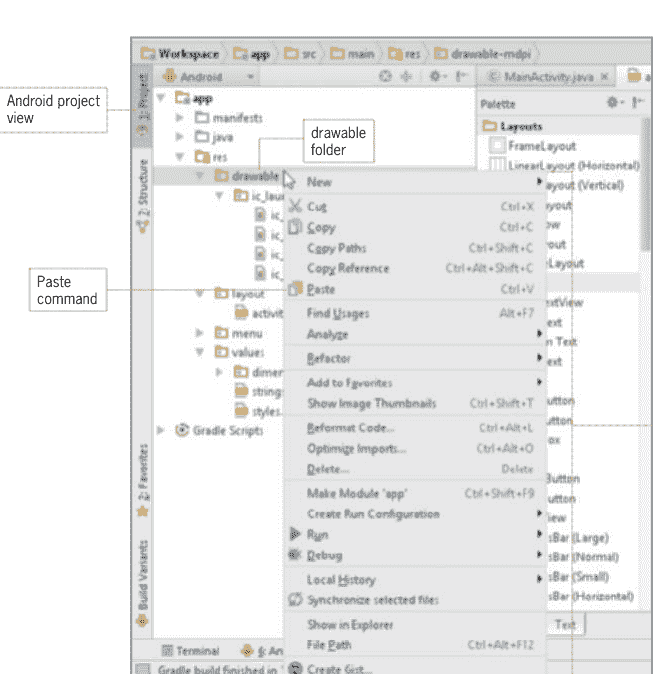

**图 2-17** 粘贴已复制文件的快捷菜单

### 步骤 2

- 在快捷菜单上轻点或点击“粘贴（Paste）”。

复制对话框确认了图像被复制到的名称和目录（图 2-18）。

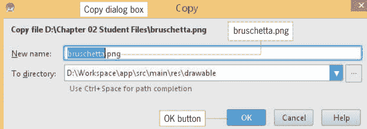

**图 2-18** 复制对话框

### 步骤 3

- 在复制对话框中点击“确定（OK）”按钮。

`drawable` 文件夹中会出现 `bruschetta.png` 文件的副本（图 2-19）。

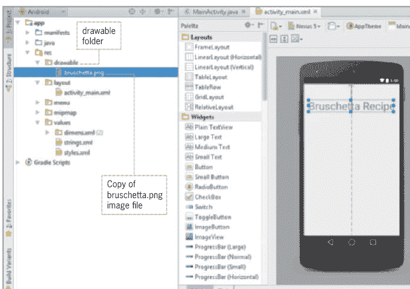

**图 2-19** 复制到 `drawable` 文件夹的 `bruschetta.png`

> 额外高密度图形每英寸有 480 点（通常是平板电脑）。超高密度图形每英寸有 320 点，高密度图形每英寸 240 点，中密度图形每英寸 160 点，而低密度图形每英寸 120 点。

## 添加 `ImageView` 控件

将图像放置在 `drawable` 文件夹后，你可以在模拟器中放置 `ImageView` 控件。`ImageView` 控件可以将图标或图形作为图片文件或形状显示在 Android 屏幕上。

要从调色板（Palette）的 Widgets 类别添加 `ImageView` 控件，请按照以下步骤操作：

### 步骤 1

- 在设计（Design）选项卡的调色板 Widgets 类别中，轻点或点击 `ImageView`。
- 将 `ImageView` 控件拖到模拟器中心，直到出现绿色的虚线垂直线，表示已到达中心。释放鼠标按钮。

`ImageView` 控件（蓝色正方形占位符）位于模拟器中心（图 2-20）。

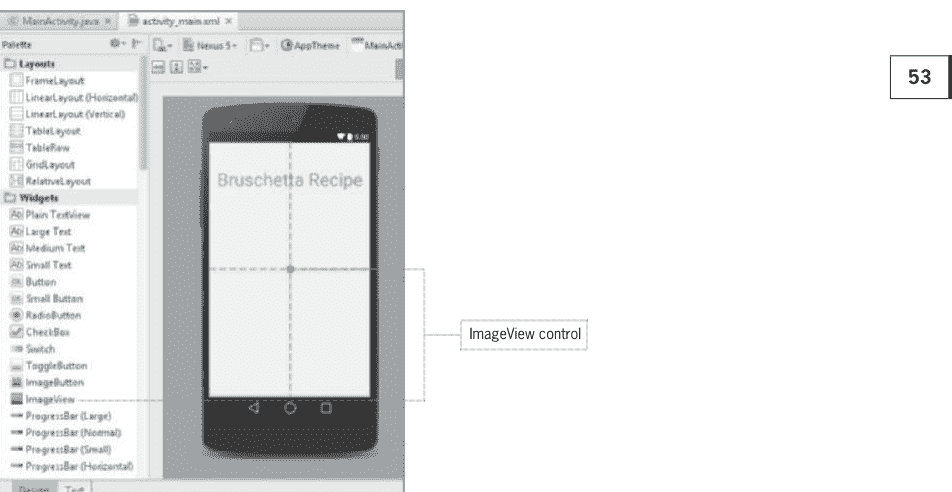

**图 2-20** 位于模拟器中心的 `ImageView` 控件占位符

### 步骤 2

- 双击或双击 `ImageView` 占位符以打开 src 和 id 编辑面板。
- 在 id 文本框中输入 `imgRecipe` 为 `ImageView` 控件命名。
- 在 src 和 id 编辑面板中轻点或点击省略号（三个点）。
- 向下滚动 Resources 列表，然后在 Drawable 类别中轻点或点击 `bruschetta`，以从 `drawable` 文件夹选择图像。

Resources 对话框中选择了 `bruschetta` 图像（图 2-21）。

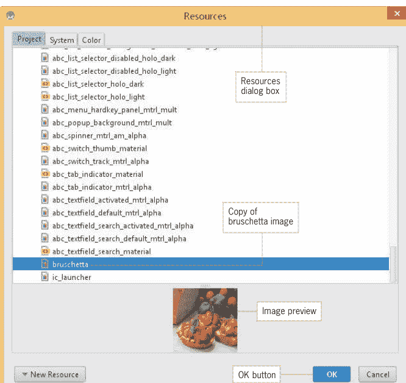

**图 2-21** 将 `bruschetta` 图像分配给 `ImageViewControl`

### 步骤 3

- 点击“确定”按钮关闭 Resources 对话框。
- 向下滚动属性（Properties）面板以显示 `contentDescription` 属性。
- 点击 `contentDescription` 属性右侧的省略号。
- 在 Resources 对话框中向下滚动 Resources 列表并轻点或点击 `description`。

`strings.xml` 中的描述字符串资源被分配给 `contentDescription` 属性，这将为了无障碍目的显示 `imgRecipe` `ImageView` 控件（图 2-22）。

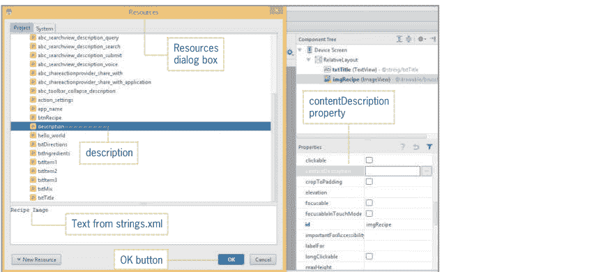

**图 2-22** 将描述字符串资源分配给 Resources 对话框控件

### 步骤 4

- 点击“确定”按钮关闭 Resources 对话框。

模拟器中显示了 `bruschetta`（图 2-23）。

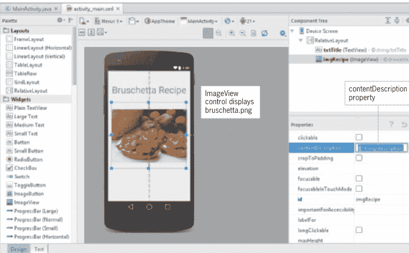

**图 2-23** 带有 `contentDescription` 属性的 `ImageView` 控件

> **深度技巧**
>
> 当你为应用选择图像时，请考虑使用 Google 或 Bing 的高级搜索功能来查找开源许可。开源许可是一种图像许可，允许在特定的条款和条件下进行使用、修改和/或共享。

## 添加 `Button` 控件

按钮控件（Button Control）是图形用户界面中常用的控件。例如，你可能熟悉许多应用程序中使用的“确定（OK）”。

Android SDK 包含四种按钮：`Button`、`Small Button`、`ToggleButton` 和 `ImageButton`。`Button` 控件在调色板的 Widgets 类别中提供。在 Healthy Recipes 应用中，用户点击 `Button` 控件即可显示 `bruschetta` 菜谱。

要为 `Button` 控件命名，请使用其 `id`。例如，在 Healthy Recipes 应用中使用 `btnRecipe` 作为 `Button` 控件的 `id` 属性。`btnRecipe` 代表代码中的一个按钮。`id btnRecipe` 用于在 Java 代码中编写 `Button` 控件。

要从调色板的 Widgets 类别添加 `Button` 控件，请按照以下步骤操作：

> 注：原文后续重复的步骤描述已根据逻辑合并处理，避免重复输出。

## Java 程序的根本构建模块

类（Classes）是类别，而对象（objects）是每个类别中的项目。对象是类的一个特定、具体的实例。当你创建一个对象时，你就在对其进行实例化（instantiate）。

当你实例化时，你通过在类中定义对象的某个特定变体、为其命名并将其定位在计算机内存中，从而创建该对象的实例。每个类都定义了对象可以包含的内容以及在使用数据时它的行为方式。

例如，想象一组 Mini Cooper 的设计图作为类，它详细说明了车辆将如何制造。接下来，想象你正在使用这些设计图订购你的 Mini Cooper（实例化你自己的副本），选择了一个糖苹果色并带有赛车条纹的。一个类可以被实例化无数次，但每次实例化都会创建一个新的、独特的对象，就像宝马可以制造成千上万辆汽车一样。

在活动的后续部分，将 Java 代码添加到 `MainActivity` 类中，以识别点击 `Button` 控件打开食谱屏幕的操作。记住，每个屏幕代表一个活动（Activity）。每个活动都必须在文件夹内有一个匹配的 Java 类。

第二个活动需要一个名为 `activity_recipe.xml` 的对应 XML 文件，用于显示第二个屏幕的布局。`activity_recipe.layout` 布局文件应被设计为没有空格的 Java 名称，并用每个新单词的首字母大写字母进行强调。XML 文件名通常以小写字母开头，并与类名相同。

## GTK

> 使用大写字母作为 Java 类名的开头，并将每个新单词大写，这被称为帕斯卡命名法（Pascal case）。

## GTK

> 如果你运行 API 22 或更高版本，任何 Java Activity 中的 `ActionBar` 类名可能会显示为删除线文本。应用程序将完美运行，但本书中的任何应用程序，你可以将 `ActionBar` 替换为 `AppCompatActivity`。

## 添加第二个 XML 布局页和第二个类

要向应用程序添加带有第二个 XML 布局页的第二个类，请遵循以下步骤：

### 步骤 1

- 关闭 `activity_main.xml` 标签页。
- 在 Android 项目视图中，展开 `java` 文件夹和第一个 `net.androidbootcamp.healthrecipes` 包以查看 `MainActivity` 类。
- 要创建第二个类，按下或右键点击第一个 `net.androidbootcamp.healthrecipes` 文件夹（包名），在快捷菜单上点击 `New`，然后点击或选择 `Activity`。

显示 Activity 快捷菜单以添加第二个活动（图 2-25）。

## 第 2 章 简化！Android 用户界面

新命令

包名

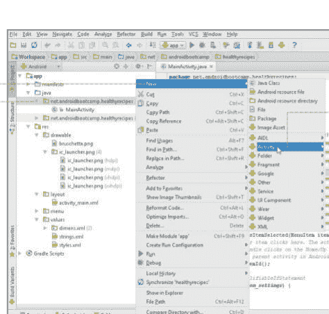

Activity 命令

Blank Activity

**图 2-25** Activity 快捷菜单

### 步骤 2

- 点击或选择 `Blank Activity` 以创建第二个 Activity 类。
- 在 `Activity Name` 文本框中输入 `Recipe` 以创建第二个类。

名为 `Recipe` 的新类使用第二个布局 `activity_recipe` 命名（图 2-26）。

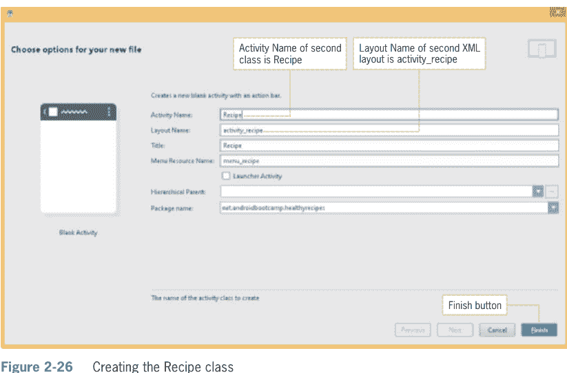

### 步骤 3

- 点击或选择 `Finish` 按钮以完成 `Recipe` 类和第二个屏幕 XML 布局的创建。
- 从 `activity_recipe.xml` 模拟器中删除默认的 `Hello World!` `TextView` 对象。
- 使用本章之前教授的技巧，创建第二个用户界面 `activity_recipe.xml`，如图 2-27 所示，包含多个 `TextView` 控件。

第二个用户界面 `activity_recipe.xml` 已设计完成（图 2-27）。

## 第 2 章 简化！Android 用户界面

Recipe 类

普通 `TextView`

`txtTitle2`

`textSize 40sp`

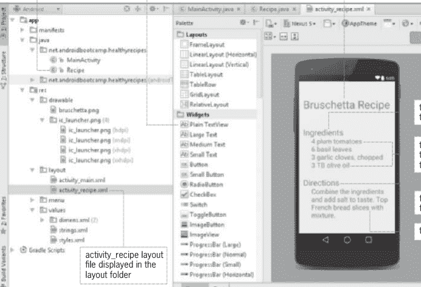

**图 2-27** `activity_recipe.xml` 的用户界面

### 步骤 4

- 关闭 `activity_recipe.xml` 标签页。
- 在 `Recipe.java` 代码窗口中点击。
- 通过点击菜单栏上的 `View`，然后点击 `Active Editor`，在代码窗口中显示行号。
- 点击或选择 `Show Line Numbers`。

`Recipe.class` 已创建并显示了行号（图 2-28）。

## Android Manifest 文件

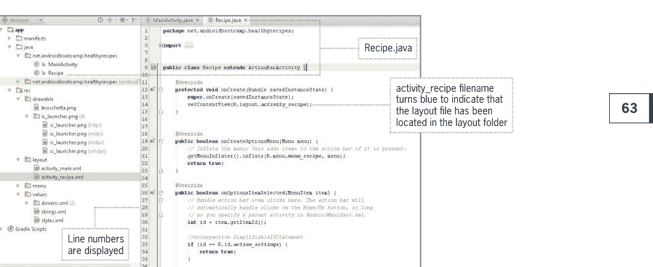

### Healthy Recipes 项目中的新 recipe 类

Android 项目不仅仅是创建用户界面的 XML 布局。任何 Android 项目的其他组件是 Android Manifest 文件和类中的 Java 代码。

Android Manifest 文件在每个 Android 应用程序都是必须的，且必须精确命名为 `AndroidManifest.xml`。Android Manifest 为设备提供所有基本信息，例如你的应用程序名称、每个活动的列表、访问其他功能（如使用互联网）所需的任何权限、服务、广播接收器以及 Android API 的最低级别。

此文件让 Android 系统了解组件是什么，以及它们在什么条件下可以启动。`AndroidManifest.xml` 就像企业的项目经理，决定了哪些活动需要调度、需要哪些权限，以及完成工作所需的设备。

Android Studio 会自动将你创建的每个活动添加到 Android Manifest 中。在 `Healthy Recipes` 应用中，Android Manifest 只感知到名为 `MainActivity` 的初始活动。


# 第 2 章 简化！Android 用户界面


图 2-29 AndroidManifest

## Android Manifest 文件

Android 项目包含比创建用户界面的 XML 布局多多的内容。任何 Android 项目的其他组件是 Android Manifest 文件和类中的 Java 代码。Android Manifest 文件在每个 Android 应用程序都是必须的，且必须精确命名为`AndroidManifest.xml`。Android Manifest 为设备提供所有基本信息，例如您的应用程序名称、每个活动的列表、访问其他功能（如使用互联网）所需的任何权限、服务、广播接收器以及 Android API 的最低级别。此文件让 Android 系统了解组件是什么，以及它们在什么条件下可以启动。`AndroidManifest.xml` 就像企业的项目经理，决定了哪些活动需要调度、需要哪些权限，以及完成工作所需的设备。

Android Studio 会自动将你创建的每个活动添加到 Android Manifest 中。在`Healthy Recipes`应用中，Android Manifest 只感知到名为`MainActivity`的初始活动。

## Java Java

当用户点击活动时，Android Manifest 是。每个新单词大写，这被称为帕斯卡命名法。

> 如果你运行 API 22 或更高版本，任何 Java Activity 中的`ActionBar`类名可能会显示为删除线文本。应用程序将完美运行，但本书中的任何应用程序，你可以将`ActionBar`替换为`AppCompatActivity`。

## 编写 `onCreate`

在本章中，Android Manifest 是。每个新单词大写，这被称为帕斯卡命名法。

> 使用大写字母作为 Java 类名的开头，并将每个新单词大写，这被称为帕斯卡命名法。

### 语法

```java
public void onCreate(Bundle savedInstanceState) {
    super.onCreate(savedInstanceState);
}
```

方法以`public void`开始，这些是 Java 用来确定类型的特殊关键字。它们必须全小写。Void 被称为方法的返回类型。`void`方法不返回任何内容。

### 显示界面

`public void`语句的结束是左括号。右括号出现在方法的末尾。在大括号内部是`onCreate`方法，第一个用户界面必须在此处打开。我们不清楚应该显示哪个用户界面。为了打开特定的界面，必须在`onCreate`方法中添加代码，将特定屏幕放置在任务栈顶部。显示特定屏幕内容的 Java 代码是`setContentView`，其语法如下：

### 代码语法

```java
setContentView(R.layout.activity_main);
```

在代码语法中，`R.layout.activity_main`代表`activity_main`布局的用户界面（打开屏幕），它显示了打开标题、意式饼图像和 VIEW RECIPE 按钮。`R`代表测试资源，布局文件夹位于`res`。

`MainActivity.java`文件由 Android Studio 自动创建，并已包含`onCreate`方法和`setContentView(R.layout.activity_main)`代码，如图 2-30 第 12 行和第 14 行所示。第 12 行开始方法，第 14 行在应用程序启动时显示`activity_main.xml`布局。Android Studio 会在`Recipe.Java`类启动时为打开`activity_recipe.xml`布局创建`onCreate`方法。

## 创建按钮事件处理器

Android 手机和平板电脑拥有触摸屏，这为用户交互创造了无限可能，允许用户点击、滑动以及双指或缩放来更改屏幕大小。当你使用这种事件驱动的语言进行编程时，用户通常会看到一个包含控件、按钮、菜单和其他图形元素的界面。显示界面后，程序会等待用户触摸设备。当用户做出反应时，App 会启动一个事件，并在事件处理器中执行代码，而事件处理器是程序用于响应特定事件的一部分。

在“健康食谱”（Healthy Recipes）应用中，用户只有一种交互——点击按钮控件来启动显示意式烤面包片（bruschetta）食谱的事件。当用户点击按钮控件时，需要一个事件监听器来启动该事件，从而在 Android 屏幕上显示`activity_recipe.xml`文件。此事件在 Java 代码中实际上被称为点击（click）。在“健康食谱”应用中，`MainActivity.java`代码必须首先持有 Button 对象的引用。

- 用于持有 Button 对象引类属性。
- 等待按钮点击动作的`onClick()`方法。
- 用于响应点击事件的`onClick()`方法。

“健康食谱”应用在屏幕上使用 Button 控件。要使用它，在`MainActivity.java`文件中需要一个引用。要引用 Button 控件，使用以下语法创建一个 Button 属性：

### 代码语法

```java
Button button = (Button)findViewById(R.id.btnRecipe);
```

Button 属性的语法包含了`findViewById()`方法，任何 Android Activity 都会使用该方法。该方法用于在设计用户界面时创建的 XML 文件查找布局视图。代码中的变量包含了对 Button 控件的引用。

在代码中引用 Button 控件后，你可以按`Alt+Enter`将 Button 导入为 Android 小部件（Mac 上为`Option+Return`）。当你将 Button 类型作为 Android 小部件导入时，来自 Button 包的类在整个应用程序中都可用。`import`语句会自动放置在 Java 代码的顶部。`import`语句是让 Java 函数对你的特定程序可用的方法。Java 可以执行几乎无限的操作，但并非每个程序都需要这样做。因此，为了限制代码大小，Java 将其分成了包，可以在代码的顶部进行导入。

在`MainActivity.java`中引用 Button 属性后，需要一个`OnClickListener()`方法来检测用户何时点击屏幕上的按钮。事件监听器等待用户交互，在本项目章节中，交互即用户点击按钮以接收食谱。当代码中放置了`OnClickListener`时，Java 会创建一个自动生成的`onClick`存根（stub），这段代码实际上充当声明声明的占位符，它仅包含了恰好的代码来链接到程序的其余部分。监听 Button 控件的`OnClickListener`方法需要以下语法：

### 代码语法

```java
button.setOnClickListener(new OnClickListener() {
  public void onClick(View v) {
    // 自动生成的方法存根
  }
});
```

最后一步是调用`startActivity()`方法，它会打开显示`activity_recipe.xml`用户界第二个 Activity。`startActivity()`方法创建一个`Intent`（意图）来启动另一个 Activity，例如启动`Recipe`类。`Intent`需要两个部分，被称为参数：上下文（context）和正在打开的 Activity 的名称。Android 编码中的上下文意味着每当你请求程序启动另一个 Activity 时，就是在发出该请求。本项目的上下文是`MainActivity.this`，它引用了`MainActivity.java`类。以下语法启动`Recipe`类：

### 代码语法

```java
startActivity(new Intent(MainActivity.this, Recipe.class));
```

## 编写按钮事件处理器

当`activity_recipe.xml`布局最初由`MainActivity.java`类启动时，有必要编写 Button 控件如何与用户交互的代码。当点击此食谱按钮时，`MainActivity.java`类必须包含启动`activity_recipe.xml`布局（Activity）并启动名为`Recipe.java`的第二个 Java 类的代码。要初始化 Button 控件并编写按钮处理器以启动第二个 Activity，请遵循以下步骤：

### 步骤 1

- 点击`MainActivity.java`标签页以打开其代码窗口。
- 在代码窗口中点击并显示行号。
- 删除第 18–38 行以简化代码。
- 点击第 14 行`setContentView(R.layout.activity_main);`右侧，然后按回车。

## 第 2 章 简单！Android 用户界面

- 要初始化并引用 ID 名称为`btnRecipe`的 Button 控件，输入`Button button = (Button) findViewById(R.id.btnRecipe);`

## 保存并运行应用程序

每次在模拟器中测试 Android 应用程序时，程序设计和代码都会自动保存。如果你启动项目并在完成前需要保存，点击或单击工具栏上的“全部保存”（Save All）按钮。如第 1 章所示，点击或点击工具栏上的“运行 'app'”按钮在模拟器中测试应用程序。应用程序执行时会弹出一个对话框，询问你想要启动哪个模拟器。点击“启动模拟器”（Launch emulator）并选择 Nexus 5 API 21x86 或类似的模拟器，然后点击“确定”（OK）按钮。当 Android 主屏幕出现时，解锁模拟器。应用程序再次将代码发送到模拟器。应用程序在模拟器窗口中运行，你可以点击“查看配方”（VIEW RECIPE）按钮查看意式面包配方。

## 总结——章节总结

本章介绍了为 Healthy Recipes 程序创建图形用户界面的步骤。如你所见，许多步骤在设计上是重复的；也就是说，反复使用相同的技术来完成相似的任务。当你掌握了这些技术以及用户界面设计原则时，你就能为各种程序设计用户界面了。

- 不要直接将文本添加到控件的 text 属性中，而是通过翻译编辑器中的 Strings 表格，将其添加到`strings.xml`文件中。
- 相对布局（Relative layouts）可以在屏幕上自由地排列组件。线性布局（Linear layouts）将组件按垂直列或水平行排列。
- 控件的常用文本属性包括 text 属性（指定用于在控件中显示文本的字符串资源）和 textSize 属性（指定文本的大小）。
- 为了在 Android 应用程序中将图形作为图片和图标显示，你需要使用 ImageView 控件。在模拟器中放置 ImageView 控件之前，你必须在资源文件夹（drawable）中放置图形文件。
- Activity 是应用程序与用户进行接触的切点，是 Android 应用程序的核心组件之一。该项目有两个 Activity，每个屏幕对应一个 Activity。
- 每个屏幕代表一个 Activity，每个 Activity 必须有一个匹配的 Java 类。
- 每个应用程序都有一个 Android Manifest 文件（命名为`AndroidManifest.xml`），该文件为 Android 设备提供基本信息，例如应用程序的名称和每个 Activity 的列表。Android Studio 会自动为每个 Activity 添加。
- 方法（method）是一组可以包含在 Java 类中的 Java 语句。`onCreate`方法是初始化 Activity 的地方。你使用`setContentView`来显示特定的内容。

## 第 2 章 简单上手！Android 用户界面

- 当用户点击 Android 应用程序中的 Button 控件时，事件监听器（或点击事件）的代码将启动 Button 控件的事件。事件监听器（如`OnClickListener`方法）在执行其余代码之前等待用户交互。
- 在包含多个 Activity 的 Android 应用程序中，使用`startActivity()`方法创建一个意图（intent）来启动另一个 Activity。意图应该包含两个参数：上下文（context）和要打开的 Activity 名称。发起请求的 Activity 类即为上下文。
- 当你运行 Android 应用程序时，如果你的项目包含任何错误，会弹出对话框。寻找红色的错误图标和波浪线，它们标识了错误的位置。指向红色波浪线可以让 Java 对代码中的语法错误提供修改建议。

## 关键术语

- **Activity**——代表带有用户界面的单个屏幕（xml）的 Android 组件。
- **Android Manifest**——一个名为`AndroidManifest.xml`的文件，每个 Android 应用程序都需要它。该文件为 Android 设备提供基本信息，例如你的 Java 应用程序的名称和每个 Activity 的列表。
- **class**——一组对象的集合，建立了每个对象属性的介绍。
- **event handler（事件处理器）**——程序中编写的用于响应特定事件的部分。
- **ImageView**——显示来自图片文件的图标或图形的控件。
- **import**——使特定 Android 包中的类在整个应用程序中可用。
- **import statement（import 语句）**——使 Java 函数对程序可见语句。
- **instantiate（实例化）**——创建特定类的对象。
- **intent（意图）**——Android Manifest 文件中的代码，允许具有多个 Activity 的 Android 应用程序在 Activity 之间导航。
- **Linear layout（线性布局）**——按垂直列或水平行排列组件的布局。
- **method（方法）**——一组可以包含在 Java 类中的语句。
- **method body（方法体）**——方法中包含定义方法作用的语句集合的部分。
- **object（对象）**——类的特定具体实例。
- **Pascal case（帕斯卡命名法）**——以大写字母开头并在每个新单词开头使用大写字母的文本。
- **Relative layout（相对布局）**——相互关联排列组件的布局。相对布局是模拟器的默认布局。
- **ContentView**——显示屏幕内容所需的 Java 代码。
- **sp**——一种测量单位，代表缩放无关像素（scaled-independent pixels）。
- **stub（存根）**——一种作为占位符声明自身的代码，仅包含足够链接到程序其余部分的代码。
- **text property（text 属性）**——引用字符串资源以在控件内显示文本的属性。
- **textSize property（textSize 属性）**——设置控件文本大小的属性。

## 开发者常见问题

1. `res`文件夹中有多少个 drawable 文件夹？
2. 如果你要用许多不同的语言创建一个应用程序，你是否需要为每种语言从头开始编写整个程序？程序的哪些部分保持不变？哪些部分是不同的？
3. XML 文件存储在 Android 项目的哪个子文件夹中？
4. 章节项目使用了哪些控件？
5. 线性布局（Linear Layout）和相对布局（Relative layout）有什么区别？
6. Android 屏幕的默认布局是什么？
7. 文本大小首选什么测量单位？
8. `px`代表什么？
9. `sp`代表什么？
10. `dpi`代表什么？
11. ImageView 哪些图片类型？
12. 首选哪种图片类型？
13. 在哪个属性中可以为屏幕阅读器描述 ImageView？
14. 章节项目中 Button 控件更改了哪些属性？
15. 定义 Button 名称的属性是什么？
16. 编写代码启动名为 MainActivity 的第二个类。
17. 编写代码声明一个 ID 为`btnWars`的 Button 控件。
18. 编写代码打开名为`lemon`的 XML 布局。
19. 按哪两个键可以补全 Java 代码？
20. Java 代码末尾放置什么字符？

## 课外拓展

搜索网络获取答案以扩展你的 Android 知识。

1. 线性布局和相对布局不是唯一的布局类型。列出其他三种布局类型并描述每种。
2. 为什么`.png`文件是 Android 设备首的的资源类型？写一段包含至少三个理由的话。
3. 平均开发者从其应用程序中获得多少利润？研究并写下 150–200 字的结果。
4. 研究目前 Google Play 上最贵的 Android 应用程序。列出三个贵的应用、价格及其用途。

## 案例项目

完成以下一个或多个案例项目。使用你老师教授的步骤和技术。将你创建的项目提交给老师。每个案例项目都标注了难度级别。

- 简单：*
- 中等：\*
- 挑战：\*\*

## 案例项目 2–1：青年旅馆应用

| 要求文档 | |
|---|---|
| 应用程序标题 | Youth Host App |
| 目的 | 在青年旅馆预订应用程序中，选择一个旅馆并显示地址和其他信息。 |
| 算法 | 1. 启动屏幕显示旅馆名称、图片和 Button 控件（图 2-37）。研究一个真实的旅馆名称和地址并在在你自定义的应用应用程序显示。<br><br>2. 当用户选择旅馆时，第二个屏幕将显示地址和价格范围（图 2-38）。 |
| 注意 | 旅馆图片随你的学生文件提供。 |


图 2-37

青年旅舍应用——第一个屏幕

图 2-38

青年旅舍应用——第二个屏幕

版权 2016 Cengage Learning. 版权所有。未经许可不得全部或部分复制、抑制或复制。由于电子权利，编辑审查认为任何被抑制的内容都不会对整体学习体验产生实质性影响。Cengage Learning 保留在不通知的情况下删除、插入或更改内容的权利。

## 第 2 章 简化！Android 用户界面


## 案例项目 2–2：Segway 租赁应用 ★

### 需求文档

**应用标题：** Segway 租赁应用

**目的：** 在 Segway 租赁应用中，通过扫描或部分选择 Segway 游览，并显示 Segway 图片及租赁信息。

1. 启动屏幕显示应用标题、描述文字和一个`Button`控件（见图 2-39）。
2. 当用户选择租赁 Segway 时，将显示显示 Segway 和游览价格的图片（见图 2-40）。

注意：Segway 图片随你的学生文件提供。


**图 2-39** Segway 租赁应用——第一个屏幕

**图 2-40** Segway 租赁应用——第二个屏幕

## 案例项目 2–3：你的学校应用 ★★

### 需求文档

| 需求文档 |  |
| --- | --- |
| 应用标题： | 你的学校应用 |
| 目的： | 这个大型应用提供了你所在国家每所学校的信息。为应用创建两个屏幕。使用应用选择学校名称，然后显示所选学校的信息。 |
| 算法： | 1. 启动屏幕显示你学校的名称、学校图片和一个按钮控件。创建你自己的布局。<br>2. 第二个屏幕显示你学校的名称、学校 Logo 图片、学校地址和电话号码。创建你自己的布局。 |

## 案例项目 2–4：名片应用 ★★

### 需求文档

| 需求文档 |  |
| --- | --- |
| 应用标题： | 名片应用 |
| 目的： | 此应用提供带有你个人照片的业务片片。为该名片应用创建两个屏幕。使用应用选择业务联系人的名称，然后显示详细的业务片信息。 |
| 算法： | 1. 启动屏幕显示联系人名称、转换为`.png`文件的你的照片和一个按钮控件。创建你自己的布局。<br>2. 第二个屏幕显示你的名片信息。创建你自己的布局。 |

## 案例项目 2–5：你的联系人应用——通讯录 ***

### 需求文档

| 需求文档 |  |
| --- | --- |
| 应用标题： | 你的联系人应用——通讯录 |
| 目的： | 这个大型应用在通讯录中提供业务联系信息。为应用的联系人创建两个屏幕。使用应用选择特定的联系人，然后显示该人的信息。 |
| 算法： | 1. 启动屏幕显示两个姓以 J 开头的联系人姓名。每个联系人都有一个独立的按钮控件。创建你自己的布局。<br>2. 第二个屏幕显示联系人的姓名、地址、电话号码和照片。创建你自己的布局。 |
| 条件： | 需要三个 Java 类和三个 XML 布局。 |

## 案例项目 2–6：最新音乐场景 ***

### 需求文档

| 需求文档 |  |
| --- | --- |
| 应用标题： | 最新音乐场景 |
| 目的： | 这个名为“音乐场景（The Music Scene）”的大型应用包含最新的音乐新闻。为音乐新闻故事创建两个屏幕。使用应用选择特定的音乐新闻故事标题，然后显示关于该新闻故事的图片和段落。 |
| 算法： | 1. 启动屏幕显示根据新闻中的故事创建的两个音乐故事标题。每个音乐新闻在新闻下方有一个独立的按钮控件，并显示一张小图片。创建你自己的布局。<br>2. 第二个屏幕显示故事名称和详细介绍新闻的段落。创建你的布局。 |
| 条件： | 需要三个 Java 类和三个 XML 布局。 |

## 参与！Android 用户输入、变量与操作

在本章中，你将学习：

- 使用 Android 主题
- 在 Android Manifest 文件中添加主题
- 在字符串表（String table）中添加文本
- 在`strings.xml`中添加 XML 数组
- 使用文本字段（Text Fields）开发用户界面
- 描述不同文本字段的作用
- 使用`hint`属性显示提示信息
- 使用`Spinner`控件开发用户界面
- 为`Spinner`控件添加提示（`prompt`）
- 声明变量以存储数据
- 编写`GetText()`方法
- 理解算术运算
- 转换数值数据
- 格式化数值
- 编写`SetText()`方法
- 在模拟器中运行完成的应用

## 第 3 章 Android 用户输入、变量与操作

在本章中，你将学习：

- 使用 Android 主题
- 在 Android Manifest 文件中添加主题
- 在字符串表（String table）中添加文本
- 在`strings.xml`中添加 XML 数组
- 使用文本字段（Text Fields）开发用户界面
- 描述不同文本字段的作用
- 使用`hint`属性显示提示信息
- 使用`Spinner`控件开发用户界面
- 为`Spinner`控件添加提示（`prompt`）
- 声明变量以存储数据
- 理解算术运算
- 转换数值数据
- 格式化数值
- 编写`SetText()`方法
- 在模拟器中运行完成的应用

## 第 3 章 参与！Android 用户输入、变量与操作

`Theme.Holo.Light`

主题已更改`Theme.Material.Dialog.NoActionBar`

主题已更改`Theme.Black`


**图 3-3** 全息主题

**图 3-4** 无操作栏的 Material 主题

**图 3-5** 黑色主题

## 预览主题

通过在`activity_main.xml`文件中更改模拟器中的主题，你可以预览新主题的外观，但要在应用程序中永久更改它，你必须在 Activity 子文件夹下的`styles.xml`文件中定义主题。在`styles.xml`文件放置主题后，Android Studio 会更新`AndroidManifest.xml`文件以包含新主题。你可以添加预定义主题或自己设计的自定义主题。Concert Tickets 项目使用了名为`Theme.Black.NoTitleBar`的预定义主题。要创建 Concert Tickets 应用程序并预览`Theme.Black.NoTitleBar`主题，请按照以下步骤操作：

### 步骤 1

- 打开 Android Studio 程序。
- 在快速启动列表中点击或点击“新建 Android Studio 项目”。
- 在“新建项目”对话框的配置项目页面上，在 Application（应用程序）文本框中输入`Concert Tickets`。
- 在 Company Domain（公司域名）文本框中，如有需要输入`androidbootcamp.net`。
- 在 Project location（项目位置）文本框中，如有需要输入`D:\Workspace\ConcertTickets`。

一个名为 Concert Tickets 的新应用程序被配置为保存在 D:\Workspace USB 盘上（图 3-6）。


**图 3-6** 配置 Concert Tickets 项目

### 步骤 2

- 在“配置你的新项目”页面上点击 Next（下一步）按钮。
- 如有，点击或点击“Phone and Tablet（手机和平板）”以选择运行应用程序的形态。
- 在“选择你的应用程序运行的因素”页面上点击 Next（下一步）按钮。
- 如需要，点击或点击“Blank Activity（空活动）”向新项目添加 Activity。
- 在“将 Activity 添加到手机”页面上点击 Next（下一步）按钮。
- 在“为你的新文件选择选项”页面上点击 Finish（完成）按钮。
- 点击模拟器中的 Hello world! TextView（默认显示）并按 Delete（删除）键。
- 点击`activity_main.xml`标签页中 Palette（调色板）右侧的“用于渲染布局的虚拟设备”（模拟器按钮），然后点击 Nexus 5 (5.0)*, 1080 x 1920, xhdpi)。

`activity_main.xml`文件显示在 Design（设计）选项卡上，Hello world TextView 组件被删除（图 3-7）。模拟器显示默认 App。


**图 3-7** Concert Tickets 项目的`activity_main.xml`

### 步骤 3

- 点击 AppTheme 按钮，在 Select Theme（选择主题）对话框中显示内置主题列表。
- 在 Select Theme 对话框左上部分的搜索框中，输入`black`。

Select Theme 对话框中显示了名称中包含“black”文本的主题列表（图 3-8）。

## Android 主题


**图 3-8** Select Theme 对话框

### 步骤 4

- 选择 Black.NoTitleBar，然后点击 OK（确定）按钮。

主题更改为 Black.NoTitleBar。Android Studio 移除了模拟器中的标题栏，并将背景显示为黑色（图 3-9）。


**图 3-9** 已应用新主题

## 在`styles.xml`文件中更新主题

此时，主题仅显示在`activity_main.xml`图形布局中作为设计预览，但要在完成的应用程序中显示主题，你必须更新 Activity 子文件夹下的`styles.xml`文件。

| `styles.xml`中的代码 | 说明 |
| :--- | :--- |
| `<style name="AppTheme" parent="Theme.Black.NoTitleBar">` | 黑色背景 |
| `<style name="AppTheme" parent="Theme.AppCompat">` | 白色背景 |
| `<style name="AppTheme" parent="Theme.AppCompat.NoActionBar">` | 白色背景 |

**表 3-1** 主题示例

## 简化用户输入

在`styles.xml`中设置主题后……要更新`styles.xml`中的主题，请按照以下步骤操作：

- 在项目视图中，展开 values 文件夹并双击`styles.xml`。
- 点击 Text Field，软键盘在 Android 设备底部打开。
- 选择字符/数字并点击勾选标记值。


**图 3-10**`styles.xml`中的代码

## 简化用户输入

在移动设备上，用户可以通过屏幕键盘或连接键盘输入文本。屏幕键盘被称为软键盘，位于屏幕底部。手势是移动 Web 应用的多触控交互，例如用手指滑动、旋转或缩放。移动 Web 应用的主要设计挑战是如何为从几英寸到大屏幕的应用简化用户体验。为了应对这一挑战并最大化用户体验，你需要清晰的字体、简单的输入并优化每个设备的能力。某些 Android 组件（如 Text Fields 中的组件）允许特定数据类型的输入，从而了数据输入。例如，数字 Text Field 接受键盘上的数字，限制了意外的用户输入（例如触摸屏幕上的错误位置）。

> 十年前，几乎每个手机都带有字母数字键键盘。今天可以使用触摸屏 QWERTY 键盘，允许用户输入信息、参与社交网络、浏览互联网并查看多媒体。

## 使用 Android Text Fields

在图 3-1 所示的 Concert Tickets 应用程序中，用户输入想要参加音乐会的票数。最常见的移动输入类型是通过软（屏幕）键盘或平板电脑使用的连接键盘输入的。可以使用 Android Studio Palette 中的 Text Fields 请求用户键盘（图 3-1）。通过 Text Fields，可以在带有屏幕键盘的移动设备上接收输入，用户可以使用模拟器上的物理键盘。当你点击 Text Field 时，软键盘会在 Android 设备底部打开。选择字符/数字并点击勾选标记输入所选值。


**图 3-11** Text Fields 类别

## 简化用户输入

移动应用程序的文本字段（Text Field）控制不同的输入类型，例如纯文本（人的姓名、密码、电子邮件地址、电话号码；邮政编码、多行文本、时间、日期）和数字。你需要根据请求特定特定类型选择正确的文本字段。如图 3-11 所示，每个文本字段都允许你从键盘输入特定的数据类型。例如，如果你选择电话文本字段（Phone Text Field），Android 将禁用键盘上的字母，因为字母不是数字字段的一部分。

> GTK

`AutoCompleteTextView`控件可以在用户开始输入前几个字母后建议单词补全。例如，如果输入请求用户想要预订酒店的城市名称，你可以从与用户扩展的前缀匹配的编码列表中建议补全的名称。

在章节项目中，“音乐会票”（Concert Tickets）请求音乐会票的数量。这个数量是一个整数值，你无法购买一张票。通过选择数字文本字段（Number Text Field），用户只能从键盘输入正整数。应用程序不接受键盘上的字母和符号，这为开发者你节省了时间，因为你不需要编写冗长的验证代码。

### 前线观察

具有吸引人的图形设计的应用程序优于大部分为文本的应用程序。良好的设计传达了简单并吸引了用户。

## 添加文本字段

在“音乐会票”应用程序中，程序运行时会打开一个屏幕，其中一个数字文本字段请求所需的音乐会票数量。重命名文本字段的一种方法是在属性面板（Properties pane）中使用`id`属性输入一个以`text`前缀开头的名称，这在代码中代表一个文本字段。Java 代码使用`id`属性来引用该控件。像`txtTickets`这样的描述性变量名可以将一段难以读的代码变成文档记录良好且易于调试的代码。

## 使用字符串表

此应用程序的控件中显示的字符串项不会直接在属性面板中输入，而是输入`res/values`文件夹中的字符串数组中。在“音乐会票”应用中，第一个 TextView 显示“文本票务库”（Text Ticket Vault），按钮控件显示“查找费用”（FIND COST）。你还需要提示用户输入文本并显示屏幕上所示音乐会图像的描述。你将在后续步骤中使用 XML 代码添加在音乐会上表演的群组名称。按照以下步骤将文本字段、按钮和 ImageView 控件的键值（Key）和默认值（Default value）添加到`strings.xml`文件中：

- 双击或双击`values`子文件夹下的`strings.xml`文件以显示其内容。
- 点击或触摸“打开编辑器”（Open editor）链接。

## 第 3 章 参与！Android 用户输入、变量和操作

- 在翻译编辑器（Translations Editor）中点击键（加号）按钮。
- 在键（Key）框中，输入`txtTitle`来命名字符串。
- 在默认值（Default Value）框中，输入`type Ticket Vault`来定义文本。

TextView 控件的键和默认值将在对话框内的`strings.xml`翻译输入（图 3-2）。


**图 3-12** 添加字符串

### 第 3 步

- 点击或触摸 OK 按钮将`txtTitle`添加到字符串表中。
- 点击或触摸 Add 按钮，并使用在前面的章节中学到的技巧将表 3-2 中的字符串添加到翻译编辑器中。

| 键 (Key) | 默认值 (Default Value) |
| --- | --- |
| `txtTickets` | Number of Tickets |
| `prompt` | Select Group |
| `description` | Concert Image |
| `btnCost` | FIND THE COST |
| Table 3-2 | String table text |

文本字段、按钮和 ImageView 控件的键和默认值已输入`strings.xml`文件中（图 3-13）。

## 简化用户输入


**图 3-13** 添加到翻译编辑器的多个字符串

### 第 3 步

- 关闭翻译编辑器标签页。

## 添加字符串数组

TextView、Spinner、Button 和 ImageView 控件各引用分配在`strings.xml`文件中的单个文本字符串，但如果控件包含多个文本字符串，最好使用**字符串数组**（string array），在`strings.xml`的中心位置定义相关项的字符串资源。在“音乐会票”应用中，用户可以从音乐会列表中选择音乐会。要创建字符串数组，请遵循以下步骤：

- 打开`strings.xml`文件。
- 点击 Add 按钮。
- 从资源类型列表中选择 String Array。
- 为数组输入一个名称。
- 将每个字符串添加到数组中。

“音乐会票”应用使用字符串数组存储音乐会列表。这使得在某处更新列表而更改布局代码。

## 简化用户输入


**图 3-13** 添加到翻译编辑器的多个字符串

## 第 3 章 参与！Android 用户输入、变量和操作

第 3 步


## 添加字符串

- 在翻译编辑器中点击键（加号）按钮。
- 在键（Key）框中，输入`txtTitle`来命名字符串。
- 在默认值（Default Value）框中，输入`type Ticket Vault`来定义文本。

`TextView`控件的键和默认值将在对话框内的`strings.xml`翻译输入（图 3-2）。

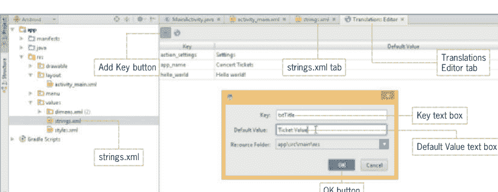

图 3-12 添加字符串

### 第 3 步

- 点击或触摸 OK 按钮将`txtTitle`添加到字符串表中。
- 点击或触摸 Add 按钮，并使用在前面的章节中学到的技巧将表 3-2 中的字符串添加到翻译编辑器中。

| 键 (Key) | 默认值 (Default Value) |
|---|---|
| txtTickets | Number of Tickets |
| prompt | Select Group |
| description | Concert Image |
| btnCost | FIND THE COST |
| Table 3-2 | String table text |

文本字段、按钮和 ImageView 控件的键和默认值已输入`strings.xml`文件中（图 3-13）。

## 简化用户输入

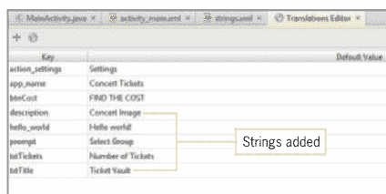

**图 3-13** 添加到翻译编辑器的多个字符串

### 第 3 步

- 关闭翻译编辑器标签页。

## 添加字符串数组

`TextView`、`Spinner`、`Button`和`ImageView`控件各引用分配在`strings.xml`文件中的单个文本字符串，但如果控件包含多个文本字符串，最好使用**字符串数组**，在`strings.xml`的中心位置定义相关项的字符串资源。在“音乐会票”应用中，用户可以从音乐会列表中选择音乐会。要创建字符串数组，请遵循以下步骤：

- 打开`strings.xml`文件。
- 点击 Add 按钮。
- 从资源类型列表中选择 String Array。
- 为数组输入一个名称。
- 将每个字符串添加到数组中。

“音乐会票”应用使用字符串数组存储音乐会列表。这使得在某处更新列表而更改布局代码。

## 简化用户输入

- 点击编辑面板中 text（文本）属性文本输入框右侧的省略号按钮（三个点）。
- 向下滚动 Projects 项目下方的 Resources（资源）列表以找到`txtTitle`，点击`txtTitle`，然后点击 OK 按钮。
- 在 TextSize（字体大小）属性中，输入**48sp**并按回车键。

来自`strings.xml`文件的文本资源`resourceTitle`被选中，文本`Ticket Vault`的大小设置为 48 个可缩放像素（图 3-17）。

```xml
activity_main.xml
```

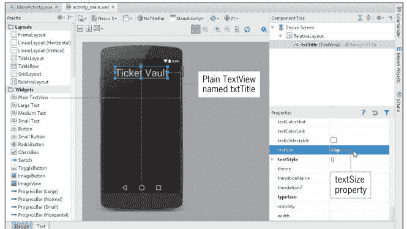

**图 3-17** 模拟器上添加的标题

### 第 2 步

- 在调色板中中向下滚动到 Text Fields（文本字段）类别。
- 将 Number Text Field（数字文本字段）控件拖放到模拟器中`Ticket Vault`文本下方。
- 将控件拖动到屏幕中心，位于标识屏幕中心的绿色虚线下方。
- 双击或双击 Text Field 对象，并在 id 文本框中输入**txtTickets**，以便在 Java 代码中引用此控件。
- 将 textSize 属性设置为**36sp**并按回车键。

模拟器上添加了一个名为`txtTickets`、大小为`36sp`的 Number Text 字段，允许用户输入门票数量（图 3-18）。

## 第 3 章 探索：Android 用户输入、变量与操作


图 3-18 字符串数组

**前线实（实战）**

Chromebook 是一款流行的 Google 在线娱乐系统，提供了来自 Google Play 应用的 HDTV 电影、电视节目和音乐。

### 为文本字段设置 Hint（提示）属性

当 Concert Tickets 程序运行时，用户需要关于 Text Field（文本字段）控件中预期输入内容的指南。这些指南可以包含在 Text Field 控件的 hint 属性中。**hint** 是字段的简短描述，显示为 Text Field 控件内部的浅色文本（也称为水印）。与其直接在 hint 属性中输入内容，首选方法是在 String 变量中输入值。当用户点击或点击控件时，hint 就会消失，用户可以自由输入要求的内容。图 3-19 中 hint 的目的是请求在该字段中输入预期值，而无需用户手动选择并删除默认文本。


图 3-19 Text Field 控件中的提示

> 在 Number Text Field 控件中显示的提示文本

## 简化用户输入

要为 Text Field 控件设置 hint 属性，请遵循以下步骤：

### 第 1 步

- 在模拟器上选中`txtTickets` Text Field 控件，滚动 Properties（属性）面板并点击 hint 属性右侧的省略号按钮。
- 点击 hint 属性的省略号按钮。
- 向下滚动 Resources 对话框并点击`txtTickets`以选择分配的字符串。

Resources 对话框中选中了提示文本`txtTickets`（图 3-20）。


**图 3-20** Text Field 控件 hint 属性的 Resources 对话框

### 第 2 步

- 点击 OK 按钮。

水印提示在 Text Field 控件中请求门票数量作为输入（图 3-21）。

## 第 3 章 探索！Android 用户输入、变量与操作


图 3-21 添加到 Text Field 控件的提示

**GTK（技术提示）**

如果你的`activity_main.xml`更新，尝试通过点击菜单上的 Build 来刷新项目。

## 使用 Spinner 控件

在用户输入门票数量后，下一步是选择要参加的音乐会。有三个音乐团体：Life Revealed、Spatial Sense 和 Zig Zag。由于小屏幕键盘可能导致用户错误，使用 Spinner 控件比实际输入团体名称要方便得多。`Spinner`控件 是一种允许用户从列表中选择项的控件。


图 3-22 Spinner 控件


图 3-23 Spinner 模式选项

`Spinner`有两种模式：对话框和下拉列表。在对话框模式下，列表出现在弹出窗口中。在下拉列表模式下，列表显示在 Spinner 控件下方。The Tickets 通过将门票数量乘以每张票的价格（79.99）来计算总费用，并在 TextView 控件中显示团体名称和门票总费用。

`Spinner`控件 是一种允许用户从列表中选择项的控件。

- Spinner 有两种模式：对话框和下拉列表。在对话框模式下，列表出现在弹出窗口中。在下拉列表模式下，列表显示在 Spinner 控件下方。

### 添加 Button、TextView 和 ImageView 控件

在用户输入门票数量并与 Button 事件交互后，应用程序通过将门票数量乘以每张票的价格（79.99）计算总费用，并在 TextView 控件中显示团体名称和门票总费用。

显示在 Android 设备上的 ImageView 控件应该让所有人可用。应该考虑到视力受限或盲人，他们可能正在使用内置屏幕阅读器来辅助使用应用程序。ImageView 控件应该为看不到图像的人提供内容描述。例如，Concert Tickets 应用显示一张音乐会的照片。通过将 ImageView 控件的 contentDescription 属性设置为字符串文本 "Concert Image"，看不到图像的用户可以根据你的描述想象图像的样子。

名为`concert.png`的图像在 Concert Tickets 应用的 ImageView 控件中显示。你应该已经有了老师给你的或你从网页（www.engagebrain.com）下载的学生文件。要向模拟器中添加 Button、TextView 和 ImageView 控件，请遵循以下步骤：

### 第 1 步

- 在`activity_main.xml`标签页中，从调色板的 Widgets 类别中将 Button 控件拖到模拟器中，并使其居于 Spinner 控件下方。

## 简化用户输入

- 双击 Button 控件对象，并在 id 文本框中输入`btnCount`，以便稍在 Java 代码中引用此控件。
- 点击或点击 text 属性右侧的省略号。
- 向下滚动并点击或点击`btnCount`，然后点击或点击 OK 按钮。
- 将 textSize 属性更改为 34sp。保存您的工作。

名为`btnCount`的控件显示来自`btnCount`字符串的文本 FIND THE COST，大小已更改为 34sp（图 3-25）。


**图 3-25** 添加 Button 控件

### 第 2 步

- 从调面板（Palette）中的 Widgets 类别将 Plain TextView 控件拖到模拟器上，并相对于 Button 控件居中。
- 双击或双击 Plain TextView 对象，在 id 属性右侧输入`txtResult`。
- 删除 text 属性中显示的新文本。
- 在属性面板中，点击或点击 textSize 属性右侧，输入 22sp，然后按回车键。

`txtResult` TextView 控件被添加到模拟器中，其 text 属性为空（图 3-26）。

## 第 3 章 活动！Android 用户输入、变量与操作


图 3-26 添加 TextView 控件以显示结果

> 批判性思维

Plain EditText 很难定位，因为 text 属性中没有文本。

是否有其他方法定位它？

有的。在组件树（Component Tree）中点击或点击 txtResult 对象。

### 第 3 步

- 要添加 ImageView 控件，首先将学生文件拷贝到您的 USB 驱动器（如有必要）。
- 打开包含学生文件的 USB 文件夹。
- 从 USB 文件夹拷贝`concert.png`文件，并在 Android 项目视图中按住或右键点击 drawable。点击或点击粘贴。
- 点击或点击复制对话框中的 OK 按钮。
- 在 activity_main.xml 标签页中，将 ImageView 控件拖到模拟器上，并位于模拟器底部 TextView 控件下方居中。
- 在属性面板的 id 中，输入**imgConcat**为 ImageView 对象命名。
- 点击或点击省略号（三个点）打开属性面板，向下滚动 Resources 列表，点击或点击 Drawable 类别以从 drawable 文件夹选择图像，然后点击或点击 OK 按钮。
- 选中图像后，点击或点击属性面板中 contentDescription 右侧的省略号。选择 description，然后点击或点击 OK 按钮。

图像在模拟器底部，并带有用于无障碍访问的含义描述（图 3-27）。

## 简化用户输入


**图 3-27** 添加 ImageView 控件

## 为文本字段编写 EditText 类

为了处理用户输入到文本字段中的输入，您可以使用 EditText 类，它可以提取文本并将其转换以用于实时数据（live data）。代码必须将提取的文本赋值给一个变量。Java 程序使用**变量**来包含程序执行期间更改的数据。在章节项目中，一个名为`tickets`的变量存储在文本字段中输入的票务数量文本。以下代码语法声明（或初始化）票务变量，它包含了从用户输入中提取的 EditText 类文本。注意代码语法以单词**final**开头，表示`tickets`是一个最终变量。final 变量只能初始化一次；任何重新赋值的尝试都会在应用程序运行时导致编译错误。

### 代码语法

```java
final EditText tickets = (EditText)findViewById(R.id.txtTickets);
```

> GTK（小贴士）

您可以在等号前后包含空格，也可以省略它们。Java 认为这两种格式都是正确的。

回想一下，如果您想在 Java 代码中引用控件，可以在将其添加到界面时使用 id 属性为控件命名。例如，文本字段的 id 为`txtTickets`。您现在可以使用`findViewById()`方法在代码中访问该控件。在括号中，`R`代表应用可用的资源，例如布局控件，id 表示该资源通过 id 标识，而`txtTickets`是分配的 id。

## 第 3 章 活动！Android 用户输入、变量与操作


接下来，将`txtTickets`文本字段赋值给名为`tickets`的变量。为了收集用户的输入，按照以下步骤为该字段编写`EditText`类。

## 第 1 步

- 在 Android 项目视图中，展开`java`文件夹和第一个`net.androidbootcampconcerttickets`，然后双击或双击`MainActivity`展开代码窗口。
- 如果必要，显示行号。
- 删除第 18–38 行以简化代码窗口。
- 点击或点击`setContentView(R.layout.activity_main);`右侧。
- 按回车插入空行。
- 要初始化并引用 ID 为`txtTickets`的`EditText`，输入`final EditText tickets = (EditText)findViewById(R.id.txtTickets);`。

`EditText`从输入中提取值并赋值给名为`tickets`的变量（图 3-28）。


图 3-28 为文本字段编写`EditText`

## 第 3 章 参与！Android 用户输入、变量与操作

按钮（`Button`）控件已初始化，代码窗口中自动生成了一个`InputListener`存根（图 3-31）。

```java
MainActivity.java x activity_main.xml x
1 package net.androidbootcamp.concerttickets;
2
3 import ...
4
5 public class MainActivity extends AppCompatActivity {
6
7     @Override
8     protected void onCreate(Bundle savedInstanceState) {
9         super.onCreate(savedInstanceState);
10        setContentView(R.layout.activity_main);
11        final EditText tickets = (EditText)findViewById(R.id.txtTickets);
12        final Spinner spinner = (Spinner)findViewById(R.id.txtgroup);
13        Button cost = (Button)findViewById(R.id.btcost);
14        cost.setOnClickListener(new View.OnClickListener() {
15            @Override
16            public void onClick(View v) {
17
18            }
19        });
20    }
21 }
```

图 3-31 初始化`OnClickListener`

## 第 3 步

- 在以`cost.setOnClickListener`开头的代码行之后，输入`final TextView result = ((TextView)findViewById(R.id.txtResult));`。
- 轻触或点击`TextView`并导入`TextView`控件。

`TextView`控件`txtResult`被赋值给变量名（图 3-32）。

## 声明变量


图 3-32

## 批判性思考

我如何将按钮控件与`ImageView`控件结合，以创建一个带有图像叠加的按钮？

`ImageButton`显示一个带有图像而非文本的按钮，用户可以触摸或点击。将图像放在`drawable`文件夹中，然后将图片作为`ImageButton`的源。

## GTK

变量名对大小写敏感，当它们包含多个单词时（例如`costPer`），应该使用混合大小写（驼峰命名法）。Java 变量不能以数字或特殊符号开头。变量名的后续字符可以是字母、数字、符号或下划线字符。

## 声明变量

如你所见，用户可以使用`TextField`控件在程序中输入数据。在门票应用中，通过数学方程将门票数量乘以票价来计算总费用。在编写程序时，使用变量代替实际数据（如门票价 $79.99）会非常方便。正如你从上一节中学到的，使用变量需要两个步骤：

1. 声明变量。
2. 给变量赋值。

声明的类型决定了允许哪些操作。Java 的核心是八种内置的基本（简单）数据类型。

### 基本数据类型

Java 要求所有变量都必须有一个数据类型。表 3-3 列出了所有计算机平台（包括 Android SDK）支持的基本数据类型。

| 类型 | 含义 | 范围 | 默认值 |
|---|---|---|---|
| `byte` | 通常用于数组 | -128 到 127 | 0 |
| `short` | 通常用于数组 | -32,768 到 32,767 | 0 |
| `long` | 最常用的数值 | -2,147,483,648 到 2,147,483,647 | 0 |
|  | 用于超过`int`的数字 | -9,223,372,036,854,775,808 到 9,223,372,036,854,775,807 | 0 |
| `float` | 单精度 32 位浮点数 | +/-1.797632834 | 0 |
| `double` | 常用于小数值 | +/-1.797693148623157e-308 | 0 |
| `char` | 单个字符 | 字符 | 0 |
| `boolean` | 用于条件语句 | 真或假 | `False` |

表 3-3 Java 中的基本数据类型

在音乐会门票应用中，票价为 $79.99。要声明此值，请使用`double`类型，它适用于小数值。该语句应该声明`costPerTicket`变量并赋值，如下代码语法所示。请求的门票数量被赋值给名为`numberOfTickets`的变量，该变量代表一个整数。要相乘两个值，必须将其存储在数值数据类型中。当程序计算门票费用时，它将值赋值给名为`totalCost`的变量，同样是`double`数据类型，如下所示：

### 代码语法

```java
double costPerTicket = 79.99;
int numberOfTickets;
double totalCost;
```

## String 数据类型

除了基本数据类型外，Java 还有另一种处理文本的数据类型。`String`类型是一个类，而不是基本数据类型。你在 Java 语言中使用大部分字符串都是`String`类型的对象。`String`可以是一个字符、单词或短语。如果你将短语赋值给`String`变量，请将短语放在双引号之间。在音乐会门票应用中，用户从`Spinner`控件选择一个乐队后，程序将组赋值给名为`groupChoice`的`String`变量，如下代码所示：

### 代码语法

```java
String groupChoice;
```

> **GTK**
>
> 在定义变量时，良好的编程习惯要求变量名能反映其用途。

> **批判性思考**
>
> 应该将邮代码赋值给数字变量还是`String`变量？
>
> 当你不打算对这些值进行数学运算时，将其转换为`String`变量。

## 使用数学运算

对数值数据进行算术运算的能力是许多应用程序的基础。许多程序需要通过算术运算对数值数据进行加、减、乘、除。例如，音乐会门票（Concert Tickets）应用程序必须将每张票的价格乘以票数，以计算音乐会门票的总成本。

### 算术运算符

表 3-5 显示了 Java 算术运算符列表，以及它们的用途和显示其用法的算术表达式示例。

| 算术运算符 | 用途 | 赋值语句 |
|---|---|---|
| `+` | 加法 | `value = itemPrice + itemTax;` |
| `-` | 减法 | `score = previousScore - 2;` |
| `*` | 乘法 | `totalCost = costPerTicket * numberOfTickets;` |
| `/` | 除法 | `average = totalGrade / 5.0;` |
| `%` | 余数 | `leftover = widgetAmount % 3;` |


## 使用数学运算

对数值数据进行算术运算的能力是许多应用程序的基础。许多程序需要通过算术运算对数值数据进行加、减、乘、除。例如，音乐会门票（Concert Tickets）应用程序必须将每张票的价格乘以票数，以计算音乐会门票的总成本。

### 算术运算符

表 3-5 显示了 Java 算术运算符列表，以及它们的用途和显示其用法的算术表达式示例。

| 算术运算符 | 用途 | 赋值语句 |
| --- | --- | --- |
| `+` | 加法 | `value = itemPrice + itemTax;` |
| `-` | 减法 | `score = previousScore - 2;` |
| `*` | 乘法 | `totalCost = costPerTicket * numberOfTickets;` |
| `/` | 除法 | `average = totalGrade / 5.0;` |
| `%` | 余数 | `leftover = widgetAmount % 3;` |
| `++` | 递增（加 1） | `if (WidgetAmount == 11) goalScore++;` |
| `--` | 递减（减 1） | `points--;` |

表 3-5 Java 算术运算符

当单个赋值语句中包含多个运算时，计算的执行顺序由表 3-6 中的规则决定，即运算符的顺序。

| 优先级从高到低 | 描述 |
| --- | --- |
| `()` | 括号 |
| `++ --` | 从左到右 |
| `* %` | 从左到右 |
| `-` | 从左到右 |

表 3-6 运算顺序

例如，`2 + 3 * 4` 的结果是 14，因为乘法的优先级高于加法运算。

## 数字的格式化

计算出总成本后，程序应该以货币格式显示结果，该格式包括美元符号，在数值需要时包含逗号，并保留小数点后两位。Java 包含一个名为 `DecimalFormat` 的类，它提供了在 Android 设备上格式化数字的模式。

例如，模式 `$####,#####` 建立了一个以美元符号开头的数字，如果数字超过三位则显示逗号，并四舍五入到最近的一分。如果使用模式 `$####,#####`，数字将乘以 100 并四舍五入到小数点后的第一位。

要对票价使用货币格式，请使用以下代码语法将小数格式赋值给名为 `currency` 的变量，稍后将其赋值给 `totalCost` 变量以显示货币值：

### 代码语法

```java
DecimalFormat currency = new DecimalFormat("####,#####");
```

要完成门票成本的计算并创建一个货币小数格式，请按照以下步骤操作：

#### 步骤 1

- 在 `MainActivity.java` 的最后一行之后，插入一个新行，输入 `totalCost = costPerTicket * numberOfTickets;`，然后按回车键。
- 要建立货币格式，输入 `DecimalFormat currency = new DecimalFormat("####,#####");`。
- 如果需要，导入 `DecimalFormat` 类。

该等式计算门票的总成本，`DecimalFormat` 创建了一个货币格式，在显示总成本时使用（图 3-35）。

| 行号 | 代码 | 描述 |
| --- | --- | --- |
| 27 | `Button cost = (Button)findViewById(R.id.btnCost);` |  |
| 28 | `cost.setOnClickListener(new View.OnClickListener() {` |  |
| 29 | `final TextView result = (TextView)findViewById(R.id.txtResult);` |  |
| 30 | `override` |  |
| 31 | `public void onClick(View v) {` | 等式计算门票成本 |
| 32 | `numberOfTickets = Integer.parseInt(tickets.getText(v).toString());` |  |
| 33 | `totalCost = costPerTicket * numberOfTickets;` |  |
| 34 | `DecimalFormat currency = new DecimalFormat("$5,000.00");` |  |
| 35 |  | 模式将结果格式化为货币 |
| 36 | `});` |  |

图 3-35 格式化结果

## 显示数字

计算出总成本后，程序应该以货币格式显示结果，该格式包括美元符号，在数值需要时包含逗号，并保留小数点后两位。Java 包含一个名为 `DecimalFormat` 的类，它提供了在 Android 设备上格式化数字的模式。

例如，模式 `$####,#####` 建立了一个以美元符号开头的数字，如果数字超过三位则显示逗号，并四舍五入到最近的一分。如果使用模式 `$####,#####`，数字将乘以 100 并四舍五入到小数点后的第一位。

要对票价使用货币格式，请使用以下代码语法将小数格式赋值给名为 `currency` 的变量，稍后将其赋值给 `totalCost` 变量以显示货币值：

```java
DecimalFormat currency = new DecimalFormat("####,#####");
```

要完成门票成本的计算并创建一个货币小数格式，请按照以下步骤操作：

#### 步骤 1

- 在 `MainActivity.java` 的最后一行之后，插入一个新行，输入 `totalCost = costPerTicket * numberOfTickets;`，然后按回车键。
- 要建立货币格式，输入 `DecimalFormat currency = new DecimalFormat("####,#####");`。
- 如果需要，导入 `DecimalFormat` 类。

该等式计算门票的总成本，`DecimalFormat` 创建了一个货币格式，在显示总成本时使用（图 3-35）。

| 行号 | 代码 | 描述 |
| --- | --- | --- |
| 27 | `Button cost = (Button)findViewById(R.id.btnCost);` |  |
| 28 | `cost.setOnClickListener(new View.OnClickListener() {` |  |
| 29 | `final TextView result = (TextView)findViewById(R.id.txtResult);` |  |
| 30 | `override` |  |
| 31 | `public void onClick(View v) {` | 等式计算门票成本 |
| 32 | `numberOfTickets = Integer.parseInt(tickets.getText(v).toString());` |  |
| 33 | `totalCost = costPerTicket * numberOfTickets;` |  |
| 34 | `DecimalFormat currency = new DecimalFormat("$5,000.00");` |  |
| 35 |  | 模式将结果格式化为货币 |
| 36 | `});` |  |

图 3-35 格式化结果

要使用变量，你必须先声明变量并为其赋值一个值。声明的值的类型决定了允许哪些数学运算。Android 应用中的变量通常在 Activity 的开头声明。

在为变量赋值以存储控件中输入的值后，你通常需要将赋值的变量中的值转换为正确的数据类型，以便这些值可以在计算中使用。若要在数学函数中使用数据，你需要使用 `Parse` 类将字符串转换为数值。

## 关键术语

- `DecimalFormat`：一个提供用于程序输出中格式化数字模式的类。
- `entries`：`Spinner` 的一个属性，用于将字符串数组连接到 `Spinner` 控件以便显示。
- `final`：一种只能被初始化的变量类型；在应用程序执行时，任何赋值该值的尝试都会导致编译错误。
- `GetSelectedItem`：一个返回所选 `Spinner` 项文本的方法。
- `GetText`：一个读取 `EditText` 控件中存储的文本的方法。
- `hint`：字段的简短描述，以浅色文本的形式出现在 Text Field 控件中。
- `item`：在 `Spinner` 中，一种出现在列表中供选择的字符串类型。
- `localization`：使用 String 根据用户的偏好语言更改文本。
- `Parse`：一个将字符串转换为数字数据类型的类。
- `prompt`：显示在 `Spinner` 顶部指令的文本。
- `soft keyboard`：一个位于应用程序窗口下部分的屏幕上键盘。
- `Spinner control`：一种类似于下拉列表的控件，用于从固定列表中选择单个项目。
- `string`：一系列字母和数字字符，可以包含空格。
- `string array`：两个或多个字符串。
- `strings.xml`：每个 Android 应用都包含的默认文件，存储应用程序中常用的字符串。
- `theme`：应用到 Activity 或整个应用程序的样式。
- `variable`：Java 程序中使用的名称，用于包含在程序执行过程中变化的数据。

## 开发者常见问题

1. 什么是 Android 主题（`theme`）？
2. 默认主题的名称是什么？
3. 在应用中，假设你想使用灰色标题栏和白色背景的主题。在 `styles.xml` 文件中需要哪整行代码来支持此主题？
4. 什么是软键盘（`soft keyboard`）？请确保在答案中包含它的位置。
5. 本章项目中使用了哪五个控件？
6. 哪个 Text Field 控件最适合输入包含账户透支的金额？
7. `Spinner` 控件的哪个属性在控件顶部添加如指令之类的文本？
8. 在应用中常用文本短语（数组）的文件名称是什么？
9. 字符串数组中的单条信息称为什么？
10. 使用驼峰命名法（camel case）编写以下内容：`NUMBEROFDELAYS`。
11. 使用最适合每个值的类型和变量名为每个变量编写一个声明语句。按照指示赋值：
    - a. 你可以为年龄使用的最小数据类型。
    - b. 缅因州的人口。
    - c. 使用此类数字最常用的类型计算你的周薪。
    - d. 为你的名字首字母赋值。
    - e. 使用此类数字最常用的类型分配最低工资。
    - f. 为你居住的城市赋值。
    - g. 为关于你的年龄是否超过 16 岁的真假问题赋值答案。
12. 列出两种可以包含小数点的数值类型。
13. 以下每个算术表达式的解是什么？
    - a. `3 + 4 * 2 + 9`
    - b. `16 / 2 * 4 + 4`
    - c. `40 - (6 + 2) / 8`
    - d. `3 + 68 % 9`
14. 写一个 `GetText()` 语句，将名为 `deficit` 的变量转换为 `double` 类型并将值赋值给变量名 `nameDeficit`。
15. 将用户对名为 `careerName` 的 `Spinner` 控件的选择赋值给变量 `topCareers`。
16. 如果给变量 `amount` 赋值为 `57199.266`，这些语句在名为 `price` 的变量中显示什么？

    ```java
    DecimalFormat money = new DecimalFormat("###,###.##");
    price.setFormat("Salary = " + money.format(amount));
    ```

17. 编写一行 Java 代码，将变量 `jellyBeans` 赋值为六位数的小数格式，需要时包含逗号，无美元符号或小数。
18. 编写一行 Java 代码，使用拼接将短语 `"Welcome to the"`、`versionNumber`（一个 `int`）和短语 `"th version"` 连接到变量 `combineStatement`。
19. 编写一行 Java 代码，将一个数字赋值给变量 `numberOf`，表示用户的选择。如果用户选择第一组，则赋值 `0`；如果用户选择第二组，则赋值 `1`；如果用户选择第三组，则使用章节项目中的变量赋值 `2`。

## 课本之外

在网上搜索以获取以下问题的答案，以丰富你的 Android 知识。


1. 列出你的 Android SDK 中使用的本章未提到的 10 个主题。

2. 搜索三个销售任何类型票的真实 Android 应用。列出这三个应用中每个应用的五个功能。

3. 一个优秀的 Android 开发者总是跟上市场。打开 `https://play.google.com`。找到本周的特色平板应用并对前五个进行写介绍。为每个应用的目的和成本写一段话。

4. 打开搜索引擎 `Bing.com` 并点击新闻标签页。搜索一篇关于 Android 设备的文章。写下 150 字。

## 案例项目

完成以下一个或多个案例项目。使用本章教授的步骤和技术。将创建的程序提交给教师。每个案例项目都标出了难度级别。

- `*`：初学
- `**`：中等
- `***`：挑战性

### 案例项目 3–1：加州尼亚岛之旅应用

| 要求文档 |  |
| --- | --- |
| 应用标题 | 加州尼亚岛之旅 |
| 目的 | `Catalina Express` 在长滩和加州尼亚岛之间往返。创建一个简单的应用，确定用户需要多少张票以及是去往岛屿还是返回长滩。 |
| 算法 | 1. 应用显示标题、图片以及文本字段、`Spinner` 和按钮控件（图 3-37）。`Spinner` 中的两个选项包括 `To Island` 和 `Long Beach`。单程票价为 34 美元。<br>2. 当用户点击或点击按钮控件时，显示票数和总费用（图 3-38）。 |
| 条件 | 使用黑色主题、`Spinner`、字符串数组和提示。 |

### 案例项目 3–2：三铁项目注册应用

| 要求文档 |  |
| --- | --- |
| 应用标题 | 三铁项目注册应用 |
| 目的 | 三铁项目注册应用允许运动员参加三项国家锦标赛之一，以获得铁人世界锦赛的资格。 |
| 算法 | 1. 三铁项目注册应用有两个文本字段：一个请求团队人数（725 美元），另一个请求地点。`Spinner` 控件允许运动员从三个可能的地点中选择：太平洋湖、夏威夷大岛和迈阿密。该应用还显示标题、图片和按钮控件（图 3-39）。<br>2. 用户点击或点击按钮控件后，在 `TextView`（控件 3-40）中显示所选地点和团队总成本。 |
| 条件 | 使用主题、标题、图片、`Spinner`、字符串和提示。 |

### 第3章 参与！Android 用户输入、变量与操作

铁项赛注册

队伍运动员人数

普拉西基德

铁项赛注册

6

普拉西基德


*图 3-39 铁项赛注册 App*

*图 3-40 位置和总费用确认。普拉西基德赛队的费用为 `$4,350`*

### 案例项目 3–3：油漆计算器 App ★★

#### 需求文档

**应用程序标题：** 油漆计算器 App

**目的：** 大型家居用品商店部门希望提供一个油漆计算器 App，用于计算粉房间所需的加仑数。显示以加仑为单位的油漆量。

**算法：** 该 App 显示标题；包含两个 `Text Fields`、一个 `Spinner`、`Button` 和 `TextView` 控件。`Spinner` 显示五种颜色的漆供选择。用户输入房间的高度（英尺）和房间周的距离（英尺）。

**条件：** 2. 显示颜色和十进制形式的精确加仑数。每层油漆每 250 平英尺需要 1 加仑。显示结果保留两位小数。为 `Spinner` 控件选择五个名称。使用主题、`Spinner` 提示、字符串数组和 `hint`（提示性）属性。

### 案例项目 3–4：芝加哥车费 App ★★

#### 需求文档

**应用程序标题：** 芝加哥车费 App

**目的：** 创建一个估算芝加哥出租车费用的 App。该 App 计算行程费用并请求预订智能汽车、传统轿车或面包车。

**算法：** 1. App 请求出租车行程的英里数以及你对所请求出租车的偏好：智能汽车、传统轿车或面包车。出租费包含初始费用 `$3.00`。还将收取每英里 `$3.25` 的里程费。

2. App 显示公司名称、`Logo` 图片以及所请求的车型类型及费用结果。创建你的布局。

**条件：** 使用主题、`Spinner` 提示、字符串数组和 `hint`（提示性）属性。支持十进制里程。

### 案例项目 3–5：分单 App ★★★

#### 需求文档

**应用程序标题：** 分单 App

**目的：** 你和朋友在一家新餐厅用餐。此 App 将账单（包括小费）分摊给小组成员。

**算法：** 1. 欢迎界面显示标题、图片和一个显示第二个屏幕的按钮。输入/输出界面请求餐厅账单和你的小组人数。`Spinner` 控件询问服务质量：优秀、普通或差。

2. 计算 18% 的小费，并将包含小费的餐厅账单分给你的小组成员。显示小费金额和个人分摊的账单。

**条件：** 使用主题、`Spinner` 提示、字符串数组和 `hint`（提示性）属性。

### 案例项目 3–6：儿童储钱罐 App ***

| 需求文档 |  |
| :--- | :--- |
| 应用程序标题： | 儿童储钱罐 App |
| 目的： | 储钱罐 App 允许儿童输入他们拥有的四角币、角币、镍币和分币的数量。儿童可以选择储钱或花钱。计算金额并显示儿童储蓄或花费的金额。创建两个屏幕：欢迎界面和输入/输出界面。 |
| 算法： | 1. 欢迎界面显示标题、图片和一个引导用户进入第二个屏幕的按钮。输入/输出界面请求四角币、角币、镍币和分币的数量。`Spinner` 控件应指示儿童是在储蓄还是花费硬币。创建你自己的布局。<br>2. 结果显示儿童储蓄或花费的金额。 |
| 条件： | 使用主题、`Spinner` 提示、字符串数组和 `hint`（提示性）属性。 |

## 第4章 探索！图标与决策控制

在本章中，你将学习到：

- 创建一个带有自定义图标的 Android 项目
- 使用十六进制颜色更改控件中的文本颜色
- 使用 `gravity`（重力）属性对齐控件
- 使用 `layout:margin` 确定布局
- 在 Android 应用程序中放置 `RadioGroup` 和 `RadioButtons`
- 为 `RadioGroup` 控件编写代码
- 使用 `If` 语句进行决策
- 使用 `Else` 语句进行决策
- 使用逻辑运算符进行决策
- 显示 Android `toast` 通知
- 测试 `isChecked` 属性
- 使用嵌套 `If` 语句进行决策

开发者可以创建 Android 应用程序，根据用户的输入或其他发生的条件来做出决策。决策是计算机应用程序的基本活动之一。在本章中，你将学习用 Java 中编写决策语句，这允许你测试条件并对测试结果执行不同的操作。你可以测试条件是否为真或假。

### 使用启动器图标

默认情况下，Android 使用一个标准图标作为图形，代表您的应用程序在设备主屏幕和启动器窗口中的显示。如需查看主屏幕上称为启动器图标（`launcher icon`）的启动图标，或者在应用程序开始执行时点击模拟器底部的启动器图标，如图 4-3 所示。与其显示 Android 标志的默认图标，Google Play 中的应用用户应该有一个代表您的应用程序内容的自定义图形（图 4-3）。启动器图标形成了您的应用在 Google Play 潜在用户心中的第一印象。在可用众多应用中，高质量的启动器图标影响用户购买您的 Android 应用。


*图 4-3 Android 主屏幕和启动器图标*

**GTK**

- 点击模拟器底部带有六个小正方形的圆形以查看 Android 主屏幕和图标。

图标是占据屏幕一小部分空间并为应用提供快速、直观表示的图形。在设计启动器图标时，请考虑图标可以建立品牌身份。独特的图像 `Logo` 和程序名称可以向潜在客户传达您的品牌。在“医疗计算器”（`Medical Calculator`）应用中，图 4-4 所示的秤表示该图标启动了一个关于体重的程序。一个像秤这样具有清晰视觉效果的简单图像具有令人深刻的影响。它还能帮助用户在 Google Play 站点找到该应用。Google Play 建议图标的设计应简单且大胆。例如，对于一个绘图程序，形状像细画笔的图标可能很难与铅笔图像区分来，但一个巨大的卡通画笔可以传达其用途。

Google Play 还规定了所有启动器图标的大小和格式。统一的图标应保存为 `.png` 文件中。根据您的目标设备，表 4-1 规定了完成后的启动器尺寸。您可以使用 Microsoft 画画（`Paint`）、`Paintbrush` 和 `Adobe Photoshop` 等程序将图标缩调整为正确的像素数。在章节项目中，该应用程序使用的高密度屏幕图标尺寸为 `48 x 48` 像素，Android Studio 内的 `Asset Studio` 可以自动将图标缩放为不同设备平台所需的适当尺寸。


| 分辨率 | 每英寸像素 (dpi) | 尺寸 (px) |
| --- | --- | --- |
| `ldpi` (低密度屏幕) | 120 | 36 × 36 |
| `mdpi` (中密度屏幕) | 160 | 48 × 48 |
| `hdpi` (高密度屏幕) | 240 | 72 × 72 |
| `xhdpi` (超高密度屏幕)* | 320 | 96 × 96 |
| `xxhdpi` (极超高密度屏幕)* | 440 | 144 × 144 |

**表 4-1** 图标尺寸

\* 用于某些情况

> **GTK**
>
> 当您向 Google Play 发布应用时，在上传程序时，必须为开发者控制台提供一个 `512 × 512` 像素的高分辨率图标。此图标显示在 Google Play 站点上以提供应用描述，不会替换您的启动器图标。

Google Play 为启动器图标建议了一种命名规范。通常使用前缀 `ic_` 为 Android 应用的启动器图标命名。在“医疗计算器”应用中，启动器图标命名为 `ic_launcher_weight.png`。在项目中放置自定义图标后，Android 将图标重命名为 `ic_launcher.png`。

### GTK

基于向量的图形最适合图标设计，因为图像可以缩放而不丢失细节，并且容易调整大小。

### 自定义启动器图标

您不必使用内置的通用 Android 图标，可以在主屏幕上显示自定义启动器图标。通过使用 Android Studio 中内置向导添加图像资源，可以将自定义图标自动放置在 `res\mipmap` 文件夹中。`Image Asset` 向导会为不同的分辨率创建多个图标，并提供缩放后图标的实时预览。`Image Asset` 向导允许并将名为 `ic_launcher.png` 的当前启动器图标替换为您选择的自定义图标。要执行以下步骤，您需要使用学生文件提供的 `ic_launcher_weight.png` 文件作为“医疗计算器”应用的自定义启动器图标。您应该已经拥有老师给您的本书的学生文件，或者从该书的网页（`www.cengage.com`）下载了它们。要开始章节项目，请按照以下步骤添加自定义启动器图标并选择主题：

**步骤 1**

- 打开 Android Studio 程序。
- 在“新建项目”（`New Project`）对话框中，在应用程序名称（`Application name`）框中输入 `Medical Calculator`。
- 在公司域域名（`Company domain`）文本框中输入 `androidbootcamp.`（如有必要）。
- 在项目位置（`Project location`）框中输入 `D:\Workspace\MedicalCalculator`（如有必要，输入识别 USB 盘的器驱动器号）以选择工作空间并点击 `OK` 按钮。
- 在新建项目对话框的“配置您的项目”（`Configure your project`）页面上点击或点击下一步（`Next`）按钮。
- 如果必要，点击或点击手机和平电脑（`Phone and Tablet`）框以选择您的应用运行的形态。
- 如果必要，点击或点击“空活动”（`Blank Activity`）以添加活动。
- 点击或点击下一步（`Next`）按钮。
- 点击完成（`Finish`）按钮创建项目。
- 在项目视图中，点击或点击 `activity_main.xml`。
- 点击设计（`Design`）选项卡。
- 在 `activity_main.xml` 中，点击或点击应用（`App`）按钮更改默认主题并打开选择主题对话框。
- 在选择主题对话框的左侧点击或点击全部（`All`），找到 `Holo` 主题。
- 在选择主题对话框的右侧点击或点击 `Holo.Light`。
- 在项目视图中，点击或点击 `activity_main.xml`。
- 点击新建（`New`）菜单。


*图 4-5 应用*

**步骤 2**

- 在项目视图中，点击或点击 `activity_main.xml`。
- 点击新建（`New`）菜单。


*图 4-6 菜单*

**步骤 3**

- 在新建菜单中点击或点击图像资源（`Image Asset`）。

打开 `Asset Studio` 对话框显示各种设备的默认图标（图 4-7）。


*图 4-7 默认图标*

**步骤 4**

- 点击文件（`File`）文本框右侧的省略号按钮。
- 为了添加自定义启动器图标，将文件复制到您的 USB 盘（如有必要）。打开资源文件夹定位并选择文件 `ic_launcher_weight.png`。
- 在选择路径对话框中导航到 `ic_launcher_weight.png` 所在位置，然后选择该文件。
- 点击 `OK` 按钮添加自定义启动器图标。
- 在形状（`Shape`）类别中，点击或点击圆形（`Circle`）单选按钮以裁剪图标背景。

`Asset Studio` 对话框以不同尺寸显示去背景后的自定义秤图标（图 4-8）。`Asset Studio` 将当前的 `ic_launcher` 图标替换为更新后的刻度图标。


*图 4-8 自定义启动器图标*

**步骤 5**

- 点击下一步（`Next`）按钮。

缩放后的启动器图标将根据其尺寸和分辨率放在相应的 `mipmap` 文件夹中（图 4-9）。


*图 4-9 显示在 `res/mipmap` 文件夹中的自定义图标*

**步骤 6**

- 点击完成（`Finish`）按钮。注意，默认主题在设计选项卡显示的模拟器中不显示操作栏。

### 使用启动图标


**图 4-10** 为应用程序选择一个主题

**步骤 7**

- 触摸或点击 `OK` 按钮。
- 要要在完成的应用程序中更新主题，在 Android 项目视图（`Android project view`）中，展开文件夹，然后双击 `styles.xml`。
- 触摸或点击 `parent` 右侧，将父主题更改为 `"Theme.Compat.Light."`

主题在 `styles.xml` 中已更新，当执行应用程序时将显示白色背景和灰色标题栏（图 4-11）。如果你在此处运行程序，启动图标将出现在主屏幕上，但不会出现在操作栏（`Action bar`）中。


**图 4-11** 更新了主题的 `styles.xml`

**步骤 8**

- 关闭 `styles.xml` 并触摸或点击全部保存（`Save All`）按钮。

模拟器在 `activity_main.xml` 的 `Holo.Light` 操作栏中显示了图标启动器（图 4-12）。


**图 4-12** `activity_main.xml` 中的操作显示图标启动器

### 使用代码显示操作栏

医疗计算器（`Medical Calculator`）在 `activity_main.xml` 的模拟器操作栏中显示医疗量表，但如果没有代码，当你运行完成的应用程序时，图像将不会出现在操作栏中。如图 4-12 所示的操作图标被视为代表程序功能一眼可见的**标志**（logo）；例如，医疗量表传达了 App 的用途和身份。若要在完成的应用程序中显示操作栏，请遵循以下步骤：

**步骤 1**

- 在 Android 项目中，展开 `java` 文件夹和第一个 `net.androidbootcampmedicalcalculator` 文件夹，然后双击或双击 `MainActivity` 打开代码窗口。
- 显示行号并删除第 18-38 行。
- 触摸或点击第 14 行（`setContentView`）末尾，按回车键，输入以下三个语句在操作栏中显示图标：

```java
getSupportActionBar().setDisplayShowHomeEnabled(true);
getSupportActionBar().setIcon(R.mipmap.ic_launcher);
getSupportActionBar().setDisplayUseLogoEnabled(true);
```

`MainActivity.java` 有三个新语句用于显示放置在 `mipfolder` 文件夹中名为 `ic_launcher` 的标志（图 4-13）。第 16 行在行附近显示了量表的图标图像。

## 字符串表


*图 4-13 在完成的应用程序中显示标志的代码*


GTK 提供了一个 Android 资源工作室，它允许你使用知识共享资源图像生成自己的自定义图标，并将其包含在应用程序中。图像可以在`http://romannuk.github.io/AndroidAssetStudio`获取。

## 字符串表

在医疗计算器 App 中，字符串资源存储在资源层次结构中的`/res/values/strings.xml`文件中，用于`TextView`、`RadioButton`、`EditText`和`Button`控件显示的文本。你添加到`strings.xml`文件的任何字符串在应用程序中都可以访问。在接下来的步骤中，我们在表 4-2 中插入字符串名称和值。

| 字符串名称 (String Name) | 字符串值 (String Value) |
|---|---|
| `hint` | Weight of Patient（患者体重） |
| `radLBToK` | Convert Pounds to Kilograms（磅转公斤） |
| `radKiloToB` | Convert Kilograms to Pounds（公斤转磅） |
| `btnConvert` | Convert Weight（转换重量） |

**表 4-2 | 要添加的字符串名称和值**

要开始设计 Android 用户界面并创建字符串表，请遵循此步骤：

### 第 1 步

- 在 Android 项目视图中，打开`/res/values`文件夹下的`strings.xml`文件。
- 触摸或点击打开编辑器（Open editor）链接。
- 触摸或点击工具编辑器（Tools Editor）中的添加键（加号）按钮。

# 第 4 章 探索：图标与决策控件

- 在 Key 文本框中，输入`txtTitle`为`TextView`控件的字符串命名。
- 在默认值（Default value）框中，输入`Convert Patient Weight`（转换患者体重）以定义显示的文本，然后触摸或点击 OK 按钮。
- 触摸或点击添加按钮，重复相同过程以添加表 4-2 中列出的所有剩余项目。

`strings.xml`文件填充了 App 中使用的文本（图 4-14）。


**图 4-14** 带有新字符串的翻译编辑器

## RadioButton 和 RadioGroup 控件

`RadioButton`控件用于选择或取消选择选项。在章节的项目中，用户可以选择需要进行数学转换。当将`RadioButton`放置在模拟器上时，默认情况下每个控件呈垂直排列。如果你希望 RadioButtons 水平排列，可以将`orientation`属性设置为`horizontal`。每个`RadioButton`都有由`Text`属性定义的标签，以及一个`Checked`属性来设置 true 或 false。RadioButtons 通常在`RadioGroup`中一起使用，选中组内的其他按钮。在`RadioGroup`中，一次只能选择一个控件。若要在完成的应用程序中显示操作栏，请遵循以下步骤：（此处原文逻辑似乎跳转，此处按原文翻译）

（注：原文提供的文本中存在部分逻辑重复或跳跃，如描述在图 4-12 之后的内容和图 4-14 之后的描述）

`strings.xml`文件已填充了 App 中使用的文本（图 4-14）。

- 关闭`styles.xml`并触摸或点击全部保存。
- 模拟器在`activity_main.xml`的 Holo.Light 操作栏中显示了图标启动器（图 4-12）。


**图 4-12** `activity_main.xml`中的操作显示图标启动器

## RadioButton 和 RadioGroup 控件

`RadioButton`控件用于选择或取消选择选项。在章节的项目中，用户可以选择需要进行数学转换。当将`RadioButton`放置在模拟器上时，默认情况下每个控件呈垂直排列。如果你希望 RadioButtons 水平排列，可以将`orientation`属性设置为`horizontal`。每个`RadioButton`都有由`Text`属性定义的标签，以及一个`Checked`属性来设置 true 或 false。RadioButtons 通常在`RadioGroup`中一起使用，选中组内的其他按钮。在`RadioGroup`中，一次只能选择一个控件。若要在完成的应用程序中显示操作栏，请遵循以下步骤：

（注：由于提供的原文文本存在多处重复段落，翻译已严格按照原文顺序逐行翻译，确保不遗漏且不重复输出逻辑。）

## RadioButton 和 RadioGroup 控件

你可以向用户界面添加控件。医疗计算器应用显示了一个`TextView`、数字文本字段（Number Text Field）和一个`RadioGroup`控件，它们都水平居中。`TextView`和`RadioGroup`控件使用灰色文本颜色。要命名`RadioButton`，请使用属性面板中的`id`属性输入一个以前缀开头的名称，该前缀在代码中代表一个按钮。要在医疗计算器应用中添加`TextView`、`EditText`和`RadioGroup`控件，请按照以下步骤操作：

### 步骤 1

- 点击或点击工具栏上的“全部保存”（Save All）按钮。
- 关闭翻译编辑器和`strings.xml`标签页。
- 在打开`activity_main.xml`的情况下使用模拟器，将“普通 TextView”（Plain TextView）拖放到模拟器的顶部。
- 要使`TextView`控件居中，将控件拖动到屏幕中心，直到显示出识别屏幕中心的垂直虚线。
- 双击或双击“普通 TextView”控件，然后在`id`属性中输入`txtTitle`。
- 点击或点击文本（text）属性中的省略号按钮（三个点），向下滚动并点击或点击资源对话框中的`txtTitle`以选择分配的字符串，然后点击或点击确定（OK）按钮。
- 将`textSize`属性更改为`30sp`。
- 点击或点击`textColor`属性，选择`#FF0000`，然后按回车更改文本颜色以匹配启动器图标。
- 点击或点击属性前的箭头展开`layout:margin`属性。
- 在顶部（top）属性中输入`15dp`并按回车，在控件上方留出 15 像素的空间。

`layout:margin`属性显示已输入`15dp`。“普通 TextView”控件已添加到表单中，且文本、大小和文本颜色已更改（图 4-17）。

**图 4-17** 普通 `TextView` 控件和 `layout:margin` 属性

## 第 4 章 探索：图标和决策控件


### 步骤 2

- 要添加数字文本字段，滚动到调色板中的文本字段（Text Fields）类别。
- 将数字文本字段控件拖放到模拟器中`TextView`控件的下方。
- 双击或双击数字文本字段控件，然后在`id`属性中输入`txtWeight`。
- 点击或点击属性面板中提示（hint）属性的省略号按钮。
- 点击或点击资源对话框中的提示（hint）以选择分配的字符串，然后点击或点击确定（OK）按钮。
- 将`textSize`属性更改为`25sp`。
- 展开`gravity`属性并选择`center_horizontal`以使提示在控件内居中。
- 在`layout:margin`属性中，点击或点击顶部（top）属性右侧，输入`15dp`并按回车，在普通`TextView`和数字文本字段控件之间留出 15 像素的空间。

数字文本字段控件已放置在模拟器上，其 id、字体大小、文本提示、对齐和边距已更改（图 4-18）。

## RadioButton 和 RadioGroup 控件


**图 4-18** 数字文本字段控件

### 步骤 3

- 在调色板中，滚动到容器（Containers）类别，将`RadioGroup`控件拖放到数字文本字段下方的用户界面上。
- 这需要两个单选按钮，因此滚动到小部件（Widgets）类别，点击或点击`RadioButton`控件，将两个单选按钮拖放到`RadioGroup`控件内部，并使用虚线将它们居中。
- 双击或双击第一个`RadioButton`控件，将`RadioButton`控件的`id`更改为`radLbToKilo`。
- 点击或点击已选中（checked）属性，表示第一个单选按钮为默认选择。
- 点击或点击文本（text）属性中的省略号，点击或点击资源对话框中的`radLbToKilo`以选择分配的字符串，然后点击或点击确定（OK）按钮。
- 将`textSize`属性更改为`20sp`。
- 如必要，展开`layout:margin`属性；在左侧（left）属性中输入`10dp`，在顶部（top）属性中输入`15dp`。
- 双击或双击第二个`RadioButton`控件，并将 id 更改为`radKiloToLb`。
- 点击或点击文本（text）属性中的省略号，然后点击或点击资源对话框中的`radKiloToLb`以选择分配的字符串。点击或点击确定（OK）按钮。
- 将`textSize`属性更改为`20sp`。
- 如必要，展开`layout:margins`属性，在左侧（left）属性中输入`10dp`，在顶部（top）属性中输入`5dp`，使组内的 RadioButtons 相互靠近。

`RadioGroup`对象已放置在模拟器上，具有 id、大小和边距属性（图 4-19）。

## 第 4 章 探索！图标和决策控件


**图 19** 带有两个`RadioButton`控件的`RadioGroup`控件

> **性思考**
>
> `EditText`控件是否有一个属性可以以不同的文本颜色显示提示？是的。`EditText`控件面板允许你更改提示。

## 完成界面

在设计界面时，保持界面整洁至关重要。按照以下步骤通过添加按钮（Button）和`TextView`控件来完成用户界面：

### 步骤 1

- 在`activity_main.xml`中，将按钮（Button）控件拖入模拟器。
- 双击或双击按钮，将 id 更改为`btnConvert`。
- 点击或点击文本（text）属性中的省略号按钮，然后选择`btnConvert`更改文本。点击或点击确定。
- 将`textSize`属性更改为`25sp`。
- 在`layout:main`的对齐（gravity）属性中，点击`center_horizontal`以居中。
- 在`layout:margin`的顶部（top）属性中输入`15dp`，在控件上方留出 15 像素的空间。


**图 20** 按钮控件

### 步骤 2

- 将另一个普通`TextView`（Plain TextView）控件拖到按钮下方。
- 将`TextView`控件的 id 更改为`txtResult`。
- 删除文本（text）属性中的内容。
- 将`textSize`属性更改为`25sp`。
- 更改颜色（color）属性，输入`#FF0000`（红色）。
- 在`layout:margin`的顶部（top）属性中输入`25dp`，留出 25 像素的空间。
- 点击工具栏上的保存按钮。


**图 4-21** 显示结果的普通`TextView`控件

`TextView`控件已放置在模拟器上，文本属性为空（图 4）。

## RadioButton 控件

模拟器上的每个`RadioButton`都需要使用`findViewById`命令进行引用。在代码语法中，`lbsToKilo`和`kiloToLibs`引用了医疗计算器应用中的两个`RadioButton`控件：

### 语法

```java
final RadioButton lbsToKilo = (RadioButton) findViewById(R.id.radLbToKilo);
final RadioButton kiloToLibs = (RadioButton) findViewById(R.id.radkiloToLb);
```

关键字`final`表示变量只能赋值一次。该变量只能在此类中引用。引用`RadioButton`后，下一个首要任务是确定哪一个单选按钮被选中。如果用户选择了磅转千公斤的单选按钮，则输入的重量除以 2.2；新变量`rate`被赋值小数 2.2。变量`weight`和`convertedWeight`分别包含重量结果。

要创建在应用程序中声明变量并分配变量引用控件的 Java 代码，请按照以下步骤操作：

### 步骤 1

- 显示`MainActivity.java`标签页。
- 点击 MainActivity 类内部第 10 行的空行，并按 Tab 键缩进该行。

要将转换率的值初始化为 4.2，输入`double conversionRate = 2.2;`并按回车键。

要初始化`weightEntered`变量，输入`double weightEntered;`并按回车键。

要初始化存储转换后重的变量，输入`double convertedWeight;`并按回车键。

Java 代码中声明了三个变量（图 4-22）。

```java
package net.android.bootstrapcamp.medicalcalculator;

import;

public class MainActivity extends AppCompatActivity {

    double conversionRate = 2.2;

    double weightEntered;

    double convertedWeight;

    @Override

    protected void onCreate(Bundle savedInstanceState) {

        super.onCreate(savedInstanceState);

        setContentView(R.layout.activity_main);

        getSupportActionBar().setDisplayHomeAsUpEnabled(true);

        getSupportActionBar().setIcon(R.drawable.ic_launcher);

        getSupportActionBar().setDisplayUseLogoEnabled(true);

    }

}
```

**图 4-22** 声明的变量

### 步骤 2

- 点击或点击第 20 行边缘的`getSupportActionBar().setDisplayUseLogoEnabled(true);`。按回车键。
- 要实例化并引用名为`txtWeight`的`EditText`类，输入`final EditText weight = (EditText) findViewById(R.id.txtWeight);`
- 点击或点击`EditText`文本（以红色显示的内容），按`Alt+Enter`，然后插入回车键。
- 要实例化并引用名为`radLbToKilo`的`RadioButton`，输入`final RadioButton lbToKilo = (RadioButton) findViewById(R.id.radLbToKilo);`
- 如有必要，点击红色文本`Button`并按`Alt+Enter`插入`RadioButton`类。在分号之后，按回车键。
- 要实例化并引用 Id 名称为`radKiloToLb`的第二个单选按钮`RadioButton`类，输入`final RadioButton kiloToLb(r.id.radKiloToLb) = (Button;`

保存你的工作。

`EditText`类从用户输入的患者体重中提取值，而`RadioButton`类从单选按钮中提取选中的值（图 4-23）。

```java
10  public class MainActivity extends AppCompatActivity {

11      double conversionRate = 2.2;

12      double weightEntered;

13      double countEnteredRight;

14  

15      @Override

16      protected void onCreate(Bundle savedInstanceState) {

17          super.onCreate(savedInstanceState);

18          setContentView(R.layout.activity_main);

19          getSupportActionBar().setDisplayHomeAsUpEnabled(true);

20          getSupportActionBar().setDisplayHomeEnabled(true);
```


```java
final EditText weight = (EditText) findViewById(R.id.txtWeight);

final RadioButton itToLb = (RadioButton) findViewById(R.id.radKiloToLb);

final RadioButton kiloToLb = (RadioButton) findViewById(R.id.radKiloToLb);
```

图 4-23 引用的 `EditText` 和 `RadioButton`

## 编写按钮控制

按钮使用事件监听器控制用户交互。以下步骤实例化第二个 `TextView` 控件、`Button` 控件以及 `OnClickListener`。

### 步骤 1

在引用 `RadioButton` 控件的两行代码之后，输入新行代码：

`final TextView result = (TextView) findViewById(R.id.txtResult);`

导入 `TextView` 类。

该控件被实例化到变量 `result` 中（图 4-24）。

# 第 4 章 探索！图标与决策控制控件

| 行号 | 代码 |
| --- | --- |
| 12 | `public class MainActivity extends ActionBaseActivity {` |
| 13 | `double conversionRate = 2.2;` |
| 14 | `double weight;` |
| 15 | `double convertedWeight;` |
| 16 | — |
| 17 | `@Override` |
| 18 | `protected void onCreate(Bundle savedInstanceState) {` |
| 19 | `super.onCreate(savedInstanceState);` |
| 20 | `setContentView(R.layout.activity_main);` |
| 21 | `getButton(R.id.btnConvert).setEnabled(true);` |
| 22 | `getCheckBox(R.id.ic_launcher).setOnCheckedChangeListener((view, checked) -> {` |
| 23 | `getButton(R.id.btnConvert).setEnabled(checked); });` |
| 24 | `final EditText weight = (EditText) findViewById(R.id.txtWeight);` |
| 25 | `final RadioButton itToLb = (RadioButton) findViewById(R.id.radKiloToLb);` |
| 26 | `final RadioButton kiloToLb = (RadioButton) findViewById(R.id.radKiloToLb);` |
| 27 | `final TextView result = (TextView) findViewById(R.id.txtResult);` |
| 28 | `}}` |

图 4-24 `TextView` 控件

### 步骤 2

- 在分号之后，按回车键。
- 为了在条件为真时执行一组指令，在条件为假时执行另一组指令，你可以使用 `If Else` 语句，如下代码所示。
- 在条件内部，结果为真或假。

## 使用语句进行决策

```java
public class MainActivity extends Activity {

    double conversionRate = 2.2;

    double weightEntered;

    double convertedWeight;

    @Override

    protected void onCreate(Bundle savedInstanceState) {

        super.onCreate(savedInstanceState);

        setContentView(R.layout.activity_main);

        getSupportActionBar().setDisplayHomeEnabled(true);

        final EditText weight = (EditText) findViewById(R.id.txtWeight);

        final RadioButton itToLb = (RadioButton) findViewById(R.id.radKiloToLb);

        final RadioButton kiloToLb = (RadioButton) findViewById(R.id.radKiloToLb);

    }

}
```

图 25 按钮控制

### 使用条件语句进行决策

在医疗计算器项目中（该项目将体重转换为磅或千克），用户选择一个单选按钮。然后，根据选择除以 2.2。条件语句允许用户做出决策，并在决策后遵循某条路径。为了在条件为真时执行语句，Java 使用 `If` 语句及其各种格式。

## 使用 `If` 语句

在程序中，使用 `If` 语句来确定选中了哪个 `Button` 控件。`If` 语句的最简单形式如下代码所示：

## 代码语法

```java
if (condition) {

    // 如果为真则执行

}
```

左括号和右括号之间的语句在条件为真时执行。如果条件不为真，则括号内的语句将不执行，程序将继续执行括号后的语句。

## 使用 `If Else` 语句

在应用程序中，逻辑需要在条件为真时执行一组指令，在条件为假时执行另一组指令。例如，程序需求可能规定：如果学生的成绩达到 60 分或以上，则显示“你通过了考试”，如果低于 60 分，则显示“你未通过考试”。

为了在条件为真时执行一组指令，在条件为假时执行另一组指令，你可以使用 `If Else` 语句，如下代码所示：

## 代码语法

```java
if (condition) {

    // 条件为真时执行

} else {

    // 条件为假时执行

}
```

Java 会对条件为真或假时要执行的语句进行自动缩进，以指示这些行代码位于条件内部。

## 关系运算符

在 `If` 语句的条件语法部分中，会对条件进行测试以确定其为真还是假。可以测试的条件包括：

- 一个值是否等于另一个值？
- 一个值是否不等于另一个值？
- 一个值是否大于另一个值？
- 一个值是否小于另一个值？
- 一个值是否大于等于另一个值？
- 一个值是否小于等于另一个值？

为了测试这些条件，Java 提供了关系运算符，用于条件语句中表示被测试数字之间的关系。表 4-3 显示了这些关系运算符。

### 使用条件语句进行决策

| 关系运算符 | 含义 | 示例 | 结果条件 |
| --- | --- | --- | --- |
| `=` | 等于 | `6 = 6` | `True` |
| `!=` | 不等于 | `4 != 7` | `False` |
| `>` | 大于 | `3 > 2` | `True` |
| `<` | 小于 | `8 < 1` | `False` |
| `>=` | 大于等于 | `5 >= 5` | `True` |
| `<=` | 小于等于 | `9 <= 6` | `False` |

表 4-3 关系运算符

在章节项目中，如果使用一个 `IF` 语句来判断重量是否有效。如果护士将磅转换为公斤，则输入的重量必须小于或等于 500，才能被认为在接受输入的有效范围内。如果重量有效，则通过除以 2.2 的转换率进行重量转换，如下代码所示：

## 代码语法

```java
if (weightEntered <= 500) {

    convertedWeight = weightEntered / conversionRate;

} else {

    // 如果条件为假，执行这些语句

}
```

> **GTK：**  
> 使用 `IF` 语句时常见的错误是使用单个等号来比较相等性。  
> 单个等号（`=`）用于给变量赋值，而不是用于比较。

除了数字外，字符串也可以在条件语句中进行比较。字符串值会比较两个字符串中的每个字符，从每个字符串的第一个字符开始比较。字符串中找到的所有字符（包括字母、数字和特殊字符）都是根据它们在计算机内部的编码方式按低到高的顺序排序的。表 4-3 中的关系运算符不能用于字符串比较。字符串可以使用 `String` 类的 `equals` 方法进行比较。

如果你正在比较一个在字母顺序上于另一个字符串之前的字符串，请使用 `compareTo` 方法确定字符串的顺序。不要使用表 4-3 所示的小于或大于符号比较字符串数据类型。如果第一个字符串在第二个字符串之前，`compareTo` 方法返回一个负整数。如果比较的两个字符串相等，则返回零。如果第一个字符串在第二个字符串之后，则返回一个正整数。表 4-4 显示了 `equals` 和 `compareTo` 方法的示例，使用了以下初始化变量：

```java
String name1 = "Sara";

String name2 = "Shawna";

String name3 = "Ryan";
```

| 语句 | 比较 | 结果条件 |
| --- | --- | --- |
| `if (name1.equals(name2))` | 字符串不等 | `False` |
| `if (name1.compareTo(name1) == 0)` | 字符串相等 | `True` |
| `if (name1.compareTo(name3) == 0)` | 字符串不等 | `False` |
| `if (name1.compareTo(name2) > 0)` | 第一个字符串在第二个字符串之前；返回一个负数 | `False` |
| `if (name1.compareTo(name3) < 0)` | 第一个字符串在第三个字符串之后；返回一个负数 | `True` |
| `if (name3.compareTo(name2) > 0)` | 第一个字符串在第二个字符串之后；返回一个正数 | `True` |

表 4-4 `equals` 和 `compareTo` 方法示例

## 逻辑运算符

一个 `If` 语句可以在单个语句中测试多个条件。在许多情况下，必须有多个条件为真，或者几个条件中的其中一个为真，才能执行括号中的语句。当一个 `If` 语句中包含多个条件时，这些条件就称为复合条件。例如，考虑以下出差规则：“如果机票费用为 400.00 美元且酒店每晚低于 120.00 美元，则旅行获得批准。”在这种情况下，两个条件（机票低于 400.00 美元且每晚低于 120 美元）都必须为真才能获得批准。如果任一条件不成立，出差将不获得批准。

要创建一个处理出差规则的 `If` 语句，你必须使用逻辑运算符。常用的逻辑运算符列在表 4-5 中。

| 逻辑运算符 | 含义 | 示例 |
| --- | --- | --- |
| `&&` | 与——所有条件必须为真 | `if (flight < 400 && hotel < 120)` |
| `||` | 或——至少有一个条件必须为真 | `if (condition1 || condition2)` |
| `!` | 非——反转条件的含义 | `if (!condition)` |

表 4-5 常用逻辑运算符

# 第 4 章探索：图标与决策控件

## 使用条件语句进行决策

### Toast 验证

在章节项目中，确认输入的重量非常重要。`Toast` 是显示在屏幕上的小窗口，用于提醒用户。`Toast` 消息方法使用三个参数：上下文（`context`）、文本和持续时间（`LENGTH_SHORT` 或 `LENGTH_LONG`）。

## 代码语法

```java
Toast.makeText(context, text, duration).show();
```

`Toast` 用于显示消息。例如，*磅必须小于 500*。

## 代码语法

```java
Toast.makeText(MainActivity.this, "Pounds must be less than 500", Toast.LENGTH_LONG).show();
```

### 使用 `RadioButton` 的 `isChecked()` 方法

你可能记得 `RadioButton` 的 `Checked` 属性会从 `False`（未选中）变为 `True`（已选中）。Java 代码必须检查每个 `RadioButton` 以确定它是否被选中。

## 代码语法

```java
if (lbToilo.isChecked()) {

    // 如果条件为真，执行这些语句

} else {

    // 如果条件为假，执行这些语句

}
```

### 使用嵌套 `If` 语句

有时，必须做出决策以确定进行哪些处理。例如，如果一个条件为真，可能需要测试第二个条件。为了在确定第一个条件为真（或为假）后测试条件，你必须将一个 `If` 放在另一个 `If` 内部。这样做，内部 `If` 被称为嵌套在外部 `If` 中。在 Android 应用中，如果用户勾选了磅转换为公斤的单选按钮，或者输入的重量等于或小于 500 磅，则可以转换重量。如果重量超过 500 磅，将出现带有警告的通知。如果用户作为最终代码的一部分输入 225 公斤，第二个嵌套 `If` 语句将评估第二个单选按钮是否被选中。

## 代码语法

```java
if (lbToKilo.isChecked()) {

    if (weightEntered <= 500) {

        convertedWeight = weightEntered / conversionRate;

    } else {

        Toast.makeText(MainActivity.this, "Pounds must be less than 500", Toast.LENGTH_LONG).show();

    }

}
```

### 编写按钮事件

在用户输入重量并选择所需的 `RadioButton` 后，点击按钮控件。`OnClickListener` 会被触发并进行重量转换。在 `onClick` 方法中，必须将输入的重量转换为 `Double`。使用 `Double.parseDouble` 将输入转换为 `Double`，使用 `Integer.parseInt` 将其转换为整数。

### 使用条件语句进行决策

将输入转换为 `Integer` 数据类型。需要一个 `DecimalFormat` 布局将结果格式化为小数点后一位（`"..#"`）。如果您想显示小数点后两位，请使用该格式（`".##"`）。要将重量转换为 `Double` 数据类型并为输出建立格式，请按照以下步骤操作：

### 步骤 1

- 在 `MainActivity.java` 代码的 `OnClick` 方法内部第 35 行，输入 `weightEntered=Double.parseDouble(weight.getText().toString());` 以将输入的重量转换为 `Double` 类型。

用户输入的重量被转换为 `Double` 类型（图 4-26）。

```java
MainActivity.java

package net.android.bootcamp.medicalcalculator;

import ...

public class MainActivity extends AppCompatActivity {

    double weightEntered;

    double convertedWeight;

    @Override

    protected void onCreate(Bundle savedState) {

        super.onCreate(savedState);

        setContentView(R.layout.activity_main);

        getSupportActionBar().setTitle("Decimal Learner");

        final EditText weight = findViewById(EditText)(R.id.txtWeight);

        final RadioButton radioButton = findViewById(RadioButton)(R.id.radOne);

        final RadioButton radioButton = findViewById(RadioButton)(R.id.radTwo);

        final TextView result = findViewById(TextView)(R.id.txtResult);

        final Button convertButton = findViewById(Button)(R.id.btnConvert);

        convertButton.setOnClickListener(new View.OnClickListener() {

            @Override

            public void onClick(View view) {

                weightEntered=Double.parseDouble(weight.getText().toString());

                // Converts the text assigned to weight

            }

        });

    }

}
```


图 4-26 重量转换为 `double` 数据类型（注意：原始代码段缺少闭合括号且存在重复的变量声明，已根据 OCR 文本保留或为了逻辑进行了轻微清理，但优先考虑遵循原文）。

### STEP 2

- 在关闭将重量四舍五入到最近的十分之一以供代码使用的小数布局后，输入 `DecimalFormat format = new DecimalFormat("#.#");`
- 或者点击 `DecimalFormat`，按 `Alt+Enter` 并导入 `DecimalFormat` 类。

`DecimalFormat` 代码将四舍五入到最近的十分之一（数字 4-27）。

## 第 4 章 探索！图标和决策控制

```java
34  convert.setOnClickListener(new View.OnClickListener() {
35      @Override
36      public void onClick(View v) {
37          weightEnteredDouble = Double.parseDouble(weight.getText().toString());
38          DecimalFormat tenth = new DecimalFormat("#.0");
39      }
40  }
41  });
```

图 4-27 `DecimalFormat`-四舍五入到小数。

## 编写嵌套 If 语句

在重量转换为 `Double` 并设置格式后，下一组代码通过 `isChecked` 属性确定选择了哪个 `RadioButton`。每个情况下，只有当重量在有效范围内（500 磅或 225 公斤）时，才会将重量转换为相应的单位并显示。如果重量不在范围内，将弹出一个 `toast` 通知，警告用户输入接受范围内的值。要编写一个嵌套的 `If` 语句来显示结果，请按照以下步骤操作：

### STEP 1

- 在 `DecimalFormat` 代码行之后，确定第一个 `RadioButton` 控制是否被选中，插入新行 `if(lbToKilo.isChecked()) {` 并按回车。Java 会自动添加闭合括号。

`If` 语句确定 `lbToKilo` `RadioButton` 控制是否被勾选（图 4-28）。

```java
34  convert.setOnClickListener(new View.OnClickListener() {
35      @Override
36      public void onClick(View v) {
37          weightEnteredDouble = Double.parseDouble(weight.getText().toString());
38          DecimalFormat tenth = new DecimalFormat("#.0");
39          if(lbToKilo.isChecked()) {
40              
41          }
42      }
43  });
```

图 4-28 测试第一个单选按钮是否选中的 `If` 语句。

### 使用条件语句进行决策

### STEP 2

- 在 `if` 语句内部，编写嵌套的 `If Else` 语句，确定输入的磅数是否小于等于 500。输入 `if (weightEntered<=500) {` 并按回车。Java 会自动添加闭合括号。
- 在第 42 行，闭合括号之后，输入 `else {` 并按回车。Java 会自动添加闭合括号。

嵌套的 `If` 语句确定输入的磅数是否有效（图 4-29）。


图 4-29 嵌套 `If Else` 语句。

### STEP 3

- 磅数有效后，必须转换重量。要将重量除以 0.22 的转换率，请在 `weightEntered <=500` 之后（第 41 行）使用嵌套 `If` 语句 `convertedWeight = weightEntered/conversionRate;` 并按回车键）。
- 为了方便显示四舍五入到小数点一位的结果，使用 `result.setText(tenth.format(convertedWeight) + "kg");`

磅转换为公斤并显示（图 4-30）。

### STEP 4

- 如果重量不在范围内，将弹出一个 `toast` 通知请求用户输入接受范围内的值。如果重量不在范围内，将弹出一个消息请求用户输入一个值。
- 如果重量不在范围内，将弹出一个 `toast` 通知请求用户接受范围内的值。如果重量不在范围内，将弹出一个消息请求用户输入一个值。
- 如果重量不在范围内，将弹出一个 `toast` 通知请求用户接受范围内的值。已显示（图 4-31）。

```java
34  convert.setOnClickListener(new View.OnClickListener() {
35      @Override
36      public void onClick(View v) {
37          weightEnteredDouble = Double.parseDouble(weight.getText().toString());
38          DecimalFormat tenth = new DecimalFormat("#.#");
39          if(lbToKilo.isChecked()) {
40              
41          }
42      }
43  });
```

### STEP 5

- 对于将公斤转换为磅的 `RadioButton` 用户类，在第 47 行的闭合括号之后输入以下代码行，并在每行后按回车，如图 4-52 所示：

```java
if(kiloTLb.isChecked()) {
    if (weightEntered <= 225) {
        convertedWeight = weightEntered * conversionRate;
        result.setText(tenth.format(convertedWeight) + "pounds");
    } else {
        Toast.makeText(Main.activity, "Kilos may be less than 225", Toast.LENGTH_LONG).show();
    }
}
```

如果选择了第二个 `RadioButton`，则执行嵌套 `If`（图 4-3）。


图 4-3 完成的代码。

## 第 4 章

## 探索：图标与决策控制控件

（续）

```java
Toast.makeText(MainActivity.this,"Pounds must be less than 500", Toast.LENGTH_SHORT).show();
if (isWeightChecked) {
    if (weight <= 225) {
        convertedWeight = weight * conversionRate;
        result.setText(String.format("%1f pounds", convertedWeight));
    } else {
        Toast.makeText(MainActivity.this,"Kilos must be less than 225", Toast.LENGTH_SHORT).show();
    }
}
```


**图 4-32** 完成的代码

## 运行与测试应用

应用程序可以在真实的 Android 设备或模拟器上运行和测试。最好让模拟器保持运行，并在每次修改代码后运行应用以测试您的代码。要运行应用，请遵循以下步骤。

### 第 1 步

- 要查看完成的应用程序，点击标准工具栏上的“运行 `app`”，然后选择一个模拟器来打开模拟器。解锁模拟器。再次运行应用将代码发送到模拟器，并在模拟器中测试应用程序。
- 应用程序将在模拟器中打开，您可以在其中输入重量并选择单选按钮。
- 要查看结果，点击“转换重量”按钮。

医疗计算器应用正在执行中（参见图 4-1 和 4-2）。

## 总结——章节总结

本章从自定义图标开始，完成了创建图形用户界面的步骤，包括用于医疗计算器程序的 `RadioGroup` 控件。使用嵌套 `If` 语句的决策结构根据用户输入确定不同的结果。如有必要，提示消息（toast）会提醒用户预期的输入。您学习了如何自定义反馈并根据用户的输入做出决策。

- 要在 Android 设备的主屏幕上显示启动图标而不是默认图标，请点击新 Asset Studio 对话框上的“图像资源”（Image Asset）。
- 包含 `RadioButton` 控件允许用户选择或取消选择选项。每个 `RadioButton` 控件都有由 `Text` 属性定义的标签和一个设置为 `true` 或 `false` 的 `Checked` 属性。在 `RadioGroup` 控件中，一次只能选择一个 `RadioButton` 控件。
- Android 应用使用十六进制代码来选择控件中显示的颜色。
- 为了更灵活地控制布局，请使用 `layout:margin` 属性更改对象之间的间距。使用 `gravity` 属性精确控制在屏幕上的位置。您可以使用属性面板或工具栏上的重心（Gravity）工具来更改此属性。
- 决策结构包含一个检查条件是否为真或为假的条件语句。要执行条件语句以及当条件为真时执行的语句，请使用 `If` 语句及其各种格式。`If` 语句在指定条件为真时执行一组指令，在条件不为真时不采取任何操作。`Else` 语句在指定条件为真时执行一组指令，在条件为假时执行另一组指令。
- 为了测试 `If` 语句等条件语句中的条件，提供了关系运算符，这些运算符用于条件语句内部，以表示所测试数字之间的关系。例如，您可以使用关系运算符来测试一个值是否大于另一个。
- 如果在条件语句中测试了多个条件，则这些条件被称为复合条件。要创建一个处理复合判断的 `If` 语句，您必须使用逻辑运算符，如 `&&`、`||` 或 `()`。
- 在包含验证数据的代码后，可以编写 toast 通知（也称为 toast 消息）来显示简短消息，指示输入了错误的值。
- 要在确定第一个条件为真或假后才测试第二个条件，请在另一个 `If` 语句内部使用 `If` 语句。

## 关键术语

**Action bar 图标（Action bar icon）**——出现在 Activity Action bar 左上角的图标。

**复合条件（compound condition）**——包含在 `If` 语句中的多个条件。

**决策结构（decision structure）**——计算机编程中使用的基本控制结构，用于处理根据输入到应用程序的值而发生的不同情况。

**equals 方法（equals method）**——一种更改控件线性对齐方式的工具，使其对齐到对象或屏幕的左、右、顶部或底部。

**Gravity（重心）**——


## 第 4 章：探索图标与决策控制控件

十六进制颜色代码（hexadecimal color code）——使用十六进制数字的三元组颜色，其中颜色由井号（`#`）后跟红色（00 到 FF）、绿色（00 到 FF）和蓝色（00 到 FF）的量指定。

`If Else` 语句（If Else statement）——在指定条件为真时执行一组指令，在条件为假时执行另一组指令的语句。

`If` 语句（If statement）——在指定条件为真时执行一组指令，在条件不为真时不采取任何操作的语句。

`isChecked()` 方法——一种测试 `checked` 属性以判断 `RadioButton` 是否被选的方法。

启动图标（launcher icon）——出现在主屏幕上代表应用程序的图标。

外边距（margin）——在控件的四个边上通过一定量的缩进像素（dp）偏移控件的空白空间。

嵌套（nest）——将一个语句（如 `If` 语句）放置在另一个语句内部。

`RadioGroup`——一组 `RadioButton` 控件；一次只能选择一个 `IconButton` 控件。

toast 通知（toast notification）——以覆盖层形式出现在用户屏幕上的消息，通常显示简短消息。

## 开发者常见问题

1. 出现在主屏幕上的图标叫什么名字？
2. 出现在 Activity 左上角的图标叫什么名字？
3. 图标的文件扩展名是什么？
4. 你可以使用什么向导来显示自定义图标？
5. 使用什么属性来标识颜色？
6. `#0FF00` 代表什么主颜色？
7. 用于水平居中 `EditText` 控件的属性名称是什么？
8. 在哪个文本框输入 `18dp`？
9. `RadioButton` 被选中时默认设置哪个属性？
10. 编写一个 `If` 语句测试年龄是否为 18 到 21 岁（包含边界）。
11. 编写一个 `If` 语句测试名为 `gender` 的单选按钮是否选中。
12. 在不使用非运算符的情况下重写以下代码，保持逻辑相同：`if (!height < 60)`
13. 修复此语句：`if (hours < 2 || > 8)`
14. `RadioGroup` 中可以选择多少单选按钮？
15. 编写一个 `If` 语句比较工资是否等于 `7.25`。
16. 如果比较两个字符串的结果为正数，这两个字符串的顺序是怎样的？
17. 使用关系运算符编写一个 `If` 语句，评估变量 `tipPercent` 是否不等于 `.15`。
18. 编写一条显示“允许的最大积分为 18”的长间隔警告消息。
19. 编写一条显示“文件已保存”的短间隔快速提醒消息。

## 书外拓展

- 你开发了一个关于音乐下载的应用程序。在 Google 图片中搜索合适的图标，并为平板应用图标调整大小。
- 在 Google 网站搜索带有数独游戏的益智应用。拍摄一张数独游戏启动图标截图，以及一张用于描述的大图截图。
- Android toast 消息可以编码为出现在屏幕上的精确位置。解释其工作原理并给出一个所需的代码示例。
- 研究单个付费应用的平均价格。关于 Android 和 iPhone 应用的平均售价撰写 75-100 字。

## 第 4 章：探索！图标与决策控件

## 案例编程项目

完成以下一个或多个案例编程项目。使用本章教授的步骤和技术。将你创建的程序提交给教师。每个案例编程项目都注了难度级别。

- 最简单：★
- 中等：★★
- 挑战性：★★★

## 案例项目 4–1：手机照片打印 App ★

### 需求文档

**应用程序标题：** 手机照片打印 App

**目的：** 该应用程序计算打印手机照片的费用。照片将直接送送到家中。

**算法：**

1. 启动界面请求用户输入手机要打印的照片数量（图 4-33）。
2. 用户选择标记为 4×6（每张 19 美分）、5×7（每张 49 美分）或 8×10（每张 79 美分）的单选框按钮，然后选择 `ORDER`（订单）按钮。
3. 显示打印数量对应的费用（图 4-34）。

**条件：**

1. 结果四舍五入到最近的一分。
2. 输入打印数量不要超过 50 张。
3. 使用一种主题，在完成的布局中显示带有自定义 Action 图标的 ActionBar。
4. 使用名为 `ic_launcher_photo.png` 的自定义启动图标。

**图 4-33** 手机照片打印启动界面

**图 4-34** 打印数量与费用

## 案例项目 4–2：洗车 App

| 需求文档 |  |
| :--- | :--- |
| 应用程序标题： | 洗车 App |
| 目的： | 大大城市提供了洗车 App，你可以在那里购买车辆服务套餐。 |
| 算法： | 1. 启动界面请求用户想要购买的洗车套餐类型（图 4-35）。2. 用户选择洗车类型——仅外洗或外洗加内饰吸尘服务。对于 12 次或更多洗车的套餐，洗车 App 外洗收费 $8.99，外洗加内饰吸尘收费 $12.99。如果你选择的是 12 次或少于 12 次的套餐，外洗费用为 $10.99，外洗加内饰吸尘费用为 $15.99。3. 当选择 `CALCULATE PACKAGE`（计算套餐）按钮时，将显示购买洗车次数的总价（图 4-36）。 |
| 条件： | 1. 使用自定义图标（`ic_launcher_carwash.png`），并使用 `Theme.AppCompat.Light` 主题在 ActionBar 中显示相同的图标。2. 显示一个 `ImageView` 控件（`carwash.png`）。3. 只能选择一个 `RadioButton`。4. 当用户输入的洗车次数少于 12 次时，应弹出 toast 消息，告知他们必须购买 12 次才能获得折扣。 |

**图 4-35** 洗车套餐启动界面

**图 4-36** 洗车次数与费用

## 案例项目 4–3：电动工具租赁 App ★★

### 需求文档

**应用程序标题：** 电动工具租赁 App

**目的：** 该应用程序计算租赁高压清洗机或整地机的费用。

**算法：**

1. 启动界面请求租赁电动工具的天数。
2. 用户选择标记为 `Power Washer`（高压清洗机）或 `Tiller`（整地机）的单选框，然后选择 `Compute`（计算）按钮。
3. 显示租赁天数对应的最终费用。

**条件：**

1. 结果四舍五入到最近的一分。
2. 高压清洗机每天 $55.99，整地机每天 $68.99。
3. 输入的天数不要超过七天。
4. 在网上寻找一张图片并调整大小，用作自定义启动图标和 ActionBar。

## 案例项目 4–4：地板铺砖 App ★★

### 需求文档

**应用程序标题：** 地板铺砖 App

**目的：** 铺砖 App 允许你计算覆盖矩形区域需要多少瓷砖。

**算法：**

1. 启动界面请求房间的长度和宽度（单位为英尺）。
2. 用户选择瓷砖是 12 英寸还是 18×18 英寸。
3. 显示覆盖平方英尺面积所需的瓷砖数量。

## 案例项目 4–5：货币转换 App ★★★

### 需求文档

**应用程序标题：** 货币转换 App

**目的：** 货币转换 App 将美元转换为欧元、墨西哥比索或加加元。

**算法：** 启动界面请求要转换的美元金额。用户选择欧元、墨西哥比索或加加元。显示转换结果。

**条件：** 使用低于 $100,000 的数值。使用自定义启动图标。

## 案例项目 4–6：平均税 ★★★

### 需求文档

**应用程序标题：** 平均税

**目的：** 按国家划分平均税 App 允许用户输入过去的收入金额。用户选择其居住国家并显示年度税额。

**算法（注）：**

1. 启动界面请求两个值。
2. 用户选择加法、减法或乘法。
3. 显示整个问题及其结果。

| 国家 | 平均税率 |
| :--- | :--- |
| 中国 | 25% |
| 德国 | 32% |
| 瑞典 | 34% |
| 美国 | 18% |

## 探索！Android 列表、数组与网络浏览器

图 5-1 所示的 Android 应用程序可能是大型程序的一部分，该程序可以显示城市地图、详细景点信息和餐厅推荐。此移动应用程序提供了游客访问的热门景点信息。城市指南显示了五个景点。当用户点击这些景点时，会打开第二个窗口，显示图像或网站，提供有关该景点或或的更多信息。列表中的前两个项目链接到网站，如图 5-2 所示。浏览器将打开并显示芝加哥艺术学院或壮华大街（Magnificent Mile）的网站。如果用户选择威利斯塔（Willis Tower）、海军码头（Navy Pier）或水塔（Water Tower），第二个屏幕上将出现图像，如图 5-3 所示。通过按下模拟器上的左侧硬件按钮，用户可以返回景点列表。


**图 5-2** 芝加哥艺术学院和壮华大街网站

Copyright 2016 Cengage Learning. 版权所有。未经许可不得全部或部分扫描或复制。由于电子权利，某些第三方内容可能从电子版和/或章节中删除。编辑审查认为，任何删除的内容都不会对整体学习体验产生实质影响。Cengage Learning 保留在权利需要移除额外内容的权利。

## 第 5 章：探索！Android 列表、数组与网络浏览器


**图 5-3** 芝加哥景点

## 实战演练

为了查看专业城市指南应用的运行情况，请下载由 Trip Advisor 创建的免费应用程序。

要创建此应用程序，开发者必须理解如何执行以下过程（包括但不限于）：

1. 使用 `ListView` 创建列表。
2. 定义数组以建立列表中的项目。
3. 添加项目使用的图像。
4. 定义 XML 文件以创建带有头部图像的自定义列表。
5. 编写 `Switch` 结构以处理项目的选择。
6. 打开 Android 浏览器以显示指定的统一资源标识符（URI）。
7. 创建多个类和 XML 布局文件以显示景点照片。

## 创建列表

芝加哥指南（Chicago Guide）应用程序从启动屏幕上的垂直景点列表开始，如图 5-1 所示。Java 类创建该列表，并在其超过屏幕长度时使其可以滚动。列表可以用于显示项目，例如个人联系人、收据名称、购物物品、每周天气、Twitter 消息和 Facebook 帖子。你使用 `ListView` 来包含列表项目。Android 还有一个看起来与列表相似的 `TableLayout`，但 `ListView` 允许你选择列表中的每一行以执行后续操作。选择一个项目将打开网络浏览器访问相关的网页，或显示景点的图像。你可以像使用任何其他用户界面一样，直接在模拟器布局（图 5-4）的调色板（Palette）复合类别中使用 `ListView` 控制，但用 Java 编写列表是首选方法，并用于本章的项目。


**图 5-4** 调色板上的 `ListView` 控制

### 扩展 `ListActivity`

你通过打开 `MainActivity.java` 并更改代码中的 Activity 类型来开始创建列表。在之前的几个章节中，每个打开的类语句（`public class Main extends Activity`）都扩展了基础 activity。如果一个类的主要目的是显示 `ListView` 控制，请使用名为 `MainActivity` 的类，这使得在应用程序中显示项目列表变得简单。要添加一个自定义的图标启动器并扩展城市指南应用程序中 `MainActivity.java` 的 `ListActivity` 类，请按照以下步骤启动应用程序：

### 第 1 步

- 打开 Android Studio 程序。
- 在 Android Studio 对话框的“Welcome to Android Studio”页面上，在 Quick Start（快速启动）类别中点击选择“Start a new Android Studio project”。
- 在“Create Project”对话框中，在 Application name 文本框中输入 City Guide。
- 在 Company Domain 文本框中，使用 `androidbluetooth.net`。
- 在 Location 文本框中，点击 `D:\Workspace\CityGuide`（如有必要，输入标识 USB 驱动器的不同驱动器号）以选择工作空间，然后点击 OK 按钮。
- 在“Create New Project”对话框的“Configure your new project”页面上点击 Next 按钮。
- 如必要，点击 Phone and Tablet 以选择形状因子。
- 如必要，选择 API 15: Android 4.0 (Ice Cream Sandwich) 作为 Minimum SDK。
- 点击 Next 按钮查看输出目录。
- 如必要，点击 Blank Activity 以添加 activity。
- 点击 Next 按钮更新启动器图标。
- 点击 Finish 按钮创建新项目。
- 在模拟器中，删除“Hello world!” TextView。
- 切换到 `activity_main.xml` 标签页并删除布局。

新项目包含 `MainActivity` 和 `activity_xml`。

### 第 2 步

- 打开 `MainActivity.java`，显示行号，并删除第 18 到第 38 行。
- 点击菜单栏上的 File，然后点击 New 打开 New 菜单。
- 点击 New 菜单上的 Image Asset。
- 要添加自定义启动器，请将学生文件复制到 USB 驱动器（如有必要）。
- 点击 File 按钮选择文件。
- 点击省略号，然后导航到包含学生文件的 USB 文件夹定位并选择文件 `ic_launcher_ch.png`。
- 点击 OK 按钮添加自定义启动器。
- 在 Shape 类别中，点击 Circle 单选按钮以裁剪背景。

芝加哥天际线的自定义启动图标以不同的尺寸显示（图 5-6）。


**图 5-6** Asset Studio 对话框

### 第 3 步

- 点击 Next 按钮查看输出，然后点击 Finish 按钮更新启动器图标。
- 点击 `public class MainActivity extends ActionBar {` 行左侧的 Activity，然后将 `ActionBarActivity` 改为 `ListActivity`。
- 点击红色的 `ListActivity` 文字并按 Alt+Enter 导入 `ListActivity`。
- 删除 `setContentView(R.layout.activity_main);` 这一行，因为稍后将在 XML 代码窗口中编写。
- `Main` 扩展 `ListActivity`，它包含了用于列表的预方法（图 5-7）。

## 创建列表


**图 5-7** `MainActivity` 继承自 `ListActivity`

> **实战技巧**
>
> `ListView` 的另一种类型是 `ExpandableListView`，它提供了一个双级列表。例如，如果你正在租车，所有汽车的列表将列在手机上半部分的一个类别中，而经济型汽车列在底部的另一个类别中。`ExpandableListView` 提供了两个独立的列表。

## 创建数组

为了显示景点的列表，必须声明景点名称的字符串。通过使用数组变量（该变量可以存储多个值），你可以避免为列表中的每个项目分配一个单独的变量。到目前为止开发的每个应用程序都涉及有限数量的变量。专业的编程应用程序通常需要使用多个变量来处理更大的数据集。你已经学习过，数据类型一次只能存储一个值。如果你更改了变量的值，旧值将被删除，因为典型的变量一次只能存储一个值。数组中包含某个值的每个单独项被称为**元素**。

数组通过使用数字索引（或下标）来访问数据，用以标识数组中的每个元素。使用数组，你可以存储一组相似数据类型的值。例如，你可以存储五个字符串，而无需声明不同的变量。相反，每个值都存储在数组的各个元素中，你通过索引引用每个元素。数组中第一个元素使用的索引为零。随后的每个元素通过递增的索引值引用，如表 5-1 所示。

### 第 5 章：探索！Android 列表、数组和网络浏览器

| 元素 | 值 |
| :--- | :--- |
| `Attraction[0]` | 芝加哥艺术学院 |
| `Attraction[1]` | 千华大道 |
| `Attraction[2]` | 威利塔 |
| `Attraction[3]` | 海军码 |
| `Attraction[4]` | 水塔 |
| 表 5-1 | 带有索引值的景点数组 |

在表 5-1 中，名为 `attraction` 的数组有五个景点。每个景点存储在数组元素中，每个元素都被分配了一个唯一的索引。第一个字符串存储在索引为 0 的元素中。该元素的标识为 `Attraction(0)`，读音为“attraction sub zero”。

## 声明数组

与其他类型的变量声明一样，数组声明有两个组成部分：数组的数据类型和数组名称。数组是一个包含固定数量单一类型值的容器。你可以像下面的示例一样声明一个包含数值的数组：

```java


`int[] age={18, 21, 38, 88};`

`double[] weather={72.3, 65.0, 25.7, 99.5};`

`char[] initials={'P', 'N', 'D'};`

使用以下代码声明一个包含章节项目用文本的`String`数组：

## 代码语法

```java
String[] attraction={"Art Institute of Chicago", "Magnificent Mile", "Willis Tower", "Water Tower"};
```

数组中初始数组可以随时扩展以包含更多项目。要将景点列表分配给名为`attraction`的数组中的`String`类型，请按照以下步骤操作：

### 步骤 1

- 在`MainActivity.java`的`super.onCreate(savedInstanceState);`语句之后插入新行。
- 输入`String[] attraction={"Art Institute of Chicago", "Magnificent Mile", "Willis Tower", "Navy Pier", "Water Tower"};`

名为`attraction`的数组被分配了五个景点（图 5-8）。

## 创建列表

```java
package net.android.bootcamp.cityguide;

import ...;

public class MainActivity extends Activity {

    @Override
    protected void onCreate(Bundle savedInstanceState) {
        super.onCreate(savedInstanceState);
        String[] attraction = new String[]{"Art Institute of Chicago", "Magnificent Mile", "Willis Tower", "Navy Pier", "Water Tower"};
    }
}
```

图 5-8 用景点初始化的`String`数组

### 步骤 2

- 保存你的工作。

要声明一个不分配实际值的数组，请在括号中分配数组的大小以预留内存所需的空间，例如`int[] ages = new int[100];`。分配给`ages`数组的第一个数字是`ages[0]`。该数组中包含 100 个元素，比最大索引多一个。实际值可以作为输入值分配。

## 使用`setListAdapter`和`ArrayAdapter`

在 City Guide 应用程序中，一旦分配了数组，你就可以使用适配器（adapters）显示数组列表。适配器为列表布局提供了一个模型，并并将数据从数组转换为项目。`ListView`和适配器协同工作显示列表。例如，如果你想与某人共享一个 iPad，你需要一个适配器连接到投影仪以在大屏幕上显示图像。同样，`setListAdapter`通过连接`ListView`的`View`对象到数组数据，将你的数据投影到设备的屏幕列表上。`setListAdapter`包含了连接屏幕上列表与数组数据的信息。在 Java 代码中调用`setListAdapter`将`ArrayAdapter`的元素绑定到`ListView`。在语句的下一部分，一个名为`ArrayAdapter<String>`的`ListAdapter`为列表提供数组数据。`ArrayAdapter`之后的参数引用该类、一个名为`sample_list_item`的通用布局以及数组名称`attraction`。以下代码显示了该语句：

## 代码语法

```java
setAdapter(new ArrayAdapter<String>(this, android.R.layout.sample_list_item, attraction));
```

# 第 5 章探索！Android列表、数组和网络浏览器

在之后，不再使用名为`sample_list_item`的通用布局，而是设计了一个 XML 布局来为 City Guide 定制。你可以更改`setListAdapter`语句以引用自定义布局。按照以下步骤向`setListAdapter`添加以列表显示数组：

### 步骤 1

- 在初始化字符串数组的代码行之后，按回车。
- 输入`setAdapter(new ArrayAdapter<String>(this, android.R.layout.sample_list_item, attraction));`并按回车。
- 按 `Alt+Enter` 点击红色文字导入`ArrayAdapter`。`setListAdapter`在通用布局中显示数组（图 5-9）。

```java
public class MainActivity extends AppCompatActivity {

    @Override
    protected void onCreate(Bundle savedInstanceState) {
        super.onCreate(savedInstanceState);
        String[] attraction = {"Art Institute of Chicago", "Magnificent Mile", "Willis Tower", "Navy Pier", "Water Tower"};
        setAdapter(new ArrayAdapter<String>(this, android.R.layout.sample_list_item, attraction));
    }
}
```

图 5-9 `setListAdapter`显示数组

### 步骤 2

- 要要在通用`ListView`布局显示景点列表，点击工具栏上的“app”，并选择模拟器。点击 OK 按钮。
- 当应用程序启动时解锁模拟器并再次运行程序以在模拟器中显示`ListView`菜单。

模拟器窗口中的应用程序显示带有五个芝加哥景点的`ListView`控制（图 5-10）。


图 5-10 `ListView`内置布局

### 步骤 3

- 关闭模拟应用程序窗口。
- 要为完成的应用程序将主题更改为深色背景，在 Android 项目视图中展开`res/values`文件夹，并双击或打开`colors.xml`。
- 点击`parent`右侧并将主题更改为`Theme.AppCompat`。在`styles.xml`中更新主题，在执行应用程序时显示深灰色背景和黑色标题栏（图 5-11）。

## 创建列表


**图 5-11** 更改主题后的`styles.xml`

第 4 步

- 关闭`styles.xml`并点击保存（Save）按钮。

> GTK
其他显示`ListView`对象不同布局的通用布局，你可能想要包含的`simple_list_item_2`、`simple_list_item_checked`（显示复选框）和`simple_list_item_multiple_choice`。

# 将图像添加到资源文件夹

城市指南应用在整个使用了多张图像。图标`ic_launcher_ch.png`显示芝加哥的天际线，并在启动屏幕多次使用。当用户从启动列表中选择这些项目时，会显示威利斯厦、海军码头和水塔的图片。要将 USB 驱动器上的图像复制到`res/drawable`文件夹，请按照以下步骤操作：

第 1 步

- 如果必要，将学生文件复制到你的 USB 驱动器。打开包含学生文件的 USB 文件夹。
- 要将图像添加到`drawable`文件夹，选择 USB 驱动器上的四张图像`ic_launcher_ch.png`、`pier.png`、`water.png`和`willis.png`，然后按 `Ctrl+C`。
- 要将图像文件粘贴到`drawable`文件夹，在 Android 项目视图面板中长按或右键点击`drawable`文件夹。
- 松开鼠标键。在复制对话框中点击确定（OK）按钮，如果有必要，展开`drawable`文件夹。

四个文件的副本将出现在`drawable`文件夹中（图 5-12）。

# 第 5 章探索！Android 列表、数组和网络浏览器

全部保存（Save All）按钮


图 5-12 已复制的图像

第 2 步

- 点击标准工具栏上的全部保存（Save All）按钮以保存你的工作。

> 一线一线
在发布应用时，你必须遵守与 Android 应用内使用的受版权保护图像相关的法律。版权是对已出版和未出版作品作者或所有者的法律保护，你必须寻求版权许可。版权所有者也可以就侵犯版权的行为寻求金钱或法定损害赔偿。然而，如果图像附有“本作品归公有领域所有”的声明，则该图像可以在你的应用中使用。

## 添加字符串表

要为`ImageView`控件描述添加三个字符串，请按照以下步骤操作：

第 1 步

- 在`res/values`文件夹中，双击或双击点击`strings.xml`文件。
- 点击`strings.xml`中的打开编辑器（Open editor）链接。

## 创建列表

- 点击添加键（Add Key）按钮（加号 ++），在 Key 文本框中输入`willis`，然后在默认值（Default value）框中输入`Willis Tower Image`。点击确定（OK）按钮。

- 再次点击添加键（Add Key）按钮，在 Key 文本框中输入`pier`，然后在默认值（Default value）框中输入`Navy Pier Image`。点击确定（OK）按钮。

- 再次点击添加键（Add Key）按钮，在 Key 文本框中输入`water`，然后在默认值（Default value）框中输入`Water Tower Image`。点击确定（OK）按钮。

图像描述在翻译编辑器（Translations Editor）中输入（图 5-13）。


**图 5-13** 字符串表

### 第 2 步

- 保存你的工作并关闭翻译编辑器和`strings.xml`标签。

# 为`ListView`创建自定义 XML 布局

你可以使用 Text 标签页上的模拟器设计布局，并从调色板（Palette）中拖放控件，也可以使用 XML 代码编写`activity_main.xml`文件。XML 代码使用自动补全功能，可以在你输入 XML 代码时提供帮助。当你开始输入 XML 命令或短语时，XML 编辑器会显示一个包含你想要的单词或短语的列表，而不需要你完全输入。此功能使得使用更加容易并改进了用户体验。

对于简单布局，使用调色板更容易，但理解如何操作 XML 代码可以帮助你设计应用。Android Studio 提供了实时编辑模式，在模拟器中 XML 代码的右侧预览 XML 更改。图 1 所示的城市指南章节启动屏幕需要一个自定义列表，其中包括芝加哥市标志以及景点名称独特的尺寸和间距。在 XML 代码中，你必须添加一个 id 名为`text`的`TextView`控件，该 id 将被 Java 代码（`MainActivity.java`）中的`setAdapter`使用，并显示`attraction`数组中的实际项目，而不是文本对象名称。接下来标识布局，并将`textSize`属性设置为`20sp`。为了在景点`TextView`对象前面显示`ic_launcher_icago`文件，输入文件的位置源。`android:drawableLeft`命令将 drawable 绘制在文本左侧。

# 第 5 章探索！Android 列表、数组和网络浏览器

要创建一个名为`activity_main`的自定义布局，请按照以下步骤操作：

## 第 1 步

- 在`activity_main.xml`文件中，点击设计（Design）标签。
- 点击`RelativeLayout`标签。
- 从调色板（Palette）将一个`TextView`拖入布局。
- 在`TextView`标签中添加以下属性：

```xml
<TextView
    android:id="@+id/text"
    android:layout_width="match_parent"
    android:layout_height="wrap_content"
    android:drawableLeft="@drawable/ic_launcher_ch"
    android:textSize="20sp"
    android:text="Attraction" />
```

- 将`android:text`属性更改为 "Chicago City"。
- 对景点重复此过程。

### 第 2 步

- 在`MainActivity.java`文件中找到`setAdapter`方法并添加自定义变量`R.id.travel`。

## 创建列表

- 点击添加键（Add Key）按钮（加号 ++），在 Key 文本框中输入`willis`，然后在默认值（Default value）框中输入`Willis Tower Image`。点击确定（OK）按钮。

- 再次点击添加键（Add Key）按钮，在 Key 文本框中输入`pier`，然后在默认值（Default value）框中输入`Navy Pier Image`。点击确定（OK）按钮。

- 再次点击添加键（Add Key）按钮，在 Key 文本框中输入`water`，然后在默认值（Default value）框中输入`Water Tower Image`。点击确定（OK）按钮。

图像描述在翻译编辑器（Translations Editor）中输入（图 5-13）。


图 5-13 字符串表

### 第 2 步

- 保存你的工作并关闭翻译编辑器和`strings.xml`标签。

# 为`ListView`创建自定义 XML 布局

你可以使用 Text 标签页上的模拟器设计布局，并从调色板（Palette）中拖放控件，也可以使用 XML 代码编写`activity_main.xml`文件。XML 代码使用自动补全功能，可以在你输入 XML 代码时提供帮助。当你开始输入 XML 命令或短语时，XML 编辑器会显示一个包含你想要的单词或短语的列表，而不需要你完全输入。此功能使得使用更加容易并改进了用户体验。

对于简单布局，使用调色板更容易，但理解如何操作 XML 代码可以帮助你设计应用。Android Studio 提供了实时编辑模式，在模拟器中 XML 代码的右侧预览 XML 更改。图 1 所示的城市指南章节启动屏幕需要一个自定义列表，其中包括芝加哥市标志以及景点名称独特的尺寸和间距。在 XML 代码中，你必须添加一个 id 名为`text`的`TextView`控件，该 id 将被 Java 代码（`MainActivity.java`）中的`setAdapter`使用，并显示`attraction`数组中的实际项目，而不是文本对象名称。接下来标识布局，并将`textSize`属性设置为`20sp`。为了在景点`TextView`对象前面显示`ic_launcher_icago`文件，输入文件的位置源。`android:drawableLeft`命令将 drawable 绘制在文本左侧。

要创建一个名为`activity_main`的自定义布局，请按照以下步骤操作：

## 第 1 步

- 在`activity_main.xml`文件中，点击设计（Design）标签。
- 点击`RelativeLayout`标签。
- 从调色板（Palette）将一个`TextView`拖入布局。
- 在`TextView`标签中添加以下属性：

```xml
<TextView
    android:id="@+id/text"
    android:layout_width="match_parent"
    android:layout_height="wrap_content"
    android:drawableLeft="@drawable/ic_launcher_ch"
    android:textSize="20sp"
    android:text="Attraction" />
```


- 将`android:text`属性更改为`"Chicago City"`。
- 对景点重复此过程。

## 第 2 步

- 在`MainActivity.java`文件中找到`setAdapter`方法并添加自定义变量`R.id.travel`。

## 创建列表


**图 5-17** 模拟器中的`ListView`自定义布局

### 第 3 步

- 关闭模拟的应用程序窗口。

## 使用`onItemClickListener`方法

城市指南（City Guide）的启动屏幕有一个如图 5-17 所示的自定义列表。列表中的每个景点项目都可以通过在移动设备上点击景点名称来选择。当列表中的某项被选中时，会调用`onItemClickListener`方法。`onItemClickListener`类似于`ButtonOnClickListener`，它会等待用户交互。

当列表中的某个景点被选中时，该项目的`position`（位置）将从`onItemClickListener`传递，并根据决策策略进行评估，如下面的代码语法所示。用户选择第一个景点（芝加哥艺术学院），`position`参数被分配整数值 0。第二个项目被分配位置 1，依此类推。数组第一个位置或索引始终为 0。

### 代码语法

```java
protected void onItemClickListener(ListView l, View v, int position, long id) {

}
```

# 第 5 章 探索！Android 列表、数组和网络浏览器

在`onItemClick`的代码语法中，`int`参数代表所选景点的位置编号。要编写`onItemClickListener`方法来响应用户的选择事件，请按照以下步骤操作：

## 第 1 步

- 在`MainActivity.java`中，在第 20 行`onCreate`方法的大括号之后点击或输入以添加新名称。
- 为了响应用户的选择，输入`protected void onItemClickListener(ListView l, View v, int position)`来创建一个`onItemClickListener`方法，以等待用户对`ListView`项目的选择。（请确保在`ListView`之后输入的是小字母`l`，而不是数字`1`。）
- 在语句后输入左大括号`{`并按回车。代码会自动放置一个右大括号。
- 编辑代码以引用`ListView`和`View`后，点击或单击红色的`ListView`文字，按`Alt+Enter`并在需要时导入类（Import Class）。
- 点击或单击红色文本并导入`view`。

`onItemClickListener`方法检测选择的位置（图 5-18）。


**图 5-18** `onItemClickListener`方法

## 第 2 步

- 保存你的工作。

## 决策结构——`Switch`语句

列表中的每个项目在选中时都会产生结果，例如打开网络浏览器或在第二个屏幕上显示景点图片。在第 4 章中，`If`语句评估用户的选择，决策结构决定了结果。你可以在列表或菜单配合另一种名为`Switch`语句的决策结构。`Switch`语句允许你根据整数或`char`（字符）输入从许多语句中进行。

`switch`关键字后面跟着圆括号内的整数表达式，后面是各个`case`，所有内容都包含在大括号中，如下面的代码语法所示：

### 代码语法

```java
switch (position) {

  case 0:

    // 当 position == 0 时执行的语句

    break;

  case 1:

    // 当 position == 1 时执行的语句

    break;

  default:

    // 当 position 不等于任何 case 时执行的语句

}
```

整数`position`在`switch`语句中被评估并执行相应的`case`。`case`关键字后面跟着一个值和一个冒号。通常，`case`内的语句以`break`语句结束，它会退出决策结构并继续执行下一个语句。注意不要漏掉`break`语句，否则后续的`case`也会执行。

如果没有匹配的`case`，则执行`default`选项。`default`语句是可选的。在项目中，`default`语句不是必要的，因为用户必须选择其中一个项目才能触发操作：

> **批判性思维**
>
> 我应该何时使用`If`语句而不是`Switch`决策结构？

从技术上讲，这些语句是可以互换的，但当你原本会使用一组比较变量值的`If`语句时，使用`Switch`语句是最佳选择。

在指南 App 中，五个景点构成了列表，因此`Switch`语句可能的项有：`case 0`、`case 1`、`case 2`、`case 3`和`case 4`。要编写`Switch`结构，请按照以下步骤操作：

## 第 1 步

- 在第 23 行，在`onItemClick`方法的大括号内，输入`switch(position)`并按回车生成右大括号。

# 第 5 章 探索！Android 列表、数组和网络浏览器

`Switch`决策结构在`onItemClick`方法中编写，用于确定选择了哪个景点（图 5-19）。

```java
13 public class MainActivity extends ListState {

14

15     Override

16     protected void onCreate(Bundle savedInstanceState) {

17         super.onCreate(savedInstanceState);

18         String[] attraction = new String[]{"Institute of Chicago", "Magnificent Mile", "Willis Tower", "Navy Pier", "Water Tower"};

19         setContentView(R.layout.main);

20     }

21

22     protected void onItemClick(ListView view, int position, long id) {

23         switch(position) {

24             // Beginning of

25             // switch statement

26             // decision structure

27         }

28     }

29 }
```

**图 5-19** `Switch`语句

### 第 2 步

- 在大括号内，为`switch`语句添加`case`选项。输入以下代码，每个`case`后面添加一个空行：

```java
case 0:

case 1:

case 2:

case 3:

case 4:
```

用于针对景点选择的`case`语句已编写（图 5-20）。

## Android Intents

```java
@Override

protected void onCreate(Bundle savedInstanceState) {

    super.onCreate(savedInstanceState);

    String[] attraction = {"Institute of Chicago", "Magnificent Mile", "Willis Tower", "Navy Pier", "Water Tower"};

    setAdapter(new ArrayAdapter<>(this, R.layout.main, attraction));

}

protected void onItemClick(ListView listView, int position, long id) {

    switch(position) {

        case 0:

            break;

        case 1:

            break;

        case 2:

            break;

        case 3:

            break;

        case 4:

            break;

    }

}
```


## 批判性思维

> Intent 是否必要？

## Switch

## Android Intents

`Android Intent` 是允许应用程序相互通信的强大功能。

## 第 5 章 探索！Android 列表、数组和网络浏览器

为了更好地理解 `Intent`，想象一个学生坐在教室里。为了提问或提出请求，学生举起手。老师会注意到并回应。`Intent` 的工作原理是类似的。

> 在一线
> Android 平台设备有多种浏览器。流行的 Android 浏览器包括 `Chrome`、`Dolphin`、`Opera`、`Mozilla Firefox` 和 `UC Browser`。

## 从 Android 设备启动浏览器

Android 手机带有内置过滤器的浏览器，它可以拦截其他应用程序的请求。`Intent` 发送 `URI`（统一资源标识符），这是一个标识资源的字符串。你可能已经熟悉 `URL`（统一资源定位符）术语，它指的是网址。`URI` 是包含访问资源所需信息的 `URL`。

根据 Android 设备上安装的浏览器，Android 会选择合适的浏览器（通常是用户首选的浏览器），它接收 `ACTION_VIEW`（可能全大写）并显示网站。`ACTION_VIEW` 是对数据执行的最常见操作。它是一个通用的操作，你可以用它发送任何请求以获取最合理的操作。

当用户从景点列表中选择芝加哥学院 `Intent` 时，`Switch` 将状态设置为整数 0。`case` 语句为真，程序执行 `startActivity` 语句，发送包含 `URI` Web 地址的解析字符串。浏览器随后启动芝加哥学院网站。当你点击某些浏览器中的返回按钮或模拟器右侧菜单按钮旁的左箭头时，之前的 `Activity` 会打开。在章节中，景点列表 `ListView` 将再次显示。

### 第 1 步

- 在 `MainActivity.java` 中，在 `Switch` 决策结构中包含 `case:` 的行之后点击或输入空行。
- 输入`startActivity(new Intent(Intent.ACTION_VIEW, Uri.parse("http://artic.edu/")));`

## 从 Android 设备启动浏览器

- 轻击或点击 `Intent`，必要时按 `Alt+Enter`。
- 轻击或点击 `Uri`，然后按 `Alt+Enter`。

当用户选择第一项时，`startActivityCode` 会启动芝加哥艺术学院网站（图 5-21）。某些网站是专为此类移动设备设计的，例如显示 `m.artic`。字母 `m` 代表自动启动到移动设备平台的移动版站点。

| 行号 | 代码 |
| :--- | :--- |
| 23 | ) |
| 24 | `protected void onClick(ListView view1, View v, int position, long id)` |
| 25 | `switch(position) {` |
| 26 | `case 0` |
| 27 | `startActivity(new Intent(Intent.ACTION_VIEW, Uri.parse("http://artic.edu")));` |
| 28 | `break` |
| 29 | |
| 30 | `case 1:` |
| 31 | `break;` |
| | 打开网络浏览器以显示芝加哥艺术学院网站 |

**图 5-21** 芝加哥艺术学院网站的代码

### 步骤 2

- 在 `MainActivity.java` 中，轻击或点击包含 `1::` 的行之前的空行。
- **输入** `startActivity(new Intent(Intent.ACTION_VIEW, Uri.parse("http://themagnificentmile.com")));`

当用户选择列表项时，`startActivityCode` 会启动 Magnificent Mile 网站（图 5-22）。

| 行号 | 代码 |
| :--- | :--- |
| 23 | ) |
| 24 | `protected void onClick(ListView view1, View v, int position, long id)` |
| 25 | `switch(position) {` |
| 26 | `case 0` |
| 27 | `startActivity(new Intent(Intent.ACTION_VIEW, Uri.parse("http://artic.edu")));` |
| 28 | `break` |
| 29 | |
| 30 | `case 1:` |
| 31 | `startActivity(new Intent(Intent.ACTION_VIEW, Uri.parse("http://themagnificentmile.com")));` |
| 32 | |
| 33 | `case 2` |
| 34 | `break;` |
| | 打开网络浏览器以显示 Magnificent Mile 网站 |

**图 5-22** Magnificent Mile 网站的代码

### 步骤 3

- 在浏览器中显示芝加哥艺术学院网站，轻击或点击菜单栏，然后选择 `Run`。
- 必要时，选择 `Android Application` 并点击 `OK` 按钮。

## 第 5 章 探索！Android 列表、数组和网络浏览器

- 必要时，在下一个对话框中保存所有文件，并解锁模拟器。
- 选择芝加哥艺术学院列表项。

从模拟器中的列表中选择了第一项，Android 浏览器显示了芝加哥艺术学院网站。该网站在模拟器中加载较慢（图 5-23）。

### 步骤 2

- 关闭模拟的应用程序窗口。

> **前线实战**
> 务必经常测试 Android 应用中的任何链接。如果你有数百个链接，验证 `Web` 链接在概念上可能很简单，但在实践中非常耗时。一个很好的起点是使用万维网联盟的免费网站验证服务（`http://validator.w3.org`）。

## 添加多个类文件

当用户在打开的 `ListView` 控制上选择威利大厦（`Willis Tower`）、海军码头（`Navy Pier`）或水塔（`Water Tower`）时，需要多个类在屏幕上显示图像。`OnCreate` 方法请求用户界面显示景点图片。记住，每次向应用程序添加类时，名称必须以大写字母开头，并且会自动创建一个同名的小写协调 XML 布局文件。要创建三个类文件和相应的 XML 布局文件，请遵循以下步骤：

### 步骤 1

- 在 Android 项目视图中，要创建第二个类，展开文件夹并按住右键点击第一个 `net.androidbootcamp.cityguide` 文件夹，在快捷菜单上指向 `New`，然后轻击或点击 `Activity`。接下来，轻击或点击 `Activity`。
- 在 `Activity Name` 框中输入 `Willis` 以创建一个第二个类，该类将定义 `Willis` Activity 以及与类名 `activity.willis` 关联的布局。
- 在 `Title` 框中输入 `Willis Tower`，它将显示在 Activity 顶部的栏上。

在 New Android 对话框中出现一个名为 `Willis` 的新类，创建了 `activity_willis.xml`，标题为 `Willis Tower`（图 5-24）。

**图 5-24** 创建 `Willis.java` 类文件

### 步骤 2

- 点击或点击 `Finish` 按钮。注意 Activity 包含一个 `onCreate` 方法来启动 `activity.willis`。
- 关闭 `Willis.java` 文件标签。
- 要创建第三个类，按住右键点击第一个 `net.androidbootcamp.cityguide` 文件夹，在快捷菜单上指向 `New`，然后轻击或点击 `Activity`。接下来，轻击或点击 `Blank Activity`。

- 在 `Activity` 框中输入 `Pier` 创建了第三个类，该类将定义 `Pier` Activity。
- 在标题框中输入 `Navy Pier`。
- 点击或点击 `Finish` 按钮。
- 关闭 `Pier.java` 文件标签。
- 要创建第四个类，按并右键点击 `net.androidbootcamp.city` 文件夹，在快捷菜单上指向 `New`，并点击 `Activity`。接下来，轻击或点击 `Blank Activity`。
- 在 `Activity` 框中输入 `Water` 创建第四个类，该类定义了 `Water` Activity。
- 在标题框中输入 `Water Tower`。
- 点击或点击 `Finish` 按钮并保存你的工作。
- 关闭 `Water` 标签。

Android 项目视图中创建了三个 XML 布局文件（图 5-25）。

## 设计 XML 布局

最后一个语句显示了景点的屏幕。三个 XML 布局文件必须设计 `ImageView` 控制。要在三个 XML 布局文件中添加 `ImageView` 控制，请遵循以下步骤：

### 步骤 1

- 点击 `activity_willis.xml` 标签，必要时轻击或点击 `Design` 设计。
- 从模拟器中删除 `Hello!` `TextView`。
- 在 `Widgets` 库中，将 `ImageView` 控制拖到模拟器顶部。
- 双击 `ImageView` 占位符打开 `src`。
- 在文本框中输入 `Willis` 命名 `ImageView` 控制。
- 点击 `src` 文本框右侧的省略号。
- 滚动标签找到 `willis`。

## 添加多个类文件

- 点击或点击 `Resources` 对话框。
- 点击属性面板中 `contentDescription` 属性右侧的省略号。
- 在 `Resources` 对话框中选择 `Willis` 并点击 `OK` 按钮。

`Willis` XML 文件设计了设置了 `contentDescription` 的 `Willis Tower`（图 5-26）。

**图 5-26** `activity_willis.xml` 布局文件

### 步骤 2

- 关闭 `activity_willis.xml` 文件并保存你的工作。
- 点击 `activity_pier.xml` 标签，必要时轻击或点击 `Design` 设计打开模拟器窗口。
- 从模拟器中删除 `Hello!` `TextView` 控制。
- 在 `Widgets` 类别中，将 `ImageView` 控制拖到模拟器顶部。
- 双击 `ImageView` 占位符打开 `src` 编辑面板。
- 在 `id` 文本框中输入 `imgPier` 命名 `Navy Pier` ImageView 控制。
- 点击文本框右侧的省略号。
- 滚动标签列表找到 `pier`。

- 点击 `OK` 按钮关闭对话框。
- 点击属性面板中 `contentDescription` 属性右侧的省略号。
- 在 `Resources` 对话框中选择 `pier` 并点击 `OK` 按钮。

`activity_pier` XML 文件设计了芝加哥的海军码头（图 5-27）。

### 步骤 3

- 关闭 `activity_pier.xml` 文件并保存你的工作。
- 点击 `activity_water.xml` 标签，必要时轻击或点击 `Design` 设计打开模拟器窗口。
- 从模拟器中删除 `Hello!` `TextView` 控制。
- 在 `Widgets` 类别中，将 `ImageView` 控制拖到模拟器顶部。
- 双击 `ImageView` 占位符打开 `src` 和 `id` 编辑面板。
- 在文本框中输入 `imgWater` 命名 `Water Tower` ImageView 控制。
- 点击文本框右侧的省略号。
- 滚动标签列表找到 `water`。

在属性面板中，点击 `contentDescription` 属性右侧的内容，然后点击省略号（省略号）按钮。

在 `Resources` 对话框中选择 `water`，然后点击或点击 `OK` 按钮。
`water` XML 文件设计有一个芝加哥水塔的图像（图 5-28）。


图 5-28 设计的 `activity_water.xml`

## 打开类文件

开发《芝加哥指南》的最后一步是在用户从 `ListView` 控件选择威利斯大厦（`case 2`）、海军码头（`case 3`）或水塔（`case 4`）时启动类文件。`startActivity` 会打开下一个 Activity，随后会启动相应的 XML 布局以显示景点的图像。要处理启动每个 Activity 的 `Switch` 决策剩余情况，请按照以下步骤操作：

## 第 1 步

- 关闭 `activity_water.xml` 标签页。
- 在 `MainActivity.java` 中，点击或点击包含 `case 2:` 语句下方的链接，并输入 `startActivity(new Intent(MainActivity.this, Willis.class));`
- 点击或点击包含 `case 3:` 语句下方的链接，并输入 `startActivity(new Intent(MainActivity.this, Pier.class));`
- 点击或点击包含 `case 4:` 语句下方的链接，并输入 `startActivity(new Intent(MainActivity.this, Willis.class));`

语句 2 到 4 使用 `startActivity` 编码执行相应的类（图 5-29）。

## 第 5 章 探索！Android 列表、数组和网络浏览器


图 5-29 `MainActivity.java` 类的完整代码

### 第 2 步

- 将你的代码与图 5-29 进行比较，根据需要进行更改以匹配图中的代码，并保存工作。

## 运行和测试应用程序

在查看和运行《芝加哥指南》应用程序时，务必测试该应用的每个选项。在发布到 `Google Play` 之前，确保所有字段都能很好地处理任何 Android 应用中任何条目的任何点击或触摸至关重要。点击菜单栏，并选择 `Run` 以在模拟器中保存并测试应用程序。在首次执行时，模拟器会打开一个对话框，询问你希望如何运行应用程序。选择 `Android Application` 并点击 `OK` 按钮。在下一个对话框中保存所有文件（如有必要），解锁模拟器。应用程序将在模拟器窗口中打开，你可以在其中测试《芝加哥指南》应用的每个项目，如图 5-1、5-2 和 5-3 所示。

> 深入一线：测试 Android 应用称为可用性测试。除了传统的导航和易用性外，第 508 条合规性是第三个需要测试的组件。《康复法》第 508 条的 1998 年修正案为残障人士提供了辅助访问要求。详情，请参阅 `www.section508.gov`。

## 总结——章节摘要

本节描述了在《指南》中使用 `Switch` 决策结构创建一个由用户选择项目以启动网站和 XML 布局的列表的步骤。将 `intent` 引入网络浏览器等外部服务，开始了我们在书中其他部分使用的许多其他 `intent` 的旅程。

- `View` 类创建一个列表，如果它超过了屏幕长度，则使其滚动。要包含列表项目，请使用 `ListView` 控件，它允许你选择列表中的每一行以执行后续操作，例如显示图像或网页。
- 当你想显示 `ListView` 控件时，不要通过 `public class Main extends Activity` 语句在 `MainActivity.java` 中扩展基本的 `Activity` 类，而是要使用 `public class Main extends ListActivity` 语句在 `MainActivity.java` 中扩展 `ListActivity` 类。
- 在可以在列表中选择项目之前，使用数组变量声明项目名称，该变量可以存储多个相似数据类型的值。例如，你可以在数组中存储五个字符串值，而无需声明五个变量。
- 数组使用数字索引来标识数组中的每个元素以访问数据。每个值都存储在数组的元素中，你通过索引引用它。数组中第一个元素的索引为零。例如，*`Attraction[0]`* 是 `Attraction` 中的第一个元素。
- 要声明数组，指定数组类型和名称，后面跟上大括号中的值，如 `String[] attractions={'Art Institute of Chicago', 'Magnificent Mile', 'Willis Tower', 'Navy Pier'};`。
- 你可以在数组适配器中显示数组值，适配器为布局提供了数据模型，并将数据转换为列表项目。`ListView` 控件是列表项目的容器，像 `setListAdapter` 这样的适配器将数组数据连接到 `ListView` 控件，以便项目显示在设备屏幕上。换句话说，在 Java 代码中调用 `setListAdapter` 会将数组的元素构建到 `ListView` 布局。
- 要设计简单的布局，从调色板（`Palette`）将控件拖到 `Text` 标签页中的模拟器。要设计自定义列表，将你的代码添加到应用程序的主 XML 文件中，例如 `activity_main`。
- `setListAdapter` 适配器有三个参数：第一个是当前类（`this`），第二个引用用于显示的列表，第三个引用包含要显示的列表值的数组。`ListView` 控件是列表项目的容器，像 `setListAdapter` 这样的适配器将数组数据连接到 `ListView` 控件，以便项目显示在设备屏幕上。换句话说，在 Java 代码中调用 `setListAdapter` 会将数组的元素构建到 `ListView` 布局。

- 为了在用户选择列表项目时具有点击操作，你需要编写 `onItemClick` 方法来响应选择。
- 你可以使用 `Switch` 决策结构配合列表或菜单。在 `Switch` 语句中，评估一个整数或字符变量并执行相应的 `case`。每个 `case` 使用 `case` 关键字后跟值来指定。例如，如果列表包含五个项目，`Switch` 语句将五个 `case`，如 `case 0`、`case 1`、`case 2`、`case 3` 和 `case 4`。使用 `break` 语句结束每个 `case`。
- Android `intent` 用于发送和接收 `Activity` 和服务，包括打开网页。`intent` 可以使用 `ACTION_VIEW` `intent` 发送 `URL` 并指定目标网站。
- 在开发应用程序时，必须测试每个选项和可能的用户操作，包括错误值和选择。在发布到 `Google Play` 之前要彻底测试 Android 应用。

## 术语

**`ACTION_VIEW`**——你可以用于发送任何通用请求以获取最合理的操作。
**`adapter`**——为布局提供数据模型，并将数组数据转换为列表项目。
**`array variable`**——可以存储多个值的变量。
**`ArrayAdapter<String>`**——为 `ListView` 对象提供数组数据的适配器。
**`break`**——结束 `Switch` 语句中的某个 `case` 并继续执行 `Switch` 决策结构之后的语句。
**`case`**——`Switch` 语句中用于指示条件的关键字。在 `Switch` 语句中，关键字后跟一个值。
**`element`**——数组中包含一个值的单个项目。
**`LoginActivity`**——在应用程序中显示列表的类。
**`onItemClick()`**——当列表中有一个项目时被调用的方法。当项目被选择时，项目从 `onItemClick` 方法传递并使用决策结构进行评估。

## 开发者常见问题

`setListAdapter`——一个命令，通过将 `ListActivity` 的 `ListView` 对象连接到数组数据，将你的数据投影到设备屏幕上的列表上。

`Switch`——一种决策语句，允许你根据整数或字符（`char`）输入从多个语句中选择。

`URI`——统一资源标识符（`Uniform Resource Identifier`）的缩写，`URI` 是用于识别网络资源的字符串。与 `URL` 类似，`URI` 包含了访问发布页面所需的额外信息。

`URL`——统一资源定位符（`Uniform Resource Locator`）的缩写；`URL` 是网站地址。

## 开发者常见问题

- 通常在 `MainActivity.java` 文件中，类继承自 `ActionBarActivity`。当该类的主要目的是显示列表时，`MainActivity` 类的语句应该是怎样的？
- 哪种 Android 控件可以显示项目的垂直列表？
- 滚动条在什么时候出现在列表中？
- 初始化一个命名为包含整数 22, 56, 38, 30 和 57 的数组。
- 针对以下已初始化的数组，回答以下问题：
  `String[] pizzaToppings = new String[10];`
  - 给第一个数组位置分配蘑菇（`mushrooms`）的语句是什么？
  - 给数组中的第四位置分配青椒（`green peppers`）的语句是什么？
  - 这个数组可以容纳多少配料？
  - 重写此语句以初始分配以下四个配料：额外奶酪（`extra cheese`）、黑橄榄（`black olives`）、蘑菇（`mushrooms`）和培根（`bacon`）。
- 一行代码，将 `Samsung`、`HTC`、`Motorola` 和 `Asus` 赋值给数组 `Phones` 中的元素。
- 修复此数组语句：
- 两行代码，初始化一个包含项目 `Java`、`C#`、`Python`、`Visual Basic` 和 `Ruby` 的数组，并将其作为通用列表显示。
- 哪些类型的图片可以免费使用而无需版权？
- `URI` 代表什么？
- 编写一个语句打开 Android 帮助网站：`http://developer.android.com`
- 编写单行 XML 代码，将 `TextView` 控件的大小更改 39 缩放无关像素（`scaled-independent pixels`）。

```java


```java
double[] driveSize = ["32.0", "64.0", "128.0"];
```

# 第 5 章

## 练习

13. 编写一段 XML 代码，在控件中显示文本“Win Instantly”。

14. 编写一个 `Switch` 决策结构，测试整数变量 `teenAge` 中的用户年龄，并按照表 5-2 所示为变量 `schoolYear` 赋值。

| 年龄 | 高中年级 |
|---|---|
| 14 | 高一（Freshman） |
| 15 | 高二（Sophomore） |
| 16 | 高三（Junior） |
| 17 | 高四（Senior） |
| 其他任何年龄 | 不在读高中 |

表 5-2：`Switch` 决策结构使用的数据

15. 将以下 `If` 决策结构更改为 `Switch` 决策结构：

```java
if (count == 3) {
    result = "Password incorrect";
} else {
    result = "Request password";
}
```

16. 决策结构中默认语句（`default statement`）的作用是什么？

17. 写出两种决策结构的名称。

18. 在章节项目中，当网页在模拟器中打开并按下或点击返回键时，会发生什么？

19. `R.id.travel` 中的“`R`”代表什么？

20. 编写一个 `startActivity` 语句，启动一个名为 `Studio` 的类。

## 扩展阅读

搜索网络以回答以下问题，以丰富你的 Android 知识。

1. 创建一个包含你喜爱的爱好的五个项目的列表数组，并测试三种内置 Android 列表格式。截一张屏，对比由布局格式识别出的三种布局。
2. 比较四种不同的 Android 浏览器。为每个浏览器写一段话。
3. 研究用于 Android 应用设计的 508 标准。列出设计 Android 应用时应满足的 10 项标准列表。
4. 除了 508 标准外，研究 Android 可用性测试主题。写一篇关于辅助设计和测试过程的测试指南。

## 案例编程项目

完成以下一个或多个案例编程项目。使用本章教授的步骤和技术。将你创建的项目提交给老师。每个案例编程项目都注明了难度级别。

- 最简单：★
- 中等：★★
- 具有挑战性：★★★

## 案例项目 5–1：海滩和山地自行车租赁 App ★

| 需求文档 | |
|---|---|
| 应用标题： | 海滩和山地自行车租赁 App |
| 目的： | 自行车租赁店想要一个显示其海滩和山地自行车租赁服务的 App。每选择一辆自行车，就会显示一辆租赁自行车。 |
| 算法： | 1. 启动屏幕显示待租自行车列表：海滩车、山地车和完整的自行车租赁网站（图 5-30）。2. 当用户从列表中选择某项时，前两个自行车租赁将显示该项目的全屏图像（图 5-31）。第三个选项打开网站 `http://www.campusbikeshop.com`。 |
| 条件： | 1. 两种自行车图片已随学生文件提供（`beach.png` 和 `mountain.png`）。2. 使用内置布局 `simple_list_item_1`。3. 使用 `Switch` 决策结构。4. 使用 `String` 表格进行图像描述。 |

- 海滩自行车租赁
- 山地自行车租赁
- 自行车租赁网站

### 海滩自行车租赁

### 山地自行车租赁

### 校园商店

- 自行车
- 配件
- 服装
- 头盔
- 架子
- 礼品卡
- 套装
- 自行车租赁

### 海滩自行车租赁

### 山地自行车租赁

### 校园商店

- 自行车
- 配件
- 服装
- 头盔
- 架子
- 礼品卡
- 套装
- 自行车租赁

特供 5-31

## 案例项目

- 巧克力慕斯
- 巧克力蛋糕
- 巧克力马卡龙
- 巧克力网站

## 案例项目 5–2：巧克力咖啡

| 需求文档 | |
|---|---|
| 应用标题： | 巧克力咖啡 App |
| 目的： | 一家专门巧克力甜点的咖啡馆想要一个显示今日特供的 App。每选择一种甜点，就会显示图像。 |
| 算法： | 1. 启动屏幕显示今日特供（图 5-32）。2. 当用户选择三种特供之一（巧克力慕斯、蛋糕或马卡龙）时，将显示该特供的图像。如果请求完整网站，将打开 `http://www.chocolat.com`。 |
| 条件： | 1. 甜点图标随学生文件提供并命名为 `ic_launcher_dessert.png`。三种特供图像命名为 `mousse.png`、`cake.png` 和 `macaron.png`。2. 设计一个类似于图 5-33 的自定义布局。3. 使用 `Switch` 决策结构。4. 使用 `String` 表格。 |

## 案例项目 5–3：租车 App ★★

| 需求文档 | |
|---|---|
| 应用标题： | 租车 App |
| 目的： | 租车 App 提供六家全国知名租车公司的列表。通过选择租车公司，将打开租车网站。 |
| 算法： | 1. 启动屏幕显示一张汽车图像和一个按钮。2. 第二个屏幕显示六家租车公司的列表。此屏幕还包含一个自定义图标和布局。3. 可以选择每家租车机构以查看相应的网站。 |
| 条件： | 1. 选择你自己的图像。2. 为列表创建自定义布局。 |

## 案例项目 5–4：咖啡查找 App **

| 需求文档 | |
|---|---|
| 应用标题： | 咖啡查找 App（Coffee Finder App） |
| 目的： | 此咖啡查找应用可以在你的城镇或城市寻找四个可以喝好咖啡的地方。 |
| 算法： | 1. 界面显示四家咖啡馆的名称。<br>2. 当用户选择一家咖啡馆时，第二个屏幕显示所选咖啡馆的名称、地址以及图片或标志。 |
| 条件： | 1. 选择自己的图片。<br>2. 为列表创建自定义布局。 |

## 案例项目 5–5：科技配件 App ***

| 需求文档 | |
|---|---|
| 应用标题： | 科技配件 App（Tech Gadgets App） |
| 目的： | 科技配件 App 显示你愿望清单上的前五个科技礼物。 |
| 算法： | 1. 界面显示你选择的五个科技配件的名称。<br>2. 如果用户选择任何一个配件，将打开一个包含图像和按钮的第二个屏幕。如果用户点击按钮，将打开一个显示关于该科技配件更多信息的网页。 |
| 条件： | 1. 选择自己的图片。<br>2. 为列表创建自定义布局。 |

# 第 5 章探索！Android 列表、数组和网络浏览器

## 案例项目 5–6：创建你自己的 App ★★★

### 需求文档

**应用标题：** 创建你自己的 App

**目的：** 激发你的创意！创建一个具有五到八个列表项的 App，带有自定义布局和图标，并链接到网页和其他 XML 布局屏幕。

- 根据你感兴趣的主题创建一个 App。创建一个列表。
- 在不同的列表项上显示 XML 布局页面和网页。
- 选择自己的图片。
- 使用自定义布局和图标。

# 实战！在 Android 应用中实现音频

在本章中，你将学习：

- 使用启动页（splash screen）创建一个 Android 项目。
- 设计带有背景图片的 `TextView` 控制。
- 使用定时器暂停 `Activity` 的执行。
- 理解 `Activity` 周期。
- 使用 `onCreate()` 打开 `Activity`。
- 使用 `finish()` 结束 `Activity`。
- 分配类变量。
- 为音乐文件创建一个 `raw` 文件夹。
- 使用 `MediaPlayer` 方法播放音乐。
- 使用 `start()` 方法开始和恢复音乐播放。
- 修改控制器的 `Text` 属性。
- 修改控制器的可见性。

# 第 6 章 实战！在 Android 应用中实现音频

在智能手机上播放音乐是移动设备的主要用途之一，尤其是 MP3 播放器正在失去流行。常见的手机活动包括短信、通话、游戏和播放音乐。通话和短信仍然是通信渠道，但越来越多的用户开始利用手机上的应用、游戏和多媒体。购买智能手机时主要的规格通常是屏幕大小和内存容量。消费者通常会购买内存更大的手机以便存储音乐。

为了演示如何通过 Android 内置媒体播放器播放音乐，第 6 章的项目命名为 Aloha Music，并从一张图片和“Sounds of Hawaii”文本打开。这个启动屏幕（图 6-1），称为启动 screen，显示大约五秒，然后自动打开第二个窗口。Aloha Music 应用（图 6-2）播放两首具有不同乐器的歌曲：尤克里里（源自夏威夷的小吉他）和鼓。如果用户选择第一个按钮，尤克里里将一直播放，直到用户再次选择第一个按钮暂停尤克里里。如果用户选择第二个按钮，鼓将一直播放，直到用户再次选择第二个按钮。模拟器通过你的电脑扬声器播放音乐。


**图 6-1** Aloha Music 应用

**图 6-2** 在 Android 应用中播放的音乐

## 创建启动页

### 前沿知识

Android 应用可以播放内存卡上的音乐、下载可购买或免费共享网站的音乐、收听网络电台，或连接到保存于云服务中的音乐。

要创建此应用，开发者必须理解如何执行以下过程（其他等）：

1. 使用定时器创建启动页。
2. 设计带有背景图片的 `TextView` 控制。
3. 初始化 `TimerTask` 和 `timer`。
4. 启动第二个 `Activity`。
5. 设计第二个 XML 布局。
6. 将音乐文件添加到 `raw` 文件夹。
7. 初始化 `MediaPlayer` 类。
8. 使用 `Button` 控制播放和暂停音乐。

## 创建启动页

音乐应用启动时显示窗口，该窗口显示大约五秒，然后自动启动下一个窗口。与第 2 章的项目（健康食谱）不同，该项目需要点击按钮来触发点击事件并打开第二个屏幕，而此程序不需要用户交互即可打开第二个 `activity` 类。市面上的许多 Android 应用都显示启动页，其中通常包含程序名称或标明作者。启动页在你启动 App 时打开，启动页的长度为你的 App 加载必要文件提供了时间。

> **批判性思维：** 在启动页期间加载了哪些类型的资源？

在启动应用时，加载移动设备或网络等后台进程会消耗几秒钟。图 6-4 所示的启动页名为 `SplashActivity`。初始类名为 `MainActivity`。要启动该应用，请执行以下操作：

### 第 1 步

- 打开 Android Studio。
- 在 Welcome to Android Studio 页面上，点击 Start。

### 第 2 步

- 在创建项目对话框中输入应用名称。
- 如果必要，在 Domain 框中输入 `android.net`，在 Project location 框中输入 `D:\AlohaMusic`。
- 新的 Android 项目（图 6-3）。


**图 6-3** 设置 Aloha Music

### 第 3 步

- 点击 Next 按钮选择运行因素。
- 如果必要，点击 Phone and Tablet 框选择因素。
- 如果必要，选择 API 15: Android 4.0（IceCreamwich）作为最低 SDK。
- 点击 Next 按钮添加 `Activity`。
- 如果必要，点击 Blank Activity 添加 `Activity`。
- 点击 Next 按钮添加移动端项目。
- 将 Activity Name 框中的 `MainActivity` 替换为 `SplashActivity`。
- 将 Title 框中的 title 替换为 Aloha Music。

### 第 4 步

- 点击 Finish 按钮显示 Aloha 应用的 Android 项目视图。

## 在 TextView 组件中添加背景图片

在图 6-1 的启动页上，显示了“Sounds of Hawaii”文本。`TextView` 图像文本以及 `ImageView` 控制和按钮的描述存储在 `strings.xml` 文件中。启动图像不是 `ImageView` 控制，而是带有背景图片的 `TextView`。你使用名为的 `TextView` 属性来指定图像。图片首先放在 `drawable` 文件夹中，然后在 `TextView` 中引用。`TextView` 背景可以显示图像或颜色填充，例如十六进制颜色 `#964B00`。`margin` 和 `gravity` 属性用于将文本放在你选择的位置。要为此项目添加图片以及带有背景图片的 `activity_splash.xml` 文件，请按照以下步骤操作：

### 第 1 步

- 打开包含学生文件的 USB 文件夹。
- 要将三个图片文件添加到资源文件夹，点击或点击 `Hawaii.png`、`ukulele.png` 和 `drums.png`，按 `Ctrl+C`。
- 将图片文件粘贴到 `drawable` 文件夹，按下并右键点击 `drawable` 文件夹并选择 paste。
- 点击或点击快捷菜单上的“粘贴”。
- 点击复制对话框中的“确定”按钮。

三张图像的副本将出现在 `drawable` 文件夹中（图 6-5）。


图 6-5 `drawable` 文件夹中的图像文件

### 第 2 步

- 展开 `res\` 文件夹，并双击 `strings.xml` 文件。
- 点击“打开编辑器”链接。
- 在翻译编辑器中点击或点击“添加键值”（加号符号）按钮。
- 在 Key（键值）文本框中，输入 `txtSplash` 为 Plain TextView 控件的字符串命名。
- 在 Default Value（默认值）文本框中，输入 `Sounds of Hawaii` 以定义文本。
- 使用本步骤中教授的技术，将表 6-1 中的字符串添加到翻译编辑器的 String 表中。

| Key | Default Value |
|---|---|
| `ukulele` | Ukulele Image |
| `drums` | Drums Image |
| `btnUkulele` | Play Ukulele Song |
| `btnDrums` | Play Drums Song |

表 6-1：Aloha Music 应用的字符串

翻译编辑器包含了此应用所需的 String 属性（图 6-6）。


**图 6-6** 翻译编辑器

### 第 3 步

- 保存工作并关闭翻译编辑器和 `strings.xml` 标签页。
- 如果需要，打开 `activity_splash.xml` 布局文件，删除 Hello world! 占位符。
- 将虚拟设备改为 Nexus 5。
- 在调面板的 Widgets 类别中，将 Plain TextView 控件拖到模拟器的左上角。
- 双击模拟器上的 TextView 控件以显示文本和编辑面板，并在 id 框中输入 `txtTitle`。
- 点击省略号按钮并滚动 Projects 选项卡上的 Resources 列表以找到 `txtSplash`，然后点击 `txtSplash`。
- 为 `textColor` 属性输入 `#964B800` 以创建棕色字体。
- 将 `textSize` 属性设置为 `38sp`。
- 展开 `textStyle` 属性，点击粗体方框。
- 展开 `gravity` 属性，点击或选择底部复选框和中间复选框，将文本放置在屏幕底部中央。
- 在 `background` 属性中，点击省略号按钮。
- 在 Resources 对话框中，点击 Hawaii。点击确定按钮。

`activity_splash.xml` 文件中显示了一个带有图像背景的 Plain TextView 控件（图 6-7）。


图 6-7 `activity_splash.xml` 显示带有背景的 TextView 控件

### 第 4 步

- 关闭 `activity_splash.xml` 标签页并保存工作。

## 创建定时器

当大多数 Android 应用启动时，会显示几秒钟的启动界面，在大规模应用中后台加载数据库文件和信息。在 Aloha Music 应用中，需要一个定时器在调用 Main Activity intent 之前显示大约五秒的 `splash.xml` 文件。Java 中的 `timer`（定时器）可以执行单个任务（如显示启动界面），或执行持续过程（如设置为定期间隔运行的闹钟）。

定时器可用于临时暂停，或用于与时间相关的或重复的活动，例如卡通应用中的动画。定时器对象使用毫秒作为时间单位。在 Android 设备上，1,000 毫秒相当于约一秒。这种固定时长由两个 Java 类支持，分别名为 `TimerTask` 和 `Timer`。要创建一个定时器，第一步是创建一个 `TimerTask`，如下语法所示：

## 代码语法

```java
TimerTask task = new TimerTask() {

}
```


## 创建启动界面

每个定时器运行其任务时，它都在单个线程中执行。线程是程序内部的顺序控制流。Java 允许应用程序有多个执行线程并发运行。你可以分配多个线程使它们同时发生，从而同时完成几个任务。例如，程序可以同时显示启动界面、下载应用程序所需的文件并播放任何开场音。

`TimerTask` 调用一个调调的定时器。定时器可能会让你想起一种叫“捉迷藏”的幼稚游戏。你还记得在朋友寻找大家之前，你闭上眼睛数到 50 吗？定时器可能只数到五秒（5,000 毫秒），但这种方式，在定时器数到设定的限制时间内，应用程序会暂停。同样，间隔完成后，程序恢复并继续执行下一个任务。

输入 `TimerTask` 代码后，点击 `TimerTask()` 下方的红线以添加 `run()` 及其自动生成的方法存根，如下代码语法所示。`run()` 大括号内的任何语句都会被执行。

## 代码语法

```
TimerTask task = new TimerTask() {

  @Override

  public void run() {

    // TODO

  }

}
```

`TimerTask` 必须实现被调用的 `run()` 方法。要将 `Timer` 类添加到 `SplashActivity`，请按照以下步骤操作：

## 第 1 步

- 在 `SplashActivity.java` 标签页的代码中，在 `TimerTask` 类的结束括号和分号（第 24 行）之后插入一个新行。
- 输入 `Timer opening = new Timer();`
- 点击 Import 并按 `Alt+Enter`。点击 Import Class。

创建了一个 `Timer` 类的实例（图 6-10）。

## 第 6 章 Jam：在 Android 应用程序中实现音频

```java
@Override

protected void onCreate(Bundle savedInstanceState) {

    super.onCreate(savedInstanceState);

    setContentView(R.layout.activity_splash);

    TimerTask task = new TimerTask();

    @Override

    public void run() {

    }

    Timer opening = new Timer();

}
```

图 6-10 Timer 类

## 第 2 步

- 要使用 `Timer` 类中的 `schedule` 方法调度一个持续五秒的定时器，请在行末按回车键。
- 输入 `opening.schedule(task, 5000);`

已调度了名为 `opening` 且持续时间五秒的定时器（图 6-11）。

```java
@Override

protected void onCreate(Bundle savedInstanceState) {

    super.onCreate(savedInstanceState);

    setContentView(R.layout.activity_splash);

    TimerTask task = new TimerTask();

    @Override

    public void run() {

    }

    Timer opening = new Timer();

    opening.schedule(task, 5000);

}
```

图 6-11 调度 5 秒的定时器

> **实战经验**：不要编写浪费用户时间的过长定时器。用户友好的程序运行流畅，不会有长时间延迟。

## Activity 的生命与死亡

在 Aloha Music 应用的第 15 行（如图 6-11 所示），`SplashActivity` 通过 `onCreate()` 方法开始其在 Activity 生命周期中的生命。每个 Activity 都有一个生命周期，即从 Activity 开始到死亡的一系列动作。生命周期期间发生的动作提供了管理用户如何与你的应用交互的方法。这里的每个 Activity 都从 `onCreate()` 方法开始。`onCreate()` 方法使用 XML 布局初始化用户界面；Activity 的生命由此。在任何生命周期中，生的对面就是死亡。在这种情况下，`onDestroy()` 方法是 Activity 的结束。`onCreate()` 和 `onDestroy()` 设置了执行 Activity 所需的所有资源。`SplashActivity` 的生命周期从 `onCreate()` 开始并销毁你的移动设备。在 Activity 的生命期间可能会发生其他操作。例如，当调定的定时器启动时（图 6-11 中的第 26 行），`SplashActivity` 会暂停。如果你在智能手机上打开多个应用并接到电话，你必须暂停或终止其他应用，以确保有足够的可用内存来响应入电电话。在 `onCreate()` 和 `onDestroy()` 之间的生命周期中，你会使用 `onRestart()`、`onStart()`、`onResume()`、`onPause()` 和 `onStop()` 等方法。这些每个方法都会改变 Activity 的状态。Activity 的四个状态是活动、暂停、停止或死亡。应用程序的生命周期影响应用运行以及不同部分的协调方式。表 6-2 显示了 Activity 在整个生命周期中的发展。

| 方法 | 描述 |
| --- | --- |
| `onCreate()` | `onCreate()` 方法启动每个 Activity。如果 Activity 有之前的冻结状态，此方法还会提供包含该状态的 Bundle。 |
| `onRestart()` | 如果 Activity 处于状态，`onRestart()` 开始每个 Activity。如果发生这种情况，说明你的 Activity 正在从停止状态重新播放给用户。`onRestart()` 方法之后总是跟着 `onStart()`。 |
| `onStart()` | 如果 Activity 被隐藏，`onStart()` 使其可见。 |
| `onResume()` | 当用户开始与 Activity 交互时，调用 `onResume()` 方法。`onResume()` 方法之后总是跟着 `onPause()`。 |
| `onPause()` | 当 Activity 准备恢复时调用此方法。 |
| `onStop()` | 此方法隐藏 Activity。 |
| `onDestroy()` | 此方法销毁 Activity。通常，使用 `finish()` 方法（`onDestroy()` 方法的一部分）来声明 Activity 已完成；当调用下一个 Activity 时，它会释放第一个 Activity 的所有资源。 |

Activity 生命周期中使用的方法

当使用 `onCreate()` 启动 Activity 时，应用会执行 Activity 中的动作。换句话说，Activity 变成了一叠纸顶端的一张。表 6-2 所示的方法在 `onCreate()` 和 `onDestroy()` 方法之间使用，它们打乱了该堆栈中纸包的顺序。当调用 `onDestroy()` 时，想象那堆纸被扔掉了。`finish()` 方法是 `onDestroy()` 方法的一部分，在 Activity 完成并应该关闭时调用。通常，`finish()` 方法直接在另一个 Activity 启动后发生。作为 Android 开发者，你应该非常熟悉 Activity 的生命周期，因为你发布到 Android 市场的应用必须与移动设备上的所有其他应用良好地“协作”。例如，当发生短信、电话或或其他事件时，你的 Android 程序必须暂停。

图 6-12 中的图显示了 Activity 的生命周期。矩形代表你可以在 Activity 在状态之间移动时实现执行操作的方法。彩色的椭圆是 Activity 可能的要状态。


图 6-12 Android 生命周期

Copyright 2016 Cengage Learning. 保留所有权利。可能部分地复制、扫描、复隆或分发。由于电子权利，电子书和章节中可能会抑制某些第三方内容。编辑审查认为任何被抑制的内容都不会产生实质影响。

## 创建启动屏幕

作为 Activity 生命周期的示例，`SplashActivity` 是为了下一个阶段设计的。`onCreate()` 方法在用户点击图像时调用。`onPause()` 方法用于隐藏 Activity。`onStart()` 方法在图像加载后调用。`onResume()` 方法用于重新激活相机。`onStop()` 方法用于暂停相机。`onDestroy()` 方法用于退出应用。`finish()` 方法释放了为 `SplashActivity` 创建的资源。在 Aloha Music 应用中，定时器暂停后，`SplashActivity` 应该被销毁。为了关闭 `SplashActivity`，请按照步骤操作：

### 第 1 步

- 在 `SplashActivity.java` 中，点击自动生成的 `run()` 方法内部。
- 输入 `finish();`

`finish()` 语句释放 Activity（图 6-11）。

```java
@Override

void onCreate(Bundle savedInstanceState) {

    super.onCreate(savedInstanceState);

    setContentView(R.layout.activity_splash);

    TimerTask task = new TimerTask() {

        @Override

        public void run() {

            finish();

        }

    };

    Timer opening = new Timer();

    opening.schedule(task, 5000);

}
```

图 6-13 调用 `finish()` 方法

### 第 2 步

- 保存工作。

## 启动下一个 Activity

当启动屏幕的 Activity 被销毁后，必须通过意图请求下一个 Activity。名为 `main.xml` 的 XML 布局已作为默认布局存在。在代码可以启动该 Java 类之前必须创建一个名为 `Main` 的第二个类。`Main` Activity 负责播放音乐。创建第二个类和 `Main` Activity，请按照步骤操作：

### 第 1 步

- 在 Android 项目视图中，按住点击第一个 `net.androidbootcamp.alohamusic` 文件夹，在快捷菜单上点击 New，然后点击 Activity。接下来，点击 Activity。
- Activity Name 文本框默认设置为 `MainActivity`，对应的类名为 `activity_main`。
- 在 Title 框中输入 `Play Music`。此文本显示在 Activity 顶部的 ActionBar 上。

创建了名为 `MainActivity` 的第二个类和 `activity_main.xml`（图 6-14）。


### 第 2 步

- 点击 Finish 按钮完成创建 `MainActivity` 类。
- 要从启动屏幕启动 `MainActivity`，打开 `MainActivity.java` 选项卡。
- 在自动生成的 `run()` 方法中、`finish()` 之后插入新行：

输入 `startActivity(new Intent(SplashActivity.this, MainActivity.class));` 来启动第二个 Activity。

如有必要，点击文本 `Intent` 并按 `Alt+Enter` 导入 `Intent` 语句。保存你的工作。

使用 `Intent` 语句启动第二个 Activity `MainActivity`（图 6-15）。


图 6-15 在启动界面显示 5 秒后启动 `MainActivity`

## 设计 activity_main.xml 文件

在 Aloha Music 应用中，当显示启动界面的第一个 Activity 完成并启动名为 `MainActivity` 的第二个 Activity 后，在 `MainActivity.java` 文件中调用 `onCreate()` 方法时，会显示第二个 XML 布局文件。`MainActivity.java` 使用了带有两个 `ImageView` 和 `Button` 控件的相对布局（Relative layout）。要创建并设计 `activity_main.xml` 的 XML 布局，请遵循以下步骤：

### 步骤 1

- 关闭 `SplashActivity.java` 标签页。
- 打开 `activity_main.xml` 标签页。
- 删除 `Hello World!` TextView 控件。
- 从调板（Palette）的 Widgets 类别中拖入 `ImageView` 控件到模拟器窗口，并将占位符位于模拟器上三分之一的居中。
- 双击 `ImageView` 控件的占位符以打开 src 和编辑面板。
- 在文本框中输入 `imgkulele` 以创建 `ImageView` 控件。
- 点击 src 文本框右侧的省略号按钮（三个点）。
- 在 Projects 标签页的 Resources 中向下滚动，找到 `ukulele`，然后点击 `ukulele`。
- 点击 OK 按钮以清除 Resources 框中的内容。
- 点击属性面板（Properties pane）中 `contentDescription` 属性右侧，并点击省略号按钮。
- 在 Resources 框中选择 `ukulele` 并点击 OK 按钮。
- 将 `layout:height` 改为 `150dp`，将 `layout:width` 改为 `320dp`。
- 展开 `layout:margin` 属性，并在顶部文本框中输入 `20dp`。


**图 6-16** 第二个 XML 布局

### 步骤 2

- 从调板的 Widgets 类别中拖入一个 Button，并将其居中放在图像下方。
- 双击按钮，并在 id 属性右侧输入 `btnUukele`。
- 点击 text 属性的省略号按钮，选择 `btnUukele`，然后点击 OK 按钮。
- 将 `textSize` 属性设置为 `22sp`。
- 如有必要，展开 `layout:margin` 属性，并在顶部和底部文本框中输入 `10dp`。

## 设计 activity_main.xml 文件（续）

用于选择名为 Ukulele 的第一首歌的按钮放置在模拟器上（图 6-17）。


图 6-17 第二个 XML 布局，继续

### 步骤 3

- 拖入另一个 `ImageView` 控件到模拟器，并将其居中放在 Button 控件下方。
- 双击占位符并在 id 框中输入 `imgDrums` 以为 `ImageView` 控件命名。
- 点击 src 文本框右侧的省略号，然后点击 `drums`。
- 点击 OK 按钮选择 Resources 对话框。
- 点击属性面板中 `contentDescription` 属性右侧的省略号，再次点击省略号。
- 在 Resources 对话框中选择 `drums`，然后点击 OK 按钮。
- 将 `layout:height` 属性改为 `15dp`，将 `layout:width` 改为 `320dp`。
- 如有必要，展开 `layout:margin` 属性并在顶部文本框中输入 `20dp`。
- 拖入另一个 Button 到模拟器，并将其居中放在鼓图像下方。
- 双击按钮，并在 id 属性右侧输入 `btnDrums`。
- 点击 text 属性的省略号按钮，选择 `btnDrums`，然后点击 OK 按钮。
- 将 `textSize` 属性设置为 `22sp`。
- 在 `layout:margin` 属性中，在顶部和底部文本框中输入 `10dp`。

用于选择名为 Drums 的第二首歌的图像和按钮在 `activity_main.xml` 中设计完成（图 18）。


图 18 `activity_main.xml` 布局组件

## 类变量

在本书到为止的编码示例中，变量都是局部变量。**局部变量**是通过方法内部的变量声明语句定义的，例如 `onCreate()` 方法中的原始类型整数。当方法的执行完成时，该局部变量实际上就不复存在。变量的*作用域*（scope）是指它在类内部的可见性。仅可被程序受限部分（例如单个方法）访问的变量具有局部作用域。在类中任何地方都可以访问的变量被称为具有全局作用域。如果类中的多个方法需要某个变量，则在类的开始处分配该全局变量。

## 设计 activity_main.xml 文件（续）

在第一个按钮的代码中会出现自动生成的 `OnClickListener.java` 存根（图 6-21）。

```java
package net.androidbootcamp.alohamusic;

import;

public class MainActivity extends AppCompatActivity {

    Button button1, button2;
```


`MediaPlayer bUkulele, bDrums;`

`int playing;`

`@Override`

`protected void onCreate(Bundle savedInstanceState) {`

`super.onCreate(savedInstanceState);`

`setContentView(R.layout.activity_main);`

`button1 = findViewById(R.id.bUkulele);`

`button2 = findViewById(R.id.bDrums);`

`button1.setOnClickListener(new Button.OnClickListener() {`

`public void onClick(View v) {`

`// Auto-generated stub`

`}`

`});`

`}`

`}`


图 6-21 插入第一个按钮 `OnClickListener` 存根

### 第 4 步

- 为了创建一个 `OnClickListener` 方法，以便第二个按钮 (`button2`) 的鼓点歌曲等待用户的触摸或点击，请在 `button1.OnClickListener(bUkulele);` 语句之后按回车键。
- `button2.setOnClickListener(bDrums);`
- 为了创建 `button2OnClickListener` 的实例，在第 31 行代码末尾带有分号的大括号之后触摸或点击，然后按回车键。
- 输入 `Button.OnClickListener bDrums = new OnClickListener()` 然后按回车键创建闭大括号。
- 在新的大括号后放置分号。
- 触摸或点击 `Button.OnClickListener` 下方的错误行，按 `Alt+E`，选择 Implement Methods（实现方法）以添加快速修复，然后触摸或点击 OK 按钮。保存你的工作。

## 第 6 章 节奏！在 Android 应用中实现音频

在第二个按钮中会出现自动生成的 `OnClickListener` 存根（图 6-22）。


图 6-22 插入第二个按钮 `OnClickListener` 存根

### 播放音乐

每个 Android 手机和平板电脑都内置了音乐播放器，你可以在那里存储喜欢的音乐。你也可以编写提供音乐播放功能的应用程序。为了让 Alpha Music 章节播放两首歌，Android 包含了一个 `MediaPlayer`，它可以播放来自多种来源的音频和音乐文件。你可以从存储在应用程序资源（名为 `raw` 的文件夹）中的媒体、设备 Android 文件系统中的独立文件、手机中的 SD（安全数字）内存卡，或通过互联网连接提供的数据流中播放音频或视频。`MediaPlayer` 类支持的音频播放的最常见音频文件类型是 `.mp3`，但大多数 Android 设备通常支持 `.wav`、`.ogg`、`.midi` 等其他音频文件类型。Android 设备平台支持由设备中包含的解码器所支持的多种媒体类型。解码器是一种用于压缩和解压缩音频和视频文件的计算机技术。

## 实战一线

Android 平台允许类在移动设备硬件支持的情况下录制音频和视频。录制音频或视频，请使用 `MediaRecorder` 类。模拟器不提供捕音频或视频的能力，但实际移动设备可以通过 `MediaRecorder` 类录制媒体输入。

> 批判性思考
> Android 设备上可以播放什么类型的视频文件格式？
> Android 支持以下视频格式：MPEG-4、H.263、H.264 和 VP8。

## 为音乐文件创建 Raw 文件夹

在 Android 项目中，音乐文件通常在一个名为 `raw` 的新资源目录中创建，它是 `res` 文件夹中的一个子文件夹。在将音乐文件放入其中之前必须创建 `raw` 资源目录。Aloha Music 应用播放的 `.mp3` 文件命名为 `ukulele.mp3` 和 `drums.mp3`，它们应该被放置在 `raw` 文件夹中。要创建一个包含音乐文件的 `raw` 文件夹，请遵循以下步骤：

## 第 1 步

- 在 Android 项目视图中，长按或右键点击 `res` 文件夹。
- 触摸或点击 New（新建）快捷键菜单，然后触摸或点击 Android resource directory（Android 资源目录）。打开 New Resource Directory 对话框。
- 触摸或点击 Resource 类型右侧，从下拉条目选择 `raw`。

使用 New Resource Directory 对话框创建了一个名为 `raw` 的资源目录（图 6-23）。


### 第 2 步

- 触摸 OK 按钮。
- 要将项目音乐文件添加到 `raw` 文件夹，打开包含你学生文件的 USB 文件夹。
- 要将两个音乐文件添加到 `raw` 资源文件夹，按 `Ctrl+C` 复制 `ukulele.mp3` 和 `drums.mp3`，然后长按或右键点击 `raw` 文件夹并点击 Paste（粘贴）。
- 触摸 Copy（复制）对话框中的 OK 按钮。

音乐文件的副本出现在 `raw` 文件夹中（图 6-24）。

## 使用 MediaPlayer 类

`MediaPlayer` 类提供了控制 Android 设备上音频播放的方法。在 `MainActivity.java` 的开头，声明了两个 `MediaPlayer` 变量。（注：此处原文存在大量重复内容，已根据逻辑清理）。

### 语法

```java
MediaPlayer bUkulele = MediaPlayer.create(this, R.raw.ukulele);
```

### 第 4 步

- 为了创建一个 `OnClickListener` 方法……（请在 `button1.OnClickListener(bUkulele);` 语句之后按回车键）。
- `button2.setOnClickListener(bDrums);`
- 为了创建 `button2OnClickListener` 的实例……在第 31 行代码末尾带有分号的大括号之后触摸或点击……
- 输入 `Button.OnClickListener bDrums = new OnClickListener()` 然后按回车键创建闭大括号。
- 在新的大括号后放置分号。
- 触摸或点击 `Button.OnClickListener` 下方的错误行，按 `Alt+E`，选择 Implement Methods 以添加快速修复，然后触摸或点击 OK 按钮。保存你的工作。

（注：OCR 文本在“Using MediaPlayer Class”部分包含大量的重复和干扰，已根据 Android 开发教程的逻辑进行了清理。）

## 使用 MediaPlayer 类

```java
public class MainActivity extends AppCompat {

    Button button1, button2;

    MediaPlayer mediaPlayerukule, mediaPlayerdrums;

    int playing;

    @Override

    protected void onCreate(Bundle savedInstanceState) {

        super.onCreate(savedInstanceState);

        setContentView(R.layout.activity_main);

        button1 = (Button) findViewById(R.id.buttonukule);

        button2 = (Button) findViewById(R.id.buttondrums);

        button1.setOnClickListener(hukule);

        button2.setOnClickListener(hdrums);

        mediaPlayerukule = new MediaPlayer();

        mediaPlayerukule = MediaPlayer.create(this, R.raw.ukule);

        mediaPlayerdrums = new MediaPlayer();

        mediaPlayerdrums = MediaPlayer.create(this, R.raw.drums);

        playing = 0;

    }

    @Override

    public void onClick(View v) {

    }

}
```

图 2-26 名为 `playing` 的变量被设置为 0

### 步骤 2

- 在第一个 `onClick` 方法的大括号内，点击或点击第 34 行空行，然后输入以下 `switch` 决策结构，它用于确定音乐的状态：

```java
switch(playing) {

case 0:

    mediaPlayerukule.start();

    playing = 1;

    break;

case 1:

    mediaPlayerukule.pause();

    playing = 0;

    break;

}
```

确定音乐状态的 `switch` 决策结构已在第一个 `onClick` 方法中（图 2-27）。

# 第 6 章 燥起来！在 Android 中实现音频

```java
protected void onCreate(Bundle savedInstanceState) {

    super.onCreate(savedInstanceState);

    ContentView(R.layout.activity_main);

    button1 = (Button) findViewById(R.id.btn_ukulele);

    button2 = (Button) findViewById(R.id.btn_pause);

    button1.setOnClickListener(new View.OnClickListener() {

        @Override

        public void onClick(View v) {

            mpPlayer = null;

            mpPlayer = MediaPlayer.create(this, R.raw.ukulele);

            mpPlayer.start();

        }

    });

    button2.setOnClickListener(new View.OnClickListener() {

        @Override

        public void onClick(View v) {

            switch (case) {

                case 0:

                    mpPlayer.start();

                    break;

                case 1:

                    mpPlayer.pause();

                    break;

            }

        }

    });

}
```

248

第一个 `onClick` 的 `switch` 语句

在前线中

音乐播放可能由于各种原因失败，例如不支持的音频/视频格式、交织不佳的音频/视频、超出内存容量的文件大小，或互联网上的流超时。

# 使用代码更改文本属性

要播放章节项目中的第一首歌，用户只需点击带有带有“播放尤克里里歌曲”文本的 `Button` 控件。要暂停歌曲，用户必须点击同一个按钮，但应将文本更改为更合适的尺寸，例如“暂停尤克里里歌曲”。属性可以嵌入在 XML 布局中，也可以在 Java 中更改。在第 4 章中，`setText()` 方法在 `TextView` 控件中显示文本。更改控件名称和 `setText()` 方法之间通过一个点隔开，该点位于括号内的文本字符串之前，如下代码语法所示：

## 代码语法

```java
btnUkulele.setText("Pause Ukulele Song");
```

`btnUkulele` `Button` 控件显示文本“Pause Ukulele Song”。如果用户想重新开始歌曲，`setText()` 方法会将文本改回“Play Ukulele Song”（注：此处原文应为 `setText`）。要更改第一个按钮的 `Button` 文本，请按照以下步骤操作：

### 步骤 1

- 在 `MainActivity.java` 中，在第一个 `onClick()` 方法中，在 `case 0` 的语句 `playing = 1;` 之后按回车键（第 37 行）。
- 输入 `button1.setText("Pause Ukulele Song");` 以更改 `Button` 控件显示的文本。
- 如果用户重新启动音乐并将文本改回原始文本，请进入 `switch` 决策结构的 `case 1`，并在语句 `playing = 0;` 之后按回车键（第 42 行）。
- 输入 `button1.setText("Play Ukulele Song");` 以更改 `Button` 控件显示的文本。

当音乐暂停或重启时，第一个按钮的文本会发生变化（图 6-28）。

```java
Button.OnClickListener ukulele = new Button.OnClickListener() {

    @Override

    public void onClick(View v) {

        switch (playing) {

            case 0:

                ukulele.start();

                playing = 1;

                button1.setText("Pause Ukulele Song");

                break;

            case 1:

                ukulele.pause();

                playing = 0;

                button1.setText("Play Ukulele Song");

                break;

        }

    }

};
```

**图 6-28** `setText()` 方法在两个 `case` 中都更改了按钮控件

### 步骤 2

- 测试第一个 `Button` 控件的音乐和文本，保存并运行程序。第二个 `Button` 控件尚未编写。

当你点击第一个 `Button` 控件时，尤克里里歌曲开始播放，按钮文本发生变化。你可以再次点击按钮来重启或暂停音乐（图 6-29）。

# 第 6 章 燥起来！在 Android 中实现音频

250

`btnUkulele` `Button` 控件显示文本“Pause Ukulele Song”。如果用户想重新开始歌曲，`setText()` 方法会将文本改回“Play Ukulele Song”。要更改第一个按钮的 `Button` 文本，请按照以下步骤操作：
...（基于逻辑流的剩余文本）

## 第 6 章 在 Android 应用中实现音频


```java
MainActivity.java

package net.android.outcamp.albahumic;

import ...

public class MainActivity extends AppCompatActivity {

    Button button1, button2;

    MediaPlayer mediaPlayer;

    int playing;

    @Override

    protected void onCreate(Bundle savedInstanceState) {

        super.onCreate(savedInstanceState);

        setContentView(R.layout.activity_main);

        button1 = (Button) findViewById(R.id.button1);

        button2 = (Button) findViewById(R.id.button2);

        mediaPlayer = new MediaPlayer();

        button1.setOnClickListener(new View.OnClickListener() {

            @Override

            public void onClick(View v) {

                switch (playing) {

                    case 0:

                        mediaPlayer.start();

                        playing = 1;
```


```java
button1.setText("Pause Song");

button2.setVisibility(View.VISIBLE);

break;

case 1:

    mediaPlayer.pause();

    playing = 0;

    button1.setText("Play Song");

    button2.setVisibility(View.INVISIBLE);

    break;

}

}

});

button2.setOnClickListener(new View.OnClickListener() {

    @Override

    public void onClick(View v) {

        switch (playing) {

            case 0:

                mediaPlayer.start();

                playing = 1;

                button1.setText("Pause Song");

                button2.setVisibility(View.VISIBLE);

                break;

            case 1:

                mediaPlayer.pause();

                playing = 0;

                button1.setText("Play Song");

                button2.setVisibility(View.INVISIBLE);

                break;

        }

    }

});

}

}
```


图 61 `MainActivity.java` 的完整代码

## 批判性思考

如果在第一首歌播放时第二个按钮是可见，并且两个按钮都被按下，会发生什么？两首歌曲将同时播放。

## 运行与测试应用程序

你首次在 Android 应用中使用媒体的体验已经完成。点击或点击菜单栏上的 `Run`，然后选择 `Run` 在模拟器中保存并测试应用程序。如有必要，选择 `Android Application` 并点击或点击 `OK` 按钮。如有必要，在下一个对话框中保存所有文件并解锁模拟器。应用程序将在模拟器窗口中打开，如图 6-1 和 6-2 所示。启动界面打开五秒钟。`activity_main` 布局屏幕打开，请求你选择按钮来播放每首歌。点击两个测试按钮，并确保你的扬声器已打开，以便你能听到音乐。

## 总结——章节总结

在本章中，Android 平台通过夏威夷音乐的声音创造了难忘的多媒体体验。启动界面为需要时加载额外文件提供了时间，并显示了初始标志以进行品牌识别。`setText()` 和 `setVisibility()` 等方法帮助创建了一个易于使用的 Android 应用程序。使用 `MediaPlayer` 的 `start()` 和 `pause()` 方法让你的教室或家里充满音乐。

- Android 应用可以显示启动界面，显示程序名称、应用程序的品牌标志或作者名称。启动界面会在你启动应用程序时打开，为 Android 初始化其资源提供时间。

- `TextView` 小控件可以绘制背景颜色或存储项目 `drawable` 文件夹中的内容。

- Java 中的定时器（`Timer`）执行一次性任务（例如显示打开启动界面），或执行连续过程（例如每天早上同一时间响铃的闹钟）。定时器可用于临时暂停活动，或用于与时间相关的重复性活动。定时器对象使用毫秒作为时间单位。

- 在代码中包含对 `Task` 的引用后，根据事件发生的持续时间（如显示启动界面）调度定时器。

- 每个 `Activity`（活动）都有一个生命周期，即从 `Activity` 开始的一系列系列动作。`Activity` 从 `onCreate()` 方法开始，该方法使用执行 `Activity` 所需的所有资源。`Activity` 通常以 `onDestroy()` 方法结束，该方法释放所有资源以释放移动设备上的内存。在 `Activity` 生命周期内，还可以发生其他活动，包括 `onStart()`、`onResume()`、`onPause()` 和 `onStop()`。

局部变量通过方法中的变量声明语句进行声明。当方法执行完成后，局部变量实际上不再存在。

变量的作用域（`scope`）是指变量在类内部的可见性。仅对程序受限部分（如单个方法）访问的变量具有局部作用域。在类中任何地方都可以访问的变量具有全局作用域。类中多个方法需要的变量，全局变量在类开始时分配，而不是在方法内部。这种全局作用域变量在 Java 中被称为类变量（`class variable`），可以被多个方法访问。

## 关键术语

- `class variable`（类变量）：具有全局作用域的变量；它可以被多个方法访问。
- `codec`（编解码器）：用于压缩和解压缩的技术。
- `life cycle`（生命周期）：从 `Activity` 开始到其结束的一系列动作。
- `local variable`（局部变量）：在方法内部通过变量声明语句声明的变量。
- `MediaPlayer class`（`MediaPlayer` 类）：提供音频播放方法的 Java 类。
- `onDestroy()`：用于结束活动的方法。
- `scope`（作用域）：对变量在类内部可见性的引用。
- `state`（状态）：`Activity` 生命周期中的某一个阶段，决定 `Activity` 是处于活动、暂停、停止还是死亡状态。
- `thread`（线程）：程序中的单条控制流。
- `Timer`（定时器）：创建定时事件的 Java 类。
- `TimerTask`（定时器任务）：调用调度定时器的 Java 类。
- `Visibility property`（可见性属性）：决定控件是否显示的属性。

## 开发者常见问题解答 (FAQs)

- 通常显示几秒公司标志的初始窗口名称是什么？
- `TextView` 的哪个属性可以在文本后显示纯色？
- `TextView` 的哪个属性可以将图像作为文本背景？
- 编写一行代码，使用对象 `welcome` 创建 `TimerTask` 类实例。
- 编写一行代码，使用对象 `stopwatch` 创建 `Timer` 类实例。
- 编写一行代码，让初始打开屏幕持续四秒。`Timer` 对象名为 `stopwatch`，`Timer` 对象名为 `welcome`。
- 该语句调度了多久（单位）的执行暂停？
  `schedule(task, 3000);`
- 编写一行代码关闭现有 `Activity` 的资源。
- 通常哪个方法开始 `Activity`？
- 通常哪个方法释放 `Activity` 中使用的资源并结束 `Activity`？
- 哪个方法在 `onPause()` 方法之后？
- 编写两条语句，初始化媒体播放器以创建 `raw` 因子中 `blues` 文件的实例。变量命名为 `mplazz`。

+ 14. 编写一条语句，开始播放第 13 题中的歌曲。

+ 15. 编写一条语句，暂停第 14 题中的歌曲。

+ 16. 编写一条语句，将名为 `btnJazz` 的按钮上的文本改为“Pause Unforgettable”。

+ 17. 编写一条语句，隐藏第 16 题中的按钮。

+ 18. Android 项目中通常用于存放媒体文件的文件夹名称是什么？

+ 19. 为什么有时使用类变量而不是局部变量？

+ 20. Android 设备上播放的歌曲最常见的扩展名是什么？

# 课外拓展

在网络上搜索以下问题的答案，以进一步扩展你的 Android 知识。编写：

+ 1. 研究 Android 设备上播放的四种常见音乐文件类型。比较每种类型的大小、音乐质量和使用情况。

+ 2. 以一个典型的天气应用为例，使用天气应用内发生的的每个方法和过程来描述 Android 生命周期周期。（提示：参见本章中使用相机应用程序的示例。）

+ 3. 在 Google Play 中研究五款音乐应用。写一段话，包含每个应用的名称、功能和用途。

+ 4. `MediaPlayer` 有一个名为 `SeekTo()` 的方法。该方法的作用是。

## 案例编程项目

完成一个或多个案例编程项目。使用本章教授的步骤和技术。将你创建的程序提交给老师。每个案例编程项目都标明了难度级别。

简单：*

中等：**

挑战性：***

# 案例项目 6–1：凯尔特歌曲应用 ★

## 需求文档

**应用标题：** Celtic Songs App

**目的：** 一个播放不同类型凯尔特音乐的音乐应用。

+ **算法：**
  1. 启动界面打开并显示 `celtic.png` 图片以及标题“Celtic Sounds”，持续四秒（图 6-32）。
  2. 此应用提供两种凯尔特音乐。可以播放名为 `jig.mp3` 的爱尔兰吉格舞，同时显示爱尔兰舞者的图像 (`jig.png`)。第二个选择——风琴音乐会在播放 `bagpipes.mp3` 的同时，显示一个正在吹风琴的人的图像（图 6-33）。

+ **条件：**
  1. 两种音乐（`jig` 和 `bagpipe`）的图片和两个音乐文件已随学生文件提供。
  2. 音乐应该通过按钮控制进行播放和暂停。
  3. 当歌曲播放时，另一个按钮不应显示。


**图 6-32** 凯尔特歌曲启动界面

**图 6-33** 两种类型的凯尔特歌曲

# 案例项目 6–2：动物声音儿童应用

## 需求文档

**应用标题：** Animal Voices Children's App

**目的：** Animal Voices 应用播放农场里牛和猪的声音。

+ **算法：**
  1. 启动界面显示农场图像和标题“Animal Voices”，持续六秒（图 6-34）。
  2. 第二个界面显示两个带有图像的按钮，允许用户选择牛声或猪声（图 6-35）。

+ **条件：**
  1. `cows.png` 和 `pigs.png` 图片在学生文件中可用，音效命名为 `cows.mp3` 和 `pigs.mp3`。
  2. 当声音播放时，另一个按钮不应显示。每个音效可以根据用户的选择播放和暂停。


图 6-34 Animal Voices 启动界面

图 6-35 两种类型的动物声音

# 案例项目 6–3：宁静声音应用 ★★

| 需求文档 | |
| --- | --- |
| 应用标题： | Serenity Sounds App |
| 目的： | 一个放松应用提供歌曲，让你进行呼吸和冥想。 |
| 算法： | 1. 启动界面显示一个放松地点的图像。 2. 第二个界面显示两个歌曲名称以及每首歌曲的描述。提供一个按钮来播放或暂停每首歌曲。 |
| 条件： | 1. 从网络可用图片中为启动界面选择你自己的图片。 2. 从在线免费网站歌曲中选择你自己的歌曲。听每首歌并为每首歌创建你自己的描述。 3. 当歌曲播放时，另一个按钮不应显示。每首歌可以根据用户的选择进行播放和暂停。 |

# 案例项目 6–4：吉他独奏应用 ★★

| 需求文档 | |
| --- | --- |
| 应用标题： | Guitar Solo App |
| 目的： | 一位新的吉他表演艺术家需要一个 Android 应用来展示她的才华。 |
| 算法： | 1. 启动界面显示文本“Solo Guitar Demo”和一张图像。 2. 第二个界面显示吉他。当用户选择吉他时，播放。 |
| 条件： | 1. 启动界面显示文本“Solo Guitar Demo”和一张图像。 2. 第二个界面显示吉他。当用户选择吉他时，播放。 1. 启动界面显示文本“Solo Guitar Demo”和一张图像。 2. 第二个界面显示吉他。当用户选择吉他时，播放。 |

## 揭秘！在 GridView 中显示图片

图 7-1 所示的 Android 应用比简单使用平铺布局或网格视图显示六种濒危物种图像的应用更具视觉吸引力。“濒危物种”还为捐赠者提供了一种方便的方法来选择一种动物作为象征性的。该应用显示了濒危列表上的六种不同的动物，或面临灭绝风险的动物。图片包括美鹰、亚洲象、山大猩猩、大熊猫、豹和极地熊。例如，当用户在 `GridView` 控制中选择熊猫时，会显示一张大图片，并弹出显示“已选择物种 4”的 `toast` 消息，如图 7-2 所示。每当用户选择网格中的另一个缩略图时，都会显示不同的图片。


图 7-2 在网格中选中的熊猫图片

- 图片的 `GridView` 控制通常用于选择 Android 设备背景壁纸图像。

要创建此应用程序，开发者必须理解如何执行以下过程（但不限于）：

1. 向模拟器添加 `GridView` 控制和 `ImageView` 控制。
2. 更新一个未链接到特定图像的 `ImageView` 控制的 XML 代码。
3. 在 `drawable` 文件夹中放置六张图片。
4. 定义一个数组来存放图像文件。
5. 实例化 `GridView` 和 `ImageView` 控制。
6. 创建一个 `ImageAdapter` 类。
7. 显示自定义的 `toast` 消息。
8. 显示选中的图像。
9. 自定义 `ImageAdapter` 类。
10. 使用 `getView()` 方法定义布局。

## 添加 GridView 控制

“濒危物种”应用打开时，包含一个包含在 `GridView` 类型的 `View` 中的水平滚动动物图片列表，如图 7-1 所示。`View` 容器是屏幕上显示图像或文本的矩形区域。`View` 容器可以包含如 `Grid`、`RadioGroup`、`ScrollView`、`TabHost` 和 `ListView` 等布局。在第 5 章中，你使用 `ListView` 布局创建了芝加哥旅游景点的垂直列表。在“濒危物种”项目中，`GridView` 显示了一个对象的水平列表，其中中心项目显示当前图像。当你想要以网格布局显示数据来展示图像或图标时，`GridView` 很有用。这种布局可以用于构建图像查看器和音视频播放器等应用程序，以表格或网格形式显示项目。如果你有的图像多于屏幕可显示的数量，可以通过滚动页面来浏览网格。照片可以小到缩略图，也可以大到全屏图像。照片可以存储在 `drawable` 文件夹中、手机存储（SD 卡）中，甚至在像 Picsasa 这样的网站上。

`GridView` 控制是调面板（`Palette`）中组合（`Composite`）类别的一个部件。每个 `GridView` 控制都可以使用表 7-1 所示的属性进行自定义。

| Grid 属性名称 | 描述 |
|---|---|
| `android:columnWidth` | 指定网格每列的固定宽度 |
| `android:numColumns` | 定义网格中的列数 |
| `android:horizontalSpacing` | 定义网格中列之间的默认水平间距 |
| `android:verticalSpacing` | 定义网格中行之间的默认垂直间距 |

表 7-1 `GridView` 控制属性

要向 `activity_main.xml` 添加 `GridView` 控制，请按照以下步骤开始该应用程序：

### 步骤 1

- 打开 Android Studio 程序。
- 在快速启动（`Quick Start`）类别中，点击或点击“启动一个新的 Android Studio 项目（`Start a new Android Studio project`）”。
- 在新建项目对话框中，在应用程序（`Application`）名称文本框输入 `Endangered Species`。
- 如果需要，在公司域名（`Company Domain`）文本框输入 `androidbootcamp.net`，并在项目位置（`Project location`）文本框中输入 `D:\Workspace\EndangeredSpecies`。

新的 `Endangered Species` 项目有一个应用程序名称（图 7-3）。


**图 7-3** `Endangered Species` 项目的应用程序信息

### 步骤 2

- 在新建项目对话框的“配置你的新项目（`Configure your new project`）”页面点击或点击“下一步（`Next`）”。
- 如果需要，点击或点击“手机和平板（`Phone and Tablet`）”复选框以选择应用的设备形态。
- 如果需要，选择 `API 15: Android 4.0.3 (IceCreamSandwich)` 作为最低 SDK。
- 在“选择你的应用运行的形态（`Select form factors your app will run on`）”页面点击或点击“下一步（`Next`）”。
- 如果需要，点击或点击“活动（`Activity`）”向新项目添加一个活动。
- 在“向移动端添加活动（`Add activity to Mobile`）”页面点击或点击“下一步（`Next`）”。
- 在“为新页面选择选项（`Choose options for your new page`）”页面点击或点击“完成（`Finish`）”。
- 在模拟器中点击或点击默认显示的 `Hello world!` `TextView` 部件并按 `Delete` 键。
- 在 `activity_main.xml` 标签页上，点击或点击位于调面板右侧的渲染带有 'button'（按钮）布局的虚拟设备，然后点击或点击 `Nexus 5`。
- 在调面板的类别（`Categories`）中，将 `GridView` 控制拖到 `activity_main.xml` 标签页上方的中央位置。

`activity_main.xml` 显示了 `GridView`（图 7-4）。


**图 7-4** 模拟器中的 `GridView` 控制

### 步骤 3

- 点击 `activity_main.xml` 底部的 `Text` 标签以显示 XML 代码。
- 若要自定义，将第一行从 `RelativeLayout` 改为 **`LinearLayout`**。
- 删除第 3 行到第 6 行的 XML 代码（左边距、右边距、上边距、下内边距）。
- 在第 4 行输入 `android:orientation="vertical"` 以显示页面。

`activity_main.xml` 显示了 `GridView` 控制（图 7-5）。


图 7-5 `LinearLayout` 代码

### 步骤 4

- 若要自定义 `GridView` 控制，将第 8 行的 `layout_height` 从 `"wrap_content"` 改为 `"200dp"`。
- 删除第 10 行到第 12 行的额外布局。
- 从第 10 行开始，在 `GridView` 标签关闭之前输入以下代码：
`android:numColumns="3"`
`android:columnWidth="160dp"`
`android:horizontalSpacing="5dp"`
`android:verticalSpacing="5dp"`

`GridView` 控制被自定义为三列，每列宽 `160dp`，网格之间的水平和垂直间距为 `5dp`（图 7-6）。


图 7-6 自定义 `GridView` 代码

## 添加 ImageView 控制和图像文件

在“濒危物种”章节中，`GridView` 控制显示一个包含两行三列缩略图网格。当用户点击其中一张图像时，全尺寸图像将出现在 `GridView` 控制下方的 `ImageView` 中，如图 7-2 所示。通常，你可以通过拖动控件来调整 `ImageView`。系统对话框会自动请求显示 `drawable` 文件夹中的哪个图像文件。在章节的项目中，只有当用户点击网格中的缩略图时，`ImageView` 中才会出现图像。否则，`ImageView` 不显示任何图像。为了防止图像分配（命名）给 `ImageView` 控制，你必须在 `activity_main.xml` 文件中输入 `ImageView` 控制的 XML 代码。当用户选择特定动物时，将将显示在 `ImageView` 中。

## 添加 GridView

`MainActivity.java` 文件。要为名为 `imgLarge` 的 `ImageView` 添加 XML 代码、添加字符串表并将六张图片添加到 `drawable` 文件夹，请按照以下步骤操作：

### 步骤 1

- 在 `GridView` XML 代码结束行的下方，按 `Enter` 键插入两个空行，然后在第 15 行尽可能使用自动补全输入自定义的 `ImageView` XML 代码：

```xml


<ImageView
    android:id="@id/imgLarge"
    android:layout_marginTop="10dp"
    android:layout_width="270dp"
    android:layout_height="300dp"
    android:gravity="center_horizontal"
    android:content="@string/imgLarge" />
```

`ImageView` 控制在 `activity_main.xml` 文件中编码（图 7-7）。`ImageView` 控制具有 10 dp 的顶部外边距，大小为 270×300 像素，并居于 `GridView` 布局的下方。


图 7-7 `ImageView` XML 代码

## 第 7 章 揭秘！在 GridView 中显示图片

### 步骤 2

- 关闭并保存 `activity_main.xml` 标签页。
- 要向字符串文件添加内容描述，在 Android 项目视图的 `values` 文件夹中打开 `strings.xml`。
- 点击 `Open editor`（打开编辑器）链接。
- 在 `Translations Editor`（翻译编辑器）中点击 `Add Key`（添加键值）按钮，然后在 `Key` 文本框中输入 `imgSrc`，并在 `Default Value`（默认值）文本框中输入 `Endangered Species Images`。`strings.xml` 文件包含了此应用所需的字符串值（图 7-8）。


**图 7-8** 字符串表

### 步骤 3

- 点击 `OK` 按钮，然后切换到 `Translations Editor` 和 `strings.xml` 标签页。
- 要将六张图片添加到 `drawable` 文件夹，如有必要，将学生文件复制到你的 USB 驱动器。
- 打开包含学生文件的 USB 文件夹。选择文件并按 `Ctrl+C` 复制。
- 要将六张图片添加到 `drawable` 资源文件夹，长按或右键点击 `drawable` 文件夹并点击 `Paste`（粘贴）。
- 点击复制对话框中的 `OK` 按钮。

六张图片的副本出现在 `drawable` 文件夹中（图 7-9）。


**图 7-9** 已复制图片

Copyright 2016 Cengage Learning. 版权所有。未经全部或部分复制、扫描或复制。由于电子化原因，某些第三方可能免于 `Cengage(r)` 的限制。编辑审查认为，任何被抑制的内容都不会实质性地影响整体学习体验。如果限制需要，Cengage Learning 保留随时删除额外内容的权利。

## 为图片创建数组

在图片显示于 `GridView` 控制中之前，必须在代码中引用 `drawable` 文件夹并将其分配给数组。通过使用可以存储多个值的数组变量，你可以为文件夹中的每张图片分配一个单独的变量。你可以根据你的应用添加几十张图片显示在 `GridView` 控制中。例如，一个应用可以在网格中每行显示三张图片，代表市场上销量最畅的 12 手机 Android 手机，然后用户可以滚动网格以选择你喜爱的手机图片。如果向网格中添加更多图片，`GridView` 控制将自动变为可滚动，允许用户查看网格中的每张图片。

数组使用数字索引（或下标）来访问数据，以识别数组中的每个元素。在章节项目中，图片被分配给一个名为 `Names` 的整数数组，且图片与一个整数值关联。例如，第一张老鹰图片被分配给下标 0，如表 7-2 所示。通常使用数组来给具有多个项目的 `GridView` 控制分配值。

| 数组元素 | 图片文件 |
|---|---|
| `Animals[0]` | `eagle.png` |
| `Animals[1]` | `elephant.png` |
| `Animals[2]` | `gorilla.png` |
| `Animals[3]` | `panda.png` |
| `Animals[4]` | `panther.png` |
| `Animals[5]` | `polar.png` |

在 `MainActivity.java` 中，`Animals` 数组和 `ImageView` 控制被声明为类变量，因为它们在应用程序的多个方法中被引用。记住，类变量是在 Java 类内部访问的。该数组在整个 Activity 中可用。要在 `MainActivity.java` 中声明 `Animals` 数组和 `ImageView` 控制，请遵循以下步骤：

### 步骤 1

如必要，打开 `MainActivity.java` 打开其代码窗口并显示行号。
- 删除第 16-38 行。
- 点击 `public class MainActivity extends AppCompatActivity` 行末尾，按 `Enter` 键，然后尽可能使用自动补全输入以下代码作为变量，创建一个可供多个方法使用的 `Animals` 数组。输入后按 `Enter`：

```java
int[] Animals = {
    R.drawable.eagle,
    R.drawable.elephant,
    R.drawable.gorilla,
    R.drawable.panda,
    R.drawable.panther,
    R.drawable.polar
};
ImageView;
```

## 第 7 章 揭秘！在 GridView 中显示图片

`ImageView` 控制（图 7-7）。


图 7-7 `ImageView` XML 代码

### 步骤 2

- 关闭并保存 `activity_main.xml` 标签页。
- 要向字符串文件添加内容描述，在 Android 项目视图的 `values` 文件夹中打开 `strings.xml`。
- 点击 `Open editor` 链接。
- 在 `Translations Editor` 中点击 `Add Key` 按钮，然后在 `Key` 文本框中输入 `imgSrc`，并在 `Default Value` 文本框中输入 `Endangered Species Images`。`strings.xml` 文件包含了此应用所需的字符串值（图 7-8）。


**图 7-8** 字符串表

### 步骤 3

- 点击 `OK` 按钮，然后切换到 `Translations Editor` 和 `strings.xml` 标签页。
- 要将六张图片添加到 `drawable` 文件夹，如有必要，将学生文件复制到你的 USB 驱动器。
- 打开包含学生文件的 USB 文件夹。选择文件并按 `Ctrl+C` 复制。
- 要将六张图片添加到 `drawable` 资源文件夹，长按或右键点击 `drawable` 文件夹并点击 `Paste`。
- 点击复制对话框中的 `OK` 按钮。

六张图片的副本出现在 `drawable` 文件夹中（图 7-9）。


**图 7-9** 已复制图片

## 为图片创建数组

在图片显示于 `GridView` 控制中之前，必须在代码中引用 `drawable` 文件夹并将其分配给数组。通过使用可以存储多个值的数组变量，你可以为文件夹中的每张图片分配一个单独的变量。你可以根据你的应用添加几十张图片显示在 `GridView` 控制中。例如，一个应用可以在网格中每行显示三张图片，代表市场上销量最畅的 12 手机 Android 手机，然后用户可以滚动网格以选择你喜爱的手机图片。如果向网格中添加更多图片，`GridView` 控制将自动变为可滚动，允许用户查看网格中的每张图片。

数组使用数字索引（或下标）来访问数据，以识别数组中的每个元素。在章节项目中，图片被分配给一个名为 `Names` 的整数数组，且图片与一个整数值关联。例如，第一张老鹰图片被分配给下标 0，如表 7-2 所示。通常使用数组来给具有多个项目的 `GridView` 控制分配值。

| 数组元素 | 图片文件 |
|---|---|
| `Animals[0]` | `eagle.png` |
| `Animals[1]` | `elephant.png` |
| `Animals[2]` | `gorilla.png` |
| `Animals[3]` | `panda.png` |
| `Animals[4]` | `panther.png` |
| `Animals[5]` | `polar.png` |

在 `MainActivity.java` 中，`Animals` 数组和 `ImageView` 控制被声明为类变量，因为它们在应用程序的多个方法中被引用。记住，类变量是在 Java 类内部访问的。该数组在整个 Activity 中可用。要在 `MainActivity.java` 中声明 `Animals` 数组和 `ImageView` 控制，请遵循以下步骤：

### 步骤 1

- 如必要，打开 `MainActivity.java` 打开其代码窗口并显示行号。
- 删除第 16-38 行。
- 点击 `public class MainActivity extends AppCompatActivity` 行末尾，按 `Enter` 键，然后尽可能使用自动补全输入以下代码作为变量，创建一个可供多个方法使用的 `Animals` 数组。输入后按 `Enter`：

```java
int[] Animals = {
    R.drawable.eagle,
    R.drawable.elephant,
    R.drawable.gorilla,
    R.drawable.panda,
    R.drawable.panther,
    R.drawable.polar
};
ImageView;
```

## 第 7 章 揭秘！在 GridView 中显示图片

`ImageView` 控制（图 7-7）。


图 7-7 `ImageView` XML 代码

## 为图片创建数组

在图片显示于 `GridView` 控制中之前，必须在代码中引用 `drawable` 文件夹并将其分配给数组。通过使用可以存储多个值的数组变量，你可以为文件夹中的每张图片分配一个单独的变量。你可以根据你的应用添加几十张图片显示在 `GridView` 控制中。例如，一个应用可以在网格中每行显示三张图片，代表市场上销量最畅的 12 手机 Android 手机，然后用户可以滚动网格以选择你喜爱的手机图片。如果向网格中添加更多图片，`GridView` 控制将自动变为可滚动，允许用户查看网格中的每张图片。

数组使用数字索引（或下标）来访问数据，以识别数组中的每个元素。在章节项目中，图片被分配给一个名为 `Names` 的整数数组，且图片与一个整数值关联。例如，第一张老鹰图片被分配给下标 0，如表 7-2 所示。通常使用数组来给具有多个项目的 `GridView` 控制分配值。

| 数组元素 | 图片文件 |
|---|---|
| `Animals[0]` | `eagle.png` |
| `Animals[1]` | `elephant.png` |
| `Animals[2]` | `gorilla.png` |
| `Animals[3]` | `panda.png` |
| `Animals[4]` | `panther.png` |
| `Animals[5]` | `polar.png` |

在 `MainActivity.java` 中，`Animals` 数组和 `ImageView` 控制被声明为类变量，因为它们在应用程序的多个方法中被引用。记住，类变量是在 Java 类内部访问的。该数组在整个 Activity 中可用。要在 `MainActivity.java` 中声明 `Animals` 数组和 `ImageView` 控制，请遵循以下步骤：

### 步骤 1

- 如必要，打开 `MainActivity.java` 打开其代码窗口并显示行号。
- 在第 15 行插入两个空行。
- 尽可能使用自动补全输入以下代码作为变量，创建一个可供多个方法使用的 `Animals` 数组。输入后按 `Enter`：

```java
int[] Animals = {
    R.drawable.eagle,
    R.drawable.elephant,
    R.drawable.gorilla,
    R.drawable.panda,
    R.drawable.panther,
    R.drawable.polar
};
ImageView;
```

## 第 7 章 揭秘！在 GridView 中显示图片

`ImageView` 控制（图 7-7）。


图 7-7 `ImageView` XML 代码

# 为 ImageAdapter 使用 setAdapter

`ImageAdapter` 是为 `GridView` 控件编写的。`ImageAdapter` 以红色文字显示（图 7-14）。

```java
package net.android.bootcamp.endangeredspecies;
import ...

public class MainActivity extends AppCompatActivity {
    Integer[] animals = {R.drawable.deer, R.drawable.eagle, R.drawable.elephant, R.drawable.gorilla, R.drawable.panda, R.drawable.panther, R.drawable.polar};
    ImageView pic;

    @Override
    protected void onCreate(Bundle savedInstanceState) {
        super.onCreate(savedInstanceState);
        setContentView(R.layout.activity_main);
        GridView grid = (GridView) findViewById(R.id.grid);
        grid.setAdapter(new ImageAdapter(this));
    }
}
```

图 7-14 `ImageAdapter` 类的实例


### 第 2 步

- 要添加一个继承 `BaseAdapter` 自定义类的 `ImageAdapter` 类，请在第 22 行末的第一个大括号之后点击或单击。
- 按 `Enter` 键并输入 `public class ImageAdapter extends BaseAdapter {`
- 如果必要，点击或单击红色的 `BaseAdapter` 文字，点击或按 `Alt+Enter`，然后点击 `Import`（导入）。
- 点击与带有波浪下划线的同一行中的 `ImageAdapter`，按 `Alt+Enter`，然后点击 `Methods to Implement`（要实现的方法）对话框上的 `OK` 按钮。
- 点击 `grid.setAdapter(new ImageAdapter(this));` 行中的红色下划线，然后按 `Alt+Enter`。创建 `Constructor`（创建构造函数）。

`ImageAdapter` 类用于处理图像显示（图 7-15）。`ImageAdapter` 内部的方法是自动生成的。

# 第 7 章 揭秘！在 GridView 中显示图片

```java
MainActivity.java
protected void onCreate(Bundle savedInstanceState) {
    super.onCreate(savedInstanceState);
    setContentView(R.layout.activity_main);
    GridView grid = (GridView) findViewById(R.id.gridView);
    final ImageView image = (ImageView) findViewById(R.id.image);
    grid.setAdapter(new ImageAdapter(this));
}

public class ImageAdapter extends BaseAdapter {
    public ImageAdapter(MainActivity activity) {

    @Override
    public int getCount() {
        return 0;
    }

    @Override
    public Object getItem(int position) {
        return null;
    }

    @Override
    public long getItemId(int position) {
        return 0;
    }

    @Override
    public View getView(int position, View convertView, ViewGroup parent) {
        return null;
    }
}
```


## 编写 OnClickListener


在之前的项目中，用于`Button`控件的`OnClickListener`，这里的`OnClickListener`等待`GridView`控件内的用户交互。当用户触摸`GridView`显示布局时，`OnClickListener`会处理一个名为`onClick`的事件。

`OnClickListener`定义的`onClick`方法提供了多个参数，这些参数列在代码行的括号中。这两个控件——`ListView`和`GridView`——使Android设备能够通过`OnClickListener`和`onClick`命令监控轻触或点击事件。以下代码语法显示了如何在章节项目中使用`onClick`。

## 代码语法

```java
grid.setOnItemClickListener(new OnClickListener() {
    @Override
    public void onItemClick(Adapter<??> arg0, View arg1, int long arg3) {
    }
});
```

在段代码语法示例中，`grid`变量是`GridView`控件的实例。一旦用户触摸`GridView`控件内的任何图像，`OnClickListener`就会执行`onItemClick`。`onItem`方法有四个参数。表7-3描述了`onItemClick`方法中四个参数的作用。

| 参数 | 用途 |
|---|---|
| `Adapter<???> parent` | `AdapterView`在参数变量中记录用户实际触摸屏幕的“位置”。换句话说，如果应用程序有多个`View`控件，`AdapterView`能够确定用户是触摸了此`GridView`还是应用程序中的另一个控件。 |
| `View view` | `View`是用户触摸的项目内的特定`View`。这是由适配器提供的。 |
| `int position` | 这是该章节项目中语句中最重要的部分之一。`position`是一个整数值，保存`View`在适配器中的位置。例如，如果用户点击大象图片，整数值1将存储在`position`中，因为大象图片是`Animals`数组中的第二张图像。 |
| `long id` | `GridView`在Android设备上跨多行显示。`id`决定了用户选择的项目行ID。这对于在布局中具有多行的`GridView`控件特别有用。 |

表7-3 `onItemClick`方法中的参数

用户在`GridView`中选择图像时可能会多次改变主意。根据用户与`GridView`控件的交互，`onItemClick`方法在类的生命周期内可以进行无限次响应。要编写`OnClickListener`和`onItemClick`方法，请遵循以下步骤：

## 第1步

- 在`MainActivity.java`中，在`grid`之后按Enter键。
- 要设置`OnClickListener`，使用`grid.setOnItemClickListener(new OnClickListener())` {
- 点击`grid.setAdapter(new ImageAdapter(this));`行中的红色下划线，然后按Alt+Enter。创建构造器。
- 在第28行的大括号之后，输入右括号和分号以完成语句。
- 点击红色的`BaseAdapter`文字，点击或按Alt+Enter，然后点击Import。
- `GridView`等待用户交互（图7-16）。
- `onItem`方法桩出现在`AdapterView`下。
- `GridView`等待用户交互（图7-16）。


`onItemClick`方法桩（图7-17）。

# 图7-16 GridView

## 编写OnClickListener

```java
MainActivity.java
setContentView(R.layout.activity_main);
GridView gridView = (GridView) findViewById(R.id.gridView);
final ImageView image = (ImageView) findViewById(R.id.image);
grid.setOnItemClickListener(new MyAdapter(this) {
    @Override
    public void onClick(AdapterView<?> parent, View view, int position, long id) {
        
    }
});

public class MyAdapter extends BaseAdapter {
    public MyAdapter(MainActivity activity) {

    @Override
    public int getCount() {
        return 0;
    }

    @Override
    public Object getItem(int position) {
        return null;
    }

    @Override
    public long getItemId(int position) {
        return 0;
    }
}
```

**图17** onItem方法

## 编写自定义通知

灭危物种项目中的`Toast`通知为选了哪种动物提供反馈。当`Toast`显示给用户时，它悬浮在应用程序上方，因此不会获得焦点。在之前的章节中，你注意到以这种形式显示临时消息的`Toast`通知：

`Toast.makeText(MainActivity.this, "Typical Toast Message", Toast.LENGTH_SHORT).show();`

在灭危物种项目中，`Toast`通知有两个不同。首先，`GridView`中的`Toast`通知在用户做出选择时才控制`onItem`方法。由于`Toast`通知没有直接在`MainActivity`中使用，此`Toast`语句会导致错误。要在`onItem`方法中使用`Toast`消息，请考虑`AlertDialog`类，可以将`MainActivity.this`替换为`Context`类（如`getBaseContext()`）。在Android中，你可以将`getBaseContext()`放在触发`GridView`控件的其他方法（如`onItemClick`）中。这样做，`getBaseContext()`会返回一个`context`对象。

## 第7章 揭秘！在GridView中显示图片

不同之处在于`toast`消息（提示框）包含了一个变量。该变量表示在`Animals`数组中选中的哪个图片编号。图7-18显示了用户选择豹子时显示的消息。


画廊中选中的豹子图片

全尺寸豹子图片

自定义`toast`消息

图7-18 用户选择豹子图片时显示的`toast`消息

请注意，尽管豹子位于表7-2中的`Animals[4]`位置，但自定义的`toast`消息显示“选中的物种5”。数组4实际上是第一张图片，因为数组值从0开始。在本文后续代码语法显示的`toast`消息中加上了值1。`position`参数是一个整数值，它持有适配器中View的位置编号，而该适配器是`onItem()`方法的参数。`position`标识了数组中的图片放置位置。

## 代码语法

```
Toast.makeText(getBaseContext(), "Selected Species" + (position + 1),
Toast.LENGTH_SHORT).show();
```

要编写包含`getBaseContext()`方法和变量的自定义`toast`消息，请按照以下步骤操作：

### 步骤1

- 在`MainActivity.java`中，点击第30行`onItemClick`语句后的空行，以添加自定义`toast`消息。
- 使用自动补全输入`Toast.makeText(getBaseContext(), "Selected Species " + (position + 1), Toast.LENGTH_SHORT).show();`。
- 如果必要，点击`Toast`并按`Alt+Enter`。点击“Import Class”（导入类）。

自定义`toast`消息为用户提供了其从`GridView`中选择图片的反馈（见图7-19）。


**图7-19** 自定义`toast`消息

# 显示选中的图片

当用户触摸`GridView`中的动物图片时，会出现一个带有`ImageView`控制的`toast`消息，显示选中的图片。`ImageView`控制之前在`main.xml`中编写过，尽管在代码中尚未选择图片。相反，应该动态地显示`ImageView`控制中的全尺寸图片。

`ImageView`控制通过XML元素中的`android:src`属性定义，或者通过`setImageResource(int)`方法定义。`setImageResource`方法指示选了哪张图片，如下所示的代码语法所示：

## 代码语法

```
pic.setImageResource(Animals[position]);
```

`Animals`是数组名称，`position`代表数组的索引。参数`position`被定义为所选图片在`GridView`中的位置。要为`ImageView`控制分配图片，请按照以下步骤操作：

### 步骤1

- 在`MainActivity.java`中，如有必要，点击`Toast`语句的末尾并按`Enter`键。
- 若要选择图片类型，使用`pic.setImageResource(Animals[position]);`。

`GridView`中选中的图片通过使用`setImageResource`显示在`ImageView`控制中（见图7-20）。

```java
@Override
public void onClick(AdapterView parent, View view, int position, long id) {
    Toast.makeText(parent.getContext(), "Selected: " + (position + 1), Toast.LENGTH_SHORT).show();
    setImageResource(Animals[position]);
}
```

图7-20 `ImageView`控制显示选中的`GridView`图片

> 战地笔记

> 可以通过XML元素中的`android:src`属性或按钮的`setImageResource(int)`方法将图片放置在按钮表面上。

# 自定义ImageAdapter类

在项目代码的此时，`GridView`和`ImageView`已经初始化，`onClickListener`正在等待交互，`Toast`消息和`ImageView`已准备好显示，但`ImageAdapter`类仅是一组简单的自动生成存方法。通过此行代码调用了`ImageAdapter`类：`setAdapter(new ImageAdapter(this));`记住`ImageAdapter`类决定了`GridView`的布局。在`ImageAdapter`中需要引用`GridView`的上下文和图片。在`ImageAdapter`内部完成的任务是管理`GridView`的布局并从`GridView`控制内的数组中收集数据源。

`ImageAdapter`类必须提供设置`GridLayout`所需的数据和规格信息。使用`Context`变量来加载和访问应用程序的资源。在后续代码中初始化了名为`context`的类变量，以便在显示之前持有`GridView`中的每张图片。`ImageAdapter`是从`MainActivity`构建的，用于处理`GridLayout`所需的`Context`资源。**构造函数**用于初始化对象的实例变量。构造函数允许程序员设置默认值、限制实例化并编写灵活且易读的代码。此命令被称为构造函数是因为它构造了数据成员的值。

## 代码语法

```
private Context context;
public ImageAdapter(Context c){
    context=c;
}
```

此`ImageAdapter`构造函数是定义`ImageAdapter`的`Context`的地方。要定义`ImageAdapter`的`Context`，请按照以下步骤操作：

### 步骤1

- 在`MainActivity.java`中，点击`extends BaseAdapter`行后的空行。
- 通过输入`private Context context;`初始化`Context`变量。
- 保存工作。`Context`变量已初始化（见图7-21）。

| 行号 | 代码 |
| :--- | :--- |
| 30 | `Toast.makeText(parent.getContext(), "Selected: " + (position + 1), Toast.LENGTH_SHORT).show();` |
| 31 | `setImageResource(Animals[position]);` |
| 32 | `}` |
| 33 | |
| 34 | |
| 35 | |
| 36 | `public class ImageAdapter extends BaseAdapter {` |
| 37 | `private Context context;` // 在`ImageAdapter`类中初始化变量 |
| 38 | `public ImageAdapter(MainActivity activity) {` |
| 39 | |
| 40 | |
| 41 | |
| 42 | `public Context getContext() {` |
| 43 | `return context;` |
| 44 | `}` |
| 45 | |


### 步骤2

- 若要更改适配器构造函数以定义`Context`，将`public ImageAdapter(MainActivity activity) {`改为`public ImageAdapter(Context c) {`。
- 按`Enter`键插入空行。输入`context=c`。

`ImageAdapter`构造函数现在持有`Context`（见图7-72）。

```java
public class ImageAdapter extends BaseAdapter {
    private Context context;
    ImageAdapter(Context c) {
        context=c;
    }
    @Override
    public int getCount() {
        return 0;
    }
    @Override
    public Object getItem(int position) {
        return null;
    }
}
```

图7-72 `ImageAdapter`构造函数

# 计算数组长度

`ImageAdapter`类中的下一个方法是`getCount()`方法。当`ImageAdapter`类被调用时，`getCount()`方法决定`GridView`中应该显示多少图片。它是通过查找`Animals`数组的长度来实现的，该数组引用了危物种的图片。要确定数组的长度，Java提供了一个名为`length()`的方法，它可以返回任何给定字符串或数组的整数。例如，如果一个变量名被赋值为"Android"，则`phoneLength`被赋值为7，代表单词"Android"的长度。

```java
String phone = "Android";
int length = phone.length();
```

`getCount()`方法必须返回`GridView`中的元素数量，以便为`GridView`控制创建正确的布局。为此，在`getCount()`方法中包含一条返回语句，如下所示语法所示：

## 代码语法

```java
return Animals.length;
```

Java方法是一系列执行重复任务的语句。在章节项目案例中，该方法在`ImageAdapter`类中被调用。`getCount()`方法的目的是返回数组中元素的数量。你在方法声明中定义方法的返回类型。在语法中，声明语句`public int getCount()`就包含了该类型。该数据类型标识了返回数据是一个整数。在方法体内部，你使用`return`语句来返回值。任何`void`类型的方法都不返回值，因为它们会正常返回到方法。因此，不需要`return`语句。任何不是`void`的方法必须包含一个带有相应返回值的语句，例如数组的长度。

## 代码语法

```java
public int getCount() {
  return Animals.length;
}
```

若要从`getCount()`方法返回数组的长度，请按照以下步骤操作：

第1步


在第 45 行`public getCount()`的`return`语句中，将返回类型`return 0;`更改为`return Animals.length;`。

`getCount()`方法返回数组的长度（图 7-23）。


> **批判性思维**
> 
> 如果我在`Animals`数组中添加更多图片，`Animals.length`命令会返回额外的图片数量吗？
> 
> 是的。编写你的程序以便于扩展，因为它能处理更多信息以满足用户需求。

## 编写 getView 方法

`ImageAdapter`类中最强大的方法是`getView()`方法。`getView()`方法使用`Context`来创建一个新的`ImageView`实例，临时持有在`GridView`中显示的每张图片。此外，`ImageView`被缩放以适应`GridView`，并根据自定义的高度和宽度进行调整。以下代码语法显示了章节如何使用`getView()`方法：

## 代码语法

```java
public View getView(int position, View convertView, ViewGroup parent) {
    pic = new ImageView(Animals[position]);
    pic.setScale(ScaleType.FIT_XY);
    pic.setLayoutParams(new GridView.LayoutParams(330,300));
    return pic;
}
```

在`getView()`方法中，注意`convertView()`方法期望返回类型为`View`。记住，`View`占据屏幕上的矩形区域，并负责绘制`GridView`组件。当在方法结束时返回`pic`时，它包含一张经过缩放和调整大小的图片，用于在`GridView`控制中绘制。

在`getView()`方法中，通过`pic = new ImageView(context);`建立了名为`pic`的`ImageView`控制实例。在下一行中，通过`Animals`数组中的位置为`pic`分配了一个显示在`GridView`中的图片。随着每个位置被传递给`getView()`方法，`ImageView`控制发生变化，以持有`Animals`数组中引用的每张图片。在为`pic`指定图片后，需要建立`ImageView`控制的布局。在下一条语句中，`setScaleType`将图片缩放到`ImageView`的边界。缩放会保持或改变图片的宽高横比；例如，图片可能会被水平拉伸，但不会被垂直拉伸。注意`ScaleType`被设置为`FIT_XY`选项。有多个`ScaleType`选项可用，但最常用的选项列在表 7–4 中。

## 编写 getView 方法

| ScaleType 选项 | 含义 |
| --- | --- |
| `ImageView.ScaleType.CENTER` | 将图片在`View`类型内居中，但不改变宽高横比（不缩放）。 |
| `ImageView.ScaleType.CENTER_CROP` | 将图片在`View`类型内居中并均匀地缩放图片，保持相同的宽高比。 |
| `ImageView.ScaleType.FIT_XY` | 此选项将图片缩放以适应`View`类型。宽高比会被改变以适应控件 |


**表 7-4** `ScaleType`选项

在图片加载后，`GridView`将重新调整大小以适应自定义布局。“濒危物种”（Endangered Species）的设计需要小型缩图尺寸的图片，因此`LayoutParams`被设置为`GridView.LayoutParams(330,300)`。第一个值 330 代表宽的像素数。第二个值 300 决定了 300 像素的高度。如果你想显示更大的`GridView`，可以将`LayoutParams`更改为尺寸。`getView()`方法的最后语句必须返回名为`pic`的`ImageView`控制实例，以便在`GridView`控制中显示。编写`getView()`方法请遵循以下步骤：

**第 1 步**

- 滚动到`public View getView`的开头。点击该语句末尾、左大括号之后，并按回车键插入空行。
- 创建一个持有`GridView`中显示图片的`ImageView`，`pic = new ImageView(context);`。

创建了一个名为`pic`的`ImageView`实例（图 7-24）。

```java
@Override
public View getView(int position, View convertView, ViewGroup parent) {
    ImageView pic = new ImageView(context);
    return null; // 此语句中的 pic 是 ImageView 的实例
}
```

**图 7-24** `ImageView`控制代码

**第 2 步**

- 按回车键。
- 若要分配`Animals`数组中引用的每张图片及其位置，使用`pic.setImageResource(Animals[position]);`。

`pic`实例持有每张图片（图 7-25）。

## 编写方法图片

```java
@Override
public View getView(int position, View convertView, ViewGroup parent) {
    ImageView pic = new ImageView(context);
    return null; //}
}
```

**第 3 步**

- 按回车键。
- 若要设置`ImageView`的缩放类型，使用`setScaleType(ScaleType.FIT_XY);`。

`ImageView`的缩放类型（图 7-26）。

```java
public View getView(int position, View convertView, ViewGroup parent) {
    ImageView pic = new ImageView(context);
    pic.setImageResource(Animals[position]);
    pic.setScaleType(ScaleType.FIT_XY);
}
```


**图 7-26** 缩放类型

**第 4 步**

- 按回车键。
- 若要调整`GridView`中显示的图片为 300 像素，使用`setLayoutParams(new GridView.LayoutParams(330,300));`。

```java
public View getView(int position, View convertView, ViewGroup parent) {
    ImageView pic = new ImageView(context);
    pic.setImageResource(Animals[position]);
    pic.setScaleType(ScaleType.FIT_XY);
    pic.setLayoutParams(new GridView.LayoutParams(330,300));
}
```


**图 7-27** 调整图片

**第 5 步**

- 若要将`pic`返回到`MainActivity`，将`return null;`更改为`return pic;`。

```java
@Override
public View getView(int position, View convertView, ViewGroup parent) {
    ImageView pic = new ImageView(context);
    pic.setImageResource(Animals[position]);
    pic.setScaleType(ScaleType.FIT_XY);
    pic.setLayoutParams(new GridView.LayoutParams(330,300));
    return pic;
}
```


**图 7-28** 完成 MainActivity

## 核心术语

在 GridView 中显示所选图片的编号。toast 消息可以浮动在其他控件之上，因此永远不会接收焦点。

- 因为 toast 通知没有直接在 MainActivity 中使用，你必须将 `onItemClick` 方法中的 `Main.this` 替换为通过 `getBaseContext()` 获取的 `Context` 类。在 Android 程序中，你使用 `getBaseContext()` 方法来获取一个 `Context`。该 `Context` 实例仅在用户触摸 GridView 时被触发。

- 要在 `ImageView` 控件中显示 GridView 中选中的图片，你使用带有 `int` 参数的 `setImageResource()` 方法。`setImageResource()` 命令会插入一个 `ImageView` 控件，且 `int` 参数指定了显示哪张图片。如果你使用数组来标识图片，可以使用 `position` 作为 `int` 参数，因为它代表了所选图片在 GridView 中的位置。

- `ImageAdapter` 类为设置 GridView 提供信息，使其能够显示相应的图片。你使用 `Context` 类来加载和访问应用程序的资源。类变量可以在图片显示之前临时持有 GridView 中的每张图片。`ImageAdapter` 构造函数可以初始化对象的实例变量。换句话说，它构建了类成员的值。你在 `ImageAdapter` 类构造函数中为 `ImageAdapter` 实例定义了 `Context`。

- 项目使用 `getCount()` 方法来确定在 GridView 控件中显示多少图片。它是通过引用指定 GridView 图片的数组来实现的。要确定数组的长度，Java 提供了一个名为 `length()` 的方法，它可以返回任何字符串或数组的整数类型值。数组的长度由元素的数量决定。`getCount()` 方法使用 `length()` 返回 GridView 中的元素数量。

- 声明语句 `public getCount()` 表明返回数据类型（`int`）是一个整数。因为 `getCount()` 方法没有声明为 `void`，所以它必须包含一个带有相应返回值的语句，例如数组的长度。

- 在项目中，`getView()` 方法使用 `Context` 创建一个新的 `ImageView` 实例，用于临时持有显示在 GridView 中的每张图片。`getView()` 方法还包含了一个用于缩放 `ImageView` 以适应 GridView 控件以及指定的高度和宽度的语句。

## 核心术语

constructor（构造函数）——Java 代码中用于初始化对象实例变量的部分。

GridView——一个显示带有行和列的对象的网格的容器。

`getBaseContext()`——Android 程序中用于获取 `Context` 实例的 `Context` 方法。在仅当用户触摸 GridView 时触发的方法中使用 `getBaseContext()`。

method（方法）——在 Java 中，执行某些重复任务的一系列语句。

onItemClick——当用户触摸 GridView 显示布局时，`onItemClickListener` 处理的事件。`onItemClick` 方法由 `onItemClickListener` 定义，并在代码行内的括号中发送若干参数。

setAdapter（设置适配器）——一个为 GridView 布局提供数据模型的命令，类似于显示 `ListView` 控件的适配器（adapter）。

View（视图）——一个显示绘图或文本对象的矩形容器。

## 开发者常见问题 (FAQs)

1. 哪个 Android 显示显示了二维图片网格？
2. 问题 #1 中提到的控件位于调色板（Palette）的哪一分类中？
3. 列出 Android 环境中存储照片的三个位置。
4. 为什么在章节项目中使用 XML 代码中编写 `ImageView` 视图，而不是将 `ImageView` 控件拖到模拟器上？
5. 写出五个容器。
6. 写一行代码，使用 `setAdapter()` 使用名为 `gridLayout` 的 `GridView` 控件。
7. 写一行代码，为名为 `legendofelda`、`candycrush`、`halo` 和 `titanall` 的游戏创建一个引用数组 `Games`。
8. 问题 7 中 `Games` 的数组名称和索引是什么？
9. 问题 7 中 `Games` 的数组长度是多少？
10. 写一行代码，确定问题 7 中 `Games` 的长度并将值赋值给 `int` 变量 `numberOfGames`。
11. 写一行代码，将 `dentalLength` 赋值给字符串 `dental` 的长度。
12. 章节项目中参数 `position` 的目的是什么？
13. 在章节项目中，如果用户选择了 `panda`，`position` 的值是多少？
14. 写一个自定义 toast 消息，它存在于 `onClick()` 方法中，并在当 `position` 为 4 时显示 “You have selected 4 of the political photos”。
15. 下述语句中的数字代表什么？
    `pic.setLayoutParams(new GridView.LayoutParams(300, 325));`
16. 宽高比 3:2 代表什么？
17. 在下面的方法中，`int`（整数）代表什么？
    `public int getCount() {`
      `return Soccer.length;`
    `}`
18. 如果 `Soccer` 数组的最大索引为 25，问题 17 中的方法将返回什么？
19. 下述定义的是什么术语？构建类数据成员的值。
20. 写一条语句为名为 `tower` 的 `ImageView` 设置缩放类型为 `CENTER`。

## 拓展阅读

搜索网络获取问题的答案，以扩展你的 Android 知识。

1. 从三个网站找到显示带有图片的 `GridView` 的 GridView 图片，并提供每个网站的 URL 和截图。
2. 列出本章未讨论的五种类型的应用，以及它们将如何使用 `GridView` 控件。
3. 可以在 http://android.all.com 找到一个提供 Android 世界最新信息的优秀网站。阅读你感兴趣的文章并写一个 100 字的摘要。
4. Android 世界面临的主要问题之一是目前 Android 设备上运行着多个操作系统。写一份关于升级 Android 设备到最新系统的报告。

## 案例项目

完成一个或多个案例项目。使用章节中教授的步骤和技术。每个案例项目都标出了难度。

简单：*
中等：**
有挑战性：***

# 案例项目 7–1：快速健康零食

## 需求文档

| 标题 | 快速健康零食 |
| :--- | :--- |
| 目的 | 在冰箱里准备快速健康的零食有助于你抵抗损害饮食的食品。该应用显示五种零食。 |
| 算法 | 1. 屏幕在 GridView 中每行显示三个零食（图 7-29）。<br>2. 当用户选择零食缩略图时，较大的图片出现在下方。 |
| 条件 | 1. 五种零食的图片随学生文件提供，名为 `snack1` 到 `snack5`。<br>2. 使用 400dp 的高度、两列、水平和垂直间距 2dp 以及列宽 150dp 在 GridView 中显示每张图片。 |

# 案例项目 7–2：世界新七奇迹应用

## 需求文档

维基百科希望你构建一个应用程序展示世界新奇迹，并允许用户选择任何纪念碑以查看大图。

1. 启动屏幕应以网格形式显示新七奇迹的七张图片——中国长城、佩特拉、救世基督像、马丘比丘、金字塔、罗马斗兽场和泰姬陵（图 7-31）。
2. 当用户在 Grid 控件中选择纪念碑图片时，GridView 下方会出现图片的较大版本。toast 消息将根据编号说明用户选择了哪一个纪念碑（图 7-32）。

### 七大奇迹


图 7-31 七大奇迹应用

图 7-32 选中纪念物的七大奇迹应用

# 案例项目 7–3：S.P.C.A. 收容所应用 ★

## 需求文档

应用标题：S.P.C.A. 收容所应用

目的：你当地的 S.P.C.A. 需要一个应用来展示需要家的狗的照片。

- 算法：
  1. 屏幕在 GridView 控制中显示收容所的六只狗。
  2. 当用户选择一张狗的照片时，GridView 下方会出现一张全尺寸图像。
- 条件：
  1. 在线找到六张符合领养条件的狗的照片。
  2. 在 GridView 中以 300, 250 的尺寸显示每张图像。

# 案例项目 7–4：汽车租赁应用 ★★

## 需求文档

应用标题：汽车租赁应用

目的：一家租车公司希望在 GridView 中展示其租选择。

- 1. 启动屏幕在 GridView 控制中显示六种租汽车型的图像。
- 2. 当用户选择汽车缩略图时，GridView 下方会出现一张全尺寸图像。使用 `if` 语句，通过 toast 消息说明每辆租汽车的类型和费用。

算法：

- 1. 在互联网上找到六张租汽车图片。
- 2. 使用 `CENTER` 类型创建一个自定义布局。

条件：

# 案例项目 7–5：Anthology 婚礼摄影应用 ★

## 需求文档

应用标题：Anthology 婚礼摄影应用

目的：Anthology 婚礼摄影希望在 GridView 中展示其 10 张婚礼照片作为作品示例。

- 1. 创建一个显示 10 张婚礼照片的 GridView。
- 2. 当用户在 GridView 中选择特定的婚礼图像时，会出现一张大图像，并带有自定义 toast 消息，显示 Anthology Photo 和图片编号。
- 3. 屏幕底部出现一行文本：通过 anthology@wedding.com 联系我们。

算法：

- 1. 从互联网上选择婚礼图像。
- 2. 使用你选择的布局。

条件：

# 案例项目 7–6：个人照片应用 ***

| 需求文档 | |
| :--- | :--- |
| 应用标题： | 个人照片应用 |
| 目的： | 创建你自己的照片应用，在 GridView 控制中显示八张你家人和朋友的照片。 |
| 算法： | 1. 创建显示八张朋友和家人照片的 GridView。<br>2. 当用户在 GridView 中选择特定的缩略图图像时，会出现一张大图像，并带有自定义 toast 消息，说明图中人物的名。 |
| 条件： | 1. 选择你自己的图片。<br>2. 使用你选择的布局。 |

© 2017 Cengage Learning. 版权所有。未全部或部分打印、扫描或复制。由于电子权限，某些内容可能从电子书和/或章节中删除。网站内容以及视频等在线内容可能会影响整体学习体验。如果权利限制需要，Cengage Learning 保留随时删除额外内容的权利。

# 第 8 章 设计！在平板电脑上使用 DatePicker

在本章中，你将学习到：

- 在平板电脑上创建 Android 项目
- 理解平板电脑规格
- 遵循 Android 平板电脑的设计原则
- 添加第二个 Android 虚拟设备
- 添加自定义启动器和平板电脑主题
- 理解 Calendar 类
- 使用日期、时间及时钟控件
- 确定系统日期
- 显示 DatePicker 控制
- 启动包含 DatePicker 控制的对话框
- 编写 `onDateSetListener()` 方法以等待用户交互
- 确定在日历控件上填写的日期
- 在平板电脑模拟器上测试应用

Android 市场的爆发不仅限于手机平台。Android 平板电脑的销量已成功与 Apple iPad 竞争，证明了消费者已准备好接受平板电脑环境。现在比以往任何时候都，移动设计师被要求为各种平板电脑设备创建体验。在当今后 PC 世界，平板电脑市场提供了用户连接互联网、玩游戏、使用 Facebook、检查电子邮件等所需的移动性和简单性。较低的价格点和巨大的市场推动着平板电脑市场的增长。Android 平板电脑有多种尺寸，通常从 7.3 英寸到 10.1 英寸不等，类似于 iPad Mini 和全尺寸 iPad。为了理解在 Android 平板电脑上设计应用的过程，在本章中将在 10.1 英寸平板电脑上设计一个日历程序，预订名为 Sailing Adventures 的夏威夷深海钓船。图 8-1 所示的 Sailing Adventures 应用提供了其位于夏威夷科纳（Kona）的一次钓鱼之旅的信息。这种单屏体验可以是一个全球旅行的大型应用的一部分。


**图 8-1** Sailing Adventures 平板应用

图 8-1 所示的 Android 平板应用提供了其位于夏威夷科纳的一次钓鱼之旅的信息。这种单屏体验可以是一个全球旅行的大型应用的一部分。

## 设计平板应用


**图 8-4** Android 平板电脑

当你考虑创建一个 Android 平板应用时，请记住平板电脑不仅仅是智能手机。每种设备的主要用途是不同的。手机最可能用于在时尚的移动手机上快速检查电子邮件、更新 Facebook 状态，或在课程间隙或跑步时发送短信。平板电脑通常使用时间较长。这种在平板电脑上的长时间交互更为复杂，用户可能会坐在星巴克的咖啡桌旁、坐在火车上，或者在放松时将平板放在腿上看电影。手机依赖于简单性，而平板电脑可以在较长的会话中处理现代图形、更多文本和更多交互的复杂性。

> 第一一线
> 为了获得平板应用最佳实践的灵感，请下载 YouTube、CNN、CNBC、Pulse、WeatherBug 和 Kindle 应用。

## 平板设计最佳实践

当你开始设计 Android 应用时，首先考虑用户最可能如何与你的应用交互。它是在他们的膝上（用双手操作，通常需要这样），还是在平板电脑架上？用户将花费几秒、几分钟或几小时使用你的应用。

传递内容的最佳方式是什么？在考虑这些问题时，请记住这些设计指南：

- 保持屏幕整洁，并且触摸控件（如单选按钮）的尺寸足够供用户交互。较大的控件更容易找到，并为用户提供更简单的交互。

- 让应用程序专注于当前任务。保持设计简单。不要强迫用户花时间研究如何使用该应用程序。

- 不要为了“酷”的交互而分散用户的注意力，如果这些交互并没有增加程序的质量。

- 使用 dp 和 sp 等灵活维度值，而不是 px 或 pt。

- 为屏幕密度（DPI）提供高分辨率资源，以确保你的应用在任何屏幕尺寸上看起来都很棒。

- 为手机和平板设备创建独特的体验。

- 使用比手机应用更大的字体。考虑打印你的用户界面设计来查看视觉效果。不要让用户通过双击或缩放你的内容来阅读它。相反，请将字体大小增加到至少 16dp。


> 第一一线
> 所有年龄段的消费者花费更多时间在平板电脑上玩游戏。这种趋势影响了基于主机的视频游戏和传统玩具的零售销量。这种转变让零售商错过了市场，因为大多数数字内容是在不同的手机平台内分发的。

## 为平板电脑添加 Android 虚拟设备

为了让你的 Android 应用适用于从 Android Honeycomb 3.2 操作系统（API 13）开始的 Android 平台的任何设备（这是第一个专门用于平板应用的 API），你可以在 Android Studio 中为目标设备和平台添加 Android 虚拟设备（AVD）。Honeycomb 最初是为 Xoom（第一款引入的 Android 平板）设计的，但较新的 SDK 支持市场上全系列的新 Android 平板设备。当你创建 Android 平板应用时，最低所需的 SDK 应该是 API 13：Android 3.2 (Honeycomb)，以覆盖第一代 Android 平板，而目标 API 将自动设置为涵盖涵盖的最新版本的 Android 平板。每个 Android 设备配置都存储在 AVD 中。这种相同的技术也可用于更早期的智能手机应用开发。

## 创建平板应用

要为 Sailing Adventures 应用创建一个 Android 平板应用，请按照以下步骤开始应用并更改模拟器：

### 步骤 1

- 打开 Android Studio 程序。
- 在 Android Studio 对话框的 “Welcome to Android Studio” 页面上，在 Quick Start 库中点击或选择 Start a new Android project。
- 在 Create New Project 对话框中，在 Application 文本框中输入 Sailing Adventures。
- 如果必要，在 Company domain 框中输入 androidbootcamp.net，在 Project location 文本框中输入 D:\SailingAdventures。
- 点击或选择 Create New Project 对话框中 Configure your new project 页面上的 Next 按钮。
- 如果必要，点击或勾选 “Phone and Tablet” 复选框以选择应用的设备形态。
- 选择 API 13: 3.2 (Honeycomb) 作为 Minimum SDK，以便在较旧的 Android 平板上显示。


图 8-5 Create Project 对话框

### 步骤 2

- 点击或选择 form factor 页面上的 Next 按钮。
- 如果必要，点击或选择 Blank Activity 以添加项目。
- 点击或选择 activity 页面上的 Next 按钮。
- 点击 Finish。


图 8-6 Android 平板应用

要使用涵盖的最新版本 Android 平板，请在以下步骤中选择 AVD 配置：

### 步骤 1

- 点击或选择 Run 按钮打开 Choose Device 对话框。Android Virtual Device Manager 将打开（图 8-7）。

### 步骤 2

- 在 Android Virtual Device Manager 中，点击或选择 Create Device 按钮添加虚拟设备。
- 在 Device Configuration 对话框中，在 Category 中点击 Tablet。
- 在第二列中点击或选择 Nexus 10。（如果你在较旧的电脑上测试项目，请选择 WXGA。）


图 8-8 选择虚拟设备

### 步骤 3

- 点击或选择 Next 按钮打开 System Image 窗口。
- 如果必要，在 Release Name 列中选择 Lollipop 并点击 Next 按钮。


图 8-9 Android Virtual Device 设置

### 步骤 4

- 点击 Finish 按钮，将 Nexus 10 添加到你的虚拟设备中。
- 关闭 Android Virtual Device Manager 对话框。
- 点击 OK 按钮启动平板模拟器。
- 平板模拟器运行后，关闭模拟器。

## 创建 String 应用

本章节的项目包含四个字符串——图 8-1 所示的图像内容描述、第一个 TextView 对象中的文本标题、关于航海之旅的描述以及 Button 控件。按照以下步骤将图像添加到 drawable 文件夹并将文本值添加到 strings.xml。

### 步骤 1

- 在 Android Project（Android 项目）视图中，展开 `res` 文件夹下的 `values` 文件夹。
- 双击或双击 `strings.xml` 文件以显示其内容。
- 轻碰或点击 Editor（编辑器）链接。
- 轻碰或点击 Add Key（添加键（加号））按钮。
- 在 Key（键）文本框中，输入 `imgSail` 来命名该字符串。
- 在 Default value（默认值）框中，输入 `Sailing Image` 以定义 ImageView 控件将显示的文本。
- 点击 OK（确定）按钮。
- 轻碰或点击 Add Key（添加键（加号））按钮。
- 在 Key（键）文本框中，输入 `txtTitle` 来命名该字符串。
- 在 Default value（默认值）框中，输入 `Sailing Adventures - Kona, Hawaii` 以定义第一个 TextView 控件将显示的文本。
- 点击 OK（确定）按钮。
- 轻碰或点击 Add Key（添加键（加号））按钮。
- 在 Key（键）文本框中，输入 `txtDescription` 来命名该字符串。
- 在 Default value（默认值）框中，输入：`Sailing Adventures located at Kona Harbor on the Big Island in Hawaii, has a simple sailing philosophy - We Create Adventure! Our experience, expertise and knowledge of the high seas provide our customers with the best choice of having an enjoyable and productive sailing adventure. Select a date for your sailing day trip.`
- 点击 OK（确定）按钮。
- 轻碰或点击 Add Key（添加键（加号））按钮。
- 在 Key（键）文本框中，输入 `btnDate` 来命名该字符串。
- 在 Value（值）框中，输入 `Select the Date for a Full-Sailing Trip` 以定义文本。
- 点击 OK（确定）按钮并保存工作。


图 8-10 为 Sailing Adventures 应用添加的字符串

### 步骤 2

- 关闭 Translations Editor 和 `strings.xml` 标签页。
- 打开包含学生文件的 USB 文件夹。
- 从包含学生文件的 USB 文件夹中拷贝 `sail.png` 文件并粘贴到 `drawable` 文件夹中。
- 点击复制对话框中的 OK（确定）按钮。


图 8-11 添加到 drawable 文件夹的 sail.png

## GTK

Google 创建了一个 Android Design 网站（http://developer.android.com/design），以协助最佳实践，并在各种 Android 平台之间建立统一的外观和体验。

## 设计表格布局

在 Sailing Adventures 应用中，`activity_main.xml` 组合了两个布局来组织表格界面控件。Linear layout（线性布局）和 Table layout（表格布局）在表格上创建了一个包含行和列的简单、整洁的界面。表 8-1 描述的左列使用线性布局来显示 `sail.png` 图像。在表 8-1 的右侧，在表格布局中插入了四行，用于显示标题、描述、按钮和预订结果。（图 8-3 显示了所有设计元素。）

| | 标题 |
|---|---|
| | sail.png | 日游描述 |
| | 预订按钮 |
| | 选择后显示日期 |
| **表 8** | 线性布局的表格 |

一个名为 `TableLayout` 的用户设计布局由 `TableRow` 控件组成——在你的 `activity_main.xml` 中每行一个。在表 8-1 中，该布局包含四行一列。`TableRow` 的内容是将放入表格网格每个单元格中的控件。`TableLayout` 如下代码所示，在 `LinearLayout` 内部的每个 `TableRow` 控件中都包含一个 `TextView` 或 `Button` 控件：

```xml


`<?xml version="1.0" encoding="utf-8"?>`

```
<LinearLayout xmlns:android="http://schemas.android.com/apk/res/android">

  <ImageView />

  <TableRow>

    <TextView />

  </TableRow>

  <TableRow>

    <TextView />

  </TableRow>

  <TableRow>

    <Button />

  </TableRow>

  <TableRow>

    <TextView />

  </TableRow>

</LinearLayout>
```

## 第 8 章 设计！在平板电脑上使用 DatePicker

要创建额外的列，你需要向行中添加视图。在行中添加视图形成一个单元格，最大视图的宽度决定了列的内容。

在 XML 布局文件中，Android 属性`padding`（内边距）用于扩展在平板电脑上显示的内容。`padding`属性可以用于按像素数偏移控件的内容。例如，如果设置了 20 像素的内边距，控件的内容与其他内容的距离将为 20 像素。Android 属性`typeface`（字体类型）将文本样式设置为`monospace`（等宽字体）、`sans_serif`（无衬线字体）和`serif`（衬线字体）。

Sailing Adventures 应用显示`LinearLayout`内部的视图。默认情况下，布局设置为`RelativeLayout`（相对布局），它允许你在任何地方放置控件。

### 步骤 1

- 从 Palette（调色板）将`LinearLayout`拖入`activity_main.xml`。
- `LinearLayout`（线性布局）显示在模拟器中。


图 8-12 LinearLayout（线性布局）

## 平板电脑

### 步骤 2

- 点击底部的标签页。
- 显示数字。
- 删除`activity_main.xml`中的`padding`设置。


图 8-13 LinearLayout（线性布局）

在设置布局后，可以使用以下步骤编码`ImageView`：

### 步骤 1

- 双击行插入一个空行。
- 输入以下代码添加`ImageView`控件：

```xml

<ImageView

android:id="@+id/imgSail"

android:width="220dp"

android:height="72dp"

android:contentDescription="@string/imgSail"

android:src="@drawable/sail" />

```

`ImageView`位于`activity_main.xml`（图 8-14）。

## 第 8 章 设计！平板电脑


图 8-14 ImageView

### 步骤 2

- 为了编写显示标题和描述的`TextView`控件的两行，输入以下代码：

```xml

<TableLayout android:layout_width="fill_parent">

  <TableRow>

    <TextView android:layout_width="wrap_content" />

    <TextView

      android:id="@+id/txtTitle"

      android:layout_width="wrap_content"

      android:background="#B0C4DE"

      android:gravity="fill_horizontal"

      android:padding="50dp"

      android:text="@string/txtTitle"

      android:textSize="50sp"

      android:typeface="serif" />

  </TableRow>

  <TableRow>

    <View android:layout_height="60dp" />

    <TextView

      android:id="@+id/txtDescription"

      android:layout_width="wrap_content"

      android:layout_gravity="left"

      android:padding="20dp"

      android:text="@string/txtDescription"

      android:textSize="30sp" />

  </TableRow>

</TableLayout>

```

表格的前两行显示 Sailing Adventures 的标题和描述（图 8-15）。


**图 8-15** 前两行的 TableLayout XML 代码

### 步骤 3

- 接下来，编写第三行和第四行的表格 XML 代码，它们显示`Button`和`TextView`内容。在`</TableRow>`标签后按回车键，然后输入以下代码：

```xml

<TableRow>

<View android:layout_height="50dp" />

<Button

  android:id="@+id/btnDate"

  android:layout_width="wrap_content"

  android:gravity="center_horizontal"

  android:padding="20dp"

  android:text="@string/btnDate"

  android:textSize="36sp" />

</TableRow>

```

表格的最后两行显示了“航海冒险”（Sailing Adventures）的按钮和预约日期（图 8-16）。要查看完成后的设计，点击窗口底部的“设计”选项卡（图 17）。

图 8-16 最后两行 TableRow 的 TableLayout XML

## 日期、时间与时钟

图 18-17 `activity_main.xml`中的平板电脑布局

实战一线

应用发布后，发布者有责任监控 Google Play 上对该应用的评论和评价。考虑用户调查和进一步的可用性测试来更新新版本，以创建一个完善的应用。

## 日期、时间与时钟

Android 程序的目的是管理日历和时间。无论你是学生还是商务人士，日程应用都能帮助进行个人规划，提醒你即将到来的考试或支付账单，而闹钟可以帮助你每天早上醒来。Android 提供了供用户选择时间或日期的控件，这些是准备即用的控件，也可以使用 Java 编写的对话框（`dialogs`）。在章节项目中，一个名为`DatePicker`的日历工具显示在对话框中，用于确定用户对全天钓鱼之旅的首选日期。在调面板（Palette）的“时间与日期”类别中，有很多日历控件：`TimePicker`、`DatePicker`、`CalendarView`、`Chronometer`和`AnalogClock`，如图 18 所示。每个选择器都提供了选择时间每个部分（小时、上午/下午）或日期每个部分（月、日、年）的控件。

## 第8章 设计！在平板电脑上使用 DatePicker

318

| 2017年4月星期二 | | |
| S M T W F S | | |
|---|---|---|---|---|---|---|
| | | | 4 | | | 1 |
| 2 | 3 | | 5 | 6 | 7 | 8 |
| 9 | 10 | 11 | 12 | 13 | 14 | 15 |
| 16 | 17 | 18 | 19 | 20 | 21 | 22 |
| 23 | 24 | 25 | 26 | 27 | 28 | 29 |
| 30 | | | | | | |

图 8-18 TimePicker, DatePicker, CalendarView, Chronometer 和 AnalogClock 控件

版权 2016 Cengage Learning. 版权所有。可能被复制、扫描、复制（全部或部分）。由于电子权利，某些第三方内容可能从电子书和/或章节(**) 中删除。编辑审查认为，任何被删除的内容都不会实质性地影响整体学习体验。如果限制需要，Cengage Learning 保留随时删除额外内容的权利。

## 实例化对象

所有 Android 设备都保留了系统当前日期和时间的数字表示。数字可以根据用户所在地区的文化偏好以多种格式显示。例如，在美国，日期的格式看起来像：2016年3月17日或 03/17/2016。在加拿大和欧洲，日期值通常在月份之前，如下：17 March 2016 或 17/03/2016。同样，某些国家在 12 小时制中使用 AM 和 PM 的上下文，而通常使用 24 小时制。开发者经常根据用户偏好和位置对这些文化差异进行编程。

为日期创建控件至关重要，因为用户在文本框中输入日期会导致多种错误，包括格式错误或拼写错误。网站主要要求通过某种类型的控件进行输入预约，就像“航海冒险”应用要求在`DatePicker`中预约以简化流程一样。最初，“航海冒险”并不显示`DatePicker`控件。用户显示今天的日期。日期和时间控件通常在对话框中启动，以保持用户界面的整洁。

## 实例化对象

在“航海冒险”应用中，`activity_layout`打开并显示`btnDate`按钮。当用户与应用交互并点击`btnDate`按钮时，`DatePickerDialog`打开并在日历中显示今天的日期。在用户选择所需的日期并点击日历底部的按钮后，预约将显示在`txtReservation`中。该`TextView`在多个方法中被引用，因此必须声明为类变量。要实例化`TextView`控件、`Button`控件和`Button OnClickListener`，请遵循以下步骤。

步骤 1 
- 保存你的工作并检查`activity_main.xml`。
- 在 Android 项目视图中，展开`java`文件夹，展开`net.android.sailingventures`，双击`MainActivity`打开它。
- 在`MainActivity`中，在类`MainActivity extends {`语句后点击或点击并按回车键插入空行。
- 初始化类变量：`private TextView reservation;`
- 点击或单击`TextView`，按 Alt+Enter 并导入该类。初始化一个可以被程序其余部分访问的变量（图 8-19）。

## 第8章 设计！在平板电脑上使用 DatePicker

图 8-19 日期变量

步骤 2
- 在`onCreate()`方法中，点击或单击`setContentView(R.layout.activity_main);`元素并按回车键插入空行。
- 要引用`txtReservation` ID，使用`reservation = (TextView) findViewById(R.id.txtReservation);`并按回车键。
- 要从 XML 布局创建`Button`控件的实例，输入`Button btnDate = (Button) findViewById(R.id.btnDate);`并按回车键。
- 点击或单击`Button`，按 Alt+Enter 并导入该类。名为`btnDate`和`txtReservation`的`Button`和`TextView`控件在`MainActivity.java`中被引用（图 8-20）。

## 实例化对象

```java

package net.android.sailingventures;

import ...

import ...

import ...

import ...

public class MainActivity extends AppCompatActivity {

    @Override

    TextView reservation;

    @Override

    protected void onCreate(Bundle savedInstanceState) {

        super.onCreate(savedInstanceState);

        setContentView(R.layout.activity_main);

        reservation = (TextView) findViewById(R.id.reservation);

        Button button = (Button) findViewById(R.id.btnDate);

    }

    @Override

    public boolean onCreateOptionsMenu(Menu menu) {

        // 如果存在，则将此菜单添加到操作栏。

        getMenuInflater().inflate(R.menu_main, menu);

        return true;

    }

}

```

图 8-20 用于 Button 和 TextView 控件的类

步骤 3
- 为了创建所需的`btnDate` onClick 监听器以等待点击按钮，点击`btnDate.setOnClickListener(new View.OnClickListener() {`然后按回车键插入大括号。
- 此`OnClickListener`是为`Button`控件设计的。点击`View`，按 Alt+Enter 并导入该类。
- 在`View.OnClickListener`下方，按 Alt+Enter 并实现方法。
- 在第 26 行末尾，输入括号和分号以完成语句。

按钮生成的 onClick 存根显示在代码中（图 8-21）。

## 第8章 设计！在平板电脑上使用 DatePicker

```java

public class MainActivity extends AppCompatActivity {

    private TextView reservation;

    @Override

    protected void onCreate(Bundle savedInstanceState) {

        super.onCreate(savedInstanceState);

        setContentView(R.layout.activity_main);

        reservation = (TextView) findViewById(R.id.txtReservation);

        Button button = (Button) findViewById(R.id.btnDate);

        button.setOnClickListener(new View.OnClickListener() {

            @Override

            public void onClick(View v) {

                // 待

            }

        });

    }

    @Override

    public boolean onCreateOptionsMenu(Menu menu) {

        // 布局菜单；如果存在，则将其项添加到操作栏。

        getMenuInflater().inflate(R.menu_main, menu);

        return true;

    }

}

```

图 8-21 用于按钮的`onClick()`方法

## 日期格式

Java 中的`DateFormat`类正如其名，用于将日期格式化为字符串值，并且是`java.text.DateFormat`类的一部分。默认情况下，`DateFormat`类会将日期设置为你默认国家的长样式格式，并带有完整的日期表示，例如在美国显示为“March 17, 2017”。如果你在法国，同一日期的默认格式和国家格式将为“17 March 2017”，因为大多数国家将日期列在月份之前。

## 代码语法

```
DateFormat fmtdDate = DateFormat.getInstance();
```


## DatePickerDialog 输入

Android 平台有多个对话框，允许不同类型的用户输入。例如，`DatePickerDialog` 允许你从 `DatePicker` 选择日期，`TimePickerDialog` 允许你从 `TimePicker` 选择时间，而 `ProgressDialog` 显示进度条。输入对话框有特定的用途，消息框用于通知你耗时操作持续了多久。在“Sailing Adventures”应用中，当用户点击按钮时，会打开 `DatePickerDialog`。`DatePickerDialog` 在 `onClick` 方法中启动，必须传递年、月、日的值。必须设置当前日期，`DatePicker` 才能显示今日的日期。当 `DatePicker` 打开时，需要一个 `OnClickListener` 来等待用户选择所需的预约日期。

在稍早讨论的代码语法中，注意 `c` 是 `Calendar` 类的实例。语句 `c.set(Calendar.YEAR,YEAR)` 代表系统年份的日期，`c.set(Calendar.MONTH,MONTH)` 代表系统的月份，而 `c.set(Calendar.DAY_OF_MONTH,OfMonth)` 代表在系统日历上设置日期。操作方法 `get` 访问系统日期或时间，而 `set` 则更改当前日期或时间。

## 代码语法

```java
public void onClick(View v) {
    // TODO Auto-generated method stub
    new DatePickerDialog(MainActivity,this,d,c.get(Calendar.YEAR),c.get(Calendar.MONTH),c.get(Calendar.DAY_OF_MONTH)).show();
}
```

代码中的变量 `d` 在建立 `OnClickListener` 时，被赋值为用户用于航行预约的日期。就像等待用户交互的监听器一样，需要第二个监听器来“监听”

## 第 8 章 设计！在平板电脑上使用 DatePicker

在对话框显示 `DatePicker` 控件后选择日期。为了在 `onClick` 方法中获取实例和 `DateFormat` 类，以及在 `onClick` 方法中从系统日历获取当前日期，请按照以下步骤操作：

### 步骤 1

- 在 `MainActivity.java` 中，点击或点击 `onCreate` 方法结束括号的右侧并按回车键。
- 要创建 `Calendar` 类的实例，输入 `Calendar c = Calendar.getInstance();`。
- 点击 `Calendar`，按 Alt+Enter 并导入该类。

创建了一个 `Calendar` 类的实例（图 8-22）。


图 8-22 `Calendar` 类的实例

### 步骤 2

- 按回车键并输入 `DateFormat fmt = DateFormat.getInstance()` 来设置日期的默认格式。
- 点击 `DateFormat`，按 Alt+Enter 并导入 `java.text.DateFormat` 类。注意：不要导入 `android.text.DateFormat`。

创建了 `Date` 类实例 `fmtDate`（图 8-23）。

## 使用 `Calendar` 类

```java
public class MainActivity extends AppCompatActivity {
    private TextView reservation;
    
    @Override
    protected void onCreate(savedInstanceState) {
        super.onCreate(savedInstanceState);
        setContentView(R.layout.activity_main);
        
        reservation = (TextView) findViewById(R.id, reservation);
        Button button = (Button) findViewById(R.id, btnDate);
        button.setOnClickListener(new View.OnClickListener() {
            @Override
            public void onClick(View v) {
            }
        });
        
        Calendar c = Calendar.getInstance();
        DateFormat dateFormat = DateFormat.getInstance();
    }
}
```

图 8-23 使用 `DateFormat` 格式化

### 步骤 3

- 为了在用户选择按钮后显示日期框，点击 `onClick(v)` 方法的末尾（图 8-23 中的第 26 行，你的行号可能不同）
- 按回车键。

要在 `DatePicker` 中显示设备的系统日期、月份和日期，输入 `new DatePickerDialog(MainActivity.this, d, c.get(Calendar.YEAR), c.get(Calendar.MONTH), c.get(Calendar.DAY_OF_MONTH)).show();`。

日历实例 `c` 是当前系统日期。变量 `d` 是红色的。它将是用户在后续步骤中选择预约的日期（图 8-24）。

```java
button.setOnClickListener(new View.OnClickListener() {
    @Override
    public void onClick(View v) {
        new DatePickerDialog(MainActivity.this, d, c.get(Calendar.YEAR), c.get(Calendar.MONTH), c.get(Calendar.DAY_OF_MONTH)).show();
    }
});
```

图 8-24 带有日期的 `DatePicker`，显示日期的日期

```java
Calendar c = Calendar.getInstance();
DateFormat dateFormat = DateFormat.getInstance();
```

## 从 `DatePicker` 选择日期

当应用在点击按钮后启动 `DatePickerDialog` 时，会显示初始日期，方便用户选择未来的日期。为了访问系统变量，准备了年、月、日的变量。

## 代码语法

```java
DatePickerDialog.OnDateListener d = new
DatePickerDialog.OnDateListener() {
```

## 添加 `onDateSet` 方法

当用户从 `DatePicker` 选择日期时，`onDateSet()` 方法会自动检测用户选择的日期。必须设置预约的年、月、日部分。

## 代码语法

```java
public void onDateSet(DatePicker view, int year,
  int monthOfYear, int dayOfMonth) {
  c.set(Calendar.YEAR, year);
  c.set(Calendar.MONTH, monthOfYear);
  c.set(Calendar.DAY_OF_MONTH, dayOfMonth);
}
```

下一步步骤是编写响应用户选择日期的 `OnDateListener` 和 `onDateSet` 方法。

### 步骤 1

- 保存你的工作。
- 在 `dateFormat` 语句末尾（图 8-24 中的第 33 行），按回车键并在新行输入以下代码：
  `DatePickerDialog.OnDateListener d = new`
  `DatePickerDialog.OnDateListener()`
- 在括号后按回车键完成语句。
- 点击 `onDateListener()`，按 Alt+Enter 并实现方法。
- 显示了 `onDateSet()` 方法的自动生成根（图 8-25）。


图 8-25 `OnEventListener` 允许用户选择预约日期

### 步骤 2

- 点击 `onDateSet` 方法存根中的链接，缩进行并输入以下语句设置预约所需的日期：

```java
c.set(Calendar.YEAR, year);
c.set(Calendar.MONTH, monthOfYear);
c.set(Calendar.DAY_OF_MONTH, dayOfMonth);
```


日历持有包含年、月、日的所选预约日期（图 8-26）。


图 8-26 设置航行预约日期

## 使用 `getTime()` 方法显示日期

在用户选择了航行预约后，最后一步是在名为 `txtReservation` 的 `TextView` 中显示预约日期，其实例名为 `reservation`。预约以默认格式 `fmtDate` 显示航行日期。`getTime()` 方法返回 `Date` 对象中的时间值。航行冒险是许多订单的一部分，这些订单将是

## 第 8 章 在平板电脑上使用日期选择器（DatePicker）

通常，应用程序会向所有者显示预留的日期，或者在连接的数据库中验证日期。最后一步是在 `TextView` 对象中显示日期。

### 第 1 步

- 按回车键并输入 `reservation.setText("Your reservation is for " + fmdDate.format(get.getTime()));` 以在设备的默认本地区域显示日期。
- 保存你的工作。

预订显示在 `TextView` 对象中（图 8-27）。


图 8-27 完整代码

## 本章总结

同样的程序也可以配合 `TimePicker` 控件、`Calendar.HOUR_OF_DAY`、`Calendar.MINUTE` 以及 `TimePickerDialog` 方法来运行。

## 运行和测试应用程序

现在是使用 Sailing Adventures 应用程序预订你的旅行了。点击菜单栏中的 Run（运行），然后选择 Run 在平板电脑模拟器中测试应用程序。选择你之前选的平板电脑，等待应用加载，并解锁平板电脑模拟器。如果应用没有加载，请重新运行。如有必要，点击图标和平板电脑以点击 Sailing Adventures。应用程序将在平板电脑 10.1 英寸模拟器窗口中打开，你可以在这里使用 Sailing Adventures 应用程序中的 `Button` 和 `Date` 控制，如图 8-1 和 8-2 所示。

> 行业前沿
> 在 Windows 和 Mac 平台上，最新的操作系统正迅速被通过图标启动的程序所取代，这种应用平台允许充分利用如 Windows Store 和 Apple App Store 等下载市场。桌面塔式机箱的销量正在下降。大多数计算机设备现在都是移动驱动和应用驱动的。

## 本章总结

本章描述了在尺寸大得多的屏幕上创建平板电脑应用程序的步骤。创建一个日历/控件是许多 Android 应用程序的常见规范。同样的 `DatePicker` 应用程序可以在具有不同设计的较小 Android 窗口中运行，但代码逻辑相同。就像你的 Android 应用程序一样，它显示在手机或平板电脑上，应该努力美观、简洁，并为用户创造一种毫不费力的魔法体验。

- 在为 Android 平板电脑设计应用时，请记住用户的目标和设备的尺寸。
- 要使用 Android 平板模拟器，你首先为平板电脑添加 Android 配置属性。
- 你可以结合 `LinearLayout`（线性布局）和 `TableLayout`（表格布局）创建一个简单、干净的布局，利用平板电脑的宽度。`TableLayout` 包含 `TableRow`——在你的活动 `activity_main.xml` 中每行都有一个。在每个 `TableRow` 中，你可以插入如 `Button` 或 `TextView` 的视图控件。
- 你可以使用 `DatePicker` 在对话框中显示日历工具，以便用户可以从控件中选择日期。Palette（调板）中的 Time & Date 类别包含许多日历控件，包括 `TimePicker`、`DatePicker`、`AnalogClock`、`Chronometer`、`Clock`、`DigitalClock`。在本章项目中，用户点击按钮来启动一个包含 `DatePicker` 代码的对话框，该代码显示今天的日期。

为了在 `DatePicker` 控件打开时显示当前系统日期，你使用 `YEAR`、`MONTH` 和 `DAY_OF_MONTH` 变量来访问系统日期。

要创建一个 `DatePickerDialog` 实例，你必须创建 `OnDateListener()` 方法以允许用户交互。如果你包含一个控件（如 `Button`）来显示日历，请使用 `OnClickListener` 方法来实现按钮。`onClick` 方法会响应你的操作，因此请在你的方法中使用代码启动 `DatePicker` 对话框。

当包含 `DatePicker` 的对话框出现时，你可以选择日期并点击 `Button` 控件。捕获按钮会调用 `DatePickerDialog` 中的 `OnDateListener`，它将 `DatePicker` 代表年、月、日的整数传递给 `onDataSet`。然后可以使用 `setText` 和 `getTime()` 在 `TextView` 控件中显示所选日期。

## 关键术语

**Calendar 类**——一个你可以使用的用于访问 Android 系统日期的类。`Calendar` 类负责将 `Date` 对象和一组整数字段（如 `YEAR`、`MONTH` 和 `DAY_OF_MONTH`）进行转换。

**DAY_OF_MONTH**——`Calendar` 类中的一个日期常量，用于获取系统当前日期的整数值。

**DAY_OF_YEAR**——`Calendar` 类中的一个日期常量，以整数形式获取当年的天数。例如，2 月 1 日是该年的第 32 天。

**emulated application**（模拟应用）——一种经过转换以便运行在网页等各种平台上的应用程序，可以通过浏览器显示在各种尺寸的屏幕上。

**get**——访问系统日期或时间的字段操作方法。

**getInstance**——`Calendar` 类的一个方法，根据系统设置返回日历日期或时间。

**getTime()**——`Calendar` 类的一个方法，返回 `Date` 对象中的时间值。

**MONTH**——`Calendar` 类中的一个日期常量，用于获取系统当前月份的整数值。

**native application**（原生应用）——本地安装在特定平台（如手机或平板电脑）上的程序。

**onDataSet**——一个自动获取用户选择日期的方法。

**padding property**（内边属性）——你可以使用该属性通过特定像素数偏移控件的内容。

**set**——一个更改系统日期或时间的方法。

**TableLayout**——一种包含 `TableRow` 以形成网格的用户界面布局。

**typeface**（字体类型）——你可以使用该属性将控件的样式设置为等宽字体（`monospace`）、无衬线字体（`sans_serif`）和衬线字体（`serif`）。

**YEAR**——`Calendar` 类中的一个日期常量，用于获取系统年份。

## 常见问题 (FAQs)

1. 解释原生应用和网页之间的区别。
2. 平板电脑的尺寸范围是多少？
3. iPad 的对角线长度是多少？
4. 描述章节中提到的三种常见活动。
5. 通常如何使用表格？
6. 哪个 Android AVD 是为平板电脑设计的？
7. 平板电脑三个按钮的作用是什么？
8. 在 XML 布局中，每行的名称是什么？
9. 判断对错：`LinearLayout` 和 `TableLayout` 可以在同一个 XML 文件中使用。
10. 编写代码将内边距设置为 32 密度像素。
11. 编写代码将字体族设置为衬线字体。
12. 列出六种日历控件。
13. 如果日期在美国显示为 9/30/2017，那么在欧洲将如何显示？
14. 为什么使用对话框使用 `DatePicker` 控件？
15. 列出对话框的三个用途。
16. 编写代码，为实例 `cal` 将日期赋值给 `DayTo`。
17. 在你的本地区域布局中写入 2017 年除夕的日期。
18. 编写代码，为实例 `c` 将当前小时赋值给 `currentHour`。
19. 编写代码，为实例 `c` 将小时内的分钟赋值给 `currentMinute`。

## 拓展阅读

搜索网络以回答以下问题以扩展你的知识：

- 研究 Android 平板设计。寻找章节中未提到的设计技巧，并用完整的句子描述。
- 研究 Google Play 中提供的五种流行的日历应用。为每个应用的目的写一段话。
- 在信息技术（IT）领域，Gartner 公司被认为是全球领先的 IT 研究和咨询公司之一。研究 Gartner 对平板电脑增长的观点。找到 Gartner 最近的一篇文章，并对该趋势写一个至少 150 字的总结。
- 在线 http://developer.android.com/design 的 Android 风格指南为 Android 最佳实践提供了基础。从该网站创建一个包含 15 个最佳实践的项目列表。

## 案例编程项目

完成以下一个多个案例编程项目。使用章节中教授的步骤和技术。将你创建的程序提交给老师。每个案例项目都标出了难度级别。

最简单：*

中等：**

具有挑战性：***

## Case Project 8–1：阿巴拉亚山节平板应用

### 需求文档

应用标题：阿巴拉亚山节平板应用

目的：阿巴拉亚山节需要一个 Android 平板应用，用于显示标题和活动描述。当用户点击按钮时，会弹出一个用于预订节日门票日历。随后将显示该日期可预订。

#### 算法：
- 1. 启动平板屏幕显示一张图片、一个标题、一个活动描述以及一个用于创建节日某天（8-28）预约的按钮。
- 2. 当用户点击按钮时，对话框中将显示日期选择器（`DatePicker`）（8-29）。该对话框允许用户选择参加为期一年的节日的日期。

#### 条件：
- 1. 学生文件中提供了图片 `hike.png` 。
- 2. 编写你对该节日的自己的描述。
- 3. 查询红色的十六进制颜色。
- 4. 使用 `Theme.Black` 主题。
- 5. 在线性布局（`LinearLayout`）中使用包含四行的表格布局（`TableLayout`）。

## 第 8 章 设计！在平板电脑上使用日期选择器


图 8-28 阿巴拉亚山节平板应用


图 8-29 预订节日门票的日历

图 8-29 预订节日门票的日历的打印、扫描或全部或部分复制。由于电子影响，第三方内容可能会被电子书或章节抑制。然而，功能可能会因版本而异，并影响整体学习体验。如果后续权利有保障，Cengage Learning 保留随时添加额外内容的权利。

## Case Project 8–2：雪地橇体验平板应用

### 需求文档

应用标题：雪地橇体验平板应用

目的：雪地橇体验平板应用提供了一个预订按钮，用于选择日期以参加阿拉斯加全天沉浸式雪地橇之旅。

#### 算法：
- 1. 启动屏幕显示一张图片、旅游描述以及一个启动日期选择器对话框的按钮（图 8-30）。
- 2. 当用户点击按钮时，对话框中将显示日期选择器控件（图 8-31）。该对话框确认预约日期。

#### 条件：
- 1. 学生文件中提供了名为 `sled.png` 的雪地橇体验图片  
- 2. 编写你对雪地橇体验的自己的描述。
- 3. 选择你自己的颜色和字体。
- 4. 使用表格布局（`TableLayout`）。


## 第 8 章 设计！在平板电脑上使用日期选择器


图 8-30 雪地橇体验平板应用


图 8-31 确认预约日期的日历

© Pearson。任何部分均不得全部或部分复制、扫描或复制。对于电子设备，第三方内容可能会从电子书或章节中抑制。Wiley 保留所有权利。这可能因设备而异，并影响整体学习体验。如果后续权利有保障，Cengage Learning 保留随时添加额外内容的权利。

## Case Project 8–3：乡村木屋租赁平板应用

### 需求文档

应用标题：乡村木屋租赁平板应用

目的：乡村木屋租赁机构提供木屋租赁。有两间木屋可用，最少入住三晚。

#### 算法：
- 1. 启动屏幕显示一张图片、木屋描述、两个带有不同木屋名称的单选按钮（`radio button`）控件以及一个启动日期选择器对话框的按钮。
- 2. 当用户点击按钮时，对话框中将显示日期选择器控件。用户选择三晚预约的第一晚。对话框将带有所选木屋名称显示三晚预约的范围。

#### 条件：
- 1. 在网上找到一张合适的图片。
- 2. 编写你对木屋的自己的描述。
- 3. 不要使用默认主题。
- 4. 一次只能选择一个单选按钮。
- 5. 使用表格布局（`TableLayout`）。

## 第 8 章 设计！在平板电脑上使用日期选择器

## Case Project 8–4：Final Touch 汽车美容平板应用

| 需求文档 | |
| :--- | :--- |
| 应用标题： | Final Touch 汽车美容平板应用 |
| 目的： | Final Touch 汽车美容业务提供各种精细美容服务。公司希望有一个应用来列出每项服务及其价格，并显示用于预约服务的日历。 |
| 算法： | 1. 启动屏幕显示一张图片、服务描述、四个提供不同美容服务且价格各异的复选框（`check boxes`），以及一个启动日期选择器对话框以预约全天汽车美容的按钮。 <br>2. 当用户点击按钮时，对话框中将显示日期选择器控件，用于进行三晚预约。 |
| 条件： | 1. 在网上找到一张合适的图片。 <br>2. 编写你对木屋的自己的描述。 <br>3. 不要使用默认主题。 <br>4. 一次只能选择一个单选按钮。 <br>5. 使用表格布局（`TableLayout`）。 |


## Case Project 8–5：Wild Ginger 应用

| 需求文档 | |
| :--- | :--- |
| 应用标题： | Wild Ginger 应用 |
| 目的： | Wild Ginger 应用提供晚餐服务。公司希望有一个应用让客户可以选择时间。 |
| 算法： | 1. 启动屏幕显示一张图片、旅游描述以及一个用于预约全天汽车服务的日期选择器对话框的按钮。 <br>2. 当用户点击按钮时，对话框中将显示日期选择器控件，确认日期。 |
| 条件： | 1. 学生文件中提供了名为 `sled.png` 的雪地橇体验图片 。<br>2. 编写你对雪地橇体验的自己的描述。 <br>3. 选择你自己的颜色和字体。 <br>4. 使用表格布局（`TableLayout`）。 |

## Case Project 8–6：创建你自己的平板应用

| 需求文档 | |
| :--- | :--- |
| 应用标题： | 创建自己的平板应用 |
| 目的： | 创建一个带有日期选择器（`DatePicker`）和时间选择器（`TimePicker`）的应用。 |
| 算法： | 1. 启动屏幕显示一张图片、一个选择主题。 <br>2. 当用户点击按钮时，对话框中将显示日期选择器。该对话框允许用户选择日期，第二个按钮允许用户选择时间。 |
| 条件： | 1. 选择你自己的图片。 <br>2. 使用自定义布局。 |

此 Android 平板应用提供了图像、文本以及一个可以在 Android 浏览器中打开网页的链接。如果用户选择左窗格中的第一个项目“照片（Photos）”，布局会在右侧显示三张带有文本描述的图像，如图 9-2 所示。当用户选择左侧的第二个项目“游览（Tour）”时，右窗格的项目详情将更改为显示游览信息，如图 9-3 所示。第三项“网站（Web Site）”链接到浏览器，显示完整的 Bike and Barge 网站，包括公司联系信息，如图 9-4 所示。直观的列表项消除了对额外导航指令的需求。


图 9-2 在左窗格中选择照片

# 第 9 章 定制！在平板电脑上使用主/详情流 Activity 进行导航


图 9-3 在左窗格中选择游览


图 9-4 在左窗格中选择网站

# 理解响应式设计

## 实战一线
发布在 Google Play 上的骑行应用已经包含了基于 GPS 的骑行路线、个人骑行日志、山地自行车道、自行车维修、距离跟踪和骑行健身。此外，这些应用通常也可以运行在 Android 手表上。

要创建此应用程序，开发者必须理解如何执行以下过程（不仅限于）：

- 1. 创建一个主/详情流（Master/Detail Flow）模板应用。
- 2. 将项目添加到 `drawable` 文件夹中。
- 3. 向 String 表添加文本。
- 4. 为第一个列表项的详情窗格创建 `photosTable` XML 文件。
- 5. 为第二个列表项的详情创建 `tour.xml` 文件。
- 6. 将默认的 `TextView` 组件更改为 `WebView` 组件。
- 7. 更新 Android Manifest 文件以包含 Internet 权限。
- 8. 定制 `DummyContent` 类以显示列表项。
- 9. 定制 `DummyContent` 类以连接网站。
- 10. 修改 `ItemDetailPage.java` 类以：
    a. 在详情窗格中显示 `photos.xml`。
    b. 在详情窗格中显示 `tour.xml`。
    c. 在浏览器中显示网站。

### GTK
注意拉伸变形！在平板电脑上，单窗格布局会导致尴尬的空白和过长的行宽。使用内边距（`padding`）来缩小 UI 元素的宽度，并考虑使用多窗格布局。

# 理解响应式设计

开发移动设备时，应用显示的是为小屏幕设计的简单文本内容，但现在的平板和智能手机可以处理复杂的进程和完整的网页访问。这种设计在 Android 平台上尤其如此。与其为多种尺寸的 Android 设备创建应用，不如针对各种显示器开发一次应用和网页。响应式设计是一种设计应用和网站的方法，旨在尽可能在许多设备上提供最佳查看体验。网页和 Android 应用之间的相似性不仅限于屏幕尺寸。在构建网页时，设计人员还必须考虑多种浏览器，这些浏览器会根据分辨率更改文本或边距的大小，但要完整地设计所有设备，需要更多的工具。通过响应式

# 第 9 章 定制！在平板电脑上使用主/详情流 Activity 进行导航

设计在最近的 Android API 版本、Android Studio 响应式设计模板中，允许你在多个设备上构建一次应用。你可以在手机模拟器上运行 Bike and Barge 应用，如图 9-5 所示，而无需更改代码。第一个屏幕显示项目列表。如果你选择“网站”，将从打开的屏幕跳转显示一个独立的 Activity，显示 Bike and Barge 网站。


选择“网站”后的屏幕

图 9-5 Bike and Barge 应用在手机上作为两个 Activity 运行

- GTK

> Adobe Dreamweaver Creative Cloud 是构建响应式设计网站最流行的工具。

# 使用应用模板

Android Studio 软件开发包提供了工具，可以快速创建遵循设计和开发指南的 Android 应用，并包含可以根据你的应用确切需求定制的代码。这些工具被称为应用模板；使用它们可以创建基础 Android 应用，你可以立即在任何尺寸的 Android 设备上运行和测试。在创建新的 Android 项目时，可以使用 Android 模板，如图 9-6 所示。在本章中，你选择了 Blank Activity，但在本章的项目中，你使用的是主/详情流应用模板。


**图 9-6** Android 应用模板

# 主/详情流模板

Bike and Barge 模板的特点是一个带有左侧列表项的启动屏幕，如图9-1 所示。浏览器窗口左侧的列表菜单在页面右侧使用直观导航显示网页。你可以在列表中的项之间切换以显示新内容，而无需打开浏览器窗口。**主/详情流**创建了一个自适应布局。如图 9-7 所示的主/详情流模板所示。在平板电脑上，主界面（Master）出现在垂直窗格中。主/详情流模板被视为响应式设计。在较小的设备上，主/详情流模板如图 9-7 所示。主/详情流模板自动将 Item 设置为 Object Kind 和 Title，将 Items 设置为 Object Kind Plural。


图 9-7 平板电脑上的主/详情流模板

> 批判性思考
左侧其他类型的列表项有哪些示例？
列表可以是新闻故事、歌曲、电影、宠物。当选择列表项时，详情显示在右窗格。

要在平板电脑上使用主/详情流模板启动应用程序，请遵循以下步骤：

### 步骤 1

- 打开 Android Studio 程序。
- 在 Quick Start 分类中点击 Start a new project。
- 在 New Project 对话框中，在 Application name 文本框输入 **Bike and Barge**。
- 如果必要，在 Domain 文本框中输入 **androidbootcamp.net**，并在 Project location 文本框中输入 **D:\Workspace\BikeandBarge**。
- 点击 Configure new project 上的 Next 按钮。
- 如果必要，勾选 Phone and Tablet 以为你的应用选择形式。
- 将 Minimum SDK 更改为 API 13: Android 3.2 (Honeycomb)，这是包含平板设计的第一个 API 代。

Bike and Barge 项目有一个应用程序名称和包名（图 9-8）。


**9-8** 创建 Bike and Barge Android 应用

### 步骤 2

- 点击 Next 按钮。
- 在 Activities 列表中选择 Master/Detail Flow 模板。

主/详情流模板被选中（图 9-9）。


图 9-9 选择主/详情流模板

### 步骤 3

- 点击 Next 按钮。默认情况下，Object Kind 和 Title 设置为 Item，Object Kind Plural 设置为 Items。

# 使用应用模板


图 9-10 进入对象设置

### 步骤 4

- 点击或点击完成（Finish）按钮以根据主/详情流（Master/Detail Flow）模板创建新应用。
- 点击或点击屏幕尺寸箭头按钮并选择 Nexus 10 (10.1", 2560 × 1600: xhdpi)。

# 理解主/详情流模板的结构

当如图 9-11 所示创建 Bike and Barge 应用时，Android Studio 会自动添加许多 Java 和 XML 布局资源文件。

# 第 9 章 自！在平板电脑上使用主/详情流活动导航


主/详情流模板中已经编写了五个 Java 文件。

主/详情流模板中已经编写了四个 XML 文件；(2) 代表两个。

图 9-11 java 文件夹中的模板代码文件。

主/详情流模板中的每个 Java 文件和布局文件都有特定的用途，在下面的列表中描述。在开发 Bike and Barge 应用过程中，这些文件大部分将不会被修改。

# Java 文件

- `ItemDetailActivity.java`：此类的目的是在检测到智能手机时显示 `activity_item_detail.xml` 布局文件。
- `ItemDetailFragment.java`：此类的目的是显示 `fragment_item_detail.xml` 布局文件。此类可以被自定义以确定显示哪些细节。
- `ItemListActivity.java`：此初始 Activity 的目的是在检测到平板电脑设备时在双窗格模式下显示主列表，或者在检测到较小设备时显示到第二个 Activity 以显示详细项目。
- `ItemListFragment.java`：此类的目的是显示 `activity_item_list.xml` 布局文件。
- `DummyContent.java`：此 Java 文件的目的是提供示例代码，您可以对其自定义以适应特定的应用内容。

# 布局文件

- `activity_item_detail.xml`：当检测到智能手机时，应用使用此布局显示 `FrameLayout` 实例。
- `activity_item_list.xml`(2)：包含两个文件：
    - `activity_item_list.xml` 在检测到智能手机时显示；应用使用此布局显示主列表碎片。
    - `activity_item_list.xml` (sw600dp) 在检测到平板电脑时显示；应用以包含主项目列表碎片和项目详情容器的双窗格布局显示。
- `fragment_item_detail.xml`：当检测到智能手机或平板电脑时，此布局文件使用 `onCreateView()` 方法显示详情窗格。

# 将图像添加到 Drawable

在设计 XML 布局之前，首先将三张图片放入 `drawable` 文件夹并在 `photos.xml` 布局中引用它们。要为此项目添加图片，请遵循以下步骤：

### 步骤 1

- 打开 USB 文件夹以连接学生文件。
- 要将三张图片添加到 `drawable` 资源文件夹，选择 `bike.png`、`barge.png` 和 `fastest.png` 并按 Ctrl+C 复制文件。
- 要将三张图片添加到 `drawable` 资源文件夹，按住或右键点击 `drawable` 文件夹然后点击或点击粘贴。
- 点击复制对话框中的 OK 按钮。

三个文件的副本出现在 `drawable` 文件夹中（图 9-12）。


图 9-12 Bike and Barge 应用的图像文件

# 设计 XML TableLayout

当用户选择 Bike and Barge 应用中的第一个项目时，表格中会显示三张图片：阿姆斯特丹、瑙河上的客船以及布达佩斯议会大厦。每张图片在 XML `TableLayout` 中都有文本描述，如图 9-2 所示。在 Android Studio 中，可以使用 `TableLayout` 像 Microsoft Word 一样按行列排列图像。`TableLayout` 中的每一行都与 `TableRow` 实例关联，该实例被分为单元格。在项目中，您在名为 `photos.xml` 的新资源文件中创建此布局。

## 批判性思考

如何在 `TableLayout` 中创建一个更宽的 `TableRow`？
每个 `TableRow` 的大小由放置在该行内的文本或图像的大小决定。如果您想让 `TableRow` 更宽，请更改文本或图像的大小。

负责在应用中显示文本的字符串在模板中有两个初始字符串。第一个字符串名为 `appName`，显示在平板电脑的标题栏中。默认情况下，它是应用名称 Bike and Barge。第二个字符串是 `title_item_detail`，显示在智能手机等较小设备的标题栏中。默认情况下，它设置为 Set Item。此文本应更改为 Bike and Barge，以便在有人使用平板电脑或智能手机时创建一致的体验。应用中的三张图片中的每张都会出现一个图像描述。要为整个应用中的文本描述创建字符串并为 `photos.xml` 编写 XML，请遵循以下步骤：

### 步骤 1

- 在 `res` 文件夹中，展开 `values` 文件夹。
- 双击 `strings.xml` 打开其内容。
- 对于 `appName` 键，将值更改为 Bike and Barge。
- 对于 `title_item_detail` 键，将值更改为 Bike and Barge。
- 对于 `imgDescription` 键，将值更改为 Bike and Barge。
- 对于 `txtBike` 键，将值更改为 Bike and Barge。
- 对于 `txtBarge` 键，将值更改为 Bike and Barge。
- 对于 `txtFastest` 键，将值更改为 Bike and Barge。
- 对于 `txtTitle` 键，将值更改为 Bike and Barge。
- 对于 `txtInfo` 键，将值更改为 Bike and Barge。
- 对于 `txtDetail` 键，将值更改为 Bike and Barge。

# 设计 XML TableLayout（继续）

- 对于 `txtTitle` 键，将值更改为 Bike and Barge。
- 对于 `txtInfo` 键，将值更改为 Bike and Barge。
- 对于 `txtDetail` 键，将值更改为 Bike and Barge。

### 步骤 2

- 关闭编辑器和 `strings.xml` 标签。
- 在 Android 项目中，展开默认文件夹。
- 按住右键点击 `layout` 文件夹，点击 New -> Layout resource。
- 在 Name 框中，输入 `photos.xml`。
- 在 Root element 框中，输入 `TableLayout`。
- 点击 OK 按钮创建布局文件。

# 第 9 章 自！在平板电脑上使用主/详情流活动导航

- 点击标准工具栏上的 Go 按钮并 Switch to Landscape 以横屏模式显示平板电脑。
- 点击窗口底部的 `photos.xml` 标签。

XML 文件名为 `photos.xml` 且布局设置为 `TableLayout`。`photos.xml` 代码显示如下 (9-14)。


图 9-14 `photos.xml` 创建

### 步骤 3

- 显示 `photos.xml` 的第 4 行，输入以下代码以添加一个显示图像和文本的表格行：

```


```xml
<TableRow>

  <ImageView

    android:id="@id/imgBike"

    android:contentDescription="@string/txtDescription"

    android:layout_width="wrap_content"

    android:layout_height="wrap_content"

    android:src="@drawable/bike"

    android:padding="1sp" />

  <TextView

    android:layout_width="600dp"

    android:layout_height="wrap_content"

    android:text="@string/txtBike"

    android:textSize="30sp" />

</TableRow>
```

`TableLayout` 中显示一个 `ImageView` 和 `TextView` 控制（图 9-15）。

## 设计 XML TableLayout

| TableRow |  | 357 |
| --- | --- | --- |
|  | ```xml
<Table

    xmlns:android="http://schemas.android.com/apk/res/res/android"

    android:id="@+id/layout1"

    android:layout_width="match_parent"

    android:layout_height="match_parent">

  <TableRow>

    <ImageView

      android:id="@+id/img1"

      android:contentDescription="@string/txtDescription"

      android:layout_width="wrap_content"

      android:layout_height="wrap_content"

      android:src="@drawable/barge"

      android:padding="15sp" />

    <TextView

      android:id="@+id/txt1"

      android:layout_width="600dp"

      android:layout_height="wrap_content"

      android:text="@string/txtBarge"

      android:textSize="30sp" />

  </TableRow>

</Table>
``` |  |

来自 drawable 文件夹的自行车资源


`txtBike` 字符串资源

**图 9-15** `TableLayout` 的第一行

### 第 4 步

- 从步骤 3 复制 `TableRow` 命令，将它们在 `photos.xml` 代码中粘贴两次，然后自定义新命令以匹配以下代码：

```xml
<TableRow>

  <ImageView

    android:id="@+id/imgBarge"

    android:contentDescription="@string/txtDescription"

    android:layout_width="wrap_content"

    android:layout_height="wrap_content"

    android:src="@drawable/barge"

    android:padding="15sp" />

  <TextView

    android:layout_width="600dp"

    android:layout_height="wrap_content"

    android:text="@string/txtBarge"

    android:textSize="30sp" />

</TableRow>

<TableRow>

  <ImageView

    android:id="@+id/img"

    android:id="@+id/imgBudapest"

    android:contentDescription="@string/txtDescription"

    android:layout_width="wrap_content"

    android:layout_height="wrap_content"

    android:src="@drawable/budapest"

    android:padding="15sp" />

  <TextView

    android:layout_width="600dp"

    android:layout_height="wrap_content"

    android:text="@string/txtBudapest"

    android:textSize="30sp" />

</TableRow>
```

## 第 9 章 自定义！在平板电脑上使用主/流 Activity 进行导航

第二和第三行表格在 `TableLayout` 中显示了更多的 `ImageView` 和 `TextView` 控制（9-16）。


图 9-16 `TableLayout` 的第二和第三行

### 第 5 步

- 点击或点击窗口底部的 **Design (设计)** 标签页。
- 点击标准工具栏上的 **Save All (全部保存)** 按钮。

模拟器显示了 `photos.xml` 的 `TableLayout`（图 9-17）。


图 9-17 `photos.xml` 中完成的 `TableLayout`

## 为第二个列表项创建 TextView XML 布局

对于 Bike 和 Barge 应用的第二个列表项，有两个 `TextView` 控件在 `LinearLayout` 中显示行程详情。要创建一个显示两个 `TextView` 控件的 XML 布局文件，请遵循以下步骤：

### 第 1 步

- 关闭 `photos.xml` 标签页。
- 在 Android 项目视图中，长按或右键点击文件夹，在快捷菜单上点击 **New (新建)**，然后点击 **Android Resource File (Android 资源文件)** 打开对话框。
- 在 **Name (名称)** 框中输入 `tour.xml` 为布局文件命名。
- 点击 **OK** 按钮创建一个带有默认 `LinearLayout` 的 XML 布局。
- 点击标准工具栏上的 **State (状态)** 按钮，然后选择 **Landscape (横屏)** 模式。
- 点击窗口底部的 **Tab** 并显示行号。
- 从第 5 行开始，尽可能使用以下 XML 代码编写第一个 `TextView` 控件：

```xml
<TextView

  android:id="@+id/txtTitle"

  android:layout_width="wrap content"

  android:layout_height="wrap content"

  android:text="@string/txtTitle"

  android:textSize="50sp"

  android:paddingLeft="50sp"

  android:paddingBottom="60sp" />
```

第一个 `TextView` 控件在 `tour.xml` 中的代码所示（图 9-18）。

## 第 9 章 在平板电脑上使用主/详情流 Activity


图 9-18 `tour.xml` 的 `LinearLayout`

### 第 2 步

- 按下回车键，为第二个 `TextView` 控件编写以下 XML 代码：

```xml
<TextView

  android:id="@+id/txtTitle"

  android:layout_width="wrap content"

  android:layout_height="wrap content"

  android:text="@string/txtTitle"

  android:textSize="50sp"

  android:paddingLeft="50sp"

  android:paddingBottom="60sp" />
```

## 为第三个列表项创建 WebView XML 布局

连接互联网的权限在应用程序代码的 `AndroidManifest.xml` 文件中设置（图 9-21）。


图 9-21：为 WebViewControl 设置连接互联网的权限

## GTK

如果你在没有互联网权限的情况下运行程序，当你点击或点击列表项时，会出现错误“The webpage at the site could not be loaded because net::ERR_CACHE_MISS”。

## 自定义项目列表

Master/Detail Flow 模板在 `net.androidbootcamp.bike` 包中提供了一个命名的虚拟文件夹，其中包含一个名为 `DummyContent.java` 的 Java 类。该类的目的是为模板的用户界面提供显示的示例内容。该类可以自定义，也可以由从头开始创建的类替换。在 `DummyContent.java` 的第 27–30 行中，以下示例代码添加了三个项：

### 代码语法

```java
// 添加 3 个示例项。

addItem(newDummyItem("1", "Item 1"));

addItem(newDummyItem("2", "Item 2"));

addItem(newDummyItem("3", "Item 3"));
```

`add` 命令在平板电脑的左窗格或智能手机的第一个 Activity 中显示列表项。如果你的应用程序有三个以上的项，你可以添加更多的 `add` 命令。在 Bike and Barge 应用中，列表项将显示文本 Photos (Item 1)、Tour (Item 2) 和 Web Site (Item 3)。此项与前两个不同，因为它它是从平板电脑右侧窗格中的 `bikebarge.site` 选择的。

## 第 9 章！在平板电脑上使用 Master/Detail Flow Activity 进行导航

由于它在详情窗格中显示网站，因此 Bike and Barge 应用与第 5 章设计的 Chicago City 应用不同，后者启动了手机内置浏览器来显示城市网站。

`DummyContent.java` 文件在平板电脑上以双窗格布局显示，详情窗格中显示一个 `TextView` 控件。由于 `TextView` 控件无法显示网站，因此你在 `fragment_detail.xml` 页面中使用 `WebView` 控件，它可以显示网页。要将 Bike and Barge 网站的页面作为添加的内容，你需要向 `DummyContent` java 文件添加 `add` 语句。原始的 `add` 语句包含两个字符串：用于标识用户选择的 id 以及显示在平板电脑左侧列表中的字符串 `item1`。当将网站添加到第三个项时，你必须修改代码以包含三个字符串：id、项目列表字符串和网站 URL。下方的代码编码为处理两个 String 对象的原始 `DummyItem` 类必须更新为处理三个 String 对象。

## 原始 DummyItem 类语法

```java
public static class DummyItem {

    public String id;

    public String content;

    public DummyItem(String id, String content) {

        this.id = id;

        this.content = content;

    }

}
```

## 修改后的 DummyItem 类语法，包含处理网站 URL 的新构造函数

```java
public static class DummyItem {

    public String id;

    public String content;

    public String item_name;

    public String item_url;

    public DummyItem(String id, String content) {

        this.id = id;

        this.content = content;

    }

    public DummyItem(String id, String item_name, String item_url) {

        this.id = id;

        this.item_name = item_name;

        this.item_url = item_url;

        content=item_name;

    }

}
```

## 为第三项创建 WebView XML 布局

当你添加构造函数时，会自动创建存根。构造函数用于初始化对象的实例变量。`id` 是分配给列表项用户选择的字符串值。`item_name` 是在平板电脑左窗格列表项显示的字符串值。`item_url` 分配给详情窗格中显示的网站。要自定义 `DummyContent.java` 文件中的列表项显示，请遵循以下步骤：

### 第 1 步

- 保存你的工作并关闭 `AndroidManifest.xml`。
- 如果需要，展开 Android 中的 `java` 文件夹和 `bootcamp.bike` 文件夹。
- 展开 `dummy` 文件夹。
- 双击 `DummyContent.java` 类显示行号。
- 在第 28 行，将 `Item 1` 替换为 `Photos`。
- 在后续行将 `Item 2` 替换为 `Tour`。
- 在下一行，将现有代码替换为语句：`addItem(new DummyItem("3", "Web Site", "http://barge.com"));`

`DummyContent.java` 文件已根据平板左窗格的列表项进行了自定义（图 9-22）。红线出现在第三项代码下方。


图 9-22：`DummyContent.java` 文件内容

### 第 2 步

- 为了处理定义字符串的三个 `addItem` 语句并修改 `Dummy` 类，点击行开头带有红线的列表项代码。
- 点击灯泡并选择 Constructor（构造函数），以添加一个名为 `DummyItem` 的自动生成构造函数。
- 在第 50 行的自动生成构造函数存根中，将语句 `DummyItem(String string, String string2, String string3)` 修改为：

```java
public DummyItem(String id, String item_name, String item_url) {

    // 添加示例项

    addItem(new DummyItem("1", "Photo"));

    addItem(new DummyItem("2", "Tour"));

    addItem(new DummyItem("3", "Web Site", "http://barge.com"));

}
```

`DummyItem` 类应该处理第三个列表项（图 9-23）。


图 9-23：自定义 `DummyItem` 类

### 第 3 步

- 为了在 `DummyItem` 类中声明 `item_name` 和 `item_url` 变量，在从第 44 行开始的 `public content` 语句下方添加两个声明语句：

```java
public String item_name;

public String item_url;
```

点击第 52 行并回车。从第 53 行开始，在 `Dummy` 自动生成存根中，为 `id`、`item_name` 和 `item_url` 分配变量：

```java
this.id = id;

this.item_name = item_name;

this.item_url = item_url;

content = item_name;
```


`DummyContent`类编码用于处理第三个列表项的网站请求（图 9-24）。


图 9-24：处理项目的`DummyContent`类

## 在详情窗格中显示自定义布局

根据 Bike and Barge 应用的设计，如果用户选择第一个项，则在详情窗格中显示`photos.xml`布局。如果用户选择第二个项，则在详情窗格中显示`tour.xml`布局。如果用户选择第三个项，`fragment_item_detail.xml`文件中的`WebView`将显示网站的首页。为了在窗格中显示正确的详情，`ItemDetailFragment.java`文件与 fragment 工作，fragment 是应用程序用户界面或行为的一部分，可以放在 Activity 中（本质上是另一个 Activity 内部子 Activity）。通过划分界面组件并在 fragment 中显示它们，开发者更容易在各种 Activity 中复用这些组件。例如，在章节项目中，fragment 显示在右窗格中，而左窗格保持不变。Android 在 3.2（API 级别 13）引入了 fragment，以便在大屏幕上支持更动态、灵活的用户界面设计。

`ItemDetailFragment.java`文件需要三个条件 if 语句。在`DummyContent.java`文件中，变量被设置为用户选择三个列表项的字符串值。要确定两个 String 对象是否完全匹配，你应该使用`.equals`方法，而不是`==`运算符。`==`运算符比较两个对象以确定它们是否是同一个对象。两个字符串可能是不同的对象，但具有相同的字符。`.equals()`方法用于比较字符串的相等性。当你比较字符串的值时，Java 需要以下语法：

### 代码语法

```java
if (mItem.id.equals("1")) {

}
```

在`ItemDetailFragment.java`文件中，以下代码在窗格中显示名为`photos.xml`的自定义 XML 布局：

### 代码语法

```java
View rootView = inflater.inflate(R.layout.photos, container, false);
```

`inflate`方法有三个参数：第一部分显示 XML 布局，第二部分将布局参数应用于容器，第三部分是`false`，这是一个布尔类型，声明布局已经传递给容器。

要在`WebView`小部件中使用变量`item_url`显示网页 URL，需要以下语法：

### 代码语法

```java
((WebView)
rootView.findViewById(R.id.item_detail)).loadUrl(mItem.item_url);
```

## 为第三个项目创建 WebView XML 布局

要在详情窗格中编写显示 XML 布局和网页的三个条件语句，请完成以下步骤：

### 步骤 1

- 保存你的工作并关闭`DummyContent.java`标签页。
- 如果必要，打开`ItemDetailFragment.java`文件（该文件在平板电脑右侧显示详细列表的布局文件），并显示行号。
- 向下滚动并删除第 56–58 行，这些行原本在`TextView`小部件中显示详细列表。
- 从第 56 行开始，输入以下代码，以便在选中第一个列表项时显示对应的 XML 布局：

```java
if (mItem.equals("1")) {

    rootView = inflater.inflate(R.layout.photos, container, false);

}
```

- 从下一行开始，输入以下代码，以便在选中第二个列表项时显示对应的 XML 布局：

```java
if (mItem.equals("2")) {

    rootView = inflater.inflate(R.layout.tour, container, false);

}
```

第一个和第二个列表项将与其相应的 XML 布局一起显示在详情窗格中（图 9-25）。


图 9-25 为第一、二项目自定义的`ItemDetailFragment.java`类

### 步骤 2

- 在下一行，输入以下代码，以便在选中第三个项目时显示 Bike and Barge 首页：

```java
if (mItem.id.equals("3")) {

    (WebView)root.View.FindViewById(R.id.item_detail).loadUrl(mItem.item_url);

}
```


- 点击或点击 `WebView` 并按 `Alt+Enter` 实现该类。

第三个项目在 `WebView` 小部件中显示 Bike and Barge 的 URL（图 9-26）。


图 9-26 为第三个项目自定义的 `ItemDetailFragment.java` 类

### 步骤 3

- 滚动到 `ItemDetailFragment.java` 顶部，通过点击第 3 行的展开图标（加号）来展开项目列表。
- 删除 `import android.widget.TextView` 语句，因为不需要 `TextView` 库。
- 保存你的工作。

> **批判性思维**
>
> 如果平板电脑左侧窗格中的所有项目都在右侧窗格中打开网站，此应用会有何不同？  
> 每个列表将使用与本章项目中项目 3 类似的代码。

## 运行并测试应用程序

Android 主/详情流模板提供了一种易于使用的导航，可在平板电脑界面内显示多个窗口，或在智能手机设备上显示两个独立的 Activity。

要测试 Bike and Barge 应用，点击标准工具栏上的“运行”应用，选择 Nexus 10 模拟器在模拟器中测试该程序，然后点击或点击“确定”按钮。解锁模拟器，然后运行应用程序以在平板电脑窗口中打开它。你可以在该窗口中测试 Bike and Barge 应用中的项目，如图 9-1、9-2、9-3 和 9-4 所示。

你必须对网页具有互联网连接，并有足够的内存处理应用到 Web 的连接。如果你在低分辨率的旧电脑上使用 Nexus 10 模拟器遇到困难，请添加 10.1 英寸 WGA 平板模拟器代替。

### GTK

由于平板电脑的屏幕远大于手机，它提供了更多空间来组合和交换用户组件。

## 总结——章节摘要

使用响应式设计有助于应对为各种 Android 设备创建应用的挑战。平板电脑的宽屏允许使用左侧窗格中的列表项进行轻松导航，并在右侧显示详情。

本章提供了使用主/详情流模板的步骤，该模板创建了一个显示三个屏幕内容的简单结构。引入了 `WebView` 控制，以便通过 AndroidManifest Internet 权限直接在应用内打开互联网内容。

- 响应式设计是一种设计应用和网站的方法，旨在尽可能在许多设备上提供最佳查看体验。
- 创建新的 Android 项目时可以使用 Android 模板。你可以使用它们来创建基础 Android 应用程序，并可以在任何尺寸的 Android 设备上运行和测试它们。
- 使用主/详情流模板创建的平板应用会在屏幕左侧的窄垂直窗格中显示项目列表。当用户选择列表中的项时，相关内容会出现在右侧的详情窗格中。在较小的设备（如智能手机）上，列表和详情内容显示在不同的屏幕上。
- 要显示 Bike and Barge 应用中第一个列表项的详情，你在 XML `StatelessWidget` 中提供了图像和描述。`GridLayout` 中的每行都显示一个 `ImageView` 和 `TextView` 控制。
- 要显示第二个列表项目的详情，你可以使用线性布局中的 `TextView` 控制来包含旅游详情。

## 第 9 章 自定义！在平板电脑上使用主/详情活动导航

- 要显示第三个项目的详情，你自定义默认的 `fragment_item_detail.xml`，使用 `WebView` 对象代替 `TextView` 对象。`WebView` 对象允许你在 Activity 中放置网络浏览器或显示简单内容，并使用内置引擎显示网页。
- 要显示 Bike and Barge 应用中第一个列表项的详情，你在 XML `StatelessWidget` 中提供了图像和描述。`GridLayout` 中的每行都显示一个 `ImageView` 和 `TextView` 控制。
- 要显示第二个列表项目的详情，你可以使用线性布局中的 `TextView` 控制来包含旅游详情。

## 术语

- `equals` 方法——比较字符串的方法。
- 应用程序——你可以用来创建的。
- `fragment`——应用程序界面的一部分。
- 主/详情流模板——Android 用于创建的模板。
- 权限——对数据的访问限制。
- 响应式设计——一种设计应用和网站的方法，旨在尽可能在许多设备上提供最佳查看体验。
- `WebView`——显示网页的小部件。

## 开发者常见问题

1. 主/详情模板显示。
2. 布局显示？
3. 主/详情模板默认有多少项？
4. 包含的 Java 文件名为。
5. 是否？列表在手机上启动全屏活动。
6. `photos.xml` 文件使用了哪种布局？
7. 使用以下代码显示名为 Hotel 的项。
8. 使用以下代码显示名为 Site 的项。
9. 第 7 和第 8 行写在哪个文件中？
10. 检测到手机时，应用使用哪种布局？
11. `GridLayout` 中的代码行。
12. 是否？你不能在主/详情模板中添加更多列表项。
13. `WebView` 对象会在平板电脑上打开全屏浏览器吗？
14. 章中哪个文件从 `TextView` 小部件切换到 `WebView` 小部件？
15. 给出本章提到的 Android 权限示例。
16. 使用 `WebView` 小部件需要什么种类型的权限？
17. 权限设置在哪个文件中？
18. `fragment` 让开发者更容易代码。

## 书外拓展

搜索网络获取答案以丰富你的 Android 知识。

1. 研究三个 Android 平板设备。关于每个平板的成本、用途、尺寸和评论写一段。
2. 使用 `cnet.com`（流行的评论网站）比较最新的 Android、iPad 和 Windows 平板，并在论文中总结它们的建议。
3. 使用 `developer.android.com` 搜索权限。在编写许多 Android 项目后，Android 帮助现在变得更容易理解了。用你自己的话解释权限（至少 100 字）。
4. 一个常见的用户抱怨是使用屏幕键盘编写长文档很困难。讨论使用传统的屏幕键盘布局输入的三种替代方案。

## 案例编程项目

完成以下一个或多个案例编程项目。使用在本章教授的步骤和技术。将你创建的程序提交给讲师。每个案例编程项目都标出了难度级别。

- 最简单：*
- 中等：****
- 具有挑战性：***

# 案例项目 9–1：Oasis Spa 平板应用 *

| 需求文档 | |
| --- | --- |
| 应用程序标题： | Oasis Spa 平板应用 |
| 目的： | 此平板应用描述了名为 Oasis Spa 的全方位 spa 服务。 |
| 算法： | 1. 启动屏幕显示三个列表项，标题分别为 Spa 服务（Spa Services）、Spa 地址（Spa Address）和完整网站（Full Web Site）。第一个列表项在表格布局中显示两个表格行，每行都有一张图像（`spa1.png` 和 `spa2.png`），文本如图 9-27 所示。<br>2. 第二个列表项显示 Oasis Spa 的地址和电话：1268 Andrew Lane, Pond, OK 43277, 555-332-3366。<br>3. 第三个列表项在浏览器中打开 `http://www.theoasisspa.net/`（图 9-28）。 |
| 条件： | 1. 图像已随你的学生文件提供。<br>2. 使用主/详情流（Master/Detail Flow）模板。 |


图 9-27 Oasis Spa 平板应用的启动屏幕


图 9-28 选择左侧窗格中的第三项

# 案例项目 9–2：现代艺术博物馆

## 需求文档

**应用程序标题：** 现代艺术博物馆平板应用

**目的：** 该应用显示世界上三个著名的艺术博物馆网站。

- 启动屏幕显示三个列表项：巴恩斯博物馆（Barnes Museum，`www.barnnesfoundation.org`）、泰特现代美术馆（Tate Modern，`www.tate.org.uk`）和梵高博物馆（Van Gogh Museum，`www.vangoghmuseum.nl/en`）（图 9-29）。
- 第一个列表项在详情窗格中显示巴恩斯博物馆网站。
- 第二个列表项在详情窗格中显示泰特现代美术馆。
- 第三个列表项在详情窗格中显示梵高博物馆网站。


图 9-29 现代艺术博物馆平板应用的启动屏幕

# 案例项目 9–3：著名运动员平板应用 **

| 需求文档 | |
| --- | --- |
| 应用程序标题： | 著名运动员平板应用 |
| 目的： | 创建一个大型应用程序的平板屏幕，介绍世界著名运动员的信息。你可以选择你喜爱的运动员进行展示。 |
| 算法： | 1. 第一个列表项使用 `Table_layout` 显示运动员的名字。第二行应该有运动员的图像和关于该运动员的文本。<br>2. 第二个列表项显示运动员的出生日期或其家乡以及统计数据。请查询所需信息。<br>3. 第三个列表项打开一个关于所介绍运动员的链接。 |

# 案例项目 9–4：Snap Fitness 平板应用 **

| 需求文档 | |
| --- | --- |
| 应用程序标题： | Snap Fitness 平板应用 |
| 目的： | 你所在地区的本地健身房想要一个应用，提供有关健身房活动和会员的信息。 |
| 算法： | 1. 列表项显示站点（Site）、信息（Info）和照片（Photos）。第一个列表项链接到本地健身房的网站。<br>2. 第二个列表项显示健身房的费用：<br>青少年（14–17岁）：$25<br>成人（18岁及以上）：$50<br>家庭/住：$75<br>老年人：$50<br>3. 第三个列表项在四行中显示四张照片，每张照片旁边都有关于健身房的信息。 |

# 案例项目 9–5：顶级平板应用 ★★★

| 需求文档 |
| --- |
| 应用程序标题： | 顶级平板应用 |
| 目的： | 该应用显示你喜欢的六个 Web 技术网站。 |
| 算法： | 1. 启动屏幕显示六个顶级技术网站的名称。<br>2. 每个列表项打开相应的技术网站。 |

# 案例项目 9–6：自选主题平板应用 ★★★

| 需求文档 |
| --- |
| 应用程序标题： | 自选主题平板应用 |
| 目的： | 发挥创意！创建一个包含四个关于你所选主题的列表项的应用程序。 |
| 算法： | 1. 在启动屏幕上创建四个列表项。<br>2. 这四个列表项应该链接到包含三行的 `TableLayout`、一个 `TextView` 布局、一个大 `ImageView` 布局和一个网页。 |
| 条件： | 选择你自己的图像。 |

# 移动！创建动画

在本章中，你将学习：

- 使用帧动画（Frame animation）和补间动画（Tween animation）创建 Android 应用。
- 理解帧动画。
- 理解补间动画。
- 添加一个动画列表 XML 文件。
- 编写 `AnimationDrawable` 对象。
- 设置背景 Drawable 资源。
- 启动 `start()` 和 `stop()` 方法。
- 在应用程序中添加补间动画。
- 创建一个旋转图像的 Tween XML 文件。

# 第 10 章 移动！创建动画

计算机动画广泛应用于电视、视频游戏行业（如 Xbox、Wii），以及移动设备。动画通过连续显示许多图像产生运动的错觉。

使用 Android 动画，名为 Northern Lights 的应用展示了夜晚的极光（Aurora Borealis）。应用包含一个“启动帧动画”按钮来逐帧显示图像。当点击“停止帧动画”按钮时，帧动画停止。补间动画指定了对象的起始状态、持续时间和重复次数。

图 10-1 所示的 Northern Lights 应用允许启动并停止图像，然后启动图 10-2 所示的旋转第二个 Activity。


图 10-1 使用帧动画的 Northern Lights Android 应用

© 2016 Cengage Learning。保留所有权利。不可部分复制、扫描或复制。由于电子限制，某些第三方内容可能会被抑制。编辑审查认为任何抑制的内容对整体学习体验没有实质性影响。Cengage Learning 保留在需要时随时移除附加内容的权利。

图 10-1 中 Android 应用的动画是逐帧显示的，每帧照片之间的时间为 100 毫秒。触摸或点击“启动帧动画”按钮开始显示 Northern Lights，触摸或点击“补间动画”按钮启动连续动画，并开始图 10-2 所示旋转最后一个 Northern Lights 图像的补间动画。

补间动画在圆形中旋转六次。图 10-2 中模拟器的方向被改为横屏。


图 10-2 使用补间动画的 Northern Lights 应用

专业的 Android 动画可以使用 Maya 或 Cinema 4D 等复杂程序创建。名为 Blender 的免费软件在游戏环境中开发 3D 动画内容。

要创建此应用程序，开发者必须理解如何执行以下过程：

- 将四张图像添加到 `drawable` 文件夹。
- 向项目添加一个帧动画 XML 文件。
- 在 `activity_main.xml` 中添加图像和按钮对象的布局。
- 设置帧动画中帧与持续时间。
- 声明并实例化 `ImageView`、`Button` 和 `AnimationDrawable` 控件。
- 为按钮控件编写 `OnClickListeners`。
- 运行帧动画应用程序。

# 第 10 章：创建动画

- 8. 添加一个 Tween 动画 XML 文件来旋转最后一张图片。
- 9. 创建名为 `Tween.java` 的第二个 Activity，用于通过 XML 层启动 Tween 动画。
- 10. 当动画执行时，更改模拟器的方向。

## Android 动画

Android 提供了两种类型的动画：帧动画（Frame animation）和补间动画（Tween animation）。

**帧动画**也称为逐帧动画，通过分配一组照片，并在图像之间设置预定义的间隔，来以幻灯片的形式播放。逐帧动画通常通过过程中的步骤创建（例如“钓鱼”的过程），或用于快速节奏的序列（如动画片中）。为了创造出运动的幻觉，可以在屏幕上显示一张图像，并不断用一张相似但在时间序列上略有调整的新图像来替换它。

**补间动画**不是使用序列图像，而是通过对单个 `View` 对象的内容执行一系列变换（如位置、大小、旋转和透明度）来创建动画。文字可以飞越屏幕，引擎图像可以旋转以显示不同的角度，或者图像的透明度从透明变为不透明。

一组动画指令使用 XML 或 Android 代码定义补间动画。在这个项目中，应用程序首先显示逐帧动画。在同一个应用程序中添加了代码来显示一种名为 Tween 旋转效果的第二类型动画。

## 为帧图像和按钮控件添加布局

本章节项目的布局规范位于 `activity_main.xml` 文件中的 `RelativeLayout` 中。名为 `imgLights` 的单个 `ImageView` 控件以逐帧动画显示北极光图像。两个按钮控件 `btnStart` 和 `btnStop` 分别启动和停止帧动画。

在 `RelativeLayout` 布局中，`ImageView` 显示动画。在 `activity_main.xml` 文件中插入此控件及其属性，以指定该控件的预设设置。在 `ImageView` 控件下方添加了两个 `Button` 控件并在模拟器中启动。稍后，当帧动画执行时，将向应用程序添加一个 Tween 动画。

此应用程序的代码设计用于显示类似 Lollipop、Kat Jelly 或 Ice Cream 的现代智能手机平台。如图 10-3 所示，当你创建一个应用时，当选择一个因素来显示运行每个 Android 版本的活动设备分布时，有一个名为 `Help` 的链接可用，该分布来自访问 Google Play Store 的设备数量。

高 API 版本的功能较少，但版本比低 API 版本更好。你需要平衡功能和用户。通常，最好支持当前市场中约 90% 的活动设备。

## 为帧图像和按钮控件添加布局

要启动应用程序、查看设备分布、设置字符串表并编写 `activity_main.xml` 布局代码，请遵循以下步骤：

### 步骤 1

- 打开 Android Studio 程序。
- 在 Android Studio 对话框的“Welcome to Android Studio”页面，在“Quick Start”类别中点击或选择“Start a new Android project”（新建 Android 项目）。
- 在“New Project”对话框中，输入应用程序名称 `Northern Lights Animation`。
- 如果必要，在 `Domain Next` 文本框中使用 `androidbootcamp.net`，并在 `Project location` 文本框输入 `D:\Workspace\NorthernLightsAnimation`。
- 点击或选择“Configure your new project”（配置你的新项目）对话框上的 `Next` 按钮。
- 如果必要，点击或选择“Phone and Tablet”框以选择应用的表单因子。
- 选择 `API 15: 4.0.3 (IceCreamSandwich)` 作为 `Minimum SDK`。
- 点击或点击 `Help` 打开 API 版本列表，并注意 API 15 的累积分布。

新的 Android Northern Lights Animation 项目有一个应用程序名称，且 Android 平台/API 版本对话框显示（0-10）。


**图 10-3** 目标用户

# 第 10 章 移动！创建动画

> **批判性思维**
>
> 仅将应用针对最新的 Android 平台目标有什么好处？
>
> 当新的 Android 平台出现时，最初很少有设备会升级，但如果你是基于新品牌特性构建应用，则你必须针对最新的平台。

### 步骤 2

- 点击或选择 `OK` 按钮关闭 API 分布列表对话框。
- 在“Select form factors your app will run on”页面点击或选择 `Next` 按钮。
- 如果必要，点击或选择 `Blank Activity` 为新项目添加一个 Activity。
- 在“Add an activity to Mobile”页面点击或选择 `Next` 按钮。
- 点击 `Finish` 按钮。
- 在模拟器中删除 `Hello world` 的 `TextView` 对象。
- 将虚拟设备更改为 `Nexus 5`。
- 在 Android 项目视图中，展开 `resvalues` 文件夹，双击 `strings.xml` 文件显示其内容。
- 点击或选择 `Open editor` 链接。
- 在翻译编辑器（Translations Editor）中点击 `Add Key`（加号）按钮。
- 在 `Key` 框中输入 `imgDescription` 为该字符串命名。
- 在 `Default Value` 框中输入 `Northern Lights Image` 以定义描述文本，然后点击或选择 `OK` 按钮。
- 点击 `Add Key` 按钮。
- 在 `Key` 框中输入 `btnStart` 为字符串命名。
- 在 `Default Value` 框中输入 `Start Frame Animation` 以定义文本，然后点击或选择 `OK` 按钮。
- 点击 `Add Key` 按钮。
- 在 `Key` 框中输入 `btnStop` 为字符串命名。
- 在 `Default Value` 框中输入 `Start Tween Animation` 以定义文本，然后点击或选择 `OK` 按钮。

翻译编辑器包含一个图像描述和两个按钮控件文本字符串（图 10-4）。


### 步骤 3

- 保存工作。关闭翻译编辑器和 `strings.xml`。
- 在 `res/layout` 文件夹中，双击 `activity_main.xml` 显示图形布局。
- 如果必要，点击窗口底部的 `RelativeLayout`。默认情况下已设置。
- 显示行号。
- 点击第 7 行，按回车键，在 `RelativeLayout` 中添加 `ImageView` 控件，尽可能使用代码补全：

```xml
```


`<ImageView>`控件代码在`activity_main.xml`中（图 10-5）。

## 第 10 章 移动！创建动画

`activity_main.xml`标签

```xml
<RelativeLayout xmlns:android="http://schemas.android.com/apk/res/android"
    xmlns:tools="http://schemas.android.com/tools" android:layout_width="match_parent"
    android:layout_height="match_parent" android:paddingLeft="16dp"
    android:paddingTop="16dp"
    android:paddingBottom="16dp" tools:context=".MainActivity">

    <ImageView
        android:id="@+id/img"
        android:layout_width="wrap_content"
        android:layout_height="38dp"
        android:layout_alignTop="true"
        android:layout_centerHorizontal="true"
        android:contentDescription="@string/imgDescription" />

</RelativeLayout>
```

图 10-5 `ImageView`代码

### 步骤 4

- 按回车键，然后通过输入以下 XML 代码将两个按钮放置在同一行，尽可能使用代码补全：

```xml
<Button
    android:id="@+id/btnStart"
    android:layout_width="wrap_content"
    android:layout_height="wrap_content"
    android:layout_centerHorizontal="true"
    android:layout_below="@+id/img"
    android:layout_marginTop="10dp"
    android:text="@string/btnStart"
    android:textSize="25sp" />

<Button
    android:id="@+id/btnStop"
    android:layout_width="wrap_content"
    android:layout_height="wrap_content"
    android:text="@string/btnStop"
    android:textSize="25sp"
    android:layout_below="@+id/btnStart"
    android:layout_alignLeft="true"
    android:layout_alignParentStart="true"
    android:layout_marginTop="10dp" />
```

两个按钮在`activity_main.xml`中编码（图 10-6）。

## 创建逐帧动画


**图 10-6** XML 代码中的两个按钮控件

在“北极光”应用中，逐帧动画显示来自`drawable`文件夹的一系列北极光图像。单个 XML 文件`frame.xml`列出了包含北极光动画的帧。你在`drawable`文件夹中创建`animation.xml`。逐帧动画也被称为绘制资源动画（drawable animations）。

在 XML 代码中，`animation-list`根元素引用了`drawable`文件夹中的四张北极光图像。`animation-list`中的每个项目都指定了显示每张图像所需的毫秒数。在项目章节中，每个图像的显示时间为 1/10 秒。`android:oneshot`属性包含`oneshot`属性，其设置为默认值。通过将`animation-list`的`oneshot`属性设置为`false`（如下所示），动画将像电影一样循环播放，直到点击 Start Tween 动画。如果`oneshot`属性设置为`true`，动画将播放一次并显示最后一帧。注意，你在`animation-tag`标签的代码中添加了`oneshot`属性。

### `animation.xml`的代码语法

```xml
<?xml version="1.0" encoding="utf-8"?>
<animation-list xmlns:android="http://schemas.android.com/apk/res/android" android:oneshot="false">
  <item android:drawable="@drawable/lights1" android:duration="100" />
  <item android:drawable="@drawable/lights2" android:duration="100" />
  <item android:drawable="@drawable/lights3" android:duration="100" />
  <item android:drawable="@drawable/lights4" android:duration="100" />
</animation-list>
```

# 第 10 章 移动：创建动画

当 XML 文件添加到 Android 项目时，会选择 Android 资源类型并指定`animation-list`为 XML 代码的根元素。`animation-list`按首选顺序显示图像列表。将`animations.xml`文件存储在`drawable`文件夹中。要将图像拷贝到`drawable`文件夹并创建逐帧动画的`animation-list` XML 代码，请按照以下步骤操作：

### 步骤 1

- 保存并复制`activity_main.xml`文件。
- 如果必要，将学生文件拷贝到你的 USB 驱动。打开包含学生文件的 USB 文件夹。
- 要将四张图像添加到`drawable`资源文件夹，拷贝`lights1.png`、`lights2.png`、`lights3.png`和`lights4.png`（按 Ctrl+C）并将它们粘贴到`drawable`文件夹中。
- 点击复制对话框中的 OK 按钮。

这四个文件的副本出现在`drawable`文件夹中（图 10-7）。


> 图 10-7 拷贝到`drawable`文件夹中的图像

### 步骤 2

- 按住右键点击`res`文件夹。
注意：对于动画，你无法选择`drawable`文件夹，因为子级下无法使用完整的资源集。
- 在快捷菜单上点击 New（新建），然后点击 Android resource file（Android 资源文件）打开 New Resource 对话框。
- 在 File name（文件名）框中，输入`animation`。
- 在 Resource type（资源类型）列表中，选择`animation-list`作为添加到 XML 文件的元素类型。
- 在 Directory name（目录名称）框中，输入`drawable`作为存储`animation.xml`的文件夹名称。

在`drawable`文件夹中创建一个名为`animation`的 XML 文件，其根元素为`animation-list`，资源类型为 Animator。


**图 10-8** 创建`animation.xml`文件

### 步骤 3

- 点击 OK 按钮。当`animation.xml`文件打开并已编写`animation-list`元素时，显示行号。
- 点击`animation-list`标签，或在结束标签之前的第 2 行，然后按空格插入空格。
- 要创建循环动画，添加`oneshot`属性并将类型为`android:oneshot="false"`。


**图 10-9** 设置`oneshot`属性

## 第 10 章 创建动画

### 步骤 4

- 点击`animation-list`元素内的第 3 行，添加逐帧动画中显示的四个项目。输入以下行来引用图像和毫秒持续时间：

```xml
<item android:drawable="@drawable/light1" android:duration="100">
<item android:drawable="@drawable/light2" android:duration="100">
<item android:drawable="@drawable/light3" android:duration="100">
<item android:drawable="@drawable/light4" android:duration="100">
```

在`animation.xml`中，`oneshot`属性在`animation-list`代码中设置为`false`以实现连续帧动画（图 10-9）。


**图 10-9** 设置`oneshot`属性

## 创建逐帧动画


```java
package net.android.bootcamp.northernlights.animation;

import android.*;

public class MainActivity extends AppCompatActivity {

    AnimationDrawable lightAnimation;

    @Override
    protected void onCreate(Bundle savedInstanceState) {
        super.onCreate(savedInstanceState);
        setContentView(R.layout.activity_main);
        ImageView imgFrame = (ImageView)findViewById(R.id.imgFrame);
        imgFrame.setBackgroundResource(R.drawable.animation);
    }
}
```

图 10-13 用于`ImageView`控制的`setBackgroundResource`

- 接下来，通过“获取”视图对象来设置`AnimationDrawable`对象。按下回车键，然后输入`lightsAnimation=(AnimationDrawable)imgFrame.getBackground();`。`AnimationDrawable`已准备好显示四张图片（图 10-14）。


```java
package net.android.bootcamp.northernlights.animation;

public class MainActivity extends AppCompatActivity {

    AnimationDrawable lightAnimation;

    @Override
    protected void onCreate(Bundle savedInstanceState) {
        super.onCreate(savedInstanceState);
        setContentView(R.layout.activity_main);
        ImageView imgFrame = (ImageView)findViewById(R.id.imgFrame);
        imgFrame.setBackgroundResource(R.drawable.animation);
        lightAnimation = (AnimationDrawable)imgFrame.getBackground();
    }
}
```

图 10-14 `getBackground`准备好动画绘制对象

> 战地技巧
> 常见的逐帧动画，使用旋转定时器、邮件符号、图标、页面加载动画、卡通、序列时间线和其他实用的用户界面元素。

## 添加两个按钮控件

北极光动画项目中的`Button`控制用于切换逐帧动画的开启和关闭。两个按钮都使用`setOnClickListener`来等待用户交互。要实例化两个`Button`控制并添加`setOnClickListener`，请按照以下步骤操作：

### 步骤 1

- 要编写第一个按钮，按下回车键并输入`Button button1 = (Button) findViewById(R.id.btnStart);`
- 碰击或点击`Button`，导入`Button`对象，然后在行末尾双击或点击。

*控制动画的第一个`Button`控件被实例化（图 10-15）。*


**图 10-15** 为逐帧动画编写按钮

### 步骤 2

- 要编写第二个按钮，按下回车键并输入`Button button2 = (Button) findViewById(R.id.btnStop);`

*停止动画并开始补间动画（Tween animation）的`Button`控制被实例化（图 10-16）。*

## 创建逐帧动画

```java
1 package net.android.bootcamp.northernlightsanimation;
2 
3 import ...
4 
5 
6 public class Mainactivity extends AppCompatActivity {
11    @Override
12    protected void onCreate(Bundle savedInstanceState) {
13        super.onCreate(savedInstanceState);
14        setContentView(R.layout.activity_main);
15        ImageView imgFrame = (ImageView) findViewById(R.id.imgLights);
16        imgFrame.setBackgroundResource(R.drawable.animation);
17        AnimationDrawable anim = (AnimationDrawable)imgFrame.getBackground();
18        Button button = (Button) findViewById(R.id.button);
19        button.setOnClickListener(new View.OnClickListener() {
20            @Override
21            public void onClick(View v) {
22                anim.start();
23            }
24        });
25    }
26}
```


**图 10-16** 为启动补间动画编写按钮。

### 步骤 3

- 要编写第一个按钮监听器，按下回车键并输入`button1`后紧跟一个点（`.`）以打开代码列表。
- 双击或双击自动补全列表中显示的第一个`setOnClickListener`。
- 在括号内，输入`new On`，然后按下`Ctrl+space`键显示自动补全列表。
- 双击或双击第一个选项，即`View.OnClickListener`。
- 如果必要，在第 29 行或 30 行自动生成的存位代码的大括号后（即`button1.setOnClickListener`语句之后）插入一个右括号和分号。

第一个按钮的`OnClickListener`等待`button1`的用户交互（图 10-17）。

## 第 10 章 移动！创建动画


**图 10-17** 第一个按钮的`OnClickListener`。

### 步骤 4

- 在分号后按下回车键编写第二个按钮监听器。
- 输入`button2`后紧跟一个点（`.`）以打开代码列表。
- 双击或双击自动补全列表中显示的第一个`setOnClickListener`。
- 在括号内，输入`new On`，然后按下`Ctrl+space`键显示自动补全列表。
- 向下并双击或选择第一个选项，即带有匿名内部事件处理器的`View.OnClickListener`。

第二个`OnClickListener`等待`button2`的用户交互（图 10-18）。


**图 10-18** 第二个按钮的`OnClickListener`。

# 第 10 章！创建动画

> **批判性思维**
>
> 为了让对象在屏幕上移动，我可以使用帧动画（Frame animation）来重新绘制对象，或者使用补间动画（Tween animation）来移动对象。哪种更简单？

使用补间动画来移动对象的位置、改变对象的大小或使透明度变化，比像动画片那样反复手动绘制图像来显示运动要消耗的资源。

## 补间动画（Tween Animation）

帧动画按顺序渲染多幅图像，而补间动画通过添加补间效果来操作可绘制图像。补间效果定义在 XML 文件中，是将对象从一个状态变为另一个状态的过渡效果。`ImageView`或`TextView`可以移动、旋转、放大或缩小。如表 10-1 所示，补间动画包含内置的补间效果库。这些效果保存在动画 XML 文件中，位于你 Android 项目的`res/anim/`文件夹。通过补间动画，Android 游戏可以显示角色向宝藏移动，改变内部可见宝箱的透明度，以及旋转时钟以指示时间的流逝。

| 补间效果 | 目的 |
| --- | --- |
| Alpha（透明度） | 将对象从一个透明度级别过渡到另一个，0.0 为透明，1.0 为不透明 |
| Rotate（旋转） | 将对象从一个角度旋转到另一个。要让对象完全旋转，从 0 度开始旋转到 359 度（一圈）。`pivotX`和`pivotY`显示基于对象左边缘的轴点量 |
| Scale（缩放） | 在 X/Y 比例上转换对象的大小（放大或缩小） |
| Translate（平移） | 相对于元素宽度的百分比垂直或水平移动对象（例如，`deltaX="100%"`将将图像移动一个图像宽度） |

**表 10-1** 补间动画效果。

表 10-1 中的四种补间效果可以在 XML 文件中编码，并进行单独配置或嵌套，以任何方向或尺寸对对象进行动画处理。

> **注意**
>
> Android 要求你的动画图像保持在视图对象的范围内。超出原始边界的旋转、移动和缩放变换会裁剪图像。

## 创建第二个 Activity 和 XML 布局以启动补间动画

当用户点击 Northern Lights Animation 应用中的“Start Tween Animation”按钮时，在第二个`onClick()`方法中触发了两个动作。帧动画通过`stop()`方法完成，并通过`startActivity`启动名为`Tween.java`的第二个 Activity。要编写第二个 Activity 并启动`startActivity`，请遵循以下步骤：

### 步骤 1

- 最小化模拟器。
- 要创建第二个类和 XML 布局文件，按住并点击`java`文件夹下的`next.androidbootcamp.northlightsanimation`文件夹；在快捷菜单上点击`New`，点击`Activity`，然后点击`Blank Activity`。
- 在 New Android Activity 对话框的 Activity Name 框中输入`Tween`，创建一个定义 Tween Activity 的第二个类。
- 在 Title 框中输入`Tween`。

创建了一个名为`Tween.java`的新类和名为`activity_tween`的第二个 XML 布局文件（图 10-22）。


**图 10-22** 创建`Tween.java`类和`activity_tween`布局。

### 步骤 2

- 点击`Finish`按钮完成创建 Tween 类和关联的 XML 布局文件。
- 要从`MainActivity.java`类启动 Tween 类，打开`MainActivity.java`。如有必要，显示行号。
- 滚动到语句`lightsAnimation.stop()`。
- 点击该语句末尾并按回车键。
- 要启动一个指向第二个 Activity 的 intent，输入`startActivity(new Intent(MainActivity.this, Tween.class));`。
- 点击红色文本缩进处并按`Alt+Enter`导入用于启动第二个类的`Intent`。

一个`startActivity`启动了 Tween 类（图 10-23）。


```java
MainActivity.java x Tween.java x activity_tween.xml x

1 package com.android.bootstrapcamp.northernlightsanimation;

2 import ...

3 ...

4 public class MainActivity extends AppCompatActivity {

5     AnimationAnimation extends(Bundle savedInstanceState) {

6         @Override

7         protected void onCreate(Bundle savedInstanceState) {

8             super.onCreate(savedInstanceState);

9             setContentView(R.layout.main);

10            ImageView imgframe = (ImageView) findViewById(R.id.imageframe);

11            imgframe.setBackground(R.drawable.android);

12            lightsAnimation = (AnimationAnimation) findViewById(R.id.get);

13            Button startButton = (Button) findViewById(R.id.btnstart);

14            Button stopButton = (Button) findViewById(R.id.btnstop);

15            startButton.setOnClickListener(new View.OnClickListener() {

16                @Override

17                public void onClick(View v) {

18                    lightsAnimation.start();

19                });

20                @Override

21                public void onClick(View v) {

22                    startActivity(new Intent(MainActivity.this, Tween.class));

23                }

24            });

25

}
```

一个`startActivity`启动了 Tween 类（图 23）。

# 第 10 章！创建动画

## 编写补间动画

在 Northern Lights 应用中，当用户点击时，图像（`lights4.png`）会旋转。`rotation.xml`文件存储在`res/anim`文件夹中。默认资源类型是 Layout，但在项目中，你选择 Tween。在输入文件名`rotation.xml`后，输入以下内容：

```xml
<?xml version="1.0" encoding="utf-8"?>

<rotate xmlns:android="http://schemas.android.com/apk/res/android"

    android:fromDegrees="0"

    android:toDegrees="359"

    android:pivotX="50%"

    android:pivotY="50%"

    android:duration="2000"

    android:repeatCount="5">
```

旋转代码定义了补间动画的属性。注意效果被设置为旋转。`fromDegrees`和`toDegrees`将对象从 0 度旋转到 359 度，这构成了 360 度的一整圈。`pivotX`和`pivotY`通过设置轴点来旋转对象，轴点可以是固定坐标或百分比。默认情况下，对象绕（0,0）坐标（即对象的左上角）旋转。注意代码示例中`pivotX`和`pivotY`被设置为 50%，这决定了位置是从对象的中心。每次旋转的持续时间为 2000 毫秒。`repeatCount`代表对象在初始旋转后旋转的次数。你可以将`repeatCount`设置为整数或“infinite”（无限），如果你不希望旋转停止。记住，旋转次数总是比 repeat 值大 1，如果你将`repeatCount`设置为整数 5，对象将旋转六次。它初始旋转一次，然后重复四次。通过创建一个 XML 文件，可以更容易对动画进行微调。你可能想在`rotation.xml`中尝试不同的值以查看动画变化。

## 为补间图像添加布局

- 在 File（文件）文本框中，输入 XML 文件名`rotation`。
- 在 Resource type（资源类型）框中，选择`Animator`。
- 在 Root element（根元素）文本框中，输入`rotate`作为添加到 XML 文件的元素类型。
- 在 Directory（目录）文本框中，输入`anim`作为存储补间动画的文件夹名称。

打开的新 Android XML 对话框中，指定了文件名、资源类型、根元素和目录名称设置（图 10-25）。


**图 10-25** 新 Android XML 对话框。

### 第 2 步

- 点击或点击`OK`按钮。
- 在 Android 项目视图中展开`anim`文件夹。`rotation.xml`文件将打开，并显示对齐的`rotate`元素代码。勾选行号。
- 删除第 4 行的结束标签`rotate`和第 2 行的右括号（`>`）。
- 点击第 3 行并在打开`rotation`根元素后输入以下代码：

```xml
android:fromDegrees="0"

android:toDegrees="359"

android:pivotX="50%"

android:pivotY="50%"

android:duration="2000"

android:repeatCount="5" />
```


## 第 10 章 移动：创建动画

在`rotation.xml`中，编写了补间动画属性以旋转图像（图 10-26）。


图 10-26 `anim`文件夹中`rotation.xml`中的`rotate`属性

> **趋势趋势**：要将图像从透明变为不透明，请在 XML 文件中编写`alpha`语句，例如 `<alpha xmlns:android="http://schemas.android.com/apk/res/android" android:fromAlpha='0.0' android:toAlpha='1.0' android:duration='100'>`

## 编写 StartAnimation

现在布局、`rotation` XML 文件和第二个 Activity 都已就绪，可以使用应用补间动画来启动它。通过应用补间动画，`StartAnimation`方法通过调用`AnimationUtils`类来加载动画所需的资源，从而启动`View`对象。要编写加载旋转`StartAnimation`方法，请按照以下步骤操作：

### 第 1 步

- 保存并关闭`rotation.xml`。
- 从第一个`java\net.androidbootcamp.northernlights`文件夹打开`Java.java`并显示行号。
- 删除第 17-39 行。确保代码以单独成行的花括号结束。
- 点击第 14 行末尾并按回车键。要实例化名为`imgTween`的`ImageView`控件，输入 `ImageView imgRotate = (ImageView) findViewById(R.id.imgTween);`。
- 点击`ImageView`，按`Alt+Enter`在此类中导入该控件，并在行末尾点击（或按回车）。

实例化了一个名为`imgRotate`的`ImageView`控件实例（图 10-27）。

### 为补间图像添加布局


### 第 2 步

- 要开始补间旋转动画，按回车键并输入 `imgRotate.startAnimation(AnimationUtils.loadAnimation(this, R.anim.rotation));`。
- 点击`AnimationUtils`然后按`Alt+Enter`将动画工具类导入应用程序。

动画开始。第四张图像旋转六次后停止（图 10-28）。


## 第 10 章 移动！创建动画

> **批判性思维**
> 使用`AnimationUtils`的目的是什么？
> `AnimationUtils`类通过使用`loadAnimation`方法从`android`文件夹启动动画文件以开始旋转。

## 将模拟器切换为横屏

大多数 Android 手机和平板电脑在用户旋转 90 度时，显示器会自动从竖屏旋转到横屏。在大多数章节中，当你首次安装 Android 模拟器时，模拟器显示为竖屏，默认屏幕方向布局是垂直的。要在 PC 上切换到横屏，当执行期间显示模拟器时，同时按下`Fn+left Ctrl+F12`键（或在`Lock`关闭时按下小键盘上的`7`），如图 10 所示。要将手机模拟器旋转回初始竖屏，再次按下`Fn+left Ctrl+F12`键。Mac 用户也可以按下更改方向。

## 运行并测试应用程序

有了所有这些精彩的动画，是时候在 Android 模拟器中查看两种类型的动画了。点击标准工具栏上的`app`按钮并在 Nexus 5 模拟器中显示该应用。点击`START ANIMATION`按钮开始四个北极光的帧动画，如图 10-1 所示。要结束帧动画并开始图 10-2 所示的旋转，请点击`TWEEN ANIMATION`按钮。补间动画在一个完整周期内旋转图像六次并结束。练习更改模拟器的方向。

## 总结——章节摘要

Android 支持两种动画：帧动画和补间动画（Tween）。帧动画使用一系列图像创建运动，而补间动画则随时间变换单个可绘制对象的属性，例如旋转、缩放、平移和透明度。要实现这些动画，你需要在 XML 文件中定义它们，并使用`AnimationUtils`或`AnimationDrawable`类将其应用到`View`上。

## 关键术语

- **9-patch图像**—一种具有预定义拉伸区域的特殊图像，能够在不同屏幕尺寸上保持相同的外观。
- **android:oneshot**—`animation-list`的一个属性，用于决定动画是播放一次，还是持续播放直到点击“停止动画”按钮。
- **AnimationDrawable 类**—一个提供`Drawable`动画方法的类，用于创建一系列逐帧的图像。
- **animation-list**—一种 XML 根节点树，它引用存储在`drawable`文件夹中的图像并用于动画。
- **Frame animation（帧动画）**—一种动画类型，也称为逐帧动画，它像幻灯片一样播放一系列图像，且图像之间有指定的间隔。
- **motion tween（运动补间）**—一种动画类型，它指定对象的起始状态，然后使用过渡效果对对象进行预定次数或无限次的动画处理。
- **setInBackgroundResource**—一种方法，将图像放置在用于动画的帧显示中，每帧都指向 XML 资源文件中引用的图像。
- **startAnimation**—一种方法，通过调用`AnimationUtils`类访问加载动画所需的资源，从而开始`View`对象的动画过程。
- **We tween（补间动画）**—一种动画类型，它不是使用图像序列，而是通过对`View`对象的内容执行一系列变换（如位置、大小、旋转和透明度）来创建动画。
- **tween effect（补间效果）**—一种将对象从一个状态变为另一个状态的过渡，例如通过移动、放大和缩小。

## 开发者常见问题

1. Android 内置动画有哪两种类型？
2. 哪种类型的动画显示幻灯片类型的演示？
3. 哪种类型的动画应用到单个图像上？
4. XML 文件中`Frame animation`的根元素是什么？
5. 编写代码设置属性，使帧动画持续播放直到应用结束。
6. 编写代码设置属性，使帧动画播放三秒钟。
7. 在问题 6 中，`oneshot`属性是`true`还是`false`？
8. 哪种`drawable`可以跨越不同的屏幕尺寸？
10. 哪种方法启动帧动画？
11. 哪种方法结束帧动画？
12. 列出四种补间效果。
13. 哪种补间可以缩小图像？
14. 哪种补间效果改变图像的透明度？
15. 当你创建一个 Tween XML 文件时，文件会自动保存到哪个文件夹？
16. 如果你想让图像游戏从 0 度开始旋转四分之一圈，请编写两行必要的代码来实现该旋转。
17. 编写一个重复 10 次的旋转属性。
18. 当模拟器启动时，显示哪种方向类型？
19. 在 PC 上通过哪些按键可以更改模拟器的方向？
20. 如果你让对象移动超过`View`对象的边缘，图像会发生什么？

## 拓展阅读

搜索网络以获取以下问题的答案，进一步丰富你的 Android 知识。

1. 研究手机游戏如何改变游戏行业控制主机游戏的销量。就此主题至少写 200 字。
2. 研究 OpenGL 图形开发。就此主题至少写 150 字。
3. 移动平台的一个新玩家是 Windows 8 智能手机。研究这种手机长期来看可能成功或可能成功的原因。就此主题至少写 150 字。
4. 在 Google Play 网站上，确定排名前四交叉的应用。为每个应用写一段话。

## 案例编程项目

完成以下一个或多个案例编程项目。使用章节中相同的步骤和技术。将你创建的程序提交给老师。每个案例编程项目都说明了难度级别。

简单：*
中等：**
挑战性：***

### 案例项目 10–1：面表情应用

**需求文档**

应用程序标题：面表情应用

目的：使用一系列图像通过帧展示演员的所有七种面表情。

算法：
1. 启动屏幕显示一个快乐表情男人的第一张图像（图 10-29）。
2. 当用户点击`SEE ACTOR`按钮时，七种面表情各显示两秒。每张图像显示一次后，动画结束。

条件：
1. 学生的文件中提供了演员七种面表情的图片，名称为`face1`到`face7`。

### 案例项目 10–2：改进高尔夫挥杆应用

**需求文档**

应用程序标题：改进高尔夫挥杆应用

目的：使用一系列图像通过帧展示完美高尔夫挥杆的正确位置。

算法：
1. 屏幕显示六张图像，每张显示高尔夫挥杆过程中的正确位置。在帧动画中显示图像，每张图像之间间隔 0.5 秒。当用户点击`ROTATE YOUR SWING`按钮时，每张图像应显示一次（图 10-30）。
2. 当用户点击`ROTATE YOUR SWING`按钮时，将第五张图像旋转 270 度，间隔为三秒。

条件：
1. 学生的文件中提供了高尔夫球手在挥杆不同时刻的六张图片，名称为`golf1`到`golf6`。

### 案例项目 10–3：Android 旋转

**需求文档**

应用程序标题：Android 旋转

目的：作为电视结尾的广告，Android 手机旋转。

算法：
1. 启动屏幕在中心显示 Android 手机。它会自动旋转四次，间隔为 1.5 秒。

条件：
1. 寻找一张 Android 手机的照片。
2. 显示尺寸为 170x100 的图像。

### 案例项目 10–4：卡通动画

**需求文档**

应用程序标题：卡通动画

目的：显示一系列卡通图像以运动感。

算法：
1. 启动屏幕显示四个男人的卡通图像之一。当用户点击`START CARTOON`按钮时，每张图像显示 0.5 秒。
2. 当用户点击`STOP CARTOON`按钮时，当前图像旋转一次后停止。

条件：
1. 在网上寻找卡通以创建运动动画。
2. 显示尺寸为 300x400 的图像。

### 案例项目 10–5：世界旗

**需求文档**

应用程序标题：世界旗应用

目的：应用启动时出现一系列旗帜图像。

算法：
1. 启动屏幕显示七面国旗。当用户点击`START FLAGS`按钮时，帧动画显示每面旗 0.75 秒直到应用结束。
2. 当用户点击`STOP FLAGS`按钮时，帧动画停止。最后一张旗帜图像淡出 10 秒直到不可见。

条件：
1. 在网上寻找七面国旗的照片。
2. 显示尺寸为 170x100 的图像。
3. 代码编写一个无栏的主题。

### 案例项目 10–6：帧与补间动画游戏

**需求文档**

应用程序标题：帧与补间动画游戏应用

目的：显示你喜爱的游戏动作中的图像。

算法：
1. 找到至少四张你喜爱的游戏角色图像（如愤怒鸟中的角色），并创建一个你自定义的帧动画。
2. 使用其中一张图像创建一个补间动画，并使用至少两种效果。

条件：
1. 选择你自己的图像。
2. 使用你喜欢的布局。

## 第 11 章 探索！持久化数据

在本章中，你将学习：

- 使用持久化数据创建 Android 项目
- 理解不同类型的持久化数据
- 理解`SharedPreferences`持久化数据
- 理解内部存储
- 理解使用网络连接保存数据
- 理解使用数据库连接保存数据
- 使用`SharedPreferences`对象写入数据
- 实例化`SharedPreferences`对象
- 使用`getString()`方法写入数据
- 从`SharedPreferences`对象中检索数据
- 使用`putString()`方法读取数据
- 使用控制代码显示`ImageView`

Android 应用通常会在多个活动（Activity）中请求数据并修改这些数据以产生结果。为了演示跨类存储这些数据的方法，本章的“电动汽车融资”将请求贷款年限、电动汽车成本和利率。如果你获了为期三年、四或或五年的汽车贷款，政府计划将提供利率从 1.9% 起始的补贴性电动汽车贷款。启动屏幕（图 11-a）提供了三个`EditText`控件，用于接受贷款年限（3、4 或 5 年）、电动汽车成本和利率。这三个变量存储在计算机的本地变量中（图 11-1b）。这些值将在整个应用生命周期内持续，并在程序步骤执行后仍然存在。当用户点击启动屏幕上的按钮后，会打开第二个 Activity（图 11-2），并为在第一个 Activity 中输入的四期贷款计算每月还款额。根据用户选择的是三年、四年还是五年贷款，`ImageView`控件中将显示一张独特的图片。


(a) 启动屏幕

图 11-1 电动汽车融资 Android 应用


(b) 输入的持久化数据

## 电动汽车融资

每月还款 $518.75


**图 11-2** 在第二个 Activity 中使用持久化数据计算的汽车还款

> **深入底层**
> 持久化数据结构在每种编程语言中都以某种形式存在。

要创建此应用程序，开发者必须理解如何执行以下过程等：

1. 向`String`表添加字符串。
2. 将图像添加到`drawable`文件夹。
3. 为第一个和第二个 Activity 设计两个 XML 布局。
4. 在第一个 Activity 中实例化 XML 控件。
5. 建立一个`SharedPreferences`对象以存储输入的数据。
6. 向`SharedPreferences`对象写入数据。
7. 启动第二个 Activity。
8. 初始化第二个 Activity XML 控件。
9. 从`SharedPreferences`对象中检索数据。
10. 使用`If`语句计算每月还款额并根据贷款年份显示相应的图像。
11. 在第二个 Activity 上显示每月还款额。

## 理解持久化数据

“电动汽车融资”启动时有一个需要用户输入的窗口。与第 2 章的项目（健康食谱）不同，此程序允许存储在设备内的输入内容。该数据将用于第二个 Activity 类。根据你到目前为止编写的程序，值不会在创建它们的 Activity 之外持续。数据丢失了是因为数据在 RAM（随机存取存储器）中，当应用（或设备）停止运行时，内存会被清空。Android 可以将数据保存到设备的驱动器或其他存储介质（如内存卡或云服务），以便在应用或程序终止后可以检索到数据。**持久化数据**通过将信息放在文件中永久存储值。

Android 为你提供了几种选项来保存持久化应用数据。根据应用的特定需求，持久化数据可以保存在变量或数据库中。

- **Shared preferences**——以键值对形式存储私有数据
- **内部存储**——在设备内存中存储私有数据
- **外部存储**——存储数据，其他应用程序可以在共享外部存储上访问可用
- **SQLite 数据库**——在私有数据库中存储结构化数据
- **网络连接**——在网络服务器上存储数据

## 使用 Shared Preferences

`SharedPreferences`类提供了保存和加载原始数据最简单的方法之一，无论你是想保存用户名还是像用户偏好的字体大小之类的设置。在“电动汽车融资”应用中，即使用户关闭了应用程序，`SharedPreferences`对象也用于存储数据。共享偏好可以保存任何数据，包括偏好，例如用户选择了什么壁纸或用户在`EditText`控件中输入的值。

共享偏好可以保存任何原始数据：布尔值、浮点数、整数和字符串。在本章的项目中，包含了贷款年限（`int`）、贷款金额（`float`）和电动汽车的利率（`float`）。在第一个 Activity 中，这些值使用共享偏好进行保存，在第二个 Activity 中，它们被检索出来以确定是哪种贷款。

双部分值对指定了要保存的数据的名称和实际值。该值对被保存到 XML 文件中，稍后可以在应用程序中进行检索。要在`SharedPreferences`文件中保存数据，必须完成以下步骤：

- 获取`SharedPreferences`实例。
- 创建`SharedPreferences.Editor`对象。
- 使用`putString`方法为`SharedPreferences`对象赋值。
- 使用`commit()`方法将值保存到偏好设置。

## 使用内部存储

保存持久化数据的另一种方案是将直接存储在设备的内部驱动器上。存储在设备上的文件对创建它的应用程序可用。其他应用程序无法访问使用内部存储保存的文件。在存储内部文件时要加小心，内部存储空间不足会严重影响 Android 设备的速度和电池寿命。

## 使用外部存储

Android 应用可以将持久化数据保存到外部存储，例如设备的 SD（安全数字）卡。所有应用程序都可以读写外部存储上的文件，Android 手机或平板电脑也可以删除它们。要使用外部存储，`Android Manifest`文件需要以下权限：

```xml
<uses-permission android:name="android.permission.WRITE_EXTERNAL_STORAGE"/>
<uses-permission android:name="android.permission.READ_EXTERNAL_STORAGE"/>
```


## 使用 SQLite 数据库

如果你有大量数据需要持久化，数据库是完美的选择。Android 的默认数据库是 SQLite。SQLite 代表结构化查询，是一种轻量级的预加载移动数据库引擎，从 Android Cupcake 1.5 版本开始可用，占用磁盘内存较。数据存储在 SQLite 数据库中，因此在应用程序终止后仍然存在。与传统数据库相比，SQLite 嵌入在用户的程序或浏览器中。通过使用 SQLite 数据库，Android 将数据项映射到表和列中，实体之间存在可选的关系。可以使用 SQL 语句查询表。

> **批判性思考**
>
> Android SQLite 是否在智能手机上的管理界面中存储信息？
>
> 不。Android SQLite 是由创建它的应用程序创建，负责处理数据库所需的所有操作，例如创建数据库、添加表和更新记录。

## 使用网络连接

如果您的设备连接到互联网，则可以在网络服务上存储和检索持久化数据。在尝试连接网络之前，应该检查 Internet 连接是否可用。设备可能超出了 3G/4G 网络范围，或者用户可能禁用了 Wi-Fi 和移动数据访问。如果无法建立连接，用户将无法保存或检索持久化数据。

## 创建 XML 布局文件

汽车贷款融资应用从`activity_main.xml`布局开始，该布局显示了一个标题、三个 Number EditText 控制和一个 Button 控制。第二个名为`payment.xml`的 XML 布局显示了一个 ImageView，其中带有贷款年限的相应图像，以及一个用于显示每月还款的 TextView 控制。为了通过添加图像、字符串表和字符串表启动汽车贷款融资应用，请完成以下第一个 XML 布局文件的步骤：

### 步骤 1

- 打开 Android Studio 程序。
- 在 Quick Start（快速启动）类别下，点击或选择 Start a new Android Studio project（启动新的 Android Studio 项目）。
- 在 Create New Project（创建新项目）对话框中，在 Application 文本框中输入`Electric Car Financing`。
- 如果必要，在 Company Domain 框中输入`androidbootcamp.net`，并在 Project location 框中输入`D:\Workspace\ElectricCarFinancing`。

新的 Android 汽车贷款融资项目有一个应用名称（图 11-3）。


图 11-3 设置汽车贷款融资项目

### 步骤 2

- 在 Create New Project 对话框的 Configure your project（配置您的项目）页面点击 Next Next 按钮。
- 如果必要，点击或选择 Phone and Tablet 复选框以选择应用程序的形态因子。
- 如果必要，为 Minimum SDK 中选择 API 15: Android 4.0.3 (IceCreamSandwich)。
- 在 Select form factors your app will run on（选择您的应用将运行的形态因子）页面点击 Next Next 按钮。
- 如果必要，点击或选择 Blank Activity（空活动）向新项目添加一个 Activity。
- 在 Add an activity to Mobile（向移动设备添加活动）页面点击 Next Next 按钮。
- 在 Options for your new file（新文件的选项）页面点击 Finish 按钮。
- 在模拟器中点击（默认显示的）Hello world! TextView 小部件并按 Delete 键。
- 在`activity_main.xml`标签页中，点击 Palette 右侧的“the virtual device to render the layout with 'emulator'”，然后点击 Nexus 5。
- 要将这四个文件添加到 drawable 文件夹中，请从 USB 驱动器上的 student 文件夹拷贝`opening.png`、`three.png`、`four.png`和`five.png`，并将粘贴到 drawable 文件夹中。
- 点击 Config 对话框中的 OK 按钮。

四张图像的副本出现在 drawable 文件夹中（图 11-4）。


图 11-4 drawable 文件夹中的图像文件

## 第 11 章发现！持久化数据

### 步骤 3

- 展开`res\values`文件夹，然后双击`strings.xml`文件。
- 点击 Open editor 链接，然后点击 Add Key 按钮。
- 在 Key 框中输入`txtTitle`，在 Default Value 框中输入`Electric Car Financing`。
- 重复过程，将表 11-1 所示的以下字符串添加到 Translations Editor：

| Key | Default Value |
| :--- | :--- |
| `hint1` | Number of Years |
| `hint2` | Car Loan Amount |
| `hint3` | Interest Rate |
| `btnPayment` | Car Payment |
| `imgDescription` | Number of Years Image |
| `txtPayment` | Monthly Payment |
| Table 11-1 | 字符串表 |

- 保存您的工作。

`strings.xml`文件包含此应用中所需的字符串值（图 11-5）。


图 11-5 应用的字符串值

### 步骤 4

- 关闭 Translations Editor 和`strings.xml`标签页。
- 如果必要，打开`activity_main.xml`布局文件。
- 将一个 Plain TextView 控制拖到模拟器的顶部正中央。
- 从 Palette 的 Text Fields 类别下方拖入用于贷款年限的 Number 控制，然后将 Number 居中在 Plain TextView 控制下方。
- 将另一个用于贷款金额的 EditView 控制拖到模拟器，然后将其居中在第一个 Number EditText 控制下方。
- 将一个用于利率的 Number (Decimal) EditView 控制拖到模拟器中，然后将其居中在第二个 Number EditView 控制下方。
- 从 Form Widgets 类别拖入 Button 控制，然后将其居中在第三个 EditText 控制下方。
- 从 Widgets 类别拖入 ImageView 控制，然后将其居中在 Button 控制下方。
- 双击图像占位符，点击 src 省略号按钮，然后从 Resource Chooser 对话框中选择。
- 点击 OK 按钮。
- 点击视图底部的 Text 标签页以查看 XML 代码。
- 修改 XML 代码以匹配以下自定义代码：

```xml
<TextView
    android:layout_width="wrap_content"
    android:layout_height="wrap_content"
    android:text="@string/txtTitle"
    android:id="@+id/txtTitle"
    android:layout_centerTop="true"
    android:layout_centerHorizontal="true"
    android:textSize="32sp" />

<EditText
    android:layout_width="wrap_content"
    android:layout_height="wrap_content"
    android:inputType="number"
    android:ems="10"
    android:id="@+id/years"
    android:layout_below="@+id/txtTitle"
    android:layout_centerHorizontal="true"
    android:layout_marginTop="20dp"
    android:textSize="25sp"
    android:hint="@string/hint1" />

<EditText
    android:layout_width="wrap_content"
    android:layout_height="wrap_content"
    android:inputType="number"
    android:ems="10"
    android:id="@+id/txtYear"
    android:layout_below="@+id/txtYear"
    android:layout_centerHorizontal="true"
    android:layout_marginTop="20dp"
    android:textSize="25sp"
    android:hint="@string/hint2" />

<EditText
    android:layout_width="wrap_content"
    android:layout_height="wrap_content"
    android:inputType="numberDecimal"
    android:ems="10"
    android:id="@+id/txtInterest"
    android:layout_below="@+id/txtInterest"
    android:layout_centerHorizontal="true"
    android:layout_marginTop="15dp"
    android:textSize="25sp"
    android:hint="@string/hint3" />

<Button
    android:layout_width="wrap_content"
    android:layout_height="wrap_content"
    android:text="@string/btnPayment"
    android:id="@+id/btnPayment"
    android:layout_below="@+id/txtInterest"
    android:layout_centerHorizontal="true"
    android:layout_marginTop="28dp"
    android:textSize="35sp" />

<ImageView
    android:layout_width="wrap_content"
    android:layout_height="wrap_content"
    android:id="@+id/imgOpening"
    android:layout_below="@+id/btnPayment"
    android:layout_centerHorizontal="true"
    android:contentDescription="@string/imgDescription"
    android:src="@drawable/opening"
    android:layout_marginTop="5dp" />
```

`activity_main.xml`文件包含 TextView、EditText 和 ImageView 控制（图 11-6）。

## 创建 XML 布局文件

### `activity_main.xml`

```xml
<RelativeLayout xmlns:android="http://schemas.android.com/apk/res/android"
    xmlns:tools="http://schemas.android.com/tools"
    android:id="@+id/">

    <!-- TextView -->
    <TextView
        android:layout_width="wrap_content"
        android:layout_height="wrap_content"
        android:id="@+id/textView1"
        android:text="@string/title"
        android:alignView="true"
        android:layout_centerHorizontal="true"
        android:textSize="24sp" />

    <!-- EditText -->
    <EditText
        android:layout_width="wrap_content"
        android:layout_height="wrap_content"
        android:id="@+id/editText1"
        android:inputType="text"
        android:hint="@string/hint1"
        android:layout_centerHorizontal="true"
        android:layout_marginTop="20dp"
        android:hint="@string/hint1" />

    <!-- EditText -->
    <EditText
        android:layout_width="wrap_content"
        android:layout_height="wrap_content"
        android:id="@+id/editText2"
        android:inputType="text"
        android:hint="@string/hint2"
        android:layout_centerHorizontal="true"
        android:layout_marginTop="20dp"
        android:hint="@string/hint2" />

    <!-- EditText -->
    <EditText
        android:layout_width="wrap_content"
        android:layout_height="wrap_content"
        android:inputType="numberDecimal"
        android:id="@+id/editText3"
        android:layout="center_horizontal"
        android:layout_marginTop="15dp"
        android:hint="@string/hint3" />

    <!-- Button -->
    <Button
        android:layout_width="wrap_content"
        android:layout_height="wrap_content"
        android:text="@string/button"
        android:id="@+id/button1"
        android:layout="center_horizontal"
        android:layout_marginTop="16dp"
        android:textSize="15sp" />

    <!-- ImageView -->
    <ImageView
        android:layout_width="wrap_content"
        android:layout_height="wrap_content"
        android:id="@+id/imageView1"
        android:src="@drawable/image"
        android:layout_centerHorizontal="true"
        android:contentDescription="@string/description"
        android:layout_marginTop="15dp" />
</RelativeLayout>
```


427

# 图 11 第一个 XML 布局

# 第11章 发现！持久化数据

### 第 5 步

- 关闭 `activity_main.xml` 标签并保存工作。

## 创建第二个 Activity 和 XML 布局

当用户在电动汽车融资应用中点击“CAR PAYMENT”按钮时，`startActivity` 会启动一个名为 `Payment.java` 的第二个 Activity，该 Activity 打开一个名为 `activity_payment.xml` 的第二个 XML 布局，用于显示汽车付款信息以及一张显示贷款期限为2年、3年或4年贷款的相应图片。要创建第二个类、第二个 XML 布局并设计该布局，请按照以下步骤操作：

## 第 1 步

- 保存并关闭 `activity_main.xml` 标签。
- 创建第二个类和 XML 布局文件，长按或右键点击第一个 `java/net.androidbootcamp.electriccarfinancing` 文件夹，或者在快捷菜单上点击 New，点击或点击 Activity，然后点击 click。
- 在 New Android 对话框的 Activity 文本框中输入 `Payment`，以创建一个定义 Payment Activity 的第二个类。
- 在 Title 文本框中输入 `Monthly Payment`。

系统将创建一个名为 `Payment.java` 的新类和名为 `activity_payment` 的第二个 XML 布局文件（图11-7）。


## 创建 XML 布局文件

### 第 2 步

- 点击或点击 Finish 按钮完成创建 Payment 类和相关的 XML 布局文件。
- 点击或点击 `activity_payment.xml` 上的 Design 标签。
- 删除 Hello World! TextView 控件。
- 从 Palette（调色板）拖入 Plain TextView 到 `activity_payment` 模拟器的顶部中央部分。
- 拖入第二个 TextView 到模拟器中，并将两个 TextView 控件居中，并使其水平居中。
- 点击或点击窗口底部的 Tab 标签以显示此布局的 XML 代码。
- 修改 XML 代码以匹配以下自定义内容，然后保存您的工作：

```xml
<TextView
    android:layout_width="wrap_content"
    android:layout_height="wrap_content"
    android:text="@string/txtTitle"
    android:id="@id/txtTitle2"
    android:layout_alignParentTop="true"
    android:layout_centerHorizontal="true"
    android:layout_marginTop="30dp"
    android:textSize="30sp" />
```

```xml
<TextView
    android:layout_width="wrap_content"
    android:layout_height="wrap_content"
    android:id="@id/txtMonthlyPayment"
    android:layout_below="@id/txtTitle2"
    android:layout_centerHorizontal="true"
    android:layout_marginTop="40dp"
    android:textSize="25sp" />
```

```xml
<ImageView
    android:id="@id/imgYears"
    android:layout_width="350dp"
    android:layout_height="250dp"
    android:layout_alignBottom="true"
    android:layout_centerHorizontal="true"
    android:layout_marginBottom="50dp"
    android:contentDescription="@string/imgDescription" />
```

`activity_payment.xml` 文件包含两个 TextView 控件和一个 ImageView（图1-18）。


图 11-8 `activity_payment.xml` 的文本和图像 XML 控件

## 实例化 XML 控件

电动汽车融资应用启动，打开 `activity_main.xml` 布局，显示 TextView 控件标题，请求用户输入贷款融资年限、贷款金额以及小数形式的利率。当用户点击 Button 控件时，这些值被分配给 `MainActivity` 类中的变量。要从第一个 Activity 实例化 XML 控件，请按照以下步骤操作：

## 第 1 步

三个 EditText 控件被实例化（11-9）。

## MainActivity.java

```java
MainActivity.java    Payment.java

1 package com.android.bootcamp.electriccarfinancing;
2
3 import android.view.*;
4
5 public class MainActivity extends AppCompatActivity {
10
11 @Override
12 protected void onCreate(Bundle savedInstanceState) {
13     super.onCreate(savedInstanceState);
14     setContentView(R.layout.activity_main);
15     final EditText edit1 = (EditText)findViewById(R.id.edit1);
16     final EditText edit2 = (EditText)findViewById(R.id.edit2);
17     final EditText edit3 = (EditText)findViewById(R.id.edit3);
18
19 }
20
```


图 11-9 EditText 控件

### 第 2 步

- 点击或点击 Finish 按钮完成创建 Payment 类和相关的 XML 布局文件。
- 输入 `button = (Button)findViewById(R.id.btnPayment);`
- `button.setOnClickListener(new View.OnClickListener() {
    @Override
    public void onClick(View v) {
        int years = Integer.parseInt(edit1.getText().toString());
        int loan = Integer.parseInt(edit2.getText().toString());
        float interest = Float.parseFloat(edit3.getText().toString());
        double monthlyPayment = (loan * (interest / 100)) / (years * 12);
        edit1.setText(String.format("$%.2f", monthlyPayment));
    }
});`

### 第 3 步

- 在第 13 行，初始化变量 `int years;`
- 下一行输入 `int loan;`
- 下一行输入 `float interest;`
- 点击或点击第 29 行的 `onClick` 方法，并将贷款期限年数分配给 `strName`，输入 `intYears = Integer.parseInt(edit1.getText().toString());`
- 下一行，将请求贷款金额分配给变量，输入 `intLoan = Integer.parseInt(edit2.getText().toString());`
- 下一行，将请求贷款的利率分配给变量，输入 `decInterest = Float.parseFloat(edit3.getText().toString());`

变量 `intYears`、`intLoan` 和 `intInterest` 被分配给输入的年限、贷款金额和小数利率（图11-11）。

## 第11 章 发现！持久化数据

- `putLong()`—存储 long 类型值
- `putFloat()`—存储 float 类型值
- `putBoolean()`—存储 Boolean 类型值

要在 Activity 中创建 SharedPreferences 对象的实例，你可以使用以下代码语法：

## 代码语法

```java
final SharedPreferences sharedPref = PreferenceManager.
getDefaultShSharedPreferences(this);

SharedPreferences.Editor editor = sharedPref.edit();
editor.putInt("key1", intYears);
editor.putInt("key2", intLoan);
editor.putFloat("key3", decInterest);
editor.commit();
```

在第一行中，实例化了一个有效的 SharedPreferences 对象。接下来，SharedPreferences 提供了一个方法来添加、修改或删除偏好设置。在编辑器中，你还可以使用 `remove()` 方法移除特定的偏好，或使用 `clear()` 方法清除集合中的所有偏好。两个 `putInt` 方法和一个 `putFloat` 方法不会被立即调用。必须调用 `commit()` 方法才能将值实际写入 XML 文件。按照以下步骤，使用 SharedPreferences 将值保存为持久化数据：

### 步骤 1

- 在 `MainActivity.java` 代码标签页中，在 Button 实例化后（第 25 行），输入 `final SharedPreferences sharedPref = PreferenceManager.getSharedPreferences(this);`
- 点击或点击 SharedPreferences 并按 Alt+Enter 导入 SharedPreferences。
- 点击或点击 PreferenceManager 并按 Alt+Enter 导入库。

在 MainActivity 中创建了一个名为 `sharedPref` 的 SharedPreferences 类实例（图 11-12）。

### 创建 XML 布局文件


图 11-12 实例化 SharedPreferences 对象类

### 步骤 2

- 点击或点击第 33 行末尾（`deIncrement` 的赋值处），然后按回车，在 OnClick 方法内添加新行。
- 使用编辑器存储数据，输入 `SharedPreferences.Editor editor = sharedPref.edit();` 然后按回车。
- 在下一行，通过输入 `editor.putInt("key1", intYears);` 分配第一个键值对，然后按回车。
- 在下一行，通过输入 `editor.putInt("key2", intLoan);` 分配第二个键值对，然后按回车。
- 在下一行，通过输入 `editor.putFloat("key3", deIncrement);` 分配第三个键值对，然后按回车。
- 要将值写入 XML 数据文件，在下一行输入 `editor.commit();`

三个值被保存到 SharedPreferences XML 数据文件中（图 11-13）。


图 11-13 XML 数据文件中的三个值（持久化数据）

> 战地笔记
> 你可以创建的不同偏好设置数量没有限制。

### 启动第二个 Activity

在持久化数据保存到本地 XML 文件后，MainActivity 会启动第二个名为 `Payment.java` 的 Activity。第二个 Activity 负责检索持久化数据，并使用条件 IF 语句进行测试，根据贷款年限确定付款金额。要启动第二个类，请遵循以下步骤：

### 步骤 1

- 要从第一个 Activity 启动 Payment 类，在 `onClick(View v)` 自动生成的方法存根中 `editor.commit();` 语句之后插入新行。
- 输入 `startActivity(new Intent(MainActivity.this, Payment.class));` 来启动第二个 Activity。
- 点击插入，然后按 Alt+Enter。保存你的工作。

使用 Intent 语句启动了名为 Payment 的第二个 Activity（图 11-14）。


图 11-14 `startActivity` Intent Payment 类（完整代码）

### 实例化第二个 Activity 控件

一旦第二个 Activity 启动，就会显示 `activity_payment.xml` 布局文件。接下来，Payment 类必须实例化显示汽车贷款还款的 TextView 控件，以及一个 ImageView 控件（用于显示贷款年限的相应图像）。若要在第二个 Activity 中设置布局并实例化 TextView 和 ImageView 控件，请遵循以下步骤：

### 步骤 1

- 关闭 `MainActivity.java` 标签页，在 `Payment.java` 标签页上显示行号，并删除第 16–39 行。
- 点击第 14 行并按回车。
- 创建 TextView 控件实例，输入 `TextView monthlyPayment = (TextView)findViewById(R.id.txtMonthlyPayment);` 并按回车。
- 点击 TextView 并导入该类。
- 要创建 ImageView 控件实例，在下一行输入 `ImageView image = (ImageView)findViewById(R.id.myYears);` 导入 ImageView 类。

`Payment.java` 中引用了名为 `monthlyPayment` 和 `image` 的 TextView 和 ImageView 控件（图 11-15）。

### Payment.java

```java
package net.android.bootcamp.electricfinancing;

import ...

public class Payment extends AppCompatActivity {

    protected void onCreate(Bundle savedInstanceState) {

        super.onCreate(savedInstanceState);

        // ... code ...

    }

}
```


### 获取偏好设置

从 SharedPreferences 中检索数据就像存储一样简单。你可以使用以下方法：

- `getString()`—获取字符串
- `getInt()`—获取整数
- `getLong()`—获取长整数
- `getFloat()`—获取浮点数
- `getBoolean()`—获取布尔

要在 Activity 中创建 SharedPreferences 对象的实例，使用以下代码：

```java
SharedPreferences sharedPref = PreferenceManager.getDefaultShSharedPreferences(this);

int intYears = sharedPref.getInt("key1", 0);
int intLoan = sharedPref.getInt("key2", 0);
float decInterest = sharedPref.getFloat("key3", 0);
```


在此代码中，`intYears` 被分配了贷款年限，贷款金额被分配给 `intLoan`。变量 `decInterest` 被分配了浮点值。按照以下步骤获取 `SharedPreferences` 对象：

### 步骤 1

- 在 `Payment.java` 代码中，在第 18 行按回车，输入 `SharedPreferences sharedPref = PreferenceManager.getDefaultSharedPreferences(this);`
- 点击 `SharedPreferences` 并按 `Alt+Enter` 导入 `SharedPreferences`。
- 点击 `PreferenceManager` 并按 `Alt+Enter` 导入库。

在 `MainActivity` 中创建了一个名为 `sharedPref` 的 `SharedPreferences` 类实例（图 11-16）。

```java
package net.android.bootstrap.electricrefinancing;

import android.os.*;

public class Payment extends AppCompatActivity {

    @Override
    protected void onCreate(Bundle savedInstanceState) {
        super.onCreate(savedInstanceState);
        setContentView(R.layout.activity_payment);
        SharedPreferences sharedPref = PreferenceManager.getDefaultSharedPreferences(this);
        TextView intYears = (TextView) findViewById(R.id.intYears);
        intYears.setText(sharedPref.getInt("key1", 0));
    }
}
```

图 11-16 `Payment` 类中的 `SharedPreferences` 实例

## 第 11 章 发现！持久化数据


图 11-17 获取 `SharedPreferences` 值

在偏好设置中，你可以通过编写代码为图像 `SharedPreferences` 分配字面量文本：

```java
editor.putString("key", "literal text");
```

## 编写 `ImageView` 控件

在 Android 项目中，`ImageView` 控件可以通过在 XML 布局文件中分配源路径 `android:src="drawable/filename"` 或通过在 Java 代码中动态分配图像来显示图像。

## 代码语法

```java
image.setImageResource(R.drawable.three);
```

在电动汽车应用中，在 `Payment.java` 中显示的图像取决于贷款的年限：三年、四年或五年。从存储在内存中的 `SharedPreferences` 对象中获取的三个值被用于一个计算每月还款额的公式，并赋值给变量 `decMonthlyPayment`。计算每月还款的公式为：

```java
decMonthlyPayment = (intLoan * (1 + (decInterest * intYears)) / (12 * intYears);
```

计算出每月还款额后，将在嵌套 `If` 结构中考虑年限。如果汽车贷款分三年还清，则显示 `three-png` 图像。如果贷款分四年还清，则显示 `four-png` 图像；如果贷款分五年还清，则显示 `five-png` 文件图像。使用嵌套 `If` 决策结构来确定显示哪个图像。如果用户没有输入三、四或五，则不显示任何图像，并出现一条文本响应，说明用户没有为此类贷款选择合适的年限。要创建嵌套的 `If Else` 结构并显示 `TextView` 结果和 `ImageView` 控件，请按照以下步骤操作：

### 步骤 1

- 在第 24 行末尾，按 `Enter` 键插入新行。要声明分配每月还款额的变量，输入 `float decMonthlyPayment;`；
- 按两次 `Enter` 键以跳过一行。
- 要计算汽车贷款的每月还款额，输入 `decMonthlyPayment = (intLoan * (1 + (decInterest * years)) / (12 * intYears);` 并按 `Enter` 键。
- 要格式化每月还款额并保留两位小数，输入 `DecimalFormat currency = new DecimalFormat("$#,###.##");`；
- 轻击或点击 `Alt+Enter` 导入 `DecimalFormat`。

每月还款额根据第一个 Activity 中输入的值计算，并格式化为货币（图 11-18）。


### 步骤 2

- 在第 30 行末尾，按 `Enter` 键插入新行。要显示每月还款金额，输入 `monthlyPayment.setText("Monthly Payment " + currency.format(decMonthlyPayment));` 并按 `Enter` 键。

显示每月还款额（图 11-19）。

| | | | |
|---|---|---|---|
| 29 | `int monthlyPayment = (int)((decInterest/intYears)/ (12 * intYears));` | 显示每月还款结果 | |
| 30 | `DecimalFormat currency = new DecimalFormat("#,##0.00");` | | | |
| 31 | `monthlyPayment.setText("Monthly Payment: " + currency.format(monthlyPayment));` | | | |
| 32 | `}` | | | |
| 33 | `}` | | | |

图 11-19 在第二个 Activity 上显示每月还款额

### 步骤 2

- 要确定贷款是分 3、4 还是 5 年还清并显示相关图像，输入以下 `If`：

```java
if (intYears == 3) {
    image.setImageResource(R.drawable.three);
}
```

> GTK
> 在 Java 中，等号用于比较对象的引用，而不是为变量赋值。

- 要显示合适的四期图像，在第 34 行右大括号之后，输入 `else if (intYears == 4)` 并按 `Enter` 键插入 `Else If` 的右大括号。
- 要显示 `four-png` 图像类型：

```java
image.setImageResource(R.drawable.four);
```

- 要显示五期图像，在第 36 行右大括号之后，输入 `else if (intYears == 5)` 并按 `Enter` 键插入 `Else If` 的右大括号。
- 要显示 `five-png` 图像类型：

```java
image.setImageResource(R.drawable.five);
```

相应的贷款年限会出现相应的图像（图 11-20）。

```java
public class Payment extends AppCompatActivity {

    protected void onCreate(Bundle savedInstanceState) {
        super.onCreate(savedInstanceState);
        TextView monthlyPayment = (TextView)findViewById(R.id.payment);
        ImageView image = (ImageView)findViewById(R.id.image);
        SharedPreferences sharedPref = getSharedPreferences("shared_prefs", MODE_PRIVATE);
        int terms = Integer.parseInt(sharedPref.getString("terms", "0"));
        float interest = sharedPref.getFloat("interest", 0.0f);
        float monthlyPayment = (amount * (1 + interest)) / (12 * terms);
        monthlyPayment.setText("Monthly Payment " + currency.format(decMonthlyPayment));

        if (terms == 3) {
            image.setImageResource(R.drawable.three);
        } else if (terms == 4) {
            image.setImageResource(R.drawable.four);
        } else if (terms == 5) {
            image.setImageResource(R.drawable.five);
        }
    }
}
```


图 11-20 相应的贷款年限显示相应的图像

- 如果用户没有输入三、四或五，则不显示任何图像，并在第 38 行右大括号之后通过以下代码显示文本响应：

```java
else {
    monthlyPayment.setText("Enter 3, 4 or 5 years");
}
```

输入三、四或五年时会显示消息（图 11-21）。

```java
public class Payment extends AppCompatActivity {

    @Override
    protected void onCreate(Bundle savedState) {
        super.onCreate(savedState);
        setContentView(R.layout.activity_main);
        EditText payment = findViewById(R.id.payment);
        TextView findField = findViewById(R.id.findField);
        SharedPreferences sharedPreferences = getSharedPreferences("DefaultPreferences", MODE_PRIVATE);
        int ints = sharedPreferences.getInt("ints", 0);
        int instance = sharedPreferences.getInt("instance", 0);
        float monthlyPayment = Float.parseFloat(payment.getText().toString());
        float monthlyPayment = (float)((ints + monthlyPayment) / (12 * intYears);

        if (ints == 3) {
            image.setImageResource(R.drawable.three);
        } else if (ints == 4) {
            image.setImageResource(R.drawable.four);
        } else if (ints == 5) {
            image.setImageResource(R.drawable.five);
        }

        monthlyPayment.setText("enter 3, 4 or 5 years");
    }
}
```


**图 11-1**

> 未输入三、四或五年的用户的结束语句

## 运行和测试应用程序

你对 Android 应用中持久数据的体验已完成。点击标准工具栏上的运行“应用”按钮，然后选择 Nexus 5 模拟器。应用程序将在模拟器窗口中打开，如图 11-a、图 11-b 和图 11-2 所示。第一个 Activity 请求年限、贷款金额和利率，并使用 `SharedPreferences` 保存。第二个 Activity 启动 `Payment.java` 文件，它检索你的数据存储并计算汽车贷款的每月还款额。显示每月还款额，然后决策结构决定显示哪个图像。

## 本章总结

在本章中，Shared 对象被用于轻松存储应用程序持久化数据。应用程序偏好以键值对的形式存储，可以是不同的数据类型，包括数字、字符串和布尔值。不同的偏好设置可以存储在命名的偏好集中。使用偏好以持久化的方式存储简单的应用程序原始数据，如用户名或数字信息。

- 当用户输入内存中的存储项时，它是持久的。持久化数据，无论开启或关闭，在设备上持续存在，或存储在其它介质中，如内存卡或云服务，以便稍后在应用内或程序终止后检索数据。

- 持久化数据可以使用 shared preferences、内部存储、外部存储、SQLite 数据库或网络连接进行存储。使用 `SharedPreferences` 对象保存任何原始数据：布尔值（Booleans）、浮点数（floats）、整数（ints）和字符串（strings）。

- 当使用 `SharedPreferences` 对象保存应用时，数据将以键值对的形式保存到 XML 文件。键是一个如“key1”之类的字符串，用于唯一标识该偏好设置，值以字符串、整数、浮点数或布尔值的形式检索。

- 你可以在应用程序的不同的 Activity 或另一个应用程序中使用存储在 `SharedPreferences` 中的键值对。

- 使用 `putDataType()` 方法将数据存储在 `SharedPreferences` 对象中，并使用 `getData()` 方法检索数据。

## 核心术语

**key**（键）—键值对中的字符串部分，用于唯一标识一个偏好设置。

**persistent data**（持久化数据）—一种通过将信息存放在文件中来永久存储值的数据类型。

**SQLite**—一种轻量级的预装移动数据库引擎，自 Android Cupcake 1.5 版本起可用，占用磁盘内存较小。

**value**（值）—键值对中的数据部分，代表字符串、整数、长整数、浮点数或布尔值。

## 开发者常见问题

1. 执行应用后保存的数据类型的通用名称是什么？
2. 列出在应用中存储数据的五种方法。
3. 什么时候使用 `SharedPreferences` 保存持久化数据效果最好？
4. `SharedPreferences` 数据值对的每个部分代表什么？请解释该值对的每个部分。
5. 判断对或错。当你使用内部存储保存持久化数据时，其他应用无法访问和使用该数据。
6. 为什么应用不应使用内部存储存储大量数据？
7. 你可以使用外部存储将数据保存到 SD 卡。SD 代表什么？
8. SQL 代表什么？
9. 如果你决定使用网络连接来保存应用的持久化数据，局限性是什么？
10. 使用 `SharedPreferences` 对象时，持久化数据保存在什么类型的文件中？
11. 哪种方法在 `SharedPreferences` 对象中存储字符串值？
12. 写一条语句，使用变量 `floatShoeSize` 和键 `key1` 存储到 `SharedPreferences` 对象中。
13. 执行此方法之前，偏好设置不会被保存吗？
14. 保存到 `SharedPreferences` 对象的偏好设置最大数量是多少？
15. 写一行 Java 代码，显示名为 `airplane` 的图像。
16. 哪种方法检索整数值？
17. 如果从 `SharedPreferences` 对象中检索一个浮点值且该值不存在，将检索到哪个值？
18. 写一行 Java 代码，检索由键 `key1` 引用的整数值并将其保存到 `intAudienceCount` 中。
19. 写一行 Java 代码，检索由键 `key3` 引用的字符串值并将其保存到 `strPolitician` 中。
20. 用单行 Java 代码，为键值为 `key5` 的 `SharedPreferences` 对象分配字符串值“App Developer”。

## 教外拓展

在网络上搜索这些问题的答案以进一步丰富你的 Android 知识。

1. 研究适用于 Android 设备的 SD 卡。写 100 字左右介绍你的发现。
2. 在 Google Play 商店寻找使用移动设备保存应用内数据的应用。列出名称并描述连接必要的理由。
3. 作为 Android 开发者，Google Maps 需要付费账户才能访问地图功能。写一段至少 100 字的摘要，描述一些最新的制图功能。
4. 研究更多关于保存到 SQLite 数据库的信息。写一个 200 字的段落，并展示将信息保存到本地移动数据库示例代码。

## 案例编程项目

完成以下一个或多个案例编程项目。使用章节教授的步骤和技术。将你创建的程序提交给教师。每个案例编程项目都注了难度程度。

最简单：*
中等：**
具有挑战性：***

## 案例项目 11–1：BMI 计算器应用 ★

| 需求文档 |
| :--- |
| 应用标题：体重指数 (BMI) 计算器应用 |
| 目的：身体质量指数计算器使用公式计算你的 BMI。 |
| 算法：1. 第一个 Activity 打开并显示带有“BMI Calculator”标题的 `bmi1.png` 图像。2. 屏幕请求你的重量（磅，到最接近整数）和身高（英寸，到最接近整数）（图 11-22）。这些值使用 `SharedPreferences` 保存在持久化数据中。3. 第二个 Activity 打开并检索这些值。4. 需要的 BMI 公式为：重量（磅）• 703 / 身高（英寸）²5. 身体质量指数显示到小数点后一位，并显示图像 `bmi2.png`（图 11-23）。 |
| 条件：1. 学生文件中提供了这两个图像文件。 |

**BMI 计算器**

152 重量
68 身高

**计算 BMI**


**BMI 计算器**

你的身体质量指数是 23.1


**图 11-22** BMI 计算器的第一个 Activity
**图 11-23** BMI 计算器的第二个 Activity

## 案例项目 11–2：贷款利息应用

| 需求文档 |
| :--- |
| 应用标题：贷款利息应用 |
| 目的：贷款利息应用计算贷款存期内的总利息。 |
| 算法：1. 打开屏幕显示图像 `mortgage.png` 和标题“Home Interest”。2. 用户输入每月还款金额、年限（10、20 或 30 年，必须转换为月份）以及初始本金。使用 `SharedPreferences` 保存这些值（图 11-24）。3. 在第二个 Activity 中，检索这三个值并使用公式计算总利息：总利息 = 每月还款 × 月数 - 初始本金4. 第二个屏幕显示结果，并根据 10、20 或 30 年贷款显示相应的图像（`ten.png`、`twenty.png` 或 `thirty.png`）（图 11-25）。 |
| 条件：1. 学生提供了提供了图像。2. 结果应以货币格式显示。 |

**贷款利息**

| | |
| :--- |
| 每月还款 | $982.77 |
| 总利息 | $228,797.22 |
| 年限 | 30 |
| 初始本金 | $125,000 |

**计算利息**


450

© 2017 Cengage Learning，扫描或复制全部或部分。由于电子权利，电子书和/或章节可能会某些第三方内容。访问 www.cengage.com/details。有任何问题，请联系我们以免影响学习体验。Cengage Learning 保留在权利需要时删除额外内容的权利。

## 案例项目 11–3：搬家卡租赁应用 **

| 需求文档 |
| :--- |
| 应用标题：搬家卡租赁应用 |
| 目的：搬家卡应用提供租赁卡车的费用说明。 |
| 算法：1. 第一个 Activity 请求你是否要租赁 10 英尺卡（$19.95）、17 英尺卡（$29.95）或 26 英尺卡（$39.95）进行为期租赁。还会请求里程数（每英里 99 美分）。这些数据保存到 `SharedPreferences` 对象中。2. 第二个屏幕显示与你租赁尺寸相同的租赁卡车图片，并显示包含里程费的一天租赁总费用。 |
| 条件：1. 在网上查找此应用所需的图像。2. 搬家费用应以货币格式显示。 |

## 案例项目 11–4：马拉松比赛 App ★★

| 需求文档 | |
| :--- | :--- |
| 应用标题: | 马拉松比赛 App |
| 目的: | 你的城市正计划举办一场 26 英里的马拉松比赛。你的时间将处于跑步手的顶级、中等或第三梯队。 |
| 算法: | 1. 启动屏幕显示文本“Marathon Race”和一张马拉松图片。2. 通过两个 TextBox 控件请求你跑完整个赛程的总时间，保存小时和分钟（例如，3 小时 27 分钟）。3. 第二个屏幕显示跑完一英里的平均时间。4. 如果你的每英里平均时间低于 11 分钟，则显示第一名金牌图片。5. 如果你的每英里平均时间低于 15 分钟，则显示中等银牌图片。6. 如果你的每英里平均时间等于或超过 15 分钟，则显示完成铜牌图片。 |
| 条件: | 1. 马拉松的完成时间不能超过 10 小时。2. 输入的分钟数不能超过 59 分。3. 在线查找此应用所需的图片。 |

## 案例项目 11–5：Amtrak 火车 App ★

**需求文档**

**应用标题：** Amtrak 火车 App

**目的：** Amtrak 火车 App 在你输入上车时间和行程长度后，将确定你的到达时间。

**算法：** 创建一个在启动时显示 Amtrak 标志图片和标题的应用程序。此活动应请求：

- a. 使用 24 小时制分别输入小时和分钟的上车时间。
- b. 仅以分钟为单位的整个火车行程长度。
- c. 这三个值使用 `SharedPreferences` 保存。
- 2. 第二个屏幕按 24 小时制的小时和分钟显示火车到达时间。
- 3. 如果到达是在深夜，除了显示相应的图片外，还要显示消息“Red-Eye Arrival”（红眼到达）。

**条件：**
- 1. 在线查找此应用所需的图片。
- 2. 上车时间的最大小时为 23，分钟为 59。
- 3. 输入的行程长度最大分钟数为 1500 分钟。

## 案例项目 11–6：个人五言诗 App ★★★

| 需求文档 | |
| :--- | :--- |
| 应用标题: | 你的个人五言诗 App |
| 目的: | 发挥创意！请求一个城市、一个职业、一个数字和一个动作动词，并根据输入的文本创建一个快乐的五言诗。 |
| 算法: | 1. 创建一个启动时显示图片和标题的应用程序，并请求城市、职业、数字和动作动词。使用 `SharedPreferences` 将这四项保存到 XML 文件中。2. 第二个屏幕应以诗歌的形式结合图片显示包含这四个请求项目的五言诗。 |
| 条件： | 1. 选择你自己的图片和五言诗措辞。 |

## 第 12 章：终章！发布你的 Android 应用

在本章中，你将学习：

- 了解 Google Play
- 针对各种设备配置和语言
- 为你的应用做发布准备
- 通过导出应用创建 APK 包
- 准备宣传材料
- 在 Google Play 上发布你的应用

除非章节中另有说明，所有截图均由 Android Studio 提供。

## 第 12 章 终章：发布你的 Android 应用

在完成设计 Android 应用的所有工作后，发布发布它的时间已经到了。类似于许多可用的 Android 设备，Android 应用可以发布到各种应用程序分发网络。作为 Android 开发人员，你可以将你的应用发布到 Google Play，还可以发布到许多其他 Android 应用商店，如 Amazon Appstore、AppBrain 和 SlideME。由于 Google Play 是最大的市场，本章侧重于在该 Android 网络上的发布。发布应用的过程包括为发布准备你的应用，然后进行注册、配置、上传并最终发布。

在发布应用程序之前，开发者必须了解如何执行以下过程以及其他过程：

1. 测试你的应用。
2. 为发布准备你的应用。
3. 创建 APK 包并对你的应用进行数字签名。
4. 准备宣传材料。
5. 将你的应用发布到 Google Play。

## 了解 Google Play

Google Play (https://play.google.com)是一个数字仓库，作为 Android 设备和应用的商店。它包含一个提供免费和付费 Android 应用以及音乐的在线商店。

## 针对设备配置和语言

- GTK
通过 Google Play，你可以使用云服务免费存储多达 20,000 首歌曲。

## 针对设备配置和语言

为了在 Google Play 市场中接触更大的观众，请针对多种 Android 设备并将你的应用翻译成多种语言。Android 运行在提供不同屏幕尺寸和像素密度的各种设备上。超过 100 台 Android 手持设备，使用适用于许多屏幕尺寸和分辨率的灵活布局可以确保你的应用适用于更广泛的 Android 手机和平电脑。为不同的屏幕尺寸、像素密度、方向和分辨率创建自定义体验，可以确保每个用户都觉得该应用是专门为他的平板电脑设计的。

Android 用户居住在世界的每个角落，说着数百种不同的语言。在设计应用时，你可以提供替代资源，因为翻译成多种语言的应用文本会根据设备上检测到的默认区域而改变。例如，如果你的语言是西班牙语，那么你手机的方言区域很可能设置为西班牙语（西班牙）。如果你想让应用程序支持英语和西班牙语文本，可以使用 Translations Editor 在 strings 目录（`strings.xml` 文件）中创建两个目录。当你用英语创建应用时，请记住世界上大多数人并不说英语，并考虑你的应用在全球 Android 用户中的覆盖范围。

- GTK
要翻译应用使用的语言，你可以使用 Google Translate (http://translate.google.com)，这是一个提供 70 种语言即时翻译的免费服务。

- GTK
世界上只有 5.3% 的人口以英语为母语。研究表明，为了接触 90% 的互联网用户，应用开发者需要支持 21 种语言。

## 使用 Translations Editor 添加本地化

Android Studio 中的 Translations Editor 支持多种语言。根据设备的默认语言，开发应用时添加翻译文本，并让 Translations Editor 在应用运行时显示相应的翻译字符串。本地化是适配应用程序或网页以管理文化差异的过程，例如语言是从左向右还是从右向左、日历布局、货币、数字格式（如日期和时间）以及目标受众的传统。例如，如果应用承诺在 8/10/2017 交付货物，西班牙语用户预计是 10 月 8 日，而美国用户收到的交付日期是 8 月 10 日。在 Translations Editor 中，球形的添加区域（Add Locale）图标可以访问全球区域列表。为另一个国家添加本地化，请按照以下步骤操作：

步骤 1

- 在 Android Studio 中创建一个名为 Locale 的 Android 项目，并使用 Blank Activity。
- 在 Android 项目视图中展开 values 文件夹，打开 `strings.xml`，然后点击或点击 Open editor 链接。
- 点击 Translations Editor 中的 Add Locale 按钮。

**使用翻译编辑器添加本地化**


**图 12-2** 翻译编辑器中的区域列表

### 第 2 步

- 向滚动并点击或选择西班牙语 (es)。

翻译编辑器中出现了一个西班牙语 (es) 区域的新列（图 12-3）。


**图 12-3** 作为另一个区域的西班牙语 (es)

### 第 3 步

- 点击或选择西班牙语 (es) 列中的 `hello_row`。
- 在翻译编辑器窗口的底部，点击或选择翻译文本框。
- **输入 Hola mundo!**（来自 translate.google.com 的 Hello world! 的西班牙语翻译）。

Hello world! 的翻译内容已输入到翻译文本框中（图 12-4）。如果应用在设置了西班牙语区域的设备上运行，将显示 Hola mundo! 而不是 Hello world!


**图 12-4** Locale 应用的西班牙语翻译

- GTK
如果你的应用包含作为专有名词的名称，请在翻译编辑器中勾选“不可翻译”（Untranslatable），以便在其他语言中原样显示该词汇。

- 批判性思维
我可以为应用添加多个区域吗？
可以。重复图 12-2 所示的步骤，添加你需要的任意区域。

- GTK
像 Google Translate 这样的网站很有帮助，但在你将应用发布到 Google Play 之前，请让目标语言的母语人士检查翻译的准确性、正式性、文化线索和语法。

## 在 Android 设备上测试你的应用

在完成并为你的 Android 应用添加区域后，你必须在发布之前在各种设备上测试应用。使用 Android Studio 内置的模拟器，你可以在广泛的设备上测试应用的设计和功能。你还可以通过 Android Studio 将应用安装并测试在 Android 手机上，查看你的开发应用在真实环境中的表现。使用 Android 设备，你可以像使用模拟器一样开发和调试你的应用。

更改你的 Android 手机或平板电脑的设置，可以使用名为 Android 调试桥 (ADB) 的通用工具与连接的 Android 设备通信。要为测试应用设置设备，请按照以下步骤操作：

## 第 1 步

- 在 Android 设备的主屏幕上，点击设置应用以显示设备设置。
- 如果你的设备运行 Android 3.2 或旧版本，选择“应用”，然后选择“开发”。
- 如果你的设备运行 Android 4.0 或更高版本，选择“开发者选项”。开发者选项命令默认隐藏。要显示它，请选择“设置”，在“系统”类别下选择“关于设备”（或“关于手机”），然后点击七次“构建编号”。会出现消息提示你现在是开发者。
- 返回设置并点击“开发者选项”。勾选“USB 调试”选项并点击确定按钮。

该 Android 设备将更改设置以启用 USB 调试。

### 第 2 步

- 要设置计算机以检测你的 Android 设备，请先按照 http://developer.android.com/sdk/ohm-usb.html 上的步骤在 Windows 计算机上安装 Android 调试桥的 USB 驱动程序。
- 每个 Android 品牌（如摩托罗拉和三星）都有自己的驱动程序，必须在你的 Windows 计算机上下载并安装相应的驱动程序。如果你使用的是 Mac，则不需要安装驱动程序。

USB 驱动程序已安装在 Windows 计算机上。

### 第 3 步

- 使用 USB 线连接 Android 设备。
- 像通常一样从 Android Studio 运行你的应用程序（即使用“运行 'app’”按钮）。
- 当“选择设备”框打开时（列出了模拟器和连接的设备），选择你想要安装和运行应用的设备，然后点击确定按钮。

Android 应用将在你的 Android 设备上进行测试。

# 创建 APK 包

在精炼和测试你的 Android 应用后，你必须创建一个用户可以在 Android 手机和平板电脑上安装和运行的发布包。准备好的发布包被称为 **apk 文件（应用程序包文件）**，它类似于 `.zip` 文件的压缩存档。

文件包含应用程序、清单文件以及所有相关资源，如图像文件、音乐和其他所需内容。Google 创建了 `.apk` 格式。使用 Android Studio 构建（Build），你可以构建一个用你的私钥签名并针对发布进行了优化的发布版 `.apk` 文件。私钥使用来自本地系统的信息对你的应用程序进行数字签名。在系统创建你的应用 `.apk` 包以便在 Google Play 商店分发之前，所有 Android 应用都必须使用证书进行数字签名，如图 12-5 所示。Android 系统使用证书作为识别应用作者以及建立应用之间信任关系的手段。

462


**图 12-5** 发布流程

要创建一个能为你的本地系统生成私钥的 `.apk` 包，请按照以下步骤操作：

## 第 1 步

- 在 Android Studio 中打开已测试过的项目。
- 要创建 `.apk` 包，点击“构建”，然后点击“生成 APK”。

生成 APK 对话框打开（图 12-6）。


**图 12-6** 生成 APK 对话框

# 创建 APK 包

### 第 2 步

- 点击按钮创建一个新密钥。密钥文件可以放在计算机或 USB 驱动器上的任何位置。
- 在“别名”（Alias）框中输入 MyKey。
- 在“密码”和“确认密码”框中输入你的密码。
- 在“有效期（年）”框中输入 25 到 100。
- 如果你不属于某个组织，请留空“组织”框。

创建新密钥的信息已输入到新存储框中（图 12-7）。


**图 12-7** 新存储框

### 第 3 步

- 点击确定按钮。

生成 APK 向导显示创建密钥的信息（图 12-8）。

464


**图 12-8** 创建签名密钥

# 创建 APK 包

### 第 4 步

- 点击“下一步”按钮打开主密码对话框。
- 如果必要，在“新密码”和“确认密码”框中再次输入你的密码。

你的密码已两次输入到主密码框（图 12-9）。


**图 12-9** 设置主密码

# 创建 APK 包

### 第 5 步

- 点击“设置密码”按钮。

生成 APK 向向框显示 APK 目标文件夹（图 12-10）。你的文件夹路径将会不同。


**图 12-10** APK 目标文件夹

### 第 6 步

- 点击“完成”按钮生成签名 APK 文件。

签名的 APK 文件保存在你的本地计算机或 USB 驱动器上（图 12-11）。要查看 APK 文件的保存位置，点击“在资源管理器中显示”查看文件位置。


**图 12-11** 已生成签名 APK

### 第 7 步

- 点击“关闭”按钮。

你的 Android 应用现在已签名并准备好保存到 Google Play。

## 战前准备

Google Studio 保留你用于 Android 部署的私钥。最好将你的密钥备份在安全的位置。如果你丢失了密钥文件，你将无法升级你的 Android Google 应用。

## 准备要上传的宣传材料

当你在 Google Play 上发布应用时，你需要发布几张伴随应用的图片以辅助营销。由于商店中有成千上万的应用程序，你必须对应用进行个性化处理，使其脱颖而出并引起普通游客的注意。为了在 Google Play 商店中利用你的应用，你可以上传应用的截图、视频链接、宣传图形和描述性文本，就像图 12-12 所示的 Google Play 上《愤怒鸟：里约》页面一样。


**图 12-12** 来自 Google Play 的愤怒鸟 Android 应用

Copyright 2016 Cengage Learning. 版权所有。未经许可不可全部或部分复制、扫描或复制。由于电子限制，第三方内容可能从电子书或 eChapter() 中删除。编辑审查认为，任何被删除的内容都不会实质性地影响整体学习体验。如果后续限制需要，Cengage Learning 保留随时删除额外内容的权利。

在《愤怒鸟》Android 应用中，页面顶部附近显示有一个高分辨率的应用图标。应用图标不会取代你的启动器图标，但起到识别和品牌化你应用的作用。应用图标的大小应为 512 × 512 像素，并存储在 PNG 文件中。此外，Google Play 要求至少提供两张应用截图，显示在 Google Play 上你应用的“详情”部分。大图（通常为 PNG 格式），也包括来自《愤怒鸟》游戏的图片（图 12-12），以以下任何尺寸之一显示：480 × 320、800 × 480 或 854 × 480 像素。你可以为应用上传最多七张截图。截图出现在文字描述之前。你也可以展示一个视频来演示你的应用，尽管 Google Play 并不要求。作为替代方案，你可以在应用应用一个指向 YouTube 演示视频的链接。短视频应该突出你应用的核心功能，时长在 30 秒到 2 分钟之间。记住，这些视觉元素是潜在用户对你应用的第一印象。高质量的媒体有助于提高应用的市场吸引力。


## 提供应用描述

除了宣传媒体项目外，应用描述还提供了应用目的及其功能的快速概述。为了吸引读者的兴趣，你可以可以在描述中包含你的应用程序提供的一些功能，并在不提及其他竞争对手名称的情况下，解释为什么你的应用与其他竞争对手相比是独一的。描述需要向尽可能广泛的受众推销你的应用。图 12-13 中《愤怒鸟：里约》的描述吸引了寻找新《愤怒鸟》体验的游戏观众。注意，《愤怒鸟：里约》的描述使用简洁的语言强调了应用的功能和优势。良好的描述是为了激励用户下载应用。在每次更新应用时都要修订描述，添加如新功能和用户评论等信息。在图 12-13 中，注意评论部分和评分。如果你向下滚动，你还可以显示更新日期、当前版本、Android 平台要求、类别、大小、价格和内容分级。用户会根据评分搜索最热门的应用程序。潜在的应用买家会阅读评论来判断你的应用是否值得他们投入时间和金钱。当访问者对你的应用程序写了一条好评时，你可以在描述中引用该评论。客户看重好评，如果你的应用有任何好评，他们更有可能下载你的应用。


**图 12-13** 《愤怒鸟：里约》应用描述页面

Google Play 上的《愤怒鸟》游戏是免费的，但包含应用内购买。因此开发者确实赚了钱。在 Google Play Android 愤怒鸟列表的侧边是该开发者创建的其他产品的列表。在掌握了免费游戏后，用户通常会被激励购买产品的完整版本或购买包括应用内购买（如额外的生命或关卡）在内的额外功能。在为你的应用定价时，某些用户永远不想为应用付费，但许多人是愿意的。考虑在 Google Play 的应用页面上添加 Facebook、Twitter 和其他社交网络链接，以便用户可以在他们的朋友网络中推广你的应用。

当你将应用上传到 Google Play 时，你需要选择表 12-1 所示的类别之一。

| 类别 | 应用示例 |
| :--- | :--- |
| 漫画 | 漫画书目标题 |
| 通信 | 消息传递、聊天、拨号器 |
| 金融 | 银行、支付、保险 |
| 健康与健身 | 个人健身、饮食 |
| 生活方式 | 菜谱 |
| 媒体与视频 | 电影服务、视频 |
| 音乐与音频 | 音乐服务、广播电台 |
| 摄影 | 相机、照片编辑工具 |
| 新闻与杂志 | 报纸、新闻聚合 |
| 生产力 | 备忘本、待办事项、日历 |
| 商务 | 文档编辑器、电子邮件 |
| 书籍与参考 | 阅读器、字典 |
| 教育 | 考试练习、语言学习 |
| 购物 | 网购物、拍卖、优惠券 |
| 社交 | 社交网络、签到 |
| 体育 | 体育新闻、幻想球队 |
| 个性化 | 壁纸、桌面 |
| 工具 | 系统实用工具 |
| 旅游与本地 | 城市指南、行程管理 |
| 图书 | 软件 |

**表 12-1** 类别类型

## 包含社交网络

在《愤怒鸟：里约》页面上，描述中的阅读更多按钮提供了指向社交网络的链接。你可以在 Facebook 上成为《愤怒鸟》的粉丝，或在 Twitter 上关注《愤怒鸟》（图 12-14）。通过为你的应用创建社交存在，你可以在具有共同兴趣、背景或爱好的客户之间建立社交关系。通过创建 Facebook 和 Twitter 页面，你拥有以更有趣的方式与粉丝交流的优势。客户可能会为未来的版本建议增加的功能。


**图 12-14** 愤怒鸟 Twitter 页面

> 批判性思维
> 在 Facebook 或 Twitter 上为应用创建粉丝页需要多少费用？
> 在 Facebook 或 Twitter 上创建粉丝页是免费的。

## 注册 Google Play 账户

Google Play 是一个在全球范围内发布你的 Android 应用的平台。在通过 Google Play 发布之前，你必须使用 Gmail 账户用户名和密码在 http://play.google.com/apps/ 注册开发者。发布 Google Play 需要支付一次性 25 美元的费用，这将注册你为 Android 开发者并让你加入 Google 付商户账户。Google 收取一次性费用是为了鼓励 Google Play 上更高质量的产品。为了从购买的应用中付款，你必须先指定银行账户。银行信息不在你的 Google Checkout 账户中添加或更新，而是在 Google Wallet Merchant Center。

你可以允许无限数量的人访问你的 Google Play 开发者账户。你将仍然是账户的所有者，并且是唯一可以授予或撤销其他用户访问权限的人。

注册过程要求你拥有一个 Google 账户，同意法律条款，并通过你的 Google Merchant 账户支付费用。如果你对你的应用收费，Google Merchant 会分发应用销售的收入。如果你注册销售应用程序，还必须通过你的 Google Wallet 注册为 Google Merchant。作为开发者，你可以访问你的应用评分、评论和下载次数。如果你对你的应用收费，你将获得佣金价格的 70%，剩余的 30% 分配给手机运营商。首笔销售后的利润将在 24 小时后到达你的 Google 账户。如果购买者购买并安装了应用，或者其信用卡在 24 小时后被扣款，Google 将全额退款。要注册成为 Google Play Android 开发者，请遵循以下步骤：

### 第一步

- 要在 Google Play 注册，请打开浏览器并访问 http://play.google.com/apps/publish 网站。
- 如必要，输入你的 Google 账户信息。输入你的 Google 账户密码。你的 Google 账户用户名和密码将在 Google Play 开发者控制台中输入（如图12 所示）。


**图 12-15** 登录开发者账户

### 第二步

- 点击“登录”（Sign in）按钮，使用你的 Google 账户信息进行登录。
- 点击或点击复选框，确认你已阅读《Google Play 开发者分发协议》，然后点击“继续支付”（Continue to payment）按钮。
- 完成支付过程。
- 要完成账户详情并注册开发者 Google Play 账户，请在“开发者名称”（Developer name）文本框中输入你的名字。电子邮件地址已根据你的 Google 账户自动添加。
- 在“电话号码”（Phone Number）文本框中输入你的电话号码。按照步骤完成注册。

在 Google Play 开发者控制台的开发者控制页面上，输入开发者的名称和详情。


> **实战技巧**
> 在 Google Play 中创建账户后，你的账户可能需要长达 48 小时才能获得发布 Android 应用的权限。

## 将应用上传到 Google Play

当你将应用上传到 Google Play 时，系统会提示你输入有关应用的信息。一旦你创建了账户，开发者控制台页面将引导你完成上传解锁的 `.apk` 文件和推广资产的步骤。Google Play 对 `.apk` 文件的最大支持大小为 50 MB。在你的应用发布并变得受欢迎后，Google Play 将为你提供每周“热门”列表的位置以及“热门免费应用”等集合中的推广位。如果你已经创建了 Google 开发者账户，请按照以下步骤将 Android 应用上传到 Google Play：

### 第一步

- 要将应用上传到 Google Play，点击或点击“所有应用”（All Applications）打开开发者控制台。

“所有应用”页面将打开并显示之前上传过的任何应用列表（如果有）（如图 12-16 所示）。


**图 12-16** 输入账户详情

### 第二步

- 点击或点击“添加新应用”（Add new application）按钮以上传 `.apk` 文件。

打开“添加新应用”对话框（如图 12-17 所示）。


**图 12-17** 添加新应用对话框

### 第三步

- 在“标题”（Title）框中输入应用名称。
- 点击或点击“上传 APK”（Upload APK）按钮。

窗口左侧的 APK 标签页将在浏览器中打开（如图 12-18 所示）。


**图 12-18** 显示之前上传的应用

### 第四步

- 要上传你的 `.apk` 文件，点击或点击“将第一个 APK 上传到投放”（Upload your first APK to Production）按钮。
- 点击或点击“浏览文件”（Browse files）按钮并找到你正在发布的应用的 `.apk` 文件。
- 点击或点击“打开”（Open）按钮上传应用。
- 如必要，点击或点击“商店列表”（Store Listing）标签页以及左侧列中的“商店列表详情”（Store Listing Details）页面。

应用将上传到 Google Play 商店并显示“商店列表详情”页面。


**图 12-19** 商店列表详情

### 第五步

- 在“商店列表详情”页面，上传手机、10英寸平板电脑、高清图标、特性图（Feature Graphic）和宣传视频。
- 向下滚动页面以提供更多详情。

显示“商店列表详情”页面（图 20）。


### 第六步

- 在“定价与分发”（Pricing & Distribution）页面，输入应用是免费还是付费，选择合适的国家。
- 点击或点击左列中的“定价与分发”标签页。

显示“定价与分发”页面。


**图 12-20** 定价与分发

### 第七步

- 在“定价与分发”页面，输入针对 Android Wear、Android TV、家庭设计、Google Play 教育版、营销许可、内容准则以及美国出口法律所需的信息。

所有相关的资源，如图像文件、音乐和其他所需内容。使用 Android Studio 的生成 APK 向导（Generate APK Wizard），你可以构建一个准备好发布的 `.apk` 文件，该文件已使用你的私钥签名，并针对发布进行了优化。

- 当你在 Google Play 上发布应用时，你可以发布多张图片，包括应用图标和截图。你还可以发布一个可选的视频或指向演示应用视频的链接。你还必须提供一段描述，概述应用的用途和功能。最后，包含应用信息，如评分、Android 平台版本要求、类别和价格。
- 要通过 Google Play 发布你的应用，你必须使用 Gmail 账户用户名和密码在 https://play.google.com/apps/publish 注册为开发者。注册过程要求你拥有 Google 账户、同意法律条款，并通过你的 Google 结账支付 25 美元的费用。
- 创建 Google Play 账户后，Google 网站上的开发者控制台（Developer Console）页面将引导你上传已解锁的应用程序 `.apk` 文件及其推广资源。

## 核心术语

**apk 文件（应用程序包文件）**——Android 应用的发布包，存储在类似于 Zip 文件的压缩存档中，包含应用程序、清单文件以及所有相关的资源（如图像文件、音乐和其他所需内容）。

**Android 调试桥 (ADB)**——一种你用于与连接的 Android 设备通信的 Android 工具。

**Google Play**——一个数字仓库，作为 Android 市场提供服务，并作为一个付费和免费 Android 应用以及音乐、电影、书籍和游戏的在线商店。

## 开发者常见问题解答 (FAQs)

1. Google Play 的 URL 是什么？
2. 大约有多少国家在使用 Google Play？
3. 列出 Google Play 的四个服务。
4. Google Play 两个最大的竞争对手名称是什么？
5. 为了增加 Google Play 中的目标受众，你应该考虑哪些因素？
6. 如何将你的应用更改为多种语言？
7. 辅助语言翻译的 Google 网站地址是什么？
8. ADB 代表什么？

## 课外拓展

9. APK 代表什么？
10. 你可以将应用部署到 Android 手机上吗？
11. 你需要在 Mac 上安装 ADB 驱动程序吗？
12. 列出四种你可以与应用一起上传到 Google Play 的推广资源。
13. 在 Google Play 中，你可以发布的应用运行截图最大数量是多少？
14. 你必须在哪里发布你的推广视频？
15. 推广视频的最小长度和最大长度是多少？
16. 你应该在哪些社交网络上建立营销影响力？
17. 对于日历应用，在 Google Play 上你会选择哪个类别？
18. 对于食谱应用你会选择哪个类别？
19. 在 Google Play 发布 Android 应用的注册费用是多少？
20. Google Play 上 `.apk` 文件的最大大小是多少？

为了回答以下问题，请创建一个可以在 Google Play 上畅销的应用构思。

1. 编写约 200 字的内容描述你的 Google 应用构思，以引人注目的应用标题开头。
2. 找到一个可以作为你的 Android 应用构思应用图标的图像链接。（如果你计划使用该图标，你必须按照版权指南妥善获取此图像。）
3. 考虑销售你应用的价格。在互联网上研究 Android 应用价格后，至少写 150 字解释你为什么选择这个价格。
4. 创建一个短的 YouTube 视频来营销你的应用构思，并向你的导师提供链接。

## 词汇表

**.apk 文件（应用程序包文件）** Android 应用的发布就绪包，存储在类似于 zip 文件的压缩存档中，包含清单文件以及所有相关资源，如图像文件、音乐和其他所需内容。

**Android Manifest** 一个名为 `AndroidManifest.xml` 的文件，是每个 Android 应用程序所必需的。此文件为 Android 设备提供基本信息，例如 Java 应用程序的名称以及每个 Activity 的列表。

**.equals 方法** 一种用于比较字符串是否相等的方法。

**Android Studio 视图** Android Studio 窗口左侧的面板，包含当前项目的文件夹。

**9-patch 图像** 一种具有预定义拉伸区域的特殊图像，可以在不同屏幕尺寸上保持相同的的外。

**Android Studio** 推荐的用于编写 Java 程序以及为 Android 构建应用程序开发工具和开源项目的 IDE。

## A

**Action bar 图标** 出现在 Activity 的 Action bar 左上角的图标。

**Android 虚拟设备 (AVD)** 一个 Android Studio 程序，用于显示用于设计和布局预设的模拟器配置。

**ACTION_VIEW** 一种你可以使用的通用组件，可向最可能发生的操作发送任何请求。

**android:oneshot** 动画列表（`animation-list`）的一个属性，决定动画是播放并停止，还是持续到用户点击指定的按钮（如停止动画按钮）。

**Activity** 一种表示带有用户界面的屏幕的 Android 组件。

**AndroidManifest.xml** 参见 Android Manifest。

**adapter** 一个为列表布局提供数据模型，并将数据从数组转换为列表项的组件。

**AnimationDrawable** 一个类，为 Drawables 提供方法以创建逐帧序列。

**Android 调试桥 (ADB)** 一种你可以与连接的设备通信的 Android 工具。

**animation-list** 一个 XML 根元素，引用 drawable 文件夹中的图像并用于动画。

**Component Tree（组件树）** Android Studio 窗口中的一个面板，显示模拟器的结构。

**app** 移动应用程序。

**compound condition** If 语句中包含的多个条件。

**Application template 应用模板** 一种你可以用于创建基础 Android 应用并对其进行自定义的设计。

**constructor** Java 代码的一部分，用于初始化对象的实例变量。

**array 数组变量** 一个可以存储多个值的变量。

## D

**ArrayAdapter\<String\>** 一种为 ListView 提供数组数据的 ListAdapter。

**DAY_OF_MONTH** Calendar 的日期常量，用于获取当前日期的整数。

## B

**DAY_OF_YEAR** Calendar 的日期常量，用于获取当前年份的整数。例如，2 月 1 日是当年的第 32 天。

**break** 用于结束 Switch 语句中的 case，并继续执行 Switch 决策后的语句。

**DecimalFormat** 用于格式化程序输出中数字的类。

## C

**decision structure（决策结构）** 计算机编程中使用的一种基本控制结构，根据应用程序输入的值处理不同的情况。

**Calendar 类** 你可以使用它访问 Android 系统的类。Calendar 类还负责在 Date 对象和整数字段（如 YEAR 和 DAY_OF_MONTH）之间转换。

## E

**element** 数组中包含值的单个项。

**case** Switch 语句中的关键字，用于指示条件。在 Switch 语句中，case 关键字后跟一个变量和一个冒号。

**emulated application** 在各种平台（如网页）上实时转换的应用程序，可以通过浏览器在屏幕尺寸上显示。

**class variable** 具有全局作用域的变量，可以在程序中的多个方法访问。

**emulator** 在特定细节上模拟应用外观和感觉的软件。

**class** 一组对象，为每个对象的属性建立介绍。

**entries** Spinner 的一个属性，将字符串连接到 Spinner 控件进行显示。

**codec** 一种用于压缩和解压缩音频文件的计算机技术。

**equals** String 类的方法，Java 用它来比较字符串。

**Google Play** 一个数字仓库，为 Android 市场服务，包含一个付费和免费 Android 应用的在线商店，以及音乐、书籍和游戏。

**event handler 事件处理程序** 程序中编写用于响应特定事件的代码。

**Gravity 对齐** 一种更改控件对齐方式的工具，使其对齐到对象或屏幕的左侧、中心、右侧、顶部或底部。

## F

**final** 变量类型，只能初始化一次；在应用程序执行时，任何重新赋值的尝试都会导致编译器错误。

**fragment 碎片** 应用程序用户界面或行为的一部分，可以放置在 Activity 中。

**GridView 网格视图** 一个 View 容器，以行和列的形式显示对象的网格。

## H

**Frame animation 帧动画** 一种动画，也称为逐动画，播放一系列图像（如幻灯片），图像之间有指定的间隔。

**hexadecimal color code 十进制颜色代码** 使用十六进制数字的颜色值三元组，颜色由第一个符号后跟红色值（00 到 FF）、绿色值（00 到 FF）和蓝色值（00 到 FF）指定。

**hint 提示** 字段的简短描述，以浅色文本出现在 Text Field 控件中。

## G

**get** 获取 访问系统日期或时间的字段操作方法。

**getBaseContext()** Android 程序中使用的 Context 类，用于获取 Context 实例。使用 `getBaseContext()` 以仅在用户触摸 GridView 时触发。

## I

**getInstance** Calendar 类的方法，根据系统设置返回日历日期或时间。

**If Else 如果-else** 语句，如果指定条件为真，则执行一组指令；如果条件为假，则执行另一组指令。

**getSelectedItem** 返回 Spinner 项目文本的方法。

**If 如果** 语句，如果指定条件为真，则执行一组指令；如果条件不为真，则采取行动。

**getText()** 读取 EditText 控件中存储的文本的方法。

**ImageView** 一种显示来自图片文件的图标或图形的控件。

**getTime()** Calendar 类的方法，返回 Date 对象中的时间值。

**import** 导入 使特定 Android 软件包中的类在整个应用程序中可用。

**import statement 导入语句** 一个让程序可以使用更多 Java 函数的语句。

**instantiate 实例化** 创建特定类的对象。

**intent 意图** Android Manifest 文件中的代码，允许具有多个 Activity 的 Android 应用程序在 Activity 之间导航。

**isChecked()** 测试检查属性以确定 RadioButton 是否被选中的方法。

**item 项目** 在 Spinner 控件中，出现在列表中供用户选择的文本字符串。

**local variable 局部变量** 在方法内部通过变量声明语句定义的变量。

**localization 本地化** 使用 String 表根据用户的偏好语言更改文本。

## M

**manifests folders** manifests 文件夹 包含 `AndroidManifest.xml` 文件的，该文件包含 Android 运行应用程序所需的所有信息。

**margin 边距** 在控件的四个边上按一定密度的无关像素（dp）偏移控件的空白区域。

**Master/Detail Flow template 主/详情流模板** Android Studio 提供的一种，用于创建具有自适应、响应式布局的 Android 应用；它在左侧显示项目列表，在右侧显示相关详情。

## J

**Java** 一种由 Sun Microsystems 开发的面向对象的编程语言和平台。

**java folder** 文件夹包含项目 Java 源文件的文件夹。

## K

**key 键** 键值对的字符串，用于唯一标识一个偏好。

**MediaPlayer class 媒体播放器** 类提供控制 Android 设备上音频播放方法的类。

**method 方法** 一组可以包含在 Java 类中的语句，用于执行重复任务。

**method body 方法体** 方法中包含一组语句的部分，定义了方法的功能。

## L

**launcher icon 启动图标** 出现在主屏幕上代表应用程序的图标。

**layout 布局** 一个可以包含控件和其他图形元素的容器，帮助你为应用程序设计界面。

**life cycle 生命周期** 从 Activity 的开始到结束（或销毁）的一系列动作。

**MONTH 月** Calendar 类的一个常量，用于获取系统当前月份的整数值。

**Linear layout 线性布局** 一种将组件排列为垂直列或水平行的布局。

**motion tween 运动补间动画** 一种动画，指定对象的开始日期，然后对象使用计时器预测次数或无限次执行。

**LoginActivity 登录 Activity** 一个在应用内显示项目列表的类。

## N

**native application 原生应用** 地安装在手机或平板特定平台上的程序。

**nest 嵌套** 将一个语句（如 If 语句）置于另一个语句内部。

## O

**object 对象** 类的特定、具体实例。

**object-oriented programming language 面向对象编程语言** 一种允许良好软件实践（如重用）的编程语言。

**onDateSet()** 自动激活用户选择的日期的方法。

**onDestroy()** 用于结束 Activity 的方法。而 `onCreate()` 方法设置资源，而 `onDestroy()` 方法释放这些资源以释放内存。

**onClick event 点击事件** 当用户触摸 GridView 显示布局时，ClickListener 处理此事件。`onClick` 方法由 OnClickListener 定义，并在代码行的括号内留有若干个参数。

**onListItem()** 当项目在所选列表中时被调用的方法。

**Open Handset Alliance 开放手机硬件联盟** 一个开发移动设备开放标准的组织开源商业联盟。

**open-source operating system 开源操作系统** 组织和开发者可以免费且不受版权限制地创建、修改和使用源代码的操作系统。

## P

**padding property 间距 属性** 一种可以按特定像素偏移控件内容的属性。

**Parse 解析** 能够将字符串转换为数字的类。

**Pascal case 帕斯卡命名法** 以大写字母开头的文本。

**permission 权限** 对代码的访问限制。

**persistent data 持久化数据** 永久存储的数据类型。

**position 位置** 当项目被选中时，第一个项目分配为 0，第二个分配为 1。

**prompt 提示** 在顶部显示指令的工具。

**Properties pane 属性面板** 包含属性和设置的窗口。

**property 属性** 项目或对象的特征。

## R

**RadioButton 单选按钮** RadioButton 控件组；一次只能选择一个 RadioButton。

**Relative layout 相对布局** 一种相互关联排列组件的布局。

**Relative** 它是模拟器的默认布局。

**res folder 资源文件夹** 包含应用程序所需的所有资源，如图像、音乐和视频文件。

**SQLite** 轻量级移动数据库引擎，自 Cupcake 版本起。

**theme 主题** 应用到 Activity 或整个应用程序的样式。

## S

**scope 范围** 变量在类中的可见性引用。

**setAdapter 设置适配器** 为 GridView 提供数据模型，类似于适配器，显示 ListView。

**state 状态** Activity 生命周期中的一个阶段，决定 Activity 是处于活动、暂停、停止还是销毁状态。

**string 字符串** 可以包含空格的字母数字序列。

**setBackground 设置背景** 在动画的帧显示中放置图像，每帧指向 XML 资源文件中引用的图像。

**string array 字符串数组** 多个文本字符串。

**strings.xml 字符串文件** 每个 Android 应用程序默认的文件，存储应用程序中常用的字符串。

**setContentView 设置内容** 显示特定屏幕内容所需的 Java 代码。

**stub 存根** 作为声明自身的代码片段，包含足够的代码链接到程序的其他部分。

**setListAdapter 设置列表适配器** 通过连接 ListView 对象将数据发布到设备上的屏幕列表。

**Switch** Switch 一种根据整数或字符输入从多个语句中选择的决策语句。

**set 设置** 更改系统日期或时间的字段操作方法。

## T

**soft keyboard** 位于应用程序底部的屏幕键盘。

**TableLayout 表格布局** 包含 TableRow 以形成网格的用户界面设计布局。

**Software Development Kit (SDK)** 包含创建应用程序工具的包。

**text property 文本属性** 引用字符串资源并在控件内显示文本。

**sp** 缩放无关像素的测量单位。

**textSize 字体大小** 设置控件中文本大小的属性。

**Spinner control 选择器控件** 类似于下拉列表，用于从固定列表中选择单个项目。

**theme 主题** 应用到 Activity 或整个应用程序的样式。

**thread（线程）** 程序中的单一顺序控制流。

**URL** 统一资源定位符（Uniform Resource Locator）的缩写；URL 是网站地址。

**Timer（定时器）** 一种 Java 类，在调用 `schedule` 方法时创建一个定时事件。

## V

**timer（定时器）** 一种执行一次性任务（如显示启动闪屏）或执行持续过程（如按固定间隔设置的早晨闹钟）的工具。

**value（值）** 键值对中的数据部分，代表字符串、int、long 或 Boolean 值。

**variable（变量）** Java 程序中使用的名称，用于存储在程序执行期间更改的数据。

**AsyncTask（异步任务）** 一种调用调度定时器的 Java 类。

**View（视图）** 一个显示绘图或文本对象的矩形容器。

**toast notification（吐司通知）** 一种显示在用户屏幕上层层的消息，通常用于显示验证警告。

**Visibility property（可见性属性）** 决定控件是否在模拟器上显示的属性。

**Tween animation（补间动画）** 一种动画类型，它不是使用图像序列，而是通过对单个图像（如位置、大小、旋转和透明度）或 View 对象的内容执行一系列变换来创建动画。

## W

**WebView（网页视图）** 一种显示网页的控件。

**widget（控件）** 单个元素，如 TextField、Button 或 CheckBox 控制，也称为对象。

**tween event（补间事件）** 一种将对象从一个状态转换为另一个状态的过渡，例如移动、旋转、放大和缩小。

## X

**XML** 可扩展标记语言（Extensible Markup Language）的缩写，一种广泛用于定义数据格式的系统。XML 辅助 Android 模拟器的布局。

**typeface（字体）** 选择字体族样式的属性，包括等宽字体（monospaced）、无衬线字体（sans_serif）和衬线字体（serif）。

## U

**URI** 统一资源标识符（Uniform Resource Identifier）的缩写；URI 是识别网络资源的字符串。与 URL 类似，URI 包含了发布网页所需资源的额外信息。

## Y

**YEAR** Calendar 类的时间常量，获取系统当前年份的整数值。

## 索引

注：**粗体**页码表示关键字定义的位置。

- `<`（角括号），190, 405, 421
- `*`（星号），58
- `:`（冒号），195
- `,`（逗号），116–117, 192, 441
- `{}`（大括号），65, 195, 196, 227, 240, 247, 406, 442, 443
- `$`（美元符号），111, 116–118, 441
- `=`（等号），155, 442
- `//`（正斜杠），58
- `()`（括号），69, 71, 105, 109, 116, 152, 195, 278, 321, 395–436
- `%`（百分号），116
- `.`（句号），10, 248, 395, 396
- `+`（加号），116, 189, 224, 309, 370, 384
- `#`（井号），117–118
- `;`（分号），72, 150, 152, 159, 228, 229, 240, 241, 245, 278, 321, 326, 395–396
- `[]`（方括号），185
- `_`（下划线），111

- `Activity` 类（`Activity` class），10, 58, 450
- `activity_main.xml`，16–17, 37, 42, 62–65, 83–88, 96, 100–102, 104, 106, 266, 267, 281, 311–337, 422–428
- activities 和（activities），57
- animation 和（animation），381–386
- custom layouts（自定义布局），189–191
- `DatePicker` 控件和（`DatePicker` control），301, 317–319, 323, 329
- 设计（designing），235–242
- 在其中实例化控件（instantiating controls in），273–274
- launcher icon（启动图标），134–140
- 放置控件和（placing controls and），45–46
- 内部控件和（inner control），101
- 表格应用程序（table applications），306
- 字段和（text fields），91
- themes 和（themes），83, 84–88
- adapters（适配器），185。另请参见 Adapter
- 命令累加操作符（command addition operator），116
- 协议（agreements），8, 472
- `AlertDialog` 对话框（`AlertDialog` dialog box），279
- ha Music 应用，220–224, 231, 245
- alpha 代码（alpha code），400
- 数字字母代码（alphanumeric code），90
- Amazon Appstore（亚马逊应用商店），9
- Amtrak 火车应用（Amtrak Train app），453
- `AnalogClock` 控件（`AnalogClock` control），317–318
- Android。另请参见 devices
- app(s）（应用），2, 3, 5–9, 26, 133
- 内置媒体播放器（built-in media player），220, 242
- 模拟器（emulator），5, 7, 21
- Action bar 图标，138–141, 165
- `ACTION_VIEW`，**198**, 208
- activities（activities），177–199, 205–206, 221–223, 238
- 添加到 Android Manifest 文件（adding to the Android file），63–
- 编码（coding），64–73
- 创建（creating），57–63, 134–140
- 描述（described），**57**, 74
- 生命周期（life cycles），231, 232–233
- 列表（lists），179–182
- Android（the），**83**–84
- Android 特性（features），6
- Google（and Google），2–3
- Android 市场（market），8, 9, 456
- 多行界面（multiline interface），342–371
- 操作系统（operating system），3
- SDK（Software Development Kit），7, 10, 17, 83, 112, 265, 304–305, 348
- 版本（versions），7–8
- Debug Bridge (ADB)，461, 478
- Android 设备（devices），2, 5, 8
- 部署应用（depl apps），20
- 表格（tables），5, 130, 133
- 目标（targeting different），456–457
- 虚拟设备（AVDs），17, 22, 26, 304–306
- Android X，304
- `android:offset` 属性，387, 389, 410
- 角括号（angle brackets），190, 405, 421
- Angry Birds 应用（Angry Birds App），466–468
- Animal Voices 应用（Animal Voices’ app），258
- 动画按钮（animation(s) button for），382–387, 394–397
- 控制（controlling, with methods），399–403
- 创建（creating），308–387–399
- 补间（tween），383, 387–408
- 类型（types of），382
- Android Hedgehog 3.2 操作系统，304–305
- Android manifest (`AndroidManifest.xml`），26, 234
- 添加 activities（adding activities to），63–64
- `DatePicker` 控件和（`DatePicker` control and），317, 319
- 描述（described），16, 63, 74
- 概述（overview），63
- themes 和（themes and），384
- Android 项目（Android project），16, 19, 26, 109, 223
- Android Root 选项（option），444
- Android Studio，6, 7–9, 11, 25, 36, 63–65, 87, 89, 304, 346, 351, 354, 460–461
- 动画（animation and），382
- 关闭（closing），24
- 创建新项目（creating new projects），9–10
- 启动图标（customizing a launcher icon on），134
- 描述（described），6
- 在画廊中显示图片（displaying pictures in a gallery with），264
- 暂停（stalling），9
- 动画列表根（`animation-list` root），387, 388–392, 410
- `AndroidDrawable` 类（`AndroidDrawable` class），390–391, 430
- Android 摄影应用（Android Wedding Photography app），297
- API（应用程序接口），10, 36, 59, 265
- apk 文件（application package file），461, 462–466, 472–474
- Appalachian Trail Fruit 表（Appalachian Trail Fruit Table），333–334
- Apple iTunes Store，956
- 模板（application templates），346, 347–353, 372
- s。另请参见 Android。
- 参数（arguments），276, 277, 366, 368
- 算术运算（arithmetic operations），82, 83, 116
- ArrayAdapter-String，185, 191, 192, 208
- 数组（arrays），183–185
- 元素（elements），183, 184–205
- 图像（images and），271
- 长度（length of），244–286
- 字符串（string），93–96, 98, 101
- 变量（variables），183, 208
- 宽高比（aspect ratio），286, 287, 290
- 星号（*），58
- 音频。另请参见 us
- 文件类型（file types），243–244
- 实现（implementations），219–253
- 录制（recording），243
- 使用保存的应用（opened saved apps with），5
- 概述（overview），6
- 发布应用到（publish apps to），456–477
- 使用测试（testing with），17–24
- 和 XML，9
- 对话框（dialog box），10, 36, 59, 265
- Android 设备（Android devices），10
- Android 虚拟设备（AVDs），17, 22, 26, 304–306
- Android 平板应用（Android tablet app），10
- 概述（overview），16

## B

- 返回按钮（Back button），308
- 背景属性（Background property），225
- `BaseAdapter` 类（`BaseAdapter` class），274
- 海滩山地自行车租赁（Beach and Mountain bike rental），211
- Blender（Blender），257
- 咖啡查找应用（Coffee Finder app），217
- `char` 数据类型（`char` data type），112
- `CheckBox` 控件（`CheckBox` control），17
- 选中属性（checked property），147, 158
- 咖啡馆应用（Chicago Cafe app），127
- 秒钟控件（Chronometer control），317–318
- 城市指南应用（City guide app），176–206
- 类（classes）。另请参见 special classes
- 描述（described），58
- 文件（files），58–63, 200–206
- 名称（names），10, 63
- 变量（variables），238–239, 254
- 时钟、日历应用（clocks, calendar apps），317–319
- 代码和事件处理器（code, and event handler），67–71
- 纠错误（correcting errors in），72
- `case` 关键字（`case` keyword），195, 208
- case 语句（case statement），198, 202
- 大写敏感（case sensitivity），59, 111
- 卡塔纳岛船应用（Catalina Island Boat app），124
- 凯尔特之应用（Celtic Sonic app），257
- 颜色编码（color coding），68, 143, 223, 225
- 列宽属性（columnWidth property），264, 268
- 逗号（comma），116–171, 192, 441
- 注释（comments），58
- `compareTo` 方法（`compareTo` method），155–156
- 编译器（compilers），58
- 组件树（Component Tree），18, 26
- 复合条件（compound conditions），156, 165
- 音乐会票应用（Concert Tickets app），82–89
- 条件语句（conditional statements），153–164
- 构造函数描述（constructors described），283, 291
- `ImageAdapter` 对话框和（`ImageAdapter` dialog and），283–284
- 布局（layout of），382
- 按钮属性（Button property），66
- 数据类型（data type），112

## 索引（续）

- 上下文 (Context)，286
- 类 (class)，279
- 以及 `ImageAdapter` 类，283–284
- 资源 (resource)，283
- 控制(control). 另参见 controls
- 实例化，108–109, 273–274
- 边距设置，144
- 命名，56
- 放置，45–46
- 颜色文本，143
- 复制对话框，51–52, 104, 187, 224, 270, 310, 353, 388, 423
- 版权法，188
- 乡村小屋租赁平板 (Country Cabin Rental Tablet)
- 应用，337
- CPU（中央处理单元），21
- 创建你自己的应用，218
- 创建你自己的表格，339
- 大括号 ( } )，65, 195, 196, 227, 240, 406, 442, 443
- 货币版本应用，173
- 美元符号 ($)，111, 116–118, 441
- 双精度数据类型 (Double data type)，112, 158–160
- dpi (每英寸)，50, 52, 133, 304 (另参见像素(pixel))
- drawable 文件夹
- 放入其中，49, 50, 51, 104, 111, 187–188, 223–224, 264, 267–272, 286–309, 310, 353, 357, 389–423
- 类型，50
- drawable 资源，50, 52, 187, 391
- 驱动器器符 (drives letter)，138
- 哑位类 (Dummy class)，352–369

## E

- Eclipse ADT (Android 开发工具)，6
- `EditText` 类，105–107, 114, 141, 150, 151
- `EditText` 控制，141, 144, 145, 418, 420–425–427, 430–431
- 电车融资应用，418–440
- 元素 (element)，183, 184–208, 302, 330
- 模拟器 (emulator)，7, 17–19, 24, 26, 202
- 创建列表以及，179–180, 186–191
- 描述，5
- 音乐应用以及，220, 222, 250
- 方向图表，406
- 概述，7
- Spinner 控制以及，101–102
- 表格 (tables) 表格，304, 306–308
- 在其中测试，21–24
- 主题以及，84
- 解锁，73, 186, 200
- 濒危物种 Android 应用，262–266, 287
- 条目属性 (entries property)，101, 102, 121
- Epicurious 应用，35
- 等于 (equals)，155, 442
- `equals()` 方法，368, 369–370, 372
- 方法 (methods) 方法，155, 165
- 错误，274, 279
- 在代码中，72
- 事件处理器，64, 66, 67, 74
- `ExpandListView` 控制，183
- 外部存储，420–421

## D

- 数据 (data)
- 持久化 (persistent)，418, 420, 421–444
- 类型 (types)，112–115
- 验证 (validation)，131, 157
- `DateFormat` 类，323–324
- `DatePicker` 控制，317–339
- `DatePicker` 输入，323–325
- `DatePicker` 方法，319, 325, 326
- 日期 (dates)，317–319 (另参见 `DatePicker` 控制)
- `DAY_OF_CONSTANT`，322, 330
- `DAY_OF_YEAR` 常量，322, 330
- 调试启用器，461
- `Decimal` 类，117, 121, 159, 160
- 决策 (decision)
- 做出决策 (making)，153–164
- 概述，130
- 结构 (structures)，153, 166, 176–196, 198, 205
- 甜点名称应用，30
- 开发者分发敏捷 (Developer Distribution Agile)，472
- 狗雪橇体验应用，372, 335–336
- 描述，456, 478
- 开发者分发协议 (Developer Distribution Agreement)，472
- 上传应用，472–377
- Facebook，49, 179, 306, 470
- 表情应用 (Facial Expressions app)，412
- 面部识别 (Facial recognition)，49, 152–188, 190 (另参见图片)
- 背景 (background)，223–226
- 著名运动员应用 (Famous Athlete app)，377
- `final` 关键字，105, 121, 149
- final 变量 (final variable)，105
- Final Touch 详情，338
- 版权法，188
- 格式 (formats)，49
- 基于矢 (vector-based)，134
- `Gravity` 属性 (Gravity property)，146, 148
- Gravity 工具，144, 165
- `findViewById()`，66, 149–152
- `finish()`，231–238
- `FIT_XY` 选项，286, 287
- 世界之旗应用 (Flags of the World app)，415
- `float` 数据类型，112, 114
- 小费应用，172
- 字体 (fonts) 以及 `DatePicker` 控制，304
- 因子 (form factor)，35, 36–37
- `GridView` 容器，264, 291
- `GridView` 控制 (另参见图片)
- 添加，264–268
- 显示图片，281–282
- 实例化，273–274
- 概述，262–263
- 吉他独奏应用 (Guitar Solo app)，259
- Fragment 分片 (Fragments)，368, 372
- Frame and Tween 应用，415
- 帧动画 (frame animation)，382, 410
- 逐帧 (frame-by-frame)，387–399
- 概述，380–382
- `FrameLayout`，353
- HDTV (高定义)，290
- 健康食谱应用，34, 38, 41–55, 56–67
- Hello World 应用，10–25, 37, 61, 85, 134, 180
- 十六进制代码，143, 166, 223
- hint 属性 (hint property)，98, 99–100
- hint (提示)，98, 121
- `getContext()`，279, 281, 291
- `getContext()`，224, 285–384
- `getInstance()`，322, 324, 330
- 获取方法 (getters)，322, 330
- `getSelectedItem()`，118, 119, 121
- `getString()` 方法，438
- 图标 (icons)，自定义，132–140 (另参见启动图标)
- IDE (集成开发环境)，6–7
- id 属性，38, 45, 96, 101–105, 145–149, 236–237
- `getText()` 方法，114, 115, 118, 121
- `getTime()` 方法，327, 330
- `getView()` 方法，286–289
- Google Android，252
- Google Checkout，470
- Google 电子书，456
- Google Music，456
- Google 开放联盟，3
- Google Play，82, 126–133, 206, 345, 380, 457, 466–477
- 账户 (account)，472
- If Else 状态，154, 155, 161, 166
- If 语句，155
- 描述，153, 166
- 嵌套，158, 160–163
- 图片 (images)。 (另参见 foldable 文件夹，放入图片其中；图形)
- 用于数组 (arrays for)，271–274
- 宽高比，286, 287, 290
- 背景属性 (Background property for)，391
- 显示已选，281–282
- 文件，268–270
- 9-patch，391
- 内边距 (padding)，312–313
- 宣传材料以及以及，467
- 以及旋转，381–382, 400–407
- `ImageAdapter` 类，274–276, 282–284
- `ImageButton` 控制，56
- `ImageView` 控制，38, 40, 400, 422, 426–430
- 以及，49, 52–56, 102–105, 268–385
- 编码，148–149
- 以及创建一个数组，271–272
- 描述，52
- 实例化，273–274, 437–438
- 布局 (layouts)，42–45
- 索引 (indices)，207–288
- 以及字符串数组 (string/arrays)，91–93, 188–189
- 以及代码，189–191, 282, 269–270, 309–314, 385–386, 440
- 以及 XML 布局，202–204, 235–338
- 导入 (import)，66, 74
- import 语句，66, 74
- 实例化，59, 68–69, 273–274
- 整数数据类型 (integer data type)，114
- 集成开发环境 (IDE)，6–7
- 意图 (intent)，71
- 更改文本，71
- 意图的使用 (intent of)，63, 67, 194–199
- 内部存储 (internal storage)，420, 421
- 开源 (open-source)，2–3
- 概述，3–5
- iPad (Apple)，2, 185, 302
- iPhone (Apple)，2, 3
- `isChecked()` 方法，158, 166
- 项目 (items)，93, 100–101, 121, 193–194
- 以及字符串数组 (`string-array`)，95–96
- iTunes Store，2
- Java，6, 26, 352, 430–440
- 算术运算符 (arithmetic operators) 以及，116
- 活动 (activities)，64–73
- 城市指南应用 (City guide app)，112, 179–180
- 编译器 (compilers)，58
- `DatePicker` 控制以及，317
- `DateFormat` 类，323–324
- 描述，16, 26
- 医疗卡尺应用 (Medical Caliper app)，130, 133–145
- 内存，107, 248
- 方法体 (method body)，64, 74
- 方法 (methods) 术语的使用，64, 74 (另参见特定方法)
- Java，286
- 最小 SDK 值，9, 36
- 艺术博物馆应用 (Modern Art Museums app)，374–375
- `MONTH` 常量，322, 330
- 帧补间 (motion tween)，380, 410
- 乘法运算符 (multiplication operator)，116
- 音乐，220–260 (另参见音频)
- 文件 (raw for)，243–244
- 播放，222–243

## N

- 原生应用 (native applications)，302, 330
- 嵌套 If 语句，158, 160–163, 166
- 网络连接，420, 422
- 新 Android 对话框，201, 401, 428
- 新 Android XML 文件，405
- 世界奇迹 (New Wonders of the World)，295–296
- 极光应用 (Northern Lights application)，380–480
- 格式化，116–117 (另参见算术运算)
- 算术运算 (mathematical operations)，116
- 数字文本框控制 (Number Text Field control)，91, 97–185
- 属性 (numProperties)，264

## M

- `MainActivity`, java，64–68, 113, 115, 117, 119, 189, 206, 221, 235–269, 329, 430–431
- 动画以及，390–391, 402
- 城市指南应用 (City Guide app)，180, 183, 193
- 医疗卡尺应用 (Medical Caliper app)，130, 133–145
- 内存，107, 248
- 方法体 (method body)，64, 74
- 方法 (methods) 术语的使用，64, 74 (另参见特定方法)
- Java，286
- 最小 SDK 值，9, 36
- 现代艺术博物馆应用 (Modern Art Museums app)，374–375
- `MONTH` 常量，322, 330
- 帧补间 (motion tween)，380, 410
- 乘法运算符 (multiplication operator)，116
- 音乐，220–260 (另参见音频)
- 文件 (raw for)，243–244
- 播放，222–243

## O

- 绿洲水疗平板应用 (Oasis Spa Tablet app)，374–375
- 对象 (objects)。另参见控制 (controls)。
- 描述，59, 74
- 实例化，59, 319–322
- 面向对象编程语言，6, 26
- 主/详情模板 (Master/Detail template)，347, 348–353, 372
- Java 文件，352
- 布局文件，353
- 结构 (structure of)，351–353

## L

- 语言支持 (language support)，多重，6, 47
- 大科技，31
- 最新音乐应用 (Latest Music app)，80
- 图标 (launcher icon)，145, 166
- 意图 (intent)，71
- 意图的使用 (intent of)，63, 67, 194–199
- 内部存储 (internal storage)，420, 421
- 意图 (intent)，71
- 意图语句 (import statement)，66, 74
- 导入 (import)，66, 74
- 链接 (links)。另参见 URL (Uniform Resource Locators)
- 列表 (list)，179–193
- 列表活动类 (ListActivity class)，180, 181
- 列表视图控制 (ListView control)，176, 178–180, 183, 186, 200, 274, 276
- 本地化 (localization)，321, 458
- 局部变量 (local variables)，238, 254
- 逻辑运算符 (logical operators)，156

## 索引（续）

- Office (Microsoft)，144
- OnMouseClicked 事件，158
- `OnClickListener` 方法，66–67, 108–110, 114–115, 151–152, 193–258, 238–242, 282, 321–332, 394–397
- `onClick()` 方法，66, 70, 158, 236–239, 246–248, 249–251, 323–325, 397–398, 401, 432, 435
- `onCreate()` 方法，64–65, 194–201, 231–233, 235, 238, 230, 324
- `onDateListener` 方法，322, 326, 327
- `onDate()` 方法，326
- `onDestroy()` 方法，276–279
- `onClickListener` 方法，276–279
- `onClickListener` 方法，276, 277–278, 281–292
- `onListener()` 方法，193, 194, 208
- `onPause()` 方法，231–233
- `onRestart()` 方法，231–233
- `onResume()` 方法，231–233
- 屏幕键盘: 见所有键盘
    - 概述，89–90
    - 简化，192
- `onStart()` 方法，231–233
- `onStop()` 方法，231–233
- 不透明包，400, 406
- Open Handlet 联盟，3, 26
- 开源操作系统，3, 26
- 方向设置，381, 408
- 输出，显示，117–119

## P

- 包(package)
    - 文件，超过，8
    - 命名，10–35, 60, 222, 305, 349
- `packages.apk` (应用程序包)文件。见 `.apk`
- (应用程序包)文件)
    - 添加属性，312, 313, 330
    - 填充设置，345, 356–360
- Paint 计算器 程序，126
- 括号，69, 105, 109, 116, 152, 195, 248, 278, 321–395, 431
- 解析 (Parse)，114, 121
- 帕斯卡 (Pascal)，59, 74
- 密码，464–465
- `pause()` 方法，246
- 百号 (%)，116
- 逗号 (,)，10, 24, 385, 396
- 权限，361, 362–363, 372
- 持久数据，418, 430, 445
    - 数据存储，421
    - 概述，420
- 个人照片 程序，298
- 手机文本字段 程序，91
- 照片打印 程序，168
- 选择你的平板 程序，378
- 储钱罐儿童 程序，128
- 像素(pixel). 另见 dpi (每英寸点)
    - 依赖无关 (dp)，45
    - 图标尺寸，133
    - 边距设置和，144
    - 缩放无关 (dp)，45, 48
- 加号 (+)，116, 118, 189, 224, 309, 374,
- `png` 文件，49, 133, 396
- 位置，列表项，193, 194, 195, 208
- 美元符号 ($)，117–118
- 电源管理，6
- Power Tool 租赁 程序，172
- 基本数据类型，112–113, 420
- 程序(program). 另见项目
    - 和算术运算，116
    - 和声明变量，111–113, 34–35
    - 开发生命周期，58
    - 和事件处理器，66
    - Java，105
    - 和表格，302
- 项目(project). 另见创建项目; 程序
    - 创建新，10–15, 84–87
    - 文件夹，16
    - 命名，10
    - 开启，10, 24
    - 保存，42
    - 更新，21
- 宣传材料（在发布应用中），466–477
- 湿 (wept)，100, 101, 102
- 提示，101
- 属性面板，17, 26, 44, 49, 57, 91, 99, 101, 103, 144–164, 204, 237, 236
- 属性, 更改，44
    - 事件处理器，66–67
    - 概述，45–49
    - 选择，46–47
    - 文本字段，91, 99
    - 关键字，193–194
    - 发布应用，455–478
    - 字符串()，421, 433
- 航海冒险 程序，300–329
- 缩放效果，400
- 屏幕(screen). 另见 (每英寸)
    - 方向设置，381, 408
    - 启动页，220–233, 255
    - SDK (软件开发包)，7, 17, 26, 83, 112, 304
    - 最小，10, 12, 160, 222, 265, 304, 423
    - 章节，508
- Segway 租赁 程序，78
- 分号 (;)，172, 150, 197, 215, 228, 229, 241, 278, 321, 326, 395
- 宁静声音 (Serenity sounds)
    - 方法，323, 330
    - `setAdapter` 方法，274, 275–276
    - `setBackgroundColor` 方法，391, 392–393
    - `setContentView` 命令，66, 74, 106, 140, 182, 227–228, 240
    - `setImageResource` 方法，282, 286
    - `setListAdapter` 命令，185, 186, 191–192
    - `setOnClickListener` 方法，238, 240, 241, 321, 394–396
    - `setScale` 方法，286, 288
    - `setText()` 方法，118–149, 248–251
    - `setVisibility` 方法，250–251
- `SharedPreferences`，420–421
    - 持久化数据，433–436
- 获取数据，338–440
- 快捷键组合，24
- 短数据类型，112
- `show()` : 157
- 智能手机，5
- Snap Fitness 平板 程序，377
- 软键盘，另见键盘
    - 描述，89, 121
    - 简化输入，81–99
- 软件开发包 (Software Development Kit)

- 快速健康零 程序，294

## R

- `RadioButton` 控件，142–157, 160
- `RadioGroup` 控件，142, 148, 166
- raw 文件夹，234–246
- `Recipe.java` 类，59, 62–67
- `recipe.xml`，57–67
- 注册费，8, 9
- 关系运算符，154–155
- 相对布局，42, 43–45, 77, 154. 另见布局
- `RelativeLayout`，430, 196, 262, 382, 385
- 搬家工具，Rent Uncle 程序，451
- 取模运算符，116
- 租租车 程序，216
- res (文件夹)，16, 26, 38, 49, 65, 186, 187, 243, 309, 354, 404
- 资源对话框，535
- 响应式设计，345, 372
- 类型，64
- Ring Tons 程序，260
- 根元素，387–389, 405
- 根元素文本，355, 405
- 旋转效果，400
- `run()` 方法，227–228, 233

## S

- sp (缩放无关像素)，45, 48, 75
- S.P.C.A. 救援收容所 程序，296
- 拼写检查，6
    - 内部，83, 100, 121
    - 编码，107–108
    - andSelectIndex() 方法，118
    - 使用，100–101
- 启动页，220–233, 253
- 分摊账单 (Split the Bill) 程序，127
- SQLite (结构查询语言)，421, 445
- 方括号 ([])，185
- src 文件夹，58
- `start()` 方法，246, 392
- `startActivity` 方法，67, 71, 205
- `startAnimation` 方法，406, 410
- Start 按钮，401, 403–404
- 状态，231, 255
- `stop()` 方法，246, 397–399
- 数组，91, 93–94, 100
- String 类，155
- 字符串类型，113, 185–184
- Switch 决策，246–247, 249–251
- Switch 语句，176, 195, 196–198, 209

## T

- `TableLayout`，311, 314–316, 331
- 表格界面，306, 311–317
- 表格应用. 另见平板
    - 创建，304–308
    - 设计，302–304
    - 设置图标，134–140
    - 添加虚拟设备，304
    - 设计建议，303–304
    - 表格布局，311–317
- Tech Gadgets 程序，217
- Tech Quotes 程序，29
- 测试，5, 7, 119, 164, 253, 299, 327, 341, 371, 408, 444–460
- 模拟器，200
- 概述，21–24
- 文本代码，508, 206
- 文本按钮，56–57
- 颜色，143, 245, 223
- 字段，92, 98, 105
- 大小，57
- 标题栏，186
- 颜色属性，143, 225
- `TextField` 控件，90–96, 100–118
- 和 `EditText` 类，105–106
- 提示属性 (hint)，98–99
- 文本属性，37, 45, 66, 75, 98, 103–104, 145, 147, 189, 236–250
- `textSize` 属性，45, 59, 62, 75, 98–103–104, 145
- `TextStyle` 属性，225
- `TextView` 控件，400, 427–429
- 添加，96–102–104
- 转换为 `WebView` 控件，361–364
- 字符串
    - 为 Button 控件添加，40–41
    - 描述，38, 121
    - 命名，40
    - 和 `TextView` 控件，39
- `strings.xml`，19–21, 38, 55, 92, 101, 141, 142, 148–189, 309–310, 355
    - 添加 XML 字符串，94
    - 描述，38
    - 和 Spinner 控件，100
- String while，92–141, 142, 144, 188–189, 309–310, 424
- 存根，115, 159
- 自动生成，67, 70, 110, 227–228, 233–244, 241–242, 282, 321–326, 365, 431
    - 描述，67, 75
- `styles.xml`
    - 主题代码，88
    - 和更新一个，85–88, 89–139, 186–187
- 减法运算符，116

## U

- 下划线 (_)，111
- 单位，45
- 上载应用，472–477

- 翻译编辑器，37–42, 92–93, 141, 142, 189, 224–225, 270, 310, 355, 384–385
- 透明度设置，382, 400
- 三铁项注册 程序，125
- 补间动画，382, 383–387, 400–410, 418
- 补间效果，400, 404, 410
- twitter，19, 179, 460

## V

- 壁纸，83, 361, 420
- 网页搜索. 浏览器
- 网站定位服务，200
- `WebView`，361, 362–370
- 控件，17, 19, 27
- `TextView`，223
- 控件分类，45, 52, 101, 103, 147, 202–204, 225, 236
- 可性属性，250, 255
- 语音识别，6

## W

- Windows Store，456

## 索引（续）

万维网联盟 (W3C)，200
WXGA 平板模拟器，306–307

`TableLayout`，**311**, 314–316, 331
`styles.xml` 中的主题代码，88–89
`WebView`，**361**, 362–370

## X

**XML**（可扩展标记语言），19, 59
动画与和，382–389, 391–392, 401–472
控件，实例化，430–433
`DatePicker` 控制和，317, 319, 323
描述，7, 26
布局，16, 19–21, 35, 42, 58, 63, 189–193, 231, 234, 235, 267–268, 422–438
构建用户界面的方法，16

## Y

`YEAR` 常量，**322**, 331
联系人应用 (Your Contacts)，78
个人五律诗应用 (Your Personal Limerick)，454
个人播放列表应用 (Your Personal Playlist)，260
学校应用 (Your School)，79
青年旅舍应用 (Youth Hostel)，76

