# Angular2 快速入门指南

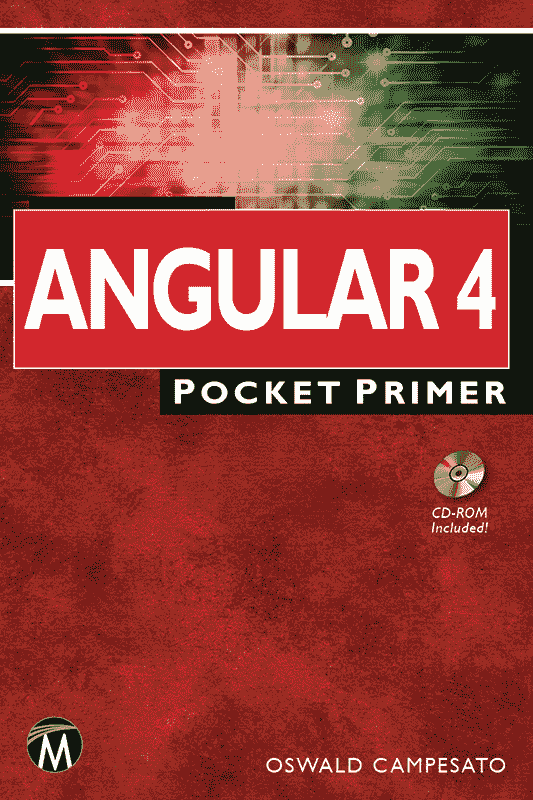


我们的书目可供机构、公司等采用、许可或批量购买。欲需更多信息，请联系客服部门：(800) 232-0223（免费热线）。我们书目的数字版本可在 `www.authorcloudware.com` 和其他电子供应商处获取。可以通过写邮件至 `info@merclearning.com` 从出版者获取配套文件。

# 目录

- 序言

- 第 1 章：Angular 快速入门

  - Angular 支持的版本：其工作原理

  - 跳过 Angular 3 的原因

  - TypeScript 版本

  - 从 Angular 2 迁移到 Angular

  - Angular 应用需要学习的内容

    - NodeJS

    - ECMA5、ES6 和 TypeScript

  - Angular 概览

    - Angular 单向数据绑定

    - Angular 摇优化

    - Angular 应用概览

  - Angular CLI

    - 安装 Angular CLI

    - Angular CLI 功能

    - 通过 Angular CLI 创建“Hello World”应用

  - Angular 应用结构

    - Angular 文件命名规范

    - `index.html`

    - 导出和导入包

    - 启动文件 `main.ts`

    - 顶级模块文件 `app.module.ts`

      - `NgModule` 元数据

    - 顶层组件文件 `app.component.ts`

      - 简单模板

      - 使用组件

      - 组件元数据

  - Angular 中的状态组件与无状态组件

  - 使用 Angular CLI 生成组件

  - Angular 中的语法、属性和属性

    - Angular 中的属性与属性

    - 在 Angular 中显示按钮

    - 元素与属性

  - 总结

# 在 Angular 中从列表中删除项

* Listing 2.4: `app.component.ts`

# Angular 指令与子组件

* Listing 2.5: `app.component.ts`

* Listing 2.6: `child.component.ts`

* Listing 2.7: `app.module.ts`

# Angular 中的构造函数与状态存储

* Listing 2.8: `app.component.ts`

## 构造函数中的私有参数：一种快捷方法

## Angular 中的条件逻辑

* Listing 2.9: `app.component.ts`

## 在 Angular 应用中检测鼠标位置

* Listing 2.10: `app.component.ts`

* Listing 2.11: `mousemove.ts`

* Listing 2.12: `app.module.ts`

## Angular 中的鼠标事件与用户输入

* Listing 2.13: `mouseevents.ts`

* Listing 2.14: `app.component.ts`

* Listing 2.15: `app.module.ts`

## 处理用户输入

* Listing 2.16: `app.component.ts`

* Listing 2.17: `todoinput.ts`

* Listing 2.18: `todolist.ts`

* Listing 2.19: `todoservice.ts`

* Listing 2.20: `app.module.ts`

## Angular 中的 `moduleId` 和 `templateUrl` 属性

* Listing 2.21: `itemsapp.ts`

* Listing 2.22: `itemdetails.html`

## 在 Angular 中使用自定义类

* Listing 2.23: `newuser.ts`

* Listing 2.24: `app.component.ts`

## 多组件中的点击事件

* Listing 2.25: `app.component.ts`

* Listing 2.26: `clickitem.ts`

# 使用 `@Input`、`@Output` 和 `EventEmitter`

* Listing 2.27: `app.component.ts`

* Listing 2.28: `childcomponent.ts`

* Listing 2.29: `app.module.ts`

## 展示型组件

## Angular 中的元素样式与 Shadow DOM

* Listing 2.30: `app.component.ts`

## Angular UI 组件

## Angular 中的新特性

总结

# 第 3 章：图形与动画

## Angular 生命周期周期钩方法

Angular 生命周期周期钩方法的简单示例

* Listing 3.1: `app.component.ts`

## GSAP 动画与 `ngAfterContentInit()` 方法

* Listing 3.2: `main.ts`

* Listing 3.3: `app.component.ts`

* Listing 3.4: `ArchTubevals1.ts`

* Listing 3.5: `app.module.ts`

## Angular 中的 CSS3 动画

* Listing 3.6: `app.component.ts`

## 通过“Angular 方式”实现动画效果

* Listing 3.7: `app.component.ts`

## Angular 中的基础 SVG 示例

* Listing 3.8: `app.component.ts`

* Listing 3.9: `MyEllipse1.ts`

* Listing 3.10: `app.module.ts`

## Angular 与 SVG 中的鼠标跟随效果

* Listing 3.11: `app.component.ts`

* Listing 3.12: `MouseMove.ts`

* Listing 3.13: `app.module.ts`

## D3 与 Angular

* Listing 3.14: `app.component.ts`

## D3 动画与 Angular

## Angular 中的纯 CSS3 3D 动画

* Listing 3.15: `index.html`

* Listing 3.16: `Anim240Flicker3DLGrad2SkewOpacity2Reflect1DIV6.css`

## Angular 中的 CSS3 和 jQuery 动画效果

* Listing 3.17: `index.html`

* Listing 3.18: `app.component.ts`

* Listing 3.19: `SkewAnim1.css`

## “Angular 方式”的动画效果

* Listing 3.20: `app.component.html`

* Listing 3.21: `app.component.ts`

* Listing 3.22: `app.module.ts`

Angular 的图表工具

总结

# 第 4 章：HTTP 请求与路由

## Angular 中的依赖注入

## 使用 jQuery 和 Angular 进行 Flickr 搜索

* Listing 4.1: `app.component.ts`

## 在 Angular 中结合 Promises 和 Observables

* Listing 4.2: `app.component.ts`

* Listing 4.3: `nyt.service.ts`

* Listing 4.4: `app.module.ts`

## 在 Angular 中通过 Observable 读取 JSON 数据

* Listing 4.5: `app.component.ts`

* Listing 4.6: `employees.json`

* Listing 4.7: `app.module.ts`

## Angular 中使用 `forkJoin()` 处理多个并发请求

* Listing 4.8: `app.component.ts`

* Listing 4.9: `file.service.ts`

* Listing 4.10: `customers.json`

### Angular HTTP 与 Observables

## Angular 中的 TypeScript 接口

简单的 TypeScript 接口

* Listing 4.11: `employee.ts`

## JSON 数据与 TypeScript 接口

* Listing 4.12: `employees.ts`

## 使用 TypeScript 接口的 Angular 应用

## 在 Angular 中获取 GitHub 数据

* Listing 4.13: `app.component.ts`

## 简单的 HTTP GET 请求

* Listing 4.14: `app.component.ts`

* Listing 4.15: `posts.json`

## 简单的 HTTP POST 请求

* Listing 4.16: `app.component.ts`

* Listing 4.17: `authors.json`

# Angular 路由

Angular 路由示例

* Listing 4.18: `app.component.ts`

* Listing 4.19: `about.ts`

* Listing 4.20: `login.ts`

* Listing 4.21: `users.ts`

* Listing 4.22: `user.ts`

结合 Webpack 的 Angular Routing

总结

# 第 5 章：表单、管道与服务

## Angular 表单概述

## 响应式表单

## 模板驱动表单

Angular 表单示例

* Listing 5.1: `app.component.ts`

* Listing 5.2: `app.module.ts`

数据绑定与 `ngModel`

## 第三方 UI 组件

## 使用 `FormBuilder` 的 Angular 表单

* Listing 5.3: `app.component.ts`

## Angular 响应式表单

### 列表 5.4: `app.component.ts`

### 列表 5.5: `app.component.html`

### 列表 5.6: `app.module.ts`

## FormGroup 与 FormArray

## Angular 其他表单特性

## Angular 表单与 Bootstrap 4（可选）

## 在 Angular 中使用 Pipes

### 使用内置 Pipes

### AsyncPipe（异步管道）

### 创建自定义 Angular Pipe（管道）

### 列表 5.7: `app.component.ts`

### 列表 5.8: `pipe.component.ts`

### 列表 5.9: `user.component.ts`

### 列表 5.10: `app.module.ts`

## 什么是 Angular 服务？

### 内置 Angular 服务

### Angular 服务示例

### 列表 5.13: `app.component.ts`

### 带有 EventEmitter 的服务

### 列表 5.14: `user.component.ts`

### 列表 5.15: `user.service.ts`

### 列表 5.16: `app.component.ts`

### 列表 5.17: `app.module.ts`

## 显示 GitHub 用户数据

### 列表 5.18: `app.component.ts`

### 列表 5.19: `user.component.ts`

## 其他服务相关用例

### 多个服务实例

### 单个服务实例

## 服务与组件间通信

### 将服务注入服务中

## 总结

# 第 6 章：Angular 与 Express

## 极简主义 Node 应用

### 设置 Node 环境（可选）

### 创建 Express 应用

### 列表 6.1: `server.js`

### 启动 Express 应用

## 带有 Angular 和 Express 的应用程序

### 启动服务器和 Angular 应用

### Angular HTTP 与 Observables

### 服务器代码：`package.json`

### 列表 6.2: `package.json`

### 服务器代码：`server.js`

### 列表 6.3: `server.js`

### Angular 代码

### 列表 6.4: `app.component.ts`

### 并发请求与 Angular（版本 2）

### 如何启动 Express 服务器代码

### Angular 代码

### 列表 6.5: `app.component.ts`

## 使用 MongoDB 的 Express 应用（部分 1）

### 列表 6.6: `package.json`

### 服务端自定义文件（部分 2）

### `app.js` 文件

### 列表 6.7: `app.js`

### `index.js` 文件

### 列表 6.8: `index.js`

### `userlist.jade` 模板

### 列表 6.9: `userlist.jade`

### 启动服务端应用

### 使用 Express 的 Angular 应用

### 列表 6.10: `app.component.ts`

### 列表 6.11: `app.js`

### Angular 与日语文本（可选）

### 列表 6.12: `load-japanese.js`

### Angular Universal

### 服务器文件 `main.server.ts`

### 列表 6.13: `main.server.js`

### 网页 `index.html`

### 列表 6.14: `index.html`

### TypeScript 文件 `app.ts`

### 列表 6.15: `app.ts`

## 使用微服务工作（可选）

### 微服务的优势

### 微服务的缺点

## 总结

# 第 7 章：Flux, Redux, GraphQL 与 Relay

## 什么是 Flux？

### 什么是 Action？

### 什么是 Reducer？

### Store 与应用状态

### 什么是 Redux？

### 应用数据的数据结构

### 何时应该使用 Redux？

### Reducer 的简单示例

### 用于加减数值的 Reducer

### 用于从数组中添加/删除字符串的 Reducer

### Redux Reducers 是同步的

### Redux Store

### 中间件

## 什么是 GraphQL？

### GraphQL 与 REST

### GraphQL 查询

### 在 GraphQL 中定义类型系统

### 有用的 GraphQL

## 什么是 Apollo？

### 启动 Apollo 服务器

### 启动 Angular 客户端

### Angular 客户端的项目结构

### 列表 7.1: `app.module.ts`

## 什么是 Relay？

### Relay Modern

## 总结

# 第 8 章：Angular 与移动应用

## 使用 Ionic 2 进行移动开发

### 安装与项目创建

### Ionic Native

### Ionic 应用的项目结构

### 列表 8.1: `app.component.ts`

### 列表 8.2: `app.module.ts`

### 在 Ionic 应用中获取 GitHub 数据

### 列表 8.3: `github.ts`

### 列表 8.4: `app.component.ts`

### 列表 8.5: `app.module.ts`

### 列表 8.6: `app.html`

## 什么是 NativeScript？

### 安装与新项目创建

### Angular 与 NativeScript

## 使用 React Native

### React Native 的设置步骤

### 如何创建 React Native 应用

### 列表 8.7: `index.android.ts`

### 将 React Native 应用部署到移动设备

### Angular 与 React Native

### 列表 8.8: `NG2RNGraphics.ts`

## React Native 与 NativeScript：高层对比

### Angular 移动工具包

### 创建移动项目

### `manifest.webapp` 文件

### 列表 8.9: `manifest.webapp`

## 渐进式 Web 应用（PWA）（可选）

### Web Workers 与 Service Workers

### PWA 的组件

### 其他链接

## 总结

# 第 9 章：函数式响应编程

## 什么是函数式响应编程 (FRP)？

### 观察者模式

### 处理异步事件

# Promises 与异步事件

# 在不使用 FRP 的情况下使用运算符

# 关于 Observable 的类比

# RxJS 的 JavaScript 文件

# 中间运算符和终结运算符

# 运算符

# `subscribe()` 和 `unsubscribe()` 运算符

# `subscribe()` 和 `forEach()` 运算符

# 将数据源转换为 Observable


# 第 9 章：Observable 运算符

## 使用`range()`和`filter()`运算符

代码列表 9.1 `ObservableRangeFilter1.html`

## 使用`from()`和`map()`运算符

代码列表 9.2 `ObservableMapUpper1.html`

## 使用`interval()`、`take()`和`map()`运算符

代码列表 9.3 `ObservableTake.html`

## 其他中间运算符

### `retry()`运算符

### 合并/连接运算符列表

### Map相关的运算符列表

### `timeout()`运算符

## 冷 Observable 与热 Observable

代码列表 9.4 `ColdObservables1.html`

## HTML 网页 React 化

代码列表 9.5 `ObservableDivElement2.html`

## RxJS 与 SVG 图形/动画

代码列表 9.6 `SVGObservables1Anim1.html`

## RxJS 与 HTML 网页中的鼠标事件

代码列表 9.7 `SVGObservables1MouseMove1.html`

## Observable 表单

代码列表 9.9 `app.component.ts`

## 在 Angular 应用中取消订阅

## RxJS 与计时器示例

代码列表 9.8 `app.component.ts`

## RxJS 版本 5

### 在 RxJS 版本 5 中创建 Observable

### 在 RxJS 中缓存结果

## d3.express: 集成发现环境

## 总结

# 第 10 章：杂主题

## Angular 4.1.0

### 新特性

## Angular 配置文件

### `package.json`配置文件

代码列表 10.1: `package.json`

### `tsconfig.json`配置文件

代码列表 10.2: `tsconfig.json`

## 什么是 AOT?

### AOT 的优势

### AOT 配置

### 设置`@ngtools/webpack`

### 使用`ngc`编译器工作

#### `tsconfig-aot.json`文件

### 编译步骤

### AOT、Webpack 与 Rollup 的状态

## Tree Shaking 工具

### `rollup-config.js`文件

### 调用 Rollup

## 缩小 Angular 应用的大小

### 缩小包的大小

## `zone.js`库

## 什么是 Webpack?

### 使用 Webpack

#### 启动 Webpack 的简单示例

## 热模块替换 (HMR) 与 Webpack

## 简单的 `webpack.config.js`

## Angular 中的 I18n 和 L1n

代码列表 10.3: `webpack.config.js`

代码列表 10.4: `webpack.config.js`

## Angular Material

### 容器

### `ViewChild`装饰器

### 测试应用

## Angular 工具

### Augury Chrome 扩展

### 显示依赖树

### Compodoc

## Angular 与深度学习

## 总结

*索引*

*前言*

### 本书的主要价值是什么？

本书旨在涵盖 `Angular 4` 的基本功能，并包含各种可以在 300 页书中呈现的代码示例（基于发布版本）。代码示例的主要目标是向你展示如何完成各种任务，例如显示和更新列表、将信息保存到数据存储中、使用 `Observable` 以及开发应用程序等。如果你对“完成任务”的 `Angular` 代码示例感兴趣，即使省略了一些细节，这本书可能非常适合你。

如果你对本书的风格犹豫不决，或者你认为“口袋指南”应该有不同的格式，那么其他书籍可能更适合你。

### 阅读这本书需要 Angular 知识吗？

阅读本书不需要预先了解 `Angular`。但你需要了解 HTML（如何使用基本元素）并具备一些 JavaScript 知识。第 6 章包含了 Node 相关的代码示例，这需要一些背景知识才能理解内容。第 7 章包含了将 `Angular` 与 Redux 和 GraphQL 结合的代码示例，这些是更高级的话题。然而，如果你专注于 `Angular` 的“核心”概念，可以跳过这两章。

本书旨在面向具有不同年龄段、背景极其多样化的国际读者群体。虽然许多读者知道如何阅读英语，但他们的母语并不是英语（英语可能是他们的第二种、第三种甚至第四种语言）。因此，本书使用了标准的英语，而不是可能让这些读者感到困惑的口语化表达。如你所知，许多人通过不同类型的模仿来学习，包括阅读、写作或听取新材料（是的，还有一些基础视频可以参考）。本书考虑了这些点，旨在为目标读者提供一种舒适且有意义的学习体验。

## 如何充分利用本书

有些程序员擅长从散文中学习，而另一些人则擅长从示例代码（大量的代码）中学习，这意味着没有一种单一风格适用于所有人。

此外，有些程序员想先运行代码，看看它的作用，然后再返回代码深入研究细节（而另一些人则采用相反的方法）。

因此，书中包含了多种类型的代码示例：有的短，有的长，还有一些代码示例是从早期的代码示例“构建”而来的。

## 本书的代码是如何测试的？

书中的代码示例已在安装了 OS X 10.16 的 Macbook Pro 和 `Google Chrome` 浏览器（版本 53）中经过了测试。除非另有说明，否则没有使用任何特殊的浏览器特定功能，这意味着代码示例应该可以在其他平台的 Chrome 中运行，也可以在其他现代浏览器中运行。

需要注意的另一点是，所有对“Web Inspector”的引用均指 Chrome 浏览器中的 `Web Inspector`，它与 Safari 中的 `Web Inspector` 不同。如果你使用的是不同的（但仍是现代的）浏览器或早期版本的 Chrome，可能需要在网上查找启动和查看 `Web Inspector` 所需的按键序列。请访问此链接获取更多有用信息：

[`benalman.com/projects/javascript-debug-console-log/`](http://benalman.com/projects/javascript-debug-console-log/)

## 为什么截图是黑白的？

黑白图像的成本比原始彩色图像低，因此它们的加入意味着本书的价格更低。然而，彩色图像可以在附光盘上获得，还有补充的代码示例，这些示例在浏览器中启动时会以彩色渲染。

## 为什么本书有 300 页而不是 500 页？

本书是 *Pocket Primer*（口袋指南）系列的一部分，该系列书籍页数通常在 200 到 300 页之间。其次，目标读者涵盖了 HTML 和 JavaScript 知识水平从初学者到中级的群体。在本书的准备过程中，我们尽一切努力照顾这些读者，以便他们能够做好充分准备，在自学期间探索 SVG 的更高级功能。

## 本书包含生产级代码示例吗？

书中的代码示例确实使用了 `Angular` 的发布版本来演示 `Angular` 的各种特性。清晰性优先于编写更紧凑但更难理解（且可能产生 bug）的代码，特别是在一本短书里。如果你决定在生产环境的网站中使用书中的任何代码，你应当对该代码进行与任何其他 Web 应用程序同样严谨的分析。

## 作者的其他相关书籍

1) HTML5 Canvas and CSS3:
[`www.amazon.com/HTML5-Canvas-CSS3-Graphics-Primer/dp/1936420341`](http://www.amazon.com/HTML5-Canvas-CSS3-Graphics-Primer/dp/1936420341)

2) jQuery, HTML5, and CSS3:
[`www.amazon.com/jQuery-HTML5-Mobile-Desktop-Devices/dp/1938549031`](http://www.amazon.com/jQuery-HTML5-Mobile-Desktop-Devices/dp/1938549031)

3) HTML5 Pocket Primer:
[`www.amazon.com/HTML5-Pocket-Primer-Oswald-Campesato/dp/1938549104`](http://www.amazon.com/HTML5-Pocket-Primer-Oswald-Campesato/dp/1938549104)

4) jQuery Pocket Primer:
[`www.amazon.com/dp/1938549147`](http://www.amazon.com/dp/1938549147)

以下开源项目包含代码示例，有时可以补充本书书中各个章节的内容：

[`code.google.com/p/css3-graphics/`](https://code.google.com/p/css3-graphics/)
[`code.google.com/p/d3-graphics/`](https://code.google.com/p/d3-graphics/)
[`code.google.com/p/html5-canvas-graphics/`](https://code.google.com/p/html5-canvas-graphics/)
[`code.google.com/p/jquery-css3-graphics/`](https://code.google.com/p/jquery-css3-graphics/)
[`code.google.com/p/raphael-graphics/`](https://code.google.com/p/raphael-graphics/)
[`code.google.com/p/svg-filters-graphics/`](https://code.google.com/p/svg-filters-graphics/)

# 第 1 章

## ANGULAR 快速介绍

本章提供了开发 `Angular` 的快速介绍。在涵盖了 `Angular` 的高层方面后，你就可以快速掌握代码示例。同时，请记住你需要投入精力进行更深层次的理解。

第一部分讨论了 `Angular` 的设计目标和一些新特性，例如组件、模块和单向数据绑定。第二部分讨论了 `Angular` 命令行界面（CLI），它是一个用于生成 `Angular` 应用的命令行工具。

在阅读本章之前，有几点需要注意。首先，本书提供了许多 `Angular` 应用，因此关于 `Angular` 概念、设计目标和架构的细节比 500 页的书要“轻”。然而，你可以在网上找到有用信息。

其次，你可以使用 ECMA5、ES6 和 `TypeScript` 创建 `Angular` 应用。但主要建议是使用 ES6 或 `TypeScript` 开发 `Angular` 应用；事实上，书中所有的代码示例都使用 `TypeScript`，这使得后台执行的转译过程变得简单。

## Angular 支持版本：原理

如果你不知道，`Angular` 的领域发展迅速，从 2017 年 3 月 `Angular 4` 的发布一直到计划于 2018 年 9 月发布的 `Angular 7`。

每个后续版本（从 2018 年的 `Angular 6` 开始）可能只支持两个之前的 `Angular` 版本。例如，`Angular 6` 将支持 `Angular 4` 和 `Angular 5`，而 `Angular 7` 将支持 `Angular 6` 和 `Angular 5`（但不支持 `Angular 4`）。

此外，Angular 的命名规范中存在某种“双重性”：即将发布的 Angular 版本会指定具体的版本号，但不带版本号的 `Angular` 是 `Angular 2` 及更高版本的官方称呼（而 `AngularJS` 则是版本 `1.x` 的官方名称）。

Angular 核心团队在这一开发过程中的另一个重要目标是尽可能减少**破坏性变更**（breaking changes），并确保此类更改在升级到 Angular 新版本时的影响降至最低。

### 注意

尽管未来的生产环境代码发布带有版本号，但 `Angular 2` 及更高版本官方上被称为 `Angular`。

### 跳过 Angular 3 的原因

Angular 核心库位于 `github.com/angular/angular`。它们的所有库的版本标记方式相同，但作为不同的 Node 包进行分发：

`@angular/core v2.3.0`
`@angular/compiler v2.3.0`
`@angular/compiler-cli v2.3.0`
`@angular/http v2.3.0`
`@angular/router v3.3.0`

如你所见，路由器包（router）的版本号与其他包不同。使版本号保持一致的最简单方法是使用版本 `4` 而不是版本 `3`，这导致了跳过 `Angular 3`。

### TypeScript 版本

将 `TypeScript` 依赖从 `v1.8` 升级到 `v2.1`（或更高）确实涉及破坏性变更。幸运的是，从 Angular 版本 `2` 升级到版本 `4`（及更高）并不涉及重大重写，只需更改几个核心库。

Angular 团队开发了一套自动升级流程，他们使用的工具也可能供通用使用（可能在 2017 年期间）。

### 注意

本书中的 `Angular 2` 应用使用 `TypeScript` 编译器的 `2.2.2` 版本。

### 从 Angular 2 迁移到 Angular

如果你使用的是最新版本的 Angular，则本节是可选的，因为最新版本已包含了 `Angular 2.0` 之后 `Angular 2.x` 中引入的所有功能。

下方提供了几个 `Angular 2.x` 版本的简要概述，因为新功能是添加到 `Angular 2` 中的（但它们并不属于 `Angular 2.0`）。此外，`TypeScript` 的版本也发生了变化。

首先，`Angular 2.2` 于 2016 年 11 月发布；该版本提供了提前编译（AOT）兼容性，并在第 10 章中进行了详细讨论。接着，Google 在 2016 年 12 月发布了 `Angular 2.3`，它包含了用于与集成开发环境（IDE）集成的 `Angular Language Service`。该服务为 `Angular Templates` 提供类型补全和错误检查。此外，该服务还支持组件的对象继承特性。

关于 `TypeScript` 的版本：`Angular 2` 使用 `TypeScript 1.8`，而 `Angular 4` 的初始正式版本使用 `TypeScript 2.1.6`（或更高），这涉及到一些较小的破坏性变更。

### Angular 应用需要学习的知识

本书中的 Angular 应用是用 `TypeScript` 编写的，但你还需要掌握以下技术的基础能力：

 `NodeJS` (`npm`)
 `ECMA5`, `ES6`, 和 `TypeScript`
 `Webpack 2.2` (或更高)

以下子节包含关于上述列表项目的更多信息。

### NodeJS

本书中的代码示例需要 `node v6.x.x`（或更高）和 `npm 4.x.x`（或更高）。在终端中运行以下命令确定你机器上的版本：

```bash
node -v
npm -v
```

如有必要，请访问 `NodeJS` 主页下载更新版本的 `node` 可执行文件。如果你从未用过 `Node`，请阅读在线教程以理解以下命令的作用：

```bash
npm install -g webpack
npm install webpack@latest --save
npm start
```

### ECMA5, ES6 和 TypeScript

你需要学习 `ES6` 和 `TypeScript` 的基本概念，它们各自的主页包含了大量帮助你入门的信息。特别是要学习箭头函数、类、模板字符串和模块加载器。其他实用的功能包括扩展运算符和剩余参数运算符（你将在第 7 章中遇到它们）。正如你在后续章节中看到的，Angular 应用严重依赖动态模板，这些模板经常涉及变量的插值（通过 `{{}}` 语法）。

如果你计划用 `TypeScript` 编写 Angular 应用，掌握 `ES6` 知识会帮助。幸运的是，以下网站提供了一个在线“游场”以及 `TypeScript` 文档和代码示例链接：

*[`www.typescriptlang.org/play/`](https://www.typescriptlang.org/play/)*

熟悉 `ECMA5` 同样有用：例如，`filter()` 函数非常方便（例如在 `Angular Pipes` 中），当你在 Angular 应用中将 `Observables` 与 HTTP 请求结合时，`map()` 函数会很有用。其他函数如 `merge()` 和 `flatten()` 也可以很有用，你可以根据需要学习这些以及其他函数。

你还需要对 `Promises` 和 `Observables` 有基础了解。带有 `TypeScript` 的 Angular 偏向使用 `Observables`，本书的代码示例也是如此，但你会遇到 `Promises`。请利用关于 `ECMA5` 和 `Promises` 的在线资源。

Angular 利用了 `ES6` 特性（如组件和类），以及 `TypeScript` 的特性（如注解和类型系统）。

对于构建工具，`Webpack` 已成为 Angular 应用的事实标准。`Webpack`（2.2 或更高版本）是 Angular 应用的事实构建工具，其主页位于：

*[`webpack.github.io/`](https://webpack.github.io/)*


如果你没有用过`Webpack`，请学习`2.x`版本的功能（忽略`1.x`）。

其他相关细节：你可以在`Electron`、`Webstorm`和`Visual Studio Code`中开发 Angular 应用。请查看各自网站的价格支持。最后，以下链接包含了样式指南以及开发 Angular 应用的“最佳实践”：

[`github.com/mgechev/angular2-style-guide`](https://github.com/mgechev/angular2-style-guide)

浏览上述链接以熟悉其内容，这样你在学习本书章节时就知道何时阅读相关部分。

## Angular 高层视图

Angular 设计为一个支持在浏览器中运行 Angular 应用，并支持服务端渲染以及移动设备 Angular 应用的平台。第一个方面——在浏览器中渲染 Angular 应用是本书的重点。第二个方面——`Angular Universal`（即服务端渲染）将在第 6 章中简要讨论。本质上，服务端渲染是在服务器上创建 Angular 应用的“第一个视图”。由于浏览器不需要构建此视图，它可以更快地渲染视图并提高感知加载速度。第三个方面——移动设备上的 Angular 应用将在第 8 章中讨论。

Angular 也采用基于组件的架构，其中组件以树形结构组织（Angular 模块也是如此，你将在第 5 章单向数据绑定。

- “树摇优化”
- 变化检测
- 样式封装

前两个特性在下方简要讨论，第三个特性将在第 2 章中讨论，那里的代码示例比本章更易理解。

由于 Angular 4 的正式版本于 2017 年 3 月发布，并且发布了额外的“点”版本（例如 4.1），后期的发布可能会导致书中某些代码示例发生破坏性变化。因此，你可能需要修改受影响代码示例中的应用程序接口（API）调用，或更改某些导入语句。你可以随时查阅在线文档以了解 Angular 连续版本之间的变化：

[https://angular.io/](https://angular.io/)

## Angular 中的单向数据绑定

Angular 将声明式单向绑定作为默认行为（但如果你愿意，你也可以切换到双向绑定）。单向绑定充当单向变化传播，与双向数据绑定相比具有两个优势：(1) 通过消除 Angular 1.x 中的`$digest`循环和观察器，提升了性能；(2) 减少了代码复杂度。Angular 还支持状态化、响应式和不可变模型。随着你操作 Angular 应用程序，上述陈述的含义将变得更加清晰。

Angular 应用程序涉及定义一个顶层（“根”）模块，该模块引用一个`Component`，该组件又指定一个 HTML 元素（通过强制性的`selector`属性）作为`Component`的“父”元素。`Component`的定义涉及所谓的“装饰器（decorator）”，它包含`selector`属性和`template`属性（或`templateUrl`属性）。

`template`属性包含 HTML 和自定义标记的混合（这些可以放在单独的文件中，并通过`templateUrl`属性引用）。此外，`Component`之后紧跟一个 TypeScript 类定义，它包含了“后端代码”，这些代码与`template`属性中出现的组件变量相关。在你操作了一些 Angular 应用程序后，这些细节将变得非常清晰。

> **注意**
>
> `templateUrl`属性和`styleUrls`属性指向文件，而`template`属性和`styles`属性指向内联代码。

## Angular 应用程序的树摇

树摇（Tree shaking）是指“修剪” Angular 项目中不必要的文件（其他技术具有相同的概念），就像摇掉树上的枯枝一样，以便创建一个 Angular 应用程序的生产版本。这个生产版本可以小得多，因此需要更少的加载时间。Webpack 2 和 Angular AOT 支持树摇，你将在第 10 章中看到一个 AOT 的示例。

## Angular 应用程序的高层视图

Angular 应用程序由内置组件和自定义组件（后者由你编写）组成，每个组件通常定义在独立的 TypeScript 文件中（扩展名为`ts`）。每个组件通过`import`语句指定其依赖。Angular 中有多种类型的依赖，例如指令（directives）和管道（pipes，在本章稍后部分讨论）。

自定义指令（custom directive）本质上是定义组件的 TypeScript 文件内容。因此，一个自定义指令由`import`语句、一个`Component`装饰器和一个导出的 TypeScript 类组成。

Angular 提供了内置指令，例如`ngIf`（用于“if”逻辑）和`ngFor`（用于循环）。这两个指令也被称为结构型指令（structural directives），因为它们修改 HTML 页面的内容。

Angular 内置管道（built pipes）包括日期和数字项目（货币、小数、数字和百分比），而自定义管道（custom pipes）由你定义。

此外，TypeScript 类使用装饰器（decorator）（内置函数）为类、其成员或方法参数提供元数据。装饰器很容易识别，因为它们总是带有`@`前缀。Angular 提供了许多内置装饰器，例如`@Component()`和`@NgModule`。

到此，Angular 特性的高层介绍结束。本章的下一部分将介绍 Angular CLI，它将在本书中用于创建 Angular 应用程序。

## Angular CLI

在 Angular 的测试发布期间，开发者使用手动过程创建应用程序，或者使用“启动”或“种子”项目（通常在 GitHub 上可用）。然而，在 Angular 发布新版本后，这些项目往往已经过时。因此，书中的代码示例基于`Angular CLI`，它是 Google 提供的官方 Angular 应用程序生成器。

Angular CLI 是一个名为`ng`的命令行工具，它可以生成完整的 Angular 应用程序，包括与测试相关的代码，并且（默认）还会启动`npm install`来安装`node_modules`中的所需文件。Angular CLI 的首页位于：

[https://cli.angular.io](https://cli.angular.io)

Angular CLI 生成一个名为`package.json`的配置文件来管理必要的依赖项及其版本号。生成 Angular 应用程序后，导航到`node_modules`子目录，你将看到 Angular 应用程序所需的各种子目录。

Angular CLI 是使用“启动”项目或手动创建项目的优替代方案，其功能集将随时间不断改进。

### 安装 Angular CLI

你需要执行几个步骤来安装 Angular CLI。首先，使用此命令卸载之前的 CLI（如果你安装了旧版本）：

```bash
sudo npm uninstall -g angular-cli
npm cache clean
```

接下来，使用此命令安装新的 CLI（注意新的包名）：

```bash
[sudo] npm install -g @angular/cli
```

按照如下方式创建一个名为`hello-world`的项目：

```bash
ng new hello-world
```

Angular CLI 提供了自定义代码之外的所有内容，而且安装时间明显于启动项目。其次，Angular CLI 允许你生成新的组件、路由等，这些在启动项目中是无法实现的。第三，Angular CLI 完全基于 TypeScript，生成的应用程序包含了 JavaScript 对象表示法（JSON）文件`tsconfig.json`、`tslint.json`、`typedoc.json`和`typings.json`。相反，启动项目倾向于使用 Webpack，这涉及到包含 Angular 应用程序信息的配置文件`webpack.config.js`。

### Angular CLI 功能

`ng`可执行文件支持各种选项，这里显示了一些命令行调用：

```bash
ng new app-root-name
ng build
ng deploy
ng e2e
ng generate <component-type>
ng generate route
ng generate ...
ng lint
ng serve
ng test
ng x18n
```

`ng g`选项等于`ng generate`选项，它可以允许你生成 Angular 自定义组件（Component）、Angular Pipe（在第 5 章中讨论过）等。`ng x18n`选项从源代码中提取 i18n 消息。下一节将展示如何在应用程序中生成 Angular 自定义组件的示例，以及为你生成的文件的内容。

组件的默认前缀是`app`（例如`<app-root></app-root>`），但你可以通过以下调用指定不同的前缀：

```bash
ng new app-root-name –prefix abc
```

### 注意

通过`ng`创建的 Angular 始终包含`src/app`目录。

关于升级 Angular CLI 的信息位于此处：

[`github.com/angular/angular-cli`](https://github.com/angular/angular-cli)

Angular CLI 的文档位于此处：

[`cli.angular.io`](http://cli.angular.io)

现在你已经了解了`ng`工具的一些功能，让我们来创建第一个 Angular 应用程序，这是下一节的主题。

### 通过 Angular CLI 创建“Hello World”应用程序

导航到一个方便的目录并使用以下命令创建一个名为`myapp`的 Angular 应用程序：

```bash
ng new myapp
```

### 注意

早期版本的`ng`需要一个`--ng4`。

在完成前面的命令后，进入新项目内部：

```bash
cd myapp
```

使用以下命令启动 Angular 应用程序：

```bash
ng serve
```

前面的命令会自动在以下 URL 启动浏览器会话：

`localhost:4200`

你将在屏幕上看到以下内容：

**app works!**

上一个字符串是在文件`app/app.component.ts`的`template`属性中指定的。

### 注意

`template`属性（或`templateUrl`属性）是你放置自定义代码的地方，这些代码将生成 HTML 输出，然后将其插入到`index.html`网页的`<app-root>`元素中。

### Angular 应用程序的结构

当你调用`ng`命令创建 Angular 应用程序时，这里是自动创建的文件：

- `angular-cli.json`
- `dist/`（省略详情）
- `e2e/`（省略详情）
- `karma.conf.js`
- `node_modules`
- `package.json`
- `protractor.conf.js`
- `README.md`
- `src/app/app.component.css`
- `src/app/app.component.html`
- `src/app/app.component.spec.ts`
- `src/app/app.component.ts`
- `src/app/app.module.ts`
- `src/environments/environment.prod.ts`
- `src/environments/environment.ts`
- `src/favicon.ico`
- `src/index.html`
- `src/main.ts`
- `src/polyfills.ts`
- `src/styles.css`
- `src/test.ts`
- `src/tsconfig.json`
- `tslint.json`

`dist`子目录包含了编译后的项目和 JavaScript 包，而`e2e`子目录包含了端到端测试的文件（调用命令`ng test`执行测试）。

`app.component.ts`文件（加粗显示）包含了此书中代码示例中的自定义 TypeScript 代码，并且（程度较小）你可能需要更新`app.module.ts`文件。当你需要包含 JavaScript`<script>`元素（用于 jQuery、Bootstrap 等）时，你将修改`index.html`，而`styles.css`文件用于全局层叠样式表（CSS）样式规则（如果有的话）。

最后，`angular-cli.json`、`package.json`和`tslint.json`分别是`ng`、`npm`和`tslint`的配置文件。请注意，当你调用`ng lint`命令时，它会调用`tslint`工具，该工具反过来依赖于`tslint.json`文件。

### Angular 项目文件的命名规范

`app`子目录下的文件具有由三部分组成的命名规范：功能类型、是组件还是模块，以及一个指示代码类型的后缀。例如，TypeScript 文件`app.component.ts`包含了应用程序与组件相关的代码，而 TypeScript 文件`app.module.ts`包含了模块相关的代码。此外，`app.component.css`文件包含该组件的 CSS 选择器，而`app.component.html`包含同一组件的 HTML 标记。

本章的后续部分包含两个章节：第一部分讨论`index.html`的内容和各种 JavaScript 配置相关文件，第二部分讨论包含`app`子目录的应用程序相关文件。遗憾的是，阅读这些章节是一项“苦差”，虽然建议你阅读它们，但你可以快速略过这一节，在你启动了第一个 Angular 应用程序后再返回。两种阅读风格都有权衡，因此请以最适合你学习风格的方式处理这些材料。

现在让我们来看 HTML 网页`index.html`的内容，它是我们 Angular 应用程序的主网页。

### index.html 网页

列表 1.1 显示了`index.html`的内容，它是通过`ng`工具生成的 Angular 应用程序的单元网页。

**列表 1.1: index.html**


只有`<app-root>`元素（在`app.component.ts`的`selector`属性中定义）表明这是一个 Angular 应用程序的一部分。

### 注意

JavaScript 依赖在构建项目时动态插入`index.html`中。

在我们深入研究 TypeScript 文件之前，让我们快速绕道了解一下导入语句。

### 导出包和导入类（可选）

记住以下一点：导入 TypeScript 文件的类必须在定义该类的 TypeScript 文件中导出。

有两种常见的导入语句类型：一种是从 Angular 模块导入包，另一种类型是导入自定义类（你编写的）。以下是两种的语法：

```typescript
import {some-package-name} from 'some-angular-module';
import {some-class } from './custom-class';
```

这里是两种类型的示例：

```typescript
import { NgModule } from '@angular/core';
```

在前面的代码段中，`NgModule`包是从`node_modules`目录下的`@angular/core`模块导入的。`EmpComponent`类是在`component.ts`文件中定义并导出的自定义类。

在第二个导入语句中，从 TypeScript 文件导入自定义类时需要`./`前缀，并注意省略了`.ts`后缀。

列表 1.2 中的第一行代码是一个导入（import）语句，它是代码列表中后续条件逻辑所必需的。你会在许多 Angular 代码示例中看到第二个导入语句，它对于在桌面式电脑和笔记本电脑上启动 Angular 应用程序至关重要。

第三个导入语句涉及 Angular 应用程序的顶层模块，该模块反过来包含了包含在此 Angular 模块中的所有自定义组件和服务。第四个导入语句包含了环境相关信息，这些信息将用于接下来的条件逻辑片段中：如果当前应用程序处于生产模式，则执行`enableProdMode()`函数。

最后一行代码是实际的引导（bootstrapping）过程，涉及在浏览器中渲染`app.component.ts`中的代码。

## 顶层模块文件`app.module.ts`

列表 1.3 显示了`app.module.ts`（位于`src/app`子目录）的内容，该文件导出了顶层 Angular 模块`AppModule`。

**列表 1.3: app.module.ts**

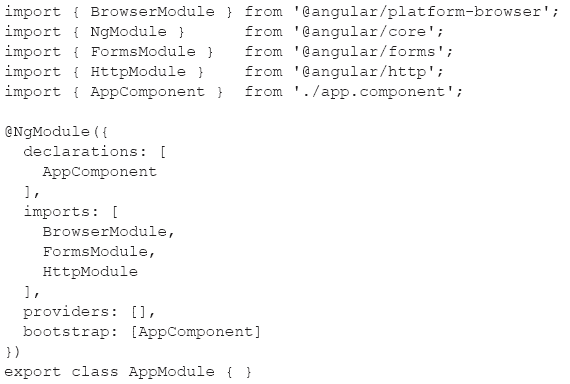

列表 1.3 包含了两个导入语句，分别导入了`BrowserModule`、`NgModule`、`FormsModule`和`HttpModule`，它们都是 Angular 的一部分。最后一个导入语句导入了`AppComponent`类，它是列表 1.4 所示的顶层组件。

### 注意

Angular 依赖始终包含`@`符号，而自定义依赖则指定指向 TypeScript 文件的相对路径。


接下来，`@NgModule` 装饰器包含一个带有各种属性的对象（将在下一节中讨论）。这些属性为`AppModule`类指定了元数据，该类在代码的最后一行被导出。`AppModule`中的元数据涉及以下属性，每个属性都是值数组：`imports`、`providers`、`declarations`、`exports`和`bootstrap`。

在列表 1.3 中，数组属性`declarations`、`imports`和`bootstrap`是非空的，而`providers`属性是一个空数组。这些元数据对于 Angular 引导`AppComponent`中的代码是所必需的，而`AppComponent`反过来包含了渲染内容的细节（例如，`<h1>`元素）以及渲染的位置（例如，`index.html`中的`app-root`元素）。

现在，让我们更仔细地观察`@NgModule`装饰器中每个数组属性的作用，以理解它们的用途。

## `@NgModule`中的元数据

`imports`数组包含了该应用程序所需的*模块*，例如`BrowserModule`，以及该应用程序的一些可选模块（例如`FormModule`）。`imports`数组不是传递的：如果模块 A 导入了模块 B，而模块 B 导入了模块 C，那么模块 C 不会被导入到模块 A 中。

接下来，`providers`数组是该 Angular 应用程序全局范围的服务数组。服务是提供在应用程序中不可见的后台功能的东西。`providers`数组包含了任何通过`@Injectable`装饰器（后文将讨论）定义的可注入服务。

`declarations`数组由该应用程序所需的*组件*组成，例如`AppComponent`，以及自定义组件、指令和管道（pipes），它们都具有（模块级）的私有作用范围。具体来说，*私有作用范围*意味着`declarations`数组中的所有内容只能通过在模块模块声明的其他组件、指令和管道来访问。

请记住，在`declarations`属性列出的组件*必须*从各自的组件相关文件中导出。例如，`AppComponent`是从`app.component.ts`导出的（后文所示），这允许你在`app.module.ts`中导入它并在`declarations`属性中指定它。

`exports`数组包含了应用程序其他组件所需的组件、指令和管道。

`schemas`数组包含了值`CUSTOM_ELEMENTS_SCHEMA`，它提供了应用程序“外部”的额外信息；请参见第 2 章中的示例和第 5 章中的示例。

最后，`bootstrap`数组包含了当 Angular 应用程序在浏览器中启动时将“引导”的组件名称。

注意

通常情况下，建议通过`bootstrap`属性引导一个组件。

## 顶层组件文件`app.component.ts`

列表 1.4 显示了`app.component.ts`（位于`src/app`子目录）的内容，该文件导出了顶层 Angular 组件`AppComponent`。

***列表 1.4: app.component.ts***

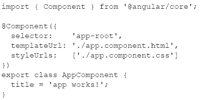

列表 1.4 以一个用于 Angular `@Component`装饰器的导入语句开始，用于为`AppComponent`类定义元数据。至少，这些元数据涉及两个属性：`selector`和`template`。除了路由相关的组件外，这两个属性在自定义组件中都是必需的。在这个示例中，`selector`属性指定了自定义元素`app-root`（你可以更改它），即你在 HTML Web 页面`index.html`中看到的那个元素。

`template`属性指定了将插入到自定义元素`app-root`中的 HTML 标记。在这个示例中，标记是一个包含某些文本的`<h1>`元素。列表 1.4 的最后一行代码是一个导出语句，它使得`AppComponent`类可以在其他 TypeScript 文件（可用，如列表 1.3 所示的`app.module.ts`）导入。

注意

`main.ts`、`app.component.ts`和`app.module.ts`文件位于书中所有的 Angular 项目中。

现在通过进入根目录并输入以下命令启动你的 Angular 应用程序：

```bash
ng serve
```

下一节将讨论模板语法，你将在自定义代码的`template`属性中使用它。

## 简单的 Angular 模板

正如你在列表 1.4 中看到的，`app.component.ts`文件包含一个带有单行文本的`<h1>`元素的模板属性。但是，当你将所有内容放在一对反引号（```）中时，Angular 允许你指定多行文本。这种语法（引入 ES6）在 Angular 中被广泛使用，并且方便地支持变量插值。

列表 1.5 显示了`app.component.ts`文件的内容，它比列表 1.4 内容更多。此代码示例说明了如何在`template`属性中使用插值。

***列表 1.5: app.component.ts***

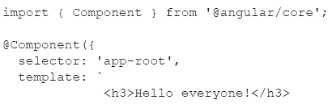

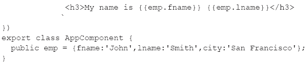

列表 1.5 包含两个`<h3>`元素；第一个是简单的文本字符串，第二个引用了在类中定义的值。Angular 使用被称为*插值*的方法处理字面量对象`emp`的元素，并将第二个`<h3>`元素中的变量替换为实际值。

## 在 Angular 中处理组件

Angular 应用程序是嵌套组件的树，其中顶层组件是应用程序。组件定义了用户界面（UI）元素、屏幕和路由。通常，组织 Angular 应用程序的方法是将每个组件放在一个 TypeScript 文件中，然后在“主文件”（通常命名为`app.component.ts`）中导入该文件。

## 组件中的元数据

Angular 组件通常是`@Component`装饰器和类定义的组合，类可以可选包含构造函数。此处显示示例：

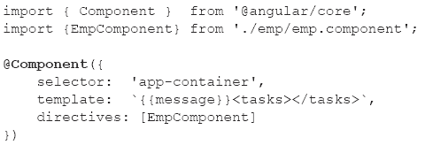

之前的`@Component`装饰器包含了多个属性，其中一些是必需的，另一些是可选的。让我们看看前面代码块中的两种类型。

接下来，`template`属性（或`templateUrl`属性）是强制性的，它包含了标记、插值变量和 TypeScript 代码的混合。一个重要的细节是：当`template`属性的定义跨越多行时，需要使用反引号。

`directives`属性是一个可选属性，用于指定一个组件数组，这些组件被视为嵌套组件。在这个示例中，`directives`属性指定了组件`EmpComponent`，该组件在代码块开头附近也通过`import`语句导入了。请注意，导入语句不包含`@`符号，这意味着`EmpComponent`是在`emp/emp.component.ts`文件中定义的自定义组件。

## Angular 中的有状态组件与无状态组件

从高层来说，有状态组件（stateful component）保留了与同一个 Angular 应用程序其他部分相关的信息。相比之下，无状态组件（stateless components）不维护应用程序状态，也不请求或获取数据：它们通过属性绑定从另一个组件（例如其父组件）传递数据。

本书书中的代码示例通常是有状态组件、无状态组件以及有时“值对象”的组合，值对象是自定义类的实例，用于对不同的实体进行建模（如员工、客户、学生等）。

你将在第 2 章中看到展示型组件的示例。同时，关于深入研究有状态和无状态组件的好文章位于这里：

[https://toddmotto.com/stateful-stateless-components#stateful]

## 使用 Angular CLI 生成组件

早些时候你看到了`ng`工具的一些选项，本节将讨论如何使用`generate`选项。此外，这里有一些自解释且易懂的示例：

```bash
ng generate component mycomp

ng generate directive mydir

ng generate pipe mypipe

ng generate route myroute

ng generate service mycomp
```

以下命令与上述列表中的命令等效，区别在于它们使用了短别名：

```bash
ng g c mycomp

ng g d mydir

ng g p mypipe

ng g r myroute

ng g s mycomp
```

前面的命令会创建位于`src/app`新子目录中的新文件。例如，`ng g c mycomp`命令会创建子目录`src/app/mycomp`并向其中填充文件（稍后会讨论）。

如果你不想创建新的子目录，请使用`--flat`选项，新文件将放在`src/app`而不是`src/app/mycomp`。

现在让我们在 Angular 应用程序中调用以下命令来生成学生组件：

```bash
ng g c student
```

在前面的命令完成后，你将看到以下输出：

```text
installing component
create src/app/student/student.component.css
create src/app/student/student.component.html
create src/app/student/student.component.spec.ts
create src/app/student/student.component.ts
```

如你所见，输出输出了四个新文件：一个 CSS 文件、一个 HTML 文件、一个 TypeScript 测试文件和一个组件定义文件。

列表 1.6 显示了`student.component.ts`的内容，其中包含了学生组件的代码。

***列表 1.6: student.component.ts***

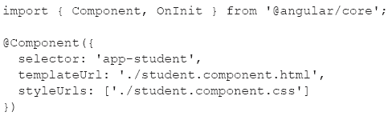

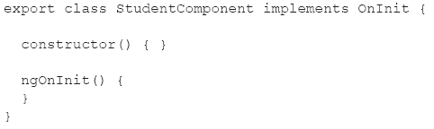

注意

*当你使用`ng`创建自定义组件时，`ng`会在`app.module.ts`中插入导入语句，并更新`declarations`属性以引用新的自定义组件。*

为了方便起见，当你从命令行生成组件时，`ng`还会生成测试文件。特别是，列表 1.7 显示了名为`student.component.spec.ts`的测试文件。

***列表 1.7: student.component.spec.ts***

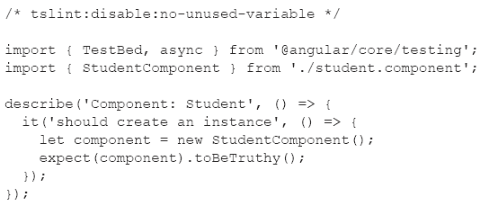

列表 1.7 包含了导入语句，使各种组件对该测试文件可用，包括列表 1.6 中定义的`StudentComponent`。

自动生成的`student.component.html`内容显示在此：

```html
<p>
  student works!
</p>
```

如你所见，`student.component.html`文件是极简的，你可以自由地在该文件中添加应用程序相关的 HTML 标记。

注意`student.component.css`文件目前是空的；请添加任何你为了样式化而需要的 CSS 选择器。

另一个细节：`ng`允许你在现有的组件内部创建组件。例如，以下命令会在学生组件内部创建一个配置组件：

```bash
ng g component student/profile
```

你必须在`student`子目录中调用前面的命令，否则你将看到以下错误消息：

`You have to be inside an angular-cli project in order to use the generate command.`

当你准备好后，使用以下命令创建 Angular 应用程序的生产构建：

```bash
ng build --prod
```

请记住，你可以通过 AOT 显著缩小 Angular 应用程序的大小，这将在第 10 章中进行详细讨论。

## Angular 中的语法、属性和属性

Angular 为属性和属性引入了方括号`[]`表示法，以及处理事件函数的括号`()`表示法。这种新语法实际上是有效的 HTML5 语法。这里有一个指定属性和函数的代码段示例：

```html
<foo [bar]="x+1" (baz)="doSomething()">Hello World</foo>
```

这里显示了一个指定属性和函数的示例：

```html
<button [disabled]="!inputIsValid" (click)="authenticate()">Login</button>
```

这里有一个带有自定义元素的示例相关示例：

```html
<my-chart [data]="myData" (drag)="handleDrag()"></my-chart>
```

前面的片段消除了对许多内置指令的需求，正如你在本章稍些时候将看到的。

## Angular 中的属性与属性的区别

请记住以下区别：属性（Property）可以指定复杂的模型，而属性（Attribute）只能指定字符串。例如，在 Angular 1.x 中你可以写：

```html
<my-directive foo="{{something}}"></my-directive>
```

这里显示对应的 Angular 代码（不需要插值）：

```html
<my-directive [foo]="something"></my-directive>
```

Angular 的新架构提供了更高的性能以及开发更整洁的 Angular 应用程序的机制。

## 在 Angular 中显示按钮

在学习了本章所有的代码列表并阅读了关于它们用途的解释后，你可能会怀疑 Angular 开发是否是一个长期而枯燥的过程。幸运的是，你可以用少量代码创建许多基础应用程序。当你准备好创建中等应用程序时，可以利用 Angular 应用程序基于组件的特性增量添加新组件（和模块）。

作为一个简单的示例，本节中的`app.component.ts`文件包含了此 Angular 应用程序的所有自定义代码。`ng`工具用于生成此代码示例中的所有文件，你不需要手动干预那些其他文件。


列表 1.8 显示了`app.component.ts`的内容，说明了如何渲染`<button>`元素并在点击事件时显示用户在当前会话期间点击`<button>`元素的次数。

列表 1.8 起于一个出现在`app.component.ts`中的导入语句（import），你将在本书的每个代码示例中看到此语句。该语句允许你访问`Component`装饰器，它将元数据注入到名为`AppComponent`的 TypeScript 类中。当 TypeScript 编译器将 TypeScript 代码转译（转换）为 ECMA5 时，这些元也将将被包含在，以便在现代浏览器中运行 Angular 应用程序。

所需的`selector`属性指定了值为`app-root`，这是一个自定义元素（列在`index.html`中），它充当“容器”，模板元素的内容将渲染在其中。

在例示例中，`template`属性包含一个响应点击事件的`<button>`元素和一个`<p>`元素，当用户点击`<button>`元素时，`<p>`元素的内容将会更新。如你所见，点击项的值是`clickMe()`函数（定义在`AppComponent`类中），该函数会增加并显示`clickCount`变量的值。

此外，`styles`属性为`<button>`元素指定了值`red`。`styles`属性是组件样式的示例，这意味着这些样式仅适用于给定组件的模板。

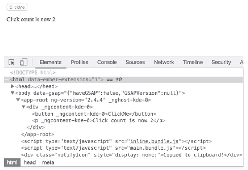

**图 1.1** 响应点击事件的`<button>`元素。

实际上，Angular 通过生成唯一的属性来局部而非全局应用 CSS，当你点击 Chrome 开发者工具中的“元素”选项卡时，这些属性是可见。

关于 Angular 组件样式的更多详细信息请访问：

[`angular.io/docs/ts/latest/guide/component-styles.html`](https://angular.io/docs/ts/latest/guide/component-styles.html)

列表 1.8 的下部分是`AppComponent`类的定义，它包含了`clickCount`变量，该变量在`clickMe()`函数中增加。

导航到此应用程序的`src`子目录并执行以下命令：

```bash
ng serve
```

图 1.1 显示此 Angular 应用程序的浏览器输出。你还可以看到`main.bundle.js`文件，它包含了经过压缩的“摇树（tree shaken）”代码，这些将在第 10 章中详细讨论。

### 元素与属性

在列表 1.8 中，`selector`属性匹配 HTML 页面`index.html`中的元素`<app-root></app-root>`：

```text
selector: 'app-root'
```

然而，你也可以指定属性而不是元素。例如，假设`index.html`包含以下元素：

```html
<div app-root>Loading. . .</div>
```

你还需要如下所示修改`selector`属性：

```text
selector: '[app-root]'
```


## 总结

本章从描述 Angular 版本号、Angular 的前提条件，以及 Angular 及其分层组件的结构的概述开始。

接下来，你学习了 Angular CLI 工具`ng`以及如何使用`ng`工具创建一个 Angular“Hello world”应用程序。你还学习了 TypeScript 文件`main.ts`、`app.component.ts`和`app.module.ts`，这些文件包含了 Angular 应用程序的 TypeScript 代码。接着，你学习了将 Angular 应用程序中的代码转译为 ECMA5 的原因。

最后，你看到了一个 Angular 应用程序的代码，它显示了一个同时也响应点击事件的`<button>`元素。

# 第 2 章：UI 控件与用户输入

本章包含各种用户界面（UI）控件的 Angular 应用程序，以及处理用户交互的示例，例如用户输入和鼠标事件。记住，本章中的代码示例使用标准的 HTML 语法渲染 UI 控件，而不是使用 Angular 特有的功能。此外，本章的最后一节包含了提供 Angular UI 组件的工具包链接。

本章的第一部分简要讨论了任何 Angular 应用程序都可以使用的基本调试技术。本节使用第 1 章中的按钮相关代码示例来说明如何在 Angular 中使用调试器。

本章的第二部分向你展示如何管理项目列表，包括显示、添加和删除列表项。注意，Angular 中的表单将留到第 4 章，你在那里学习控件（Controls）和控件组（ControlGroups）。


本章的第三节包含两个显示用户名列表的示例：第一个获取存储在 JavaScript 数组字符串中的用户名，第二个获取存储在 JavaScript 数组对象字量中的用户名。第三节更进了一步：你将学习如何定义一个包含用户信息（也包含在 JavaScript 数组中）的自定义用户组件。

**注意**

从配套光盘拷贝项目目录时，如果不存在`node_modules`目录，请拷贝在该项目目录内部软链接的顶层`node_modules`目录（大多数示例应用程序都是如此的）。

现在让我们学习如何在 Angular 中进行一些基本的调试。

### 在控制台中调试 Angular 代码

本节向你展示如何使用`ng.probe()`来“单步执行” Angular 应用程序执行，并找到（或更新）变量的值。本节中的信息将帮助你检测应用程序中的简单错误。如果你感兴趣，更强大的调试器是 Augury（一个 Chrome 扩展），它将在第 10 章中讨论。

现在在 Chrome 中启动第 1 章中的 Angular 应用程序（列表 1.8），执行以下步骤：

1. 打开 Chrome 开发者工具。
2. 点击“元素（Elements）”选项卡。
3. 点击`<app-root>`元素。

现在点击“控制台（Console）”选项卡并输入以下代码：

```javascript
ng.probe($0)
```

你会看到一个如下的`DebugElement`：

```javascript
DebugElement {nativeNode: app-root, parent: null, listeners: [0], providerTokens: [1], properties: Map}
```

展开上述对象并浏览其元素。点击屏幕顶部的按钮几次，然后使用以下代码获取类实例引用：

```javascript
ng.probe($0).componentInstance
```

上述片段显示了以下元素：

```javascript
UserInput {clickCount: 3}
```

使用以下代码片段修改`clickCount`的值：

```javascript
ng.probe($0).componentInstance.clickCount = 7
```

上述代码片段将`clickCount`的值改为 7，诚然在此代码示例中没有实际用途。然而，在包含各种输入字段和控件的其他 Angular 应用程序中，此功能可能对测试非常有用。

以下代码片段提供了组件相关信息：

```javascript
ng.probe($0).injector._depProvider.componentView
```

上述片段显示了如下：

```javascript
AppView {proto: AppProtoView, renderer: DebugDomRenderer, viewManager: AppViewManager_, projectableNodes: null, containerAppElement: AppElement}
```

```javascript
ng.probe($0).injector._depProvider.componentView.changeDetector
```

下一个代码片段提供了额外信息：

```javascript
ChangeDetector_UserInput_0 {id: "UserInput_0"", numberOfPropertyProtoRecords: 2, bindingTargets: [1], directiveIndices: [0], strategy: 5}
```

通过展开并检查其内容来实验可用元素。此外，以下链接包含了关于 Chrome 开发工具的有用信息：

[`developers.google.com/web/tools/chrome-devtools/javascript`](https://developers.google.com/web/tools/chrome-devtools/javascript)

现在让我们创建一个简单的 Angular 应用程序，向你展示如何通过`ngFor`指令显示字符串列表，正如下一节将所示。

### Angular 中的`ngFor`指令

本节中的代码示例通过`ngFor`指令显示了一个硬编码的字符串列表。这个简单的代码示例是一个起点，你可以借此创建更复杂——更有趣的 Angular 应用程序。


从附带光盘中将`SimpleList`目录复制到方便的位置。列表 2.1 显示了`app.component.ts`的内容，它说明了如何在 Angular 中使用`ngFor`指令显示项目列表。

**列表 2.1：`app.component.ts`**

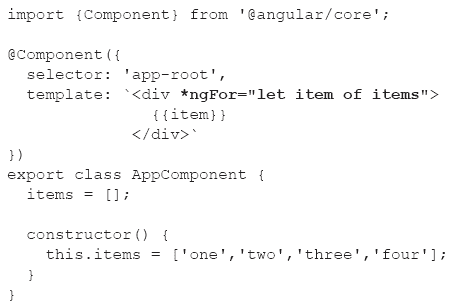

列表 2.1 包含一个`Component`注解，该注解内部又包含了标准的`selector`属性。`template`属性由一个`<div>`元素组成。该元素包含`ngFor`指令，它会遍历`items`数组并显示数组中的每个项目。请注意，`items`数组在`AppComponent`类中被初始化为空数组，然后在`constructor`方法中将其值设置为一个包含四个字符串的数组。

启动本节中的应用程序，你将在浏览器会话中看到以下输出：

```text
one
two
three
four
```

现在你已经了解了如何显示数组中的项目，让我们稍作离题，学习哪种 Angular 代码可以跟踪用户点击的单选按钮（即“已选中”状态）。之后，我们将看到如何使用`<button>`元素向用户列表添加新用户名。

## Angular 与单选按钮


从附带光盘中将`RadioButtons`目录复制到方便的位置。列表 2.2 显示了`app.component.ts`的内容，它说明了如何渲染一组单选按钮并跟踪用户点击了哪个按钮。

**列表 2.2：`app.component.ts`**

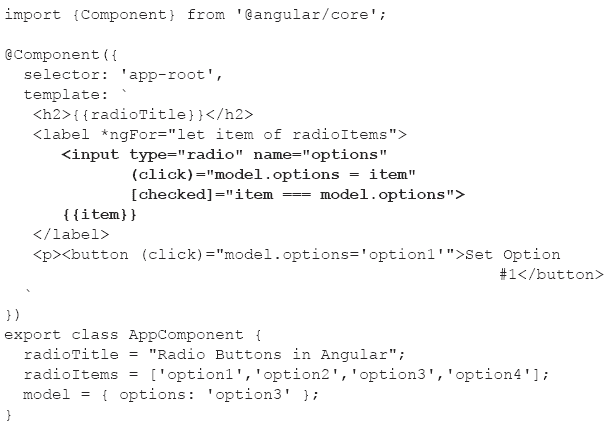

列表 2.2 定义了`AppComponent`组件，其`template`属性包含三个部分：一个`<label>`元素、一个`<input>`元素和一个`<button>`元素。`<label>`元素包含一个`ngFor`指令，通过遍历在`AppComponent`类中定义的`radioItems`数组来显示一组单选按钮。

默认情况下，第一个单选按钮会被高亮。然而，当用户点击`<button>`元素时，`<input>`元素的`(click)`属性会将`current`项目的值设置为`model.options`的值，然后`<input>`元素的`[checked]`属性会将`checked`项目设置为`model.options`的当前值。如你所见，列表 2.2 中的`<input>`元素的功能比使用 JavaScript 实现相同的结果更为紧凑。

## 在 Angular 列表中添加项目


从附带光盘中将`AddListButton`目录复制到方便的位置。列表 2.3 显示了`app.component.ts`的内容，它说明了当用户点击按钮时如何将字符串追加到项目数组中。

**列表 2.3：`app.component.ts`**

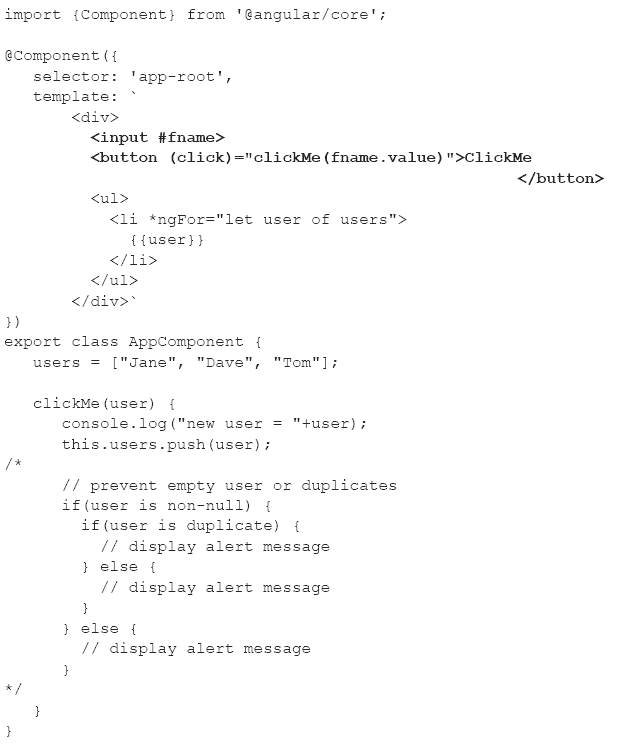

列表 2.3 包含与列表 2.1（显示字符串列表）类似的代码。此外，列表 2.3 中的`template`属性包含一个`<input>`元素，以便用户可以输入文本。当用户点击`<button>`元素时，会调用`clickMe()`方法并将`fname.value`作为参数传递，该参数是对`<input>`元素中内容的引用。

注意使用`#fname`语法作为元素的标识符，在这里这是一个`<input>`元素。因此，用户在`<input>`元素中输入的文本通过`fname.value`进行引用。下面的代码片段提供了此功能：

```html
<input #fname>

<button (click)="clickMe(fname.value)">ClickMe</button>
```

`AppComponent`组件中的`clickMe()`方法包含一个用于显示用户输入文本的`console.log()`语句，并将该文本追加到数组`user`中。列表 2.3 最后最后由一段被注释掉的伪代码组成，防止用户输入空字符串或重复字符串。此代码块涉及“纯” JavaScript，实际代码留给你作为练习。

## 在 Angular 列表中删除项目

本节通过在每个列表项旁边添加新的`<button>`元素增强了上一节的代码。


从附带光盘中将`DelListButton`目录复制到方便的位置。列表 2.4 显示了`app.component.ts`的内容，它说明了当用户点击每个数组项相邻的按钮时如何从项目数组中删除单个元素。

**列表 2.4：`app.component.ts`**

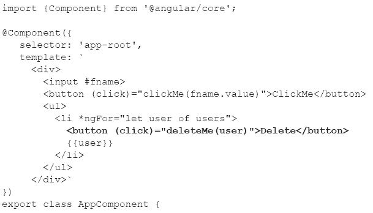

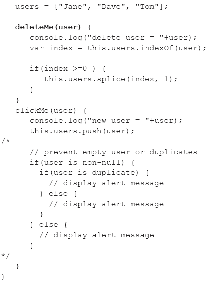

列表 2.4 包含一个`ngFor`指令，显示项目“对”列表，其中每个“对”由一个`<button>`元素和`users`数组中的一个用户组成。

当用户点击任何`<button>`元素时，“关联”的用户将作为参数传递给`deleteMe()`方法，该方法只需从`users`数组中删除该用户。`deleteMe()`的内容是从数组中删除项的标准 JavaScript 代码。

# Angular 指令与子组件

在本节中，你将看到如何创建一个可以在 Angular 应用程序中引用的子组件。


从附带光盘中将`ChildComponent`目录复制到方便的位置。列表 2.5 显示了`app.component.ts`的内容，说明了如何在 Angular 应用程序中引用你编写的自定义组件。

**列表 2.5：`app.component.ts`**


列表 2.5 包含一个`template`属性，它由一个`<div>`元素组成，该元素包含一个`<child-comp>`元素，后者是`ChildComponent`中`selector`属性的值。

注意列表 2.5 并没有导入`ChildComponent`类：该类在列表 2.7 的`app.module.ts`中被导入。

列表 2.6 显示了子目录中`child.component.ts`的内容。

**列表 2.6：`child.component.ts`**


列表 2.6 非常简单：`template`属性指定了出现在列表 2.5 `<div>`元素内部的文本字符串。

这是本章中第一个修改`app.module.ts`文件默认内容的代码示例。

列表 2.7 显示了`app.module.ts`修改后的内容，它必须从`child.component.ts`导入`ChildComponent`，并在`declarations`属性中指定`ChildComponent`。这些新增内容已加粗显示。

**列表 2.7：`app.module.ts`**

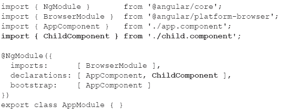

列表 2.7 中注意的第一个细节是新的导入语句（加粗显示），它从 TypeScript 文件`child.component.ts`导入了`ChildComponent`组件。第二个细节是`declarations`数组包含了`ChildComponent`。

如你所见，这些是在 Angular 应用程序中包含子组件的基本步骤。通过练习，你将熟悉本节所示的步骤顺序。

## 构造函数与 Angular 中的状态存储

本节包含一个代码示例，说明如何在构造函数中初始化变量，然后通过`template`属性中的插值引用该变量的值。


从附带光盘中将`StateComponent`目录复制到方便的位置。列表 2.8 显示了`app.component.ts`的内容。

**列表 2.8：`app.component.ts`**

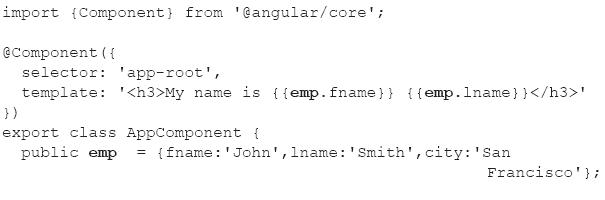

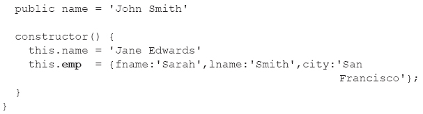

列表 2.8 与列表 2.5 几乎相同：当前代码涉及一个`constructor()`方法的添加，该方法初始化了变量名以及字量对象`emp`。`emp`变量在模板属性中以加粗显示，在`AppComponent`类内部的另外两个地方也加粗显示。

**问题**：当你启动应用程序时，将显示哪个名称？

**答案**：在`constructor`中赋值给`emp`变量的值。这种行为与`Java`等面向对象的语言是的。

以下是启动此应用程序的输出：

```text
My name is Sarah Smith
```


敏锐的读者会注意到，我们在`emp`和`name`变量的声明中“悄插入”了 TypeScript 关键字`public`。其他可能的关键字还包括`private`和`protected`，它们（再次）的行为与在`Java`中的行为相同。如果你不熟悉这些关键字，可以在网上找到在线教程，它们会解释这些用途。

TypeScript 支持另一种实用的语法（用于变量），将在下一节中讨论。

## 构造函数中的私有参数：快捷方式

TypeScript 提供了一种通过`constructor`初始化私有变量的简写。考虑以下 TypeScript 代码块：

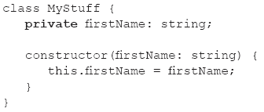

这里显示了一个简单且等效的 TypeScript 代码块：

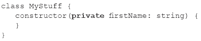

TypeScript 对`constructor`中`private`关键字的支持是一项很好的特性：它减少了一些样板代码，并消除了潜在的错误源（即变量名拼写错误）。

另一个例子是代码片段中的`constructor()`方法用从`EmpService`组件（定义在其他地方，此处省略）检索的数据填充了员工对象：

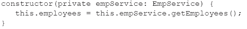

下一节将向你如何在 Angular 应用中使用`*ngIf`指令进行条件逻辑。

## Angular 中的条件逻辑

虽然之前的示例包含单行文本的模板属性，但 Angular 允许你指定多行文本。如果你将插值变量放在匹配的反引号内，Angular 将变量替换（“插值”）为它们的值。


将随附光盘中的`IfLogic`目录复制到方便的位置。列表 2.9 显示了`app.component.ts`的内容，说明了如何使用`*ngIf`指令。

**列表 2.9: app.component.ts**

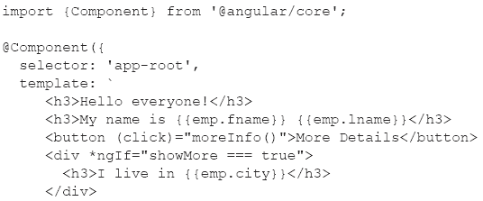

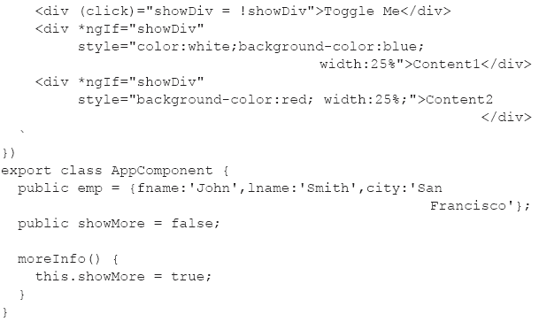

列表 2.9 在模板属性中包含一些新代码：一个`<button>`元素，当用户点击按钮时会调用`moreInfo()`方法。点击事件后，将显示一个带有`<h3>`元素内城市相关信息的`<div>`元素。注意，这个`<div>`元素仅在`showMore`为 true 时显示，这是通过`ngIf`指令控制的，该指令检查`showMore`的值。`showMore`的初始值为`false`，但一旦用户点击`<button>`元素，该值就会被设置为`true`，此时`<div>`元素就会显示。

`AppComponent`中的新代码涉及一个布尔变量`showMore`（初始为`false`）和方法`moreInfo()`，该方法将`showMore`初始化为`true`。

## 在 Angular 应用中检测鼠标位置

Angular 支持检测各种鼠标事件，其中一些你已经在之前的节中见过了（例如`click`事件）。本节的代码示例向你展示如何在缩放矢量图形 (SVG) `<svg>`元素内部检测鼠标位置（SVG 图形效果在第三章中讨论）。


将随附光盘中的`SVGMouseMove`目录复制到方便的位置。列表 2.10 显示了`app.component.ts`的内容，说明了如何检测`mousemove`事件并显示当前鼠标位置的坐标。

**列表 2.10: app.component.ts**

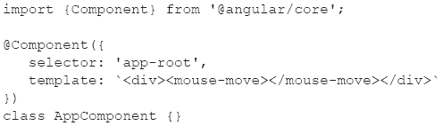

列表 2.10 包含一个模板属性，它由一个包含嵌套`<mouse-move>`元素的`<div>`组成，后者是自定义组件`MouseMove`中`selector`属性的值，该组件定义在`mousemove.ts`中。从本质上说`AppComponent`组件将`mousemove`事件的处理“委托”给`MouseMove`组件，后者定义了`mouseMove()`函数来处理此类事件。

列表 2.11 显示了`mousemove.ts`的内容，说明了如何检测`mousemove`事件并显示当前鼠标位置的坐标。

**列表 2.11: mousemove.ts**

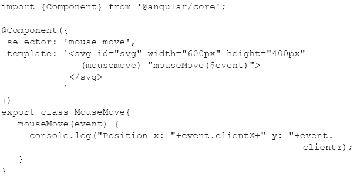

列表 2.11 包含`mouseMove()`方法，其唯一参数`event`是一个包含鼠标事件信息（如其位置）的对象。`mouseMove()`方法包含一个`console.log()`语句，简单地显示鼠标点击事件位置的 x 坐标和 y 坐标。

记得更新`app.module.ts`的内容以包含`MouseMove`类，如列表 2.12 所示。

**列表 2.12: app.module.ts**

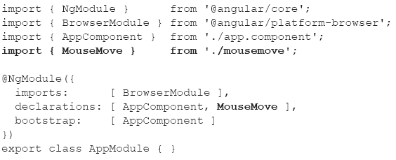

列表 2.12 导入了`MouseMove`类并将该类添加到`declarations`属性中（两者均已加粗显示）。

### Angular 中的鼠标事件和用户输入

Angular 支持鼠标事件，并自动识别`click`、`mousedown`、`mousemove`、`mouseover`、`mouseup`和`mousewheel`事件。

以下代码片段向你展示如何在标准 HTML 中指定带有事件处理程序的`<button>`元素：

```html
<button onclick="action()">Action</button>
```

以下代码片段向你展示如何在 Angular 中指定带有事件处理程序的`<button>`元素：

```html
<button (click)="action($event)">Action</button>
```

列表 2.13 显示了`mouseevents.ts`的内容，说明了如何处理 mouseover 事件。

**列表 2.13: mouseevents.ts**

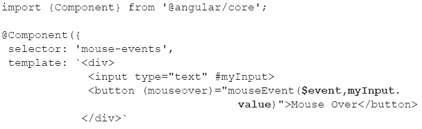

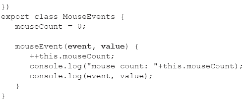

列表 2.13 包含一个模板属性，由一个`<div>`元素、一个用户可以输入文本的`<input>`元素和一个带有名为`mouseEvent`相关事件的`<button>`元素组成。

列表 2.14 显示了`app.component.ts`的内容，涉及一个用于鼠标相关通用`<mouse-events>`元素。注意这是一个自定义元素（即它不是 Angular 元素）。

要通过鼠标点击捕用户输入，将`<button>`元素中的`(mouseover)`替换为`(click)`（并更新显示的文本），如下所示：

```html
<button (click)="mouseEvent($event,myInput.value)">Add</button>
```

本节的代码示例将为你展示如何处理用户输入，并引入了 Angular 中`service`（服务）的概念，该将在第 5 章中进行详细讨论。

正如你已经看到的，Angular 允许你创建指向 HTML 元素的引用，如下所示：

```html
<input type="text" #user>
```

`#user`语法创建了对`<input>`元素的引用，你能够引用`{{user.value}}`来查看其值，或者引用`{{user.type}}`来查看输入的类型。此外，你可以在下面的代码块中使用该引用：

```html
<p (click)="user.focus()">获取输入焦点

</p>

<input type="text" #user (keyup)>

{{user.value}}
```

当用户点击`<input>`元素时，会调用`focus()`方法，并且`(keyup)`属性会在按键释放（keyup）事件发生时更新输入中的值。


从随附光盘中拷贝`TodoInput`目录到方便的位置。列表 2.16 显示了`app.component.ts`的内容，它展示了在 Angular 中如何引用一个组件将用户输入追加到数组中。

**列表 2.16: app.component.ts**

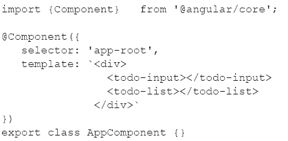

列表 2.16 包含一个标准的导入语句。`template`属性指定了一个`<div>`元素，该元素包含`TodoInput`和`TodoList`组件的占位符。

列表 2.17 显示了`todoinput.ts`的内容，它展示了在 Angular 中如何显示一个`<input>`字段和一个`<button>`元素来捕获用户输入。

**列表 2.17: todoinput.ts**

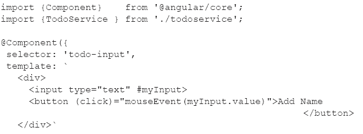

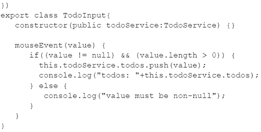

列表 2.17 包含一个`template`属性，由一个包含用于用户输入的`<input>`元素的`<div>`元素组成，随后是一个用于处理鼠标点击事件的`<button>`元素。

`TodoInput`类定义了一个空的构造函数，它还初始化了在文件顶部导入的自定义`TodoService`实例。该实例包含一个`todos`数组，当用户点击`<button>`元素时，只要新的待办事项不是空字符串，该数组就会用新的事项更新。

列表 2.18 显示了`todolist.ts`的内容，它跟踪待办列表中的项目。

**列表 2.18: todolist.ts**

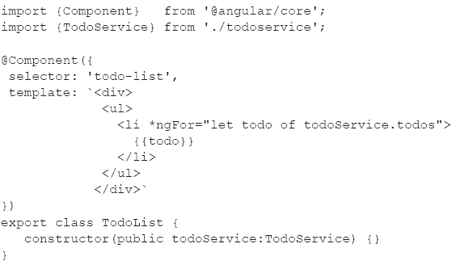

列表 2.18 包含一个`template`属性，其内容与列表 2.3 中`template`属性的内容相似，并有一个初始化`TodoService`自定义组件实例的空构造函数。该实例用于`template`属性中遍历`todos`数组中的元素。

列表 2.19 显示了`todoservice.ts`的内容，它跟踪待办列表。

**列表 2.19: todoservice.ts**

```typescript
export class TodoService {

  todos = [];

}
```

列表 2.19 包含一个`todos`数组，当用户点击根组件中的`<button>`元素时，该数组会用新的待办事项进行更新。

最后，更新`app.module.ts`的内容以包含列表 2.20 中**加粗显示**的类。

**列表 2.20: app.module.ts**

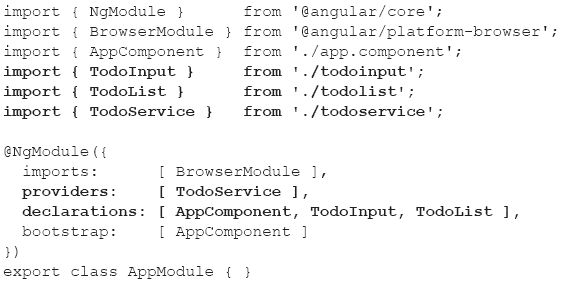

列表 2.20 导入了三个与待办相关的类，并将它们添加到`providers`属性和`declarations`属性中（加粗显示）。

## Angular 中的 moduleId 和 templateUrl 属性

前面的章节向你展示了如何在`template`属性中使用`ngFor`指令来遍历项目列表。Angular 还支持`templateUrl`属性，这意味着你可以将`template`属性中的代码移动到单独的文件，然后将该文件的名称作为`templateUrl`属性的值。

例如，假设`template`属性中的代码放置在`itemdetails.html`文件中。如果该文件与`itemsapp.ts`（如下所示）位于同一目录下，你必须包含`moduleId`属性，以指示`itemdetails.html`文件所在的子目录。如果你没有指定`moduleId`属性，那么 Angular 将假设`itemdetails.html`与启动顶层 Angular 组件的顶层 Web 页面位于同一目录。

**注意**

*使用`moduleId`属性为`templateUrl`属性中指定的的文件指定相对路径。*

列表 2.21 显示了`itemsapp.ts`的内容，它引用了文件`itemdetails.html`，其中包含遍历项目列表的代码。`moduleId`属性表示该文件与`itemsapp.ts`在同一目录下。

**列表 2.21: itemsapp.ts**

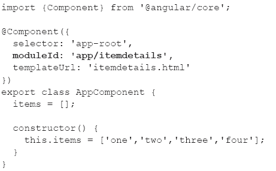

列表 2.21 包含一个`templateUrl`属性，它引用了文件`itemdetails.html`，其中包含显示`items`数组内容的 Angular 代码。

列表 2.22 显示了`itemdetails.html`的内容，其中包含显示`items`数组内容的代码，该数组在列表 2.21 的构造函数中初始化。

**列表 2.22: itemdetails.html**

```html
<div *ngFor="let item of items">

  {{item}}

</div>
```

你可以轻松地将列表 2.22 的内容移动到`template`属性中；列表 2.21 展示了使用`templateUrl`属性。

## 在 Angular 中处理自定义类

你已经见过一个表示用户的自定义类示例。本节向你展示如何处理自定义类的实例数组。

列表 2.23 显示了`newuser.ts`的内容，展示了如何创建一个表示用户的 TypeScript 类。

**列表 2.23: newuser.ts**

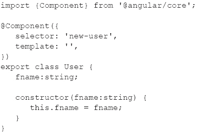

为了便于说明，列表 2.23 定义了一个仅跟踪`fname`属性的简单 User 组件。

列表 2.24 显示了`app.component.ts`的内容，它使用`User`组件填充数组并显示用户相关信息。当姓名之外还包含其他用户属性时，`User`类显然更有用。

**列表 2.24: app.component.ts**

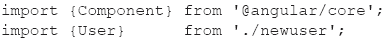

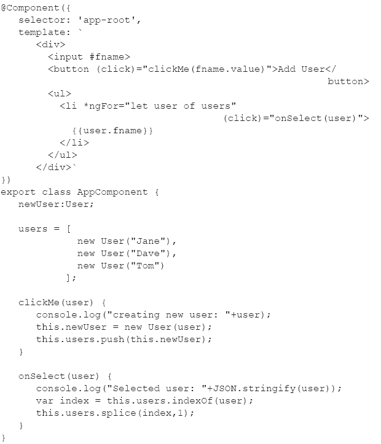

列表 2.24 包含一个`template`属性，它遍历`User`实例并显示每个实例包含的内容。注意`users`数组是在`AppComponent`组件中初始化的：从`User`组件中创建了三个`User`实例。列表 2.24 还包含一个`clickMe()`方法，当用户点击`<button>`元素时会调用该方法，之后一个新用户会被添加到`users`数组中。最后，列表 2.24 包含一个`onSelect()`方法，当用户选择列表中的不同项目时调用。

## 多组件中的点击事件

Angular 应用可以包含多个组件，每个组件都可以声明同名的事件处理器。本节包含一个示例，向你展示在 Angular 应用中处理点击事件的顺序。


从随附光盘中拷贝`ClickItems`目录到方便的位置。列表 2.25 显示了`app.component.ts`的内容，它为列表中的每个项目声明了`onClick()`事件处理器。

**列表 2.25: app.component.ts**

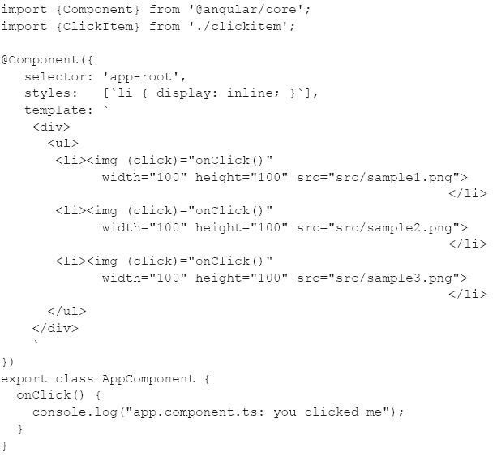

列表 2.25 中的`template`属性显示了一个无序列表，其中每项都是一个可点击的 PNG 图像。当用户点击这些图像之一时，会调用`onClick()`方法，该方法通过`console.log()`显示一条消息。

列表 2.26 显示了`clickitem.ts`的内容，它为列表中的每个项目声明了`onClick()`事件处理器。

**列表 2.26: clickitem.ts**

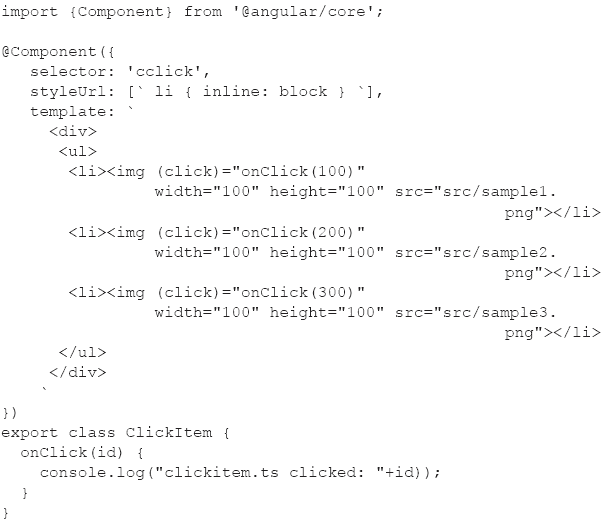

列表 2.26 在功能上与列表 2.25 相似。启动应用程序并在浏览器中的不同位置点击，观察 Chrome Web 检查器中显示的不同消息。

Angular 支持`@Input`和`@Output`注解来在组件之间传递值。`@Input`注解用于接收父组件传递值的变量，而`@Output`注解则在给定变量的值被修改时，将数据从组件发送（或“发射”）到其父组件。

此代码示例的输出结果平淡无奇。然而，此代码示例的目的是引起你对一些不符合直觉的代码片段的关注（特别是`app.module.ts`中的）。此外，此代码示例在 2.1.5 版本的 TypeScript 编译器中可以正常工作，但未来的版本可能需要对代码进行修改（请记住这一点）。


现在，从随附光盘中将`ParentChildEmitters`目录复制到方便的位置。列表 2.27 显示了`app.component.ts`的内容，向你展示了如何从父组件更新子组件属性的值。

### 列表 2.27：app.component.ts

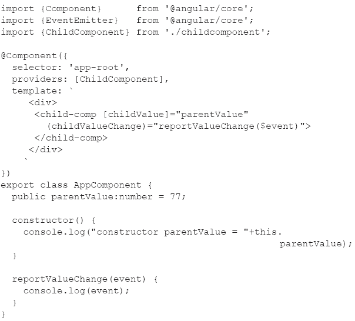

列表 2.27 中的`template`属性有一个顶层`<div>`元素，其中包含一个`<child-comp>`元素，该元素有两个属性，如下所示：

```html
<child-comp [childValue]="parentValue" (childValueChange)="reportValueChange($event)">

</child-comp>
```


`[childValue]` 属性将 `parentValue` 的值赋值给 `childValue`。注意，变量 `parentValue` 定义在 `AppComponent` 中，而变量 `childValue` 定义在 `ChildComponent` 中。这就是如何将值从父组件传递到子组件。

接下来，`childValueChange` 属性被赋值为从 `ChildComponent` 返回的值给当前（“父”）组件。请记住，只有当 `childValue`（在子组件中）的值被修改时，属性 `childValueChange` 才会更新。这就是如何将值从子组件传递到父组件。

请记住以下一点：子组件*必须*定义一个类型为 `EventEmitter` 的变量（例如 `childValueChange`），以便从子组件“发射”修改后的值到父组件。

列表 2.27 的下一部分是一个简单的构造函数，随后是包含 `console.log()` 语句的方法 `reportValueChange`。

列表 2.28 显示了 `childcomponent.ts` 的内容，向你展示了如何从父组件更新子组件属性的值。

### 列表 2.28：childcomponent.ts

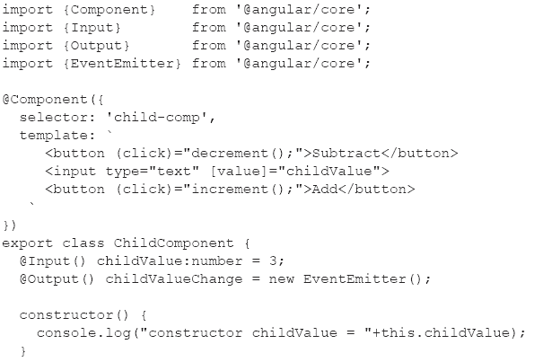

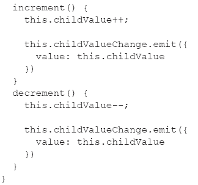

列表 2.28 包含一个 `template` 属性，该属性有一个“递减”`<button>` 元素、一个用户可以输入数字的 `<input>` 字段，还有一个“递增”`<button>` 元素。第一个 `<button>` 元素增加 `<input>` 字段的值，而第二个 `<button>` 元素减少值。

导出类 `ChildComponent` 数值变量 `childValue`，它通过 `@Input()` 装饰，其值由父组件设置。

如你所见，`increment()` 和 `decrement()` 方法分别增加和减少 `childValue` 的值。在两种情况下，通过此代码块将修改后的 `childValue` 值“发射”回父组件：

```typescript
this.childValueChange.emit({
  value: this.childValue
})
```

按照列表 2.29 所示更新 `app.module.ts` 内容，这与本章之前示例中的代码不同。

### 列表 2.29：app.module.ts

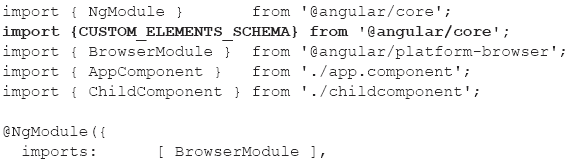

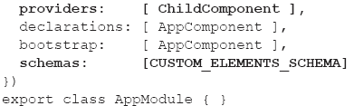

如果你在 `declarations` 属性中指定 `ChildComponent` 而不是 `providers` 属性，你可能会看到此错误消息：

```
"Can't bind to <child-comp> since it isn't a known native property"
```

当你启动本节中的 Angular 应用时，`<input>` 元素中显示的值是 77，这是父组件中的值，而不是在子组件中赋值的值（为 3）。

## 展示组件（Presentational Components）

展示组件作为输入接收数据并作为输出生成视图（因此它们不维护应用程序状态）。考虑以下组件：

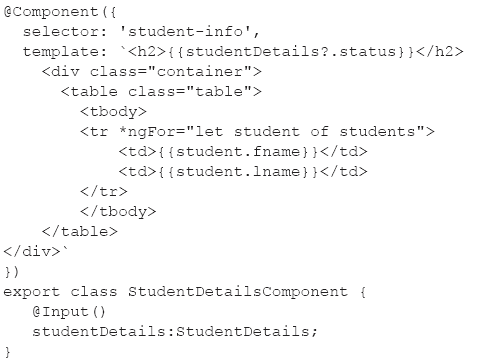

`StudentDetailsComponent` 组件主要具有展示职责。该组件接收输入数据并在屏幕上显示它。因此，该组件是可重用的。

相比之下，特定应用程序的组件（也称为“智能”组件）与特定的 Angular 紧耦合。因此，一个智能组件将有一个展示组件（但反之则不然）。

由于数据是同步传递给此组件的（而不是通过 `Observable`），数据最初可能不存在，这就是为什么要包含所谓的埃尔斯运算符（模板中的 `“?”`）的原因。

## Angular 中的样式元素和 Shadow DOM

Angular 支持层级样式表（CSS）封装，这意味着 CSS 选择器将只匹配定义在同一个自定义组件中的元素。这种封装的实现得益于 Angular 中的 ShadowDOM 模拟。具体来说，这涉及一个导入 `ViewEncapsulation` 的导入语句，并指定以下值之一：

 `ViewEncapsulation.Emulated`

 `ViewEncapsulation.Native`

 `ViewEncapsulation.None`

组件的默认值是 `ViewEncapsulation.Emulated`，它输出我们的样式并继承全局样式。相比之下，`ViewEncapsulation.Native` 使用原生 ShadowDOM（并非所有浏览器都支持），并且丢失全局样式。最后，`ViewEncapsulation.None` 移除组件中的所有封装。

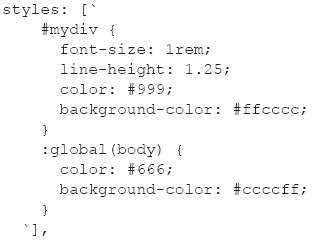


从随附光盘中将 `Encapsulation` 目录复制到方便的位置。列表 2.30 显示了 `app.component.ts` 的内容，它包含一个匹配 `app.component.ts` 中 `<button>` 元素的 CSS 选择器，但不匹配 `index.html` 中的 `<button>` 元素。

### 列表 2.30：app.component.ts


列表 2.30 包含两个导入语句和一个设置为 `Native` 的封装属性。接下来，`styles` 属性为模板中定义的 `<button>` 元素指定红色。

现在通过如下所示添加 `<button>` 元素来修改 `index.html` 中的 `<body>` 元素：


启动 Angular 应用，你将在组件中看到红色的 `<button>` 元素，在 HTML 页面看到深灰色的 `<button>` 元素。

## Angular UI 组件

本章的代码示例展示了如何在 Angular 应用中使用 HTML 控件。然而，你也可以使用作为 HTML 控件“封装”的 Angular UI 组件。官方 网站包含了丰富的 UI 组件：

[`angular.io/resources/#!UI%20Components`](https://angular.io/resources/)

前面的网站包含指向其他工具包的链接，例如 `ng-bootstrap`（用于 Bootstrap 的原生 Angular 2 指令）和 `Angular Material 2`（用于 Angular 2 的 Material Design 组件）。

以下网站包含了丰富的 Angular UI 组件（例如表格、树、菜单和图表）：

[`github.com/brillout/awesome-angular-components`](https://github.com/brillout/awesome-angular-components)

请记住，上述链接中的 UI 组件是针对 Angular 2 的，因此最好在最新版本的 Angular 中测试它们。此外，第 5 章包含了在 Angular 4 版本中有效的表单相关 UI 组件。

## Angular 新功能

Angular 的一些新功能包括支持 `ngIf` 指令中的 if/else 逻辑以及 `NgComponentOutlet` 指令。

`ngIf` 指令根据表达式的值有条件地包含一个模板。接下来，`ngIf` 会评估表达式，并在 `expression` 分别为真（truthy）或假（falsy）时，相应地渲染 then 模板或 else 模板。通常情况下，then 模板是 `ngIf` 的内联模板，除非绑定到不同的值；而 else 模板在未绑定的情况下将为空白。更多信息请参此处：

https://angular.io/docs/ts/latest/api/common/index/NgIfdirective.html

`NgComponentOutlet` 指令是一个实验性指令，为创建动态组件提供了一种声明式方法，其示例所示：

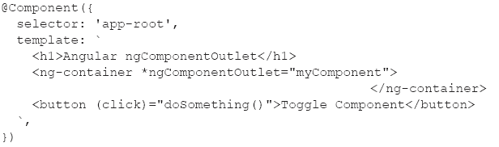

正如你可能猜到的那样，`ng-container` 指令是用于“分组”节点的逻辑容器。在之前的代码块中，`ng-container` 指令拥有一个类型为 `Input` 的 `NgComponentOutlet`，该值反过来引用了一个自定义组件。接下来，请确保如所示所示将动态组件添加到 `ngModule` 的 `entryComponents` 部分：

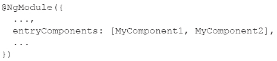

`NgComponentOutlet` 指令支持额外的选项，此处在此描述：

https://angular.io/docs/ts/latest/api/common/index/NgComponentOutlet-directive.html

## 总结

本章向你展示了如何在 Angular 应用中使用 UI 控制。你看到了如何渲染按钮、如何渲染名称列表，以及如何从这些列表中添加和删除名称。你还学习了条件逻辑以及如何创建子组件。

然后，你看到了如何处理与鼠标相关的事件，例如 `mousemove` 事件。接下来，你学习了父子组件之间的通信，随后是对演示型组件的讨论。你还学习了如何在 Angular 应用中指定不同类型的 CSS 封装。最后，你还简要地介绍了 Angular 中一些新的 UI 相关特性。

# 第 3 章

## 图形与动画

本章向你如何通过 HTML5 技术和各种开源工具包创建具有图形和动画效果的 Angular 应用。这个与图形相关的章节在书中较早介绍，是因为图形提供了一种学习技术的趣味性方式。即使你不计划在 Angular 应用中使用图形和动画，也值得快速浏览本章内容，以熟悉未来可能对你有用的视觉效果。

正如你很快看到的，本章中的代码示例使用了与 Angular 无关的技术，例如可缩矢量图形 (`SVG`)、数据驱动文档 (`D3`)、GreenSock 动画平台 (`GSAP`)、层叠样式表 3 (`CSS3`) 以及 `jQuery`。事实上，一个示例使用“纯” `CSS3` 在 Angular 应用中创建动画效果，然后被适配到一个使用 Angular 动画属性创建动画效果的代码示例中。在阅读了该示例的代码后，你可以创建自己的变体，或许通过结合本章中其他代码示例的技术。

如果你是图形效果方面的新手，这可能是学习如何用 Angular 创建图形和动画效果的最快路径。因此，你受益于两点：首先，“符合 Angular 方式”的动画效果有相当数量的在线文档；其次，你不需要花费大量额外时间学习如何使用无关技术在 Angular 中创建动画效果。

本章的第一节讨论了 Angular 生命周期，部分是因为本章中与 `GSAP` 相关的代码示例需要其中一个生命周期方法。

本章的第二节向你展示了如何在 `SVG` 以及 `D3` 中渲染图形并创建动画效果。虽然本节的示例非常简单，但它们提供了一个起点，以防你需要在 Angular 应用中创建此类效果。

第三节包含了基于 `D3` 的图形和动画效果示例。如果你还不知道，`D3` 是一个非常流行且非常适合数据可视化的开源工具包（因此它被包含在本章中）。

第四节包含一个使用“纯” `CSS3` 创建动画效果的示例，以及一个结合 `CSS3` 与 `jQuery` 的代码示例。接下来，你将学习如何在 Angular 应用中处理与鼠标相关的事件。最后一节简要讨论了用于创建图表和图的 Angular 模块 `ng2-charts`。

关于本章代码示例的一个重要提示：它们假设你已经具备 `SVG`、`D3`、`GSAP`、`CSS3` 和 `jQuery` 的基础知识。如果你不熟悉其中任何技术，可以阅读描述其基本特征的在线教程，或者继续阅读代码示例以识别你需要从在线资源中学习的概念。即使你决定跳过图形示例，也请阅读本章的第一节，该节讨论了 Angular 生命周期并提供了有关 Angular 应用的有用信息。

包含了多个 GitHub 仓库，其中包含大量的色块类代码示例，说明了通过 `SVG`、`D3`、`HTML5 Canvas`、`GSAP` 和 `CSS3` 创建额外图形和动画效果的技术。顺便提一下（如果你感兴趣的话），可以将 `WebGL` 与 Angular 结合，其示例位于：

https://github.com/chliebel/angular2-3d-demo

另有一点需要记住：尽量避免使用原生解决方案进行文档对象模型 (DOM) 操作，例如 `document.domMethod()` 或 `$('dom-element')`，并谨慎使用它们（如果必须）。Angular 允许你通过 `ElementRef`、`Renderer` 和 `ViewContainer` 应用程序接口 (API) 安全地执行 DOM 操作。然而，本章中的某些代码示例确实打破了上述建议，向你展示如何创建特定类型的图形。

### 注意


*从磁盘拷贝项目目录时，如果没有 node_modules 目录，请拷贝项目内部软链接 node_modules 目录（大多数示例应用如此）。*

在深入研究图形示例之前，让我们来看 Angular 生命周期方法。

## Angular 生命周期方法

Angular 应用拥有生命周期方法，你可以在其中放置自定义代码来处理各种事件（应用启动、运行等）。生命周期钩子接口定义在 `@/core` 库中，列如下：

 `OnInit`

 `OnDestroy`

 `DoCheck`

 `OnChanges`

 `AfterContentInit`

 `AfterContentChecked`

 `AfterViewInit`

 `AfterViewChecked`

每个接口都有一个方法，其名称在接口名称前加上 `ng`。例如，`OnInit` 接口有一个名为 `ngOnInit` 的方法。Angular 按以下顺序调用这些生命周期方法：

 `ngOnChanges`: 当输入输出绑定值改变时调用

 `ngOnInit`: 在第一次 `ngOnChanges` 之后调用

 `ngDoCheck`: 开发者的自定义变更检测

 `ngAfterContentInit`: 组件内容初始化后调用

 `ngAfterContentChecked`: 每次检查组件内容后调用

 `ngAfterViewInit`: 组件视图初始化后调用

 `ngAfterViewChecked`: 每次检查组件视图后调用

 `ngOnDestroy`: 在指令被销毁之前调用。

由于 Angular 在组件创建时会调用该组件的 `constructor`，因此 `constructor` 是初始化该组件状态的方便位置。然而，在访问子组件中定义的任何属性或数据之前，必须先初始化子组件。在这种情况下，请在 `ngOnInit` 生命周期方法中放置自定义代码，以便从子组件获取数据。

Angular 完整的生命周期事件位于此处：

- [`angular.io/docs/ts/latest/guide/lifecycle-hooks.html`](https://angular.io/docs/ts/latest/guide/lifecycle-hooks.html)
- [`learnangular2.com/lifecycle/`](http://learnangular2.com/lifecycle/)

## Angular 生命周期周期方法的简单示例


将配套光盘中的 `LifeCycle` 目录复制到方便的位置。

列表 3.1 显示了 `app.component.ts` 的内容，向你展示了某些 Angular 生命周期周期方法被调用的顺序。

***列表 3.1: app.component.ts***

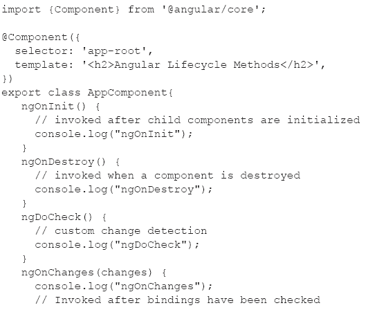
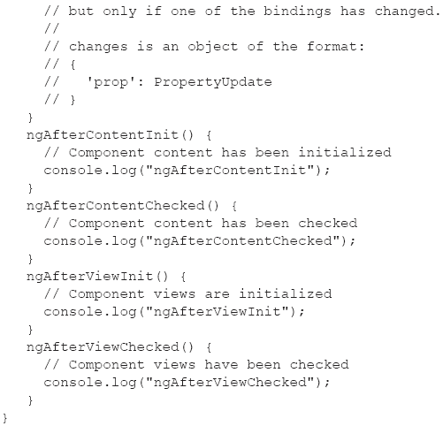

列表 3.1 包含了所有的 Angular 生命周期周期方法，每个方法都包含 `console.log()`，以便你可以看到方法执行的顺序。

通过导航到 `LifeCycle` 应用程序的 `src` 子目录并执行以下命令启动应用程序：

```bash
ng serve
```

在 Chrome 会话中导航到 `localhost:4200`，然后打开 Chrome 开发者工具，将在 Console 标签中看到以下输出：

```
ngOnInit
ngDoCheck
ngAfterContentInit
ngAfterContentChecked
ngAfterViewInit
ngAfterViewChecked
ngDoCheck
ngAfterContentChecked
ngAfterViewChecked
```


下一节将说明`ngAfterContentInit()`方法在动态生成一组 SVG 元素后应用动画效果的作用。

## GSAP 动画与 ngAfterContentInit() 方法


将配套光盘中的`D3GSAP`目录复制到方便的位置。此代码示例涉及更新（或创建）以下文件：

- `package.json`
- `main.ts`
- `app.component.ts`
- `app.module.ts`
- `ArchTubeOvals1.ts`

现在按照如下方式在`package.json`中安装所需的`gsap`包：

```
npm install gsap --save
```

接下来，在`main.ts`中导入`gsap`，如列表 3.2 所示。

**列表 3.2: main.ts**


除了加粗的代码段外，列表 3.2 包含了动态生成的代码。

现在来看列表 3.3，它显示了`app.component.ts`的内容，其中包含了生命周期方法`ngAfterContentInit()`。该方法执行基于 GSAP 的动画代码来对某些动态生成的 SVG 元素执行动画。

**列表 3.3: app.component.ts**


列表 3.3 中的`ngAfterContentInit`方法包含了创建动画效果的基础 GSAP 代码。这些效果根据 SVG 元素的`id`属性的值（该值是字符串`elem`和一个整数的拼接）应用到 SVG 元素上。导航到 GSAP 主页并参考在线 GSAP 文档，了解有关列表 3.3 中 GSAP API 的细节。

当组件加载后执行 JavaScript 函数时，`ngAfterContentInit()`方法非常有用。代码示例中，TypeScript 文件`ArchTubeOvals1.ts`定义了一个子组件，动态生成一组 SVG 元素，随后`mainArchOvals.ts`中的代码会执行一个 JavaScript 函数，添加基于 GSAP 的动画效果。这种执行序列确保了动画效果在 SVG 元素创建*之后*被应用：否则 SVG 元素尚不存在，因此没有动画效果！

列表 3.4 显示了`ArchTubeOvals1.ts`（位于`src/app`子目录）的内容，它动态生成了一组 SVG 元素。

**列表 3.4: ArchTubeOvals1.ts**


列表 3.4 定义了`ArchTubeOvals`自定义组件，其`constructor`调用`generateGraphics()`方法，该方法生成一组 SVG `<ellipse>`元素。该方法中的代码由一组 JavaScript 变量以及随后的计算类阿基米德螺旋上位置的循环组成。每个位置都用于计算渲染在该位置的动态生成的 SVG `<ellipse>`元素的属性。

现在更新`app.module.ts`以包含对 TypeScript 文件`ArchTubeOvals1.ts`的必要引用，如列表 3.5 中加粗所示。

**列表 3.5: app.module.ts**


本节中的代码示例是通过结合 Angular 和 GSAP 可以创建的图形效果的简单说明。涉及 SVG、GSAP 和 Angular（但使用测试级 Angular 代码）的不同示例位于此处：

- [`github.com/ocampesato/react-svg-gsapi`](https://github.com/ocampesato/react-svg-gsapi)

下一节将向你展示如何在 Angular 中添加 CSS3 动画效果。

## Angular 中的 CSS3 动画效果

本节的代码示例通过添加 CSS3 动画效果增强了上一节的代码示例。


将配套光盘中的`SimpleCSS3Anim`目录复制到方便的位置。列表 3.6 显示了`app.component.ts`的内容，展示了用户悬停在列表项上时更改其颜色。

**列表 3.6: app.component.ts**


列表 3.6 包含了`styles`属性，用于创建动画效果的`@keyframes`定义。`styles`属性还包含一个`li:hover`选择器，它引用了`@keyframes`定义并为动画效果指定了 4 秒的时间。你看到的颜色是在`@keyframes`定义中指定的。

启动 Angular 应用程序。当浏览器显示名称列表时，将鼠标缓慢移动到名称上方。

## 通过“Angular 方式”实现动画

本节的代码示例通过添加某些 CSS 选择器创建了动画效果。


将配套光盘中的`SimpleNG2Anim`目录复制到方便的位置。列表 3.7 显示了`app.component.ts`的内容，展示了用户用鼠标悬停在`<li>`元素上时移动其位置。

**列表 3.7: app.component.ts**


列表 3.7 对 3.6 中的代码进行了五处修改。具体而言：
- 部分 1：替换了原始导入语句。
- 部分 2：新添加的`Emp`类，用于存储每个员工的数据。
- 部分 3：新增的`transitions`属性，定义了触发动画事件时的行为（这发生在位于`<li>`元素上的`mousemove`事件期间）。
- 部分 4：`ngFor`元素中的加粗部分将`mousemove`事件绑定到`Emp`类中的`toggleState()`方法。
- 部分 5：`Emp`对象数组替换了原始数组，原始数组中每个员工都表示为 JavaScript 对象表示 (JSON) 字符串。

## Angular 中的基础 SVG 示例

本节的代码示例向你展示如何指定一个包含用于显示 SVG 元素的 SVG 代码的自定义组件。


将配套光盘中的`SVGEllipse1`目录复制到方便的位置。列表 3.8 显示了`app.component.ts`的内容，该文件引用了一个`Angular`自定义组件以渲染一个 SVG 圆。

### 列表 3.8：app.component.ts


列表 3.8 非常简单：代码定义了一个组件，其`template`属性在`<div>`元素内部包含了一个自定义的`<my-svg>`元素。

列表 3.9 显示了`MyEllipse1.ts`的内容，该文件包含了用于 SVG 圆形的 SVG 代码。

### 列表 3.9：MyEllipse1.ts


列表 3.9 非常直接直观：`template`属性包含一个带有`width`和`height`属性的 SVG `<svg>`元素，以及一个嵌套的 SVG `<ellipse>`元素，其中所需的属性`cx`、`cy`、`rx`、`ry`和`fill`使用了硬编码的值。

列表 3.10 显示了`app.module.ts`的内容，其中新内容已加粗显示。

### 列表 3.10：app.module.ts


列表 3.10 包含了你在第 2 章中熟悉的通用代码，以及一个涉及`MyEllipse1`类的新导入语句（**加粗显示**）。列表 3.10 的另一个修改是在`declarations`数组中包含了`MyEllipse1`类（**加粗显示**）。

启动`Angular`应用程序，你将看到一个彩色的 SVG 圆。

顺便提到，以下链接解释了如何创建 SVG 渐变，以及如何在`Angular`应用中创建 SVG 渐变效果：

[`developer.mozilla.org/en-US/docs/Web/SVG/Tutorial/Gradients`](https://developer.mozilla.org/en-US/docs/Web/SVG/Tutorial/Gradients)

[`medium.com/@OlegVaraksin/how-to-proper-use-svg-gradients-in-angularjs-2-3241672e4de2#.oah0e9z1k`](https://medium.com/@OlegVaraksin/how-to-proper-use-svg-gradients-in-angularjs-2-3241672e4de2#.oah0e9z1k)

## Angular 与 SVG 中的鼠标跟随


本节的代码示例创建了一个子组件，并使用鼠标相关的事件来创建动态图形效果。将配套光盘中的`SVGFollowMe`目录复制到方便的位置。

列表 3.11 显示了`app.component.ts`的内容，说明了如何引用自定义的`Angular`组件，该组件在当前鼠标位置渲染一个 SVG `<ellipse>`元素。

### 列表 3.11：app.component.ts


如你所见，列表 3.11 中的`template`属性指定了一个包含自定义`<mouse-move>`元素的`<div>`元素。

列表 3.12 显示了`MouseMove.ts`的内容，说明了如何引用自定义的`Angular`组件，该组件在当前鼠标位置渲染一个 SVG `<ellipse>`元素。

### 列表 3.12：MouseMove.ts


列表 3.12 包含一个定义了 SVG `<svg>`元素的`template`属性。每当用户移动鼠标时，`(mousemove)`事件处理程序就会执行，从而执行自定义方法`mouseMove()`。

注意，`mouseMove`方法接收一个事件参数，该参数是一个提供每个`mousemove`事件位置坐标的对象。坐标由`event.clientX`和`event.clientY`指定，它们分别是当前鼠标位置的 x 坐标和 y 坐标。

`mouseMove`方法中的下一个代码块动态创建了一个 SVG `<ellipse>`元素，设置了五个必需属性的值（详情请参见上一节），然后将新创建的 SVG `<ellipse>`元素附加到 DOM 中。此功能创建了鼠标跟随效果，当你启动本节中的`Angular`应用程序代码时可以看到这种效果。

注意，`mouseMove`方法中的最后一行代码将 SVG `<ellipse>`元素*直接*附加到 DOM 中；如果可能，最好避免这种方法。

列表 3.13 显示了`app.module.ts`的内容，其中新内容已加粗显示。

### 列表 3.13：app.module.ts


列表 3.13 中的代码遵循一个熟悉的模式：从“基线”代码开始，添加一个引用导出的 TypeScript 类（在本例中为`MouseMove`）的导入语句，并将该 TypeScript 类添加到`declarations`数组中。

启动`Angular`应用程序。在启动新的浏览器会话后，缓慢移动鼠标，查看在鼠标附近渲染的不同颜色的 SVG 圆。作为一个练习，修改`MouseMove.ts`中的代码，使新的 SVG 圆“居中”在你的鼠标下方。

## D3 与 Angular
前两个节向你展示了带有 SVG 的`Angular`应用示例。本节向你展示了如何将`D3`与`Angular`结合。本节中的代码示例直接将 SVG 元素附加到 DOM。

如果你还不了解`D3`，它是一个基于 JavaScript 的开源工具包，为 SVG 提供了一个抽象层。率地说，每个 SVG 的属性与前面的代码块相同。


将配套光盘中的`D3Angular2`目录复制到方便的位置。列表 3.14 显示了`app.component.ts`的内容，说明了如何使用`D3`渲染基础形状。

### 列表 3.14：app.component.ts


列表 3.14 从两个导入语句开始，随后是一个总结了使用 D3 关键点的注释块。`template`属性包含一个`<div>`元素，该元素在`ngInit`方法中可用。注意定义类型为`ElementRef`的变量`mysvg`的`@ViewChild`装饰器；该变量将模板中的`<div>`元素与`svgElement`连接起来：

```javascript
let svgElement = this.mysvg.nativeElement;
```

`createSVG()`方法为`<svg>`添加四个形状（圆、椭圆、矩形和线），如下：

```javascript
// 添加一个圆
svg.append("circle")
  .attr("cx", cx)
  .attr("cy", cy)
  .attr("r", radius1)
  .attr("fill", colors[0]);
```

每个 SVG 的属性与前面的代码相同。在学习了 SVG 的强制属性名称后，可以使用前面的语法创建并将此类元素附加到 DOM。

## D3 动画与 Angular
以下代码块说明了如何为`D3Angular2`应用中的 SVG `<circle>`元素添加基于 D3 的动画：


事件处理程序内部的代码会在每次`mousemove`事件期间执行，并动态创建一个 SVG `<ellipse>`元素。新功能涉及`transition()`方法、`duration()`方法以及设置`transform`属性，这些在前面的代码块中均加粗显示。

如你所见，`transform`属性被设置为`scale()`值，在 2 秒（等于 2000 毫秒）的时间内将宽度和高度设置为初始值的 50%，从而创建动画效果。

## Angular 中的纯 CSS3 3D 动画
本节的代码示例在不使用 SVG、`D3`、HTML5 Canvas 代码或任何其他图形工具包的情况下创建 3D 图形和动画效果。

### 列表 3.15: index.html


列表 3.15 包含了常见的 Angular 代码，随后是一个包含六个嵌套`<div>`元素的`<div>`元素的`<body>`元素。这些`<div>`元素都匹配一个创建一个动画效果的 CSS 选择器。

列表 3.16 显示了 CSS 样式表`Anim240Flicker3DLGrad2SkewOpacity2Reflect1DIV6.css`的的一部分内容。

### 列表 3.16: Anim240Flicker3DLGrad2SkewOpacity2Reflect1DIV6.css


列表 3.16 包含了名为`Anim240Flicker3DLGrad2SkewOpacity2Reflect1DIV6.css`的 CSS 样式表中的部分代码。请参阅包含 CSS3 `@keyframes`细节在线文档和教程。

## Angular 中的 CSS3 和 jQuery 动画效果

本节的代码示例包含了一些 CSS3 渐变效果，其细节超出了本示例的范围。然而，如果你打算创建这种类型的渐变效果，可以在网上找到提供背景细节的教程。


从随附光盘将目录`CSS3JQueryAnim`复制到方便的位置。列表 3.17 显示了`index.html`的内容，其中包含了 jQuery 和 CSS3 创建图形效果的 JavaScript 代码。

### 列表 3.17: index.html


列表 3.17 中的`<head>`标签包含一个引用 CSS 样式表`SkewAnim1.css`的`<link>`标签，该表包含了动画相关的代码。下一个代码片段是 jQuery 代码的引用（你可以将其替换为后续版本）。

`<head>`标签的其余部分是一个包含两个选择器的`<style>`元素。第一个选择器匹配（在`index.html`中）一个`id`属性值为`outer`的 HTML 元素。第二个选择器匹配`class`属性值为`radial6`的元素。这些元素在哪里？正如你很快看到的，它们是在列表 3.18 的循环中（在 jQuery 的帮助下）通过程序生成的。

列表 3.18 显示了`app.component.ts`的内容，其中包含了基于 jQuery 和 CSS3 创建图形和动画效果的 JavaScript 代码。

### 列表 3.18: app.component.ts


列表 3.19 包含一个标准的导入语句，随后是这段代码片段：

```javascript
declare var $: any;
```


前面的片段对于 TypeScript “找到” jQuery 是必要的，jQuery 是通过 `index.html` 中的 `<script>` 元素加载的。

列表 3.19 导出了 TypeScript 类 `AppComponent`，其构造函数包含了所有动态生成 HTML `<div>` 元素并将其附加到 DOM 的代码。

构造函数的第一部分从初始化一些创建图形的 JavaScript 变量开始。接着包含了一个标准的 jQuery “ready”代码片段，它保证了该片段中的代码在 DOM 加载到内存后执行。具体来说，有一个循环计算近似遵循阿基米德螺旋的位置，之后 jQuery 的 `css()` 方法在这些位置动态创建并将 `<div>` 元素附加到 DOM 中。该循环包含简单的 if-else 条件逻辑，用以指定不同属性的值。在每次迭代中，以下代码片段将新创建的 `<div>` 元素附加到 `id` 属性值为 `outer` 的 DOM 元素：

```javascript
$("#outer").append(newNode);
```

列表 3.19 显示了 CSS 样式表 `SkewAnim.css` 的部分内容，其中包含了创建动画效果的 CSS 选择器。

## 列表 3.19：`SkewAnim1.css`


列表 3.19 包含一个 CSS3 `@keyframes` 属性（带有特定厂商的前缀），它创建一个复杂的视觉效果。这里展示了一个包含 `transform` 属性并调用了 `skew()` 函数、`scale()` 函数和 `rotate()` 函数的此类 CSS 选择器的示例：


前面的代码块产生了一个涉及倾斜、缩放和旋转变换以及阴影效果的变换效果。前面代码块中加粗显示的两行将 `animCube1`（在其他地方定义）中的动画效果“链接”到选择器 `skewAnim1`，并指定动画效果的持续时间为 10 秒（`10s`）。

## “Angular 方式”动画效果

现在你已经看到了使用各种其他技术创建图形和动画效果的 Angular 应用，本节包含一个带有基于 CSS 功能和少量 Bootstrap 代码的动画效果代码示例。如果你不熟悉 Bootstrap，仍然可以遵循其余代码并查看动画效果。


从随附光盘将目录 `NgGraphicsAnimation` 复制到方便的位置。列表 3.20 显示了 `app.component.html` 的内容，其中包含了渲染两个 `<div>` 元素和两个触发动画效果的 `<button>` 元素的 HTML 标记。

## 列表 3.20：`app.component.html`


列表 3.20 包含了三个嵌套的 `<div>` 元素，分别带有 `container` 类、`row` 类和 `col-xs-12` 类。最内层的 `<div>` 包含一个 `<button>` 元素，用户点击按钮时会触发动画效果（见 3.21）。点击按钮会调用 `Animate()` 方法更新变量 `state` 和 `currState`。

3.20 的下一部分是一个根据 `state` 属性更新的 `<div>` 元素，该属性可以是 `normal` 或 `animated`。这两个值在 3.21 中看到的 `animations` 属性中都有条目。该 `<div>` 元素由于宽度和高度不同以及由于 `border-radius` 属性显示为椭圆。

注意第二个 `<div>` 有一个基于 `currState` 的 `@currState` 属性，而第一个 `<div>` 则是基于 `state` 的。

列表 3.21 显示了 `app.component.ts` 的内容，包含了该属性。该属性包含了通过 CSS 动画效果转换并动画 `<div>` 元素的代码。

## 列表 3.21：`app.component.ts`


列表 3.21 包含了 `animations` 属性的一段长代码，它由两个触发器组成（均加粗显示）。第一个触发器根据 `divState` 的值是否为 `normal` 或 `animated` 执行一段代码。同样，第二个触发器根据 `currState` 的值是否为 `normal` 或 `animated` 执行一段代码。

在所有种情况下，都更新了一组简单的 CSS 属性以设置背景颜色和 `transform` 方法。除了代码示例中的 CSS 变换外，你还可以使用许多其他 CSS 变换，包括 `rotate()`、`perspective()`、`matrix()` 以及其他 3D CSS 变换。

有趣的变换值位于第一个触发器的第二个状态中，如下：

```css
transform: 'rotate3d(50,50,50,-180deg) skew(-15deg,0) scale3d(1.25, 1.25, 1.25)'
```

注意第二个 `trigger()` 函数包含了几个 `transition()` 函数，这些函数指定了 `<div>` 元素的行为。例如，第一个 `transition()` 指定了从普通到动画状态过渡时的持续时间为 500 毫秒，而相反的 `transition()` 发生在 1500 毫秒内。第三个 `transition()` 指定在更新 `background-color` 属性和 `borderRadius` 属性期间持续时间为 500 毫秒。

列表 3.22 显示了 `app.module.ts` 的内容，其中新内容以加粗形式显示。

## 列表 3.22：`app.module.ts`


列表 3.22 中的代码包含了你熟悉的代码，以及加粗显示的代码，这些代码对于动画相关的效果是必要的。

## Angular 的图表工具

有多种开源工具包可以提供图表相关的功能。其中一个是 Angular 模块 `ng2-charts`，用于创建图表和图形，其主页位于：

[`mean.expert/2016/09/17/angular-2-component-revised/`](http://mean.expert/2016/09/17/angular-2-component-revised/)

另一个选项是 `ng2d3` 框架，这是一个 Angular2 + D3 可复用的图表框架，其主页位于：

[`github.com/swimlane/ng2d3`](https://github.com/swimlane/ng2d3)

`ng2d3` 框架使用 Angular 渲染 SVG 元素，使用 D3 处理函数、比例尺和形状生成器等。注意 `ng2d3` 支持自定义图表，并且可以通过 CSS 进行自定义。

检查这些（以及其他）工具包的支持功能以确定哪一个适合你的需求。

## 总结

本章展示了如何在 Angular 应用中渲染基于 SVG 的图形。你学习了如何使用 `D3` 和 `GSAP` 创建图形和动画效果，并且学习了如何在生命周期方法中放置自定义代码。此外，你还学习了在 Angular 中使用纯 CSS 动画效果。

# 第 4 章

## HTTP 请求与路由

本章向你介绍了如何在 Angular 应用中进行 HTTP 请求，以及如何在 Angular 应用中使用 `Observables`。代码示例展示了如何从各种来源获取数据，以及如何从 `Promise` 创建 `Observable`。如果需要，你可以访问关于 `Observables` 和 `Promises` 的在线教程。

第一部分简要讨论了依赖注入（DI）和 `@Injectable` 装饰器。第二部分展示了如何在 Angular 应用中进行 HTTP 请求以读取 JavaScript 对象表示法（JSON）数据。

第三部分展示了如何在 Angular 应用中进行 HTTP 请求以检索 GitHub 用户。你还将看到如何通过 `forkJoin()` 方法进行并发请求。本章的最后部分讨论了 Angular 应用中的路由。

### 注意


当你从光盘拷贝项目目录时，如果 `node_modules` 目录不存在，请拷贝项目内部软链接的顶级 `node_modules` 目录。

## Angular 中的依赖注入

Angular 提供了一种简单的依赖注入机制：依赖被注入到类的构造函数。你可以通过在类的构造函数中指定每个依赖来注入多个依赖。

DI 涉及在 TypeScript 类上方指定 `@Injectable` 装饰器，以及一个带有要注入类型的构造函数。本章中的代码示例使用了 `Http` 服务，该服务在 TypeScript 文件中也被导入。

你需要执行两个简单的步骤：首先，在 `app.component.ts`（以及可能的其他类）中导入 `Http`，然后更新 `app.module.ts` 的内容。

例如，以下代码块（步骤 1）注入了 `Http` 类的实例（加粗显示）：


`Http` 模块使用 `rxjs` 在 Angular 中返回 `Observables`。如前面的代码块所示，`Injectable` 服务位于 `@angular/core`，而 `Http` 服务位于 `@angular/http`。

当你导入 `Http` 时，必须更新 `app.module.ts` 的内容。

步骤 2 涉及更新 `app.module.ts`，如下：


注意前面的代码块从 `@angular/http` 导入了 `HttpModule` 并将其作为依赖指定在 `imports` 属性中，而步骤 1 从 `@angular/http` 导入了 `Http`。在本章稍后的部分，你将看到需要在 `app.module.ts` 中使用 `providers` 属性的代码示例。

## 使用 jQuery 和 Angular 进行 Flickr 图片搜索

本节中的代码示例展示了如何在 Angular 应用中使用 `jQuery`，这对于通过 `jQuery` 执行 HTTP 请求的现有 Web 应用很有用。


从光盘将 `SearchFlickr` 目录拷贝到方便的位置。注意 `index.html` 文件包含以下代码片段，它允许在该项目中使用 `jQuery`：

```html
<script src="http://code.jquery.com/jquery-latest.js"> </script>
```

列表 4.1 显示了 `app.component.ts` 的内容，阐明了如何发送 HTTP GET 请求从 Flickr 获取图像。此请求基于用户输入的文本字符串。

## 列表 4.1：`app.component.ts`


列表 4.1 包含一个标准的导入语句，随后是这段代码片段：

```typescript
declare var $: any;
```

前面的片段对于 TypeScript “找到” `jQuery` 是必要的，`jQuery` 是通过 `index.html` 中的 `<script>` 元素加载的。如果你删除该片段，你将看到以下错误：

`app/app.component.ts(20,5): error TS2304: Cannot find name '$'.`

列表 4.1 的下一部分是 `@Component` 装饰器，其 `template` 属性包含 `<input>`、`<button>` 和 `<div>` 元素，分别用于捕捉搜索字符串、执行搜索以及显示搜索结果。

列表 4.1 的后续部分是导出的类 `AppComponent`，它定义了 `url` 变量，该变量初始化为指向 Flickr 网站的硬编码字符串值。

接下来定义空构造函数，随后是 `httpRequest()` 方法，该方法在用户点击 `<button>` 元素时被调用。该方法调用 jQuery `getJSON()` 方法，根据此代码片段，基于输入的文本字符串执行 Flickr 图片搜索：

```typescript
tags: $("#searchterm").val()
```

当检索到匹配图像时，可以通过 `data.items` 获取它们，并通过 jQuery `each()` 方法遍历图像列表。每个图像都通过此片段动态插入到 `<images>` 元素中：

```javascript
$(".img/>").attr("src", item.media.m).prependTo("#images");
```


图 4.1：显示页面图像部分列表。

花一两分钟时间吸收 `jQuery` 实现预期结果的紧凑方式。

图 4.1 显示了启动此 Angular 应用并使用关键词 `pasta` 搜索 Flickr 的输出。

本节的代码示例将向你展示如何获取基于 JSON 的数据、将这些数据转换为 `Promise`，然后将 `Promise` 转换为 `Observable`。此外，你将看到两种处理数据的技术：一个代码块将数据作为 `Promise` 处理，另一个代码块将数据作为 `Observable` 处理（因此你可以选择其中一种风格）。请记住，Angular 中的 `Http` 服务返回的是一个支持 `subscribe()` 方法的 `Observable`。

访问以下网站以注册本节代码示例所需的免费应用程序编程接口（API）密钥：

`http://developer.nytimes.com/signup`


现在，从附带的光盘将 `SearchNYT` 目录复制到方便的位置。列表 4.2 显示了 `app.component.ts` 的内容，说明了如何将一个 `Promise`（从自定义服务返回）转换为 `Observable`，然后将返回的数据作为链接列表显示。

## 列表 4.2：`app.component.ts`


列表 4.2 包含一个 `@Component` 装饰器，其 `template` 属性显示从 New York Times 网站获取的文章标题的无序列表。

`AppComponent` 类包含三个部分。第一部分定义了一个 `Promise` `p`，它调用 `getNYTInfo()` 方法（定义在下文所示的 `NYTService` 类中）来获取文章。第二部分从 `Promise` `p` 定义了一个 `Observable`，其 `subscribe()` 方法通过此代码片段用获取的文章中的标题列表初始化变量 `headlines`：

```typescript
data => this.headlines = data.response.docs
```

模板中的 `ngFor` 语句遍历 `headlines` 中的项，以显示文章标题列表。

第三部分从 `Promise` `p` 获取文章列表，并用获取的文章中的标题列表初始化变量 `headlines`。

列表 4.3 显示了 `nyt.service.ts` 的内容，该文件使用 `jQuery` 从 New York Times 端点发送 HTTP GET 请求，该端点随后向父组件返回一个 `Promise`。注意，端点将返回一个 JSON 字符串，而返回语句（在列表 4.3 中加粗显示）会将该 JSON 字符串转换为一个 `Promise`。

## 列表 4.3：`nyt.service.ts`


列表 4.3 分别用注册的 API 密钥值和 New York Times URL 初始化变量 `apiKey` 和 `nytURL`。重点是 `gettNYTInfo()` 方法，它填充了 New York Times 需要的各种属性（如 `fq` 和 `fl`），然后调用 jQuery `get()` 方法从 New York Times 获取文章。

这里是有趣的部分：由于返回语句（加粗显示），基于 JSON 的数据作为 `Promise` 返回。`docsArray` 包含一个文章数组，该数组在列表 4.2 代码中被访问。

列表 4.4 显示了 `app.module.ts` 的更新后的内容，它导入了 `NYTService` 类和 Angular 的 `HttpModule`。

## 列表 4.4：`app.module.ts`


列表 4.4 中主要的注意事项是自定义的 `NYTService` 类列在 `providers` 数组中，而 Angular 的 `HttpModule` 列在 `imports` 数组中，两者均在 `@NgModule` 装饰器中指定。

注意，Web 可靠性并非 100%，你可能会看到类似下面的错误消息：

```text
ERROR in SearchNYT/src/app/app.component.ts (36,39): Property 'response' does not exist on type '{}'.)

webpack: Failed to compile.
```


等待片刻并重新加载网页，最终将看到正确的结果。

图 4.2 显示了启动此 Angular 应用并从 *New York Times* 获取一组文章的输出（诚然用户界面 [UI] 部分还有改进空间）。


**图 4.2** 来自 *New York Times* 的文章标题列表。

## 在 Angular 中通过 Observable 读取 JSON 数据


本节将向你展示如何从包含基于 JSON 数据的文件中读取数据。从附带的光盘将`ReadJSONFile`目录复制到方便的位置。列表 4.5 显示了`app.component.ts`的内容，说明了如何发送 HTTP 请求（返回一个`Observable`）来读取包含员工信息的 JSON 文件。

**列表 4.5: app.component.ts**


列表 4.5 中的`template`属性从一个`<button>`元素开始，用于发送 HTTP GET 请求以获取员工信息。`template`属性还包含一个`<ul>`元素，用于显示员工数据的无序列表。

`AppComponent`类包含变量`employees`，随后是一个初始化`http`变量的构造函数`constructor`，该变量是`Http`类的实例。`httpRequest()`方法包含了发送返回`Observable`的 HTTP GET 请求的代码。`subscribe()`方法包含了通常的代码，在这种情况下，它还从子目录`app/src`下的`employees.json`文件内容初始化了`employees`数组。

列表 4.6 显示了`employees.json`的内容，包含员工相关信息。该文件位于`src/app`，如列表 4.5 中**加粗**所示。

**列表 4.6: employees.json**

```json
{"fname": "Jane", "lname": "Jones", "city": "San Francisco"},
{"fname": "John", "lname": "Smith", "city": "New York"},
{"fname": "Dave", "lname": "Stone", "city": "Seattle"},
{"fname": "Sara", "lname": "Edson", "city": "Chicago"}
```

列表 4.7 显示了`app.module.ts`的内容，它导入了 Angular 的`HttpModule`。

**列表 4.7: app.module.ts**


列表 4.7 包含了标准的导入语句以及`HttpModule`，后者位于`@NgModule`装饰器的 imports 数组中。


**图 4.3** 来自 JSON 文件的员工列表。

图 4.3 显示了启动此 Angular 应用并获取基于 JSON 的员工数据的输出。

## 在 Angular 中使用 forkJoin 进行多个并发请求

上一节的代码读取的是单个文件的内容。然而，在某些情况下，你可能需要从多个源加载数据，并在所有数据加载完成后延迟执行后续逻辑。Observable 提供了一个名为`forkJoin()`的方法来“封装”多个`Observable`并并发发送多个`http.get()`请求。注意，如果任何单个请求失败，操作将失败。`subscribe()`方法为整个`Observable`集合设置处理器。


从附带的光盘将`ForkJoin`目录复制到方便的位置。列表 4.8 显示了`app.component.ts`的内容，说明了如何引用自定义组件`FileService`，该服务读取`employees.json`和`customers.json`的内容。

**列表 4.8: app.component.ts**


列表 4.9 显示了`file.service.ts`的内容，它定义了`FileService`类。该类包含一个`getBothFiles()`方法，该方法使用`forkJoin()`从两个 JSON 文件中读取数据。

### 列表 4.9：file.service.ts


列表 4.9 包含`getBothFiles()`方法，它调用了`Observable`类的`forkJoin()`方法来获取文件`src/app/customers.json`和文件`src/app/employees.json`中的 JSON 数据。

以下代码片段在列表 4.9 中出现了三次，在每种情况下，它都返回了`Observable`内部的 JSON 格式数据：

```javascript
.map((res:Response) => res.json())
```

员工相关数据显示在列表 4.6 中，列表 4.10 显示了`customers.json`的内容，其中包含了客户相关的信息。

### 列表 4.10：customers.json

```json
[
{"fname":"Paolo","lname":"Friulano","city":"Maniago"},
{"fname":"Luigi","lname":"Napoli","city":"Vicenza"},
{"fname":"Miko","lname":"Tanaka","city":"Yokohama"},
{"fname":"Yumi","lname":"Fujimoto","city":"Tokyo"}
]
```

通过`ng serve`命令启动 Angular。你将在地址为`localhost:4200`的浏览器会话中看到以下输出：

**Angular2 HTTP 和 Observables**

我们的一些员工

Paolo Friulano 居住在 Maniago

Luigi Napoli 居住在 Vicenza

Miko Tanaka 居住在 Yokohama

Yumi Fujimoto 居住在 Tokyo

我们的一些客户

Jane Jones 居住在 San Francisco

John Smith 居住在 New York

Dave Stone 居住在 Seattle

Sara Edson 居住在 Chicago

现在你已经基本掌握了如何在 Angular 应用程序中与 Observables 工作，让我们来看看如何在 TypeScript 接口中表示 JSON 数据。

## Angular 中的 TypeScript 接口

JSON 文件`customers.json`包含了关于客户的类记录式信息，每条信息都可以通过称为`interface`的结构进行建模，这种结构存在于许多编程语言中。接口与 Apple Swift、Google Go 或 C 语言等语言中的`struct`类似。

总的来说，TypeScript `interface`指定了变量列表及其类型，以及一个或多个方法。当你想将逻辑上相关的数据项（即信息片段）关联在一起时，TypeScript `interface`都是一个非常有用的结构。许多具有多个数据项的实体示例可用，例如客户、员工、学生、采购订单等。你可以用 TypeScript `interface`对所有它们（以及许多其他实体）进行建模，下一节将讨论其中一个示例。

### 一个简单的 TypeScript 接口

列表 4.11 显示了`employee.ts`的内容，其中包含一个用于假设员工的`interface`。真实生活中的示例会在此类接口中包含许多其他信息（和方法），而这个高度简化的示例旨在说明如何在 Angular 中使用 TypeScript 接口。

### 列表 4.11：employee.ts

```typescript
export interface Employee {
  fname: string,
  lname: string,
  city: string
}
```

注意列表 4.11 中接口`Employee`的结构与`Employees.json`中行的内容匹配。

### JSON 数据和 TypeScript 接口

列表 4.12 显示了`employees.ts`的内容，其中包含一个`Employee`实例数组。文件`employees.ts`演示了如何使用符合 TypeScript `interface`的硬编码数据值填充数组。请注意，列表 4.10 没有在当前代码示例中使用。它的仅仅是为了演示可以从静态文件中加载“种子数据”（这对于测试目的非常有用）。

### 列表 4.12：employees.ts


### 使用 TypeScript 接口的 Angular 应用程序

本节讨论了如何创建一个使用 TypeScript `interface`的 Angular 应用程序。

通过克隆 Angular 应用程序`ReadJSONFile`创建一个名为`ReadJSONFileTS`的 Angular 应用程序，然后对`ReadJSONFileTS`中的`app.component.ts`内容进行两个小更改。

第一个更改是包含以下导入语句：

```typescript
import {Employee} from './employee';
```

第二个更改是将列表 4.10 中加粗的代码片段替换为以下代码片段，该片段声明`employees`变量为符合`Employee`接口的对象的数组：

```typescript
employees : Employee[];
```

启动应用程序，你将看到相同的结果。请记住，此项目中唯一的显著区别涉及 TypeScript `interface`。虽然在这个示例中使用 TypeScript `interface`没有提供显著优势，但请考虑包含多个 TypeScript 接口的 Angular 应用程序，某些接口可能包含几十个元素。在这种情况下，TypeScript 接口简化了跟踪相关数据的任务，这在你需要执行创建、读取、更新和删除 (CRUD) 操作时非常有用。

关于 TypeScript 接口有一些用的事实需要记住。首先，它们可以包含方法定义。其次，TypeScript `interface`可以扩展现有接口（有助于创建层级结构）。第三，TypeScript `interface`可以扩展`class`。虽然本章没有包含这些功能的示例，但你可以在线搜索。

## 在 Angular 中获取 GitHub 数据


将光盘`GithubUsers`目录拷贝到方便的位置。列表 4.13 显示了`app.component.ts`的内容，它演示了如何通过 HTTP 请求获取用户信息。

### 列表 4.13：app.component.ts


列表 4.13 包含与列表 4.5 的代码。区别在于`httpRequest()`方法是从实时终端进行 HTTP 请求，而不是从文件读取。另一个区别是显示的数据显示在控制台中。

启动本节的代码；在控制台中你将看到类似的输出：

```
followers = 16
following = 2
created_at = 2011-07-14T23:06:31Z
```

### 使用简单服务器进行 HTTP 请求

本节向你展示如何使用命令行工具`json-server`提供基于 JSON 的数据。该程序实现了简单服务器的功能：客户端可以发送 GET 请求从服务器获取数据。此外，在启动`json-server`的控制台中执行简单的命令可以将内存中的数据保存到文件中。

虽然`json-server`没有执行包含 Express 和 MongoDB 的节点应用程序的功能，但`json-server`是一个方便的程序，帮助你学习 Angular 应用程序如何与文件服务器交互。

你需要执行以下步骤：

步骤 1：安装 json-server。

步骤 2：启动 json-server。

步骤 3：启动 Angular 应用程序。

通过以下命令安装`json-server`：

```bash
[sudo] npm install –g json-server
```

导航到包含`posts.json`文件的目录并调用此命令：

```bash
json-server posts.json
```

将伴随光盘中的`JSONServerGET`目录复制到方便的位置。列表 4.14 显示了`app.component.ts`的内容，展示了如何通过 HTTP GET 请求从文件服务器检索数据。

### 列表 4.14: app.component.ts


列表 4.14 包含与早期代码示例相似的代码。第一个差异涉及模板属性中显示的无序列表的详细信息。

第二个差异涉及 HTTP GET 请求中的本地端点[`localhost:3000/users`](http://localhost:3000/users)。该端点通过监听在 3000 端口的`json-server`提供 JSON 数据。

列表 4.15 显示了`posts.json`的内容，该内容是在列表 4.14 的 HTTP GET 请求期间被检索的。

### 列表 4.15: posts.json


下一节将向你展示如何在 Angular 应用中向本地文件服务器发送 HTTP POST 请求。

#### 使用简单服务器进行 HTTP POST 请求

本节将向你展示如何使用工具`json-server`发送 HTTP POST 请求，它可以提供基于 JSON 数据。请记住，此代码示例中的服务器仅处理基本数据请求；“通用”JavaScript（有时称为“同构”JavaScript）在本章未涉及。

导航到`src/app`子目录，该目录包含 JSON 文件`authors.json`，并运行此命令：

```
json-server authors.json
```


上述命令会在端口 3000 启动文件服务器并将 `authors.json` 的内容读入内存，使该数据可供 HTTP GET 请求使用。


现在将伴随光盘中的 `JSONServerPOST` 目录复制到方便的位置。列表 4.16 显示了 `app.component.ts` 的内容，展示了如何向本地文件服务器发送 HTTP POST 请求。

### 列表 4.16：`app.component.ts`


列表 4.16 包含了与列表 4.14 相同的导入语句，随后是一个显示基于作者数据的表格的模板属性。当用户点击 `<button>` 元素时，`postAuthorData()` 会向作者列表添加一个硬编码的新作者。该方法执行标准的 jQuery POST 请求，而不是使用 `Observable`。注意，该方法会增加每个作者的 `id` 属性值，以便它们被视为不同的作者（即使新用户的名称几乎完全相同）。

另一方面，`getAuthorData()` 方法确实涉及一个 `Observable`，用于从运行在 3000 端口的文件服务器检索作者相关数据（如列表 4.17 所示）。

**注意**

当前的功能仅支持插入一个新作者。作为一个练习，请修改代码以支持插入多个新作者。

另一个微小的点是：浏览器在每次调用 `postAuthorData()` 方法后都会重新加载，因此你需要点击“Author Info”（作者信息）按钮来查看新添加的作者。

列表 4.17 显示了 `authors.json` 部分内容，这些内容在该 Angular 应用中显示。

### 列表 4.17：`authors.json`


你可以看到，列表 4.17 是一个非常简单的 JSON 数据项集合，每个项目都包含 `id`、`title` 和 `author` 元素。

本章中涉及 `json-server` 作为本地文件服务器的代码示例部分此结束。本章的下一节将讨论 Angular 中如何支持路由。

## Angular 中的路由

Web 应用可以有对应不同 URL 的不同部分，通过编程支持这些部分被称为路由（routing）。当你看到一个包含标签页或一组显示应用程序不同部分的水平链接的 Web 页面时，很可能该页面正在使用某种形式的路由。

例如，Web 页面可能提供一个“关于”（about）部分、“登录”（login）部分和一个“订单”（orders）部分。假设你想允许用户在登录应用程序后才能访问订单部分。路由可以限制对订单部分的访问，并保持状态，以简化部分间切换的代码。

Angular 应用中的路由涉及在 `app.module.ts` 中添加路由与操作之间的“映射”，下面的变量 `appRoutes` 就展示了这样一个示例：


上述代码块定义了变量 `appRoutes`，它指定了三个路由——about、login 和 contact——分别映射到组件 `AboutComponent`、`LoginComponent` 和 `ContactComponent`。

无论用户点击哪个链接，相关的组件都会在 `<router-outlet>` 元素中（在 `app.component.ts` 的模板定义中指定）。当用户点击链接时，`<router-outlet>` 中的所有现有内容将被移除，并被与当前点击链接关联的组件替换。

使用标签页进行类比，当用户点击标签页时，当前屏幕内容会被最近点击的标签页内容替换。

一个更通用的路由集配置场景支持重定向和指定参数，如下所示：


关于 Angular 路由的详细信息请访问：

[`angular.io/docs/guide/router.html`](https://angular.io/docs/guide/router.html)

请记住，路由代码相对于之前的 Angular 版本发生了变化，未来也可能发生变化，因此最好查看 Stack Overflow 上的最新帖子以及在线文档。

下一节包含一个使用 Angular 路由的简单但完整的代码示例。

## Angular 中的路由示例


本节的代码示例向你展示如何在 Angular 应用中设置基础路由。将伴随光盘中的 `BasicRouting` 目录复制到方便的位置。注意 `index.html` 中 `<body>` 元素上方的代码片段：

```html
<base href="/">
```

上述代码片段对于任何涉及路由的 Angular 应用都是必需；事实上，Angular 依靠此标签来构建路由信息。

列表 4.18 显示了 `app.component.ts` 的内容，展示了一个路由的简单示例。

### 列表 4.18：`app.component.ts`


列表 4.18 包含了三个路由相关的导入语句，随后是访问自定义组件 `About`、`Login` 和 `Users` 的导入语句。

列表 4.18 中的模板属性包含一个 `<nav>` 元素，由三个元素组成，用于设置到三个自定义组件的链接。模板属性还包含 `<router-outlet>` 元素，这是每个自定义组件的输出渲染的地方。

列表 4.17 的最后部分包含了 `RouteConfig` 映射，它建立了自定义组件与路径元素之间的关联。

列表 4.19 显示了 `about.ts` 的内容，它是一个允许用户登录应用程序的组件。

### 列表 4.19：`about.ts`


列表 4.19 非常直观：模板属性包含一个 `<p>` 元素，其文本字符串显示在根组件的 `<router-outlet>` 元素中。

列表 4.20 显示了 `login.ts` 的内容，它是一个允许用户登录应用程序的组件。

### 列表 4.20：`login.ts`


列表 4.21 包含一个模板属性，模拟用户的登录过程。提供了用户名和密码的输入字段，当用户点击 `<button>` 元素时，会调用 `clickMe()` 方法，但该方法内部并没有执行任何实际验证。

### 列表 4.21：`users.ts`


列表 4.21 包含一个模板属性，用于显示 `users` 数组中用户名称的列表，该数组在 `Users` 类中初始化。每个用户都被创建为 `User` 类的实例，目前该类仅包含用户的名字（first name）；一个真实的示例显然包含更多与用户相关的属性。

列表 4.22 显示了 `user.ts` 的内容，这是一个允许用户在应用程序中进行注册的组件。

### 列表 4.22：`user.ts`


列表 4.22 定义了 `User` 类，该类包含一个用于初始化用户名的构造函数。

## 结合 Webpack 的 Angular 路由

如果你在 Angular 应用程序中使用 Webpack，可以使用以下路由加载器通过 Webpack 执行 Angular 路由：

[`www.npmjs.com/package/angular2-router-loader`](https://www.npmjs.com/package/angular2-router-loader)

GitHub 仓库位于此处：

[`github.com/brandonroberts/angular2-router-loader`](https://github.com/brandonroberts/angular2-router-loader)

此处有一篇描述如何使用上述路由加载器的文章：

[`medium.com/@daviddentoom/angular-2-lazy-loading-with-webpack-d25fe71c29c1#.8srgkl44h`](https://medium.com/@daviddentoom/angular-2-lazy-loading-with-webpack-d25fe71c29c1#.8srgkl44h)

## 总结

本章首先向你展示了如何发送 HTTP GET 请求来读取基于 JSON 的文件的内容。接下来，你学习了如何发送 HTTP GET 请求来获取 Github 用户的信息，以及如何发送 HTTP POST 请求。你还学习了如何从网站获取 JSON 数据，将该数据转换为 `Promise`，然后将 `Promise` 转换为 `Observable`。最后，你学习了如何在 Angular 应用程序中设置路由。

# 第 5 章

## 表单、管道与服务

本章向你展示如何创建使用 Angular 表单（Forms）、管道（Pipes）和服务（Services）的 Angular 应用程序。代码示例依赖于对前面章节中讨论的功能理解，例如如何在 Angular 中发送 HTTP 请求。

本章的第一节包含使用 Angular 控制（Controls）和控制组（Control Groups）的 Angular 应用程序。该节还提供了一个包含 HTTP GET 请求表单的 Angular 应用程序示例，这增强了第 4 章中涉及 HTTP 相关功能的示例。

本章的第二部分讨论了 Angular 管道（Angular 1.x 中过滤器 Filters 的对应物）。你还将在本节中学习异步管道（async pipes），它们可以消除对定义实例变量的需要，并减少 Angular 应用程序中内存泄漏的概率。

## Angular 表单概述

`FormControl` 代表单个输入字段，`FormGroup` 由多个逻辑相关的字段组成，而 `NgForm` 组件代表 HTML 页面中的 `<form>` 元素。提交表单的 `ngSubmit` 动作语法如下：

```html
(ngSubmit)="onSubmit(myForm.value)"
```

注意，`NgForm` 提供了 `ngSubmit` 事件，而你必须在组件类中定义 `onSubmit()` 方法。表达式 `myForm.value` 由表单中的键值对组成。在本章稍后的部分，你将看到涉及这些控制器的示例，以及支持额外有用功能的 `FormBuilder`。

Angular 还支持模板驱动表单（使用 `FormsModule`）和响应式表单（使用 `ReactiveFormsModule`），它们都属于 `@@/forms`。然而，响应式表单是同步的，而模板驱动表单是异步的。

## 响应式表单

响应式表单涉及显式管理在非用户界面（UI）数据模型和面向 UI 的表单模型之间的数据，后者保留屏幕 HTML 控件的状态和值。响应式表单提供了使用响应模式、测试和验证的便利。

响应式表单涉及在组件类 `app.component.ts` 中创建 Angular 表单控件对象的树，这些对象也绑定到组件模板 `app.component.html` 中的原生表单控件元素。

组件类可以访问数据模型和表单控件结构，这使你能够将数据模型的值传播到表单控件并在 HTML 控件中检索用户提供的值。组件可以观察表单控件状态的变化并对其做出反应。直接操作表单控件对象的优势之一是值和有效性的更新始终是同步且在你的控制之下。你不会遇到有时困扰模板驱动表单的时间问题，而且响应式表单更容易进行单元测试。由于响应式表单直接通过代码创建，它们总是可用的，这使你能够立即更新值并“钻取”后代元素。

## 模板驱动表单

模板驱动表单涉及在组件模板中放置 HTML 表单控件（如 `<input>`、`<select>` 等）。此外，表单控件通过 `ngModel` 等指令绑定到组件中的数据模型属性。

注意，Angular 指令根据所提供的数据绑定信息创建 Angular 表单对象。Angular 使用 `ngModel` 处理数据值的传输，并在用户更改发生时随之更新可变数据模型。因此，`ngModel` 指令不属于 `ReactiveFormsModule`。


在深入研究本节内容之前，配套磁盘包含 `MasterForm` Angular 应用程序，它具有表单代码。你可能会发现一些有用的功能。

下一节向你展示如何使用 `ngForm` 组件以“Angular 方式”创建一个表单。然后你将看到一个如何在 Angular 中使用 `FormGroup` 的示例。

## Angular 表单示例


将配套磁盘中的 `NGForm` 拷贝到方便的位置。列表 5.2 显示了 `app.component.ts` 的内容，说明如何在 Angular 应用程序中使用带有 `ngModel` 属性的 `<input>` 元素。

### 列表 5.1：`app.component.ts`


列表 5.21 定义了一个模板属性，包含一个带有两个 `<div>` 元素，每个元素包含一个 `<input>` 元素。第一个 `<input>` 元素用于名字，第二个 `<input>` 元素用于姓。

Angular 提供了 `ngModel` 指令，允许你在 Angular 表单中使用实例变量 `myForm`。例如，以下代码段将 `myForm` 指定为给定表单的控制组：

```html
<form [ngModel]="myForm" (ngSubmit)="onSubmit(myForm.value)">
```

注意 `onSubmit` 指定了 `myForm`，并且控件绑定到了输入元素。

**注意**

向 `<form>` 元素添加 `novalidate` 属性以禁用浏览器验证。

列表 5.2 显示了 `app.module.ts` 的内容，它导入了 `FormsModule` 并将其包含在 `imports` 属性中。

### 列表 5.2：`app.module.ts`


列表 5.2 非常简单：包含了此代码示例所需的涉及 `FormsModule` 的两行代码（加粗显示）。

## 数据绑定与 `ngModel`

Angular 支持表单中的三种绑定类型：无绑定、单向绑定和双向绑定。以下是一些示例：

```html
<!-- 无绑定 -->

<input name="fname" ngModel>

<!-- 单向绑定 -->

<input name="fname" [ngModel]="fname">

<!-- 双向绑定 -->

<input name="fname" [ngModel]="fname" (ngModelChange)="fname=$event">

<!-- 双向绑定 -->

<input name="fname" [(ngModel)]="fname">
```

单向绑定示例将在关联组件中查找 `fname` 属性，并使用 `fname` 属性的值初始化 `<input>` 字段。

双向绑定示例在用户更改 `<input>` 字段的值时会触发 `ngModelChange` 事件，这会导致组件中 `fname` 属性的更新，从而确保输入值与其关联的组件值一致。你也可以将 `ngModelChange` 的值替换为函数的输出（例如，将用户在输入字段中输入的字符串转换为大写字母）。

双向数据绑定的第二个示例使用了“盒子里的香蕉”（banana in a box）语法，这是实现与第一个双向数据绑定示例相同结果的简化方法。然而，这种语法不支持双向数据绑定长语法中可以使用的函数。

## 第三方 UI 组件

Valor 为 Angular 提供了 Bootstrap 组件，其主页位于：

[`valor-software.com/ng2-bootstrap/#/`](https://valor-software.com/ng2-bootstrap/#/)

该模块提供了 Twitter Bootstrap 组件以及日期选择器、时间选择器、评分和自动补全（以及其他组件），并且支持 Bootstrap 版本 3 和版本 4。

或者，你可以在 Angular 应用中使用 `ng2-bootstrap`。在 Angular 应用中安装和使用 `ng2-bootstrap` 需要三个步骤。首先，使用此命令安装 `ng2-bootstrap`：

```bash
npm install ng2-bootstrap --save
```

其次，将此代码段添加到 `index.html` 以引用 Bootstrap 样式：

```html
<link href="https://maxcdn.bootstrapcdn.com/bootstrap/3.3.7/css/bootstrap.min.css" rel="stylesheet">
```


第三，在`angular-cli.json`的`styles`数组中插入新条目：


更多说明和代码示例，请访问此 URL：

[`github.com/valor-software/ng2-bootstrap`](https://github.com/valor-software/ng2-bootstrap)

本章的下一部分将向你展示如何以“Angular 方式”处理表单。

## 使用 FormBuilder 的 Angular 表单

`FormBuilder`类和`FormGroup`类是用于创建表单的 Angular 内置类。`FormBuilder`支持创建`FormControl`的`control()`函数和创建`FormGroup`的`group()`函数。


将随附光盘中的`FormBuilder`目录复制到方便的位置。列表 5.3 显示了`app.component.ts`的内容，它说明了如何在 Angular 应用中使用 Angular 表单。

**代码列表 5.3：app.component.ts**


列表 5.3 包含一个带有两个`<div>`元素的`<form>`元素，每个元素都包含一个`<input>`元素。第一个`<input>`元素用于新用户的名，第二个`<input>`元素用于新用户的姓。

在列表 5.3 中，`FormBuilder`被注入到构造函数，这创建一个`FormBuilder`实例并赋值给构造函数中的`fb`变量。接下来，通过调用`group()`方法初始化`myForm`，该方法接收一个键值对对象。在这种情况下，`fname`和`lname`是键，它们都作为`<input>`元素出现在模板属性中。这些键的值是可选的初始值。

显然，你可以在`group()`方法内部添加许多其他属性（例如地址相关的字段）。此外，你可以为每个新实体添加不同的表单。例如，你可以为`Customer`、`PurchaseOrder`和`LineItems`创建单独的表单。

## Angular 响应式表单 (Reactive Forms)


将随附光盘中的`ReactiveForm`目录复制到方便的位置。列表 5.4 显示了`app.component.ts`的内容，说明了如何在 Angular 应用中定义响应式 Angular 表单。

**代码列表 5.4：app.component.ts**


列表 5.4 包含通常导入语句。注意类型为`FormBuilder`的变量`userForm`是如何在构造函数中初始化的。除了两个文本字段外，`userForm`还包含地址元素，其类型也是`FormBuilder`。

列表 5.5 显示了`app.module.html`的内容，包含一个 Angular 表单，该表单包含与`userForm`变量中的字段对应的`<input>`元素。

**代码列表 5.5：app.module.html**


列表 5.5 包含非常简单的 HTML 标记，允许用户更改每个输入字段的默认值。

列表 5.6 显示了`app.module.ts`更新后的内容（以加粗显示）。

**代码列表 5.6：app.module.ts**


列表 5.6 包含了一行新代码：`ReactiveFormsModule`的导入语句（可以与`FormsModule`的导入语句合并），该语句在`imports`属性中也被引用。

## FormGroup 对比 FormArray

如你现在所知，`FormGroup`将`FormControl`的值聚合到一个对象中。Angular 也支持`FormArray`（`FormGroup`的一种“变体”），它将`FormControl`的值聚合到一个数组中。`FormGroup`数据被序列化为对象，而`FormArray`数据被序列化为数组。如果你不知道组中有多少控件，可以考虑使用`FormArray`。以下链接包含示例：

[`alligator.io/reactive-forms-fields/`](https://alligator.io/reactive-forms-fields/)

## Angular 的其他表单功能

前面的章节让你了解了 Angular 表单的模块化风格，本节要介绍一些额外的表单功能，如下：

表单验证

自定义验证器

嵌套表单

动态表单

模板驱动表单

验证器允许你对表单字段进行验证，例如指定必填字段以及最小最大长度。你还可以指定字段必须匹配的正则表达式，这对于邮编、电子邮件地址等非常有用。或者，你也可以通过编程指定验证器。

Angular 表单还提供监听器来检测表单状态的各种事件，如代码所示：

`{{myForm.form.touched}}`

`{{myForm.form.untouched}}`

`{{myForm.form.pristine}}`

`{{myForm.form.dirty}}`

`{{myForm.form.valid}}`

`{{myForm.form.invalid}}`

例如，如果一个或多个表单字段无效，则显示以下`<span>`元素：

`<span *ngIf="!myForm.form.valid">表单无效</span>`

你还可以使用`ngIf`指令来显示特定字段的状态，如下：


你可以在这里找到动态 Angular 表单的示例：

[`angular.io/docs/ts/latest/cookbook/dynamic-form.html`](https://angular.io/docs/ts/latest/cookbook/dynamic-form.html)

你可以在这里找到模板驱动 Angular 表单的示例：

[`toddmotto.com/angular-2-forms-template-driven`](https://toddmotto.com/angular-2-forms-template-driven)

## Angular 表单与 Bootstrap 4（可选）

虽然 Bootstrap 是 Angular 外部的，但你可能想为你的 Angular 应用添加一些样式效果，特别是当它们包含许多控件的 Angular 表单时。例如，之前章节中的`ReactiveForm`应用提供了一个非常朴素的界面，Bootstrap 可以帮助你极大提升它的外观。


然而，你并不限于 Bootstrap，因此本节仅向你展示了某些使用 Bootstrap 很容易创建的视觉效果。如果你想查看相应的代码，请从配套光盘将`FormBootstrap4`目录复制到方便的位置，并查看`app.component.ts`的内容。

图 5.1 显示了启动`FormBootstrap4`应用程序的输出，它显示了一个带有各种颜色按钮的表单。

本章关于 Angular 表单的内容到此结束。下一节将讨论 Angular Pipes（管道），它们为 Angular 应用提供了实用的功能。

## 在 Angular 中使用管道

Angular 支持一种称为管道（pipe）的东西（类似于 Unix 管道命令`|`），它允许你根据条件逻辑（由你指定）来过滤数据。Angular 支持内置管道、异步管道以及对自定义管道的支持。接下来的两个章节将向你展示一些内置管道的示例，随后是对异步管道的描述。另一个独立章节将向你展示如何定义自定义 Angular 管道。


***图 5.1*** 一个带有 Bootstrap 4 的 Angular 应用程序。

## 使用内置管道

Angular 支持多种内置管道，例如`DatePipe`、`UpperCasePipe`、`LowerCasePipe`、`CurrencyPipe`和`PercentPipe`。这些以直观名称命名的管道每个都提供了你预期的功能：`DatePipe`支持日期值，`UpperCasePipe`将字符串转换为大写，以此类推。

作为一个简单的例子，假设变量`food`的值为`pizza`。那么接下来的代码片段将显示字符串`PIZZA`：

```html
<p>I eat too much {{ food | UppercasePipe }} </p>
```

你还可以对某些 Angular 管道进行参数化，如下所示：

```html
<p>My brother's birthday is {{ birthday | date:"MM/dd/yy" }} </p>
```

事实上，你甚至可以链式管道，如下：

```html
My brother's birthday is {{ birthday | date | uppercase}}
```

在前面的代码片段中，`birthday`是一个自定义管道（由你编写）。另一个例子是，假设 Angular 应用包含变量`employees`，它是一个基于 JavaScript 对象表示法（JSON）的数据数组。你可以使用此代码片段显示数组的内容：

```html
<div>{{employees | json }}</div>
```


### AsyncPipe

Angular 的`AsyncPipe`接受`Promise`或`Observable`作为输入，并自动订阅该输入，最终返回发布的值。此外，`AsyncPipe`是有状态的：该管道保持对输入`Observable`的订阅，并在该`Observable`的值到达时持续交付这些值。

下面的代码块让你了解如何显示股票报价，其中变量`quotes$`是一个`Observable`：


请记住`AsyncPipe`提供了两个优势。首先，`AsyncPipe`减少了样板代码。其次，不需要对`Observable`进行订阅或取消订阅（后者有助于避免内存泄漏）。

另一点：Angular并没有提供用于过滤或排序列表的管道（即没有`FilterPipe`或`OrderByPipe`），因为这两者都可能是计算密集型的，这会对应用程序的感知性能产生不利影响。

下一节中的代码示例将向你展示如何创建一个自定义管道，根据在自定义代码中定义的条件逻辑显示过滤后的用户列表。

## 创建自定义 Angular 管道


从配套光盘将`SimplePipe`目录复制到方便的位置。列表 5.7 显示了`app.component.ts`的内容，说明了如何在 Angular 应用中定义和使用自定义管道，以显示硬编码用户列表的子集。

**列表 5.7: app.component.ts**


列表 5.7 引用了`User`自定义组件和`MyPipe`自定义组件，后者在`pipes`属性的值数组中指定。`template`属性显示了两个用户无序列表。第一个列表显示完整列表，当用户（使用鼠标）悬停在第一个列表中的某个用户上时，通过`mouseEvent()`方法（定义在`AppComponent`类中）中的代码将当前用户设置为该用户。注意`AppComponent`类中的`constructor`使用一组用户初始化了`userList`数组，每个用户都是`User`自定义组件的实例。

第二个列表根据名为`MyPipe`的自定义管道中的条件逻辑显示过滤后的用户列表。列表 5.8 显示了`pipe.component.ts`的内容，定义了列表 5.7 中引用的管道`MyPipe`。

**列表 5.8: pipe.component.ts**


列表 5.8 包含`MyPipe`类，该类包含`transform()`方法。有三个定义管道行为的示例，第一个返回第一个名字以大写字母 J 开头的用户（这有些牵强，但仍然说明了管道相关的功能）。

列表 5.9 显示了自定义组件`user.component.ts`的内容，用于创建`User`实例，它也通过`app.component.ts`中的导入语句引用。

**列表 5.9: user.component.ts**


列表 5.9 的内容非常直观：有一个`User`类包含`fname`和`lname`字段，分别代表每个新用户的名和姓。

最后，我们需要更新`app.module.ts`的内容，如列表 5.10 所示，其中修改的内容已**加粗**显示。

**列表 5.10: app.module.ts**


可以看出，列表 5.10 包含两个新的导入语句，以便在`declarations`属性中引用自定义组件`MyPipe`和`User`。启动应用程序，几刻后将在浏览器会话中看到以下：

完整用户列表：

Jane-Smith

John-Stone

Dave-Jones

Rick-Heard

过滤后的用户列表：

Jane-Smith

John-Stone

图 5.2 显示了启动此 Angular 应用程序并根据第一个名字以大写字母 J 开头的用户进行过滤的输出。


**图 5.2** 通过 Angular 管道过滤的用户列表。

由于`Angular`中依赖注入（DI）机制的存在，可以在 Angular 应用程序的其他部分调用服务。此外，Angular 确保了服务是单例的，这意味着每个服务的消费者都将访问服务类的同一个实例。

这里显示了一个 Angular 自定义服务的示例：


简单的服务`UpperCaseService`提供了一个方法，该方法接收字符串作为参数并返回该字符串的大写版本。需要`@Injectable()`装饰器，以便该类可以作为依赖项被注入。虽然在所有情况下此装饰器都不是强制性的，但以这种方式标记您的服务是一个好主意。只有当服务（或类）“接收”注入时，才使用`@Injectable`装饰器。

以下是一个`app.component.ts`类的示例，它调用了前一个服务中的方法：


上一个代码块通过`import`语句导入了`UpperCaseService`类，然后将该类的实例注入到`UpperComponent`类的构造函数中。接下来，`template`属性包含一个`<button>`元素，其点击处理程序调用了上一个代码块中定义的`greet()`方法。`greet()`方法显示一个警框，其内容是调用自定义`UpperCaseService`类中`upper()`方法的结果。

### Angular 内置服务

Angular 支持多种内置服务，这些服务被组织在不同的模块中。例如，`http`模块（在`@angular/http`中）包含了对涉及典型动词的支持，如`GET`、`POST`、`PUT`和`DELETE`。你已经在第 4 章中看过基于 HTTP 的请求示例。路由模块（在`@angular/router`中）提供路由支持，包括 HTML5 和哈希路由。表单模块（在`@angular/forms`中）提供表单相关的服务。查看 Angular 文档获取完整的内置服务列表。

### Angular 服务示例


从随附光盘将`ServiceExample`目录复制到方便的位置。列表 5.13 显示了`app.component.ts`的内容，其中包含定义服务的示例。

**列表 5.13：app.component.ts**


列表 5.13 包含一个`Service`类，前面是`@Injectable`装饰器，这使能够在列表 5.13 中`AppComponent`类的构造函数中注入`Service`类的实例。

### 使用 EventEmitter 的服务

本节包含一个使用`EventEmitter`在组件与其子组件之间通信的代码示例。


从随附光盘将`UserServiceEmitter`目录复制到方便的位置。列表 5.14 显示了`user.component.ts`的内容，它为单个用户定义了一个自定义组件。

**列表 5.14：user.component.ts**


列表 5.14 非常直观：自定义的`User`类以及带有三个参数的构造函数，这些参数分别代表用户的名、姓和图像 URL。

列表 5.15 显示了`user.service.ts`的内容，它创建了一个用户列表，每个用户都有名、姓和一个关联的 PNG 文件。

**列表 5.15：user.service.ts**


列表 5.15 导入了`User`自定义组件（显示在列表 5.16），然后定义了`UserService`自定义组件，它使用`userList`数组来跟踪用户。该数组在构造函数中初始化，并创建了三个新的`User`实例填充了数据。`getUserList()`方法执行返回`userList`数组的“服务”。

列表 5.16 显示了`app.component.ts`的内容，它引用了之前的两个自定义组件，并在无序列表中渲染用户相关信息。

**列表 5.16：app.component.ts**


列表 5.16 包含一个`template`属性，用于显示当前用户列表（即列表 5.15 构造函数中初始化的三个用户）。注意在用户列表中显示每个用户信息的语法：

```html
USER {{i+1}}: {{user.fname}}-{{user.lname}}


```

当用户将鼠标移动到显示的列表上时，会调用`mouseEvent()`方法将`currentUser`指向当前用户。此外，当用户将鼠标移动到其中图像上时，会调用`mouseEnter()`方法，它会通过`console.log()`显示消息并弹出一个警框。

列表 5.17 显示了`app.module.ts`的内容，它引用了自定义组件和自定义服务。

**列表 5.17：app.module.ts**


列表 5.17 的内容与第 2 章中的示例基本相同，它包含了`schemas`属性。所示行是本节代码示例所需的修改。

### 显示 GitHub 数据

本节向你展示如何从输入字段读取 GitHub 名称、搜索该用户，然后在列表中添加一些详细信息。


从随附光盘将`UsersForm`目录复制到方便的位置。列表 5.18 显示了`app.component.ts`的内容，它说明了如何进行 HTTP 请求检索信息。

**列表 5.18：app.component.ts**


列表 5.18 包含了导入语句，后面是`@Component`装饰器，它包含常用的`selector`属性和大量的`template`属性。

`template`属性由一个顶层`<div>`元素组成，该元素包含一个`<form>`元素和一个`<div>`元素。`<form>`元素包含一个`<input>`元素，用户可以在其中输入 GitHub 名称，而`<div>`元素包含一个用于渲染用户列表的`<ul>`。注意`<ul>`中的每个`<li>`元素处理鼠标悬停事件。

列表 5.18 的下部分是导出类`AppComponent`的定义，它初始化了一些实例变量，随后是初始化了两个硬编码用户的`users`数组的构造函数。接下来，`currUser()`方法指向用户高亮的用户。此功能不是必须的，但如果你需要跟踪当前高亮的用户，可以使用它。

`findGithubUser()`方法在`<input>`元素为空时显示警框。如果在`<input>`元素中输入了用户，代码将调用 GitHub 网站的 HTTP GET 请求，并将新用户（作为`UserComponent`类的实例）添加到`users`数组。此外，如果没有匹配输入字符串的 GitHub，则会显示警框。

另一个小但重要的细节是以下代码片段，它跟踪用户指定的输入字符串：

```javascript
this.guserStr = guser.value;
```

由于在调用`get()`方法内部发生了上下文切换，丢失了对`guser`参数的引用，因此需要上述片段。

列表 5.19 显示了`user.component.ts`的内容，包含三个用于跟踪三个用户字段的字符串。

**列表 5.19：user.component.ts**


列表 5.19 包含了字符串属性`field1`、`field2`和`field3`，用于跟踪来自基于 JSON 的 Github 用户信息字符串的三个属性。`UserComponent`类中的属性名是通用的，因此你可以存储来自 JSON 字符串的不同属性，例如`followers`、`following`和`created_at`。

现在你已经有了一个显示用户其他详细信息的起点，你可以通过`Bootstrap`或其他用于 UI 布局的工具包来改进显示效果。

图 5.3 显示了启动此 Angular 应用并添加 Github 用户信息后的输出。需要注意的是的一点是，当前示例中允许重复项（防止重复的代码是留给你的一个练习题）。


**图 5.3** 在列表中搜索并显示 GitHub 用户。

## 其他与服务相关的用例

正如你在上一个节中看到的，服务对于检索外部数据非常有用。此外，在 Angular 应用程序中，还有其他涉及共享数据和服务服务的场景。特别是，一个应用程序可能需要服务类的多个实例，而另一个应用程序可能需要强制执行服务类的单例。另一种情况涉及在 Angular 应用程序的组件之间共享数据。

这三个场景将在接下来的小节中简要讨论，它们基于一个非常简单的`UserService`类，定义如下：


### 多个服务实例

假设`UserService`、`MyComponent1`和`MyComponent2`分别定义在 TypeScript 文件`user.service.ts`、`component1.ts`和`component2.ts`中。如果你需要在每个组件中使用`UserService`类的不同实例，请在构造函数中注入此类，所示：


在前面的代码中，`MyComponent1`中的`UserService`类实例与`MyComponent2`中的`UserService`类实例不同。

### 单例服务实例

考虑两个 Angular 组件必须共享`UserService`类实例的情况。为了简单起见，假设这两个组件是根组件的子组件。在这种情况下，执行以下步骤序列：

1. 创建一个新的服务组件（`ng g s service`）。
2. 在`app.module.ts`的`providers`数组中包含`UserService`。
3. 在`service.component.ts`中导入`MyComponent1`和`MyComponent2`。
4. 从`MyComponent1`的`providers`数组中移除`UserService`类。
5. 从`MyComponent2`的`providers`数组中移除`UserService`类。

步骤 2 确保`UserService`类适用于此 Angular 应用程序*所有*组件，并且整个应用程序中只有一个`UserService`类实例。

## 服务与组件间通信

从`MyComponent1`向`MyComponent2`发送新用户需要三个步骤。

步骤 1：在`UserService`中定义一个作为`EventEmitter`实例的变量`sendUser`以及一个`sendNewUser()`方法：


步骤 2：在`MyComponent1`中定义一个`onSend()`方法，将新用户发送到`MyComponent2`：


步骤 3：在`MyComponent2`中定义一个`Observable`以“监听”从`MyComponent1`发出的数据：


总结前面代码块中逻辑流的另一种方式所示：

用户点击按钮添加新用户。

`UserService`实例将数据发送到`Component1`。

`Component1`实例“发射”新用户。

`Component2`实例通过`Observable`“监听”新用户。

## 将服务注入到服务中

你已经看到过了如何使用 DI 通过构造函数将服务注入组件中。你也可以将服务注入到其他服务中。要做到这一点，请在“被注入的服务”中使用`@Injectable`装饰器：

```typescript
@Injectable

@Component({

})

export MyService(…)
```


**注意**

Angular 中的 DI 仅适用于在类定义中包含适当装饰器的类。

## 总结

本章向你展示了如何创建带有 HTML5 表单的 Angular 应用，以及包含 Angular 控件和 `FormGroups` 的表单。你还学习了如何将基于表单的数据保存在本地存储中。接下来你学习了 Angular `Pipes`，以及一个展示了如何实现此功能的示例。

你还学习了 Angular `Services`，并看到了一个说明如何使用服务的示例。最后，你学习了如何使用 `Http` 类的 `http()` 方法（该方法返回一个 `Observable`）来检索任何 Github 用户的数据，并在用户列表中显示这些数据的部分。

## 第 6 章：ANGULAR 与 EXPRESS

本章包含了与服务器端技术协作的 Angular 应用，这些技术通常被称为“Node stack”。你将学习如何创建在服务器端使用 `Express` 和 NoSQL 数据库 `Mongo` 的 Angular 应用。你将在本章中获得对微服务的介绍。然而，本章不涵盖 Node 本身的入门级材料，这是本章的先决条件（网上有很多在线教程）。

第一部分向你展示了如何设置一个简单的基于 JavaScript 对象表示 (JSON) 的服务器（称为 `json-server`），你可以将其用于许多客户端应用程序（不仅仅是 Angular）。第二部分向你介绍了可以处理客户端数据请求的基于 `Express` 应用程序。

第三部分稍作转折，向你介绍了微服务，以及一个包含 `forkJoin()` 方法的 Angular 应用，用于模拟一个简单的微服务示例。服务器端代码由三个 `Express` 应用组成，它们在三个不同的端口上监听客户端请求。

第四部分结合了一个基于 `Express` 的应用程序和一个发布数据请求的 Angular 应用。数据请求从 `Mongo` 实例中检索一组用户，然后将该用户列表返回给 Angular 应用。此外，此代码示例使用了你在第 X 章中看到的技术，从服务器返回基于 JSON 的数据并将其转换为 `Promise`，然后将 `Promise` 转换为 `Observable`，并在 Angular 应用内部进行处理。

### 一个极简的 Node 应用

在第 4 章中，你学习了如何使用 `json-server` 为文件服务器创建 `HTTP GET` 和 `HTTP POST` 请求的 Angular 应用。使用 `json-server` 的优势是“零配置”，对于创建原型和演示非常方便。在本节中，你将看到如何使用 `Express` 创建一个极简的代码示例，它只需要 `server.js` 文件。


从光盘将 `SimpleNode` 目录复制到方便的位置。该目录包含了本节的所有文件。然而，如果你想自己执行这些步骤，接下来的节将解释如何操作。如果你想直接使用现有代码，请跳过以下设置部分。

#### 设置 Node 环境（可选）

在你的机器上安装 NodeJS 后，导航到一个方便的目录并输入以下命令：

```
npm init –y
```

第二步是通过以下命令安装 `Express`（我们在下一节中需要）：

```
npm install express –save
```

在前面的命令执行完成后，当前目录将包含一个 `package.json` 文件，其内容类似于：


#### 创建 Express 应用

如果你还没有这样做，请将随附光盘中的 `SimpleNode` 目录复制到方便的位置。列表 6.1 显示了 `server.js` 的内容，它是一个基于 Express 的简单应用程序。

##### 列表 6.1：server.js


列表 6.1 包含一个 `require` 语句，然后是一段初始化 `app` 变量的代码片段。它定义了两个路由：第一个路由是默认路由 `/`，第二个路由是 `/pasta`，当用户导航到 URL `localhost:3000/pasta` 时，它会显示相应的消息。

### 启动 Express 应用程序

在启动应用程序之前，你必须运行此命令安装 Node 相关的依赖项：

```bash
npm install
```

当上一步完成后，请调用以下命令：

```bash
npm start
```

此命令将显示以下输出：

```
Listening on port 3000
```

现在，启动浏览器并导航到 `localhost:3000/pasta`，如果一切设置正确，你将在浏览器中看到字符串 hello pasta。

### 使用 Angular 和 Express 的应用程序

在第 4 章中，你学习了如何使用 `Observable` 类中的 `forkJoin()` 方法并发发布多个 HTTP 请求，然后聚合这些请求的结果。本节将向如何将第 4 章中的 `json-server` 文件服务器替换为基于 Express 的应用程序，以及如何聚合来自该 Express 应用程序的多个响应。（在后面的章节中将看到如何从多个基于 Express 的应用程序提供数据。）

代码示例包含两个部分：第一部分展示如何创建一个基于 Node 的应用程序，返回关于单个学生的 JSON 数据（基于发送到服务器的 `student id`）。第二部分包含一个 Angular 应用程序，它使用 `forkJoin()` 方法向服务器发送多个并发请求。

因此，你需要两个终端来执行以下操作：

1. 调用 `node server.js`（位于 `NodeForkJoin/server`）
2. 调用 `ng serve`（位于 `NodeForkJoin/src`）

#### 启动服务器和 Angular 应用程序


将随附光盘中名为 `NodeForkJoin` 的目录复制到方便的位置。让我们先启动基于 Express 的应用程序，然后启动 Angular 应用程序。

导航到 `src/server` 目录，该目录包含 `package.json` 文件（下一节将讨论）和 `server.js`。执行以下步骤安装必要的代码：

```bash
npm install
```

现在使用此命令启动基于 Express 的应用程序：

```bash
node server.js
```

此命令显示以下输出：

```
Listening on port 3000
```

接下来，通过打开另一个终端、导航到 `NodeForkJoin/src` 目录并输入以下命令来启动 Angular 应用程序：

```bash
ng serve
```

导航到 URL `localhost:4200`；如果一切运行正常，你将看到文本：

## Angular HTTP 和可观测 (Observables)

### 学生列表

John Smith

Dave Stone

Miko Mason

现在 Angular 应用程序已正常运行，接下来的两个章节将检查 Express 应用程序的 `package.json` 和 `server.js` 文件，随后是一个讨论 Angular 代码的章节。

#### 服务器代码：package.json

列表 6.2 显示了 `package.json` 的内容，其中包含本节 Node 应用程序所需的单个依赖项。

##### 列表 6.2：package.json


#### 服务器代码：server.js

列表 6.3 显示了 `server.js` 的内容，它是本节的 Node 应用程序。

##### 列表 6.3：server.js


列表 6.3 包含 `students` 数组，为了方便包含了 JSON 数据。在实际应用程序中，你会从 Mongo 数据库（或其他数据存储）检索此类数据。

列表 6.3 包含三个路由，第一个是默认路由 `/`，它返回 hello world 消息。第二个路由处理包含 `id` 值的请求，这是一个练习题。

第三个路由也支持 `id` 参数，该参数用作 `students` 数组的索引。通过此代码片段将与指定 `id` 关联的用户信息返回给客户端：

```javascript
res.send(students[studentid]);
```

如你所见，列表 6.3 服务于单个请求。下一节将展示如何发布多个并发请求以检索学生相关信息。

#### Angular 代码

列表 6.4 显示了 `app.component.ts` 的内容，该文件查询 Express 服务器获取多个学生，然后显示这些学生的名和姓。

##### 列表 6.4：app.component.ts


列表 6.4 包含一个模板属性，通过遍历 `students` 数组显示学生相关信息的无序列表。列表 6.4 中的 `AppComponent` 类将 `students` 初始化为空数组，并将 `studentids` 初始化为包含四个整数的数组。

### 并发请求和 Angular (版本 2)

上一节的代码示例通过 `forkJoin()` 方法为 Angular 应用程序创建一个 Node 应用。该方法发出并发请求并聚合响应。此示例还启动了监听不同端口的 Express 应用程序：4500、5500 和 6500。


将随附光盘中的 `NodeForkJoin2` 目录复制到方便的位置。

#### 如何启动服务器代码

`NodeForkJoin2` 目录包含一个 `server` 子目录，其中包含一个配置文件 `package.json`、四个简单的 Express 应用程序和一个用于启动 Express 应用程序的简单脚本。`server` 子目录的文件列表如下：

- `package.json`
- `server.js`
- `server4500.js`
- `server5500.js`
- `server6500.js`
- `start.sh`

`server.js` 是一个通用的 Express 应用程序，响应来自给定端口的请求。此外，`server.js` 被复制到了三个 JS 文件 `server4500.js`、`server5500.js` 和 `server6500.js` 中。注意这些 JS 文件仅从各自的端口提供服务（不再提供）。因此，`server4500.js`、`server5500.js` 和 `server6500.js` 分别在 4500、5500 和 6500 端口上“监听”。

导航到 `server` 子目录（如上一节所示），并运行以下命令安装 Express 相关的代码：

```bash
npm install
```

脚本 `start.sh` 包含启动三个 Express 应用程序的 `node` 命令，其内容所示：

```bash
node server4500.js
```

```bash
node server5500.js &
node server6500.js &
```

你可以手动调用上述三个命令，也可以调用以下命令在后台启动这三个 Express 应用程序：

```bash
./start.sh
```

启动浏览器并导航到上述三个端口号（在 localhost 上），以确认它们是否正在正常响应。此时，你就可以查看此应用程序的 Angular 代码了，该部分将在下一节中讨论。

#### Angular 代码

列表 6.5 显示了 `app.component.ts` 文件的内容，该文件向你上一节中启动的三个 Express 应用程序中的每一个请求数据。

##### 列表 6.5：app.component.ts


列表 6.5 与列表 6.4 类似，修改后的代码以粗体形式显示（为了方便比较，保留了原始代码不变）。核心思想是为每个请求指定一个带有端口号和学生 ID 的 URL。列表 6.5 中 `getStudents()` 方法中修改后的 `forkJoin()` 命令向你展示了如何构造每个 URL 以发布 HTTP 请求。

现在考虑以下泛化情况：指定多个外部 Web 页面，包含你想在 Web 浏览器中聚合的信息，这是结合 Angular 和微服务的一个示例。

本章的后续部分包含 Angular 应用程序的示例，这些应用程序向基于 Express 并使用 MongoDB 作为数据存储以及 Jade 模板的应用程序发送请求。如果你熟悉 Jade，可以将 Jade 替换为 EJS 或你喜欢的其他模板引擎。尽管 Jade 已被弃用并被 Pug 代，但你会发现许多使用 Jade 的在线代码示例，本节将帮助你理解这些代码。顺带提一下，如果你理解如何使用 Jade（许多人认为它有点困难），那么其他模板引擎对你来说可能会更容易学习。

如果你是 MongoDB 的初学者，请阅读讨论 MongoDB 的在线教程。然后你就可以准备好下一节了，该节将向你展示如何设置连接 MongoDB 数据库实例的 Express 应用程序。

### 带有 MongoDB 的 Express 应用程序（第一部分）

本节（第一部分）解释了如何设置带有 Mongo 的 Express 应用程序，接下来的部分（第二部分）将讨论 Express 应用程序中的文件。


在尝试启动本节中的应用程序之前，请确保你的机器上已安装 Mongo、`node` 和 `nodemon`。接下来，从配套光盘将 `ExpressMongoJade` 目录复制到方便的位置。该目录包含了处理 Angular 应用程序 `NG2NodeApp` 请求的服务端代码，该程序将在本节后面讨论。

以下是启动访问 MongoDB 数据库数据的现有 Express 应用程序必须执行的步骤：

1. 在机器上安装 Mongo。
2. 启动 `mongod`。
3. 运行 `cd ExpressMongoJade`。
4. 运行 `mongo load-newusers.js`。
5. 运行 `npm install`。
6. 运行 `npm start`。
7. 导航到 `localhost:3000`。

安装 Mongo 后，在命令行 shell 中将 `bin` 目录添加到环境变量 `PATH` 中，然后启动 `mongod` 进程：

```bash
mongod
```

你也可以为数据文件指定不同的目录：

```bash
mongod --dbpath <full-path-to-a-directory>
```

步骤 4 为 Mongo 数据库填充种子数据。如果没有 `node_modules` 目录（示例代码中存在），则需要步骤 5，步骤 6 启动 Express 应用程序（通过执行脚本 `bin/www`）。

如果一切顺利，你将在浏览器会话中看到以下文本：

```text
Express
Welcome to Express
```

URL `localhost:3000/userlist` 显示 Mongo 数据库中当前用户列表，其示例显示此处：

用户列表
0 Janice | Smith
1 Steven | Stone
2 Yuki | Tanaka
3 Hideki | Hiura
4 Himiko | Yamamoto

现在让我们来看 `package.json` 的内容（显示在列表 6.6 中），它列出了此应用程序的所有依赖。

#### 列表 6.6：package.json


如你所见，列表 6.6 指定了各种 Node 模块，例如 `express`、`jade`（一个模板引擎）和 `mongo`。注意，某些情况下版本号可能会发生变化，你机器上 `node` 和 `npm` 的版本也是如此。

### 服务端自定义文件（第二部分）

在深入研究上一节介绍的项目中各种 Angular 相关文件的内容之前，让我们简要浏览一下一些重要文件的名称及其用途。

作为一个起点，`app.js` 文件（在列表 6.7 中）包含了 Node 应用程序代码。该代码包含中间件、对 Mongo 数据库实例的引用、对视图目录的引用以及 `routes` 子目录中的路由定义。你通过此命令启动 `app.js`：

```bash
npm start
```


每当你发送一个有效的 HTTP GET 请求时，该请求将通过三个步骤进行处理：第一步涉及 Express 应用程序中的代码（在`app.js`中），第二步是调用`routes/index`中的代码，第三步是将数据传递给 Jade 模板。

按照惯例，此应用程序的 Jade 模板位于`views`目录。对于本示例，Jade 模板包括`userlist.jade`（显示所有用户）和`index.jade`（显示简单消息）。每个 Jade 模板都会处理它们接收到的数据。

另一点：匹配`/userlist`的路由是最复杂的，因为它首先从 Mongo 数据库提取用户列表，然后将用户列表传递给 Jade 模板`userlist.jade`。

用列表总结步骤，逻辑流如下：

1. 客户端请求到达并由`app.js`处理。
2. 该请求被路由到`routes/index.js`。
3. 数据传递给`views`中的 Jade 模板。
4. 生成 HTML 页面。
5. 将生成的 HTML 页面返回给客户端。

## app.js 文件

列表 6.7 显示了从 Mongo 数据库检索用户数据的 Node 应用程序的`app.js`内容。

### 列表 6.7：app.js


列表 6.7 包含标准的 require 语句，初始化路由（`routes/index.js`）和用户（`routes/users.js`），然后初始化`app`为 Express 应用程序。列表 6.7 的另一部分设置了中间件，随后是 Mongo 相关变量，如`url`（带有默认值）。

## index.js 文件

列表 6.8 显示了`routes/index.js`的内容，它定义了用户操作的路由，例如从 Mongo 实例检索用户列表并保存新用户。

### 列表 6.8：index.js


列表 6.8 包含了`router`变量，它管理默认路由以及两个路由。然而，列表 6.8 中的路由将基于 JSON 的数据传递给 Jade 模板，这些模板位于`views`子目录中。命名约定使得这一切变得简单易懂：默认路由将`title`的值传递给模板`views/index.jade`，而第二个路由将`title`的值（不同的值）传递给模板`views/helloworld.jade`。

第二个路由中的代码执行了以下步骤：

1. 首先，将变量集合初始化为用户数据库的引用。
2. 将`userlist`初始化为用户数据库中文档的引用。
3. 将`userlist`变量传递给`views/userlist.jade`模板。

如你所见，在第三个路由中已经为你执行了大量工作。

请注意，Jade 模板在动态生成发送回浏览器的 HTML Web 页面的过程中，被填充了各种信息。

回到列表 6.3，你将看到以下代码段，它指定了 Jade 模板引擎：

```
app.set('view engine', 'jade');
```

使用列表 6.4 中的代码定义文件`index.js`的一个优点是，你可以避免让`app.js`的内容变得混乱，后者主要包含初始化代码。

为了方便起见，此应用程序包含一个可选文件`load-newusers.js`，你可以从命令行启动它，以向数据库中填充一组用户。

## userlist.jade 模板

列表 6.9 显示了`routes/userlist.jade`的内容，它接收用户列表作为输入，并用用户数据填充模板。

### 列表 6.9: userlist.jade


如果你是 Jade 的新手，你可能会对列表 6.9 中代码的简洁性感到惊讶。变量`userlist`（包含一个用户数组）是从`routes/index.js`中匹配路由`/userlist`的路由传进去的。`userlist`中的每个用户都是一个基于 JSON 的字符串，包含一个`fname`属性和一个`lname`属性。

为了方便起见，以下实用的网站可以将 HTML 转换为 Jade，从而提高你创建 Jade 模板时的生产力：

[`html2jade.org/`](http://html2jade.org/)

## 启动服务端应用程序

只需复习启动应用程序的必要步骤，你需要启动 Mongo 守护进程并启动 Express 应用程序。具体来说，你需要执行以下两个步骤：

步骤 1：启动 Mongo 守护进程：`mongod`。
步骤 2：启动 Express 应用程序：`npm start`。

另一点：本节的代码示例是使用`express`命令创建的。如果你想创建自己的基于 Express 的应用程序，需要执行以下两个命令：

```bash
sudo npm install -g express-generator

express myexpressappname
```

你可以使用本节中的文件来填充你的新 Express 应用程序，或者提供你自己的自定义内容。

现在你已经完成了这一节，准备好处理一个访问 Mongo 数据库数据的 Angular 应用程序了，这是下一节的主题。

## 带有 Express 的 Angular 应用程序

本节包含一个向 Express 应用程序发送数据请求的 Angular 应用程序，后者又从一个硬编码的值数组发送数据。如果你想从 Mongo 数据库检索数据，可以整合`ExpressMongoJade`应用程序中的部分代码。

另一点：此代码示例中的代码并没有说明“最佳实践”，而是向你展示了一些功能（例如列表 6.10 中`userInfo()`方法中的代码），这些功能对你自己的应用程序可能有用。


现在从配套光盘将目录`NG2NodeApp`复制到方便的位置。列表 6.10 中的`app.component.ts`文件与第 4 章中涉及 HTTP GET 请求的 Angular 应用程序非常相似。我们需要对新版本的`app.component.ts`进行非常微小的更改，包括指定一个与上一节`app.js`代码代码的 URL。

### 列表 6.10: app.component.ts


列表 6.10 展示了你如何轻松地将 Angular 应用程序中的代码与 NodeJS 应用程序中的服务端代码分离。注意`ngFor`代码块如何使用变量`i`来跟踪`firstNames`数组中的当前索引，然后使用同一个变量在`lastNames`数组中找到对应的姓氏。

当用户点击模板属性中的`<button>`元素时，会调用`httpRequest()`方法从 Express 应用程序检索学生相关数据。在`httpRequest()`方法完成后，`firstNames`数组和`lastNames`数组将在`userInfo()`方法中被填充。输出如下：

John  Smith
Jane  Jones
Dave  Stone
Miko  Mason
Yuki  Smith

请注意，Express 应用程序需要跳过 Jade 模板并将基于 JSON 数据返回给浏览器。列表 6.11 显示了位于`NG2NodeApp`子目录的`app.js`内容，它返回一个硬编码的用户列表。

### 列表 6.11: app.js


列表 6.11 从`students`数组中的硬编码列表开始，并带有`/students`路由。

进入`NG2NodeApp/server`子目录并执行以下命令：

```bash
node server.js
```

接下来，进入`NG2NodeApp/src`子目录并使用此命令启动 Angular 应用程序：

```bash
ng serve
```

点击`<button>`元素；如果设置正确，你将看到学生列表

John  Smith
Jane  Jones
Dave  Stone
Miko  Mason
Yuki  Smith

## Angular 与日语（可选）

下一节概述了从 Mongo 数据库检索日语文本的步骤。

你可以轻松地修改上一节中的`ExpressMongoJade`代码以处理日语文本。你需要进行两处修改：

1. 使用`load-japanese.js`填充一个集合。
2. 在`index.js`中定义新路由`/japanesejson`。

列表 6.12 显示了`load-japanese.js`的内容，它用一个简单的英文单词及其日语对应的词典填充 Mongo 集合。

### 列表 6.12: load-japanese.js


之前的代码块与上一节修改后的路由非常相似：不是将数据传递给 Jade 模板，而是通过加粗所示的代码返回数据。

## Angular Universal

Universal Angular 支持 Angular 的服务端渲染，其原始主页位于此处（本节未使用）：

[`github.com/angular/universal`](https://github.com/angular/universal)

然而，Angular 核心团队已经进行了大量的修改，将上述链接中的代码集成到 Angular 中。Universal Angular 代码集成在`@angular/platform-server`中。

涉及 Universal Angular 的简单示例应用程序可以在此处下载：

[`github.com/robwormald/ng-universal-demo/`](https://github.com/robwormald/ng-universal-demo/)

从上一个链接下载代码并并在方便的位置解压，然后输入以下命令：

```bash
npm install
```

在完成上述命令后，启动应用程序：

```bash
npm start
```


访问 URL `localhost:8000`，你将看到以下简单的界面：

**通用演示 (Universal Demo)**

*Home Lazy*

首页视图 (Home View)

点击上述任一链接，你将看到显示一些基础文本。

### 服务器文件 `main.server.ts`

列表 6.13 显示了 `main.server.js` 的内容，该文件在运行上一节中的 Angular Universal 应用时会被执行。

**列表 6.13: main.server.js**


列表 6.13 包含了用于 Angular 代码和 Express 相关的代码的导入语句，这些代码在本章的第一部分代码示例中已经很常见了。特别是 `app` 变量被初始化为一个 Express 应用程序，随后是一些中间件设置步骤。定义了两个简单的路由——`/` 和 `/lazy`——用以演示如何处理基于路由的请求。注意，具有多个路由的应用程序可能会将其定义放在单独的文件中（位于单独的子目录）。

注意，列表 6.13 指定 `src` 目录为包含视图相关文件的目录。特别是 `/lazy` 路由被“映射”到文件 `index.html`，该文件与 `src` 子目录同级。

### 网页页面 `index.html`

列表 6.14 显示了网页 `index.html` 的内容，该页面包含自定义元素 `<demo-app>`。

**列表 6.14: index.html**


列表 6.14 非常直观：`<body>` 元素包含了 `<demo-app>` 自定义元素，它是 Angular 应用程序的顶层元素。

### TypeScript 文件 `app.ts`

TypeScript 文件 `app.ts` 包含了路由代码，这些代码在第 5 章中进行了更详细的讨论。

列表 6.15 显示了 `app.ts` 文件的内容，它也位于 `src` 子目录中。

**列表 6.15: app.ts**


列表 6.15 包含了三个主要部分：`HomeView` 类、`AppComponent` 类和 `AppModule` 类（所有都已导出）。

`HomeView` 类与“home”路由相关，它是该示例应用程序中两个路由中的第一个。

`AppComponent` 类之前有一个 `@Component` 装饰器，其 `selector` 属性指定了 `<demo-app>` 自定义元素。此外，`template` 属性包含了两个路由的定义。

最后，`AppModule` 类之前有一个 `@NgModule` 装饰器，其内容通常位于单独的文件中，例如 `app.module.ts`。

从本质上说，Universal Angular 应用程序涉及两个步骤的过程：使用 `npm` 启动一个基于 Express 的应用程序，该程序包含一个通往 `index.html` 网页的路由。该网页包含一个作为 Angular 应用程序根节点的元素，而后者是在 TypeScript 文件中定义的。

### 使用微服务（可选）

本节包含了对微服务的简要和简化概述。你将学习微服务的某些优势和劣势，随后是一个使用微服务的 Angular 示例。尽管 Angular 支持微服务（因此它是本章的相关主题），但你可以跳过本节而不影响连贯性。

### 微服务的优势

微服务架构将单体应用程序分解为一组服务，而不会减少原始应用程序的功能。每个服务都可以通过其暴露的应用程序接口（API）访问。使用微服务简化了“单一用途”服务的开发、维护和增强过程。

其次，微服务允许以独立的方式开发服务。每个新服务可以使用最适合该服务的技术来编写（这意味着并不强制使用当前技术）。

第三个优势是，微服务可以相对于其他微服务进行独立部署。第四，服务可以相互独立地进行扩展。

#### 微服务的劣势

许多许多独立微服务的集合可能会产生复杂性。微服务之间的通信需要对进程间通信做出决策。此外，微服务的分布式特性要求处理可能由于超时和其他原因引起的故障。

例如，如果面向事务的微服务与多个数据库进行交互，那么处理和协调这些事务可能会变得复杂。请记住，采用微服务的主要目标之一是减少大型单体应用中可能发生的相互依赖关系的复杂性。

有些人将微服务视为“细粒度的面向服务的架构 (SOA)”。然而，SOA 需要 Web 服务定义语言（WSDL），它定义了端点并且是强类型的，而微服务具有非常简单的连接和智能端点。另一个重要的区别是 SOA 通常是无状态的，而微服务是有状态的，并将数据和逻辑结合。总来说，SOA 是复杂且重量级的，而微服务是更简单、轻量级的独立进程。

## 总结

本章向你展示了如何创建基于 Express 的 Node 应用程序来处理来自 Angular 应用程序的请求。你看到了如何使用 NoSQL 数据库 `MongoDB` 为网页存储和检索数据。你还学习了如何在不同的端口上启动多个 Express 应用程序来为 Angular 应用程序提供数据。然后你了解了微服务的概述，它可以与 Angular 无缝工作。最后，你学习了关于 Angular Universal 的基本概念，它涉及 Angular 代码的服务器渲染。

# 第 7 章
## FLUX, REDUX, GRAPHQL, APOLLO 以及 RELAY

本章对 JavaScript 技术 Flux、Redux、GraphQL、Apollo 和 Relay 进行了广泛介绍。除了 Apollo（由 Meteor 维护）外，列表中的其他技术均由 Facebook 开发。尽管这些技术用于 ReactJS 编写应用程序，但它们也适用于 Angular 应用程序。

由于不需要本章的材料也可以创建 Angular 应用程序，主要目的是解释上述技术中的某些概念。此外，本章中只有一个完整的代码示例（参见讨论 Apollo 的章节）。

第三部分描述了 GraphQL，它是一个接收 Relay 请求的 JavaScript 工具包。GraphQL 通过从数据存储中检索匹配的数据来处理这些请求，该数据存储可以是关系型数据存储或 NoSQL 数据存储。本节包含一个使用 GraphQL 的基础 Angular 应用程序。

第四部分讨论了 Apollo，它是一个向服务器端 GraphQL 工具包发送数据请求的客户端 JavaScript。Apollo 最近因其相对于 Relay 的优势而赢得了广泛关注。

需要记住的一点是，中大型 Web 应用从 `Redux` 或 `GraphQL` 等工具包中获益远大于小型 Web 应用（小型应用 `MobX` 可能更合适）。因此，如果你目前正在开发基础 Web 应用，本章的部分内容对你现在来说可能是可选的。

## 什么是 Flux？

Flux 模式基于其他设计模式（例如观察者模式和命令查询职责分离 [CQRS]）。Flux 为开发复杂的应用程序提供了良好的基础。Flux 的主要目的是支持单向数据流。观看此视频以获取 Flux 技巧：

[`angular-university.io/course/angular2-ngrx`](https://angular-university.io/course/angular2-ngrx)


**图 7.1** Flux 模式的元素。

Flux 模式的组件是 `Action`、`Dispatcher` 和 `Store`。这些组件之间的关系所示：

`Action` --> `Dispatcher` --> `Store` --> `View`（并返回 `Action`）

图 7.1 显示了 Flux 架构（复制自 GitHub 仓库 [`github.com/lgvalle/android-flux-todo-app`](https://github.com/lgvalle/android-flux-todo-app)）。

以下是对 Flux 模式的段落描述：当用户在 Web 应用程序中执行手势（例如点击按钮）时，该手势会被转换为一个 `Action`，该动作通过 (1) 描述动作类型的 `type` 和 (2) 包含新值的 `value` 来“模型化”状态变化。`Action` 被发送到 `Dispatcher`，`Dispatcher` 继将 `Action` 和当前的 `Store` 发送给相应的 reducer 函数以处理该 `Action`。reducer 函数包含一个 `switch` 语句和条件逻辑，以确定哪种 case 语句匹配 `Action` 类型，之后执行匹配的 case 语句中的代码，然后从 reducer 函数返回更新后的 `Store`（有时 `Store` 不会改变）。接下来，注册用于检测状态相关变化的 `View` 对象将相应地更新 Web 页面的内容。这个过程在用户每次在 Web 应用程序中执行手势时都会重复一次。更通用的场景涉及多个 reducer 和多个 store，这意味着 `Dispatcher` 中需要额外的逻辑。此外，`Action` 也可以源于服务器而不仅仅是用户触发的事件。

> 注意：*基于 Flux 的 Web 应用程序中的应用程序组件之间不直接通信。*

请注意，上述数据流始终是单向的。此外，数据只能在 reducer 中的某一个 case 语句中更新，这反过来简化了调试过程。

### 什么是 `Action`？

`Action` 是一个包含 JSON 数据的 JavaScript 对象，带有一个强制性的属性称为 `type`。`Action` 的目的是指定在应用程序状态中需要修改的部分，以创建一个新状态。将 `Action` 想象成一个包含更新应用程序状态的信息或指令的“消息”（例如添加新用户、删除用户等）。一个关键点：不是修改当前状态，而是通过对当前状态“应用”动作来结果创建一个新对象。

简而言之，一个应用程序涉及许多 `Actions`（作为异步操作执行）：一个 `Dispatcher`、一个或多个 `Stores` 以及一个或多个 `View` 组件。`Actions` 通常包含与 `View` 组件中发生的用户触发事件（如用户输入、击键、鼠标相关事件等）相关的数据。

虽然 `Action` 可以是字符串或数组，但 `Action` 往往是一个基于 JSON 的对象字面量。例如，一个涉及新用户的 `ADD` 操作的 `Action` 看起来如下：

```javascript
{ type: 'ADD_USER', value: 'John Smith' }
```

上述 `Action` 会（通过 dispatcher）转发到一个 reducer 函数，该函数将新用户添加到外部数据存储中。你将在本章稍后部分看到此用例的更多细节。

另一个需要记住的点是 `Action` 的属性可以有不同的名称。例如，以下 `Action` 等同于之前的代码段：

```javascript
{ kind: 'ADD_USER', data: 'John Smith' }
```

注意，你有时会看到一个 JavaScript “辅助”函数（称为“Action Creator”），它返回一个 `Action`，其示例所示：


### 什么是 `Reducer`？

`Reducer` 是一个没有副作用的 JavaScript 函数（也称为“纯函数”），其目的是根据 `Action` 标识的内容将应用程序的当前状态转换为新状态。通常，每个动作类型关联一个函数。`Reducers` 是改变应用程序状态的 JavaScript 函数。

JavaScript `Array` 对象有一个 `reduce()` 方法，其示例所示：

```javascript
function sum(a,b) { return a + b }

[1,2,3,4].reduce(sum,0);
```


`Redux` 如下方式利用 JavaScript `reduce()` 方法的概念：`reducer()` 方法具有 `state` 参数和 `action` 参数，并带有返回新状态的逻辑。

## Store 和应用程序状态

`Store` 是一个持有全局状态树（一个 JavaScript 对象）并分发动作的容器。`store` 还持有 `reducers` 并对状态更改提供订阅。

记住基于 Flux 的 Web 应用在外部维护应用程序状态，并且当应用程序状态变化时，组件之间并不通信；相反，它们从 `Store` 的内容中获取状态。因为多个组件之间的交叉通信会引入难以发现的错误，Flux 架构消除了这种错误源。

由于减少函数是更新 `Store` 的唯一地方，当发生数据错误时你知道在哪里查找。

### 什么是 Redux？

`Redux` 是 Dan Abramov 创建的开源工具包，实现了 Flux 模式（后者由 Facebook 创建）；其主页位于：

[`github.com/reactjs/react-redux`](https://github.com/reactjs/react-redux)

`Redux` 由 `Actions`（消息）、`Reducers`（改变状态）和 `Store`（持有应用程序全局状态）组成，这些组件共同实现了 Flux 模式。

说明 `Redux` 作用的一个简单用例是显示名称列表并允许用户添加新名称的 Web 应用程序。数据流涉及创建动作（添加用户）、将其分发到执行实际添加新用户的方法，然后用新状态更新 `store`，最后更新 Web 页面以显示更新后的名称列表。

带有热重载、动作重放和自定义用户界面（UI）的 Redux DevTools 可在此下载：

[`github.com/gaearon/redux-devtools`](https://github.com/gaearon/redux-devtools)

### 应用程序数据的数据结构

除了将应用状态存储在 `store`（仓库）中，还需要考虑使用什么种数据结构来处理应用数据。适用于服务器端代码或视图组件的数据结构，并不一定最适用于 `store` 中的数据结构。换句话说，你不能简单地为 `store` 中的数据模仿相同的数据结构（尽管这可能非常具有吸引力），并期望应用程序具有高性能。有一篇讨论这一点的文章位于这里：

[`hackernoon.com/avoiding-accidental-complexity-when-structuring-your-app-state-6e6d22ad5e2a#.jzmngm3cf`](https://hackernoon.com/avoiding-accidental-complexity-when-structuring-your-app-state-6e6d22ad5e2a#.jzmngm3cf)

## 什么时候应该使用 Redux？

虽然这个问题的答案各不相同，但 Dan Abramov 本人说，人们往往过早开始使用 `Redux`。也许使用 `Redux` 的正确时机是应用的复杂度达到了需要使用 `Redux` 的程度。然而，这引发了一个新问题：什么是合适的复杂度？

幸运的是，你可以遵循一些指南来做出是否使用 `Redux` 的判断。下面的链接也涉及 `Redux` 的使用：

[`jamesknelson.com/5-types-react-application-state/`](http://jamesknelson.com/5-types-react-application-state/)

这篇文章绝对值得花时间阅读关于上述编号列表的细节。

还有一些额外的考虑因素。例如，当你对组件进行热加载（hot reload）时，状态将从现有的组件树中移除。因此，如果应用状态是在外部维护的，那么状态就可以随着更新后的组件一起加载，从而保持状态的一致性。其他优点包括更好的测试支持、集中化的逻辑、时间旅行调试（time travel debugging）以及可预测的状态更新。

顺便提一下，除了 `Redux`，还有很多 Flux 的实现，所以你有选择（到目前为止，`Redux` 是最流行的）。另一个替代方案是 `Mobx`，它将在章的后部分讨论。

### Reducer 的简单示例

正如你在本节中看到的，`reducers` 中的自定义代码通常包含一个带有多个 `case` 语句的 `switch` 语句（以及一个 `default` 情况）。下面的代码块是一个通用的 `reducer` 示例，它接收一个 `state` 参数（初始化为空对象），后紧接一个 `action` 参数：


`case` 语句的细节显然取决于具体的应用程序。接下来的子节说明了状态为数字计数器的 `reducers`，以及一个状态为字符串数组的示例。请注意，某些代码示例使用了 JavaScript 中的“展开”（spread）运算符。

### 用于增加/减少数字数值的 Reducer

在 HTML Web 页面中，JavaScript 变量可以跟踪一个数字计数器。现在让我们来学习如何使用 `reducer` 函数来跟踪这样的计数器。计数器的“状态”简单就是它的当前值，该值将与 Web 页面中的 JavaScript 代码分开“存储”。

假设我们有一个包含两个按钮的 Web 页面：一个按钮从计数器减 1，另一个按钮给计数器加 1（计数器的初始值为 0）。

`ACTION` 元素 `{type:'ADD'}` 和 `{type:'SUBTRACT'}` 分别对应加按钮和减法按钮。

该 Web 页面的 `reducer` 由一个 `switch` 语句组成，其中包含三个 `case` 语句分别处理 `ADD`、`SUBTRACT` 和默认操作，如下：


**注意**

`Reducers` 同步处理状态更改。

前一个示例的泛化版本涉及一个包含 `amt` 字段的 `ACTION` 元素，其数值值是要从计数器增加或减少的金额。在这种情况下，一个典型的 `ACTION` 是 `{type:'ADD', amt:3}` 或 `{pe:'SUBTRACT', amt:5}`，其中 `amt` 的值在其他地方填充。此外，修改后的 `CountReducer` 代码块在这里：


实际应用中的 `reducer` 与之前的 `CountReducer` 类似：区别在于具体的 `case` 语句以及在每个 `case` 语句中执行的代码。

### 用于从数组添加/删除字符串的 Reducer

下面的代码块定义了一个可以从数组添加项（`ADD_ITEM`）和删除项（`DEL_ITEM`）的 `reducer`：


在之前的代码块中，通过创建一个包含当前状态的新数组来添加新项，并将该项附加到数组中。注意展开运算符 `...` 如何提供了一种紧凑的方式来列出当前状态中的项。

通过 `filter()` 方法中的条件逻辑删除现有项：当前状态中除了问题涉及的项外，所有内容都会被返回。

### Redux Reducers 是同步的

请记住关于 Redux `reducers` 的以下几点。首先，上一节中的 `arrReducer()` 方法是一个纯函数，因为函数中没有发生变异；不需要外部变量，并且创建了新状态而不是使用数组的 `push()` 方法（这是一个变异器）。

其次，`reducers` 是同步的；然而，如果你需要一个执行异步计算的 `reducer`，可以使用 `redux-observable`。第三，`reducer()` 中的数据逻辑与视图层是分离的。第四，应用程序中可以定义多个 `reducer`。

`RxFlux` 是基于 `RxJS` 的 Flux 实现，其主页为：

[`github.com/fdecredon/rx-flux`](https://github.com/fdecredon/rx-flux)

关于 `Redux` 的非常好的介绍是 Dan Abramov 创建的这个视频系列：

[`egghead.io/series/getting-started-with-redux`](https://egghead.io/series/getting-started-with-redux)

### Redux Store

`Redux Store` 维护应用的状态，该状态表示为全局状态树。`Store` 提供了两个函数：`getState()` 和 `dispatch()`。

`getState()` 函数允许应用的不同部分访问与状态的信息。

关于 `Store` 还有两点需要记住：第一，`store` 持有 `reducers` 并在每次分发（dispatch）动作时以“广播”方式调用它们。第二，`store` 提供了一套订阅机制，以便在状态树被修改时通知应用程序的部分（如 UI）。

下面的代码块向你展示如何创建一个 `store`：

```javascript
import { createStore } from 'redux'

import RootReducer from '../Reducers/'

const store = createStore(RootReducer)
```


### 中间件

Redux Store 还可以通过中间件形式的插件进行扩展。可以使用各种第三方中间件执行各种任务，例如持久化、日志和流程控制。

总结一下，Redux 的工作如下：

应用状态封装在一个名为 `state` 的 JavaScript 对象中。

状态存储在 `store` 中。

`store` 是不可变的，不会直接更改。

用户交互触发描述事件并封装数据的动作（`actions`）。

名为 `reducer` 的函数将旧状态和动作结合创建状态的新版本，新版本保存在 `store` 中。

有一个关于 `ngrxx-store`（在本书印刷时指的）的免费 10 分钟视频，可以在此处找到：

[`egghead.io/lessons/angular-2-ngrx-store-in-10-minutes`](https://egghead.io/lessons/angular-2-ngrx-store-in-10-minutes)

关于 Angular 应用和 Redux 的章节到此结束。如果你认为 Redux 对你的需求来说太复杂，Redux 的一种替代方案是 MobX，它比使用 Redux 更简单。MobX 被认为是流行的（且更简单的）Redux 替代方案之一，其主页在这里：

[`github.com/mobxjs/mobx`](https://github.com/mobxjs/mobx)

## 什么是 GraphQL？

GraphQL 是由 Facebook 开发的一种数据查询语言和运行时，可以将数据发送到移动和 Web 应用程序；其主页在这里：

[`graphql.org/`](http://graphql.org/)

GraphQL 是一个规范，这意味着它可以用于任何平台和任何语言。Facebook 维护着用 JavaScript 编写的参考实现。GraphQL 规范位于此处：

[`facebook.github.io/graphql/`](http://facebook.github.io/graphql/)

GraphQL 模式（`schema`）作为数据存储的“包装器”，可以包含 NoSQL 数据和关系型数据。例如，下面的链接解释了如何结合 Mongo 使用 GraphQL：

[`www.compose.io/articles/using-graphql-with-mongodb/`](https://www.compose.io/articles/using-graphql-with-mongodb/)

Facebook 的 StarWars 模式在这里：[`goo.gl/oCrK7F`](https://goo.gl/oCrK7F)

以下是 GraphQL 的几个方面：

查询语言

查询语义

查询变量

变异 (Mutations)

片段 (Fragments)

GraphQL 查询语言是 GraphQL 的主要部分，你将在后续章节中看到示例。GraphQL 查询变量允许你向 GraphQL 查询传递值，这显然比使用硬编码的值要好。变异允许你更改 GraphQL 后层的数据集。变异与 GraphQL 查询中的字段非常相似，但 GraphQL 假设变异具有副作用并会更改模式之后的数据集。GraphQL 片段提供了一种对常用字段进行分组并复用的机制。实现 GraphQL 的一些编程语言位于此处：

[`graphql.org/code/`](http://graphql.org/code/)

使用 GraphQL 的公司包括 Coursera、Intuit、Pinterest 和 Shopify。此外，GitHub 支持 GraphQL（从 2016 年开始），并发布了其公共 GraphQL API：

[`githubengineering.com/the-github-graphql-api/`](http://githubengineering.com/the-github-graphql-api/)

## GraphQL 对比 REST

正如你将在后续章节中看到的，GraphQL 允许你指定细粒度的查询，仅返回客户端应用程序所需的数据。请记住关于涉及 GraphQL 应用的以下一点：数据获取细节在客户端完成，而在使用表述状态转移（REST）的应用程序中，数据获取细节是在服务器完成的。

这种方法有几个优势：

不向客户端发送冗余数据。

在服务器上添加新数据字段不会影响查询。

只需要一次网络往返。

上述 GraphQL 的优势对于移动应用程序尤为重要，因为移动应用中获取数据的成本可能非常高。此外，GraphQL 查询不受客户对象（在服务器上）添加新字段的影响。

另一方面，基于 REST 的请求粒度较粗，并且涉及“过度获取”（overfetching）：此类请求会返回客户对象中 100% 的字段，其中没有区分区分的字段和不需要的字段。此外，在客户对象上添加新字段会增加返回给客户端的有效负载大小。

### GraphQL 查询

GraphQL 查询是一个由服务器解释的字符串，它以指定的格式返回数据。这里有一个非常简单的 GraphQL 查询示例：


上述查询可以读作“给给我 `emp` 实体的 `fname` 属性。”如你所见，`emp` 实体后面紧跟一对大括号，其中包含一个名为 `fname` 的单个属性。

下一个查询要复杂得多，但遵循与上一个查询相同的机制：


上述查询请求 `id` 为 `30000` 的 `user` 的属性 `id`、`name` 和 `isViewerFriend`。此外，查询还请求了该用户 `profilePicture`（尺寸为 50 × 50 像素）的属性 `uri`、`width` 和 `height`。

上述查询的响应所示：


GraphQL 查询非常复杂，有时返回的数据包含重复的数据“子树”。开源项目 Apollo（在本章稍后讨论）会从服务器返回的数据中删除重复子树。

### 在 GraphQL 中定义类型系统

本节包含一个类型系统的示例，它模拟了 `employees.json` 中基于 JavaScript 对象表示（JSON）的数据。

类型系统的第一部分定义了一个 `Employee` 接口，类型系统的第二部分定义了一个 `Query` 类型，所示：


对于本节，让我们做一个初始假设只有一个员工“John Smith”。以下查询指定了 `fname` 字段：


上述查询的结果所示：


以下查询是指定 `fname` 字段的一种更冗长的方式：


上述查询的结果所示：


需要包含 `query` 关键字和操作名称（例如 `EmpQuery`）的查询来指定多个字段。例如，以下查询指定了 `fname` 和 `lname` 字段：


上述查询的结果所示：


现在假设我们的数据集包含以下员工：


让我们再次之前的查询：


现在上述查询涉及三个员工的 `fname` 和 `lname` 字段，所示：


上述代码示例对你在 GraphQL 中定义的查询类型提供了非常基础的介绍。你还可以定义参数查询以及返回层次级数据的查询。

例如，以下参数查询指定了名为 Jane 的员工的 `fname`、`lname` 和 `city` 字段：


上述查询返回数据：


## 有用的 GraphQL 链接

Reindex 是一个 GraphQL 生成器，其主页在这里：

[`www.reindex.io/`](https://www.reindex.io/)

Scaphold.io 是一个创建 GraphQL 模式的在线服务，其主页在这里：

[`www.scaphold.io`](http://www.scaphold.io)

各种语言和数据存储引擎的 GraphQL 工具列表位于：

[`www.npmjs.com/search?q=graphql`](https://www.npmjs.com/search?q=graphql)

如果你使用 React 应用，可以使用 GraphiQL，它是一个浏览器集成开发环境（IDE），下载地址为：

[`github.com/graphql/graphiql`](https://github.com/graphql/graphiql)


**FIGURE 7.2** Chrome 浏览器中的 GraphiQL。

[`http://graphql.org/graphql-js/basic-types/`](http://graphql.org/graphql-js/basic-types/)

图 7.2 显示了 Chrome 浏览器中 GraphiQL 的示例。

下一节将讨论 Apollo，随后是一个结合了 Apollo 和 Angular 的应用程序。

## 什么是 Apollo？

Apollo 是一个旨在与 GraphQL 配合使用的开源项目，其主页位于：

[`www.apollodata.com/`](http://www.apollodata.com/)

Apollo 的交互式教程（带有视频）位于此处：

[`www.learnapollo.com/introduction/get-started/`](https://www.learnapollo.com/introduction/get-started/)

本节中的代码示例由一个服务器组件和一个基于 Angular 的客户端组件组成，其中前者需要一些配置步骤。

### 注意
正如接下来的两个小节所述，你必须在启动 Apollo 服务器后再启动 Angular 客户端。

### 启动 Apollo 服务器

从此 GitHub 仓库下载并解压代码：

[`github.com/apollographql/GitHunt-API`](https://github.com/apollographql/GitHunt-API)

执行 `README.md` 文件中描述的设置步骤，包括在 GitHub 上注册应用程序以获取两个密钥。接下来，使用此命令安装所需的模块：

```bash
npm install
```

现在使用此命令启动 Apollo 服务器：

```bash
npm start
```

图 7.3 显示了 Apollo 服务器在 Chrome 浏览器中渲染的内容（如果所有配置均正确）。

### 启动 Angular 客户端

从此 GitHub 仓库下载并解压 Angular 客户端代码：

[`github.com/apollographql/githunt-angular`](https://github.com/apollographql/githunt-angular)

接下来，使用此命令安装所需的模块：

```bash
npm install
```

现在，使用此命令启动 Angular 客户端：

```bash
npm start
```


图 7.4 显示了 Angular 客户端在 Chrome 浏览器中渲染的部分内容（如果所有配置均正确）。

现在，让我们来看一些客户端的 Angular 代码。


**图 7.3** Chrome 浏览器中的 Apollo 服务器。


**图 7.4** Chrome 浏览器中的 Angular 客户端。

## Angular 客户端中的项目结构

上一节中 Angular 代码的 `app/src` 子目录包含以下文件：

`./app.component.html`
`./app.component.ts`
`./app.module.ts`
`./client.ts`
`./comments`
`./comments/comment.component.html`
`./comments/comment.component.ts`
`./comments/comments-page.component.html`
`./comments/comments-page.component.ts`
`./comments/comments-page.model.ts`
`./comments/index.ts`
`./feed/feed-entry.component.html`
`./feed/feed-entry.component.ts`
`./feed/feed-entry.model.ts`
`./feed/feed.component.html`
`./feed/feed.component.ts`
`./feed/feed.model.ts`
`./feed/index.ts`
`./feed/vote-buttons.component.html`
`./feed/vote-buttons.component.ts`
`./feed/vote-buttons.model.ts`
`./index.ts`
`./navigation/navigation.component.html`
`./navigation/navigation.component.ts`
`./new-entry/new-entry.component.html`
`./new-entry/new-entry.component.ts`
`./new-entry/new-entry.model.ts`
`./profile/profile.component.html`
`./profile/profile.component.ts`
`./profile/profile.model.ts`
`./routes.ts`
`./shared/index.ts`
`./shared/info-label.component.ts`
`./shared/loading.component.ts`
`./shared/repo-info.component.html`
`./shared/repo-info.component.ts`
`./shared/repo-info.model.ts`
`./subscriptions.ts`

`app.component.ts` 文件仅包含 `AppComponent` 类的定义。

列表 7.1 显示了 `app.module.ts` 文件的内容，它执行了所有工作，这与书中的其他代码示例不同。

**列表 7.1: app.module.ts**


列表 7.1 通过初始导入语句导入各种自定义组件，包括加粗显示的与 Apollo 相关的 `ApolloModule`。接下来，`NgModule` 装饰器包含一个 `declarations` 属性，指定了一些组件，其中某些组件涉及展开运算符（你在之前的示例中尚未见过它）。`NgModule` 装饰器还包含一个 `imports` 属性，使用 `ApolloModule.forRoot()` 语法（加粗显示）来引用在 `client.ts` 中定义的导出函数 `provideClient()`。

本章的第一部分讨论 `Ionic 2`。`Ionic 2` 扩展了 `Apache Cordova`，它是 Adobe `PhoneGap` 的开源对应。由于 `Ionic 2` 依赖于 `Cordova`，你可以开发跨平台混合移动应用程序。此外，`Ionic 2` 使用 `Angular` 作为用户界面（UI）层，这也是包含在本章的原因。你将学习如何创建一个显示用户列表的简单 `Ionic 2` 移动应用。注意，`Ionic 2` 是本章中唯一依赖 `WebView` 的工具包；本章的所有其他技术生成的都是跨平台原生移动应用（即没有文档对象模型 [DOM]）。

本章第二部分介绍了 `NativeScript`，你可以将其与 `Ionic 2` 结合创建原生移动应用。该工具包生成的原生应用不涉及 `DOM`，这与 Facebook 的 `React Native` 类似。

第三部分将 `NativeScript` 与 `Angular` 结合，创建跨平台原生移动应用。

第四部分可能会让你惊讶：它提供了用于开发跨平台原生移动应用的 `React Native` 概述。虽然 `React Native` 最初是结合 `ReactJS` 用于 UI 层创建的，但你可以将 `React Native` 与 `Angular`（用于 UI 层）结合来创建跨平台原生移动应用。

本章第五部分讨论了 `Angular Mobile Toolkit`，它基于 `Angular CLI`，因此你可以使用 `ng` 命令行工具创建应用。该工具生成的移动应用基于渐进式 Web 应用（PWAs），本章未对此讨论。

## 使用 Ionic 2 进行移动开发

`Angular` 设计用于支持多平台应用，包括移动应用。还有基于 `Angular` 开发移动应用的工具包。其中一个知名的工具包是 `Ionic 2`，它的首页位于：

[`ionic.io`](https://ionic.io)

`Ionic 2` 构建在 `Angular` 之上并利用了 `Cordova` 工具包。`Ionic` 框架提供了一个模拟原生 UI 的 UI 框架，用于创建混合移动应用。

### 注意

本书印刷时已发布了 `Ionic 3`，以下链接讨论了主要变化和新功能：

[`blog.ionic.io/`](http://blog.ionic.io/)

### 安装与项目创建

使用以下命令安装 `Ionic 2`：

```bash
sudo npm install -g ionic cordova
```

如果你已经安装了旧版本的 `Ionic` 并在上一步中遇到错误，以下命令可能帮助你解决错误：

```bash
npm uninstall -g ionic
sudo npm i -g ionic cordova
```

现在使用以下命令创建一个 `Ionic` 应用：

```bash
ionic start firstIonicProject blank --v2
```

我们的项目名称为 `firstIonicProject`，它基于 `blank` `Ionic` 模板。参数 `--v2` 表示 `Ionic 2`（否则默认值为 `Ionic 1`）。

```bash
cd firstIonicProject
```

使用此命令启动 `Ionic` 服务器：

```bash
ionic serve
```

你将看到来自上一个命令的如下输出：

```
> ionic-hello-world@ ionic:serve firstIonicProject
> ionic-app-scripts serve "--v2" "--address" "0.0.0.0" "--port" "8100" "--livereload-port" "35729"

[13:31:04]  ionic-app-scripts 1.1.4
[13:31:04]  watch started ...
[13:31:04]  build dev started ...
[13:31:04]  clean started ...
[13:31:04]  clean finished in 1 ms
[13:31:04]  copy started ...
[13:31:04]  transpile started ...
[13:31:17]  transpile finished in 13.07 s
[13:31:17]  preprocess started ...
[13:31:17]  preprocess finished in 1 ms
[13:31:17]  webpack started ...
[13:31:18]  copy finished in 14.11 s
[13:31:33]  webpack finished in 15.74 s
[13:31:33]  sass started ...
[13:31:36]  sass finished in 3.17 s
[13:31:36]  postprocess started ...
[13:31:36]  postprocess finished in 1 ms
[13:31:36]  lint started ...
[13:31:36]  build dev finished in 32.05 s
[13:31:36]  watch ready in 32.18 s
[13:31:36]  dev server running: [http://localhost:8100/]
```

此外，浏览器会话会自动在 `localhost:8080` 打开，你将在那里看到 图 8.1 的内容。

你还可以通过运行以下命令来查看移动设备上的应用仿真：

```bash
ionic serve -l
```

上一个命令会在 `localhost:8100` 启动浏览器，并在模拟的 iPhone 和 Android 设备上显示输出（后者显示是从右上角的下拉列表中选择的）。

图 8.2 显示了浏览器中模拟的 iPhone 和 Android 设备。

下一节简要讨论了 Ionic 原生移动应用。

### Ionic Native

`Ionic Native` 首页位于：

[`ionicframework.com/v2/native/`](http://ionicframework.com/v2/native/)

`Ionic Native` 将插件回调封装在 `Promise` 或 `Observable` 中。以下代码块说明了如何为 `Ionic` 添加地理位置功能：


### Ionic 应用的项目结构

上一节中的 `firstProject` 目录包含以下文件和文件夹：


`app/src` 目录包含早期章节中看到的熟悉的 TypeScript 文件。

## 在 Ionic 应用中获取 GitHub 用户数据


列表 8.3 定义并导出了自定义类 `GitHubService`，该类包含 `getRepos()` 方法，用于检索指定用户的 GitHub 仓库列表。在此应用程序中，用户使用了硬编码的值 `ocampesato`，你可以将其替换为`<input>` 元素，以接受任意的 GitHub 用户名。

`getRepos()` 方法调用了 `http` 实例变量的 `get()` 方法，该变量在构造函数中作为私有变量被实例化，然后返回该方法调用的结果。

列表 8.4 显示了 `app.component.ts` 的内容，它定义并导出了 `MyApp` 组件，该组件调用了 `GitHubService` 类中的 `getRepos()` 方法。

### 列表 8.4: app.component.ts


列表 8.4 通过添加变量 `github` 修改了默认构造函数，该变量是 `GitHubService` 类的私有实例（定义在列表 8.3）。当用户点击 HTML 网页上的按钮时，会调用 `getRepos()` 方法。该方法订阅了从 `GitHubService` 类 `getRepos()` 方法返回的 `Observable`。

列表 8.5 显示了 `app.module.ts` 的内容，它定义并导出了 `AppModule` 组件。

### 列表 8.5: app.module.ts


列表 8.5 包含了与之前的 Ionic 代码示例的代码，增加了 `GitHubService` 的导入语句以及修改后的 `providers` 属性内容，这两者都以加粗形式显示。

列表 8.6 显示了 `app.html` 的内容，其中包含显示特定 GitHub 用户仓库列表的 HTML 标记。

### 列表 8.6: app.html


列表 8.6 三个部分，第一部分显示用于执行 GitHub 查询的 GitHub 用户名。第二部分包含一个 `<div>` 元素，其中嵌套了一个 `<button>` 元素，当用户点击此按钮时会调用 `getRepos()` 方法。第三部分包含一个 Ionic `<ion-card>` 元素，带有 `*ngFor` 指令，该指令会遍历 GitHub 仓库列表并在每个自己的卡片式容器中显示每个仓库。

图 8.3 显示了 GitHub 用户的仓库列表。

下面的链接描述了 PhoneGap、Ionic、Titanium（本章未讨论）和 Cordova 之间的区别：

[`maheshkariya.wordpress.com/2017/04/18/what-are-the-basic-differences-between-phonegap-ionic-titanium-and-cordova`](https://maheshkariya.wordpress.com/2017/04/18/what-are-the-basic-differences-between-phonegap-ionic-titanium-and-cordova)

跨平台原生移动应用的下一个选项是 Ionic 2 和 NativeScript 的结合。在查看代码示例之前，让我们先快速了解一下 NativeScript 的一些基本功能，它是下一节的主题。


**图 8.3** GitHub 用户的仓库列表。

## 什么是 NativeScript？

NativeScript 2.0 允许你为多个平台创建原生移动应用程序，其主页位于：

[`www.nativescript.org/`](https://www.nativescript.org/)

NativeScript 使用原生平台的渲染引擎渲染 UI（即没有 WebViews），这导致了类似原生的性能。然而，NativeScript 为 Android 和 iOS 生成原生应用，而 Ionic 2 为 Android 和 iOS 生成混合应用。因此，NativeScript 与 React Native “具有可比性”，而 Ionic 2 与 PhoneGap “具有可比性”。

NativeScript 具有以下特性：

- 原生 UI（无 WebViews）
- 可扩展
- 易学习
- 跨平台
- 由 Telerik 支持
- 开源（Apache 2 许可）

请记住，用于 Angular 的 NativeScript 为 Android 和 iOS 生成原生应用，而 Ionic 2 为 Android 和 iOS 生成混合应用。因此，NativeScript 和 Angular 的结合是 React Native 的“对应物”（其中 UI 层可以是 ReactJS 或是 Angular）。

## 安装和创建新项目

使用此命令安装 NativeScript：

```bash
sudo npm install –g nativescript
```

在完成上述命令后，可以通过执行以下三个命令来创建并部署 NativeScript 应用程序：

```bash
tns create FirstNSProject --template nativescript-template-tutorial
cd FirstNSProject
tns run android
```

为了简单起见，`FirstNSProject` 项目基于现有的 NativeScript 模板。

调用以下命令部署到 iOS 设备：

```bash
tns run ios
```

图 8.4 显示了（诚然是微不足道的）NativeScript FirstNSProject 内容。NativeScript 插件列表位于：

[`plugins.telerik.com/nativescript`](http://plugins.telerik.com/nativescript)

图 8.4 显示了（诚然是微不足道的）NativeScript FirstNSProject 内容。

在 `main-page.xml`（位于子目录中），正如你看到的，NativeScript 使用 XML 文件来定义内容和布局：

```xml
<Page loaded="pageLoaded">
    <ActionBar title="My App"></ActionBar>
    <!--  UI 组件在这里 -->
</Page>
```


**图 8.4** Android 设备上的应用程序。

你还可以将现有的 Ionic 2 应用程序转换为 NativeScript：

[`www.theglotdeveloper.com/2017/04/18/converting-ionic-2-mobile-app-nativescript`](https://www.theglotdeveloper.com/2017/04/18/converting-ionic-2-mobile-app-nativescript)

## Angular 和 NativeScript

按照前面的章节安装 NativeScript（如果你尚未这样做），然后执行以下步骤：

```bash
tns create FirstNSProject --template nativescript-template-ng-tutorial
cd FirstNSProject
tns run android
```

调用以下命令将基于 NativeScript 的应用程序部署到 iOS 设备：

```bash
tns run ios
```

如果你更喜欢在模拟器中运行应用程序，请调用以下命令：

```bash
tns run android --emulator
```

关于 NativeScript 的章节到此结束。下一节将深入 React Native，它是一个为 Android 和 iOS 生成原生应用的跨平台工具包。

## 使用 React Native

React Native 是由 Facebook 开发的用于开发移动应用程序的工具包，其主页位于：

[`reactnative.dev/`](https://reactnative.dev/)

由于这本书是关于 Angular 的，为什么本章包含了 React Native？答案可能会让你惊讶：可以使用 Angular 和 React Native 的结合创建原生移动应用程序，你将在本章后面看到。尽管如此，本节对某些读者可能是可选的，你可以跳过本节。

另一个需要是：React Native 开发需要对 ReactJS 有基本的了解。在某些情况下，知道从 Xcode 和 Android Studio 将移动应用程序部署到设备是有用的。

## React Native 设置步骤

在为 iOS 设备和 Android 设备创建并部署 React Native 之前，请确保你已安装以下硬件和软件（步骤 1 中支持其他版本）：

1) 带有 El Capitan (10.11.4) 的 MacBook，以及 Xcode 7.3
2) 带有 El Capitan 的 iOS 设备
3) 带有 Android Studio 2.x 的 MacBook

接下来，执行以下设置步骤：

4) 在你的 MacBook 上安装 Android SDK、Android NDK 和 Java8
5) 设置环境变量 `ANDROID_HOME`、`NDK_HOME` 和 `JAVA_HOME`

你还需要在 Android 设备上安装 Android 4.x 或更高版本。接下来，如果你还没有在 MacBook 上安装 node，请先进行安装，然后使用此命令在你的 MacBook 上安装 React Native：

```bash
npm install -g react-native-cli
```

以下链接包含了关于 React Native 更详细的设置说明：

1) [`facebook.github.io/react-native/docs/getting-started.html#content`](https://facebook.github.io/react-native/docs/getting-started.html#content)
2) [`facebook.github.io/react-native/docs/android-setup.html`](https://facebook.github.io/react-native/docs/android-setup.html)
3) [`facebook.github.io/react-native/docs/running-on-device-android.html`](https://facebook.github.io/react-native/docs/running-on-device-android.html)

下一节将向你展示如何创建并将 React Native 应用部署到移动设备。

### 如何创建 React Native 应用

在完成之前章节中的设置步骤后，按照以下步骤创建一个新的 React Native 项目：

1) 导航到一个方便的位置。
2) 调用此命令：`react-native FirstRNProject`。
3) 进入根目录：`cd FirstRNProject`

现在使用此命令安装依赖项（这需要一些时间）：

```bash
npm install
```

在上述命令完成后，你可以查看 `FirstRNProject` 的内容，为了方便起见，显示如下：

- `android/`
- `index.android.js`
- `index.ios.js`
- `ios/`
- `node_modules/`
- `package.json`

列表 8.7 显示了 `index.android.js` 的内容，它与 `index.ios.js` 的内容相似。

**列表 8.7：index.android.ts**


```javascript
AppRegistry.registerComponent('MyRNProject', () => MyRNProject);
```

列表 8.7 开始于各种所需组件的导入语句，包括代码稍后部分需要的 `StyleSheet` 组件。列表 8.7 的下一部分定义了 `MyRNProject` 组件，它包含一个 `render()` 方法，该方法返回一个顶层 `<View>` 组件。注意，`<View>` 组件包含了三个 `<Text>` 组件，这些组件包含了纯文本字符串。列表 8.5（注：原文此处为 8.5，可能为 8.7 之误）的第三部分从 `StyleSheet` 组件定义了变量 `styles`，该变量反过来定义了在三个 `<Text>` 组件中引用的属性。

列表 8.7 中的最后一个代码片段调用了 `AppRegistry` 组件的 `registerComponent()` 方法，以注册自定义的 `MyRNProject` 类：此步对于 React Native 应用是必须的，但对于 ReactJS 不需要。

### 将 React Native 应用部署到移动设备

按照以下步骤将上一节中的原生 Android 应用部署到 Android 设备：

1) `adb devices`（检查设备是否可用）
2) `cd <top-of-project>`
3) `react-native run-android`

按照以下步骤将上一节中的原生 iOS 应用部署到 iOS 设备：

1) `cd <top-of-project>`
2) `react-native run-ios`

你可以使用此命令刷新屏幕内容：

```bash
command-r
```

现在你已经完成了这个介绍性章节，准备好查看如何创建一个使用 Angular 和 React Native 的移动应用了，这是下一节的主题。

### Angular 和 React Native

你可以在这里找到包含结合 Angular 与 React Native 代码的 GitHub 仓库：

[`github.com/angular/react-native-renderer`](https://github.com/angular/react-native-renderer)

从前面的链接下载代码并执行以下步骤（列在 `README.md` 文件中）：

```bash
npm install -g gulp react-native-cli typings
npm install
gulp init
gulp start.android (for android)
gulp start.ios (for ios)
```

**注意**

确保你在启动上述命令列表的命令行（shell）中为 Java 8 设置了 `JAVA_HOME`（而不是 Java 9）。

列表 8.8 显示了 `NG2RNGraphics.ts` 的内容，它说明了如何生成一组遵循阿基米德螺旋路径的彩色圆。注意，代码中包含了 GitHub 仓库 `sample/samples/android` 子目录下的 `animate.js` 部分。

**列表 8.8：NG2RNGraphics.ts**


列表 8.8 开始于导入 Angular 模块以及来自 `react-native` 的 `Stylesheet`（用于层叠样式表 [CSS] 相关的属性）。接下来，`Ball` 类的 `Component` 装饰器包含一个 `template` 属性，该属性由一个 `View` 组件组成，指定了各种属性，如样式表、CSS 属性，以及用于处理滑动事件和结束事件的 `moveBall()` 和 `endMoveBall()` 方法。`Ball` 类的 `constructor()` 执行了一些初始化，`set` 方法确保 `x`、`y`、`radius` 和 `color` 属性具有有效值。

列表 8.8 的第二部分包含了 `AnimationApp` 类的 `Component` 装饰器，它使用 `selector` 属性初始化自定义元素并使用 `host` 属性初始化 CSS 相关值。此外，`template` 属性包含一个 `ngFor` 语句，它遍历 `Ball` 实例以创建图形效果。

`AnimationApp` 类初始化了多个 TypeScript 变量，随后是 `constructor()` 使用循环填充 `balls` 数组。

### React Native 与 NativeScript：高层比较

尽管这两个工具包都能允许你开发原生移动应用，但它们存在差异。首先，NativeScript 将 Angular 的高级功能与底层 UI 元素结合，创建具有一致外观的跨平台应用。另一方面，React Native 允许开发者编写平台无关的代码并访问平台 UI 层。其次，React 尝试为业务逻辑提供抽象，而 NativeScript 则提供了更统一的开发体验。

第三，React Native 通过“热加载”提供了快速部署和执行，这在某些情况下可能优于 NativeScript。第四，在 NativeScript 使用 Angular 需要“拥抱”Angular 架构，而 React 则不然。NativeScript 和 Angular 也是独立的开源项目，因此是另一个依赖，而 React Native 在框架中处理跨平台功能。


**图 8.5** Android 设备上 Angular 和 React Native 应用的图形。

### Angular 移动工具包

Angular Mobile Toolkit (AMT) 允许你创建渐进式 Web 应用 (PWA)，其主页位于：

[`mobile.angular.io/`](https://mobile.angular.io/)

下载代码的 GitHub 链接：

[`github.com/angular/mobile-toolkit`](https://github.com/angular/mobile-toolkit)

以下引用（摘自 `README.md` 文件）是对该 GitHub 仓库的简要描述：

此仓库是一系列帮助构建渐进式 Web 应用（PWA）的工具和指南。目前所有的指南都基于 Angular CLI，且所有工具应被视为 alpha 版本的质量。未来，这里还将添加更多的指南和配方，以涵盖不同的工具和用例，并在 [`mobile.angular.io`](https://mobile.angular.io)。

如果你对渐进式 Web 应用（PWA）不熟悉（本章稍后会简要介绍 PWA），可以在这里找到很好的介绍：

[`developers.google.com/web/fundamentals/getting-started/codelabs/your-first-pwapp/#download_the_code`](https://developers.google.com/web/fundamentals/getting-started/codelabs/your-first-pwapp/#download_the_code)

接下来的章节将涵盖以下主题：

 使用 `ng` 创建 AMT 项目

 `manifest.webapp` 文件的内容

 安装移动应用程序

 构建应用外壳（App Shell）

 通过 Service Workers 添加离线功能

### 创建移动项目

按照以下步骤，通过 `ng` 命令行实用程序在 Angular 中创建一个基于 PWA 的移动应用程序：

步骤 1：按照第 1 章中的描述安装 Angular CLI。

步骤 2：使用此命令创建一个新项目：

```bash
ng new hello-mobile --mobile
```

步骤 3：启动移动应用程序：

```bash
cd hello-mobile
ng serve
```


## 步骤 4：导航到 `localhost:4200`（通常是自动完成的）

当你带有 `--mobile` 标志调用 `ng` 时，`ng` 实用程序会包含以下内容的 PWA：

 一个 Web 应用清单，包含将您的应用程序安装到主屏幕的信息

 一个从根组件生成应用外壳的构建步骤

 一个 Service Worker 脚本，用于自动缓存您的应用以实现快速加载（即使没有 Internet 连接）

请记住，Service Worker 仅在生产模式下安装，这意味着使用 `ng serve --prod` 或 `ng build --prod`。

### manifest.webapp 文件

上一节中的代码示例包含一个在项目创建期间自动生成的 Web 应用清单。列表 8.9 显示了 `src` 子目录下 `manifest.webapp` 文件的内容。

**列表 8.9：manifest.webapp**


列表 8.9 包含基于 JavaScript 对象表示法（JSON）的数据，其中最长的是 `icons` 属性，它是一个由六个 PNG 文件属性组成的数组。列表 8.9 还包含颜色相关的属性，以及 `start_url` 属性（指定 HTML 页面 `index.html`）。

访问以下 GitHub 链接获取有关安装移动应用、构建应用外壳和添加离线功能的信息：

[`github.com/angular/mobile-toolkit`](https://github.com/angular/mobile-toolkit)

## 渐进式 Web 应用（可选）

最近，PWA 在移动社区引起了极大关注。如果你对 PWA 不熟悉，这里有一段维基百科的引用：

> 渐进式 Web 应用（PWA）是一个用于表示新软件开发方法的术语。与传统应用程序不同，渐进式 Web 应用可以被视为普通网页（或网站）与移动应用程序的进化混合体。这种新的应用程序生命模型结合了大多数现代浏览器提供的功能与移动体验的优势。（https://en.wikipedia.org/wiki/Progressive_web_app](https://en.wikipedia.org/wiki/Progressive_web_app)）

PWA 是通过 HTML5、CSS3、JavaScript 和 Service Workers 创建的类原生应用程序。PWA 加载快、可以离线工作并支持推送通知。PWA 的图标出现在移动设备上，就像“普通的”原生移动应用程序一样。然而，PWA 无法在任何应用商店中发现，取决于你的观点，这可能是一个优势（例如，省去了发布过程），也可以是一个缺点（例如，其他人找不到你的 PWA，这可能会减少流量）。

目前，Chrome 支持 PWA，其他浏览器在未来的某时刻也可能支持 PWA。

## Web Workers 和 Service Workers

Service Worker 提供了 Web Worker 的功能以及额外的特性。你可以在这里学习关于 Service Workers 的知识：

[`developers.google.com/web/fundamentals/getting-started/primers/service-workers?hl=en`](https://developers.google.com/web/fundamentals/getting-started/primers/service-workers?hl=en)

### PWA 的组件

一个 PWA 通常包含以下文件：

 一个 `index.html` Web 页面，

 用于导航和 UI 逻辑的 `app.js` 文件，

 一个应用外壳文件，以及

 一个缓存文件。

你可以在线上搜索显示上述列表中某些文件内容的博客文章。此外，你可以在此网站浏览各种 PWA：

[`pwa.rocks/`](https://pwa.rocks/)

### 其他链接

以下链接包含关于 PWA 和 Android 的比较：

[`stackoverflow.com/3550194/what-features-do-progressive-web-apps-have-vs-native-apps-and-vice-versa-on-an`](https://stackoverflow.com/3550194/what-features-do-progressive-web-apps-have-vs-native-apps-and-vice-versa-on-an)

以下链接包含关于 Angular 和 PWA 的信息：

[`www.slideshare.net/ManfredSteyer/progressive-web-apps-with-angular`](https://www.slideshare.net/ManfredSteyer/progressive-web-apps-with-angular)

## 总结

本章向展示了多种使用 Angular 作为 UI 层创建移动应用程序的方法。首先你学习了 Angular Mobile Toolkit，它允许使用 Angular 创建移动应用程序。你还学习了如何使用 Ionic 2 工具包创建跨平台混合应用。然后你看到了如何将 Ionic 2 与 NativeScript 结合创建原生应用。

你还了解了 React Native，它可以使用 ReactJS 或 Angular 作为 UI 层创建跨平台原生移动应用程序。

# 第 9 章：函数响应式编程

本章讨论了函数响应式编程（FRP），重点是基础的 RxJS 代码示例，这些示例可以帮助你开发简单的 Web 应用（即使不使用 Angular）。本章的第一部分包含了 FRP 的层级介绍，以及一些流行的 JavaScript FRP 工具包列表。

本章的第二部分讨论了 RxJS 中的中间操作符和终端操作符，包括说明如何通过方法链调用多个操作符的代码示例。该节还讨论了冷观察者（cold Observable）和热观察者（hot Observable）的区别，以及你无法将前者转换为后者。

本章的第三部分包含了使用 `RxJS` 结合可缩矢量图形 (`SVG`) 生成图形和动画效果的示例。你还将看到对 HTML 网页中的某些 HTML 元素进行“响应化”的示例。

本章的最后部分提供了关于 `RxJS` 版本 5 的要介绍，以及 `RxJS` 版本 5 与版本 4 之间的差异。

## 什么是函数式响应编程 (FRP)？

网上有关于 `FRP` 的各种定义。对于我们而言，`FRP` 基于观察者模式、迭代器模式和函数式编程的结合。主页位于：

[`reactivex.io/`](http://reactivex.io/)

响应式编程引入于 1997 年，可以总结如下：

 它是对异步数据流的编程。

 它是事件驱动的而非主动的。

 有多种工具包和库可用。

 它支持 `JS`、`Java`、`Scala`、`Android` 和 `Swift` 等语言。

Conal Elliott 被认为是 `FRP` 的创建者，你可以在这里找到他对 `FRP` 非常具体的定义：

[`stackoverflow.com/questions/1028250/what-is-functional-reactive-programming`](https://stackoverflow.com/questions/1028250/what-is-functional-reactive-programming)

`FRP` 的另一个定义涉及另外两个概念的结合：响应式编程（异步数据流）和函数式编程（纯函数、不可变性以及变量和状态的最少使用）。

响应式编程支持许多操作符，在处理异步流时提供了强大的功能。响应式编程范式避免了其他环境中可能出现的“回调地狱”。此外，`Observables` 比基于 `Promise` 的工具包和库具有更大的灵活性。

`FRP` 部分基于函数式编程，函数式编程因为可以减少程序中的状态而变得流行，这有助于减少代码 Bug。然而，`FRP` 比函数式编程更具声明性，通常具有更高的抽象性，并涉及高阶函数。因此，响应式编程与函数式编程的结合让你能够编写更简洁且更强大的代码。

根据 Reactive 主页，`FRP` 在异步流中妥善处理错误，并避免了编写自定义代码来处理线程、同步和并发的必要。从另一个角度来看，`FRP` 是从集合（Collections）到流（Streams），最后到异步流（asynchronous Streams）路径的“顶点”。

可以在以下网站找到几个 `JavaScript` 的 `FRP` 工具包：

RxJS: [`github.com/Reactive-Extensions/RxJS`](https://github.com/Reactive-Extensions/RxJS)

Bacon.js: [`baconjs.github.io/`](https://baconjs.github.io/)

Kefir.js: [`rpominov.github.io/kefir/`](https://rpominov.github.io/kefir/)

most.js: [`github.com/cujojs/most`](https://github.com/cujojs/most)

上述工具包各有优秋，通常比 `RxJS` 更轻量。在完成本章后，你将更好地评估这些 `RxJS` 的替代方案，以及你是否想用它们代替 `RxJS`。

现在让我们简单地看看作为 `FRP` 基础的观察者模式。

### 观察者模式

观察者模式是一种在许多编程语言中实现的强大模式。简单来说，观察者模式涉及一个 `Observable`（即被观察或被“监视”的东西）和一个或多个 `Observer` 对象。`Observer`（也称为订阅者）“观察”另一个对象中数据的变化或事件的发生。在 `Java` 等语言中，`Observable` 包含一组已注册到该 `Observable` 的 `Observer` 对象集合。当 `Observable` 中发生状态变化或事件时，`Observable` 会通知已注册的 `Observer` 对象。

定义 `Observables` 的细节将在本章稍后讨论，但核心思想涉及结合（“链式”）操作符（如 `map()` 和 `filter()`），然后调用 `subscribe()` 方法来“让它发生”。

### 处理异步事件

`RxJS` 有时被描述为“异步事件的 LoDash”。各种类型的异步事件包括于：

 Ajax

 用户事件（包括鼠标相关事件）

 动画

 Sockets 和服务器发送事件 (SSEs)

 Workers

通过对比，下面的代码片段说明了处理异步事件的 ECMA5 ：

```javascript
getDataFromSomewhere(function(result) {
  console.log("result = "+result)
});
```

上述代码片段的等效 ES6 版本所示：

```javascript
getDataFromSomewhere((result) => {
  console.log("result = "+result)
});
```

## Promises 和异步事件

`Promises` 非常适合异步操作（如基于 Ajax 的请求），前提是预期的行为有一个值随后完成。以下列表描述了 `Promises` 的某些属性：

 可的未来（并非所有应用都需要的）

 不可变

 单个值（并非所有应用都需要的）

 缓存

 立即调用

 不可取消

 不可复用

因此，`Promises` 适用于未来是可能的且返回单个值的情况。下面是使用 `Promise` 的简单示例：


如果你之前不知道，`Observables` 的某些操作符在 ES5 中也可用。在深入 FRP 代码示例之前，让我们在下一节看看如何使用这些方法。

### 不使用 FRP 使用操作符

下面的代码块展示了如何链用 `filter()` 和 `map()` 方法处理一组整数：


注意 `result1` 和 `result2` 的输出是相同的。如果可能，在 `map()` 方法之前指定 `filter()` 方法以预先减少数据（但请看下文注意事项）。在前面的示例中，性能差异可能是不可检测的，但如果你将源改为前百万个整数，你可能会看到性能差异。

正如前面提到的，关于操作顺序有一个重要的注意事项：`filter()` 方法和 `map()` 方法在顺序相反时有时产生不同的结果。例如，下面的代码块是前面代码块的修改版本（修改部分已**加粗**），它说明了这一点：


变量 `result3` 的值为 `[0,4,8,12,16,20]`，而变量 `result4` 的值为 `[0,8,16]`。

### 关于 Observables 的比喻

如果你是 `Observables` 的新手，或者发现处理 `Observables` 的代码示例感到困难，本节提供了 Venkat Subramanian 的一个幽默比喻，对 `Observables` 世界有了的见解。

首先，`Observables` 涉及一些核心概念：链用中间操作符（如 `map()`、`filter()` 等），然后（可能稍后）调用终端操作符（如 `subscribe()` 或 `forEach()`）以“让事情发生”。


**问题**：`result1` 和 `result2` 的区别是什么？

**答案**：只有 `result2` 包含了终端操作符 `subscribe()`。

**结果**：第一个 `console.log()` 什么都没有显示，第二个显示了数字 0 和 12。

现在，让我们来看一段 Venkat Subramanian 提供的有趣（且富有意义）的类比，他通过讲述自己妻子和两个青少年儿子的故事来解释 Observables，他们当时都在客厅看电视：

母亲：“该关电视了。”

儿子们：[没有反应。]

母亲：“该去倒垃圾了。”

儿子们：[没有人动。]

母亲：“你们需要开始做作业了。”

儿子们：[仍然没有反应。]

过了一段时间……

母亲：“我去叫你们爸爸。”

儿子们：[立即行动……]

希望你意识到，母亲的前三个请求类似于中间操作符，而她的最后一个表述类比于终端操作符，它启动了前三个请求的执行。

如果这个类比让你对 Observables、中间操作符和终端操作符产生了“灵光一现”，那么好消息是，本章中的许多代码示例对你来说将更容易理解。

# RxJS 的 JavaScript 文件

RxJS 的 JavaScript 文件可以通过内容分发网络（CDN）获取，由大约 10 个不同的文件组成。这里显示了你在 HTML 页面中需要的“核心”JavaScript 文件：

```html
<script src="http://cdnjs.cloudflare.com/ajax/libs/rxjs/4.1.0/rx.js"></script>
<script src="http://cdnjs.cloudflare.com/ajax/libs/rxjs/4.1.0/rx.async.js"></script>
<script src="http://cdnjs.cloudflare.com/ajax/libs/rxjs/4.1.0/rx.binding.js"></script>
```

在本书出版时，版本号可能会不同。此外，请记住 RxJS v5 目前处于 beta 阶段。额外的 RxJS 文件可以在此处获取（第一个用于动画效果的）：

```html
<script src="http://cdnjs.cloudflare.com/ajax/libs/rxjs/4.1.0/rx.time.js"></script>
<script src="http://cdnjs.cloudflare.com/ajax/libs/rxjs/4.1.0/rx.coincidence.js"></script>
<script src="http://cdnjs.cloudflare.com/ajax/libs/rxjs-dom/2.0.7/rx.dom.js"></script>
```


在讨论了所有准备细节后，让我们在下一节深入探讨各种中间操作符和终端操作符。

## 中间和终端操作符

将 `Observables` 视为数据流或数据集，它们可以包含任意数量的项目（任意时间）。`Observables` 在被“订阅”时产生值，并且可以被取消和重启（这是 `Promises` 无法做到的）。`Observables` 帮助你避免在未使用 `Observables` 或 `Promises` 的异步代码中可能出现的“回调地狱”。

## 操作符

操作符是 `Observables` 中的方法。操作符可以是中间的或终端的（稍后后会讨论），它们允许你组合新的 `Observables`。常见的操作符包括 `filter()`、`map()`、`reduce` 和 `merge()`。

如果你需要在 `RxJS` 中创建自定义操作符，可以使用以下语法：

```javascript
Rx.Observable.prototype.myCustomOperator = //在此处定义内容
```

你可以使用以下通用语法对操作符进行方法链调用：


**结果**：`obs` 是一个与源“连接”的 `Observable`。

## subscribe() 和 unsubscribe() 操作符

必须调用 `subscribe()` 方法来生成数据。为了直观地说明，请考虑以下代码块：


第一个 `Observable` 没有产生输出，因为没有 `subscribe()` 方法，而第二个 `Observable` 显示了 0 到 3 之间的整数（包含边界）。

另一方面，`unsubscribe()` 将“拆除”一个生产者，这意味着生产者将停止产生数据。下面的代码块向展示了如何调用 `unsubscribe()` 方法：

```javascript
let x = Rx.Observable.(..)
let result = x.subscribe(...)
//在此处执行某些操作...
result.unsubscribe();
```

调用 `unsubscribe()` 操作符后，你可以重启 `Observable` 并对该 `Observable` 进行“重新订阅”，这在 `Promises` 中是不可能的。（曾向 `TC39` 委员会提交过添加取消 `Promises` 支持的提案，但后来被撤回了。）

## subscribe() 和 forEach() 操作符

`RxJS 4.0` 遵循 `ES6` 规范（但不遵循 `ES7` 规范），在其中 `subscribe()` 和 `forEach()` 是相同的。然而，`RxJS 5.0` 遵循 `ES7` 规范，在其中 `subscribe()` 和 `forEach()` 是不同的，正如后续段落所解释。

`RxJS 5.0` 中 `subscribe()` 方法的语法所示：

```typescript
public subscribe(observerOrNext: Observer | Function, error: Function, complete: Function): Subscription
```

`Observable.subscribe` 返回一个 *subscription*（订阅）令牌，允许你取消订阅。当订阅事件的持续时间未知，或者你需要执行提前终止时，此功能非常有用。

`RxJS 5.0` 中 `forEach()` 方法的语法所示：

```typescript
public forEach(next: Function, PromiseCtor?: PromiseConstructor): Promise
```

`Observable.forEach` 返回一个 *promise*（承诺），它根据 `Observable` 是否完成来解析或拒绝。再次提醒，`Promise` 无法这样做。

# 将数据源转换为 Observable

你可以通过几种方法将其他数据源“转换”为 `Observable`：

```javascript
Observable.of(...)
Observable.from(iterable)
Observable.fromEvent(...)
```

接下来的子节包含展示如何使用变量的代码示例。

## 使用 range() 和 filter() 操作符

列表 9.1 显示了 `ObservableRange1.html` 的内容，展示了如何使用不同的样式定义 `Observable`。

**列表 9.1 ObservableRange1.html**


列表 9.1 包含了三个 `Observable`，第一个由于没有 `subscribe()` 方法产生输出。第二个 `Observable` 过滤 `range(0,20)` 中小于 4 的整数，然后通过 `console.log()` 显示这些值。第三个 `observable` 遍历 `range(1,5)` 中的整数并通过一个方法显示其值。

运行列表 9.1 中的代码，你将看到以下输出：

```
#2 x = 0
#2 x = 1
#2 x = 2
#2 x = 3
onNext: 1
onNext: 2
onNext: 3
onNext: 4
onNext: 5
onCompleted
```

## 使用 from() 和 map() 操作符

下一节包含一个示例，向你展示如何链式使用 `from()` 和 `map()` 中间操作符。

列表 9.2 显示了 `ObservableMap1.html` 的内容，展示了如何使用 `Observable` 来“响应化”HTML 页面。

**列表 9.2 ObservableMap1.html**


列表 9.2 从字符串数组定义了一个 `Observable`。`map()` 方法将每个数组转换为大写形式，然后附加初始数组项。`subscribe()` 方法只需显示 `map()` 方法内部创建每个字符串的值。在浏览器中运行列表 9.2 中的代码，你将看到以下输出：

```
A1a1
A2a2
A3a3
```

## 使用 interval(), take(), 和 map() 操作符

列表 9.3 显示了 `ObservableTake.html` 的内容，展示了如何在 HTML 页面中“交错”两个 `Observable` 的输出。

**列表 9.3 ObservableTake.html**

列表 9.3 定义了两个调用 `interval()`、`take()` 和 `map()` 算子的 `Observable`。第一个 `Observable` 每 1000 毫秒发射一次数据，而第二个 `Observable` 每 500 毫秒发射一次数据。第一个 `Observable` 调用了 `subscribe()` 方法，该方法包含一个用于显示数据项的 `console.log()` 语句。第二个 `Observable` 也使用了不同的语法调用了 `subscribe()` 方法：指定了三个函数，分别处理下一个值、错误和完成事件。

运行列表 9.3 中的代码，你将看到以下输出：

```
source2 onNext: 1
x = 1
source2 onNext: 2
source2 onNext: 3
x = 2
source2 onNext: 4
source2 onCompleted
x = 3
x = 4
```

此时，你已经了解了如何组合一些中间算子。`RxJS` 支持许多其他算子，下一节将对其中一些算子进行高层级的快速介绍。

## 其他中间算子

除了你在本章之前看到的 `filter()` 和 `map()` 算子外，`Observable` 还支持以下实用的算子，其中大多数都有直观的名称：

- `reduce()`
- `first()`
- `last()`
- `skip()`
- `toArray()`
- `isEmpty()`
- `retry()`
- `startWith()`

即使你没有见过上述算子，你可能也可以推断出此 `Observable` 的结果：


### retry() 算子

`retry()` 算子允许你多次尝试从外部网站访问数据。这里显示了该语法的两个示例：

```
myObservable.retry(3);
myObservable.retryWhen(errors => errors.delay(3000));
```

下一节提供了一些用于在 `Observable` 中合并和连接数据流的中间算子列表。

## 合并/连接算子列表

在第 4 章中，你学习了 `forkJoin()` 中间算子，它可以合并来自多个端点的 HTTP 请求返回的数据。以下列表包含了各种对数据流执行合并或连接操作的中间算子：

- `merge()`
- `mergeMap()`
- `concat()`
- `concatMap()`
- `switch()`
- `switchMap()`
- `zip()`
- `forkJoin()`
- `withLatestFrom()`
- `combineLatest()`

其中一些算子的命名非常直观（例如用于拼接输出的 `concat()`），但它们之间存在一些微妙的。例如，`merge()` 算子将多个 `Observable` 合并为一个 `Observable`，并可能出现数据值的交错。另一方面，`concat()` 则按顺序将多个 `Observable` 合并为一个 `Observable`，而不会任何数据交错。

阅读你感兴趣的中间算子的在线文档（如果你有时间，也可以学习所有的算子！）。

## Map 相关算子列表

在第 4 章中，你看到了几个使用 `map()` 中间算子的示例，通常用于将输入流转换为基于 JavaScript 对象符号表示法（JSON）的数据。以下是 map 相关的算子列表：

- `map()`
- `flatMap()`
- `flatMapLatest()`
- `mergeMap()`
- `concatMap()`
- `switchMap()`
- `flatten()`

回想一下第 4 章中你如何使用 `map()` 算子将字符串转换为 JSON 数据。一个更强大的算子是 `concatMap()`，它使用 `concat()` 来确保中间结果不交错，然后应用 `map()` 算子。

正如你在上一节中学到的，中间结果可能会与 `merge()` 算子交错。由于 `flatMap()` 使用了 `merge()` 算子，中间结果也可以与 `flatMap()` 交错（但不会与 `concatMap()` 算子交错）。

阅读你感兴趣的中间算子的在线文档，特别是 `flatten()` 和 `flatMap()` 算子之间的区别。

## timeout() 算子

`timeout()` 算子用于检测 `Observable` 在指定时间内没有产生值：

```
Rx.Observable
.fromEvent(document, 'dragover')
.throttle(350)
.map(true)
.timeout(1000, Rx.Observable.just(false))
.distinctUntilChanged();
```

记住，`timeout()` 会从源 `Observable` 取消订阅并订阅作为参数提供 `timeout()` 的 `Observable`；因此，你必须重新订阅该 `Observable` 以接收后续结果。另一个需要记住的是，`map()` 操作被放在 `throttle()` 算子之后，以避免不必要的映射操作。

## 冷（Cold）与热（Hot）Observable

冷 `Observable` 就像比观看录制的电影。尽管用户在不同的时间访问同一个 URL，他们都能看到整个电影。在冷 `Observable` 的情况下，为每个消费者创建一个新的生产者。

相比之下，热 `Observable` 就像观看直播演示。用户在不同时间访问网站，看到的不是整个演示，而是从他们访问的时间点开始的部分。在热 `Observable` 的情况下，同一个生产者（流式演示）供所有消费者使用。

注意：所有 `Observable` 默认都是冷的，而所有 `Promise` 默认都是热的。

将冷 `Observable` 转换为热 `Observable` 的一种方法是通过 `publish()` 算子，如下所示：

*[`blog.thoughtram.io/angular/2016/06/16/cold-vs-hot-observables.html`](http://blog.thoughtram.io/angular/2016/06/16/cold-vs-hot-observables.html)*

## 响应式 HTML 页面

包含访问外部数据的按钮页面。

列表 9.5 展示了 `Observable2.html` 的内容，说明了如何使用 `Observable` 响应式 HTML 页面。

**列表 9.5 Observable2.html**


列表 9.5 包含两个 `<div>` 元素，随后是一个引用了这两个元素的 `<script>` 元素。该 `<script>` 元素还定义 `Observable`，它发射前 10 个整数，数据项之间有 500 毫秒延迟。

`Observable` 的下部分调用 `map()` 算子计算每个数据项的平方。`subscribe()` 方法将新计算的数字附加到两个 `<div>` 元素的当前内容。

运行列表 9.5 中的代码，在 `Observable` 完成后，你将在浏览器会话中看到以下输出：

```
This is a DIV element0149162536496481
This is a DIV element0149162536496481
```

列表 9.6 显示了网页 `SVGObservables1Anim1.html` 的内容，该页面演示了如何使用 `Observable` 在 HTML 网页中生成并显示带有动画效果的 SVG `<ellipse>` 元素。

### 列表 9.6 SVGObservables1Anim1.html


列表 9.6 包含一个初始化一组 JavaScript 变量的 `<script>` 元素。列表 9.6 的部分获取 `id` 属性值为 `svg1` 的 `<div>` 元素的引用，随后是一个简单的循环，用于初始化 JavaScript 数组 `XPoints`。在初始化 `XPoints` 之后，有一段有趣的代码根据 `XPoints` 数组创建 `Observable` 项，还有一个 `delay` 属性，它创建了动画效果（即在渲染相邻的 SVG `<ellipse>` 元素之间有 1 秒的延迟）。

列表 9.6 的第三部分调用了 `subscribe()` 方法，该方法从填充的数组中检索数据值，以计算一组椭圆的位置。SVG 椭圆通过 `createElementNS()` 方法创建，然后通过 `setAttribute()` 方法分配其属性。椭圆被完全填充并渲染，连续椭圆之间有 1 秒的延迟，直到总共渲染了 10 个椭圆。

### HTML 网页中的 RxJS 和鼠标事件

列表 9.7 显示了 `SVGObservables1MouseMove1.html` 的内容，该页面演示了如何处理与鼠标相关的事件。此代码示例创建了一个跟随鼠标的效果，每当用户移动鼠标时，就会渲染一个不同颜色的椭圆。

### 列表 9.7 SVGObservables1MouseMove1.html


列表 9.7 包含一个初始化某些 JavaScript 变量的 `<script>` 元素。列表 9.7 的下一部分定义了处理鼠标按下、鼠标释放和鼠标移动事件的 `Observables`。列表 9.7 的第三部分调用了 `subscribe()` 方法，该方法从填充的数组中检索数据值，以计算一组椭圆的位置。

SVG 椭圆通过 `createElementNS()` 方法创建，然后通过 `setAttribute()` 方法分配其属性。代码使用 JavaScript 变量 `colorIndex` 的值作为 `colors` 数组的索引，如下：


```
elem.setAttribute("fill", colors[(colorIndex++)%colors.length]);
elem.setAttribute("stroke", colors[(1+colorIndex)%colors.length]);
```

在初始化其他强制属性后，新创建的 SVG `<ellipse>` 通过 jQuery 的`$`函数附加到文档对象模型 (DOM)。

这里可以找到更多使用`RxJS`处理鼠标事件的示例：

*[`jsfiddle.net/dinkleburg/ay8afp5f`](http://jsfiddle.net/dinkleburg/ay8afp5f)

*[`reactivex.io/learnrx/`](http://reactivex.io/learnrx/)

*[`rxmarble.com`](http://rxmarble.com)

*[`cycle.js.org/basic-examples.html`](http://cycle.js.org/basic-examples.html)

其他涉及`RxJS`和 SVG 图形/动画的代码示例位于此处：

*[`github.com/ocampesato/rxjs-svg-graphics`](https://github.com/ocampesato/rxjs-svg-graphics)*

以下网站演示了如何使用`RxJS`创建切换按钮：

*[`www.themarketingtechnologist.co/create-a-simple-toggle-button-with-rxjs-using-scan-and-startwith`](https://www.themarketingtechnologist.co/create-a-simple-toggle-button-with-rxjs-using-scan-and-startwith)*

### 一个 Observable 表单

本节中的代码示例展示了如何在 Angular 应用中将中间操作符`interval()`与`async`操作符结合，以固定的间隔发射整数。


从配套光盘将`ObservableForm`目录复制到方便的位置。列表 9.9 显示了`app.component.ts`的内容，演示了如何监听`<input>`元素的变化，然后从姓氏数组中随机选择一个姓氏来动态更新另一个`<input>`元素。

### 列表 9.9 app.component.ts


列表 9.9 是 第 5 章 中`FormBuilder`目录的副本，其中新代码部分已加粗显示。新功能非常直观：当用户在第一个`<input>`元素中输入文本字符串并暂停 750 毫秒后，构造函数中的`subscribe()`方法会带输入的字符串调用`getUserName()`方法（该字符串在示例中实际上未使用）。接下来，`getUserName()`方法从`lNames`数组中随机选择一个姓氏，并在第三个`<input>`元素中显示所选名称。

如你所见，当你想要在用户点击`<submit>`按钮之前执行动态验证时，这种功能非常有用。

### Angular 应用中的取消订阅

在 Angular 应用中，文档指出将代表你对`Observables`执行取消订阅方法。

### RxJS 和计时器示例

本节代码示例展示了如何在 Angular 应用中将中间操作符`interval()`与`async`操作符结合，以固定的间隔发射整数。


从配套光盘将`ObservableForm`目录复制到方便的位置。列表 9.9 显示了`app.component.ts`的内容，演示了如何在 Angular 应用中使用一个简单的计时器。

### 列表 9.8 app.component.ts


列表 9.8 包含标准的导入语句，随后是`Observable`和`interval()`方法的两个语句。接下来，一个属性包含了名为`mytimer`的`Observable`，其输出被传递给`async`操作符。

`AppComponent`类包含了`mytimer`的定义，它每 1500 毫秒发射一个整数（这是示例中的`pause`值）。此时你可以很容易修改此代码。

### RxJS 版本 5

RxJS 版本 5 提供了更好的调试和模块化。版本 5 还遵循 ES7 规范，而 RxJS 版本 4 遵循 ES6 规范。

RxJS 版本 5 提供了一些性能提升：在 Google Chrome V8 中，RxJS 版本 5 比 RxJS v4 快 5 倍。

ES6 下的 RxJS v5 代码片段：

```
import {Observable} from "rxjs/Observable";
import { map } from "rxjs/operator/map";
map.call(Observable.of(1,2,3), x => x*x).subscribe(console.log.bind(console));
```

带有 Babel 的 RxJS v5 代码片段：

```javascript
import {Observable} from "rxjs/Observable";
import { map } from "rxjs/operator/map";
Observable.of(1,2,3)::map(x => x*x).subscribe(::console.log);
```

以下代码片段使用了 TypeScript 中的 RxJS 版本 5 语法：

```typescript
import {Observable} from "rxjs/Observable";
import "rxjs/add/operator/map";
Observable.of(1,2,3).map(x => x*x).subscribe(console.log.bind(console));
```

### 在 RxJS 版本 5 中创建 Observable

版本 5 创建 Observable 的语法与版本 4 的语法略有不同：“on”前缀在版本 5 中已被删除。

这里是 RxJS 版本 5 的语法示例：


将前面的语法与本章中早期的 Observable 示例进行对比。

RxJS 第 5 版本支持`cache()`算符，它允许你缓存`Observable`的结果。如果你正在使用 RxJS 第 4 版本，并且想在代码中使用缓存，下面的链接包含了关于缓存结果的信息：

[`www.syntaxsuccess.com/viewarticle/caching-with-rxjs-observables-in-angular-2.0`](http://www.syntaxsuccess.com/viewarticle/caching-with-rxjs-observables-in-angular-2.0)

# d3.express: 集成发现环境

在第 3 章中，你看到了一些创建基于 D3 图表的 Angular 应用程序。在本书出版时，Mike Bostock（`D3.js`的创建）正在开发`d3.express`，他在此处对其描述：

[`medium.com/@mbostock/a-better-way-to-code-2b1d2876a3a0`](https://medium.com/@mbostock/a-better-way-to-code-2b1d2876a3a0)

基于本文的内容，`d3.express`可能与 RxJS "良好地共处"（因此它被包含在本章中），这对`d3.express`来说是一个很好的预兆。这看起来是 Mike Bostock 提供的另一个非常有趣的项目，它可能为 Angular 应用程序提供更复杂的数据可视化功能。

在本书出版时，`d3.express`的 Alpha 版本可能已经发布，你可以在这里注册早期访问：

[`d3.express`](https://d3.express)

## 总结

本章向你介绍了 FRP（响应式编程），主要关注用于 Web 应用的 RxJS。然后你学习了 FRP 中的各种算符，例如`filter()`、`map()`和`reduce()`。你看到了`Promise`和`Observable`之间的相似之处与差异。接着你学习了冷观测（cold `Observables`）和热观测（hot `Observables`）之间的区别，以及如何将冷`Observable`转换为热`Observable`。

此外，你学习了如何对 HTML 网页中的 HTML 元素进行响应化（reactify）。最后，你看到了如何使用`Observables`生成 SVG 图形和动画效果，以及一个在鼠标移动事件期间显示 SVG 椭圆的示例。

最后，你看到了如何在 Angular 应用程序中将中间算符`interval()`与`async`算符结合，以固定的间隔发射整数。

# 第 10 章：杂项主题

本章包含了 Angular 特性的多种杂烩，包括对 Angular 应用程序两个配置文件的简要描述、提前量（AOT）编译、`ngc`编译器、"树摇优化"（tree-shaking）功能、Webpack 工具以及其他各种主题。这些主题的介绍较为浅显，部分是因为这些细节在本书出版后可能会发生变化。不过，你可以搜索相关的在线文档（或博客文章）来获取最新更改。

章节的第一部分简要讨论了配置文件`package.json`（`npm`工具所需）和`tsconfig.json`（`tsc`工具可选）。本章的第二部分讨论了 AOT、其优势以及调用 AOT 的两种方法。

本章的第三部分讨论了树摇和`rollup`工具，以及如何减小 Angular 应用程序的大小。第四部分向你介绍了 Webpack 以及它如何与 AOT 配合使用的。你还将学习热模块替换（HMR），它可以缩短开发周期，以及一些实用的 Angular 工具。

最后一部分简要深入探讨了通过 Angular 实现深度学习，该应用为 TensorFlow 场提供了类似容器的功能，而后者提供了高度可定制神经网络的交互式可视化。

## Angular 4.1.0

Angular 4.1.0 版本在本书出版时发布。然而，该版本是一个次要版本，这意味着它没有破坏性变更。此外，该版本是 4.x.x 的无缝替换。

## 新功能

4.1.0 版本增加了对 TypeScript 2.2 和 2.3 的完全支持；事实上，Angular 是用 TypeScript 2.3 构建的。幸运的是，这一更改不会影响 Angular 4.0，后者是随 TypeScript 2.1 发布的。

此外，Angular 现在符合 TypeScript 中的`StrictNullChecks`（严格检查）。因此，如果你愿意，可以在 Angular 项目中启用`StrictNullChecks`。

Angular 4.1.0 的完整功能和错误修复列表可以在此处查看：

[`github.com/angular/angular/blob/master/CHANGELOG.md`](https://github.com/angular/angular/blob/master/CHANGELOG.md)

## Angular 配置

本节讨论了`package.json`（`npm`所需）和`tsconfig.json`（`tsc`可选），它们是每个 Angular 应用程序的一部分。

### package.json 配置文件

列表 10.1 显示了`package.json`中的 JavaScript 依赖项及其当前版本号，这些是由`ng`命令行工具自动生成的。请注意，在本书出版时，某些版本号可能略有不同。

***列表 10.1：package.json***


列表 10.1 中的`scripts`部分指定了你可以从命令行调用的各种命令。列表 10.1 的下一部分是`dependencies`部分，它列出了编译和启动应用程序所需的模块。当你从命令行调用`npm`时，该部分中的模块会被安装。

> 注意

> `package.json`的`devDependencies`部分会在你的机器上安装一些可执行文件，这些文件在`scripts`部分中被引用。

如果你想将`lite-server`可执行文件作为此应用程序的服务器，可以手动调用`npm`安装`lite-server`（如果尚未安装的话）。

`devDependencies`部分指定了仅开发所需的模块，例如用于执行测试的 karma 相关模块。

### tsconfig.json 配置文件

TypeScript 编译器`tsc`使用`tsconfig.json`配置文件中的参数值将 TypeScript 文件转译为 JavaScript 文件，而不是从命令行指定参数值。

请记住，有时 Angular 应用程序运行不正常，但在浏览器的检查器中没有显示任何编译错误。如果发生这种情况，请从命令行调用`tsc`以检查未报告的错误。

列表 10.2 显示了`tsconfig.json`的内容，包含了配置相关的属性，这些属性允许你在不指定参数的情况下从命令行调用`tsc`。

***列表 10.2：tsconfig.json***


列表 10.2 包含了 TypeScript 编译器的各种相关属性及其值。注意`outDir`属性指定了`dist/out-tsc`子目录为生成文件的位置。`sourceMap`为 true，这意味着在转译过程中会生成源映射。`src`子目录包含了更多配置文件，你可以方便地查看其内容。到此，关于 Angular 应用程序配置文件的简要介绍结束。

## 什么是 AOT？

Angular AOT 是提前量编译（ahead-of-time compilation）的缩写，它涉及在加载到浏览器之前对应用程序进行编译，从而加快加载速度。

正如你已经所看到的，Angular 在浏览器中加载时通过即时编译（JIT）编译应用程序。然而，JIT 编译会产生运行时性能损失，并且应用程序体积更大，因为它包含了 Angular 编译器和许多必要的库代码。JIT 编译可以在运行时发现组件模板之间的绑定错误，而 AOT 可以在更早发现模板错误，并通过构建时编译提高性能。

此外，AOT 与 Angular 命令行界面 (CLI) 深度集成。例如，以下命令在创建 Angular 应用程序生产构建时使用了 AOT 编译：

```
ng build --prod --aot
```

## AOT 的优势

AOT 的某些优势列如下：

更快的渲染

更少的异步请求

更小的 Angular 框架下载体积

更早检测模板错误

更高的安全性

更好的性能

模板的编译时错误报告

减小应用程序体积

移除死代码（摇树优化）

直到最近，`ng`模板中的错误在运行时才会失败（有时是静默失败），这使得调试 Angular 模板变得非常困难。AOT 现在会在编译时报告模板错误，但目前 AOT 只能与`Webpack 2`配合使用。这种情况在未来的某个时刻可能会发生。

## AOT 配置

在 Angular 应用程序中启用 AOT 有两种方法：使用`@ngtools/webpack`（下文讨论）或使用`ngc`工具（在另一章节讨论）。第一种方法提供了细粒度的控制，而第二种方法简单且配置较少。请记住重要一点：Angular AOT 只对可静态分析的代码和元数据有效。在阅读以下章节后，你能够更好地判断哪种技术适合你的需求。你可以参考以下链接获取更多信息：https://github.com/UltimateAngular/aot-loader。

### 设置 @ngtools/webpack

安装`@ngtools/webpack`并将其保存为开发依赖，如下：

```
npm install -D @ngtools/webpack
```

接下来，将以下代码添加到配置文件`webpack.config.js`中（Webpack 将稍后讨论）：


`@ngtools/webpack`加器与`AotPlugin`配合工作以启用 Ao 编译。请注意，Angular CLI 并不是所有场景下都支持自定义配置。

### 使用 ngc 编译器

`ngc`编译器是`tsc`的替代品，以类似的方式进行配置。然而，`ngc`尝试在没有必要上下文的情况下内联样式表（CSS）。例如，`index.css`中的`@import`语句会导致错误，因为没有指示表明 CSS 位于`node_modules`。


另一方面，`@ngtools/webpack` 提供了 `AotPlugin` 以及一个 Webpack 加载器，它可以与其他加载器共享上下文。因此，当 `@ngtools/webpack` 调用 `ngc` 时，`ngc` 可以从其他插件（如 `postcss-import`）获取信息来编译 CSS 等内容。

### `tsconfig-aot.json` 文件

`ngc` 工具依赖于 `tsconfig-aot.json`，它是 `tsconfig.json` 的变体。`tsconfig-aot.json` 文件包含了面向 AOT 的设置，其示例在此所示：


注意指定 `app.module.ts` 和 `main.ts` 的两行，它们都位于 `src/app` 子目录下。

## 编译步骤

现在，打开命令行窗口并安装这些依赖：

```bash
npm install @angular/compiler-cli @angular/platform-server --save
```

接下来，调用 `node_modules/@angular/compiler-cli` 中的 `ngc` 编译器，通过以下命令创建 AOT 相关的文件：

```bash
./node_modules/.bin/ngc -p .
```

在上述命令完成后，你将看到一个 `aot` 目录，其内容所示：

```text
./aot
./aot/src/app
./aot/src/app/component.ngfactory.ts
./aot/src/app/app.module.factory.ts
```

简而言，“工厂”文件通过结合原始文件和模板的 JavaScript 表示来创建组件实例。此外，生成的工厂引用了原始组件类。关于 AOT 和动态组件的示例可以在此处找到：http://angularjs.blogspot.com/2017/01/understanding-aot-and-dynamic-components.html。

## AOT、CLI 和 Angular Universal 的状态

Angular CLI 不支持 Angular Universal。Angular CLI 的一个独立分支支持 Universal，但该分支不支持 AOT。然而，Angular Universal 的一些关键部分将被放入 Angular 核心中。

## 摇树优化与 Rollup 工具

AOT 编译将 Angular 应用程序大部分代码转换为 JavaScript。下一步是调用摇树优化（tree shaking），这涉及移除冗余代码，从而减小 Angular 应用程序的体积。请记住，摇树优化对 JavaScript 代码有效。Angular 提供了一个名为 `rollup` 的摇树工具，它通过执行静态代码分析创建一个排除所有未被导入导出代码的代码包。`rollup` 工具仅适用于包含 `import` 和 `export` 语句的 ES2015 模块。

现在使用此命令安装 `rollup` 依赖：

```bash
npm install rollup rollup-plugin-node-resolve rollup-plugin-commonjs rollup-plugin-uglify --save-dev
```

### `rollup-config.js` 文件

在项目根目录下创建配置文件 `rollup-config.js`，内容如下：


上述文件的 `entry` 属性指定 `app/main.js` 为应用程序入口，`dest` 属性导致 `rollup` 在 `dist` 目录下创建 `build.js`。

## 调用 `rollup` 工具

通过执行以下命令从命令行调用 `rollup` 工具：

```bash
node_modules/.bin/rollup -c rollup-config.js
```

上述命令创建了 `dist/build.js`，你可以将其引用在 HTML 页面 `index.html` 中，如下：


现在使用此命令启动 Angular 应用程序：

```bash
npm run lite
```

片刻后你会看到一个新的浏览器会，如果一切正常，你应该看到 Angular 应用程序。

## 缩小 Angular 应用程序的体积

使用 Angular AOT 配合摇树优化，最简单的方法是使用此命令构建项目：

```bash
ng build --prod
```

然而，可以使用此命令进一步减小文件体积：

```bash
ng build --prod --aot
```

上述命令移除了未使用代码和 Angular 编译器。关于 AOT 器的更多信息可以在此处获取：https://angular.io/docs/ts/latest/cookbook/aot-compiler.html。

## 缩小包体积

本节描述了测量 Angular 应用程序包的简单过程。第一步是执行以下安装：

```bash
sudo npm install -g source-map-explorer
```

接下来，使用源映射构建应用程序，如下：

```bash
ng build --prod -sm
```


图 10.1 Angular 应用程序代码大小地图。

第三，检查其中一个包，其示例在此处（文件名对于你的应用程序会有不同）：

```bash
source-map-explorer dist/main.d357e5f7797d112767e6.bundle.js
```

上述命令将启动 Chrome 浏览器会话并显示总代码大小，以及各个模块占总大小的百分比。

Angular 中的变更检测基于 `zone.js`，它监控所有的异步事件。每个组件都有它自己的变更检测器。变更检测（默认情况下）会检查任何模板表达式的值是否发生了变化。变更方向是单向的，并且会从组件树的顶部到底部进行一次扫描。请记住，更改只能来自组件。

你也可以像下方的代码段所示，通过程序化方式指定变更检测策略：


之前的代码块包含 `changeDetection` 属性，其值为 `ChangeDetectionStrategy.OnPush`，这意味着只有当组件中的数据被修改时，组件才会被重新渲染。

正如你所知，一个 Angular 应用程序是 Angular 组件的层级树结构，每个组件都有它自己的变更检测器。每当一个组件被修改时，整个树都会触发一次变更检测扫描。事实上，Angular 在扫描更改时会遍历整棵树（从上到部）。

值 `ChangeDetectionStrategy.Default` 是 `changeDetection` 的默认值（此处此处应为默认值），而 `ChangeDetectionStrategy.OnPush` 是另一个可能的值。根据 Angular 文档（遗憾的是，文档中似乎没有关于“水合”的解释）：

-  `OnPush` 意味着在水合期间，变更检测器的模式将被设置为 `CheckOnce`。
-  `Default` 意味着在水合期间，变更检测器的模式将被设置为 `CheckAlways`。

上述引言源自以下 Angular 文档：

[`angular.io/docs/ts/latest/api/core/ChangeDetectionStrategy-enum.html#!#OnPush-anchor`](https://angular.io/docs/ts/latest/api/core/ChangeDetectionStrategy-enum.html#!#OnPush-anchor)

然而，如果 Angular 应用程序使用了不可变对象或 Observables，可以通过修改变更检测系统来提高性能。此外，你可以通过指定仅在某个输入值发生变化时执行检查，来修改任何组件变更检测器的行为。回想，输入值是组件从应用程序其他地方接收的属性。

考虑此代码示例：


要让在人员更改（一个输入属性）时发生变更检测，请将它的 `changeDetection` 属性设置为 `ChangeDetectionStrategy.OnPush`，如下所示：


## `zone.js` 库

Angular 在以下情况下使用 `zone.js` 库进行变更检测：

-  当发生文档对象模型（DOM）事件（如点击、更改等）时
-  当 HTTP 请求解析完成时
-  当触发器触发时（`setTimeout` 或 `setInterval`）

然而，在某些情况下 `zone.js` 无法检测到更改，例如：

-  使用异步运行的第三方库
-  不变数据
-  Observables

## 什么是 Webpack？

虽然本没有包含依赖 Webpack 的项目，但它是 Angular 应用程序的事实标准，其主页位于此处：

[`webpack.github.io/`](https://webpack.github.io/)

Webpack 是一个模块打包器，这意味着 Webpack 获取带有依赖项的模块，并生成表示这些模块的静态资源。Webpack 被认为是 Web 应用开发中的最新“热点”，在许多方面，Webpack 取代了 Gulp 的功能（但后者仍然相关且有用）。幸运的是，你还可以将 Webpack 与 `grunt`、`gulp`、`bower` 和 `karma` 结合（示例请参考在线）。

Webpack 的目标如下：

-  将依赖树拆分为按需加载的块。
-  保持较低的初始加载时间。
-  每个静态资源都能成为模块。
-  将第三方库作为模块集成。
-  自定义模块打包器的几乎每一个部分。
-  适用于大型项目。

Webpack 的格言很简单：一切都是加载器（loader）。

此外，你可以结合 Webpack 使用 AOT。AOT 的 Webpack 配置文件示例可以在此处获取：

[`github.com/blacksonic/angular2-aot-webpack/blob/master/webpack.aot.config.js`](https://github.com/blacksonic/angular2-aot-webpack/blob/master/webpack.aot.config.js)

## 使用 Webpack 工作

Webpack 二进制执行文件会在你启动 `webpack` 的目录中搜索名为 `webpack.config.js` 的默认配置文件。该配置文件包含各种属性，因此你不需要从命令行中指定它们。Webpack 支持许多选项，你可以通过调用以下命令查看完整列表：

```bash
webpack --help
```

尽管 webpack 第 2 版本已于 2016 年底发布，但你仍然会遇到使用第 1.x 版本 webpack 的教程。

### 启动 Webpack 的简单示例

确保你已经安装了 `npm`，然后使用以下命令安装 Webpack：

```bash
npm install webpack -g
```

接下来，使用此命令安装开发服务器：

```bash
npm install webpack-dev-
```

完成上述步骤后，导航到一个空目录并创建两个文件：`entry.js` 和 `index.html`。

`entry.js` 的内容为：

```javascript
document.write("It works.");
```

`index.html` 的内容为：


现在调用以下命令：

```bash
webpack ./entry.js bundle.js
```

执行上述命令后，你将在同一目录下找到 `bundle.js` 文件。

### 简单的 `webpack.config.js` 文件

列表 10.3 显示了 `webpack.config.js` 的内容，这是一个 Webpack 配置。

列表 10.3: `webpack.config.js`


列表 10.3 包含了输出文件名（此处为 `bundle.js`）以及样式表的加载器。

## 热模块加载（HMR）与 Webpack

热模块加载指的是文件的动态编译。你可以从命令行调用 HMR，也可以在 `webpack.config.js` 中指定 HMR 属性。

具体来说，从命令行调用 HMR 有三种方法：

- 第一种方法涉及 `webpack-dev-server` 工具（你可以全局安装），示例如下：

  ```bash
  webpack-dev-server --inline --hot
  ```

- 第二种方法是在 `package.json` 中将 `webpack-dev-server` 作为依赖安装，如下：

  ```bash
  node_modules/webpack-dev-server/bin/webpack-dev-server.js --inline --hot
  ```

- 第三种方法是在 `package.json` 的 `scripts` 元素中将 `webpack-dev-server` 指定为目标之一，如下：

  

使用最适合你需求的选项。

### 通过修改 `webpack.config.js` 使用 AOT

除了上一节介绍的三种使用 AOT 的方法外，你还可以修改 `webpack.config.js` 以支持 AOT，如列表 10.4 所示：

列表 10.4: `webpack.config.js`


列表 10.4 扩展了列表 10.3 的内容，增加了 `plugins` 部分以及 `loaders` 部分中额外的加载器。

关于 AOT 和 Webpack 工具的章节此结束。下一节包含一个使用了 Angular Material 的 Angular 应用。

# Angular Material

Angular Material 由用于 Angular 应用程序的 Material Design 组件组成；其主页位于：

[`github.com/angular/material2`](https://github.com/angular/material2)

从上一个链接下载并解压 zip 文件到方便的位置。请注意此代码示例 `package.json` 中对 `HammerJS` 的依赖。

进入 `material2-master` 目录并使用此命令安装依赖：

```bash
npm install
```

接下来，通过 npm（而不是 `ng`）使用此命令启动应用程序：

```bash
npm run demo-app
```

导航到 URL `localhost:4200`，你将看到图 10.2 中显示的输出。

图 10.2 显示了使用 Angular Material 渲染用户界面（UI）组件的示例（在 Chrome 浏览器中）。

点击汉堡菜单（屏幕左上角），你将看到各种 UI 组件列表，例如 `Button`、`Card`、`Checkbox`、`Dialog`、`Grid List` 和 `Menu`。点击这些任何项，你将看到使用 Angular Material 渲染的该 UI 组件示例。

你可以查看 `package.json` 的内容，它几乎有两页长（因此不会列在本章中）。


图 10.2 带有 Angular Material 的某些 UI 组件。

`src/demo-app/demo-app` 子目录包含 `demo-app` 代码示例的代码，它包含 30 多个子目录，每个子目录对应一个 UI 组件（包括上面列出的组件）。

前面的子目录还包含 TypeScript 文件 `demo-app-module.ts`（也接近两页长），其 Material 相关的导入语句所示：

```typescript
import {
  MaterialModule,
  OverlayContainer,
  FullscreenOverlayContainer,
  MdSelectionModule,
} from '@angular/material';
```

此代码示例提供了一个良好的起点，帮助你在自己的 Angular 应用中整合基于 Material 的功能。

# 其他 Angular 功能

当你有时间时，还有几个可以探索的话题，我们在下面的小节中简要提到（不分重要性顺序）。

## Angular 应用对 I18n 和 L10n 的支持

Angular 同时支持本地化（称为 `L10n`）和国际化（称为 `I18n`）。本地化是指以不同的语言显示文本，而国际化是指显示正确的格式和符号，例如货币、日期/时间、数字符号（数点和逗号在不同语言中含义不同）、邮政编码和电话号码。

通常，`L10n` 也涉及 `I18n`。例如，如果你从美式英语切换到法语，那么货币、日期/时间和数字符号就会改变（以及其他符号也是）。尽管 `l18n` 也可能涉及 `l10n`，但有时变化是“小的”。例如，美式英语和澳洲英语的区别是区域性的，差异较小（显然远小于美式英语和法语之间的差异）。


Android 设备（以及笔记本电脑和桌面电脑）上的默认语言取决于设备使用的国家（例如，美国使用美式英语，英国使用英式英语）。幸运的是，用户可以通过菜单选项轻松更改默认语言。

## 使用组件容器

使用 `this.elementRef` 访问子组件或创建新元素。此处显示示例：


请记住，允许直接访问 DOM 是一个安全风险，正如后续讨论所示：

[`angular.io/docs/js/latest/api/core/index/ElementRef-class.html`](https://angular.io/docs/js/latest/api/core/index/ElementRef-class.html)

## ViewChild 装饰器

`@ViewChild` 装饰器允许你访问 Angular 应用中的子元素，所示：

```typescript
@ViewChild('input') input: ElementRef;
```

Angular 支持 `@ViewChild` 装饰器在模板中搜索名为 `input` 的元素。注意类型是 `ElementRef`，因为没有特定的类名。

上述代码的变体（当仅存在一个元素时）所示：

```typescript
@ViewChild(ElementClassName) variableName: ElementClassName;
```

你还需要在 Angular 应用中导入 `ElementClassName`。

## 在何指定 Service

有几种方法可以指定 service，取决于你打算对该服务做什么，下文简要讨论。


选项 1：在 `NgModule` 的 `providers` 中指定 service，如果你希望整个应用程序使用/共享 service 的单例。


选项 2：在 `Component` 的 `providers` 中注入 service，如果你希望类的每个实例都使用 service 的同一个实例。


选项 3：在类的 `constructor` 中注入 service，如果你希望该类的每个实例都有不同的 service 实例。


选项 4：在 `Component` 的 `viewProviders` 中注入 service，如果你希望每个组件有一个实例，并且仅与组件的*视图*子组件共享，而不与组件的*内容*子组件共享。

咨询在线文档以获取有关上述场景的详细信息。

## 测试 Angular 应用

这是一个书中未涵盖的重要的话题。然而，以下链接提供了优秀的信息（包括代码示例）：

[`medium.com/google-experts/angular-2-testing-guide-a485cb1ef0-s7grqv2`](https://medium.com/google-experts/angular-2-testing-guide-a485cb1ef0-s7grqv2)

[`www.discoversdk.com/writing-unit-tests-in-angular-2`](http://www.discoversdk.com/writing-unit-tests-in-angular-2)

[`blog.nrwl.io/essential-angular-192315f89b-yybrld04`](https://blog.nrwl.io/essential-angular-192315f89b-yybrld04)

## 有用的 Angular 工具

有多种第三方工具提供额外功能，作为 Chrome 扩展、可安装模块（通过 `npm`）或命令行执行文件。下面简要讨论的两个工具是 Augury 扩展和用于显示组件树的 `ngd` 工具。

### Augury Chrome 扩展

Augury Chrome Tools 扩展为 Angular 应用提供了非常良好的调试支持，可以通过此链接下载：

[`augury.angular.io/`](https://augury.angular.io/)

augury 标签页显示两个面板，你可以决定在左面板中查看 Angular 组件的组件树或路由树（如果有）。当你选择左面板中的组件时，该组件的详细信息（包括变量）将显示在右面板中。此外，你可以动态修改右面板中变量的值，并将修改应用到当前 Angular 应用中。

图 10.3 显示了 Chrome 浏览器中简单 Angular 应用的 augury console 标签。

图 10.4 显示了 Chrome 浏览器中简单 Angular 应用的 augury Component Tree 标签。

### 显示 Angular 组件依赖树

`ngd` 工具是一个开源工具，提供了 Angular 应用中组件的层级显示，其主页位于：

[`github.com/compodoc/ngd`](https://github.com/compodoc/ngd)


图 10.3 Angular 应用的 Augury 控制台标签页。


图 10.4 Angular 应用的 Augury 组件树标签页。

如下所示安装 `ngd`：

```bash
npm install -g @compodoc/ngd-cli
```

OR

```bash
yarn global add @compodoc/ngd-cl
```

接下来，在 Angular 应用中包含一些与 `ngd` 相关的代码（如 `README.txt` 文件所述）以使用 `ngd` 工具。添加所需的代码后，导航到你的 Angular 应用程序根目录并执行以下步骤。

#### 步骤 1：如下所示启动 `ngd`：

```bash
ngd
```

OR

```bash
ngd -p ./tsconfig.json
```

#### 步骤 2：指定包含根组件的文件：

```bash
ngd -f src/main.ts
```

你也可以通过导航到截图子目录查看一些示例，该目录包含以下示例：

 `dependencies-1.png`

 `dependencies-2.png`

 `dependencies-3.gif`

 `dependencies-4.png`

 `dependencies.html`

 `dependencies.material2.svg`

 `dependencies.ng-bootstrap.svg`

 `dependencies.soundcloud-ngrx.svg`

### Compodoc

Compodoc 是一个用于生成 Angular 应用静态文档的工具，其主页位于此处（包含一个在线演示）：

[`github.com/compodoc/compodoc`](https://github.com/compodoc/compodoc)

Compodoc 自动生成目录并提供各种其他功能，如主题、搜索功能、JSDoc 轻量级支持，而且对 Angular CLI 非常友好。

官方文档网站位于此处：

[`compodoc.github.io/website/guides/getting-started.html`](https://compodoc.github.io/website/guides/getting-started.html)

### Angular 与深度学习

本节包含了 Angular 应用 `AngularDLPG`，它基于以下“深度游场”（deep playground）GitHub 仓库的代码。该仓库提供了基于深度学习的神经网络：

[`github.com/tensorflow/playground`](https://github.com/tensorflow/playground)

Deep playground 是一个使用 TypeScript 和 D3.js 编写的神经网络交互可视化工具。本质上，`AngularDLPG` 应用充当了该交互可视化的容器。

`AngularDLPG` 应用是通过三个步骤创建的：首先使用 `ng` 工具创建基准应用。接下来，将上述 GitHub 仓库中的 `package.json` 和 `index.html` 文件合并到 `AngularDLPG` 应用中对应的文件中。第三，将 GitHub 仓库中 `src` 子目录下的 TypeScript 文件复制到 `AngularDLPG` 应用的 `src` 子目录中。


从随附光盘将 `AngularDLPG` 目录复制到方便的位置。该应用在 `src` 子目录中包含以下 TypeScript 文件（从 GitHub 仓库复制）：

 `dataset.ts`

 `heatmap.ts`

 `linechart.ts`

 `main.ts`

 `nn.ts`

 `playground.ts`

 `polyfills.ts`

 `seedrandom.d.ts`

 `state.ts`

 `typings.d.ts`

上述 TypeScript 文件（不包括 `typings.d.ts`）还通过添加以下代码片段进行了修改：

```typescript
import * as d3 from 'd3';
```

上述代码片段使 TypeScript 文件能够访问 `node_modules` 子目录下的 D3 相关代码。

导航到 `src` 子目录并执行以下命令启动 Angular 应用：

```bash
ng serve
```

图 10.5 显示了 Chrome 浏览器中 Angular 应用中 TensorFlow playground 的内容。


图 10.5 Angular 应用中的 TensorFlow playground。

## 总结

本章从关于 Angular 4.1.0 的更新开始，随后介绍了 `npm` 工具和 `tsc` 工具的配置文件。接下，你学习了 AOT，它是 Angular 中用于优化 Angular Web 应用大小和性能的复杂部分。

你还学习了如何使用 `ngc` 编译器、树摇优化（tree-shaking）功能的作用以及 `rollup` 工具。接下来，你学习了 Angular 变化检测和 Webpack 工具。你还学习了结合 Webpack 使用 HMR（热模块重载）。然后，你看到了使用 Angular Material 的示例，它可以增强 Angular 应用的审美价值。

你还学习了 Angular 中的其他许多主题，例如对 I18n 的支持、用于调试的 Augury Chrome 开发者扩展，以及用于显示 Angular 应用依赖树的 `ngd` 工具。最后，你看到了一个包含深度学习交互可视化的 Angular 应用。

### 索引

**A**

`about.ts`，routing，123

Abramov, Dan，191，192

Action，Flux pattern，189–190

ahead-of-time (AOT)，3

compilation，267，271

advantages of，272

configuration，272–273

via a modified `webpack.config.js`，283–284

AMT，*see* Angular Mobile Toolkit

Angular application change detection in，278–280

reducing size of，277–278

structure，11–12

testing，288

unscribing in，262

utilities，288–291

Angular command-line interface (CLI)，1，8–9，275

features of，9–10

generating components with，20–23

“Hello World” application by，10–11

installation，9

Angular components，working with，19–20

AngularDLPG，291–292

`@angular/http`，98

Angular Language Service，3

Angular lifecycle methods，65–66

`app.component.ts`，66–67

Angular Material，284–286

Angular Mobile Toolkit (AMT)，210，230–233

Angular Universal，275

Angular 4 version，6

Angular version 4.1.0，267–268

Angular 2.x，3

animation effect，63

by “Angular Way”，73–75，90–94

Cascading Style Sheets，3，72–73

GreenSock Animation Platform，68–72

`animCube1`，90

AOT，*see* ahead-of-time

Apache Cordova，209

- API，*参见* 应用程序编程接口
- Apollo，188
- Angular 客户端代码，204–205
- Angular 客户端中的项目结构，205–207
- 服务器，启动，203–204
- `AppComponent` 类，17，19，25，103，107，166，185
- `clickMe()` 方法，35
- `app.component.html`
- Angular 动画效果，90–91
- 响应式 Angular 表单，135–136
- `app.component.ts`，12，17，24，66
- Angular 代码，165–166，168–169，177–178
- 动画效果，91–93
- `ChildComponent`，36，37
- `clickMe()` 函数，25，26
- CSS3 动画效果，72–73
- 自定义管道，141–142
- 数据驱动文档（Data-Driven Documents），80–82
- `DelListButton`，35–36
- `FormBuilder`，132–133
- Github 用户，151–154
- GitHub 用户数据，113–114
- 基于 GSAP 的动画，69
- HTTP GET 请求，99–100，115–116
- HTTP POST 请求，117–119
- `@Input` 注解，54
- Ionic 应用，214–217
- jQuery 和 CSS3，87–89
- 生命周期方法，66–67
- `mouseEvent()` 方法，44–45
- `mouseMove` 方法，42，77
- `ngFor`，32
- `ngIf`，40–41
- `ngModel` 属性，129–130
- `Observable`，102–103
- `ObservableForm`，260–263
- `onClick()` 事件，52
- `Promise`，102–103
- 响应式 Angular 表单，134–135
- `inJSONFile`，113
- 路由，122–123
- 可缩矢量矢量（SVG），75–76
- `StateComponent`，38–39
- `template/templateUrl` 属性，18–19
- `TodoInput`，46
- 顶层组件，17–18
- `User` 类，50–51
- `UserService` 自定义组件，149–150
- `ViewEncapsulation`，59
- `app.html`，218–220
- `app.js`，172–174，179
- 应用程序编程接口（API），6，64
- `AppModule`，14，15，185
- `app.module.ts`，12，15–18，71，79，206–207，215，217–218
- `ChildComponent`，36–38
- 自定义管道，143–144
- `FormsModule`，130
- `HttpModule`，98–99，107
- `@Input` 注解，56–57
- `mouseEvent()` 方法，45
- `MouseMove`，43
- `NYTService` 类，104–105
- 响应式 Angular 表单，136
- 可缩矢量矢量，76–77
- `UserService` 自定义组件，150–151
- `ArchOvals.ts`，70


- `ArchTubeOvals.ts`, 70–71
- 异步处理，240–241
- `promises` 和，240–241
- 异步管道，140
- `AsyncPipe`，140
- `attributes` 属性，24
- `attr()` 方法，82
- Augury Chrome 扩展，288–289
- `authors.json`，120
- “banana in a box” 语法，131
- Bootstrap，4，138，139
- bootstrap 数组，17
- Bootstrap 组件，131–132
- 浏览器，6
- `BrowserModule`，16
- 内置指令，8
- 内置管道，8，139–140
- 内置服务，146
- 按钮，24–27
- 层层样式表 3（CSS3），63，64
- 动画效果，72–73
  - 和 jQuery，85–90
  - 3D 动画，83–85
- 层层样式表（CSS），封装，58
- CDN，*参见* 内容分发网络
- `changeDetection` 属性，279
- `ChangeDetectionStrategy.Default`，279
- `ChangeDetectionStrategy.OnPush`，279，280
- 图表工具，94–95
- `ChildComponent`，36–38
- `childcomponent.ts`，37
- 点击事件，52–53
- `ClickItems`，52
- `clickitem.ts`，53
- `clickMe()`，25，26，34，35，51，124
- `ColdObservables1.html`，253–254
- 冷观察型与热观察型，252–254
- `colorIndex`，260
- 命令行接口（CLI），1，272
- 命令查询责任分离（CQRS），188
- `Compodoc`，291
- 组件化架构，6
- `@Component` 装饰器，19
- `Component` 的定义，7
- `concat()`，252
- `concatMap()`，252
- 并发请求与 Angular，166–169
- 条件逻辑，40–41
- `console`，67
- 在控制台中调试 Angular 代码，30–31
- `console.log()`，67，247
- 构造函数与状态存储，38–40
- 构造函数方法，32，39，40
- 内容交付网络（CDN），243
- CQRS，见命令查询责任分离
- `createElementNS()`，259
- 创建、读取、更新和删除（CRUD），113
- `createSVG()` 方法，82
- CRUD，见创建、读取、更新和删除
- CSS3，见级联样式表，3
- `CSS3JQueryAnim`，85
- 自定义类，50–51
- 自定义指令，8
- `customers.json`，110–111
- 自定义管道，8，141–145

# D

- 数据绑定模型，131
- 数据驱动文档（D3），79–83
- 在控制台中调试 Angular 代码，30–31
- 声明数组，16
- 装饰器，7，8
- `deleteMe()`，36
- `DelListButton`，35
- 依赖项类型，8
- 依赖注入（DI），97–99
- 机制，145
- `devDependencies` 部分，270
- `d3.express`，265
- DI，见依赖注入
- 指令属性，20
- `document.dom-Method()`，64
- 文档模型（DOM）操作，64
- `duration()`，83

# E

- `each()` 方法，100
- ECMA5，4–6
- 元素属性，26–27
- Elliott，Conal，238
- Elvis 操作符，58
- `EmpComponent` 类，14，20
- `employees.json`，107
- `employee.ts`，12
- `enableProd()`，15
- ES6，4–6
- Event，53–57，147–151
- 导出数组，17
- Express 应用，159
  - 带 Angular 应用，177–180
  - 创建，161
  - 启动，161–162
  - 使用 MongoDB，169–171

# F

- `file.service.ts`，109
- `filter()` 操作符，241，246–247
- `flatMap()`，252
- `flatten()` 函数，5
- Flickr 图片搜索，99–101
- Flux 架构，187
  - Action，189–190
  - 组件，189–191
  - Reducer，190–191
  - Store，191
- `#fname` 语法，34
- `focus()` 方法，46
- `forEach()` 方法，245–246
- `forkJoin()` 方法，97，108，111，159，162，166，251
- `FormArray` 类，136–137
- `FormBuilder` 类，132–134
- `FormGroup` 类，132，136–137
- FRP，见响应式编程
- 响应式编程（FRP），237
  - 定义，238
  - 函数式编程，238–239
  - JavaScript 中的，239
  - 观察者模式，239
  - 使用操作符，241–242
- `clickMe()`，25，26
- `enableProd()`，15
- `flatten()`，5
- `mouseMove`，43
- `rotate()`，90
- `scale()`，90
- `transition()`，93
- `trigger()`，93

# G

- `generateGraphics()` 方法，71
- `getAuthorData()`，119
- `BothFiles()` 方法，109，110
- `getJSON()` 方法，100
- `getState()` 函数，195
- `gettYInfo()` 方法，103，104
- `getUserList()` 方法，149
- GitHub
  - 仓库，64，203–204，230–231，291
  - 用户数据，113–114，151–155
- `github.ts`，215
- GitHunt API 服务器，204–205
- 图形效果，63
- GraphQL，188，196，197
  - 在...in 中定义类型系统，199–202
  - 链接，202–203
  - 查询，198–199
  - 表征状态转移与对比，197–198
- GreenSock 动画平台（GSAP），63，68–72

# H

- 处理用户输入，45–48
- `hello-world` 项目，9
- `HomeView` 类，184
- 热观察型与冷观察型，252–254
- HTML 页面
  - `reactify`，254–255
  - RxJS 与鼠标事件，257–260
  - HTTP GET 请求，115–117
  - HTTP POST 请求，117–120
  - `httpRequest()` 方法，100，107，114

# I

- IDEs，参见集成开发环境
- `index.html`
  - CSS3 3D 动画，83–84
  - `CSS3JQueryAnim`，85–86
- `index.html` 页面，12–13，18
- `index.js` 文件，174–175
- `@Injectable`，98
- 注入服务，157–158
- `@Input` 注解，53–54
- `app.component.ts`，54
- `app.module.ts`，56–57
- `childcomponent.ts`，55–56
- 集成开发环境（IDEs），4
- 组件间通信，157
- 中间操作符，244–246，250–252
- 国际化（I18n），286–287
- `interval()`，248–250，260，262，263
- Ionic
  - GitHub 用户数据，215–220
  - 项目结构，213–215
  - Ionic 2 移动开发，209，210–213
  - 安装与项目创建，210–213
  - Ionic Native 首页，213
- `item.html`，49

# J

- Jade 模板，169
- 日语文本与 Angular，181–182
- JavaScript 数组，29
- JavaScript 对象表示（JSON），9，75，97，105–108
  - TypeScript 接口，112
- jQuery 动画，63，85–90
  - 使用 Flickr 图片，99–101
- JSON，参见 JavaScript 对象表示
- `json-server`，113，159，160
- 即时编译（JIT），272

# K

- `@keyframes`，73

# L

- 生命周期钩子接口，65
- `load-japanese.js`，180–181
- 本地化（L10n），286–287
- `login.ts`，124

# M

- `main.server.js`，182–183
- `main.ts`
  - bootstraps 模块，14–15
  - GSAP 在其中，68
- `manifest.webapp` 文件，232–233
- `map()` 操作符，241，247–250
- `merge()` 操作符，5，252
- 元数据，19–20
- 微服务
  - 优势，185
  - 缺点，186
- 模型-视图-控制器（MVC），187
- MongoDB，169–171
- `moreInfo()` 方法，41
- 鼠标计数，44
- `mouseEnter()` 方法，150
- `mouseMove()` 函数，43，44
- `mouseMove` 方法，41，43，78
- `MouseMove.ts`，42，44，77
- 鼠标位置，41，43
- 多服务实例，156
- `myapp`，10
- `MyEllipse.ts`，矢量图形，76
- `myForm`，130，134
- `MyPipe` 类，142–143
- `mytimer`，263

# N

- Angular 项目文件的命名规范，12
- NativeScript，209
  - Angular 与，222
  - 功能，220
  - 安装与新项目创建，220–222
  - React Native 与，229–230
- `newuser.ts`，50
- `ngAfterContentInit()` 方法，68–72，82
- `ng-bootstrap`，60
- `ng2-bootstrap`，132
- `ngc` 编译器，273–275
- `ng2-charts`，94–95
- `NgComponentOutlet`，60–61
- `ngd` 工具类，289–291
- `ngFor` 指令，31–32
- `NgGraphicsAnimation`，90
- `ngIf`，60
- `ngModel` 属性，128–130
- `ngModule`，61
- `@NgModule`，16–17
- `ngOnInit` 生命周期方法，65，66
- `NG2RNGraphics.ts`，226–228
- `ngrx-store`，196
- `ngSubmit` 动作，127
- `@ngtools/webpack`，272，273
- `node server.js`，162–163
- `node stack`，159
- `npm dependencies`，274–275
- `nyt.service.ts`，103–104

# O

- `Observable`，101–105
  - Angular2 HTTP 和，111
- `ObservableDivElement2.html`，254–255
- `ObservableMapUpper1.html`，247–248
- `ObservableRangeFilter1.html`，246–247
- `Observables`，244，265
  - 类比，242–243
  - Angular HTTP 和，163–165
  - 将数据源转换为，246
  - 在 RxJS 版本 5 中，264
- `ObservableTake.html`，248–250
- 观察者模式，239
- `onAnimate()` 方法，91
- `onClick()` 事件，53
- `onClick()` 方法，52
- 单向数据绑定，7，131
- `OnInit` 接口，65
- `onSelect()` 方法，51，52
- `@Output` 注解，53–57

# P

- `package.json`，8，68，160，163，167，171，268–270，285
- `parentValue`，55
- `pipe.component.ts`，142–143
- `pipes`，138–139
  - 异步的，140
  - 内置的，139–140
  - 自定义的，141–145
- `postAuthorData()` 方法，119
- `posts.json`，117
- 表现型组件，57–58
- 渐进式 Web 应用（PWAs），210，233–235
  - 组件，234
  - 链接，234
  - `Service Worker`，234
  - `Web Worker`，234
- `Promise`，101–105
  - 异步事件和，240–241
- `providers` 数组，16
- `PureCSS3Anim`，83

# R

- `range()` 操作，246–247
- 响应式表单，128，134–137
- `React Native`，209，222
  - Angular 和，226–229
  - 创建，223–226
  - 部署，225–226
  - NativeScript 与，229–230
  - 设置步骤，223
- `ReadJSONFile`，113
- `Reducer`，Flux 模式，190–191
- `Redux`，187–188，191
  - 应用数据结构，192
  - 中间件，196
  - reducers，查看 Redux reducers
  - `store`，195–196
  - 使用时间，192

## Redux reducers

- 从数组中添加/删除字符串，194–195
- 添加/减去数值，193–194
- 同步的，193–194

- `Reindex`，GraphQL 发生器，202
- `Relay`，207–208
- `reportValueChange`，55
- 表示状态传输（REST），GraphQL 与，197–198
- `retry()` 操作，250–251
- `rollup-config.js`，276
- `rollup` 工具，275–276
  - 调用，276–277
- `rom()` 操作，247–248
- `rotate()` 函数，90
- `routing`，120–122
  - 配合 Webpack，126
- `RxJS`，237，239
  - JavaScript 文件，243–244
  - HTML 页面中的鼠标事件，257–260
  - `SVG 图形/动画`，255–257
  - 定时器示例，262–263
  - 版本 5，263–265

# S

- 脚手架工具，5
- 可缩放矢量图形（SVG），41，63
  - `app.component.ts`，75–76
  - `app.module.ts`，76
  - 创建渐变效果，77
  - `ellipse`，257，259–260
  - 在其中跟随鼠标，77–79
  - `MyEllipse.ts`，76
- 可缩放矢量图形（SVG），238
- `scale()` 函数，90
- `Scaphold.io`，202
- `schemas` 数组，17
- `selector` 属性，7，17，25，27
- `sendNewUser()` 方法，157
- `server.js`，164–165，167
  - 服务器端自定义文件，171–177
  - `app.js` 文件，172–174
  - `index.js` 文件，174–175
  - 启动，176–177
  - `userlist.jade` 模板，176
- 面向服务的架构（SOA），186
- 服务与组件间通信，157
- `setAttribute()` 方法，259
- `ShadowDOM`，58–59
- `SimpleCSS3Anim`，72
- `SimpleNG2Anim`，73
- `SimpleNode`，160
- 单例服务，156
- `SkewAnim1.css`，89
- 跳过 Angular 3 的原因，3
- `smart component`，58
- `StateComponent`，38
- 有状态组件与无状态组件，20
- `Store`，`Flux` 模式，191
- `StrictNullChecks`，268
- 结构型指令，8
- `student.component.html`，22–23
- `student.component.spec.ts`，22
- `student.component.ts`，21–22
- `StudentDetailsComponent`，57


- `styles` 属性，25

- `subscribe()` 方法，101, 103, 107, 244–245

- `SVG`，参见可缩矢量图形

- `SVGEllipse1`，75

- `SVG Observables 1 Anim1.html`，255–257

- `SVGObservables1MouseMove1.html`，257–260

- 语法，23

- **T**

- `take()`，248–250

- 模板驱动表单，128–129

- `template/templateUrl` 属性，7, 11, 17-18, 20, 25, 33, 48

- 终止操作符，244–246

- 第三方用户界面组件，131–132

- `this.elementRef`，287

- 3D 动画效果，83–85

- `timeout()` 操作符，252

- `TodoInput` 类，46, 47

- `todoinput.ts`，46–47

- `todolist.ts`，47

- `TodoService`，47–48

- `todoservice.ts`，48

- `transition()` 函数，83, 93–94

- `tree shaking`，7, 275–277

- `trigger()` 函数，93

- `tsconfig-a.json`，274

- `tsconfig.json`，268, 270

- 双向绑定，7, 131

- `TypeScript` 文件，183–185

- `TypeScript` 文件，4, 291–292

- `app.component.ts`，12

- `app.module.ts`，12

- 接口，111, 113

- 版本，3

- `Universal Angular`，181–185

- `main.server.js`，182–183

- `unsubscribe()` 方法，245

- `UpperCaseService`，145–146

- `User` 类，50

- `user.component.ts`，143

- `Github user`，154–155

- `User` 类，147–148

- `userForm` 变量，135

- 用户界面 (UI) 组件，59–60

- 控制器，29

- `userlist.jade` 模板，176

- `UserService` 类，155

- `user.service.ts`，148

- `users.ts`，124–125

- **V**

- 验证器，137

- `ViewChild` 装饰器，287

- `ViewEncapsulation`，58

- `ViewEncapsulation.Emulated`，58

- `ViewEncapsulation.Native`，58

- `ViewEncapsulation.None`，58

- **W**

- `Webpack`，5, 9, 126, 280–281

- 目标，281

- 热模块重载与，283–284

- 使用，281–283
