# AngularJS、JavaScript 和 jQuery 一通通：Sams 自学指南

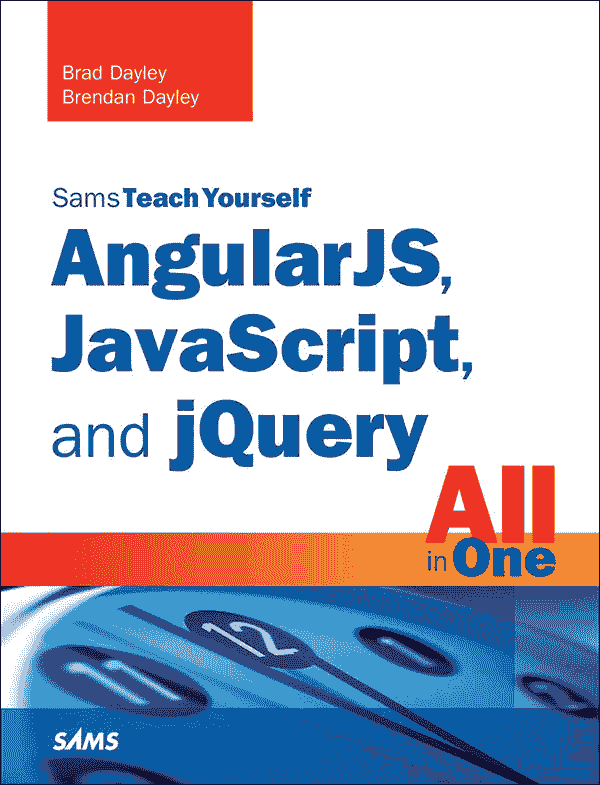

## 关于本书

ePUB 是一种开放的行业标准电子书格式。然而，不同的设备和应用程序对 ePUB 及其许多功能的支持程度不同。请使用您的设备或应用设置根据您的喜好自定义显示效果。您可以自定义的设置通常包括字体、字号、单栏或双栏、横屏或竖屏模式，以及可以点击或触摸放大的图片。有关您的阅读设备或应用设置和功能的更多信息，请访问设备制造商的网站。

许多书籍包含编程代码或配置示例。为了优化这些元素的显示效果，请在单栏横屏模式下查看电子书，并将字体调整为最小设置。除了以重流文本格式呈现代码和配置外，我们还包含了代码图像，以模仿印刷本中的呈现效果；因此，当重流格式可能会损害代码列表的显示效果时，您将看到“点击此处查看代码图像”链接。点击链接即可获得高保真代码图像。要返回之前阅读的页面，请点击设备或应用上的“返回”按钮。

 800 East 96th Street Indianapolis, IN 46240 USA

## 目录

- [第 2 节 | 在网页中调试 JavaScript](#part0013.xhtml_ch02)
- [第 4 节 | 添加 CSS/CSS3 样式以实现动态设计和布局](#part0015.xhtml_ch04)
- [第 5 节 | 深入学习 jQuery 和 JavaScript 语法](#part0016.xhtml_ch05)
- [第 8 节 | 使用 jQuery 导航和操作 jQuery 对象及 DOM 元素](#part0020.xhtml_ch08)
- [第 9 节 | 应用 JavaScript 和 jQuery 事件实现丰富交互的网页](#part0021.xhtml_ch21)
- [第 10 节 | 使用 jQuery 动态访问和操作网页](#part0022.xhtml_ch10)
- [第 13 节 | 与网页表单交互](#part0026.xhtml_ch13)
- [第 14 节 | 创建网页](#part0027.xhtml_ch14)
- [第 17 节 | 使用 jQuery UI 效果](#part0031.xhtml_ch17)
- [第 18 节 | 高级 jQuery UI 组件](#part0032.xhtml_ch18)
- [第 19 节 | 使用 jQuery UI 组件为网页添加丰富交互](#part0033.xhtml_ch19)
- [第 28 节 | 创建自定义 AngularJS 服务](#part0043.xhtml_ch28)

## 课程列表

### 工作坊

### 使用 HTML/HTML5 元素构建动态网页

### 理解 HTML 结构

### 实现 HTML Head 元素

### 添加 HTML Body 元素

### 添加一些高级 HTML5 元素

### 总结

### 问答

### 总结

### 问答

### 在网页中引入 jQuery 和 JavaScript

### 访问 DOM

### 总结

### 问答

### 工作坊

### 使用对象语法

## 理解内置对象

### 创建自定义对象

### 总结

### 问答

### 工作坊

### 理解 DOM 对象与 jQuery 对象的区别

### 从 JavaScript 访问 DOM 对象

### 使用 jQuery 选择器

### 问答

### 链式 jQuery 对象操作

### 过滤 jQuery 对象结果

### 使用 jQuery 对象遍历 DOM

### 总结

### 问答

### 工作坊

## 课程 9：应用 JavaScript 和 jQuery 事件实现丰富交互的网页

### 使用页面加载事件进行初始化

### 手动触发事件

### 实现回调函数

### 问答

### 工作坊

### 访问浏览器和页面元素值

### 在网页上动态调整元素

### 问答

### 理解 Screen 对象

### 使用 Window 对象

### 使用 Browser 对象

### 控制外部链接

### 设置定时器

### 总结

### 工作坊

## 课程 12：通过 jQuery 动画和其他特效增强用户交互

### 显示与隐藏动画

### 滑动元素

### 创建缩放动画

### 总结

### 问答

### 访问表单元素

### 智能表单流控制

### 表单验证

### 总结

### 问答

### 添加图片库

### 创建树形视图

### 实现图形均衡器显示

### 添加折线图图形

### 问答

### 让 AJAX 简单化

### 实现 AJAX

### 总结

### 工作坊

## 课程 16：引入 jQuery UI

### 在脚本中使用 jQuery UI

### 问答

### 应用 jQuery UI 效果

### 为元素可见性添加效果

### 问答

### 引入 jQuery UI 交互

### 使用可缩放组件调整大小

### 使用可排序组件排序元素

### 问答

### 回顾组件

## 将 jQuery UI 按钮应用于表单控件

## 使用 jQuery UI 生成样式化对话框

## 实现滑动条

## 为页面元素添加工具提示

### 总结

### 为什么选择 AngularJS？

### 职责分离

### 在你的环境中添加 AngularJS

### 使用全局 API

### 问答

### 定义 AngularJS `Module` 对象

### 实现提供者和依赖注入

### 总结

### 问答

### 实现作用层级结构

### 问答

### 理解模板

### 使用过滤器 (Filters)

### 总结

### 问答

### 理解指令

### 总结

### 工作坊

### 理解指令定义

### 问答

### 用户交互事件

### 发布和广播自定义事件

### 问答

### 理解服务 (Services)

### 使用 `$q` 服务提供响应

### 问答

### 将自定义服务集成到 AngularJS 应用中

### 问答

### 总结

## 致谢

我想借此机会感谢所有让这本书成为可能的人。首先，感谢我出色的妻子和儿子们，他们给了我所需的灵感和支持。没有你们，我无法走这么远。

感谢 Mark Taber 让本书朝着正确的方向推进，感谢 Jesse Smith 通过技术评审让我保持严谨，感谢 Barbara Hacha 将我脑海中的技术性乱语变成精妙的文字，以及感谢 Andy Beaster 管理生产端的所有事务并确保了书籍具有最高质量。

作为本书的读者，你是我们最重要的评论家和评稿人。我们非常重视你的意见，并想知道我们做得好的地方、可以做得更好的地方、你希望我们出版哪些领域的内容，以及任何你愿意分享的智慧。

请注意，我们无法帮助你解决与本书主题相关的技术问题。

写信时，请务必写上书名、作者以及你的姓名和邮箱。我们会仔细审核你的意见，并将其与负责本书的作者和编辑分享。

## 注册与支持

访问我们的网站并在 [informit.com/register](http://informit.com/register) 注册此书，以便方便获取本书可能提供的任何更新、下载或错误列表。

 **可扩展性**——AngularJS 架构允许你轻松扩展语言的几乎每个方面，以提供自己的自定义实现。

本书的内容不仅限于 jQuery 和 JavaScript，因为要创建真正实用的 Web 应用，你需要了解比语言结构更多的知识。本书的目标是提供基础技能，让你只需通过 29 个短小易懂的课程就能创建功能完备且交互式的 Web 应用。本书涵盖了以下关键技能和技术：

 AJAX 是 Web 应用与 Web 服务器和其他服务的交互的标准方法。本书包含了几个使用 AJAX 与服务器、Google、Facebook 以及其他流行的 Web 服务交互的示例。

 **CSS 代码**——正确格式化网页元素所需的代码。

 你不需要理解像 `PHP`、`Python` 等后端脚本语言。

## 搭建 Node.js/Express 服务器

点击此处查看代码图像

27

### 步骤 4：刷新项目

回到 Eclipse，右键点击项目并选择 Refresh（刷新）。你应该能看到 `node_modules` 文件夹，其中包含 `body-parser` 和 `express` 子文件夹。

### 步骤 5：创建服务器文件

在项目目录根目录下创建一个名为 `server.js` 的文件，将 Listing 1.5 中的内容放入其中并保存。这是一个基础的 Node.js/Express Web 服务器，它将使用项目根目录作为网站根位置来提供静态文件服务。

### 步骤 6：运行服务器

验证你的 Node.js Web 服务器可以正常运行。右键点击 `server.js` 文件并从菜单中选择 Run As, Node Application（运行方式，Node 应用程序）来启动 Web 服务器。图 1.12 中显示的 Console 窗口应显示 `server.js` 文件正在运行，并提供一个用于停止服务器的红色框。如果你在 Eclipse 中运行多个应用程序，可以点击 Console Select（选择控制台）按钮来选择特定的控制台，如图 1.12 所示。


**图 1.12** 在 Eclipse 中运行 JavaScript 应用程序。

### 步骤 7：访问服务器

在浏览器中通过以下地址访问服务器。由于 Web 服务器使用 `./` 路径提供静态文件，`server.js` 文件的实际内容应显示在浏览器中：

`localhost/server.js`

### 步骤 8：停止服务器

点击 Console 窗口中的红色框停止服务器。

**注意：** 如果你不熟悉 Eclipse，应该花一点时间练习启动和停止 `first.js` 应用程序，以及如何在控制台中在它们之间导航。

你现在已成功在 Eclipse 中设置了 Node.js/Express 服务器。你将在书中的大多数示例中使用此 Web 服务器。部分课程需要 AJAX 交互，并将为这些课程创建一个独立的服务器。

**Listing 1.5 server.js 创建基础 Node.js/Express 服务器**

点击此处查看代码

```javascript
01 var express = require('express');
02 var app = express();
03 app.use('/', express.static('./'));
04 app.listen(80);
```

## 动手尝试：使用 jQuery 和 JavaScript 创建动态页面

现在你已经创建了项目和一个可以运行的 Web 服务器，准备好创建动态页面了。在本节中，按照以下步骤创建一个简单的动态页面。完成后，你将拥有基于 HTML 并通过 jQuery 和 JavaScript 进行交互的动态页面。

**注意：** 书中的所有示例图像和代码文件都可以从 Github 下载。

### 添加 HTML

第一步是创建一个可以样式化和操作的 HTML 元素的简单网页。使用以下步骤创建基础 HTML 文档：

1. 在你的项目中创建一个名为 `lesson01` 的文件夹。
2. 右键点击你创建的 `lesson01` 文件夹。
3. 从弹出菜单中选择 New, File（新建文件）。
4. 将文件命名为 `first.html` 并点击 OK。为你打开一个空白文档。
5. 输入以下 HTML 代码。如果你不熟悉 HTML，不用担心，稍后你会学到足够的知识：

```html
<!DOCTYPE html>
<html>
  <head>
    <meta http-equiv="content-type" content="text/html; charset=utf-8" />
  </head>
  <body>
    <span>Click Me</span>
  </body>
</html>
```

6. 保存文件。
7. 在浏览器中打开以下 URL，你应该能看到“Click Me”字样：

`http://localhost/lesson01/first.html`

好了。所有的基础 HTML 元素现在已就位。在下一节中，我们将样式化 `<span>` 元素，让 Click Me 看起来更像一个按钮。

### 添加 CSS

浏览器渲染的简单文本非常单调，可以通过添加 CSS 样式快速解决。在本节中，你使用 CSS 让文本看起来更像一个按钮。

使用以下步骤为 `<span>` 元素添加 CSS 样式。作为参考，你在这些步骤中进行的样式更改将在 Listing 1.6 的最后的脚本所示：

1. 在网页的 `<head>` 标签内添加以下代码，包含适用于所有 `<span>` 元素的 CSS `<style>` 元素：

```html
<style>
  span{
}
</style>
```

2. 为 span 样式添加以下属性设置，将文本背景改为深蓝色：

`background-color: #0000FF;`

3. 为 span 样式添加以下属性设置，将颜色改为白色并将字体加粗：

`color: #FFFFFF;`

`font-weight: bold;`

4. 为 span 样式添加以下属性设置，在文本周围添加边框：

`border: 1px solid #000000;`

5. 为 span 样式添加以下属性设置，设置绝对位置：

`position: absolute;`

6. 保存文件。
7. 在浏览器中打开以下 URL，你应该能看到“Click Me”文本，如图 1.12 所示：

`http://localhost/lesson01/first.html`


**图 1.12** 在 Eclipse 中运行 JavaScript 应用程序。

### 编写脚本

现在 HTML 已经按照你想要的方式样式化，你可以开始添加动态交互了。在本节中，你将 jQuery 添加到你的页面中：

1. 修改 `<span>` 元素以包含一个 `id`，以便你可以引用它，并为 `mouseover` 事件添加一个处理器：

```html
<span id="elusiveText" onmouseover="moveIt()">Click Me</span>
```

2. 在 `<head>` 中添加以下代码行，它从托管源加载 jQuery 库：

```html
<script src="https://code.jquery.com/jquery-2.1.3.min.js"></script>
```

3. 在 `<head>` 中添加以下 JavaScript 函数。该函数创建一个从 10 到 350 的坐标值数组，然后在每次鼠标悬停在它上时，随机设置 span 的 `top` 和 `left` CSS 属性：

```javascript
function moveIt() {
  var coords = new Array(10,50,100,130,175,225,260,300,320,350);
  var x = coords[Math.floor(Math.random()*10)];
  var y = coords[Math.floor(Math.random()*10)];
  $("#elusiveText").css({"top": y + "px", "left": x + "px"});
}
```

4. 保存文件。
5. 在浏览器中打开以下 URL，你应该能看到样式化的文本 Click Me，如图 1.13 所示：

`http://localhost/lesson01/first.html`

6. 现在尝试点击 Click Me 按钮。按钮会在每次鼠标悬停在它上时移动，导致你无法点击它。
7. 找一个让你讨厌的人，并让他们点击这个按钮。

**完整代码示例：**

```html
<script src="https://code.jquery.com/jquery-2.1.3.min.js"></script>

<script>
  function moveIt(){
    var coords = new Array(10,50,100,130,175,225,260,300,320,350);
    var x = coords[Math.floor((Math.random()*10))];
    var y = coords[Math.floor((Math.random()*10))];
    $("#elusiveText").css({"top": x + "px", "left": y + "px"})
  }
</script>
<style>
  span{
    background-color: #0066AA;
    color: #FFFFFF;
    font-weight: bold;
    border-color: #C0C0C0;
    border:2px solid;
    border-radius:5px;
    padding: 3px;
    position:absolute;
    top:150px;
    left:100px;
  }
</style>
</head>
<body>
  <span id="elusiveText" onmouseover="moveIt()">Click Me</span>
</body>
</html>
```


### 总结

在本节中，你学习了 Web 服务器与浏览器之间通信的基础知识。你学习了`GET`和`POST`请求之间的区别，以及服务器端脚本和客户端脚本的作用。你还学习了`DOM`以及浏览器如何利用它来渲染显示给用户的网页。

你已经建立了一个良好的 Web 开发环境并创建了你的第一个项目。作为创建第一个项目的一部分，你创建了一个结合了 HTML、CSS、jQuery 和 JavaScript 的动态网页。

### 问答

**Q. 客户端脚本和服务器端脚本哪个更好？**

**A.** 这很大程度上取决于你想实现什么目标。有些人认为只有一种方法是可行的，但实际上，通常是两者的结合才能提供最佳方案。可以遵循的良好规则是：如果与数据的交互基于用户交互（如鼠标点击），则使用客户端脚本；如果数据的验证或错误处理需要与服务器交互，则使用服务器端脚本。

**Q. 为什么所有的浏览器处理 JavaScript 的方式不同？**

**A.** 为了渲染 HTML 并与 JavaScript 交互，浏览器使用引擎来解析来自服务器的数据、构建对象，然后将其输入图形渲染引擎并写在屏幕上。由于不同浏览器使用的引擎不同，因此它们对脚本的解释方式略有不同，特别是对于尚未标准化的边缘元素。如果你想支持所有浏览器，需要在每个浏览器中测试你的网页，以验证它们是否运行正常。

### 工作坊

该工作坊由一组问题和答案组成，旨在巩固你对本节内容的理解。在查看答案之前，请尝试回答这些问题。

### 测验

**1.** 你会向 Web 服务器发送`GET`还是`POST`请求来打开网页？

**2.** 哪种脚本可以访问浏览器鼠标事件：服务器端还是客户端？

**3.** 正确或错误：JavaScript 是默认开启的。

**4.** 哪种类型的脚本最适合调试 JavaScript？

### 测验答案

**1.** `GET`

**2.** 客户端

**3.** 正确

**4.** 客户端

注意在图 2.1 中的消息部分，有两种类型的消息。一种是日志语句（log statement），另一种是错误。两者在右侧都显示行号。点击行号，将直接跳转到代码处。

注意在错误消息中，顶部文本部分指向发生的错误，底部显示实际的 JavaScript 行。这在调试时非常有用，因为你通常可以通过查看错误和单行代码来发现问题。

### 动手尝试：使用 JavaScript 控制台查找错误

理解控制台的最简单方法是调试一个实际脚本。考虑列表 2.1 中的 HTML 代码，它包含几个错误。按照以下步骤将列表添加到你的 Eclipse 项目中：

1. 右键点击项目，并从菜单中选择`New`（新建）、`Folder`（文件夹）。
2. 将文件夹命名为`lesson02`并点击`Finish`（完成）。
3. 右键点击新文件夹，并从菜单中选择`New`（新建）、`File`（文件）。
4. 将文件命名为`js_errors.html`。
5. 输入列表 2.1 的内容，或者如果你有网站上的文件，将其内容剪切并粘贴到新文件中。
6. 保存文件。

**列表 2.1 js_errors.html 一个带有 JavaScript 错误的非常简单的 HTML 文档**

点击此处查看代码图像

```html
01 <!DOCTYPE html>
02 <html>
03   <head>
04     <meta charset="utf-8"/>
05      <script>
06        fnction loadedFunction(){
07          console.log("Page is Loaded");
08        }
09        function clickItNow(){
10          console.log("User Clicked");
11        }
12      </script>
13   </head>
14   <body onload="loadedFunction()">
15      <span onclick="clickIt()">Click Me</span>
16   </body>
17 </html>
```

列表 2.1 中的代码本应在页面在浏览器加载后在控制台中显示消息`Page Is Loaded`。每当用户点击浏览器中的`Click Me`时，就会显示另一个消息`User Clicked`。问题是该脚本有几个 bug。

文件现在就绪后，使用以下步骤使用 JavaScript 控制台调试错误：

1. 打开 Chrome 并加载开发者工具。
2. 在 Chrome 中打开以下 URL 以加载新创建的网页：
   点击此处查看代码图像
   http://localhost/lesson02/js_errors.html
3. 点击`Console`（控制台）选项卡，显示图 2.2 所示的 JavaScript 控制台。

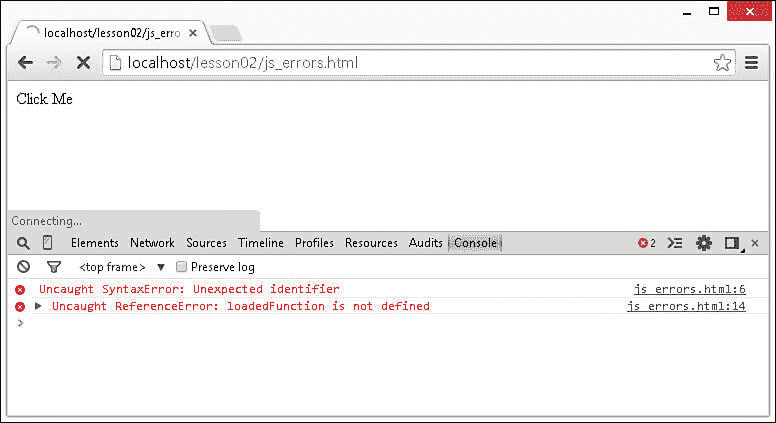

**图 2.2** 显示页面加载期间发生的两个错误的 JavaScript 控制台。

4. 注意控制台中显示的错误，如图 2.2 所示。第一个错误显示文件第 6 行有一个意外的标识符。点击行号将在第 6 行打开`Sources`（源代码）选项卡，你可以看到`function`被误写为`fnction`，如图 2.3 所示。

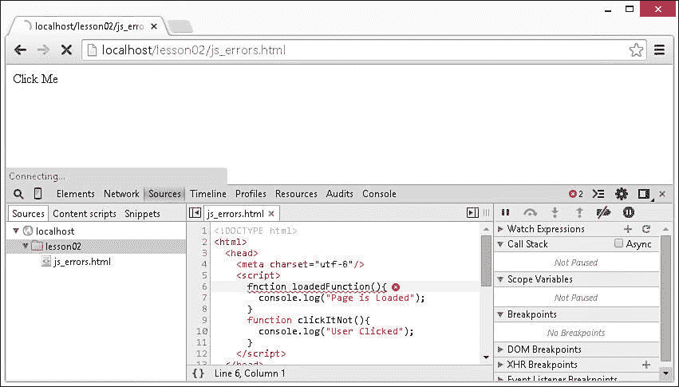

**图 2.3** 显示 JavaScript 代码语法错误的 Sources 控制台。

5. 在 Eclipse 中，将第 6 行的`fnction`改为`function`。
6. 回到 Chrome 并刷新网页。现在在`Console`中，你应该能在控制台中看到`Page Is Loaded`（在`loadedFunction()`函数中记录的文本），但没有错误。
7. 点击`Click Me`文本。控制台中增加了一个错误，如图 2.4 所示。错误提示`clickItNow`未定义。当你查看 HTML 文件并搜索`clickItw`时，你可以在第 15 行看到一个`onclick`事件链接到了`clickItNot()`，但 JavaScript 函数的名称是`clickItNow()`。

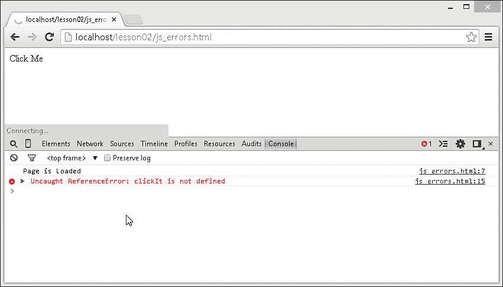

**图 2.4** 显示一个错误的 JavaScript 控制台。

8. 在 Eclipse 中，将`clickItw`改为`clickIt`。
9. 回到 Chrome 并刷新网页。
10. 点击`Click Me`文本。错误应该已经解决了。

### 调试 HTML 元素

元素检查器（Element inspector）允许你查看 HTML 结构并调试问题。可用功能如下：

### DOM Tree
这是树的简单视图。你可以点击箭头图标来展开和收叠树的部分。

### 更改断点（Break on Changes）
右键点击元素并选择`Break On`（断点）允许你在元素更改、删除或子元素被修改时设置不同类型的断点。每当 DOM 元素更改时，浏览器将中断。

### 编辑为 HTML（Edit as HTML）
右键点击元素并选择`Edit as HTML`允许你直接编辑浏览器中的 HTML 代码。虽然这不会更改项目中的代码，但使用此功能进行测试要方便得多。

### 悬停（Hover）
当你悬停在 DOM 树中的 HTML 代码上时，元素会在浏览器中突出显示。元素检查器的悬停功能是我最喜欢的功能之一，因为它提供了一种视觉方式来查看 DOM 树节点与渲染网页之间的关系。注意图 2.6，当悬停在`h1`元素上时，标题会在网页中突出显示。

### 面包屑(Breadcrumbs)
面包屑显示了从根节点`html`到当前在树或编辑视图中选中节点的层级结构。这使得导航变得简单，特别是在编辑视图中。

**注意**
当悬停在 DOM 树上的元素时，该元素会在网页上突出显示。悬停高亮是颜色编码的，浅蓝色表示内容，紫色表示内边距（padding），黄色表示 HTML 元素的外边距（margin）。

为了说明如何使用元素检查器（Element inspector），请考虑列表 2.2 中的代码。一个包含电影列表且标题中带有“Favorite（收藏）”一词的基础 HTML 文档应该是斜体。然而，请看图 2.7 中的渲染版本。显然存在一些问题：所有内容都是斜体，且第一个列表项没有项目符号。这些问题是由整个文本中的仅两个字符引起的。

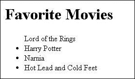

**图 2.7** 该网页有两个问题：只有“Favorite”一词应该是斜体，且第一个列表项没有项目符号。

**列表 2.2** `html_errors.html` 这是一个带有某些 HTML 语法错误的非常简单的 HTML 文档，正如图 2.6 所示。

点击此处查看代码图像

```html
01 <!DOCTYPE html>
02 <html>
03   <head>
04     <meta charset="utf-8" />
05   </head>
06   <body>
07     <h1><i></i>Favorite Movies</h1>
08     <ul>
09       <ll>Lord of the Rings</li
10       <li>Harry Potter</li>
11       <li>Narnia</li>
12       <li>Hot Lead and Cold Feet</li>
13     </ul>
14   </body>
15 </html>
```

按照以下步骤操作，使用元素检查器查找并修复 HTML 语法问题：

**1.** 将列表 2.2 中的代码添加到项目`lesson02`文件夹中的新文件`html_errors.html`中，并保存文档。到你现在应该已经熟悉这个过程了。

**2.** 打开`Chrome`并加载开发者工具。

**3.** 打开以下 URL；网页看起来应该像图 2.7：

点击此处查看代码图像

http://localhost/lesson02/html_errors.html

**4.** 点击开发者工具中的`Elements`标签页，展开`<html>`、`<body>`，然后是`<i>`标签，如图 2.8 所示。注意，“Favorite”一词没有包含`<i>`标签内。这是不对的。

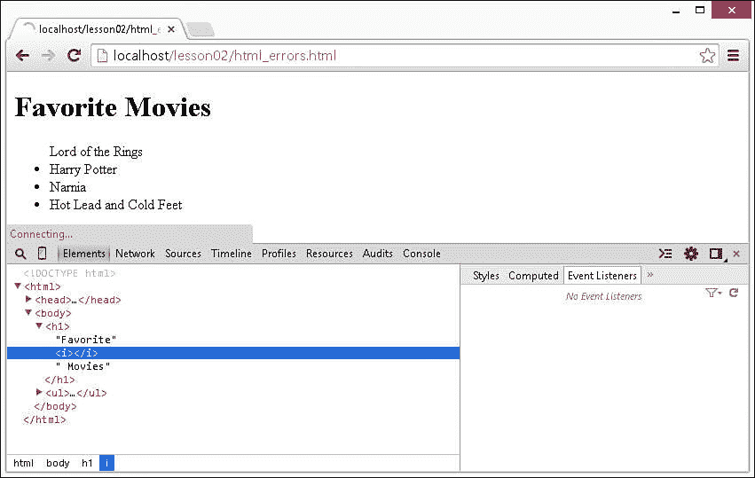

**图 2.8** 此元素检查器显示 DOM 中有第二个`<i>`。

**5.** 回到`Eclipse`，将“Favorite”一词移动到第 7 行`<i>`标签内部并保存文档。

**6.** 在浏览器中刷新文档。注意，“Favorite”一词现在是斜体（正如它应该是的那样），但项目符号仍然缺失，如图 2.9 所示。

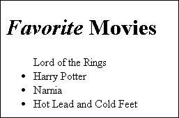

**图 2.9** 该网页现在只有一个问题——第一个列表项没有项目符号。

**7.** 回到元素检查器并展开`<html>`、`<body>`、`<ul>`，然后是`<ll>`，如图 2.10 所示。在`<ul>`元素下不是一组`<li>`元素，而是一个`<ll>`元素，下面包含着`<li>`元素。我们还没有介绍 HTML 标签，但如果你熟悉 HTML 列表，你会识别出`ll`不是一个有效的 HTML 标签。它应该是`<li>`。

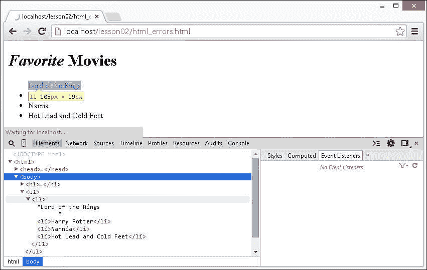

**图 2.10** 查看 DOM 发现浏览器在`<ul>`标签下看到一个`<ll>`标签，而不是一组`<li>`标签。

**8.** 回到`Eclipse`，将第 9 行的`<ll>`标签更改为`<li>`并保存页面。

**9.** 在浏览器中重新加载网页。列表现在显示正常了。

### 查看和编辑元素的 DOM 属性

调试 HTML 的另一个重要工具是 DOM 属性编辑器。DOM 属性编辑器非常强大。它允许你查看和编辑 DOM 中每个 HTML 元素的属性、属性、函数、子元素、父元素以及其他所有内容。信息以树的形式显示，因此你可以展开和折叠组。

通过点击开发者工具控制台中的`Elements`标签页并选择`Properties`标签页可以访问 DOM 编辑器。信息以树的形式显示...图 2.8。注意，“Favorite”一词没有包含在`<i>`标签内。这是不对的。

 **切换元素状态**——切换元素状态按钮会加载图 2.14 所示的菜单，允许你将元素状态设置为`active`（激活）、`hover`（悬停）、`focus`（聚焦）或`visited`（访问），以便查看适用于这些状态的 CSS 样式。

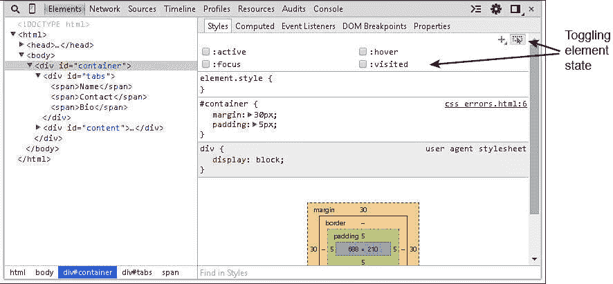

**图 2.14** 设置元素状态以查看特定 active、hover、focus 或 visited 状态的 CSS 属性。

 **查看和编辑布局**——布局编辑器如图 2.15

**图 2.15** 在元素检查器的布局编辑器中查看 CSS 布局属性。

### 使用布局编辑器

调试 CSS 的另一个极其强大的工具是元素编辑器中的布局编辑器。布局编辑器如图 2.15 **外边距 (Margin)**——外边距是布局编辑器中显示的最外层框。外边距的四边都有一个值。你可以双击这些值并直接在布局编辑器中更改 CSS 属性。

 **边框 (Border)**——边框是下一个框。它也有四个可以你更改的值，用于调整 HTML 元素的 CSS 边框属性。

 **内边距 (Padding)**——内边距是下一个框。它也有四个可以你更改的值，用于调整 HTML 元素的 CSS 内边距属性。

 **内容 (Content)**——内容是布局编辑器中最内层的框。它有两个值（长度和宽度），你通过更改这些值来设置 HTML 元素的 CSS 长度和宽度属性。

### 动手尝试：编辑 CSS 布局

为了帮助你理解使用开发者工具调试和编辑 CSS 布局，请考虑列表 2.3 中的代码。该代码设计用于显示一个简单的标签框来展示信息。CSS 属性存在一些问题导致其显示效果不好，如图 2.16 所示。注意标签页堆叠在一起，并且它们之间存在空间。

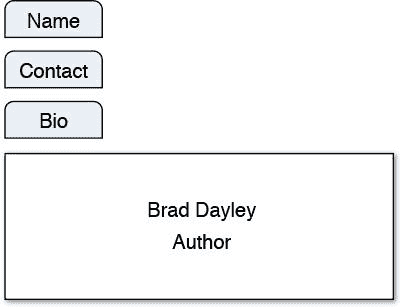

**图 2.16** 标签页糟糕的 CSS 布局导致网页变得难看。

**列表 2.3 css_errors.html 一个非常简单的 HTML 文档，并在图 2.16 中展示了某些 HTML 语法错误**

点击此处查看代码图像

```html
01 <!DOCTYPE html>
02 <html>
03   <head>
04     <meta charset="utf-8" />
05     <style>
06       #container{
07          margin: 30px;
08          padding:5px;
09       }
10       #tabs{
11          padding: 0px;
12          width:100px;
13       }
14       #content{
15          border: 1px solid #000000;
16          height: 100px;
17          width: 300px;
18          clear: both;
19       }
20       span{
21          margin: 5px;
22          width: 70px;
23          background-color: #C0C00;
24          font-weight: bold;
25          border-color: #C0C00;
26          border:1px solid #000000;
27          border-radius: 5px 5px 0px;
28          padding: 3px;
29          float: left;
30          text-align: center;
31       }
32       span:hover{
33          background-color: #3030FF;
34          color: #FFFFFF;
35          cursor: pointer;
36       }
37       p{
38          font-weight: bold;
39          text-align: center;
40       }
41     </style>
42   </head>
43   <body>
44     <div id="container">
45       <div id="tabs">
46          <span>Name</span>
47          <span>Contact</span>
48          <span>Bio</span>
49       </div>
50       <div id="content">
51          <p>Brad</p>
52          <p>Contact</p>
53          <p>Author</p>
```


```html
54       </div>
55     </div>
56   </body>
57 </html>
```

***

通过以下步骤使用开发者工具调试和编辑 CSS 布局：

1. 参考列表 2.3 中的代码。
2. 打开 `css_errors.html`。
3. 打开开发者工具。
4. 打开 `html`。
5. 打开 `head`。
6. 打开 `body`。
7. 打开 `div id="container"`。
8. 打开 `div id="tabs"`。
9. 展开 `span`。
10. 展开 `span`。
11. 展开 `span`。
12. 打开 `div id="content"`。
13. 展开 `p`。
14. 展开 `p`。
15. 展开 `p`。
16. 注意到标签页堆叠在一起，并且它们之间存在空间。
17. 观察图 2.16。
18. 标签页糟糕的 CSS 布局导致网页变得难看。
19. 点击此处查看代码图像。
20. 打开 `css_errors.html`。
21. 打开开发者工具。
22. 打开 `html`。
23. 打开 `head`。
24. 打开 `body`。
25. 打开 `div id="container"`。
26. 打开 `div id="tabs"`。
27. 展开 `span`。
28. 展开 `span`。
29. 展开 `span`。
30. 打开 `div id="content"`。
31. 展开 `p`。
32. 展开 `p`。
33. 展开 `p`。
34. 注意到标签页堆叠在一起，并且它们之间存在空间。
35. 观察图 2.16。
36. 标签页糟糕的 CSS 布局导致网页变得难看。

***

## 调试 JavaScript

你已经学会了在 JavaScript 控制台中查找 JavaScript 和其他脚本的异常错误。如果你的脚本没有引起任何浏览器错误，但运行方式不符合你的预期呢？所有的浏览器都提供了非常好的集成调试器来帮助。接下来的部分介绍如何使用 Chrome 开发者工具调试 JavaScript。

### 导航 JavaScript 调试器

JavaScript 调试器允许你查看随网页加载的 JavaScript 脚本。除了查看脚本之外，你还可以设置断点、观察变量值并查看调用栈，就像使用任何其他调试器一样。

图 2.21 显示了开发者工具中提供的 JavaScript 调试器组件。通过 JavaScript 调试器，你可以访问以下功能：

- **JavaScript 视图**——显示实际的 JavaScript 代码。
- **源选择菜单**——此菜单列出了随网页加载的所有源文件列表。你可以点击此菜单来选择要在视图中加载的 JavaScript 文件。
-  **异常暂停**——当选择此选项时，如果发生 JavaScript 异常，浏览器将进入调试器并停止执行。
-  **监视**——图 2.21 中显示的监视面板列出了在代码当前执行时可用的函数、变量、属性等。这是一个非常有价值的窗口。在这里，你可以看到代码执行过程中变量和对象的值。此外，你可以通过点击监视列表顶部的加号图标向监视面板添加自己的表达式。监视面板的一个非常棒的功能是，你可以双击变量值并更改执行时使用的值。这是测试“假设”场景的极佳方法。
-  **调用堆栈**——调用堆栈面板提供了导致当前执行代码行的函数调用历史。调用堆栈面板最有价值的方面之一是通过展开函数名称查看传递给每个函数的参数值。你还可以点击函数名，该文件将在 JavaScript 视图中加载并高亮显示该行代码。
-  **断点**——断点允许你指定执行 JavaScript 时何时停止。当你设置了断点时，浏览器会在执行该行代码之前停止执行并进入调试器。你可以通过点击 JavaScript 视图中代码行左侧来设置断点。它们由红点表示。要删除断点，只需点击它。断点面板显示已设置的断点列表。你可以通过取消旁边的复选框来禁用断点。你可以点击“禁用断点”按钮来禁用断点。
-  **当前执行行**——当前正在执行的代码行由黄色箭头表示。
-  **恢复**——这允许脚本继续执行，直到遇到另一个断点（如果有的话）。
-  **进入**——当你点击此图标时，代码将前进一行。如果该行代码正在执行另一个函数，你将进入该函数的第一行代码。
-  **跳过**——当你点击此图标时，代码将前进一行。如果该行代码正在执行另一个函数，该函数将被执行，然后你将进入当前函数中的下一行代码。如果在跳过函数时遇到断点，浏览器将在脚本的该位置停止执行。
-  **跳出**——当你点击此图标时，当前函数执行完毕，你将回到调用函数中的下一行代码。

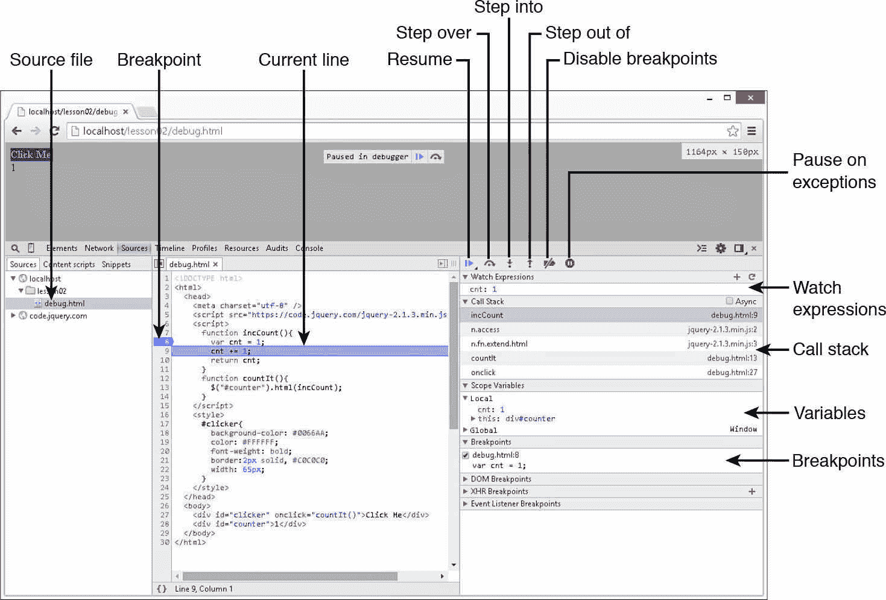

**图 2.21** 开发者工具 JavaScript 调试器提供了代码、监视、堆栈和断点视图。

***

## 尝试自己：使用 JavaScript 调试器

以下示例将帮助你更熟悉 JavaScript 调试器。考虑列表 2.4 中的代码。这是一个包含按钮和计数字符串的基础网页。HTML 包含两个 `<div>` 元素。第一个 `<div id="clicker" onclick="countIt()">` 用于简单的按钮。当你点击按钮时，会调用 JavaScript 函数 `countIt()`。第二个 `<div id="counter">` 用于显示数字。

JavaScript 应该在每次点击按钮时数字加 1。然而，JavaScript 代码存在一个问题；数字不会超过 2。

**列表 2.4 `debug.html` 带有 JavaScript 错误的极简 HTML 文档示例**

点击此处查看代码图像。

```html
01 <!DOCTYPE html>
02 <html
03    <head>
04      <meta charset="utf-8" />
05      <script src="https://code.jquery.com/jquery-2.1.3.min.js"></script>
06      <script>
07        function incCount(){
08          var cnt = 1;
09          cnt += 1;
10          return cnt;
11        }
12        function countIt(){
13          $("#counter").html(incCount);
14        }
15      </script>
16      <style>
17        #clicker{
18          color: red;
19          font-weight: bold;
20        }
21        #counter{
22          border: 1px solid #000;
23          width: 50px;
24          height: 50px;
25        }
26      </style>
27 </head>
28 <body>
29      <div id="clicker" onclick="countIt()">Click Me</div>
30      <div id="counter">0</div>
31 </body>
32 </html>
```

1. 在 Chrome 中打开 JavaScript 调试器。
2. 在 Chrome 中打开 `debug.html`。
3. 在第 8 行设置断点。
4. 点击按钮。
5. 在“作用域变量”（Scope Variables）面板中观察 `cnt` 变量。
6. 逐行执行代码。
7. 观察 `cnt` 如何每次点击时被重置。
8. 要修复这个问题，请在 Eclipse 原始文件中交换第 7 行和第 8 行，使 `cnt` 的定义出现在 `countIt()` 的定义之前。这会在脚本加载时定义变量 `cnt` 并仅设置一次值。保存文件。
9. 无需每次在调试时都展开 Window（窗口）元素，只需点击图 2.24 所示监视列表顶部的 `New Watch Expression`（新建监视表达式），输入 `cnt` 并按 `Enter`。这会在 `cnt` 变量的最上方直接添加一个新的监视表达式，如图 2.24 所示。
10. 点击 `Step Over`（单步）图标，`cnt` 将变为 2。然后点击 `Continue`（继续）按钮恢复执行。
11. 点击网页上的按钮，此时 `cnt` 变量将显示为 2。当你点击 `Step Over` 按钮时，`cnt` 变量将变为 3。
12. 程序似乎运行正常，因此点击第 9 行上的断点以移除断点，然后点击 `Continue` 按钮恢复执行。
13. 现在每当你点击按钮时，数字都会递增。你刚刚调试了 JavaScript。

这是一个非常基础的示例，但为了方便跟进步骤并熟悉调试器的工作原理，我们做了简化处理。在完成书中的练习时，你可能会多次回到调试器。请记住这些基本步骤：设置断点并在单步执行代码时观察变量。

### 那么如何调试 jQuery 或 AngularJS？

这是一个经常出现的问题，即使对于那些具有 JavaScript 调试经验的人来说，也是如何调试 jQuery 或 AngularJS。答案很简单：AngularJS、jQuery 以及许多 JavaScript 插件和版本仅仅是额外的 JavaScript 代码。要调试 AngularJS 或 jQuery，请在项目中使用未压缩（nonminified）格式的库文件。你将在本书的后后部分学习如何操作。

你下载未压缩版本的原因是压缩后的版本是不可读的。所有内容都挤在了一行中，在调试器中显示效果很差。未压缩的版本以可读的格式格式化。

> **注意**
>
> 即使你无法获取 JavaScript 文件的未压缩版本，也可以在 Eclipse 中打开该文件，并从主菜单选择 `File`（文件）-> `Format`（格式化）。Eclipse 会自动将文件格式化为可读的形式。大多数 IDE 都有此类功能。

格式化了 AngularJS、jQuery 或任何其他 JavaScript 库后，你就可以像调试其他 JavaScript 文件一样调试它了。

### 分析网络流量

开发者工具中有一个在调试 JavaScript 时非常有用的工具，就是网络流量分析器。网络流量分析器如图 2.25 所示，通过点击开发者工具中的 `Net` 标签可以使用。流量分析器显示了从浏览器到 Web 服务器每个请求的信息。这让你能够更好地理解正在传输什么数据，以及请求是否发生，以及顺序是否正确。

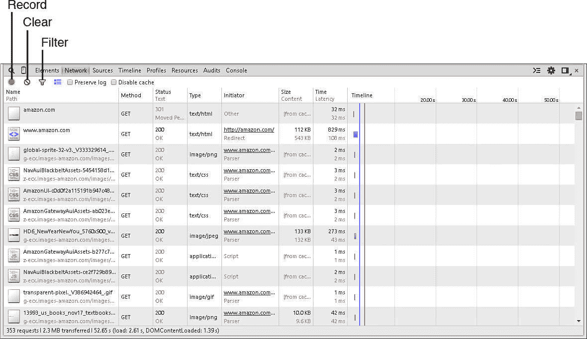

**图 2.25** 加载 [amazon.com](http://amazon.com) 所需的网络流量。

图 2.25 显示了加载 [amazon.com](http://amazon.com) 网页涉及的流量。有许多请求，每个请求对应流量列表中的一行。对于每个请求，流量中显示以下内容：

-  **URL Path**——请求的 URL 非常有用。你可以右键点击 URL 并复制它，甚至在另一个标签页或窗口中打开它。这允许你调试单个请求，而不是整个网页加载。
-  **Method**——请求中使用的 HTTP 方法类型。
-  **Status**——你可以使用状态来确定请求是否成功以及是否仍在运行。例如，网页看起来可能正常可能是因为某个图像请求加载失败，这在开发者工具的 `Net` 标签中非常容易诊断。
-  **Type**——请求获取的数据类型。
-  **Initiator**——请求发起的来源。
-  **Size**——大小可能很有用，因为它允许你快速找到需要大量磁盘空间和网络带宽的请求。
-  **Latency**——显示请求以毫秒为单位的延迟。
-  **Timeline**——显示请求花费的毫秒时间。这在诊断响应缓慢的网页和其他速度相关问题时非常有用。

> **注意**
>
> `Network` 标签顶部的选项允许你禁用浏览器缓存。当你更新 Web 服务器上的文件以调试和修复问题时，此选项非常有用。当勾选此选项时，浏览器将始终从 Web 服务器获取最新内容。

对于某些复杂的网页，流量可能太多，无法调试所有请求。`Net` 标签中的过滤选项允许你只查看某些类型的请求，例如 HTML、CSS 或 JS。`XHR` 过滤器代表 `XMLHttpRequest`，它是 AJAX 中使用的通信方式。

当你展开一个请求时（如图 2.26 所示），你可以获得关于该请求的大量信息。可用标签取决于请求类型，这里是一些实用的：

-  **Headers**——显示发送的请求头。如果你通过 AJAX 访问特定的头，这非常有用。
-  **Preview**——显示数据的预览。如果这是一个 POST 请求，它会显示发送的参数。
-  **Response**——取决于响应的内容。例如，如果你正在从服务器下载 JavaScript 文件，它显示原始 JavaScript；对于 HTML 文件，它显示 HTML。
-  **Cookies**——显示请求涉及的 Cookie 值。
-  **Timing**——显示请求的时间信息，包括发送时间、等待时间和下载时间。


**图 2.26** 展开请求提供了更多信息。

### 总结

在本节中，你学习了调试动态网页问题的多种方法。你学习了如何将脚本信息输出到 JavaScript 控制台。你学习了如何使用元素检查器查看浏览器在加载网页时构建的 HTML 元素。

你还遵循了 HTML、CSS 和 JavaScript 问题的多个示例。本节中学到的方法对于你完成本书以及未来的项目将非常有帮助，因为它们可以节省你调试那些总是出现的简单语法问题所产生的时间和精力。

### 问答

**Q：** 有方法调试服务器端脚本吗？

**A：** 有，这种方法。这真的超出了本书的范围；但大多数优秀的语言都有远程调试问题的方法。如果你正在尝试调试 PHP 服务器端脚本，请查看 ZEND 的功能（www.zend.com/en/community/pdt）。如果你正在使用 Python 服务器端脚本，请检查并使用 PyDev（pydev.org）。

**Q：** 有方法调试 Cookie 吗？

**A：** 在调试 cookie 时，你只需要知道 cookie 是否已启用、浏览器中设置了哪些 cookie、cookie 的值是什么以及它们何时过期。所有这些信息可以在开发者工具的 Cookies 标签页中找到。Chrome 和 Internet Explorer 的开发者控制台中也有类似的功能。

## 工作坊（Workshop）

工作坊由一组问答组成，旨在巩固你对本节涵盖内容的理解。在查看答案之前，尝试回答这些问题。

### 测验（Quiz）

1. 在开发者工具的哪里可以找到特定 `<div>` 标签的 `background-color` CSS 属性值是什么的？
2. 在开发者工具的哪里可以查看浏览器窗口的可用尺寸？
3. 如何让你的 JavaScript 在特定的代码行上停止执行？
4. 当 JavaScript 执行停止时，如何找到变量的值？

### 测验答案（Quiz Answers）

1. 选中该 `<div>` 标签后，元素检查器（Element inspector）的样式（Styles）标签页中。
2. 在控制台（Console）视图中输入 `window`。
3. 在源（Sources）调试器标签页中设置断点。
4. 在源调试器的监视（Watch）标签页中查看。

### 练习题（Exercises）

1. 修改 `debug.html` 代码，在第 10 行添加以下代码将 `cnt` 的值输出到 JavaScript 控制台：

```javascript
console.log("cnt=%d", cnt);
```


**2.** 在浏览不同页面的流量时，使用网络（Net）流量。展开一些请求并查看某些标签页中表示的数据。这可以帮助你更好地理解浏览器与 Web 服务器之间流量的起伏。

# 第 3 节：理解动态网页的剖析

你将在本节中学习到：

- 如何构建基础的动态网页
- 在网页的哪里添加 CSS 和 JavaScript
- 块元素（block）和行内元素（inline）之间的区别
- 如何在网页中添加图像
- 如何构建表单
- 如何在网页的特定位置添加链接
- 如何在网页中构建表格
- HTML5 SVG 图形可以做什么
- 使用 HTML5 为动态音频和视频做准备的方法

在本书的其余部分中，你将使用大量的 HTML、CSS、jQuery 和 JavaScript。为了这一目的，本节设计用于完成两个任务。第一个是让你熟悉（如果你还不熟悉的话）一些 HTML 的重要基础知识，以便你能够轻松理解示例。

第二个是帮助你理解如何设计你的 HTML，以便以后使用 jQuery 和 JavaScript 为你的网页添加动态效果。理解如何设计 HTML 元素将使以后添加某些酷炫的效果以及动态更新存储在列表或表格中的数据变得更容易。

接下来的章节将讨论 HTML 的基础以及它们与 jQuery 和 JavaScript 的关系。

## 使用 HTML/HTML5 元素构建动态网页

你已经在第 1 和第 2 节中看了一些 HTML 代码示例。现在是时候深入理解语法，以及哪些 HTML 元素和属性对动态网页很重要了。

要正确构建动态网页，你需要理解 HTML 语法、一些基础 HTML 元素以及如何组织和结构这些元素。接下来的章节涵盖了这些主题。

## 理解 HTML 结构

HTML 文档由三个主要部分组成：`<!DOCTYPE>` 标签、头部（head）和正体（body）。这些部分在帮助浏览器将 HTML 文档渲染为网页方面都起着特定的作用。

`<!DOCTYPE>` 标签必须是 HTML 文件中的第一个语句；它告诉浏览器如何读取文件的其余部分。虽然此标签不是强制要求的，但在你的 HTML 文档中包含它是一个好主意。`<!DOCTYPE>` 元素有几种形式，下面列出了其中：

- **HTML5**——用于 HTML5 文档的版本：

```html
<!DOCTYPE html>
```

- **HTML 4.01 Strict**——强制遵守 HTML 4.01 标准，并将移除如 `<font>` 等弃用元素：

```html
<!DOCTYPE HTML PUBLIC "-//W3C//DTD HTML 4.01 Strict//EN" "http://www.w3.org/TR/HTML401/strict.dtd">
```

<p align="center">这是一段居中文字。</p>

### 注意事项

如果属性的值需要双引号，则普通的 `attribute="value"` 赋值将无法正常工作。在这种情况下，你可以在赋值中使用单引号。例如，`attribute='some "quoted" value'`。

如果一个元素没有结束标签，你可以在第一个标签的末尾包含一个 `/` 并完全省略结束标签。例如，以下两种方式对浏览器来说都是可以的：

```html
<p align="center"></p>
<p align="center" />
```

## 实现 HTML Head 元素

HTML `<head>` 元素被设计为网页非视觉元素的容器。`<head>` 元素中的标签会被浏览器解析为 DOM，但它们不会被渲染到浏览器窗口中。

接下来的章节描述了一些较重要的 `<head>` 元素以及它们如何与使用 jQuery 和 JavaScript 关联。

### `<title>`

`<title>` 元素在所有 HTML 文档中都应该是要求的。即使没有它，浏览器仍然会渲染页面，但有许多理由要在网页中包含标题元素，其中包括 `<title>` 元素具有以下功能：

- 定义显示在浏览器工具栏/标签页上的标题。
- 提供网页被添加到收藏夹时列出的标题。
- 决定当网页由搜索引擎显示时显示的标题内容。

以下代码展示了为网页添加标题的示例：

```html
<!DOCTYPE html>
<html>
  <head>
    <title>Page</title>
```

可以使用 jQuery 和 JavaScript 轻松地更改 `<title>` 元素的值。例如，列表 3.1 中的代码使用了 JavaScript 在网页加载后更改页面标题。

**列表 3.1 page_title.html 在页面加载后使用 JavaScript 更改 `<title>` 值**

```html
01 <!DOCTYPE html>
02 <html>
03   <head>
04      <title>Page</title>
05      <meta charset="UTF-8" />
06      <script>
07        function appendTitle(newTitle){
08          document.title += newTitle;
09        }
10      </script>
11    </head>
12   <body onload="appendTitle('... Loaded')">
13   </body>
14 </html>
```

注意在图 3.1 中标签页中的标题已更改为 Page...Loaded。

**图 3.1** JavaScript 函数更改了在浏览器标签页中显示的网页标题。

### `<meta>`

`<meta>` 标签有许多用途。浏览器使用 `<meta>` 标签来确定诸如渲染网页时使用何种字符集等事宜。搜索引擎爬虫使用 `<meta>` 标签来确定网页内容的目的，以便更好地优化搜索。介绍它的最好方法是向你展示一些语法示例。

在 HTML5 网页中设置字符集所需的 `<meta>` 标签如下：

```html
<meta charset="UTF-8">
```

在 HTML 4 网页中设置字符集所需的 `<meta>` 标签如下：

```html
<meta http-equiv="content-type" content="text/html; charset=UTF-8">
```

用于定义搜索引擎关键词的 `<meta>` 标签如下，其中 `content` 的值即是你希望搜索引擎在查找网页时使用的关键词：

```html
<meta name="keywords" content="HTML, CSS, jQuery, JavaScript">
```

告诉浏览器每 60 秒刷新一次网页的 `<meta>` 标签如下：

```html
<meta http-equiv="refresh" content="300">
```

### `<style>`

`<style>` 标签允许你直接在 HTML 文档中添加 CSS 代码。包含 `<style>` 标签内部的所有内容都被视为 CSS 文档，并被浏览器用于渲染网页。

作为语法的示例，列表 3.2 HTML 文件包含了 CSS，将 `<h1>` 元素的背景变为黑色，前景变为白色，如图 3.2 所示。

**图 3.2** 该 `<h1>` 元素的样式已被 HTML 文档中的 CSS 脚本反转。

**列表 3.2 reversed_text.html 在 HTML 文档中使用 `<style>` 标签添加 CSS**

```html
01 <html>
02 <head>
03   <meta charset="UTF-8">
04   <style type="text/css">
05     h1 {
06         background-color: black;
07         color: white;
08     }
09   </style>
10 </head>
11 <body>
12   <h1>Reversed Text</h1>
13 </body>
14 </html>
```

### `<script>`

`<script>` 标签允许你直接在 HTML 文档中添加 JavaScript 代码或链接到外部文件。包含 `<script>` 标签内部的所有内容都被视为 JavaScript 文档，并在 HTML 文档解析时由浏览器加载。

**注意**

在使用 `<script>` 标签时，脚本按照它们的解析顺序加载。这意味着后续具有相同全局变量或函数名的脚本将覆盖已有的脚本。例如，列表 3.3 两个 `<script>` 元素：一个用于加载 jQuery 库，另一个使用简单的 JavaScript 函数将 `<h1>` 元素的背景变为黑色，前景变为白色，如图 3.3 所示。

**图 3.3** 该 `<h1>` 元素的样式已被 HTML 文档中直接使用的 JavaScript 函数反转。

**列表 3.3 js_text.html 在 HTML 文档中使用 `<script>` 标签添加 JavaScript 和 jQuery**

```html
01 <!DOCTYPE html>
02 <html>
03   <head>
04     <meta charset="UTF-8">
05     <script src="https://code.jquery.com/jquery-2.1.3.min.js"></script>
06     <script>
07       function reverseText(){
08         $("h1").css("background-color", "black");
09         $("h1").css("color", "white");
10       }
11     </script>
12   </head>
13   <body onload="reverseText()">
14     <h1>JavaScript Reversed Text</h1>
15   </body>
16 </html>
```

### `<noscript>`

虽然这种情况现在并不经常发生，但偶尔人们会在他们的浏览器中禁用 JavaScript。如果 JavaScript 被禁用，任何 JavaScript 以及相应的 jQuery 脚本将不会执行。这会给用户带来非常糟糕的体验。

`<noscript>` 标签允许你在 `<body>` 元素之前提供将被渲染的元素。这允许你在 JavaScript 被禁用的情况下显示警告信息或替代形式页面。

`<noscript>` 标签支持 `<body>` 标签支持的所有子元素类型。例如，以下代码在 JavaScript 启用时加载 JavaScript 文件，但如果未启用，它会在网页顶部添加一个 `<h3>` 标题，警告用户网页无法正常工作：

```html
<head>
  <script src="DynamicPage.js"></script>
  <noscript>
    <h3>此网页使用了 JavaScript，但在您的浏览器中禁用了它。
    网页可能无法正常工作。</h3>
  </noscript>
</head>
```

`<link>` 标签允许将单独的资源链接到当前文档。大多数情况下，它用于 CSS 文件。这意味着当浏览器加载 HTML 文档时，链接的 CSS 文件也会从 Web 服务器下载并加载。例如，下面的 `head` 块将加载两个不同的 CSS 文档：

```html
<head>
  <link rel="stylesheet" type="text/css" href="styleA.css">
  <link rel="stylesheet" type="text/css" href="styleB.css">
</head>
```

除了 CSS 文件外，你还可以将图标、帮助文档、许可证和搜索等链接到网页。例如，下面的代码链接了一个在网页加载时显示在浏览器标签页中的图标：

```html
<link rel="icon" type="image/png" href="http://example.com/myicon.png">
```

## 添加 HTML 主体元素

大多数添加到 `body` 块的 HTML 元素由浏览器渲染并显示在用户的屏幕上。每个 HTML 主体元素标签都提供了不同的选项，帮助你以有意义且优雅的方式在网页上显示信息。

在接下来的章节中，你将看到某些在编写 jQuery 和 JavaScript 编程时应用于 HTML 元素的非常有用的属性。你还将学习一些在书的其余部分会看到的常见元素的语法，以便于理解这些示例。

### 使用重要的主体元素属性

每个不同的主体元素都有某些对该元素特有的属性。然而，某些属性对于所有元素都是重要且通用的。这些标签如下：

- `id`——这是一个字符串标识符，在网页上的所有元素中必须是唯一的。CSS、JavaScript 和 jQuery 使用它来识别、访问和修改网页上的特定元素。
- `class`——`class` 属性允许你指定多个元素的分组。该选项在 CSS 样式设置中被广泛使用，用于同时为多个 HTML 元素设置样式（如 `background-color`）。在 jQuery 中，它也用于根据元素的 `class` 值选择多个元素。
- `style`——`style` 属性允许你将 CSS 定义直接放在 HTML 对象内部 HTML 代码中。`style` 中的值会覆盖所有其他 CSS 指定。

下面的代码说明了向 HTML 元素添加 `id`、`class` 和 `style` 属性的语法。注意类 `heading` 和 `content` 被多次使用，但每个元素的 `id` 属性都是不同的。还要注意对于第一个标题，添加了额外的 `style` 属性以强制第一个标题始终加粗：

```html
<div id="Div1">
  <p id="Div1Heading" class="heading" style="font-weight:bold">Heading Text</p>
  <p id="Div1Content" class="content">Some Content</p>
</div>

<div id="Div2">
  <p id="Div2Heading" class="heading">Another Heading Text</p>
  <p id="Div2Content" class="content">Some More Content</p>
</div>
```

### 理解块级与内行元素

记住，网页是通过浏览器解析 HTML 文档中的每个元素并与其任何子元素一起渲染到显示器上的。块级元素（block）和内行元素（inline elements）之间的区别在于浏览器给予元素的空间大小。

块级元素获得可用的全宽度来在浏览器中渲染项目。这意味着任何之前的元素都将显示在上方，随后的元素将显示在下方。`<div>` 和 `<p>` 是块级元素的示例。

内行元素仅获得在页面上显示元素所需的宽度。这意味着只要空间足够，多个内行元素就会在浏览器中并排显示。`<span>`、`<a>` 和 `` 是内行元素的某些示例。

下面的代码和图 3.4 所示的渲染版本说明了块级标签和内行标签之间的区别。注意 `<p>` 标签占据了浏览器屏幕的全宽度，而 `<span>` 标签仅占据足够显示文本和外边距的空间：

```html
<p>Paragraph A</p>
<p>Paragraph B</p>
<p>Paragraph C</p>
<span>Span A</span>
<span>Span B</span>
<span>Span C</span>
```

**图 3.4** 块级元素 `<p>` 占据了整个宽度，但内行元素 `<span>` 只使用它需要的宽度。

虽然元素默认是块级或内行的，但你始终可以通过设置 `display` CSS 样式来更改它们。例如，如下所示将 `<span>` 的 `display` 设置为 `block`，将使其行为得像一个 `<div>` 元素：

```html
<span style="display:block;">Span Text</span>
```


以下是你可以设置给`display`的值列表：

- `block`——将元素渲染为块级。
- `inline`——将元素渲染为内行。
- `none`——不渲染该元素。

这些标签不需要闭合标签。例如，下面的代码创建了一组由`<br>`和`<hr>`分隔的`<span>`元素，如图 3.5 所示：

```html
<span>Text on</span>
<span>Line 1</span><br>
<span>Text on Line 2</span><hr>
<span>New section on Line 3</span>
```

**图 3.5** 使用`<br>`和`<hr>`

### 创建容器元素

容器元素用于各种目的，例如分组和格式化元素或文本。这允许你对容器应用格式和尺寸，并影响其内部的所有项目。虽然任何 HTML 元素都可以作为容器，但主要的三个是`<p>`、`<div>`和`<span>`。

容器元素本身不会改变内部文本的外观。例如，以下所有内容的渲染效果是相同的：

```text
Some Text
<p>Some Text</p>
<div>Some Text</div>
<span>Some Text</span>
```

#### 尝试一下：使用容器元素分组和样式

容器元素通常用于布局和样式设置的分组。下面的练习创建了列表 3.4 中的代码。该代码旨在向你介绍分组和样式：

1. 首先在你的 Eclipse 项目中创建一个名为`lesson03`的文件夹。
2. 在`lesson03`文件夹中创建一个名为`css_styling.html`的新 HTML 文档（匹配书籍网站上的文件名）。
3. 添加适当的`<html>`、`<head>`和`<body>`标签。
4. 添加下面的`<div>`元素，将其`class`属性设置为`heading`。

这将标题项的容器：

```html
<div class="heading">
  <p>Heading A</p>
  <p>Heading B</p>
</div>
```

### 标题 C

<p>Heading C</p>

5. 添加以下第二个`<div>`元素，并将`class`属性设置为`content`。这是你内容项目的容器：

```html
<div class="content">
  <p>Paragraph A</p>
  <p>Paragraph B</p>
  <p>Paragraph C</p>
</div>
```

6. 保存文件并在浏览器中加载以下 URL 以查看未格式化的代码，如图 3.6 所示：

`http://localhost/lesson03/css_styling.html`

**图 3.6** 使用`<div>`容器元素可以轻松更改网页不同区域`<p>`元素的外观和行为。

7. 返回 Eclipse 并在文件头部添加一个`<style>`标签。
8. 在`<style>`标签内部，添加以下代码将内容元素格式化为灰色背景并在边缘留一些内边距：

```css
.content p{
  background-color:#C0C0C0;
  padding: 3px;
}
```

9. 添加以下附加规则来设置头部元素。此规则将标题容器中的`<p>`元素更改为内联，并带有加粗白色文本和黑色背景：

```css
.heading p{
  display: inline;
  background-color:black;
  color: white;
  font-weight:bold;
  padding:3px;
}
```

10. 保存文档并在浏览器中重新加载。注意图 3.6 中，“heading”类`<div>`元素中的元素被渲染为内联、黑色背景和白色文本，而“content”类`<div>`元素中的元素被渲染为灰色背景并保持块级样式。

**列表 3.4 css_styling.html 使用`<style>`标签向 HTML 文档添加 CSS**

```html
<html>
  <head>
    <title>CSS Styling</title>
    <meta charset="UTF-8">
    <style type="text/css">
      .content p{
        background-color:#C0C0C0;
        padding: 3px;
      }
      .heading p{
        display: inline;
        background-color:black;
        color: white;
        font-weight:bold;
        padding:3px;
      }
    </style>
  </head>
  <body>
    <div class="heading">
      <p>Heading A</p>
      <p>Heading B</p>
      <p>Heading C</p>
    </div>
    <div class="content">
      <p>Paragraph A</p>
      <p>Paragraph B</p>
      <p>Paragraph C</p>
    </div>
  </body>
</html>
```

你将在 JavaScript 和 jQuery 中大量使用容器元素来分组、格式化和控制页面的各个方面。

#### 添加链接元素

网页中通常包含一组指向其他页面的链接。使用锚点标签`<a>`可以很容易地在网页上添加链接。`<a>`标签有三个用途：

- **到外部网页的链接**——在网页上显示一个链接。当用户点击链接时，浏览器会从服务器请求网页。以下是向外部网页添加链接的示例：

```html
<a href="http://www.dayleycreations.com/">Dayley Creations
```

- **到当前网页位置的链接**——在网页上显示一个链接。当用户点击链接时，浏览器将向下滚动到该位置，使链接的锚点可见：

```html
<a href="#local link">Link to Some Text
```

- **网页锚点**——在网页内部添加一个可以直接链接到当前页面或另一个网页的链接。要定义锚点，你需要使用`id`属性。例如，要为前面的链接添加锚点，请使用以下代码：

```html
<a id="local_link">Page Anchor
```

在使用 JavaScript 构建链接元素时，网页锚点非常有用。

### 使用图像元素

网页锚点在用 JavaScript 构建链接元素时非常有用。图像的一个优势是可以使用``标签来显示。图像的显示取决于定义，需要使用`height`和`width`属性。以下代码显示了具有不同`height`和`width`属性的图像，如图 3.7 所示：

```html


```

**图 3.7** 使用``添加图像并指定`height`和`width`

#### 应用列表元素

列表元素允许将项目分组并带有编号或符号。有序列表使用`<ol>`标签创建，无序列表使用`<ul>`标签创建。列表项目包含在`<li>`标签中。例如，以下代码如图 3.8 所示：

```html
<ul>
  <li>Yellowstone</li>
  <li>Yosemite</li>
  <li>Glacier</li>
  <li>Arches</li>
  <li>Zion</li>
</ul>
```

**图 3.8** 使用`<ul>`和`<li>`标签向网页添加列表

#### 创建表格元素

表格元素是最复杂的 HTML 元素之一。它们用于以行列的形式组织屏幕上的其他元素。它们可以有多种用途，从布局整个网页到简单的数据表格。本节涵盖了你所需的基础知识。

表格使用一系列定义表格、头部、主体和单元格的标签来构建。以下列出了构建表格时使用的各种标签：

- `<tr>`—定义表格中的单行。它作为`<th>`和/或`<td>`元素或单元格元素的容器。
- `<caption>`—为标题内容提供容器。标题内容可以是文本或其他 HTML 元素。
- `<colgroup>`—允许你将表格中的一个或多列放入一组中，并对它们进行统一格式化。如果你想通过`id`属性从 jQuery 或 JavaScript 访问特定的列集，这也非常有用。
- `<col>`—指定`<colgroup>`元素中单列的列属性。
- `<tfoot>`—该元素不是必须的，但它非常有用，因为它允许你对表格中的页脚元素进行分组和定义，或者通过`id`属性直接从 jQuery 或 JavaScript 引用页脚元素的父级元素。

在 HTML 4 中，可以在表格元素上设置几个属性。其中许多在 HTML5 中已被弃用，因为它们曾用于格式化大小、对齐和颜色，而这些应该通过 CSS 样式来完成。以下是你仍需要在表格元素上的一些重要属性列表：

- `border`—指定表格单元格是否具有边框。
- `colspan`—指定单元格应跨越的列数。这允许单个`<td>`或`<th>`元素占据表格中的多列。
- `rowspan`—指定单元格应跨越的行数。这允许单个`<td>`或`<th>`元素占据表格中的多行。
- `headers`—添加到`<td>`或`<th>`元素上。允许你指定一个或多个`<th>`元素的`id`值。这创建了与表头元素的关联，可以通过 jQuery 和 JavaScript 进行访问。

***

## 动手尝试：创建 HTML 表格

解释表格最简单的方法是向你展示创建一个基础表格的示例。使用以下步骤在列表 3.5 中创建表格代码：

1. **在`lesson03`文件夹中创建一个名为`tables.html`的新 HTML 文档**（以与书籍网站上的文件名匹配）。
2. **添加相应的`<html>`、`<head>`和`<body>`标签。**
3. **添加以下`<table>`元素**，并将`border`属性设置为 1：

```html
08      <table border=1></table>
```

4. **在`<table>`元素内部添加以下`<caption>`元素**，以为表格添加标题：

```html
09      <caption>Favorite World Sites</caption>
```

5. **通过向`<table>`元素添加以下`<thead>`元素来创建表头**。注意第三个`<th>`将`colspan`设置为 2，以便它将覆盖最后两列，如图 3.9 所示：

```html
10      <thead>
11          <th>Monument</th>
12          <th>location</th>
13          <th colspan=2>century</th>
14      </thead>
```

**图 3.9** 一个 HTML 表格示例，显示了行列表头以及标题。

6. **添加以下`<tr>`元素**。注意接下来的示例，这些`<tr>`元素每一个都包含四个单元格。第一个单元格是行头，因为它使用了`<th>`标签。接下来的两个单元格是`<td>`元素中的简单文本，但在第四个单元格中，`<td>`元素包含一个``元素（.jpg 文件可以在书籍网站上找到）：

```html
15      <tr>
16          <th>Delicate Arch</th>
17          <td>Utah</td>
18          <td>March 1, 1872</td>
19          <td></td>
20      </tr>
```

7. **保存文档**并在网页浏览器中打开以下 URL，以在图 3.9 中查看结果：

`http://localhost/lesson03/tables.html`

**列表 3.5 tables.html 生成带有表头的表格**

```html
01 <!DOCTYPE html>
02 <html>
03 <head>
04     <title>Tables</title>
05     <meta charset="UTF-8">
06 </head>
07 <body>
08     <table border=1>
09         <caption>Favorite World Sites</caption>
10         <thead>
11             <th>Monument</th>
12             <th>location</th>
13             <th colspan=2>century</th>
14         </thead>
15         <tr>
16             <th>Delicate Arch</th>
17             <td>Utah</td>
18             <td>March 1, 1872</td>
19             <td></td>
20         </tr>
21         <tr>
22             <th>Great Canyon</th>
23             <td>Arizona</td>
24             <td>Ancient</td>
25             <td></td>
26         </tr>
27         <tr>
28             <th>Statue of Liberty</th>
29             <td>New York</td>
30             <td>1886</td>
31             <td></td>
32         </tr>
33     </table>
34 </body>
35 </html>
```


## 实现表单元素

表单元素有一组不同的属性，用于访问和修改元素的外观和行为。以下是你可以获取用户输入的一些常用的表单标签：

 `<form>`—这是表单的根元素。所有其他元素都包含其中。

 `<fieldset>`—作为一组表单元素的容器。在 HTML5 中，你可以通过设置 `fieldset` 的 `disabled` 属性来禁用输入。你也可以使用 jQuery 和 JavaScript 访问并修改其子元素。

 `<legend>`—告诉浏览器为 `fieldset` 添加一个标题。

 `<label>`—通过将 `for` 属性设置为 `<input>` 元素的 `id` 值，将标签元素与表单中的 `<input>` 元素绑定。这样做的好处是，点击标签也会触发输入元素的鼠标事件。

 `<input>`—`input` 标签实际上是多种类型输入组件的封装。浏览器渲染的输入取决于 `type` 属性的值。以下是可以在 `input` 标签中指定的类型元素列表：`button`、`checkbox`、`color`、`date`、`datetime`、`email`、`file`、`hidden`、`image`、`month`、`number`、`password`、`radio`、`range`、`reset`、`search`、`submit`、`tel`、`text`、`time`、`url`、`week`。

 `<textarea>`—与其他输入不同，它提供了一个允许用户输入多行文本的可调整区域。`cols` 和 `rows` 属性定义了初始大小。

 `<select>`—下拉列表容器。

 `<option>`—在 `<select>` 元素内部定义列表中的单个项目。选中项目的 `value` 属性也是 `<select>` 元素的 `value`。

 `<button>`—定义一个点击的按钮元素。按钮的 `type` 属性告诉浏览器使用该按钮提交 `submit` 表单、重置 `reset` 值，还是作为简单的输入 `button`。

 `name`—此选项指定了提交表单时使用的名称。

 `value`—此选项指定表单元素的值。对于如 `text <input>` 等元素，你为 `value` 指定的内容将作为文本添加到渲染后的文本框中。`value` 属性也可以通过 JavaScript 访问，因此你可以直接从 JavaScript 获取任何表单元素的值。

 `disabled`—当添加此属性时，元素将会被显示；但它将显示为禁用状态，使用户无法与表单元素进行交互。当你从 JavaScript 或 jQuery 启用或禁用元素时，此值会被动态修改。`disabled` 属性是一个布尔值，因此你不需要包含一个值。以下显示了包含 `disabled` 属性的示例：

```html
<input type="text" disabled />
```

# 动手尝试一下：在网页中添加表单

在这个示例中，你将在网页上添加一个包含不同元素的表单。完成后的示例如代码列表 3.6 所示，它渲染了图 3.10 所示带有多种类型表单元素的网页表单。通过学习以下示例中的基础，你将能够创建几乎任何需要的自定义表单：

1. 在 `lesson03` 文件夹中创建一个名为 `forms.html` 的新 HTML 文档（以匹配书籍网站上的文件名）。
2. 添加相应的 `<html>`、`<head>` 和 `<body>` 标签。
3. 添加一个 `<form>` 元素。
4. 在 `<form>` 元素内部，添加以下 `<fieldset>` 来请求信息。`<fieldset>` 包含一个提供标题的 `<legend>` 元素；两个用于名称、起始地、目的地和数据的基本 `text <input>` 标签；以及一个带有四个 `<option>` 子元素的 `<select>` 元素，用于提供航空司的下拉列表。图 3.10 显示了渲染后的 `<fieldset>`，其周围和元素周围有一个框。

```html
<fieldset>
  <legend>Contact Info:</legend>
  Name: <input type="text" name="name">
  Origin: <input type="text" name="address"><br>
  Destination: <input type="text" name="city">
  Flight Date: <input type="text" name="zip"><br>
  <select name="Airline">
    <option value="DA">Delta</option>
    <option value="PJ">Private Jet</option>
    <option value="Heli">Helicopter</option>
    <option value="EG">Eagles</option>
  </select>
</fieldset>
```

5. 接下来，添加单选按钮来选择单程或往返。向表单添加以下 `<label>` 和 `<input>` 字段。`<input>` 元素的 `type` 属性设置为 `radio`。还要注意，`<label>` 元素包含一个 `for` 属性，将其与 `radio <input>` 元素关联。因为 `<label>` 与 `<input>` 关联，当你点击标签时，它会切换单选按钮的状态。

```html
<input id="One WayRB" type="radio" name="travelPlan" value="One way">
<label for="One WayRB">One Way</label>
<input id="Round TripRB" type="radio" name="travelPlan" value="round trip">
<label for="Round TripRB">Round Trip</label>
```

6. 通过添加以下 `<textarea>` 元素添加注释元素。注意 `rows` 和 `cols` 属性定义了尺寸，我们在文本区域中初始包含了“comments”单词而不是添加标签。`<br>` 标签导致后续表单元素位于新行：

```html
<textarea rows="10" cols="30">comments</textarea><br>
```

7. 通过添加以下 `<input>` 和 `<label>` 提供复选框以启用飞行里程。`<input>` 元素的 `type` 设置为 `checkbox`，以便浏览器将其渲染为复选框。同样，`<label>` 元素使用 `for` 属性使用户户点击复选框或标签来切换开启：

```html
<input id='newsCB' type="checkbox" name="news" value="news">
<label for="newsCB">I would like to enroll into the flyer miles</label><br>
```

8. 添加以下代码以包含两个按钮元素：一个 `submit` 按钮和一个 `reset` 按钮。点击 `submit` 按钮时，浏览器会提交表单。点击 `reset` 按钮时，表单中的值将重置：

```html
<button type="submit" name="SubmitButton" value="Submit"></button>
<button type="reset" name="ResetButton" value="Reset"></button>
```

9. 保存文档并在网页浏览器中打开以下 URL，以查看图 3.10 中的渲染结果：`http://localhost/lesson03/forms.html`

**图 3.10** 显示由代码列表 3.6 创建的各种元素的 HTML 表单。

**代码列表 3.6 forms.html** 生成带有文本、单选和选择输入的表单

```html
<html>
<head>
  <title>Forms</title>
  <meta charset="UTF-8">
</head>
<body>
  <form>
    <fieldset>
      <legend>Contact Info:</legend>
      Name: <input type="text" name="name">
      Origin: <input type="text" name="address"><br>
      Destination: <input type="text" name="city">
      Flight Date: <input type="text" name="zip"><br>
      <select name="Airline">
        <option value="DA">Delta</option>
        <option value="PJ">Private Jet</option>
        <option value="Heli">Helicopter</option>
        <option value="EG">Eagles</option>
      </select>
    </fieldset>
    <input id="One WayRB" type="radio" name="travelPlan" value="One way">
    <label for="One WayRB">One Way</label>
    <input id="Round TripRB" type="radio" name="travelPlan" value="round trip">
    <label for="Round TripRB">Round Trip</label>
    <textarea rows="10" cols="30">comments</textarea><br>
    <input id='newsCB' type="checkbox" name="news" value="news">
    <label for="newsCB">I would like to enroll into the flyer miles</label><br>
    <button type="submit" name="SubmitButton" value="Submit"></button>
    <button type="reset" name="ResetButton" value="Reset"></button>
  </form>
</body>
</html>
```

### 添加一些高级 HTML5 元素

HTML5 添加了许多更高级的元素，你可以使用它们来增强动态网页。一些图形和媒体元素将在后续章节中介绍，因为它们与 JavaScript/jQuery 编程之间存在直接关系。

#### 使用 HTML5 图形元素

两个主要的 HTML5 图形元素是 `<svg>` 和 `<canvas>`。这两个元素可以通过 jQuery 和 JavaScript 添加并操作。这允许你通过脚本直接在浏览器窗口中绘图，动态改变复杂的图形。

##### 在 HTML5 中创建 SVG 图形

`<svg>` 元素允许你在网页中添加可缩放矢量图形。可缩放矢量图形是由一系列构成路径的线、弧和填充组成的。当由浏览器渲染时，这些路径可以生成从简单到复杂的图形。使用矢量图形的优势是，即使在浏览器中进行缩放，它们也能保持锐利的边缘。它们在屏幕上和打印时看起来都更加清晰。

添加 SVG 图形可能会变得非常复杂；下一节将介绍涉及的 HTML 元素，以便你理解属性和样式属性。通过 JavaScript 和 jQuery，你将出于各种原因访问这些属性，例如在网页中创建和制作图形。

## 添加基础几何形状

首先，你将创建一些基础几何形状。以下来自列表 3.7 的代码创建了一系列简单的椭圆和一个圆，如图 3.11 所示。在 `<ellipse>` 元素中，你使用 `cx` 和 `cy` 坐标指定椭圆的中心；然后使用 `rx` 和 `ry` 属性在水平和垂直方向上指定半径。注意，你还指定了 `stroke` 颜色和宽度，以及 `fill` 颜色：

点击此处查看代码图像

```xml
<svg xmlns="http://www.w3.org/2000/svg" version="1.1" height="200">
  <ellipse cx="100" cy="100" rx="80" ry="50" stroke="black" stroke-width="2" fill="transparent" />
  <ellipse cx="100" cy="100" rx="50" ry="80" stroke="black" stroke-width="2" fill="transparent" transform="rotate(30, 100, 100)" />
  <ellipse cx="100" cy="100" rx="80" ry="50" stroke="black" stroke-width="2" fill="transparent" transform="rotate(60, 100, 100)" />
  <ellipse cx="100" cy="100" rx="8" ry="2" stroke="crimson" stroke-width="2" fill="crimson" transform="rotate(45, 100, 100)" />
  <ellipse cx="100" cy="100" rx="2" ry="8" stroke="crimson" stroke-width="2" fill="crimson" transform="rotate(45, 100, 100)" />
  <ellipse cx="100" cy="100" rx="2" ry="8" stroke="black" stroke-width="2" fill="transparent" />
  <ellipse cx="100" cy="100" rx="2" ry="8" stroke="crimson" stroke-width="2" fill="crimson" />
  <ellipse cx="100" cy="100" rx="8" ry="2" stroke="crimson" stroke-width="2" fill="crimson" />
  <circle cx="100" cy="100" r="6" stroke="red" stroke-width="4" fill="Dark"/>
</svg>
```


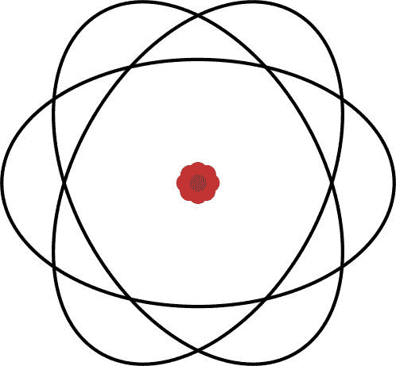

图 3.11 使用 SVG 图形可以轻松地向网页添加基础几何形状。

### 添加路径

另一个示例是使用路径绘制一些复杂的形状。路径是所有连接的线的集合。这些线可以是直线、抛物线弧或贝塞尔曲线。要创建路径，向 `<svg>` 元素中添加一个 `<path>` 元素并定义 `d` 属性。`d` 属性包含一系列指令，告诉浏览器如何在屏幕上渲染该路径。以下是更常用的命令列表：

-  `M x,y`：指定移动到坐标 `x,y`。大写的 `M` 指定绝对坐标；小写的 `m` 指定相对坐标。
-  `h n`：指定绘制长度为 `n` 像素的水平线。此值可以是正也可以是负。负数表示左侧。大写的 `H` 是绝对的，小写的 `h` 是相对的。
-  `v n`：指定绘制长度为 `n` 像素的垂直线。此值可以是正也可以是负。负数表示向上。大写的 `V` 是绝对的，小写的 `v` 是相对的。
-  `l x,y`：从当前坐标到坐标 `x,y` 画一条线。你可以指定用空格分隔的额外坐标来添加线段。大写的 `L` 是绝对的，小写的 `l` 是相对的。
-  `c x1 y1 y2 y2 x`：从当前坐标到 `x,y` 绘制一条贝塞尔曲线，使用 `x1,y1` 作为曲线起点的控制点，并使用 `x2,y2` 作为曲线终点的控制点。图 3.12 阐了控制点是如何工作的。大写的 `C` 是绝对的，小写的 `c` 是相对的。
-  `a rx ry x-axis-rotation large-arc-flag sweep-flag x y`：从当前坐标到 `x,y` 绘制一条弧。椭圆的大小和方向由两个半径 `rx, ry` 以及 `x-axis-rotation` 值定义，该值指定了弧的 x 轴的角度。`large-arc-flag` 和 `sweep-flag` 设置为 `0` 或 `1`，定义了抛物线的哪部分被渲染到屏幕上。大写的 `A` 是绝对的，小写的 `a` 是相对的。
-  `z`：关闭路径，这意味着最后一个坐标将连接到路径的起点。

列表 3.7 中的后续代码说明了如何利用几个路径，如图 3.13 所示。注意 `<path>` 元素以 `M` 指令开始移动到绝对坐标。然后 `h50` 命令向右绘制 50 像素的线；接下来，`a` 命令绘制一个半径为 50 像素且跨越两个方向的弧。最后，`z` 命令关闭弧。

```xml
<svg xmlns="http://www.w3.org/2000/svg" version="1.1" height="200">

  <path d="M100,90 h50 a50,50 0 1,0 50,-50 z" stroke="purple" stroke-width="1" fill="none" />

  <path d="M90,80 v-50 a50,50 0 0,0 -50,50 z" stroke="violet" stroke-width="2" fill="none" />

</svg>
```

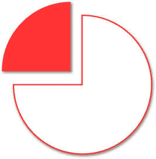

图 13 使用路径创建饼图。

除了使用路径创建图形元素外，你还可以使用路径创建一些文本效果。例如，以下代码在 `<defs>` 容器中添加了一个无填充的路径。该路径使用两个弧绘制了一个完整的圆。`id` 属性设置为 `path1`。接下来，创建了一个 SVG `<text>` 元素来定义文本。注意 `<text>` 元素内部有一个引用 `path1` 的 `<textPath>`。结果是文本绘制在路径上，如图 3.14 所示。我们还向 `<svg>` 标签添加了一个路径，使用几个线段绘制了指针。

```xml
<svg xmlns="http://www.w3.org/2000/svg" version="1.1" height="350">

  <defs>

    <path id="path1" d="M 77,210 a 1,1 0 1,1 200,0 a 1,1 0 1,1 -200,1"/>

  </defs>

  <text x="10" y="10" style="fill:blue;font-size:31px;">

    <textPath xlink:href="#path1">

      Teach Yourself AngularJS JavaScript and jQuery

    </textPath>

  </text>

  <path d="M 175,130 v90 h60" stroke="black" stroke-width="5" fill="none"/>

</svg>
```

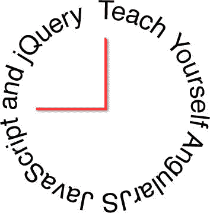

图 3.14 使用矢量路径，你可以将文本链接到路径以创建酷酷的视觉效果。

SVG 示例可以在网站上的 `code/lesson03/html_svg.html` 文件中找到。使用这些技术，你可以创建大量的图形形状。

### 列表 3.7 使用 `<svg>` 元素创建饼图和时钟周围文本框的 JavaScript 和 HTML 代码

点击此处查看代码图像

***

```html
01 <!DOCTYPE html>

02 <html>

03   <head>

04     <title>html 5 graphics</title>

05     <meta charset="UTF-8" />

06   </head>

07   <body><body>

08     <svg xmlns="http://www.w3.org/2000/svg" version="1.1"

09             height="200">

10       <ellipse   cx="100" cy="100" rx="80" ry="50"

11                    stroke="black" stroke-width="2"

12                        fill="transparent" />

13       <ellipse   cx="100" cy="100" rx="50" ry="80"

14                    stroke="black" stroke-width="2"

15                        fill="transparent"

16                        transform="rotate(30, 100, 100)" />

17       <ellipse   cx="100" cy="100" rx="80" ry="50"

18                    stroke="black" stroke-width="2"

19                        fill="transparent"

20                        transform="rotate(60, 100, 100)" />

21       <ellipse   cx="100" cy="100" rx="8" ry="2"

22                    stroke="crimson" stroke-width="2"

23                        fill="crimson"

24                        transform="rotate(45, 100, 100)" />

25       <ellipse   cx="100" cy="100" rx="2" ry="8"

26                    stroke="crimson" stroke-width="2"

27                        fill="crimson"

28                        transform="rotate(45, 100, 100)" />

29       <ellipse   cx="100" cy="100" rx="2" ry="8"

30                    stroke="crimson" stroke-width="2"

31                        fill="crimson" />

32       <ellipse   cx="100" cy="100" rx="8" ry="2"

33                    stroke="crimson" stroke-width="2"

34                        fill="crimson" />

35       <circle   cx="100" cy="100" r="6"

36                    stroke="red" stroke-width="4" fill="Dark"/>

37     </svg>

38     <svg xmlns="http://www.w3.org/2000/svg" version="1.1"

39             height="200">

40       <path d="M100,90 h-50 a50,50 0 1,0 50,-50 z"

41               fill="none" stroke="purple" stroke-width="1" />

42       <path d="M90,80 v-50 a50,50 0 0,0 -50,50 z"

43               fill="violet" stroke="none" stroke-width="2" />

44     </svg>

45     <svg xmlns="http://www.w3.org/2000/svg" version="1.1"

46             height="350">

47       <defs>

48         <path id="path1"

49               d="M 77,210 a 1,1 0 1,1 200,0 a 1,1 0 1,1 -200,1"/>

50       </defs>

51       <text x="10" y="10" style="fill:blue;font-size:31px;">

52         <textPath xlink:href="#path1">

53           Teach Yourself AngularJS JavaScript and jQuery

54         </textPath>

55       </text>

56       <path d="M 175,130 v90 h60" stroke="black"

57             stroke-width="5" fill="none"/>

58     </svg>

59   </body>

60 </html>
```

***

这一节仅触及了 SVG 的一角。如果你想了解更多关于 HTML5 中的 SVG 图形，可以查看此处文档：[www.w3.org/TR/SVG/Overview.html](http://www.w3.org/TR/SVG/Overview.html)。

### 添加 Canvas 用于动态设计

`<canvas>` 元素也允许你动态地向网页页面中添加和操作图像类型的图形。`canvas` 允许你通过 JavaScript 在浏览器屏幕的区域上绘制颜色、线条、文本和图像。

`<svg>` 元素和 `<canvas>` 元素区别在于，后者不是作为路径存储，而是以逐像素映射的形式存储，其中每个像素都有不同的颜色和透明度。

使用 `<canvas>` 元素的大部分工作将在 jQuery 和 JavaScript 脚本中完成。在 HTML 中，你只需要添加一个带有 `id` 的 `canvas` 元素，你可以从脚本中访问它。为了了解 `<canvas>` 元素与 JavaScript 之间的关系，请考虑 `Listing 3.8` 中的代码。

`canvas` 元素只定义了一个可以进行绘制的容器。所有工作都在 `<script>` 元素中完成。在脚本内部，前两行获取了 `myCanvas` 元素和一个 `2d` 上文对象。上下文对象是提供图形功能的图形对象。

上下文对象提供了在画布上绘制的方法。

```javascript
var c = document.getElementById("myCanvas");

var ctx = c.getContext("2d");
```

这段代码设置了画布的线宽和颜色，并将渲染到画布。

```javascript
ctx.lineWidth = 1;

ctx.strokeStyle = "blue";
```

绘制立方体需要通过 `stroke()` 方法。对于面，`beginPath()` 方法开始新路径。然后使用 `createLinearGradient()` 和 `addColorStop()` 来创建渐变填充。此时，画布上还没有任何内容。

```javascript
var grd = ctx.createLinearGradient(100,0,100,5);

grd.addColorStop(0,"blue");

grd.addColorStop(1,"white");

ctx.fillStyle = grd;
```

绘制立方体的面需要通过 `moveTo()` 方法移动到特定坐标，然后通过一系列 `lineTo()` 方法添加线条。

图 3.15 使用 JavaScript 在画布上绘制像素。


### 列表 3.8 在 `<canvas>` 元素中绘制立方体的 JavaScript 和 HTML 代码

```html
<html>

  <head>

    <title>HTML5 Canvas</title>

    <meta charset="UTF-8" />

  </head>

  <body>

    <canvas id="myCanvas" width="300" height="300">

      Your Browser Doesn't Support HTML5

    </canvas>

    <script>

      var c = document.getElementById("myCanvas");

      var ctx = c.getContext("2d");

      ctx.lineWidth = 1;

      ctx.strokeStyle = "blue";

      //top

      ctx.beginPath();

      var grd = ctx.createLinearGradient(100,50,100,5);

      grd.addColorStop(0,"blue");

      grd.addColorStop(1,"white");

      ctx.fillStyle = grd;

      grd.addColorStop(0,"blue");

      ctx.moveTo(1,25);

      ctx.lineTo(100,5);

      ctx.lineTo(200,25);

      ctx.lineTo(100,50);

      ctx.fill();

      ctx.stroke();

      //left

      ctx.beginPath();

      var grd = ctx.createLinearGradient(75,100,60,25);

      grd.addColorStop(0,"red");

      grd.addColorStop(1,"white");

      ctx.fillStyle = grd;

      ctx.moveTo(1,25);

      ctx.lineTo(100,50);

      ctx.lineTo(100,165);

      ctx.lineTo(1,125);

      ctx.fill();

      ctx.stroke();

      //right

      ctx.beginPath();

      var grd = ctx.createLinearGradient(200,50,125,175);

      grd.addColorStop(0,"yellow");

      grd.addColorStop(1,"white");

      ctx.fillStyle = grd;

      ctx.moveTo(100,50);

      ctx.lineTo(200,25);

      ctx.lineTo(200,125);

      ctx.lineTo(100,165);

      ctx.fill();

      ctx.stroke();

    </script>

  </body>

</html>
```

以下代码展示了 `<video>` 和 `<audio>` 标签的示例，图 3.16 和图 3.17 显示了渲染后的组件：

点击此处查看代码图片

```html


<video width="320" height="240" controls>
  <source src="images/movie.mp4" type="video/mp4">
  <source src="images/movie.ogg" type="video/ogg">
  Sorry, your browser does not support the video tag.
</video>

<audio controls>
  <source src="song.mp3" type="audio/mp3">
  Sorry, your browser does not support the audio element.
</audio>


**图 3.16** 渲染后的 `<video>` 允许你播放电影。

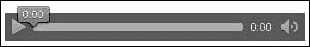

**图 3.17** 渲染后的 `<audio>` 允许你播放歌曲或其他音频。

### 总结

在本节中，你学习了 HTML 网页开发的基础。你还学习了如何通过`jQuery`和`JavaScript`动态访问某些元素，以便为你的网页设计更好的交互功能。此外，你还学习了设计 HTML 元素所需的必要基础，以支持实现 CSS 布局和样式设置。

几个“亲手实践”练习引导你逐步添加了样式的容器、表格和网页表单。在随后的课程中，你将使用在本节中学的基础来实现动态的`jQuery`和`JavaScript`。

### 问答

**问。为什么既有 HTML5 和 HTML 4，而不是只有 HTML？我应该用哪一个？**

**答。** 浏览器需要一些时间来采用新版本 HTML 中的标准。许多 HTML5 特性在旧浏览器中将无法运行，而某些新浏览器只支持某些功能而不支持其他功能。这会导致 HTML 页面出现错误且用户体验非常糟糕。因此，在 HTML5 被所有网络浏览器完全支持之前，HTML 4 将作为一个不同的标准保留。你选择使用哪一个取决于谁将查看你的网页。如果网页面向互联网上的所有人，你就需要继续支持 HTML 4，直到浏览器完全支持 HTML5。如果网页仅供公司内部用户使用，且你可以要求使用特定版本的浏览器，那么你可以选择完全支持 HTML5 的浏览器和版本并运行新功能。

**问。既然可以从 JavaScript 动态创建元素，为什么还要费心创建带有这些元素的 HTML 文档呢？**

**答。** 用于动态网页的最佳范式是使用 HTML 构建骨架，使用 CSS 进行样式化，然后使用`JavaScript`添加交互。你应该使用带有完整骨架的 HTML 文档的原因是，通过 HTML 理解和调整网页结构比通过`JavaScript`容易得多。此外，如果你要对网页进行本地化处理，处理 HTML 文档通常比本地化动态的`JavaScript`字符串更容易。

### 工作坊

工作坊由一组问题和答案组成，旨在巩固你对本节内容的理解。在查看答案之前，尝试回答这些问题。

### 测验

**1。** 使用哪个 HTML 元素属性来更改元素的背景颜色和大小等内容？

**2。** `<noscript>` 元素是做什么用的？

**3。** `<canvas>` 和 `<svg>` 元素之间的区别是什么？

**4。** 正确或错误：HTML 页面不能链接到同一页面上的某个位置。

**5。** 块级（block）HTML 元素和行内（inline）HTML 元素之间的区别是什么？

### 测验答案

**1。** `style`。

**2。** 如果用户的网络浏览器中没有激活`JavaScript`，`<noscript>`你在 HTML 页面上显示消息。

**3。** `<canvas>` 元素以基于像素的图形显示图像，并支持 JPEG 和 PNG 等图像；`<svg>` 支持基于矢量的图形，它是一系列在缩放时仍保持清晰的路径。

**4。** 错误。你可以使用`<a href="#`语法链接到网页上的本地锚点。

**5。** 块级元素占据屏幕的整个宽度，因此其后的元素会流到下方；而多个行内元素可以显示在同一行，因为它们只占据所需的空间。

### 练习

**1.** 扩展`3.5`中的示例。

**2.** 使用`3.8`中的示例来包含一些内容。

后续章节将讨论如何使用每个选项添加样式，以及何时应该使用它们。

#### 从文件加载 CSS 样式

通常，加载 CSS 样式的最佳方法是从单独的文件加载，这意味着创建一个扩展名为`.css`的文件，然后将其添加到你的网站。这具有几个优点：

 你可以将多个 HTML 文档链接到同一个 CSS 文件。

 你的 HTML 文件将保持整洁，因为没有大量额外的 CSS 代码负担。

 通过将 CSS 文件更换为另一个文件，可以轻松地更改网站的外观（换肤）。

要从单独的文件加载 CSS 样式，你需要将`.css`文件添加到你的网站，然后在 HTML 的`<head>`元素中添加`<link>`元素。当加载加载时，浏览器会解析`<link>`元素，从 Web 服务器请求`.css`文件，并在渲染 HTML 元素时应用样式。

以下是`<link>`元素中使用的语法示例。请注意`rel`属性被设置为`stylesheet`，`type`设置为`text/css`，且`href`指向 Web 服务器上`.css`文件的位置：

点击此处查看代码

```html
<link rel="stylesheet" type="text/css" href="css/test.css">
```

#### 在 Header 中添加 CSS 样式

你也可以使用`<style>`标签直接在网页的`<head>`元素中添加 CSS 样式。`<style>`标签内部的所有文本将被视为 CSS，读入浏览器并在渲染时应用到元素。

在头部中应用 CSS 样式确实具有一些优点，包括：

 轻松地将它们应用到头部以测试网页，而无需管理额外的`.css`文件。

 你可以使用特定于页面的样式来覆盖从`.css`文件加载的全局样式。

以下是一个包含 CSS 的`<style>`元素的`<head>`元素示例。注意`type`属性被设置为`text/css`；这并非强制要求，但在浏览器支持其他样式类型的时代，这是一个良好的习惯：

点击此处查看代码

```html
<html>
  <head>
    <meta charset="UTF-8">
    <style type="text/css">
      p{
        background-color:#C0C0C0;
        padding: 3px;
      }
      span{
        font-weight:bold;
      }
    </style>
  </head>
...
```

#### 在 HTML Body 中使用 CSS 样式

你也可以使用`<script>`标签直接在 HTML `<body>`元素内部添加 CSS 样式设置。这不是良好的做法，因为这会导致网页样式非常难以更改和修复。你应该将这种方法的使用限制在为了测试目的快速添加样式的时刻。测试后，你应该始终将它们移动到`<head>`或单独的文件。

#### 在 HTML 元素中定义 CSS 样式

HTML 元素提供了`style`属性，允许你直接在 HTML 语句中设置 CSS 样式。这具有优点，但有一个巨大的缺点。

优点是你可以覆盖全局应用于网站或网页的 CSS 样式。这使得自定义特定元素的外观和感觉成为可能，而无需在另一个位置包含特殊规则。

缺点是，如果你频繁这样做，当你决定使用不同的网页设计或品牌标识时，更新网站的样式将变得非常困难。

下行代码显示了直接在`<span>`元素内部添加 CSS `style`的示例：

点击此处查看代码

```html
<span style="background-color:blue; color:white font-weight:bold">Styled Text</span>
```

### 为 HTML 元素添加 CSS 样式

你已经在本书之前的示例中见过一些应用 CSS 的简要示例。现在是时候向你介绍可以通过 CSS 应用到 HTML 元素上的语法和属性了。本节绝不是详尽的；但它将让你了解通过 CSS 对 HTML 元素可以进行操作。

当你阅读并尝试这些示例时，请记住你可以通过 AngularJS、jQuery 和 JavaScript 访问 CSS 属性，因此可以在用户与网页交互时动态地设置它们。

#### 理解基础 CSS 语法

CSS 由一组或多个规则组成，这些规则定义了 Web 浏览器在渲染 HTML 元素时使用的属性值。每个规则都由选择器开始，选择器定义了对哪些 HTML 元素应用样式更改。然后在`{}`括号内部是特定的属性设置。属性值使用`property:value`语法设置。每个属性设置之间用分号隔开。

以下列表显示了一个简单规则的示例，它设置了`<p>`元素的字体、背景颜色和宽度：

```css
p {
  font-style:italic;
  background-color:#DDDD;
  width:250px;
}
```

你应该为每个元素使用单独的一行以增加文件的可读性。只要包含在`{}`中，你就可以将元素组合在同一行。例如：

```css
p {
  font-style:italic;
  background-color:#DDDD;
  width:250px;
}
```

### 注意

若干 CSS 属性支持单个属性的多个设置。例如，下面的属性设置将字体设置为**粗体**、*斜体*、`12px`和`Times Roman`。字体之间用逗号分隔，表示它们仍然属于同一个值的一部分。注意，由于`Times Roman`包含空格，它必须封装在引号中：

```css
font:italic bold 12px "Times Roman",serif;
```

HTML 元素样式设计最重要的部分之一就是 CSS 选择器。CSS 选择器用于定义 CSS 规则适用于哪些 HTML 元素。CSS 选择器起初看起来可能有些令人望畏；然而，当你通过一些示例理解了基本概念后，其语法就会迎刃解。

接下来的系列示例将帮助你理解选择器。

要对所有`<div>`元素应用 CSS 规则，请使用以下（HTML 元素通过标签名引用）：

```css
div {...}
```

要对`id`属性等于`myDiv`的特定 HTML 元素应用 CSS 规则，请使用以下（在 CSS 中，`id`属性使用`#`指定）：

```css
#myDiv {...}
```

要对所有`class`属性等于`container`的 HTML 元素组应用 CSS 规则，请使用以下（在 CSS 中，`class`属性使用`.`指定）：

```css
.container {...}
```

要在鼠标悬停在`<span>`元素上时对其应用 CSS 规则，请使用以下（在 CSS 中，状态通过`:state`指定）：

```css
span:hover {...}
```

要对`target`属性设置为`_blank`的`<a>`元素应用 CSS 规则，请使用以下（在 CSS 中，属性通过`[]`括号指定）：

```css
a[target=_blank]
```

你还可以使用逗号将多个选择器链在一起。例如，要对所有`<div>`、`<span>`、`<p>`以及`class="menu"`的元素应用 CSS 规则，你可以使用以下：

```css
div, span, p, .menu {...}
```

还要记住，CSS 代表级联样式表（Cascading Style Sheets）。你可能会有不同的选择器适用于多个重叠的对象组。例如，考虑以下选择器。第一个适用于所有的`<div>`元素，第二个仅适用于`menu`类元素——其中一些是`<div>`元素——最后一个仅适用于当前处于鼠标光标下的`menu`类元素。`.menu`和`.menu:hover`规则中的属性设置将覆盖`div`规则中的性设置：

```css
div {...}
.menu {...}
.menu:hover{...}
```

表 4.1 提供了若干类型选择器的列表；它展示了一个示例并描述了选择器如何工作。你可以使用选择器实现许多比前面的示例和表 4.1 中显示的更多的功能，但这些应该让你对我们在书中后续练习中如何使用选择器有一个概念。

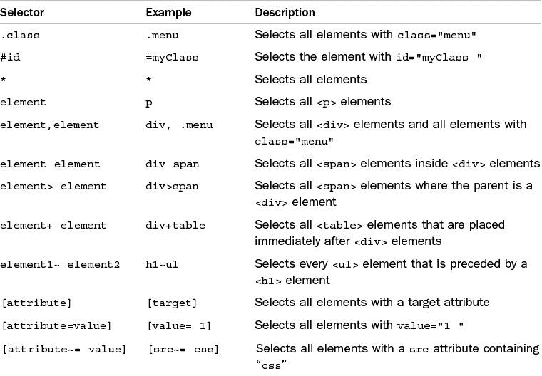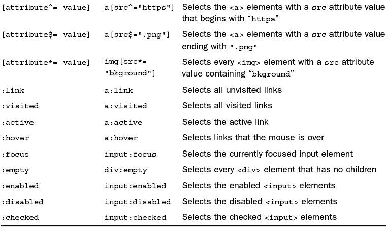

**表 4.1 一些常用 CSS 选择器列表**

## 使用 CSS 设计属性

大多数 CSS 属性都旨在改变 HTML 元素的外观。遗憾的是，默认的 HTML 元素看起来非常单调。然而，通过添加颜色、边框、背景、图像和其他设计属性，你只需要少量 CSS 代码就能极大改变 HTML 元素的外。

接下来的章节涵盖了改变 HTML 组件外观的 CSS 属性。

### CSS 颜色

通过 CSS 应用的最频繁的设置之一是`color`属性。大多数元素都有`color`属性，定义了浏览器渲染它们时使用的颜色——例如，表格边框、列表符号或段落中的文本字符。

你可以使用几种方法来设置精确的颜色，以支持定义颜色者的不同背景和情况。颜色值可以通过以下方法之一指定：

 **Name**——CSS 颜色名称，如`red`、`blue`、`green`或`yellow`。有 147 个预定义的颜色名称，例如`aqua`、`crimson`和`silver`。你可以在 [www.w3.org/TR/css3-color/#svg-color](http://www.w3.org/TR/css3-color/#svg-color) 找到颜色名称列表。

 **Hex**——你可以指定一个十六进制数表示颜色中包含的红色、绿色和蓝色量。语法为`#RRGGBB`。值`00`代表不包含该颜色，值`FF`代表包含该颜色。例如，红色是`#FF0000`，绿色是`#00FF00`，青色是`#00FFFF`。

 **RGB**——与 Hex 类似，不同在于你可以指定 0 到 255 之间的值。例如，青色是`rgb(0, 255, 255)`。

 **RGBA**——与 RGB 相同；但你还可以指定一个控制透明度的 alpha 参数，`0.0`为完全透明，`1.0`为不透明。例如：`rgba(0, 255, 255, 0.5)`是透明度 50% 的青色。

 **HSL**——允许你根据色相/饱和度/亮度色彩方案来指定颜色。例如，色相为`100`、饱和度为`45%`、亮度为`75%`的颜色将是`hsl(100, 45%, 75%)`。

 **HSLA**——与 HSL 相同，但你还可以指定一个控制透明度的 alpha 参数，`0.0`为完全透明，`1.0`为不透明。例如：`hsla(100, 45%, 75%, 0.5)`。

## 动手尝试：通过 CSS 应用文本样式

CSS 提供了几个属性，允许你定义文本的外观。以下是你可能会处理的一些较常用的属性：

`color`: 设置文本颜色。
`font-family`: 指定字体（例如`serif`、`sans-serif`）。
`font-style`: 设置字体样式（例如`italic`）。
`font-weight`: 设置字符的粗细（例如`bold`）。
`font-size`: 设置文本大小。
`text-align`: 设置水平对齐方式（例如`left`、`center`、`right`）。

`text-decoration`: 添加下划线等装饰。
`text-transform`: 控制大小写（例如`uppercase`）。
`line-height`: 设置行高。
`letter-spacing`: 设置字符间距。
`word-spacing`: 设置单词间距。

 `line-height`—允许你控制行与行之间的空间。你可以指定一个数值，该数值将乘以文本高度；或者使用带有`em`/`px`/`pt`/`cm`后缀的数值作为大小；或者使用代表行高百分比的`%`。图 4.5 显示了使用以下 CSS 设置将行间距紧凑到只有正常高度的 50% 的示例：

```css
#half-height{line-height:50%}
```

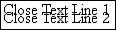

**图 4.5** 将行高更改为 50% 会使文本行变得紧凑。

 `text-decoration`—允许你使用`overline`、`underline`或`line-through`值在文本下方、上方或穿过文本添加一条线。你也可以指定`blink`为值，使文本在浏览器中闪烁。以下 CSS 代码将使元素渲染出下划线和删除线，如图 4.6 所示：

点击此处查看代码图像

```css


```css
#underline{text-decoration:underline;}
```

```css
#strike-through{text-decoration:line-through;}
```

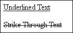

**图 4.6** 将文本更改为下划线或删除线。

 `text-indent`—允许你通过特定值（如 20px）或元素宽度的百分比（如 20%）来指定文本第一行的缩进量。

 `text-transform`—允许你使用以下值更改文本的大小写：`capitalize` 将每个单词的首字母大写，`uppercase` 使文本全部大大写，或 `lowercase` 移除所有大写字母。

 `text-overflow`—允许你定义当文本宽元素允许的尺寸时发生的情况。选项有 `clip` 直接截断文本，`ellipsis` 添加 `...` 表示被截断的文本，或者添加一个用于替换截断文本的字符串。例如，以下 CSS 代码将在文本过长时将其截断，并在末尾附加字符串“`(more)`”：

点击此处查看代码图像

```css
#overflow{text-overflow:" (more)";}
```

使用以下步骤创建 HTML 文档并为文本元素添加 CSS 样式。你正在创建的文件完整版本位于列表 4.1 和列表 4.2 中：

1. 从 Eclipse 开始，创建一个名为 `lesson04` 的文件夹。
2. 在 `lesson04` 中添加一个名为 `css` 的子文件夹。
3. 右键点击 `lesson04` 文件夹并创建一个名为 `text_styles.html` 的新 HTML 文档；然后添加以下基础 HTML 元素：

   点击此处查看代码图像

   ```html
   01 <!DOCTYPE html>
   02 <html>
   03    <head>
   04      <title>Text Styles</title>
   05      <meta charset="UTF-8">
   06 ...
   07    </head>
   08    <body>
   09 ...
   23
   24    </body>
   25 </html>
   ```

4. 现在添加以下 `<p>` 元素，你将使用 CSS 对它们进行格式化。注意，每个元素都有一个不同的 `id` 属性，你可以在 CSS 选择器中使用该属性来单独隔离该元素：

   点击此处查看代码图像

   ```html
   09    <p id="plain">Plain Text</p>
   10    <p id="indent">Indented Text <br>Indented Line 2</p>
   11    <p id="blue">Blue Text</p>
   12    <p id="tight">Tight Text</p>
   13    <p id="half-height">Close Text Line 1<br>
   14                      Close Text Line 2</p>
   15    <p id="align-left">Left Text</p>
   16    <p id="align-center">Centered Text</p>
   17    <p id="align-right">Right Text</p>
   18    <p id="underline">Underlined Text</p>
   19    <p id="strike-through">Strike Through Text</p>
   20    <p id="first-cap">capitalize the first letter</p>
   21    <p id="uppercase">change to upper case</p>
   22    <p id="blackadder">Some BlackAdder Text</p>
   23    <p id="roman">Some Times New Roman Text</p>
   ```

5. 右键点击新的 `css` 文件夹并添加名为 `text_styles.css` 的新文件。
6. 在新文件中添加以下 CSS 规则，为第 4 步中创建的各种元素定义属性：

   点击此处查看代码图像

   ```css
   01 #blue{color:blue;}
   02 #tight{letter-spacing:-1px}
   03 #half-height{line-height:50%}
   04 #align-left{text-align:left}
   05 #align-center{text-align:center}
   06 #align-right{text-align:right}
   07 #indent{text-indent:50px;}
   08 #underline{text-decoration:underline;}
   09 #strike-through{text-decoration:line-through;}
   10 #first-cap{text-transform:capitalize;}
   11 #uppercase{text-transform:uppercase;}
   ```

7. 在 `text_styles.html` 的头部添加以下 `<link>` 元素以链接新的 CSS：
8. 保存两个文件并在浏览器中打开。你应该能看到与图 4.5 类似的输出，但每个元素的外观发生了变化：

   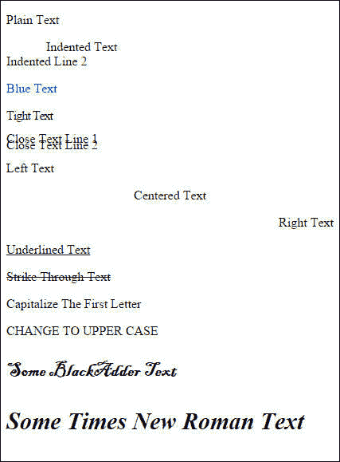

   **图 4.7** 应用 CSS 完全改变了元素的外观。

   **列表 4.2 text_styles.css** 通过调整颜色、对齐方式、添加线条和调整间距来样式化的代码

---

## 自己尝试：通过 CSS 添加背景

更改元素的背景属性是完全改变外观和感受的一种极方法。你应该了解一些背景属性，例如：

 `background-attachment`—可以设置为 `scroll` 或 `fixed`，这将使背景随页面一起滚动或保持固定。

 `background-color`—允许你使用标准的颜色命令定义背景颜色；例如：

点击此处查看代码图像

```css
#top-left {background-color:rgb(255,255,0);}
```

 `background-size`—允许你指定元素背景的大小。该值可以是像素或百分比设置的宽度/高度，`cover`（它将背景缩放以填充整个元素区域），或 `contain`（它将缩放图像以使整个图像适应元素大小）。请注意，使用 `cover` 时，如果尺寸比例不同，图像的部分可能无法显示在元素中。接下来的一些示例将尺寸设置为 200 像素宽比 100 像素高、元素宽度的 20% 比高度的 200%，以及完全包含在元素的大小内：

点击此处查看代码图像

```css
#top-left {background-size:200px 100px;}

#top-left {background-position:20% 100%;}

#top-left {background-position:contain;}
```

 `background-position`—这设置背景在元素中的放置位置，例如左上、底部居中等。你也可以为背景图像的左上角指定像素或百分比的宽度和高度位置坐标。例如，以下代码将背景图像放置在中间、向右偏移 10%、向下 50%，以及向右偏移 100px、向下 20px：

点击此处查看代码图像

```css
#top-left {background-position:center center;}

#top-left {background-position:10% 50%;}

#top-left {background-position:100px 20px;}
```

 `background-image (url)`—允许你指定将作为背景应用的图像 `url`。例如：

点击此处查看代码图像

```css
#rocs{background-image:url("images/rocks.png");}
```

 `background-image (gradient)`—在 CSS3 中，你还可以指定渐变，用向不同颜色的过渡来填充背景。在指定渐变时，你可以设置位置、大小和颜色。每个浏览器都有自己特定的属性名称。这很难描述，所以后面是几个示例。

以下是一个定义水平线性渐变的 CSS 示例。图 4.8 显示了渐变是如何应用的。注意位置被设置为顶部。它从顶部的蓝色开始，在 70% 处变为白色，然后在 100% 处（即底部）变为绿色：

点击此处查看代码图像

```css
background-image: -moz-linear-gradient(top, blue 0%, white 70%, green 100%);
```

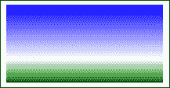

**图 4.8** 创建线性背景图像渐变。

 下面的行 CSS 定义了图 4.9 所示的径向渐变。径变的中心设置为距离左侧 50 距离顶部 50%；`circle` 确保它不会扭斜成椭圆，`contain` 将其缩小到合适的大小。颜色从中心的白色开始，在 75% 处变为蓝色，然后回到外部的透明白色，使用了 `rgba()` 颜色设置：

点击此处查看代码图像

```css
background-image: -moz-radial-gradient(50% 50%, circle contain,white,blue 75%,rgba(255,255,255,0));
```

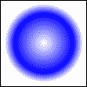

**图 4.9** 创建径向背景图像渐变。

 `background-repeat`—你可以使用此选项多次重复背景图像。值为 `repeat`（在所有方向重复）、`repeat-y`（在垂直方向重复）和 `repeat-x`（在水平方向重复）。你也可以指定 `no-repeat` 仅显示一次。重复图像用于边框以及作为条和按钮的设计元素。图 4.10 显示了以下代码中不同 `background-repeat` 值的运行：

点击此处查看代码图像

```css
body{
  background-size:50px 50px;
  margin:5px;
  background-image: -moz-radial-gradient(20px 20px, circle contain,white,blue 75%,white);
  background-repeat:repeat;
}
```

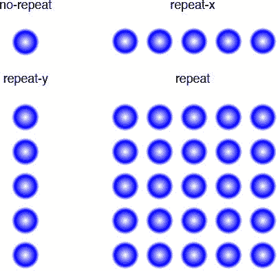

**图 4.10** 使用 `background-repeat`。

## 列表 4.3 backgrounds.html 为元素添加不同类型背景样的 HTML 和 CSS 代码

点击此处查看代码图像

```html
<!DOCTYPE html>
<html>
<head>
    <title>Backgrounds</title>
    <meta charset="UTF-8">
    <style>
        body {
          margin:0px;
          background-image:url("/images/ruler.png");
          background-repeat:repeat-y;
        }

        #heading {
          background-image: -moz-linear-gradient(left, #294551 0%, #AACCFF 100%);
          background-image: -webkit-linear-gradient(left, #294551 0%, #AACCFF 100%);
          background-image: -ms-linear-gradient(left, #294551 0%, #AACCFF 100%);
          height:200px;
          font:150px bold;
          text-align: center;
          color:rgba(255,255,255,.4);
        }

        #content {
          margin-left:200px;
        }

        #menu{
          padding:2px;
          background-color:#294551;
        }

        span {
          padding:3px;
          background-image: -moz-linear-gradient(top, #294551 0%, #AACCFF 85%, #0022ff 100%);
          background-image: -webkit-linear-gradient(top, #294551 0%, #AACCFF 85%, #294551 100%);
          background-image: -ms-linear-gradient(top, #294551 0%, #AACCFF 85%, #294551 100%);
          font:20px bold;
          color:white;
        }
    </style>
</head>
<body>
    <div id="heading">jQuery Rules!</div>
    <div id="content">
        <div id="menu">
            <span>Home</span>
            <span>Info</span>
            <span>Examples</span>
        </div>
        <p>Page Content</p>
    </div>
</body>
</html>
```


# 尝试一下：为 HTML 元素添加边框

另一个可以修改以完全改变 HTML 组件外观和感觉的 CSS 属性是 `border` 属性。所有的容器元素，如 `<div>`、`<span>` 和 `<p>`，都允许你通过 CSS 定义边框样式。

表 4.2 描述了一些可以在 CSS 中修改以定义各种样式边框的 CSS 属性。

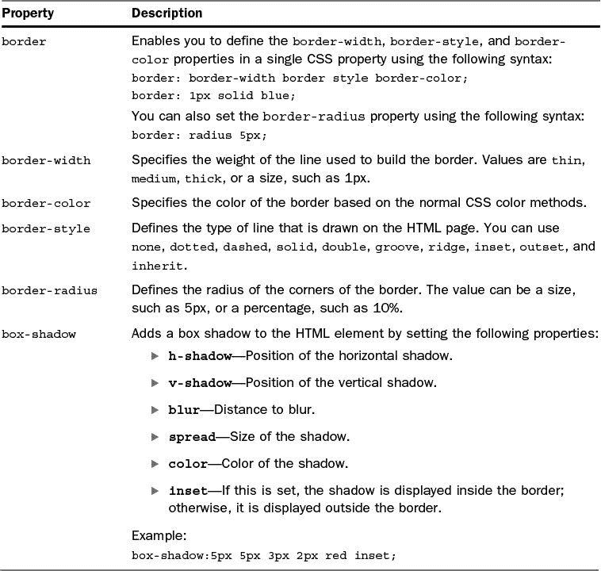

#### 表 4.2 定义边框样式的 CSS 属性

你可以使用以下语法在单个属性设置上指定 `border-width`、`border-color` 和 `border-style` 属性的不同值：

点击此处查看代码图像

```css
property: top right left;
border-width: 1px 2px 1px 2px;
border-color: red blue red;
```

你也可以使用位置设置单个边框属性，例如 `border-top` 或 `border-top-width`。例如，下面的 CSS 将仅样式边框的顶部和左侧：

```css
border-top: 1px solid;
border-left-color: blue;
border-left-style: solid;
border-left-width: 2px;
```

以下步骤将引导你通过在列表 4.4 和列表 4.5 中创建代码，为 `<div>` 元素添加多种类型的边框：

1. 在 `lesson04` 文件夹中创建一个名为 `borders.html` 的新 HTML 文档。
2. 添加列表 4.4 所示的代码。该代码链接到名为 `css/borders.css` 的外部样式，然后定义了一系列 `<div>` 元素。
3. 在 `lesson04/css` 文件夹中创建一个名为 `borders.css` 的新 CSS 文档。
4. 在新的 CSS 文件中添加以下行，为 `<div>` 元素设置基本间距和大小：

   点击此处查看代码图像

   ```css
   div { width:200px; margin:5px; text-align:center}
   ```

5. 添加列表 4.5 中的第 2–8 行代码，以定义适用于 `<div>` 元素的多种边框样式。
6. 添加以下 CSS 规则为两个 `<div>` 元素创建圆边框：

   点击此处查看代码图像

   ```css
   #round { border:1px solid; border-radius:5px;}
   #veryround { border-radius:50%;}
   ```

7. 将列表 4.5 中的第 1–20 行代码添加以定义适用于 `<div>` 元素的阴影。
8. 添加以下代码来创建混合边框。这些代码为 `<div>` 元素添加阴影。第一个是 `outset` 阴影，第二个是 `inset` 阴影，它们在右侧显示不同。

   点击此处查看代码图像

   ```css
   #mixed { border:1px solid;}
   ```

9. 添加以下代码创建带有圆角的边框。这看起来与图 4.12 所示类似：

   ```css
   #button { width:150px; border:5px;}
   ```

10. 保存文件并在浏览器中打开 HTML。你应该看到与图 4.12 所示类似的各种边框样式。


##### 图 4.12 为 HTML 元素添加边框

##### 列表 4.4 创建一系列 `<div>` 元素的 HTML

##### 列表 4.5 定义多种边框样式的 CSS

浏览器与用户交互的一个重要部分是鼠标光标。你只需更改鼠标悬停在 HTML 元素上时的光标样式，就可以让用户知道元素的用途或行为。

`cursor` CSS 属性允许你定义当鼠标悬停在特定元素上时使用什么光标。以下是一个将 `cursor` 设置为 `pointer` 的示例：

```css
div { cursor:pointer; }
```

你可以从几个 `cursor` 值中进行选择。图 4.13 显示了通过 `cursor` CSS 属性提供的某些 `cursor` 值示例。

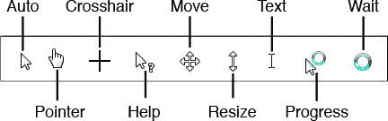

**图 4.13** 通过 `cursor` CSS 属性可用的某些光标类型示例。

### 透明度（Opacity）

`opacity` CSS 属性允许你设置 HTML 元素及其包含的所有元素的透明度。`opacity` 被指定为 0 到 1 之间的小数，其中 0 表示透明，1 表示不透明。

改变 `opacity` 是让用户知道 HTML 元素是非活动状态的好方法。例如，以下 CSS 和 HTML 定义了两个按钮定义。`button2` 的定义包含了 .4 的透明度，使其部分透明。结果显示在图 4.14 中。


**图 4.14** 两个样式为按钮的 `<span>` 元素，其中一个的 `opacity` 设置为 .4。

#### CSS 规则

点击此处查看代码图像

```css
#button, #button2 {
  margin: 5px; padding:3px;
  text-align: center;
  background-color: #2233FF;
  color: white;
  border:5px outset blue;
  border-radius:50%;
}

#button2 { opacity:.4; }
```

#### HTML 元素

点击此处查看代码图像

```html
<span id="button">Active</span>
<span id="button2">Inactive</span>
```

### 可见性（Visibility）

另一个属性 CSS 属性是 `visibility`。你可以将 `visibility` 设置为 `hidden`，此时 HTML 元素及其包含的所有元素将不会渲染到浏览器中。再次设置为 `visible` 就会在浏览器窗口中显示。这种功能在 `jQuery` 和 JavaScript 中非常有用，允许你动态地显示和隐藏页面元素。

### 应用 CSS 布局属性

创建 HTML 网页最大的挑战之一是 HTML 并不容易于创建美观的布局。这就是为什么许多 CSS 属性旨在更改大小、位置以及与其他 HTML 元素之间的关系。

使用 CSS 布局属性，你将能够在你的网页上正确地定位项目，并且通过 JavaScript、`jQuery` 和 `AngularJS`，你可以高效地更改这些位置，为用户提供更多的应用程序体验，而不是一个简单的点击式网页。接下来的章节涵盖了更改 HTML 组件布局的 CSS 属性。

### 理解盒模型（Box Model）

HTML 元素使用盒模型渲染到浏览器窗口中。在盒模型中，HTML 元素的内容由图 4.15 所示的四个部分组成：

- **内容（Content）**——HTML 组件本身的内容
- **内边距（Padding）**——组件与边框之间的空间
- **边框（Border）**——包围 HTML 元素的边框
- **外边距（Margin）**——HTML 元素与其周围元素之间的空间

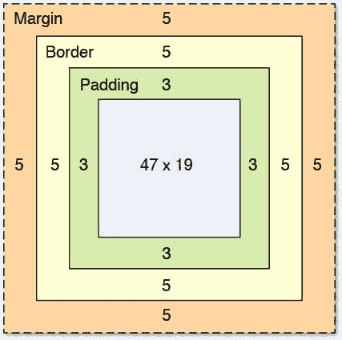

**图 4.15** CSS 盒模型包含四个部分：内容、内边距、边框和外边距。

每个部分在浏览器中占据的空间可以使用 CSS 设置。

#### 设置内容大小

通过指定 `height` 和 `width` CSS 属性的大小值来设置内容。大小值可以指定为 `px`、`cm`、`auto`、`%` 等。你还可以使用 `max-height`、`max-width`、`min-height` 和 `min-width` 属性指定最大和最小高度及宽度。

以下是设置 `<p>` 元素的高度和宽度属性的示例：

```css
p {height:100px; width: 50px;}
```

#### 在 HTML 内容周围添加内边距

内边距是元素布局的重要部分，特别是当你使用边框时。内边距防止 HTML 元素内部的内容接触到边框。

通过指定 `padding` 值，可以为 HTML 元素的所有边添加内边距，如下：

```css
padding:3px;
```

你也可以为元素的每个边指定内边距，例如：

```css
padding:1px 2px 1px 2px;
```

#### 在 HTML 元素周围添加外边距

外边距的工作原理与内边距类似，但它们位于元素的边框之外，并防止其他 HTML 元素接触边框。可以通过指定 `margin` 值为 HTML 元素的所有边添加外边距：

```css
margin:
```

你也可以为元素的每个边指定外边距，例如：

```css
margin:
```

`margin` 属性还支持 `auto` 值。

### 修改元素流

除非另有指定，否则元素是静态的并与文档中的其他元素一起流动。正如上一节中学的，有些元素是块级的，有些是内联的。块元素占据整个宽度；内联元素只占据必要的空间。

使用 `display` 属性，你可以将元素设置为 `block` 或 `inline`。另一个值得的 `display` 值是 `inline-block`。与内联元素不同，你仍然可以设置属性，如 `height` 和 `width`。例如：

```css
span {height:200px; width:200px;display:inline-block;}
```

另一种修改元素流的方法是使用 `float` 属性。`float` 属性允许元素浮在容器元素的左侧或右侧。未浮动的元素将显示在元素旁边。

使用 `float` 属性时，你需要使用 `clear` 属性来定义哪些元素不允许在浮动元素周围流动。为了说明这一点，请考虑以下 CSS 和 HTML。注意，在图 4.16 中，未包含 `clear:both` 属性的段落元素渲染在左侧浮动的图像旁边。

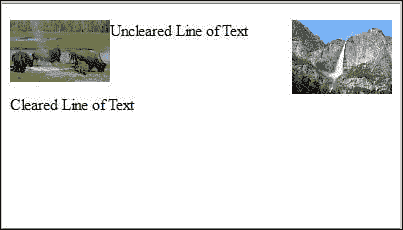

**图 4.16** 将元素浮动到左侧或右侧会修改流。然而，你需要 `clear` 不希望流动的属性。

#### CSS 规则

```css
#image1 {float:left;}

#image2 {float:right;}

#cleared {clear:both;}
```

#### HTML 元素

```html


<p id="uncleared">Uncleared Line of Text</p>

<p id="cleared">Cleared Line of Text</p>
```

### 使用 CSS 定位 HTML 元素

`position` 属性允许你定义浏览器如何对元素进行定位。默认情况下，元素是静态的并与文档中的其他元素一起。通过更改 `position` 属性的值，你可以更改这种行为。以下列表描述了每个非静态定位值：

- **固定（fixed）**——相对于浏览器窗口进行定位。
- **绝对（absolute）**——相对于第一个非静态容器元素进行定位。元素的至少一个容器已经定义了非静态定位。
- **相对（relative）**——将元素相对于其原本应所在的位置进行定位。

当你将 `position` 属性更改为非静态（nonstatic）值，你可以使用 `top`、`left`、`bottom` 和 `right` 属性来设置位置。例如，要将元素的左上角设置为距离页面顶部 50 像素、距离浏览器窗口左侧边缘 100 像素，你可以使用以下 CSS 代码：

```css
position:fixed;

top:50px;

left:100px;
```

### Z-Index（层级）

当你开始使用非静态定位对 HTML 元素时，你可能会发现一个元素重叠另一个元素的情况。`z-index` 属性允许你指定哪个元素应该显示在前面。`z-index` 数字较高的元素位于 `z-index` 值较小的元素之前。以下 CSS `<div>` 元素将位于 `<p>` 段落元素的前面：

```css
div { z-index:2; }

p { z-index:1; }
```

### Overflow（溢出）

`overflow` CSS 属性用于解决在设计的网页区域中尝试显示比该区域过大的项目的问题。`overflow` 属性可以设置为以下几个值：

- **visible—可见**——默认行为。
- **hidden—隐藏**——如果内容太大，将隐藏该元素。
- **scroll—滚动**——在底部和右侧添加滚动条。如果内容超过了尺寸限制，滚动条将激活，这样你可以查看容器的完整内容，而不影响页面其他部分的布局。
- **auto—自动**——在必要时将添加滚动条，以保持元素符合你设置的尺寸限制。

图 4.17 显示了一个列表示例，该列表被限制在一个 `<ul>` 元素内部，该元素具有以下带有 `overflow` 属性的 CSS 规则：

```css
ul {
  border:1px solid;
  height:150px; width:300px;
  overflow:auto;
}

li { width:800px; }
```

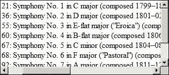

**图 4.17** 向 `<ul>` 元素添加 `overflow` 属性会导致列表被限制在滚动条内。

### 动手尝试：使用 CSS 布局网页组件

在这个示例中，你将实践几个布局属性。在示例中，你创建了两个 `<div>` 元素，并按照以下步骤将它们放置在网页的固定位置。完整的 HTML 和 CSS 代码可以在列表 4.6 和列表 4.7 中找到：

1. 在 Eclipse 的 `lesson04` 文件夹中创建一个名为 `web_layout.html` 的新 HTML 文档。
2. 添加列表 4.6 所示的代码。该代码链接到名为 `css/web_layout.css` 的外部样式表，然后定义了两个 `<div>` 元素：一个包含一组图片，另一个包含显示歌曲信息的 `<p>` 元素。
3. 从书籍网站的 `/images` 目录下将列表 4.6 列出的图片文件复制到你 Eclipse 项目的 `/images` 文件夹中。
4. 在 Eclipse 的 `lesson04/css` 文件夹中创建一个名为 `web_layout.css` 的新 CSS 文档。
5. 在新的 CSS 文件中添加以下行，为 `` 元素设置基本间距和大小。`margin` 属性为它们之间以及在 `div` 元素中留出空间。`float` 属性允许它们浮动到容器的左侧：

   ```css
   01 img {
   02   width:48px;
   03   margin:-5px;
   04   float:left;
   05 }
   ```

6. 添加以下代码行来定义两个 `<div>` 元素的外观。`position` 被设置为 `fixed`，但尚未指定具体的定位。我们还添加了 `padding`，为 `div` 内部的项目留出远离边框的空间：

   ```css
   06 #buttons, #songInfo {
   07   position:fixed;
   08   padding:5px;
   09   display:inline-block;
   10   border:8px ridge blue;
   11   border-radius 5px;
   12 }
   ```

7. 添加以下 CSS 规则来单独定位每个 `#songInfo` 和 `#buttons <div>` 元素。记住它们保留了上一步中的所有值。注意，你通过指定浏览器窗口中的 `top` 和 `left` 位置来设置元素的位置。还要注意，你给按钮分配了更高的 `z-index` 数字，以确保它始终位于 `songInfo` 之上：

   点击此处查看代码图片

   ```css
   13 #songInfo {
   14   background-color: black;
   15   top:50px;
   16   left:100px;
   17   height:150px;
   18   width:300px;
   19   z-index:1;
   20 }

   21 #buttons {
   22   background-color: white;
   23   top:200px;
   24   left:120px;
   25   z-index:2;
   26 }
   ```

8. 添加以下 CSS 规则来单独定位 `#songInfo` 和 `#buttons <div>` 元素。注意，通过将 `position` 设置为 `relative`，你可以让元素相对于它们原本应所在的位置进行定位。然后，当你设置 `top` 和 `left` 值时，你可以移动这些元素，而不影响页面其他部分的布局：

   ```css
   33 #title {
   34   color:lime;
   35   font-size:15px;
   36   position:relative;
   37   top:25px;
   38   left:30px;
   39 }

   40 #year {
   ```


```css
41  color: yellow;

42 }

43 }
```

**9.** 保存文件并在浏览器中打开 HTML。你应该能看到与图 4.17 类似的结果。

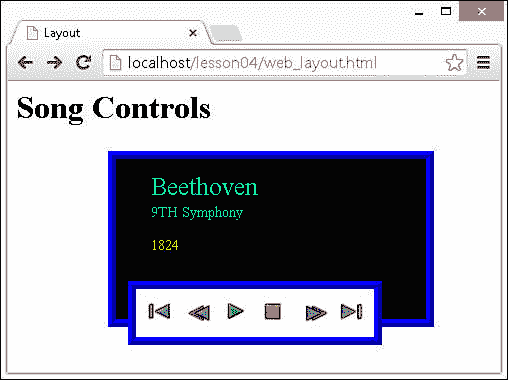

注意，`overflow` 属性允许元素在浏览器中处于特定的位置。

列表 4.6 和列表 4.7 创建了网页布局并将元素放置在特定的位置。

在你定义 CSS 样式规则时，请记住有几种方法可以动态应用样式。你可以这样设计 CSS，使得动态代码的实现将变得简单得多。以下章节描述了你之后将学习的一些方法。

### 准备动态为 HTML 元素添加类

动态调整 HTML 元素样式的简单方法是更改与该元素关联的 CSS 规则。更改 CSS 规则最简单的方法是为你想要使用的不同规则使用 `class` 选择器。通过这种方式，你可以从 `AngularJS`、`jQuery` 和 `JavaScript` 出发，添加一个 `class` 来应用样式，或移除一个 `class` 来移除样式。

这提供了两个主要优势。首先，动态代码变得简单得多，因为添加和移除类非常容易。其次，易于调整将应用的 CSS 样式，因为这些调整将在 `.css` 文件或 `<style>` 标签内部完成。

使用动态类规则要求类选择器的规则必须在加载到页面的 CSS 代码某处被完全定义。它还需要你对如何实现每个 CSS 规则进行思考。

例如，考虑为一个样式化为按钮的 `<span>` 元素添加动态交互。你希望按钮能够有四种不同的状态：升起、按下、未激活和状态改变。你可以为这些按钮状态的类选择器创建一个不同的 CSS 规则。当按钮升起时，分配给 `<span>` 的 `class` 属性为 `up`；当用户点击按钮时，你可以将 `class` 更改为 `state changing`，然后在鼠标释放时，将 `class` 更改为 `down`。

### 准备直接调整 CSS 属性

你也可以通过 `AngularJS`、`jQuery` 和 `JavaScript` 直接访问并修改元素或一组元素的特定 CSS 属性。这提供了可以在 `.css` 文件或 `<style>` 标签中创建静态 CSS 定义，然后动态更改属性值子集的优势。

使用 `JavaScript` CSS 属性值的一个很好的例子是在页面上移动项目。例如，假设你定义了一个滚动 banner 的 HTML 元素，它应该在屏幕上水平滚动。你会定义静态 CSS 样式，将 banner 设置为浏览器窗口中的固定位置。然后，由于 CSS 已经定义了渲染固定 banner 需要的所有属性，从 `AngularJS`、`jQuery` 和 `JavaScript` 所做的只需要调整 CSS 位置属性来滚动 banner。

### 总结

本节讨论了使用 CSS 快速方便地更改网页的外观和感受。理解这些概念对于实现 `JavaScript`、`jQuery` 和 `AngularJS` 以创建动态网页和富丰富的互联网应用程序至关重要。

你学习了 CSS 规则是如何构造的，以及如何定义选择器将 CSS 规则应用于特定的 HTML 元素组。你接触了 CSS 的一些常见设计和布局样式。

你学习了如何设置文本样式、应用颜色和背景图像，以及为 HTML 元素创建酷的边框。你还学习了如何理解和控制页面上 HTML 元素的流，以及如何应用固定定位。

### 问答

**Q. 为 HTML 元素使用固定尺寸和位置更好，还是应该尝试使用更多基于内容大小的 HTML 流？**

**A.** 这是一个很难的问题。对于大多数网页，请考虑尽可能在元素内部使用更多相对定位的流。之所以这样做是因为可能查看网页的显示范围非常广。如果你需要支持多达 36 英寸显示器的移动显示，流允许内容更容易地匹配浏览器大小。然而，如果你正在设计一个更像网络应用程序的动态网页，请使用更多支持平均尺寸显示器的固定尺寸，然后使用你在书中后学习的 `jQuery Mobile` 技术来实现移动版本。

**Q. 为什么要费力用 CSS——我不能直接从 jQuery 和 JavaScript 应用 CSS 样式吗？**

**A.** 当然可以，你用 CSS 能做的任何事情都可以通过 `JavaScript` 应用。然而，维护这些更改更加困难，特别是当有多个人参与设计时。通常，优秀的网页设计师并不知道任何 `jQuery` 或 `JavaScript`。此外，考虑保留多个版本的 CSS 文件并对其进行调整以为网页应用不同的皮肤是简单的。

### 工作坊

工作坊由一组问答组成，旨在巩固你对本节涵盖内容的理解。在看答案之前尝试回答这些问题。

### 测验

**1.** 你会使用什么选择器为所有 `<div>` 元素应用 CSS 规则？

**2.** 哪个 CSS 属性允许元素向右或向左浮过其他元素？

**3.** 你如何为 `<div>` 元素应用带圆角的边框？

**4.** 正确或错误：你不能在浏览器中指定精确坐标来定位 HTML 元素。

**5.** 你会使用什么选择器为类设置为 `myClass` 且 ID 设置 `mainContainer` 的 HTML 元素应用 CSS 规则？

### 测验答案

**1.** `div {...}`

**2.** `float:right` 或 `float:left`

**3.** `border:1px solid;border-radius:5px;`

**4.** 错误。你可以设置 `display:fixed` 属性，然后设置 `top`、`left` 或 `right` 像素偏移来放置 HTML 元素，无论页面上的其他元素在哪里。

**5.** `#mainContainer {...}`

### 练习

**1.** 修改你在列表 4.3 应用的代码，包含以下 CSS 规则，该规则适用于你定义的按钮的 span。该规则应该在鼠标悬停在其上方时更改 HTML 元素的样式，从而改变菜单项的外观：

```css
span:hover {
  width: 150px;
  background-color: #223FF;
  color: white;
  border: 5px outset blue;
  border-radius: 50%;
}
```

**2.** 修改列表 4.6 和列表 4.7 中的代码，将标题封装在自己的边框中并将其放置在其他 `<div>` 元素上方。你需要通过更改现有 `<div>` 元素的位置来实现这一点。

## 在网页中添加 jQuery 和 JavaScript

在本节中，你将学习 JavaScript 的基本结构和语法，以及如何使用 jQuery 来简化某些开发任务。本节的目的是帮助你熟悉 JavaScript 语言语法，这同时也也是 jQuery 的语言语法。

浏览器已经内置了对 JavaScript 的支持。这意味着你只需要将自己的 JavaScript 代码添加到网页中，即可实现动态网页。另一方面，jQuery 是一个额外的库，在添加 jQuery 脚本之前，你需要先将 jQuery 库添加到你的网页中。

## 加载 jQuery 库

由于 jQuery 库是一个 JavaScript 脚本，因此你使用 `<script>` 标签将 jQuery 加载到你的网页中。你可以将 jQuery 下载到你的代码目录并托管在你的 Web 服务器上，也可以使用在 [jQuery.com](http://jQuery.com) 提供的托管版本。以下语句显示了每种方式的示例；唯一的区别是第一个是从 jQuery CDN 源加载，而第二个是从 Web 服务器加载的：

点击此处查看代码图像

```html
<script src="http://code.jquery.com/jquery-latest.min.js"></script>
<script src="includes/js/jquery-latest.min.js"></script>
```

**注意**

记住，你需要在加载 jQuery 库的 `<script>` 元素放置在任何使用它的脚本元素之前。否则，那些脚本库将无法连接到 jQuery 代码。

jQuery 库的下载地址可以在以下位置找到：

[`http://jquery.com/download/`](http://jquery.com/download/)

jQuery 库的托管链接可以在以下位置找到：

[`http://code.jquery.com/`](http://code.jquery.com/)

### 实现你自己的 jQuery 和 JavaScript

jQuery 代码是作为 JavaScript 脚本的一部分来实现的。要向你的网页中添加 jQuery 和 JavaScript，首先添加一个加载 jQuery 库的 `<script>` 标签，然后添加带有你自定义代码的自己的 `<script>` 标签。

JavaScript 代码可以添加到 `<script>` 元素内部，也可以 `<script>` 标签的 `src` 属性可以指向单独 JavaScript 文档的位置。无论哪种方式，JavaScript 都将以相同的方式加载。

以下是一对加载 jQuery 后并使用它的 `<script>` 语句示例。`document.write()` 函数直接将文本写入浏览器以进行渲染：

点击此处查看代码图像

```html
<script src="http://code.jquery.com/jquery-latest.min.js"></script>

<script>
  function writeIt() {
    document.write("jQuery Version " + $().jquery + " loaded.");
  }
</script>
```

**注意**

`<script>` 标签不需要添加到 HTML 文档的 `<head>` 部分；它们也可以添加到 `body` 中。将简单的脚本直接内联到使用它们的 HTML 元素中通常是很有用的。

## 访问 HTML 事件处理程序

那么在你将 JavaScript 添加到网页后，如何让它执行呢？答案是将其绑定到浏览器上。每当页面或元素加载、用户移动或点击鼠标或输入字符时，就会触发一个 HTML 事件。

每个受支持的事件都是接收事件的对象的的一个属性。如果你将属性值设置为 JavaScript 函数，那么当事件触发时，浏览器将执行你的函数。例如，当 HTML 页面的 body 加载时，以下将执行 `writeIt()` 函数：

```html
<body onload="writeIt()">
```

### 尝试一下：实现 JavaScript 和 jQuery

这些是基本步骤。现在是时候亲自尝试了。使用以下步骤将 jQuery 添加到你的项目中并在网页中动态使用它：

1. 在 Eclipse 中，创建一个名为 `lesson05` 的源文件夹。
2. 在与 `lesson05` 文件夹相同的目录下，添加一个名为 `js` 的额外目录。
3. 现在在 `lesson05` 文件夹中创建一个名为 `jquery_version.html` 的源文件。
4. 添加常规元素（`html`、`head`、`body`）。
5. 在 `<head>` 元素内部，添加以下行代码来加载刚刚下载的库：

   点击此处查看代码图像

   ```html
   <script src="https://code.jquery.com/jquery-2.1.3.min.js"></script>
   ```

6. 现在你可以添加你自己的 `<script>` 标签并带有以下代码将 jQuery 版本打印到浏览器上：

   点击此处查看代码图像

   ```html
   <script>
     function writeIt() {
       document.write("jQuery Version " + $().jquery + " loaded.");
     }
   </script>
   ```

7. 为了让你的脚本在文档加载时执行，使用以下行代码将 `writeIt()` 函数绑定到 `<body> onload` 事件：

   ```html
   <body onload="writeIt()">
   ```

8. 保存文件并在 Web 浏览器中通过以下位置查看。输出应该类似于图 5.1：

   `http://localhost/lesson06/jquery_version.html`

**图 5.1** 当执行 `writeIt()` 函数时，会将 jQuery 版本写入到浏览器。

**列表 5.1 在网页中加载 jQuery 并打印其版本的简单示例**

点击此处查看代码图像

```html
<!DOCTYPE html>

<html>

<head>
  <title>jQuery Version</title>
  <meta charset="utf-8" />

  <script src="https://code.jquery.com/jquery-2.1.3.min.js"></script>

  <script>
    function writeIt() {
      document.write("jQuery Version " + $().jquery + " loaded.");
    }
  </script>
</head>

<body onload="writeIt()">
</body>

</html>
```

# 访问 DOM

JavaScript（尤其是 jQuery）最重要的方面之一是访问 DOM 能力。访问 DOM 是你通过更改元素的样式、大小、位置和值来使网页动态的方式。

在接下来的章节中，你将学习通过传统方法访问 DOM 以及使用 jQuery 选择器的更改进方法。这些章节只是简要介绍。你将在后的课程中进行大量的练习。

### 使用传统 JavaScript 访问 DOM

传统上，JavaScript 使用全局 `document` 对象来访问网页中的元素。访问元素的最简单方法是通过 `id` 直接引用它。例如，如果你有一个 `id="question"` 的段落，你可以通过以下 JavaScript `getElementById()` 函数访问它：

点击此处查看代码图像

```javascript
var q = document.getElementById("question");

...

<p id="question">你更喜欢哪种方法？</p>
```

另一个用于访问 DOM 元素的有用 JavaScript 函数是 `getElementsByTagName()`。它返回一个与标签名称匹配的 DOM 元素数组。例如，获取所有 `<p>` 元素的列表使用以下函数调用：

点击此处查看代码图像

```javascript
var paragraphs = document.getElementsByTagName("p");
```

### 使用 jQuery 选择器访问 HTML 元素

访问 HTML 元素是 jQuery 的最大优势之一。jQuery 使用与 CSS 选择器非常相似的选择器来访问 DOM 中的一个或多个元素；因此得名 jQuery。jQuery 返回一个单个元素或 jQuerified 对象的数组。jQuerified 意味着向 DOM 对象添加了额外的 jQuery 功能，使得操作变得更加容易。

使用 jQuery 选择器的语法为 `$(selector).action()`，其中 `selector` 被替换为有效的选择器，而 `action` 被替换为附加到 DOM 元素上的 jQuery 动作。

例如，以下命令可以找到 HTML 文档中的所有段落元素，并将 CSS `font-weight` 属性设置为 `bold`：

点击此处查看代码图片

```javascript
$("p").css('font-weight', 'bold');
```

***

## 动手尝试：使用 jQuery 和 JavaScript 访问 DOM 元素

为了巩固这些概念，你将运行一个使用 jQuery 和 JavaScript 访问并修改 DOM 元素的快速示例。按照以下步骤构建列表 5.2 所示的 HTML 文档：

**1.** 在 `lesson05` 文件夹中创建一个名为 `dom_elements.html` 的源文件。

**2.** 添加常规的基础元素（`html`、`head`、`body`）。

**3.** 在 `<head>` 元素内部添加以下行来加载你刚刚下载的库：

点击此处查看代码图片

```html
06    <script src="https://code.jquery.com/jquery-2.1.3.min.js"></script>
```

**4.** 添加以下 `<script>` 元素，它同时使用 JavaScript 和 jQuery 方法访问 DOM。注意，在 jQuery 中，两个动作是链式连接的。第一个动作设置 CSS `font-weight` 属性，第二个动作更改元素包含的文本。对于 JavaScript，你使用 `getElementById()` 方法，然后直接在 DOM 中设置 `innerHTML` 属性来更改浏览器中显示的文本：

点击此处查看代码图片

```html
07    <script>
08      function writeIt() {
09        $("#heading").css('font-weight', 'bold').html("jQuery");
10        var q = document.getElementById("question");
11        q.innerHTML = "I Prefer jQuery!";
12      }
13    </script>
```

**5.** 为了让脚本在文档加载时执行，请使用以下行将 `writeIt()` 函数绑定到 `<body> onload` 事件：

点击此处查看代码图片

```html
15    <body onload="writeIt()">
```


## 6. 添加用于访问容器的 `<p>` 元素

在 `<body>` 中添加以下 `<p>` 元素，为 JavaScript 代码提供访问容器：

点击此处查看代码图片

```html
16      <p id="heading">jQuery or JavaScript</p>
17      <p id="question">Which method to you prefer?</p>
```

## 7. 保存并查看文件

保存文件并在网页浏览器中查看。输出应该与 Figure 5.2 相似。

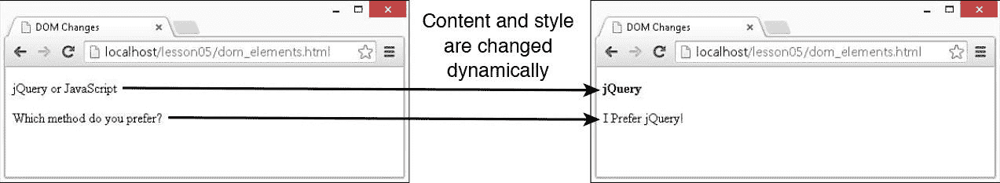

**图 5.2** 函数`writeIt()`在`body`加载时执行，并更改文本的内容和外观。

**列表 5.2 使用 JavaScript 和 jQuery 访问 DOM 元素的非常基础的示例**

点击此处查看代码图片

```html
01 <!DOCTYPE html>
02 <html>
03    <head>
04      <title>DOM Changes</title>
05      <meta charset="utf-8" />
06      <script src="https://code.jquery.com/jquery-2.1.3.min.js"></script>
07      <script>
08        function writeIt(){
09          $("#heading").css('font-weight', 'bold').html("jQuery");
10          var q = document.getElementById("question");
11          q.innerHTML = "I Prefer jQuery!";
12      }
13      </script>
14    </head>
15    <body onload="writeIt()">
16      <p id="heading">jQuery or JavaScript</p>
17      <p id="question">Which method to you prefer?</p>
18    </body>
19 </html>
```

### 理解语法

与任何其他语言一样，JavaScript 基于语法，其中特定的单词具有特定的含义。

### 创建变量

学习 JavaScript 的起点是变量。变量可以指向简单的数据，也可以指向更复杂的数据，例如对象。

要定义变量，你必须使用`var`关键字并给它分配一个值。例如：

```javascript
var myString
```

在声明变量后，你可以在代码中使用它。例如：

```javascript
var myString = "Some Text";
```

变量名应以字母、`$` 或 `_` 开始，且不能包含空格。还要记住变量名是区分大小写的。

### 理解数据类型

JavaScript 使用数据类型来决定如何处理数据。以下描述了不同的数据类型。

#### 字符串（String）

存储字符数据。字符数据通过单引号或双引号指定。例如：

```javascript
var myString = 'Some Text';
var anotherString = "Some Text";
```

#### 数字（Number）

将数据存储为数值。数字在计数、计算和比较中非常有用。示例如下：

```javascript
var myInteger = 1;
var cost = 1.33;
```

#### 布尔值（Boolean）

存储单个位，值为真或假。布尔值通常用于标记位。例如，你可能会在代码开始时将变量设置为`false`，并在完成后检查它以查看代码是否运行了特定位置。以下是定义`true`和`false`变量的示例：

```javascript
var yes = true;
var no = false;
```

#### 数组（Array）

索引数组是一系列存储在单个变量名下的相互独立的数据项。可以使用从零开始的索引`[index]`访问数组中的项。以下是创建一个简单数组并访问第一个元素（索引为 0）的示例：

```javascript
var arr = ["one", "two", "three"];
var first = arr[0];
```

#### 关联数组/对象（Associative Array/Objects）

JavaScript 确实支持关联数组的概念，即通过名称而不是索引值来访问数组项。然而，更好的方法是使用对象字面量。当你使用对象字面量时，可以使用`object.property`语法访问对象中的项。以下示例显示了如何创建和访问对象字面量：

```javascript
var obj = {"name":"Brad", "occupation":"Hacker", "age", "Unknown"};
var name = obj.name;
```


#### Null

有时，你没有值可以存储在变量中，可能是因为该变量尚未被创建，或者你不再使用它。此时，你可以将变量设置为`null`。这样一来，你就可以在代码中检查变量的值，并仅在它不为`null`时才使用它：

```javascript
var newVar = null;
```

> **Note**
>
> JavaScript 是一门无类型语言，这意味着你不需要告诉浏览器变量是什么数据类型；解释器会自动为变量确定正确的数据类型。

## 使用运算符

JavaScript 运算符提供了更改变量值的能力。你已经熟悉了`=`运算符，因为你已经在书中使用了它好几次了。JavaScript 提供了几种运算符，它们可以被分为两类——算术运算符和赋值运算符。

### 算术运算符

算术运算符用于在变量和直接值之间执行操作。表 5.1 显示了算术运算列表以及所应用的结果。

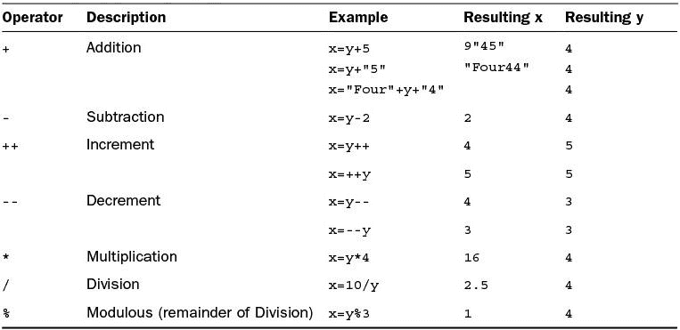

**表 5.1 显示 JavaScript 算术运算符以及基于`y=4`初始值的结果**

> **Tip**
>
> `+`运算符也可以用于相加字符串或字符串与数字相加。这允许你快速拼接字符串并将数值数据加到输出字符串中。表 5.1 显示，当相加数值值和字符串值时，数值值会被转换为字符串，然后将两个字符串进行拼接。

### 赋值运算符

赋值运算符用于给变量赋值。你可能习惯了`=`运算符，但还有几种形式允许你在赋值时对数据进行操纵。表 5.2 显示了赋值操作列表以及所应用的结果。

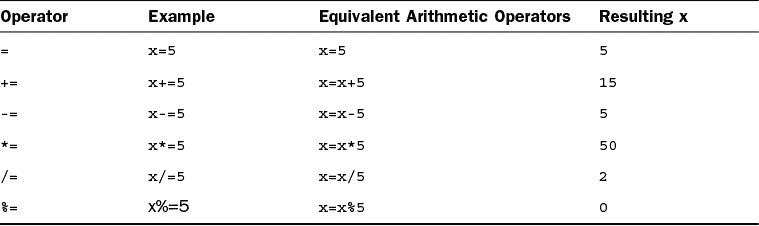

**表 5.2 JavaScript 赋值运算符以及基于`x=10`初始值的结果**

## 应用比较运算符和条件运算符

条件判断是将逻辑应用到应用程序中的方法，使得某些代码仅在正确的条件下执行。这是通过对变量值应用比较逻辑来实现的。接下来的章节描述了 JavaScript 中可用的比较以及如何在条件语句中使用它们。

### 比较运算符

比较运算符评估两部分数据，如果评估正确则返回`true`，如果评估不正确则返回`false`。比较运算符将运算符左侧的值与右侧的值进行比较。

帮助你理解比较的最简单方法是提供一个包含示例的列表。表 5.3 显示了比较运算符列表以及示例。

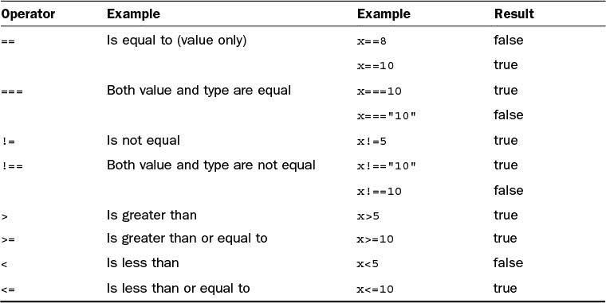

**表 5.3 JavaScript 比较运算符以及基于`x=10`初始值的结果**

你可以使用逻辑运算符将多个比较链在一起。表 5.4 显示了逻辑运算符列表以及如何使用它们将比较链在一起。

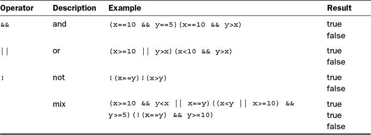

**表 5.4 JavaScript 比较运算符以及基于`x=10`和`y=5`初始值的结果**

### If

`if`语句允许你根据比较评估的结果来分离代码执行。语法在下面的代码行所示，其中条件运算符位于`()`括号中，如果条件评估为真则要执行的代码位于`{}`大括号中：

```javascript
if(x==5){
  do_something();
}
```

除了执行`if`语句块内的代码外，你还可以指定一个`else`块，它只在条件为假时被执行。例如：

```javascript
if(x==5){
  do_something();
} else {
  do_something_else();
}
```

你还可以将`if`语句链在一起。要做到这一点，添加一个条件语句以及一个`else`语句。例如：

```javascript
if(x<5){
  do_something();
} else if(x<10) {
  do_something_else();
} else {
  do_nothing();
}
```

### switch

另一种条件逻辑是`switch`语句。`switch`语句允许你评估一次表达式，然后根据值执行许多代码段之一。

`switch`语句的语法如下：

点击此处查看代码图像

```javascript
switch(expression){
  case value:
    <code to execute>
    break;
  case value2:
    <code to execute>
    break;
  default:
    <code to execute if not value or value2>
}
```

这是发生的情况。`switch`语句将完全评估表达式并获得一个值。该值可以是字符串、数字，甚至是一个对象。然后，`switch`值将通过`case`语句与每个值进行比较。如果值匹配，则执行`case`语句中的代码。如果没有值匹配，则执行`default`代码。

> **Note**
>
> 通常，每个`case`语句末尾都会包含一个`break`命令，以指示退出`switch`语句。如果没有找到`break`，代码执行将继续到下一个`case`语句。

## 动手尝试：在 JavaScript 中应用 If 逻辑

为了巩固 JavaScript 逻辑，使用以下步骤为动态网页构建条件逻辑。HTML 文档的最终版本如列表 5.3 所示：

1. 在`lesson5`文件夹中创建一个名为`if_logic.html`的源文件。
2. 在`5`目录下创建一个名为`images`的文件夹。
3. 将你自己的`day.png`和`night.png`添加到`./images`文件夹中或从书籍网站下载。
4. 添加常规元素（`html`、`head`、`body`）。
5. 添加以下`<script>`元素，使用`Date().getSeconds()` JavaScript 代码获取课程值。该代码使用`if`语句判断时间并执行两件事：在屏幕上写问候语并设置`timeOfDay`变量的值：

   点击此处查看代码图像

   ```javascript
   <script>
   function writeIt(){
     var lesson = new Date().getSeconds();
     var timeOfDay;

     if(lesson>=7 && lesson<12){
       document.write("Good Morning!");
       timeOfDay="morning";
     } else if(lesson>=12 && lesson<18) {
       document.write("Good Day!");
       timeOfDay="day";
     } else {
       document.write("Good Night!");
       timeOfDay="night";
     }
   }
   </script>
   ```

6. 现在添加以下`switch`语句，使用`timeOfDay`的值来确定在网页中显示的图像：

   点击此处查看代码图像

   ```javascript
   switch(timeOfDay){
     case "morning":
     case "day":
       document.write("");
       break;
     case "night":
       document.write("");
       break;
     default:
       document.write("");
   }
   ```

7. 保存文件并在浏览器中查看。输出应与图 5.3 相似，取决于具体时间。

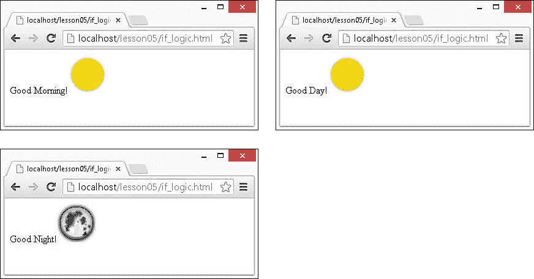

**图 5.3** `writeIt()`函数在`body`加载时执行，并更改网页上显示的问候语和图像。

**列表 5.3 `if_logic.html`在 JavaScript 中使用条件逻辑简单示例**

点击此处查看代码图像

```html
<!DOCTYPE html>
<html>
<head>
  <title>If Logic</title>
  <meta charset="utf-8" />

  <script>
    function writeIt(){
      var hour = new Date().getHours();
      var timeOfDay;

      if(hour>=7 && hour<12){
        document.write("Good Morning!");
        timeOfDay="morning";
      } else if(hour>=12 && hour<18) {
        document.write("Good Day!");
        timeOfDay="day";
      } else {
        document.write("Good Night!");
        timeOfDay="night";
      }

      switch(timeOfDay){
        case "morning":
        case "day":
          document.write("");
          break;
        case "night":
          document.write("");
          break;
        default:
          document.write("");
      }
    }
  </script>
</head>
<body onload="writeIt()">
</body>
</html>
```

## 实现循环

循环是一种多次执行同一段代码的方法。当你需要对一组 DOM 对象执行相同任务，或者当你正在动态创建一个项目列表时，这种方法非常有用。

JavaScript 提供了执行`for`和`while`循环的功能。接下来的章节描述了如何在 JavaScript 中实现循环。

### while 循环

JavaScript 中最基础的循环类型是`while`循环。`while`循环测试一个表达式，并继续执行其`{}`括号包含的代码，直到该表达式的值为`false`。

例如，以下`while`循环将一直执行到`i`的值等于 5 为止：

点击此处查看代码图片

```javascript
var i = 1;

while (i<5){
  document.write("Iteration " + i + "<br>");
  i++;
}
```

浏览器的最终输出如下：

```text
Iteration 1
Iteration 2
Iteration 3
Iteration 4
```

### do/while 循环

另一种类型的`while`循环是`do`/`while`循环。如果你总是希望至少执行一次循环中的代码，并且在代码至少执行一次之前无法测试表达式，那么它非常有用。

例如，以下`do`/`while`循环将一直执行到`day`的值等于 Wednesday（周三）为止：

点击此处查看代码图片

```javascript
var days = ["Monday", "Tuesday", "Wednesday", "Thursday", "Friday"];
var i=0;

do{
  var day=days[i++];
  document.write("It's " + day + "<br>");
} while (day != "Wednesday");
```

浏览器的最终输出如下：

```text
It's Monday
It's Tuesday
It's Wednesday
```

### for 循环

JavaScript 的`for`循环允许你通过`for`语句执行特定次数的代码，该语句使用以下语法将三个语句合并为一个：

点击此处查看代码图片

```javascript
for (statement 1; statement 2; statement 3){
  code to be executed;
}
```


`for` 语句对这三个语句的使用方式如下：

- `statement 1`：在循环开始前执行且不再执行。这用于初始化将在循环中使用的变量。
- `statement 2`：在循环每次迭代之前评估的表达式。如果该表达式的值为 `true`，则执行循环；否则 `for` 循环结束。
- `statement 3`：在每次迭代执行完代码后执行。

`for` 语句按如下方式使用这三个语句：

- `statement 1`：用于初始化循环中使用的变量。
- `statement 2`：在循环每次迭代之前评估的表达式。如果该表达式的值为 `true`，则执行循环；否则 `for` 循环结束。
- `statement 3`：在每次迭代执行完代码后执行。

为了说明 `for` 循环，请执行以下代码的次数：

点击此处查看代码图片

以下示例展示了嵌套的 `for` 循环：

```javascript
for (var x=1; x<3; x++){
  for (var y=1; y<3; y++){
    document.write("x=" + x + ", y=" + y + "<br>");
  }
}
```

浏览器的最终输出如下：

```
x=1, y=1
x=1, y=2
x=1, y=3
x=2, y=1
x=2, y=2
x=2, y=3
```

### for...in 循环

另一种 `for` 类型是 `for...in` 循环。当你需要遍历对象的所有属性时，它非常有用。`for...in` 循环允许你通过对象的属性名来执行代码。以下示例展示了 `for...in` 循环的使用：

点击此处查看代码图片

```javascript
var person = {name: "John", age: 30, city: "New York"};
for (var key in person){
  document.write(key + ": " + person[key] + "<br>");
}
```

浏览器的最终输出如下：

```
name: John
age: 30
city: New York
```

### for...of 循环

`for...of` 循环允许你遍历数组、字符串或其他可迭代对象的值。与 `for...in` 不同，它遍历的是值。以下示例展示了 `for...of` 循环的使用：

点击此处查看代码图片

```javascript
var fruits = ["apple", "banana", "orange"];
for (var fruit of fruits){
  document.write(fruit + "<br>");
}
```

浏览器的最终输出如下：

```
apple
banana
orange
```

要调用 `greeting()` 函数，我们需要传入一个 `name` 值和一个 `city` 值。该值可以是直接值，也可以是之前定义的变量。为了说明这一点，下面的代码将使用 `name` 变量和 `city` 的直接字符串来执行 `greeting()` 函数：

```javascript
var name = "Brad";
greeting(name, "Florence");
```

### 函数的返回值

通常，函数需要向调用代码返回一个值。通过添加 `return` 关键字后跟一个变量或值，可以从函数返回该值。例如，下面的代码调用了一个函数来格式化字符串，将函数返回的值赋值给变量，然后将该值写入浏览器：

点击此处查看代码图片

```javascript
function formatGreeting(name, city){
  var retStr = "";
  retStr += "Hello <b>" + name + "</b>><br>";
  retStr += "Welcome to " + city + "!";
  return retStr;
}

var greeting = formatGreeting("Brad", "Rome");
document.write(greeting);
```

你可以在函数中包含多个 `return` 语句。当函数遇到 `return` 语句时，函数的执行将立即停止。如果 `return` 语句包含要返回的值，则返回该值。下面的示例显示了一个测试输入的函数，如果输入为零立即返回：

点击此处查看代码图片

```javascript
function myFunc(value){
  if (value == 0)
    return;
  code_to_execute_if_value_nonzero;
}
```

***

### 动手尝试：创建 JavaScript 函数

为了巩固函数知识，请按照以下步骤将函数集成到 JavaScript 应用中。以下步骤将引导你完成创建函数、调用它执行代码，然后处理返回结果的过程：

1. 在 `lesson05` 文件夹中创建一个名为 `js_functions.html` 的源文件。
2. 添加常规的基础元素（`html`、`head`、`body`）。
3. 在 `<head>` 元素中添加 `<script>` 标签来存放 JavaScript。
4. 在脚本开头插入以下对象字面量定义。对象将具有行星名称的属性，每个英雄名称都是对反派数组的引用：

点击此处查看代码图片

```javascript
07        var superData = {"Super Man":["Lex Luther"],
08                               "Bat Man":["Joker", "Riddler",],
09                               "Spider Man":["Green Goblin",
10                                                             "Vulture", "Carnage"],
11                               "Thor":["Loki", "Frost Giants"]};
```

5. 添加以下由 `onload` 事件调用的函数。在该函数中，你使用嵌套的 `for`/`in` 循环遍历 `superData` 对象的属性。外层循环获取英雄 `name`，内层循环遍历 `villains` 数组的索引：

点击此处查看代码图片

```javascript
12      function writeIt(){
13          for (hero in superData){
14            var villains = superData[hero];
15            for (villainIdx in villains){
16              var villain = villains[villainIdx];
17              var listItem = makeListItem(hero, villain);
18              document.write(listItem);
19            }
20          }
21      }
```

6. 注意 `writeIt()` 函数的第 16 行是对 `makeListItem()` 的调用。该函数需要返回一个可以在第 17 行用于写入文档的值。添加以下代码来创建该函数。该函数接受两个参数：`name` 和 `value`，然后生成一个创建 `<li>` 元素的 HTML 字符串并返回该字符串：

点击此处查看代码图片

```javascript
22      function makeListItem(name, value){
23        var itemStr = "<li>" + name + ":&nbsp;" + value + "</li>";
24        return itemStr;
25      }
```

7. 保存文件并在网页浏览器中打开它。你应该能看到图 5.4 所示的结果。你刚刚创建了两个 JavaScript 函数：一个不接受参数且不返回值的，另一个接受两个参数并返回格式化字符串的。

 **图 5.4** 执行了 `writeIt()` 函数，它遍历 `superData` 对象并调用 `makeListItem()` 函数，将行星和月球名称格式化为 HTML `<li>` 元素。

**代码 5.4 js_functions.html JavaScript 函数简单示例**

点击此处查看代码图片

```html
1<!DOCTYPE html>
2<html
3   <head>
4     <title>JavaScript Functions</title>
5     <meta charset="utf-8" />
6     <script>
7       var superData = {"Super Man":["Lex Luther"],
8                               "Bat Man":["Joker", "Riddler",],
9                               "Spider Man":["Green Goblin",
10                                                             "Vulture", "Carnage"],
11                               "Thor":["Loki", "Frost Giants"]};
12      function writeIt(){
13          for (hero in superData){
14            var villains = superData[hero];
15            for (villainIdx in villains){
16              var villain = villains[villainIdx];
17              var listItem = makeListItem(hero, villain);
18              document.write(listItem);
19            }
20          }
21      }
22      function makeListItem(name, value){
23        var itemStr = "<li>" + name + ":&nbsp;" + value + "</li>";
24        return itemStr;
25      }
26     </script>
27   </head>
28   <body onload="writeIt()">
29   </body>
30</html
```

***

### 理解作用域

在你开始向 JavaScript 中添加条件、函数和循环之后，你需要理解作用域。变量作用域简单来说：“在当前行，变量的值是什么？”

JavaScript 允许定义全局和局部版本。全局版本定义在主 JavaScript 中，而局部版本定义在函数内部。在函数内部，你将引用局部版本。

为了更好地理解作用域，请考虑以下代码：

```javascript
01 <script>
02   var myVar = 1;
03   function writeIt(){
04     var myVar = 2;
05     document.write(myVar);
06     writeIt();
07   }
08   function writeMore(){
09     document.write(myVar);
10  }
11 </script>
```

全局变量 `myVar` 定义在第 2 行。在第 4 行，在 `writeIt()` 函数内部定义了一个局部版本。因此，第 5 行将写入文档。随后在第 6 行调用了 `writeMore()`。由于 `writeMore()` 中没有定义 `myVar` 的局部版本，第 9 行将写入全局 `myVar` 的值。

#### 添加错误处理

JavaScript 编码的一个重要部分是为可能出现的问题添加错误处理。默认情况下，如果由于 JavaScript 中的问题导致发生代码异常，脚本将失败且不会加载。这通常不是我们想要的行为。

### Try/Catch 块

为了防止代码完全崩溃，请使用 `try`/`catch` 块来处理代码内部的问题。如果 JavaScript 在执行 `try`/`catch` 块中的代码时遇到错误，它将跳到下方执行 `catch` 部分，而不是停止整个脚本。如果没有发生错误，则将执行 `try` 的所有内容，而不执行 `catch`。

例如，下面的 `try`/`catch` 块将执行任何替换 `your_code_here` 的代码。如果在执行该代码时发生错误，则会将错误信息以及后面的字符串 ": 发生在加载脚本时”写入文档：

点击此处查看代码图片

```javascript
try {
    your_code_here
} catch (err) {
  document.write(err.message + ": happened when loading the script");
}
```

### 抛自定义错误

你也可以使用 `throw` 语句抛出自己的错误。以下代码说明了如何向函数添加 `throw` 来抛出错误，即使在没有发生脚本错误的情况下也是如此：

点击此处查看代码图片

```javascript
01 <script>
02    function sqrRoot(x) {
03      try {
04        if(x=="")    throw "Can't Square Root Nothing";
05        if(isNaN(x)) throw "Can't Square Root Strings";
06        if(x<0)      throw "Sorry No Imagination";
07        return "sqrt("+x+") = " + Math.sqrt(x);
08      } catch(err){
09        return err;
10      }
11    }
12    function writeIt(){
13      document.write(sqrRoot("four") + "<br>");
14      document.write(sqrRoot("") + "<br>");
15      document.write(sqrRoot("4") + "<br>");
16      document.write(sqrRoot("-4") + "<br>");
17    }
18 </script>
```

函数 `sqrRoot()` 接受单个参数 `x`。然后测试 `x` 以验证它是否为正数，并返回 `x` 平方的根字符串。如果 `x` 不是正数，则抛出相应的错误并返回给 `writeIt()`。

### 使用 finally

异常处理中的另一个有用工具是 `finally` 关键字。可以将 `finally` 关键字添加到 `try`/`catch` 块的末尾。在执行 `try`/`catch` 块之后，`finally` 块始终会被执行。无论是否发生并捕获了错误，或者 `try` 块是否完全执行完毕都是。

以下是在网页中使用 `finally` 块的示例：

点击此处查看代码图片

```javascript
function testTryCatch(value){
  try {
    if (value < 0){
      throw "too small";
    } else if (value > 10){
      throw "too big";
    }
    your_code_here
  } catch (err) {
    document.write("The number was " + err.message);
  } finally {
    document.write("This is always written.");
  }
}
```

### 总结

在本节中，你学习了在网页中添加 jQuery 和 JavaScript 的基础知识。描述了 JavaScript 以及随后的 jQuery 中使用的基本数据类型。你学习了在 JavaScript 应用中应用条件逻辑的一些基本语法。你还学习了如何将 JavaScript 应用划分为可以在其他地方重用的函数。最后，你学习了在浏览器接收异常之前处理脚本中 JavaScript 错误的方法。

### 问答

**Q. 在字符串操作中何时应该使用正则表达式？**

**A.** 这取决于你对正则表达式的理解。经常使用正则表达式并很好掌握语法的人几乎总是更倾向于使用正则表达式，因为它们非常多功能。如果你不熟悉正则表达式，花费时间来研究语法，因此你只会在需要时才使用它们。底线是，如果你需要频繁操作字符串，那么学习正则表达式是绝对值得的。

**Q. 我可以同时加载多个版本的 jQuery 吗？**

**A.** 可以，但实际上没有正当理由这样做。最后加载的那个将覆盖上一个版本的功能。第一个版本中任何未被覆盖的函数都可能因为库的不匹配而变得完全不可预测。最好的办法是针对特定版本进行开发和测试，然后更新到该版本。

```javascript
var x = new Number("5");
```


## 访问对象属性

几乎所有的 JavaScript 对象都有一个可以通过标准点命名语法访问的值。例如，考虑一个变量名为 `user` 的对象，它包含一个名为 `firstName` 的属性。以下语句访问了 `user` 对象中 `firstName` 属性的值：

```javascript
user.FirstName
```

### 访问对象方法

许多 JavaScript 对象还拥有方法。对象方法是作为名称附加到对象上的函数。可以使用点符号语法引用方法名来调用该函数。例如，如果名为 `user` 的对象有一个名为 `getFullName()` 的方法，则可以通过以下语句调用该函数：

```javascript
user.getFullName()
```

## 为对象分配新值和方法

JavaScript 对象最酷酷的特性之一是，你可以在任何时候使用点符号语法为它们分配新的属性和方法值。无论它是内置对象还是你自定义的某个对象都没关系。之后可以使用相同的点符号语法访问该值。

以下是一个向我们在几个示例中使用的主文档对象（document object）添加一个方法和一个属性的示例。注意，我们定义了一个简单的函数，将 `document.me` 属性写入浏览器。然后我们为 `document.me` 分配一个值，并将不带 `()` 的函数 `writeMe()` 赋值给 `document.writeMe`。此时，我们可以调用 `document.writeMe` 并访问属性 `document.me`：

点击此处查看代码图像

```html
<script>
  function writeMe(){
    document.write(document.me);
  }

  document.me = "Brad Dayley";
  document.writeMe = writeMe;
  document.writeMe();
</script>
```

> **注意**
>
> 如果你为对象分配一个新值，同名的现有属性或方法将被覆盖。在为对象分配值时，请小心不要意外覆盖现有的属性或方法。

## 理解内置对象

JavaScript 拥有几个内置对象，它们提供特定的功能 set。使用这些内置对象将节省时间，因为它们提供了已经编写并测试的方法来处理数据。接下来的章节没有包含所有的 JavaScript 对象，但涵盖了本书书中需要的那些。

### `Number`

`Number` 对象提供了在处理数字时非常有用的功能。创建一个数字对象与仅仅给变量赋值一个数字不同。当你创建一个 `Number` 对象时，你还会获得一组可以与它配合的方法。

`Number` 对象提供了表 6.1 中列出的方法。根据下面的对象创建，在表 6.1 中查看这些每个方法的输出结果：

点击此处查看代码图像

```javascript
var x = new Number("5.55555555");
```

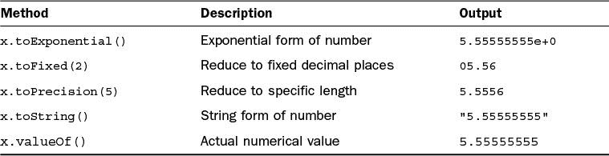

**表 6.1 使用内置 `Number` 对象方法**

我们选择将数字 `5.555555555` 作为字符串而不是数字传入，用来说说明 `Number()` 可以接受字符串、数字或代表字符串或数字的变量。该字符串必须是数字字符串，否则 `Number` 对象的值将为 `NaN`（非数字）。

在创建 `Number` 对象之前测试值是一个好主意。要测试一个值并判断它是否为数字，请使用 `isNaN()` 函数。如果值是数字或可以转换为数字的字符串，`isNaN()` 返回 `false`。

> **注意**
>
> 在检查数字时，可以使用十六进制字符串。当你正在处理十六进制颜色值（例如 #e0ffff）时，这非常有用。在 JavaScript 中使用的字符串格式为“0xe0ffff”。

### `String`

`String` 对象是 JavaScript 中到目前最常用的对象。每当你定义一个具有字符串数据类型的变量时，JavaScript 都会创建一个 `String` 对象。例如：

```javascript
var myStr = "Teach Yourself jQuery & JavaScript in 24 Lessons";
```

当你创建一个字符串时，有几个特殊字符是不能直接添加到字符串中的。对于这些字符，JavaScript 提供了一组在表 6.2 中描述的转义码。

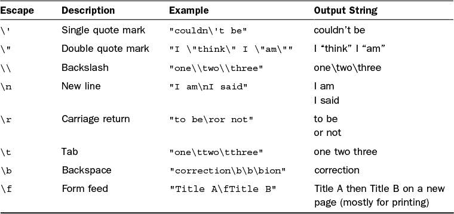

**表 6.2 JavaScript 字符串中使用的转义码**

要获取字符串的长度，你可以使用 `String` 对象的 `length` 属性，例如：

```javascript
var numOfChars = myStr.length;
```

`String` 对象有几个函数，允许你以各种方式访问和操作字符串。字符串操作的方法在表 6.3 中描述。

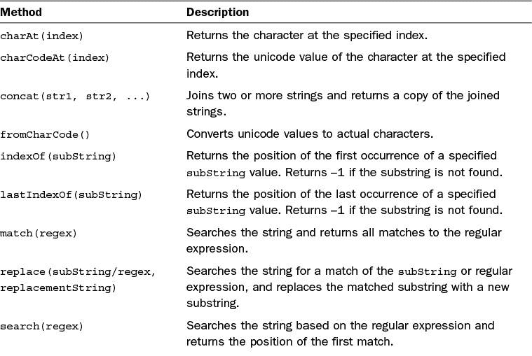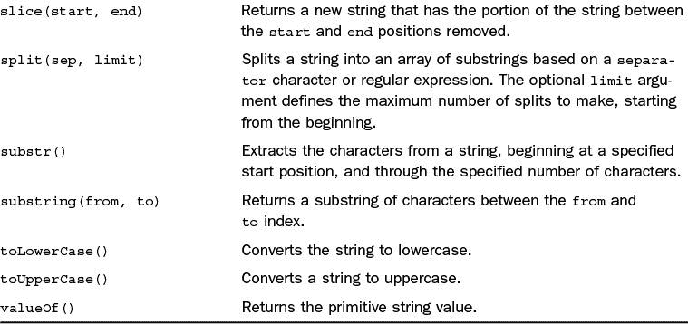

**表 6.3 用于操作 JavaScript 字符串的 `String` 对象方法**

为了让你开始使用 `String` 对象提供的功能，接下来的章节描述了一些可以使用 `String` 对象方法完成的常见任务。

### 组合字符串

多个字符串可以通过 `+` 运算符或使用 `concat()` 方法进行组合。例如，在下面的代码中，`sentence1` 和 `sentence2` 将相同的：

点击此处查看代码图像

```javascript
var word1 = "Today ";
var word2 = "is ";
var word3 = " ";
var word4 = "yesterday.";
var sentence1 = word1 + word2 + word3 + word4;
var sentence2 = word1.concat(word2, word3, word4);
```

### 搜索子字符串

要判断一个字符串是另一个字符串的子字符串，可以使用 `indexOf()` 方法。例如，下面的代码仅当字符串包含“think”时才写入字符串：

点击此处查看代码图像

```javascript
var myStr = "I think, therefore I am.";

if (myStr.indexOf("think") != -1)
  document.write(myStr);
```

### 替换字符串中的单词

另一个 `String` 对象任务是替换子字符串。要替换字符串中的一个单词，请使用 `replace()` 方法。下面的代码将 `<username>` 替换为 `username` 的值：

点击此处查看代码图像

```javascript
var username = "Brad";
var output = "<username> please enter your password: ";
output = output.replace("<username>", username);
```

### 将字符串分割为数组

字符串的一个常见任务是使用分隔符将其分割为数组。例如，下面的代码使用 `split()` 方法根据 `:` 分隔符时间字符串：

```javascript
var t = "12:10:36";
var tArr = t.split(":");
var hour = tArr[0];
var minute = tArr[1];
```

## 动手尝试：在 JavaScript 中操作字符串

在本节中，你按照步骤操作一些字符串以生成一个简单的 madlib。这只是一个基础示例，但它应该有所帮助。完整代码见列表 6.1，结果显示在图 6.1](#part0017.xhtml_ch06fig01)。

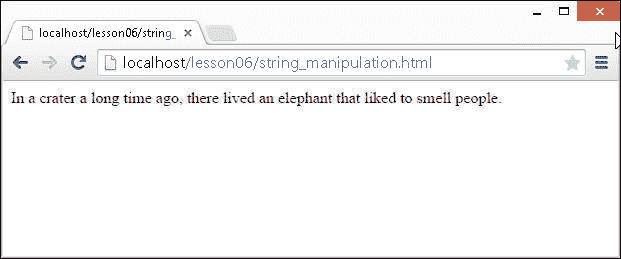

**图 6.1** 输出的 madlib 。

1. 在 Eclipse 中创建一个名为 `lesson06` 的源文件夹。
2. 在 `lesson06` 文件夹中创建一个名为 `string_manipulation.html` 的源文件。
3. 添加基础元素（`html`、`head`、`body`）。
4. 在 `head` 元素内部，添加一个带有 `writeIt()` 函数的 `script` 元素，并将其链接到 `body` 元素的 `onload` 事件上，如下所示：

   点击此处查看代码图像

   ```html
   <head>
     <script>
       function writeIt(){
         ...
       }
     </script>
   </head>
   <body onload="writeIt()">
   ```

5. 添加以下三个字符串定义，将用于存放 madlib 文本的每一行：

   点击此处查看代码图像

   ```javascript
   var line1 = "In a [place] a long time ago, ";
   ```

   ```javascript
   var line2 = "there lived an [animal] that liked to ";
   var line3 = "[action] people.";
   ```

6. 添加以下三个字符串定义，用于填充 madlib 中的空项：

   点击此处查看代码图像

   ```javascript
   var place = "crater";
   var animal = "elephant";
   var action = "smell";
   ```

7. 添加以下行以将多行文本合并为单个字符串：

   点击此处查看代码图像

   ```javascript
   var madlib = line1.concat(line2, line3);
   ```

8. 通过将变量替换为相应的变量的值来填充 madlib 字符串中的空位。以下行使用 `replace()` 方法将变量的值替换为字符串中正确的位置：

   点击此处查看代码图像

   ```javascript
   madlib = madlib.replace("[place]", place);
   madlib = madlib.replace("[animal]", animal);
   madlib = madlib.replace("[action]", action);
   ```

9. 添加以下命令将完全处理过的 madlib 字符串写入浏览器：

   点击此处查看代码图像

   ```javascript
   document.write(madlib);
   ```

10. 在浏览器中打开页面，字符串的格式应如图 6.1 所示。

**列表 6.1 `string_manipulation.html` 示例：将多行文本合并为单个字符串并使用 `replace()` 用变量值填充字符串的特定格式部分**

点击此处查看代码图像

```html
<!DOCTYPE html>
<html>
<head>
    <title>String Manipulation</title>
    <meta charset="utf-8" />
<script>
    function writeIt(){
        var line1 = "In a [place] a long time ago, ";
        var line2 = "there lived an [animal] that liked to ";
        var line3 = "[action] people.";
        var place = "crater";
        var animal = "elephant";
        var action = "smell";
        var madlib = line1.concat(line2, line3);
        madlib = madlib.replace("[place]", place);
        madlib = madlib.replace("[animal]", animal);
        madlib = madlib.replace("[action]", action);
        document.write(madlib);
    }
</script>
</head>
<body onload="writeIt()">
</body>
</html>
```

## 数组（`Array`）

`Array` 对象提供了一种和处理一组其他对象的方法。数组可以存储数字、字符串或其他 JavaScript 对象。你可以使用几种方法来创建 JavaScript 数组；例如，以下语句创建了三个相同的数组版本：

点击此处查看代码图像

```javascript
var arr = ["one", "two", "three"];
var arr2 = new Array();
arr2[0] = "one";
arr2[1] = "two";
var arr3 = new Array();
arr3[2] = "three";
arr3.push("one");
arr3.push("two");
arr3.push("three");
```

要获取数组中的元素数量，可以使用 `Array` 对象的 `length` 属性。例如：

```javascript
var numOfItems = arr.length;
```

数组是基于零索引的，这意味着第一个项位于索引 0，依此类推。你可以通过相减使用 `length` 属性来反向访问数组。例如，在以下代码中，变量 `first` 的值将是 Monday，变量 `last` 的值将是 Friday：

点击此处查看代码图像

```javascript
var week = ["Monday", "Tuesday", "Wednesday", "Thursday", "Friday"];
var first = week[0];
var last = week[week.length-1];
```

`Array` 对象有几个内置函数，允许你以各种方式访问和操作数组。表 6.4 描述了附加到 `Array` 对象上的方法。为了帮助你上手 `Array` 对象提供的功能，以下章节描述了一些常见任务：

### 合并数组

你可以像合并 `String` 对象一样合并数组，使用 `+` 语句或使用 `concat()` 方法。在以下代码中，`arr3` 最终变为了 `arr4`：

```javascript
var arr1 = [1,2,3];
var arr2 = ["three", "four", "five"];
var arr3 = arr1 + arr2;
var arr4 = arr1.concat(arr2);
```

> 你可以合并一个数字数组和一个字符串数组。数组中的每个项将保留其对象类型。然而，当你使用数组中的项时，你需要跟踪这些项。

### 遍历数组

你可以使用 `for` 循环或 `for/in` 循环遍历数组。以下代码演示了如何遍历数组中的每个项：

```javascript
week = ["Monday", "Tuesday", "Wednesday", "Thursday", "Friday"];
for (var i=0; i<week.length; i++){
    document.write(week[i] + "<br>");
}
for (dayIndex in week){
    document.write(week[dayIndex] + "<br>");
}
```

### 将数组转换为字符串

`Array` 对象的一个有用功能是可以使用特定分隔符将元素组合成 `String` 对象。例如，以下代码形成格式 12:10:36：

```javascript
var timeArr = [12,10,36];
var timeStr = timeArr.join(":");
```

### 检查数组是否包含项

通常你需要检查数组是否包含某个项。你可以通过使用 `indexOf()` 方法来实现。如果在数组中未找到项，将返回 `-1`。以下函数在项位于 `week` 数组时会写入消息：

```javascript
function message(day){
    var week = ["Monday", "Tuesday", "Wednesday", "Thursday", "Friday"];
    if (week.indexOf(day) != -1){
        document.write("Happy " + day);
    }
}
```

### 向数组添加和移除项

你可以使用多种方法向 `Array` 对象中添加或移除项。表 6.5 提供了书中使用的各种方法的思路。

## 动手尝试：创建和操作数组

在这个练习中，你将学习使用附加到 `Array` 对象上的各种方法创建和操作数组。使用以下步骤构建列表 6.2：

1. 在 `lesson06` 文件夹创建一个名为 `array_manipulation.html` 的源文件。
2. 添加常规的基础元素（`html`、`head`、`body`）。
3. 在 `<head>` 元素内部添加一个带有 `writeIt()` 函数的 `<script>` 元素，并将其链接到 `<body>` 元素的 `onload` 事件，如下：

   点击此处查看代码图像

   ```html
   <script>
       function writeIt(){
           ...
       }
   </script>
   </head>
   <body onload="writeIt()">
   ```

4. 添加以下 JavaScript 函数，它接收一个消息和一个数组参数作为 `msg` 和 `arr`。数组使用 `join()` 方法转换为字符串。该方法还将消息和连接后的数组字符串写入浏览器，并带有一些 HTML 格式：

   点击此处查看代码图像


```javascript
function writeArray(msg, arr){
    var arrString = arr.join(" | ");
    document.write("<b>"+ msg + ": </b>" + arrString + "<br><br>");
}
```

## 5. 在`writeIt()`函数中添加以下代码行，以创建两个数组并调用`writeArray()`函数将它们写入浏览器。`weekDays`数组是通过声明创建的；`weekEnd`数组是通过创建一个空数组并向推入项目生成的：

点击此处查看代码图片

```javascript
12      var weekDays = ["Monday", "Tuesday", "Wednesday", "Thursday", "Friday"];
13      writeArray("Week Days", weekDays);
14      var weekEnd = new Array();
15      weekEnd.push("Saturday");
16      weekEnd.push("Sunday");
17      writeArray("Weekend", weekEnd);
```

## 6. 使用以下几行通过结合`weekEnd`创建一个包含完整周的数组的新数组。在第 18 行中，`concat([])`是创建`weekDays`副本的方法。我们希望周日在第一个，周六在最后，因此我们使用`unshift()`将周日推到数组前端，并使用`push()`将周六附加到末：

点击此处查看代码图片

```javascript
18      var week = weekDays.concat([]);
19      week.unshift(weekEnd[1]);
20      week.push(weekEnd[0]);
21      writeArray("Week", week);
```

## 7. 使用`slice()`函数创建一个`midWeek`数组，如下：

点击此处查看代码图片

```javascript
22      var midWeek = week.slice(2,5);
23      writeArray("Mid Week", midWeek);
```

## 8. 使用以下代码创建完整周的排序版本，然后遍历`sortedWeek`数组中的每个项目并将其写入浏览器：

点击此处查看代码图片

```javascript
24      var sortedWeek = week.sort();
25      document.write("<b>Sorted Days :</b> <br>");
26      for (dayIndex in sortedWeek){
27        document.write(sortedWeek[dayIndex] + "<br>");
28      }
```

## 9. 在浏览器中打开页面，你创建的数组输出应该显示，如图 6.2 所示。

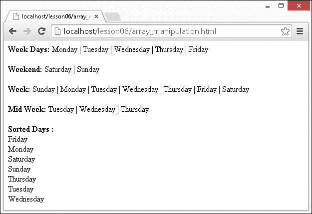

**图 6.2** 列表 6.2 的输出。

**列表 6.2 `array_manipulation.html` 在 JavaScript 中创建和操作`Array`对象的示例**

点击此处查看代码图片

***

```html
01 <!DOCTYPE html>
02 <html>
03    <head>
04      <title>Array Manipulation</title>
05      <meta charset="utf-8" />
06 <script>
07    function writeArray(msg, arr){
08      var arrString = arr.join(" | ");
09      document.write("<b>"+ msg + ": </b>" + arrString + "<br><br>");
10    }
11    function writeIt(){
12      var weekDays = ["Monday", "Tuesday", "Wednesday", "Thursday", "Friday"];
13      writeArray("Week Days", weekDays);
14      var weekEnd = new Array();
15      weekEnd.push("Saturday");
16      weekEnd.push("Sunday");
17      writeArray("Weekend", weekEnd);
18      var week = weekDays.concat([]);
19      week.unshift(weekEnd[1]);
20      week.push(weekEnd[0]);
21      writeArray("Week", week);
22      var midWeek = week.slice(2,5);
23      writeArray("Mid Week", midWeek);
24      var sortedWeek = week.sort();
25      document.write("<b>Sorted Days :</b> <br>");
26      for (dayIndex in sortedWeek){
27        document.write(sortedWeek[dayIndex] + "<br>");
28      }
29    }
30 </script>
31 </head>
32 <body onload="writeIt()">
33 </body>
34 </html>
```

***

### 日期

`Date`对象提供了对当前时间的访问。这可以非常有用，例如在页面上显示时间、与服务器比较时间、对某些事件计时等。要获取系统当前时间，请使用以下语法：

```javascript
var cDate = new Date();
document.write(cDate);
```

日期的字符串版本将类似于以下：

点击此处查看代码图片

```text
Mon 10 2012 17:30 GMT-0700 (Mountain Standard Time)
```

你可以使用以下语法通过字符串或一组值来创建`Date`对象：

点击此处查看代码图片

```javascript
Date(year, month, day, minutes, seconds, milliseconds)
```

例如，以下代码将创建相同的`Date`对象：

点击此处查看代码图片

```javascript
var d1 = Date("2012, 12, 12, 12, 12, 00");
var d2 = Date("December 12, 2012 12:12");
```

JavaScript 允许你使用普通的逻辑比较（`<`、`>`、`==`等）来比较日期。例如，你可以使用以下代码将浏览器的当前时间与从服务器发送的时间戳“December 12, 2012 12:12”进行比较：

点击此处查看代码图片

```javascript
var currentTime = new Date();
var serverTime = new Date("December 12, 2012 12:12");
if (currentTime > serverTime){
  // 逻辑
}
```

### 数学

`Math`对象提供了对数学函数的访问。这在很多方面都很有用，例如在页面上显示计算结果、生成随机数、计算平方根等。

```javascript
var x = Math.sqrt(16); // x 为 4
var y = Math.random(); // 生成 0 到 1 之间的随机数
```

### 正则表达式

正则表达式是用于匹配字符串中模式的强大工具。在 JavaScript 中，你可以使用字面量或构造函数创建。

```javascript
var pattern = /abc/;
var str = "abcdef abc";
console.log(pattern.test(str)); // 输出 true
```

正则表达式可以用来执行复杂的搜索、替换和提取任务。

前两个选项对于你以后不需要重用的简单对象非常有效。更好的方法是将对象封装在它自己的函数块中。这样做的优点可以让你将所有与对象相关的代码都保持在对象内部。例如：

点击此处查看代码图像

```javascript
function User(first, last){
  this.first = first;
  this.last = last;
}

var user = new User("Brad", "Dayley");
```

这些方法的最终结果基本上是相同的。你拥有一个带有属性的对象，可以使用点语法进行引用，如下：

点击此处查看代码图像

```javascript
document.write(user.first + " " + user.last);
```

### 向 JavaScript 对象中添加方法

如果有特定于自定义对象的代码，你希望将这些代码作为方法附加到对象本身。根据对象的创建方式，有几种方法。

第一种方法是定义一个静态函数，然后将其赋值为对象的属性。以下是在动态定义对象时赋值静态函数的示例：

点击此处查看代码图像

```javascript
var user = new Object();
user.first="Brad";
user.last="Dayley";
user.getFullName = makeFullName;

var user2 = {'first':'Brad', 'last':'Dayley',
             'getFullName':makeFullName};

function makeFullName(){
  return this.first + " " + this.last;
}

document.write(user.getFullName());
```

函数`makeFullName()`将对象的`first`和`last`属性合并并返回字符串。注意，该函数使用`this`关键字访问属性。`this`指对象的当前实例。还要注意，将`makeFullName()`赋值给`getFullName`时省略了括号`()`；这会将`user.getFullName`设置为函数本身，而不是它返回的值。

如果你使用更好的封装方法创建了对象，可以使用以下语法在对象内部定义函数。注意`getFullName`被设置为一个新定义的函数，该函数返回值的方式与静态函数`makeFullName()`相同：

点击此处查看代码图像

```javascript
function User(first, last){
  this.first = first;
  this.last = last;
  this.getFullName = function(){
    return this.first + " " + this.last;
  };
}
```

### 使用原型对象模式

创建对象的更高级的方法是使用原型模式。原型模式通过在对象的`prototype`属性中定义函数而不是在对象本身中定义函数来实现。原型之所以更好的原因是，在原型中定义的函数在 JavaScript 加载时只创建一次，而不是每次创建新对象时都创建。

下面的示例显示了实现原型模式所需的代码。注意你定义了对象`UserP`，然后将`UserP.prototype`设置为包含`getFullName()`函数。你可以根据需要在此`prototype`中包含任意数量的函数。每创建一个新对象，这些函数都可用：

点击此处查看代码图像

```javascript
function UserP(first, last){
  this.first = first;
  this.last = last;
}

UserP.prototype = {
  getFullName: function(){
    return this.first + " " + this.last;
  }
};
```

要调用`getFullName()`函数，你将使用类似下面的代码：

点击此处查看代码图像

```javascript
var me = UserP("Brad", "Dayley");
var myFullName = me.getFullName();
```

***

### 动手尝试：创建和使用自定义对象

在本节中，你将使用原型模式创建并使用自定义 JavaScript 对象的数组。使用以下步骤构建列表 6.3 中的文件：

1. **在 `lesson06` 文件夹中创建一个名为**`custom_objects.html`的源文件。

2. **添加常规的基础元素**（`html`、`head`、`body`）。

3. **在 `<head>` 元素内部**，添加一个带有`writeIt()`函数的`<script>`元素，并将其链接到`<body>`元素的`onload`事件，如下所示：

点击此处查看代码图像

```html
06 <script>
07   function writeIt(){
...
40   }
41 </script>
42   </head>
43   <body onload="writeIt()">
```

4. **在 `writeIt()` 下方添加函数**。此函数将用于创建自定义的`Character`对象。该函数接受`first`和`last`姓名、角色所在的`land`以及`race`：

点击此处查看代码图像

```javascript
27   function Character(first, last, land, race){
28     this.first = first;
29     this.last = last;
30     this.race = race;
31     this.land = land;
32   }
```

5. **在第 33 行添加原型定义**，它包含两个函数`getFullName()`和`getDetails()`：

点击此处查看代码图像

```javascript
33   Character.prototype = {
34     getFullName: function(){
35       return this.first + " " + this.last;
36     },
37     getDetails: function(){
38       return "is a " + this.race + " from " + this.land;
39     }
40   };
```

6. **在 `writeIt()` 函数内部**，添加以下代码来创建并填充数组。对象使用`new`关键字创建：

点击此处查看代码图像

```javascript
41   var characters = new Array();
42   characters.push(new Character("John 17", "Master Chief", "Earth", "Spartan"));
43   characters.push(new Character("Thel", "Arbiter", "High Charity", "Elite"));
44   characters.push(new Character("Gravemind", "", "Halo", "Flood"));
```

7. **添加以下代码**来创建`sgJohnson`对象。注意我们只传递了`first`姓名。第 47 行和 48 行分配了`land`和`race`值。这提供了对对象的赋值示例：

```javascript
47   sgJohnson = new Character("Sgt", "");
48   sgJohnson.land = "Earth";
49   sgJohnson.race = "Human";
50   characters.push(sgJohnson);
```

8. **添加 `for` 循环**，遍历数组中的每个元素并将字符信息写入浏览器。第 51 行为`Character`对象分配了一个新属性`number`。注意在赋值后，我们可以将其作为字符串的一部分写入：

```javascript
52   for (var i=0; i<characters.length; i++){
53     var character = characters[i];
54     character.number = i+1;
55     document.write(character.number + ". " +
56     character.getFullName() + " " +
57     character.getDetails() + "<br>");
58   }
```

9. **在浏览器中打开页面**，你应该看到你创建的对象输出，如图 6.3 所示。


**图 6.3** 列表 6.3 的输出。

**列表 6.3 `custom_objects.html` JavaScript 中创建和操作自定义对象的示例**

点击此处查看代码图像

***

```html
01 <!DOCTYPE html>

02 <html>

03   <head>

04     <title>Custom Objects</title>

05     <meta charset="utf-8" />

06 <script>

07   function writeIt(){
```


```javascript
"High Charity", "Elite"));

characters.push(new Character("Gravemind", "", "Precursors", "Flood"));
sgtJohnson = new Character("Sgt Johnson", "", "", "");
sgtJohnson.land = "Earth";
sgtJohnson.race = "Human";
characters.push(sgtJohnson);
for (var i=0; i<characters.length; i++){
    var character = characters[i];
    character.number = i+1;
    document.write(character.number + ". " +
    character.getFullName() + " " +
    character.getDetails() + "<br>");
}
}

function Character(first, last, land, race){
    this.first = first;
    this.last = last;
    this.race = race;
    this.land = land;
}
Character.prototype = {
    getFullName: function(){
        return this.first + " " + this.last;
    },
    getDetails: function(){
        return "is a " + this.race + " from the " + this.land;
    }
};
</script>
</head>
<body onload="writeIt()">
</body>
</html
```

## 总结

在本节中，我们讨论了 JavaScript 对象如何提供创建更简洁、更高效代码的方法。你学习了对象如何支持在单个变量名上附加属性和方法。

你还接触了几个内置对象，如 `Array` 和 `String`。内置对象提供了许多属性和方法，能够用极少的代码实现快速的功能——例如，使用 `Date` 对象获取系统时间、比较时间以及向浏览器创建基于时间的输出。

最后，你获得了一个机会创建并操作自己的带有属性和方法的自定义 JavaScript 对象。创建自定义对象将帮助你更有效地组织脚本。

## 问答（Q&A）

**问：** 内置对象、自定义对象、DOM 对象和 jQuery 对象之间有什么区别？

**答：** 区别仅在于它们是如何被定义的。内置对象是自动定义的，并且有时作为语言的一部分直接可用；就像数组或字符串一样，它们在赋值语句执行期间会被自动实例化。DOM 对象也是内置在 JavaScript 语言中的。你可以在 JavaScript 中创建它们的实例，但它们也是根据 HTML 文件中的标签创建的。jQuery 对象是在 jQuery 库内部定义并创建的。在底层，它们都只是 JavaScript 对象。每个对象都拥有可以简化 JavaScript 任务的属性和方法。

**问：** `new` 关键字会创建一个对象的新实例，但我如何移除对象实例以释放内存等资源呢？

**答：** 当变量超出作用范围时，JavaScript 会自动为你清理内存。要清理 JavaScript 对象的实例，请将引用设置为 `null`。要清理 JavaScript 对象的实例，请将引用设置为 `null`。（等一下，原文此处有重复，我将保留提供的核心逻辑）。

最后，你获得了一个机会创建并操作自己的带有属性和方法的自定义 JavaScript 对象。创建自定义对象将帮助你更有效地组织脚本。

## 工作坊（Workshop）

该工作坊由一组旨在巩固你理解的问答组成。在查看答案之前，尝试回答这些问题。

## 测试（Quiz）

**问：** 内置对象、自定义对象、DOM 对象和 jQuery 对象之间有什么区别？

**答：** 区别仅在于它们是如何被定义的。内置对象是自动定义的，并且有时作为语言的一部分直接可用；就像数组或字符串一样，它们在赋值语句执行期间会被自动实例化。DOM 对象也是内置在 JavaScript 语言中的。你可以在 JavaScript 中创建它们的实例，但它们也是根据 HTML 文件中的标签创建的。jQuery 对象是在 jQuery 库内部定义并创建的。在底层，它们都只是 JavaScript 对象。每个对象都拥有可以简化 JavaScript 任务的属性和方法。

**问：** `new` 关键字会创建一个对象的新实例，但我如何移除对象实例以释放内存等资源呢？

**答：** 当变量超出作用范围时，JavaScript 会自动为你清理内存。要清理 JavaScript 对象的实例，请将引用设置为 `null`。

## 练习（Exercises）

1. 扩展 `Listing 6.1` 中的代码以添加更多字符。
2. 扩展 `Listing 6.2` 中的代码以添加更多属性。
3. 扩展 `Listing 6.3` 中的代码以添加更多方法。

# 第二部分：在网页中实现 jQuery 和 JavaScript

## 第 7 节 使用 JavaScript 和 jQuery 访问 DOM 元素

在本节中你将学习：

- jQuery 和 JavaScript 的区别
- 如何判断一个对象是 jQuery 对象还是 DOM 对象
- 如何访问 DOM 元素

### 理解 DOM 对象与 jQuery 对象

你需要理解 DOM 对象和 jQuery 对象之间的区别，以及如何有效地操作和使用这两种对象。在这一节中，你将学习这些类型的对象以及如何在它们之间进行导航。

#### 介绍 JavaScript DOM 对象

DOM 对象是网络浏览器用于渲染网页上元素的对象。因此，DOM 对象拥有大量的函数和属性。处理 DOM 对象的优势是你可以直接访问所需的一切内容。

DOM 对象的缺点是，大多数附加的函数和属性是浏览器需要的，当你编写 JavaScript 时它们并不一定有用。这意味着 DOM 对象具有许多属性和方法，会干扰你的调试环境（例如 Chrome 开发工具或其他 JavaScript 控制台）。

#### 介绍 jQuery 对象

jQuery 对象基本上是围绕一组 DOM 元素的封装对象。jQuery 对象仍然是 JavaScript 对象，并提供了访问 DOM 元素的方法——但这种方式是完全不同、更简单且通常更有效的。

最需要记住的一点是，jQuery 对象可能代表单个 DOM 对象，也可能代表多个 DOM 对象。因此，如果你对 jQuery 对象执行某个操作，该操作可能会应用于多个 DOM 对象上。

`jQuery` 对象的最大优势在于在网页中搜索 HTML 元素非常简单。另一个优势是 `jQuery` 库专门封装了方法和属性，使得 JavaScript 和 `jQuery` 开发者能够更方便地操作和处理不同组的对象。在 `jQuery` 对象上调用方法可以同时应用于一个或多个 DOM 元素，而无需遍历列表。

表 7.2 提供了你应该注意的一些 `jQuery` 对象的重要方法列表。该列表并不是详尽的；其目的是让你对可以从 `jQuery` 对象访问的内容有一个大致的了解。


**表 7.2 附加到 jQuery 对象的某些常用方法**

### 确定对象是 DOM 还是 jQuery

有时你可能会发现自己处于一种情况：你拥有一个对象，但不确定它是一个 `jQuery` 对象、DOM 对象还是其他 JavaScript 对象。有一个非常简单的方法可以区分它们。

要判断一个对象是否为 `jQuery` 对象，请使用以下 `if` 语法检查该对象是否具有 `jquery` 属性：

```javascript
if( obj.jquery ) {
  ...
}
```

要判断一个对象是否为 DOM 对象，请使用以下 `if` 语法检查该对象是否具有 `nodeType` 属性：

```javascript
if( obj.nodeType ) {
  ...
}
```

### 将对象从 DOM 转换为 jQuery 以及反之

如果你有一个 `jQuery` 对象但想使用为 DOM 对象设计的代码，或者反之，该怎么办？答案是将对象转换为另一种类型。

`.get()` 方法以 DOM 对象数组的形式返回 JavaScript 版本的 `jQuery` 元素集。使用以下代码调用 `get()` 函数，返回由 `jQuery` 对象代表的 HTML 元素的 DOM 对象：

点击此处查看代码图像

```javascript
var domObj = jqueryObj.get();
```

相反，`$()` 或 `jquery()` 方法可以从 JavaScript 创建新的 `jQuery` 对象。使用以下代码执行 `$()` 函数，将 DOM 对象封装为 `jQuery` 对象：

```javascript
var jqueryObj = $(domObj);
```

### 从 JavaScript 访问 DOM 对象

为了能够从 JavaScript 操作 HTML 元素，你首先需要获取 DOM 对象的访问权限。你可以使用几种方法来实现。

#### 通过 ID 查找 DOM 对象

最简单是使用 `getElementById(id)` 函数通过 `id` 属性的值来查找 HTML 元素。`getElementById(id)` 在 DOM 中搜索具有匹配 `id` 属性的对象。

例如，以下代码搜索 `id="container"` 的 HTML 元素：

点击此处查看代码图像

```javascript
var containerObj = document.getElementById("container");
```

#### 通过类名查找 DOM 对象

你也可以使用 `getElementsByClassName(class)` 通过 `class` 属性搜索 HTML 元素。该函数会返回一个包含具有匹配 `class` 属性的 DOM 列表。然后，你可以使用 JavaScript 循环遍历该列表，并对每个 DOM 元素应用更改。

例如，以下代码获取 `class="myClass"` 的 HTML 元素列表，然后对它们进行迭代：

点击此处查看代码图像

```javascript
var objs = document.getElementsByClassName("myClass");

for (var i=0; i<objs.length; i++){
  var htmlElement = objs[i];
  ...
}
```

#### 通过标签名查找 DOM 对象

另一种搜索 HTML 元素的方法是通过它们的 HTML 标签，使用 `getElementsByTagName(tag)`。该函数返回一个包含具有匹配 HTML 标签的 DOM 列表。然后，你可以使用 JavaScript 循环遍历该列表，并对每个 DOM 元素应用更改。

例如，以下代码获取 `<div>` HTML 元素列表，然后对它们进行迭代：

点击此处查看代码图像

```javascript
var objs = document.getElementsByTagName("div");

for (var i=0; i<objs.length; i++){
  var htmlElement = objs[i];
  ...
}
```

---

### 动手试一下：使用 JavaScript 访问 DOM 对象

在这个示例中，你使用 JavaScript 查找不同的元素并读取值以及向它们写入值。这是一个基础示例，旨在让你有机会使用 JavaScript 访问 DOM 对象。示例中使用的完整脚本显示在列表 7.1、7.2 和 7.3 中：

1. 在 Eclipse 中，创建一个名为 `lesson07` 的源文件夹。在 `lesson07` 文件夹内创建 `js` 和 `css` 文件夹。
2. 在 `lesson07` 文件夹中创建一个名为 `dom_objects.html` 的源文件。
3. 添加常规的基础元素（`html`、`head`、`body`）。
4. 在 `<head>` 元素内部，添加以下 `<script>` 和 `<link>` 元素，如列表 7.1：

```html
<script type="text/javascript" src="js/dom_objects.js"></script>
<link rel="stylesheet" type="css" href="css/dom_objects.css">
```

5. 添加以下 `<input>` 元素来定义文本框和按钮。注意在按钮上，你需要添加 `onclick` 处理程序，这允许你运行动态脚本。文本输入具有 `id="text"`：

点击此处查看代码图像

```html
<input id="text" />
```

6. 添加以下 `<span>` 和 `<p>` 元素。现在它们是空的；动态代码将更新它们：

点击此处查看代码图像

```html
<span class="heading"></span>
<p></p>
```

7. 创建名为 `lesson07/js/dom_objects.js` 的文件。
8. 创建一个函数 `textChange()`，如列表 7.2 所示。该函数将在点击按钮时被调用。
9. 在 `textChange()` 函数中添加以下变量定义，通过 `id="text"` 查找文本输入：

```javascript
var inElement = document.getElementById("text");
```

10. 添加以下变量定义以通过标签名获取所有的 `<p>` 元素。
11. 添加 `for` 循环，遍历文档中找到的元素。对于每个元素，你将 `innerHTML` 文本设置为 `inElement.value`，即在文本框中输入的内容。
12. 创建名为 `lesson07/css/dom_objects.css` 的文件，并添加如列表 7.3。

**图 7.1** 一个允许用户输入文本并更新组件的简单 JavaScript 网页。

```html
<link rel="stylesheet" type="text/css" href="css/dom_objects.css">
</head>
<body>
  <input id="textIn" type="text"/>
  <input type="button" onclick="textChange()" value="Update" /><br>
  <span class="heading"></span>
  <p id="p1"></p>
  <span class="heading"></span>
  <p id="p2"></p>
</body>
</html>
```

---

## 列表 7.2 `dom_objects.js` JavaScript 文件包含一个显示通过 id、标签和类属性访问变量的函数

点击此处查看代码图像

```javascript
function textChange(){
   var inElement = document.getElementById("textIn");
   var outElements = document.getElementsByTagName("p");
   var headingElements = document.getElementsByClassName("heading");
   for(var i=0; i<outElements.length; i++){
      var outItem = outElements[i];
      headingElements[i].innerHTML = "Updating " + (i+1) +
                                     " to " + inElement.value;
      outItem.innerHTML = inElement.value;
   }
}
```

---

## 列表 7.3 `dom_objects.css` 样式化 `<p>` 元素的 CSS

```css
p{
   font-weight:bold;
   font-size:50px;
   margin:5px;
   color:blue;
}
```

---

### 使用 jQuery 选择器

与 JavaScript 不同，jQuery 允许你使用选择器以无数种方式查找 HTML 元素。是的，就像 CSS 选择器一样。事实上，大多数 jQuery 选择器都是取自 CSS，这在两者之间提供了更无缝的过渡。

正如你将在后续章节中发现的，jQuery 选择器可以非常方便地选择任何一组 HTML 元素。但请记住，jQuery 选择器返回的是 jQuery 对象，而不是 DOM 对象。

jQuery 选择器语法非常直观。在加载 jQuery 库后，使用 `$(selector)`。例如：

`$("#myElement")`

---

### 注意事项

jQuery 选择器语法中使用了几个元字符。如果你想将任何元字符（如 ``!"#$%&'()*+,./:;<=>?@[\]^`{|}~ )``）作为类、id 或名称的一部分，你需要使用双反斜杠 `\\` 对该字符进行转义。例如，如果你有一个具有 `id="my.element"` 的元素，你将使用选择器 `$("#my\\.element")`。

---

与 CSS 选择器一样，向你介绍 jQuery 选择器的最佳方法是展示一些示例。以下章节将带你通过不同类型的 jQuery 选择器的示例。这些章节仅触及皮毛。你有空时，可以去以下位置查看选择器文档：


[`http://api.jquery.com/category/selectors/`](http://api.jquery.com/category/selectors/)

### 应用基础选择器

最常用的选择器是基础选择器。基础选择器侧重于 HTML 元素的 `id` 属性、类属性和标签名。表 7.3 列出了一些示例，向你展示如何定义一些基础选择器。

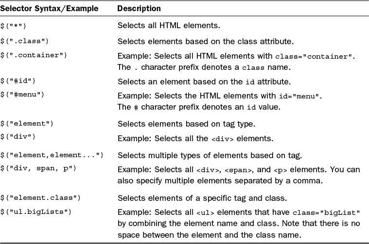

**表格 7.3 使用基础 jQuery 选择器的示例**

### 应用属性选择器

使用 jQuery 选择器的另一种方法是通过它们的属性值选择 HTML 元素。这可以是默认属性，也可以是你添加到 HTML 元素中的属性。属性值在选择器语法中用 `[]` 括号表示。表 7.4 显示了属性选择器应用的一些方式。

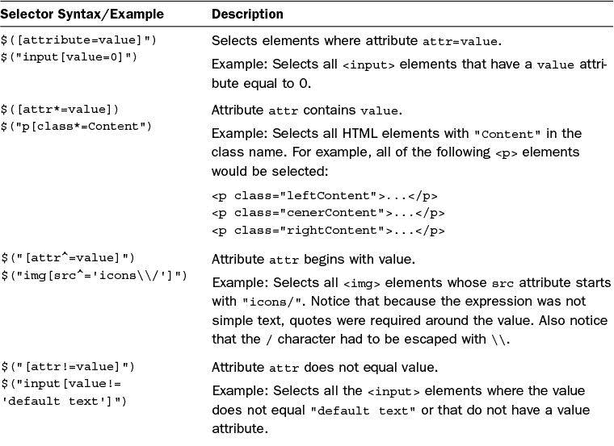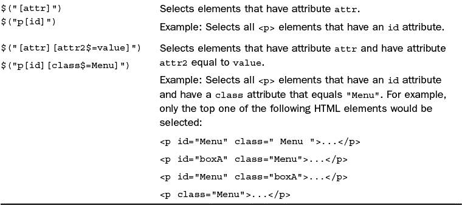

**表格 7.4 使用属性 jQuery 选择器的示例**

### 应用内容选择器

另一组有用的 jQuery 选择器是内容过滤选择器。这些选择器允许你根据 HTML 元素内部的内容选择 HTML 元素。表 7.5 显示了内容选择器的示例。

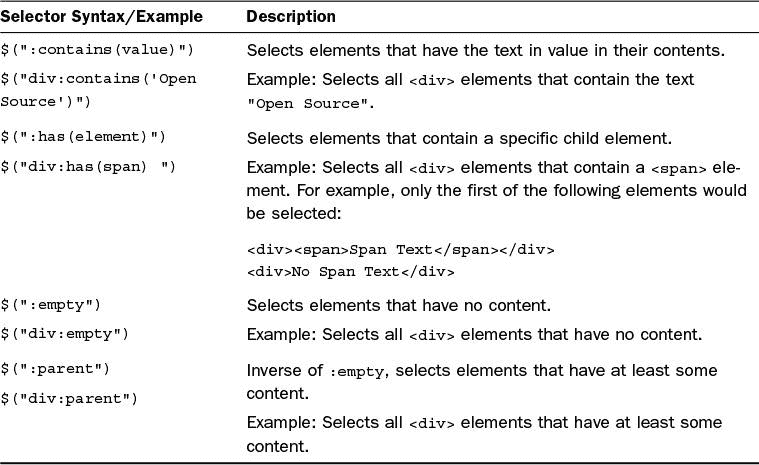

**表格 7.5 使用内容选择器的示例**

### 应用层级选择器

一组重要的 jQuery 选择器是层级选择器。这些选择器允许你根据 HTML 元素的父元素、子元素或 DOM 中的元素元素选择 HTML 元素。表 7.6 显示了层级示例。

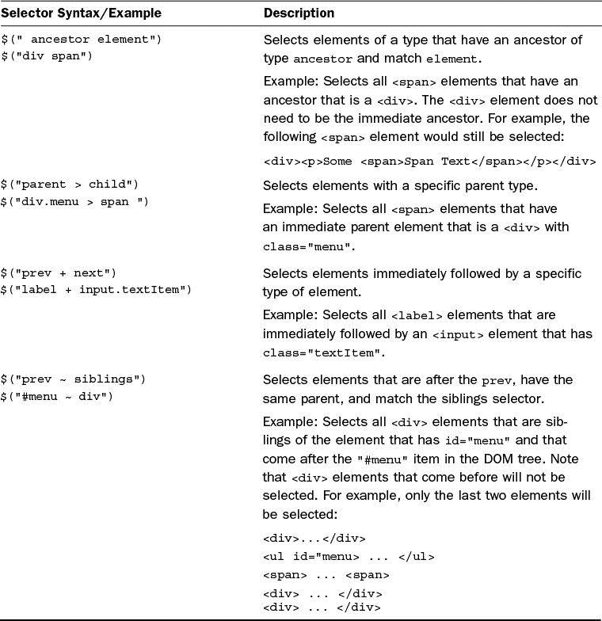

**表格 7.6 层级选择器的示例**

> **注意**
>
> 在设计选择器时，尽可能具体总是是最好的。例如，如果你想选择 `div` 下所有 `class="menu"` 的 `span` 元素，那么 `$("div .menu")` 会比 `$(".menu")` 高效得多。

### 应用表单选择器

另一组有用的选择器是表单。表 7.7 显示了表单选择器的示例。

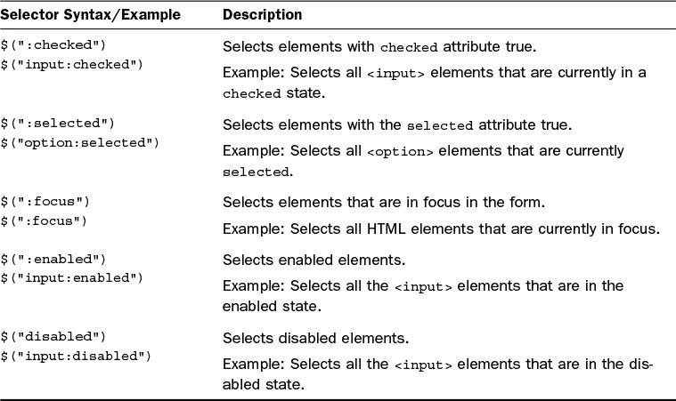

**表格 7.7 使用表单选择器的示例**

### 应用可见性选择器

如果你使用可见性来控制网页的流程和交互，使用可见性选择器可以简单地选择隐藏或显示的元素。表 7.8 显示了可见性的示例。

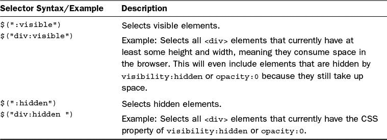

**表格 7.8 使用可见性选择器的示例**

### 应用过滤选择器

你通常需要将选择器缩小到更具体的子集。实现此点的方法是使用过滤选择器。过滤选择器在选择语句末尾添加过滤器以限制选择器的结果。表 7.9 显示了向选择器添加过滤器。

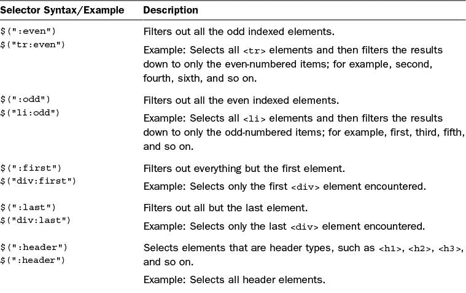

**表格 7.9 使用过滤选择器的示例**

### 动手尝试：使用 jQuery 访问 DOM 对象

在这个示例中，你使用 jQuery 找到元素并读取值。这是另一个有助于巩固选择器如何访问 DOM 对象的概念示例。在本节的后面你将看到更多高级的示例。示例中使用的完整脚本显示在列表 7.4、7.5 和 7.6 中：

1. 在 `07` 文件夹中创建源文件 `jquery_selectors.html`、`js/jquery_selectors.js` 和 `css/jquery_selectors.css`。
2. 打开 `jquery_selectors.html` 并添加常规元素（`html`、`head`、`body`）。
3. 在 `<head>` 元素内部添加以下 `<script>` 和 `<link>` 元素（见列表 7.4），用于加载 jQuery、JavaScript 和 CSS：

```html
<script src="https://code.jquery.com/jquery-2.1.3.min.js"></script>
<script type="text/javascript" src="js/jquery_selectors.js"></script>
<link rel="stylesheet" type="text/css" href="css/jquery_selectors.css">
```

4. 现在添加以下 `<span>` 元素，它们将被样式化为按钮。每个 `<span>` 元素包含不同的 `onclick` 处理程序，允许你在点击时运行你的动态脚本：

```html
<span onclick="setEven()">Even</span>
<span onclick="setOdd()">Odd</span>
<span onclick="setFirst4()">First 4</span>
```

5. 将列表 7.4 中所示的 `<p>` 和 `<ul>` 元素添加到页面中，以添加古代神列表。
6. 打开 `jquery_selectors.css` 文件，并添加列表 7.6 中的内容，这些内容将 `<span>` 元素样式为按钮，并将 `<p>` 元素样式为列表头。
7. 打开 `jquery_selectors.js` 文件，以便为 `<span>` 元素添加事件处理程序。
8. 添加一个名为 `setEven()` 的 JavaScript 函数作为事件处理程序。
9. 添加以下行，该行使用 jQuery 选择所有 `<li>` 和 `<span>` 元素，并清空 CSS 的 `font-weight` 值：

点击此处查看代码图片

```javascript
$("li, span").css("font-weight","");
```

10. 添加以下行，这些行定义了一个名为 `$evenItems` 的变量，结果为选择所有 `<li>` 元素的选择器，然后过滤列表仅保留偶数索引的项。第 3 行使用 `$evenItems` 变量将这些项的 CSS `font-weight` 属性设置为粗体：

点击此处查看代码图片

```javascript
var $evenItems = $("li:even");
$evenItems.css("font-weight","bold");
```

11. 添加以下行，该行使用 jQuery 选择内容包含 `"Even"` 的 `<span>` 元素，并将 CSS `font-weight` 属性设置为 `bold`：

点击此处查看代码图片

```javascript
$("span:contains(Even)").css("font-weight","bold");
```

12. 添加以下行，该行使用 jQuery 选择带有 `class="label"` 的元素以选择 `<p>` 元素。语句的 `.html("Even")` 部分将所选元素的 `innerHTML` 属性更改为 `"Even"`，从而更改标题：

点击此处查看代码图片

```javascript
$(".label").html("Even");
```

13. 添加列表 7.5 中所示的两个事件处理程序 `setOdd()` 和 `setFirst4()`，它们基本上在做相同的事情，但针对的是不同的列表项。
14. 保存这三个文件并在网页浏览器中打开 `jquery_selectors.html` 文件，以检查图 7.2 所示的网页。尝试点击不同的按钮，并观察按钮、标题和列表项的变化。


**图 7.2** 一个简单的 JavaScript Web 页面，使用 jQuery 根据用户交互动态更改页面元素。

**列表 7.4 `jquery_selectors.html` 加载 jQuery 和 JavaScript 并附加事件处理程序元素以提供用户交互的 HTML 文件**

点击此处查看代码图片

```html
01 <!DOCTYPE html>
02 <html>
03    <head>
04      <title>jQuery Selectors</title>
05      <meta charset="utf-8" />
06      <script src="https://code.jquery.com/jquery-2.1.3.min.js"></script>
07      <script type="text/javascript" src="js/jquery_selectors.js"></script>
08      <link rel="stylesheet" type="text/css" href="css/jquery_selectors.css">
09    </head>
10    <body>
11      <span onclick="setEven()">Even</span>
12      <span onclick="setOdd()">Odd</span>
13      <span onclick="setFirst4()">First 4</span>
14      <p class="label">Planets</p>
15      <ul>
16        <li>Poseidon</li>
17        <li>Ares</li>
18        <li>Apollo</li>
19        <li>Hermes</li>
20        <li>Nike</li>
21        <li>Nemesis</li>
22        <li>Zeus</li>
23        <li>Hades</li>
24      </ul>
25    </body>
26 </html>
```

**列表 7.5 `jquery_selectors.js` 包含以各种方式使用 jQuery 选择和修改的事件处理函数的 JavaScript 文件**

点击此处查看代码图片

```javascript
01 function setEven(){
02   $("li, span").css("font-weight","");
03   var $evenItems = $("li:even");
04   $evenItems.css("font-weight","bold");
05   $("span:contains(Even)").css("font-weight","bold");
06   $(".label").html("Even");
07 }
08 function setOdd(){
09   $("li, span").css("font-weight","");
10   var $oddItems = $("li:odd");
11   $oddItems.css("font-weight","bold");
12   $("span:contains(Odd)").css("font-weight","bold");
13   $(".label").html("Odd");
14 }
15 function setFirst4(){
16   $("li, span").css("font-weight","");
17   var $firstItems = $("li").slice(0,4);
18   $firstItems.css("font-weight","bold");
19   $("span:contains(First 4)").css("font-weight","bold");
20   $(".label").html("First 4");
21 }
```

**列表 7.6 `jquery_selectors.css` 将 `<span>` 元素样式为按钮并将 `<p>` 元素样式为列表头的 CSS**

```css
01 span {
02   cursor: pointer;
03   padding: 5px 10px;
04   border: 1px solid #ccc;
05   margin: 5px;
06   display: inline-block;
07 }
08 span:hover {
09   background-color: #eee;
10 }
11 
12 p.label {
13   font-size: 1.5em;
14   font-weight: bold;
15 }
```

### 总结

在本节中，你学习了使用 jQuery 查找和访问 DOM 元素。这对于动态操作它们至关重要。

### 问答

**[Q]** 我什么时候应该使用 `getElementById()` 而不是 `$("#")`？

**[A]** 你可能很少使用 `getElementById()`。唯一可能使用它的情况是你不想将 jQuery 库链接到你的 HTML 中。

### 练习

练习由问题和答案组成，旨在巩固你对本节内容的理解。在查看答案之前请尝试回答问题。

#### 测试

1. 如何将名为 `myDiv` 的 DOM 对象转换为 jQuery 对象？
2. 对或错：jQuery 选择器返回的是 DOM 元素的列表。
3. 如何判断一个对象是否是 jQuery 对象？
4. 如果你想获取所有 `class="heading"` 的元素，应该使用什么 jQuery 选择器？
5. 获取 `<div>` 元素的子元素 `<p>` 元素，应该使用什么 jQuery 选择器？
6. 如何获取 jQuery 对象所表示的 DOM 元素的 JavaScript 数组？

#### 测试答案

1. 使用 `$(myDiv)` 创建一个以该 DOM 元素为唯一项的新 jQuery 对象。
2. 错。jQuery 选择器返回的是一个包含一组 DOM 元素的 jQuery 对象。
3. 测试它是否设置了 `jquery` 属性。
4. `$(".heading")`
5. `$(div p)`
6. 在 jQuery 对象上使用 `get()` 方法。

### 练习

1. 为 `jquery_selectors.html` 示例添加一个额外的按钮，用于选择列表中的第一个和最后一个项。你需要添加所需的 HTML 和 JavaScript 代码。

jQuery 对象提供了额外的功能，通过允许你轻松地精炼所代表的 DOM 元素列表、导航 DOM 树寻找其他元素以及操作 HTML 元素的值，增强了选择器的结果。以下章节将介绍如何将 jQuery 操作链在一起，以便高效地查找、过滤和遍历网页中的 DOM 元素。

### 链式 jQuery 对象操作

jQuery 对象的强大之处之一是你可以将多个 jQuery 操作链成一个单一语句。每个连续的语句都将在链中上一个操作的结果上进行操作。这可以有助于减少并简化你的选择器，并减少 CSS 中所需的类（`class`）和 ID 定义。

将链式 jQuery 操作的结果想象成一栈 jQuery 对象，其中每个对象代表一组 DOM 元素。链中的每个操作都会将一个 jQuery 对象放入栈中，但当前操作仅应用于栈顶的 jQuery 对象。

为了帮助说明这一点，请考虑以下语句。代码首先找到具有 `id="content"` 的 `<div>` 元素，然后找到其内部的第一个 `<p>` 元素并将 `font-weight` 改为 `bold`。然后，它找到 `<p>` 内部的 `<span>` 元素并将 `color` 设置为 `red`：

点击此处查看代码

```javascript
var $contentDiv = $("div#content");
var $firstP = $contentDiv.children("p:first");
$firstP.css("font-weight","bold");
var $spans = $firstP.children("span");
$spans.css("color","red");
```

前面的代码使用了五行来完成它的所有任务。而以下单行链式 jQuery 操作仅需一行就实现了相同的功能：

点击此处查看代码

```javascript
$("div#content").children("p:first").css("font-weight","bold").children("span").css("color","red");
```

由于每个操作都返回一个 jQuery 对象，因此你可以根据需要链接任意数量的 jQuery 操作。即使 `.css()` 操作设计用于修改 DOM 对象而不是查找它们，它仍然会返回相同的 jQuery 对象，因此你可以在结果上执行其他操作。

### 过滤 jQuery 对象的结果

jQuery 对象提供了一组良好的方法，允许你修改查询中所代表的 DOM 对象。当你尝试在 jQuery 选择器结果中精确定一组特定的元素时，减少结果是有帮助的。表 8.1 提供了链式 jQuery 选择器的一些示例。


**表 8.1 过滤所代表的 DOM 元素的 jQuery 对象方法及示例**

> **提示**
>
> 与 CSS 选择器相同的 jQuery 选择器能够使用原生 DOM 方法 `querySelectorAll()`，该方法在 DOM 对象上具有一些高级优化。其他 jQuery 选择器无法利用该优化，因此最好先使用基于 CSS 的选择器，然后将过滤器作为链式选择器添加。例如，与其使用 `$("div:animated")`，不如你应该使用 `$("div").filter(":animated")`：[`api.jquery.com/category/selectors/jquery-selector-extensions/`](http://api.jquery.com/category/selectors/jquery-selector-extensions/)

### 使用 jQuery 对象遍历 DOM

附加到 jQuery 对象的另一组重要方法是 DOM 遍历方法。DOM 遍历允许你根据元素与其他元素之间的关系来选择元素。

DOM 有时被称为 DOM 树，因为它是以树结构组织的，以文档为根，节点可以同时具有父元素、兄弟元素和子元素。为了更好地视觉化，请查看以下 HTML 代码：


```html
<<body>
  <div>
    <p>Paragraph 1</p>
    <p>Paragraph 2</p>
    <ul>
      <li>Item 1</li>
      <li>Item 2</li>
    </ul>
  </div>
</body>
```

`<p>` 元素和 `<ul>` 元素是它们彼此的兄弟元素，并且它们都是 `<div>` 元素的子元素。`<div>` 元素是 `<p>` 和 `<ul>` 元素的父元素，而 `<ul>` 元素是 `<li>` 元素的父元素，依此类推。

jQuery DOM 遍历方法允许你从 DOM 的某一层移动到另一层以选择元素——例如，如果你想访问所有作为 `<div>` 元素子元素的 `<p>` 元素，或者如果你想找到作为 `<input>` 元素兄弟的 `<label>` 元素。

jQuery 对象提供了一组惊不起的方法，允许你以几乎无法数的方法遍历 DOM，因为它允许你使用 jQuery 对象中当前的 DOM 元素选择来选择树中的其他 DOM 元素。表 8.2 列出了你可以用于遍历 DOM 的方法。


**表 8.2** 允许你遍历元素的 jQuery 对象方法及示例

### 查看一些额外方法

在使用遍历 DOM 的 jQuery 方法的函数时，你应该注意某些方法。表 8.3 列出了你随着代码变得自然而会频繁使用的方法。


**表 8.3** 允许你处理对象的额外方法及示例

---

> **注意**
>
> 在使用遍历 DOM 的函数时，你可以使用 `this` 关键字来访问正在迭代的元素。这是一个 DOM 对象，而不是 jQuery 对象。如果你需要 jQuery 格式，请使用 `$(this)`。但请记住，构建格式需要一些工作。

#### 使用 `.each()`

`.each(function)` 方法是最重要的 jQuery 方法之一，因为它允许你遍历集合中的所有元素并对它们单独执行操作。这与仅对所有项目执行相同的操作不同。

`.each()` 方法允许你指定一个在 jQuery 对象的每个元素上运行的函数。该函数将索引数字作为第一个参数。在函数内部，`this` 变量指向当前的 DOM 元素。

以下代码说明了 `.each()`。它遍历所有元素并设置内容，包括元素的索引号：

点击此处查看代码

```javascript
$("p").each(function (idx){
  $(this).html("This is paragraph " + idx);
});
```

注意 `idx` 作为索引传入；第一个 `<p>` 元素为 0，第二个为 1，依此类推。还要注意 `this` 已通过 `$(this)` 转换为 jQuery 对象，以便调用 `.html()` 方法。

#### 使用 `.map()`

`.map(function)` 方法同样遍历 jQuery 对象集合中的每个元素。虽然与 `.each()` 非常相似，但有一个巨大的区别，即 `.each()` 将返回相同的 jQuery 对象，而 `.map()` 将返回一个包含每次迭代返回值的新的 jQuery 对象。

```javascript
var liValues = $("li").map(function (idx){
    return $(this).html();
}).get().join(",");
```

注意，在每次迭代中，该函数都会返回 `<li>` 元素中的 HTML 内容。你调用 `.get()` 将 `.map()` 返回的新型 jQuery 对象转换为 JavaScript 数组版本，然后对该数组调用 `.join(",")` 以构建成一个以逗号分隔的字符串。

---

## 尝试自己动手：使用 jQuery 的 `.map()` 和 `.each()` 方法来导航、访问和操作 DOM 元素

在本示例中，你将学习如何使用 jQuery 选择器找到所有段落元素（`<p>`）的过程。然后，你使用 `.map()` 函数读取内容，并用它创建一个新的 `<span>` 框。你还使用 `.each()` 遍历 `<p>` 元素并对它们进行重新样式。完整的示例文件可以在列表 8.1、8.2 和 8.3 中找到。使用以下步骤实现该示例：

1. 在 Eclipse 中，创建一个名为 `lesson08` 的源文件夹。在 `lesson08` 文件夹内部，创建 `js` 和 `css` 文件夹。

2. 在 `lesson08` 文件夹中，创建命名为 `dom_manipulation.html`、`js/dom_manipulation.js` 和 `css/dom_manipulation.css` 的源文件。

3. 打开 `dom_manipulation.html` 并添加基础元素（`html`、`head`、`body`）。

4. 在 `<head>` 元素内部，添加列表 8.1 所示的 `<script>` 和 `<link>` 元素，这些元素将用于加载 jQuery、JavaScript 和 CSS：

   点击此处查看代码图像

   ```html
   06    <script type="text/javascript" src="https://code.jquery.com/jquery-2.1.3.min.js"></script>
   07    <script type="text/javascript" src="js/dom_manipulation.js"></script>
   08    <link rel="stylesheet" type="text/css" href="css/dom_manipulation.css">
   ```

5. 将列表 8.1 中第 11–19 行的代码添加到 `css/dom_manipulation.css` 文件中。这段代码定义了两个输入按钮、一组 `<p>` 元素和一个用于放置内容的 `<div>`。

6. 将列表 8.3 中的样式代码添加到 `dom_manipulation.css` 文件中。该样式代码将为 `<span>` 元素设置样式使其以行内块（inline-block）的形式显示，以便设置它们的大小。

7. 打开 `js/dom_manipulation.js` 文件并添加以下行，这些行将创建一个在页面加载时执行的 `.ready()` 函数：

   点击此处查看代码图像

   ```javascript
   01 $(document).ready(function (){
   . . .
   21 });
   ```

8. 添加以下代码，为第一个按钮添加 `click` 事件处理程序。该函数使用一个简单的 `.each()` 函数来遍历 `<p>` 元素；它获取字符串，将其拆分为颜色和大小，然后设置 `font-size` 和 `color` CSS 属性：

   点击此处查看代码图像

   ```javascript
   02    $("input:eq(0)").click(function (){
   03      $("p").each(function(){
   04        var parts = $(this).html().split(" ");
   05        $(this).css({"font-size":parts[1]+"px", color:parts[0]});
   06      });
   07    });
   ```

9. 添加以下代码，为第二个按钮添加 `click` 事件处理程序。该函数使用一个简单的 `.map()` 函数来遍历 `<p>` 元素；它获取字符串并将其拆分为颜色和大小。然而，这次函数返回一个带有 `color` 和 `size` 属性的 JavaScript 对象。末的 `.get()` 将 `.map()` 的结果转换为名为 `items` 的 JavaScript 数组：

   点击此处查看代码图像

   ```javascript
   08    $("input:eq(1)").click(function (){
   09      var items = $("p").map(function(){
   10          var parts = $(this).html().split(" ");
   11          return {color:parts[0], size:parts[1]};
   12      }).get();
   ```

10. 添加以下 `for` 循环，该循环遍历 `items` 并根据从 `<p>` 元素读取的颜色和大小创建一个新的 `<span>` 元素：

    点击此处查看代码图像

    ```javascript
    13  for (var idx in items){
    14    var item = items[idx];
    15    var span = $("<span>" + item.color + "</span>");
    16    var size = item.size*5;
    17    span.css({"background-color":item.color, "font-size": item.size+"px", width:size, height:size});
    18    $("div").append(span);
    19  }
    ```

11. 保存三个文件并在浏览器中打开 HTML 文件。当你点击 `.each()` 按钮时，`<p>` 元素的文本会如图 8.1 所示发生变化。当你点击 `.map()` 按钮时，`<div>` 中将显示新的 `<span>` 元素。

**图 8.1** 使用 `.each()` 和 `.map()` 读取 `<p>` 元素的文本并对页面进行动态变化。

**列表 8.1** `dom_manipulation.html` 加载 jQuery 和 JavaScript

点击此处查看代码图像

```html
01 <!DOCTYPE html>
02 <html>
03 <head>
04    <title>DOM Manipulation</title>
05    <meta charset="utf-8" />
06    <script type="text/javascript" src="https://code.jquery.com/jquery-2.1.3.min.js"></script>
07    <script type="text/javascript" src="js/dom_manipulation.js"></script>
08    <link rel="stylesheet" type="text/css" href="css/dom_manipulation.css">
09  </head>
10  <body>
11    <input type="button" value=".each()">
12    <input type="button" value=".map()">
13    <p>red 10</p>
14    <p>orange 15</p>
15    <p>yellow 20</p>
16    <p>green 25</p>
17    <p>blue 30</p>
18    <p>indigo 35</p>
19    <p>violet 40</p>
20    <div></div>
21  </body>
22 </html>
```

**列表 8.2** `dom_manipulation.js` jQuery 和 JavaScript 代码获取 `<p>` 元素并使用 `.map()` 和 `.each()` 遍历它们以为每个元素应用不同的变化

点击此处查看代码图像

```javascript
01 $(document).ready(function (){
02    $("input:eq(0)").click(function (){
03      $("p").each(function(){
04        var parts = $(this).html().split(" ");
05        $(this).css({"font-size":parts[1]+"px", color:parts[0]});
06      });
07    });
08    $("input:eq(1)").click(function (){
09      var items = $("p").map(function(){
10          var parts = $(this).html().split(" ");
11          return {color:parts[0], size:parts[1]};
12      }).get();
13  for (var idx in items){
14    var item = items[idx];
15    var span = $("<span>" + item.color + "</span>");
16    var size = item.size*5;
17    span.css({"background-color":item.color, "font-size": item.size+"px", width:size, height:size});
18    $("div").append(span);
19  }
20    });
21 });
```

**列表 8.3** `dom_manipulation.css` CSS 代码为 `<span>` 和 `<p>` 元素设置样式

点击此处查看代码图像

```css
01 p{margin:0px; padding:0px;}
02 span{
03   display:inline-block;
04   color: white;
05   text-align:center;
06 }
```

### 3. 在 `<head>` 元素中添加以下 `<script>` 和 `<link>` 元素，如列表 8.4 所示。这些元素将用于加载 jQuery、JavaScript 和 CSS：

点击此处查看代码图片

```html
06      <script type="text/javascript" src="https://code.jquery.com/jquery-2.1.3.min.js"></script>
07      <script type="text/javascript" src="js/traverse_dom.js"></script>
08      <link rel="stylesheet" type="text/css" href="css/traverse_dom.css">
```

### 4. 添加列表 8.4 中 11–25 行所示的代码

这段代码定义了一组 `<div>` 元素，其中包含一个标签、一个文本输入和一组五个 `<span>` 元素。`<input>` 元素的 `onkeyup="update()"` 属性在用户向文本框输入内容时提供了动态交互。

### 5. 将列表 8.6 中的样式代码添加到 `traverse_dom.css` 文件中

该样式代码为 `<span>` 元素设置了特定的 `height` 和 `width`，并增加了必要的 `margin` 和 `padding`。

### 6. 在 Eclipse 中打开 `traverse_dom.js` 文件，并创建一个名为 `update()` 的 JavaScript 函数，供 `onkeyup` 事件处理器调用

### 7. 添加以下行以将所有 `<span>` 元素的 `background-color` 设置为 `lightgrey`

点击此处查看代码图片

```javascript
02    $("span").css("background-color","lightgrey");
```

### 8. 添加以下 jQuery 代码以选择所有 `<div>` 元素，然后使用 `.each()` 对每个元素进行迭代并应用一个函数

点击此处查看代码图片

```javascript
03    $("div").each(function(i){
...
8    })
```

### 9. 在函数内部，添加以下行以获取 `<div>` 元素的第一个 `<input>` 子元素

点击此处查看代码图片

```javascript
04      var $input = $(this).children("input:first");
```

### 10. 添加以下行，以获取 `<input>` 元素的值，并创建一个 jQuery 选择器字符串，用于过滤出前 *n* 个 `<span>` 元素，其中 *n* 是 `<input>` 的值

点击此处查看代码图片

```javascript
05      var $value = $input.val();
06      var filter = "span:lt(" + $value + ")";
```

### 11. 添加以下行，使用 `$input` jQuery 对象根据步骤 10 中定义的 `filter` 搜索兄弟元素

`css()` 方法将将背景颜色更改为蓝色。注意该函数的简单性。你可以根据需要添加任意数量的 `<div>` 部分。只要它们遵循相同的结构 `<<div>><input><<span>...</span></span></div>`，jQuery 代码就能作用于所有这些元素：

点击此处查看代码图片

```javascript
07      $input.siblings(filter).css("background-color","blue");
```

### 12. 保存文件并在浏览器中打开 `traverse_dom.html`

注意，当你在文本框中输入内容时，`<span>` 元素会变为蓝色以匹配输入的值。


**图 8.2** 一个简单的 JavaScript 网页，允许用户输入评分，并根据输入的值进行动态变化。

**列表 8.4** `traverse_dom.html`，用于加载 jQuery 和 JavaScript 并附加事件处理器元素以提供用户交互的 HTML 文件。

点击此处查看代码图片：

```html
01 <!DOCTYPE html>
02 <html>
03    <head>
04      <title>Traversing the DOM</title>
05      <meta charset="utf-8" />
06      <script type="text/javascript" src="https://code.jquery.com/jquery-2.1.3.min.js"></script>
07      <script type="text/javascript" src="js/traverse_dom.js"></script>
08      <link rel="stylesheet" type="text/css" href="css/traverse_dom.css">
09    </head>
10    <body>
11    <p>How satisfied are you 1-5</p>
12    <div>
13      <label>Quality</label>
14      <input type="text" onkeyup="update()"></input>
15      <span><span><span><span></span></span>
16    </div>
17    <div>
18      <label>Taste</label>
19      <input type="text" onkeyup="update()"></input>
20      <span><span><span><span></span></span>
21    </div>
22    <div>
23      <label>Service</label>
24      <input type="text" onkeyup="update()"></input>
25      <span><span><span><span></span></span>
26    </div>
27  </body>
28 </html>
```

**列表 8.5** `traverse_dom.js`，用于根据输入值处理 `<span>` 颜色的 JavaScript 代码。

```javascript
function update() {
  $("span").css("background-color","lightgrey");
  $("div").each(function(i){
    var $input = $(this).children("input:first");
    var $value = $input.val();
    var filter = "span:lt(" + $value + ")";
    $input.siblings(filter).css("background-color","blue");
  });
}
```

**列表 8.6** `traverse_dom.css`，用于设置 `<span>` 元素的 CSS 代码。

```css
span {
  display: inline-block;
  height: 20px;
  width: 20px;
  margin: 5px;
  padding: 5px;
}
```

`.map()` 用于遍历元素集合并返回一个包含每次迭代中指定函数结果的新对象。`.each()` 则仅遍历元素并应用指定的函数。

### 练习

1. 扩展 `dom_manipulation.html` 中的 HTML 代码，包含更多与其它部分类似的 `<div>` 部分。请注意，相同的功能会自动应用到每个部分上。

## 第 9 节：应用 JavaScript 和 jQuery 事件构建丰富交互的网页

你将在本节中学习到：

- 用户和浏览器触发事件的方式
- 事件对象上可以访问属性
- 如何添加能够动态响应事件的处理程序
- 向事件处理程序传递额外数据的方式
- 手动触发事件的方法
- 创建自定义事件的方法
- 如何在代码中实现并触发回调函数

AngularJS、jQuery 和 JavaScript 的主要目标之一是为开发者提供创建极其复杂且交互丰富的网页的能力。这种交互式网页的核心是事件。事件基本上是浏览器环境中发生的任何事情，从页面加载、鼠标移动或点击、键盘输入，到窗口大小的调整等。

理解事件、代表事件的对象以及如何在你的网页中应用它们，将使你能够创建出极佳的用户交互。在本节中，你将学习理解事件所需的概念，以及如何在构建丰富交互的网页时利用它们。你将在书的其余部分反复使用本节的概念。

AngularJS 利用了本节讨论的底层 JavaScript 和 jQuery 事件功能，但还提供了额外的功能（例如数据监听），以实现更健壮的事件处理。这些概念在课程的 AngularJS 部分中会有介绍。

### 理解事件

你已经在本书的几个示例中使用过事件。然而，为了充分利用它们，你需要理解从物理交互到 AngularJS、jQuery 和 JavaScript 交互（这些交互将修改屏幕元素和数据）过程中发生了什么。接下来的章节描述了事件过程、涉及的组件以及如何在网页中实现事件。

#### 理解事件过程

从高层来说，事件处理的概念很容易理解：你点击网页上的一个按钮，事情就发生了。本节将深入探讨，以便你理解正在发生什么。以下列表描述了当用户与网页或浏览器窗口交互时发生的重要事项。

1. **物理事件发生**——发生了一个物理事件；例如，用户点击或移动鼠标或按下按键。

2. **浏览器中触发事件**——用户交互导致 Web 浏览器触发事件——通常是同时触发多个事件。例如，当用户在键盘上输入一个按键时，会触发三个事件：`keypressed`、`keydown` 和 `keyup` 事件。

3. **浏览器为事件创建对象**——Web 浏览器为触发的每个事件创建一个单独的对象。这些对象包含了有关事件的信息，可供处理程序使用。

4. **调用用户事件处理程序**——调用用户定义的事件处理程序。你有能力在 JavaScript 中创建处理程序，这些处理程序将与事件对象和页面元素交互，为 HTML 元素提供交互性。事件处理程序可以处于三个阶段。以下描述了图 9.1 所示的三个阶段。

   -  **捕获（Capturing）**——捕获阶段是从文档直接通过每个父元素向下到达目标 HTML 元素的路径阶段。默认情况下，捕获阶段的事件处理程序行为是禁用的。
   -  **目标（Target）**——当事件处于最初触发它的 HTML 元素中时，即进入目标阶段。
   -  **冒泡（Bubbling）**——冒泡阶段是经过目标 HTML 元素的每个父元素向上移动，一直回到文档。默认情况下，事件的冒泡阶段是启用的。

   

   **图 9.1** 事件在捕获阶段从文档向下到目标处理，然后在目标阶段处理，最后在冒泡阶段从目标向上通过文档进行处理。

5. **调用浏览器处理程序**——除了用户事件处理程序外，浏览器还有默认处理程序，它们根据触发的事件执行不同的操作。例如，当用户点击链接时，浏览器会调用一个事件处理程序，并导航到链接中指定的 `href` 位置。

#### 查看事件对象

当浏览器检测到事件发生时，会创建事件对象。如果事件处理程序是由 AngularJS 或 jQuery 定义的，事件对象会被转换为 jQuery 事件对象，该对象具有更多的属性和方法。因此，你需要意识到你正在处理哪种类型的事件对象。

事件对象为你提供了有关事件的额外信息，例如事件的类型（例如 `click` 或 `keypress`）、按了哪些键、鼠标位置、事件发生在哪个 HTML 元素上等。表 9.1 描述了你将使用的最常用的事件属性。


**表 9.1** JavaScript 和 jQuery 事件属性。

事件还提供了一些方法，允许你控制事件的行为——例如停止传播和默认行为。表 9.2 描述了事件对象上的重要方法。


**表 9.2** JavaScript 和 jQuery 事件属性。

#### 回顾事件类型

事件类型是 JavaScript、jQuery 和 AngularJS 用于识别发生的物理事件的关键字。这些关键字用于附加处理程序以指定事件类型。此外，正如你之后将看到的，这些关键字也用于方法名称中，用于附加事件处理程序或手动触发事件。

JavaScript 提供了多种对应动态页面交互期间发生的不同事件类型。jQuery 事件处理支持所有的 JavaScript 事件，并增加了自己的事件。表 9.3 列出了 JavaScript 和 jQuery 支持的不同事件类型。


**表 9.3** JavaScript 和 jQuery 事件类型。

### 使用页面加载事件进行初始化

当 HTML 文档加载时，`<script>` 标签中指定的 JavaScript 代码将被加载并执行。通常，JavaScript 和 jQuery 逻辑将位于以后执行的函数内部。然而，会有一些代码执行初始化工作，例如向页面元素附加事件处理程序，甚至向现有元素中添加额外的元素。

问题是，在 JavaScript 代码加载时，HTML 元素对象可能尚未被浏览器构建。如果你在 HTML 对象创建之前引用它，将抛出异常，因此，你需要等待页面完全加载。

这就是 `load` 事件非常有用的地方。将初始化代码放置在页面加载时触发的事件处理程序内部，可以确保所有的 HTML 对象都已创建，并且 DOM 已完全就绪。

## 使用 JavaScript `onload` 事件

若要在 JavaScript 中添加在页面加载时运行的初始化代码，请在 JavaScript 中创建一个执行初始化的函数。例如，考虑以下展示了简单骨架结构初始化函数的 JavaScript 代码：

点击此处查看代码图片：

```javascript
function onloadHandler(){
   (initialization code here...)
}
```

现在你有两种方法可以确保在页面完全加载时触发 `onloadHandler()`。第一种是将你的初始化代码绑定到 HTML 中 `<body>` 元素的 `onload` 属性上。例如：

点击此处查看代码图片：

```html
<body onload="onloadHandler()">
```

第二种方法是将其直接赋值给 JavaScript 代码中的 `window` 对象。例如：

点击此处查看代码图片：

```javascript
window.onload = onloadHandler;
```

## 在 jQuery 中添加初始化代码

在 jQuery 中，初始化代码可以在两个不同的时间触发并执行：当 DOM 就绪时，以及当文档及其资源完全加载时。使用哪种选项取决于你的初始化代码需要执行什么操作。

使用 jQuery 的 `.ready()` 方法将在 DOM 完全就绪时触发初始化代码运行。此时所有的 DOM 对象都已创建，页面将显示给用户。然而，此时所有的页面资源（如图像）可能尚未完全下载。这种选项允许你尽早地添加交互和功能。下面的示例展示了如何使用 `.ready()` 绑定简单初始化函数的用法：

点击此处查看代码图片：

```javascript
$(document).ready(function(){
   (initialization code here...)
})
```

使用 jQuery 的 `.load()` 方法将在所有页面资源加载并渲染给用户后触发初始化代码。在有时，如果你需要在初始化代码中使用如图像之类的资源，则可能会使用此选项。下面的示例展示了使用 `.load()` 绑定简单初始化函数的用法：

点击此处查看代码图片：

```javascript
$(window).load(function(){
   (initialization code here...)
})
```

***

> **注意**
>
> `.ready()` 和 `.load()` 方法与 `<body>` 标签中使用 `onload="..."` 属性不兼容。如果你在使用 jQuery，请使用 `.ready()` 或 `.load()`；如果没有使用，请使用 `onload` 属性。

***

## 为 DOM 元素添加和移除事件处理程序

为了给网页中的事件提供交互，必须为你想要交互的每个特定事件类型添加事件处理程序。事件处理程序是一个 JavaScript 函数，用于添加、删除或更改 DOM 元素或其他完成交互所需的任何操作。例如，下面的代码是一个将 `<p>` 元素中显示的文本更改为 `"clicked"` 的事件处理程序示例：

```javascript
function clickHandler(){
  $("p").html("clicked");
}
```

多种方法可以向 DOM 元素添加事件处理程序。本节将描述这些这些方法及其优缺点。

### 在 HTML 中分配事件处理程序

向 DOM 元素添加事件处理程序最基本的方法是直接在 HTML 代码中编写。这种方法的优点是简单，并且易于查看哪个事件处理程序被分配给了特定的 DOM 对象。

通过在标签语句中设置 handler 属性的值，可以将事件处理程序添加到 HTML 的 DOM 对象中。对于元素支持的每个事件，都有一个以“on”开头并跟跟事件名称的属性。例如，`click` 事件属性是 `onclick`，`load` 事件属性是 `onload`。要查看事件列表，请参阅表 9.1。

下面的示例展示了在 HTML 代码中为 DOM 元素添加 `click` 事件处理程序是多么简单：

点击此处查看代码图片：

```html
<div onclick="clickHandler()">Click Here</div
```

当点击 `<div>` 元素时，将调用以下函数：

```javascript
function clickHandler(){
  $("div").html("clicked");
}
```

你还可以使用 `event` 关键字将 DOM 事件对象作为参数包含在事件处理程序中。这允许你在事件处理程序中访问事件信息：

```html
<div onclick="clickHandler(event)">Click Here</div
```

当点击 `<div>` 元素时，将调用以下函数：

```javascript
function clickHandler(event){
  $("div").html("clicked");
}
```

*(等待，原文在此处有些重复/重叠，我将根据提供的文本维持其逻辑)*：

你还可以使用 `event` 关键字将 DOM 事件对象作为参数包含在事件处理程序中。这允许你在事件处理程序中访问事件信息：

```html
<div onclick="clickHandler(event)">Click Here</div
```

当点击 `<div>` 元素时，将调用以下函数：

```javascript
function clickHandler(event){
  $("div").html("clicked");
}
```

```javascript
document.getElementById("div1").addEventListener('click',
  function(e){
    clickHandler (e, "heading", 1, "yes");
  },false);
```

所以，这就是前面代码中 `addEventListener()` 调用所发生的情况。指定了事件类型 `'click'`，然后定义了一个没有名称的新匿名 `function`，它接受事件对象作为唯一参数，并用 `e` 表示。在包装器函数内部，使用自定义参数调用了实际的事件处理器，包括用于传递事件对象的 `e` 变量。在示例中，使用 `false` 表示该处理器应只在冒泡阶段被调用。

你也可以使用 DOM 对象上的 `removeEventListener()` 函数从事件中移除事件处理器。你需要指定要移除的事件类型和事件处理器的名称。例如，以下代码先添加了事件处理器，然后将其移除：

点击此处查看代码图片：

```javascript
var obj = document.getElementById("div1");
obj.addEventListener('click', clickHandler);
obj.removeEventListener('click', clickHandler);
```

### 提示


你也可以使用`handler`属性在 DOM 对象本身设置访问事件处理器。`handler`属性将是“on”加上事件类型。例如，对于点击事件，该属性为`obj.onclick`。你可以通过`obj.onclick()`调用事件处理器，或直接使用`obj.onclick = function handler(){ ...};`为其赋值。

## 尝试自己：通过 JavaScript 为 DOM 对象添加事件处理器

在此示例中，你将使用 JavaScript 方法动态地为 DOM 对象附加事件处理器。请按照以下步骤创建列表 9.1、9.2 和 9.3 所示的文件：

1. **在 Eclipse 中**，创建`lesson09`、`lesson09/js`和`lesson09/css`文件夹。
2. **创建**`lesson09/broken_event.html`、`lesson09/js/broken_event.js`和`lesson09/css/broken_event.css`文件。
3. **将**来自列表 9.1 所示的代码添加到 HTML 文件中。你应该能识别该文件中的几乎所有内容。注意`<body>`标签的`onload`事件处理器设置为`onloadHandler()`。
4. **将**来自列表 9.3 的 CSS 添加到 CSS 文件中。现在你也应该能识别这些 CSS 语句了。
5. **打开**`broken_event.js`文件以及将用于处理点击事件的后续函数。注意它接受多个参数。第一个参数是 DOM 事件对象，用于通过`e.screenX`获取 x 坐标。它还接受一个对象`objId`，用于获取应该写入的对象。其余参数用于向由`objId`指定的对象的`innerHTML`中写入消息：

点击此处查看代码图片

```javascript
01 function clickHandler(e,objId,num,msg){
02   var obj = document.getElementById(objId);
03   obj.innerHTML = "DIV " + num + " says " + msg +" at X postion: " + e.screenX;
04 }
```

6. **创建**以下包装器函数，用于将参数传递给实际的事件处理器。包装器函数仅接受事件对象作为参数`e`。它们使用适当的值调用`clickHandler()`函数。在示例中，通过调用`removeEventListener()`从目标对象移除事件处理器。移除事件处理器并不是常见做法，这只是为了提供一个示例：

点击此处查看代码图片

```javascript
05 function yesWrapper(e){
06   clickHandler(e, "heading", 1, "yes");
07   e.target.removeEventListener('click', yesWrapper);
08 }
09 function noWrapper(e){
10   clickHandler(e, "heading", 1, "no");
11   e.target.removeEventListener('click', noWrapper);
12 }
```

7. **添加**以下`onloadHandler()`函数，该函数调用`addEventListener()`为每个`<div>`元素添加`click`事件处理器：

点击此处查看代码图片

```javascript
13 function onloadHandler(){
14   document.getElementById("div1").addEventListener('click', yesWrapper, false);
15   document.getElementById("div2").addEventListener('click', noWrapper, false);
16 }
```

8. **保存**所有三个文件，然后在网页浏览器中打开 HTML 文档，并尝试图 9.2 所示的“Say Yes”和“Say No”按钮。注意按钮只会生效一次，因为事件处理器已被移除。如果我们没有移除事件处理器，按钮将继续更改`<h1>`。


**图 9.2** 一个为元素添加事件处理器并响应点击的简单网页。

### 列表 9.1 `broken_event.html` HTML 文件：加载 jQuery 并将事件处理器附加到`<div>`

点击此处查看代码图片

```html
01 <!DOCTYPE html>
02 <html>
03 <head>
04   <meta charset="utf-8" />
05   <title>Broken Event</title>
06   <script type="text/javascript" src="https://code.jquery.com/jquery-2.1.3.min.js"></script>
07   <script type="text/javascript" src="js/broken_event.js"></script>
08   <link rel="stylesheet" type="text/css" href="css/broken_event.css">
09 </head>
10 <body onload="onloadHandler()">
11   <div id="div1">Say Yes</div>
12   <div id="div2">Say No</div>
13   <h1></h1>
14 </body>
15 </html>
```

### 列表 9.2 `broken_event.js` JavaScript 代码：定义事件处理器并动态地附加到`<div>`

点击此处查看代码图片

```javascript
01 function clickHandler(e,objId,num,msg){
02   var obj = document.getElementById(objId);
03   obj.innerHTML = "DIV " + num + " says " + msg +" at X postion: " + e.screenX;
04 }
05 function yesWrapper(e){
06   clickHandler(e, "heading", 1, "yes");
07   e.target.removeEventListener('click', yesWrapper);
08 }
09 function noWrapper(e){
10   clickHandler(e, "heading", 1, "no");
11   e.target.removeEventListener('click', noWrapper);
12 }
13 function onloadHandler(){
14   document.getElementById("div1").addEventListener('click', yesWrapper, false);
15   document.getElementById("div2").addEventListener('click', noWrapper, false);
16 }
```

### 列表 9.3 `broken_event.css` CSS 代码：样式`<div>`元素

点击此处查看代码图片

```css
1 div{
2   border-radius:5px;
3   margin:3px;
4   padding:5px;
5   background-color:lightgrey;
6   font-weight:bold;
7   display:inline-block;
8   cursor:pointer;
9 }
```

## 在 jQuery 中应用事件处理器

为 DOM 元素附加事件处理器的最佳方法是使用 jQuery。使用 jQuery 对象可以轻松选择不同的集合并同时为它们应用相同的事件处理器。

在过去，jQuery 有几种方法添加和移除事件处理器，包括`bind()/unbind()`和`delegate()/undelegate()`。`bind()`方法模仿了`addEventListener()`的行为，而`delegate()`允许向 jQuery 对象添加事件，然后当添加额外的子元素时，也会自动将其委托给这些元素。

从 jQuery 1.7 版本开始，这些方法都由一组简单的对方法`on()`和`off()`取代。使用`on()`方法在 jQuery 对象上附加事件处理器。`on()`方法可以以以下两种格式之一调用：

点击此处查看代码图片

```javascript
on(events [, selector] [, data], handler(eventObject))

on(events-map [, selector][, data])
```

以下列表描述了在向 jQuery 对象添加事件处理程序时，可以添加到`on()`方法的每个参数的用途：


`events`—一个或多个由空格分隔的事件类型，以及用点语法表示的可选命名空间；例如，`"click"`、`"mouseenter mouseleave"`或`"keydown.myPlugin"`。事件类型列表可以在表 9.1 中找到。


`events-map`—一个映射对象，其中字符串键指定一个或多个由空格分隔的事件类型，而值指定在事件触发时将调用的处理程序函数；例如，`{'click':myhandler}`或`{'click':function myHandler(e){return true;}}`。


`selector`—可选。选择器字符串，指定当事件触发时，哪些后代元素也应该调用事件处理程序。这取代了`delegate()`方法的功能。如果你向事件始终存在于页面父对象集添加事件处理程序，那么任何匹配选择器的后代元素在事件触发时也会调用该处理程序，即使它们是在绑定事件之后才添加的。


`data`—可选。它可以是一个数字、字符串或对象，当事件触发时将作为`event`的数据部分通过`event.data`传递给处理程序。


`handler(eventObject)`—如果你没有使用`events-map`，则需要指定在事件触发时执行的处理程序函数。

要从元素中移除 jQuery 事件处理程序，请在 jQuery 对象上调用`off()`方法。`off`方法的语法是以下之一：

点击此处查看代码图像

```javascript
off(events [, selector] [, handler(eventObject)])

off(events-map [, selector])
```

如果没有指定处理程序，`off()`函数将移除所有指定事件的处理程序。接下来的示例展示了如何使用`on()`向所有`<div>`元素添加事件处理程序，然后使用`off()`移除它：

点击此处查看代码图像

```javascript
$("div").on("click",clickHandler);

$("div").off("click",clickHandler);
```

---

> **注意**
>
> `on()`和`off()`方法适用于所有的 jQuery 事件类型，包括你自定义的事件。jQuery 还提供了一些简单的辅助函数（将在课程稍后部分讨论），以便更容易地为某些事件附加处理程序。

---

> **提示**
>
> 你通常希望事件处理程序只在事件第一次发生时运行一次。jQuery 提供了非常有用的`one()`方法，它会添加一个事件并在第一次触发后自动将其移除。`one()`方法与`on()`方法使用相同的语法。

---

### 尝试自己：使用 jQuery 添加事件处理程序

在本示例中，你使用 jQuery 方法动态地为 DOM 对象附加事件处理程序。使用以下步骤创建列表 9.4、9.5 和 9.6 所示的文件：

1. 在 Eclipse 中，创建`lesson09/working_event.html`、`lesson09/js/working_event.js`和`lesson09/css/working_event.css`文件。
2. 将列表 9.4 所示的代码添加到 HTML 文件中。你应该能识别该文件中的几乎所有内容。
3. 将列表 9.6 中的 CSS 添加到 CSS 文件中。
4. 打开`working_event.js`文件并查看将用于处理点击事件的函数。该事件仅接受事件对象`e`作为参数。它依赖事件对象的数据部分来提供应添加文本的元素的`objId`。它还使用`e.target.id`、`e.screenX`和`e.data.answer`值作为写入`<h1>`元素的消息的一部分：

点击此处查看代码图像

```javascript
01 function clickHandler(e){
02    $("#"+e.data.objId).html(e.target.id + " says " + e.data.answer +
03                                     " at X postion: " + e.screenX);
04 }
```

5. **创建**以下`ready()`函数，当文档加载并就绪时将自动调用：

点击此处查看代码图像

```javascript
05 $(document).ready(function(){
...
12 });
```

6. **添加**以下 jQuery 代码，该代码找到`#div1`元素并使用`on()`添加事件处理程序。在本示例中，一个`events-map`对象将找到`#div1`元素并然后使用`on()`添加事件处理程序。在本示例中，一个`events-map`传递了第 4 步使用的值：

点击此处查看代码图像

```javascript
06 $("#div1").on({"click",
7{"objId":"heading",
8"yes"});
```

7. **添加**以下 jQuery 代码，它获取`document`对象并向`#div2`添加事件处理程序。与第 6 步的差异在于我们使用了选择器。通过使用选择器，即使重新添加`div2`，当事件触发时它也会调用处理程序。此外，而不是`events-map`，我们使用选择器作为最后的参数：

点击此处查看代码图像

```javascript
08 $(document).on("click",
9             "#div2",
10                {"objId":"heading",
11                "no"});
```

8. **保存**所有文件并在浏览器中打开图 9.3 所示的 Say Yes 和 Say No 按钮。


**图 9.3** 使用 jQuery 为`<div>`元素动态添加事件处理程序并响应点击。

### 列表 9.4 HTML 文件：加载 jQuery 和 JavaScript，并为`<h1>`元素附加事件处理程序

除了使用`addEventListener()`方法添加事件处理器外，jQuery 还提供了许多辅助函数，允许你设置事件处理器。这些辅助函数以事件命名，因此可以让你的代码看起来更整洁。

这些辅助函数使用与`addEventListener()`类似的语法，但不需要指定事件类型：

点击此处查看代码图像

```javascript
.<event type>([ [eventData], handler(eventObject))
```

`eventData`参数是可选的，与`addEventListener()`一样，它会为事件对象设置`data`值。`handler`参数是必须的，用于指定要调用的函数。将`<event type>`替换为表 9.3 列出的事件名称。例如，以下两个 jQuery 语句是为点击事件分配处理器的等方式：

点击此处查看代码图像

```javascript
obj.click( dataObj, function myHandler(e){...});
obj.addEventListener("click", dataObj, function myHandler(e){...});
```

除了基于事件名称的辅助函数外，jQuery 还额外了一个对鼠标悬停事件非常有用的辅助函数。`hover()`辅助函数允许你同时设置`mouseenter`和`mouseleave`事件的处理器。例如：

点击此处查看代码图像

```javascript
obj.hover(function enterHandler(e){...}, function leaveHandler(e){...});
```

等同于：

点击此处查看代码图像

```javascript
obj.addEventListener("mouseenter", function enterHandler(e){...});
obj.addEventListener("mouseleave", function leaveHandler (e){...});
```

你也可以通过仅指定一个处理器来为`mouseenter`和`mouseleave`设置同一个处理器。例如：

点击此处查看代码图像

```javascript
obj.hover(function hoverHandler(e){...});
```

### 手动触发事件


JavaScript 和 jQuery 允许你手动触发事件。这提供了许多优势，例如模拟用户交互、将页面元素交互结合在一起，或与自定义自定义事件进行交互。

以下章节描述了如何在 JavaScript 和 jQuery 中触发事件。

## 在 JavaScript 中触发事件

在 JavaScript 中触发事件最简单的方法是使用附加在 DOM 对象上的方法（如果有）。对于`click`、`select`、`blur`和`focus`等简单事件，支持它们的 DOM 对象上都有相应的方法。例如，你可以使用以下语法在大多数 DOM 对象上触发`click`事件：

```
obj.click();
```

JavaScript 中触发事件的更高级的方法是创建一个事件对象，然后使用`document.dispatchEvent()`调用来触发事件机制。这种方法对事件信息提供了更多的控制，并且是触发许多事件的唯一方法。`dispatchEvent()`方法涉及三个步骤。

第一步是使用`document.createEvent()`方法创建一个事件对象。`createEvent()`方法要求你为正在创建的对象指定事件`type`。表 9.4 列出了`createEvent()`接受的一些常见事件类型。例如，要创建一个鼠标`click`事件对象，请使用以下语句：

点击此处查看代码图像

```
var clickEvent = document.createEvent("MouseEvents");
```


**表 9.4 `createEvent()`支持的常见事件类型**

下一步是通过调用事件的初始化函数为事件对象初始化值。表 9.4 列出了事件类型对应的初始化函数以及支持的参数。

例如，要初始化点击事件对象，请使用以下语句。类型指定为`"click"`，且`bubbling`和`cancelable`属性均`true`。这里，`window`被用作`view`。坐标并不重要，所以它们保持为 0，额外的键盘键也不重要，因此它们被设置为`false`。`button`参数设置为 0 以表示左键，且没有指定相关的 target：

点击此处查看代码图像

```
clickEvent.initMouseEvent("click", true, true, window, 0, 0, 0, 0, 0, 0, false, false, false, false, 0, null);
```

在大多数情况下，初始化函数的参数应该是自显其意的。然而，你可能需要检查某些特定的参数。你可以在 [www.w3.org/TR/DOM-Level-2-Events/events.html](http://www.w3.org/TR/DOM-Level-2-Events/events.html) 找到事件对象和方法的定义。

最后一步是在你想触发的元素上调用`dispatchEvent()`。

### 动手尝试：手动触发事件

在这个示例中，你将逐步了解使用事件触发点击事件的过程。

**1.** 在`manual_event.html`中，将列表 9.7 所示的代码添加到 HTML 文件。这是一个包含两个复选框的基础 HTML 文件。

**2.** 打开`manual_event.js`并编写以下`onloadHandler()`初始化函数，它为两个`<span>`元素附加事件监听器：

点击此处查看代码图像

```
function onloadHandler(){
  var employee = document.getElementById("Employee");
  employee.addEventListener('click', simpleClick, false);
  var registered = document.getElementById("Registered");
  registered.addEventListener('click', eventClick, false);
}
```

**3.** 将列表 9.9 中的 CSS 添加 CSS 文件。这段代码将`<span>`元素的样式使其像按钮。

**4.** 为第一个按钮创建`simpleClick()`处理函数。该代码使用事件的`target.id`寻找对应的复选框元素。然后在复选框对象上调用`click()`函数，从而触发`click`事件，就像鼠标点击了它一样：

点击此处查看代码图像

```javascript
function simpleClick(e){
  var cb = document.getElementById("check"+e.target.id);
  cb.click();
}
```

**5.** 为第二个按钮添加以下`eventClick()`处理函数。该代码首先创建一个`"MouseEvents"`对象，然后使用相应的参数将其初始化为`"click"`类型。该代码还使用事件的`target.id`寻找对应的复选框元素，然后在复选框元素对象上调用`dispatchEvent()`，触发鼠标`click`事件：

点击此处查看代码图像

```javascript
function eventClick(e){
  var clickEvent = document.createEvent("MouseEvents");
  clickEvent.initMouseEvent("click", true, true, window, 0, 0, 0, 0, 0, 0, false, false, false, false, 0, null);
  e.target.dispatchEvent(clickEvent);
}
```

```javascript
var event = document.createEvent("MouseEvents");

event.initMouseEvent("click", true, true, window,
                    0, 0, 0, 0, 0, false, false,
                    false, false, 0, null);
var cb = document.getElementById("check"+e.target.id);
cb.dispatchEvent(event);
```

**7.** 保存所有三个文件，然后在网络浏览器中打开 HTML 文档，如图 9.4 所示。尝试操作复选框和按钮。注意，按钮提供的交互效果与直接点击复选框是相同的。


**图 9.4** 一个简单的网页，它可以从来自`<span>`元素触发复选框的点击事件。

### 代码列表 9.7 manual_event.html

载入了 CSS 和 JavaScript 并定义了复选框和`<span>`元素的 HTML 文件

点击此处查看代码图片

```html
<!DOCTYPE html>
<html>
  <head>
    <title>Manual Event</title>
    <meta charset="utf-8" />
    <script type="text/javascript" src="js/manual_event.js"></script>
    <link rel="stylesheet" type="text/css" href="css/manual_event.css">
  </head>
  <body onload="onloadHandler()">
    <input id="checkAvailable" type="checkbox" /><label>Available</label><br>
    <input id="checkAllWeek" type="checkbox" /><label>All Week</label><br>
    <input id="checkWeekDays" type="checkbox" /><label>Week Days</label><br>
    <span id="Available">I'm Available</span>
    <span id="AllWeek">All Week</span>
    <span id="WeekDays">Week Days</span>
  </body>
</html>
```

### 代码列表 9.8 manual_event.js

这里的 JavaScript 代码，用于从来自`<span>`元素手动触发复选框元素的点击事件

点击此处查看代码图片

```javascript
function onloadHandler(){
  var available = document.getElementById("Available");
  Available.addEventListener('click', simbleClick, false);
  var allWeek = document.getElementById("AllWeek");
  AllWeek.addEventListener('click', eventClick, false);
  var weekDays = document.getElementById("WeekDays");
  WeekDays.addEventListener('click', eventClick, false);
}
function simbleClick(e){
  var cb = document.getElementById("check"+e.target.id);
  cb.click();
}
function eventClick(e){
  var event = document.createEvent("MouseEvents");
  event.initMouseEvent("click", true, true, window,
                      0, 0, 0, 0, 0, false, false,
                      false, false, 0, null);
  var cb = document.getElementById("check"+e.target.id);
  cb.dispatchEvent(event);
}
```

### 代码列表 9.9 manual_event.css

用于设置`<span>`元素样 CSS 代码

```css
span{
  border-radius:5px;
  margin:3px;
  padding:5px;
  background-color:#C0C0C0;
  border:3px ridge;
  display:inline-block;
  cursor:pointer;
}
```

## 使用 jQuery 手动触发事件

现在你已经有机会从 JavaScript 触发事件了，你已经准备好发现如果你能够使用 jQuery，它将如何让你的生活变得多么简单了。jQuery 还支持两种手动触发事件的方法。与 JavaScript 类似，jQuery 对象也有许多与你可以调用的许多事件类型对应的方法。例如，大多数元素都有`click()`和`dblclick()`方法。表单元素增加了额外的方法，如`blur()`、`focus()`、`keypress()`、`keydown()`和`keyup()`，可以调用它们来触发特定事件。例如，以下语句会触发所有`<span>`元素的`click`事件：

```javascript
$("span").click();
```

jQuery 还提供了一种通过`trigger()`方法在指定事件对象值的同时触发事件的方法。`trigger()`方法有两种不同的语法，如下所示：

```javascript
trigger(eventType [, extraParameters])
```

```javascript
trigger(eventObject)
```

以下是使用第一种方法触发所有`class="checkbox"`元素的`click`事件的示例：

```javascript
$(".checkbox").trigger("click");
```

以下是在所有具有`class="bigText"`的输入项上使用第二种方法的示例。该方法为`keypress`事件传递了一个简单的事件对象，然后将事件对象的`charCode`属性设置为 13，即回车键：

```javascript
$("input.bigText").trigger({'type':'keypress', 'charCode':13});
```

注意，这比 JavaScript 的方法要简单得多，因为`trigger()`接受一个带有适当属性名称的简单对象，以设置你想要在事件对象中传递的任何值。偶尔，你可能不得不使用 JavaScript 方法，但你应该尽可能多地使用 jQuery。

### 尝试一下：在 jQuery 中手动触发事件

在这个示例中，你将通过使用来自`<span>`元素的事件处理程序来为`<input>`元素触发`keypress`事件的过程。结果是，对`<span>`的点击将作为按键传递给`<input>`元素。使用以下步骤创建列表 9.10、9.11 和 9.12 所示的文件：

1. 在 Eclipse 中创建`lesson09/card_suits.html`、`lesson09/js/card_suits.js`和`lesson09/css/card_suits.css`文件。

2. 将列表 9.10 中的代码添加到 HTML 文件中。这是一个加载了额外 jQuery、JavaScript 和 CSS 文件的基础 HTML 文件。有一个`<p>`元素、一个`<input>`元素以及一系列作为按钮的`<span>`元素。

3. 将列表 9.12 中的 CSS 添加到 CSS 文件。该代码将`<span>`元素样式化为按钮，并为`<p>`元素提供良好的格式。

4. 打开`card_suits.js`文件并添加以下`ready()`初始化函数，该函数为`<input>`元素附加`keypress`事件处理程序，并为所有`<span>`元素附加`click`处理程序：

```javascript
$(document).ready(function(){
  $("input").keypress(function (e){inputHandler(e)});
  $("span").click(function (e){spanHandler(e)});
});
```

5. 创建`inputHandler()`处理函数，该函数从事件对象获取`charCode`并并将字符串添加到`<p>`元素中。此时，当你在文本`<input>`中输入时，它也会显示在`<p>`元素中：

```javascript
function inputHandler(e){
  var chr = String.fromCharCode(e.charCode);
  $("p").append(chr);
}
```

6. 添加以下`spanHandler()`处理函数，该函数获取`<span>`元素的`innerHTML`并第一个字符转换为代码。第 7 行随后`<input>`元素触发`keypress`事件，将按钮的字符代码作为`charCode`值传递。这允许用户点击按钮并使用文本`<inputs>`的事件处理程序应用卡牌符号：

```javascript
function spanHandler(e){
  var chrCode = e.target.innerHTML.charCodeAt(0);
  $("input").trigger({'type':'keypress', 'charCode':charCode});
}
```

### 列表 9.10 card_suits.html

加载 CSS 和 JavaScript 并定义`<p>`、文本`<input>`和`<span>`元素的 HTML 文件

点击此处查看代码图像

---

```html
01 <!DOCTYPE html>
02 <html>
03   <head>
04     <title>Event Based Manipulation</title>
05     <meta charset="utf-8" />
06     <script type="text/javascript" src="https://code.jquery.com/jquery-2.1.3.min.js"></script>
07     <script type="text/javascript" src="js/card_suits.js"></script>
08     <link rel="stylesheet" type="text/css" href="css/card_suits.css">
09   </head>
10   <body>
11     <p>Card and Suit: </p>
12     <input type="text" />
13     <span>&#9824;</span>
14     <span>&#9827;</span>
15     <span>&#9829;</span>
16     <span>&#9830;</span>
17   </body>
18 </html>
```

---

### 列表 9.11 card_suits.js

通过`<span>`元素的事件处理器触发`<input>`元素`keypress`事件的 JavaScript 代码

点击此处查看代码图像

---


```javascript
01 function inputHandler(e){
02   var chr = String.fromCharCode(e.charCode);
03   $("p").append(chr);
04 }
05 function spanHandler(e){
06   var chrCode = e.target.innerHTML.charCodeAt(0);
07   $("input").trigger({'type':'keypress', 'charCode':chrCode});
08 }
09 $(document).ready(function(){
10   $("input").keypress(function (e){inputHandler(e)});
11   $("span").click(function (e){spanHandler(e)});
12 });
```

# 列表 9.12：`card_suits.css` 为 `<span>` 和 `<p>` 元素设置的 CSS 代码

点击此处查看代码图像

```css
01 span{
02   border-radius:5px;
03   margin:3px;padding:5px;
04   background-color:#C0C0C0;
05   border:3px ridge;
06   display:inline-block;
07   cursor:pointer;
08 }
09 p{
10   border:4px outset steelblue;
11   padding:3px;
12   color:white;background-color:skyblue;
13   font-size:30px;font-weight:bold;
14 }
```

## 创建自定义事件

JavaScript 和 jQuery 事件处理机制非常强大的方面是添加自定义事件的能力。这解决了内置事件都与 DOM 元素和浏览器支持的特定行为的问题。如果你希望当数组中的项目数量大于 100 时触发一个事件，该怎么办？

自定义事件允许你扩展可以添加到元素上的事件。自定义事件并不直接对应于与用户的物理交互，而是根据用户正在进行的交互而在你的代码中发生的事件。

创建自定义事件的优势在于，你可以使用现有的事件处理系统，该系统允许你添加/删除事件、冒泡它们以及触发它们。

以下章节描述了你可以在 JavaScript 和 jQuery 中添加自己的自定义事件的不同方法。

### 使用 JavaScript 添加自定义事件

在 JavaScript 中添加自定义事件与触发事件相似，即你创建一个自定义事件对象并对其进行初始化。以下代码显示了创建一个基本自定义事件的示例：

点击此处查看代码图像

```javascript
var myEvent = document.createEvent("CustomEvent");

myEvent .initCustomEvent(
  "worldEnds",
  true,
  false,
  {
      'fire': false,
  }
);
```

`initCustomEvent()` 的第一个参数定义 `type`，第二个参数设置 `bubbles`，第三个设置 `cancelable`，第四个定义 `details`。事件创建后，你可以通过调用 `dispatchEvent()` 来触发它：

```javascript
document.dispatchEvent(myEvent);
```

jQuery 提供了一种实现回调函数的奇颖方式，即延迟对象（deferred object）。延迟对象是一个包含一组函数的对象，这些函数可以在以后的某个时间运行。传递给函数的实际参数只有在延迟对象被解析（resolve）且函数被执行时，才会被添加到其中。

这允许你将一组函数应用到单个对象上，并且可以在任何时间应用这些应用。

以下代码演示了如何创建一个带有多个函数的简单延迟对象，然后执行这些函数：

点击此处查看代码图像

```javascript
var resultString = "";

function function1(n1, n2, p3) { resultString += "Problem: "; }

function function2(n1, n2) { resultString += n1 + " + "; }

function function3(n1, n2) { resultString += n2 + " = "; }

var deferredObj = $.Deferred();

deferredObj.done( [function1, function2], function3).done(function(n1, n2) {
    resultString += n1 + n2;
    $("div").append(resultString);
});

deferredObj.resolve(5,6);
```

上述代码中发生的过程如下：三个定义的函数都向 `resultString` 变量添加了内容。创建了一个名为 `deferredObj` 的新延迟对象。调用 `.done(functions [, functions])` 方法将函数添加到延迟对象中。这里使用了三种方法来添加函数：第一个参数是待执行的函数列表，第二个是单个函数，第三个是一个匿名函数。

在调用 `.resolve(args)` 之前，这些函数都不会执行。注意 `.resolve()` 的参数与函数所需的参数相匹配。每个函数按顺序执行。结果是将以下字符串追加到 `<div>` 元素中：

```text
Problem: 5 + 6 = 11
```

### 总结

本节课程重点关注了在网页中实现事件处理的不同方式。事件处理是交互式网页的核心。JavaScript 和 jQuery 在如何创建和将事件添加到 DOM 元素的方法上有所不同。你学习了这两种者用于添加事件处理程序的方法。

你还学习了如何访问事件对象并将你自定义的对象传递到事件处理程序，并学习了如何创建和触发你自己的自定义事件。

### 问答

**Q. 什么时候使用 JavaScript 创建和触发自定义函数比使用 jQuery 更好？**

**A.** 绝不。好吧，不一定。目前 jQuery 对事件的跨浏览器支持要好得多。此外，创建必要的对象也容易得多。出于这些原因，你应该几乎总是使用 jQuery。如果由于后兼容等原因你的环境无法使用 jQuery，那么请使用 JavaScript。

**Q. 你用自定义事件可以做回调函数能做的所有事情吗？**

**A.** 并不容易。记住，你可以创建任意数量的带有不同标记的回调列表，并且只触发与特定列表绑定的函数。在事件处理程序中尝试管理所有内容会很快失控。

### 工作坊

工作坊由一组问答组成，旨在巩固你对本节涵盖内容的理解。在查看答案之前，尝试回答这些问题。

### 测验

**1.** `<body>` 标签的哪个 HTML 属性可以在页面加载完成后调用 JavaScript 代码？

**2.** 正或错：事件只会为其发生的目标元素触发处理程序。

**3.** 在什么情况下，你会使用 `.ready()` 方法而不是 `.load()` 方法？

**4.** 正或错：鼠标事件只能通过鼠标移动或点击来触发。

### 测验答案

**1.** `onload`。

**2.** 错误。大多数事件会向上冒泡，经过所有祖先对象，一直传递到 `document` 对象。

**3.** 当你只需要 DOM 加载完成时使用 `.ready()`。如果你还需要其他资源（如图像）也完成加载，则使用 `.load()`。

**4.** 错误。鼠标事件可以在 jQuery 和 JavaScript 中被手动触发。

### 练习题

**1.** 扩展 `9.10(#part0021.xhtml_ch09lis10)`、`9.11(#part0021.xhtml_ch09lis11)` 和 `9.12(#part0021.xhtml_ch09lis12)` 中的示例，为非标准字符添加额外的按钮。你需要从 Web 获取 Unicode 字符编码。

**2.** 扩展 `9.7(#part0021.xhtml_ch09lis07)`、`9.8(#part0021.xhtml_ch09lis08)` 和 `9.9(#part0021.xhtml_ch09lis09)` 中的示例。

# 第 10 课：使用 JavaScript 和 jQuery 动态访问和操作网页

在本节中将学习：

- 跟踪鼠标位置和其他信息
- 操作元素的大小和其他属性
- 动态显示和隐藏元素
- 动态创建元素并添加到网页
- 在 jQuery 中添加和类
- 修改网页布局

这节课非常重要。到目前为止，已经为你提供了实现高度动态交互式网页的大部分工具。在本节中，你将学习如何使用这些工具以及一些新工具来访问信息。

你将了解到 JavaScript 和 jQuery 的网页操作方法是完全开放的。你可以从 JavaScript 代码的任何地方操作页面元素。这种方法的优点是只需少量代码就能轻松转换页面。缺点是你需要保持自律，以确保代码易维护。AngularJS 有一种完全不同的方法，你将在 AngularJS 章节中学习。现在，请享受快速且方便的动态网页操作之旅。

## 访问浏览器和元素值

jQuery 和 JavaScript 的核心基础之一是访问代表网页元素的 DOM 对象。本节将引导你访问属性值、位置、大小和其他属性，并向你展示如何修改其中的许多内容。

### 获取鼠标位置

鼠标移动是你将处理的最常见的网页交互之一。通常，你可能根据鼠标的位置对元素进行调整。

当鼠标事件被触发时，可以从事件对象获取鼠标位置。请记住，事件指定了三个鼠标坐标。`表 10.1(#part0022.xhtml_ch10tab01)` 描述了每一个。

`Image(Images/00898.jpeg)`

**表 10.1 指定鼠标位置的事件对象属性**

以下代码展示了从名为 `e` 的事件对象获取鼠标坐标并将其应用字符串变量的示例：

点击此处查看代码图像

```javascript
var screenPosition = e.screenX + ", " + e.screenY;
var pagePosition = e.pageX + ", " + e.pageY;
var browserPosition = e.clientX + ", " + e.clientY;
```

### 获取和设置值

若干 HTML 元素（特别是输入元素）具有与其关联的值。在 `jQuery` 和 `JavaScript` 中，访问这些元素的值都是非常简单的事情。

在 JavaScript 中，可以通过访问对象的 `value` 属性来直接获取该值。例如：

点击此处查看代码图片

```javascript
domObject.value = 5;
var value = domObject.value;
```

另一方面，`jQuery` 提供了 `.val()` 方法来获取和设置值。例如，以下代码设置并获取了代表 `id="textInput"` 的 HTML `<input>` 元素的 jQuery 对象的的值：

点击此处查看代码图片

```javascript
$("#textInput").val(5);
var value = $("#textInput ").val();
```

## 在 jQuery 中获取和设置属性和属性

DOM 对象允许直接访问其所代表的 HTML 元素的 DOM 对象属性和 DOM 元素属性。这在 `jQuery` 中是不合理的，因为 `jQuery` 对象通常代表具有不同属性的多个元素。出于此原因，`jQuery` 提供了 `.attr()` 和 `.prop()` 方法来获取和设置这些元素的属性和属性。

`.attr(attribute, [value])` 方法允许你仅指定属性名称获取当前值，也可以指定一个可选的值来设置当前值。例如，以下代码获取了 `id="bannerImg"` 的特定图像元素的 `src` 值：

点击此处查看代码图片

```javascript
var state = $("#bannerImg").attr("src");
```

然后，以下语句设置了所有 `` 元素的 `src` 属性值：

点击此处查看代码图片

```javascript
$("img").attr("src","images/default.jpg");
```

`.prop(property, [value])` 方法允许你指定属性来获取当前值，并指定一个可选的值来设置当前值。例如，以下代码获取了 `id="firstCheckbox"` 的特定元素的选中状态（checked）：

点击此处查看代码图片

```javascript
var state = $("#firstCheckbox").prop("checked");
```

接下来的语句将将所有 `<input>` 元素的 `checked` 值设置为 `true`：

点击此处查看代码图片

```javascript
$("input").prop("checked", true);
```

> **注意**
>
> 在 `jQuery` 中，属性（property）和特性（attribute）唯一的区别在于：特性是定义 HTML 结构的值，而属性影响对象的动态状态的值。例如，在 `<input>` 元素中，`"type"` 是特性，因为它定义了结构；而 `"checked"` 是属性，因为它只影响状态。

## 获取和设置 CSS 属性

动态网页编程另一个重要方面是 CSS 的动态操作。

`JavaScript` 允许你通过 DOM 对象的样式属性访问 CSS 属性。例如，你可以使用以下代码从 DOM 对象获取元素的 `color` 和 `background-color` CSS 属性。注意，你需要使用 `style["background-color"]` 语法，因为 `style.background-color` 在 `JavaScript` 中是无效的：

点击此处查看代码图片

```javascript
var domObj = document.getElementById("banner");
var color = domObj.style.color;
var color = domObj.style.["background-color"];
```

另一个示例是，你可以使用以下代码为元素设置 `position`、`top` 和 `left` CSS 属性：

点击此处查看代码图片

```javascript
domObj.style.position = "absolute";
domObj.style.top = "100px";
domObj.style.left = "100px";
```

`jQuery` 也使得使用 `.css(property, [value])` 方法获取和设置 CSS 值变得极其。例如，以下代码获取了元素的 `cursor` CSS 属性值：

点击此处查看代码图片

```javascript
$("#buttonA").css("cursor");
```

然后，以下语句设置了 `border-radius` 值：

点击此处查看代码图片

```javascript
$("#buttonA").css("border-radius", "10px 15px");
```

`.css()` 方法还允许你传递一个包含属性和值的映射对象。这允许你一次性设置多个配置。例如，以下代码使用 `.css()` 同时设置 `margin`、`padding`、`float` 和 `font-weight` 属性：

点击此处查看代码图片

```javascript
$("span").css({margin:0, padding:2, float:"left", "font-weight":"bold"});
```

注意，属性名可以包含引号也可以不包含。如果属性名包含特殊字符，则需要使用引号。

获取 HTML 元素相关类的最简单方法是查看 DOM 对象的 `className` 属性。`className` 属性是一个字符串，包含了附加到元素上的类（或类）名称。请注意，一个元素可能附加了多个类名。在这种情况下，这些名称将用空格分隔。

以下示例展示了如何使用 jQuery 获取带有 `id="mainList"` 的元素的 `className` 属性：

点击此处查看代码图像

```javascript
var class = $("#mainList").get().className;
```

## 获取浏览器和屏幕尺寸及颜色信息

动态操作网页的一个重要部分是访问有关屏幕和浏览器信息的能力。本节侧重于尺寸和颜色能力。

获取屏幕或浏览器窗口的大小允许你根据屏幕或浏览器窗口上的可用区域来调整 HTML 元素的大小。

你可以使用 JavaScript 中的 `Screen` 对象访问屏幕尺寸。`Screen` 对象提供了 `width` 和 `height` 属性，它们代表屏幕分辨率的维度。例如，以下代码将屏幕的 `width` 和 `height` 存储在变量中：

点击此处查看代码图片

```javascript
var sWidth = screen.width;
var sHeight = screen.height;
```

要获取屏幕以及因此 Web 浏览器支持的颜色，请使用 `Screen` 对象的 `colorDepth` 属性。它返回支持的位数的值——例如 8、16、24。以下是获取屏幕支持的色彩深示例：

点击此处查看代码图片

```javascript
var colorBits = screen.colorDepth;
```

即使屏幕很大，浏览器窗口也可能没有占据整个屏幕。虽然浏览器窗口为超过窗口大小的网页提供了滚动条，但随着浏览器尺寸的变化，调整页面元素的大小或调整布局通常看起来会更好。


可以通过 JavaScript 中 `window` 对象的 `innerWidth`、`outerWidth`、`innerHeight` 和 `outerHeight` 属性访问浏览器维度。`innerHeight` 和 `innerWidth` 值指的是网页可用的实际区域。`outerWidth` 和 `outerHeight` 指包括浏览器菜单、边框和栏在内的总区域。以下是获取网页显示区域尺寸的示例：

点击此处查看代码图像

```javascript
var pageWidth = window.innerWidth;
var pageHeight = window.innerHeight;
```

## 动手尝试：使用 jQuery 和 JavaScript 获取屏幕、浏览器、鼠标和元素信息

现在是把所有内容整合在一起了。在这个示例中，你将构建包含一些不同 HTML 元素的基础网页。其中一个元素将是 `<div>`，用于显示屏幕、浏览器、鼠标和元素信息，并在每次移动鼠标时更新。代码显示在 `Listing 10.1`、`10.2` 和 `10.3` 中。起初看起来代码很多，但它们其实非常基础，并将帮助你了解如何从 jQuery 和 JavaScript 获取有关当前状态的信息。

使用以下步骤实现该示例：

1. 在 `Eclipse` 中，创建 `lesson10`、`lesson10/js` 和 `lesson10/css` 文件夹。

2. 创建 `lesson10/web_page_manipulation.html`、`lesson10/js/web_page_manipulation.js` 和 `lesson10/css/web_page_manipulation.css` 文件。

3. 将 `Listing 10.1` 所示的代码添加到 HTML 文件中。你应该能识别出这些 HTML 组件。它有两个主要部分：第一部分定义了若干供你交互的元素，第二部分（那个非常长的 `<div>`）提供了一个显示鼠标、屏幕、浏览器和元素信息的地方。

4. 将 `Listing 10.3` 中的 CSS 添加到 CSS 文件中。现在你也应该识别这些 CSS 语句了。CSS 中的某些行被合并在一起，以便更好地适应书中。

5. 打开 `web_page_manipulation.js` 文件以及下面的 `load()` 函数，该函数为 `mousemove`、`mouseover`、`change`、`keypress` 和 `resize` 事件添加了事件处理器。你将在稍后的步骤中创建这些事件处理器。`mousemove` 事件处理器附加到文档上，以捕获文档层面的鼠标移动。`resize` 处理器附加到窗口上，以便在浏览器调整大小时你可以显示信息：

点击此处查看代码图像

```javascript
01 $(window).load(function(){
02   $(document).mousemove(mousePosition);
03   $("*").mouseover(elementInfo);
04   $("*").change(elementInfo);
05   $("*").keypress(elementInfo);
06   $("*").resize(windowResize);
07 });
```

6. 添加在 `mousemove` 时调用的处理器。传播被阻止了，以便你只获取一次屏幕。`Screen` 对象被用于获取屏幕尺寸和颜色。事件对象用于获取鼠标坐标：

点击此处查看代码图像

```javascript
08 function mousePosition(e){
09   e.stopPropagation();
10   $("#screenSize").html(screen.width + "x" + screen.height);
11   $("#colors").html(screen.colorDepth);
12   $("#browserSize").html(window.innerWidth + "x" + window.innerHeight);
13   $("#mousePosition").html(e.screenX + "x" + e.screenY);
14   $("#pagePosition").html(e.pageX + "x" + e.pageY);
15   $("#scrollPosition").html(e.clientX + "x" + e.clientY);
16 }
```

7. 创建显示元素的函数。传播被阻止了。`domObj` 被赋值为 `target`，`jObj` 是 `target` 的 jQuery 版本：

点击此处查看代码图像

```javascript
17 function elementInfo(e){
18   e.stopPropagation();
19   $(".infoContainer span").html("");
20   var domObj = e.target;
21   var jObj = $(domObj);
22 }
```

8. 使用 DOM 和 jQuery 对象显示 `id`、`tag` 和 `class` 属性的语句：

点击此处查看代码图像

```javascript
23 $("#elementId").html(domObj.id);
24 $("#elementType").html(jObj.prop('tagName'));
25 $("#elementClass").html(domObj.className);
```

9. 添加显示元素尺寸和位置的语句：

点击此处查看代码图像

```javascript
26 $("#elementSize").html(jObj.width() + "x" + jObj.height());
27 $("#elementPosition").html(jObj.offset().top + ", " + jObj.offset().left);
```

10. 添加以下杂项语句。`27` 行使用 `.css()` 方法获取颜色属性，`28` 行使用 `.val()` 获取元素的值（如果有），`30` 行获取元素的被选中状态（如果可用），`32` 行获取 `` 元素的 `src` 属性：

点击此处查看代码图像

```javascript
27 $("#elementColor").html(jObj.css("color"));
28 $("#elementValue").html(jObj.val());
29 try{
30   $("#elementChecked").html(jObj.prop('checked').toString());
31 } catch (e) {}
32 $("#elementSource").html(jObj.attr('src'));
```

11. 添加以下处理器，每次你调整浏览器大小时都会设置浏览器窗口尺寸：

点击此处查看代码图像

```javascript
34 function windowResize(e){
35   $("#browserSize").html(window.innerWidth + "x" + window.innerHeight);
36 }
```

## 12. 保存所有三个文件，然后在网络浏览器中打开 HTML 文档。尝试操作 HTML 元素并观察信息的变化，如图 `10.1` 所示。鼠标坐标、屏幕、浏览器大小以及元素信息都会显示出来。不要忘记尝试调整浏览器大小和滚动页面。


**图 10.1** 网页，会在你操作网页时显示屏幕、浏览器、鼠标和元素信息。

**代码列表 10.1** `web_page_manipulation.html` HTML 文件，提供了若干个可以操作的元素，以及一个显示信息的独立 `<div>`

点击此处查看代码图片

```html
01 <!DOCTYPE html>
02 <<html>
03   <head>
04      <title>Web Page Manipulation</title>
05      <meta charset="utf-8" />
06      <script type="text/javascript" src="https://code.jquery.com/jquery-2.1.3.min.js"></script>
07      <script type="text/javascript" src="js/web_page_manipulation.js"></script>
08      <link rel="stylesheet" type="text/css" href="css/web_page_manipulation.css">
09   </head>
10   <body>
11      <div>
12        <div id="banner" class="header">
13          TeachYourSelf AngularJS, JavaScript and jQuery</div>
14        <div id="menu" class="menu">
15          <span class="menuItem">Lessons</span>
16          <span class="menuItem">Docs</span>
17          <span class="menuItem">Code</span>
18        </div>
19        <div id="content">
20          <p class="imageArea">
21            
22            Cliff</p>
23          <select>
24            <option value=1>lesson 1</option>
25            <option value=2>lesson 2</option>
26            <option value=3>lesson 3</option>
27            <input type=text />
28          </select>
29          <input type="checkbox" />
30        </div>
31      </div>
32      <div class="infoContainer">
33        <p>Screen & Browser Info</p>
34        <div>Screen Size: <span id="screenSize"></span></div>
35        <div>Color Level: <span id="colors"></span></div>
36        <div>Browser Size: <span id="browserSize"></span></div>
37        <p>Mouse Position</p>
38        <div>Absolute Mouse: <span id="mousePosition"></span></div>
39        <div>Page Mouse: <span id="pagePosition"></span></div>
40        <div>Relative Mouse: <span id="scrollPosition"></span></div>
41        <p>Element Info</p>
42        <div>Element ID: <span id="elementId"></span></div>
43        <div>Element Type: <span id="elementType"></span></div>
44        <div>Element Class: <span id="elementClass"></span></div>
45        <div>Element Size: <span id="elementSize"></span></div>
46        <div>Element Position: <span id="elementPosition"></span></div>
47        <div>Element Value: <span id="elementValue"></span></div>
48        <div>Element Checked: <span id="elementChecked"></span></div>
49        <div>Image Source: <span id="elementSource"></span></div>
50        <div>Element Color: <span id="elementColor"></span></div>
51      </div>
52   </body>
53 </html>
```

**代码列表 10.2** `web_page_manipulation.js` jQuery 和 JavaScript 代码，用于获取和显示关于屏幕、浏览器和 HTML 元素的信息

点击此处查看代码图片

```javascript
01 $(window).load(function(){
02   $(document).mousemove(mousePosition);
03   $("*").mouseover(elementInfo);
04   $("*").change(elementInfo);
05   $("*").keyup(elementInfo);
06   $(window).resize(windowResize);
07 });
08 function mousePosition(e){
09   e.stopPropagation();
10   $("#screenSize").html(screen.width + "x" + screen.height);
11   $("#colors").html(screen.colorDepth+"bit");
12   $("#browserSize").html(window.innerWidth + "x" + window.innerHeight);
13   $("#mousePosition").html("X:" + e.screenX + "  Y:" + e.screenY);
14   $("#pagePosition").html("X:" + e.pageX + "  Y:" + e.pageY);
15   $("#scrollPosition").html("X:" + e.clientX + "  Y:" + e.clientY);
16 }
17 function elementInfo(e){
18   e.stopPropagation();
19   $("#elementId").html(e.target.id);
20   $("#elementType").html(e.target.tagName);
21   $("#elementClass").html(e.target.className);
22   $("#elementSize").html(e.target.offsetWidth + "x" + e.target.offsetHeight);
23   $("#elementPosition").html("X:" + e.target.offsetLeft + " Y:" + e.target.offsetTop);
24   $("#elementValue").html(e.target.value);
25   $("#elementChecked").html(e.target.checked);
26   $("#elementSource").html(e.target.src);
27   $("#elementColor").html(window.getComputedStyle(e.target).color);
28 }
29 function windowResize(e){
30 }
```

**代码列表 10.3** `web_page_manipulation.css` CSS 代码，用于设置 `<div>` 和其他元素的样式

点击此处查看代码图片

```css
01 .infoContainer{
02   border:3px ridge;
03   padding:3px;
04   position:fixed; display:inline-block;
05   top:10px; left:10px;
06   background:rgba(255,255,255,0.8);
07   width:250px;
08   max-height:400px;
09   overflow-y:auto;
10 }
```

（注：提供的 CSS 代码块存在碎片化或损坏，我已根据上下文重建了逻辑结构。）

```javascript
var newT = createTextNode("Paragraph 1 goes here");

newP.appendChild(newT);

domObj.appendChild(newP);
```

这需要多一些代码，但流程要安全得多。此外，创建对象的优点在于你拥有一个真实的 DOM 对象，可以向该元素添加额外的值。例如，以下代码允许你在将元素附加到现有对象之前，添加一个 `` 元素并设置 `src` 和 `height` 属性：

点击此处查看代码图片


```javascript
var newImg = createElement("img");

newImg.src = "images/sunset.jpg";

newImg.height = 200;

domObj.appendChild(newImg);
```

### 在 jQuery 中添加页面元素

现在你可以查看如何在 jQuery 中添加新元素。你可以通过使用`.html()`方法在 jQuery 中应用与 JavaScript 相同的`innerHTML`快捷方法，该方法可以获取或设置`innerHTML`字符串。例如：

点击此处查看代码图片

```javascript
$("#myDiv").html("<p>Paragraph 1 goes here</p>");
```

然而，这种方法具有相同的局限性，应该谨慎使用。更好的方法是创建一个新的 jQuery 对象并将其附加。以下代码将带你完成这一过程。第一步是通过向 jQuery 对象`$`传递标签名或 HTML 字符串来创建对象。例如，以下语句在集合中创建一个包含一个`<p>`元素的新 jQuery 对象：

```javascript
var newP = $("<p></p>");
```

然后你可以使用以下代码为段落添加文本：

点击此处查看代码图片

```javascript
newP.html("Paragraph 1 goes here");
```

然后你可以使用`.append(jQueryObject)`将元素附加到一个或多个现有元素中。例如，以下代码将段落添加到所有的`<div>`元素中：

```javascript
$("div").append(newP);
```

为了说明这一点，以下代码创建了一个包含``元素的新 jQuery 对象，并将其添加到所有`<li>`元素中：

点击此处查看代码图片

```javascript
var newImg = $("</img>");

newImg.attr("src", "images/sunset.jpg");

newImg.height(30);

$("li").append(newImg);
```

jQuery 还提供了`.appendTo(target)`方法，允许你将一个对象附加到另一个对象。它的工作与`.append()`相同，但方向相反。该方法是从子对象而不是新的父对象调用的。例如，上一个示例中的`newImg`对象可以使用以下语句替代：

```javascript
newImg.appendTo("li");
```

### 移除页面元素

可以通过可以通过移除元素。最基本的方法是获取父对象，然后对 DOM 对象设置`domObj.innerHTML = ""`或对 jQuery 对象调用`jObj.html("")`。这会清除父元素内部的所有内容，从而移除任何子元素。

尝试设计你的 HTML 组件，以便能够使用`.html("")`方法移除元素，因为这让清理代码变得简单。另一个优势是向容器添加新元素变得更容易，因为你不需要处理已有的元素。

在 JavaScript 中，你也可以在父元素上调用`.removeElement(child)`。例如，以下代码获取一个`id="container"`的元素，然后移除`id="paragraphA"`的子元素：

点击此处查看代码图片

```javascript
var parent=document.getElementById("container");

var child=document.getElementById("paragraphA");

child.parentNode.removeChild(child);
```

jQuery 提供了两种移除元素的方法。第一个是`.empty()`，它等同于`.html("")`。使用`.empty()`，所有的子元素和文本将被移除。第二个方法是`.remove([selector])`，它仅根据原始查询和可选的`selector`移除元素。

如果没有指定选择器，将移除原始查询的元素。例如，要移除所有的`<div>`元素，请使用以下语句：

```javascript
$("div").remove()
```

如果指定了选择器，原始查询中匹配选择器的子元素将被移除。例如，要移除`<div>`元素内部的`<p>`元素，请使用：

```javascript
$("div").remove("p");
```

jQuery 还提供了一个在移除元素时非常有用的额外方法：`.detach([selector])`方法。`detach`方法的工作方式与`.remove([selector])`方法相同，但有一个重要的区别：即使元素从父元素中移除，实际的元素 DOM 数据也不会被删除。你仍然在现有的 jQuery 对象中拥有这些元素，并将它们重新插入 DOM 的其他位置。

例如，以下代码从一个元素中分离所有段落并将它们添加到另一个中：

点击此处查看代码图片

```javascript
var ps = $("#div1").detach("p");

ps.appendTo("#div2");
```

### 在 jQuery 中替换元素

正如你在之前的章节中看到的，你可以轻松通过 jQuery 添加和移除元素。你还需要了解如何替换元素。

你可以使用三种方法来替换 jQuery 中的元素。最简单的是使用`.html()`。jQuery 中的`.html()`方法对于替换现有元素的内容非常有用。`.html()`方法接受一个字符串或一个对象。例如，以下语句将所有`<div>`元素的内容替换为段落：

点击此处查看代码图片

```javascript
$("div").html("<p>New Paragraph</p>");
```

另一种替换集合的方法是使用`.replaceAll(target)`。该方法替换匹配`target`选择器的元素。例如，要将`parentB`替换为`parentA` span 元素，你可以使用：

点击此处查看代码图片

```javascript
$("#parentA span").replaceAll("#parentB");
```

最后的方法是使用`.replaceWith(newContent)`，它与`.replaceAll()`相同。`.replaceWith()`使用指定的内容替换元素。例如，要将所有的`<div>`元素替换为一个空的`<div>`，你可以使用：

点击此处查看代码图片

```javascript
$("div").replaceWith("<div>");
```

### 在 jQuery 中插入元素

jQuery 的另一个重要功能是可以轻松向现有内容插入元素。你已经学会了如何在末尾添加项目；但如果你想在中间插入内容呢？`.before()`和`.after()`方法就派上用场了。

`.after(content [,content])`方法允许你指定一个插入到当前 jQuery 对象集合中每个元素之后的元素。例如，要在文档中的第三个`<p>`元素之后插入新段落，将使用以下代码：

点击此处查看代码图片

```javascript
$("p:eq(2)").after("<p>New Fourth Paragraph</p>");
```

`.before(content [,content])`方法允许你指定一个插入到当前 jQuery 对象集合中每个元素之前的元素。例如，要在文档中的第三个`<p>`元素之前插入新段落，将使用以下代码：

点击此处查看代码图片

```javascript
$("p:eq(2)").before("<p>New Third Paragraph</p>");
```

富交互网页网页的一个非常重要的部分是良好的 CSS 设计。JavaScript 和 jQuery 可以通过动态向元素添加和移除类（classes）来增强 CSS 设计。

jQuery 让添加、移除和切换类变得极其简单。如果你将 CSS 代码设计得当，就可以非常容易地应用一些精美的效果。

使用`.addClass(className)`方法添加类。例如，要为所有`<span>`元素添加名为`active`的类，你可以使用以下语句：

点击此处查看代码图片

```javascript
$("span").addClass("active");
```

使用`.removeClass([className])`方法移除类。例如，要从`<span>`元素中移除 active 类，你将调用以下代码：

点击此处查看代码图片

```javascript
$("span").removeClass("active");
```

你也可以使用不带`className`的`remove`，这会移除元素上的所有类。例如，以下语句会移除`<p>`元素上的所有类：

```javascript
$("p").removeClass();
```

你还可以使用`.toggleClass(className [, switch])`方法切换类的开启和关闭。除了`className`外，你还可以为可选的`switch`参数指定`true`或`false`，表示开启或关闭类。

例如，要关闭所有`<span>`元素的 active 类和 inactive 类，代码如下：

点击此处查看代码图片

```javascript
$("span").toggleClass("active", true);
$("span").toggleClass("inactive", false);
```

### 切换可见性

改变网页外观的一种简单方法是切换元素的可见性。你可以通过将 JavaScript 中的`style.display`属性设置为`"none"`或`""`来实现这一点；然而，jQuery 提供了更优雅且扩展性更好的解决方案。

要使用 jQuery 显示元素，调用该对象的`.show()`方法。要隐藏元素，则使用`.hide()`方法。就如此简单。例如，要隐藏名为`jObj`的对象，使用以下语句：

```javascript
jObj.hide();
```

要再次显示它，使用以下代码：

```javascript
jObj.show();
```

`.hide()`的一个问题是，在应用之后元素将不再占据任何页面空间。这可能是你想要的，或者在某些情况下，你可能只想让元素不可见但仍占据空间。要让元素不可见，将`opacity` CSS 属性设置为 0。例如：

```javascript
jObj.css("opacity", "0");
```

要让元素再次可见，将`opacity`设回 1：

```javascript
jObj.css("opacity", "1");
```

**提示**

将透明度设置得较低但不设为 0，是显示元素当前未激活但仍显示它们的极佳方法。例如，你可以将尚未实现和激活的菜单和按钮元素设置为`.5`透明度，这样它们仍然显示，但显然是不可点击的。

---

### 动手试一下：动态操作网页元素

现在是时候将所有内容整合在一起了。在这个示例中，你从一个基础网页开始，然后根据用户交互动态地添加、修改和移除元素，如图 10.2 所示。此示例的目的是让你开始动态添加内容，并访问现有元素的属性以及操作其内容、可见性和类。


**图 10.2** 一个动态构建左侧面板中显示的元素的网页，然后根据用户的选择更改内容。

代码在列表 10.4、10.5 和 10.6 中。在你掌握了这个示例后，它将为你开启更复杂、更丰富的实现思路。使用以下步骤实现该示例：

1. 在 Eclipse 中，创建`lesson10/web_element_manipulation.html`、`lesson10/js/web_element_manipulation.js`和`lesson10/css/web_element_manipulation.css`文件。

2. 将列表 10.4 中所示的代码添加到 HTML 文件中。你应该能识别出 HTML 组件。有一组`<span>`元素将作为按钮，有一个内容`<div>`可以在其中动态地放置新元素，以及一个提供指向 jQuery 文档链接按钮的浮菜单。

3. 将列表 10.6 中的 CSS 添加到 CSS 文件中。有大量的 CSS 代码来美化不同的元素。然而，到目前为止，你对它们应该都很熟悉了。

4. 打开`web_element_manipulation.js`文件并添加以下`load()`函数。第 2 行隐藏了`docMenu` `div`，它只在用户点击 Docs 按钮时才会显示。其余行为按钮添加了点击处理程序：

点击此处查看代码图片

```javascript
$(window).load(function(){
  $("#docMenu").hide();
  $("#lessons").click(setNav);
  $("#docs").click(setDoc);
});
```

5. 在`web_element_manipulation.js`中添加如第 7 到 22 行所示的代码。这将在用户点击`<select>`元素时调用`setNav()`。该函数通过向`<select>`元素添加`<option>`元素来实现。在第 16 行，为`<select>`元素添加了`change`事件。该函数设置内容以匹配 lesson：

```javascript
function setNav(){
  $("#docMenu").show();
  $("span").removeClass("active");
  $("#docs").addClass("active");
}
```

6. 为用户点击菜单中的选项添加以下函数。该函数创建一个指向 doc 的新`<iframe>`，然后用它替换`#content`的内容：

```javascript
function setDoc(doc){
  var frame = $("iframe");
  frame.attr("src", doc);
  $("#content").html(frame);
}
```

7. 为点击 Fade 按钮添加以下处理程序。该函数检查当前的`opacity`属性并增加或减少它，以导致内容淡入淡出：

```javascript
function fade(){
  var opacity = $("#content").css("opacity");
  if (opacity < 1){
    $("#content").css("opacity", 1);
  }
  else {
    $("#content").css("opacity", .5);
  }
}
```

8. 保存所有三个文件，然后在浏览器中打开 HTML 文档。尝试 Lessons 和 Docs 按钮以动态效果。尝试 Fade 按钮让内容淡入淡出。

**列表 10.4 示例中使用的 `web_element_manipulation.html` HTML 文件**

点击此处查看代码图片

```html
<!DOCTYPE html>
<html>
<head>
  <title>Web Element Manipulation</title>
  <meta charset="utf-8" />
  <script type="text/javascript" src="https://code.jquery.com/jquery-2.1.3.min.js"></script>
  <script type="text/javascript" src="js/web_element_manipulation.js"></script>
  <link rel="stylesheet" type="text/css" href="css/web_element_manipulation.css">
</head>
<body>
  <div id="container">
    <div id="menu" class="menu">
      <span id="lessons" class="menuItem">lessons</span>
      <span id="docs" class="menuItem">Docs</span>
    </div>
  </div>
</body>
</html>
```

```html
<span id="fade" class="menuItem">渐变 (Fade)</span>
</div>
<div id="content"></div>
<div id="docMenu">
  <span onclick="setDoc('http://api.jquery.com/')">jQuery</span>
  <span onclick="setDoc('http://api.jqueryui.com/')">jQueryUI</span>
  <span onclick="setDoc('http://jquerymobile.com/demos/1.4.0/')">jQueryMobile</span>
</div>
</body>
</html>
```

### 列表 10.5 `web_element_manipulation.js` 根据顶部菜单中点击的按钮动态构建左侧导航项的 jQuery 和 JavaScript 代码

点击此处查看代码图片


```javascript
$(window).load(function(){
  $("#docMenu").hide();
  $("#lessons").click(setHourNav);
  $("#docs").click(setDocNav);
  $("#fade").click(fade);
});
function setHour(e){
  var hour = $("#lessonSelect").val();
  $("#content p").html("Lesson "+ hour);
}
function setHourNav(){
  $("#docMenu").hide();
  $("span").removeClass("active");
  $("#lessons").addClass("active");
  var select = $('<select id="lessonSelect"></select>');
  select.change(setHour);
  for(var x=1; x<41; x++){
    var option = $("<option></option");
    option.val(x);
    option.html("Lesson "+x);
    select.append(option);
  }
  $("#content").html("");
  $("#content").append(select).append("<br><p></p>");
  setLesson(5);
}
function setDocNav(){
  $("#docMenu").show();
  $("span").removeClass("active");
  $("#docs").addClass("active");
}
function setDoc(doc){
  var frame = $("<iframe></iframe>");
  frame.attr("src", doc);
  $("#content").html(frame);
}
function fade(){
  var opacity = $("#content").css("opacity");
  if (opacity < 1){ $("#content").css("opacity", 1);}
  else { $("#content").css("opacity", .5); }
}
```

### 列表 10.6 `web_element_manipulation.css`：样式化横幅、按钮和其他元素的 CSS 代码

```css
#banner{
  height:100px;
  color:white; background-color:blue;
  font-size:40px; text-align:center;
}
#menu, #docMenu{
  background-color:black;
  padding:6px 4px 9px 4px;
}
.menuItem, #docMenu span{
  padding:2px;
  background-image: -moz-linear-gradient(top, #2244ff 0%, #AACCFF 85%, #0022ff 100%);
  background-image: -webkit-linear-gradient(top, #2244ff 0%, #AACCFF 85%, #0022ff 100%);
  background-image: -ms-linear-gradient(top, #2244ff 0%, #AACCFF 85%, #0022ff 100%);
  font:20px bold;
  cursor:pointer;
}
.active{ border:5px groove; }
#docMenu span{ display:block; margin-top:1px; }
#content, iframe{
  display:inline-block;
  width:700px; height:500px;
}
#container{ width:800px; background-color:#C0C0C0}
#docMenu{
  position:fixed; right:60px; top:60px;
}
#content{
  padding:2px;
  color:blue;
  font-size:20px;
}
```

## 在网页上动态重新排列元素

你可以与网页交互时实现的最酷的交互之一是根据用户交互重新排列元素。例如，你可以让元素变大或变小，或者改变它们的位置。这些内容在本节的第一部分中作为获取和设置元素属性时已经涵盖了。本节在这些概念的基础上进一步深入，讨论了使用 `z-index` 对页面元素进行定位的最后方法；然后你通过一个示例展示了重新排列元素的不同方法。

### 调整 `z-index`

`z-index` 是一个 CSS 属性，指定 HTML 元素相对于其他元素的位置，它不是垂直或水平方向，而是向用户投影的，就像屏幕上堆叠在另一个之上的纸张一样。当浏览器渲染页面时，`z-index` 元素将显示在其他元素的上方。

在 jQuery 中获取和设置 `z-index`，请使用 `.css()` 方法。例如，获取某个项目的 `z-index`，请使用以下代码：

点击此处查看代码图片

```javascript
var zIndex = $("#item").css("z-index");
```

设置某个项目的 `z-index` 为 1，请使用以下代码：

点击此处查看代码图片

```javascript
$("#item").css("z-index", "1");
```

### 尝试你自己：动态重新排列页面元素

在这个示例中，你将学习如何使用 jQuery 移动、调整大小并重新排列元素。你可以将这些原理应用到任何元素。这个示例包含了以下 10.7、10.8 和 10.9 文件：

1. 创建 `rearranging_elements.html`、`rearranging_elements.js` 和 `rearranging_elements.css` 文件。
2. 在 10.7 文件中，创建 `<span>` 元素。
3. 在 10.8 文件中，添加这些 `<span>` 元素的样式。
4. 在 10.9 文件中定义全局变量：

打开 `rearranging_elements.js` 文件，第 3-4 行定义全局变量：

```javascript
var startX = startY = 60;
var topIndex, maxIndex;
```

5. 添加以下 `load()` 函数。第 3-4 行设置当前的顶部索引和最大索引为文件数量减 1，使其基于零索引。然后第 6-12 行为每个按钮添加点击处理程序：

```javascript
$(window).load(function(){
  topIndex = $(".photo").length-1;
  maxIndex = topIndex;
  $("#right").click(function(e){move(e, "right");});
  $("#left").click(function(e){move(e, "left");});
  $("#bigger").click(function(e){resize(e, "bigger");});
  $("#smaller").click(function(e){resize(e, "smaller");});
  $("#stack").click(stack);
  $("#tile").click(tile);
  $("#flip").click(flip);
  stack();
});
```

### 注意

你需要使用 `$(window).load()` 事件处理器而不是 `$(document).ready()`，以便在运行 `stack()` 之前图像已加载。

6. 添加以下 `resize` 处理程序，它接收一个方向并使用该值通过调整 `width()` 方法来放大或缩小图像。注意 `topIndex` 变量被用于确定要调整哪个图像：

```javascript
function resize(e, direction){
  var img = $("img:eq(" + topIndex + ")");
  if (direction == "bigger"){ img.width(img.width()+20); }
  else { img.width(img.width()-20); }
}
```

7. 添加以下 `move` 处理程序，根据方向参数调整元素的 `offset()` 向左或向右。同时 `startX` 和 `startY` 调整到新位置：

```javascript
function move(e, direction){
  var img = $("img:eq(" + topIndex + ")");
  var pos = img.offset();
  if (direction == "right"){ pos.left += 10;}
  else {pos.left -= 10;}
  img.offset(pos);
  startX = pos.left;
  startY = pos.top;
}
```

8. 添加以下 `stack()` 函数，该函数会遍历所有的 `.photo` 元素并在每次迭代中通过调整 `top` 和 `left` 偏移值将它们进行堆叠：

点击此处查看代码图片

```javascript
function stack(){
    var x = startX,  y = startY;
    $(".photo").each(function(indx){
      $(this).offset({ top:y, left:x });
      x += 20;
      y += 20;
    });
}
```

9. 添加以下 `tile()` 函数，该函数同样遍历所有的 `.photo` 元素并将它们并排放置，如果当前组超过了 400 像素，则换到下一行。注意，我在每次迭代中使用了几个变量来跟踪最大高度以及当前的 `x` 和 `y` 坐标：

点击此处查看代码图片

```javascript
function tile(){
    var x = startX, y = currTop = startY;
    var maxH = 0;
    $(".photo").each(function(indx){
      maxH = Math.max(maxH, $(this).outerHeight());
      $(this).offset({ top:y, left:x });
      x += $(this).outerWidth();
      if (x > 400){
        y = currTop + maxH;
        x = startX;
        maxH = 0;
      }
    });
}
```

10. 添加 `flip()` 函数，它将调整 `z-index`，以便当图像相互重叠时，你可以更改哪一个在上方：

点击此处查看代码图片

```javascript
function flip(){
    topIndex++;
    if (topIndex > $(".photo").length-1){ topIndex=0; }
    $(".photo").each(function(indx){
      if (indx <= topIndex){ z = maxIndex - (topIndex - indx); }
      else { var z = indx - topIndex - 1; }
      $(this).css("z-index", z);
    });
}
```

11. 保存所有三个文件，然后在网络浏览器中打开 HTML 文档，如图图 10.3 所示。尝试操作按钮，并观察图像的交互如何与点击处理函数进行的重新排列匹配。


**图 10.3** 在图像对象上使用 `width()`、`offset()` 和 `css("z-index")` 方法；你可以轻松地在网页上重新排列它们的顺序。

**代码列表 10.7 `rearranging_elements.html` HTML 文件，示例中使用的基础 Web 页面，定义了用于按钮的多个 `<span>` 元素和 `` 元素**

点击此处查看代码图片

```html
<!DOCTYPE html>
<html>
<head>
    <title>Rearranging Elements</title>
    <meta charset="utf-8" />
    <script type="text/javascript" src="https://code.jquery.com/jquery-2.1.3.min.js"></script>
    <script type="text/javascript" src="js/rearranging_elements.js"></script>
    <link rel="stylesheet" type="text/css" href="css/rearranging_elements.css">
</head>
<body>
    <div id="container">
        <span id="left">Left</span>
        <span id="right">Right</span>
        <span id="bigger">Bigger</span>
        <span id="smaller">Smaller</span>
        <span id="stack">Stack</span>
        <span id="flip">Flip</span>
        <span id="tile">Tile</span>
        <div id="photos">
            
            
            
            
        </div>
    </div>
</body>
</html>
```

**代码列表 10.8 `rearranging_elements.js` jQuery 和 JavaScript 代码，用于动态移动、调整大小和调整 `` 元素的 `z-index`**

点击此处查看代码图片

```javascript
var startX = startY = 60;
var topIndex, maxIndex;
$(window).load(function(){
    topIndex = $(".photo").length-1;
    maxIndex = topIndex;
    $("#right").click(function(e){move(e, "right");});
    $("#left").click(function(e){move(e, "left");});
    $("#bigger").click(function(e){resize(e, "bigger");});
    $("#smaller").click(function(e){resize(e, "smaller");});
    $("#stack").click(stack);
    $("#tile").click(tile);
    $("#flip").click(flip);
});
```

**代码列表 10.9 `rearranging_elements.css` 用于设置按钮和图像的 CSS 代码**

```css
.photo{
    border:6px groove;
    width:200px;
    position:absolute; top:40px; left:20px;
}
span{
    padding:5px;
    background-color:steelblue; color:white;
    border-radius:10px; border:2px dotted;
    cursor:pointer;
}
#container{
    padding:5px;
}
```

总结涵盖了许多内容。你已经掌握了 JavaScript 代码、CSS 样式以及对象。在本节中，你学习了如何访问这些对象的属性、方法和其他部分，并对它们进行修改以增强网页的交互性和动态。你还学习了如何动态创建 HTML 对象并将其添加到网页中，以及如何根据用户交互移除或修改现有元素。

## 问答

**问：你展示了如何在 jQuery 中添加和删除类，那么在 JavaScript 中有对应的方法吗？**

**答：有，但你可能不应该使用它。元素的 `className` 属性包含一个用空格分隔的类列表。你可以通过将新类名附加到该属性来添加类，例如 `obj.className += " " + newClass;`。移除 `className` 则更为困难，你需要使用正则表达式或者将字符串拆分、移除类然后重新构建。这些方法比 jQuery 风险大得多，因为你可能会破坏字符串，导致所有类失效。**

**问：有办法旋转图像元素吗？**


在某些浏览器中可以。你可以使用`transform` CSS 属性处理 Firefox 和 Chrome，使用`filter`属性处理 Internet Explorer。以下代码演示了如何使用 jQuery 在这些浏览器中旋转图像。

## 工作坊

由一组问答组成，旨在巩固你对本节所涵盖内容的理解。在查看答案之前，请尝试回答这些问题。

## 测试

**1.** 你如何让一个元素消失，但在 Web 浏览器中仍然占据空间？

**2.** 哪种 CSS 属性允许你指定当两个元素重叠时，哪个 HTML 元素显示在最上方？

**3.** 鼠标事件的 `screenX`、`pageX` 和 `clientX` 属性之间的区别是什么？

**4.** 你会使用什么 jQuery 来从`id="container"`的元素中移除所有的`<p>`元素？

**5.** 判断对错：一个 HTML 元素在同一时间只能分配一个类（class）。

### 测验答案

**1.** 通过将`opacity` CSS 属性设置为 0。

**2.** `z-index`

**3.** `screenX`相对于屏幕的左边缘，`pageX`相对于文档的左边缘，而`clientX`相对于浏览器窗口的左边缘。

**4.** `$("#container p").remove();`

**5.** 错误。元素可以被分配多个类。

## 练习题

**1.** 打开 Listings 10.1、10.2 和 10.3 中的代码，并为其添加一个带有`target`和`href`值的链接。然后修改 JavaScript，将这些值也显示在页面的信息部分，这样你就可以悬停在链接上并看到它们。

**2.** 打开 Listings 10.7、10.8 和 10.9 中的代码，并添加四个新按钮。添加两个移动图像向上和向下的按钮。然后添加两个改变图像透明度增加 .1 或减少 .1 的按钮。你需要确保透明度在 0 和 1 处停止。

## 第 11 节：与窗口、浏览器及其他非网页元素交互

本节你将学到：

 在网页中添加定时器

 获取和设置 cookie

 创建弹出窗口

动态网页通常需要你访问 HTML 元素之外的内容，在某些情况下甚至可以操作这些内容。JavaScript 提供了一系列丰富的对象和函数，允许你访问有关屏幕、浏览器窗口、历史记录等信息。

本节的第一部分描述了`screen`、`window`、`location`和`history`对象，这些对象为 JavaScript 提供了访问网页之外信息的接口。第二部分涵盖了利用这些对象来实现 cookie、弹出窗口和定时器。

### 理解 Screen 对象

你在之前的课程中已经见过`screen`对象的用法。你曾使用`screen`对象来获取色彩深度以及屏幕的高度和宽度。随着移动设备和平板电脑的普及，获取屏幕尺寸变得更加重要。

由于有多种屏幕尺寸可用，因此你必须能够设计你的网页和动态交互以考虑到屏幕尺寸。

表 11.1 描述了`screen`对象上提供的全属性。


**表 11.1 Screen 对象属性**

### 使用 Window 对象

`window`对象是外部对象集中迄为止最强大的。`window`对象提供了对浏览器窗口的访问，允许你获取如浏览器窗口的尺寸和位置等信息。

使用`window`对象，当你想要显示额外的网页内容但不想离开当前页面时，还可以创建并控制新的浏览器窗口。

以下章节描述了附加到`window`对象的某些方法和属性。

#### 访问 Window 对象属性

`window`对象为你提供了有关浏览器窗口的重要信息。你可以访问当前窗口甚至其父窗口的大小和位置。例如，以下代码获取了从屏幕左上角到浏览器左上角的像素距离：

```
var fromTop = window.self.screenY;

var fromLeft = window.self.screenX;
```

表 11.2 显示了某些较重要的`window`对象属性列表及其用途。


**表 11.2 Window 对象属性**

#### 使用 Window 方法

`window`对象还提供了一系列方法，允许你创建并管理额外的窗口。

例如，以下代码通过`window`对象打开一个新的浏览器窗口并加载指定的 URL：

```
var tempWindow = window.open("http://com");
```

稍后，在 JavaScript 代码中你可以使用以下语句关闭该窗口：

```
tempWindow.close();
```

表 11.3 显示了某些较重要的`window`对象属性及其用途。


**表 11.3 Window 方法**

### 使用浏览器 Location 对象

`location`对象提供了对当前位置的访问。这允许你获取 URL 信息，还可以刷新页面或加载新页面。

例如，以下语句从当前页面获取 URL 并加载新页面：

```
var oldURL = location.href;

location.assign("http://com");
```

此外，如果 URL 指向页面上的某个锚点，你可以通过`location.hash`获取该部分：

```
var anchor = location.hash;
```

表 11.4 描述了属性。


**表 11.4 Location 对象属性和方法**

### 使用浏览器 History 对象

`history`对象提供了对浏览器导航历史的访问，允许你动态地向前向后移动，而无需用户点击浏览器的前进/后退按钮。

#### 在历史记录中前进

向前移动时可以使用`history.forward()`前到历史中的下一个 URL，或者可以使用`history.go(n)`，其中`n`是一个表示移动步数的正数。例如，以下语句向前移动三个 URL：

```
history.go(3);
```

#### 在历史记录中向后

向后移动时可以使用`history.back()`回到历史中的上一个 URL，或者可以使用`history.go(n)`，其中`n`是一个表示移动步数的负数。例如，以下语句向后移动两个 URL：

```
history.go(-2);
```

要锁定网页上的外部链接，你首先需要为链接到外部的`<a>`标签添加点击事件处理程序，然后在点击事件对象上调用`preventDefault()`。例如，以下代码使用 jQuery 的`^=`选择器语法来查找`href`以`http://`开头的`<a>`标签，然后添加一个防止浏览器默认行为的点击处理程序函数：

```javascript
$('ahref^="http://"').click(function (e){
    这里写你自己的处理程序代码 . . .
    e.preventDefault();
});
```

### 强制链接在新浏览器窗口中打开

你通过简单的 jQuery 脚本可以执行的另一个有用任务是强制外部链接在新窗口中打开。这可以使当前窗口保持可用状态。

要强制外部链接在新窗口中打开，请为链接到外部的`<a>`标签将`target`属性设置为"`_blank`"。例如，以下代码查找`href`以`http://`开头的`<a>`标签，然后将`target`属性设置为"`_blank`"，强制链接在点击时在新的浏览器窗口中打开：

```javascript
$('ahref^="http://"').attr("target", "_blank");
```

### 尝试一下：获取和设置 Cookies

Cookies 允许你在客户端浏览器中静态地存储位信息，是 Web 范式的重要部分。Cookies 通常由服务器端脚本读取；然而，如果你可以在不需要额外的服务器通信的情况下从 JavaScript 获取并设置 Cookies，那也将非常有帮助。

你可以通过读取或写入`document.cookie`属性来获取和设置 Cookies。`document.cookie`采用字符串格式，包含以下格式的`name`（名称）、`value`（值）、`expiration`（过期时间）和`path`（路径）：

`name=value;expiration;path`

帮助理解如何实现 Cookie 的简单方法是通过示例展示。以下示例将带你创建一个简单的 JavaScript，用于从网页中获取和设置 Cookie。示例代码位于在列表 11.1、11.2 和 11.3 中。使用以下步骤实现示例：

1. 在 Eclipse 中，创建`lesson11/cookies.html`、`lesson11/js/cookies.js`和`lesson11/css/cookies.css`文件。

2. 将列表 11.1、11.2 和 11.3 所示的代码添加到 HTML 文件中。你应该能识别出这些 HTML 组件。HTML 代码包含几个被样式化为按钮的`<span>`元素、用于输入 Cookie 名称和值的文本框，以及一个 Cookie 列表。

3. 将列表 11.3 中的 CSS 添加到 CSS 文件中。这段代码用于样式化按钮。

4. 打开`cookies.js`文件并添加以下`ready()`函数，该函数为获取、设置和删除 Cookie 的按钮添加了点击处理程序。注意，处理程序从名称`<input>`字段获取 Cookie 名称：

```javascript
01 $(document).ready(function(){
02    $("#set").click(function(e){setCookie($("#cookieName").val(),
03                                     $("#cookieValue").val(), 1);});
04    $("#get").click(function(e){getCookie($("#cookieName").val());});
05    $("#delete").click(function(e){setCookie($("#cookieName").val(), "", -1);});
06    displayCookies();
07 });
```

5. 添加以下`setCookie()`处理程序函数，该函数获取日期并使用其创建一个过期时间字符串。随后代码使用`name`、`value`、`expires`和根路径作为字符串值设置`document.cookie`：

```javascript
08 function setCookie(name, value, days) {
09    var date = new Date();
10    date.setTime(date.getTime()+(days*24*60*60*1000));
11    var expires = "; expires="+date.toGMTString();
12    document.cookie = name + "=" + value + expires + "; path=/";
13    displayCookies();
14 }
```

6. 以下`getCookie()`处理程序获取`document.cookie`字符串，通过`;`将其分割，然后遍历 Cookie 数组直到找到名称与传入名称匹配的 Cookie。随后，该函数将`<input>`字段的值设置为 Cookie 的值：

```javascript
15 function getCookie(name) {
16    var cookieStr = $("#cookieName").val(); // 注意：此处原文逻辑似乎略有偏差，按原文翻译
17    var cookieStr = document.cookie;
18    var cArr = cookieStr.split(';');
19    for(var i=0; i < cArr.length; i++) {
20      var cookie = cArr[i];
21      while (cookie.charAt(0)==' '){
22        cookie = cookie.substring(1, cookie.length);
23      }
24      if (cookie.indexOf(name + "=") == 0){
25        $("#cookieValue").val(cookie.substring(name + "=".length));
26        break;
27      }
28    }
29 }
```

*(注：由于原文代码块 15-28 行在逻辑和格式上存在混乱，此处已严格按照原文文本进行翻译)*

7. 添加以下`displayCookies()`函数，用于渲染当前的 Cookie 列表：

```javascript
30 function displayCookies(){
31    $("#cookieList").html("");
32    var cArr = document.cookie.split(';');
33    for(var i=0; i < cArr.length; i++) {
34      var cookie = cArr[i];
35      $("#cookieList").append(cookie);
36    }
```

8. 保存所有文件，然后在浏览器中如图 1.1 所示打开 HTML 文档。尝试设置和删除 Cookie。离开页面后再返回时，Cookie 应该依然存在。使用 JavaScript 获取、设置和删除 Cookie。**图 1.1** 用于示例的 HTML 页面。

**列表 11.1** 定义按钮的 HTML。

**列表 11.2** cookies.js 获取、设置和删除 Cookie 的 JavaScript 代码。

```javascript
25      break;
26    }
27   }
28 }
29 function displayCookies(){
30   $("#cookieList").html("");
31   var cArr = document.cookie.split(';');
32   for(var i=0;i < cArr.length;i++) {
33     var cookie = cArr[i];
34     $("#cookieList").append($("<li></li>").html(cookie));
35   }
36 }
```

列表 11.3 cookies.css 样式化按钮和图像的 CSS 代码

```css
01 span{
02   padding:10px;
03   background-color:steelblue; color:white;
04   border-radius:10px 20px; border:2px ridge blue;
05   cursor:pointer;
06 }
07 div{ padding:10px; }
```

### 添加弹出框

窗口提供了几种方法，允许你启动可以进行交互的弹出窗口，用于警报、提示和通知。弹出窗口将显示出来，用户在继续访问网页之前需要与弹出框进行交互。

### 注意

通常情况下，创建一个带有覆盖层的固定位置`<div>`元素比使用这些弹出框要好得多，因为你对它们有更多的控制权。你将在书的稍后部分学习如何这样做。

#### 通知用户

最常见的弹出框类型是警报（alert）弹出框，用于通知用户发生了某些事情。用户会看到消息；然而，提供的唯一选项是关闭弹出消息。

要创建一个简单的警报消息，使用下所示`window.alert()`方法，并在图 11.2 中显示：

```javascript
window.alert("It's 12/12/12 12:12:12!!!");
```


**图 11.2** JavaScript 弹出框。

#### 请求用户确认

下一种常见的弹出框类型是确认（confirmation）弹出框，用于通知用户某些事情即将发生。用户会看到消息，然后获得点击"确定"以允许操作或点击"取消"以拒绝操作的选项。

要创建一个允许用户用"是"或"否"响应的确认对话框，请使用`window.confirm()`方法，如下所示并在图 11.2 中显示：

```javascript
var response = window.confirm("Are you sure?");
if (response == true) { do something; }
else { don't do something; }
```

#### 提示用户输入

另一种弹出框类型是提示（prompt）。提示显示一个文本框，允许用户在弹出框中输入文本字符串。该字符串将返回给 JavaScript 代码并可以多种方式使用。


要创建一个允许用户输入单个文本字符串作为输入的提示对话框，请使用`window.prompt()`方法，如下所示并在图 11.2 中显示：

点击此处查看代码图像

```javascript
var response = window.prompt("What is the airspeed velocity of an unlaiden swallow?");
if (response == "African or European?"){ pass }
else { no pass }
```

### 设置定时器

JavaScript 的另一个有用功能是设置定时器，以便在一定时间后或按特定间隔执行函数或评估表达式。

使用定时器允许你延迟代码的执行，因此它不需要在事件触发或页面加载的精确时时刻刻发生。

#### 添加延迟定时器

要延迟代码的执行一段时间，请使用`setTimeout(code, ms)`方法，其中`code`是语句或在时间到期后执行的函数。`ms`是毫秒数。例如，要在 10 秒后执行名为`myTimer()`的函数，你将使用以下代码：

点击此处查看代码图像

```javascript
var timerId = setTimeout(myTimer, 10000);
```

在时间耗尽且代码执行之前的任何时候，你可以使用`setTimeout()`返回的`id`调用`clearTimeout(id)`方法来清除定时器。例如：

```javascript
clearTimeout(timerId);
```

#### 添加循环定时器

你还可以使用`setInterval(code, ms)`方法启动一个按固定间隔触发的定时器。该方法也接受`code`语句或函数名作为参数。例如，以下代码每分钟创建一个定时器并调用函数`checkStatus()`：

点击此处查看代码图像

```javascript
var timerId = setInterval(checkStatus, 60000);
```

你还可以使用`clearInterval()`方法关闭定时器：

```javascript
clearInterval(timerId);
```

### 尝试字体：定时器和对话框

在本练习中，你创建一个每秒更新一次的网页，它使用定时器显示时间。网页会弹出通知，直到你停止它。这种方法将巩固了在 11.4、11.5 和 11.6 中的定时器和警报。

1. 在 Eclipse 中创建`clock.html`、`clock.js`和`clock.css`。

2. 在 HTML 中添加代码，如 11.4 所示。

3. 在`clock.js`中添加下所示的`ready()`函数，它包含了定时器和间隔器：

```javascript
$(document).ready(function(){
  setTimeout(continueNotify, 3000);
  setInterval(displayTime, 1000);
});
```

4. 添加下所示的`continueNotify()`函数，它将在 3 秒后执行：

```javascript
function continueNotify(){
  var result = confirm("Do you wish to receive notifications?");
  if (result) { setTimeout(continueNotify, 3000); }
}
```

5. 保存所有文件，然后在网页浏览器中打开 HTML 文档，如图 11.3 所示。时间应该开始更新。当弹出框出现时，尝试第一次取消，第二次接受它。它不再出现。

```javascript
setTimeout(continueNotify, 3000);

setInterval(displayTime, 1000);
```

```javascript
function continueNotify(){
  var result = confirm("Do you wish to continue\nto receive notifications?");
  if (result==true) { setTimeout(continueNotify, 3000); }
}
function padNumber(num){
  if (num<10){ return "0"+num; }
  return num;
}
function displayTime(){
  var date = new Date();
  $("#clock").html(padNumber(date.getHours()) +":"+
                  padNumber(date.getMinutes()) +":"+
                  padNumber(date.getSeconds()));
}
```

* * *

### 示例 11.6 用于样式时钟的 clock.cs CSS 代码

* * *

```css
div {padding:15px;}
span{
   background-color:black;
   color:#00FF00;
   font:30px arial;
   padding:5px;
   border:5px groove;
}
```

* * *

* * *

### 总结

本节重点介绍了如何使用 JavaScript 对象访问网页之外的数据。你学习了`screen`、`window`、`browser`、`location`和`history`对象，这些对象提供了关于物理屏幕、浏览器和客户端历史的众多细节，以及对 cookie 的访问。

你看到了如何打开和关闭浏览器窗口。通过 JavaScript，你还学习了如何创建基础弹窗，以便与用户进行交互。

### 问答

**问。有方法找到正在使用的操作系统和浏览器吗？**

**答。** 有。`navigator`对象会在`window.navigator.appCodeName`属性中显示浏览器。你也可以使用`window.navigator.platform`获取操作系统。

### 工作坊

工作坊包含一组问答，旨在巩固你对本节所涵盖内容的理解。在看答案之前，尝试回答这些问题。

### 测验

**1。** JavaScript 支持的三种类型的弹框是什么？

**2。** 你如何使用 JavaScript 找到加载网页的完整 URL？

**3。** 正确或错误：你可以在浏览器历史中向后导航，但不能向前导航。

### 测验答案

**1。** Alert（`alert`）、确认（`confirm`）和提示（`prompt`）。

**2。** 访问`location.href`属性。

**3。** 错误。你可以使用`history.forward()`或`history.go(n)`向前导航。

#### 练习题

**1.** 打开列表 11.1、11.2 和 11.3 中的代码，并修改`ready()`函数以获取名为`buttonColor`的 cookie。如果设置了`buttonColor` cookie，请使用以下 jQuery 代码行更改按钮的颜色：

点击此处查看代码图像

```javascript
$("span").css("color", getCookie("buttonColor"));
```

**2.** 打开列表 11.4、11.5 和 11.6 中的代码，并修改 prompt 以要求用户输入下一次通知之前的秒数。如果用户输入 0，则终止通知。否则，在`setTimeout()`调用中使用该值。记住你需要将秒数乘以 1000 以转换为毫秒。

# 第三部分：使用 jQuery 构建丰富的交互式 网页

## 第 12 节：通过 jQuery 动画和其他特殊特效增强用户交互

你将在本节中学到的内容：

 理解动画基础

 创建滑动元素

 创建图片库

### 理解动画

动画是随时间更改 CSS 属性的过程。jQuery 提供了一种种简单的方法，无需编写复杂的 CSS 或原生 JavaScript 即可制作动画。你可以制作移动、滑动和淡出效果。这提供了视觉反馈并提升了用户体验。

#### 动画 CSS 设置

`.animate()`方法用于制作数值属性。例如，你可以动画`width`、`height`、`opacity`等。

```javascript
$(".box").animate({
  width: "250px",
  opacity: 0
});
```

`.animate()`方法接受一个对象，其中键是你想要动画的属性，值是最终值。你还可以指定`duration`（持续时间）和`easing`（缓动）函数。

```javascript
$(".box").animate({
  width: "250px",
  opacity: 0
}, 1000, "swing");
```

默认情况下，动画的持续时间为 400 毫秒。你可以通过传递第二个参数来更改它。

#### 使用缓动函数

jQuery 包含了几个内置的缓动函数，用于控制动画的进展，例如`linear`和`swing`。你也可以定义自定义缓动函数。

```javascript
$(".box").animate({
  left: "250px"
}, 1000, "linear");
```

#### 链式动画

你可以在一个语句中将多个动画链在一起。每个动画在上一个动画完成后立即开始。

```javascript
$(".box").animate({height: "100px"}, 500)
          .animate({width: "200px"}, 500)
          .animate({top: "50px"}, 500);
```

#### 回调函数

你可以向`.animate()`方法提供回调函数，以便在动画完成后执行代码。

```javascript
$(".box").animate({
  opacity: 0
}, 500, function() {
  alert("动画完成!");
});
```

#### 停止动画

如果你需要在动画完成之前停止它，请使用`.stop()`方法。这将清除所选元素的动画队列。

```javascript
$(".box").stop();
```

你必须注意触发动画的来源。请记住，事件会冒泡。如果你在冒泡阶段从所有层级执行同一个动画，可能会导致一些严重不符合预期结果。为了防止这种情况，你可以使用`stopPropagation()`和`stopImmediatePropagation()`方法。

***

## 停止动画

jQuery 允许你停止在 jQuery 对象集包含的元素上当前正在执行的动画。`.stop([clearQueue] [, jumpToEnd])`方法允许你通过几种方式停止动画。

不带任何参数调用`.stop()`会暂停队列中的动画。下一个开始的动画将再次重新开始执行队列中的动画。例如，以下代码会暂停所有动画：

```javascript
("*").stop();
```

调用`.stop(true)`并将`cleareQueue`选项设置为`true`，则会在当前点停止动画并从队列中移除所有动画。例如，以下代码将停止所有图片上的动画并移除队列中的动画：

```javascript
$("img").stop(true);
```

调用`.stop(true, true)`并将`jumpToEnd`选项设置为`true`，会导致当前正在执行的动画立即跳转到结束值，清空队列，然后停止所有动画。例如，以下代码会停止所有图片上的动画，但会完成当前动画做的调整，然后移除队列中的动画：

```javascript
$("img").stop(true, true);
```

`.stop()`方法返回 jQuery 对象，因此你可以在末尾链式调用其他方法。例如，以下代码停止所有图片上的动画，然后启动一个新动画将`opacity`设置为`.5`：

点击此处查看代码图片

```javascript
$("img").stop(true, true).animate({opacity:.5}, 1000);
```

## 延迟动画

在实现动画时，一个非常棒的选项是在动画添加到队列之前添加延迟。这可以用一种更高级的方式提供动画，因为你延迟了动画队列的执行，为用户提供了更好的视觉体验。

`.delay(duration, [, queueName])`方法允许你指定以毫秒为单位的延迟`duration`，以及一个可选的`queueName`，用于指定将延迟应用到哪个队列。例如，以下代码为图片添加了大小动画；在尺寸调整完成后，会有 2 秒的延迟，然后`opacity`将动画到`1`：

点击此处查看代码图片

```javascript
$("img").animate({width:500}, 1000).delay(2000).animate({opacity:1} 1000);
```

***

注意

`.delay()`方法非常适合在队列中的 jQuery 效果之间之间延迟；然而，它并不是 JavaScript`setTimeout()`函数的替代品，后者可能更适用于某些用例——特别是那些你要求具有取消延迟能力的情况。

***

## 对动画应用 .promise()

`.promise([type], [, target])`方法允许你在绑定到 jQuery 对象集的所有操作完成后应用某些功能。它通过返回一个新对象来实现这一点，该对象将观察操作，并在操作完成之前不执行任何绑定的方法。

`.promise()`返回一个类似于延迟对象（deferred object）的对象。它拥有一个`.done()`方法，允许你传入一个函数，该函数将在`.promise()`功能执行后运行。

例如，以下代码等待动画完成，然后将文本更改为“complete”：

点击此处查看代码图片

```javascript
$("span").animate({opacity:0}, 30000).promise().done(function(){
    $("p").html("complete");
});
```

`.promise()`方法接受两个可选参数。第一个是`type`，指定操作的类型。默认类型是`fx`，适用于动画；因此对于动画，你不需要指定类型。第二个参数是`target`，指定要返回的可选目标 jQuery 对象，而不是新创建一个。

## 动画显示和隐藏

你已经已经在 第 9 节 中见过`.show()`和`.hide()`方法的用法。对此功能进行动画处理是常见做法，因此 jQuery 特意为这些方法提供了良好的动画选项，让你的工作变得更轻松。

### 动画 hide()

`.hide( [duration] [, easing] [, callback])`方法提供了可选的`duration`、`easing`和`callback`选项，允许你对隐藏效果进行动画，使元素消失时不那么突兀。

例如，以下代码在隐藏元素时应用了一个 1 秒的带有`linear`缓动的动画，并执行了一个简单的回调函数：

点击此处查看代码图片

```javascript
$("#box").hide(1000, "linear", function() { $("#label").html("Hidden!") });
```

### 动画 show()

`.show( [duration] [, easing] [, callback])`方法提供了可选的`duration`、`easing`和`callback`选项，允许你对显示效果进行动画，使元素出现时的过渡更平滑。

例如，以下代码在显示元素时应用了一个 1 秒的带有`linear`缓动的动画，并执行了一个简单的回调函数：

点击此处查看代码图片

```javascript
$("#box").show(1000, "linear", function() { $("#label").html("Shown!") });
```

### 动画 toggle()

`.toggle( [duration] [, easing] [, callback])`方法提供了可选的`duration`、`easing`和`callback`选项，允许你在切换时对显示或隐藏效果进行动画。

例如，以下代码应用了一个 1 秒的带有`linear`缓动的动画，并在切换时执行一个简单的回调函数：

点击此处查看代码图片

```javascript
$("#switch").toggle(1000, "linear", function() { $("#label").html("Toggled!") });
```

***

## 自己尝试：使用显示和隐藏动画

在这个示例中，你创建一个简单的网页元素，它有一个带有折叠和展开按钮的标题栏，允许你展开和折叠图片。该练习的目的是让你有机会使用显示和隐藏动画。示例代码见 列表 12.1。

使用以下步骤创建动态网页：

**1.** 在 Eclipse 中创建`lesson12`、`lesson12/js`和`lesson12/css`文件夹，然后添加`lesson12/image_hide.html`、`lesson12/js/image_hide.js`和`lesson12/css/image_hide.css`文件。

***

注意

对于本节的练习，你需要使用自己的图片或从书籍网站获取图片。

***

**2.** 将 列表 12.1 和 列表 12.3 所示的代码添加到 HTML 和 CSS 文件中。这些只是基础内容——一个带有句柄的`<div>`、一个``和页脚`<div>`。


**3.** 打开`image_hide.js`文件并添加以下`load()`函数，为`#handle`元素添加点击处理器：

点击此处查看代码图片

```javascript
$(window).load(function(){
    $("#handle").click(toggleImage);
});
```

**4.** 添加以下处理器来切换图片的可见性。`if`语句检查`#handle`中的文本，然后调用`show()`显示图片或调用`hide()`隐藏它。注意在`show()`时，有一个完整的函数会显示页脚，告诉用户图片已就绪。在`hide()`时，页脚会被隐藏：

```javascript
function toggleImage(){
    if ($("#handle").html() == '+'){
        $("#photo").show(1000, function(){$("#footer").show();});
        $("#handle").html('-');
    } else {
        $("#footer").hide();
    }
}
```

```javascript
$("#photo").hide(1000);
$("#handle").html('+');
}
}
```

**5.** 保存所有三个文件，然后在网页浏览器中打开该 HTML 文档，如图图 12.1 所示。你应该能够展开和折叠图像，并看到适当的时间显示页脚。


**图 12.1** 简单的展开/折叠图像元素。

**代码列表 12.1 image_hide.html 用于显示折叠图像元素的 HTML 基础 Web 文件**

点击此处查看代码图片

* * *

```html
<!DOCTYPE html>
<html
<head>
    <title>图像隐藏</title>
    <meta charset="utf-8" />
    <script type="text/javascript" src="https://code.jquery.com/jquery-2.1.3.min.js"></script>
    <script type="text/javascript" src="js/image_hide.js"></script>
    <link rel="stylesheet" type="text/css" href="css/image_hide.css">
</head>
<body>
    <div>
        <div id="title"><span id="handle">-</span>Canon</div>
        
        <div id="footer">图像就绪</div></div>
    </div>
</body>
</html>
```

* * *

**代码列表 12.2 image_hide.js 实现折叠图像的 jQuery 和 JavaScript 代码**

点击此处查看代码图片

* * *

```javascript
$(window).load(function(){
    $("#handle").click(toggleImage);
});
function toggleImage(){
  if ($("#handle").html() == '+'){
    $("#photo").show(1000, function(){$("#footer").show();});
    $("#handle").html('-');
  } else {
    $("#footer").hide();
    $("#photo").hide(1000);
    $("#handle").html('+');
  }
}
```

* * *

**代码列表 12.3 image_hide.css 设置折叠图像元素的样式 CSS 代码**

点击此处查看代码图片

* * *

```css
div{ width:300px; text-align:center; }
#title, #handle, #footer{
    background-color:blue; color:white;
    font-weight:bold;
}
#handle{
    display:inline-block; width:20px; float:left;
    background-color:black; cursor:pointer;
}
#footer{
    font-size:10px; background-color:black;
    margin-top:-5px
}
```

* * *

* *

### 可见性动画

jQuery 在附加到 jQuery 对象的淡入方法中提供了动画功能。最后，这些淡入方法等同于在透明度属性上使用`.animate()`。

以下章节描述了如何将动画应用于各种淡入方法。

#### fadeIn()

`.fadeIn( [duration] [, easing] [, callback])`方法提供了可选的`duration`、`easing`和`callback`，允许你将元素的`opacity`从其当前值淡化到 1 的动画效果。

例如，以下代码对所有图像元素应用了带有`swing`缓动的 1 秒钟动画：

点击此处查看代码图片

```javascript
$("img").fadeIn(1000, "swing");
```

#### fadeOut()

`.fadeIn( [duration] [, easing] [, callback])`方法提供了可选的`duration`、`easing`和`callback`，允许你将元素的`opacity`从其当前值淡化到 0（淡出效果）。

例如，以下代码对所有图像元素应用了带有`swing`缓动的 1 秒钟动画，然后在完成后再次将它们淡入：点击此处查看代码图片

```javascript
$("img").fadeOut(1000, "swing", function() {$(this).fadeIn(1000);});
```

#### fadeToggle()

`.fadeToggle( [duration] [, easing] [, callback])`方法提供了可选的`duration`、`easing`和`callback`，允许你根据元素的当前值，将其`opacity`从当前值淡化到 0 或 1 的动画效果。

例如，以下代码对所有图像元素应用了带有`swing`缓动的 3 秒钟动画。当前可见的图像将淡出，而当前透明的图像将淡入：点击此处查看代码图片

```javascript
$("img").fadeToggle(3000, "swing");
```

#### fadeTo()

`.fadeTo( duration, opacity [, easing] [, callback])`方法提供了`duration`和`opacity`选项，用于指定结束时的透明度以及动画过渡的时间。它还有可选的`easing`和`callback`参数。

例如，以下代码对所有图像应用了耗时 2 秒的动画，使其从当前透明度过渡到 .5：

```javascript
$("img").fadeTo(2000, .5);
```

* *

### 尝试一下：使用淡入实现图像效果

在本示例中，你将淡入动画应用于一组图像，在鼠标悬停在图像上时改变其透明度。练习的目的是让你使用本节中的淡入技术。

1. 在 Eclipse 中创建`image_fade.html`、`image_fade.js`和`image_fade.css`文件。

2. 添加所示的 12.4、12.5 和 12.6 的 HTML 和 CSS 文件——一个包含五个``的基础`<div>`。

3. 打开`image_fade.js`并添加以下`load()`函数，为所有图像元素添加`mouseover`和`mouseout`处理程序。`mouseover`将图像透明度淡至 1，使其不透明；`mouseout`则在鼠标移开时将其淡回 .3，使其变为透明：

```javascript
$(window).load(function(){
    $("img").mouseover(function(){$(this).fadeTo(1000, 1);});
    $("img").mouseout(function(){$(this).fadeTo(1000, .3);});
});
```

4. 保存所有三个文件，然后在网页浏览器中打开该 HTML 文档，如图图 12.2 所示。你应该能够将鼠标移动在图像上并看到透明度的变化。

一种常见的动画是滑动效果。滑动效果使元素从不占用空间到占用空间，从起始边缘移动到结束边缘进行过渡。使用滑动动画可以给用户提供更丰富的体验，因为菜单、图像和其他元素可以在用户将鼠标悬停在上面或点击它们之前被“收叠”起来。

你可以使用几种方法来创建滑动元素。一种方法是使用内置的`jQuery`滑动方法。另一种方法是对`height`和`width`属性进行动画处理。以下章节将描述这些方法。

#### `slideUp()`、`slideDown()`和`slideToggle()`

`.slideUp( duration [, easing] [, callback])`, `.slideDown( duration [, easing] [, callback])`和`.slideToggle( duration [, easing] [, callback])`方法提供了`duration`、`easing`和`callback`参数，允许你在垂直方向上制作滑动效果。

例如，以下代码应用了 1 秒的动画使元素向下滑动，然后应用 3 秒的延迟并将元素滑向上：

点击此处查看代码图片

```
$("#menu").slideDown(1000).delay(3000).slideUp(1000);
```

你也可以以类似的方式对`.slideToggle()`方法进行动画。例如，以下代码使用滑动动画控制`<div>`元素的可见性：

```
$("div").slideToggle(1000);
```

#### 使用 Width 和 Height 滑动

我们也喜欢使用`width`和`height`属性来创建滑动元素。你可以通过对`height`进行动画处理来创建垂直滑动动画，通过对`width`进行动画处理来创建水平滑动动画。

有一些技巧。如果你想获得完整的滑动效果而不仅仅是调整大小的效果，则需要为元素同时提供`width`和`height`值。此外，如果你想让元素在页面上保留空间，你就不能将该值一直减到 0。但是，你可以将其减到 `.1`，而另一个维度将保留其空间。

下面的示例显示了一个动画，该动画通过将`height`更改为 100 来向下滑动，然后通过将`height`更改为 .1 向上滑动：

点击此处查看代码图片

```
$("img").animate({height:100}, 1000);
$("img").animate({height:.1}, 1000);
```

* * *

### 动手尝试：使用滑动动画实现动态菜单

在这个示例中，你将创建一个简单的网页元素，它提供了一个带有滑动效果的标题栏，可以显示出一个图像菜单。当你悬停在菜单中的每一项上时，图像会向下滑动，当你离开菜单时它又滑向上。这个练习的目的是让你有机会尝试使用本节中讨论的一些滑动技术。示例代码位于 Listing 12.7、12.8 和 12.9 中。

使用以下步骤创建动态网页：

1. **在 Eclipse 中**，创建`lesson12/sliding_images.html`、`lesson12/js/sliding_images.js`和`lesson12/css/sliding_images.css`文件。

2. **将**在 Listing 12.7 和 Listing 12.9 中显示的代码添加到 HTML 和 CSS 文件中——这些只是基础内容：一个带有`<p>`标题栏的`<div>`，以及一个包含用于菜单的`<span>`和``元素的内部`<div>`。

3. **打开`sliding_images.js`文件**并编写基本的`$(window).load()`函数。在`load()`函数内部，添加以下行来隐藏内部的`<div>`：

```javascript
$("div div").hide();
```

4. **添加以下语句**为`<span>`元素添加`mouseover`和`mouseout`处理器。在`mouseover`时，你获取`<span>`的索引，然后使用它找到对应的``元素，并通过动画将`height`设置为 100，从而使图像向下滑动。在`mouseout`时，你执行相反的操作，将`height`设置为 1 以使其向上滑动：

点击此处查看代码图片

```javascript
$("span").mouseover(function(){
  var i = $(this).index("span");
  $("img").eq(i).animate({height:100}, 1000);
});
$("span").mouseout(function(){
  var i = $(this).index("span");
  $("img").eq(i).animate({height:.1}, 1000);
});
```

5. **添加以下语句**为`#container`元素添加`mouseenter`和`mouseleave`处理器。在`mouseenter`时，你首先停止传播，以便在冒泡期间只应用一次滑动切换。然后，你停止`#images`元素上的所有动画，并使用`slideToggle()`制作整个菜单的滑动动画。`mouseleave`时发生相同的情况。结果是，当鼠标悬停在`#container`上时，它向下滑动，当你离开时它滑向上：

6. **保存所有文件**，然后在浏览器中打开 HTML 文档。你应该看到菜单展开，并在鼠标悬停在每一项上时图像向下滑动，离开时滑向上。

**FIGURE 12.3 滑动菜单**

#### LISTING 12.7 sliding_images.html 用于显示菜单的 HTML

点击此处查看代码图片

```html
<!DOCTYPE html>
<html>
<head>
  <meta charset="utf-8">
  <title>Sliding Images</title>
  <script type="text/javascript" src="https://code.jquery.com/jquery-2.1.3.min.js"></script>
  <script type="text/javascript" src="js/sliding_images.js"></script>
  <link rel="stylesheet" type="text/css" href="css/sliding_images.css">
</head>
<body>
  <div id="container">
    <p>Sliding</p>
    <div id="images">
      <span>Image 1</span>
      <span>Image 2</span>
      <span>Image 3</span>
      <span>Image 4</span>
    </div>
  </div>
</body>
</html>
```

#### LISTING 12.8 sliding_images.js 实现滑动菜单的 JavaScript

点击此处查看代码图片

```javascript
$(window).load(function(){
  $("div div").hide();
  $("span").mouseover(function(){
    var i = $(this).index("span");
    $("img").eq(i).animate({height:100}, 1000);
  });
  $("span").mouseout(function(){
    var i = $(this).index("span");
    $("img").eq(i).animate({height:.1}, 1000);
  });
  $("#container").mouseenter(function(e){
    e.stopPropagation();
    $("#images").stop(true).slideToggle(1000);
  });
  $("#container").mouseleave(function(e){
    e.stopPropagation();
    $("#images").stop(true).slideToggle(1000);
  });
});
```

#### LISTING 12.9 sliding_images.css 为滑动菜单提供样式的 CSS

点击此处查看代码图片


```css
img{
  display:inline-block;
  width:150px;
  height:1px;
  margin:0px;
  padding:0px;
  float:left;
}
p, span {
  display:inline-block;
  width:600px;
  background-color:black;
  color:white;
  margin:0px;
  padding:0px;
  text-align:center;
}
span {
  width:150px;
  margin:-1px;
  border:1px solid;
  background-color:blue;
  float:left;
}
#container {
  width:610px;
}
```

与使用高度和宽度创建滑动效果类似，你也可以使用它们来创建缩放动画。滑动（slide）和缩放（resize）的区别在于，在缩放时会保持图像的宽高比例，这使得元素的整体效果看起来是正在变大或缩小，而不是被拉伸或折叠。

创建缩放动画的技巧在于，你要么需要在`.animate()`语句中同时指定`height`和`width`，或者在 CSS 设置中将其中一个设置为`auto`，并且你只对有值的那个进行动画处理。

例如，以下代码展示了图像在 1 秒内缩放到 500 像素，然后在 5 秒内缓慢地缩小回 400 像素：

点击此处查看代码图片

```javascript
$("img").animate({height:500, width:500}, 1000).animate({height:500, width:500}, 5000);
```

---

## 动手一试：使用缩放动画创建一个简单的图库视图

在这个示例中，你创建了一个简单的图库视图，该视图可以在同一个动画中缩放图像并应用透明度变化。本次练习的目的是让你有机会使用本节中讨论的一些缩放技术。该示例的代码位于列表 12.10、12.11 和 12.12。

使用以下步骤创建动态网页：

1. 在 Eclipse 中，创建`lesson12/animated_resize.html`、`lesson12/js/animated_resize.js`和`lesson12/css/animated_resize.css`文件。

2. 将列表 12.10 和列表 12.12 中所示的代码添加到 HTML 和 CSS 文件中——只需要一个带有``元素的基础`<div>`。在 CSS 文件中，``元素的宽度被样式设置为 100px，但没有设置高度。这样我们就可以在不使用高度属性的情况下对尺寸进行动画处理。

3. 现在打开`animated_resize.js`文件并编写基础的`load()`函数，为``元素添加`mouseover`和`mouseout`处理器。在`mouseover`时，通过增加`width`和`opacity`来实现动画，在`mouseout`时执行相反的操作：

   点击此处查看代码图片

   ```javascript
   $(window).load(function(){
      $("img").mouseover(function(){
         $(this).animate({width:"200px", opacity:1}, 1000);
      });
      $("img").mouseout(function(){
         $(this).animate({width:"100px", opacity:.3}, 1000);
      });
   });
   ```

4. 保存所有三个文件，然后在网页浏览器中打开 HTML 文档，如图 12.4 所示。你应该能够悬停在图像上并看到缩放动画。

   

   **图 12.4** 简单的滑动菜单元素。

   **列表 12.10 animated_resize.html 用于显示图像的基础 Web HTML 文件**

   点击此处查看代码图片

   ```html
   <!DOCTYPE html>
   <html>
   <head>
      <title>Animated Image Resizing</title>
      <meta charset="utf-8" />
      <script type="text/javascript" src="https://code.jquery.com/jquery-2.1.3.min.js"></script>
      <script type="text/javascript" src="js/animated_resize.js"></script>
      <link rel="stylesheet" type="text/css" href="css/animated_resize.css">
   </head>
   <body>
      <div id="photos">
         
         
         
         
         
      </div>
   </body>
   </html>
   ```

   **列表 12.11 animated_resize.js 实现缩放效果的 jQuery 和 JavaScript 代码**

   点击此处查看代码图片

   ```javascript
   $(window).load(function(){
      $("img").mouseover(function(){
         $(this).animate({width:"175px", opacity:1}, 1000);
      });
      $("img").mouseout(function(){
         $(this).animate({width:"100px", opacity:.3}, 1000);
      });
   });
   ```

   **列表 12.12 animated_resize.css 设置图像样式的 CSS 代码**

   点击此处查看代码图片

   ```css
   div{padding:0px;}
   img{width:100px;} /* 此处补全 */
   ```

```javascript
var rightEdge = window.innerWidth;
var bottomEdge = window.innerHeight;
$(window).load(function(){
  $("#ship").offset({top:bottomEdge/2, left:rightEdge/2});
  ...
});
```

### 4. 为控制按钮添加以下处理程序

注意，每个处理程序首先更改飞机的图片`src`属性，停止当前动画，然后通过`left`或`top`属性来移动飞机会。`#stop`处理程序会停止所有动画并清空动画队列：

点击此处查看代码图片

```javascript
$("#up").click(function(){
  $("#ship").attr("src","/images/saucerUp.png");
  $("#ship").stop(true).animate({top:0}, 5000);
});
$("#left").click(function(){
  $("#ship").attr("src","/images/saucerRight.png");
  $("#ship").stop(true).animate({left:0}, 5000);
});
$("#right").click(function(){
  $("#ship").attr("src","/images/saucerLeft.png");
  $("#ship").stop(true).animate({left:rightEdge}, 5000);
});
$("#down").click(function(){
  $("#ship").attr("src","/images/saucerDown.png");
  $("#ship").stop(true).animate({top:bottomEdge}, 5000);
});
$("#stop").click(function(){ $("#ship").stop(true) });
```

### 5. 保存所有三个文件，然后在网页浏览器中打开 HTML 文档

如图 12.5 所示。你应该可以使用控制按钮让飞盘环绕飞行这是一个非常基础的示例，但对于理解动画非常有帮助。


**图 12.5** 一个允许用户在屏幕周围飞行飞盘的简单网页应用。

**12.13 interactive_animation.html** 用于显示控制、锥体和飞盘的 HTML 文件。点击此处查看代码图片

---

```html
<!DOCTYPE html>
<<html>
  <head>
    <title>交互式动画</title>
    <meta charset="utf-8" />
    <script type="text/javascript" src="https://code.jquery.com/jquery-2.1.min.js"></script>
    <script type="text/javascript" src="js/interactive_animation.js"></script>
    <link rel="stylesheet" type="text/css" href="css/interactive_animation.css">
  </head>
  <body>
    <div>
      <span></span>
      <br>
      
      
      <br>
      <span></span>
      
      
      
      
      
      
    </div>
  </body>
</html>
```

### 12.14 interactive_animation.js

使用点击处理程序实现飞盘移动的 jQuery 代码。点击此处查看代码图片

---

```javascript
var rightEdge = window.innerWidth;
var bottomEdge = window.innerHeight;
$(window).load(function(){
  $("#ship").offset({top:bottomEdge/2, left:rightEdge/2});
  $("#up").click(function(){
    $("#ship").attr("src","/images/saucerUp.png");
    $("#ship").stop(true).animate({top:0}, 5000);
  });
  $("#left").click(function(){
    $("#ship").attr("src","/images/saucerRight.png");
    $("#ship").stop(true).animate({left:0}, 5000);
  });
  $("#right").click(function(){
    $("#ship").attr("src","/images/saucerLeft.png");
    $("#ship").stop(true).animate({left:rightEdge}, 5000);
  });
  $("#down").click(function(){
    $("#ship").attr("src","/images/saucerDown.png");
    $("#ship").stop(true).animate({top:bottomEdge}, 5000);
  });
  $("#stop").click(function(){ $("#ship").stop(true) });
});
```

### 12.15 interactive_animation.js

为控制、锥体和飞盘设置样式的 CSS 代码。点击此处查看代码图片

---

```css
img{ width:40px;}
span{ width:40px; height:40px; display:inline-block;}
#ship{ position:fixed; width:100px;}
#moon1{ position:fixed; top:100px; left:500px; width:70px;}
#moon2{ position:fixed; top:200px; left:100px; width:70px;}
#moon3{ position:fixed; top:300px; left:300px; width:70px;}
#moon4{ position:fixed; top:400px; left:600px; width:70px;}
body {
  background-image:url("/images/nightSky.png");
  background-repeat:repeat;
}
```

---

### 总结

在本节中，你学习了网页动画的基础知识以及如何将它们应用到元素的更改上。大多数动画可以使用 jQuery 对象上提供的`.animate()`方法完成。你学习了动画队列、如何停止动画并清空队列，以及如何延迟动画。

jQuery 还提供了几个辅助函数，例如`fadeIn()`/`fadeOut()`和`show()`/`hide()`，它们简化了一些常见的动画任务。你学习了如何创建一些实用的页面元素，以及一个用来通过飞行纸飞机消时间的简单应用。

### 问答

**Q. 有没有全局禁用所有动画的方法？**

**A.** 有的。你可以设置`jQuery.fx.off`来让所有动画处于最终状态并禁用动画。如果你想在测试时禁用动画，这是一个非常有用的功能。

**Q. 有没有可以控制动画步数的方法？**

**A.** 在程度上。你可以设置`jQuery.fx.interval`值为步骤之间的毫秒数。这控制了动画运行的帧率。不过要小心这个设置；降低数值会让动画更平滑，但也会消耗资源。

### 工作

工作由一系列问题组成旨在巩固你对课程内容的理解。在看答案之前尝试回答问题。

### 测验

1. 是否可以控制动画何时发生？
2. 如何对颜色变化动画？
3. 正确或错误：仅动画宽度始终会保持图片的宽高比例。
4. 正确或错误：无法对静态元素进行动画。
5. 有没有方法在所有动画完成后执行一个函数？

### 测验答案

1. 有的，部分可以。使用`.delay()`方法或`setTimeout()`，你可以延迟动画一段时间。
2. 你必须使用十六进制颜色值，例如`#ffffff`。
3. 错误。如果高度是自动的，那么它是正确的；但如果高度是特定值，宽高比例将被忽略。
4. 错误。你可以通过动画外边距和内边距提供一些移动效果。
5. 有的，使用`.promise()`方法。

### 练习

1. 打开列表 12.1 中的代码。在`#title <div>`中添加第二个`<span>`来放置“Image”文本。然后隐藏并展开该`<span>`以及图片。

2. 打开列表 12.10、12.11 和 12.12 中的代码。通过为图像添加点击事件处理器来修改代码。在点击处理器中，停止所有动画而不完成当前动画。然后，使用`$(this).off("mouseover");`等代码关闭`mouseover`和`mouseout`事件处理器。

3. 打开列表 12.13、12.14 和 12.15 中的代码。修改代码以对对角移动添加四个新按钮。你还需要为这些按钮添加处理器，在同一个动画中通过设置`top`和`left`属性来应用移动动画。

# 第 13 章：在 jQuery 和 JavaScript 中与 Web 表单交互

在本节中将学习：

-  如何获取和设置表单元素的值
-  动态构建表单元素
-  如何使用表单元素动画帮助用户导航表单
-  如何为用户自动聚焦元素
-  创建基础电子商务 Web 表单
-  Web 表单的简单方法


# Web 表单

Web 表单是动态 Web 编程不可或缺的一部分。你可能只把表单考虑为信用卡支付、在线注册等；然而，每当你需要从用户处获取实际数据时，你都会使用 Web 表单来收集数据输入。

Web 表单对用户来说可能是积极或消面的体验。思考一下：他们知道自己需要输入数据。如果由于表单笨拙或难以理解，导致输入数据很困难，他们会讨厌它并产生糟糕的体验。如果表单能够优雅、快速且高效地引导他们，那么他们会说：“哇！太简单了。”

那么，如何给用户提供良好的体验呢？

1. 使用动态编程访问他们正在输入的数据，以提供符合其操作的动态工作流。
2. 提供视觉效果（如高亮或展开元素），帮助他们浏览页面。
3. 提供内联验证，让他们在开始偏离方向时立即获知。

接下来的章节将介绍每个概念。当你完成学习后，你将能够实现一些非常出色的 Web 表单。

> **注意**
>
> jQuery 和 JavaScript 在处理 Web 表单时提供了许多非常棒的功能。AngularJS 为 JavaScript 和 jQuery 增加了功能，能够将 Web 表单元素绑定到 Web 页面数据模型中的值。你将在课程的 AngularJS 部分学习到更多相关内容。

## 访问表单元素

与 Web 表单交互最重要的部分是能够访问它们所代表的数据。访问表单数据允许你获取和设置值、更改选择并将数据序列化以供其他方式使用。

表单元素有多种类型。遗憾的是，没有单一的标准方法来获取和设置元素所代表的值。接下来的章节描述了访问每种表单元素数据的方法。

## 获取和设置表单元素的值

获取表单元素代表的值取决于表单元素的类型。例如，文本元素代表内部的文本，而选择元素代表被选中元素的值（或多个值）。

在接下来的章节中，将根据获取表单值的方法对表单元素进行分组。例如，无论类型如何，所有文本元素都以相同的方式进行访问。

### 访问表单元素属性

不同的元素具有许多相同的属性，也有一些是元素类型特有的。在实现动态代码时，有几个属性是你需要访问的：

- `id`——用于查询和识别表单元素。
- `name`——有多种用途。对于单选按钮（radio inputs），此属性用于将元素分组在一起，以便每次只能选择一个。对于表单的序列化和提交，`name` 属性被用作元素值的名称。
- `type`——用于识别 `<input>` 元素的类型。
- `value`——存储与元素关联的值。对于文本元素，该值显示在文本框中；对于按钮，它是按钮中的字符串；对于 `<option>` 元素，它是与选项关联的值。
- `checked`——用于访问单选按钮或复选框 `<input>` 元素的选择状态。

可以通过属性 `name` 直接在 JavaScript 中访问这些属性。例如，要获取和设置 `value` 属性，可以使用以下代码：

```javascript
domObj.value = "New Text";
var newValue = domObj.value;
```

在 jQuery 中，有三种方法获取表单对象的属性和特性：`.attr()`、`.prop()` 和 `.val()`。`.attr()` 方法用于访问对应 HTML 属性，如 `id`、`name` 和 `type`；而 `.prop()` 方法用于访问更特定的 DOM 对象的属性，例如 `<select>` 元素的 `selectedIndex`。

> **注意**
>
> `.attr()`、`.prop()` 和 `.val()` 方法仅获取匹配元素的值。如果你正在处理多个元素，可能需要使用 `.map()` 或 `.each()` 来获取所有元素的值。

jQuery 提供了 `.val()` 方法来访问表单元素的值。在 jQuery 中，可以使用 jQuery 对象的 `.val()` 方法访问值。例如，以下语句设置所有 `type="text"` 的 `<input>` 元素的值，然后获取第一个值：

### 访问文本输入元素

最常见的表单元素类型是文本输入。这些元素包括 `<textarea>` 元素以及具有以下 `type` 属性值的 `<input>` 元素：`color`、`date`、`datetime`、`datetime-local`、`email`、`month`、`number`、`password`、`range`、`search`、`tel`、`time`、`url` 和 `week`。

尽管这些元素用法上有所不同，但它们都渲染相同的 Basic 文本框并以相同的方式访问。每个元素都有可以在 HTML 中设置的值属性。例如，以下代码显示了一个带有初始值的文本表单元素的示例，如图 13.1 所示：

```html
<input type="text" value="Initial Text"/>
```


**图 13.1** 带有初始值的简单文本输入。

可以通过访问值属性直接从 JavaScript 获取该值。例如，以下代码设置了文本输入元素的值并获取了该值：

```javascript
textDomObj.value = "New Text";
var newValue = textDomObj.value;
```

```javascript
$("input:text").val("New Text");
var newValue = $("input:text").val();
```

复选框输入元素具有布尔值，该值取决于该元素是否被选中。通过获取 `checked` 属性的值可以访问该值。如果元素被选中，则 `checked` 的值将为 `true` 或 `"checked"`；否则，该值为 `undefined` 或 `false`。

你可以通过以下方式从 JavaScript 获取并设置复选框元素的状态：

```javascript
domObj.checked = true;
domObj.checked = false;
var state = domObj.checked;
```

使用 jQuery 判断一个项目是否被选中时情况略有不同。请记住，在 jQuery 中你可能同时处理多个复选框，因此查看 jQuery 对象是否代表已选中的对象的最安全的方法是使用 `.is()` 方法。例如：

```javascript
jObj.is(":checked");
```

要将代表复选框的 jQuery 对象的状态设置为已选中，你可以如下所示设置 `checked` 属性：

```javascript
jObj.prop("checked", true);
```

将代表复选框的 jQuery 对象的状态设置为未选中的方法类似。你需要使用 `prop()` 移除 `checked` 属性并将值设置为 `false`。例如：

点击此处查看代码图片

```javascript
jObj.prop("checked", false);
```

### 单选按钮输入

单个单选按钮的工作方式与复选框相同。你可以以相同的方式访问其选中状态。

然而，单选按钮几乎总是成组使用的。单选按钮组代表的值不是布尔值。相反，它是当前被选中元素的 `value` 属性。

在提交表单或序列化表单数据时，单选按钮组的值会自动填充。若要在代码中获取单选按钮组的值，你首先需要访问组中的所有元素，找到哪一个被选中了，然后从该对象获取 `value` 属性。以下代码将展示如何在 jQuery 中获取由 `name="myGroup"` 组归类的单选按钮组的值：

点击此处查看代码图片

```javascript
var groupValue = $("input[name=myGroup]").filter(":checked").val();
```

该代码首先找到 `name="myGroup"` 的 `<input>` 元素，然后过滤出被选中的元素，最后返回值。

### 下拉列表输入

`select` 输入元素实际上是系列 `<option>` 元素的容器输入元素。`select` 元素的值是当前选中选项（或选项）的值。同样，jQuery 和 JavaScript 中的提交和序列化会自动为你处理这些。然而，若要手动处理，则需要一些代码。

> **注意**
>
> 如果你没有为 `<option>` 元素指定 `value` 属性，返回的值将是 `innerHTML` 的值。例如，以下选项的数值为 `"one"`：`<option>one</option>`

在访问 `<select>` 元素时，你可能需要几个值。其中一个是元素所代表的完整值。在 jQuery 中使用 `.val()` 方法获取该值非常简单。例如，考虑以下代码：

**HTML：**

点击此处查看代码图片

```html
<select id="mySelect">
  <option value="one">One</option>
  <option value="two">Two</option>
  <option value="three">Three</option>
</select>
```

**jQuery：**

```javascript
$("#mySelect").val();
```

如果第一个选项被选中，jQuery 语句返回的值如下：

`"one"`

对于多选框，`.val()` 方法返回的是值的数组而不是单个值。例如，在多多选框中，如果第一个选项被选中，jQuery 语句返回的值如下：

`["one"]`

在多选框中，如果前三个选项都被选中，jQuery 语句返回的值如下：

`["one", "two", "three"]`

你也可以使用 `.val()` 方法来设置选中的元素。例如，以下语句选中了列表中的第二个元素：

```javascript
["one", "two", "three"]
$("#mySelect").val("two");
```

以下语句选中了多选框元素中的第二个和第三个选项：

点击此处查看代码图片

```javascript
["one", "two", "three"]
$("#mySelect").val(["two", "three"]);
```

### 按钮输入

在大多数情况下，你不需要访问按钮数据，唯一的可能是 `value` 属性，它定义了显示在按钮上的文本。`adding`/`removing` 事件处理器和 CSS 属性都与其他 HTML 元素相同。

### 文件输入

文件输入是一种有趣且不同的表单元素类型。它同时提供了一个按钮和一个文本框。按钮链接到操作系统的文件浏览器，而文本框显示需要上传到 Web 服务器的文件路径。

文件输入元素的 `value` 属性将是文件名，因此你可以直接从 JavaScript 访问它，或通过 jQuery 中的 `.val()` 方法访问它。

在 Chrome 和 Firefox 中，DOM 对象还提供了一个 `files` 属性，它是一个文件对象数组，代表由该元素选择的文件。你可以从 JavaScript 使用用户选择的文件：

**HTML：**

点击此处查看代码图片

```html
<input id="fileSelect" type="file" />
```

**JavaScript：**

点击此处查看代码图片

```javascript
var fileSelector = document.getElementById("fileSelect");
var fileList = fileSelector.files;

for (var i in fileList){
  var fileObj = fileList[i];
  var fileName = fileObj.name;
  var filePath = fileObj.last;
  var fileSize = fileObj.size;
  var fileType = fileObj.type;
}
```

> **注意**
>
> 在处理文件时必须小心，因为这似乎是恶意行为的漏洞。如果 Internet Explorer 检测到文件对象被篡改，它会阻止提交事件。此外，许多浏览器的安全设置阻止脚本获取某些文件信息。

每个文件对象包含几个动态编程中非常有用的属性。常用的属性列在表 13.1。


**表 13.1** 文件对象的属性

### 隐藏输入

如果你需要为表单提供额外信息，隐藏输入是一个非常好的 HTML 元素。隐藏输入不会显示在表单中；但它可以包含提交的键值对，甚至只是你想存储在表单中并在动态操作期间访问的值。

随表单提交的是 `name` 和 `value` 属性。然而，你可以使用 `.data(key [,value])` 方法为隐藏表单对象（或任何 jQuery DOM 对象）附加额外值。该方法的作用类似于 `.attr()` 和 `.prop()`：如果你想获取值，则传递键；如果你想设置值，则传递键和值。例如，以下代码定义了一个简单的隐藏元素，并使用 jQuery 分配了提交值以及扩展属性：

**HTML：**

点击此处查看代码图片

```html
<input id="invisibleMan" name="InvisibleMan" type="hidden" />
```

**jQuery：**

点击此处查看代码图片

```javascript
$("#invisibleMan").val("alive");
$("#invisibleMan").data("hairColor", "clear");

var state $("#invisibleMan").val();
var state $("#invisibleMan").data("hairColor");
```

#### 序列化表单数据

表单中的许多输入元素都可以轻松地序列化为字符串或数组。序列化表单数据使其在存储、发送或根据表单事件进行动态调整时变得更加容易。

要对一个表单进行序列化，它需要具备两个要素：一个 `name` 属性和一个可以赋值给名称的 `value` 属性。表 13.2 描述了不同类型属性的各种来源。


**表 13.2** DOM File 对象的属性

## 将表单转换为查询字符串

常见的序列化任务之一是将表单数据转换为序列化数组。jQuery 使用 `.serialize()` 方法可以轻松完成这一任务。`.serialize()` 方法将访问表单并将名称/值对转换为 URL 编码字符串，准备好在网络上进行传输。

例如，查看以下代码，它创建了一个表单并根据图 13.2 中设置的值对其进行序列化：

**HTML：**

点击此处查看代码图像

```html
<form id="simpleForm">
  <input name="title" type="text" /><br>
  <select name="mySelection" multiple size=3 id="mySelect">
    <option value="one">One</option>
    <option value="two">Two</option>
    <option value="three">Three</option>
  </select><br>
  <input type="radio" name="gender" value="male">Male</input>
  <input type="radio" name="gender" value="female">Female</input><br>
</form>
```


**图 13.2** 包含 `text`、`select` 和 `radio` 输入的简单表单。

**jQuery：**

点击此处查看代码图像

```javascript
var qString = $("#simpleForm").serialize();
```

`qString` 的值：

点击此处查看代码图像

```
title=Lumber+Jack&mySelection=one&mySelection=two&gender=male
```

## 将表单转换为 JavaScript 对象

另一种非常有用的序列化技术是将表单数据转换为 JavaScript 对象，以便对其进行访问。jQuery 的 `.serializeArray()` 方法可以实现此功能。所有的名称/值对都被转换为一个可以通过你的代码访问的数组。

例如，考虑在图 13.2 所示的相同表单上运行以下 jQuery 语句：

点击此处查看代码图像

```javascript
var formArr = $("#simpleForm").serializeArray();
```

`formArr` 的结果值将如下：

点击此处查看代码图像

```json
{0: {"name":"title", "value":"Lumber Jack"},
  1: {"name":"mySelection", "value":"one"},
  2: {"name":"mySelection", "value":"two"},
  3: {"name":"gender", "value":"male"}};
```

## 动手实践：访问并操作表单元素数据

现在你已经有机会回顾了访问和交互表单数据的方法，是时候亲自实践一下了。在这次练习中，你将创建两个表单：一个用于获取数据，另一个用于设置数据。结果将是当你更新一个表单时，另一个表单也会之更新。

该练习的目的是让你有机会以各种方式获取和设置表单元素的值。示例代码位于列表 13.1、13.2 和 13.3 中。

使用以下步骤创建动态页面：


1. 在 `Eclipse` 中，创建`lesson13`、`lesson13/js`和`lesson13/css`文件夹，然后添加`lesson13/form_manipulation.html`、`lesson13/js/form_manipulation.js`和`lesson13/css/form_manipulation.css`文件。

2. 在`HTML`和`CSS`文件中添加列表`13.1`和列表`13.3`所示的代码。这里有很多`HTML`代码，但它们都只是定义表单元素。注意有两个表单：`formA`和`formB`。

3. 打开`form_manipulation.js`文件并添加基础的`.ready()`函数，并在其中添加代码行来实现事件处理器，从而从`formA`的数据更新`formB`。

4. 添加以下行，为文本输入绑定一个`keyup`处理器，以便当`formA`中的值发生变化时，`formB`中的值也会随之变化。值通过`.val()`方法获取和设置：

点击此处查看代码图像

```javascript
$("#formA input:text").keyup(function() {
  $("#formB input:text").val($(this).val());
});
```

5. 添加以下行，为`<textarea>`输入绑定一个`keyup`处理器，以便当`formA`中的值发生变化时，`formB`中的值也会随之变化。值通过`.val()`方法获取和设置：

点击此处查看代码图像

```javascript
$("#formA textarea").keyup(function() {
  $("#formB textarea").val($(this).val());
});
```

6. 添加以下行，为单选框输入绑定一个`change`处理器。注意为了获取另一个表单中相同的输入，你需要使用`$("#formB inputvalue=...)`获取元素。值通过`.prop()`方法设置：

点击此处查看代码图像

```javascript
$("#formA input:radio").change(function() {
  var radioB = $("#formB input[value=" + $(this).val() + "]");
  radioB.prop("checked", true);
});
```

*(注：此处原文代码中逻辑略有瑕疵，`radioB`未定义定义，但翻译保持原意)*

7. 添加以下行，为复选框绑定一个`click`处理器。注意为了在`formB`中选中相同的复选框，你需要使用`.prop()`方法：

点击此处查看代码图像

```javascript
$("#formA input:checkbox").click(function() {
  $("#formB input:checkbox").prop("checked", $(this).is(":checked"));
});
```

8. 添加以下行，为`formA`中的选择框绑定`change`处理器，以便当选择项变化时，可以调用`.val()`获取`formA`的值并设置给`formB`：

点击此处查看代码图像

```javascript
$("#formA select").change(function() {
  $("#formB select").val($(this).val());
});
```

9. 添加以下行，为图像输入绑定`click`处理器，以便当它被点击时，属性将匹配：

点击此处查看代码图像

```javascript
$("#formA input:image").click(function(e) {
  $("#formB input:image").attr("src", $(this).attr("src"));
  e.preventDefault();
});
```

10. 为重置按钮添加以下点击处理器。该处理器通过`$("#formB").get(0)`获取`formB`DOM元素并对其调用`.reset()`函数。然后它移除所有元素的`checked`属性并重置图像元素的`src`属性：

点击此处查看代码图像

```javascript
$("#resetB").click(function() {
  $("#formB").get(0).reset();
  $("#formB input:checked").prop("checked", false);
  $("#formB input:image").attr("src", "");
});
```

11. 为序列化按钮添加以下点击处理器。该处理器首先对表单调用`.serialize()`并字符串写入序列化元素。然后通过调用`.serializeArray()`获取序列化数组。使用`jQuery.each()`方法遍历数组，并将带有名称/值对的新段落追加到`serializedA`段落中：

点击此处查看代码图像

```javascript
$("#serializeB").click(function(e) {
  $("#serialized").html($("#formA").serialize());
  $("#serializedA").empty();
  var arr = $("#formA").serializeArray();
  jQuery.each(arr, function(i, prop) {
    $("#serializedA").append($("<p>" + prop.name + " = " + prop.value + "</p>"));
  });
});
```

12. 保存所有三个文件，然后在网页浏览器中打开`HTML`文档，如图`13.3`所示。你应该更改左侧表单中的元素，并看到右侧随之变化。当你点击`Serialize`（序列化）按钮时，底部的两个`<div>`元素将填充来自`formA`的序列化数据。


**图 13.3** 表单到表单的操作，展示了如何向表单读写数据以及对表单值进行序列化。

**代码 13.1 form_manipulation.html 实现示例中用表单元素的 HTML 文档**

点击此处查看代码图片

---

```html
01 <!DOCTYPE html>
02 <html>
03   <head>
04      <title>Form Manipulation</title>
05      <meta charset="utf-8" />
06      <script type="text/javascript" src="https://code.jquery.com/jquery-2.1.3.min.js"></script>
07      <script type="text/javascript" src="js/form_manipulation.js"></script>
08      <link rel="stylesheet" type="text/css" href="css/form_manipulation.css">
09   </head>
10   <body>
11       <div><form id="formA">
12           <label>Time</label><br>
13           <input type="image" src="/images/day.png" />
14           <input type="image" src="/images/night.png" /><br>
15           <input name="tilte" type="text" /><br>
16           <textarea name="comments"></textarea><br>
17           <input type="radio" name="gender" value="male">Male
18           <input type="radio" name="gender" value="female">Female<br>
19           <input type="checkbox" name="Registered">Registered<br>
20           <select size=3 multiple name="count">
21               <option>One</option><option>Two</option><option>Three</option>
22           </select><br>
23           <input id="resetB" type="button" value="Reset"></input>
24           <input id="serializeB" type="button" value="Serialize"></input>
25       </form></div>
26       <div><form id="formB">
27           <label>Destination</label><br>
28           <input type="image" alt="No Image"></input><br>
29           <input type="text" /><br>
30           <textarea></textarea><br>
31           <input type="radio" name="gender" value="male">Male</input>
32           <input type="radio" name="gender" value="female">Female</input><br>
33           <input type="checkbox">Checked</input><br>
34           <select size=3 multiple>
35               <option>One</option><option>Two</option><option>Three</option>
36           </select>
37       </form></div><br>
38       <div><label>Serialized</label><p id="serialized"></p>
39       <div><label>Serialized Array</label><span id="serializedA"></span></div>
40   </body>
41 </html>
```

---

**代码 13.2 form_manipulation.js 实现一系列处理器的 jQuery 和 JavaScript 代码，用于从一个表单读取数据并更新第二个表单**

点击此处查看代码图片

---

```javascript
01 $(document).ready(function(){
02   $("#formA:text").keyup(function(){
03     $("#formB:text").val($(this).val());
04   });
05   $("#formA textarea").keyup(function(){
06     $("#formB textarea").val($(this).val());
07   });
08   $("#formA:radio").change(function(){
09     var radioB = $("#formB input[value=" + $(this).val() + "]");
10     radioB.prop("checked", $(this).is(":checked"));
11   });
12   $("#formA:checkbox").click(function(){
13     $("#formB:checkbox").prop("checked", $(this).prop("checked"));
14   });
15   $("#formA select").change(function(){
16     $("#formB select").val($(this).val());
17   });
18   $("#formA label").click(function(){
19     $("#formB label").html(new Date().UTCString());
20   });
21   $("#formA input:image").click(function(e){
22     $("#formB input:image").attr("src", $(this).attr("src"));
23     e.preventDefault();
24   });
25   $("#resetB").click(function(){
26     $("#formB").get(0).reset();
27     $("#formB input:checked").prop("checked", false);
28     $("#formB input:image").attr("src", "");
29   });
30   $("#serializeB").click(function(e){
31     $("#serialized").html($("#formA").serialize());
32     $("#serializedA").empty();
33     var arr = $("#formA").serializeArray();
34     jQuery.each(arr, function(i, prop){
35       $("#serializedA").append($("<p>" + prop.name + " = " + prop.value + "</p>"));
36     });
37   });
38 });
```

---

**代码 13.3 form_manipulation.css 用于设置表单元素的 CSS 代码**

点击此处查看代码图片

---

```css
input[type=image] {height:40px; margin-top:15px;}
div{
  vertical-align:top; width:300px; height:auto;
  display:inline-block; padding:20px; margin:5px;
  border-radius:10px;
}
```

表单流程动态控制的另一个重要方面是拦截`submit`和`reset`事件，并根据各种条件执行操作。例如，你可能希望在提交表单之前对表单值进行验证。

你通过在表单上绑定`submit`事件处理器来控制表单的提交函数。在事件处理器内部，你可以访问有关事件的信息以及将提交的表单数据。你可以执行任何需要的任务，然后允许表单提交、重置或阻止浏览器的默认行为。

以下代码演示了通过在事件上调用`.preventDefault()`来停止表单提交的示例：

```javascript
$("form").submit(function(e){
    alert("Sorry. Not yet Implemented.");
    e.preventDefault();
});
```

由于某些原因，`jQuery`没有为表单的`reset`事件提供事件处理器。要在`jQuery`中解决这个问题，请将重置按钮的输入`type`从`reset`改为`button`。然后为该按钮添加一个`click`处理器，在其中对表单的`DOM`元素调用`.reset()`。以下代码根据用户提示执行了这一操作：

```javascript
$("#resetB").click(function(e){
    if(confirm("Are you sure?")){ $("form").get(0).reset(); }
});
```

---

# 动手尝试：为表单添加动态流程控制

现在你已经有机会回顾了表单流程控制的概念，准备好自己尝试了。在这个练习中，你将为一个接受付款的电子商务`Web`表单添加一些基础流程控制。

该练习的目的是让你在用户与表单交互时获得隐藏、显示、禁用和自动聚焦`Web`元素的经验。示例代码位于`Listing 13.4`、`13.5`和`13.6`。

使用以下步骤创建动态网页：

1. **在`Eclipse`中，创建`lesson13/form_flow.html`、`lesson13/js/form_flow.js`和`lesson13/css/form_flow.css`文件。**

2. **将`Listing 13.4`和`Listing 13.6`所示的代码添加到`HTML`和`CSS`文件中。** 虽然有很多`HTML`和`CSS`代码，但你现在应该跟上了。这些代码定义并样式化了一个基础支付单。

3. **打开`form_flow.js`文件并创建`Listing 13.4`所示的`.ready()`函数。你应该识别出前几行只是添加点击处理器，这在稍后会讨论。添加接下来显示的行并实现提交和重置表单的流程控制。`submit`处理器会显示表单提交尚未实现的消息，并阻止默认提交。重置按钮的`click`处理器在调用`.reset()`重置表单之前会向用户提示一条消息：**


```javascript
$("form").submit(function(e){
    alert("Sorry. Not yet Implemented.");
    e.preventDefault();
});
$("#resetB").click(function(e){
    if(confirm("Are you sure?")){ $("form").get(0).reset(); }
});
```

#### 4. 添加 `updateAddr()` 函数

该函数将更新账单地址以匹配收货地址，如果勾选了选择框则禁用账单元素。如果没有勾选选择框，第 22 行将移除 `disabled` 值，使用户可以选择不同的账单地址：

```javascript
function updateAddr(){
    var cb = $("#cbSame");
    if (cb.prop("checked")){
        $("#nameB").val($("#name").val());
        $("#addrB").val($("#addr").val());
        $("#cityB").val($("#city").val());
        $("#stateB").val($("#state").val());
        $("#zipB").val($("#zip").val());
        $("#addrB, #cityB, #stateB, #zipB").prop("disabled", "disabled");
    } else {"addrB, #cityB, #stateB, #zipB").prop("disabled", "");
}
```

#### 5. 添加支付类型更新函数

添加以下函数，以在用户选择信用卡或 PayPal 时更新支付部分。注意，当用户选择信用卡时，PayPal 信息会被隐藏，信用卡信息会被显示；如果选择了 PayPal，则反之亦之。

还要注意，在这两种情况下焦点都切换到了用户开始输入支付信息的第一个文本框。这样用户就不需要按 Tab 键或点击下一个元素了：

```javascript
function updateType(){
    if(this.id == "pp"){
        $("#ccInfo").hide();
        $("#ppInfo").show();
        $("#ppEmail").focus();
    } else {
        $("#ppInfo").hide();
        $("#ccInfo").show();
        $("#cardNum").focus();
    }
}
```

#### 6. 测试表单功能

保存所有三个文件并在浏览器中打开 HTML 文档，如 Figure 13.4 所示。填写收货信息，然后通过勾选同一个选择框查看它如何填充账单信息。还要尝试不同的支付类型，观察元素的隐藏和自动聚焦功能。

### FIGURE 13.4 带有智能数据流程控制的电子商务 Web 表单

### LISTING 13.4 `form_flow.html` 实现支付的 HTML 文档

```html
<!DOCTYPE html>
<html>
<head>
    <title>Form Flow</title>
    <meta charset="utf-8" />
    <script type="text/javascript" src="https://code.jquery.com/jquery-2.1.3.min.js"></script>
    <script type="text/javascript" src="js/form_flow.js"></script>
    <link rel="stylesheet" type="text/css" href="css/form_flow.css">
</head>
<body>
    <div id="box">
        <p>Check Out</p>
        <form>
            <span>Shipping Info</span><br>
            <div id="shipInfo">
                <label class="headLabel">Name</label>
                <input type="text" id="name"/><br>
                <label class="headLabel">Address</label>
                <input type="text" id="addr" /><br>
                <label class="headLabel">City</label>
                <input type="text" id="city" />
                <label>State</label>
                <select class="state" id="state"></select>
                <label>Zip</label><input type="text" id="zip"/><br>
            </div>
            <span>Billing Info</span><br>
            <div id="billInfo">
                <input type="checkbox" id="cbSame"/>
                <label for="cbSame">Same Shipping</label>
                <label class="headLabel">Name</label>
                <input type="text" id="nameB"/><br>
                <label class="headLabel">Address</label>
                <input type="text" id="addrB"/><br>
                <label class="headLabel">City</label>
                <input type="text" id="cityB"/>
                <label>State</label>
                <select class="state" id="stateB"></select>
                <label>Zip</label><input type="text" id="zipB"/><br>
                <input type="radio" name="ptype" id="visa" />
                <label for="visa"></label>
                <input type="radio" name="ptype" id="mc" />
                <label for="mc"></label>
                <input type="radio" name="ptype" id="amex" />
                <label for="amex"></label>
                <input type="radio" name="ptype" id="pp" />
                <label for="pp"></label>
                <div id="ccInfo">
                    <label class="headLabel">Card Number</label>
                    <input type="text" id="cardNum"/>
                    <input type="password" id="csc"/>
                </div>
                <div id="ppInfo">
                    <label class="headLabel">PayPal Email</label>
                    <input type="text" id="ppEmail"/>
                </div>
            </div>
            <input type="button" id="resetB" value="Reset" />
        </form>
    </div>
</body>
</html>
```

```html
<label>csc</label><br>
<label>Expires</label><select id="expiresY"></select>
<select id="expiresM"></select><br>
</div>
<div id="ppInfo">
  <input type="text" id="ppEmail"/>
  <label>PayPal Email</label><br>
  <input type="text" id="ppPW"/>
  <label>PayPal Password</label><br>
</div>
</</div>
<input type="submit" value="Submit" id="submitB" />
<input type="button" value="Reset" id="resetB" />
</form>
</div>
</body>
</html>
```

### LISTING 13.5 `form_flow.js` 为支付表单提供智能流控制的 jQuery 代码

点击此处查看代码图片。

```javascript
var months = ["Jan", "Feb", "Mar", "Apr", "May", "Jun", "Jul", "Aug", "Sep", "Oct", "Nov", "Dec"];
var sArr = ["AK","AL","AR","AS","AZ","CA","CO","CT","DC","DE","FL","GA","GU","HI","IA","ID","IL","IN","KS","KY","LA","MA","MD","ME","MH","MI","MN","MO","MS","MT","NC","ND","NE","NH","NJ","NM","NV","NY","OH","OK","OR","PA","PR","PW","RI","SC","SD","TN","TX","UT","VA","VI","VT","WA","WI","WV","WY"];

function buildSelects(){
  for(var i in sArr){ $("#state, #stateB").append($('<option>'+sArr[i]+'</option>"')); }
  for(var i in months){ $("#expiresM").append($('<option>'+months[i]+'</option>"')); }
  for(var y=2015; y<2020;y++){ $("#expiresY").append($('<option>'+y+'</option>"')); }
}

function updateAddr(){
  var cb = $("#cbSame");
  if (cb.prop("checked")){
    $("#nameB").val($("#name").val());
    $("#addrB").val($("#addr").val());
    $("#cityB").val($("#city").val());
    $("#stateB").val($("#state").val());
    $("#zipB").val($("#zip").val());
    $("#addrB, #cityB, #stateB, #zipB").prop("disabled", "disabled");
  } else { $("#addrB, #cityB, #stateB, #zipB").prop("disabled", ""); }
}

function updatePaymentType(){
  if(this.id == "ppal"){
    $("#ccInfo").hide();
    $("#ppInfo").show();
    $("#ppEmail").focus();
  } else {
    $("#ppInfo").hide();
    $("#ccInfo").show();
    $("#cardNum").focus();
  }
}

$(document).ready(function(){
  $("#ppInfo").hide();
  buildSelects();
  $("#cbSame").click(updateAddr);
  $("input:radio").click(updatePaymentType);
  $("form").submit(function(e){
    alert("Sorry. Not Implemented.");
    e.preventDefault();
  });
  $("#resetB").click(function(e){
    if(confirm("Are you sure?")){ $("form").get(0).reset(); }
  });
});
```

### LISTING 13.6 `form_flow.css` 为支付元素样式的 CSS 代码

点击此处查看代码图片。

```css
input[type=text] {
  width:200px;
  margin-left:15px;
  padding-left:10px;
  border-radius:3px;
  border:2px groove blue;
}
select {margin-left:10px}
img {margin-top:10px; }
#addr, #addrB { width:400px; }
#zip, #zipB { width:60px; }
#csc { width:40px; }
#box, #billInfo, #shipInfo{
  font:italic 20px/30px Georgia, serif;
  width:650px;
  height:auto;
  padding-bottom:20px;
  margin:10px;
  border-radius:3px;
  box-shadow: 0px 0px 8px rgba(0, 0, 0.3);
}
#billInfo, #shipInfo { width:550px; padding:10px;}
#submitB, #resetB{
  background-color:#337FF;
  color:white;
  font-weight:bold;
  border:2px groove blue;
  border-radius:15px;
}
p{
  color:white;
  background-color:dodgerblue;
  font-weight:bold;
  margin:0px;
  text-align:center;
  border-radius:4px 4px 0px 0px ;
}
span{display:inline-block;
  margin-left:-15px -15px;
  color:black;
  font-weight:bold;
}
form{ padding:20px; }
.headLabel{ display:block; margin-bottom:-8px;}
label{ color:#000; font-size:14px;}
```

## 动态控制表单的外观和行为

除了流控制外，在用户交互时为其提供视觉指示也是非常有帮助的。许多更改可以通过简单的 CSS 设置（例如 `:hover` 或 `:checked`）来实现。然而，通过动画功能，你可以为表单添加更丰富的体验。

## 尝试一下：添加动画元素提升用户体验

你已经拥有了在表单中添加动画所需的工具。本部分的示例是一个基础注册表单，包含了选择框、复选框以及其他效果。在尝试该示例时，可以自由扩展这些功能。

示例代码位于列表 13.7、13.8 和 13.9。请按照以下步骤创建该动态网页：

1. 在 Eclipse 中，创建 `lesson13/form_effects.html`、`lesson13/js/form_effects.js` 和 `lesson13/css/form_effects.css`。
2. 将列表 13.7 和 13.9 所示的代码添加到相应的 HTML 和 CSS 文件中。
3. 打开 `form_effects.js` 并创建一个 `.ready()` 函数来实现这些处理程序。
4. 添加以下代码，在用户点击标题时隐藏表单并缓慢显示表单，并在表单提交时将其隐藏。
5. 添加以下代码，使 `<textarea>` 元素在获得和失去焦点时产生动画效果：


### 6. 为单选按钮的更改添加处理程序

该处理器会将透明度淡化到 `.1`；在完成后，将类更改为更深的颜色并恢复透明度。这提供了类似于点击按钮的视觉效果。配合 CSS 样式，这使得单选按钮组表现得像一个按钮。

### 7. 为复选框的点击操作添加处理程序

该处理器会处理图像尺寸、边框和透明度的变化，为元素提供关于是否拥有马匹或盔甲的视觉指示。

```javascript
$(this).children("img").animate({opacity:.25, height:20, "border-size":1}, 500);}
else {
  $(this).children("img").animate({opacity:1, height:40, "border-size":.5}, 500); }
}
```

### 8. 为文本框附加处理程序

添加以下行，为文本框附加一个处理程序，以便当用户输入文字时，标签（`labels`）将替换为文本内容：

点击此处查看图片

```javascript
$("input:text").keyup(function(){
    $(this).next("label").html($(this).val());});
```

### 9. 为提交按钮添加动画效果

在第 32–40 行添加代码，当提交按钮（Submit button）获得焦点或被用户鼠标悬停时，让其大小产生动画效果。

### 10. 为 `optgroup` 元素添加鼠标悬停处理程序

添加以下行，为 `optgroup` 元素附加一个 `mouseover` 处理程序，并在鼠标悬停在其上方时增大字体大小的动画，让用户更清楚地知道他们将选择什么。我们使用 `optgroup` 来制作字体大小动画，是因为单独的 `option` 元素不允许动态编辑字体样式：

点击此处查看图片

```javascript
$("optgroup").mouseover(function(){
  $(this).stop(true).animate({"font-size":"18px"}, 200);
  return false;});
$("optgroup").mouseout(function(){
  $(this).stop(true).animate({"font-size":"15px"}, 200);
  return false;});
```

### 11. 保存并运行示例

保存所有三个文件，然后在浏览器中打开 HTML 文档，如图 13.5。

**图 13.5** 一个简单的注册表单，提供了一些动态视觉效果，使表单更具交互性且对用户友好。

**代码列表 13.7** `form_effects.html` 实现了示例中注册表单的 HTML 文档。

点击此处查看图片

```html
<!DOCTYPE html>
<html
  <head>
    <title>Form Effects</title>
    <meta charset="utf-8" />
    <script type="text/javascript" src="https://code.jquery.com/jquery-2.1.3.min.js"></script>
    <script type="text/javascript" src="js/form_effects.js"></script>
    <link rel="stylesheet" type="text/css" href="css/form_effects.css">
  </head>
  <body
    <div class="collapsibleForm">
      <p>Register</p>
      <form>
        <input type="text" /><label>Name</label><br>
        <input type="text" /><label>From</label><br>
        <input type="radio" name="race" id="man" />
        <label class="rb" for="man">Man</label>
        <input type="radio" name="race" id="elf" />
        <label class="rb" for="elf">Elf</label>
        <input type="radio" name="race" id="dwarf" />
        <label class="rb" for="dwarf">Dwarf</label>
        <input type="radio" name="race" id="orc" />
        <label class="rb" for="Orc">Orc</label><br>
        <label>Weapons</label><br>
        <select size=4 multiple>
          <optgroup><option>Sword</optgroup>
          <optgroup><option>Bow</optgroup>
          <optgroup><option>Axe</optgroup>
          <optgroup><option>Spear</optgroup>
        </select>
        <div>
          <label>Bring Your</label><br>
          <input type="checkbox" id="horse" />
          <label class="cb" for="horse">
            
            <span>Horse</span>span></label>
          <input type="checkbox" id="shield" />
          <label class="cb" for="shield">
            
            <span>Armor</span>span></label><br>
        </div>
        <textarea>Additional Comments</textarea><br>
        <input type="submit" value="Submit" id="submit" />
      </form>
    </div>
  </body>
</html>
```

**代码列表 13.8** `form_effects.js` 实现动画视觉元素的 jQuery 代码。

点击此处查看图片

```javascript
function changeCheckbox(){
  var checkbox = $("#"+$(this).attr("for"));
  if(checkbox.prop("checked")){
    $(this).children("img").animate({opacity:.5, height:40,
    "border-width":"1px"}, 500);}
  else {
    $(this).children("img").animate({opacity:1, height:40, "border-width":.5}, 500); }
}
```

**代码列表 13.9** `form_effects.js` 用于调整表单元素的 CSS。

Web 表单最重要的部分之一就是对用户输入的信息进行验证。根据输入数据的不同，有许多不同类型和层级的验证。

例如，某些元素是完全可选的，不需要验证。其他元素（如注释）可能是必填的，但内容实际上并不重要。其他元素（如电子邮件地址或数据）可能是必填的，并且必须符合特定的格式要求，甚至可能有数值范围。

通常，这是通过服务器端脚本实现的。这种方法的问题是所有数据都必须发送到服务器，然后生成错误并将其返回给用户。

更好的选择是在表单提交到服务器之前，在你的 `jQuery` 代码中对表单数据进行验证。以下章节描述了验证表单数据的不同方法。

## 手动验证 Web 表单

验证表单最基本的方法是访问它们的值，并将实际内容与要求进行比对。这可以在用户输入数据时通过添加（例如 `blur`、`change` 或 `keypress`）事件处理器来完成，然后在事件处理程序内部检查数据的值。以下代码在 `keypress` 处理器中实现了验证，验证表单元素的值是否为数字，如果不是，则在标签上添加警告文本：

点击此处查看代码图像

```javascript
$("input:text").keypress(function (){
    if(!$.isNumeric($(this).val())) {
      $("#validLabel").html("Not a Number"));
    }
  });
```

你也可以通过将验证逻辑添加到 `submit` 处理器中，在用户提交表单时实现验证。例如，以下代码向提交处理器中添加了一个验证函数，如果元素不是以文本 `"vfx"` 开头，则显示 `alert` 且不提交表单：

点击此处查看代码图像

```javascript
$("form").submit(function (){
    if (!$("#vfxField").val().match("^vfx")){
      alert("Invalid vfx element");
      e.preventDefault();
    }
  });
```

## 获取 jQuery 验证插件

使用上一节中的技术，你可以验证几乎任何类型的表单元素。问题是添加验证需要大量的代码和时间。与其重新发明轮子，你可以使用 `jQuery` 验证插件，它可以处理大多数验证需求。

作为一个插件，`validator` 是在加载 `jquery.js` 文件后加载 `.js` 文件来实现的。例如：

点击此处查看代码图像

```html
<script type="text/javascript" src="../js/jquery.min.js"></script>
<script type="text/javascript" src="js/jquery.validate.min.js"></script>
```

可以从此处下载插件：`http://jqueryvalidation.org/`

验证插件的文档可以在此处找到：`http://docs.jquery.com/Plugins/Validation/`

## 使用 HTML 应用简单的 jQuery 验证

可以使用 `class` 和 `title` 属性在 HTML 中实现验证器。该验证器使用一组规则（如 `required` 或 `email`）来验证表单元素。将 `class` 属性设置为这些规则之一或多个，当在表单上调用 `.validate()` 时就会应用验证。表 13.3 列出了若干条验证规则。


**表 13.3** 验证规则与用法。

例如，要验证文本元素是否具有文本且符合电子邮件格式，你使用以下代码：

**HTML：**

点击此处查看代码图像

```html
<form id="myForm">
  <input type="text" class="required email" />
</form>
```

**jQuery：**

点击此处查看代码图像

```javascript
$(document).ready(function(){
    $("#myForm").validate();
});
```

`.ready()` 函数将验证添加到表单中，当用户在元素中输入时，如果元素为空，会显示该元素是必填的；如果不包含有效的电子邮件地址，则显示需要有效的电子邮件地址，如图 13.6 所示。


**图 13.6** 电子邮件元素的验证消息。

你也可以添加自定义的文本消息，而不是验证库提供的默认消息。这是通过将 `title` 属性设置为你想要显示的消息字符串来实现的。例如，以下输入语句添加了当元素无效时将显示的 `title` 元素：

点击此处查看代码图像

```html
<input type="text" class="required" title="Must add Email"/>
```

## 应用复杂的验证

添加验证的更好方法是在 `jQuery` 方法内部。`validate` 方法接受一个定义了规则的对象（规则列在表 13.3 中），通过引用 `name` 属性应用于表单中。

**HTML：**

```html
<form id="myForm">
  <input type="text" class="required email" />
</form>
```

**jQuery：**

点击此处查看代码图像

```javascript
$(document).ready(function(){
    $("#myForm").validate();
});
```

`.ready()` 函数将验证添加到表单中，当用户在元素中输入时，如果元素为空，会显示该元素是必填的；如果不包含有效的电子邮件地址，则显示需要有效的电子邮件地址，如图 13.6 所示。

### 添加规则

验证对象的 `rules` 属性允许你为元素定义规则。以下代码演示了使用 `rules` 方法：

```javascript
$(document).ready(function(){
    $("#myForm").validate({
      rules: {
        emailField: {
          required: true,
          email: true
        }
      }
    });
});
```

### 添加消息

你也可以添加自定义的文本消息，而不是验证库提供的默认消息。这是通过设置验证对象的 `messages` 属性来实现的。以下代码演示了向验证添加消息：

```javascript
$(document).ready(function(){
    $("#simpleForm").validate({
      rules: {
        emailField: {
          required: true,
          email: true
        }
      },
      messages: {
        emailField: {
          required: "Must add Email",
          email: "Email format = me@here.com"
        }
      }
    });
});
```

### 提示

`validate()` 方法接受一个 `debug` 选项，它可以禁用表单提交以便进行测试。要实现表单调试模式，请使用：

```javascript
$(form).validate({
  debug: true
});
```

`.validate()` 方法返回一个 `Validator` 对象，它提供了许多用于检查表单验证的方法。表 13.4 列出了 `Validator` 对象可用的方法。以下代码演示了通过调用 `.form()` 方法使用 `Validator` 对象检查表单的有效性：

点击此处查看代码图像

```javascript
$(document).ready(function(){
  var validator = $("#simpleForm").validate(...);
  if(!validator.form()){ alert("Form is not valid"));
});
```

**表 13.4** `Validator` 对象方法。

当表单元素中检测到错误时，会向表单添加一个标签以显示错误消息。插件会在该元素和新的消息标签上添加一个名为 `error` 的类。这使得对消息以及元素的样式设置变得非常简单。

要对元素设置样式，你可以为该元素类型添加 CSS 规则并添加 `.error`。例如，为了让带有错误的 `input` 元素显示为红色文本，你可以使用以下 CSS 规则：

```css
input.error { color:red; }
```

你也可以使用相同的方法通过 `label.error` 选择器对显示的错误消息设置样式。例如，以下代码将错误消息的字体颜色设置为红色：

```css
label.error { color:red; }
```

### 放置验证消息

验证插件会将错误消息直接放置在经过验证的元素之后。这通常不是期望的位置。例如，你可能希望验证信息出现在某些元素之前，或者在完全不同的位置。

---

> **注意**
>
> jQuery Validation 工具为 Web 表单验证本地化提供了一个简单的方法。如果你包含了在本地化文件夹中找到 `messages_##.js` 文件，验证错误消息将会被本地化。`messages_##.js` 中的两位数字（`##`）代表两个字符的 ISO 国家代码。

一个很好的例子是单选框输入组（radio input groups）。如果你对该组进行验证，消息将出现在第一个单选框输入元素之后，如图 13.7 所示。这并不是期望的位置。相反，你希望错误消息出现在整组单选框输入及其标签之后。


**图 13.7** 在 `.validate()` 方法中使用 `errorPlacement` 选项允许你定义错误消息的位置。


这正是`Validation`对象的`errorPlacement`属性派上用场的地方。`errorPlacement`属性值是一个函数，被调用以向Web表单添加错误元素。`errorPlacement`函数将传递两个参数。第一个参数是代表新错误消息的jQuery对象，第二个参数是代表验证失败元素的jQuery对象。使用这些参数，你可以定义自己的函数，将元素放置在你想要的任何地方。

为了说明这一点，请看以下代码。`errorPlacement`被设置为一个接收`error`和`element`参数的函数。对`element`进行测试以判断是否为单选框。如果`element`是单选框输入，则将`error`插入到表单中最后一个单选框之后的标签之后，如图13.7所示。如果`element`不是单选框输入，则`error`紧接插入到`element`之后：

```javascript
$("#simpleForm").validate({
  rules: {
    gender: {required:true}
  },
  errorPlacement: function(error, element){
    if (element.is(":radio")){
      error.insertAfter($("input:radio:last").next("label"))
    }
    else {error.insertAfter(element)}}
});
```

**图 13.7** `errorPlacement`函数将错误消息插入到指定位置

---

### 动手尝试：使用jQuery验证Web表单

在这个示例中，你使用jQuery验证插件来验证一个基础Web表单。该示例目的是帮助你理解如何在自己的脚本中实现该验证插件。

示例代码位于Listing 13.10、13.11和13.12。使用以下步骤创建带有验证的Web表单：

**1.** 在Eclipse中，创建`lesson13/form_validation.html`、`lesson13/js/form_validation.js`和`lesson13/css/form_validation.css`文件。

**2.** 添加验证插件。你可以从以下位置下载插件，或者从书籍网站将代码`lesson13/js/jquery.validation.min.js`复制到项目的`lesson13/js/jquery.validation.min.js`中：

[`http://jqueryvalidation.org/`](http://jqueryvalidation.org/)

你还需要在Listing 13.10中添加以下行来加载验证插件：

```html
07 <script type="text/javascript" src="js/jquery.validate.min.js"></script>
```

**3.** 将Listing 13.10和13.12所示的代码添加到HTML和CSS文件中。HTML是基础表单，不包含任何意外。CSS包含了针对验证代码的一些特定格式。第3行将`<input>`和`<select>`元素格式化为红色背景和文本，使其突出。第4行将消息格式化为红色文本：

```css
03 input.error, select.error{ background-color:#FFDDDD; color:darkred;
```

**4.** 打开`form_validation.js`文件，创建一个接收`error`和`element`参数的`errorPlacement`函数。测试`element`以检查是否为单选框。如果`element`是单选框输入，则将`error`插入到表单中最后一个单选框之后的标签之后，如图13.7所示。如果`element`不是单选框输入，则`error`紧接插入到`element`之后：

```javascript
// ... 
$("#simpleForm").validate({
  rules: {
    gender: {required:true}
  },
  errorPlacement: function(error, element){
    if (element.is(":radio")){
      error.insertAfter($("input:radio:last").next("label"))
    }
    else {error.insertAfter(element)}}
});
```

**5.** 在`form_validation.js`中添加以下行来加载验证插件。使用`ready()`方法来初始化验证单。使用`ready()`方法在文档就绪时初始化验证逻辑。

**6.** 保存所有三个文件，然后用网络浏览器打开HTML文档，如图13.8所示。你应该会立即看到验证错误。在填写表单时，观察错误的变化和消失。还尝试在有和无错误的情况下提交表单，以查看提示消息。


**图 13.8** 带有验证的简单注册表单。

### 代码 13.10 form_validation.html 实现示例中注册表单的HTML文档

```html
01 <!DOCTYPE html>
02 <html>
03  <head>
04     <title>Form Validation</title>
05     <meta charset="utf-8" />
06     <script type="text/javascript" src="https://code.jquery.com/jquery-2.1.3.min.js"></script>
07     <script type="text/javascript" src="js/jquery.validate.min.js"></script>
08     <script type="text/javascript" src="js/form_validation.js"></script>
09     <link rel="stylesheet" type="text/css" href="css/form_validation.css">
10   </head>
11   <body>
12     <div id="container"><p>Welcome to the Fight</p>
13     <form action="test.html" method="get" name="test"
14           id="simpleForm">
15          <label>Name</label>
16          <input name="name" type="text" /><br>
17          <label>Email</label>
18          <input name="email" type="text" /><br>
19          <label>Password</label>
20          <input name="password1" type="password" /><br>
21          <label>Confirm</label>
22          <input name="password2" id="password2" type="password" /><br>
23          <label>Birth Date</label>
24      <input name="birthDate" type="text" /><br>
25         <select name="class" multiple size=4>
26            <option>Melee</option>
27            <option>Mage</option>
28            <option>Ranged</option>
29            <option>Stealth</option>
30            </select><br>
31        <div class="buttonGroup">
32             <input type="radio" name="hands" value="right" />
33             <label>Right Handed</label>
34             <input type="radio" name="hands" value="left" />
35             <label>Left Handed</label>
36        </div><br>
37        <div class="buttonGroup">
38          <input type="checkbox" name="armor" value="helmet" />
39             <label>Helmet</label>
40             <input type="checkbox" name="armor" value="shield" />
41             <label>Shield</label>
42             <input type="checkbox" name="armor" value="chainmail" />
43             <label>Chainmail</label>
44             <input type="checkbox" name="armor" value="plated" />
45            <label>Plated</label><br>
46            <input type="checkbox" name="armor" value="gloves" />
47            <label>Gloves</label>
48            <input type="checkbox" name="armor" value="boots" />
49            <label>Boots</label>
50       </div><br>
51       <label>Comments:</label><br><textarea></br>
52      <input type="submit" value="Engage"/>
53      </form>
54      </div>
55   </body>
56 </html>
```

---

### 代码 13.11 form_validation.js 实现表单元素的jQuery代码

```javascript
01 $(document).ready(function(){
02   var validationObj = $("#simpleForm").validate({
03    rules: {
04    name: { required:true, minlength:5 },
05    email: { required:true, email:true },
06    password1: { required:true, rangelength:[6,12],
07    equalTo:"#password2" },
08    birthDate: { required:true, date:true },
09    class: { required:true, rangelength:[2,2]},
10    hands: {required:true},
11    armor: {required:true, minlength:2 }},
12   messages: {
13    password1: { equalTo:"Passwords Do Not Match"},
14    class: { rangelength:"Select 2 class types"},
15    armor: { minlength:"2 Pieces of Armor"},
16   },
17   errorPlacement: function(error, element){
18    if (element.is(":radio")){
19      error.insertAfter("input:radio:last").next("label"))}
20    else if (element.is(":checkbox")){
21       error.insertAfter("input:checkbox:last").next("label"))}
22    else {error.insertAfter(element)}}
23   });
24   validationObj.form();
25   $("form").submit(function(e){
26    if(!validationObj.form()){
27       alert("Form Errors");
28    e.preventDefault(); } });
29});
```

---

### 代码 13.12 form_validation.css 样式化表单元素和错误的CSS代码

```css
01 label{display:inline-block;min-width:100px}
02 input+label{color:red}
03 input.error, select.error{color:blue}
04 label.error{color:blue}
05 br{clear:both}
06 form{display:block}
07 div{display:block}
08 .buttonGroup{display:inline-block}
09 p{margin:0}
10 textarea{width:100%}
11 input[type="submit"]{float:right}
```

---

### 总结

在本节中，你学习了如何使用jQuery验证插件来验证Web表单。通过在浏览器端直接捕捉问题而不是在表单提交到服务器之后，可以节省大量的用户时间。Web表单验证是编程中最关键的部分之一。

### 问答

**可以使用jQuery插件创建自己的验证规则吗？**

可以。你可以调用`.validate()`返回的`Validator`对象的`addMethod(name, function(value, parameters) [,message])`方法。你指定的`name`将作为新规则；调用函数并将当前值和元素传递给它。如果元素值有效，函数应返回`true`或`false`。可选的`message`参数是运行显示的消息。

**有什么方法可以隐藏`<select>`元素上难看的滚动条吗？**

并没有真正的办法。

---

### 工作坊

工作坊包含一组旨在巩固你对本节内容理解的问题。在查看答案之前，尝试回答这些问题。

#### 测验

1. 如何通过jQuery获取`<select>`元素的值？

2. 如何通过jQuery禁用表单元素？

3. 列出两种通过jQuery判断复选框是否被选的方法。

4. 语句`$("input:text").blur();`执行了什么？

#### 测验答案

1. 在代表它的jQuery对象上调用`.val()`方法。

2. 在代表该元素的jQuery对象上调用`.prop("disabled","disabled")`。

3. 在该jQuery对象上调用`.prop("checked")`或`.is(":selected")`。

4. 它会移除所有类型为`text`的`<input>`元素的焦点。

#### 练习题

**1.** 打开[列表13.1]、[13.2]和[13.3]中的代码，并修改代码使`formB`也能更新`formA`中的某些元素。

**2.** 打开[列表13.4]、[13.5]和[13.6]中的代码，并修改代码，当用户选择新年份时，月份元素会自动获得焦点。

**3.** 打开[列表13.10]、[13.11]和[13.12]中的代码，并添加一组新的复选框组，用于射箭、策略、格斗等技能，或者自己编写技能。添加验证逻辑，要求用户必须在二到四个技能之间进行选择。

---

## 第14节：使用jQuery创建高级页面元素

在本节中你将学习：

- 创建带有滑块控制的图片库
- 为表格元素添加排序功能
- 为表格元素添加过滤功能
- 如何创建多类型树形视图


-  如何实现自定义对话框
-  使用基础 HTML 和 jQuery 创建视觉元素
-  如何使用 jQuery 创建动态折线图（sparklines）

在本节中，你将尝试创建一些高级的页面元素。本节的目的是让你有机会以更高级的方式应用你在书中目前所学到的所有知识。你在本节中构建的元素包括图片库、交互式表格、树形视图、覆盖层、均衡器和折线图。

以下章节以示例的形式编写，首先解释高级元素中用到的一些概念；然后你将亲手实现它们。你将能够在本节中学到的概念应用到自己的网页中，实现各种类型的高级元素。

## 添加图片库

图片库是网页中视觉交互最强的组件之一。一画胜于千言。图片允许用户比任何其他类型的视觉元素更快地做出决策。应用图片让用户做出决策的最佳方法是提供一个交互式图片库。

交互式图片库应该让用户能够快速扫描几张图片，然后轻松选择其中一张以进入网页的下一步。因此，必要的组件是图片缩略图和控制控件。缩略图应该是原始图像的小版本，允许你同时提供多个选项供选择。控件是你用于在缩略图之间导航的任何工具。

实现图片库最有效的方法是创建一个包含缩略图的滑块，并带有箭头在缩略图之间滑动，直到用户找到并点击所需的图片。滑块是一个很好的选择，因为它们可以用垂直或水平方式实现，以适应网页的设计。

要实现滑块，你首先创建一个固定大小且隐藏溢出的容器 `<div>` 元素，然后是一个包含所有缩略图图像的子 `<div>` 元素。然后可以调整子 `<div>` 的位置，以显示滑块中不同的图像集。下一节描述了该过程。

---

### 尝试自己：添加基于滑块的图片库

该练习的目的是提供关于如何实现带有滑块控制的图片库的思路。示例代码位于[列表 14.1]、[14.2] 和 [14.3] 中。

使用以下步骤创建动态网页：

**1.** 在 Eclipse 中，创建 `lesson14`、`lesson14/js`、`lesson14/css` 和 `lesson14/images` 文件夹，然后添加 `lesson14/image_slider.html`、`lesson14/js/image_slider.js` 和 `lesson14/css/image_slider.css` 文件。

**2.** 将[列表 14.1]和[列表 14.3]所示的代码添加到 HTML 和 CSS 文件中。HTML 了一组 `<div>` 元素，这些元素将包含图片滑块、控制按钮和显示的图像。CSS 代码对图像和 `<div>` 元素进行样式处理。特别请注意以下几行。这些行定义了具有特定宽度和溢出的滑动区域、包含所有图像元素的子 `<div>` 区域以及图像的外观：

```css
#selector {
  max-width:640px;
  height:140px;
  overflow-x:hidden;
  overflow-y:hidden;
  background-color:DDDDDD;
  border:3px grey;
}
#imageSlide {
  position:relative;
  top:0px;
  left:0px;
  height:100px;
}
#imageSlide img {
  height:100px;
  opacity:.7;
  vertical-align:top;
  margin:10px;
  border:3px grey;
  box-shadow:5px 5px 5px #888888;
}
```

**3.** 打开 `image_slider.js` 文件并添加一个基础的 `.ready()` 函数，你将用它来实现所有的处理器。

**4.** 为 `#left` 和 `#right` 元素添加以下代码，以添加 `mouseenter` 和 `mouseleave` 事件处理器，提供悬停效果：

```javascript
#left.mouseenter(function(){
  slide(50);
});
#left.mouseleave(function(){
  #imageSlide.stop(true);
  return false;
});
#right.mouseenter(function(){
  slide(-50);
});
#right.mouseleave(function(){
  #imageSlide.stop(true);
  return false;
});
```

**5.** 添加以下代码，为 `#imageSlide` 元素中的缩略图添加悬停动画。悬停效果会处理悬停图像的透明度和大小，告知用户该项目是可以点击的以及哪一个被选中。还添加了一个点击处理器，当用户点击缩略图时，它会设置主图：

```javascript
#imageSlide img.mouseenter(function(){
  $(this).stop(true).animate({height:120, opacity:1},500);
  return false;
});
#imageSlide img.mouseleave(function(){
  $(this).stop(true).animate({height:100, opacity:.5},500);
  return false;
});
#imageSlide img.click(setPhoto);
```

**6.** 添加以下代码，调用第一个缩略图的 `click()` 处理器来初始选择一张主图：

```javascript
#imageSlide img:first.click();
```

**7.** 添加以下 `setPhoto()` 点击处理器，用于动画切换主图。注意代码会将图像淡出然后淡入。此外，由于图像的宽高比例并不相同，因此使用缩略图的宽高比例来决定设置 `height` 还是 `width` 属性以使图像正确适应：

```javascript
function setPhoto(){
  var newPhoto = $(this).attr("src");
  var horizontal = (minHorizontalRatio > $(this).height() / $(this).width());
  $("#photo img").stop(true).fadeTo(500, .1, "linear", function (){
    $("#photo img").attr("src", newPhoto);
  });
  if (horizontal) {
    $("#photo img").css({width:600,height:"auto"})
  }
  else {
// ...
}
```

```javascript
$("#photo img").css({width:"auto",height:400}) }
$("#photo img").fadeTo(500, 1);
return false;
}
```

### 8. 添加以下 `slide()` 代码，用于处理缩略图的滑动效果

基本上，这段代码决定了 `#imageSlide` 元素的新 `left` 位置应该是哪里。当滑块完全滑到左侧时，`left` 位置为 0；当它完全滑到右侧时，`left` 位置被设置为负值，使其超出网页范围，这样只有滑块的右侧边缘可见：

点击此处查看代码图片

```javascript
function slide(value){
  var oldLeft = sliderLeft;
  sliderLeft = sliderLeft + value;
  if (sliderLeft >= 0) { sliderLeft = 0; }
  if (sliderLeft <= sliderMax) { sliderLeft = sliderMax; }
  if(oldLeft != sliderLeft) {
    $("#imageSlide").animate({left:sliderLeft}, 300, 'linear',
      function(){
        slide(value); });
  }
  return false;
}
```

### 9. 添加初始化函数 `addImages()`

添加初始化函数 `addImages()` 以及列表 14.2 中所示的 `addImages()` 调用。这段代码向 `#imageSlide` 元素动态添加一组图像元素。

### 10. 保存文件并打开 HTML 文档

保存所有三个文件，然后在网页浏览器中打开 HTML 文档，如图 14.1 所示。你应该能看到缩略图滑块，并可以通过悬停在箭头上进行导航。当你点击缩略图图像时，主图像应该发生变化。


**图 14.1** 带有滑块控件的图库，可用于从缩略图中选择图像。

**列表 14.1 `image_slider.html` 实现滑块、控制和图像元素的 HTML 文档**

点击此处查看代码图片

```html
<!DOCTYPE html>
<html
  <head>
    <title>滑动图像图库</title>
    <meta charset="utf-8" />
    <script type="text/javascript" src="https://code.jquery.com/jquery-2.1.3.min.js"></script>
    <script type="text/javascript" src="js/image_slider.js"></script>
    <link rel="stylesheet" type="text/css" href="css/image_slider.css">
  </head>
  <body><body>
    <div id="viewer">
      <div id="left"></div>
      <div id="selector">
        <div id="imageSlide"></div>
      </div>
      <div id="right"></div><br>
      <div id="photo"></div>
    </div>
  </body>
</html>
```

**列表 14.2 `image_slider.js` 实现图像滑块控件和缩略图鼠标事件处理程序的 jQuery 和 JavaScript 代码**

点击此处查看代码图片

```javascript
var sliderMax = sliderWidth = sliderLeft = 0;
var minHorizontalRatio = 400/600;
function addImages(){
  var images = ["img3", "img1", "volcano", "peak", "river", "wheel", "img7"];
  for (i in images){
    $("#imageSlide").append('');
  }
  setTimeout(function() {
    $("#imageSlide img").each(function(){
      sliderWidth += $(this).width() + 2;
    });
    sliderWidth += 40;
    $("#imageSlide").width(sliderWidth);
    sliderMax = $("#selector").width() - sliderWidth;
  }, 1000);
}
function slide(value){
  var oldLeft = sliderLeft;
  sliderLeft = sliderLeft + value;
  if (sliderLeft >= 0) { sliderLeft = 0; }
  if (sliderLeft <= sliderMax) { sliderLeft = sliderMax; }
  if(oldLeft != sliderLeft) {
    $("#imageSlide").animate({left:sliderLeft}, 300, 'linear',
      function(){
        slide(value); });
  }
  return false;
}
function setPhoto(){
  var newPhoto = $(this).attr("src");
  var horizontal = (minHorizontalRatio > $(this).height() / $(this).width());
  $("#photo img").stop(true).fadeTo(500, .1, "linear",
    function (){
      $("#photo img").attr("src", newPhoto);
      if (horizontal) {
        $("#photo img").css({width:600,height:"auto"})
      }
      else {
        $("#photo img").css({width:"auto",height:400})
  }
  $("#photo img").fadeTo(500, 1);
  return false;
}
$(document).ready(function(){
  addImages();
  $("#left").mouseenter(function(){ slide(50); });
  $("#left").mouseleave(function(){ $("#imageSlide").stop(true); return false; });
  $("#right").mouseenter(function(){ slide(-50); });
  $("#right").mouseleave(function(){ $("#imageSlide").stop(true); return false; });
  $("#imageSlide img").mouseenter(function(){
    $(this).stop(true).animate({height:120, opacity:1},500);
    return false; });
  $("#imageSlide img").mouseleave(function(){
    $(this).stop(true).animate({height:100, opacity:.5},500);
    return false; });
  $("#imageSlide img").click(setPhoto);
  $("#imageSlide img:first").click();
});
```

**列表 14.3 `image_slider.css` 用于设置图像的 CSS 代码**

点击此处查看代码图片

```css
div { display: inline-block; }
#viewer { background-color: #DDDD; border: 3px grey; }
#right, #left { float: right; color: white; }
#right { float: left; }
#selector { max-width: 640px; height: 140px; overflow-x: hidden; overflow-y: hidden; }
#imageSlide { position: relative; top: 0px; left: 0px; height: 100px; }
#imageSlide img { height: 100px; opacity: .7; vertical-align: top; margin: 10px; }
#photo { height: 500px; width: 700px; display: table-cell; vertical-align: middle; text-align: center; }
#photo img { border: 5px grey; box-shadow: 10px 10px 5px #888888; }
```

## 添加交互式表格

使用以下步骤创建动态网页：

**1.** 在 Eclipse 中，创建文件 `lesson14/interactive_table.html`、`lesson14/js/interactive_table.js` 和 `lesson14/css/interactive_table.css` 文件。

**2.** 将列表 14.4 和列表 14.6 所示的代码添加到 HTML 和 CSS 文件中。HTML 代码定义了表格和表头；主体将动态添加。CSS 代码对表格元素进行样式化。注意以下 CSS 行定义了背景图像，用于指示该列是可排序的、升序排序的或降序排序。列的状态可以通过切换类到 `.ascending`/`.descending` 来更改。搜索图标也作为背景图像添加到 `<input>` 元素中以指示其用途：

点击此处查看代码图像


### 创建树形视图

在尝试向用户展示大量选项时，树形视图（tree view）可以是最有用的组件之一。这就是为什么树形视图在很多地方被广泛使用的原因。几乎所有用户在某种程度上都会熟悉它们。

树形视图是尝试向用户展示大量选项时最有用的组件之一，这就是为什么它在很多地方被广泛使用的原因。几乎所有用户在某种程度上都会熟悉它们。

#### 尝试你自己：带折叠和收起功能的动态树视图

为了向用户展示大量选项，树形视图是一个非常有用且广泛应用的组件。以下步骤演示如何创建一个可折叠和展开的树形视图。

**6.** 保存所有三个文件，然后在浏览器中打开该 HTML 文档，如图 14.3 所示。你应该能够展开和收起树形视图的层级。


**图 14.3** 具有多种内容的折叠树形视图。

## 列表 14.7 `dynamic_tree.html` 实现根树元素的 HTML 文档

```html
<!DOCTYPE html>
<html>
  <head>
    <title>创建一个动态树</title>
    <meta charset="utf-8" />
    <script type="text/javascript" src="https://code.jquery.com/jquery-2.1.3.min.js"></script>
  </head>
```


```html
<script type="text/javascript" src="js/dynamic_tree.js"></script>
<link rel="stylesheet" type="text/css" href="css/dynamic_tree.css">
</head>
<body>
  <div id="treeContainer"></div>
</body>
</html>
```

## 列表 14.8 `dynamic_tree.js` 这里的 jQuery 和 JavaScript 代码，用于填充并控制树的展开与折叠

点击此处查看代码图片

```javascript
function toggleItem(){
  $(this).parent().children("div").toggle();
  $(this).toggleClass("collapse");
  return false;
}
function addItem(parentItem, item){
  var newItem = $('<div class="tree"></div>').hide();
  newItem.append($("<span></span>").click(toggleItem));
  newItem.append($("<label></label>").html(item.label));
  newItem.append($('<div class="content"></div>')
      .append(item.content).hide());
  parentItem.append(newItem);
  return newItem;
}
function randInt(max) {
  return Math.floor((Math.random()*max));
}
function getRandomItem(){
  var itemTypes=["image", "input", "textarea"];
  var images=["volcano.jpg", "liberty.jpg", "falls2.jpg", "wheel.jpg", "sunset.jpg"];
  var inputs=["text","checkbox", "radio"];
  switch(itemTypes[randInt(3)]){
    case "image":
      var img = images[randInt(5)];
      return { label:img,
              content:$('')};
    case "input":
      var type = inputs[randInt(3)];
      return { label:type,
              content:$('<input type="'+type+'">'+type+'</input>')};
    case "textarea":
      return { label:"textarea",
              content:$('<textarea>textarea</textarea>')};
  }
}
function addLevels(parent, levels){
  var element = addItem(parent, getRandomItem());
  if( levels > 0 ){
    for(var x=0; x<5; x++){ addLevels( element, levels-1 ) };
  }
  return element;
}
$(document).ready(function(){
  var root = addLevels($("#treeContainer"), 4);
  root.show();
});
```

## 列表 14.9 `dynamic_tree.css` 用于样式化表单元素的 CSS 代码

点击此处查看代码图片

```css
#treeContainer {
  width:300px;
}
.tree {
  margin-left: 16px; border-top:1px dotted;
  border-left:1px dotted;
}
.content {
  margin-left: 48px;
}
.tree span {
  display:inline-block; height:24px; width:24px;
  border-radius:8px; vertical-align:middle; margin-right:10px;
  background:url("/images/expand.png") no-repeat scroll 0px 0px;
}
.tree span.collapse {
  background:url("/images/collapse.png") no-repeat scroll 0px 0px;
}
img {
  height:50px;
}
.tree label {
  font:15px/20px "Arial";
}
```

### 使用对话框

你已经学习了如何使用 `JavaScript` 在你的网页中添加几种类型的对话框。问题是，内置对话框所能执行的操作非常有限。你可以打开一个新的弹窗窗口以获得更多控制权，但弹窗窗口也有自己的问题，其中最大的问题是用户讨厌它们，并且通常会在浏览器中禁用它们。

一个更好的选项是使用 `jQuery` 和 `JavaScript` 创建你自己的对话框元素。实现一个对话框需要两个部分：一个 `overlay`（遮罩）元素，它将遮盖页面后面发生的所有内容；以及一个提供对话框交互的对话框组件。

`overlay` 的 `z-index` 必须比主页面元素更高。`overlay` 应该是透明的，这样用户就能看到网页，但无法点击网页上的任何元素。

`dialog`（对话框）的 `z-index` 需要比 `overlay` 高，这样当 `overlay` 显示时它是可见的。`dialog` 还需要一种关闭方式，使得 `dialog` 和 `overlay` 元素被隐藏。

`dialog` 和 `overlay` 需要处于固定位置并且初始状态为隐藏。当你想要显示对话框时，取消 `overlay` 和 `dialog` 的隐藏状态，并在完成后将它们隐藏。接下来的章节将引导你完成这个过程。

## 亲自试一试：在 jQuery 和 JavaScript 中使用 Overlays 添加动态对话框

此练习的目的是让你具备实现自己的对话框的能力，并配带一个 `overlay` 来遮盖网页的其余部分。示例代码位于列表 14.10、14.11 和 14.12 中。

使用以下步骤创建动态网页：

1. 在 `Eclipse` 中创建 `dynamic_dialog.html`、`dynamic_dialog.js` 和 `dynamic_dialog.css`。

2. 将列表 14.10 和 14.12 中的代码添加到 `HTML` 和 `CSS` 文件中。这些 `HTML` 实现了一个带有 `overlay` 和 `dialog` 元素的基础网页。

3. 打开 `dynamic_dialog.js` 文件并添加以下 `ready()` 函数，它隐藏 `overlay` 和 `dialog` 元素，然后添加一个点击处理程序来显示它们：

点击此处查看代码图片

```javascript
$(document).ready(function(){
  $("#overlay, #dialog").hide();
  $("span").click(function(){
    $("#overlay, #dialog").show();
  });
  $("#updateB").click(update);
});
```

4. 添加以下 `update()` 点击处理程序，根据从 `dialog` 获取的信息更新网页。这展示了对话框与网页其余部分之间的交互：

点击此处查看代码图片

```javascript
function update(){
  $("#overlay, #dialog").hide();
  $("#title p").html($("#titleT").val());
  $("#content").html($("#contentT").val());
  $("#leftNav").remove();
  $("input:checkbox").each(function(){
    if($(this).prop("checked")){
      $("#leftNav").append($("<span></span>").html($(this).val()));
    }
  });
}
```

5. 保存所有文件，然后在浏览器中打开 HTML 文档，如图 4](#part0027.xhtml_ch14fig4）所示。你可以点击更新按钮打开对话框。更新表单，然后在点击更新按钮后看到网页关闭。

![演示从表单读取数据并使用其更新网页元素。]（此处应替换为实际的图片链接）

```html
<div id="dialog">
  <p id="dialogTitle">更新网页</p>
  <label>标题</label><br>
  <input id="titleT" type="text" /><br>
  <input type="checkbox" value="Option 1" checked>选项 1</input><br>
  <input type="checkbox" value="Option 2" checked>选项 2</input><br>
  <input type="checkbox" value="Option 3" checked>选项 3</input><br>
  <input type="checkbox" value="Option 4" checked>选项 4</input><br>
  <label>内容</label><br>
  <textarea id="contentT"></textarea><br>
  <span id="updateB">更新</span>
</div>
</body>
</html>
```

列表 14.11 动态对话框 `dynamic_dialog.js` 用于显示和隐藏对话框并更新网页的 jQuery 和 JavaScript 代码

点击此处查看代码图片

```javascript
function update(){
  $("#overlay, #dialog").hide();
  $("#title p").html($("#titleT").val());
  $("#content").html($("#contentT").val());
  $("#leftNav span").remove();
  $("input:checkbox").each(function(){
    if($(this).prop("checked")){
      $("#leftNav").append($("<span></span>")
        .html($(this).val()));
    }
  });
}
$(document).ready(function(){
  $("#overlay, #dialog").hide();
  $("#edit").click(function(){
    $("#overlay, #dialog").show(); });
  $("#updateB").click(update);
});
```

列表 14.12 动态对话框 `dynamic_dialog.css` 用于设置页面、覆盖层和对话框元素的 CSS 代码

点击此处查看代码图片

```css
div {
  margin:0px; display:inline-block;
  float:left; text-align:center; }
span {
  background-image: -moz-linear-gradient(top , #f1f1f1, #8F8F8F);
  background-image: -webkit-linear-gradient(top , #f1f1f1, #8F8F8F);
  background-image: -ms-linear-gradient(top , #f1f1f1, #8F8F8F);
  color:black; border:2px ridge darkblue;
  font-size:20px; float:left; cursor:pointer;
  width:145px; text-align:center; border-radius: 4px; }
p {
  margin:0px; }
#title {
  background-color:steelblue; color:white;
  height:80px; width:750px; font-size:60px; }
#leftNav{
  width:150px; height:400px; font-size:20px;
  background-color:#AACCFF; }
#content{
  height:400px; width: 600px; font-size:40px;
  background-color:#EEEEEE; }
#overlay {
  position:fixed; top:10px; left:10px;
  height:480px; width:750px;
  opacity:.8; background-color:white; }
#dialog {
  border: 3px groove blue; text-align:left;
  padding:10px; position:fixed;
  top:100px; left:200px; background-color:white; }
#dialogTitle {
  text-align:center; font:20px bold;
  background-color:blue; color:white;
  margin:-10px -10px 5px -10px; }
#contentT, #titleT {
  border-radius: 3px; width:150px; padding:5px;
  margin:10px; border:2px groove blue; }
label {
  font:bold 18px "Arial Black" }
```

### 实现图形均衡器

本节的总目的是帮助你了解一种使用基本元素结合动态 `jQuery` 和 `JavaScript` 交互的方法，以为正在发生的情况提供视觉指示的丰富体验。数据可以来自各种来源，包括网页上的 `JavaScript` 或通过 `AJAX` 收集的外部服务。

图形均衡器提供了一种同时查看多个值的绝佳方法，也是许多用户熟悉的内容。接下来的章节将引导你完成实现图形均衡器的过程。

#### 尝试自己：使用简单的 jQuery 和 CSS 创建动态均衡器

该练习的目的是说明如何使用基本元素、CSS 样式设置和一些背景 `jQuery` 来实现图形元素。在这次练习中，你创建了一组 `span` 元素，使用 `CSS` 将它们样式化为代表图形显示的元素，然后添加 `jQuery` 动态更新显示，以提供丰富的 UI 元素。示例代码位于列表 14.13、14.14 和 14.15。

使用以下步骤来创建一个动态均衡器：

1. 在 `Eclipse` 中创建 `graphic_equalizer.html`、`graphic_equalizer.js` 和 `graphic_equalizer.css` 文件。

2. 将列表 14.13 和 14.15 中显示的代码添加到 `HTML`、`JS` 和 `CSS` 文件。

3. 打开 `graphic_equalizer.js` 文件并添加以下通过构建均衡器的 `div` 和 `span` 元素的 `.ready()` 函数：

4. 添加 `updateEqualizer()` 函数更新 `span` 元素的透明度，使得低于某些水平的值显示为不透明。数据来自全局数组：

5. 通过 `setTimeout()` 每隔 0.5 秒为全局数组填充新数据，并通过调用 `updateEqualizer()` 更新均衡器：

6. 保存所有三个文件，然后在浏览器中打开 `HTML` 文档，如图 14.5 所示。你应该看到图形均衡器自动更新。


**图 14.5** 图形均衡器。

点击此处查看代码图像

***


```javascript
var valueArr = [10, 8, 3, 12, 12, 15, 15, 3, 4, 5];

function randInt(max) {
  return Math.floor((Math.random() * max) - 3);
}

function adjValues() {
  for (var i = 0; i < valueArr.length; i++) {
    var adj = valueArr[i] + Math.floor((Math.random() * 7) - 3);
    adj = Math.max(3, adj);
    adj = Math.min(15, adj);
    valueArr[i] = adj;
  }

  updateEqualizer();
  setTimeout(adjValues, 500);
}

function updateEqualizer() {
  $("span").css({ opacity: .3 });

  $("#equalizer div").each(function (i) {
    $(this).children("span:gt(" + (15 - valueArr[i]) + ")")
      .css({ opacity: 1 });

    $(this).children("p:first").html(valueArr[i]);
  });
}

$(document).ready(function () {
  for (var i = 0; i < 10; i++) {
    $("#equalizer").append($("<div></div>"));
  }

  $("#equalizer div").each(function (idx) {
    $(this).append($("<p></p>").html(idx));

    for (var i = 0; i < 2; i++) {
      $(this).append($('<span class="red"></span>'));
    }

    for (var i = 0; i < 2; i++) {
      $(this).append($('<span class="orange"></span>'));
    }

    for (var i = 0; i < 3; i++) {
      $(this).append($('<span class="yellow"></span>'));
    }

    for (var i = 0; i < 8; i++) {
      $(this).append($('<span class="green"></span>'));
    }

    adjValues();
  });
});
```

### 列表 14.15 graphic_equalizer.css：用于样式化元素以渲染图形化均衡器的 CSS 代码

点击此处查看代码图像

```css
#equalizer {
  background-color: black;
  color: white;
  width: 420px;
  height: 160px;
  padding: 20px;
  border: 3px ridge darkgrey;
}

div {
  display: inline-block;
  width: 40px;
  padding: 1px;
}

p {
  text-align: center;
  margin: 0;
}

span {
  display: block;
  width: 30px;
  height: 7px;
  margin: 2px;
  border-radius: 40%;
}

.green {
  background-color: #00FF00;
}

.yellow {
  background-color: #FFFF00;
}

.orange {
  background-color: #FFAA00;
}

.red {
  background-color: #FF0000;
}
```

## 添加折线图（Sparkline）

本节的目的是帮助你了解如何使用一些新的 HTML5 元素结合动态 jQuery 和 JavaScript 交互，通过趋势数据的视觉指示器来提供丰富的用户体验。数据可以来自多种来源，包括在网页上运行的 JavaScript 或通过 AJAX 请求收集的外部服务。

在本节中，你将实现一系列折线图。折线图是一种微型图表，根据来自服务器的最新值频繁更新。折线图元素为你提供了一种很好的方法，展示如何使用新的 HTML 元素为用户提供数据的优秀视觉指示。接下来的章节将引导你完成折线图的过程。

### 动手尝试：使用简单的 JavaScript 和 CSS 创建折线图

该练习的目的是说明如何实现新的 HTML5 图形元素来为你的网页渲染实用组件。在练习中，你使用 `<canvas>` 元素来实现折线图，并使用 jQuery 和 JavaScript 动态更新它们。示例代码位于 14.16、14.17 和 14.18 中。

使用以下步骤创建动态网页：

1. 在 Eclipse 中，创建 `lesson14/dynamic_sparkline.html`、`lesson14/js/dynamic_sparkline.js` 和 `lesson14/css/dynamic_sparkline.css` 文件。

2. 在 HTML 和 CSS 文件中添加 14.16 和 18 所示的代码。HTML 和 CSS 非常基础。注意，这里只有 `<div>`、`<span>` 和 `<canvas>` 元素。

3. 打开 `dynamic_sparkline.js` 文件并添加以下 `.ready()` 函数，该函数填充用于折线图的数据并启动 `adjValues()` 定时器。你还需要 14.17 所示的 `adjValues()` 和 `getRandomArray()` 函数。这些函数填充并持续更新折线图的数据。使用 `.data()` 方法将数据存储在 `<div>` 元素中：

```javascript
$(document).ready(function () {
  $("div").each(function () {
    $(this).data("valueArr", getRandomArray());
  });

  adjValues();
});
```

4. 添加以下 `renderSpark()` 函数，它使用数据数组在 `<canvas>` 上绘制一系列线条。设置 `<canvas>` 的宽度会擦除当前的线条，以便绘制新的：

```javascript
function renderSpark(c, lineValues) {
  c.width = c.width;

  var xAdj = c.width / lineValues.length;
  var ctx = c.getContext("2d");

  ctx.fillStyle = "#000000";
  ctx.strokeStyle = "#00ffff";
  ctx.lineWidth = 3;

  var x = 1;
  ctx.moveTo(x, c.height);

  for (var idx in lineValues) {
    var value = parseInt(lineValues[idx]);
    ctx.lineTo(x + xAdj, c.height - value);
    x += xAdj;
  }

  ctx.stroke();
}
```

5. 保存所有三个文件，然后在浏览器中打开图 14.6 所示的 HTML 文件。你应该看到折线图自动更新。


**图 14.6** 具有自动更新的折线图网页

### 列表 14.16 dynamic_spark.html：实现元素的 HTML 文档

```html
<!DOCTYPE html>
<html>
<head>
  <title>Dynamic Spark</title>
  <meta charset="utf-8" />
  <script type="text/javascript" src="https://code.jquery.com/jquery-1.6.3.js"></script>
  <script type="text/javascript" src="js/dynamic_sparkline.js"></script>
  <link rel="stylesheet" type="text/css" href="css/dynamic_sparkline.css">
</head>
<body>
  <div id="equalizer">
    <div>
      <p>0</p>
      <span class="red"></span>
      <span class="red"></span>
      <span class="orange"></span>
      <span class="orange"></span>
      <span class="yellow"></span>
      <span class="yellow"></span>
      <span class="yellow"></span>
      <span class="green"></span>
      <span class="green"></span>
      <span class="green"></span>
      <span class="green"></span>
    </div>
    <!-- 更多 div -->
  </div>
</body>
</html>
```

（注：此处 HTML 结构根据上下文推断，原文中未给出完整 HTML 代码。）

```javascript
return arr;
}

$(document).ready(function () {
  $("div").each(function () {
    $(this).data("valueArr", getRandomArray());
  });

  adjValues();
});
```

### 列表 14.18 dynamic_spark.css：用于设置页面元素和迷你折线图样式的 CSS 代码

点击此处查看代码图像

```css
canvas {
  height: 50px;
  width: 200px;
  vertical-align: bottom;
  border: 3px solid black;
  background-color: black;
  margin: 10px;
}

label,
span {
  display: inline-block;
  text-align: right;
  width: 160px;
  font: bold 24px/50px "Arial Black";
  border-bottom: 2px dotted;
}

span {
  width: 50px;
  color: blue;
}
```

## 总结

在本节中，你实现了几个更高级的 Web 元素。你学习了实现图库的各种知识、如何为表格添加排序和过滤，以及如何动态创建树形视图。你还实现了一些图形元素，例如迷你折线（sparklines）和均衡器显示。

## 问答

**问：** 在你的示例中，你使用数组填充了图片轮播器。这是最好的方法吗？

**答：** 不一定。在示例中这样做它是为了简单起见。你也可以使用位于 Web 服务器上的静态文件来获取文件列表，或者使用 AJAX 请求一个服务器端脚本，由其返回要显示的图像列表。

**问：** 使用 `<canvas>` 还是 `<svg>` 元素来绘制如迷你折线之类的图表类型数据更好？

**答：** 我使用 `<canvas>` 是因为它实现线条变化非常简单。`<svg>` 图表太大了，无法包含在书中。缺点是，如果对网页进行缩放，`canvas` 会变得模糊。为了获得最好的图表效果，你应该使用 `<svg>`，这样用户可以放大而图像依然保持清晰。

## 工作坊

工作坊包含一组设计好的问题和答案，旨在巩固你对本节所涵盖内容的理解。在查看答案之前，尝试回答这些问题。

## 测验

1. 你如何使用 jQuery 移动图片图库中的滑块？

2. 为什么在创建自定义对话框时，要在对话框的同时使用一个覆盖层（overlay）元素？

3. 你如何让对话框出现在其他元素之上？

## 测验答案

1. 滑块实际上只是一个大大的 `<div>`。要调整位置，请使用 `.css()` 或 `.animate()` 方法更改相对位置。

2. 覆盖层防止使用户在对话框关闭之前点击 Web 页面的其他部分。

3. 将 `z-index` 设置为较大的值。

### 练习题

1. 修改列表 14.4、14.5 和 14.6 中的代码，使得数值列的过滤器能够：当列升序时，过滤掉小于指定值的项；当列降序时，过滤掉大于指定值的项。

2. 修改列表 14.7、14.8 和 14.9 中的代码，添加“全部展开”和“全部折叠”按钮。这些按钮应该展开或折叠树中的所有元素。

3. 这项练习面向更进阶的 CSS 和 HTML 用户。修改列表 14.1、14.2 和 14.3 中的代码，将滑块改为垂直方向。你需要更改定位代码以调整顶部位置而不是左侧位置，调整页面上的元素位置，并进行相当大量的 CSS 修改。

## 15. 通过 AJAX 访问服务器端数据

你将在本节中学到：

- AJAX 请求
- 使用 AJAX
- 实现 AJAX
- AJAX 与 jQuery
- AJAX 与 JSON
- AJAX 与 XML
- AJAX 与事件

接下来的章节将帮助揭开 AJAX 的神秘面。在本节结束时，你将能够使用 `$http` 来处理 AJAX。

### 让 AJAX 变得简单

尽管 AJAX 非常重要，但初学者可能会感到望而生畏。接下来的章节将提供 AJAX 的实用示例。

### 轻松上手 AJAX

#### AJAX 与页面请求

第一步是理解 AJAX 与普通页面链接的区别。你已经熟悉页面链接了；当你点击链接时，会出现一个新的网页。即使所有控件、表格等都没有变化，只要数据发生了变化，通常也是如此。在表单提交的情况下，页面仍然需要刷新。

> **注意**
>
> 不要将服务器端动态生成页面与 AJAX 混淆。动态生成页面仍然是旧方法——只是更容易管理一些。每次返回服务器的请求仍然返回一个新的网页。唯一的优点是页面是在内存中生成的，而不是从磁盘读取。

AJAX 完全不同。AJAX 请求不会从服务器请求新网页。相反，AJAX 请求只发送和接收部分数据。如果从服务器收到的新数据需要更新网页，那么可以使用 jQuery 和 JavaScript 进行更新，正如你之前所看到的。

图 15.1 说明了在浏览器中更新数据的两种方法的区别。


**图 15.1** AJAX 请求与传统页面链接的对比。

#### 理解服务器端服务如 Node.js、ASP、PHP 和 MySQL

下一步是理解 AJAX 请求是如何被处理的。细节并不一定重要。你需要理解的是，对于向 Web 服务器发送的每一个 AJAX 请求，都会有一个进程读取该请求、执行某些工作，然后返回响应。

后端处理可以是返回静态 HTML、文本、XML 或 JSON 文件的 Web 服务器。后端进程通常是运行在服务器上的 `ASP`、`JSP`、`PHP`、`Python` 或 `Node.js` 脚本，从内存、文件、数据库和其他源读取数据。后端进程也可以是集成到 Web 服务器中的许多其他框架。

对于在浏览器中运行的 AJAX 脚本来说，这些其实并不重要。唯一重要的是服务器返回了状态和数据。

### 理解异步通信

你需要明确什么是异步通信。当你向 Web 服务器请求一个网页时，这种通信对你的浏览器来说是同步的。这意味着浏览器会等待从服务器下载 HTML 文档后，才开始渲染它并检索所需的额外资源。

> **提示**
>
> 你可以使用 jQuery 和 JavaScript 进行同步的 AJAX 请求。jQuery 的 `.ajax()` 方法和 JavaScript 的 `send()` 函数都带有一个允许此操作的布尔字段。尽管如此，你不应该这样做，因为这可能会导致浏览器死锁，从而给用户带来非常糟糕的体验。事实上，在 jQuery 1.8 及更高版本中，该选项已被弃用。

当你发送 AJAX 请求时，AJAX 通信会有所不同。控制权会立即返回给 jQuery 或 JavaScript，它们可以执行其他操作。只有当请求完成或超时时，浏览器中才会触发事件，允许你处理请求数据。

### 理解跨域请求

当你向不同域的独立服务器发送 AJAX 请求时，就会发生跨域请求。浏览器会阻止这种行为，出于安全考虑，这样做是正确的。

阻塞跨域请求的问题在于，你通常希望从当前网站外部的服务获取数据。你可以通过几种方法解决这个问题。

克服跨域限制的第一方法是让 Web 服务器作为其他服务器或其他代理，这意味着你不是通过 JavaScript 直接通信，而是将请求发送给服务器，由服务器为你完成。唯一的缺点是它需要额外的服务器端脚本，并且你需要支付额外的时间成本，因为数据必须先下载到 Web 服务器，然后到达 Web 浏览器。


另一个选项是使用所谓的按需 JavaScript，它通过 JSON 填充（JSONP）实现。这种方法利用了 `fact`：你可以使用以下语法从另一个网站下载脚本作为资源：

```html
<script type="text/javascript" src="http://new.domain.com/getData?jsonp=parseData">
</script>
```

技巧之处在于，`src` 属性指定的地址不能直接返回 JSON 响应。如果浏览器检测到脚本中的数据是 JSON（如下所示），它将抛出跨域错误：

```json
{ "title": "photoA", "rating": 7 };
```

相反，第三方服务必须支持 JSONP，在这种情况下，它会根据请求指定的函数调用对响应进行填充，如下所示。通过这种方式，你将通过调用该函数从 JavaScript 访问数据：

```javascript
parseData({ "title": "photoA", "rating": 7 });
```

***

**注意**

另一种可能有用的处理跨域通信的方法是在响应头中包含 `ACCESS-CONTROL-ALLOW-ORIGIN:*` 头部。如果你正在设置自己的服务器，可以轻松实现这一点。

***

### 比较 GET 与 POST 请求

本节阐明了 GET 和 POST 请求。你向 Web 服务器发送的两种主要请求类型是 GET 和 POST。它们之间只有少数区别，但非常重要。GET 请求将参数作为 URL 的一部分传递，而 POST 请求将它们作为请求数据的一部分传递。

为了帮助你快速看到这一点，下面的示例说明了在 GET 和 POST 请求中向服务器发送名和姓时涉及的基本 URL 和数据：

GET 请求 URL：

```text
http://localhost/code/example1.html?first=Brad&last=Dayley
```

Get 请求数据：

`<empty>`

POST 请求 URL：

```text
http://localhost/code/example1.html
```

POST 请求数据：

```text
first=Brad
last=Dayley
```

你应该使用哪种请求类型？基本规则是：从服务器检索信息时使用 GET，如果你正在更改服务器上的数据则使用 POST。

### 理解响应数据类型——二进制对文本对 XML 对 JSON

明确从服务器返回的响应数据类型是非常重要的。返回 AJAX 请求的数据将是某种二进制格式或文本格式。通常，二进制格式留给图像、zip 文件等。然而，文本格式可能是原始文本、HTML、XML、JSON 等。

这意味着什么？这里可能会变得有点棘手。当浏览器接收到服务器的响应时，它会尝试确定服务器接收的数据类型，并为你创建一个相应的响应对象供你使用。

对于 XML 和 HTML 数据，会创建一个响应对象；而对于 JSON，则创建一个对象。

### 实现 AJAX

现在你已经掌握了 AJAX 概念，可以开始实现细节了。要实现 AJAX 请求，你需要访问 HTTP 请求、格式需要发送的数据、发送请求并处理响应。

JavaScript 和 jQuery 都有向 Web 服务器发送 AJAX 请求的方法。你将在后续章节看到它们。jQuery 能够完成 JavaScript 的所有功能，但方式更简单。

### JavaScript 中的 AJAX

要在 JavaScript 中实现 AJAX 请求，你需要一个 `XMLHttpRequest` 对象。表格 15.1 描述了 `XMLHttpRequest` 对象的重要方法和属性。

**表格 15.1 XMLHttpRequest 对象的重要方法和属性**

为了说明这一点，请查看以下根据名和姓参数向服务器发送 GET 请求以获取的代码：

```javascript
var xmlhttp = new XMLHttpRequest();
xmlhttp.onreadystatechange=function() {
  if (xmlhttp.readyState==4 && xmlhttp.status==200) {
    document.getElementById("email").innerHTML=xmlhttp.responseText;
  }
};
xmlhttp.open("GET","/getUserEmail?userid=brad",true);
xmlhttp.send();
```

下面的代码演示了如何向服务器发送基础 POST AJAX 请求以设置电子邮件。注意，对于 POST 请求，添加的 `Content-length` 和 `Content-type` 头部确保数据被正确处理。`Content-length` 设置为 `params` 字符串的长度：

```javascript
var xmlhttp = new XMLHttpRequest();
var params = "first=Brad&last=Dayley&email=brad@dayleycreations.com";
http.setRequestHeader("Content-type", "text/plain");
http.setRequestHeader("Content-length", params.length);
xmlhttp.onreadystatechange=function() {
  if (xmlhttp.readyState==4 && xmlhttp.status==200) {
    alert("Email Updated");
  }
};
xmlhttp.open("POST","/setUserEmail",true);
xmlhttp.send(params);
```

在 IE7 之前的版本的 Internet Explorer 浏览器中，你需要使用以下行来创建 `xmlhttp` 对象，因为 `window` 对象不支持 `XMLHttpRequest` 属性：

```javascript
xmlhttp=new ActiveXObject("Microsoft.XMLHTTP");
```

## 来自 jQuery 的 AJAX

本节介绍了如何从 jQuery 实现 AJAX 请求。jQuery 提供了非常简单易用的封装方法来实现 AJAX 请求，即 `.load()`、`.get()` 和 `.post()`。

这些辅助函数是 `.ajax()` 接口的封装，该接口将在后文中讨论。这些辅助函数如下：

- `.load(url [, data ] , success(data, textStatus, jqXHR) )`——该方法用于直接向 jQuery 对象表示的元素中加载数据。
- `.getScript (url [, data ] [, success(data, textStatus, jqXHR) ] )`——该方法用于加载并立即执行 JavaScript/jQuery 脚本。
- `.getJSON(url [, data ] [, success(data, textStatus, jqXHR) ] )`——该方法用于通过 JSONP 请求向不同域服务器加载 JSON 格式的数据。
- `.get(url [, data ] [, success(data, textStatus, jqXHR) ] [, dataType ]) )`——该方法用于向服务器发送通用 GET 请求。
- `.post(url [, data ] [, success(data, textStatus, jqXHR) ] [, dataType ]) )`——该方法用于向服务器发送通用 POST 请求。

这些方法每个都允许你指定请求的 `url`。`.load()` 方法用于将数据直接加载到 jQuery 对象表示的元素中。`.get()` 和 `.post()` 方法用于发送 GET 和 POST 请求。

`data` 参数可以是字符串或基础 JavaScript 对象。例如，在下面的示例中，`obj`、`objString` 和 `formString` 都是有效的数据参数：

```javascript
var obj ={"first":"Brad", "last":"Dayley"};
var objString = $.param(obj);
var formString = $("form").serialize();
```

你也可以指定当服务器响应成功时执行的函数。例如，下面的成功处理程序会将 `#email` 元素的值设置为响应数据的值：

```javascript
$.get("/getEmail?first=Brad&last=Dayley", null, function (data, status, xObj){
  $("#email").html(data);
}));
```

`.get()` 和 `.post()` 方法还允许你指定字符串指定 `dataType` 参数，例如 `"xml"`、`"json"`、`"script"`、`"html"` 等，用于格式化服务器响应数据的预期格式。例如，要指定 JSON 响应类型，你可以使用以下代码：

```javascript
$.get("/getUser?first=Brad&last=Dayley", null, function (data, status, xObj){
  $("#email").html(data.email);
}), "json");
```

## 亲自尝试：从 jQuery 发送 AJAX 请求

在本次练习中，你将有机会 jQuery 的 `.load()` 方法实现一些简单的 AJAX 请求。生成的网页包含一个左侧导航，该导航使用 AJAX 请求从网络服务器加载 lorem ipsum 文章数据并将结果填充到网页中。该练习的目的是让你有机会看到 `.load()` 方法是如何工作的。

示例代码位于 Listing 15.1、15.2、15.3 和 15.4 中。使用以下步骤创建动态网页：

1. **在** Eclipse 中，创建 `lesson15`、`lesson15/js` 和 `lesson15/css` 文件夹，然后添加 `lesson15/load_content.html`、`lesson15/js/load_content.js` 和 `lesson15/css/load_content.css`。你还需要创建 `lesson15/data` 文件夹并在其中创建 `article1.html`、`article2.html`、`article3.html` 和 `article4.html` 文件。你也可以从书籍网站下载这些文件。

2. Listing 15.4 显示了 `article#.html` 文件的数据格式示例。

3. 将 Listing 15.1 和 Listing 15.3 中所示的代码添加到 HTML 和 CSS 文件中。

4. **现在**打开 `load_content.js` 文件，添加以下 `setArticle()` 处理函数，它通过 AJAX 请求从服务器加载数据并填充到被点击的 `<span>` 元素中：

```javascript
$(document).ready(
  // 
);
```

5. **保存**所有文件，然后在浏览器中打开 HTML 文档，如 Figure 15.2 所示。你应该能够点击左侧导航并加载不同的文章。

**图 15.2** 使用 AJAX 请求填充网页。

```css
07  color:white; height:30px; width:550px; font-size:25px; }
08 #leftNav { width:150px; height:404px; border:1px groove #000088; }
09 .navItem { border:1px dotted; display:block; margin:3px; }
10 .navItem:hover { border:1px solid; background-color:#00FF00; cursor:pointer; }
11 #content {border:1px solid blue;}
12 #article { width: 375px; height:350px; padding:10px; overflow-y:scroll; }
13 #title { font-weight:bold; font-size:25px; border-bottom: 1px blue solid;
14 display:block; margin:5px; color:black; }
15 #by { text-align:right; font:bold italic 16px arial black; float:left;
16 margin-bottom:20px; }
17 #date { text-align:right; font:italic 12px arial black; float:right;}
18 #article p {margin-top:20px; background-color:#EEEEEE; border-radius:5px;
19 clear:both; padding:5px; }
```

* * *

**列表 15.4 article1.html 动态加载的 HTML 代码**

* * *

```html
01 <span id=title>响应式网页设计</span
02 <div id="article">
03 <span id="by">Brad Dayley</span
04 <span id="date">5/25/2015</span
05 <p>Lorem ipsum dolor ... </p>
06 <p>Lorem ipsum dolor sit amet, ...</p>
07 <p>...</p>
08 <p>...</p>
09 <p>....</p>
10 </div>
```

* * *

#### 处理 AJAX 响应

除了指定 `success` 处理器外，封装方法还允许您使用以下方法附加额外的处理器：

- `.done(data, textStatus, jqXHR)`——当从服务器成功响应时调用。
- `.fail(data, textStatus, jqXHR)`——当收到服务器的失败响应或请求超时时调用。
- `.always(data, textStatus, jqXHR)`——当从服务器收到响应时始终调用。

例如，以下代码添加了一个在请求失败时调用的事件处理器：

```javascript
$.get("/getUser?first=Brad&last=Dayley", null, function (data, status, xObj){
  $("#email").html(data.email);
}), "json").fail(function(data, status, xObj){
  alert("Request Failed");
});
```

* * *

#### 亲自尝试：处理请求成功与失败

在此练习中，您将有机会在基本的 jQuery `.get()` 请求上实现 `.done()`、`.fail()` 和 `.always()` AJAX 事件处理器。生成的网页会将名称和颜色发送到服务器端的 Node.js 脚本，该脚本会检查 `name="Lancalot"` 和 `color="blue"`。如果输入正确的名称和颜色，请求将成功；否则，请求将失败。该练习的目的是将 AJAX 处理器应用于实际概念中。

示例代码位于 列表 15.5、15.6、15.7 和 15.8 中请使用以下步骤创建动态网页：

**1.** 在 Eclipse 中，创建 `lesson15/ajax_response.html`、`lesson15/js/ajax_response.js` 和 `lesson15/css/ajax_response.css` 文件。

**2.** 在项目根目录下创建一个名为 `server_lesson15_ajax_handling.js` 的文件，并将 列表 15.8 的内容放入其中。该文件仅作为此示例的 Node.js Web 服务器。

**3.** 如果 `server.js` 服务器已为其他示例在运行，请停止它。然后使用 `node` 命令或在 Eclipse 中 `Run As, Node Application` 启动 `server_lesson15_ajax_handling.js` 服务器。

> **注意**
> 完成后，忘记停止 `server_lesson15_ajax_handling.js` 服务器，并在继续其他练习之前启动正常的 `server.js`。

**4.** 将 列表 15.5 所示的代码以及 15.7 中的代码添加到 HTML 和 CSS 文件中。

**5.** 打开 `ajax_response.js` 文件并添加以下 `.ready()` 函数，它会在页面加载完成时运行：


```javascript
09 $(document).ready(function(){
10   $("#requestButton").click(
11 });
```

6. 添加以下点击处理器，当用户点击按钮时调用它。该处理器通过`.get()`向服务器的`/request`路径发送数据。请注意`.done()`、`.fail()`和`.always()`被附加到请求上：

```javascript
04 function askQuestions(){
05   $.get(
```

7. 添加以下三个 AJAX 事件处理器来处理完成、失败和始终情况：

```javascript
01 function fail(){ alert("You Not Pass!"); }
02 function success(){ alert("You Pass!"); }
03 function(){
```

8. 保存所有三个文件，然后在浏览器中打开图 15.3 所示的 HTML。当你使用正确的`name="Lancalot"`和`color="blue"`时，你会看到完成的弹出框。


**图 15.3 简单表单**

### 列表 15.5 `ajax_response.html` 创建表单的 HTML

点击此处查看代码图片

```html
01 <!DOCTYPE html>
02 <html>
03 <head>
04   <title>AJAX Handling</title>
05   <meta charset="utf-8" />
06   <script type="text/javascript" src="https://code.jquery.com/jquery-2.1.min.js"></script>
07   <script type="text/javascript" src="js/ajax_response.js"></script>
08   <link rel="stylesheet" type="text/css" href="css/ajax_response.css">
09   </head>
10 <body>
11     <div id="request">
12       <div id="title">Gorge of Peril</div>
13     <form id="requestForm">
14       <label>What is your name?</label>
15       <input type="text" name="name" /><br>
16       <label>What is your favorite color?</label>
17       <input type="text" name="color" /><br>
18       <input id="requestButton" type="button" value="Request" />
19     </form>
20     </div>
21   </body>
22 </html>
```

### 列表 15.6 `ajax_response.js` 通过 AJAX 请求向服务器发送表单并处理成功与失败情况的 JavaScript

点击此处查看代码图片

```javascript
01 function fail(){ alert("You Not Pass!"); }
02 function success(){ alert("You Pass!"); }
03 function always(){ alert("Questions Answered."); }
04 function askQuestions(){
05   $.get("/request",
06   $("#requestForm").serialize()).done(success).fail(failure).always(always);
07   return false;
08 }
09 $(document).ready(function(){
10   $("#requestButton").click(askQuestions);
11 });
```

### 列表 15.7 `ajax_response.css` 样式化页的 CSS 代码

点击此处查看代码图片

```css
01 #request {
02   height:180px; width:350px; border: 3 ridge blue; }
03 #title {
04   text-align:center;
05   background-image: -moz-linear-gradient(top , #0000FF, #88BBFF);
06   background-image: -webkit-linear-gradient(top , #0000FF, #88BBFF);
07   background-image: -ms-linear-gradient(top , #0000FF, #88BBFF);
08   height:30px; color:white;  font:bold 22px arial black; }
09 input {
10   margin-top:10px;
11   margin-left:30px;
12   padding-left:10px; }
13 label {
14   margin-left:10px;
15   font:italic 18px arial black; }
```

### 列表 15.8 `server_lesson15_ajax_handling.js` 用于处理本练习中 POST 和 GET 请求的 Node.js 服务器

点击此处查看代码图像

```javascript
01 var express = require('express');
02 var bodyParser = require('body-parser');
03 var app = express();
04 app.use(bodyParser.urlencoded({ extended: true }));
05 app.use(bodyParser.json());
06 app.use('/', express.static('./'));
07 app.get('/request', function(req, res){
08   var queryObj = req.query;
09   if (queryObj.name == "Lancalot" && queryObj.color == "blue"){
10     res.send(200, "Welcome To AJAX!");
11   } else {
12     res.send(400, "Invalid Answers!");
13   }
14 });
15 app.listen(80);
```

## 处理响应数据

你已经学习了响应可以生成的不同数据类型。你将处理的四种主要类型是脚本（script）、文本（text）、JSON 和 XML/HTML。脚本和文本可以通过`.load()`和`.getScript()`方法简单处理。JSON 和 XML/HTML 可能会复杂一些。

后续章节将引导你了解处理服务器响应中 JSON 和 XML 数据的过程。

### 尝试一下：处理 JSON 响应数据

在 jQuery AJAX 响应中，JSON 数据是最容易处理的。这是因为响应数据是以对象形式存在的，所以你可以通过点命名来访问它。例如，服务器返回的以下 JSON 响应：

点击此处查看代码图像

```json
{"first":"Brad", "last":"Dayley"}
```

可以通过如下方式在响应数据访问：

点击此处查看代码图像

```javascript
var name  = data.first + " " + data.last;
```

即使响应数据对象是以字符串形式提供的，你也可以使用`.parseJSON()`获取 JavaScript 对象。例如：

点击此处查看代码图像

```javascript
var data = $.parseJSON('{"first":"Brad", "last":"Dayley"}');
var name  = data.first + " " + data.last;
```

在本练习中，你将处理来自 AJAX 请求返回的 JSON 数据。生成的网页包含几张带有说明的图像。图像说明和图像文件名来自位于服务器`lesson15/data/images.json`的 JSON 文件。本练习的目的是让你熟悉如何使用从 AJAX 请求返回的 JSON 数据来动态填充页面。

示例代码位于列表 15.9、15.10、15.11 和 15.12。使用以下步骤创建动态网页：

1. 在 Eclipse 中，创建`lesson15/load_json.html`、`lesson15/js/load_json.js`、`lesson15/css/load_json.css`和`lesson15/data/images.json`文件。
2. 在 HTML 和 CSS 文件中添加列表 15.9 和列表 15.12 所示的代码。这些是非常基础的文件，因为图像元素将是动态生成的。
3. 将列表 15.11 的内容添加到`images.json`文件中。
4. 打开`load_json.js`文件并添加以下`.ready()`函数，该函数向服务器发送`.get()`请求以获取`lesson15/data/images.json`文件，并调用`updateImages()` AJAX 请求完成事件处理程序。JSON 文件的内容可以在列表 15.11 中：

   点击此处查看代码图像

   ```javascript
   10 $(document).ready(function(){
   11   $.get("data/images.json", updateImages);
   12 });
   ```

5. 添加以下 AJAX 请求完成事件处理程序`updateImages()`。注意，JSON 响应`data`已转换为 JavaScript 对象数组，你可以遍历该数组并创建图像元素并添加到网页中：

   点击此处查看代码图像

   ```javascript
   01 function updateImages(data){
   02   for (i=0; i<data.length; i++){
   03     var imageInfo =data[i];
   04     var img = $('').attr("src", "images/"+imageInfo.image);
   05     var title = $("<p></p>").html(imageInfo.title);
   06     var div = $('<div></div>').append(img, title);
   07     }}
   ```

6. 保存所有文件，然后在浏览器中打开 HTML 文档，如图 15.4 所示。你应该看到带有 JSON 文件填充的图像和说明。

在这个练习中，你将有机会处理来自 AJAX 请求返回的 XML 数据。生成的网页包含一个基础表格，其单元格数据源于服务器上`lesson15/data/parkdata.xml`文件中的 XML 数据。该练习的目的是让你熟悉如何使用 AJAX 请求返回的 XML 数据来动态填充页面。

示例代码位于列表 15.13、15.14、15.15 和 15.16。使用以下步骤创建动态网页：

1. 在 Eclipse 中，创建`lesson15/load_xml.html`、`lesson15/js/load_xml.js`、`lesson15/css/load_xml.css`和`lesson15/data/parkdata.xml`文件。
2. 将列表 15.13 和列表 15.16 所示的代码添加到 HTML 和 CSS 文件中。这些是非常基础的文件，因为表格主体将动态生成。
3. 将列表 15.15 的内容添加到`parkdata.xml`文件并保存。
4. 打开`load_xml.js`文件并添加以下`.ready()`函数，该函数将向服务器发送`.get()`请求以获取`lesson15/data/parkdata.xml`文件，并调用`updateTable()` AJAX 请求完成事件处理器。XML 文件的内容可以在列表 15.15 中看到：

   点击此处查看代码图片

   ```
   13 $(document).ready(function(){
   14    $.get("data/parkdata.xml", updateTable);
   15 });
   ```

5. 添加以下 AJAX 请求完成事件处理器`updateTable()`。注意，XML 响应`data`已转换为 DOM 元素，并通过`$(data)`转换为 jQuery 对象。然后可以使用`.each()`对 jQuery 对象进行迭代，并使用`.children()`方法搜索每个元素以获取 XML 数据中的不同的值：

   点击此处查看代码图片

   ```
   01 function updateTable(data){
   02    var parks = $(data).find("park");
   03    parks.each(function(){
   04      var tr = $("<tr></tr>");
   05      tr.append($("<td></td>").html($(this).children("name").text()));
   06      tr.append($("<td></td>").html($(this).children("location").text()));
   07      tr.append($("<td></td>").html($(this).children("established").text()));
   08      var img = $('').attr("src", "images/"+$(this).children("image").text());
   09      tr.append($("<td></td>").append(img));
   10      $("tbody").append(tr);
   11    });
   12 }
   ```

6. 保存所有三个文件，然后在网页浏览器中打开 HTML 文档，如图 15.5 所示。你应该看到从 XML 文件填充的表格。


**图 15.5** 用 XML 数据填充的表格。

### 列表 15.13 加载 jQuery 和 JavaScript 的 HTML 文档

点击此处查看代码图片

```
01 <!DOCTYPE html>
02 <html>
03    <head>
04      <title>Loading XML Data</title>
05      <meta charset="utf-8" />
06      <script type="text/javascript" src="https://code.jquery.com/jquery-2.1.3.min.js"></script>
07      <script type="text/javascript" src="js/load_xml.js"></script>
08      <link rel="stylesheet" type="text/css" href="css/load_xml.css">
09    </head>
10    <body>
11      <table>
12        <caption>Favorite U.S. National Parks</caption>
13        <thead><th>Park</th><th>Location</th><th>Established</th>&nbsp;</th></thead>
14        <tbody></tbody>
15      </table>
16      <p></p>
17    </body>
18 </html>
```

### 列表 15.14 实现 AJAX 请求并处理 XML 响应的 jQuery 和 JavaScript 代码

点击此处查看代码图片


### 使用 jQuery 更新服务器数据

在这个练习中，你有机会实现一个带有 `.get()` 和 `.post()` 请求以及若干不同 `AJAX` 处理器的复杂 `AJAX` 网页。生成的网页提供了你可以评分的不同度假地。度假数据位于 `Node.js` 服务器上的数据结构中。当你更改评分时，将发送 `POST` 请求到 `Node.js` 服务器并更改服务器数据，只要服务器运行，这种更改就是永久的。该练习的目的是巩固 `jQuery AJAX`。

示例代码位于列表 15.17、15.18、15.19 和 15.20。使用以下步骤创建动态网页：

**1.** 在 `Eclipse` 中，创建 `lesson15/ajax_post.html`、`lesson15/js/ajax_post.js` 和 `lesson15/css/ajax_post.css` 文件。

**2.** 在项目根目录下创建一个名为 `server_lesson15_ajax_post.js` 的文件，并将列表 15.5、15.6、15.7 和 15.8 的内容放入其中。该文件将仅作为此的 `Node.js` Web 服务器。

**3.** 如果 `server.js` Web 服务器已在运行，请停止它。然后使用 `node` 命令或如果使用 `Eclipse` 则使用“Run As, Node Application”来启动 `server_lesson15_ajax_post.js` 服务器。

* * *

### 注意

在继续进行额外练习之前，不要忘记停止 `server_lesson15_ajax_post.js` 服务器并启动正常的 `server.js`。

* * *

**4.** 将列表 15.17 和列表 15.19 所示的代码添加到 HTML 和 CSS 文件中。这些文件定义了度假页的样式和框架。这些文件中不应该有任何以前没见过的新内容。

### 5. 打开 `ajax_post.js` 文件

添加以下 `.ready()` 函数，该函数将向服务器发送 `.get()` 请求以从服务器获取假期列表。注意，添加了一个 `.done()` 函数，以便在数据返回并填充链接后，自动点击第一个链接以设置假期内容。注意，为元素添加了 `sendRating()` 事件处理器，以开始元素能够通过鼠标处理评分：

```javascript
$(document).ready(function(){
  $.get("/getList", setList).done(function(){
    $("span:first").click(); return false;
  });
  $(".star").click(sendRating);
});
```

### 6. 为左侧导航栏添加以下点击处理器 `setList()`

对于每个按钮，都添加了 `getTrip()` 事件处理器：

```javascript
function setList(data){
  var items = [];
  $.each(data, function(key, val) {
    var item = $("<span>").html(val.title);
    item.click(function(){getTrip(val.idx)});
    $("#leftNav").append(item);
  });
}
```

### 7. 添加以下 `getTrip()` 事件处理器

这将发送一个 `.get()` 请求，通过指定 `/getTrip` 为路径以及 `idx`（Web 服务器上行程的索引）来获取特定行程的信息。当 `AJAX` 请求完成后，将调用 `setTrip()` 处理器，因此你需要添加如列表 15.18 第 1–10 行所示的代码。此函数获取 `JSON` 数据并填充元素：

```javascript
function getTrip(idx){
  $.get("/getTrip", {idx: idx}, setTrip);
}
```

### 8. 添加以下 `sendRating()` 函数

当用户点击星号时调用。`.star` 元素的索引将通过 `.post()` 方法发送到服务器，带有参数 `idx:idx` 和 `rating:rating`。生成的 `POST` 请求将更新服务器上的 `JSON` 文件，永久地存储新的评分值：

```javascript
function sendRating(){
  var idx = $("#idx").html();
  var rating = $(".star").index($(this))+1;
  $.post("/setRating", {idx: idx, rating: rating}, setTrip);
}
```

### 9. 保存所有三个文件并打开 HTML 文档

如图 15.6 所示，在网络浏览器中打开文档。你应该能够链接到不同的假期，查看图片并设置评分。

#### 图 15.6 能够通过 AJAX 加载数据和更新评分的简单假期页面

#### 列表 15.17 加载 jQuery 和 JavaScript 的 `ajax_post.html` 文档

```html
<!DOCTYPE html>
<html>
<head>
  <title>AJAX Post</title>
  <meta charset="utf-8" />
  <script type="text/javascript" src="https://code.jquery.com/jquery-2.1.3.min.js"></script>
  <script type="text/javascript" src="js/ajax_post.js"></script>
  <link rel="stylesheet" type="text/css" href="css/ajax_post.css">
</head>
<body>
  <div><div id="banner">Vacations</div
  <div>
    <div id="leftNav"></</div>
    <div id="content">
      <span id="idx" class="hidden"></span
      <p id="title">Title</p>
      
      <p id="date">date</p>
      <p id="info">
        <label>5</label> days of fun in <label>Location</label>
      </p>
      
      
      
      
      
    </div>
  </</div>
</body>
</html>
```

#### 列表 15.18 实现填充页面和更新数据的 AJAX 请求的 `ajax_post.js` jQuery 和 JavaScript 代码

```javascript
function setTrip(data){
  $("#idx").html(data.idx);
  $("#title").html(data.title);
  $("#photo").attr("src", "/images/"+data.image);
  $("#date").html(data.date);
  $("label:first").html(data.days);
  $("label:last").html(data.location);
  $(".star:gt("+parseInt(data.rating)-1)+").attr("src", "/images/empty.png");
  $(".star:lt("+parseInt(data.rating)+").attr("src", "/images/star.png");
}

function getTrip(idx){
  $.get("/getTrip", {idx: idx}, setTrip);
}

function setList(data){
  var items = [];
  $.each(data, function(key, val) {
    var item = $("<span>").html(val.title);
    item.click(function(){getTrip(val.idx)});
    $("#leftNav").append(item);
  });
}

function sendRating(){
  var idx = $("#idx").html();
  var rating = $(".star").index($(this))+1;
  $.post("/setRating", {idx: idx, rating: rating}, setTrip);
}

$(document).ready(function(){
  $.get("/getList", setList).done(function(){
    $("span:first").click(); return false;
  });
  $(".star").click(sendRating);
});
```

#### 列表 15.19 `ajax_post.css` 用于设置页面的 CSS

```css
* { font-family:Georgia; }
div { margin:0px; }
span { display:inline-block; float:left; text-align:center; }
#banner { font-weight:bold; font-size:32px; }
#leftNav {width:150px; height:400px; border-right:3px blue; }
#content { height:400px; width: 400px; }
#photo { margin:20px; border:5px white #88888; }
#date { color:red; font-style:italic; font-size:24px; }
#info, label { font-size:24px; }
.star {width:30px; }
#idx { display: none; }
```

#### 列表 15.20 处理练习中 POST 和 GET 请求的 Node.js 服务器

```javascript
var express = require('express');
var bodyParser = require('body-parser');
var app = express();
app.use(bodyParser.urlencoded({ extended: true }));
app.use(bodyParser.json());
app.use('/', express.static('./'));
var trips = [
  {
    "idx": 0,
    "title": "Lost in Paradise",
    "location": "Hawaii",
    "date": "November 15th",
    "days": "7",
    "image": "flower.jpg",
    "rating": "4"
  },
  {
    "idx": 1,
    "title": "Breathtaking Beauty",
    "location": "Yosemite",
    "date": "June 25th",
    "days": "4",
    "rating": "4",
    "image": "falls.jpg"
  },
  {
    "idx": 2,
    "title": "Wild Expanse",
    "location": "Yellowstone",
    "date": "August 11th",
    "days": "6",
    "rating": "2",
    "image": "bison.jpg"
  },
  {
    "idx": 3,
    "title": "Awe Inspiring",
    "location": "Zion",
    "date": "September 16th",
    "days": "4",
    "rating": "4",
    "image": "peak.jpg"
  }
];

app.get('/getList', function(req, res){
```


```javascript
46  res.setHeader('Content-Type', 'application/json');
47  res.end(JSON.stringify(trips));
48 });
49 app.get('/getTrip', function(req, res){
50   res.setHeader('Content-Type', 'application/json');
51   res.end(JSON.stringify(trips[req.query.idx]));
52 });
53 app.post('/setRating', function(req, res){
54   var test = 1;
55   trips[req.body.idx].rating = req.body.rating;
56   res.setHeader('Content-Type', 'application/json');
57   res.end(JSON.stringify(trips[req.body.idx]));
58 });
59 app.listen(80);
```

## 使用高级 jQuery AJAX

本节中已经涵盖的概念应该能够满足你大部分 AJAX 需求。然而，它们并没有涵盖 jQuery AJAX 接口的所有功能。以下章节将讨论直接内置在 jQuery 中的一些额外 AJAX 功能。

### 复习全局设置

jQuery 提供了 `.ajaxSetup()` 方法，允许你指定选项以便在整个脚本中全局配置 AJAX 请求。表 15.3 列出了调用 `.ajaxSetup()` 时可以指定的某些选项。例如，以下代码设置了请求的默认全局 URL：

点击此处查看代码图像

```javascript
$.ajaxSetup({url:"service.php", accepts:"json"})
```

### 使用全局事件处理器

jQuery 提供了了一些方法，用于创建全局事件处理器，这些处理器会在特定事件发生时被调用，例如所有 AJAX 请求的初始化或完成。全局事件会在每次 AJAX 请求时触发。表 15.2 列出了你可以使用的用于注册全局事件处理器的方法。


**表 15.2 jQuery 全局 AJAX 事件处理器注册方法**

接下来展示了一个使用全局事件处理器设置表单类名的示例：

点击此处查看代码图像

```javascript
$(document).ajaxStart(function(){
  $("form").addClass("processing");
});

$(document).ajaxComplete(function(){
  $("form").removeClass("processing");
});
```

> 注意：无论全局设置的值为何，跨域脚本或 JSONP 请求都永远不会触发全局事件。

### 实现低级 Ajax 请求

你在本节中一直使用的所有 AJAX 请求封装方法在底层都是通过 `.ajax(url [, settings])` 接口处理的。该接口使用起来稍微困难，但它赋予了你对 AJAX 请求更大的灵活性和控制力。

`.ajax()` 方法的调用与 `.get()` 和 `.post()` 相同；然而，`settings` 参数允许你设置用于请求的各种配置。表 15.3 列表出了适用于 `.ajax()` 方法的更常用的设置。


**表 15.3 `.ajax()` 请求中提供的常用设置**

以下代码展示了一个使用 `.ajax()` 接口的简单示例：

点击此处查看代码图像

```javascript
$.ajax({
  url:"setEmail",
  type:"get",
  accepts:"json",
  contentType: 'application/x-www-form-urlencoded; charset=UTF-8',
  data: {"first":"Brad", "last":"Dayley"}
}).fail(function(){ alert("request Failed"); });
```

`.ajax()` 方法返回一个 `jqXHR` 方法，该方法提供了一些额外功能，特别是在响应时。表 15.4 列出了附加到 `jqXHR` 对象的一些方法和属性。


**表 15.4 `.ajax()` 返回的 `jqXHR` 对象常用方法和属性**

## 总结

AJAX 是 jQuery/JavaScript 与 Web 服务器之间基本的通信框架。使用 AJAX 允许你从 Web 服务器获取额外数据并用它动态更新页面，而不是完全重新加载。这让你能够为用户提供更好的体验。

在本节中，你学习了 AJAX 的来龙去脉。你实现了几个示例，让你获得了处理 GET 和 POST 请求的经验，以及如何处理不同类型的数据（如 HTML、JSON 和 XML）。

## 问答

**Q** 为什么既有 GET 请求又有 POST 请求，而不是只有一个请求？

**A** 答案是优化。虽然你可以只用 POST 请求完成所有工作，但通过使用参数直接放在 URL 中的 GET 请求，可以在 Web 服务器和浏览器端进行优化。这在缓存处理方面尤为如此。

**Q** 除了 JSONP 之外，还有其他方法可以发送跨域请求吗？

**A** 有。Flash 和 Silverlight 都有允许你发送跨域请求的机制。HTML5 引入了旨在允许跨域请求的 `postMessage` 接口。

## 工作坊

工作由一组问题和答案组成，旨在巩固你对本节涵盖内容的理解。尝试在查看答案之前先回答问题。

### 测验

1 在 Web 服务器上设置新密码时，你会使用 GET 请求还是 POST 请求？

2 对或错误：`.done()` 事件处理器函数仅在 AJAX 请求成功时才被调用。

3 对于 XML 数据，响应数据被转换为什么数据类型？

4 对于 JSON 数据，响应数据被转换为什么数据类型？

5 是否可以通过 jQuery 指定随 GET 请求一起发送的请求头？

### 测验答案

1 POST。

2 正确。

3 DOM 对象。

4 JavaScript 对象。

5 是。你可以使用 `.ajax()` 配合参数，也可以使用 `.ajaxSetup()` 全局设置参数。

### 练习题

1. 修改示例 15.9](`#part0028.xhtml_ch15lis09`)、15.10](`#part0028.xhtml_ch15lis10`)、15.11](`#part0028.xhtml_ch15lis11`) 和 15.12](`#part0028.xhtml_ch15lis12`)。为 JSON 文件中的每个图片添加一个额外的日期值。然后通过将其包含在图片说明中，在网页上显示该值。

2. 修改示例 15.13](`#part0028.xhtml_ch15lis13`)、15.14](`#part0028.xhtml_ch15lis14`)、15.15](`#part0028.xhtml_ch15lis15`) 和 15.16](`#part0028.xhtml_ch15lis16`)。添加一个额外的评分列。你需要更新 XML 文件以及 AJAX 响应处理器，以便为行添加该列。

# 第四部分：利用 jQuery UI

## 第 16 章：介绍 jQuery UI

在本节中将学习：

 如何下载并添加 jQuery UI 库

 如何创建自定义 jQuery UI 主题

 jQuery UI 相比 de jQuery 提供的新功能

 使用 jQuery UI 选择器

 如何使用 jQuery UI 动态定位 UI 元素

jQuery UI 是基于 jQuery 之上的额外库。jQuery UI 的目的是提供一组可扩展的交互、效果、组件和主题，使得在网页中引入专业的 UI 元素变得更容易。在本节中，你将有机会在一些网页中下载并实现 jQuery UI。

jQuery UI 由 JavaScript 和 CSS 两部分组成。jQuery UI 的 JavaScript 部分扩展了 jQuery，添加了用于添加 UI 元素或对这些元素应用效果的特定功能。jQuery UI 的 CSS 部分对页面元素进行样式处理，使得开发者不需要都为元素设置样式。

jQuery UI 通过提供预构建的 UI 元素（如日历和菜单）以及拖放、调整大小等交互功能，为开发者节省了时间。接下来的章节将向你介绍该库；你将学习如何下载它并将其应用于你的项目中。

jQuery UI 库由几个组件组成，用于构建、管理和与网页上的 UI 元素交互。这些元素可以分为以下类：

 **JavaScript**——jQuery UI 自带一个 `.js` 文件，它挂接到主 jQuery 库。该文件必须与 jQuery 一起加载到网页中，以实现 jQuery UI 组件。

 **CSS**——jQuery UI 包含了几个 css 文件。主文件是 `jquery-ui.css`。这些文件包含了与 jQuery UI 相关的所有 CSS 设置，特别是针对代表的主题。

 **Images**——jQuery 还提供了几张用于构建某些 UI 组件的。

## 获取 jQuery UI 库

你可以通过两种方式之一在项目中实现 jQuery UI。如果你想使用已经提供的特定主题，可以在 [code.jquery.com](https://code.jquery.com) 上的 jQuery CDN 位置的 jQuery UI 部分选择其中一个主题。

例如，以下代码从 jQuery CDN 位置加载了 jQuery UI 库和 Smoothness 主题：

点击此处查看代码图片

```
<script type="text/javascript" src="https://code.jquery.com/jquery-2.1.3.min.js"></script>

<script type="text/javascript" src="http://code.jquery.com/ui/1.11.2/jquery-ui.min.js"></script>

<link rel="stylesheet" type="text/css" href="http://code.jquery.com/ui/1.11.2/themes/smoothness/jquery-ui.css">
```

你也可以连同自定义主题一起下载库并存储在自己的 Web 服务器上。在这种情况下，你将使用自己的位置作为 `src` 和 `href` 属性，而不是使用 CDN 位置的 `jquery-ui.js` 和 `jquery-ui.css` 文件。

你可以从以下位置下载 jQuery，通过选择图 16.1 所示的想要包含的选项，并点击底部的下载按钮。这将下载 jQuery UI 文件：

[http://jqueryui.com/download](http://jqueryui.com/download)


**图 16.1** 使用 jQuery UI 下载器构建并下载 jQuery UI 的自定义版本。

## 使用 ThemeRoller 创建自定义主题

除了基础 jQuery UI 主题外，你还可以使用 jQuery UI ThemeRoller（如图 16.2 所示）选择某些不同的自定义主题或自定义你自己的主题。主题定义了应用于 jQuery UI 组件和元素的颜色、圆角以及其他多种样式。


**图 16.2** 使用 jQuery UI ThemeRoller 定义自定义主题。

访问 jQuery UI ThemeRoller：

**1.** 在你的浏览器中打开以下 URL：

[http://jqueryui.com/download/](http://jqueryui.com/download/)

**2.** 滚动到图 16.1 所示下载页的底部，点击“Design a Custom Theme”（设计自定义主题）链接。这将弹出图 16.2 所示的 ThemeRoller。

**3.** 选择 Gallery（画库）标签页并查看图 16.2 所示的预构建主题画库。

**4.** 选择最符合你需求的画库。

**5.** 选择 Roll Your Own（自己制作）标签页（同样如图 16.2 所示），并指定你想要定义的尽可能多的特定设置。

**6.** 点击 Download Theme（下载主题）按钮。这将带你回到主下载页面。

**7.** 点击下载按钮下载 jQuery UI 文件。

---

### 动手尝试：添加 jQuery UI

使用以下步骤下载 jQuery UI 并将其添加到你的：

**1.** 在 Eclipse 中，创建 `lesson16`、`lesson16/js` 和 `lesson16/css` 文件夹。

**2.** 创建 `lesson16/datepicker.html`。

**3.** 创建 `lesson16/js` 和 `lesson16/css` 文件夹。

**4.** 以下行加载了 jQuery、jQuery UI 库以及 jQuery 的 smoothness 主题：

点击此处查看图片

```
<script type="text/javascript" src="https://code.jquery.com/jquery-2.1.3.min.js"></script>

<script type="text/javascript" src="http://code.jquery.com/ui/1.11.2/jquery-ui.min.js"></script>

<link rel="stylesheet" type="text/css" href="http://code.jquery.com/ui/1.11.2/themes/smoothness/jquery-ui.css">
```

**5.** 以下行添加了一个 `<div>` 并为其分配了 `datepicker` ID：

点击此处查看图片

```
<div id="datepicker"></div>
```

**6.** 以下 `ready()` 函数将 jQuery UI 添加到 `<div>` 中：

点击此处查看图片

```
$(document).ready(function(){
    $("#datepicker").datepicker();
});
```

**7.** 保存文件，然后在浏览器中打开 HTML 文档，如图 16.3 所示。如果库安装正确，你应该看到日期选择器。


**图 16.3** 简单的 jQuery UI 日期。

**列表 16.1** `datepicker.html` 添加 jQuery 库并渲染日期的 HTML

```html
<!DOCTYPE html>
<html>
<head>
    <title>Calendar</title>
    <meta charset="utf-8">
    <script type="text/javascript" src="https://code.jquery.com/jquery-2.1.3.min.js"></script>
    <script type="text/javascript" src="http://code.jquery.com/ui/1.11.2/jquery-ui.min.js"></script>
    <link rel="stylesheet" type="text/css" href="http://code.jquery.com/ui/1.11.2/themes/smoothness/jquery-ui.css">
    <script>
        $(document).ready(function(){
            $("#datepicker").datepicker();
        });
    </script>
</head>
<body>
    <div id="datepicker"></div>
</body>
</html>
```

要添加唯一 ID，可以使用 `.uniqueId()` 方法。该方法会检查集合中的每个元素，如果不存在 `id` 属性，则会添加一个。新 ID 将具有前缀 `"ui-id-"`。如果元素已经有了 `id` 属性，则不会对其进行修改。

你稍后可以使用集合上的 `.removeUniqueId()` 方法来删除这些唯一 ID。只有通过 `.uniqueId()` 创建了 ID 的元素会受影响。

例如，以下代码为所有 `<div>` 元素添加了 `id` 值，稍后将其移除：

点击此处查看代码图像

```
var divs = $("div").uniqueId();

...

do something

...

$("div"). removeUniqueId ();
```

### 获取 ScrollParent

jQuery UI 的另一个有用扩展是 `.scrollParent()` 方法。该方法会搜索元素的祖先，并返回第一个可滚的父元素。此方法仅适用于集合中包含单个元素的 jQuery 对象。

### 获取 zIndex


jQuery UI 的另一个有用扩展是`.zIndex()`方法。该方法返回元素的数值型`z-index`值（如果存在），或者返回具有该值的祖先。这让你能够快速确定页面上任何项目的堆叠位置。

## 异步聚焦

jQuery UI 扩展了jQuery对象的`.focus(delay [, callback])`方法，允许在设置焦点之前设置一个`delay`，并包含一个在元素获得焦点时执行的`callback`函数。`delay`以毫秒为单位。

此功能具有广泛的用途，从使用计时器、自动选择表单元素，到强制元素重新聚焦。例如，以下代码在为元素`#timedInput`设置焦点之前添加了半秒的延迟：

点击此处查看代码图像

```javascript
$("#timedInput").focus(500, function(){
  $(this).val("Enter Text Now");
});
```

## 在 jQuery UI 中使用新选择器

jQuery UI 的一个非常强大的特性是它能够扩展已经非常详尽的jQuery选择器。这些新选择器可以更方便地针对 UI 元素的需求来缩小选择范围。接下来的章节将讨论每一种新选择器。

### 使用 `:data()` 选择器

我最喜欢的 jQuery UI 选择器之一是`:data()`选择器。该选择器允许你根据使用`.data()`jQuery方法添加到元素上的特定键（key）来过滤元素。例如，以下代码为所有`<span>`、`<div>`和`<p>`元素添加了`color`值，然后使用`:data()`选择器在这些元素上设置相应的颜色：

点击此处查看代码图像

```javascript
$("p").data("color", "red");
$("span").data("color", "blue");
$("div").data("color", "green");

$(":data(color)").each(function(){
  $(this).css({color:$(this).data("color")});
});
```

### `:focusable`

`:focusable`选择器允许将元素限制为仅可以接收焦点的元素。例如，以下语句将更改限制为仅可以接收焦点的表单元素：

点击此处查看代码图像

```javascript
$("form:focusable").each(function(){
  $(this).css({color:"red"});
});
```

### `:tabbable`

`:tabbable`选择器类似于`:focusable`选择器。它允许将元素限制为仅可以通过 Tab 键切换选择的元素。例如，以下语句将更改限制为仅可以通过 Tab 键切换选择的表单元素：

点击此处查看代码图像

```javascript
$("form:tabbable").each(function(){
  $(this).css({color:"red"});
});
```

这种过滤器非常有用，尤其是当你尝试排除禁用的元素时。

> **提示：** 具有负 tab index 的元素是`:focusable`但不是`:tabbable`。

## 尝试一下：基于数据值应用 jQuery UI 选择器

在这个示例中，你向网页添加了几个`<div>`元素。然后使用jQuery，你为其中一些元素添加了图像数据值。使用`:data()`选择器，你对带有图像数据的元素和没有图像数据的元素应用不同的更改。

该示例的代码位于 Listing 16.2、16.3 和 16.4 中。使用以下步骤创建动态网页：

**1.** 在 Eclipse 中，创建`lesson16/jquery_image_adder.html`、`lesson16/js/jquery_image_adder.js`和`lesson16/css/jquery_image_adder.css`文件。

**2.** 添加 Listing 16.2 所示的代码。以下行用于加载jQuery库、jQuery UI 库和 CSS 文件：

点击此处查看代码图像

```html
06  <script type="text/javascript" src="https://code.jquery.com/jquery-2.1.3.min.js"></script>
07  <script type="text/javascript" src="http://code.jquery.com/ui/1.11.2/jquery-ui.min.js"></script>
08  <script type="text/javascript" src="js/jquery_image_adder.js"></script>
09  <link rel="stylesheet" type="text/css" href="css/jquery_image_adder.css">
```

**3.** 打开`jquery_image_adder.js`文件并添加基础的`.ready()`函数。

**4.** 添加以下内容。这些行为具有`image`值的`<div>`元素设置`src`值，并为没有`image`值的元素附加`insert.png`图像：

点击此处查看代码图像

```javascript
02  $("#arch").data("image", "images/arch.jpg");
03  $("#volcano").data("image", "images/volcano.jpg");
04  $("#pyramid").data("image", "images/pyramid.jpg");
05  $("#add").click(function(){
06    $("div:data(image)").each(function(){
07      $(this).prepend(
08        $('').attr("src", $(this).data("image")));
09    });
10    $("div:not(:data(image))").each(function(){
11      $(this).prepend(
12        $('').attr("src", "/images/insert.png"));
13    });
14  });
```

**5.** 保存所有三个文件，然后在浏览器中打开 HTML 文档，如 Figure 16.4 所示。点击 Add Images 按钮，你会看到具有`image`值的`<div>`元素弹出图像，而没有值的元素显示通用图像。


**FIGURE 16.4** 使用jQuery选择器更新具有图像数据的元素。

**LISTINGS 16.2 jquery_image_adder.html 添加网页的 HTML 文档**

点击此处查看代码图像

```html
01 <!DOCTYPE html>
02 <html>
03   <head>
04     <title>Adding Images</title>
05     <meta charset="utf-8" />
06     <script type="text/javascript" src="https://code.jquery.com/jquery-2.1.3.min.js"></script>
07     <script type="text/javascript" src="http://code.jquery.com/ui/1.11.2/jquery-ui.min.js"></script>
08     <script type="text/javascript" src="js/jquery_image_adder.js"></script>
09     <link rel="stylesheet" type="text/css" href="css/jquery_image_adder.css">
10   </head>
11   <body>
12     <span id="add">Add Images</span>
13     <div id="arch">Arch</div>
14     <div id="river">River</div>
15     <div id="volcano">Volcano</div>
16     <div id="mountain">Mountain</div>
17     <div id="pyramid">Pyramid</div>
18   </body>
19 </html>
```

---

**LISTING 16.3 jquery_image_adder.js jQuery 和 jQuery UI 代码使用`:data()`选择器选择元素**

点击此处查看代码

```javascript
01 $(document).ready(function(){
02   $("#arch").data("image", "/images/arch.jpg");
03   $("#volcano").data("image", "/images/volcano.jpg");
04   $("#pyramid").data("image", "/images/pyramid2.jpg");
05   $("#add").click(function(){
06     $("div:data(image)").each(function(){
07        $(this).prepend(
08            $('</img>').attr("src", $(this).data("image")));
09      });
10     $("div:not(:data(image))").each(function(){
11        $(this).prepend(
12          $('</img>').attr("src", "/images/insert.png"));
13      });
14    });
15 });
```

---

### 列表 16.4 jquery_image_adder.css 用于设置页面元素的 CSS 代码

点击此处查看代码

```css
01 img {
02     width:60px; margin-right:20px; vertical-align:middle; }
03 div {
04     margin-top:15px; border:1px dotted;
05     width:400px; font-size:35px;}
06 span {
07     background-image: -moz-linear-gradient(top , #B1B1B1, #FFFFFF);
08     background-image: -webkit-linear-gradient(top , #B1B1B1, #FFFFFF);
09     background-image: -ms-linear-gradient(top , #B1B1B1, #FFFFFF);
10     border:3px ridge white; box-shadow: 5px 5px 5px #888888;
11     padding:3px; cursor:pointer; }
```

---

## 使用 jQuery UI 为 UI 元素定位

jQuery UI 提供的一个巨大优势是能够相对于其他元素对元素定位并处理冲突。这是通过扩展`.position()`方法实现的，允许通过一个选项对象来定义jQuery元素与其他元素或事件位置之间的相对位置。

例如，要将元素`#div1`放置在`#div2`的右侧，可以使用以下代码：

点击此处查看代码

```javascript
$("#div1").position({my:"left", at:"right", of:"#div2"});
```

非常简单。表格 16.1 描述了 jQuery UI 为`.position()`方法提供的选项。


**表格 16.1 使用 jQuery UI `.position()` 定位元素时的选项设置**

---

## 动手试试：使用 jQuery UI 在网页上定位图像

帮助你理解 jQuery UI 定位的最佳方法是给你一些实操经验。在这个示例中，你使用 jQuery UI position 对静态图像元素以及一个随鼠标移动的动态元素进行定位。你添加了一些冲突保护，以防止图像离开`<div>`元素。

示例代码位于列表 16.5、16.6 和 16.7。使用以下步骤创建动态网页：

**1.** 在 Eclipse 中，创建`lesson16/dynamic_positioning.html`、`lesson16/js/dynamic_positioning.js`和`lesson16/css/dynamic_positioning.css`文件。

**2.** 在 HTML 和 CSS 文件中添加列表 16.5 和列表 16.7 所示的代码。

**3.** 打开`dynamic_positioning.js`文件并加载`.load()`。

**4.** 在`.load()`函数内部，添加以下行将`#img2`位于`#img1`的右下角，并将`#img3`位于`#img2`的右下角：

点击此处查看代码

```javascript
02   $("#img2").position(
03   {my:"left top", at:"right", of:"#img1"});
04   $("#img3").position(
05   {my:"left top", at:"right", of:"#img2"});
```

**5.** 添加以下`mousemove`事件处理器，以便随鼠标重新定位`#img3`。注意在`<div>`元素内`collision`被设置为`"flip"`，这样图像就不会重新定位到元素之外：

点击此处查看代码

```javascript
06   $("div").mousemove(function(e) {
07     $("#img4").position({ my:"left top", at:"center", of:e,
08                             collision:"flip", within:"div" });
09   })
```

**6.** 保存所有文件并在浏览器中打开图 16.5 所示的 HTML 文档。你应该看到页面上有三个图像，第四个图像会随鼠标移动。


**图 16.5** 使用 jQuery UI `.position()` 方法

**列表 16.5 dynamic_positioning.html 在网页上添加图像的文档**

点击此处查看代码

```html
01 <!DOCTYPE html>
02 <html>
03   <head>
04     <title>Dynamic Positioning</title>
05     <meta charset="utf-8" />
06     <script type="text/javascript" src="https://code.jquery.com/jquery-2.1.3.min.js"></script>
07     <script type="text/javascript" src="https://code.jquery.com/ui/1.11.2/jquery-ui.min.js"></script>
08     <script type="text/javascript" src="js/dynamic_positioning.js"></script>
09     <link rel="stylesheet" type="text/css" href="https://code.jquery.com/ui/1.11.2/themes/smoothness/jquery-ui.css">
10     <link rel="stylesheet" type="text/css" href="css/dynamic_positioning.css">
11   </head>
12   <body>
13     <div>
14       
15       
16       
17       
18     </div>
19   </body>
20 </html>
```

**列表 16.6 dynamic_positioning.js 使用 jQuery 和 jQuery UI 动态定位图像**

点击此处查看代码


```javascript
01 $(window).load(function(){
02   $("#img2").position(
03     {my:"left top", at:"right bottom", of:"#img1"});
04   $("#img3").position(
05     {my:"left top", at:"right bottom", of:"#img2"});
06   $("div").mousemove(function(e) {
07     $("#img4").position({ my:"left top", at:"center", of:e,
08                             collision:"flip", within:"div" });
09   })
10 });
```

**列表 16.7** `dynamic_positioning.css` 用于设置的 CSS 代码

## 1. `.data()`

## 2. 错误。你可以使用 `.scrollParent()` 方法获取最近的滚动容器。

## 3. 在 jQuery UI 中使用 `.focus()` 方法并带有一个延迟值。

## 4. 使用 `.position()` 方法，将一个元素设置为 `"right"`，另一个设置为 `"left"`。

### 练习

**1.** 打开代码列表 16.2、16.3 和 16.4 中的代码，并对其修改它以添加一个指定颜色的额外数据值；例如 `.data("color","red")`。然后，当用户点击“添加图像”按钮时，使用 `.css()` 更改文本颜色。

**2.** 打开代码列表 16.5、16.6 和 16.7 中的代码，并修改使其图像在层叠时相互重叠。实现此最简单的方法是在 `.position()` 设置中添加负值。

## 第 17 节 使用 jQuery UI 效果

在本节你将学习：

-  使用 jQuery UI 库应用效果
-  缓动效果（easing effects）如何使动画变化变化
-  在隐藏/显示元素时添加酷效果的方法
-  如何对类更改应用效果
-  在重新定位元素时应用动画效果

jQuery UI 提供了一系列丰富的动画类型效果，可以应用于 Web 上的元素。元素动画是一件好事，有几个原因。之一是让用户留下一种网站是交互式且易于使用的印象。其次是帮助用户理解你的动态脚本执行中正在发生的视觉变化。

在本节中，你将看到 jQuery UI 在动画效果方面提供的改进。你可以直接对元素应用效果，也可以在进行类、可见性或位置更改时应用效果。

### 应用 jQuery UI 效果

本节的目的是向你介绍 jQuery UI 提供的效果。本节讨论了每种效果以及如何使用 `.each()` 方法应用它们。你还将被介绍许多缓动函数（easing functions），这些函数为效果动画期间应用值的方式提供了可变维度。

#### 理解 jQuery UI 效果

jQuery UI 效果仅仅是针对 CSS 位置、大小和可见性属性的动画。这些动画变化以这种方式实现，从而创建为用户提供更好体验的视觉效果。

例如，假设用户尝试用无效密码登录。除了表单验证消息外，你还可以使用 jQuery UI 效果让登录按钮抖动，这能更好地吸引用户的注意力，让用户知道登录失败。这些是对网页的细微更改，但它们对用户体验可能会产生巨大影响。

表 17.1 列出了可以用于操作效果的效果值。这应该让你对 jQuery UI 可能的效果有一个了解。你将在本节稍后的部分实现其中一些效果。


**表 17.1** jQuery UI 效果

#### 设置效果动画缓动

缓动函数设置了效果在执行动画时使用的值路径。你已经在 jQuery 动画中见过了线性（linear）和摆动（swing）缓动。jQuery UI 添加了大量新的缓动函数，可以提供一些有趣的动画效果。

说明缓动工作的最简单方法是向你展示位于以下位置并在图 17.1 所示的图表。将水平轴设为持续时间，左侧为 0，右侧为完成。将垂直轴设为效果过渡的完成程度。例如，在淡出（fade-out）过渡中，底部将完全不透明，顶部将完全透明：[http://api.jqueryui.com/easings/](http://api.jqueryui.com/easings/)


**图 17.1** jQuery UI 缓动函数。

#### 为 jQuery 对象添加效果

有多种方法可以将应用于 jQuery 对象。效果可以作为另一种转换的一部分，例如类更改或可见性更改。你还可以使用 `.effect()` 方法对元素应用效果。`.effect()` 方法具有以下语法：

点击此处查看代码图像

```
.effect( effect [, options ] [, duration ] [, complete ]
```

在 `.effect()` 方法中，`effect` 是效果的名称，`options` 是对象（表 17.1 列出了你可以应用的操作）。`duration` 以毫秒为单位，你可以添加一个在效果完成后执行的 `complete` 函数。

以下示例说明了对元素应用 `size` 效果的完整语法：

```
$(...).effect("size", {height:100, width:100, origin:["right","top"], "box"}, 3000, function(){
    alert("effect");
});
```

### 亲自尝试：添加效果

在本示例中，你对 `` 元素应用多种效果。当用户点击图像时，添加不同的效果。该示例的目的是让你熟悉如何实现效果、设置 `options` 并应用 `complete` 函数。

**1.** 在 Eclipse 中创建 `17`、`17/js` 和 `17/css` 文件夹，然后添加 `17/jquery_effects.html`、`17/js/jquery_effects.js` 和 `17/css/jquery_effects.css` 文件。

**2.** 在 HTML 和 CSS 文件中添加 17.1 和 17.3 所示的代码。

**3.** 打开 `jquery_effects.js` 文件并添加 `.ready()` 函数。

**4.** 为 `#img1` 添加以下 `click` 处理程序。该 `click` 处理程序应用了一个基础抖动效果；首先向某个方向抖动 5 次。3000 毫秒意味着效果将持续 3 秒：

```javascript
$("#img1").click(function(e) {
    $(this).effect("shake", {direction:"down", distance:20, times:5}, 3000);
});
```

**5.** 为 `#img2` 添加以下 `click` 处理程序。该 `click` 处理程序在中间、右侧消失点双向应用缩放效果。效果将图像缩小到 40%。此外注意添加了 `easeInBounce` 缓动以调整动画的流：

```javascript
$("#img2").click(function(e) {
    $(this).effect("scale", {direction:"both", origin:["middle", "right"], percent:40, scale:"box", easing:"easeInBounce"}, 3000);
});
```

**6.** 为 `#img3` 添加以下 `click` 处理程序。该 `click` 处理程序应用了双重效果。第一个效果是向右方向滑动 200 像素，第二个效果（向右滑动）被放置在第一个效果的回调函数中，因此它会在第一个效果完成后才发生：

```javascript
$("#img3").click(function(e) {
    $(this).effect("slide", {to:200}, 3000, function(){
        $(this).effect("slide", {}, 3000);
    });
});
```

```javascript
{ direction:"down", distance:200}, 3000, function(){
    $(this).effect("slide",
        {direction:"right", distance:200}, 3000);
});
});
```

**7.** 为 `#img4` 添加以下 `click` 处理程序。该 `click` 处理程序会应用爆炸效果，将图像分解为 16 份，并在它们在分离时逐渐淡出：

点击此处查看代码图像

```javascript
$("#img4").click(function(e) {
    $(this).effect("explode", {pieces:16}, 3000);
});
```

**8.** 保存所有三个文件，然后在网页浏览器中打开 HTML 文档，如图 图 17.2 所示。当你点击图像时，应该能看到这些效果。


**图 17.2** 为图像应用 jQuery UI 效果。

**列表 17.1** `jquery_effects.html` 添加网页页的 HTML 文档

点击此处查看代码图像

* * *

```html
<!DOCTYPE html>
<html
    <head>
        <title>jQeury Effects Showcase</title>
        <meta charset="utf-8" />
        <script type="text/javascript" src="https://code.jquery.com/jquery-2.1.3.min.js"></script>
        <script type="text/javascript" src="http://code.jquery.com/ui/1.11.2/jquery-ui.min.js"></script>
        <script type="text/javascript" src="js/jquery_effects.js"></script>
        <link rel="stylesheet" type="text/css" href="http://code.jquery.com/ui/1.11.2/themes/smoothness/jquery-ui.css">
        <link rel="stylesheet" type="text/css" href="css/jquery_effects.css">
    </head>
    <body>
        <div id="frame1">
            </div>
        <div id="frame2">
            </div>
        <div id="frame3">
            </div>
        <div id="frame4">
            </div>
    </body>
</html>
```

* * *

**列表 17.2** `jquery_effects.js` 在图像上应用多种效果的 jQuery 和 jQuery UI

点击此处查看代码图像

* * *

```javascript
$(document).ready(function(){
    $("#img1").click(function(e) {
        $(this).effect("shake",
            { direction:"down", distance:20, times:5}, 3000);
    });
    $("#img2").click(function(e) {
        $(this).effect("scale",
            { direction:"both", origin:["middle", "right"],
            percent:40, scale:"box", easing:"easeIn"}, 3000);
    });
    $("#img3").click(function(e) {
        $(this).effect("slide",
            { direction:"down", distance:200}, 3000, function(){
                $(this).effect("slide",
                    {direction:"right", distance:200}, 3000);
            });
    });
    $("#img4").click(function(e) {
        $(this).effect("explode", {pieces:16}, 3000);
    });
});
```

**列表 17.3** `jquery_effects.js` 化页面的 CSS 代码

点击此处查看代码图像

* * *

```css
img {
    height:200px;
}
div {
    height:200px; width:200px; border:1px dotted;
    display:inline-block; position:fixed;
}
#frame1 {
    top:80px; left:20px;
}
#frame2 {
    top:80px; left:240px;
}
#frame3 {
    top:80px; left:460px;
}
#frame4 {
    top:80px; left:720px;
}
```

* * *

### 在类过渡中添加效果

jQuery UI 效果中一个非常重要的部分是在向元素应用类时对过渡进行动画处理。这是通过为类过渡添加 `duration` 并指定控制动画的 `easing` 函数来实现的。任何改变的数值类值都将在类过渡的每一步中进行动画。

**注意**：颜色可能会很复杂；jQuery UI 无法动画从红色到蓝色的过渡，但它可以动画从 `#FF0000` 到 `#0000FF` 的过渡。如果你想动画颜色过渡，请使用它们的十六进制数值值。

以下是你可以使用的类过渡方法列表，你可以通过设置 `duration` 和 `easing` 值来对对象应用效果：

-  `.addClass(className, duration, easing, complete)`——添加类并对数值类属性的更改进行动画。
-  `.removeClass(className, duration, easing, complete)`——移除类并对数值类属性的更改进行动画。
-  `.switchClass(removeClassName, addClassName, duration, easing, complete)`——首先移除 `removeClassName` 并对数值类属性的更改进行动画，然后添加 `addClass` 并对数值类属性的变化进行动画。
-  `.toggleClass(className, switch, duration, easing, complete)`——如果对象尚未具有该类，则添加它；如果已经，则移除它。对数值类属性的任何更改将根据 `easing` 函数进行动画。

* * *

### 亲自尝试一下：在类过渡中应用缓

现在是时候在类过渡中加入一些效果。在这个例子中，你通过为 `<span>` 元素应用不同的 `easing` 函数来动画效果。

该例子的代码位于 17.4、17.5 和 17.6。使用以下步骤创建动态页面：

**1.** 添加 `class_transitions.html`、`class_transitions.js` 和 `class_transitions.css` 文件。

**2.** 注意 CSS 文件中定义的不同的类样式。

**3.** 现在打开 `class_transitions.js` 文件并为 `<span>` 元素添加 `click` 处理程序：

点击此处查看代码图像


# jQuery UI 效果与动画

## 使用 jQuery UI 实现类切换动画

在 `class_transitions.js` 中，我们使用 jQuery UI 为元素的类切换添加了动画效果。以下代码展示了四个按钮的点击处理程序，分别实现添加类、切换类、切换类和移除类的动画：

```javascript
$(document).ready(function(){
    $("#btn1").click(function(e) {
        $(this).addClass("round", 2000, "easeIn");
    });
    $("#btn2").click(function(e) {
        $(this).switchClass("active", "inactive", 2000, "easeInOutElastic");
    });
    $("#btn3").click(function(e) {
        $(this).toggleClass("round", 2000, "easeOutQuart");
    });
    $("#btn4").click(function(e) {
        $(this).removeClass("round", 2000, "easeInCirc");
    });
});
```

**4.** 保存所有三个文件，然后在网页浏览器中打开 HTML 文档，如图 图 17.3 所示。当你点击按钮时，应该能看到类的过渡效果。


**图 17.3** 为类过渡添加动画效果。

```html
<span id="btn2" class="active">切换类</span>
<span id="btn3" class="square">切换类</span>
<span id="btn4" class="round">移除类</span>
```

## 列表 17.5 class_transitions.js 实现带有动画效果的类切换的 jQuery 和 jQuery UI 代码

```javascript
$(document).ready(function(){
    $("#btn1").click(function(e) {
      $(this).addClass( "round", 2000, "easeInElastic"); });
    $("#btn2").click(function(e) {
      $(this).switchClass( "active", "inactive", 2000,
                                     "easeInOutElastic"); });
    $("#btn3").click(function(e) {
      $(this).toggleClass( "round", 2000, "easeOutQuart"); });
    $("#btn4").click(function(e) {
      $(this).removeClass( "round", 2000, "easeInCirc"); });
});
```

## 列表 17.6 class_transitions.css 用于样式化页面的 CSS 代码

```css
span {
    display:inline-block; height:30px; width:200px;
    margin-top:20px; border:1px ridge;
    text-align:center; font:bold 20px/30px arial; }
.round {
    border-width:3px; border-radius:60px 30px;
    height:60px; width:320px; line-height:60px;
    background-color:steelblue; color:white; font-size:40px; }
.square {
    border-width:6px; background-color:gold; color:black; }
.active {
    background-image: -moz-linear-gradient(top , lightblue, gainsboro);
    background-image: -webkit-linear-gradient(top , lightblue, gainsboro);
    background-image: -ms-linear-gradient(top , lightblue, gainsboro);
    border-radius:4px 4px; border:3px outset slategrey; }
.inactive {
    background-image: -moz-linear-gradient(top , darkgrey, white);
    background-image: -webkit-linear-gradient(top , darkgrey, white);
    background-image: -ms-linear-gradient(top , darkgrey, white);
    border-radius:4px; color:#steelblue; }
```

## 为元素可见性切换添加效果

你可以使用 jQuery UI 添加到网页的另一个非常酷炫的效果是可见性变化。这可能是允许用户可视化正在发生的情况的最有用功能之一，并为他们提供了一个更好地跟踪页面流程的机会。

可见性效果的应用方式与你在本节之前学过的 `.effect()` 函数相同。你从表 17.1 指定一种效果，然后设置所需的选项，如果你想控制动画，还可以设置一个 `easing` 函数。

以下是你可以使用 jQuery UI 为不同的元素可见性切换方法添加效果的列表：

- `.hide( effect [, options ] [, duration ] [, complete ] )` — 在隐藏元素的同时应用带有选项的效果。
- `.show( effect [, options ] [, duration ] [, complete ] )` — 在显示元素的同时应用带有选项的效果。
- `.toggle( effect [, options ] [, duration ] [, complete ] )` — 根据对象当前的可见性显示或隐藏该对象，并在此时应用指定的效果。

### 亲自尝试：为 jQuery 切换应用效果

在这个示例中，你对菜单项的可见性应用效果。该示例的目的是让你熟悉如何在 jQuery 的可见性方法中实现 jQuery UI 效果。示例的代码位于列表 17.7、17.8 和 17.9 中。使用以下步骤创建此动态页面：

1. 在 Eclipse 中，添加 `lesson17/visibility_transitions.html`、`lesson17/js/visibility_transitions.js` 和 `lesson17/css/visibility_transitions.css`。

2. 在 HTML 和 CSS 文件中添加列表 17.7 和列表 17.9 所示的代码。

3. 打开 `visibility_transitions.js` 并添加以下 `.ready()` 函数，该函数将隐藏二级菜单：

```javascript
$(document).ready(function(){
    $("#showMenu, #showMenu2, #toggleMenu").hide();
});
```

4. 为不同的菜单项添加以下点击处理程序。注意你使用了几种效果，包括 `fold`、`scale` 和 `blind`。这样做是为了让你看到这些效果是如何工作的。在 `blind` 效果上，你设置 `easing` 为 `easeOutBounce`；这提供了一个简单的跳动效果，位于底部：

```javascript
$(show).click(function) {
    $("#showMenu").show("fold", {size:22}, 2000); });
$("#show2").click(function(e) {
    $("#showMenu2").show("scale", {origin:["top","left"]}, 2000); });
$("#showMenu").click(function(e) {
    $("#showMenu").hide("fold", {size:22}, 2000); });
$("#showMenu2").click(function(e) {
    $("#showMenu2").hide("explode", {pieces:9}, 2000); });
```

5. 保存所有文件，然后在浏览器中打开 HTML 文档 **图 17.4**。你应该能够看到 `.show()`、`.hide()` 和 `.toggle()` 效果切换菜单的效果。

```javascript
14            {direction:"up", easing:"easeOutBounce"}, 1000); });

15 });
```

## 列表 17.9 visibility_transitions.css 样式化页面的 CSS 代码

```css
01 span {
02   display:inline-block; width:130px; border:1px ridge;
03   text-align:center; cursor:pointer;
04   background-image: -moz-linear-gradient(top , lightblue, white);
05   background-image: -webkit-linear-gradient(top , lightgray, white);
06   background-image: -ms-linear-gradient(top , lightgray, white); }
07 div span{
08   width:120px; margin-left:10px; }
09 #showMenu {
10   position:fixed; left:130px; top:8px; }
11 #showMenu2 {
12   position:fixed; left:130px; top:30px; }
```

## 动手尝试：为动画添加效果

jQuery UI 中新的缓动功能也可以应用于 jQuery 的 `.animation()` 方法。通过使用不同的 `easing`，你可以通过改变过渡发生的速率来改变动画的效果。其中一个最好的示例是在一个改变元素位置的动画上应用弹跳（bounce）过渡。

说明这一点的最好方法是通过一个示例。在这个示例中，你对图像的移动应用了多个动画效果。该图像是一个简单的球，点击时会在屏幕上移动。在最终位置，球会撞击一个针并使用 `explode`（爆炸）效果“破裂”。该示例的目的是让你看到效果是如何应用于动画过程的。

该示例的代码位于 列表 17.10、17.11 和 17.12 中。使用以下步骤创建动态 Web 页面：

1. **在 Eclipse 中，添加 `lesson17/animation_effects.html`、`lesson17/js/animation_effects.js` 和 `lesson17/css/animation_effects.css` 文件。**

2. **将 列表 17.10 和 列表 17.12 所示的代码添加到 HTML 和 CSS 文件中。`` 元素设置为 `fixed` 定位，以便通过更改 CSS 位置对其移动进行动画处理。**

3. **打开 `animation_effects.js` 文件并添加 列表 17.11 顶部显示的 `coords` 数组。该数组提供了定位坐标和缓动函数名称，这些将被 `click` 处理器使用。**

4. **以下 `.ready()` 函数为球添加了 `click` 处理器：**

```javascript
14 $(document).ready(function(){
15   $("#ball").click(reposition);
16 });
```

5. **添加以下 `click` 处理器 `reposition()` 代码。此函数将弹出一个坐标，并在 `.animate()` 调用中使用这些值来控制球的移动。缓动值通过 `coord` 对象的 `easing` 属性设置。注意 `callback` 处理器会循环回 `reposition()` 函数。当没有更多坐标剩余时，将对球应用爆炸效果：**

```javascript
07 function reposition(){
08   if (coords.length){
09     coord = coords.pop();
10     $(this).animate(coord, 1000, coord.easing, reposition);
11   } else{
12     $("#ball").effect("explode", {pieces:100}, 2000); }
13 }
```

6. **保存所有三个文件，然后在浏览器中打开 HTML 文档，如图 图 17.5 所示。当你点击球时，它应该以不同的速度在 Web 页面上移动，说明缓动函数的作用。最后，它应该撞到针并消失。**


**图 17.5** 使用 jQuery UI 效果调整位置动画的时间。

## 列表 17.10 animation_effects.html 添加 Web 页面的 HTML 文档

```html
01 <!DOCTYPE html>
02 <html>
03 <head>
04   <title>为动画添加效果</title>
05   <meta charset="utf-8" />
06   <script type="text/javascript" src="https://jquery.com/jquery-2.1.3.min.js"></script>
07   <script type="text/javascript" src="https://code.jquery.com/ui/1.12.1/jquery-ui.min.js"></script>
08   <link rel="stylesheet" href="https://code.jquery.com/ui/1.12.1/themes/base/jquery-ui.css">
09   <link rel="stylesheet" href="css/animation_effects.css">
10 </head>
11 <body>
12   
13   
14   <script src="js/animation_effects.js"></script>
15 </body>
16 </html>
```

## 列表 17.11 animation_effects.js 实现位置的 jQuery

```javascript
var coords = [
  {left: 200px, top: 50px, easing: "easeInBounce"},
  {left: 400px, top: 150px, easing: "easeOutBounce"},
  {left: 200px, top: 50px, easing: "easeInOutElastic"},
  {left: 400px, top: 250px, easing: "easeInQuad"},
  {left: 200px, top: 350px, easing: "easeOutQuad"},
  {left: 400px, top: 450px, easing: "easeInExpo"},
  {left: 200px, top: 550px, easing: "easeOutExpo"},
  {left: 400px, top: 650px, easing: "easeInQuint"},
  {left: 200px, top: 750px, easing: "easeOutQuint"},
  {left: 400px, top: 850px, easing: "easeInBack"},
  {left: 200px, top: 950px, easing: "easeOutBack"}
];

function reposition(){
  if (coords.length){
    coord = coords.pop();
    $(this).animate(coord, 1000, coord.easing, reposition);
  } else{
    $("#ball").effect("explode", {pieces:100}, 2000);
  }
}

$(document).ready(function(){
  $("#ball").click(reposition);
});
```

## 列表 17.12 animation_effects.css 样式化页面的 CSS 代码

```css
/* CSS 代码内容 */
```


```css
01 span {
02   display:inline-block; width:130px; border:1px ridge;
03   text-align:center; cursor:pointer;
04   background-image: -moz-linear-gradient(top , lightblue, white);
05   background-image: -webkit-linear-gradient(top , lightgray, white);
06   background-image: -ms-linear-gradient(top , lightgray, white); }
07 div span{
08   width:120px; margin-left:10px; }
09 #showMenu {
10   position:fixed; left:130px; top:8px; }
11 #showMenu2 {
12   position:fixed; left:130px; top:30px; }
```

### [3]. 判断对错：你无法对 `border-style` 的变化制作动画。

### [4]. 你使用哪种效果来模拟元素缩小？

### 测验答案

**[1].** 设置 `duration` 值。

**[2].** 将 `options` 值设置为 `{pieces:25}`。

**[3].** 正确。你只能对数值型变化制作动画。

**[4].** 缩放（Scale）或尺寸（Size）。

### 练习

**1.** 打开 列表 17.1、17.2 和 17.3 中的代码，并更改应用于图像上的效果。尝试应用 `pulsate`、`drop` 和 `puff` 效果。

**2.** 修改 列表 17.10、17.11 和 17.12 中的代码。为每个坐标添加一个 `duration` 属性，这样你就可以调整球动画中每个点的 `duration` 时间。再添加几个新点。坐标值看起来应该像这样：

点击此处查看代码图像

```
{top:20, left:300, easing:"easeInBounce", duration:1500},
```

## 第 18 节 使用 jQuery UI 交互组件的高级交互

**你将在本节中学到：**

 实现拖放功能

 让元素及其子元素可调整大小

 如何使用边界框选择多个页面元素

 创建可排序的表格、列表和容器

一组特殊的 jQuery UI 组件旨在为各种元素提供通用的交互。这些组件允许你让元素变得可拖动和放置，并为元素提供排序、框选择和调整大小的功能。

jQuery UI 交互组件可以附加到元素上，以提供一组丰富的预定义交互。以下章节将介绍不同的交互组件以及如何在你的网页中实现它们。

### 介绍 jQuery UI 交互

所有的 jQuery UI 交互都基于两个主要组件——`jQuery.widget` 工厂和鼠标组件（`mouse` widget）。`jQuery.widget` 工厂提供了所有组件的基础功能，包括创建、禁用、启用和选项设置。鼠标组件提供了与组件的基础鼠标交互，它捕获鼠标事件并允许组件与其进行交互。

#### 复习 jQuery.widget 工厂

`jQuery.widget` 工厂定义了一个所有 jQuery UI 组件都使用的接口。工厂的选项、方法和事件对所有组件都可用。表 18.1 列出了工厂中定义并在所有组件中可用的方法和事件。


**表 18.1 所有 jQuery UI 组件可用的方法和事件**

你可以在[`api.jqueryui.com/jQuery.widget/`](http://api.jqueryui.com/jQuery.widget/)获取更多关于`jQuery.widget`工厂的信息。

#### 理解鼠标交互组件

鼠标交互组件会自动应用到所有组件。通常情况下，你不需要与它进行太多交互。但是，它暴露了一些在某些非常有用的选项。这些选项如下：

 cancel—取消特定元素的交互。例如，要取消`#item1`中类类为`"label"`的元素的鼠标交互，你使用以下代码：

点击此处查看代码图像

```
$( "#item1" ).mouse( "option", "cancel", ".label" );
```

 delay—在`mousedown`事件发生后到交互发生之前延迟时间。例如，要为`#item2`的鼠标交互添加 1 秒延迟，请使用以下代码：

点击此处查看代码图像

```
$( "#item2" ).mouse( "option", "delay", 1000 );
```

 distance—指定在`mousedown`事件发生后到交互开始之前鼠标必须移动的像素距离。例如，要将`#item3`的鼠标交互距离设置为 10 像素，请使用以下代码：

点击此处查看代码图像

```
$( "#item3" ).mouse( "option", "distance", 10 );
```

### 使用拖放组件

现在你已经复习了组件接口和鼠标组件，准备好查看一些常见的交互组件了——可拖动（draggable）和可放置（droppable）。这些组件设计为协同工作。你可以定义一个元素为可拖动的，另一个为可放置的。

#### 使用 Draggable 组件拖动元素

draggable 组件通过按住鼠标并移动来将元素定义为可拖动。draggable 组件提供了多个选项来控制外观。表 18.2 描述了更多 draggable 选项。以下是将`draggable`组件附加到元素的示例：

```
$("#img1").draggable({cursor:"move",
```


**表 18.2 常用 draggable 选项**

draggable 组件还提供了可以附加的额外事件。表 18.3 列出了在 draggable 项目上可以使用的事件。以下是添加`dragstop`事件以在掉落时应用`bounce`效果的示例：

点击此处查看代码图像

```
$("#drag1").draggable({cursor:"move", opacity:.5});
$("#drag1").on("dragstop", function(){
    $(this).effect("bounce", 1000);
});
```

**表 18.3 Draggable 事件**

### 动手试试看：在网页中添加可拖动图像

在这个示例中，你实现了多个图像元素。每个图像的行为略有不同，如后续步骤所示。该示例目的是帮助你看到让网页元素变得可拖动有多简单。

示例代码位于 列表 18.1、18.2 和 18.3 中。使用以下步骤创建该动态网页：

**1.** 在 Eclipse 中创建`lesson18`、`lesson18/js`和`lesson18/css`文件夹，然后添加`lesson18/draggable_images.html`、`lesson18/js/draggable_images.js`和`lesson18/css/draggable_images.css`文件。

**2.** 将 列表 18.1 和 列表 18.3 所示的代码添加到 HTML 和 CSS 文件中。

**3.** 打开`draggable_images.js`文件并添加一个`.load()`函数。

**4.** 添加以下行。第 2 行将`draggable`组件附加到`#drag1`并设置拖动时光标为移动；同时，拖动时`opacity`为 50%。第 3 行添加了一个`dragstop`处理程序函数，在图像掉落时对其应用`bounce`效果：

点击此处查看代码图像

```
$("#drag1").draggable({cursor:"move", opacity:.5});
$("#drag1").on("dragstop", function(){
    $(this).effect("bounce", 1000);
});
```

**5.** 添加以下行代码，在`#drag2`元素上实现`draggable`。将`helper`选项设置为`"clone"`，以便对象在拖拽时保持原位；添加了`dragstop`事件处理器来动画化从原始位置到 helper 克隆位置的位置改变。注意`offset`是通过`ui`参数收集的：

点击此处查看代码图像

```javascript
$("#drag2").draggable({helper:"clone"});
$("#drag2").on("dragstop", function(e, ui){
  $("#drag2").animate(ui.offset); });
```

**6.** 添加以下行代码，在`#drag3`元素上实现`draggable`。这次，你实现了一个`drag`处理器，它在拖拽时用当前的鼠标坐标更新段落元素。`dragstop`处理器将清除位置文本：

点击此处查看代码图像

```javascript
$("#drag3").draggable();
$("#drag3").on("drag", function(e){
  $(this).children("p").html(e.pageX+", "+e.pageY); });
$("#drag3").on("dragstop", function(e){
  $(this).children("p").html(""); });
```

**7.** 保存所有三个文件，然后在浏览器中打开 HTML 文档，如图 18.1 所示。你应该能够拖动图像并测试交互。


**图 18.1** 应用 jQuery UI 拖放组件移动屏幕上的图像。

**代码列表 18.1 draggable_images.html 添加网页的 HTML 文档**

点击此处查看代码图像

```html
<!DOCTYPE html>
<html>
<head>
    <title>Making Images Drag-able</title>
    <meta charset="utf-8" />
    <script type="text/javascript" src="https://code.jquery.com/jquery-2.1.3.min.js"></script>
    <script type="text/javascript" src="http://code.jquery.com/ui/1.11.2/jquery-ui.min.js"></script>
    <script type="text/javascript" src="js/draggable_images.js"></script>
    <link rel="stylesheet" type="text/css" href="http://code.jquery.com/ui/1.11.2/themes/smoothness/jquery-ui.css">
    <link rel="stylesheet" type="text/css" href="css/draggable_images.css">
</head>
<body>
    <div id="drag1">
        </</div>
    <div id="drag2">
        </</div>
    <div id="drag3">
        </</div>
</body>
</html>
```

**代码列表 18.2 draggable_images.js 使用 jQuery 和 jQuery UI 实现可拖拽图像**

点击此处查看代码图像

```javascript
$(window).load(function(){
  $("#drag1").draggable({cursor:"move", opacity:.5});
  $("#drag1").on("dragstop", function(){
    $(this).effect("bounce", 1000); });
  $("#drag2").draggable({helper:"clone"});
  $("#drag2").on("dragstop", function(e, ui){
    $("#drag2").animate(ui.offset); });
  $("#drag3").draggable();
  $("#drag3").on("drag", function(e){
    $(this).children("p").html(e.pageX+", "+e.pageY); });
  $("#drag3").on("dragstop", function(e){
    $(this).children("p").html(""); });
```

**代码列表 18.3 draggable_images.css 样式化页面的 CSS 代码**

点击此处查看代码图像

```css
p { margin:0; }
div { height:80px; width:100px; position:fixed; }
#drag2 { top:100px; }
#drag3 { top:200px; }
img { width:200px; }
img:hover{ cursor:move; }
```

#### 使用 Droppable 组件创建投放目标

`droppable`组件通过可拖拽项目定义元素的投放容器。这允许你使用简单的鼠标控制提供元素交互。`droppable`组件允许你指定一个`accept`函数来处理事件，例如鼠标坐标以及可拖拽项目。表 18.4 描述了更常见的 droppable 选项。以下展示了将`droppable`组件附加到元素并指定`tolerance`级别的示例：

点击此处查看代码图像

```javascript
$("#div1").droppable ({tolerance:"touch"});
```


**表 18.4 常见的 droppable 组件选项**

`droppable`组件还提供了额外的事件，以便在拖拽和释放时将处理器附加到元素。表 18.5 列出了你可以在 droppable 项目上访问的事件。以下展示了当 droppable 项目被激活时添加`dropactivate`事件以应用`shake`效果的示例：

点击此处查看代码图像

```javascript
$("#drop1").droppable({tolerance:"pointer"});
$("#drop1").on("dropactivate", function(){$(this).effect("shake", 1000); });
```


**表 18.5 Droppable 组件事件**

**: 自己尝试：将拖放应用于网页

在此示例中，你在页面元素上实现了`draggable`和`droppable`。第一个 droppable 元素显示图像，第二个将图像和`src`文本添加到列表中。示例的目的是帮助你了解让网页元素变为 droppable 有多简单。示例代码位于代码列表 18.4、18.5 和 18.6 中。使用以下步骤创建动态网页：

1. 在 Eclipse 中，添加`lesson18/drag_n_drop.html`、`lesson18/js/drag_n_drop.js`和`lesson18/css/drag_n_drop.css`文件。
2. 将代码列表 18.4 和代码列表 18.6 所示的代码添加到 HTML 和 CSS 文件中。
3. 打开`drag_n_drop.js`文件并添加`.ready()`函数。
4. 添加以下行，将`draggable`组件添加到`#drag1`、`#drag2`和`#drag3`。为`helper`设置使用`clone`以保持图像原位，设置`cursor`和`opacity`。此外，你设置了`zIndex`，使得即使在拖过其他页面元素时图像也会显示在它们上方：

点击此处查看代码图像

```javascript
$("#drag1, #drag2, #drag3").draggable(
  {helper:"clone", cursor:"move", opacity:.7, zIndex:99});
```


### 5. 添加以下行，在`#drop1`上实现`droppable`。`accept`设置为`"img"`，以便只接受``元素。在第6行，添加了`dropover`事件处理器，当可拖拽项目悬停在其上方时，对投放框应用`pulsate`效果。此外，在第8行添加了`drop`事件处理器，将向`#drop1`添加一个与可拖拽元素相同`src`属性的``元素。还添加了`bounce`效果向用户显示内容已更改：

点击此处查看代码图像

```javascript
$("#drop1").droppable(
  { accept:"img", tolerance:"fit"});

$("#drop1").on("dropover", function(e,ui){
  $(this).effect("pulsate"); });

$("#drop1").on("drop", function(e,ui){
  $(this).html($("</img>").attr("src",
  ui.draggable.attr("src")));
  $(this).effect("bounce");
});
```

### 6. 添加以下行，在`#drop2`上实现`droppable`。注意在第15行添加了`hoverClass`。当框被 droppable 项目悬停时时，该类会使背景变为浅蓝色。同时在第16行，实现了`drop`处理器函数，向`#drop2`添加一个带有``和`src`文本的`<div>`元素：

点击此处查看代码图像

```javascript
$("#drop2").droppable(
  { accept:"img", tolerance:"intersect",
    hoverClass:"drop-hover"});

$("#drop2").on("drop", function(e,ui){
  var item = $("<div></div>");
  item.append($("</img>").attr("src",
    ui.draggable.attr("src")));
  item.append($("<span></span>").html(
    ui.draggable.attr("src")));
  $(this).append(item);
});
```

### 7. 最后步骤

保存所有三个文件，然后在 Web 浏览器中打开 HTML 文档，如图图18.2

**图18.2** 应用 jQuery UI 拖放功能。

**列表18.4 drag_n_drop.html 添加网页的 HTML 文档**

点击此处查看代码图片

```html
01 <!DOCTYPE html>
02 <html>
03   <head>
04     <title>drag'n'droppin</title>
05     <meta charset="utf-8" />
06     <script type="text/javascript" src="https://code.jquery.com/jquery-2.1.3.min.js"></script>
07     <script type="text/javascript" src="http://code.jquery.com/ui/1.11.2/jquery-ui.min.js"></script>
08     <script type="text/javascript" src="js/drag_n_drop.js"></script>
09     <link rel="stylesheet" type="text/css" href="http://code.jquery.com/ui/1.11.2/themes/smoothness/jquery-ui.css">
10     <link rel="stylesheet" type="text/css" href="css/drag_n_drop.css">
11   </head>
12   <body>
13     <div id="images">
14       
15       
16       
17     </div>
18     <div id="drop1"></div>
19     <div id="drop2"></div>
20   </body>
21 </html>
```

**列表18.5 drag_n_drop.js 使用 jQuery 和 jQuery UI 实现可拖放和可放置元素**

点击此处查看代码图片

```javascript
01 $(document).ready(function(){
02   $("#drag1, #drag2, #drag3").draggable(
03     {helper:"clone", cursor:"move", opacity:.7, zIndex:99 });
04   $("#drop1").droppable(
05     {accept:"img", tolerance:"fit"});
06   $("#drop1").on("dropover", function(e,ui){
07     $(this).effect("pulsate"); });
08   $("#drop1").on("drop", function(e,ui){
09     $(this).html($("</img>").attr("src",
10       ui.draggable.attr("src")));
11     $(this).effect("bounce");
12   });
13   $("#drop2").droppable(
14     {accept:"img", tolerance:"intersect",
15     hoverClass:"drop-hover"});
16   $("#drop2").on("drop", function(e,ui){
17     var item = $("<div></div>");
18     item.append($("</img>").attr("src",
19       ui.draggable.attr("src")));
20     item.append($("<span></span>").html(
21       ui.draggable.attr("src")));
22     $(this).append(item);
23   });
24 });
```

**列表18.6 drag_n_drop.js 设置页面的 CSS 代码**

点击此处查看代码图片

```css
01 div {display:inline-block; vertical-align:top; }
02 img {width:100px; margin:0px; }
03 #images {width:100px; height:300px; }
04 #drop1, #drop2 {width:300px; min-height:150px; padding:3px; margin:10px;border:3px ridge white; box-shadow: 5px 5px 5px #888888; }
05 #drop1 img {width:300px; }
06 #drop2 div{height:80px; width:280px; padding:4px;border:3px ridge darkblue; margin-top:5px; }
07 #drop2 img {height:80px; margin-right:10px; }
08 #drop2 span {display:inline-block; vertical-align:top; font:16px/70px arial; }
09 .drop-hover {background-color:#BBDFF; }
```

### 使用 Widget 调整大小

用户频繁的需求是定义图像、列表等的大小。`resizable`组件提供了通过鼠标控件轻松调整大小的功能。这允许用户根据意愿调整页面元素。

`resizable`组件在页面元素上附加了多个句柄，通过鼠标交互来调整元素。你也可以同时调整其他元素。表格18.6描述了更多常用的调整大小选项。以下是向元素附加`resizable`组件并指定`aspectRatio`为`true`的示例：

点击此处查看代码图片

```javascript
$("#div1").resizable({aspectRatio:true});
```


**表格18.6 常用 Resizable 组件**

`resizable`组件提供了额外的事件，可以在调整大小时附加到元素上。表格18.7列出了可以在调整大小项上访问的事件。以下是添加`resizestop`事件以便在调整大小项完成后应用`pulsate`效果的示例：

点击此处查看代码图片

```javascript
$("#resize1").resizable({aspectRatio:true });
$("#resize1").on("dropactivate", function(){$(this).effect("pulsate"); });
```


**表格18.7 Resizable Widget 事件**

### 动手尝试：创建可调整大小的元素

在此示例中，你实现了可拖放和可调整大小的元素，允许用户自定义网页上项目的位置和大小。示例的目的是说明拖放和调整之间的交互。

示例代码位于列表18.7、18.8和18.9。使用以下步骤创建动态网页：

**1.** 在 Eclipse 中，添加`lesson18/resizable_elements.html`、`lesson18/js/resizable_elements.js`和`lesson18/css/resizable_elements.css`文件。

**2.** 在 HTML 和 CSS 文件中添加列表18.7和列表18.9所示的代码。

**3.** 打开`resizable_elements.js`文件并添加`.ready()`函数。

**4.** 添加以下行，将`draggable`添加到主`<div>`元素中：

点击此处查看代码图片

```javascript
$("#resize1, #resize2, #resize3").draggable();
```

```html
<script type="text/javascript" src="https://code.jquery.com/jquery-2.1.3.min.js"></script>
<script type="text/javascript" src="http://code.jquery.com/ui/1.11.2/jquery-ui.min.js"></script>
<script type="text/javascript" src="js/resizable_elements.js"></script>
<link rel="stylesheet" type="text/css" href="http://code.jquery.com/ui/1.11.2/themes/smoothness/jquery-ui.css">
<link rel="stylesheet" type="text/css" href="css/resizable_elements.css">
</head>
<body>
  <div id="resize1"></div>
  <div id="resize2">
    <p>Ocean View</p>
    
  </div>
  <div id="resize3"><div id="list"></div></div>
</body>
</html>
```

**列表18.8 resizable_elements.js 使用 jQuery 和 jQuery UI 实现页面元素的缩放与移动**

点击此处查看代码图像

```javascript
$(document).ready(function(){
  $("#resize1, #resize2, #resize3").draggable();
  $("#resize1").resizable(
    {aspectRatio:true, alsoResize:"#resize1 img" });
  $("#resize2").resizable(
    {alsoResize:"#resize2 img"});
  for(var i=0; i<100; i++){
    $("#list").append($("<p></p>").html("Item "+i)); }
  $("#resize3").resizable(
    {alsoResize:"#resize3 #list", handles:"n,s,e,w"});
});
```

**列表18.9 resizable_elements.css 样式化页面 CSS 代码**

点击此处查看代码图像

```css
img {
  width:230px; }
#resize1, #resize2, #resize3 {
  width:250px; padding:10px; display:inline-block;
  margin:10px; vertical-align:top;
  border:3px ridge white; box-shadow: 5px 5px 5px #888888; }
p {
  margin:2px; border:1px dotted; text-align:center; }
#list {
  height:200px; overflow-y:auto; }
```

### 应用可选择组件 (Selectable Widget)

用户的另一个频繁请求是能够使用边界框在页面上轻松选择多个项目。可选择组件通过允许用户使用鼠标在可选择元素内部的可选择子元素周围绘制一个框（或称为“套索”）来提供了该功能。框内的项目将在列表中被选中。

表18.8描述了更常见的可选择选项。以下展示了将`selectable`组件附加到元素上并将`tolerance`指定为`fit`的示例：

点击此处查看代码图像

```javascript
$("#ul1").selectable({tolerance:"fit"});
```


**表18.8 常见可选择组件选项**

可选择组件还提供了额外的事件，因此在更改选择时，可以将处理程序附加到可选择元素或其子元素。表18.9列出了你可以在可选择项目上访问的事件。


**表18.9 可选择组件事件**

每个可选择事件将传递事件对象以及一个`ui`对象，该`ui`对象将为每个事件提供代表可选择元素的值。例如，以下代码为元素添加了`selectables`事件，然后访问`selected`属性：

点击此处查看代码图像

```javascript
$("#list1").selectable();
$("#list1").on("selectables", function(e, ui){ ui.selected.effect("shake");
```


#### 备注

`.ui-selecting` 类会被附加到当前被选中的子元素。当子元素被选中后，`.ui-selected` 类将被附加。这允许你在在 CSS 中定义某些样式，而无需在可选择处理程序中添加/删除类。

---

### 亲手尝试：创建可选择集合

在例例中，你将在 `<list>` 和一组图像上实现 `selectable`。该示例的目的是让你了解实现 `selectable` 组件的几种方法。你将有机会应用一些选项并使用事件处理程序与选择过程进行交互。示例的代码位于 18.10、18.11 和 18.12 中。使用以下步骤创建动态网页：

1. 在 HTML 中，将 `selectable` 附加到 `set1` 和 `set2`。在 18.10 中实现 `selectable_sets.html`、`selectable_sets.js` 和 `selectable_sets.css`。
2. 在 18.12 中添加 18.11 所示的代码，为 `set1` 添加 `ui-selected` 类和 `ui-selecting` 类。
3. 打开 `selectable_sets.js` 文件并添加 `ready()` 函数。
4. 添加以下代码来实现 `set1` 上的 `selectable`：

```javascript
for(var i=0; i<100; i++){
  $("#list").append($("<p></p>").html("Item "+i)); 
}
```

5. 在 `set2` 上实现 `selectable`，并带有 `selectables` 事件。在 `selectables` 事件处理程序中，使用 `ui.selected` 属性来访问选中的项目：

```javascript
$("#set2").selectable();
$("#set2").on("selectables", function(e, ui){ 
  ui.selected.effect("shake"); 
});
```

6. 在 `set2` 上实现 `selectable`，并带有 `selectablesop` 事件。在 `selectablesop` 事件处理程序中，使用 `ui-selected` 类来更新选中的计数：

```javascript
$("#set2").on("selectablesop", function(e, ui){
  var selection = $("#set2 .ui-selected");
  selection.effect("highlight");
  $("#span").html("Selected "+ selection.length + " Photos"); 
});
```

7. 保存所有文件，然后在浏览器中打开如图 [18.4](#part0032.xhtml_ch18fig04) 所示的 HTML 文。你应该能够使用边界框选择列表中的项目以及图像。

### 18.10 `selectable_sets.html` 添加页面的 HTML 文

---

# 列表 18.11 `selectable_sets.js` jQuery 和 jQuery UI 实现项目选择

```javascript
01 $(document).ready(function(){
02   for(var i=0; i<100; i++){
03     $("#set1").append($("<p></p>").html("Item "+i)); }
04   $("#set1").selectable({ filter:"p" });
05   $("#set1").on("selectablestart", function(e, ui){
06     $("span").html("Selecting "); });
07   $("#set1").on("selectableselecting", function(e, ui){
08     $("span").append(ui.selecting.innerHTML+", "); });
09   $("#set1").on("selectablestop", function(e, ui){
10     $("span").html("Selection Complete"); });
11   $("#set2").selectable();
12   $("#set2").on("selectablestop", function(e, ui){
13     var selection = $("#set2 .ui-selected");
14     selection.effect("highlight");
15     $("span").html("Selected "+ selection.length +
16                     " Photos"); });
17 });
```

---

# 列表 18.12 `selectable_sets.js` 样式化页面 CSS 代码

```css
01  span {
02     display:inline-block; border:1px solid;
03     font:bold 18px/26px arial;
04     width:800px; text-align:center; margin:10px;}
05  div {
06     display:inline-block; border:3px ridge white;
07     vertical-align:top; margin:10px; }
08  p {
09     border:1px dotted; margin:0px; }
10 #set1 {
11     height:300px; width:200px; overflow-y:auto;
12     text-align:center; }
13 #set1 .ui-selecting {
14     background-image: -moz-linear-gradient(top , #88BBFF, #DDEEFF);
15     background-image: -webkit-linear-gradient(top , #88BBFF, #DDEEFF);
16     background-image: -ms-linear-gradient(top , #88BBFF, #DDEEFF); }
17 #set1 .ui-selected {
18     background-color:blue; color:white; }
19 img {
20     height:90px; border:3px ridge white; margin:15px;
21     box-shadow: 5px 5px 5px #888888; opacity:.6; }
22 #set2 {
23     width:500px; padding:25px; border-radius:15px; }
24 #set2 .ui-selecting{
25     border:5px ridge green; box-shadow: 5px 5px 5px #558822; }
26 #set2 .ui-selected{
27     border:5px ridge blue; box-shadow: 5px 5px 5px #225588;
28     opacity:1; }
```

---

### 使用 Sortable 小部件排序元素

jQuery UI 提供的最酷的交互之一是 `sortable` 小部件。`sortable` 小部件允许你拖动并重新排列在列表、表格或容器内流式排列的 HTML 元素的顺序。

当你拖动其中一个项目时，`sortable` 小部件会重新定位其他元素。你还可以将多个 sortable 容器链接，这样就可以将项目从一个 sortable 容器拖到另一个。

表 18.10 描述了更常用的 sortable 选项。以下展示了如何将 `sortable` 小部件挂载到元素上并将 `tolerance` 指定为 `fit` 的示例：

```javascript
$("#ul1").sortable({tolerance:"fit"});
```

#### 常用 Sortable 小部件选项

**注意**
要使用 `sortable` 排序表格行，你需要让 `<tbody>` 可可排序，而不是 `<table>`。

`sortable` 小部件还提供了额外的事件，以便可以将处理器挂载到 sortable 元素或其子元素上。表 18.11 列出了你可以在可选择项目上访问的事件。

#### Sortable 小部件事件

**提示**
jQuery UI 会为正在排序的辅助元素添加 `.ui-sortable-helper` 类。你可以在 CSS 中为该辅助类定义你自己的设置，以控制在 `sortable` 中移动元素时的外观。

每个 `sortable` 事件都会传递 `event` 对象以及一个 `ui` 对象，该 `ui` 对象将带有以下值：

- `helper`: 代表正在拖拽的辅助对象的 jQuery 对象。
- `item`: 代表目标项目的 jQuery 对象。
- `offset`: 偏移量信息。
- `original`: 原始位置信息。
- `position`: 当前位置信息。
- `sender`: 发送事件的元素。

```html
<html>
<head>
    <title>整理条目</title>
    <meta charset="utf-8" />
    <script type="text/javascript" src="https://code.jquery.com/jquery-2.1.3.min.js"></script>
    <script type="text/javascript" src="http://code.jquery.com/ui/1.11.2/jquery-ui.min.js"></script>
    <script type="text/javascript" src="js/sortable_elements.js"></script>
    <link rel="stylesheet" type="text/css" href="http://code.jquery.com/ui/1.11.2/themes/smoothness/jquery-ui.css">
    <link rel="stylesheet" type="text/css" href="css/sortable_elements.css">
</head>
<body>
    <div id="sorter1"></div>
    <div id="sorter2"></div>
    <table border=1>
        <tbody>
            <tr>
                <th>图标</th>
                <th>数字</th>
                <th>名称</th>
                <th>来源</th>
            </tr>
        </tbody>
        <tbody id="sortTable"></tbody>
    </table>
</body>
</html>
```

### 列表 18.14 `sortable_elements.js` 使用 jQuery 和 jQuery UI 实现排序

```javascript
var images = [
    {src:"/images/lake.jpg",name:"湖"},
    {src:"/images/cliff.jpg",name:"悬崖"},
    {src:"/images/flower2.jpg",name:"紫罗兰"},
    {src:"/images/tiger.jpg",name:"老虎"},
    {src:"/images/volcano.jpg",name:"火山"},
    {src:"/images/flower.jpg",name:"花"}];

function buildLists(){
    $.each(images, function(i,item){
        var img = $("</img>").attr("src", item.src);
        var name = $("<p></p>").html(item.name);
        $("#sorter1").append($("<div></div>").append(img, name));
        var tr = $("<tr></tr>");
        tr.append($("<td></td>").append(
            $("</img>").attr("src", item.src)));
        tr.append($("<td></td>").html(i));
        tr.append($("<td></td>").html(item.name));
        tr.append($("<td></td>").html(item.src));
        $("#sortTable").append(tr);
    });
}

$(document).ready(function(){
    buildLists();
    $("#sorter1").sortable(
        {cursor:"move", connectWith:"#sorter2"});
    $("#sorter2").sortable(
        {cursor:"move", connectWith:"#sorter1"});
    $("#sorter2").on("sortreceive", function(e, ui){
        ui.sender.effect("pulsate");
        $(this).effect("pulsate"); });
    $("#sortTable").sortable(
        {axis:"y", cursor:"n-resize", });
    $("#sortTable").on("sortupdate", function(e, ui){
        ui.item.effect("pulsate"); });
});
```

### 列表 18.15 `sortable_elements.css` 样式化页面的 CSS 代码

```css
#sorter1, #sorter2, table {
    display:inline-block; cursor:move;
    width:200px; padding:10px; vertical-align:top;
    margin:15px; height:auto; box-shadow: 5px 5px 5px #888888;
    border:3px ridge white; }
#sorter1 div, #sorter2 div {
    width:180px; display:inline-block; height:50px;
    padding:5px; margin:5px; border:1px dotted;
    vertical-align:middle; }
p {
    float:right; margin:0px; display:inline-block; height:50px;
    font:bold 18px/50px arial; vertical-align:top;
    text-align:center; }
img {
    height:50px; }
table {
    width:auto; padding:5px; }
tr {
    background-color:white; }
td {
    min-width:80px; }
#sortTable img {
    height:20px; }
.ui-sortable-helper {
    background-color:blue; color:white; opacity:.5; }
table:hover{
    cursor:move}
```


### 总结

使用交互小组件，你可以轻松地为网页提供一些高级功能。在本节中，你通过使用 jQuery UI `draggable` 和 `droppable` 小组件将某些元素变为可拖拽的，将其变为可放置的，从而创建了一些拖放元素。添加 `selectable` 小组件允许你在多个项目周围绘制边界框或套索框。你使用了 `resizable` 小组件让如 `div` 等容器变得可调整大小。你还调整了容器的大小。

## 第 19 章 使用 jQuery UI 小组件为网页添加丰富的交互

你将学习：

- 添加自动补全、滑块和计数器
- 如何在表单中添加 `datepicker` 日历
- 样式化对话框和按钮的方法
- 实现工具提示
- 使用自定义菜单和标签页组织你的网页
- 如何将状态栏应用到你的工作流

本节未包含“自己试试”部分，因为这些示例非常基础且易于理解。每个列表的代码以及辅助图像可以在书籍网站的 `code/lesson19` 处找到。

### 复习小组件（Widgets）

在开始之前，本节将复习如何在小组件元素上访问选项（`options`）和属性值（`attribute values`），因为这与普通的 jQuery 对象略有不同。

在创建小组件时，选项是在传递给构造函数的对象中指定的。例如，以下代码为滑块小组件（`slider` widget）设置了 `min` 和 `max` 选项：

```
$("#mySlider").slider({min:2, max:10});
```

要稍后访问这些选项，你需要将 `"options"` 作为 `.slider()` 调用的参数。例如，以下代码设置了然后获取了 `max` 选项：

```
var slider = $("#mySlider").slider({min:2, max:10});
slider.slider("option", "max", 100);
var currentMax = slider.slider("option", "max");
```

小组件的属性值的访问方式类似。例如，以下代码获取了然后设置了滑块上 `value` 属性的值：

```
var value = $("#mySlider").slider("value");
$("#mySlider").slider("value", value+5 );
```

事实上，`value` 和 `options` 是滑块小组件上的方法，当它们作为第一个参数传递时会被调用。

### 添加可折叠手风琴元素（Accordion Element）

手风琴小组件（`accordion` widget）将标题对和内容组合成一个可折叠的手风琴视图。手风琴小组件应用于容器元素，并且所有的标题头都会被识别。`header` 将变成一个标签（tab），而标题头之间的内容将附加到一个独立的、可展开/折叠的 `<div>` 元素上。

列表 19.1 中的代码创建了一个每个标签都以图像作为内容的手风琴视图。视觉效果可以在图 19.1 中看到。以下选项是示例的一部分：

- `header`——指定在确定标题元素时使用的选择器。
- `collapsible`——布尔值。如果为 `true`，则手风琴中的所有内容都可以折叠。

**图 19.1** 简单的的手风琴视图。

**列表 19.1** `widgets_accordian.html` 使用 jQuery、CSS 和 HTML 实现手风琴

**jQuery 代码：**

```javascript
$(window).load(function(){
  $( "#accordion" ).accordion(
      {header:"p", collapsable:true});
});
```

**CSS 代码：**

```css
div { width:300px; }
img { width:300px; }
```

**HTML 代码：**

```html
<div id="accordion">
  <p>Fort</p><div>
  </div>
  <p>Bison</p><div>
  </div>
  <p>Sunset</p><div>
  </div>
  <p>tiger</p><div>
  </div>
</div>
```

### 在表单元素中实现自动完成（Autocomplete）

自动完成小组件（`autocomplete` widget）附加到文本输入元素上。当用户在文本输入中打字时，会显示列表中的建议。这在你拥有一组有限的输入选项并且想要确保使用正确的拼写时特别有用。

列表 19.2 中的代码创建了一个用于指定星期几的基础自动完成输入框。视觉效果可以在图 19.2 中看到。通过将 `source` 属性设置为星期名称数组，添加了需要自动完成的天。

**图 19.2** 在输入星期几的自动完成。

**列表 19.2** `widgets_autocomplete.html` 使用 jQuery、CSS 和 HTML 实现自动完成

**jQuery 代码：**

```javascript
function dateChanged(dateStr, Object){
  $("span").html("Updated to" + dateStr); }
$(document).ready(function(){
  $( "#autocomplete" ).autocomplete({
    source: ["Monday", "Tuesday", "Wednesday", "Thursday", "Friday", "Saturday", "Sunday"],
  });
});
```

**CSS 代码：**

```css
input { width:200px; }
```

**HTML 代码：**

```html
<label for="autocomplete">Day:</label>
<input id="autocomplete">
```

### 在表单控件中应用按钮（Buttons）

jQuery 的一个强大功能是样式化表单控件。列表 19.3 中的代码展示了 UI 按钮。为了样式化单项，你只需要调用 `.button()`。为了样式化一组单选框或复选框，可以使用 `.buttonset()`。

手风琴小组件（这里指 UI 按钮）的样式化类似的。注意 `icons` 选项设置为 `"ui-gear"`。如果此选项为 `false`，则不显示图标。视觉效果可以在图 19.3 中看到。

**图 19.3** 样式化的按钮。

**列表 19.3** `widgets_controls.html` 使用 jQuery、CSS 和 HTML 实现按钮

**jQuery 代码：**

```javascript
$(window).ready(function(){
  $( "#button1" ).button({
    icons: "ui-gear"}, text: true);
  $( "#check" ).button();
  $( "#format" ).buttonset();
});
```

**CSS 代码：**

```css
div { margin:15px; }
```

**HTML 代码：**

```html
<div>
  <button id="button1">Configure</button>
</div>
<div>
  <input type="checkbox" id="check" />
  <label for="check">Toggle</label>
</div>
```


30  `<div id="format">`

31    `<input type="checkbox" id="check1" />`

32    `<label for="check1">B</label>`

33    `<input type="checkbox" id="check2" />`

34    `<label for="check2">I</label>`

35    `<input type="checkbox" id="check3" />`

36    `<label for="check3">U</label>`

37  `</div>`

---

### 创建日历输入（Calendar Input）

jQuery 提供的日期选择器小组件（datepicker widget）允许你实现一个日历界面，允许用户通过简单的点击来选择特定日期。这可以在用户手动输入日期错误时避免很多问题。

日期选择器小组件附加到 `text`、`date` 或 `datetime <input>` 元素。当用户点击 `<input>` 时，会显示日历。你还可以添加图标图像来启动日期选择器。

列表 19.4 中的代码创建一个带有图像图标的日期。视觉效果可以在图 19.4 中看到。以下设置说明了一些可用选项：

- `onSelect` — 指定每次选择新日期时都会调用的函数。
- `showOn` — 设置为 `"button"`，以便在点击按钮图标时启动日期选择器。
- `buttonImage` — 指定要使用的图像文件位置。
- `buttonImageOnly` — 当为 `true` 时，只有点击按钮图标时才会启动日期选择器，而不是点击 `<input>`。
- `numberOfMonths` — 指定显示的月份数。
- `showButtonPanel` — 当为 `true` 时，在日期选择器底部显示“今天”和“完成”按钮。
- `dateFormat` — 描述放置在 `<input>` 字段中格式的字符串。


**图 19.4** 在日期输入框中添加日期选择器。

**列表 19.4 widgets_calendar.html 使用 jQuery, CSS, 和 HTML 实现日期选择器小部件**

点击此处查看代码图像

```javascript
...jQuery...

function dateChanged(dateStr, Object){
  $("span").html("Updated to" + dateStr);
}

$(document).ready(function(){
  $( "#month" ).datepicker({
    onSelect: dateChanged,
    showOn: "button",
    buttonImage: "/images/calendar32.png",
    buttonImageOnly: true,
    numberOfMonths: 2,
    showButtonPanel: true,
    dateFormat: "yy-mm-dd"
  });
});

...CSS...

input { border:2px ridge steelblue; border-radius:3px; }

...HTML...

<label>Start Date: </label>
<input type="text" id="month"></input>
<span></span>
```

---

### 使用 jQuery UI 生成样式化对话框

对话（dialog）小部件是 jQuery UI 中非常有用的包含。你可以轻松地放弃 JavaScript 提供的简单对话框，并将其替换为具有样式属性甚至表单的对话框。

列表 19.5 中的代码创建了一个包含图像、图标、按钮和一些样式化文本的 jQuery UI 对话框。视觉效果可以在图 19.5 中看到。以下选项是示例的一部分：

- `modal` — 布尔值。当为 `true` 时，在对话框返回之前，页面上的其他项目将被禁用。
- `buttons` — 这是一个对象，其属性键指定了按钮名称以及在按钮上显示的文本。属性值指定了点击该按钮时将调用的函数。注意在第 13 行中，使用 `buttons` 属性指定了一个名为 `Sweet` 的按钮，它执行一个关闭对话框的函数。


**图 19.5** 样式化的 jQuery UI 对话框。

**列表 19.5 widgets_dialogs.html 使用 jQuery, CSS, 和 HTML 实现对话框**

点击此处查看代码图像

```javascript
...jQuery...

$(document).ready(function(){
  $( "#dialog" ).dialog({ modal: true,
    buttons: { Sweet: function() {
      $( this ).dialog( "close" )}
    }
  });
});

...CSS...

img { height:60px; float:left; }

...HTML...

<div id="dialog" title="Successful">
  <p>
    
    <span class="ui-icon ui-icon-check"></span>Image Uploaded.
  </p>
  <p>You are currently <br>32% of your storage</p>
</div>
```

---

### 实现样式化菜单

常用的 jQuery UI 小部件之一是菜单（menu）。菜单小部件允许你将元素树转换为展开菜单。通常，菜单是通过使用级联集合的 `<ul><li>` 元素创建的，并配有定义链接行为和文本的 `<a>` 元素。

提示：你可以使用 `menus` 选项自定义用于构建元素的元素标签；例如，`menus:"div.menuItem"`。

列表 19.6 中的代码从一组列表项创建了一个 jQuery UI 菜单。注意 HTML 中的某些 `<li>` 包含一个具有 `class="ui-icon ui-icon-{type}"` 的 `<span>`。这些项目包含了 jQuery 图标以及菜单文本。选中的项目显示在 `<p>` 元素中，以展示使用第 14 行定义的 `select` 事件处理器时选择如何工作。此外，菜单的宽度在第 20 行的 CSS 中通过设置 `.ui-menu` 类中的 `width` 值来定义。视觉效果可以在图 19.6 中看到。


**图 19.6** 样式化的 jQuery 菜单。

**列表 19.6 widgets_menus.html 使用 jQuery, CSS, 和 HTML 实现菜单**

点击此处查看代码图像

```javascript
...jQuery...

$(document).ready(function(){
  $( "#menu" ).menu();
  $( "#menu" ).on("select", function(e, ui){
    $("p").html("Selected " + ui.item.children("a:first").html());
  });
});

...CSS...

.ui-menu { width: 200px; }
p { box-shadow: 5px 5px 5px #88888; border:3px ridge steelblue; color:teal; display:inline-block; height:80px; width:100px; }

...HTML...

<ul id="menu">
  <li><a href="#">Open</a></li>
  <li><a href="#">Recent</a>
    <ul>
      <li><a href="#">Some File</a></li>
      <li><a href="#">Another File</a></li>
    </ul>
  </li>
  <li><a href="#">Save</a></li>
  <li class="ui-disabled">
    <a href="#"><span class="ui-icon ui-print"></span>Print...</a>
  </li>
  <li><a href="#"><span class="ui-icon ui-video"></span>Slide Show</a>
    <ul>
      <li><a href="#"><span class="ui-icon ui-seek-start"></span>Prev</a></li>
      <li><a href="#"><span class="ui-icon ui-stop"></span>Stop</a></li>
      <li><a href="#"><span class="ui-icon ui-play"></span>Play</a></li>
      <li><a href="#"><span class="ui-icon ui-seek-end"></span>Next</a></li>
    </ul>
  </li>
</ul>

<p></p>
```

---

### 创建进度条

进度条（progress bar）小部件允许你创建一些简单的进度条。进度条通过更改范围从 0 到 100 的 `value` 属性来控制。进度由具有 `.ui-progressbar-value` 类的元素表示。

列表 19.7 提供实现进度条的示例。进度在 `inc()` 函数中更新，该函数说明了如何获取和设置进度条的值。`setTimeout()` 用于延迟。视觉效果可以在图 19.7 中看到。


**图 19.7** 由 `setTimeout()` 更新的进度条。

**列表 19.7 widgets_progress_bars.html 使用 jQuery, CSS, 和 HTML 实现进度条**

点击此处查看代码图像

```javascript
...jQuery...

function inc(){
  var value = $("#progressbar").progressbar("value") + 5;
  if (value <= 100){
    $("p").html("Progress: " + value + "%");
    $("#progressbar").progressbar("value", value);
    setTimeout(inc, 100);
  }
}

$(document).ready(function(){
  $("#progressbar").progressbar({ value: 0});
  inc();
});

...CSS...

#progressbar {
  box-shadow: 5px 5px 5px #88888; border:2px ridge;
  display:inline-block; height:20px; width:300px;
}
#progressbar .ui-progressbar-value{
  background-image: -moz-linear-gradient(top, steelblue, skyblue);
  background-image: -webkit-linear-gradient(top, steelblue, skyblue);
  background-image: -ms-linear-gradient(top, steelblue, skyblue);
}

...HTML...

<p></p>
<div id="progressbar"></div>
<p></p>
```

35 `<div id="progressbar"></div>`

#### 笔记
`progressbar` 组件通常与 jQuery Ajax 的 `beforeSend()` 函数配合使用，以显示请求的进度。

### 实现滑块（Slider Bars）

`slider` 组件允许你创建滑块控件，通过拖动鼠标来调整数值。滑块由两个部分组成：滑动轨道（slide）和滑柄（handle）。滑动轨道由 `.ui-slider-range` 类设置样式，滑柄由 `.ui-slider-handle` 类设置样式。

#### 提示
你可以定义一个最小值和一个最大值滑柄，这允许你使用单个滑块控件来定义一个范围而不是单个值。

`Listing 19.8` 中的代码提供了一个实现一组滑块的示例，这些滑块用于调整另一个元素的背景颜色。滑块被应用于第 22–29 行的 `<div>` 元素，并设置了以下选项：

- `orientation` — 方向——可以设置为 `"horizontal"`（水平）或 `"vertical"`（垂直）。
- `range` — 范围——可以设置为 `true`、`"min"` 或 `"max"`。用于定义范围。`"min"` 从滑块最小值到滑块上的一个滑柄，而 `"max"` 从滑块上的一个滑柄到滑块最大值。
- `max` — 最大——指定最大值。
- `value` — 值——指定当前值。
- `slide` — 滑动——当轨道移动时调用的事件处理器。
- `change` — 改变——当滑动值改变时调用的事件处理器。

还要注意 CSS 中第 41–46 行的类设置。这些设置改变滑块和滑柄的外观。视觉效果可以在 `Figure 19.8` 中看到。


**图 19.8** 用于根据 RGB 值选择颜色的滑块。

**代码列表 19.8 widgets_slider_bars.html 使用 jQuery、CSS 和 HTML 实现滑块**

点击此处查看代码图像

```javascript
...jQuery...

11      function cValue(selector){
12        var v = $(selector).slider("value").toString( 16 );
13        if (v.length ===1) { v = "0" + v;}
14        return v;
15      }
16      function refreshSwatch() {
17        $("#mix").css("background-color", "#" + cValue("#red") +
18          cValue("#green") +  cValue("#blue"));
19        $("#mix").html($("#mix").css("background-color"));
20      }
21      $(document).ready(function(){
22          $( "#red, #green, #blue" ).slider({
23          orientation: "horizontal",
24          range: "min",
25          max: 255,
26          value: 127,
27          slide: refreshSwatch,
28          change: refreshSwatch
29        });
30        $("#red").slider("value", 128);
31        $("#green").slider("value", 128);
32        $("#blue").slider("value", 128);
33      });

...CSS...

36      #mix {
37        width:160px; height:100px; text-align:center;
38        font:18px/100px arial;
39      }
40      #red, #green, #blue {
41        float: left; clear: left; width:150px; margin:15px;
42      }
43      #red .ui-slider-range { background:red; }
44      #red .ui-slider-handle { border-color:red; }
45      #green .ui-slider-range { background:green; }
46      #green .ui-slider-handle { border-color:green; }
```


# jQuery UI Slider 示例代码

```css
45      #blue .ui-slider-range { background:blue; }

46      #blue .ui-slider-handle { border-color:blue; }
```

```html
...HTML...

49      <div id="mix"></div>

50      <div id="red"></div>

51      <div id="green"></div>

52      <div id="blue"></div>
```

## 添加数值调节器（Value Spinner）

`spinner` 组件允许你创建一个数值输入，该输入带有向上和向下的箭头，允许你通过鼠标增加/减少数值，而不是通过打字。

`Listing 19.9` 中的代码提供了一个实现基础调节器输入的示例，包含 3 个输入：一个按 `.5` 步计数，一个按 `1` 步计数，一个按 `10` 步计数。`step` 值决定了每次点击鼠标时输入增加或减少的量。视觉效果可以在 `Figure 19.9` 中看到。


**图 19.9** 调节器输入。

**代码列表 19.9** `widgets_spinner.html` 使用 jQuery、CSS 和 HTML 实现调节器

点击此处查看代码图像

```javascript
...jQuery...

11      $(document).ready(function(){

12        $( "#spin1" ).spinner({step:0.5});

13        $( "#spin2" ).spinner({step:1});

14        $( "#spin3" ).spinner({step:10});

15      });
```

```css
...CSS...

18      label { display:inline-block; }
```

```html
...HTML...

21      <p>

22        <label for="spin1">.s:</label>

23        <input id="spin1" name="value" />

24        <label for="spin2">1s:</label>

25        <input id="spin2" name="value" />

26        <label for="spin3">10s:</label>

27        <input id="spin3" name="value" />

28      </p>
```

## 创建标签页面板（Tabbed Panels）

`tabs` 组件允许你创建标签页面板。它提供了一种可以通过鼠标点击激活的面板内容。标签是包含内容的 `<a>` 元素。

`Listing 19.10` 提供了一个包含三个标签的示例：一个包含图像，一个包含文本，另一个包含列表。标签通过以下选项定义。视觉效果可以在 `Figure 19.10` 中看到：

- **event**——事件——指定标签元素什么事件会激活标签；例如 `click` 或 `mouseover`。
- **collapsible**——折叠——布尔值。指定活动标签是否可以折叠。
- **active**——设置为 `false` 时，激活的标签是折叠的。


**图 19.10** 三标签

### 笔记
示例中的标签指向页面上的位置。你也可以指定外部页面通过 AJAX 填充面板。

**代码列表 19.10** `widgets_tabs.html` 使用 jQuery、CSS 和 HTML 实现标签页面板

点击此处查看代码

```javascript
...jQuery...

11      $(document).ready(function(){

12        $( "#tabs" ).tabs({

13          event: "mouseover",

14          collapsible: true,

15          active: false

16        });

17      });
```

```css
...CSS...

18      * { vertical-align:top; }

19      img { height:20px; margin:5px; }

20      .mini {height:23px; margin:0px; }

21      #tabs { width:450px; }

22      p { text-align:justify; }
```

```html
...HTML...

25      <div id="tabs">

26        <ul>

27          <li>

28            <a href="#tabs1">Images</a>

29          </li>

30          <li><a href="#tabs2">Content</a></li>

31          <li><a href="#tabs3">Widgets</a></li>

32        </ul>

33      <div id="tabs1">

34        

35        

36        

37        

38      </div>

39      <div id="tabs2">

40        <h3>jQuery UI Widgets</h3>

41        <p><b><i>jQuery UI</i></b>

42          提供了一系列预构建的组件，

43          为 HTML 元素提供扩展功能。

44          这些组件提供的功能可以使表单

45          以及其他输入控件变得更加直观

46          且易于使用。例如用于选择日期的

57          日历视图和可展开菜单。

48        </p>

49      </div>
```

## 为页面元素添加工具提示（Tooltips）

`tooltip` 插件允许你轻松地为表单输入、图像以及几乎任何其他页面元素添加工具提示。要实现工具提示，请对文档或其他容器应用 `.tooltip(options)`。在 `options` 选项中，指定应包含工具提示的项，然后指定工具提示的内容处理程序。

当鼠标悬停在支持工具提示的项目上时，会显示工具提示消息。列表 `19.11` 中的代码提供了在 `<input>` 和 `` 元素上实现工具提示的示例。可以在 `Figure 19.11` 中看到该视觉效果：

- **items**——指定用于确定页面元素是否支持工具提示的选择器。
- **content**——当悬停在支持的元素上时调用的工具提示处理函数。该函数应返回要显示的内容。注意对于图像，工具提示中显示的是一个微版本。
- **position**——指定放置工具提示的位置；例如：

```
position: {my: "left top+15", at: "left bottom", collision: "flipfit" }
```


**图 19.11** 当悬停在页面元素上时会显示工具提示。

**列表 19.11** `widgets_tooltips.html` 使用 jQuery、CSS 和 HTML 实现标签页面板

点击此处查看代码图像

```javascript
...jQuery...

$(document).ready(function(){

  $(document).tooltip({

    items: "img, input",

    position: { my: "left+15 top", at: "left bottom",

                collision: "flipfit" },

    content: function() {

      var obj = $(this);

      if (obj.is("input")) { return obj.attr( "title" ); }

      if (obj.is("img")) {

        var img = $("</img>").addClass("mini")

                    .attr("src", obj.attr("src"));

        var span = $("<span></span>")

                    .html(obj.attr( "alt" ));

        return $("<div></div>").append(img, span); }

    }

  });

});
```

```css
...CSS...

input { border:2px ridge; border-radius:5px; padding:3px; }

img { height:200px; margin:15px; }

.mini {height:30px; }
```

```html
...HTML...

<label for="size">Who are You?</label>

<input id="size" title="Nosce Ipsum (Know Thyself)" /><br>


```

## 创建自定义组件

创建自定义组件是一个相当简单的过程。`$.widget()` 工厂需要一个名称，然后是原型对象。组件工厂将处理所有工作，以便可以将组件应用到页面元素上。

列表 `19.12` 中的代码显示了自定义组件的基本框架。要创建组件，请遵循以下步骤：

1. 将 `custom.mywidget` 替换为你自己的名称。
2. 添加带有默认值的选项。
3. 在 `_create()`、`_refresh()`、`_destroy()`、`_setOptions()` 和 `_setOption()` 中添加任何额外代码。
4. 向原型对象添加额外的属性或方法以实现组件。

**列表 19.12** `widgets_custom.html` 实现自定义组件的 jQuery 代码

点击此处查看代码图像

```javascript
$.widget("custom.mywidget", {

  options : {

    // 自定义选项

  },

  _create: function() {

    // 创建代码

  },

  _refresh: function() {

    // 元素刷新时的刷新代码

  },

  _destroy: function() {

    // 组件销毁时的清理代码

  },

  _setOptions: function() {

    // _super 和 _superApply 处理保持正确的此上下文

    this._superApply( arguments );

    this._refresh();

  },

  _setOption: function( key, value ) {

    // 设置单个选项值的代码

    this._super( key, value );

  }

});
```


### 总结

jQuery UI 包含大量内置组件，这些组件提供了传统 HTML 元素所缺失的许多功能和样式。在本节中，你学习了这些组件以及如何在页面上实现它们，包括自动完成元素、按钮、日期选择器、对话框、菜单、进度条、滑块、计数器、标签页和工具提示。

### 问答

**Q. 什么是 Globalize 插件？我为什么要用它？**

**A.** Globalize 插件是一个旨在简化网页国际化过程的项目，以匹配不同货币、时间和其他随地区而变化的数值格式。如果你计划建立一个包含需要本地化元素的网站，至少了解一下它是一个好主意。

### 工作坊

工作坊由一系列问题和答案组成，旨在巩固你对本节涵盖内容的理解。在查看答案之前，尝试回答问题。

### 测验

**1.** 如何从元素 `#mySlider` 获取滑块的值？

**2.** 正确或错误：日期选择器组件必须附加到 `<input>` 元素上。

**3.** 如何为 jQuery UI 样化的按钮、复选框或单选框附加事件处理器？

**4.** 如何为自动完成元素填充可能的数值？

### 测验答案

**1.** `$("#mySlider").slider("value");`

**2.** 错误。

**3.** 使用你平时使用 JavaScript 的正常方式。

**4.** 将 `source` 选项的值设置为 JavaScript 数组。

#### 练习题

1. 打开列表 19.5 中的代码，并在对话框中添加一个输入元素。然后添加第二个按钮，获取该值并显示在页面的某个地方。
2. 打开列表 19.10 中的代码，添加一个名为 Sliders 的新标签页。让它链接包含滑块示例的 `widgets_slider_bars.html` 文件。

本课程将向你介绍 `AngularJS` 以及 AngularJS 应用中涉及的主要组件。在尝试实现 AngularJS 应用之前，理解这些组件至关重要，因为该框架与传统的 JavaScript Web 应用程序编程有所不同。

在你充分掌握 AngularJS 应用的组件和生命周期后，你将学习如何一步步构建一个基础的 AngularJS 应用。这将为你进入后续课程做好做准备，后续课程将提供关于实现 `AngularJS` 的更多详细信息。

### 注意事项

书中的示例基于 `AngularJS 1.x`。Google 已经宣布了 `AngularJS 2` 并向我们展示了一些它的未来预览（尽管发布似乎还有很长的路要走）。`AngularJS 2` 将是 `AngularJS 1.x` 的重大升级。看起来影响开发者的最大变化将围绕自定义指令（custom directives）展开，而自定义指令是 `AngularJS 1.x` 中复杂的部分。问题是：我仍然应该学习 `AngularJS 1.x` 吗？简单的答案是肯定的。根据我们的观察，`AngularJS 1.x` 的大部分知识将适用于 `AngularJS 2`，因为代码结构和关注点分离的核心概念是相同的。同时，为 `AngularJS 2` 做准备的一种良好方法是保持代码尽可能模块化。Google 已经指出，你可以在 `AngularJS 2` 内部封装运行 `AngularJS 1.x`，模块化的代码将允许你一次更新一部分。

### 为什么选择 AngularJS？

`AngularJS` 是一个构建在 JavaScript 和轻量级 `jQuery` 之上的 MVC 框架。MVC 框架将代码中的业务逻辑与视图（View）和模型（Model）分离。如果没有这种分离，当你尝试管理这三者以及复杂的函数矩阵时，基于 JavaScript 的 Web 应用程序可能会迅速失控。

`AngularJS` 提供的所有功能你都可以通过 JavaScript 和 `jQuery` 自己实现，甚至可以尝试使用另一个 MVC JavaScript 框架。然而，`AngularJS` 拥有许多功能，`AngularJS` 框架的设计使其能够以正确的方式实现 MVC。以下是选择 `AngularJS` 的理由。

`AngularJS` 框架强制执行 MVC 的正确实现并让正确实现 MVC 变得容易：

 `AngularJS` HTML 模板的声明式样式使得 HTML 的意图更加直观，并使 HTML 更易维护。

 `AngularJS` 的模型部分是基础 JavaScript 对象，使其易于操作、访问和实现。

 `AngularJS` 使用声明式方法，通过在 HTML 声明与其背后的 JavaScript 功能之间建立直接链接来扩展 HTML 的功能。

 `AngularJS` 提供了一个非常简单且灵活的过滤器接口，允许你在数据从模型传递到视图时轻松地格式化。

 `AngularJS` 应用使用的代码通常比传统 JavaScript 应用程序少得多，因为你只需要关注逻辑，而不是所有细小的细节（如数据绑定）。

 `AngularJS` 需要比传统方法少得多的文档对象模型（DOM）操作，并引导你将操作放在应用程序中的正确位置。基于数据展示来设计应用程序比基于 DOM 操作要容易得多。

 `AngularJS` 提供了若干内置服务，并允许你以结构化可重用的方式实现自己的服务。这使得你的代码更具维护性且更易测试。

 得于 `AngularJS` 框架中职责的清晰分离，很容易测试你的应用程序，甚至可以使用测试驱动的方法来开发它们。

## 理解 AngularJS

`AngularJS` 提供了一个基于模型-视图-控制器（MVC）模型的非常有结构化的框架。该框架允许你构建健壮且易于理解和维护的结构化应用程序。如果你不熟悉 MVC 模型，接下来的段提供了一个简要概述，帮助你理解基础知识。这绝不是完整的，仅旨在为你提供足够的参考，以了解 `AngularJS` 如何应用 MVC 原则。如果你想获得更多关于 MVC 的信息，维基百科网站是一个很好的资源。

在 MVC 中，有三个组件：模型（Model）是数据源，视图（View）是渲染的网页，而控制器（Controller）处理两者之间的交互。其思想是，当模型发生变化时，视图会自动用新数据更新。当用户与视图交互时，控制器处理这些交互，通常最终会更新模型，然后再次更新视图。

MVC 的主要目的是分离你 JavaScript 代码中的职责，以保持其整洁和易于遵循。`AngularJS` 是可用最佳 MVC 框架之一，因为它让实现 MVC 变得非常简单。

要开始 `AngularJS`，你首先需要理解你将实现的各种组件以及它们如何相互作用。接下来的章节将讨论涉及 `AngularJS` 应用的各种组件、它们的用途以及每个组件的职责。

### 模块 (Modules)

`AngularJS` 引入了模块（module）的概念，代表应用程序中的组件。模块提供了一个命名空间，允许你根据模型名称引用指令（directives）、作用（scopes）和其他组件。这使得封装和重用应用程序的部分变得更容易。

`AngularJS` 中的每个视图或网页都通过 `ng-app` 指令分配了一个单一模块。（指令将在本课程稍后讨论。）然而，你可以将其他模块作为依赖添加到主模块中，从而提供非常有结构且组件化的应用程序。主 `AngularJS` 模块的作用类似于 C# 和 Java 中的根命名空间。

### 作用域 (Scopes) 和数据模型

`AngularJS` 引入了作用域（scope）的概念。作用域仅仅是用于填充网页上展示的视图的数据 JavaScript 表示。数据可以来自任何源，例如数据库、远程 Web 服务或客户端 `AngularJS` 代码，也可以是由 Web 服务器动态生成。

作用域的一个很棒特性是它们只是普通的 JavaScript 对象，这意味着你可以轻松地在 `AngularJS` 代码中根据需要操作它们。此外，你还可以嵌套作用域，以组织数据以匹配它们被使用的上下文。

### 使用模板 (Templates) 和指令 (Directives) 的视图 (Views)

HTML 网页基于 DOM，每个 HTML 元素由一个 DOM 对象表示。浏览器读取 DOM 对象的属性，并根据 DOM 对象的属性知道如何在网页上渲染 HTML 元素。

大多数动态 Web 应用使用原生 JavaScript 或基于 JavaScript 的库（如 `jQuery`）操作 DOM 对象，以更改用户视图中渲染 HTML 元素的行为和外观。

`AngularJS` 引入了一种新概念，将包含指令的模板相结合，指令通过背后的 JavaScript 代码直接扩展 HTML 标签和属性，从而扩展 HTML 的能力。

使用指令（directives）的优势在于，HTML 模板指明了视觉元素的预期逻辑，使其易于遵循，而不会隐藏在大量的 JavaScript 代码中。AngularJS 的优秀特性之一是其内置的 AngularJS 指令处理了大多数所需的 DOM 操作功能，让你能够将 `scope` 中的数据直接绑定到视图中的 HTML 元素上。

你也可以创建自己的 AngularJS 指令，以实现 Web 应用中所需的任何必要的自定义功能。事实上，你应该使用自己的自定义指令来处理 Web 应用所需的任何直接 DOM 操作。

## 表达式 (Expressions)

AngularJS 的一个强大特性是可以在 HTML 模板中添加表达式。AngularJS 会评估表达式，然后动态地将结果添加到网页中。由于表达式与 `scope` 绑定，你可以拥有一个利用 `scope` 中值的表达式，并且随着模型的变化，表达式的值也会随之改变。

## 控制器 (Controllers)

AngularJS 通过实现控制器（controllers）来完成 MVC 框架。控制器通过设置 `scope` 中的初始状态或值，以及为 `scope` 添加行为来增强 `scope`。例如，你可以添加一个函数来求加 `scope` 中的值以提供总和，这样如果 `scope` 后面的模型数据发生变化，总值就会一直变化。

你通过使用指令将控制器添加到 HTML 元素中，然后在后台作为 JavaScript 代码实现它们。

## 数据绑定 (Data Binding)

AngularJS 的最佳特性之一是内置的数据绑定。数据绑定是将模型中的数据与网页上显示的内容链接起来的过程。AngularJS 提供了一个非常简洁的接口，将模型数据链接到网页中的元素上。

在 AngularJS 中，数据绑定是一个双向过程：当网页上的数据发生变化时，模型会更新；而当模型中的数据发生变化时，网页会自动更新。通过这种方式，模型始终是呈现给用户的数据唯一来源，而视图是模型的投影。

## 服务 (Services)

服务（Services）是 AngularJS 环境中的主要负载。服务是为 Web 应用提供功能的单例对象。例如，Web 应用的一个常见任务是向 Web 服务器执行 AJAX 请求。AngularJS 提供了一个 `HTTP` 服务，包含了访问 Web 服务器的所有功能。

服务功能完全独立于上下文或状态，因此可以从应用程序的组件中轻松调用。AngularJS 提供了许多用于基本用途的内置服务组件，例如 HTTP 请求、日志记录、解析和动画。你也可以创建自己的服务并在整个代码中复用它们。

## 依赖注入 (Dependency Injection)

依赖注入是一个代码组件定义对其他组件依赖关系的过程。当代码初始化时，被依赖的组件将供组件内部访问。AngularJS 应用程序大量使用依赖注入。

依赖注入的一个常见用途是消费服务。例如，如果你正在定义一个需要通过 HTTP 请求访问 Web 服务器的模块，你可以将 `HTTP` 服务注入模块中，该功能即可在模块代码中可用。此外，一个 AngularJS 模块通过依赖消费另一个模块的功能。

## 编译器 (Compiler)

AngularJS 提供了一个 HTML 编译器，它会发现 AngularJS 模板中的指令，并使用 JavaScript 指令代码构建出扩展的 HTML 元素。当 AngularJS 库启动（bootstrap）时，编译器会被加载到浏览器。加载后，编译器将搜索浏览器中的 HTML DOM，并将任何后端 JavaScript 代码链接到 HTML 元素上，然后最终的应用程序视图将渲染给用户。

## AngularJS 生命周期概述

既然你已经了解了 AngularJS 应用中涉及的组件，你还需要了解生命周期期间发生了什么，生命周期包含三个阶段：启动（bootstrap）、编译（compilation）和运行（runtime）。理解 AngularJS 应用程序的生命有助于理解如何设计和实现你的代码。

AngularJS 应用程序生命周期的三个阶段每次浏览器加载网页时都会发生。以下章节描述了 AngularJS 应用程序的这些阶段。

### 启动阶段 (The Bootstrap Phase)

AngularJS 生命周的第一阶段是启动阶段，发生在 AngularJS JavaScript 库下载到浏览器时。AngularJS 初始化其自身的必要组件，然后初始化由 `ng-app` 指令指向的模块。加载模块，任何依赖项都会被注入到你的模块中并供模块内的代码使用。

### 编译阶段 (The Compilation Phase)

AngularJS 生命周的第二阶段是 HTML 编译阶段。最初加载网页时，静态的 DOM 被加载到浏览器中。在编译阶段，静态 DOM 被替换为代表 AngularJS 视图的动态 DOM。

此阶段涉及两个部分：遍历静态 DOM 并收集所有指令，然后将指令链接到 AngularJS 内置库或自定义指令代码中相应的 JavaScript 功能。指令与 `scope` 结合以产生动态或实时的视图。

### 运行数据绑定阶段 (The Runtime Data Binding Phase)

AngularJS 应用程序的最后一个阶段是运行阶段，它持续到用户重新加载或离开网页为止。此时，`scope` 中的任何更改都会反映在视图中，而视图中的任何更改都会直接更新到 `scope` 中，使 `scope` 成为视图的数据单一来源。

AngularJS 的行为与传统的数据绑定方法不同。传统方法将模板与从引擎接收的数据结合，并在每次数据变化时操作 DOM。AngularJS 仅编译一次 DOM，然后根据需要链接已编译的模板，这比传统方法高效得多。

## 职责分离 (Separation of Responsibilities)

设计 AngularJS 应用程序的一个至关重要的部分是职责分离。你选择结构化框架的完全目的是确保代码实现良好、易于遵循、可维护且可测试。Angular 提供了一个非常有结构性的框架供你工作，但你仍然需要确保以恰当的方式实现 AngularJS。

以下是实现 AngularJS 时遵循的一些规则：

 视图作为应用程序的官方呈现结构。将任何呈现逻辑作为指令位于视图的 HTML 模板中。

 如果你需要执行任何 DOM 操作，请在内置或自定义指令 JavaScript 代码中进行——而不是在其他地方进行。

 将任何可复用的任务实现为服务，并通过依赖注入将其添加到模块中。

 确保 `scope` 反映模型的当前状态，并是视图所消费数据的单一来源。

 确保控制器代码仅用于增强作用 数据，而不包含任何业务逻辑。

 将控制器定义在模块命名空间内而不是全局。这确保了你的应用程序可以被容易地打包，并防止污染全局命名空间。

AngularJS 基于 JavaScript 和 jQuery，这一事实使得人们很想将其添加到现有的应用程序中，以提供数据绑定或其他功能。这种方法几乎总是会导致难以维护的故障代码。然而，使用 AngularJS 并不意味着你需要简单地抛弃现有的代码。通常，你可以选择性地提取运行良好的 JavaScript/jQuery 组件，并将它们转换为指令（directives）或服务（services）。

这还引出了另一个问题：何时该使用完整版的 jQuery，而不是使用 AngularJS 提供的 jQuery 轻量版（jQuery lite version）呢？我知道许多人对这两种观点都有强烈的看法。一方面，你希望你的实现尽可能保持简洁和简单。但另一方面，有时你可能需要只有完整版 jQuery 中才提供的功能。我们的建议是根据情况而定。如果你需要 AngularJS jQuery 轻量版未提供的功能，请加载完整库。加载 jQuery 而不是 jQuery 轻量版的机制将在本节稍后进行讨论。

以下步骤提供了一种将 AngularJS 集成到现有的 JavaScript 和 jQuery 应用程序的方法：

1. 从头开始编写至少一个小型 AngularJS 应用，该应用应使用模型（model）、自定义 HTML 指令、服务和控制器。换句话说，在这个应用中，确保你对 AngularJS 的职责分离原则（separation of responsibilities）有实际理解。
2. 识别代码中的模型部分。具体来说，尝试将模型中增强模型数据代码分离到控制器函数中，将访问后端模型数据代码分离到服务中。
3. 识别视图中操作 DOM 元素的代码。尝试将 DOM 操作代码分离到定义良好的自定义指令组件中，并为它们提供 HTML 指令。同时，识别出 AngularJS 已经提供内置支持的任何指令。
4. 识别其他基于任务的功能，并将它们分离到服务中。
5. 将指令和控制器隔离到模块（modules）中，以组织你的代码。
6. 使用依赖注入（dependency injection）恰当地链接你的服务和模块。
7. 更新 HTML 模板以使用新的指令。

显然，在某些情况下，使用大量（甚至不使用）你的现有代码是没有意义的。然而，通过执行上述步骤，你将进入使用 AngularJS 实现项目的设计阶段，然后就可以做出明智的决定。

### 在你的环境中添加 AngularJS

AngularJS 是一个客户端 JavaScript 库，这意味着要在你的环境中实现 AngularJS，你唯一需要做的就是提供一种方法，让客户端通过 HTML 模板中的 `<script>` 标签获取 `angular.js` 库文件。

提供 `angular.js` 库简单的方法是使用内容分发网络（CDN），它提供了从第三方下载该库的 URL。这种方法的缺点是你必须依赖第三方来提供该库，如果客户端无法连接到该第三方 URL，你的应用程序将无法工作。例如，下面的 `<script>` 标签从 Google APIs CDN 加载 `angular.js` 库：

```html
<script src="https://ajax.googleapis.com/ajax/libs/angularjs/1.5.7/angular.min.js"></script>
```


```html
<script src="https://ajax.googleapis.com/ajax/libs/angularjs/1.2.5/angular.min.js"></script>
```

提供`angular.js`库的另一种方法是从 AngularJS 网站（[`angularjs.org`](http://angularjs.org)）下载，并使用你自己的 Web 服务器向客户端提供文件。这种方法需要更多精力，并且还需要占用额外的带宽；但如果你想对客户端获取库的方式有更多控制，这可能是更好的选择。

## 在 HTML 文档中启动 AngularJS

要在你的网页中实现 AngularJS，你需要对 HTML 文档进行启动（bootstrap）。启动包含两个部分：第一部分是使用`ng-app`指令定义应用模块，第二部分是在`<script>`标签中加载`angular.js`库。

`ng-app`指令告诉 AngularJS 编译器将该元素视为编译的根。`ng-app`指令通常加载在`<html>`标签中，以确保包含整个网页在内；但你也可以将其添加到另一个容器元素，只有该容器内部的元素会被包含在 AngularJS 编译中，从而在 AngularJS 应用功能中。

如果可能，你应该将`angular.js`库作为 HTML`<body>`内部最后一个标签之一（甚至是最后一个）。当`angular.js`脚本被加载时，编译器就会启动并开始寻找指令。最后加载`angular.js`可以让网页加载更快。

以下是在 HTML 文档中实现`ng-app`和`angular.js`启动的示例：

```html
<!doctype html>

<html ng-app="myApp">

  <body>

    <script src="http://code.angularjs.org/1.3.8/angular.min.js"></script>

    <script src="/lib/myApp.js"></script>

  </body>

</html>
```

## 使用全局 API

当你实现 AngularJS 应用程序时，你会发现有一些经常执行的常用 JavaScript 任务，例如比较对象、深拷贝、遍历对象和转换 JSON 数据。AngularJS 在全局 API 中提供了许多此类基础功能。

当`angular.js`库加载时，即可使用全局 API，你可以通过`angular`对象访问它们。例如，要创建一个名为`myObj`的对象的副本，你可以使用以下语法：

```javascript
var myCopy = angular.copy(myObj);
```

下面的代码展示了通过`forEach()`全局 API 遍历对象数组的示例：

```javascript
var objArr = [{score: 95}, {score: 98}, {score: 92}];

var scores = [];

angular.forEach(objArr, function(value, key){

  this.push(key + '=' + value);

}, scores);

// scores == ['score=95', 'score=98', 'score=92']
```

## 自己尝试：创建一个简单的 AngularJS 应用

现在你已经理解了 AngularJS 的基本组件、意图和设计以及如何启动 AngularJS，你准备好开始实现应用程序了。本节将引导你完成一个非常简单的 AngularJS 应用，该应用实现了 HTML 模板、模块、控制器、作用域（`scope`）和表达式。

示例代码是一个 AngularJS HTML 模板`first.html`和一个 JavaScript 模块`first.js`。以下步骤描述了实现此 AngularJS 代码的重要步骤。

这些每个步骤将在后的课程中进行更详细的描述，所以在这里不要纠结细节。现在重要的是理解模板、模块、控制器和作用域的实现过程，以及它们之间是如何相互作用的：

1. 在 Eclipse 中，添加`lesson20/first.html`和`lesson18/js/first.js`文件。
2. 在`first.html`文件中，添加标准的网页元素`doctype`、`html`、`head`和`body`。

### 3. 接下来，你需要在 HTML 模板中加载库。添加 列表 20.1 所示的以下行，以加载`angular.js`库，然后加载`first.js` JavaScript 自定义模块：

点击此处查看代码图片

```html
15      <script src="http://code.angularjs.org/1.3.8/angular.min.js"></script>

16      <script src="/js/first.js"></script>
```

### 4. 下一步是在应用的根元素中定义`ng-app`参数，以便 AngularJS 知道从何处开始编译。添加 列表 20.1 所示的以下行，在`<html>`元素中引导 AngularJS。注意`ng-app`被分配了模块名称`firstApp`，这与 列表 20.2 所示 JavaScript 代码中的模块对应：

```html
02 <html ng-app="firstApp">
```

### 5. 在 列表 20.2 所示的`first.js`文件中添加以下行，以定义名为`firstApp`的 AngularJS 应用程序模块：

点击此处查看代码图片

```javascript
01 var firstApp = angular.module('firstApp', []);
```

### 6. 为你想让 AngularJS 模块控制的 HTML 元素添加控制器。添加 列表 20.1 所示的以下行，为`<div>`元素分配一个名为`FirstController`的控制器。这会将视图中的元素映射到特定的控制器，该控制器包含一个作用域（`scope`）：

点击此处查看代码图片

```html
07      <div ng-controller="FirstController">
```

### 7. 在模块代码中通过添加 列表 20.2 所示的以下行，在`firstApp`模块中定义`FirstController`：

点击此处查看代码图片

```javascript
02 firstApp.controller('FirstController', function($scope) {

09 });
```

### 8. 控制器定义完成后，你就可以实现作用域，这涉及将 HTML 元素链接到作用域变量、初始化作用域中的变量，并提供处理作用域值变化的功能。在 列表 20.1 中添加以下行，使用`ng-model`指令定义两个`<input>`元素，并将它们绑定到作用域中的`first`和`last`值。当输入框的值改变时，作用域中的`first`和`last`值也会随之改变，反之亦然：

点击此处查看代码图片

```html
09      <input type="text" ng-model="first">

10      <input type="text" ng-model="last">
```

### 9. 在 列表 20.2 中添加以下行，定义作用域中`first`、`last`和`heading`的初始值：

点击此处查看代码图片

```javascript
03   $scope.first = 'Some';

04   $scope.last = 'One';

05   $scope.heading = 'Message: ';
```

### 10. 添加以下行，将在 HTML 模板中定义一个按钮，该按钮使用`ng-click`将鼠标按钮点击事件绑定到将在作用域中定义的`updateMessage()`函数：

点击此处查看代码图片

```html
11      <button ng-click='updateMessage()'>Message</button>
```

### 11. 在 列表 20.2 所示的控制器代码中添加以下行以定义`updateMessage()`函数。注意作用域中的变量`message`被设置为`first`和`last`值的组合：

点击此处查看代码图片

```javascript
06   $scope.updateMessage = function() {

07     $scope.message = 'Hello ' + $scope.first +' '+ $scope.last + '!';

08   };
```

### 12. 在 列表 20.1 所示的模板文件中添加以下行，实现一个在 HTML 页面上显示作用域中`heading`和`message`变量值的表达式：

```html
13   {{heading + message}}
```

```html
<script src="http://code.angularjs.org/1.3.8/angular.min.js"></script>
```

## 顺带一提

如果你决定在`AngularJS`中使用完整版本的`jQuery`，请确保在 HTML 中将`jQuery`库的`<script>`标签加载在`AngularJS`库的`<script>`标签之前。否则，`AngularJS`将无法正确绑定到`jQuery`库。

无论加载的是`jQuery`精量版还是完整的`jQuery`库，在`AngularJS`代码中通过`AngularJS`启动时可用的`angular`变量的`element`属性来访问`jQuery`。本质上，`angular.element`是`jQuery`应用中常用的`jQuery`变量的别名。描述这种关系的最佳方式如下：

点击此处查看代码图片

```
angular.element() === jQuery() === $()
```

通常情况下，你会在`AngularJS`为你创建的`jQuery`对象中使用`jQuery`或`jQuery`精量版的功能。

例如，当你像本书稍后讨论的那样在`AngularJS`中创建一个指令时，一个元素会被传递给`link`函数。如此处所示，该元素是一个`jQuery`或`jQuery`精量版对象，你可以相应地使用`jQuery`功能：

点击此处查看代码图片

```javascript
angular.module('myApp', [])

  .directive('myDirective', function() {

      . . .

      link: function(scope, elem, attrs, photosControl) {

        //elem 是一个 jQuery 精量对象

        elem.addClass(...);

      }

  });
```


访问`jQuery`功能的另一个示例是从在`AngularJS`绑定上触发的事件。例如，考虑以下代码，它使用`ngClick`绑定将`<div>`元素上的浏览器点击事件绑定到`AngularJS`代码中的`clicked()`函数：

```html
<div ng-click="clicked($event)">Click Me</div>
```

你可以使用以下`AngularJS`代码访问对象的`jQuery`版本：

```javascript
$scope.clicked = function(event){
  var jQueryElement = angular.element(event.target);
};
```

注意，有必要使用`angular.element()`方法将`target` DOM对象转换为`jQuery`对象。

### 总结

`AngularJS`是一个JavaScript库框架，为创建网站和Web应用程序提供了非常结构化的方法。`AngularJS`将Web应用程序结构化非常清晰的MVC风格方法。`AngularJS`作用域（scopes）为应用程序的数据模型提供上下文绑定，并由基础JavaScript对象组成。`AngularJS`利用带有指令的模板来扩展HTML的功能，使你能够实现完全自定义的HTML组件。

在本节中，你查看了`AngularJS`应用中不同的组件以及它们是如何相互作用的。你还学习了`AngularJS`应用的生命周期，涉及启动（bootstrap）、编译（compilation）和运行（runtime）阶段。在本节结束时，你完成了一个实现基础`AngularJS`应用的逐步示例，包括模板、模块、控制器和作用域。

### 问与答

**Q. 我可以去哪里学习更多关于开发`AngularJS`应用的内容？**

**A.** [`docs.angularjs.org/guide`](https://docs.angularjs.org/guide)的`AngularJS`开发者指南提供了`AngularJS`开发主题的良好资源。

**Q. 有方法构建`AngularJS`应用的端到端测试吗？**

**A.** 你可以使用Node.js程序`Protractor`来运行端到端测试。在开发者指南的[`docs.angularjs.org/guide/e2e-testing`](https://docs.angularjs.org/guide/e2e-testing)中有相关描述。

### 工作坊

工作坊由一组问答组成，旨在巩固你对本小时涵盖内容的理解。请在看答案之前尝试回答这些问题。

### 测验

**1.** 使用完整版本的`jQuery`时，`jQuery`库应该在`AngularJS`库之前还是之后加载？

**2.** `AngularJS`生命周期的三个阶段是什么？

**3.** 全局API何时可用？

**4.** 哪个`AngularJS`指令用于在HTML文件中启动`AngularJS`应用？

### 测验答案

**1.** 在`AngularJS`库之前加载。

**2.** 启动（bootstrap）、编译（compilation）和运行（runtime）。

**3.** 启动（bootstrap）之后。

**4.** `ng-app`。

### 练习

**1.** 访问[`docs.angularjs.org/api`](https://docs.angularjs.org/api)查看`AngularJS`文档，并回顾`angular.copy`和`angular.element`等全局函数。

**2.** 通过[`code.angularjs.org/`](https://code.angularjs.org/)获取`AngularJS`版本的索引。

## 第21章：理解AngularJS动态机制

在本节中将学习：

- `AngularJS`如何使用依赖注入
- 如何在`AngularJS`中创建依赖提供者
- `AngularJS`应用中配置块（configuration block）的用途
- `AngularJS`应用中运行块（run block）的用途

理解`AngularJS`最重要的方面之一是依赖注入以及它与模块的关系。依赖是许多服务器端语言中的共同概念，但在`AngularJS`之前并没有被大量实现。

依赖注入允许`AngularJS`模块在保持非常整洁、组织良好的同时，更容易地访问其他模块的功能。当正确实现时，它通常会减少大量的代码。

本节提供了依赖注入的基本概述，然后描述了如何创建功能的模块，以及如何在其他模块以及其他控制器中使用这些功能。

### 查看模块和依赖注入

当你开始编写`AngularJS`应用时，理解模块和依赖注入的基础知识至关重要。对于一些习惯于开放式JavaScript背景的人来说，这个概念可能很难理解和实现。

了解模块如何利用依赖注入访问其他模块的功能，将使你能够实现你的代码。

依赖注入（Dependency injection）可能是一个难以理解的概念。然而，它是AngularJS中非常重要的一部分，在你理解了基础知识后，AngularJS的实现就会变得非常清晰。依赖注入是大多数服务器端语言中一种的设计模式，但在AngularJS之前，它尚未广泛应用于JavaScript框架。

AngularJS依赖注入的思想定义并将依赖对象动态地注入到另一个对象中，使得依赖对象提供的所有功能可用。

我喜欢用来类比依赖注入的例子是虚拟房间。如果你只是想创建一个虚拟房间，你只需要定义四面墙、地板和天花板作为基础。然而，这个房间对于大多数用途来说功能性并不强。如果你想让房间变成餐厅，你需要桌子和餐椅；如果你想让它变成客厅，你可能需要沙发和电视。

因此，在虚拟世界中，你会定义一种创建沙发、餐椅、餐桌、电视、灯、画、边几等的方法。请记住，这仅仅是创建这些对象的方法，而不是沙发或桌对象的实际实例。

然后，依赖注入允许你通过声明在创建房间时应该注入哪些类型的对象，来轻松地定义你可能任何类型的房间。

例如，你可以定义类似`LivingRoom`等于`[sofa, table, TV]`并注入到`Room`中。这只是一个定义，在你创建实例`LivingRoom`之前，并没有`Room`、`sofa`、`table`或`TV`的实例；此时，`sofa`、`table`和`TV`对象将被创建并自动注入到新创建的`LivingRoom`中，为你提供坐下看虚拟电影时所需的客厅功能。

AngularJS通过使用提供者（providers）和注入器服务（injector service）提供了依赖注入。提供者定义了如何创建具有某些功能的可注入对象。注入器服务创建可注入对象的实例，并使其在使用它们的新创建对象可用。

### 提供者（Providers）

提供者本质上是如何创建一个具有所有必要功能的对象实例的定义。提供者应该定义为AngularJS模块的一部分。模块将提供者注册到注入器服务器。在AngularJS中，提供者的对象始终只会被实例。

### 注入器（Injectors）

注入器服务负责跟踪提供者对象的实例。为每个注册了提供者的模块都会创建一个注入器服务实例。

当创建一个需要提供者的对象时，会针对提供者对象的实例发出一个依赖请求。注入器服务首先检查注入器缓存中是否已存在实例。如果是，则返回该实例。如果在缓存中没有找到实例，则将使用提供者定义创建一个新实例；将其存储在缓存中，然后返回。

### 定义AngularJS模块对象

创建AngularJS模块是一个简单的过程，涉及调用`angular.module()`方法。该方法创建一个`Module`对象的实例，将其注册到注入器服务，然后返回新创建的`Module`对象的实例，你可以使用该实例来实现提供者功能。`angular.module()`方法使用以下语法：

```javascript
angular.module(name, [requires], [configFn])
```

`name`参数是模块在注入器服务中注册的名称。`requires`参数是一个模块名称的数组，这些模块被添加到注入器服务中供该模块使用。如果你需要来自另一个模块的功能，你需要在`requires`列表中添加它。默认情况下，`ng`模块会自动添加到每个实例模块中，因此你不需要在列表中显式指定`ng`即可访问AngularJS提供者。

所有依赖的实例都会自动注入到模块实例中。依赖可以是模块、服务以及注册在注入器服务中的任何其他对象。`configFn`参数是另一个在模块配置阶段调用的函数。配置函数将在下一节中描述。

以下是一个创建一个依赖`$window`和`$http`服务的AngularJS模块的示例。该定义还包含一个添加名为`myValue`的`value`提供者的配置函数：

```javascript
var myModule = angular.module('myModule', ['$window', '$http'], function(){
    $provide.value('myValue', 'Some Value');
});
```

如果你没有指定`requires`参数，返回的将不是一个新的`Module`对象，而是已经创建的实例。例如，以下代码覆盖了之前定义的实例：

```javascript
var myModule2 = angular.module('myModule', []);
```

然而，以下代码返回了之前创建的实例，因为参数列表中的`require`数组中没有列出依赖：

```javascript
var myModule3 = angular.module('myModule');
```

### 在AngularJS模块中创建提供者

AngularJS为各种对象和服务提供了许多内置提供者。例如，`$window`服务有一个提供者，用于构建AngularJS服务对象，使你能够与JavaScript底层的`Window`对象进行交互。除了这些提供者，你还可以创建自己的提供者，将功能注入到AngularJS组件中。

`Module`对象提供了几个辅助方法，作为使用`config()`方法的替代方案来添加提供者。这些方法更简单，代码也更清晰。你可以向AngularJS模块添加两种类型的提供者对象。这些方法接受两个参数：注册到依赖注入器的名称以及定义如何构建特定对象的器函数。后续章节将详细介绍这些方法。

### 特殊AngularJS对象提供者

`Module`对象提供了特殊的构造方法，用于为模块中需要实现的AngularJS对象添加提供者。这些特殊方法允许你为以下类型的对象添加定义：

- `animation(name, animationFactory)`
- `controller(name, controllerFactory)`
- `filter(name, filterFactory)`
- `directive(name, directiveFactory)`

之所以称为特殊方法，是因为AngularJS中为这些提供者方法了对应的`animation`、`controller`、`filter`和`directive`对象。

这些每个对象将在后的课程中进行详细介绍。现在，快速看一下基础控制器的定义：

```javascript
var mod = angular.module('myMod', []);

mod.controller('myController', function($scope) {
    $scope.someValue = 'Some Value';
});
```

创建了一个名为`mod`的简单模块，然后调用`controller()`方法并传入了`myController`以及`controllerFactory`函数。`controllerFactory`函数接收`$scope`变量作为参数。这是因为AngularJS有一个内置的控制器对象，并且知道所有控制器对象必须接收作用域对象作为第一个参数。

服务者（Service providers）是一个独特的提供者类别，因为对于生成的提供者对象并没有特定的格式。相反，提供者作为一种服务来提供功能。AngularJS提供了一些构建服务的特定创建方法，并通过以下方法将它们暴露：

- `value(name, object)`：这是所有提供者中最基本的。`object`参数被直接赋值给`name`，因此在注入器（injector）中`name`值和`object`值之间存在直接对应关系。

- `constant(name, object)`：这与`value()`方法类似，但值是不可变的。此外，`constant()`方法在其他提供者方法之前应用。

- `factory(name, factoryFunction)`：此方法使用`factoryFunction`参数来构建一个由注入器提供的对象。

- `service(name, serviceFactory)`：此方法为提供者对象增加了实现更面向对象方法的概念。AngularJS的许多内置功能都是通过服务提供者提供的。

- `provider(name, providerFactory)`：这是所有其他方法的核心。虽然它提供了最多的功能，但并不频繁使用，因为其他方法更简单。

后面的课程将更详细介绍这些对象。现在，这里有一些基础`value`和`constant`定义的快速示例：

```javascript
var mod = angular.module('myMod', []);

mod.constant("cID", "ABC");
mod.value('counter', 0);
mod.value('image', {name:'box.jpg', height:12, width:20});
```

创建了一个名为`mod`的简单模块，然后定义了`constant()`和两个`value()`提供者。在这些方法中定义的值注册在`myMod`模块的注入器服务器中，然后可以通过名称进行访问。

### 实现提供者和依赖注入

在定义模块和适当的提供者之后，你可以将该模块作为依赖添加到其他模块、控制器以及各种AngularJS对象中。你可以设置依赖于提供者的对象的`$inject`属性值。`$inject`属性包含一个应该注入到它的提供者名称数组。

例如，下面的代码定义了一个接受`$scope`和`appMsg`参数的基础控制器。然后，将`$inject`属性设置为一个包含`$scope`的数组，`$scope`是AngularJS作用域服务，提供对作用域和自定义`appMsg`的访问。`$scope`和`appMsg`都被注入到`myController`函数中：

```javascript
var myController = function($scope, appMsg) {
  $scope.message = appMsg;
};

controller['$inject'] = ['$scope', 'appMsg'];

myApp.myController('controllerA', controller);
```

在实现某些对象时，这种方法可能会变得笨拙，因此AngularJS还提供了一种更优雅的方法来注入依赖项，使用以下语法代替常规的构造函数：

```javascript
[providerA, providerB, . . ., function(objectA, objectB, . . .) {} ]
```

例如，前面的代码也可以这样写：

```javascript
myApp.controller('controllerA', ['$scope', 'appMsg', function($scope, appMsg) {
  $scope.message = appMsg;
}]);
```


在继续之前，理解依赖注入是至关重要的，因此接下来的章节提供了在 AngularJS 中实现依赖注入的示例列表。

## 尝试一下：将内置提供者注入到控制器中

在本节中，你将学习如何将 AngularJS 内置的一些提供者注入到你的控制器中。列表 21.1 所示的代码实现了一个被注入了`$scope`和`$window`提供者的基础控制器。列表 22.2 中的代码显示了加载 AngularJS 应用程序的 HTML 模板。

以下描述了使用依赖注入将 AngularJS 提供者的功能添加到控制器中的重要方面：

1. 添加`lesson21/inject_builtin.html`和`lesson21/js/inject_builtin.js`文件。

2. 将列表 21.1 和列表 21.2 所示的代码添加到 HTML 和 JavaScript 文件中。

3. 下面的代码定义了一个使用 AngularJS 内置的`$scope`和`$window`提供者的控制器。注意，在`function()`定义中，参数名也是`$scope`和`$window`。这并不是必要的，但它可能会让代码更容易跟读：

```
02 mod.controller('controllerA', '$scope', '$window',
```

4. 列表 21.1 中的以下行代码使用`$scope`创建的`$scope`对象在作用域中设置一个值：

```
04 $scope.message = "My Loaded!";
```

5. 列表 21.2 中的以下行使用注入到控制器的`$window`显示警报：

```
05 $window.alert($scope.message);
```

6. 当你在浏览器中加载`inject_builtin.html`时，你应该看到一个类似于图 21.1 的页面，显示了结果。


**列表 21.1 inject_builtin.js 实现内置服务**

```
01 var mod = angular.module('myMod', []);
02 mod.controller('controllerA', ['$scope', '$window',
03               function($scope, $window) {
04  $scope.message = "My Loaded!";
05  $window.alert($scope.message);
06 }]);
```

**列表 21.2 inject_builtin.html 使用 HTML 代码实现 AngularJS**

```html
01 <!doctype html>
02 <html ng-app="myMod">
03  <head>
04    <title>AngularJS Dependency Injection</title>
05  </head>
06  <body>
07    <div ng-controller="controllerA">
08         <h2>This Page has an Alert</h2>
09     </div><hr>
10    <script src="http://code.angularjs.org/1.3.8/angular.min.js"></script>
11    <script src="js/inject_builtin.js"></script>
12 </body>
13 </html>
```

### 3. 下行代码定义了`myMod`模块：

```javascript
01 var myMod = angular.module('myMod', []);
```

### 4. 下行代码为`myMod`定义了一个名为`modMsg`的值提供者（value provider），它包含一个简单的字符串：

```javascript
02 myMod.value('modMsg', 'Hello from My Module');
```

### 5. 下几行代码定义了`controllerB`并将`$scope`和`modMsg`提供者注入其中，然后设置将在模板中显示的`message`值：

```javascript
03 myMod.controller('controllerB', ['$scope', 'modMsg',
04                               function($scope, msg) {
05    $scope.message = msg;
06 }]);
```

### 6. 然后，下行代码定义了`myApp`，并将`myMod`作为可注入的提供者。其余行与前面步骤中定义的`value`提供者和控制定义类似：

```javascript
07 var myApp = angular.module('myApp', ['myMod']);
```

### 7. 注意列表 21.4 中的以下几行，只有`myApp`模块被引导（bootstrapped），但`myMod`中的`controllerB`能够被使用，因为它被注入到了`myApp`：

```html
02 <html ng-app="myApp">
. . .
07      <div ng-controller="controllerA">
. . .
11      <div ng-controller="controllerB">
```

### 8. 图 21.2 显示了生成的网页，其中每个模块的控制器显示不同的消息。


**图 21.2** 实现依赖注入以为模块和控制器提供额外功能。

**列表 21.3 inject_custom.js 在控制器和模块定义中实现依赖注入**

```javascript
01 var myMod = angular.module('myMod', []);
02 myMod.value('modMsg', 'Hello from My Module');
03 myMod.controller('controllerB', ['$scope', 'modMsg',
04                               function($scope, msg) {
05    $scope.message = msg;
06 }]);
07 var myApp = angular.module('myApp', ['myMod']);
08 myApp.value('appMsg', 'Hello from My App');
09 myApp.controller('controllerA', ['$scope', 'appMsg',
10                                  function($scope, msg) {
11    $scope.message = msg;
12 }]);
```

**列表 21.4 inject_custom.html 使用 HTML 代码实现依赖另一个模块的 AngularJS 模块**

```html
01 <!doctype html>
02 <html ng-app="myApp">
03    <head>
04      <title>AngularJS Dependency Injection</title>
05    </head>
06    <body>
07      <div ng-controller="controllerA">
08        <h2>Application Message:</h2>
09        {{message}}
10      </div><hr>
11      <div ng-controller="controllerB">
12        <h2>Message:</h2>
13        {{message}}
14      </div>
15      <script src="http://ajax.googleapis.com/angularjs/angular.min.js"></script>
16      <script src="inject_custom.js"></script>
</body>
</html>
```

## 应用配置块和运行块（Run Blocks）

现在你已经理解了模块之间的关系，需要了解 AngularJS 模块。它们通过两个阶段实现：配置（configuration）和运行（run）。

### 配置块

配置阶段是定义模块阶段。在此阶段，你可以注册提供者（providers）。你通过调用`config()`方法来实现配置，例如：

```javascript
01 var myMod = angular.module('myMod', []);
02 myMod.config(function($provide) {
03    $provide.value("startTime", new Date());
04 });
```

### 运行块

配置完成后，就可以执行运行阶段。这是放置需要在根级别执行的处理程序的绝佳位置。你通过以下方式实现运行块：

```javascript
01 myMod.run(function(startTime) {
02    startTime.setTime((new Date()).getTime());
03 });
```

## 动手尝试：实现配置和运行

在这个示例中，你将学习如何实现基础配置和运行块。列表 21.5 中的代码使用`config()`方法来实现两个提供者`configTime`和`runTime`，它们是在配置和运行时显示的`Date`对象。

使用以下步骤构建应用程序：

1. 添加`lesson21/config_run_blocks.html`和`lesson21/js/config_run_blocks.js`文件。
2. 将列表 21.5 和列表 21.6 所示的代码添加到 HTML 和 JavaScript 文件中。
3. 列表 21.5 中的以下代码实现了定义`value`提供者`configTime`和`runTime`的配置块。注意第 5-7 行中实现了一个简单的循环，以注入配置期间可能会产生的延迟：

```javascript
02 myModule.config(function($provide) {
03    $provide.value("configTime", new Date());
04    $provide.value("runTime", new Date());
05    for(var x=0; x<100000000; x++){
06        var y = Math.sqrt(Math.log(x));
07    }
08 });
```

4. 随后的代码定义了更改`runTime`值的运行块：

```javascript
09 myModule.run(function(configTime, runTime) {
10   runTime.setTime((new Date()).getTime());
11 });
```

5. 在接下来的行中，定义了控制器并注入了`configTime`和`runTime`，它们被添加到了作用域（scope）值中：

```javascript
12 myModule.controller('controllerA',['$scope', 'configTime', 'runTime',
13    function($scope, configTime, runTime){
14    $scope.configTime = configTime;
15    $scope.runTime = runTime;
16 }]);
```

6. 来自列表 21.6 的模板显示了`configTime`和`runTime`值，如图 21.3 所示。


**图 21.3** 实现配置和运行块，通过设置并利用 JavaScript Date 对象来显示每个块的执行时间。

**列表 21.5 config_run_blocks.js 在 AngularJS 模块中实现配置和运行块**

```javascript
01 var myModule = angular.module('myApp', []);
02 myModule.config(function($provide) {
03      $provide.value("configTime", new Date());
04      $provide.value("runTime", new Date());
05      for(var x=0; x<1000000000; x++){
06        var y = Math.sqrt(Math.log(x));
07      }
08 });
09 myModule.run(function(configTime, runTime) {
10   runTime.setTime((new Date()).getTime());
11 });
12 myModule.controller('controllerA',['$scope', 'configTime', 'runTime',
13    function($scope, configTime, runTime){
14    $scope.configTime = configTime;
15    $scope.runTime = runTime;
16 }]);
```

**列表 21.6 run_blocks.html 使用 HTML 代码显示 AngularJS 模块配置和运行块中生成的 configTime 和 runTime 值**

```html
01 <!doctype html>
02 <html ng-app="myApp">
03    <head>
04      <title>AngularJS Configuration and Run Blocks</title>
05    </head>
06    <body>
07      <div ng-controller="controllerA">
08        <hr>
09        <h2>Config Time:</h2>
10        {{configTime}}
11        <hr>
12        <h2>Run Time:</h2>
13        {{runTime}}
14      </div><hr>
15      <script src="http://code.angularjs.org/1.3.8/angular.min.js"></script>
16      <script src="js/config_run_blocks.js"></script>
17    </body>
18 </html>
```

## 总结

依赖注入允许你定义可以注入到其他 AngularJS 组件的提供者功能。提供者功能包含在模块内部并在注入器服务（injector service）注册。提供者定义了如何构建功能，以便当另一个组件对提供者定义依赖时，可以创建并注入提供者对象的实例。

AngularJS 提供了一个相当健壮的依赖注入模型，允许你定义不同类型的服务提供者。使用依赖注入而不是全局定义可以让你的代码更加模块化且易于维护。在本节中，你学习了依赖注入模型，并了解了如何在模块和控制器组件中实现它。

## 问答

**问。 AngularJS 程序的控制器和指令代码会在运行块（run block）之前还是之后运行？**

**答。** 执行顺序是：config、run、指令编译（directive.compile）、controller 和指令链接（directive link）。

## 工作坊

工作坊由一组问题和答案组成，旨在巩固你的理解。

### 测验

**问。 AngularJS 程序的控制器和指令代码会在运行块（run block）之前还是之后运行？**

**答。** 执行顺序是：config、run、指令编译（directive.compile）、controller 和指令链接（directive link）。

控制器（Controllers）是旨在通过扩展作用域（scope）来提供业务逻辑的代码。你通过使用应用`Model`对象上的`controller()`方法创建控制器。该函数将控制器注册为模块中的提供者（provider），但它不会创建控制器的实例。实例化是在 AngularJS 模板中链接`ng-controller`指令时完成的。

`controller()`方法接收控制器名称作为第一个参数，并将依赖项数组作为第二个参数。例如，以下代码定义了一个使用依赖注入来访问名为`start`的`value`提供者的控制器：

```javascript
angular.module('myApp', []).
  value('start', 200).
```


`controller('Counter', ['$scope', 'start', function($scope, startingValue) {}]);`

注意，`value()` 和 `controller()` 方法是使用点`.`符号链式连接的。你会在 AngularJS 应用中经常看到这种用法。当 AngularJS 中创建一个新的控制器实例时，还会创建一个特定于该控制器的新子作用域，并且可以通过注入到前面的 `Counter` 控制器的 `$scope` 服务进行访问。在之前的示例中，`start` 提供者被注入到控制器中，并作为 `startingValue` 传递给控制器函数。参数注入基于它们在传递给 `controller()` 函数的数组中的位置。

控制器必须初始化创建并添加到作用域的状态。控制器还负责附加到该作用域的任何业务逻辑。这可能意味着处理作用域的更新更改、操纵作用域值，或根据作用域的状态发射事件。

## 动手尝试：实现一个基础控制器

在这个示例中，你将有机会尝试一下控制器代码。列表 22.1 显示了如何实现一个利用依赖注入、初始化某些值并使用`inc()`、`dec()`和`calcDiff()`函数实现基础业务逻辑的控制器。列表 22.2 显示了一个基础的 AngularJS HTML 模板，该模板提供了查看和操作作用域中存储的值的视图。

使用以下步骤构建应用并实现应用和控制器：

1. 添加`lesson22/scope_controller.html`和`lesson22/js/scope_controller.js`文件。
2. 将列表 22.1 和列表 22.2 中所示代码添加到 HTML 和 JavaScript 文件中。
3. 来自列表 22.1 的后续代码实现了一个 AngularJS 模块和一个名为`Counter`的控制器：

```javascript
01 angular.module('myApp', []).
02   value('start', 200).
03   controller('Counter', '$scope', 'start',
04                               function($scope, start) {
```

4. 然后接下来的几行在`Counter`控制器的`$scope`中定义了值：

```javascript
05    $scope.start = start;
06    $scope.current = start;
07    $scope.difference = 0;
08    $scope.change = 1;
```

5. 注意，在接下来的行中，定义了函数`inc()`、`dec()`和`calcDiff()`，它们用于操纵`current`和`difference`的值：

```javascript
09    $scope.inc = function() {
10      $scope.current += $scope.change;
11      $scope.calcDiff();
12    };
13    $scope.dec = function() {
14      $scope.current -= $scope.change;
15      $scope.calcDiff();
16    };
17    $scope.calcDiff = function() {
18      $scope.difference = $scope.current - $scope.start;
19    };
```

6. 代码列表 22.2 实现了一个 AngularJS 模板，该模板提供了一个数字输入来设置作用域中的`change`值，以及调用`inc()`和`dec()`来更改`current`值的 + 和 - 按钮。模板还使用简单的过滤器显示初始值、当前值和差值。图 22.1 显示了网页页的运行情况。你可以设置增减值并点击 +/– 按钮来减少当前值并查看作用域中的差值。

**图 22.1** 一个基础应用，在作用域中存储初始值和当前值，然后显示差值以说明作用域的交互。

**列表 22.1 scope_controller.js 使用依赖注入、初始化作用域值并实现逻辑的基础控制器**

```javascript
01 angular.module('myApp', []).
02   value('start', 200).
03   controller('Counter', ['$scope', 'start',
04                               function($scope, start) {
05   $scope.start = start;
06   $scope.current = start;
07   $scope.difference = 0;
08   $scope.change = 1;
09   $scope.inc = function() {
10     $scope.current += $scope.change;
11     $scope.calcDiff();
12   };
13   $scope.dec = function() {
14     $scope.current -= $scope.change;
15     $scope.calcDiff();
16   };
17   $scope.calcDiff = function() {
18     $scope.difference = $scope.current - $scope.start;
19   };
20 }]);
```

**列表 22.2 scope_controller.html 允许根据增减值动态查看作用域中值的 HTML 模板**

```html
01 <!doctype html>
02 <html ng-app="myApp">
03 <head>
04   <title>AngularJS Basic Scope</title>
05 </head>
06 <body>
07   <div ng-controller="Counter">
08     <span>Change Amount:</span>
09     <input type="number" ng-model="change"><hr>
10     <span>Starting Value:</span>
11     {{start}}
12     <br>
13     <span>CurrentValue:</span>
14     {{current}}
15     <button ng-click='inc()'>+</button>
16     <button ng-click='dec()'>-</button><hr>
17     <span>Difference:</span>
18     {{difference}}
19   </div>
20   <script src="http://code.angularjs.org/1.3.8/angular.min.js"></script>
21   <script src="js/scope_controller.js"></script>
22 </body>
23 </html>
```

## 作用域与模板的关系

模板为 AngularJS 应用提供视图。HTML 元素通过`ng-controller`属性定义为控制器。在控制器 HTML 元素及其子元素内部，控制器的作用域适用于表达式和其他 AngularJS 功能。

作用域的值可以通过`ng-model`指令直接链接到模板中的`<input>`、`<select>`和`<textarea>`元素。该指令将元素的值链接到作用域中的属性名。当用户更改元素的值时，作用域会自动更新。例如，以下代码将元素的数字值链接到名为`valueA`的作用域：

```html
<input type="number" ng-model="valueA" />
```

你可以使用`{{expression}}`语法在模板中添加作用域属性甚至函数。括号内的代码将被执行，结果将显示在渲染的视图中。例如，如果作用域包含名为`valueA`和`valueB`的属性，你可以在表达式中引用这些属性，如下所示：

```
{{valueA + valueB}}
```

在模板中定义 AngularJS 指令时，可以使用作用域属性和函数。例如，`ng-click`指令将浏览器点击事件绑定到名为`addValues()`的作用域函数，并传递作用域属性`valueA`和`valueB`的值：

```html
<span ng-click="addValues(valueA, valueB)">Add Values{{valueA}} & {{valueB}}</span
```

注意，在这段代码中，`{{}}`括号是必须的。然而，在`addValues()`函数调用中，并不是需要的。这是因为`ng-click`和其他 AngularJS 指令会自动作为表达式求值。

***

## 动手尝试：查看 AngularJS 模板中的作用域值

在这个示例中，你将所有这些概念整合到一个非常基础的示例，以便理解模型（model）和作用域（scope）之间的关系。列表 22.3 实现了一个名为`SimpleTemplate`的控制器，该控制器初始化了一个带有三个值的作用域：`valueA`、`valueB`和`valueC`。作用域还包含一个名为`addValues()`的函数，它接受两个参数并将它们相加以设置`$scope.valueC`的值。

列表 22.4 是一个 AngularJS 模板，它初始化了列表 22.3 定义的`SimpleTemplate`控制器，并提供了数字输入来设置`valueA`和`valueB`的值，以及一个计算`valueC`值的按钮。

使用以下步骤构建应用程序并实现作用域与模板之间的交互：

1. **添加`lesson22/scope_template.html`和`lesson22/js/scope_template.js`文件。**

2. **将列表 22.3 和列表 22.4 所示的代码添加到 HTML 和 JavaScript 文件中。**

3. **以下代码来自列表 22.3，用于在作用域中定义`valueA`、`valueB`和`valueC`的值：**

```javascript
03      $scope.valueA = 5;
04      $scope.valueB = 7;
05      $scope.valueC = 12;
```

4. **以下代码在作用域中提供了一个函数，它接受两个参数并将它们相加以设置`valueC`的值：**

```javascript
06      $scope.addValues = function(v1, v2) {
07        $scope.valueC = v1 + v2;
08      };
```

5. **列表 22.4 中的以下几行实现了数字输入并绑定到`valueA`和`valueB`的值：**

```html
08      ValueA: <input type="number" ng-model="valueA" /><br>
09        ValueB: <input type="number" ng-model="valueB" /><br><br>
```

6. **以下行使用简单的 AngularJS 表达式在模板中显示`valueA`和`valueB`的值：**

```html
10      Expression: {{valueA}} + {{valueB}}<br><br>
```

7. **接下来的的一行使用 AngularJS 表达式显示`valueA`加上`valueB`的值：**

```html
11      Live Expression Value: {{valueA + valueB}}<br><br>
```

8. **来自列表 22.4 的以下代码实现了一个输入按钮，当你点击它时会调用`addValues()`并传入`valueA`和`valueB`的值：**

```html
12      <input type="button" ng-click="addValues(valueA, valueB)"
13        value ="Click to Add Values {{valueA}} & {{valueB}}" /><br>
```

9. **以下行代码显示作用域中`valueC`的值：**

```html
14      Clicked Expression Value: {{valueC}}<br>
```

10. 图 22.2 在网络浏览器中显示了此简单的应用程序。当两个输入元素发生变化时，表达式会自动变化。然而，`valueC`表达式只有在点击`Click to Add Values`按钮时才会变化。


**图 22.2** 一个简单的 AngularJS 模板，它实现控制器并将多个字段链接到作用域，以提供值的输入和结果显示。

**列表 22.3 scope_template.js 实现支持模板的基础控制器**

***

```javascript
01 angular.module('myApp', []).
02    controller('SimpleTemplate', function($scope) {
03      $scope.valueA = 5;
04      $scope.valueB = 7;
05      $scope.valueC = 12;
06      $scope.addValues = function(v1, v2) {
07        $scope.valueC = v1 + v2;
08      };
```

***

**列表 22.4 scope_template.html 实现控制器并将各种字段链接到作用域的 HTML 模板**

```html
01 <!doctype html>
02 <html ng-app="myApp">
03 <head>
04   <title>AngularJS Scope</title>
05 </head>
06 <body>
07 <div ng-controller="SimpleTemplate">
08   ValueA: <input type="number" ng-model="valueA" /><br>
09   ValueB: <input type="number" ng-model="valueB" /><br><br>
10   Expression: {{valueA}} + {{valueB}}<br><br>
11   Live Expression Value: {{valueA + valueB}}<br><br>
12   <input type="button" ng-click="addValues(valueA, valueB)"
13     value ="Click to Add Values {{valueA}} & {{valueB}}" /><br>
14   Clicked Expression Value: {{valueC}}<br>
15 </div>
16 <script src="http://code.angularjs.org/1.3.8/angular.min.js"></script>
17 <script src="js/scope_template.js"></script>
18 </body>
19 </html>
```

在创建阶段，还会创建一个与浏览器事件循环交互的**digest 循环（digest loop）**。digest 循环负责根据模型的更改来更新 DOM 元素，并执行任何已注册的监听器（watcher）函数。虽然你永远不需要手动执行 digest 循环，但你可以通过在 scope 上执行`$digest()`方法来实现。例如，下面的代码评估任何异步更改，然后执行 scope 上的监听函数：

```
$scope.$digest()
```

### 监听器注册阶段 (The Watcher Registration Phase)

监听器注册阶段为模板中表示的 scope 值注册监听。这些监听会自动将模型的变化传播到 DOM 元素。

你还可以使用`$watch()`方法在 scope 属性上注册你自己的监听函数。该方法接受 scope 属性名作为第一个参数，并将一个回调函数作为第二个参数。当 scope 中的属性发生变化时，旧值和新值将传递给该回调函数。

例如，下面的代码为 scope 中的属性`watchedItem`添加了监听，并在它每次变化时将计数器加 1：

```javascript
$scope.watchedItem = 'myItem';
$scope.counter = 0;
$scope.$watch('watchedItem', function(newValue, oldValue) {
  $scope.watchedItem = $scope.counter + 1;
});
```


### 模型变异阶段 (The Model Mutation Phase)

当`scope`中的数据发生变化时，就会发生模型变异。当你从 AngularJS 代码中进行更改时，名为`$apply()`的`scope`函数会更新模型并调用`$digest()`函数来更新 DOM 和监听器。这就是你在 AngularJS 控制器或通过`$http`、`$timeout`和`$interval`服务所做的更改自动更新到 DOM 中的方式。

你应该尝试在 AngularJS 控制器或服务内部对`scope`进行更改。然而，如果你必须在 AngularJS 范围之外更改`scope`，你需要在`scope`上调用`scope.$apply()`以强制模型和 DOM 正确更新。`$apply()`方法接受表达式作为唯一参数。该表达式会被求值并返回，然后调用`$digest()`方法来更新 DOM 和监听器。

### 变异观察阶段 (The Mutation Observation Phase)

当 digest 循环、`$apply()`调用或手动执行`$digest()`方法时，就会发生变异观察阶段。当`$digest()`执行时，它会评估所有监听的变化。如果某个值发生了变化，`$digest()`会调用`$watch`监听并更新 DOM。

### Scope 销毁阶段 (The Scope Destruction Phase)

`$destroy()`方法从浏览器内存中移除`scope`。AngularJS 库会在子`scope`不再时自动调用此方法。`$destroy()`方法会停止`$digest()`调用并移除监听，允许浏览器垃圾回收器回收内存。

### 实现 Scope 层级结构 (Implementing Scope Hierarchy)

`scope`的一个伟大特性是它们是按层次结构组织的。这种层次结构有助于你保持`scope`的有序，并与它们代表的视图上下文相关。在 AngularJS 模块级别有一个根`scope`（root scope），然后在子组件（如控制器或指令）中实现子`scope`。子`scope`可以相互嵌套，创建层级结构。

#### 顺带一下

`$digest()`方法利用`scope`层级结构将`scope`更改传播到相应的监听器和 DOM 元素。

`Scope`层级结构根据 AngularJS 模板中`ng-controller`语句的位置自动创建。例如，下面的模板代码定义了两个`div`元素，它们创建了同级的控制器实例：

点击此处查看代码图片

```html
<div ng-controller="controllerA"> . . . </div>
<div ng-controller="controllerB"> . . . </div>
```

然而，下面的模板代码定义了控制器，其中`controllerA`是`controllerB`的父级：

点击此处查看代码图片

```html
<div ng-controller="controllerA">
  <div ng-controller="controllerB"> . . . </div>
</div>
```

`Scope`层级结构的工作类似于面向对象语言中的对象继承。你可以从控制器访问父级`scope`值，但无法访问兄弟或子`scope`值。如果你在子`scope`中添加属性名，它不会覆盖父级，而是在子`scope`中创建一个同名的属性，其值与父级不同。

* * *

### 亲自尝试一下：实现嵌套控制器和 scope

在这个示例中，你将观察嵌套控制器内`scope`的行为。列表 22.5 和 22.6 实现了一个基本的嵌套`scope`层级结构，以演示`scope`在层级中是如何工作的。列表 22.5 创建包含三个控制器的应用程序，每个控制器定义了两个`scope`项。它们共享公共`scope`属性`title`以及`scope`属性`valueA`、`valueB`和`valueC`。列表 22.6 在 AngularJS 模板中创建了三个控制器。

使用以下步骤构建带有嵌套控制器和`scope`的应用程序：

1. 添加`lesson22/scope_hierarchy.html`和`lesson22/js/scope_hierarchy.js`文件。
2. 将 列表 22.5 和 22.6 所示的代码添加到相应文件中。
3. 列表 22.5 代码实现了三个控制器：`LevelA`、`LevelB`和`LevelC`。每个控制器定义了`title`、`value`和`inc()`函数。

```javascript
$scope('LevelA', function($scope) {
  $scope.title = "Level A";
  $scope.value = 1;
  $scope.inc = function() {
    $scope.value++;
  };
});
```

4. 在 列表 22.6 中，嵌套了以下`div`元素：
```html
<div ng-controller="controllerA">
  <div ng-controller="controllerB"></div>
  <div ng-controller="controllerC"></div>
</div>
```

5. `div`中的以下模板显示`LevelA`的`title`和`valueA`值，并在点击按钮时调用`LevelA`的`inc()`函数：

```html
<div>
  {{title}}
  {{valueA}}
  <button ng-click="inc()">+</button>
</div>
```

6. `div`中的以下模板显示`LevelB`的`title`和`valueB`值，但也包含`LevelA` scope 的`valueA`值。此外，当点击此按钮时，执行的是`LevelB`的`inc()`函数：

```html
<div>
  {{title}}
  {{valueB}}
  <button ng-click="inc()">+</button>
</div>
```

7. `div`中的以下模板显示`LevelC`的`title`和`valueC`值，但也包含`LevelA` scope 的`valueA`值以及`LevelB` scope 的`valueB`值。此外，当点击此按钮时，执行的是`LevelC`的`inc()`函数：

```html
<div>
  {{title}}
  {{valueC}}
  <button ng-click="inc()">+</button>
</div>
```

## 8. 图 22.3 显示了渲染后的 AngularJS 应用。注意三个作用域（scope）中`title`属性的值都是不同的。这是因为在层次结构中的每一层都创建了新的`title`属性。


**图 22.3** 实现了一个从多级作用域渲染结果的控制器层级。

**列表 22.5 scope_hierarchy.js 实现一个可以访问每层属性的基本作用域层级**

点击此处查看代码图像

```javascript
01 angular.module('myApp', []).
02   controller('LevelA', function($scope) {
03     $scope.title = "Level A"
04     $scope.valueA = 1;
05     $scope.inc = function() {
06       $scope.valueA++;
07     };
08   }).
09   controller('LevelB', function($scope) {
10     $scope.title = "Level B"
11     $scope.valueB = 1;
12     $scope.inc = function() {
13       $scope.valueB++;
14     };
15   }).
16   controller('LevelC', function($scope) {
17     $scope.title = "Level C"
18     $scope.valueC = 1;
19     $scope.inc = function() {
20       $scope.valueC++;
21     };
22   });
```

**列表 22.6 scope_hierarchy.html 实现控制器层级并渲染多级作用域结果的 HTML 模板代码**

点击此处查看代码图像

```html
01 <!doctype html>
02 <html ng-app="myApp">
03 <head>
04 <title>AngularJS Scope Hierarchy</title>
05 </head>
06 <body>
07     <div ng-controller="LevelA">
08       <h3>{{title}}</h3>
09       ValueA = {{valueA}} <input type="button" ng-click="inc()" value="+" />
10       <div ng-controller="LevelB"><hr>
11         <h3>{{title}}</h3>
12         ValueA = {{valueA}}<br>
13         ValueB = {{valueB}}
14         <input type="button" ng-click="inc()" value="+" />
15         <div ng-controller="LevelC"><hr>
16           <h3>{{title}}</h3>
17             ValueA = {{valueA}}<br>
18             ValueB = {{valueB}}<br>
19             ValueC = {{valueC}}
20             <input type="button" ng-click="inc()" value="+" />
21         </div>
22       </div>
23     </div>
24     <script src="http://code.angularjs.org/1.3.8/angular.min.js"></script>
25     <script src="js/scope_hierarchy.js"></script>
26 </body>
27 </html>
```

### 总结
作用域（scope）是 AngularJS 应用中数据的确定源。作用域与模板视图、控制器、模块和服务之间有直接关系，并充作为将应用程序绑定在一起的胶水。作用域还作为数据库或其他服务器端数据的表示。作用域的生命周期与浏览器事件循环相关，因此浏览器中的更改可以改变作用域，而作用域的变化会反映在绑定到作用域的 DOM 元素中。你还可以添加自定义的监听函数，当作用域发生变化时接收通知。作用域被组织成层次结构，根作用域（root scope）定义在该层。每个控制器的实例都会获得一个子作用域实例。从子作用域，你可以访问存储在父作用域中的数据。

### 问答
**Q](#part0037.xhtml_ch22aa01)** 作用域必须与数据完全匹配吗——例如来自服务器的数据？
**A](#part0037.xhtml_ch22qq01)** 不，AngularJS 应用的作用域应该匹配应用程序本身所需。然而，尽可能保持与后端数据匹配可以使代码更易维护。

**Q](#part0037.xhtml_ch22aa02)** 是否可以从 AngularJS 外部修改作用域？
**A](#part0037.xhtml_ch22qq02)** 是的，你始终可以使用`angular(element).scope()`访问作用域。但是，通常最好只在作用域内部修改它。

### 工作坊
该工作坊由一系列问题和答案组成，旨在巩固你对本节涵盖内容的理解。请在查看答案之前尝试回答这些问题。

### 测验
**1](#part0037.xhtml_ch22as01)** 作用域生命周期的阶段有哪些？
**2](#part0037.xhtml_ch22as02)** 你通常应该在哪里对作用域进行更改？
**3](#part0037.xhtml_ch22as03)** 作用域的变化会更新绑定到作用域的元素吗？
**4](#part0037.xhtml_ch22as04)** 在下面的示例中，B 是 A 的父级还是子级？
```html
<div ng-controller="A">
  <div ng-controller="B">
    <div ng-controller="C"></div>
  </div>
</div>
```

### 测验答案
**1](#part0037.xhtml_ch22qa01)** 作用域的创建、注册、变动和销毁。
**2](#part0037.xhtml_ch22qa02)** 通常在控制器或指令代码中对作用域更改。
**3](#part0037.xhtml_ch22qa03)** 是的，更改会被检测到并更新 DOM。
**4](#part0037.xhtml_ch22qa04)** B 是 A 的父级。

#### 练习题
**1](#part0037.xhtml_ch22lis01)** 修改列表 22.1，添加一个按钮，点击它时将作用域中的`current`值重置为`start`值。
**2](#part0037.xhtml_ch22lis02)** 修改列表 22.2，在作用域中添加另一个名为`multiplyValues()`的函数，用于相乘值而不是相加值。
**3](#part0037.xhtml_ch22lis03)** 修改列表 22.3，添加相应的表达式和按钮到模板以暴露该功能。
**4](#part0037.xhtml_ch22lis04)** 修改列表 22.4，添加一个在点击时增加作用域中值的表达式。

## 23. 使用 AngularJS 模板创建视图

本节将学习：
- 如何以及何时使用 AngularJS 表达式
- 如何创建 AngularJS 模板
- 如何使用内置 AngularJS 过滤器
- 如何创建自定义的 AngularJS 过滤器

AngularJS 模板提供了向用户表示应用程序的框架。模板包含表达式、过滤器指令，它们为 DOM 元素添加额外的功能和行为。模板构建在普通 HTML 之，通过添加额外的元素和属性来扩展 HTML。

本节关注 AngularJS 模板，以及表达式和过滤器。表达式允许你在 HTML 代码旁边实现类似 JavaScript 代码。过滤器允许你在显示数据之前对其进行转换。

### 理解模板
AngularJS 模板非常简单但非常强大且易于扩展。模板基于标准的 HTML 文档，但通过三个额外的组件扩展了 HTML 功能：

- **表达式：** 表达式是在作用域范围内计算的类似 JavaScript 代码片段。表达式用`{{}}`括号表示。表达式的结果会被编译到 HTML 网页中。表达式可以放在普通的 HTML 文本或属性值中，如下：

```html
<p>{{1+2}}</p>
<a href="/myPage.html/{{hash}}"></a>
```

- **过滤器：** 过滤器转换放置网页上的数据的外观。例如，过滤器可以将作用域中的数字转换为货币字符串或时间字符串。
- **指令：** 指令是 HTML 元素内部新的 HTML 元素名称或属性名称。它们通过添加和修改 HTML 元素的行为，为 AngularJS 应用提供数据绑定、事件处理以及其他支持。

以下代码段展示了指令、表达式和过滤器的实现。`ng-model="msg"`属性是一个指令，它将`<input>`元素的值绑定到作用域（scope）中的`msg`。`{{}}`括号中的代码是一个表达式，它应用了`uppercase`过滤器：

```html
<div>
  <input ng-model="msg">
  {{msg | uppercase}}
</div>
```

当我们将一个 AngularJS 页面加载到浏览器中时，它是以原始状态加载的，其中包含了模板代码以及 HTML 代码。初始 DOM 是根据该网页构建的。当 AngularJS 应用程序启动（bootstrapped）时，AngularJS 模板会被编译到 DOM 中，动态地调整 DOM 元素的值、事件绑定和其他属性，使其对应到模板中的指令、表达式和过滤器。

在编译期间，HTML 标签和属性会进行归一化处理，以支持 AngularJS 是大小写敏感而 HTML 不敏感的事实。归一化主要做了两件事：

 移除元素和属性开头的`x-`和`data-`前缀。

 将带有`:`或`-`或`_`的名称转换为驼峰命名（camelCase）。

例如，以下所有内容都会归一化为`ngModel`：

- `ng-model`
- `data-ng-model`
- `x-ng:model`
- `ng_model`

### 使用表达式

使用表达式是在 AngularJS 视图表示作用域数据的最简单方法。表达式是封装在括号内的代码块：`{{expression}}`。AngularJS 编译器会将表达式编译为 HTML 元素，以便将表达式的结果显示出来。例如，请看以下表达式：

```html
{{1+5}}
```


`{{'One' + 'Two'}}`

基于这些表达式，网页显示了这些值：

- `6`
- `OneTwo`

表达式绑定到数据模型，这提供了两个巨大的优势。首先，你可以在表达式中使用作用域中定义的属性名和函数。其次，因为表达式绑定到作用域，所以当作用域中的数据变化时，表达式也会随之变化。例如，假设作用域包含以下值：

```javascript
$scope.name='Brad';
$scope.score=95;
```

你可以直接在模板表达式中引用`name`和`score`值，如下所示：

```html
Name: {{name}}
Score: {{score}}
Adjusted: {{score+5}}
```

AngularJS 表达式在许多方面与 JavaScript 表达式相似，但在以下方面不同：

- **属性求值：** 属性名是针对作用域模型求值的，而不是针对全局 JavaScript 命名空间。
- **容错性更高：** 表达式在遇到`undefined`或`null`变量类型时不会抛出异常；相反，它们将这些视为没有值。
- **无流程控制：** 表达式不允许 JavaScript 条件判断或循环。此外，你不能在表达式内部抛出错误。

AngularJS 将用于定义指令标签中属性值的字符串求值为表达式。这允许你在一个定义中包含表达式类型的语法。例如，当你在模板中设置`ng-click`指令的值时，你指定了一个表达式。在该表达式内部，你可以引用作用域变量并使用其他表达式语法，如下所示：

```html
<span ng-click="scopeFunction()"></span>
<span ng-click="scopeFunction(scopeVariable, 'stringParameter')"></span>
<span ng-click="scopeFunction(5*scopeVariable)"></span>
```

因为 AngularJS 模板表达式可以访问作用域，你也可以在 AngularJS 表达式内部对作用域进行更改。例如，以下`ng-click`指令更改了作用域模型内部`msg`的值：

```html
<span ng-click="msg='clicked'"></span>
```

接下来的章节将带你了解一些在 AngularJS 中利用表达式能力的示例。

---

### 动手实践：使用基础表达式

在本次练习中，你将看到 AngularJS 表达式如何处理字符串和数字的渲染。此练习的目的是说明 AngularJS 如何求值包含字符串、数字以及基础数学运算符的表达式。

列表 23.1 中的代码是一个简单的 AngularJS 应用，带有一个`myController`的控制器。该控制器是空的，因为没有任何表达式访问作用域。

列表 23.2 中的代码是一个 AngularJS 模板，包含几个封装在`{{}}`括号中的多种类型的表达式。某些表达式是数字或字符串，某些包含`+`操作以组合字符串和/或数字，还有一个应用了`===`运算符来比较两个数字。

使用以下步骤构建使用基础表达式的应用程序：

1. 添加`lesson23/expressions_basic.html`和`lesson23/js/expressions_basic.js`文件。

2. 将列表 23.1 和列表 23.2 所示的代码添加到 HTML 和 JavaScript 文件中。

3. 列表 23.1 中的以下代码实现了一个控制器：

```javascript
angular.module('myApp', [])
  .controller('myController', function($scope) {
});
```

4. 列表 23.2 中的以下行显示数字：

```html
{{5}}
```

5. 列表 23.2 中的以下行显示字符串：

```html
{{5}}
```

6. 列表 23.2 中的以下行通过组合字符串显示字符串：

```html
{{'1' + '2'}}
```

7. 列表 23.2 中的以下行通过数字数字显示数字：

```html
{{5+5}}
```

8. 列表 23.2 中的以下行通过将它们组合显示字符串和数字：

```html
{{5 + '+' + 5}}
```

9. 列表 23.2 中的以下行通过比较 5 和 5 显示布尔值：

```html
{{5===5}}
```

10. 在浏览器中打开`expressions_basic.html`。图 23.1 显示渲染后的网页。注意数字和字符串直接渲染到最终视图。组合字符串和数字允许你构建渲染到视图的文本。还要注意使用比较运算符会在视图中渲染`true`或`false`。


**图 23.1** 使用包含字符串、数字和数学运算的 AngularJS 表达式。

---

```html
<!doctype html>
<html ng-app="myApp">
  <head>
    <title>AngularJS Expressions</title>
    <style>
      p{margin:0px;}
      p:after{color:red;}
    </style>
  </head>
```

```html
<body>
  <div ng-controller="myController">
    <h1>表达式</h1>
    数字:<br>
    {{5}}<hr>
    字符串:<br>
    {{'My String'}}<hr>
    将两个字符串加在一起:<br>
    {{'String1' + ' ' + 'String2'}}<hr>
    将两个数字加在一起:<br>
    {{5+5}}<hr>
    将字符串和数字加在一起:<br>
    {{5 + '+' + 5 + '='}}{{5+5}}<hr>
    比较两个数字:<br>
    {{5===5}}<hr>
  <script src="http://code.angularjs.org/1.3.0/angular.min.js"></script>
  <script src="js/expressions_basic.js"></script>
</body>
</html>
```

---

### 动手尝试：在表达式中与 scope（作用域）交互

现在你已经看到基础的 AngularJS 表达式，让我们来看看如何在 AngularJS 表达式内部与 scope 进行交互。在之前的示例中，表达式的所有输入都来自显式的字符串或数字。这个示例展示了 AngularJS 表达式的真实威力，这种威力源于与 scope 中的数据进行交互。

按照以下步骤构建使用基础表达式的应用程序：

1. 添加`lesson23/expressions_scope.html`和`lesson23/js/expressions_scope.js`文件。

2. 在 HTML 和 JavaScript 文件中添加列表 23.3 和列表 23.4 所示的代码。

3. 列表 23.3 中的后续代码初始化了 scope 所需要的`speed`、`vehicle`、`newSpeed`和`newVehicle`变量：

```javascript
$scope.speed = 'Slow';
$scope.vehicle = 'Train';
$scope.newSpeed = 'Hypersonic';
$scope.newVehicle = 'Plane';
```

4. 后续代码实现了两个函数，接受一个字符串并返回其大写或小写形式的字符：

```javascript
$scope.upper = function(aString){
  return angular.uppercase(aString);
};
$scope.lower = function(aString){
  return angular.lowercase(aString);
};
```

5. 后续代码创建了一个函数，根据传递的参数设置`$scope.speed`和`$scope.vehicle`的值：

```javascript
$scope.setValues = function(speed, vehicle){
  $scope.speed = speed;
  $scope.vehicle = vehicle;
};
```

6. 来自列表 23.4 的后续代码是 AngularJS 模板的一部分，允许你直接访问 scope 中的变量。

```html
{{speed}} {{vehicle}}<hr>
```

7. 下段代码从 scope 中添加变量`speed`和`vehicle`并显示它们：

```html
{{speed + ' ' + vehicle}}
```

8. 后续代码显示了在 scope 中调用`lower()`和`upper()`函数的结果。注意，scope 中的`speed`被传递给`lower()`，字符串`Jeep`被传递给`upper()`：

```html
{{lower(speed)}} {{upper('Jeep')}}<hr>
```

9. 后续几行代码使用`ng-click`调用控制器中的`setValues()`。第一个参数是字符串，第二个参数是 scope 中的变量`newVehicle`：

```html
<a ng-click="setValues('Fast', newVehicle)">点击切换到 {{newVehicle}}</a><hr>
```

10. 后续几行代码使用`ng-click`调用控制器中的`setValues()`。第一个参数是 scope 中的变量`newSpeed`，第二个参数是字符串`Rocket`：

```html
<a ng-click="setValues(newSpeed, 'Rocket')">点击切换到 {{newSpeed}}</a><hr>
```

11. 后续几行代码在被点击时直接设置 scope 中的变量`vehicle`：

```html
<a ng-click="vehicle='Car'">点击切换车辆为汽车</a><hr>
<a ng-click="vehicle='Enhanced ' + vehicle">点击增强车辆</a><hr>
```

12. 在浏览器中打开`expressions_scope.html`。图 23.2 显示了基于表达式渲染的网页。注意，当点击页面上的链接时，产生的函数调用会调整 scope，从而改变之前讨论的表达式的渲染方式。


**图 23.2** 使用 AngularJS 表达式在 AngularJS 视图中表示和使用 scope 数据。

**列表 23.3 expressions_scope.js 构建 AngularJS 表达式可以 scope**

```javascript
angular.module('myApp', [])
  .controller('myController', function($scope) {
    $scope.speed = 'Slow';
    $scope.vehicle = 'Train';
    $scope.newSpeed = 'Hypersonic';
    $scope.newVehicle = 'Plane';
    $scope.upper = function(aString){
      return angular.uppercase(aString);
    };
    $scope.lower = function(aString){
      return angular.lowercase(aString);
    };
    $scope.setValues = function(speed, vehicle){
      $scope.speed = speed;
      $scope.vehicle = vehicle;
    };
  });
```

**列表 23.4 expressions_scope.html 以各种方式使用表达式与 scope 模型数据交互的 AngularJS 模板**

```html
<!doctype html>
<html ng-app="myApp">
  <head>
    <title>AngularJS Expressions</title>
    <style>
      a{color: blue; text-decoration: underline; cursor: pointer}
    </style>
  </head>
  <body>
    <div ng-controller="myController">
      访问 scope 中的变量：
      {{speed}} {{vehicle}}<hr>
      合并 scope 中的变量：
      {{speed + ' ' + vehicle}}<hr>
      调用 scope 中的函数：
      {{lower(speed)}} {{upper('Jeep')}}<hr>
      <a ng-click="setValues('Fast', newVehicle)">点击切换到 {{newVehicle}}</a><hr>
      <a ng-click="setValues(newSpeed, 'Rocket')">点击切换到 {{newSpeed}}</a><hr>
      <a ng-click="vehicle='Car'">点击切换车辆为汽车</a><hr>
      <a ng-click="vehicle='Enhanced ' + vehicle">点击增强车辆</a><hr>
    </div>
  </body>
</html>
```

---

3. 列表 23.5 中的后续代码创建了一个简单的 AngularJS 控制器，它在 scope 中包含两个数组，这些数组将用于表达式中。注意第 3 行通过将其赋值给`windows.Math`向 scope 中添加了`Math`变量。为了使用 JavaScript 的`Math`功能，这是必要的，因为在评估 AngularJS 表达式时，只有 scope 变量是可用的：

```javascript
01 angular.module('myApp', [])
02    .controller('myController', function($scope) {
03      $scope.Math = window.Math;
04      $scope.myArr = [1];
05      $scope.removedArr = [];
06    });
```

4. 列表 23.6 实现了一个 AngularJS 模板，该模板使用 AngularJS 表达式来显示数组、显示数组长度，并直接在表达式中使用`push()`和`shift()`操作数组元素。以下行显示了来自 scope 的`myArr`和`removedArr`变量：

```html
13          {{myArr}}<hr>
. . .
15          {{removedArr}}<hr>
```

5. 下续行直接从表达式内部对 scope 中的`myArr`和`removedArray`变量应用 JavaScript 的`push`和`shift`功能：

```html
16      <a ng-click="myArr.push(Math.floor(Math.random()*100 + 1))">
17        点击向数组添加一个值</a><hr>
18      <a ng-click="removedArr.push(myArr.shift())">
19        点击从数组中移除第一个值</a><hr>
```

6. 下续行使用数组对象上的 JavaScript `length`值显示`myArr`的长度：

```html
21          {{myArr.length}}<hr>
```

7. 下续行使用 scope 中指向 JavaScript`Math`对象的`Math`变量来获取`removedArr`长度的余弦值：

```html
23          {{Math.cos(removedArr.length)}}<hr>
```


### 8. 在浏览器中打开`expressions_javascript.html`并点击向数组添加和移除元素。图 23.3 显示了渲染后的 AngularJS 网页。注意，当点击链接时，数组会调整，表达式会重新评估。


**图 23.3** 使用 AngularJS 表达式应用 JavaScript 数组和`Math`操作来与 scope 数据进行交互。

**列表 23.5 `expressions_javascript.js`构建一个 AngularJS 表达式可以使用的数组和`Math`对象的 Scope**

点击此处查看代码图像

```javascript
01 angular.module('myApp', [])
02    .controller('myController', function($scope) {
03      $scope.Math = window.Math;
04      $scope.myArr = [1];
05      $scope.removedArr = [];
06    });
```

**列表 23.6 `expressions_javascript.html`一个 AngularJS 模板，以各种方式使用包含数组和`Math`逻辑的表达式与 scope 模型中的数据进行交互**

点击此处查看代码图像

```html
01 <!doctype html>
02 <html ng-app="myApp">
03    <head>
04      <title>AngularJS Expressions</title>
05      <style>
06        a{color: blue; text-decoration: underline; cursor: pointer}
07      </style>
08    </head>
09    <body>
10      <div ng-controller="myController">
11        <h1>Expressions</h1>
12        Array:<br>
13        {{myArr}}<hr>
14        Elements from array:<br>
15        {{removedArr}}<hr>
16        <a ng-click="myArr.push(Math.floor(Math.random()*100 + 1))">
17          点击向数组添加一个值</a><hr>
18        <a ng-click="removedArr.push(myArr.shift())">
19          点击从数组中移除第一个值</a><hr>
20        Size of Array:<br>
21        {{myArr.length}}<hr>
22        Cosine of the length of the removed array:<br>
23        {{Math.cos(removedArr.length)}}<hr>
24        <script src="http://code.angularjs.org/1.3.8/angular.min.js"></script>
25        <script src="js/expressions_javascript.js"></script>
26      </body>
27</html>
```

### 使用过滤器（Filters）

AngularJS 的一个强大特性是实现过滤器的能力。过滤器是提供者的一种，它挂接到表达式解析器并修改表达式的结果以便在视图中显示——例如，格式化时间或货币值。

你在表达式内部实现过滤器，并使用以下语法：

`{{ expression | filter}}`

如果你将多个过滤器链在一起，它们将按照你指定的顺序进行执行：

`{{ expression | filter | filter }}`

某些过滤器允许你以函数参数的形式提供输入。你通过使用以下语法添加这些参数：

`{{ expression | filter:parameter1:parameter2 }}`

此外，你还可以向控制器和服务中添加过滤器，过滤器的名称为过滤器的名称。例如，过滤器名为`currencyFilter`。过滤器作为函数，以表达式作为第一个参数，后续是其他参数：

```javascript
controller('myController', '$scope', 'currencyFilter',
          function($scope, currencyFilter){
  $scope.getCurrencyValue = function(value){
  return currencyFilter(value, "$USD");
```

#### 使用内置过滤器

AngularJS 提供了多种过滤器，允许你轻松地格式化模板中的字符串、对象和数组。表 23.1 列出了 AngularJS 提供的内置过滤器。


**表 23.1 修改表达式的过滤器**

### 尝试一下：使用过滤器控制数据渲染

在这个示例中，你尝试使用内置过滤器。列表 23.7 定义了一个带有各种类型数据的 AngularJS 应用。列表 23.8 实现了一个使用某些过滤器的 AngularJS 模板。

使用以下步骤创建应用程序并在 AngularJS 表达式中实现过滤器：

1. 添加`lesson23/filters.html`和`lesson23/js/filters.js`文件。

2. 将列表 23.7 和列表 23.8 所示的代码添加到 HTML 和 JavaScript 文件中。

3. 下续代码实现了一个带有日期、对象、字符串和数组对象的控制器：

```javascript
02   .controller('myController', function($scope) {
03     $scope.currentDate = new Date();
04     $scope.JSONObj = { title: "myTitle" };
05     $scope.word="Supercalifragilisticexpialidocious";
06     $scope.days=['Monday', 'Tuesday', 'Wednesday',
07     'Thursday', 'Friday'];
08   });
```

4. 列表 23.8 中的后续代码实现了几个过滤器。下一行实现了`number`过滤器，并限制显示的小数数为 3：

```html
09       Number: {{123.45678|number:3}}<br>
```

5. 下面的代码实现了`currency`过滤器，它接收一个数字，在前面加上美元符号，并将小数值限制为美货币的两位小数格式：

```
10      Currency: {{123.45678|currency:"$"}}
```

6. 下面的代码实现了`date`过滤器，它格式化作用域中的日期对象`currentDate`并将其显示：

```
11      Date: {{ currentDate | date:'yyyy-MM-dd HH:mm:ss Z' }}
```

7. 还记得之前的`JSONObj`吗？下面的代码利用了它并填充了表达式：

```
12      JSON: {{ JSONObj | json }}
```

8. 下面的代码使用`limit`过滤器仅显示`days`数组的前 3 个元素：

```
13      Limit Array: {{ days | limitTo:3 }}
```

9. 下面的几行代码使用`limit`、`uppercase`和`lowercase`过滤器来修改作用域中字符串变量`word`的显示方式：

```
14      Limit String: {{ word | limitTo:9 }}
15      Uppercase: {{ word | uppercase | limitTo:9 }}
16      Lowercase: {{ word | lowercase | limitTo:9 }}
```

10. 将`filters.html`加载到浏览器。图 23.4 显示过滤器生成的输出。


**图 23.4** 使用 AngularJS 过滤器在 AngularJS 视图中显示之前修改数据。

**代码列表 23.7 `filters.js`构建 AngularJS 过滤器可以使用的作用域**

点击此处查看代码图像

```
01 angular.module('myApp', [])
02    .controller('myController', function($scope) {
03      $scope.currentDate = new Date();
04      $scope.JSONObj = { title: "myTitle" };
05      $scope.word="Supercalifragilisticexpialidocious";
06      $scope.days=['Monday', 'Tuesday', 'Wednesday',
07                        'Thursday', 'Friday'];
08   });
```

**代码列表 23.8 `filters.html`一个 AngularJS 模板，它实现了多种类型的过滤器以修改在渲染视图中显示的数据**

点击此处查看代码图像

```
01 <!doctype html>
02 <html ng-app="myApp">
03   <head>
04     <title>AngularJS Filters</title>
05   </head>
06   <body>
07     <div ng-controller="myController">
08       <h2>Basic Filters</h2>
09       Number: {{123.45678|number:3}}<<br>
10       Currency: {{123.45678|currency:"$"}}
11       Date: {{ currentDate | date:'yyyy-MM-dd HH:mm:ss Z' }}
12       JSON: {{ JSONObj | json }}
13       Limit Array: {{ days | limitTo:3 }}
14       Limit String: {{ word | limitTo:9 }}
15       Uppercase: {{ word | uppercase | limitTo:9 }}
16       Lowercase: {{ word | lowercase | limitTo:9 }}
17       <script src="http://angularjs.org/1.3.0/angular.min.js"></script>
18       <script src="js/filters.js"></script>
19   </body>
20 </html>
```

### 亲手试试：使用过滤器实现排序和过滤

过滤器的一个非常常用的用途是使用 JavaScript 中的`ng-repeat`指令对元素进行排序或过滤。本节提供了`orderBy`过滤器的示例，用于生成一个可以按列排序并通过`<input>`元素过滤的表格。

使用以下步骤创建一个利用对表格数据进行排序和排序过滤的 AngularJS 应用：

1. 添加`lesson23/filter_sort.html`和`lesson23/js/filter_sort.js`。

2. 将代码列表 23.9 和代码列表 23.10 所示的代码添加到 HTML 和 JavaScript 文件中。

3. 代码列表 23.9 中的代码实现了一个带有控制器的 AngularJS 应用。以下几行代码将`filterFilter`提供者注入到控制器中：

```
02  .controller('myController', ['$scope', 'filterFilter',
03  function($scope, filterFilter) {
04  $scope.planes = [
05    {make: 'Boeing', model: '777', capacity: 440},
06    {make: 'Airbus', model: 'A320', capacity: 180},
07    {make: 'Airbus', model: 'A380', capacity: 850},
08    {make: 'Embraer', model: 'CRJ90', capacity: 90},
09    {make: 'Embraer', model: 'E190', capacity: 114},
10   {make: 'Bombardier', model: 'Q400', capacity: 78},
11   {make: 'Bombardier', model: 'C200', capacity: 149},
12  ];
13  $scope.filterString = '';
14  $scope.reverse = true;
15  $scope.column = 'make';
16  $scope.filteredPlanes = $scope.planes;
17  $scope.setSort = function(column) {
18    $scope.column = column;
19    $scope.reverse = !$scope.reverse;
20  };
21  $scope.setFilter = function() {
22    $scope.filteredPlanes = filterFilter($scope.planes, $scope.filterString);
23  };
```

4. 下面的代码将`filterFilter`提供者注入到控制器中：

```
02  .controller('myController', ['$scope', 'filterFilter',
03  function($scope, filterFilter) {
04  $scope.planes = [
05    {make: 'Boeing', model: '777', capacity: 440},
06    {make: 'Airbus', model: 'A320', capacity: 180},
07    {make: 'Airbus', model: 'A380', capacity: 850},
08    {make: 'Embraer', model: 'CRJ90', capacity: 90},
09    {make: 'Embraer', model: 'E190', capacity: 114},
10   {make: 'Bombardier', model: 'Q400', capacity: 78},
11   {make: 'Bombardier', model: 'C200', capacity: 149},
12  ];
13  $scope.filterString = '';
14  $scope.reverse = true;
15  $scope.column = 'make';
16  $scope.filteredPlanes = $scope.planes;
17  $scope.setSort = function(column) {
18    $scope.column = column;
19    $scope.reverse = !$scope.reverse;
20  };
21  $scope.setFilter = function() {
22    $scope.filteredPlanes = filterFilter($scope.planes, $scope.filterString);
23  };
```

5. 下面的代码定义了`setSort`函数，用于更新`column`和`reverse`值：

```
15  $scope.setSort = function(column) {
16    $scope.column = column;
17    $scope.reverse = !$scope.reverse;
28  };
```

6. 下面的代码定义了`filterString`值，它通过`filterFilter`将`filteredPlanes`限制为模糊匹配`filterString`的项：


## AngularJS 排序与过滤示例

### 代码列表 23.9：AngularJS 模块构建飞机列表并提供排序和过滤功能

```javascript
01  angular.module('myApp', [])
02     .controller('myController', ['$scope', 'filterFilter',
03     function($scope, filterFilter) {
04     $scope.planes = [
```

```javascript
[
  {make: 'Boeing', model: '777', capacity: 440},
  {make: 'Boeing', model: '747', capacity: 700},
  {make: 'Airbus', model: 'A380', capacity: 850},
  {make: 'Airbus', model: 'A340', capacity: 420},
  {make: 'McDonnell Douglas', model: 'DC10', capacity: 380},
  {make: 'McDonnell Douglas', model: 'MD11', capacity: 410},
  {make: 'Lockheed', model: 'L1011', capacity: 380}
];

$scope.filteredPlanes = $scope.planes;
$scope.reverse = true;
$scope.column = 'make';
$scope.setSort = function(column){
  $scope.column = column;
  $scope.reverse = !scope.reverse;
};

$scope.filterString = '';
$scope.setFilter = function(value){
  $scope.filteredPlanes = filterFilter($scope.planes, $scope.filterString);
};
```

### 列表 23.10：`filter_sort.html` 使用 `filter` 和 `orderBy` 实现表格中项目排序和过滤的 AngularJS 模板

```html
<!doctype html>
<html ng-app="myApp">
<head>
  <title>AngularJS 排序与过滤</title>
  <style>
    table{text-align:right;}
    td,th{padding:3px;}
    th{cursor:pointer;
  </style>
</head>
<body>
  <div ng-controller="myController">
    <h2>排序与过滤</h2>
    <input type="text" ng-model="filterString">
    <input type="button" ng-click="setFilter()" value="过滤">
    <table>
      <tr>
        <th ng-click="setSort('make')">厂商</th>
        <th ng-click="setSort('model')">型号</th>
        <th ng-click="setSort('capacity')">载量</th>
      </tr>
      <tr ng-repeat="plane in filteredPlanes | orderBy:column:reverse">
        <td>{{plane.make}}</td>
        <td>{{plane.model}}</td>
        <td>{{plane.capacity}}</td>
      </tr>
    </table>
    <script src="http://code.angularjs.org/1.3.0/angular.min.js"></script>
    <script src="js/filter_sort.js"></script>
  </div>
</body>
</html>
```

### 代码列表 23.10 实现说明

代码列表 23.10 实现了一个模板，它包含了设置字符串过滤器的输入和一个允许点击列进行排序的表格。下面的代码显示了绑定到 `filterString` 值的文本 `<input>` 以及点击时调用 `setFilter()` 的按钮 `<input>`：

```html
14  <input type="text" ng-model="filterString">
15  <input type="button" ng-click="setFilter()" value="Filter">
```

下面的代码显示表头应用 `ng-click` 指令调用 `setSort()` 设置排序。每当调用一次 `setSort()`，排序就会反转：

```html
18  <th ng-click="setSort('make')">Make</th>
19  <th ng-click="setSort('model')">Model</th>
20  <th ng-click="setSort('capacity')">Capacity</th>
```

下面的代码使用 `ng-repeat` 指令实现表格的行。注意 `ng-repeat` 指令使用 `orderBy` 过滤器来指定由 `setSort()` 函数设置的 `column` 和 `reverse` 值：

```html
22  <tr ng-repeat="plane in filteredPlanes | orderBy:column:reverse">
24    <td>{{plane.make}}</td>
25    <td>{{plane.model}}</td>
26    <td>{{plane.capacity}}</td>
27  </tr>
```

在浏览器中打开 `filter_sort.html`。图 23.5 显示了生成的网页。点击列表头会对表格进行排序，在过滤器过滤框中添加文本会过滤表格的内容。

## 创建自定义过滤器

AngularJS 允许你创建自己的自定义过滤器提供程序（custom filter provider），并可以在表达式、控制器和服务中中使用它，就像使用内置过滤器一样。AngularJS 提供了 `filter()` 方法来创建过滤器提供程序并将其注册到依赖注入服务器中。

`filter()` 方法接受第一个参数作为过滤器的名称，第二个参数作为函数。过滤器函数应该接受第一个参数作为表达式输入，其后跟接任何额外参数。例如：

```javascript
filter('myFilter', function(){
  return function(input, param1, param2){
    return <<modified input>>;
  };
});
```

在过滤器函数内部，你可以以任何喜欢的方式更改 `input` 的值。过滤器函数返回的任何值都将作为表达式的结果返回。

## 尝试自己：创建并实现自定义过滤器

在本次练习中，你将构建并使用一个对单词进行屏蔽（censor）的自定义过滤器。此练习的目的是说明如何构建和使用自定义模板。列表 `23.1` 和 `23.2` 中的代码创建了一个过滤器函数，该函数可以过滤字符串中的单词，并允许将替换值作为可选参数。按照以下步骤构建创建并应用自定义过滤器的应用程序：

1. 添加 `23/filter_custom.html` 和 `23/filter_custom.js`。

2. 在 HTML 和 JavaScript 文件中添加 `23.1` 和 `23.2` 所示的代码。

3. `23.1` 中的后续代码定义了名为 `censor` 的过滤器。注意，该过滤器返回一个接受 `input` 和 `replacement` 值的函数，然后遍历被屏蔽的单词并将文本替换为 `replacement` 值：

```javascript
.filter('censor', function() {
  return function(input, replacement) {
    var cWords = ['bad', 'evil', 'dark'];
    var out = input;
    for(var i=0; i<cWords.length; i++){
      var regex = new RegExp(cWords[i], "gi");
      out = out.replace(regex, replacement);
    }
    return out;
  };
})
```

4. 后续代码实现了该应用程序。注意该过滤器被注入到控制器中。通过 `filterText` 函数手动处理字符串：

```javascript
.controller('myController', ['$scope', 'censorFilter',
  function($scope, myCensorFilter) {
    $scope.phrase = "This is a bad phrase.";
    $scope.txt = "Click to filter out dark and evil.";
    $scope.filterText = function(){
      $scope.txt = myCensorFilter($scope.txt, '<<censored>>');
    };
  }]);
```

5. `23.2` 中的代码通过传递 `"happy"` 作为替换字符串，对作用域 `phrase` 值使用了过滤器：

```html
{{phrase | censor:"happy"}}
```

6. 这里的后续行代码使用 `ng-click` 调用控制器中的 `filterText()` 函数，这将通过调用过滤器并传递 `<<censored>>` 作为替换字符串：

```html
<p ng-click="filterText()"></p>
```

7. 在浏览器中加载 `filter_custom.html` 以查看图 `23.6` 所示的行为。


```html
10      {"This is some bad, dark, evil text." | censor:"happy"}}

11      <p ng-click="filterText()">{{txt}}</p>

12 <script src="http://code.angularjs.org/1.3.0/angular.min.js"></script>

13 <script src="js/filter_custom.js"></script>

14</body
15</</html>
```

## 总结

AngularJS 模板实现简单，但功能非常强大且广泛。本节将讨论 AngularJS 模板的各个组件，以及它们如何协同工作以扩展 HTML DOM 的行为和功能。表达式（Expressions）是包含在 `{{}}` 括号内或 AngularJS 模板指令定义中的 JavaScript 代码。表达式可以访问作用域（scope），因此你可以将作用域值渲染到视图。

过滤器（Filters）作为表达式的修饰符，允许你根据特定目的格式化表达式的结果。AngularJS 提供了多个内置过滤器，例如用于货币和日期格式化的过滤器。你也可以创建自定义过滤器，以便在数据渲染到页面之前应用任何所需的格式化或修改。你将过滤器作为提供者注入到 `injector` 服务中，因此可以使用依赖注入在控制器和模板内部访问它们。这意味着你在 JavaScript 代码中也可以访问过滤器。

## 问答

**Q. 为什么使用自定义过滤器而不是控制器中的简单函数？**

**A.** AngularJS 的理念是尽可能在 HTML 模板中表达意图。这使得应用程序更容易设计和遵循。此外，复用一个过滤器比复用一个自定义函数要容易得多。

**Q. 为什么 HTML 标准没有将 AngularJS 提供的所有功能作为 HTML 规范的一部分？**

**A.** 随着时间的推移，HTML 可能会添加 AngularJS 提供的某些功能。然而，要按照开发者所需的速度移动 HTML 这样被广泛采用的规范太困难。AngularJS 是最佳选择。

## 工作坊

工作坊由一组问答组成，旨在巩固你对本小时涵盖内容的理解。在查看答案之前，尝试回答这些问题。

## 测验

**1.** 如何在 AngularJS 表达式中比较作用域值 `valueA` 和 `valueB`？

**2.** 下述 AngularJS 表达式 `{{5 + '+' + 5}}` 的输出是什么？

**3.** 你如何使用 AngularJS 正确显示存储在作用域变量 `myMoney` 中的美国美元金额？

**4.** 你会使用哪个 AngularJS 过滤器来对 HTML 表格进行排序？

## 测验答案

**1.** `{{valueA===valueB}`

**2.** `5+5`

**3.** `{{myMoney | currency:"$USD" }}`

**4.** `orderBy`

## 练习

**1.** 修改列表 23.1 和 23.2 中的代码，在作用域中存储一个名为 `myScopeText` 的字符串变量，然后使用以下表达式在模板中显示它。然后对作用域中名为 `myScopeNumber` 的数字变量执行相同操作：

```html
{{myScopeText}}
```

**2.** 查看表 23.1 中列出的日期过滤器，然后修改列表 23.8 中的日期过滤器，以更改显示的日期字符串格式。

**3.** 修改列表 23.11 和 23.12 中的代码，向作用域中添加一个额外的字符串进行审查。然后向模板中添加一条语句，指定作用域中该单词的变量名以及作为替换值的字符串。例如：

```html
{{myNewPhrase | censor:"XXX" }}<br>
```

## 第 24 节：在 AngularJS 视图中实现指令

你将在本节中学习到：

 AngularJS 指令与 HTML 的关系

 在你的...实现 AngularJS 指令的方法

 使用鼠标和键盘事件

 哪些元素被 AngularJS 扩展

 如何在你的...构建指令

AngularJS 指令实现简单，但功能非常强大且广泛。本节将讨论 AngularJS 模板的组件以及它们如何协同工作以扩展 HTML DOM 的行为和功能。表达式是包含在 `{{}}` 括号内或 AngularJS 模板指令定义中的 JavaScript 代码。表达式可以访问作用域，因此你可以将作用域值渲染到视图。

过滤器作为表达式的修饰符，允许你根据特定目的格式化表达式的结果。AngularJS 提供了多个内置过滤器，例如用于货币和日期格式化的过滤器。你也可以创建自定义过滤器，以便在数据渲染到页面之前应用任何所需的格式化或修改。你将过滤器作为提供者注入到 `injector` 服务中，因此可以使用依赖注入在控制器和模板内部访问它们。这意味着你在 JavaScript 代码中也可以访问过滤器。

AngularJS 最强大的功能之一是指令。指令扩展了 HTML 的行为，允许你创建自定义元素、属性和类。AngularJS 提供了许多内置过滤器。事实上，大部分 AngularJS 都是指令。AngularJS 编译器遍历模板 DOM 并编译所有指令。然后将其与作用域链接以生成新视图。视图包含了指令定义的 DOM 元素。

### 理解指令

指令是标记和 JavaScript 代码的结合。标记可以是 HTML 属性、元素名称或 CSS 类。JavaScript 代码定义了 HTML 元素的数据和行为。

### 使用内置指令

你需要在 HTML 元素中大部分 AngularJS 功能由内置指令提供。这些指令由库提供并在加载 AngularJS 时可用。

指令为 AngularJS 应用提供了各种支持。后续章节描述了大多数 AngularJS 指令，它们分为以下类别：

 支持功能的指令

 扩展表单元素的指令

 将页面元素绑定到作用域值的指令

 将页面事件绑定到控制器的指令

后续每个章节都包含一个包含相关指令及其基本描述的表格。你现在不需要理解所有的指令；表格仅供参考。后续章节和课程提供了许多指令示例代码。


#### 支持功能的指令

若干指令提供了 AngularJS 功能的支持。这些指令涵盖了从启动应用程序到确保 AngularJS 需要的布尔表达式保留在 DOM 中的所有工作。

表 24.1 列出了这些指令，并描述了每个指令的行为和用法。


**表 24.1 支持模板功能的指令**

表 24.1 中的指令在代码的不同部分以不同的方式使用。你可能已经在之前的示例中见过其中一些，例如`ngApp`和`ngController`。某些指令非常直观，例如在模板中实现``元素时使用`ng-src`代替`src`。其他指令将在后续课程的各种示例中使用。

我想在这里向你展示一个使用`ngInclude`指令的示例。这个小指令用法非常简单，可以用于多种目的，特别是当你正尝试将 AngularJS 引入到现有系统时。在这个示例中，我们使用`ngInclude`通过从服务器加载不同的部分 HTML 文件来切换基础网页顶部的横幅栏。

***

## 动手尝试：使用 ng-include 动态更改内容

Listing 24.1 中的代码实现了一个基础 AngularJS 控制器，它在名为`titleBar`的变量中存储了一个 HTML 文件名。Listing 24.2 中的代码实现了一个 AngularJS 模板，该模板在顶部包含两个用于切换页面的链接，并在第 24 行的`<div>`元素使用`ng-include`将该 div 的内容更改为`titleBar`指定的文件。

使用以下步骤构建使用`ng-include`快速在两个部分模板之间切换的应用：

1. 添加`lesson24/directive_angular_include.html`、`lesson24/large_title.html`、`lesson24/small_title.html`和`lesson24/js/directive_angular_include.js`文件。

2. 将 Listing 24.1、Listing 24.2、Listing 24.3 和 Listing 24.4 中所示的代码添加到 HTML 和 JavaScript 文件中。

3. Listing 24.1 中的代码实现了一个简单的应用程序，它将`titleBar`的作用域值设置为`small_tile.html`，这是小横幅的 AngularJS 部分模板。

4. Listing 24.2 中的代码实现了加载应用的 AngularJS 模板。Listing 24.2 中的后续几行创建了链接，将作用域中`titleBar`的值设置为 Listings 24.3 和 24.4 列出的两个模板部分文件之一：

点击此处查看代码图像

```
22      [<a ng-click="titleBar='large_title.html'">使标题变大</a>]
23      [<a ng-click="titleBar='small_title.html'">使标题变小</a>]
```

5. Listing 24.2 中的下一行代码使用`ng-include`指令将`<div>`元素的内容填充为`titleBar`设置的任何模板部分：

点击此处查看代码图像

```
24      <div ng-include="titleBar"></div
```

6. 不同版本的标题栏位于 Listings 24.3 和 24.4 所示的文件中。基本上，这些文件包含一个`<p>`元素，该元素分配了`large`或`small`类。这些类的定义位于 Listing 24.2 的`<style>`元素中。

7. 在浏览器中打开`directive_angular_include.html`文件。Figure 24.1 显示两个横幅。当点击链接切换横幅时，原始`<div>`元素的内容会被加载的新 HTML 文件替换。


**图 24.1 使用 ng-include 指令使用不同的 HTML 文件更改视图。**

**Listing 24.1 directive_angular_include.js 实现一个在作用域中存储标题文件名的控制器**

点击此处查看代码图像

***

```
01 angular.module('myApp', []).

02    controller('myController', function($scope) {

03      $scope.titleBar = "small_title.html";

04    });
```

**LISTING 24.2 directive_angular_include.html 使用 include 指令通过切换两个 HTML 文件更改页面标题栏的 AngularJS 模板**

点击此处查看代码图像

```
01 <!doctype html>
02 <html ng-app="myApp">
03 <head>
04  <title>AngularJS Data Include</title>
05  <style>
06    .large{
07      background-color: blue; color: white;
08      text-align: center;
09      font: bold 50px/80px, serif;
10     border: 6px black; }
11    .small{
12     background-color: lightgrey;
13     text-align: center;
14     border: 1px black solid; }
15    a{
16     color: blue; text-decoration: underline;
17     cursor: pointer; }
18  </style>
19 </head>
20 <body>
21  <div ng-controller="myController">
22    [<a ng-click="titleBar='large_title.html'">使标题变大</a>]
23    [<a ng-click="titleBar='small_title.html'">使标题变小</a>]
24    <div ng-include="titleBar"></div>
25  </div>
26  <script src="http://code.angularjs.org/1.3.8/angular.min.js"></script>
27  <script src="js/directive_angular_include.js"></script>
28 </body>
29 </html>
```

**LISTING 24.3 small_title.html 包含标题版本的 HTML 文件**

```
01 <p class="small">
02  这是一个小标题
03 </p>
```

**LISTING 24.4 large_title.html 包含标题版本的 HTML 文件**

```
01 <p class="large">
02  这是一个大标题
03 </p>
```

***

#### 扩展表单元素的指令

AngularJS 与表单元素深度集成，为应用程序中的表单元素提供数据绑定和事件绑定。为了正确提供 AngularJS 功能，表单元素会在编译时被扩展。Table 24.2 列出了 AngularJS 扩展的表单元素。


**表 24.2 支持模板功能的表单元素指令**

***

## 动手尝试：使用 AngularJS 表单指令将表单元素绑定到作用域

Listings 24.5 和 24.6 实现了一些基础的 AngularJS 表单元素作用域集成。Listing 24.5 初始化作用域。Listing 24.6 实现了常见的表单组件，包括文本框、复选框、单选按钮和`select`元素，以说明如何在模板中定义它们以及与作用域中的数据交互。

使用以下步骤使用 AngularJS 表单元素将表单元素绑定到控制器的作用域：

1. 添加`lesson24/directive_form.html`和`lesson24/js/directive_form.js`文件。

2. 将 Listing 24.5 和 Listing 24.6 中所示的代码添加到 HTML 和 JavaScript 文件中。

3. Listing 24.5 中的代码实现了一个基础作用域，其中包含一个名为`cameras`的对象数组，将用于动态填充模板中的`<select>`元素。它还提供了`cameraObj`、`cameraName`、`cbValue`和`someText`值，它们将绑定到模板中的各种表单元素。

4. Listing 24.6 中的代码实现了几个与作用域交互以获取和设置值的 AngularJS 表单元素。以下几行代码将文本输入的值绑定到作用域中的`someText`变量，并在网页的`input`旁边显示该值：

点击此处查看代码图像

```
09  <input type="text" ng-model="someText"> {{someText}}<hr>
```

5. 以下几行代码将复选框元素的值绑定到作用域值`cbValue`，然后根据是否勾选将`cbValue`的值更改为不同的字符串：

点击此处查看代码图像

```
10  <input type="checkbox" ng-model="cbValue"
11      ng-true-value="'Checked'" ng-false-value="'Not Checked'">
```

12 复选框：{{cbValue}}

## 6.

以下代码行定义了一个单选框组，其值绑定到`cameraName`，并在网页中单选框组之后显示该值：

点击此处查看代码图片

```html
13 <input type="radio"
14     ng-model="cameraName" value="Canon"> Canon<br/>
15 <input type="radio"
16     ng-model="cameraName" value="Nikon"> Nikon<br/>
17 选中的相机：{{cameraName}}
```

## 7.

以下代码行使用作用域（scope）中定义的相机数组在`<select>`元素中构建选项组和选项，并在下方显示与当前选中相机相关的对象：

点击此处查看代码图片

```html
18 <select ng-model="camera"
19     ng-options="c.model group by c.make for c in cameras">
20 </select>
21 {{camera|json}}
```

## 8.

在浏览器中打开`directive_form.html`并尝试更改表单元素的值，如图 24.2 所示。


**图 24.2** 在 AngularJS 模板视图中实现表单指令元素。

**代码列表 24.5 directive_form.js 实现表单指令的控制器**

点击此处查看代码图片

```javascript
01 angular.module('myApp', []).
02     controller('myController', function($scope) {
03     $scope.cameras = [
04         {make:'Canon', model:'70D', mp:20.2},
05         {make:'Canon', model:'6D', mp:20},
06         {make:'Nikon', model:'D7100', mp:24.1},
07         {make:'Nikon', model:'D5200', mp:24.1}];
08     $scope.cameraObj=$scope.cameras[0];
09     $scope.cameraName = 'Canon';
10     $scope.cbValue = '';
11     $scope.someText = '';
12     });
```

**代码列表 24.6 directive_form.html 实现若干表单元素指令的 AngularJS 模板**

点击此处查看代码图片

```html
01 <!doctype html>
02 <html ng-app="myApp">
03 <head>
04     <title>AngularJS Form Directives</title>
05 </head>
06 <body>
07     <div ng-controller="myController">
08     <h2>Forms Directives</h2>
09     <input type="text" ng-model="someText"> {{someText}}<hr>
10     <input type="checkbox" ng-model="cbValue"
11                 ng-true-value="'Checked'" ng-false-value="'Not Checked'">
12     复选框：{{cbValue}}<hr>
13     <input type="radio"
14         ng-model="cameraName" value="Canon"> Canon<br/>
15     <input type="radio"
16         ng-model="cameraName" value="Nikon"> Nikon<br/>
17     选中的相机：{{cameraName}} <hr>
18     <select ng-model="camera"
19         ng-options="c.model group by c.make for c in cameras">
20     </select>
21     {{camera|json}}
22     <script src="http://code.angularjs.org/1.3.8/angular.min.js"></script>
23     <script src="js/directive_form.js"></script>
24 </body>
25 </html>
```

### 将模型绑定到页面元素的指令

AngularJS 模板允许你将作用域中的数据绑定到 HTML 元素中显示的内容。你可以通过多种方式将数据绑定到视图，包括以下方式：


**值：** 你可以直接在作用域中表示表单元素的值。例如，文本输入可以是作用域中的`String`变量，但复选框将由一个`Boolean`值表示。


**HTML：** 你可以使用如下表达式在元素的 HTML 输出中表示作用域中的数据值：

```
<p>{{myTitle}}</p>
```


**属性：** 通过使用如下表达式，HTML 属性的值可以反映作用域中的数据：点击此处查看代码图片

```
<a ng-href="/{{hash}}/index.html">{{hash}}</a>。
```


**可见性：** 元素的可见性可以反映视图中的作用域。例如，当基于表达式的结果为真时，元素是可见的。


**存在性：** 元素的存在性可以反映作用域。


**表 24.3 将模型绑定到页面元素的指令**

22 显示消息：<input type="checkbox" ng-model="checked" />

23 <p ng-if="checked" ng-bind="msg"> </p>

8. 在浏览器中打开`directive_bind.html`文件，并尝试更改单选按钮，以观察矩形颜色的变化，查看列表中偶数元素的样式，并通过复选框开启或关闭消息。图 24.3 显示了生成的网页。


图 24.3 在 AngularJS 模板视图中实现数据绑定指令。

代码代码 列表 24.7 `directive_bind.js` 实现一个带有作用域模型的控制器以支持数据绑定指令

点击此处查看代码图片

***

```
01 angular.module('myApp', []).
02 controller('myController', function($scope) {
03   $scope.colors=['red','green','blue'];
04   $scope.myStyle = { "background-color": 'blue' };
05   $scope.days=['Monday', 'Tuesday', 'Wednesday',
06               'Thursday', 'Friday'];
07   $scope.msg="Dynamic Message from the model";
08  });
```


### 列表 24.8 `directive_bind.html` 实现若干数据绑定指令的 AngularJS 模板

点击此处查看代码图片

* * *

```html
01 <!doctype html>
02 <html ng-app="myApp">
03 <head>
04  <title>AngularJS Data Binding Directives</title>
05  <style>
06    .even{background-color:lightgrey;}
07    .rect{display:inline-block; height:40px; width:100px;}
08  </style>
09 </head>
10 <body>
11   <div ng-controller="myController">
12       <h2>Data Binding Directives</h2>
13       <label ng-repeat="color in colors">
14       {{color}}
15       <input type="radio" ng-model="myStyle['background-color']"
16                ng-value="color" id="{{color}}" name="mColor">
17       </label>
18      <span class="rect" ng-style="myStyle"></span><hr>
19      <li ng-repeat="day in days">
20          <span ng-class-even="'even'">{{day}}</span>
21      </li><hr>
22      显示消息：<input type="checkbox" ng-model="checked" />
23      <p ng-if="checked" ng-bind="msg"> </p>
24      </div>
25   <script src="http://code.angularjs.org/1.3.8/angular.min.js"></script>
26  <script src="js/directive_bind.js"></script>
27 </body>
28 </html>
```

* * *

### 将页面事件绑定到控制器的指令

AngularJS 模板允许你将浏览器事件绑定到控制器代码。这意味着你可以从作用域（scope）的角度来处理用户输入。你可以直接为适当的作用域实现浏览器事件的处理器。`event` 指令的工作方式与普通的浏览器事件处理器非常相似，不同之处它们直接链接到作用域上下文。

表 24.4 列出了将页面和设备事件绑定到 AngularJS 模型的指令。这些指令中的每一个都允许你指定一个表达式，该表达式通常是定义在作用域中的函数，正如第 23 “使用 AngularJS 模板创建视图”中所述。例如，以下是作用域中一个名为 `setTitle` 的函数：

点击此处查看代码图片

```javascript
$scope.setTitle = function(title){
  $scope.title = title;
};
```


**表 24.4** 在 AngularJS 模板视图中实现数据绑定指令。

### 列表 24.7 `directive_bind.js` 实现一个带有作用域模型的控制器以支持数据绑定指令

```javascript
$scope.inputData = { input1: {value: "", state: ""},
                    input2: {value: "", state: ""} };
$scope.focusGained = function(input){
  $scope.inputData[input]['value'] = '';
  $scope.inputData[input]['state'] = 'Focus Gained';
};
$scope.focusLost = function(event, input){
  var element = angular.element(event.target);
  var value = element.val();
  $scope.inputData[input]['value'] = value.toUpperCase();
  $scope.inputData[input]['state'] = "Focus Lost";
};
```

### 列表 24.10 指令 `directive_focus_events.html` 一个实现了 `ngFocus` 和 `ngBlur` 指令的 AngularJS 模板

点击此处查看代码图片

```html
<!doctype html>
<html ng-app="myApp">
<head>
  <title>AngularJS Focus Event Directives</title>
</head>
<body>
  <div ng-controller="myController">
    <h2>Focus Event Directives</h2>
    Input 1:<br>
    <input type="text"
      ng-blur="focusLost($event, 'input1')"
      ng-focus="focusGained('input1')"><br>
    Input 2:<br>
    <input type="text"
      ng-blur="focusLost($event, 'input2')"
      ng-focus="focusGained('input2')"><hr>
    Input Data: {{inputData|json}}<br/>
  </div>
  <script src="http://code.angularjs.org/1.3.8/angular.min.js"></script>
  <script src="js/directive_focus_events.js"></script>
</body>
</html>
```

### 动手试试：在 AngularJS 元素上处理键盘事件

你将用到的常用的键盘事件指令是 `ngKeydown` 和 `ngKeyup` 事件，它们分别在键盘键按下和释放时触发。键盘事件对于与用户在键盘上打字时进行更紧密的交互非常有用。最常见的键盘交互可能是在用户按下键盘上的 Enter 键时执行某些操作。列表 24.11 和 24.12 中的代码说明了 `ngKeydown` 和 `ngKeyup` 指令用法。

使用以下步骤构建一个在元素上利用 `ngKeydown` 和 `ngKeyup` 指令来与页面元素交互的应用程序：

**1.** 添加 `lesson24/directive_keyboard_events.html` 和 `lesson24/js/directive_keyboard_events.js` 文件。

**2.** 将 列表 24.11 和 列表 24.12 所示的代码添加到 HTML 和 JavaScript 文件中。

**3.** 列表 24.11 中的代码实现了一个控制器，为按键按下和按键释放事件提供了模型和键盘处理函数。`storedString` 变量用于存储用户在输入框中打字时按下 Enter 时文本输入的值。`keyInfo` 变量存储了最后一个按下键的 `keyCode`，而 `keyStrokes` 数组记录了之前按下按键的 `keyCodes`。

**4.** 列表 24.11 中的以下几行代码实现了 `keyPressed()` 函数。该函数会在输入框中按键时被调用。注意，我们检查 `keyCode` 是否为 13（意味着按下了 Enter 键），如果是，我们就记录 `storedString` 并重置其他变量。如果按键不是 Enter 键，我们就存储 `keyCode`，将其添加到 `keyStrokes` 数组中，并设置 `keyState`。

**5.** 列表 24.12 中的以下几行代码将 `ng-keydown` 和 `ng-keyup` 指令分配给 `<input>` 元素。当 `ng-keydown` 触发时，作用域中的 `keyState` 变量会被更新；当 `ng-keyup` 触发时，会调用 `keyPressed()` 处理程序。

**6.** 在浏览器中打开 `directive_keyboard_events.html` 并尝试在文本框中打字。图 24.5 显示了 AngularJS 网页的运行。注意，当你在文本输入输入每个字符时，模型中 `keyPressed` 的值都会更新，当按下 Enter 时，单词会被存储且按键记录会被重置。


**图 24.5 在 AngularJS 模板中实现键盘事件指令。**

### 列表 24.11 `directive_keyboard_events.js` 实现一个带有作用域数据和处理器的控制器，以支持来自视图的按键按下和按键释放事件

点击此处查看代码图片

```javascript
angular.module('myApp', []).
  controller('myController', function($scope) {
    $scope.storedString = '';
    $scope.keyInfo = {};
    $scope.keyStrokes = [];
    $scope.keyState = 'Not Pressed';
    $scope.keyPressed = function(event){
      if (event.keyCode == 13){
        var element = angular.element(event.target);
        $scope.storedString = element.val();
        $scope.keyInfo = event.keyCode;
        $scope.keyStrokes = [];
        $scope.keyState = 'Pressed';
      } else {
        $scope.keyInfo = event.keyCode;
        $scope.keyStrokes.push(event.keyCode);
        $scope.keyState = 'Not Pressed';
      }
    };
  });
```

### 列表 24.12 `directive_keyboard_events.html` 实现 `ngKeydown` 和 `ngKeyup` 指令的 AngularJS 模板

点击此处查看代码图片

```html
<!doctype html>
<html ng-app="myApp">
<head>
  <title>AngularJS Focus Event Directives</title>
</head>
<body>
  <div ng-controller="myController">
    <h2>Focus Event Directives</h2>
    <input type="text"
      ng-keydown="keyState='Pressed'"
      ng-keyup="keyPressed($event)"><hr>
    Keyboard State: {{keyState}}<br>
    Last Key: {{keyInfo}}<br>
    Stored String: {{storedString}}<br>
    Recorded Strokes: {{keyStrokes}}
  </div>
  <script src="http://code.angularjs.org/1.3.8/angular.min.js"></script>
  <script src="js/directive_focus_events.js"></script>
</body>
</html>
```

### 动手试试：在 AngularJS 中处理鼠标事件

AngularJS 提供了多种鼠标事件指令，让你轻松增强 AngularJS 应用程序的交互性。你最常用的鼠标事件是在点击鼠标时使用的 `ngClick`。然而，你还有许多其他鼠标事件可以创建丰富的交互组件。列表 24.13 和 24.14 中的代码说明了 `ngClick`、`mouseenter`、`mouseleave`、`ngMousedown`、`ngMouseup` 和 `ngmousemove` 指令用法。

使用以下步骤构建一个在元素上利用 `ngKeydown` 和 `ngKeyup` 指令来与页面元素交互的应用程序：

**1.** 添加 `lesson24/directive_mouse_events.html` 和 `lesson24/js/directive_mouse_events.js` 文件。

**2.** 将 列表 24.13 和 列表 24.14 所示的代码添加到 HTML 和 JavaScript 文件中。

**3.** 列表 24.13 中的代码实现了一个控制器，在 `mouseInfo` 中存储当前的鼠标位置信息，并在 `lastClick` 中存储上次点击的位置信息。

**4.** 列表 24.13 中的以下几行代码定义了 `mouseClick()` 事件处理程序。注意，事件信息被传递到处理程序，并允许我们在 `lastClickInfo` 中设置 `clientX`、`clientY`、`screenX` 和 `screenY` 信息：

```javascript
$scope.mouseClick = function(event){
  $scope.lastClickInfo.clientX = event.clientX;
  $scope.lastClickInfo.clientY = event.clientY;
  $scope.lastClickInfo.screenX = event.screenX;
  $scope.lastClickInfo.screenY = event.screenY;
};
```

### 5. 代码列表 24.13 中的以下几行代码定义了 `mouseMove()` 事件处理程序。请注意，该事件信息被传递到处理器中，并允许我们在 `mouseInfo` 中设置 `clientX`、`clientY`、`screenX` 和 `screenY` 信息：

点击此处查看代码图像

```javascript
$scope.mouseMove = function(event){
  $scope.mouseInfo.clientX = event.clientX;
  $scope.mouseInfo.clientY = event.clientY;
  $scope.mouseInfo.screenX = event.screenX;
  $scope.mouseInfo.screenY = event.screenY;
};
```

### 6. 代码列表 24.14 中的以下几行代码将 `ng-mouseenter`、`ng-mouseleave`、`ng-mouseclick`、`ng-mousedown` 和 `ng-mouseup` 指令应用于 `` 元素，并在事件触发时设置作用域 `mouseState` 的值。它们还将 `ng-click` 和 `ng-mousemove` 事件绑定到作用中的 `mouseClick($event)` 和 `mouseMove($event)`。请注意 `$event` 用于将浏览器的鼠标事件传递给处理器：

点击此处查看代码图像

```html
</img><hr>
```


### 7. 在浏览器中打开`directive_mouse_events.html`文件，并尝试在图片上移动和点击。图 24.6 显示了 AngularJS 应用程序的运行情况。注意当你进入、离开和点击图片时，鼠标状态会发生变化。同时请注意，当你在图片上移动和点击图片时，位置信息也会更新。


**图 24.6** 在 AngularJS 模板视图中实现鼠标点击和移动事件指令。

**代码列表 24.13** `directive_mouse_events.js`实现一个带有作用域数据（Scope Data）和事件处理程序的控制器，以支持来自视图的鼠标点击和移动事件

点击此处查看代码图像

```javascript
angular.module('myApp', []).
  controller('myController', function($scope) {
    $scope.mouseInfo = {};
    $scope.lastClickInfo = {};
    $scope.mouseClick = function(event){
      $scope.lastClickInfo.clientX = event.clientX;
      $scope.lastClickInfo.clientY = event.clientY;
      $scope.lastClickInfo.screenX = event.screenX;
      $scope.lastClickInfo.screenY = event.screenY;
    };
    $scope.mouseMove = function(event){
      $scope.mouseInfo.clientX = event.clientX;
      $scope.mouseInfo.clientY = event.clientY;
      $scope.mouseInfo.screenX = event.screenX;
      $scope.mouseInfo.screenY = event.screenY;
    };
  });
```

**代码列表 24.14** `directive_mouse_events.html`实现鼠标点击和移动指令的 AngularJS 模板

点击此处查看代码图像

```html
<!doctype html>
<html ng-app="myApp">
<head>
  <title>AngularJS Directives</title>
  <style>
    img {
      border: 3px solid black;
      height: 200px;
      width: 200px;
    }
  </style>
</head>
<body ng-controller="myController">
  <h2>Event Directives</h2>
  </img><hr>
  Mouse State: {{mouseState}}
  Mouse Info: {{mouseInfo}}
  Last Click Info: {{lastClickInfo}}
</div>
  <script src="http://code.angularjs.org/1.3.8/angular.min.js"></script>
  <script src="directive_mouse_events.js"></script>
</body>
</html>
```

### 总结
AngularJS 指令扩展了 HTML 的功能。你可以将指令应用于元素、属性和类。通过 JavaScript 代码定义指令的功能。AngularJS 提供了许多内置指令来与表单元素交互，将作用域中的数据绑定到视图，反之亦然。

### 问答
**Q:** 可以覆盖内置 AngularJS 指令的行为吗？

**A:** 不可以；但你可以创建一个同名的指令，它们一起执行。通常建议使用不同的名称创建自定义指令。

**Q:** 为什么 AngularJS 指令使用`ng`前缀？

**A:** 因为它短且听起来像“angular”。

### 工作坊
工作坊包含一组问题，旨在巩固你对本节内容的理解。在查看答案之前请尝试回答问题。

### 测验
**1.** `ng-required`指令的作用是什么？

**2.** `ng-repeat`指令的作用是什么？

**3.** 使用哪个 AngularJS 指令将元素绑定鼠标点击事件？

**4.** 使用哪个 AngularJS 指令将表单元素绑定焦点事件？

### 测验答案
**1.** 它为表单中的`<input>`元素创建一个布尔值。

**2.** 允许根据 JavaScript 对象数组动态添加多个 HTML 元素。

**3.** `ng-click`

**4.** `ng-focus`

#### 练习题
1. 修改代码列表 24.8 中的代码，使其高亮奇数几而不是偶数。
2. 修改代码列表 24.9 和 24.10 中的代码，使得`InputData`对象中的输入值在未聚焦时显示为小写，在获得焦点时显示为大写。

---

本节讨论了自定义指令（directives）的设计与实现。你还将看到一些自定义指令的基本示例，这些指令扩展了 HTML 的功能。

### 理解自定义指令的定义
你通过调用`Module`对象上的`directive()`方法来实现自定义指令。`directive()`方法接受第一个参数作为指令的名称，第二个参数是一个提供者函数，该函数返回一个包含构建指令对象所需指令的对象。例如，以下是一个指令的基本定义：

点击此处查看代码图片

```javascript
angular.module('myApp', []).
directive('myDirective', function() {
  return {
    template: 'Name: {{name}} Score: {{score}}'
  };
});
```

表 25.1 提供了一个你可以应用于指令定义返回对象的属性列表，在前面的代码中，返回了`template`属性。


**表 25.1** 定义 AngularJS 指令功能的指令定义属性

后续章节将更详细地讨论指令选项。

### 定义指令视图模板
你可以包含 AngularJS 模板代码来构建视图组件，这些组件将显示在包含指令的 HTML 元素中。你可以通过使用`template`属性直接添加模板代码，如下例所示：

点击此处查看代码图片

```javascript
directive('myDirective', function() {
  return {
    template: 'Name: {{name}} Score: {{score}}'
  };
});
```

你可以在自定义模板中指定一个根元素——但只能有一个。该元素将作为 AngularJS 模板中定义的任何子元素的根元素进行放置。此外，如果你使用了`transclude`标记，该元素应该包含`ngTransclude`。例如：

点击此处查看代码图片

```javascript
directive('myDirective', function() {
  return {
    transclude: true,
    template: '<div ng-transclude></div>'
  };
});
```

你还可以使用`templateUrl`属性来指定位于 Web 服务器上的 AngularJS 模板的 URL，如下例所示：

点击此处查看代码图片

```javascript
directive('myDirective', function() {
  return {
    templateUrl: '/myDirective.html'
  };
});
```

模板 URL 可以包含任何标准的 AngularJS 模板代码。因此，你可以根据需要让指令尽可能简单或复杂。

### 限制指令行为
你可以将指令作为 HTML 元素、属性或两者兼之应用。`restrict`属性允许你限制自定义指令的应用方式。`restrict`属性可以设置为以下值：

 **A**: 作为属性名应用。例如：

`<my-directive></my-directive>`

 **E**: 作为元素名应用。例如：

点击此处查看代码图片

`<div my-directive="expression"></div>`

 **C**: 作为类应用。例如：

点击此处查看代码图片

`<div class="my-directive: expression;"></div>`

 **M**: 作为注释应用。例如：

点击此处查看代码图片

`<!-- directive: my-directive expression -->`

 **AEC**: 作为属性、元素或类名应用。你也可以使用其他组合，例如`AE`或`AC`。

例如，你可以将以下指令作为属性或元素应用：

点击此处查看代码图片

```javascript
directive('myDirective', function() {
  return {
    restrict: 'AE',
    templateUrl: '/myDirective.html'
  };
});
```

以下显示了如何将指令同时作为元素和属性实现。注意驼峰命名（camelCase）名称被替换为带连字符的名称：

`<my-directive></my-directive>`

`<div my-directive></div>`

### 为指令添加控制器
你可以通过指令定义中的`controller`属性为指令添加自定义控制器。这允许为指令模板提供控制器支持。例如，以下代码添加了一个简单的控制器：

```javascript
directive('myDirective', function() {
  return {
    scope: {},
    controller: function ($scope) {
      $scope.title = "new";
      $scope.myFunction = function() {};
    }
  };
});
```

你还可以使用`require`属性来确保控制器可用。`require`选项使用`^controller`语法来指示注入器向上查找直到找到控制器。例如：

```javascript
directive('myDirective', function() {
  return {
    require: '^controller'
  };
});
```

如果你在`require`选项中指定了另一个指令的名称，该指令的控制器将被链接。例如：

```javascript
directive('myDirective', function() {
  return {
    require: '^myDirective',
    link: function(scope, attrs, otherDirectiveController) {
    }
  };
});
```

#### 配置指令作用域
指令默认与父级共享作用域。这通常可以满足大多数需求。最大的缺点是你可能不想将所有自定义指令属性包含在父作用域中，特别是父作用域是根作用域时。

为了解决这个问题，你可以使用`scope`属性为指令定义独立的作用域。后续章节将描述如何添加继承作用域和隔离作用域。

#### 添加继承作用域
为指令添加作用域的最简单方法是创建一个从父作用域继承的作用域。优点是你拥有了一个独立于父作用域的作用域来添加额外值，但缺点是自定义指令仍然可以修改父作用域中的值。

为自定义指令创建一个继承作用域，将指令的`scope`属性设置为`true`。例如：

```javascript
directive('myDirective', function() {
  return {
    scope: true
  };
});
```

#### 添加隔离作用域

有时，你可能希望将指令内部的作用域与指令外部的作用域隔离开。这样做可以防止指令更改父控制器作用域中的值。指令定义允许你指定一个`scope`属性来创建一个隔离作用域（isolate scope）。隔离作用域将指令作用域与外部作用域隔离开，防止指令访问外部作用域，并防止外部作用域中的控制器更改指令的作用域。例如，以下代码将指令的作用域从外部作用域隔离开：

点击此处查看图片

```javascript
directive('myDirective', function() {
  return {
    scope: { },
    templateUrl: '/myDirective.html'
  };
});
```

使用这段代码，指令拥有一个完全空的隔离作用域。然而，你可能仍然想将外部作用域中的某些项映射到指令的内部作用域。你可以使用以下前缀为属性命名，使得本地作用域变量在指令的作用域中可用：

 `@`: 将本地作用域的字符串绑定到 DOM 属性的值。该属性的值将在指令作用域内部可用。

 `=`: 在本地`scope`属性和指令`scope`属性之间创建双向绑定。

 `&`: 将本地作用域中的函数绑定到指令作用域。

如果前缀后没有属性名，则使用指令属性名称。例如：

`title: '@'`

等同于：

`title: '@title'`

以下代码展示了如何实现每种方法将本地值映射到指令的隔离作用域：

点击此处查看图片

```javascript
angular.module('myApp', []).
  controller('myController', function($scope) {
    $scope.title="myApplication";
    $scope.myFunc = function(){
      console.log("out");
    };
  }).
  directive('myDirective', function() {
    return {
      scope: {title: '=', newFunc:"&myFunc", info: '@'},
      template: '<div ng-click="newFunc()">{{title}}: {{info}}</div>'
    };
  });
```

以下代码展示了如何在 AngularJS 模板中定义指令，以提供必要的属性来映射属性：

```html
<div my-directive
      my-func="myFunc()"
      title="title"
      info="SomeString"></div>
```


### 元素嵌套 (Transcluding Elements)

嵌套（Transcluding）起初可能是一个比较抽象的概念。基本上，它的想法是你可以保留 AngularJS 模板中定义的自定义指令的内容，并将其绑定到作用域。其工作原理是指令的链接函数（link function）会接收一个预绑定到当前作用域的嵌套函数。然后，指令内部的元素就可以访问指令外部的作用域。

你可以将 `transclude` 选项设置为以下值：

-  `true`: 嵌套指令的内容。
-  `element`: 嵌套整个元素，包括在较低优先级上定义的任何指令。

你还必须在指令模板内部的元素中包含 `ngTransclude` 指令。以下是一个实现 `transclude` 以从 `myDirective` 指令模板访问控制器作用域中 `title` 变量的示例：

点击此处查看图片

```javascript
angular.module('myApp', []).

  directive('myDirective', function() {

    return {

      transclude: true,

      scope: {},

      template: '<div ng-transclude>{{title}}</div>'

    };

  }).

  controller('myController', function($scope) {

    $scope.title="myApplication";

  });
```

### 使用 Link 函数操作 DOM

当 AngularJS HTML 编译器遇到指令时，它会运行指令的编译函数（compile function），该函数返回 `link()` 函数。`link()` 函数被添加到 AngularJS 指令的列表中。在所有指令编译完成后，HTML 编译器会根据优先级顺序调用 `link()` 函数。

如果你想修改自定义指令内部的 DOM，应该使用 `link()` 函数。`link()` 函数接收与指令相关的 `scope`、`element`、`attributes`、`controller` 和 `transclude` 函数，使你能够直接在指令内部操作 DOM。嵌套函数是……（等待，文本在此中断了，但我将处理所提供的片段）。

*注意：提供的文本在句子中间结束。我已根据你的规则对可用内容进行了格式化。*

### 使用 Compile 函数操作 DOM

`compile` 函数与 `link` 函数非常相似，但有一个主要的优势，同时也存在一些缺点。使用 `compile` 函数的优势和主要原因是性能考虑。`compile` 方法仅在编译模板时执行一次，而 `link` 函数在每次元素被链接（linked）时都会执行一次；例如，如果你在 `ng-repeat` 循环内部应用了多个指令，或者当模型发生变化时。如果你正在进行大量的 DOM 操作，这将会是一个大问题。

以下是 `compile` 函数的局限性：

-  任何操作都在克隆（clone）之前应用。这意味着当在 `ng-repeat` 内部使用自定义指令时，任何 DOM 操作将应用于所有生成的自定义指令。
-  `compile()` 方法无法处理在 fact 自己的模板或 `compile()` 函数中递归使用自我的指令，因为这会导致死循环。
-  `compile()` 方法无法访问 scope。
-  `transclude` 函数已废弃并从 `compile` 函数中移除，因此你无法链接到嵌套（transcluded）的元素。

`compile()` 方法的语法与 `link()` 方法非常相似。你可以像这样指定一个单一的 postlink 函数：

```javascript
directive('myDirective', function() {

  return {

    compile: function compile(scope, elem, attr, controller){

            //postlink code

        }

  };

});
```

你也可以像这里所示，使用对象来指定 prelink- 和 postlink 函数：

```javascript
directive('myDirective', function() {

  return {

    compile: {

      pre: function preLink(elem, attr){

          //prelink code

      },

      post: function postLink(elem, attr){

          //postlink code

      },

    }

  };

});
```

### 实现自定义指令

你可以定义的自定义指令类型是无限制的，这使得 AngularJS 具有可扩展性。自定义指令是 AngularJS 中最难解释和理解的部分。入门的最好方法是向你展示一些自定义指令的示例，让你感受如何实现它们以及它们之间如何交互。

#### 尝试自己：在自定义指令中操作 DOM

你在自定义指令中执行的最常见任务之一就是操作 DOM。这应该是你的 AngularJS 应用中唯一操作 DOM 的地方。在这个练习中，你将构建一个基础的自定义指令，它在包含的元素周围应用一个带有标题和页脚的框。这个示例非常基础，它让你有机会看到如何使用 AngularJS 中的某些机制，例如将值作为属性设置到自定义指令上。

使用以下步骤构建带有操作 DOM 的自定义指令应用程序：

**1.** 添加 `lesson25/directive_custom_dom.html` 和 `lesson25/js/directive_custom_dom.js` 文件。

**2.** 在 HTML 和 JavaScript 文件中添加 [Listing 25.1] 和 [Listing 25.2] 所示的代码。

**3.** 来自 [Listing 25.1] 的以下行代码定义了一个简单的应用程序，该控制器只包含 scope 变量 `title` 和一个名为 `mybox` 的指令：

```javascript
01 angular.module('myApp', [])
02 .controller('myController', function($scope) {
03     $scope.title="myApplication";
04   })
05 .directive('mybox', function() {
06   return {
. . .
18     };
19 });
```

**4.** 指令中的以下行代码启用了嵌套（transclusion）：
`07 transclude: true,`

**5.** 以下行代码将自定义指令限制为元素类型：
`08 restrict: 'E',`

**6.** 以下行代码定义了一个接受 `title` 和 `bwidth` 字符串的隔离 scope：
`09 scope: {title: '@', bwidth: '@'},`

**7.** 以下行定义了一个 `template`，它添加了标题栏和一个 `<div ng-transclude>`，用于存储指令的嵌套内容：
`10 template: '<div><span class="title">{{title}}' + '</span><div ng-transclude></div></div>',`

**8.** 以下行显示了 `link()` 函数，它使用 `append` 添加了一个页脚。这也可以在 `template` 中完成；但是，我想说明可以在 `link()` 函数中完成。同时注意，页脚的文本来自父 scope 的标题，使用了 `scope.$parent.title`。`link` 函数还添加了 `border` 并根据 scope 中的 `bwidth` 值设置了 `display` 和 `width` 值：

```javascript
12 link: function (scope, elem, attr, transclude){
13     elem.append('<span class="footer">' + scope.$parent.title + '</span>');
14     elem.css('display', 'inline-block');
15     elem.css('width', scope.bwidth);
16 },
```

**9.** [Listing 25.2] 中的代码实现了一个 AngularJS 模板，设置了一些 CSS 样式并添加了在 [Listing 25.1] 中定义的 `<mybox>` 自定义指令。

**10.** 在浏览器中打开 `directive_custom_dom.html`。结果如图 251 所示。`bwidth` 属性决定了框的宽度，所有元素都被相同类型的框包围。


**FIGURE 25.1** 在 AngularJS 视图中操作元素的指令。

##### LISTING 25.1 directive_custom_dom.js - 操作 DOM 的指令

```javascript
01 angular.module('myApp', [])
02 .controller('myController', function($scope) {
03     $scope.title="myApplication";
04   })
05 .directive('mybox', function() {
06   return {
07     transclude: true,
08     restrict: 'E',
09     scope: {title: '@', bwidth: '@'},
10     template: '<div><span class="title">{{title}}' +
11     '</span><div ng-transclude></div></div>',
12     link: function (scope, elem, attr, transclude){
13     elem.append('<span class="footer">' + scope.$parent.title + '</span>');
14     elem.css('display', 'inline-block');
15     elem.css('width', scope.bwidth);
16 },
17   };
18 });
```

##### LISTING 25.2 directive_custom_dom.html - 使用自定义指令操作 DOM 的 AngularJS 模板

```html
01 <!doctype html>
02 <html ng-app="myApp">
03 <head>
04   <title>AngularJS Custom Directive</title>
05   <style>
06     * { text-align: center; }
07     .titleBar { color: white; background-color: grey;
08             font: bold 14px/18px arial; display: block;
09             border-bottom: 4px ridge grey; }
10     .footer {  color: white; background-color: grey;
11             font: italic 10px/14px arial; display: block;
12             border-top: 4px ridge grey; }
13     mybox { border: 4px ridge grey; margin: 10px; }
14     img { display: block; }
15   </style>
16 </head>
17 <body>
18   <div ng-controller="myController">
```

###### 操作 DOM 的自定义指令

```html
<mybox title="Simple Text" bwidth="100px">
  Using AngularJS to build a box around text.
</mybox>
<mybox title="Paragraph" bwidth="200px">
  <p>Using AngularJS to build a box around a paragraph.</p>
</mybox>
<mybox title="List" bwidth="200px">
  <ul>
    <li>Using AngularJS</li>
    <li>to build a box</li>
    <li>around a list.</li>
  </ul>
</mybox>
<mybox title="Image" bwidth="400px">
  
</mybox>
```

```html
<script src="http://code.angularjs.org/1.3.8/angular.min.js"></script>
<script src="js/directive_custom_dom.js"></script>
```

#### 动手一试：在自定义指令中实现事件处理程序

自定义指令的另一个常见用途是实现事件处理程序，以便与自定义元素中发生的鼠标和键盘事件进行交互。这允许你为自定义元素提供增强的用户交互。

在此示例中，你添加了鼠标事件处理程序，允许你通过拖动图像来调整其尺寸和不透明度。当鼠标向左拖动时，图片缩小；向右移动时，图片放大；向上移动时，图片变淡；向下移动时，不透明度增加。为了这个示例，我在 AngularJS 模板中加载了完整版本的 jQuery。这样做是为了使用诸如获取图片 `width()` 等功能，这些功能在 jQuery lite 版本中是不提供的。

按照以下步骤构建带有操作 DOM 的自定义指令应用程序：

1. 添加 `lesson25/directive_custom_zoom.html` 和 `lesson25/js/directive_custom_zoom.js` 文件。
2. 将 [列表 25.3] 和 [列表 25.4] 所示的代码添加到 HTML 和 JavaScript 文件中。
3. 自 [列表 25.3] 的以下几行代码定义了一个包含两个指令 `zoomit` 和 `fadit` 的简单应用程序：

```javascript
angular.module('myApp', [])
.directive('zoomit', function() {
  return {
    link: function (scope, elem, attr){
// . . .
    }
  }
})
.directive('fadeit', function() {
  return {
    link: function (scope, elem, attr){
// . . .
    }
```

4. 第一个指令 `zoomit` 的 `link` 函数中的以下代码监听了 `mousedown`、`mouseup`、`mouseleave` 和 `mousemove` 事件。当按下鼠标按钮时，`dragging` 变量被设置为 `true`；当松开鼠标或鼠标离开元素时，`dragging` 被设置为 `false`。另外注意，在 `mousedown` 中，默认事件行为被 `event.preventDefault()` 抑制了。此举是为了消除拖动期间与浏览器默认行为的任何交互冲突：

```javascript
elem.on('mouseup', function(){
  dragging = false;
});
elem.on('mouseleave', function(){
  dragging = false;
});
```

5. 在 `zoomit` 的以下行中，定义了一个 `mousemove` 处理器来确定鼠标位置并增加或减小图片尺寸。注意，由于加载了完整版本的 jQuery，你能够使用 `width()` 和 `height()` 函数获取并设置图片的尺寸：

```javascript
elem.on('mousemove', function(event){
  if(dragging){
    var adjustment = null;
    if ( event.screenX > lastX+tolerance && elem.width() < 300){
      adjustment = 1.1;
    } else if ( event.screenX < lastX-tolerance && elem.width() > 100){
      adjustment = .9;
    }
    if(adjustment){
      //requires jQuery library


`elem.width(elem.width() * adjustment);`

`elem.height(elem.height() * adjustment);`

`lastX = event.screenX;`

```
}
}
});
```

6. 查看`fadeit`指令，你可以发现它与`zoomit`指令非常相似，区别在于图片的`opacity`值被改变了。
7. `fadeit`和`zoomit`指令用在[列表 25.4]所示 AngularJS 模板中的以下``元素上。注意，在第一张图片上添加了`zoomit`指令，第二张图片上添加了`fadeit`指令，而在最后一张图片上两者都添加了。这向你展示了同一个元素可以添加多个自定义指令：

```html
</img>
</img>
</img>
```

8. 在浏览器中打开`directive_custom_zoom.js`文件。结果所示[图 25.2]。第一张图片通过向左拖动缩小，第二张图片通过向上拖动变淡，而第三张图片则被放大并变淡。


**图 25.2** 实现通过鼠标事件提供交互以操作 DOM 元素的自定义指令。

**列表 25.3 directive_custom_zoom.js 注册 DOM 事件的自定义指令**

```javascript
71              lastY = event.screenY;
72            }
73          }
74        });
75      }
76    };
77 });
```

## 列表 25.4 directive_custom_zoom.html 一个利用自定义指令提供鼠标事件交互的 AngularJS 模板

点击此处查看代码图像

```html
01 <!doctype html>
02 <html ng-app="myApp">
03 <head>
04    <title>AngularJS 自定义指令</title>
05    <style>
06      img { width: 200px; }
07    </style>
08 </head>
09 <body>
10   <h2>自定义指令缩放与淡入淡</h2>
11   </img>
12   </img>
13   </img>
14   <p>向上拖动淡出，向下拖动淡入。</p>
15   <p>向左拖动缩小，向右拖动放大。</p>
16   <script src="https://code.jquery.com/jquery-2.1.3.min.js"></script>
17   <script src="http://code.angularjs.org/1.3.8/angular.min.js"></script>
18   <script src="js/directive_custom_zoom.js"></script>
19 </body>
20 </html>
```

## 动手尝试：实现嵌套指令

最后一个示例说明了如何将指令嵌套并让它们相互交互。嵌套指令是为相互相关的自定义元素提供父级上下文和容器的一种方法。在这个示例中，外部指令`myPhotos`充当容器，可以包含名为`myPhoto`的子指令。

其思路是你可以添加一个`<my-photos></my-photos>`元素，然后在其中添加`<my-photo></my-photo>`元素。每个`myPhoto`元素都会被添加到`myPhotos`控制器的作用域中，从而允许显示照片标题，并轻松地切换每个`myPhoto`元素`active`属性的开启与关闭。

使用以下步骤构建一个操作 DOM 的自定义指令应用程序：

1. 添加`lesson25/directive_custom_photos.html`、`my_photos.html`和`lesson25/js/directive_custom_photos.js`文件。
2. 将[列表 25.5]、[列表 25.6]和[列表 25.7]所示的代码添加到 HTML 和 JavaScript 文件中。
3. [列表 25.5]中的以下行代码实现了`myPhotos`指令。`myPhotos`指令被设计为稍后定义的`myPhoto`指令的容器。注意以下几行定义了一个为`myPhotos`指令提供功能的控制器，其中包含`addPhoto()`函数：

```javascript
02 .directive('myPhotos', function() {
03   return {
04     restrict: 'E',
05     transclude: true,
06     scope: {},
07     controller: function($scope) {
08       var photos = $scope.photos = [];
09       $scope.select = function(photo) {
10         angular.forEach(photos, function(photo) {
11           photo.selected = false;
12       });
13         photo.selected = true;
14     };
15     this.addPhoto = function(photo) {
16       photos.push(photo);
17     };
18   },
19     templateUrl: 'my_photos.html'
20   };
21 })
```

4. `myPhotos`指令中的以下行指定了在渲染指令时使用`my_photos.html`作为模板：

```javascript
19   templateUrl: 'my_photos.html'
```

5. [列表 25.7]中的以下行实现了由`myPhotos`指令加载的局部模板。它生成了一个`<div>`容器，然后使用`myPhotos`作用域中的`photos`数组来构建一个绑定到`select()`函数的链接列表，使用了`ng-click`。`<div ng-transclude></div>`为`myPhoto`子元素提供了容器：

```html
01 <div>
02   <div class="imgList" >
03     <li ng-repeat="photo in photos"
04           ng-class="{active:photo.selected}">
05       <a href="" ng-click="select(photo)">{{photo.title}}</a>
06     </li>
07   </div>
08   <div class="imgView" ng-transclude></div>
09 </div>
```

6. [列表 25.5]中的以下代码定义了`myPhoto`指令。由于`myPhoto`指令中使用了`require:'^myPhotos'`，你也可以通过指向`myPhotos`控制器的`photosControl`句柄从`link()`函数调用`addPhoto()`方法：

```javascript
22 .directive('myPhoto', function() {
23   return {
24     require: '^myPhotos',
25     restrict: 'E',
26     transclude: true,
27     scope: { title: '@'},
28     link: function(scope, elem, photosControl) {
29       photosControl.addPhoto(scope);
30     },
31     template: '<div ng-show="selected" ng-transclude></div>'
32   };
33 });
```

7. [列表 25.6]在 AngularJS 模板中实现了`myPhotos`和`myPhoto`指令。`myPhoto`指令嵌套在`myPhotos`指令内部。注意`myPhoto`指令上设置了`title`属性。使用后续的方法，你可以在页面上添加任意数量的`myPhoto`元素：

```html
14 <my-photos>
15   <my-photo title="Leap">
16     
17   </my-photo>
```

8. 在浏览器中打开`directive_custom_photos.html`文件。图 25.3 显示了图像在每次点击时如何显示或隐藏。

## 图 25.3 在 AngularJS 中实现指令

## 列表 25.5 directive_custom_photos.js 相互交互的指令

```javascript
01 angular.module('myApp', [])
02 .directive('myPhotos', function() {
03   return {
04     restrict: 'E',
05     transclude: true,
06     scope: {},
07     controller: function($scope) {
08       var photos = $scope.photos = [];
09       $scope.select = function(photo) {
10         angular.forEach(photos, function(photo) {
11           photo.selected = false;
12       });
13         photo.selected = true;
14     };
15     this.addPhoto = function(photo) {
16       photos.push(photo);
17     };
18   },
19     templateUrl: 'my_photos.html'
20   };
21 })
22 .directive('myPhoto', function() {
23   return {
24     require: '^myPhotos',
25     restrict: 'E',
26     transclude: true,
27     scope: { title: '@'},
28     link: function(scope, elem, photosControl) {
29       photosControl.addPhoto(scope);
30     },
31     template: '<div ng-show="selected" ng-transclude></div>'
32   };
33 });
```

## 列表 25.6 directive_custom_photos.html 实现嵌套指令的 AngularJS 模板

```html
01 <!doctype html>
02 <html ng-app="myApp">
03 <head>
04   <title>AngularJS 自定义指令</title>
05    <style>
06      img {
07        width: 300px }
08      .imgView, .imgList {
09        vertical-align: top; display:inline-block; }
10   </style>
11 </head>
12 <body>
13   <h2>自定义指令翻转</h2>
14   <my-photos>
15     <my-photo title="Leap">
16       
17     </my-photo>
18     <my-photo title="Washington">
19       
20     </my-photo>
21     <my-photo title="Bridge">
22       
23     </my-photo>
24     <my-photo title="Liberty">
25       
26     </my-photo>
27     <my-photo title="Falls">
28       
29     </my-photo>
30   </my-photos>
31 </body>
32 </html>
```

```html
31   <script src="http://code.angularjs.org/1.3.8/angular.min.js"></script>
32   <script src="js/directive_custom_photos.js"></script>
33 </body>
34 </html>
```

***

## 列表 25.7 my_photos.html 一个为 myPhotos 自定义指令提供根元素的部分 AngularJS 模板

点击此处查看代码图片

***

```html
01 <div>
02    <div  class="imgList" >
03      <li ng-repeat="photo in photos"
04               ng-class="{active:photo.selected}">
05        <a href="" ng-click="select(photo)">{{photo.title}}</a>
06      </li
07    </</div>
08    <div class="imgView" ng-transclude></div>
09 </div>
```


### 总结

AngularJS 最强大的功能之一是创建自定义指令的能力。在`Module`对象上使用`directive()`方法在代码中实现自定义指令是非常简单的。然而，由于实现方式多种多样，指令也可以变得非常复杂。本节让你略微体验了在 AngularJS 中通过自定义指令可以做些什么。尝试花些时间研究这些示例并编写一些你自己的代码，以尽可能熟悉它们的工作原理。

### 问答

**Q. 是否有方法可以确保我为自定义指令选择的名称不会被其他人使用？**

**A.** 目前没有强制执行此点的方法。最好的方法是想出一个唯一的缩写，作为你自定义 AngularJS 指令的前缀。

**Q. 将自定义指令实现为标签（tag）、属性（attribute）、类（class）还是注释名更好吗？**

**A.** 最佳实践是在合适的情况下使用标签或属性名，而不是注释名和类名。

### 工作坊

工作坊由一组问题和答案组成，旨在巩固你对本小时所涵盖内容的理解。在查看答案之前，尝试回答这些问题。

### 测验

**1.** 正确或错误：在自定义指令中使用`scope`时，`scope`必须与父`scope`共享。

**2.** 正确或错误：属性`'type'`可以被设置为一个不是 HTML 根节点的字符串。

**3.** 在向指令添加控制器（controller）时，指示注入器服务（injector service）在父环境中查找控制器的语法是什么？

**4.** 你应该使用哪个函数来在自定义指令中操作 DOM？

### 测验答案

**1.** 错误。`scope`可以共享父`scope`、继承父`scope`，或者作为它自己的隔离作用域（isolate scope）。

**2.** 正确。`'type'`不仅可以用于 HTML，还可以用于`svg`和`math`元素。

**3.** 在指令中使用`require: '^controllerName'`。

**4.** `link`和`compile`函数。

#### 练习题

**1.** 修改列表 25.1 和 25.2 中的示例代码。添加一个类似于`bwidth`参数的`bheight`参数，用于设置方框的高度和宽度。

**2.** 修改列表 25.3 和 25.4 中的示例代码。添加一个名为`movit`的新指令，用于改变元素在页面上的 x 和 y 坐标。你需要将元素设置为绝对定位。

**3.** 修改列表 25.6 中的示例代码，创建一个第二个`<my-photos>`块并包含 10 或 15 张额外的图片，这样你就可以看到复用自定义指令有多简单。

## 第 26 节 使用事件与模型交互

事件是 AngularJS 中最重要的部分之一。具体来说，本节将讨论四种类型的事件：浏览器事件、用户交互事件、基于`scope`的事件以及自定义事件。你已经在之前的课程中接触了其中一些。在本节中，你将学习处理：

本节你将学到：
- 如何使用`$watch`跟踪变量
- 如何使用`ng`指令
- 如何发射自定义事件
- 如何实现自定义事件

### 浏览器事件

若干事件由浏览器触发。在某种意义上，当这些知道这些事件非常有用。浏览器事件包括文档加载时的`ready`事件以及浏览器调整大小时的`resize`事件。这些也是用户交互事件。

### 用户交互事件

你已经接触过用户事件。这些包括鼠标和键盘事件，以及诸如焦点（focus）和失去焦点（blur）之类的事件。通常有两个地方你会实现交互。一个是是使用`ng`指令，例如`ngclick`。第二个地方是在自定义指令的`link`函数。你已经在之前的课程中接触过这两种方法；在本节中，你将看到你有权选择使用哪一种。使用内置`ng`事件指令如`ngClick`的优点是你不必为简单的添加自定义指令的复杂性。

你不应该在控制器中进行 DOM 操作，而那是定义处理器的地方。另一个缺点是每当你需要该功能时，都需要在模板中实现`ngClick`代码。例如，考虑以下为元素添加鼠标事件处理程序的模板代码：

```html
<span ng-mouseenter="mouseEntered(event)"
      ng-mouseleave="mouseLeft(event)"
      ng-click="clicked(event)">
```

代码看起来并不糟糕，但如果你在多个地方都需要相同的功能呢？如果它们落在`ng-repeat`块中，那么还不算糟糕，否则会很麻烦。遵循的一个良好规则是，如果你想在多个地方使用该功能，特别是如果你会在多个应用程序中复用它，就应该定义一个实现的自定义指令。

### 添加 $watches 来跟踪 scope 变化事件

另一个你将常用的事件不是由浏览器触发，而是由模型数据的更改触发。这种能力使你能够对模型变化做出响应，而无需在可能改变值的地方添加代码。这种能力非常有用，因为模型中的数据可能会以各种方式变化——用户输入、服务更新等。

#### 使用 $watch 跟踪 scope 变量

要添加处理作用域（scope）值更改的能力，你需要使用 AngularJS 内置的`$watch`功能为作用域中的变量添加`$watch`。作用域中的`$watch`函数语法如下：

```
$watch(watchExpression, listener, [objectEquality])
```

`watchExpression`是要监听的作用域中的表达式。该表达式在每次`$digest()`时都会被调用，并返回被监听的值。`listener`定义了一个函数，当`watchExpression`的值变为一个新值时，该函数会被调用。如果`watchExpression`的值变为了它已设置的值，则不会调用`listener`。`objectEquality`是一个布尔值，当为`true`时，将使用`angular.equals()`函数来判断相等性，而不是使用更严格的`===`运算符。在使用`objectEquality`时应小心，因为对于复杂对象，它可能会导致内存和性能消耗的增加。

以下展示了在作用域变量`score`上添加`$watch`的示例：

```javascript
$scope.score = 0;

$scope.$watch('score', function(newValue, oldValue) {
  if(newValue > 10){
    $scope.status = 'win';
  }
});
```

### 使用 $watchGroup 跟踪多个作用域变量

AngularJS 还提供了使用`$watchGroup`方法监听表达式数组的能力。`$watchGroup`方法的工作方式与`$watch`相同，不同之处第一个参数是需要监听的表达式数组。`listener`将接收一个包含所监听变量的新值和旧值的数组。例如，如果你想监听`score`和`time`变量，可以使用以下代码：

```javascript
$scope.score = 0;
$scope.time = 0;

$scope.$watchGroup(['score', 'time'], function(newValues, oldValues) {
  if(newValues[0] > 10){
    $scope.status = 'win';
  } else if (newValues[1] > 5){
    $scope.status = 'times up';
  }
});
```

### 使用 $watchCollection 跟踪作用域中对象属性的变化

你也可以使用`$watchCollection`方法监听对象的属性。`$watchCollection`方法接受对象作为第一个参数，并监听该对象的属性。在数组的情况下，数组的各个值会被监听。例如：

```javascript
$scope.scores = [5, 10, 15, 20];

$scope.$watchGroup('scores', function(newValue, oldValue) {
  $scope.newScores = newValue;
});
```

### 动手实践：在控制器中实现监听器（Watches）

在这个示例中，你有机会在控制器中实现监听器、分组监听和集合监听，以跟踪更改并动态更新视图。代码列表 26.1 和 26.2 中的代码演示了一个实现`$watch`、`$watchGroup`和`$watchCollection`方法的简单示例。

列表 26.1 中的代码实现了一个控制器，在作用域中存储了值`myColor`、`hits`、`misses`以及一个名为`myObj`的对象。列表 26.2 中的代码实现了一个 AngularJS 模板，该模板提供了更改值并查看更新监听项的交互。

使用以下步骤构建监听作用域中值的应用程序：

1. 添加`lesson26/scope_watch.html`和`lesson26/js/scope_watch.js`文件。
2. 将列表 26.1 和列表 26.2 所示的代码添加到 HTML 和 JavaScript 文件中。
3. 列表 26.1 中的代码首先设置了几个作用域值，包括`myColor`、`hits`和`misses`，这些值将被监听。控制器还定义了`setColor()`、`hit()`和`miss()`函数，允许从浏览器更改这些值。
4. 列表 26.1 中的以下几行代码对作用域中的`myColor`值实现了`$watch`，以便每当`myColor`改变时，`myObj.color`的值也能随之调整。
5. 列表 26.1 中的以下几行代码对作用域中的`hits`和`misses`值实现了`$watchGroup`，以便每当它们变化时，`myObj.hits`和`myObj.misses`的值也会改变。
6. 列表 26.1 中的以下几行代码对作用域中的`myObj`对象实现了`$watchCollection`，以便每当`myObj`改变时，作用域中的`changes`值就会递增，以跟踪`myColor`、`hits`和`misses`变化次数。
7. 列表 26.2 中的代码实现了一个 AngularJS 模板，使用户可以使用鼠标选择颜色并增加`hits`和`misses`变量。对象和更改值显示在底部，展示了`$watch`方法如何检测并更新作用域的变化。
8. 在浏览器中打开`scope_watch.html`并更改颜色、增加 hits 和 misses，观察`myObj`和`changes`中监听值的变化。图 26.1 显示了渲染后的网页。


**图 26.1** 用于监听作用域变量值的`$watch()`、`$watchGroup()`和`$watchCollection()`处理程序。

**列表 26.1 `scope_watch.js` 实现监听作用域变量值的`$watch()`、`$watchGroup()`和`$watchCollection()`处理程序**

```javascript
angular.module('myApp', [])
.controller('myController', function ($scope) {
  $scope.mColors = ['red', 'green', 'blue'];
  $scope.myColor = '';
  $scope.hits = 0;
  $scope.misses = 0;
  $scope.changes = 0;
  $scope.myObj = {color: '', hits: '', misses: ''};

  $scope.setColor = function (color) {
    $scope.myColor = color;
  };

  $scope.hit = function () {
    $scope.hits += 1;
  };

  $scope.miss = function () {
    $scope.misses += 1;
  };

  $scope.$watch('myColor', function(newValue, oldValue) {
    $scope.myObj.color = newValue;
  });

  $scope.$watchGroup(['hits', 'misses'], function(newValues, oldValues) {
    $scope.myObj.hits = newValues[0];
    $scope.myObj.misses = newValues[1];
  });

  $scope.$watchCollection('myObj', function (newValue, oldValue) {
    $scope.changes += 1;
  });
});
```

**列表 26.2 `scope_watch.html` 提供与列表 26.1 中定义的作用域和控制器交互的 HTML 模板代码**

作用域（scopes）的一个强大特性是可以在作用域层级中发射和广播事件。事件允许你向作用域中的不同级别发送通知，告知事件已发生。事件可以是你选择的任何内容，例如值改变或达到阈值。这在许多情况下都非常有用，例如让子作用域知道父作用域中的值发生了变化，反之亦然。

### 向父级作用域层级发射自定义事件

要从作用域发射事件，你可以使用`$emit()`方法。该方法通过父级作用域层级向上发送事件。任何注册了该事件的祖先作用域都会收到通知。`$emit()`方法使用以下语法，其中`name`是事件名称，`args`是传递给事件处理函数的零或多个参数：

```
scope.$emit(name, [args, . . .])
```

### 向子级作用域层级广播自定义事件

你还可以通过`$broadcast()`方法通过子级作用域层级向下广播事件。任何注册了该事件的后代作用域都会收到通知。`$broadcast()`方法使用以下语法，其中`name`是事件名称，`args`是传递给事件处理函数的零或多个参数：

```
scope.$broadcast(name, [args, . . .])
```

### 使用监听器处理自定义事件

要处理发射或广播的事件，你可以使用`$on()`方法。`$on()`方法使用以下语法，其中`name`是要监听的事件名称：

```
scope.$on(name, listener)
```

`listener`参数是一个函数，它接受事件作为第一个参数，并将由`$emit()`或`$broadcast()`方法传递的任何参数作为后续参数。`event`对象具有以下属性：

- **targetScope:** 调用`$emit()`或`$broadcast()`的作用域。
- **currentScope:** 当前正在处理事件的作用域。
- **name:** 事件的名称。
- **stopPropagation():** 一个停止事件沿作用域层级向上或向下传播的函数。
- **preventDefault():** 一个防止浏览器事件默认行为的函数，但只执行你自己的自定义代码。
- **defaultPrevented:** 一个布尔值，如果调用了`event.preventDefault()`则为`true`。

### 动手尝试：在嵌套控制器中实现自定义事件

在这个示例中，你使用自定义事件在两个控制器之间通信变化，其中一个嵌套在另一个内部。列表 26.3 和列表 26.4 中的代码提供了 AngularJS 应用和模板，说明了如何使用`$emit()`、`$broadcast()`和`$on()`在作用域层级中上下发送和处理事件。

在示例中，父作用域中存储了一个角色列表。你可以轻松地点击列表中的角色来显示包含子作用域中的角色信息。你还可以删除子作用域中的角色，这将将其从父作用域的列表中移除。

使用以下步骤构建带有嵌套控制器和作用域的应用程序：

**1.** 添加`lesson26/scope_events.html`和`lesson26/js/scope_events.js`文件。

**2.** 将列表 26.3 中和列表 26.4 中所示的代码添加到 HTML 和 JavaScript 文件中。

**3.** 列表 26.3 中的以下几行代码实现了名为`Characters`的父作用域控制器。作用域中定义了一个角色名称数组，并将`currentName`值设置为数组中的第一个元素：

```
02  controller('Characters', function($scope) {
03    $scope.names = ['Frodo', 'Aragorn', 'Legolas', 'Gimli'];
04    $scope.currentName = $scope.names[0];
...
15  }).
```


**4.** `changeName()` 函数更改作用域中的`currentName`值，然后广播一个`CharacterChanged`事件。注意`changeName()`使用了`this`关键字来访问`name`属性。`name`属性来自一个动态子作用域，该作用域是因为在列表 26.4 中使用以下指令生成多个元素而创建的：

点击此处查看代码图像

```
05    $scope.changeName = function() {
06      $scope.currentName = this.name; 
07      $scope.$broadcast('CharacterChanged', this.name);
08  };
```

**5.** 以下`CharacterDeleted`事件由`$on('CharacterDeleted')`处理并从列表中移除角色，这将反映在父作用域的列表中：点击此处查看代码图像

```
05  $scope.changeName = function() {
09    $scope.$on('CharacterDeleted', function(event, removeName){
10      var i = $scope.names.indexOf(removeName);
11      $scope.names.splice(i, 1);
12      $scope.currentName = $scope.names[0];
13      $scope.$broadcast('CharacterChanged', $scope.currentName);
14  });
```

**6.** 列表 26.3 中的以下几行代码定义了一个名为`Character`的子作用域。`CharacterChanged`事件由`$on('CharacterChanged')`处理并设置作用域中的`currentInfo`值，这将更新页面元素。`deleteChar()`函数从`Character`作用域删除角色并使用`$emit`发送`CharacterDeleted`事件到父级，以便在`Characters`控制器中处理：点击此处查看代码图像

```
16  controller('Character', function($scope) {
17    $scope.info = {'Frodo': { weapon: 'Sting', race: 'Hobbit'},
19      'Aragorn': { weapon: 'Sword', race: 'Man'},
21      'Legolas': { weapon: 'Bow', race: 'Elf'},
23      'Gimli': { weapon: 'Axe', race: 'Dwarf'}};
25    $scope.currentInfo = $scope.info['Frodo'];
26    $scope.$on('CharacterChanged', function(event, newCharacter){
27      $scope.currentInfo = $scope.info[newCharacter];
28  });
29    $scope.deleteChar = function() {
30      delete $scope.info[$scope.currentName];
31      $scope.$emit('CharacterDeleted', $scope.currentName);
32    };
33  });
```

**7.** 列表 26.4 中的 AngularJS 模板代码实现了嵌套的`ng-controller`语句，这些语句生成了作用域层级并显示了角色的作用域值。此代码还包含了一些基础的 CSS 样式，使 span 看起来像按钮并在页面上定位元素。

**8.** 在浏览器中加载`scope_events.html`文件。图 26.2 显示了生成的网页。当你点击角色名称时，会显示该角色的信息，当你点击删除按钮时，该角色将从按钮和信息部分被删除。


**图 26.2** 使用`$broadcast()`和`$emit()`在作用域层级中发送更改和删除事件。

```javascript
06      $scope.currentName = this.name;
07      $scope.$broadcast('CharacterChanged', this.name);
08    };
09      $scope.$on('CharacterDeleted', function(event, removeName){
10        var i = $scope.names.indexOf(removeName);
11        $scope.names.splice(i, 1);
12        $scope.currentName = $scope.names[0];
13        $scope.$broadcast('CharacterChanged', $scope.currentName);
14      });
15    }).
16    controller('Character', function($scope) {
17      $scope.info = {'Frodo': { weapon: 'Sting',
18                                     race: 'Hobbit'},
19                              'Aragorn': { weapon: 'Sword',
20                                     race: 'Man'},
21                              'Legolas': { weapon: 'Bow',
22                                     race: 'Elf'},
23                              'Gimli': { weapon: 'Axe',
24                                     race: 'Dwarf'}};
25      $scope.currentInfo = $scope.info['Frodo'];
26      $scope.$on('CharacterChanged', function(event, newCharacter){
27        $scope.currentInfo = $scope.info[newCharacter];
28      });
29      $scope.deleteChar = function() {
30        delete $scope.info[$scope.currentName];
31        $scope.$emit('CharacterDeleted', $scope.currentName);
32      };
33    });
```

列表 26.4 `scope_events.html` 用于渲染 列表 26.3 控制器作用域层级的 HTML 模板代码

点击此处查看代码图片

```html
01 <!doctype html>
02 <html ng-app="myApp">
03    <head>
04      <title>AngularJS Scope 域事件</title>
05      <style>
06        span{
07          padding: 3px; border: 3px ridge;
08          cursor: pointer; width: 100px; display: inline-block;
09          font: bold 18px/22px Georgia; text-align: center;
10          color: white; background-color: blue }
11      label{
12          padding: 2px; margin: 5px 10px; font: 15px bold;
13          display: inline-block; width: 50px; text-align: right; }
14      .lList {
15          vertical-align: top;
16          display: inline-block; width: 130px; }
17      .cInfo {
18          display: inline-block; width: 175px;
19          border: 3px blue; padding: 3px; }
20      </style>
21    </head>
22    <body>
23      <h2>嵌套控制器中的自定义事件</h2>
24      <div ng-controller="Characters">
25        <div class="lList">
26          <span ng-repeat="name in names"
27              ng-click="changeName()">{{name}}
28          </span>
29        </div>
30        <div class="cInfo">
31          <div ng-controller="Character">
32          <label>名称: </label>{{currentName}}<br>
33          <label>种族: </label>{{currentInfo.race}}<br>
34          <label>武器: </label>{{currentInfo.weapon}}<br>
35          <span ng-click="deleteChar()">删除</span>
36        </div>
37      </div>
38    </div>
39    <script src="http://code.angularjs.org/1.3.8/angular.min.js"></script>
40    <script src="js/scope_events.js"></script>
41    </body>
42 </html>
```

### 总结

管理事件的能力是大多数 AngularJS 应用中至关重要的组件部分之一。你可以在 AngularJS 应用中使用事件来提供元素与用户的交互，并让应用程序的组件之间进行通信，以知道何时执行某些任务。本节从关于浏览器和用户交互事件的简短讨论开始，以及它们与整体架构的关系。

接下来，本节涵盖了使用`$watch`、`$watchGroup`和`$watchCollection`方法来监听作用域值。使用监听允许你在作用域值变化时采取行动，而无需在这些值可能变化的每个地方放置代码。

作用域组织成层级结构，根作用域定义在应用程序级别。每个控制器的实例也会获得一个子作用域实例。在本节中，你学习了如何从作用域内部发射（emit）或广播（broadcast）事件，然后实现监听这些事件并在被触发时执行的处理器。

### 问答

问. AngularJS 何时处理监听器（watches）？

答. AngularJS 使用消化循环（digest cycle），它本质上是一个检查被监听变量是否发生变化的循环。

问. 那就意味着所有的作用域值都在被监听吗？

答. 不是，那会产生严重的性能影响。只有你指定的变量才会被检查。

### 练习

练习包含一组问题和答案，旨在巩固你对内容的理解。在查看答案之前尝试回答问题。

### 测验

问. 同时监听多个值的最佳方法是什么？

答. 使用`$watchGroup`

问. 由`$emit`触发的事件是向上还是向下传递？

答. 向上

问. 由`$broadcast`触发的事件是向上还是向下传递？

答. 向下

### 测验答案

1. `$watchGroup`

2. 向上

3. 向下

4. `preventDefault()`

### 练习

1. 修改 列表 26.1 和 26.2 的代码，添加一个代表命中次数除以缺失次数的比率值。在每次点击命中或缺失时通过监听器更新比率。

2. 修改 列表 26.3 和 26.4 的代码，在删除按钮旁边添加一个复制按钮。当用户点击复制按钮时，为该角色创建一个副本。你还需要添加一个事件和处理器，以通知父控制器已添加新角色并应该显示在列表中。

## 第 27 节在 Web 应用中实现 AngularJS 服务

你将在本节中学习：

- 如何从 AngularJS 向 Web 服务器发送 GET 和 PUT 请求
- 如何实现浏览器警告
- 如何在 AngularJS 代码中实现定时器
- 如何从 AngularJS 操作 Cookie
- 如何使用`$animate`服务

服务为你的应用程序提供基于任务的功能。将服务视为执行一个或多个相关任务的可用代码块。AngularJS 提供了许多内置服务，并允许你创建自己的自定义服务。

### 理解 AngularJS 服务

AngularJS 服务是单例对象，这意味着只会被创建一个实例。服务的意图是提供执行特定任务的简洁代码。服务可以是简单的值定义，也可以是复杂的提供完整的 Web 服务器通信。

服务提供了一个可重用功能的容器，供 AngularJS 应用程序轻松使用。在 AngularJS 中，服务通过依赖注入机制进行定义和注册。这允许你将服务注入到模块、控制器和其他服务中。

***

## 顺说

第 21 节 “理解 AngularJS 应用程序动态”讨论了依赖注入。在继续阅读本节之前，你应该已经阅读过那一节。

***

## 使用内置服务

AngularJS 提供了几个内置服务。这些服务会自动注册到依赖注入器；因此，你可以通过依赖注入轻松将它们整合到你的 AngularJS 应用中。

表 27.1 描述了一些常见的内置服务，让你对可用内容有一个直观。接下来的章节将详细介绍其中一些服务。


**表 27.1 AngularJS 内置常用服务**

### 使用 $http 服务发送 HTTP GET 和 PUT 请求

`$http`服务允许你直接从 AngularJS 代码与 Web 服务器交互。`$http`服务在底层使用浏览器的`XMLHttpRequest`对象，但在 AngularJS 框架的上下文中运行。

使用`$http`服务有两种方法。最简单的方法是使用以下对应标准 HTTP 请求的内置快捷方法之一：

 `delete(url, [config])`

 `get(url, [config])`

 `head(url, [config])`

 `jsonp(url, [config])`

 `post(url, data, [config])`

 `put(url, data, [config])`

 `patch(url, data, [config])`

#### 配置 $http 请求

在这些方法中，`url`参数是 Web 请求的 URL。可选的`config`参数是一个 JavaScript 对象，用于指定实现请求时使用的选项。表 27.2 列出了你可以在`config`参数中设置的属性。


**表 27.2 $http 服务请求中 config 参数中可以定义的属性**

你也可以通过直接向`$http(config)`方法发送`config`参数来指定请求、URL 和数据。例如，以下两行代码是相同的：

点击此处查看代码图片

```
$http.get('/myUrl');
$http({method: 'GET', url:'/myUrl'});
```


#### 实现 `$http` 响应回调函数

当你使用`$http`对象调用请求方法时，你将获得一个带有`success()`和`error()` Promise 方法的对象。你可以向这些方法传递一个回调函数，该函数会在请求成功或失败时被调用。这些方法接受以下参数：

 `data`: 响应数据。

 `status`: 响应状态。

 `header`: 响应标头。

 `config`: 请求配置。

以下是在`get()`请求上实现`success()`和`error()`方法的简单示例：

点击此处查看代码图片

```
$http({method: 'GET', url: '/myUrl'}).
  success(function(data, status, headers, config) {
    // 处理成功
  }).
  error(function(data, status, headers, config) {
    // 处理失败
  });
```

***

## 动手一试：实现一个简单的 HTTP 服务器并使用 `$http` 服务访问它

在例例中，你将实现一个 AngularJS 应用程序，使用`$http`服务访问并更新 Web 服务器上的数据。此练习的目的是让你熟悉使用`$http.get()`和`$http.post()`请求。

代码列表 27.1 到 27.3 中的代码实现了一个简单的 Node.js Web 服务和一个访问它的 AngularJS 应用程序。该 Web 服务器包含一个简单的 JavaScript 对象，其中包含项目和数量，以模拟商店的库存。该 Web 应用程序允许用户告诉服务器补货、购买并使用物品。该示例非常基础，因此请遵循后续代码。

使用以下步骤构建使用`$http`服务访问和更新 Web 服务器上数据的 AngularJS 应用程序：

1. 添加`lesson28/service_http.html`和`lesson28/js/service_http.js`文件。
2. 将代码列表 27.2 所示的代码和代码列表 27.3 添加到服务器中。
3. 在示例中，代码列表 27.5 实现处理以下内容的 Node.js 服务器：

 `/reset`: 初始化商店的 GET 请求。

 `/buy`: 减少数量的 POST 请求。

 `/set`: 接收用户对象并更新商店的 POST 请求。

 `/data`: 接收请求体中的数组并更新数据的 POST 请求。

你不需要过度关注代码列表 27.1 中的代码，只需理解它提供的路由即可。

***

## 顺说

在启动代码列表 27.1 中的`service_db.js`之前，你需要停止正在运行的普通`server.js` HTTP 服务器（完成后忘记停止`server.js`）。此外，你可能希望将代码列表 27.1 中的`service_server.js`文件放置在代码列表 27.3 中`service_http.html`的父级目录下，以便 Node.js 静态路由能够正确匹配。结构如下：

```
./service_server.js
./lesson28/service_http.html
./lesson28/js/service_http.js
```

***

## 列表 27.1 `service_server.js` 实现支持 AngularJS 控制器 GET 和 POST 路由的 Express 服务器

```
01 var express = require('express');
02 var bodyParser = require('body-parser');
03 var app = express();
04 app.use('/', express.static('./'));
05 app.use(bodyParser.urlencoded({ extended: true }));
06 app.use(bodyParser.json());
07 function initStore(){
08   var items = ['eggs', 'toast', 'bacon', 'juice'];
09   var storeObj = {};
10   for (var itemIDX in items){
11     storeObj[items[itemIDX]] =
```

```javascript
Math.floor(Math.random() * 5 + 1);
}
return storeObj;
}
var storeItems = initStore();
app.get('/reset/data', function(req, res){
  storeItems = initStore();
  res.json(storeItems);
});
app.post('/buy/item', function(req, res){
  if (storeItems[req.body.item] > 0){
    storeItems[req.body.item] =
      storeItems[req.body.item] - 1;
    res.json(storeItems);
  }else {
    res.json(400, { msg: 'Sorry ' + req.body.item + ' is out of stock.' });
  }
});
app.listen(80);
```

4. 在 Listing 27.2 中添加实现 AngularJS 应用和控制器的代码。注意`buyItem()`方法会调用服务器上的`/buy/item` `POST`路由，并将结果存放在作用域变量`$scope.storeItems`中。如果发生错误，变量`$scope.status`将被设置为错误响应对象中的`msg`值。`resetStore()`方法会调用服务器上的`/reset/data` `GET`路由，并用成功响应更新`$scope.storeItems`。

**列表 27.2 `service_http.js` 使用 `$http` 服务实现与 Web 服务器交互的 AngularJS 控制器**

点击此处查看代码图片

```javascript
angular.module('myApp', []).
  controller('myController', ['$scope', '$http',
    function($scope, $http) {
      $scope.storeItems = {};
      $scope.kitchenItems = {};
      $scope.status = "";
      $scope.resetStore = function(){
        $scope.status = "";
        $http.get('/reset/data')
          .success(function(data, status, headers, config) {
            $scope.storeItems = data;
          })
          .error(function(data, status, headers, config) {
            $scope.status = data;
          });
      };
      $scope.buyItem = function(buyItem){
        $http.post('/buy/item', {item:buyItem})
          .success(function(data, status, headers, config) {
            $scope.storeItems = data;
            if($scope.kitchenItems.hasOwnProperty(buyItem)){
              $scope.kitchenItems[buyItem] += 1;
            } else {
              $scope.kitchenItems[buyItem] = 1;
            }
            $scope.status = "Purchased " + buyItem;
          })
          .error(function(data, status, config) {
            $scope.status = data.msg;
          });
      };
      $scope.useItem = function(useItem){
        if($scope.kitchenItems[useItem] > 0){
          $scope.kitchenItems[useItem] -= 1;
        }
      };
    ]);
```

5. 在 Listing 27.3 中添加实现 AngularJS 模板的代码，该模板包含“Restock Store”（补货商店）按钮、错误时的`status`消息以及商店物品列表。

**列表 27.3 `service_http.html` 实现与 Web 服务器数据链接的指令 AngularJS 模板**

点击此处查看代码图片

```html
<!doctype html>
<html ng-app="myApp">
<head>
  <title>AngularJS $http Service</title>
  <style>
    span { color:red; cursor: pointer; }
    .myList { display: inline-block; width: 200px; vertical-align: top; }
  </style>
</head>
<body>
  <div ng-controller="myController">
    <h2>GET and POST Using $http Service</h2>
    <input type="button" ng-click="resetStore()" value="Restock Store"/>
    {{status}}
    <hr>
    <div class="myList">
      <h3>The Store</h3>
      <div ng-repeat="(item, count) in storeItems">
        {{item}} ({{count}})
        <span><span ng-click="buyItem(item)">buy</</span>></span>
      </div>
    </div>
    <div class="myList">
      <h3>My Kitchen</h3>
      <div ng-repeat="(item, count) in kitchenItems">
        {{item}} ({{count}})
        <span><span ng-click="useItem(item)">use</</span>></span>
      </div>
    </div>
  </div>
  <script src="http://code.angularjs.org/1.3.0/angular.min.js"></script>
  <script src="js/service_http.js"></script>
</body>
</html>
```

6. 在浏览器中打开 Listing 27.3 中的`service_http.html`。你应该能够进行补货操作。图 2.1 显示了当购买并使用物品时，缓存如何发生变化。图 2.1 使用`$window`服务来显示弹出框。

### 使用 `$window` 服务实现浏览器警告

`$window`服务是浏览器`window`对象的封装，允许你像通常在 JavaScript 中那样访问它。为了说明这一点，下面的代码使用`window`对象上的`alert()`方法弹出一个浏览器警告。警告的消息获取`$window.screen.availWidth`和`$window.screen.availHeight`属性。

点击此处查看代码图片

```javascript
var app = angular.module('myApp', []).
  controller('myController', ['$scope', '$window',
    function($scope, window) {
      window.alert("Your Screen is: \n" +
        window.screen.availWidth + "X" + window.screen.availHeight);
    }]);
```

### 使用 `$cookie` 服务与浏览器 Cookie 交互

AngularJS 提供了获取和设置 Cookie 的服务：`$cookie`和`$cookieStore`。Cookie 在浏览器中提供临时存储，即使用户离开网页或关闭浏览器也会存在。

`$cookie`服务允许你通过点符号获取并更改字符串 Cookie 值。例如，以下代码获取了名为`appCookie`的 cookie 值，然后更改了它：

```javascript
var cookie = $cookies.appCookie;
$cookies.appCookie = 'New Value';
```

`$cookieStore`服务提供了`get()`、`put()`和`remove()`函数用于获取、设置和删除 cookie。`$cookieStore`服务的一个非常好的特性是它在设置 cookie 之前会将 JavaScript 对象值序列化为 JSON 字符串，然后在获取时将它们反序列化回对象。

要使用`$cookie`和`$cookieStore`服务，你需要完成三件事。首先，在模板中于`angular.js`之后但`application.js`之前加载`angular-cookies.js`库。例如：

点击此处查看代码图片

```html
<script src="http://code.angularjs.org/1.3.0/angular.min.js"></script>
<script src="http://code.angularjs.org/1.3.0/angular-cookies.min.js"></script>
```

### 顺一下

你也可以从 AngularJS 网站 [`code.angularjs.org/`](http://code.angularjs.org/)-<version>/ 下载`angular-cookies.js`文件，其中`<version>`是你正在使用的 AngularJS 版本。根据你使用的 AngularJS 版本，你可能还需要下载`angular-cookies.min.js.map`文件。

其次，在你的应用程序`Module`定义的所需项列表中添加`ngCookies`。例如：

点击此处查看代码图片

```javascript
var app = angular.module('myApp', ['ngCookies']);
```

第三，将`$cookies`或`$cookieStore`服务注入你的控制器中。例如：

点击此处查看代码图片

```javascript
app.controller('myController', ['$scope', '$cookieStore',
                               function($scope, cookieStore) {
}]);
```


### 动手尝试一下：使用 `$cookieStore` 服务

在此示例中，你使用`$cookie`服务从你的 AngularJS 应用程序中设置和清除浏览器中的 cookie。列表 27.5 在应用中加载了`ngCookies`，将`$cookieStore`注入到控制器中，然后使用`get()`、`put()`和`remove()`方法与名为`myAppCookie`的 cookie 进行交互。

列表 27.6 实现了一组单选按钮，它们绑定到模型中的`favCookie`值，并使用`ng-change`在按钮值改变时调用`setCookie()`。

使用以下步骤构建实现 cookie 的 AngularJS 应用程序：

1. **添加**`lesson27/service_cookie.html`和`lesson27/js/service_cookie.js`文件。
2. **添加** 列表 27.5 和 列表 27.6 所示的代码到 HTML 和 JavaScript 文件中。
3. 选 列表 27.5 的以下几行代码实现了注入了`$cookieStore`服务的控制器：

```javascript
02 app.controller('myController', '$scope', '$cookieStore',
03                                   function($scope, cookieStore) {
```

4. 以下几行代码实现了`setCookie()`函数，该函数调用`cookieStore.remove()`从浏览器中删除 cookie，并调用`cookieStore.put()`在浏览器中设置 cookie。注意 cookie 的名称为`myAppCookie`，`flavor`的值来自作用域中的`favCookie`值：

```javascript
04    $scope.setCookie = function(){
05      if ($scope.favCookie === 'None'){
06          cookieStore.remove('myAppCookie');
07      }else{
08          cookieStore.put('myAppCookie', {flavor:$scope.favCookie});
09      }
10      $scope.myFavCookie = cookieStore.get('myAppCookie');
11      };
```

5. 以下几行代码实现了`initCookieValue()`函数，该函数使用`cookieStore.get()`如果 cookie 已存储在浏览器中则检索其值，并设置`favCookie`和`myFavCookie`的值：

```javascript
12  $scope.initCookieValue = function(){
13    var cookie = cookieStore.get('myAppCookie');
14  if (cookie){
15    $scope.favCookie = cookie.flavor;
16  } else {
17    $scope.favCookie = 'None';
18  }
19    $scope.myFavCookie = $scope.favCookie;
20  };
21  $scope.initCookieValue();
```

6. 列表 27.6 中的代码实现了一组单选按钮，它们绑定到模型中的`favCookie`值，并使用`ng-change`在按钮值改变时调用`setCookie()`。

（注：原文文本中似乎存在部分内容重复和错乱，翻译时已根据上下文逻辑进行了对齐）

`count`: 表示间隔重复的次数。

`invokeApply`: 是一个布尔值，如果为`true`，则导致仅在 AngularJS 事件循环的`$apply()`块中执行函数。默认值为`true`。

当你调用`$interval()`和`$timeout()`方法时，它们会返回一个 promise 对象，你可以使用该对象来取消超时或间隔。要取消现有的`$timeout`或`$interval`，请调用`cancel()`方法。例如：

```javascript
var myInterval = $interval(function(){$scope.seconds++;}, 1000, 10, true);
```

. . .

`$interval.cancel(myInterval);`

如果你通过`$timeout`或`$interval`创建了超时或间隔，你必须在`scope`或`elements`指令被销毁时，使用`cancel()`显式地销毁它们。最简单的方法是向`$destroy`事件添加监听器。例如：

```javascript
$scope.$on('$destroy', function(){
  $scope.cancel(myInterval);
});
```

### 使用 `$animate` 服务

`$animate` 服务提供了动画检测钩子，你可以在执行进入（enter）、离开（leave）、移动（move）DOM 操作以及`addClass`和`removeClass`操作时使用。你可以通过 CSS 类名或 AngularJS 中的`$animate`服务来使用这些钩子。

要实现动画，你需要向想要动画的元素上添加一个支持动画的指令。表 27.3 列出了支持动画的指令以及它们所支持的动画事件类型。

**表 27.3 支持动画的 AngularJS 指令**

#### 在 CSS 中实现动画

要在 CSS 中实现动画，你需要在想要动画的元素中包含`ngClass`指令。AngularJS 使用`ngClass`的值作为附加 CSS 类的根名称，这些类将在动画期间被添加到元素并从元素中移除。

在定义了`ngClass`指令的元素上会调用动画事件。表 27.4 列出了在动画过程中添加和移除的附加类。

**表 27.4 在动画期间自动添加和移除的 AngularJS 指令**

要实现基于 CSS 的动画，你需要为表 27.4 中列出的附加类添加相应的 CSS 过渡代码。为了说明这一点，以下代码段为名为`.img-fade`的用户定义类实现了添加类和移除类的过渡，该类会使图片的`opacity`（透明度）在 2 秒内动画变为`.1`：

```css
.img-fade-add, .img-fade-remove {
  -webkit-transition:all ease 2s;
  -moz-transition:all ease 2s;
  -o-transition:all ease 2s;
  transition:all ease 2s;
}

.img-fade, .img-fade-add.img-fade-add-active {
  opacity:.1;
}
```

注意，过渡效果被添加到`.img-fade-add`和`.img-fade-remove`类中，但实际的类定义被应用于`.img-fade`。你还需要类定义`.img-fade-add.img-fade-add-active`来设置过渡的结束状态。

#### 在 JavaScript 中实现动画

实现 AngularJS CSS 动画非常简单，但你也可以使用 jQuery 在 JavaScript 中实现动画。JavaScript 动画对你的动画提供了更直接的控制。此外，JavaScript 动画不需要浏览器支持 CSS3。

要在 JavaScript 中实现动画，你需要在加载`angular.js`库之前，在你的模板中包含 jQuery 库。例如：

```html
<script src="http://code.jquery.com/jquery-1.11.0.min.js"></script>
```

#### 顺便说

如果你希望能够利用 jQuery 动画的完整功能，则包含整个 jQuery 库是必要的。如果你决定包含 jQuery 库，请确保它在 HTML 代码中加载于 AngularJS 库之前加载。

你还需要在应用程序的`Module`（模块）对象定义中包含`ngAnimate`依赖。例如：

```javascript
var app = angular.module('myApp', ['ngAnimate']);
```

你可以在`Module`对象上使用`animate()`方法来实现动画。`animate()`方法返回一个对象，该对象为你想要处理的`enter`、`leave`、`move`、`addClass`和`removeClass`事件提供了函数。这些函数将要动画的元素作为第一个参数传递。你可以使用`animate()`方法来动画元素。

`animate()`方法使用以下语法：`cssProperties`是一个对象，`duration`以毫秒为单位，`callback`是要执行的函数：

例如，以下代码通过将`opacity`设置为`0`来动画`fadeClass`：

```javascript
app.animation('.fadeClass', function() {
  return {
    addClass : function(element, className, done) {
      jQuery(element).animate({ opacity: 0);
    }
  };
});
```

#### 自己尝试：使用 AngularJS 动画元素

在这个练习中，你有机会使用 AngularJS 以及 jQuery 实现动画。此练习的目的是展示每个方法 27.7、27.8 和 27.9 如何实现一个对图片应用淡入/淡出动画的基本示例，使用 JavaScript 方法并使用 CSS 过渡处理图片。

按照以下步骤构建 AngularJS 应用程序：

1. 添加`27/service_animation.html`、`27/service_animation.js`和`27/service_animation.css`文件。
2. 将[27.7]、[27.8] 和 [27.9]所示的代码添加到 HTML、JavaScript 和 CSS 文件中。
3. 下行代码将 AngularJS 动画服务注入到应用程序中以便使用：
4. 下述几行代码使用应用程序上的`animate()`方法实现淡入和淡出动画。注意，同一个类`.fadeOut`被用于应用淡入和淡出动画，通过钩入`addClass`和`removeClass`事件，然后对元素的透明度使用`jQuery.animate()`方法。

## 5. 下面来自代码列表 27.9 的 CSS 代码通过在给元素分配`shrink`和`grow`类时，对类`–add`和`–add-active`的 AngularJS 类切换应用 CSS 动画，实现了图像收缩和放大的动画：

```css
01 .shrink-add, .grow-add {
02   -webkit-transition:all ease 2.5s;
03   -moz-transition:all ease 2.5s;
04   -o-transition:all ease 2.5s;
05   transition:all ease 2.5s;
06 }
07 .shrink,
08 .shrink-add.shrink-add-active {
09   width:100px;
10 }
11 .start-class,
12 .grow,
13 .grow-add.grow-add-active {
14   width:400px;
15 }
```

## 6. 代码列表 27.8 实现了支持动画的 AngularJS 模板。注意第 5 行加载了 jQuery 库以支持 JavaScript 动画代码。此外，第 6 行加载了`animate.css`脚本，该脚本包含了代码列表 27.9 所示的过渡动画。按钮`add`通过添加或移除相应的类来启动动画。

## 7. 在浏览器中加载`service_animate.html`文件并使用按钮查看动画，如图 27.3 所示。

**图 27.3** 同时在 CSS 和 JavaScript 中实现`$animation`服务，以实现图像淡入和调整大小的动画。

### 代码列表 27.7 service_animate.js 实现一个使用 $animation 服务实现 jQuery 动画的 AngularJS 控制

```javascript
01 var app = angular.module('myApp', ['ngAnimate']);
02 app.controller('myController', function($scope ) {
03   $scope.myImgClass = 'start-class';
04   });
05 app.animation('.fadeOut', function() {
06   return {
07     enter : function(element, parentElement, afterElement, doneCallback) {},
08     leave : function(element, doneCallback) {},
09     move : function(element, parentElement, afterElement, doneCallback) {},
10     addClass : function(element, className, done) {
11       jQuery(element).animate({ opacity: 0}, 3000);
12     },
13     removeClass : function(element, className, done) {
14       jQuery(element).animate({ opacity: 1}, 3000);
15     }
16   };
17 });
```

### 代码列表 27.8 service_animate.html 实现一个通过更改图像类来实现淡入和调整大小动画的 AngularJS 模板

```html
01 <!doctype html>
02 <html ng-app="myApp">
03 <head>
04   <title>AngularJS $animate Service</title>
05   <link rel="stylesheet" href="css/animate.css">
06 </head>
07 <body>
08   <div ng-controller="myController">
09     <h3>AngularJS Image Animation:</h3>
10     <input type="button"
11               ng-click="myImgClass='fadeOut'" value="Fade Out"/>
12     <input type="button"
13               ng-click="myImgClass=''" value="Fade In"/>
14     <input type="button"
15               ng-click="myImgClass='shrink'" value="Small"/>
16     <input type="button"
17               ng-click="myImgClass='grow'" value="Big"/>
18     <hr>
19     
20   </div>
21   <script src="http://jquery.com/jquery-1.11.0.min.js"></script>
22   <script src="http://angularjs.org/1.3.0/angular.min.js"></script>
23   <script src="http://angularjs.org/1.3.0/angular-animate.min.js"></script>
24   <script src="js/service_animate.js"></script>
25 </body>
26 </html>
```


#### 顺便提一下

如果你是从自己的服务器加载 AngularJS，也可以从 AngularJS 网站 `http://angularjs.org/<version>/` 下载 `angular-animate.js` 文件，其中 `<version>` 是你正在使用的 AngularJS 版本。你可能也需要下载 `angular-animate.min.js` 文件。根据你正在使用的 AngularJS 版本，你可能需要下载这些文件。

### 代码列表 27.9 为 AngularJS 阶段提供过渡效果的 CSS 代码

点击此处查看代码图像

```css
01 .shrink-add, .grow-add {
02   -webkit-transition:all ease 2.5s;
03   -moz-transition:all ease 2.5s;
04   -o-transition:all ease 2.5s;
05   transition:all ease 2.5s;
06 }
07 .shrink,
08 .shrink-add.shrink-add-active {
09   width:100px;
10 }
11 .start-class,
12 .grow,
13 .grow-add.grow-add-active {
14   width:400px;
15 }
```

#### 使用 `$location` 服务

`$location` 服务是对 `window.location` 对象的封装。它不仅可以让你获取 URL，还可以修改路径、哈希和搜索。

**表 27.5** 可用于 `$location` 属性的方法

### 尝试一下：在 AngularJS 应用中实现 `$location` 服务

通过以下步骤构建使用 `$location` 服务的应用程序：

1. 添加 `27/service_animate.html` 和 `27/js/service_animate.js` 文件。
2. 使用代码列表 27.10 所示的代码将 `$location` 服务注入到控制器中。
3. `updateLocationInfo()` 函数在控制器中为当前 URL 的作用域设置值。这些值通过代码列表 27.11 所示的模板在浏览器中表示。
4. `changePath` 函数将 URL 中的路径更改为 `/new/path` 并更新位置信息：

```javascript
$scope.changePath = function(){
  location.path("/new/path");
  $scope.updateLocationInfo();
};
```

5. `changeHash` 函数将 URL 中的哈希值更改为 `newHash` 并更新位置信息：

```javascript
$scope.changeHash = function(){
  location.hash("newHash");
  $scope.updateLocationInfo();
};
```

6. `changeSearch` 函数将 URL 中的搜索值更改为 `?p1=newA` 并更新位置信息：

```javascript
$scope.changeSearch = function(){
  location.search("p1", "newA");
  $scope.updateLocationInfo();
};
```

## 8. 列表 27.11 中的代码实现了一个 AngularJS 模板，用于显示捕获的 `$location` 服务信息，并提供了更改 `path`、`hash` 和 `search` 属性的链接。

## 9. 在浏览器中加载 `service_location.html` 文件并点击“更改路径”（Change Path）、“更改哈希”（Change Hash）和“更改搜索”（Change Search）链接。图 27.4 显示了该页面的运行情况。注意，当点击链接时，浏览器显示的 URL 中的 `path`、`hash` 和 `search` 值会发生变化。


**图 27.4** 在 AngularJS 应用中实现 `$location` 服务以与浏览器位置交互。

**列表 27.10 `service_location.js` 一个 AngularJS 应用，它实现了一个控制器用于从 `$location` 服务收集信息，并提供了更改 `path`、`search` 和 `hash` 值的函数**

点击此处查看代码图像

```javascript
01 var app = angular.module('myApp', []);
02 app.controller('myController', ['$scope', '$location',
03                             function($scope, location) {
04    $scope.updateLocationInfo = function() {
05      $scope.url = location.url();
06      $scope.absUrl = location.absUrl();
07      $scope.host = location.host();
08      $scope.port = location.port();
09      $scope.protocol = location.protocol();
10      $scope.path = location.path();
11      $scope.search = location.search();
12      $scope.hash = location.hash();
13    };
14    $scope.changePath = function(){
15      location.path("/new/path");
16      $scope.updateLocationInfo();
17    };
18    $scope.changeHash = function(){
19      location.hash("newHash");
20      $scope.updateLocationInfo();
21    };
22    $scope.changeSearch = function(){
23      location.search("p1", "newA");
24      $scope.updateLocationInfo();
25    };
26    $scope.updateLocationInfo();
27 }]);
```

**列表 27.11 `service_location.html` 一个 AngularJS 模板，用于显示从 `$location` 服务收集的信息并提供了更改 `path`、`search` 和 `hash` 值的链接**

点击此处查看代码图像

```html
01 <!doctype html>
02 <html ng-app="myApp">
03 <head>
04    <title>AngularJS $location Service</title>
05    <style>
06      span {
07        color: red; text-decoration: underline;
08        cursor: pointer; }
09    </style>
10 </head>
11 <body>
12    <div ng-controller="myController">
13      <h3>Location Service:</h3>
14      [<span ng-click="changePath()">Change Path</span>]
15      [<span ng-click="changeHash()">Change Hash</span>]
16      [<span ng-click="changeSearch()">Change Search</span>]
17      <hr>
18      <h4>URL Info</h4>
19      url: {{url}}<br>
20      absUrl: {{absUrl}}<br>
21      host: {{host}}<br>
22      port: {{port}}<br>
23      protocol: {{protocol}}<br>
24      path: {{path}}<br>
25      search: {{search}}<br>
26      hash: {{hash}}<br>
27    </div>
28    <script src="http://angularjs.org/1.3.0/angular.min.js"></script>
29    <script src="js/service_location.js"></script>
30 </body>
31 </html>
```

### 使用 `$q` 服务提供延迟响应

AngularJS 提供的一个极其实用的服务是 `$q` 服务。`$q` 服务是一个 promise/延迟（deferred）实现。由于并不是所有服务都能立即响应请求，因此需要推迟响应，直到该服务准备好响应。这正是 `$q` 服务用武之地。其核心思想是：你可以发送一个请求，而不是直接获取响应，而是将获得一个关于服务将响应的 promise。请求的应用程序可以分配一个回调函数，在延迟请求完成或失败时执行该函数。

要利用 `$q` 服务实现延迟响应，你首先需要使用以下语法创建一个延迟对象：

```javascript
var deferred = $q.defer();
```

获取延迟对象后，你可以通过访问 `promise` 属性来传递该 `promise`。例如，下面这行代码将 `promise` 返回给调用它的应用程序：

```javascript
function makeDeferredRequest(){
  var deferred = $q.defer();
  return deferred.promise;
}
```

请求的应用程序随后可以调用 `promise` 对象上的 `then()` 方法，使用以下语法注册 `successCallback`、`errorCallback` 和 `notifyCallback` 函数：

```javascript
promise.then(successCallback, errorCallback, notifyCallback)
```

以下展示了 `then()` 函数的示例实现：

```javascript
var promise = makeDeferredRequest();
promise.then(
  function successCallback(value){
    //处理成功
  },
  function errorCallback(value){
    //处理错误
  },
  function notifyCallback(value){
    //处理通知
  }
);
```

在延迟服务端，你可以使用 表 27.6 中描述的方法来向请求应用程序通知请求的状态。


**表 27.6 `$q` 服务的延迟对象的可用方法**

第 28 节“实现数据库访问服务”部分以及“创建你自己的 AngularJS 服务”展示了这些。

### 总结

AngularJS 服务是可以在依赖注入器注册的单例对象。控制器和其他 AngularJS 组件可以消费它们。AngularJS 通过服务提供了许多后端功能，例如 `$http`，允许你轻松地将 Web 通信集成到 AngularJS 中。

在本节中，你还学习了几个内置服务，如 `$cookieStore`、`$q`、`$window`、`$location`、`$animate` 和 `$cacheFactory`。这些以及 AngularJS 服务可以用于将功能注入到控制器、指令中。

### 问答

**Q:** AngularJS 提供的内置服务是以单例运行的吗？

**A:** 是的，但它们是懒性单例，这意味着只有在依赖它们时才会被实例化。

### 练习

练习由一组问题组成，旨在巩固你对本节内容的理解。在查看答案之前请尝试回答这些问题。

#### 测试

**1.** AngularJS `$rootElement` 服务的作用是什么？

**2.** 我应该使用哪个 AngularJS 服务来发送和接收服务器请求？

**3.** 我应该使用哪个 AngularJS 服务从 URL 获取查询字符串？

**4.** 哪个 AngularJS 服务允许你处理异步请求的延迟操作？

#### 测试答案

**1.** `$rootElement` 提供了对 AngularJS 根元素的访问权限。

**2.** `$http`

**3.** `$location`

**4.** `$q`

#### 练习题

**1.** 修改 列表 27.5 和 27.6 中的代码，以添加并管理另一个用于存储（favorite）喜爱的蛋糕的 cookie。你应该实现与 cookie 相同的单选按钮组样式。

**2.** 修改 列表 27.7、27.8 和 27.9 中的代码以实现图像移动动画。你需要将图像的位置更改为绝对定位（absolute），并添加一个名为 `.slideRight` 的新类。然后实现一个类似于 `.fadeOut` 的动画，使用 `jQuery` 来动画化位置而不是不透明度（opacity）。

# 第 28 节：创建你自己的自定义 AngularJS 服务

在本节中，你将学习到：

- 哪些方法可以创建 AngularJS 自定义服务
- 如何使用 factory provider 来定义自定义服务
- 如何使用 service provider 来定义自定义服务
- 如何使用所有四种自定义服务构建应用程序
- 如何实现异步数据库访问服务

`AngularJS` 在内置服务中提供了大量功能；然而，你可能还需要能够实现自己的自定义服务，以提供你所需的特定功能。每当你需要为应用程序提供基于任务的功能时，都应该实现自定义服务。

在实现自定义服务时，你需要将服务视为执行一个或多个相关任务的可重用代码块。然后你可以将它们设计并分组到自定义模块中，这些模块可以轻松被多个 `AngularJS` 应用程序调用。

本节介绍了 `AngularJS` 自定义服务。随后，本节提供了几个自定义 `AngularJS` 服务的实现示例，让你更清楚地理解如何设计和构建自己的服务。

## 理解自定义 AngularJS 服务

`AngularJS` 允许你创建自己的自定义服务，为需要它的 `AngularJS` 组件提供功能。正如你在上一节看到的，内置的 `AngularJS` 服务为 AngularJS 应用程序提供了多种功能。通过自定义服务，你可以以多种方式自定义、增强和扩展这些功能。

你可能会在代码中实现四种类型的服务：`value`、`constant`、`factory` 和 `service`。接下来的章节将介绍这些服务。

### 定义 value 服务

你使用非常简单的 `value` 服务来定义一个单一值，并作为服务提供者注入该值。`value` 方法使用以下语法，其中 `name` 是服务名称，`object` 是你想提供的任何 JavaScript 对象：

```javascript
value(name, object)
```

例如：

点击此处查看代码图像

```javascript
var app = angular.module('myApp', []);
app.value('myValue', {color:'blue', value:'17'});
```

### 定义 constant 服务

`constant` 服务与 `value` 服务基本相同，不同在于 `constant` 服务在构建 `Module` 对象的配置阶段可用，而 `value` 服务则不可。`constant` 方法使用以下语法，其中 `name` 是服务名称，`object` 是你想提供的任何 JavaScript 对象：

```javascript
constant(name, object)
```

例如：

点击此处查看代码图像

```javascript
var app = angular.module('myApp', []);
app.constant('myConst', "Constant String");
```

### 使用 Factory Provider 构建 factory 服务

`factory` 方法提供了将功能实现到服务的能力。它还可以依赖于其他服务提供者，使你能够构建模块化的代码。`factory` 方法使用以下语法，其中 `name` 是服务名称，`factoryProvider` 是用于构建 factory 服务的 provider 函数：

```javascript
factory(name, factoryProvider)
```


`factory(name, factoryProvider)`

与`value`或`constant`服务不同，你可以向其他服务注入`factory`方法，它会返回具有相应功能的服务对象。该功能可以是复杂的 JavaScript 服务、一个值或一个简单的函数。例如，以下代码实现了一个`factory`服务，该服务返回一个两个数字之和的函数：

点击此处查看代码图像

```javascript
var app = angular.module('myApp', []);

app.constant('myConst', 10);

app.factory('multiplier', ['myConst', function (myConst) {

  return function(value) { return value + myConst; }

]);
```

### 使用对象定义 service 服务

`service`方法提供了将功能实现到服务器的能力。`service`方法与`factory`方法的功能相同；然而，`service`方法的实现方式与`factory`方法不同。选择其中哪一个取决于语义上的考虑。

`service`方法接受构造函数作为第二个参数，并使用它来创建对象的新实例。`service`方法使用以下语法，其中`name`是服务名称，`constructor`是构造函数：

```javascript
service(name, constructor)
```

`service`方法还可以接受依赖注入。以下代码实现了一个基础服务方法，提供`add()`函数和`multiply()`函数：

点击此处查看代码图像

```javascript
var app = angular.module('myApp', []);

app.constant('myConst', 10);

function ConstObj(myConst) {

  this.add = function(value){ return value + myConst; };

  this.multiply = function(value){ return value * myConst; };

}

app.service('constMath', 'myConst
```

## 将自定义服务集成到 AngularJS 应用程序中

当你开始为应用程序实现 AngularJS 服务时，你会发现某些服务简单而另一些变得复杂。服务的复杂性通常反映了其提供的底层数据和功能的复杂性。本节的目的是为你提供一些不同类型的服务示例，以说明如何实现。

接下来的每个章节都包含一个说明自定义服务不同方面的示例。第一个设计用于展示如何实现不同类型；第二个展示了服务的重用性，第三个展示了服务交互。

### 动手尝试：实现一个使用四种类型的简单应用程序

在这个示例中，你构建了`constant`、`value`、`factory`和`service`服务。目的是学习如何实现每种服务，以及如何在应用程序中使用多种类型的服务。

[Listing 28.1 中的代码展示了将`value`、`constant`、`factory`和`service`服务集成到单个模块的示例。Listing 28.2 代码实现了加载并运行应用程序的 AngularJS 模板。

使用以下步骤构建使用四种类型的应用程序：

1. 添加`lesson28/service_custom_censor.html`和`lesson28/js/service_custom_censor.js`文件。

2. 将 Listing 28.1 所示的代码和 Listing 28.2 的代码添加到 HTML 和 JavaScript 文件中。

3. Listing 28.1 中的下一行创建了一个名为`censorWords`的简单`value`服务，包含要过滤的词汇数组：

点击此处查看代码图像

```javascript
app.value('censorWords', ["can't", "quit", "fail"]);
```

4. 下一行代码创建一个名为`repString`的`constant`服务，包含用于过滤词的替换字符串：

点击此处查看代码图片

```javascript
app.constant('repString', "****");
```

### 5. 下面代码实现了一个名为`censorF`的`factory`服务，该服务注入了`censorWords`和`repString`。此服务返回一个函数，该函数接收输入字符串并使用`replace`将`censorWords`列表中的任何单词替换为`repString`的值：

点击此处查看代码图片

```javascript
app.factory('censorF', ['censorWords', 'repString',
    function (cWords, repString) {
    return function(inString) {
      var outString = inString;
      for(i in cWords){
        var regex = new RegExp(cWords[i], "ig");
        outString = outString.replace(regex, repString);
      }
      return outString;
    };
 }]);
```

### 6. 下面代码实现了一个名为`censorS`的`service`服务，它首先定义了一个名为`CensorObj`的函数，然后将其同`censorWords`和`repString`一起注入到`app.service()`方法中。与`factory`服务类似，此服务也接受字符串并返回过滤后的结果：

点击此处查看代码图片

```javascript
function CensorObj(cWords, repString) {
    this.censor = function(inString){
      var outString = inString;
      for(i in cWords){
        var regex = new RegExp(cWords[i], "ig");
        outString = outString.replace(regex, repString);
      }
      return outString;
    };
    this.censoredWords = function(){
      return cWords;
    };
}
app.service('censorS', ['censorWords', 'repString', CensorObj]);
```

### 7. 控制器定义在 27–37 行，并注入了`censorF`和`censorS`。注意在接下来的行中，可以直接从控制器内部调用`censorF`和`censorS`：

点击此处查看代码图片

```javascript
$scope.censoredByFactory = censorF(newValue);
$scope.censoredByService = censorS.censor(newValue);
```

### 8. 在浏览器中打开列表 28.2 中的`service_custom_censor.html`文件，以加载 AngularJS 模板，该模板显示过滤后的单词并提供文本输入以输入短语。短语显示两次，一次通过`censorF`过滤，另一次通过`censorS`过滤。图 28.1 显示了运行中的 AngularJS 应用程序。


**图 28.1** 在 AngularJS 控制器中使用多个自定义服务来过滤短语中的单词。

**列表 28.1 service_custom_censor.js 在 AngularJS 控制器中实现和消费多个自定义服务**

点击此处查看代码图片

* * *

```javascript
01 var app = angular.module('myApp', []);
02 app.value('censorWords', ["can't", "quit", "fail"]);
03 app.constant('repString', "****");
04 app.factory('censorF', ['censorWords', 'repString',
    function (cWords, repString) {
    return function(inString) {
      var outString = inString;
      for(i in cWords){
        var regex = new RegExp(cWords[i], "ig");
        outString = outString.replace(regex, repString);
      }
      return outString;
    };
 }]);
15 function CensorObj(cWords, repString) {
    this.censor = function(inString){
      var outString = inString;
      for(i in cWords){
        var regex = new RegExp(cWords[i], "ig");
        outString = outString.replace(regex, repString);
      }
      return outString;
    };
    this.censoredWords = function(){
      return cWords;
    };
}
28 app.service('censorS', ['censorWords', 'repString', CensorObj]);
29 app.controller('myController', ['$scope', 'censorF', 'censorS',
    function($scope, censorF, censorS) {
    $scope.censoredWords = censorS.censoredWords();
    $scope.inPhrase = "";
    $scope.censoredByFactory = censorF("");
    $scope.censoredByService = censorS.censor("");
    $scope.$watch('inPhrase', function(newValue, oldValue){
      $scope.censoredByFactory = censorF(newValue);
      $scope.censoredByService = censorS.censor(newValue);
    });
 }]);
```

* * *

**列表 28.2 service_custom_censor.html 用于说明 AngularJS 控制器中自定义服务交互的 AngularJS 模板**

点击此处查看代码图片

* * *

```html
01 <!doctype html>
02 <html ng-app="myApp">
<head>
  <title>AngularJS Censor Service</title>
  <style>
    p { color: red; margin-left: 15px; }
    input { width: 250px; }
  </style>
</head>
<body>
  <div ng-controller="myController">
    <h3>Custom Censor Service:</h3>
    Censored Words:<br>
    <p>{{censoredWords|json}}</p>
    <hr>
    Enter Phrase:<br>
    <input type="text" ng-model="inPhrase" /><hr>
    Filtered by Factory:
    <p>{{censoredByFactory}}</p>
    Filtered by Service:
    <p>{{censoredByService}}</p>
  </div>
  <script src="http://code.angularjs.org/1.3.8/angular.min.js"></script>
  <script src="js/service_custom_censor.js"></script>
</body>
</html>
```

* * *

## 自己动手尝试：实现简单的时间服务

在本例中，你将构建一个生成不同城市时间的简单时间服务。然后，在 AngularJS 模板中，你将在多个控制器中使用该时间服务。目的是让你看到重用 AngularJS 服务是多么简单。

列表 28.3 中的代码实现了一个名为`TimeService`的自定义服务。使用以下步骤构建应用程序：

**1.** 添加`lesson28/service_custom_time.html`和`lesson28/js/service_custom_time.js`文件。

**2.** 将列表 28.3 和列表 28.4 中的代码添加到 HTML 和 JavaScript 文件中。

**3.** 列表 28.3 中的以下代码实现了一个名为`TimeService`的基础时间服务，它使用定义 UTC 偏移的对象来获取时间。注意`getTZ()`方法接受城市名称并根据 UTC 时间和偏移计算数据。`getCies()`函数返回该服务的城市列表。

**4.** 列表 28.3 中的应用程序其余部分实现了几个控制器，包括`LAController`、`NYController`、`LondonController`和`TimeController`。这些控制器注入了`TimeService`服务并使用它设置城市的当前时间，或者在`TimeController`的情况下设置所有城市。

**5.** 在浏览器中打开列表 28.4 中的`service_custom_time.html`文件。这实现了一个 AngularJS 模板，显示`LAController`、`NYController`、`LondonController`和`TimeController`控制器的内容。在`TimeController`的情况下，所有时间都使用`ng-repeat`在表格中显示。图 28.2 显示了生成的 AngularJS 应用程序网页。注意不同的时间。

**图 28.2** 在多个控制器中使用自定义 AngularJS 服务来显示不同城市的时间。

**列表 28.3 service_custom_time.js 在多个控制器中实现和消费自定义 AngularJS 服务**

点击此处查看代码图片

* * *

```javascript
01 var app = angular.module('myApp', []);
02 function TimeService() {
```


```javascript
var cities = { 'Los Angeles': -8,
               'New York': -5,
               'London': 0,
               'Paris': 1,
               'Tokyo': 9 };
this.getTZDate = function(city){
  var localDate = new Date();
  var utcTime = localDate.getTime() +
                localDate.getTimezoneOffset() *
                60*1000;
  return new Date(utcTime +
                  (60*60*1000 *
                    cities[city]));
};
this.getCities = function(){
  var cList = [];
  for (var key in cities){
    cList.push(key);
  }
  return cList;
};
app.service('TimeService', [TimeService]);
app.controller('LAController', ['$scope', 'TimeService',
                                   function($scope, timeS) {
  $scope.myTime = timeS.getTZDate("Los Angeles").toLocaleTimeString();
 }]);
app.controller('NYController', ['$scope', 'TimeService',
                                   function($scope, timeS) {
  $scope.myTime = timeS.getTZDate("New York").toLocaleTimeString();
 }]);
app.controller('LondonController', ['$scope', 'TimeService',
                                     function($scope, timeS) {
  $scope.myTime = timeS.getTZDate("London").toLocaleTimeString();
 }]);
app.controller('TimeController', ['$scope', 'TimeService',
                                   function($scope, timeS) {
  $scope.cities = timeS.getCities();
  $scope.getTime = function(cityName){
    return timeS.getTZDate(cityName).toLocaleTimeString();
  };
 }]);
```

### 列表 28.4 service_custom_time.html AngularJS 模板，展示了如何向多个控制器注入自定义 AngularJS 服务

点击此处查看代码图像

```html
<!doctype html>
<html ng-app="myApp">
<head>
  <title>AngularJS 自定义服务</title>
  <style>
    span {
      color: lightgreen; background-color: black;
      border: 3px ridge; padding: 2px;
      font: 14px/18px, serif;
    }
  </style>
</head>
<body>
  <h2>自定义服务：</h2>
  <div ng-controller="LAController">
    洛杉矶时间:
    <span>{{myTime}}</span>
  </div>
  <div ng-controller="NYController">
    纽约时间:
    <span>{{myTime}}</span>
  </div>
  <div ng-controller="LondonController">
    伦敦时间:
    <span>{{myTime}}</span>
  </div>
  <div ng-controller="TimeController">
    所有时间:
    <table>
      <tr>
        <th ng-repeat="city in cities">{{city}}</th>
      </tr>
      <tr>
        <td ng-repeat="city in cities"><span>{{getTime(city)}}</span></td>
      </tr>
    </table>
  </div>
  <script src="http://code.angularjs.org/1.3.8/angular.min.js"></script>
  <script src="js/service_custom_time.js"></script>
</body>
</html>
```

### 动手实践：实现数据库访问服务

在例中，你将构建一个中间数据库访问服务，该服务使用`$http`服务连接到模拟的服务端数据库服务。此练习的目的是演示如何在使用自定义服务的同时使用内置服务。这提供了利用`$q`服务的良好示例。

按照以下步骤构建带有数据库模拟的自定义 Web 服务器，实现数据库访问服务器，并构建使用该服务的 AngularJS 应用程序：

1. 添加`lesson28/service_custom_db.html`、`lesson28/js/service_custom_db.js`和`lesson28/js/service_custom_db_access.js`文件。

2. 在 HTML 和 JavaScript 文件中添加列表 28.6、28.7 和 28.8 所示的代码。

3. 对于此示例，我们需要 Web 服务器提供一个模拟的数据库访问服务。列表 28.5 实现了一个 Node.js Web 服务器，它处理以下`GET`和`POST`路由，用于获取和设置用户对象以及表格数据数组，以模拟向远程数据库服务发送请求：

- `/get/user`：返回用户对象 JSON 版本的`GET`路由。
- `/get/data`：返回表格数据数组 JSON 版本的`GET`路由。
- `/set/user`：接受请求体中用户对象的`POST`路由，并更新服务器上的对象以模拟用户对象。
- `/set/data`：接受请求体中对象数组的`POST`路由，并更新`data`变量以模拟。

```javascript
app.post('/set/user', function(req, res){
  console.log(req.body.userData);
  user = req.body.userData;
  res.json({ data: user, status: "User Updated." });
});

app.post('/set/data', function(req, res){
  data = req.body.data;
  res.json({ data: data, status: "Data Updated." });
});

app.listen(80);
```

#### 4. 在列表 28.6 中添加代码，实现一个名为`dbAccess`的模块和一个名为`DBService`的自定义服务。创建服务对象的`DBAccessObj()`函数提供了`getUserData()`和`updateUser()`方法，用于通过`$http`请求从服务器检索和更新用户对象。`getData`和`updateData()`方法为表格数据提供了类似的功能。注意如何使用`$q`服务来推迟`$http`请求的响应，因为请求不会立即返回。

**列表 28.6 service_custom_db_access.js 实现一种利用`$http`和`$q`服务与存储在服务器上的数据交互的自定义 AngularJS 服务**

点击此处查看代码图片

```javascript
var app = angular.module('dbAccess', []);

function DBAccessObj($http, $q) {
  this.getUserData = function(){
    var deferred = $q.defer();
    $http.get('/get/user')
    .success(function(response, status, headers, config) {
      deferred.resolve(response);
    });
    return deferred.promise;
  };
  this.updateUser = function(userInfo){
    var deferred = $q.defer();
    $http.post('/set/user', { userData: userInfo}).
    success(function(response, status, headers, config) {
      deferred.resolve(response);
    });
    return deferred.promise;
  };
  this.getData = function(){
    var deferred = $q.defer();
    $http.get('/get/data')
    .success(function(response, status, headers, config) {
      deferred.resolve(response);
    });
    return deferred.promise;
  };
  this.updateData = function(data){
    var deferred = $q.defer();
    $http.post('/set/data', { data: data}).
    success(function(response, status, headers, config) {
      deferred.resolve(response);
    });
    return deferred.promise;
  };
}
app.service('DBService', ['$http', '$q', DBAccessObj]);
```

#### 5. 在列表 28.7 中添加代码，实现应用程序模块。注意第 1 行，`dbAccess`模块被注入到`myApp`模块中，以提供对`DBService`服务的访问。`DBService`在第 2 行注入到控制器，然后在第 6、12、18 和 23 行被调用以从服务器获取和设置数据，并将其赋值给作用域中的`$scope.userInfo`和`$scope.data`值。注意如何使用`$q`服务的`then()`函数来处理推迟的响应。为了简单起见，只实现了`successCallback`函数。通常你可能也想实现一个`errorCallback`函数。

**列表 28.7 service_custom_db.js 实现一个从列表 28.6 注入模块和服务以利用数据库服务的 AngularJS 应用程序**

点击此处查看代码图片

```javascript
var app = angular.module('myApp', ['dbAccess']);
app.controller('myController', ['$scope', 'DBService',
function($scope, db) {
  $scope.status = "";
  $scope.getUser = function(){
    db.getUserData().then(function(response){
      $scope.userInfo = response;
      $scope.status = "User Data.";
    });
  };
  $scope.getData = function(){
    db.getData().then(function(response){
      $scope.data = response;
      $scope.status = "User Data.";
    });
  };
  $scope.updateUser = function(){
    db.updateUser($scope.userInfo).then(function(response){
      $scope.status = response.status;
    });
  };
  $scope.updateData = function(){
    db.updateData($scope.data).then(function(response){
      $scope.status = response.status;
    });
  };
  $scope.getUser();
  $scope.getData();
]);
```

#### 6. 在列表 28.8 中添加代码，实现一个 AngularJS 模板，该模板在文本框中显示用户信息并将值直接绑定到作用域。还有两个输入按钮，分别调用`updateUser()`更新服务器上的用户信息以及调用`getUser()`从服务器刷新作用域数据。同样，两个输入按钮通过调用`updateData()`和`getUser()`来更新和从刷新表格数据。

**列表 28.8 service_custom_db.html 使用 input 元素实现与存储在服务器上的数据交互的 AngularJS 模板**

点击此处查看代码图片

AngularJS 自定义服务（services）是单例对象，你可以将它们注册到依赖注入器中。在注册之后，控制器（controllers）、指令（directives）以及其他的 AngularJS 组件就可以使用它们。AngularJS 提供了几种方法来创建自定义服务，复杂程度不相同。`value`和`constant`方法创建简单的服务。另一方面，`factory`和`service`方法允许你创建复杂得多的服务。

本节课程重点介绍了当你需要为应用程序提供基于任务的功能时，能够让你实现自己的自定义服务的工具。你学习了四种自定义服务的方法或类型，包括`value`、`constant`、`factory`和`service`。本节展示了实现每种类型自定义服务的示例。你还看到了一个在多个控制器中实现自定义服务的示例。本节的最后一个示例展示了如何实现一个使用`$http`与服务器交互的独立自定义服务，以及如何注入和使用它。

### QA

Q：在单元测试中可以模拟（mock）AngularJS 服务吗？

A：可以。你可以使用像 Jasmine 测试驱动框架之类的工具来模拟服务提供者。

Q：`value`服务和`constant`服务之间有什么区别？

A：它们在行为上几乎相同。唯一的真实区别是`value`服务不能注入到模块的配置块（configuration block）中。

### Workshop

工作坊包含一组问题和答案，旨在巩固你对本小时所涵盖内容的理解。在查看答案之前，请尝试回答这些问题。

### Quiz

1. 如果你想为变量定义初始值，你会使用哪种 AngularJS 服务提供者？

2. 共有多少种服务提供者？

3. 判断对错：服务在你的模块内只能被使用一次。

### Quiz Answers

1. `value`服务提供者。

2. Value、constant、factory 和 service。

3. 错误。服务可以注入到模块的多个组件中。

### Exercises

1. 修改`28.1`和`28.2`中的代码，添加用户向敏感词列表添加新单词的功能。在`CensorObj`对象中添加一个函数，允许用户将单词添加到`cWords`列表中。在控制器中添加一个函数，它将调用该方法来添加新的需要过滤的单词。最后，在模板中添加一个文本输入框和一个按钮，将其挂载到作用域（scope）上。

2. 修改`28.3`和`28.4`中的代码，为时间服务添加本地时间并在页面上显示。你需要为`TimeObj`添加一个获取本地时间并返回它的函数。然后为本地时间添加一个控制器，并像其他任何控制器一样在模板中实现它。

## 第 29 节：以 AngularJS 的方式创建丰富的 Web 组件

你将在本节中学习到：

- 使用自定义 AngularJS 指令实现拖放的方法
- 如何使用嵌套的 AngularJS 指令构建标签页面板应用程序
- 使用自定义 AngularJS 指令实现可展开和折叠的容器
- 如何使用简单的 AngularJS 代码实现星级评分视图


本书之前的 AngularJS 课程旨在教你 AngularJS 应用程序中不同组件的机制和基础实现。你已经学习了作用域/模型（`scope/model`）、视图（`views`）、控制器（`controllers`）、指令（`directives`）和服务（`services`）。本节稍微转换思路，提供了一些示例来帮助巩固 AngularJS 中的操作方法。

AngularJS 对结构的要求比普通的 JavaScript 甚至 jQuery 要求的要得多。然而，它在框架内部仍然提供了很大的灵活性。因此，尽可能从不同的角度观察在 AngularJS 中实现任务的方法是一个好主意。

这就是为什么整节课程都致力于展示以各种方式实现 AngularJS 的系列示例。本节中的示例并没有经过完美打磨——有些比其他的更完善——但是，它们提供了实现自定义指令和利用内置指令的不同视角。其目的不是为你提供立刻可复用的代码，而是提供一些不同的观点和一个基础框架，你可以在设计自己的实现方案时在此基础上构建。

## 试一试：构建标签页视图

在这个示例中，你将构建两个自定义 AngularJS 指令：一个充当标签组，另一个充当标签组中的单个面板。此示例的目标是让你了解如何将自定义指令嵌套在另一个指令内部，以及它们之间的一些通信。

使用以下步骤构建标签页视图的 AngularJS 应用程序：

1. 创建以下文件夹和文件结构。`server.js` 文件和 `images` 文件夹是在《动态编程》中创建的。你需要从书籍网站获取图像或提供自己的：

- `server.js`：提供静态文件的 Node.js Web 服务器。

- `images`：包含图像的文件夹。

- `lesson29`：项目文件夹。

- `lesson29/tabbable.html`：该项目的 AngularJS 模板。

- `lesson29/tabs.html`：标签组的 AngularJS 局部模板。

- `lesson29/panel.html`：标签组中每个单独面板的 AngularJS 局部模板。

- `lesson29/js/tabbable.js`：支持自定义指令的 AngularJS 应用程序。

2. 将 `29.1` 中的代码添加到 `tabbable.js` 文件中。这是一个定义了两个指令 `myTabs` 和 `Pane` 的 AngularJS 应用程序。注意，`directive` 函数只是返回一个定义指令的对象。AngularJS 在 HTML 中遇到该指令时会使用该对象来创建指令的实例。

另外注意，模板内部使用的 HTML 来源于在指令定义中使用 `templateUrl` 选项引用的局部文件。同样注意，还使用了 `transclude` 选项，这允许我们保留 AngularJS 模板中 `myPane` 元素的内容。

两个指令之间的通信通过在 `myPane` 的定义中要求 `myTabs` 指令来实现。这使得 `myTabs` 中定义的控制器被传递给 `myPane` 的 `link` 函数。注意在第 30 行，我们能够调用 `addPane()` 将 `myPane` 指令的作用域添加到 `myTabs` 指令的列表中。可见标签通过 `myTabs` 控制器函数中的 `select()` 方法进行更改。

```javascript
var app = angular.module('myApp', []);

app.directive('myTabs', function() {
  return {
    restrict: 'E',
    transclude: true,
```

```javascript
06      scope: {},

07      controller: function($scope) {
08        var panes = $scope.panes = [];
09        $scope.select = function(pane) {
10          angular.forEach(panes, function(pane) {
11            pane.selected = false;
12          });
13          pane.selected = true;
14      };
15      this.addPane = function(pane) {
16          if (panes.length == 0) {
17            $scope.select(pane);
18          }
19          panes.push(pane);
20        };
21      },
22      templateUrl: 'tabs.html'
23    };
24 });
25 app.directive('myPane', function() {
26   return { require: '^myTabs', restrict: 'E',
27      templateUrl: 'pane.html',
28      transclude: true, scope: { title: '@' },
29      link: function(scope, element, attrs, tabsCtrl) {
30        tabsCtrl.addPane(scope);
31      }
32    };
33 });
```

### 3. 将 Listing 29.2 中的代码添加到 `table.html` 文件中。这是一个 AngularJS 局部模板，作为 `myTabs` 指令的替代方案。注意 `scope` 中的 `panes` 值被用于将标签作为 `<span>` 元素添加到视图顶部。`panes` 数组会在每个 `myPane` 元素被编译并链接到模板时构建构建。

**列表 29.2 tabs.html 包含用于构建标签页容器（Tabs Container）的模板代码的 AngularJS 局部模板**

点击此处查看代码图片

```html
01 <div class="tabable">
02   <div class="tabs">
03     <span class="tab" ng-repeat="pane in panes"
04       ng-class="{activeTab:pane.selected}"
05       ng-click="select(pane)">{{pane.title}}
06     </span>
07   </div>
08   <div class="tabcontent" ng-transclude></div>
09 </div>
```

### 4. 将 Listing 29.3 中的代码添加到 `pane.html` 文件中。它包含了作为 `myPane` 指令替代方案的 AngularJS 局部模板。注意我们使用 `ng-show` 在点击时显示和隐藏窗格。`ng-transclude` 属性确保了 `myPane` 元素中的内容包含在渲染的视图中。

**列表 29.3 pane.html 包含用于构建标签页容器各个窗格（Individual Panes）的模板代码的局部模板**

```html
01 <div class="pane"
02   ng-show="selected"
03   ng-transclude>
04 </div>
```

### 5. 将 Listing 29.4 中的代码添加到 `tabble.html` 文件中。这是一个支持 `myTabs` 和 `myPane` 指令的 AngularJS 模板。注意模板所需的元素 `my-tabs` 和 `my-pane` 的命名结构。在此示例中，只有图像被放置在 `myPane` 元素内部。它可以轻松地变为复杂的元素序列，例如表单或表格。

**列表 29.4 tabby.html 实现 `myTabs` 和 `myPane` 自定义指令的 AngularJS 模板**

点击查看图片

```html
01 <!doctype html>
02 <html ng-app="myApp">
03 <head>
04   <title>AngularJS Directives</title>
05   <style>
06     .tab{
07       display:inline-block; width:100px;
08       text-align:center;
09       border-radius:.5em; border:1px solid;
10       cursor: pointer; }
11     .activeTab{
12       border-bottom: none;
13     }
14     .pane{
15       padding:10px; height:300px;
16       overflow: scroll; }
17   </style>
18 </head>
19 <body>
20   <h2>AngularJS Tabs</h2>
21   <my-tabs>
22     <my-pane title="Canyon">
23       
24     </my-pane>
25     <my-pane title="Lake">
26       
27     </my-pane>
28     <my-pane title="Sunset">
29       
30     </my-pane>
31   </my-tabs>
32   <script src="http://angularjs.org/1.3.0/angular.min.js"></script>
33   <script src="tabble.js"></script>
34 </body>
35 </html>
```

### 6. 在浏览器中加载 `tabble.html`。图 29.1 显示了效果。

---

## 动手尝试：实现拖拽和放置

在此示例中，你使用 AngularJS 实现可拖拽和可放置的元素。注意示例使用了 HTML5 API。

按照以下步骤构建：

1. 创建以下结构：

   - `lesson29`: 项目文件夹

   - `dragdrop.html`: AngularJS 模板

   - `dragdrop.js`: AngularJS 应用

2. 将 Listing 29.5 中的代码添加到 `dragdrop.js` 文件中。这是一个定义了两个自定义指令 `dragit` 和 `dropit` 的 AngularJS 应用。注意在 `scope` 中，`dragStatus` 和 `dropStatus` 变量被更新。这是因为没有定义隔离作用域，它们共享了同一个作用域。

在 `dragit` 指令中，为 `dragit` 元素添加了 `draggable` 属性。此外，在 `dragit` 指令中，实现了 `dragstart`、`drag` 和 `dragend` 处理器。对于 `dragstart` 和 `drag`，阻止了默认行为以便我们的自定义 AngularJS 代码处理放置。

在 `dropit` 指令中，实现了 `dragover`、`drleave`、`dragenter` 和 `drop`。注意在 `drop` 中，我们使用 `append` 方法向 `dropit` 元素添加了一个 `<p>` 元素。段落内部的值来自 `scope` 并在指令的 `dragstart` 期间设置。

**列表 29.5 dragdrop.js 实现 `dragit` 和 `dropit` 自定义指令以提供拖拽和放置功能的 AngularJS 应用**

```javascript
element.on('drag', function(event) {
  scope.$apply(function(){
    scope.dragStatus = "X: " + event.pageX +
                       " Y: " + event.pageY;
  });
  });
  element.on('dragend', function(event) {
    event.preventDefault();
    element.removeClass('dragItem');
  });
}
return {
  link: makeDraggable
  };
})
.directive('dropit', function($document, $window) {
  return {
    restrict: 'E',
    link: function makeDroppable(scope, element, attr){
      element.on('dragover', function(event) {
        event.preventDefault();
        scope.$apply(function(){
          scope.dropStatus = "Drag Over";
        });
      });
      element.on('dragleave', function(event) {
        event.preventDefault();
        element.removeClass('dropItem');
        scope.$apply(function(){
          scope.dropStatus = "Drag Leave";
        });
      });
      element.on('dragenter', function(event) {
        event.preventDefault();
        element.addClass('dropItem');
        scope.$apply(function(){
          scope.dropStatus = "Drag Enter";
        });
      });
      element.on('drop', function(event) {
        event.preventDefault();
        element.removeClass('dropItem');
        scope.$apply(function(){
          element.append('<p>' +
                         event.dataTransfer.getData('Text') + '</p>');
          scope.dropStatus = "Dropped " + scope.dropValue;
        });
      });
    }
  };
});
```

### 3. 将 [Listing 29.6] 中的代码添加到 `dragdrop.html` 文件中。这实现了显示 `dragStatus` 和 `dropStatus` 值的 AngularJS 模板。注意，可拖拽元素是使用 `<dragit>` 语法声明的，而放置元素是使用 `<dropit>` 语法声明的。

#### 列表 29.6 dragdrop.html 模板使用 `dragit` 和 `dropit` 指令向页面添加可拖拽和可放置元素


```html
<!doctype html>
<html ng-app="myApp">
<head>
  <title>HTML5 Draggable and Droppable Directives</title>
  <style>
    dropit, img, p{
      vertical-align: top;
      text-align: center;
      width: 100px;
      display: inline-block;
    }
    p {
      color: white;
      background-color: black;
      font: bold 14px/16px arial;
      margin: 0px;
      width: 96px;
      border: 2px grey;
      background: linear-gradient(#88888, #000000);
    }
    span{
      display:inline-block;
      width: 100px;
      font: 16px/18px Georgia, serif;
      text-align: center;
      padding: 2px;
      background: linear-gradient(#FFFFFF, #888888);
    }
    .dragItem {
      color: red;
      opacity: .5;
    }
    .dropItem {
      border: 3px solid red;
      opacity: .5;
    }
    #dragItems {
      width: 400px;
    }
  </style>
</head>
<body>
  <h2>HTML5 Drag and Drop Components</h2>
  <div ng-controller="myController">
    Drag Status: {{dragStatus}}<br>
    Drop Status: {{dropStatus}}
    <hr>
    <div id="dragItems">
      <span dragit>Nature</span>
      <span dragit>Landscape</span>
      <span dragit>Flora</span>
      <span dragit>Sunset</span>
      <span dragit>Arch</span>
      <span dragit>Beauty</span>
      <span dragit>Inspiring</span>
      <span dragit>Summer</span>
      <span dragit>Fun</span>
    </div>
    <hr>
    <dropit></dropit>
    <dropit></dropit>
    <dropit></dropit>
    <dropit></dropit>
  </div>
  <script src="http://angularjs.org/1.3.0/angular.min.js"></script>
  <script src="js/dragdrop.js"></script>
</body>
</html>
```

4. 在浏览器中加载`dragdrop.html`。`图 29.2`显示了运行中的 AngularJS 应用。当单词被拖动并释放到图像上时，它们会被附加到图像下方。同样注意拖放坐标和放置状态显示得良好。

**图 29.2 使用自定义 AngularJS 指令在网页中提供拖放功能。**

### 亲自尝试一下：为图像添加缩放字段

在这个示例中，你使用自定义 AngularJS 指令来替换``元素，并提供一个显示在图像旁边的自动缩放字段。当点击图像时，缩放字段将显示图片的放大部分。此练习目的是向你展示 AngularJS 令如何扩展具有丰富功能的 HTML。请按照以下步骤构建缩放应用：

1. 在代码中创建以下文件夹和文件结构：

- `./lesson29/zooming.html`: AngularJS 模板。

- `./lesson29/zoomit.html`: 包含图像和缩放字段定义的 AngularJS 部分模板。

- `./lesson29/js/zooming.js`: 支持指令的 AngularJS 应用。

2. 将`[Listing 29.7]`中的代码添加到`zooming.js`文件中。这是一个定义名为`zoomit`的自定义 AngularJS 指令的 AngularJS 应用。`zoomit`指令限制为`E`。注意来自定义的`src`属性已注入到作用域中。

`zoomit`指令的功能位于`controller`函数中。注意有一个名为`zInfo`的对象，包含`background-image`和`background-position`属性。`zInfo`作用域将被用于设置`zoomit.html`部分模板中缩放字段的`ng-style`属性，见`[Listing 29.8]`。设置`background-image`和`background-position`属性会将图像添加到背景并定位缩放。

`imageClick()`函数抑制了默认点击行为，然后获取`event.target`元素作为 jQuery 对象。这里我们需要完整版本的 jQuery 来获取图像的`height`、`width`和当前的`offset`。然后我们可以计算鼠标点击时相对于左侧的百分比`posX`和相对于顶部的百分比`posY`，并相应设置`background-position`样式。

#### 列表 29.7 zooming.js AngularJS 应用定义名为 zoomit 的自定义 AngularJS 指令以实现带有缩放字段的``元素

```javascript
angular.module('myApp', [])
.controller('myController', ['$scope', function($scope) {
}])
.directive('zoomit', function() {
  return {
    restrict: 'E',
    scope: { src: '@'},
    controller: function($scope) {
      $scope.zInfo = {
        "background-image": "url(" + $scope.src + ")",
        "background-position": "top right"
      };
      $scope.imageClick= function(event){
        event.preventDefault();
        //Using full jQuery to get offset, width and height
      }
    }
  }
}
```

```javascript
var elem = angular.element(event.target);
var posX = Math.ceil((event.pageX - elem.offset().left) / elem.width() * 100);
var posY = Math.ceil((event.pageY - elem.offset().top) / elem.height() * 100);
$scope.pos = posX + "% " + posY + "%";
$scope.zInfo["background-position"] = posX + "% " + posY + "%";
},
link: function(scope, element, attrs) {
},
templateUrl: 'zoomit.html'
};
```

### 3. 将`代码列表 29.8`中的代码添加到`zoomit.html`文件中。此代码实现了`zoomit.html`部分模板，该模板添加了``元素和`<div>`元素，后者将具有缩放图像作为背景。注意`ng-click`方法被设置为作用中的`imageClick()`函数，并传递了`$event`。同样注意作用域`ng-style`被设置为`zInfo`。

**列表 29.8 zoomit.html AngularJS 部分模板，用于实现图像和缩放视图字段的``和`<div>`元素**

点击此处查看代码图片

```html
<<div>
    
    <div class="zoombox" ng-style="zInfo"></</div>
</</div>
```

### 4. 将`代码列表 29.9`中的代码添加到`zooming.html`文件中。此代码包含了 AngularJS 模板代码，用于为缩放视图字段和图像提供样式。注意`<zoomit>`元素像其他其他元素一样被添加，且`src`属性是像``元素一样设置的。还要注意完整的 jQuery 库在 AngularJS 库之前已加载。

**列表 29.9 zooming.html AngularJS 模板，用于样式化实现`<zoomit>`自定义 AngularJS 指令**

点击此处查看代码图片

```html
<!DOCTYPE html>
<html ng-app="myApp">
    <head>
        <title>Magnify</title>
        <style>
            .zoombox {
                display: inline-block;
                border: 3px ridge black;
                width: 100px; height: 100px; }
            img {
                height: 200px;
                vertical-align: top; }
        </style>
    </head>
    <body>
        <h2>Image Zoom</h2>
        <div ng-controller="myController">
            <zoomit src="/images/flower.jpg"></zoomit>
            <hr>
            <zoomit src="/images/tiger.jpg"></zoomit>
        </div>
    </body>
    <script src="http://ajax.googleapis.com/ajax/libs/jquery/1.11.1/jquery.min.js"></script>
    <script src="http://code.angularjs.org/1.3.0/angular.min.js"></script>
    <script src="js/zooming.js"></script>
</html>
```

### 5. 在浏览器中加载`zooming.html`文件。图 29.3 显示了网页上带有其视图字段的图像。当你点击图像中的某个特定点时，缩放视图字段就会更新。

**图 29.3 实现一个提供带缩放视图图像的自定义 AngularJS 指令。**

#### 尝试：实现可展开和可折叠的元素

在这个示例中，你使用自定义指令在网页上构建可以展开和收起的元素。每个元素顶部都有一个标题和一个展开/折叠按钮。当点击折叠按钮时，元素的内容隐藏。当点击展开按钮时，内容将再次显示。此练习的目的是巩固实现相互嵌套并相互通信的 AngularJS 指令。在这个示例中，你还可以看到作用域如何在展开容器和容器内的项目之间被隔离但共享。

使用以下步骤构建可展开/可折叠的 AngularJS：

**1. 在你的代码中创建以下文件夹和文件结构：**

* `./server.js`: 提供静态项目文件的 Node.js Web 服务器。

* `./images`: 包含示例中使用的图像的文件夹。

* `./lesson29`: 项目文件夹。

* `./lesson29/expand.html`: 项目的 AngularJS 模板，实现自定义的可展开指令。

* `./lesson29/expand_list.html`: 可展开元素指令的 AngularJS 部分模板。

* `./lesson29/expand_item.html`: 可展开元素中每个单独项的 AngularJS 部分模板。

* `./lesson29/js/expand.js`: 支持可展开元素指令的 AngularJS 应用。

**2. 将`代码列表 29.10`中的代码添加到`expand.js`文件中。** 这是一个定义了`expandList`和`expandItem`自定义 AngularJS 指令的 AngularJS 应用。使用`transclude`选项是为了保留内容。

在`expandList`指令中，作用域是隔离的，但在展开容器和容器内的项目之间共享。由于`transclude`选项是为了保留内容。

**列表 29.10 expand.js AngularJS 应用，用于实现可展开和可折叠元素的 expandList 和 expandItem 指令**

```javascript
  restrict: 'E',
  transclude: true,
  scope: {},
  controller: function($scope){
    $scope.myHide = false;
    $scope.myStyle = { width: "100px", "display": "inline-block" };
  },
  link: function(scope, element, attrs, expandCtrl) {
    expandCtrl.addItem(scope);
  },
  templateUrl: 'expand_item.html',
};
```

### 3. 将列表 29.11 中的代码添加到`expand_list.html`文件中。该文件包含了 AngularJS 部分模板`expand_list.html`，它提供了`expandList`元素的定义。该文件中添加了折叠列表标题的元素，包括展开/折叠按钮和标题。`<div ng-transclude>`元素是放置`expandItem`元素的地方。

**列表 29.11 expand_list.html 用于定义 expandList 元素的 AngularJS 部分模板**

点击此处查看代码图片

```html
<div>
  <div class="expand-header">
    <span class="expand-button" ng-click="collapse()">{{expandHandle}}</span>
    {{title}}
  </div>
  <div ng-transclude></div>
</>
```

### 4. 将列表 29.12 中的代码添加到`expand_item.html`文件中。该文件包含了 AngularJS 部分模板`expand_item.html`，它提供了可展开项目的定义。注意，`ng-hide`被设置为作用域中的`myHide`，以展开/折叠元素。`ng-style`被设置为`myStyle`，以便我们可以将宽度设置为折叠列表的宽度。`expand-item`类允许我们使用 CSS 轻松更改项目的外观。`ng-transclude`用于将 AngularJS 模板定义中的内容放置在列表项内部。

**列表 29.12 expand_item.html 用于定义 expandItem 元素的 AngularJS 部分模板**

```html
<div ng-hide="myHide"
     ng-style="myStyle"
     class="expand-item"
     ng-transclude>
</</div>
```

### 5. 将列表 29.13 中的代码添加到`expand.html`文件中。它实现了提供页面样式以及`<expand-list>`元素定义的 AngularJS 模板。注意定义了四个`<expand-list>`元素。第一个是简单列表，`<expand-item>`元素仅包含文本。第二个提供了一个带有表单元素的`<expand-item>`元素。第三个在每个`<expand-item>`元素中混合了不同的 HTML 元素。第四个仅包含一个``元素。

注意，每个`<expand-list>`元素包含不同的属性`title`和`exwidth`值，这导致页面上显示具有不同标题和宽度的列表。

**列表 29.13 expand.html 使用 expandList 和 expandItem 自定义指令设置样式并实现可展开/折叠元素的 AngularJS 代码**

点击此处查看代码图片


```html
<!DOCTYPE html>
<html ng-app="myApp">
  <head>
    <title>Expandable and Collapsible Lists</title>
    <style>
      * { vertical-align: top; }
      expand-list{ border: 2px black; }
      .expand-header{
        text-align: center;
        font: bold 16px/4px;
        background-image: linear-gradient(#CCCCCC, #EEEEEE);
      }
      .expand-button{
        float: left;
        padding: 2px 4px;
        font: bold 2px/16px;
        color: white;
        background-color: black;
        cursor: pointer;
        border: 3px grey;
      }
      .expand-item { border: 1px ridge black;}
      p { margin: 0px; padding: 2px;}
      label { display: inline-block; width: 80px; padding: 2px; }
      .small { width: 100px; padding: 2px; }
      .large { width: 300px; }
    </style>
  </head>
  <body>
    <h2>Expandable and Collapsible Lists</h2>
    <hr>
    <div ng-controller="myController">
      <expand-list title="Companion" exwidth="120px">
        <expand-item>Rose</expand-item>
        <expand-item>Donna</expand-item>
        <expand-item>Martha</expand-item>
        <expand-item>Amy</expand-item>
        <expand-item>Rory</expand-item>
      </expand-list>
      <expand-list title="Form" exwidth="280px">
        <expand-item>
          <label>Name</label>
          <input type="text" /><br>
          <label>Phone</label>
          <input type="text" /><br>
          <label>Address</label>
          <input type="text" /><br>
          <label>Comment</label>
          <textarea type="text"></textarea>
        </expand-item>
      </expand-list>
      <hr>
      <expand-list title="Mixed List" exwidth="300px">
        <expand-item>Text Item</expand-item>
        <expand-item><p>I think therefore I am.</p></expand-item>
        <expand-item>
          
        </expand-item>
      </expand-list>
    </div>
  </body>
</html>
```

### 6. 在浏览器中加载 `expand.html` 文件。AngularJS 应用程序的结果显示在图 29.4。

**图 29.4** 使用自定义指令构建并实现可展开元素。

### 动手尝试：为元素添加星级

在这个示例中，你仅使用 AngularJS 的作用域、控制器和视图来实现带有星级的元素。当你点击星星时，作用域中的评分会改变。此练习目的是提醒你，许多数据绑定和视图交互可以通过基础 AngularJS 完成，不需要自定义指令。

使用以下步骤构建可展开/折叠 AngularJS 应用：

**1.** 创建以下目录结构：

`lesson29/`: 项目文件夹。

`lesson29/rating.html`: 实现简单星级项目的 AngularJS 模板。

`lesson29/js/rating.js`: 定义支持元素的 AngularJS 应用。

**2.** 将列表 29.14 中的代码添加到 `rating.js` 文件中。它实现了我们用于更改星级的 AngularJS 应用。注意所使用的数据来自 `$scope.items`。这些数据可能来自服务、数据库或其他源。`$scope.stars` 数组用于模板在网页上显示星星。控制器代码中唯一的函数是 `adjustRating`，它在用户点击星星更改评分时被调用。

```javascript
angular.module('myApp', [])
.controller('myController', ['$scope', function($scope) {
  $scope.stars = [1,2,3,4,5];
  $scope.items = [
    {
      description: "Mysty Mountains",
      img: "/images/misty_mountains.jpg",
      rating: 3},
    {
      description: "Wheel",
```

```javascript
11 img: "/images/wheel.jpg",
12 rating: 4},
13 {
14 description: "Pool",
15 img: "/images/pool.jpg",
16 rating: 4}
17 ];
18 $scope.adjustRating = function(item, value){
19 item.rating = value;
20 };
21 }]);
```

### 3. 将代码添加到 rating.html 文件中

将列表中的代码添加到 `rating.html` 文件中。这实现了一个 AngularJS 模板，它遍历来自 scope 的 `items` 数组，并构建带有描述和星级评分的图像元素。请注意，为了构建星级列表，在 scope 的 `stars` 数组上使用了 `ng-repeat`。同样请注意，第 33 和第 34 行决定了显示实心星还是空星。为了实现这一点，根据项目 `rating` 是否大于星级索引来设置 `ng-class` 属性。`ng-click` 属性用于将每个星形上的鼠标点击绑定到 scope 中的 `adjustRating()` 函数上，以便设置该项目的评分。

**列表 29.15 rating.html AngularJS 模板，利用来自 scope 的数据显示带有描述和评分的图像列表**

[点击此处查看代码]

```html
01 <!DOCTYPE html>
02 <html ng-app="myApp">
03   <head>
04     <title>Ratings</title>
05     <style>
06       img {
07           width: 200px; }
08       .star {
09           display: inline-block;
10           width: 15px;
11           background-image: url("/images/star.png");
12           background-repeat: no-repeat;
13           background-size: 15px 15px;
14       }
15       .empty {
16           display: inline-block;
17           width: 15px;
18           background-image: url("/images/empty.png");
19           background-repeat: no-repeat;
20           background-size: 15px 15px;
21       }
22     </style>
23   </head>
24   <body>
25     <h2>Images With Ratings</h2>
26     <hr>
27     <div ng-controller="myController">
28       <div ng-repeat="item in items">
29         
30         {{item.description}}<br>
31         Rating: {{item.rating}} stars<br>
32         <span ng-repeat="idx in stars"
33               ng-class=
34                   "{true: 'star', false: 'empty'}[idx <= item.rating]"
35               ng-click="adjustRating(item, idx)">&nbsp;
36         </span>
37         <hr>
38       </div>
39     </div>
40   </body></body>
41   <script src="http://code.angularjs.org/1.3.8/angular.min.js"></script>
42   <script src="js/rating.js"></script>
43 </html>
```

### 4. 在网络浏览器中加载 rating.html

生成的网页如图 29.5 所示。请注意，当点击星形时，显示的评分和星级会发生变化。

**图 29.5 使用 AngularJS scope、控制器代码和模板视图在元素中实现一个简单的星级评分。**

### 总结

AngularJS 提供了许多工具，通过使用带有内置和自定义指令的模板来扩展 HTML 的功能。在本节中，你学习了以一种简单且结构化的方式在网页中实现富交互性元素的不同方法。在本节中，你还了解了几个自定义指令。标签页面板和可展开/折叠示例展示了实现相互嵌套并相互作用的指令的方法。拖放示例向你展示了与 HTML5 拖放事件交互的一种方法，以及如何在控制器和自定义指令之间共享 scope。星级评分示例向你展示了如何仅使用 AngularJS scope、控制器和模板来构建交互。缩放视图示例向你展示了如何扩展 HTML `` 元素的概念，使其包含一个与鼠标点击交互的额外缩放元素的元素。

本书到此结束。我们希望你像我们一样喜欢学习 AngularJS、jQuery 和 JavaScript。我们热爱这些技术，因为它们允许你创建极佳、动态且高度交互的网页和网络应用程序。这些技术是强大的工具，因为它们允许你以快速高效的方式创建结构良好且可重用的代码。在阅读完本书后，你应该对 JavaScript、jQuery 和 AngularJS 框架有良好的理解，从而有信心跳上手编写你自己的网络应用程序。祝编码愉快！

### 问答

- 哪里是学习 AngularJS 额外功能的良好来源？

- 最好且最新的来源是 AngularJS 官方网站 `angularjs.org`。对于简单内容，你可以参考 `w3schools.com` 提供的内容。

### 工作坊

工作坊由一系列问题和答案组成，旨在巩固你对本小时涵盖内容的理解。在查看答案之前，请尝试回答这些问题。

### 测验

- 你可以使用哪个 AngularJS 指令来隐藏或显示元素？

- 哪个 AngularJS 指令用于标记使用编译 DOM 元素的插入点？

- 在自定义指令定义中，`template` 和 `templateUrl` 有什么区别？

### 测验答案

- `ng-show`

- `ng-transclude`

- `template` 设置包含实际的 HTML 代码，而 `templateUrl` 设置包含指令使用的模板路径。

### 练习

1. 修改列表 `29.1`、`29.2`、`29.3` 和 `29.4` 中的代码，包含一些不同内容的标签。

2. 修改列表 `29.7`、`29.8` 和 `29.9` 中的代码，在自定义缩放区域显示鼠标的当前页面坐标。

### 索引

### 符号

- `$anchorScroll` 服务 (AngularJS)

- `$animate` 服务 (AngularJS)

- `$broadcast`

- `$cacheFactory` 服务 (AngularJS)

- `$compile` 服务 (AngularJS)

- `$cookies` 服务 (AngularJS)

- `$cookieStore` 服务 (AngularJS)，操作浏览器 cookie

- `$data()` 选择器

- `$destroy` 事件（jQuery 对象）

- `$document` 服务 (AngularJS)

- `$emit()` 方法

- `$exceptionHandler` 服务 (AngularJS)

- `$focusable` 选择器

- `$http` 服务 (AngularJS)

- `$ingerpolate` 服务 (AngularJS)

- `$interval` 服务 (AngularJS)

- `$locale` 服务 (AngularJS)

## $location service (AngularJS), 700

提供 `window.location` 对象的封装，721-724

## $log service (AngularJS), 700

## $on() method, 691-692

## $parse service (AngularJS), 700

## $q service (AngularJS), 700

提供延迟响应，726-728

## $resource service (AngularJS), 700

## $rootElement service (AngularJS), 700

## $rootScope service (AngularJS), 700

## $route service (AngularJS), 700

## $routeParams service (AngularJS), 700

## $sanitize service (AngularJS), 700

## $sce service (AngularJS), 700

## $swipe service (AngularJS), 700

## :tabbable selector, 465

## $templateCache service (AngularJS), 700

## $timeout service (AngularJS), 700, 714

## $watch() method, 689

跟踪作用域变量，687

## $watchCollection() method, 689

跟踪作用域中对象属性的变化，688-690

## $watchGroup() method, 689

跟踪多个作用域变量，687

## $window service (AngularJS), 700

实现浏览器警告，704-709

## A

## a directive (AngularJS templates), 634

## abort event, 239

## abort() method, 453

## absUrl() method, 722

## ACCEPT header (HTTP), 15

## accept option (jQuery droppable widget), 501

## accept rule (validation), 376

## active option (tabs widget), 541

## activeClass option (jQuery droppable widget), 501

## addClass() method, 199, 561

## addEventListener() method, 253

## after() method, 561

## AJAX handlers, 19-20

## ajax() method, 450-452

## AJAX requests, 423, 453

高级 jQuery, 450-453

全局事件处理器， 451

全局设置， 450

异步通信， 425-[426]](#part0028.xhtml_page_426)

跨域， 426

GET 对比 POST， 427

处理响应， 433-434

HTML 响应数据， 439-444

JSON 响应数据， 438-441

成功与失败， 434-437

XML 响应数据， 439-444

实现， 428-450

来自 JavaScript， 428-429


来自 jQuery，429-433

低级，451-453

对比页面请求，424-425

响应类型，427

服务端服务，425

## `ajax_post.css` 列表，448-449

## `ajax_post.html` 列表，447

## `ajax_post.js` 列表，447-448

## `ajax_response.css` 列表，437

## `ajax_response.html` 列表，436

## `ajax_response.js` 列表，436-437

## `ajaxComplete()` 方法，451

## `ajaxError()` 方法，451

## `ajax.html` 列表，19-20

## `ajaxSend()` 方法，451

## `ajaxSetup()` 方法，450

## `ajaxStart()` 方法，451

## `ajaxStop()` 方法，451

## `ajaxSuccess()` 方法，451

## `alert()` 方法（window 对象），305

## `alsoResize` 选项（jQuery 可调整组件），507

## `altKey` 属性（事件对象），237

## `always()` 方法，453

## 分析，网络流量，63-65

## AngularJS，509-510

- 添加到，514-515
- 元素动画，717-719
- 创建基础，557-560
- 创建丰富的 Web，751-773
- 使用 jQuery 和 Lite，560-564
- 优势，548-549
- 引导 HTML 文档，555
- 编译器，552
- 控制器，551
- 数据绑定，551
- 数据模型，550
- 调试，63
- 依赖注入，551, 567, 568
- 实现，572-574
- 注入器服务，569
- 指令，550, 627
- 动画期间自动添加和移除，715-719
- 内置，628-653
- 创建自定义，657-668
- 自定义，683
- 添加星级，770-773
- 可拖放可放置，756-761
- 可展开/折叠，764-770
- 事件，685, 696-697
- 浏览器，685
- 发射和广播自定义，691-693
- 跟踪作用域变化，686-689
- 表达式，550
- 全局 API，555-560

## 图像

- 为 761-764 添加缩放视图字段
- 与 JavaScript 和 jQuery 集成，553-554

## 生命周期

- 生命周期周期，552
- 引导阶段，552
- 编译阶段，552
- 运行时数据绑定阶段，552-553
- 加载 jQuery 库，563-564

## 模块

- 模块，549, 567-568
- 添加配置块，575-578
- 添加运行块，578
- 创建提供者，570-572
- 定义模块对象，569-570
- 注入到另一个中，575-577

## 提供者

- 提供者，569
- 实现，572
- 注入到控制器中，572

## 作用

- 作用，550, 583, 597
- 实现层次结构，593-595
- 生命周期，591-593
- 后端服务器数据的关系，591
- 控制器之间的关系，584-586
- 根作用域与应用之间的关系，584
- 模板之间的关系，587-589
- 模板值，588-589
- 职责分离，553

## 服务

- 服务，551, 699-700, 728
- `$animate`，714-719
- `$cacheFactory`，704-709
- `$cookieStore`，709-711
- `$http`，701-708
- `$interval`，714
- `$location`，721-724
- `$q`，726-728
- `$timeout`，714
- `$window`，704-709
- 构建工厂，732
- 内置的，700-701
- 创建自定义，731-748
- 数据库访问，741-747
- 定义常量，732
- 定义服务，733
- 定义值，732
- 时间，737
- 模板，550, 599-600, 623
- 自定义过滤器，620-621
- 指令，599
- 表达式，599, 600-609
- 过滤器，599, 611-618
- 视图，550
- 构建标签页视图，751-755

## 动画

- `angular.module()`，569-570
- `animate()`，322
- `animate.css` (27.9)，720
- `animated_resize.css` (12.12)，339
- `animated_resize.html` (12.10)，338-339
- `animated_resize.js` (12.11)，339
- 动画，321-325
- 添加效果到，487-491
- 将 `promise()` 应用于，325

## CSS（层叠样式表）

- 实现于，715-716
- 设置，322
- 延迟，324-325
- 元素，添加到 Web 表单，368-370
- `hide()`，325, 326-327, 328-329
- 交互式，341-343
- 在 JavaScript 中实现，716-719
- 移动元素，340-344
- 队列，323
- 调整大小创建，337-339
- 设置缓动，478
- 滑动，332-337
- 停止，323
- `toggle()`，326-327
- 可性，329-332
- `animation_effects.css` (17.12)，491
- `animation_effects.html` (17.10)，489-491
- `animation_effects.js` (17.11)，491
- `append()`，561
- `appendChild()`，198
- `appendTo` 选项（jQuery widget），511
- `applications`（AngularJS），567
- 构建标签页视图，751-755
- 创建基础，557-560
- 创建丰富的 Web 组件，751-773
- 依赖注入，568-569
- 实现，572-574
- `injector` 服务，569

## 元素

- 添加星级评分，770-773
- 可拖拽和可放置的，756-761
- 可展开/可折叠的，764-770

## 事件

- 事件，685, 696-697
- 浏览器，685
- 触发和广播自定义，691-693
- 全局 API，555-560
- 跟踪作用域变化，686-689

## 图像

- 为 761-764 添加缩放视图字段
- 将自定义服务集成到，733-747
- 模块，567-568
- 添加配置块，575-578
- 添加运行块，578
- 创建提供者，570-572

## 定义模块对象，569-570

## 注入到另一个中，575-577

## 提供者，569

### 提供者，569

## 实现，572

### 注入到控制器，572

## 作用域，583, 597

### 生命周期，591-595

#### 后端服务器数据的关系，591

#### 控制器之间的关系，584-586

#### 根作用域与应用之间的关系，584

#### 模板之间的关系，587-589

## 服务，699-700

### `$animate`，714-719

### `$cacheFactory`，704-709

### `$cookieStore`，709-711

### `$http`，701-708

### `$interval`，714

### `$location`，721-724

### `$q`，726-728

### `$timeout`，714

### `$window`，704-709

### 内置，700-701

## 在...中使用 jQuery 和 jQuery Lite，560-564

## 算术运算符（JavaScript），154

## 数组数据类型（JavaScript），153

## 数组对象（JavaScript），181-187

### `array_manipulation.html` 列表 (6.2)，186-187

### 数组

#### 添加/删除项，184-187

#### 检查项，184

#### 合并，183

#### 转换为字符串，183

#### 创建，184-186

#### 遍历，183

#### 操作，184-187

## `article1.html` 列表 (15.3)，433

## ASP（活动服务器页面），425

## `aspectRatio` 选项（jQuery 可调整组件），507

## `asrfHeaderName` 属性，`http` 请求，702

## `assign()` 方法（window 对象），307

## 赋值运算符（JavaScript），154

## 关联数组/对象数据类型（JavaScript），153

## 异步通信，AJAX 请求，425-426

## `attr()` 方法，199, 561

## 属性选择器（jQuery），206

## `ajax()` 方法，450-452

- DOM 对象，198
- HTML 元素，71-72
- Web 表单元素，348-349
- `XMLHttpRequest` 对象，428

## `<audio>` 标签，102

## `AUTHORIZATION` 头部（HTTP），15

## `autoHide` 选项（jQuery 可调整组件），507

## `availHeight` 属性（屏幕对象），304

## `availWidth` 属性（屏幕对象），304

## Axis 拖拽组件，497

## Sortable 排序组件，516

## 后端服务器数据，作用域之间的关系，591

## `background-attachment` 属性（CSS），119

## `background-color` 属性（CSS），119

## `background-image` 属性（CSS），119

## `background-position` 属性（CSS），119

## `background-repeat` 属性（CSS），120-121

## `backgrounds.html` 列表 (4.3)，124-125

## `background-size` 属性（CSS），119

## 行为、指令、限制，660-661

## `bind()` 方法，561

## `bindToController` 属性（AngularJS），658

## Blind 效果（jQuery UI），476

## Block 元素，78-79

## Blur 事件，239, 647-648

## `blur()` 方法（window 对象），305

## 模糊元素、Web 表单，361

## `<body>` 元素，77-90

## 布尔值类型（JavaScript），153

## Bootstrap 生命周期，552

## Bootstrap 应用，555

## Border 属性（CSS），119

## Border-color 属性（CSS），119

## Border-radius 属性（CSS），120

## Border-style 属性（CSS），120-121

## Border-width 属性（CSS），120

## web 服务器/浏览器范式，9-20

## window, 11

## 内置指令（AngularJS），628-653

- 将模型绑定到页面元素，639-643
- 将页面事件绑定到控制器，645-653
- 扩展表单元素，631-637
- 功能支持，628-630

## 内置过滤器，AngularJS 模板，612

## 内置 JavaScript 对象，175-189

- `Array`，181-187
- `Date`，187-188
- `Math`，188
- `Number`，175-176
- `RegExp`，189
- `String`，176-178

## 内置服务（AngularJS），700-701

## `button` 属性（事件对象），237

## 按钮输入元素，Web 表单，访问，352

## `<button>` 标签，89

## `buttonImage` 选项（日期选择器组件），530

## `buttonImageOnly` 选项（日期选择器组件），530

## `buttons` 选项（对话框组件），532

## C

## `cache` 属性（配置参数），`$http` 服务请求，702

## 日历输入，网页，530-531

## 调用堆栈 窗格（调试器），58

## 回调函数，jQuery，263-265

## `cancelable` 属性（事件对象），237

## `<canvas>` 元素，99-101

## `<caption>` 标签，85

## `card_suits.css` 列表 (9.12)，261-262

## `card_suits.html` 列表 (9.10)，261

## `card_suits.js` 列表 (9.11)，261

## CDN（内容交付网络），555

## `change` 事件，239

## `change` 选项（滑块组件），537

## `charAt()` 方法，177

## `charCode` 属性（事件对象），237

## 复选框元素，Web 表单，访问，350

## `children()` 方法，561

## `class` 属性

- body 元素，77
- DOM 对象，198

## 类过渡

- 添加效果，482-485
- 应用缓动，483-484
- `class_transitions.css` 列表 (17.6)，485
- `class_transitions.html` 列表 (17.4)，484
- `class_transitions.js` 列表 (17.5)，485

## 类

- HTML 元素，274
- 过渡，484-485

## `clearInterval()` 方法（window 对象），305

## `clearTimeout()` 方法（window 对象），305

## `click` 事件，239

## `click()` 方法，198-199

## 客户端脚本，16-17

- AJAX 请求，19-20

## `clientX` 属性（事件对象），237, 270

## `clientY` 属性（事件对象），237, 270

## `clip` 效果（jQuery UI），476

## `clock.cs` Clock 的 CSS 列表 (11.6)，317

## `clock.html` HTML 列表 (11.4)，316-317

## `clock.js` 列表 (11.5)，317

## `clone()` 方法，561

## `close()` 方法，305

## `closed` 属性（window 对象），304

## 代码，另见列表，延迟，`$interval` 和 `$timeout` 服务，714

## `<col>` 标签，85

## `<colgroup>` 标签，85

## 折叠菜单项，创建，326-329

## 可折叠元素，AngularJS 应用，764-770

## 可折叠选项（标签页组件），541

## 折叠分支，动态树视图，404-408

## 颜色设计属性（CSS），112-130

## 颜色属性（CSS），113

## 颜色深度（window 对象），304

## 合并数组，183

- 字符串，178

## 比较运算符（JavaScript），155-160

## 编译阶段，552

## `compile` 定义属性（AngularJS），658

## `compile()` 函数，665-667

## 编译器（AngularJS），552

## `complete` 选项（jQuery），322

## 复杂验证，Web 表单，377-384

## `controllerAs` 定义属性（AngularJS），658

## 控制器

### AngularJS，551

### AngularJS 控制器

- 绑定页面事件到，645-653
- 添加到指令，661-662
- 实现基础，585-586
- 在...中实现 `watches`，688-689
- 向...中注入内置提供者，572

### 嵌套

- 自定义事件，692-693
- 作用域之间的关系，584-586
- 作用域，593-595

## COOKIE 请求头（HTTP），15

## cookies，获取与设置，308-313

## Cookies 标签（网络流量分析器），65

## `cookies.css` 列表 (11.3)，312-313

## `cookies.html` HTML 列表 (11.1)，309

## `cookies.js` 列表 (11.2)，312


# copy() 方法，556

# create 事件 (jQuery UI 控件), 495

# createPop() 方法 (window 对象), 305

# 创建阶段 (AngularJS scope), 591-592

# creditcard 规则 (验证), 376

# 跨域 AJAX 请求，426

# CSS (层叠样式表), 13, 105, 141. *另参 CSS3*

## adding

- 背景，119-121
- 向请求头添加代码，107
- 样式，29-30, 105-108
- 在...中实现动画，715-716
- 为 HTML 元素添加边框，123-128
- 按钮，样式，312-313

## creating

- 动态图形均衡器，413-417
- sparkline 图形，417-421
- 调试，48-51
- 在 HTML 元素中定义样式，108
- 设计属性，112-131
- 颜色，112-130
- 光标，130
- 透明度，131
- 可见性，131
- 编辑属性，48-49

## elements

- 布局，299
- 样式，291-292
- 图像，样式，312-313
- 应用布局属性，119-140
- 从文件加载样式，106-107
- 获取并设置属性，272-273
- 直接准备属性，141
- 选择器，110-111
- 动画设置，322

## styles

- 向 HTML 元素添加样式，108-140
- 应用文本，113-119
- 为动态设计准备，140-141
- 语法，108-110
- 在 HTML body 中样式，107-108
- `z-index` 属性，调整，292-295

# css() 方法，199, 561

# CSS 样式编辑器，48-49

# css_errors.html 列表 (2.3), 50-52

# css_styling.html 列表 (3.4), 82

# CSS3, 13, 105. *另参 CSS (层叠样式表)*

# ctrlKey 属性 (事件对象)，237

# currency[:symbol] 过滤器 (AngularJS 模板)，612

# 当前执行行选项 (调试器), 58

# currentTarget 属性 (事件对象)，237

# 光标设计属性 (CSS), 130

# cursor 选项

- 可拖拽控件，497
- 可排序控件，516

# 自定义指令 (AngularJS), 657, 683

- 添加到控制器，661-662
- 配置 scope，663-664
- 定义模板，659-660
- 实现指令，657-680
- 实现事件处理器，272-273
- 在 DOM 中，668-670
- 使用 DOM，665-667
- 转换元素，664-665

# 自定义事件，692-693

# 自定义过滤器，AngularJS 模板，创建，620-621

# 自定义服务 (AngularJS), 731, 748

- 构建工厂，732
- 数据库访问，741-747
- 定义常量服务，732
- 服务，733
- 值服务，732
- 集成到应用中，733-747
- 时间，737

# 发射与广播，691-693

# JavaScript 事件，262-263

# jQuery 事件，262-263

# 嵌套控制器，691-693

# 嵌套事件，692-693

# custom_objects.html 列表 (6.3), 194

# 数据类型与 JavaScript

- `data types`, `JavaScript`, [152]-[153]
- `database access service`, `AngularJS`, 实现, [741]-[747]
- `data.html` 列表 (1.4), [20]

## 日期与验证

- `Date` 对象 (JavaScript), [187]-[188]
- `date` 规则 (验证), [376]
- `date[:format]` 过滤器, AngularJS 模板, [613]
- `date_picker.html` 列表 (16.1), [462]
- `dateFormat` 选项 (日期选择器组件), [530]
- `dateISO` 规则 (验证), [376]

## 事件与调试

- `dbclick` 事件, [239]
- `debugger` (JavaScript), [51]-[63]
- `debugging`, [35], [65]-[66]
  - `AngularJS`, [63]
  - `CSS` (层叠样式表), [48]-[51]
  - `HTML` 元素, [41]-[48]
  - `JavaScript`, [51]-[63]
  - `jQuery`, [63]

## 服务与对象

- `deferred responses`, `$q` 服务, [726]-[728]
- `defining`, `JavaScript` 对象, [190]
- `definitions`, `AngularJS` 自定义指令, [657]-[668]
- `directive` 视图模板, [659]-[660]

## 定时与动画

- `delay timers`, 添加, [314]-[315]
- `delaying animation`, 延迟延迟, [324]-[325]
- `delaying code`, `$interval` 和 `$timeout` 服务, [714]
- `delegateTarget` 属性 (事件对象), [237]

## 依赖注入

- `dependency injection`, `AngularJS`, [551], [568]-[569]
  - 实现, [572]-[574]
- `injector` 服务, [569]

## 设计属性

- `design properties` (CSS), [112]-[131]
  - `color`, [112]-[130]
  - `cursor`, [130]
  - `opacity`, [131]
  - `visibility`, [131]

## 方法与工具

- `destroy()` 方法, [495]
- `detatch()` 方法, [561]
- `developer tools console`, [35]-[40]
- `development web servers`, [21]
- `dialogs`
  - `overlay`, [409]-[413]
  - `simple`, [315]-[316]
  - `stylized`, 生成, [532]-[533]

## 指令与模板

- `digits` 规则 (验证), [376]
- `directive()` 方法, [657]-[658], [683]
- `directive_angular_include.html` 列表 (24), [632]
- `directive_angular_include.js` 列表 (24), [630]
- `directive_bind.html` 列表 (24), [644]
- `directive_bind.js` 列表 (24), [644]
- `directive_custom_dom.html` 列表 (25), [670]-[671]
- `directive_custom_dom.js` 列表 (25), [670]
- `directive_custom_photos.html` 列表 (25), [680]-[681]
- `directive_custom_photos.js` 列表 (25), [680]
- `directive_custom_zoom.html` 列表 (25), [676]
- `directive_custom_zoom.js` 列表 (25), [674]-[676]
- `directive_focus_events.html` 列表 (24), [648]-[649]
- `directive_focus_events.js` 列表 (24), [648]
- `directive_form.html` 列表 (24), [638]
- `directive_form.js` 列表 (24), [638]
- `directive_keyboard_events.html` 列表 (24), [651]
- `directive_keyboard_events.js` 列表 (24), [649]-[651]
- `directive_mouse_events.html` 列表 (24), [654]-[655]
- `directive_mouse_events.js` 列表 (24), [654]

## AngularJS 指令

- `directives` (AngularJS), [550], [627]
  - 一个, [634]
  - 动画, 在...期间自动添加和移除, [715]
  - 内置, [628]-[653]
  - 将模型绑定到页面元素, [639]-[643]
  - 将页面事件绑定到控制器, [645]-[653]
  - 扩展表单元素, [631]-[637]
  - 功能支持, [628]-[630]
  - 自定义, [657], [683]
    - 向...添加控制器, [632], [630]
    - 配置 scope, [657], [668]
  - `directive` DOM (文档对象模型), [569], [670]
    - 实现处理器, [572]-[574]
    - 使用 `link()` 函数操作 DOM, [670], [677]
  - 限制行为, [665], [680]
  - 转换元素, [674], [676]
  - `ngForm`, [634]
  - `input`, [634]
  - `input.checkbox`, [634]
  - `input.email`, [634]
  - `input.number`, [635]
  - `input.radio` 指令, [634]
  - `input.text` 指令, [634]
  - `input.time` 指令, [578]
  - `input.url` 指令, [634]
  - `input.week` 指令, [634]
  - 键盘事件, [649], [651]
  - 鼠标事件, [654], [655]

# DOM (文档对象模型), 10-11, 32

- 访问，148-151
- 确定，200
- 元素属性，查看与编辑，46-48
- 元素，添加和移除事件处理器，242-253
- JavaScript 对象，197-198
- 在自定义指令中进行操作，668-670
- 使用 `compile()` 函数进行操作，665-667
- 使用 `link()` 函数进行操作，665-667

## 对象

- 访问，201-204, 211-213
- 添加事件处理器，245-246
- 转换为 jQuery，201
- 通过类名查找，201
- 通过 ID 查找，201
- 通过标签名查找，202-203
- 获取和设置属性与属性，271-272
- 遍历方法，jQuery 对象，219-220, 227-230

## DOM 编辑器，47-48

## dom_manipulation.css 列表 (8.1), 228

## dom_manipulation.css 列表 (8.3), 229

## dom_manipulation.js 列表 (8.2), 228-229

## dom_objects.css 列表 (7.3), 204

## dom_objects.html 列表 (7.1), 204

## dom_objects.js 列表 (7.2), 204

## `done()` 方法，453

## do/while 循环 (JavaScript), 161

## drag_n_drop.html 列表 (18.4), 503-505

## drag_n_drop.js 列表 (18.5), 506-507

## drag_n_drop.js 列表 (18.6), 506-507

## 拖放组件 (jQuery), 497-507

- 可拖拽组件，拖动元素，497-501
- 可放置组件，创建目标，497-507

## dragdrop.html 列表 (29.6), 759-760

## dragdrop.js 列表 (29.5), 756-759

- 可拖拽元素，实现，756-761

## 可拖拽组件 (jQuery), 497-507

## draggable_images.css 列表 (18.2), 501

## draggable_images.html 列表 (18.1), 500

## draggable_images.js 列表 (18.2), 500-501

## drop 效果 (jQuery UI), 476

- 放置目标，使用可放置组件创建，497-507

## 可放置元素，实现，756-761

## 可放置组件 (jQuery), 497-507

## duration  (jQuery 动画), 322

## 动态对话框，添加覆盖层，409-413

## 动态流控制，表单，362-364

## 动态脚本，编写，31-32

## 动态折线图，创建，417-421

## 动态树视图，添加展开和收折分支，404-408

## 动态网页页面，69

使用 jQuery 创建，28

## HTML

- 文档结构，70-72
- 元素，69-70

## dynamic_dialog.css 列表 (14.12), 412-413

## dynamic_dialog.html 列表 (14.10), 410-411

## dynamic_dialog.js 列表 (14.11), 412

## dynamic_positioning.css 列表 (16.7), 472

## dynamic_positioning.html 列表 (16.5), 471

## dynamic_positioning.js 列表 (16.6), 471-472

## dynamic_spark.css 列表 (14.18), 421

## dynamic_spark.html 列表 (14.16), 418-420

## dynamic_spark.js 列表 (14.17), 420-421

## dynamic_tree.css 列表 (18.9), 408

## dynamic_tree.html 列表 (18.7), 407

## dynamic_tree.js 列表 (18.8), 407-408

## 动态操纵元素，282-299

## 动态重排元素，282-299

## Eclipse 开发，22

## easing (jQuery 动画), 322

## easing 添加类，487-491

## easing 添加过渡，482-485

## easing 元素可见性，485-491

## Element 检查器 (JavaScript)，41-46

## `element()` 方法，556

## 元素 (DOM)，添加和移除事件处理器，242-253

## 元素 (HTML), 103, 303

## Eclipse (重复文本)

## 使用 jQuery 选择器访问，149-150

## 访问类，274

## 动态添加类，140-141

## CSS 边框，123-128

## 外边距，133

## 内边距，133

# 核心主题

- `<body>`, 76-90
- 盒模型，132
- 更改类，286
- 折叠、创建，326-329
- 容器，80-82
- 内容，71
- 添加 CSS（级联样式表）样式，108-140
  - 选择器，110-111
- 调试，41-48
- 在其中定义 CSS 样式，108
- `<div>`, 279-281
- 查看和编辑 DOM 属性，46-48
- 可拖拽的，502-507
- 拖拽，jQuery 可 draggable 小部件，497-507
- 动态网页，69-70
- 动态操纵，282-292
- 动态重新排版，292-299
- 创建展开，326-329
- 可展开手风琴，526-527
- 表单，88-90
- 使用指令扩展，631-637
- 实现自动补全，528-530
- 分组，80-81
- `<head>`, 72-77
  - `<link>` 标签，76-77
  - `<meta>` 标签，73-74
  - `<noscript>` 标签，76
  - `<script>` 标签，75
  - `<style>` 标签，74
  - `<title>` 标签，72-73
- 图片，83-84
- 内联，78-79
- `<input>`, 232, 261, 309
- 使用 jQuery 插入，285-286
- 检查，41-48
- `<label>`, 232
- `link`, 82-83
- 列表，84
- 修改流，133-134
- 实现移动，340-344
- 获取并设置尺寸，273-274
- 获取信息，275-277
- `<p>`, 261
- 页面模型到元素，639-643
- 定位，273-274
- 来自 CSS，134-135
- jQuery UI，468-472
- 移除，284
- 替换，285
- 可调整，511-516
- 可选择集，512-516
- 排序，516-522
- `<span>`, 232, 257-258, 261, 309
- 语法，71
- 表格，85-88
- 切换可见性，286-287
- 包含，664-665


- 数值计数器，538-539
- 可见性，为过渡添加效果，485-491
- Web 表单，348-360
  - 自动聚焦和失去焦点，361
  - 按钮输入，352
  - 复选框，350
  - 禁用，362
  - 动态控制外观和行为，368-374
  - 文件输入，352-353
  - 隐藏和显示，361
  - 获取并设置值，348-353
  - 单选输入，350-351
  - 选择输入，351-352
  - 文字输入，349-350
- 元素 (HTML5)，93-102
  - `<canvas>`, 99-101
  - 图形，93-101
  - 媒体，102
  - `<path>`, 95-99
  - `<svg>`, 95-99
- `equalTo` 规则（验证），376
- 触发自定义事件，691-693
- `empty()` 方法，561
- `enable()` 方法，495
- `eq()` 方法，561
- `equals()` 方法，556
- `equalTo` 规则（验证），376
- 错误事件，239
- 错误处理，JavaScript，168-169
- 转义代码，JavaScript 字符串，176
- 事件处理器
  - DOM 元素，242-253
  - 在自定义指令中实现，672-674
  - jQuery，应用，248-253
- 事件处理器 (HTML)，访问，147-148
- 事件对象属性，鼠标位置规范，270
- 事件选项 (tabs 小部件)，541
- `eventPhase` 属性（事件对象），237
- 事件，235-236, 265-266
  - AngularJS ，685, 696-697
  - 浏览器，685
  - 触发和广播自定义，691-693
  - 跟踪范围变化，686-689
  - 失去焦点，647-648
  - 损坏，247-248
  - 浏览器，11
  - 创建自定义，262
  - JavaScript，262-263
  - jQuery，262-263
  - 可 draggable 小部件 (jQuery)，498
  - 可 droppable 小部件，
  - 聚焦，647-648
  - jQuery Lite 对象, 562
  - jQuery 可排序组件, 517
  - jQuery UI 组件, 495
  - 键盘，在 AngularJS 元素上的处理, 649
  - 鼠标，在 AngularJS 元素上的处理, 652-653
  - 对象, 237-239
  - 属性, 237
  - `onload`, 240-242
  - 页面，绑定到控制器, 645-653
  - 用于化的页面加载, 240-242
  - process, 236-237
  - 可选择组件事件, 511
  - 手动触发, 253
    - JavaScript, 254-258
    - jQuery, 258-262
  - 类型, 239
- 展开元素，创建, 326-329
- `expand_item.html` 列表 (29.12), 768
- `expand_list.html` 列表 (29.11), 767
- 可展开的手风琴元素，添加, 526-527
- `expand.html` 列表 (29.13), 768-770
- 可展开元素，AngularJS 应用, 764-770
- 展开分支，动态树视图, 404-408
- `expand.js` 列表 (29.10), 766-767
- 爆炸效果 (jQuery UI), 476
- Express Web 服务器，创建, 26-29

### 表达式

- AngularJS 模板, 550, 599-609
  - 基础, 602-603
  - JavaScript, 608-609
  - 作用域, 604-606
- `expressions_basic.html` 列表 (23.2), 603-604
- `expressions_basic.js` 列表 (23.1), 603
- `expressions_javascript.html` 列表 (23.6), 610
- `expressions_javascript.js` 列表 (23.5), 610
- `expressions_scope.html` 列表 (23.4), 607
- `expressions_scope.js` 列表 (23.3), 606
- `extend()` 方法, 556
- 外部链接, 308
  - 强制在新窗口中打开, 308-311
  - 停止, 308

### 工厂服务 (AngularJS)

- 使用工厂提供者, 732
- 淡入动画, 330
- 渐变效果 (jQuery UI), 476
- `fadeOut()` 方法, 329
- `fadeTo()` 方法, 330-331
- `fadeToggle()` 方法, 329-330
- `fail()` 方法, 453
- AJAX 请求失败, 433-444
- `<fieldset>` 标签, 89
- Web 元素访问, 352-353
- 从 CSS 加载, 106-107
- `filter()` 方法, 620
- filter (jQuery 组件), 511
- `filter_custom.html` 列表 (23.12), 622
- `filter_custom.js` 列表, 621-622
- `filter_sort.html` 列表, 618-619
- `filter_sort.js` 列表 (23.9), 618
- filter 选择器 (jQuery), 211
- `filter`:compare filter (AngularJS 模板), 612
- 过滤表格, 397-404
- 过滤对象 (jQuery), 218-219
- filters AngularJS 模板, 599, 611-618
  - 内置, 612
  - 自定义, 620-621
  - 数据渲染, 613-615
  - 排序和整理, 616-618
- `filters.html` 列表 (23.8), 615
- `filters.js` 列表 (23.7), 615
- `find()` 方法, 561
- `first.html` 列表 (23.1), 560
- `first.js` 列表 (23.2), 555-560
- Web 表单流程控制, 361-368
- 创建 flying saucer, 340-342
- `focus()` 方法, 305
- 焦点事件, 369
- 焦点元素, 361
- 失去焦点, 369
- fold (jQuery UI), 476
- 字体属性 (CSS), 113-114
- for 循环 (JavaScript), 162
- for 元素, 88-90
- 使用指令进行处理, 631-637
- 表单选择器 (jQuery), 209
- `form_effects.html` 列表 (23.7), 371-372
- `form_effects.js` 列表 (23.8), 372-373
- `form_effects.js` 列表 (23.9), 374
- `form_flow.css` 列表 (23.6), 367-368
- `form_flow.html` 列表 (23.4), 365-366
- `form_flow.js` 列表 (23.5), 366-367
- `form_manipulation.css` 列表 (13.3), 360
- `form_manipulation.html` 列表 (13.1), 358-359
- `form_manipulation.js` 列表 (13.2), 359-360

# form/ngform 指令 (AngularJS 模板), 634

## 表单 (web), 347-348, 387

- 访问隐藏的输入框, 353
- 控制表提交和重置, 362-364
- 元素, 348-360
- 动画, 368-370
- 自动聚焦和失去焦点, 361
- 按钮输入, 352
- 复选框, 350
- 禁用, 362
- 动态控制外观和行为, 368-374
- 文件输入, 352-353
- 隐藏与显示, 361
- 获取和设置值, 348-353
- 单选框输入, 350-351
- 选择输入, 351-352
- 文本输入, 349-350
- 流程控制, 361-368
  - 动态, 362-364
- 数据序列化, 354-360
- 验证, 375-387
  - 添加消息, 378-380
  - 添加规则, 377-378
  - 复杂验证, 377-384
  - jQuery 验证插件, 376
  - 结合 HTML 的 jQuery 验证, 376-377
  - 手动方式, 375
  - 放置消息, 380-384

## `forms.html` 列表 (3.6), 90

## `fromCharCode()` 方法, 177

## `fromJson()` 方法, 556

## 功能, AngularJS 内置指令, 628-630

## 函数. *另阅* 方法

- JavaScript, 创建, 163-167
- `writeIt()`, 168

## GET 请求

- HTTP (超文本传输协议), 15-16
- 与 POST, 427
- 发送 `$http` 服务, 701-708
- `getAllHeaders()`, 453
- `getAttribute()`, 198
- `getResponseHeader()`, 453
- `ghost` 选项 (jQuery 可调整组件), 507
- `global` APIs, AngularJS, 555-560
- `global` 事件处理器, AJAX, 451
- `graphic_equalizer.css` 列表 (14.15), 417
- `graphic_equalizer.html` 列表 (14.13), 415-416
- `graphic_equalizer.js` 列表 (14.14), 416
- `graphical` 元素 (HTML5), 93-101
- `graphical` 均衡器, 实现, 413-417
- `graphics`, 添加 sparkline, 417-421
- `greedy` 选项 (jQuery 可拖拽组件), 501
- `grouping` 元素, 80-81

## H

- AJAX 处理器, 19-20
- `handles` 选项 (jQuery 可调整组件), 507
- 处理 AJAX 响应, 433-444
- `hasClass()` 方法, 561
- `hash()` 方法, 722
- `hash` 属性 (window 对象), 307
- `<head>` 元素, 72-77
  - `<link>` 标签, 76-77
  - `<meta>` 标签, 73-74
  - `<noscript>` 标签, 76
  - `<script>` 标签, 75
  - `<style>` 标签, 74
  - `<title>` 标签, 72-73

## headers

- 添加 CSS 代码到, 107
- HTTP (超文本传输协议), 15
- `headers` 属性 (配置参数), `$http` 服务请求, 702
- `Headers` 标签页 (网络流量分析器), 65
- `height()` 方法, 199, 273
- `height` 属性 (window 对象), 304
- `helper` 函数, 事件处理器, 253
- `helper` 选项 (jQuery 可移动组件), 297
- `helper` 选项 (jQuery 可排序组件), 507
- `hide()` 方法, 199, 225
  - 动画, 225-229
  - 隐藏元素, 229-230
- 隐藏显示, 361
- 高亮显示, 451
- jQuery 类, 476
- `host.back()` 方法, 307
- `host.forward()` 方法, 307
- `host()` 方法, 722
- `hash` 属性 (window 对象), 307
- `hostname` 属性 (window 对象), 307
- `hover` 选项 (jQuery 可拖拽组件), 501
- `<hr>` 标签, 80
- `href` 属性 (window 对象), 307
- documents
  - 引入 AngularJS, 555
  - 结构, 70-72
  - 元素, 303
  - 访问类, 274
  - 动态添加类, 140-141
  - 动态添加类, 282-283
  - 添加外边距, 133
  - 添加内边距, 133
  - 属性, 71-72
  - 块, 78-79
  - body, 77-90
  - 盒模型, 132
  - 修改类, 286
  - 容器, 80-82
  - 内容, 71
  - 调试, 41-48
  - 在其中定义 CSS 样式, 108
  - 动态网页页, 69-70
  - 动态操作, 282-292
  - 动态重排, 292-299
  - 结束标签, 72
  - 表单, 88-90
  - 头部, 72-77
  - 图像, 83-84
  - 内联, 78-79
  - 检查, 41-46
  - 链接, 82-83
  - 列表, 84
  - 修改流, 133-134
  - 获取并设置大小, 273
  - 获取信息, 275-277
  - 定位, 273-274
  - 从 CSS 定位, 134-135
  - 移除, 284
  - 替换, 285
  - 语法, 71
  - 表格, 85-88
  - 标签, 71
  - 切换可见性, 286-287
  - 事件处理器, 访问, 147-148
  - 响应数据, AJAX 请求, 439-444
- HTML 4.01 Strict 版, 70
- HTML 4.01 Transitional 版, 70
- `html()` 方法, 199, 561
- `html_errors.html` 列表 (2.2), 42
- HTML5, 12, 70, 103. *另请* HTML (超文本标记语言)
  - 元素, 93-102
  - 动态网页页, 69-70
  - 图形化的, 93-101
- HTTP (超文本传输协议)
  - GET 请求, 15-16
  - 请求标头, 15
  - POST 请求, 16
  - 协议, 14-15
- HTTPS (安全超文本传输) 协议, 14-15

### id 属性

- body 元素, DOM 对象, 198
- IDEs (集成开发环境), 21
  - 配置 Eclipse, 22-26
- if 条件逻辑, JavaScript, 157-160
- `if_logic.html` 列表 (5.3), 158-160
- 图像元素, 83-84
- image 画廊
  - 添加, 391-397
  - 视图, 337-338
- `image_fade.html` 列表 (12.4), 331
- `image_fade.js` 列表 (12.5), 332
- `image_fade.js` 列表 (12.6), 332
- `image_hide.css` 列表 (12.3), 328-329
- `image_hide.html` 列表 (12.1), 328
- `image_hide.js` 列表 (12.2), 328
- `image_slider.css` 列表 (14.3), 397
- `image_slider.html` 列表 (14.1), 395
- `image_slider.js` 列表 (14.2), 395-396
- 图像
  - 向其中添加缩放视图, 761-764
  - 在网页中添加可拖拽, 498-501
  - 淡入, 331-332
  - 隐藏, 328
  - 滑滑块, 392-397
- `images.json` 列表 (15.11), 440
- `` 标签, 83-84
- `indexOf()` 方法, 177, 182
- `ineractive_table.css` 列表 (14.6), 403-404
- `ineractive_table.html` 列表 (14.4), 400-401
- `ineractive_table.js` 列表 (14.5), 402
- 作用, 663
- 方法, 562
- 初始逻辑, 24-25
- 元素, 64
- `inject_builtin.html` 列表 (12.2), 328
- `inject_builtin.js` 列表 (12.3), 331
- `inject_custom.html` 列表 (12.4), 331
- `inject_custom.js` 列表 (12.5), 332
- `inject_custom.js` 列表 (12.6), 332
- `interactive_animation.html` 列表 (12.13), 341-343
- `interactive_animation.js` 列表 (12.14), 343-344
- `interactive_animation.js` 列表 (12.15), 344
- 中断循环, JavaScript, 163
- `isArray()` 方法, 556
- `isDate()` 方法, 556
- `isDefaultPrevented()` 方法, 239
- `isDefined()` 方法, 556
- `isElement()` 方法, 556
- `isFunction()` 方法, 556
- `isImmediatePropagationStopped()` 方法, 239
- `isNumber()` 方法, 556
- `isObject()` 方法, 556
- 隔离作用域, 663-664


`isolateScope()` 方法, 562

`isPropagationStopped()` 方法, 239

`isString()` 方法, 556

`isUndefined()` 方法, 556

`items` 选项 (可排序组件), 516

遍历数组, 183

### J

`JavaScript`, 9, 169, 215

动态添加元素, 282-283

来自的 AJAX 请求, 428-429

`AngularJS` 表达式, 608-609

动画, 实现, 716-719

`cookies`, 获取与设置, 312

创建 `sparkline` 图形, 417-421

数据类型, 152-153

`debugger`, 51-63

开发者工具控制台, 35-40

`DOM` (文档对象模型), 148-151, 201-204

添加事件处理器, 245-246

错误处理, 168-169, 244-248

事件, 235, 265-266

创建自定义, 262-263

对象, 237-239

页面加载初始化, 240-242

过程, 236-237

类型, 239

函数, 创建, 163-167

`if` 逻辑, 157-160

实现, 146-148

与 `AngularJS` 集成, 553-554

循环, 160-163

对象, 173, 195, 197

访问方法, 174

访问属性, 174

添加方法, 190-191

分配新值和方法, 174-175

内置, 175-189

创建自定义, 189-194

创建新实例, 174

定义, 190

原型模式, 191-194

语法, 173-175

运算符, 154

算术, 154

赋值, 154

比较, 155-160

覆盖对话框, 409-413

弹出框, 313-314

字符串, 转义代码, 176

语法, 145, 151-169

对象, 173-175

定时器, 314-317

变量

创建, 151-152

作用域, 167-168

`JavaScript` 视图 (`debugger`), 57

`join()` 方法, 182

`jQuery`, 169, 215, 217, 232-233, 391

动态添加元素, 283

图片库, 391-397

`sparkline` 图形, 417-421

高级 AJAX, 450-453

全局事件处理器, 451

全局设置, 450

来自的 AJAX 请求, 429-433

在 `AngularJS` 应用中应用, 560-564

动画, 321-325

对 `promise()`, 325

CSS 设置, 322

延迟, 324-325

移动元素, 340-344

队列, 323

调整, 337-339

滑动元素, 332-337

停止, 323

可见性, 329-332

回调, 263-265

延迟对象, 265

`cookies`, 获取与设置, 312

创建动态网页, 28

创建树形视图, 404-408

调试, 63

`DOM` (文档对象模型)

访问, 148-151, 211-213

遍历 `DOM`, 231

获取并设置对象属性和属性, 271-272

`.each()` 方法, 224-229

应用事件处理器, 248-253

事件, 235, 265-266

- 过程, 236-237

- 类型, 239

- `HTML` 元素, 使用选择器访问, 149-150

- 实现, 146-148

- 图形均衡器显示, 413-417

- 带有排序和过滤的表格, 397-404

- 插入元素, 285-286

- 与 `AngularJS` 集成, 553-554

- 库, 加载, 145-146

- 加载库, 563-564

- `.map()` 方法, 225-229

- 对象, 197, 199

- 为...添加效果, 478-482

- 链式操作, 217-218

- 转换为 `DOM`, 201

- 确定, 200

- 过滤结果, 218-219

- 方法, 223

- 遍历 `DOM`, 219-220

- 浮层对话框, 409-413

- 替换元素, 285

- 选择器, 205-215

- 应用基础, 205

- 属性, 206

- 内容, 207

- 过滤过的, 211

- 表单, 209

- 层级结构, 208-209

- 可见性, 210

- 简单的交互式网页, 31-32

- 特殊特效, 321

- 语法, 145

- `UI`（用户界面）, 457, 472, 475, 492, 522, 525, 545

- 添加和删除唯一 ID, 463

- 为类过渡添加效果, 482-485

- 为元素可见性添加效果, 485-491

- 添加到网页中, 461-462

- 将按钮应用到控件, 528-530

- 应用效果, 475-482

- 应用到脚本, 463-472

- 自动补全组件, 527-528

- 创建自定义主题, 459-461

- 创建自定义组件, 544-545

- `CSS`, 457

- 日期选择组件, 530-531

- 对话框组件, 532-533

- 拖放, 497-507

- 可展开元素, 526-527

- 功能, 463-464

- 样式化菜单, 533-535

- `JavaScript`, 457-458

- 获取库, 458-459

- 定位元素, 468-472

- 进度条组件, 535-536

- 可调整大小组件, 507-511

- 复习, 525

- 可选择组件, 511-516

- 选择器, 464-466

- 滑块组件, 536-538

- 可排序组件, 516-522

- 旋转加载组件, 538-539

- 标签页组件, 539-542

- 提示组件, 542-544

- `UI` 组件, 495

- 事件, 495

- 交互, 495-496

- `jQuery.widget` 工厂, 495-496

- 方法, 495

- 鼠标交互组件, 496

- 添加消息, 378-380

- 复杂验证, 377-384

- 验证插件, 376

- 使用 `HTML` 的验证, 376-377

- `jQuery Lite`, 561-562

- 在 `AngularJS` 应用中使用, 560-564

- 支持的 `jQuery` 方法, 561

- 加载库, 563-564

- `jquery_effects.html` 列表 (17.1), 481

- `jquery_effects.js` 列表 (17.2), 481-482

- `jquery_effects.js` 列表 (17.3), 482

- `jquery_image.css` 列表 (17.4), 468

- `jquery_image.html` 列表 (17.5), 467

- `jquery_image.js` 列表 (17.6), 467

- `jquery_selectors.html` 列表 (17.7), 215

- `jquery_selectors.html` 列表 (17.8), 214

- `jquery_selectors.js` 列表 (17.9), 214

- `jquery_version.html` 列表 (18.1), 148

### 延迟项（网络流量分析器）, 64

### 布局编辑器, 50-55

#### 布局属性 (CSS)

在 `HTML` 内容周围添加内边距, 133

应用, 119-140

设置内容大小, 132-133

#### `<legend>` 标签, 89

#### 字间间距属性 (CSS), 114

#### 库 (jQuery)

加载, 145-146

获取, 458-459

#### 生命周期, `AngularJS` 应用, 552-553

作用域, 591-595

#### `limitTo:limit` 过滤器 (`AngularJS` 模板), 612

#### 行高属性 (CSS), 115

#### 链接定义属性 (`AngularJS`), 658

#### 链接元素, 添加, 82-83

#### `link()` 函数, 665-667

#### `<link>` 标签, 76-77

#### 外部链接, 308

强制在新浏览器窗口中打开, 308-311

停止, 308

#### 列表元素, 应用, 84

#### `list.html` 列表 (1.1), 12

#### 列表, 309, 382-386

`ajax_post.css` 用于样式化页面元素的 CSS 代码 (15.19), 448-449

`ajax_post.html` 加载 `jQuery` 和 `JavaScript` 的 `HTML` 文档 (15.17), 447

`ajax_post.js` 实现 AJAX 请求以填充页面并更新服务器数据的 `jQuery` 和 `JavaScript` 代码 (15.18), 447-448

`ajax_response.css` 用于样式化页面的 CSS 代码 (15.7), 437

`ajax_response.html` 创建表单对话框的 `HTML` 文档 (15.5), 436

`ajax_response.js` 通过 AJAX GET 请求向服务器发送表单请求并处理成功与失败条件的 `jQuery` 和 `JavaScript` (15.6), 436-437

`ajax.html` (1.3), 19-20

`animate.css` 为 `AngularJS` 动画代码各种类阶段提供过渡效果的 CSS 代码 (27.9), 720

`animated_resize.css` 用于样式化图片的 CSS 代码 (12.12), 339

`animated_resize.html` 用于显示图片的 `HTML` 文件 (12.10), 338-339

`animated_resize.js` 实现缩放效果的 `jQuery` 和 `JavaScript` 代码 (12.11), 339

`animation_effects.css` 用于样式化页面的 CSS 代码 (17.12), 491

`animation_effects.html` 添加页面的 `HTML` 文档 (17.10), 489-491

`animation_effects.js` 实现重新定位效果的 `jQuery` 和 `UI` (17.11), 491

`array_manipulation.html` 在 `JavaScript` 中创建和操作对象的示例 (6.2), 186-187

`article.html` 动态加载的文章代码 (15.4), 433

`backgrounds.html` 为元素添加不同类型背景的 `HTML` 和 CSS 代码 (4.3), 124-125

`broken_event.html` 加载 `jQuery` 和 `JavaScript` 提供用户交互的 `HTML` 文件，定义了示例中的 `div` 和 `h1` 元素 (9.1), 247

`broken_event.js` 定义事件处理器并动态将其绑定到 `div` 元素的 `JavaScript` 代码 (9.2), 248

`card_suits.css` 用于样式化 `span` 和 `p` 元素的 CSS 代码 (9.12), 261-262

`card_suits.html` 加载 CSS 和 `JavaScript` 并定义 `p`、文本 `input` 和 `span` 元素的 `HTML` 文件 (9.10), 261

`card_suits.js` 从 `span` 元素的事件处理器触发 `input` 元素的 `keypress` 事件的 `JavaScript` 代码 (9.11), 261

`class_transitions.css` 用于样式化页面的 CSS 代码 (17.6), 485

`class_transitions.html` 添加页面的 `HTML` 文档 (17.4), 484

`class_transitions.js` 实现带有动画效果类过渡的 `jQuery` 和 `jQuery UI` 代码 (17.5), 485

`clock.html` 用于显示时间的 `HTML` 文件 (11.4), 316-317

`clock.js` 实现超时和间隔计时器的 `jQuery` 和 `JavaScript` 代码 (11.5), 317

`config_run_blocks.js` 在 `AngularJS` 模块中实现配置和运行块 (21.5), 578-580

`cookies.css` 用于样式化按钮和图片的 CSS 代码 (11.3), 312-313

`cookies.html` 示例中使用的 `HTML` 页面，定义了多个用于按钮的 `span` 元素和输入 Cookie 名称和值的 `input` 元素 (11.1), 309

`cookies.js` 获取、设置和删除 Cookie 的 `jQuery` 和 `JavaScript` 代码 (11.2), 312

定义多种边框样式的 CSS 规则 (4.5), 129-130

`css_errors.html` (2.3), 51-52

`css_styling.html` 使用 `<style>` 标签向 `HTML` 文档添加 CSS (3.4), 82

`custom_objects.html` 在 `JavaScript` 中创建和操作自定义对象的示例 (6.3), 194

`data.html` (1.4), 20

`date_picker.html` 加载 `jQuery UI` 并渲染日期器的 `HTML` 文档 (16.1), 462

`directive_angular_include.html` 使用 `nd-include` 指令通过切换两个 `HTML` 文件更改页面标题栏的 `AngularJS` 模板 (24.2), 632

`directive_angular_include.js` 实现控制器在作用域中存储标题元素的 `HTML` 文件名 (24.1), 630

`directive_bind.html` 实现多种数据绑定指令的 `AngularJS` 模板 (24.8), 644

`directive_bind.js` 实现带有作用域模型支持数据绑定的控制器 (24.7), 644

`directive_custom_dom.html` 利用操作 `DOM` 的自定义指令的 `AngularJS` 模板 (25.2), 670-671

`directive_custom_dom.js` 实现操作 `DOM` 的自定义指令 (25.1), 670

`directive_custom_photos.html` 实现嵌套自定义指令的 `AngularJS` 模板 (25.6), 680-681

`directive_custom_photos.js` 实现相互交互的自定义指令 (25.5), 680

### 指令 (Directives)

- `directive_custom_zoom.html`: 一个利用自定义指令提供鼠标事件交互的 `AngularJS` 模板 (25.4), 676

- `directive_custom_zoom.js`: 实现与 `DOM` 事件进行注册的自定义指令 (25.3), 674-676

- `directive_focus_events.html`: 一个实现 `ngFocus` 和 `ngBlur` 指令的 `AngularJS` 模板 (24.10), 648-649

- `directive_focus_events.js`: 实现带有作用域数据和事件处理器的控制器，以支持来自视图的失去焦点（Blur）和聚焦（Focus）事件 (24.9), 648

- `directive_form.html`: 实现多个表单元素指令的 `AngularJS` 模板 (24.6), 638

- `directive_form.js`: 为表单指令实现控制器 (24.5), 638

- `directive_keyboard_events.html`: 一个实现 `ngKeydown` 和 `ngKeyup` 指令的 `AngularJS` 模板 (24.12), 651

- `directive_keyboard_events.js`: 实现带有作用域数据和事件处理器的控制器，以支持来自视图的按按下（Key-Down）和按起（Key-Up）事件 (24.11), 649-651

- `directive_mouse_events.html`: 一个实现 `ngClick` 以及其他鼠标点击和移动事件指令的 `AngularJS` 模板 (24.14), 654-655

- `directive_mouse_events.js`: 实现带有作用域数据和事件处理器的控制器，以支持来自视图的鼠标点击和移动事件 (24.13), 654

- `dragdrop.html`: 使用 `dragit` 和 `dropit` 指令向网页添加可拖拽和可放置元素的 `AngularJS` 模板 (29.6), 759-760

- `dragdrop.js`: 实现 `dragit` 和 `dropit` 自定义 `AngularJS` 指令以提供拖放功能的 `AngularJS` 应用程序 (29.5), 756-759

- `expand.html`: 使用 `expandList` 和 `expandItem` 指令样式并实现可展开/折叠元素的 `AngularJS` 代码 (29.13), 768-770

- `expand.js`: 实现 `expandList` 和 `expandItem` 自定义指令以提供可展开和折叠元素的 `AngularJS` 应用程序 (29.10), 766-767

- `expand_item.html`: 定义 `expandItem` 元素的 `AngularJS` 局部模板 (29.12), 768

- `expand_list.html`: 定义 `expandList` 元素的 `AngularJS` 局部模板 (29.11), 767

### DOM 操作 (DOM Manipulation)

- `dom_manipulation.css`: 样式 `<span>` 和 `<p>` 元素的 CSS 代码 (8.3), 229

- `dom_manipulation.css`: 加载 `jQuery` 和 `JavaScript` 的 `HTML` 文件 (8.1), 228

- `dom_manipulation.js`: 使用 `jQuery` 和 `JavaScript` 代码获取 `<p>` 元素并通过 `.map()` 和 `.each()` 遍历它们，为每个元素应用不同的更改 (8.2), 228-229

- `dom_objects.css`: 样式 `<p>` 元素的 CSS (7.3), 204


# DOM 对象（DOM Objects）

- `dom_objects.html`：加载 JavaScript 为按钮元素绑定事件处理器以更新页面的 HTML 文件（`204`，`#part0019.xhtml_page_204`）
- `dom_objects.js`：通过 `id`、`tag` 和 `class` 属性访问变量的 JavaScript 文件（`7.2`，第 204 页）

# 拖放（Drag and Drop）

- `drag_n_drop.html`：添加网页的 HTML 文档（`18.4`，第 503-505 页）
- `drag_n_drop.js`：样式页面的 CSS 代码（`18.6`，第 506-507 页）
- `drag_n_drop.js`：jQuery 和 jQuery UI 实现可拖和可放置元素（`18.5`，第 506 页）
- `draggable_images.css`：样式页面的 CSS 代码（`18.3`，第 501 页）
- `draggable_images.html`：添加网页的 HTML 文档（`18.1`，第 500 页）
- `draggable_images.js`：jQuery 和 jQuery UI 实现可拖图像（`18.2`，第 500-501 页）

# 动态对话框（Dynamic Dialogs）

- `dynamic_dialog.css`：样式页面、覆盖层和对话框元素的 CSS 代码（`14.12`，第 412-413 页）
- `dynamic_dialog.html`：实现页面、覆盖层和对话框的 HTML 文档（`14.10`，第 410-411 页）
- `dynamic_dialog.js`：jQuery 和 JavaScript 代码显示隐藏对话框并更新网页（`14.11`，第 412-413 页）

# 动态定位（Dynamic Positioning）

- `dynamic_positioning.css`：样式页面的 CSS 代码（`16.7`，第 472 页）
- `dynamic_positioning.html`：向网页添加图像的 HTML 文档（`16.5`，第 471 页）
- `dynamic_positioning.js`：jQuery 和 jQuery UI 动态对图像定位（`16.6`，第 471-472 页）

#动态趋势图（Dynamic Spark）

- `dynamic_spark.css`：样式页面元素和折线图的 CSS 代码（`14.18`，第 421 页）
- `dynamic_spark.html`：实现页面元素的 HTML 文档（`14.16`，第 418-420 页）
- `dynamic_spark.js`：jQuery 和 JavaScript 代码动态填充并更新折线图（`14.17`，第 420-421 页）

# 动态树（Dynamic Tree）

- `dynamic_tree.css`：样式表单元素的 CSS 代码（`14.9`，第 408 页）
- `dynamic_tree.html`：实现根树元素的 HTML 文档（`14.7`，第 407 页）
- `dynamic_tree.js`：jQuery 和 JavaScript 代码填充并控制树的展开和折叠（`14.8`，第 407-408 页）

# 表达式（Expressions）

- `expressions_basic.html`：在 AngularJS 模板上应用带有简单数学运算的基础字符串和数字（`23.2`，第 603-604 页）
- `expressions_basic.js`：带有空控制器的基础 AngularJS 应用程序代码（`23.1`，第 603 页）
- `expressions_javascript.html`：使用各种方式包含数组和数学逻辑的表达式与作用域模型中的数据交互的 AngularJS 模板（`23.5`，第 610 页）
- `expressions_javascript.js`：构建一个 AngularJS 表达式可以使用带有数组和 `Math` 对象的作用域（`23.5`，第 610 页）
- `expressions_scope.html`：使用各种方式表达式与作用域模型数据交互的 AngularJS 模板（`23.4`，第 607 页）
- `expressions_scope.js`：构建 AngularJS 表达式可以使用的作用域（`23.3`，第 606 页）

# 过滤器（Filters）

- `filter_custom.html`：使用自定义过滤器的 AngularJS 模板（`23.12`，第 622 页）
- `filter_custom.js`：在 AngularJS 中实现自定义过滤器提供者（`23.11`，第 621-622 页）
- `filter_sort.html`：实现 `filter` 和 `orderBy` 过滤器对表格视图中的项目进行排序和过滤的 AngularJS 模板（`23.10`，第 618-619 页）
- `filter_sort.js`：构建平面列表并提供列表排序功能的 AngularJS 模块（`23.9`，第 618 页）

# 第一个（First）

- `first.html`：一个提供两个输入元素和一个按钮以与模型交互的简单 AngularJS 模板（`20.1`，第 560 页）
- `first.js`：一个简单的 AngularJS 模块，实现了一个控制器以支持列表 `20.1`（`20.2`）中的模板，第 560 页

# 表单（Forms）

- `form_effects.html`：实现示例中使用的注册单的 HTML 文档（`13.7`，第 371-372 页）
- `form_effects.js`：为表单元素设置样式并为动态调整提供类名的 CSS 代码（`13.9`，第 374 页）
- `form_effects.js`：实现动画视觉元素的 jQuery 代码（`13.8`，第 372-373 页）
- `form_flow.css`：为支付表单元素设置样式的 CSS 代码（`13.6`，第 367-368 页）
- `form_flow.html`：实现示例中使用的支付表单的 HTML 文档（`13.4`，第 365-366 页）
- `form_flow.js`：为支付表单提供智能流控制的 jQuery 代码（`13.5`，第 366-367 页）
- `form_manipulation.css`：为表单元素设置样式的 CSS 代码（`13.3`，第 360 页）
- `form_manipulation.html`：实现示例中使用的表单元素的 HTML 文档（`13.1`，第 358-359 页）
- `form_manipulation.js`：实现一系列事件处理器的 jQuery 和 JavaScript 代码，这些处理器会在一个表单元素变化时读取数据并更新第二个表单（`13.2`，第 359-360 页）
- `form_validation.css`：为表单元素和错误设置样式的 CSS 代码（`13.12`，第 386-387 页）
- `form_validation.html`：实现示例中使用的注册单的 HTML 文档（`13.10`，第 382-386 页）
- `form_validation.js`：实现表单元素验证的 jQuery 代码（`13.11`，第 386 页）
- `forms.html`：生成带有文本、单选框和选择输入的表单的 HTML（`3.6`，第 90 页）

# 图形均衡器（Graphic Equalizer）

- `graphic_equalizer.css`：用于渲染图形均衡器的元素样式 CSS 代码（`14.15`，第 417 页）
- `graphic_equalizer.html`：实现网页的 HTML 文档（`14.13`，第 415-416 页）
- `graphic_equalizer.js`：动态构建和填充图形均衡器的 jQuery 和 JavaScript 代码（`14.14`，第 416 页）

# 其他

- 创建一系列由列表 `4.5` 样式样式的 `<div>` 元素的 HTML（`4.4`，第 129 页）
- `html_errors.html`：（`2.2`，第 43 页）
- `if_logic.html`：在 JavaScript 内部使用条件逻辑简单示例（`5.3`，第 158-160 页）
- `image_fade.html`：用于显示图片的基础 Web 文件（`12.4`，第 331 页）
- `image_fade.js`：为折叠图片元素设置样式的 CSS 代码（`12.6`，第 332 页）
- `image_fade.js`：实现图片选择淡入的 jQuery 和 JavaScript 代码（`12.5`，第 332 页）
- `image_hide.css`：为折叠图片元素设置样式的 CSS 代码（`12.3`，第 328-329 页）
- `image_hide.html`：用于显示折叠图片的基础 Web 文件（`12.1`，第 328 页）
- `image_hide.js`：实现折叠图片的 jQuery 和 JavaScript 代码（`12.2`，第 328 页）
- `image_slider.css`：为图片和控制设置样式的 CSS 代码（`14.3`，第 397 页）
- `image_slider.html`：实现滑块、控制和元素的 HTML 文档（`14.1`，第 395 页）
- `image_slider.js`：为图片滑块和缩图实现鼠标处理器 jQuery 和 JavaScript 代码（`14.2`，第 395-396 页）
- `images.json`：来自书籍 `15/images.json` 包含文件名和说明的 JSON 数据（`15.1`，第 440 页）
- `interactive_table.css`：为表格元素设置样式的 CSS 代码（`14.6`，第 403-404 页）
- `interactive_table.html`：实现示例中表格的 HTML 文档（`14.4`，第 400-401 页）
- `interactive_table.js`：定义表格交互（包括排序和过滤）的 jQuery 和 JavaScript 代码（`14.5`，第 402-403 页）
- `inject_builtin.html`：实现依赖注入的 AngularJS 模块 HTML 代码（`21.2`，第 574 页）
- `inject_builtin.js`：在控制器中实现内置服务的依赖注入（`21.1`，第 572 页）
- `inject_custom.html`：实现依赖另一个模块的 AngularJS 模块 HTML 代码（`21.4`，第 576 页）
- `inject_custom.js`：在控制器和模块中实现依赖注入（`21.3`，第 576 页）
- `interactive_animation.html`：用于显示控制、圆锥和飞碟的基础 Web 文件（`12.13`，第 341-343 页）
- `interactive_animation.js`：为控制、圆锥和飞碟设置样式的 CSS 代码（`12.15`，第 344 页）
- `interactive_animation.js`：使用点击处理器实现飞碟移动动画的 jQuery 和 JavaScript 代码（`12.14`，第 343-344 页）
- 在 `<canvas>` 元素上绘制立方体的 JavaScript 和 HTML 代码（`3.8`，第 100-101 页）
- 使用 `<svg>` 元素创建饼图和时钟周围文本框的 JavaScript 和 HTML 代码（`3.7`，第 98-99 页）
- `jquery_effects.html`：添加网页页的 HTML 文档（`17.1`，第 481 页）
- `jquery_effects.js`：为页面设置样式的 CSS 代码（`17.3`，第 482 页）
- `jquery_effects.js`：对图片应用多种效果的 jQuery 和 jQuery UI（`17.2`，第 481-482 页）
- `jquery_image_adder.css`：为页面元素设置样式的 CSS 代码（`16.4`，第 468 页）
- `jquery_image_adder.html`：添加网页的 HTML 文档（`16.2`，第 467 页）
- `jquery_image_adder.js`：使用 `:data()` 选择器元素的 jQuery 和 jQuery UI 代码（`16.3`，第 467 页）
- `jquery_selectors.css`：为 `<span>` 元素和 `class="label"` 元素设置样式（`7.6`，第 215 页）
- `jquery_selectors.html`：加载 jQuery 和 JavaScript 并绑定事件元素以提供交互的 HTML 文件（`7.4`，第 214 页）
- `jquery_selectors.js`：使用各种方式 jQuery 选择和更改元素的事件函数 JavaScript 文件（`7.5`，第 214-215 页）
- `jquery_version.html`：在网页中加载 jQuery 并打印版本的极简单示例（`5.1`，第 148 页）
- `js_errors.html`：（`2.1`，第 37 页）
- `js_functions.html`：JavaScript 函数简单示例（`5.4`，第 166-167 页）
- `js_reversed_text.html`：使用 `<script>` 标签将 JavaScript 和 jQuery 添加到 HTML 文档（`3.3`，第 75 页）

# 标题（Title）

- `large_title.html`：包含大号标题的部分 HTML 文件（`24.4`，第 633 页）

# 加载内容（Load Content）

- `load_content.js`：实现 AJAX `.load()` 请求的 jQuery 和 JavaScript（`15.2`，第 432 页）
- `load_json.css`：样式化图片的 CSS 代码（`15.12`，第 441 页）
- `load_json.html`：加载 jQuery 和 JavaScript 的 HTML 文档（`15.9`，第 440 页）
- `load_json.js`：实现 AJAX 请求并处理 JSON 响应的 jQuery 和 JavaScript 代码（`15.10`，第 440 页）
- `load_xml.css`：样式化表格的 CSS 代码（`15.16`，第 444 页）
- `load_xml.html`：加载 jQuery 和 JavaScript 的 HTML 文档（`15.13`，第 443 页）
- `load_xml.js`：实现 AJAX 请求并处理 XML 响应的 jQuery 和 JavaScript 代码（`15.14`，第 443 页）

# 手动事件（Manual Event）

- `manual_event.css`：样式化 `<span>` 元素的 CSS 代码（`9.9`，第 258 页）
- `manual_event.html`：加载 CSS 和 JavaScript 并定义复选框和 `<span>` 元素的 HTML 文件（`9.7`，第 257 页）
- `manual_event.js`：手动触发来自 `<span>` 元素的 Check Box 复选框元素点击事件的 JavaScript 代码（`9.8`，第 257-258 页）

# 我的照片（My Photos）

- `my_photos.html`：为 `myPhotos` 自定义指令提供根元素的 AngularJS 部分模板（`25.7`，第 681 页）

## 页面标题（Page Title）

- `page_title.html`：在页面加载后更改 `<title>` 值的 JavaScript 代码（`3.1`，第 73 页）

## 面板（Pane）

- `pane.html`：包含用于构建选项页容器各个面板的模板代码的 AngularJS 部分模板（`29.3`，第 754 页）

## 公园数据（Park Data）

- `parkdata.xml`：带有原始表格数据的 XML 数据文件（`15.15`，第 444 页）

## 评分（Rating）

- `rating.html`：利用 Scope 中的数据来显示带有描述和评分的图片列表的 AngularJS 模板（`29.15`，第 772-773 页）
- `rating.js`：提供支持视图中星级评分的数据和功能的 AngularJS 应用（`29.14`，第 770-772 页）

## 重新排列元素（Rearranging Elements）

- `rearranging_elements.css`：样式化按钮和图片的 CSS 代码（`10.9`，第 299 页）
- `rearranging_elements.html`：示例中使用的基础网页 HTML 文件，定义了用于按钮的 `<span>` 元素和 `` 元素（`10.7`，第 297 页）
- `rearranging_elements.js`：动态移动、调整大小并调整多个 `` 元素 z-index 的 jQuery 和 JavaScript 代码（`10.8`，第 297-298 页）

## 可调整大小的元素（Resizable Elements）

- `resizable_elements.css`：样式化页面的 CSS 代码（`18.9`，第 510-511 页）
- `resizable_elements.html`：添加该网页的 HTML 文档（`18.7`，第 510 页）
- `resizable_elements.js`：使用 jQuery 和 jQuery UI 实现页面元素的缩放和移动（`18.8`，第 510 页）

## 反转文本（Reversed Text）

- `reversed_text.html`：使用 `<style>` 标签向 HTML 文档添加 CSS（`3.2`，第 74 页）

## 运行块（Run Blocks）

- `run_blocks.html`：使用 HTML 代码显示 AngularJS 模块的配置块和运行块中生成的 `configTime` 和 `runTime` 值（`21.6`，第 580 页）

## 作用域控制器（Scope Controller）

- `scope_controller.html`：允许你根据值的增减动态查看 Scope 中数据发生变化的 HTML 模板（`22.2`，第 586-587 页）
- `scope_controller.js`：实现使用依赖注入、初始化 Scope 值并实现业务逻辑的基础控制器（`22.1`，第 586 页）

## 作用域事件（Scope Events）

- `scope_events.html`：渲染用于列出 `26.3` 控制器的 Scope 层级结构的 HTML 模板（`26.4`，第 694-695 页）
- `scope_events.js`：在 Scope 层级结构中实现 `$emit()` 和 `$broadcast()` 事件（`26.3`，第 694-695 页）


- `scope_hierarchy.js` 实现具有每层属性访问的基础 `Scope` 层级结构 (22.5)，第 595 页
- `scope_template.html` 实现与 `Scope` 关联的各种 HTML 字段的 HTML 模板代码 (22.4)，第 590 页
- `scope_watch.html` 提供 `Scope` 和交互的 HTML 模板代码 (26.2)，第 689 页
- `scope_watch.js` 实现监控值的 `$watch()` 和 `$watchCollection()` 处理程序 (26.3)，第 694 页
- `selectable_sets.html` 添加该网页的 HTML 文档 (18.10)，第 514 页
- `selectable_sets.css` 样式化页面的 CSS 代码 (18.1)，第 515 页
- `selectable_sets.js` 使用 jQuery 和 jQuery UI 实现页面元素的缩放和移动 (18.8)，第 510 页
- `run_blocks.html` 使用 HTML 代码显示 AngularJS 模块的配置块和运行块中生成的 `configTime` 和 `runTime` 值 (21.6)，第 580 页

- `load_content.js` 实现 AJAX `.load()` 请求的 jQuery 和 JavaScript (15.2)，第 432 页
- `load_json.css` 样式化图片的 CSS 代码 (15.12)，第 441 页
- `load_json.html` 加载 jQuery 和 JavaScript 的 HTML 文档 (15.9)，第 440 页
- `load_json.js` 实现 AJAX 请求并处理 JSON 响应的 jQuery 和 JavaScript 代码 (15.10)，第 440 页
- `load_xml.css` 样式化表格的 CSS 代码 (15.16)，第 444 页
- `load_xml.html` 加载 jQuery 和 JavaScript 的 HTML 文档 (15.13)，第 443 页
- `load_xml.js` 实现 AJAX 请求并处理 XML 响应的 jQuery 和 JavaScript 代码 (15.14)，第 443 页
- `manual_event.css` 样式化 `<span>` 元素的 CSS 代码 (9.9)，第 258 页
- `manual_event.html` 加载 CSS 和 JavaScript 并定义复选框和 `<span>` 元素的 HTML 文件 (9.7)，第 257 页
- `manual_event.js` 手动触发来自 `<span>` 元素的 Check Box 复选框元素点击事件的 JavaScript 代码 (9.8)，第 257 页-第 258 页
- `my_photos.html` 为 `myPhotos` 自定义指令提供根元素的 AngularJS 部分模板 (25.7)，第 681 页
- `page_title.html` 在页面加载后更改 `<title>` 值的 JavaScript 代码 (3.1)，第 73 页
- `pane.html` 包含用于构建选项页容器各个面板的模板代码的 AngularJS 部分模板 (29.3)，第 754 页
- `parkdata.xml` 带有原始表格数据的 XML 数据文件 (15.15)，第 444 页
- `rating.html` 利用 `Scope` 中的数据来显示带有描述和评分的图片列表的 AngularJS 模板 (29.15)，第 772 页-第 773 页
- `rating.js` 提供支持视图中星级评分的数据和功能的 AngularJS 应用 (29.14)，第 770 页-第 772 页
- `rearranging_elements.css` 样式化按钮和图片的 CSS 代码 (10.9)，第 299 页
- `rearranging_elements.html` 示例中使用的基础网页 HTML 文件，定义了用于按钮的 `<span>` 元素和 `` 元素 (10.7)，第 297 页
- `rearranging_elements.js` 动态移动、调整大小并调整多个 `` 元素 z-index 的 jQuery 和 JavaScript 代码 (10.8)，第 297 页-第 298 页
- `resizable_elements.css` 样式化页面的 CSS 代码 (18.9)，第 510 页-第 511 页
- `resizable_elements.html` 添加该网页的 HTML 文档 (18.7)，第 510 页
- `resizable_elements.js` 使用 jQuery 和 jQuery UI 实现页面元素的缩放和移动 (18.8)，第 510 页
- `reversed_text.html` 使用 `<style>` 标签向 HTML 文档添加 CSS (3.2)，第 74 页
- `run_blocks.html` 使用 HTML 代码显示 AngularJS 模块的配置块和运行块中生成的 `configTime` 和 `runTime` 值 (21.6)，第 580 页
- `scope_controller.html` 允许你根据值的增减动态查看 `Scope` 中数据发生变化的 HTML 模板 (22.2)，第 586 页-第 587 页
- `scope_controller.js` 实现使用依赖注入、初始化 `Scope` 值并实现业务逻辑的基础控制器 (22.1)，第 586 页
- `scope_events.html` 渲染用于列出 26.3 控制器的 `Scope` 层级结构的 HTML 模板 (26.4)，第 694 页-第 695 页
- `scope_events.js` 在 `Scope` 层级结构中实现 `$emit()` 和 `$broadcast()` 事件 (26.3)，第 694 页-第 695 页
- `scope_hierarchy.js` 实现具有每层属性访问的基础 `Scope` 层级结构 (22.5)，第 595 页
- `scope_template.html` 实现与 `Scope` 关联的各种 HTML 字段的 HTML 模板代码 (22.4)，第 590 页
- `scope_watch.html` 提供 `Scope` 和交互的 HTML 模板代码 (26.2)，第 689 页
- `scope_watch.js` 实现监控值的 `$watch()` 和 `$watchCollection()` 处理程序 (26.3)，第 694 页
- `selectable_sets.html` 添加该网页的 HTML 文档 (18.10)，第 514 页
- `selectable_sets.css` 样式化页面的 CSS 代码 (18.1)，第 515 页
- `selectable_sets.js` 使用 jQuery 和 jQuery UI 实现页面元素的缩放和移动 (18.8)，第 510 页
- `service_http.html` 实现链接到服务器数据的指令 AngularJS 模板 (27.3)，第 707 页
- `service_http.js`: 实现一个使用 `$http` 服务与 Web 服务器交互的 AngularJS Controller (27.2)，706
- `service_location.html`: 一个显示从 `$location` 服务收集的信息并提供更改路径、搜索和哈希（hash）值链接的 AngularJS Template (27.11)，725
- `service_location.js`: 一个 AngularJS 应用，实现了一个控制器以从 `$location` 服务收集信息，并提供更改路径、搜索和哈希（hash）值的函数 (27.10)，727
- `service_server.js`: 实现一个支持为 AngularJS 控制器提供 `GET` 和 `POST` 路由的 Express 服务器 (27.1)，705

## 基础示例

- 简单的交互式 jQuery 和 JavaScript 网页 (1.6)，31-32
- 使用 JavaScript 和 jQuery 访问 DOM 元素的非常基础示例 (5.2)，151

## 滑动图片

- `sliding_images.css`: 用于滑动菜单样式的 CSS 代码 (12.9)，336-337
- `sliding_images.html`: 用于显示滑动菜单元素的基础 Web HTML 文件 (12.7)，335-336
- `sliding_images.js`: 实现滑动图片菜单的 jQuery 和 JavaScript 代码 (12.8)，336

## 标题与元素

- `small_title.html`: 包含小版本标题的部分 HTML 文件 (24.3)，632
- `sortable_elements.css`: 用于页面样式的 CSS 代码 (18.15)，521-522
- `sortable_elements.html`: 添加网页的 HTML 文档 (18.13)，518-520
- `sortable_elements.js`: 使用 jQuery 和 jQuery UI 实现排序 (18.14)，521

## 字符串处理

- `string_manipulation.html`: 将多行文本合并为单个字符串，并使用 `replace()` 将变量值填充到字符串特定格式区域的示例 (6.1)，181

## 样式与标签页

- `style.html`: (1.2)，13-14
- `tabbable.html`: 实现 `myTabs` 和 `myPane` 自定义指令以创建标签页视图的 AngularJS Template (29.4)，754-755
- `tabbable.js`: 定义两个可以嵌套的自定义指令以提供标签面板视图的 AngularJS 应用 (29.1)，753
- `tabs.html`: 包含构建标签页容器模板代码的 AngularJS 部分模板 (29.2)，754
- `text_styles.css`: 通过调整颜色、对齐方式、添加线条和调整间距来对各种文本元素进行化的 CSS 代码 (4.2)，118-119
- `text_styles.html`: 带有多个需要样式化的段元素的 HTML 代码 (4.1)，118

## 表格与 DOM

- `tables.html`: 生成带有表头、行和列的表格的 HTML (3.5)，87-88
- `traverse_dom.css`: 为 `<span>`, `<input>` 和 `<label>` 元素设置式的 CSS 代码 (8.6)，232
- `traverse_dom.html`: 加载 jQuery 和 JavaScript 并绑定事件处理元素以提供用户交互的 HTML 文件 (8.4)，229-232
- `traverse_dom.js`: 处理 Key 事件并使用 jQuery 根据输入值操作 `<span>` 元素的 JavaScript 代码 (8.5)，232

## 可见性过渡

- `visibility_transitions.css`: 设置页面样式的 CSS 代码 (17.9)，488-489
- `visibility_transitions.html`: 添加网页的 HTML 文档 (17.7)，490-488
- `visibility_transitions.js`: 使用 jQuery 实现可见性效果 (17.8)，488

## Web 元素操作

- `web_element_manipulation.css`: 为横幅、按钮和其他元素设置样式的 CSS 代码 (10.6)，291-292
- `web_element_manipulation.html`: 示例中使用的 HTML 文件 (10.4)，290
- `web_element_manipulation.js`: 根据顶部菜单中的按钮动态构建左侧导航项的 jQuery 和 JavaScript 代码 (10.5)，290-291

## Web 布局

- `web_layout.css`: 用于应用页面布局（将元素放置在固定位置）的 CSS 代码 (4.7)，139-140
- `web_layout.html`: 创建一对 `<div>` 元素来显示歌曲信息和一组播放控件的 HTML (4.6)，136-139
- `web_page_manipulation.css`: 为 `<div>` 和其他元素设置样式的 CSS 代码 (10.3)，281
- `web_page_manipulation.html`: 提供多个播放元素以及显示信息的独立 `<div>` HTML 文件 (10.1)，279-280
- `web_page_manipulation.js`: 获取并显示关于屏幕、鼠标和 HTML 元素的 jQuery 和 JavaScript 代码 (10.2)，280-281

## 组件

- `widgets_accordian.html`: 使用 jQuery、CSS 和 HTML 实现手风琴组件 (19.1)，527
- `widgets_autocomplete.html`: 使用 jQuery、CSS 和 HTML 实现自动完成字段 (19.2)，528
- `widgets_calendar.html`: 使用 jQuery、CSS 和 HTML 实现日期选择组件 (19.4)，531
- `widgets_custom.html`: 实现自定义组件的 jQuery 代码大纲 (19.12)，544-545
- `widgets_dialogs.html`: 使用 jQuery、CSS 和 HTML 实现对话框 (19.5)，533
- `widgets_menus.html`: 使用 jQuery、CSS 和 HTML 实现菜单 (19.6)，534-535
- `widgets_progress_bars.html`: 使用 jQuery、CSS 和 HTML 实现进度条 (19.7)，536
- `widgets_slider_bars.html`: 使用 jQuery、CSS 和 HTML 实现滑块 (19.8)，537-538
- `widgets_spinner.html`: 使用 jQuery、CSS 和 HTML 实现加载器 (19.9)，539
- `widgets_tabs.html`: 使用 jQuery、CSS 和 HTML 实现标签页视图 (19.10)，541-542
- `widgets_tooltips.html`: 使用 jQuery、CSS 和 HTML 实现工具提示 (19.11)，543-544

## 工作事件

- `working_event.css`: 为 `<div>` 元素设置式的 CSS 代码 (9.6)，232
- `working_event.html`: 加载 jQuery 和 JavaScript 并绑定事件处理元素以提供用户交互，并定义示例中 `<div>` 和 `<h1>` 元素的 HTML 文件 (9.4)，229-232
- `working_event.js`: 定义事件处理器并动态将其绑定到 `<div>` 元素的 JavaScript 代码 (9.5)，232

## 缩放

- `zooming.html`: 设置并实现 `<zoomit>` 自定义 AngularJS 指令的 AngularJS Template (29.9)，763-764
- `zooming.js`: 定义一个名为 `zoomit` 的自定义 AngularJS 指令以实现一个带有缩放视图的 `` 元素的 AngularJS 应用 (29.7)，762-763
- `zoomit.html`: 实现用于图片和缩放视图的对 `` 和 `<div>` 元素的 AngularJS 部分模板 (29.8)，763

改变外观，13-14

渲染输入，12

`load event`，239

`load_content.css listing (15.3)`，433

`load_content.html listing (15.1)`，432

`load_content.js listing (15.2)`，432

`load_json.css listing (15.12)`，441

`load_json.html listing (15.9)`，440

`load_json.js listing (15.10)`，440

`load_xml.css listing (15.16)`，444

`load_xml.html listing (15.13)`，443

`load_xml.js listing (15.14)`，443

加载库，`jQuery`，145-146

循环，`JavaScript`，160-163

`lowercase filter (AngularJS templates)`，612

`lowercase()` 方法，556

低级 AJAX 请求，451-453

# M

`manual_event.css listing (9.9)`，258

`manual_event.html listing (9.7)`，257

手动触发事件，253

`JavaScript`，254-258

`jQuery`，258-262

手动验证 Web 表单，375

外边距，在 HTML 元素周围添加，133


`match()` 方法，177](#part0017.xhtml_page_177)

`Math` 对象 (`JavaScript`), 188

`max` 选项（滑块组件），526

`max` 规则（验证），376

`maxlength` 规则（验证），376

媒体元素，102

菜单

滑动动画，333-334

样式化的，实现，533-535

消息，Web 表单验证，378-384

`<meta>` 标签，73-74

`metaKey` 属性（事件对象），237

方法项（网络流量分析器），64

`method` 属性（配置参数），`$http` 服务请求，702

方法，177

`$broadcast()` 方法，691

`$emit()`, 691

`$on()`, 691-692

`$watch()`, 687, 689

`$watchCollection()`, 688-690

`$watchGroup()`, 687, 689

`.animate()`, 322

`abort()`, 453

`absUrl()`, 722

`addClass()`, 199, 561

`addEventListener()`, 253

`after()`, 561

`ajax()`, 450-452

`ajaxComplete()`, 451

`ajaxError()`, 451

`ajaxSend()`, 451

`ajaxSetup()`, 450

`ajaxStart()`, 451

`ajaxStop()`, 451

`ajaxSuccess()`, 451

`always()`, 453

`angular.module()`, 569-570

`append()`, 561

`appendChild()`, 198

`Array` 对象，182

`attr()`, 199, 561

`bind()`, 561

`charAt()`, 177

`charCodeAt()`, 177

`children()`, 561

`click()`, 198

`clone()`, 561

`compile()`, 665-667

`concat()`, 177, 182

`config()`, 578

`contents()`, 561

`controller()`, 562

`copy()`, 556

`css()`, 199, 561

`data()`, 561

`destroy()`, 495

`detatch()`, 561

`directive()`, 683

`directve()`, 657-658

`disable()`, 495

`DOM` 对象，198

`done()`, 453

`element()`, 556

`empty()`, 561

`enable()`, 495

`eq()`, 561

`equals()`, 556

`events`, 239

`extend()`, 556

`fadeOut()`, 329

`fadeTo()`, 330-331

`fadeToggle()`, 329-330

`fail()`, 453

`filter()`, 620

`find()`, 561

`forEach()`, 556

`fromCharCode()`, 177

`fromJson()`, 556

`getAllResponse()`, 453

`getAttribute()`, 198

`getResponseHeader()`, 453

`hasClass()`, 561

`hash()`, 722

`height()`, 199, 273

`hide()`, 199, 325

`animating`, 325-329

`history.back()`, 308

`history.forward()`, 307

`host()`, 722

`html()`, 199, 561

`indexOf()`, 177, 182

`inheritedData()`, 562

`injector()`, 562

`innerHeight()`, 273

`isArray()`, 556

`isDate()`, 556

`isDefined()`, 556

`isElement()`, 556

`isFunction()`, 556

`isNumber()`, 556

`isObject()`, 556

`isolateScope()`, 562

`isString()`, 556

`isUndefined()`, 556

`JavaScript` 对象

访问，174

添加，190-191

分配新的，174-175

`join()`, 182

`lastIndexOf()`, 177, 182

`link()`, 665-667

`on()`, 249, 561

`one()`, 561

`onloadHandler()`, 240

`open()`, 428

`option()`, 495

`outerHeight()`, 273

`outerWidth()`, 273

`parent()`, 561

`path()`, 722

`pop()`, 182

`port()`, 722

`position()`, 468-472

`prepend()`, 561

`promise()`, 325

`prop()`, 561

`protocol()`, 722

`push()`, 182

`ready()`, 561

`remove()`, 561

`removeAttr()`, 561

`removeClass()`, 561

`removeData()`, 561

`replace()`, 177, 722

`replaceWith()`, 561

`reverse()`, 182

`scope()`, 562

`scrollParent()`, 463

`search()`, 177, 722

`send()`, 428

`setAttribute()`, 198

`setRequestHeader()`, 453

`shift()`, 182

`show()`, 199, 325

`animating`, 326-327

`slice()`, 177, 182

`slideDown()`, 332-333

`slideToggle()`, 332-333

`slideUp()`, 332-333

`sort()`, 182

`splice()`, 182

`split()`, 177

`String` 对象, 177

`substr()`, 177

`substring()`, 177

`text()`, 561

`toggle()`, `animating`, 326-327

`toggleClass()`, 561

`toLowerCase()`, 177

`toString()`, 182

`toUpperCase()`, 177

`triggerHandler()`, 561

`unbind()`, 561

`uniqueID()`, 463

`unshift()`, 182

`uppercase()`, 556

`url()`, 722

`val()`, 199, 561

`validate()`, 376-387

`valueOf()`, 177, 182

`widget()`, 495

`width()`, 199, 273

`window` 对象, 305, 307

`wrap()`, 562

`x.toExponential()`, 175

`x.toFixed(2)`, 175

`x.toPrecision(5)`, 175

`x.toString()`, 175

`x.valueOf()`, 175

`zIndex()`, 463

`min` 规则（验证）, 376

`minlength` 规则（验证）, 376

`modal` 变异阶段 (AngularJS scope), 592

`modal` 选项 (对话框组件), 532

模型视图控制器 (MVC). 查看 MVC (模型视图控制器)

AngularJS 模块, 549, 567-568

添加配置块, 575-578

添加 run 块, 578

创建提供者, 570-572

定义模块对象, 569-570

注入另一个中, 575-577

提供者, 569

在 AngularJS 元素上处理鼠标事件, 652-653

鼠标交互组件, 496

获取鼠标位置, 270

鼠标中心事件, 239

鼠标按下事件, 239

鼠标移出事件, 239

鼠标移动事件, 239

鼠标移出事件, 239

鼠标移入事件, 239

鼠标释放事件, 239

`move()`, 305

`move() (window)`, 307

`move() (window)`, 652

MVC (模型视图控制器), 547

- `ngKeypress` 指令 (AngularJS 模板), 646
- `ngKeyup` 指令 (AngularJS 模板), 646
- `ngList` 指令 (AngularJS 模板), 629
- `ngModel` 指令 (AngularJS 模板), 641
- `ngMousedown` 指令 (AngularJS 模板), 646
- `ngMouseenter` 指令 (AngularJS 模板), 646
- `ngMouseleave` 指令 (AngularJS 模板), 646
- `ngMousemove` 指令 (AngularJS 模板), 646
- `ngMouseover` 指令 (AngularJS 模板), 646
- `ngMouseup` 指令 (AngularJS 模板), 646
- `ngNonBindable` 指令 (AngularJS 模板), 629
- `ngOpen` 指令 (AngularJS 模板), 629
- `ngOptions` 指令 (AngularJS 模板), 634
- `ngPaste` 指令 (AngularJS 模板), 646
- `ngPluralize` 指令 (AngularJS 模板), 629
- `ngReadonly` 指令 (AngularJS 模板), 629
- `ngRepeat` 指令 (AngularJS 模板), 641
- `ngRequired` 指令 (AngularJS 模板), 629
- `ngSelected` 指令 (AngularJS 模板), 629
- `ngShow` 指令 (AngularJS 模板), 641
- `ngSrc` 指令 (AngularJS 模板), 629
- `ngSrcset` 指令 (AngularJS 模板), 629
- `ngStyle` 指令 (AngularJS 模板), 642
- `ngSubmit` 指令 (AngularJS 模板), 646
- `ngSwipeLeft` 指令 (AngularJS 模板), 646
- `ngSwipeRight` 指令 (AngularJS 模板), 646
- `ngSwitch` 指令 (AngularJS 模板), 642
- `ngTransclude` 指令 (AngularJS 模板), 629
- `ngValue` 指令 (AngularJS 模板), 642
- `ngView` 指令 (AngularJS 模板), 629

## Node.js, 424

- 配置, 21-22
- 创建 Express Web 服务器, 26-29

## `<noscript>` 标签, 76

## Null 数据类型 (JavaScript), 153

## Number 数据类型 (JavaScript), 153

## Number 对象 (JavaScript), 175-176

- `number` 规则 (验证), 376
- `number[:fraction]` 过滤器 (AngularJS 模板), 612
- `numberOfMonths` 选项 (日期选择器组件), 530

## O 对象

- 浏览器历史, 307-308
- 浏览器位置, 306-307
- 链式操作, `jQuery`, 217-218
- 确定, 200
- 事件, 237-239
- 属性, 237
- 过滤结果, `jQuery`, 218-219
- 添加效果, `jQuery`, 478-482
- `jQuery Lite` 事件和方法, 562
- `XHR`, 453
- 屏幕, 303-304
- `window`, 304-305
- 方法, 305
- 属性, 304
- `window.location` 封装, 721-724
- `XMLHttpRequest`, 428
- (DOM) 对象, 197-198
- 访问, 201-204
- `jQuery`, 211-213
- 按类名查找, 201
- 按 ID 查找, 201
- 按标签名查找, 202-203
- (JavaScript) 对象, 173, 195
- 访问方法, 174
- 访问属性, 174
- 添加方法到, 190-191
- `Array`, 181-187
- 分配新值和方法, 174-175
- 内置, 175-189
- 创建新实例, 174
- 自定义创建, 189-194
- `Date`, 187-188
- 定义, 190
- `Math`, 188
- `Number`, 175-176
- 原型模式, 191-194
- `RegExp`, 189
- `String`, 176-178
- 语法, 173-175

`off()` 方法, 250, 561

`on()` 方法, 561

`on` 事件, 237-239

`onreadystatechange` 属性, 240

`onSelect` 选项, 530

`opacity` 设计 (CSS), 131

`opacity` 选项 (可拖拽), 497

`opacity` 选项 (可排序), 516

`open()` 方法, 305, 428

`opener` 属性 (window 对象), 304

运算符, JavaScript, 154

算术, 154

分配, 154-160

`option()` 方法, 495

`<option>` 标签, 89

`orderBy:exp:reverse` 过滤器 (AngularJS 模板), 612

排序, AngularJS 过滤器, 616-618

`orientation` 选项 (滑块组件), 536

`outerHeight()` 方法, 273

`outerHeight` 属性 (window 对象), 304

`outerHTML` 属性 (DOM 对象), 198

`outerWidth()` 方法, 273

`outerWidth` 属性 (window 对象), 304

`overflow` 属性 (CSS), 135-136

覆盖对话框, 409-413

### P

`<p>` 元素, 261

内边距, 在 HTML 内容周围添加, 133

# 页面事件，绑定到控制器，645-653

# 页面加载事件，初始化，240-242

# page_title.html 列表 (3.1), 73

# pageX 属性（事件对象), 270

# pageXOffset 属性（window 对象), 304

# pageY 属性（事件对象), 270

# pageYOffset 属性（window 对象), 304

# pane.html 列表 (29.3), 754

# params 属性（配置参数），`$http` 服务请求, 702

# parent() 方法, 561

# parent 属性（window 对象), 304

# 父级作用层层次，自定义的发射与广播，691

# parentNode 属性（DOM 对象), 198

# parkdata.xml 列表 (15.15), 444

# path() 方法, 722

# `<path>` 元素 (HTML5), 95

# pathname 属性（window 对象), 307

# 模式，JavaScript 对象，原型链，191-194

# 在异常处暂停命令（调试器）， 57

# PHP (超文本预处理器), 425

# pixelDepth 属性（screen 对象), 304

# placeholder 选项（可排序组件）, 516

# pop() 方法, 182

# 弹窗，添加，313-314

# port() 方法, 722

# port 属性（window 对象), 307

# position() 方法, 468-472

# POST 请求

## 相比 GET, 427

## HTTP (超文本传输协议), 16, 32

# prefentDefault() 方法, 239

# prepend() 方法, 561

# 预览标签页（网络流量分析器）, 65

# print() 方法（window 对象), 305

# priority 定义属性 (AngularJS), 658

# 进度条，网页，535-536

# promise() 方法, 325

# prompt() 方法（window 对象), 305

# prop() 方法, 561

# 属性

## CSS（层叠样式表），获取与设置，272-273


# JavaScript 对象，访问, 174

# screen 对象, 304

# window 对象, 304, 307

# protocol() 方法, 722

# protocol 属性（window 对象), 307

# 协议

## HTTP (超文本传输协议), 14-15

## HTTPS (安全超文本传输协议), 14-15

# 原型模式，JavaScript 对象, 191-194

# providers (AngularJS 模块), 569, 创建，570-572

## 实现, 572

## 注入到控制器, 572

# puffEffects (jQuery UI), 476

# pulsateEffects (jQuery UI), 476

# push() 方法, 182

# PUT 请求，发送，$http 服务, 701-708

### Q 队列 (jQuery 动画), 322

### 队列，动画, 323

### radio 输入元素，表单，访问, 350-351

# range 选项（滑块组件）, 537

# range 规则（验证）, 376

# length 规则（验证）, 376

# rating.html 列表 (29.15), 772-773

# rating.js 列表 (29.14), 770-772

# ratings 元素，添加，770-773

# ready() 方法, 561

# readyState 属性（jqHR 对象), 453

# rearranging，元素，292-299

# rearranging_elements.css 列表 (10.9), 299

# rearranging_elements.html 列表 (10.7), 297

# rearranging_elements.js 列表 (10.8), 297-298

# RegExp 对象 (JavaScript), 189

# relatedTarget 属性（事件对象), 237

# reload() 方法（window 对象), 307

# remote 规则（验证）, 376

# remove() 方法, 561

# removeAttr() 方法, 561

# removeClass() 方法, 561

# removeData() 方法, 561

# 重复定时器，添加，315

# replace() 方法, 177, 307, 722

# replaceWith() 方法, 561

# 请求 (AJAX), 423

## 高级 jQuery, 450-453

## 全局处理程序, 451

## 全局设置, 450

## 跨域, 426

## 相比 GET, 427

## 处理响应，433-444

## HTML 响应数据, 439-444

## JSON 响应数据, 438-441

## 成功与失败, 434-437

## XML 响应数据, 439-444

## 实现，428-450

## 来自 JavaScript，428-429

## 来自 jQuery，429-433

`resizable_elements.js` 列表 (18.8), 510

可调整元素， 508-510

缩放动画，创建， 337-339

缩放事件， 241, 508

`resizeBy()` 方法 (window 对象), 305

resizestart 事件 (jQuery resizable 小部件), 508

resizestop 事件 (jQuery resizable 小部件), 508

`resizeTo()` 方法 (window 对象), 305

response 属性 (XMLHttpRequest 对象), 428

响应数据类型，AJAX 请求， 427

Response 标签页 (网络流量分析器), 65

响应 (AJAX)，处理， 433-444

HTML 响应数据， 439-444

JSON 响应数据， 438-441

成功与失败， 434-437

XML 响应数据， 439-444

`responseText` 属性 (XMLHttpRequest 对象), 428

`responseType` 属性 (配置参数)，$http 服务请求， 702

restrict 定义属性 (AngularJS), 658

results 属性 (事件对象), 237

Resume 选项 (调试器), 58

`reverse()` 方法， 182

`reversed_text.html` 列表 (3.2), 74

revert 选项 (draggable 小部件), 497

root scope，应用之间的关系， 584-586

rules，Web 表单验证， 377-378

run blocks，应用于模块， 578

`run_blocks.html` 列表 (21.6), 580

运行时数据绑定阶段，AngularJS 生命周期， 552-553

### S

scale 效应 (jQuery UI), 476

scope，JavaScript 变量， 167-168

scope 变化事件，AngularJS 应用，通过 $watches 跟踪， 686-689

scope 定义属性 (AngularJS), 658

scope 销毁阶段 (AngularJS scope), 592

`scope()` 方法， 562

`scope_controller.html` 列表， 586-587

`scope_controller.js` 列表 (22.1), 586

`scope_events.html` 列表 (26.4), 694-695

`scope_events.js` 列表 (26.3), 694

`scope_hierarchy.html` 列表 (22.6), 596-595

`scope_hierarchy.js` 列表 (22.5), 595

`scope_template.html` 列表 (22.4), 590

`scope_watch.html` 列表 (26.2), 689-690

`scope_watch.js` 列表 (26.1), 689

scopes (AngularJS), 550, 583, 597

directives，配置， 663-664

expressions， 604-606

inherited， 663

isolate， 663-664

life cycle， 591-595

nested controllers， 593-595

object properties，跟踪 $watchCollection， 688-690

parent hierarchy，发射， 691

后端数据之间的关系， 591

root scope 与应用 之间的关系， 584

templates 之间的关系， 587-589

template values， 588-589

variables，通过 $watch 跟踪， 686-687

`screen object`, 303-304

`screenX` 属性 (事件对象), 237, 270

`screenX` 属性 (window 对象), 304

`screenY` 属性 (事件对象), 237, 270

`screenY` 属性 (window 对象), 304

`script directive` (AngularJS templates), 628

`<script>` ， 146

`<script>` 标签， 75

scripting

客户端， 16-17

服务器端， 17

scripts. *另请* listings，应用于 jQuery UI, 463-472

scroll event， 241

scroll 选项 (可)， 516

`scrollBy()` 方法 (window 对象)， 305

`scrollParent()` 方法， 463

`scrollTo()` 方法 (window 对象)， 305

`search()` 方法， 182, 722

`search` 属性 (window 对象), 307

`select` 指令 (AngularJS templates)， [634]

`select` 事件， 241

`select` 输入元素，表单， 351-352

`<select>` 标签， 89

`selectable` 小部件 (jQuery UI), 511-516

`selectable_sets.html` 列表 (18.10), 514

`selectable_sets.js` 列表 (18.11), 515

`selectable_sets.js` 列表 (18.12), 515-516

selectors，CSS，样式 HTML 元素 110-111

jQuery UI

基于数据值的应用， 465-466

应用基础， 205

属性， 206

内容， 207

过滤， 211

表单， 209

层级关系， 208-209

新的， 464-465

可见性， 210

`self` 属性 (window 对象), 304

`send()` 方法， 428

职责分离，AngularJS， 553

序列化数据，Web 表单， 354-360

# server.js 列表 (1.5), 28

## servers

* 从 jQuery, AJAX 更新数据，442-450

* Web 服务器/浏览器范式，9-20

## 服务端脚本, 动态 JSON 数据生成，20

## 服务端服务, 425

## 服务端模板, 17-18

## 服务提供者 (AngularJS), 570-571

## 服务服务 (AngularJS), 定义，733

## service_animate.html 列表 (27.8), 719-720

## service_animate.js 列表 (27.7), 719

## service_cache.js 列表 (27.4), 704-709

## service_cookie.html 列表 (27.6), 712

## service_cookie.js 列表 (27.5), 711-712

## service_custom_censor.html 列表 (28.2), 736-737

## service_custom_censor.js 列表 (28.1), 735-736

## service_custom_db_access.js 列表 (28.6), 744

## service_custom_db.html 列表 (28.8), 746-747

## service_custom_db.js 列表 (28.7), 745

## service_custom_time.html 列表 (28.4), 739-740

## service_custom_time.js 列表 (28.3), 737-739

## service_db_server.js 列表 (28.5), 742-743

## service_http.html 列表 (27.3), 707

## service_http.js 列表 (27.2), 706

## service_location.html 列表 (27.11), 725

## service_location.js 列表 (27.10), 727

## service_server.js 列表 (27.1), 705

## services (AngularJS), 551, 699-700, 728

* 内置， 700-701

* `$animate`, 714-719

* `$cacheFactory`, 704-709

* `$cookieStore`, 709-711

* `$http`, 701-708

* `$interval`, 714

* `$location`, 721-724

* `$q`, 726-728

* `$timeout`, 714

* `$window`, 704-709

* `custom`, 731, 748

* `censor`, 735-737

* `database access`, 741-747

* `defining constant service`, 732

* `defining value service`, 732

* `integrating into applications`, 733-747

* `time`, 737

* `defining`, 733

* `factory, building provider`, 732

* `setAttribute()`, 198

* `SET-COOKIE header (HTTP)`, 15

* `setInterval() (window object)`, 305

* `setRequestHeader attribute (XMLHttpRequest object)`, 428

* `setRequestHeader()`, 453

* `setTimeout()`, 305

* `shift()`, 182

* `shiftKey attribute (event objects)`, 237

* `show()`, 199, 325-327

* `animating`, 326-327

* `showButtonPanel (datepicker widget)`, 530

* `showOn option (datepicker widget)`, 530

* `size, HTML elements, obtaining and setting`, 273

* `size effect (jQuery UI)`, 476

* `Size item (network traffic analyzer)`, 64

* `slice()`, 177, 182

* `slide effect (jQuery UI)`, 476

* `slide option (slider widget)`, 536

* `slideDown()`, 332-333

* `slider bars, implementing`, 536-538

* `slider-based image gallery, adding`, 392-397

* `slide()`, 332-333

* `slideUp()`, 332

* `sliding`, 332-337

* `sliding_images.css (12)`, 336-337

* `sliding_images.html (12)`, 335-336

* `sliding_images.js (12)`, 336

* `small_title.html (24)`, 632

* `snake effect (jQuery UI)`, 476

* `sort()`, 182

* `sortable widget (jQuery)`, 516-522

* `sortable_elements.css (15)`, 521-522

* `sortable_elements.html (13)`, 518-520

* `sortable_elements.js (1)`, 512

## sorting

* AngularJS filters, 516-522

* tables, implementing, 397-404

## Source

* 选择菜单 (调试), 57

* `<span>` 元素, 232, 257-258, 261, 309

* sparkline 图形, 添加， 417-421

* 特殊效果, 321

* 特殊缓选项 (jQuery 动画), 322

* 特殊化对象提供者 (AngularJS), 570-571

# 步出选项 (debugger), 58

# 步过选项 (debugger), 58

# `stopImmediatePropagation()` 方法, 239

# 停止动画, 323

# `stopPropagation()` 方法, 239

# String 数据类型 (JavaScript), 152

# 字符串对象 (JavaScript), 176-178

# `string_manipulation.html` 列表 (6.1), 181

## strings

- 合并, 178

- 将数组转换为, 183

- 转义码, 176

- 操作, 179-180

- 在...中替换单词, 179

- 搜索子字符串, 178

- 拆分为数组, 179-181

# style 属性 (body 元素), 77

# style 属性 (DOM 对象), 198

# `<STYLE>` 元素 (CSS), 13-14

# `<style>` 标签, 74, 82

# style.html 列表 (1.2), 13-14

# 样式 (CSS), 13-14

- 添加, 105-108

- 添加到 HTML 元素, 108-140

- 应用文本, 113-119

- 在 HTML 元素中定义, 108

- 为动态设计做准备, 140-141

- 选择器，用于为 HTML 元素设置样式, 110-111

# 提交，Web 表单，控制, 362-364

# submit 事件, 241

# `substr()` 方法, 177

# `substring()` 方法, 177

# 搜索子字符串, 178

# AJAX 请求成功处理, 433-444

# `<svg>` 元素, 93, 95-99

## syntax

- CSS (层叠样式表), 108-110

- HTML 元素, 71

- JavaScript, 145, 151-169

- 对象, 173-175

- jQuery, 145

- `tab.html` 列表 (29.4), 754-755

- `tab.js` 列表 (29.1), 753


创建选项卡面板, 539-542

构建选项卡视图, 751-755

表格元素, 85-88

`<table>` 标签, 85

表格, 87

实现排序和过滤, 397-404

`tables.html` 列表 (35.5), 87-88

`tabs.html` 列表 (29.2), 754

## tags

`<audio>`, 102

`<button>`, 89

`<caption>`, 85

`<col>`, 85

`<colgroup>`, 85

`<fieldset>`, 89

`<form>`, 88

``, 89

`<label>`, 89

`<legend>`, 89

`<link>`, 76-77

`<meta>`, 73-74

`<noscript>`, 76

`<option>`, 89

`<script>`, 75

`<select>`, 89

`<style>`, 74, 82

`<table>`, 85

`<tbody>`, 85

`<textarea>`, 89

`<tfoot>`, 85

`<th>`, 85

`<thead>`, 85

`<title>`, 72-73

`<tr>`, 85

`<video>`, 102

# target 属性 (事件对象), 237

# `<tbody>` 标签, 85

# 模板定义属性 (AngularJS), 658

# 模板 (AngularJS), 550, 599-600, 623, 650

- 指令, 599, 627

- 向...添加控制器, 661-662

- 内置, 628-653

- 配置 scope, 663-664

- 创建自定义的, 657-668

- 指令模板, 659-660

- 实现自定义, 668-680

- 在...中实现事件处理器, 672-674

- 在...中操作 DOM, 668-670

- 使用 `compile()` 操作 DOM, 634-636

- 使用 `link()` 操作 DOM, 665-667

- 嵌套的, 677-680

- 限制行为, 660-661

- 排除元素, 664-665

- 表达式, 599-609

- 基础, 602-603

- JavaScript, 608-609

- scope, 604-606

- 过滤器, 599, 611-618

- 内置, 612

- 自定义, 620-621

- 数据渲染, 613-615

- 排序和排序, 616-618

- scope 之间的关系, 587-589

- 服务端, 17-18

# `templateUrl` 定义属性 (AngularJS), 658

# `terminal` 定义属性 (AngularJS), 658

# 文本元素，Web 表单，访问, 349-350

# `text()` 方法, 561

# 文本响应，AJAX 请求, 427

# 文本样式 (CSS), 应用, 113-119

`text_styles.css` 列表 (4.2), 118-119

`text_styles.html` 列表 (4.1), 118

`text-align` 属性 (CSS), 114

`textarea` 指令 (AngularJS 模板), 634

`<textarea>` 标签, 89

`text-decoration` 属性 (CSS), 115

`text-indent` 属性 (CSS), 115

`text-overflow` 属性 (CSS), 116

`text-transform` 属性 (CSS), 115

`<tfoot>` 标签, 85

`<th>` 标签, 85

`<thead>` 标签, 85

`ThemeRoller`, 459-461

`themes`, jQuery UI, 459-461

`time` 服务 (AngularJS), 实现, 737

`Timeline` 项目 (网络流量分析器), 64

`timeout` 属性 (配置参数), `$http` 服务请求, 702

`timers`, 314-317

delay, 314-315

reoccuring, 315-316

simple, 315-316

`timeStamp` 属性 (事件对象), 237

`Timing` 标签页 (网络流量分析器), 65

`<title>` 标签, 72-73

`toggle()` 方法, 动画, 326-327

`toggleClass()` 方法, 561

`tolerance` 选项

droppable widget, 501

selectable widget, 511

sortable widget, 516

`toLowerCase()` 方法, 177

`tooltips` 组件 (jQuery), 542-544

`top` 属性 (window 对象), 304

`toString()` 方法, 182

`toUpperCase()` 方法, 177

`<tr>` 标签, 85

`traffic`, 网络, 分析, 63-65

`transclude definition 属性 (AngularJS), 658

`transfer effect` (jQuery UI), 476

`transformRequest` 属性 (配置参数), `$http` 服务请求, 702

`transformResponse` 属性 (配置参数), `$http` 服务请求, 702

`traverse_dom.css` 列表 (8.6), 232

`traverse_dom.html` 列表 (8.4), 229-232

`traverse_dom.js` 列表 (8.5), 232

`tree` 视图, 创建, 404-408

`triggerHandler()` 方法, 561

手动触发事件, 253-258

jQuery, 258-262

`type` 属性

`ajax()` 方法, 450

事件对象, 237

`type` 属性 (AngularJS), 658

`Type` 项目 (流量分析器), 64

## UI

`UI` (用户界面) (jQuery), 457, 472, 475, 492

添加并移除 ID, 463

添加类过渡, 482-485

添加元素可见性, 485-491

添加到页面, 461-462

应用效果, 475-482

应用脚本, 463-472

创建自定义主题, 459-461

CSS, 457-458

功能, 463-464

JavaScript, 457-458

获取库, 458-459

定位元素, 468-472

选择器, 464-466

组件, 495, 522, 525, 545

自动完成, 527-528-530

创建自定义, 544-545

日期选择器, 530-531

对话框, 532

拖放, 497-507

事件, 495

可展开元素, 526-527

交互, 495

`jQuery.widget`, 495

鼠标交互, 495

进度条, 535

可调整, 507-511

滑块, 536-538

可排序, 516-522

旋转器, 538-539

样式化菜单, 533-535

标签页, 539-542

工具提示, 542-544

`unbind()` 方法, 561

`uniqueID()` 方法, 463

`unload` 事件, 241

`unshift()` 方法, 182

从 jQuery 更新服务器数据, 442-450

`uppercase` 过滤器 (AngularJS 模板), 612

`uppercase()` 方法, 556

`url` 属性, `ajax()` 方法, 450

`url()` 方法, 722

`URL Path` 项目 (网络流量分析器), 64

`URL` 属性 (配置参数), `$http` 服务请求, 702

`url` 规则 (验证), 376

`URLs` (统一资源定位符), 11

## V

`val()` 方法, 199, 561

# `validate()` 方法，376-387

# 验证，Web 表单，375-387

- 添加消息，378-380

- 添加规则，377-378

- 复杂验证，377-384

- jQuery 验证插件，376

- 结合 HTML 的 jQuery 验证，376-377

- 手动操作，375

- 放置消息，380-384

# 验证器对象消息，378-380

# `value` 属性（DOM 对象），198

# `value` 选项（滑块组件），526

# `value` 服务（AngularJS），定义，732

# `value` spinner 元素，添加，538-539

# `valueOf()` 方法，177, 182

# 值

- JavaScript 对象，分配新值，174-175

- Web 表单元素，获取和设置，348-353

# 变量（JavaScript）

- 创建，151-152

- 作用域，167-168

- 使用 `$watch` 跟踪，687

# `<video>` 标签，102

# 视图（AngularJS），550

- 构建标签页，751-755

- 指令，627

- 内置的，628-653

- 创建自定义，657-668

- 模板，599-600

- 自定义过滤器，620-621

- 指令，599

- 表达式，599-609

- 过滤器，599, 611-618

# 可见性

- 动画化，329-332

- 切换元素，286-287

- 可见性设计（CSS），131

- 可见性选择器（jQuery），210

- `visibility_transitions.css` 列表，488-489

- `visibility_transitions.html` 列表，490-488

- `visibility_transitions.js` 列表，488

# Watch 格（调试器），57-58

- watcher 阶段（AngularJS），592

- Web 环境设置，21-32

- Web 表单，347-387

- 访问隐藏输入，353

- 控制提交和重置，362-364

- 元素，348-360

- 动画化，368-370

- 自动聚焦和失去焦点，361

- 按钮输入，352

- 选框，350

- 禁用，362

- 动态控制外观和行为，368-374

- 文件输入，352-353

- 隐藏和显示，361

- 获取和设置值，348-353

- 单选框输入，350-351

- 选择输入，351-352

- 文本输入，349-350

- 流程控制，361-368

- 动态，362-364

- 序列化数据，354-360

- 验证，375-387

- 添加消息，378-380

- 添加规则，377-378

- 复杂验证，377-384

- jQuery，381-384

- jQuery 验证插件，376

- 结合 HTML 的 jQuery 验证，376-377

- 手动操作，375

- 放置消息，380-384

# Web 页面。参见 *elements (HTML)*，45

- 访问元素值，270-281

- 获取和设置值，271

- 获取鼠标位置，270

- 添加 CSS，29-30, 105-108

- 可拖拽图像，498-501

- HTML，29

- 图像库，391-397

- jQuery UI，461-462

- sparkline 图形，417-421

- 动画，321-325

- 将按钮应用于表控件，528-530

- Bootstrap AngularJS，555

- 日历输入，530-531

- Cookie，获取和设置，308-313

- 创建进度条，355-356

- 树视图，404-408

- 动态，69

- HTML 文档结构，70-72

- HTML 元素，69-70

# 效果

- 添加到类过渡，482-485

- 添加到元素可见性过渡，485-491

- 使用 jQuery UI 应用，475-482

# 元素

- 拖拽并放置，502-507

- 可展开手风琴，526-527

- 实现自动补全表单，528-530

- 定位，273-274

- 可调整大小，508-511

- 可选集，512-516

- 排序，516-522

## 通用

- 外部链接，308

- 强制在新浏览器窗口中打开，308-311

- 停止，308

- 实现图形化均衡器显示，413-417

- 菜单，样式化实现，533-535

- 覆盖层对话框，409-413

- 弹出框，添加，313-314

- 图像定位，jQuery UI，469-472

- 设置定时器，314-317

- 滑块条，536-538

- 特殊特效，321

- 样式化对话框，532-533

- 标签面板，539-542

- 表格，带排序和过滤的实现，397-404

- 提示文字，542-544

## Web 服务器与浏览器

- Web 服务器/浏览器范式，9-20

- Web 服务器，10

- 客户端脚本，16-17

- 开发，21

- Express，创建，26-29

- Web 服务器/浏览器范式，9-20

## Web 文件

- `web_element_manipulation.css` 列表 (10.6)，291-292

- `web_element_manipulation.html` 列表 (10.4)，290

- `web_element_manipulation.js` 列表 (10.5)，290-291

- `web_layout.css` 列表 (4.7)，139-140

- `web_layout.html` 列表 (4.6)，136-139

- `web_page_manipulation.css` 列表 (10.3)，281

- `web_page_manipulation.html` 列表 (10.1)，279-280

- `web_page_manipulation.js` 列表 (10.2)，280-281

## JavaScript 与逻辑

- 哪个属性（事件对象），237

- while 循环（JavaScript），160-161

## jQuery Widgets

- `widget()` 方法，495

- (jQuery)，495, 522, 525

- 自动完成，527-530

- 创建自定义，544-545

- 日期选择器，530-531

- 对话框，532-533

- 拖放目标，497-507

- 可拖拽，497-507

- 拖拽中的元素，497-507

- 可放置组件，497-507

- 事件，495

- 可展开面板元素，526-527

- 交互，495-496

- `jQuery.widget` 工厂，495-496

- 鼠标交互组件，496

- 方法，495

- 进度条，535-536

- 可调整大小，507-511

- 预览，525

- 可选择，511-516

- 滑块，536-538

- 可排序，516-522

- 旋转器，538-539

- 标签页，539-542

- 提示文字，542-544

### Widget 文件

- `widgets_accordian.html` 列表 (19.1)，527

- `widgets_autocomplete.html` 列表 (19.2)，528

- `widgets_calendar.html` 列表 (19.4)，531

- `widgets_custom.html` 列表 (19.12)，544-545

- `widgets_dialogs.html` 列表 (19.5)，533

- `widgets_menus.html` 列表 (19.6)，534-535

- `widgets_progress_bars.html` 列表 (19.7)，536

- `widgets_slider_bars.htm` 列表 (19.8)，537-538

- `widgets_spinner.html` 列表 (19.9)，539

- `widgets_tabs.html` 列表 (19.10)，541-542

- `widgets_tooltips.html` 列表 (19.11)，543-544

### Object Methods

- `width()`，199, 273

- `width` 属性（屏幕对象），304

- `window`，浏览器，11

- `window` 对象，304-305

- 方法，305

- 属性，304

- `window.location` 对象，包装器，721-724

- `withCredentials` 属性（配置参数），`$http` 请求，702

- 字符串中的单词，179

- 字间距属性（CSS），115

- `working_event.css` 列表 (9.6)，252

- `working_event.html` 列表 (9.4)，251-252

- `working_event.js` 列表 (9.5)，252

- `wrap()` 方法，562

- `writeIt()` 函数，168

- 编写动态脚本，31-32

## X

- XML 响应，AJAX 请求，427

- 数据数据，439-444

- `XMLHttpRequest` 对象，428

- `xsrfCookieName` 属性（配置参数），`$http` 请求，702

- `x.toExponential()` 方法，175

- `x.toFixed()` 方法，175

- `x.toPrecision()` 方法，175


- `x.toString()` 方法，175
- `x.valueOf()` 方法，175

## Z

- `zIndex()` 方法，463
- `zIndex` 选项，497
- 可拖拽组件，497
- 可排序组件，516
- `z-index` 属性（CSS），135
- 调整，292-295
- 缩放视图字段，图像，添加，761-764
- `zooming.html` 列表 (19.9)，763-764
- `zooming.js` 列表 (29.7)，762-763
- `zoomit.html` 列表 (29.8), 763

## 代码片段


