# ANGULARJS：编程，初学者指南，快速学习编程！Angular JS 语言速成，快速启动指南，带实战项目的教程书，简单易学！终极初学者指南！

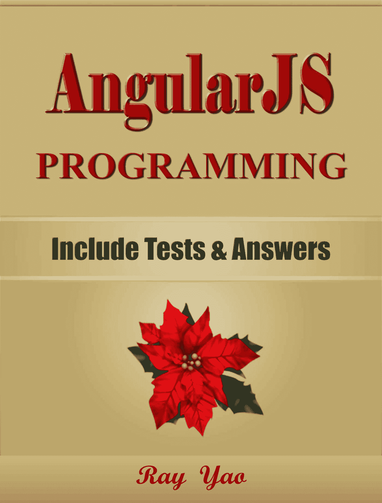

版权所有 © 2015 Ray Yao 所有

保留所有权利

未经作者事先书面许可，本书的任何部分或整体不得以任何形式或通过任何电子、照相或机械手段（包括复印、录制，或通过任何信息存储或检索系统）进行复制或传输。保留所有权利！

## 关于作者

Ray Yao

- 美国 Zend 认证 PHP 工程师
- 美国 Sun 认证 JAVA 程序员
- 美国 Oracle 认证 SCWCD 开发者
- 美国 CompTIA 认证 A+ 专业人士
- 美国 Microsoft 认证 ASP. NET 专家
- 美国 Microsoft 认证 MCP 专业人士
- 美国 Microsoft 认证 TECHNOLOGY 专员
- 美国 CompTIA 认证 NETWORK+ 专业人士

[强烈推荐亚马逊上的计算机类类书籍：](http://www.amazon.com/Ray-Yao/e/B00RG5FG6K/ref=ntt_dp_epwbk_0)

- [Linux 命令行](https://www.amazon.com/Ray-Yao/e/B00RG5FG6K/ref=dp_byline_cont_ebooks_1)
- [JAVA 编程](https://www.amazon.com/Ray-Yao/e/B00RG5FG6K/ref=dp_byline_cont_ebooks_1)
- [PHP 编程](https://www.amazon.com/Ray-Yao/e/B00RG5FG6K/ref=dp_byline_cont_ebooks_1)
- [JavaScript 编程](https://www.amazon.com/Ray-Yao/e/B00RG5FG6K/ref=dp_byline_cont_ebooks_1)
- [C++ 编程](https://www.amazon.com/Ray-Yao/e/B00RG5FG6K/ref=dp_byline_cont_ebooks_1)
- [AngularJS 编程](https://www.amazon.com/Ray-Yao/e/B00RG5FG6K/ref=dp_byline_cont_ebooks_1)
- [JQuery 编程](https://www.amazon.com/Ray-Yao/e/B00RG5FG6K/ref=dp_byline_cont_ebooks_1)
- [Python 编程](https://www.amazon.com/Ray-Yao/e/B00RG5FG6K/ref=dp_byline_cont_ebooks_1)
- [HTML CSS 编程](https://www.amazon.com/Ray-Yao/e/B00RG5FG6K/ref=dp_byline_cont_ebooks_1)
- [C# 编程](https://www.amazon.com/Ray-Yao/e/B00RG5FG6K/ref=dp_byline_cont_ebooks_1)
- [Visual Basic 编程](https://www.amazon.com/Ray-Yao/e/B00RG5FG6K/ref=dp_byline_cont_ebooks_1)
- [JavaScript 50 个实用程序](https://www.amazon.com/Ray-Yao/e/B00RG5FG6K/ref=dp_byline_cont_ebooks_1)

## 前言

“AngularJS 编程”涵盖了所有核心 AngularJS 知识。你可以快速、轻松地学习 AngularJS 的完整基础技能。

本书包含了许多实战项目。你可以通过实战项目学习 AngularJS 编码。

## 源代码下载

本书提供源代码下载；你可以下载源代码以便更好地学习，或者将源代码复制到你喜欢的编辑器中测试程序。源代码下载链接位于本书的最后一页。

从今天开始编码吧！

## 目录

### 第 1 小：AngularJS 简介

- [什么是 AngularJS?]
- [学习 AngularJS 的前提条件]
- [下载 Angular JS]
- [AngularJS 的优势]
- [第一个 AngularJS 脚本]
- [Hello World!]
- `data-ng-app`
- [实战项目]

### 第 2 小：指令 (Directives)

- [AngularJS 指令]
- [App 指令]
- [Model 模型]
- [Bind 指令]
- `ng-model` & `ng-bind`
- [Init 指令]
- [Repeat 指令]
- [Valid 指令]
- [检查邮箱地址]
- [实战项目]

### 第 3 小：过滤器 (Filters)

- [什么是过滤器?]
- [大写过滤器]
- [小写过滤器]
- [排序过滤器]
- [货币过滤器]
- [数组过滤器]
- [实战项目]

### 第 4 小：DOM 中的指令

- [Show 指令]
- [Hide 指令]
- [Disable 指令]
- [Click 指令]
- [If 指令]
- [实战项目]

### 第 5 小：事件 (Events)

- [事件]
- [点击事件]
- [双击事件]
- [鼠标移动事件]
- [鼠标悬停事件]
- [鼠标离开事件]
- [按键释放事件]
- [按按下事件]
- [复制 & 剪切事件]
- [实战项目]

### 第 6 小：表达式 (Expression)

- `{{ Expression }}`
- [字符串表达式]
- [数字表达式]
- [对象表达式]
- [数组表达式]
- [使用表达式]
- [实战项目]

### 第 7 小：控制器与作用域 (Controller & Scope)

- [什么是控制器?]
- [如何定义控制器?]
- [什么是作用域?]
- [MVC 与作用域]
- [模块基础]
- [实战项目]

### 第 8 小：模块与 API

- [什么是 AngularJS 模块?]
- `uppercase()`
- `lowercase()`
- `isString()`
- `isNumber()`
- `isDate()`
- `isFunction()`
- `isElement()`
- `isObject()`
- `isDefined()`
- `isUndefined()`
- [实战项目]

### 附录 1：Ajax 基础

- [什么是 Ajax?]
- [搭建服务器]
- [如何使用 Ajax?]
- [示例 1]
- [示例 2]
- [示例 3]
- [Ajax 图表]

## 附录 2

- AngularJS 测试
- 更多 AngularJS
- Angular Service
- Angular Http
- Angular MySql
- Angular Check
- Angular Validation
- Angular Include

## 附录 3

- AngularJS 测试与答案
- 源代码下载

# 第 1 小时：AngularJS 简介

### 什么是 AngularJS？

AngularJS 是一个 JavaScript 框架。可以使用 HTML 作为模板语言，并扩展 HTML 结构来清晰、简洁地定义应用程序的组件。

AngularJS 的语法如下：

```html
<div ng-app=""></div>
```

我们知道 `div` 是一个 html 标签，但 `ng-app` 是 AngularJS 的指令，它像属性一样用在 `div` 标签中。（稍后我们会讨论指令）

### 学习 AngularJS 的前提条件

在学习 AngularJS 之前，你应该具备 HTML 和 JavaScript 的基础知识，因为 AngularJS 是基于 HTML 和 JavaScript 工作的。你可以在附录 1 或附录 2 中回顾 HTML 和 CSS（注意：本书的附录包含了“HTML、CSS 和 JavaScript 复习”）。

### 下载 AngularJS

下载 AngularJS 并不是难事；你只需要访问 AngularJS 网站 `https://AngularJS.org` 并点击“Download”按钮。下载 AngularJS 文件 `angular.min.js` 后，你可以将其放在 `myFolder/js` 文件夹中（即 html 文件和 JavaScript 文件放在 `myFolder` 文件夹，并将 `angular.min.js` 放在 `myFolder/js` 文件夹），然后在 html 页的 head 部分如所示编写该 `angular.min.js` 文件的路径：

```html
<html>
<head>
<script src="js/angular.min.js"></script>
```

在上面的示例中，你可以看到 AngularJS 的路径 `<script src="js/angular.min.js">`。现在 AngularJS 框架已添加到我们的应用程序中。所以从现在起我们可以使用 AngularJS 框架。

### AngularJS 的优势

- AngularJS 具有与 HTML 绑定数据的能力。
- AngularJS 提供单页应用 (SPA)。
- AngularJS 的 View 完全用 HTML 编写，Controller 用 JavaScript 编写，Model 用 AngularJS 编写。它是一个 MVC 框架。
- 你只需要几行代码就能实现更多功能。
- AngularJS 代码和组件的可重用性。

## 第一个 AngularJS 脚本

### 示例 1.1

打开记事本，编写如下代码（图 1）：

```html
<html>
<script src="js/angular.min.js"></script>
<body>
<div ng-app="">
<p>在输入框中输入我的 id：</p>
<p><input type="text" ng-model="id" </p>
<br>
<h1>Welcome! {{id}}</h1>
</div>
</body>
</html>
```

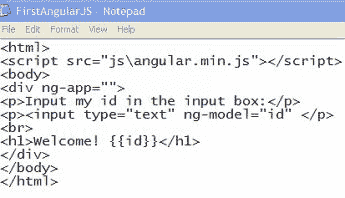

（图 1）

请将文件命名为 `FirstAngularJS.html` 并保存到 `myFolder` 中。注意：确保使用 `.html` 扩展名。双击 `FirstAngularJS.html` 文件，浏览器将运行 `FirstAngularJS.html`，并查看输出（图 2）。假设我输入的 id 为 `168168`。

#### 输出：

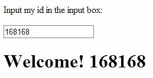

（图 2）

#### 解释：

- `<script src="js/angular.min.js"></script>` 将 AngularJS 框架添加到当前应用程序中。
- `<div ng-app=""></div>` 表示你可以在这里编写 AngularJS 应用程序。
- `ng-model="id"` 将来自 HTML 控件（input, select 和 textarea）的输入数据绑定到应用程序数据 `id`。
- `{{id}}` 与 `ng-model="id"` 中的 `id` 同步。
- `{{id}}` 显示 `id` 的值。

如果你想编辑代码，右键点击文件 `FirstAngularJS.html` > 打开方式 > 记事本。

Hello World!

```html
<html ng-app="">...</html>
```

### 示例 1.2

打开记事本，编写如下代码（图 1）：

```html
<html>
<script src="js/angular.min.js"></script>
<body>
<div ng-app="">
<p>在输入框中输入我的 id：</p>
<p><input type="text" ng-model="id" </p>
<br>
<h1>Welcome! {{id}}</h1>
</div>
</body>
</html>
```

请将文件命名为 `FirstAngularJS.html` 并保存到 `myFolder` 中。注意：确保使用 `.html` 扩展名。双击 `FirstAngularJS.html` 文件，浏览器将运行 `FirstAngularJS.html`，并查看输出（图 2）。假设我输入的 id 为 `168168`。

#### 输出：

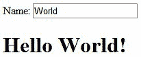

（图 2）

#### 解释：

- `<script src="js/angular.min.js"></script>` 将 AngularJS 框架添加到当前应用程序中。
- `<div ng-app=""></div>` 表示你可以在这里编写 AngularJS 应用程序。
- `ng-model="id"` 将来自 HTML 控件（input, select 和 textarea）的输入数据绑定到应用程序数据 `id`。
- `{{id}}` 与 `ng-model="id"` 中的 `id` 同步。
- `{{id}}` 显示 `id` 的值。

### 示例 1.3

打开记事本，编写如下代码（图 1）：

```html
<html>
<script src="js/angular.min.js"></script>
<body>
<div ng-app="">
<p>在输入框中输入我的 id：</p>
<p><input type="text" ng-model="id" </p>
<br>
<h1>Welcome! {{id}}</h1>
</div>
</body>
</html>
```

## 总结

在本章中，我们学习了 AngularJS 是什么、如何下载 AngularJS 以及 AngularJS 的优势。

AngularJS 允许我们使用属性以非常简单的方式扩展 HTML。这些属性本质上都是指令（directives）。有不同类型的指令，它们在应用程序中可以发挥不同的作用。它们分别是 `App Directive`、`Model Directive`、`Bind Directive`、`Init Directive` 和 `Repeat Directive`。让我们逐一详细讨论。

### App Directive

| `ng-app= " "` |

`app` 指令定义了 AngularJS 应用程序区域。`app` 指令的语法为 `ng-app = " ";`。在这里，`ng` 是 AngularJS 的命名空间，`app` 是 Angular JS 的应用区域。

### 示例 2.1

```html
<!DOCTYPE html>
<html>
<head>
    <title>AngularJS for beginners</title>
    <script src="js\angular.min.js"></script>
</head>
<body>
    <div ng-app=" "> 
        The AngularJSapplication has been started.
    </div>
</body>
</html>
```

#### 输出:

The AngularJSapplication has been started.

#### 解析:

在 `head` 部分（`<script src = "js\angular.min.js"> </script>`），加载了 AngularJS 框架，这意味着我们现在可以使用 AngularJS 框架了。

在 `body` 部分（`<div ng-app=" "> </div>`），可以在这里编写 AngularJS 应用程序。

在最后一个标签（`</div>`），AngularJS 应用程序结束结束。

### Model Directive

| `ng-model = "data"` |

`model` 指令用于将 HTML 控件（输入、复选框和选择等）输入的值绑定到应用程序数据。`ng-model = "data"` 是 `model` 指令的语法。让我们来看一个例子以便更好地理解。

### 示例 2.2

```html
<!DOCTYPE html>
<html>
<head>
    <title>AngularJSfor beginners</title>
    <script src="js\angular.min.js"></script>
</head>
<body>
<div ng-app="">
<p>User Name: <br>
<input type="text" ng-model = "Username"></p>
</div>
</body>
</html>
```

#### 输出:

Username:

#### 解析:

`"ng-model = “Username"` 将来自 HTML 控件的输入值绑定到 `"Username"`。

现在你看不到结果，因为此程序缺少了代码 `<p ng-bind="Username"></p>`。

### Bind Directive

| `<p>ng-bind = "data"</p>` |

`bind` 指令用于将数据值绑定到 html 元素 `<p>`；`bind` 指令的语法是 `<p>ng-bind = "data"</p>`。让我们来看一个例子以便更好地理解。

### 示例 2.3


```html
<!DOCTYPE html>
<html>
<head>
    <title>AngularJSfor beginners</title>
    <script src="js\angular.min.js"></script>
</head>
<body>
<div ng-app="">
<p>User Name: <br>
<input type="text" ng-model = "Username"></p>
<p ng-bind="Username"></p>
</div>
</body>
</html>
```

打开记事本并将上述代码以 `.html` 扩展粘贴，并在输入框中输入用户名“Ray Yao”。

**输出:**

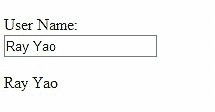

**解析:**

`<p ng-bind="Username"></p>` 将 `"Username"` 的值绑定到 `<p></p>` 标签，并“显示”它的值。

在上面的示例中（`<p ng-bind="Username"></p>`）可以更新 `"Username"` 的值并写入 `<p></p>` 标签。

`<p ng-bind="data"></p>` 用于指定的 html 元素 `<p>` 中“输出”`data` 的值。

## ng-model & ng-bind

它们都使用“bind”（绑定）。

(1) `ng-model = "data"`：将来自 Html 控件（文本区域、复选框、选择、输入和单选按钮等）的输入值绑定到 `"data"`。

**例如:**

`ng-model = "Username"` 将输入值绑定到 `"Username"`。（就像将输入值赋值给 `"Username"`一样。）

(2) `<p>ng-bind= "data"</p>`：将 `"data"` 绑定到 html 元素 `<p></p>`。

**例如:**

`<p ng-bind="Username"></p>` 将数据 `"Username"` 绑定到 `<p></p>` 元素并显示其值。（就像在 `<p></p>` 中显示 `"Username"` 的值一样。）

## Init Directive

| `ng-init = "data = 'value'"` |

`init` 指令用于用值初始化数据。`init` 指令的语法为 `ng-init = "data = 'value'"`。让我们来看一个例子以便更好地理解。

### 示例 2.4

```html
<!DOCTYPE html>
<html>
<head>
    <title>AngularJSfor beginners</title>
    <script src="js\angular.min.js"></script>
</head>
<body>
<div ng-app="" ng-init="Username= 'Andy Smith' ">
    <p>User Name: <input type="text" ng-model = "Username"></p>
    <p ng-bind="Username"></p>
</div>
</body>
</html>
```

打开记事本并将上述代码以 `.html` 扩展粘贴。

**输出:**


**解析:**

`ng-init="Username= 'Andy Smith'"` 为 `"Username"` 初始化一个值。

在上面的示例中，`<div ng-app="" ng-init="Username= 'Andy Smith' ">`，AngularJS 应用程序结束。

## Repeat Directive

| `ng-repeat = "item in array"` |

`repeat` 指令的作用像循环一样。`repeat` 指令通过重复来获取数组的值。

### 示例 2.5

```html
<!DOCTYPE html>
<html>
<head>
    <title>AngularJSfor beginners</title>
    <script src="js\angular.min.js"></script>
</head>
<body>
<div ng-app="">
<ul>
    <li ng-repeat="x in ['Red', 'Green', 'Blue']">{{x}}</li>
</ul>
</div>
</body>
</html>
```

（注：根据提供的文本结构，repeat 指令的示例是片段化的；此处重构的逻辑遵循标准的指令逻辑）

在 `body` 部分（`<div ng-app=" "> </div>`），可以在这里编写 AngularJS 应用程序。

在最后一个标签（`</div>`），AngularJS 应用程序结束。

## Valid Directive

| `ng-valid` |

`valid` 指令可以在输入有效时更改指定元素的状态。

### 示例 2.6

```html
<!DOCTYPE html>
<html>
<head>
    <title>AngularJS for beginners</title>
    <script src="js\angular.min.js"></script>
    <style>
    input.ng-valid {
        background-color: yellow;
    }
    </style>
</head>
<body>
<form>
Please enter number:
<input type="text" ng-model="psw" required>
</form>
</body>
</html>
```

**输出:**


**解析:**

`input.ng-valid` 在输入有效时更改背景颜色。

## Check Email Address

| `$error.email` |

`$error.email` 用于检查电子邮件地址的有效性；如果输入了错误的邮箱格式，则返回错误消息。

### 示例 2.7

```html
<!DOCTYPE html>
<html ng-app="">
<head>
    <title>AngularJS for beginners</title>
    <script src="js\angular.min.js"></script>
</head>
<body>
<form name="iForm">
Please input your email address: <br><br>
<input type="email" name="eMailAddr" ng-model="text"> <br><br>
<div ng-show="iForm.eMailAddr.$error.email"> Invalid email address!</div>
</form>
</body>
</html>
```

**输出:**


**解析:**

当你输入格式错误的电子邮件地址时，你将看到一个提示：Invalid email address!

```html
<script src="js\angular.min.js"></script>
<body>
<div data-ng-app="" data-ng-init="colors=['Red','Yellow','Green','White','Black']">
  <p>Show colors:</p>
  <ol type="1">
    <li data-ng-repeat="show in colors">
      {{ show }}
    </li>
  </ol>
</div>
</body>
</html>
```

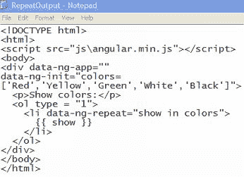

（图 1）

请将文件命名为 `RepeatOutput.html` 并保存到 `myFolder` 中。注意：确保使用 `.html` 扩展名。

双击 `RepeatOutput.html` 文件，浏览器将运行 `RepeatOutput.html` 并即可输出结果。（图 2）

输出：（图 2）

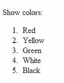

## 解释：

- `data-ng-app` 与 `ng-app` 几乎相同，但 `data-ng-app` 更适用于 HTML5。

- `<div data-ng-app="" > </div>` 表示你可以在这里编写 AngularJS 应用程序。

- `data-ng-init` 与 `ng-init` 几乎相同，但 `data-ng-init` 更适用于 HTML5。

- `data-ng-init="colors=…"` 初始化带有某些取值的数组 `colors`。

- `data-ng-repeat ="show in colors"` 重复获取数组 `colors` 的值，并将所有数组值赋值给变量 `show`。

- `{{ show }}` 显示 `show` 的值。

# 第 3 小时

## 过滤器 (Filters)

### 什么是过滤器？

过滤器用于格式化数据的值。管道符号 (`|`) 表示使用了过滤器。过滤器的正确语法如下所示：

| Value | filter |

让我们逐个理解过滤器。

### 大写过滤器 (Uppercase filter)

| Value | uppercase |

uppercase 过滤器将文本转换为大写。假设用户写了小写文本（例如 `ray`）、标题大小写文本（例如 `Ray`）或混合大小写（例如 `rAy` 或 `RaY` 或 `rAY` 等），而你想要大写形式的结果，那么你就必须使用大写过滤器。

### 示例 3.1

```html
<!DOCTYPE html>
<html>
<head>
    <title>AngularJSfor beginners</title>
<script src="js\angular.min.js"></script>
<meta http-equiv="Content-Type" content="text/html; charset=UTF-8" />
</head>
<body>
<h3>Using Upper Case Filter</h3>
<div ng-app="" ng-init="Username= 'ray' ">
<p>User Name: <input type="text" ng-model ="Username"></p>
<p style="color:red" ng-bind="Username | uppercase"></p>
</div>
</body>
</html>
```

输出：

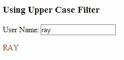

解释：

- `Username | uppercase` 将 `Username` 的值转换为大写。

- 在上面的示例中，我设置了小写的默认值（`ray`），但结果变成了大写（`RAY`）。

### 小写过滤器 (Lowercase filter)

| Value | lowercase |

lowercase 过滤器将文本转换为小写。假设用户写了大写文本（例如 `RAY YAO`）、标题大小写文本（例如 `Ray Yao`）或混合大小写（例如 `rAy` 或 `RaY` 或 `rAY` 等），而你想要小写形式的结果，那么你就必须使用小写过滤器。

### 示例 3.2

```html
<html>
<head>
    <title>AngularJSfor beginners</title>
    <script src="js\angular.min.js"></script>
</head>
<body>
<h3>Using Lower Case Filter</h3>
<div ng-app="" ng-init="Username= 'Ray YAO' ">
<p>User Name: <input type="text" ng-model="Username"></p>
<p style="color:red" ng-bind="Username | lowercase"></p>
</div>
</body>
</html>
```

打开记事本并并将上述代码以 `.html` 扩展名粘贴。

输出：

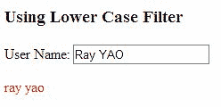

解释：

- `Username | lowercase`: 将 `Username` 的值转换为小写。

- 在上面的示例中，当我输入大写的文本（`Ray YAO`）时，结果变成了小写（`ray yao`）。

### 排序过滤器 (OrderBy filter)

OrderBy 过滤器用于按升序或降序显示值。`orderBy` 的语法如下：

| Value | orderBy: 'value' // 用于升序 | Value | orderBy: '-value' // 用于降序 |

让我们来看一个例子以更好地理解。

### 示例 3.3

```html
<!DOCTYPE html>
<html>
<head>
    <title>AngularJSfor beginners</title>
    <script src="js\angular.min.js"></script>
</head>
<body>
<h1>Using OrderBy filter</h1>
<div ng-app="" ng-init="StudentsResult=[{name: 'Tienq', marks:81},    {name: 'Svbrf', marks:70}, {name: 'Yaito', marks:90}, {name: 'Pewfn', marks:63}, {name: 'Riet', marks:98}]">
<table border="1" >
<tr>
<th>Student Name</th>
<th>Mathematics Result</th>
</tr>
<tr ng-repeat="x in StudentsResult | orderBy:'-marks' ">
<td ng-bind="x.name"></td>
<td ng-bind="x.marks"></td>
</tr>
</table>
</div>
</body>
</html>
```

输出：

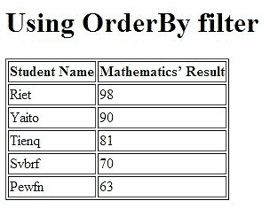

解释：

- `StudentsResult | orderBy:'-marks'` 按降序显示 `StudentsResult` 的值。

- 你可以看到使用 `orderBy:'-marks'` 时，最高分在最顶端。

- 如果你想反转顺序，可以去掉 `-`。

### 示例 3.4

```html
<!DOCTYPE html>
<html>
<head>
    <title>AngularJSfor beginners</title>
    <script src="js\angular.min.js"></script>
</head>
<body>
<h1>Using OrderBy filter</h1>
<div ng-app="" ng-init="StudentsResult=[{name: 'Tienq', marks:81},    {name: 'Svbrf', marks:70}, {name: 'Yaito', marks:90}, {name: 'Pewfn', marks:63}, {name: 'Riet', marks:98}]">
<table border="1" >
<tr>
<th>Student Name</th>
<th>Mathematics Result</th>
</tr>
<tr ng-repeat="x in StudentsResult | orderBy:'marks' ">
<td ng-bind="x.name"></td>
<td ng-bind="x.marks"></td>
</tr>
</table>
</div>
</body>
</html>
```

输出：

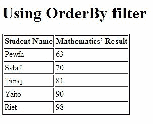

解释：

- `StudentsResult | orderBy: 'marks'` 按升序显示 `StudentsResult` 的值。

### 货币过滤器 (Currency filter)

| Value | currency |

currency 过滤器过滤器用于货币格式显示结果。

### 示例 3.5

```html
<!DOCTYPE html>
<html>
<head>
    <title>AngularJSfor beginners</title>
<script src="js\angular.min.js"></script>
<meta http-equiv="Content-Type" content="text/html; charset=UTF-8" />
</head>
<body>
<h1>Using Currency filter</h1>
<div ng-app="" ng-init="Employees_Monthly_Salary=[{name: 'Jay', salary:8100}, {name: 'Sdwt', salary:7000}, {name: 'Hao', salary:9000}, {name: 'Luoe', salary:6300}, {name: 'Fin', salary:9800}]">
<table border="1" >
<tr>
<th>Employee Name</th>
<th>Employee Salary</th>
</tr>
<tr ng-repeat="x in Employees_Monthly_Salary ">
<td ng-bind="x.name"></td>
<td ng-bind="x.salary | currency "></td>
</tr>
</table>
</div>
</body>
</html>
```


打开记事本并将上述代码以`.html`扩展名粘贴。

输出：

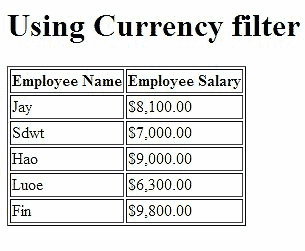

解释：

- `x.salary | currency`将工资转换为货币格式。

- 在上面的示例中，表格中有列，第一列是员工姓名，第二列是员工工资。工资列以货币格式显示工资。

### 数组过滤器 (Array filter)

| Array | filter:input |

`Array | filter:input`可以根据用户输入过滤数组元素。

### 示例 3.6

```html
<!DOCTYPE html>
<html ng-app="">
<head>
<script src="js\angular.min.js"></script>
<meta charset="utf-8">
</head>
<body>
<div ng-init="students = // 定义数组“students”
[{name:'Andy', age:'19'},
{name:'Rose', age:'18'},
{name:'Jony', age:'17'},
{name:'Judy', age:'16'},
{name:'Tomy', age:'15'},
{name:'Lily', age:'14'}]">
</div>
<table>
  <tr><th>Name</th><th>Age</th></tr>
  <tr ng-repeat="person in students | filter:myList">
    // 根据输入值过滤数组“students”
    <td>{{person.name}}</td>
    <td>{{person.age}}</td>
  </tr>
</table>
<br><br>
<label>Please input one of the above name or age 以上姓名或年龄之一
<br><br>
<input ng-model="myList"></label> // 用户输入
</body>
</html>
```

请尝试在文本框输入数字 18。

输出：

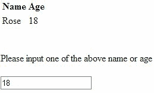

解释：

- `<div ng-init="students =…."`定义了数组`students`。

- `person in students | filter:myList`根据输入值`myList`过滤数组`students`。

- `<input ng-model="myList">`接收用户输入并将输入值存储到`myList`。

- 当你向文本框输入 18 时，输出显示`Rose 18`。

在本章中，我们学习了什么是过滤器。以及不同类型的过滤器，如大写过滤器、小写过滤器、排序过滤器和货币过滤器。我已尝试通过适当的示例、输出和解释来介绍本章的每一个主题。

- `Value | uppercase`将值转换为大写。

- `Value | lowercase`将值转换为小写。

- `Value | orderBy: ’value’`按升序顺序显示值。

- `Value | orderBy: ’-value’`按降序顺序显示值。

- `Value | currency`将值转换为货币格式。

- `Array | filter:input`可以根据用户输入对数组元素进行过滤。

## 动手实践项目

### 大写过滤器 (Uppercase Filter)

打开记事本，编写以下 AngularJS 代码：

```html
<!DOCTYPE html>
<script src="js\angular.min.js"></script>
<body>
<h4>Uppercase Filter</h4>
<div ng-app="">
<p>Book Name: </p>
<p><input type="text" ng-model = "Book"></p>
<h3><p ng-bind="Book|uppercase"></p></h3>
</div>
</body>
</html>
```

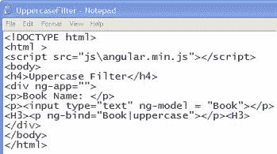

请将该文件命名为`UppercaseFilter.html`并保存到`myFolder`中。注意：确保使用`.html`扩展名。

双击`UppercaseFilter.html`文件，浏览器将运行该文件，在文本框中输入书名“JavaScript in 8 Hours”，并查看输出结果。

输出： 

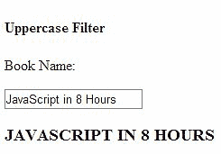

#### 解释：

`<p ng-bind="Book|uppercase"></p>`将`Book`的值转换为大写。

# 第 4 小时

## DOM 中的指令 (Directive in DOM)

### Show 指令 (Show Directive)

| `<p ng-show="true"> visible.</p><p ng-show="false">invisible.</p>` | |

Show 指令用于显示或隐藏 HTML 中`<p>`元素中的文本。

如果`ng-show`为 true，将显示文本“visible”。

如果`ng-show`为 false，则将隐藏文本“invisible”。

### 示例 4.1

```html
<!DOCTYPE html>
<html>
<head>
    <title>AngularJS for beginners</title>
    <script src="js/angular.min.js"></script>
</head>
<body>
<h3>Using Show directive</h3>
<div ng-app="" >
<input type="checkbox" ng-model="showHideDiv">Show Div
<div ng-show="showHideDiv" style="background-color:yellow;height:50px;">
<p>I am a div</p>
<p>I appear when the check box is checked.</p>
</div>
</div>
</body>
</html>
```

输出：

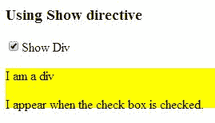

#### 解释：

`ng-model="showHideDiv"`将复选框的值与`showHideDiv`绑定。

`ng-show="showHideDiv"`当`showHideDiv`的值为 true 时显示文本。

在上面的示例中，起初初次加载页面时，div（页面的黄色区域）是不显示的，但当我勾选复选框（show Div）时，`showHideDiv`的值为 true；div（页面的黄色区域）就会出现。

### Hide 指令 (Hide Directive)

| `<p ng-hide="true"> invisible.</p><p ng-hide="false">visible.</p>` | |

Hide 指令用于隐藏或显示 HTML 中`<p>`元素中的文本。

如果`ng-hide`为 true，则将隐藏文本“invisible”。

如果`ng-hide`为 false，将显示文本“visible”。

### 示例 4.2

```html
<!DOCTYPE html>
<html>
<head>
    <title>AngularJSfor beginners</title>
<script src="js\angular.min.js"></script>
<meta http-equiv="Content-Type" content="text/html; charset=UTF-8" />
</head>
<body>
<h3>Using Hide directive</h3>
<div ng-app="" >
<input type="checkbox" ng-model="HideShowDiv">Hide Div
<div ng-hide="HideShowDiv" style="background-color:pink;height:50px;">
<p>I am a div</p>
<p>I will disappeared when the check box is checked.</p>
</div>
</div>
</body>
</html>
```

打开记事本并粘贴上述带有`.html`扩展名的代码。

输出：

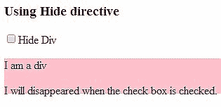

请勾选复选框并查看结果。

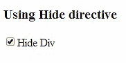

#### 解释：

`ng-model="showHideDiv"`将复选框的值与`showHideDiv`绑定。

`ng-hide="showHideDiv"`当`showHideDiv`的值为 true 时隐藏文本。

在上面的示例中，页面初次加载时，div（页面的粉色区域）是显示的。

但当我点击复选框（Hide Div）时，`showHideDiv`的值为 true；div（页面的粉色区域）消失了。（注：保留了原始文本变量名）。

### Disable 指令 (Disable Directive)

| `<input type="button" ng-disabled=true value="myButton">` | |

Disable 指令用于禁用或启用 HTML 元素。

如果`ng-disabled`为 true，元素将是禁用的。

### 示例 4.3

```html
<!DOCTYPE html>
<html>
<head>
    <title>AngularJS for beginners</title>
    <script src="js/angular.min.js"></script>
</head>
<body>
<h3>Using Disable directive</h3>
<div ng-app="" >
<input type="checkbox" ng-model="showHideDiv">Show Div
<div ng-disabled="showHideDiv" style="background-color:yellow;height:50px;">
<p>I am a div</p>
<p>I appear when the check box is checked.</p>
</div>
</div>
</body>
</html>
```

输出：

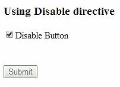

#### 解释：

`ng-model="showHideDiv"`将复选框的值与`showHideDiv`绑定。

`ng-disabled="showHideDiv"`当`showHideDiv`的值为 true 时禁用元素。

在上面的示例中，页面初次加载时，div（页面的黄色区域）是禁用的。

### Click 指令 (Click Directive)

| `ng-click="expression"` | |

Click 指令用于定义点击事件。

### 示例 4.4

```html
<!DOCTYPE html>
<html>
<head>
    <title>AngularJS for beginners</title>
    <script src="js/angular.min.js"></script>
</head>
<body>
<h3>Using Click directive</h3>
<div ng-app="" ng-init="result=0">
<button ng-click="result=result+100">Click Here!</button>
<H1><p ng-bind="result"></p></H1>
</div>
</body>
</html>
```

输出：

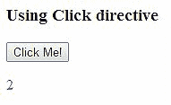

#### 解释：

`ng-click="result+100"`点击按钮时更新值。

### If 指令 (If Directive)

| `ng-if="condition"` | |

If 指令用于在 DOM 中添加或移除元素。

如果`ng-if`为 true，元素将添加到 DOM 中。

如果`ng-if`为 false，元素将被移除。

### 示例 4.5

```html
<!DOCTYPE html>
<html>
<head>
    <title>AngularJS for beginners</title>
    <script src="js/angular.min.js"></script>
</head>
<body ng-app="" align="center">
<input type="checkbox" ng-model="result" >
<div ng-if="result"> 
<p>When you check the box, the will be shown.<br>
When you uncheck the box, the will be hidden.</p>
</div>
</body>
</html>
```

输出：

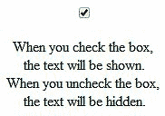

#### 解释：

`ng-if="result"` `result`的真值。

## 总结

- `ng-show="showHideDiv"`当`showHideDiv`的值为 true 时显示文本。

- `ng-hide="showHideDiv"`当`showHideDiv`的值为 true 时隐藏文本。

- `ng-disabled="DisableEnable"`当`DisableEnable`为 true 时禁用 HTML 元素。

- `ng-click="expression or function( )"`点击按钮时更新表达式或运行函数( )。

- `ng-if 指令`用于在 DOM 中添加或移除元素。

## 动手实践项目

### 点击事件 (Click Event)

打开记事本，编写以下 AngularJS 代码：

```html
<!DOCTYPE html>
<html>
<head>
<script src="js\angular.min.js"></script>
</head>
<body>
<br><br>Click Directive<br><br>
<div ng-app="" ng-init="result=0">
<button ng-click="result=result+100">Click Here!</button>
<H1><p ng-bind="result"></p></H1>
</div>
</body>
</html>
```

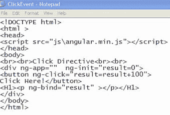

双击`ClickEvent.html`文件，浏览器将运行`ClickEvent.html`，点击按钮“Click Here!”并查看输出。

输出：

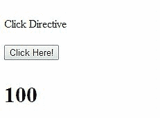

## 解析：

`ng-click="result=result+100"`在点击按钮时计算该表达式。

# 第 5 小

## 事件

## 事件

事件与不同的 HTML 元素关联。例如，点击事件与按钮元素关联；同样，按键事件与文本框或文本区域元素关联。AngularJS 提供了多个与 HTML 控制关联的事件。

### 点击事件 (Click event)

| ng-click = “expression” |

`ng-click = “expression"`定义了一个点击事件。当按钮被点击时，会发生事件并计算该表达式。点击事件通常作用于按钮。

### 示例 5.1

```html
<!DOCTYPE html>
<html>
<head>
<title>AngularJS for beginners</title>
<script src="js\angular.min.js"></script>
</head>
<body>
<h3>使用点击事件两个数字相加</h3>
<div ng-app="" ng-init="firstNumber=47; secondNumber=23">
<p>第一个数字： <input type="number" ng-model ="firstNumber"></p>
<p>第二个数字： <input type="number" ng-model ="secondNumber"></p>
<button ng-click="Result=firstNumber + secondNumber"> Add Numbers </button>
<p>结果:<p style="font-weight:bold; color:blue" ng-bind ="Result"> </p></p>
</div>
</body>
</html>
```

打开记事本并粘贴上述代码，保存为`.html`扩展名。

输出：

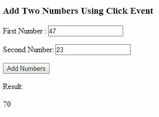

解析：

`<button ng-click="Result=firstNumber + secondNumber"> Add Numbers </button>`：当按钮被点击时，会发生事件。`firstNumber`加上`secondNumber`，并将结果赋值给`Result`。

在上面的示例中，页面首次加载时，第一个文本框显示数字 47，第二个文本框显示数字 23，但没有结果。（注意：这些数字是在`ng-init`指令中初始化的，但你可以在两个文本框中输入自己的数字）。当我点击按钮（Add Numbers）时，Result 区域显示的结果为 70。

### 双击事件 (Double Click event)

| ng-dblclick = “expression” |

`ng-dblclick = “expression"`定义了一个双击事件。当按钮被双击时，会发生事件并计算该表达式。

双击事件通常作用于按钮。

### 示例 5.2


```html
<!DOCTYPE html>
<html>
<head>
<title>AngularJS for beginners</title>
<script src="js/angular.min.js"></script>
</head>
<body>
<h4>使用双击事件两个数字相加</h4>
<div ng-app="" ng-init="firstNumber=26;SecondNumber=89">
<p>第一个数字: &nbsp;&nbsp;&nbsp; <input type="number" ng-model="firstNumber"></p>
<p>第二个数字: <input type="number" ng-model="SecondNumber"></p>
<button ng-dblclick="Result=firstNumber + SecondNumber">Double Click</button>
<p>结果:<p style="font-weight:bold;color:blue" ng-bind="Result"> </p>
</div>
</body>
</html>
```

打开记事本并粘贴上述代码，保存为`.html`扩展名。

输出：

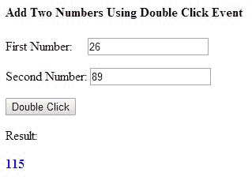

解析：

`<button ng-dblclick="Result=firstNumber + secondNumber"> Add Numbers </button>`：当按钮被双击时，会发生事件。`firstNumber`加上`secondNumber`，并将结果赋值给`Result`。

在上面的示例中，页面首次加载时，第一个文本框显示数字 26，第二个文本框显示数字 89，但没有结果。当我双击按钮（Add Numbers）时，Result 区域显示的结果为 115。

### 鼠标移动事件（Mouse Move event）

| `ng-mousemove = "expression"` |
| --- |

`ng-mousemove = "expression"`定义了一个鼠标移动事件。当鼠标移动时，会发生事件并计算该表达式。

鼠标移动事件通常作用于`div`、`body`以及特定区域或元素。

### 示例 5.3

```html
<!doctype html>
<html>
<head>
<script src="js\angular.min.js"></script>
</head>
<body ng-app="">
<br><br>
<textarea ng-mousemove="count = count + 1" ng-init="count=0">
Here is a textarea
</textarea>
<br><br>
<h2>count: {{count}}</h2>
</body>
</html>
```

（假设你在`textarea`上移动了 20 次鼠标。）

输出：

| Here is a textarea. |
| --- |

`count: 20`

解析：

`ng-mousemove="count = count + 1"`：当鼠标在`textarea`上移动时，`count`增加 1。

`ng-init="count=0"`将`count`的值初始化为 0。

`{{count}}`显示`count`的值。

`count : 20`表示鼠标移动了 20 次。

### 鼠标悬停事件（Mouse Over event）

| `ng-mouseover = "expression"` |
| --- |

`ng-mouseover = "expression"`定义了一个鼠标悬停事件。当鼠标悬停时，会发生事件并计算该表达式。

鼠标悬停事件通常作用于`div`、`body`以及特定区域或元素。

### 示例 5.4

```html
<!doctype html>
<html>
<head>
<script src="js\angular.min.js"></script>
</head>
<body ng-app="">
<br><br>
<textarea ng-mouseover="count = count + 1" ng-init="count=0">
Here is a textarea
</textarea>
<br><br>
<h2>count: {{count}}</h2>
</body>
</html>
```

（假设鼠标在`textarea`上上悬停了 20 次。）

输出：

| Here is a textarea. |
| --- |

`count: 20`

解析：

`ng-mouseover="count = count + 1"`：当鼠标悬停在`textarea`上时，`count`增加 1。

`ng-init="count=0"`将`count`的值初始化为 0。

`{{count}}`显示`count`的值。

`count : 20`表示鼠标悬停了 20 次。

### 鼠标离开事件（Mouse Leave event）

| `ng-mouseleave = "expression"` |
| --- |

`ng-mouseleave = "expression"`定义了一个鼠标离开事件。当鼠标离开时，会发生事件并计算该表达式。

鼠标离开事件通常作用于`div`、`body`以及特定区域或元素。

### 示例 5.5

```html
<!doctype html>
<html>
<head>
<script src="js\angular.min.js"></script>
</head>
<body ng-app="">
<br><br>
<textarea ng-mousemove="count = count + 1" ng-init="count=0">
Here is a textarea
</textarea>
<br><br>
<h2>count: {{count}}</h2>
</body>
</html>
```

（假设鼠标离开`textarea`区域了 10 次。）

输出：

| Here is a textarea. |
| --- |

`count: 10`

解析：

`ng-mousemove="count = count + 1"`：当鼠标在`textarea`上移动时，`count`增加 1。

`ng-init="count=0"`将`count`的值初始化为 0。

`{{count}}`显示`count`的值。

`count : 10`表示鼠标移动了 10 次。

### 按键释放事件（Key Up event）

| `ng-keyup = "expression"` |
| --- |

`ng-keyup = "expression"`定义了一个按键释放事件。当按键释放时，会发生事件并计算该表达式。

按键释放事件通常作用于文本框和文本区域。

### 示例 5.6

```html
<!doctype html>
<html>
<head>
<script src="js\angular.min.js"></script>
</head>
<body ng-app="">
<br><br>
<textarea ng-keyup="count = count + 1" ng-init="count=0">
Here is a textarea
</textarea>
<br><br>
<h2>count: {{count}}</h2>
</body>
</html>
```

（假设你在`textarea`中输入了 12345678。）

输出：

| Here is a textarea.12345678 |
| --- |

`count: 8`

解析：

`ng-keyup="count = count + 1"`：当按键在`textarea`上释放时，`count`增加 1。

`ng-init="count=0"`将`count`的值初始化为 0。

`{{count}}`显示`count`的值。

`count : 8`表示按键释放了 8 次。

### 按键按下事件（Key Down event）

| `ng-keydown = "expression"` |
| --- |

`ng-keydown = "expression"`定义了一个按键按下事件。当按键按下时，会发生事件并计算该表达式。

按键按下事件通常作用于文本框和文本区域。

### 示例 5.7

```html
<!doctype html>
<html>
<head>
<script src="js\angular.min.js"></script>
</head>
<body ng-app="">
<br><br>
<textarea ng-keydown="count = count + 1" ng-init="count=0">
Here is a textarea
</textarea>
<br><br>
<h2>count: {{count}}</h2>
</body>
</html>
```

（假设你在`textarea`中输入了 123456。）

输出：

| Here is a textarea.123456 |
| --- |

`count: 6`

解析：

`ng-keydown="count = count + 1"`：当按键在`textarea`上按下时，`count`增加 1。

`ng-init="count=0"`将`count`的值初始化为 0。

`{{count}}`显示`count`的值。

`count : 6`表示按键按下了 6 次。

### 复制与剪切事件（Copy & Cut event）

| `ng-copy="result1=true"` `ng-cut="result2=true"` |
| --- |

当复制指定的文本时，结果`1`将为`true`。

当剪切指定的文本时，结果`2`将为`true`。

### 示例 5.8

```html
<!doctype html>
<html ng-app>
<head>
<script src="js\angular.min.js"></script>
<meta charset="utf-8">
</head>
<<body>
<br>
<input ng-copy="result1=true" ng-init="result1=false; value1='please copy me'" ng-model="value1">
copy status: {{result1}}</br><br>
<input ng-cut="result2=true" ng-init="result2=false; value2='please cut me'" ng-model="value2">
cut status: {{result2}}
</body>
</</html>
```

### 输出

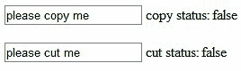

### 解释

`ng-copy="result1=true"`：当复制指定的文本时，结果`1`将为`true`。

`ng-cut="result2=true"`：当剪切指定的文本时，结果`2`将为`true`。

`{{result1}}`将显示`true`或`false`。

`{{result2}}`将显示`true`或`false`。

## 总结

在本章中，我们学习了不同的事件，如点击事件、双击事件、鼠标移动事件、鼠标移入事件、鼠标离开事件、键盘释放事件和键盘按下事件。

`ng-click`定义了一个 AngularJS 点击事件。

`ng-dblclick`定义了一个 AngularJS 双击事件。

`ng-mousemove`定义了一个 AngularJS 鼠标移动事件。

`ng-mouseover`定义了一个 AngularJS 鼠标移入事件。

`ng-mouseleave`定义了一个 AngularJS 鼠标离开事件。

`ng-keyup`定义了一个 AngularJS 键盘释放事件。

`ng-keydown`定义了一个 AngularJS 键盘按下事件。

`ng-copy="result1=true"`：当复制指定的文本时，结果`1`将为`true`。

`ng-cut="result2=true"`：当剪切指定的文本时，结果`2`将为`true`。

## 动手项目

### 鼠标移入事件

打开记事本，编写 AngularJS 代码：

```html
<!doctype html>
<html <script src="js\angular.min.js"></script>
<body ng-app="">
<br><br>
<textarea ng-mouseover="count = count + 1" ng-init="count=0">
鼠标悬停在这里。
</textarea>
<br><br>
<h2>count: {{count}}</h2>
</body>
</html>
```

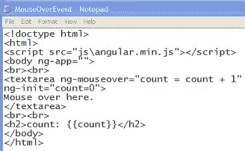

请将文件命名为`MouseOverEvent.html`并保存到`myFolder`中，运行`MouseOverEvent.html`文件，将鼠标悬停在`textarea`上 8 次，然后查看输出。

### 输出

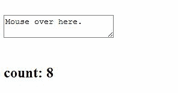

### 解释

`ng-mouseover="count = count + 1"`在鼠标移动到文本区域上方时求值表达式。

# 第 6 小时

## 表达式

`{{ Expression }}`

`{{Expression}}`用于将值绑定到 HTML 元素并显示该值。它的作用与`ng-bind`指令相同。`{{Expression}}`写在两个大括号内。`{{expression}}`基本上是纯 JavaScript 表达式。有不同种的表达式，让我们逐一讨论。

### 字符串表达式

我们知道字符串是字符的集合。在 AngularJS 中，字符串表达式如下。

| `<element> {{First String + Second String}} </element>` |
| --- |

### 示例 6.1

```html
<!DOCTYPE html>
<html>
<head>
    <title>AngularJS 初学者教程</title>
    <script src="js/angular.min.js"></script>
</head>
<body>
<h4>使用字符串表达式组合两个字符串</h4>
<div ng-app="">
第一个字符串 &nbsp;&nbsp;&nbsp;: <input type="text" ng-model="firstString"/><br><br>
第二个字符串: <input ng-model="secondString"/><br><br>
结果字符串:<p style="color:blue;font-weight:bold;">{{firstString +" "+secondString}}</p>
</div>
</body>
</html>
```

输出：

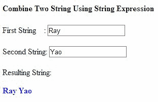

### 解释

`{{firstString +" "+secondString}}`将两个字符串连接在一起。

`{{ expression}}`显示表达式的值。

在上面的示例中，第一个文本框中写了`Ray`，第二个文本框中写了`Yao`，但在结果字符串区域由于使用了字符串表达式`{{ }}`，`Ray`字符串和`Yao`字符串被组合在了一起。注意：加号`+`用于字符串拼接。

### 数字表达式

在 AngularJS 中，你可以使用数字表达式执行不同的数学运算。

| `<element> {{First Number + Second Number}} </element>` |
| --- |

### 示例 6.2

```html
<!DOCTYPE html>
<html>
<head>
    <title>AngularJS 初学者教程</title>
    <script src="js/angular.min.js"></script>
</head>
<body>
<h4>使用数字表达式相乘两个数字</h4>
<div ng-app="" ng-init="firstNumber=9;secondNumber=6">
第一个数字 &nbsp;&nbsp;&nbsp;: <input type="text" ng-model="firstNumber"/><br><br>
第二个数字: <input ng-model="secondNumber"/><br><br>
结果字符串:<p style="color:blue;font-weight:bold;">{{firstNumber * secondNumber}}</p>
</div>
</body>
</html>
```

输出：

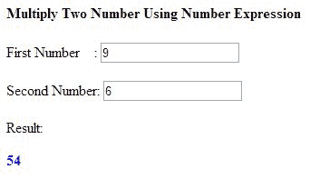

### 解释

`{{firstNumber * secondNumber}}`将`firstNumber`和`secondNumber`相乘。

`{{ expression}}`显示表达式的值。

在上面的示例中，第一个文本框中写了`9`，第二个文本框中写了`6`，但在结果字符串区域由于使用了数字表达式`{{ }}`。

### 对象表达式

AngularJS 字符串表达式如下。（这里应该是对象表达式）

对象表达式如下：

### 示例 6.3


```html
<!DOCTYPE html>
<html>
<head>
    <title>AngularJS 初学者教程</title>
    <script src="js/angular.min.js"></script>
</head>
<body>
<h4>对象表达式</h4>
<div ng-app="" ng-init="user={name:'John', age:20}">
姓名: <input ng-model="user.name"><br><br><br>
年龄: <input ng-model="user.age"><br><br><br>
结果: {{user.name}} 今年 {{user.age}} 岁。
</div>
</body>
</html>
```

输出：

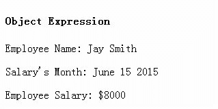

### 解释

`{{user.name}}` 显示对象的属性。

`{{user.age}}` 显示对象的属性。

### 数组表达式

AngularJS 类似于数组。语法如下：

| `<element> {{val1, val2, val3}} </element>` |

### 示例 6.4

```html
<!DOCTYPE html>
<html>
<head>
    <title>AngularJS 初学者教程</title>
    <script src="js/angular.min.js"></script>
</head>
<body>
<h4>数组表达式</h4>
<div ng-app="" ng-init="colors=['Red','Green','Blue']">
第一种颜色: {{colors[0]}}<br>
第二种颜色: {{colors[1]}}<br>
第三种颜色: {{colors[2]}}
</div>
</body>
</html>
```

输出：

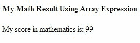

### 解释

`{{colors[0]}}` 显示数组的第一个元素。

`{{colors[1]}}` 显示数组的第二个元素。

`{{colors[2]}}` 显示数组的第三个元素。

请将文件保存为 `ExpressionSample.html` 并位于 `myFolder`。双击 `ExpressionSample.html` 文件，查看输出。

输出：

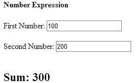

## 解析

`{{firstNumber + secondNumber}}` 显示 `firstNumber` 和 `secondNumber` 的和。

# 第 7 小

## Controller & Scope

### 什么是 Controller？

Controller 基本上是一个控制应用程序数据流的 JavaScript 对象。因此，AngularJS 是由 `Controller` 控制的。

### 如何定义 Controller？

使用 `ng-controller` 指令来定义 `Controller`。我们知道 `Controller` 是包含 JavaScript 函数和属性的 JavaScript 对象。`Controller` 的语法如下：

| `<div ng-app="" ng-controller="controllerName">` |

### 示例 7.1

```html
<html>
<script src="js\angular.min.js"></script>
<body>
<div ng-app="Calculation" ng-controller="myController">
First Number: <input type="number" ng-model="firstNumber"><br>
Second Number: <input type="number" ng-model="secondNumber"><br>
<br>
Sum: {{firstNumber + secondNumber}}
</div>
<script>
var app = angular.module('Calculation', [ ]);
app.controller('myController', function($scope) {
    $scope.firstNumber = 4;
    $scope.secondNumber = 8;
});
</script>
</body>
</html>
```

输出：

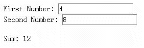

### 解析

- `ng-controller="myController"` 定义了一个控制器。

- `app = angular.module()` 创建了一个新模块。

- `app.controller()` 将控制器的构造函数添加到模块中。

- `function($scope)` 定义了一个构造函数，同时也定义了一个对象 `$scope`。当页面加载时，该函数将运行。

- `$scope.property = value` 将值赋值给 `$scope` 对象的属性。

在上面的示例中，在当页面第一次加载时，你会看到两个文本框显示不同的数字，分别是 4 和 8；结果区域显示结果为 12。

`angular.module()`：AngularJS 模块是应用程序各个部分的集合，例如控制器、服务、过滤器、指令等。一个 AngularJS 模块定义了一个应用程序，我们将在后面的章节中详细讨论。

### 什么是 Scope？

Scope 是一个包含模型数据的 JavaScript 对象。

| `function ($scope) { }` |

`$scope` 是 JavaScript 函数的参数，由控制器调用。让我们通过一个例子来理解。

### 示例 7.2

```javascript
<script>
function ($scope) {
    $scope.firstNumber = 23;
    $scope.secondNumber = 63;
}
</script>
```

### 解析

在上面的示例中，`$scope` 是函数 `function ($scope) { }` 的参数。`$scope` 是 AngularJS 中的一个对象。

`$scope.firstNumber` 和 `$scope.secondNumber` 是 HTML 中使用的模型。模型数据通过 `$scope` 对象访问。我们使用以下公式给模型赋值：`$scope.property = value`。

### 例如：

```javascript
$scope.firstNumber = 23;
$scope.secondNumber = 63;
```

## MVC & Scope

### 什么是 MVC？

MVC 代表模型（Model）、视图（View）和控制器（Controller）。

- 模型（Model）直接管理应用程序的数据、逻辑和规则。

- 视图（View）显示数据。

- 控制器（Controller）处理输入。

在上面的示例中：

- `$scope.firstNumber` 和 `$scope.secondNumber` 是模型。

- `<p ng-bind = "firstNumber + secondNumber"></p>` 是 HTML 中使用的视图。

- `ng-controller="myController"` 定义了一个控制器。

控制器与视图之间的通信被称为 `Scope`，因此我们可以说 `Scope` 就像连接控制器与视图的桥梁。

## 模块基础

| `app = angular.module()` |

`app = angular.module()` 创建了一个新模块。

### 示例 7.3

```html
<!DOCTYPE html>
<html>
<head>
<meta charset="utf-8">
<script src="js\angular.min.js"></script>
</head>
<body>
<div ng-app="myFruit" ng-controller="iController">
<p>Please select your favorite fruit.</p>
<select ng-model="choosedFruit" ng-options="obj.fruit for obj in fruits" size = "4">
</select>
<h3>Your favorite fruit is: {{choosedFruit.fruit}}</h3>
<h3>The color is: {{choosedFruit.color}}</h3>
</div>
<script>
var app = angular.module('myFruit', [ ]);
app.controller('iController', function($scope) {
    $scope.fruits = [
    {fruit : "Apple", color : "Red"},
    {fruit : "Orange", color : "Golden"},
    {fruit : "Banana", color : "Green"}
];
});
</script>
</body>
</html>
```

## 输出：

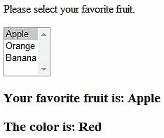

## 解析：

- `<div ng-app="myFruit" ng-controller="iController">` 定义了控制器 `iController`。

- `<select ng-model="choosedFruit" ng-options="obj.fruit for obj in fruits" size = "4">` 创建选择框。

- `{{choosedFruit.fruit}}` 显示水果。

- `{{choosedFruit.color}}` 显示颜色。

- `var app = angular.module('myFruit', [ ]);` 创建了一个模块。

- `app.controller('iController', function($scope))` 定义了控制器。

- `$scope.fruits = [...]` 存储数组。

## 总结

在本章中我们学习了什么是控制器、如何定义控制器、以及 MVC 和 Scope。

`ng-controller="myController"` 定义了一个控制器。

`app = angular.module()` 创建了一个新模块。

`app.controller()` 将控制器的构造函数添加到模块中。

`function($scope)` 定义了一个构造函数，同时也定义了一个对象 `$scope`。

`$scope.property = value` 将值赋值给 `$scope` 对象的属性。

`Scope` 是连接控制器与视图的桥梁。

## 动手项目

打开记事本，编写 AngularJS 代码（图 1）：

```html
<!DOCTYPE html>
<html>
<script src="js\angular.min.js"></script>
<body>
<div ng-app="myApplication" ng-controller="myController">
First Text: <p><textarea ng-model="firstNumber"></textarea></p>
Second Text: <p><textarea ng-model="SecondNumber"></textarea></p>
<br>
Connected Text: <h4><p>{{firstText + " " + SecondText}}</p></h4>
</div>
<script>
var app = angular.module('myApplication', [ ]);
app.controller('myController', function($scope) {
    $scope.firstText = "JavaScript";
    $scope.SecondText = "8 Hours";
});
</script>
</body>
</html>
```

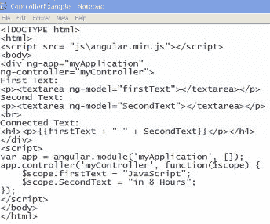

(图 1)

请将文件保存为 `ControllerSample.html` 并位于 `myFolder`。双击 `ControllerSample.html` 文件，输入文本并查看输出（图 2）。

输出：（图 2 如下）

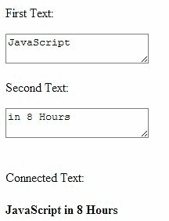

# 第 8 小

## 模块 & API

### 什么是 AngularJS 模块？

AngularJS 模块是应用程序各个部分的集合，例如控制器、服务、过滤器、指令等。一个 AngularJS 模块定义了一个应用程序。

创建模块的语法如下：

| `var myModule = angular.module("myApplication", [ ]);` |

### 示例 8.1

```html
<html>
<script src="js\angular.min.js"></script>
<body>
<div ng-app="myApplication" ng-controller="myController">
{{ firstNum + lastNum }}
</div>
<script>
var myModule = angular.module("myApplication", [ ]);
myModule.controller("myController", function($scope) {
    $scope.firstNum = 100;
```

```javascript
$scope.lastNum = 200;

});

</script>
</body
</html
```

## 输出：300

## 解释：

`<div ng-app="myApplication" ng-controller="myController">` 表示此应用 `"myApplication"` 有控制器 `"myController"`。

`{{ firstNum + lastNum }}` 显示 `firstNum` 加上 `lastNum` 的结果。

`var myModule = angular.module("myApplication", [ ])` 创建了一个带有 `"myApplication"` 的新模块 `"myModule"`。

`[ ]` 参数可以定义依赖模块。

`myModule.controller("myController", function($scope)` 使用 `controller()` 方法将控制器的构造函数添加到模块中，使 `myController` 属于 `myModule`。

`$scope` 被定义为一个对象。

`$scope.firstNum` 的值为 100。

`$scope.lastNum` 的值为 200。

因此，`{{ firstNum + lastNum }}` 的结果是 300。

### 什么是 AngularJS API？

API 的意思是应用程序编程接口。

API 上有 10 个基本函数：

- `angular.uppercase()`

- `angular.lowercase()`

- `angular.isString()`

- `angular.isNumber()`

- ……

- `uppercase()`

- `angular.uppercase()` 将字符串转换为大写。

### 示例 8.2

```html
<html>
<script src= "js\angular.min.js"></script>
<body>
<div ng-app="myApplication" ng-controller="myController">
<p>{{ text1 }}</p>
<p>{{ text2 }}</p>
</div>
<script>
var myModule = angular.module('myApplication', [ ]);
myModule.controller('myController', function($scope) {
$scope.text1 = "javascript";
$scope.text2 = angular.uppercase($scope.text1);
});
</script>
</body>
</html>
```

## 输出：

javascript

JAVASCRIPT

## 解释：

`var myModule = angular.module('myApplication', [ ])` 创建了一个带有 `"myApplication"` 的新模块 `"myModule"`。

`myModule.controller('myController', function($scope)` 使用 `controller()` 方法将控制器的构造函数添加到模块中，使 `myController` 属于 `myModule`。

`$scope` 被定义为一个对象。

`$scope.text2 = angular.uppercase($scope.text1)` 将 `"text1"` 转换为大写。

`lowercase()`

`angular.lowercase()` 将字符串转换为小写。

### 示例 8.3


```html
<html>
<script src="js\angular.min.js"></script>
<body>
<div ng-app="myApplication" ng-controller="myController">
<p>{{ text1 }}</p>
<p>{{ text2 }}</p>
</div>
<script>
var myModule = angular.module('myApplication', [ ]);
myModule.controller('myController', function($scope) {
$scope.text1 = "JAVASCRIPT";
$scope.text2 = angular.lowercase($scope.text1);
});
</script>
</body>
</html>
```

## 输出

JAVASCRIPT

javascript

## 解释

`var myModule = angular.module('myApplication', [ ])` 创建了一个带有 `"myApplication"` 的新模块 `"myModule"`。

`myModule.controller('myController', function($scope)` 使用 `controller()` 方法将控制器的构造函数添加到模块中，使 `myController` 属于 `myModule`。

`$scope` 被定义为一个对象。

`$scope.text2 = angular.lowercase($scope.text1)` 将 `"text1"` 转换为小写。

### `isString()`

`isString()` 测试一个值是否为字符串，如果是字符串则返回 `true`。

### 示例 8.4

```html
<html>
<script src="js\angular.min.js"></script>
<body>
<div ng-app="myApplication" ng-controller="myController">
<p>{{ text1 }}</p>
<p>{{ text2 }}</p>
</div>
<script>
var myModule = angular.module('myApplication', [ ]);
myModule.controller('myController', function($scope) {
$scope.text1 = "JAVASCRIPT";
$scope.text2 = angular.isString($scope.text1);
});
</script>
</body>
</html>
```

## 输出

JAVASCRIPT

true

## 解释

`var myModule = angular.module('myApplication', [ ])` 创建了一个带有 `"myApplication"` 的新模块 `"myModule"`。

`myModule.controller('myController', function($scope)` 使用 `controller()` 方法将控制器的构造函数添加到模块中，使 `myController` 属于 `myModule`。

`$scope` 被定义为一个对象。

`$scope.text2 = angular.isString($scope.text1)` 测试 `"text1"` 是否为字符串。

### `isNumber()`

`isNumber()` 测试一个值是否为数字，如果是数字则返回 `true`。

### 示例 8.5

```html
<html>
<script src="js\angular.min.js"></script>
<body>
<div ng-app="myApplication" ng-controller="myController">
<p>{{ text1 }}</p>
<p>{{ text2 }}</p>
</div>
<script>
var myModule = angular.module('myApplication', [ ]);
myModule.controller('myController', function($scope) {
$scope.text1 = "JAVASCRIPT";
$scope.text2 = angular.isNumber($scope.text1);
});
</script>
</body>
</html>
```

## 输出

JAVASCRIPT

false

## 解释

`var myModule = angular.module('myApplication', [ ])` 创建了一个带有 `"myApplication"` 的新模块 `"myModule"`。

`myModule.controller('myController', function($scope)` 使用 `controller()` 方法将控制器的构造函数添加到模块中，使 `myController` 属于 `myModule`。

`$scope` 被定义为一个对象。

`$scope.text2 = angular.isNumber($scope.text1)` 测试 `"text1"` 是否为数字。

### 示例 8.6

```html
<html>
<script src="js\angular.min.js"></script>
<body>
<div ng-app="myApplication" ng-controller="myController">
<p>{{ text1 }}</p>
<p>{{ text2 }}</p>
</div>
<script>
var myModule = angular.module('myApplication', [ ]);
myModule.controller('myController', function($scope) {
$scope.text1 = "JAVASCRIPT";
$scope.text2 = angular.uppercase($scope.text1);
});
</script>
</body>
</html>
```

`angular.isDefined()` 测试一个值是否已经定义，如果该值已定义，则返回 `true`。

### 示例 8.10

```html
<html
<script src="js\angular.min.js"></script>
<body>
<script>
var futureCar;
var existingCar = "Very Good!";
document.write(angular.isDefined(futureCar) + " ");
document.write(angular.isDefined(existingCar) + " ");
</script>
</body>
</html>
```

## 输出

false true

## 解释

`futureCar` 尚未被定义。因此，`isDefined(futureCar)` 返回 `false`。

`existingCar` 已定义。因此，`isDefined(existingCar)` 返回 `true`。

---

### `isUndefined()`

`angular.isUndefined()` 测试一个值是否未被定义，如果该值未被定义，则返回 `true`。

### 示例 8.11

```html
<html
<script src="js\angular.min.js"></script>
<body>
<script>
var futureCar;
var existingCar = "Very Good!";
document.write(angular.isUndefined(futureCar) + " ");
document.write(angular.isUndefined(existingCar) + " ");
</script>
</body>
</html>
```

## 输出

true false

## 解释

`futureCar` 尚未被定义。因此，`isUndefined(futureCar)` 返回 `true`。

`existingCar` 已定义。因此，`isUndefined(existingCar)` 返回 `false`。

## 总结

- `var myModule = angular.module('myApplication', [ ])` 创建了一个带有 `myApplication` 的新模块 `myModule`。
- `myModule.controller('myController', function($scope)` 使用 `controller()` 方法将控制器的构造添加到模块中，使 `myController` 属于 `myModule`。
- `$scope` 被定义为一个对象。
- `angular.uppercase()` 将字符串转换为大写。
- `angular.lowercase()` 将字符串转换为小写。
- `isString()` 测试一个值是否为字符串，如果是字符串则返回 `true`。
- `isNumber()` 测试一个值是否为数字，如果是数字则返回 `true`。
- `isDate()` 测试一个值是否为 `Date` 对象，如果是 `Date Object` 则返回 `true`。
- `isFunction()` 测试一个值是否为函数，如果是函数则返回 `true`。
- `isElement()` 测试一个值是否为 `Dom` 元素，如果是 `Dom` 元素则返回 `true`。
- `isObject()` 测试一个值是否为对象，如果是对象则返回 `true`。
- `isDefined()` 测试一个值是否已经定义，如果已定义则返回 `true`。
- `isUndefined()` 测试一个值是否未被定义，如果未被定义则返回 `true`。

## 动手项目

### 模块示例

打开记事本，编写 AngularJS 代码：

```html
<!DOCTYPE html>
<html>
<script src="js\angular.min.js"></script>
<body>
<div ng-app="myApplication" ng-controller="myController">
高度:
<p><input type="number" ng-model="height"></p>
长度:
<p><input type="number" ng-model="length"></p>
<br>
三角形面积:
<h4><p>{{(height * length)/2}}</p></h4>
</div>
<script>
var app = angular.module('myApplication', [ ]);
app.controller('myController', function($scope) {
    $scope.height = 0;
    $scope.length = 0;
});
</script>
</body>
</html>
```

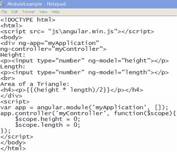

请将文件命名为 `ModuleSample.html` 并保存在 `myFolder` 中。双击 `ModuleSample.html` 文件，输入三角形的高度和长度，并查看输出。

**输出：**

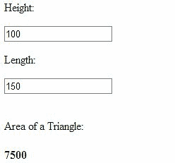

## 解释

- `ng-controller="myController"` 定义了一个控制器。
- `app = angular.module()` 创建了一个新模块。
- `app.controller()` 将控制器的构造函数添加到模块中。
- `function($scope)` 定义了一个构造函数，同时也定义了一个对象 `$scope`。当页面加载时，该函数将运行。
- `$scope.property = value` 将值赋值给 `$scope` 对象的属性。

# 附录 1

## Ajax 基础

### 什么是 Ajax？

AJAX 代表“异步 JavaScript 和 XML”。AJAX 是一种新技术，通过服务器使用 XML、HTML、CSS、PHP、ASP 和 JavaScript 创建更好、更快、更具交互性的 Web 脚本。

AJAX 用于更新网页的一部分，而无需重新加载整个页面。

这意味着通过 Ajax，你可以与服务器通信以更新信息，而无需刷新网页。

通过 jQuery 和 JavaScript，你可以轻松地在网页中实现 Ajax。

运行 Ajax 需要一个服务器。

下将将介绍如何设置服务器。

### 步骤 1

下载“AppServ”免费链接：[`http://www.angular.com/`](http://www.angular.com/)

### 步骤 2

安装 AppServ。

`images/0047.jpeg`

### 步骤 3

检查任何文件。

`images/0048.jpeg`

### 步骤 4

服务器名称：`localhost`

`images/0049.jpeg`

### 步骤 5

输入密码：`123`

`images/0050.jpeg`

### 步骤 6

完成按钮。

`images/0051.jpeg`

### 步骤 7

检查页面。

`images/0052.jpeg`

### 步骤 8

文件夹 `C:\AppServer\www`

`images/0053.jpeg`

## 示例 1：B1

```html
<script lang="JavaScript">
var ajaxObject = new XMLHttpRequest();
ajaxObject.open("GET", "data.txt", true);
ajaxObject.onreadystatechange = function() {
    if (ajaxObject.readyState == 4) {
        alert(ajaxObject.responseText);
    }
};
ajaxObject.send();
</script>
```

将文件保存为 `B1.html` 并双击运行。

**输出：**

Hello World!

## 解释

- 第 2 行：`new XMLHttpRequest()` 创建了一个名为 `ajaxObject` 的 `XMLHttpRequest` 对象，它将用于 Ajax 脚本。
- 第 3 行：`ajaxObject.open("GET", "data.txt", true)` 初始化了 `XMLHttpRequest` 对象。`"GET"` 指定了请求方法。`"data.txt"` 是提供数据资源的 URL。`true` 表示使用异步技术。
- 第 4 行：`ajaxObject.onreadystatechange = function() { ... }` 指定了一个在接收到服务器响应时运行的函数。服务器响应的状态为 0 到 4。
- 第 5 行：`if (ajaxObject.readyState == 4)` 意味着如果服务器响应为 4，则返回的数据可用。
- 第 6 行：`alert(ajaxObject.responseText)` 显示从 `data.txt` 获取的文本。

`ajaxObject.send()` 将请求发送到服务器。

## 示例 2

### 示例 B2

1. `<input type="button" value="try" onClick="ajaxRequest();"/>`
2. `<script type="text/javascript">`
3-20.

```javascript
function ajaxRequest() {
  if (window.XMLHttpRequest){
    ajaxObject = new XMLHttpRequest();
  }
  else if (window.ActiveXObject){
    ajaxObject = new ActiveXObject("Microsoft.XMLHTTP");
  }
  ajaxObject.open("POST", "data.txt", true);
  ajaxObject.onreadystatechange = function() {
    if (ajaxObject.readyState == 4) {
      if(ajaxObject.status == 200) {
        alert(ajaxObject.responseText);
      }
    }
  }
  ajaxObject.send();
}
```

21. `</script>`

将文件保存为 `B2.html` 并双击它。

## 输出

Hello Ajax World!

## 解释

### 第 1 行

`onClick="ajaxRequest();"` 在点击按钮时调用函数 `ajaxRequest()`。

### 第 3-9 行

这些代码创建了一个名为 `ajaxObject` 的 `XMLHttpRequest` 对象，它将用于 Ajax 脚本。

如果浏览器是 `NON-IE`，它使用 `new XMLHttpRequest()` 创建 `ajaxObject`。

如果浏览器是 `IE`，它使用 `new ActiveXObject(...)` 创建 `ajaxObject`。

### 第 10 行

`ajaxObject.open("POST", "data.txt", true)` 初始化 `XMLHttpRequest` 对象的请求。


`"POST"` 指定请求方法。也可以使用 `"GET"` 或 `"PUT"`。

`"data.txt"` 是提供数据资源的 URL。

在这里，`data.txt` 的内容为 `"Hello Ajax World!"`。

`"true"` 表示使用异步技术。

### 第 11 行

`ajaxObject.onreadystatechange = function() { ... }` 指定了一个在接收服务器响应时运行的函数。服务器的响应状态为 0 到 4：

| readyState | 解释 |
| :--- | :--- |
| 0 | 未初始化 |
| 1 | 已初始化 |
| 2 | 发送数据 |
| 3 | 接收数据 |
| 4 | 完成。返回的数据可用。 |

`ajaxObject.onreadystatechange` 正在等待服务器的响应。

### 第 12 行

`if (ajaxObject.readyState == 4)` 表示如果服务器响应状态为 4，则返回的数据可用。

### 第 13 行

`if(ajaxObject.status == 200){ }` 表示如果服务器返回的 HTTP 状态码为 200，则请求成功。

| HTTP status | 解释 |
| :--- | :--- |
| 200 | 请求成功 |
| 401 | 未授权 |
| 403 | 拒绝 |
| 404 | 未找到 |

### 第 14 行

`alert(ajaxObject.responseText)` 显示从 `data.txt` 获取的文本。

输出：`"Hello Ajax World!"`

### 第 15 行

`ajaxObject.send()` 将请求发送到服务器。

## 结果

运行整个脚本，将弹出一个对话框显示 `"Hello Ajax World!"`。

## 示例 3

示例 3 中的代码与示例 2 基本相同。

但示例 2 中的代码可以修改并如下所示示例 3：

### 示例 B3

14. `document.getElementById("display").innerHTML = "A message from server is: " + ajaxObject.responseText;`

22. `<div id="display"></div>`

B3.html 内容如下：

```html
<input type="button" value="try" onClick="ajaxRequest();"/>
<script type="text/javascript">
function ajaxRequest() {
  if (window.XMLHttpRequest){
    ajaxObject = new XMLHttpRequest();
  }
  else if (window.ActiveXObject){
    ajaxObject = new ActiveXObject("Microsoft.XMLHTTP");
  }
  ajaxObject.open("POST", "data.txt", true);
  ajaxObject.onreadystatechange = function() {
    if (ajaxObject.readyState == 4) {
      if(ajaxObject.status == 200) {
        document.getElementById("display").innerHTML = "A message from server is: " + ajaxObject.responseText;
      }
    }
  }
  ajaxObject.send();
}
</script>
<div id="display"></div>
```

将文件保存为 `B3.html` 并双击它。

## 输出

A message from server is: Hello Ajax World!

## 解释

### 第 14 行

`document.getElementById("display").innerHTML` 显示 ID 为 `"display"` 的指定位置的内容。

`ajaxObject.responseText` 从 `data.txt` 获取数据。

输出：`"A message from server is: Hello Ajax World!"`。

### 第 22 行

`<div id="display"></div>` 创建一个 id 为 `"display"` 的标签，用于显示内容。

## 结果

运行整个脚本。

输出：`"A message from server is: Hello Ajax World!"`

## 注意

`"data.txt"` 可以是 `data.php`、`data.asp`、`data.jsp` 和 `data.xml`。

Ajax 需要服务器的支持。

## Ajax 优势

Ajax 在不重新加载整个网页的情况下更新部分内容。

### Ajax 图表

| 项目 | 描述 |
| :--- | :--- |
| `open()` | 初始化请求 |
| `send()` | 将请求发送到服务器 |
| `onreadystatechange` | 事件 |
| `responseText` | 来自服务器文本 |
| `readyState` | 状态 |

| readyState | 解释 |
| :--- | :--- |
| 0 | 未初始化 |
| 1 | 已初始化 |
| 2 | 发送数据 |
| 3 | 接收数据 |
| 4 | 完成。返回的数据可用。 |

| HTTP status | 解释 |
| :--- | :--- |
| 200 | 请求成功 |
| 401 | 未授权 |
| 403 | 拒绝 |
| 404 | 未找到 |

## 附录

Ajax 需要服务器的支持。

### 示例 A1

```html
<!DOCTYPE html>
<html>
<head>
<script>
function ajaxRequest() {
  if (window.XMLHttpRequest){
    ajaxObject = new XMLHttpRequest();
  }
  // ... 逻辑
}
</script>
</head>
<body>
<div id="display">
  <h2 id="message"></h2>
</div>
<script>
// ... 逻辑
</script>
</body>
</html>
```

| ID | 水果 | 颜色 |
| :--- | :--- | :--- |
| 001 | 苹果 | 红色 |
| 002 | 香蕉 | 绿色 |
| 003 | 橙子 | 金色 |

## 解释

`$http.get("angular_mysql.php").then(function (feedback) { }` 从 `mysql` 数据库获取数据。

`$scope.title = feedback.records;` 返回 `mysql` 数据库的每条记录。

`<tr ng-repeat="v in title">` 遍历每个字段。

关于 PHP & MySQL，请阅读我的另一本书《8 小时精通 PHP & MySQL》。

### Angular 检查

| 项目 | 说明 |
| :--- | :--- |
| `$dirty` | 检查用户已输入 |
| `$pristine` | 检查用户未输入 |

## 示例 A4

```html
<head>
<script src="js\angular.min.js"></script>
</head>
<body>
<form ng-app="iCode" ng-controller="iController" name="iForm" novalidate>
<p>请在此输入您的名字：<br><br>
<input type="text" name="userName" ng-model="userName" required>
<div style="color:red" ng-show="iForm.userName.!$dirty">
<!--检查输入是否为空-->
<div ng-show="iForm.userName.$error.required">
<!--显示错误消息 -->
此字段不能为空！</div>
</div>
</p>
</form>
<script>
var iModule = angular.module('iCode', []);
iModule.controller('iController', function($scope) {
$scope.userName = '';   
});
</script>
</body>
</html>
```

## 输出

请在此输入您的名字：

|  |
| :--- |

此字段不能为空！

## 解释

`iForm.userName.!$dirty` 检查输入字段的非空性。你可以使用 `$pristine` 或 `!$dirty`。

`.$error.required` 显示错误消息。

### Angular 验证

| 项目 | 说明 |
| :--- | :--- |
| `$valid` | 检查输入的有效性 |
| `$invalid` | 检查输入的无效性 |

## 示例 A5

```html
<!DOCTYPE html>
<html>
<head>
<script src="js\angular.min.js"></script>
</head>
<body>
<br>
<form ng-app="iCode" ng-controller="iController" name="iForm" novalidate>
<input type="email" name="email" ng-model="email" required>
<div style="color:red" ng-show="iForm.email.$invalid">
<!--检查邮箱地址的无效性--> <br>
<div ng-show="iForm.email.$error.email">
<!--显示错误消息 -->
邮箱地址格式无效！</div>
</div>
</form>
<script>
var iModule = angular.module('iCode', []);
iModule.controller('iController', function($scope) {
$scope.email = 'xxxxx@gmail.com';
});
</script>
</body>
</html>
```

## 输出

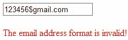

## 解释

`<div style="color:red" ng-show="iForm.email.$invalid">` 检查邮箱地址的有效性。

`<div ng-show="iForm.email.$error.email">` 显示错误消息。

### Angular 包含

| 项目 |
| :--- |
| `ng-include="'another.txt'"` |

`ng-include="'another.txt'"` 将外部文件包含到当前文件中。

## 示例 A6

```html
/* 注意：以下示例需要服务器支持。
假设服务器上有一个文件 another.txt，该文件内容为“This is an Include Example.”  */
<!DOCTYPE html>
<html ng-app="">
<script src="js\angular.min.js"></script>
<body>
<div ng-include="'another.txt'"></div> 
</body>
</html>
```

## 输出

这是一个包含示例（Include Example）。

## 解释

`ng-include="'another.txt'"` 将外部文件包含到当前文件中。

## 附录 3

# AngularJS 测试题与答案

## 测试题

请选择正确答案。

**(1)**

```html
<html>
<script src="js\angular.min.js"></script>
<body>
<div ng-app="">
<p>在输入框中输入我的 id：</p>
<p><input type="text" 在此处输入 </p>
// 将 HTML 控件中的输入数据绑定到“id”
<br>
<h1>欢迎！{{id}}</h1>
</div>
</body>
</html>
```

A. `bind = “id"`

B. `ng-bind = “id"`

C. `ng = “id"`

D. `ng-model="id"`

**(2)**

```html
<!doctype html>
<html>
<head>
<script src="js\angular.min.js"></script>
</head>
<body ng-app="">
<br><br>
<textarea ng-keydown="count = count + 1" ng-init="count=0">
这里是一个文本区域
</textarea>
<br><br>
<h2>count: {{ 在此处填写 }}</h2> // 显示“count”的值
</body>
</html>
```

1. 显示 B. 显示显示 C. count D. 变量 (variable)

**(3)**

```html
<html>
<script src="js\angular.min.js"></script>
<body>
<script>
var myString = "This is a string";   
function myFunction() 
{
    return "This is inside a function";
}
document.write(在此处填写(myString) + " ");
document.write(在此处填写(myFunction) + " ");
// 测试一个值是否为函数
</script>
</body>
</html>
```

1. ng-test B. angular C. AngularJS D. test

**(4)**

```html
<html>
<script src="js\angular.min.js"></script>
<body>
<div 在此处填写 >
// 表示从这里编写 AngularJS
<p>在输入框中输入 id：</p>
<input type="text" ng-model="id"></p>
<br>
<h1>欢迎！{{id}}</h1>
</div>
</html>
```

A. `ng-app=""` B. `ng-model=""` C. angular D. ng

**(5)**

```html
<!DOCTYPE html>
<html>
<head>
<title>AngularJS 初学者</title>
<script src="js\angular.min.js"></script>
<meta http-equiv="Content-Type" content="text/html; charset=8" />
</head>
<body>
<h3>使用 点击</h3>
<div ng-app="" 在此处填写 ="increaseNumber=0">
// 初始化变量值为
<button ng-click="increaseNumber = increaseNumber + 1">点击我！</button>
<p ng-bind="increaseNumber" style="color:blue"></p>
</div>
</body>
</html>
```

A. `init` B. initialize C. `ng-init` D. ng

**(6)**

```html
<html>
<script src="js\angular.min.js"></script>
<body>
<div ng-app="Calculation" ng-controller="myController">
第一个数字：<input type="number" ng-model="firstNumber"><br>
第二个数字：<input type="number" ng-model="secondNumber"><br>
<br>
和：{{firstNumber + secondNumber}}
</div>
<script>
var app = angular.module('Calculation', []);
app.controller('myController', function($scope) {
在此处填写.firstNumber = 4;
在此处填写.secondNumber = 8;
// 将值赋值给 $scope。
});
</script>
</body>
</html>
```

A. `object` B. angular C. `$scope` D. `$scope`

**(7)**

```html
<html>
<script src="js\angular.min.js"></script>
<body>
<div ng-app="myApplication" ng-controller="myController">
{{ firstNum + lastNum }}
</div>
<script>
var myModule = angular.module("myApplication", []);
在此处填写.controller("myController", function($scope) {
// 让 myModule 属于 $scope。
$scope.firstNum = 100;
$scope.lastNum = 200;
});
</script>
</body>
</html>
```


**(8)**

```html
<html>
<script src="js\angular.min.js"></script>
<body>
<script>
var myCar = "This is my car!";   
var carObject = new Object() ; 
document.write(angular 在此处填写 Object(myCar) + " ");
document.write(angular 在此处填写 Object(carObject) + " "); 
// 测试一个值是否为对象
</script>
</body>
</html>
```

A. `test` B. `check` C. `is` D. `if`

**(9)**

```html
<html>
<head>
<title>AngularJS 初学者</title>
<script src="js\angular.min.js"></script>
<meta http-equiv="Content-Type" content="text/html; charset=UTF-8" />
</head>
<body>
<div ng-app="" ng-init="ColorName = ['Pink', 'Red', 'Green', 'Blue', 'White', 'Yellow', 'Gray']">
<p style="color:green; font-weight:bold">颜色名称：</p>
<ol>
<li 在此处填写 ="x in ColorName">
// 重复获取数组的值
<p ng-bind="x"></p> 
</li>
</ol>
</div>
</body>
</html>
```

A. `ng-repeat` B. `repeat` C. `foreach` D. `for`

**(10)**

```html
<html>
<script src="js\angular.min.js"></script>
<body>
<div ng-app="Calculation" 在此处填写 = "myController">
// 定义一个控制器
第一个数字：<input type="number" ng-model="firstNumber"><br>
第二个数字：<input type="number" ng-model="secondNumber"><br>
<br>
和：{{firstNumber + secondNumber}}
</div>
<script>
var app = angular.module('Calculation', []);
app.controller('myController', function($scope) {
$scope.firstNumber = 4;
$scope.secondNumber = 8;
});
</script>
</body>
</html>
```

A. `define` B. `controller` C. `new` D. `ng-controller`

**(11)**

```html
<html>
<script 在此处填写 ="js\angular.min.js"></script>
```

// 将 AngularJS 框架引入当前应用。

```html
<body>
  <div ng-app="">
    <p>在输入框中输入我的 id：</p>
    <p><input type="text" ng-model="id" </p>
    <br>
    <h1>欢迎！{{id}}</h1>
  </div>
</body>
</html>
```

A. `import` B. `url` C. `src` D. `add`

**(12)**

```html
<html>
<body>
  <div ng-app="">
    <p>用户名：<br>
    <input type="text" ng-model = "Username"></p>
    <p fill in here ="Username"></p>
  </div>
</body>
</html>
```

// 将 “Username” 绑定到 `<p></p>` 标签上，并“显示”它的值

A. `bind` B. `ng-bind` C. `ng-bound` D. `ng-show`

**(13)**

```html
<html>
<body>
  <h3>使用大写过滤器</h3>
  <div ng-app="" ng-init="Username= 'ray' ">
    <p>用户名：<input type="text" ng-model = "Username"></p>
    <p style="color:red" ng-bind="Username | fill in here "></p>
  </div>
</body>
</html>
```

// 将 “Username” 的值改为大写。

A. `toUppercase()` B. `uppercase()` C. `toUppercase` D. `uppercase`

**(14)**

```html
<html>
<body>
  <h3>使用 Click 指令</h3>
  <div ng-app="" ng-init="increaseNumber=0">
    <button fill in here ="increaseNumber = increaseNumber + 1">点击我！</button>
    // 点击按钮时更新 “increaseNumber” 的值。
    <p ng-bind="increaseNumber" style="color:blue"></p>
  </div>
</body>
</html>
```

A. `ng-click` B. `ng-press` C. `onClick` D. `onPress`

**(15)**

```html
<html>
  <script src="js\angular.min.js"></script>
  <body ng-app="">
  <br><br>
  <textarea fill in here ="count = count + 1" ng-init="count=0"> // 鼠标悬停事件
  这是一个文本区域。
  </textarea>
  <br><br>
  <h2>count: {{count}}</h2>
  </body>
</html>
```

A. `mouseover` B. `ng-mouseover` C. `over` D. `ng-over`

**(16)**

```html
<html>
  <head>
    <title>初学者 AngularJS</title>
    <script src="js/angular.min.js"></script>
  </head>
  <body>
    <h4>使用数组表达式的我的数学结果</h4>
    <div ng-app="" ng-init="MyArray=[98,96,93,90,99]">
      <p>我的数学成绩是：{{ fill in here }}</p>
      // 显示 MyArray 中索引为 4 的值。
    </div>
  </body>
</html>
```

A. `array[4]` B. `[4]` C. `MyArray[4]` D. `MyArray{4}`

**(17)**

MVC 代表模型、视图和控制器。

“`$scope.firstNumber` 和 `$scope.secondNumber` 是一个 fill in here

`<p ng-bind = "firstNumber + secondNumber"> </p>` 是一个 fill in here

“ng-controller="myController"” 定义了一个 fill in here

// MVC

A. `controller` `view` `model`

B. `view` `controller` `model`

C. `model` `controller` `view`

D. `model` `view` `controller`

**(18)**

```html
<html>
  <script src= "js\angular.min.js"></script>
  <body>
    <script>
      var myDate = "Aug/10/2015";
      var dateObject = new Date();
      document.write(angular. fill in here(myDate) + " ");
      document.write(angular. fill in here(dateObject) + " ");
      // 测试一个值判断是否为 Date 对象
    </script>
  </body>
</html>
```

A. `check` B. `test` C. `isDate` D. `isObject`

**(19)**

```html
<html>
  <head>
    <script src="js\angular.min.js"></script>
  </head>
  <body ng-app="">
  <br><br>
  <textarea fill in here ="count = count + 1" ng-init="count=0"> // 按下事件
  这是一个文本区域
  </textarea>
  <br><br>
  <h2>count: {{count}}</h2>
  </body>
</html>
```

A. `keydown` B. `ng-keydown` C. `onKey` D. `key()`

**(20)**

```html
<html>
  <script src="js\angular.min.js"></script>
  <body>
    <script>
      var futureCar;
      var existingCar = "Very Good!";
      document.write(angular. fill in here(futureCar) + " ");
      document.write(angular. fill in here(existingCar) + " ");
      // 测试一个值是否已定义
    </script>
  </body>
</html>
```

A. `test` B. `check` C. `ng-defined` D. `isDefined`

**(21)**

```html
<html>
  <head>
    <title>初学者 AngularJS</title>
    <script src="js\angular.min.js"></script>
  </head>
  <body>
    <div ng-app="" ng-init="StudentsResult=[{name: 'Tien', marks:81}, {name: 'Sv', marks:70}, {name: 'Yaito', marks:90}, {name: 'Pew', marks:63}, {name: 'Riet', marks:98}]">
      <table border="1">
        <tr>
          <th>学生姓名</th>
          <th>数学成绩</th>
        </tr>
        <tr ng-repeat="x in StudentsResult | fill in here :'-marks ">
          // 降序显示值。
          <td ng-bind="x.name "></td>
          <td ng-bind="x.marks "></td>
        </tr>
      </table>
    </div>
  </body>
</html>
```

A. `order` B. `sort` C. `orderBy` D. `sortBy`

**(22)**

```html
<html>
  <head>
    <script src="js\angular.min.js"></script>
    <meta http-equiv="Content-Type" content="text/html; charset=UTF-8" />
  </head>
  <body>
    <div ng-app="">
      <input type="checkbox" ng-model="HideShowDiv">显示 div
      <div fill in here ="HideDiv" style="background-color:pink;height:50px;"> // 隐藏指令
        <p>这是一个 div</p>
        <p>勾选框选中后将消失。</p>
      </div>
    </div>
  </body>
</html>
```

A. `hide` B. `invisible` C. `ng-hide` D. `ng-invisible`

**(23)**

```javascript
<script>
  function (fill in here) {
    fill in here.firstNumber = 23;
    fill in here.secondNumber = 63;
  }
</script>
```

// 声明一个 JavaScript 函数参数，该参数将是 AngularJS 中的对象。

A. `ng-controller` B. `$scope` C. `ng-object` D. `ng-scope`

**(24)**

```html
<html>
  <head>
    <title>初学者 AngularJS</title>
    <script src="js/angular.min.js"></script>
  </head>
  <body>
    <div ng-app="">
      <input type="checkbox" ng-model="HideShowDiv">显示 div
      <div fill in here ="HideDiv" style="background-color:yellow;height:50px;"> // 显示指令
        <p>这是一个 div</p>
        <p>勾选框选中后将出现。</p>
      </div>
    </div>
  </body>
</html>
```

A. `show` B. `angular` C. `display` D. `ng-show`

**(25)**

```html
<html>
  <script src="js\angular.min.js"></script>
  <body>
    <h4>对象表达式</h4>
    <div ng-app="" ng-init="fill in here = {name: 'Jay Smith', Month:'June.152000'}"> // 根据上下文使用对象
      <p>员工姓名：{{}}</p>
      <p>员工工资：{{}}</p>
    </div>
  </body>
</html>
```

A. `EmployeeObject` B. `myObject` C. `Object` D. `ng-Object`

**(26)**

```html
<html>
  <script src="js\angular.min.js"></script>
  <body>
    <div ng-app="myApplication" ng-controller="myController">
      <p>{{ text1 }}</p>
      <p>{{ text2 }}</p>
    </div>
    <script>
      var myModule = angular.module('myApplication', [ ]);
      myModule.controller('myController', function($scope) {
        $scope.text1 = "JAVASCRIPT";
        $scope.text2 = angular. fill in here($scope.text1);
      }); // 检查 “text1” 判断是否为数字。
    </script>
  </body>
</html>
```

A. `Number` B. `isNumber` C. `Digital` D. `isDigital`

**(27)**

```javascript
<script Language = “JavaScript”
  var ajaxObject = new fill in here; // 创建名为 “ajaxObject”的 XMLHttpRequest 对象
  ajaxObject.open( “GET”, “data.txt”, true);
  ajaxObject.onreadystatechange = function( ) {
    if (ajaxObject.readyState == 4) {
      alert( ajaxObject.responseText);
    }
  }
  ajaxObject.send( );
</script>
```

A. `HttpRequest` B. `XMLHttpRequest` C. `HttpRequest()` D. `XMLHttpRequest()`

**(28)**


```html
<input type = “button” value = "try" onClick = “ajaxRequest ( );”/>
<script type = “text/javascript”>
  function ajaxRequest ( ) {
    if (window.XMLHttpRequest){
      ajaxObject = new XMLHttpRequest ( );
    } else if (window.ActiveXObject){
      ajaxObject = new ActiveXObject(“Microsoft.XMLHTTP”);
    }
    ajaxObject.open( “POST”, “data.txt”, true);
    ajaxObject.onreadystatechange = function( ) {
      if (ajaxObject.readyState == 4) {
        if(ajaxObject. fill in here == 200) { // 如果服务器返回的 HTTP 状态码为 200，则请求成功
```

最后一个题的答案是 `status`。

```javascript
14.alert ( ajaxObject.responseText);

15.}

16.}

17\. }

19\. ajaxObject.send( );

20\. }

21\. </script>
```

A. respond  
B. readState  
C. status  
D. return

## (29)

```html
<input type = “button” value = "try" onClick = “ajaxRequest ( );”/>

<script type = “text/javascript”>

function ajaxRequest ( ) {

  if (window.XMLHttpRequest){

    ajaxObject = new XMLHttpRequest ( );

  }

  else if (window.ActiveXObject){

    ajaxObject = new ActiveXObject(“Microsoft.XMLHTTP”);

  }

  ajaxObject.open( “POST”, “data.txt”, true);

  ajaxObject.onreadystatechange = function( ) {

    if (ajaxObject.readyState == 4) {

      if(ajaxObject.status == 200) {

        document.getElementById( “display” ).fill in here = “A message from server is: ” + ajaxObject.responseText; // 在 ID 为“display”的指定位置显示内容

      }

    }

  }

  ajaxObject.send( );

}

</script>

<div id = “display” }></div
```

A. show  
B. innerHTML  
C. display  
D. text

## (30)

在 Ajax 中，当 `readyState` 为 4 时，意味着请求过程处于哪个阶段？___？

A. 未初始化  
B. 正在发送数据  
C. 已接收数据  
D. 返回的数据可用。

## (31)

在 Ajax 中，当 `http status` 为 200 时，意味着请求的结果是 ____？

A. 请求成功。  
B. 未授权  
C. 禁止  
D. 未找到。

## (32)

关于 Ajax，以下陈述正确的是？（多选题）

A. `readyState` 属性是从 0 到 4 的请求状态。  
B. `Http status` 返回数字 200、401、403 或 404。  
C. `onreadystatechange` 属性是一个状态事件。  
D. `responseText` 属性返回来自服务器的文本。

## Answers

| 01. | D | 17. | D |
| :--- | :--- | :--- | :--- |
| 02. | C | 18. | C |
| 03. | B | 19. | B |
| 04. | A | 20. | D |
| 05. | C | 21. | C |
| 06. | D | 22. | C |
| 07. | B | 23. | B |
| 08. | C | 24. | D |
| 09. | A | 25. | A |
| 10. | D | 26. | B |
| 11. | C | 27. | D |
| 12. | B | 28. | C |
| 13. | D | 29. | B |
| 14. | A | 30. | D |
| 15. | B | 31. | A |
| 16. | C | 32. | ABCD |

## [亚马逊上强烈推荐的计算机书籍：](https://www.amazon.com/Ray-Yao/e/B00RG5FG6K/ref=dp_byline_cont_ebooks_1)

|  |  |  |
|  |  |  |
|  |  |  |
|  |  |  |
|  |

# 书籍源代码下载

请下载本书的源代码：

[AngularJS 源代码下载](http://www.websprogram.com/www/angularjswangshiruyi/sourcecode.php)

亲爱的朋友：

如果您对本电子书不满意，可以在购买之日起七天内退还电子书以获得款吗？

如果您在书中发现任何错误，可以给我发送电子邮件吗？

`yaowining@yahoo.com`

我将非常感谢您的邮件。非常感谢！

诚地

Ray Yao

我的朋友，再见！
