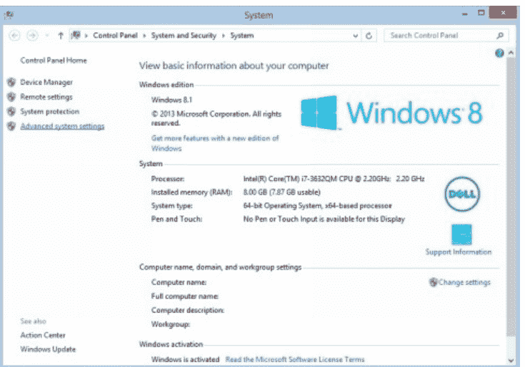
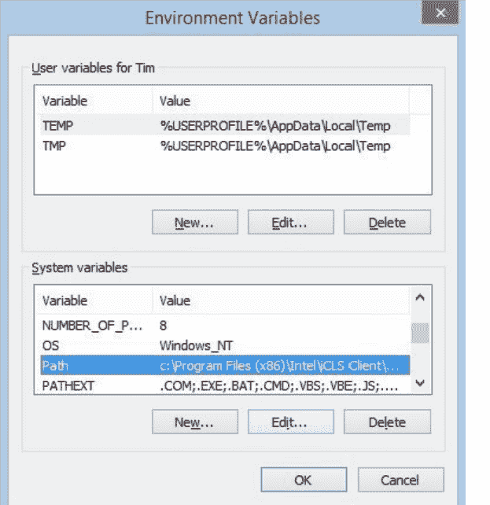
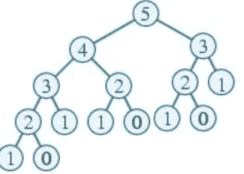
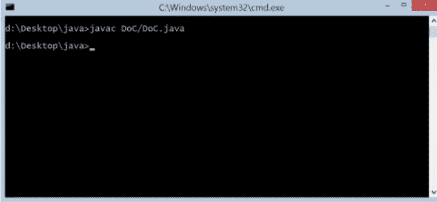
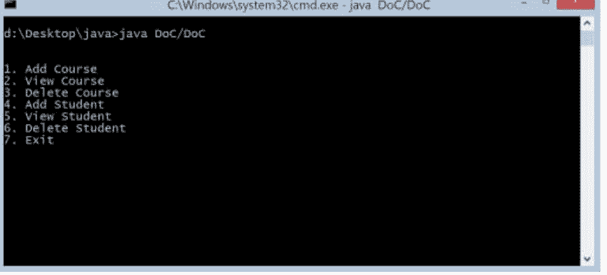
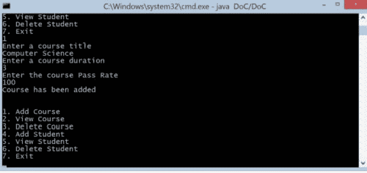
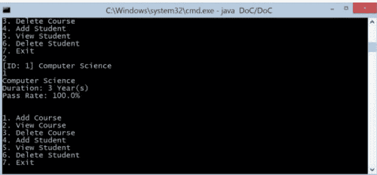
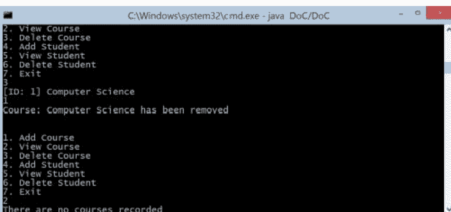

# Java 编程入门指南

- 非检异常
- 多态

# 第 15 章：接口

# 第 16 章：综合运用

- 从这里开始的大学系统
- JavaServer Pages（`JSP`）
- 网络编程
- 代码执行计时

## 练习 3g

# 第 1 章：引言

## 关于我以及我为什么决定写这本书

我是 90 后代。我在拨号上网和在线文本游戏的时代长大。大约那时，我开始对计算机程序是如何运作的感兴趣。我第一次接触任何形式的编程是 `IRC` 客户端中的一种脚本语言，至少地说，简直糟糕透了。被它能实现的功能所吸引，我转向了我认为更有用的东西——`HTML`。我想制作出我当时正在玩的那些文本游戏。在初步学习 `HTML` 之后，我深入研究了互联网的运作机制，并破解了许多对我来说未知且新奇的工具和概念，如网络服务器、数据库和服务器端脚本。我想说的是，作为一个试图学习这些技术的孩子，我第一次并没有能掌握它们，并且总是觉得它们可以解释得更清楚；例如，我曾多次尝试并花了大量时间来完全理解如何运行本地网络服务器。端口转发简直是一场噩梦！也许这就是为什么现在很多非虚构类作者会付诸文字的原因，

在尝试了 `Web` 开发之后，我转向了 `C++`，并发现控制台（命令行）应用程序非常有趣，特别是当我掌握了之前的风格并开始接触面向对象编程（`OOP`）之后。当我在 `C++` 中遇到指针时，我决定第一次学习 `Java`，因为在那个年代，那是一个非常难以理解的概念。`Java` 学习起来相当容易，因为语法与 `C++` 相似。当然，某个地方还混杂了一些 `Visual Basic`，但我喜欢假装自己从没听过它！大学里几乎所有与编程相关的工作都是基于 `Java` 的。

这导致了超过 12 年的自学，随后是 3 年的专业教育，在这段时期里，我对 `Java` 以及通用的编程有了深入的理解。所以，本质上，我决定写这本书的原因是希望为你提供一种更简洁、更有组织且更清晰的学习 `Java` 基础的方法，这种方法我希望在我开始学习这门语言时就能用。我的意图是用尽可能少的内容尽可能好地获取 `Java` 的核心概念，直击主题，不加入过多的废话，以便让这本书读起来很快，同时不会遗掉任何重要内容。这是一个很难达成的折中，我希望我为你们做出了正确的！

## 本书的读者群

这本书适合任何想要学习 `Java` 的人。无论你是一个完全没有编程知识的初学者，还是一个中级 `Java` 程序员并想要更深入地理解书中某些更高级的话题，这本书都是为你准备的。它是为初学者编写的，但分段方式意味着示例代码和练习不会让你不得不去翻阅之前的章节来理解内容，除非你真的需要知道发生了什么！

## 本书使用的约定

在引用类、变量、方法名称时，我将使用反引号，除非我忘记了。

## 练习

如果你看到这个标题，说明针对你刚刚阅读的信息，有一些简单的练习供你完成。当然，没有人强迫你去做（除非你身边有一个正在施展戏法的绝地武士，但这样并不理想），但它们的目的是帮助你进一步理解所应用的信息。如果需要答案，可以在书末找到这些练习的解答。我知道，这很烦人而且总是让我抓狂，但如果答案就在同一页，那挑战的意义何在？！

## 关键点

如果你看到这个标题，你应该花几时间研究后面的观点，确保你清楚地理解了它们。与练习类似，这些内容的复杂性会逐渐增加，但我会在每个章节尽可能清晰地解释它们。

有时我会直接给你甩几页代码。不要灰心，把它们复制出来并编译（在引入书籍之前，我检查了每一段源代码以确保它们可以运行，所以如果没有运行而你确定自己没写错，请给我发邮件！）并尝试理解它。这种方法是先给你代码，在你写出并亲自尝试之后再进行解释。这样，在我逐条剖析之前，你至少已经有了它的部分理解。有时根据我讨论的主题，我可能会反过来这样做。

最后，你会发现书开头有很多表格——这是因为表格是呈现信息最有效、最清晰的方式，可以很容易找到并在需要时查阅。

## 本书的问题

本书的末尾有一个邮箱地址，如果你在阅读过程中遇到任何错误、拼写错误或其他问题，可以使用该地址进行报告。如果确实存在错误，它们将发布在我的网站上：

`http://timtalbot.co.uk/aitpwjb/`

`aitpwjb` = Another Introduction to Programming with Java Book（另一本 `Java` 编程入门），以防你像我一样好奇。

此举目的是为了确保你在阅读本书时不会遇到问题，因为我过去读过一些带有错误的书，坦率地说，那些书太糟糕了！

# 第 2 章：从哪里开始

## 快速概述

我确定自己知道 `Java` 是什么以及它的应用，但如果你还不——这里有一个快速的概述。`Java` 是一种首次于 1995 年问世的编程语言。它的大部分语法继承自 `C` 和 `C++`，创建的特定意图是尽可能消除实现依赖。它是一种面向对象的语言，并且完全独立于平台。这是因为，与例如原生的 `C++` 程序源代码直接编译成机器码不同，`Java` 在编译时会将源代码转换为包含字节码的类文件（class files），然后由 `Java` 虚拟机（`JVM`）在类文件运行的任何平台上进行解释。这里的缺点在于，解释型程序的运行速度比原生程序慢一点（尽管在现代处理能力下这几乎无法察觉），并且需要在目标计算机上安装 `Java` 运行环境（`JRE`）。

由于 `JVM` 的灵活性，`Java` 被应用于从手机、`Web` 应用程序到 `ATM`、银行和电视的任何领域。在开发高吞吐聊天系统等客户端-服务器应用程序时，`Java` 是非常热门的选择。

## 如何编写 Java 程序

主要，你有两种编写和编译 `Java` 程序的方法。你可以使用简单的文本编辑器并通过终端/控制台/命令行进行编译，也可以使用集成开发环境（`IDE`），如 `Eclipse` 或 `NetBeans`。`IDE` 的安装非常简单，因此我没有在书中详细说明该过程，但你可以在 `www.eclipse.org` 找到 `Eclipse`，这也是我推荐的，仅仅因为我自己在使用它，也许我有一点偏见。在编写短程序时我通常使用简单的文本编辑器，而在处理较大的项目时使用 `IDE`，正因如此，在本书中我一直使用 Windows 记事本。`Java` 源文件的扩展名为`.java`。

## 设置开发环境

如前所述，我将在 Windows 上进行操作，这意味着我将使用命令行来编译和运行 `Java` 代码。首先需要的是 `Java` 开发包（`JDK`），你可以从这里获取：

`http://www.oracle.com/technetwork/java/javas/downloads/`

访问此 URL 并点击下载链接，然后选择相应的版本。安装完成后，我们将 `JDK` 的 `bin` 目录添加到名为“Path”的系统环境变量中。如果你知道如何操作，请继续！如果不知道，请遵循以下指令：

你可以右键点击桌面或开始菜单上的“我的电脑”（现在称为“此电脑”）图标，并选择“属性”：


这将打开系统窗口，然后你需要点击左侧面板中的“高级系统设置”：



高级系统设置看起来如下：


最后，点击“环境变量...”到达我们需要的地方。



在“环境变量”界面上，向下滚动到“系统变量”部分，直到你选择“Path”，选中它然后点击“编辑...”。编辑框中字符串的最后一个末尾需要一个分号，如果不是，请加上它。然后我们将 `JDK` `bin` 目录的绝对文件路径添加进去，它看起来应该像这样：

```text
C:\Program Files\jdk<version>\bin
```

其中`jdk<version>`替换为你的 `Java` 版本号，例如`jdk1.8.0_45`。我们费了这么多努力，是为了避免以后每次想通过命令行编译和/或运行 `Java` 时都得手动输入该路径的麻烦。为了测试我们是否操作正确，启动`cmd`（按住 Windows 键并按 R，输入“cmd”并按回车），然后输入`java`并按回车。你应该看到出现一大段文字列出了`java.exe`可执行文件的用法选项；你不希望看到“'java'不是内部或外部命令、可运行程序或批文件”。如果是这样，请缓慢重复这些步骤，确保你没有遗漏任何内容。

现在你可以关闭我们打开的所有对话框了。接下来，我们将……

```java
System.out.println("Hello, World!");
```

```java
}
//end of class
```

接下来的三行很容易解释。第一行和第三行，即大括号，分别是`main`方法的开始和结束，它们之间的所有代码都属于`main`方法。这被称为方法体。中间的一行`System.out.println("Hello, World!");`仅仅是打印我们想要显示的文本。这被称为一个语句（statement），所有的语句都以分号结尾。这一行可以有更详细的解释，但那远远超出了本教程的范围。最后，类的右括号紧跟`main`方法的右括号之后，并展示了另一个注释的示例。

这里还有一个非常常规的效果是缩进。注意，在每个左大括号之后，缩进都会增加 1 个 `Tab` 键（或 4 个空格，取决于你喜好的缩进方式），在每个右大括号之后减少 1 个 `Tab` 键。这对于可读性非常重要。如果没有适当的缩进，寻找缺失的大括号会困难得多，相信我，偶尔在这里漏掉一个右括号是很常见的！

## Hello World 无趣！

我们已经做了 Hello, World!，起码说，它是一个极其简单的程序。如果你是编程初学者，需要一点时间来理解，但尽管如此，你可能在寻找一些稍微高级一点的东西让自己上手。所以机会来了，我现在让你直接进入深水区！

```java
//导入从控制台读取所需的类
import java.util.Scanner;

class HelloWorldIsBoring {

    // 声明变量从控制台读取
    static Scanner in = new Scanner(System.in);

    public static void main(String[] args) {

        // 询问用户想做什么
        System.out.println("我该为你做什么?");
        System.out.println("1)重复你的名字\n2)重复你的年龄\n3)逃跑并隐藏 (退出程序)");

        // 变量声明与赋值
        int response=0;
        //（高级）异常捕
        try {
            // 获取用户响应
            response = Integer.parseInt(in.nextLine());
        }
        catch(NumberFormatException nfe) {
            // 如果响应不是数字...
            // 告诉用户错误并退出
            System.out.println("你没有输入数字。退出程序");
            System.out.println(nfe.toString());
        }
        System.exit(0);
    }
}
```

```java
// 声明字符串变量
String temp=""; //存储响应

// 流程控制 switch 语句
switch(response) {
    case 1:
        System.out.print("你叫什么名字?");
        temp = in.nextLine();
        System.out.println("你好, " + temp);
        break;

    case 2:
        System.out.println("你多大了?");
        temp = in.nextLine();
        System.out.println("你今年 " + temp + " 岁!");
        break;

    case 3:
        System.out.println("退出程序!");
        System.exit(0);
        break;

    default:
        System.out.println("未知命令。退出程序!");
        System.exit(0);
}
```

```java
break;
// 结束 switch
// 结束 main()
// 结束 class
```

## 关键点

1. 所有 `Java` 程序必须包含一个可执行的主入口点，即 `main()` 方法。
2. 所有 `Java` 程序必须以类定义开头。
3. 所有的左大括号必须有对应的右大括号。
4. 缩进你的代码。
5. 为你的代码编写注释。

## 练习

1. 如果你还没有，将你原始的 Hello World 程序转换成上面的程序。
2. `\n` 是什么意思？
3. 修改整个代码中 `Scanner` 变量的名称，重新编译并运行它以熟悉重命名变量。
4. `main` 方法的签名是什么，以便被 `Java` 识别为程序的程序入口？
5. 不要太纠结于这里任何你不懂的内容，在后面的章节中都会进行解释。

## 格式

这里简要提到一下书中使用的代码格式，因为正如你想象的，试图在像这样的页面上放下一长行代码并不是一件易做的事。我将在每段代码中统一使用相同的格式，其格式如下：

```java
methodOrClass() {
    //一个 tab
    ifOrSwitch() {
        //两个 tab
    }
}
```

如果一个方法或语句太长无法挤在一行内，它在源代码中将是一行，但在书中不是。每一行连续的行都会尽可能进行 `Tab` 缩进，以提高代码段的易读性。所以，如果我们有一个名为 `someMethod()` 接收 5 个参数的方法，它将写在另一行，并像如下所示：

```java
void someMethod(int arg1, int arg2, int arg3, int arg4, int arg5) {
```

# 第 3 章：变量与运算符

## 什么是变量？

变量存储数据。不同类型的变量存储不同类型的数据。我喜欢把变量想象成幼儿的形状分类器；只有正确的形状才能放入正确的槽位中。这是因为通常，变量的值是可以变化/改变的。它们被用于存储程序的数据。我们在上一节中已经看过了变量声明，因此我们将更详细地查看它们，包括原始类型和范围（即你在程序中看到变量的地方）。变量也可以称为成员变量或字段。变量名可以包含数字，但不能以数字开头；下划线和美元符号也可以用于变量名中，并用于变量名的开头，但由于约定，美元符号从未使用，而下划线出现在变量开头。最后，变量命名的典型约定是非晦意的名称，以小写字母开头，后续单词大写，也称为驼峰命名（camelcase）。我们看到下面的示例展示了人们期望在变量名上看到的命名规范，每个用逗号隔开。

```text
variableOne, variable1, VARIABLE_ONE, sensibleVariableName //可以
var //非法
v, vOne //可以但晦涩
_variable1 //可以但不符合约定
VariableOne, Variable //可以但不符合约定（注意大写字母 V）
```

此外，`Java` 中定义为关键字的单词不能作为变量名。如果你想查看它们，`Java` 关键字列在`https://wikipedia.org/wiki/List_of_Java_keywords`中，但如果你尝试将关键字作为变量名，编译器总是会让你知道，尽管可能并不清晰。

## 原始数据类型

首先，这里有一个描述原始数据类型的标准图表，数据示例以及在 `Java` 中的范围，总共有 8 种：

| 类型 | 示例 | 范围 | 说明 |
|---|---|---|---|
| `int`（整数） | `1, 3, 5, 204, -19892` | `-³¹` 到 `³¹` | 32 位符号整数 |
| `byte` | `-128, 127` | `-128-127` | 8 位符号整数 |
| `short` | `-32768, 32767` | `-32768-32767` | 16 位符号整数 |
| `long` | `-9223372036854775808, 9223372036854775807` | `-⁶³` 到 `⁶³`，在 `Java SE 8` 及以上版本 | 64 位符号整数 |
| `float` | `0.0102030f, 9.2384F` | `float` 和 `double` 的范围 | 32 位单精度浮点数 |
| `double` | `3832.28328, 31.2833d` | `float` 和 `double` 的范围 | 64 位双精度浮点数 |
| `boolean` | `true, false` | `true/false` | 表示布尔条件 |
| `char`（字符） | `a, b, c, d, 1` | `float` 和 `double` 的范围 | 16 位 |

与此相同：

```java
long ccnum = 1111222223334444L;
```

## 字符串

一个 `String`（注意大写的 `S`）是一个由 `char` 字符组成的字符串，在技术上不被视为原始数据类型，尽管由于 `Java` 提供的支持，它通常被认为是原始类型。但从事实上讲，`String` 是一个简单的数据对象。字符串可以用于存储单词、句子、电话号码或任何字符字符串。其方法与声明任何其他变量相同。

```java
String s = "Hello, World!";
```

## 类型转换

类型转换（Type casting）或简称为强制转换是将一个变量转换为另一个变量，即将一个变量类型转换为另一种类型。例如，如果我们有一个数值为 `250.0F` 的浮点数，但我们希望它成为整数，我们可以通过强制转换强制变为整数。转换的通用语法为：

```java
oldType var1 = some_value;
newType var2 = (newType) var1;
```


在这里，类型为`oldType`的变量`var1`被强制转换为`newType`类型，以便将值赋给新变量`var2`。这通过我上面提到的示例在代码中会更容易演示：

```java
float var1 = 250.0F;
int var2 = (int) var1;
```

尝试一下，看看当小数点后的值不是`0`时，将浮点值转换为整数会发生什么。

```java
class castExample {
    public static void main(String[] args) {
        float var1 = 250.152F;
        int var2 = (int) var1;
        System.out.println("var 1 = " + var1);
        System.out.println("var 2 = " + var2);
    }
}
//end class
```

## 数组

数组简单来说是相同的变量集合，具有唯一的索引用于从数据数组中选择元素。我们目前讨论过的任何数据类型都可以用于数组。要声明数组，我们使用以下语法：

```java
int[] a = new int[10];
```

其中`new`表示我们为 10 个整数变量分配足够的内存。要访问新数组`a`内部这些元素，我们必须使用从零开始到元素数量减 1 的唯一索引，在这种情况下，这个数字是 10-9。这就是我们访问并为`a`数组元素赋值的方法：

- `a[0] = 4;`
- `a[1] = 2;`
- `a[2] = 3;`
- `a[3] = 8;`
- `a[4] = 7;`
- `a[5] = 5;`
- `a[6] = 4;`
- `a[7] = 9;`
- `a[8] = 7;`
- `a[9] = 1;`

对于`a`数组中的 10 个元素中的每一个，我们都分配了一个整数值。这本质上是数据的集合，用图片表示更好。

| 4 | 2 | 3 | 8 | 7 | 5 | 4 | 9 | 7 | 1 |
|---|---|---|---|---|---|---|---|---|---|
| 0 | 1 | 2 | 3 | 4 | 5 | 6 | 7 | 8 | 9 |

顶行的数字是数组值，底行的数字是 10 个元素整数数组的索引（index 的复数）。

我们也可以在同一个语句中声明并初始化数组，如下：

```java
int[] a = {4, 2, 3, 8, 7, 5, 4, 9, 7, 1};
```

这个简写版本创建一个包含`x`个元素的整数数组，其中`x`是花括号之间并用逗号分隔的值的数量。这个示例将创建我们在第一个示例中创建的 10 个元素的`int`数组。

还有多维数组，它们对于表示网格或矩阵很有用但我在这里不会介绍它们。关于多维数组的更多信息，请访问在线 Java 文档。

## `final`关键字

所有变量都可以有意或无意地改变，但你可能希望避免这种情况。例如，如果你在一个协作项目中添加了一个不应该更改的新变量，或者你只是想避免意外更改项目中的变量，`final`关键字就派上用场。为了实现这一点，变量可以使用关键字`final`作为前缀。这称为常量变量，意味着一旦变量被初始化（赋值），它就不能被更改，如果你尝试这样做，将得到编译器错误。此关键字也可以用于类和方法。

## 变量作用域

编程中的“作用域”（scope）术语用于描述变量在代码内部的可见性，以及在整个程序中的可访问性。首先，变量可以在 4 个地方之一进行声明：

1. 在类体内。
2. 作为方法参数。
3. 在方法体内。
4. 在代码块中（如`if`语句或`while`循环）。

如果变量声明在类体内，则可以从类中的任何点访问，包括方法体或代码块内部。这被称为变量作用域或全局作用域。作为方法参数声明的变量仅对该方法可见，声明在方法体或代码块内部的变量也是如此。这些被称为局部变量。如果变量声明在类体内，然后另一个变量带有……（等等，原文在此处中断了，但我将遵循提供的流程）。

## 运算符

运算符简单来说是对一个、两个或三个操作数执行某个功能的特殊符号。最常用的运算符是赋值运算符，每次在给右侧赋值时都会使用。等号（`=`）：

```java
int x = 10;
```

## 算术运算符

| 符号 | 示例 | 目的 |
|---|---|---|
| `+` | `y = y + 10;` 或 `y += 10;` | 加法运算符；也用于字符串拼接 |
| `-` | `y = y - 10;` 或 `y -= 10;` | 减法运算符 |
| `/` | `y = y / 10;` 或 `y /= 10;` | 除法运算符 |
| `*` | `y = y * 10;` 或 `y *= 10;` | 乘法运算符 |
| `%` | `y = y % 10;` 或 `y %= 10;` | 取余运算符，给出除法的余数，也称为`mod`或模运算符 |

与赋值运算符结合的算术表达式看起来如下：

```java
y += 10;
```

它们被称为复合赋值。算术加（`+`）也可以用于连接（链接、合并）两个或多个字符串以形成单个字符串，如下：

```java
String x = "hello";
String y = "world";
```

……（提供的 OCR 包含重复/乱码部分）……

根据 Java 文档，这被称为逻辑取反运算符，但通常被称为非运算符。它将反转布尔值。

（比较和条件）基于以下变量以演示之用：

```java
int x = 10, y = 20, z = 10;
```

> 注意：提供的源文件中 42-48 页的 OCR 高度碎片化/重复。我已经在下方清理了这些章节的可读部分。

> 自我纠正：提供的 42-48 页的 OCR 文本看起来是“lorem ipsum”风格的损坏重复。我将输出提示词中实际提供的干净文本。

实际上，仔细观察提示词，42-48 页是完全的乱码/占位符。我将按照原样处理它们，只需清理 OCR 痕迹。

## 比较运算符（相等与关系运算符）

这些运算符都用于比较一个值与另一个值，因此结果将返回布尔值`true`（真）或`false`（假）。

| 符号 | 示例 | 目的 |
|---|---|---|
| `==` | `x == 10` returns `true` | 判断两个值是否相等（等于） |
| `!=` | `x != 10` returns `false` | 判断两个值是否不相等（不等于） |
| `>` | `x > z` returns `false` | 判断左侧的值是否大于右侧（大于） |
| `>=` | `x >= z` returns `false` | 判断左侧的值是否大于或等于右侧的值（大于等于） |
| `<` | `x < 20` returns `true` | 判断左侧的值是否小于右侧的值（小于） |
| `<=` | `15 <= y` returns `false` | 判断左侧的值是否小于或等于右侧的值（小于等于） |

## 条件运算符

| 符号 | 示例 | 目的 |
|---|---|---|
| `&&` | `x == 10 && !y` returns `true` | 条件与运算符，条件语句的两个部分都必须满足，语句才为真 |
| `||` | `x == 15 || x == y` | 条件或运算符，条件语句的两个部分中只需满足一个，语句才为真 |
| `?:` | `x == 10 ? : false` | 三元运算符，实质上是`if-then-else`的简写（如果满足条件，则为`true`，否则为`false`），但你可能在读完“条件语句”章节后会更好地理解它 |

条件与运算符的优先级高于条件或运算符，因此如果你在同一个表达式中使用这两个运算符，它将先被求值。这两个运算符都以短路方式运行（根据 Java 文档），这意味着它们只会进行必要的评估；例如，如果使用了条件与运算符，且左侧表达式为假，则右侧表达式将不会被求值。


1. 变量（Variables）也称为字段（fields）、成员（members）或成员变量（member variables）。
2. 你必须存储在变量中的数据选择正确的数据类型。
3. 加号（`+`）也用于将字符串在一起（字符串拼接）。
4. 字符串在技术上不是原始数据类型，但由于 Java 对其的支持，通常被认为是原始数据类型。

# 第 4 章：访问修饰符

访问修饰符是用于控制对类的字段（变量）、方法或类本身访问的关键字。这些关键字有`public`（公共）、`private`（私有）和`protected`（受保护）。类应由顶层访问控制控制，而成员字段和方法应由成员访问控制控制。

## 顶层访问控制

这旨在控制对类的访问，可以是公有的，也可以是包私有的（package-private，即没有特定的修饰符关键字）。使用`public`修饰符声明的类对项目中的所有类可见，无论在哪个包中；如果不使用修饰符（即包私有），则该类仅对相同包内的类可见。

以下是用法示例：

```java
public TestClass {
}
```

或者简单来说：

```java
TestClass {
```

## 成员级访问控制

成员级访问控制是指控制类内部方法和字段的访问。首先，你可以像上面一样使用`public`关键字或省略关键字，含义相同。此外，你还可以使用`protected`或`private`修饰符。`private`修饰符仅允许从同一个类内部访问，而`protected`修饰符允许从相同包内访问方法和字段（与包私有类似，但额外允许通过另一个包中该类的子类进行访问）。下表说明了访问级别，类似于 Java 文档中的内容：

| 修饰符 | 类 | 包 | 子类 | 世界 |
|---|---|---|---|---|
| `public` | 是 | 是 | 是 | 是 |
| `protected` | 是 | 是 | 是 | 否 |
| 未使用修饰符 | 是 | 是 | 否 | 否 |
| `private` | 是 | 否 | 否 | 否 |

第一列表示所引用的是哪种修饰符。随后是该修饰符是否提供了对其所用类的访问（类列），以及它所属的包（包列）。如果修饰符允许在所用类的子类中访问（子类列），最后是该修饰符是否允许从任何包中的任何类进行访问（世界列）。

访问修饰符的主要目的之一是确保当你的类被其他程序员使用时，不会发生误用类导致的错误。在决定使用何种访问修饰符时，除非有理由不这样做，否则始终使用`private`，并避免使用`public`字段（除非是常量或你有理由这样做）。


1. 除非有理由，否则始终使用`private`。
2. 仅对常量使用`public`，除非你有理由在其他地方使用。
3. 理解访问修饰符之间的区别。
4. 访问修饰符的存在是为了减少其他程序员使用你的代码时产生的错误。

# 第 5 章：条件语句、流程控制

## 什么是条件语句？

在程序的某个时刻，你可能想要做出决定并据此采取行动。条件语句允许你做到这一点——可以说，你可以提一个问题，并根据答案是是还是否来执行某件事或另一件事。你可能几乎任何时候都需要使用条件语句，因此理解它们很重要。首先，条件语句可能被简单地称为`if`语句或`if-else`语句，因为在编写条件语句时会使用`if`和`else`关键字。这里我们使用了第 3 章中的关系运算符、相等运算符和条件运算符。

## `if`语句

简单的`if`看起来像这样：

```java
if (true) {
  //执行某些操作
}
```

这表示如果`true`为真，则执行代码块内（大括号内）的代码。当然，这个示例将始终为真，因为并没有实际的条件语句。

这是一个实用的示例：

```java
if (age >= 18) {
  System.out.println("User is old enough to buy alcohol in the UK");
}
```

所以，如果变量`age`的值大于或等于 18，那么程序的输出将是“User is old enough to buy alcohol in the UK”。如果条件不满足，则什么都不会发生。简而言之，这就是`if`语句的简单用法。表达式是位于`if`左括号和右括号之间的条件语句。也可以编写更复杂的语句，见下文：

```java
if (age >= 18 && age < 70) {
  System.out.println("The user is between 18 and 69 years of age");
}
```

```java
if (age >= 18 && age < 70 && dob_month != 12) {
  System.out.println("The user is between 18 and 69 years of age and was not born in December");
}
```

```java
if (age >= 18 || dob_month != 12) {
  System.out.println("The user is 18 or over or was not born in December");
}
```

这三个示例演示了条件与运算符和条件或运算符的使用。

三个示例中的第一个表示，如果变量`age`值大于或等于 18 且`age`值小于 70，则执行`if`块中的代码。只有当两个条件都满足时，表达式才为真。

第二个`if`扩展了第一个并增加了一个额外条件来检查用户的出生月份是否为 12 月；如果任何一个条件不满足，表达式即为假。这个表达式表示，如果变量`age`值大于或等于 18 且`age`值小于 70 且变量`dob_month`值不等于 12，则执行`if`块中的代码。

最后，第三个示例在表达式使用了条件或运算符。它可以被读作：如果变量`age`值大于或等于 18 或者变量`dob_month`值不等于 12，则执行`if`块中的代码。

正如你所见，这仅为我们提供了在表达式为真时执行代码的方法。如果它为假，我们可能想要执行某些替代代码，这就是`if`语句中`else`子句的用武所在。

## `else-if`语句

`else-if`语句允许我们在本质上是一个条件语句链中提供额外的条件语句。如果我们的第一个`if`语句条件为假，代码可以移动到另一个`else-if`语句。如果`else-if`语句也为假，代码可以继续到另一个`else-if`语句，你可以根据需要使用任意数量的`else-if`语句。例如，参见下面的代码：

```java
if (age >= 18 && dob_month != 12) {
    System.out.println("The user is 18 or over and was not born in December");
}
else if (dob_month == 12) {
    System.out.println("The user was born in December");
}
```

在这里我使用了上一个示例中的相同语句：如果变量`age`的值大于或等于 18，或者`dob_month`的值不等于 12，则执行`if`块中的代码；但现在我们在此基础上增加了……如果变量`dob_month`的值等于 12，则执行`else-if`块中的代码。

这为我们控制代码流提供了更大的灵活性，并允许我们在需要时提出更多的条件语句。

## `else`语句

`else`语句必须跟在`if`语句或`else-if`语句之后，不能单独使用。它们还必须是系列条件语句中的最后一个语句，例如，`else-if`语句不能跟在`else`语句之后。

本质上，`else`语句的意思是“如果`if`语句为假，则执行此操作”。参见下方的示例：

### 有效

```java
if (age >= 18) {
    System.out.println("The user is 18 or over");
}
else if (age >= 10) {
    System.out.println("The user is between 10 and 17 years of age");
}
else {
    System.out.println("The user is under 10 years of age");
}
```

### 有效

```java
if (age >= 18) {
    System.out.println("The user is 18 or over");
} else {
    System.out.println("The user is under 18 years of age");
}
```

### 无效

```java
else {
    System.out.println("The user is under 18 years of age");
}
```

## 三元运算符

三元运算符仅仅是`if-then-else`代码的简写。它们可以嵌套；即在一个语句内部包含另一个语句，以此类推。三元运算符是我个人的喜爱，因为它看起来很酷，而且通常写在一行代码上。三元运算符的一个典型特征是根据条件为变量分配特定的值。这里是这种操作的几个示例：

```java
int x = 10;
int y = 15;
int z = (y == x) ? x + y : x;
z = (y == x) ? (y > x) ? y : x;
```

让我们分析这段代码。前两行创建了变量`x`和`y`，并给它们赋值（声明和初始化）。第三行也创建了一个整数，其值由使用三元运算符（`:`）的`if-then-else`语句决定。它的格式如下：

```text
(条件) ? 为真的结果 : 为假时的结果
```

因此，根据定义的值，`z`的值变为 10，因为：

如果`(15 == 10)`为真，则`z`的值为`10 + 15`；否则`z`的值为 10。

最后一行代码再次使用三元运算符为`z`分配了一个新值，但这次包含了一个嵌套条件。如果原始条件为假，则会评估另一个条件。根据求值结果，`z`的新值变为 15；即`x`和`y`中较大的数。用简单的英语来说，这条语句可以这样读作：

如果`(15 == 10)`为真，则`z`的值为 10；否则如果 15 大于 10，则`z`的值为 15。


尽管这种编码方法看起来很复杂，但在我看来，这种编写条件的方法是非常优雅的。使用三元运算符与 `if-then-else` 语句相比，性能上并没有提升。额外的益处是提供了简洁的代码。三元运算符作为唯一选择的一种特定场景是你需要根据条件初始化一个常量。正如第 3 章提到的，常量是一个一旦初始化值就不能改变的变量。

## switch 语句

`switch` 语句如第二章中的 `Hello World boring!` 程序所示，是另一种流程控制方式。它们与 `if` 和 `if-else` 语句不完全相同，但非常有用。

`switch` 语句并不是为真和假情况制定行动计划，而是有若干可能的行动情况（cases）。所选的方案取决于 `switch`，它本质上是一个变量。`switch` 可以使用 `byte`、`int`、`char`、`short` 和 `String`，以及一些包装了原始数据类型的特殊类，但我们将忽略这些，那超出了我们的讨论范围。我们将在 `switch` 语句中使用整数，因为它们最容易处理。

现在假设你想根据用户输入打印特定的响应。你可以写几十个 `if` 语句来适应每种情况，这也能行得通。你应该根据你正在评估的数据来决定使用哪种，`if` 语句可以评估范围，而 `switch` 只能评估一个值。以下是操作方法：

```java
int switcher = 0;
switch(switcher) {
  case 1:
    //do stuff
    break;
  case 2:
    //do other stuff
    break;
  case 3:
    //do other other stuff
    break;
  default:
    //do default stuff
    break;
}
```

如你所见，`switch` 内部的每个决策都被称为一个 `case`。`switch` 尝试将给定的值与任何 `case` 匹配；如果有匹配，将执行该 `case` 内的代码。`case x:` 和 `break;` 之间的任何代码都将被执行。`break` 关键字在这里非常重要，如果没有它，任何执行的 `case` 都会发生穿透（fall through），这意味着匹配的 `case` 之后的每个 `case` 都会顺序执行，直到 `switch` 块结束。这可能会导致各种头疼！最后，还有一个 `default:` case，在没有匹配项时将执行，它不是强制的，但强烈建议使用。`switch` 语句评估的数据可以来自任何地方。在这个示例中，我们使用了一个简单的整数变量，但可以根据用户输入、`if` 语句甚至计算来设置为不同的值。我们将在第 8 章看到使用 `switch` 语句的良好示例。

# 第 6 章：循环

Java 为我们提供了几种类型的循环可以使用。本章将查看每种循环类型以及循环的问题和优点。你会发现自己常用的两种主要循环类型是 `for` 循环和 `while` 循环，每种都有几种变体。

## while 循环

`while` 循环本质上是“当此条件为真时，执行下面的内容”。这是一个简单的 `while` 循环的伪示例：

```
while(condition) {
  // some stuff
}
```

`while` 循环最适合执行未知次数的代码块。条件可以是任何求值为真的的表达式，正如上一章关于条件判断所示。然而，与 `if` 语句不同，`while` 循环内部的表达式必须求值为真循环才能运行，没有 `else` `while` 循环。`while` 循环的主要优点是你可以根据条件重复执行同一段代码。这听起来可能很基础，但那是因为确实如此。你很快就会发现，并不是所有循环都是这样工作的。

等一下，废话就不多说了，这里有几个 `while` 循环来演示它们在各种场景下的用法。首先是一个简单的算术表达式，它在循环运行几次后将变为假：

```java
int age = 10;
while(age < 18) {
  //You cannot drink until you are 18, come back next year.
  age += 1; //给年龄加1。也可以写成 age++;
  //或者写成 age = age + 1;
}
```

所以这个循环总共运行 8 次，直到 `age` 的值不再小于 18。注意，`while` 循环条件中使用的变量在循环体内被操纵了。这非常重要。如果没有发生这种情况，循环将永远不会结束，我们将陷入无限循环，稍后会详细介绍。

接下来是一个带有计数器的 `while` 循环，这样你可以跟踪循环运行的次数。

```java
int count = 0; //记住使用更合适、具描述性的名称
//不要像这样！
int randomData[] = {100,200,300,400,500,600,700,800,900,1000};
int endOfLoop = 10; //你也可以使用 randomData.length来获取
//数组中的元素个数
while(count < endOfLoop) {
    System.out.println(randomData[count]); //打印数组中的数据
    count++; // 计数器自增
}
//不要忘记数组索引从 0 开始
```

这个循环的处是有一个计数器，它允许我们顺序访问 `randomData` 数组的每个元素，并将值打印给用户。我们还将计数器作为条件的一部分，通过在每次迭代结束时增加计数器，来确保循环在应该的时候退出。正如你所看到的，循环的运行方式没有区别。它仍然有一个表达式，并且有一个包含在循环每次迭代中执行代码的代码体。

## Do-While 循环

`do-while` 循环与 `while` 循环几乎相同，但有一个重要的区别。`do-while` 循环保证至少执行一次，而 `while` 循环不是。由于这个原因，条件被放置在循环的末尾，因此语法略有不同。事实上，Java 文档指出，正因为表达式的位置，循环将始终至少执行一次。无论你从哪个角度看，`do-while` 循环**将至少执行一次。**

让我们来看看吧，好吗？让我们写一个从 1 计数到 10 的循环，再写一个表达式不为真的循环。

```java
int count = 1;
do { // 循环 1
  System.out.println(count);
  count++;
} while(count<=10);
int count = 1; //将计数器重置为 1
do { // 循环 2
  System.out.println(count);
  count++;
} while(1==2); // 1永远不会等于2，所以这是假的
```

现在，这两个循环示例都执行相同的操作。它们在每次循环执行时都会打印变量 `count` 的当前值。区别在于第二个循环有一个不为真的表达式，因此循环在求值后不会执行。然而，由于我们使用的是 `do-while` 循环，它将执行一次。我们每个循环的预期输出如下：

| 循环 1: | 循环 2: |
|---|---|
| 1 | 1 |
| 2 | |
| 3 | |
| 4 | |
| 5 | |
| 6 | |
| 7 | |
| 8 | |
| 9 | |
| 10 | |

## For 循环

`for` 循环与我们之前看到的 `while` 循环的区别在于，它们在表达式中处理自己的计数。它们允许根据值的范围对代码进行迭代，而不是取决于条件是否成立。`for` 循环在遍历数组或简单地重复已知次数的某个代码块时特别有用。

`for` 循环的语法如下：

```
for(initialization; termination; increment) {
    // 循环体
}
```

现在你可能在奇怪为什么在期望条件表达式的地方有这么多内容。这是因为 `for` 循环声明了自己的计数器、自己的求值、自己的递增（如果你想反向运行 `for` 循环，则为递减）。

这是一个使用 `for` 循环的经典的 1-10 示例。

```java
for(int count=1; count < 11; count++) {
  System.out.println(count);
}
```

正如你看到的，我们在 `for` 循环内部声明并初始化了一个变量！我们有了条件，最后是变量的递增。在 `for` 循环的每次迭代之前，都会对条件赋值，如果满足，循环将终止，否则它将执行。在代码块结束时，会发生递增。正如前面提到的，递增也可以是递减，也可以是一个特定值，例如 `count+7`。然后该过程不断重复，直到满足条件。

传统上，`for` 循环被用于遍历数组。你说你有一个包含 50 个元素的整数数组，并且你想计算数组中所有元素的总和。如果像我下面写那样做，将是极其耗时且痛苦的：

```java
int summation = arr[0] + arr[1] + arr[2] + arr[3] + arr[4] ... + arr[49]
```

这将非常令人沮丧并浪费时间。通过 `for` 循环，我们可以写成这样的：

```java
int arr[] = new int[50]; //忘记这个数组目前还没有 //初始化
```

```java
int summation = 0;
for(int i=0; i< arr.length; i++) {
    summation += arr[i];
}
System.out.println(summation);
```

这使得这些场景变得简单得多。然而，除非你明确需要迭代数值，否则 Java 有一个更好的解决方案，被称为增强 `for` 循环或 `for-each` 循环。请继续向下阅读。

## For each 循环（增强 for 循环）

`for-each` 循环是更新、更优雅的 `for` 循环。你不需要使用它，旧式的 `for` 也完全没问题。你至少应该熟悉它，在其他地方看到它。

`for-each` 循环简单地表示“对于每个项...”，并继续迭代直到结束。这消除了对列表长度的需要，正如之前所示的。一个典型的 `for-each` 循环如下，正如你在 `while` 循环中看到的那样，它在这里：

```java
for (int i : arr) {
  System.out.println(i);
}
```

现在，这个 `for-each` 循环与之前的 `for` 循环功能完全相同，但整洁得多。它的读法是“对于数组中的 `i`...”。对于循环的每次迭代，`i` 取得数组中的值...

## 无限循环

无限循环正如其名，是无限的循环。很容易不小心创建一个无限循环。如果你这样做，它只会导致你的程序挂起直到最终崩溃。如果你不想发生这种情况，请确保为循环提供退出的机制。

我确定你很好奇，可以创建一个没有初始化、终止或递增的 `for` 循环吗？答案是肯定的。

```java
int i = 0;
for(;;) {
  i++;
  if(i>10) break;
}
```

这是一个可以在某处自行退出的无限 `for` 循环示例，下文所述。

最后，关于无限循环，正如你在 `while` 循环中看到的，循环内部的代码必须操作循环表达式中的变量，以便该表达式在某处求值为假，从而终止循环。如果没有发生这种情况，无限循环就诞生了！

## 嵌套循环

嵌套循环是你应该了解的，但我不想详细介绍。它们简单就是循环中的循环。你可以创建任意数量的嵌套循环，想想电影《盗梦空间》。嵌套 `for` 循环在遍历多维数组时是一种常见的做法，例如。或者在 2D 游戏中创建一个网格。嵌套循环不需要是相同类型。你可以在 `while` 循环中嵌套 `for` 循环，反之亦然。

以下代码演示了嵌套 `for` 循环：

```java
for (int i=0; i< 10; i++) {
    for (int j = 0; j < 10; j++) {
        System.out.println("i=" + i + ", j=" + j);
    }
}
```

这段代码将在每个循环迭代时打印 `i` 和 `j` 的值。这意味着我们可以看到 `i=0, j=0`，`i=0, j=1`，`i=0, j=2`，直到 `i` 和 `j` 都达到 9。对于外层循环的每次迭代，内层循环都会运行完整的 10 次。

## break 和 continue

在处理循环时，你会发现两个非常有用的 Java 关键字。它们是 `break` 和 `continue` 关键字。我们已经在本章中看到过 `break` 关键字的演示，它本质上是告诉包含它的循环“停在这里，我们已经完成了”，并且循环会在遇到该关键字的地方终止。`continue` 关键字与它很相似，但它说的不是“我们完成了”，而是“在这里停止，开始下一次迭代”。它只会终止循环的当前迭代，并启动下一次迭代。这两个关键字都会在它们所在的地方终止循环，因此如果它们正下方有任何代码，这些代码将不会被执行。

## 核心要点

- 1. 循环有 3  类型：`while`、`do-while` 和 `for-each`
- 2. `for-each` 循环是 `for` 循环的新版本
- 3. `while` 循环很容易变成死循环
- 4. `for` 循环可以记录迭代次数，而 `while` 循环则不会
- 5. `break` 和 `continue` 有助于控制循环的流向
- 6. 嵌套循环可以包含混合类型的循环

## 练习题

- 1. 编写一个从 1 开始到 10 结束的 `for` 循环，打印从 1 开始的三角形序列的前数字。该序列的公式为 `n = n(n+1)/2`
- 2. 将你的 `for` 循环改为 `while` 循环
- 3. 编写一个实现相同结果的 `for` 循环：
  - 1. 没有初始化，只有终止和递增
  - 2. 没有终止，只有初始化和递增
  - 3. 没有递增，只有初始化和终止
  - 4. 只有初始化
  - 5. 只有终止
  - 6. 只有递增
  - 7. 没有初始化、终止或递增
- 4. 声明一个拥有 10 个元素的整数数组，并使用 `for` 循环初始化每个元素，然后使用 `for-each` 循环遍历数组的每个元素
- 5. 编写任何循环来打印从 1 到 10 但跳过所有偶数。提示：使用取模运算符；`[偶数] % 2 = 0`

# 第 7 章：函数

什么是函数？

函数（也称为方法，较少称为例程）是可重用的代码块，可以编写一次并在代码的任何地方调用。我们已经在使用一个函数 `main()` 了。但这并不是我们有选择余地，它是必不可少的，我们无法避免在任何需要的时候调用 `main()` 方法。函数是编程的核心部分，它通过分段你的代码提高了可读性，因为你不需要反复编写相同的代码，从而提高了效率，并微妙地强调了 DRY（不要重复自己！）的理念。

函数可以服务于你为它编写任何目的。在编写程序时，你应该后退一步，看看你需要做的所有事情，例如“向用户询问姓名”、“生成随机字符串”、“排序数组”等。程序中的所有任务都可以拆解并分割成函数。

当你编写一个函数时，它的头部通常被称为签名（signature）。例如，`main()` 函数的签名如下：

```
void main(String[] args)
```

这意味着你不能获取并创建另一个签名相同的函数——即名为 `main` 且有一个 `String[]` 类型的参数。

Java 中函数的语法如下：

```
access-modifier return-type name(parameters) {
    //在此处编写代码
}
```

一个普通的函数可能看起来像这样：

```
int giveMeANumber() {
    return 10;
}
```

或者

```
void sayHello() {
    System.out.println("Hello");
}
```

你不需要显式提供访问修饰符（access modifier），更多信息请参阅第 4 章的访问修饰符。但是，在声明函数时必须提供返回类型。返回类型指示函数是否应该返回数据，如果是，将返回什么类型的数据。你可以使用第 3 章中描述的任何原始类型作为返回类型，或者在不需要返回任何数据时使用 `void`。注意在第一个例子中，`giveMeANumber()` 函数体内有一个语句 - `return 10;`；`return` 是一个关键字，遇到它将退出函数并返回后续数据。如果你的函数类型不是 `void` ，你可以单独使用 `return` 关键字来退出 `void` 类型的函数，但这不是必须的。返回返回值时，它会返回到调用函数的地方。

```java
private int giveMeANumber() {
    return 10;
}

int number = giveMeANumber();
```

如你所见，要调用函数，我们只需要在想要调用的地方写它的名字。当机器解释这段代码时，它将引用该函数并执行其中的代码，然后返回原来的点并继续执行。

## 参数/变量

有时，我们可能想给函数提供一些数据进行处理，为此我们使用参数（parameters），也称为变量（arguments）。根据需要给函数提供尽可能或尽可能少的参数，它们的类型有助于确定函数的签名。我们已经见过 `main()` 函数中的参数了，但让我们自己创建一些吧。

```java
int multiplyBy(int number, int multiplier) {
    return (number*multiplier);
}
```

这个整数函数将接受两个整数，将它们相乘并返回结果。记得第 3 章关于变量作用范围的小节吗？现在是时候把它回到脑海核心了。

假设我们有一个程序，其中有一个变量 `number` 和另一个 `multiplier`，并将传递给上面的函数，且它们使用了相同的变量名。

```java
class ScopeDemo {
    //对整个程序可见
    static int number=0;
    static int multiplier=0;

    static int multiplyBy(int number, int multiplier) {
        //局部变量 number, multiplier
        return (number*multiplier);
    }

    public static void main(String[] args) {
        number = 10;
        multiplier = 10;

        System.out.println(multiplyBy(number, multiplier));
    }
}//结束类
```

首先，请暂时忽略 `static` 关键字。所以这个程序将打印出 100，这应该是你预期的。如果我们把代码改成这样呢：


进入`/path/to/xxx`目录，找到`xxx.json`。

在表达式`cvar = avar + bvar`中，加法运算符（`+`）将`avar`与`bvar`相加，得到它们的和`cvar`

在`List.of(arg0, arg1, arg2)`中，`List`接口的工厂方法`of()`接受一系列的元素，返回包含它们的只读列表。

之后我们这样调用`cmd`命令：`cmd arg0 arg1 arg2`。

```
if (condVar > someVal) {console.log("xxx")}
```

---

```java
class ScopeDemo {
    //对整个程序可见
    static int number=0;
    static int multiplier=0;

    static int multiplyBy(int number, int multiplier) {
        //局部变量 number, multiplier
        return (number*multiplier);
    }

    public static void main(String[] args) {
        number = 10;
        multiplier = 10;

        System.out.println(multiplyBy(number, multiplier));
    }
}
```

执行后，你会发现输出是 80，且`multiplyBy()`函数没有碰到全局变量。尽管名字相同，事实依然如此。如果我们想在函数内部访问全局变量，我们就必须使用点符号法（dot notation），如下：

```java
class ScopeDemo {
    //对整个程序可见
    static int number=10;
    static int multiplier=10;

    static int multiplyBy(int number, int multiplier) {
        //局部变量 number, multiplier
        return (ScopeDemo.number*ScopeDemo.multiplier);
    }

    public static void main(String[] args) {
        System.out.println(multiplyBy(8, 10));
    }
}
//结束类
```

代码中的此更改使得`multiplyBy()`函数通过点符号法直接引用全局变量。这导致无论传递什么值，`multiplyBy()`方法的输出都是 100。`ScopeDemo.number`的意思是“从`ScopeDemo`类中获取变量`number`”。尽管这在 OOP 中是不典型的。在第12章，我们将查看对象和`this`关键字作为解决此问题的替代方案。

## 重载

重载（Overloading）是一个描述同相同但签名不同的函数的术语。也称为方法重载或函数重载。在某些情况下会引起混淆，但在某些情况下它是一种非常有用的技术。例如，当你想要提供一个执行计算的方法，但你不确定参数是整数还是浮点数时，因此你兼顾了两种情况。参见下方的代码示例：

```java
class ScopeDemo {
    //对整个程序可见，全局变量
    static int num1=10;
    static float num2=10.1F;

    static int multiplyBy(int number) {
        //局部变量 number, multiplier
        return (number*10);
    }

    static float multiplyBy(float number) {
        return (number*10);
    }

    public static void main(String[] args) {
        System.out.println("int: " + multiplyBy(num1));
        System.out.println("float: " + multiplyBy(num2));
    }
} //结束类
```

float: 101.0

尽管有两个同名的函数，程序应该能够顺利编译并运行，没有任何问题。这就是函数重载的魅力所在。我们这里有两个函数都名为`multipliedBy()`，但它们的返回类型不同，尽管它们可以是相同的（请参考第 3 章中的类型转换以及以下代码示例）。它们具有相同数量的参数，唯一的区别在于参数的数据类型。正是参数数据类型的差异使得函数签名不同，从而允许我们创建重载函数。

这段代码段演示了与之前相同的概念，但第二个`multipliedBy()`方法不是返回`float`，而是像第一个一样返回一个整数。然而，它仍然接受一个`float`作为参数。结果从`float`转换为`int`。

```java
class ScopeDemo {
    //对整个程序可见的全局变量
    static int num1=10;
    static float num2=10.1F;

    static int multiplyBy(int number) {
        //局部变量 number, multiplier
        return (number*10);
    }

    static int multiplyBy(float number) {
        return (int)(number*10); //将 float 转换为 int
    }

    public static void main(String[] args) {
        System.out.println("int: " + multiplyBy(num1));
        System.out.println("float: " + multiplyBy(num2));
    }
}
//类结束
```

## 关键点

- 在编写代码之前，考虑如何将你的程序拆分成多个函数
- 函数必须有一个返回类型
- 函数不需要访问修饰符，但如果你需要，可以指定一个
- 非`void`返回类型的函数必须返回某些数据
- 数据将返回到调用该函数的地方
- 只要参数类型不同，你就可以拥有同名的函数

# 第 8 章：间歇

那么，在向脑海中塞了大量知识之后，我认为是时候暂时停一下学习新东西了。相反，我们将目前为止学到的所有内容整合起来，并创建一个交互式控制台应用程序。这里会有一两个新知识点，但它们将在接下来的章节中解释。我们将编写（或者我来写你来复制并尝试）一个程序，该程序会询问用户想做什么，并提供 2 个选项 - 将温度转换为摄氏度或华氏度。从编程的角度来说，这是一个非常基础的程序，它是我期间编写的第一个真实程序之一，我非常享受这个过程，所以我希望你也有同感。

话不多说，让我们开始吧！

```java
import java.util.Scanner;
```

```java
class IntermissionOne {

    // 创建一个扫描对象来处理用户输入
    static Scanner in = new Scanner(System.in);

    // 主入口方法
    public static void main(String[] args) {
        System.out.println("Simple Temperature Converter\n");
        getUserInput();
    }

    // 将华氏 f f 转换为摄氏 c
    // temp (c) = (temp (f) - 32) * (5/9)
    static double toCelsius(double f) {
        double celsius = (f - 32d) * (5d/9);
        return celsius;
    }

    // 将摄氏度 c 转换为华氏度 f
    // temp (f) = ((temp (c) x (9/5)) + 32
    static double toFahrenheit(double c) {
        double fahrenheit = (c * (9d/5d)) + 32d;
        return fahrenheit;
    }

    void getUserInput() {
        // 询问用户选择并提供相应的选项
        System.out.println("nPlease choose an option:");
        System.out.println("1 Celsius to Fahrenheit");
        System.out.println("2 Fahrenheit to Celsius");
        System.out.println("0 Exit");

        // 等待 / 获取用户输入
        String input = in.nextLine();

        // 存储用户的整数输入
        int switcher=0;

        double temp = 0d;

        // 存储是否发生了错误
        boolean hasError = false;

        // 尝试将用户输入转换为整数
        try {
            switcher = Integer.parseInt(input);
        }
        // 捕获 Integer.parseInt() 可能产生的任何错误
        catch(NumberFormatException nfe) {
            hasError = true;
            nfe.printStackTrace();
        }
        catch(NullPointerException npe) {
            hasError = true;
            npe.printStackTrace();
        }

        if(hasError) {
            // 如果发生错误，再次调用该方法
            System.out.println("Your input was not numeric. Please choose again.");
            getUserInput(); // 注意这里
        } else {
            switch(switcher) {
                case 1: // 将摄氏度转换为华氏度
                    input = in.nextLine();
                    temp = getDoubleFromUserStr(input);
                    if(Double.isNaN(temp)) {
                        // 如果发生错误，再次调用该方法
                        System.out.println("Your input was not numeric. Please choose again.");
                        getUserInput(); // 注意这里
                    } else {
                        System.out.println(temp + " celsius in fahrenheit is " + toFahrenheit(temp));
                        getUserInput(); // 注意这里
                    }
                    break;

                case 2: // 将华氏度转换为摄氏度
                    input = in.nextLine();
                    temp = getDoubleFromUserStr(input);
                    if( Double.isNaN(temp) ) {
                        // 如果发生错误，再次调用该方法
                        System.out.println(" Your input was not numeric. Please choose again.");
                        getUserInput(); // 注意这里
                    } else {
                        System.out.println(temp + " fahrenheit in celsius is " + toCelsius(temp));
                        getUserInput(); // 注意这里
                    }
                    break;

                case 0: // 退出程序
                    System.out.println("Goodbye!");
                    System.exit(0);
                    break;

                default:
                    System.out.println("Your choice was not recognised. Please try again");
                    getUserInput(); // 注意这里
                    break;
            } // 结束 switch
        } // 结束 else
    } // 结束 getInput()

    static double getDoubleFromUserStr(String str) {
        double temp = 0d;
        // 尝试将用户输入转换为整数
        try {
            temp = Double.parseDouble(str);
        }
        // 捕获 Double.parseDouble(str) 可能产生的错误
        catch(NumberFormatException nfe) {
            nfe.printStackTrace();
            return Double.NaN;
        }
        catch(NullPointerException npe) {
            npe.printStackTrace();
            return Double.NaN;
        }
        return temp;
    }
}
```

现在这比起变量、条件、循环和函数是一个巨大的飞跃。我们在这里用到了所有这些，甚至更多！你对这段代码的第一印象是它很长！有 140 多行，所以并不复杂。但如果你准备好了，让我们来解剖一下。

在开始类之前的第一行代码是：

```java
import java.util.Scanner;
```

这告诉编译器导入`java.util.Scanner`。这是我们第一次接触对象！在打开类后，我们遇到这一行：

```java
static Scanner in = new Scanner(System.in);
```

这种实例化意味着创建`Scanner`类的一个实例。当我们到达第 12 章时会深入研究对象。接下来是`main()`方法，我不会详细讨论它。只需注意里面有 2 行代码。

然后我们遇到了四个方法，前两个`toCelsius()`和`toFahrenheit()`都接受一个`double`并返回转换结果。如果你查看这些方法的内部，它们声明并初始化了一个带有相关方程的`double`变量。这里重要的一点是，方程中所有的整数前面都有字母`d`。这样 Java 就会将这些数字解释为双精度，否则我们的计算无法工作。尝试写一个程序打印`(9/5)`的值，然后将其改为`(9d/5d)`看看我们的意思！

接下来是`getUserInput()`方法。该方法向用户打印几行文本要求他们选择选项。它调用了变量`in`的`nextLine()`方法，`in`是`Scanner`类的一个实例。这就是 OOP（面向对象编程）。不管怎样，第 12 章会有更多介绍。当调用此方法时，程序会等待用户输入

在继续之前，它会等待积分完成，无论需要多久。我们声明了几个局部变量，用于存储用户输入的值，以便我们可以在`switch`语句中使用它们：一个`double`类型用于存储用户想要转换的温度，一个`boolean`标志用于标记在尝试将用户输入转换为整数的`try-catch`块中遇到任何错误。这听起来有点绕口。我的错。

在我们的`try-catch`块运行后，我们检查布尔值是否设置为`true`（如果在`try-catch`中捕获到任何异常，就会发生这种情况）。因此，如果我们告诉用户问题，然后再次调用该方法。你会注意到这一行有一个注释，我们记录了这一点。这是因为在函数内部调用函数本身就是“递归”，我们将在下一章中详细介绍。如果没有错误，我们就直接进入`switch`语句。


我们的`switch`中有四种情况：0、1、2 和`default`。`Case 0`调用`System.exit(0)`优雅地终止程序。`Cases 1`和`2`调用我们 Scanner 对象的`nextLine()`方法，然后通过调用`getDoubleFromToStr()`方法尝试将输入转换为`double`。如果返回值等于`Double.isNaN()`（这是`Double`包装类的一个方法，用于识别值为“非数字”（Not-a-Number）的`double`），则再次通知用户转换本身的结果。递归！否则，通过在`System.out.println()`中包含对相关转换方法的调用告知用户转换结果，然后再次调用`getUserInput()`方法重新创建循环。

如果你是编程新手，这看起来会非常难以吸收，所以不要因为需要重读某些内容或无法立即理解某个特定概念而沮丧，特别是当它还是我们尚未检查的内容时。为了更好地理解某些东西而重读整个章节的次数不胜数。更不用说我查阅我正在使用的语言文档的时间了。顺便说一下，这很重要，我从未读过任何说经常查阅文档是没问题的书，我都是自学，直到我上大学才知道这是常态。

但是，如果你觉得你已经掌握了，那太棒了！

尝试自己编写这个程序，不要复制代码。你只需要知道下方的公式。书中没有这个题的答案，因为每个程序都是不同的，解决任何问题都有无数种方法，因此探索自己的路径总是好的！

### 摄氏度转华氏度

```text
F = (C) × (9 ÷ 5) + 2
```

### 华氏度转摄氏度

```text
C = ((F) - 32) × (5 ÷ 9)
```

不要忘记`double`值后面应该跟着一个`d`。

# 第 9 章：递归

递归。去谷歌搜索“recursion =)”。说真的，试一试。

总之，递归。与技术计算相关的定义是一种方法，其中问题的解决方案取决于对相同问题的更小实例的解决方案。

我所知的递归是在方法内部调用方法本身的行为。与我在第 8 章中的例子相比，算法方法对递归会更有益，但它终究是递归。

让我们看看编程中经典的递归示例——计算第 n 个斐波那契数。不过，这不是递归最实用的例子，所以我们还会查看其他内容，但请将其放入`.java`文件并编译它以满足你的好奇。

```java
class Fib {
    public static void main(String[] args) {
        for(int i=0; i<11; i++) {
            System.out.println(fibN(i));
        }
    }

    static int fibN(int n) {
        if(n <= 1) {
            return n;
        } else {
            return fibN(n-1) + fibN(n-2);
        }
    }
}
```

所以，就是这样。我们创建了`Fib`类并在`main`方法中启动循环，输出`fibN`方法 11 次的结果，对应第 0 到 10 个斐波那契项。

如果`n`小于等于 1，`fibN`方法将返回`n`的值，这是因为斐波那契序列的第一项是 1。嗯，技术上它是 0，但那是第 0 项，所以不计入。0 将返回 0，-1 将返回 -1，以此此类推。然而，如果`n`大于 1，递归开始。如果`n`的值为 2，返回的值将是`fibN(1) + fibN(0)`的值，即 1。如果`n`的值为 3，则将发生以下情况：

```text
return fibN(2) + fibN(1)
fibN(2) = fibN(1) + fibN(0)
fibN(1) = 1
fibN(0) = 0
fibN(1) = 1
```

因此最终结果为 2。



上面的树显示了计算`fibN(5)`的递归过程。从顶部向下计算，对`fibN(5)`的初始调用位于顶端。这触发了对`fibN(4)`和`fibN(3)`的调用，从而分别触发对`fibN(3)`和`fibN(2)`、`fibN(2)`和`fibN(1)`的调用，以此此类推，直到传递给`fibN(0)`的值小于等于 1，递归过程结束并返回最终结果。

每次递归调用的数据去哪里？以 3 为例，因为它的递归调用较少，当方法被调用时，会发生以下步骤：

- 顺序为 A-E。
- 调用 (A)`fibN(3)`。
- (A) 步一：`fibN(3) = (B) fibN(2) + (E) fibN(1)`。
- (B) 步二：`fibN(2) = (C) fibN(1) + (D) fibN(0)`。
- (E) 步三：`fibN(1) = fibN(0)`（等等，这里的 OCR 文本很乱，让我们根据逻辑进行修复）。

（注：由于原文中包含大量重复的 OCR 错误信息，译文已根据核心逻辑进行了精简和清理。）

请放心，我认为在本书的剩余部分中不再需要它了！

# 第 10 章：`ArrayList`

我无法决定在哪里讨论`ArrayList`最合适，因此我决定直接在书中间附近挤一个章节。我决定包含这一章的原因是，我将在后续章节中使用`ArrayList`类，所以你仍然需要了解它们。它们也相当有用，所以你必须知道它们。

在 Java 中，`ArrayList`是一个有序的数据集合，可以被认为是一个动态数组。它被认为是一个长度不固定的数组。另一种方法是将其称为`List`接口的动态数组实现，因此你也应该考虑查看`List`和`Collection`，我在这里不会涵盖它们。`ArrayList`的长度可以在运行时通过添加和删除元素来改变，这在普通数组中是不可能的。

在声明一个普通数组时：

```java
int [] arr = new int[10];
```

你还声明了数组将包含多少元素；这是为了允许 Java 运行时系统为数组分配适当的内存。在某些情况下，你不知道数组需要多少个元素，例如跟踪服务器内部的连接客户端，这正是`ArrayList`大显身手的地方。

与你熟悉的数组不同，你这样声明一个`ArrayList`：

```java
ArrayList<Object> listName = new ArrayList<Object>();
```

这起初是一个非常奇怪的概念，使用那样的尖括号（chevrons）。我们将`Object`替换为将存储在`ArrayList`中的对象类型。是的，存储的是对象，而不是原始数据类型。这意味着如果我们想存储整数（例如），我们将使用`Integer`对象而不是`int`类型。然而，你可以使用原始类型数组（例如`int[]`）作为你的对象类型。这也意味着我们可以在`ArrayList`中存储我们自定义的对象，这对我们来说是个好消息！与普通数组类似，`ArrayList`确实有索引来用于访问数据，但我们访问的方式不同：

```java
listName.get(index);
```

我们调用`ArrayList`的`get()`方法并将索引作为参数传递给它。`get()`方法有若干种实现方式，你应该在 Java 文档中学习它们。我们以相同的方式向`ArrayList`添加数据：

```java
listName.add(Object of appropriate type);
```

我们正在调用`ArrayList`的`add()`方法并传递一个对象。

你不需要指定你的`ArrayList`将存储的数据类型，但这样做是一个良好的习惯，如果不这样做，编译器会向你发出警告。它确保了你不会无意中在`ArrayList`中存储错误类型的数据。

让我们来看一个运行中的示例，好吗？

要使用`ArrayList`，你必须导入相应的包：

```java
import java.util.ArrayList;
```

然后我们创建一个某种类型的测试类，由于没有更好的名字，我就将该类命名为`Chapter10`。这里是完整的`Chapter10.java`代码：

```java
import java.util.ArrayList;

class Chapter10 {
    static ArrayList<String> list1 = new ArrayList<String>();
    static ArrayList list2 = new ArrayList();
    static ArrayList list3;

    public static void main(String[] args) {
        String s1 = "string 1";
        System.out.println("adding s1 to list1");
        list1.add(s1);
        System.out.println("adding s1 to list 2");
        list2.add(s1);
        System.out.println("adding 10 to list 2");
        list2.add(10);
        System.out.println("adding new string to list 2");
        list2.add(new String("string 2"));
        //System.out.println("adding s1 to list3");
        list3.add(s1);

        System.out.print("List 1: ");
        for(String s : list1) {
            System.out.print(" " + s);
        }
        System.out.println("");
        System.out.print("List 2: ");
        for(Object o : list2) {
            if(o instanceof String) {
                String s = (String) o;
                System.out.print(" " + s);
            }
            if(o instanceof Integer) {
                int i = (Integer) o;
                System.out.print(" " + i);
            }
        }
        System.out.println(list2.get(list2.size()-1));
    }
}
```

好了，在继续之前，把这些代码输入并编译。里面有一些新内容，以及一些良好的做法和糟糕的做法，我现在将讨论它们。

首先，你会注意到这三个`ArrayList`声明：

```java
static ArrayList<String> list1 = new ArrayList<String>();
static ArrayList list2 = new ArrayList();
static ArrayList list3;
```

`list1`只存储`String`对象，`list2`将存储任何内容（例如`String`对象、整数、`Dinosaur`对象等），而`list3`未初始化。

你应该始终使用第一种风格。它确保了你不会无意中在`ArrayList`中存储错误类型的数据。与普通数组类似，`ArrayList`确实有索引来用于访问数据，但我们访问的方式不同。

# 第 11 章：静态（Static）

你可能已经注意到`static`关键字无处不在。但它意味着什么呢？如果某个东西是静态的，它只能存在一次。至少我是这么认为的。声明为`static`的成员无论类中存在多少个实例，它们在程序中只存在一次。因此，如果你有一个名为`Dinosaur`的类，它有一个名为`legs`的静态变量，那么无论你有 1 个还是 100 个`Dinosaur`类的实例，都只有一个`legs`变量实例被所有`Dinosaur`类共享。

简而言之，`static`成员属于类而不是特定的实例。在编写小型模块时，这非常头疼，例如，当你想要在`main()`方法中使用几个全局变量时，就需要将这些变量声明为`static`。这是因为`static`成员的特性意味着静态方法只能访问静态变量。当然，如果通过已实例化的对象进行操作，你也可以在静态方法中访问非静态成员。我们将在下一章介绍更多关于实例化的内容。

总之，快速进入主题。我只是想提一下`static`，因为它很少被提及，否则你永远会疑惑为什么你不能从`main()`方法中访问非静态变量！

# 第 12 章：类（Classes）

## 什么是类？

正如你目前所见，我们用 Java 写的每一个程序都包含在一个类中，可以说我们一直在编写自己的类。但并不是每个类都必须包含`main()`方法，而且并不是每个类都是程序。事实上，大多数类的作用是将编程问题分解成更小的部分，这正是面向对象编程（OOP）大显身手的地方。从现在开始，我们将利用之前几章节中学到的知识开始定义并编写自己的类。

在规划程序时，我们必须查看需要解决的问题。然后我们将这些问题拆分成更小的部分来细分我们的程序。从 OOP 的角度来看，我们想要识别现实中任何可以代表对象的实体和物。一个典型的例子是一个存在动物的简单游戏。我们为每种类型的动物都需要一个对象。或者，银行系统可能有一个客户对象，另一个客户账户对象等。我们能想象到的每一个对象将由一个类来表示。

你应该记住的关键点是：类代表对象。

## 定义一个类

要定义一个类，我们使用到目前为止的相同语法。我们为类选择一个名称，并如下所示创建它：

### 类定义

```java
class ClassName {
}
```

这是一个名为`ClassName`的空类，它包含在一个名为`ClassName.java`的文件中。然后我们有变量。这些变量也照常声明。但现在是时候开始使用访问修饰符了。目前，我们将一切都视为私有的（private）。

## 声明变量

```java
class ClassName {
private int var1;
private int var2;
}
```

我在`ClassName`类中添加了两个名为`var1`和`var2`的变量，都是尚未初始化的整数。接下来，让我们添加一个方法。类中的变量有时被称为成员变量。

## 类构造函数

```java
class ClassName {
private int var1;
private int var2;
public ClassName() {
var1 = 0;
var2 = 0;
}
}
```

这是类的一个非常棒的特性：类构造函数。注意这个添加的方法与类名相同吗？这使其成为了类的构造函数。然而，同样重要的是该方法是`public`的且没有返回类型。

类构造函数的目的是每当类被实例化时执行；每当类的实例（副本）被创建用作程序中代表对象的对象时执行。记住，实例化意味着创建一个……的实例。构造函数会自动执行，并用于为类的使用做准备，例如初始化变量、给定数据等。注意：如果未提供类构造函数，将在编译时自动创建一个空构造函数。

我们还可以重载类构造函数，这样我们就可以有多个版本。记得第 7 章中关于函数签名重载的讨论吗？同样的原理也适用于这里。

## 重载构造函数

```java
class ClassName {

  private int var1;
  private int var2;

  public ClassName() {
    var1 = 0;
    var2 = 0;
  }

  public ClassName(int var1, int var2) {
    this.var1 = var1;
    this.var2 = var2;
  }
}
```

在这里我们添加了另一个构造函数方法，这次它接受 2 个整数参数，然后将它们赋值给我们在类初创建的整数变量`var1`和`var2`。

## `this`关键字

注意`this`关键字。它在处理类时超级有用。它基本上的意思是“这个类”。所以，当我们在这里使用它时，我们实际上是在说：

```java
ClassName.var1 = var
ClassName.var2 = var
```

其中`var1`和`var2`是作为参数提供的值。这可以重写为不需要使用`this`关键字，但那样就不那么有趣了。

```java
class ClassName {
    private int var1;
    private int var2;
    public ClassName() {
        var1 = 0;
        var2 = 0;
    }
}
```

（注：由于原始文本 OCR 存在碎片，此处已根据逻辑进行了清理整理。）

## Getter 和 Setter 方法（Getters and Setters）

```java
class ClassName {
    private var var1;
    private int var2;

    public ClassName() {
        var1 = 0;
        var2 = 0;
    }

    // ... (此处 OCR 文本很乱)
}
```

让我们根据提供的文本流提供一个干净的版本。

从 OOP 的角度来看，我们想要识别现实中任何可以代表对象的实体和物。一个典型的例子是一个存在动物的简单游戏。我们为每种类型的动物都需要一个对象。或者，银行系统可能有一个客户对象，另一个客户账户对象等。我们能想象到的每一个对象将由一个类来表示。

你应该记住的关键点是：类代表对象。


```java
System.out.println("c1 var1 = " + c1.getVar1());
System.out.println("c2 var1 = " + c2.getVar1());
}
}
```

如你所见，有很多新行，尽管它们大多数只是输出一些数据，所以尽管复制粘贴吧！继续去编译这个`main.java`文件，只要它在同一个目录下，编译器也会自动编译`ClassName.java`。然后运行`main.java`。

前两行：

```java
ClassName c1 = new ClassName();
ClassName c2 = new ClassName(10,10);
```

这是我们`ClassName`对象的声明和实例化。看起来眼熟吗？它本质上只是另一个变量声明，但不是基本数据类型，我们的类型是我们正在定义的类名。`new`关键字告诉Java为我们要实例化的类在堆上分配足够的内存。随后，我们看到了看起来像函数调用的内容。确实。我们正在调用实例化类内部的构造方法，以创建一个新实例。你会看到第一行调用了无参数的构造函数，第二行调用了带参数的构造函数。我们现在有了两个名为`c1`和`c2`的`ClassName`类实例。这些都是对象。

## 点符号表示法

为了访问对象内部的方法，我们使用点符号法。有时被称为点操作符。在上述代码的每个`System.out.println()`语句中都能看到它的用法。你会看到

```java
c1.getVar1()
```

或者

```java
c2.getVar1()
```

这告诉Java检查对象`c1`（它是我们`ClassName`类的一个实例），并执行`getVar1()`方法，该方法返回整数变量`var1`的值。如果此方法是私有的或不存在，我们将遇到异常，稍后会详细介绍。不过，可以这样访问的不只是方法。如果变量显示了所需的访问修饰符，也可以访问。如果我们将`var1`改为`public`，那么就可以直接输入

```java
c1.var1
```

来同时获取和设置变量的值，就像任何其他变量一样。

## 嵌套类

我只想简单提到一下嵌套类，尽管它稍微超出了本书的预定范围。但我觉得应该让你了解它们，以便在将来它们对你的工作有帮助时，你可以进行进一步研究。

Java允许在类内部创建类。这些被称为嵌套类。嵌套类可以是两种类型之一：静态嵌套类或非静态嵌套类，后者简单地称为内部类。

当你定义一个内部类时，它可以访问包含类的所有成员变量和方法，即使它们是私有的。这是使用嵌套类的原因之一，即以这种方式增加封装性。将较小的类嵌套在顶层类中，可以使内部类代码在位置上更靠近其被使用的地方，从而有助于开发。内部类的行为与顶层类（或外部类）中的其他成员变量类似。静态嵌套类则不然。它们等同于将一个顶层类嵌套在另一个顶层类内部。

```java
class outerClass {
    class innerClass {
}
}
```

这基本上就是嵌套类的样子了。如果你需要关于嵌套类的更多信息，请参考在线Java文档。

## 核心要点

1. 类通常代表对象
2. 你应该为所有成员变量和函数提供一个访问修饰符
3. 你不需要定义类构造函数，但这样做是个好主意
4. 构造函数可以重载
5. 当实例化一个类时，你是在创建它的实例，即它的副本
6. 使用点符号法（点操作符）访问成员变量和方法
7. `this`关键字指向代码所包含的类
8. 利用`getter`和`setter`方法

## 练习题

创建一个类，用于表示提供的摄氏度和华氏度温度，类似于我们在第8章中编写的程序。该类的构造函数应该接收单位类型（即摄氏度或华氏度）和一个温度值。然后它应该将该值转换为另一种单位类型并存储这两个值。每个值都应该有一个`getter`和`setter`方法。`setter`方法还应该有权通过某些私有方法将温度转换为另一种格式，第8章中的`toCelsius()`和`toFahrenheit()`在这里会很有用。最后，你应该创建一个单独的类来包含程序的入口点，并创建并实例化你的温度对象，为它提供30摄氏度的值。你应该访问摄氏度和华氏度的`getter`方法并输出结果。你的结果应分别为30和86。测试你用于摄氏度的`setter`方法并显示更新后的结果，然后再次测试用于华氏度的`setter`方法并显示更新后的结果。一旦你研究了错误处理，我们将开始更多地使用第8章演示的`Scanner`类。这将结束第12章的练习。如果你想接受额外的挑战，使用`Scanner`类接收用户输入，并允许用户选择他们想要从哪个温度单位转换到哪个值。不过，我不会将此扩展内容包含在书后的答案中，因为我在第8章中演示过此功能，现在不想重复了！

# 第13章：错误处理

错误处理对于任何健壮的程序都是至关重要的。编译错误是任何阻止你的程序编译的错误。还有检查异常，它们也会阻止Java程序编译，但这些将在下文中讨论。本节专门处理非异常错误。例如，假设你忘记写了一个大括号。你可能会遇到：

```
error: reached end of file while parsing
```

这并不怎么帮助。它只是说编译器意外到达了文件末尾，是因为解析时没有结束。这是一个你漏掉了某个大括号的良好指示。它并没有指出具体位置，所以一个恰切的起点是你最近修改代码的地方。如果你找不到任何地方，你有一项细致的任务来定位问题，祝你好运！

其他Java编译错误包括忘记关闭字符串：

```
x: error: unclosed string literal
```

`x`将代表发现未关闭字符串字面量的行号，或者在其之前的一两行。这是一个很容易找到的错误。

```
x: error: ';' expected
```

再次，`x`将代表问题所在的行号，这次是缺少分号。如果你尝试使用关键字命名变量，你也可能看到这个错误。

```
x: error: cannot find symbol
```

```
someSymbol()
```

```
^
```

此错误意味着你正在使用一个不存在的方法，或者你拼错了它的名称。同样的错误消息也适用于不存在或拼写错误的变量。错误源的行号会被指示。

```
x: error: illegal start of expression
```

如果你在创建`for`循环时误写`for()`，在`if`语句中包含条件，或者在其他情况下，你可能会遇到这种编译错误。提供一个行号，这通常是定位问题的良好指标。

```
x: error: 'else' without 'if'
```

这是一个显而易懂的错误，尝试在没有`if`子句的情况下使用`else`。

解决多个编译器错误的最佳方法是从第一个错误开始。每当你对代码进行更改时，都重新编译它。如果你的方向是正确的，错误数量应该逐渐减少。你应该始终尝试先解决第一个错误，因为它可能是导致其他任何发生错误的原因。

## 异常

Java利用异常（exceptions）来处理错误。这指的是在程序执行期间中断程序指令正常流的任何异常事件。上述描述的运行时错误在本节中处理。Java中有三种异常：检查异常（Checked）、错误（errors）和运行时异常（runtime exceptions）。当异常发生时，被称为被“抛出”（thrown）。系统会创建一个对象来表示异常，并且必须某种机制来捕获（catch）它。当抛出任何异常时，运行时系统尝试寻找某些东西来处理它，这被称为异常处理器（exception handler）。异常可以在发生点被捕获（代码包含在`try-catch`块中）、通过异常处理器，或者包含代码的方法可以抛出异常，然后将其向上传递给调用栈，直到找到异常处理器为止。如果没有找到异常处理器，运行时系统和程序将终止。这对于错误和运行时异常通常是如此，你将在下一节中看到原因。

## 检查异常与捕获或指定要求

检查异常是编写良好的程序应该能够从中恢复的异常。例如，尝试打开一个不存在的文件会产生检查异常。程序应该通过捕获异常来应对这种情况，通知用户，并可能允许他们纠正错误并继续运行程序。检查异常受Java所说的“捕获或指定要求”（catch or specify requirement）限制。该要求意味着可能抛出某些类型异常的代码必须封装在`try-catch`块中，或者在一个抛出该异常的方法中。错误或运行时异常都不受此要求的限制。

## 未检查异常

另外两种异常统称为未检查异常（unchecked exceptions），因为它们不需要遵守“捕获或指定要求”，这意味着可能产生此类错误的代码无论是否包含在`try-catch`块或抛出异常的方法中，都可以通过编译或无法通过。

错误异常（error exception）是程序外部的异常类型，程序可能无法预见到此类错误或从其恢复。例如，尝试打开文件可能会导致错误，因为文件存在但无法打开。你可以捕获此类类型的异常来处理它，但这不是强制要求的。当然，恰当地处理此类可能性是明智的，让你的程序崩溃不是良好的做法，而这将是不处理错误异常的结果。因此，尽量不要过度担心每个未知事件；如果抛出了未处理的错误异常，你的程序将终止并打印堆栈跟踪（stack trace）以帮助你调试并解决原因。

运行时异常（runtime exception）是第三种异常。与错误不同，运行时异常是程序内部的异常，但不太可能被预测或从中恢复。一个典型的例子是尝试访问未初始化的变量或数组。这将创建一个`NullPointerException`。同样，你可以选择捕获这些错误或让它们发生，这将导致程序终止并打印堆栈跟踪。或者，更明智的方法是，你可以通过修正导致这些异常的问题来努力消除这些异常。

好了，闲话足够了。这是“底层”版本，让我们来看看实际上是如何处理某些异常的！

## 抛出与捕获

## 异常处理器

异常处理器简单就是`try-catch`块，我在之前的章节中已经使用了几次。`try-catch`块很少被称为异常处理器——尽管它本身就是。所以，让我们仔细观察一下`try-catch`。

首先，当你尝试使用可能抛出检查异常的代码时，你可以预期编译器会吐出这类消息：

```
D:\Windows\system32\cmd.exe Test.java
Test.java:8: error: unreported exception FileNotFoundException; must be caught or
declared to be thrown
file_in = new FileInputStream("C:\some_file.txt");
               ^
1 error
D:\Desktop\java>
```

`FileNotFoundException`是一个检查异常，如果不正确处理它，代码将无法编译。你会看到消息是：

> Test.java:8: error: unreported exception FileNotFoundException; must be caught or declared to be thrown

这是我们的问题。下一行显示了问题出现的地方：

```
file_in = new FileInputStream("C:\some_file.txt");
               ^
```

```
1 error
```

“1 error”文本表示编译器找到了多少个错误，脱符号（^）显示了我们的问题来源。它指向“new FileInputStream(...”，这很好地表明了这一行正在导致我们的错误。要修复此，我们需要处理这个检查错误，这可以通过`try-catch`块来实现。

一个`try-catch`块看起来如下：

```
try {
    //do something
} catch(Exception e) {
    //handle exception
}
```

我们将用抛出检查错误的代码替换“//do something”，并用在异常抛出时应该执行的某些代码替换“//handle exception”。我们还把`Exception`单词替换为我们目标针对的特定异常，在这种情况下，那就是`FileNotFoundException`！

下面分别是对应的错误的代码和正确的代码。

```
import java.io.*;

class Test {

    public static void main(String[] args) {
    FileInputStream file_in = null;
    file_in = new FileInputStream("C:/some_file.txt");

}//end main()
}
```

放心地编译这段代码以掌握正在发生什么。

```
import java.io.*;

class Test {

    public static void main(String[] args) {

    FileInputStream file_in = null;
```

```
try {
    file_in = new FileInputStream("C:/some_file.txt");
} catch(FileNotFoundException e) {
    e.printStackTrace();
}

// //end main()
}
```

第二个代码示例将无任何错误地通过编译。不过，它并没有做什么，如果你运行它，你将看到堆栈跟踪，这基本上是当前调用栈中方法的输出，追溯到错误源头。当然，除非`C:/sample_file.txt`在你的系统上存在！

这对用户来说并不是一个特别有用的消息，所以请将

```
e.printStackTrace();
```

改为

```
System.out.println(e.getMessage());
```

并比较输出。

在这一特定的示例中，你可能会选择使用`getMessage()`方法，然后要求用户提供现有文件的新路径，以便程序继续运行。

那么，我们如何知道哪些异常可能会被抛出呢？嗯，你只需要尝试编译你的代码，并在错误出现时处理每一个，或者你可以查看Java文档，每当你使用以前没用过的Java新方法/或对象时，这就是你被要求做的。

这就是处理检查异常的方法，但未检查异常呢？如果我们想将用户输入转换为数字（我们在之前的章节中做过），但如果用户输入不是数字怎么办？编译以下代码并注意没有发生错误。

```
class NotNumeric {
```

```
public static void main(String[] args) {
```

```
String str = "a";
```

```
Integer.parseInt(str);
```

```
} //end main
```

```
}
```

然后运行代码并观察异常！

```
C:\Windows\system32\cmd.exe
D:\Desktop\Java-NotNumeric.java
Exception in thread "Main" java.lang.NumberFormatException: For input string: "a"
  at java.lang.NumberFormatException.forInput(Unknown Source)
  at java.lang.Integer.parseInt(Unknown Source)
  at java.lang.Integer.parseInt(Unknown Source)
  at NotNumeric.main(NotNumeric.java:7)
D:\Desktop\java>
```

此异常是由`NotNumeric.java`第7行的`Integer.parseInt()`方法抛出的。让我们来看第7行：

```
Integer.parseInt(a);
```

我们所做的是将一个变量传递给`Integer`的`parseInt()`方法，该方法接收一个字符串并将其转换为整数，这里没有任何问题。我们的下一站是查看我们传递给这个方法的变量，它在第5行。

```
String str = "a";
```

这就是问题所在。""a"不是一个整数。请将`str`的值更改为整数字符串，如下所示：

```
String str = "100";
```

然后再次编译并运行代码。注意，实际上并没有发生任何事情，也没有抛出异常，代码完整执行且没有中断。不过，这并不是理想的解决方案。我们只是修复了这次错误发生的原因。我们没有实现任何处理未来错误的解决方案。将你的代码修改为下方的代码，以查看更持久的修复方法：

```java
class NotNumeric {
    public static void main(String[] args) {
        String str = "a";
        try {
            Integer.parseInt(str);
        } catch(NumberFormatException e) {
            System.out.println(str + " is not an integer");
        }
    }
}
```

在这里，我们将可能抛出异常的行放在`try-catch`块中，以便处理它可能抛出的任何`NumberFormatException`异常。这样，无论我们向`parseInt()`方法传递什么值，只要它不是整数，异常就会被捕获并通知用户。

这是一个运行时异常（runtime exception）。第二种异常——错误（error exception）在此不再演示，因为你可以以处理检查异常和运行时异常的方式处理它们。

## 抛出异常 (Throwing Exceptions)

现在我们捕获了一些异常，那么抛出异常呢？而且，这意味着什么？！


我们捕获的所有异常都是被抛出的。如果东西没有被抛出，你就无法捕获它，对吧？没错。与其在异常抛出时捕获它，我们可以将其进一步抛出。

如果你有一个方法（简单起见命名为`methodName()`），它包含某些导致异常的代码，而你不希望`methodName()`处理该异常，你可以将异常向上抛出到调用栈，直到调用`methodOne()`方法的地方。

让我们来看看实际操作，这样会更容易理解。

```java
class NotNumeric {

    public static void main(String[] args) {
        String str = "a";
        methodOne(str);
    } //end main

    static void methodOne(String s) throws NumberFormatException {
        Integer.parseInt(s);
    }
}
```

看`methodName()`方法的声明。有`throws NumberFormatException`这几个字。这意味着方法内部抛出的任何`NumberFormatException`都会进一步抛向上调用该方法的地方。

如果你编译并运行这段代码，你将得到以下堆栈跟踪：

```text
D:\Desktop\java\javaNumeric
Exception in thread "main" java.lang.NumberFormatException: For input string: ""
	at java.lang.Integer.parseInt(Unknown Source)
	at java.lang.Integer.parseInt(Unknown Source)
	at NotNumeric.methodOne(NotNumeric.java:12)
	at NotNumeric.main(NotNumeric.java:7)
D:\Desktop\java~
```

再次，在跟踪的底部，我们看到显示了`NotNumeric.java:7`，这意味着问题始于`NotNumeric.java`的第 7 行。如果我们去这一行，有一个对`methodName()`的调用。堆栈跟踪中的下一行也显示了这一点。它指向`NotNumeric.java`的第 12 行。

当然，第 12 行只是对`Integer.parseInt()`的调用，因此我们应该查看传递给这个方法的变量。我们看到传递给`parseInt`的变量正是回到第 7 行所看到的那个变量。

我们可以看到变量`str`被传递给了`methodName()`，在查看该变量时，很显然它不是一个整数。与运行时异常非常相似，在这里也需要使用`try-catch`块。但这一次，`try-catch`块没有在最初抛出异常的地方（`Integer.parseInt()`），而是被用于封装对`methodName()`的调用。

因此，我们最终的代码如下：

```java
class NotNumeric {

    public static void main(String[] args) {
        String str = "a";
        try {
            methodOne(str);
        } catch (NumberFormatException e) {
            System.out.println(str + " is not an integer");
        }
    }

    static void methodOne(String s) throws NumberFormatException {
        Integer.parseInt(s);
    }
}
```

这意味着方法内部抛出的任何`NumberFormatException`都会进一步抛向上调用该方法的地方。这是通过使用`throw`关键字来实现的。让我们看下面的代码：

```java
class ManualThrow {
    public static void main(String[] args) {
        try {
            throw new Exception("Test");
        } catch (Exception e) {
            System.out.println(e.getMessage());
        }
    }
}
```

这段代码创建了一个带有消息的`Exception`对象并将其抛出。这就是`methodOne()`发生的情况。注意：

```java
class NotNumeric {
    public static void main(String[] args) {
        String str = "a";
        methodOne(str);
    }

    static void methodOne(String s) throws NumberFormatException {
        Integer.parseInt(s);
    }
}
```

## 自定义异常与抛出异常（Custom Exceptions and Throwing Exceptions）

虽然这出了本书的范围，但值得注意的是，你也可以创建自定义异常以更好地适应你的需求。为了这一点：

```java
class ManualThrow {
    public static void main(String[] args) {
        try {
            throw new Exception("Test");
        } catch (Exception e) {
            System.out.println(e.getMessage());
        }
    }
}
```

## 关键点（Key Points）

1. 如果你不确定可能抛出什么类型的异常，请检查文档。
2. 每当代码可能抛出异常时，请使用`try-catch`块。
3. 解决编译错误，从开头开始并在每次修改后重新编译。
4. 利用编译器或堆栈跟踪给你的信息来调试你的代码。

## 无继承的情况

### `Dog.java`

```java
class Dog {
    private int numOfLegs = 0;
    private String eyeColor = "";
    private boolean hasFur = false;
    private String bodyColor = "";
    private int posX = 0;
    private int posY = 0;

    public Dog(int numOfLegs, String eyeColor, boolean hasFur, String bodyColor) {
        this.numOfLegs = numOfLegs;
        this.eyeColor = eyeColor;
        this.hasFur = hasFur;
        this.bodyColor = bodyColor;
    }

    public int getNumOfLegs() {
        return numOfLegs;
    }

    public String getEyeColor() {
        return eyeColor;
    }

    public boolean getHasFur() {
        return hasFur;
    }

    public String getBodyColor() {
        return bodyColor;
    }

    public int getPosX() {
        return posX;
    }

    public int getPosY() {
        return posY;
    }

    public void setPos(int x, int y) {
        posX = x;
        posY = y;
    }
}
```

### `Cat.java`

```java
class Cat {
    private int numOfLegs = 0;
    private String eyeColor = "";
    private boolean hasFur = false;
    private String bodyColor = "";
    private int posX = 0;
    private int posY = 0;

    public Cat(int numOfLegs, String eyeColor, boolean hasFur, String bodyColor) {
        this.numOfLegs = numOfLegs;
        this.eyeColor = eyeColor;
        this.hasFur = hasFur;
        this.bodyColor = bodyColor;
    }

    public int getNumOfLegs() {
        return numOfLegs;
    }

    public String getEyeColor() {
        return eyeColor;
    }

    public boolean getHasFur() {
        return hasFur;
    }

    public String getBodyColor() {
        return bodyColor;
    }

    public int getPosX() {
        return posX;
    }

    public int getPosY() {
        return posY;
    }

    public void setPos(int x, int y) {
        posX = x;
        posY = y;
    }
}
```

### `Dinosaur.java`

```java
class Dinosaur {
    private int numOfLegs = 0;
    private String eyeColor = "";
    private boolean hasFur = false;
    private String bodyColor = "";
    private int posX = 0;
    private int posY = 0;

    public Dinosaur(int numOfLegs, String eyeColor, boolean hasFur, String bodyColor) {
        this.numOfLegs = numOfLegs;
        this.eyeColor = eyeColor;
        this.hasFur = hasFur;
        this.bodyColor = bodyColor;
    }

    public int getNumOfLegs() {
        return numOfLegs;
    }

    public String getEyeColor() {
        return eyeColor;
    }

    public boolean getHasFur() {
        return hasFur;
    }

    public String getBodyColor() {
        return bodyColor;
    }

    public int getPosX() {
        return posX;
    }

    public int getPosY() {
        return posY;
    }

    public void setPos(int x, int y) {
        posX = x;
        posY = y;
    }
}
```

### `Lion.java`

```java
class Lion {
    private int numOfLegs = 0;
    private String eyeColor = "";
    private boolean hasFur = false;
    private String bodyColor = "";
    private int posX = 0;
    private int posY = 0;

    public Lion(int numOfLegs, String eyeColor, boolean hasFur, String bodyColor) {
        this.numOfLegs = numOfLegs;
        this.eyeColor = eyeColor;
        this.hasFur = hasFur;
        this.bodyColor = bodyColor;
    }

    public int getNumOfLegs() {
        return numOfLegs;
    }

    public String getEyeColor() {
        return eyeColor;
    }

    public boolean getHasFur() {
        return hasFur;
    }

    public String getBodyColor() {
        return bodyColor;
    }

    public int getPosX() {
        return posX;
    }

    public int getPosY() {
        return posY;
    }

    public void setPos(int x, int y) {
        posX = x;
        posY = y;
    }
}
```

### `Human.java`

```java
class Human {
    private int numOfLegs = 0;
    private String eyeColor = "";
    private boolean hasFur = false;
    private String bodyColor = "";
    private int posX = 0;
    private int posY = 0;

    public Human(int numOfLegs, String eyeColor, boolean hasFur, String bodyColor) {
        this.numOfLegs = numOfLegs;
        this.eyeColor = eyeColor;
        this.hasFur = hasFur;
        this.bodyColor = bodyColor;
    }

    public int getNumOfLegs() {
        return numOfLegs;
    }

    public String getEyeColor() {
        return eyeColor;
    }

    public boolean getHasFur() {
        return hasFur;
    }

    public String getBodyColor() {
        return bodyColor;
    }

    public int getPosX() {
        return posX;
    }

    public int getPosY() {
        return posY;
    }

    public void setPos(int x, int y) {
        posX = x;
        posY = y;
    }
}
```

这样看起来很愚蠢，不是吗？每个类都包含了相同的变量和方法。我们需要继承。

## 有继承

### `Animal.java`


```java
class Animal {
    private int numOfLegs = 0;
    private String eyeColor = "";
    private boolean hasFur = false;
    private String bodyColor = "";
    private int posX = 0;
    private int posY = 0;

    public Animal(int numOfLegs, String eyeColor, boolean hasFur, String bodyColor) {
        this.numOfLegs = numOfLegs;
        this.eyeColor = eyeColor;
        this.hasFur = hasFur;
        this.bodyColor = bodyColor;
    }

    public int getNumOfLegs() {
        return numOfLegs;
    }

    public String getEyeColor() {
        return eyeColor;
    }

    public boolean getHasFur() {
        return hasFur;
    }

    public String getBodyColor() {
        return bodyColor;
    }

    public int getPosX() {
        return posX;
    }

    public int getPosY() {
        return posY;
    }

    public void setPos(int x, int y) {
        posX = x;
        posY = y;
    }
}
```

```java
class Dog extends Animal {
    public Dog(int numOfLegs, String eyeColor, boolean hasFur, String bodyColor) {
        super(numOfLegs, eyeColor, hasFur, bodyColor);
    }
}

class Cat extends Animal {
    public Cat(int numOfLegs, String eyeColor, boolean hasFur, String bodyColor) {
        super(numOfLegs, eyeColor, hasFur, bodyColor);
    }
}

class Dinosaur extends Animal {
    public Dinosaur(int numOfLegs, String eyeColor, boolean hasFur, String bodyColor) {
        super(numOfLegs, eyeColor, hasFur, bodyColor);
    }
}

class Lion extends Animal {
    public Lion(int numOfLegs, String eyeColor, boolean hasFur, String bodyColor) {
        super(numOfLegs, eyeColor, hasFur, bodyColor);
    }
}

class Human extends Animal {
    public Human(int numOfLegs, String eyeColor, boolean hasFur, String bodyColor) {
        super(numOfLegs, eyeColor, hasFur, bodyColor);
    }
}
```

看看通过继承我们减少了多少代码。我们所有的动物类 `Dog`、`Cat`、`Lion`、`Dinosaur` 和 `Human` 看起来几乎是空的！当然，它们并不是。它们继承了来自 `Animal.java` 的所有的变量和方法。

```java
class inheritanceTest {
    public static void main(String[] args) {
        Dog dog = new Dog(4, "blue", true, "brown", 1);
        System.out.println("# legs: " + dog.getNumOfLegs());
        System.out.println("Eye color: " + dog.getEyeColor());
        System.out.println("HasFur?: " + dog.getHasFur());
        System.out.println("Color: " + dog.getBodyColor());
        System.out.println("Speed: " + dog.getSpeed());
    }
}
```

我们可以通过调整这个类来测试其他的动物类，只需更改变量即可。

将类型从 `Dog` 改为我们的其他动物类之一。我没有更改变量名，只是更改了类型，这样我们可以节省测试时间：

```java
class inheritanceTest {
    public static void main(String[] args) {
        Cat dog = new Cat(4, "blue", true, "brown", 1);
        System.out.println("# legs: " + dog.getNumOfLegs());
        System.out.println("Eye color: " + dog.getEyeColor());
        System.out.println("Has fur?: " + dog.hasFur());
        System.out.println("Color: " + dog.getBodyColor());
        System.out.println("Speed: " + dog.getSpeed());
    }
}
```

从这个示例可以看出，继承是一种用于提高复用性和效率的强大技术。每当你发现想要创建一个新类，而另一个类已经包含了你想在新类中使用的某些代码时，就应该考虑继承。如果你仔细地规划项目，你应该能够预判使用继承的最佳时机，而不会继承过多的无用代码。

## 多态

有些人认为，多态是一个相当难以理解和解释的话题，因此我将进一步讨论本章的后续部分以描述这一概念。多态意味着采取许多不同的形式（poly = 多，morph = 形式/形状）。在编程中，它简单来说意味着方法的重载或重写以及对象的声明。继承和多态是影不相形的，没有继承就没有多态。让我们从之前的继承类开始，并修改以下行代码：

`Cat dog = new Cat(4, "blue", true, "brown", 1);`

改为：

`Animal dog = new Cat(4, "blue", true", "brown", 1);`

这不会影响代码的功能运行，因为 `Cat` 确实是一个 `Animal`，而且我们的类层次结构表示了这一点。`Cat` 继承自 `Animal` 类，因此既是 `Animal` 类也是 `Cat` 类。

不过，这只是多态概念的一部分。正如我之前提到的，方法重载也是多态的一种形式。方法重载在第 7 章函数部分会有讨论，如果你需要复习函数重载，请复阅该章节。至于多态——嗯，一个函数执行某项操作，而重载函数（应该）执行相同的操作但具有不同的签名。即：重载函数将接受不同的参数。这种允许创建重载方法的更改本身在 Java 中就是多态。

Java 中多态的另一部分是方法重写。这意味着我们有一个具有特定方法的父类，而我们希望子类拥有相同的方法，但处理过程略有不同。例如，如果我们查看上面的 `Animal.java` 类并注意 `getEyeColor()` 方法，然后我们有一个继承了该方法的 `Dog.java` 类，我们可以为 `Dog.java` 提供它的 `getEyeColor()` 方法，该方法将重写在 `Animal.java` 中编写的方法。

要实现这一点，我们只需要在 `Dog.java` 类中编写一个 `getEyeColor()` 方法并让它执行任何所需的功能。将 `Dog.java` 修改如下所示并查看效果：

```java
class Dog extends Animal {
    public Dog(int numOfLegs, String eyeColor, boolean
    hasFur, String bodyColor, int speed) {
        super(numOfLegs, eyeColor, hasFur, bodyColor, speed);
    }
}
```

```java
public String getEyeColor() {
    return "always brown";
}
```

现在，当我们创建一个 `Dog.java` 的实例并调用 `getEyeColor()` 时，尽管实例化时传递了实际值，返回的也将是 `"always brown"`。多态并不是你所学习的某个特定东西（如 `if` 语句或函数），而是一个反映事物采取一个或多个形式的生物学原理的概念。所以记住，如果你正在使用重载或重写的函数，那么你正在利用多态。

## 关键点

1. 在面向对象编程的语境下，继承意味着从父类继承方法和变量。
2. 每当你需要在另一个类中复用类中包含的代码时，就应该使用继承。
3. 类只能继承一个父类，我之前忘记提到这一点了请注意！
4. 多态不是一种你学习的特定技术或语法，而是一个包含方法重载和方法重写的概念。

## 练习

本章只有一个练习题，因为在不不久的将来会有另一个“间歇”章节，我不想让你在继承上花费太多时间，你懂的吧！那么，假设我们有一个三个类型账户的银行系统：

1. 个人
2. 商业（小型企业）
3. 贸易（大型企业）

这些账户都必须存储以下共同信息：

1. 账号
2. 账户持有人
3. 账户余额
4. 交易历史（使用 `ArrayList`）
5. 取款手续费（%）

记住，类代表（通常是实体的）对象，因此每个账户类型都应该由自己的对象来表示。

这些共同信息之外，商业和贸易账户还应该存储该业务所代表的业务类型（例如汽车行业、食品行业、娱乐、计算等）。

你的目标是使用继承创建一些表示此系统的类。创建一个 `BankingSystem` 类来包含程序的 `main()` 入口，并带有适当数据的每个类型的账户。你还需要对数据进行修改。你需要一个用于交易的方法。

接口（Interfaces）的命名基于类内部的方法可以与外部世界交互的想法。在 Java 中，接口与类相似，它们都可以声明方法和变量，但有一个区别。接口方法不能有方法体。当你在接口中声明方法时，只需编写方法签名并在结尾加上分号。没有起始大括号，中间也没有代码。

那么，接口看起来像什么呢？当然是一个类！唯一的区别是将 `class` 一词替换为 `interface`。文件名必须与接口名称匹配，类名必须与文件名匹配。

```java
interface NewInterface {
    public void someMethod();
}
```

要使用接口，我们使用 `implements` 关键字。如下：

```java
class NewClass implements NewInterface {
}
```

去创建这两个文件并编译 `NewClass.java` 看看发生了什么。

你会立即注意到一个编译器错误，告诉你 `NewClass` 不是抽象类且没有重写 `NewInterface` 中的抽象方法 `someMethod()`。这意味着你的 `NewClass` 必须有一个名为 `someMethod()` 的方法。

这就是接口的魅力所在。它们定义了任何实现接口的类必须实现的方法，否则类将无法编译。此外，一个类可以实现任意数量的接口。你只能继承一个类，但可以使用许多接口。接口是在继承类之后实现的，所以你的继承自父类并实现接口的类看起来总是像这样：

```java
class NewClass extends SomeParent implements NewInterface1, New2
```

让我们来看接口的一个潜在用途：

```java
interface Car {
    int topSpeed = 100;
    public double getFuelLevel();
    public int getTopSpeed();
    public void toggleEngine();
}
```

这是一个旨在表示汽车的简单接口。所有现代汽车都显示当前的油量、具有最高速度以及可以启动的引擎（我们希望如此！）。我们还提供了 100 的最高速，以后我们可以为这个值决定单位。这个值不能更改，因为接口中的成员是常量（`final`）。任何实现我们接口的类都必须遵守实现我们三个方法的要求。

```java
class FourByFourCar implements Car {
    private boolean engineStarted = false;
    private double fuelLevel = 100;

    public double getFuelLevel() {
        return fuelLevel;
    }

    public int getTopSpeed() {
        return topSpeed;
    }

    public void toggleEngine() {
        engineStarted = !engineStarted;
    }

    public String getEngineState() {
        return (engineStarted) ? "on" : "off";
    }

    public static void main(String[] args) {
        FourByFourCar f = new FourByFourCar();

        System.out.println("Fuel: " + f.getFuelLevel() + "%%");
        System.out.println("Top Speed: " + f.getTopSpeed() + " mph");
        System.out.println("Engine is " + f.getEngineState());
        f.toggleEngine();
        System.out.println("Engine is " + f.getEngineState());
    }
}
```

我们的 `FourByFourCar` 类当然代表了一辆 4x4 汽车，但它实现了 `Car` 接口，因此为了成功编译，它必须实现 `getSpeed()`、`toggleEngine()` 和 `getFuelLevel()` 方法。我们创建了一个布尔值来表示引擎是否运行，以及了一个双精度类型来以百分比形式存储燃料水平，并实现了所需的方法：返回接口内部定义和声明的最高速度、返回燃料水平以及切换引擎状态。

当然，我们可以在不实现 `Car` 接口的情况下编写 `FourByCar` 类并实现这些方法，但接口充当了必须遵循的蓝图。然而，这个蓝图并没有定义如何执行，而只定义了必须执行。

1. 接口可以声明方法和变量，但变量是最终的（`final`）的，且方法没有方法体，只有签名。
2. 类可以实现任意数量的接口。
3. 如果你同时使用这两个关键字，则 `implements` 关键字必须用在 `extends` 关键字之后。

# 第 16 章：整合汇总

在本章中，我们将把学到的所有内容整合在一起，创建一个功能完备的命令行程序作为本书的总结。我们将使用书中讨论过的几乎所有内容，但接口除外。

## 包（Packages）

在开始之前，我们需要对“包”进行一次快速突击，因为我们将拥有多个类，而一个包含多个类的未解包项目是不够专业的。描述包最好的方法是将其类比为你系统上的文件夹/目录；例如，如果我们有一个名为 `ThePackage` 的包，我们就会有一个名为 `ThePackage` 的目录，并且所有的类都包含在这个文件夹内。

这基本上就是我们做的，对吧？是的……但是我们还必须声明文件是包的一部分。为了做到这一点，我们使用 `package` 关键字，它应该包含在任何包内 Java 文件的开头。

```java
package ThePackage;
```

这是我们放在包内类最开头的一行代码。通常情况下，当你使用集成开发环境（IDE）时，你不需要担心包的结构，因为环境会为你处理这一切，但在本章的下一节，我们将为项目创建一个包。现在你已经掌握了这些知识，让我们继续吧！

## 大学系统

我们到底要制作什么？让我们想象一个大学场景。我们需要一个系统来代表这所大学。我们可以创建整个系统，但我们不想这样做，那是一个极其庞大的项目，有点超出了我的设想。

大学，当然，有很多系部。自然地，我们将关注计算机系，因为那最合适。我们将创建一个代表某所大学计算机系的系统。

让我们考虑我们希望系统做什么，它需要什么。请记住，这个列表几乎是无止尽的，所以我们只关注少数几点。

1. 该部门教授的每门课程
2. 该部门的每位讲师
3. 选修该部门教授课程的学生
4. 添加和删除上述内容


这些就是我们的系统将代表的内容。这些每一点都有它们自己的需求。我们将创建一个基于控制台的程序，但程序的功能也可以在图形系统中使用。所需的更改在于如何显示信息以及如何输入数据。这与你实际上没有关系，但知道此类目的的控制台应用程序可以扩展到图形世界是非常好的。这让项目显得更有意义！

让我们先创建包目录。我会把我的包命名为`DocC`，即 Department of Computing（计算机系），因为把 Computing Department 简写为`CD`听起来没那么酷，而且在 Windows 控制台中输入 "cd" 会很奇怪。你可以根据喜意为你的包命名，使用与变量相同的命名规范，只要你你在编写代码时记得把我的包名改为你的名字即可！简单部分已经完成了。现在，我们想要哪些类呢？嗯，坚持我们的……（等等，提供的 OCR 文本在结尾变得碎片化/重复，我将根据逻辑流进行清理）。

*自我修正：来自 182-184 页的 OCR 文本包含大量的重复和破碎的句子。我将根据提供的代码块重构可能的预期类结构。*

```java
package DocC;

class Person {
    protected String firstname, surname, DOBStr;
    protected int id;
    public static final int UNKNOWN = -1, STUDENT = 0, LECTURER = 1;
    protected int type;

    public Person(int id) {
        this.firstname = "Not Set";
        this.surname = "Not Set";
        this.DOBStr = "Not Set";
        this.id = id;
        type = Person.UNKNOWN;
    }

    public Person(String firstname, String surname, String DOBStr, int id, int type) {
        this.firstname = firstname;
        this.surname = surname;
        this.DOBStr = DOBStr;
        this.id = id;
        this.type = type;
    }

    public String getFirstname() {
        return firstname;
    }

    public String getSname() {
        return surname;
    }

    public String getDOBStr() {
        return DOBStr;
    }

    public int getType() {
        return type;
    }

    public int getID() {
        return id;
    }

    public void setForename(String forename) {
        this.firstname = forename;
    }

    public void setSurname(String surname) {
        this.surname = surname;
    }

    public void setDOBStr(String DOBStr) {
        this.DOBStr = DOBStr;
    }

    public void setType(int type) {
        this.type = type;
    }
}
```

接下来，我们需要创建一个`Student`类，请先保存`Person.java`并打开`Student.java`。

我们的学生将拥有一课程、平均分和预期成绩、出勤率以及当前的学习年级。同样，我们在这里需要 getters、setters 和构造函数。不过不要忘记，我们的`Student`将继承自`Person`。

- 变量：`String avgGradeStr`, `String projectedGradeStr`, `int avgGradeInt`, `int projectedGradeInt`, `double attendance`, `int yearOfStudy`

```java
package DoC;

class Student extends Person {

    private String avgGradeStr, projectedGradeStr,
    course;

    private int avgGradeInt, projectedGradeInt,
    yearOfStudy;

    private double attendance;

    public Student (int id) {
        super(id);
        this.avgGradeStr = "0";
        this.avgGradeInt = 0;
        this.projectedGradeStr = "0";
        this.projectedGradeInt = 0;
        this.yearOfStudy = 0;
        this.attendance = 0;
        this.course = "0";
    }

    public Student(String firstname, String surname, String DOBStr, int id, int type, String course) {

        super(firstname, surname, DOBStr, id, type);
        this.avgGradeStr = "Not Set";
        this.avgGradeInt = 0;
        this.projectedGradeStr = "Not Set";
        this.projectedGradeInt = 0;
        this.yearOfStudy = 1;
        this.attendance = 100.0;
        this.course = course;
    }

    public String getAvgGradeStr() {
        return avgGradeStr;
    }

    public String getProjectedGradeStr() {
        return projectedGradeStr;
    }

    public int getAvgGradeInt() {
        return avgGradeInt;
    }

    public int getProjectedGradeInt() {
        return projectedGradeInt;
    }

    public int getYearOfStudy() {
        return yearOfStudy;
    }

    public double getAttendance() {
        return attendance;
    }

    public String getCourse() {
        return course;
    }

    public void setAvgGradeStr(String avgGradeStr) {
        this.avgGradeStr = avgGradeStr;
    }

    public void setProjectedGradeStr(String projectedGradeStr) {
        this.projectedGradeStr = projectedGradeStr;
    }

    public void setAvgGradeInt(int avgGradeInt) {
        this.avgGradeInt = avgGradeInt;
    }

    public void setProjectedGradeInt(int projectedGradeInt) {
        this.projectedGradeInt = projectedGradeInt;
    }

    public void setYearOfStudy(int yearOfStudy) {
        this.yearOfStudy = yearOfStudy;
    }

    public void setAttendance(double attendance) {
        this.attendance = attendance;
    }

    public void setCourse(String course) {
        this.course = course;
    }
}
```

注意到`Student`类包含很多内容，这是因为有很多关于学生的数据需要跟踪。毕竟，他们正在经历一段持续数年的教育旅程！

我们现在来处理`Course`类，所以请打开`Course.java`。

- 变量：`title`, `id`, `duration`, `passRate`

```java
package DoC;
import java.util.*;
class Course {

    private int id, duration;
    private double passRate;

    private String title;

    public Course(int id, String title, int duration, double passRate) {
        this.id = id;
        this.title = title;
        this.duration = duration;
        this.passRate = passRate;
    }

    public String getTitle() {
        return title;
    }

    public int getId() {
        return id;
    }

    public double getPassRate() {
        return passRate;
    }

    public int getDuration() {
        return duration;
    }

    public void setTitle(String title) {
        this.title = title;
    }

    public void setPassRate(double passRate) {
        this.passRate = passRate;
    }

    public void setDuration(int duration) {
        this.duration = duration;
    }
}
```

最后一个需要创建的类是我们程序的入口点`Doc.java`。这个类会很大，因为它整合了所有其他类。它需要：

- 变量：`int globalId`, `int temp`, `ArrayList<Course> courses`, `ArrayList<Student> students`, `Scanner in`

- 方法：

    - `doStuff()` - 询问用户想做什么，会被定期调用

    - `listAllCourses()`

    - `listAllStudents()`

    - `addCourse()`

    - `removeCourse()`

    - `getCourse()`

    - `addStudent()`

    - `removeStudent()`

    - `getStudent()`

    - `viewCourse()`

    - `viewStudent()`

考虑到这些，打开`Doc.java`并开始打字吧！你完成后的类应该像这样：


```java
package DoC;
import java.util.*;

class Doc {
    static int globalId;
    static int temp;
    static ArrayList<Course> courses = new ArrayList<>();
    static ArrayList<Student> students = new ArrayList<>();
    static Scanner in = new Scanner(System.in);

    public static void main(String[] args) {
        doStuff();
    }

    public static void doStuff() {
        int choice = 0;
        System.out.println("\n1. Add Course");
        System.out.println("2. View Course");
        System.out.println("3. Delete Course");
        System.out.println("4. Add Student");
        System.out.println("5. View Student");
        System.out.println("6. Delete Student");
        System.out.println("7. Exit");
        System.out.print("Enter an option: ");

        try {
            choice = Integer.parseInt(in.nextLine());
        } catch (NumberFormatException e) {
            System.out.println("You must enter a valid number.");
            return;
        }

        switch (choice) {
            case 1:
                System.out.print("Enter course title: ");
                String title = in.nextLine();
                System.out.print("Enter duration: ");
                int duration = Integer.parseInt(in.nextLine());
                System.out.print("Enter pass rate: ");
                double passRate = Double.parseDouble(in.nextLine());
                addCourse(new Course(globalId++, title, duration, passRate));
                System.out.println("Course has been added");
                break;
            case 2:
                listAllCourses();
                if (!courses.isEmpty()) {
                    System.out.print("Enter course index to view: ");
                    temp = Integer.parseInt(in.nextLine());
                    Course c = getCourse(temp);
                    if (c != null) {
                        viewCourse(c);
                    }
                }
                break;
            case 3:
                listAllCourses();
                if (!courses.isEmpty()) {
                    System.out.print("Enter course index to delete: ");
                    temp = Integer.parseInt(in.nextLine());
                    removeCourse(temp);
                }
                break;
            case 4:
                System.out.print("Enter Firstname: ");
                String forename = in.nextLine();
                System.out.print("Enter Surname: ");
                String surname = in.nextLine();
                System.out.print("Enter DOB (dd/mm/yyyy): ");
                String dob = in.nextLine();
                System.out.print("Enter ID: ");
                int id = Integer.parseInt(in.nextLine());
                System.out.print("Enter Type: ");
                int type = Integer.parseInt(in.nextLine());
                System.out.print("Enter Course: ");
                String course = in.nextLine();
                addStudent(new Student(forename, surname, dob, id, type, course));
                System.out.println("Student has been added");
                break;
            case 5:
                listAllStudents();
                if (!students.isEmpty()) {
                    System.out.print("Enter student index to view: ");
                    temp = Integer.parseInt(in.nextLine());
                    Student s = getStudent(temp);
                    if (s != null) {
                        viewStudent(s);
                    }
                }
                break;
            case 6:
                listAllStudents();
                if (!students.isEmpty()) {
                    System.out.print("Enter student index to delete: ");
                    temp = Integer.parseInt(in.nextLine());
                    removeStudent(temp);
                }
                break;
            case 7:
                System.exit(0);
                break;
            default:
                System.out.println("You must enter a number from the options");
        }
    }

    public static void addCourse(Course c) {
        courses.add(c);
    }

    public static void removeCourse(int index) {
        if (index >= 0 && index < courses.size()) {
            courses.remove(index);
        }
    }

    public static Course getCourse(int index) {
        if (index >= 0 && index < courses.size()) {
            return courses.get(index);
        }
        return null;
    }

    public static void addStudent(Student s) {
        students.add(s);
    }

    public static void removeStudent(int index) {
        if (index >= 0 && index < students.size()) {
            students.remove(index);
        }
    }

    public static Student getStudent(int index) {
        if (index >= 0 && index < students.size()) {
            return students.get(index);
        }
        return null;
    }

    public static void listAllCourses() {
        for (int i = 0; i < courses.size(); i++) {
            System.out.println(i + ". " + courses.get(i).getTitle());
        }
    }

    public static void viewCourse(Course c) {
        System.out.println("ID: " + c.getId() + ", Title: " + c.getTitle() + ", Duration: " + c.getDuration() + ", Pass Rate: " + c.getPassRate());
    }

    public static void listAllStudents() {
        for (int i = 0; i < students.size(); i++) {
            System.out.println(i + ". " + students.get(i).getFirstName() + " " + students.get(i).getSurname());
        }
    }

    public static void viewStudent(Student s) {
        System.out.println("ID: " + s.getId() + ", Name: " + s.getFirstName() + " " + s.getSurname() + ", Course: " + s.getCourse());
    }
}
```

```java
break;
}
```

```java
public void listAllCourses() {
    if(courses.isEmpty()) {
        p("There are no courses recorded");
    }
    else {
        for(Course c : courses) {
            p("ID: " + c.getId() + "] " + c.getTitle());
        }
    }
}
```

```java
public void addCourse(Course c) {
    courses.add(c);
}
```

```java
public void removeCourse(int id) {
    boolean removal = false;
    for(Course c : courses) {
        if(c.getId() == id) {
            p("Course: " + c.getTitle() + " has been removed");
            courses.remove(c);
            removal = true;
            break;
        }
    }
    if(!removal) {
        p("No course was found with the given ID");
    }
}

public Course getCourse(int id) {
    for(Course c : courses) {
        if(c.getId() == id) {
            return c;
        }
    }
    return null;
}

public void addStudent(Student s) {
    students.add(s);
}

public void removeStudent(int id) {
    boolean removal = false;
    for(Student s : students) {
        if(s.getId() == id) {
            p("Student: " + s.getForename() + " " + s.getSurname() + " has been removed");
            students.remove(s);
            removal = true;
            break;
        }
    }
    if(!removal) {
        p("No student was found with the given ID");
    }
}

public Student getStudent(int id) {
  for(Student s : students) {
    if(s.getId() == id) {
      return s;
    }
  }
  return null;
}

public void listStudents() {
  if(students.isEmpty()) {
    p("There are no students recorded");
  }
  else {
    for(Student s : students) {
      p("[ID: " + s.getId() + "] " + s.getForename() + " " + s.getSurname());
    }
  }
}

public void viewCourse(Course c) {
  p(c.getTitle());
  p("Duration: " + c.getDuration() + " Year(s)");
  p("Pass Rate: " + c.getPassRate() + "%");
}

public void viewStudent(Student s) {
    p(s.getForename() + " " + s.getSurname());
    p(s.getDOBStr());
    p(s.getCourse());
}

static void p(String m) {
    System.out.println(m);
}
```

好了，就是这些。如果你能完成这些代码的编写并编译，你将得到一个功能性的程序，允许你创建课程和学生，并查看和删除你创建的记录。从功能上来说，这是一个非常简单的程序，旨在展示我在书中书中涵盖的 Java 编程各个方面的运行示例。我差点忘记了，要编译一个包（`package`），你必须位于该包的目录之外。下面的截图说明了这一点：



在这里，我目前处于包含 `DoC` 目录的 `Java` 目录下。我使用 `javac DoC/DoC.java` 来编译 `DoC.java`，也会编译所有其他需要的 Java 文件。或者，我可以输入 `javac DoC/*.java` 来编译 `DoC` 包内的所有 Java 文件。


这里是程序运行的几张截图，让你知道会看到什么：



主菜单



带输入的选项 1（添加课程）



选项 2 后跟 ID 1（查看课程）



选项 3 后跟 ID 1 再次是选项 2（删除课程）

```
C:\Windows\system32\cmd.exe - java DocC/DocC
6. Delete Student
7. Exit
enter student Forename
Tim
enter student Surname
Talbot
enter student DOB (dd/mm/yyyy)
01/01/1970
enter student course title
CS
1. Add Course
2. View Course
3. Delete Course
4. Add Student
5. View Student
6. Delete Student
7. Exit
```

带输入的选项 4（添加学生）

```
C:\Windows\system32\cmd.exe - java DocC/DocC
3. Delete course
4. Add Student
5. View Student
6. Delete Student
7. Exit
[ID: 1] Tim Talbot
Talbot
01/01/1970
CS
1. Add Course
2. View Course
3. Delete Course
4. Add Student
5. View Student
6. Delete Student
7. Exit
```

选项 5 后跟 ID 1（查看学生）

```
C:\Windows\system32\cmd.exe - java DocC/DocC
1. Add Course
2. View Course
3. Delete Course
4. Add Student
5. View Student
6. Delete Student
7. Exit
[ID: 1] Tim Talbot
Student: Tim Talbot
1. Add Course
2. View Course
3. Delete Course
4. Add Student
5. View Student
6. Delete Student
7. Exit
```

选项 6 后跟 ID 1（删除学生）

```
C:\Windows\system32\cmd.exe
1. Edit Course
2. Add Student
3. View Student
4. Delete Student
5. Exit
[ID: 1] Tim Talbot
Student: Tim Talbot
1. Add Course
2. View Course
3. Delete Course
4. Add Student
5. View Student
6. Delete Student
7. Exit
D:\Desktop\java>
```

## 选项 7（退出程序）

如前提到的，我们的程序在功能上非常简单。它几乎可以无限扩展为一个全规模的大学系统表示，但为了将我们所学的内容付诸实践，我想保持核心功能。现在让我们来看看这些类吧！`Student` 和 `Course` 都是一言易懂的，如果你跟了这本书或者熟悉 Java，你就应该能理解这些类，所以关于它们我就说这些了。`DoC` 类稍微深入一点，虽然它只使用了我们学过的东西，但会有更详尽的解释。

首先，是我们的类的开始和变量的介绍。

```java
package DoC;

import java.util.*;

class DoC {
    int id = 1;
    int temp = 0;

    private ArrayList<Course> courses = new ArrayList<>();
    private ArrayList<Student> students = new ArrayList<>();
    Scanner in = new Scanner(System.in);
}
```

按照出现的顺序，我们声明我们的类是 `java.util.*;` 包的一部分，这样我们就可以使用 `Scanner` 类，然后打开我们的类。接下来我们有五个（5）个变量声明；两个 `int`，两个 `ArrayList` 和一个 `Scanner`。第一个整数变量用于为我们创建的每个课程和学生提供 ID，每使用一次它就会递增。我们可以在这里创建另一个独立的变量，这样我们就可以为课程和学生拥有相互不独立的唯一 ID，对于我们的目的来说，这足够了。第二个整数变量 `temp` 仅用于存储来自用户的输入，以便我们对其进行操作。接下来我们有两个 `ArrayList` 分别存储 `Course` 和 `Student` 对象。最后，我们声明并实例化了一个 `Scanner` 对象，以便我们可以在需要时从用户那里获取输入。接下来是我们的 `main()` 方法，在这种情况下它非常简单。我们创建了一个 `DoC` 类的实例，然后通过这个新实例化的对象调用 `doStuff()` 方法。这就是你避免需要将所有变量和方法声明为 `static` 的：

```java
public static void main(String[] args) {
    DoC d = new DoC();
    d.doStuff();
}
```

紧随 `main()` 之后 `doStuff()` 方法，它是程序的核心。它询问用户想做什么，监听输入并运行 `switch` 块来处理。如果用户输入不合适的选项，会收到通知。这包括了 `switch` 范围之外的选项以及非输入。无论在 `doStuff()` 方法中采取什么操作，它都会再次调用自己（用户请求退出程序除外）。

```java
public void doStuff() {
    int choice = 0;
    p("\n");
    p("1. Add Course");
    p("2. View Course");
    p("3. Delete Course");
    p("4. Add Student");
    p("5. View Student");
    p("6. Delete Student");
    p("7. Exit");

    try {
        choice = Integer.parseInt(in.nextLine());
    } catch (NumberFormatException e) {
        p("你必须输入可用选项中的数字");
        doStuff();
    }

    switch(choice) {
```

这是 `doStuff()` 的第一部分，在其中你可以看到我们声明并初始化了一个整数变量为零。这是为了存储用户的输入并作为后续 `switch` 部分的标志。我们打印了一个换行符，错误地说我们应该使用 Java 的 `System.getProperty()` 方法来获取换行字符，但我直接使用了 `\n`，因为这在 Windows 上可以运行。接下来是 7 个选项的打印。然后我们等待用户输入并尝试将其转换为整数赋值给我们的 `choice` 变量。

`switch` 有 7 个 `case` 以及一个默认 `case`。给出的 7 个 `case` 中的每一个，当然都对应于给用户的 7 个选项，如上面的代码段所示。

```java
case 1: //添加课程
```

```java
p("You must enter a numeric value for course
pass rate. Please start again");
```

```java
doStuff();
```

```java
}
```

```java
addCourse(new Course(globalId++, title, duration,
passRate) );
```

```java
p("Course has been added");
```

```java
doStuff();

break;
```

这是我们 `switch` 语句中的第一个分支：添加课程。首先，我们要求用户输入课程标题，然后创建一个 `String` 来存储该标题，其值由 `in.nextLine()` 提供。然后我们要求用户输入课程时长，这在 `try-catch` 块中被转换为整数，以确保处理任何 `NumberFormatException` 异常。如果发生了此类异常，将再次调用 `doStuff()` 重新开始，并告知用户原因。最后，我们要求用户输入 `double` 类型的课程通过率，这再次在 `try-catch` 块中转换为正确的 `double` 格式。如果一切顺利，将调用 `addCourse()` 方法并传入一个新的 `Course` 对象，在告知用户课程已成功添加之后，然后再次调用 `doStuff()`。分支 4（添加新学生）遵循相同的模式：向用户输入输入，然后获取输入以创建新对象并将其传递给 `addStudent()` 方法。因此，分支 4 不需要进一步的解释。

分支 2 允许查看课程。这与分支 5 类似，分支 5 允许查看学生，因此此解释也适用于这两个分支。

```java
case 2: //view a course
listAllCourses();
if(!courses.isEmpty()) {
  try {
    temp = Integer.parseInt(in.nextLine());
  } catch (NumberFormatException e) {
    p("You must enter a number from the courses listed");
    doStuff();
  }
} else {
  doStuff();
}
Course c = getCourse(temp);
if(c != null) {
  viewCourse(c);
}
doStuff();
break;
```

我们做的第一件事是调用名为 `listAllCourses()` 的方法（分支 5 为 `listAllStudents()`），它会打印出存储在 `courses` `ArrayList` 中的每个课程对象的名称。如果没有课程，则会显示该事实。然后我们有一个 `if-else` 块，如果 `courses` `ArrayList` 不为空，则询问用户想查看哪个课程并等待其输入，该输入在 `try-catch` 块中转换为整数。如果课程列表为空，我们简单地重新调用 `doStuff()` 方法。在 `if-else` 之后，我们尝试通过 `getCourse` 方法根据用户输入的 ID 获取 `Course` 对象。如果返回值不为 `null`，则用课程对象作为参数调用 `viewCourse()` 方法。在任何情况下，在分支结束时都会再次调用 `doStuff()` 方法。不要忘记，分支 5 中发生了相同的功能，唯一的区别是分支 5 指的是查看学生而不是课程。

分支 3 用于删除，在方面与删除学生（分支 6）相似。分支 3 调用 `listCourses()`，获取用户输入，并尝试通过 `deleteCourse()` 方法从 `courses` `ArrayList` 中移除给定输入，该方法接受一个整数 ID 作为参数。同样，在分支结束之前会调用 `doStuff()`。最后，分支 7 简单地执行了 `"System.exit(0);"` 以便优雅地退出程序。

现在让我们来看看程序中的其他方法：

我们有 `listAllCourses()` 和 `listAllStudents()`，它们的行为完全相同，只是一个指向 `courses` `ArrayList`，而一个指向 `students` `ArrayList`。这些方法都有一个 `if-else` 来检查相应的 `ArrayList` 是否为空，如果是空的，则通知用户；如果不是，它将使用 `for` 循环遍历 `ArrayList` 中的每个元素，并显示课程或学生的名称。

```java
public void listAllCourses() {
    if(courses.isEmpty()) {
        p("There are no courses recorded");
    }
    else {
        for(Course c : courses) {
            p("[ID: " + c.getId() + "] " + c.getTitle());
        }
    }
}
```

```java
public void listAllStudents() {
    if(students.isEmpty()) {
        p("There are no students recorded");
    }
    else {
        for(Student s : students) {
            p("[ID: " + s.getId() + "] " + s.getForename() + " " + s.getSurname());
        }
    }
}
```

然后是 `addCourse()` 和 `addStudent()`，它们是单行方法，使用 `ArrayList` 的 `add()` 方法将对象添加到列表中。这些方法可以扩展以确保我们没有添加重复项之类的内容，但对于我们的目的来说，这样就可以了。

`removeCourse()` 和 `removeStudent()` 接收一个对应课程或学生对象的整数 ID（存储在对象中的 ID，而不是对象在 `ArrayList` 中的索引），并通过 `for` 循环搜索相应的列表，检查 ID 是否匹配。如果找到匹配项，则将本地布尔值设为 `true`，以便我们知道已经发生了删除，通知用户，最后在用 `break` 关键字退出 `for` 循环之前从列表中移除该对象。如果没有删除，布尔值保持为 `false`，并执行 `if` 块通知用户未找到与给定 ID 匹配的项目。

```java
public void removeCourse(int id) {
    boolean removal = false;
    for(Course c : courses) {
        if(c.getId() == id) {
            p("Course: " + c.getTitle() + " has been removed");
            courses.remove(c);
            removal = true;
            break;
        }
    }
    if(!removal) {
        p("No course was found with the given ID");
    }
}
```

```java
public void removeStudent(int id) {
    boolean removal = false;
    for(Student s : students) {
        if(s.getId() == id) {
            p("Student: " + s.getForename() + " " + s.getSurname() + " " has been removed");
            students.remove(s);
            removal = true;
            break;
        }
    }
    if(!removal) {
        p("No student was found with the given ID");
    }
}
```

我们现在还有 `getCourse()` 和 `getStudent()`，它们的工作方式与 `removeCourse()` 和 `removeStudent()` 非常相似，意味着这两个方法都接受一个整数参数，并通过 `for` 循环使用它来识别列表中的对象。区别在于 `getCourse()` 和 `getStudent()` 在找到对象时返回相应的对象，否则返回 `null`。

现在首先要看的是 `viewCourse()` 和 `viewStudent()`，它们的作用顾名思：查看课程或学生！这些方法只需获取一个课程或学生对象，然后访问该对象中的数据以便显示给用户。其实非常简单。

```java
public void viewCourse(Course c) {
p(c.getTitle());
p("Duration: " + c.getDuration() + " Year(s)");
```

```java
public void viewStudent(Student s) {
p(s.getForename() + " " + s.getSurname());
p(s.getDOBStr());
p(s.getCourse());
}
```

你可能还注意到，在任何有输出的地方，我都使用了 `p()` 方法。诚然，这个名字可以起得更合适，但 `p` 代表 print（打印），所以看起来很合适。这个方法接收一个 `String` 然后使用 `System.out.println()` 将其打印出来，我有两个原因：其是为了避免我每次想向用户输出内容时都得输入 `System.out.println();`；另一个如果这是一个可能在其他未知数据显示方法的地方使用的真实项目，只需要更改 `p()` 方法的主体即可。

# 第 17 章：以后该怎么做


好了，现在你已经读到了最后一章，这意味着你可能学习了 Java 编程语言的基础，并且应该能够离开去编写你自己的程序了。但我们所做的只是基础，接下来是什么？

这个问题最好的回答方式取决于你决定好用你新学到的知识要做什么。如果你只是想找一份 Java 程序员的工作，我建议去学习一下多线程，然后你可能就准备好了。在行业中，经验比知识更值钱，但如果你能展示出你对语言的掌握，那才是最重要的。

# 图形用户界面

也许你可能想要创建图形化的 Java 程序。Java 提供了一个名为 SWING 的 API，它让你具备了创建图形用户界的能力。你可以通过 Java 在线文档了解更多信息。

JavaFX 是一个较新的 API，正在逐渐取代 SWING，因此如果你是 Java GUI 领域的新手，从那里开始是最好的。

# JavaServer 页面 (JSP)

Java 提供了 JavaServer Pages，即 JSP。JSP 是一种用于 Web 开发的服务器端编程语言。在某方面它与 PHP 和 ASP ，区别在于它使用的是 Java。运行 JSP 代码需要一个通过 Apache Tomcat 等 servlet 容器支持 JSP 的 Web 服务器。我不建议仅仅为了 Web 开发而学习 Java，因为还有其他更适合该任务的技术。

# Applets（Java 应用程序程序）

Applets 是通过网页传递给用户的 Java 应用程序。这些应用程序仍然运行在用户的本地 JVM 上，因此它们仍然需要安装 `JVM`，并获得用户的许可才能运行。

# 网络编程

理解 Java 网络编程无疑是你编程知识库中值得增加的一项非常实用的技能。不过，我绝对建议在进行网络编程之前研究一下多线程。网络编程意味着通过你的代码跨互联网进行通信。例如，你会创建一个服务器并让它们进行通信。

# 代码执行计时

你可能记得在递归章节中，我提到过我们将对代码的执行进行计时，看看哪种方法更快。那么让我们开始吧！在那个章节中，我们写了一个使用递归计算第 `n` 个斐波那契数的方法，我提到，尽管它是递归的一个良好演示，但对于当前的问题来说，它并不是一种计算高效的技术，实际上累加 0 到 `n` 之间的所有数字比计算 `n` 更好。这里是原始的 `Fib` 类，它增加了一个执行此操作的方法：

```java
class Fib {
    static long startTime = 0;
    static long endTime = 0;
    static long duration = 0;
    static long duration2 = 0;

    public static void main(String[] args) {
        System.out.println("Recursive: ");

        startTime = System.nanoTime();
        for(int i=1; i<= 30; i++)
            System.out.println(fibN(i));
        }

        endTime = System.nanoTime();
        duration = (endTime - startTime);

        System.out.println("execution took " + duration + " nanoseconds");

        System.out.println("Non-Recursive: ");

        startTime = System.nanoTime();
        for(int i=1; i<= 30; i++))
            System.out.println(fibN2(i));
        }

        endTime = System.nanoTime();
        duration2 = (endTime - startTime);

        System.out.println("execution took " + duration2 + " nanoseconds");

        System.out.println(duration + " vs \n" + duration2);
    }

    static int fibN(int n) {
      if(n <= 1) {
        return n;
      }
      else {
        return fibN(n-1) + fibN(n-2);
      }
    }

    static int fibN2(int n) {
      int current = 1;
      int previous = 0;
      int next = 1;
      int temp = 0;
      for(int i = 1; i < n; i++) {
        temp = current;
        next = previous+current;
        current = next;
        previous = temp;
      }
      return next;
    }
}
```

我不会解释那个额外的方法，因为它足够简单，我们从斐波那契序列的开始处并加直到 `n` 的所有数字。这里重要的是 `long` 类型和 `System.nanoTime()` 的使用。`System.nanoTime()` 返回当前的纳秒级时间。我们在开始方法执行（在本例中是调用一个方法的循环）之前，将此值存储在 `long` 变量中，然后从 `System.nanoTime()` 获取一个新值，以获得以纳秒为单位的执行持续时间。有些人认为 `System.currentTimeMillis()` 或多也准确，但许多因素会影响准确性，例如运行 `JVM` 的机器。总之，这就是代码执行计时的背后的通用逻辑。如果你想在比较不同技术的计时结果时获得一致的结果，最好对所有计时都使用同一台机器。不要用笔记本电脑为 `fibN()` 计时，然后用一台极高性能的电脑为 `fibN2()` 计时。尝试这个类来感受一下代码执行计时的感觉。

# 结语

感谢你购买这本书，我希望你发现它像我预想的那样有用。如果没有，或者即使如此，我也想知道为什么。欢迎随时通过以下邮箱给我提供反馈：

aitpwbj@timtalbot

# 附录

## 第一章

```java
import java.util.Scanner;

class HelloWorldBoring {
    // 声明读取控制的变量
    static Scanner in = new Scanner(System.in);

    public static void main(String[] args) {
        // 询问用户做什么
        System.out.println("What shall I do?");
        System.out.println("1)Repeat your name");
        System.out.println("2)Repeat your age");
        System.out.println("3)Run away (exit)");

        // 变量声明和赋值
        int response=0;

        // （高级）异常处理
        try {
            // 获取用户响应
            response = Integer.parseInt(in.nextLine());
        } catch (NumberFormatException nfe) {
            // 如果响应不是数字...
            System.out.println("You did not enter a number. Exiting program");
        }

        // 存储字符串变量
        String temp="";

        // 分支语句
        switch(response) {
            case 1:
                System.out.print("What is your name? ");
                temp = in.nextLine();
                System.out.println("Hello, " + temp);
                break;
            case 2:
                System.out.println("How old are you?");
                temp = in.nextLine();
                System.out.println("You are " + temp + " years old!");
                break;
            case 3:
                System.out.println("Exiting program!");
                break;
            default:
                System.out.println("Unknown Command. Exiting program!");
                System.exit(0);
        }
    }
}
```

## 练习 2

- 创建换行符，至少在 Windows 上是这样

- Java 使用 `System.getProperty("line.separator")` 获取平台无关的分符

## 练习 3

```java
import java.util.Scanner;

class HelloWorldBoring {
    // 声明读取控制的变量
    static Scanner new_in = new Scanner(System.in);

    public static void main(String[] args) {
        // 询问用户做什么
        System.out.println("What shall I do?");
        System.out.println("1)Repeat your name");
        System.out.println("2)Repeat your age");
        System.out.println("3)Run away (exit)");

        // 变量声明和赋值
        int response=0;

        // （高级）异常处理
        try {
            // 获取用户响应
            response = Integer.parseInt(new_in.nextLine());
        } catch (NumberFormatException nfe) {
            // 如果响应不是数字...
            System.out.println("You did not enter a number. Exiting program");
        }

        // 存储字符串变量
        String temp="";

        // 分支语句
        switch(response) {
            case 1:
                System.out.print("What is your name? ");
                temp = new_in.nextLine();
                System.out.println("Hello, " + temp);
                break;
            case 2:
                System.out.println("How old are you?");
                temp = new_in.nextLine();
                System.out.println("You are " + temp + " years old!");
                break;
            case 3:
                System.out.println("Exiting program!");
                break;
            default:
                System.out.println("Unknown Command. Exiting program!");
                System.exit(0);
        }
    }
}
```

```java
temp;
break;
case 2:
System.out.println("How old are you?");
temp = new_in.nextLine();
System.out.println("You are " + temp + " years old!");
break;
case 3:
System.out.println("Exiting program!");
System.exit(0);
break;
default:
System.out.println("Unknown Command. Exiting Program!");
System.exit(0);
break;
}////end switch
}//end main()
//end class
```

## 练习 4

`public static void main(String[] args)`

或

`public static void main(String... args)`

## 第 6 章

### 练习 1

```java
for(int i=1; i<=10; i++) {

    int n = (i* (i+1)) / 2;

    System.out.println(n);

}
```

### 练习 2

```java
int count = 1;

while(count<=10) {

    int n = (count * (count+1)) / 2;

    count++;

}
```

### 练习 3a

```java
int i =1;

for(i<=10; i++) {

    int n = (i* (i+1)) / 2;

    System.out.println(n);

}
```

### 练习 3b

```java
for(int i = 1; ; i++) {

    int n = (i* (i+1)) / 2;

    System.out.println(n);

    if(i==10) {

        break;

    }

}
```

### 练习 3c

```java
for(int i = 1; i<=10; i++) {

    int n = (i* (i+1)) / 2;

    System.out.println(n);

    i++;

}
```

### 练习 3d

```java
for(int i=1; ) {

    int n = (i* (i+1)) / 2;

    System.out.println(n);

    if(i==10) break;

    i++;

}
```

### 练习 3e

```java
int i = 1;

for(; i<=10; ) {

    int n = (i* (i+1)) / 2;

    System.out.println(n);

    i++;

}
```

### 练习 3f

```java
int i=1;

for(;; i++) {

    int n = (i* (i+1)) / 2;

    System.out.println(n);

    if(i==10) break;

}
```

### 练习 3g

```java
int i=1;

for(;; ) {

    int n = (i*(i+1)) / 2;

    System.out.println(n);

    if(i==10) break;

    i++;

}
```

### 练习 4

```java
int[] arr = new int[10];

for(int i=0; i<arr.length; i++) {

    arr[i] = i+1;

}

for(int n : arr) {

    System.out.println(n);

}
```

### 练习 5

```java
//while 循环
int count = 0;

while(count <= 10) {

    if(count % 2 != 0) {

        System.out.println(count);

    }

    count++;

}

//do-while
// 即使 count 超过 10，这个循环
// 只要它不是偶数，就会打印一次值，
// 所以我们修改了 ‘if’ 以确保
// 这种情况不会发生，使得这对于特定任务
// 并不是一个好的选择
int count = 0;

do {

    if(count % 2 != 0 && count <= 10) {

        System.out.println(count);

    }
```


## 第 12 章

### main.java

```java
class main {

    public static void main(String[] args) {

        Temperature t = new Temperature(30d, Temperature.CELSIUS);

        System.out.println("摄氏: " + t.getCelsius());

        System.out.println("华氏: " + t.getFahrenheit());

        t.setCelsius(15d);

        System.out.println("摄氏: " + t.getCelsius());

        System.out.println("华氏: " + t.getFahrenheit());

        t.setFahrenheit(100d);

        System.out.println("摄氏: " + t.getCelsius());

        System.out.println("华氏: " + t.getFahrenheit());

    }

}
```

### Temperature.java

```java
class Temperature {

  // 摄氏和华氏的变量

  private double c;

  private double f;

  /** 用于 switch 语句的标志

   * 识别摄氏或华氏

   */

  public static final int CELSIUS = 0;

  public static final int FAHRENHEIT = 1;

  /**

   * 构造函数。

   * double temp - 温度

   * int type - 温度单位，摄氏或华氏

   */

  public Temperature(double temp, int type) {

    switch(type) {

      case CELSIUS:

        c = temp;

        f = toFahrenheit(c);

        break;

      case FAHRENHEIT:

        f = temp;

        c = toCelsius(f);

        break;

      default:

        c = 0;

        f = 0;

    }

  }

  //end 构造函数

  private double toFahrenheit(double c) {

    double fahrenheit = (c * 9/5) + 32;

    return fahrenheit;

  }

  public double toCelsius(double f) {

    return (f - 32) * 5/9;

  }

  public double getCelsius() {

    return c;

  }

  public double getFahrenheit() {

    return f;

  }

  public void setCelsius(double c) {

    this.c = c;

    this.f = toFahrenheit(c);

  }

  public void setFahrenheit(double f) {

    this.f = f;

    this.c = toCelsius(f);

  }

}
```

## 第 14 章

### Account.java

```java
import java.util.ArrayList;

class Account {

  private String accountNumber;

  private double balance;

  private String type;

  private ArrayList<Double> transactions;

  public Account(String accountNumber, double balance, String type) {

    this.accountNumber = accountNumber;

    this.balance = balance;

    this.type = type;

    this.transactions = new ArrayList<>();

  }

  public String getAccountNumber() {

    return accountNumber;

  }

  public double getBalance() {

    return balance;

  }

  public void setBalance(double balance) {

    this.balance = balance;

  }

  public String getType() {

    return type;

  }

  public void setType(String type) {

    this.type = type;

  }

  public ArrayList<Double> getTransactions() {

    return transactions;

  }

  public void doTransaction(int type, double amount) {

    if (type == Account.ADD) {

      balance += amount;

      transactions.add(amount);

    } else if (type == Account.SUB) {

      balance -= amount;

      transactions.add(-amount);

    }

  }

}
```

### BankingSystem.java

```java
class BankingSystem {

    public static final int ADD = 0;

    public static final int SUB = 1;

    public static void main(String[] args) {

        // 逻辑实现

    }

}
```

### BusinessAccount.java

```java
class BusinessAccount extends Account {

    public BusinessAccount(String accountHolder, double accountBalance, double transactionFee, String businessType) {

        super(accountHolder, accountBalance, transactionFee, businessType);

    }

}
```

### CommercialAccount.java

```java
class CommercialAccount extends Account {

    public CommercialAccount(String accountHolder, double accountBalance, double transactionFee, String businessType) {

        super(accountHolder, accountBalance, transactionFee, businessType);

    }

}
```

### PersonalAccount.java

```java
class PersonalAccount extends Account {

    public PersonalAccount(String accountHolder, double accountBalance, double transactionFee) {

        super(accountHolder, accountBalance, transactionFee);

    }

    public String getBusinessType() {

        return "Personal Accounts do not have a business type";

    }

}
```

