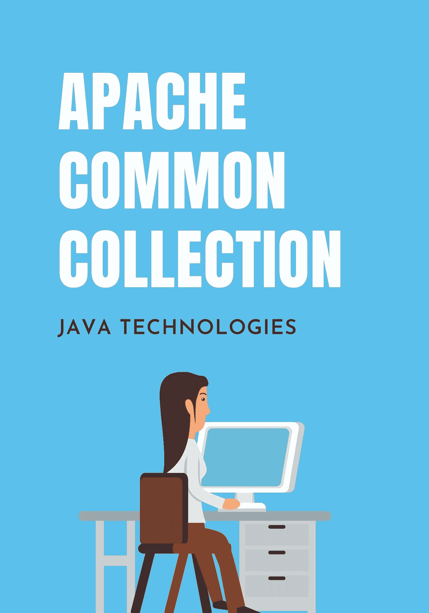

# Apache Commons Collections [Java 技术]



我想将这本书献给将要使用它的学生们。祝愿你们职业成功，并希望你们永不停学习。

# 概述

`Commons Collections` 扩展了 Java 集合框架。它提供了多项功能来简化集合处理。它提供了许多新的接口、实现和工具类。

`Commons Collections` 的主要特性如下：

- **Bag** — `Bag` 接口简化了包含每个对象多个副本的集合。

- **BidiMap** — `BidiMap` 接口提供了双向映射，可以使用键查找值，也可以使用值来查找键。

- **MapIterator** — `MapIterator` 接口为 map 提供了简单易用的迭代方法。

- **转换装饰器 (Transforming Decorators)** — 转换装饰器可以在对象被添加到集合时修改集合中的每一个对象。

- **复合集合 (Composite Collections)** — 当需要统一处理多个集合时使用复合集合。

- **有序映射 (Ordered Map)** — 有序 `Map` 保留了元素添加顺序。

- **有序集合 (Ordered Set)** — 有序 `Set` 保留了元素添加顺序。

- **引用映射 (Reference map)** — 引用映射允许在严格控制下对键/值进行垃圾回收。

- **比较器实现 (Comparator implementations)** — 提供了许多 `Comparator` 实现。

- **迭代器实现 (Iterator implementations)** — 提供了许多 `Iterator` 实现。

- **适配器类 (Adapter Classes)** — 提供了适配器类将数组和枚举转换为集合。

- **工具类 (Utilities)** — 提供了工具类来测试或创建集合典型的集合论属性，如并集、交集。支持闭包（`Closure`）。

# 环境搭建

## 本地环境搭建

如果你仍然愿意为 Java 编程语言设置环境，本节将指导你如何在机器上下载并设置 Java。

Java SE 可以从链接 `https://www.oracle.com/technetwork/java/archive-139210.html` 免费获取。因此，请根据你的操作系统下载版本。

按照说明下载 Java 并运行 `.exe` 在你的机器上安装 Java。一旦在机器上安装了 Java，你就需要设置环境变量以指向正确的安装目录。

### 为 Windows 2000/XP 设置路径

我们假设你已经将 Java 安装在 `c:\Program Files\java\jdk` 目录下。

- 右键点击“我的电脑”并选择“属性”。

- 点击“高级”选项卡下的“环境变量”按钮。

- 现在，修改 `Path` 变量，使其也包含 Java 可执行文件的路径。例如，如果路径当前设置为 `'C:\WINDOWS\SYSTEM32'`，则将路径改为 `'C:\WINDOWS\SYSTEM32;c:\Program Files\java\jdk\bin'`。

### 为 Windows 95/98/ME 设置路径

我们假设你已经将 Java 安装在 `c:\Program Files\java\jdk` 目录下。

- 编辑 `C:\autoexec.bat` 文件并在末尾添加以下行—— `'SET PATH=%PATH%;C:\Program Files\java\jdk\bin'`。

### 为 Linux, UNIX, Solaris, FreeBSD 设置路径

环境变量 `PATH` 应该指向 Java 二进制文件安装的位置。如有，请参考你的 shell 文档。

例如，如果你使用 `bash` 作为 shell，请在 `.bashrc` 的末尾添加以下内容：

```bash
export PATH=$PATH:/path/to/java/jdk/bin
```

## 常用编辑器

编写 Java 程序需要一个文本编辑器。市场上有很多 IDE。现在考虑以下之一：

- **记事本 (Notepad)** — Windows 简单编辑器。

- **NetBeans** — 开源 IDE。

- **Eclipse** — 广泛使用的开源 IDE。

## 下载 Common Collections

下载最新版本的 Common Collections 包。假设我们将其解压到 Apache 文件夹。

| OS | 压缩名称 |

| :--- | :--- |

| Windows | `commons-collections*.zip` |

| Linux | `commons-collections*.tar.gz` |

| Mac | `commons-collections*.tar.gz` |

## 设置 Apache 环境

设置环境变量 `APACHE_HOME` 指向 Apache 存储的基础目录。

| OS | 命令 |

| :--- | :--- |

| Windows | 设置 `APACHE_HOME` 为 `C:\Apache` |

| Linux | `export APACHE_HOME=/usr/apache` |

| Mac | `export APACHE_HOME=/Library/Apache` |

## 设置 CLASSPATH

设置环境变量 `CLASSPATH` 指向 Common Collections 包的位置。

| OS | 命令 |

| :--- | :--- |

| Windows | 设置 `CLASSPATH` 为 `%CLASSPATH%;%APACHE_HOME%\commons-collections-4.1.jar;` |

| Linux | `export CLASSPATH=$CLASSPATH:$APACHE_HOME/commons-collections-4.1.jar` |

| Mac | `export CLASSPATH=$CLASSPATH:$APACHE_HOME/commons-collections-4.1.jar` |

## Bag 接口

新增的接口支持 bag。`Bag` 定义了一个计算对象出现次数的集合。例如，如果 `Bag` 包含 `{a, a, b, c}`，则 `getCount("a")` 返回 2，而 `uniqueSet()` 返回唯一值。

### 接口声明

以下是 `org.apache.commons.collections4.Bag<E>` 接口的声明：

```java
public interface Bag<E>
extends Collection<E>
```

### 方法

`Bag` 方法如下：

| 序号 | 方法与描述 |

| :--- | :--- |

| 1 | `boolean add(E object)` — 向 `Bag` 添加指定对象的副本。 |

| 2 | `boolean add(E object, int nCopies)` — 向 `Bag` 添加指定对象的 `nCopies` 个副本。 |

| 3 | `boolean containsAll(Collection<?> coll)` — 如果包含给定集合中的所有元素（考虑数量），则返回 true。 |

| 4 | `int getCount(Object object)` — 返回当前 bag 中指定对象的出现次数（数量）。 |

| 5 | `Iterator<E> iterator()` — 返回一个用于整个成员集合的迭代器，包括由于数量产生的副本。 |

| 6 | `boolean remove(Object object)` — 从 bag 中移除指定对象的所有副本。 |

| 7 | `boolean remove(Object object, int nCopies)` — 从 `Bag` 中移除指定对象的 `nCopies` 个副本。 |

| 8 | `boolean removeAll(Collection<?> coll)` — 移除在给定集合中表示的所有元素，并考虑基数。 |

| 9 | `boolean retainAll(Collection<?> coll)` — 移除 `bag` 中不在给定集合中的任何成员，并考虑基数。 |

| 10 | `int size()` — 返回 `bag` 中所有类型的项目总数。 |

| 11 | `Set<E> uniqueSet()` — 返回 `Bag` 中唯一元素的 `Set`。 |

### 继承的方法

该接口继承了自以下接口的方法：

- `java.util.Collection`

### Bag 接口示例

`BagTester.java` 的示例如下：

```java
import org.apache.commons.collections4.Bag;
import org.apache.commons.collections4.bag.HashBag;

public class BagTester {
    public static void main(String[] args) {
        Bag<String> bag = new HashBag<>();
        // add "a" two times to the bag.
        bag.add("a", 2);
        // add "b" one time to the bag.
        bag.add("b");
        // add "c" one time to the bag.
        bag.add("c");
        // add "d" three times to the bag.
        bag.add("d", 3);

        // get the count of "d" present in bag.
        System.out.println("d is present " + bag.getCount("d") + " times.");
        System.out.println("bag: " + bag);
        // get the set of unique values from the bag
        System.out.println("Unique Set: " + bag.uniqueSet());
        // remove 2 occurrences of "d" from the bag
        bag.remove("d", 2);
        System.out.println("2 occurences of d removed from bag: " + bag);
        System.out.println("d is present " + bag.getCount("d") + " times.");
        System.out.println("bag: " + bag);
        System.out.println("Unique Set: " + bag.uniqueSet());
    }
}
```

### 输出

你将看到以下输出：

```
d is present 3 times.
bag: [2:a,1:b,1:c,3:d]
Unique Set: [a, b, c, d]
2 occurences of d removed from bag: [2:a,1:b,1:c,1:d]
d is present 1 times.
bag: [2:a,1:b,1:c,1:d]
Unique Set: [a, b, c, d]
```

## BidiMap 接口

新增了接口以支持双向 `Map`。使用双向映射，可以很容易通过值查找键，也可以通过键查找值。

### 接口声明

以下是 `org.apache.commons.collections4.BidiMap<K,V>` 接口的声明：

```java
public interface BidiMap<K,V>
extends IterableMap<K,V>
```

### 方法

`BidiMap` 接口的方法如下：

| 序号 | 方法与描述 |

| :--- | :--- |

| 1 | `K getKey(Object value)` — 获取当前映射到指定值的键。 |

| 2 | `BidiMap<V,K> inverseBidiMap()` — 获取此映射的视图，其中键和值是反转的。 |

| 3 | `V put(K key, V value)` — 将键值对放入映射中，替换任何先前的对。 |

| 4 | `K removeValue(Object value)` — 移除当前映射到指定值的键值对（可选操作）。 |

| 5 | `Set<V> values()` — 返回此映射中包含的值的 `Set` 视图。 |

### 继承的方法

该接口继承了自以下接口的方法：

- `org.apache.commons.collections4.Get`

- `org.apache.commons.collections4.IterableGet`

- `org.apache.commons.collections4.Put`

- `java.util.Map`

### BidiMap 接口示例

`BidiMapTester.java` 的示例如下：

```java
import org.apache.commons.collections4.BidiMap;
import org.apache.commons.collections4.bidimap.TreeBidiMap;

public class BidiMapTester {
    public static void main(String[] args) {
        BidiMap<String, String> bidi = new TreeBidiMap<>();
        bidi.put("One", "1");
        bidi.put("Two", "2");
        bidi.put("Three", "3");
        System.out.println(bidi.get("One"));
        System.out.println(bidi.getKey("1"));
        System.out.println("Original Map: " + bidi);
        bidi.removeValue("1");
        System.out.println("Modified Map: " + bidi);
        BidiMap<String, String> inversedMap = bidi.inverseBidiMap();
        System.out.println("Inversed Map: " + inversedMap);
    }
}
```

### 输出

运行代码时，你将看到以下输出：

```
1
One
Original Map: {One=1, Three=3}
Modified Map: {Three=3, Two=2}
Inversed Map: {Two=2, Three=3}
```

## MapIterator 接口

`Map` 接口很难迭代，而 `MapIterator` 针对 `Entry` 对象提供了简单的迭代。下面的示例说明了这一点。

### MapIterator 示例

`MapTester.java` 的示例如下：


## MapIterator 接口

以下示例展示了 `MapIterator` 接口的用法。该方法可以遍历`map`中的键值对，并输出每个键及其对应的值。

```java
import org.apache.commons.collections4.IterableMap;
import org.apache.commons.collections4.MapIterator;
import org.apache.commons.collections4.HashedMap;

public class MapIterator {
    public static void main(String[] args) {
        IterableMap<String, String> map = new HashedMap<>();
        map.put("1", "One");
        map.put("2", "Two");
        map.put("3", "Three");
        map.put("4", "Four");
        map.put("5", "Five");

        MapIterator<String, String> iterator = map.mapIterator();

        while (iterator.hasNext()) {
            Object key = iterator.next();
            Object value = iterator.getValue();
            System.out.println("key: " + key);
            System.out.println("Value: " + value);
        }
    }
}
```

### 输出

输出如下 −

```
key: 1
Value: One
key: 2
Value: Two
key: 3
Value: Three
key: 4
Value: Four
key: 5
Value: Five
```

## OrderedMap 接口

`OrderedMap` 是一个用于保留元素添加顺序的新接口。`LinkedMap` 和 `ListOrderedMap` 是两种实现。该接口支持正向或反向迭代。下面的示例说明了这一点。

### OrderedMap 示例

`OrderedMapTester.java` 的示例如下 −

```java
import org.apache.commons.collections4.OrderedMap;
import org.apache.commons.collections4.map.LinkedMap;

public class OrderedMapTester {
    public static void main(String[] args) {
        OrderedMap<String, String> map = new LinkedMap<>();
        map.put("One", "1");
        map.put("Two", "2");
        map.put("Three", "3");
        System.out.println(map.firstKey());
        System.out.println(map.nextKey("One"));
        System.out.println(map.nextKey("Two"));
    }
}
```

### 输出

结果如下 −

```
One
Two
Three
```

## Ignore Null

Apache Collections 库中的`CollectionUtils`类为常见的用例提供了各种实用方法。它有助于避免编写样板代码。在 Java 8 之前，该库非常有用，因为现在 `Stream` API 提供了类似功能。

### 检查非空元素

`CollectionUtils`的`addIgnoreNull()`方法可以确保只有非空值被添加到集合中。

### 声明

以下是`org.apache.commons.collections4.CollectionUtils.addIgnoreNull()`方法的声明 −

```java
public static <T> boolean addIgnoreNull(Collection<T> collection, T object)
```

### 参数

- `collection`: 要添加的集合，不能为 `null`。
- `object`: 要添加的对象，如果为 `null` 则不会被添加。

### 返回值

如果集合发生了变化，则返回 `true`。

### 异常

- `NullPointerException`: 如果集合为 `null`。

### 示例

下面的示例展示了`org.apache.commons.collections4.CollectionUtils.addIgnoreNull()`方法的用法。我们正尝试添加一个空值和一个示例非空值。

```java
import java.util.Collection;
import java.util.LinkedList;
import java.util.List;
import org.apache.commons.collections4.CollectionUtils;

public class CollectionUtilsTester {
    public static void main(String[] args) {
        List<String> list = new LinkedList<>();
        CollectionUtils.addIgnoreNull(list, null);
        CollectionUtils.addIgnoreNull(list, "sample");
        System.out.println(list);
    }
}
```

### 输出

输出如下 −

```
[sample]
```

```java
List<String> list = new LinkedList<String>();

CollectionUtils.addIgnoreNull(list, null);

CollectionUtils.addIgnoreNull(list, "a");

System.out.println(list);

if (list.contains(null)) {
    System.out.println("Null value is present");
} else {
    System.out.println("Null value is not present");
}
```

### 输出

输出如下所示 −

```
[a]
空值不存在
```

## 合并与排序

Apache Commons Collections 库的`CollectionUtils`类提供了用于常用操作的实用方法，涵盖了广泛的用例。它有助于避免编写样板代码。在 `jdk 8` 之前，此库非常有用，因为类似的功能现在由 Java 8 的 `Stream` API 提供。

### 合并两个已排序的列表

`CollectionUtils`的`collate()`方法可以合并两个已经排序的列表。

### 声明

以下是`org.apache.commons.collections4.CollectionUtils.collate()`方法的声明 −

```java
public static <O extends Comparable<? super O>> List<O>
collate(Iterable<? extends O> a, Iterable<? extends O> b)
```

### 参数

- `a` − 第一个集合，不能为 `null`。
- `b` − 第二个集合，不能为 `null`。

### 返回值

一个新的包含集合 `a` 和 `b` 元素的新排序 `List`。

### 异常

- `NullPointerException` − 如果任意集合为 `null`。

### 示例

以下示例展示了`org.apache.commons.collections4.CollectionUtils.collate()`方法的使用。我们将合并两个已排序的列表，然后打印合并并排序后的列表。

```java
import java.util.Arrays;
import java.util.List;
import org.apache.commons.collections4.CollectionUtils;

public class CollectionUtilsTester {
    public static void main(String[] args) {
        List<String> sortedList1 = Arrays.asList("A", "C", "E");
        List<String> sortedList2 = Arrays.asList("B", "D", "F");
        List<String> mergedList = CollectionUtils.collate(sortedList1, sortedList2);
        System.out.println(mergedList);
    }
}
```

### 输出

输出如下 −

```
[A, B, C, D, E, F]
```

## 转换对象

Apache Commons Collections 库的`CollectionUtils`类提供了用于常用操作的实用方法，涵盖了广泛的用例。它有助于避免编写样板代码。在 `jdk 8` 之前，此库非常有用，因为类似的功能现在由 Java 8 的 `Stream` API 提供。

### 转换列表

`CollectionUtils`的`collect()`方法可以将一种类型对象的列表转换为另一种类型对象的列表。

### 声明

以下是`org.apache.commons.collections4.CollectionUtils.collect()`方法的声明 −

```java
public static <I,O> Collection<O> collect(Iterable<I> inputCollection,
Transformer<? super I,? extends O> transformer)
```

### 参数

- `inputCollection` − 获取输入的集合，不能为 `null`。
- `Transformer` − 要使用的转换器，可以为 `null`。

### 返回值

转换后的结果（新列表）。

### 异常

- `NullPointerException` − 如果输入集合为 `null`。

### 示例

以下示例展示了`org.apache.commons.collections4.CollectionUtils.collect()`方法的使用。我们将通过解析字符串中的整数值将字符串列表转换为整数列表。

```java
import java.util.Arrays;
import java.util.List;
import org.apache.commons.collections4.CollectionUtils;
import org.apache.commons.collections4.Transformer;

public class CollectionUtilsTester {
    public static void main(String[] args) {
        List<String> stringList = Arrays.asList("1", "2", "3");
        List<Integer> integerList = (List<Integer>) CollectionUtils.collect(
            stringList, new Transformer<String, Integer>() {
                @Override
                public Integer transform(String input) {
                    return Integer.parseInt(input);
                }
            });
        System.out.println(integerList);
    }
}
```

### 输出

当使用该代码时，将得到以下结果 −

```
[1, 2, 3]
```

## 过滤对象

Apache Commons Collections 库的`CollectionUtils`类提供了用于常用操作的实用方法，涵盖了广泛的用例。它有助于避免编写样板代码。在 `jdk 8` 之前，此库非常有用，因为类似的功能现在由 Java 8 的 `Stream` API 提供。

### filter() 方法

`CollectionUtils`的`filter()`方法可以过滤列表以移除不满足传递的谓词条件的对象。

### 声明

以下是`org.apache.commons.collections4.CollectionUtils.filter()`方法的声明 −

```java
public static <T> boolean filter(Iterable<T> collection,
Predicate<? super T> predicate)
```

### 参数

- `collection` − 获取输入的集合，不能为 `null`。
- `predicate` − 用于过滤的谓词，可以为 `null`。

### 返回值

如果集合通过此调用被修改，则返回 `true`，否则返回 `false`。

### 示例

以下示例展示了`org.apache.commons.collections4.CollectionUtils.filter()`方法的使用。我们将过滤整数列表以获取偶数。

```java
import java.util.ArrayList;
import java.util.Arrays;
import java.util.List;
import org.apache.commons.collections4.CollectionUtils;
import org.apache.commons.collections4.Predicate;

public class CollectionUtilsTester {
    public static void main(String[] args) {
        List<Integer> integerList = new ArrayList<>();
        integerList.addAll(Arrays.asList(1, 2, 3, 4, 5, 6, 7, 8));
        System.out.println("Original List: " + integerList);
        CollectionUtils.filter(integerList, new Predicate<Integer>() {
            @Override
            public boolean evaluate(Integer input) {
                if (input.intValue() % 2 == 0) {
                    return true;
                }
                return false;
            }
        });
        System.out.println("Filtered List (Even numbers): " + integerList);
    }
}
```

### 输出

将产生以下结果 −

```
Original List: [1, 2, 3, 4, 5, 6, 7, 8]
Filtered List (Even numbers): [2, 4, 6, 8]
```

### filterInverse() 方法

`CollectionUtils`的`filterInverse()`方法可以过滤列表以移除满足谓词条件的对象。

### 声明

以下是`org.apache.commons.collections4.CollectionUtils.filterInverse()`方法的声明 −

```java
public static <T> boolean filterInverse(Iterable<T> collection,
Predicate<? super T> predicate)
```

### 参数

- `collection` − 获取输入的集合，不能为 `null`。
- `predicate` − 用于过滤的谓词，可以为 `null`。

### 返回值

如果集合通过此调用被修改，则返回 `true`，否则返回 `false`。

### 示例

以下示例展示了`org.apache.commons.collections4.CollectionUtils.filterInverse()`方法的使用。我们将过滤整数列表以获取奇数。


# Apache Commons Collections `CollectionUtils` 指南

以下代码示例展示了 `CollectionUtils.filterInverse()` 的使用方法，用于过滤列表中的元素：

```java
import java.util.ArrayList;
import java.util.Arrays;
import java.util.List;
import org.apache.commons.collections4.CollectionUtils;
import org.apache.commons.collections4.Predicate;

public class CollectionUtilsTester {
    public static void main(String[] args) {
        List<Integer> integerList = new ArrayList<>();
        integerList.addAll(Arrays.asList(1, 2, 3, 4, 5, 6, 7, 8));
        System.out.println("Original List: " + integerList);
        CollectionUtils.filterInverse(integerList, new Predicate<Integer>() {
            @Override
            public boolean evaluate(Integer input) {
                if (input.intValue() % 2 == 0) {
                    return true;
                }
                return false;
            }
        });
        System.out.println("Filtered List (Odd numbers): " + integerList);
    }
}
```

### 输出

结果如下所示 −

```
Original List: [1, 2, 3, 4, 5, 6, 7, 8]
Filtered List (Odd numbers): [1, 3, 5, 7]
```

Apache Commons Collections 库的 `CollectionUtils` 类为常用操作提供了各种实用方法，涵盖了广泛的使用场景。它有助于避免编写模板代码。在`jdk 8`之前，这个库非常有用，因为类似的功能现在由 Java 8 的`Stream API`提供。

## 检查非空列表

`CollectionUtils`的`isNotEmpty()`方法可以检查列表是否不为空，而无需担心列表为`null`。因此，在检查列表大小之前，不需要处处放置`null`检查。

### 声明

以下是`org.apache.commons.collections4.CollectionUtils.isNotEmpty()`方法的声明 −

```java
public static boolean isNotEmpty(Collection<?> coll)
```

### 参数

* `coll` − 要检查的集合，可能为 null。

### 返回值

如果非空且不为空，则返回 true。

### 示例

以下示例展示了`org.apache.commons.collections4.CollectionUtils.isNotEmpty()`方法的使用。我们将检查一个列表是否为空。

```java
import java.util.List;
import org.apache.commons.collections4.CollectionUtils;

public class CollectionUtilsTester {

    public static void main(String[] args) {
        List<String> list = getList();
        System.out.println("Non-Empty List Check: " + checkNotEmpty1(list));
        System.out.println("Non-Empty List Check: " + checkNotEmpty2(list));
    }

    static List<String> getList() {
        return null;
    }

    static boolean checkNotEmpty1(List<String> list) {
        return !(list == null || list.isEmpty());
    }

    static boolean checkNotEmpty2(List<String> list) {
        return CollectionUtils.isNotEmpty(list);
    }
}
```

### 输出

输出如下 −

```
Non-Empty List Check: false
Non-Empty List Check: false
```

## 检查空列表

`CollectionUtils`的`isEmpty()`方法可以检查列表是否为空，而无需担心列表为`null`。因此，在检查列表大小之前，不需要处处放置`null`检查。

### 声明

以下是`org.apache.commons.collections4.CollectionUtils.isEmpty()`方法的声明 −

```java
public static boolean isEmpty(Collection<?> coll)
```

### 参数

* `coll` − 要检查的集合，可能为 null。

### 返回值

如果为空或 null，则返回 true。

### 示例

以下示例展示了`org.apache.commons.collections4.CollectionUtils.isEmpty()`方法的使用。我们将检查一个列表是否为空。

```java
import java.util.List;
import org.apache.commons.collections4.CollectionUtils;

public class CollectionUtilsTester {

    public static void main(String[] args) {
        List<String> list = getList();
        System.out.println("Empty List Check: " + checkEmpty1(list));
        System.out.println("Empty List Check: " + checkEmpty2(list));
    }

    static List<String> getList() {
        return null;
    }

    static boolean checkEmpty1(List<String> list) {
        return (list == null || list.isEmpty());
    }

    static boolean checkEmpty2(List<String> list) {
        return CollectionUtils.isEmpty(list);
    }
}
```

### 输出

代码输出如下所示 −

```
Empty List Check: true
Empty List Check: true
```

## 包含

Apache Commons Collections 库的 `CollectionUtils` 类为常用操作提供了各种实用方法，涵盖了广泛的使用场景。它有助于避免编写模板代码。在`jdk 8`之前，这个库非常有用，因为类似的功能现在由 Java 8 的`Stream API`提供。

### 检查子集合

`CollectionUtils`的`isSubCollection()`方法可以检查一个集合是否包含给定的集合。

### 声明

以下是`org.apache.commons.collections4.CollectionUtils.isSubCollection()`方法的声明 −

```java
public static boolean isSubCollection(
    Collection<?> a, Collection<?> b)
```

### 参数

* `a` − 第一个（子）集合，不能为 null。
* `b` − 第二个（父）集合，不能为 null。

### 返回值

当且仅当`a`是`b`的子集合时，返回 true。

### 示例

以下示例展示了`org.apache.commons.collections4.CollectionUtils.isSubCollection()`方法的使用。我们将检查一个列表是否是另一个列表的一部分。

```java
import java.util.Arrays;
import java.util.List;
import org.apache.commons.collections4.CollectionUtils;

public class CollectionUtilsTester {
    public static void main(String[] args) {
        //checking inclusion
        List<String> list1 = Arrays.asList("A", "A", "A", "C", "B", "B");
        List<String> list2 = Arrays.asList("A", "A", "B", "B");
        System.out.println("List 1: " + list1);
        System.out.println("List 2: " + list2);
        System.out.println("Is List 2 contained in List 1: " +
        CollectionUtils.isSubCollection(list2, list1));
    }
}
```

### 输出

你将获得以下输出 −

```
List 1: [A, A, A, C, B, B]
List 2: [A, A, B, B]
Is List 2 contained in List 1: true
```

## 交集

Apache Commons Collections 库的 `CollectionUtils` 类为常用操作提供了各种实用方法，涵盖了广泛的使用场景。它有助于避免编写模板代码。在`jdk 8`之前，这个库非常有用，因为类似的功能现在由 Java 8 的`Stream API`提供。

### 检查交集

`CollectionUtils`的`intersection()`方法用于获取两个集合之间的交集。

### 声明

以下是`org.apache.commons.collections4.CollectionUtils.intersection()`方法的声明 −

```java
public static <O> Collection<O> intersection(Iterable<? extends O> a, Iterable<? extends O> b)
```

### 参数

* `a` − 第一个（子）集合，不能为 null。
* `b` − 第二个（父）集合，不能为 null。

### 返回值

交集的集的集合。

### 示例

以下示例展示了`org.apache.commons.collections4.CollectionUtils.intersection()`方法的使用。我们将获取两个列表的交集。

```java
import java.util.Arrays;
import java.util.List;
import org.apache.commons.collections4.CollectionUtils;

public class CollectionUtilsTester {
    public static void main(String[] args) {
        //checking inclusion
        List<String> list1 = Arrays.asList("A", "A", "A", "C", "B", "B");
        List<String> list2 = Arrays.asList("A", "A", "B", "B");
        System.out.println("List 1: " + list1);
        System.out.println("List 2: " + list2);
        System.out.println("Commons Objects of List 1 and List 2: " +
        CollectionUtils.intersection(list1, list2));
    }
}
```

### 输出

运行代码后，你将看到以下输出 −

```
List 1: [A, A, A, C, B, B]
List 2: [A, A, B, B]
Commons Objects of List 1 and List 2: [A, A, B, B]
```

## 差集

Apache Commons Collections 库的 `CollectionUtils` 类为常用操作提供了各种实用方法，涵盖了广泛的使用场景。它有助于避免编写模板代码。在`jdk 8`之前，这个库非常有用，因为类似的功能现在由 Java 8 的`Stream API`提供。

### 检查差集

`CollectionUtils`的`subtract()`方法可以通过从一个集合中减去另一个集合的对象来获取新集合。

### 声明

```java
public static <O> Collection<O> subtract(Iterable<? extends O> a, Iterable<? extends O> b)
```

### 参数

* `a` − 被减的集合，不能为 null。
* `b` − 要减去的的集合，不能为 null。

### 返回值

包含结果的新集合。

### 示例

以下示例展示了`org.apache.commons.collections4.CollectionUtils.subtract()`方法的使用。我们将获取两个列表的差集。

```java
public class CollectionUtilsTester {
    public static void main(String[] args) {
        //checking inclusion
        List<String> list1 = Arrays.asList("A", "A", "A", "C", "B", "B");
        List<String> list2 = Arrays.asList("A", "A", "B", "B");
        System.out.println("List 1: " + list1);
        System.out.println("List 2: " + list2);
        System.out.println("List 1 - List 2: " + CollectionUtils.subtract(list1, list2));
    }
}
```

### 输出

当执行上述代码时，你应该能够看到以下输出 −

```
List 1: [A, A, A, C, B, B]
List 2: [A, A, B, B]
List 1 - List 2: [A, C]
```

## 并集 (Union)

Apache Commons Collections 库中的 `CollectionUtils` 类提供了用于常见操作的各种实用方法，涵盖了广泛的应用场景。它可以帮助避免编写冗长的模板代码。在 JDK 8 之前，这个库非常有用，因为类似的功能现在由 Java 8 的`Stream API`提供。

### 检查并集

`CollectionUtils`的`union()`方法可获取两个集合的并集。

### 声明

以下是`org.apache.commons.collections4.CollectionUtils.union()`方法的声明 ー

```java
public static <O> Collection<O> union(
Iterable<? extends O> a, Iterable<? extends O> b)
```

### 参数

* `a` − 第一个集合，不能为空。
* `b` − 第二个集合，不能为空。

### 返回值

两个集合的并集。

### 示例

以下示例展示了`org.apache.commons.collections4.CollectionUtils.union()`方法的使用。我们将获取两个列表的并集。


```java
import java.util.Arrays;
import java.util.List;
import org.apache.commons.collections4.CollectionUtils;

public class CollectionUtilsTester {
    public static void main ( String [] args) {
        //checking inclusion
        List<String> list1 = Arrays.asList("A", "A", "A", "C", "B", "B");
        List<String> list2 = Arrays.asList("A", "A", "B", "B");
        System.out.println("List 1: " + list1);
        System.out.println("List 2: " + list2);
        System.out.println("Union of List 1 and List 2: "
        + CollectionUtils.union(list1, list2));
    }
}
```

### 输出

这产生了以下输出 −

```
List 1: [A, A, A, C, B, B]
List 2: [A, A, B, B]
Union of List 1 and List 2: [A, A, A, B, B, C]
```
