# Apache Hadoop 秘籍

### 4.8 下载配置文件 68
### 9.4.3 Reducer 111
### 9.6.2 将输入数据传输到 HDFS 113
### 9.6.3 提交 MapReduce 作 115
### 9.6.4 理解控制台日志 117
### 9.6.5 MapReduce 作业输出 119

## 9.7 结论 122

## 9.8 下载源代码 122

### 10.3.4 配置文件 130
### 10.3.6 启动服务器 132

## 10.4 Zookeeper 服务器基础交互 133

## 10.6 下载 139

# 前言

Apache Hadoop 是一个用 Java 编写的开源软件框架，用于在由通用硬件构建的计算机集群上对极数据集进行分布式存储和分布式处理。Hadoop 的所有模块都基于一个基本假设：硬件故障是常见的，并且应该由框架自动处理。

Hadoop 已经成为分布式计算的事实标准工具。正因如此，我们在 Java Code Geeks 提供了大量的教程，其中大部分可以在此处找到：`https://examples.javacodgeeks.com/category/enterprise-java/apache-hadoop/`

在这本电子书中，我们提供了一系列基于 Hadoop 的示例汇编，将帮助你启动自己的 Web 项目。我们涵盖了广泛的主题，从安装和配置到分布式缓存和流式处理。通过我们直观的教程，你将能够以最短的时间让自己的项目运行起来。

# 作者简介

Ramaninder 毕业于德国格尔斯-奥古斯特大学计算机科学与数学系，目前在奥地利的一个大数据研究中心工作。拥有应用计算机科学硕士学位，专业应用系统工程，辅修商业信息学。

他还是一名微软认证专业人员，在 Java、C#、Web 开发及相关技术方面拥有 5 年以上的经验。目前，他的主要兴趣是大数据生态系统（包括批处理和流处理系统）、机器学习和 Web 应用。

# 第一章

## “Hello World”示例

### 1.1 介绍

Hadoop 是 Apache 软件基金会的项目。它是受 GoogleReduce 和 Google File System 启发的开源版本。

它设计用于跨越通用标准硬件上的系统集群对大型数据集进行分布式处理。

Hadoop 的设计假设所有硬件早晚都会故障，系统应该是健壮的并能够自动处理硬件故障。

Apache Hadoop 由两个核心组件组成：

- 分布式文件系统，简称 HDFS（Hadoop Distributed File System）。
- 用于 MapReduce 作的框架和 API。

在这个示例中，我们将演示 Hadoop 框架的第二个组件 MapReduce，并将通过单词计数示例（Hadoop 生态系统的 Hadoop World 程序）来完成，但首先我们应该理解 MapReduce 到底是什么。

MapReduce 基本上是一个软件框架或编程模型，允许用户编写程序，以便数据可以在集群中的多个系统上并行处理。MapReduce 由两部分组成：Map 和 Reduce。

- **Map 任务**：Map 任务使用`map()`函数执行，主要执行过滤和排序。这部分负责处理一个或多个数据块并产生输出结果，通常称为中间结果。如下所示，map 任务通常是并行的，映射操作之间相互独立。
- **Reduce**：Reduce 任务由`reduce()`函数执行，并执行汇总操作。它负责合并每个 Map 任务产生的结果。

### 1.2 Hadoop 单词计数示例

单词计数是 Hadoop 和 MapReduce 的“Hello World”程序。在这个示例中，程序包含一个 MapReduce 任务，用于统计文件中每个单词出现的次数。该任务由 Map 和 Reduce 两部分组成。Map 任务映射文件中的数据，并统计传递给`map()`函数的数据块中的每个单词。该任务的结果传递给 reduce，reduce 合并数据并在磁盘上输出最终结果。

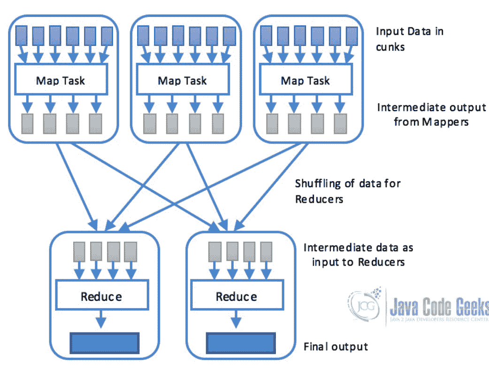

图 1.1：MapReduce 作中 Map 和 Reduce 任务的基本原理

### 1.2.1 设置

我们将使用 Maven 为 Hadoop 单词计数示例设置新项目。我们在 Eclipse 中设置一个 Maven 项目，并在`pom.xml`中添加以下 Hadoop 依赖项。这将确保我们拥有访问 Hadoop 代码库所需的权限。

```xml
<dependency>
  <groupId>org.apache.hadoop</groupId>
  <artifactId>hadoop-core</artifactId>
  <version>1.2.1</version>
</dependency>
```

添加依赖项后，我们就可以开始编写单词计数代码了。

### 1.2.2 Mapper 代码

`map()`任务负责空格和单词对输入文本进行分词，然后遍历所有标记，并为每个单词发射一个计数为 1 的键值对，例如 `<Hello, 1>`。以下是`MapClass`，它需要继承 MapReduce Mapper 类并重写`map()`方法。该方法将接收一个待处理的数据数据块。当此方法被调用时，函数的`value`参数将数据分词为单词，而`context`将写入中间输出，然后这些输出将被发送到其中一个 reducer。

`MapClass.java`

```java
package com.javacodgeeks.examples.wordcount;

import java.io.IOException;
import java.util.StringTokenizer;

import org.apache.hadoop.io.IntWritable;
import org.apache.hadoop.io.LongWritable;
import org.apache.hadoop.io.Text;
import org.apache.hadoop.mapreduce.Mapper;

public class MapClass extends Mapper<LongWritable, Text, IntWritable>{
    private final static IntWritable one = new IntWritable(1);
    private Text word = new Text();

    @Override
    protected void map(Long key, Text value,
        Context context)
        throws IOException, InterruptedException {

        String line = value.toString();
        StringTokenizer st = new StringTokenizer(line, ", \ ");

        while (st.hasMoreTokens()) {
            word.set(st.nextToken());
            context.write(word,one);
        }
    }
}
```

### 1.2.3 Reducer 代码

后续代码片段`ReduceClass`继承了 MapReduce Reducer 类并重写了`reduce()`函数。该函数在`map()`方法之后被调用，并接收键（即单词）和对应的值。Reducer 遍历值，将它们加到一个单独值中，最后将单词和该单词出现的次数写入输出文件。

`ReduceClass.java`

```java
package com.javacodgeeks.examples.wordcount;

import java.io.IOException;
import java.util.Iterator;

import org.apache.hadoop.io.IntWritable;
import org.apache.hadoop.io.Text;
import org.apache.hadoop.mapreduce.Reducer;

public class ReduceClass extends Reducer{
    @Override
    protected void reduce(Text key, Iterable values,
        Context context)
        throws IOException, InterruptedException {
```

```java
int sum = 0;
Iterator valuesIt = values.iterator();

while (valuesIt.hasNext()) {
    sum = sum + valuesIt.next().get();
}
context.write(key, new IntWritable(sum));
```

### 1.2.4 整合：Driver 类

所以当我们准备好 map 和 reduce 类后，是时候将它们整合为一个单一作业了，这是在一个名为 driver 的类中完成的。该类包含`main()`方法用于设置和运行作业。以下代码检查输入参数是否正确，即输入和输出文件的路径。通过设置和运行作业，在最后，它会判断作业是否成功完成。带有单词计数及其对应数量的结果文件将出现在输出路径中。

`WordCount.java`

```java
package org.apache.hadoopopcodeeks.examples.wordcount;
import org.apache.hadoop.conf.Config;
import org.apache.hadoop.fs.Path;
import org.apache.hadoop.io.IntWritable;
import org.apache.hadoop.io.Text;
import org.apache.hadoop.mapreduce.Job;
import org.apache.hadoop.mapreduce.lib.FileInputFormat;
import org.apache.hadoop.mapreduce.lib.output.FileOutputFormat;
import org.apache.hadoop.mapreduce.util.Tool;
import org.apache.hadoop.mapreduce.lib.output.TextOutputFormat;
import org.apache.hadoop.util.ToolRunner;

public class WordCount extends Config {

    public static void main(String[] args) throws Exception {
        int exitCode = ToolRunner.run(new WordCount(), args);
        System.exit(exitCode);
    }

    public int run(String[] args) throws Exception {
        if (args.length != 2) {
            System.err.printf("Usage: %s needs two arguments, input and output file%s\n", get().getClass().getSimpleName());
            return -1;
        }

        Job job = new Job(get());
        job.setJarByClass(WordCount.class);
        job.setAppName("WordCount");

        FileInputFormat.setInputPath(job, new Path(args[0]));
        FileOutputFormat.setOutputPath(job, new Path(args[1]));

        job.setOutputKeyClass(Text.class);
        job.setOutputValueClass(IntWritable.class);
        job.setOutputFormatClass(TextOutputFormat.class);

        job.setMapperClass(MapClass.class);
        job.setReducerClass(ReduceClass.class);
        return 0;
    }
}
```

```java
int returnValue = job.waitForCompletion(true) ? 0:1;
if(job.isSuccessful()) {
    System.out.println("Job was successful");
} else if(!job.isSuccessful()) {
    System.out.println("Job was not successful");
}

return returnValue;
```

## 1.3 运行示例

为了测试代码实现，我们可以直接从 Eclipse 中运行程序进行测试。首先，创建一个包含虚拟数据的`input.txt`文件。为了测试目的，我们在项目根目录下创建了一个包含以下文本的文件。

`input.txt`


```
This is the example text file for count example also known as hello world of the Hadoop ecosystem.
This example is written for the examples article of java code geek
The quick brown fox jumps over the lazy dog.
The above line is one of the most famous lines which contains all the english language alphabets.
```

在 `Eclipse` 中，在项目参数（`project arguments`）中传递输入文件和输出文件名。以下是参数的格式。在这种情况下，输入文件位于项目根目录下，因此只需要提供文件名；如果你的输入文件位于其他位置，则应提供完整路径。

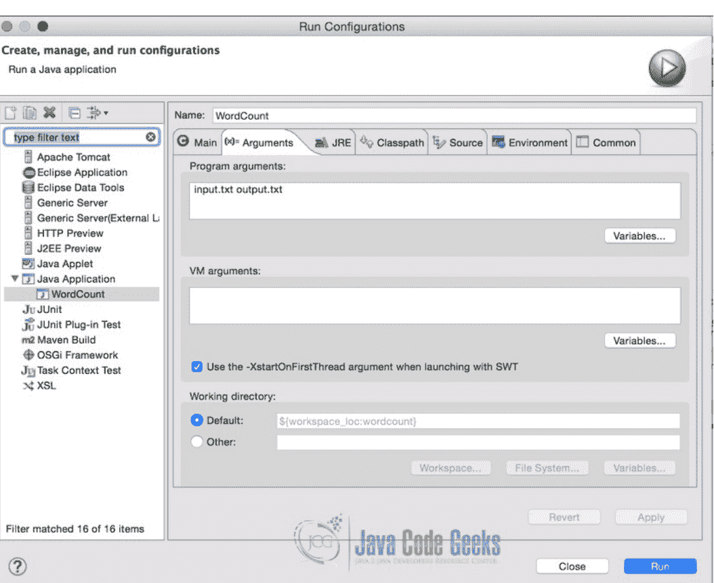

图 1.2: `Eclipse` 项目运行配置

**注意：** 确保输出文件不存在。如果文件已存在，程序将抛出错误。

设置参数后，直接运行应用程序。一旦应用程序成功完成，控制台将显示输出：

| Problems @ Javadoc Declaration | Console |
| :--- | :--- |
| \<terminated>WordCount [Java Application]/Library/java/JavaVirtualMachines/jdk18.0_60.jdk/Contents/Home/bin/java | N |
| Nov 24, 2015 03:19:49 AM org.apache.hadoop.mapred.Counters log | INFO: Reduce output records=43 |
| Nov 24, 2015 03:19:49 AM org.apache.hadoop.mapred.Counters log | INFO: Map output records=58 |
| Nov 24, 2015 03:19:49 AM org.apache.hadoop.mapred.Counters log | INFO: Combining input records=0 |
| Nov 24, 2015 03:19:49 AM org.apache.hadoop.mapred.Counters log | INFO: Total committed heap usage (bytes)=514850816 |
| Nov 24, 2015 03:19:49 AM org.apache.hadoop.mapred.Counters log | INFO: Input Format Counters |
| Nov 24, 2015 03:19:49 AM org.apache.hadoop.mapred.Counters log | INFO: Bytes Read=322 |
| Nov 24, 2015 03:19:49 AM org.apache.hadoop.mapred.Counters log | INFO: FileSystemCounters |
| Nov 24, 2015 03:19:49 AM org.apache.hadoop.mapred.Counters log | INFO: FILE_BYTES_WRITTEN=103805 |
| Nov 24, 2015 03:19:49 AM org.apache.hadoop.mapred.Counters log | INFO: FILE_BYTES_READ=1676 |
| Nov 24, 2015 03:19:49 AM org.apache.hadoop.mapred.Counters log | INFO: File Output Counters |
| Nov 24, 2015 03:19:49 AM org.apache.hadoop.mapred.Counters log | INFO: Bytes Written=351 |
| Job was successful | |


我们特别关注最后一行：

`Job was successful`

这表明 `MapReduce` 任务执行成功。这意味着输出文件已写入到提供的参数中。以下是提供的输入文件对应的输出文件内容：

```
Hadoop 1
The 2
this 2
above 1
all 1
alphabets. 1
also 1
article 1
as 1
nbrown 1
code 1
contains 1
count 1
dog.
ecosystem. 1
english 1
example 4
examples
famous 1
file 1
for 2
fox 1
geek 1
hello 1
is 3
java 1
jumps 1
knows 1
language 1
lazy 1
line 1
lines 1
most 1
of 3
one 1
over 1
quick 1
text 1
the 6
which 1
word 1
world 1
written 1
```

## 1.4 下载完整源代码

这是一个 `Hadoop MapReduce` 单词计数（`Hello World`）程序示例。

**下载**- 

- 你可以此示例的完整源代码：`WordCountExample`

## 如何在 `Ubuntu` 上安装 `Apache Hadoop`

在本示例中，我们将介绍如何在 `Ubuntu` 系统上安装 `Apache Hadoop` 的细节。我们将完成所有必要的步骤，从 `Apache Hadoop` 的先决条件开始，然后配置 `Hadoop`，最后通过学习如何向 `Hadoop` 插入数据以及在该数据上运行示例任务来结束本示例。

### 2.1 介绍

本示例将描述在 `Ubuntu 15.10` 上安装单节点 `Apache Hadoop` 集群的所有必要步骤。`Hadoop` 是一个用于大型通用硬件集群上分布式处理应用的框架。它用 `Java` 编写，遵循 `MapReduce` 计算模型。

### 2.2 先决条件

以下是在 `Ubuntu` 上运行 `Apache Hadoop` 的先决条件。请按照步骤准备所有先决条件。

### 2.2.1 安装 Java

由于 `Apache Hadoop` 是 `Java` 编写的，因此需要在系统中安装最新的 `Java`。要安装 `Java`，首先更新源列表：

```bash
# 更新源列表
sudo apt-get update
```

它将更新下方所示更新所有现有包。

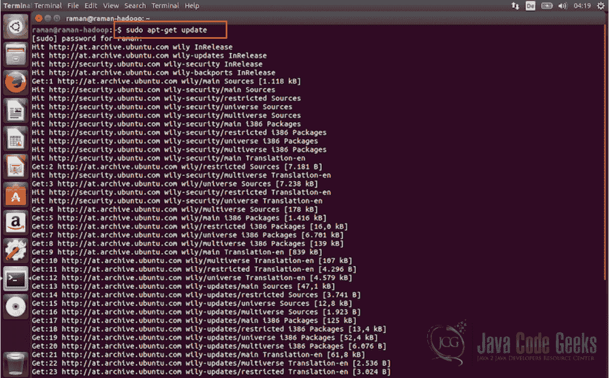

图 2.1: 更新源列表

现在使用以下命令安装 `jdk`。

```bash
# OpenJDK 项目是 Java 的默认版本
sudo apt-get install default-jdk
```

`OpenJDK` 是 `Ubuntu Linux` 的默认 `Java` 版本。它应该通过 `apt-get` 命令成功安装。

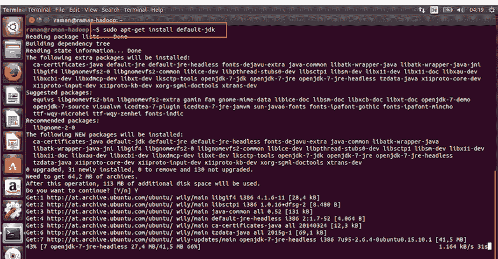

`default-jdk` 安装的是 `Java 1.7` 版本。如果你愿意， 1.8 版本也可以运行 `Hadoop`，你也可以显式地安装 1.8 版本。

```bash
# Java 版本
java -version
```

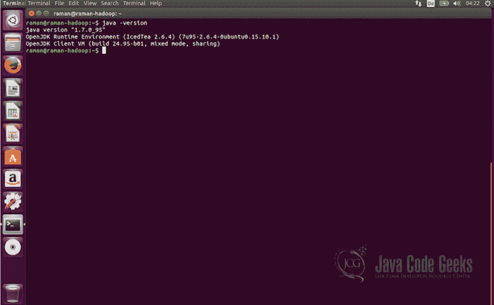

图 2.2: 安装 Java

### 2.2.2 创建用户

这完成了 `Hadoop` 的先决条件。接下来我们将创建一个用于执行的专用用户。`Hadoop` 执行需要一个独立的用户。要创建用户，使用以下命令：

```bash
# 创建用户
sudo useradd hadoop
```

### 2.2.3 禁用 `ipv6`

下一步是在所有机器上禁用 `ipv6`。这就是为什么在创建集群用户之前需要禁用 `ipv6`。

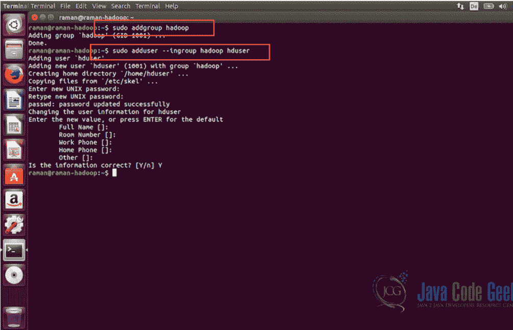

图 2.3: 禁用 `ipv6`

### 2.2.4 设置证书

`Hadoop` 需要 `SSH` 访问来管理远程节点，本地机器也是如此。对于本示例，我们需要配置本地 `SSH` 访问。因此，我们需要确保 `SSH` 运行并设置公钥访问以便免密登录。

为此，使用 `nano` 或任何其他编辑器打开 `sysctl.conf` 文件：

```bash
# 打开 sysctl.conf
sudo nano /sysctl.conf
```

在文件末尾添加以下行：

```text
# 禁用 ipv6 的命令
net.ipv6.conf.all.disable_ipv6=1
net.ipv6.conf.default.disable_ipv6=1
net.ipv6.conf.lo.disable_ipv6=1
```

使用 `ctrl+X` 保存文件并在提示时按 `Yes`。然后使用以下命令应用更改：

```bash
sudo sysctl -p
```

之后，检查 `ipv6` 是否已正确禁用：

```bash
cat /proc/sys/net/ipv6/conf/all/disable_ipv6
```

它应该返回输出 1，我们希望它是 1，以象征 `ipv6` 已禁用。

为了确保一切设置妥当，使用以下命令并确保输出与屏幕所示相似：

```bash
# 安装 ssh
sudo apt-get install ssh
```


图 2.4: 设置证书

```
# 检查 ssh
which ssh

# 检查 sshd
which sshd
```

上述两个命令显示了 `ssh` 和 `sshd` 安装的文件夹路径，如下方的截图所示。这是为了确保系统中都存在这两个组件。

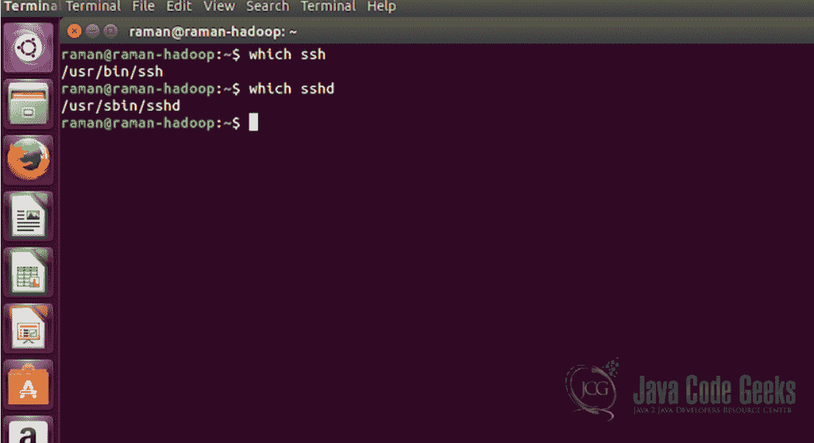

图 2.6: 检查 `ssh` 和 `sshd`

现在，为了生成 `ssh` 证书，我们将切换到 `hduser` 用户。在接下来的命令中，生成密钥时我们将保持密码为空，如果你想提供密码也可以这样做。

```
# 切换到用户
hduser

# 生成 ssh 密钥
ssh-keygen -t rsa -P ""
```

第二个命令将为机器创建一个 `RSA` 密钥对。此密钥的密码将为空，如命令所示。它会提示存储密钥的路径，默认路径为 `HOME/id-rsa`，按回车即可。如果你打算更改路径，请记住它在下一步中需要用到。


图 2.7: 生成 `ssh` 密钥

使用上一步创建密钥为机器启用 `SSH` 访问。为此我们需要将密钥添加到机器的 `authorized keys` 列表中。

```
cat $HOME/.ssh/id_rsa.pub >> $HOME/.ssh/authorized_keys
```

我们可以通过以下命令检查 `ssh` 是否正常，如果连接 `localhost` 不需要密码提示，说明证书已正确启用。

```
ssh localhost
```

现在完成了 `Hadoop` 的所有准备工作。下一节将检查如何设置 `Hadoop`。

## 2.3 安装 Hadoop

完成所有准备工作后，我们准备好在我们的 `Ubuntu` 机器上安装 `Apache Hadoop`。

### 2.3.1 下载 Hadoop

- 从 `Apache` 镜像站 `www.apache.org/cluster.cgi/hadoop` 手动下载 `Hadoop`，也可以使用 `wget`。

- 下载完成后，解压 `hadoop` 文件夹并移动到 `/usr/local/hadoop`，最后将文件夹的所有者更改为 `hduser` 组。

```bash
# 进入目录
cd /usr/local

# 将 hadoop 文件移动到目录
sudo mv /home/hadoop/Downloads/hadoop-2.7.1 hadoop

# 修改权限给 huser
sudo chown -R huser:hadoop
```

我们现在使用命令检查 `hadoop` 文件夹的权限：

```bash
ls -lah
```

该命令显示了 `/usr/local/` 目录的内容列表以及元数据。如下方的所示，`Hadoop` 文件夹的所有者应该是 `huser`，用户组应该是 `hadoop`。

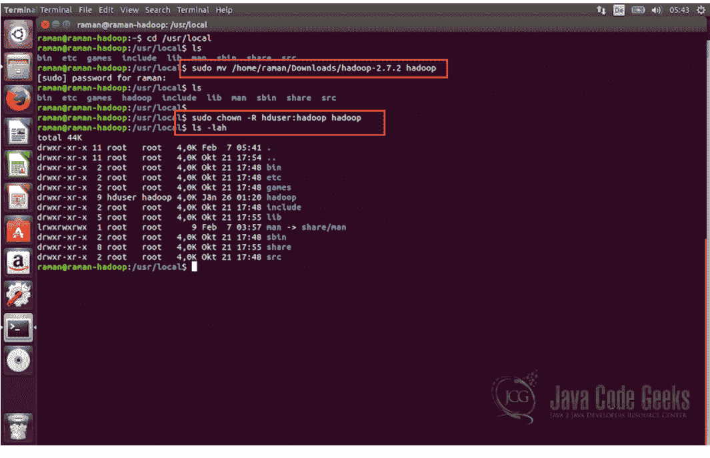

### 2.3.2 更新 bash

为 `huser` 用户更新 `bashrc` 文件。

```bash
su huser
nano $HOME/.bashrc
```

在文件末尾添加以下行：

```bash
export HADOOP_HOME=/usr/local/hadoop
export JAVA_HOME=/usr/lib/jvm/java-7-openjdk-jdk-386

# 一些方便的别名
unalias fs 2>/dev/null
alias fs="fs"
unalias hls 2>/dev/null
alias hls="hadoop dfs -ls"

export PATH=$PATH:$HADOOP_HOME/bin
```

方便别名块是可选的，可以省略。`JAVA_HOME`、`HADOOP_HOME` 和 `PATH` 是强制要求的。

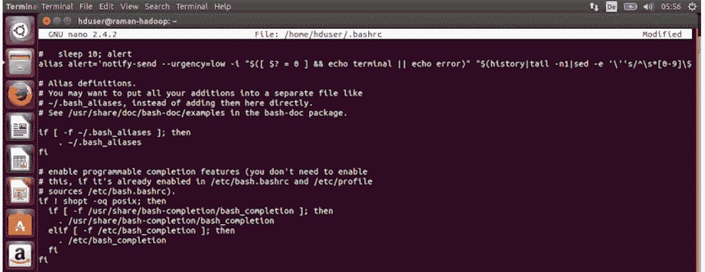

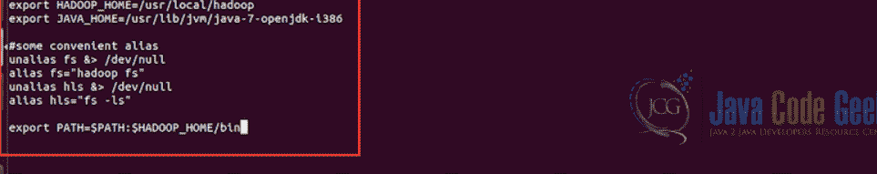

图 2.9: 更新 `.bashrc`

### 2.3.3 配置 Hadoop

在这一步中，我们配置 `Hadoop`。打开 `/usr/local/hadoop/etc/hadoop/` 中的 `hadoop-env.sh`，并按所示设置 `JAVA_HOME` 变量：

```bash
export JAVA_HOME=/usr/lib/jvm/java-7-openjdk-jdk-386
```

使用 `ctrl+X` 然后 `Yes` 保存文件。

**注意：** `java` 的路径应该是系统中存在的路径。默认情况下，它位于 `/usr/lib` 文件夹中，请确保它是根据你的系统的正确路径。同时，确保你想要使用的 `java` 版本是正确的。接下来的截图显示了 `hadoop-env.sh` 需要修改的内容。

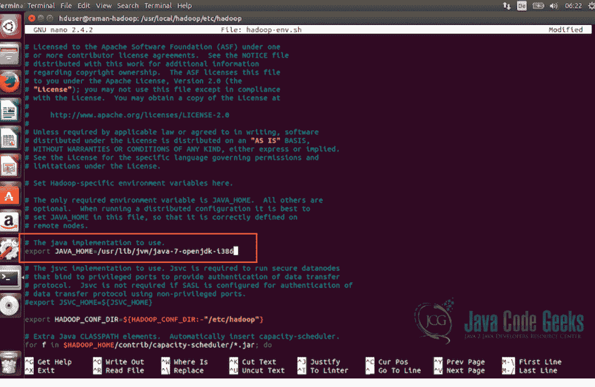

接下来，我们将在 `/usr/local/hadoop/etc/hadoop/` 文件夹中配置 `core-site.xml` 并添加以下属性：

```xml
<configuration>
  <property>
    <name>fs.defaultFS</name>
    <value>hdfs://localhost:54310</value>
  </property>
</configuration>
```

这告诉系统运行的默认文件系统是什么。

```
Terminal File Edit View Search Terminal Help
@hduser-raman@hduser:/usr/local/hadoop/hdfs 06:24
GNU user 2.4.2 File: core-site.xml
<link rel="stylesheet" type="text/css" href="configuration.xml" />
Licensed under the Apache License, Version 2.0 (the "License");
You may use this file except in compliance with the License.
```

如下所示，了系统上运行的默认文件系统。


图 2.11: 更新 `core-site.xml`

接下来，我们需要更新 `hdfs-site.xml`。`/usr/local/hadoop/etc/hadoop/` 文件夹包含 `hdfs-site.xml` 文件。在修改 `hdfs-site.xml` 之前，针对 `namenode` 和 `datanode`。

```xml
<configuration>
  <property>
    <name>dfs.replication</name>
    <value>2</value>
  </property>
  <property>
    <name>dfs.namenode.name.dir</name>
    <value>/usr/local/hdfs/namenode</value>
  </property>
  <property>
    <name>dfs.datanode.data.dir</name>
    <value>/usr/local/hdfs/datanode</value>
  </property>
</configuration>
```

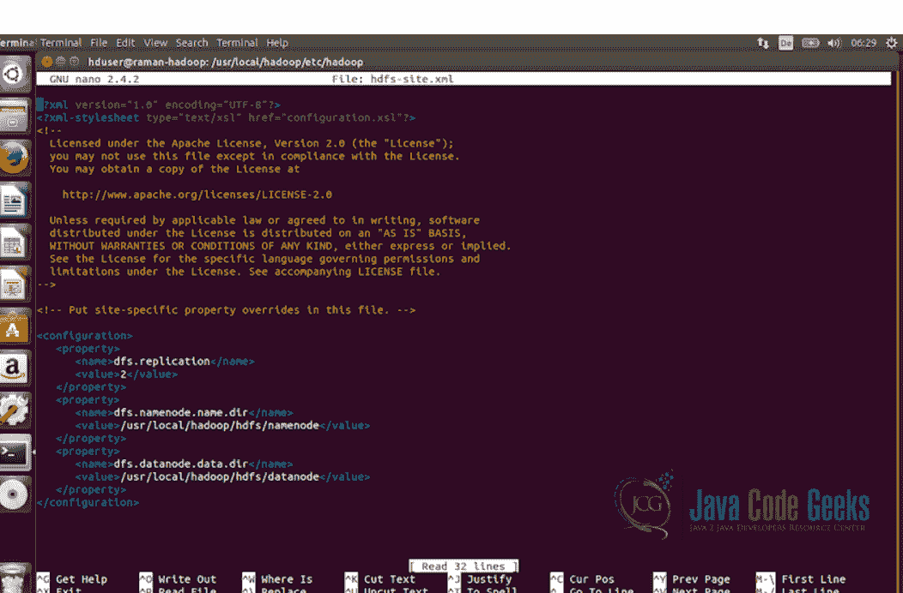

图 2.12: 更新 `hdfs-site.xml`

现在我们将更新 `mapred-site.xml`。`/usr/local/hadoop/etc/hadoop/` 文件夹包含 `mapred-site.xml` 文件。

```xml
<configuration>
  <property>
    <name>mapreduce.jobtracker.address</name>
    <value>localhost:54311</value>
  </property>
</configuration>
```


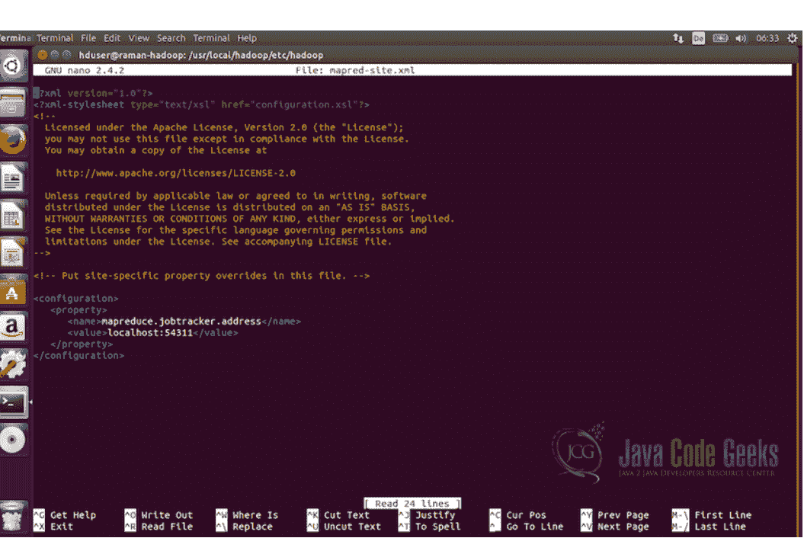

图 2.13: 更新 `mapred-site.xml`

### 2.3.4 格式化 Hadoop 文件系统

我们完成了所有的配置，在启动集群之前我们需要格式化 `namenode`。要执行操作，请在终端使用以下命令：

```bash
hdfs namenode -format
```

该命令在控制台输出中不会有任何错误。如果执行时没有错误，我们就可以在我们的 Ubuntu 系统上启动 Apache Hadoop 实例。

### 2.3.5 启动 Hadoop

现在是启动 Hadoop 的时候。以下是操作命令：

```bash
/usr/local/hadoop/sbin/start-dfs.sh
```

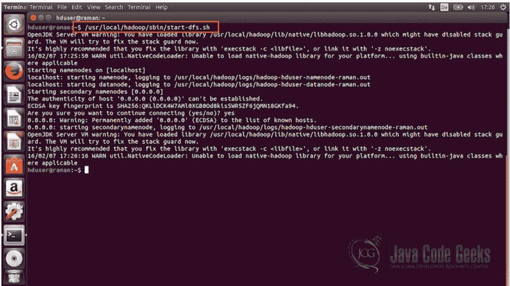

图 2.14: 启动 Hadoop

一旦 `dfs` 启动且没有错误，我们可以使用 `jps` 命令检查一切是否正常：

```bash
cd /usr/local/hadoop/sbin
jps
```

```text
2835 NameNode
3300 Jps
3172 SecondaryNameNode
2983 DataNode
```

### 2.3.6 测试 MapReduce 任务

首先，让我们创建所需的 HDFS 目录并复制一些输入数据用于测试：

```bash
# 在 HDFS 中创建所需的目录
bin/hdfs dfs -mkdir /user
bin/hdfs dfs -mkdir /user/hduser
```

这些目录可以通过 Web 界面访问。要进行操作，请进入 Web 界面，从菜单中选择“Utilities”（实用工具），并在下拉列表中选择“Browse the file system”（浏览文件系统）。

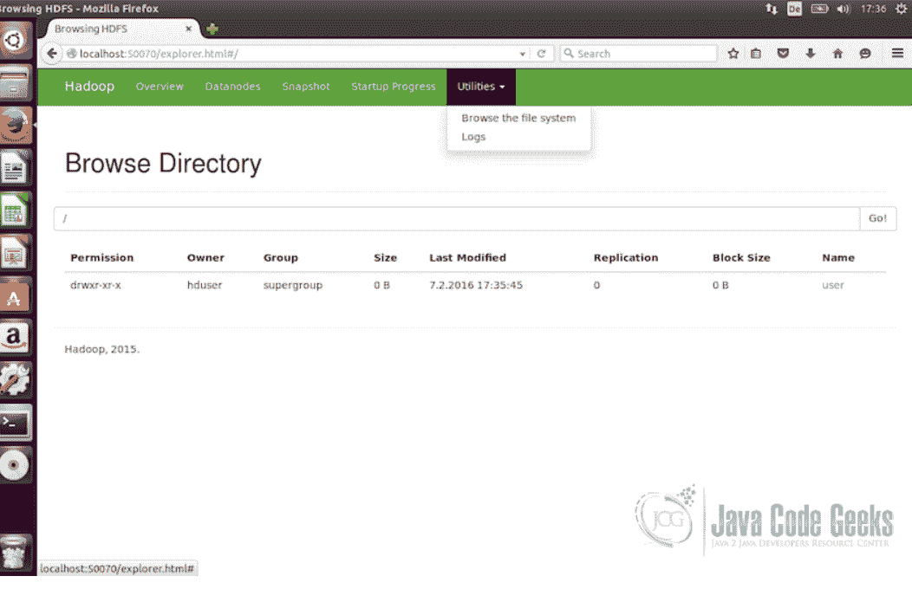

图 2.19：浏览 HDFS 文件系统

现在，我们可以向该目录添加一些伪文件用于测试。让我们将 `etc/hadoop` 文件夹中的所有文件都传递过来。

```bash
# 将输入文件复制到分布式文件系统
/usr/local/hadoop/bin/hdfs dfs -put /usr/local/hadoop/etc/hadoop input
```

下面的截图显示了 Web 界面中添加到 `/user/hduser/input` 目录下的文件：

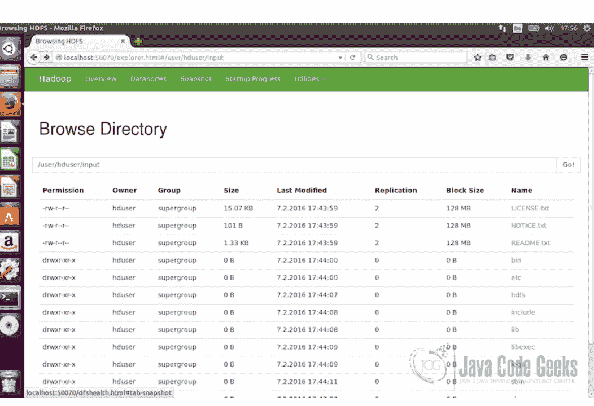

图 2.20：浏览 HDFS 文件系统

Hadoop 软件包包含的 MapReduce 示例任务使用以下命令：`/usr/local/hadoop/bin/hadoop jar /usr/local/hadoop/share/hadoop/mapreduce/hadoop-mapreduce-example-2.7.1.jar grep input output dfs[a-z]*`

**注意：** 关于 MapReduce 如何工作的详情，请参阅文章“Hadoop Hello World Example”。

下面的截图显示了测试示例的输出日志：

```text
hduser@raman ~$
16/02/17 17:59:46 INFO map.Task: attempt_local179137002_r_00000_0.
16/02/17 17:59:46 INFO map.JobRunner: Finishing task: attempt_local179137002_r_00000_0
16/02/17 17:59:46 INFO map.reduce: completed successfully
16/02/17 17:59:46 INFO map.reduce: Job job job_local179137002_reduce running in uber mode : false
16/02/17 17:59:46 INFO map.reduce: Job job job_local179137002_reduce completed successfully
16/02/17 17:59:46 INFO map.reduce: Counters: 29
File System Counters
FILE: number of bytes written=111976
FILE: number of bytes read=0
FILE: number of large read operations=0
HDFS: number of bytes read=16896
HDFS: number of bytes written=0
HDFS: number of large read operations=0
HDFS: number of large write operations=0
HDFS: number of write operations=5
Combine input records=24
Combine output records=20
Reduce input groups=20
Reduce input records=24
Reduce output records=20
Spilled Records=0
Shuffled Map=0
Failed Shuffles=0
GC time elapsed (ms)=3
Total contested Heap usage (bytes)=16981968
Shuffle Error
Bad_Input=0
CONNECTION=0
DISKTY=0
WRONG_MAP=0
File Output Format Counters
Bytes Written=0
hduser@raman:~$
```

图 2.21：Wordcount 示例控制台输出

现在我们可以使用命令查看输出文件：

```bash
/usr/local/hadoop/bin/hdfs dfs -cat output/*
```

或者同样使用 Web 界面，如下方的截图所示：

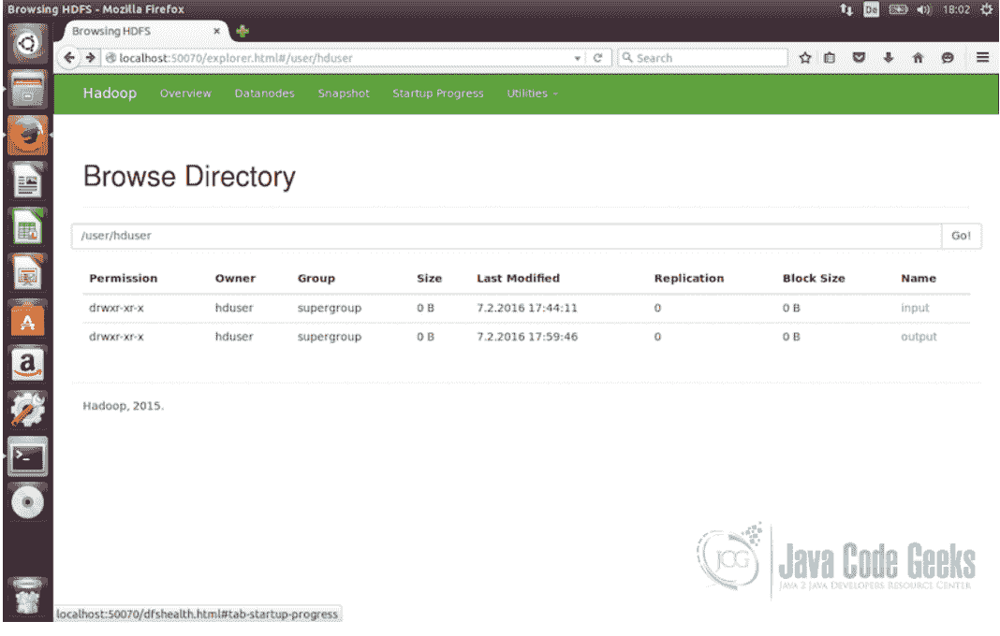

图 2.22：`hdfs` 中的输出文件夹

### 2.3.7 停止 Apache Hadoop

我们现在可以使用以下命令停止 `dfs`（分布式文件系统）：

```bash
/usr/local/hadoop/sbin/stop-dfs.sh
```

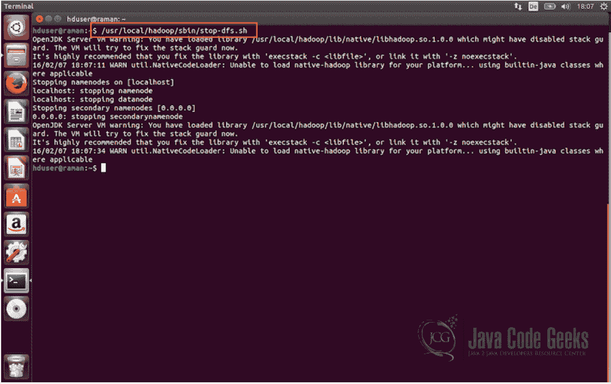

图 2.23：停止 Apache Hadoop

## 2.4 结论

示例就到此结束了。到目前为止，我们已经在 Ubuntu 系统上安装了 Apache Hadoop，并且知道了如何向 Hadoop 添加数据以及如何操作。

## 3.2 Hadoop 文件系统命令详解

```text
[cloudera@quickstart ~$] hadoop fs -put Desktop/testfile.txt /user/root/dir1
[cloudera@quickstart ~$] hadoop fs -ls /user/root/dir1
Found 1 items
-rw-r--r-- 1 cloudera supergroup 159 2016-01-23 16:41 /user/root/dir1/testfile.txt
[cloudera@quickstart ~$] 
```


图 3.4：上传文件到 Hadoop FS

### 3.2.4 从 HDFS 下载文件

将文件从 HDFS 下载到本地文件系统。

用法：

```bash
hadoop fs -get <hdfs_paths> <local_path>
```

示例：

```bash
hadoop fs -get /user/root/dir/testfile.txt Downloads/
```

与 `put` 命令一样，`get` 命令将文件从 Hadoop 文件系统获取或下载到本地 `Downloads` 文件夹中的本地文件系统。


```text
cloudera@quickstart~
File Edit View Search Terminal Help
[cloudera@quickstart ~]$ fs -get /user/root/dir/testfile.txt Downloads/
[cloudera@quickstart ~]$ ls Downloads/
testfile.txt
[cloudera@quickstart ~]$ 
```


图 3.5：从 Hadoop FS 下载文件

### 3.2.5 查看文件内容

要查看文件内容，Hadoop 文件系统提供了 `cat` 命令。它再次与 `unix` shell 中提供的命令相似。

以下是之前在步骤中上传到 Hadoop 文件系统路径 `/user/root/dir/` 下的文件内容。

```text
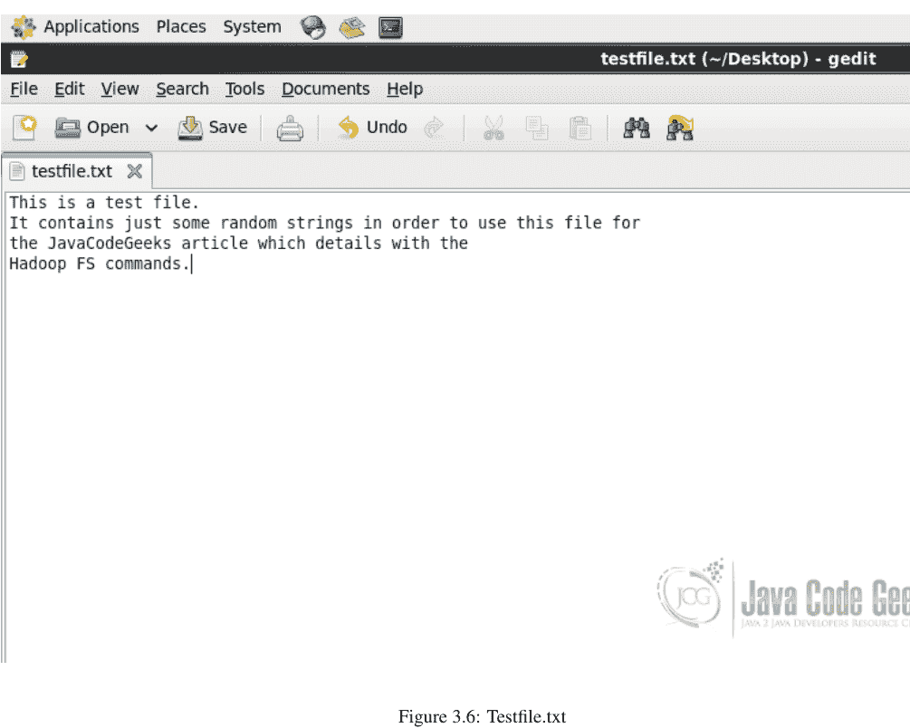
```

用法：

```bash
hadoop fs -cat <paths>
```

示例：

```bash
hadoop fs -cat /user/root/dir1/testfile.txt
```

我们可以看到，下方截图显示的内容与 `testfile.txt` 中的内容相同。


```text
cloudera@quickstart ~$ hadoop fs -cat /user/root/dir/testfile.txt
This is a test file.
It contains just some random strings in order to use this file for
the JavaCodeGeeks article which details with the
Hadoop FS commands.
[cloudera@quickstart ~]$
```


图 3.7：Hadoop FS `cat` 命令

### 3.2.6 复制文件

在 Hadoop 文件系统内部从一个位置复制文件到另一个位置语法与 `unix` shell 中的 `cp` 命令相同。

用法：

```bash
hadoop fs -cp <source_path> ... <destination_path>
```

示例：

```bash
hadoop fs -cp /user/root/dir/testfile.txt /user/root/dir2
```

在从源复制文件到目的地时，我们也可以在源路径提供多个文件。


```text
File Edit View Search Terminal Help
[cloudera@quickstart ~]$ hadoop fs -cp /user/root/dir1/testfile.txt /user/root/dir2
[cloudera@quickstart ~]$ hadoop fs -ls /user/root/dir2
Found 1 items
-rw-r--r-- 1 cloudera supergroup 159 2016-01-23 16:46 /user/root/dir2/testfile.txt
[cloudera@quickstart ~]$ _
```


图 3.8：将 Hadoop FS 文件从一个位置复制到另一个位置

### 3.2.7 将文件从源移动到目的地

以下是在 Hadoop 文件系统内部将文件从一个目录移动到另一个目录的语法和示例。

用法：

```bash
hadoop fs -mv <source_path> <destination_path>
```

示例：

```bash
hadoop fs -mv /user/root/dir1/testfile.txt /user/root/dir2
```

```text
cloudera@quickstart:~[cloudera@quickstart ~]$ hadoop fs -mv /user/root/dir1/testfile.txt /user/root/dir2
[cloudera@quickstart ~]$ hadoop fs -ls /user/root/dir1
[cloudera@quickstart ~]$ hadoop fs -ls /user/root/dir2
Found 1 items
-rw-r--r-- 1 cloudera supergroup 159 2016-01-23 16:41 /user/root/dir2/testfile.txt
[cloudera@quickstart ~]$ 
```


图 3.9：将文件从一个路径移动到另一个路径

### 3.2.8 从 HDFS 中删除文件或目录

从 Hadoop 文件系统删除文件或目录与 `unix` shell 相似。它也有两个候选项：`-rm` 和 `-rm -r`。

用法：

```bash
hadoop fs -rm <path>
```

示例：

```bash
hadoop fs -rm /user/root/dir2/testfile.txt
```

上述命令仅在文件为空时才会删除。但如果我们想删除一个包含其他文件的目录，则使用递归选项。

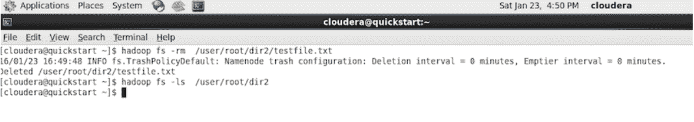

图 3.10：从 Hadoop FS 删除文件

### 3.2.9 查看文件内容

要查看文件内容，Hadoop 文件系统提供了 `cat` 命令。它再次与 `unix` shell 中提供的命令相似。

用法：

```bash
hadoop fs -cat <paths>
```

示例：

```bash
hadoop fs -cat /user/root/dir1/testfile.txt
```

我们可以看到，下方截图显示的内容与 `testfile.txt` 中的内容相同。

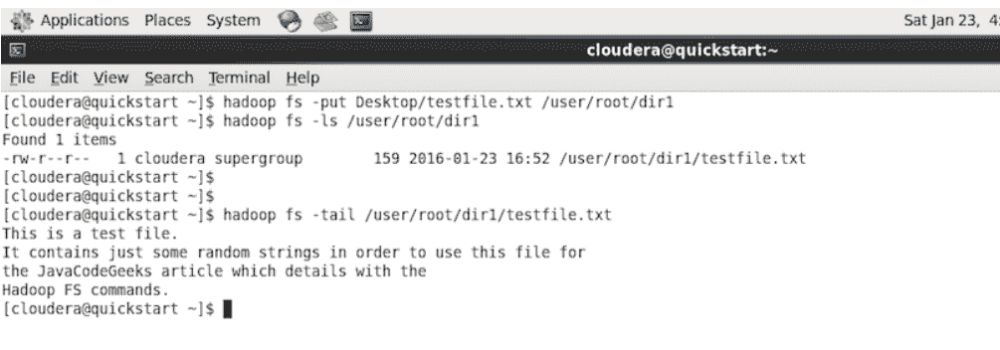

```text
[cloudera@quickstart ~$ hadoop fs -cat /user/root/dir/testfile.txt
This is a test file.
It contains just some random strings in order to use this file for
the JavaCodeGeeks article which details with the
Hadoop FS commands.
[cloudera@quickstart ~]$
```


图 3.7：Hadoop FS `cat` 命令

### 3.2.10 复制文件

在 Hadoop 文件系统内部从一个位置复制文件到另一个位置语法与 `unix` shell 中的 `cp` 命令相同。

用法：

```bash
hadoop fs -cp <source_path> ... <destination_path>
```

示例：

```bash
hadoop fs -cp /user/root/dir/testfile.txt /user/root/dir2
```

在从源复制文件到目的地时，我们也可以在源路径提供多个文件。


```
File Edit View Search Terminal Help
[cloudera@quickstart ~]$ hadoop fs -cp /user/root/dir1/testfile.txt /user/root/dir2
[cloudera@quickstart ~]$ hadoop fs -ls /user/root/dir2
Found 1 items
-rw-r--r-- 1 cloudera supergroup 159 2016-01-23 16:46 /user/root/dir2/testfile.txt
[cloudera@quickstart ~]$ _
```


图 3.8：将 Hadoop FS 文件从一个位置复制到另一个位置

## 3.2.11 将文件从源移动到目的地

以下是在 Hadoop 文件系统内部将文件从一个目录移动到另一个目录的语法和示例。

用法：

```
hadoop fs -mv <source_path> <destination_path>
```

示例：

```
hadoop fs -mv /user/root/dir1/testfile.txt /user/root/dir2
```

```
[cloudera@quickstart ~]$ hadoop fs -mv /user/root/dir1/testfile.txt /user/root/dir2
[cloudera@quickstart ~]$ hadoop fs -ls /user/root/dir1
[cloudera@quickstart ~]$ hadoop fs -ls /user/root/dir2
Found 1 items
-rw-r--r-- 1 cloudera supergroup 159 2016-01-23 16:41 /user/root/dir2/testfile.txt
[cloudera@quickstart ~]$ 
```


图 3.9：将文件从一个路径移动到另一个路径

## 3.2.12 从 HDFS 中删除文件或目录

从 Hadoop 文件系统删除文件或目录与 unix shell 相似。它也有两个候选项：`-rm` 和 `-rm -r`。

用法：

```
hadoop fs -rm <path>
```

示例：

```
hadoop fs -rm /user/root/dir2/testfile.txt
```

上述命令仅在文件为空时才会删除。但如果我们想删除一个包含其他文件的目录，则使用递归选项。


图 3.10：从 Hadoop FS 删除文件

# 第 4 章

# 集群搭建示例

## 4.1 引言

Apache Hadoop 是为多机器集群设置设计的。虽然可以在单机上运行以满足所有用途，但实际实现是针对多机器集群的。即使我们想尝试多机器设置，也需要通过网络相互连接的多个系统，而这并不总是可能的；如果你没有多个系统来尝试 Hadoop 集群怎么办？

虚拟机在这里派上了用场。通过使用多个虚拟机，我们可以在单个系统上搭建 Hadoop 集群。因此，在本示例中，我们将讨论如何使用虚拟机搭建 Apache Hadoop 集群。

## 4.2 要求

- VirtualBox（或其他任何虚拟机环境）

- Ubuntu 15.04（或你喜欢的其他 Linux 发行版）

- VBox Guest Additions镜像文件 (`VBoxGuestAdditions.iso`)

我个人更喜欢 Ubuntu，因为它具有轻级的 LXDE 桌面 GUI，并且去除了 Ubuntu 中存在的所有额外组件，是虚拟机的良好选择。

## 4.3 准备虚拟机

在本节中，我们将介绍准备虚拟机的步骤，稍将在示例中使用这些虚拟机构建集群。

### 4.3.1 创建虚拟机并安装客体操作系统

在 VirtualBox 中创建一个虚拟机 (VM)，并为虚拟机分配至少 2GB 内存和 15GB 存储。将第一台虚拟机命名为 HadoopI。

# 名称和操作系统

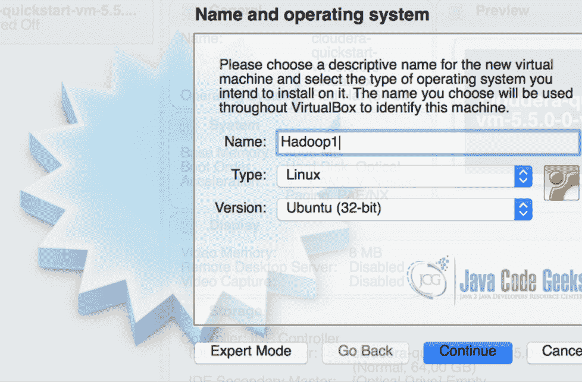

图 4.1：在 VirtualBox 中创建虚拟机

虚拟机创建完成后，在虚拟机中安装 Lubuntu 并完成设置，之后我们将获得一个可以运行的虚拟机。


图 4.2：在创建的虚拟机中安装 Lubuntu

安装操作系统可能需要一段时间。

### 4.3.2 安装 Guest Additions

下一步是在虚拟机中安装 Guest Additions。Guest Additions 是虚拟机为了良好运行所需的额外设置。它由设备驱动程序和系统应用程序组成，用于优化客体操作系统以便获得性能和易用性。这是创建虚拟机时重要且必要的步骤之一，它允许客体操作系统检测屏幕大小（有助于以全屏模式运行虚拟机），并在需要时允许客体操作系统与主机操作系统拥有共享文件夹。以下是在客体操作系统中安装 guest additions 需要执行的步骤。

首先，通过构建外部内核模块来准备系统，这可以通过在终端运行命令并安装 DKMS 完成（DKMS 提供安装内核模块补充版本的支持）：

```
sudo apt-get install dkms
```

将 `VboxGuestAdditions.iso` CD 文件插入 Linux 客体虚拟虚拟 CD-ROM 驱动器。

现在打开终端，切换目录到 CD-ROM 驱动器并执行以下命令：

```bash
sh ./VboxLinuxAdditions.run
```

注意：此时请重启系统，并进入下一步，我们将为虚拟机配置网络设置。

## 4.4 创建虚拟机集群

在本节中，我们将看到如何为虚拟机配置网络以作为单集群节点，以及如何将第一台机器克隆到其他机器，这将节省大量时间，因为我们不需要在所有机器上单独执行之前的步骤。

### 4.4.1 VM 网络设置

进入 Virtualbox 首选项菜单并从下拉菜单中选择“首选项”(Preferences)。

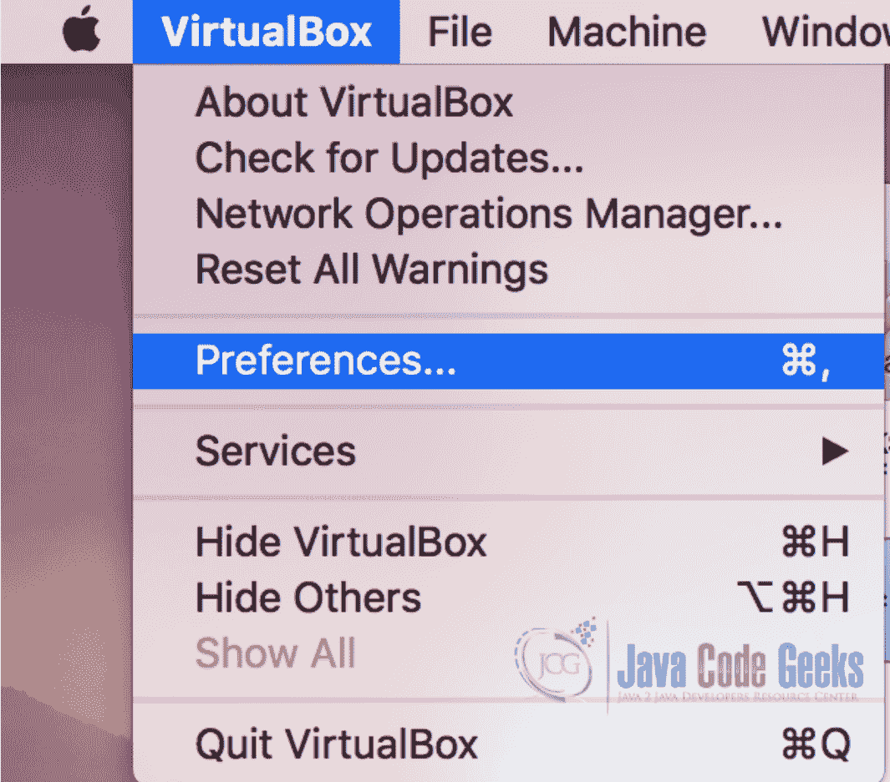

图 4.4：VirtualBox 首选项菜单

在首选项菜单中，选择“网络”(Network)。在网络首选项中，选择“仅主机网络”(Host-only Networks) 并点击“添加驱动程序”(Add Driver)。驱动程序将被添加到列表中。双击驱动程序将打开 DHCP 服务器设置的弹出窗口，按照下方截图所示插入 DHCP 服务器设置。

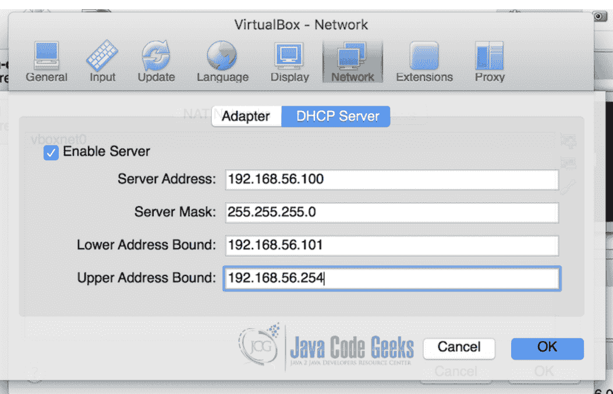

图 4.5：DHCP 服务器设置

我们将网络的下下限和上限设置为 `192.168.56.101` 和 `192.168.56.254`，所有机器将仅从此范围分配 IP。**不要忘记勾选“启用服务器”(Enable Server)**。

一旦网络设置完成且 DHCP 服务器准备就绪，在 VirtualBox 管理器中，右键点击虚拟机并从下拉列表中选择*设置* (Settings)。在设置弹出窗口中，选择*网络* (Network)，然后选择*适配器2*，启用启用，并在*连接到* (Attached to) 下拉菜单中选择*仅主机网络*。在第二个下拉菜单中将显示所有适配器的名称，包括我们在上一步中创建的。从下拉菜单中选择，在我们的示例中名为 `vboxnet0`。这将虚拟机连接到此特定网络。

### 4.4.2 克隆虚拟机

现在我们已经准备好了一个虚拟机，可以克隆这台虚拟机来创建相同的机器，这避免了重复所有之前步骤的麻烦，并且我们可以轻松地获得多个与克隆对象配置相同的虚拟机。

右键点击虚拟机并从下拉菜单中选择“克隆”(Clone)。在克隆弹出窗口，将虚拟机重命名为 Hadoop2 并选择“重新初始化所有网卡的 MAC 地址”，然后点击“继续”。


图 4.7：克隆虚拟机

注意：重新初始化 MAC 地址可以确保新的虚拟机具有不同的 MAC 地址。在下一个屏幕中，选择“完全克隆”(Full Clone) 并点击“克隆”。


图 4.8：虚拟机的完全克隆

### 4.4.3 测试网络

现在同一网络上有两台机器。我们必须测试两台机器是否都连接到了网络。以下是操作步骤：

启动两个虚拟机，并在终端中使用以下命令：

```bash
ifconfig
```

这将显示网络配置。我们会注意到分配的 IP 处于 `192.168.56.101` 到 `192.168.56.254` 范围内（即 DHCP 分配的上下限）。

### 4.4.4 将虚拟机转换为静态 IP

目前这种配置存在一个问题：IP 是随机分配给系统的，未来可能会发生变化。Hadoop 需要静态 IP 来访问集群机器，因此我们需要将机器的 IP 固定为静态。以下步骤需要在两台机器上均执行。

在终端中进入 `/etc/networks` 并以 root 身份编辑 `interfaces` 文件。

```bash
# 进入 networks目录
cd /etc/networks
# 编辑文件
sudo nano interfaces
```

在 `interfaces` 文件末尾添加以下行：

```text
auto eth1
iface eth1 inet static

# 为虚拟机分配静态 ip
address 192.168.56.101
netmask 255.255.255.0
network 192.168.56.0
```

```text
# 指定广播地址，通过 ifconfig 命令获取该地址
# 在这种情况下是 192.168.56.255
broadcast 192.168.56.255
```

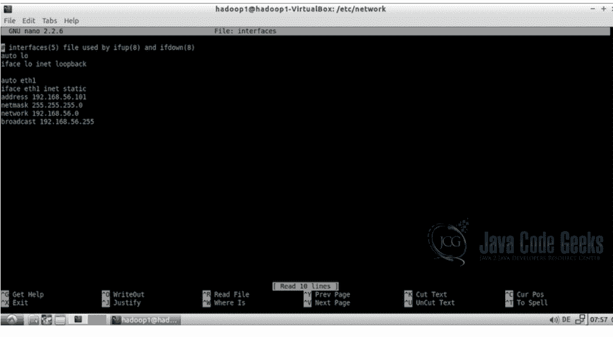

图 4.10：Interfaces 文件

在每台机器上，以 root 身份编辑 `/etc/hosts` 文件并添加主机名。例如：

```bash
# 使用 nano 编辑器编辑文件
sudo nano /etc/hosts
```

添加以下主机：

```text
192.168.56.101 hadoop1
192.168.56.102 hadoop2
```

注意：IP 应与上一步分配的保持一致。

# Apache Hadoop 实战教程

```
hadoop1@hadoop1-VirtualBox: /etc
File Edit Tabs Help
User root 2.0.6 File: hosts Modified
127.0.0.1       localhost
127.0.0.1       hadoop1-VirtualBox
192.168.56.101 hadoop1
192.168.56.102 hadoop2
192.168.56.103 hadoop3
# The following are desirable for IPv6 capable hosts
::1             ip6-local ip6-loopback
ff00::ip6-multicast
ff01::ip6-nodes
ff02::ip6-allrouters
```


图 4.11: 虚拟机中的 hosts 文件

重启所有机器

## 4.5 Hadoop 预备设置

按照 Hadoop 设置的预备设置进行操作。请记住，所有设置都需要添加到集群的机器上完成（在本例中为加入 cluster2 的机器）。

### 4.5.1 创建用户

在所有机器上创建 hadoop 用户。为此，请打开终端并输入以下命令：

```bash
# 创建用户组 hadoop 
sudo addgroup hadoop

# 创建用户 hduser 并将其加入 hadoop 用户组
sudo adduser --ingroup hadoop hduser
```

### 4.5.2 禁用 ipv6

下一步是在所有机器上禁用 ipv6。Hadoop 设置为使用 ipv4，这就是为什么我们要在创建 Hadoop 集群之前需要禁用 ipv6。请以 root 身份使用 nano 打开 `/etc/sysctl.conf`：

```bash
sudo nano /etc/sysctl.conf
```

并在文件末末尾添加以下几行。

```bash
# 禁用 ipv6 的命令
net.ipv6.conf.all.disable-ipv6=1
net.ipv6.conf.default.disable-ipv6=1
net.ipv6.conf.lo.disable-ipv6=1
```

之后，使用以下命令检查 ipv6 是否已正确禁用：

```bash
cat /proc/sys/net/ipv6/conf/all/disable-ipv6
```

输出将返回 0，而我们希望返回 1，因为它代表 ipv6 已经禁用。

### 4.5.3 连接机器 (SSH 访问)

现在，我们必须确保机器能够通过静态 IP 地址和 SSH 通过网络互相访问。在本例中，我们将 hadoop1 机器视为主节点，将 hadoop1 和 hadoop2 都视为从节点。因此，我们需要确保：

hadoop1(master) 能够通过以下命令连接自己：

```bash
ssh hadoop1
```

它能够连接到其他虚拟机：

```bash
ssh hduser@hadoop2
```

为了实现这一点，我们必须在每台机器上生成 SSH 密钥。登录 hadoop1 并在终端中执行下面提到的步骤：

切换到用户 hduser 并生成 SSH 公钥：

```bash
# 切换到用户 hduser
su - hduser
```

```bash
# 生成 ssh 密钥
ssh-keygen -t rsa -P ""
```

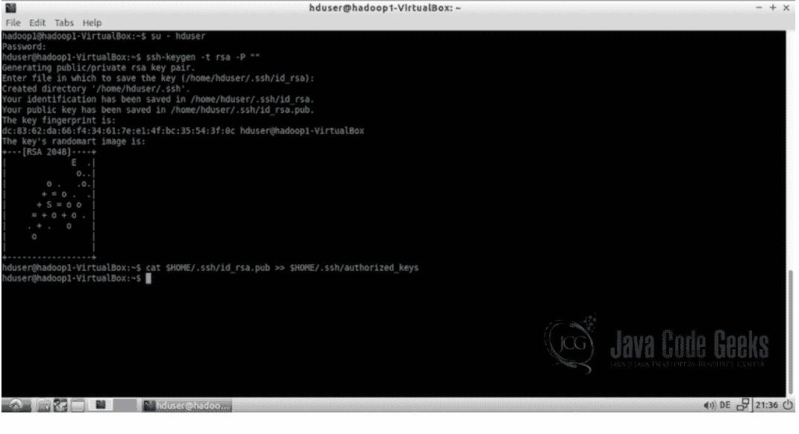

图 4.12: SSH 密钥生成

第二个命令将为机器创建一个 RSA 密钥对。该密钥的密码将如命令所示。它会提示存储密钥的路径，默认路径为 `$HOME/.ssh/id-rsa.pub`，在提示时直接按回车以保持相同路径。如果你计划更改路径，请记住它，因为它将在下一步中用到。

使用上一步创建的密钥启用对机器的 SSH 访问。为此，我们需要将密钥添加到机器的 `authorized_keys` 列表中。

```bash
cat $HOME/.ssh/id-rsa.pub >> $HOME/.ssh/authorized_keys
```

现在，我们需要将 `hduser@hadoop1` 的公有 SSH 密钥（主节点）添加到 `hduser@hadoop2` 机器的 `authorized_keys` 文件中。在 hadoop 的终端上可以使用以下命令完成：

```bash
ssh-copy-id -i $HOME/.ssh/id-rsa.pub hduser@hadoop2
```

这将提示输入用户 `hduser@hadoop2` 的密码

使用以下命令测试从 hadoop1 到自身以及到 hadoop2 的连接，确保一切正常：

```bash
ssh hadoop1
```

这会将 hadoop1 连接到自身，如果成功，退出连接并尝试连接到 hadoop2 机器：

```bash
ssh hduser@hadoop2
```

这应该也能成功连接。

## 4.6 Hadoop 安装

现在，我们处于已完成所有初始设置的步骤，现在准备好在集群上安装 Hadoop 了。

### 4.6.1 下载 Hadoop

从 Apache 镜像站点下载 Hadoop：`www.apache.org/dist/dyn/closer.cgi/hadoop/core`

下载完成后，解压 hadoop 文件夹并移动到 `/usr/local/hadoop`，最后将文件夹的所有者更改为 haduser 和 hadoop 组。

```bash
# 切换到目录
cd /usr/local

# 将 hadoop 文件移动到目录
sudo mv /home/hadoop1/downloads/hadoop-2.7.1 /usr/local

# 将权限更改为 haduser:hadoop
sudo chmod -R haduser:hadoop /usr/local
```

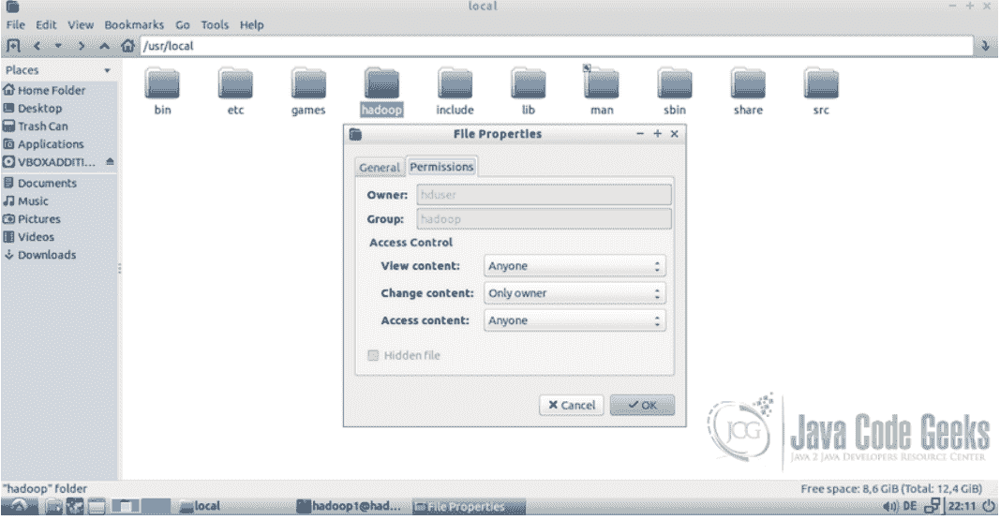

图 4.13: 检查权限的文件夹设置

### 4.6.2 更新 bashrc

更新 haduser 的 `bashrc` 文件。

```bash
su - haduser
nano $HOME/.bashrc
```

在文件末尾添加以下几行。

```bash
export HADOOP_HOME=/usr/local/hadoop
export JAVA_HOME=/usr/lib/jvm/java-8-openjdk
# 方便别名
alias fs='hadoop fs' 2>/dev/null
alias ls='hadoop fs -ls' 2>/dev/null
export PATH=$PATH:$HADOOP_HOME/bin
```


图 4.14: 更新 haduser 的 bashrc

### 4.6.3 配置 Hadoop


现在是配置 Hadoop 安装的时间了。以下是需要遵循的步骤：这需要通过打开`/usr/local/hadoop/etc/hadoop/`中的`hadoop-env.sh`并按如下设置`JAVA_HOME`变量：

```bash
export JAVA_HOME=/usr/lib/jvm/java-8-openjdk
```

接下来，我们将配置`/usr/local/hadoop/etc/hadoop/`文件夹中的`core-site.xml`并添加以下属性：

```xml
<configuration>
  <property>
    <name>fs.defaultFS</name>
    <value>hdfs://hadoop1:8020</value>
  </property>
</configuration>
```

这在所有机器上都需要编辑，因为值应该只指向主节点（在本例中为`hadoop1`）。因此，两台机器都需要添加相同的属性和值。

接下来，我们需要更新所有主节点和从节点上的`hdfs-site.xml`：

```xml
<configuration>
  <property>
    <name>dfs.replication</name>
    <value>2</value>
  </property>
  <property>
    <name>dfs.namenode.name.dir</name>
    <value>/usr/local/hadoop/hdfs/namenode</value>
  </property>
  <property>
    <name>dfs.datanode.data.dir</name>
    <value>/usr/local/hadoop/hdfs/datanode</value>
  </property>
</configuration>
```

现在，我们将更新`mapred-site.xml`文件。该文件**仅在主节点上**编辑：

```xml
<configuration>
  <property>
    <name>mapreduce.jobtracker.address</name>
    <value>hadoop1:84311</value>
  </property>
</configuration>
```

最后一个配置位于`/usr/local/hadoop/etc/hadoop`文件夹下的`slaves`文件中。添加从节点的主名或 IP 地址：

```
hadoop1
hadoop2
```

由于`hadoop1`同时担任主从节点，我们将添加主机名。

## 4.6.4 格式化 Namenode

我们现在完成了所有配置，在启动集群之前需要格式化`namenode`。在`hadoop1`终端执行以下命令：

```bash
hdfs namenode -format
```

## 4.6.5 启动分布式系统

现在是启动分布式系统并运行集群的时间。以下是执行命令：

```bash
/usr/local/hadoop/sbin/start-dfs.sh
```

一旦`dfs`启动且没有报错，我们可以在主节点上的`https://localhost:50070`浏览 web 界面

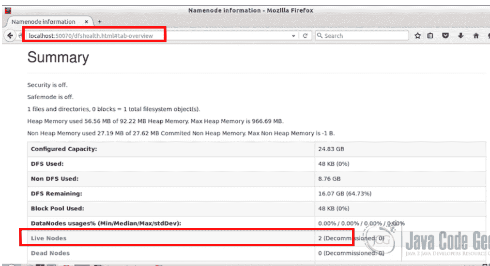

图 4.15: 主节点的 Hadoop Web界面

## Summary

安全性关闭。

安全关闭。

1 个文件和目录，0 个块 = 1 个总文件系统对象。

堆内存使用了 56.56 MB / 92.22 MB。最大堆内存 969.69 MB。

非堆内存使用了 27.19 MB / 27.62 MB 已提交。最大非堆内存 1.8 GB。

| 配置容量: |
| :--- |
| DFS: | 24.83 GB |
| DFS 已用: | 48 KB (0%) |
| DFS 名称: | 8.76 GB |
| 剩余: | 16.07 GB (64.73%) |
| 块池: | 48 KB (0%) |

## Overview 'hadoop1:54310' (激活)

| | |
| :--- | :--- |
| 启动时间: | 2015年12月20日 周日 15:09:33 CET |
| 版本: | 2.7.1,15ecc87ccfa4a0228f35fa08bf5dc6d53e6ec67a |
| 编译: | 2015-06-29T06:04Z 由 jenkins 编译自离线 |
| 集群 ID: | C9D-9f61f422-bac-405-9c-36571604484 |
| 块池 ID: | BP-1572742109-127.0.0.1-1450620507597 |

> 图 4.16: 从从节点的 Hadoop Web界面

## 4.6.6 测试 MapReduce 作

首先，让我们创建所需的 HDFS 目录并拷贝一些输入数据用于测试。

```bash
#创建所需的目录
bin/hdfs dfs -mkdir /user
bin/hdfs dfs -mkdir /user/hduser
```

这些目录也可以通过Web界面访问。要这样做，请访问Web界面，从 Utilities（工具）菜单进入，并从下拉列表中选择 Browse file system（浏览文件系统）。

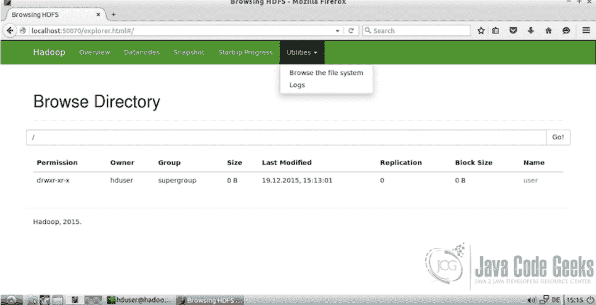

图 4.17：使用Web界面访问HDFS中的目录

现在，我们可以向用于测试的目录添加一些哑文件。让我们从`etc/hadoop`文件夹中拷贝所有文件。

```bash
#将输入拷贝到分布式文件系统
/usr/local/hadoop/bin/hdfs dfs -put /usr/local/hadoop/etc/hadoop input
```

接下来的截图显示了添加到`/user/hduser/input`目录下的文件。

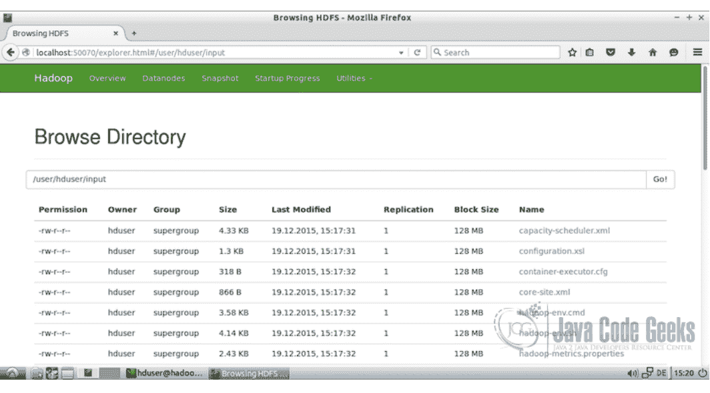

## 浏览目录

| 权限 | 所有者 | 组 | 大小 | 最后修改时间 | 副本数 | 块大小 | 名字 |
| --- | --- | --- | --- | --- | --- | --- | --- |
| -rw-r--r-- | huser | supergroup | 4.33 KB | 19.12.2015, 15:17:31 | 1 | 128 MB | capacity-scheduler.xml |
| -rw-r--r-- | huser | supergroup | 1.3 KB | 19.12.2015, 15:17:31 | 1 | 128 MB | configuration.xml |
| -rw-r--r-- | huser | supergroup | 318 B | 19.12.2015, 15:17:32 | 1 | 128 MB | container-executor.cfg |
| -rw-r--r-- | huser | supergroup | 866 B | 19.12.2015, 15:17:32 | 1 | 128 MB | core-site.xml |
| -rw-r--r-- | huser | supergroup | 3.58 KB | 19.12.2015, 15:17:32 | 1 | 128 MB | dfs-site.xml |
| -rw-r--r-- | huser | supergroup | 2.43 KB | 19.12.2015, 15:17:32 | 1 | 128 MB | hadoop-metrics.properties |

图 4.18：在HDFS中浏览文件

Hadoop 包中包含的 MapReduce 使用以下命令运行：`/usr/local/hadoop/bin/hadoop jar share/hadoop/mapreduce/hadoop-mapreduce-example-2.7.1.jar grep input output 'dfs[a-z]+'`

**注意：** 关于 MapReduce 示例如何工作的详细信息，请参考文章“Hadoop Hello World Example”。

接下来的截图显示了测试示例的输出日志：


```bash
15/12 02:20:18 HDFS map.Job: 100% completed successfully
15/12 02:20:18 HDFS map.Job job job local53062957_0002 completed successfully
15/12 02:20:18 HDFS reduce.Job: 100% completed successfully
File systems
FILE: number of bytes read=1222346
FILE: number of bytes written=2217177
FILE: number of large read operations=0
FILE: number of write operations=0
HDFS: number of bytes written=1071
HDFS: number of large read operations=0
HDFS: number of write operations=16
Map-Reduce Framework
map input records=11
map output records=11
map output materialized bytes=291
Combine input bytes=21
Combine output records=11
Reduce input records=11
Reduce shuffle bytes=291
Reduce output records=11
Reduce output bytes=11
Shuffled Maps=1
Sorted files=1
Merged Map outputs=1
Total heap usage (bytes)=27089216
```

图 4.19：测试 MapReduce 示例的输出

我们现在可以查看输出文件：

`/usr/local/hadoop/bin/hdfs dfs -cat output/*`

## 4.6.7 停止分布式文件系统

我们现在可以使用以下命令停止`dfs`（分布式文件系统）：

`/usr/local/hadoop/sbin/stop-dfs.sh`

这标志着设置和初始测试的结束。

## 4.7 结论

这里就是本示例的结论。希望这让你更清楚地了解如何在多台机器上搭建 Hadoop 集群。集群需要在多个物理机器上建立，而不是虚拟机，除了包含 4.1 虚拟机网络设置和 4.2 克隆虚拟机的步骤外，操作说明是类似的。对于物理机集群，我们可以在机器上执行所有其他步骤，一切都应该运行顺畅。

## 4.8 下载配置文件

在本示例中修改并使用的配置文件可以在此处下载。请注意，这些配置文件的修改可能会根据用户网络和其他设置而不同，并可能需要进行相应的更改。该包包含：

- `hosts`文件
- `sysctl.conf`文件
- Hadoop 1 文件夹（包含主节点文件）
  - `core-site.xml`
  - `hdfs-site.xml`
  - `mapred-site.xml`
  - `slaves`
- Hadoop 2 文件夹（包含从节点文件）
  - `core-site.xml`
  - `hdfs-site.xml`

你可以从此示例下载上述所有文件：`HadoopClusterSetup`

## 第 5 章 Distcp

在本示例中，我们将展示如何使用`Distcp`在集群之间拷贝大型文件。

### 5.1 介绍

`Distcp`是在我们需要在 HDFS 集群之间拷贝大量数据时使用的工具。

### 5.2 示例

`distcp`的基本语法是：

```bash
hadoop distcp [options] <source> <destination>
```

以下是`distcp`的示例：

```bash
hadoop distcp hdfs://source-cluster:port/path hdfs://dest-cluster:port/path
```

虚拟内存（字节）快照=306455808

总提交内存使用（字节）=121503744

文件输入格式计数器

读取字节=75

文件输出格式计数器

写入字节=0

`org.apache.hadoop.tools.mapped.CopyMapper$Counter`
- `BYTES_COPIED=39593868`
- `BYTES_EXPECTED=39593868`
- `COPY=2`

日志中的第 35 行表示已执行的 map 任务列表，在本例中为 2。

要检查拷贝是否成功，我们可以在 HDFS 中运行以下命令：

`hadoop fs -ls /user/destination_access_logs`

如果拷贝成功且演示文件夹中有数据，输出如下：

| 文件 编辑 视图 搜索 终端 帮助 |
| :--- | :--- |
| `cloudera@quickstart ~$} hadoop fs -ls /user/destination_access_logs` |
| 找到 1 个项目 |
| `-rw-r--r-- 1 cloudera supergroup 39593868 2015-02-01 17:13 /user/destination_access_logs/access.log` |
| `cloudera@quickstart ~$}` |

图 5.1：显示`hdfs`命令输出的截图

**注意：** 当在两个集群之间拷贝文件时，两个集群上的 HDFS 版本应该相同，或者在版本不同的情况下，高版本应该向向后兼容。

### 2.2.2 多源拷贝

在存在多个源且需要传输到同一个目的地的情况下，可以将所有源作为参数传递给以下语法：

来自所有源的文件将拷贝到目的地。

如果有很多源，且运行长命令可能会变成问题。还有另一种备选方案：

```
hadoop distcp -f hdfs://namenode:port/sourceList hdfs://namenode:port/source2 hdfs://namenode:port/source3 hdfs://namenode:port/destination
```

其中，`sourceList`是一个包含所有源列表的简单文件。在这种情况下，源列表需要通过标志`-f`传递，该标志表示源不是要拷贝的文件，而是包含所有源的文件。

**注意：** 当使用多个源使用`distcp`时，在目的地，拷贝不会中断，但`distcp`将带错误消息终止拷贝。如果目的地发生冲突，将根据指定的选项解决冲突。如果没有指定任何选项，默认是跳过目的地已存在的文件。


### 5.2.3 更新和覆盖标志

正如名称所示，`update`将更新目的地文件夹中的文件，但仅在满足更新条件时进行。执行更新的更新检查是：目的地是否有相同的文件名，如果文件大小和内容与源文件一致，如果是这样，则文件不会更新；如果它们是从源上传到目的地的，则更新。

`overwrite`将覆盖目的地具有相同文件名的文件，如果是，则文件将被覆盖。

```
hadoop distcp -update hdfs://namenode:port/source hdfs://namenode:port/destination
```

```
hadoop distcp -overwrite hdfs://namenode:port/source hdfs://namenode:port/destination
```

### 5.2.4 忽略失败标志

在`distcp`中，如果任何 map 失败，其他 map 任务也会失败，且拷贝过程会带错误完全停止。如果一个或多个 map 任务带有忽略失败标志`-i`，则可能需要继续拷贝其他数据块。

```
hadoop distcp -i hdfs://namenode:port/source hdfs://namenode:port/destination
```

### 5.2.5 最大 Map 任务数

如果用户想设置为`distcp`执行可以分配的最大 map 任务数，可以使用另一个标志`-m <max_tasks>`。

```
hadoop distcp -m 5 hdfs://namenode:port/source hdfs://namenode:port/destination
```

此示例将为`distcp`命令分配 5 个 map 任务。

在`distcp`中设置 map 任务的示例：

```
hadoop distcp -m 1 hdfs://quickstart.cloudera:8020/user/access_logs hdfs://quickstart/cloudera:8020/user/destination_access_logs_3
```

在这里，我们将 map 任务限制为 1。从示例日志输出中，我们发现没有发现该文件数据的 map 任务数为 2。

以下是下方命令的日志：


```
15/02/17 19:33:54 INFO tools.DistCp: Input:DistOptions(atomicCommit=false,
syncFolder=false,ignoreFailures=false,maxMaps=1,
syncConfiguration=null,copyStrategy=uniform,sourceFileListing=null,
sourcePaths=hdfs://quickstart.cloudera:8020/user/access_logs,targetPath=hdfs://
reservePaths=false,cloudera:8020/user/destination_access_logs_3,targetExists=false,
filters=[Filter(null)])
15/02/17 19:33:54 INFO tools.Client.RMPConfig: Connecting to ResourceManager at /0.0.0.0:8032
15/02/17 19:33:54 INFO tools.SimpleCopying: Paths(files/dirs) count=2; dirCount=1
15/02/17 19:33:54 INFO tools.SimpleFileListing: Build listing completed.
15/02/17 19:33:54 INFO tools.deprecation: io.sort is deprecated. Instead, use
mapreduce.task.io.sort.
15/02/17 19:33:54 INFO tools.DistCp: Number of paths in the copy list: 2
15/02/17 19:33:54 INFO tools.DistCp: Number of paths in the copy list: 2
15/02/17 19:33:54 INFO client.RMPConfig: Connecting to ResourceManager at /0.0.0.0:8032
15/02/17 19:33:55 INFO mapreduce.JobSubmitting: number of splits=1
15/02/17 19:33:55 INFO mapreduce.JobSubmitting: Submitting tokens for job:
job_1449017643353_03
```

```
15/02/17 19:35:05 INFO map.YarnClientImpl: Submitted application_1449017643353_003
15/02/17 19:35:05 INFO mapreduceJob: The url to track the job: https://quickstart.cloudera
job/proxy/application/1449017643353_003/
15/02/17 19:35:05 INFO map.DistCp: DistCp job_id: job_1449017643353_003
15/02/17 19:35:05 INFO mapreduceJob: Running job: job_1449017643353_003 running in mode: map
15/02/17 19:44:05 INFO mapreduceJob. Job: map 0% reduce 0
15/02/17 19:52:05 INFO mapreduceJob. Job: map 100% reduce 0
15/02/17 19:52:05 INFO mapreduceJob. Job: job_1449017643353_003 completed successfully
15/02/17 19:52:05 INFO mapreduceJob. Job: Counters: 33
File Counters
FILE: Number of bytes read=0
FILE: Number of bytes written=114389
FILE: Number of read operations=0
FILE: Number of large read operations=0
FILE: Number of write operations=0
HDFS: Number of bytes read=3959404
HDFS: Number of bytes written=3953368
HDFS: Number of read operations=20
HDFS: Number of large read operations=0
```

# 6 分布式文件系统详解

在本例中，我们将讨论 Apache Hadoop 分布式文件系统 (HDFS)、其组件和架构。HDFS 是 Hadoop 生态系统的核心组件之一。

## 6.1 简介

Apache Hadoop 提供了一个分布式文件系统以及一个用于处理大规模数据集的框架。HDFS 设计用于在廉价硬件上可靠地存储巨大的数据集。它具有容错性，并提供高吞吐量的数据访问。HDFS 的接口参考了 Unix 文件系统，但为了提高目标应用程序的性能，它对文件系统中的数据提供了流式访问。

## 6.2 HDFS 设计

以下是 HDFS 与其他文件系统的不同之处，以及 HDFS 能够处理大量数据的属性。

### 6.2.1 系统故障

HDFS 设计在廉价硬件上运行，系统故障被视为常态。由于 HDFS 依赖于大量的组件，考虑到这些组件发生故障的概率，会导致组件经常故障。因此，HDFS 设计为检测故障并执行自动恢复以提供所需的性能是 HDFS 的核心属性之一。

### 6.2.2 可以处理大量数据

HDFS 设计用于依赖大量数据的应用程序。这些数据可以是 GB、TB 甚至 PB 级的。因此，HDFS 经过优化，可以扩展到大型集群来存储这些数据，而不影响数据吞吐量。

### 6.2.4 可移植性

HDFS 设计为可以在异构的硬件和软件平台之间进行移植。这使得 HDFS 的适配变得非常容易，使其成为依赖大规模数据集应用程序的首选平台。

## 6.3 HDFS 节点

HDFS 包含两个主要组件：`NameNode` 和 `DataNode`。

### 6.3.1 NameNode

HDFS 采用主从架构，其中 `NameNode` 作为主节点。一个 HDFS 集群仅包含一个 `NameNode`。`NameNode` 的主要功能是管理文件系统命名空间并控制对存储在 HDFS 集群中的文件的认证。它还处理存储在不同 `DataNode` 中的数据映射。

### 6.3.2 DataNode

`DataNode` 是 `NameNode` 在集群中存储实际数据的节点。集群中有多个 `DataNode`，通常 `DataNode` 的数量与集群中的硬件节点数量相同。`DataNode` 用于处理来自客户端的读写请求，并处理与数据块的操作，如块的创建、删除和复制。

## 6.4 HDFS 架构

在本节中，我们将理解 Hadoop 分布式文件系统 (HDFS) 的基本架构。

### 6.4.1 NameNode 和 DataNode 的工作

HDFS 是一个块结构文件系统，这意味着所有单独的文件都被划分为固定大小的小数据块。这些块随后被存储在 `DataNode` 的机器集群中。`NameNode` 处理打开、关闭和重命名目录等功能。如前所述，`NameNode` 还处理集群中的数据映射，即 `NameNode` 跟踪哪个数据块存储在哪个 `DataNode` 上，以及如何处理这些块的复制。

### 6.4.2 HDFS 命名空间

HDFS 定义了数据在集群中的存储和访问方式。HDFS 支持传统的层级文件结构。它还支持几乎所有处理命名空间的操作，如创建或删除文件或目录，将文件/目录从一个地方移动到另一个地方等。

正如第3节讨论的，`NameNode` 是维护 HDFS 文件系统命名空间的组件。数据的任何操作，如文件的创建或删除、文件或目录的移动都在 `NameNode` 中维护。

### 6.4.3 数据复制

HDFS 设计初衷是在一组通用硬件上可靠且安全地存储大量数据。由于这些硬件容易发生故障，HDFS 需要以特定的方式处理数据，以便在一个多个系统发生硬件故障时能够轻松检索。HDFS 使用数据复制作为策略来提供容错功能。使用 HDFS 的应用程序可以根据需求配置复制因子以及数据块大小。

现在问题出现了：当决定复制时，如果所有副本都在集群的同一个机架（rack）中且整个机架发生故障了怎么办？HDFS 尝试维护机架感知（rack aware）复制策略，这需要大量的调优和经验。一种简单但非最优的策略是将块的每个副本放置在唯一的机架上，以便在某个机架发生故障时，至少有一个副本是安全的。

在大多数生产系统中，复制因子取值为3。在这些情况下，HDFS 使用了轻量版的唯一机架策略。它通常将一个副本放置在本地机架上，一个放置在完全不同机架的节点上，并将第三个放置在远程机架的另一个不同节点上。通过在两个不同机架上写入而不是三个，减少了跨机架传输时间，从而提高了速度。这为我们在节点故障和机架故障时提供了备份。该策略在不损害数据可靠性的前提下提高了了写入性能。

### 6.4.4 故障

Hadoop 分布式文件系统 (HDFS) 的主要目标和目的是即使在故障情况下也能可靠地访问数据。由于在通用硬件集群中故障是常态而非异常，HDFS 需要一种策略来处理故障。三种类型的故障是：

- `NameNode` 故障

- `DataNode` 故障

- 网络分区

集群中的每一个 `DataNode` 都会向 `NameNode` 发送定期消息，此消息称为心跳（heartbeat）。该心跳告诉 `NameNode` 该特定的 `DataNode` 正在工作且处于活动状态。现在在 `DataNode` 故障的情况下，将没有心跳，或者网络分区导致部分 `DataNode` 可能会丢失与 `NameNode` 的连接并停止心跳。`NameNode` 停止接收来自特定 `DataNode` 或一组 `DataNode` 的心跳，它会将这些节点声明为死亡，然后启动检查损坏的程序，包括检查死亡节点中的所有块是否仍具有足够的副本数量，如果没有，它将开始创建副本以达到应用程序中配置的最小副本数。

`NameNode` 故障更为严重，因为 `NameNode` 是整个 HDFS 集群的唯一单点故障。如果 `NameNode` 系统故障，整个集群将变得毫无用处，并且需要人工干预并设置另一个 `NameNode`。

### 6.4.5 数据访问性

现在为了允许应用程序访问存储在 HDFS 集群中的数据，它为应用程序提供了一个 Java API 使用。如果需要 C 语言，还在 Java API 之上提供了 C 封装。

除了 Java 和 C API，HDFS 还提供了通过 TCP 端口通过 Web 访问 HDFS 数据的选项，这可以在 HDFS 的设置中配置。

第三种访问选项是使用文件系统。HDFS 还提供了一个命令行界面 FS Shell，允许用户与 HDFS 中的数据进行交互。该命令行界面的语法类似于 Linux shell 命令。例如：

```bash
# 创建新目录
hadoop fs -mkdir /user/project1
```

```bash
# 列出文件内容
hadoop fs -ls /user/project1
```

```bash
# 将文件从本地系统上传到 HDFS
hadoop fs -put Desktop/textfield.txt /user/project1
```

如需更多 FS Shell 命令的示例和说明，可以查看 Apache Hadoop FS Commands Example。

## 6.5 配置 HDFS

HDFS 的配置非常简单，设置 HDFS 集群并不花费大量时间。HDFS 的所有配置文件默认都在 Hadoop 软件包中，可以直接进行配置。

注意：我们假设 Hadoop 软件包已经下载、解压并放置在指定的目录中。本文中，我们将讨论 HDFS所需的配置。关于如何设置 Hadoop 和 Hadoop 集群的详细文章，请遵循教程：

- 如何在 Ubuntu 上安装 Apache Hadoop

- Apache Hadoop 集群设置示例（使用虚拟机）

### 6.5.1 配置 HDFS

HDFS 使用一组 XML 文件进行配置，这些文件默认位于 Hadoop 的配置目录。该配置目录位于 Hadoop 文件夹的根目录下，命名为 `conf`。

首先，我们将修改 `conf/hadoop-sites.xml` 文件，我们需要在该文件中设置三个属性，即 `fs.default.name`、`dfs.data.dir` 和 `dfs.name`。

在编辑器中修改文件并添加以下代码行：

```xml
<configuration>
  <property>
    <name>dfs.replication</name>
    <value>2</value>
  </property>
  <property>
    <name>dfs.namenode.dir</name>
    <value>/usr/local/hadoop/hdfs/namenode</value>
  </property>
  <property>
    <name>dfs.datanode.dir</name>
    <value>/usr/local/hadoop/hdfs/datanode</value>
  </property>
</configuration>
```

首先我们在这里使用了 `dfs.replication`，它设置了分布式文件系统使用的复制因子。在本例中，我们将其设置为2。

下一个配置是定义 `NameNode` 路径，即 `dfs.namenode.dir`，此处的值应该是存储 namenode 信息的目录。

第三个也是最后一个我们需要设置的配置是定义 `DataNode` 的路径，即 `dfs.datanode.data.dir`，它将定义存储 datanode 信息的目录路径。

# Apache Hadoop 实战教程

图 6.1：更新 `hdfs-site.xml`

确保创建 namenename 和 datanode 目录以及存储数据的目录是由运行 Hadoop 的用户创建的。这样该用户对该目录具有读写权限。

## 6.5.2 格式化 NameNode

现在下一步是格式化我们配置的 `NameNode`。使用以下命令来格式化 `NameNode`：

`hdfs namenode -format`

该命令在控制台输出上执行时不应出现任何错误。如果执行无误，我们就可以在 Ubuntu 系统上启动 Apache Hadoop 实例了。

## 6.5.3 启动 HDFS

现在我们准备好启动 Hadoop 文件系统。要启动 HDFS，请使用以下命令运行 `start-dfs.sh` 文件：

`/usr/local/hadoop/sbin/start-dfs.sh`

图 6.2：启动 HDFS

一旦该脚本无错误地执行，HDFS 将会启动并运行。

## 6.6 使用 Shell 与 HDFS 交互

现在我们将看到一些使用 shell 与 HDFS 交互的必要命令。在本节中，我们将介绍基础介绍性命令，并仅使用命令行界面。与集群通信的命令位于 `bin/hadoop` 脚本中。该脚本使用 Java 虚拟机 (JVM) 加载 Hadoop 包，随后执行用户命令。

### 6.6.1 创建目录

用法：

```
hadoop fs -mkdir
```

示例：

```
hadoop fs -mkdir /root/dir1
```

第二行中的命令用于列出特定路径的内容。我们将在下一个子节中看到该命令。从截图中可以看到 `dir1` 已被创建。

应用程序 放置 系统

```bash
cloudera@quickstart:~ Terminal 使用命令行
cloudera@quickstart ~$ hadoop fs -mkdir /user/root/dirl
cloudera@quickstart ~# hadoop fs -ls /user/root
round 1 items
lrwx-xr-x - cloudera supergroup 0 2016-01-23 16:34 /user/root/dirl
cloudera@quickstart ~$ 
```

图 6.3：在 Hadoop FS 中创建目录

### 6.6.2 列出目录内容

用法：

```
hadoop fs -ls
```

示例：

```
hadoop fs -ls /user/root/
```

该命令与 unix shell 中的 `ls` 命令类似。

```bash
cloudera@quickstart ~$ hadoop fs -ls /user/root
Found 2 items
drwx-xr-x - cloudera supergroup      2016-01-23 16:36 /user/root/dir1
drwx-xr-x - cloudera supergroup      2016-01-23 16:36 /user/root/dir2
cloudera@quickstart ~$ 
```

图 6.4：列出文件和目录

### 6.6.3 在 HDFS 上上传文件

命令用于将一个或多个文件从本地系统复制到 Hadoop 文件系统。用法：

```
hadoop fs -put ...
```

示例：

```
hadoop fs -put Desktop/testfile.txt /user/root/dir/
```

在截图中，我们将本地文件系统 `Desktop` 中的 `testfile.txt` 文件上传到了 Hadoop 文件系统的目标路径 `/user/root/dir`。

```bash
[cloudera@quickstart ~]$ hadoop fs -put Desktop/testfile.txt /user/root/dir1

[cloudera@quickstart ~]$ hadoop fs -ls /user/root/dir1

Found 1 items
```


`-rw-r--r-- 1 cloudera supergroup 159 2016-01-23 16:41 /user/root/dir1/testfile.txt`

## 6.6.4 从 HDFS 下载文件

将文件从 HDFS 下载到本地文件系统。

用法：

```
hadoop fs -get
```

示例：

```
hadoop fs -get /user/root/dir/testfile.txt Downloads/
```

与`put`命令一样，`get`命令将文件从 Hadoop 文件系统获取或下载到本地系统的`Downloads`文件夹中。应用程序放置系统`cloudera@quickstart:~`

```bash
File Edit View Search Terminal Help

[cloudera@quickstart ~]$ hadoop fs -get /user/root/dir/testfile.txt Downloads/
[cloudera@quickstart ~]$ ls Downloads/
testfile.txt
[cloudera@quickstart ~]$ 
```

图 6.6：从 Hadoop FS 下载文件

**注意：** 有关文件系统命令的详情以及其他重要命令的示例，请参考 Apache Hadoop FS 命令示例，或者您可以在 Apache Hadoop 网站的文档中查看 shell 命令的完整文档：文件系统命令和 HDFS 命令指南

## 6.7 使用 MapReduce 与 HDFS 交互

正如我们讨论的，`HDFS`是 Hadoop 的组件，`MapReduce`也是一个组件。在本节中，我们将看到如何使用`MapReduce`与`HDFS`交互。我们将看到如何使用`MapReduce`作业从`HDFS`读取数据并写回`HDFS`。

```java
package hdfs.examples;

import org.apache.hadoop.conf.Configuration;
import org.apache.hadoop.fs.FileSystem;
import org.apache.hadoop.fs.FSDataInputStream;
import org.apache.hadoop.fs.FSDataOutputStream;
import org.apache.hadoop.fs.Path;
import java.io.IOException;

public class App {

    public static final String filename = "dummy.txt";
    public static final String message = "This is the dummy text";

    public static void main(String[] args) throws IOException {

        //获取文件系统
        Configuration configuration = new Configuration();
        FileSystem fs = FileSystem.get(configuration);

        Path filePath = new Path(filename);

        try {
            if(fs.exists(filePath)) {
                // 删除示例
                fs.delete(filePath, true);
            }

            // 写入示例
            FSDataOutputStream out = fs.create(filePath);
            out.writeUTF(message);
            out.close();

            // 读取示例
            FSDataInputStream in = fs.open(filePath);
            String messageIn = in.readUTF();
            System.out.println(messageIn);
            in.close();

            // 重命名文件
            if(fs.exists(filePath)) {
                Path renamedFilePath = new Path("renamed" + filename);
                fs.rename(filePath, renamedFilePath);
            }

        } catch (IOException ex) {
            System.out.println("Error: " + ex.getMessage());
        }
    }
}
```

这段代码创建了一个文件`dummy.txt`，并向该文件写入了虚拟消息。

- 第 24-25 行使用`Configuration`对象创建了一个抽象的`FileSystem`对象。在这种情况下，`Configuration`对象使用了默认参数，而我们没有定义任何自定义参数。
- 第 30-33 行检查`HDFS`中是否存在该文件，如果存在，则删除该文件。此示例介绍了处理文件系统的两个方法：`exists()`和`delete()`。
- 第 35-38 行通过向文件写入虚拟消息，将文件写入指定路径的`HDFS`中。这引入了另一个关于如何在`HDFS`中写入文件的方法。
- 第 40-44 行读取我们上一段代码中写入的文件，并将文件内容输出到控制台上。此代码示例并没有提供实际用途，它只是为了让读者了解如何使用 Java API 在`HDFS`中进行读写。
- 第 47-50 行检查`HDFS`中是否存在该文件，如果存在，则将文件`dummy.txt`重命名为`renamed_dummy.txt`。

## 6.8 结论

我们进入了文章的结论。我们讨论了 Hadoop 分布式文件系统（`HDFS`）的基础，从设计开始，接着是对`HDFS`架构的理解。然后我们看到了如何配置和启动`HDFS`节点，最后讨论了如何使用 shell 命令行和`HDFS` Java API 与运行中的`HDFS`集群交互。希望这能对`HDFS`及其构建模块提供基础解释。

## 6.9 下载代码

下载包含此示例中用于`HDFS` Java API 代码的 Eclipse 项目。

**下载** 您可以下载此示例的完整源代码：`HDFSJavaApi`

## 第 7 章

## 分布式缓存示例

在本文中，我们将介绍 Apache Hadoop 分布式缓存（Distributed Cache），并理解如何在`MapReduce`任务中使用它。

## 7.1 简介

分布式缓存顾如其名，是一种用于存储频繁访问的文件或数据的缓存系统。与 Hadoop 的其他组件一样，这种机制在本质上是分布式的。

它可以读取应用程序所需的只读文本文件、压缩包、jar 文件等。例如，如果`Map`任务需要某个文件，那么该文件必须存在于所有运行`Map`任务的机器上，这就是分布式缓存的用途。

## 7.2 工作原理

需要使用分布式缓存分发文件的应用程序应该确保该文件是可用并且可以通过`URL`访问。`URL`可以是`hdfs://`或`https://`。

一旦文件出现在上述`URL`中，且用户向分布式缓存 API 将其指定为缓存文件，`MapReduce`框架将在这些节点启动任务之前，将必要的文件复制到所有节点上。

**注意：** 如果提供的是压缩文件，它们在传输后会在节点上自动解压。

## 7.3 实现

为了理解如何使用分布式缓存 API，我们将查看一个示例，其中我们将编写一个修改版的词频计数程序。

关于基础词频计数示例，如果你想了解`MapReduce`任务的工作原理，请参考文章 [Apache Hadoop 词频计数示例]（原文中给出的参考链接）。

在这个程序中，我们将为`MapReduce`任务提供一个包含我们需要统计的单词的输入文件，但还会提供另一个包含停用词（stop words）的文件，在统计单词出现次数之前从输入文本中移除这些词。

让我们开始查看代码：

### 7.3.1 Driver 类（驱动类）

`Driver`类是系统的主入口，也是负责设置`MapReduce`任务的类。

```java
package com.javacodgeeks.examples.distributedcache;

import org.apache.hadoop.conf.Configured;
import org.apache.hadoop.filecache.DistributedCache;
import org.apache.hadoop.fs.Path;
import org.apache.hadoop.io.Writable;
import org.apache.hadoop.io.Text;
import org.apache.hadoop.mapreduce.Job;
import org.apache.hadoop.mapreduce.lib.InputFormat;
import org.apache.hadoop.mapreduce.lib.FileOutputFormat;
import org.apache.hadoop.mapreduce.lib.util.OutputFormat;
import org.apache.hadoop.util.Tool;
import org.apache.hadoop.util.ToolRunner;
```

```java
/**
 * WordCount 示例的入口点，
 * 它使用 Map 和 Reduce 类设置 Hadoop Job
 * @author Raman Raman
 */
public class Driver extends Configured Tool {

    /**
     * 主函数，调用 run 方法并使用 ToolRunner 传递参数
     * @param args 两个输入输出文件路径
     * @throws Exception
     */
    public static void main(String[] args) throws Exception {
        int exitCode = ToolRunner.run(new Driver(), args);
        System.exit(exitCode);
    }
}
```

```java
/**
 * 调度 Hadoop Job 的 run 方法
 * @param args 传递给 main 函数的参数
 */
public int run(String[] args) throws Exception {

    if (args.length != 2) {
        System.err.printf("Usage: %s needs two arguments\n",
            getClass().getSimpleName());
        return -1;
    }

    // 初始化 Hadoop 任务并设置 jar 包以及 Job 名称
    Job job = new Job();
    job.setJarByClass(Driver.class);
    job.setJobName("Word Counter With Stop Words Removal");

    // 根据提供的参数向 job 添加输入和输出文件路径
    FileInputFormat.addInputPath(job, new Path(args[0]));
    FileOutputFormat.setOutputPath(job, new Path(args[1]));

    job.setOutputKeyClass(Text.class);
    job.setOutputValueClass(IntWritable.class);
    job.setOutputFormat(TextFileOutput.class);

    // 在 job 中设置 Mapper 和 Reduce 类
    job.setMapperClass(MapClass.class);
```

```java
    job.setReducerClass(ReduceClass.class);
    DistributedCache.addCacheFile(new Path(args[2]).toUri(), job
        getConfiguration());

    // 等待任务完成并打印任务是否成功
    int returnValue = job.waitForCompletion(true) ? 0 : 1;

    if (job.isSuccessful()) {
        System.out.println("Job was successful");
    } else {
        System.out.println("Job was not successful");
        return returnValue;
    }

    return returnValue;
}
```

以上是 driver 类的完整代码。你可以看到我们在`main()`方法中设置并初始化了一个 Hadoop `Job()`。首先，这段代码检查了方法的参数。参数数量需要为 3 个：

- 包含词计数文本的输入文件文本路径
- 存储程序输出结果的输出路径
- 包含停用词的文件路径和名称，我们将通过 Hadoop 分布式缓存分发这些词

代码：

```java
if (args.length != 3) {
    System.err.printf("Usage: %s needs three arguments files\n",
        getClass().getSimpleName());
    return -1;
}
```

该代码检查参数并确保我们的数量正确。

### 7.3.2 Map 类

`Map`类包含`mapper`方法，该方法是如何在`MapReduce`任务中使用缓存文件的核心。

```java
package com.javacodgeeks.examples.distributedcache;

import java.io.BufferedReader;
import java.io.FileReader;
import java.io.IOException;
import java.util.HashSet;
import java.util.Set;
import java.util.StringTokenizer;

import org.apache.hadoop.filecache.DistributedCache;
import org.apache.hadoop.fs.Path;
import org.apache.hadoop.io.IntWritable;
import org.apache.hadoop.io.LongWritable;
import org.apache.hadoop.io.Text;
import org.apache.hadoop.mapreduce.Mapper;
```

```java
/**
 * MapClass 继承 Mapper 类
 * Map 每次接收一行文本，根据空格拆分行
 * 并生成的 token 将作为 map value 的输出（值为 1）
 * 供释放缓存使用
 * @Author Raman */
public class MapClass extends Mapper {

    private static final IntWritable one = new IntWritable(1);
    private Text word = new Text();
    private Set stopWords = new HashSet();

    @Override
    protected void setup(Context context) throws IOException, InterruptedException {
        try{
            Path[] stopWordsFiles = DistributedCache.getLocalCacheFiles(context.
                context.getConfiguration());
            if(stopWordsFiles != null && stopWordsFiles.length > 0) {
                for (Path stopWord : stopWordsFiles) {
                    readfile(stopWord);
                }
            }
        } catch (IOException ex) {
            System.err.println("Exception in mapper setup: " + ex.getMessage());
        }
    }

    private void readfile(Path path) throws IOException {
        BufferedReader br = new BufferedReader(new FileReader(path.toFile()));
        // 代码片段在此处中断，未完整提供
    }
}
```


进入`/path/to/xxx`目录，找到`xxx.json`。

在表达式`cvar = avar + bvar`中，加法运算符（`+`）将`avar`与`bvar`相加，得到它们的和`cvar`。

在`List.of(arg0, arg1, arg2)`中，`List`接口的工厂方法`of()`接受一系列的元素，返回包含它们的只读列表。

之后我们这样调用`cmd`命令：`cmd arg0 arg1 arg2`。

```
if (condVar > someVal) {console.log("xxx")}
```
[/content]

---

[content]
```
String line;

while ((line = br.readLine()) != null) {

    stopWords.add(line);

}

br.close();

}

/**

 * Mapper 父类的 map 函数每次处理一行文本

 * 将其拆分为 tokens 并将其作为 word 传递给 context，值为 1

 */

@Override

protected void map(LongWritable key, Text value,

    Context context)

    throws IOException, InterruptedException {

    String line = value.toString();

    StringTokenizer st = new StringTokenizer(line, " ");

    while (st.hasMoreTokens()) {

        word.set(st.nextToken());

        if (!stopWords.contains(word)) {

            context.write(word, one);

        }

    }

}

}
```

## Apache Hadoop Cookbook

```java
String wordText = st.nextToken();

if (!stopWords.contains(wordText.toLowerCase())) {

    word.set(wordText);

    context.write(word, one);

}

}

private void readFile(Path filePath) {

  try {

    BufferedReader bufferedReader = new BufferedReader(new FileReader(

        filePath.toString()));

    String stopWord = null;

    while ((stopWord = bufferedReader.readLine()) != null) {

      stopWords.add(stopWord.toLowerCase());

    }

  } catch (IOException ex) {

    System.err.println("Exception while reading stop words file: " + ex.getMessage());

  }

}
```

现在代码与标准的 Map Reduce 代码有显著不同。`map`类设置了一个`setup`方法，该方法会在节点需要执行`map`任务时被调用。

```java
@Override

protected void setup(Context context) throws IOException, InterruptedException {

  try {

    Path[] stopWordsFiles = DistributedCache.getLocalCacheFiles(context.

        getConfiguration());

    if (stopWordsFiles != null && stopWordsFiles.length > 0) {

      for (Path stopWordFile : stopWordsFiles) {

        readFile(stopWordFile);

      }

    }

  } catch (IOException ex) {

    System.err.println("Exception in mapper setup: " + ex.getMessage());

  }

}
```

因此这就是我们使用`DistributedCache` API 和`getLocalFiles`在分布式缓存中读取文件的地方，如代码片段的第 4 行所示。你会注意到这些方法返回一个`Path`类型的数组。对于每个文件（我们只有一个这样的文件），我们调用`readFile()`并将路径传递给该方法。

`readFile()`是读取文件内容并将单词添加到`stopWords`全局`Set`集合的方法。该方法的细节在`map`类的第 67-77 行。现在在`map()`方法中，在将行拆分为单词标记（tokens）之后，我们将检查单词是否存在于停用词中。如果存在，则跳过它并移动到下一个；但如果它不是停用词，我们将其传递给`context`以便在`Reduce`类中执行，如代码片段所示：

```java
StringTokenizer st = new StringTokenizer(line, " ");

  while (st.hasMoreTokens()) {

    String wordText = st.nextToken();

    if (!stopWords.contains(wordText.toLowerCase())) {

      word.set(wordText);

    }

}
```

### 7.3.3 Reduce 类

本文中的`Reduce`类与标准词频计数示例完全相同，`reduce()`方法将只包含那些不是停用词的词，且`reduce`将统计单词。以下是`Reduce`类的代码：

```java
package com.javacodgeeks.examples.distributedcache;

import java.io.IOException;

import java.util.Iterator;

import org.apache.hadoop.io.IntWritable;

import org.apache.hadoop.io.Text;

import org.apache.hadoop.mapreduce.Reducer;

/**

 * Reduce 类，在 map 类之后执行，并接收

 * key(word) 和对应的值，对所有值求和，并将

 * 单词及其对应的总出现次数写入输出。

 */

public class ReduceClass extends Reducer {

    /**

     * 执行 reduce 操作并在将其存储到输出之前，

     * 累加单词的所有出现次数的方法

     */

    @Override

    protected void reduce(Text key, Iterable values,

        Context context)

        throws IOException, InterruptedException {

        int sum = 0;

        Iterator valuesIt = values.iterator();

        while (valuesIt.hasNext()) {

            sum = sum + valuesIt.next().get();

        }

        context.write(key, new IntWritable(sum));

    }

}
```

## 7.4 执行 Hadoop 业

我们将在 Hadoop 集群上执行上一节中讨论的 MapReduce 任务。但在在此之前，我们需要两个文件：

- 输入文件
- 停用词文件

## Apache Hadoop Cookbook

以下是我们将用于示例的虚拟文本文件：

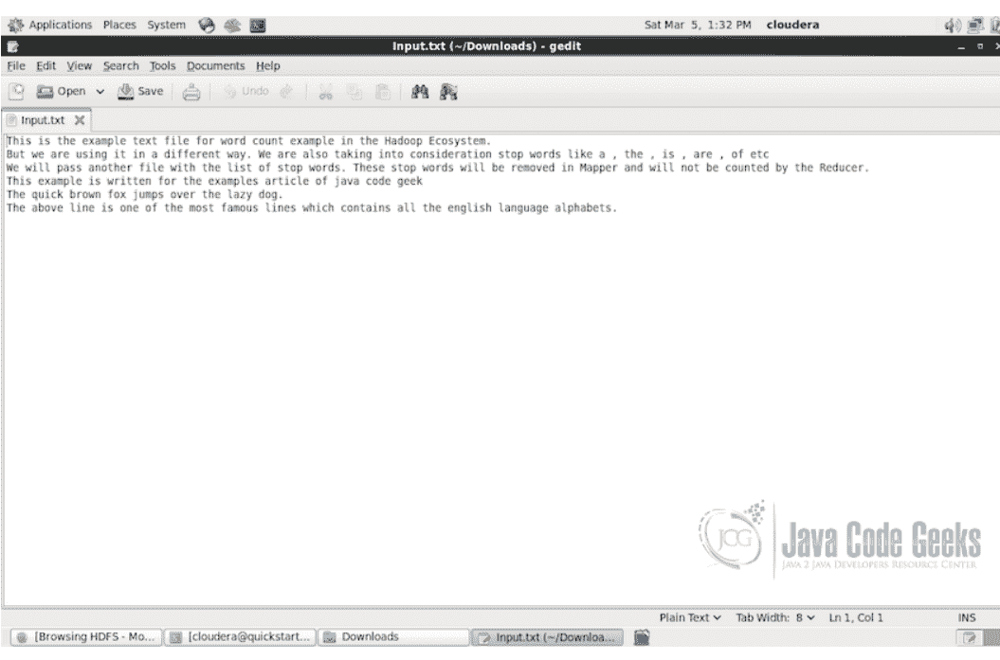

图 7.1: 待处理的 Input.txt 文件

以下是包含停用词的文件：

## Apache Hadoop Cookbook

应用程序 位置系统

StopWords.txt (~)

文件 编辑 视图 搜索 工具 文档 帮助

打开 保存 撤销

StopWords.txt

```text
' is a are of the for in it and not will be by all
```


图 7.2: 包含停用词列表的 StopWords.txt 文件

确保两个文件都存在于 Hadoop 分布式文件系统中。如果你想了解 HDFS 和 Hadoop 文件系统的基础知识，包括如何将文件放入 HDFS，请参考文章 Apache Hadoop FS Commands。

## 示例

```bash
cloudera@quickstart-~\$ hadoop fs -ls /user/root/distributedcache

Found 2 items

-rw-r--r-- 1 cloudera supergroup Input.txt

-rw-r--r-- 1 cloudera supergroup StopWords.txt

cloudera@quickstart-~\$
```


现在，为了执行 DistributedCache，我们必须将输入和其他文件提交到集群。以下是命令：

```bash
hadoop jar DistributedCache /user/root/distributedcache Input.txt /user/root/distributedcache
```

## Apache Hadoop Cookbook

输出

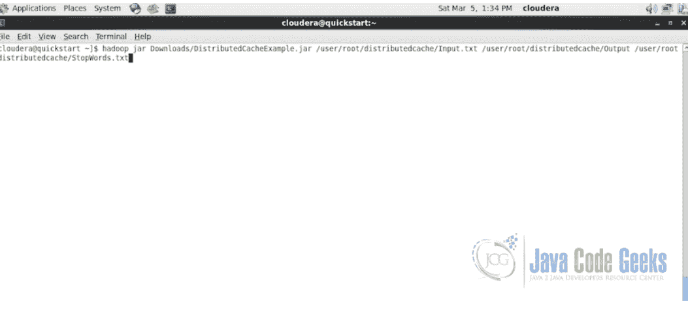

图 7.4: 提交命令


图 7.5: 控制台输出

## Apache Hadoop Cookbook

输出

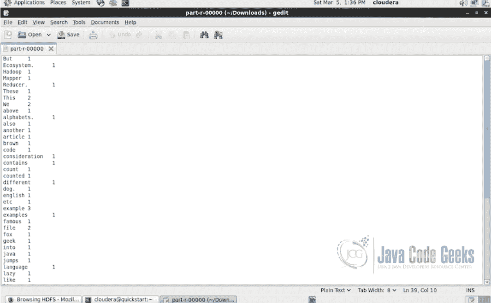

图 7.6: 输出文件

## Apache Hadoop Cookbook

结论

在本文中，我们讨论了 Apache Hadoop 的分布式缓存。我们从什么是分布式缓存的介绍开始，然后深入探讨了可以使用结节点的实现部分。

## 下载项目

下载

你可以在此处下载此示例的完整源代码：DistributedCache

## 第 8 章

# 词计数示例

词计数程序是用于理解 MapReduce 编程范式的基本代码。该程序由一个 MapReduce 业组成，用于统计文件中每个单词的出现次数。

# Apache Hadoop 菜谱

`map`和`reduce`。`Map`任务映射文件中的数据，并统计提供给`map`函数的数据块中的每个单词。该任务的结果将传递给`reduce`任务，`reduce`任务合并并减少数据以输出最终结果。

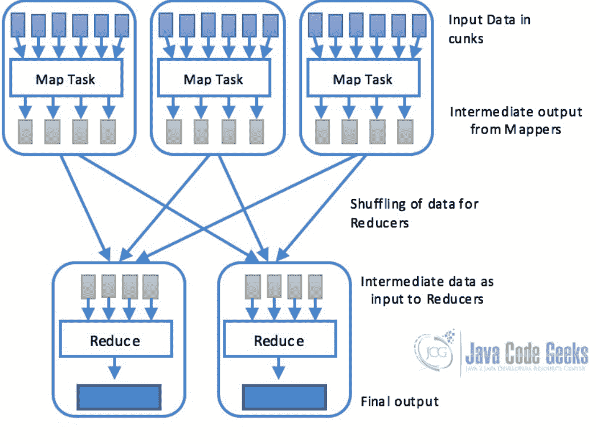

图 8.1：Map 和 Reduce 的工作原理

### 8.3.1 设置

我们将使用 Maven 为 Hadoop 词频计数示例设置一个新项目。在 Eclipse 中设置 Maven 项目并在`pom.xml`中添加以下 Hadoop 依赖项。这将确保我们拥有访问 Hadoop 代码库的所需权限。

```xml
<dependency>

  <groupId>org.apache.hadoop</groupId>

  <artifactId>hadoop-core</artifactId>

  <version>1.2.1</version>

</dependency>
```

添加依赖项后，我们就可以开始编写词频计数代码了。

### 8.3.2 Mapper 代码

`mapper`任务负责根据空格对输入文本进行分词并创建单词列表，然后遍历所有标记并输出每个单词及其计数为 1 的键值对。以下是`MapClass`：

```java
package com.javgeocodeeks.examples.wordcount;

import java.io.IOException;

import java.util.StringTokenizer;

import org.apache.hadoop.io.IntWritable;

import org.apache.hadoop.io.LongWritable;

import org.apache.hadoop.io.Text;

import org.apache.hadoop.mapreduce.Mapper;

public class MapClass extends Mapper{

    private final static IntWritable one = new IntWritable(1);

    private Text word = new Text();

    @Override

    protected void map(LongWritable key, Text value, 

        Context context) 

        throws IOException, InterruptedException {

        // 使用分词器作为分隔符获取文本和单词。

        String line = value.toString();

        StringTokenizer st = new StringTokenizer(line, " ");

        // 对于每个标记单词，将单词和 1 作为值

        // 的键值对写入 context

        while (st.hasMoreTokens()) {

            word.set(st.nextToken());

            context.write(word, one);

        }

    }

}
```

以下是`map`任务的具体操作：

- 第 13-14 行，定义了静态变量值 1 和存储单词的`word`。
- 第 22-23 行，在`map`方法中将输入变量转换为`String`并根据空格分词，以获取输入中所有的单词。
- 第 27-30 行，对于文本中的每个单词，设置`word`变量并将单词和整数值`one`的键值对传递给`context`。

### 8.3.3 Reduce 代码

代码片段包含`ReduceClass`，它继承了 MapReduce `Reducer`类并重写了`reduce()`函数。这在`map`方法从`map()`函数检索对应特定键的键后调用。它遍历所有值，相加并还原为单个值，最后将单词和出现次数输出到最终。

```java
package com.javgeocodeeks.examples.wordcount;

import java.io.IOException;

import java.util.Iterator;

import org.apache.hadoop.io.IntWritable;

import org.apache.hadoop.io.Text;

import org.apache.hadoop.mapreduce.Reducer;

public class ReduceClass extends Reducer{

    @Override

    protected void reduce(Text key, Iterable values,

                           Context context)

            throws IOException, InterruptedException {

        int sum = 0;

        Iterator<IntWritable> valuesIt = values.iterator();

        // 对于每个键值对，获取值并累加到 sum

        // 以获取单词的总出现次数

        while (valuesIt.hasNext()) {

            sum = sum + valuesIt.next().get();

        }

        // 将单词和总次数作为键值对写入 context

        context.write(key, new IntWritable(sum));

    }

}
```

遵循`reduce`函数的工作流如下：

- 第 17-18 行，定义了一个值为 0 的变量`sum`以及一个对`reducer`接收到的值的迭代器（Iterator）。
- 第 22-24 行，遍历所有值并将单词的出现次数加到`sum`中。
- 第 27 行，将单词和`sum`作为键值对写入`context`。

### 8.3.4 Driver 类

当我们有了`map`和`reduce`类后，就是时候将它们整合为一个单一作业了，这在一个类`driver`类中完成。该类包含`main()`方法用于设置和运行作业。

```java
package org.javaconde.examples.wordcount;

import org.apache.hadoop.conf.Configured;

import org.apache.hadoop.fs.Path;
```


```java
import org.apache.hadoop.io.IntWritable;
import org.apache.hadoop.io.Text;
import org.apache.hadoop.mapreduce.Job;
import org.apache.hadoop.mapreduce.lib.input.FileInputFormat;
import org.apache.hadoop.mapreduce.lib.output.FileOutput;
import org.apache.hadoop.mapreduce.lib.output.TextOutputFormat;
import org.apache.hadoop.util.Tool;
import org.apache.hadoop.util.ToolRunner;

public class Wordcount extends Config implements Tool {

    public static void main(String[] args) throws Exception {
        int exitCode = ToolRunner.run(new Wordcount(), args);
        System.exit(exitCode);
    }

    public int run(String[] args) throws Exception {
        if (args.length != 2) {
            System.err.printf("Usage: %s needs two arguments, input and output files\n", getClass().getSimpleName());
            return -1;
        }

        Job job = Job.getInstance("Wordcount", getConf());
        job.setDriverClass(Wordcount.class);
        job.setMapperClass(MapClass.class);
        job.setReducerClass(ReduceClass.class);
        FileInputFormat.setInputPath(job, new Path(args[0]));
        FileOutputFormat.setOutputPath(job, new Path(args[1]));
        job.setOutputKeyClass(Text.class);
        job.setOutputValueClass(IntWritable.class);
        job.setOutputFormatClass(TextOutputFormat.class);

        int returnValue = job.waitForCompletion(true) ? 0 : 1;
        if (job.isSuccessful()) {
            System.out.println("Job was successful");
        } else if (!job.isSuccessful()) {
            System.out.println("Job was not successful");
        }
        return returnValue;
    }
}
```

## 8.4 代码执行

有两种方式可以执行编写的代码：一种是在 Eclipse IDE 中执行，另一种是在 Hadoop 集群中执行。本节介绍这两种方式。

### 8.4.1 在 Eclipse IDE 中

在 Eclipse 中执行`wordcount`。首先，创建一个包含模拟数据的`input.txt`文件。为了测试，我们在项目根目录下创建包含以下内容的文件：

```
This is the example text file for word count also knows as hello world example of the Hadoop ecosystem.
This example is written for the examples article of java code
```

在 Eclipse 中，在项目参数中传递输入和输出文件名。如果输入文件在项目根目录下，只需提供文件名；如果输入文件在其他位置，应提供完整路径。

```
The quick brown fox jumps over the lazy dog.
The above line is one of the most famous lines which contains all the english language alphabets.
```

注意：确保输出文件不存在，如果存在，程序将报错。设置参数后运行应用程序，程序成功完成后，控制台将显示输出。

## Apache Hadoop 指南

104 / 139

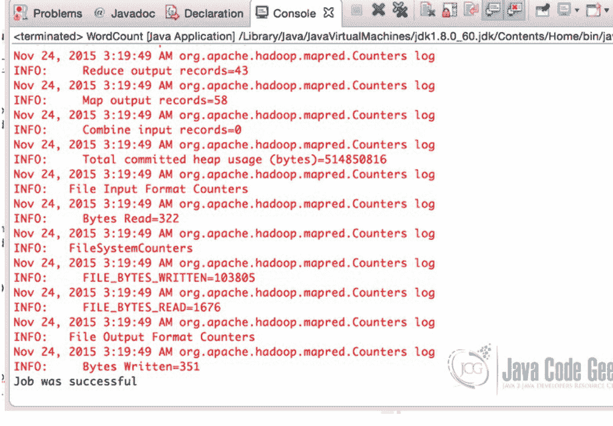

图 8.3: Eclipse 中的控制台输出

以下是输出文件的内容：

| 单词 | 计数 |
| :--- | :--- |
| Hadoop | 1 |
| The | 2 |
| This | 2 |
| above | 1 |
| all | 1 |
| alphabets | 1 |
| also | 1 |
| article | 1 |
| as | 1 |
| brown | 1 |
| code | 1 |
| contains | 1 |
| count | 1 |
| drop | 1 |
| ecosystem | 1 |
| english | 1 |
| example | 4 |
| examples | 1 |
| famous | 1 |
| file | 1 |
| for | 2 |
| fox | 1 |
| geek | 1 |
| hello | 3 |
| is | 1 |
| java | 1 |
| jumps | 1 |
| knows | 1 |
| language | 1 |
| lazy | 1 |
| line | 1 |
| lines | 1 |
| most | 1 |
| of | 3 |
| one | 1 |
| over | 1 |
| quick | 1 |
| text | 1 |
| the | 6 |
| which | 1 |
| word | 1 |
| written | 1 |

### 8.4.2 在 Hadoop 集群上

要在 Hadoop 集群上运行`Wordcount`示例，我们假设：

- Hadoop 集群已设置并运行
- 输入文件位于 HDFS 路径`/user/root/wordcount/Input.txt`

如果需要帮助设置 Hadoop 集群或 Hadoop 文件系统，请参考以下文章：
- 如何在 Ubuntu 上安装 Apache Hadoop
- Apache Hadoop 集群设置示例（使用虚拟机）
- Apache Hadoop 分布式文件系统详解
- Apache Hadoop FS 命令示例

首先，使用命令确保`Input.txt`文件存在于路径`/user/root/wordcount`：

```bash
hadoop fs -ls /user/root/wordcount
```

## Apache Hadoop 指南

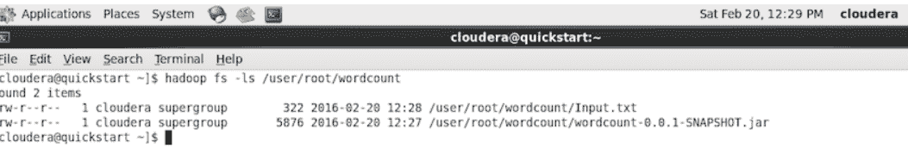

接下来，使用以下命令提交 MapReduce 任务：

```bash
hadoop jar Downloads/wordcount-0.0.1-SNAPSHOT.jar com.javacodgeeks.examples.wordcount.Wordcount /user/root/wordcount/Input.txt /user/root/wordcount/Output
```

在上述命令中，jar 文件位于`Downloads`文件夹，主类位于路径`com.javacodgeeks.examples.wordcount.Wordcount`。

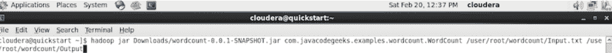

图 8.5: Jar 执行命令

执行后，控制台输出的最后一行应表明任务已成功完成。

## Apache Hadoop 指南

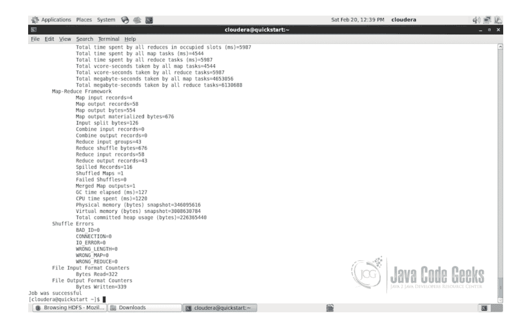

图 8.6: 控制台输出

现在，可以从`/user/root/wordcount/Output/`文件夹读取`Wordcount` map 任务的输出。使用以下命令在控制台中检查输出：

```bash
hadoop fs -cat /user/root/wordcount/Output/part-r-00000
```

下面的截图显示了控制台上的输出内容。

## Apache Hadoop 指南

108 / 139

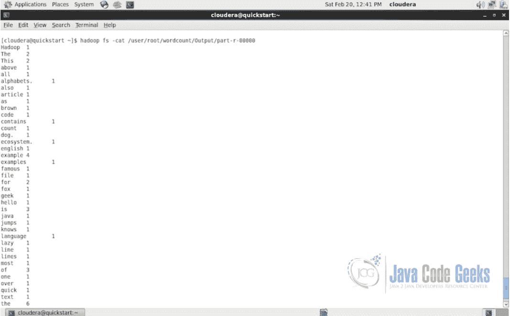

图 8.7: 输出文件

## 8.5 结论

本示例解释了 Apache Hadoop 的 MapReduce 范式，以及如何逐步编写 MapReduce 词汇计数示例。我们查看了如何在 Eclipse 中运行示例进行测试，以及如何使用 HDFS 输入文件在 Hadoop 集群中运行它。文章还提供了有关在 Ubuntu 上设置 Hadoop、设置 Hadoop 集群、理解 HDFS 和基本 FS 命令的其他有用文章链接。我们希望本文能够很好地解释 Hadoop MapReduce 的基础，并为理解 Apache MapReduce 奠定坚实的基础。

## 8.6 下载 Eclipse 项目

点击以下链接下载`wordcount`示例的完整 Eclipse 项目。

**下载** 你可以下载此示例的源代码：`HadoopWordCount`

## 第 9 章

## Streaming 示例

在本示例中，我们将深入 Hadoop MapReduce 的 Streaming 组件。我们将理解 Hadoop Streaming 的基础，并查看一个使用 Python 的示例。

## 9.1 引言

Hadoop Streaming 这个名字非常具有误导性，它与通常理解的连续数据流或实时数据流没有关系。Hadoop Streaming 只是 Hadoop MapReduce 分发版提供的一个工具，允许用户使用 Python 或 C++ 等其他编程语言编写 MapReduce 任务，这些语言可以利用`stdin`和`stdout`来读取和写入文本数据行。从 0.14.1 版本开始支持 C++。

当我们谈论其他编程语言时，并不是说用这些语言编写的代码需要翻译成 Java。

## 9.2 前提条件和假设

以下是前提条件：
- 你应该熟悉 MapReduce 的基础。
- 你应该理解如何在 Hadoop 集群上运行。
- 你应该知道如何使用 HDFS 处理输入文件。

如果需要帮助，可以参考以下文章：
- 如何在 Ubuntu 上安装 Apache Hadoop
- Apache Hadoop 集群设置示例（使用虚拟机）
- Apache Hadoop 分布式文件系统详解
- Hello World 示例

## 9.3 Hadoop Streaming

对于 Hadoop Streaming，`mapper`和`reducer`都需要能够从`stdin`读取数据并输出到`stdout`。

## 9.4 Python 中的 MapReduce 代码

如后续小节所示，我们使用 Hadoop Streaming 在 Hadoop 上运行 Python 代码。我们将使用 Python 中的`sys.stdin`和`sys.stdout`来读取数据并输出结果。

### 9.4.1 Wordcount 示例

`Wordcount`是用于解释 Hadoop MapReduce 框架基础的基本程序。在`wordcount`程序中，向 Mapper 提供一批输入，它将文本行拆分为单个单词，并将这些单词作为键值对传递给 Reducer 函数。Reducer 接收键值对作为输入，统计指定文本中特定单词出现的次数，然后输出以单词为键、次数为值的键值对。如果你不熟悉`wordcount`程序的基础，请参考 Apache Hadoop Wordcount 示例。本文实现相同的`wordcount`示例，但使用 Python 代替 Java，并使用 Hadoop Streaming 运行。

### 9.4.2 Mapper

Python 中的 Mapper 函数将从`stdin`读取行，将行拆分为单个单词，并将单词作为键、`1`作为值，以键值对的形式输出。例如，`<word, 1>`。

```python
#!/usr/bin/env python
import sys

# 从 stdin 读取输入
for line in sys.stdin:
    # 去除任何开头和结尾的空格
    line = line.strip()
    # 将行拆分为单个单词
    words = line.split()
    # 对于 words 中的每个单词，输出键值对
    for word in words:
        # 将结果输出到 stdout
        print(f"{word}\t1")
```

上述是执行 Map 任务的 Python 代码，将其命名为`mapper.py`，并确保对 Python 文件具有读取和运行权限。

### 9.4.3 Reducer

Reducer 通过`stdin`从`mapper.py`获取输入。Reducer 会累加每个单词出现的次数，并以键值对的形式输出结果，其中特定单词为键，单词的总出现次数为值。例如，`<word, 5>`。

```python
#!/usr/bin/env python
from operator import itemgetter
import sys

# 变量初始化
current_word = None
current_count = 0
word = None

# 从 stdin 获取输入
for line in sys.stdin:
    # 去除任何开头和结尾空格
    line = line.strip()
    # 分割来自 mapper.py 的输入以获取单词和计数
    word, count = line.split('\t', 1)
    # 将计数字符串转换为整数
    try:
        count = int(count)
    except ValueError:
        # 发生异常时
        # 忽略异常并丢弃输入行
        continue
    # 这个 IF-switch 能够工作是因为 Hadoop 在传递给 reducer 之前
    # 按键（这里：word）对 map 输出进行了排序
    if current_word == word:
        current_count += count
    else:
        if current_word:
            # 将结果写入 STDOUT
            print '%s\t%s' % (current_word, current_count)
        current_count = count
        current_word = word

# 如果需要，不要输出最后一个单词！
if current_word == word:
    print '%s\t%s' % (current_word, current_count)
```

上述是执行 reduce 任务的 Python 代码，将其保存到`reducer.py`文件中，并确保拥有读取和执行权限。

### 测试 Python 代码

在将 Python 代码作为 MapReduce 提交到 Hadoop 集群之前，最好先测试代码以确认其运行符合预期。通过小型输入测试来确保代码正确运行是简单的，可以避免在集群上处理大量数据时出现问题。我们可以进行以下测试：

- **测试 Mapper**：在控制台中执行以下命令，使用指定的输入字符串运行`mapper.py`脚本，并确认输出符合预期。

```bash
echo "the quick brown fox jumps over the lazy dog" | /home/cloudera/mapper.py
```

输出应与预期相符（如对`mapper.py`的测试所示）。

- **测试 Reducer**：在控制台中执行以下命令，结合使用`mapper.py`和`reducer.py`：

```bash
echo "the quick brown fox jumps over the lazy dog" | /home/cloudera/mapper.py | sort -kl1,1 | /home/cloudera/reducer.py
```


上述命令的输出应如下方的截图所示：`Test for reducer.py`（对`reducer.py`的测试）

## 在 Hadoop 上提交和执行作业

在这一节中，我们将学习如何使用 Hadoop Streaming API 在 Hadoop 集群上运行 Python MapReduce 脚本。

## 6.1 输入数据

对于此示例，我们将从 Project Gutenberg 下载一本书，将其作为 MapReduce 程序的数据。`Charles M. Horton`编写的《Opportunities in Engineering》。

当你访问该网页时，你会在许多格式中看到该书，如下方的所示。请确保以纯文本 UTF-8 编码下载该书，以便 MapReduce 程序读取。


图 9.1：Project Gutenberg 下载下载页面

下载书籍后，将其重命名为`input.txt`以便引用。

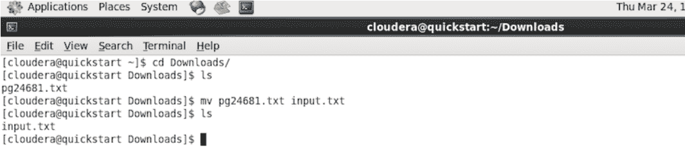

```bash
cloudera@quickstart -s cd Downloads/

cloudera@quickstart Downloads$ ls

p24681.txt

cloudera@quickstart Downloads$ mv pg24681.txt input.txt

cloudera@quickstart Downloads$ ls

input.txt

cloudera@quickstart Downloads$ 
```

图 9.2：重命名文件

## 9.6.2 将输入数据传输到 HDFS

MapReduce 需要输入数据存在于相应的 HDFS 中并可用。因此，在运行 MapReduce 作业之前，我们需要将上一步中下载的书籍传输到 HDFS。为此，请使用以下命令：

```bash
hadoop fs -put input.txt input.txt
```

上述命令将`input.txt`文件从本地系统存到 HDFS 的根位置，并命名为`input.txt`，如下方的截图所示：

## Apache Hadoop Cookbook


```bash
cloudera@quickstart:~/Downloads

File Edit View Search Help

cloudera@quickstart$ hadoop fs -put input.txt input.txt

cloudera@quickstart$ hadoop fs -ls

Found 1 items:

-rw-r--r-- 1 128 03-24 23:48 input.txt

cloudera@quickstart Downloads$
```

图 9.3：将输入文件从本地传输到 HDFS

你可以使用命令检查文件是否成功传输：

```bash
hadoop fs -ls
```

## 浏览目录

| 权限 | 所有者 | 组 | 大小 | 副本 | 块大小 | 名字 |
| :--- | :--- | :--- | :--- | :--- | :--- | :--- |
| -rw-r--r-- | cloudera | cloudera | 122.86 KB | 1 | 128 MB | input.txt |

图 9.4：Hadoop 用户面板

完成此步后，我们现在就可以向 Hadoop 集群提交 MapReduce 作业了。

## 9.6.3 提交 MapReduce 作业

要在 Hadoop 集群上运行作业，我们将使用 Streaming API，这样数据就可以 stdin 和 stdout 在 Mapper 和 Reducer 之间传递。以下是提交并运行作业的命令：

```bash
hadoop jar /usr/lib/hadoop-0.28.0/mapreduce/streaming/hadoop-streaming-mr1.jar \

-file mapper.py -mapper mapper.py \

-file reducer.py -reducer reducer.py \

-input /user/cloudera/input.txt \

-output /user/cloudera/output
```

以下是控制台中完整命令的截图：

```bash
cloudera@quickstart: hadoop jar /usr/lib/hadoop-0.28.0/mapreduce/streaming/hadoop-streaming-mr1.jar \

-file mapper.py -mapper mapper.py \

-file reducer.py -reducer reducer.py \

-input /user/cloudera/input/ \

-output /user/cloudera/output

16/03 25 15:05:47 INFO JobSubmission: - File option is deprecated, use generic option -files instead.

16/03 25 15:05:49 INFO ClientMMApp: Connecting to ResourceManager @ 8.0.0.0:8030

16/03 25 15:05:50 INFO MapReduceTracker: Starting process : 1

16/03 25 15:05:50 INFO MapReduceSubmit: Number of splits:2

16/03 25 15:05:50 INFO MapReduceJob: Starting job 1588942924080_0001

16/03 25 15:05:51 INFO YARNApplicationClient: Submitted application 1588942924080_0001

16/03 25 15:05:51 INFO MapReduceJob: Running job 1588942924080_0001 on cloudera:8088/proxy/application/1588942924080_0001

16/03 25 15:05:51 INFO MapReduceJob: Running job 1588942924080_0001 running in user mode : false

16/03 25 15:06:03 INFO MapReduceJob: map 6% reduce
```


图 9.6：作业提交的控制日志

控制日志为 MapReduce 作业分配了一个作业 ID 并开始运行作业。

一旦作业在没有任何异常或错误的情况下提交，你将看到下面的控制日志，最后一行指出了作业输出存储的路径。

# Apache Hadoop 食南

```
Map Reduce 框架

Map input: 2285

Map output: 20379

Map shuffle: 25668

Map output bytes: 248058

Input size: 511

Combine input: 28

Combine output: 0

Reduce input: 6754

Reduce shuffle: 20498

Reduce output: 20379

Reduce output: 25154

Shuffled Maps: 0

Failed Maps: 0

Merge sort: 0

Merge output: 0

CPU time (ms): 3160

Physical memory (bytes) snapshot: 579469312

Virtual memory (bytes) snapshot: 451931264

Total committed hmap usage (bytes): 319379008

Shuffle Errors

0

CONNECTION: 0

IO ERROR: 0

WRONG LENGTH: 0

WRONG MARK: 0
```

```bash
16/03/25 15:13:02 INFO.StreamJob: output: /user/cloudera/output

clouderaquickstart- ~ [Namenode informatio...
```

图 9.7: 任务控制台输出

## 9.6.4 理解 MapReduce 日志

MapReduce 任务的成功执行会输出大量的日志，你应该关注这些。以下是 MapReduce 任务执行的完整日志。

```bash
[clouderaquickstart- ~] hadoop jar /usr/lib/hadoop-0.20-mapreduce/contrib/streaming/hadoop 

- file mapper.py -mapper mapper.py

- file reducer.py -reducer reducer.py

- input /user/cloudera/input 

- output /user/cloudera/output

16/03/25 15:14:05 WARNING.StreamJob: -file option is deprecated, please use generic -options instead

compressed input file in: [mapper.py, reducer.py] [/usr/hadoop/hadoop-streaming-2.6.0-cdh5.5.0.jar] /tmp 

stream/job20412411564891732

16/03/25 15:14:59 INFO.Client.RM: Connecting to Resource Manager at @0.0.0.0:8

16/03/25 15:15:00 INFO.Client.RM: Connecting to Resource Manager at @0.0.0.0:8

16/03/25 15:15:00 INFO.JobTracker: input to process : 1

16/03/25 15:15:00 INFO.JobTracker: Submitting tasks for job: 

Job_145849220400_001

16/03/25 15:15:01 INFO.Job.VarClientImpl: Submitted application 

application_145849220400_001/

16/03/25 15:15:01 INFO.Job: The url to track the job: https://quickstart.cloudera:8088/proxy/application_145849220400_001/

16/03/25 15:06:03 INFO.Job: Running job: job_145849220400_001

16/03/25 15:06:03 INFO.Job: Job_145849220400_001 running in user mode : 

false

16/03/25 15:06:03 INFO.map.Job: map 0% reduce 0%

16/03/25 15:06:20 INFO.map.Job: map 100% reduce 0%

16/03/25 15:06:32 INFO.map.Job: map 100% reduce 100%

16/03/25 15:06:32 INFO.map.Job: Job job_145849220400_001 completed successfully
```


16/03/25 15:06:32 INFO mapreduce.Job: Counters: 49
File System Counters
FILE: Number of bytes read=204052
FILE: Number of bytes written=753127
FILE: Number of read operations=0
FILE: Number of large read operations=0
FILE: Number of write operations=0
HDFS: Number of bytes read=131022
HDFS: Number of bytes written=50688
HDFS: Number of read operations=9
HDFS: Number of large read operations=0
HDFS: Number of write operations=2

Job Counters
Launched map tasks=2
Reduced tasks=1
Data-local map tasks=2
Total time spent by all maps occupied slots (ms)=29025
Total time spent by all reduces (ms)=10319
Total time spent by all reduce tasks (ms)=10319
Total core-seconds taken by all maps=29025
Total core-seconds taken by all reduce=10319
Total megabyte-seconds taken by all maps=29721600
Total megabyte-seconds taken by all reduce=105666

Map-Reduce Framework
Map input records=2205
Map output records=2039
Map output bytes=15388
Map materialized bytes=204058
Input bytes=214
Combine input records=0
Combine output records=0
Reduce groups=4754
Reduce shuffle bytes=20458
Reduce input records=20379
Reduce output records=4754
Spilled Records=40758
Shuffled Maps=2
Failed Tasks=0
Merged outputs=2
GC time elapsed (ms)=403
CPU time spent (ms)=3960
Physical memory (bytes) snapshot=579463122
Virtual memory (bytes) snapshot=451393264
Total heap usage (bytes)=391790008

Shuffle Error
BAD=0
CONNECTION=0
IO_ERROR=0
WRONG_LENGTH=0
WRONG_MAP=0
WRONG_REDUCE=0

File Input Counters
Bytes Read=129908
File Output Counters
Bytes Written=50688

16/03/25 15:06:32 INFO streaming: Output directory: /user/cloudera/output

以下是控制台日志的重要部分：

- 第 10 行：任务需要处理的任务数量。这里我们只有一个文件，处理的路径也是 1。
- 第 14 行：记录了可以在 Web 浏览器中跟踪任务进度的 URL。
- 第 17-19 行：分别记录了 Map 和 Reduce 的进度。
- 第 20 行：告知任务已成功完成，之后控制台日志将显示任务的统计信息。
- 第 22-32 行：显示文件系统，包括读取的字节数、总写入字节数、操作次数和写入操作次数。
- 第 33-64 行：显示文件系统，包括读取的字节数、总写入字节数、操作次数和写入操作次数。
- 第 65 行：告知任务已成功完成，之后控制台日志将显示任务的统计信息。
- 第 77 行：MapReduce 框架，我们看到了 Map 和 Reduce 的使用情况。

# Apache Hadoop 实战教程

图 10.1：Zookeeper 客户端-服务器架构

在任何时刻，一个客户端只能连接到一个 Zookeeper 服务器，但每个 Zookeeper 服务器同时可以处理多个客户端。客户端定期向服务器发送 ping（心跳包），以让服务器知道它处于存活状态并连接着新的节点。Zookeeper 服务器也会响应一个确认信息，告知它也处于存活状态并已连接。这些 ping/心跳包的频率可以在配置文件中设置，我们将在下一节中看到。

如果客户端在指定时间内没有从其连接的服务器收到确认信息，则客户端将尝试连接池中的另一个服务器，连接成功后，客户端会话将转移到它所连接的新 Zookeeper 服务器。

Zookeeper 采用类似于文件系统的分级系统，在节点（nodes）中存储数据，这些节点被称为 znode。Zode 衍生自“Zookeeper data nodes”。每个 znode 充当目录，可以拥有多个子节点，层级结构持续延续。要访问节点，Zookeeper 遵循文件路径结构。例如：指向 znode `firstnode` 及其对应的子节点的路径可能如下：`/firstnode/sub-node/sub-sub-node`

## 10.3 Zookeeper 安装

在本节中，我们将介绍在本地（localhost）上设置 Zookeeper 服务器以用于实验的步骤。Zookeeper 软件包提供了一个单一服务器，可以直接在机器上运行。

### 10.3.1 系统要求

- Java, JDK 6 或更高版本（我们将使用 JDK 8）
- 至少 2GB RAM
- 双核处理器
- Linux 操作系统。Linux 同时支持开发和生产系统。Windows 和 MacOSX 仅支持作为开发系统，不支持生产系统。

### 10.3.2 安装 Java

首先，我们将检查系统上是否安装了 Java，如果没有，我们需要先安装 Java。检查 Java 是否已安装：

```
java -version
```

如果返回了 Java 版本，则说明已安装 Java。确保它至少是 JDK 6 或更高版本。如果没有安装 Java，我们必须安装它。使用以下命令安装 JDK 8。

```
sudo apt-get update
sudo apt-get install openjdk-8-jre-headless
```

第一条命令将更新所有已安装的包，第二条命令将安装 OpenJDK 8。以下是控制台输出：

图 10.2：安装 Java JDK 8 后控制台输出

要检查安装是否成功，再次运行命令：

```
java -version
```

输出应该类似于下面截图显示的内容：

### 10.3.3 下载 Zookeeper

下一步是从发布站点（Release site）下载 Zookeeper 的稳定发布版本。从发布站点的 Download 部分手动下载稳定版本（在编写时，稳定发布版本为 3.4.6）。我们可以使用网站中提到的任何镜像（如下所示所示），并将其解压/解包到目标文件夹。

首页 > Dyn 关于 项目 人员 参与 下载 支持 Apache 搜索

我们建议使用以下镜像进行下载：

`http://eu.apache.org/dist/zookeeper/`

其他镜像列在下方。请仅使用备用镜像下载 PGP 和 MD5 签名以验证您的下载内容，或者在其他镜像均无法工作时使用。

### HTTP

`http://eu.apache.org/dist/zookeeper/`

`http://us.apache.org/dist/zookeeper/`

图 10.4：Apache Zookeeper 镜像

或使用以下命令下载并解压：

```
wget https://www.apache.org/dist/zookeeper/stable/zookeeper-3.4.6.tar.gz
tar -xvf zookeeper-3.4.6.tar.gz
cd zookeeper-3.4.6/
```

图 10.5：下载稳定版 Zookeeper

### 10.3.4 数据目录

我们需要一个目录来存储与 znodes 相关以及其他 Zookeeper 元数据。为此，我们将在 `/var/lib/` 下创建一个名为 `zookeeper` 的新目录。

```
sudo mkdir /var/lib/zookeeper
```

创建 Zookeeper 时，默认所有者是 root。为了更改所有者以便 Zookeeper 能够访问，运行以下命令：

```
cd /var/lib
sudo chown -R zookeeper:zookeeper /var/lib/zookeeper
```

图 10.6：Zookeeper 所有权更改

图 10.7：Zookeeper 数据目录

### 10.3.5 配置文件

现在是进行所需更改了。Zookeeper 自带了一个示例文件，我们将将其作为模板。该文件名为 `zoo-sample.cfg`，位于 `conf` 文件夹中。

```
cd zookeeper-3.4.6/conf
mv zoo-sample.cfg zoo.cfg
```

图 10.8：重命名示例文件

现在，让我们编辑这个 `zoo.cfg`。在示例中，我们使用了 `nano`，但你可以使用任何喜欢的编辑器。

```
nano zoo.cfg
```

确保文件内容如下所示并包含以下设置：

```
tickTime = 2000
initLimit=10
syncLimit=5
dataDir=/var/lib/zookeeper
clientPort=2181
```

**注意：** `dataDir` 应该设置为我们在上一步中创建的目录，即 `/var/lib/zookeeper`。

图 10.9：`zoo.cfg` 文件

### 10.3.6 启动服务器

现在是启动 Zookeeper 服务器了。Zookeeper 提供了一个脚本文件以便启动服务器。该文件名为 `zkServer.sh`。使用以下代码启动服务器：

```
cd zookeeper-3.4.6/
bin/zkServer.sh start
```

图 10.11：启动 Zookeeper 服务器

## 10.4 Zookeeper 服务器基础交互

### 10.4.1 启动 CLI

一旦 Zookeeper 服务器成功运行，我们就可以启动 CLI（命令行界面）来与服务器交互。使用以下命令进行操作：

```
cd zookeeper-3.4.6/
bin/zkCLI.sh -server
```

执行此命令后，控制台将进入 Zookeeper 命令行模式，我们可以在其中使用 Zookeeper 特定的命令与服务器交互。

# Apache Hadoop 实战指南

```
2016-03-21 21:27:34,123 [main] INFO [main:Environment01] - Client environment: raman-VirtualBox
2016-03-21 21:27:34,123 [main] INFO [main:Environment01] - Client environment: java.version=1.8.0_45
2016-03-21 21:27:34,123 [main] INFO [main:Environment01] - Client environment: zookeeper-3.4.6
2016-03-21 21:27:34,123 [main] INFO [main:Environment01] - Client environment: /home/raman/lib/jvm/java-8-openjdk-amd64
2016-03-21 21:27:34,123 [main] INFO [main:Environment01] - Client environment: /home/raman/zookeeper-3.4.6
2016-03-21 21:27:34,123 [main] INFO [main:Environment01] - Client environment: /home/raman/zookeeper-3.4.6/lib
2016-03-21 21:27:34,123 [main] INFO [main:Environment01] - Client environment: /home/raman/zookeeper-3.4.6/conf
2016-03-21 21:27:34,123 [main] INFO [main:Environment01] - Client environment: /home/raman/zookeeper-3.4.6/bin
2016-03-21 21:27:34,123 [main] INFO [main:Environment01] - Client environment: /home/raman/zookeeper-3.4.6/work
2016-03-21 21:27:34,123 [main] INFO [main:Environment01] - Client environment: /home/raman/zookeeper-3.4.6/logs
2016-03-21 21:27:34,123 [main] INFO [main:Environment01] - Client environment: /home/raman/zookeeper-3.4.6/lib/zookeeper
2016-03-21 21:27:34,123 [main] INFO [main:Environment01] - Client environment: /home/raman/zookeeper-3.4.6/lib/zookeeper
2016-03-21 21:27:34,123 [main] INFO [main:Environment01] - Client environment: /home/raman/zookeeper-3.4.6/lib/zookeeper
2016-03-21 21:27:34,123 [main] INFO [main:Environment01] - Client environment: /home/raman/zookeeper-3.4.6/lib/zookeeper
2016-03-21 21:27:34,123 [main] INFO [main:Environment01] - Client environment: /home/raman/zookeeper-3.4.6/lib/zookeeper
2016-03-21 21:27:34,123 [main] INFO [main:Environment01] - Client environment: /home/raman/zookeeper-3.4.6/lib/zookeeper
2016-03-21 21:27:34,123 [main] INFO [main:Environment01] - Client environment: /home/raman/zookeeper-3.4.6/lib/zookeeper
2016-03-21 21:27:34,123 [main] INFO [main:Environment01] - Client environment: /home/raman/zookeeper-3.4.6/lib/zookeeper
2016-03-21 21:27:34,123 [main] INFO [main:Environment01] - Client environment: /home/raman/zookeeper-3.4.6/lib/zookeeper
2016-03-21 21:27:34,123 [main] INFO [main:Environment01] - Client environment: /home/raman/zookeeper-3.4.6/lib/zookeeper
2016-03-21 21:27:34,123 [main] INFO [main:Environment01] - Client environment: /home/raman/zookeeper-3.4.6/lib/zookeeper
2016-03-21 21:27:34,123 [main] INFO [main:Environment01] - Client environment: /home/raman/zookeeper-3.4.6/lib/zookeeper
2016-03-21 21:27:34,123 [main] INFO [main:Environment01] - Client environment: /home/raman/zookeeper-3.4.6/lib/zookeeper
2016-03-21 21:27:34,123 [main] INFO [main:Environment01] - Client environment: /home/raman/zookeeper-3.4.6/lib/zookeeper
2016-03-21 21:27:34,123 [main] INFO [main:Environment01] - Client environment: /home/raman/zookeeper-3.4.6/lib/zookeeper
2016-03-21 21:27:34,123 [main] INFO [main:Environment01] - Client environment: /home/raman/zookeeper-3.4.6/lib/zookeeper


2016-03-21 21:27:34,123 [main] INFO [main:Environment01] - Client environment: `/home/raman/zookeeper-3.4.6/lib/zookeeper`

...（此处省略重复日志）

# Apache Hadoop 食谱

图 10.13：在 Zookeeper 中创建节点

## 10.4.3 从第一个 Znode 获取数据

与创建新节点的方式类似，我们可以使用 CLI（命令行界面）获取 znode 的详情和数据。以下是获取 znode 数据的命令：

```
get /firstnode
```

NodeData: (Connected) path=`/firstnode`

Created

NodeData: (Connected) path=`/firstnode`
Metadata:
`cime` = 2016-01-26 21:29:04 2016
`mtime` = 2016-01-26 21:29:04 2016
`dataVersion` = 0
`version` = 0
`aclVersion` = 0x0
`length` = 19
`numchildren` = 0

图 10.14：从 Zookeeper 中的 znode 获取数据

如果你查看截图，在创建带有数据的 znode 同时，服务器还返回了与该特定 znode 相关的元数据。

元数据中的一些重要字段包括：

- `ctime`：znode 创建的时间。

- `mtime`：最后修改时间。

- `dataVersion`：数据的版本，每次修改数据时都会更改。在这种情况下，数据为 `helloworlddata`，长度为 19。

- `dataLength`：存储在 znode 中的数据长度。

- `numchildren`：该节点 znode 的子节点数量。

## 10.4.4 修改 Znode 中的数据

如果我们想修改特定 znode 中的数据，Zookeeper 提供了一个相应的命令。以下是修改现有 znode 中数据的方法：

```
/firstnode helloworld
```

其中 `firstnode` 是现有的 znode，`helloworld` 是需要写入 znode 的新数据。当设置新数据时，旧数据将被移除。

图 10.15：修改现有 znode 中的数据

如果你注意到截图中的发现，当设置新值时，`datalength`、`mtime` 和 `dataversion` 也会被更新。

### 10.4.5 创建子节点

在现有节点中创建子节点与创建新节点一样简单。我们只需要传递新子节点的完整路径即可。

```
create /firstnode/subnode subnodeata
get /firstnode/subnode
```

`raman@raman-VirtualBox: ~ /zookeeper-3.4.6`

图 10.16：为现有节点创建子节点

## 10.4 移除节点

使用 Zookeeper CLI 中的 `rmr` 命令移除节点非常简单。移除节点也会移除其所有的子节点。以下是移除我们为此示例创建的 `firstnode` 的代码：

```
rmr /firstnode
```

```
raman@raman-VirtualBox:~/zookeeper-3.4.6
File Edit View Help
2018-01-26 17:35:19,144] INFO [Main-Environment:100] - Client environment:user nameless
2018-01-26 17:35:19,144] INFO [Main-Environment:100] - Client environment:/home/root
2018-01-26 17:35:19,144] INFO [Main-Environment:100] - Client environment:/home/raman/zookeeper-3.4.6
2018-01-26 17:35:19,144] INFO [Main-Zookeeper:3088] - Initiating connection, connectString=localhost:2181 Timeout=3000 whatserver.org
2018-01-26 17:35:19,144] INFO [Main-Thread(localhost:2181):ClientConn$SendThread#0] - Opening socket connection to localhost/127.0.0.1
2018-01-26 17:35:19,144] INFO [Main-Thread(localhost:2181):ClientConn$SendThread#0852] - Socket connection established to localhost/127.0.0.1
2018-01-26 17:35:19,144] INFO [Main-Thread(localhost:2181):ClientConn$SendThread#225] - Session establishment complete on localhost/127.0.0.1
sessionId=0x15c2c3a5b6d7e8, timeout=60000
Welcome to Zookeeper!
2018-01-26 17:35:19,144] INFO [Main-Thread(localhost:2181):ClientConn$SendThread#075] - Will not attempt to authenticate using SASL (unknown error)
2018-01-26 17:35:19,144] INFO [Main-Thread(localhost:2181):ClientConn$SendThread#0852] - Initiating session
MATCHER:
match:state=stateConnected,type=node,path=
[localhost:2181(CONNECTED)] 1 rm /firstnode
Zxid=0x0 time=2018-01-26 17:29:04 CET 2016
cid=0x0 time=2018-01-26 17:29:04 CET 2016
xid=0x8
version=1
ephemeral=false
data=
children=0
```

图 10.17：从 Zookeeper 中移除节点

## 10.5 结论

这带我们进入这个 Apache Zookeeper 入门示例的结论。在这个示例中，我们首先从 Zookeeper 的介绍和总体架构开始，接着学习了如何在单机上设置 Zookeeper。我们还看到，使用 Zookeeper CLI 与 Zookeeper 服务进行交互也是非常简单的，并且所有基础交互都有相应的命令。

## 10.6 下载

你可以下载此示例中使用的配置文件 `zoo.cfg`：[Zookeeper 配置]()
