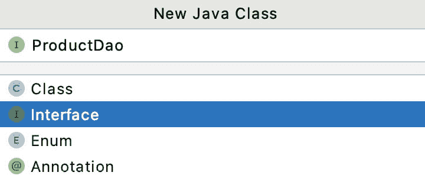
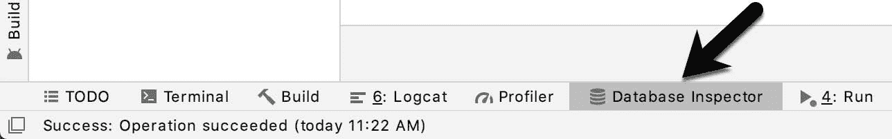
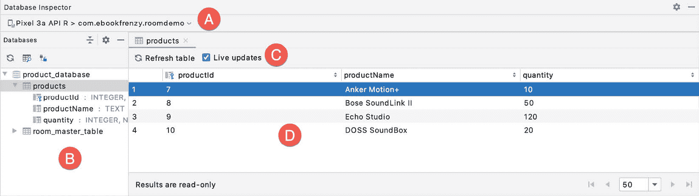
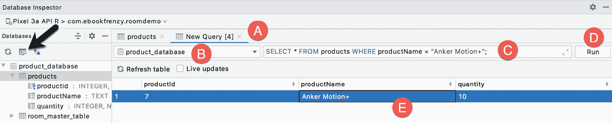

# 六十八、安卓 Room 数据库和仓库教程

本章将结合在名为[“安卓 Room 持久化库”](66.html#_idTextAnchor1241)一章中获得的知识和在前一章中创建的初始项目，提供一个详细的教程，演示如何使用 Room 持久化库实现基于 SQLite 的数据库存储。根据安卓架构指南，该项目将使用视图模型和存储库。本教程将利用[“安卓 Room 持久化库”](66.html#_idTextAnchor1241)中包含的所有元素，包括实体、数据访问对象、Room 数据库和异步数据库查询。

## 68.1 关于 Room 演示项目

在前一章中创建的用户界面布局是创建用于存储产品名称和数量的初级库存应用的第一步。完成后，该应用将提供添加、删除和搜索数据库条目的能力，同时还显示数据库中当前存储的所有产品的可滚动列表。随着数据库条目的添加或删除，该产品列表将自动更新。

## 68.2 修改构建配置

首先启动 AndroidStudio，并打开上一章开始的 RoomDemo 项目。在向项目中添加任何新类之前，第一步是向构建配置中添加一些额外的库，包括 Room 持久化库。找到并编辑模块级 `build.gradle` 文件（`app -> Gradle Scripts -> build.gradle (Module: RoomDemo.app)`）并按如下方式进行修改：

```java
dependencies {
.
.
    implementation "androidx.recyclerview:recyclerview:1.1.0"
    implementation "androidx.room:room-runtime:2.2.5"
    implementation "androidx.fragment:fragment-ktx:1.2.5"
    annotationProcessor "androidx.room:room-compiler:2.2.5"
.
.
}
```

## 68.3 构建实体

这个项目将从创建定义数据库表模式的实体开始。该实体将由一个用于产品 id 的整数、一个用于保存产品名称的字符串列和另一个用于存储数量的整数值组成。产品 id 列将作为主键，并将自动生成。[表 68-3](#_idTextAnchor1289) 总结了实体的结构：

| 列 | 数据类型 |
|---|---|
| 产品 id | 整数/主键/自动增量 |
| 产品名称 | 字符串 |
| 数量 | 整数 |

表 68-3

通过右键单击项目工具窗口中的 `app -> java -> com.ebookfrenzy.roomdemo` 条目，并选择 `新建 -> Java 类` 菜单选项，为实体添加类文件。在“新建类”对话框中，命名类 `Product`，然后单击“确定”按钮生成文件。

当 `Product.java` 文件在编辑器中打开时，对其进行修改，使其如下所示：

```java
package com.ebookfrenzy.roomdemo;

public class Product {

    private int id;
    private String name;
    private int quantity;

    public Product(String name, int quantity) {
        this.id = id;
        this.name = name;
        this.quantity = quantity;
    }

    public int getId() {
        return this.id;
    }
    public String getName() {
        return this.name;
    }

    public int getQuantity() {
        return this.quantity;
    }

    public void setId(int id) {
        this.id = id;
    }

    public void setName(String name) {
        this.name = name;
    }

    public void setQuantity(int quantity) {
        this.quantity = quantity;
    }
}
```

该类现在拥有数据库表列的变量以及匹配的 getter 和 setter 方法。当然，这个类在被注释之前不会成为一个实体。在编辑器中类文件仍然打开的情况下，添加注释和相应的导入语句：

```java
package com.ebookfrenzy.roomdemo;

import androidx.annotation.NonNull;
import androidx.room.ColumnInfo;
import androidx.room.Entity;
import androidx.room.PrimaryKey;

@Entity(tableName = "products")
public class Product {

    @PrimaryKey(autoGenerate = true)
    @ColumnInfo(name = "productId")
    private int id;

    @ColumnInfo(name = "productName")
    private String name;
    private int quantity;
.
.
}
```

这些注释将其声明为名为 `products` 的表的实体，并为 `id` 和 `name` 变量分配列名。`id` 列也被配置为主键并自动生成。因为主键永远不能为空，所以也应用 `@NonNull` 注释。由于在 SQL 查询中不需要引用数量列，因此没有为 `quantity` 变量指定列名。

## 68.4 创建数据访问对象

定义了产品实体后，下一步是创建 DAO 接口。再次参考项目工具窗口，右键单击 `app -> java -> com.ebookfrenzy.roomdemo` 条目，并选择 `新建 -> Java 类` 菜单选项。在新建类对话框中，在名称字段输入 `ProductDao`，从列表中选择接口，如图[图 68-1](#_idTextAnchor1291) 所示：



图 68-1

单击“确定”生成新界面，并将 `ProductDao.java` 文件加载到代码编辑器中，进行以下更改：

```java
package com.ebookfrenzy.roomdemo;

import androidx.lifecycle.LiveData;
import androidx.room.Dao;
import androidx.room.Insert;
import androidx.room.Query;

import java.util.List;

@Dao
public interface ProductDao {

    @Insert
    void insertProduct(Product product);

    @Query("SELECT * FROM products WHERE productName = :name")
    List<Product> findProduct(String name);

    @Query("DELETE FROM products WHERE productName = :name")
    void deleteProduct(String name);

    @Query("SELECT * FROM products")
    LiveData<List<Product>> getAllProducts();
}
```

DAO 实现了从产品数据库中插入、查找和删除记录的方法。插入方法传递给包含要存储的数据的产品实体对象，而查找和删除记录的方法传递给包含要执行操作的产品名称的字符串。`getAllProducts()` 方法返回一个包含数据库中所有记录的 `LiveData` 对象。此方法将用于保持用户界面布局中的 `RecyclerView` 产品列表与数据库同步。

## 68.5 添加 Room 数据库

将存储库添加到项目之前的最后一项任务是实现 Room 数据库实例。向名为 `ProductRoomDatabase` 的项目中添加一个新类，这次选择了“类”选项。

文件生成后，使用[“安卓 Room 持久化库”](66.html#_idTextAnchor1241)一章中概述的步骤进行如下修改：

```java
package com.ebookfrenzy.roomdemo;

import android.content.Context;

import androidx.room.Database;
import androidx.room.Room;
import androidx.room.RoomDatabase;

@Database(entities = {Product.class}, version = 1)
public abstract class ProductRoomDatabase extends RoomDatabase {

    public abstract ProductDao productDao();
    private static ProductRoomDatabase INSTANCE;

    static ProductRoomDatabase getDatabase(final Context context) {
        if (INSTANCE == null) {
            synchronized (ProductRoomDatabase.class) {
                if (INSTANCE == null) {
                    INSTANCE =
                        Room.databaseBuilder(context.getApplicationContext(),
                                    ProductRoomDatabase.class, 
                                        "product_database").build();
                }
            }
        }
        return INSTANCE;
    }
}
```

## 68.6 添加存储库

选择“类”选项，向项目中添加名为 `ProductRepository` 的新类。

存储库类将代表视图模型负责与 Room 数据库交互，并且需要提供使用 DAO 插入、删除和查询产品记录的方法。除了 `getAllProducts()` DAO 方法（它返回一个 `LiveData` 对象）之外，这些数据库操作将需要使用 `AsyncTask` 类在与主线程不同的线程上执行。

保留在 `ProductRepository.java` 文件中，添加搜索 `AsyncTask` 的代码。还要添加一个名为 `asyncFinished()` 的方法，该方法将由查询 `AsyncTask` 调用，以将搜索结果返回到存储库线程：

```java
package com.ebookfrenzy.roomdemo;

import android.os.AsyncTask;
import androidx.lifecycle.MutableLiveData;
import java.util.List;

public class ProductRepository {

    private final MutableLiveData<List<Product>> searchResults =
            new MutableLiveData<>();

    private void asyncFinished(List<Product> results) {
        searchResults.setValue(results);
    }

    private static class QueryAsyncTask extends
            AsyncTask<String, Void, List<Product>> {

        private final ProductDao asyncTaskDao;
        private ProductRepository delegate = null;

        QueryAsyncTask(ProductDao dao) {
            asyncTaskDao = dao;
        }

        @Override
        protected List<Product> doInBackground(final String... params) {
            return asyncTaskDao.findProduct(params[0]);
        }

        @Override
        protected void onPostExecute(List<Product> result) {
            delegate.asyncFinished(result);
        }
    }
}
```

上面声明了一个名为 `searchResults` 的可变数据变量，每当异步搜索任务完成时，搜索操作的结果都会存储到该变量中（在本教程的后面，视图模型中的一个观察者将监视这个活动数据对象）。

`AsyncTask` 类包含一个构造函数方法，必须将对 DAO 对象的引用传递到该方法中。`doInBackground()` 方法被传递一个包含要执行搜索的产品名称的字符串，将其传递给 DAO 的 `findProduct()` 方法，并返回一个匹配产品实体对象的列表，该列表又将被传递给 `onPostExecute()` 方法。最后，`onPostExecute()` 方法将匹配的产品列表存储在 `searchResults` `MutableLiveData` 对象中。

该存储库还需要包括以下用于将产品插入数据库的异步任务实现：

```java
private static class InsertAsyncTask extends AsyncTask<Product, Void, Void> {

    private final ProductDao asyncTaskDao;

    InsertAsyncTask(ProductDao dao) {
        asyncTaskDao = dao;
    }

    @Override
    protected Void doInBackground(final Product... params) {
        asyncTaskDao.insertProduct(params[0]);
        return null;
    }
}
```

构造函数方法再次被传递到 DAO 对象的引用，尽管这一次 `doInBackground()` 方法被传递到要插入到数据库中的产品实体对象的数组。由于应用一次只允许添加一个新产品，因此该方法只需通过调用 `insertProduct()` DAO 方法将数组中的第一个产品插入数据库。在这种情况下，不需要从任务中返回任何结果。

当从数据库中删除产品时，将使用剩下的唯一 `AsyncTask`，并将其添加到 `insertAsyncTask` 声明下，如下所示：

```java
private static class DeleteAsyncTask extends AsyncTask<String, Void, Void> {

    private final ProductDao asyncTaskDao;

    DeleteAsyncTask(ProductDao dao) {
        asyncTaskDao = dao;
    }

    @Override
    protected Void doInBackground(final String... params) {
        asyncTaskDao.deleteProduct(params[0]);
        return null;
    }
}
```

定义了 `AsyncTask` 类后，存储库类现在需要提供一些方法，视图模型可以调用这些方法来启动这些操作。这些方法将创建和调用适当的异步任务实例，并传递对 DAO 的引用。然而，为了能够做到这一点，存储库需要通过 `ProductRoomDatabase` 实例获取 DAO 引用。向 `ProductRepository` 类中添加一个构造函数方法来执行这些任务：

```java
.
.
import android.app.Application;
.
.
public class ProductRepository {

    private final MutableLiveData<List<Product>> searchResults = 
							new MutableLiveData<>();
    private final ProductDao productDao;

    public ProductRepository(Application application) {
        ProductRoomDatabase db;
        db = ProductRoomDatabase.getDatabase(application);
        productDao = db.productDao();
    }
.
.
```

存储了对 DAO 的引用后，这些方法就可以添加到类文件中了：


进入`/path/to/xxx`目录，找到`xxx.json`。

在表达式`cvar = avar + bvar`中，加法运算符（`+`）将`avar`与`bvar`相加，得到它们的和`cvar`。

在`List.of(arg0, arg1, arg2)`中，`List`接口的工厂方法`of()`接受一系列的元素，返回包含它们的只读列表。

之后我们这样调用`cmd`命令：`cmd arg0 arg1 arg2`。

```
if (condVar > someVal) {console.log("xxx")}
```


```java
import android.widget.Button;
import com.ebookfrenzy.roomdemo.Product;

private void listenerSetup() {
    Button addButton = getView().findViewById(R.id.addButton);
    Button findButton = getView().findViewById(R.id.findButton);
    Button deleteButton = getView().findViewById(R.id.deleteButton);

    addButton.setOnClickListener(new View.OnClickListener() {
        @Override
        public void onClick(View view) {
            String name = productName.getText().toString();
            String quantity = productQuantity.getText().toString();

            if (!name.equals("") && !quantity.equals("")) {
                Product product = new Product(name, Integer.parseInt(quantity));
                mViewModel.insertProduct(product);
                clearFields();
            } else {
                productId.setText("Incomplete information");
            }
        }
    });

    findButton.setOnClickListener(new View.OnClickListener() {
        @Override
        public void onClick(View view) {
            mViewModel.findProduct(productName.getText().toString());
        }
    });

    deleteButton.setOnClickListener(new View.OnClickListener() {
        @Override
        public void onClick(View view) {
            mViewModel.deleteProduct(productName.getText().toString());
            clearFields();
        }
    });
}
```

添加按钮监听器执行一些基本验证，以确保用户输入了产品名称和数量，并使用这些数据创建新的产品实体对象（请注意，数量字符串被转换为整数以匹配实体数据类型）。然后，在清除字段之前，调用视图模型的`insertProduct()`方法并传递产品对象。

查找按钮和删除按钮侦听器将产品名称传递给视图模型的`findProduct()`或`deleteProduct()`方法。

## 68.12 添加实时数据观察器

用户界面现在需要添加观察器，以与视图模型中的搜索结果和所有产品实时数据对象保持同步。保留在`Mainfragment.java`文件中，按如下方式实现观察者设置方法：

```java
import androidx.lifecycle.Observer;
import java.util.List;
import java.util.Locale;

private void observerSetup() {
    mViewModel.getAllProducts().observe(getViewLifecycleOwner(),
            new Observer<List<Product>>() {
        @Override
        public void onChanged(@Nullable final List<Product> products) {
            adapter.setProductList(products);
        }
    });

    mViewModel.getSearchResults().observe(getViewLifecycleOwner(),
            new Observer<List<Product>>() {
        @Override
        public void onChanged(@Nullable final List<Product> products) {
            if (products.size() > 0) {
                productId.setText(String.format(Locale.US, "%d", products.get(0).getId()));
                productName.setText(products.get(0).getName());
                productQuantity.setText(String.format(Locale.US, "%d", products.get(0).getQuantity()));
            } else {
                productId.setText("No Match");
            }
        }
    });
}
```

“所有产品”观察器只需将当前产品列表传递给`RecyclerAdapter`的`setProductList()`方法，显示的列表将在该方法中更新。

“搜索结果”观察器检查数据库中是否至少有一个匹配结果，从列表中提取第一个匹配的产品实体对象，从该对象中获取数据，必要时进行转换，并将其分配给布局中的文本视图和编辑文本视图。如果产品搜索失败，将通过产品标识文本视图上显示的消息通知用户。

## 68.13 初始化回收视图

添加最终设置方法来初始化和配置回收视图和适配器，如下所示：

```java
import androidx.recyclerview.widget.LinearLayoutManager;
import androidx.recyclerview.widget.RecyclerView;

private void recyclerSetup() {
    RecyclerView recyclerView;
    adapter = new ProductListAdapter(R.layout.product_list_item);
    recyclerView = getView().findViewById(R.id.product_recycler);
    recyclerView.setLayoutManager(new LinearLayoutManager(getContext()));
    recyclerView.setAdapter(adapter);
}
```

## 68.14 测试 Room 演示应用

在设备或模拟器上编译和运行应用，添加一些产品，并确保它们自动出现在回收视图中。搜索现有产品，并验证产品标识和数量字段是否相应更新。最后，输入现有产品的名称，将其从数据库中删除，并确认其已从回收视图产品列表中删除。

## 68.15 使用数据库检查器

如先前在[“安卓 Room 持久化库”](66.html#_idTextAnchor1241)中所述，数据库检查器工具窗口可用于检查与正在运行的应用相关联的 Room 数据库的内容，并执行微小的数据更改。使用 RoomDemo 应用添加一些数据库记录后，使用[图 68-3](#_idTextAnchor1303)中指示的选项卡按钮显示数据库检查器工具窗口：



图 68-3

在检查器窗口中，从以下图 68-4 中标记为“A”的菜单中选择运行中的应用：



图 68-4

在“数据库”面板中，双击“产品”表，查看当前存储在数据库中的表行。启用实时更新选项（丙），然后使用正在运行的应用向数据库添加更多记录。注意数据库检查器实时更新表格数据（D）以反映变化。

关闭实时更新，使表格不再是只读的，双击表格行的数量单元格，并在按键盘回车键之前更改值。返回到正在运行的应用并搜索产品，以确认在检查器中对数量所做的更改已保存到数据库表中。

最后点击表查询按钮（如下图中箭头所示 68-5），显示新的查询页签（A），确定选择了`product_database`，在查询文本字段（C）输入一条 SQL 语句，点击 Run 按钮（D）：



图 68-5

行列表应该更新以反映 SQL 查询的结果。

## 68.16 总结

本章演示了如何使用 Room 持久化库在 SQLite 数据库中存储数据。完成的项目利用一个存储库将视图模型从所有数据库操作中分离出来，并演示了实体、DAO 和 Room 数据库实例的创建，包括在执行一些数据库操作时异步任务的使用。
