# ASP.NET Core 应用开发：四个冲刺内构建应用（开发者参考）


我想将这本书献给我亲爱的妻子。感谢你的支持，我期待在最终离开办公室后，与你度过更多户外时光。

—DAVID PAQUETTE

我想将这本书献给我的孩子们，当我没命地在发光的盒子前疯狂按键时，他们被迫独自玩耍；感谢我的妻子在我办公室门外教他们唱《摇篮里的猫》。没有他们的支持，我只是一个人的四分之一。我爱他们，胜过言语能表达。

—SIMON TIMMS

我将这本书献给我不可思议、聪明且出众的妻子，在我追逐梦想期间她支持了我二十多年；还有我们那只偶尔在半夜跑出去的宠物狗。我把它献给我无尽且完全深爱的孩子们。我迫不及待想和他们度过更多时间，即使他们需要洗更多的澡，且应该少要求带他们开车。

—JAMES CHAMBERS

---

- 中间件
- 依赖管理
- 用户机（User Secrets）
- 为特定用户定义策略
- 使用内置容器
- SPA 还是不是 SPA？
- 打包器与压缩器
- 深入挖掘样式表
- 让你的样式变得酷
- 建立开发工作流
- 在 Visual Studio Code 中工作
- 使用第三方框架
- 自定义 CSS 框架足迹
- CSS 框架的替代方案
- 使用数据缓存

# 内存缓存

# 分布式缓存

总结

- 创建标签辅助程序
- 部分视图（Partial Views）
- XUnit
- 其他类型的测试
- 总结
- 创建自定义约定
- 配置管道
- 加载外部控制器和视图
- 从外部项目加载视图
- 从外部程序集加载控制器

## 路由

- 高级路由

JavaScript 服务与同构应用

- 同构应用
- Node 服务

总结

ASP.Net Core MVC 是微软为 .NET 开发者提供的最新 Web 框架。它是广为人知的 MVC 框架的后续版本，通过实现跨平台开发和部署来跨越边界。它利用了大量的开源库，本身也是作为开源软件构建的。ASP.Net Core MVC 帮助开发者分离业务逻辑、路由、服务等关注点，并为配置和扩展提供了许多视图。它使用了 `C#` 编程语言和 Razor 视图引擎。如果你是经验丰富的 .NET 开发者或 .NET 平台的新手，ASP.Net Core MVC 很有可能是你项目构建的基础。

本书遵循了一家金融公司 Alpine Ski House 的团队在拯救应用时的前几个冲刺阶段。每一章都包含关于该团队面临的挑战以及如何克服这些挑战的少量信息。尽管每一章都有一个简短的故事，但书籍深入探讨了不仅涵盖了 ASP.Core MVC 的功能，还涵盖了他们构建、维护和部署应用程序时将使用的工具。

除了故事元素和围绕 ASP.Net MVC 的技术信息外，本书还讨论了 Entity Framework 的新版本、包管理系统以及现代开发者使用的周边技术。除了解释性内容外，书中还带有一个配套项目——即 Alpine Ski House 的开发者构建的同一个项目。

# 谁应该读这本书

本书引导程序员通过在 ASP.Net Core 上构建新应用程序的所有步骤，并将其发布到互联网。对于许多尚未进入 Web 领域或仅使用过 `Webforms` 的程序员，这本书将帮助建立在这一框架上构建现代应用程序所需的技能和信心。它将帮助你探索架构、部署以及为云设计的应用程序。

# 假设

读者应具备中高级水平的编程能力。读者应精通 `C#`，具有 Web 开发背景，并理解在 Visual Studio 中工作。具有之前的 MVC 版本经验是有帮助的但不是要求的。熟悉命令行界面是一个优势。完成本书后，你将能够构建有意义的、相关的数据库驱动应用程序并部署到云基础设施。

# 这本书可能不适合你……

如果你是一个密切关注或参与 ASP.Net Core MVC 开发的高级 ASP.Net MVC 开发者，这本书可能不适合你。

# 本书的组织

本书分为四个部分：

| 部分 | 描述 |
| :--- | :--- |
| 第1部分 | 背景信息和应用程序设置 |
| 第2部分 | 核心功能和应用程序构建 |
| 第3部分 | Entity Framework、安全和依赖注入 |
| 第4部分 | JavaScript、依赖关系管理和测试 |

# 如果你是

# 遵循这些步骤

ASP.Net Core 开发新手，或现有的 ASP.NET 开发者 | 关注第一、第二、第三部分，或者按顺序读完整本书。

熟悉早期版本的 ASP.NET | 如果你需要复习核心概念，简要浏览第一章和第二章。

对客户端开发感兴趣 | 阅读第四部分中的第15、16和17章。

浏览第20章中关于 JavaScript 的章节。

- 至少 1 GB 内存
- 4 GB 可用硬盘空间
- 可连接的互联网，以下载软件和示例项目

根据您的 Windows 配置，您可能需要本地管理员权限来安装或配置 Visual Studio 2015。

## 下载：示例项目

书中的大部分章节都包含了示例项目的代码片段。您可以在 GitHub 上获取该项目：

`https://github.com/AspNetMonsters/AlpineSkiHouse`

请按照 GitHub 仓库中的说明下载并运行示例项目。

> 注意：除了示例项目外，您的系统还应该安装了 .NET Core 1.0 或更高版本。

## 错误列表、更新与书籍支持

我们尽了一努力确保本书及其配套内容的准确性。您可以在此处访问本书的更新内容——形式为提交的错误列表及其相关的更正内容：

`https://aka.ms/ASPCoreAppDev/errata`

如果您发现了未列出的错误，请在同一页面向我们提交。

您可以在此地获取所有代码示例，包括完整的应用程序：`https://aka.ms/ASPCoreAppDev/downloads`。

如果您需要额外的支持，请发送电子邮件至 Microsoft Press 支持邮箱 `msprint@microsoft.com`。

请注意，之前的地址不再提供 Microsoft 软件和硬件的支持。如需 Microsoft 软件或硬件的帮助，请访问 `http://support.microsoft.com`。

## Microsoft Press 免费电子书

从技术概述到特殊主题的深度信息，Microsoft Press 的免费电子书涵盖了广泛的主题。这些电子书提供 PDF、EPUB 和适用于 Kindle 的 Mobi 格式，欢迎下载：

`http://aka.ms/mspressfree`

经常回来查看最新动态！

## 我们想听听您的意见

在 Microsoft Press，您的满意是我们的首要任务，您的反馈是我们最宝贵的资产。请在此处告诉我们对这本书的看法：

`http://aka.ms/tellpress`

我们知道您很忙，所以我们保持简洁，只有几个问题。您的回答将直接发送给 Microsoft Press 的编辑。（不会要求任何个人信息）。感谢您的参与！

## 保持联系

让我们保持交流！在 Twitter 上关注我们：`http://twitter.com/MicrosoftPress`

# 第一部分：Alpine Ski House

- 第 1 章：我们是如何到达这里的
- 第 2 章：影响者
- 第 3 章：模型、视图和控制器
- 第 4 章：项目范围
- 第 5 章：构建
- 第 6 章：部署

以下是一些背景信息，介绍了书中涉及的虚构内容，包括创建 Alpine Ski House 应用程序的虚构人物。

即使是最狂热的滑雪者也得承认：季节结束了。这并不是记忆中最好的季节，但也不是最差的。从各方面来看，它平平无奇。曾有过某些时刻，2 月份的一次停电迫使他们尘封了一个早已练习多年但从未用过的应急计划。当地新闻曾报道孩子们被困在缆车上好几个小时，但由于天气宜人，没有人真正处于危险之中。一些免费通行证就足以让滑雪者和滑板者继续流来。

春天是常职员工重新整顿、季节性员工回归的时间。在常职员工中，至少有一半的季节性员工在下山回到澳大利亚时，给人的印象是穿得严实实。Danielle 无法想象为什么那些年轻的季节性员工会抵制回到澳大利亚。可以肯定的是，澳大利亚比那个每年冬天从冬眠中醒来的寂静山村要有趣得多。

现在规划明年还为时尚早，Danielle 期待在循环再次开始前有一两个月的时间。她担任 Alpine Ski House 的唯一开发者已经快十年了，每年都如是。她的大部分时间都花在维持系统运行，并为明年的活动调整任何需要的东西。这并不是世界上最有趣的工作，但在冬季月份里，大家预计会在天气晴朗的日子偷偷溜出去待几个小时，这是一种被尽情享受的巅峰。

打开 Alpine Ski House 所在的这栋低层建筑的门，她惊讶地发现里面正热闹非凡。她没预到会在几小时内出现在办公室的人，正散落在开放式区域的各个角落聚在一起。Danielle 感到很困惑，她放下包拿了一杯咖啡，寻找某个人加入。其他 IT 员工似乎都在围绕着 IT 经理兼她的老板 Tim 转转。Danielle 走过去加入他们。

“Danielle！你对这个消息看？依我之，这将是一段有趣的时光，”Tim 洪声说道。

“这是什么消息？”Danielle 问。

“你跑去哪儿了？”Arjun 问，“我们刚刚收购了雷电谷（Thunder Valley）和巴利胡山（Mount Ballyhoo）。

他们正在合并业务，我们都会丢业的！”

其他滑雪场在几英路之外。雷电谷是一个小型设施，只有三条缆道，但拥有一群忠实的滑雪爱好者。对于想在冬季避开游客群的当地人来说，那里是他们的爱。巴利胡山如果是巴比差分机的产物也会大不相同。巴利胡山是一个横跨三座山的大型滑雪场，拥有无数条缆道和足够的住宿容纳双倍的人。每个周末他们在山上都有乐队表演，看到像 Scott Gu 和 John Scott 这样的人与平民并肩而坐也常事。

“现在，Arjun，”Tim 说，“没有任何关于裁员或冗员或任何事情的消息。”

# 第 1 章 我们是如何走到这里的

当 Tim 结束演讲后，高尔夫球场离开了房间，留下了丹尼尔（Danielle）和五个文青类程序员单独相处。当然，没有人负责这个新的开发团队。Tim 很可能读过那本正在派发的《CIO 杂志》，并决定最好的团队是自组织团队。丹尼尔想，如果给邮递员递 20 美元让他以后不再把那些杂志丢掉，或许至少能在未来的一年里为她省去这么多的烦恼。

这些文青们纷纷介绍了自己，分别是 Adrian、Chester、Janice 以及 Marks 兄弟：Marc 和 Mark。他们都来自 Mount Ballyhoo（巴利胡山公司），该公司公司在几周前刚宣布将裁减其海外开发团队，转而在内部招聘一个团队。这些文青曾曾在一家硅谷的初创公司共同工作过，Mount Ballyhoo 将他们作为一个完整的团队雇佣了，丹尼尔认为这是一个非常棒的主意。他们加入 Ballyhoo 的时间还没长到来得及启动项目就被收购了。他们看起来都非常友好且兴奋。

> “我喜欢管理层让我们自己选择技术，”Mark 说道，“这说明他们信任我们，让我们放开手脚去做。”

> “选择技术一直是我项目中最喜欢的部分，”Candice 说。

> “如今有成千上万种极佳的选择：Phoenix、Revel、Express，甚至还有 Meteor。你的拿手戏是什么，丹尼尔？”Adrian 问道。

Phoenix？Express？听起来这些 Web 框架就像是用它们作者的中式餐馆命名的。丹尼尔从未听过这些东西。她是一个彻头彻尾的 ASP.NET 开发者。她是从编写 Winforms 转过来的，过去一年一直在用 ASP.NET MVC。她破罐一破，回答道：“我通常使用 ASP.NET。”

“噢，是吧！”Marc 大叫道。似乎他名字里少了一个 'k'，导致他的每一句注释都以 90 分贝音量输出。“微软团队正在利用 ASP.NET Core 做一些惊人的事情。看看他们获得的吞吐量数字！这简直太棒了（lemonade）！”

丹尼尔不确定“lemonade”在这种语境下是什么什么意思。这看起来不是什么坏事，于是她点头表示赞同。

> “呵，”Candice 说，“我没料到 ASP.NET 会出现在讨论范围之内。”

> “它既新又酷，”Marc 说，“丹尼尔，你在 ASP.NET 方面很有经验。你能为我们介绍一下它是如何演变成现在这样的吗？”

Web 开发已经不再过去的样子了。在极早期，Web 只是一个静态的地方，通过超链接控制导航。这种方法的局限性很快就显现出来。

要在每个页面上保持主题的一致性非常困难，而且给所有人显示同一个网页是非常无聊的。

Web 服务器开始支持某些技术，允许网页根据其输入显示不同的内容。因为有很多技术层来去去，比如服务器端包含（SSI），而其他如通用网关接口（CGI）脚本的则以某种形式保留了下来。Active Server Pages（简称 ASP）这个名称已经保留了二十年，尽管这项技术已经发生了巨大的变化。我们正处于 ASP 名称背后技术又一次变革的边缘。在我们深入研究新技术之前，让我们先看看我们是如何走到这里的。

## Active Server Pages（活动服务器页）

1996 年，Internet 信息服务（IIS）第 3 版本发布，支持第一个版本的 ASP。ASP 是构建在 Active Scripting（活动脚本）技术之上的。Active Scripting 的使用不仅限于 ASP，因为该技术是 Internet Explorer 以及 Windows Script Host 的一部分。

ASP 允许用另一种语言编写的脚本作为网页的一部分被包含并执行。理论上，大多数语言都通过 Active Scripting 中的组件对象模型（COM）集成得到支持。JScript 和 VBScript 是当时在该领域竞争的两种微软支持语言。然而，那是 20 世纪 90 年代，Perl 等语言也很流行。Perl 允许某种程度的跨平台移植性，因为它在 Linux 上支持并可以通过 Apache CGI 网关运行。Perl 是当时创建早期版本 Apache 交互式 Web 应用最流行的语言之一，也是 Apache 的 NCSA HTTPd 的前身。

让我们来看一个使用 VBScript 作为脚本语言的示例文件。确保输出使用现代的 HTML5 标签。没有理由不使用 ASP 来构建现代应用程序。

```vb
<@ Language="VBScript" %>

<html>
<head>
<title>Example 1</title>
</head>
<body>
<header>
<<h1>Welcome to my Home Page</h1>
</header>
<section id="main">
<%dim strDate
dim strTime

'获取日期和时间。
strDate = Date()
strTime = Time()

'根据一天中的时间显示不同的问候
If "AM" = Right(strTime, 2) Then
  Response.Write("<span>Good Morning!</</span>>")
Else
  Response.Write("<span>Good Afternoon!</</span>>")
End If
Today's date is <%=strDate %> and the time <%=strTime %>
</section>
</body>
</html>
```

在这个示例中，你可以看到向输出中推送数据的多种方法。第一种方法是通过 `Response.Write` 直接访问响应流，用于问候。第二种是使用 `<%= %>` 指令，这是向响应流写入内容的简短形式。这种方法与你在其他脚本语言（如 PHP）中看到的非常相似。`%` 后面是指令。`<% %>` 是一个处理指令，ASP 编译器通过识别它来处理该页面。HTML 标签会被编译器忽略，除非它们是包含指令的特殊标签。上面的示例使用一个指令来设置整个页面的主语言。

`<% %>` 指令表示一个简单的代码块。


与 PHP 不同，Active Server Pages 能够通过 COM 共享库。这允许访问可以高速运行的原生组件或原生功能。它还允许你编译组件库，以改进程序结构并促进代码重用。

就像俄罗斯套娃一样创建，每个主页都只是为页面增加了一点内容，如图 1-1 所示。

## 站点主页

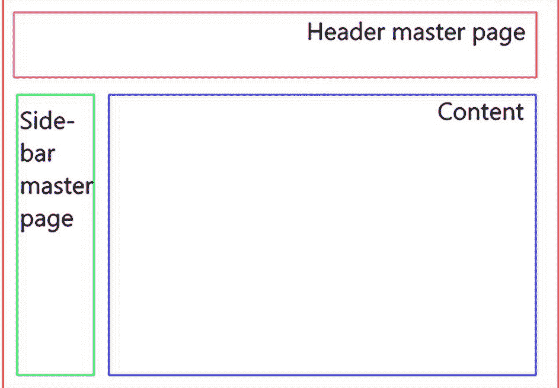

图 1-1 嵌套主页

用户控件是另一种复用机制。用户控件通常位于`.ascx`文件以及伴随的 VB 或 C# 后置代码中，它是一个微小的、可移植的`.aspx`页面，可以放在其他页面内部。例如，如果你需要在整个网站中都有一个用于选择汽车品牌的下拉列表，你只需要构建一个包含选择汽车品牌逻辑的用户控件即可。然后，可以将此控件嵌入任何需要的地方。用户控件的逻辑和显示代码可以集中管理，确保你不会觉得需要在每个地方重复编写代码。

构建令人深刻的用户控件已成为许多公司成立的商业模式。表格控件的创建总是非常费脑，它们尤其受欢迎，并导致了组件供应商之间为了构建更扩展、功能更丰富的表格而引发了军备竞赛。无论你需要什么，可能都有供应商愿意卖给你一组符合你要求的控件。在学会了使用这些复杂控件之后，这实际上是生产力的巨大红利。

虽然效率很高，但 Web Forms 的用户体验可能并不是用户对现代 Web 所预期的那样。构建一种抽象层来让 Web 像桌面一样可编程的问题在于，Web 并不是桌面。许多所需的桥接层（shims）让交互感觉很笨拙。虽然这种交互模型对于内网站点可能是可以的，但在运行中可能很少有基于 Web Forms 基础构建的大型网站。在许多方面，这就像是尝试将圆钉插入方孔，如图 1-2 所示。它能放进去，但存在一些缝隙。


## 图 1-2 圆入方孔

单页应用（SPA）是运行在 Web 客户端的页面，在导航时不执行全页刷新。单页应用的绝例子包括 Gmail（可能是第一个流行的 SPA）、Trello 和 Twitter。在这些网站之间导航时，你可能会注意到重加载的数据仅限于页面之间变化的内容，而不是下载整个网站的壳结构（chrome）。此类网站的用户体验比传统网站更好，因为在导航期间有一种连续感。虽然可能仅使用 Web Forms 就能构建单页应用，但那会非常困难且耗时。

Web Form 页面的状态被保留在一个名为 ViewState 的容器中。取决于网站实现 ViewState 的方式，编码后的 ViewState 可能会出现在每个页面上，并在每次请求中在客户端和服务器之间传递。正如你可以想象的，这增加了网络传输页面的重量，尤其是当你考虑到 ViewState 达到几兆字节大并不多见时。在 Internet 场景下，传输速度会影响从用户满意度到搜索排名的方方面。移动设备的普及使得这个问题变得更加严重。对于许多移动平台来说，带宽成本是不小的，而且在蜂窝网络上加载大型页面的时间可能足够让用户流失。

为了解决 Web Forms 的一些缺点，2007 年随着 ASP.NET MVC 的发布，发生了另一个变化。

## ASP.NET MVC

微软内部团队非常努力维护与产品以前版本的向后兼容性。ASP.NET MVC 在许多方面优于 Web Forms，它的初衷并不是作为替代品，而是构建 Web 应用的一种方式。为了避免显而易见的争论，应该说 Web Forms 相比 ASP.NET MVC 仍然有一些优势。ASP.NET MVC 比 Web Forms 更贴近底层，它剥离了许多让 Web Forms 既笨重又易于操作的抽象层。你不一定需要决定选择哪一个，因为你可以在单个项目中一起使用 MVC 和 Web Forms。事实上，这是将应用程序从 Web Forms 迁移到 MVC 的极佳方法，可以逐个替换页面。

Web Forms 中第一个被 MVC 改变的想法是为每个模型拥有一个后置代码，以实现良好的关注点分离。然而，构建忽略了职责适当分层的 Web Forms 应用同样容易，只是并不比更容易。ASP.NET MVC 构建在模型-视图-控制器（Model-View-Controller）模式之上，并鼓励在视图中关注 UI 问题，在模型中关注关注、存储以及通信问题。内置的关注点分离允许更好的可测试性和代码复用。这只是 ASP.NET MVC 鼓励开发者掉入这一不可避免的“成功陷阱”的方法之一。

当请求到达 ASP.NET MVC 站点时，它遇到的第一个东西之一是路由表，路由表将请求引导向目标，该目标可能是一个文件，也可能是控制器中的一段代码。这对应于磁盘上存在`.aspx`文件的依赖。路由表开启了许多有趣的可能性。它允许自定义 URL，这对于给用户提示以及搜索引擎优化非常有帮助。如果你有一个多户站点，现在可以轻而易举地创建如下 URL：

```
https://site.com/{CompanyName}/User/Add
```

而不是那种不太流行的版本：

```
https://site.com/User/Add
```

路由通常将请求映射到控制器。Action 可以返回不同的 ActionResult结果。你可以返回一个重定向将用户引导到另一个页面，或者返回一个文件流返回文件。JSON 结果将 MIME 类型设置为`application/json`并返回 action 的序列化版本。View 结果将 action 的结果传递给视图引擎转换为 HTML，然后返回给终端用户。

视图（即 MVC 中的 V）是表示层，包含了你以前在`.aspx`文件中执行的大部分工作。MVC 的视图引擎是可插的，允许使用不同的语法。Razor 是默认的视图引擎。Razor 是一种更现代的视图引擎，与 HTML 混合得非常无缝。Razor 语法比之前的视图引擎更接近 HTML。在网页设计师编辑实际 HTML 的组织中（这种做法变得越来越流行），Razor 的准入门槛比 Web Forms 更低。

控制器传递给视图的数据可以采取两种方法。第一种方法向 ViewBag 或 ViewData 中添加值，这些集合在视图和控制器中都是可用的。ViewData 是一个指向对象的字符串字典，ViewBag 是一个可以直接访问属性的动态对象。显然，这两个集合都是弱类型的，在视图中可能需要强制转换，从而引入了运行时错误的风险。第二种且通常更好的方法是使用强类型模型在视图和控制器之间进行通信。ViewBag 和 ViewData 方法中的运行时错误是转换为编译时错误，这几乎总是更好的。

模型是一个简单的 CLR 对象 (POCO)，它包含一组字段。MVC 围绕模型提供了一些功能，允许对其进行验证。使用`ComponentModel`命名空间内的注解，可以将字段标记为必填、非空、限制范围或许多其他类型。还可以为各种复杂验证编写自定义验证器，例如检查数据库或调用第三方服务。通过简单地检查`ModelState`是否有效，就可以在控制器的操作处理期间触发验证。

人们对 ASP.NET MVC 早期版本的一个意见是，它缺乏用户控件的生产力支持，而用户控件在 MVC 中是无法直接使用的。这个问题通过创建编辑器模板和视图模板得到了解决。这一极佳且未被充分利用的功能允许你为模型中的字段分配模板。当 Razor 遇到显示字段编辑器的指令时（如此处所示），它将使模型能够检查是否存在是否存在以 HTML 辅助程序或部分视图形式定义的特殊编辑器或视图：

```
@Html.DisplayNameFor(model => model.StartDate)
@Html.EditorFor(model => model.StartDate)
```

这些指令可以通过约定定义，也可以通过在模型字段上使用 UI Hint 注解来确定加载哪种模板。模板是 Razor 文件，可以包含显示该字段所需的任何特定显示或编辑逻辑。在在上例所示的`StartDate`中，编辑器模板可以包含一个用于编辑日期的控件。通过将注解扩展到各种模型中，你可以将日期的显示和编辑集中到一个页面上。如果日期显示方式发生变化，只需要在一个文件中进行修改。这是一个横切关注点的示例，你将相同的逻辑应用到不同的类中。

这并不是 MVC 框架中唯一的切入点；还有过滤器。过滤器通过注解应用于控制器或控制器内部的单个操作方法。过滤器可以拦截并更改任何请求数据或修改现有数据，甚至改变请求的流。安全性通常使用过滤器注解来实现。授权属性（Authorization attributes）提供了一种通过应用程序应用授权规则的简单方法。

MVC 应用中逻辑集中的另一个示例是中间件。基于 .NET 开放接口 (OWIN) 构建的中间件在很大程度上取代了自定义 Internet 信息服务器 (IIS) 模块，这些模块曾是拦截请求的唯一方法。例如，如果你想对每个请求添加某些日志，可以使用中间件进行进入和退出记录。

横切关注点并不一定位于应用程序逻辑中。它们也可以位于用户界面中。正如 Web Forms 支持主页布局一样，MVC 支持的布局方式与主页几乎相同。一个增加的功能是，单个视图可以填充布局的多个部分，这允许你在一个文件中同时处理内容和通往该内容的面包屑导航。

MVC 允许对传输中的内容进行更细致的控制，并移除了 Web Forms 时代许多不兼容的抽象。使用 MVC 构建的应用通常更具可测试性、架构更好、从用户角度来看速度更快，并且更容易让新开发人员上手。

## Web API

ASP.NET MVC 的迅速普及激发了 ASP.NET 团队的另一个新 Web属性：Web API。当 ASP.NET MVC 试图夺取 Web Forms 的部分份额时，Web API 尝试对同样创建为`.asmx`文件的简单对象访问协议 (SOAP) 服务实现同样的功能。`.asmx`文件扩展是微软启动的第一代基于 HTTP 的远程调用。SOAP Web 服务是一种强大的范式，但迅速变得复杂。如 WS-Security 和 WS-BPEL 等标准非常复杂且难以理解。为了解决这些标准，微软创建了 Windows 通信基础 (WCF)，这是一个运行时和 API 集合，它将 WS-* 标准的复杂性增加到没有任何人类能理解的程度。

需要一种更简单的服务与客户端之间的通信方法。幸运的是，罗伊·菲尔德 (Roy Fielding) 关于表示状态转移 (REST) 的论文正变得流行。REST 是一种使用 HTTP 动词在对象集合上通信操作的简单方法。在 SOAP 服务中，你会创建一个类似于`AddUser`的端点，它包含消息体和可能的一些标头。服务器将返回某些响应以确认用户确实已添加。请求可能如下所示：

```
/POST /User HTTP/1.1
Host: www.example.org
Content-Type: application/soap+xml; charset=utf-8
Content-Length: 299
SOAPAction: "http://www.w3.org/2003/05/soap-envelope"

<?xml version="1.0"?>
<soap:Envelope xmlns="http://www.w3.org/2003/05/soap-envelope">
  <soap:Header>
  </soap:Header>
  <soap:Body>
    <m:AddUser xmlns:m="http://www.example.org/user">
      <m:FirstName>Glenn</m:FirstName>
      <m:LastName>Block</m:LastName>
    </m:AddUser>
  </soap:Body>
</soap:Envelope>
```

如你所见，这是一条复杂的消息。如果服务器正确接收了请求，可能会返回 HTTP 200 结果码。执行相同操作的 RESTful 消息可能如下：

```
POST /User HTTP/1.1
Host: www.example.org
Content-Type: application/json; charset=utf-8
Content-Length: 75

{
  "FirstName": "Glenn",
  "LastName": "Block"
}
```

无论微软有多庞大且富有影响力，它无法单凭自己决定 Web 的未来。因此，了解 ASP.NET 如何融入更大的 Web 世界以及是什么影响了它也至关重要。我们将在下一章中介绍这一点。

## 第 2 章 影响者

Danielle 眨了眨眼睛；她似乎自己已经谈了 ASP.NET 很久了。二十年的 ASP.NET 历史被浓缩成了一个小时和三块画满箭头和火柴人的白板。Danielle 以前从未真正思考过 ASP.NET 的整个历史。看到事物是如何演变的非常有意思。

“我不知道，”Candice 说，“这听起来有点像我们最终会陷入某种仅限微软的技术栈中。我不确定我们我们将以最优化的方式做事，而是仅仅是按照‘微软的方式’做事。”

Danielle 知道并不是每个人都按照微软的方式做事，但他们的方法并没有什么不同，不是吗？都是服务器和网页，对吧？Web Forms 有点特殊，但 MVC 与其他所有东西非常相似。在她开口表达自己的想法之前，Marc 自然地插话了。

“噢，那是十年前的事了。微软在当时确实做过一些事情。有人还记得在 IE4 中你可以在页面之间使用 PowerPoint 风格的切换效果吗？”¹

¹ https://msdn.microsoft.com/en-us/library/ms532847(v=85)#Interpage_Transition

“但这个最新的 ASP.NET Core 吸收了其他框架的许多优秀理念，并形成了了自己的特色。默认模板默认就带有 gulp、npm 并且默认提供支持。”

“真的吗？”Danielle 问。她之前并没有关注新框架发生了什么。

“是的！”Marc 说，他正迅速成为 ASP.NET Core 的拥护者。“ASP.NET 的早期版本可能是在真空环境中构建的，但许多其他框架（如 Rails）对 ASP.NET Core 的形成产生了很大影响。

马达加斯加岛距离非洲大陆非常远，以至于植物和动物很难在两个陆地之间迁移。结果是，马达加斯加具有某些孤立性，植物和动物深受来自数百或数千英里之外入侵者的影响。ASP.NET 就生活在这些孤立的岛屿之一。ASP.NET MVC 是 ASP.NET 一个更开放的版本，它从其他框架中借鉴了一些理念，而 ASP.NET Core 则完全结束了这种孤立，它深受其他 Web 框架和技术的深度影响。在本章中，我们将探索 ASP.NET 团队做出他们那些设计决策的原因，以及他们从其他项目中汲取了哪些理念。

## 向后兼容 Core

人们说，ASP.NET 与 ASP.NET 的工作方式相比发生了巨大的背离。这与 ASP.NET MVC 最初发布时所受的抱怨相同，并在 ASP.NET Web Forms 进入一个由纯 Active Server Pages 主导的世界时也遇到过类似的抱怨。可以肯定，这些每一次转变都是对上一代工具的背离。然而，这些变化都是在上一代基础上的增量式构建。例如，HTTP 请求对象自 21 世纪初以来一直是一个相当一致的对象。

Microsoft Windows 是一个努力保持兼容性的杰出产品范例。最初为 Windows 95 编写的应用程序很可能在不经修改的情况下运行在最新版本的 Windows 上。当然，这种向后兼容并不是没有代价的。对 Windows API 进行的每种更改都必须仔细检查，以确保它不会破坏现有的应用程序。你可以想象的，这意味着即使是最小的更改也有巨大的测试负载。

操作系统的持续进化受到这些遗留支持需求重量的阻碍。

在产品之间保持名称和概念的熟悉感是 ASP.NET 团队的一个巨大关注点。他们投入了大量精力确保所有迁移到新产品的开发者都有一条可行的路径。ASP.NET Core 的主要影响因素无疑是之前的 ASP.NET 版本，而那些工作过之前的版本 ASP.NET MVC 的人可能会发现 ASP.NET Core MVC 非常熟悉。基础类型——模型（Models）、视图（Views）和控制器（Controllers）仍然存在。Razor 仍然是默认视图引擎，控制器操作仍然返回相同的命名类型。所做的更改都是深思熟虑的。ASP.NET Core MVC 的变化包括更新了 JavaScript 领域的最佳实践，还改进了测试性以及对依赖注入的一线支持。

让我们来看看该框架的其他影响因素。

## Rails

在讨论模型-视图控制器（MVC）Web 框架时，不应避免提到 Ruby on Rails。MVC 是一种追溯到 20 世纪 70 年代的老模式，因此它最终在 Web 上的应用是必然的。Ruby on Rails 是使用 Ruby 编程语言实现的 MVC。Ruby on Rails，或者正如它现在广为人知的简称 Rails，出现于 21 世纪初的 37 Signals。它是为了辅助 Basecamp 项目管理工具的开发而构建的，并且其创造者提供了良好的源码。

在 Rails 发布时，Web 开发是有些混乱的。ASP.NET 已经存在，但与其工作的唯一方法是通过 Web Forms。在 Java 领域，Spring 框架正作为一种强大的工具而兴起，它包含了 MVC 工具。Spring 的 MVC 很大程度上是对 Jakarta Struts 的反应，Struts 是一个构建在 servlet 之上的框架，而 servlet 是 Sun 公司服务器端 Web 编程的官方方法。当然，PHP 在当时也很流行，就像今天一样。PHP 的早期阶段还相当粗糙。那时的框架仅限于少数几个，它们在设计上很大程度上是自发的，这意味着它们是不可扩展的。

Rails 的出现为这个领域带来了一股清风。它是一个极具主见（opinionated）的框架，意味着偏离它非常困难。与其允许复杂的配置，它更倾向于遵循约定。这可以渗透到 Rails 的各个方面。例如，如 2-1 所示的目录结构对于每个项目都是相同的。

| 目录 | 说明 |
| : | :--- |
| app/ | 控制器、视图、辅助函数 |
| bin/ | 可执行脚本 |
| config/ | 配置文件 |
| db/ | 数据库迁移 |
| lib/ | 库代码 |


| `log/` | 日志文件 |
| --- | --- |
| `public/` | 静态资源 |
| `tmp/` | 临时文件 |
| `vendor/` | 外部依赖 |

图 2-1 由 Rails 创建的目录结构示例

控制器位于`/app/controllers`，并以`_controller`结尾。视图位于`/app/views`。

它是一个极具主见的框架，意味着偏离它非常困难。与其允许复杂的配置，它更倾向于遵循约定。这可以渗透到 Rails 的各个方面。

这种基于约定的布局方法可能看起来很眼熟，因为 ASP.NET 团队在创建 ASP.NET MVC 时也使用了它。在 ASP.NET MVC 中，新的项目模板有一个定义的目录结构。没有通用的目录结构，也没有隐含的命名约定。结果是每个 Web 应用程序都是独特的。项目的结构取决于其开发者的意愿。通常，缺乏经验的开发者会直接将`.aspx`文件添加到根目录，在一个包含数百个文件且几乎没有组织结构的目录中。这使得新开发者进入项目并快速获得理解非常困难。

在 ASP.NET MVC 中，新的项目模板有一个定义的目录结构。即使在控制器中，约定优于配置的心态影响也是显而易见的。当从操作返回视图时，你通常会这样写：

```csharp
public ActionResult Index()
{
    return View();
}
```

这里有许多约定在起作用。第一个是，任何返回`ActionResult`的公共方法都被认为是一个公共端点。其次，此方法被命名为`Index`，这是控制器根路由的特殊名称。接下来，这里的视图不接受参数。此操作返回的`.cshtml`文件是`/Views`下与控制器名称匹配的子目录中的`Index.cshtml`。

如果 ASP.NET 团队而是决定显式地做出所有这些选择，那么同样看起来简单的方法将膨胀成这样：

```csharp
[ActionMethod]
[Route("/Menu")]
public ActionResult Index()
{
    return View("~/Views/Menu/Index.cshtml");
}
```

这段代码要冗长得多。过度依赖约定而非配置的缺点是，对于新开发者来说学习曲线非常陡峭。这种学习曲线是开发者为了学习 ASP.NET MVC 而必须爬越的，而不需要为他们可能接触的每个项目学习一套新的项目布局。

Rails 和 ASP.NET MVC 中的约定在需要时可以通过自定义约定进行覆盖。这种方法应该谨慎使用，且仅在理由充分的情况下使用，因为项目中的新开发者会对这种重视约定优于配置但又以非传统方式使用的技术感到双倍困惑。

另一个继承自 Rails 的想法是路由。在 Web Forms 时代，服务器会在磁盘上查找与 HTTP 请求中的文件名匹配的文件。当时有一种方法拦截请求并将其重定向到其他页面，以处理文件移动的情况。重写规则并不是常态；在项目中使用重写模块是不寻常的。ASP.NET MVC 引入了路由，可能受到了 Rails 的启发。在应用程序启动时，一组路由会将请求映射到磁盘上的文件或控制器内部的 action。应用程序中的每个 action 并不需要显式映射；路由表是另一个“约定优于配置”规则生效的地方。例如：


```cs
routes.MapRoute("Default",
"{companyName}/{controller}/{id}",
new {id = UrlParameter.Optional});
```

此项在应用程序中创建了一个路由，拥有一组指向控制器和 action 的通用 URL。此特定路由提取了公司名称和项目名称变量。这些变量可以在 action 中使用，而不是从查询字符串中提取。

此外，通过提供了一些良好的体验，路由允许看起来“友好”的 URL。


`/AlpineSkiHouse/Rebrand/user/details/12`

或者，你可以写：


`/user/details?id=12&companyName=AlpineSkiHouse&projectName=Rebrand`

这些 URL 不仅易于用户阅读，而且对搜索引擎优化（SEO）更好。

Rails 的另一个设计原则是你不要重复自己（DRY）。一个例子是，模型从控制器到数据库映射器 ActiveRecord 一直与 UI 一起使用。同样的思想在 ASP.NET MVC 结合 Entity Framework 中也可以找到。Rails 过去是现在仍然是一个流行的框架，因此 ASP.NET 团队吸收它的一些好想法是有意义的。这些想法已经进入了 ASP.NET MVC 以及许多其他框架和工具。Rails 和 CoffeeScript 等技术之间的关系在很大程度上是共生的，彼此促进了对方的增长。ASP.NET MVC 与 Rails 之间的关系也是如此。

# Node.js

知名博主 Jeff Atwood 创造了所谓的“阿特伍定律”（Atwood's law）：“任何可以用 JavaScript 编写的应用程序，最终将用 JavaScript 编写。”这一激进的主张尽管在 Node.js 出现几年之前就已经存在，但事实一次证明一次。Node 是一个用于 JavaScript 的事件驱动、多平台、单线程运行时。Node 支持几乎任何想象得到的功能，并在构建 Web 应用程序中变得流行。如果 Rails 是开发 ASP.NET MVC 的动力，那么 Node 扮演了类似的角色。Node.js 的独特之处在于它不仅仅是一个运行时；它还是一系列设计良好且经过生产验证的库。

在 Node.js 出现之前，ASP.NET Core 就受到了许多技术的影响。Node.js 的流行是因为它可以在客户端和服务器端使用相同的语言。这允许了更无缝的开发过程以及前端和后端之间的代码共享。Node.js 还拥有一个庞大的包生态系统 npm，它为开发者提供了海量的工具。

Node.js 与其他技术的关系也是共生的。例如，Node.js 被用于构建许多 Web 工具，其核心是异步 I/O。这使得它能够以非常低的开销处理许多并发连接。Node.js 还用于构建聊天和工具等实时应用。

# Angular 和 React

JavaScript 是一种流行的语言。它从一个主要用于验证网页表单的语言还有很长的路要走。JavaScript 领域最流行的两个框架是 Angular 和 React。Angular 是较大的框架，比 React 涵盖了更多功能。它包含了数据绑定、控制器实现、路由器和依赖注入框架。React 基本上只是一个视图引擎。然而，这两个框架都支持自定义标签或声明。这些自定义标签允许你创建封装了标记、功能甚至样式信息的组件。让我们想象一个日历下拉，这是网站上常见的控件。它是一个很好的 UI 元素，当用户选择日期时向其显示一个小小的日历。HTML5 定义了日期选择器控件，但没有哪个浏览器支持它，而且其外观和感受在不同浏览器之间并不一致。在大多数情况下，最佳方法是使用第三方日历控件。这些第三方控件往往功能非常丰富，通常是功能过于丰富，其配置选项列表读起来就像《权力的游戏》中报纸上的停电公告。每次在网站上添加新实例时都要查找配置选项是痛苦的，更不用说在任何时间变化时更新所有实例是一项艰巨的任务了。如果能够将这些功能提取到一个公共区域将太棒了。React 和 Angular 均通过上述自定义标签以类似的方式实现了这一点。而不是编写以下代码：

```js
var http = require('http');
http.createServer(function(req, res) {
  res.writeHead(200, {'Content-Type': 'text/plain'});
  res.write('hello world');
  res.end();
}).listen(5678);
```

点击此处查看代码图片

```
<div class="calendar-container">
  <h4>Birth Date </h4>
  <input id="datepicker" style="background: blue" data-start-date="1904-01-01"
  data-end-date="2012-01-01" data-allow-range="false" data-format="yyyy-MM-dd"/>
</div>
```

由于这包含许多容易忘记的配置信息，你可以简单地写成：

点击此处查看代码图片

```
<calendar name="birthDate" label="Birth Date"/>
```

在日历组件内部，你可以集中所有所需的配置，以确保控件在整个站点中保持一致。你甚至可以进一步实现组件化，创建一个专门用于出生日期的控件：

点击此处查看代码图片

```
<birth-date-calendar name="birthdate"/>
```

ASP.NET Core MVC 采用了这种使用自定义 HTML 标签来表示组件的理念。你可以在第 19 章“可复组件”中阅读更多关于标签助手（tag helpers）的知识。

讽刺的是，这些组件使得 ASP.NET Core MVC 更加接近 Web Forms 中流行的自定义用户控件模型。Web Forms 之所以是一个如此高效的环境，原因之一是可以轻松地在页面上丢入几个控件并将它们连接起来。这种方式兼顾了双者的优点：快速开发以及易于构建、符合标准的组件。

## 开源

你禁不禁对微软开发者部门在采纳开源方面的文化转变感到惊叹。ASP.NET MVC 的源代码是公开发布的，以便他人能够阅读并从中学习。现有的代码允许开发者深入研究实现，以更好地理解和解决一些特别困难的问题。

ASP.NET Core MVC 在微软内部将开源理念推向了更远。最初的 ASP.NET MVC 只是简单地在 CodeP 上完全开源发布，而 ASP.NET MVC 的开发已转向 GitHub 上的开放仓库，托管在开源中的各种项目接受来自社区的拉取请求（pull requests）。这种民主化产生了一个比 ASP.NET 团队内部编写的更令人深刻的产品。其中一些贡献非常令人赞叹。如果你发现 ASP.NET 缺少某些功能或发现了 Bug，不必简单地等待下一个版本，而是可以通过提交代码积极参与项目的演进。虽然不能保证团队会接受该贡献，但他们无疑会参与对话。无数开源项目的影响改变了 ASP.NET 的开发方式。让我们来看其中的一些项目。

## OWIN

.NET 开放网络接口 (OWIN) 是一项进展了多年的变革。最初的 ASP.NET 为请求和响应定义了非常大的对象，这些对象大到会对单元测试过程产生不利影响。它们与 IIS 高度耦合，因为这些对象是在 IIS 请求管道中被填充的。OWIN 定义了一个可以在 Web 服务器和 ASP.NET 之间使用的开放接口。遵循这一标准允许 IIS 以外的服务器提供 ASP.NET 服务。OWIN 项目最初是一项社区倡议，但被 ASP.NET 团队全盘接受了。

随着 OWIN 和 ASP.NET 的成熟，两者之间的协同作用增加到 Visual Studio 中的新项目都会带上 OWIN 库的程度。OWIN 也成为了 ASP.NET 与你可能使用的任何 Web 服务器之间通信的官方方式。它打破了 IIS 的单一文化。Kestrel（基于 libuv 的 Web 服务器）是 ASP.NET Core 中一个流行的服务器例子，因为它对 Linux 的支持。

同样重要的是，OWIN 是一个标准而非具体的实现。多年来一直有几种实现，例如 Katana 和 Freya。ASP.NET Core 是又一种实现。

OWIN 在其自己的章节中描述，但它同样可以包含在“Rails”章节中。原因是 Rails 几年前启动了一项非常类似的努力，旨在开放 Web 服务器与 Rails 之间的接口。这项努力的结果是 Rack，它允许 Web 服务器与各种 Ruby Web 框架（Rails 只是其中一个例子）之间实现良好的交互性。这一节也出现在“Node.js”章节中。Node 有一个中间件层的 connect，OWIN 的许多想法都是从那里汲取的。

如图 2-2 所示，将各种技术的优秀部分结合在一起是一项令人印象深刻的成就。每个想法都经过了适应，变得更……由于缺少另一个词，更像 .NETty。这项努力的最终结果感觉并不割裂，所有部分都能良好协作。在如此短的时间完成这一切绝非易事，并将通向一个非常有趣的未来。

## WebForms

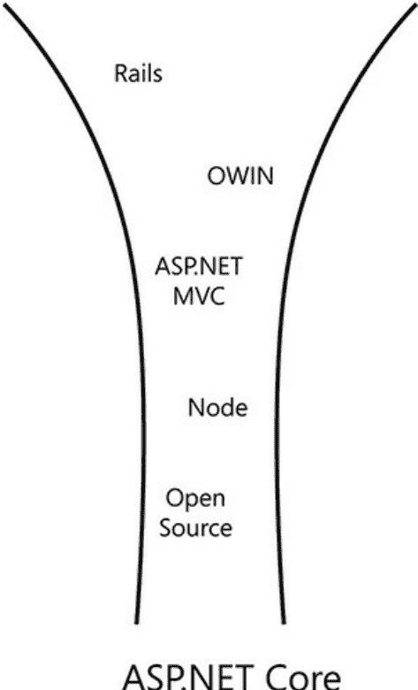

图 2-2 ASP.NET Core 的影响因素

# 总结

ASP.NET Core 表面上是一个全新的框架，然而，很容易看到许多其他技术的影响。最终结果是最佳实践和熟悉方法的宜人混合。来自几乎任何社区的人都会在 ASP.NET Core 中发现一些熟悉的东西。

在下一章中，我们将探索 ASP.NET Core MVC 的一些基本构建模块：模型（model）、视图（view）和控制器（controller）。

## 第 3 章 模型、视图和控制器

Adrian 走到 Danielle 的隔间面前是一个意外。也许是更多……

让我们快速回顾一下你应该已经理解的方面，然后进入该框架一些更有趣的部分，该框架正式名称为 ASP.NET MVC。

## 深入理解模型 (Models)

首先是字母 M，所以我们将从模型（Models）开始。模型代表了我们为客户正确渲染体验（或体验的某部分）所需的数据。客户导航到应用程序中由数据驱动的页面时，模型就是数据数据部分。然而，从意图上来说，所涉及的模型实际上是你将用于支持视图（View）渲染的内容，而不是你希望持久化到数据库的实体（Entity）。

让我们考虑这个来自 Alpine Ski House 的可能数据库设计示例，它处理用户账户摘要，如图 3-1 所示。当你向用户指示她拥有一个本赛季的季票时，你并不希望将季票列表返回给视图，并遍历集合以检查是否存在一张尚未过期的票。

### AspNetUsers

- `Id`
- `AccessFailedCount`
- `CurrencyStamp`
- `Email`
- `EmailConfirmed`
- `LockoutEnabled`
- `LockoutEnd`
- `Name`
- `NormalizedEmail`
- `NormalizedUserName`
- `PasswordHash`
- `PhoneNumber`
- `PhoneNumberConfirmed`
- `SecurityStamp`
- `TwoFactorEnabled`
- `UserName`

| `AspNetUsers` | `SeasonPasses` | `FamilyMembers` |
| :--- | :--- | :--- |
| `Id` | `SeasonPassId` | `FamilyMemberId` |
| | `PurchaseDate` | `FirstName` |
| | `UserId` | `LastName` |
| | `PaymentGateway` | `EmailAddress` |
| | `PaymentGatewayIdentifier` | `CellPhoneNumber` |
| | `PaymentGatewayResponse` | |
| | `ValidYear` | |

图 3-1 显示了可能用于建模购买季票的示例表截图

将所有这些信息返回给视图将超出需求。列表 3-1 包含了一个视图模型（View Model），它可能更接近你想要向用户显示的信息。如你所见，这是一个 POCO（纯 CLR 对象），它拥有你可以用于满足视图要求的的属性，而视图不需要对显示什么做任何决策，也不需要任何业务逻辑的实现。视图不需要知道什么才算作当前的季票，不需要筛选任何购买细节，或遍历相关表中的子记录来理解数据。

## 列表 3-1 AccountSummaryViewModel 类

点击此处查看代码图片

```csharp
public class AccountSummaryViewModel {
    public Guid UserId { get; set; }
    public int YearsOfMembership { get; set; }
    public bool IsCurrentSeasonPassHolder { get; set; }
    public List<string> IncludedFamilyMembers { get; set; }
}
```

控制器中的业务逻辑应该是模型或其他组件的职责，同时应将数据访问或外部调用从你的操作（actions）中分离出来，这些应该属于应用程序服务的一部分。图 3-2 从高层级地展示了这一点。

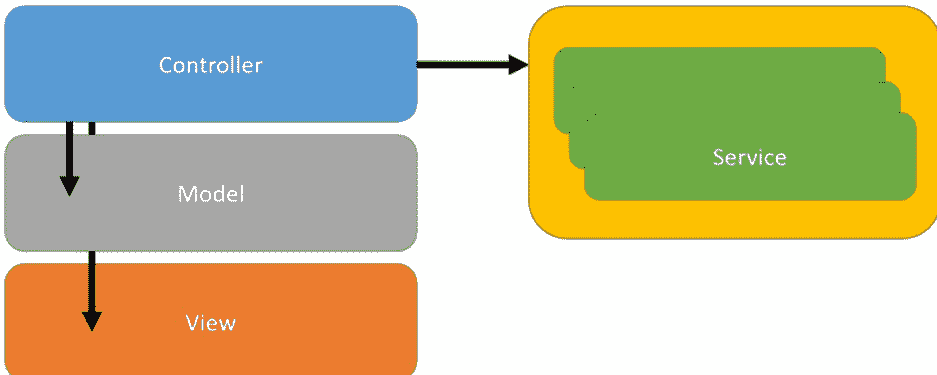

**图 3-2** 展示了控制器如何负责调用业务逻辑以帮助生成适当的 HTTP 响应。

将这些服务保持在外部似乎会让事情变得更复杂，或者引发诸这样的问题：“谁来为我创建这些服务？”这是一个很好的问题，我们将在本章稍后的[依赖注入]部分回答它。

## 不仅仅关于 MVC

正如前面讨论的，你的解决方案中包含的内容远不止模型、视图和控制器本身。我们将在全书中继续探索这些内容，但在开发过程中，这里有一些重要的概念需要关注。

## 中间件

关于 ASP.NET Core MVC 中中间件的秘密在于：它几乎完全就是中间件。全部都是！在应用程序启动期间，你有机会加载配置、配置服务，然后配置请求管道，而这正是中间件概念发挥作用的地方。你可以在默认模板中`Startup`类的`Configure`方法中看到这一点。

通常，对中间件的描述以及读者的解释忽略了一个相当简单的前提。中间件的目的是允许应用程序说：“按照我指定的顺序，让以下组件处理每个请求。”中间件是对 ASP.NET 之前类似功能实现形式（即 HTTP Modules 和 Handlers）的简化。中间件以一种更易于实现的通用方法取代了这两者。


有几个公共发布的中间件组件，用于处理你在应用程序执行期间需要涵盖的许多场景，包括测试环境（staging）和 QA 等低级环境以及生产环境：

- **诊断 (Diagnostics)**：提供异常处理和运行时辅助程序，例如数据库错误页面和面向开发者的技术细节。
- **静态文件 (Static files)**：允许请求管道短路以直接从磁盘返回文件。
- **身份识别与验证 (Identity and Authentication)**：允许应用程序保护其端点和资产。
- **路由 (Routing)**：根据传入的路径和参数解析应该执行哪个控制器和操作。
- **CORS**：处理跨跨资源共享注入正确的标头。
- **MVC 本身**：通常位于配置的中间件管道的末端，因为它消耗请求。

每个中间件组件都有选项在链中的下一个组件执行之前之后执行代码，或者短路执行并返回响应。“中间件（middleware）”这个名字可能源于这样想法：你可以在其他事情的中间执行一段软件，如[图 3.3](link）所示。在这种情况下，你看到系列由默认项目模板中的各种中间件组件处理的不同请求。在某些情况下，请求由静态文件中间件处理，返回`wwwroot`中的资源。在其他情况下，请求被允许一直传递到 MVC 执行管道，在那里你的控制器被创建，你可以返回一个视图。

## 依赖注入

有很多书籍涵盖了依赖注入，但为了完整性起见，我们在这里回顾一下基础知识。

通常来说，让你的代码明确表示它所承担的依赖项可能是一个好主意。在 C# 中，你可以通过在构造函数中放置所需的组件和服务来实现此点，这样该类的任何创建者都必须为你提供依赖项。

让我们考虑列表 3-4 中`HomeController`类的构造函数。该类要求在每次它被创建时，都要为其提供一个`ILogger`实现的实例。

### 列表 3-4 HomeController 的构造函数

点击此处查看代码图像

```
public class HomeController{
```

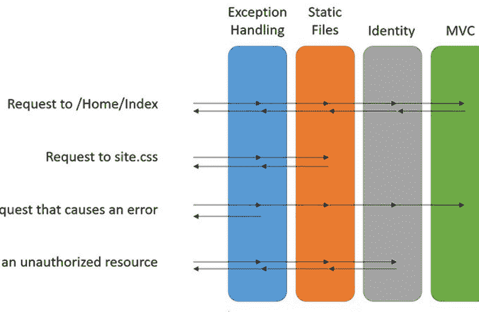

图 3-3 展示了中间件处理的不同请求类型的示例

你可以引入来自第三方的中间件、Microsoft 提供的额外辅助程序，或者编写自己的中间件来处理整个应用程序所需的交叉关注点。中间件管道还可以根据路径或谓词进行分支，允许围绕请求处理建立动态、灵活的规则。

```
ILogger _logger
public HomeController (ILogger logger)
{
    _logger = logger;
}
```

`HomeController` true如何配置或创建`ILogger`，它不知道记录到哪里，也不知道应该如何做。但在任何点实例化后，`HomeController`现在能够根据需要向你的日志文件添加有用信息。构造函数上的这一个简单参数显式地定义了你的需求，并被称为显式依赖原则（Explicit Dependencies Principle）。

为了让管道创建它，你需要让运行时感知到如何解析`ILogger`需求。你在容器中配置这些服务和组件，然后在运行时将它们注入到你的构造函数中。瞧，依赖注入！作为一个更广泛的话题，并且由于 ASP.NET Core MVC 引入了一些关于依赖注入（DI）的新观点，我们将在“注入”章节中深入探讨“控制反转”的概念，在那里我们还将探索替换默认容器时需要什么。

## 其他亮点

ASP.Net Core MVC 相比之前的版本包含一些巨大的改进，我们将在全书中探索它们。

- **配置与日志记录 (Configuration and Logging)**：ASP.Net Core MVC 相比之前的版本包含一些巨大的改进，我们将在全书中探索它们。
- **标签辅助程序 (Tag Helpers)**：ASP.Net Core MVC 相比之前的版本包含一些巨大的改进，我们将在全书中探索它们。
- **身份识别与安全 (Identity and Security)**：ASP.Net Core MVC 相比之前的版本包含一些巨大的改进，我们将在全书中探索它们。

# 总结

每个中间件组件都有选项在链中的下一个组件执行之前之后执行代码，或者短路执行并返回响应。“中间件（middleware）”这个名字可能源于这样想法：你可以在其他事情的中间执行一段软件，如[图 3.3](link）所示。在这种情况下，你看到系列由默认项目模板中的各种中间件组件处理的不同请求。在某些情况下，请求由静态文件中间件处理，返回`wwwroot`中的资源。在其他情况下，请求被允许一直传递到 MVC 执行管道，在那里你的控制器被创建，你可以返回一个视图。

智能手机。Balázs 继续他的分析。“问题在于，我们在山上用便携式条形码扫描器扫描人们的通行证。这既慢又容易出错。糟糕的是，我们用昂贵的超耐用纸张打印通行证，并用扎带将它们系在人的外套上。那样成本也很高。仅仅生产这样一张通行证就要花费我们美元的工资和人工成本。我们需要找到一种方法来减少这些费用。我们不能让人们在家里打印门票，因为每个人都有打印机，但没有任何纸能在系在衣服上经受摔倒依然完好。”

“我们需要一种新方式，让人们购买门票，并让我们在山上以及出发前都能管理门票。我们需要 Project Parsley 项目。让我向你们详细介绍我的愿景。”

Project Parsley 是本书贯穿的应用程序。每个示例都取自某些真实的 Project Parsley 代码，你可以从 GitHub 下载完成后的项目。我们尝试让开发过程尽可能真实，因此你会在 GitHub 仓库中发现问题（issues），以及代码和完整的提交历史（commit history）。

## Note

你应该能够深入研究仓库，看看随着我们在书中概述的冲刺（sprints）阶段推进，我们的思维是如何演变的。仓库托管于：https://github.com/AspNetMonsters/AlpineSkiHouse

该应用程序分为几个部分。首先，你需要一个让客户可以输入信息并购买通行证的地方。接下来，你需要某种方式向系统反馈通行证是否已在山上使用。最后，你需要一个管理界面，允许业务收集有关山上门票购买情况的指标。当然，还会有某种数据库来存储客户和通行证的各种信息。我们将在书的其余部分介绍我们如何开发该应用程序以及技术选择，但目前我们需要概述应用程序**应该做什么**，而不是应该怎么做。

对于许多开发者来说，“文件->新建项目”（File then New Project）对话框就像塞壬的歌声。“点击我开始一个新项目，”它这样召唤道。“别担心，你会通过代码发现业务问题的，”歌曲这样唱道。噢，我们多次被这首歌迷住，在理解之前就撞在了行动的礁石上。敏捷固然很好，但在开始创建一个新项目之前，确保我们了解一些问题空间（problem space）是很重要的。让我们把自己系在桅杆上，无视塞壬的歌声。

# Ski Slopes（雪道）

对于不熟悉滑雪的人，让我们从这里开始。一个滑雪场由两部分组成：上山路下山路。下山很大程度上是由重力以及滑雪板或单板上的一点技巧完成的。下山的小径根据山坡的坡度以各种方式分散。雪道（或行程）根据难度图标分类：绿色圆圈（简单）、蓝色正方形（中等）和黑色菱形（困难），如图 4-1 所示。在某些雪场，还有双黑菱形雪道，那是终极冒险。很多时候，这些雪道不属于雪崩保护措施范围，因此在上面滑雪需要雪崩装备，如发射器和雪铲。

| 最简单 | 较困难 | 最困难 |

| :--- | :--- | :--- |

| | 专家级 | |

图 4-1 难度分

正如雪道在山顶分散一样，它们在缆道的下山终点再次汇合。这使得滑雪者形成连续的循环，从缆道到山上，再回到缆道。大多数滑雪场都有多条缆道，一些最大的雪场有 20 多条缆道，每小时能将数千人带上山。多年来出现过许多类型的缆道，从简单的索道到更昂贵的椅子椅。

许多滑雪场提供纸质形式的缆道票，滑雪者将其系在外套或裤子子上。在缆道底部，通行证通常由手持便携式条形码扫描器的人员扫描以验证其有效性。通行证通常有效期为一天，但你也可以购买半日票、多日票甚至年票。

通行证通常在山下的自动售票机购买。滑雪一天费用大约是 50 美元。滑雪一天的投入不是一笔小开销。这比额外购买这本书的 0.5 份体验要愉快得多，而我们鼓励你这样做。

客户从远方赶来滑雪，他们不想花大量时间排队等候购买通行证。因此，我们需要提供一种购买通行证并让滑雪者进入雪场的方法。

幸运的是，射频识别（RFID）芯片的价格多年来一直在下降。现在将它们嵌入滑雪卡之类的物品中是非常经济划算的。RFID（读音为 'are-fids'）是小型芯片，能够在短距离内无物理接触地读取。你可能用过类似的技术，例如嵌入在主流信用卡中的 PayPay™ 或 PayPayWave™，或用于进入办公大楼或酒店房间的安全卡。每张卡都有一个独特的

RFID 卡扫描器将取代椅子椅底端的人工条形码扫描器。只要滑雪者身上带着通行证，他们就能通过允许他们进入缆道的闸门。如果滑雪者身上没有带通行证，门就不会打开。此外，扫描器被放置在某些雪道的顶部，以便良好滑滑者的位置。这些信息可以用于构建热力图，显示人们滑雪最频繁的地方。一天中获得的垂直高度是滑雪爱好者的一项指标。

如果客户预购通行证，RFID 卡将邮寄出去。虽然卡片的初始投资比打印通行证高，但卡片在山上可以使用，且同一个客户可以跨季节使用。

当登录网站时，首次用户会被提示设置登录凭据和收货地址。接下来，用户被要求添加“客户”或“滑雪者”来申请卡片。对于每个客户，你只需要姓名和年龄来确定费用；与其存储年龄，管理层希望存储出生日期，以便营销部门可以在客户生日时发送优惠券。

在确定卡片所有者后，用户可以为卡片充值。有多种通行证：日票、多日票和年票。此外，还有不同的雪场可以进入。通行证可以适用于单个雪场或多个雪场。每个客户可以购买多个通行证，所有这些都分配给同一张实体卡。

最后，用户会被提示输入支付信息并完成结账流程。这将在需要时触发实体卡或立即激活现有卡片，允许用户在前往雪场的途中完成购买。

一旦带着卡片到达雪场，客户就不再需要任何额外的步骤。他们的卡已经激活，他们可以乘坐第一部可用的缆道，并因无需排队而感到轻松。

另一方面，单页应用（SPA）大量使用 JavaScript，而许多开发者对此仍持有某种程度的不适感。在过去，开发一个单页应用总是比构建多个页面更复杂、更耗时。JavaScript 的兴起以及用于构建 SPA 的层出不穷的 JavaScript 框架可能已经消除或至少将其降低到了这种程度：即构建 SPA 与构建传统的多页应用之间的差异仅为几分钟。

作为 Alpine Ski House 培养的实验性文化的一部分，应用程序的客户端使用服务器端渲染而非客户端渲染编写。对于某些带宽大于计算能力的设备来说，在服务器端渲染 HTML 可能比处理客户端 JavaScript 代码更具效率。此外，构建服务器端视图也比为了用不同语言编写应用程序的不同部分而要付出的巨大心理负担要容易得多。对于服务器渲染的应用，不需要 JavaScript，所以你不会觉得你逃避了那个特定问题。它对 JavaScript 的需求远低于单页应用。

## API

RFID 扫描器相对廉价且易于设置。书中的虚构扫描器是 RT5500，它们连接到单个闸门上，当遇到通过验证的 RFID 签名时，闸门会打开。为了验证通行证是否有效，扫描器依赖于通过网络向验证服务发送消息。验证服务需要被编写，但规范非常简单。

扫描器会发送被扫描卡的物理 ID，结果为“true”或“false”。这便是交互的全部。RT5500 的默认实现中没有身份验证机制，这在未来可能会导致一些问题。例如，一个心机勃勃的人可能会向 GET API 发送重复请求，直到找到一个有效的 ID，并用它溜去滑雪。不安全的物联网（IoT）设备在未来几年将成为一个大问题。我们已经看到许多人购买带 Wi-Fi 的摄像头并让其处于不安全状态，导致人们可以在网上扫描它们并观察人们在家里所做的一切。太可怕了！不实施任何额外安全措施的决定会反噬他们吗？拭目以待。

市面上几乎每个 Web 框架都有构建 RESTful 服务的方法。因此，API 对技术选择的影响很小。这为使用你选择的任何语言或技术来实现它打开了大门。其理念是，在小型项目中，犯错并选择错误的技术并不是致命的。通过使用小批次规模，发生问题时的重做工作可以得到限制。

遗憾的是，通信方案是扫描器最容易实现的部分。确定是否允许某卡的规则是复杂且细微的。首先，需要查找卡的通行证列表并选择正确的通行证。在任何时候都可能多个通行证有效，因此需要决定一种一致的选择方法。接下来，如果通行证是新的，则需要激活它。最后，需要写入与该通行证相关的扫描信息。通行证验证逻辑无疑是应用程序中最难做对的部分之一。

## 管理视图

我确定是阿瑟·C·克拉克（Arthur C. Clark）曾说过：

“任何足够复杂的系统都需要一个管理界面。”

因此，Alpine Ski House 的系统需要具备管理能力。首先就需要查看当天有多少人在滑雪。这些信息需要提供给保险公司，以确保范围处于适当水平。此外，管理团队希望拥有报告，显示有多少人购买了新卡，以衡量项目的成功程度。

这一需求源于想要正确判断实验是否奏的愿望。借鉴精益创业（lean startup）的概念，Alpine Ski House 希望在开发过程中进行最低成本的实验。这些实验的结果消耗了开发资源。应用程序管理视图的版本在本质上是极简主义的，但当业务开始掌握从应用程序中获取的此类见解时，预计它会迅速增长。

管理应用程序在很大程度上是一个报告应用程序，这意味着它有很多敏捷的图表和图表，这些是经理和高管们喜欢看到的：可以得出结论的高级报告。实际上，你拥有了一个分析仪表板。

为了获得更好的用户体验，Project Parsley 面向管理的部分使用客户端框架并与 WebAPI 交互进行编写。人们认为这在不损失太多生产力的情况下，为用户提供了最佳体验。它也是在整个应用程序中推广这种较为人知方法的绝佳测试平台。交付面向客户的应用程序，比以完全完成的状态交付它更重要。这也是精益创业心态的一部分。

## 整合整体

我们正在构建的应用程序实际上是三个应用程序：客户端、管理端和 API。所有这些服务都需要以某种方式相互通信，因为它们使用的数据是共享的。此类应用通常是围绕共享数据库构建的，由数据库进行集成。将数据库作为共享内核可能会导致一些困难，因为多个服务会尝试写入同一张表。更改应用程序某部分的结构可能会破坏其他部分。问题在于，在 SQL 数据库之上构建抽象层是困难的。通常，我们希望至少构建一个防腐层（anti-corruption layer），以防止更改破坏应用程序。

我们将模型划分为称为“边界上下文”（bounded contexts）的隔离块。边界上下文是领域驱动设计（domain design）中的一个术语。它很难描述，但实际上是一个独特且不相连的数据和功能分组。在一个上下文中，名称保持相同的含义。听起来很困惑？考虑一下“客户”的概念。对于发货部门来说，客户实际上就是一个地址，而对于另一个部门它是定义如何营销客户的偏好和属性集合。发货部门是一个边界上下文，营销部门也是。这些边界上下文之间的通信应该是定义良好且明确的。

防腐层是对访问边界上下文的抽象，特别是在你必须连接边界上下文时。该模式通常使用适配器模式（adapter）或面脸模式（facade）实现。适配器将一个边界上下文的表示转换为另一个。例如，客户端应用程序和 API 都需要处理扫描信息。客户端应用程序需要读取数据以获取当天的行程情况。API 需要将记录写入磁带。API 是写入磁带的服务，因此它是真理来源。这意味着任何对扫描信息的更改都应该通过 API 服务进行。

如果 API 团队决定磁带需要从存储本地时间更改为存储 UTC 时间，我们希望限制对数据消费者者（即客户端应用程序）的影响。为了读取扫描，客户端应用程序应该使用适配器将日期转换回其基础代码预期的表示。

示例映射器可能如下：

[点击此处查看代码图片](#)

```
public class ScanDataAdapter{
    public Client.ScanMap(API.Scan scan) {
        var mapped = Mapper.Map(scan);
        mapped.ScanDate = ConvertToLocalDate(mapper.ScanDate);
        return mapped;
    }
}
```

## 图 4-2 划分为区域的应用程序 ER 图

我们有五个边界上下文（bounded contexts）。从图表的左上角开始顺时针移动，第一个是登录上下文。该上下文负责客户应用程序和管理员应用程序中的用户进行身份验证和授权。我们正在使用标准的 ASP.NET Identity 功能。接下来，我们有一个客户边界上下文。客户上下文包含了与滑雪或单板滑雪人员相关的信息。我们跟踪了他们的一些个人详情，以及他们拥有的卡片。接下来，我们有一个位置边界上下文。该上下文跟踪位置和度假胜地名称。我们可以使用这些信息来计算诸如每天滑雪米数等。倒数第二个边界上下文包含通票类型（pass types）。通票类型通常是一组规则，规定了通票在特定日期、特定胜地的有效性。通票类型例如“三日票”、“年票”等。最后一个边界上下文负责管理通票向卡片的分配及其有效性。

# 总结

我们已经界定了三个应用程序和一个数据库的范围。在几个迭代（sprints）内完成这些工作是一项巨大的任务。然而，我们有信心开启这段旅程并构建出一个出色的解决方案。很快，人们将使用他们新的可充值滑雪卡跳过通票排队，直接上山。在第 5 章中，我们将研究如何构建我们的应用程序。我们尽早开始构建，以便我们从第一天起就开始部署。

## 第 5 章 构建（Builds）

团队进入第一个迭代仅短短几天，气氛就已经变得紧张起来。Danielle 担心团队没有很好地融合。当他们正为损坏的代码争吵时，Danielle 在向仓库提交时产生了一个错误的路径。她在代码库中添加了一个新项目，但忘记了提交解决方案文件（solution file）。这是一个常见的错误，团队中的任何人都可能犯这种错，但团队已经处于边缘状态，每一次挫折都比上一次更让人痛苦。

“Marc，”她说，“我已经提交了项目文件，所以现在应该修复了。”

“修复了，那我们白浪费了一个整小时。我们需要快速把这个项目推出去。漏掉这些简单的事情——我们没有时间处理这种事情。”


“冷静点，Marc，”Adrian 安慰道，“没有人是完美的，总会出错的。我们需要找到某种方法，在未来避免这类问题。”

Baláz 此时正好走了进来：“啊，我一直在等你们想出解决方案，而不是在这里争吵和抱怨。我们未来该如何防止这些问题？更多的结对编程？”

“我觉得那会有帮助，”Danielle 说。

“嗯，我们可以设置一个构建服务器，让它在我们每次提交时都运行，”Danielle 建议道。

“好，”Baláz 说，“让我们完成它吧。现在大家回到工作。”

计算机使用的语言与我们不同，这并不意外。这不仅仅是因为计算机说的是世界语（Esperanto），而是因为它们所使用的语言与我们的人类语言从根本上就是不同的。人类语言往往充满了歧义，而这些义在编程中是不被允许的。计算机只处理真理和完美的逻辑实体。因此，虽然人类可能在缺少逗号的情况下理解“Love cooking cats and Lego（我爱烹饪猫和乐高）”这句话的意图，但计算机遗憾地假设“猫和乐高”是在菜单上。人类想要用计算机能正确理解的语言进行思考是非常困难的，而且由于计算机语言是高度冗长的，因此我们引入了高层语言。创建人类可读的编程语言是一项艰的任务，因为需要在简洁性和易理解性之间取得平衡。语言的选择是非常个人化的，很少受到公司编码标准的影响。根据你选择哪种语言来编写 `ASP.NET Core` 应用程序，你需要将你的高层语言翻译成计算机可以原生理解的内容。为了做到这一点，你需要让代码通过编译器。如果你正在编写 `VB.NET` 或 `C#` 代码，请使用 `Roslyn` 编译器；如果你使用 `F#`，它有它自己的编译器。

在本章中，我们将研究如何构建 `ASP.NET Core` 项目、构建服务器背后的动力，以及如何设置构建流水线。

## 命令行构建

许多人害怕命令行界面。也许“害怕”并不是准确的词；他们只是对命令行感到不适。然而，事实是，能够从命令行构建解决方案非常有用。构建服务器经常缺乏能够表达构建所需复杂细节的 UI。运行构建只需要一个小小的对话框。`.NET Core` 中的命令行工具已经受到了相当大的关注，现在使用它们来执行构建比以往任何时候都简单。

对于 `.NET Core` 中单个项目的简单命令行构建，在项目层级运行命令一样直接：

```
dotnet build
```

这会输出类似的内容：

点击此处查看代码图像

```
Project AlpineSkiHouse.Web (.NETCore,Version=v1.0) will be compiled because inputs are modified

Compiling AlpineSkiHouse.Web for .NETCore,Version=v1.0

Compilation succeeded.
  0 Warning(s)
  0 Error(s)

Time elapsed 00:00:07.3356109
```

就如此。如果你的项目有外部依赖项，你可能需要通过运行命令来恢复它们：

```
dotnet restore
```

这会输出类似的内容：

Restoring the packages. 此命令的输出如下：

点击此处查看代码图像

```
Project AlpineSkiHouse.Web (.NETCore,Version=v1.0) will be compiled because inputs are modified

Compiling AlpineSkiHouse.Web for .NETCore,Version=v1.0

Compilation succeeded.
  0 Warning(s)
  0 Error(s)

Time elapsed 00:00:07.3356109
```

对于多个项目的标准方法是在项目根目录下放置一个解决方案文件（solution file）。解决方案文件非常简单，它们基本上定义了一系列配置（例如 `Debug` 和 `Release`），以及每个配置方案下要构建的项目。因此，你可能想要一个 `Release` 构建，它构建核心项目，但不构建在调试期间需要的辅助工具。这些解决方案文件被 `Visual Studio` 和 `MSBuild` 识别。你可以通过以下命令在命令行构建解决方案：

```
dotnet build
```

在 `.NET Core` 的情况下，使用的是 `dotnet` 命令。我们在此处和其他地方提到了 `project.json` 文件。该文件决定了项目支持的内容、输出选项、使用的包，以及提供了哪些额外的命令行工具。该文件将在即将发布的 `.NET` 版本中发生更改。项目的最终形式尚为人知，但它很可能会回到 XML 格式，并再次命名为 `.csproj`。这将提供一条无缝的路径，所以无需担心将你的 `project.json` 升级到 `.csproj`。

无论你选择什么，对于大型项目，可能都需要执行简单编译项目之外执行某些额外任务，例如汇包、运行测试以及将文件上传到符号服务器。解决这个问题的最佳方案还需要我们讨论。

团队，所以请尝试一些工具，看看哪一个最合适。

你找到了吗？太棒了！现在你可以把它们安装在你的构建服务器上了。你们确实有一台构建服务器，对吧？

## 构建服务器

拥有构建服务器的重要性怎么强调都不为过。频繁地构建软件是发现错误的绝佳方法，希望在这些错误到达用户群体之前就能被发现。

你可能熟悉程序员的口号：“在我的机器上运行得很好”。这句咒言在编程圈中很常见。开发者工作站安装了许多工具和库，而你可能在普通用户的电脑上找不到它们。我们经常发现，代码在本地运行良好，但在部署到生产环境后却就无法工作了。没有人希望发现自己处于“在我的机器上运行良好”的境地，但环境之间的差异使得这种情况很有可能。

避免这种尴尬只需要设置一个构建服务器，在另一个环境中编译并测试你的软件。对于一个单人团队来说，当你检查了导致构建失败的内容时，获得快速反馈是非常有用的。如果构建在一小时前还是好的，而现在坏了，那么怀疑有问题的更改范围就限于最后一小时内。

在规模较大的团队中，持续与同事的代码进行集成变得更加重要。例如，如果 `Danielle` 提交了与 `Mark` 的最新更改冲突的内容，那么理想的情况是在这些问题发生时就立即显现，而不是在几周后的生产环境期间才发现。

除了执行持续集成构建以测试更改是否冲突外，运行每日构建（nightly builds）也同样重要。环境或依赖包的更改可能会导致某段几个月无人触过的软件出现问题。更新的 `node modules` 就是一个典型的例子。虽然修复某个版本的 `node module` 是可能的，但无法修复依赖库的版本。因此，由于上游的更改可能会在你不不知情的情况下破坏你的软件。

我们称它们为构建服务器，但构建服务器可以的功能远不止于简单的构建软件。构建服务器应该负责协调整个构建流水线。

## 构建流水线

发布软件可能非常困难。许多公司即使是每月发布一次软件都很挣扎，更不用说每周或每天了。像 `Flickr` 这样的公司每天发布多次软件，这是因为它们对自己的构建和发布流程有高度的信心。每当开发者将代码提交到主分支时，就会触发一个构建，几分钟后更改就会发布到网站。这被称为持续部署，即软件一直在被部署。

能够做到点的优势是它缩短了从想法到利润的时间。当业务部门有了新想法来改变产品并赚更多钱时，不需要为了交付更改而经历长时间的延迟。持续部署也有助于发现安全漏洞。你不需要等六周后的下一次构建发布，而可以在一天之内完成修复和部署。

如果这对你的团队来说太心心勃勃了，持续交付（continuous delivery）可能更符合你的风格。持续交付与持续部署只隔一步，你仍然执行构建流水线并生成产物，可能将其部署到预生产环境，但构建不会被推送到生产环境。知道每个构建都经过了测试，并在需要时可以推送到生产环境，这仍然让人非常安心。需要时间来熟悉构建和部署过程，直到你觉得在部署到生产环境的过程中不需要人工干预。

构建流水线是我们所说的将代码从提交（Checkin）到某个最终状态的过程，无论是部署到生产环境，还是仅仅部署到测试环境等待手动测试。通常，构建流水线从触发器开始，例如向版本控制工具中提交代码。你可以在图 5-1 中看到部署流水线的示例。

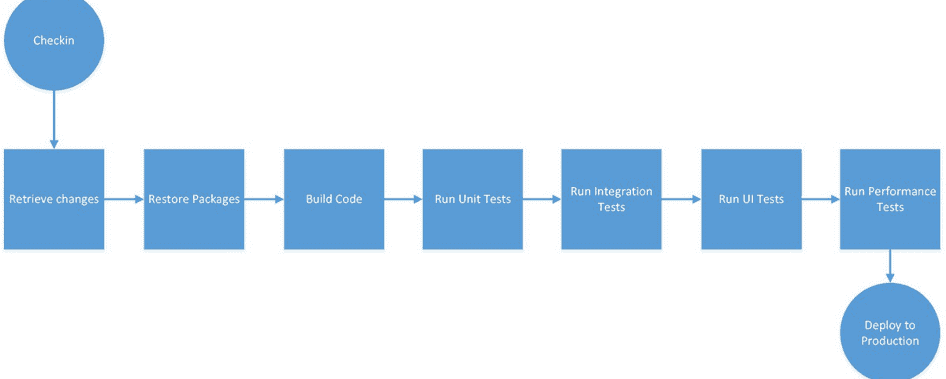

## 图 5-1 部署流水线

构建服务器从版本控制服务器检索更改，获取内容的过程。从版本控制服务器获取更改的过程。环境或依赖包的更改可能会导致某段几个月无人触过的软件出现问题。更新的 `node modules` 就是一个典型的例子。虽然修复某个版本的 `node module` 是可能的，但无法修复依赖库的版本。因此，上游的更改可能会在你不不知情的情况下破坏你的软件。

我们称它们为构建服务器，但构建服务器可以的功能远不止于简单的构建软件。构建服务器应该负责协调整个构建流水线。

## 5-2 。

> 注意

> 

> 多次在本文中我们提到过快速失败。你可能在想为什么在过程中失败很重要很重要，是是是越成本越越。非常透明的的。

> 

> 在他们的部署期间，他们测量了数百个关键指标，并非常仔细地改进它们。

> 的 的博客博客博客博客，，，显示了对内存设置如何改进 HTTP 队列计时。

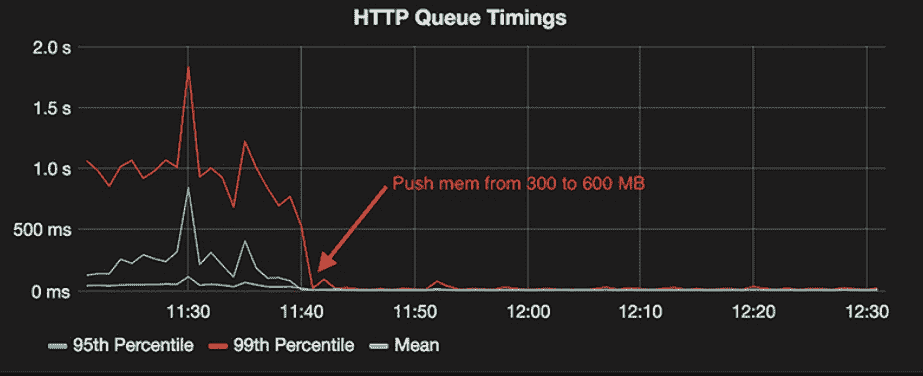

## 5-3 修改内存设置后队列计时显著提高

市场上有很多优秀的构建服务器选择。`TeamCity` 是 `JetBrains` 的热门选择。`Atlassian` 一直在扩展其应用生命周期管理产品，其托管在 `Bamboo`。在开源领域，有 `Jenkins` 以及一些 `Apache` 项目显示了某些性能。如果你不想运行自己的构建服务器，有一些公司（如 `CircleCI` 或 `Travis CI`）会在它们自己的基础设施上为你运行构建。通常，这些基础设施托管在你托管软件的云上，因此你甚至不需要另一个数据中心。

微软的构建器是 `Team Foundation Server`。`TFS` 有本地和托管版本。`Alpine Ski House` 没有大量时间在自己的硬件上设置构建服务器，所以他们选择了托管选项。在大多数情况下，这是更好的方法。除了极少数情况，托管版本控制服务器不是你们公司的专长，为什么不把这些基础设施问题交给专家，而专注于你们的核心竞争力呢？

## 构建 Alpine Ski House

如前，`TFS` 提供托管和本地安装。让我们仔细看看如何在 `TFS` 上设置 `Alpine Ski House` 的构建。

首先你需要的是 `Visual Studio Team Services` (`VSTS`) 账户。`VSTS` 是托管的...老旧 `Team Foundation Server` (`TFS`) 的版本。如果你的公司恰好订阅了微软开发者网络 (`MSDN`)，每位开发者都可以获得 `VSTS` 的免费构建分钟。即使这些分钟用尽了，增加更多分钟的增量成本也很微小。托管构建代理（hosted build agents）即实际运行构建的机器对于大多数构建都是很有用的，因为它们上面安装了各种工具。如果你的项目有特殊需求，例如安装 `Oracle`，你可以在云端配置自己的构建代理。你甚至可以将网络内部的本地私有信息连接起来，同时仍享用超机密托管解决方案的优势。`Alpine Ski House` 不需要这种级别的安全性，它的构建中也没有不寻常的东西，所以托管代理运行良好良好。

在 `VSTS` 中，首先为 `Alpine Ski House` 创建新项目。要从主仪表板执行此操作，只需点击项目列表下的“添加”（`Add`）按钮。在对话框中，输入如图 5-4 所示的项目名称和描述。系统还会提示你选择过程模板（process template）。如果你仅将 `VSTS` 用于构建，则可以忽略此项，因为过程模板控制着 `VSTS` 中的问题跟踪和故事（story）功能。如果你对模板控制功能感兴趣，微软网站上有大量关于该主题的文档可供。对于源码控制，选择 `Git`，尽管再次强调，这并不重要。`Alpine Ski House` 托管在 `GitHub` 而不是 `VSTS` 上，该设置仅用于选择在项目中使用使用的源码控制工具。如果你在 `VSTS` 中托管源码控制，`Git` 几乎肯定是更好的选择，因为它在行业内被广泛采用。

## 创建团队项目

| 字段 | 值 |

| :--- | :--- |

| 项目名称 | `Alpine Ski House` |

| 描述 | 我们在其中滑雪的房子 |

| 过程模板 | `Agile` |

此模板非常灵活，对于大多数使用敏捷（`Agile`）规划方法（包括实践 `Scrum` 的团队）效果非常好。

版本控制：`Git`

`Git` 是一种分布式版本控制系统 (`DVCS`)，它使用本地仓库来跟踪和版本化文件。更改通过远程共享仓库推送（push）和拉取（pull）来与其他开发者共享。

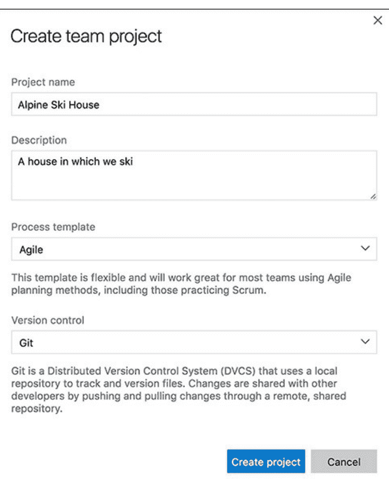

图 5-4 在 `visual studio team systems` 中创建新团队项目

项目创建后，你现在可以开始创建构建。这可以通过“构建”（builds）选项卡并选择“新建”（`New`）完成。如图 5-5 所示，有很多构建定义模板可以作为你构建的基础，但对于我们的目的来说，`Visual Studio` 构建或空构建都是很好的选择。

## 创建新构建定义

### 选择模板

- 构建 - 部署

- `Universal Windows Platform`：使用 `Visual Studio` 构建通用 `Windows` 应用程序。此模板要求构建代理上安装了 `Visual Studio` 和通用平台模板。

- `Visual Studio`：使用 `Visual Studio` 构建并运行测试。此模板要求构建代理上安装了 `Visual Studio`。

- `Xamarin.Android`：构建 `Android` 应用和 `Xamarin.UITest` 程序集。使用 `Xamarin Test Cloud` 进行测试。

- `Xamarin.iOS`：构建 `Xamarin.iOS` 应用和 `Xamarin.UITest` 程序集。使用 `Xamarin Test Cloud` 进行测试。此模板需要 `Mac OS` 构建代理。

- `Xcode`：构建并测试 `Xcode` 工作空间。此模板需要 `Mac OS` 构建代理。

- 空（`Empty`）：从没有步骤的定义开始。

图 5-5 选择构建模板

接下来，你需要设置源代码所在的仓库，或者如果你喜欢，称为源码的源。图 5-6 显示了各种源码控制选项。

## 创建新构建定义

# 设置

仓库源

| `AlpineSkiHou...` Team 项目 | `GitHub` | 远程 `Git` 仓库 | `Subversion` |

| :--- | :--- | :--- | :--- |

| 连接 | `stimms` | | |

| 仓库类型 | `GitHub` | | |

| 默认分支 | | | |

持续集成（每当此分支更新时执行构建）

默认代理队列 | 维护队列

托管 (`Hosted`)

选择文件夹...

图 5-6 选择正在使用的源码控制工具

图 5-6 中的对话框没有设置 `GitHub` 凭据，但我们稍后会介绍。创建构建定义后，你将被重定向到空构建定义页面（见图 5-7）。

## 图 5-7 构建定义页面

让我们设置一个仓库，让构建知道从哪里获取你的代码。幸运的是，`VSTS` 和 `GitHub` 之间有一些很好的集成。我们可以从控制面板开始，点击页面右上角的设置图标（齿轮）即可访问。从控制面板中，选择“服务”（services），点击“新建服务端点”（`New service endpoint`），然后选择 `GitHub`。在图 5-8 所示的对话框中，选择个人访问令牌（可以从 `GitHub` 设置中获取）或“授予授权”（`Grant Authorization`）然后继续完成授权流程。这使用 OAuth 授权 `VSTS` 在 `GitHub` 上代表你执行操作。

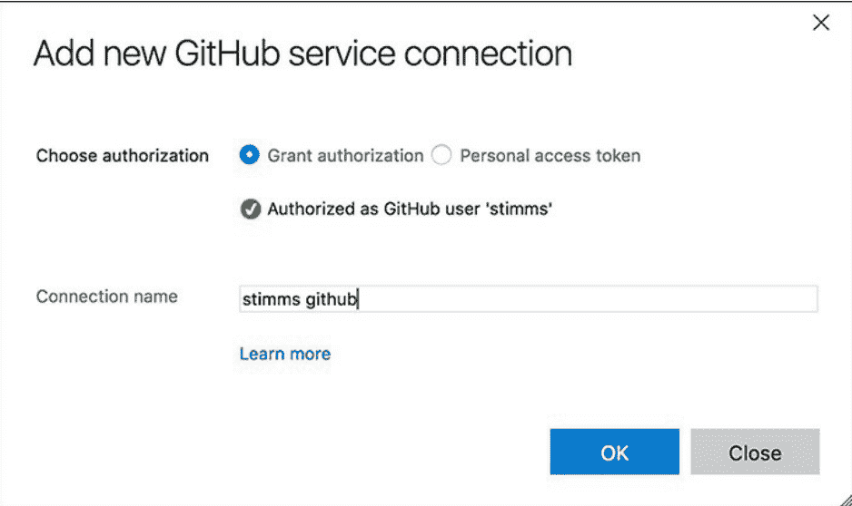

## 图 5-8 授予 `VSTS` 访问 `github` 的权限

连接 `VSTS` 和 `GitHub` 后，你可以返回构建定义并选择新创建的 `GitHub` 账户作为源仓库，如图 5-9 所示。

## 团队服务 / `AlpineSkiHouse`

首页 源码 构建 测试 发布

定义资源生成器

# 构建定义

- 构建选项 仓库 变量 触发器 通用 保留 历史

| 仓库类型 | `GitHub` |

| :--- | :--- |

| 连接 | `stimms` |

| 仓库 | `AlpineSkiHouse` |

| 默认分支 | `master` |

| 检出 (`Checkout`) | |

图 5-9 构建的仓库设置

有了源码控制设置，你可以开始设置构建本身。有很多方法可以实现这一点。在这里，我们采用非常基础的方法。你可以在图 5-0 中看到示例构建。

## 构建定义 / `AlpineSkiHouse`

任务组：包恢复 (`Package Restore`)

- 控制选项 已启用

图 5-10 一个简单的构建定义

构建的第一步是恢复包。我们的解决方案中有项目，我们可以手动为每个项目运行恢复，或者编写脚本运行恢复。目前，该任务组只需运行恢复。

下一步是 `dotnet publish`。有了默认项目文件，它只需构建项目并将文件移动到位置。

```json
"scripts": {
  "prepublish": ["npm install", "bower install", "gulp clean", "gulp"],
  "postpublish": ["dotnet publish --publish-folder %publish:OutputPath% framework %publish:TargetFramework%"]
}
```

这些任务作为发布的一部分运行。这些调用 `npm`、`bower` 和 `gulp` 来构建 JavaScript 和 CSS。post publish 设置了用于 IIS 的 `web.config` 文件。

我们在第 20 章中通过 `dotnet` 命令运行测试。对于 `Alpine Ski House` 来说，此时的单元测试是简单且有效的。

下一步是将文件移动到阶段目录，打包阶段目录并发布产物。这些文件随后可以作为第 6 章“部署”流程的一部分进行部署。


最后，我们设置一个触发器，每当有人提交代码时运行构建。这意料之中地可以在章节早期部分通过“触发器”（Triggers）选项卡完成，正如我们讨论的，我们希望在检查提交的持续过程中以及每天运行构建。VSTS 这种场景如图 5-11 中的配置所示。

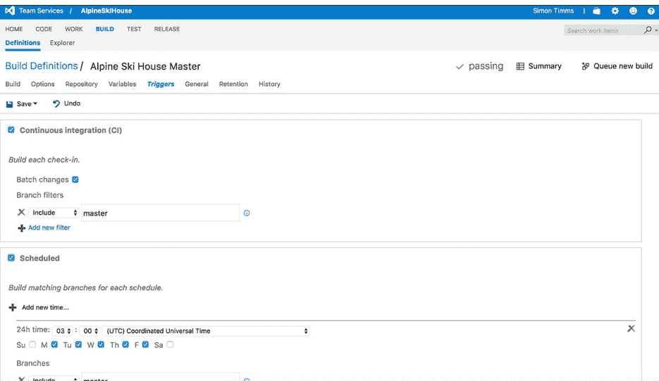

图 5-11 alpine ski house 的触发器

你可能还想构建主仓库中的分支。理论上，这些分支主要由拉取请求组成，因此在合并到主分支之前对其进行构建，进一步增加了在问题影响整个团队之前捕捉的机会。

VSTS 通过新的构建模型有了巨大的改进，现在感觉非常接近 TeamCity。可以确定的是，我们在这里构建时采用的简单方法（仅使用命令行工具）可以移植到任何构建工具。在设置构建的过程中，你还可以尝试更多选项，但是我们在这里配置的部分对于大多数项目已经足够了。毕竟，仅仅拥有一个构建服务器并运行构建对于许多团队来说都是巨大的一步。

# 总结

在本章中，我们查看了构建（builds）的重要性以及它们在整个部署流水线中的位置，Alpine Ski House 团队利用这一点减少了代码合并时的摩擦。频繁地构建可以确保你能够在开发周期中尽早捕获问题，并准备好快速交付软件的最新版本。我们通过一系列提示和对话框在 VSTS 中设置了整个构建流程，向大家展示了使用现代工具设置构建是多么简单。所有这些组件都为团队的成功部署奠定了基础，在下一章中，我们将构建结果推送到云端。

## 第 6 章 部署

Baláz 不怎么喜欢发邮件。他更倾向于临时会议。他把这些会议称为“即兴合奏（Jam Sessions）”，就像某种乐队排练。每个人似乎都非常投入，这种热情极具感染力，Danielle 很快也加入了进来。基本上，这是一种结对编程（mob programming），整个团队聚在一起针对一个问题进行“即兴创作”。这种想法是，这样可以减少错误，并允许小组小组分出去异步处理问题的不同部分。如果主团队正在查询数据库，另一组小组可能会分出去研究如何启用数据库连接的加密。小组带着新知识重新加入，并将其发现整合到主产品中。在这种情况下，团队可能会被某些追溯到单个开发者的问题所阻塞。

今天的即兴合奏是关于让部署正常工作。对于 Danielle 来说，现在就开始部署东西似乎还太早了。他们实际上只有一个落地页。他们还没有把所有内容整合在一起，但 Baláz 解释道：“部署总是最后时刻的事，人们会在截止日期前的最后几分钟冲忙完成。这就是为什么错误很难避免，所以让我们现在开始，反复这样做，直到它不再困难为止。”

“如果我们做得很多，它为什么会变容易呢？”Danielle 问。部署不像深蹲；你不会仅仅因为做得很多就变强。

“啊，”Baláz 说，“你喜欢每次部署时都要手动编辑这些配置文件吗？”

“才不要呢！”Danielle 回答道。

“那么，你为什么不让自己轻松点，写个脚本来帮你完成呢？这样过程是可重复的，你就不必担心出错了，”Baláz 建议道。

Danielle 点了点头——事情对她来说变得清晰了。“如果我们每次执行时都检查过程并进行改进，它就会变得更容易。”并不完全像深蹲，但通过内省，你会在部署方面变得更强大。“我真的很讨厌登录生产服务器来更新包。”

“现在你才在开拉达车了，”Baláz 解释道。他总有最好的东欧谚语。“让我们尝试合奏一下让部署正常工作吧。”

在部署这个章节中，我们将学习搭建一个 Kestrel 服务器，并用功能更全的 Web 服务器作为其前端。我们将把上一步中得到的 Project Parsley 构建部署到更广泛的世界。我们将查看如何向 Linux 机器进行二进制部署，还将如何利用 Microsoft Azure。我们将创建一个任何人都可以访问的站点进行测试，并让部署过程变得如此简单且可重复，以至于可以建立一次性的测试环境，用来尝试各个修复和补丁。

## 选择 Web 服务器

多年来，托管 ASP.NET 程序的 Web 服务器选择一直非常有限。大多数人选择托管 IIS，这是 Windows 自带的 Web 服务器。有些管理员在 Linux 上的 Mono 上通过 Apache 运行 ASP.NET，但这可能并不常见。最近，使用像 NancyHost 这种实现了 .NET Open Web Interface（OWIN）的 Web 服务器选项也变得可用。

Microsoft IIS 是一个非常高效且功能齐全的 Web 服务器。它支持以隔离的方式托管多个站点，这意味着它可以在单个实例上托管许多网站。对 SSL、gzip、虚拟主机甚至 HTTP2 的支持都是开箱即用的。如果你在 Windows 环境中部署 ASP.NET Web 应用，那么几乎不需要再看 .NET Core 了，而它运行在许多平台上，其中大多数平台都不支持 IIS。在这些情况下，Kestrel Web 服务器是首选。Kestrel 是一个轻量级 Web 服务器，支持 .NET Core 并运行在所有平台：Linux、macOS 和 Windows。Kestrel 的核心是异步事件库 libuv。如果你觉得这个库听起来很熟悉，是因为它是和 Node.js 核心相同的库。

## Kestrel

.NET Core Web 应用实际上是可执行文件。在 ASP.NET 的之前的版本中，编译的结果通常是一个可以传递给 Web 服务器的库。默认项目包含一个 `Program.cs`，其内容如下：

点击此处查看代码图片

```c
public static void Main(string[] args)
{
    var config = new ConfigurationBuilder()
        .AddCommandLine(args)
        .AddEnvironmentVariables(prefix: "ASPNETCORE_")
        .Build();

    var host = new WebHostBuilder()
        .UseConfiguration(config)
        .UseKestrel()
        .UseContentRoot(Directory.GetCurrentDirectory())
        .UseIISIntegration()
        .UseStartup<Startup>()
        .Build();
    host.Run();
}
```

你可以看到，我们首先设置了从命令行和环境中读取的配置。接下来，我们构建了一个 WebHost 并运行它。WebHost 是使用流式构建器模式（fluent builder pattern）构建的，在这里开始构建 Kestrel 并告诉它使用当前目录。添加了 IIS 集成。这是 IIS 与应用程序通信的方式。托管有几个选项。例如，`CaptureErrors(true)` 会捕获启动时的异常。这对于开发可能很有用，但在生产环境中，最好失败并退出。

Kestrel 是任何应用程序中非常重要的组件。在在此发布之前，ASP.NET 一直在 IIS 中托管，而现在的做法与此不同，`w3wp.exe`。

> 注意

> ASP.NET MVP Rick Strahl 写了一篇很棒的博客，比较了 ASP.NET 一直在 IIS 中托管的方式，以及与新的 ASP.NET 有何不同。https://weblog.west-wind.com/posts/2016/06/Publishing-and-Running-ASPN-Core-with-IIS

## 反向代理

为了理解 IIS 如何与 Kestrel 通信，理解反向代理的作用至关重要。代理服务器长期以来一直用于节省带宽或限制网络内部计算机可以访问的站点（见 6-1）。

代理服务器获取 HTTP 请求并判断这些请求是否合法。如果请求的是它已经看过并缓存的文件，它将提供缓存文件，而不是通过公共互联网请求产生额外的带宽和延迟成本。这种技术节省了带宽并降低了用户的延迟。互联网服务供应商可能会在自己的数据中心使用这种技术。

图 6-2 所示的反向代理将代理反转，并放置在 Web 服务器之前。就像普通代理一样，这里的代理服务器在这里缓存资源。HTTP GET 请求不会修改服务器上的数据，或者根据规范不应该这样做，因此其内容可以在代理服务器上保存一段时间。

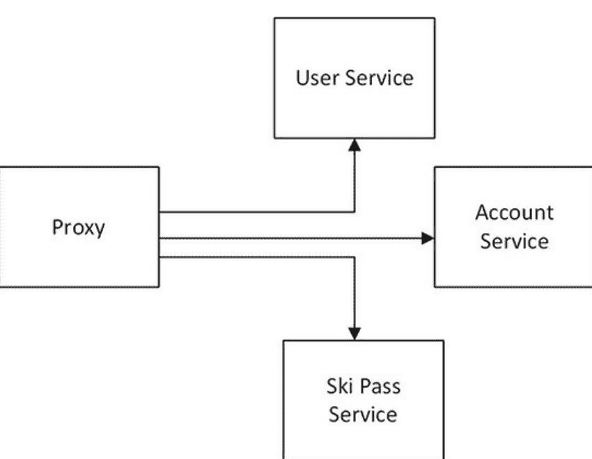

图 6-3 代理可以路由到许多不同的服务

# IIS

多年来，IIS 一直是 Windows 平台上托管网站的首选。ASP.NET Core 随带了一个名为 Asp Net Core Module 的新 IIS 模块。该原生模块通过 HTTP 将请求从 IIS 直接传递给 Kestrel（Kestrel运行在独立的进程中）。这与之前使用的方法相比是一个有趣的改进。多年来，集成的 IIS 流水线一直是推荐的方法，但它将 ASP.NET 与 IIS 紧密耦合。为了让 ASP.NET Core 能够在任何平台上运行，必须打破这种耦合。

要让 IIS 托管 ASP.NET Core 应用程序，必须满足若干条件。首先是如之前建议的 IISIntegration。其次是包含一个加载了 AspNetCoreModule 的 `web.config` 文件：

点击此处查看代码图像

```xml
<?xml version="1.0" encoding="utf-8"?>
<configuration>
<!--
    在 appsettings.json 中配置您的应用程序设置。更多信息请访问
https://go.microsoft.com/fwlink/?LinkId=786380
-->
```

```xml
<system.webServer>
  <handlers>
    <add name="aspCore" path="*" verb="*" modules="AspNetCoreModule" resourceType="Unspecified"/>
  </handlers>
  <aspNetCore processPath="%LAUNCHER_PATH%" arguments="%LAUNCHER_ARGS%"
        stdoutEnabled="false" stdoutLogFile=".\logs\stdout"
        forwardWindowsAuthToken="false" />
</system.webServer>
</configuration>
```

如此示例所示，有一些标志可以通过 IIS 传递。其中最有趣的功能之一是能够将 Windows 身份验证令牌转发到 Kestrel 的能力。这允许您的 Kestrel 应用程序继续在单登录场景中使用 Windows NTLM 认证。此外还指定了请求进入时的启动路径。

AspNetCoreModule 接收所有 IIS 的请求并通过 HTTP 将它们发送到 Kestrel，然后将 Kestrel 返回的所有内容返回给客户端。这可以在图 6-4 中看到。

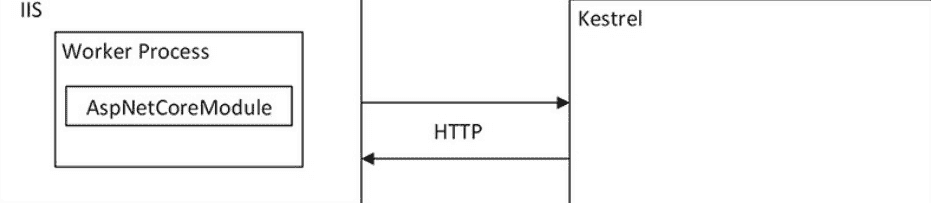

图 6-4 IIS 托管一个工作进程，该进程运行 ASP .NET Core Module 以将请求路由到 Kestrel

在 `web.config` 文件中，处理器将所有请求传递给 Kestrel 进程，但可以对请求进行过滤，以便只传递特定的类。例如，您可以将处理器注册更改为如下：

点击此处查看代码图像

```xml
<handlers>
  <add name="aspCore" path="/new/*" verb="*" modules="AspNetCoreModule" resourceType="Unspecified"/>
</handlers>
```

这仅传递匹配路径 `/new` 的请求。这允许您创建一个混合应用程序，其中部分请求由 ASP.NET Core 处理，另一部分则由另一个应用程序处理。

## 注意事项

AspNetCoreModule 的配置选项在官方文档 https://docs.asp.net/en/latest/hosting/aspnet-core-module.html 中有详尽的记录。请特别注意 `recycleOnChange` 设置，如果任何依赖文件发生变化，它将重启 Kestrel 服务。这允许在对站点进行部署时实现更快的站点回收。

IIS 不再需要处理任何托管代码，对于任何使用 ASP.NET Core 的 Web 应用程序，在 IIS 中禁用托管代码是可能的甚至是建议的。这将进一步提高性能。

# Nginx

Nginx 是一个高性能 Web 服务器，运行在包括 Windows、Linux 和 OSX 在内的多个操作系统上。它还为包括 FTP、POP3、IMAP 和 HTTP 在内的许多协议提供了反向代理支持。此外，它可以提供静态文件、SSL 终止，甚至提供 HTTP2 支持。

Nginx 着与 IIS 的角色，但适用于更广泛的操作系统。您不需要 `web.conf` 文件，而是可以创建一个包含所需配置设置的 `nginx.conf` 文件。

## 注意事项

一个包含 SSL 设置和 HTTP2 设置的完整 Nginx 示例，可以在 ASP.NET Monsters 网站找到：

http://aspnetmonsters.com/2016/07/2016-07-17/nginx/ 和 http://aspnetmonsters.com/2016/08/2016-08-07-nginx2/。您还可以在 ASP.NET Monsters Channel 9 频道看到相同内容的视频演示，地址为：https://channel9.msdn.com/Series/aspnetmonsters。

此配置文件设置了一个指向 Kestrel 的简单 Nginx 代理。它包含了 SSL 终止。由于 Kestrel 是极轻级的，它实际上不支持在上游服务器上进行 SSL 终止并向发送未加密的 HTTP 请求。

点击此处查看代码图像

```nginx
# 启动的工作进程数
worker_processes 10;

# 最大连接数
events {
    worker_connections 1024;

# 服务 http 信息
http {
    # 设置 mime  类型
    include mime.types;
    default_type application/octet-stream;

    # 设置日志
    log_format main '$remote_addr - \$time_local "$request" \$status \$body_bytes_sent "$http_referer" "$http_user_agent" \$forwarded_for';
    access_log /var/log/access.log main;

    # 设置 SSL
    ssl_certificate /etc/letsencrypt/live/fullchain.pem;
    ssl_certificate_key /etc/letsencrypt/live/privkey.pem;

    ssl_session_cache shared:SSL:1m;
    ssl_session_timeout 5m;

    # 禁用糟糕的加密算法
    ssl_ciphers HIGH!:aNULL!MD5;
    ssl_prefer_server_ciphers on;

    # 配置监听
    server {
        listen 443 ssl;
        server_name _;

        ## 默认将所有请求传递到本地端口 5000
        # 这是我们的 Kestrel 服务器
        location / {
            # 使用代理缓存文件
            proxy_cache cache;
            proxy_cache_valid 200 30s;
            proxy_cache_valid 404 10m;
            proxy_pass http://127.0.0.1:5000/;
        }
    }
}
```

与 IIS 不同，Nginx 不会为您启动 Kestrel 副本，因此您需要在生产环境中独立地启动它们。对于本地开发，除非您的本地开发明确需要 Nginx 提供的功能，否则通常不需要使用它。您可以将 Nginx 视为类似于生产环境中的负载均衡器：在本地不需要复制。

> 注意事项

尽管 Nginx 在 Windows 上运行良好，但为了优化其与 Windows 的交互方面尚未进行大量工作。因此，它在 Windows 上的效率远低于 IIS。如果 Windows 是您的托管环境，IIS 仍然应该是您的首选服务器，至少在近期是如此。

# 发布

发布方法取决于您的目标和流程的成熟程度。Visual Studio 一直能够从您的开发机创建部署包。这通常通过右键点击网站并选择“发布”来实现（见图 6-5）。

# 发布

| 发布方法: | Web Deploy |

|---|---|

| | Web Deploy |

| | Web Deploy Package |

| | FTP |

| 服务器: | File System |

package（请参见图 6-6 以轻松地发布程序包）。

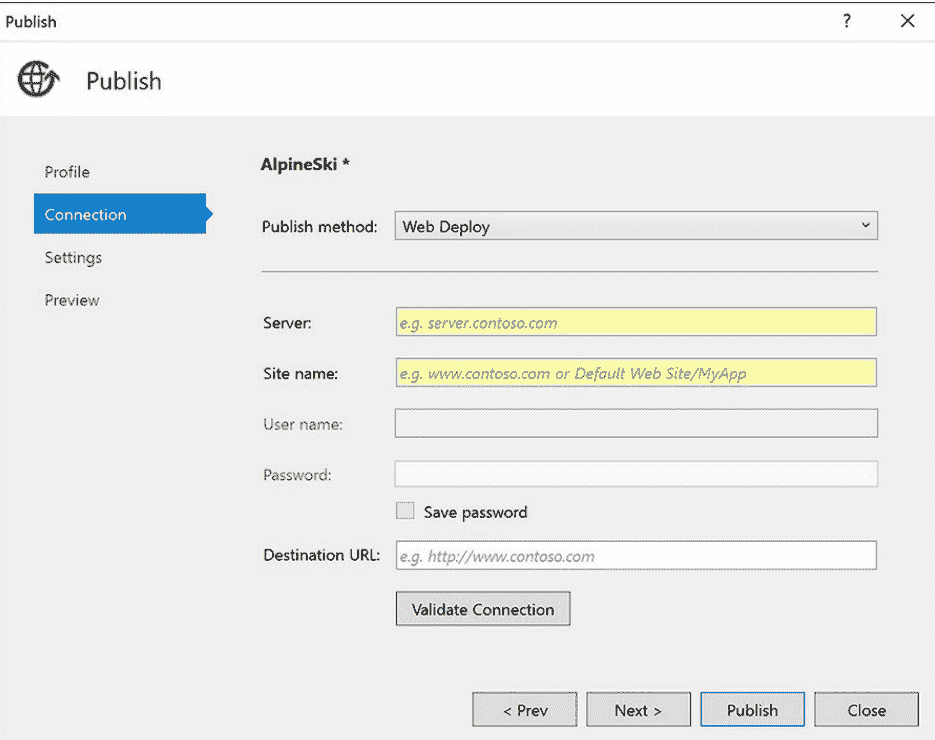

**图 6-6** 完整的发布对话框


当然，如果你是从 Visual Studio 直接发布你的应用程序，那么你的方法是错误的。从 Visual Studio 中发布是脆弱的且难以复制的。如果你在度假，而其他人需要发布该应用程序，他们要么无法做到，要么从他们的机器上拉取，而那里的机器可能有截然不同的设置。在 Visual Studio 中右键点击部署已经有些过时了，它引用了一个我们尚不理解可重复构建重要性的过去时代。要设置一个构建服务器来持续地构建、测试和部署你的应用程序是困难的。应用程序生命周期管理（ALM）负责就 DevOps 最佳实践相关的事务提供建议，一直游将从 Visual Studio 部署从产品中移除。坦率地说，在创建像 TeamCity、Jenkins 和 TFS Build 这样强大且易用的工具方面已经做了大量工作。这些工具自动化了监控仓库变化、拉取新代码、构建和运行测试。如果设置这些工具工作量太大，还有像 AppVer 或 Visual Studio Team Services 这样的托管解决方案，它们对小团队是免费的。如果你有 MSDN 许可证，你已经拥有 Team Services 的许可证，但这些许可证并没有被很好地利用。

基于集中式构建服务器允许团队中的每个人都能很好地看到构建的当前状态。它有助于消除某些尴尬的问题，即代码在你的本地机器上可以运行，但当团队中的其他人下载它时却惨遭失败。单一的构建服务器还允许在单一位置执行测试，这使得测试更容易编写且运行得更可靠。你是否曾经提交过某些无关紧要的更改以跳过本地运行单元测试，结果破坏了整个团队的测试？你当然这样做过，因为在本地运行测试可能是一件痛苦的事。我们都这样做过。拥有一个集中式构建服务器可以确保运行测试，并快速捕获错误和遗漏。

# 构建类型

.NET Core 可以在 .NET 框架之上进行构建，也可以在精简的 .NET 标准库之上构建。多年来，曾多次尝试创建可以在各种平台上运行的 .NET 版本。显然，某些 API 移植到其他平台并没有意义。例如，没有必要从 Xbox 上修改活动目录对象。该问题的之前的解决方案是可移植类库（Portable Class Libraries）。

可移植类库或 PCLs（有时读作 "pickle"）定义了一组目标框架，例如 Silverlight 或 Windows Phone。在首次创建应用程序时，你会定义一组目标框架，编译器将进行检查以确保任何使用的 API 都在列出的平台可用 API 的交集范围内。然而，PCL 存在一些局限性，特别是在打包方面。如果需要支持的目标平台集发生变化，整个库都需要重新编译，并且发布完全新的包。每个目标框架的组合都由配置数字（profile number）标识。任何关于 PCL 的讨论都可能包含数字，如 `Profile136`。这些配置数字完全令人困惑，而且没有提到 `.NET Standard` 的开发是为了解决与 PCL 许多相同问题的方法，但方式不那么复杂。.NET Standard 没有让每个目标框架定义它支持的一组 API，而是定义了一个基础的 API 基，并声称为 .NET Standard 1.0。.NET Standard 1.0 中的 API 集合小到足以支持从 Xbox 到手机到运行在 Linux 上的框架的所有设备。.NET Standard 定义了许多 API set，每一个都像列表一样编号。任何高于 1.0 的版本号至少支持前一个层的 API set。因此，.NET Standard 1.1 支持 .NET Standard 1.0 中的所有内容，以及 `System.Collections.Concurrent`、`System.Runtime.Numerics`、`System.Runtime.InteropServices` 以及其他几个。理想情况下，你的应用程序应该目标尽可能低版本的 .NET Standard。

.NET Core 中的新应用程序在箱即时已配置为在可移植模式（portable mode）下运行。这是历史上所有应用程序构建时采用的模式。构建应用程序的结果是相对较小的文件集合：生成的程序集（assembly）以及运行它所需的任何第三方库。任何运行时文件预计已经存在于目标计算机上，通常是因为安装了 .NET 运行时安装程序。大多数现代版本的 Windows 都预装了某个版本的 .NET，尽管它可能不正是你的应用程序所预期的版本。在这种模式下，从构建输出的文件是架构中立的文件。在你以可移植模式部署的应用程序进行第一次运行期间，即时编译器（JIT compiler）会生成并缓存该中立文件的本地原生机器代码版本。这使得随后的运行快得多，因为它们跳过了编译步骤。

构建模式的替代方案是在自包含模式（self-contained mode）下进行构建。在此配置下，应用程序及其所有依赖项在构建时编译为机器代码，而不是在运行时编译。自包含模式的部署还包含了所有运行时。目标操作系统和架构可能看起来很奇怪。.NET 的强大功能之一是它是完全可部署的。这消除了了运行时团队想要想要运行的冲突。

# 打包

让我们从打包可移植模式下的 .NET 开始。NuGet 包实际上实际上是 .NET 的部署机制。为了减轻创建这些包的负担，从项目直接构建 NuGet 包。

如果你的项目可以使用自包含包（self-contained packages），那么构建和打包步骤需要一些更新。首先必须更新`project.json`。从`netcoreapp1.0`部分移除以下行：

```
"type": "platform"
```接下来，再次构建时需要添加运行时列表。如果你想针对 macOS 和 Windows 10 64 位构建，这就是正确的部分：

```json
"runtimes": {
  "win10-x64": {},
  "osx.10.11-x64": {}
}
```

完整的包标识符列表可以在此处找到：https://docs.microsoft.com/en-us/dotnet/articles/rid-catalog。

在构建或发布应用程序时，可以使用命令行上的`r`参数指定运行时：

```
dotnet publish -r win10-x64
```

这种构建的结果是一对 NuGet 文件。一个包含从构建生成的二进制文件，另一个包含上传到符号服务器的符号。这些包可以像任何其他 NuGet 包一样分发：上传到 Octopus 服务器或通过`nuget.org`或`MyGet`等网站分发。

# 注意

如果你是一个偏好使用视觉工具构建应用程序的开发者，你可能会疑惑为什么我们如此强调命令行工具。事实是，所有的自动化构建工具和所有的视觉构建工具，实际上都是在调用命令行工具。因此，了解内部原理是非常重要的。

如果你的项目可以利用自包含包，那么需要对构建步骤进行更新。

# 选择 Azure 的理由

有无数种方式托管应用程序以便人们可以使用它。长期以来，个人和公司一直运行自己的数据中心。这种方法并没有问题，而且事实上许多人仍然在这样做。挑战在于找到合适的人来为你设计和维护数据中心。这其中有物理层面的挑战，例如如何正确运行暖通空调（HVAC）以及需要多大的不间断电源（UPS）。还有基础设施方面的挑战，例如如何确保有足够的存储空间可用以及如何管理虚拟机池。管理备份通常是几个人的工作，但他们真的真的有时间来测试恢复操作吗？

这些挑战既不容易，也未被解决。更重要的是，这些挑战并不是公司核心业务的一部分。如果公司的主要角色是开采和炼油，那么无论信息技术（IT）对业务成功有多么重要，它仍然会被视为一种开支，而不是业务的核心部分。这经常导致公司转向内部 IT 结构之外寻找托管应用程序的方案。

在外部托管方面，有一系列选项选择。在最基础的层，公司可以简单地租用空间来放置他们的机器。数据中心提供物理安全，并解决了冷却和电力等某些基础设施问题，但仅此而已。这些设施通常为每个在该处共同托管的公司提供机柜，以将机器相互隔离。

在光谱更靠后的位置，是公司按月租用虚拟机或访问物理机器。他们提供了更多的硬件管理，但客户在很大程度上仍负责软件以及提供足够的空间和计算能力。

在光谱更靠远的位置，是公司提供一组托管服务，这些服务在运行它们的硬件服务之上提供了一种抽象。在这种情况下，你倾向于不再为你的数据库服务器租用一台电脑，而是租用一个带有性能保证的数据库实例。

租用虚拟机和使用托管服务都属于云计算的范畴。由于大量的营销混淆，“云计算”这个术语（如果不排除其中的双关语的话）已经变得非常模糊。实际上，它意味着你正在使用的计算资源是虚拟化的，并且可以轻松地扩展或缩小。你只需要为你使用的资源付费，而不是像在普通数据中心那样为基础资源付费。这被称为弹性计算。

弹性计算对于经历“尖峰型”负载的公司是理想的，即高使用率和低使用率的时期。Alpine Ski House 就是这样一家公司的完美例子。在夏季，网站上的用户很少，因为没有雪可以滑，但在冬季第一个寒潮来临时临时，需求就会激增。使用传统的托管方式，Alpine Ski House 将被迫全年支付昂贵的硬件费用，而这些硬件只在部分时间内是需要的。此外，票务网站的负载在早晨要高得多，因为人们在白天已经在雪道上了。Project Parsley 的需求不仅在一年中会激增，在一天之中也呈尖峰状。如果没有弹性托管，Alpine ski House 需要指定其硬件规格以匹配峰值负载。

Microsoft Azure 一直处于 Gartner 魔法象限图报告的领导者象限。它的基础设施即服务（IaaS）产品与其他云提供商相当，但它的平台即服务（PaaS）产品真正出彩。IaaS 是云云云托管，允许你运行虚拟机并通过自定义网络将其连接，包括 Azure 与你本地数据中心之间的专用连接。在这些 PaaS 产品之上，构建了提供 IaaS 之上抽象层。该层包含了诸如可扩展的文档数据库、服务总线、音视频处理相关服务、机器学习等更多内容。

借用 Scott Hanselman 的一个极佳的比喻，拥有自己的数据中心就像拥有自己的汽车：你负责为它充电、维护和驾驶。IaaS 就像租车。你仍然有驾驶和充电的责任，但很多维护方面的顾虑减轻了。最后，PaaS 就像乘坐出租。你只需要告诉司机你想去哪里，所有的细节都由他们为你处理好。对于像 DocumentDB 这样的服务，不需要担心如何扩展或备份它；你只需要使用它即可。

Azure 是一个极其广泛的技术套件，拥有超过 40 种主要产品。我们将关注其中一个：App Services。

# Azure 部署

将 Web 应用程序部署到 Azure App Services 的方法不缺少。文件可以手动复制到 FTP 站点，或者通过 Git，或者 Azure 可以直接从源拉取（见图 6-7）。

使用 OneDrive 或 Dropbox 一直以来感觉有些业余。对于许多场景，你可能需要设置许多任务。对于我们简单的场景，你实际上在部署中只需要一个任务即可（图 6-8）。

**图 6-7：有许多选项**

| 定义：主线部署 | 发布 (Releases) |

| :--- | :--- |

| 环境 产物 触发器 通用保留历史 |

| 保存 | 发布 |

| 添加环境 | 添加任务 |

| 环境 1 | 1 / 1 任务 部署 AzureRM Web App: alpineskite 部署 AzureRM Web Deployment | AzureRM 订阅 | MSDN 管理 |

| | Web 名称 | alpineskite |

| | 部署到槽 | |

| | 包 设置参数文件 |

| 目标位置额外文件 | $(System.DefaultWorkingDirectory)\App\Alineskite |

| 从 App_Data 文件夹排除文件 | |

| 取消应用程序 | |

| 虚拟应用程序 | |

| 额外参数 |

将 Web 应用程序部署到 Azure App Services 的方法不缺少。文件可以手动复制到 FTP 站点，或者通过 Git，或者 Azure 可以直接从源拉取（见图 6-7）。

使用 OneDrive 或 Dropbox 一直以来感觉有些业余。对于许多场景，你可能需要设置许多任务。对于我们简单的场景，你实际上在部署中只需要一个任务即可（图 6-8）。

长期以来，Team Foundation 中的构建一直存在缺陷。通过定义的构建编辑非常困难。在最新版本的 TFS 中，构建已变得与我们在 City 或 Jenkins 中构建的构建更加相似。它们更容易修改，而且预写任务库也在不断扩大。我们已经构建了一个产生包的运行程序，现在只需为二进制文件挂接一个发布即可。

注意：如果你需要将你的 Azure 账户连接到 VSTS，那么位于 https://blogs.microsoft.com/visualstudioalm/2015/10/04/automating-azure-resource-group-deployment-using-a-service-principal-in-visualstudio-online-buildrelease-management/ 的文章可能会有所帮助。

使用新的资源管理器，你只需要指定 Web 应用程序名称并选择要部署的包。勾选“在目标位置删除其他文件”（Additional Files At Destination）始终是一个好主意，可以确保构建实际上是可重复的。当然，这种简单的配置已经包含了大量功能。构建要求 Web 应用程序已经分配，这意味着需要进行一些手动干预。理想情况下，Web 构建应该在处理过程中创建资源。这允许你在一个文件中指定整个环境：Web 服务器、数据库、防火墙等，用于测试目的，从而实现完全、可重复的部署，而不是手动在门户中进行点击。

这可以通过 Azure 资源管理器 (ARM) 模板轻松实现。这些是基于 JSON 的文件，用于定义整个环境。例如，这可以是基于 ASP.NET 的 CMS —— Umbraco 简单部署的可视化。这整个虚拟机、网络基础设施和存储账户集合都定义在一个 500 行的 JSON 文档中，可以很容易地控制和版本化。这就是基础设施即代码的示例。Azure 资源被分组在“资源组”中。这些资源集合允许你逻辑上分组为特定环境的所有资源。在发布周期内部署资源组可以通过 PowerShell 脚本完成，或者如果使用 VSTAs，可以使用内置任务。这里显示了 ARM 模板作为发布的一部分被部署[图 6-9]。

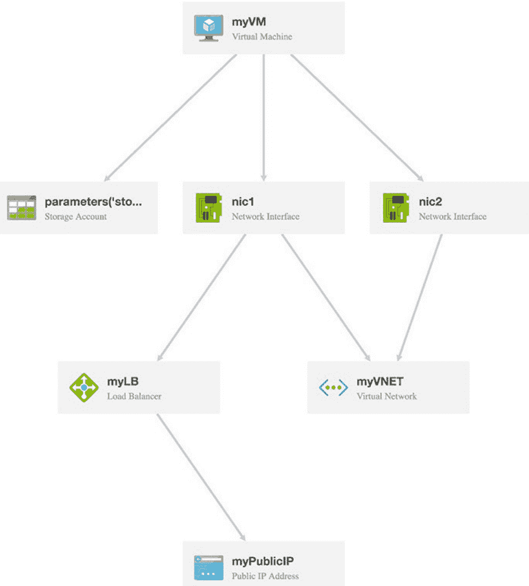

图 6-9 ARM 模板描述的资源的可视化

在安装了适当 Azure PowerShell 工具的情况下，也可以从 PowerShell 轻松部署 ARM 模板。在此命令中，使用管理员登录 `skiadmin` 部署了模板。

[点击此处查看代码图像]

```bash
New-AzureRmResourceGroup -ResourceGroupName alpinski -administratorLogin skiadmin -TemplateFile alpinski.json
```

模板可以进行参数化，以便处理略微不同的场景。例如，它们可以接收要创建的 Web 服务器实例数量：用于测试或生产。

构建流水线中可以添加无数任务。例如，你可能对蓝绿部署感兴趣，在切换用户之前，先将应用程序部署到热备机上。也许你希望在部署过程中运行某些测试以确保功能正常，这些测试在 VASTS 中同样可用（图 6-10）。

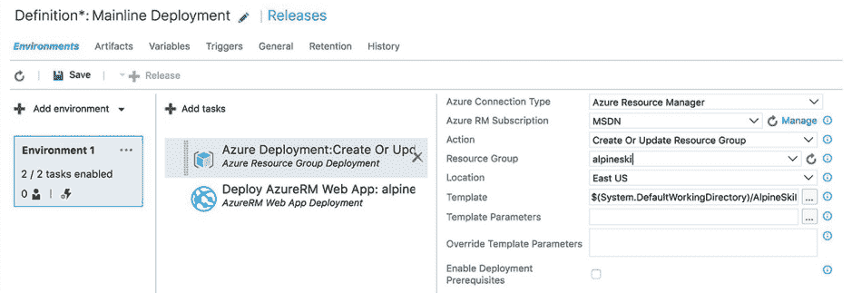

图 6-10 从 VASTS 部署的资源管理器模板

## 容器部署

如果你还没有准备好迁移到云端，有一些替代方案可以在本地提供云端的一些优势。Docker 和容器化可能是过去十年中部署领域最令人深刻的改变。第 9 章“容器化”完全致力于使用容器部署 ASP.NET Core 应用程序。

# 总结

发布软件通常被认为是很困难的。由于发布过程的复杂性，有些公司一年内甚至无法发布一次。持续部署运动将老话“如果某事让你痛苦，就多做几次”应用于发布过程。通过缩短发布之间的时间，我们迫使自己优化并改进该过程，通常是通过自动化实现的。能够快速部署的优势非常多：可以快速修复安全漏洞，可以将时间花在改进过程而不是部署上，并且发布变得可重复，从而减少了产生手动部署错误的概率。

尽管本章重点关注了使用 VASTS 部署到 Azure，但这里没有任何内容是无法使用命令行或替代构建工具完成的。重要的教训是构建和部署可以且应该是化的。ASP.NET Core 使这一过程变得更加，因为它可以部署到更多种平台，且无需担心使用其他框架覆盖已安装的应用程序。

“行吧，”巴拉斯斯（Balázs）说，“我们大多数事情都都有了前行的方向。让我们回到工作中，实际发布一些代码吧！”

“我觉得我们还没有解决休息室缺少羽衣甘蓝（Kale）的问题，”丹尼尔（Danielle）抱怨道，“但我想实际项目进展得不错。我还是想在这次冲刺的待办任务中加入更多的超级食物。”

## 第 7 章：使用 Microsoft Azure 构建 Web应用程序

“干得好，丹尼尔。这真的要成型了。”马克（Marc）正在审查丹尼尔配置的构建步骤，以减轻生成构建的负担。“运行这个需要多久？”

“从合并到部署？4 分钟。”丹尼尔觉得自己已经获得了构建领域的“让它变得简单”荣誉勋章，而且这实至名归。

“所以就是这些，对吧？”马克带着一丝忧虑继续说道。他知道在下次冲刺中，有一项工作是为他们的第三方提供商编写卡片数据以便打印卡片，他感到有必要进行一次技术攻关（spike），特别是在全新的、未知的云领域。“我们现在在云端运行了。而且……我想这很酷。我的意思是，我们还有各种事情要处理，但这应该是很酷的。”他局促地停顿了一下，带着一丝怀疑继续道：“所以我们要把卡片数据导出再次保存在哪里？我们不会有文件系统的对吧？”

“不，你说得对。我们在部署中确实有文件系统，但磁盘空间不是无限的。不过，我有很多选择。看起来我们可以将数据投入队列（queues）并在需要时进行处理，但这感觉不太对劲，”丹尼尔说。“我在想尝试表存储（table storage）是否有意义？或者也许文档存储（document storage）？我不想为了适应某种新东西而强行去拟合。”


“没错！”马克说，很高兴有人和他志同道合。“最近这里到处充斥着各种术语。”他突然低低声音说，“你敢相信提姆（Tim）过来告诉我让我看看`Event`服务吗？他谈到我们应该如何将我们的滑雪者看作`IoT`事件流。我不确定他是否理解我们在做什么。但核心是，`A.Datum`期望的是`CSV`格式的滑雪卡数据，对吧？为什么不直接写出`CSV`呢？”

“是的，完全理解，马克，我明白你的意思。我们不需要这里的宇航员级架构（astronaut architecture），为了什么。你对块存储（blob storage）怎么看？从我看到的来看，使用它几乎和配置数据库一样简单。”

“对，我觉得你发现了一个点，”他回答道。“我们的输出是文件。让我们把它们当作文件处理，并将它们保存在`Azure`中类文件的地方。这看起来是最合理的。”

由于对他们开始进行的方向充满信心，丹尼尔拉过一把椅子来到马克的隔间准备进行结对编程（pair up）。他们开启了一个分支，大干一场。

## 思考平台即服务（PaaS）

如果这是你涉足云服务提供商服务的尝试，或者这是你在离开云几年后重返云端，你会发现有很多闪闪发光的新事物可以尝试。事实确实如此，但过度追求新技术会给许多应用程序带来各种陷阱。

这里有一个实用的准法则，可以帮助你评估这些华丽的“旧改新”功能——即使用你擅长构建的工具。这并不是说你应该留在自己的舒适区内。遵循这一准则意味着，你应该选择适合你项目的服务。我们倾向于发现，引入项目的最佳服务是那些需要契合且恰好得严丝合缝的服务，而不是那些不太恰当的服务。就像在谋杀审判期间在全国电视电视上强迫某个被告戴上手套，然后又后悔一样。

随着应用程序的成熟，你通常会根据你所的工作类型自然产生某些服务。例如，如果你进行批处理，你就会做出批处理。即使`.NET Framework`本身也作为基础库的一部分构建了这些类型的服务，这就是为什么我们不再需要编写`FTP`客户端库了。

你应该在云产品中寻找的是模式和模式（patterns）。就像丹尼尔和马克试图将滑雪场巡逻员比作水传感器一样，我们不应该把圆的东西放进方形的开口中。在`Azure`中，平台即服务（`PaaS`）产品通常允许解决许多不同尺寸和形状的问题，无需重新发明轮子。

## 平台服务

组织有时会采用“抬迁移”（lift-and-shift）策略，这意味着他们将本地环境中的内容移动到云端。对于某些公司来说，这意味着部署到虚拟机，而对于另一些公司则意味着“从物理到虚拟”，并将虚拟机推向云端。但让我们明确一点，如果只是进行抬迁移并声称拥有云策略，那么你就失败了。换句话说，如果你将虚拟机迁移到`AWS`或`Azure`，但没有一个云优化的方案，那么抬迁移只是故事的一小部分，它不需要花费大量资金购买新硬件，因此从金钱角度来看它可能是一个不错的选择，但未能充分利用拥抱云的许多优势。尽管最后一段话听起来很严厉，但抬迁移可以作为转向云端长期计划中的良好组成。例如，在应用程序部署到虚拟机之后，你可能开始使用队列向新服务投递消息，或开始将日志写入存储器。随着时间的推移，你可以将你的站点移动到`Web`应用，或者用`API`管理封装你的`API`以与其他组织共享。

## 在完成服务创建之前的选项

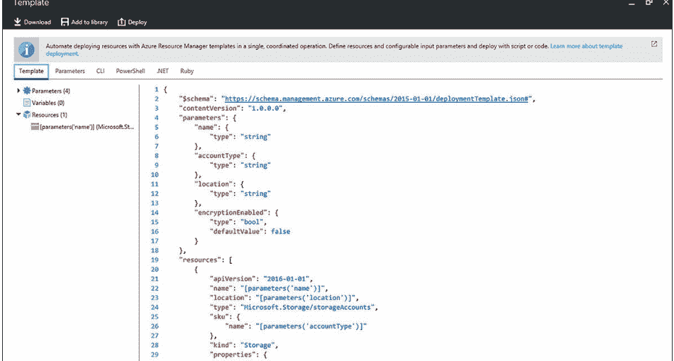

# 图 7-2 在 Azure 门户中查看模板

我们使用模板和参数文件来构建您的服务，并根据需要更新构建脚本。如果您正在寻找有关构建和自定义模板及参数的更多信息，可以在此处找到更多阅读材料：`https://azure.microsoft.com/en-us/document/articles/resource-group-authoring-templates/`

## 使用平台服务构建应用程序

让我们来看看`Alpine Ski House`团队需要解决的一个功能。当用户为自己的账户创建滑雪卡时，系统会提示他们上传头像。滑雪卡稍后将由第三方公司打印，该公司使用激光打印工艺将滑雪持有者的黑白照片打印在卡上。为了获得最佳的打印效果，上传的照片必须调整为特定尺寸，并使用特定的转换标准转换为灰度图。

`Alpine Ski House`团队为他们的需求找到了几个互补的`Azure`组件，包括一个由`App Services`提供处理支持的简单存储账户（`Storage Account`）。存储账户允许您通过使用大型对象或“`blob`”来存储任意数据。`blob`服务还为`WebJobs`提供后端存储，`WebJobs`是`App Services`的一部分，允许通过许多不同的机制处理计划或触发的任务。

存储账户中的`blob`服务是您可以从提供的功能使用的。存储账户还允许您访问以`NoSQL`表存储、文件存储以及最后通过队列存储（queue storage）简单通信通道形式存在的非结构化数据。

`WebJobs`是`App Service`组件体的一部分，该体还包括移动服务、`API`开发以及在`Web Apps`中扩展托管网站的能力。`App Service`不仅支持`.NET`语言，还支持`Java`、`Node.js`、`Python`和`PHP`。您可以在`App Service`内部的相同性能和扩展分级下创建一个或多个组件，并且您在该实例中创建的所有服务都将计入同一个使用、出站和计费限制桶。

有了了`blob`和作业后，`Alpine`团队通过一个基于队列消息的触发器将两者结合在了一起。为了让这一切协同工作，我们引入了几个组件，其中一些组件将在书中随后的部分进行详细介绍。在您熟悉了这些组件后，您会同意这种由`Azure`生态系统提供的服务组合解决方案是非常优雅的。

## 创建存储账户

要开始使用这些平台功能，首先需要使用`Azure`门户、`CLI`、`PowerShell`或通过`Visual Studio`中的“连接服务”（`Connected Services`）对话框创建一个存储账户。

要使用`Visual Studio`，请在解决方案管理器中右键点击项目并选择“添加”，然后点击“连接服务”。这将打开向导的起始页面，类似于您在[图 7-3]中看到的页面。如果您已经登录了微软账户，并且该账户关联了`Azure`订阅，您可以选择使用现有的存储账户或在创建过程中创建一个。

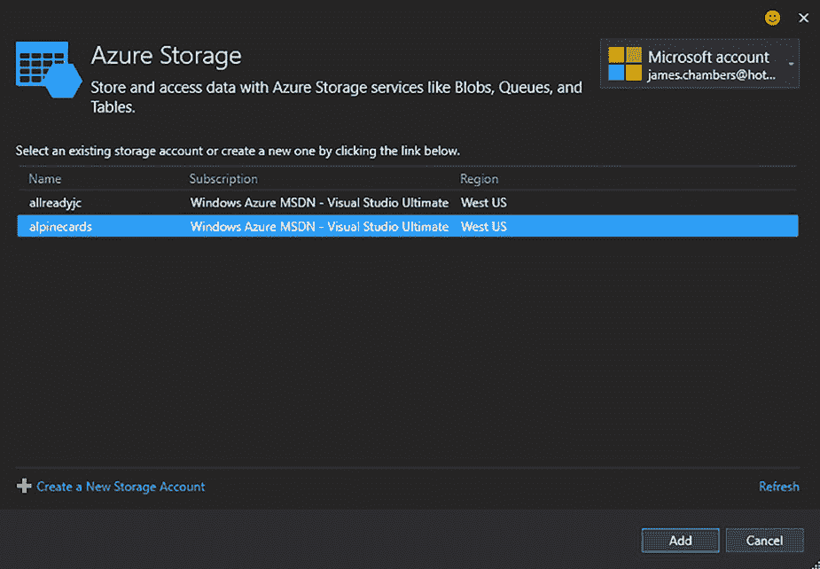

# 图 7-3 Azure 存储连接服务向导

完成向导后，您的项目将更新了所需的程序包和一个名为`config.json`的配置文件，该文件包含了您的应用程序连接到订阅中存储账户所需的连接字符串。

> 注意
> 
> 您应该将项目中的连接字符串信息移出“连接服务”对话框存储它的默认位置。为了便于自动“依赖注入”，添加这些信息是非常方便的。关于配置机制实际运行的示例，可以参考`AlpineConfigurationBuilder`类（在该类中设置被加载到配置集合中），以及`BlobFileUploadService`类（连接字符串在此处被应用程序解析并使用）。

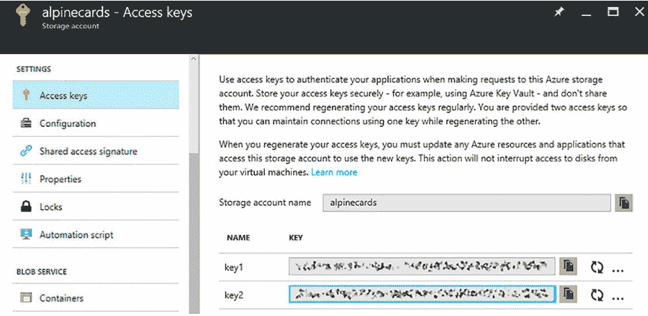

# 图 7-4 访问存储账户的访问密钥

您还需要向您的项目`project.json`添加一些程序包，这可以通过解决方案管理器中项目的右键上下文菜单中选择“管理`NuGet`包”，或者来自`Visual Studio`中的“程序包管理器控制台”。如果您对`NuGet`来说是新的，可以快速跳转到第 14 章“依赖注入”，或者稍后回到本章。现在，您包含的程序包有：

- `Windows.Azure.Storage`
- `System.Spatial`
- `Microsoft.Data.Edm`
- `Microsoft.Data.OData`
- `Microsoft.Data.Services.Core`

在与本书配套的项目中，您会发现团队还创建了一个作为`WebJob`部署到应用程序的控制台应用程序。该应用程序承担了以下包依赖：

- `Microsoft.Azure.WebJobs`
- `ImageProcessorCore`

`WebJobs`包添加了辅助类和属性，可以加速创建部署到`Azure`的自动化作业。`ImageProcessorCore`是一个与`ASP.NET Core`兼容的图像库，目前正在开源社区开发中，作为`System.Drawing`的替代品。我们将在本章稍后查看这两个包。

## 在 Blob 容器中存储图像

`Danielle`负责滑雪卡的视图，并构建了允许在滑雪卡创建过程中上传文件的元素，代码如列表 7-1 所示。在视图中，我们使用了`Razor`和`MVC`中称为“标签助手”（tag helpers）的功能，我们在第 11 章“`Razor`视图”中提到它，并在第 19 章“可重用组件”中进行更详细介绍。

## 列表 7-1 视图更新上传图像

点击此处查看代码

```html
// 视图中的新字段，Views/SkiCard/Create.cshtml
<div class="form-group">
    <label asp-for="CardImage" class="col-md-2"></label>
    <div class="col-md-10">
        <input asp-for="CardImage" />
    </div>
</div>
```

多亏于模型绑定，控制器不需要更新，因为`HTML`元素类型只是模型中的`IFormFile`。列表 7-2 使用`IFormFile`来扩展模型。

## 列表 7-2 更新模型以支持自动绑定

点击此处查看代码

```csharp
// 视图中的新字段，CreateSkiCardViewModel.cs
[Display(Name = "要显示的图像")]
public IFormFile CardImage { get; set; }
```

## 列表 7-3 将图像上传到 blob存储

点击此处查看代码

```csharp
// 准备连接字符串
var storageAccount = StorageAccount.Parse(_storageSettings);
var blobClient = storageAccount.CreateBlobClient();
var container = blobClient.GetContainerReference("skicards");
await container.IfNotExistsAsync();

// 将图像推送到容器
var blob = container.GetBlobClient(targetFilename);
await blob.UploadFromAsync(imageStream);
```

## 引入存储队列

在`BlobFileUploadService.UploadFromStream`调用结束时，我们引发了一个事件，该事件由应用程序中的另一个代码块处理。这里的消息细节并不重要，但响应事件的处理器值得关注。应用程序在此处的操作是将图像处理的责任转移给外部。我们希望用户体验尽可能快速、流畅，为了实现这一点，我们必须将所有边界资源的操作推给其他进程。

列表 7-4 包含了`QueueResizeOnImageUploaded`类的部分代码。与我们连接`blob`服务的代码类似，我们实例化客户端并确保我们正在尝试访问的资源确实。

## 列表 7-4 向 Azure 存储队列发送消息

点击此处查看代码

```csharp
// 准备队列客户端
var storageAccount = StorageAccount.Parse(_storageSettings);
var queueClient = storageAccount.CreateQueueClient();
var imageQueue = queueClient.GetQueueReference("skicard-image-processing");
await imageQueue.IfNotExistsAsync();

// 准备并向队列发送消息
var message = new QueueMessage(notification.FileName);
await imageQueue.AddMessageAsync(message);
```

## 使用 Azure WebJobs 实现自动化处理

偶尔，你的生态系统中会出现某种开发技术，能够从根本上改变你解决问题的方式，我们认为`Azure WebJobs`的演进就是此类之一。

# 注意

`WebJobs`将继续进化，并在未来将被称为`Azure Functions`。`Azure Functions`将提供新功能、更好的隔离性以及`Web Apps`边界之外的价值，但它们目前处于预览（`Preview`）状态，尚未在全球所有`Azure`地区可用。要了解`Azure Functions`的信息，请访问 `https://azure.microsoft.com/en-us/services/functions/`

`WebJobs`的出现源于需要运行任意但通常很耗时的代码，例如按某种频率处理上传的文件、解析博客内容或发送电子邮件，这些任务的运行方式可以是按计划运行、在后台持续运行，或者由事件或应用程序外部触发。`Web Jobs`也可以是你创建的任何可执行文件或脚本文件。你可以将需要运行的代码放在`ZIP`文件中并上传到`Azure`。

对于`Danielle`和`Marc`来说，这正是平台即服务（`PaaS`）真正大放异彩的地方。无需编写与队列通信或从容器中读取`blob`的代码，他们仅用三行代码就能处理图像队列，如列表 7-5 所示。在从早期添加的`NuGet`包引入`WebJobs SDK`后，他们能够将通常超过 40 行的配置和处理代码压缩到这段简短的代码片段。

### 列表 7-5 一个由队列触发的处理图像的 Azure 作

[点击此处查看代码图像]

```csharp
public class ImageAdjustments
{
    public static void ResizeAndGrayscaleImage(
        [QueueTrigger("skicard-imageprocessing")] string message,
        [Blob("cardimages/queueTrigger"), FileAccess.Read] Stream imageStream,
        [Blob("processed/queueTrigger"), FileAccess.Write] Stream resizedImageStream)
    {
        var image = new Image(imageStream);

        var resizedImage = image
            .Resize(300, 0)
            .Grayscale(GrayscaleMode.Bt709);

        resizedImage.SaveAsJpeg(resizedImageStream);
    }
}
```

诚然，在纸面上这看起来比三行代码长，但对编译器来说，这段代码中只有两个变量实例化和一个对`SaveAsJpeg`的调用。方法签名中的参数带有来自`WebJobs SDK`的属性装饰，如下：

- `QueueTriggerAttribute`：指示什么类型的基于存储的事件触发报警并执行代码。该属性是要监听的队列名称。
- `BlobAttribute`：用于从模板中指定的位置填充参数，在本例中，对流具有读/写权限。`SDK`负责流的创建和填充（类似于垃圾回收）。

同样值得注意的是，这里的三行代码之所以实现，益于`James Jackson-South`开发的流行的`ImageProcessing`库，以及 `https://github.com/JimBobSquarePants/ImageProcessor` 上不断增加的开源贡献者列表。我们从输入流初始化图像并将其存储在`image`变量中。接下来，我们使用该库的语法将图像宽度缩放到`300px`，同时保持宽高比（高度参数为`0`），并将其转换为灰度色空间。最后，我们将图像保存到输出流。

要解释这里发生的一切，所需要的的话语比代码行多得多，但只需付出一点努力并使用几个平台服务，我们就能创建一个快速的`Web`应用程序，能够将大部分处理工作交给外部服务。

## 扩展你的应用程序

正如上一章讨论，弹性云使得那些有流量峰值的小型组织能够应对流量激增和瞬时处理需求。对于像`Alpine Ski House`这样的中等规模组织，平台的弹性允许在无需预先支付支持其基础设施费用的情况下实现增长和增强服务。通过扩展和收缩来适应负载大小，它还可以为大型组织节省大量资金，因为只需为所需的周期付费，而无需为业务流程离线且未使用的空闲时间或停机时间付费。

## 多维度扩展

使用`PaaS`方法进行开发最有益的方面之一是可以轻松扩展资源。虽然通过`Azure Resource Manager`维护虚拟机并更改其大小变得越来越容易，但在许多情况下，部署集群和尺寸方面仍然存在限制，即使你使用的是经典虚拟机也是如此。虚拟机set集（`Virtual machine scale sets`）为组织提供了随时启动虚拟机以满足需求的机会，但你很大程度上仍负责操作系统的维护以及虚拟服务器库存的其他方面。`PaaS`让你从不同的视角构建解决方案，为你提供一种开箱即用的服务，可以进行垂直或水平扩展，而无需担心底层的硬件或操作系统。

垂直扩展，或“纵向扩展（scaling up）”，类似于在你的服务器场中购买更强大的硬件。

从基础设施的角度来看，虚拟机领域有不同的定价层级，范围从每月几美元到每台机器每月几千美元不等。定价和层级选择也适用于`PaaS`领域，你可以从名为“共享（shared）”的入门级一系列免费服务中选择，然后进入具有基础（basic）、标准（standard）和高级（premium）硬件能力的付费层级。在两种情况下，花费的钱越多，意味着更多的核心、更高的处理速度和更大的内存。不同的层级允许访问更多的入站和出口、磁盘空间以及安全、集成服务或自定义域等功能。

另一方面，水平扩展，或“横向扩展（scaling out）”，就像为你的机场购买更多服务器。与其增加单台服务器的大小，不如添加更多实例来处理负载。

## 使用弹性进行扩展


在选择了垂直扩展级别（即处理能力）后，你可以将你的扩展与水平扩展（即工作节点数量）相结合，以实现弹性扩展。正如你想象的，支付得越多就能获得更多功能，如图 7-5 所示，该图提供了功能示例。扩展功能需要付费层级，而自动扩展至少需要标准层级。

| P1 高级 | S2 标准 | B3 基础 |
|---|---|---|
| 1 核心 | 2 核心 | 4 核心 |
| 1.75 GB RAM | 3.5 GB RAM | 7 GB RAM |
| BizTalk 服务 | 50 GB 存储 | 10 GB 存储 |
| 250 GB 存储 | 自定义域 / SSL SNI & IP 支持 | 自定义域 |
| 最多 20 个实例 | 最多 10 个实例 自动扩展 | 支持 SSL |
| 20 个插槽应用 阶段 | 每日备份 | 最多 3 个实例手动扩展 |
| Traffic Manager 地可用性 | Traffic Manager 地可用性 | |

**图 7-5** 属于不同服务级别的功能集

在基础层级中，扩展应用程序唯一的方法是手动滑动实例计数，如图 7-6 所示。这意味着如果你的应用程序需要更多处理能力，你需要登录门户进行相应的更改。

| 平均实例数 | 预测实例数 |
|---|---|
| 1 | 2 |

- **扩展方式** `[手动输入的实例计数]`

手动设置意味着即使负载发生变化，实例数量也不会改变。

实例 `[2]`

**图 7-6** 手动扩展应用程序的实例计数

## 根据计划和性能规则进行缩放

描述：创建你自己的规则集。创建一个计划，根据时间和性能指标来调整你的实例数量。

冗余，缩放 2 - 6

设置

- 添加规则
- 添加配置文件

缩放操作的通知

- 电子邮件给管理员和共同管理员
- 额外电子邮件地址
  `server.sos@alplineskihouse.com`
- Webhook
  `https://notifications.alplineskihouse.com`

了解更多关于为自动伸缩通知配置 webhooks 的信息

## 图 7-7 App 服务层级

显而易见，标准层级（Standard）比基础层级（Basic）贵得多，但远比购买和维护服务器的成本要低得多。选择适合你业务模型的最小标准层级，可以让你在降低生产环境成本的同时，维持在负载下自动扩容（scale up）的能力，并仅为你使用的处理时间付费。

如果你是刚开始，起初可以允许网站在两台服务器之间进行缩放，这可以让你判断负载何时增加。如果你运行的实例较少，可能会在更高层级找到成本效益；如果你不需要高价位上的所有功能，则可以在较低层级找到成本节省。此外，不要忘记扩容还有其他选项，当我们把平台视为一种服务（PaaS）时，我们即将讨论到这些。

## 缩放考量

这些缩放优势是大蓝图的一部分，可以简化你的整体开发需求，但它们可能需要代价。有一些你应该考虑并或许可以重新思考你的方法的影响，这些影响有助于降低成本。

例如，考虑你应用程序中的缓存。缓存是加速应用程序最简单的方法之一，而使用内存缓存的速度极快。但随着用户群的增长，你可能会发现缓存正在消耗你的 App Service 资源，需要缩放并增加额外的实例以保持网站的正常运行。如果你为 App Service 配置了多个实例，每个实例都需要维护它们自己的内存缓存。不过，有一个简单的替代方案：你可以迁移到分布式缓存，这减少了你应用程序的内存占用，并允许你在中心化位置共享缓存资源。

资源利用的另一个例子是日志记录。每个层级根据你支付的价格提供了不断增加的可用空间，但你必须记住，磁盘空间应该被认为是易态且瞬时的。向磁盘上的日志文件写入会有几个后果。首先，如果你在追踪一个错误，你必须从所有运行的服务器中寻找所有相关的日志文件。其次，更重要的是，缩放和操作系统补丁发生的方式意味着当你的网站重新加载或移动到备用实例时，你实际上丢失了数据。关于捕捉日志，我们将在第12章中详细介绍。

最后一个可能会让你的网站遇到故障的例子是应用程序的出站流量（或出向流量）。虽然这个限制相对较高，但仍然有一个阈值，一旦超过该阈值，你的 App 服务会在一段时间内被划分。这通常发生在资源丰富的应用程序中，其中大文件是常态，用户消耗大量的带宽。再次，从 PaaS 的角度来看这个问题，你可以将这些资源迁移到 Azure 中更合适的存储选项，例如使用媒体服务流传输视频，并利用 Azure CDN 处理静态资产。

# 总结

Microsoft Azure 已演变成了一个强大的服务工具集，运行在我们不需要维护的基础设施之上。这使得开发人员和运维人员能够专注于交付物，而少关注如何实现。我们可以轻松地将所需的资源复制到多个环境中，并根据需要或我们的负担能力使用弹性缩放策略。通过创建资源模板的现构建选项以及组合应用程序的构建块方法，我们可以绕过软件开发中常见的大多数摩擦点，同时从云的可靠、经过测试的服务中受益。

即使 Azure 是微软的一项云产品，它对你将使用什么开发环境甚至你工作的技术栈也不做任何假设。

| 命令 | 说明 |
| --- | --- |
| `dotnet new` | 创建一个基础 .NET 项目 |
| `dotnet restore` | 还原 .NET 项目中指定的依赖项 |
| `dotnet build` | 编译 .NET 项目 |
| `dotnet publish` | 为部署准备 .NET 项目 |
| `dotnet run` | 编译并即刻执行 .NET 项目 |
| `dotnet test` | 运行单元测试 |
| `dotnet pack` | 创建 NuGet 包 |

# 表 8-1 常用 dotnet 命令

让我们来看看使用 dotnet CLI 创建和运行简单的 Hello World 应用程序的步骤。首先，我们执行`dotnet new`命令。该命令会在当前目录下添加两个新文件，包括一个包含项目信息的项目文件和一个包含简单 Hello World 应用程序代码的`Program.cs`文件。图 8-1 显示了生成的`Program.cs`文件。

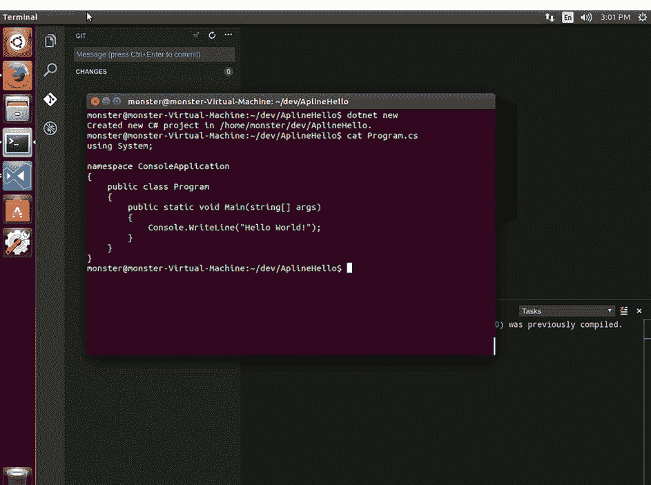

# 图 8-1 Ubuntu 上的非常基础的 .NET Core 应用

> 注意
> 
> `dotnet`命令行可以创建许多不同类型的项目。你可以通过使用`-l`标志并指定`csharp`或`fsharp`来选择项目的语言。`-t`标志定义了要创建的项目类型，可以是`console`、`web`、`lib`或`xunit`。项目类型比你可能在 Visual Studio 中使用的多得多。如果你在 Linux 上创建新项目，可能想研究一下`yeoman`，这是一个著名的脚手架工具，可以在 `http://yeoman.io/` 找到，或者通过`npm` `npm install -g yeoman`安装。

下一步是运行`dotnet restore`命令，如图 8-2 所示。这会还原应用程序所需的任何 NuGet 包。

# 图 8-2 在新项目中还原包

现在我们可以使用`dotnet build`命令编译应用程序，如图 8-3 所示。

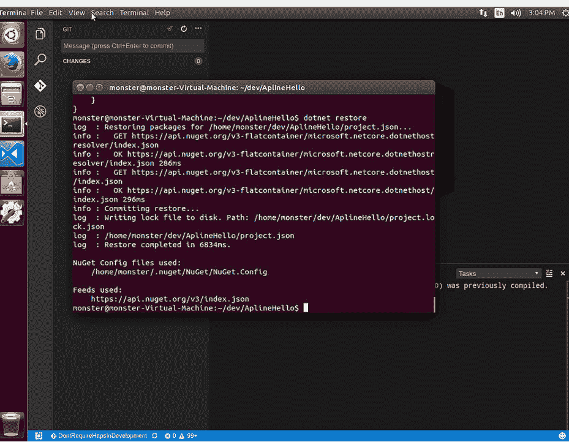

# 图 8-3 运行 .net build

最后，我们可以使用`dotnet run`命令运行应用程序，如图 8-4 所示。

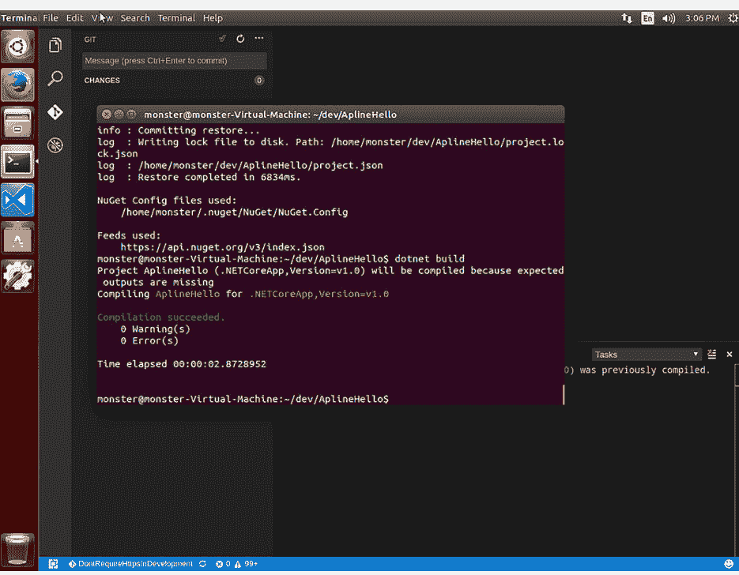


还原、编译、运行和测试是大多数开发者每天使用的所有主要命令。我们将在第 20 章“测试”中更详细地介绍`dotnet test`。

# 选择代码编辑器

Linux 和 macOS 上的大多数开发者都有自己喜欢的代码编辑器。如果是这样，你完全可以使用该编辑器开发 .NET 应用程序。许多使用过 Visual Studio 的开发者觉得，在使用轻量级代码编辑器时由于缺少 IntelliSense（智能感知）而感到遗憾。幸运的是，这个问题现在已经由 OmniSharp 的聪明人们（`http://www.omnisharp.net/`）解决了。OmniSharp 为许多流行的跨平台代码编辑器构建插件，为 .NET 项目提供 IntelliSense 风格的自动补全。如果你有熟悉并喜欢的编辑器，请坚持使用，但务必检查是否有 OmniSharp 插件来增强你的体验。

如果你正在寻找编辑器，Visual Studio Code 值得仔细关注。Visual Studio Code 是由微软 Visual Studio 团队构建的轻量级跨平台代码编辑器。它提供了与 Visual Studio 相同的语法高亮和 IntelliSense，而没有完整 IDE 的所有臃肿。它包含一个出色的调试器，并拥有丰富的插件生态系统。在本章剩余部分的示例中，我们将使用 Visual Studio Code。

# Linux 上的 Alpine Ski House

安装了 .NET Core 并为 .NET 开发设置好我们喜爱的代码编辑器后，让我们看看在 Ubuntu 开发者机器上运行 `AlpineSkiHouse.Web` 项目需要什么。

```
$ dotnet build
$ dotnet run
```

在 8-5 中，某些错误说明我们缺少启动所需的用户密钥（user secrets）。因此，首先我们需要使用`dotnet user-secrets`命令添加这些用户密钥。

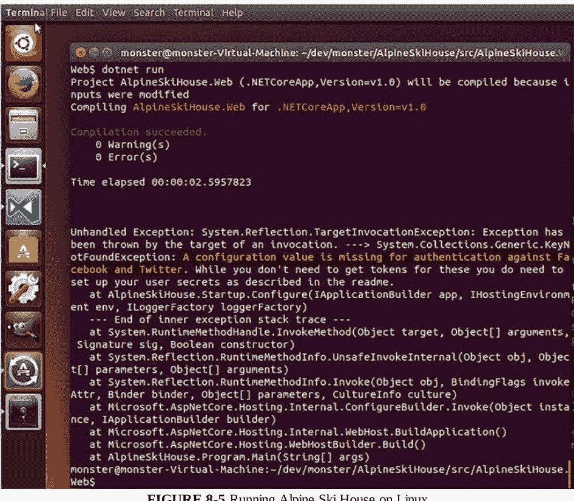

[点击此处查看代码]

```
$ dotnet user-secrets set Authentication:Twitter:ConsumerKey 'some consumer key'
$ dotnet user-secrets set Authentication:Twitter:ConsumerSecret 'some consumer Secret'
$ dotnet user-secrets set Authentication:Facebook:AppId 'some app id'
$ dotnet user-secrets set Authentication:Facebook:AppSecret 'some app secret'
```

接下来，我们还需要将`ASPNETCORE_ENVIRONMENT`变量设置为`Development`，因为应用程序被设置为仅在 Development 下加载用户密钥。

[点击此处查看代码]

```
$ ASPNETCORE_ENVIRONMENT=Development
$ export ASPNETCORE_ENVIRONMENT
```

我们可以运行应用程序，对吧？

```
$ dotnet run
```

好的，我们知道它启动了，监听在 `localhost:5000`，并且主页按预期加载。如图 8-6 所示。

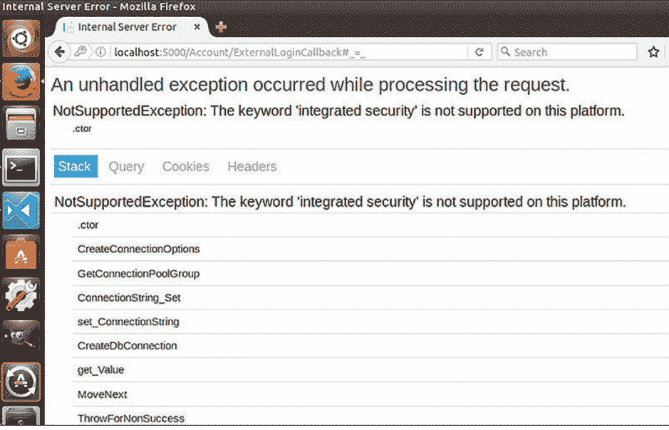

## 图 8-6 显示无法连接的错误消息

正如第 10 章讨论，.NET Core 在 Linux 上可用。然而这并非偶然，许多项目在 Linux 或 macOS 上运行并不简单。Alpine Ski House 针对的是 .NET Core 而不是 .NET framework。

```
IL_000a: ldarg.0      // this
IL_000b: ldfld int32 class System.Linq.Enumerator<'CastIterator>d__94'1'!<0*/TResult*>:<>_initialThreadId
IL_0010: call int32 [mscorlib]System.Environment::GetCurrentManagedThreadId()
IL_0015: bne.u.s IL_0022
IL_0017: ldarg.0      // this
IL_0018: ldc.i4.0
IL_0019: stfield int32 class System.Linq.Enumerator<'CastIterator>d__94'1'!<0*/TResult+<>_cl_state'      // this
IL_001e: ldarg.0
IL_001f: stloc.0      // V_0
IL_0020: br.s IL_0029
IL_0022: ldc.i4.0
```

这段代码是即时编译器（Just-In-Time compiler，简称 JIT）使用的汇编语言。遵循将事物重写为针对 64 位的趋势，JIT 被重写为 RyuJIT 项目。RyuJIT 的目标是提高编译效率并生成更高效的 64 位代码。

所有 .NET 语言都可以使用基类库（BCL）。该库由数千个类组成，可以执行诸如与 SMTP 服务器通信或压缩文件等任务。基类库功能的广度可能是 .NET 编程中最出色的部分。开发者不需要像在 Node.js 项目中常见的那样寻找成千上万个小型库，相反，他们依赖于 BCL 中经过良好测试和优化的函数集。

BCL 的内容随着 .NET 版本的迭代而增长，例如，.NET Silver 是该框架的一个限制性版本。完整框架中的许多类都缺失了或被删除、替换，导致 API 具有不同的表面积。遗憾的是，所有创建新框架的努力都是零散且互不关联的。几乎无法判断哪些类在任何平台上都可用，也无法编写可以在任何平台上运行的代码。

可移植类库（Portable class libraries）曾尝试允许开发者编写可移植代码，但这很快变得过于复杂。微软已开始努力规范多个平台上的可用接口，包括他们最近在 Xamarin 上的工作。

这种标准化努力被称为 .NET Standard。.NET Standard 定义了不同平台支持的一系列兼容性级别。初始版本定义了 1.0 到 1.6 级，并描述了支持每个级别的平台。例如，1.0 级暴露了最小的 API 表面积，并受包括 Silverlight 在内的所有平台支持。当我们移动到 1.1 时，它在每个 Silverlight 平台上支持。下面是微软提供的一个图表，描述了其不同平台上可用的 API。

| .NET 平台 | .NET Standard | 1.1 | 1.2 | 1.3 | 1.4 | 1.5 | 1.6 | 2 |
|---|---|---|---|---|---|---|---|---|
| .NET Core | | -> | -> | -> | -> | -> | 1 | vNext |
| .NET Framework | | | 4.5 | 4.5.1 | 4.6 | 4.6.1 | 4.6.2 | vNext | 4.6.1 |
| Xamarin.iOS | | | | | | | | | vNext |
| Xamarin.Android | | | | | | | | | vNext |
| Universal Windows Platform | | | | | 10 | | | vNext |
| Windows | | 8 | 8.1 | | | | | | |
| Windows Phone | | | 8.1 | | | | | | |
| Windows Phone Silverlight | | 8 | | | | | | | |

箭头表示该平台支持标准功能以及右侧找到的额外功能。你可能还会注意到每个平台的下一个版本也列在矩阵中。如果我们查看诸如 .NET Framework 4.6.1 这样支持 .NET Standard 1.4 的版本，我们需要意识到 .NET Framework 4.6.1 实际上支持的 API 表面积远大于 .NET Standard 1.4 描述的，但如图 8-8 所示，它支持 1.4 的所有内容。

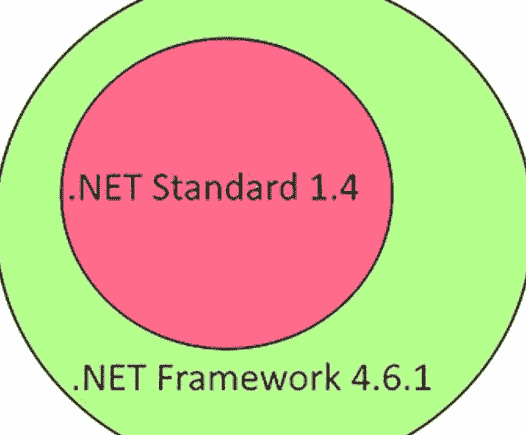

图 8-8 .NET Standard 是 .NET Framework 4.61 提供的 API 的子集

标准的每个更高版本都比前一个版本支持更多的表面积，2.0 除外。正如你对这种大规模标准化工作所期待的那样，会出现一些奇怪的间隙，.NET Standard 2.0 就是其中一个间隙，因为如图 8-9 所示，它支持的表面积实际上比 .NET Standard 1.4 或 1.5 小。

## netstandard 1.0 + System.Collections.Concurrent

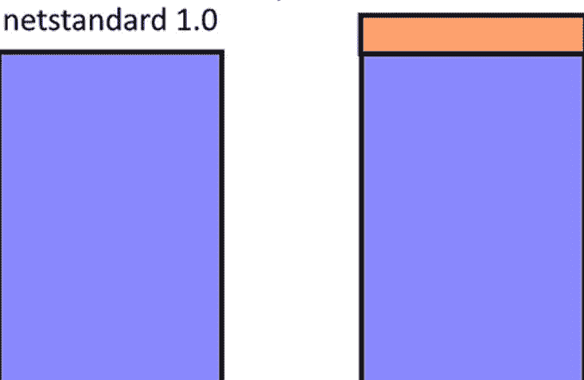

图 8-9 .NET Standard 1.0 以及带有额外程序包的 1.0

假设你的应用程序运行在 .NET Standard 1.0 上，但需要 `System.Collections.Concurrent` 中的某些功能。有两种可能的解决方案。首先，可以将应用程序移动到支持 .NET Standard 1.1，它增加了对并发集合命名空间的支持。这是一种相当笨拙的方法，因为提升了所需的 .NET 标准版本，并减少了应用程序可以目标的设备数量。相反，另一种方案是基于 .NET Standard 1.0 构建应用程序，并简单包含 `System.Collections.Concurrent` 的 NuGet 包。作为 .NET 标准化过程的一部分，单体框架被拆分为大量的程序包。事实上，如果你在 Visual Studio 中查看基础应用程序的依赖项，从依赖树中可以看到它由一系列如 `System.Threading.Thread` 等细粒度包构成了 .NET Standard 运行时。只要添加的程序包是由托管代码构建的，就没有需要提升支持框架的版本。

# 总结

为 .NET API 引入某种程度标准化的努力已经很久，并且非常受欢迎。.NET 的跨平台可用可能会在传统上不欢迎的市场中推动采用。尽管如此，整个栈（包括编译器）都是开源的。无论何种，在选择 .NET 时，应用程序运行的操作系统不再是一个巨大的考虑因素。在下一章中，我们将讨论容器。

## 可复现的环境


部署应用程序和设置环境长期以来被认为是完全不同的事情。你只需设置一次生产环境，也许将其镜像到测试环境以进行部署前测试，然后就置之不理了。开发环境要流动得多，因为开发者会进进出出，而且为了保持技术前沿，要求开发者频繁更换硬件。然而，事实证明，部署应用程序和设置环境实际上是同一枚硬币的两面。理想情况下，开发环境应该尽可能与生产环境镜像，而生产和测试环境应该能够快速地创建，这在过去一直是无法实现的。幸运的是，“创建环境应该是容易的”这一理念驱动了相关工具的发展，使得一切都变得简单。

以可重复的方式构建环境有很多选择。早期的尝试涉及使用`Symantec Ghost`或`PowerQuest Drive Image`镜像硬盘，并通过分发镜像来实现。重新映像化整台机器是一项艰巨的任务，但它也能确保开发者使用与其他人员相同的工具，因为他们被鼓励使用镜像中预装的任何工具。在过去，如果需要支持旧版本的软件，就需要保留一个镜像来处理软件。通常，直接保留旧电脑来打补丁版本更为简单。古老的电脑被隐藏在办公室各处，上面贴着字条，例如“PSM 1.7 编译机——不要格式化”。当然，那些字条丢失了，机器还是被格式化了，导致了人们恐慌地尝试重建环境来构建旧软件。

虚拟机帮助解决了使用机器进行隔离的一些局限性。镜像的创建容易得多，而且让开发者能够运行自己的工具并在本地机器与虚拟机之间共享文件。一台物理机上可以运行多台虚拟机，这减少了关键机器被重用的机会。与在同一个操作系统安装上运行多个版本相比，虚拟机提供的隔离水平仍然很好，因为在一个虚拟机上安装更新而破坏另一台虚拟机的概率极小。

将应用程序和数据隔离以防止相互干扰是操作系统自诞生以来的目标。即使没有虚拟机，一个应用程序也不应该能够干扰机器上的其他进程。在单个进程内部，隔离也经常是必要的。作为进程内隔离的轻量级线程提供了一种隔离形式，作用域（scoping）也是如此。

虽然隔离是一种理想属性，但它并不是免费的。总是需要付出某些开销，正如预期的那样，隔离程度越高，开销越大。虚拟机提供了高程度的隔离，但代价是必须对物理机进行虚拟化才能提供。显示驱动程序、磁盘驱动程序和 CPU 必须全部虚拟化。处于光谱另一端的线程所需的开销非常小，但提供的隔离也极少。这在图 9-1 中所示。

## 增加隔离

| 虚拟机 | 进程 | 线程 |
| 图 9-1 隔离与性能之间存在反比关系 |

## 提高性能

在这些组合中，我们可以加入容器。虽然容器化并不是一个新概念，但它在过去的几年里才真正成熟。容器处于虚拟机和进程之间性能与隔离平衡的“甜点区”。容器并没有虚拟化整台机器，而是对操作系统进行了抽象，使得每个容器看起来都是完全相互隔离的。例如，如果你在一个单个容器内部工作，获取进程列表只会显示运行在容器内部的有限进程，以及运行在宿主机操作系统用户态或同一宿主机上另一个容器中的进程。同样，写入容器内磁盘的文件只对该容器可见，对容器外的任何内容都不可见。然而，内核是容器之间共享的，因此每个容器必须与底层宿主机具有相同的架构，甚至是相同的内核。因此，在不放入虚拟……的情况下，无法在 Windows 上运行 Linux 容器或在 Linux 上运行 Windows 容器。

虽然这种隔离水平本身很有吸引力，但容器更有趣的特性在于封装和组合。容器上的文件系统实现为一系列层或切片，每一层堆叠在前层之上。这类似于美味的巴拉克拉瓦（baklava）蛋糕，层层酥皮堆叠在一起形成了一种塔。

容器从基础镜像开始，基础镜像通常是包含运行操作系统必需内容的极简镜像。`CoreOS Linux`发行版是基于 Linux 环境的示例，`Windows Nano`是基于 Windows 环境的示例。各种附加组件堆叠在这个基础镜像之上。想象你正在构建一个运行 Web 服务器和数据库的容器。通常，容器只运行单个进程，但我们暂且抛开不谈。基础层是操作系统，在其之上安装数据库服务器、Web 服务器，最后是你的应用程序数据（见图 9-2）。

- 应用程序文件
- Web 服务器
- 数据库服务器
- 操作系统

图 9-2 系统的层

层可以很容易组合以构建完整的镜像。如果需要更新 Web 服务器，可以取底部两层，在其上方堆叠一个新的 Web 服务器，然后将应用程序文件放在最上方。这些极简镜像可以快速启动，因为它们不需要任何与全量机器相关的启动时间。此外，这些镜像足够小，可以轻松地分发和共享。如果你是一个软件供应商，你的软件通常安装在客户端服务器上，你能想象如果知道所有客户都将拥有一个可复现的、隔离的环境，可以节省多少工作吗？与其分发难以维护的安装程序，你是否可以分发客户可以启动的完整镜像。

我们之前提到过一个容器应该只运行一个进程。虽然这看起来似乎是为了增加不必要的开销，但每个进程实际上会创建一个更稳定、可扩展的环境。容器的轻量级特性使得在硬件被用于运行虚拟机的情况下，可以在其上启动数量更多的容器。将应用程序隔离在容器内部提供了关于共享库和工具兼容性的保证。历史上，Windows 遭受过“DLL 地狱”，多个应用程序安装了相互冲突的全局版本库。在容器内部安装软件消这个问题。

容器不需要限于单台机器。大型应用程序部署需要几十种不同的服务，且都以不同的规模部署。例如，可能需要十二个 Web 服务器、六个搜索服务器两个数据库服务器。在物理硬件上创建这样的环境一直很困难，而容器使得服务器资源分配更多地成为软件问题而非硬件问题。与其将某台机器专门作为 Web 服务器，不如将其专门用作容器宿主机。容器编排系统了解其可用的服务器池。通过读取配置文件，它可以按照任何配置将容器部署到服务器上。该图显示了部署在多个物理机器上的多个容器，如图 9-3 所示。

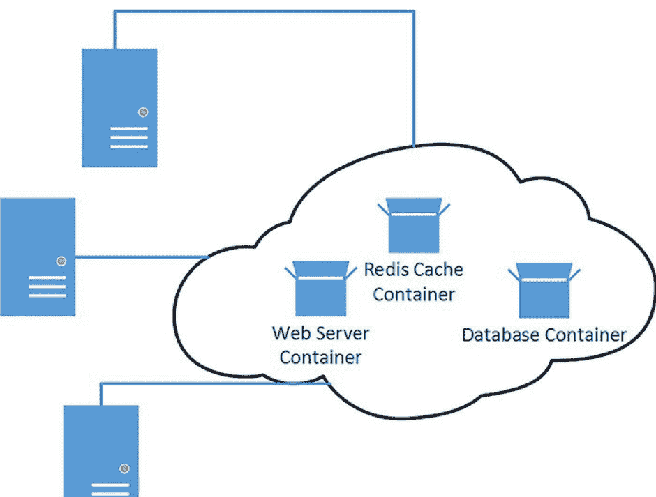

图 **9-3** 部署在多个物理服务器上的容器编排系统中的容器

由于容器可以快速启动和停止，因此编排系统可以在维护应用程序健康的同时，选择在物理机器之间移动容器。容器不知道自己运行在哪里，容器之间的任何通信都可以由容器编排系统进行调度。

容器环境内部的网络可以使用基于软件的定义构建。例如，你可能希望 Web 服务器容器能够与数据库容器和 Redis 缓存容器通信，但数据库容器不应与 Redis 容器通信。此外，面向外部的端口将只有 Web 服务器以及某些服务管理端口，如[图 9-4](#)所示。

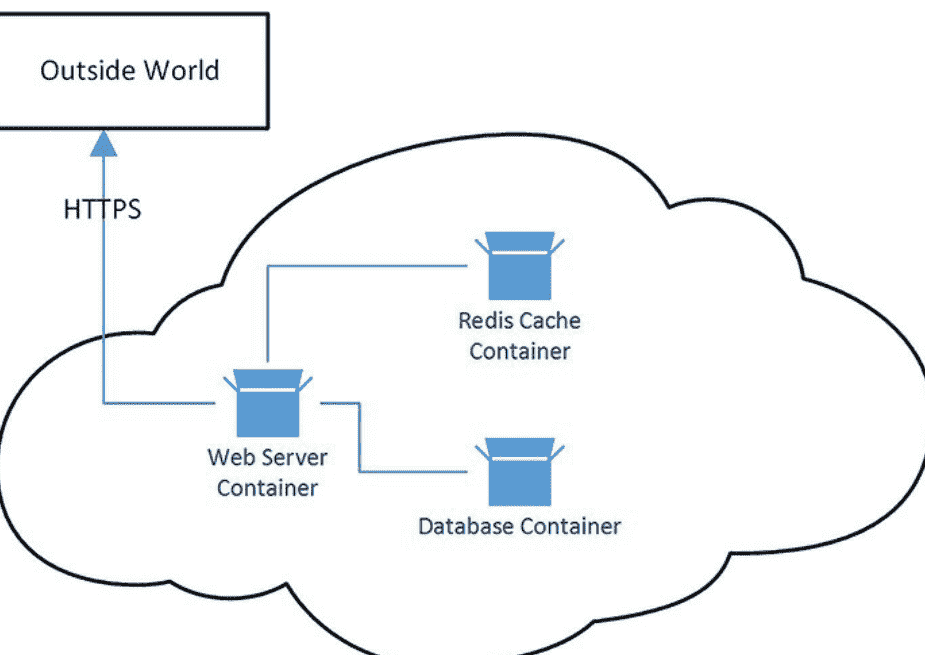

图 9-4 一个仅对外部开放 HTTPS 连接的容器私有网络

通过代码构建环境以便能够轻松扩展、移动或复制的能力是无价的。容器和编排提供了可复用的云基础设施的优势，同时具有在云端和本地基础设施之间的可移植性。整个环境可以在本地开发者的机器上运行，允许以极小的担忧进行准确的开发和测试。

## Docker

你可能已经注意到直到在本章之前，我们还没有提到特定的容器技术。与所有优秀的技术思想一样，容器技术有多种实现。Docker 是所有容器技术中最广为人知的。Docker 在 Linux 内核已有的虚拟化功能之上提供了一套一致的工具。它还提供了一种通镜像格式来传输镜像。Docker Registry 是存储和检索镜像的地方，使得镜像创建变得更加简单。Docker 可用于 Windows Server 2016 以及 Windows 10 的周年更新中运行 Windows 容器。

除了 Docker 之外，rkt（读作 rocket）是直接来自 CoreOS 团队的类似容器技术。Rkt 提供了一种标准的、的容器格式，不需要守护进程即可运行。

Rkt 的安全模型防止了镜像劫持，并且其架构比 Docker 不那么单体，因为 rkt 允许随着技术的变化而更换组件。rkt 和 Docker 都构建在 Linux 内核嵌入的相同组功能之上。可以说，rkt 是一个更好的实现，就像 Betamax 一样，更优的技术并不总是获胜。

在本节中，我们将查看如何在 Linux 容器中运行 .NET Core 。首先，你需要安装 Docker。如果你使用 Windows，你可能想安装 Docker for Windows，可以在 http://www.docker.com/products/docker/windows 找到。

Docker 利用 Windows 内部的 HyperV 虚拟机管理器运行 Linux 虚拟机。守护进程就运行在该机器上。这些容器是原生 Linux 容器，可以安装到云端或你数据中心的 Linux 服务器中。你当然可以运行 Windows 容器

安装了 Docker 后，你可以创建第一个镜像。安装在 Windows 上的 Docker 命令连接到运行在虚拟机上的守护进程。该工具可以连接到 Docker 守护进程，无论它是位于本地虚拟机还是位于云端。Docker 会自动设置你的环境变量以连接到虚拟机上的守护进程。

Microsoft 非常慷慨，构建了一个预装了最新版本 .NET Core 的 Docker 镜像。使用此作为你 Dockerfile 的基础镜像。Microsoft 实际上生产了一系列具有 SDK 和基础操作系统各种组合的 Docker 镜像。例如，`image/dotnet:1.0.0-preview-2-sdk` 在 Linux 操作系统之上包含了最新的（编写时）的 SDK，而 `image/dotnet:1.0.0-preview2-nanoserver` 则在 Windows Nano 之上包含了 SDK。Microsoft 提供的容器完整列表可以在 https://hub.docker.com/microsoft/dotnet/ 获取。

从你项目根目录下的空白文本文件开始，输入以下信息：

```docker
FROM microsoft/dotnet:1.0.0-preview-2-sdk
COPY /app
WORKDIR /app
RUN ["dotnet", "restore"]
RUN ["dotnet", "build"]
RUN ["dotnet", "ef", "database", "update"]
EXPOSE 5000/tcp
ENTRYPOINT ["dotnet", "run", "--server-urls", "http://0.0.0.0:5000"]
```

此文件包含 Docker 构建用于部署镜像的指令。第一行是你用来构建最终镜像的基础镜像。这里指定了特定版本，但如果你正在从事前沿工作，可能想使用 `microsoft/dockerlatest`。下一行将当前目录的内容复制到 `/apps` 文件夹。当然，Linux 对于应该放置的文件有一套标准，但因为这些镜像是瞬时的，我们忽略了它，并直接在右侧显示文件，就像一个刚刚在烧焦的 CD 上刻录了 Red Hot 5.2 代码的高中生一样。啊，回忆。

将目录设置为你新复制的 `/app` 文件夹。在该文件夹中，通过运行 `docker restore` 运行包恢复，然后进行构建以准备好应用程序。接下来，允许通过 TCP 连接到端口 5000 上的容器。最后，docker 

要恢复容器，你可以执行以下命令：

```
docker unpause
```

数据存储是 Docker 容器的另一个重要方面。容器对于瞬态数据和功能来说似乎非常有意义。Web 服务器是无状态的，因此关闭并销毁一个容器并启动另一个对提供网页的影响并不大。然而，数据库服务器需要一直维护信息的状态。为了这个目的，你可以从运行 Docker 的机器挂载一个目录到运行中的镜像中。这允许你无缝地关闭容器并启动另一个带有相同卷的容器。运行容器时使用 `-v` 标志可以挂载卷。例如，运行：

点击此处查看图像

```
docker run -d -v /var/db:/var/postgres/db -p 5000:5000 3a83db88363d
```

这会将 `/var/db` 挂载到容器内的 `/var/postgres/db`。挂载的目录甚至位于 iSCSI 上，因此你可以从提供良好冗余的 SAN 挂载卷。

Alpine Ski 的 Dockerfile 将比你创建的默认文件更复杂。有许多需要处理的变体。有许多不同的数据上下文，每个都必须独立更新。你还需要处理 Twitter 和 Facebook 变量，这些变量可以使用环境变量设置。最后，你需要将托管环境设置为开发（development），以确保你不会被重定向到不存在的站点的 SSL 版本。

点击此处查看图像

```docker
FROM microsoft/dotnet:1.0.0-preview2-sdk
COPY /app
WORKDIR /app
RUN ["dotnet", "restore"]
RUN ["dotnet", "build"]
RUN ["dotnet", "ef", "database", "update", "--context=ApplicationAppContext"]
RUN ["dotnet", "ef", "database", "update", "--context=PassContext"]
RUN ["dotnet", "ef", "database", "update", "--context=PassTypeAppContext"]
RUN ["dotnet", "ef", "database", "update", "--context=ResortContext"]
RUN ["dotnet", "ef", "database", "update", "--context=SkiCardContext"]
EXPOSE 5000/tcp
ENV Authentication:Facebook:AppSecret FacebookAppSecret
ENV Authentication:Facebook:AppId FacebookAppId
ENV Authentication:Twitter:ConsumerSecret TwitterSecret
ENV Authentication:Twitter:ConsumerKey TwitterKey
ENV ASPNETCORE_ENVIRONMENT Development
ENTRYPOINT ["dotnet", "run", "--server.urls", "http://0.0.0.0:5000"]
```

使用 Docker 共享容器有点复杂，事实上，这是 rkt 真正大放异彩的地方。使用 rkt，可以导出镜像并将其直接推送到 Web 服务器，让其他人在那里拉取。Docker 仍然允许使用 `docker save` 命令导出容器，但这些文件必须手动导入到其他 Docker 实例中。要共享 Docker 镜像，你确实需要运行一个 Docker 仓库，它可以使用 Docker 镜像进行部署。或者，你可以将镜像上传到名为 Hub 的公共 Docker 仓库。当然，这意味着你的镜是公开的，所有人可见。各种供应商提供付费的私有版本仓库。

# Windows 容器

容器在 Linux 上的巨大成功促使容器技术被纳入 Windows Server 2016 和 Windows 10 周年版中。然而，它默认并不安装，必须手动启用。此外，如果你恰好在虚拟机中运行 Windows，情况可能会有所不同。

从开始，你需要启用容器服务和 HyperV 虚拟机监视器。如果你没有兼容容器的 Windows 版本，这一步就是可能失败的地方。不幸的是，这一步需要重启。某一天，有人会实现一种无需重启即可重新配置的操作系统，但显然今天还不是那一天。

点击此处查看代码图像

```
Enable-WindowsOptionalFeature -Online -FeatureName containers -All
Enable-WindowsOptionalFeature -Online -FeatureName Microsoft-Hyper-V -All
Restart-Computer -Force
```

> 提示
> 如果你使用的是 Windows 10，可以从控制面板中的“程序和功能”对话框中安装容器支持。但难道你不觉得使用命令行更好吗？

重启完成后，你需要下载并使用 Docker。它是以一个简单的 zip 文件分发的，可以解压并添加到你的路径中。

点击此处查看代码图像

```
Invoke-WebRequest "https://download.docker.com/windows/amd64/docker-13.0.0-dev.zip" -OutFile "$env:TEMP\docker-13.0.0-dev.zip" -UseParsing
Expand-Archive -Path "$env:TEMP\docker-13.0.0-dev.zip" -DestinationPath $env:ProgramFiles
```

# 快速使用，不需要重启 shell。对于持久使用，即使在重启后也有效。[Environment]::SetEnvironmentVariable("Path", $env:Path + ";C:\Program Files\Docker") 已注册为服务并启动。

```
dockerd --register
Start-Service Docker
```

如果你在机器上安装了多个 Docker，请务必指定用于 Windows 容器的正确某一个。安装程序将已将 Docker 工具添加到路径中，但由于新工具位于末尾，它们可能不会被执行。

现在你可以通过创建一个针对目标的新 Dockerfile 来测试你新的基于 Windows 容器的解决方案。不同操作系统之间的命令非常相似。现有的 Dockerfile 应该可以在大多数 Windows 实例上正常工作。

```docker
FROM microsoft/dotnet:1.0.0-preview2-sdk-windowservercore
COPY /app
WORKDIR /app
RUN ["dotnet", "restore"]
RUN ["dotnet", "build"]
RUN ["dotnet", "ef", "database", "update", "--context=ApplicationAppContext"]
RUN ["dotnet", "ef", "database", "update", "--context=PassContext"]
```


```
RUN ["dotnet", "ef", "database", "update", "--context=PassTypeAppContext"]
RUN ["dotnet", "ef", "database", "update", "--context=ResortContext"]
RUN ["dotnet", "ef", "database", "update", "--context=SkiCardContext"]
EXPOSE 5000/tcp
ENV Authentication:Facebook:AppSecret FacebookAppSecret
ENV Authentication:Facebook:AppId FacebookAppId
ENV Authentication:Twitter:ConsumerSecret TwitterSecret
ENV Authentication:Twitter:ConsumerKey TwitterKey
ENV ASPNETCORE_ENVIRONMENT Development
ENTRYPOINT ["dotnet", "run", "--server.urls", "http://0.0.0.0:5000"]
```

注意，此容器基于 Windows Server 的。构建 Nano 容器似乎只在 Windows 容器内有效，除非使用效率较低的 Hyper-V 容器化。Windows 容器有两种类型：Hyper-V 和 Windows Server 容器。Windows Server 容器更轻量，更接近 Linux 上基于 cgroups 的容器，且内核在系统所有容器之间共享。Hyper-V 容器是存在虚拟机内部的容器。它们性更好，但性能也低于原生容器。

# 注意
> 如果你在本地安装的 Docker 容器上遇到问题，可以尝试在 Azure 上使用，那里有预装了 Docker 的 Windows 容器。唯一的限制是，你无法在上面运行 Hyper-V 容器，因为它本身就是一个 Hyper-V 容器。

Windows 容器非常新。在编写时，Windows Server 2016 已发布，Windows 10 的容器支持虽然处于测试阶段，但应该是可用的。随着我们的进步，容器变得越来越重要，为了让它们变得更好、更健壮而付出的努力只会增加。虽然预测未来是愚蠢，但可以安全地预测，几年后容器将不仅是 Web 应用程序，也是桌面应用程序的默认部署机制。在此之前，我们必须解决一些与环境中运行容器相关的问题。

# 生产环境中的 Docker

编写此时，使用官方编排工具 Docker Swarm 在环境中运行 Docker 是不。有很多关于网络故障和集群节点之间无法正常通信的报告；然而，Docker Swarm 仍处于早期阶段。也有以分布式方式支持 Docker 但没有官方集群组件的替代。

Apache Mesos 是一种集群管理工具，旨在抽象数据中心并将其像单台计算机一样处理。自 2009 年发布以来，它已成为一种被接受的工具，我们正在将其用于 Azure 的容器分配技术（https://azure.microsoft.com/en-us/documentation/videos/azurerecon-2015-deep-dive-on-the-azure-container-service-with-mesos/）。它由名为 Mesosphere 的商业实体支持。Mesos 的核心是一个分布式调度器；在其之上可以使用它可以分配容器。Marathon 是 Mesos 上进行容器管理最著名的工具。

Google 不落后，创建并开源了类似的 Kubernetes 工具。Mesos 是创建后才植入容器管理，而 Kubernetes 从一开始就是为了管理和编排容器而设计的。Kubernetes 有许多基础构建块：pod、标签、控制器和服务。pod 是运行在一个节点上的容器集合。如果你有应该相邻运行的容器，你可能想将它们组织成 pod。标签只是分配给任何节点或 pod 的键值对。你可能会为 pod 标记以前端角色和生产层级，以表示生产环境的前端服务器。控制器负责协调实际状态的系统的期望状态。例如，想象你想要拥有两个 Web 服务器容器、一个数据库容器和一个 Redis 容器，但你的实际状态仅包含一个 Web 服务器，如图 9-5 所示。

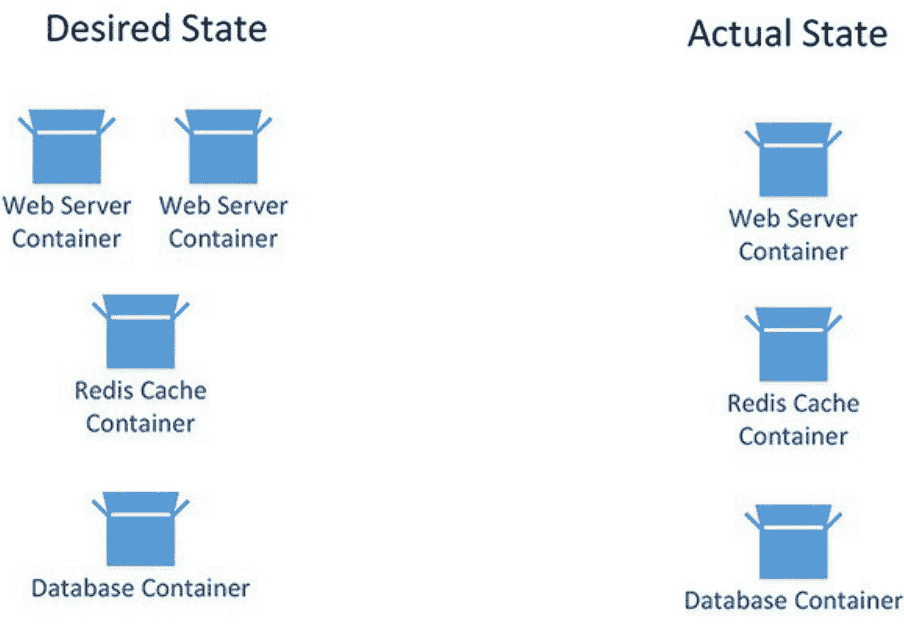

**图 9-5** 期望状态与实际状态——Kubernetes 执行所需的操作以使实际状态与期望状态保持一致

在接收到新的期望状态后，Kubernetes 系统会执行调谐循环（reconciliation loop），直到系统的实际状态与期望状态匹配。这样，你就可以避免在实际状态和期望状态之间进行困难的人工比较。Kubernetes 会计算需要运行哪些操作使系统收敛。

最后，Kubernetes 中的服务（service）是一组共同工作的 pod，用于提供某项功能。请记住，Kubernetes 是围绕微服务的理念设计的，因此一个服务可能很小。部署的服务数量是一个扩展性点，允许你根据需求扩展微服务。服务可以提供可路由的端点，这些端点可以暴露给其他服务或集群外部。

# 在云端

在云端托管容器有许多选择。所有主要的云提供商都提供了某种与云计算相关的解决方案。Google 的 Compute Engine 使用其 Kubernetes 编排引擎提供基于容器的云计算。Google 在容器化方面的经验比任何其他供应商都丰富，他们提供的产品似乎也是最多的。

云端容器实现更接近我们对云端平台即服务（PaaS）产品的预期。你不需要分配自己的虚拟机集群。相反，你的容器是作为通用计算云的一部分运行的。AWS 和 Azure 的产品目前都要求终端用户分配自己的虚拟机集合来构建容器集群。

云计算是市场中一个竞争极其激烈的领域。每个主要的云巨头都在互相争夺，以尽可能吸引那些尚未迁移到云端的公司。尽管理论上认为在云之间之间切换应该是简单的，但对于大多数公司来说，迁移并没有真正的巨大价值主，这使得吸引最后几家公司并将其锁定在特定供应商的云中变得非常重要。尽管容器化防止了供应商锁定，但毫无疑问，改进容器的使用将投入巨大的努力。

# 总结

服务的容器化看起来可能是一项仍处于婴儿阶段的技术，但它正在迅速成长，特别是如果你相信所有的炒作的话。微软已经在其服务器和桌面操作系统以及 Azure 中对容器化投入了大量资金。这确实是构建和部署服务的一种根本性变化。它鼓励将应用程序拆分为更小、更符合用途的部分。当然，在某些地方，较旧的单体应用程序构建方法仍然完全适用。即使你的架构不要求拆分成更小的部分，容器仍然可能为你的应用程序提供一致的构建和测试结构。让开发者运行他们自己的容器实例可以加速测试，并确保他们的环境与团队中所有其他环境的一致性。

容器绝对值得你的团队花一周时间看看容器究竟是如何帮助解决你当前的瓶颈的。在下一章中，我们将查看如何利用 Entity Framework 使数据库访问变得简单且高效。

# 第 10 章.Entity Framework Core

Project Parsley 的工作进展顺利，团队成员感觉事情开始进入状态，并且他们有了共同的目标。这时，Marc 用他那洪洪洪的嗓音唱了起来：

> “这不关乎数据、数据、数据。我们不需要你的数据、数据、数据、数据，我们想让世界学会滑雪。忘记索引吧”

Danielle 眯起眼睛。“你在唱 J2 的歌吗？”她问。

“当然，”Marc 回答道，“她是 21 世纪的巴赫。但实际上我脑子里满的是数据。我们必须把大量数据放入数据库，然后再取出来。你可能认为问题现在已经解决了，但我仍然在代码里写原始 SQL。”

Danielle 知道原始 SQL 并不是每个数据访问问题的完美解决方案，而原始 SQL 存储可能是某些数据访问场景的最优解。我们讨论过一些 NoSQL 存储，并决定我们中没有人有足够的经验在这个项目中使用它们。这让我们只留下了 SQL 存储，或者可能是 SQL Server，因为我们托管在 Azure 上——阻力最小的路径，你懂的。我正在使用 Entity Framework 进行大部分数据访问。

“噢，”Marc 沉思道，“我没用过 Entity Framework，但它听起来非常企业级，适合这些企业级 Java （Beans）吗？我要创建一个 SkipEntityFactoryBeanFactoryStrategy 吗？我没时间搞那些，Danielle。”

Danielle 笑了，这个大大汉的幽默感开始让她产生好感。“别担心，尽管他们重置了 Entity Framework Core 的版本号，但它是基于多年对完整 Entity Framework (EF) 的经验。EF 可以高效、方便地获取你的数据。拿把椅子，在你再次开始之前，我看看能给你展示什么。

可以说数据是业务应用程序最有价值的方面。并不意外，经常看到应用程序很大比例的代码专门用于数据存储和检索。这涉及到从数据存储中检索数据、跟踪更改并在多年后将更改保存回数据存储中。.NET 技术的出现是为了帮助这变得更简单，除了 VS 上的标签之外，没有哪个决策比选择在应用程序中存储和检索数据的技术和方法更具争议了。

# 度假村

| Id | int |
|---|---|
| Name | n(255) |
| OperatingSince | date |

表 10-1 Resorts 数据库表

应用程序使用 POCO Resort 类来对度假村记录进行建模。我们将这些称为实体类。

[点击此处查看代码图片]

```csharp
public class Resort {
    public int Id { get; set; }
    public string Name { get; set; }
    public DateTime OperatingSince { get; set; }
}
```

现在你需要添加对 `Microsoft.EntityFrameworkCore.SqlServer` 包的引用，该包会引入你所需的所有 EF 组件。此时，EF 还不了解 Resort 实体的任何信息。你可以通过创建一个包含针对 Resorts 的 `DbSet` 的 `DbContext` 类来告诉 EF Resort 实体的存在。

[点击此处查看代码图片]

```csharp
public class ResortContext : DbContext {
    public DbSet<Resort> Resorts { get; set; }

    protected override void OnConfiguring(DbContextOptionsBuilder optionsBuilder) {
        // 在实际应用中，不要在此处指定连接字符串
        // 在 ASP.NET 中，使用依赖注入进行配置
        // 参见第 11 章和第 13 章
        optionsBuilder.UseSqlServer("Server=(localdb)\\MSSMSSQLDB;Database=ResortsDBs;IntegratedSecurity=true");
    }
}
```

这就是开始使用 Entity Framework 所需的所有内容。EF 中的映射约定会处理 Resort 类到数据库中 Resorts 表的映射。这些约定可以根据需要进行覆盖，但让我们先探索基本的 `DbContext` API，它提供了数据库的有用抽象。要访问数据库中的数据，从创建一个 `ResortContext` 实例开始。

[点击此处查看代码图片]

```csharp
var context = new ResortContext();
// 使用 context
context.Dispose();
```

在完成对 `DbContext` 实例的操作后，调用 `Dispose` 方法是非常重要的。调用 `Dispose` 方法可以确保将任何相关的数据库连接都释放回连接池。如果不将连接返回连接池，你可能会面临连接池耗尽的风险并最终导致连接超时。在手动创建上下文时，使用 `using` 模式是一个好习惯，可以确保在代码完成时调用 `Dispose` 方法。

[点击此处查看代码图片]

```csharp
using(var context = new ResortContext())
{
    // 使用 context
}
```

在 ASP.NET 应用程序中，使用内置的依赖注入框架来处理上下文的创建和释放。我们将在第 14 章“依赖注入”中进行详细介绍。

# 查询单条记录

当通过主键查询单条记录时，如下使用 `DbSet.Find` 方法：

[点击此处查看代码图片]

```csharp
var resort = context.Resorts.Find(12);
```

当通过主键以外的标准查询单条记录时，使用 `First` 方法并指定 Lambda 表达式，它将返回匹配记录的第一条记录：

[点击此处查看代码图片]

```csharp
var resort = context.Resorts.First(f => f.Name == "Alpine Ski House");
```
生成的查询：
```
SELECT TOP(1) [f].Id, [f].Name, [f].OperatingSince
FROM [Resorts] AS f
WHERE [f].[Name] = 'Alpine Ski House'
```

如果没有找到匹配项，`First` 方法将抛出异常。或者，你可以使用 `FirstOrDefault` 方法，它在未找到匹配项时返回 `Null`。

另一个选项是使用 `Single` 和 `SingleOrDefault` 方法。这些方法的工作原理与 `First` 和 `FirstOrDefault` 几乎相同，但如果发现多个匹配记录，它们将抛出异常。

[点击此处查看代码图片]

```csharp
var resort = context.Resorts.Single(f => f.Name == "Alpine Ski House");
```
生成的查询：
```
SELECT TOP(2) [f].[Id], [f].[Name], [f].[OperatingSince]
FROM [Resorts] AS [f]
WHERE [f].[Name] = N'Alpine Ski House'
```

注意 EF 为 `Single` 生成了 `SELECT TOP(2)`，而不是像对 `First` 查询那样生成 `SELECT TOP(1)`。`SELECT TOP (2)` 在发现多条记录时可能会抛出异常。当你预期只有一个匹配记录时，请使用 `Single`，因为这更清晰地表达了查询意图，并在当该预期不成立时提供清晰的错误。

# 查询多条记录

在许多情况下，你可能希望查询数据库中符合某些特定标准的多个记录。这是通过调用 `DbSet` 上的 `Where` 方法实现的，它返回所有匹配指定 Lambda 表达式的记录。

[点击此处查看代码图片]

```csharp
var skiResorts = context.Resorts.Where(f => f.Name.Contains("Ski")).ToList()
```

生成的查询：
```
SELECT [f].[Id], [f].[Name], [f].[OperatingSince]
FROM [Resorts] AS [f]
WHERE [f].[Name] Like N'%%' + N'Ski' + N'%%'
```

当你调用 `Where` 方法时，EF 立即执行回调。相反，它返回一个 `IQueryable<T>`，其中 `T` 是被查询实体的类型。查询的实际执行会被推迟，直到调用 `IQueryable<T>` 上需要执行查询的方法为止。在这种情况下，我们通过调用 `ToList` 方法强制立即执行。这种**延迟执行**是 EF 的一个重要特性，允许你链式多个方法并构建复杂的查询。这是懒性实例化模式的一个示例，其中对象的创建或计算被推迟。

# 保存数据

`DbContext` 还提供了跟踪更改并将其保存到数据库的机制。插入数据是通过向 `DbSet` 添加新实体，然后调用 `SaveChanges` 方法来实现的。让我们看看保存的基础。

[点击此处查看代码图片]

```csharp
var resort = new Resort {
    Name = "Ski House",
    OperatingSince = new DateTime(2001, 1, 1)
};
context.Resorts.Add(resort);
context.SaveChanges();
```
生成的查询：
```
INSERT INTO [Resorts] ([Name], [OperatingSince]) VALUES ('Ski House', '2001-01-01')
```

你可以在调用 `SaveChanges` 之前添加多个实体。Entity Framework 会跟踪更改并在调用 `SaveChanges` 时将其发送到数据库。如果任何命令失败，所有操作都将回滚。

# 更改跟踪

更改跟踪会有一定的开销。在加载实体时，关闭跟踪是有益的。可以使用 `AsNoTracking()` 扩展方法根据具体情况关闭跟踪。这可以这样做：

```csharp
var lastYear = new DateTime(2015, 1, 1);
var newResorts = context.Resorts.AsNoTracking().Where(f => f.OperatingSince > lastYear);
```

`DbSet.Remove` 方法用于删除实体。

[点击此处查看代码图片]

```csharp
var resort = context.Resorts.Find(12);
context.Resorts.Remove(resort);
context.SaveChanges();
```


生成的查询：

```sql
DELETE FROM [Resorts]
WHERE [Id] = 12
```

# 使用迁移创建和更新数据库

到目前为止，我们的简单示例假设已经存在与我们的实体匹配的数据库。在许多情况下（包括 Alpine Ski House 应用程序），你可能正在处理一个全新的数据库。开发者需要一种简单的方法来创建本地测试数据库，并在数据库发生更改时定义并执行迁移脚本。EF 提供了命令行工具来自动化这些任务。命令行工具通过向 NuGet 添加 `Microsoft.EntityFrameworkCore.Tools` 包来引用，并通过 `dotnet ef` 命令执行。我们将在第 16 章“依赖管理”中进行详细介绍。

## 创建新数据库

使用 `dotnet database update` 命令创建新数据库。

```bash
dotnet database update
```

该命令编译你的应用程序并使用为本地开发环境配置的连接字符串连接到数据库。

如果指定的数据库不存在，则创建一个新数据库。如果数据库已存在，则应用任何所需的迁移脚本以更新数据库以匹配应用程序中的类。

你可以显式指定你想让命令使用的 `DbContext` 类名称。

```bash
dotnet database update -c AlpineSkiHouse.Data.DbContext
```

- ResortsDB
  - 数据库图
  - 表
    - 系统表
    - dbo.__EFMigrationsHistory
  - 视图
  - 异名
  - 可编程性
  - Service Broker
  - 存储
  - 安全性

**图 10-1** 使用 `dotnet ef database update` 命令创建的新数据库

数据库中不包含预期的 `Resorts` 表，因为你尚未为 `ResortContext` 定义任何迁移（migrations）。

## 添加迁移

Entity Framework Migrations 用于将数据库从一个版本升级或降级到另一个版本。迁移被定义为继承自 `Migration` 类的 C# 类。该类包含两个方法：`Up()`，用于将数据库迁移到此迁移指定的版本；以及 `Down()`，用于将数据库迁移回上一个版本。

手动定义这些迁移将非常繁琐，这就是为什么 Entity Framework 提供了 `ef migrations add` 命令来为你完成大部分重复性工作。对于新的 `DbContext`，需要一个初始迁移来为你的模型创建表。

```bash
dotnet ef migrations add CreateInitialSchema
```

这会在指定的 `DbContext` 旁边的 `Migrations` 文件夹中创建一个名为 `CreateInitialSchema` 的新类。

```csharp
public partial class CreateInitialSchema : Migration
```

```csharp
protected override void Up(MigrationBuilder migrationBuilder)
{
    migrationBuilder.CreateTable(
        name: "Resorts",
        columns: table => new
        {
            Id = table.Column<int>(nullable: false)
                .Annotation("SqlServer:ValueGenerationStrategy",
                    SqlServerGenerationStrategy.IdentityColumn),
            Name = table.Column<string>(nullable: true),
            OperatingSince = table.Column<DateTime>(nullable: false)
        },
        constraints: table =>
        {
            table.PrimaryKey("PK_Resorts", x => x.Id);
        });
}

protected override void Down(MigrationBuilder migrationBuilder)
{
    migrationBuilder.DropTable(
        name: "Resorts"
    );
}
```

在这种情况下，`Up` 方法添加了 `Resorts` 表并为 `Resort` 类中的每个属性添加了列。`Down` 方法删除了 `Resorts` 表。在你的本地开发环境中，此 `CreateInitialSchema` 迁移被视为待处理迁移，因为它尚未应用到你的本地数据库。运行 `dotnet database update` 命令将应用待处理更新并创建 `Resorts` 表，如图 10-2 所示。

```bash
dotnet ef database update
```

- ResortsDB
  - 数据库图
    - 表
      - 系统表
      - 文件表
      - dbo.__EFMigrationsHistory
      - dbo.Resorts
        - 列
          - Id (PK, int, not null)
          - Name (nvarchar(max), not null)
          - OperatingSince (datetime2(7)-)
        - 键
        - 约束
        - 触发器
        - 索引
        - 统计
  - 视图
  - 异名
  - 可编程性
  - Service Broker
  - 存储
  - 安全性

图 10-2 应用了待更改的 `ResortsDB` 数据库

> 注意
> 你可能会对 `Name` 列使用的 `nvarchar(max)` 数据类型感到惊讶。如果没有指定额外选项，Entity Framework 将 .NET 字符串类型映射到 `nvarchar(max)`。我们在本章中将介绍数据注解和模型配置的使用。

如果对领域类进行了更改或添加了新类，则必须在 `Migrations` 文件夹中定义新的迁移。一个常见的示例是向领域类添加新属性。

```csharp
public class Resort {
    public int Id { get; set; }
    public string Name { get; set; }
    public string MailingAddress { get; set; } //这是新增的
    public DateTime OperatingSince { get; set; }
}
```

添加属性后，领域模型和数据库不同步，需要一个迁移来使数据库与模型保持同步。首先调用 `dotnet ef migrations add` 命令，并为此迁移指定一个描述性的名称。

```bash
dotnet ef migrations add AddedMailingAddress
```

Entity Framework 现在编译你的应用程序并检测实体类中的任何待处理更改。`Migrations` 文件夹中被添加了一个新类。

```csharp
public partial class AddedMailingAddress : Migration {
    protected override void Up(MigrationBuilder migrationBuilder)
    {
        migrationBuilder.AddColumn<string>(
            name: "MailingAddress",
            table: "Resorts",
            nullable: true);
    }

    protected override void Down(MigrationBuilder migrationBuilder)
    {
        migrationBuilder.DropColumn(
            name: "MailingAddress",
            table: "Resorts"
        );
    }
}
```

在这种情况下，`Up` 方法添加了新的 `MailingAddress` 列，而 `Down` 方法删除了 `MailingAddress` 列。调用 `dotnet ef database update` 命令应用待处理的迁移。

EF 迁移工具在生成更改数据库结构的代码方面表现良好，但有时你也需要使用 `UPDATE`、`INSERT` 或 `DELETE` 语句对数据进行更改。可以通过根据需要在 `Up` 或 `Down` 方法中使用任何 SQL 语句到 `migrationBuilder.Sql` 方法来实现数据更改。在没有发生模型更改的情况下，也可以添加迁移。在需要时调用 `dotnet ef migrations add` 命令将导致一个空迁移。这是一个仅用于向表中添加行的迁移示例。

```csharp
public partial class AddResortsAndLocations : Migration
{
    protected override void Up(MigrationBuilder migrationBuilder)
    {
        migrationBuilder.Sql(
            @"INSERT INTO Resorts (Name)
            VALUES ('Alpine Ski House'), ('Nearby Resort'), ('Competing Resort')");
    }

    protected override void Down(MigrationBuilder migrationBuilder)
    {
        migrationBuilder.Sql(
            @"DELETE FROM Resorts WHERE Name IN ('Alpine Ski House', 'Nearby Resort', 'Competing Resort')");
    }
}
```

> 通常而言，实体类和 `DbContext` 类不包含任何提供程序逻辑。然而，迁移特定于创建迁移时所配置的提供程序。因此，你不能期望为 SQL Server 创建一个迁移，然后让开发者在 SQL Lite 上运行它。

## 生产环境更新脚本

`ef update` 命令对于开发者工作站非常好用，但在尝试部署到生产数据库时可能无法工作。当你的构建服务器无法直接应用迁移时，你可以使用 `dotnet migrations script` 命令生成数据库脚本，以便通过手动应用迁移使用。

使用默认选项，此命令将输出指定 `DbContext` 的所有迁移。`From` 和 `Options` 可用于生成从特定版本到特定版本的脚本。

```sql
[Altitude] decimal(18, 2),
[Latitude] decimal(18, 2),
[Longitude] decimal(18, 2),
[Name] varchar(max),
[ResortId] int NOT NULL,
CONSTRAINT [FK_Locations] PRIMARY KEY ([ResortId]),
CONSTRAINT [FK_Locations_ResortId] FOREIGN KEY ([ResortId]) REFERENCES
[Resorts] ([Id]) ON DELETE CASCADE
GO
CREATE INDEX [IX_Locations_ResortId] ON [Locations] ([ResortId]);
GO
INSERT INTO [__EFMigrationsHistory] ([MigrationId], [ProductVersion])
VALUES ('N2016062523105_InitialResortContext', 'N1.0.0-rtm-21431');
```

现在我们已经掌握了 Entity Framework 的基础知识，让我们来看看如何使用它在 Alpine Ski House Web 应用程序实现功能。

## ApplicationDbContext

当我们使用 Visual Studio 创建 `AlpineSkiHouse.Web` 项目时，我们选择了带有独立用户帐户的 Web 模板。选择此选项会在应用程序中创建了一个名为 `ApplicationDbContext` 的上下文，它是针对 `ApplicationUser` 实体的 `DbContext`。让我们来看看添加到项目中的实体和上下文：

## Models\ApplicationUsers

```csharp
namespace AlpineSkiHouse.Models
{
    // 通过向 ApplicationUser 类添加属性来为应用程序用户添加配置数据
    public class ApplicationUser : IdentityUser
    {
    }
}
```

`ApplicationUser` 类继承了来自 `IdentityUser` 类的常用用户属性，例如 `EmailAddress` 和唯一的 `Id`。正如注释所示，可以通过添加你自己的属性来扩展此类。这正是当前冲刺（sprint）需要的，但首先让我们来看看 `ApplicationDbContext`。

## Data\ApplicationDbContext

```csharp
namespace AlpineSkiHouse.Data
{
    public class ApplicationDbContext : IdentityDbContext<ApplicationUser>
    {
        public ApplicationDbContext(DbContextOptions<ApplicationDbContext> options)
            : base(options)
        {
        }

        protected override void OnModelCreating(ModelBuilder builder)
        {
            base.OnModelCreating(builder);
        }
    }
}
```

与 `ApplicationUser` 类类似，`ApplicationDbContext` 类也继承了基础 `IdentityDbContext` 的属性。在 `ApplicationDbContext` 的情况下，这些属性是与 ASP.NET 相关的实体 `DbSets`，包括 `Users`、`Roles`、`Claims` 和 `Tokens`。我们将在 [第13章，身份、安全与权限]() 中更详细地探讨 ASP.NET Identity 实体。

与其在 `OnConfiguration` 方法中硬编码配置，不如将配置选项传递到构造函数中。这允许你在应用程序启动时指定配置，并使用依赖注入框架将此对象注入到 `DbContext` 中。在你定义的所有 `DbContext` 类中使用此构造函数签名。使用这种配置方法可以简化 `DbContext` 类的测试，我们将在 [第 19 章]() 中进行详细探讨。“测试。”

当你开始为 Alpine Ski House 应用程序添加功能时，最初可能想将所有实体都放在 `ApplicationDbContext` 类中。相反，如果你为 [第 4 章，项目范围界定]() 中概述的每个边界上下文（bounded contexts）创建 `DbContext` 类，维护起来会容易得多。`ApplicationDbContext` 映射了登录边界上下文，但这个名称具有误导性，因为它是整个解决方案的单一 `DbContext`，所以将 `ApplicationDbContext` 重命名为 `ApplicationUserContext`。

```csharp
public class ApplicationUserContext : IdentityDbContext<ApplicationUser>
{
    public ApplicationUserContext(DbContextOptions<ApplicationUserContext> options)
        : base(options)
    {
    }

    protected override void OnModelCreating(ModelBuilder builder)
    {
        base.OnModelCreating(builder);
    }
}
```

## 扩展 ApplicationUser

现在你的领域中已经有了清晰的边界，你可以为 `ApplicationUser` 类添加额外的用户账户详情。Alpine Ski House 的销售和营销专家 Mildred 希望记录姓名以便个性化消息。Mildred 还希望记录用户的联系信息，例如电子邮件地址和电话号码，这样她可以通知用户与其账户相关的活动，或者在他们在我们的一个度假村滑雪了一天后发送活动总结。

`EmailAddress` 和 `PhoneNumber` 属性已经是基础 `IdentityUser` 类的一部分，但你确实需要添加 `FirstName` 和 `LastName` 属性：

```csharp
public class ApplicationUser : IdentityUser
{
    public string FirstName { get; set; }
    public string LastName { get; set; }
}
```


```csharp
public class ApplicationUser : IdentityUser
{
    [MaxLength(70)]
    public string FirstName { get; set; }

    [MaxLength(70)]
    public string LastName { get; set; }
}
```

这里使用注解来指定哪些属性是必须的，以及字符串属性的最大长度。这些属性用于在保存实体之前验证其实状态，并且 `Entity Framework` 在生成数据库列数据类型时也会使用它们。通过将 `FirstName` 和 `LastName` 的 `MaxLength` 指定为 `70`，列类型将是 `nvarchar(70)` 而不是 `nvarchar(max)`。我们选择让 `LastName` 为可选，因为有些人只有一个名字。虽然这种情况在北美文化中通常很罕见，但你不想希望因为对姓氏的任意限制而排除任何人去度假村滑雪。我们还希望 `Cher` 和 `Madonna` 能够继续回到 Alpine Ski House 参加他们的年度滑雪之旅。

现在你已经对实体类进行了更改，你需要创建一个迁移（migration）以便将这些列添加到数据库中。

```bash
dotnet ef migrations add AddNamePropertiesToApplicationUser

public partial class AddNamePropertiesToApplicationUser : Migration
{
    protected override void Up(MigrationBuilder migrationBuilder)
    {
        migrationBuilder.AddColumn<string>(
            name: "FirstName",
            table: "AspNetUser",
            nullable: false,
            defaultValue: "");

        migrationBuilder.AddColumn<string>(
            name: "LastName",
            table: "AspNetUser",
            nullable: true);
    }

    protected override void Down(MigrationBuilder migrationBuilder)
    {
        migrationBuilder.DropColumn(
            name: "FirstName",
            table: "AspNetUser");

        migrationBuilder.DropColumn(
            name: "LastName",
            table: "AspNetUser");
    }
}
```

要应用此迁移，请运行 `dotnet database update` 命令。

## 滑雪卡上下文 (Ski Card Context)

滑雪卡是 Project Parsley 的一个重要概念。滑雪卡是客户在雪道上佩戴的实体卡片，并被缆道和其他雪道上位置的扫描仪识别。滑雪卡是客户在系统中的表示。原始模型将客户和卡建模为两个实体。由于滑雪卡与客户是一一映射的，且一个永远离开另一个就不存在，我们决定将它们合并单一的 `SkiCard` 实体。登录后，用户有能力为自己和家人创建一个或多个滑雪卡。

- 首先，创建一个名为 `SkiCardContext` 的 `DbContext`。

```csharp
public class SkiCardContext : DbContext
{
    public SkiCardContext(DbContextOptions<SkiCardContext> options) : base(options)
    {
        public DbSet<SkiCard> SkiCards { get; set; }
    }
}
```

只有一个实体类型的上下文似乎很奇怪，但保持简单并没有坏处。系统中拥有多个上下文的开销非常小，你以后可以进行重构。

现在，将 `SkiCardContext` 配置为存储与 `ApplicationUserContext` 相同的数据库。连接字符串配置在 `Startup` 类的 `ConfigureServices` 方法中完成。

```csharp
services.AddDbContext<SkiCardContext>(options =>
    options.UseSqlServer(Configuration.ConnectionString("DefaultConnection")));
```

滑雪卡包含唯一标识符、创建日期以及关于我们所谓的持持有者的基本信息。

```csharp
public class SkiCard
{
    public int Id { get; set; }

    /// <summary>
    /// 拥有此滑雪卡的 ApplicationUser 的 Id
    /// </summary>
    public string ApplicationUserId { get; set; }

    /// <summary>
    /// 卡片的创建日期
    /// </summary>
    public DateTime DateCreatedOn { get; set; }

    [MaxLength(70)]
    [Required]
    public string CardHolderFirstName { get; set; }

    [MaxLength(70)]
    public string CardHolderLastName { get; set; }

    public DateTime CardHolderBirthDate { get; set; }

    [Phone]
    public string CardHolderPhoneNumber { get; set; }
}
```

Alpine Ski 团队同意他们未来需要扩展 `SkiCard` 实体，但这为他们支持第 2 冲刺的目标了一个良好的起点，该目标是允许用户登录并为家人成员创建滑雪卡。现在我们已经创建了滑雪卡边界上下文的初始版本，让我们使用 `dotnet ef migrations` 命令创建初始迁移并更新本地开发数据库。

```
dotnet ef migrations add InitialSkiCardContext -c AlpineSkiHouse.Data.SkiCardContext
dotnet database update -c AlpineSkiHouse.Data.SkiCardContext
```

# 跨越边界的关系

任何具有关系型数据库设计经验的人可能都会我们在这里所做的事情感到震惊。通过在应用程序中围绕 `DbContext` 类定义边界，我们断开了在通常情况下会通过外键连接的表。在没有外键的情况下，你如何如何确保引用完整性呢？以滑雪卡为例。`SkiCard` 表有一个名为 `ApplicationUserId` 的列，它引用创建该滑雪卡的 `ApplicationUser` 的键。如果这些实体位于同一个上下文中，我们将使用导航属性（navigation properties）显式地建模 `ApplicationUser` 和 `SkiCard` 之间的关系。有了导航属性，`EF` 将在两个表之间定义外键，并由数据库强制执行数据的引用完整性。

目前，这种关系并没有被显式定义。Alpine Ski 团队讨论了这种做法的优缺点。主要的关注点之一是如果用户决定删除他们的账户会发生什么。由于缺少 `ApplicationUser` 和 `SkiCard` 之间的显式关系，你可能会导致孤立的滑雪卡（orphaned SkiCards）。团队考虑了几个选项。第一种方案是使用迁移（migration）手动定义外键。

```
dotnet ef migrations add SkiCardApplicationUserForeignKey -c AlpineSkiHouse.Data.SkiCardContext
```

由于没有模型变化，这将创建一个空迁移，你可以在其中手动添加外键。

```csharp
public partial class SkiCardApplicationUserForeignKey : Migration
{
    protected override void Up(MigrationBuilder migrationBuilder)
    {
        migrationBuilder.AddForeignKey("FK_SkiCards_ApplicationUser_ApplicationUser", "SkiCards", "ApplicationUserId", "AspNetUsers", 角: "Id", onDelete: ReferentialAction.Cascade);
    }

    protected override void Down(MigrationBuilder migrationBuilder)
    {
        migrationBuilder.DropForeignKey("FK_SkiCards_ApplicationUser_ApplicationUser", "SkiCards");
    }
}
```

这确保了你在关系型数据库层面永远不会有孤立的 `SkiCard` 记录，然而，这种方法可能会导致其他问题。如果用户决定删除其用户记录，业务用户并不一定希望删除滑雪卡。业务用户仍然想知道某张滑雪卡是否存在，以及它曾经出现在什么地方。删除滑雪卡会导致历史报告不准确。你可以将 `onDelete` 值更改为 `ReferentialAction.Default`，但团队会很快意识到他们讨论的功能出了当前冲刺（sprint）的范围。反正用户没办法删除他们的账户，所以我们不应该浪费时间猜测未来的需求。目前，决定是移除外键，将此功能的删除推迟到未来的日期。

删除用户账户是一个一项非易的操作，它影响到多个边界上下文（bounded contexts）。与其尝试通过外键处理所有这些逻辑，不如使用事件（events）来处理，这可能更容易理解且更具扩展性。当一个 `ApplicationUser` 被删除时，应用程序用户边界上下文会抛出一个 `ApplicationUserDeleted` 事件。任何作为 `ApplicationUserDeleted` 事件结果而需要处理的操作都作为其他边界上下文中的事件处理程序（event handlers）来实现。这是一种更好的方法，如果需要此功能，应该考虑使用。

# 布接控制器

现在它已经可用，你需要为 `SkiCard` 实体实现一个控制器。该控制器暴露了端点，用于查看滑雪卡列表、创建新的滑雪卡以及编辑现有滑雪卡的详情。

此控制器需要访问 `SkiCardContext` 和 `UserManager<ApplicationUser>`，后者是传递给构造函数的。这些依赖项由第 14 章中讨论的内置依赖注入框架解析。

```csharp
[Authorize]
public class SkiCardController : Controller
{
    private readonly SkiCardContext _skiCardContext;
    private readonly UserManager<ApplicationUser> _userManager;

    public SkiCardController(SkiCardContext skiCardContext, UserManager<ApplicationUser> userManager)
    {
        _skiCardContext = skiCardContext;
        _userManager = userManager;
    }
}
```

在 `SkiCardController` 上添加 `[Authorize]` 属性可以确保只有登录用户才能访问 `SkiCardController` 上的操作方法。我们将在第 13 章中更详细讨论身份验证和授权。

# Index 操作方法

从实现 `Index` 操作方法开始。`Index` 方法不接受任何参数，负责获取当前用户的所有滑雪卡，将每张滑雪卡转换为 `SkiCardListView` 实例，并将视图模型列表传递给 `View` 以渲染为 HTML。根据标准的 MVC 路由配置，此端点的 URL 为 `/SkiCard`。

要获取当前用户的滑雪卡列表，首先从 `UserManager` 实例获取当前用户的 `userId`。

```csharp
var userId = _userManager.GetUserId(User);
```

你可以通过 `DbSet _skiCardContext.SkiCards` 查询所有 `ApplicationUserId` 匹配该 `userId` 的卡片。

```csharp
_skiCardContext.SkiCards.Where(s => s.ApplicationUserId == userId)
```

与其查询并遍历结果以为每个 `SkiCard` 创建 `SkiCardListView` 实例，不如使用 `Select` 方法定义 LINQ 投影，直接从数据库中查询创建 `SkiCardListViewModels` 所需的属性。

```csharp
_skiCardContext.SkiCards
    .Where(s => s.ApplicationUserId == userId)
    .Select(s => new SkiCardListView
    {
        Id = s.Id,
        CardHolderName = s.FirstName + " " + s.LastName
    });
```

`Select` 投影利用了延迟执行，而不是返回 `SkiCard` 实例，`Entity Framework` 足够智能，在此处生成填充 `SkiCardListView` 所需的。

```sql
SELECT [s].[Id], ([s].[FirstName] + N' ') + [s].[LastName]
FROM [SkiCards] AS [s]
WHERE [s].[ApplicationUserId] = @userId
```

这是用于验证视图模型列表正确 `Index` 方法。我们将在第 11 章中详细查看使用 Razor 定义视图。

```csharp
// GET: SkiCard
public async Task<ActionResult> Index()
{
    var userId = userService.GetUserId(User);
    var skiCardsViewModels = await skiCardContext.SkiCards
        .Where(s => s.ApplicationUserId == userId)
        .Select(s => new SkiCardViewModel
        {
            Id = s.Id,
            CardHolderName = s.FirstName + " " + s.LastName
        })
        .ToListAsync();

    return View(skiCardsViewModels);
}
```

# Async/Await

我们在更多查询数据库或处理外部资源的操作方法中使用 `async/await`。有关 ASP.NET 中 `async` 和 `await` 的更多细节，请查看 Channel 9 上的精彩视频：

https://channel9.msdn.com/Events/aspConf/aspConf/async-in-ASP-NET

# Create 操作方法

接下来，我们实现用于创建新滑雪卡的 `Create` 操作方法。`SkiCard` 控制器包含两个映射到 URL `SkiCard/Create` 的 `Create` 操作方法。第一个方法不接受任何参数，通过 GET 方法访问并返回一个用户填充的视图。第二个方法接收 `CreateSkiCardViewModel` 参数并通过 POST 方法访问。POST 方法负责验证视图模型值并创建新的 `SkiCard` 实体。成功创建 `SkiCard` 后，它将用户重定向到 `Index` 操作方法。这种模式通常被称为 Post/Redirect/Get 模式。

用于创建操作的典型 GET 操作方法不包含太多逻辑。在这种情况下，你希望用默认值预填充 `CreateSkiCardViewModel`。特别是，你可以假设卡持有者的电话号码与当前用户的电话号码相同。你还可以假设，如果用户没有任何现有的滑雪卡，该滑雪卡他

使用用户的姓和名。当然，如果提供的预填充的数据不正确，用户可以在表单中更改这些值的机会。


进入`/path/to/xxx`目录，找到`xxx.json`。

在表达式`cvar = avar + bvar`中，加法运算符（`+`）将`avar`与`bvar`相加，得到它们的和`cvar`

在`List.of(arg0, arg1, arg2)`中，`List`接口的工厂方法`of()`接受一系列的元素，返回包含它们的只读列表。

之后我们这样调用`cmd`命令：`cmd arg0 arg1 arg2`。

```
if (condVar > someVal) {console.log("xxx")}
```

## 创建方法

```csharp
// GET: SkiCard/Create
public async Task<ActionResult> Create()
{
    var userId = _userManager.GetUserId(User);
    var currentUser = await _userManager.GetByIdAsync(userId);
    var viewModel = new CreateSkiCardViewModel
    {
        CardHolderPhoneNumber = currentUser.PhoneNumber
    };

    // 如果这是用户的第一张卡片，自动填充名称属性
    // 这张卡片很可能属于该用户。否则，假设卡片是给家庭成员的，
    // 并留名称属性为空。
    var hasExistingSkiCards = _skiContext.SkiCards.Any(s =>
    s.ApplicationUserId == userId);
    if (!hasExistingSkiCards)
    {
        viewModel.CardHolderFirstName = currentUser.FirstName;
        viewModel.CardHolderLastName = currentUser.LastName;
    }

    return View(viewModel);
}
```

根据使用`Any`方法提供的信息，EF会生成一个非常高效的查询，用于检查指定用户是否存在现有的滑雪卡片。

```sql
SELECT CASE
WHEN EXISTS (
    SELECT 1
    FROM [SkiCards] AS [s]
    WHERE [s].[ApplicationUserId] = @userId_0)
THEN CAST(1 AS BIT) ELSE CAST(0 AS BIT)
END
```

POST方法通过检查`ModelState.IsValid`来更新视图模型的状态。我们将在第11章中详细介绍模型验证。如果模型是有效的，将创建一个`ApplicationUserId`设置为`userId`的新`SkiCard`，并设置`CreatedDateTime`。其余属性根据该视图模型中的值进行设置。最后，将滑雪卡片添加到`SkiCards` DbSet中，并调用`SaveChangesAsyncAsync`将更改保存到数据库。保存完成后，将用户重定向到`Index`方法，用户将在那里看到列表中出现了新的滑雪卡片。

```csharp
// POST: SkiCard/Create
[HttpPost]
[ValidateAntiForgeryToken]
public async Task<ActionResult> Create(CreateSkiCardViewModel viewModel)
{
    if (ModelState.State.IsValid)
    {
        var userId = _userManager.GetUserId(User);

        SkiCard skiCard = new SkiCard
        {
            ApplicationUserId = userId,
            CreatedOn = DateTime.Now,
            CardHolderFirstName = viewModel.CardHolderFirstName,
            CardHolderLastName = viewModel.CardHolderLastName,
            CardHolderBirthDate = viewModel.CardHolderBirthDate.Value.Date,
            CardHolderPhoneNumber = viewModel.CardHolderPhoneNumber
        };
        _skiCardContext.SkiCards.Add(skiCard);
        await _skiCardContext.SaveChangesAsync();

        return RedirectToAction(nameof(Index));
    }

    return View(viewModel);
}
```

## Edit Action方法

`Edit`操作方法遵循与`Create`方法相同的post/重定向/获取模式。主要区别是`Edit`方法接收一个单一的`Id`参数，表示正在编辑的滑雪卡片的`Id`。

必须特别注意，确保用户无法编辑其他用户的滑雪卡片。您可以在检索要编辑的滑雪卡片时为当前的`ApplicationUserId`添加过滤器来实现。如果没有找到结果，返回`NotFound(s.Id)`将向浏览器返回404。

```csharp
// GET: SkiCard/Edit/5
public async Task<ActionResult> Edit(int id)
{
    var userId = _userManager.GetUserId(User);

    var skiCardViewModel = await _skiCardContext.SkiCards
    .Where(s => s.ApplicationUserId == userId && s.Id == id)
    .Select(s => new EditSkiCardViewModel
    {
        Id = s.Id,
        CardHolderFirstName = s.CardHolderFirstName,
        CardHolderLastName = s.CardHolderLastName,
        CardHolderBirthDate = s.CardHolderBirthDate,
        CardHolderPhoneNumber = s.CardHolderPhoneNumber
    }).SingleOrDefaultAsync();

    if (skiCardViewModel == null)
    {
        return NotFound();
    }

    return View(skiCardViewModel);
}
```

使用投影为`SkiCard`创建一个`EditSkiCardViewModel`。`EditSkiCardViewModel`不包含`SkiCard`实体的所有属性，因为`ApplicationUserId`和`CreatedOn`属性是只读的，不会出现在编辑表单中。

POST操作方法开始检查状态是否有效。如果模型是有效的，首先检索指定的`SkiCard`。再次添加过滤器以仅返回属于当前用户的滑雪卡片。如果未找到该滑雪卡片，则使用`NotFound()`返回404响应。

如果找到了指定的滑雪卡片且它属于当前用户，将根据通过视图模型传递给`Edit`方法的值设置`SkiCard`属性，并在滑雪卡片上下文中调用`SaveChangesAsync`。此时，EF更改跟踪器会检测到所做的任何更改，并生成更新语句以更新数据库中的指定记录。保存完成后，将用户重定向到`Index`方法。

```csharp
// POST: SkiCard/Create
[HttpPost]
[ValidateAntiForgeryToken]
public async Task<ActionResult> Edit(EditSkiCardViewModel viewModel)
{
    if (ModelState.State.IsValid)
    {
        var userId = _userManager.GetUserId(User);

        var skiCard = await _skiCardContext.SkiCards
        .FirstOrDefaultAsync(s => s.ApplicationUserId == userId && s.Id == viewModel.Id);

        if (skiCard == null)
        {
            return NotFound();
        }

        skiCard.CardHolderFirstName = viewModel.CardHolderFirstName;
        skiCard.CardHolderLastName = viewModel.CardHolderLastName;
        skiCard.CardHolderBirthDate = viewModel.CardHolderBirthDate;
        skiCard.CardHolderPhoneNumber = viewModel.CardHolderPhoneNumber;

        await _skiCardContext.SaveChangesAsync();
        return RedirectToAction(nameof(Index));
    }

    return View(viewModel);
}
```

## 类型

Pass Types包含关于不同滑雪票类型的信息。它由三个实体组成：`PassType`、`PassTypeResort`和`PassPrice`。`PassType`实体包含名称和描述，以及关于何时以及在滑雪场可以使用这些票的其它属性。`PassPrice`实体定义了特定`PassType`对于不同年龄的价格。例如，单日票对成人的价格较高，对儿童的价格较低。

```csharp
public class PassType
{
    public PassType()
    {
        PassTypeResorts = new List<PassTypeResort>();
        Prices = new List<PassTypePrice>();
    }

    public int Id { get; set; }

    [MaxLength(255)]
    [Required]
    public string Name { get; set; }

    public string Description { get; set; }

    public DateTime ValidFrom { get; set; }

    public DateTime ValidTo { get; set; }

    /// <summary>
    /// 此类型可以激活的最大次数。
    /// 例如，单日票的激活次数为 1。
    /// 年票的次数可能是 265（滑雪场开放的天数）。
    /// </summary>
    public int MaxActivations { get; set; }

    public List<PassTypeResort> PassTypeResorts { get; set; }

    public List<PassTypePrice> Prices { get; set; }
}
```

```csharp
public class PassTypeResort
{
    public int ResortId { get; set; }

    public int PassTypeId { get; set; }
}

public class PassTypePrice
{
    public int Id { get; set; }

    [Range(0, 120)]
    public int MinAge { get; set; }

    [Range(0, 120)]
    public int MaxAge { get; set; }

    public decimal Price { get; set; }

    public int PassTypeId { get; set; }
}
```

`PassContext`包含一个`PassTypes`的`DbSet`。您不需要为`PassTypeResort`或`PassPrice`定义`DbSet`，因为对这些实体的操作都是`PassType`的实例。EF仍然识别此上下文中的`PassTypeResort`和`PassPrice`实体，因为在`PassType`实体上定义的关系。

`PassTypeResort`实体的主键是一个复合键，您可以在上下文的`OnModelCreating`方法中使用`ModelBuilder`来指定。通常情况下，EF内置的约定对于您的实体是足够的，但有时您可能需要在`OnModelCreating`方法中覆盖这些约定。

```csharp
public class PassTypeContext : DbContext
{
    public PassTypeContext(DbContextOptions<PassTypeContext> options)
        : base(options) {}

    public DbSet<PassType> PassTypes { get; set; }
}
```

```csharp
protected override void OnModelCreating(ModelBuilder modelBuilder)
{
    modelBuilder.Entity<PassTypeResort>()
        .HasKey(p => new { p.PassTypeId, p.ResortId });
    modelBuilder.Entity<PassTypeResort>
        .HasKey(p => new { p.PassTypeId, p.ResortId });

    base.OnModelCreating(modelBuilder);
}
```

Alpine Ski应用程序最终将提供一种创建通票类型的机制。对于本次冲刺，Alpine Ski团队决定使用迁移来插入基础通票类型。

## 通票与验证

在本次冲刺中实现的最后一个边界上下文（bounded context）是滑雪票（Ski Pass）上下文。滑雪票与滑雪卡相关，因为通票允许持有者在特定时间内访问特定滑雪场的缆道。时间和特定的滑雪场取决于相关通票类型的属性。

滑雪票边界上下文的第一版本包含三个实体：`Pass`（通票）、`PassActivation`（通票激活）和`Scan`（扫描）。`Pass`实体代表为特定滑雪卡（`CardId`）购买的特定类型（`TypeId`）。`Scan`实体代表卡在滑雪场内任何不同位置被扫描的每一次发生。`PassActivation`实体代表在某一天对滑雪场通票的使用。当滑雪卡在某天第一次在缆道上被扫描时，通票验证服务会激活通票。每个`SkiPass`允许根据关联`PassType`上的`MaxActivations`属性定义的一定次数的票激活。如果滑雪卡上没有剩余的激活次数，客户将被拒绝访问滑雪缆道。

到目前，定义这些实体类及其`DbContext`类的模式应该看起来非常熟悉。


```csharp
public class Pass
{
    public Pass()
    {
        this.Activations = new List<PassActivation>();
    }

    public int Id { get; set; }

    public int CardId { get; set; }

    public int PassTypeId { get; set; }

    public DateTime CreatedOn { get; set; }

    public List<PassActivation> Activations { get; set; }
}

public class PassActivation
{
    public int Id { get; set; }
    public int PassId { get; set; }
    public int ScanId { get; set; }
    public Scan Scan { get; set; }
}

public class Scan
{
    public int Id { get; set; }
    public int CardId { get; set; }
    public int LocationId { get; set; }
    public DateTime DateTime { get; set; }
}

public class PassContext : DbContext
{
    public PassContext(DbContextOptions<PassContext> options)
        : base(options) {}

    public DbSet<Pass> Passes { get; set; }

    public DbSet<PassActivation> PassActivations { get; set; }

    public DbSet<Scan> Scans { get; set; }
}
```

# 事件与事件处理器

客户可以通过网站在线购买通票，支付处理及其相关的边界上下文不在本次冲刺的范围之内。通过将边界上下文之间的交互建模为事件，你可以在不需要完全功能的支付处理系统的情况下实现创建滑雪票的逻辑。

当完成购买时，边界上下文会发布一个事件。该事件将提供有关为不同类型卡片购买的通票类型的信息。我们希望边界上下文在此事件发布时创建新的 `SkiPass` 实体。

为了实现这一点，请使用发布-订阅消息模式，其中发布者创建通知并将其发布在消息总线上。消息总线通知任何对该特定类型事件感兴趣的订阅者。使用这种模式的优势是发布者不需要知道订阅者或订阅者的任何细节。该模式促进了易测试、易扩展和易理解的应用结构。在这种情况下，它还允许你在通票边界上下实现逻辑，而不需要完全功能的购买和结算子系统。

在此示例中，我们正在使用 MediatR 库为 Project Parsley 实现这种模式。MediatR 事件表示为实现 `INotification` 接口的 POCO 类。`PurchaseCompleted` 是边界上下文在结算流程完成后发布的事件。它包含有关购买的相关信息。

> 1 https://github.com/jbogard/MediatR

点击此处查看代码图片

```csharp
public class PurchaseCompleted : INotification
{
    public string UserId { get; set; }
    public DateTime Date { get; set; }
    public string TransactionId { get; set; }
    public decimal TotalCost { get; set; }
    public List<PassPurchased> Passes { get; set; }
}

public class PassPurchased
{
    public int PassTypeId { get; set; }
    public int CardId { get; set; }
    public decimal PricePaid { get; set; }
    public string Discount { get; set; }
}
```

当购买边界上下文实现时，它使用 MediatR 总线发布 `PurchaseCompleted` 类的实例。

点击此处查看代码图片

在通票边界上下文的情况下，我们主要感兴趣每个 `PassPurchased` 实例的 `PassTypeId` 和 `CardId`。你可以通过创建一个实现 `INotificationHandler<PurchaseCompleted>` 接口的类来订阅 `PurchaseCompleted` 事件，并在 `Handle` 方法中添加你的逻辑。

点击此处查看代码图片

```csharp
public class AddSkiPassOnPurchaseCompleted : INotificationHandler<PurchaseCompleted>
{
    private readonly PassContext _passContext;
    private readonly IMediator _bus;

    public AddSkiPassOnPurchaseCompleted(PassContext passContext, IMediator bus)
    {
        _passContext = passContext;
        _bus = bus;
    }

    public void Handle(PurchaseCompleted notification)
    {
        var newPasses = new List<Pass>();
        foreach (var passPurchase in notification.Passes)
        {
            Pass pass = new Pass
            {
                CardId = passPurchase.CardId,
                Created = DateTime.UtcNow,
                PassTypeId = passPurchase.PassTypeId
            };
            newPasses.Add(pass);
        }

        _passContext.Passes.AddRange(newPasses);
        _passContext.SaveChanges();

        foreach (var newPass in newPasses)
        {
            var passAddedEvent = new PassAdded
            {
                CardId = newPass.CardId,
                Created = newPass.Created,
                PassTypeId = newPass.PassTypeId
            };
            _bus.Publish(passAddedEvent);
        }
    }
}
```

# 总结

通过 Entity Framework Core，可以避免与数据访问相关的许多陷阱。在下一章中，我们将探索 Razor 引擎。

# 现代开发者如何创建网站

如今开发工作中最有趣的事情之一是，我们不再编写 HTML 了，尽管它是用户浏览器内体验中至关重要的部分。这听起来可能不可置信，但事实如此。诚然，到处散落着一些碎片，但实际上，我们在做什么呢？我们使用生成 HTML 的应用程序，因此 HTML 实际上是我们的工作的副产品，而不是我们劳动的直接成果。

今天，我们使用多种混合工具，这些工具旨在利用用户请求的上下文并将其转换为浏览器可以解释的内容。因为 HTML 本身并不是编程语言，我们显然不能说我们是用 HTML 编写应用程序的。即使在单页应用中，前端开发人员更有可能是在编写模板和绑定代码，而不是纯 HTML。对于浏览器而言，我们更擅长在服务器上重新创建代码以及所有内容的输出，而 HTML 就是我们从中得到的。

从 C# 生成 HTML 输出有许多方法，因为毕竟，HTML 只是一个字符串。你可以通过拼接字符串来创建 HTML。

[点击此处查看代码图像](#)

```csharp
var html = "<html>";
html += "<body>";
html += "<div class=\"exciting\">Hello " + name + "</</div>";
html += "</body>";
html += "</html>";
```

然而，这种方法非常丑陋且极难维护。也许我们可以利用 C# 6 的新字符串插值让事情变得更漂亮。

[点击此处查看代码图像](#)

```csharp
var html = @$"<html>
  <body>
    <div class='exciting'>Hello {name}!</div>
  </body>
</html>";
```

虽然这比之前的版本要好，但如果有某种方式可以构建 HTML，同时提供 IntelliSense（智能感知）并避免常见的陷阱（例如忘记[闭合]HTML 字符串），那就太棒了。恰恰有这样一个工具：Razor。

# 基于以往的成就与经验

值得指出，Razor 视图引擎背后有着丰富的深信息化开发历史，它偏离了以往“每个页面一个文件”的方法。它摒弃了 Web 表单中要求的、显式的“泡泡语法”（即角括号和百分号符号），并在设计时简化了工作的复用。构建一种模板标记语言是一个刻意的选择，这种标记可以让 C# 与 HTML 交织在一起，并让任何熟悉 .NET 语言的人感到亲切。Razor 还支持 IntelliSense、HTML 编码以及各种其他语法便利，并提供了一系列辅助程序，使视图开发工作流比前代更加流畅。

Razor 正在走向成熟，并在每个版本中不断改进。它于 MVC 3 框架时代引入，并在 2010 年 6 月首次发布。

# 理解 Razor 的角色

Razor 是 ASP.NET Core MVC 中默认且唯一的视图引擎，但由于其提供的各种功能，Razor 的定义已变得有些模糊。当我们提到 Razor 时，我们可能是在讨论视图包含的语法，或者是文件本身。但 Razor 还包含一个解析器和分词器来让语法活跃起来、在 Visual Studio 中支持 IntelliSense 的编辑时功能，以及一个带有许多所谓“块”的 C# 生成器用于构建你的类。

这些内容一些发生在编辑时，另一些发生在运行时，所有部分对于让我们的编辑体验愉快、运行时体验具有功能性至关重要，Razor 的语法和它的一些约定正是我们开发者真正需要了解的。

Razor 让你在创建视图时，能够无缝且神奇地在 HTML 和 C# 之间切换。它理解 HTML 元素的上下文和强类型 C# 语言的规则，但也允许你使用显式边界来标记哪些部分是标记，哪些部分是代码。你可以对页面进行模板化，根据你创建的条件包含可选部分，或呈现视图。

最终，Razor 的意图是提供一种控制视图如何渲染的方法，这是一个你不应该忽视的重要事实。视图不是存储业务规则和验证的地方。你不应该在视图中初始化连接、处理事件，或深层多层条件逻辑来判断视图的某部分是否应该渲染，或者你是否应该调用服务。在这里，代码会变得脆弱、难以维护，并将你的部分业务逻辑孤立到难以测试的内容中。以下是 Razor 项目一位关键贡献者提供的建议：

> Razor 仅仅是一种语言。尽量不要在视图本身中放入太多逻辑。如果可以，将这些逻辑抽象为组件和模块。 -Taylor Mullen，微软 Razor 团队软件开发工程师

所以，事实就是这样：保持简单。虽然 Razor 允许你做一些不可思议且复杂的事情，但 Razor 的初意实际上是帮助你开发简单、易读且功能完备的……

# 精通 Razor 基础

你可能还记得第 3 章“模型、视图和控制器”中提到的，视图的责任是参与生成交付给客户端的用户体验。视图通常包含 HTML，而 HTML 反过来可以包含 CSS 和 JavaScript 的引用，但你不能直接在浏览器中查看视图。记住你的视图正在被转换为一个 C# 类也许是考虑它的好方法，知道如果你不是在写 C# 代码，你所写的内容就会转换为 C# 代码。

# 窥探幕后奥秘

可以说，Razor 视图引擎的内部机制在你的浏览器中是不可见的。

程序集，然后运行时将结果加载到内存中。

# 注意

在编写本文时，还没有许多设施可以支持在 ASP.NET Core MVC 中对 Razor 视图进行构建时编译，除非使用一些变通方法并进行大量重复性工作。这意味着视图无法被渲染为类并放入可以从项目外部加载的单独程序集中，但 ASP.NET 团队已经表态，他们正在为需要此功能的开发者开发解决方案。

作为程序集的一部分，它可以像任何其他类一样使用。当在控制器上使用 `()` 进行隐式请求，或通过名称显式请求时，视图定位服务会奖励底层类型并异步调用生成的方法。

当我们完成视图并尝试运行它时，对幕后发生的情况会有更清晰的了解。现在让我们稍微回溯一下，回顾一下构建视图所需的视图，特别是我们可以用来控制视图引擎并充分暴露其作为 .NET 类（class）这一特性的构造结构。

# 使用 Razor 语法编写表达式

默认情况下，Razor 假设你正在编写 HTML，如果你只是在编写标记，那么这太棒了。即使大多数人并不理解后台运行着一个应用程序，他们仍然期望面前有某些相关的内容。如果我们想开始将静态部分与更有意义的、上下文信息交织在一起，使页面与我们相关，我们将让 Razor 知道编写一些 C#。考虑以下语句：

点击此处查看代码图像

```html
<p>Today is @DateTime.Today.ToString(""). What a wonderful day.</p>
```

上述语句生成了如下 HTML：

点击此处查看代码图像

```html
<p>Today is October 13, 2016. What is a wonderful day.</p>
```

我们使用字符串 HTML 开头，但随后注入了格式化数据，让 Razor 知道我们正开始编写代码。有趣的是，我们在 `ToString` 调用之后紧跟了一个点，但解析器会据此判断我们并不是尝试调用方法或访问属性。我们可以将这种调用称为**显式表达式**（explicit expression）。

当隐式调用不起作用时，例如当我们尝试执行计算或以非显见的 C# 元素引导代码时，我们可以像如下所示使用显式表达式：

点击此处查看代码图像

```html
<p>Half of 10 is @(10 / 2).</p>
```

该语句的预期输出是：

```html
<p>Half of 10 is 5.</p>
```

要创建一个显式表达式，你必须用括号包裹你正在编写的代码，右括号是表示你打算切换回 HTML 的信号。对于隐式和显式方法，你都只能使用一个表达式。如果你想在相应位置更多代码，你可能更倾向于使用代码块（code block）。

# 切换到代码

在之前的列表 11-1 中，我们查看了包含一个 `for` 语句的代码，并在其中切换到了 HTML。整个代码块被包裹在 `@{ }` 字符序列中，这被称为代码块。现在让我们考虑列表 11-3 中一个稍微扩展的示例，在其中我们引入了更多代码。

# 列表 11-3 带有额外 C# 语句的扩展代码块

点击此处查看代码图像

```csharp
@for (int i = 1; i <= 5; i++)
{
  <p>This is index #(i)</p>
  for (int j = 0; j < 10; j++)
  {
    if (j > 5)
      <p>Multiplied by the inner index, the product is @(j * i).</p>
    }
  }
  i += 1;
}
```

非常棒的是，我们的代码非常流式，我们仍然可以在 HTML 标记和 C# 语句之间来回。然而，代码块内部的不同之处在于，解析器期望 C# 而不是 HTML，因为 C# 是代码块之外的。解析器更加严格，因为它必须：进入 HTML 标签是在解析器之外的，因为 `<p>` 不是有效的 C# 代码；要退出 HTML 块，我们需要显式地结束标签。HTML 不要求我们有闭合，在 Razor 文件的代码块之外这一点仍然成立，但如果我们要在代码块内部打开一个标签，我们也必须记住向 Razor 标出它并关闭它。

再次，回到 HTML 是非常容易的，因为我们只需要将内容包裹在标签中，例如之前讨论的代码中的 `<p>` 标签。由于 Razor 引擎期望代码块内部默认是 C#，所以需要注意的是，如列表 11-4 所示，让没有任何标记的纯文本孤立存在将不再是有效的。

# 列表 11-4 代码块内的无效字符内容

```csharp
@if(true)
{
  Hello.
}
```

该代码不在代码块内，因为 `Hello.` 不是一个有效的 C# 语句。但是……它几乎可以！如果万一 `Hello` 或任何其他字符作为类出现在我们的应用程序中，解析器没有办法知道我们是在说字符串字面量 `"Hello."` 还是尝试访问 `Hello` 类的属性。如果你试图在代码块内部添加内容，这似乎是一个小困境，但这个问题也有解决方法，即切换到显式标记模式。

## 显式使用标记

我们可以通过使用 `<text>` 标签在列表 11-5 中修复这个问题。

```csharp
@if(true)
{
  <text>Hello.</text>
}
@if(true)
{
  :<text>Hello.</text>
}
```


`<text>`标签是不输出到客户端的服务器标记，解析器发现的任何内容都被渲染为文本。在某种情况下，可以将`:`序列视为`<text>`标签的简写，它可以跨行。

# Razor 控制手册

除了我们目前涵盖的基础知识外，还有一些你应该了解的技巧。我们将它们全部包含在这里的表格中。

| 语法 | 含义 |
| :--- | :--- |
| `@` | 导致内联切换到 C# 代码的隐式表达式，直到遇到非 C# 字符 |
| `@@` | `@`字符的转义，处理电子邮件地址时不需要，Razor 理解电子邮件地址的结构并隐式视为文本 |
| `()` | 显式表达式，括号中的代码被解释为 C# |
| `@{ }` | 显式代码块，括号中的内容假设为 C#，除非使用其他控制序列切换回 |
| `<text>...</text>` | 一个不输出到客户端的服务器标记，解析器发现的任何内容都被渲染为文本 |
| `@:` | 从该字符开始的显式文本模式，到行结束 |
| `/* ... */` | C# 风格注释，仅在解析器处于 C# 模式时有效，在文本模式下被视为字面量 |
| `@* *@` | Razor 风格注释，任何内容都被解析器忽略且不渲染 |

关于我们提到的大多数流控制语句，需要记住的一点是，你正在指示 Razor 倾向于其中一种模式。你仍然可以通过嵌套这些序列来切换模式。这里的建议与我们在编写代码时的建议相似：随着视图复杂性的增加，维护所需的精力也会增加。如果你无法在视图中轻松完成某些操作，可能最好将部分逻辑移动到视图模型、视图组件甚至 JavaScript 中，在这些任何情况下，都可以得到适当的测试。

Razor 不仅仅是语法特性。我们在这里探索其中的一些特性，并在书中后续章节进行探讨，特别是第 19 章“重用组件”和第 21 章“可扩展性”。

## 在视图中使用 C# 类型

与每一段 C# 代码块一样，你都需要通过`using`语句将你想要操作的命名空间和类型引入到上下文中。这可能包括你在程序集中定义的类型，也可能通过对外部库的依赖而引入的类型。

```csharp
@using AlpineSkiHouse.Models
```

为了帮助保持代码整洁，你应该将`using`语句放在文件的顶部，但这不是强制要求的，因为所有的`using`语句最终都会被提升（hoisted）到生成类的开头。与 C# 有点不同的是，你可以在代码中随处散布`using`语句，但出于可读性和可维护性的考虑，这样做并不是明智的。

## 定义模型

Razor 具有“强类型视图（strongly-typed views）”的概念，这意味着你的视图知道它所表示的对象的类型。这允许你轻松地将你自己的模型属性交织到视图中。首先，你必须向 Razor 指明你想要使用的类型。

```csharp
@model SkiCard
```

然后你就可以在整个页面中访问模型的属性。

```razor
欢迎来到您的滑雪卡摘要，@Model.CardHolderFirstName。
```

这就是理解 Razor 解析器流控制逻辑之处。敏锐的读者会看到文本块中间的隐式表达式（implicit expression），并知道视图引擎会进行相应的处理。

虽然你可以在视图本身定义要使用的模型类型，但最终实例化你的模型（或让其被实例化）并传递给视图的是控制器。确保传递给视图的类型与视图预期的匹配也是控制器的责任，否则你将在运行时得到一个异常。

## 使用视图数据 (View Data)

如果我们要在开发工作流中保持某种程度的务实，我们就必须接受学术上“正确”的处理方法可能并不适用于我们的特定场景。虽然宣扬“一切都应该是强类型的”以及“视图模型（view models）是从控制器向视图传递数据的正确方式”这说起来是很容易的，但在实践中，我们面临着其他现实情况。例如，在网页页眉中渲染出的标题。设置它的正确方法是什么？它显然不是某种模板，因为标题可能会随着页面的不同而改变。在视图中设置似乎是对，但如果视图是动态的，并且需要为查看的每种类型渲染不同的标题怎么办？这听起来就像是：“嗯，是的，我们需要一个视图模型，可以在控制器上设置属性并传递给视图。”为了解决这个问题，你可能需要每个页面都有一个视图模型。但是，如果视图模型像`SkiCardViewModel`类型那样呢？页面标题与模型的视图模型毫无关系，我们为什么要把它放在那里呢？在其他场景下，我们允许使用像`IEnumerable<SkiCardViewModel>`这样的模型，那么存储的最佳位置在哪里呢？

要点在于，最终可能没有正确的地方，至少对于每种情况来说如此。你可能会与另一个开发者合作找到一个对你们双方都好的解决方案，但当下一个开发者走进房间时，它又错了。每个人的意见都不同，这没关系。这种语言和框架的优之处在于我们允许有不同的观点。同样，ASP.NET Core MVC 维持了视图数据（View Data）的概念，可以通过几个属性进行访问，而无需使用强类型对象。这提供了一种在控制器中存储数据并在视图中检索它的替代方法，而无需将这些东西硬性连接在一起。特别是当你确实有某项内容需要转发时（例如页面标题），使用 Razor 的视图机制是不会出错的。

在最简单的形式下，你将在控制器操作中执行如下操作：

```csharp
ViewData["Title"] = "欢迎来到滑雪场";
```

在布局文件中，你可以这样使用它：

```razor
@{
    var title = ViewData["Title"] ?? "默认标题";
}
<title>@title</title>
```

或者：

```razor
<title>@ViewData["Title"]</title>
```

由于`ViewData`是一个字典，但它非常灵活。你可能需要进行类型转换：

```csharp
var title = (string)ViewData["Title"];
```

如果你不确定标题是否存在，可以使用以下方法：

```razor
@if (ViewData["Title"] != null)
{
    <title>@ViewData["Title"]
}
```

我们在图 11-2 中看到的设计界面。

## 布局的基础

让我们快速查看布局（Layouts）和视图（Views）是如何配合工作的。回想第 3 章，控制器可以按照约定使用操作方法的名称返回视图，也可以显式地按名称请求特定的视图。视图本身不需要包含大量布局，也不必须指定布局，你可以选择自己这样做。如果缺少了这些内容，我们必须得弄清楚从哪里获取它们。

引入模板引擎并非易事，因此为了管理有关如何设置默认值以及内容所在位置的大部分考虑因素，创建了一套约定，以便在 Razor 中创建布局。首要任务是解决提取模板的起点。因此，`Views`文件夹根目录下有一个名为`_ViewStart.cshtml`的文件，它允许你在代码中使用一个模板。在默认项目模板中，布局的选择将非常简单，类似于如下所示：

```csharp
@{
  Layout = "Layout";
}
```

这个简单的赋值让 Razor 知道我们正在使用名为`Layout.cshtml`的文件作为我们的模板。下一个约定是`_ViewStart.cshtml`与视图的位置相关联。任何没有`_ViewStart.cshtml`的文件夹都会使用其树中最近的祖先节点的项，如果引用，将回溯到`Views`文件夹的根目录。

正如我们痛苦深感到的那样，Razor 只是 C# 代码，`_ViewStart.cshtml`也不例外。在其中你可以编写代码、操作视图数据，或者根据配置设置或业务逻辑确定使用哪种布局作为默认。这里的布局被用于任何渲染的视图，但你有权在控制器或视图中覆盖它。

在列表 11-6 中，我们看到了一个近乎空壳的布局内容，仅足以勾勒出满足我们图 11-2 目标所需的要素。从外部开始看，我们有`DOCTYPE`定义，以及包含`<head>`和`<body>`标签的外部`<html>`标签。

### 列表 11-6 所示一个使用多个 Razor 特性的布局文件示例

```html
<!DOCTYPE html>
<html>
<head>
  <title>@ViewData["Title"] - My Site</title>
  <link href="~/css/site.css" rel="stylesheet" />
</head>
<body>
@await Html.PartialAsync("_Toolbar")
<div class="container body-content">
    @RenderSection("sidebar", required: false)
    @RenderBody()
    <hr />
</div>
@Html.Partial("_Footer")
@RenderSection("scripts", required: false)
</body>
</html>
```

`<title>`元素包含了`<head>`中唯一的 Razor 特性，这是一个我们已经见过几次的隐式表达式。没有什么能阻止你在`<head>`中放入更多内容。事实上，在章节的稍后部分，当我们谈到标签辅助器（Tag Helpers）时，我们会回到这里提供一个关于如何从这个起点进行构建的绝佳示例。

这里运行的功能中最重要的功能之一是使用`RenderBody`，但不要担心，我们还会讨论`PartialAsync`和`RenderSection`。`RenderBody`是文档中 Razor 渲染请求视图的位置。

如果你不调用`RenderBody`，将在运行时收到错误，除非你显式调用`IgnoreBody`，在这种情况下，请求的视图将不会被渲染。

## 注意事项

即使你调用了`IgnoreBody`，也要重要的是执行过程仍然会经过你的视图。虽然视图的结果不会返回给客户端，但任何通常会创建的资源、调用的服务、执行的视图组件（View Components）或任何其他引起副作用的操作都会运行。如果事实证明`IgnoreBody`证明你解决方案的正确路径，请留意任何意外的副作用，这些可能包括服务器资源利用、日志记录和数据库连接。

## 从视图中包含部分

如果我们把视图视为一个类，那么可以将一个部分（Section）视为从调用父级中调用的函数。父级定义部分的位置，而子级选择内部的内容。在列表 11-6 中，父级是布局，实现这些部分将取决于你。任何默认定义的部分，Razor 都会确保它存在于基于定义该布局的任何视图中。

在视图中包含部分是容易的。在布局中定义部分后（如我们在列表 11-6 中所的那样），你需要在视图中添加以下代码：

```csharp
@section sidebar {
    <p>您的购物车中目前有 @cart.Count 件物品。</p>
}
```

无论这显示在视图的哪个位置，它都会在布局定义部分的位置被渲染。部分就像页面的任何其他部分一样，你可以根据需要在 Razor 的文本模式和代码模式之间无缝切换。

我们到目前为止定义的部分存在于布局中。你可以在各个级别定义部分，但它们不会“向上”链工作。例如，视图层次结构中的一部分并不知道子级定义的部分。你可以在布局中定义部分并在视图中实现它，但如果你在部分视图（Partial View）中定义它，你将无法在布局中访问它。

出现在视图中的部分必须在它渲染到的布局中定义，除非你显式地忽略该用于布局的部分。如果你想创建一个页面，这可能是有用的。

## 定义和使用部分视图

如果我们把视图视为一个类，那么可以将部分视图视为一个从调用父级中调用的函数。父级定义部分的位置，而子级选择内部的内容。在列表 11-6 的情况下，父级是布局，实现这些部分将取决于你。任何默认定义的部分，Razor 都会确保它存在于基于定义该布局的任何视图中。

部分视图是共享代码的好方法。你可以使用部分视图在多个视图之间共享代码，例如页眉或页脚。要创建一个部分视图，创建一个带有`.cshtml`扩展的文件。例如，你可能会创建一个`_Footer.cshtml`：

```html
<footer>
    <p>这是页脚。</p>
</footer>
```

要在另一个视图中使用部分视图，使用`@Html.Partial`助手：

```csharp
@Html.Partial("_Footer")
```

你也可以通过传递字典向部分传递数据：

```csharp
@Html.Partial("_Footer", new Dictionary<string, object> { { "Title", "My Page" } })
```

部分视图也可以用于渲染动态内容。例如，你可以使用部分视图渲染列表：

```csharp
@Html.Partial("_ItemList", Model.Items)
```

部分视图是构建复杂应用程序的强大工具，允许你共享代码并保持视图整洁。

## 注意事项

部分视图应保持简单。如果要显示的内容需要服务，你应该考虑视图组件，我们将在第 19 章访问。

## 使用高级功能增强视图

你可能已经发现 Razor 并不限于单个页面或功能。ASP.NET Core MVC 中的一些很棒的新功能为开发者提供了构建视图的更灵活性，并为你的应用增加了功能。

## 在视图中注入服务

当开发者听说 ASP.NET Core MVC 的视图引擎中要有某种形式的依赖注入时，出现了抗议、请愿以及在华盛顿州提起的若干集体诉讼。

好吧，这并没有发生，但人们确实担心开发者正让业务逻辑和服务访问渗透到视图领域，允许视图开始执行应由控制器和模型做的事情。毕竟，如果它们都可以以相同的方式运行，那么分离模型和控制器的框架意义何在？

但如果你停下来考虑正在发生什么，你会发现服务一直在后台为你注入。当你使用 HTML 辅助器和 URL 辅助器时，它们在后台运行，并供你执行解析控制器和操作的动作。再次，这是关于实现平衡并找到适合用途的工具。这不是一个“不用视图模型”或“不用控制器”的情景，而是一个“两者都有”的情景，提供了一种减少每个控制器上需要的工作的方法。

使用`using`语句和`inject`语句，或带有完全限定服务名的`inject`语句。

```
@using AlpineSkiHouse.Services
@inject ICsrInformationService customerServiceInfo
```

在这里，我们注入了一个`ICsrInformationService`实例并将其命名为`customerServiceInfo`。我们可以在视图的任何地方使用`customerServiceInfo`变量。

立即拨打我们的 @customerServiceInfo.CallCenterPhoneNumber！

# 注意

你可以在第 14 章“依赖注入”中找到更多关于将服务放入容器的信息。

然而，服务注入可能会被不当使用。这里的观点是，像部分视图的内容可能需要关于用户会话的其他方面的信息，例如他们的个人资料或购物车中的内容。我们不希望用这类关于即将发生的事件的信息来污染视图模型，而且在控制器中编写逻辑会令人沮丧。从服务注入的另一面来看，向视图注入数据库连接以动态获取记录将是对该功能的极度误用。但通过注入服务来检索数据，我们仍然保持了良好的职责分离，你仍然可以隔离并单独测试服务，而且不需要让你的控制器或视图模型暴露在与任务无关的问题上。

# 使用标签辅助器 (Tag Helpers)

最新版本的 Razor 带来了强大的标签辅助器功能，这是一种在不破坏 HTML 的情况下引入服务器端处理的方法。表达类似于 HTML 的服务器端处理元素的能力对于 Razor 来说并不新鲜，正如你在列表 11-7 中看到的 WebForms 示例代码所示。在这个示例中，Web 被用 HTML `<input>`、`<label>`和`<span>`标签的占位符。

# 列表 11-7 在 WebForms 中使用 Web 控制渲染必填字段


`<div class="form-group">` 和 `<asp:Label>` 控件在 WebForms 中用于创建表单元素。以下代码展示了如何使用 `asp:Label` 和 `asp:Text` 控件：

```
<div class="form-group">
<asp:Label runat="server" AssociatedControlID="Email" CssClass="col-md-2 control-label">Email</asp:Label>
</div>
<div class="col-md-10">
  <asp:Text runat="server" ID="Email" CssClass="form-control" TextMode="Email" />
  <asp:RequiredFieldValidator runat="server" ControlToValidate="Email" CssClass="text-danger" ErrorMessage="The email field is required." />
</div>
```

在 WebForms 中，我们必须为每个控件标记恰当的前缀。微软提供的大多数控件都带有 `asp:` 前缀，默认情况下，第三方供应商可以创建自己的。我们可以创建自己的，也可以修改前缀并指向我们想要的任何命名空间。我们还必须在每个控件上包含 `runat="server"` 属性以确保经过正确处理。

但让设计师感到困惑、让 ASP.NET 新手学习曲线陡峭并成为挫败感来源的原因在于，这些占位符只是占位符，而不是真实的 HTML。设计师可以调整页面的选项非常少，来自设计师的每份网页草稿都需要进行大量的重构才能启用服务器端功能。每个用于在元素上设置 CSS 类的属性与相应的有效 HTML 有不同。你必须放弃对广为人知的语法的知识，并学习一些与行业其他部分不通的东西。

与你在列表 11-8 中编写的体验形成对比，在那里，标签辅助器与 Razor 一起发挥作用。语法更加流畅，代码是带有自定义属性的有效 HTML，我们可以清楚地看到使用了哪些元素。我们不需要学习哪些组件会变成 `<label>` 或 `<span>`，并且可以使用元素属性，例如用于 CSS 类的分配。

## 列表 11-8 在 Razor 中使用标签辅助器渲染必字段

点击查看代码图像

```
<div class="form-group">
  <label asp-for="Email" class="col-md-2 control-label"></label>
  <div class="col-md-10">
    <input asp-for="Email" class="form-control" />
    <span asp-validation-for="Email" class="text-danger"></span>
  </div>
</div>
```

这是 Razor 在展示它的智能，而且这里有几项强大的功能正在运行。首先，没有任何标签辅助器会在客户端被渲染。诸如 `asp-for` 这样的元素有助于为标签辅助器提供上下文，作为开发者，该自定义属性有助于为标签辅助器提供上下文……（注：原文文本存在大量重复和错误，此处已去重处理以提供清晰输出）。

```
<environment names="Development">
  <link rel="stylesheet" href="~/css/site.css" />
</environment>
<environment names="Staging,Production">
  <link rel="stylesheet" href="~/css/site.min.css" asp-append-version="true" />
</environment>
```

使用时，标签辅助程序（Tag Helpers）通过为开发者抽象掉视图的复杂性，使其能够访问视图模型（model），这赋予了他们强大的功能。你也可以构建自己的标签辅助程序。如果你想了解如何这样做，请务必查看第 19 章中的“自定义标签辅助程序（Custom Tag Helpers）”主题。

## 来自 Visual Studio 的帮助

Visual Studio 在帮助你识别视图的哪些部分是标签辅助程序方面做得非常好。图 11-4 显示了未激活为标签辅助程序的标签与已激活标签之间的区别。

```
<div class="form-group">
  <label asp-for="CardHolderFirstName" class="col-md-2 control-label"></label>
  <div class="col-md-10">
    <input asp-for="CardHolderFirstName" class="form-control" />
    <span asp-validation-for="CardHolderFirstName" class="text-danger"></span>
  </div>
</div>
```

## 图 11-4 Visual Studio 中的标签辅助程序语法高亮

在 Visual Studio 主题设置中，图 11-4 中的 `<div>` 没有被标签辅助程序修改，但紧随其内部的 `<label>` 有。虽然 `<div>` 呈现蓝色，但 `<label>` 是一种悦目的深蓝色，而 `<label>` 上的 `asp-for` 被识别为标签辅助程序的服务器端属性。`<div>` 的 `class` 呈现较浅的蓝色，`asp-for` 属性是一个绑定属性，不会渲染到客户端的最终输出中，而未绑定的属性 `class` 则直接流向 HTML。

## 避免在视图中重复

你的项目中将会有一些具有高重用性的命名空间。与其在每个视图的顶部使用 `using` 语句，你可以利用 `_ViewImports` 将命名空间引入应用程序中的每个视图。对于注入到视图中的服务以及标签辅助程序也是如此。以下是位于 Views 文件夹根目录的 Alpine Sky House `_ViewImports` 中出现的一些语句示例，允许团队创建的模型和标签辅助程序到处使用：

点击此处查看代码图片

```text
@using AlpineSkiHouse
@using AlpineSkiHouse.Models
@addTagHelper *, AlpineSkiHouse.Web
```

`_ViewImports` 遵循与其他视图引擎组件相同的继承模型。文件夹中的所有视图都共享其中包含的语句。如果你想覆盖父文件夹的设置，可以在子文件夹中添加 `_ViewImports` 来实现。你还有覆盖服务定义的选项。

## 使用备用视图引擎

在我们结束关于 Razor 的讨论之前，我们可能应该提到，如果你不想用 Razor，你就不需要使用它。如果你想进行这种尝试，可以通过实现 `IViewEngine` 来编写自己的视图引擎，或者你也可以混合来自另一个框架的视图引擎并取而代之。

点击此处查看代码图片

```csharp
services.AddMvc().AddViewOptions(options =>
{
    options.ViewEngines.Clear();
    options.ViewEngines.Add(MyViewEngine);
});
```

在 ASP.NET MVC 早期，有许多备用视图引擎获得了关注。然而，自采用 Razor 以来，它们大多数都已被抛弃。

当然，编写一个视图引擎是一项非凡的任务。也许你不需要完整的“核弹选项”，你只想继承现有的 `RazorEngine` 类并进行一些微调。如果这是你的路径，你可以在 `Startup` 类的 `ConfigureServices` 方法中在启动配置中添加你版本的 Razor：

点击此处查看代码图片

```csharp
services.AddSingleton<IRazorViewEngine, YourCustomRazorEngine>();
```

最后，如果 Razor 不能满足你所有的需求，例如，也许你可能需要扩展文件提供程序（file providers）列表，或者更改包含视图查找的位置，你可以采取更简单的路径，只需修改 Razor 的某些默认设置：

点击此处查看代码图片

```csharp
services.Configure<ViewEngineOptions>(options =>
{
    // modify options
});
```

# 总结

就视图引擎而言，Razor 已经证明自己是一个胜任且成熟的工具，可以处理用户体验渲染的服务器端方面。从编写 HTML 和 C# 代码切换时，摩擦力很低，而且类似于原生 HTML 的语法对于设计人员来说比彻底脱离的框架容易得多。布局（layouts）和部分视图（partials）的使用确保了 Web 应用程序从页面到页面看起来一致，而强类型模型、服务注入和标签辅助程序为你的视图带来了动力。

在整本书中，我们几次简要提到了配置，包括 Razor 引擎，现在是时候查看它了。在下一章中，我们将深入探讨配置（Configuration）和日志（Logging），这是 ASP.NET 中发生重大变化的两个领域。

## 第 12 章 配置与日志

“好了，收到了。谢谢提醒。这对我们没帮助，但可能也不会用上。” Tim 等挂掉电话。

Greg 是 Phone 公司的集成经理，也是 Alpine 使用的电话系统的当前所有者。遗憾的是，Alpine 安装的软件版本在没有额外硬件的情况下没有直接升级路径，这意味着……

“所以，是的，”Marc 窥视着，“当我们部署时……”

“当然，编写一个视图引擎是一项非凡的任务。也许你不需要完整的“核弹选项”，你只想继承现有的 `RazorEngine` 类并进行一些微调。如果这是你的路径，你可以在 `Startup` 类的 `ConfigureServices` 方法中在启动配置中添加你版本的 Razor：

“最后，如果 Razor 不能满足你所有的需求，例如，也许你需要扩展文件提供程序列表，或者更改包含视图查找的位置，你可以采取更简单的路径，只需修改 Razor 的某些默认设置：”

（注：由于提供的原文中存在部分重复段落和逻辑跳跃，译文已根据原文结构进行处理，确保行行完整翻译。）

点击此处查看代码图像

```
var builder = new ConfigurationBuilder()
    .SetBasePath(env.ContentRootPath)
    .AddJsonFile("appsettings.json")
    .AddJsonFile("{env.EnvironmentName}.json", optional: true, reloadOnChange: true);
```

```cs
if (env.IsDevelopment())
    builder.AddUserSecrets();
```

```cs
builder.AddEnvironmentVariables();
Configuration = builder.Build();
```

从这段代码中，你可能会得出结论：你运行的环境对配置的使用具有某些影响。你可以看到使用 `env.EnvironmentName` 令牌来通过操作系统原生地应用配置文件，或者在你使用 Visual Studio 的情况下，通过项目调试设置中设置的进程绑定环境变量来应用。这种有条件地添加配置源的技术允许你在不进行任何构建或部署步骤的情况下替换值。基于环境名称调用的 `.AddJsonFile` 同样将 `optional` 参数设置为 `true`，这意味着你只需要根据需要创建这些文件即可。同样，由于配置值的存储方式，你不需要担心为所有环境创建所有的值。在你的开发环境文件中定义一个在其他地方不存在的连接字符串也是可以的。


> 某些类型的数据不适合存储在应用程序配置文件中，特别是当你在公共仓库上工作时。即使在团队内部，也有某些配置方面是不应该在开发者之间共享的。我们在第 13 章“身份、安全和权限管理”中讨论用户机（User Secrets）时将将如何存储这些类型的值。

代码还突出了这样一个观点：某些值可能存储在多个文件中，甚至源自不同的配置提供程序。那里有对 JSON 文件和环境变量的调用。如果代码正在执行开发环境，它还会从 User Secrets 加载配置。

加载配置的顺序非常重要，因为每个配置提供程序都是按照它们添加的顺序被调用的。存在多个配置源中的值会覆盖之前的条目而无需写入，并且在进入应用程序的配置存储器后才会显示。`appsettings.json` 和 `appsettings.development.json` 都包含 `StorageKey` 的值，且该键也存在于环境变量中，你的应用程序在运行时使用的是来自环境变量的值。

配置中的所有值都以键值对的形式存储，尽管你在存储它们时可能想要表达某种层次结构。通常，你会看到一组像我们在 `appsettings.json` 文件中的那样的值：

点击此处查看代码图像

```json
"Logging": {
  "IncludeScopes": false,
  "LogLevel": {
    "Default": "Debug",
    "System": "Information",
    "Microsoft": "Information"
  }
}
```

再次，你有能力将配置信息存储在键值对中，因此上述配置被反序列化为可以在此类结构中工作的内容。如果你在 `Startup Configuration` 属性的结尾设置断点，你会发现这些值已转换为对应的值表 12-1。

| Key | Value |
| :--- | :--- |
| Logging:IncludeScopes | False |
| Logging:LogLevel | Debug |
| Logging:LogLevel:System | Information |
| Logging:LogLevel:Microsoft | Information |

表 12-1 来自配置的层级键及其到日志级别值的映射

配置提供程序遍历 JSON 文档中的值树，到达末端节点并在该处提取值。对于沿途的所有其他属性名，它使用这些节点的名称来构建相应的键。

# 使用内置配置提供程序

框架提供的用于读取配置的组件越来越多，而且社区也在推动添加对额外存储类型的支持。你会发现，任何成熟的提供程序都配备了 `ConfigurationBuilder` 的扩展方法，以便于在流式语法中进行链式调用并更易使用你的源。

这里来自 GitHub 上的 ASP.NET 配置仓库，编写时可用的提供程序以及示例调用：

- Configuration.Azure.KeyVault — 根据你提供的客户端 ID 和密钥，从指定的键值读取内容。这允许开发者在使用云资源的同时，对他们有访问权限的资产保持细粒度的控制。

点击此处查看代码图像

```cs
builder.AddAzureVault(vaultUri, clientId, clientSecret);
```

- Configuration.CommandLine — 允许你从命令行提供参数。这在 ASP.NET MVC 应用程序中不太可能使用，但如果你执行一些额外的步骤，也可以进行连接。

点击此处查看代码图像

```cs
builder.AddCommandLine(args);
```

- Configuration.EnvironmentVariables — 从正在运行的进程读取配置信息。请记住，当你启动进程时，用户和系统的环境变量会被加载且不会刷新，因此 Visual Studio 进程和子进程不会获取你设置中的更改。如果你想处理更改的值，请考虑在项目属性页的“调试”选项卡上设置环境变量。你可以选择性使用前缀过滤环境变量，该前缀会从键中移除。

点击此处查看代码图像

```cs
builder.AddEnvironmentVariables("AlpineApi-");
```

- Configuration.Ini — 虽然在 Web 应用程序语境下通常不被考虑，但 INI 文件实际上是存储配置的相当好的容器。它们支持命名节，基本上没有“冗余内容”，并且是人类可读的。

点击此处查看代码图像

```cs
builder.AddIniFile("loadbalancer.ini", optional: false, reloadOnChange: true);
```

- Configuration.Json — .NET 栈中事实上的提供。虽然它不是最简洁的，但 JSON 文件提供了结构能力。有很多“格式化打印”工具使其可视化。

点击此处查看代码图像

```cs
builder.AddJsonFile("appsettings.json", optional: true, reloadOnChange: true);
```

- Configuration.Xml — 大多数开发者熟悉的传统格式。XML 允许你检查属性和节点值。

点击此处查看代码图像

```cs
builder.AddXmlFile("webservicepoints.{EnvironmentName}.xml", optional: true);
```

# 构建自定义配置提供程序

当 Marks 决定解决客户代表（CSR）可用性问题时，他们盯上了包含所需信息的文件。该文件包含中心电话号码的标题行，以及每个在线代表代表的额外行。他们获取了一个示例文件来查看细节：

点击此处查看代码图像

```text
ACTIVE_PHONE_NUMBER|555-SKI-HARD
STAMML, JEFF|4540|2016-09-12|08:05:00
ILYINA, JULIA|4542|2016-09-12|13:01:22
SCHUSTIN, SUSANNE|4548|2016-09-12|12:58:00
CARO, FERNANDO|4549|2016-09-12|10:00:36
```


让我们解释如何在应用程序中构建这样的文件。通过编写一个可以从文件中解析信息并构建配置值的类。这很重要，因为你可以从你的其他关注点构建并测试此逻辑和功能。我们特别感兴趣两个特定点：中心电话号码和在线 CSR 的数量。提取并计算值，将它们存储在带有`CsrInformationOptions`前缀的字典中。这是读取字符串并执行大部分工作的`Parse`方法：

```cs
IDictionary<string, string> Parse(Stream stream)
{
  _data.Clear();
}

using (var reader = new StreamReader(stream))
{
  // 第一行包含电话号码
  var line = reader.ReadLine();
  var phoneNumber = ExtractPhoneNumber(line);

  // 之后的所有行包含联系信息
  var onlineCount = 0;
  while ((line = reader.ReadLine()) != null)
```

```csharp
{
  onlineCount++;
}
  // 分配到配置存储
  _data.Add("CsrInformationOptions:PhoneNumber", phoneNumber);
  _data.Add("CsrInformationOptions:OnlineRepresentatives", onlineCount.ToString());
}

  return _data;
```

实现一个自定义配置提供程序需要你编写一个`IConfigurationSource`的实现，该实现负责配置并返回`IConfigurationProvider`实例。对于基于文件的配置源，你可以利用框架中预构建的`FileConfigurationSource`，它包含了你描述文件所需的属性，并赋予了你支持当磁盘上的文件更改时进行自动重载的能力。

点击此处查看代码图片

```csharp
public class CsrInformationConfigurationSource : FileConfigurationSource
{
  public override IConfigurationProvider Build(IConfigurationBuilder builder)
  {
    FileProvider = FileProvider ?? builder.GetFileProvider();
    return new CsrInformationConfigurationProvider(this);
  }
}
```

该提供程序暴露了一组方法来访问你的内部值列表。配置系统使用这些方法来访问从你的配置源中读取的值。在这里，你实现了`CsrInformationConfigurationProvider`，它继承自`FileConfigurationProvider`并依赖于之前构建的解析器从提供的流中读取值。

点击此处查看代码图片

```csharp
public class CsrInformationConfigurationProvider : FileConfigurationProvider
{
  public CsrInformationConfigurationProvider(FileConfigurationSource source) :
  base(source);

  public override void Load(Stream stream)
  {
    var parser = new CsrInformationParser();
    Data = parser.Parse(stream);
  }
}
```

虽然不是显式要求的，但你可能还想通过挂载在`IConfiguration`上的扩展方法来使用配置源的表面。这使得在启动时将你的配置源链接到其他配置源变得简单。`CsrInformationExtensions`类在 Alpine 路径中包含了这些扩展方法，最终只需一行代码即可在`Startup.cs`中将配置文件添加到项目中：

[点击此处查看代码图片]

```csharp
var builder = new ConfigurationBuilder()
  .SetBasePath(env.ContentPath)
  .AddCsrInformationFile("config\TPC_ONLINE_AGENTS.json", reloadOnChange: true)
  .AddJsonFile("appsettings.json", optional: true, reloadOnChange: true)
  .AddJsonFile("appsettings.${env.Environment}.json", optional: true);
```

可以认为，这种方法可能是许多“锤子”之一，并不适用于你的“钉子”。你应该始终检查应用程序的输入的哪些方面应该被视为数据源而不是配置源。

# 注意

在编写本文时，`FileConfigurationSource`提供程序在磁盘上发生更改时不会按设计进行重载。这是 1.0.1 版本中的一个已知问题，ASP.NET 团队在 GitHub 上有一个里程碑，将在 1.1.0 版本中解决此问题。

最后的提醒。即使我们创建了自定义提供程序来从唯一文件格式提取特定一组值，我们将属性渲染为键值对并将其存储在公共桶中。这意味着之后添加到应用程序的任何配置源都可能包含我们已配置的键的值。

# 使用选项模式 (Options Pattern)

ASP.NET Core 中配置的目标是简化我们提供和消费配置的方式。JSON、XML 和自定义数据源都对应该方程的“提供”端，而选项服务（options services）简化了消费。选项服务允许我们使用依赖注入为我们应用程序中的服务、控制器和其他对象提供配置信息。

为了充分利用这些服务，我们需要一个可以被注入的对象，我们从那里开始。请记住，我们的客户服务配置信息本质上可以归结为两个属性：呼叫中心电话号码和当前登录的 CSR 数量。从那里开始，我们还可以推导出通话是否开启。选项对象是简单的旧版 CLR 对象（POCO），这意味着构建一个选项类是一项相当直接的任务。

[点击此处查看代码图片]

```csharp
public class CsrInformationOptions
{
  public string PhoneNumber { get; set; }
  public int OnlineRepresentatives { get; set; }
}
```

我们希望将此数据暴露给在应用程序生命周期内可选项服务，因此我们回到`Startup`类的`ConfigureServices`方法中进行连接。调用`Configuration.GetSection`允许我们检索具有共享前缀的一组数据。这可以是配置文件中的部分，或者在这种情况下，是带有`CsrInformationOptions`前缀添加到配置存储中的值。我们将此调用的结果传递给`Configure<T>`方法，并指定类型为我们之前创建的选项类。

点击此处查看代码图片

```csharp
services.Configure<CsrInformationOptions>(
  Configuration.GetSection("CsrInformationOptions")
);
```

当我们的应用程序运行时，我们能够请求我们的配置对象，该对象已加载了从各种配置源加载的所有属性。你可以在`CsrInformationOptions`构造函数看到此示例。

点击此处查看代码图片

```csharp
public CsrInformationService(IOptions<CsrInformationOptions> options)
{
  _options = options.Value;
}
```

在构造函数中，我们接受类型为`IOptions<CsrInformationOptions>`的参数，而不是简单的`CsrInformationOptions`属性。这就是选项服务的工作方式，在应用程序中注册一个能够解析任何配置对象的单一服务。选项服务通常默认启用。如果你收到`IOptions<TOptions>`未在应用程序中配置，你可以通过在`Startup`中添加调用来解决。

# 将日志视为一等公民

> 感谢天我们没有积极记录任何内容；这会让诊断此问题变得困难得多。

在各种约定、格式和参与的世界中，有一个真理：你无法追溯性地开始记录日志。如果你在事情发生时不记录日志，你就错过了一个关键机会。借鉴这些线索，ASP.NET Core 在可见性和访问性上提升了一个台。无论是访问第三方库还是从在线获取示例，项目模板现在包含了你所需的一切。考虑以下`CsrInformationService`构造函数：

点击此处查看代码图片

```csharp
private ILogger<CsrInformationService> _logger;
CsrInformationOptions _options;

public CsrInformationService(IOptions<CsrInformationOptions> options,
ILogger<CsrInformationService> logger)
{
  _options = options.Value;
  _logger = logger;
  _logger.LogInformation("进入 CsrInformationService 构造函数.");
}
```

你不需要创建日志实例即可在应用程序中开始记录日志，它是通过依赖注入提供的服务（我们在第 14 章依赖注入中详细讨论）。在运行时，日志工厂会创建一个类型为你的服务的`ILogger`实例，这设置了日志的类别，一旦我们在作用范围内就可以使用该日志。更重要的是，与日志相关的一切都是日志概念的抽象。我们在本章末尾将内置日志替换为备用库时，会看到更多内容。

# 创建提供清晰度的日志

如果你记录得清晰，你就有机会检测故障的服务、监控发布对性能的影响，当然，以及当事情完全脱离轨道时能更好地理解发生了什么。最好的日志文件是你永远不需要查看的，但在你需要时，配备能够让你早期成功的信息要好。

以下是关于你如何从应用程序中编写有用日志的的一些建议：

- **保持清晰：** 你可能在学校的某个写作课上学过“5 个 W”：谁、什么、哪里和为什么。在许多情况下，这些是你生成的日志消息中包含的良好细节。包括有关用户的信息（更具体）、请求 ID（更匿名）、执行的操作、相关的服务、耗时，而且你为了从不幸的境遇中恢复而做的任何努力都是有帮助的。

- **不要过度：** 尝试预测信息何时可能有用，并将其包含在你的整个请求中，但要限制在与你的场景相关的信息上。当用户尝试更新你的个人资料时，你可能不需要记录处理器的数量。

- **你可能会过度：** 在调查期间，磁盘空间是廉价的，而时间是宝贵的。只要你操作得当（Doing It Right），上下文信息的详尽程度在应用程序最最黑暗的时刻可能会非常有帮助。任何在请求范围之外无法获取的瞬时信息，在将来可能具有极高的价值。同样，你对更广泛背景进行分组和提取的信息也是有价值的。这里唯一的注意事项是确保你的日志记录没有达到影响性能的程度。

- **了解它是什么：** 你不必重做已经完成的工作。增加你依赖项日志的详细程度（将在下一节中讨论），看看这些库通过默认日志服务提供了哪些内容。如果你依赖的库已经能够提供你所需的信息，请按命名空间调低过滤器，让它们尽力自己进行标注。

- **了解所处位置：** 你提供的信息在对异常应用程序做出快速反应方面可以发挥关键作用；请注意你为日志目的而选择的数据。Susanne Schuster 是一个很好的人，不需要任何人知道她住在 1744 North Cypress, Winnipeg, MB, R0M 2J4，且加拿大社会保险号为 636 192 352。所以，亲爱的读者，在记录日志时请注意礼仪。仅仅通过打开日志就让某个 DevOps 人员面临违反组织必须遵守的个人身份策略的风险，是不公平的。

# 为异常设置预期

关于在异常周围记录日志时你应该收到的建议和你可能发现的多样性。如果你打算直接丢弃，为什么要记录日志？如果你没有每一个细节，如何知道出了什么问题？也许我们应该从不同的角度来看异常，考虑导致我们生成异常的应用程序状态。

异常处理是我们在特殊情况下做的事情，当应用程序中有关键执行路径并且有能力处理错误时。我们不应该处理那些不会尝试恢复的异常，除非它能提供关于应用程序状态的价值洞解。

在高风险可能泄露关键任务信息的场景中，请遵循之前提到的清晰度建议。我们稍后会讨论日志级别，但请考虑以下日志策略模式，作为你在运行时排排除问题时可能采取的主动方法：

[点击此处查看代码图像](#)

```
try {
  _logger.LogDebug("Entering critical path for {resource.Id}...");
  _service.InvokeRiskManeuver();
  _logger.LogInformation("Successfully completed barrel roll for {resource.Id}.");
} catch (UnexpectedStateException) {
  _logger.LogError("Unable to complete operation, resource {resource.Id} in state {resource.Status}. Error: {ex.Message}");
  throw;
}
```

在不同的日志配置下，你会看到不同的日志结果，但在所有场景中，你都会知道你正在处理哪个资源。在调试配置下，你可以按行跟踪进度。在更高级别的环境中，你的应用程序可能会被配置为显示成功消息。此外，在发生异常的情况下，你显式地捕获了已知的异常，尽力隔离你预料的错误，然后提供有关资源的信息以帮助你理解出了什么问题。

# 作为开发策略的日志记录

现在你已经发现了日志的 Bug，你可能倾向于记录所有事情（Logging All The Things）。当然，何不可以？当你在本地机器上工作时，日志可以提供对服务运行情况的快速洞察，此时应用程序处于负载状态，且事件顺序容易识别。以下是日志确实可以增强调试体验的某些场景：

- 辨别应用程序中事件异步发生时发生了什么。
- 构建一个响应来自 IoT 源而非你的应用程序命令的服务。
- 开发一个与许多其他服务通信的微服务；在本地，你可以调试一个服务并允许捕捉其他服务的外围信息。
- 当本地重现涉及敏感信息的困难效果时，你可以捕获这些数据并通过本地日志流显示它们。

虽然最后一点可能会让你们中的一些感到局促，但你很可能错过了日志的一个强大方面。在本地，你很可能是输入数据的人，而且你已经知道这些秘密。结合高级别日志使用跟踪级（trace-level）日志是捕捉描绘应用程序发生情况全景细节的极佳方法。

[点击此处查看代码图像](#)

```
_logger.LogDebug("Created new resource {resource.Id}...");
```

```
_logger.LogTrace("Resource private token {resource.Token}");
```

这种信息如果掉进生产环境中无疑会受到冷落，所以你会高兴地知道跟踪级日志默认是关闭的。ASP.NET Core 允许你指定日志的详细程度，这可以帮助减少应用程序日志中的外围噪声。

# ASP.NET Core 中的日志级别

到此时你已经意识到我们在日志中放入敏感信息方面采取的立场，我们一直在暗示日志器读取你的线索以避免任何重大问题。你已经注意到了一些可以记录的方法，让我们看看 Alpine 团队是如何使用这些方法的，首先定义日志级别。它们按如下顺序列出，从开发中最用到生产环境中最有意义。

- **Trace：** 此级别默认禁用。这种级别的日志在本地帮助排除敏感数据问题。由于它被其他开发者认为是“安全的”，你不应该在生产环境中启用它。

- **Debug：** 在此级别，你可以区分策略动机、开关或标志的状态以及对开发者更有趣的内容，例如 GUID 或进程 ID。

- **Information：** 为运维人员提供日志价值，或可用于日志分析以帮助构建警报、通知和其他类型的监控。

- **Warning：** 此级别的情况尚未完全黑暗，但也不明亮。当你能够通过某种关键级重试从错误中恢复时，情况失败了，但给了你希望。

- **Error：** 如果你必须中止对业务至关的操作并需要记录对调查至关重要的信息，这是此工具。这些错误可能针对特定请求，标志着特定情况下的失败。

- **Critical：** 此级别用于应用程序更广泛的失败，当无法到达关键基础设施或出现其他灾难性情况时。你不需要刹车了，因为你已经进沟里了。

现在，让我们看看如何在应用程序中应用这些级别，即我们如何在`appsettings.config`中配置应用程序，你将看到我们之前在本章节早期看到的相同配置，那是 Alpine 团队设置的。

```json
"Logging": {
  "IncludeScopes": false,
  "LogLevel": (
```

```json
{
  "Logging": {
    "Default": "Debug",
    "System": "Information",
    "Microsoft": "Information"
  }
}
```

所有日志的默认级别均为“Debug”，但对于`System`和`Microsoft`命名空间也有相应的条目设置。团队认为，这些设置对于大多数开发者在本地拉取代码并运行应用程序时非常有帮助。你可以通过在控制台中运行`dotnet run`命令启动程序，在图 12-1 中看到这些设置的成果；然而，当你执行典型操作（例如从视图导航）时，可能会产生大量的噪音。

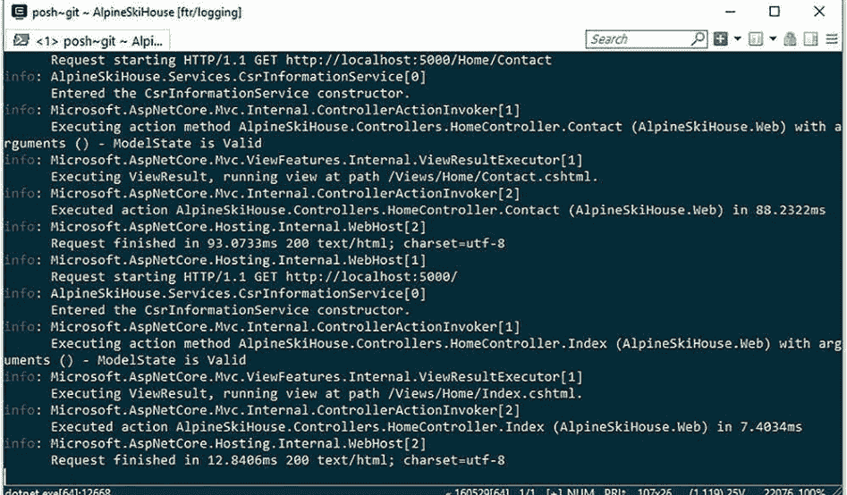

图 12-1 默认日志配置中的大量信息


这种噪音正是我们希望避免的类型，因此团队决定使用`Users`在他们自己的机器上静某些细节。我们将在第 13 章中讨论更多关于`Users`。

为了在生产环境中过滤这些信息消息，团队还添加了一个配置文件`appsettings.production.json`，它包含了你在生产环境中可能期望的日志级别：

[点击此处查看代码](#)

```json
{"Logging": {
  "IncludeScopes": false,
  "LogLevel": {
    "Default": "Information",
    "System": "Error",
    "Microsoft": "Error"
  }
}
```

此结构与主配置文件中的结构相同。记得在本章前面提到的，相同的值可能会出现在多个配置源中，但**最后一次生效**。在这种情况下，覆盖设置有助于清除来自`System`和`Microsoft`命名空间的信息消息，使我们能够像图 12-2 所示更清晰地看到所需的证据。

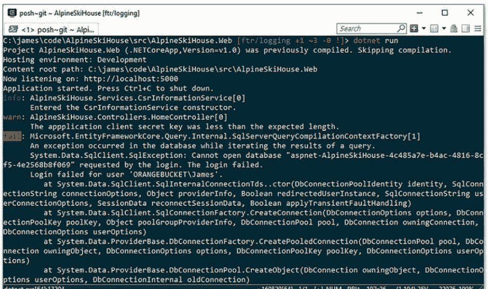

# 图 12-2 修改后的日志配置，以生成更整洁的日志

要让这些设置生效，我们需要通过将`Logging`部分传递`AddConsole`扩展方法来正确配置日志中间件：

[点击此处查看代码](#)

```csharp
var loggingConfig = Configuration.GetSection("Logging");
loggerFactory.AddConsole(loggingConfig);
loggerFactory.AddDebug();
```

注意，这里实际上有两个调用，初看之下可能并不清楚发生了什么。首先，值得注意的是，某些扩展方法比其他方法更强大。这里有两个我们用于处理日志的方法。第一个将日志输出到控制台，第二个将日志输出到 Visual Studio 的 Debug 输出中。`AddConsole`调用允许我们传递一个`IConfiguration`实例，我们在上一个代码块中正是这样做。而`AddDebug`方法则不允许。这意味着`AddDebug`具有使用我们存储的设置来跨命名空间过滤日志消息的能力。`AddDebug`不包含允许我们在过滤器中传递设置的重载，因此 Alpine 团队选择编写自己的实现。

[点击此处查看代码](#)

```csharp
loggerFactory.AddDebug((className, logLevel) => {
  if (className.StartsWith("AlpineSkiHouse"))
    return true;
  }
  return false;
});
```

过滤器接收一个包含日志记录器类别的`Func`字符串（通常是全限定类名），你不需要检查消息本身，也不需要这样做，因为这仅仅提供了一个判断在此时时间点对该类别的消息进行日志记录是否合适的机会。在这个日志过滤器的简单实现中，团队决定只有当消息来自我们自己构建的命名空间时，才将消息打印到 Debug 输出窗口。

# 使用日志作用域（Logging Scopes）增强日志

作用域（Scopes）是一种为了更好地理解日志来源的方法，它允许你揭示请求调用链的一部分。每个请求都会自动创建一个作用域，而执行流水线的不同部分可能会创建它们各自的嵌套作用域。当你穿过一个请求进行导航时，会进入新的作用域，你也可以添加自己的作用域，并包装一个处理多个类的作用域。你可能在进入业务流程的关键环节之前开启作用域，执行完成购买所需的所有工作并从第三方服务收集付款，然后在操作完成后关闭作用域。在 ASP.NET Core 中，作用域的生命周期贯穿整个 HTTP 请求。

Alpine 团队希望从每个传入请求的角度明确理解所执行的步骤，特别是当涉及到添加新的滑雪卡数据时。为了实现这一点，他们首先通过将`IncludeScopes`设置为`true`修改了`appsettings.json`中的日志设置以包含作用域。这在日志中暴露了如下的作用域信息：

[点击此处查看代码](#)

```text
info: Microsoft.AspNet.Hosting.Internal.WebHost[1]
=> RequestId:0HKV5MFUPFPVU RequestPath:/
Request HTTP/1.1 get http://localhost:5000/
```

作用域由一个或多个`=>`符号组成的链引导，当额外的日志条目段附加到输出时，你可以看到嵌套关系。当日志条目来自控制器的操作时，这一点变得更加明显：

[点击此处查看代码](#)

```text
info: Microsoft.AspNetCore.Authorization.DefaultAuthorizationService[1]
=> RequestId:0HKV5MFUPFPVU RequestPath:/skard
=> AlpineSkiHouse
```

（注：原文后续部分存在大量重复的错误片段，已按上述核心逻辑处理完毕。）

技术雷达，2014年1月。

Alpine 团队选择了 Serilog 库并添加了相应的包，即`Serilog.Extensions.Logging`和`Serilog.Sinks.Literate`。你可以在项目的`project.json`中找到这些包，其中也包含了其他的日志依赖。扩展包使得 Serilog 能够在 ASP.NET Core 日志抽象中发挥其结构化优势，而 Literate 库则提供了更整洁、更易读的控制台输出。

下一步是更新`Startup`类以使用新包，首先移除`LoggerFactory`的配置（包括`AddDebug`），然后将其替换为以下内容：

点击此处查看代码图像

```
Log.Logger = new LoggerConfiguration()
.MinimumLevel.Information()
.MinimumLevel.Override("AlpineSkiHouse", Serilog.Events.LogLevel.Debug)
.Enrich.FromLogContext()
.WriteTo.LiterateConsole()
.CreateLogger();
```

此配置提供了与之前为控制台日志添加相同的错误消息级别，并在运行时将 Serilog 暴露给应用程序。

## 使用 Serilog 配置

如果你希望 Serilog 的配置能够因环境不同而异，我们不应该忽略：你应该使用`Serilog.Settings.Configuration`包，该包允许你从 Serilog 原生的已知源读取设置。与之前述相同的配置在你的`appsettings.json`中表示如下：

点击此处查看代码图像

```
"Serilog": {
  "Using": {"Serilog.Sinks.Literate"},
  "MinimumLevel": {
    "Default": "Information",
    "Override": {
      "AlpineSkiHouse": "Debug"
    }
  },
  "WriteTo": [
    {"Name": "LiterateConsole"}
  ],
  "Enrich": ["FromLogContext"],
  "Properties": {
    "Application": "Sample"
  }
}
```

在之前配置好`IConfigurationRoot`后，你只需要在`Startup`类的`Configure`方法中使用以下内容来加载日志设置：

点击此处查看代码图像

```
var logger = new LoggerConfiguration()
  .ReadFromConfiguration(Configuration)
  .CreateLogger();
```

然后你就可以在每个环境配置中学到的知识并应用于日志记录器中，根据需要覆盖 User Secrets、环境变量或`appsettings.EnvironmentName.json`文件中的设置。

作为你现在可以如何处理日志记录的一个示例，让我们检查`Home`控制器`Contact`方法中的一条日志语句，它包含了日志模板和要渲染到模板中的数据：

点击此处查看代码图像

```
_logger.LogDebug("User visited contact page at {VisitTime}", DateTime.Now);
```

你可以将正在记录的内容视为一个“桶”或“接收端（sink）”。你可以拥有任意数量的接收端，并根据选择写入所有接收端或选择性地写入某些端。当非结构化接收端记录信息时（例如写入控制台窗口或文本文件），之前的`LogDebug`调用只是被渲染为文本。但当你将日志记录到能够理解我们日志条目参数化版本的接收端时，结构化日志才真正开始大放异彩。让我们以不同的视角来看待日志中的这样一个接收端。

## 作为服务的日志

要提升将日志视为数据处理的价值，需要一个理解你正试图持久化的信息的日志接收端。更重要的是，它帮助你提取这些信息。当你开始考虑将许多许多服务作为应用程序足迹的一部分时，提取这些信息就变得更加重要。此外，当这些服务跨越多个服务器时，情况变得越来越复杂。为了应对这种复杂并降低延迟风险，主流解决方案是使用服务来收集你的日志。

Alpine 团队选择了 Seq，它对开发者本地免费，但在生产环境中需要商业许可。虽然我们不会深入探讨任何特定产品或服务，但在这里提供了 Seq 引擎，因为它是由与 Serilog 相同的团队编写，并且易于与 Serilog 开始。

下载和安装 Seq 的最新信息，请访问 https://getseq.net/。

Serilog 已经配置完成，Alpine 团队只需要添加一个名为`Serilog.Sinks.Seq`的额外包，然后按照所示在 Startup 的日志配置中添加一个额外的接收端：

点击此处查看代码图像

```
Log.Logger = new LoggerConfiguration()
.MinimumLevel.Information()
.MinimumLevel.Override("AlpineSkiHouse", Serilog.Events.LogEventLevel.Debug)
.Enrich.FromLogContext()
.WriteTo.Console()
.WriteTo.Seq("http://localhost:5341")
.CreateLogger();
```

此配置中的一个重要点是调用了`WriteTo.Seq()`，其中你想写入的服务器位置作为一个参数，`localhost:5341`是本地安装 Seq 的默认设置。下一次运行应用程序时，你将看到 Seq 界面中出现信息，如图 12-3 所示。

# Seq-dash 事件

| | | |
|---|---|---|
| 27 Sep 2016 21:26:21.538 | Request finished in 107.9561ms | 200 text/html;charset=utf-8 |
| 27 Sep 2016 21:26:21.534 | Executed action AlpineSkiHouse.HomeController.Contact (AlpineHouse.Web) in 19.786ms... | |
| 27 Sep 2016 21:26:21.452 | Executing ViewResult, running view at /Views/Home/Contact.cshtml. | |
| 27 Sep 2016 21:26:21.451 | User visited contact page at 2016-09-27T21:26:21.444350-00 | |
| 27 Sep 2016 21:26:21.448 | Executing action AlpineHouse.Controllers.Contact (AlpineHouse.Web) with... | |
| 27 Sep 2016 21:26:21.443 | The application client secret was not the expected length. | |
| 27 Sep 2016 21:26:21.440 | Error the constructor. | |
| 27 Sep 2016 21:26:21.439 | Identified user was not authorized. Failure message: Unprotect ticket | |
| 27 Sep 2016 21:26:21.430 | Request starting HTTP/1.1 GET at http://localhost:5000/Contact | |
| 27 Sep 2016 21:26:21.422 | Request finished in 279.109ms | 200 text/html;charset=utf-8 |
| 27 Sep 2016 21:26:21.316 | Executing action AlpineSkiHouse.Controllers.About (AlpineHouse.Web) in 150.115ms | |
| 27 Sep 2016 21:26:21.285 | Executing ViewResult, running view at /Views/Home/About.cshtml. | |
| 27 Sep 2016 21:26:21.176 | Executing action AlpineHouse.Controllers.About (AlpineHouse.Web) with... | |

# 图 12-3 Web界面

日志显示显示你的关注点非常好。信息被高亮，不同的日志级别显示不同的颜色。UI 能够提供关于日志的视觉提示，但真正引人注目的是钻取特定日志语句的能力。图 12-4 显示了团队操作中的`LogDebug`消息中显示的内容。

- User visited contact page at 2016-09-27T21:26:21.444350-00

| Id | Level (Debug) | Type (708b15473) |
|---|---|---|
| ActionId | e5d8733e-2d4e-4ea5-ab93-4ba5e370af2 | |
| ActionName | AlpineHouse.Controllers.Contact (AlpineHouse.Web) | |
| RequestId | 0HKV78RS5720 | |
| RequestPath | /Home/Contact | |
| SourceContext | AlpineHouse.Controllers.HomeController | |
| Visit | 2016-09-27T21:26:21.444350-00 | |

# 图 12-4 钻取日志条目

现在是日志条目中的参数`VisitTime`：我们实现了能够检索日志数据的承诺，图 12-5 显示了使用 RequestId 作为相关请求搜索标准的查询示例。

### requestId = "0HKV78R5K572G"

| | | |
|---|---|---|
| 27 Sep 2016 21:26:51.538 | Requested in 107.9561ms | 200 text/html; charset=utf-8 |
| 27 Sep 2016 21:26:51.524 | Executed action AlpineSkiHouse.HomeController.HomeController (AlpineHouse.Web) in 98.786ms... | |
| 27 Sep 2016 21:26:21.524 | Executing ViewResult, running view at path /Views/Home/Contact.cshtml. | |
| 27 Sep 2016 21:26:21.451 | User visited contact page at 2016-09-27T21:26:21.444350-05:00 | |
| 27 Sep 2016 21:26:21.443 | Executing action AlpineSkiHouse.HomeController.HomeController (AlpineHouse.Web) with... | |
| 27 Sep 2016 21:26:21.443 | The application client secret key was less than the expected length | |
| 27 Sep 2016 21:26:21.440 | Entered the CInformationService constructor. | |
| 27 Sep 2016 21:26:21.434 | Identity.Application was not authenticated. Failure message: Unprotect ticket failed | |

**图 12-5** 关于请求 ID 的查询

## 第3部分：冲刺回顾：兽腹之战

- 第 13 章 身份、安全与权限管理
- 第 14 章 依赖注入
- 第 15 章 JavaScript 的角色
- 第 16 章 依赖管理
- 第 17 章 带有状态的前端
- 第 18 章 依赖缓存


《神秘档案》第三季让丹妮尔（`Danielle`）比上一季睡得好一点。虽然没有再出现人类形态的实验体了，但这是一个好兆。外星人人类杂交体——那种多的是，但丹妮尔并不担心它们。它们主要感兴趣在人的鼻孔里塞进微小的监控设备。如果外星人想知道她什么时候擦鼻子，她也无所谓了。上一个冲刺非常有成效；他们解决了数据访问安全、日志、依赖注入问题，而且有一个真正的网站可以部署了。

“欢迎，欢迎大家，”巴拉兹（`Baláz`）说道，“我们回来了，进行第二次回顾。在开始之前，让我们回顾一下，看看是否需要处理我们冲刺中的问题。”他拿出一个笔记本翻了几页。“好的，之前感觉我们还没有真正交付产品。我们今天进展如何？”

“我感觉不错？”坎迪丝（`Candice`）说道，“我们完成了很多阶段工作。它们看起来可能不漂亮，但我们已经建立了一些结构。”

“数据库方面看起来很棒了！”马克（`Mark`）说道，“这个 `Entity Framework` 仍然让检索和添加数据变得轻而易举。我觉得我理解了异步方法。”

“我喜欢对编写 `LINQ` 查询的支持，”丹妮尔补充道，“我以前在 `NHibernate` 中也有过这个功能，但一直觉得有点奇怪。`EF` 感觉是为 `LINQ` 编写的，而 `NHibernate` 像是强行挂在上面的。”

“我很开心，”提姆（`Tim`）插话道，他本不该参加团队会议的，“生产环境的东西还没完成，但我们每天都能看到几次构建，每一次都是增量式的改进。至少大部分如此。”

“看，”安德里安（`Adrian`）说道，“我觉得那个粉红相间的配色方案很酷。它让我想起了甜心。”团队大笑了起来。可怜的安德里安整周都因为那个样式表的修改而被指点。“好的，”巴拉兹继续道，“那个痛点解决了。我们日程表上还有一些午餐学习（`Lunch and Learn`），我们这周做了两个，所以感谢丹妮尔和马克把它们列出来。”

“非常感谢，”提姆揉着肚子说道，“我并不太理解这些，但我觉得参加会议对士气很重要。”

“让我们把回顾板列起来，看看大家这周有什么建议。”巴拉兹看着取代了优质钢笔的新型无味笔，显得有些失望。上次会议后出现了一些安全顾虑，所有的好笔都被收走了。传闻说它们被遗弃在丢失的推车里。团队再次拿起笔开始在白板上写字。

| 开始 (`Start`) | 停止 (`Stop`) | 继续 (`Continue`) |
| --- | --- | --- |
| 解决 `JavaScript` 问题 | 制作如此丑的页面 | 使用 `.NET` |
| 建立更多的自动化测试 | 在本地机器上处理登录，这真的慢了速度 | 使用依赖注入 |
| 在多处复用某些代码 |  | 午餐学习 |
| 使用更强大的依赖容器 |  |  |
| 让网站看起来更漂亮 |  |  |

“这周没什么特别，”巴拉兹说道，“看来我们团队协作得很好。我对这些自动化测试感兴趣；是谁写在上面的？”

“是我写的，”安德里安说道，“我看到在修复之后又出现了一些问题。如果能加入一些测试来防止这种情况就好了。”

“好主意，弥补了视觉上的缺陷。我赞同！”马克说道，“我喜欢在写代码时进行测试，但我们处于匆忙状态，很难证明花在编写良好测试的时间是合理的。”

“你们是测试驱动开发（`TDD`）？”巴拉兹问道。

“没错！”马克回答，“我们应该在写代码之前编写测试。这让代码更具适应性，同时也为我们提供了安全网。”

“我们先写测试？”丹妮尔问，“我不明白这个。”

“好了，”巴拉兹打断道，“我想这可以作为本周午餐学习的主题。依赖注入方面还有一些困难吗？”

“我想是，”切斯特（`Chester`）说道，“我的意思是内置容器很不错，但有些东西它处理得不够完美，比如 `Autofac` 这样的工具。”

“嗯，我想我们可以把这个加入这次冲刺。切斯特，你愿意带负责吗？”巴拉兹问道。

“听起来不错，”切斯特回答道。

“好了，”巴拉兹继续道，“让我们看看能不能对网站外观做些什么。我知道在功能还没完全敲定时就担心外观很奇怪，但人们对视觉好看的网站会更宽容。这对管理层来说也是如此。他们都是视觉型的人，我们要给他们看一些真正棒的东西。”

“最后，似乎我们需要一套处理 `JavaScript` 的方案。我恰好看到一些 `JavaScript` 的检查，它们看起来有点粗糙。也许有一种不那么拙劣的方法，”巴拉兹建议道。

“我喜欢这个主意，”切斯特说道，“我觉得现在的代码在网站变大后将具有可维护性。我们已经……”

嗯。我们需要保护我们的应用程序以及公司正在积累的数据，并且要按照管理层、管理员、员工和其他开发者使用和与之交互的方式来进行。思考数据如何被使用，与思考他们对数据的使用可能会给公司带来额外风险同样重要。

> “公司在防火墙、加密和安全访问设备上花费了数百万美元，但这些都是在浪费钱，因为这些措施都没有解决安全链中最薄弱的环节点。” – 凯文·米特尼克（`Kevin Mitnick`），2000年3月在参议院政府事务委员会证词。

本书的范围不足以保护你的应用程序免受设计精良的社交攻击或基础设施实现的影响；然而，我们可以讨论如何构建一个保护其提供的数据采取严谨方法的应用程序。通过理解应用程序可能受到攻击者侵害的上下文，我们可以更好地处理那些作为潜在犯罪者目标的“手到容易胜的目标”。

## 内部威胁

以阿尔卑斯滑雪场（`Alpine Ski Resort`）的开发团队为例，他们对代码库有很强的安全感，他们相互信任敏感数据，并相信他们的源代码存储在私有的 `GitHub` 仓库中是安全的。

我们往往会忘记（特别是在规模较小的团队中），我们信任的基本本质往往是瞬态的。你一天拥有的动态关系可能会随着实习生的加入、长期员工的离职或部门结构的改变而迅速变化。当发生变化或任何其他调整时，你无法知道今天访问的数据会变成什么。你必须确保生产密钥、甚至是来自低级环境的访问密钥不会渗透到源代码控制系统中。通过遵循最小权限原则，你可以让员工开展工作，而无需让他们控制“王国之钥”。未能解决这些准则会增加密钥泄露的概率，这可能通过心怀不轨的员工、不满的员工，或者通过开发者机器感染恶意软件的安全泄露而发生。如果该员工从未被赋予密钥，泄露就很可能被局限在范围内。

大多数第三方服务提供开发者层级的 `API` 密钥和访问令牌，这允许你将生产代码安全地留在开发环境之外。通常情况下，为了这些第三方的利益，他们这样做，因为这也有助于保护他们提供的数据和服务。如果获取开发者密钥不是一个立即可见的选项，值得直接询问提供者以寻求帮助！通过不给开发者提供攻击目标的信息，你可以保护他们不被剥削。他们就无法落入恶意之手。我们将在本章稍后的“用户机”（`User Secrets`）部分稍微介绍访问令牌。

利用或滥用应用程序服务的其他攻击向量很大程度上与 `API` 提供的过度访问权限有关。这可能包括无意中创建漏洞，例如 `API` 在内部使用并被假设是安全的，因此不需要身份验证。身份验证是一个很好的步骤，但授予系统经过验证的无限制访问的应用程序或服务也是一种风险。有了正确的工具，攻击者可以以意想不到的方式使用应用程序，例如绕过 `Web UI` 并使用你的用户名和密码直接访问 `API`。当我们在本章中讨论身份、声明（`claims`）和策略时，你将学会如何将授权与身份验证分离以保护你的 `API`。

还有一种类型的风险：技术债。我们经常看到由于在没有妥善考虑安全性和完整性的情况下匆忙推出某功能，导致了本不可能的滥用发生。我们希望通过[第3章：模型、视图和控制器]中的过度绑定概念，以及如何通过简单地在读写场景中使用相同的模型，使我们开启一个漏洞。对软件进行全面审查通常会揭示你的开发团队已经知道的漏洞，而这需要深入代码内部。

## 外部威胁

即使服务是为内部应用程序设计的，在某些时刻你可能也会从外部源获取数据，或与其他 API 服务交互，以造福用户或实现业务场景。一个不幸的现实是，我们生活在一个需要考虑交互如何发生，以及我们对数据处理、应用程序调用者以及我们交互的服务信任到何种程度的世界。

你正在导入数据吗？知道它来自哪里很重要。你是作为批量记录来验证整个文件，还是执行逐行验证？某些攻击之所以可能，是因为每一行都是有效的，因为调用者编排的文件或操作可能构成欺诈。这些场景中的大多数是资源操纵的形式，能够在你的应用程序中创建或修改文档：因此可以使用适当的应用程序策略进行处理。

你是否将数据暴露给合作伙伴网站？这是一个合法且通常是值得的场景，可以使你的组织在竞争中脱颖而出。当你这样做时，你是否包含了检查以确保使用你 `API` 的站点是你信任的？现在所有浏览器都支持在服务器不知道原始调用者的情况下阻止脚本加载数据的功能。

## 用户机密

让我们回到阿尔卑斯滑雪场的开发团队。如果管理层的某人向开发团队分发访问密钥，我们所有人至少应该感到有些被冒犯。在某些方面，这类似于给所有的出纳员（可能还有夜间安保巡逻员）地下银行金库的密码。如果管理层理解业务流程，生产访问密钥会被高度重视。

这很大程度上是机密（`secrets`）大显身场：开发者需要可靠地在本地开发和使用访问受保护资源和服务的应用程序。与其假设拥有敏感密钥、数据和服务的权利，开发者可以注册自己的应用程序服务实例（例如通过 `Facebook`），然后使用自己的密钥。为了做到这一点，开发者需要一种机制来存储凭据，在执行时将其加载到应用程序中，并防止这些密钥与他人共享。

你可以将用户机密视为每个用户每个项目的环境变量。这些配置值与项目隔离，但在运行时对 `.NET` 配置系统可用。用户机密以 `JSON` 文件的形式存储在用户配置文件下，通常由键值对组成，尽管我们在[第12章：配置与日志]中学习过复杂的结构。

添加机密的基本操作非常直观：

```bash
dotnet user-secret set Key "你要设置的值"
```

在写作期间，通过命令行界面 (`CLI`) 与用户机密交互的命令非常有限：

- `set`：将提供的值分配给密钥密钥
- `list`：列出存储中所有的用户机密键值对
- `remove`：从存储中删除指定的密钥
- `clear`：确认后从存储中删除所有密钥

`user-secret` 命令只能在存在 `project.json` 的目录中运行，且该文件必须包含 `userSecretsId` 的值，否则将执行失败。该命令使用 `userSecretsId` 的值来访问磁盘上的特定文件夹，该文件夹位于你的配置文件下。

## 基于 Azure 的身份验证

在企业环境中，用户由管理员配置备用，账户并与内部角色和策略绑定，你通常会在后台发现 `Active Directory` (`AD`)。`Active Directory` 有其通往云的方式，并作为 `Microsoft Azure` 的一项服务可用。你可以通过相关设施将内部的 `Active Directory` 与云托管实例连接起来，并将你的内部目录导入或迁移到 `Microsoft Azure` 的持久托管解决方案中，甚至可以包括你组织 `Office 365` 帐户中的用户。这让你受益于多区域可靠性和故障转移支持、高可用性的高水平 `SLA`（服务水平协议），以及能够即时升级并由安全性良好的基础设施进行托管的安心感。它还允许你为无数设备添加移动支持、多因素身份验证和远程策略执行等功能。

## Azure Active Directory 中的选项

在选择 `Microsoft Azure Active Directory` 作为应用程序的验证机制时，你有两种配置供选择：

- 单租户（`Single-tenant`）：你的应用程序连接到企业目录。域内的用户能够登录由管理员设置的策略。
- 多租户（`Multi-tenant`）：对应用程序进行配置，允许来自你的 `Azure` 账户或账户外部的多个目录启用以支持对你的应用程序进行身份验证。每个组织必须为你的应用程序执行必要的配置，但这允许这些组织中的每一个访问你的应用。

`Azure` 为你提供了有关身份验证组织的信息，因此在多租户场景下，你有将用户体验调整为符合你上下文的体验。

虽然这些功能可能有利于内部应用程序的成功，但面向消费者的应用程序的目标是允许自助注册和管理。`Microsoft Active Directory` 的目标是面向内部用户，即可以从中心化管理中受益的用户，以及其他可能已经拥有组织帐户的用户。这些功能通常与我们使用 `Alpine` 构建的应用程序类型不符，因为在我们的应用中外部用户是重点。

## 组织之外的用户

当你想要为客户提供个性化体验时，你需要他们进行身份验证，但还有另一组不符合单租户或多租户验证选项的问题，无论是从工作负载还是成本角度：

- 我们希望用户自助配置并管理自己的帐户，而不需要管理员干预即可注册或更改帐户。
- 用户可能是瞬态的，在离开网站和使用其功能之前，为我们的组织产生很少或没有收入。
- 用户可能希望自带自己的身份，使用来自 `Google` 或 `Facebook` 等第三方网站的帐户。
- 用户在站点之间使用同一组凭据。如果这些凭据在另一个安全性较低的地方泄露，他们在我们应用中的体验和数据也可能受到损害。

由于这些原因，`Microsoft Azure` 还提供名为 `Azure Active Directory B2C` 的产品，它具有 `Azure Active Directory` 相同的高可用性，因为它是基于 `Azure Active Directory` 构建的，但额外优点是提供了来自社交帐户网站的身份验证源。它有一个免费层来帮助你启动，每月允许 50,000 个唯一用户和 50,000 次身份验证。身份验证后，`Azure AD B2C` 将重定向回你的应用程序，并携带一个 `JWT` 令牌，该令牌通过包含包含本地数据存储或社交登录服务收集的用户信息。

要开始使用 `Azure AD B2C`，你首先需要在你的 `Microsoft Azure` 订阅中创建一个 `B2C` 目录。在创建目录时，务必勾选如图 13-1 所示的 `B2C` 框，因为创建后无法更改。目录可能需要几分钟才能完全启用。

⚠️ 此操作可能需要最多两分钟。

## 添加目录

| 目录 (`DIRECTORY`) | 创建新目录 |
| :--- | :--- |
| 名称 (`NAME`) | `Alpine Ski House` |
| 域名名称 (`DOMAIN NAME`) | `projectparsley.onmicrosoft` |
| 国家或地区 (`COUNTRY OR REGION`) | 美国 |
|  | 这是一个 `B2C` 目录。 |

图 13-1 创建 `B2C` 目录

创建目录后，你需要完成若干配置选项以使其在你的应用程序内部完全运行，即添加社交身份提供者、选择用户属性以及向你的应用程序添加所需的设置。

社交身份提供者（如 `Microsoft` 帐户或 `Facebook`）要求你首先在这些服务中注册应用程序。每个支持的提供者的注册位置列表，请访问 `http://aspnetmonsters.com/2016/09/heres-a-handy-list-of-social-login-providers/`。当你在 `Azure AD B2C` 中配置身份提供者时，会提示你完成如图 13-2 所示的表单，允许服务进行通信并建立用户身份。


## 图 13-2 向 Azure AD B2C 添加社交身份提供者

当你注册服务时，你会收到一个客户端 ID 和密钥，用于在配置 `B2C` 服务时。每个提供者的界面都不同，我们将定位我们所需的设置留给你作为的一项练习，图 13-3 显示了 `Facebook` 应用程序开发者工具中的此类界面。在这种情况下，`Client ID` 被称为 `App ID`，`Client Secret` 简单称为 `App Secret`，但这些名称可能随服务而异。

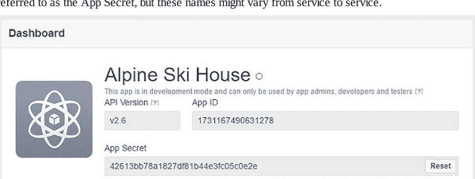

## 图 13-3 在 Facebook 中定位你的 Client ID 和密钥

添加社交提供者后，你可以选择地添加用户特定属性，这对于你的应用程序是合适的。例如，滑雪尺寸可能是许多社交服务提供的，并且在用户创建帐户时询问是合理的。对于像显示名称和电子邮件这些，为了在注册时要求这些字段，你需要创建一个策略，如图 13-4 所示，其中包含的属性将绑定到目录的注册策略。

## 添加策略

| 名称 (`NAME`) | 数据类型 (`DATA TYPE`) | 描述 (`DESCRIPTION`) | 属性类型 (`ATTRIBUTE TYPE`) |
| :--- | :--- | :--- | :--- |
| `City` | `String` | 用户所在的城市 | 内置 |
| 国家/地区 (`Country/Region`) | `String` | 用户所在的国家/地区 | 内置 |
| 显示名称 (`Display Name`) | `String` | 用户显示名称 | 内置 |
| 电子邮件地址 (`Email Address`) | `String` | 用户名（也称为名字） | 内置 |
| 名字 (`Given Name`) | `String` | 用户的名字 | 内置 |
| 职位 (`Job Title`) | `String` | 用户的职位 | 内置 |
| 邮编 (`Postal Code`) | `String` | 用户地址的邮编 | 内置 |
| 州/省 (`State/Province`) | `String` | 用户地址所在的州/省 | 内置 |
| 街道地址 (`Street Address`) | `String` | 用户所在的地址 | 内置 |
| 姓 (`Surname`) | `String` | 姓（也称为姓氏） | 内置 |

图 13-4 为你的目录配置默认注册策略

如果你想在应用程序中使用显示名称和电子邮件地址属性，还需要配置“应用程序声明”（`Application Claims`）部分，允许这些值通过 `JWT` 令牌传递到你的应用程序。除了注册过程之外，你还可以创建登录策略来控制多因素身份验证，或围绕个人资料编辑或密码重置配置策略。策略提供了一种强大的机制，让你描述想要为用户提供的身份管理体验。

最后，你需要生成应用程序利用 `Azure AD B2C` 所需的值。为了实现这一点，你必须向租户添加应用程序，如图 13-5 所示。请注意，你还需要确保选择了 `Web 应用程序/Web API`，并启用了隐式流（`implicit flow`）。这些选项对于让你的应用程序运行 `OpenID Connect` 是必需的。

# 设置

# 应用程序

# parsley

`projectparsley.microsoft.com`

+ 添加

保存

丢弃

删除

筛选设置

| 名称 | 名称 |
| :--- | :--- |
| parsley | `parsley` |


| 应用程序 ID | `979d32a0-caac-44bc-8566-02354fed222` |

管理

+ - 应用程序

- Web 应用 / Web API

  包含 Web 应用 / Web API

+ - 身份提供程序

  - 是

  - 否

+ - 用户属性

  允许隐式流

  - 是

  - 否

策略

> 重定向 URL 必须属于同一网域

+ - 注册策略

  - 回调 URL

+ - 登录策略

  - `https://localhost:44392/`

+ - 注册或登录策略

+ - 个人资料编辑策略

+ - 密码重置策略

+ - 所有策略

## 图 13-5 在 Azure AD B2C 中注册您的应用程序

接下来，你需要将这些设置添加到您的应用程序中。在`appsettings.json`文件中，你可以按照列表 13-1 所示，在配置的根节点添加以下值。

### 列表 13-1 配置 Azure AD B2C 中间件所需的预期配置元素

[点击此处查看代码图片)

```json
"AzureAd": {
  "ClientId": "CLIENT_ID_FROM_PORTAL",
  "Tenant": "YOUR_TENANT.microsoft.com",
  "AadInstance": "https://login.microsoftonline.com/{0}/v2.0/.well-known/openid-configuration",
  "PostLogoutRedirectUri": "https://localhost:44392/",
  "SignUpPolicyId": "B2C_YOUR_SIGN_UP_POLICY_NAME",
  "SignInPolicyId": "B2C_YOUR_SIGN_IN_POLICY_NAME"
}
```

将标记化的值更改为您的值，并为重定向 URL 设置适当的端点。正如我们在本章前面讨论的那样，如果有敏感值，考虑使用 Secrets 库是值得的。设置好这些设置后，下一步是向项目文件添加支持 OpenID Connect 的包。你需要包含的包有：

[点击此处查看代码图片)

- `Microsoft.AspNetCore.Authentication.Cookies`

- `Microsoft.AspNetCore.Authentication.OpenIdConnect`

你已经拥有了为站点配置身份验证中间件所需的组件，即启动时的用户机（user secrets）和指向 OpenID Connect 网关的身份验证包。你需要对 Azure AD B2C 中配置的每个策略执行此操作。为了支持配置列表 13-1 中定义的两个策略，你需要使用用于配置的数据调用`UseOpenConnectAuthentication`，并为每个策略配置中间件，其看起来可能如下所示：

[点击此处查看代码图片](#)

```csharp
app.UseOpenConnectAuthentication(signInUpPolicy);
app.UseOpenConnectAuthentication(signInPolicy);
```

最后，你需要创建或修改一个支持必要的身份验证函数的`AccountController`。这包括注册、登录和注销。例如，为了处理注册，你可以在`SignUp`方法中实现代码：

[点击此处查看代码图片](#)

```csharp
var policyId = Startup.SignUpId.ToLower();
var authProperties = new AuthenticationProperties { RedirectUri = "/" };
await HttpContext.Authentication.ChallengeAsync(policyId, authProperties);
```

这获取了`Startup`类中的`policyId`，创建了`AuthenticationProperties`对象的实例，并用 HTTP Challenge 响应请求。你可以类似地为其他策略实现操作。

> 注意

在编写本文时，配置和实施的体验仍在演变中，机制保持相似，但代码本身可能会发生变化。随着 B2C 的成熟，该服务可能会提供中间件和简化的配置。请务必访问 [https://azure.microsoft.com/en-us/documentation/services/active-directory-b2c/](https://azure.microsoft.com/en-us/documentation/services/active-directory-b2c/) 获取有关将 Azure AD B2C 集成到应用程序中的最新信息，包括一个用于 ASP.NET MVC 的完整代码示例。

每个组织（可能每个组织内的每个项目）都有建立自己的身份的选择。Azure Active Directory 和 Azure AD B2C 为你提供了许多选项供考虑。对于 Alpine Ski House，我们预计每天大约只有几百次登录。我们的策略、角色和访问限制是相当静态的，我们认为外部依赖不会为项目增加价值。相反，我们选择使用项目模板中内置的身份组件，以及通过 NuGet 提供的组件。

# ASP.NET Core MVC 中的身份验证

ASP.NET Core 通过内置的 ASP.NET Core Identity 提供身份验证、授权和用户管理。虽然 Identity 提供了大量的配置选项，但大多数核心应用程序只需对默认配置选项进行微调即可良好运行。

ASP.NET Core Identity 模型中的实体是`IdentityUser`、`IdentityRole`、`IdentityUserClaim`、`IdentityRoleClaim`、`IdentityUserLogin`和`IdentityUserToken`。当配置使用 Entity Framework 时（如 Alpine Ski House Web 应用程序），这些实体存储在表中，如图 13-6 所示。注意，ASP.NET Core Identity 的表都以 AspNet 为前缀而不是 Identity，例如`IdentityRole`表是 AspNet


Identity 包含有关用户的信息。它由`Application`类表示，我们在第 10 章中讨论过它可以进行扩展。此外还有指示账户是否锁定的属性。

## 存储密码

存储密码始终是一个棘手的问题。在存储密码时，有几种方法可以使用。加密密码看起来是个好主意，但如果加密密码泄露（这种情况发生得令人震惊），攻击者就可以解密密码。这是因为许多人在不同网站之间使用相同的密码。

哈希处理密码是更好的主意。哈希是一种单向函数，无法反向还原密码。在哈希处理时，重要的是不仅对用户的密码进行哈希，还要将其与盐（salt）结合。盐是在哈希之前添加到未哈密码的随机字符串。这个随机字符串可以防止彩虹表攻击。彩虹表是一个映射密码及其哈希值的巨大数据库。许多流行的哈希算法的彩虹表使得这种方法失效，因为彩虹表中的键映射到“密码+盐”。没有盐，攻击者无法输入任何有效的密码。彩虹表中的键不太可能是实际密码，而是一个产生相同哈值的字符串，因此用户的密码并不易见。

即使在使用哈希时，你也需要对实现方式保持警惕。许多常用的哈希函数（如 MD5 和 SHA）被设计得尽可能快速。它们的目的是提供文件的校验和以判断文件是否正确。当你处理大量数据时，你希望操作尽可能简单快速。而密码哈希则恰恰相反。你希望哈希处理花费大量时间以防止暴力破解攻击，最好使用可调优的算法，随着计算资源的增加而可以增加耗时。

使用低级哈希函数破解密码有多容易？著名的 Kevin Mitnick 给出了这样一个提示：

> 我爱死我的 GPU 密码破解器了。每秒处理 600 亿次 NTLM 哈希。遗憾的是，Md5crypt 要慢得多。我需要增加显卡。Kevin Mitnick (@kevinmitnick)

关于 MD5 哈希密码的攻击¹由 Robertiello 和 Bandla 在 2005 年发表，该研究表明，他们使用基于单个 CPU 的方法可以在 96 小时内强制破解 MD5 密码。使用廉价硬件和甚至弹性计算的现代 GPU 方法使得破解 MD5 不仅可能，而且非常简单。

¹ http://pamsucsc.googlecode.com/svn-history/r3B/CSCI555/thesis/papers/RAINBOW_report.pdf

对于账户，ASP.NET Identity 使用`PasswordHasher`。默认情况下，ASP.NET 中的`PasswordHasher`使用 PBKDF2 哈希算法（HMAC-SHA256）、128 位的盐值、256 位的密钥和 10,000 次迭代。这是一种非常强大的哈希算法，破解它需要大量的时间。该哈希值存储在`AspNetUsers`表的`PasswordHash`列中，并由`SignInManager`在用户尝试登录时确认其密码。

`IdentityRole`代表一个角色，`IdentityUsers`可以属于任意数量的`IdentityRoles`。加入某个角色可以用于授权用户访问应用程序中的区域或资源，我们将在本章的[通过属性启用安全](https) 中讨论这一点。

ASP.NET Identity 大量使用声明（claims）。声明是一个简单的键值对，包含有关用户的一些信息。声明可以由第三方（如 Facebook）颁发，也可以也可以由你的应用程序添加。声明的一些示例包括用户的电子邮件地址和用户的出生日期。在 ASP.NET Core Identity 中，特定用户的声明由`IdentityUserClaim`表示。声明也可以添加到`IdentityRoleClaims`实体中的用户组中，尽管这种情况并不常见。这在本章的[自定义授权策略](https) 部分进行了讨论。

`IdentityUserLogin`代表来自第三方的登录。我们将在本章的[其他第三方身份验证提供商](https) 部分讨论第三方身份验证提供商，如 Facebook 和 Twitter。

`IdentityUserTokens`代表与特定用户的访问令牌。这种方法的一个示例是 GitHub 如何允许用户生成个人访问令牌，并用于访问 GitHub API。我们不计划在 AlpineSkiHouse 应用程序中使用`IdentityUserTokens`。

## 引用 ASP.NET Identity

ASP.NET Core Identity 被添加到使用默认 ASP.NET Core 项目模板创建的应用程序中。了解它是如何添加的、引用了哪些包以及如何配置它们是非常重要的。

当我们创建 AlpineSkiHouse 项目时，我们选择了“身份验证：单个用户账户”选项。选择此选项会添加对`Microsoft.AspNetCore.Identity.EntityFrameworkCore`的引用，该包又引用了`Microsoft.AspNetCore.Identity`包。项目模板还生成了用于管理应用程序中用户的模板代码。我们之前在[第10章](https) 中审查了`ApplicationUser`类及其相关的`DbContext`。

在`Startup`类中，我们看到了以下配置，告诉 ASP.NET Identity 使用`ApplicationUser`类，并且我们正在使用 Entity Framework 来存储 Identity 模型：

## 在 Startup.ConfigureServices 中配置 ASP.NET Identity

[点击此处查看代码图像](#)

```
services.AddIdentity<ApplicationUser, IdentityRole>()
.AddDefaultFrameworkStores<ApplicationUserContext>()
.AddDefaultTokenProviders();
```

在这里，你还可以指定额外的选项。例如，你可以更改触发账户锁定的失败登录尝试的次数。

[点击此处查看代码图像](#)

```
services.AddIdentity<ApplicationUser, IdentityRole>(
    options =>
    {
        options.Lockout.MaxFailedAccessAttempts = 3;
    })
.AddDefaultFrameworkStores<ApplicationUserContext>()
.AddDefaultTokenProviders();
```

还有其他选项可以配置密码强度要求、用户名要求、用户登录和注销的路径、验证码的有效期等。

**另请参见** 有关完整的选项列表

[https://docs.asp.net/en/latest/security/authentication/identity.html](https://docs.asp.net/en/latest/security/authentication/identity.html) 或访问仓库 [https://github.com/aspnet/Identity/blob/dev/src/Microsoft.AspNetCore.Identity/IdentityOptions.cs](https://github.com/aspnet/Identity/blob/dev/src/Microsoft.AspNetCore.Identity/IdentityOptions.cs)。

配置 ASP.NET Identity 的最后一步是在`Startup`类的`Configure`方法中调用`app.UseIdentity()`。此调用应发生在`app.UseMvc();`之后。

## 本地用户账户

ASP.NET Identity 提供了通过`UserManager`和`SignInManager`类管理用户和验证身份的机制。管理本地账户的大量代码已由默认项目模板创建。让我们花时间更详细地探索一下。

## 管理用户

`UserManager`类用于管理 ASP.NET Identity Core 中的用户。例如，通过调用`CreateAsync`方法来创建新用户的注册。

[点击此处查看代码图像](#)

```
var user = new ApplicationUser
{
    UserName = model.Email,
    Email = model.Email,
    FirstName = model.FirstName,
    LastName = model.LastName,
    PhoneNumber = model.PhoneNumber
};
var result = await _userManager.CreateAsync(user, model.Password);
```

`UserManager`类提供了大量功能，否则手动实现确认电子邮件和电话号码、重置密码、锁定和解锁用户账户的机制将非常繁琐。这些机制在 ASP.NET 官方文档网站上有详细的说明，地址为 https://docs.asp.net/en/latest/security/authentication/accountconfirm.html。

## 验证用户

当用户选择使用其本地账户登录时，你需要通过登录表单提供的用户名和密码验证用户身份。验证用户名和密码是使用注入`AccountController`的`SignInManager`完成的。

点击此处查看代码图像

```
//
// POST: /Account/Login
[HttpPost]
[AllowAnonymous]
[ValidateAntiForgeryToken]
public async Task<IActionResult> Login(LoginViewModel model, string returnUrl = null)
{
    ViewData["ReturnUrl"] = returnUrl;
    if (ModelState.IsValid)
    {
        var result = await _signInManager.SignInAsync(model.Email, model.Password, model.RememberMe, lockoutOnFailure: false);
        if (result.Succeeded)
        {
            _logger.LogInformation("User logged in.");
            return RedirectToLocal(returnUrl);
        }
        if (result.RequiresTwoFactor)
        {
            return RedirectToAction(nameof(SendCode), new { ReturnUrl = returnUrl, RememberMe = model.RememberMe });
        }
        if (result.IsLockedOut)
        {
            _logger.LogWarning("User locked out.");
            return View("Lockout");
        }
    }
    ModelState.AddModelError(string.Empty, "Invalid login.");
    return View(model);
}
// 如果我们到了这里，说明失败了，显示表单
return View(model);
```

如果指定的用户名和密码正确，登录成功并向`Response`添加一个特殊的身份 Cookie。Cookie 的值是`ClaimsPrincipal`实例的加密字符串。`ClaimsPrincipal`唯一标识用户及其声明。在随后的请求中，ASP.NET 验证身份 Cookie，解密`ClaimsPrincipal`并将其分配给`HttpContext`的`User`属性。通过这种方式，每个请求都与特定用户关联，无需传递用户名和密码。解密并反序列化的`ClaimsPrincipal`可以从任何控制器操作通过`User`访问。


> ASP.NET Core Identity 中基于 Cookie 的身份验证是通过中间件实现的。可以通过`Microsoft.AspNetCore.Authentication.Cookies`包独立于 ASP.NET Identity 使用 Cookie 中间件。更多信息请参见 https://docs.asp.net/en/latest/security/authentication/cookie.html。

`SignInManager`提供了一些可选功能。其中一个选项是失败登录尝试是否计入账户锁定。在尝试多次失败后锁定账户是一项重要的安全措施。默认模板禁用了此行为，因为模板不包含系统管理员解锁账户的机制。我们正在记录这一点，并将在未来的冲刺中添加锁定功能。目前，与锁定相关的支持问题将升级到开发团队，由他们在数据库中手动解锁。另一个选项是启用双因素验证。当启用双因素验证（2FA）时，在用户输入有效的用户名和密码后，系统会通过电子邮件或短信发送一个随机代码。用户被重定向到一个可以输入代码的页面。在验证代码之前，用户无法登录。有关如何短信启用双因素验证的完整教程可以在 ASP.NET 官方文档网站上找到，地址为 https://docs.asp.net/en/latest/security/authentication/2fa.html。

## 其他第三方身份验证提供程序

ASP. Identity 提供了与身份验证提供程序的轻松集成，这些程序被称为外部登录提供程序。Alpine 团队选择允许用户使用 Twitter 或 Facebook 作为外部源登录，如图 13-7 所示。

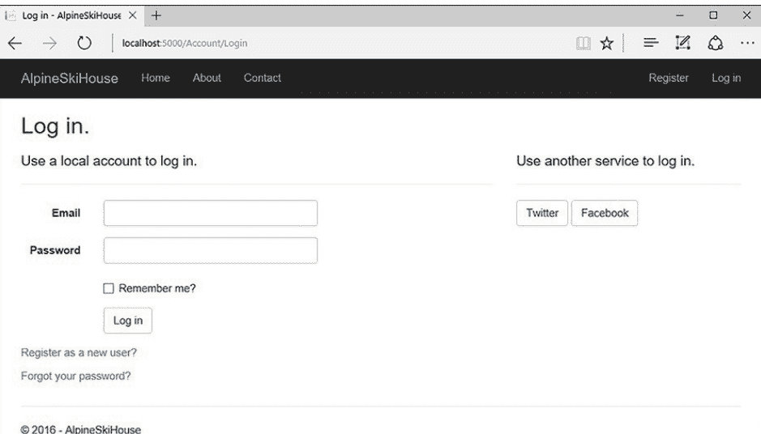

图 13-7 使用外部提供程序登录

Project Parsley 的目标之一是通过社交网络增加客户参与度，Facebook 和 Twitter 是该应用程序身份验证提供者的自然选择。

要启用使用 Facebook 和 Twitter 登录，请添加对相应 NuGet 包的引用。

```
"Microsoft.AspNetCore.Authentication.Facebook": "1.0.0",
"Microsoft.AspNetCore.Authentication.Twitter": "1.0.0",
```

接下来，在`Startup`类的`Configure`方法中配置这些提供程序。

```
app.UseIdentity();

if (Configuration["Authentication:Facebook:AppId"] == null ||
Configuration["Authentication:Facebook:AppSecret"] == null ||
Configuration["Authentication:Twitter:ConsumerKey"] == null ||
Configuration["Authentication:Twitter:ConsumerSecret"] == null) {
```

throw new KeyNotFoundException("A configuration value is missing for

authentication against

Facebook and Twitter. While you don't need to get tokens for you do need to

set up your

user secrets as described in the readme.");

```
app.UseFacebookAuthentication(new FacebookOptions
{
    AppId = Configuration["Authentication:Facebook:AppId"],
    AppSecret = Configuration["Authentication:Facebook:AppSecret"]
});
```

```
app.UseTwitterAuthentication(new TwitterOptions
{
    ConsumerKey = Configuration["Authentication:Twitter:ConsumerKey"],
    ConsumerSecret = Configuration["Authentication:Twitter:ConsumerSecret"]
});
```

每个外部登录提供程序都需要一组公有和私有令牌。每个提供程序获取这些令牌的方法不同，因此请参考该提供者的开发者文档以获取特定说明。正如我们之前在本章的“内部威胁”部分讨论的那样，这些令牌需要保持私密，这就是为什么我们从配置中检索它们，而不是将它们直接嵌入代码中。

在登录页面上，你可以显示用于登录任何已配置的外部提供程序的按钮。当用户选择这些提供程序之一（例如 Facebook 提供程序）时，他们将被重定向到 Facebook 登录页面，在那里会被提示输入其 Facebook 用户名和密码。假设 Facebook 登录成功，用户将被重定向到 Alpine House Web 应用程序中的`Account/ExternalLoginCallback`端点。在此方法中，我们能够从`SignInManager`获取有关用户的登录信息，然后使用外部登录信息登录我们的应用程序。

```
ExternalLogin info = await _signInManager.GetExternalLoginInfoAsync();
if (info == null)
{
    return RedirectToAction(nameof(Login));
}

// 如果用户已经有了登录，则使用此外部登录提供程序登录用户。
var result = await _signInManager.ExternalLoginSignInAsync(info.LoginProvider,
info.ProviderKey, isPersistent: false);
if (result.Succeeded)
{
    logger.LogInformation(5, "User logged in with (Name) provider.",
info.LoginProvider);
    return RedirectToLocal(url);
}
if (result.RequiresTwoFactor)
```

{

  return RedirectToAction(nameof(SendCode), new { ReturnUrl = returnUrl });

}

if (result.IsLockedOut)

{

  return View("Lockout");

}

```

如果登录未成功，我们需要给用户机会在 Alpine Ski House 创建新账户。在创建新账户时，我们希望捕捉一些额外的账户详情，例如电子邮件地址、名、姓、电话号码和年龄。某些外部登录提供程序提供了这些中的部分信息，因为声明值（claims values）可以在`ExternalLoginInfo`的`Principal`属性中找到。例如，Facebook 提供程序提供了用户的电子邮件、名和姓，我们随后能够为用户预填充这些信息。Twitter 提供程序不填充任何此类声明。

```

// 如果用户没有账户，则要求用户创建账户。

ViewData["ReturnUrl"] = returnUrl;

ViewData["LoginProvider"] = info.LoginProvider;

var email = info.Principal.FindFirstValue(ClaimTypes.Email);

var lastName = info.Principal.FindFirstValue(ClaimTypes.Surname);

var firstName = info.Principal.FindFirstValue(ClaimTypes.Name);

return View("ExternalLogin", new

{

    Email = email,

    FirstName = firstName,

    LastName = lastName

});

```

注意：Facebook 提供程序提供了用户的电子邮件、名和姓，我们随后能够为用户预填充这些信息。Twitter 提供程序不填充任何此类声明。

## 通过属性实现安全

（注：此部分的 OCR 文本存在严重损坏；以下根据技术背景进行了清理。）

## 使用策略进行授权

策略是一组用于根据请求的属性、发起请求的客户端、发起请求的用户身份声明以及你可能想要构建的任何其他因素来控制访问。开箱，你可以设置基于操作、角色或其他声明的策略。

## 全局应用策略

全局启用已验证用户是一种常见做法，任何想要访问网站的人都被要求提供某种身份令牌。在许多情况下，这由客户端的浏览器和服务器端的中间件处理，通过 Cookie 并通过挑战/登录模型进行协商。启用全局规则需要对所有访问进行验证，包括创建策略并将其添加到应用程序的`FilterCollection`中。虽然我们没有在 Alpine House 应用程序中实现，但如果我们这样做，将在应用程序启动期间进行。在`Startup.cs`的`ConfigureServices`方法中，有一行代码将 MVC 服务添加到依赖注入容器中：

```
services.AddMvc();
```

`AddMvc()`也包含一个接受操作并随后接收`MvcOptions`参数的重载。`MvcOptions`允许我们访问许多属性，其中一个我们在 Alpine House 应用程序使用的过滤器集合。我们可以如下所示创建过滤器并将其添加到集合中：

```
services.AddMvc(options) =>

{

    var policy = new AuthorizationPolicyBuilder()

        .RequireAuthenticatedUser();

});
```

```c

Build();

options.Filters.Add(new AuthorizeFilter(policy));

}

;

```

在后台，这段代码正在与属性的作用相同，它通过向管道中添加`DenyAnonymousAuthorizationRequirement`需求来实现。当请求被执行时，任何未登录的用户都将执行失败。你仍然可以在整个应用程序中通过在控制器或操作层级使用`AllowAnonymous`属性来跳过此过滤器。

## 为特定用途定义策略

`AuthorizationPolicyBuilder`也并不是功能单一的工具。你可以使用它来构建满足以下条件的策略：

- 需要特定的声明（claims）
- 需要声明的显值
- 需要特定的角色（roles）
- 使用特定的身份验证方案（authentication schemes）
- 将上述任何选项组合到单个规则中

让我们快速查看一下在应用程序中定义和使用管理策略需要什么。该策略的要求可能微不足道。例如，我们需要确保我们拥有已身份验证的用户，他们属于人力资源部门或会计部门，并且在应用程序中拥有管理员角色。假设我们已经正确地分配了角色和部门声明，我们的策略定义将如下：

```c

var policy = new AuthorizationPolicyBuilder()

.RequireAuthenticatedUser()

.RequireRole("admin")

.RequireClaim("department", new List<string> { "hr", "accounting" })

.Build();

```

这位于我们`Startup`类的`ConfigureServices`方法中。定义策略后，我们可以将其添加到整个应用程序的各个中。

```c

services.AddAuthorization(options =>

{

  options.AddPolicy("RefundAccess", policy);

});

```

虽然使用带有流式语法的`AuthorizationPolicyBuilder`非常方便，但也可以通过 lambda 重载来内联地定义策略：

```c

services.AddAuthorization(options =>

{

    options.AddPolicy("RefundAccess", policy =>

{

        policy.RequireAuthenticatedUser();

        policy.RequireRole("admin");

        policy.RequireClaim("department", new List<string> { "hr", "accounting" });

    });

});

```

一旦有了命名的`RefundAccess`策略，我们现在就可以在任何控制器或操作上装饰`Authorize`属性，但现在我们还可以指定策略名称：

```c

[Authorize("RefundAccess")]

public class HomeController : Controller

{

    // ...

}

```

这些设施涵盖了应用程序中的许多授权场景，但它们确实存在局限性。例如，使用之前提到的生成器或 lambda 方法创建的策略在应用程序生命周期内基本上是静态的，因为它们是在启动期间配置的。这些方法不允许在运行时影响用户被策略批准或拒绝的能力。当框架提供的可用需求和策略仍然无法提供你所需的控制级别时，你可以自由创建并集成你自己的策略。

## 自定义授权策略

授权属性和策略为我们的 Ski House 应用程序提供了授权所需的功能，但在某些情况下，我们可能需要实现更多自定义的逻辑，以判断用户是否有权在应用程序中执行某些操作。在 ASP.NET Core Identity 中，该逻辑定义在自定义授权策略中。授权策略由一个或多个需求（requirements）和一个处理器（handler）组成，处理器根据当前的授权上下文评估这些需求。

需求仅仅是一个包含定义该需求的属性的类。需求类必须继承自`IAuthorizationRequirement`。在接下来的示例中，一个假设性需求是：员工在公司工作的时间超过了指定的期限。

```c

public class EmploymentDurationRequirement : IAuthorizationRequirement

{}

```

```c

public EmploymentDurationRequirement(int minimumMonths)

{

    MinimumMonths = minimumMonths;

}

public int MinimumMonths { get; set; }

```

评估策略需求的逻辑实现在授权处理器中。授权处理器继承自基类`Authorization<T>`，其中`T`是正在评估的需求的类型。例如，针对`EmploymentDurationRequirement`的处理器可以根据入职日期声明来评估最少入职月数。

```c

public class MinimumEmploymentDurationHandler :

    AuthorizationHandler<EmploymentDurationRequirement>

{

    protected override Task HandleRequirementAsync(AuthorizationContext context, EmploymentDurationRequirement requirement)

    {

        if (!context.User.HasClaim(c => c.Type == ClaimTypes.EmployeeDate &&

 c.Issuer == "http://alpineskihouse.com"))

        {

            return Task.FromResult(0);

        }

        var employmentDate = Convert.ToDateTime(context.User.FindFirst(

c => c.Type == ClaimTypes.EmployeeDate &&

 c.Issuer == "http://alpineskihouse.com").Value);

        int numberOfMonths = (DateTime.Today - employmentDate).TotalMonths;

        if (numberOfMonths > requirement.MinimumMonths)

        {

            context.Succeed(requirement);

            return Task.FromResult(0);

        }

    }

}

```

在定义需求和处理器后，可以在`Startup.cs`的`ConfigureServices`方法中定义自定义策略；注意，处理器也必须注册到服务集合中。

```c

services.AddAuthorization(options =>

{

    options.AddPolicy("CompletedProbation",

policy => policy.Requirements.Add(new

MinimumEmploymentDurationHandler(3)));

);


`services.AddSingleton<IAuthorizationHandler, MinimumEmploymentDurationHandler>();`

自定义策略可以像其他授权策略一样被使用。

点击此处查看代码图片

```c
[Authorize(Policy = "CompletedProbation")]
public IActionResult GetSome()
{
    return View();
}
```

## 保护资源

通常需要根据授权来保护特定资源的访问。一个例子是，滑雪卡（`SkiCard`）只能由创建它的客户编辑。在我们的初始实现中，这是通过 `Edit` 操作中的逻辑处理的。通过在 `SkiCard` 查询中添加 `s.ApplicationUserId == userId`，我们能够确保客户只能编辑自己的滑雪卡。

点击此处查看代码图片

```c
var skiCard = await _skiCardContext.SkiCards
    .SingleOrDefaultAsync(s => s.ApplicationUserId == userId
        && s.Id == viewModel.Id);

if (skiCard == null)
{
    return NotFound();
}
```

这种方法适用于简单场景，但应用程序还有一个要求允许已授权的管理员代表客户编辑卡片。在查询中添加该级别的复杂性会导致逻辑变得晦涩。你可以通过为 `SkiCard` 创建自定义的 `AuthorizationHandler` 来简化此授权过程。首先，你需要定义一个 `IAuthorizationRequirement` 来定义由处理器定义的需求类型。由于你正在编辑 `SkiCard` 实体，请创建一个 `EditSkiCardRequirement`。

点击此处查看代码图片

```c
public class EditSkiCardRequirement : IAuthorizationRequirement
{
}
```

接下来，创建一个名为 `EditSkiCardHandler` 的类，继承自基类 `AuthorizationHandler`，并指定需求类型和资源类型作为泛型参数。在 `HandleRequirement` 方法中，添加逻辑检查当前用户可以编辑指定的滑雪卡。

点击此处查看代码图片

```c
public class EditSkiCardHandler :
    AuthorizationHandler<EditSkiCardRequirement, SkiCard>
{
    private readonly UserManager<ApplicationUser> _userManager;

    public EditSkiCardHandler(UserManager<ApplicationUser> userManager)
    {
        _userManager = userManager;
    }

    protected override Task HandleRequirementAsync(AuthorizationContext context, EditSkiCardRequirement requirement, SkiCard skiCard)
    {
        var userId = _userManager.GetUserId(context.User);
        if (skiCard.UserId == userId)
        {
            context.Succeed(requirement);
        }
        return Task.CompletedTask();
    }
}
```

编辑滑雪卡的授权需求是清晰且可测试的，正如第20章“测试”中所述。接下来，在 `Startup.cs` 的 `ConfigureServices` 方法中注册授权处理器。

点击此处查看代码图片

```c
services.AddSingleton<IAuthorizationHandler, EditSkiCardHandler>();
```

最后，修改 `SkiCardController` 以在 `Edit` 操作中正确授权用户。与之前的自定义授权策略不同，你不能使用 `Authorize` 属性的声明式方法，因为在 `Authorize` 属性执行时还不知道 `SkiCard` 资源。相反，请使用 `IAuthorizationService` 命令式地授权用户。

```cs
private readonly SkiCardContext _skiCardContext;
private readonly UserManager<ApplicationUser> _userManager;
private readonly IAuthorizationService _authorizationService;

public SkiCardController(SkiCardContext skiCardContext,
    UserManager<ApplicationUser> userManager,
    IAuthorizationService authorizationService)
{
    _skiCardContext = skiCardContext;
    _userManager = userManager;
    _authorizationService = authorizationService;
}
```

在 `Edit` 操作中，调用授权服务的 `AuthorizeAsync` 方法，传入当前用户、雪道卡以及 `EditSkiCardAuthorizationRequirement` 实例。如果 `AuthorizeAsync` 方法返回 `true`，则可以继续。否则，返回一个 `ChallengeResult` 将用户重定向到 `Account/AccessDenied`。

点击此处查看代码图片

```csharp
[HttpPost]
[ValidateAntiForgeryToken]
public async Task<ActionResult> Edit(EditSkiCardViewModel viewModel)
{
    if (ModelState.IsValid)
    {
        var skiCard = await _skiCardContext.SkiCards
            .SingleOrDefaultAsync(s => s.Id == viewModel.Id);
        if (skiCard == null)
        {
            return NotFound();
        }
        else if (await _authorizationService.AuthorizeAsync(User, skiCard, new EditSkiCardAuthorizationRequirement()))
        {
            skiCard.CardHolderFirstName = viewModel.CardHolderFirstName;
            skiCard.CardHolderLastName = viewModel.CardHolderLastName;
            skiCard.CardHolderPhoneNumber = viewModel.CardHolderPhoneNumber;
            skiCard.CardHolderBirthDate = viewModel.CardHolderBirthDate.Value;
            await _skiCardContext.SaveChangesAsync();
            return RedirectToAction(nameof(Index));
        }
    }
    else
    {
        return new ChallengeResult();
    }
    return View(viewModel);
}
```

# 跨源资源共享 (CORS)

渲染丰富的网页需要许多类型的内容和行为，从图像、样式表到脚本。其中某些内容可能是数据或 AJAX 请求，它们能够向浏览器拉取额外的负载。为了防止这些内容在传输过程中被恶意劫持，W3C（世界维网联盟）将 CORS 建议纳入推荐标准中，以建立客户端与服务器之间的信任。

对于这项工作，浏览器通过 AJAX 向除网页网站源以外的任何域发送请求时，必须提供 `Origin` 头部。服务器相应地响应 `Access-Control-Allow-Origin` 头部，以指示它期望来自该域的请求。如果它没有响应预期的值，浏览器将阻止请求资源的脚本访问服务器返回的响应。虽然它无法在服务器端发生安全漏洞时保护客户端，但它确实消除了大部分跨站脚本漏洞的风险。

当你打算为一个并非源自相同源的网站打开 API 时，你需要在你的应用程序中启用 CORS。可以说，如果两个请求都在相同的域名、相同的端口以及相同的协议方案（HTTP 或 HTTPS）上操作，它们就共享相同的源。在启用 CORS 时，在可以动态修改或使源失效的地方启用它是明智的。一个例子是，你有一个供第三方访问并调用的 API。

要在应用程序中启用 CORS 支持，你必须先向 `project.json` 中添加 `Microsoft.AspNetCore.Cors` 包。接下来，你需要在 `Startup.cs` 中通过 `CorsPolicyBuilder` 在应用程序的服务器容器中添加 CORS 策略：

点击此处查看代码图片

```csharp
public void ConfigureServices(IServiceCollection services)
{
    // 其他服务配置
    services.AddCors(options =>
    {
        options.AddPolicy("AlpineSkihouseApiPolicy",
            builder => builder.WithOrigins("https://alineskihouse.com"));
    });
}
// ...
```

对 `AddPolicy()` 的调用允许你命名并构建你想要的策略。你可以在 `Startup.cs` 的 `Configure` 方法中调用 `UseMvc()` 之前，将 CORS 中间件接入应用程序中：

点击此处查看代码图片

```csharp
app.UseCors("AlpineHouseApiPolicy");
```

此策略的范围对于你的整个 API 来说可能太宽，因此你可以省略对 `UseCors()` 的调用，而是选择在控制器级别使用基于属性的方法。

点击此处查看代码图片

```csharp
[EnableCors("AlpineHouseApiPolicy")]
public class SkiPassValidationApiController : Controller
{
    // ...
}
```

这种方法让你能够更细粒度地为 API 的特定部分启用 CORS。你也可以在操作（action）级别使用 `EnableCors`；或者如果你想对本应包含在策略中的操作禁用 CORS（全局禁用或控制器级别禁用），你可以应用 `DisableCors` 特性。

# 总结

应用程序的安全性有许多方面，关于这个主题已经编写了大量的文本。在当今的媒体氛围、客户对隐私日益增长的以及应用程序被破坏的威胁不断增加的背景下，我们必须尽所努力，确保只有我们认为许可的人才能访问应用程序的相应部分。

诚然，我们内部的关虑是真实的，作为软件开发人员，我们在编写每一段代码时都需要考虑安全性。除了我们内部所做的（包括我们如何编写代码以及我们如何允许访问）之外，考虑那些未经我们许可尝试访问系统的人也是重要的。关于与外网系统相关的安全性进一步阅读，我们推荐开放 Web 应用程序安全项目 (OWASP)。

# 第 14 章 依赖注入

“这段代码真是一团乱麻，”Mark 抱怨道，“我完全不知道如何进行测试。我非常想测试这个私有方法，但很难获取。也许我可以把它设为公共。”

“嗯，”Danielle 回道，“那个方法叫什么名字？”

“`CalculateStartDate`。”

“好的，类名是？”

“`PassValidationChecker`。”

“哈，”Danielle 说，“在我听来这个类做了太多事情。它到底是一个票检查器，还是一个开始日期计算器？”

“两者皆是。我们需要开始日期来检查票是否有效，所以它们共存在同一个类中是合理的。”

“好，如果我们添加一种新类型的票，哪一个类会发生改变？”

“可能是 `PassValidationChecker`。”

“那如果我们添加一个新的雪道列表，哪一个类会发生改变？”

“又是 `PassValidationChecker`。它有一个针对每个雪场的规则列表。如果你想更改像青少年票到期年龄之类的规则，你也必须在那里进行更改。”

“嗯，那么看起来这个类至少有两个改变的理由，可能更多。迹象表明它应该拆分成几个类。考虑一下 SOLID 原则——S 代表单一职责原则。这意味着一个类的关注点应该窄到它只做且只做一件事，因此它只有一个改变的原因。”

“明白了，”Mark 说，“所以，我应该提取 `CalculateStartDate`、创建 `PassStartDateCalculator`，然后在 `PassValidationChecker` 内部直接 `new` 一个它。”

“等一下，你说的 `new` 出来是什么意思？”

“就是通常的 `new PassStartDateCalculator()`。”

“那并没有真正解决你面临的问题。因为你依赖于具体的实现，仍然很难隔离该类进行测试。如果你能将其添加到我们的依赖注入容器中，并通过接口解析它就好了。”

“噢，好主意，Danielle。嘿，这听起来非常像控制反转（inversion of control），也就是 SOLID 中的 I。”

“是的，依赖注入是轻松实现控制反转的一种方法。在 .NET Core 中，这简直再简单不过了。它已经有一个内置的容器，所以你只需要在那里注册你的实现即可。”

“谢谢你，Danielle。你是个‘SOLID’程序员，”马克说道并咯咯笑了起来。
Danielle翻了两个白眼。“走开吧，马克。”

我们在书中多次引用这一章并不是巧合。依赖注入（Dependency Injection, DI）是 ASP.NET Core 设计中一个关键的架构考量。某些读者可能已经是该领域的专家，但对许多人来说，这里的概念是新颖的。在本章中，我们将从依赖注入的概述开始，深入研究 ASP.NET Core 内置的实现。

## 什么是依赖注入？

在深入学习依赖注入的基础之前，让我们先看看依赖注入试图解决什么问题。请注意，就本文主题而言，我们指的是所有构建应用程序服务的控制器、组件和其他类。

## 手动解析依赖

让我们来看第 10 章《Entity Framework Core》中一个相对简单的 `SkiCardController`。为了处理查看、创建和编辑雪卡片的请求，`SkiCardController` 需要应用程序中的其他服务。具体来说，它需要一个 `SkiCardContext` 来访问数据，一个 `UserManager<ApplicationUser>` 来访问当前用户的信息，以及一个 `IAuthorizationService` 来检查用户是否有权编辑或查看请求的雪卡片。

如果不使用 DI 或其他模式，`SkiCardController` 将负责创建这些服务的新实例。

## 没有 DI 的 SkiCardController

点击此处查看图片

```cs
public class SkiCardController : Controller
{
    private readonly SkiCardContext _skiCardContext;
    private readonly UserManager<ApplicationUser> _userManager;
    private readonly IAuthorizationService _authorizationService;

    public SkiCardController()
    {
        _skiCardContext = new SkiCardContext(new DbContextOptions<SkiCardContext>());
        _userManager = new UserManager<ApplicationUser>();
        _authorizationService = new DefaultAuthorizationService();
    }
    //Action methods
```

这看起来相对简单，但实际上，这段代码无法通过编译。首先，我们没有为 `SkiCardContext` 指定连接字符串或数据库类型，因此 `DbContext` 并没有被正确创建。`UserManager<ApplicationUser>` 没有默认构造函数。`UserManager` 类中唯一的公共构造函数有七个参数：

`UserManager<TUser>` 类的公共构造函数

点击此处查看代码图片

```cs
UserManager(IUserStore<TUser> store, IOptions<IdentityOptions> optionsAccessor,
```


`IPasswordHasher<TUser> passwordHasher`, `IEnumerable<IValidator<TUser>>`

`IEnumerable<IPasswordValidator<TUser>> passwordValidators`, `ILookupNormalizer`

`keyNormalizer`,

`IdentityError` descriptors, `IServiceProvider` services,

`ILogger<UserManager<TUser>> logger`)

// ...

}

现在，我们的`SkiCardController`需要知道如何创建所有这些服务。`DefaultAuthorizationService`的构造函数有三个参数。显然，对于我们的控制器或应用程序中的任何其他服务来说，创建与其交互的每一个服务都是不可行的。

除了这种实现会引起大量的代码重复外，代码还是紧耦合的。例如，`SkiCardController`现在对具体的`DefaultAuthorizationService`有了特定的了解，而不是对`IAuthorizationService`暴露的方法有基本的理解。如果我们想更改`DefaultAuthorizationService`的构造函数，我们也需要更改`SkiCardController`以及任何使用了`DefaultAuthorizationService`的类。

紧耦合也使得切换实现变得更加困难。虽然我们不太可能实现每一个新的授权服务，但切换实现的能力是非常重要的，因为它可以轻松地进行 Mock（模拟）。Mock 是一项重要的技术，它让测试应用程序中服务之间的预期交互变得容易得多，正如你将在第 20 章“测试”中看到的那样。

## 使用服务容器解析依赖

依赖注入是一种用于解决依赖问题的常用模式。通过依赖注入，创建和管理类实例的责任被交给了容器。此外，每个类都声明了它依赖于哪些其他。容器能够在运行时解析这些依赖并在需要时将其传入。依赖注入模式是控制反转（IoC）的一种形式，使得组件不再负责直接实例化它们的依赖。你可能还会见过将 DI 实现称为 IoC 容器。

注入依赖的最常用方法是使用称为“构造函数注入”（constructor injection）的技术。通过使用构造函数注入，类声明了一个接收所有服务参数的构造函数。例如，`SkiCardController`有一个接收`SkiCardContext`、`UserManager<ApplicationUser>`和`IAuthorizationService`的构造函数。容器负责在运行时传入这些类的实例。

## 使用构造函数注入的 SkiCardController

[点击此处查看代码图片]

```cs
public class SkiCardController : Controller
{
    private readonly SkiCardContext _skiCardContext;
    private readonly UserManager<ApplicationUser> _userManager;
    private readonly IAuthorizationService _authorizationService;

    public SkiCardController(SkiCardContext skiCardContext, UserManager<ApplicationUser> userManager, IAuthorizationService authorizationService)
    {
        _skiCardContext = skiCardContext;
        _userManager = userManager;
        _authorizationService = authorizationService;
    }

    //Action methods
}
```

构造函数注入为特定类所需的依赖项提供了清晰的指示。我们得到了编译器的帮助，因为在不传入所需服务的情况下，无法创建新的`SkiCardController`。正如我们之前提到的，这种方法的一个主要优势是让测试变得容易得多。

注入依赖的另一种方案是属性注入（property injection），在公共属性上标记一个特性，指示该属性在运行时由容器设置。属性注入比构造函数注入少见。

服务在应用程序启动时注册到容器中。注册的方法取决于所使用的容器。你将在本章稍后看到一些示例。

# 注意

依赖注入是目前解决依赖问题最流行的模式，但它不是唯一的模式。在一段时间内，服务定位器（Service Locator）模式在 .NET 社区中很流行，在这种模式下，服务注册到一个中央服务定位器。每当服务需要另一个服务的实例时，它都会从定位器请求该类型的实例。服务定位器的主要缺点是每个服务现在对服务定位器都有显式依赖。关于这两种模式的详细检查，请查看 Martin Fowler 的精彩文章

+ 1 http://www.martinfowler.com/articles/injection.html

## ASP.NET Core 中的依赖注入

ASP.NET Core 提供了一个内置构造函数注入的基础容器实现。服务在应用程序启动期间通过 `Startup` 类的`ConfigureServices`方法注册。

## Startup.cs 中的 ConfigureServices 方法

点击此处查看图片

```cs
// 此方法由运行时调用。使用此方法将服务添加到容器中。
public void ConfigureServices(IServiceCollection services)
{
    //在此处添加服务
}
```

即使在最简单的 ASP.NET Core 项目中，你也会容器中至少需要几个服务，以便你的应用程序按预期运行。MVC 框架本身依赖于在运行时存在的服务，以便正确支持激活控制器、渲染视图以及其他核心概念。

## 使用内置容器

你首先想要添加的是 ASP.NET Core 框架提供的服务。如果你必须手动注册 ASP.NET Core 的每一个服务，`ConfigureServices`方法将迅速混乱。幸运的是，框架的每个功能都提供了一个方便的`Add*`扩展方法，可以轻松添加启用该功能所需的服务。例如，`AddDbContext`方法用于注册 Entity Framework `DbContext`。其中一些方法提供了一些选项，允许对正在注册的服务进行额外设置。例如，在注册`DbContext`类时，使用选项指定上下文应连接到`DefaultConnection`字符串中指定的 SQL Server 数据库。

## 在 AlpineSkiHouse.Web 中注册 DbContext

点击此处查看代码

```cs
services.AddDbContext<ApplicationUser>(options =>
    options.SqlServer(Configuration, GetConnectionString("DefaultConnection")));

services.AddDbContext<SkiCardContext>(options =>
    options.SqlServer(Configuration, GetConnectionString("DefaultConnection")));

services.AddDbContext<PassContext>(options =>
    options.SqlServer(Configuration, GetConnectionString("DefaultConnection")));

services.AddDbContext<PassType>(options =>
    options.SqlServer(Configuration, GetConnectionString("DefaultConnection")));

services.AddDbContext<RestContext>(options =>
    options.SqlServer(Configuration, GetConnectionString("DefaultConnection")));
```

其他需要添加的框架功能包括用于身份验证和授权的`Identity`、用于启用类型配置的`Options`，最后是启用路由、控制器以及 MVC 提供的所有内容的`MVC`。

点击此处查看代码

```cs
services.AddIdentity<ApplicationUser, IdentityRole>()
    .AddEntityFrameworkStores<ApplicationContext>()
    .AddDefaultTokenProviders();

services.AddOptions();

services.AddMvc();
```

下一步是注册你编写的任何服务，或来自其他第三方库的任何服务。Alpine 滑雪团队做得很好，确保任何控制器所需的任何服务以及这些服务所需的任何内容都已正确注册。在注册应用服务时，考虑所添加服务的生命周期是非常重要的。

# 注意

容器的职责之一是管理服务的生命周期。服务的生命周期定义为服务存在的时间，从依赖注入容器首次创建它，到容器释放其所有实例为止。ASP.NET 容器支持表 14-1 所示的生命周期选项。

| 生命周期 | 描述 |
| :--- | :--- |
| 瞬态 (Transient) | 每当请求服务时都会创建一个新实例。此生命周期用于轻级服务。 |
| 范围 (Scoped) | 每个 HTTP 请求创建一个单个实例。 |
| 单例 (Singleton) | 第一次请求服务时创建一个单个实例。 |
| 实例 (Instance) | 单例，但实例在启动时注册到容器中。 |

表 14-1 ASP.NET 服务容器生命周期选项

当使用`AddDbContext`方法添加`DbContext`时，该上下文是以`Scoped`生命周期注册的。当请求进入管道线且所需的服务提供`DbContext`实例的路由时，会创建一个单个实例，并用于所有可能使用该数据库连接的服务。实际上，容器创建的服务被“限制（scoped）”在 HTTP 请求，并用于满足请求期间的所有依赖项。当请求完成后，容器将释放任何服务并允许运行时对其进行清理。

以下是可以在 AlpineHouse.Web 项目中找到的一些应用服务示例。服务生命周期使用适当的命名方法指定。

点击此处查看代码

```cs
services.AddSingleton<IAuthorization, EditSkiCardAuthorizationHandler>();
services.AddTransient<IEmailSender, AuthMessageSender>();
services.AddTransient<ISmsSender, AuthMessageSender>();
services.AddScoped<ICSInformationService, CsInformationService>();
```

随着应用服务列表的增长，为`ConfigureServices`方法创建扩展方法可能会有所帮助。例如，如果你的应用程序有几十个`IAuthorizationHandler`类需要注册，你可能想要创建一个`AddAuthorizationHandlers`扩展方法。

添加一组服务的扩展方法示例

```cs
public static void AddAuthorizationHandlers(this IServiceCollection services)
{
    services.AddSingleton<IAuthorizationHandler, EditSkiCardAuthorizationHandler>();
    // 添加其他授权处理器
}
```

在服务添加到`IServiceCollection`之后，框架将在运行时使用构造函数注入来处理依赖关系。例如，当请求被路由到`SkiCardController`时，框架会创建一个`SkiCardController`的新实例，并通过公共构造函数传递所需的服务。控制器不再需要如何创建这些服务或如何管理它们的生命周期。

# 注意

在开发新功能时，你可能会偶尔收到类似的错误：`InvalidOperationException: Unable to resolve service for type ‘ServiceType’ while attempting to activate ‘SomeController’`，如图 14-1 所示。

# 处理请求时发生未处理异常

`InvalidOperationException: Unable to resolve service for type 'AlpineSkiHouse.Services.ICsrInformationService' while attempting to activate 'AlpineSkiHouse.Controllers.HomeController'.`

| 堆栈 (Stack) | 查询 (Query) | Cookie (Cookies) | 头部 (Headers) |
| :--- | :--- | :--- | :--- |
| `InvalidOperationException: Unable to resolve service for type 'AlpineSkiHouse.Services.ICsrInformationService' while attempting to activate 'AlpineSkiHouse.Controllers.HomeController'.` | | | |
| `GetService` `lambda_method` `Createinstance` `HomeController` `MoveNext` | | | |

图 14-1 当未将所需的服务添加到服务集合时显示的开发者错误页面示例

这里最可能的原因是你忘记在`ConfigureServices`方法中添加服务类型。在这种情况下，添加`ICsrInformationService`即可解决错误。

点击此处查看代码

```cs
services.AddScoped<ICsrInformationService, CsInformationService>();
```

## 使用第三方容器

ASP.NET 提供的内置容器仅包含基本功能。然而，.NET 有许多功能丰富且成熟的依赖注入框架可用。幸运的是，ASP.NET Core 的构建方式允许用第三方容器替换默认容器。让我们看看如何实现。

.NET 的一些流行的 IoC 容器包括 Ninject、StructureMap 和 Autofac。Autofac 在支持 ASP.NET Core 方面最为先进，因此我们在示例中使用它。第一步是引用`Autofac.Extensions.DependencyInjection` NuGet 包。接下来，我们需要对`Startup`中的`ConfigureServices`方法进行一些修改。不再返回`void`，`ConfigureServices`方法应该返回`IServiceProvider`。框架服务仍然添加到`ServiceCollection`，我们的应用服务注册到 Autofac 容器中。最后返回`AutofacServiceProvider`，为 ASP.NET Core 提供 Autofac 容器而不是内置容器。

## 使用 Autofac 的简版 ConfigureServices

点击此处查看代码


`public IServiceProvider ConfigureServices(IServiceCollection services)`
{
    // 添加框架服务。
    `services.AddDbContext<ApplicationUserContext>(options =>`
        `options.SqlServer(Configuration, GetConnectionString("DefaultConnection")));`
    `services.AddDbContext<ShoppingCartContext>(options =>`
        `options.SqlServer(Configuration, GetConnectionString("DefaultConnection")));`
    `services.AddDbContext<PassContext>(options =>`
        `options.SqlServer(Configuration, GetConnectionString("DefaultConnection")));`
    `services.AddDbContext<PassTypeContext>(options =>`
        `options.SqlServer(Configuration, GetConnectionString("DefaultConnection")));`
    `services.AddDbContext<ResortContext>(options =>`
        `options.SqlServer(Configuration, GetConnectionString("DefaultConnection")));`

    `services.AddIdentity<ApplicationUser, IdentityRole>()`
        `.AddEntityFrameworkStores<ApplicationContext>()`
        `.AddDefaultTokenProviders();`

    `services.AddOptions();`

    `services.AddMvc();`

    // 现在用 Autofac 注册我们的服务；
    `var builder = new ContainerBuilder();`
    `builder.RegisterType<CsrfInformationService>().As<ICsrInformationService>();`
    `builder.Populate(services);`
    `var container = builder.Build();`

    // 基于容器创建 IServiceProvider。
    `return new AutofacServiceProvider(container);`
}

虽然这里的示例相当简单，但 Autofac 还提供了其他高级功能，例如通过程序集扫描来查找匹配你所选标准的类。例如，我们可以通过程序集扫描来自动注册项目中所有的 `IAuthenticationHandler` 实现。

## 使用程序集扫描自动注册类型

点击此处查看代码

```sharp
var currentAssembly = Assembly.GetEntryAssembly();

builder.RegisterAssemblyTypes(currentAssembly)
    .Where(t => t.IsAssignableFromTo<IAuthorizationHandler>)
    .As<IAuthorizationHandler>();
```

Autofac 的另一个优秀特性是将配置拆分为模块（Modules）。模块仅仅是一个封装一组服务配置的类。在最简单的形式，Autofac 模块类似于为 `IServiceCollection` 创建扩展方法。然而，模块可以用于实现一些更高级的功能。因为它们是类，所以也可以在运行时发现并动态加载以实现插件框架。

## Autofac 模块的简单示例

点击此处查看代码

```sharp
public class AuthorizationHandlerModule : Module
{
    protected override void Load(ContainerBuilder builder)
    {
        var currentAssembly = Assembly.GetEntryAssembly();

        builder.RegisterAssemblyTypes(currentAssembly)
            .Where(t => t.IsAssignableFromTo<IAuthorizationHandler>)
            .As<IAuthorizationHandler>();
    }
}
```

## 在 Startup.ConfigureServices 中加载模块

点击此处查看代码

```sharp
builder.RegisterModule(new AuthorizationHandlerModule());
```

Autofac 是一个成熟且功能丰富的依赖注入工具，我们在这里仅进行了简要讨论。你可以通过阅读 Autofac 优秀的文档（http://docs.autofac.org/）来了解更多信息。

# 总结

ASP.NET Core 内置且灵活的依赖注入支持是该框架的一项受欢迎的补充。使用依赖注入通过将这些责任转移容器，极大地简化了服务的实例化和管理。我们应用程序的控制器和服务变得更更容易实现，因为它们只需要声明它们所依赖的服务。正如我们在第 20 章“测试”中所讨论的，当服务使用构造函数注入时，单元测试可以变得非常简单。

我们建议从内置容器开始，因为它提供的功能对于大多数应用程序来说已经足够。如果需要更高级的功能，可以随时切换到第三方容器。在下一章中，我们将涵盖 JavaScript 在现代 Web 应用中的作用。

## 第 15 章 JavaScript 的作用

才到周二，Danielle 已经头疼了。上周她一直坚持到周四晚上头痛才来。她称之为她的“JavaScript 头痛”。她真的不喜欢 JavaScript。她认为这是一种愚蠢的玩具语言，她只是不喜欢它产生错误的方式，也不喜欢它有调用函数生成函数。她揉着太阳穴，决定是时候喝点咖啡了。

在去厨房的路上，她路过了 Chester 的工位。他的笔记本电脑总是很有趣，Danielle 停下来看看上周贴了什么新贴纸。他工位左上角的贴纸看起来眼眼：jQuery。Danielle 认识那一个；她太熟悉了。那是上周五上午 11:45 让她头疼的根源。

“Chester，贴了新的 jQuery 贴吗？”

“当然，”Chester 回答道，“我真的开始迷上 JavaScript 这一套东西了。看，我刚用 npm 安装了 bowtie 包管理器，它运行在 Node 上。”

“喔，喔！”Danielle 举起手，“慢点。我还没喝咖啡，不知道在没有咖啡的情况下我能不能处理 JavaScript。”

“好的，”Chester 说，“要不要我们一起对一下这些东西？有很多很酷的技术我们可以利用。但这些可以等你喝完咖啡后再说。”

“我可不知道，”Danielle 说，“我要去喝一杯像我头痛一样大的咖啡，我不确定喝完一整个游泳池的水需要多长时间。”

在互联网上编写网站是服务器端编程和客户端编程的混合。在服务器端，你有丰富到令人尴尬的语言可供选择。即使你确定了某种 .NET 语言，也有很多选择：F#、C# 和 VB.NET 都是可能的。然而，在客户端，你局限于编写 JavaScript。

在本章中，我们将观察 JavaScript 在现代 Web 开发中的渗透情况，讨论多少量的 JavaScript 才是合适的，并介绍如何为 JavaScript 设置构建流水线。然后我们将查看编译 JavaScript 并检查一些可用的构建页面更简单的框架。最后，我们将查看编译 JavaScript 并检查一些可用的构建页面更简单的框架。

## 编写良好的 JavaScript

JavaScript 是一种允许许多交互功能的语言。然而，写坏代码也很容易。为了避免这种情况，你应该遵循一些最佳实践。

- 避免内联 JavaScript。
- 使用外部文件。
- 使用 `const` 和 `let` 代替 `var`。
- 遵循一致的命名规范。

最常见的错误是在 HTML 中使用 `onclick` 等属性直接包含 JavaScript。这使得你的代码容易受到跨站脚本（XSS）攻击。相反，请在 JavaScript 文件中使用事件监听器。

```html
<!-- 坏实践 -->
<button onclick="doSomething()">点击我</button>

<!-- 良好实践 -->
<button id="myButton">点击我</button>
<script>
  document.getElementById('myButton').addEventListener('click', () => {
    doSomething();
  });
</script>
```

当你必须包含内联 JavaScript 时，请确保它经过了适当的过滤。然而，最好的方法逻辑与标记分开。

另一个重要的概念是内容安全策略（CSP）。CSP 是一种 HTTP 头部，告诉浏览器哪些来源的脚本是受信任执行的。这是防御 XSS 攻击的有力手段。

```http
Content-Security-Policy: default-src 'self'; script-src 'self' scripts.example.com;
```

通过遵循这些实践，你可以编写更安全、更易维护的 JavaScript 应用程序。

## 组织

ASP.NET MVC 引入了 `wwwroot` 目录的概念，它包含了所有发布到 Web 服务器的文件。这些文件包括 CSS、图像和 JavaScript。在默认模板中，此文件夹包含许多仅存在于该处的资源。这意味着如果你删除了 `wwwroot` 文件夹，你就会丢失这些资源。但是，如果你使用默认模板，建议将 `wwwroot` 文件夹检查到源码控制中。

然而，我们建议不要对 `wwwroot` 文件夹采取这样做。`wwwroot` 文件夹中的所有文件都应该存储在该目录树之外，并且应该可以使用我们的构建工具重新创建 `wwwroot` 文件夹。让我们来看各种文件类型以及它们的来源。

CSS 文件控制网站的外观和感受。但为大型网站编写 CSS 是一个复杂的过程。从历史上看，CSS 不支持变量，因此它不是一种 DRY（不重复）语言。目前创建了一些语言来编译为 CSS。LESS 和 SASS 是最流行的工具。我们不应该将 CSS 文件保留在 `wwwroot` 中，而应该将它们放在文件夹的根目录下并命名为 Style。在构建过程中，这些文件应该从 SASS 转换为 CSS 并放置在 `wwwroot` 目录。

图像文件也可以作为构建过程的一部分进行处理。互联网上的图像是页面臃肿的主要来源。图像越大，下载时间越长，你的网站感觉就越不敏捷。经常使用的图像可以进行优化并保留其保真度，同时移除一些冗余内容。有很多基于 JavaScript 的优秀工具可以执行这种优化，之后可以将图像复制到 `wwwroot`。

最后，JavaScript 文件几乎总是需要一些处理。它们应该被压缩，并可能被合并成单个 JavaScript 文件。同样，这些文件应该从目录树的某处复制。我们建议从 `wwwroot` 之外的 `Scripts` 文件夹开始，并在其中添加额外的文件夹用于各种类型的脚本。`Scripts` 文件夹下的具体结构可以随网站而异。如图 15-1 所示，Pages、Controls 和 Services 都是很好的选择。

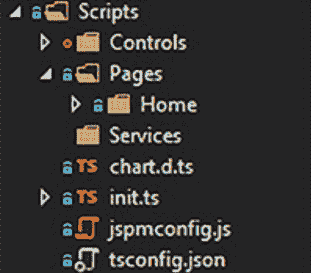

图 15-1 Scripts 目录的布局

简而言之，对待 `wwwroot` 文件夹的方式应该我们对待 `bin` 文件夹的方式一样，将其视为构建产物的临时位置。

# 要用 SPA 还是不要用 SPA？

高级开发人员的一个可靠标志是，他们在启动长期讨论之前，会对技术性问题回答“这取决于”。对于技术选择问题，很少有简单的答案。深入研究问题空间是必须的，没有任何事情是非黑即白的。

同样的概念也适用于“在我的网站上应该使用多少 JavaScript？”这个问题。这里有很多需要考虑的因素，就像一份精制的费城城芝士牛肉明治中的热量一样。这个光谱涵盖了从仅使用 JavaScript 进行简单交互、所有所有验证，到单页应用（SPA），再到所有用户交互都需要与 JavaScript 交互的实例。

服务器端应用程序是构建 Web 应用程序的一种更传统的方法。应用程序逻辑位于服务器上，服务器将页面渲染为 HTML 并传递给浏览器。这是默认 MVC 模板生成的模型。每次导航都会带用户进入完全全新的页面，与服务器的通信通常是获取新页面或提交回表单。与 SPA 相比，服务器端应用程序中客户端和服务器之间的总流量更大，这使用户体验变慢。然而，流量分布在整个会话的生命周期中。

单页应用在最初将内容传输到客户端时会消耗更大的带宽，但在用户会话的生命周期内，它们可能更高效。你可以通过操作文档对象模型（DOM），在客户端使用模板和从服务器传输的 JSON 数据的组合。

单页应用比服务器端应用程序更难创建的说法，现在看来可能有些站不住脚，尽管过去确实是这样。客户端 JavaScript 框架一直在不断改进。再次，文件应该从目录的某处复制。我们建议从 `wwwroot` 之外的 `Scripts` 文件夹开始，并在其中添加额外的文件夹用于各种类型的脚本。`Scripts` 文件夹下的具体结构可以随网站而异。如图 15-1 所示，Pages、Controls 和 Services 都是很好的选择。


图 15-1 Scripts 目录的布局

简而言之，对待 `wwwroot` 文件夹的方式应该我们对待 `bin` 文件夹的方式一样，将其视为构建产物的临时位置。

# 注意

我们已经看到了从悠久的 HTTP 1.1 协议向全新的 HTTP 2.0 的转变。该协议受到 Google SPDY 协议的启发，支持在单个连接上进行多个文件。这意味着你可能不再需要将文件合并成单个文件。这是自1999年以来 HTTP 的首次重大修订，带来了一系列改进。你可以在 https://tools.ietf.org/html/rfc7540 获取更多关于 HTTP 2.0 的信息，但也值得阅读 Poul-Henning Kamp 的观点 http://queue.acm.org/detail.cfm?id=2716278。

## 构建 JavaScript

处理 JavaScript 最简单的工具是 Bundler & Minifier 工具，它是作为 Visual Studio 扩展提供的，也是微软推荐的 ASP.NET 项目使用的工具。Bundler & Minifier 牺牲了一些功能和活性来换取易用性。在大多数情况下，只需要右键点击文件，选择 Bundler & Minifier，然后选择 Minify File 即可。

当选择多个文件时，还有一个将文件合并在一起的选项。Bundler & Minifier 从 `bundleconfig.json` 获取配置，该文件基本上列出了源和输出之间的映射。默认的 `bundleconfig.json` 文件如下所示：

点击此处查看代码图像

```json
{
  "outputFileName": "wwwroot/css/site.min.css",
  "inputFiles": [
    "wwwroot/css/site.css"
  ]
},
{
  "outputFileName": "wwwroot/js/site.min.js",
  "inputFiles": [
```


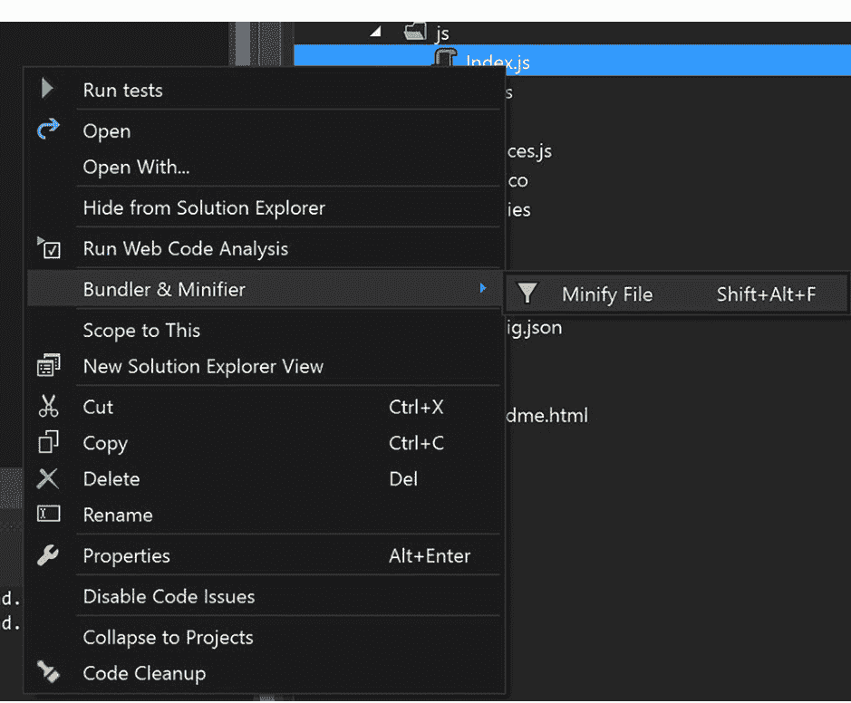

```json
"wwwroot/js/site.js"
],
"minify": {
  "enabled": true,
  "renameLocals": true
}
```

`Bundler & Minifier` 的优点之一是它可以很容易钩入到 `.NET Core` 命令行工具中。这允许你运行如下命令：

```bash
dotnet bundle
```

该命令读取 `bundleconfig.json`，并处理指定的合并和压缩任务，以创建输出文件。`Bundler & Minifier` 还具有监控文件的功能，以便在保存时自动重新生成输出文件。

我们建议不要在最简单的应用程序之外的任何地方使用此工具，因为该工具具有局限性，而且不是标准的 `JavaScript` 工具。`Node`、`Go` 或 `Elixir` 社区中没有人转向 `Bundler & Minifier` 工具，因为那里有更先进（即使不那么复杂）的工具可用。使用功能完整的 `JavaScript` 构建工具可以完成许多事情，而这些是 `Bundler & Minifier` 无法实现的。

## Grunt

`Grunt` 是第一个获得显著市场份额的 `JavaScript` 构建工具。它用 `JavaScript` 构建，并可以利用其他 `JavaScript` 库来执行许多操作。它也被标记为“`JavaScript` 任务运行器（`Task Runner`）”，意味着它不仅仅是处理 `JavaScript`。它有用于操作 `CSS`、代码检查、单元测试和压缩图片的插件。事实上，它几乎有 6000 个插件，因此其生态系统非常成熟。

要开始使用 `Grunt`，你需要使用 `npm` 安装它。可以通过以下命令进行全局安装：

```bash
npm install -g grunt-cli
```

这实际上是安装了 `npm` 来查找并运行你的 `Gruntfile`，因此你仍然需要使用 `npm` 将 `Grunt` 安装到本地项目中。

```bash
npm install -save-dev grunt
```

这在你的 `package.json` 文件中添加了对 `Grunt` 的依赖。在这个示例中，让我们也安装 `grunt-ts`。这是一个用于构建 `TypeScript` 文件的 `Grunt` 任务。我们将在本章稍后的部分讨论 `TypeScript`，但相信我们，它非常棒。

```bash
npm install -save-dev grunt-ts
```

在 `grunt` 任务安装并就绪后，我们可以构建一个名为 `Gruntfile.js` 的非常简单的文件，用于管理 `Grunt` 的运行。

```javascript
module.exports = function(grunt) {
  grunt.initConfig({
    ts: {
      default: {
        src: ["**/*.ts", "node_modules/**"]
      }
    }
  });
  grunt.loadNpmTasks("grunt-ts");
  grunt.registerTask("default", ["ts"]);
};
```

在这里，我们导出一个接收 `grunt` 对象进行操作的函数。该模块被导入到 `grunt` 中经过处理并直接使用。因为这是纯 `JavaScript`，你可以在其中编写任何有效的 `JavaScript`。在这种情况下，我们首先为 `TypeScript` 或 `ts` 设置一些配置。我们使用了 `src` 属性来定义在编译中使用的文件通配符。`node_modules` 目录中的任何内容都会被忽略，任何结尾的文件都会被包含。

接下来，我们加载 `ts-library`，它提供了通过 `ts` 任务将 `TypeScript` 编译为 `JavaScript` 的实际功能。最后，我们注册默认任务，使其依赖于 `ts`。现在我们可以从命令行运行此命令。

```bash
grunt
Running "ts:default" (ts) task
Compiling...
Cleared fast compile cache for target: default
### Fast Compile >>Scripts/chart.d.ts
### Fast Compile >>Scripts/Controls/MetersSkied.ts
### Fast Compile >>Scripts/Controls/MetersSkiedLoader.ts
### Fast Compile >>Scripts/init.ts
### Fast Compile >>Scripts/Pages/Home/Blah.ts
### Fast Compile >>Scripts/Pages/Home/Index.ts
Using tsc v1.8.10
```

`TypeScript` 编译完成：6 个 `TypeScript` 文件花费 1.86s。

完成。

我们可以看到许多从 `TypeScript` 编译为 `JavaScript` 的文件。随后的构建步骤可能会将这些文件汇成单个文件并移动到 `wwwroot` 中。

## gulp

对 `Grunt` 的抱怨之一是它会留下很多中间文件。`JavaScript` 可能需要许多步骤，在每个步骤之后，`Grunt` 都会留下文件以便稍后清理。`gulp` 就是这个问题的答案。`gulp` 基于流（streams）的概念。构建过程中的每一步都是一个流，我们可以引导此流通过通过多个管道（pipes），如图 15-3 所示。

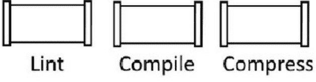

图 15-3 构建流水线

管道中每个步骤的输出被作为管道中下一个步骤的输入，因此没有临时文件写入磁盘。

流对于通用构建来说是一个极佳的模型，流的比喻在问题领域非常常用。`gulp` 是像 `Grunt` 一样丰富的生态系统。它有数千个插件，目前超过 2500 个。再次，用于控制 `gulp` 的文件是一个简单的 `JavaScript` 文件，因此它可以包含任何有效的 `JavaScript`，并可以依赖 `npm` 中包含的更大的模块社区。

让我们来看一个基础 `gulp` 文件并扩展它以执行我们所有的构建步骤。

```javascript
var gulp = require("gulp")
var rename = require("gulp-rename2")
var typescript = require("gulp-typescript")

var webroot = "wwwroot/"
var sourceroot = "Scripts/"

var paths = {
  ts: sourceroot + "**/*.ts",
  tsFiles: sourceroot + "**/*.ts",
  jsDest: webroot + "js"
}

gulp.task("typescript", function() {
  return gulp.src(paths.ts)
    .pipe(typescript())
    .pipe(rename((file) => {
      file.path = file.path.replace(".ts", ".js")
    }))
    .pipe(gulp.dest(paths.jsDest));
});

gulp.task("default", ["typescript"]);
```

```bash
npm install -g webpack
```

与 `Grunt` 不同，这实际上安装了完整的 `WebPack`，因此你不需要在本地安装额外的工具来运行 `WebPack`。不过，你确实安装一个插件来执行 `TypeScript` 编译：

```bash
npm install ts-loader --save
```

现在你可以为 `WebPack` 创建一个名为 `webpack.config.js` 的构建文件了：

```javascript
module.exports = {
  entry: './Scripts/Init.ts',
  output: {
    filename: 'wwwroot/js/site.js'
  },
  resolve: {
    extensions: ['.webpackjs', '.js', '.ts', '.js']
  },
  module: {
    loaders: {
      test: /\.ts$/, loader: 'ts-loader' }
    }
  }
}
```

这个文件非常有意思，之处不在于它包含了什么，而在于它没有包含什么。这里的内容比等效的 `gulp` 文件少得多。`WebPack` 文件根据扩展名定义了几条规则。例如，`module` 部分定义了用于匹配正则表达式 `.ts$`（任何以 `.ts` 结尾的文件）的工具：这些都指向了 `TypeScript` 插件。下一个需要注意的点是，我们定义了应用程序的入口点。从这个基础位置，`WebPack` 会探索包含的模块，以便确定将哪些文件包含在输出中。例如，我们输入入口点 `init`，它包含了 `home/index.ts`，而后者又包含了 `home/blah.ts`。`WebPack` 能够确定需要包含的文件，并包含了 `init.ts`、`home/index.ts` 和 `home/blah.ts`，同时忽略了我们在项目中使用 `import` 语句分散的许多 `.ts` 文件。`WebPack` 能够从你的生产环境 `JavaScript` 文件中删除死代码。

假设在构建 `TypeScript` 并将其合并为单个文件之外，我们还想压缩 `JavaScript`。这可以通过简单包含 `UglifyJsPlugin` 来。为了做到这一点，我们需要将 `WebPack` 安装到本地的 `node_modules` 目录。

```bash
npm install webpack
```

接下来，我们需要将其引入 `webpack.config.js` 文件中，并将其添加到 `plugins` 部分：

```javascript
var webpack = require('webpack');
module.exports = (
  entry: './Scripts/Init.ts',
  output: {
    filename: './wwwroot/js/site.js'
  },
  resolve: {
    extensions: ['', '.webpack.js', '.web.js', '.ts', '.js']
  },
  plugins: [
    new webpack.optimize.UglifyJsPlugin()
  ],
  module: {
    loaders: {
      test: /\.ts$/, loader: 'ts-loader' 
    }
  }
);
```

这就是在我们的项目中包含压缩功能所需的所有内容了。

`Webpack` 是一个强大的工具，但其内部运作有些晦涩。这类工具在你遵循标准方式进行操作时通常很好用，但只要你一偏离了正轨并开始挣扎，它们就会变成束在你脚踝上的脚链。`Webpack` 的棒之处在于，它允许将 `gulp`（或实际上任何 `JavaScript`）引入构建过程。`Webpack` 的另一个非常有趣的特性是，它支持将 `JavaScript` 加载到运行的网页中。这使得开发复杂的单页应用变得容易得多，因为你再也不需要每次修改 `JavaScript` 时重新加载整个页面。

## 哪种工具适合我？

无法说哪种工具适合你的团队，因为每种工具都有其优缺点。`Alpine Ski` 团队在工作中使用 `gulp`。`Webpack` 虽然很棒，但对他们来说稍微有点太“魔法化”了，而且基于流的方法似乎比 `gulp` 的方法更自然。很有可能等本书出版时，所有这些工具都已经淡出了 `JavaScript` 领军者的视野，并被新事物所取代。`JavaScript` 开发是周围范围内移动最快的技术，这可能不是一件好事。不要被新新技术太分分心。像 `Gulp` 和 `gulp` 这样经过实战检验的工具是非常有可言的。（注：原文写为 "`gulp` and `gulp`"，可能是对 `Gulp` 和另一种工具的笔误）。

## TypeScript

我们在本章中提到了几次 `TypeScript`，但没有定义它究竟是什么。现在是时候改变这种认知了。`TypeScript` 是一种编译为 `JavaScript` 的语言。在这方面，它与众名的 `CoffeeScript` 非常相似，但与 `CoffeeScript` 不同，`TypeScript` 是 `JavaScript` 的超集。这意味着任何有效的 `JavaScript` 在语法上自动都是有效的 `TypeScript`。但 `TypeScript` 不仅仅是 `JavaScript` 的简单超集，它添加了一些非常实用的功能。我们喜欢把 `TypeScript` 视为二合一的工具：一个非常完整的 `ES2015` 到 `ES5` 编译器，以及一个具有类型推断能力的类型检查器。

## ES2015 到 ES5 编译器

`ECMAScript`（`ES`）是通常被称为 `JavaScript` 的语言标准。`JavaScript` 是一个发展非常的社区，多年来一直受到 `JavaScript` 自身极缓慢演进速度的限制。在过去的几年里，这种发展加速了。`ES2015` 于 2015 年发布，对 `JavaScript` 定义了大量的改进。计划是每年发布一个新版本的 `JavaScript`，并以其通过的年份命名。确实有一个 `ES2016`，并且已经制定了 `ES2017` 的计划。`ES2016` 是一个相当微小的发布，我们通常继续称之为 `ES2015` 或 `ES6`，后者是不受待的。

遗憾的是，并不是所有浏览器都能运行新的 `ES2015`。

# 类型系统

用于分类语言的众多维度之一是类型系统。强类型语言会在编译时对类型进行编译类型检查，这意味着如果你尝试对整数执行类似 `replace` 的字符串操作，编译器就会停止。此类语言的示例有 `F#`、`Java` 和 `C#`。动态类型语言处于光谱的另一端，它们仅在运行时进行检查。动态语言完全不在乎对象看起来什么样，而是关注它是否具有你正在调用的特定方法。`JavaScript` 是一种动态类型语言，`Ruby`、`Python` 和 `PHP` 也是。

在动态类型语言中构建大型复杂的应用程序是完全可能的。然而，能够在编译或编辑阶段获得关于问题的建议有时是很好的。通常情况下，在运行时之前解决问题比在运行时更廉价、更容易，我们越能在过程中尽早地移动错误检测，就越好。`TypeScript` 在原生 `JavaScript` 之上增加了类型系统，而且在某种程度上，它几乎没有额外的摩擦。

让我们考虑一个相乘两个数字的函数：

```javascript
function multiply(one, two) {
  return one * two;
}
```

在到达运行时之前，编写 `multiply(2,"elephant")` 是没有问题的，直到那时你会得到 `NaN`。然而，通过添加 `one` 和 `two` 是数字的注解，`TypeScript` 能够抛出一个错误：

```typescript
function multiply(one: number, two: number) {
  return one * two;
}
```

编译期间抛出的错误是“类型 `'string'` 的参数无法赋值给类型 `'number'` 的参数”。这似乎是一个相当小且微不足道的例子，但随着你构建越来越复杂的应用程序，类型系统的用很快就会显而易见。并不是每个变量都需要分配类型。对于某些变量，编译器可以推断出它们的类型，对于这些变量，`TypeScript` 假设它们是 `any` 类型，这意味着它不会对其进行任何检查。

如果你必须使用一个库（例如 `d3`），你可能会发现定义文件很有用。定义文件类似于 `C` 中的头文件，它定义了库拥有哪些函数以及所有的输入和输出类型。几乎每个 `JavaScript` 库都有定义文件，以确保你正确地与库交互。例如，`Alpine Ski House` 团队依赖了 `chart.js`，并构建了一个定义文件来检查他们是否正确地调用了图表函数。定义文件的片段如下：

```typescript
interface Chart {
  Line(data: LinearChartData, options?: LinearChartOptions): LinearInstance;
  Bar(data: LinearChartData, options?: BarChartOptions): LinearInstance;
  Radar(data: LinearChartData, options?: RadarChartOptions): LinearInstance;
  PolarArea(data: CircularChartData[], options?: PolarAreaChartOptions): CircularInstance;
  Pie(data: CircularChartData[], options?: PieChartOptions): CircularInstance;
  Doughnut(data: CircularChartData[], options?: PieChartOptions): CircularInstance;
}
```


这是`Chart`接口的定义，正如你所看到的，每个参数都被分配了类型。这些确保了所有要求的参数都已填充，并且它们都使用了正确的值。

作为额外的奖励，使用 TypeScript 可以在编辑器中实现更好的自动补全。这是 Visual Studio Code 编辑器的一个示例，不仅是`chart`对象后的函数，还有参数的细节。这可以在[图 15-4]中看到。

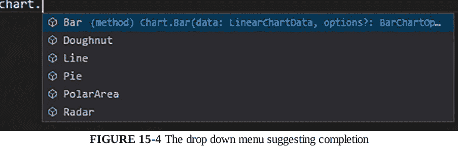

## 退出成本

在采用新技术时，如果团队决定该技术不是正确的解决方案，考虑放弃该技术的成本是非常重要的。TypeScript 的美好之处在于退出成本实际上几乎为零。只需将所有`.ts`文件编译为`.js`并删除`.ts`文件即可。生成的代码非常可读，甚至可以保留注释。实现 TypeScript 的成本也很低。因为所有 JavaScript 在语法上都是有效的 TypeScript，所以许多文件可以通过将它们从`js`重命名为`ts`来转换。

你可能会注意到我们强调的是`validate` TypeScript而不仅仅是`valid` TypeScript。这是因为 TypeScript 编译器会对你 JavaScript 中任何它可以处理的部分进行类型检查。编译器可以发现你 JavaScript 中你甚至不知道它们存在的 bug！

TypeScript 的安装就像运行以下命令一样简单：

```
npm update -g typescript
```

当然，如果你正在使用上一节提到的构建工具之一，你已经见过如何编译 TypeScript 了。TypeScript 是 JavaScript 的一个极好的补充，为任何 JavaScript 代码库提供了工具支持。

## 模块加载

在上一节中，我们提到用于 Alpine Ski House 的 TypeScript 编译器被设置为生成`system.js`风格模块。这是因为团队已经确定使用`system.js`模块加载器来引入相应的 JavaScript 文件。模块加载器提供了根据需要汇总多个单独 JavaScript 文件的能力。对于大多数用途，模块可以简单地被 VB 或 C# 类的 JavaScript 等价物。

System.js 是一个库，提供了从磁盘上的单个文件或从单个合并文件进行模块加载的功能。加载器跟踪哪些模块已从服务器获取，这样只需导入一次模块就不会产生额外的网络请求。开始使用 system.js 只需要包含该库然后使用它来获取文件即可。

```
<script src="js/system.js"></script>
<script src="js/jsp.js"></script>
<script>System.import("Pages/Index")</script>
```

System.js 和 jspm 设计为协同工作，但它们当然不是该领域内唯一的工具。Require.js 也是一个非常流行的加载器。Alpine Ski House 团队决定采用 System.js 和 jspm 的组合，是因为它们的无缝特性以及通常良好的支持。

Jspm 是 JavaScript 的包管理器。在许多方面它类似于 npm，然而 jspm 也可以直接从 GitHub 拉取库，确保你拥有最新的库。要开始使用 jspm，我们需要从 npm 安装它：

```
npm install jspm -g
```

在全局安装 jspm 后，我们可以遵循与设置项目相似的步骤：

```
jspm init
```

这会询问许多问题以生成一个`jspm.config`文件，该文件包含了（其他内容）我们之前看到的`js`前缀。现在安装包只需要运行以下命令一样简单：

```
jspm install chartjs
```

这输出：

```
Updating registry cache...
Looking up github:chartjs/Chart.js
ok installed chart as github:chartjs/Chart.js^2.2.2 (2.2.2)
ok tree has no forks.
ok Install complete.
```

你可以使用 jspm 或其他构建工具之一将 JavaScript 资源合并成一个文件。如果你的客户端和服务器都支持 HTTP 2，然而你可能只需允许 system.js 按需下载文件。

在示例中，可以通过以下方式加载 chart：

```
<script>System.import("chart").then(function(chart) {
//使用 chart 执行操作
});</script>
```

或者，如果你在 TypeScript 文件中：

```typescript
import Chart from "chart";
```

## 选择框架

如果你认为 JavaScript 社区中可用的模块类型、包管理器或构建工具的数量令你望而生畏，你可能需要这一节。有数以千计的 JavaScript 框架可以选择，包括 Angular、React、Aurelia、Backbone、Meteor 等。决定使用哪一个绝不是一件容易的事。仅仅列出选择时要考虑的因素就足以填满章。你可能需要考虑采用率、技能帮助的可用性、稳定性、年龄、功能、速度、可维护性和跨浏览器支持。或者，你可以采取大多数初创公司的方法，选择在 Web 开发 reddit 上出现频率最高的那一个。

出于 Alpine Ski House 的目的，团队决定使用 React Web 库配合 RefluxJS 单向数据流库。React 是一个非常流行的库，由 Facebook 支持并在其内部被广泛使用。

一种面向对象的框架，专注于组合自定义标签。它是一个极简主义的库，与 AngularJS 不同，因此必须与 RefluxJS 等其他工具配合。

React 与 TypeScript 配合得非常完美。新版本的 TypeScript 支持`.tsx`文件。你可能会问：“什么是`.tsx`文件？”其实，它仅仅是`.jsx`文件的 TypeScript 版本。“什么是`.jsx`文件？JSX 是 JavaScript 和 XML 的一种奇特混合，在 React 社区非常流行。例如，你可以在 React 中这样定义一个数字输入框：

```javascript
function() {
  return (<div>
    <label for={this.state.controlName}>{this.state.label}</label>
    <input type="number" name={this.state.controlName}/>
  </div>>);
}
```

代码看起来非常奇怪，但在你习惯之后，React 和 JSX 是极其高效的工具。TypeScript 理解这种语法，并可以为嵌入 HTML 内部的属性提供类型检查。

Alpine Ski House 团队从一开始就决定避免使用 jQuery。对许多人来说，这是一种异端思想。不使用 jQuery 编写网站？令人震惊。事实是，jQuery 填充了旧浏览器在功能上的巨大空白。然而，JavaScript 在添加此类功能方面已经取得了长足进步，例如`querySelector`是 JavaScript 功能性能好得多的版本。


> 不想用 jQuery？那么 http://youmightnotneedjquery.com/ 绝对适合你。该网站不仅提供了常用 jQuery 函数的纯 JavaScript 等效方案，还提供了可以使用更小、更粒度库的建议。

## 总结

本章以及实际上是整本书的空间不足以完全探索 JavaScript 生态系统的每一个角落。更令人担忧的是，没有任何书能以足够及时的方式编写而不至于在墨水干透时就显得极度过时。JavaScript 的发展速度比我们见过的任何编程语言和生态系统都要快。然而，它是任何 Web 开发工作中不可或缺的一部分。处理 JavaScript 时，也许最好的建议是参考 J. R. R. 托尔金的作品。

> “凡金者皆闪光”

对你的项目来说最好的 JavaScript 工具可能不是那些闪闪发光的 JavaScript 酷典，而可能是更稳固、支持更好的库和工具。无论你选择什么，令人欣慰的是，ASP.NET Core 在遵循 JavaScript 最佳实践方面迈出了巨大步伐。我们不再有运行时编译的 JavaScript 包或像 update panels 这样荒谬的抽象。JavaScript 终于成为了一等公民。在下一章中，我们将介绍依赖注入以及使用它的许多好处。

# 第 16 章 依赖管理

开发进展很快。构建版本每天发布到测试环境的多达 20 次。当开发团队以问题出现的速度解决问题时，Bug 只在二三个问题上徘徊。Danielle 对她学到的所有东西感到非常高兴。她晚上回到家里看博客、看视频。像 Marc 那样的人的热情非常有感染力。而且不仅仅是她。团队中没有一天不是有人发现某些酷炫的新库、工具或概念，他们觉得这些东西会让事情变得更好。

“你看过这个 GenFu 库吗？”Arjun 在周三问道。“它只需通过查看我们的类名就能生成真实的测试数据。看！”Arjun 刷新了浏览器，弹出一个滑雪员列表。“看，它为这个滑雪员填充了 Lionel Penuchot 这个名字，这可能是真人的名字。加拿大团队会喜欢这个的。我去检查这个包！”

Danielle 思考了一秒。她上周不是读到过关于提交依赖的内容吗？“等等，Arjun，我不认为我们需要把那个文件提交进去。我们只需要把它列为依赖即可。”

“噢不不，”Arjun 叫道，“我在一个项目上这样做过，结果大家手里都有同一个库的不同版本，什么都无法运行，每个人都被解雇了，最后住在房车里，顺着河漂…………最后部分可能没发生，但这仍然是个糟糕的主意。”

“不，不，听我解释。我前几天晚上正读到关于这个 NuGet 之类的东西。它可以处理我们所有的依赖，甚至能通过传递闭包（transitive closures）处理依赖的依赖。”

“传递闭包？你是说传递闭包（Transitive Closures）吗？”Arjun 问。“我不知道存在这种东西。如果可以用它就太棒了。你觉得 JavaScript 也有类似的工具吗？”

“你不知道，但我敢打赌有。让我们查查。”

现在比以往任何时候都一样，我们的应用程序由许多小组件组成。通常，这些组件是由其他开发者编写的库，并被成千上万的应用程序使用。过去，开发者下载库并将库与应用程序源代码一起提交到版本控制是很常见的。这个过程很快变得繁琐，特别是当库开始依赖其他库的特定版本时。更新到特定库的新版本变得特别困难——你可能会意外破坏依赖链中的另一个库。包管理器被用于自动化安装包的过程，确保任何依赖包都已安装，并在新版本可用时提供相同的更新包方法。

典型的 ASP.NET Core 应用程序至少使用两个包管理器：用于 .NET 包的 NuGet 和另一个用于 jQuery、Bootstrap 等客户端包的包管理器。关于客户端包管理器有几种选项，我们将讨论。

## NuGet

NuGet 是一个用于 .NET 的开源包管理器，随 Visual Studio 一起发布并深度集成。在编写时，NuGet 拥有超过 60,000 个包。

## 使用 NuGet 安装包

在 ASP.NET Core 中安装 NuGet 包的方法。一种是编辑`project.json`文件。例如，`AlpineSkiHouse.Web`的`project.json`列出了对`MediatR 2.1`版本的依赖。

从命令行安装包，执行`dotnet restore`命令以安装`project.json`中列出的所有包。Visual Studio 在保存时会自动执行`dotnet restore`。

## Visual Studio 工具

项目的 NuGet 包可以在解决方案资源器的 Reference 节点下看到，如图 16-1 所示。

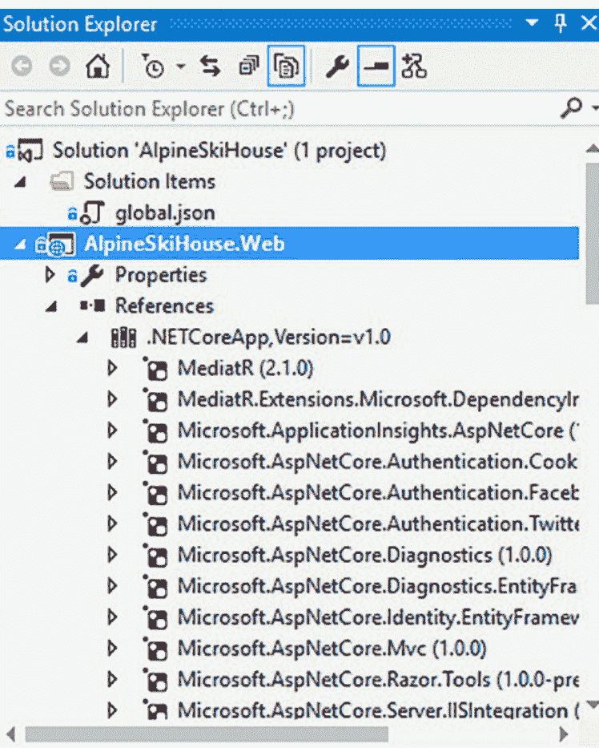

**图 16-1** 显示 NuGet 包的截图

```json
"dependencies": {
  // 其他依赖省略
  "MediatR": "2.1.0",
  "MediatR.Extensions.Microsoft.DependencyInjection": "1.0.0"
}
```

Visual Studio 中的 NuGet 包管理器工具（如图 16-2 所示）允许你从 NuGet.org 浏览包、查看已安装包并更新已安装包。通过右键点击解决方案资源管理器中的项目并选择管理包，可以管理单个项目的 NuGet 包。管理整个解决方案的 NuGet 包，右键点击解决方案资源管理器中的解决方案节点并选择管理包。

## NuGet Feeds

NuGet Feed 是托管 NuGet 包的所在地。在大多数情况下，我们从公共的 nuget.org feed 引用 NuGet 包，但也可以从其他源获取包。大型组织倾向于将 NuGet 包的范围限制在一组预先批准的包上，在这种情况下，可以托管一个仅包含其预先批准包的内部 NuGet Feed。另一个常见用例是公司使用私有 NuGet Feed 在组织内部分发专有包。

托管自己的 NuGet Feed 听起来可能有些大材小用，但实际上操作非常简单，而且非常值得。为组织限制批准包的列表可以防止开发者下载已知会导致问题或缺乏支持及适当更新的包。目前有一套令人印象深刻的托管和付费解决方案。MyGet ([http://myget.org/](http://myget.org/)) 是流行的托管服务，用于 ASP.NET 托管每日构建。请参阅 [NuGet 生态系统](https://docs.nuget.org/Contribute/Ecosystem) 以获得一些较流行产品的概述。文章列出的许多选项都可以与 NPM 和 Bower 等其他包管理器配合工作。

## npm

npm 是 Node.js 的包管理器。你可能会问自己：“为什么在写专门编写 ASP.NET Core 应用的书书中讨论 Node.js ？”当你观察 Web 开发格局时，Web 开发人员的大量工具实际上是用 Node.js 包编写的，并使用 npm 分发的。这些工具包括 TypeScript 编译器、gulp 和任务运行器以及 Jasmine JavaScript 框架。正如你在第 15 章“JavaScript 的角色”中所看到的，JavaScript 是所有现代 Web 应用的重要部分。访问开发者在 ASP.NET 世界之外使用的工具是非常重要的，因为这有助于确保你不会与更大的开发者社区脱节。

npm 是一个命令行工具。要在我们的应用程序中使用 npm，首先要创建一个`package.json`文件。你可以手动创建该文件，也可以使用`npm init`命令，它会向你提几个问题并创建一个引用 Jasmine 单元测试框架和 Karma 单元运行器的`package.json`文件。这是一个基础示例，在第 19 章“测试”中将花更多时间配置 Jasmine 和 Karma。

```json
{
  "name": "alpineskishouse",
  "version": "1.0.0",
  "description": "",
  "private": true,
  "main": "gulpfile.js",
  "dependencies": {},
  "devDependencies": {
    "jasmine": "2.5.0",
    "karma": "1.2.0",
    "author": "Alpine Ski House"
  }
}
```

我们在`devDependencies`中列出想要使用的包，因为这些包不是我们希望作为应用程序的一部分发布的包，而是开发者将用来帮助编写应用程序的工具。我们还设置了`"private": true`，这确保了应用程序不会意外发布到公共 npm 注册表。


## Note

运行`npm install`命令会恢复`package.json`文件列出的所有依赖项。默认情况下，所有列出的依赖和`devDependencies`都会下载到当前项目名为`node_modules`的文件夹中。

## 添加依赖项

可以直接编辑`package.json`文件或通过调用`npm install`命令并指定包名和`--save-dev`标志来添加新的依赖项。请注意，还有一个`--save`标志（此处）会将包添加到`package.json`的`dependencies`部分。该标志用于添加运行时依赖项。

```bash
npm install karma --save-dev
```

npm 的默认行为是将依赖项添加到指定包的最新稳定版本。如果你的应用程序需要包的特定版本，请手动编辑`package.json`文件，或者在调用`npm install`命令时通过在包名后添加`@x.x.x`来指定版本。

## 使用 npm 模块

许多 npm 模块包含命令行界面，你可以直接从命令行使用它们，而无需进入 Node 运行时。一个很好的例子是 Karma 测试运行器，它包含一个命令行界面 karma，可运行单元测试。可以通过使用`-g`标志在开发者机器或构建服务器上全局安装此类工具。

```bash
npm install karma -g
```


全局安装包比我们想象的要复杂，特别是对于新开发者来说。理想情况下，新开发者只需运行`npm install`即可获得必要的命令。npm 通过在`node_modules/.bin/`文件夹中本地安装工具来实现这一点，即使 Karma 工具在开发者的全局路径中不可用，也可以从`./node_modules/.bin/`引用它。

```bash
node_modules/.bin/karma start
```

我们可以通过在`package.json`文件中定义 npm 脚本让这一切变得简单：

```json
{
  "name": "alpineskishouse",
  "version": "1.0.0",
  "description": "",
  "private": true,
  "main": "gulpfile.js",
  "dependencies": {},
  "devDependencies": {
    "jasmine": "2.5.0",
    "karma": "1.2.0"
  },
  "author": "Alpine Ski House",
  "scripts": {
    "test": "node_modules/.bin/karma start"
  }
}
```

另一种方法是检查`node_modules`目录，但有数千个文件，而且通过更新包在 git 历史中产生巨大的变化并不是我们希望的。问题在于 npm 不会创建包的本地缓存，因此每次构建都需要访问包注册表。

多年来，我们饱受了 npm 这些缺陷的困扰，但随着新的 Yarn 包管理器的引入，那些日子可能结束了。这个包管理器几乎可以在不作更改的情况下替换 npm。Yarn 是 Facebook、Exponent、Google 和 Tilde 的项目，旨在解决 npm 的缺点。Yarn 提供的第一个功能是为项目提供确定性的包安装。无论包的安装顺序如何，`node_modules`中生成的包树将保持相同。Yarn 还会并行运行多个下载和安装，并对失败的任务进行重试。这在加快安装速度的同时也增加了鲁棒性。

安装 Yarn 只需运行以下命令：

```
npm install -g yarn
```

现在可以通过删除`node_modules`目录并运行以下命令在现有的`package.json`文件上使用 Yarn：

```
yarn
```

添加包不再需要使用`--save`或`--save-dev`，因为它们会被自动保存。可以添加`--dev`标志将其保存到`dependencies`部分：

```
yarn add jquery
yarn add gulp --dev
```

Yarn 能力的秘密在于一个名为`yarn.lock`的新文件。此文件应该包含在版本控制中，以确保所有用户获得相同的版本。锁文件的片段如下：

```
mkdirp@0.5.0, mkdirp@0.5.1, "mkdirp>=0.5 0", mkdirp@0.5.0, mkdirp@0.5.1,
version "0.5.1"
resolved "https://registry.yarnpkg.com/mkdirp/--mkdirp-0.5.1.tgz#3005738ac6cf7bc4767f38648d6697d5c903
dependencies:
minimist "0.0.8"
```

这列出了名为`mkdirp`的包使用的版本。第一行列出了`mkdirp`的多个版本，其中每一个版本都列在我们包树的某个包中。Yarn 已经看到了所有这些版本并将它们解析为单个版本，该版本可以满足所有要求的版本。

Yarn 解决了 npm 的许多缺点。然而，要判断 Yarn 是否会获得更广泛的接受还时过早。将 Yarn 升级到 npm 的便利性、速度的提升以及确定包安装都是非常有吸引力的，因此它更有可能被采用。

# Bower

ASP.NET Core 使用 Bower 作为客户端库的默认包管理器。客户端库由最终发送到客户端浏览器的资产组成。这些资产通常是 JavaScript 和 CSS（如 jQuery 和 Bootstrap 例），但它们也可以包含其他资产，如图像、字体和图标。大型 Web 应用程序使用几十个客户端库并不罕见，因此拥有一个良好的包管理器是非常重要的。

# 为什么选择 Bower？

在之前的 ASP.NET 版本中，客户端库是使用 NuGet 分发的，遗憾的是，NuGet 并不适用于客户端包管理。一个大问题是，客户端库是由更广泛的 Web 开发社区创建和使用的。由于 .NET 开发社区仅占整个社区的一小部分，客户端库的作者可能没有任何 .NET 经验，不能指望他们学习 NuGet 的复杂性，或专门为 .NET 开发者维护 NuGet 包。在许多情况下，微软社区的热心开发者会尝试代表作者维护 NuGet 包，但事实证明这样做是繁重且容易出错的。结果通常是，流行客户端库的 NuGet 包要么不可用，要么已经过时。

与其尝试在 NuGet 中维护客户端包，不如 ASP.NET Core（尤其是 Visual Studio）对 Web 开发者社区常用的包管理器提供了极佳的支持。Bower 就是其中一个包管理器，而且恰好是默认 ASP.NET Core 模板所使用的包管理器。

Visual Studio 拥有一些出色的工具可以帮助处理 Bower 的复杂性，但让我们先从如何从命令行使用 Bower 开始。Bower 是一个基于 node 的命令行工具，通过 npm 安装。你可以使用以下命令进行全局安装：

```
npm install -g
```

使用 Bower 时，包定义在`bower.json`文件中。可以手动创建此文件，也可以使用`bower init`命令。

```json
{
  "name": "alpineskihousehouse",
  "private": true,
  "dependencies": {
    "bootstrap": "3.3.6",
    "jquery": "2.2.0",
    "jquery-validation": "1.14.0",
    "jquery-validation-unobtrusive": "3.2.6"
  }
}
```

名称 "alpineshouse" 用于识别你当前的包，`private`标志被设置为确保应用程序不会意外发布到 Bower 包注册表。库作者不应将`private`标志设为`false`。应用程序使用的库列在`dependencies`部分。每个库都有关联的版本。要安装`bower.json`文件中列出的所有包，请调用`bower install`命令：

```
bower install
```

默认情况下，所有列出的依赖项都会下载到当前项目的`bower_components`文件夹中。可以通过指定不同的位置来覆盖此位置。在 Ski House 项目中，我们将位置更改为`wwwroot/lib`：

# .bowerc 文件的内容

```json
{
  "directory": "wwwroot/lib"
}
```

# 添加依赖

向新包添加依赖，可以手动编辑`bower.json`文件，也可以调用`bower install`命令并指定包名和`--save`选项。

```
bower install --save
```

与 npm 类似，Bower 会添加包的最新版本。如果需要特定版本，可以使用`--save-exact`。

```
bower install --save-exact
```

# 引用 Bower 包中的资产

在调用`bower install`后，所需的资源位于`bower_components`目录可用（在我们的情况下，是`wwwroot/lib`目录）。我们可以像引用其他脚本或样式表一样在应用程序中引用它们。每个 Bower 包的文件位置各异，但许多包遵循将重要文件放在`dist`文件夹的惯例。

```html
<html>
<head>
  ...
  <link rel="stylesheet" href="~/lib/bootstrap/dist/css/bootstrap.css" />
</head>
<body>
  ...
  <script src="~/lib/jquery/dist/jquery.js"></script>
  <script src="~/lib/bootstrap/dist/js/bootstrap.js"></script>
  ...
</body>
</html>
```

在生产部署中，你可能希望从内容交付网络 (CDN) 引用常用的客户端库，而不是存储在你的 Web 服务器上的版本。ASP.NET Core 提供了一组标签辅助来简化这一过程。我们在第 19 章中探索这些标签辅助。

# 总结

开发格局正在不断演变。虽然 Bower 现在作为 ASP.NET 客户端库默认包管理器很流行，但其他选项可用，并且随着时间的推移可能会变得更流行。某些开发者使用 npm 同时开发工具和客户端库，而 JSP 是另一种日益流行的 Bower 替代方案。在 NuGet 已经成熟的 .NET 世界中，像 Paket 这样的替代包管理器也在出现。

我们为 Alpine Ski House 应用选择的包管理器是基于 ASP.NET Core 默认项目模板和团队成员经验的结合。最终，大多数包管理器提供类似的功能。选择适合你团队的，如果你认为它们可能会简化你团队和应用程序的流程，不要害怕调查替代方案。在下一章中，我们将讨论如何使用样式表让应用程序的前端看起来更美观。

## 第 17 章：有风格的前端

Mark 把 Danielle 拉进了一个反复出现的回归问题的讨论中。他已经在自己的机器上修复了该问题并运行正常，但当最新的构建发布到分阶段服务器后，他的更改就像被撤销了一样。

“看到吧？”Mark 开始说道，“这儿就是我更改的提交记录！”

“是的，这很奇怪，”Danielle 回答道，“你确定你的更改已经到达构建服务器了吗？”

“确定。100% 确定。我检查了 SHA，它与之前被选取的更改完全匹配。而且，看部署到……的 CSS……”

“等一下！”Adrian 打断道，他在 Mark 旁边的隔位站了起来，“你们是在说检查样式表中的更改吗？”

“是的，”Mark 回答，“我发誓这封工单已经第三次回到我手这里了。我做了所有的更改，在本地运行正常，在我提交后也验证了它确实在那里。”

“他是对的，”Danielle 补充道，“我在他上次拉取（pull）时审查了他的代码。确实是他做了更改。但在 PR 合并后，它就像被覆盖了似的。我只是还没找到问题发生的所在。”

Adrian 宽花地笑了。“我知道，”他说。他回到椅子上坐下，滑到 Mark 和 Danielle 身边。他脸上带着兴奋的表情，等着他们其中一个人问他发生了什么。

“好了，Adrian，”Danielle 笑着说，“收起笑容来帮我们吧。是什么导致了覆盖？”

“我很高兴你们问了这个问题。”他开始搓手，“好，还记得我这周早些时候和另一个 Marc 结对编程吗？我们当时就在这样做。”

“嗯，是的……某种意义上确实，”Adrian 回答道，“我想这是我们的错，因为我们没有更新 .gitignore，但基本上仓库里不应该再有 CSS 了。”

“是的，我们对一切都进行版本控制，”Danielle 说，“我们的 CSS 也需要受版本控制吧？”

“嗯，我们的 CSS 不需要受版本控制，因为它现在是构建产物。”他脸上的笑容比之前更加灿烂。“噢，我只想说我很享受这个。你们在近一个月的时间里帮了我很多，这是我第一次给你们展示的东西。”

“行了，行了，Adrian，”Mark 说，“我会给你颁勋章的。”他们都笑了起来。“现在说说是怎么回事吧？”

“女士们、先生们，请将你们的注意力转向你们喜欢的项目 Style 文件夹下的 SCSS 文件……”

## 使用样式表构建网站

当我们最初打算写一个关于风格的章节时，我们假设我们要编写 Bootstrap CSS 框架。毕竟，Bootstrap 在 .NET 世界中非常流行，自 2013 年以来一直默认包含在模板中。然而，它是一个非常成熟的框架，已经有大量的资源涵盖了如何将其整合到应用程序中，因此，我们把重点放在这一章关于工作流的内容上。我们将讨论 Alpine 团队如何使用 CSS 并构建了作为 Bootstrap 的替代品。由于其成熟性，我们也可以将 Bootstrap 视为一个熟悉的灯标，用来模拟团队为你们的风格所尝试实现的目标。

级联样式表（CSS）的概念出现的时间几乎和浏览器出现的时间一样长。这一章并不会说服你使用 CSS，因为如果你在过去的 20 年里做过任何开发，你可能已经熟悉样式表以及它们如何影响你的开发。如果你是 Web 开发新手，你可能在没有多想的情况下就被灌输了 CSS……嗯，你可能正在以一种集体认为错误的方式在使用它，或者你仅仅只是在构建网站。

如果说有什么的话，我们希望确认你已经知道的知识，对我们为什么这样做这些事情提供一些启示，并传播关于如何在 ASP.NET Core MVC 世界中使用支持 CSS 的工具的观点。

## 追溯过去

CSS 的根源可以追溯到营销行业，在那个行业，负责通信和活动成功的人很久以前就产生了一些深刻的认识。当你根据样式指南（style guide）或样式书籍（style book）工作时，人们往往更容易接受信息，对你的品牌形成更深刻的记忆，并且如果元素很微妙，就能识别出活动的元素。当你考虑到主要的色彩品牌或快餐连锁，以及随着时间的推移，一个简单的标记甚至他们知名字体中的一个字母如何与整个品牌联系在一起时，联系很快。

在光谱的另一端，一系列在视觉上不合理的信息很难与连贯的品牌建立联系。即使是一页视觉效果不佳的单页广告，也不会受到欢迎。设计师的工作是确保信息的传递方式不会分散对信息本身的注意力。

样式书籍、样式指南或 Web 术语中所谓的样式表（style sheet）背后的想法是建立一套连贯的规则，这些规则可以用来影响内容的格式。这是内容与呈现的分离，使得设计的视觉目标可以被展示，然后一致地重复，以帮助通信的开发，无论是用于打印、电视还是网络。

它最初由 Håkon Wium Lie 在 1996 年提出建议，在过了近四年的时间，网络浏览器才实现了对 CSS 的完全支持。

CSS 由几个简单的概念组成。有选择器（selectors）帮助你识别文档元素并设置它们的显示方式。最后，是值赋值（value assignment）的概念，可以将各种类型的单位分配给元素。

我们使用 CSS 的原因很容易解释。如果你要向开发领域之外的人解释它，你可能会说：

- 假设我正在为你构建这个网站，你需要它来保持业务竞争力。你有一种想要实现的视觉效果和感觉，所以给了我颜色、字体和其他信息。你写了网站所需的所有内容，给了我 40 页文本，我们将其转换为几十个网页。每个页面都使用相同的字体、颜色和间距，在视觉上模仿你给客户的打印文档。我们创建的每个页面包含数百个元素，包括段落、列、按钮、指向其他页面的链接、菜单等，每个元素都需要带有相同的风格。为了确保所有成千上万元素遵循你设定的指南，我需要一个工具来表达这些元素必须遵循的规则。这个工具被称为级联样式表。如果一个月后，你决定从浅蓝色改为天蓝色，我可以在 CSS 中更改一次，而不是在每个页面每个边框的实例中更改。

不要太这些版本号，特别是当你看到像 CSS3 或 CSS4 这样的时候，它们并不存在。CSS3 是 W3C 的 CSS 工作组意识到整个 CSS 规范无法作为一个整体推进，因此将 CSS 2.1 之后的所有内容统称为 CSS3。现在每个组件都由一个模块（module）来表示，目前有 35 个，并且在不断增加。这对开发社区非常有益，原因有几点。

消除规则歧并帮助渲染在不同浏览器之间保持更加一致性。其次，它允许引入新模块，而无需等待工作小组对整个 CSS 的所有方面做出决定。

- 1 http://www.xanthir.com/b4Ko0

> 注意

我们不建议任何人尝试去记忆哪些浏览器支持哪些 CSS 模块，以及一个模块支持哪些功能。请查看 http://caniuse.com，你可以在那里根据浏览器、版本、国家用法以及各种切片进行搜索，查看哪些功能适合你的项目。

列表 17-1 是一个基础示例，展示了如何通过样式表来简化单个元素。这个第一个 HTML 文档的第一行包含内联样式，第二行通过使用类名对`<div>`元素应用样式。

## 列表 17-1 使用 CSS 简化 HTML 标签

```html
<div style="border: 1px solid blue; padding: 10px; color: navy;'>hello!</</div>
<div class="simple-label victory">hello!</div>
```

虽然一眼看去没有太大区别，但这个单元素演示允许我们推断出根据上述与客户讨论的场景可能需要哪些更改。对`simple-label`或`victory`的更改可以集中处理，只需在某处进行更改，就可以更新所有使用这些类的页面的每一个元素。

## 创建你自己的样式表

样式表只是文本文件，与你项目中将有的任何其他源文件一样。创建一个 CSS 文件就像添加带有 .css 扩展名的文本文档一样简单。Visual Studio 也支持通过“添加新项”对话框添加 CSS 文档，如图 17-1 所示。

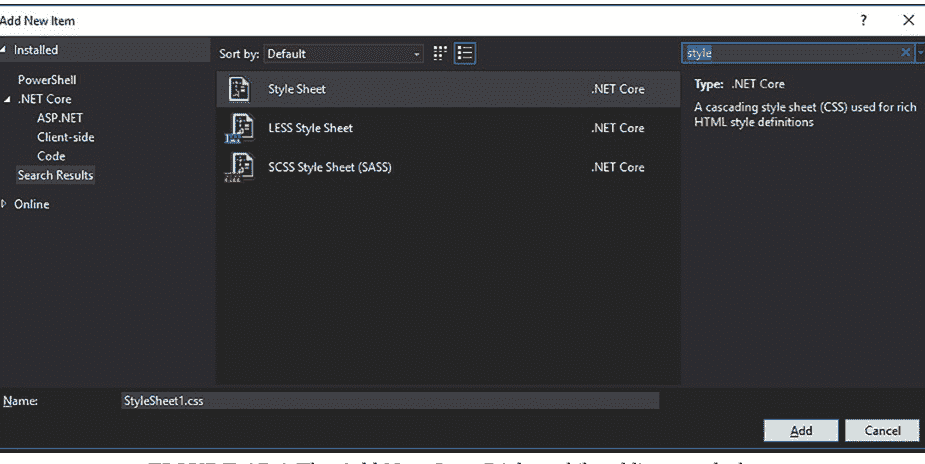

若要在页面中包含样式表，你需要添加如下所示的标记：

```html
<link rel="stylesheet" href="~/css/site.css" />
```


当你有了一个 CSS 文档并将其包含在页面中，你将想要定义一些规则以便你的页面符合设计。规则由两部分组成，如[图 17-2](#)中所示。你可以在较大的矩形中看到选择器块，在较小的矩形中看到声明块。

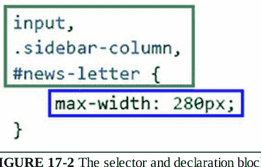

选择器块可以包含你喜欢的任意数量选择器。选择器可以是一个 HTML 元素（例如上面的 `input`）、你定义的类名（例如示例中的 `.sidebar-column`），或者是页面上存在的元素的唯一 ID（例如 `#newsletter`）。选择器还可以基于存在或不存在、子字符串匹配、层级和祖先关系，或者一种被称为伪选择器（pseudo-selectors）的特殊情况，伪选择器描述元素的状态或与其他元素的关系，例如访问过的链接，或者某个元素位于另一个元素之前或之后。你可以包含你所需的任意选择器。规则的声明包含了属性值和值，这些值被应用于任何匹配你在选择器块中包含的选择器的元素。

对文档中元素的所有规则应用都是按照特定的方式执行的。你定义规则的顺序、元素在文档中的嵌套情况、以及你在元素上应用类样式的顺序都会被考虑。这是一个被称为“特殊性”（specificity）的概念，它超出了本节的范围。

你可以在 W3C 网站此处阅读整个选择器定义，包括特殊性：https://www.w3.org/TR/css3-selectors/

在 ASP.NET Core MVC 中，你可能更有兴趣将你的样式表放入布局中，这样样式就可以在多个视图之间共享。正如第 11 章“Razor 视图”中所讨论的，你应该为不同的环境包含不同版本的样式表。使用`environment`标签允许你在生产环境中包含精简版的 CSS，同时在本地开发环境中使用人类可读的版本。

```
<environment name="Development">
  <link rel="stylesheet" href="~/css/site.css" />
</environment>

<environment name="Staging,Production">
  <link rel="stylesheet" href="~/css/site.min.css" asp-append-version="true" />
</environment>
```

再次，Razor 的魅力在这里发挥了作用，因此你可以通过结合服务注入和条件语句等内容更进一步，以确定使用哪种样式。如果你有一个白标应用（white label application），允许根据用户指定的 CSS 源进行样式设置，这提供了一个强大的机会，只需几行代码即可动态地修改你整个网站的外观。

CSS 可能会变得非常繁琐，特别是当你试图处理浏览器实现规范功能的不同方式时。创建跨多个元素或考虑浏览器特定前缀的规则集是枯燥且容易出错的。这尤其是如此，因为通常你正在构建的整体设计往往容易重复，具有相似的规则声明块，并且基于你文档中用于构建体验的层级结构。

正如应用程序开发领域的所有事物一样，当出现摩擦时，就会有人出现并构建工具来帮助缓解它。

# 让你的样式变得生动（Sassy）

多年来，很明显手动编写 CSS 是一项苦差，更重要的是，CSS 文档被拆分成了更小、更易管理的块。如今，一组被称为“CSS 处理器”（Pre-processors）的工具出现于世，其目标是以允许编程语法的方式扩展 CSS。它甚至可能说我们不再需要手动编写 CSS，因为我们可以使用“软件”为我们生成 CSS。显然，语法并不需要方便工作流，CSS 可以为 HTML 元素提供元数据，但它并不是一种编程语言。

这些工具引入了变量、继承和函数的形式，允许设计师和开发人员像处理 HTML 一样处理 CSS。与此同时，表格 17-1 显示了一些较流行的处理器。

| 处理器 | 优势 | 适用场景 |
|---|---|---|
| SASS, SCSS | 可认为是最成熟的、示例多、文档齐全、流行并在主流 CSS 框架中使用 | 可以从命令行构建或通过 Studio 工具构建，功能集足以满足大多数开发需求 |
| LESS | 允许使用浏览器处理器的更 CSS | 可以从命令行构建或通过 Studio 工具构建，足以信赖，但某些 CSS 框架正在放弃 |
| Stylus | 自动厂商前缀、超过 60 个内置函数、功能强大 | 需要 node.js 和一些工具在 Studio 中编译。学习曲线可能较高，但如果你正在构建自己的复杂框架则有利 |

**表 17-1 CSS 处理器**

市场上还有许多其他处理器，包括 PHP，其中一些为了更好地支持 Ruby on Rails 开发者，另一些仍处于婴儿阶段，但渴望填补它们在市场上感受到的空白。是 Alpine 项目中 CSS 文件的组成困住了 Mark，因为构建服务器在处理过程中会覆盖 CSS 文件。

SASS（“Syntactically Awesome Style Sheets”）是 SCSS（也称为 Sassy CSS）的前身。虽然 SASS 关注于基于缩进并忽略大括号和分号的语法，但 SCSS 是 CSS 的超集，这意味着任何有效的 CSS 文档在...

这也是一个有效的 SCSS 文档。在每个 CSS 文档中拥有有效的 SCSS，使得开发团队能够以较低的学习成本切换到 SCSS，并且这些团队可以立即从 SCSS 文件在原生 CSS 中的优势中获益。

# SCSS 基础

向项目中添加 SCSS 文件就像添加其他文件类型一样简单。事实上，回过[图 17-1]。在新文件对话框中，有一个创建一个 SCSS 文件而不是直接创建 CSS 文件的选项。你可以选择该选项，甚至只需重命名你正在编写的 CSS 文件。

# 变量

让我们开始解决开发者在处理样式表时听到的最大抱怨之一，那就是必须更新它们。如果我们考虑有一个调色板可以使用的场景，我们有一份从设计师那里获取的颜色列表。与其直接在规则中使用这些颜色，我们所做的是像[Listing 17-2]中定义的那样创建一些变量。

## Listing 17-2 在 SCSS 中将颜色定义为变量

```
$dark-border: #7a7265;
$light-background: #cecac4;
$main-text-color: #433e3f;
$primary-border-width: 2px;
```

有了这些变量，我们就可以通过它们的名称而不是十六进制值来引用颜色，正如我们在[Listing 17-3]中看到的。这样做的优势显然是，我们可以修改变量，而无需翻遍所有代码，或尝试依赖编辑器的“查找和替换”功能。

## Listing 17-3 在 CSS 代码中使用变量图像

[点击此处查看代码图像]

```
.banner-text {
  color: $main-text-color;
  background-color: $light-background;
  border: $primary-border-width $dark-border;
}
```

[Listing 17-2] 和 17-3 中的所有代码都可以出现在同一个文件中。在通过 SCSS 预处理器后，我们得到了[Listing 17-4]中的生成的 SCSS 文档。变量被替换为它们的值，从而提供了有效的 SCSS 规则。

## Listing 17-4 由 [Listing 17-2] 和 17-3 预处理生成的 CSS

[点击此处查看代码图像]

```
.banner-text {
  color: #433e3f;
  background-color: #cecac4;
  border: 2px solid #7a7265; 
}
```

# 导入与部分文件 (Partials)

你可以将这个颜色示例进一步，将调色板拆分为单独的文件。如果你假设 Listing 17-2 中的所有代码都出现在名为 `color-palette.scss` 的文件中，你就可以将其包含在我们的主 SCSS 文件中，如[Listing 17-5]所示。我们在调色板名称前加上一个下划线，将其标记为部分文件（partial）。这样，预处理器就知道它不应该尝试从它构建 CSS 文件。

## Listing 17-5 导入一个 SCSS 部分文件

[点击此处查看代码图像]

```
@import 'color-palette';

.banner-text {
  color: $main-text-color;
  background-color: $light-background;
  border: $primary-border-width solid $dark-border;
}
```

这种方法与设计师共享调色板，使颜色独立地进行版本控制。我们可以在调色板最终确定之前继续开发我们的 SCSS 规则，并在需要时将其包含在许多源中，同时依赖变量而不必担心我们的最终值是什么。

# 继承 (Inheritance)

当你有一组基于核心样式的规则时，你可能想要利用 SCSS 的继承能力。如[Listing 17-6] 所示，你使用`@extend`从另一个规则中提取属性。

## Listing 17-6 使用 @extend 继承另一个样式规则

```
.simple-label {
  border: 1px solid #ccc;
  padding: 10px;
  color: #334;
}

.victory {
  @extend .simple-label;
  border-color: blue;
}

.defeat {
  @extend .simple-label;
  border-color: red;
}
```

SCSS 获取代码并合并规则以输出，类似于[Listing 17-7]。这起初看起来可能没有许多益处，但当你开始使用变量进行继承并导入其他 SCSS 文件时，它就变成了一个非常强大的功能。

## Listing 17-7 继承之前定义的规则的结果

[点击此处查看代码图像]

```css
.simple-label, .victory, .defeat {
  border: 10px #ccc;
  padding: 10px;
  color: #334;
}

.victory {
  border-color: blue;
}

.defeat {
  border-color: red;
}
```

# 嵌套 (Nesting)

嵌套是一种简化你的 CSS 并更紧密地模拟 HTML 结构的方法。HTML 和 CSS 并不总是对齐得很好，但通过嵌套，你可以更接近一点。假设你有一个如下的元素结构：

[点击此处查看代码图像]

```html
<div>
  <p>Hello <span>world</span>!</p>
</div>
```

通过嵌套，你可以像这样轻松地定位内部的`span`：

[点击此处查看代码图像]

```scss
div {
  p {
    color: $main-text-color;
    span {
      font-weight: bold;
    }
  }
}
```

嵌套还可以帮助避免重复输入 CSS 命名空间。在[Listing 17-8]中，我们指定一次命名空间，然后设置命名空间内部的值。

## Listing 17-8 在 SCSS 中利用简写形式

[点击此处查看代码图像]

```scss
div {
  p {
    color: $main-text-color;
    span {
      font: {
        weight: bold;
        size: 1.25em;
        style: italic;
      }
    }
  }
}
```

通过编译器运行时，我们得到了[Listing 17-9]所示的输出。SCSS 能够正确地将命名空间的属性封装回规范并正确产生相应的规则。

## Listing 17-9 从列表 17-8 生成的样式规则

```css
div p {
  color: #433e3f;
}

div span {
  font-weight: bold;
  font-size: 1.25em;
  font-style: italic;
}
```

将 mixin 和 label mixin 结合，并将它们的所有属性融合到一个类中。

# 混合 Mixin 和指令

当我们结合了目前为止所学到的所有功能时，我们真的可以开始看到 SCSS 的优势了。我们有能力在变量中存储颜色，对这些颜色应用函数，然后定义一个 mixin，允许我们轻松地生成相关的类。如果你更进一步，你就可以开始实现一些有趣的功能。

让我们重新处理 label 示例，现在在列表 17-11 中，我们引入了处理列表的指令之一——`@each`指令。`@each`接收列表或映射（map）并对其进行迭代，根据列表中的元素生成样式规则。

## 列表 17-11 使用指令生成样式规则

[点击此处查看代码图片]

```
@each $label-color in red, green, blue {
  #{$label-color}-label { @include label($label-color); }
}
```

我们在列表 17-11 中引入了几个项目，让我们过一遍：red、green 和 blue 只是列表中的项。在这种情况下，当 SCSS 编译时，它们被解释为颜色，因为它们是已知的 CSS 命名颜色，或者我们可以同样轻松地使用十六进制值。当我们想要处理项的字符串名称时，可以使用`#()`对其进行转义，就像我们对`{$label-color}`所做的那样。这允许我们为之前定义的 mixin 构建类名，并传入我们正在生成的值之一。考虑到我们在列表 17-11 中有三行代码，我们的输出是非常令人印象深刻的。

[点击此处查看代码图片]

```
.red-label {
  color: red;
  background-color: #ff0080;
  border: 1px solid #cc0000;
}

.green-label {
  color: green;
  background-color: #01ff01;
  border: 1px solid #004d00;
}

.blue-label {
  color: blue;
  background-color: #8080ff;
  border: 1px solid #0000cc;
}
```

# 建立开发工作流

没有哪一个 IDE 能让地球上的每位开发者都满意，因此自然人们在构建自己的工作流的方式上出现了不同的模式。特定的开发者甚至对处理某些项目或文件类型有自己的偏好。

# 使用命令行工具

如果你只是从命令行构建的简单性，你将需要 SASS 的工具。sass-lang.org 建议使用 Ruby 并下载 gems；然而，.NET 开发者正变得越来越熟悉 node.js 和 npm 包管理器。npm 有一个名为`node-sass`的包，它也有命令行界面。它是用 C 编写的，运行非常快。要安装`node-sass`，请在命令行输入以下内容：

```
npm install node-sass
```

接下来，导航到项目结构中的某处，在那里你可以轻松访问你想要编译的 SCSS 以及存放最终 CSS 的目标目录。然后你可以通过传递源文件名和输出文件名运行`node-sass`来构建 CSS 文件。在这里，我们从一个虚拟项目的`src`目录根运行命令：

[点击此处查看图片]

```
node-sass style/site.scss wwwroot/css/site.css
```

CSS 文件将生成在`src/wwwroot/css/site.css`。

# 在 Visual Studio 中工作

2015 年，微软发布了 Visual Studio Code 的第一个版本（或 VS Code），它是一个可在所有平台上运行的开源编辑器。与 Visual Studio 的完整版相比，它是轻量级的、可自定义的、可以通过快速插件库进行扩展，并支持多种语言和脚本类型。

许多开发者喜欢在 VS Code 中工作；它没有全功能 IDE 的那些臃肿功能（chrome）。它会推荐对当前环境有帮助的插件，并且它知道他们最常用的文件扩展名，包括 SCSS。开发者可以同时调出他们的 SCSS 副本和输出的 CSS，以便对正在构建的样式规则有一个良好的感受。为了完成这项工作，我们再次运行`node-sass`工具，但添加了带有`-w`的可选监听参数：

[点击此处查看图片]

```
node-sass -w style/site.scss wwwroot/css/site.css
```


你可以在图 17-3 中看到编写样式表的典型会话是怎样的。在左侧，有一个运行的`node-sass`控制台正在监听变化。每当对被监听的 SCSS 或其导入的任何文件进行更改时，`node-sass`就会运行预处理程序并自动更新 SCSS 输出，而 VS Code 会立即使用更新后的文件进行刷新。

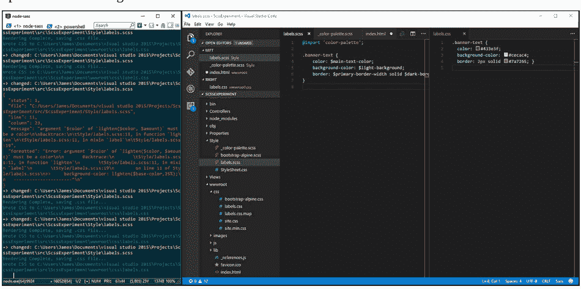

### 图 17-3 在 VS Code 中带有控制台和并排文件的示例工作流

这种工作流也是帮助你学习 SCSS 的极佳方法，因为你可以快速迭代、监控编译错误，并在编辑器中立即查看结果。

## 修改项目构建任务

对于 Alpine 团队来说，目的是确保构建服务器感知 SCSS 文件并生成 SCSS 产物。

-`sass: "style/**/*.scss"`

如果你想回想一下记忆，我们回到第 15 章“JavaScript 的角色”。

## 使用第三方框架

第三方 CSS 框架或库可以为你构建网站提供便利。这里有一些你可能已经熟悉的例子：

- 来自 `getbootstrap.com` 的 Bootstrap
- 来自 `foundation.org` 的 Foundation

这些库提供了跨浏览器和设备的布局规范化功能，提供了网格系统，并让组合应用程序变得简单。尽管如此，有许多选择第三方框架的理由，但它们中的任何一个都不是为了设计。

## 扩展 CSS 框架

如果我们发现我们仍然接受框架提供的内容，也许我们需要为客户构建一个一次性网站，或者构建一个内部应用程序，我们有两种非常简单的方法来扩展框架。

- 第一，直接编辑样式表。是的，这是可以的！我们的团队最近在一个四周内从头开始完成了一个网站。客户批准使用 Bootstrap，但想更新一些颜色并更改字体以更好地符合他们的逻辑。通过对预构建的 CSS 进行搜索和替换操作，我们能够在一小时内处理完样式更改，并专注于代码。
- 第二种直接的方法是使用框架的样式语言，但根据其实现添加额外的样式规则。我们最近为一个不喜欢 Bootstrap 单色标签的客户做了这种工作。通过使用 Bootstrap 已经按钮定义的模式，我们为标签创建了一套并入设计的规则。

## 自定义 CSS 框架足迹

Bootstrap 和 Foundation 都提供了一个在线工具，你可以在其中选择想要包含在项目中的元素，甚至可以自定义网格实现、颜色选择、字体以及组件的其他方面，如图 17-4 所示。你可以直接下载源码，而无需配置工具，即可获取你所需的 CSS。

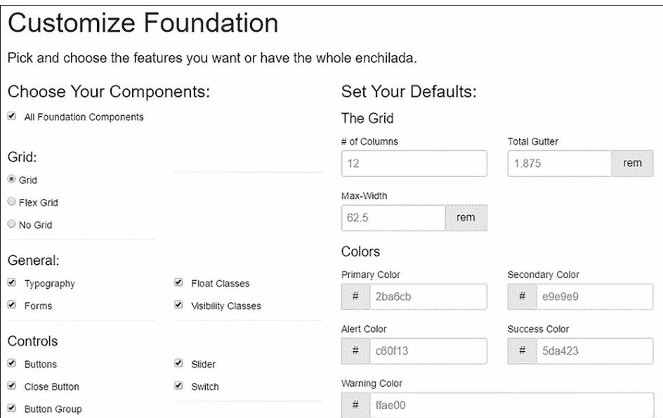

图 17-4 从 Foundation 网站自定义 Foundation

在 Bootstrap 的案例中，他们会为你构建一个包含你的 CSS 输出配置的 JSON 文件。你可以在日后的某个时间将该文件带回网站以进行增量更新。这种方法尚可，但它让你无法充分利用 SCSS 的许多强大功能，你也无法基于像 Bootstrap 这样的库提供的变量、混入（mixins）和函数来构建你的组件。

## 利用 CSS 框架实现自定义样式表

自定义方面的限制因素引导了 Alpine 团队采取他们目前的方向。他们不仅仅下载一个自定义的 CSS，而是想将 Bootstrap 作为基础，然后用他们自己的样式规则来丰富网站。团队选择从源码构建一个自定义版本的 Bootstrap，这允许他们剔除不需要的部分，并根据他们追求的风格进行量身定制。

这涉及到几个步骤。首先，他们向项目中添加了一个`bower.json`文件，这对于 Visual Studio 2015 来说是一个已知文件。他们的文件最终看起来如下：

[点击此处查看代码图像](#)

```json
{
  "name": "asp.net",
  "private": true,
  "dependencies": {
    "bootstrap": "4.0.0-alpha.4",
    "jquery": "2.2.0",
    "jquery-validation": "1.14.0",
    "jquery-validation-unobtrusive": "3.2.6"
  }
}
```

IDE 识别出`bower.json`为声明依赖的文件，并自动将这些包恢复到你项目目录中名为`bower_components`的文件夹中。Alpine 团队的下一步仅仅是将 Bootstrap 的主 SCSS 构建文件复制到他们的 Styles 文件夹中，并将其重命名为`bootstrap-alpine.scss`。在 Visual Studio 完成文件恢复后，你可以在`bower_components\bootstrap\scss`目录下找到`bootstrap.scss`。

将 SCSS 移动到 Style 目录后，Alpine 团队已经完成了大部分工作，剩下的任务就是更新相对文件位置。最初用于构建 Bootstrap 的 SCSS 部分文件位于相同目录，因此导入指令必须从：

```scss
@import "custom";
```

更新为包含相对位置：

[点击此处查看代码图像](#)

```scss
@import "../bower_components/bootstrap/scss/custom";
```

路径完全取决于你的项目布局。Gulp 任务之前已经创建，并且必要的依赖项已连接好（如第 1 节所述），使得能够实时生成最终的 CSS。CSS 也会出现在`wwwroot/css`文件夹中，以便方便地整合到布局中。这为你提供了一种极佳的方法，通过移除不需要的组件来减少发送到浏览器的 CSS 量，并导入变量或利用 Bootstrap 提供的预构建混入。

## CSS 框架的替代方案

并不是所有人都支持使用预构建的 CSS 框架。有很多声音提出了合理的顾虑，不仅担心网站看起来千篇一律，还担心开发者永远无法完全学会如何编写自己的 CSS。最大的抱怨之一是，人们引入了整个框架，有时会将下载需求从几百 KB 膨胀到 MB 级别，而只为了使用一个菜单栏、网格系统或一个按钮。

正因如此，出现了一些极简主义框架，它们专门专注于排版和布局等内容，摒弃了色板和组件。再次，我们不对适用于团队的方法做任何断言。找到适用于项目的平衡，移除不需要的部分，消除摩擦，并让你的项目易于维护。

# 总结

构建 CSS 不应该手动创建每一个规则。没有适用于所有项目的 CSS 框架，也没有任何工具、工作流或预处理器是强制必须的，但确实存在一种可以适合任何项目的方案。

计算机上存储数据最快的地方是 CPU 寄存器。在 X86-64 芯片上，有 16 个 64 位的寄存器，以及由各种处理器扩展程序（如 SIMD 和 x87）添加的其他寄存器。除了寄存器之外，还有 L1、L2 和 L3 缓存。当我们从寄存器移动到三级缓存时，我们获得了更多的存储空间，但速度变慢了。主内存是次大的，而且仍然很快；最后，硬盘用于大容量存储。你可以在表 18-1 中看到访问各种存储位置的大致时间。

| 位置 | 访问时间 |
|---|---|
| L1 缓存 | 5 ns |
| L2 缓存 | 7ns |
| 主内存 | 100ns |
| 固态硬盘 | 150µs |

**表 18-1** 访问各种存储位置的耗时

> 注意：如果你对学习更多现代处理器架构感兴趣，英特尔发布了一些非常有趣的文档，包括位于 `http://www.intel.com/content/dam/www/public/us/en/documents/manuals/64-ia-32-architectures-software-developer-manual-325462.pdf` 的 Intel 64 和 IA-32 架构软件开发手册。这确实是非常非常有趣的读物，虽然有 4,670 页有点长。庆幸你处于一个不需要了解所有内容的抽象层级！

现代处理器拥有所有这些缓存级来加速信息的访问。其核心思想是：如果我们访问了某条信息，很可能很快再次需要同一条信息。当我们第二次请求某条数据时，信息可能已经存在缓存中，我们就不需要承担访问主内存或磁盘的开销。

我们在 Web 服务器上使用缓存的目的完全相同。通常，网站上的数据更新频率相对较低。网站的落地页就是一个典型的例子。落地页通常是网站访问量最多的页面，但它们也倾向于包含大部分静态数据。例如，像 `http://www.microsoft.com` 这样的网站，首页对于一个用户和另一个用户来说是相同的。随着新新闻的出现或内容的成为焦点，更新每天可能只发生几次。与其承担在控制器中运行代码、从数据库获取数据然后在视图中渲染内容的代价，或许可以保存页面的输出，或者使用已经渲染过的页面部分。

## 缓存控制头部

HTTP 协议在设计时就考虑了缓存。规范中定义了许多动词（verbs），如果你处理过构建良好的 RESTful API，你一定对它们非常熟悉。GET 动词用于你在浏览器中输入 URL 并按下回车键时，其目的是简单地检索资源。它不应该更改服务器的任何数据或状态。GET 请求对于客户端和服务器之间的代理服务器缓存来说是安全的。POST 和 PATCH 等动词会更改服务器上的状态，因此，当然不应该被缓存，因为它们会返回服务器以更新数据（见图 18-1）。

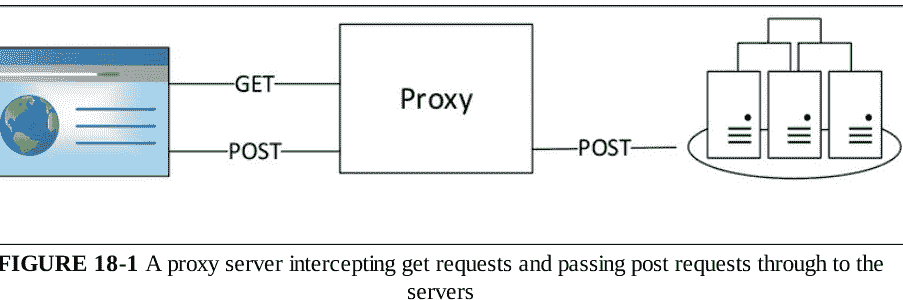

有时，你不希望代理服务器或客户端缓存 GET 请求。也许是数据变化很快，或者该页面是“列表-编辑-列表”循环的一部分，用户希望立即看到更新后的数据。在其他时候，我们乐意让代理服务器或客户端缓存我们的页面一段时间。为了控制代理服务器和客户端如何缓存信息，你可以使用缓存控制头部。

# 输出缓存

在 ASP.NET MVC 的之前的版本中，可以使用输出属性来缓存输出。在 ASP.NET Core 中，我们使用中间件来缓存输出。

# 使用数据缓存 (Data-Cache)

服务器上的昂贵操作可以保存到缓存中，这样我们就不需要再次运行操作。这的一个示例可能是检索一组记录的数据库查询。如果查询结果不是频繁变化，可以将它们缓存几秒钟，甚至几分钟。然而，考虑过时数据对用户的影响是非常重要的。例如，像温哥华酒店列表这样的数据不太可能频繁更改，可以缓存较长的时间，但股票报价可以以秒为单位进行缓存，因此不应该被长时间缓存。

ASP.NET Core 中的缓存分为两种类型：内存缓存和分布式缓存。内存缓存将数据保存到机器的内存中，而分布式缓存则将数据放置在 HTTP 服务器外部的某种数据存储中。让我们先查看内存版本。

# 内存缓存 (In Memory Cache)

首先，我们需要通过向`project.json`添加 nuget 包来将内存缓存引入我们的项目：

- [点击此处查看代码图片](#)

```json
"dependencies": {
  ...
  "Microsoft.Extensions.Caching.Memory": "1.0.0"
}
```

需要将此服务添加到`Startup.cs`的服务注册中：

- [点击此处查看代码图片](#)

```csharp
public void ConfigureServices(IServiceCollection services) {
  services.AddMemoryCache();
  ...
}
```

这向容器添加了一个满足`IMemoryCache`接口的服务。你可以在任何可以使用 DI 容器的地方解析它，即几乎大多数地方，比如在这里的`SkiCardController`中：

- [点击此处查看代码图片](#)

```csharp
public SkiCardController(ISkiCardContext skiCardContext,
  UserManager<ApplicationUser> userManager,
  AuthorizationService authorizationService,
  IBFileUploadService uploadService,
  IMemoryCache memoryCache,
  ILogger<SkiCardController> logger) {
    _memoryCache = memoryCache;
```

使用内存缓存（或任何缓存）的通常模式是检查缓存内容，如果缺失则使用该值，运行操作并填充缓存。`InMemoryCache`为处理数据提供了`TryGetValue`、`CreateEntry`和`Remove`操作。还有一些扩展方法可以让接口用起来变得更加愉快。我们可以像下面这样使用内存缓存保存一个一分钟有效的值：

- [点击此处查看代码图片](#)

```csharp
SkiCard skiCard = null;
if (!_memoryCache.TryGetValue("skicard:{viewModel.Id}", out skiCard))
{
    skiCard = await _skicardContext.skiCards
        .SingleOrDefaultAsync(s => s.Id == viewModel.Id);
    _memoryCache.Set("skicard:{viewModel.Id}", skiCard,
        new MemoryCacheOptions().SetAbsoluteExpiration(TimeSpan.Minutes(1)));
}
```

> 提示：制定一个良好的缓存键方案是非常重要的，这样你就不会用意料之外的值覆盖缓存键。一个建议是使用对象的名称，然后跟上一个标识符，例如`skiCard:{id}`或`user:{id}`。

这从缓存或底层数据中检索`skiCard`对象。在值存在于缓存中的情况下，就不需要访问数据库。缓存条目从进入缓存开始，在一分钟后过期。

# 分布式缓存 (Distributed Cache)

如果你只有一个 Web 服务器，在内存中缓存数据是快速且高效的。一旦你移动到多个 Web 服务器，你就需要一个数据的中心位置。如果服务器 A 上的缓存数据可以在服务器 B 上检索就太好了。为了做到这一点，我们需要利用分布式缓存。尽管内存缓存和分布式缓存在 ASP.NET Core 中实现了不同的接口，但它们的功能非常相似。在某些合法场景下，你可能希望选择数据缓存的位置，并混合使用内存缓存和分布式缓存，因此不同的接口是有帮助的。

微软提供了分布式缓存的两种实现：一种由 SQL Server 支持，另一种由 Redis 支持。选择哪一种最适合你的项目在很大程度上取决于你的团队的熟悉程度。Redis 的实现可能性能更高且更易设置。缓存存储是 Redis 的完美应用场景，因为它表面上是一个键值存储器。许多组织尚未习惯高成本的持久化世界，他们更倾向于使用自己熟悉的东西，在这种情况下是 SQL Server。至少在过去的十年里，SQL Server 一直是 .NET 栈中所有关于存储问题的答案。这种观点正在发生变化，我们意识到数据存储需求并非同质的，因此存储技术也不应该如此。

无论你选择何种持久化，分布式缓存都提供了一个统一的接口，因此在中途更改持久化存储并不困难。对于 ASP.NET Core 中的所有内容，实现都是开放且可插的，因此你可以创建自己的。例如，如果你的公司非常推崇 Apache Cassandra，你可以很容易地在其之上实现一个缓存。

再次，首先在`project.json`中包含相应的缓存实现。Redis 或 SQL Server 实现都可以包含在内：

- [点击此处查看代码图片]

```json
"Microsoft.Extensions.Caching.Redis": "1.0.0",
"Microsoft.Extensions.Caching.SqlServer": "1.0.0"
```

接下来，你需要在容器中设置并注册该实现。对于 Redis，配置如下：

- [点击此处查看代码图片]

```csharp
services.AddDistributedRedisCache(options =>
(
    options.Configuration = Configuration.GetValue("redis.host"),
    options.InstanceName = Configuration.GetValue("redis.instance"),
));
```

对于 SQL Server，配置如下：

- [点击此处查看代码图片]

```csharp
services.AddDistributedSqlServerCache(options =>
(
    options.ConnectionString = Configuration.GetConnectionString("cache"),
    options.SchemaName = Configuration.GetValue("cache.schemaName"),
    options.TableName = Configuration.GetValue("cache.tableName"),
));
```

在这两种情况下，我们都从配置中获取值。

> 注意：Redis 的优点是它是无模式的（scheeless），因此可以添加任何想要的信息。SQL Server 的模式较为严格，因此你需要预先构建模式。你可以通过安装`Microsoft.Extensions.Caching.SqlServer.Tools`并将其包含在`project.json`的工具部分来实现。

等一下，在配置了分布式缓存后，你现在可以在 DI 容器中访问`IDistributedCache`，它与`IMemoryCache`非常相似。可以这样使用：

- [点击此处查看代码图片]

```csharp
var cachedSkiCard = await _distributedCache.GetAsync("viewModel.Id");
if (cachedSkiCard != null) {
```


```
skiCard = Newtonsoft.Json.DeserializeObject<SkiCard>(cachedSkiCard);
```

} else {

```
skiCard = await _defaultCache.FindAsync(s => s.Id == viewModel.Id);
```

```
await _distributedCache.SetStringAsync("skiCard:viewModel.Id", Newtonsoft.Json.Serialize(skiCard), new DistributedCacheEntryOptions()
```

```
    .SetAbsoluteExpiration(TimeSpan.FromMinutes(1)));
```

}

运行一些基准测试以看看缓存是否真的有帮助。采用数据驱动的方法来添加缓存。

# 总结

ASP.NET MVC 提供了多种方法来缓存数据，涵盖了代理服务器、客户端浏览器缓存以及服务器本身。内存缓存是目前可用最简单的缓存实现，适用于单服务器部署或不需要在服务器之间分发的数据。分布式缓存利用外部存储工具（如 Redis 和 SQL Server）来存储值。它允许一个服务器将数据插入缓存，而由另一个服务器进行检索。缓存通常可以提高性能并减轻难以扩展的资源（如关系型数据库）的负载，然而，对缓存进行基准测试至关重要，以确保它确实是有帮助而非阻碍。

在接下来的章节中，我们将查看可重用组件，以及如何利用它们来使网站编写变得更快、更具一致性。

# 第 4 部分：冲刺回顾：最后冲刺

- 第 19 章 可重用组件
- 第 20 章 测试
- 第 21 章 可扩展性
- 第 22 章 国际化
- 第 23 章重构和改进代码质量
- 第 24 章 代码组织

Danielle 眼睛都不眨一下。她刚看完一集非常奇怪的《X 档案》，一整天都心悬未定。第 4 季第 2 集。每当她想起那里时，她就会叹口气并摇摇头。如果她要继续开灯睡觉，那么她应该去买那些高能 LED 灯。此外，你可以买到非常亮的灯，点亮她的整个房间，这样没有任何东西能追上她。当她正用手机支付特快运费时，Baláz 进来了。

他手里提着大箱子。那是一盒 T恤。“我给团队买了 T恤！”他兴奋地说。他从箱子里拿出一件白色 T恤。正面是非常熟悉的阿尔卑斯滑雪木小屋（Alpine Ski House）标志。Danielle 感到有点失望；她本想要一些与项目相关的东西。Baláz 翻过 T恤展示背面。那里有一个大束欧芹的漫画画，正竖着大拇指。上面写着“欧芹项目（Project Parsley）”，漫画画下面写着“我吃了欧芹”。

“我懂一些好看的衣服，”Chester 说，“那些 T恤真是时髦（on fleck）。”

Danielle 不确定 fleck 是什么意思，也不知道处于上面好不好，但她喜欢这些 T恤。团队成员似乎也同意，当 Balázs 把 T恤传给每个人时，到处都是欢快的交谈声。

“好了，好了，”Balázs 打断道，“我们开始回顾吧。你们现在熟悉规矩了，拿出你们的笔，看看这周进展得怎么样。”

| 开始 (Start) | 停止 (Stop) | 继续 (Continue) |
|---|---|---|
| 重新组织应用程序 | 报告了这么多 Bug | 利用 Azure 进行托管 |
| 建立更多的自动化测试 | 在控制器中添加了大量代码，有些长达 300 行 | 使用依赖注入 |
| 在某些地方复用已有的代码 | | 使用 JavaScript 做一些很棒的事情 |
| | | 穿酷的 T恤 |

“我不喜欢‘测试’还在‘开始’这一列。”Balázs 问，“我们没能进行那个冲刺吗？”

“不完全，”Mark 说，“我们进行了一次午餐学习会，我认为很多团队成员现在都认同了，但我们还没有真正采取行动。”

Danielle 对测试驱动开发（TDD）方法留下了深刻印象。她确定这会有更好的代码，但在发布前只剩一周了。她绝不会在最后阶段改变一切。Mark 解释说，关于 TDD 有几种阵营，Danielle 确定自己的观点更接近光谱的中间位置，但她显然不像 Mark 描述的某些人那样的“狂热分子”。

“我理解，”Baláz 说，“项目到后期了，我们承担不了太多东西。大家，我……”（注：此处原文似乎中断，翻译随之结束）

# 标签助手 (Tag Helpers)

标签助手是 Razor 视图引擎的特性，是封装少量视图逻辑并确保 HTML 生成一致的一种优秀机制。在第 11 章“Razor Views”中，你已经看到如何使用标签助手以非常清晰简洁的方式描述表单。在查看某些内置标签助手以及我们如何创建自己的助手之前，让我们先回顾标签助手的组成。

## 标签助手的剖析

内置标签助手非常有用，但当你开始构建自己的标签助手时，事情会变得非常有趣。在此之前，理解构成标签助手的不同部分。让我们让我们图 19-1 中的 input 标签助手作为一个示例。

| 目标元素 | 标签助手属性 |
| :--- | :--- |
| | `<input asp-for="CardHolderFirstName" class="form-control" />` |

图 19-1 input 标签助手的示例用法

标签助手针对一个特定的 HTML 元素，称为目标元素。对于 input 标签助手来说，目标元素就是 input 元素。然而，input 标签助手并不是针对应用程序中的每个 input 元素执行的。它只适用于同样具有 asp-for 属性的 input 元素。asp-for 属性是标签助手属性的一个示例。标签助手属性用于向特定的标签助手提供参数。正是目标元素与标签助手存在的组合导致了 Razor 将一个元素视为标签助手。某些标签助手针对现有的 HTML 元素，而另一些则针对自定义元素。cache 标签助手就是自定义元素的示例。

标签助手属性被定义用于表示特定的 .NET 类型，例如 string、int 或 TimeSpan。asp-for 属性是一个类型为 ModelExpression 的特殊属性，它告诉 Razor 该属性表示了到当前模型的映射。

标签助手还可以包含任何应用到输出 HTML 的其他有效 HTML 属性。某些标签助手（如 cache 标签助手）还包含子内容。根据标签助手的不同，子内容可能会以某种方式被修改，或者被标签助手生成的 HTML 包裹。

## 脚本、链接和环境标签助手

环境（environment）标签助手提供了一种根据环境渲染不同 HTML 部分的简单方法。例如，你可能选择在 Staging（暂存）和 Production（生产）环境中使用压缩过的 CSS 文件，但在 Development（开发）环境中使用未压缩的版本。当前环境从 ASPNET ENVIRONMENT 变量读取，如果未设置该环境变量，ASP.NET 将其假定为 Production。

```
<environment names="Development">
  <link rel="stylesheet" href="~/css/site.css" />
  <link rel="stylesheet" href="~/css/site2.css" />
</environment>

<environment names="Staging,Production">
  <link rel="stylesheet" href="~/css/site.min.css" />
</environment>
```

只有环境标签助手的内容会被发送到客户端，而环境标签本身不会包含在 HTML 输出中。环境标签助手通常与 link 和 script 标签助手配合使用。link 和 script 标签助手提供了通配符、引用 CDN 以及缓存缓存（cache busting）的选项。

## 通配符模式 (Glob Patterns)

link 和 script 标签助手提供了使用通配符模式引用文件的选项。例如，如果你想引用 scripts 文件夹中的所有 .js 文件，可以使用 script 标签的 asp-src-include 属性使用 `~/scripts/*.js` 模式。

```
<script asp-src-include="~/scripts/*.js"></script>
```

script 标签会为匹配指定模式的每个文件渲染单独的 script 标签。你还可以使用可选的 asp-src-exclude 属性来排除文件。link 标签助手的工作方式完全相同，通过 asp-href-include 和 asp-href-exclude 属性提供了指定通配符模式的能力。

## 缓存失效 (Cache Busting)

缓存失效是在 JavaScript 和 CSS 文件的文件名中添加某种文件版本哈希值的过程。这样做的性能优势在于你可以告诉浏览器无限缓存这些文件，而无需担心在文件更改时客户端获取最新版本。因为资源名称会在文件内容更改时改变，更新的文件始终会被下载。要启用缓存失效，只需在 link 或 script 标签助手上使用 `asp-append-version="true"` 即可。

```
<link rel="stylesheet" href="~/css/site.min.css" asp-append-version="true"/>
```

在运行时，标签助手生成一个版本哈希并将其作为查询参数附加到所引用文件的 URL 中。

```
<link rel="stylesheet" href="~/css/site.min.css?v=UdkKHVNJ42vb1EsG90uRADAFee3j13DgW6NIDFoe" />
```

缓存失效也可以通过在 img 标签上添加 `asp-append-version="true"` 属性用于图像资源。

## CDN 与回退机制 (Fallbacks)

一种常见的优化方法是通过托管在内容分发网络 (CDN) 引用流行框架的网络负载，以减少服务器的负载并可能提高用户性能。对于 jQuery 和 Bootstrap 等流行框架，客户端浏览器很有可能已经缓存了这些文件的版本。

从 CDN 引用文件可能有点麻烦，因为你还需要提供一个托管在你自己服务器上的文件版本回退。回退是必要的，因为你不希望在 CDN 无法访问时应用程序无法运行。虽然 CDN 通常是可靠的，但它们可能会故障。以下是使用 link 和 script 标签指定回退的示例：

```
<link rel="stylesheet" href="~/css/site.min.css" asp-append-version="true" />
```

## 创建标签助手

当你为应用程序添加更多功能时，cshtml 文件中可能会出现模式。小型重复的 Razor / HTML 部分是自定义标签助手的理想选择。

标签助手是一个继承自 TagHelper 类并实现 Process 或 ProcessAsync 方法的简单类。

```
public virtual void Process(TagHelperContext context, TagHelperOutput output)

public virtual Task ProcessAsync(TagHelperContext context, TagHelperOutput output)
```

通过 Process 方法，标签助手能够检查当前的 TagHelperContext 并生成一些 HTML 或以某种方式更改 TagHelperOutput。

一个非常简单的示例是 Alpine Ski House 登录页面上用于外部提供商登录的按钮。虽然这不一定是应用程序内部广泛使用的内容，

这展示了我们如何清理一些复杂的 Razor 代码。标签辅助程序（Tag helpers）对于消除重复代码非常有用，对于抽象特别复杂的 HTML 或 Razor 代码也同样出色。以下代码描述的按钮绑定到了特定的登录提供程序。

```
<button type="submit" class="btn btn-default" name="provider" value="@provider.AuthenticationScheme" title="Log in using @provider.DisplayName account="@provider.AuthenticationScheme"></button>
```

让我们尝试使用 `LoginProviderButtonTagHelper` 标签辅助程序类。目标元素是按钮，它有一个标签辅助程序属性 `ski-login-provider`。按照习惯，当标签辅助程序针对现有的 HTML 元素时，标签属性应该带有前缀。这有助于区分标签辅助程序与普通的 HTML 属性。内置的 ASP.NET Core 标签使用 `asp-` 前缀。对于 Alpine Ski，我们使用 `ski-`。

```
[HtmlTargetElement("button", Attributes = "ski-login-provider")]
public class LoginProviderButtonTagHelper : TagHelper
{
    [HtmlAttributeName("ski-login-provider")]
    public AuthenticationDescription LoginProvider { get; set; }

    public override void Process(TagHelperContext context, TagHelperOutput output)
    {
        output.Attributes.SetAttribute("type", "submit");
        output.Attributes.SetAttribute("name", "provider");
        output.Attributes.SetAttribute("value", "LoginProvider.AuthenticationScheme");
        output.Attributes.SetAttribute("title", "Log in using your {LoginProvider.DisplayName}");
        output.Attributes.SetAttribute("class", "btn btn-default");
        output.Content.SetContent(LoginProvider.AuthenticationScheme);
    }
}
```

在使用此新的标签辅助程序之前，你需要让此项目中的标签辅助程序在视图中可用。通过使用 `@addTagHelper` 指令来实现。若要在全局应用 `@addTagHelper` 指令，请将其添加到 `Views/_ViewImports.cshtml` 文件中。

```
@addTagHelper * AlpineSkiHouse.Web
```

现在你可以可以使用新的标签辅助程序来简化我们登录页面中的按钮了。

```
<button ski-login-provider="provider"></button>
```

Visual Studio 为自定义标签辅助程序提供了良好的智能提示（IntelliSense）支持，如图 19-2 所示。

```
<div>
  <p>@foreach(var provider in loginProviders)
{
    <button ski-login-provider></button>
  }</p>
</div>
```

图 19-2 Visual Studio 显示自定义标签辅助程序的智能提示

## 现有属性和内容

在创建标签辅助程序时，考虑它所使用的上下文非常重要。大多数标签辅助程序针对具有 HTML 属性的现有 HTML 元素。你还应该考虑已经向元素添加了哪些属性。这些属性应该被覆盖还是保持原样？另一个选项是将这些值与自己的值合并。合并属性值最常见于 `class` 属性。在我们的外部登录提供程序示例中，标签辅助程序应该保留添加到按钮上的任何类，并将 `"btn btn-default"` 类附加到用户提供的值上。合并属性的语法略显冗长。

```
string classValue = "btn btn-default";
if (output.Attributes.ContainsName("class"))
{
  classValue = $"{output.Attributes["class"].Value} {classValue}";
}
output.Attributes.SetAttribute("class", classValue);
```

这段代码并不是你想要重复编写的内容，所以让我们将其提取到扩展方法中：

```
public static class TagHelperAttributeListExtensions
{
  public static void MergeClassAttributeValue(this TagHelperAttributeList attributes, string newClassValue)
  {
    string classValue = newClassValue;
    if (attributes.ContainsName("class"))
    {
      classValue = $"{attributes["class"].Value} {classValue}";
    }
    attributes.SetAttribute("class", classValue);
  }
}
```


进入`/path/to/xxx`目录，找到`xxx.json`。

在表达式`cvar = avar + bvar`中，加法运算符（`+`）将`avar`与`bvar`相加，得到它们的和`cvar`。

在`List.of(arg0, arg1, arg2)`中，`List`接口的工厂方法`of()`接受一系列的元素，返回包含它们的只读列表。

之后我们这样调用`cmd`命令：`cmd arg0 arg1 arg2`。

```
if (condVar > someVal) {console.log("xxx")}
```

使用`MergeClassAttributeValue`扩展方法极大简化了我们标签辅助程序中的代码。

点击此处查看代码图片

```csharp
output.Attributes.MergeClassAttributeValue("btn btn-default");
```

除了属性之外，你还需要考虑标签辅助程序的现有 HTML 内容。默认情况下，Razor 会处理标签辅助程序的内容，生成的 HTML 会包含在标签辅助程序的输出中。标签辅助程序的输出提供了通过`Content`属性修改或覆盖子内容的能力。除了`Content`之外，标签辅助程序还提供了`PreElement`、`PreContent`、`PostContent`和`PostElement`属性。标签辅助程序无法直接修改的 HTML 部分是父内容。

点击此处查看代码图片

```csharp
public async override Task ProcessAsync(TagHelperContext context, TagHelperOutput output)
{
  output.PreElement.SetHtmlContent("<div>PreElement</div>");
  output.PreContent.SetHtmlContent("<div>PreContent</div>");
  output.Content = await GetChildContentAsync();
  output.Content.Append("Adding some text after the existing content");
  output.PostContent.SetHtmlContent("<div>PostContent</div>");
  output.PostElement.SetHtmlContent("<div>PostElement</div>");
}
```

只有当标签辅助程序进行更改时，才有必要调用`GetChildContentAsync()`。

## 视图组件 (View Components)

视图组件是 MVC 中的另一种结构，允许你构建可重用的小组件。视图组件由两部分组成：视图类和 Razor 视图。要实现视图组件类，需要继承基类`ViewComponent`并实现`Invoke`或`InvokeAsync`方法。它可以放在项目的任何地方，但通常习惯将其放在名为`ViewComponents`的文件夹中。

点击此处查看代码图片

```csharp
public class MyWidgetComponent : ViewComponent
{
    public IComponentResult Invoke()
    {
        return View();
    }
}
```

视图组件可以包含多个`Invoke`方法，每个方法包含一组独特的参数。

点击此处查看代码图片

```csharp
public class MyWidgetComponent : ViewComponent
{
    public IComponentResult Invoke()
    {
        return View();
    }

    public IComponentResult Invoke(int id)
    {
        return View();
    }
}
```

视图组件大量使用了“约约定优于配置”。除非另有指定，否则视图组件的名称是去掉`ViewComponent`的类名。通过在类上添加`ViewComponent`特性可以显式定义视图组件名称。

点击此处查看代码图片

```csharp
[ViewComponent(Name = "Widget1")]
public class MyWidgetComponent : ViewComponent
{
    public IComponentResult Invoke()
    {
        return View();
    }
}
```

就像构造器一样，视图组件的`Invoke`方法返回一个视图。此时，视图引擎会查找匹配的`cshtml`文件。如果没有显式指定视图名称，将使用默认的`Views\Shared\Components\ViewComponentName\Default.cshtml`，在此例中为`Views\Shared\Components\MyWidget\Default.cshtml`。

视图组件的视图部分可以像控制器的视图一样进行模型绑定。

```csharp
public class MyWidget : ViewComponent
{
    public IViewComponentResult Invoke()
    {
        WidgetModel model = new WidgetModel
        {
            Name = "My Widget",
            NumberOfItems = 2
        }
        return View(model);
    }
}
```

## 调用视图组件

通过调用`Component.Invoke`并指定视图组件的名称，可以将视图组件包含任何 Razor 视图中。

点击此处查看代码图片

```razor
@await Component.InvokeAsync("MyWidget")
```

视图引擎会找到匹配名称的视图组件，并将调用映射到视图组件的一个`Invoke`方法上。若要匹配特定的`Invoke`方法重载，你需要以匿名类的形式指定参数。

```razor
@await Component.InvokeAsync("MyWidget", new {id = 5})
```

## Child Actions 发生了什么变化？

在 MVC 之前的版本中，我们使用 Child Actions 来构建可重用的组件或控件，这些组件由 Razor 标记和一些后端逻辑组成。后端逻辑通过控制器操作实现，并通常标记有`[ChildActionOnly]`特性。Child Actions 非常有用，但很容易配置成可能会对请求流水线（request pipeline）产生意想不到后果的形式。

ASP.NET Core MVC 中不再存在 Child Actions。相反，你应该使用新的“视图组件”（View Component）功能来支持这种情况。从概念上说，视图组件类似于很多子操作，但它们更轻量级，且不再涉及与控制器（Controllers）相关的生命周期和管道。

## 客服服务视图组件

现在我们涵盖了视图组件的基础知识，让我们来看一个真实世界的示例。假设我们想在 Alpine Ski House 项目中与客户服务代表的应用程序进行一些集成。在第 12 章“配置与日志”中，我们创建了`ICsInformationService`，它提供了有关客户服务呼中心的信息，包括电话号码和当前在线的代表人数。我们希望在网站底部添加一个小区域，为用户提供这些信息的一部分。使用视图组件来实现此功能为我们提供了与`ICsInformationService`交互的良好位置。如果我们想尝试将呼叫中心放置在网站的不同位置，它也为我们提供了某种灵活性。

视图组件类依赖于`ICsInformationService`并实现了一个简单的`Invoke`方法。如果呼叫中心在线，我们的视图组件从`ICsInformationService`获取信息并将其传递给默认视图（Default）。如果呼叫中心关闭，它将返回关闭视图（Closed）。将视图拆分为两个部分确保了此逻辑位于组件而不是视图中，这使得测试变得简单得多。

点击此处查看代码图片

```csharp
public class CallCenterStatusView : ViewComponent
{
    private readonly ICsInformationService _csrInformationService;

    public CallCenterStatusView(ICsInformationService csrInformationService)
    {
        _csrInformationService = csrInformationService;
    }

    public IViewResult Invoke()
    {
        if (_csrInformationService.CallCenterOnline)
        {
            var viewModel = new CallCenterStatusViewModel
            {
                OnlineRepresentatives = _csrInformationService.OnlineRepresentatives,
                PhoneNumber = _csrInformationService.CallCenterPhoneNumber
            };
            return View(viewModel);
        }
        else
        {
            return View("Closed");
        }
    }
}
```

视图是简单的 Razor 文件。Default 绑定到`CallCenterStatusViewModel`，而 Closed 未绑定到任何模型。

`Views\Shared\Components\CallCenterStatus\Default.cshtml`

点击此处查看代码图片

```razor
@using AlpineSkiHouse.Models.CallCenterViewModels
@model CallCenterStatusViewModel
```

```html
<div class="panel-success">
    <div class="panel-heading">遇到麻烦了吗？我们在这里为您提供帮助！</div>
    <div class="panel-body">
        我们有 @Model.OnlineRepresentatives 名友好的代理正在在线。
        <br/>
        拨打我们的电话：<i class="glyphicon glyphicon-earphone"></i> <a href="@Model.PhoneNumber">@Model.PhoneNumber</a>
    </div>
</div>
```

`Views\Shared\Components\CallCenterStatus\Closed.cshtml`

点击此处查看代码图片

```html
<div>呼叫中心已关闭</div>
```

现在现在你可以将此组件添加到应用程序中的任何 chtml 文件中。例如，我们刚刚将其添加到 `_Layout.cshtml` 的页脚上方。

点击此处查看代码图片

```html
<div class="container body-content">
    @RenderBody()
    <hr />
    @await Component.InvokeAsync("CallCenterStatus")
    <footer>
        <p>&amp;DateTime.Now.Year.ToString() - AlpineSkiHouse</p>
    </footer>
</div>
```

## 注意事项

在较大的组织中，创建可以在多个不同项目中使用的视图组件可能是很有用的。在这种情况下，视图组件可以在单独的类库中实现，并在每个应用程序启动时加载。这只需要在启动时进行少量的配置。要查看完整教程，请参阅：http://aspnetmonsters.com/2016/07/2016-07-16-loading-view-components-from-a-class-library-in-asp-net-core。

## 部分视图 (Partial Views)

视图仅仅可以在另一个 Razor 视图中渲染的 Razor 视图。与视图组件不同，它没有类来实现任何逻辑或与服务交互。虽然视图组件类会将模型数据传递给视图，但将数据传递给部分视图是父级的责任。当数据已经加载且你只需要显示它时，部分视图非常有用。无论涉及什么视图模型，你都可以使用部分视图将较大的视图拆分为更易管理的部分。

默认的 ASP.NET Core MVC 项目模板包含一个用于渲染验证脚本的部分视图。你需要这些脚本来确保任何包含表单的页面上进行客户端验证。

## `Views/Shared/ValidationScripts.Partial.cshtml`

点击此处查看代码图片

```html
<environment name="Development">
    <script src="~/lib/jquery-validation/dist/jquery.validate.js"></script>
    <script src="~/lib/jquery-validation/jquery.unobtrusive.js"></script>
</environment>
<environment name="Staging, Production">
    <script src="https://ajax.aspnetcdn.com/jquery.validate.js"></script>
    <script src="https://ajax.aspnetcdn.com/jquery.un.obtrusive.js"></script>
</environment>
```

一套完善的单元测试可以提供更高水平的信心，确保应用程序代码的更改不会给应用程序引入回归问题。编写良好的单元测试还可以作为组件预期行为的文档形式。

# XUnit

有许多可用于 C# 代码单元测试的测试框架。最流行的是：nUnit、MSTest 和 xUnit.net。虽然它们的功能有所不同，但基本概念是相同的。测试方法通过特性（attributes）进行标记。在这些测试中，你编写代码来执行被测试的代码，并对预期的结果进行断言。断言将通过或失败，结果将由测试运行器报告。xUnit 与其他测试框架的一个区别是，xUnit 没有使用类属性来标记包含方法的类。xUnit 文档中包含了 xUnit 与其他测试框架的便捷比较（https://xunit.github.io/docs/comparisons.html）。

Alpine Ski House 决定使用 xUnit.net，主要是因为 ASP.NET 团队使用该工具来测试 ASP.NET Core 框架，此外，它也是一个非常棒的框架，而且大家都在使用。

要开始使用，你可能会认为这通常是一个好主意。原因之一是，你不希望将单元测试代码与应用程序分开共享，而是将其专门用于测试单元项目。例如，我们创建了一个新项目`AlpineSkiHouse.Web.Test`，它将包含对位于`AlpineSkiHouse.Web`项目中的代码的测试。在文件夹结构中，应用程序项目位于`src`文件夹中，而测试项目位于`test`文件夹中。同样，并没有要求遵循这一约定，但它是 .NET 应用程序常用的方法。

此外，测试项目需要引用两个框架：`xunit`和`dotnet-test-xunit`。运行器也需要设置为`xunit`，而且我们显然对正在测试的项目进行引用，在此例中为`AlpineSkiHouse.Web`。

点击此处查看代码图像

```
"dependencies": {
  "AlpineSkiHouse.Web": "1.0.0-*",
  "dotnet-test-xunit": "1.0.0-rc2-build10025",
  "xunit": "2.1.0"
},
"testRunner": "xunit"
```

## xUnit 基础

在 xUnit 中，测试由方法上的特性标记。`[Fact]`（事实）是始终为真的，而`[Theory]`（理论）则是对于一组输入应该保持为真的测试。`[Theory]`可以使用单个测试方法来测试多个场景。

点击此处查看代码图像

```
public class SimpleTest
{
    [Fact]
    public void SimpleFact()
    {
        var result = Math.Pow(2, 2);
        Assert.Equal(4, result);
    }

    [Theory]
    [InlineData(2, 4)]
    [InlineData(4, 16)]
    [InlineData(8, 64)]
    public void SimpleTheory(int amount, int expected)
    {
        var result = Math.Pow(amount, 2);
        Assert.Equal(expected, result);
    }
}
```


欲需更完整的文档，请访问`xunit`官方文档 https://xunit.github.io。

## 运行测试

运行单元测试的最简单方法是使用`dotnet`命令行工具。在包含测试项目的文件夹中，运行`dotnet test`，它将编译测试项目并如图 20-1 所示运行所有测试。

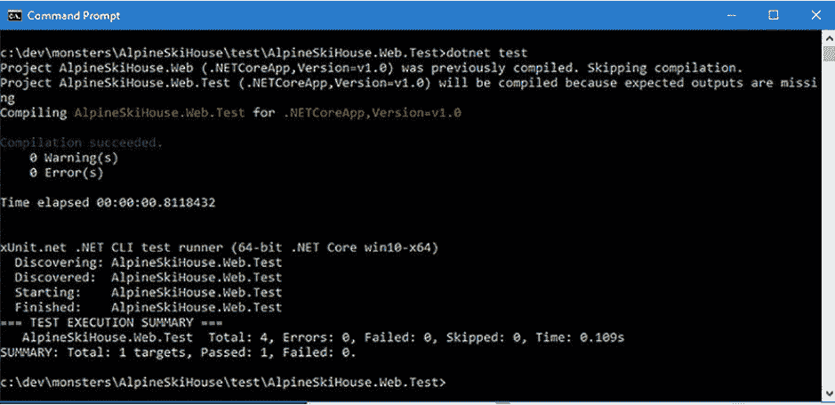

图 20-1 使用`dotnet test`从命令行运行单元测试

命令行工具也使得易于与现有的构建脚本集成。你只需要添加一个运行我们测试的步骤即可。

另一个选项是使用 Visual Studio 内置的测试管理器（Test Explorer）直接运行单元测试。这为开发者提供了集成体验，并提供了在附加调试的情况下运行测试的选项。

通过选择主菜单中的“测试”（Test）然后“窗口”（Windows）中的“测试管理器”（Test Explorer），在 Visual Studio 中打开测试管理器窗口。如图 20-2 所示的测试管理器应显示解决方案中所有测试的列表。如果没有列出测试，可能需要在测试管理器窗口打开时重新生成解决方案。

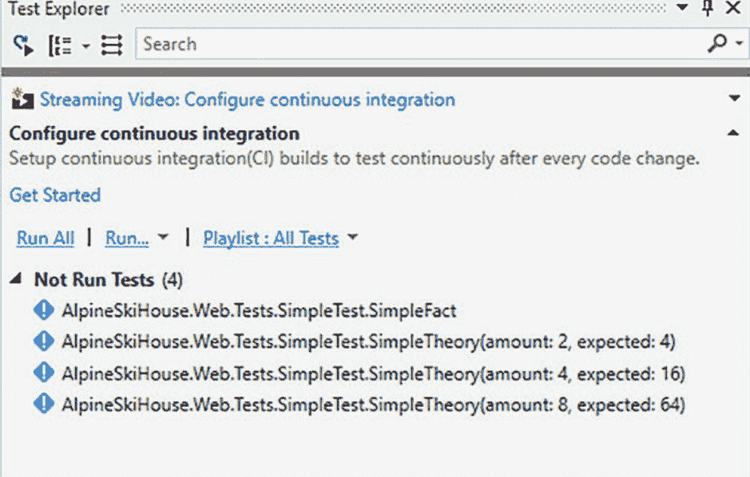

图 20-2 Visual Studio 中的测试管理器

点击“运行全部”（Run All）链接来运行所有测试。失败的测试将用红色的 x 标记。点击失败的测试将显示失败断言的摘要，包括指向失败方法的链接以及失败的具体断言。

## 持续测试

测试运行器管理器有一个鲜为人知的功能，可以启用持续测试。在测试管理器工具栏的左上角有一个标记为“生成后运行测试”（Run Tests After Build）的切换按钮。当切换此按钮时，Visual Studio 将在项目生成后重新运行测试。使用此功能，如果你所的更改破坏了某些现有测试，你将获得近乎时的反馈。

对于在 Visual Studio 以外的编辑器中开发，可以找到`dotnet`任务：https://github.com/aspnet/DotNetTools/tree/src/Microsoft.DotNet.Watcher.Tools。

## 测试组织

我们已经讨论了单元测试的处，但考虑维护它们的成本也是重要的。在本章中，我们将探讨如何组织单元测试，以便在项目增长时保持易于管理。

```csharp
{
  var service = new CsrInformationService(options);
  Assert.Equal(options.Value.OnlineRepresentatives,
    service.OnlineRepresentatives);
}
```

[Listing 20-1] 同时在`GivenThereIsLeastOneRepresentativeOnline`内部类中测试了第二个场景。该场景测试了当至少有一位代表在线时的`CsrInformationService`情况。注意这里使用了`Theory`和`MemberData`来通过一组映射到在线代表数量的可能输入进行测试。`options`属性提供了`CsrInformationOptions`的一组可能值数组，每个值都指定了不同的`OnlineRepresentatives`数量。该场景包含两个用`Theory`特性标记的测试。第一个测试检查`CallCenterOnline`是否返回`true`，而第二个测试检查`OnlineRepresentatives`属性是否等于预期值。

# 测试控制器

理想情况下，我们的控制器应该包含最少的逻辑，这意味着不需要进行大量的测试。控制器实际上应该负责在我们喜欢的 HTTP 请求和我们的应用程序概念之间进行转换。大部分困难工作应该实现在服务、命令和事件处理器以及我们代码中的其他可重用地方。话虽如此，测试控制器仍然具有价值，以确保服务符合预期并返回了正确的 HTTP 响应。例如，测试控制器以确保未经授权的用户无法访问受限资源是非常有用的。

让我们看看第 10 节《Entity Framework Core》中的`SkiCardController`。`SkiCardController`依赖依赖于`SkiCardContext`和`IAuthorizationService`。依赖越多，设置就越困难。在某些情况下，我们希望使用称为“模拟”（mocking）的技术来传入依赖的假版本，并测试控制器如何与接口部分交互。我们使用模拟来测试`SkiCardController`与`IAuthorizationService`的交互。某些依赖（例如`Entity DbContext`的`acon`实例）可以使用内存数据存储而不是完整的数据库作为支持。重要的教训是，模拟并不总是答案。我们在进行测试时要保持务实，并根据情况选择最有效的方法。

要创建一个由内存数据库提供支持的`SkiCardContext`，你必须传递与运行时应用程序使用的不同的选项。这些选项的创建通常由依赖注入框架处理，而在单元测试项目中，我们需要自己处理。我们创建了一个工厂方法以避免大量的重复代码，它可以用于任何`DbContext`，如下所示：

```csharp
public static class InMemoryDbContextFactory
{
    public static DbContext<T> Create<T>() where T : DbContext
    {
        var serviceProvider = new ServiceCollection()
            .AddEntityFrameworkInMemoryDatabase()
            .BuildServiceProvider();
        var builder = new DbContextOptionsBuilder<T>();
        builder.UseInMemoryDatabase()
            .UseInternalServiceProvider(serviceProvider);
        return builder.Options;
    }
}
```

让我们从测试一个场景开始：为上下文中不存在的`SkiCard`运行`HttpPost Edit`动作。在这种情况下，动作方法应该返回`NotFoundResult`。此场景中没有使用`UserManager`和`IAuthorizationService`，因此我们可以轻松地通过为这个特定测试传递`null`值。

```csharp
public class WhenEditingAsSkiCardThatDoesNotExistInTheContext
{
    [Fact]
    public async Task EditActionShouldReturnNotFound()
    {
        using (SkiCardContext context = 
            new SkiCardContext(InMemoryDbContextFactory.Create<SkiCardContext>()))
        {
            var controller = new SkiCardController(context, null, null);
            var result = await controller.Edit(new EditSkiCardViewModel
            {
                Id = 2,
                CardHolderFirstName = "Dave",
                CardHolderLastName = "Paquette",
                CardHolderBirthDate = DateTime.Now.AddYears(-99),
                CardHolderPhoneNumber = "555-123-1234"
            });
            Assert.IsType<NotFoundResult>(result);
        }
    }
}
```

稍微复杂一点的场景是恶意用户调用`HttpPost Edit`动作来编辑一个不属于他们的`SkiCard`。该场景在 Listing 20-2 所示的`GivenAHackerTriesToEditSomoneElsesSkiCard`类中测试。它涉及两个依赖项，并且还需要`ControllerContext`上设置一些信息。具体来说，你需要从`HttpContext`内部提取`User`。将此项设置代码移动到构造函数中可以保持测试方法的简单和易于读。首先，创建一个`SkiCardContext`并添加恶意用户尝试编辑的`SkiCard`。创建一个带有`DefaultHttpContext`和新`ClaimsPrincipal`的`ControllerContext`。没有必要在 claims 上设置任何值，因为你唯一想要确保`ClaimsPrincipal`正确传递给控制器。在测试方法中，创建控制器并设置对`AuthorizationService`的预期调用。具体来说，预期调用`AuthorizeAsync`方法，并传入`_badGuyPrincipal`和`_card`，以检查`EditSkiCardAuthorizationRequirement`。我们使用 Moq（一个简单但功能强大的 .NET 模拟库）来验证`SkiCardController`与`Authorization`之间的预期交互。如需了解更多关于 Moq 的信息，请访问 https://github.com/Moq/mock4。

# 列表 20-2 测试 SkiCardController Edit 动作方法的示例

```csharp
public class GivenAHackerTriesToEditSomeoneElsesSkiCard : IDisposable
{
    SkiCardContext _skiContext;
    SkiCard _skiCard;
    ControllerContext _controllerContext;
    ClaimsPrincipal _badGuyPrincipal;
    Mock<IAuthorizationService> _mockAuthorizationService;

    public GivenAHackerTriesToEditSomeoneElsesSkiCard()
    {
        _skiContext = new SkiCardContext(InMemoryDbContextFactory.Create<SkiCardContext>());
        _skiCard = new SkiCard()
        {
            ApplicationUserId = Guid.NewGuid().ToString(),
            Id = 5,
            CardHolderFirstName = "James",
            CardHolderLastName = "Chambers",
            CardHolderBirthDate = DateTime.Now.AddYears(-150),
            CardHolderPhoneNumber = "555-555-5555",
            CreatedOn = DateTime.UtcNow
        };
        _skiContext.SkiCards.Add(_skiCard);
        _skiContext.SaveChanges();
        _badGuyPrincipal = new ClaimsPrincipal();
        _controllerContext = new ControllerContext()
        {
            HttpContext = new DefaultHttpContext() { User = _badGuyPrincipal }
        };
        _mockAuthorizationService = new Mock<IAuthorizationService>();
    }

    [Fact]
    public async Task EditActionShouldReturnChallenge()
    {
        var controller = new SkiCardController(_skiContext, null, _mockAuthorizationService.Object);
        _mockAuthorizationService.Setup(
          a => a.AuthorizeAsync(
            _badGuyPrincipal,
            _skiCard,
            r => It.IsEnumerable<IAuthorizationRequirement>(
              req => req.Count() == 1 && req.First() is EditSkiCardAuthorizationRequirement)
          )).Returns(Task.FromResult(false));
        var result = await controller.Edit(new SkiCardViewModel
        {
            Id = _skiCard.Id,
            CardHolderFirstName = "BadGuy",
            CardHolderLastName = "McHacker",
            CardHolderBirthDate = DateTime.Now.AddYears(-25),
            CardHolderPhoneNumber = "555-555-5555"
        });
        Assert.IsType<ChallengeResult>(result);
        _mockAuthorizationService.VerifyAll();
    }

    public void Dispose()
    {
        _skiContext.Dispose();
    }
}
```

将与`SkiCardContext`的交互提取到命令中，以便此控制器更容易测试。有关重构为命令模式的更多细节，请参阅第 23 章“重构”。

## 测试标签辅助器 (Tag Helpers)

单元标签辅助器提供了一个在不同场景下测试辅助器输出的 HTML 的机会。除了一些设置配置之外，测试标签辅助器非常简单。设置一个`TagHelperContext`，对辅助器调用`Process`或`ProcessAsync`，然后检查`TagHelperOutput`是否发生了预期的更改。比较困难的部分在于为测试创建`TagHelperContext`和`TagHelperOutput`。

由于 ASP.NET Core MVC 是开源的，如果你在遇到困难，可以查看源代码。在这种情况下，我们检查了 ASP.NET 团队是如何测试内置标签辅助器的。在 GitHub 上深入研究了几分钟的源码后，我们发现了通过编写静态方法来创建`TagHelperContext`和`TagHelperOutput`的方法。

```csharp
private static TagHelperContext GetTagHelperContext(string id = "testid")
{
    return new TagHelperContext(
        allAttributes: new TagHelperAttributeList(),
        items: new Dictionary<object, object>(),
        uniqueId: id);
}

private static TagHelperOutput GetTagHelperOutput(
    string tagName = "Button",
    TagHelperAttributeList attributes = null,
    string childContent = "")
{
    attributes = attributes ?? new TagHelperAttributeList();
    return new TagHelperOutput(
```


`tagName`,

`attributes`,

`getChildContentAsync: (useCachedResult, encoder) => {

    var tagHelperContent = new DefaultTagHelperContent();

    tagHelperContent.SetHtmlContent(childContent);

    return Task.FromResult(tagHelperContent);

}`

这些方法针对要测试的每个标签辅助器。例如，在测试某些标签辅助器时，您应该向 `TagHelperContext` 和 `TagHelperOutput` 添加默认属性。在这种情况下，我们将这些静态方法添加到了 `LoginProviderButtonTagHelperTests` 类中，以便它们可以用于所有的标签辅助器场景。列表 20-3 显示了来自 `LoginProviderTagHelperTests` 类中的其中一个场景。

## 列表 20-3 LoginButtonTagHelper 的单元测试

点击此处查看代码图片

```csharp
public class WhenTargetingAnEmptyButtonTag
{
    TagHelperContext _context;
    TagHelperOutput _output;
    AuthenticationDescription _loginProvider;
    IdentityProviderButtonTagHelper _tagHelper;

    public void WhenTargetingAnEmptyButtonTag()
    {
        _loginProvider = new AuthenticationDescription(
        {
            DisplayName = "This is the display name",
            AuthenticationScheme = "This is the scheme"
        });

        _tagHelper = new LoginProviderButtonTagHelper(
        {
            LoginProvider = _loginProvider
        });

        _context = GetTagHelperContext();
        _output = GetTagHelperOutput();
    }

    [Fact]
    public void TheTypeAttributeShouldBeToSubmit()
    {
        _tagHelper.Process(_context, _output);
        Assert.True(_output.Attributes.ContainsName("type"));
        Assert.Equal("submit", _output.Attributes["type"].Value);
    }

    [Fact]
    public void TheNameAttributeShouldBeSetToProvider()
    {
        _tagHelper.Process(_context, _output);
        Assert.True(_output.Attributes.ContainsName("name"));
        Assert.Equal("provider", _output.Attributes["name"].Value);
    }

    [Fact]
    public void TheValueAttributeShouldBeTheAuthenticationScheme()
    {
        _tagHelper.Process(_context, _output);
        Assert.True(_output.Attributes.ContainsName("value"));
        Assert.Equal(_loginProvider.AuthenticationScheme, output.Attributes["value"]);
    }
}
```

```csharp
[Fact]
public void TheTitleAttributeShouldContainTheDisplayName()
{
    _tagHelper.Process(_context, _output);
    Assert.True(_output.Attributes.ContainsName("title"));
    Assert.Contains(loginProvider.DisplayName, output.Attributes["title"].ToString());
}

[Fact]
public void TheContentsShouldBeSetToAuthenticationScheme()
{
    _tagHelper.Process(_context, _output);
    Assert.Equal(loginProvider.AuthenticationScheme, output.GetContent());
}
```

列表 20-3 中的场景显示了当 `LoginButtonHelper` 针对一个不包含任何 HTML 且没有任何属性的按钮时的预期输出。`TagHelperContext`、`TagHelperOutput` 和 `LoginButtonHelper` 在构造函数中初始化。每个单独的测试方法调用辅助器的 `process` 方法，并断言特定属性已在 `TagHelperOutput` 上正确设置。在按钮上存在现有属性以及按钮没有 HTML 的场景下，也应该测试 `LoginButtonHelper`。你可以在 AlpineSki 的 GitHub 上查看这些额外的场景：https://github.com/AspNet/AlpineSki

## 测试视图组件 (View Components)

测试视图组件与测试控制器没有太大区别。设置或模拟任何依赖项，调用 `Invoke` 方法，然后检查结果。列表 20-4 显示了测试 `CallCenterView` 的示例。

## 列表 20-4 CallCenterView 的单元测试

点击此处查看代码

```csharp
public class CallCenterViewTests
{
    public class GivenTheCallCenterIsClosed
    {
        [Fact]
        public void TheClosedShouldBeReturned()
        {
            var _csrInfoMock = new Mock<ICsrInformationService>();
            _csrInfoMock.Setup(c => c.CallCenterOnline()).Returns(false);

            var view = new CallCenterView(_csrInfoMock);
            var result = view.Invoke();

            Assert.False(result.IsClosed);
        }
    }
}
```

每个测试文件都将从描述一个高层场景和加载正在测试的模块开始。在本例中，模块是 `Controls/Meterskied`。加载在 Jasmine 的 `beforeAll` 函数中完成。调用 `done()` 函数来指示导入已完成是非常重要的。随后将是测试用例或嵌套场景。

[点击此处查看代码图片]

```javascript
describe("When viewing the Meterskied chart", function () {
    var Meterskied;

    beforeAll(function (done) {
        System.import("Controls/Meterskied").then(function (m) {
            Meterskied = m;
            done();
        });
    });

    // Nested Scenarios or Tests
    it("should display data for the ski season", function () {
        var div = document.createElement("div");
        var chart = new Meterskied(div);

        expect(chart.labels.length).toBe(6);
        expect(chart.labels).toContain("November");
        expect(chart.labels).toContain("December");
        expect(chart.labels).toContain("January");
        expect(chart.labels).toContain("February");
        expect(chart.labels).toContain("March");
        expect(chart.labels).toContain("April");
    });
});
```

## 测试

Jasmine 包含一个单元运行器，但它主要面向 Node.js，而不是运行在浏览器中的应用程序。此外，还有其他单元运行器用于在浏览器中执行 Jasmine 单元测试。对于像 AlpineSkiHouse.Web 这样的 Web 应用程序，Karma 是一个很好的单元运行器选择，因为它可以用于在 Chrome、Firefox、Internet Explorer 和 PhantomJS 等多个浏览器的环境中执行测试。Karma 负责 Jasmine 测试的引导（bootstrap）。在此语境下，引导意味着创建一个包含适当 JavaScript 文件的 HTML 页面，并启动 Web 服务器来将这些页面提供给浏览器。Karma 负责针对你选择的浏览器执行测试。可以使用 `npm` 轻松安装 Karma。

[点击此处查看代码图片]

```bash
npm install --save-dev karma
```

一旦安装了 Karma，从命令行运行 `karma init`，它将向你询问关于要包含哪些 JavaScript 文件以及针对哪些浏览器进行测试的一系列问题。在完成问题列表后，Karma 将创建一个 `karma.conf.js` 文件。

[点击此处查看代码图片]

```javascript
// Karma 配置
module.exports = function(config) {
    config.set({
        // 将用于解析所有模式（例如文件、排除）的基路径
        basePath: 'wwwroot',

        frameworks: ['jasmine'],

        // 要在浏览器中加载的文件列表/模式
        files: [
            'js/system.js',
            'js/system-polyfills.js',
            'js/jspmconfig.js',
            { pattern: 'js/**/*.js', included: false, watched: true, served: true },
            '//js/Controls/MetersSkied.js',
            '../spec/**Tests.js'
        ],

        reporters: ['progress'],

        // web 服务器端口
        port: 9876,

        colors: true,

        logLevel: config.LOG_INFO,

        // 启用/禁用文件文件并在任何文件更改时重新执行测试
        autoWatch: true,

        browsers: ['Chrome', 'PhantomJS', 'IE'],

        singleRun: false,

        concurrency: Infinity,

        proxies: {
            '/js': '/base/js'
        }
    });
}
```

`files` 属性非常重要。你需要先加载 `system.js` 和 `system-polyfills.js`，然后 `jspmconfig.js` 为向测试中加载模块提供初始步骤。接下来，指定 `js` 文件夹中的 `*.js` 文件模式，但告诉 Karma 不要自动包含这些文件。Karma Web 服务器只有在被 System.js 模块加载器请求时才需要提供单独的 JavaScript 文件。

首先，我们配置了 Karma 在 Chrome、IE 和 PhantomJS 上运行测试。PhantomJS 是一个无头浏览器，这意味着你可以在没有窗口的情况下运行测试。对于每个指定的浏览器，安装 `karma-*-launcher` 插件。还有针对 Edge、Firefox 其他浏览器的插件。

[点击此处查看代码图片]

```bash
npm install --save-dev karma-chrome-launcher
npm install --save-dev karma-phantomjs-launcher
npm install --save-dev karma-ie-launcher
```


现在 Karma 配置好了，通过从命令行执行`karma`来运行单元测试。Karma 将启动 Chrome 和 Internet 浏览器并执行它找到任何 Jasmine 测试。结果将在命令行中报告，如[图 20-4](#)所示。

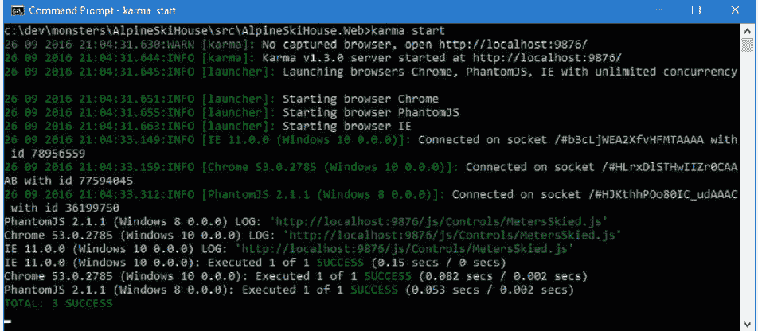

## 图 20-4 从命令行运行单元测试运行器

通过 Karma，你可以免费获得持续测试。Karma 会监控任何源文件或测试文件的更改，并在时重新运行测试，为开发者提供即时反馈。

你还可以使用`gulp-karma`插件将 Karma 集成到基于 Gulp 的构建过程中。我们的应用程序将坚持使用简单的命令行过程，但你可以查看 [https://github.com/karma-runner/gulp-karma](...) 和 [https://github.com/karma-runner/grunt-karma](...)

## 其他测试类型

我们已经详细涵盖了 C# 和 JavaScript 单元测试，但还有其他类型的测试需要考虑。集成测试是另一层自动化测试，尝试在所有模块一起使用时测试应用程序。也就是说，与其孤立地测试各个部分，不如测试它们在实际交互时的工作。

大部分情况下，集成测试可以使用与单元测试相同的工具编写，但每个测试需要更多。例如，你可能需要一个关系型数据库。你可能还需要启动一个 Web 服务器来托管应用程序。

另一个重要的考虑是是否在集成测试中包含用户界面。某些集成测试采用模拟用户与浏览器自动化工具（如 Selenium WebDriver](http://www.selenium.org/projects/webdriver/)）交互的方法。其他则采用模拟浏览器发出的 HTTP 请求的方法。

ASP.NET Core 官方文档有一个关于集成测试的教程：https://docs.asp.net/en/latest/testing/integration-testing.html。

另一种测试类型是负载测试。发现性能问题的最糟糕时是服务器在高负载下开始故障的时候。幸运的是，有一些棒的负载测试工具可以模拟应用程序中的负载。Visual Studio 内置了负载测试（https://www.visualstudio.com/en-us/docs/test/performance-testing/getting-started/getting-started-with-performance-testing）。Web Surge 是另一个很棒的选择（http://websurge.wind.com/）。

带来更多的信心并可能提高速度。

本章描述的单元测试技术可以应用于 ASP.NET Core 框架的其他方面，例如下一章讨论的“扩展性”中的扩展性点。

## 第 21 章 扩展性

当 Danielle 走过时，Chester 正在他的工位上看一本书。她总是对别人在读什么感到好奇，于是找他聊天：“Chester，你在读什么呢？”

“哦，”Chester 说，有些吃一惊，“这实际上是一本关于 ASP.NET MVC 的书，叫作《ASP.NET Core 应用开发：在几个冲刺内构建应用程序》。它挺有意思的。前面的章节很多内容感觉就像我们在这个项目中已经遇到过的一样。但这一章关于扩展性的内容有很多我以前不知道的东西。”

“我们一直以来都是需要的时候去查查东西，而不是整体地学习这个框架。那里有什么我们可以用得上的东西吗？”Danielle 问。

“说实话，我们确实在使用这些东西，而且它们就是很好用。如果我们对不同的管道进行一些复杂的操作，或者编写自己的中间件，这一章就大有用之地了。”Chester 敲了敲当前的这一页说，“这部分可能很有用。它是关于同构应用（isomorphic applications）的。”

“同构应用？那种三角形的且至少两条边等长的？”

“哈哈，”Chester 笑道，“我觉得这书说的是等腰应用（isosceles applications），我不确定，但我觉得它们可能不是真的。你知道当我们在单页应用中加载页面时需要一点时间吗？”

“是，”Danielle 说。那是她一直让她心烦的事。

“好，所以同构应用会在服务器上运行我们的初始对象模型生成，并传递一个已经填充（hydrated）的页面。然后客户端的 JavaScript 就可以接管并利用已经存在的 DOM。它会更快，因为页面已经渲染过了，JavaScript 不需要更改任何内容。”

“听起来整体更快、更好。如果能在我们的项目中实现这个就太棒了。”

“工具都在这里，我们可以随时开始。我有兴趣消除那个恼人的加载延迟。网页启动时不可能带一个加载图，那简直太酷了。”

“确实如此，”Danielle 说，“我们还不如加一个启动屏。随着我们添加更多的 JavaScript，想象一下我们的页面加载变得越来越慢。那可不是不等三角形（scalene）的解决方案。”

“那是关于三角形的笑话吗？”Chester 问。

“是那样，”Danielle 承认。也许她最近在 Mark 上花了很多点时间。“我想确保我所有的角度（angles）都覆盖到了。”

ASP.NET Core MVC 框架是为扩展性构建的。框架的几乎每个级别都有钩子（hooks），允许你支持一些高级场景。我们已经讨论了其中一些扩展性点，但本章将更详细地介绍它们。

## 约定

ASP.NET Core MVC 框架高度依赖于约定（conventions）。根据约定，视图的位置是`Views/ControllerName/ActionName.cshtml`。根据约定，控制器位于`Controllers`文件夹中。这些约定减少了运行应用程序所需的某些工作。通过优先考虑约定而非配置（favoring convention over configuration），我们可以快速添加功能并以最小努力扩展 ASP.NET Core MVC。

默认约定通常适用于大多数应用程序，但在某些情况下，我们需要修改现有的约定，甚至添加我们自定义的约定。表 21-1 列出了 ASP.NET Core MVC 中可以修改或创建的约定类型。

| 约定 | 接口 | 描述 |
|---|---|---|
| 应用 (Application) | `IModelConvention` | 提供对范围约定的访问，允许你遍历下面的每个级别。 |
| 控制器 (Controller) | `IControllerModelConvention` | 特定于控制器的约定，但也允许你遍历更低级别。 |
| 操作 (Action) | `IActionModelConvention` | 可以在此处更改操作层级的约定，以及操作的任何参数。 |
| 参数 (Parameter) | `IParameterModelConvention` | 仅针对参数。 |

表 21-1 ASP.NET Core MVC 中的约定类型

当 ASP.NET Core 应用程序启动时，它会使用你添加的任何约定，从视图的最外层字段——应用约定开始，然后一直处理到控制器和操作约定，最后是参数约定。通过这种方式，最具体的约定最后应用。需要注意的是，如果你通过`IControllerModelConvention`添加了参数约定，它可能会被`IParameterModelConvention`覆盖，无论你将约定添加到项目中的顺序是怎样的。这与中间件不同，因为约定的顺序仅适用于同一层级，且级别之间存在你无法调整的优先级。

## 创建自定义约定

要创建自定义约定，请创建一个继承自相应范围约定的类。例如，创建一个在应用级别生效的自定义约定，实现`IApplicationModelConvention`接口。表 21-1 中列出的每个接口都有一个在运行时调用的单方法`Apply`。`Apply`方法接收一个对应层级的模型。例如，`IApplicationModelConvention`的`Apply`方法接收一个`ApplicationModel`参数。除其他内容外，`ApplicationModel`包含了启动时发现的控制器列表。在`Apply`方法中，我们还可以检查此列表并修改控制器的属性。

## 应用自定义约定

点击此处查看代码图片

```csharp
public class CustomApplicationModelConvention : IApplicationModelConvention
{
    public void Apply(ApplicationModel application)
    {
        //应用自定义约定
    }
}
```

当我们在`Startup.Configure`中调用`AddMvc`方法时，约定会在启动时与 MVC 框架注册。我们做的是将自定义约定的实例添加到`Conventions`列表中。

作为一个简单的例子，让我们创建一个自定义的`IModelConvention`。在这个约定中，我们希望对任何具有`HttpPost`特性且没有显式添加`ValidateAntiForgeryToken`的操作方法自动添加过滤器。在`Apply`方法中，我们能够检查操作方法的属性，并在我们想要约定的方法上添加过滤器。

### 自动添加验证器的 Action 级约定

点击此处查看代码图片

```csharp
public class AutoValidateModelConvention : IActionModelConvention
{
    public void Apply(ActionModel action)
    {
        if (IsConventionApplicable(action))
        {
            action.Filters.Add(new ValidateAntiForgeryTokenAttribute());
        }
    }

    public bool IsConventionApplicable(ActionModel action)
    {
        if (action.Attributes.Any(f => f.GetType() == typeof(HttpPostAttribute)))
        {
            if (!action.Attributes.Any(f => f.GetType() == typeof(ValidateAntiForgeryTokenAttribute)))
            {
                return true;
            }
        }
        return false;
    }
}
```

# 注意

约定可以实现非常棒的场景。在 MSDN 杂志，Steve Smith 介绍了如何使用约定将应用程序组织为功能文件夹¹。Philip Wojcieszyn 在他的博客上也有一些很棒的示例，展示了如何应用全局路由前缀²并提供了一种有趣的本地化路由方法³。

+   1 https://msdn.microsoft.com/magazine/mt763233
2 http://www.strathweb.com/2016/06/global-route-prefix-with-asp-net-core-mvc-revisited/
3 http://www.strathweb.com/2015/11/localized-routes-with-asp-net-5-and-mvc-6/

在 ASP.NET Core MVC 中创建自定义约定很容易。当然，在修改默认的 ASP.Net Core MVC 约定时要小心。对默认约定的任何更改都会让新开发者理解应用程序变得更加困难，因为看起来与其他 ASP.NET Core MVC 应用程序不一样。

## 中间件

正如我们在第 3 章“模型、视图和控制器”中所看到的，ASP.NET Core 被配置为一系列中间件组件，这些组件处理传入的请求并管理输出的响应。在架构上，ASP.NET Core 使用的模式是一种广为人知的参考架构——“管道与过滤器”（Pipes and Filters），这在位于 https://msdn.microsoft.com/en-us/library/dn568100.aspx 的单独 MSDN 文章中有进一步解释。这种架构的底层优势之一是易于扩展。可以轻松地向应用程序中添加中间件，而不需要对其他中间件模块进行大规模更改。

## 配置流水线

在 ASP.NET Core 中，流水线是在`Startup.Configure`方法中配置的。通常会包含许多内置中间件组件，通过调用`IApplicationBuilder.Web`上的相应扩展方法即可轻松添加。下面的代码示例了在 AlpineSkiHouse.Web 中配置的简化版流水线。

AlpineSkiHouse.Web 中`Startup.Configure`的缩略版本

点击此处查看代码图片

```csharp
public void Configure(IApplicationBuilder app, IHostingEnvironment env)
{
    app.UseExceptionHandler("/Home/Error");
    app.UseStaticFiles();
    app.UseIdentity();
    app.UseMvc(routes =>
    {
        routes.MapRoute(
            name: "default",
            template: "{controller=Home}/{action=Index}/{id?}");
    });
}
```

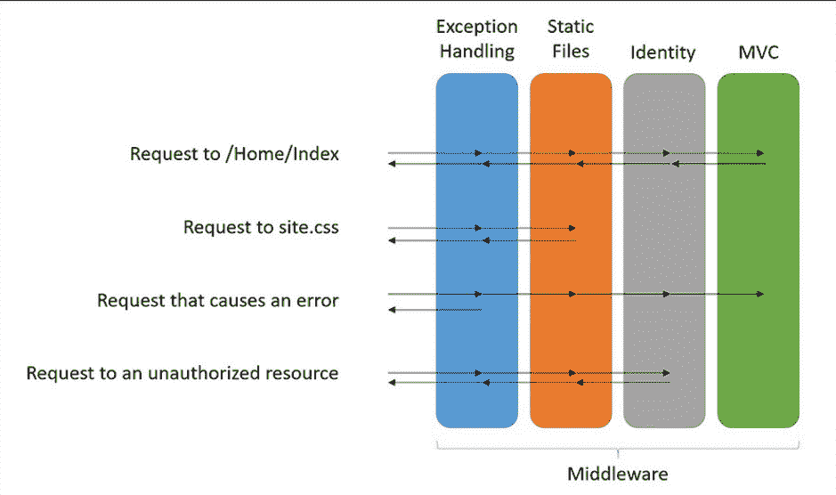

## 图 21-1 AlpineSkiHouse.Web 的简化请求流水线

ASP.NET Core 中间件的之处在于修改请求流水线是如此简单。一个很好的例子是仅当应用程序运行在开发环境中时才开启特殊的异常和错误处理页面。

开发环境配置中间件的示例

[点击此处查看代码图片](#)

```csharp
if (env.IsDevelopment())
{
    app.UseDeveloperExceptionPage();
    app.UseDatabaseErrorPage();
}
else
{
    app.UseExceptionHandler("/Home/Error");
}
```

通过对流水线进行简单的更改，你就可以在本地开发环境中访问特殊的错误诊断页面。数据库错误页面的示例可以参见[图 21-2](#)。

# 处理请求时数据库操作失败。

SqlException: 无法打开登录请求数据库 "aspnet-AlpineSkiHouse-4c85a7e-e4bac-4816-8cf5-f22568bbf069"。登录失败。用户 "DAVE-DESKTOP\david" 登录失败。

为 ApplicationUserContext 应用现有的迁移可能会解决此问题

存在尚未应用于数据库的 ApplicationUserContext 迁移

- 0000000000000000-CreateIdentitySchema
- 201606230232346-AddNamePropertiesToApplicationUser

```bash
Apply Migrations
```

在 Visual Studio 中，你可以使用程序管理器控制台（Package Manager Console）将待处理迁移应用到数据库：

PM> Update-Database

或者，你也可以从项目目录的命令行提示符应用待处理迁移：

```bash
> dotnet ef database update
```


除了使用内置中间件组件外，编写自定义中间件或通过 NuGet 引入额外的中间件组件也很。任何自定义中间件都可以通过调用`IApplicationBuilder`实例上的`Use`方法添加到流水线中。

# 编写你自己的中间件

对于基础应用程序，没有需要实现自定义中间件，因为可能有内置或第三方提供的中间件可以解决最常见的用例。然而，理解中间件是如何实现的仍然值得的。至少，这有助于消除该概念的神秘感。

简单来说，中间件是一个对请求执行的操作委托（delegate），然后将请求传递给流水线中的下一个委托。

让我们来看一个向响应中添加`Content-Security-Policy`标头的简单中间件示例。你可以通过在`Startup.Configure`方法中声明一个匿名方法来实现此行为。

# 注意

内容安全策略头部（Content Security Policy Header）是保护你的网站免受跨站脚本攻击的重要工具。你可以通过观看 ASP.NET Monsters 频道第 94 集的相关视频，了解更多关于这些头部如何工作以及为什么它们重要的知识。

4 https://channel.msdn.com/Series/aspnetmonsters/ASP-NET-Monsters-66-Content-Security-Policy-Headers

# 作为匿名方法实现的中间件示例

点击此处查看代码图片

```csharp
app.Use(async (context, next) => {
    context.Response.Headers.Add("Content-Security-Policy", "default-src 'self'");
    await next.Invoke();
});
```


然而，匿名方法并不易于测试或重用。通常情况下，将中间件实现为一个类是更好的选择。中间件类是一个实现了`Invoke`方法并通过构造函数注入接受`RequestDelegate`的类。注意，中间件类像 ASP.NET Core 中的任何其他服务一样参与依赖注入。在创建类之后，在`Startup.Configure`中配置中间件。

## 用于添加 Content-Security-Policy 的中间件

点击此处查看代码图片

```cs
public class CSPMiddleware {

    private readonly RequestDelegate _next;

    public CSPMiddleware(RequestDelegate next) {

        _next = next;

    }

    public async Task Invoke(HttpContext context) {

        context.Response.Headers.Add("Content-Security-Policy", "default-src 'self'");

        await _next.Invoke(context);

    }

}
```

# 在 Startup.Configure 中配置 CSPMiddleware

点击此处查看代码图片

```cs
app.UseMiddleware<CSPMiddleware>(),
```

创建并实现中间件后，对 Alpine 网站的任何请求现在都添加了`Content-Security-Policy`头部，如图 21-3 所示。

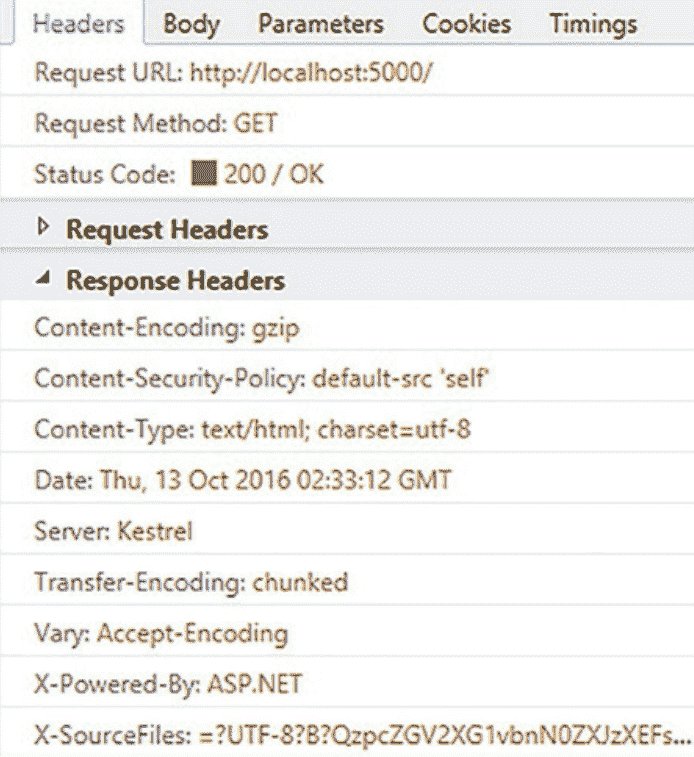

这是一个简单的示例。在调用`next.Invoke(context)`之后也可以添加某些逻辑，并在中间件组件完成后执行。流水线中的任何请求也可以选择不调用下一个中间件。这种技术被称为“短路”（short-circuiting）请求流水线。静态文件模块进行短路的示例可以参见图 21-1。

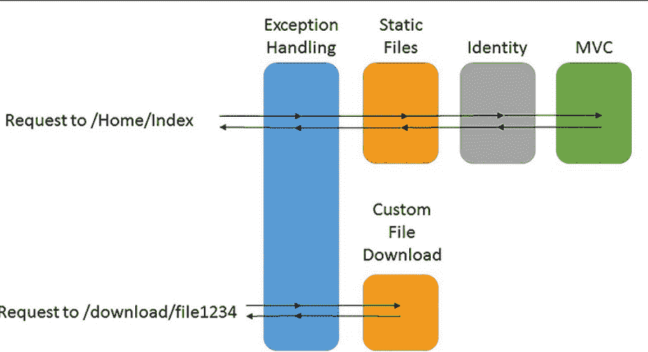

可以使用`MapWhen`函数实现更复杂的分支策略，该函数允许基于`Func<HttpContext, bool>`谓词进行分支。这意味着可以使用一个函数来检查当前的`HttpContext`，并根据当前请求决定是否进行分支。

## 加载外部控制器和视图

默认情况下，ASP.NET Core MVC 会从应用程序引用的所有程序集自动发现控制器。我们可以将所有控制器放在一个名为`AlpineSkiHouse.Web.Controllers`的独立项目中，只要`AlpineSkiHouse.Web`引用了`AlpineSkiHouse.Web.Controllers`项目，一切就能按照预期工作。在`AlpineSkiHouse.Web`的情况下，将控制器移动到单独的项目并没有意义，并且会不必要地增加解决方案的复杂性。然而，在某些情况下，从外部程序集加载控制器和其他应用程序组件是有用的。例如，考虑一个功能齐全的内容管理系统可能希望提供某种插件式的扩展性。

对于直接引用的项目，控制器会被自动发现，但有几点注意事项。首先，Razor 视图不会从外部项目自动发现。其次，对于运行时加载的程序集，控制器不会被自动发现。幸运的是，ASP.NET Core MVC 提供了扩展点来支持这两种场景。

## 从外部项目加载视图

要从外部项目加载视图，这些视图首先需要直接作为嵌入资源存储在程序集中。假设所有视图都位于`Views`文件夹中，你可以通过在项目的`project.json`文件中添加以下内容，来指定`Views`文件夹中的所有`.cshtml`文件都应嵌入到程序集中：

点击此处查看代码图像

```json
"buildOptions": {
  "embed": "Views/*.cshtml"
}
```

接下来，在主 Web 项目中你需要添加对`Microsoft.Extensions.FileProviders`NuGet 包的引用，并配置 Razor 在引用的项目中作为嵌入文件查找视图。

## 配置 Razor 从嵌入资源加载视图

点击此处查看代码图像

```csharp
services.AddMvc();
// 获取包含嵌入视图的程序集的引用
var assembly =
typeof(AlpineSkiHouse.Web.Controllers.ExternalController).GetTypeInfo().Assembly;
// 为该程序集创建一个 EmbeddedFileProvider
var embeddedFileProvider = new EmbeddedFileProvider(
  assembly
);
// 将文件提供器添加到 Razor 视图引擎
services.Configure<RazorViewOptions>(options =>
  options.FileProviders.Add(embeddedFileProvider)
});
```

通过这个小的更改，视图和控制器都将从外部项目加载。

## 从外部程序集加载控制器

在插件框架的情况下，外部项目在编译时是不可知的。相反，插件程序将在运行时加载，在这种情况下，需要通过调用`AddApplication`方法将这些动态加载的程序集显式添加到`IMvcBuilder`。

## 动态加载程序集并将其添加到 IMvcBuilder

点击此处查看代码图像

```csharp
var assembly =
AssemblyLoadContext.Default.LoadFromAssemblyPath("fullpattoassembly.dll");
```

```csharp
services.AddMvc()
.AddApplicationPart(assembly);
```

通过结合这两种方法，在 ASP.Net Core MVC 应用程序中创建自定义插件架构相对容易。当然，一个完整的插件架构在应用程序服务、动态加载哪些程序集的配置以及错误处理方面需要更多的考虑。

## 路由

ASP.Net Core 中的路由是将传入的请求的 URL 映射到路由处理程序的过程。当我们思考 ASP.Net Core 中的路由时，我们通常指的是 MVC 路由，它将传入的请求路由到控制器上的特定操作。

MVC 中的路由通过通过在`Startup.Configure`中调用`Mvc`方法时在`IRouteBuilder`上定义路由来配置。一个典型的 ASP.Net Core MVC 应用程序使用 Visual Studio 的“新建项目”模板所配置的默认路由行为。

```csharp
app.UseMvc(routes =>
{
  routes.MapRoute(
    name: "default",
    template: "{controller=Home}/{action=Index}/{id?}");
});
```

路由通过在`IRouteBuilder`上调用`MapRoute`创建。每个路由由一个名称和一个模板组成。路由中间件使用指定的模板将传入的请求的 URL 匹配到特定的路由。模板由若干用大括号包裹的路由参数组成。即`{controller}`、`{action}`和`{id}`。对于控制器和操作参数，已经指定了默认值。例如，如果路径不包含映射到模板 Action 部分的部分，则使用`Index`操作。同样，如果未指定控制器，则使用`Home`控制器。`id`部分是可选的，但没有指定默认值。如果在 URL 中匹配到一个`id`，则`id`的值将映射到操作方法的`id`参数。表 21-2 显示了一些示例 URL 以及生成的控制器/操作方法映射。

| 请求 URL | 控制器 | 操作方法 |
| --- | --- | --- |
| Home/Index/ | HomeController | Index() |
| Home/ | HomeController | Index() |
| / | HomeController | Index() |
| SkiCard/ | HomeController | Index() |
| SkiCard/Create/ | SkiCardController | Create() |
| SkiCard/Edit/1 | SkiCardController | Edit(int id) |

表 21-2 示例 URL 以及对应的控制器/操作

默认路由是路由的一个示例。在此示例中，我们定义了多个映射到`SkiCard`的路由。路由按照添加的顺序进行处理并具有贪婪性。如果 URL 无法被`cards`路由处理，则使用默认路由。

## 多路由示例

点击此处查看代码图像

```csharp
app.UseMvc(routes =>
  routes.MapRoute(
    name: "cards",
    template: "Cards/{action}/{id?}",
    defaults: new { controller = "SkiCard" });
  routes.MapRoute(
    name: "default",
    template: "{controller=Home}/{action=Index}/{id?}");
);
```

## 特性路由

约定路由的替代方案是特性路由。在特性路由中，使用`Route`特性直接在控制器和操作方法定义路由模板。

## 特性路由的简单示例

点击此处查看代码图像

```csharp
public class HomeController : Controller
{
  [Route("/")]
public IActionResult Index()
{
    return View();
}
[Route("/about")]
public IActionResult About()
{
    return View();
}
[Route("/contact")]
public IActionResult Contact()
{
    return View();
}
}
```

示例 `HomeController` 在每个操作方法上使用`Route`特性将传入的请求路由到特定的操作方法。例如，`/contact` URL 被路由到`Contact`操作方法。

## 高级路由

ASP.NET Core MVC 中的路由非常灵活。要了解更多关于约定路由和特性路由的高级用法，请查看 ASP.NET Core 文档，地址：https://docs.asp.net/en/latest/mvc/controllers/routing.html。

路由中间件可以在 MVC 框架之外通用。通过在 MVC 之外配置路由中间件，可以将 URL 映射到直接处理请求的路由处理程序。请查看 ASP.NET Core 文档，地址：https://docs.asp.net/en/latest/fundamentals/routing.html 以获取 ASP.Net Core 高级路由的完整概述。

```json
"tools": {
  "Microsoft.EntityFrameworkCore.Tools": "1.0.0-preview2-final"
}
```


你也可以使用 `dotnet` CLI 工具。访问 https://docs.microsoft.com/en-us/dotnet/articles/core/tools/extensibility 了解 `dotnet` CLI 扩展性的完整概述。

## JavaScript 服务与同构应用

我们已经看到了一些 ASP.NET Core 如何与 Node.js 良好集成的示例。Visual Studio 工具对 npm 和其他包管理器具有内置支持，使 ASP.NET Core 开发者能够像开发客户端一样访问 `node.js` 生态系统（客户端开发也是如此）。目前缺失的领域是在服务器端运行时执行 JavaScript。

好了，在 Node.js 应用的语境下，在服务器上运行 JavaScript 似乎很自然，但在 .NET 应用的语境下，这听起来有点不可置信。让我们退后一步，首先谈谈我们最初为什么要考虑这一点，从一个名为“同构应用（isomorphic applications）”的概念说起。

## 同构应用

同构应用是一种代码能够在客户端和服务器同时运行的应用。事实上，同构应用的概念已经流行起来，作为解决单页应用（SPA）某些列举缺点的解决方案。当客户端在 SPA 中加载初始页面时，HTML 基本上是一个包含某些脚本引用的空外壳。在附加 JavaScript 文件下载并执行之前，会显示一个空白页面。在大多数情况下，需要多次请求来加载数据。这种架构会导致初始页面加载缓慢，并可能导致次优的用户体验。要创建一个不涉及在获取脚本和数据时出现至少某些页面闪烁、重绘或加载指示器的 SPA 是困难的。

除了用户体验之外，返回空 HTML 外壳的请求对搜索引擎优化（SEO）可能是一个很大的负面影响。理想情况下，来自爬虫的请求应该包含与最终在客户端显示的相同的 HTML。

如果你在服务器端预渲染 HTML，那么用户体验和 SEO 问题都可以得到解决。在服务器上，你具有可以缓存页面输出的优势，这可以使后续请求更快。

`Microsoft.AspNetCore.SpaServices` 包启用了 SPA 组件的服务器端预渲染。在服务器端进行，然后传输到你喜欢的 SPA 框架在服务器端预渲染 HTML，然后将结果传输到客户端并在那里继续执行。

`SpaServices` 并不是绑定到 Angular 或 React 等特定的 SPA 框架，而是提供了一组 ASP.NET API，这些 API 知道如何调用 JavaScript 函数进行服务器端渲染并将结果注入发送到客户端的 HTML 中。每个 SPA 框架的渲染方法都是不同的。例如，Angular 2 使用 `angular-universal` 包来支持服务器端页面渲染。

5 https://github.com/angular/universal

有关 `SpaServices` 包的更多详细信息以及使用 Angular 2 和 React 的示例，请访问 https://github.com/aspnet/JavaScriptServices/tree/dev/src/Microsoft.AspNetCore.SpaServices。

## Node 服务

除了对同构应用的卓越支持外，ASP.NET Core 还支持在 ASP.NET Core 应用中运行时调用 Node.js。虽然通常倾向于使用 .NET 和 NuGet 包来实现功能，但在某些你可能需要使用 Node.js 包来执行特定任务。在某些情况下，第三方服务可能不提供 .NET API，而是提供 Node.js API。在运行时调用 Node.js 包的能力为 ASP.NET Core 提供了新级别的扩展性。除了 .NET 生态系统中的可用包外，ASP.NET Core 开发者现在可以访问 Node 社区中提供的广泛包。

运行时 Node.js 功能由 `Microsoft.AspNetCore.NodeServices` 包提供。有关 `NodeServices` 包的更多细节，包括示例和常见用例，可以在 https://github.com/aspnet/JavaScriptServices/tree/dev/src/Microsoft.AspNetCore.NodeServices。

# 总结

MVC 框架一直非常具有扩展性，但 ASP.NET Core MVC 所作的架构更改将扩展性提升到了新的水平。中间件是较于以前版本最大的变化，它为你提供了一个易于理解、配置和为任何可能的场景扩展的请求流水线。

除了中间件之外，ASP.NET Core MVC 还暴露了用于自定义和扩展框架约的接口。路由可以支持应用程序内复杂的请求路由。JavaScript 服务可以弥接 .NET 与 JavaScript/Node.js 生态系统之间的差距。`dotnet` 命令行工具提供了扩展点，允许自定义跨平台命令行工具。我们很难找到一个无法通过使用 ASP.NET Core MVC 框架内置扩展点的组合来支持的场景。

在下一章，即第 22 章“国际化”中，我们将探索 ASP.NET Core 中的扩展点，这些点允许你构建针对全球多种语言和地区的应用程序。

## 第 22 章 国际化

“……这就是为什么这一地区有这么多说法语的人。”Danielle 向 Balázs 解释阿尔卑斯滑雪小屋周围土地的文化历史。

“我太惊讶了，”Balázs 说，“仅仅因为在森林里发现了几块松露，就有很多人从法国搬过这里。”

“不只是几块，这些森林里到处都是。我理解这些松露的质量很高。我们实际上向法国出口了很多松露，在那里它们出售时，真正的消费者在烹饪后真的无法区分区别。你知道一磅松露可以卖到 3000 美元吗？”

（此处后续重复的文本已略过翻译，以符合格式要求）

### 表格：在微软网站上选择区域

| 阿尔及利亚 - 法语 | 海湾 - 英语 | 巴拿马 - 西班牙语 | 乌拉圭 - 西班牙语 |
| :--- | :--- | :--- | :--- |
| 阿根廷 - 西班牙语 | 洪都拉斯 - 西班牙语 | 巴拉圭 - 西班牙语 | 委内瑞拉 - 西班牙语 |
| 澳大利亚 - 英语 | 香港 - SAR | 菲律宾 - 英语 | 越南 - Tiếng Việt |
| 比利 - 荷兰语 | 克罗地亚 - Hrvatski | 秘鲁 - 西班牙语 | 希腊 - Ελληνικά |
| 比时 - 法语 | 印度 - 英语 | 波兰 - Polska | 白俄罗斯 - Беерусская |
| 玻利维亚 - 西班牙语 | 印度尼西亚 - Bahasa | 葡萄牙 - Portugués | 保加利亚 - Българский |
| 波斯尼亚与黑尔塞哥文 | 印度尼西亚 | 波多黎哥 - 西班牙语 | 俄罗斯 - Русский |
| 加拿大 - 英语 | 爱尔兰 - 英语 | 罗马尼亚 - Română | 乌克兰 - Українська |
| 加拿大 - 法语 | 约旦 - 英语 | 以色列 - עברי | 沙特阿拉伯语 |
| 智利 - 西班牙语 | 立巴嫩 - 英语 | 新加坡 - 英语 | 利亚语 |
| 哥伦比亚 - 西班牙语 | 立陶宛 - Lietuvių | 南非 - 英语 | 埃及语 |
| 哥斯达加 - 西班牙语 | 匈牙利 - Magyar | 马来西亚 - 英语 | 阿拉语 |
| 古巴 - 西班牙语 | 斯洛伐克 - Slovenčina | 斯洛文尼亚 - Slovenšč | 土耳其语 |
| 多立克 - 西班牙语 | 塞尔维亚 - Srpski | 泰国 - ไทย | 波斯语 |
| 墨西哥 - 西班牙语 | 斯洛兰 -  |  |  |

为特定语言和区域自定义应用程序。

.NET 对国际化提供了丰富的支持。在 .NET 中，文化由 `CultureInfo` 类表示，该类还包含了有关格式化日期和数字的信息。.NET 中的每个线程都有两个 `Culture` 属性：`CurrentCulture` 和 `CurrentUICulture`。通常情况下，`CurrentCulture` 和 `CurrentUICulture` 被设置为相同的文化。在运行时，线程的 `CultureInfo` 属性用于确定日期、数字、货币值、文本排序顺序和其他特定文化的格式化特征的默认格式。另一方面，`CurrentUICulture` 用于运行时访问特定文化的资源，这引引入了资源的话题。

资源文件是一个包含键值对的文件。通常，值是文本，但值也可以是二进制内容（如图像）。资源文件很重要，因为它们允许你将可本地化的字符串与代码分离。特定文化的资源文件可以在运行时加载，提供特定语言和区域的翻译。

## 现有应用程序的全球化

我们曾过一个相当大的 WinForms .NET 应用程序，销售团队获得了一笔国际订单。这对于公司来说可能是一笔巨大的意外收获，并有可能将产品推向更大的客户群。问题是，它完全没有准备好进行本地化。显示在用户界面上的文本在应用程序的每一层（包括数据库）中都是硬编码的。

因此，我们开始了痛苦的过程，首先将文本移动到资源文件中。这个过程两个全职开发者花了几个月才完成。提取字符串后，我们聘请翻译人员开始将所有字符串翻译成目标语言。在此时，我们认为项目已大部分完成，直到我们将资源文件加载到应用程序中。在某些情况下，按钮太窄，导致重叠了文本框，因为表单布局假设文本具有特定宽度。UI 看起来像一团糟。我们又花了几个月时间重新设计布局，以使应用程序在使用翻译后的资源时看起来正常。

这个故事的教训是，在大型现有应用程序中后期改造全球化是一个非常耗时的过程。如果应用程序很有可能需要本地化，请考虑在早期就纳入必要的功能。

## 可本地化文本

为了支持本地化，你需要确保显示给用户的任何文本都没有在应用程序代码中硬编码。正如我们已经提到的，我们需要设置应用程序从资源文件中拉取本地化值。ASP.NET Core 提供了一系列服务，使这变得相对直观。通过在 `Startup.ConfigureServices` 中添加本地化来启用本地化服务。

## 在启动时注册本地化服务

点击此处查看代码图像

```csharp
services.AddLocalization(options => options.ResourcePath = "Resources");

services.AddMvc()
  .AddViewLocalization()
  .AddDataAnnotationsLocalization();
```

## 字符串本地化

通常，应用程序中大多数可本地化的文本位于视图中，但某些文本也位于控制器或服务中。例如，`Account` 控制器的 `Login` 操作添加了“Invalid login attempt.”，这在视图渲染时最终会作为验证错误显示给用户。

### `AccountController` 中 `Login` 操作的片段

点击此处查看代码图像

```csharp
ModelState.AddModelError(string.Empty, "Invalid login attempt.");

return View(model);
```

当这些字符串被硬编码时，无法在运行时加载本地化版本的文本。ASP.NET Core 提供了 `IStringLocalizer` 服务来解决这个问题。你像注入其他服务一样将 `IStringLocalizer` 服务注入到控制器中。

## 在控制器中注入 `IStringLocalizer`

点击此处查看代码图像

```csharp
[Authorize]
public class AccountController : Controller
{
  private readonly UserManager<ApplicationUser> _userManager;
  private readonly SignInManager<ApplicationUser> _signInManager;
  private readonly IEmailSender _emailSender;
  private readonly ISmsSender _smsSender;
  private readonly ILogger _logger;
  private readonly IStringLocalizer<AccountController> _stringLocalizer;

  public AccountController(
    UserManager<ApplicationUser> userManager,
    SignInManager<ApplicationUser> signInManager,
    IEmailSender emailSender,
    ISmsSender smsSender,
    ILogger loggerFactory,
    IStringLocalizer<AccountController> stringLocalizer)
  {
    _userManager = userManager;
    _signInManager = signInManager;
    _emailSender = emailSender;
    _smsSender = smsSender;
    _logger = loggerFactory.CreateLogger<AccountController>();
    _stringLocalizer = stringLocalizer;
  }

  //Action methods...
}
```

账户控制器可以通过传递标识要检索字符串的唯一键来在运行时加载本地化字符串。另一种策略是使用默认索引器，如我们在下面的代码示例中所做的那样。`ILocalizationString` 通过 .NET 框架的 `ResourceManager` 查找与当前文化匹配的字符串本地化版本。`ILocalizationString` 的优点之一是它不需要你为默认语言创建资源文件。如果未找到键，`ILocalizationString` 仅返回该键。

### 使用 `IStringLocalizer` 的 `AccountController` 中 `Login` 操作片段

点击此处查看图像

```csharp
ModelState.AddModelError(string.Empty, _stringLocalizer["Invalid login attempt."]);

return View(model);
```

## 创建特定文化的资源文件

字符串本地化器根据命名约定根据当前请求文化加载资源文件。你使用的资源文件命名规范是 `ContainerNamespace.CultureName.resx`，其中 `ContainerNamespace` 是 `ILocalizationString<T>` 中指定的类型参数的命名空间减去应用程序的 `AlpineSkiHouse.Web.Controllers.AccountController`，则 `ContainerNamespace` 为 `Controllers.AccountController`。在我们为 `AlpineSkiHouse.Web` 应用程序添加本地化服务的情况下，我们指定资源将位于 `Resources` 文件夹中。

例如，我们可以通过在 `Resources` 文件夹中添加名为 `Controllers.AccountController.fr-CA.resx` 的新资源文件来提供法语加拿大的字符串。在 Visual Studio 中添加资源文件，右键点击解决方案资源管理器中的 `Resources` 文件夹并选择“添加”，然后选择“新建项”。选择“代码和资源文件”。Visual Studio 中的文件编辑器提供了一个包含 `Name` 和 `Value` 列的表格。在图 22-2 中，你可以看到“Invalid login attempt”字符串具有法语加拿大值的条目。

```cshtml
@inject IVLocalizer Localizer

@{
    ViewData["Title"] = Localizer["Log in"];
}
```

```html
<h2>@ViewData["Title"]</h2>

<div class="row">
    <div class="col-md-8">
        <section>
            <!-- -->
            <h4>@Localizer["Use a local account to log in."]</h4>
        </section>
    </div>
</</div>

<!-- -- -->
```

使用 `@inject` 指令，ASP.NET Core 会处理将 `IVLocalizer` 实例分配给本地属性 `Localizer`。现在在视图中，我们可以像在控制器和服务中中使用 `IStringLocalizer` 一样使用 `Localizer`。同样，可以使用默认语言结合本地化文本的唯一键（unique key）内联使用，这意味着我们不需要为默认语言创建资源文件。稍后可以添加特定区域的资源文件。

`IVLocalizer` 的默认实现根据当前视图的路径查找资源文件。例如，包含 `Views/Account/Login.cshtml` 加拿大法语文本的资源文件将命名为 `Resources/Views.Account.Login.fr-CA.resx`。

## 数据注解（Data Annotations）

我们的代码库中最后一个地方包含可本地化的文本。视图模型类中使用的数据注解稍后会被 Razor 中的标签辅助器（tag helpers）用于显示适当标签和验证消息。让我们查看 `Account/Login` 视图中使用的 `LoginViewModel`。

## `Account/Login` 中使用的视图模型

```csharp
public class LoginViewModel
{
    [Required(ErrorMessage = "Email is required")]
    [EmailAddress(ErrorMessage = "Not a valid email address")]
    [Display(Name="Email")]
```


`public string Email { get; set; }`

`[Required(ErrorMessage = "Password is required")]`

`[DataType(DataType.Password)]`

`[Display(Name="Password")]`

`public string Password { get; set; }`

`[Display(Name = "Remember me")]`

`public bool RememberMe { get; set; }`

```
}
```

数据注解错误消息的本地化版本将在运行时从资源文件加载，使用的命名约定与`IStringLocalizer`一致。加拿大法语可以从名为`Resources/Models.AccountViewModels.Login.fr-CA.resx`的资源加载。

在编写时注意，`Display`属性中指定的`Name`尚未本地化。ASP.Net Core MVC 1.1发布时将支持显示名称的本地化。

## 共享资源文件（Sharing Resource Files）

在之前的示例中，应用程序的每个部分都有自己的资源文件。虽然这种方法可以保持应用程序的每个部分独立，但可能会导致大量的资源文件。将某些资源文件放在共享位置可能会有所帮助。

首先，我们需要创建一个空类作为所有共享资源的占位符。共享资源的特定区域资源遵循命名约定`Resources/SharedResources.CultureName.resx`。

## SharedResources.cs

```cs
/// <summary>
/// 一个作为共享资源占位符的空类
/// </summary>
public class SharedResources
{
}
```

你可以通过注入`IStringLocalizer<SharedResources>`实例来在控制器和服务中访问共享资源。同样，你也可以通过注入`IHtmlLocalizer<SharedResources>`实例在视图中访问共享资源。

## 在视图中使用共享资源

```html
@using Microsoft.AspNetCore.Mvc.Localization
@inject IHtmlLocalizer<SharedResources> SharedLocalizer

<!DOCTYPE html>
<html>
<head>
<meta charset="utf-8" />
<meta name="viewport" content="width=device-width, initial-scale=1.0" />
<title>@ViewData["Title"] - @SharedLocalizer["AlpineSkiHouse"]</title>
<!-- -- -->
</head>
```

现在应用程序在运行时通过Cookie读取本地化文化（Culture）。我们需要为用户提供一种选择语言的机制。

## 设置当前语言（Setting the Current Culture）

在应用程序中，你可以在启动时设置语言。为了支持多个区域的用户，需要在请求级别设置语言。ASP.NET Core使用本地化中间件设置请求语言。

在管道中添加本地化中间件时，我们需要指定支持的语言和默认语言。

## Startup.Configure方法中添加本地化的部分

```cs
var supportedCultures = new[]
{
    new CultureInfo("en-CA"),
    new CultureInfo("fr-CA")
};

var requestLocalizationOptions = new RequestLocalizationOptions
{
    DefaultRequestCulture = new RequestCulture("en-CA"),
    SupportedCultures = supportedCultures,
    SupportedUICultures = supportedCultures
};

app.UseRequestLocalization(requestLocalizationOptions);

app.UseMvc(routes =>
{
    routes.MapRoute(
        name: "default",
        template: "{controller=Home}/{action=Index}/{id?}");
});
```

本地化中间件为设置语言提供了一些内置选项。具体来说，可以使用查询字符串、Cookie或请求头。在AlpineSkiHouse中，我们依赖于通过`CookieRequestProvider`实现的Cookie。如果未设置Cookie，则使用默认语言。

我们需要让用户看到当前选择了什么语言/区域，并提供从支持语言列表中选择的选择。正如许多网站所示，我们在页脚中显示当前的语言链接。

## Views/Shared/_Layout.cshtml中的footer部分

```html
<footer>
  @await Html.PartialAsync("_CurrentLanguage")
  <p>©copy; @DateTime.Now.Year.ToString() - AlpineSkiHouse</p>
</footer>
```

在`_CurrentLanguage`局部视图中，我们可以通过从上下文请求`IRequestCultureFeature`获取语言。

## Views/Shared/_CurrentLanguage.cshtml

```html
@using Microsoft.AspNetCore.Http.Features
@using Microsoft.AspNetCore.Localization

@{
    var requestCulture = Context.Features.Get<IRequestCultureFeature>();
}

<div class="pull-left">
  <a asp-controller="SelectLanguage"
     asp-action="Index"
     asp-route-returnUrl="@Context.Request.Path">
    @requestCulture.RequestCulture.DisplayName
  </a>
  <span> | </span>
  @foreach (var culture in ViewData["SupportedUICultures"])
  {
    <a asp-controller="SelectLanguage"
       asp-action="Index"
       asp-route-returnUrl="@Context.Request.Path">
       @culture.DisplayName
    </a>
  }
</div>
```

```cs
@model IEnumerable<CultureInfo>
@inject IViewLocalizer Localizer

<h2>@Localizer["Select your language"]</h2>

<div class="row">
    @foreach (var culture in Model)
    {
        <div class="col-md-3">
            <form asp-action="GetLanguage" method="post"
                asp-route-cultureName="@culture.Name"
                asp-route-returnUrl="@ViewData["ReturnUrl"]">
                <button class="btn btn-link" type="submit">
                    @culture.DisplayName
                </button>
            </form>
        </div>
    }
</div>
```

# 总结

现在我们的应用程序已经完全全球化，并且可以轻松设置以支持新的语言。添加对额外语言的支持需要新的特定语言资源文件，并对`Startup.cs`中的支持语言列表进行一些微调。对于除了小型应用程序之外的所有程序，在产品开发生命期的后期进行全球化将是耗时且昂贵的。如果您的应用程序有可能需要支持多种语言，请考虑尽早对程序进行全球化。

另一个重要的考虑因素是应用程序翻译资源的成本。翻译是非常耗时的，并且需要一种可能难以找到的专业技能。一旦创建了翻译后的资源，还需要大量的测试，以确保应用程序运行正常，并且所有文本都已得到适当翻译。

在下一章中，我们将通过探索一些重构技术来提高代码质量，从而解决引入Alpine Ski House应用程序的一些复杂性。

# 第23章. 重构与改进代码质量

“太丑了！”Marc正处于火药桶。

“太丑了！”他在办公室里来回走去，大喊大叫，跺脚，只有Marc才能这样做。

Danielle摘下耳机，检查了电脑上的日期，叹了口气，走去拦住Marc。周四是她指定的平复Marc情绪的日子。如果今天是周三就好了，那是Chester的工作了。“怎么了，Marc？”

正如她了解Marc一样，Marc转过身走进了Danielle。“我讨厌这些代码，Danielle。我讨厌每一行、每一个分号、每一个空格字符。制表符和空格，Danielle，我是一个平等的仇恨者。”

“它有什么问题吗？”

“噢，你看它吧，方法太长了，有未使用的变量，这又是什么？一个叫做stringybob的字符串？”

“并没有一个叫stringybob的字符串，”Danielle笑了道。

“好吧，那是我造的，但剩下的都是真的。”

“不，它是一个Buick（别克汽车）吗？”

“完全不是，”Danielle回答道。“这是一种量且安全改进代码质量的方法。这里有一本相关的书。你为什么不读读它，几小时后再回来？”

“你知道吗，Danielle，我想我会这么做的。多谢了。”Marc被安抚后回到办公桌旁坐下。他一离开，Chester就来到了Danielle身边。

“对不起，Danielle，”他羞愧地说道。

“你有什么好道歉的？”Danielle问道。

“我看到Marc在发脾气，所以我悄悄改了你电脑的日期。现在只是周三。”

很少有人对一年前写的代码感到满意。编程领域中一个经常的笑话是，当某人解释“是谁写了这些垃圾？”，结果在查看历史记录时发现是他们自己。这是一个非常棒的状态。当我们第一次编写代码时，通常在努力理解业务领域、编程问题以及尚未编写的应用程序形态。一个时刻需要考虑的内容太多，所有这些变动部分经常会导致结构或功能上的错误。在对应用程序的理解有所提高后，在几个月后能回去修复旧代码，是一项极大的奢侈。

在本章中，我们将探索重构的概念，以及我们如何在不破坏所有功能的情况下改进应用程序的功能。

## 什么是重构？

重构（Refactoring）一术由William Opdyke和Ralph Johnson在20世纪90年代提出。是的，“四人帮”写过一本书。重构意味着改变一段代码的内部结构，使其更易于理解、测试、适应或具有更优性能，同时又不改变其面向外部的功能。如果你将一个函数看作一个可以输入数据并获取输出的黑盒，那么只要输入和输出保持不变，改变黑盒的内部线路应该是没问题的，如图23-1所示。

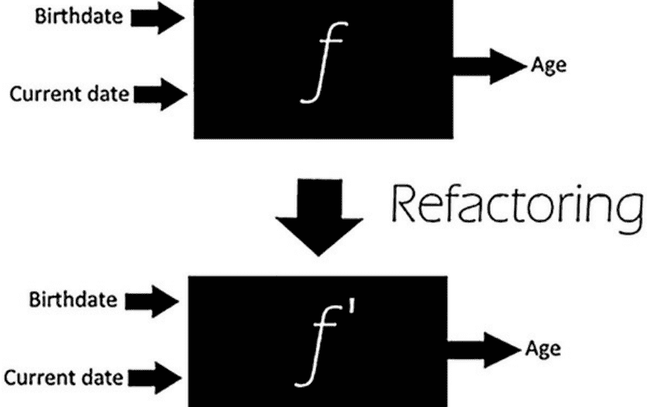

**图23-1** 重构获取函数f并将其替换为f'，后者产生相同的输入和输出

这一观察允许你在你的应用程序中替换或代用不同的代码，同时保持相同的功能并提高应用程序的整体质量。我们在这里使用“函数”一词是指代码的单元，重构的范围不需要局限于函数的内部。面向对象的编程的核心在于引入抽象，而这些抽象之所以可能，是因为防止了实现细节的泄露。在重构方面，你可以将许多结构视为黑盒。类（Classes）就是一个首选候选者。类的实现并不是非常重要，只要输入和输出保持一致，我们就可以心所欲地改变它的工作方式。命名空间（Namespaces）提供的保护级别没有类那么高，也可以被视为单位。最后，在微服务世界中，整个应用程序都可以被替换。

考虑一个负责向邮件列表发送电子邮件的服务。输入可能是接收者列表和要发送的电子邮件。与其说是输出，不如说是一个结果，即接收列表上的所有地址都收到了电子邮件，如图23-2所示。

## 收件者列表


图23-2 整个微服务的较大重构。微服务是使用Grid还是自己的服务器发送并不重要。在任何情况下，结果都是相同的。在这种，切换微服务可以被视为重构。程序员通常将任何对代码的改进称为重构。删除了方法上的额外参数？在方法周围添加了日志以更好地支持运维？虽然这两者都提高了代码质量或质量指标，但它们在技术上都不是重构，因为它们改变了应用程序的功能。严格遵守重构的定义要求输入、额外参数以及输出（包括额外的日志消息）没有任何变化。

## 衡量质量

为了提高代码质量而进行重构，我们必须要有某种形式的质量衡量方法——一种能够用单一数字代表代码质量所有层面的指标。遗憾的是，并没有这样的指标。多年来，人们建议了无数代码指标，从衡量入入耦合、估计每行代码的错误数量到测试覆盖率。决定使用哪一套代码指标本身就是一个深奥的话题。

关注几个衡量代码质量的指标是有用的：

- 代码执行了它应该做的事情吗？这看起来很简单，但通常是一个被忽视的指标。这可以通过每千行代码的缺陷数量或每个类的缺陷数量来衡量。某些开发者以全局的方式使用这种指标，通过检查发现的缺陷数量来比较两个项目的代码质量。然而，这是违反直觉的，因为没有两个项目解决的是相同的问题。你是否期望一个创建和递送在线生日卡的系统具有相同程度的复杂性或数量将bug视为控制胰素泵的系统？当然不是。这项指标以及大多数其他指标，应该仅仅作为一种观察团队和产品是否随时间推移而改进的方法。

- **代码是否符合其非功能性需求？** 这些需求是指与函数的输入输出无关的内容。例如，一段代码的性能，或者代码是否安全。

- **代码是否易于理解？** 没有任何代码是完美的，而且不可避免地总有人需要因为bug或需求的变化而对其进行更新。事实上，某人可能会发现原始作者：就是你！看这段代码：

```
for (var i = 1; i < parts.length; i++) {
  root[parts[i]] = root[parts[i]] || (root[parts[i]] = {});
  root = root[parts[i]];
}
```

这段代码可能高效且智能，但它几乎无法理解。要实现一个可读性或可理解性的客观指标是非常的。这个指标与其说是数字，不如说是开发者对可维护性的共识。对于一个成员平庸的团队来说，对某段代码的可理解性产生巨大分歧是很不寻的。代码审查是发现可理解性差的代码段的利器。

你可以使用的另一个轻量级指标是圈复杂度，它通过查看通过该方法的代码路径数量来衡量函数的复杂度。一个具有单一语句的方法有两个可能的代码路径，因此其圈复杂度为二，如图23-3所示。

```csharp
public bool CheckSkiCard(Card card)
{
  if(card.StartDate > DateTime.Now)
    return true;
  return false;
}
```

图23-3 该函数中有两条可能的代码路径

- **代码能轻松地响应需求的变化吗？** 再次，这并不是一个可以用简单的数值来表示的指标。相反，它是一个成熟团队培养出的一种感觉。当建议进行重大改动时，开发者脸上露出的痛苦表情，就足以说明目标是否已经达成。

## 在Visual Studio中显示圈复杂度

Visual Studio中有很多工具可以显示复杂度指标。一个很棒免费工具是来自https://visualstudogallery.msdn.microsoft.com/03de6710-4573-460c-aded-965b88572dc19的Code Metrics Viewer。DevOps的CodeRush工具更进一步，在每个方法旁边都包含了代码指标。它是一个很好的视觉辅助工具，提醒开发者函数不应进一步扩展。

这四个简单的指标应该是判断应用程序中哪些区域准备好接受重构帮助的良好起点。随着应用程序的成熟和增长，可能会识别并纳入新的指标。

有了所有这些指标，确保你没有针对错误的指标进行优化至关重要。人们必须设计系统，无论是有意还是无意。如果为了确保函数尽可能返回而设置了性能指标，但没有设置任何指标来确保其内存占用合理，那么就会产生巨大的动力为了节省时钟周期而优化函数的内存。考虑一下这是否真的是你想要达到的目标，或者平衡是否真的是最终目标。注意审查指标，以确保它们没有针对错误的事情进行优化，如果是的话，就更新它们。

## 寻找重构时间

开发者经常抱怨业务部门没有分配时间来进行重构和提高代码质量。在代码质量变成重大问题并开始为公司带来可衡量的资金损失之前，业务部门很少看到提高代码质量的价值。你可能会想起之前关于选择错误指标的警告，这确实可能是事实。

重构不需要是你作为一项离散活动而承担的。相反，重构应该是工作代码时的自然产物。

```cs
CreatedOn = newPass.CreatedOn
      _bus.Publish(passAddedEvent);
}
}
```


乍看之下，输入和输出非常少。该方法接收单个通知并返回`void`。进一步挖掘可以发现，该方法向数据库写入数据并发布了事件。这些事件也算作输出。似乎我们需要一个测试来检查票据（passes）是否已添加到数据库，以及另一个测试来测试发布操作。我们可能还需要测试当通知中的`Passes`集合中没有票据时会发生什么。

首先，让我们为我们对该函数的思考方式建立一些骨架（见代码列表 23-2）。

## 列表 23-2 购买完成事件处理程序程序的测试骨架

点击此处查看代码图像

```csharp
public class AddSkiPassOnPurchaseCompletedTests
{
    public class When_handling_purchase_completed
    {
        [Fact]
        public void Pass_is_saved_to_the_database_for_each_pass()
        {
            throw new NotImplementedException();
        }

        [Fact]
        public void PassesAddedEvents_is_published_for_each_pass()
        {
            throw new NotImplementedException();
        }

        [Fact]
        public void Empty_passes_collection_saves_nothing_to_the_database()
        {
            throw new NotImplementedException();
        }
    }
}
```

列表 23-2 所示的骨架是实用的占位符，提醒你实现测试。在编写其中一个测试时，你会发现其他你想要纳入测试的行为。不需要切换思路去编写一个新测试，只需放置一个骨架作为提醒，稍后回来即可。实现测试可能是最困难的。我们可能需要像第 20 章“测试”中讨论的那样，使用内存 EF 上下文，以及总线（bus）的模拟对象（mock object）。列表 23-3 所示的测试构建了一个`PassPurchased`事件，然后将其传递给处理程序进行处理。随后对数据库中期的属性进行断言。

## 列表 23-3 填充后的测试骨架，测试上下文中的数据符合预期

点击此处查看代码图像

```csharp
[Fact]
public void Pass_is_saved_to_the_database_for_each_pass()
{
  using (PassContext context =
    new PassContext(InMemoryDbContextOptionsFactory.Create<PassContext>()))
  {
    var mediator = new Mock<IMediator>();
    var sut = new AddPassOnPurchaseCompleted(context, mediator.Object);
    var passPurchased = new PassPurchased{
      CardId = 1,
      PassTypeId = 2,
      DiscountCode = "2016springpromotion",
      PricePaid = 200m
    };
    sut.Handle(new Events.PurchaseCompleted(
      Passes = new List<PassPurchased>
      {
        passPurchased
      }
    ));
  Assert.Equal(1, context.Passes.Count());
  Assert.Equal(passPurchased.CardId, context.Passes.Single().CardId);
  Assert.Equal(passPurchased.PassTypeId, context.Passes.Single().PassTypeId);
}
```

特别敏锐的读者可能会在列表 23-3 中注意到，我们对数据库创建的`Pass`设置了两个属性，但在原始代码中，我们设置了三个属性。缺失的部分是`CreatedOn`日期，它被设置为`Now`。日期的测试很棘手，因为时间在创建和测试之间会移动。如果我们使用逻辑对日期进行模糊匹配，那么我们就可以注入一个日期对象（见列表 23-4）。

## 列表 23-4 一个为了注入目的而简单封装 UtNow 的日期服务

点击此处查看代码图像

```csharp
public class DateService : IDateService
{
  public DateTime Now()
  {
    return DateTime.UtcNow;
  }
}
```

这可以通过构造函数注入到`AddSkiPassPurchaseCompleted`类中，并可以更新代码以使用它（见列表 23-5）。

## 列表 23-5 利用日期服务

点击此处查看代码图像

```csharp
Pass pass = new Pass
{
  CardId = passPurchase.CardId,
  CreatedOn = _dateService.Now(),
  PassTypeId = passPurchase.PassTypeId
}
```

更改实现存在某些风险，但这种风险可能小于仅对对象进行测试的风险。你必须根据自己的判断来确定此更改是否需要额外的测试。更新后的测试将类似于列表 23-6。

## 列表 23-6 使用日期服务的更新后的测试

点击此处查看代码图像

```csharp
[Fact]
public void Pass_is_saved_to_the_database_for_each_pass()
{
  using (PassContext context =
    new PassContext(InMemoryDbContextFactory.Create(PassContext)))
  {
    var mediator = new Mock<IMediator>();
    var dateService = new Mock<IDateService>();
    var currentDate = DateTime.UtcNow;
    dateService.Setup(x => x.Now()).Returns(currentDate);
    var sut = new AddSkiPassPurchaseCompleted(context, mediator.Object);
    var passPurchased = new PassPurchased
    {
      CardId = 1,
      PassTypeId = 2,
      DiscountCode = "2016springpromotion",
      PricePaid = 200m
    };
    sut.Handle(new Events.PurchaseCompleted(
      Passes = new List<PassPurchased>
      {
        passPurchased
      }
    ));
  }
  Assert.Equal(1, context.Passes.Count());
  Assert.Equal(passPurchased.CardId, context.Passes.Single().CardId);
  Assert.Equal(passPurchased.PassTypeId, context.Passes.Single().PassTypeId);
  Assert.Equal(currentDate, context.Passes.Single().CreatedOn);
}
```

此测试执行了处理器的设置，然后利用模拟对象来验证是否触发了事件。你注意到此测试与之前的测试之间有许多相似之处。我们可以从测试中重构一些共性以使未来的测试更容易。列表 23-7 测试每个票据是否发布了事件，以及数据库中的属性符合预期

点击此处查看代码图像

```csharp
[Fact]
public void PassesAddedEvents_is_published_for_each_pass()
{
  using (PassContext context = GetContext())
  {
    var mediator = new Mock<IMediator>();
    var dateService = new Mock<IDateService>();
    var currentDate = DateTime.UtcNow;
    dateService.Setup(x => x.Now()).Returns(currentDate);
    var sut = new AddSkiPassPurchaseCompleted(context, mediator.Object);
    var passPurchased = new PassPurchased
    {
      CardId = 1,
      PassTypeId = 2,
      DiscountCode = "2016springpromotion",
      PricePaid = 200m
    };
    sut.Handle(new Events.PurchaseCompleted(
      Passes = new List<PassPurchased>
      {
        passPurchased
      }
    ));
    var dbPass = context.Passes.Single();
    mediator.Verify(x => x.PassAdded(It.Is<PassPurchased>(y =>
        y.CardId == passPurchased.CardId &&
        y.PassTypeId == passPurchased.PassTypeId &&
        y.CreatedOn == currentDate)));
  }
}
```

## 列表 23-8 向处理程序传递空集合的情况

点击此处查看代码图像

```csharp
[Fact]
public void Empty_passes_collection_saves_nothing_to_the_database()
{
  using (PassContext context = GetContext())
  {
    var mediator = new Mock<IMediator>();
    var dateService = new Mock<IDateService>();
    var currentDate = DateTime.Now;
    dateService.Setup(x => x.Now()).Returns(currentDate);
    var sut = new AddSkiPassPurchaseCompleted(context, mediator.Object,
    dateService.Object);
    sut.Handle(new Events.PurchaseCompleted(Passes = new List<PassPurchased>()));
  }
  Assert.Equal(0, context.Passes.Count());
}
```

## 列表 23-9 确保没有发布消息的测试

点击此处查看代码图像

```csharp
[Fact]
public void Empty_passes_collection_publishes_no_messages()
{
    using (PassContext context = GetContext())
    {
        var mediator = new Mock<IMediator>();
        var dateService = new Mock<IDateService>();
        var currentDate = DateTime.UtcNow;
        dateService.Setup(x => x.Now).Returns(currentDate);
        var sut = new AddSkipPassOnPurchasePurchased(context, mediator.Object);
        sut.Handle(new Events.PurchasePurchased { Passes = new List<PassPurchased>() });

        mediator.Verify(x => x.Publish(It.IsAny<PassPassed>()), Times.Never());
    }
}
```

这个最终测试漏掉了列表 23-8 中的那一个，但它检查了中介器没有发布任何消息。

这四项测试的作用是刻画我们正在重构的函数。它们没有没有一个关注函数的内部结构，但都检查了函数的所有输入和输出。现在，我们可以随心所更改函数内部的任何内容，并知道只要测试通过，我们就没有破坏任何依赖于该的代码。

在没有安全网的情况下进行重构是可以的，但它应该让你感到不舒服，并且你应该担心更改带来的意外副作用。添加此类测试的最好部分在于，它们变成了通用测试，有助于构建你测试套件的完整性。如果你愿意，可以对你的刻画测试进行注释，以防它们与普通测试混淆。

## 数据驱动的更改

在第 12 章“配置与日志”中，我们讨论了日志记录的重要性以及它在生产场景中如何有用。在 Alpine 滑雪团队向测试组进行初始部署期间，他们发现网站的某些区域抛出了异常。他们能够查看日志并分析项目历史以来的异常，以查看哪些区域特别容易问题。这种分析比热力图更好，并用于发现应用程序中的热点。

了解问题在应用程序中何处频繁发生，为我们从哪里开始重构提供了坚实的提示。你可能希望将错误热力图与另一张显示应用程序访问最频繁区域的地图进行叠加。

假设你有以下关于每次请求错误数和每日请求数的数据，如表 23-1 所示。

| 区域 | 每次请求错误数 | 每日请求数 |
| --- | --- | --- |
| 登录 | 0.002 | 123 |
| 落地页 | 0.0003 | 50000 |
| 注册 | 0.1 | 10 |
| 购买通行票 | 0.2 | 50 |

**表 23-1：每次请求错误数和每日请求数**

初看之下，购买通行票的高错误率可能是最受关注的问题，但实际上受落地页错误影响的用户更多。

许多像 GitLab、Etsy 和 Windows 产品组这样的工程组织都收集了关于应用程序运行方式以及人们如何与之交互的大量指标。在没有获得有关现有代码指标的情况下，他们不会继续进行重构。刻画单元测试对于衡量方法的属性属性非常棒，但我们同样感兴趣的是确保没有引入性能退化。能够看到重构性能的真实世界数据是无价的。数据驱动开发是一个比单纯重构或代码质量更广泛的话题，但这无疑是值得的。

## 代码清理示例

学习定义有效的清理是一个漫长的过程，而且确实需要多年才能正确掌握。查看一个代码示例很有启发性。坦率地说，像任何复杂的项目一样，Alpine Ski House 中有很多可以重构的候选对象。一个很好的候选对象是`SkiCardController`中的`Create`（见列表 23-10）。

**列表 23-10：`SkiCardController`中的创建 动作**

[点击此处查看代码任务](#)


```csharp
public async Task<ActionResult> Create(CreateSkiCardViewModel viewModel)
{
    // 如果 modelstate 无效，则返回视图
    if (!ModelState.IsValid)
        return View(ViewModel);

    // 创建并保存卡片
    string userId = _userManager.GetUserId(User);
    _logger.LogDebug("Creating card for " + userId);

    using (_logger.BeginScope("CreateSkiCard:" + userId))
    {
        var createImage = viewModel.CardImage != null;
        Guid? imageId = null;

        if (createImage)
        {
            logger.LogInformation("Uploading ski card image for " + userId);
            imageId = Guid.NewGuid();
            string imageUri = await _uploadservice.UploadFileFromStream("cardimages",
                imageId + ".jpg", viewModel.CardImage.OpenReadStream());
        }

        logger.LogInformation("Saving ski card to DB for " + userId);
        SkiCard s = new SkiCard
        {
            ApplicationUserId = userId,
            CreatedOn = DateTime.Now,
            CardHolderFirstName = viewModel.CardHolderFirstName,
            CardHolderLastName = viewModel.CardHolderLastName,
            CardHolderBirthDate = viewModel.CardHolderBirthDate.Value.Date,
            CardHolderPhoneNumber = viewModel.CardHolderPhoneNumber,
            CardImage = imageId
        };
        _skiCardContext.SkiCards.Add(s);
        await _skiCardContext.SaveChangesAsync();

        logger.LogInformation("Ski card created for " + userId);

        _logger.LogDebug("Ski card for " + userId + " created successfully, redirecting to Index...");
        return RedirectToAction(nameof(Index));
    }
}
```

该方法执行验证，并将记录保存到数据库。初看之下，该方法看起来很长，事实上也如此，共有 42 行代码，且维护复杂度为 206。

> 注意
> 我们使用的维护复杂度是 CodeRush 特有的衡量标准。它的目标是减少现有代码指标的信噪比。维护复杂度会对各种代码结构（如锁和 try/catch 块）增加分值。添加这些分数是为了了解方法的复杂程度。我们理想情况下这些数字小于 100。详细说明逻辑的原始博客文章已丢失，但 Mark Miller 的文章已发布在 http://www.skorkin.com/2010/11/code-metrics-heres-your-new-code-metric/#V_8PARKuk。

**图 23-4：CodeRush 标注的代码截图。左侧边缘的 42 是维护复杂度**

```csharp
var userId = _userManager.GetUserId(User);
_logger.LogDebug($"Creating ski card for {userId}");

using (_logger.BeginScope($"CreateSkiCard: {userId}"))
{
    Guid imageId = null;
    if (HasCardImage(viewModel))
    {
        imageId = await UploadImage(viewModel, userId);
    }
    _logger.LogInformation($"Saving ski card to DB for {userId}");
    var skiCard = new SkiCard
    {
        ApplicationUserId = userId,
        CreatedOn = DateTime.UtcNow,
        CardHolderFirstName = viewModel.CardHolderFirstName,
        CardHolderLastName = viewModel.CardHolderLastName,
        CardHolderBirthDate = viewModel.CardHolderBirthDate.Value.Date,
        CardHolderPhoneNumber = viewModel.CardHolderPhoneNumber,
        CardImageId = imageId
    };
    skiCardContext.SkiCards.Add(skiCard);
    await skiCardContext.SaveChangesAsync();

    _logger.LogInformation("Ski card created for " + userId);
}

// POST: SkiCard/Create
[HttpPost]
[ValidateAntiForgeryToken]
public async Task<ActionResult> Create(CreateSkiCardViewModel viewModel)
{
    if (!ModelState.IsValid)
    {
        return View(viewModel);
    }

    await CreateAndSaveCard(viewModel);
    _logger.LogDebug($"Ski card for { _userManager.GetUserId(User) } created successfully,");
    redirecting to Index...");
    return RedirectToAction(nameof(Index));
}
```

代码被拆分为多个函数，每个函数都有单一的用途。这里没有一个方法的维护复杂度超过 100，或者行数超过 30。代码变得整洁了，得益于提取如 `HasCardImage` 等方法，它变得更容易读了。

# 想要帮助的工具

一些用于分析代码和建议解决方案的优秀工具。我们已经简单聊过 CodeRush、Resharper，以及通常所说的 R#（这是另一个流行的工具）。CodeRush 和 R# 不仅是代码分析工具，它们还提供重构和生产力工具。

StyleCop 和 NDepend 是代码分析工具，它们将规则应用于你的代码执行实践中。例如，可以设置 NDepend 在每当方法过长或过复杂时抛出错误，这从源上阻止了此类代码进入产品。

最便宜且最简单的工具就是你已经拥有的：编译器。只需在项目配置中将“警告（Warnings）”视为“错误（Errors）”，强制你修复编译器警告。警告是有原因的，在几乎所有情况下，它们都突出了你代码中某些微妙的问题。

# 获取质量

提高应用程序中的代码质量需要整个团队的共同努力。你提高代码质量最重要的一点不是像 CodeRush 或 NDepend 那样华丽的工具，而是团队内部的**代码共享所有权意识**。永远不应该出现你看着一段代码并心想：“噢，那是 Leonids 写的，我最好不要动它。”代码审查和结对编程在提高团队质量方面大有裨益，并能消除对某段代码的强烈依附感。


通过负面的代码审查来失败太容易了，例如：“你为什么要这样做？”以及“这看起来效率低下”等等。这些评论对任何人都没有帮助，并会拆散团队。Lori Lalonde 在她的博客文章《代码审查的忧郁》中讨论了代码审查文化，地址位于：http://www.westerndvs.com/code-review-blues/。

# 总结

重构和代码清理就像还房贷：还得越快，还款压力就越小。用中国谚语的话来说：“提高质量的最佳时间是六个月前，其次是现在。”通过简化每一件事，你的代码将变得更容易维护，工作也将变得更加愉快。

对未测试的代码进行更改可能是危险的。在深入清理之前，最好围绕你的代码构建一套测试套件。原则上讲，运行不良好的整洁代码比运行良好的杂乱代码更糟。

最后，尝试培养一种代码共享所有权的意识。整个团队应该对杂乱、难以维护的代码感到愤怒。杂乱的代码倾向于产生杂乱的代码，而整洁的代码鼓励开发者编写更多整洁的代码。这就是软件开发中的“破窗效应理论”。

在最后一章中，我们将看看如何保持应用程序中代码组织成易于扩展且易于维护的方式。

# 第 24 章：组织代码

一切进展顺利，Danielle 期待实现后的空闲时间。她想也许她应该去一个没有滑雪、没有滑雪票，而且没有 Entity Framework 的地方。在这次回顾中，Mark 一直抱怨某些控制器太大。今天她感受到了这种痛苦。

这已经是她在处理这个控制器时第三次被迫删除更改了。其他人同时对代码进行更改，而他们总是比她先提交检查。Danielle 确信这种情况可以改进，她很确定知道如何修复。她把 Mark 和 Balázs 叫到工位旁，放弃了提交这个文件。

“Balázs，这段代码正变得失控了。我们需要修复它，”她说。

“你得不到我的反驳；”插话道。“好吧，”Balázs 说，“看来我们确实有些分歧。”

（此处后续为重复的乱码文本，已按指令要求进行逻辑处理）

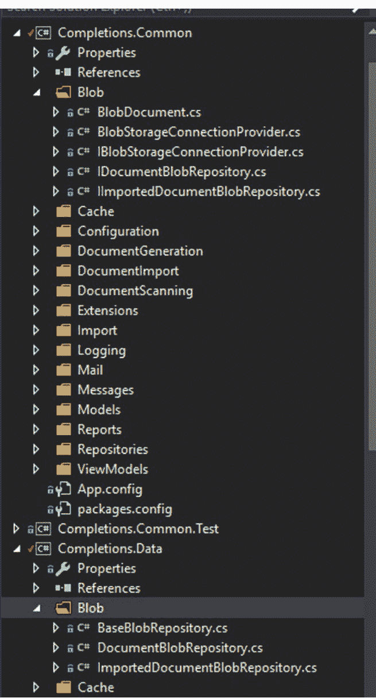

# 图24-1 使用多个项目的示例解决方案的项目结构

此外，在此屏幕截中，你可以看到 `Completions.Common.Test` 项目，它包含了对 `Completions.Common` 项目中内容的测试。正如你所想象的，采用这种方法会导致解决方案内部项目数量激增。此解决方案实际上包含了22个项目。在大多数情况下，通过使用命名空间（namespaces）就可以实现创建新项目的优势。将实现类和它们的接口分离允许你轻松地插入新的接口实现。然而，在某些像 Highlander 这样的情况下，只有一个实现。将文件拆分到不同的项目中是过早优化。我们与其假设我们需要多个项目并以此种结构构建应用程序，倒应该假设相反，并仅在需要出现时才拆分项目。

此截图展示的另一个有用点是并行结构的示例。

## 平行结构

Web 传统上按文件类型划分资源。HTML 存于自己的文件夹中，CSS 存于另一个文件夹，而 JavaScript 存于另一个文件夹。在处理项目时，经常需要在这些文件夹之间来回切换。为了操作方便，为每个目录保持并行结构是有帮助的。

- 注意
  ReactJS 等工具建议按组件进行不同的组织方式，但对于大多数项目来说，这可能跨越得太远了。例如，在一个项目中，CSS、JavaScript 和标记语言位于同一个文件中，这消除了将资源保持在各自目录中的需求。从许多方面来看，这种结构从代码复用的角度更有意义。我们更倾向于复用整个经过封装的组件，而不仅仅是复用 CSS 或 JavaScript。

这种方法适用于整个应用程序。除了保持资源的并行结构外，单元测试和集成测试也应该保持在这种结构中。默认模板使用了这种方法，其中视图目录与控制名称对应。

## MediatR

在项目内部组织代码有许多方法，但更具扩展性的方法之一是利用名为中介者（Mediator）的模式，它可以解耦组件之间的通信。

在中介者模式中，通信的责任被移动到了中介者类中。让我们看看它是如何工作的。每当滑雪游客在 Alpine 滑雪场扫描他们的票务时，都需要检查该扫描是否有效。同时，扫描记录应该保存到数据库中，以收集票务是否有效的指标。要现在实现这一点，代码如下：

```csharp
[HttpPost]
public async Task<IActionResult> Post([FromBody] Scan scan)
{
    _context.Scans.Add(scan);
    await _context.SaveChangesAsync();

    if(_cardValidator.IsValid(scan.CardId, scan.LocationID))
        return StatusCode((int)HttpStatusCode.Created);
    return StatusCode((int)HttpStatusCode.Unauthorized);
}
```

这里的问题是该方法同时在做几不同的事情。更好的做法是保持单一职责原则并将其简化为一件事，这意味着你应该提取部分功能并解耦类之间的通信。你可以创建两个新服务：一个负责记录扫描，另一个负责检查卡片是否有效。控制器保留了将卡片验证器的响应转换为 HTTP 状态码的责任。控制器方法的返回取决于卡片验证器的返回，但我们始终将扫描信息保存到数据库中。这听起来有点像一种消息模式。

## 消息模式简介绍

消息是一种古老的模式，某些人说，它最初是为面向对象的编程设计的。消息仅仅是提供信息的字段集合。如果你有一个接收几个参数的方法，那么你就可以将这些参数的最终结果视为一条消息，在这种情况下，是 id、date 和滑雪人数 `numberOfOfSkiers`。

```csharp
public ValidationResult(int id, DateTime date, int numberOfOfSkiers)
```

为应用程序中的每个方法构建消息会有巨大的开销，因此我们允许这种解构方法作为一种捷径。在分布式系统中，消息通常更加正式，并且是服务之间通过线缆传输的内容，即使消息本身作为一种可靠的传输机制。

消息有两种形式：命令（commands）和事件（events）。命令是执行某事的指令，你可以在命令式中看到它们，例如 `LogSkiCardSwipe`、`DeleteUser` 和 `Location`。作为所有指令，如果不合法，它们可能会被拒绝。你可能不想向你的命令者显示这部分。另一方面，事件是某些事情已经发生的通知，并使用过去式命名。`SkiCardSwipeLogged`、`UserDeleted` 和 `LocationAdded` 是上述命令的对应事件。命令由某种服务处理，通常称为命令处理器（command handler）。在命令成功完成后，处理器可能会发布一条通知或事件，声明它已完成该操作。

任何数量的其他服务都可以订阅该事件。事件在命令被处理后从一处发送，并在许多地方接收。虽然命令可以从许多地方发送（例如，用户可以被管理员删除，用户也可以删除自己），但命令只在唯一的命令处理器中处理。

## 实现中介者

实现中介者有很多方法。最简单且最健壮的方法是在中介者类中列出所有可能感兴趣处理特定消息类型的组件。你甚至可以按消息类型拆分中介者类。然而，这仍然让你处于之前几乎相同的境地。

图24-2 中介者的朴素实现

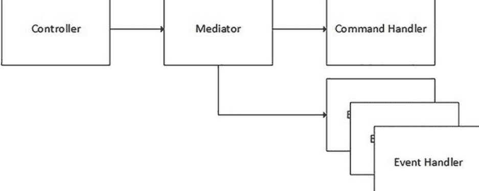

图24-3 feature 目录的截图


```csharp
public class ScanCardHandler : IAsyncRequestHandler<ScanCardCommand, ScanCardResult>
{
    private readonly ICardValidator _validator;
    private readonly IMediator _mediator;
    public ScanCardHandler(ICardValidator validator, IMediator mediator)
    {
        _mediator = mediator;
        _validator = validator;
    }

    public async Task<ScanCardResult> Handle(ScanCardCommand message)
    {
        await _mediator.PublishAsync(new CardScanned 
        { 
            CardId = message.CardId,
            LocationId = message.LocationId, 
            DateTime = message.DateTime 
        });
        return await Task.FromResult(new ScanCardResult 
        { 
            IsValid = _validator.IsValid(message.CardId, message.LocationId) 
        });
    }
}
```

这里的构造函数利用了依赖注入来获取卡片验证器和中介器本身。理想情况下，应用程序应该是从到端异步的，因为这里使用了 MediatR 的异步接口。在异步的`Handle`方法中，发布`CardScanned`事件（MediatR 称之为“通知” notification），然后运行验证并将`ScanCardResult`返回给调用者。

中介器负责将发布事件路由到任何感兴趣的事件处理程序。在这个示例中有一个感兴趣的参与方，即`ScanCardHandler`：

[点击此处查看代码图片]

```csharp
public class CardScannedHandler : IAsyncNotification<CardScanned>
{
    private readonly PassContext _context;
    public CardScannedHandler(PassContext context)
    {
        _context = context;
    }

    public async Task Handle(CardScanned notification)
    {
        var scan = new Models.Scan
        {
            CardId = notification.CardId,
            DateTime = notification.DateTime,
            LocationId = notification.LocationId
        };
        _context.Scans.Add(scan);
        await _context.SaveChangesAsync();
    }
}
```

该类实现了针对`CardScanned`事件的`IAsyncNotificationHandler`。MediatR 正通过此知道将其进行连接。在`Handle`方法中，使用该通知将数据保存到数据库。如果你想执行多个操作，可以有多个处理程序，且每个处理程序都应该有一个非常单一且易于测试的用途。

这种实现有几处你可能考虑改进的地方。首先是`CardScannedHandler`的名称。这个名称没有告诉我们关于它的任何信息，如果你有许多不同的处理程序对同一个事件感兴趣，那么很难区分它们。一个更好的名称可能是`LogCardScannedToDatabase`。接下来，命令处理程序中代码的顺序值得怀疑。也许在知道卡片是否有效之前触发`CardScannedEvent`？也许缺少了某些事件，如`ValidCardScannedEvent`或`InvalidCardScannedEvent`。MediatR 遵循多态性，因此如果`ValidCardScannedEvent`和`InvalidCardScannedEvent`都扩展自`CardScannedEvent`，当派生事件触发时，基础事件的任何订阅者也会被调用。

你可能在想控制器怎么了，所有的逻辑都移动到了几个处理程序内部，我们很高兴你保持了好奇心。控制器中的操作方法大幅缩小了，现在只包含：

点击此处查看代码图片

```csharp
[Post]
public async Task<IActionResult> Post([FromBody]ScanCardCommand scan)
{
    if ((await _mediator.SendAsync(scan)).CardIsValid)
        return StatusCode((int)HttpStatusCode.Created);
    return StatusCode((int)HttpStatusCode.Unauthorized);
}
```

如你所见，这是高度原子的围绕此方法编写测试非常简单，而且它具有单一职责，即将`ScanCardResult`转换为 HTTP 状态码。

利用中介模式鼓励关注点分离，并允许你将操作组合在一起。有些人可能会考虑更进一步，将该功能的控制器和视图位于与命令和事件相同的目录中。因为这是这些项的非标准位置，你需要重写一些 ASP.NET MVC 约定来让它工作。

> 注意
> 
> ASP.NET MVC 是一个由约定驱动的框架，因此如果你遵循约定，事情就会进展得很顺利。并不是每个项目都需要遵循相同的约定。在这些情况下，`IApplicationModelConvention`接口可能是你想要研究的内容。ASP.NET Monsters 有一个关于此的视频，地址为：https://channel9.msdn.com/Series/aspnetmonsters/ASPN-Monsters-Ep-68-Creating-Custom-Conventions-for-ASPN-Core-MVC。

# Areas (区域)

特别大型应用程序可能会被划分为更小的块以保持某种秩序。Areas 是 ASP.NET MVC 内置的，并提供了一种类似于俄罗斯娃娃的组织方式。项目根级别有一个`Areas`文件夹，其中包含一个或多个区域。每个区域内部都有`Controllers`文件夹、`Views`文件夹和`Models`文件夹，就像根级别一样（见图 24-4）。


**图 24-4** 区域内的文件夹结构

通过路由的魔法，这些控制器在标记了`Area`特性后就可以被访问。例如，Admin 区域内的`UserController`看起来如下：

```csharp
[Area("Admin")]
public class UserController
```

默认模板中包含路由表也应该更新，以包含新区域的路由。

点击此处查看代码图片

```csharp
app.UseMvc(routes => {
    routes.MapRoute(
        name: "default",
        template: "{controller}/{action}/{id?}");
    routes.MapRoute(
        name: "Admin",
        template: "Area=Admin/{controller}/{action}/{id?}");
});
```

“那个，”蒂姆插话道，他从不保持沉默，“这只是个开始。我们还有许多应用程序，正在考虑用现成软件来替换它们。问题是，如果现成软件只能让我们达到和竞争对手同样的水平，那么我们认为这支开发团队为我们编写定制软件将带给我们我们竞争优势。在当今，事实是每家公司都是科技公司。我们不创新就会灭亡，”蒂姆看起来准备好就这个话题聊很久；他被其中一位高尔夫手打断了，丹妮尔认出他是董事会主席。

“蒂姆，根据我们今天看到的，我想我们可能很同你的同。”他周围的人纷纷点头赞同。“这个‘项目计划’倡议正是我们想要的，我可以看到进行内部开发的路径。请继续，巴拉兹（Balázs）。”

开发者们交换了眼神。丹妮尔在过去的几周里并没有真正考虑过找新工作。她太忙于处理事情了。她知道自己不想为 FBI 工作，但这可能并不是什么重大的发现。

巴拉兹继续进行演示。大家对 RFID 读卡器感到非常兴奋。“人们直接滑过去就行了？”高尔夫手们问道。

“是的，”巴拉兹回答道，“这实际上是一个很好的系统。我们可以大幅减少检查雪道证的工作，这应该能节省费用，而且滑雪者可以更快地上山。”

演示终于结束，高尔夫手们立刻开始要求新功能。“我们能有一个可以为别人购买礼品卡的功能吗？可以在食堂用这些卡片支付吗？如果一个 LED 标志能在每个人路过时按名字问候他们，那不是很酷吗？”

这是一个好信号。高尔夫手们已经接受了这个程序是成功的，并急于在其中添加更多功能。巴拉兹回答了大量问题，最后告诉他们下周来找他。要弄清楚团队下一步要做什么将是一项艰巨的任务。“成功的代价，”丹妮尔补充道。最后，高尔夫手们放弃了让巴拉兹当场同意新功能的尝试，并在半小时后离开了，在兴奋中忘记了他们的开球时间。

巴拉兹转向团队说：“我觉得进展得相当顺利。所以看来我们继续这个项目看起来很不错。我从没有怀疑过你们。”

“从没过？”马克问道，“你刚才不是刚告诉他们你起初怀疑过我们吗？”

“嗯，这个，我从没有怀疑过你们，”巴拉兹局促地说，“我的意思是，我当时还不认识你们任何人。”

“好了，好了，”蒂姆模仿着巴拉兹的常话说，“我想我们现在可以了。你们都离开这里吧。在周一早上发布之前，我不想在这里看到你们任何人的脸。”

“好了大家，请务必留出周一下午的时间，以便我们讨论项目的下一个阶段。我想我们把它命名为‘主大师项目（Project Master），”巴拉兹在他们陆续离开时喊道，“我叫它这个名字因为它太火了！伙计们？伙计们？”但大家都走了。

# 索引

# 符号

- 37 Signals 18

- 201 状态码 14

- .aspx 扩展名 8

- @ 字符 152

- @inject 指令 346

- _Layout.cshtml 31

- .NET 基类库 22

- .NET Core 23–24

- @type/chartj 包 258

- @types/lodash 258

# A

- Access-Control-Allow-Origin 头部 218

- 访问密钥 (access keys) 85

- 访问权限 (access rights) 195

- 访问令牌 (access tokens) 194, 205

- AccountController 类 211

- 账户锁定 (account lockouts) 208

- 方法 (action method) 136–140

- ActionResult 20

- ActionResults 11–12

- Active Directory (AD) 197

- ActiveRecord 21

- 活跃脚本 (Active Scripting) 6–7

- 活跃服务器页面 18

- 活跃服务器页面 (ASP) 6–7

- 适配器模式 (adapter pattern) 43

- AddConsole 扩展方法 182

- AddDbContext 方法 226

- Add* 扩展方法 225

- AddMvc() 212

- AddPolicy() 218

- addTagHelper 指令 300

- 管理员视图 (admin view) 42

- AJAX 8

- Alpine Sky House

- 构建 (build) 51–56

- AMD 模块 241

- Angular 23–24

- 反腐败层 (anti-corruption layer) 43

- Any 方法 138

- Apache 2.0 许可证 15

- Apache Mesos 116

- API 密钥

  - 开发者级别 194

- ApplicationDbContext 类 130–133

- 应用周期管理 (Application Lifecycle Management) 组 65

- ApplicationModel 327

- 应用程序 (applications)

- 配置 (configuration) 169–177

- 部署 (deployment) 57–74, 106

- 托管 (hosting) 68

- 容器内 (in containers) 108–118

- 国际化 (internationalization) 341–352

- 隔离 (isolating) 106–107

- 同构 (isomorphic) 338–339

- MVC 10–13

- 打包 (packaging) 67–68

- 便携模式 (portable mode) 66

- 发布 (publishing) 64–66

- Linux 容器运行实例 (running instance of Linux container) 110–114

- 自包含模式 (self-contained mode) 67

- 单页 (single page) 10, 338

- web 应用程序 (web. applications)

- ApplicationClass 130–131, 132

- ApplicationUserContext 132–133

- Apply 方法 327

- 服务 (Services) 70–73

- appSettings.Development.json 文件 100

- appsettings.json 201

- app.UseIdentity() 206

- 区域 (areas) 381–382

- asm.js 235

- .asmx 文件 13

- app.UseTracking() 方法 124

- ASP.NET 7, 8–9, 18 见 Active Server Pages

- ASP.NET Core 15–16

- 向后兼容性 (backward compatibility) 18

- 内置容器 (built-in container) 225–227

- 配置 (configuration) 170–177

- 依赖注入 (dependency injection) 225–229

- 开发 (development) 15

- 扩展性 (extensibility) 326–340

- 日志 (logging) 177–188

- 中间件 (middleware) 229–334

- 路由 (routing) 335–337

- 第三方容器 (using third-party containers) 228–229

- ASPNETCORE_ENVIRONMENT 变量 99

- ASP.NET Core Identity 202–205

- 自定义授权策略 (custom authorization policies) 214–215

- 本地账户 (local user accounts) 206–208

- 引用 (referencing) 205–206

- ASP.NET Core MVC 326–328

- ASP.NET MVC 框架 10–13, 18, 20

- 约定 (conventions) 20–21

- 目录结构 (directory structure) 20, 373–382

- 路由 (routing) 21

- ASP.NET Web Forms 18

- async/await 137

- 属性路由 (attribute routing) 336–337

- 启用安全 (enabling security) 210–211

- 身份验证 (authentication) 34, 195

- ASP.NET Core Identity 202–205

- Azure 支持 (Azure-backed) 197–202

- Azure Active Directory (Azure Active Directory) 198–202

- 添加社交身份 (adding social identity) 199–200

- 添加特定用户属性 (adding user-specific attributes) 199–200

- 注册应用程序 (registering application) 200–201

- 22C 目录 (creating B2C directory) 198–199

- Azure 服务 (App Services) 70–74

- Azure 门户 (Azure Portal) 82–83

- Azure 资源管理器 (Azure Resource Manager (ARM)) templates 72–74

- Azure 资源管理器 (Azure Resource Explorer) 82

- Azure 存储工具 (Azure Storage Tools) 170

# B

- B2C 目录 (B2C directory)

- 创建 (creating) 198–199

- 向后兼容性 (backward compatibility) 10, 18

- Bamboo 51

- 基类库 (Base Class Library) 22

- 基类库 (base class library (BCL)) 102


- 基类库 (Base Class Library (BCL)) 7
- BCL 见 Base Class Library
- 二进制大对象 (binary large objects) 83–84, 86–87
- bin 部署 (bin deployment) 67
- bin 文件夹 (bin folder) 234
- `BlobAttribute` 89
- 二进制大对象 (blobs (binary large objects)) 83–84, 86–87
- 块级范围 (block leveling) 245
- Bootstrap 298
- Bootstrap CSS 框架 (Bootstrap CSS framework) 264, 277–280
- 边界上下文 (bounded contexts) 42, 43
- Bower 260–262
  - 添加依赖 (adding dependencies) 261–262
  - 引用资源 (referencing assets from) 262
- `bower install` 命令 261
- `bower.json` 文件 261
- 构建环境 (build environments) 106
- 构建管道 (build pipeline) 48–51
- 构建 (builds) 45–56
  - Alpine Ski House 51–56
  - 构建定义页面 (build definition page) 53
  - 命令行 (command line) 46–47
  - 持续集成 (continuous integration and) 48
  - JavaScript 235–243
  - 修改项目构建任务 (modifying project build tasks) 277
  - 每夜 (nightly) 48
  - 管道线 (pipelines) 239
  - 触发 (trig for) 56
- 构建脚本 (build scripts) 374
- 构建服务器 (build servers) 48, 49, 51
- 构建类型 (build types) 66–67
- Bundler & Minifier 工具 (Bundler & Minifier tool) 236–237

# C
- C# 7, 232, 245
  - Razor 和 148, 149, 151, 153, 155–157
  - 类型 (types) 155
- C++ 235
- 缓存失效 (cache busting) 297–298
- 缓存标签助手 (cache tag helper) 298
- 缓存 (caching) 92, 281–290
  - 数量 (amount of) 289
  - 缓存控制头部 (cache control headers) 283–285
  - 缓存级别 (cache levels) 282
  - 数据缓存 (data-cache) 285
  - 分布式 (distributed) 287–289
  - 内存中 (in memory) 285–286
  - 输出 (output) 283
- 我可以使用网站吗 (Can I use website) 232, 236, 241, 245, 249, 255, 257, 282
- `CaptureStartupErrors(true)` 指令 59
- 级联样式表 (Cascading Style Sheet (CSS)) 264–269. 见 CSS 框架
  - 创建 (creating) 266–268
  - 模块 (modules) 266
  - 嵌套 272–273
  - 预处理器 269
  - Sassy 268–275
- C# 代码 46
- CDNs. 参见 内容交付网络 (Content Delivery Networks)
- 变更跟踪 124–125
- 特征化测试 358–359
- 子操作 303
- 声明 205
- `ClaimsPrincipal` 207
- 类
  - JavaScript 中缺失的 232
- Client ID 199
- 客户端库 260
- 客户端编程 231, 235
- 云容器在 117–118
- 云计算 69, 80–92
  - 服务提供 81
- 代码清理 366–370
  - 用于...的工具 370
- 圈圈复杂度 356–357
  - 遗留的 358
  - 组织结构 373–382
  - 质量 367–370
  - 测量 355–357
  - Razor 153–154
  - 可读性 356
  - 重构 353–365
- source. 参见 源代码
- 测试 49–51, 55
- 紧耦合的 223
- 代码后置模型 10
- 代码重复 295
- 代码编辑器 98
- CodePlex 24
- CodeRush 367, 370
- CoffeeScript 21, 235, 243
- COM. 参见 组件对象模型 (Component Object Model)
- 命令行构建 46-47

## 命令行界面 (CLI)
- 用户秘密命令 196
- 命令行工具 68, 275
- 命令 377, 378
- 通用网关接口 (CGI) 脚本 6
- CommonJS 模块 241
- 编译器 46
- 时间时间 错误 12
- `ComponentNamespace` 12
- 组件对象模型 (COM) 6–7
- 组件
  - 大数量 251
  - 可重用的，283-290, 307-324, 310-324, 325-340, 326-340, 341-352, 343-352
  - 局部视图 305-306
  - 标签辅助 296-302
  - 视图 302-305
  - 视图 31
- 计算机语言 45-46
- 配置 35, 169–177
  - 自定义提供者 173-175
  - 托管选项 59
  - 服务 176-177
  - 加载顺序和 171-172
  - 流水线 329-330
  - 用于...的股票供应商 172-174
  - `web.config` 170
- `Configuration.Azure.KeyVault` 172
- `ConfigurationBuilder` 170
- `Configuration.CommandLine` 172
- `Configuration.EnvironmentVariables` 173
- `Configuration.Ini` 173
- `Configuration.Json` 173
- `Configuration.Xml` 173
- `ConfigureServices` 方法 133, 176, 212, 213, 215, 227, 228
- 连接服务向导 84–85
- 构造函数注入 224–225, 227
- 容器部署 73
- 容器 105–118
  - 优势 107–110
  - 基础层 107
  - 数据存储 113
  - Docker 110–117
  - 运行列表 112
  - 微软提供的 111
  - 109 中的网络
  - 在云端 117–118
  - 编排系统 109
  - 暂停 112
  - 可重复环境 106–110
  - 恢复 112
  - 共享 114–115
  - 关闭 112
  - 第三方 228–229
  - Windows 114–116
- 内容交付网络 (CDNs) 262, 298
- 内容-安全策略头部 232
- 上下文边界
  - 跨越 134–135
- 持续交付 49
- 持续部署 48
- 持续集成 48
- 持续测试 310
- `Controller` 类 31
- controllers 11, 31–32, 116
  - 外部 334–335
  - Rails 19
  - 测试 313–316
  - 接入 135–140
- Controllers 文件夹 326, 381
  - 规范 326
- ASP.NET MVC 20–21
  - 自定义 21, 327–328
  - 默认 226
  - 路由 336
- Ruby on Rails 19–21
  - get 212
- Core Linux 发行版 107
- CORS. 参见 跨域共享
- `Create` action 方法 137–139
- Create/Read/Update/Delete (CRUD) 应用 81
- 关键日志 180
- 跨域共享 (CORS) 33, 218–219
- 跨平台支持 93–104
- 跨站脚本攻击 (XSS) 232–233
- CSS 文件 233–234
- CSS 框架 263–280
  - 替代方案 280
  - Bootstrap 264, 277–280
  - 定制 278–279
  - 自定义样式表 279–280
  - 扩展 277
  - Foundation 278–279
  - 第三方 277–280
- 文化 342, 343
  - 设置当前 348–351
  - 特定文化的资源文件 345–346
- `CurrentCulture` 343
- `CurrentUIC` 343
- 自定义规范 21, 327–328
- 客户体验 39–41
- 自定义样式表 279–280
- 自定义标签辅助 299–302
- 自定义标签 23
- 圈圈复杂度 356–357

# D
- Dapper 120
- data
  - 变更跟踪 124–125
  - 删除 124
  - 保存 123
  - 视图 156–157
- 数据注解 346–347
- 数据库提供者
  - 迁移 129–130
  - 创建 124–125
  - 创建并更新迁移 124–128
  - 跨越边界 134–135
- 数据库服务器 113
- data-cache 285
- 数据中心 68, 69
- 数据驱动变更 365
- 数据检索 119
  - Entity Framework (EF) Core
  - 单记录查询 122
  - 多条记录查询 123
- 数据存储 119, 282
- 数据类型 127–128
- `DbContext` 226
- `DbContext` 类 223, 125, 131, 143
- `DbSet.Find` 方法 122
- `DbSet.Remove` 方法 124
- 调试日志 180, 181
- 定义文件 246–247
- 依赖
  - 添加 255–256, 261–262
  - 错误 227
  - 手动解析 222–223
  - 包中恢复全部 255
- 依赖注入 136, 162, 379
  - 替代模式 224
  - 构造函数注入 224–225
  - 在 ASP.NET Core 中 225–229
  - 第三方容器 228–229
  - 手动解析 222–223
- 依赖注入 (DI) 34
- 依赖管理 124, 251–262
  - 包管理器用于 252–262
  - Bower 260–262
  - npm 255–258, 259
  - NuGet 258–254, 260
  - Yarn 258–260
- 部署 57–74
  - Azure 68–73
  - bin 67
  - 构建包 67–68
  - 容器 73
  - kestrel 58–59
  - nginx 62–63
  - 发布 64–66
  - 反向代理 59–61
  - 工具 67
- 部署流水线 49
- 桌面应用 7
- 开发者级 API 密钥 194
- 开发环境 106
- 开发工作流 275–276
- devops 脚本 374
- 诊断 33
- 指令 274
- 目录结构 20, 233–234, 373–382
  - ASP.MVC 20
  - Rails 19
- `Dispose` 方法 122
- 分布式缓存 287–289
- Docker 110–114
  - 在生产环境中 116
  - 在 Windows 上 114–116
- Docker Registry 110, 114
- Docker Swarm 116
- 文档 374
- 文档模型 (DOM) 235
- DOM. 参见对象模型
- domain
  - 定义 43
- domain 类
  - 添加属性到 127
- 不要重复自己 (DRY) 31, 295
- `dotnet build` 命令 96–97
- dotnet 命令行界面 (CLI) 94–98
- dotnet 命令行工具 67, 309
- dotnet 命令行行 337
- `dotnet ef` 命令 124, 125, 337
- `dotnet ef 数据库更新` 命令 124, 125, 128, 133
- `dotnet ef 迁移` 命令 126, 128
- `dotnet ef 迁移脚本` 129
- `dotnet new` 命令 95
- `dotnet publish` 55, 252
- `dotnet restore` 命令 96
- `dotnet run` 命令 97
- `Down()` 方法 125–126
- 拖放功能 8
- Dropbox 70
- 重复代码 295
- 动态类型 245

# E
- ECMAScript 243–245
- Edge 浏览器 243
- `Edit` action 方法 139–140
- 编辑器模板 12
- EF. 参见 Entity Framework (EF) Core
- 弹性计算 69
- 弹性伸缩 90–91
- Electron 22
- 加密密码 204
- Entity Framework 21
- Entity Framework (EF) Core 119–146, 120–146, 147
  - `ApplicationDbContext` 130–133
  - 基础 120–122
  - 更改跟踪 124–125
  - 数据类型 127–128
  - 事件和事件处理器 144–146
  - 映射规范 121
  - 迁移
    - 添加 125–127
    - 数据库提供者 129–130
    - 创建并更新数据库 124–128
    - 通过...的验证 142–146
    - 类型 141–142
    - 多条记录查询 123
    - 单条记录查询 122
    - 保存数据 123
  - `CardContext` 类 133–140
  - `System.Data` 120
- 环境辅助 268, 297
- 错误日志 180
- 错误
  - 依赖解析 227
- ES2015 到 ES5 编译器 243–245
- ES2016 243
- 事件处理器模型 7
- 事件处理器 135, 144, 146, 378, 379, 380, 144–146, 377
- 异常处理 178
- 异常 59, 178, 365
- 退出成本
  - 新技术的采用 247
- 扩展性 325–340
  - 规范 226–328
  - dotnet 命令行工具 337
  - 同态应用 338–339
  - 加载外部计数和视图 334–335
  - 中间件 328–333
  - 路由 335–337
- 扩展方法 226–227
- 外部登录提供者 208–211
- 外部威胁 195

# F
- F# 245
- facade 模式 43
- Facebook 199–200, 208, 210
- 失败登录尝试 208
- 快速失败 50
- FAKE 47
- 回退 298
- F# 46
- 功能文件夹 381–382
- `FileConfigurationSource` 174
- 文件属性 322
- 过滤器 12
- `First` 方法 122
- 文件夹结构
  - 在区域内 381–382
- 外键
  - 没有...的引用完整性 134–135
- Foundation 277
- Freya 25
- 函数级作用域 245
- 函数
  - 样式表 273–274

# G
- Gartner 的魔术象限报告 69
- `GET` action 11
- `GET` action 方法 137
- `GET` 请求 41, 60, 283
- GitHub 15, 24, 261
  - VSTS 54
- 全局过滤器 210
- 应用程序全球化 342–343
- glob 模式 297
- Gmail 10
- Google
  - 容器 116–118
- 授权 255
- 单元测试 323
- Grunt 22, 237–238
- `Gruntfile.js` 238
- gunt-ts 库 238
- gulp 239–240, 255
- Gulp 22
  - 单元测试 323
- gulp-karma 插件 323

# H
- 密码哈希处理 204–205
- 头部
  - Content-Security Policy 232
- 热力图 365
- 辅助模板 12–13
- Homakov, Egor 29
- 托管服务 69
- 托管
  - 弹性 69
  - 外部 69
  - 内部 68
  - 配置选项 59
- HTML 148, 149, 153, 154
  - JavaScript 和 232
  - tag helpers 的 HTML 内容 301
- HTTP 协议 283
- `HTTPRequest` 对象 18
- Hyper-V 容器 115
- HyperV 虚拟机程序 110, 114

# I
- `IConfigurationBuilder` 175
- `IConfigurationProvider` 174
- `IConfigurationSource` 174
- `IControllerModel` 326
- `IDataReader` 120
- `IdbCommand` 120
- `IdbConnection` 120
- `IdbTransaction` 120
- identity 33, 35
  - ASP.NET Core 202–205
  - `IdentityRoles` 205
  - `IdentityRoleUserClaims` 205
  - `IdentityUserClaim` 205
  - `IdentityUser` 类 130–131, 203
  - `IdentityUserLogin` 205
  - `IdentityUserTokens` 205
- `IgnoreBody` 160
- IIS。参见 Internet Information Server (IIS)
- 图片文件 234
- 图像处理库 89
- 图片优化 240
- 存储在 blob 容器中 86–87
- `Index` 方法 136–137, 138, 140
- `Index` 方法 20
- 敏感信息保护 85
- 基础架构日志 180
- 基础即服务 (IaaS) 69
- 继承 271–272
- `INotificationHandler<PurchaseCompleted>` 145
- `INotification` 接口 144
- input tag helpers 296
- 使用 NuGet 的安装包 252–254
- 集成测试 50, 324
- 自定义 tag helpers 的 IntelliSense 300
- IntelliTest
- 内部威胁 194–195


- 内部用户 197
- 国际化 341–352
  - 可本地化文本 343–348
  - 设置当前文化 348–351
- Internet Explorer 243
- Internet Information Server (IIS) 58, 59, 64
  - 启用托管 61–62
  - 反向代理 59–61
- 物联网 (IoT) 41
- 反反转 (IoC) 223, 228
- `Invoke` 方法 302, 303
- `IParameterModelConvention` 326
- `IQueryable<T>` 123
- `IServiceCollection` 227, 228, 229
- 隔离性能与 106–107
- 同构结构应用 338–339
- `IStringLocalizer` 服务 344–345
- `IViewLocalizer` 346

# J

- Jakarta Struts 18
- Jasmine 320–321
- Jasmine JavaScript 框架 255
- Java 245
- JavaScript, 231–250, 221–230
  - Angular 23–24
  - 构建工具 235–243
    - Bundler & Minify 236–237
    - 选择 243
    - Grunt 237–238
    - gulp 239–240
    - WebPack 240–243
  - 232–233 中的代码编写原则
  - 外部脚本文件 233
  - 文件 234
  - 用于 249–250 的框架
  - 同构应用与 338–339
  - 与 HTML 混合 232
  - 模块格式 241
  - 模块加载 247–248
  - 需求 233
  - 组织 233–234
  - 流行 23
  - React 23–24
  - 安全漏洞 232–233
  - 单页应用 234–235
  - 测试 233, 320–323
  - TypeScript 和 243–247
  - 245 中的变量作用域
- Jenkins 65, 71
- jQuery 249, 298
- JScript 6
- JSON 结果 11
- 即时编译编译器 66
- 即时编译编译器 (JIT) 102

# K

- Karma 321–323
- Karma 运行器 255, 256
- Katana 25
- Kestrel 25, 58–59
  - Nginx 62–63
  - NTLM 认证 61
  - 反向代理与 59–61
- 键值对 171
- Kubernetes 116, 117

# L

- 标签 116
- lambda 语法 244
- 落地页 282
- 布局 13
  - 159–161 的基础
  - 158–161 的操作
- legacy 代码 358
- 遗留支持 18
- LESS 269
- `let` 作用域运算符 245
- 库 251–252
  - 基类 102
  - 客户端 260
  - 246–247 定义文件
  - 可移植类 102
  - 共享 108
- link tag helper 297–299
- Linux 93–94
  - Alpine Linux 98–101
  - 代码编辑器 98
  - SQL Server 100
  - Ubuntu 94–98
- Linux 容器 110–114
- 加载测试 324
- 本地化 348–349
  - 341–352 的应用本地化
- 日志 35, 92, 177–188
  - 作为服务 186–188
  - 开发策略 179–180
  - 异常处理 178
  - 180–183 的级别
  - 作用域 183–185
  - 185–187 结构化框架
  - 帮助日志文件 177

# M

- `MapRoute` 335
- Marathon 116
- 主页面 8–9, 13, 158
- 中介类 377–378
- 中介者模式 376–380
- MediatR 380
- MediatR 库 144
- `MergeAttribute` 扩展 301
- Mesosphere 116
- 迁移类 125
- 移动设备 243
- 模型绑定 11
  - 在 Razor 156–157 中定义
- MVC 框架
- 微 ORM 120
- 微服务 355
- Microsoft 帐户 199
  - 向后兼容 18
- Microsoft 开发者网络 (MSDN) 51
- 中间件 13, 32–33, 328–333
  - 作为类 331
  - 分支 332–333
  - 配置 329–330
  - 编写自己的 330–332
  - 数据库提供程序 129–130
  - 数据类型 127
  - 创建和更新数据库 124–128
- mixins 274–275
- `mkdir` 260
- 模拟 223
- 模型 12
  - 文件夹 381
- 模型状态验证 138
  - 局部视图 31–32
  - 视图 150
- Model View Controller (MVC) 框架 27–36, 35–36
- MVC 框架 10, 11–12
  - 326–340 的扩展性
  - Ruby on Rails 18–21
- MVC 模式 28
- 模块化应用 22
- 模块格式 241
- 模块加载器 247–248
- 模块 229
- 多租户认证 197
- `MvcOptions` 参数 212
- MyGet 254

# N

- 命名空间 375
- `NancyHost` 58
- NDepend 370
- 嵌套主页面 9
- .NET Core 15
- .NET Core 66, 101–104
  - `dotnet` 命令行界面 (CLI) 94–98
  - 安装，在 Ubuntu 94
- .NET 框架 7
  - 343–348 中的国际化支持
  - 93–104 的跨平台支持
- .NET 运行时安装 66
- .NET Standard 102–104
- .NET Standard 66–67
- 容器环境中的网络 109
- 下一代 Windows 服务 (NGWS) 7
- Nginx 62–63
- `nginx.conf` 文件 62
- `nHibernate` 120
- 每日构建 48
- Nject 228
- Node.js 22–24, 25
  - npm 和 255–258
- Nodejs 338, 339
- `node_modules` 目录
  - 恢复 259
- node 服务 339
- `NotFound()` 方法 139, 140
- npm 255–258
  - 添加依赖项 255–256
  - 使用模块 256
  - 259 的缺点
  - Visual Studio 集成 257–258
  - `pm init` 命令 255
  - `npm install` 命令 255, 256, 257
- NPM 包管理器 22
- `npm run-script` 命令 256
- NTLM 认证 61
- NuGet 22, 85, 252–254, 260
  - 馈源 254
  - 使用 252–254 暂停包
  - Visual Studio 工具 252–254
- `.nuget` 文件 67
  - 获取包 67
- nUnit 308
- `varchar(max)` 数据类型 127

# O

- 面向对象编程 355
- 对象关系映射 (ORM) 120
  - Entity Framework (EF) Core 120–146
  - 微 ORM 120
  - System.Data 120
- Octopus Deploy 67
- OmniSharp 98
- OneDrive 70
- `OnModelCreating` 方法 142
- OpenID Connect 201
- 开源 24
- OWIN (Open Web Interface for .NET) 24–25
- OWIN 标准 13
- 操作系统 93, 107
- 选项
  - 选项委托 225
  - 选项模式 176–177
- 编排系统 109
- ORM。参见对象关系映射
- 出口流量 92
- 输出缓存 283
- OWIN (Open Web Interface for .NET)

# P

- `package.json` 文件 255, 257, 258
- 包管理器 252–262
  - Bower 260
  - npm 和 255–258
  - NuGet 22, 85, 252–254, 260
  - Yarn 258
- 包恢复 49
- 包构建 67–68
- 全局安装 256
- MVC 模式 28
- 并行结构 375–376
- 局部视图 31–32, 161, 305–306
- `Pass` 类 145
- `pass` 类型 141–142
- 密码
  - 加密后的 204
  - 哈希处理 204–205
  - 存储 204–205
  - 验证 207
- 平台即服务 (PaaS) 69
- 平台即服务 (PaaS) 117
- 平台服务 80–82
- pod 116
  - 使用 83–89
- PayPass 39
- PayWave 39
- PCLs。参见可移植类库 (PCLs)
- 性能隔离 106–107
- 性能测试 50–51
- PHP 18
- 管道和过滤器架构 328
- 简单 CLR 对象 (POCO) 12
- 简单 CLR 对象 (POCOs) 120
- 策略
  - 全局应用 212–213
  - 自定义授权 214–215
  - 为特定用途定义 213–214
  - 用于授权 212–215
- PowerQuest 驱动镜像 106
- 预处理器，CSS 269
- 最小权限原则 194–195
- 生产环境 106
- 生产服务器
- 更新脚本 129–130
- `SkiCardContext` 类 133–140
- 源代码 38 个项目
- 向 225–227 客户视图添加服务 39–41
- 保持在多个位置中 374–375
- 作用域 37–44
- 服务器结构 59, 283, 284
- 代理服务器
- PSake 47
- 发布 64–66
- 发布/订阅消息模式 144
- `PurchaseCompleted` 类 145

# Q

- `QueueTriggerAttribute` 89

# R

- R# 370
- Rack 25
- 无线射识别 (RFID) 芯片 39–40
- Rails. Ruby on Rails
- Razor 11–12, 18
  - 语法 152, 154–155
- Razor 视图 30, 147–168
  - 高级功能 162–166
  - 替代视图引擎 167
  - 避免重复 167
  - C# 特性 155–157
  - 代码 153–154
  - 编译 151
  - 定义模型 156–157
  - 在 150 中的错误
  - 基础 149–155
  - 在 160–161 中包含部分
  - 将服务注入 162
  - 布局 158–161
  - 346 的本地化
  - 标记 154
  - 解析器控制速查表用于 154–155
  - 部分视图 161, 305–306
  - 149 的作用
  - 样式表和 296
  - 标签辅助程序 163–166
  - 视图组件和 302
  - 视图数据 156–157
  - Web 开发和 148–149
  - 编写表达式 152
- React 23–24, 249–250
- readme 文件 374
- 记录
  - 更改跟踪 124–125
  - 查询多个 123
  - 查询单个 122
  - 保存 123
- `recycleOnChange` 设置 62
- 重定向 11
- Redis 287
- 重构 353–365
  - 数据驱动更改和 365
  - 定义 354–355
  - 微服务 355
  - 时间用于 357–358
  - 带有安全网的 358–365
- 引用完整性 134–135
- RxJS 249–250
- 注册表 282
- 关系
  - 跨上下文边界 134–135
- 删除目标处的额外文件 72
- 可重复环境 106–110
- 重复 21
- 存储库结构 374
- 表述状态转换 (REST) 13–14
- 要求
  - 在授权策略中 214
- 资源文件 343
  - 特定文化的 345–346
  - 共享 347–348
- 资源组 72
- 资源
  - Azure 资源资源管理器 82
  - 跨源共享 (CORS) 218–219
  - 215–217 的保护
  - 可使用组件, 283–290, 307–324, 310–324, 325–340, 326–340, 341, 143–352
    - 部分视图 305–306
    - 标签辅助程序 296–302
    - 视图组件 302–305
- 反向代理 59–61
- RFID. 见 无线射识别 (RFID) 芯片
- RFID 扫描器 41–42
- 标记 68
- 根目录 374
- Roslyn 101
  - 114–115
- Roslyn 编译器 46
- `Route` 属性 336–337
- 路由 21, 33, 335–337
  - 高级 337
  - 常规 336–337
- 路由表 10
- Ruby on Rails 18–21
  - 惯例 19–21
  - 目录结构 25
- 运行时错误 12
- JIT 项目 102

# S

- SASS. 见 Syntactically Awesome Style Sheets
- Sassy CSS (SCSS) 268–275
  - 基础 269–273
  - 导入和部分 270
  - 继承 271–272
  - 混入 274–375
  - 嵌套 272–373
  - 变量 270
- `SaveChanges` 方法 123, 124–125
- 标记 255, 261
- 扩展 Web 应用 89–92
- 作用域 226
- 脚本 374
- `Scripts` 文件夹 234
- 标签辅助 297–299
- SCSS. 见 Sassy CSS
- 搜索引擎优化 21
- 搜索引擎优化 (SEO) 338
  - 来自视图的 160–161
- 安全 193–220
  - ASP.NET Core Identity 202–205
  - Azure 支持的 197–202
  - 第三方身份提供程序 208–211
  - 通过属性 210–211
  - 策略 212–215
  - 跨源资源共享 218–219
  - 跨站脚本攻击 232–233
  - 外部威胁 195
  - 内部威胁 194–195
  - 密码
    - 存储 204–205
  - 资源保护 215–217
  - 用户密钥 195–196, 201
- 选择器 267–268
- 自包含包 67, 68
- Seq 187–188
- Serilog 库 185–187, 187
- 服务器推送 22
  - 构建 48, 49, 51
  - 代理 283, 284
  - 源控制 49, 51
- Server Side Includes 6
- 服务器端编程 231, 235–336
- Service Locator 模式 224
- 服务
  - 添加 225–227
  - 注入视图 162
  - 生命 226
  - 本地化 343–344
  - 日志 186–188
  - 节点 339
  - 选项 176–177
- `SetLanguage` 方法 349–350
- SHA 哈希函数 204
- 共享库 108
- SignIn 22
- `SignInMemory` 类 206, 207–208, 208
- 注册 200–201
- Silverlight 102
- 简单对象访问协议 (SOAP) 13–14
- 单页应用 (SPA) 234–235
- 单页应用程序 (SPAG) 10, 338
- 单租户身份 197
  - 在 Azure Active Directory 中 197
- `SkiCardContext` 133–140
- SOAP. 见 简单对象访问协议
- 社交身份提供程序 199–200
- `Socket.io` 包 22
- 软件
  - 持续交付 49
  - 持续部署 48
  - 容器内部 108
- 发布 48
- 解决方案 47
- 源代码 38
  - 存储库 53, 54–55
  - 存储库结构 374
  - 源控制 70
  - 源控制服务器 49, 51
- SPA. 见 单页应用
- SPAs. 见 单页应用程序
- `SpaServices` 338
- 峰值负载 69
- Spring 框架 18
- SQL Server 100
  - 分布式缓存和 287–289
- `src` 属性 238
- 标准 373–374
- `Startup` 类 133, 170, 176, 185, 213, 225
- 静态文件 33
- 存储帐户 84–86
- 存储位置 282
- 存储队列 87–88
- Strahl, Rick 59
- 流 239
- 字符串本地化 344–345
- 强类型语言 245
- 强类型视图 156
- 结构化日志 185–187
- StyleCop 370
- `Style` 文件夹 234
- 样式表 263–280
  - 关于 265
  - 创建 266–268
  - 自定义 279–280
  - 导入和部分 270
  - 继承 271–272
  - 混入 274–275
  - 嵌套 272–273
  - SASS 脚本函数 273–274
  - SCSS 268–275
  - 变量 270
- Stylus 269
- Syntactically Awesome Style Sheets (SASS) 269
- System.Data 120
- System.Data.SqlClient 120
- `system.js` 模块 247–248
- 系统层 108
  - 表格控件 9
  - 页面 35
  - 标签辅助程序 296–302
    - 属性的 296
    - 缓存 298
    - 缓存失效 298
    - CDN 298
    - 创建 299–302
    - 环境 297
    - 模式 297
    - 内容 300–301
    - 链接 297
    - 脚本 299
  - 标签辅助程序 316
  - 目标 294
  - Tag Helpers 316
  - Task Runner 258


Team Foundation Server 65, 71

Team Foundation Server (TFS) 51

技术债 195

模板 72–74

Test Explorer 310

自动化 358–365

集成 310

集成测试 49, 50, 55, 224, 308–323

持续 358–369

集成 313–316

JavaScript 233–335

负载 324

模拟 223

性能 358–366

测试 314–315, 318–320

组织 311–313

运行 309–320

视图组件 319–320

xUnit 308–310

测试 316–320

标记 316–319

类型 324

TypeScript 255

TypeScript 编译器 243–247

以及 249–250

类型系统 245

TypeScript 编译器 245–247

# U

Ubuntu 94–98

`dotnet` 命令行界面 (CLI) 94–98

安装 .NET Core 94

UglifyJs 242

单元测试 49, 50, 55, 224, 308–323

控制器 313–316

Jasmine 320–321

JavaScript 320–323

Karma 321–323

组织 311–313

运行 309–320

标签辅助程序 316–319

视图组件 319–320

xUnit 308–310

Update Panels 8

生产服务器更新脚本 129–130

`Up()` 方法 125–126

URL 21

`UseCORS()` 218

`UseIISIntegration` 61

`UseMvc()` 218

用户帐户

- ASP.NET Core Identity 206–208
- 删除 135
- 锁定 208

用户控件 9, 12

Web Forms 用户体验 9–10

用户身份选项 202

`UserManager` 类 206

验证用户名 207

用户身份验证 207–208

管理 206–207

`user-secret` 命令 196

用户密钥 195–196, 201

双因素身份验证 208

# V

验证通过 142–146

变量 270

变量作用域 245

VB.NET 7

VBScript 6

`-v` 标记 113

`ViewBag` 12

- 视图组件类 302

视图组件 31, 302–305

示例 303–304

调用 303

测试 319–320

- 视图数据 156–157

`ViewData` 12

`View` 方法 20

视图结果 11

视图引擎。见 Razor 视图

替代 167

`_ViewImports` 167

Visual Studio Team Services (VSTS) 51–56, 65, 71–72

GitHub 和 54

VS Code 276–277

VSTS。请参见 Visual Studio Team Services

# W

警告日志 180

WCF。请参见 Windows Communication Foundation

Web API 13–15

web应用程序

- 使用 Azure 79–92 平台服务构建 83–89
- 缓存 92
- 为 158–161 开发 148–149 布局
- 出站流量 92
- 平台即服务和 80–83
- 扩展 89–92

- web 浏览器 243
- 与服务器的通信 22

`web.config` 170

`web.config` 文件 61–62

Web 部署 64

web 开发 148–149

- CSS 和 264–280
- 6 的早期
- 项目生成任务 277
- 275–276 的工作流

Web 开发工具 22

`WebDriver` 324

- Web Forms 8–10, 12, 18, 20, 21, 24

WebForms 158, 163, 374

`WebHost` 59

`WebJobs` 84, 88–89

`WebJobs` 程序包 86

`Webpack` 240–243

web 页面

- 主页 8–9, 13
- Web Forms 8–10

web 服务器 113

- 282–290 上的缓存
- 选择 58
- 与浏览器的通信 22

IIS 64

Kestrel 58–59

负载在 282

Nginx 62–63

- 反向代理和 59–61

`WebSockets` 22

`Where` 方法 123

Wikipedia 232

通配符模式 297

windows 身份验证令牌 61

Windows Communication Foundation (WCF) 13, 14–15

Windows 容器 114–116

Windows Nano 107

- 容器 115

Windows Server Containers

- 容器 115

WinForms 8

WS-BPEL 13

WS-Security 13

`wwwroot` 33

`wwwroot` 目录 233–234

# X

XSS。请参见跨站脚本攻击

`xUnit` 308–310, 316

# Y

`Yarn` 258–260

`yarn.lock` 259

# 关于作者

JAMES CHAMBERS 是五次微软开发者技术领域 MVP，目前在 Azure 和 AWS 上运行的 ASP.NET Core 和 MVC 框架进行开发。他也是一名独立顾问、导师和活跃的博客作者，并为多个开源项目做出了贡献。

DAVID PAQUETTE 是四次微软 MVP，一名软件开发者和独立顾问。他在使用 .NET 构建 Web 和 Windows 应用程序方面拥有丰富经验；拥有深厚的软件工程知识，并对高质量的用户体验充满热情。

SIMON TIMMS 是多年微软 MVP、社区建设者、博客作者、开发者和独立顾问。他的技术兴趣广泛，从分布式系统到热门的 JavaScript 框架无一不包。他在开发和运营方面都有深厚的背景，因此通过参与从构建、开发到服务器配置的每一个环节，让他的团队几乎抓狂。

# 先获取我们的消息。

将来自 Microsoft Press 的最新新闻发送到您的收件箱。

- 新书及即将出版的书籍
- 特惠
- 免费电子书
- 教程文章

立即登录 `MicrosoftPressStore.com/Newsletters` 注册

# 立即访问我们的

# `microsoftpressstore.com`

- 提供数百种标题 – 来自行业专家的书籍、电子书和在线资源
- 美国境内免邮
- 多种格式电子书 – 在您的计算机、平板电脑、移动设备或电子阅读器上阅读
- 打印版与电子书最佳价值包
- 每周电子书优惠 – 特选书籍优惠高达 60%
- 通讯列表和特惠 – 第一时间了解新发布、优惠及更多信息
- 注册您的书籍 – 获取额外福利

Microsoft

从技术概述到特定主题的深入解析，通过以下网址获取 Microsoft Press 的免费电子书：`www.microsoftacademy.com/ebooks`

下载 PDF、EPUB 或 Kindle 格式的免费电子书。

在 Virtual Academy 寻找其他优质资源，在那里，你可以通过专家提供的免费培训学习新技能并帮助职业发展。

Microsoft Press

# 既然你已经读完了这本书…… 告诉我们你的想法！

有用吗？

它教给了你你想学的内容吗？

还有改进的空间吗？

通过 `http://aka.ms/tellpress` 告诉我们。您的反馈将直接给员工。感谢！

# 代码段

许多书籍都包含编程代码示例。为了优化这些元素的呈现效果，请在单栏模式下查看电子书并将字体大小调整为最小设置。除了以流式文本格式呈现代码和配置外，我们还包含了模仿纸质书籍的代码图像；因此，当流式格式可能会影响返回之前查看过的页面时，请点击设备上的“后退”按钮。

```html
<%@ Language="VBScript" %>
<html>
<head>
<title>Example 1</title>
</head>
<body>
<header>
<h1>Welcome to my Home Page</h1>
</header>
<section id="main">
dim strDate
dim strTime

'获取日期和时间。
strDate = Date()
strTime = Time()

'根据一天中的时间显示不同的问候
If "AM" = Right(strTime, 2) Then
    Response.Write("<span>Good Morning!</span>")
Else
    Response.Write("<span>Good Afternoon!</span>")
End If
'Today's date is <%=strDate %> and the time <%=strTime%>
</section>
</body>
</html>
```

`https://site.com/{CompanyName}/User/Add`

`https://site.com/User/Add?companyId=1`

```csharp
[HttpGet]
public ActionResult Add(){
    //执行某些操作
    return View();
}
[HttpPost]
public ActionResult Add(AddModel model){
    //验证模型
    //保存
    //重定向
}
```

```csharp
@Html.DisplayFor(model => model.StartDate)
@Html.EditorFor(model => model.StartDate)
```

```http
POST /User HTTP/1.1
Host: www.example.org
Content-Type: application/json
Content-Type: application/soap+xml; charset=utf-8
Content-Length: 299
SOAPAction: "http://www.w3.org/2003/05"

<?xml version="1.0"?>
<soap:Envelope xmlns:soap="http://www.w3.org/2003/05">
<soap:Header>
<soap:Body>
  <m:AddUser xmlns:m="http://example.org">
  <m:FirstName>Glenn</m:FirstName>
  <m:LastName>Block</m:LastName>
  </m:AddUser>
</soap:Body>
</soap:Envelope>
```

```http
POST /User HTTP/1.1
Host: www.example.org
Content-Type: application/json; charset=utf-8
Content-Length: 75

{ "FirstName": "Glenn", "LastName": "Block" }
```

```csharp
public async Task<IActionResult> Post(User user)
{
    if (!ModelState.IsValid)
    {
        return BadRequest(ModelState);
    }

    // TODO: 在此处添加创建逻辑

    // return Created(user);
    return StatusCode(HttpStatusCode.NotImplemented);
}
```

```html
<div class="calendar-container">
  <h4>出生日期 </h4>
  <input id="datepicker" style="background: blue" data-start-date="1904-01-01" data-end-date="2012-01-01" data-allow-range="false" data-date-format="yyyy-MM-dd"/>
</div>
```

```xml
<calendar name="birthDate" label="出生日期"/>
```

```xml
<birth-date-calendar name="birthdate"/>
```

```csharp
public class AccountSummaryViewModel
{
    public Guid UserId { get; set; }
    public int YearsOfMembership { get; set; }
    public bool IsCurrentSeasonPassHolder { get; set; }
    public List<string> IncludedFamilyMembers { get; set; }
}
```

星号

```csharp
public class DigitalAsset
{
    public Guid AssetId { get; set; }
    public Guid AssetOwnerId { get; set; }
    public string Title { get; set; }
    public string Description { get; set; }
    public Uri AccessUri { get; set; }
}
```

```html
<ul>
  @foreach (var familyMember in Model.IncludedFamilyMembers)
  {
    <li>@familyMember</li>
  }
</ul>
```

```csharp
public class HomeController
{
    ILogger _logger;
    public HomeController(ILogger logger)
    {
        _logger = logger;
    }
}
```

```csharp
public class ScanDataAdaptor
{
    public Client.Scan Map(API.Scan scan){
        var mapped = Mapper.Map(scan);
        mapped.ScanDate = ConvertToLocalDate(mapper.ScanDate);
        return mapped;
    }
}
```

```
项目 AlpineSkiHouse.Web (.NETCore,Version=v1.0) 由于输入已修改，正在编译 AlpineSkiHouse.Web for .NETCore,Version=v1.0
0 警告
0 错误
耗时 00:00:07.356
```

```bash
dotnet restore
正在恢复包 C:\AlpineSkiHouse\src\AlpineSkiHouse.Web\project.json...
正在安装 Serilog.Sinks.File 3.0.
正在安装 Serilog.Sinks.RollingFile 3.0.
正在安装 Serilog.Sinks.Compact 1.0.
正在安装 Serilog.Sinks.PeriodicBatching 2.0.
正在安装 Serilog.Sinks.Batching 2.0.
正在写入锁文件到磁盘: C:\AlpineSkiHouse\src\AlpineSkiHouse.Web\project.lock.json
恢复完成，耗时 2717ms。
```

```json
"scripts": {
  "prepublish": [ "npm install", "bower install", "gulp clean", "gulp min" ],
  "postpublish": [ "dotnet publish --publish-folder outputPath% --framework framework%" ]
}
```

```csharp
public static void Main(string[] args)
{
    var config = new ConfigurationBuilder()
        .AddCommandLine(args)
        .AddEnvironmentVariables(prefix: "ASPNCORE_")
        .Build();

    var host = new WebHostBuilder()
        .UseConfiguration(config)
        .UseKestrel()
        .UseContentRoot(Directory.GetCurrentDirectory())
        .UseIISIntegration()
        .UseStartup<Startup>()
        .Build();

    host.Run();
}
```


```xml
<?xml version="1.0" encoding="utf-8"?>
<configuration>
  <!--
  在 appsettings.json 中配置您的应用程序设置。更多请访问 https://go.microsoft.com/fwlink/?LinkId=78630
  -->
  <system.webServer>
    <handlers>
      <add name="aspAspNetCore" path="*" modules="AspNetCoreModule" resourceType="Unspecified"/>
    </handlers>
    <aspNetCore processPath="%LAUNCHER_PATH%" arguments="%LAUNCHER_ARGS%" stdoutLogEnabled="false" stdoutLogFile=".\logs\stdout" forwardWindowsAuth="false"/>
  </system.webServer>
</configuration>
```

```xml
<handlers>
  <add name="aspNetCore" path="new/*" verb="*" modules="AspNetCoreModule" resourceType="Unspecified"/>
</handlers>
```

```conf
# 启动的工作进程数量
worker_processes 10;
# 最大连接数
events {
    worker_connections 1024;
}
# 服务 http 信息
http {
    # 设置 mime 类型
    include mime.types;
    default_type application/octet-stream;
}
# 设置日志
log_format main '$remote_addr - [$time_local] "$request" $status body_bytes_sent "$referer" "$http_user_agent" $http_forwarded_for";
access_log /var/log/access.log main;
# 设置证书
ssl_certificate /etc/letsencrypt/live/skihouse.com/fullchain.pem;
ssl_certificate_key /etc/letsencrypt/live/skihouse.com/privkey.pem;
# 使用 sendfile 直接向套发送文件无需缓冲
sendfile on;
# 连接存时间
keepalive_timeout 65;
gzip on;
# 配置监听位置
server {
    listen 443 ssl;
    server_name skihouse.com;
}
# 设置 SSL
ssl_session_cache shared:SSL;
ssl_session_timeout 5m;
# 禁用损坏的加密
ssl_ciphers HIGH:!NULL;
ssl_prefer_server_ciphers on;
# 默认将所有请求传递到本地端口 5000
# 这是我们的 Kestrel 服务器
location / {
    # 使用代理保存文件
    proxy_cache;
    proxy_cache_valid 200 302 404;
    proxy_pass http://localhost:5000/;
}
```

```azurehell
New-AzureResourceGroupDeployment -ResourceGroupName skihouse -TemplateFile skihouse.json
```

```html
<!-- 视图中的新字段，Views/SkiCard/Create.cshtml -->
<div class="form-group">
    <label asp-for="CardImage" class="col-md-2"></label>
    <div class="col-md-10">
        <input asp-for="CardImage" />
    </div>
</div>
```

```csharp
// 视图模型中的新字段。CreateSkiCardViewModel.cs
[Display(Name = "显示在卡片上的图像")]
public IFormFile CardImage { get; set; }
```

```csharp
// 准备客户端
var storageAccount = CloudStorageAccount.Parse(AzureConnectionString);
var blobClient = storageAccount.CreateBlobClient();
var container = blobClient.GetContainerReference(containerName);
await container.IfNotExistsAsync();

// 将图像推送到容器
var blob = container.GetBlobReference(targetFilename);
await blob.UploadFromStreamAsync(imageStream);
```

```csharp
// 准备队列客户端
var storageAccount = CloudStorageAccount.Parse(AzureConnectionString);
var queueClient = storageAccount.CreateQueueClient();
var imageQueue = queueClient.GetQueueReference("skicard-imageprocessing");
await imageQueue.IfNotExistsAsync();

// 准备并发送消息到队列
var message = new CloudQueueMessage(notification.FileName);
await imageQueue.AddMessageAsync(message);
```

```json
{
  "ConnectionStrings": {
    "DefaultConnection": "Data Source=tcp:192.168.0.30,3071;Database=AlpineSkiHouse_Dave;User ID=Dave;Password=Password"
  }
}
```

```il
IL_0000: 1darg.0           // this
IL_0001: 1ldfld
int32 class System.Linq.Enumerable/'<CastIterator>d__94'1'!!/*TResult*/':'<c1_state'
IL_0006: ldc.i4.s                        -2 // 0xfe
IL_0008: bne.un.s
IL_0022
IL_0000a: 1arg.0           // this
IL_0000b: 1ldfld
int32 class System.Linq.Enumerable/'<CastIterator>d__94'1'!!/*TResult*/':'<c1_initialThreadId'
IL_0010: call                int32 [mscorlib]System.Environment::getCurrentManagedThreadId()
IL_0015: bne.un.s           // this
IL_0017: ldc.arg.0
IL_0022
IL_0018: ldc.i4.0
IL_0019: stfld               int32 class System.Linq.Enumerable/'<CastIterator>d__94'1'!!/*TResult*/':'<c1_state'
IL_001e: 1dc.arg.0           // this
IL_001f: stloc.0            // V_0
IL_0020: br.s               IL_0029
IL_0022: ldc.i4.0
```

```dockerfile
FROM microsoft/dotnet:1.0.0-preview2-sdk

COPY . /app

WORKDIR /app

RUN ["dotnet", "restore"]

RUN ["dotnet", "build"]

RUN ["dotnet", "ef", "database", "update"]

EXPOSE 5000/tcp

ENTRYPOINT ["dotnet", "run", "--server.urls", "http://0.0.0.0:5000"]
```

第 8：`ENTRYPOINT dotnet run --server.urls http://0.0.0.0:5000`

```text
--> Running in 78e0464bc9fe

--> 3a83db838633d

正在移除中间容器 78e0464bc9fe

成功构建 3a83db83863d
```

```bash
docker commit <container id> <image name>
```

```bash
docker run -d -t -p 5000:5000 3a83db83863d
```

```bash
docker ps
```

| CONTAINER ID | IMAGE | COMMAND | CREATED | STATUS |
| --- | --- | --- | --- | --- |
| 731f082dc00c | 3a83db83863d | "dotnet run --server." | 19 seconds ago | Up 20 seconds |

| PORTS | 0.0.0.0:5000->5000/tcp | angry_shirley |
| --- | --- | --- |

```bash
docker logs 731f082dc00c

Project app (.NETCoreApp,Version=v1.0) was previously compiled. Skipping compilation.

info: Microsoft.Extensions.DependencyInjection.DataProtectionServices[0]

  User profile is available. Using '/root/.aspnet/DataProtection-Keys' as key repository;

  keys will not be encrypted at rest.

  Hosting environment: Development

Content root path: /app

Now listening on: http://*:5000

Application started. Press Ctrl+C to shut down.
```

```bash
docker run -d -t -v /var/db:/var/postgres/db -p 5000:5000 3a83db83863d
```

```dockerfile
FROM microsoft/dotnet:1.0.0-preview2-sdk

COPY . /app

WORKDIR /app

RUN ["dotnet", "restore"]

RUN ["dotnet", "build"]

RUN ["dotnet", "ef", "database", "update", "--context=ApplicationAppContext"]

RUN ["dotnet", "ef", "database", "update", "--context=PassContext"]

RUN ["dotnet", "ef", "database", "update", "--context=PassTypeAppContext"]

RUN ["dotnet", "ef", "database", "update", "--context=ResortContext"]

RUN ["dotnet", "ef", "database", "update", "--context=SkiCardContext"]

EXPOSE 5000/tcp

ENV Authentication:Facebook:AppSecret FacebookAppSecret

ENV Authentication:Facebook:AppId FacebookAppId

ENV Authentication:Twitter:ConsumerSecret TwitterSecret

ENV Authentication:Twitter:ConsumerKey TwitterKey

ENV ASPNETCORE_ENVIRONMENT Development

ENTRYPOINT ["dotnet", "run", "--server.urls", "http://0.0.0.0:5000"]
```

```csharp
public class Resort
{
    public int Id { get; set; }

    public string Name { get; set; }

    public DateTime OperatingSince { get; set; }
}
```

```csharp
public class Resort
{
    public int Id { get; set; }

    public string Name { get; set; }

    public string MailingAddress { get; set; } // 已添加了此属性

    public DateTime OperatingSince { get; set; }
}
```

```bash
dotnet ef migrations add AddedMailingAddress
```

```csharp
public partial class AddedMailingAddress : Migration
{
    protected override void Up(MigrationBuilder migrationBuilder)
    {
        migrationBuilder.AddColumn<string>(
            name: "MailingAddress",
            table: "Resorts",
            nullable: true
        );
    }

    protected override void Down(MigrationBuilder migrationBuilder)
    {
        migrationBuilder.DropColumn(
            name: "MailingAddress",
            table: "Resorts");
    }
}
```

```csharp
public partial class AddResortsAndLocations : Migration
{
    protected override void Up(MigrationBuilder migrationBuilder)
    {
        migrationBuilder.Sql(
            @"INSERT INTO Resorts(Name)

            VALUES('Alpine Ski House'),

            ('Nearby Resort'),

            ('Competing Resort')");
    }

    protected override void Down(MigrationBuilder migrationBuilder)
    {
        migrationBuilder.Sql(
            @"DELETE Resorts WHERE Name IN

            ('Alpine Ski House',

            ('Nearby Resort',

            ('Competing Resort')");
    }
}
```

```sql
EFBasics>dotnet migrations script

Project EF (.NETCoreApp,Version=v1.0) was previously compiled. Skipping compilation.

IF OBJECT_ID(N'__EFMrationsHistory') IS NULL

BEGIN

    CREATE TABLE [_EFMrationsHistory] (

        [MigrationId] varchar(150) NOT NULL,

        [ProductVersion] varchar(32) NOT NULL,

        CONSTRAINT [PK__EFMrationsHistory] PRIMARY KEY ([MigrationId])

    );

END;

GO

CREATE TABLE [Resorts] (

    [Id] int NOT NULL IDENTITY,
```


`[Name] varchar(max)`,

`[OperatingSince] datetime2 NOT NULL`,

`CONSTRAINT [PK_Resorts] PRIMARY KEY ([Id])`

);

GO

`INSERT INTO [_EFMrationsHistory] ([MigrationId], [ProductVersion])`

`VALUES (N'20160627025825_CreateInitialSchema', 'N1.0.0-rc2-20901')`;

GO

`ALTER TABLE [Resorts] ADD [MailingAddress] varchar(max)`;

GO

`INSERT INTO [_EFMrationsHistory] ([MigrationId], [ProductVersion])`

`VALUES (N'20160627030609_AddedMailingAddress', 'N1.0.0-rc2-20901')`;

GO

```bash
dotnet ef migrations script 0 InitialResortContext

Project AlpineSkiHouse.Web (.NetCoreApp,Version=v1.0) was previously compiled. Skipping compilation.

IF OBJECT_ID(N'__EFMigationsHistory') IS NULL

BEGIN

CREATE TABLE [__EFMigationsHistory] (

[MigrationId] varchar(150) NOT NULL,

[ProductVersion] varchar(32) NOT NULL,

CONSTRAINT [PK__EFMigationsHistory] PRIMARY KEY ([MigrationId])

);

GO

CREATE TABLE [Resorts] (

[Id] int NOT NULL IDENTITY,

[Name] varchar(max),

CONSTRAINT [PK_Resorts] PRIMARY KEY ([Id])

);

GO

CREATE TABLE [Locations] (

[Id] int NOT NULL IDENTITY,

[Altitude] decimal(18, 2),

[Latitude] decimal(18, 2),

[Longitude] decimal(18, 2),

[Name] varchar(max),

[ResortId] int NOT NULL,

CONSTRAINT [PK_Locations] PRIMARY KEY ([Id]),

CONSTRAINT [FK_Locations_Resorts_ResortId] FOREIGN KEY ([ResortId]) REFERENCES [Resorts]

([Id]) ON DELETE CASCADE

);

GO

CREATE INDEX [IX_Locations_ResortId] ON [Locations] ([ResortId]);

GO

INSERT INTO [__EFMigationsHistory] ([MigrationId], [ProductVersion])

VALUES (N'20160625231005_InitialResortContext', 'N1.0.0-rtm-21431')

GO
```

```csharp
namespace AlpineSkiHouse.Models
{
    // 通过向 ApplicationUser 类添加属性来为应用程序用户添加个人资料数据
    public class ApplicationUser : IdentityUser
    {
    }
}
```

```csharp
namespace AlpineSkiHouse.Data
{
    public class ApplicationDbContext : IdentityDbContext<ApplicationUser>
    {
        public ApplicationDbContext(DbContextOptions<ApplicationDbContext> options)
            : base(options)
        {
        }

        protected override void OnModelCreating(ModelBuilder builder)
        {
            base.OnModelCreating(builder);
        }
    }
}
```

```csharp
public class ApplicationUserContext : IdentityDbContext<ApplicationUser>
{
    public ApplicationUserContext(DbContextOptions<ApplicationUserContext> options)
        : base(options)
        {
    }

    protected override void OnModelCreating(ModelBuilder builder)
    {
        base.OnModelCreating(builder);
    }
}
```

```csharp
public class ApplicationUser : IdentityUser
{
    [MaxLength(70)]
    public string FirstName { get; set; }

    [MaxLength(70)]
    public string LastName { get; set; }
}
```

```csharp
public partial class AddedMailingAddress : Migration
{
    protected override void Up(MigrationBuilder migrationBuilder)
    {
        migrationBuilder.AddColumn<string>(
            name: "MailingAddress",
            table: "Resorts",
            nullable: true
        );
    }

    protected override void Down(MigrationBuilder migrationBuilder)
    {
        migrationBuilder.DropColumn(
            name: "MailingAddress",
            table: "Resorts");
    }
}
```

```csharp
public partial class AddResortsAndLocations : Migration
{
    protected override void Up(MigrationBuilder migrationBuilder)
    {
        migrationBuilder.Sql(
            @"INSERT INTO Resorts(Name)
            VALUES('Alpine Ski House'),
            ('Nearby Resort'),
            ('Competing Resort')");
    }

    protected override void Down(MigrationBuilder migrationBuilder)
    {
        migrationBuilder.Sql(
            @"DELETE Resorts WHERE Name IN
            ('Alpine Ski House',
            ('Nearby Resort',
            ('Competing Resort')");
    }
}
```

```csharp
public class SkiContext : DbContext
{
    public SkiContext(DbContextOptions<SkiContext> options) : base(options)
    {
    }

    public DbSet<SkiCard> SkiCards { get; set; }
}
```

```csharp
services.AddDbContext<SkiContext>(options =>
    options.UseSqlServer(Configuration.GetConnectionString("Default")));
```

```csharp
public class SkiCard
{
    public int Id { get; set; }

    /// <summary>
    /// 所有此卡片的 ApplicationUser ID
    /// </summary>
    public string ApplicationUserId { get; set; }

    /// <summary>
    /// 卡片创建的日期
    /// </summary>
    public DateTime CreatedOn { get; set; }

    [MaxLength(70)]
    [Required]
    public string CardHolderFirstName { get; set; }

    [MaxLength(70)]
    public string CardHolderLastName { get; set; }

    public DateTime CardBirthDate { get; set; }

    [Phone]
    public string CardHolderPhoneNumber { get; set; }
}
```

```bash
dotnet ef migrations add InitialResortContext -c AlpineSkiHouse.Data
dotnet database update -c AlpineSkiHouse.Data
```

```bash
dotnet ef migrations add SkiCardApplication -c AlpineSkiHouse.Data
```

```csharp
public partial class SkiCardApplication : Migration
{
    protected override void Up(MigrationBuilder migrationBuilder)
    {
        migrationBuilder.AddForeignKey("FK_SkiCards_ApplicationUser_ApplicationUserID",
            "SkiCards", "ApplicationUserId",
            "AspnetUsers", "Id",
            onDelete: ReferentialAction.Cascade);
    }

    protected override void Down(MigrationBuilder migrationBuilder)
    {
        migrationBuilder.DropForeignKey("FK_SkiCards_ApplicationUser_ApplicationUserID",
            "SkiCards");
    }
}
```

```csharp
[Authorize]
public class SkiCardController : Controller
{
    private readonly SkiCardContext _skiCardContext;
    private readonly UserManager<ApplicationUser> _userManager;

    public SkiCardController(SkiCardContext skiCardContext, UserManager<ApplicationUser> userManager)
    {
        _skiCardContext = skiCardContext;
        _userManager = userManager;
    }
}
```

```csharp
var userId = _userManager.GetUserId(User);
```

```csharp
_skiCardContext.SkiCards.Where(s => s.ApplicationUserId == userId)
```

```csharp
_skiCardContext.SkiCards
.Where(s => s.ApplicationUserId == userId)
.Select(s => new SkiCardListViewModel
{
    Id = s.Id,
    CardHolderName = s.CardHolderFirstName + " " + s.CardHolderLastName
});
```

```sql
SELECT [s].[Id], ([s].[CardHolderFirstName] + N' ') + [s].[CardHolderLastName]
FROM SkiCards AS [s]
WHERE [s].[ApplicationUserId] = @__userId_0
```

```csharp
// GET: 滑雪卡列表
public async Task<ActionResult> Index()
{
    var userId = _userManager.GetUserId(User);
    var skiCardsViewModels = await _skiCardContext.SkiCards
    .Where(s => s.ApplicationUserId == userId)
    .Select(s => new SkiCardListViewModel
    {
        Id = s.Id,
        CardHolderName = s.CardHolderFirstName + " " + s.CardHolderLastName
    })
    .ToListAsync();
    return View(skiCardsViewModels);
}
```

```csharp
// GET: 滑雪卡/创建
public async Task<ActionResult> Create()
{
    var userId = _userManager.GetUserId(User);
    var currentUser = await _userManager.FindByIdAsync(userId);
    var viewModel = new CreateSkiCardViewModel
    {
        CardHolderPhoneNumber = currentUser.PhoneNumber
    }
    // 如果这是用户的第一张卡，则自动填充姓名属性，因为这张卡
    // 最可能属于该用户。否则，假设卡片是给家属准备的，并留姓名属性为空。
    var hasExistingSkiCards = _skiCardContext.SkiCards.Any(s => s.ApplicationUserId == userId);
    if (hasExistingSkiCards)
    {
        viewModel.CardHolderFirstName = currentUser.FirstName;
        viewModel.CardHolderLastName = currentUser.LastName;
    }
    return View(viewModel);
}
```

```sql
SELECT CASE
  WHEN EXISTS (
    SELECT 1
    FROM [SkiCards] AS [s]
    WHERE [s].[ApplicationUserId] = @__userId_0
  ) THEN CAST(1 AS BIT) ELSE CAST(0 AS BIT)
END
```

```csharp
// POST: 滑雪卡/创建
[HttpPost]
[ValidateAntiForgeryToken]
public async Task<ActionResult> Create(CreateSkiCardViewModel viewModel)
{
    if (ModelState.IsValid)
    {
        var userId = _userManager.GetUserId(User);
```


```csharp
SkiCard skiCard = new SkiCard
{
    ApplicationUserId = userId,
    CreatedOn = DateTime.UtcNow,
    CardHolderFirstName = viewModel.CardHolderFirstName,
    CardHolderLastName = viewModel.CardHolderLastName,
    CardHolderBirthDate = viewModel.CardHolderBirthDate.Value.Date,
    CardHolderPhoneNumber = viewModel.CardHolderPhoneNumber
};

_skiCardContext.SkiCards.Add(skiCard);
await _skiCardContext.SaveChangesAsync();
return RedirectToAction(nameof(Index));
```

```csharp
return View(viewModel);
```

```csharp
// GET: 滑雪卡/编辑/5
public async Task<ActionResult> Edit(int id)
{
    var userId = _userManager.GetUserId(User);
    var skiCardViewModel = await _skiCardContext.SkiCards
        .Where(s => s.UserId == userId && s.Id == id)
        .Select(s => new EditSkiCardViewModel
        {
            Id = s.Id,
            CardHolderFirstName = s.CardHolderFirstName,
            CardHolderLastName = s.CardHolderLastName,
            CardHolderBirthDate = s.CardHolderBirthDate,
            CardHolderPhoneNumber = s.CardHolderPhoneNumber
        }).SingleOrOrDefaultAsync();

    if (skiCardViewModel == null)
    {
        return NotFound();
    }

    return View(skiCardViewModel);
}
```

```csharp
// POST: 滑雪卡/编辑/S
[HttpPost]
[ValidateAntiForgeryToken]
public async Task<ActionResult> Edit(EditSkiCardViewModel viewModel)
{
    if (ModelState.IsValid)
    {
        var userId = _userManager.GetUserId(User);
        var skiCard = await _skiCardContext.SkiCards
            .FirstOrDefaultAsync(s => s.UserId == userId && s.Id == viewModel.Id);

        if (skiCard == null)
        {
            return NotFound();
        }

        skiCard.CardHolderFirstName = viewModel.CardHolderFirstName;
        skiCard.CardHolderLastName = viewModel.CardHolderLastName;
        skiCard.CardHolderPhoneNumber = viewModel.CardHolderPhoneNumber;
        skiCard.CardHolderBirthDate = viewModel.CardHolderBirthDate.Value.Date;

        await _skiCardContext.SaveChangesAsync();
        return RedirectToAction(nameof(Index));
    }

    return View(viewModel);
}
```

```csharp
public class PassType
{
    public PassType()
    {
        PassTypeResorts = new List<PassTypeResort>();
        Prices = new List<PassTypePrice>();
    }

    public int Id { get; set; }

    [MaxLength(255)]
    [Required]
    public string Name { get; set; }

    public string Description { get; set; }

    public DateTime ValidFrom { get; set; }

    public DateTime ValidTo { get; set; }

    /// <summary>
    /// 此类型通行证可以激活的最大次数。
    /// 例如，标准日票的激活次数为 1。
    /// 年票的激活次数可能是 265（滑雪场开放天数）。
    /// </summary>
    public int MaxActivations { get; set; }

    public List<PassTypeResort> PassTypeResorts { get; set; }

    public List<PassTypePrice> Prices { get; set; }
}
```

```csharp
public class PassTypeResort
{
    public int ResortId { get; set; }
    public int PassTypeId { get; set; }
}

public class PassTypePrice
{
    public int Id { get; set; }

    [Range(0, 120)]
    public int MinAge { get; set; }

    [Range(0, 120)]
    public int MaxAge { get; set; }

    public decimal Price { get; set; }

    public int PassTypeId { get; set; }
}
```

```csharp
public class PassTypeContext : DbContext
{
    public PassTypeContext(DbContextOptions<PassTypeContext> options)
        : base(options)
    {
    }

    public DbSet<PassType> PassTypes { get; set; }

    protected override void OnModelCreating(ModelBuilder modelBuilder)
    {
        modelBuilder.Entity<PassTypeResort>()
            .HasKey(p => new { p.ResortId, p.PassTypeId });
    }
}
```

```csharp
var html = "<html>";
html += "<body>";
html += "<div class=\"exciting\">Hello" + name + "!</div>";
html += "</body>";
html += "</html>";
```

```csharp
var html = @"<html>
  <body><body>
    <div class='exciting'>Hello {name}!</div>
  </body>
</</html>>";
```

```csharp
@for(int i = 1; i <= 5; i++ ) {
  <p>This is index ##(i)</p>
  i += 1;
}
```

```csharp
#line 1 "SampleView.cshtml"
for(int i = 1; i <= 5; i++) {
#line default
#line hidden
    Instrumentation.BeginContext(19, 4, true);
    WriteLiteral("<p>This is index #");
    Instrumentation.EndContext();
    Instrumentation.BeginContext(29, 1, false);
#line 2 "SampleView.cshtml"
    Write(i);
#line default
#line hidden
    Instrumentation.EndContext();
    Instrumentation.BeginContext(31, 6, true);
    WriteLiteral("</p>\r\n");
    Instrumentation.EndContext();
#line 3 "SampleView.cshtml"
}
```

```html
<p>Today is @DateTime.Today.ToString("D"). What a wonderful day.</p>
```

今天是2016年10月13日。真是美好的一的一天。

10 的半是 @(10 / 2)。

```csharp
@for (int i = 1; i <= 5; i++)
{
  <p>This is index @(i)</p>
  for (int j = 0; j < 10; j++) {
    if (j >= 5)
    {
      <p>Multiplied by the inner index, the product is @(j * i).</p>
    }
  }
  i += 1;
}
```

欢迎查看您的滑雪卡摘要，@Model.CardHolderFirstName。

```csharp
ViewData["Message"] = "Thanks for reaching out.";
```

```csharp
@{\
    var skiCard = (SkiCardViewModel)ViewData["SkiCard"];
}
```

```csharp
ViewData["SlopeName"] = "Knee Bender";
ViewData["Altitude"] = "3317m";
ViewData["SnowDepth"] = "12dm";
```

```html
<!DOCTYPE html>
<html>
<head>
  <title>@ViewData["Title"] - 我的站点</title>
  <link href="~/css/site.css" rel="stylesheet" />
</head>
<body>
  @await Html.PartialAsync("_Toolbar")
  <div class="container body-content">
    @RenderSection("sidebar", required: false)
    @RenderBody()
    <hr />
  </div>
  @Html.Partial("_Footer")
  @RenderSection("scripts", required: false)
</body>
</html>
```

```csharp
@section sidebar {
  <p>您的购物车中目前有 @cart.Count 个物品。</p>
  <nav>
    <a asp-action="index" asp-controller="cart">查看我的购物车</a>
    <a asp-action="index" asp-controller="checkout">结账并支付</a>
  </nav>
}
```

```csharp
@Html.Partial("_VolumeBarChart", Model.DailyRiderVolumeData)
```

```csharp
@using AlpineSkiHouse.Services
@inject ICsrInformationService customerServiceInfo
```

请在今天拨打我们的 @customerServiceInfo.CallCenterPhoneNumber 联系我们！

```html
<div class="form-group">
    <asp:Label runat="server" AssociatedControlID="Email" CssClass="col-md-2 control-label">电子邮件</asp:Label>
    <div class="col-md-10">
        <asp:TextBox runat="server" ID="Email" CssClass="form-control" TextMode="Email" />
        <asp:RequiredFieldValidator runat="server" ControlToValidate="Email"
            CssClass="text-danger" ErrorMessage="电子邮件字段是必写的。" />
    </div>
</div>
```

```html
<div class="form-group">
  <label asp-for="Email" class="col-md-2 control-label"></label>
  <div class="col-md-10">
    <input asp-for="Email" class="form-control" />
    <span asp-validation-for="Email" class="text-danger"></span>
  </div>
</div>
```

```html
<div class="form-group">
  <label class="col-md-2 control-label" for="Email">电子邮件</label>
  <div class="col-md-10">
    <input class="form-control" type="email" data-validation="true" data-validation-message="该电子邮件不是一个有效的地址。" data-validation-required="电子邮件字段是必写的。" id="Email" name="Email" value="">
    <span class="text-danger" data-validation-for="Email"></span>
  </div>
</div>
```

```html
<div class="form-group">
  <label asp-for="Email" class="col-md-2 control-label"></label>
  <div class="col-md-10">
    <input asp-for="Email" class="form-control" />
    <span class="text-danger"></span>
  </div>
</div>
```

```csharp
private ILogger<CsrInformationService> _logger;
private CsrInformationOptions _options;

public CsrInformationService(
    IOptions<CsrInformationOptions> options,
    ILogger<CsrInformationService> logger)
{
    _options = options.Value;
    _logger = logger;
    logger.LogInformation("Entered the CsInformationService constructor.");
}
```

```csharp
try
{
```


`_logger.LogDebug("Entering critical path for {resource.Id}...");`

`_service.InvokeRiskyManeuver();`

`_logger.LogInformation("Successfully completed barrel roll for {resource.Id}.");`

```
catch (UnexpectedStateException ex) 
{
    _logger.LogError("Unable to complete operation, resource {resource.Id} in {resource.Status} state. Error: {ex.Message}");
    throw;
}
```

```
_logger.LogDebug("Created new resource {resource.Id}...");
_logger.LogTrace("Resource private token {resource.Token}");
```

```json
"Logging": {
  "IncludeScopes": false,
  "LogLevel": {
    "Default": "Debug",
    "System": "Information",
    "Microsoft": "Information"
  }
}
```

```json
{
  "Logging": {
    "IncludeScopes": false,
    "LogLevel": {
      "Default": "Information",
      "System": "Error",
      "Microsoft": "Error"
    }
  }
}
```

```
var loggingConfig = Configuration.GetSection("Logging");
LoggerFactory.AddConsole(loggingConfig);
loggerFactory.AddDebug();
```

```
loggerFactory.AddDebug((className, logLevel) => {
    if (className.StartsWith("AlpineSkiHouse."))
        return true;
    return false;
});
```

```
info: Microsoft.AspNetCore.Hosting.Internal.WebHost[1]
=> RequestId:OHKV5MFUPFPPVU RequestPath:/
Request starting HTTP/1.1 GET http://localhost:5000/
```

```
info: Microsoft.AspNetCoreCore.Authorization.DefaultAuthorizationService[1]
=> RequestId:OHKVVMFUPFPVV RequestPath:/skicard
=> AlpineSkiHouse.Web.Controllers.SkiCardController.Index (AlpineSkiHouse.Web)
Authorization was successful for user: james@jameschambers.com.
```

```
if (ModelState.IsValid)
{
    var userId = _userManager.GetUserId(User);
    _logger.LogDebug("Creating ski card for {userId}");
    using (_logger.BeginScope("CreateSkiCard:{userId}"))
    {
        SkiCard skiCard = new SkiCard
        {
            ApplicationUserId = userId,
            CreatedOn = DateTime.UtcNow,
            CardHolderFirstName = viewModel.CardHolderFirstName,
            CardHolderLastName = viewModel.CardHolderLastName,
            CardHolderBirthDate = viewModel.CardHolderBirthDate.Value.Date,
            CardHolderPhoneNumber = viewModel.CardHolderPhoneNumber
        };
        _skiCardContext.SkiCards.Add(skiCard);
        await _skiCardContext.SaveChangesAsyncAsync();
        _logger.LogInformation("Ski card created for {userId}");
    }
    _logger.LogDebug("Ski card for {userId} created successfully, redirecting to Index...");
    return RedirectToAction(nameof(Index));
}
```

```
debug:AlpineSkiHouse.Web.Controllers.SkiCardController[0]
=> RequestId:OHKV5MFUPFQ01 RequestPath:/SkiCard/Create
=> AlpineSkiHouse.Web.Controllers.SkiCardController.Create (AlpineSkiHouse.Web)
Creating ski card for f81d8803-304a-481b-ad4f-13ef7bcec240
info: Microsoft.EntityFramework.Core.Internal.RelationalCommandBuilderFactory[1]
=> RequestId:OHKV5MFUPFQ01 RequestPath:/SkiCard/Create
=> AlpineSkiHouse.Web.Controllers.SkiCardController.Create (AlpineSkiHouse.Web)
=> CreateSkiCard:f81d8803-304a-481b-ad4f-13ef7bcec240
Executed DbCommand (1ms)...\WHERE @ROWCOUNT = 1 AND [Id] = scope_identity();
info: AlpineSkiHouse.Web.Controllers.SkiCardController[0]
=> RequestId:OHKV5MFUPFQ01 RequestPath:/SkiCard/Create
=> AlpineSkiHouse.Web.Controllers.SkiCardController.Create (AlpineSkiHouse.Web)
=> CreateSkiCard:f81d8803-304a-481b-ad4f-13ef7bcec240
ski card for f81d8803-304a-481b-ad4f-13ef7bcec240 created successfully, redirecting to Index...
debug:AlpineSkiHouse.Web.Controllers.SkiCardController[0]
=> RequestId:OHKV5MFUPFQ01 RequestPath:/SkiCard/Create
=> AlpineSkiHouse.Web.Controllers.SkiCardController.Create (AlpineSkiHouse.Web)
```

```
Log.Logger = new LoggerConfiguration()
.MinimumLevel.Information()
.MinimumLevel.Override("AlpineSkiHouse", Serilog.Events.LogLevel.Debug)
.Enrich.FromContext()
.WriteTo.Console()
```

```json
"Serilog": {
  "Using": ["Sinks.Console"],
  "MinimumLevel": {
    "Default": "Information",
    "Override": {
      "AlpineSkiHouse": "Debug"
    }
  },
  "Enrich": ["FromContext"]
}
```

```
ExternalLoginInfo info = await _signInManager.GetExternalLoginInfoAsync();
if (info == null)
{
    return RedirectToAction(nameof(Login));
}
// 如果用户已经有了登录，则使用此外部登录程序登录用户。
var result = await _signInManager.ExternalLoginSignInAsync(info.LoginProvider, info.ProviderKey, isPersistent: false);
if (result.Succeeded)
{
    _logger.LogInformation(5, "用户通过 {Name} 程序登录。", info.LoginProvider);
    return RedirectToLocal(returnUrl);
}
if (result.RequiresTwoFactor)
{
    return RedirectToAction(nameof(SendCode), new { ReturnUrl = returnUrl });
}
if (result.IsLockedOut)
{
    return View("Lockout");
}
```

```
// 如果用户没有账户，则要求用户创建账户。
ViewData["ReturnUrl"] = returnUrl;
ViewData["LoginProvider"] = info.LoginProvider;
var email = info.Principal.FindFirstValue(ClaimTypes.Email);
var lastName = info.Principal.FindFirstValue(ClaimTypes.Surname);
var firstName = info.Principal.FindFirstValue(ClaimTypes.GivenName);
return View("ExternalLoginConfirmation",
    new ExternalLoginConfirmationViewModel
{
    Email = email,
    FirstName = firstName,
    LastName = lastName
});
```

```
[Authorize]
public class SkiCardController : Controller
{
    // ...
}
```

```
[Authorize]
public async Task<ActionResult> Create()
{
    // ...
}
```

```
[AllowAnonymous]
public IActionResult Register(string returnUrl = null)
{
    ViewData["ReturnUrl"] = returnUrl;
    return View();
}
```

```
services.AddMvc(options =>
{
    var policy = new AuthorizationPolicyBuilder()
        .RequireAuthenticatedUser()
        .Build();
    options.Filters.Add(new AuthorizeFilter(policy));
});
```

```
var policy = new AuthorizationPolicyBuilder()
    .RequireAuthenticatedUser()
    .RequireRole("admin")
    .RequireClaim("department", new List<string> { "hr", "accounting" })
    .Build();
```

```
services.AddAuthorization(options =>
{
    options.AddPolicy("RefundAccess", policy);
});
```

```
services.AddAuthorization(options =>
{
    options.AddPolicy("RefundAccess", policy =>
    {
        policy.RequireAuthenticatedUser();
        policy.RequireRole("admin");
        policy.RequireClaim("department", new List<string> { "hr", "accounting" });
    });
});
```

```
[Authorize("RefundAccess")]
public class HomeController : Controller
{
    // ...
}
```

```
public class EmploymentDurationRequirement : IAuthorizationHandler
{
    public EmploymentDurationRequirement(int minimumMonths)
    {
        MinimumMonths = minimumMonths;
    }
    public int MinimumMonths { get; set; }
}
```

```
public class MinimumEmploymentDurationHandler :
    AuthorizationHandler<EmploymentDurationRequirement>
    {
        protected override Task HandleRequirementAsync(AuthorizationContext context, EmploymentDurationRequirement requirement)
        {
            if (!context.User.HasClaim(c => c.Type == ClaimTypes.EmploymentDate &&
                c.Issuer == "http://alpineskihouse.com"))
            {
                return Task.FromResult(0);
            }
            var employmentDate = Convert.ToDateTime(context.User.FindFirst(
                c => c.Type == ClaimTypes.EmploymentDate &&
                c.Issuer == "http://alpineskihouse.com").Value);
            int numberOfMonths = (DateTime.Today - employmentDate).TotalMonths;
            if (numberOfMonths > requirement.MinimumMonths)
            {
                context.Succeed(requirement);
            }
            return Task.FromResult(0);
        }
    }
```

```
services.AddAuthorization(options =>
{
    options.AddPolicy("CompletedProbation",
```


`policy => policy.Requirements.Add(new MinimumEmploymentDurationHandler(3)));`

`services.AddSingleton<IAuthorizationHandler, MinimumEmploymentDurationHandler>();`

```csharp
[Authorize(Policy = "CompletedProbation")]
public IActionResult GetSomeFreeSwag()
{
    return View();
}
```

```csharp
var skiCard = await _skiCardContext.SkiCards
    .SingleOrDefaultAsync(s => s.ApplicationUserId == userId
    && s.Id == viewModel.Id);

if (skiCard == null)
{
    return NotFound();
}
// 否则继续执行操作
```

```csharp
public class EditSkiCardAuthorizationRequirement : IAuthorizationRequirement
{
}
```

```csharp
public class EditSkiCardAuthorizationHandler :
    AuthorizationHandler<EditSkiCardAuthorizationRequirement, SkiCard>
{
    private readonly UserManager<ApplicationUser> _userManager;

    public EditSkiCardAuthorizationHandler(UserManager<ApplicationUser> userService)
    {
        _userManager = userService;
    }

    protected override Task HandleRequirementAsync(AuthorizationContext context,
        EditSkiCardAuthorizationRequirement requirement,
        SkiCard skiCard)
    {
        var userId = _userManager.GetUserId(context.User);

        if (skiCard.ApplicationUserId == userId)
        {
            context.Succeed(requirement);
        }

        return Task.CompletedTask;
    }
}
```

```csharp
services.AddSingleton<IAuthorizationHandler, EditSkiCardAuthorizationHandler>();
```

```csharp
private readonly SkiCardContext _skiCardContext;
private readonly UserManager<ApplicationUser> _userManager;
private readonly IAuthorizationService _authorizationService;

public SkiCardController(SkiCardContext skiCardContext,
                         UserManager<ApplicationUser> userService,
                         IAuthorizationService authorizationService)
{
    _skiCardContext = skiCardContext;
    _userManager = userService;
    _authorizationService = authorizationService;
}
```

```csharp
[HttpPost]
[ValidateAntiForgeryToken]
public async Task<ActionResult> Edit(EditSkiCardViewModel viewModel)
{
    if (ModelState.IsValid)
    {
        var skiCard = await _skiCardContext.SkiCards
            .AsNoTracking()
            .SingleOrDefaultAsync(s => s.Id == viewModel.Id);

        if (skiCard == null)
        {
            return NotFound();
        }
        else if (await _authorizationService.AuthorizeAsync(User, skiCard, new EditSkiCardAuthorizationRequirement()))
        {
            skiCard.CardFirstName = viewModel.CardFirstName;
            skiCard.CardLastName = viewModel.CardLastName;
            skiCard.CardPhoneNumber = viewModel.CardPhoneNumber;
            skiCard.CardBirthDate = viewModel.CardBirthDate.Value.Date;

            await _skiCardContext.SaveChangesAsync();
            return RedirectToAction(nameof(Index));
        }
        else
        {
            return Forbid();
        }
    }

    return View(viewModel);
}
```

```csharp
public void ConfigureServices(IServiceCollection services)
{
    // 其他服务配置
    services.AddCors(options =>
    {
        options.AddPolicy("AlpineSkiHousePolicy",
            builder => builder.WithOrigins("https://alpineskihouse.com"));
    });
    // ...
}
```

```csharp
app.UseCors("AlpineSkiHousePolicy");
```

```csharp
[EnableCors("AlpineSkiHousePolicy")]
public class SkiPassValidationApiController : Controller
{
    // ...
}
```

```csharp
public class SkiCardController : Controller
{
    private readonly SkiCardContext _skiCardContext;
    private readonly UserManager<ApplicationUser> _userManager;
    private readonly IAuthorizationService _authorizationService;

    public SkiCardController()
    {
        _skiCardContext = new SkiCardContext(new DbContext<SkiCardContext>());
        _userManager = new UserManager<ApplicationUser>();
        _authorizationService = new DefaultAuthorizationService();
    }
    // 操作方法
}
```

```csharp
public UserManager(IUserStore<TUser> store, IOptions<IdentityOptions> optionsAccessor,
    PasswordHasher<TUser> passwordHasher, IEnumerable<IValidator<TUser>> userValidators, 
    IEnumerable<IPasswordValidator<TUser>> passwordValidators, ILookupNormalizer keyNormalizer,
    IdentityErrorDescriber errors, IServiceProvider services, ILogger<UserManager<TUser>> logger)
{
    // ...
}
```

```csharp
public class SkiCardController : Controller
{
    private readonly SkiCardContext _skiCardContext;
    private readonly UserManager<ApplicationUser> _userManager;
    private readonly IAuthorizationService _authorizationsService;

    public SkiCardController(SkiCardContext skiCardContext,
                             UserManager<ApplicationUser> userManager,
                             IAuthorizationService authorizationService)
    {
        _skiCardContext = skiCardContext;
        _userManager = userManager;
        _authorizationsService = authorizationService;
    }
    // Action 方法
}
```

```csharp
// 此方法由运行时调用。使用此方法向容器中添加服务。
public void ConfigureServices(IServiceCollection services)
{
    // 在此处添加服务
}
```

```csharp
services.AddDbContext<ApplicationUserContext>(options =>
    options.UseSqlServer(Configuration.ConnectionString("DefaultConnection")));
services.AddDbContext<SkiCardContext>(options =>
    options.UseSqlServer(Configuration.ConnectionString("DefaultConnection")));
services.AddDbContext<PassContext>(options =>
    options.UseSqlServer(Configuration.ConnectionString("DefaultConnection")));
services.AddDbContext<PassTypeContext>(options =>
    options.UseSqlServer(Configuration.ConnectionString("DefaultConnection")));
services.AddDbContext<ResortContext>(options =>
    options.UseSqlServer(Configuration.ConnectionString("DefaultConnection")));
```

```csharp
services.AddIdentity<ApplicationUser, IdentityRole>()
    .AddEntityFrameworkStores<ApplicationUserContext>()
    .AddDefaultTokenProviders();

services.AddOptions();
services.AddMvc();
```

```csharp
services.AddSingleton<IAuthorizationHandler, EditSkiCardAuthorizationHandler>();
services.AddTransient<IEmailSender, AuthMessageSender>();
services.AddTransient<ISmsSender, AuthMessageSender>();
services.AddScoped<ICsrInformationService, CsrInformationService>();
```

```csharp
public static void AddAuthorizationHandlers(IServiceCollection services)
{
    services.AddSingleton<IAuthorizationHandler, EditSkiCardAuthorizationHandler>();
    // 添加其他授权处理器
}
```

```csharp
services.AddScoped<ICsrInformationService, CsrInformationService>();
```

```csharp
public IServiceProvider ConfigureServices(IServiceCollection services)
{
    // 添加框架服务。
    services.AddDbContext<ApplicationUserContext>(options =>
        options.UseSqlServer(Configuration.GetConnectionString("DefaultConnection")));
    services.AddDbContext<SkiCardContext>(options =>
        options.UseSqlServer(Configuration.GetConnectionString("DefaultConnection")));
    services.AddDbContext<PassContext>(options =>
        options.UseSqlServer(Configuration.GetConnectionString("DefaultConnection")));
    services.AddDbContext<PassTypeContext>(options =>
        options.UseSqlServer(Configuration.GetConnectionString("DefaultConnection")));
    services.AddDbContext<ResortContext>(options =>
        options.UseSqlServer(Configuration.GetConnectionString("DefaultConnection")));

    services.AddIdentity<ApplicationUser, IdentityRole>()
        .AddEntityFrameworkStores<ApplicationContext>()
        .AddDefaultTokenProviders();

    services.AddOptions();
    services.AddMvc();

    // 现在用 Autofac 容器注册我们的服务
    var builder = new ContainerBuilder();
    builder.RegisterType<CsrInformationService>().As<ICsrInformationService>();
    builder.Populate(services);

    var container = builder.Build();

    // 根据容器创建 IServiceProvider。
    return new AutofacServiceProvider(container);
}
```


var currentAssembly = Assembly.GetEntryAssembly();

builder.RegisterAssemblyTypes(currentAssembly)

    .Where(t => t.IsAssignableTo<IAuthorizationHandler>())

    .As<IAuthorizationHandler>();

```csharp

public class AuthorizationHandlersModule : Module

{

    protected override void Load(ContainerBuilder builder)

    {

        var currentAssembly = Assembly.GetEntryAssembly();

        builder.RegisterAssemblyTypes(currentAssembly)

            .Where(t => t.IsAssignableTo<IAuthorizationHandler>())

            .As<IAuthorizationHandler>();

    }

}

```

```csharp

builder.RegisterModule(new AuthorizationHandlerModule());

```

```javascript

alert("你挺臭的");

```

```json

[

  {

    "outputFileName": "wwwroot/css/site.min.css",

    "inputFiles": [

      "wwwroot/css/site.css"

    ]

  },

  {

    "outputFileName": "wwwroot/js/site.min.js",

    "inputFiles": [

      "wwwroot/js/site.js"

    ],

    "minify": {

      "enabled": true,

      "renameLocals": true

    }

  }

]

```

```bash

npm install -save-dev grunt-ts

```

```javascript

module.exports = function(grunt) {

  grunt.initConfig({

    ts: {

      default : {

        src: ["**/*.ts", "!node_modules/**"]

      }

    }

  });

  grunt.loadNpmTasks("grunt-ts");

  grunt.registerTask("default", "ts");

};

```


```typescript

function multiply(one: number, two: number){

  return one * two;

}

```

```typescript

interface Chart {

  Line(data: LinearChartData, options?: LineChartOptions): LinearInstance;

  Bar(data: LinearChartData, options?: BarchartOptions): LinearInstance;

  Radar(data: LinearChartData, options?: RadarChartOptions): LinearInstance;

  PolarArea(data: CircularChartData[], options?: PolarAreaChartOptions): CircularInstance;

  Pie(data: CircularChartData[], options?: PieChartOptions): CircularInstance;

  Doughnut(data: CircularChartData[], options?: PieChartOptions): CircularInstance;

}

```

```html

<script src="~/js/system.js"></script>

<script src="~/js/jspmconfig.js"></script>

<script> System.import("Pages/Home/Index");</script>

```

```text

Updating registry cache...

Looking up github:chartjs/Chart.js

ok Installed chart as github:chartjs/Chart.js@^2.2.2 (2.2.2)

ok Install tree has no forks.

ok Install complete.

```

```html

<script>System.import("chart").then( function(chart{

//do things with chart

});</script>

```

```javascript

function() {

  return (<div>

    <label for={this.state.controlName}>{this.state.label}</label>

    <input type="number" name={this.state.controlName}/>

  </div>);

}

```

```json

"dependencies": {

  //Other dependencies omitted for brevity

  "MediatR": "2.1.0",

  "MediatR.Extensions.Microsoft.DependencyInjection": "1.0.0"

}

```

```json

{

  "name": "alpineskihouse",

  "version": "1.0.0",

  "description": "",

  "private": true,

  "main": "gulpfile.js",

  "dependencies": {},

  "devDependencies": {

    "jasmine": "2.5.0",

    "karma": "1.2.0"

  },

  "author": "Alpine Ski House"

}

```

```bash

npm install karma@1.2.0 --save-dev

```

```bash

.\node_modules\.bin\karma start

```

```json

{

  "name": "alpineskihouse",

  "version": "1.0.0",

  "description": "",

  "private": true,

  "main": "gulpfile.js",

  "dependencies": {},

  "devDependencies": {

    "jasmine": "2.5.0",

    "karma": "1.2.0"

  },

  "author": "Alpine Ski House",

  "scripts": {

    "test-js": "./node_modules/bin/karma start --single-run"

  }

}

```

```json

"devDependencies": {

  "@types/chartjs": "0.0.28",

  "@types/lodash": "^4.14.34"

}

```

```text

mkdirp@0.5.0, mkdirp@^0.5.1, "mkdirp@=0.5.0", mkdirp@-0.5.1, mkdirp~-0.5.1, mkdirp@0.5.1:

version "0.5.1"

resolved "https://registry.yarnpkg.com/mkdirp/~mkdirp-0.5.1.tgz#30057438eac6cf7f8c4767f38648d6697d75c903"

dependencies:

  minimist "0.0.8"

```

```json

{

  "name": "alpineskihouse",

  "private": true,

  "dependencies": {

    "bootstrap": "3.3.6",

    "jquery": "2.2.0",

    "jquery-validation": "1.14.0",

    "jquery-validation-unobtrusive": "3.2.6"

  }

}

```

```bash

bower install jquery --save --save-exact 2.4.1

```

```html

<html>

<head>

  ...

  <link rel="stylesheet" href="~/lib/bootstrap/dist/css/bootstrap.css" />

</head>

<body

  ...

  <script src="~/lib/jquery/dist/jquery.js"></script>

  <script src="~/lib/bootstrap/dist/js/bootstrap.js"></script>

  ...

</</body>

</html>

```

```html

<div style="border: 1px solid blue; padding: 10px; color: navy;">hello!</div>

<div class="simple-label">hello!</div>

```

```html

<link rel="stylesheet" href="~/css/site.css" />

```

```html

<environment name="Development">

  <link rel="stylesheet" href="~/css/site.css" />

</environment>

<environment name="Staging,Production">

  <link rel="stylesheet" href="~/css/site.min.css" />

</environment>

```

```scss

.banner-text {

  color: $main-text-color;

  background-color: $light-background;

  border: $primary-border $dark-border;

}

```

```scss

.banner-text {

  color: #433e3f;

  background-color: #cac4;

  border: 2px solid #a265;

}

```

```scss

@import 'color-palette';

.banner-text {

  color: $main-text-color;

  background-color: $light-background;

  border: $primary-width $dark-border;

}

```

```scss

.simple-label, .victory {

  border: 1px solid #ccc;

  padding: 10px;

  color: #334;

}

.victory {

  border-color: blue; 

}

.defeat {

  border-color: red; 

}

```

```html

<div>

  <p>Hello <span>world</span>!</p>

</div>

```

```scss

div {

  p {

    color: $main-text-color;

    span {

      font-weight: bold;

    }

  }

}

```

```scss

div {

  p {

    color: $main-text-color;

    span {

      font-weight: bold;

      size: 1.25em;

      style: italic;

    }

  }

}

```

```scss

$dark-border: #7a265;

$light-background: lighten($dark-border,35%);

$main-text-color: #433e3f;

$primary-border-width: 2px;

```

```scss

@mixin label($base-color) {

  color: $base-color;

  background-color: lighten($base-color,25%);

  border: 1px solid darken($base-color,10%);

}

```

```scss

.red-label { @include label(red); }

```

```scss

.red-label {

  color: red;

  background-color: #ff8080;

  border: 1px solid #cc0000;

}

```

```scss

@each $label-color in red, green, blue {

  .#label-color}-label { @include label($label-color); }

}

```

```scss

.red-label {

  color: red;

  background-color: #ff8080;

  border: 1px solid #cc0000; 

}

.green-label {

  color: green;

  background-color: #01ff01;

  border: 1px solid #004d00; 

}

.blue-label {

  color: blue;

  background-color: #8080ff;

  border: 1px solid #0000cc; 

}

```

```bash

node-sass style/site.scss root/css/site.css

```

```bash

node-sass -w style/site.scss root/css/site.css

```

```json

{

  "name": "asp.net",

  "private": true,

  "dependencies": {

    "bootstrap": "4.0.0-alpha.4",

    "jquery": "2.2.0",

    "jquery-validation": "1.14.0",

    "jquery-validation-unobtrusive": "3.2.6"

  }

}

```

```scss

@import "../bower_components/bootstrap/scss/custom";

```

```csharp

[ResponseCache(Location = ResponseCacheLocation.None, NoStore = true)]

public IActionResult Index()

{

    //some operation we don't want cached

}

```

```csharp

[ResponseCache(Duration = 60)]

public IActionResult Index()

{

    //some operation we want cached for 60 seconds

}

```

```csharp

[ResponseCache(Duration = 60, Location = ResponseCacheLocation.Client)]

public IActionResult Index()

{

    //some operation we want cached for 60 seconds and is specific to a user

}

```

```csharp

public void ConfigureServices(IServiceCollection services)

{

    services.AddMvc(options =>

    {

        options.CacheProfiles.Add("Never",

            new CacheProfile()

            {

                Location = ResponseCacheLocation.None,

                NoStore = true

            });

        options.CacheProfiles.Add("Normal",

            new CacheProfile()

            {

                Duration = 90,

                Location = ResponseCacheLocation.Client

            });

    });

}

```


```csharp
Location = ResponseCacheLocation.Client;
```

```csharp
[ResponseCache(CacheProfileName = "Normal")]
public IActionResult Index()
{
    //some operation we want cached using the normal settings
}
```

```json
"dependencies": {
  ...
  "Microsoft.Extensions.Caching.Memory": "1.0.0"
}
```

```csharp
public void ConfigureServices(IServiceCollection services)
{
    services.AddMemoryCache();
    ...
}
```

```csharp
public SkiCardController(
    SkiCardContext skiCardContext,
    UserManager<ApplicationUser> userName,
    IAuthorizationService authorizationService,
    IBlobFileUploadService uploadservice,
    IMemoryCache memoryCache,
    ILogger<SkiCardController> logger)
{
    _memoryCache = memoryCache;
}
```

```csharp
skiCard skiCard = null;

if (!_memoryCache.TryGetValue("$skicard:{viewModel.Id}", out skiCard))
{
    skiCard = await _skiCardContext.Skicards
        .SingleOrDefaultAsync(s => s.Id == viewModel.Id);

    _memoryCache.Set(
        "$skicard:{viewModel.Id}",
        skiCard,
        new MemoryCacheEntryOptions().SetAbsoluteExpiration(TimeSpan.FromMinutes(1)));
}
```

```json
"dependencies": {
  "Microsoft.Extensions.Caching.Redis": "1.0.0",
  "Microsoft.Extensions.Caching.SqlServer": "1.0.0"
}
```

```csharp
services.AddDistributedRedisCache(options =>
{
    options.Configuration = Configuration.GetValue("redis.host");
    options.InstanceName = Configuration.GetValue("redis.instance");
});
```

```csharp
services.AddDistributedSqlServerCache(options =>
{
    options.ConnectionString = Configuration.GetConnectionString("cache");
    options.SchemaName = Configuration.GetValue("cache.schemaName");
    options.TableName = Configuration.GetValue("cache.tableName");
});
```

```json
"tools": {
  "Microsoft.Extensions.Caching.SqlConfig.Tools": "1.0.0-**"
}
```

```csharp
var cachedSkCard = await _distributedCache.GetAsync($"skicard:{viewModel.Id}");

if (cachedSkCard != null)
{
    skicard = Newtonsoft.Json.JsonConvert.DeserializeObject<SkCard>(cachedSkCard);
}
else
{
    skicard = await _skCardContext.SkCards
        .SingleOrDefaultAsync(s => s.Id == viewModel.Id);

    await _distributedCache.SetStringAsync(
        $"skicard:{viewModel.Id}",
        Newtonsoft.Json.JsonConvert.SerializeObject(skicard),
        new DistributedCacheEntryOptions()
        {
            .SetAbsoluteExpiration(TimeSpan.FromMinutes(1));
        });
}
```

```xml
<environment names="Development">
  <link rel="stylesheet" href="~/css/site1.css" />
  <link rel="stylesheet" href="~/css/site2.css" />
</environment>
<environment names="Staging,Production">
  <link rel="stylesheet" href="~/css/site.min.css" />
</environment>
```

```html
<script asp-src-include="~/scripts/**.js"></script>
```

```html
<link rel="stylesheet" href="~/css/site.min.css" asp-append-version="true"/>
```

```html
<link rel="stylesheet" href="/site.min.css?v=UdxKHVNJ42vb1EsG9O9uURADfEE3j1E3DgWL6NiDFOe" />
```

```html
<link rel="stylesheet" href="ajax.aspnetcdn.com/ajax/bootstrap/3.0.0/css/bootstrap.min.css" />

<meta name="x-stylesheet-fallback-test" class="hidden" />

<script>function(a,b,c){var d,e,document,f=e.getElementsByTagName('SCRIPT'),g=f[f.length-1];previousElementSibling,h=e.defaultView&&e.defaultView.getComputedStyle?e.defaultView.getComputedStyle(g):e.currentStyle;if(h&&h[a]=b)for(d=0;d<c.length;d++)e.write('<link rel="stylesheet"'+c[d]+'/')')["visibility","hidden","/lib/bootstrap/css/bootstrap.min.css"]');</script>

<script src="ajax.aspnetcdn.com/ajax/bootstrap/3.0.0/bootstrap.min.js"></script>

<script>($fn.modal) === 'undefined'|document.write("<script src=/lib/bootstrap/js/bootstrap.min.js"></script>");</script>
```

```html
<link rel="stylesheet" href="//ajax.aspnetcdn.com/ajax/bootstrap/3.0.0/css/bootstrap.min.css" asp-fallback-href="~/lib/bootstrap/css/bootstrap.min.css" asp-fallback-test-class="hidden" asp-fallback-test-property="visibility" asp-fallback-test-value="hidden" />

<script src="//ajax.aspnetcdn.com/ajax/bootstrap/3.0.0/bootstrap.min.js" asp-fallback-src="~/lib/bootstrap/js/bootstrap.min.js" asp-fallback-test="window.jQuery">
</script>
```

```html
<cache expires-sliding="@TimeSpan.FromMinutes(5)" vary-by-user="true">
  <!--Any HTML or Razor markup-->

  *last updated @DateTime.Now.ToLongTimeString()
</cache>
```

```csharp
public virtual void Process(TagHelperContext context, TagHelperOutput output)

public virtual Task ProcessAsync(TagHelperContext context, TagHelperOutput output)
```

```html
<button type="submit" class="btn btn-default" name="provider" value="@provider.AuthenticationScheme" title="Log in using @provider.DisplayName account">@provider.AuthenticationScheme</button>
```

```csharp
HtmlTargetElement("button", Attributes = "ski-login-provider")

public class LoginProviderButtonTagHelper : TagHelper
{
    [HtmlAttributeName("ski-login-provider")]
    public AuthenticationDescription LoginProvider { get; set; }

    public override void Process(TagHelperContext context, TagHelperOutput output)
    {
        output.Attributes.SetAttribute("type", "submit");
        output.Attributes.SetAttribute("name", "provider");
        output.Attributes.SetAttribute("value", "@provider.AuthenticationScheme");
        output.Attributes.SetAttribute("title", "Log in using @provider.DisplayName account");
    }
}
```

```xml
<environment name="Development">
  <script src="/lib/jquery-validation/dist/jquery.validate.js"></script>
  <script src="/lib/jquery-validation-unobtrusive/jquery.validate.unobtrusive.js"></script>
</environment>
<environment name="Staging,Production">
  <script src="https://ajax.aspnetcdn.com/ajax/jquery.validate/1.14.0/jquery.validate.min.js"
    asp-fallback-src="/lib/jquery-validation/dist/jquery.validate.min.js"
    asp-fallback-test="window.jQuery && window.jQuery.validator">
  </script>

  <script src="https://ajax.aspnetcdn.com/ajax/jquery.validate.unobtrusive/3.2.6/jquery.validate.unobtrusive.min.js"
    asp-fallback-src="/lib/jquery-validation-unobtrusive/jquery.validate.unobtrusive.min.js"
    asp-fallback-test="window.jQuery && window.jQuery.validator && window.jQuery.unobtrusive">
  </script>
</environment>
```

```csharp
@section Scripts
{
    @Html.Partial("_ValidationScriptsPartial")
}
```

```json
"dependencies": {
  "AlpineSkiHouse.Web": "1.0.0-*",
  "dotnet-test-xunit": "1.0.0-rc2-build100225",
  "xunit": "2.1.0"
},
"testRunner": "xunit"
```

```csharp
public class SimpleTest
{
    [Fact]
    public void SimpleFact()
    {
        var result = Math.Pow(2, 2);
        Assert.Equal(4, result);
    }

    [Theory]
    [InlineData(2, 4)]
    [InlineData(4, 16)]
    [InlineData(8, 64)]
    public void SimpleTheory(int amount, int expected)
    {
        var result = Math.Pow(amount, 2);
        Assert.Equal(expected, result);
    }
}
```

```csharp
public class CsrInformationServiceTests
{
    public class GivenThereAreNoRepresentativesOnline
    {
        private IOptions<CsrInformationOptions> options;

        public void GivenThereAreNoRepresentativesOnline()
        {
            options = Options.Create(new CsrInformationOptions());
            options.Value.OnlineRepresentatives = 0;
        }
    }

    [Fact]
    public void CallCenterOnlineShouldBeFalse()
    {
        var service = new CsrInformationService(options);
        Assert.False(service.CallCenterOnline);
    }
}

public class GivenThereIsAtLeastOneRepresentativeOnline
{
    public static readonly List<object[]> options = new List<object[]>
    {
        new object[][
        {Options.Create(new CsrInformationOptions { OnlineRepresentatives = 1 })],

        new object[][
        {Options.Create(new CsrInformationOptions { OnlineRepresentatives = 2 })],

        new object[][
        {Options.Create(new CsrInformationOptions { OnlineRepresentatives = 3 })],

        new object[][


```csharp
{Options.Create(new CsrInformationOptions { OnlineRepresentatives = 1000 })},

{

    new object[]

    {Options.Create(new CsrInformationOptions { OnlineRepresentatives = 100000 })}

}

};

[Theory]

[MemberData(nameof(options))]

public void CallCallCenterOnlineShouldBeTrue(IOptions<CsrInformationOptions> options)

{

    var service = new CsrInformationService(options);

    Assert.True(service.CallCenterOnline);

}

[Theory]

[MemberData(nameof(options))]

public void OnlineRepresentativesShouldMatchSource(IOptions<CsrInformationOptions> options)

{

    var service = new CsrInformationService(options);

    Assert.Equal(service.Value.OnlineRepresentatives, service.OnlineRepresentatives);

}

}

public static class InMemoryDbContextOptionsFactory

{

    public static DbContextOptions<T> Create<T>() where T : DbContext

    {

        var serviceProvider = new ServiceCollection()

            .AddEntityFrameworkInMemoryDatabase()

            .BuildServiceProvider();

        var builder = new DbContextOptionsBuilder<T>();

        builder.UseInMemoryDatabase()

            .UseInternalServiceProvider(serviceProvider);

        return builder.Options;

    }

}

```

```csharp
public class WhenEditingASkiCardThatDoesNotExistInTheContext

{

    [Fact]

    public async Task EditActionsShouldReturnNotFound()

    {

        using (SkiCardContext context =

            new SkiCardContext(InMemoryDbContextOptionsFactory.Create<SkiCardContext>()))

        {

            var controller = new SkiCardController(context, null, null);

            var result = await controller.Edit(new SkiCardViewModel

            {

                Id = 2,

                CardHolderFirstName = "Dave",

                CardHolderLastName = "Paquette",

                CardHolderBirthDate = DateTime.Now.AddYears(-99),

                CardHolderPhoneNumber = "555-1234"

            });

            Assert.IsType<NotFoundResult>(result);

        }

    }

}

```

```csharp
public class GivenHackerTriesToEditSomeCard : IDisposable

{

    private SkiCardContext _cardContext;

    private SkiCard _skiCard;

    private ControllerContext _controllerContext;

    private ClaimsPrincipal _badGuyPrincipal;

    private Mock<IAAuthorizationService> _mockAuthorizationService;

    public GivenHackerTriesToEditSomeCard()

    {

        _cardContext = new SkiCardContext(InMemoryDbContextOptionsFactory.Create<SkiCardContext>());

        _skiCard = new SkiCard

        {

            Id = Guid.NewGuid().ToString(),

            FirstName = "James",

            LastName = "Chambers",

            BirthDate = DateTime.Now.AddYears(-15),

            PhoneNumber = "555-5555"

        };

        _cardContext.Add(_skiCard);

        _cardContext.SaveChanges();

        _badGuyPrincipal = new ClaimsPrincipal();

        _controllerContext = new ControllerContext()

        {

            User = _badGuyPrincipal

        };

        _mockAuthorizationService = new Mock<IAAuthorizationService>();

    }

    public void Dispose()

    {

        _cardContext.Dispose();

    }

}

```

```csharp
public static class TagHelperExtensions

{

    public static TagHelperContext GetTagHelperContext(string id = "testid")

    {

        return new TagHelperContext(

            allAttributes: new TagHelperAttributeList(),

            items: new Dictionary<object, object>(),

            uniqueId: id);

    }

    public static TagHelperOutput GetTagHelperOutput(

        string tagName = "button",

        TagHelperAttributeList attributes = null,

        string childContent = "")

    {

        attributes = attributes ?? new TagHelperAttributeList();

        return new TagHelperOutput(

            tagName,

            attributes,

            getChildContentAsync: (useCachedResult, encoder) => {

                var tagHelperContent = new DefaultTagHelperContent();

                tagHelperContent.SetHtmlContent(childContent);

                return Task.FromResult<TagHelperContent>(tagHelperContent);

            });

    }

}

```

```csharp
public class WhenTargetingEmptyButtonTag

{

  TagHelperContext _context;

  TagHelperOutput _output;

  AuthenticationDescription _loginProvider;

  LoginProviderButtonHelper _tagHelper;

  public void WhenTargetingEmptyButtonTag()

  {

    _loginProvider = new AuthenticationDescription(

    {

      DisplayName = "This is the display name",

      AuthenticationScheme = "This is the scheme"

    });

    _tagHelper = new LoginProviderButtonTagHelper(

    {

      LoginProvider = _loginProvider

    });

    _context = GetTagHelperContext();

    _output = GetTagHelperOutput();

  }

  [Fact]

  public void TheTypeAttributeShouldBeSetToSubmit()

  {

    _tagHelper.Process(_context, _output);

    Assert.True(_output.Attributes.ContainsName("type"));

    Assert.Equal("submit", _output.Attributes["type"].Value);

  }

}

```

```csharp
public void TheNameAttributeShouldBeSetToProvider()

{

    _tagHelper.Process(_context, _output);

    Assert.True(_output.Attributes.ContainsName("name"));

    Assert.Equal("provider", _output.Attributes["name"].Value);

}

```

```csharp
public void TheValueAttributeShouldBeTheAuthenticationScheme()

{

    _tagHelper.Process(_context, _output);

    Assert.True(_output.Attributes.ContainsName("value"));

    Assert.Equal(loginProvider.AuthenticationScheme, _output.Attributes["value"]);

}

```

```csharp
public void TheTitleAttributeShouldContainTheDisplayName()

{

    _tagHelper.Process(_context, _output);

    Assert.True(_output.Attributes.ContainsName("title"));

    Assert.Contains(_loginProvider.DisplayName, _output.Attributes["title"].Value.ToString());

}

```

```csharp
public void TheContentsShouldBeSetToTheAuthenticationScheme()

{

    _tagHelper.Process(_context, _output);

    Assert.Equal(_loginProvider.AuthenticationScheme, _output.Content.getContent());

}

```

```csharp
public class CallCenterStatusViewComponentTests

{

    public class GivenTheCallCenterIsClosed

    {

        [Fact]

        public void TheClosedViewShouldBeReturned<ICsrInformationService>()

        {

            var _csrServiceModelMock = new Mock<ICsrInformationService>();

            _csrServiceModelMock.Setup(c => c.CallCenterOnline()).Returns(false);

            var viewComponent = new CallCenterStatusViewComponent(_csrServiceModelMock);

            var result = viewComponent.Invoke();

            Assert.IsType<ViewComponentResult>(result);

            var viewResult = result as ViewComponentResult;

            Assert.Equal("Closed", viewResult.ViewName);

        }

    }

    public class GivenTheCallCenterIsOpen

    {

        [Fact]

        public void TheDefaultViewShouldBeReturned()

        {

            var _csrServiceModelMock = new Mock<ICsrInformationService>();

            _csrServiceModelMock.Setup(c => c.CallCenterOnline()).Returns(true);

            var viewComponent = new CallCenterStatusViewComponent(_csrServiceModelMock);

            var result = viewComponent.Invoke();

            Assert.IsType<ViewComponentResult>(result);

            var viewResult = result as ViewComponentResult;

            Assert.Null(viewResult.ViewName);

        }

    }

}

```

```bash
npm install --save-dev jasmine

npm install -g jasmine

```

```javascript
describe("The scenario we are testing", function() {

  var someValue;

  it("should be true", function() {

    a = true;

    expect(a).toBe(true);

  });

});

```

```javascript
describe("When viewing the MetersSkied chart", function () {

  var MetersSkied;

  beforeAll(function (done) {

    System.import("Controls/MetersSkied").then(function (m) {

      MetersSkied = m;

      done();

    });

  });

  //Nested Scenarios or or Tests

  it("should display data for the ski season", function () {
```


```javascript
var div = document.createElement("div");
var chart = new MetersSkied.MetersSkied(div);
expect(chart.labels.length).toBe(6);
expect(chart.labels).toContain("November");
expect(chart.labels).toContain("December");
expect(chart.labels).toContain("January");
expect(chart.labels).toContain("February");
expect(chart.labels).toContain("March");
expect(chart.labels).toContain("April");
```

```bash
npm install --save-dev karma
npm install -g karma
npm install --save-dev karma-jasmine
```

```javascript
// Karma configuration
module.exports = function(config) {
  config.set({
    // base path that will be used to resolve all patterns (eg. files, exclude)
    basePath: 'root',
    frameworks: ['jasmine'],
    // list of files / patterns to load in the browser
    files: [
      'js/system.js',
      'js/system-polyfills.js',
      'js/jspmconfig.js',
      {
        pattern: 'js/**/*.js', included: false, watched: true, served: true },
        'js/Controls/MetersSkied.js',
        '../../spec/**/Tests.js'
      }
    ],
    reporters: ['progress'],
    // web server port
    port: 9876,
    colors: true,
    logLevel: config.LOG_INFO,
    // enable / disable watching any file and executing tests whenever any file changes
    autowatch: true,
    browsers: ['Chrome', 'PhantomJS', 'IE'],
    singleRun: false,
    concurrency: Infinity,
    proxies: {
      '/js': '/base/js'
    }
  });
}
```

```bash
npm install --save-dev karma-chrome-launcher
npm install --save-dev karma-phantomjs-launcher
npm install --save-dev karma-ie-launcher
```

```bash
karma start --single-run --browsers PhantomJS
```

```javascript
module.exports = function(config) {
  config.set({
// base path that will be used to resolve all patterns (eg. files, exclude)
basePath: 'root',
frameworks: ['jasmine'],
// list of files / patterns to load in the browser
files: [
  'js/system.js',
  'js/system-polyfills.js',
  'js/jspmconfig.js',
  {
    pattern: 'js/**/*.js', included: false, watched: true, served: true },
    'js/Controls/MetersSkied.js',
    '../../spec/**/Tests.js'
  }
],
reporters: ['progress'],
// web server port
port: 9876,
colors: true,
logLevel: config.LOG_INFO,
// enable / disable watching any file and executing tests whenever any file changes
autowatch: true,
browsers: ['Chrome', 'PhantomJS', 'IE'],
singleRun: false,
concurrency: Infinity,
proxies: {
  '/js': '/base/js'
}
  });
}
```

```csharp
public class CustomFileMiddleware
{
    private readonly RequestDelegate _next;
    public CustomFileMiddleware(RequestDelegate next)
    {
        _next = next;
    }
    public async Task Invoke(HttpContext context)
    {
        context.Response.Headers.Add("Content-Security-Policy", "default-src 'self'");
        await _next(context);
    }
}
```

```csharp
public void Configure(IApplicationBuilder app, IHostingEnvironment env)
{
    app.UseExceptionHandler("/Error");
    app.Map("/download", appBuilder =>
    {
        appBuilder.UseMiddleware<CustomFileMiddleware>();
    });
    app.UseStaticFiles();
    app.UseIdentity();
    app.UseMvc(options =>
```

```json
"buildOptions": {
  "embed": "Views/**/*.cshtml"
}
```

```csharp
services.AddMvc();
// Get a reference to the assembly that contains the embedded views
var assembly = typeof(AlpineSkiHouse.Web.Controllers.ExternalController).GetType().Assembly;
// Create an EmbeddedFileProvider for that assembly
var embeddedFileProvider = new EmbeddedFileProvider(
    assembly
);
// Add the file provider to the Razor view engine
services.Configure<RazorEngineOptions>(options =>
{
    options.FileProviders.Add(embeddedFileProvider);
});
```

```csharp
var assembly = AssemblyLoadContext.Default.LoadFromAssemblyPath("fullpathtoassembly.dll");
services.AddMvc()
    .AddApplicationPart(assembly);
```

```csharp
app.UseMvc(routes =>
{
    routes.MapRoute(
        name: "default",
        template: "{controller=Home}/{action=Index}/{id?}");
    );
});
```

```csharp
app.UseMvc(routes =>
{
    routes.MapRoute(
        name: "cards",
        template: "Cards/{action=Index}/{id?}",
        defaults: new { controller = "SkiCard" });
    routes.MapRoute(
        name: "default",
        template: "{controller=Home}/{action=Index}/{id?}");
    );
});
```

```csharp
public class HomeController : Controller
{
    [Route("/")]
    public IActionResult Index()
    {
        return View();
    }
    [Route("/about")]
    public IActionResult About()
    {
        return View();
    }
    [Route("/contact")]
    public IActionResult Contact()
    {
        return View();
    }
}
```

```json
"tools": {
  "Microsoft.EntityFrameworkFrameworkCore.Tools": "1.0.0-preview2-final"
}
```

```csharp
services.AddLocalization(options => options.ResourcesPath = "Resources");
services.AddMvc()
  .AddViewLocalization()
  .AddDataAnnotationsLocalization();
```

```csharp
ModelState.AddModelError(string.Empty, "Invalid login attempt.");
return View(model);
```

```csharp
[Authorize]
public class AccountController : Controller
{
    private readonly UserManager<ApplicationUser> _userManager;
    private readonly SignInManager<ApplicationUser> _signInManager;
    private readonly IEmailSender _emailSender;
    private readonly ISmsSender _smsSender;
    private readonly ILogger _logger;
    private readonly IStringLocalizer<AccountController> _stringLocalizer;
    public AccountController(
        UserManager<ApplicationUser> user,
        SignInManager<ApplicationUser> signInManager,
        IEmailSender emailSender,
        ISmsSender smsSender,
        ILoggerFactory loggerFactory,
        IStringLocalizer<AccountController> stringLocalizer)
    {
        _userManager = user;
        _signInManager = signInManager;
        _emailSender = emailSender;
        _smsSender = smsSender;
        _logger = loggerFactory.CreateLogger<AccountController>();
        _stringLocalizer = stringLocalizer;
    }
    //Action methods...
}
```

```csharp
ModelState.AddError(string.Empty, _stringLocalizer["Invalid login attempt."]);
return View(model);
```

```xml
<data name="Invalid login attempt." xml:space="preserve">
  <value>La combinaison d'adresse de courriel et du mot de passe n'est pas valide.</value>
</data>
```

```csharp
@using Microsoft.AspNetCore.Mvc.Localization
@model LoginViewModel
@inject IViewLocalizer Localizer
@{
    ViewData["Title"] = Localizer["Log in"];
}
<h2>@ ViewData["Title"]</h2>
<div class="row">
    <div class="col-md-8">
        <section>
            <h4>@Localizer["Use a local account to log in."]</h4>
            <!-- ... -- -->
        </section>
    </div>
</div>
<!-- ... -- -->
```

```csharp
public class LoginViewModel
{
    [Required(ErrorMessage = "Email is required")]
    [EmailAddress(ErrorMessage = "Not a valid email address")]
    [Display(Name= "Email")]
    public string Email { get; set; }
    [Required(ErrorMessage = "Password is required")]
    [DataType(DataType.Password)]
    [Display(Name="Password")]
    public string Password { get; set; }
    [Display(Name = "Remember me?")]
    public bool RememberMe { get; set; }
}
```

```csharp
/// <summary>
/// An empty class used as a placeholder for shared resources
/// </summary>
public class SharedResources
{
}
```

```csharp
@using Microsoft.AspNetCore.Mvc.Localization
@inject IHtmlLocalization<SharedResources> SharedLocalization
<!DOCTYPE html>
<html>
<head>
  <meta charset="utf-8" />
  <meta name="viewport" content="width=device-width, initial-scale=1.0" />
  <title>@ViewData["Title"] - @SharedLocalization["AlpineSkiHouse"]</title>
  <!-- -- -- -->
</head>
<body><!-- -- -- --></body>
</html>
```

```csharp
var supportedCultures = new[]
{
    new CultureInfo("en-CA"),
```


```csharp
new CultureInfo("fr-CA")
```

```csharp
var requestLocalizationOptions = new RequestLocalizationOptions
{
    DefaultRequestCulture = new RequestCulture("en-CA"),
    SupportedCultures = supportedCultures,
    SupportedUICultures = supportedCultures
};

app.UseRequestLocalization(requestLocalizationOptions);

app.UseMvc(routes =>
{
    routes.MapRoute(
        name: "default",
        template: "{controller=Home}/{action=Index}/{id?}");
});
```

```csharp
@using Microsoft.AspNetCore.Http.Features
@using Microsoft.AspNetCore.Localization
@{
    var requestCulture = Context.Features.Get<IRequestCulture>();
}

<div class="pull-left">
    <a asp-controller="SelectLanguage"
        asp-action="Index"
        asp-route-returnUrl="@Context.Request.Path">
        @requestCulture.Culture.DisplayName
    </a>
    <span> | </span>
</div>
```

```csharp
public class SelectLanguageController : Controller
{
    private readonly RequestLocalizationOptions _requestOptions;

    public SelectLanguageController(IOptions<RequestLocalizationOptions> requestOptions)
    {
        _requestOptions = requestOptions.Value;
    }

    public IActionResult Index(string returnUrl = null)
    {
        ViewData["returnUrl"] = returnUrl;
        return View(_requestOptions.UICultures);
    }

    [HttpPost]
    [AntiForgeryToken]
    public IActionResult SetLanguage(string culture, string returnUrl = null)
    {
        if (string.IsNullOrEmpty(culture))
        {
            return RedirectToAction("Index");
        }

        if (!requestOptions.SupportedUICultures.Any(c => c.Name == culture))
        {
            return RedirectToAction("Index");
        }

        Request.Cookies.Append("Response.Culture", culture);

        if (!string.IsNullOrEmpty(returnUrl))
        {
            return Redirect(returnUrl);
        }
        else
        {
            return RedirectToAction("Index");
        }
    }
}
```

```csharp
public class DateService : IDateService
{
    public DateTime Now()
    {
        return DateTime.UtcNow;
    }
}
```

```csharp
Pass pass = new Pass
{
  CardId = passPurchase.CardId,
  CreatedOn = _dateService.Now(),
  PassTypeId = passPurchase.PassTypeId
};
```

```csharp
[Fact]
public void Pass_is_saved_to_the_database_for_each_pass()
{
    using (PassContext context =
        new PassContext(InMemoryDbContextOptionsFactory.Create<PassContext>()))
    {
        var mediator = new Mock<IMediator>();
        var dateService = new Mock<IDateService>();
        var currentDate = DateTime.UtcNow;
        dateService.Setup(x => x.Now()).Returns(currentDate);

        var sut = new AddSkipPassOnPassPurchasedCompleted(context, mediator.Object, dateService);
        var passPurchased = new PassPurchased
        {
            CardId = 1,
            PassTypeId = 2,
            DiscountCode = "2016springpromotion",
            PricePaid = 200m
        };

        sut.Handle(new Events.PurchaseCompleted
        {
            Passes = new List<PassPurchased>
            {
                passPurchased
            }
        });

        Assert.AreEqual(1, context.Passes.Count());
        Assert.AreEqual(passPurchased.CardId, context.Passes.Single().CardId);
        Assert.AreEqual(passPurchased.PassTypeId, context.Passes.Single().PassTypeId);
        Assert.AreEqual(currentDate, context.Passes.Single().CreatedOn);
    }
}
```

```csharp
[Fact]
public void PassesAddedEvents_is_published_for_each_pass()
{
    using (PassContext context =
        new PassContext(InMemoryDbContextOptionsFactory.Create<PassContext>()))
    {
        var mediator = new Mock<IMediator>();
        var dateService = new Mock<IDateService>();
        var currentDate = DateTime.UtcNow;
        dateService.Setup(x => x.Now()).Returns(currentDate);

        var sut = new AddSkipPassOnPurchaseCompleted(context, mediator.Object);
        var passPurchased = new PassPurchased
        {
            CardId = 1,
            PassTypeId = 2,
            DiscountCode = "2016springpromotion",
            PricePaid = 200m
        };

        sut.Handle(new Events.PurchaseCompleted
        {
            Passes = new List<PassPurchased>
            {
                passPurchased
            }
        });

        var dbPass = context.Passes.Single();

        mediator.Verify(x => x.Publish(It.IsPassAdded(y => y.CardId == passPurchased.CardId && y.CreatedOn == currentDate && y.PassId == dbPass.Id && y.PassTypeId == passPurchased.PassTypeId))));
    }
}
```

```csharp
[Fact]
public void Empty_passes_collection_saves_nothing_to_the_database()
{
    using (PassContext context = GetContext())
    {
        var mediator = new Mock<IMediator>();
        var dateService = new Mock<IDateService>();
        var currentDate = DateTime.Now.Utc;
        dateService.Setup(x => x.Now()).Returns(currentDate);

        var sut = new AddSkiPassOnPurchaseCompleted(context, mediator.Object, dateService.Object);

        sut.Handle(new Events.PurchaseCompleted { Passes = new List<PassPurchased>() { });

        Assert.Equal(0, context.Passes.Count());
    }
}
```

```csharp
[Fact]
public void Empty_passes_collection_publishes_no_messages()
{
    using (PassContext context = GetContext())
    {
        var mediator = new Mock<IMediator>();
        var dateService = new Mock<IDateService>();
        var currentDate = DateTime.UtcNow;
        dateService.Setup(x => x.Now()).Returns(currentDate);

        var sut = new AddSkipPassOnPurchaseCompleted(context, mediator.Object, dateService.Object);

        sut.Handle(new Events.PurchaseCompleted { Passes = new List<PassPurchased>() { });

        mediator.Verify(x => x.Publish(It.IsAny<PassAdded>()), Times.Never());
    }
}
```

```csharp
public async Task<ActionResult> Create(CreateSkiCardViewModel viewModel)
{
    // return to view if the modelstate is invalid
    if (ModelState.IsValid)
    {
        return View(viewModel);
    }

    // create and save the card
    string userId = _userManager.GetUserId(User);
    _logger.Log("Creating ski card for " + userId);

    using (_logger.BeginScope("CreateSkiCard:" + userId))
    {
        var createImage = viewModel.CardImage != null;
        Guid? imageId = null;

        if (createImage)
        {
            _logger.LogInformation("Uploading ski card image for " + userId);
            imageId = Guid.NewGuid();
            string imageUrl = await _uploadservice.UploadFromFile("cardimages", $"{imageId}.jpg", viewModel.CardImage);

            _logger.LogInformation("Saving ski card to DB for " + userId);

            SkiCard s = new SkiCard
            {
                ApplicationUserId = userId,
                CreatedOn = DateTime.UtcNow,
                CardHolderFirstName = viewModel.CardHolderFirstName,
                CardHolderLastName = viewModel.CardHolderLastName,
                CardHolderBirthDate = viewModel.CardHolderDate.Value.Date,
                CardHolderPhoneNumber = viewModel.CardHolderPhoneNumber,
                CardImage = imageId
            };

            _skiCardContext.Add(s);
            await _skiCardContext.SaveChangesAsync();

            _logger.LogInformation("Ski card created for " + userId);
        }
    }

    return RedirectToAction(nameof(Index));
}
```

```csharp
[HttpPost]
public async Task<IActionResult> Post([FromBody]Scan scan)
{
    _context.Scans.Add(scan);
    await _context.SaveChangesAsync();

    if(_cardValidator.IsValid(scan.CardId, scan.LocationId))
        return StatusCode((int)HttpStatusCode.Created);

    return StatusCode((int)HttpStatusCode.Unauthorized);
}
```

```csharp
public ValidationResult(int id, DateTime date, int numberOfOfSkiers)
```

```csharp
services.AddScoped<SingleInstanceFactory>(p => t => p.GetRequiredService(t));
```


`services.AddScoped<MultiInstanceFactory>(p => t => p.GetServices(t));`

`services.AddMediatr(typeof(Startup).GetTypeInfo().Assembly);`

```csharp
public class ScanCardCommand : IAsyncRequest<ScanCardResult>
{
    public int CardId { get; set; }
    public int LocationId { get; set; }
    public DateTime DateTime { get; set; }
}
```

```csharp
public class ScanCardResult
{
    public bool CardIsValid { get; set; }
}
```

```csharp
public class ScanCardHandler : IAsyncRequestHandler<ScanCardCommand, ScanCardResult>
{
    private readonly ICardValidator _validator;
    private readonly IMediator _mediator;

    public ScanCardHandler(ICardValidator validator, IMediator mediator)
    {
        _mediator = mediator;
        _validator = validator;
    }

    public async Task<ScanCardResult> Handle(ScanCardCommand message)
    {
        await _mediator.PublishAsync(new CardScanned { CardId = message.CardId, LocationId = message.LocationId, DateTime = message.DateTime });
        return await Task.FromResult(new ScanCardResult { CardIsValid = _validator.IsValid(message.CardId, message.LocationId) });
    }
}
```

```csharp
public class CardScannedHandler : IAsyncNotificationHandler<CardScanned>
{
    private readonly PassContext _context;

    public CardScannedHandler(PassContext context)
    {
        _context = context;
    }

    public async Task Handle(CardScanned notification)
    {
        var scan = new Models.Scan
        {
            CardId = notification.CardId,
            DateTime = notification.DateTime,
            LocationId = notification.LocationId
        };

        _context.Scans.Add(scan);
        await _context.SaveChangesAsync();
    }
}
```

```csharp
[HttpPost]
public async Task<IActionResult> Post([FromBody]ScanCardCommand scan)
{
    if ((await _mediator.SendAsync(scan)).CardIsValid)
        return StatusCode((int)HttpStatusCode.Created);
    return StatusCode((int)HttpStatusCode.Unauthorized);
}
```

```csharp
app.UseMvc(routes => {
    routes.MapRoute(
        name: "default",
        template: "{controller=Home}/{action=Index}/{id?}");

    routes.MapAreaRoute("defaultArea", "Admin", "{area}/{controller}/{action=Index}/{id?}");
});
```

