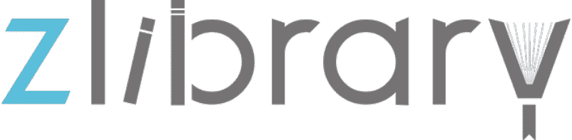

# 回到来处：论文化、身份与家园（散文集）

本书的出版得益加拿大艺术委员会和安大略艺术委员会的慷慨援助。`Bookhug Press` 还感谢加拿大政府通过加拿大图书基金以及安大略政府通过安大略图书出版税收抵免和安大略图书基金的支持。

`Bookhug Press` 承认我们所在的土地是许多民族的传统领土，包括加拿密萨加人、阿尼希纳贝人、奇普瓦人、霍德登索尼人和温达特人。我们承认多元化的第一民族、因纽人和梅蒂人（`Métis`）的持久存在，并感谢能在这片土地上见面、工作和学习的机会。

献给我们的父母，以及我们我们来过的人和地方

# 引言

本书诞生于两个移民后代之间的共同好奇心，他们关注那些散居作家的经历，这些作家回到了自己、他们的父母、或者在某些情况下是祖辈的祖国。作为同样回到过母国的作家，我们希望在背景迥异的故事讲述者之间找到共同的纽带，以及这些纽带在何处为何结束。他们在访问祖先土地时，是否像我们一样，遭遇了关于自己的不安问题？他们是否带着更新的归属感、家园感和身份感回到？我们是否能以艺术形式呈现这些叙事，让它们在英语文学中占据应有的空间，并为同时处于“这里”和“那里”的快乐与挣扎提供思考？

向写作界发起了征稿并收到了许多投稿。我们构想了一部展示人类经验多样性的文集。显然，关于旅行的故事将包含许多不同的角度；在《飞行路径》中，`Omar El Akkad` 讲述了关于父亲去世的经历，而在《部署》中，`Christina Hoag` 展示了作为一个拥有特权的第三文化孩子成长的感受。

在当今对土地主权的讨论成为焦点、当人们关注人类经验的多样性此时，我们很自豪能为这场对话增加背景和细微差别。这是一本由作家组成的书，我们这些编辑者现在生活在、并回到了自己的历史之中。本着这种精神，我们听了来自北方岛 `Kwaki` 第一民族成员 `Alison Tedford Seaweed` 的讲述，她经历了一场加深其原住民认同的回归；还有以色列-加拿大的 `Lishai Peel` 在《母亲。土地。》中讲述了她在远离政府的“暴力占领”后如何回到她的母亲和故乡——“无法逃避那个创造我的人”。

`Alexandra C. Yeboah` 写的《母国知道我的名字》展示了自己并不足够“非洲”。`Ayesha Habib` 的《家留下了什么》承认了英国殖民时期印度复杂的历史。`Nhung N. Tran-Davies` 在《家之旅》中通过医学院的机会跟随回到越南，并带着对母亲背景更深入的回来，这回答了关于她自身成长的问题。

`Omar Reyes` 写的《鸡汤与玉米饼》是一个关于萨尔瓦多多的动人故事。`Hannah Zalaa-UulI` 在《土地记得它的所有孩子》中将蒙古命名为“南纬 20 度 20 分”，无论她离开了多久。这本书的标题带有几丝幽默感，是为了回应那些向移民（或被视为移民的人）发出的“回到你们来处”的乏味指令。这里有二十六位作家，他们确实做到了，并带回了深刻、复杂、幽默且神奇的故事供我们讲述。我们欢迎读者来到遥远的土地，进入我们关于自己是谁、属于何处以及“家”对我们意味着什么的思想深处。

艾莉森·泰德福德 海藻

## 在警特湾苏醒

回到大房子

我第一次从病床上瞥到不列颠伦比亚省的警特湾（`Alert Bay`）。常识和地理知识会告诉你，我所说的是不可能的，因为那张病床位于梅普尔里奇（`Maple Ridge`），距离萨利海（`Salish Sea`）350公里，但我向你保证这是真的。有时候，最有意义的真理始于一个谜，我觉得祖先的魔力并不受时空规则的限制。

直到祖父母指给我看，我才知道我看到的是祖先的海滨社区——那是科莫兰特岛（`Cormorant Island`）上的村庄，我的家族根源深植在那里。他们来来岭地医院（`Ridge Meadows Hospital`）探望我，当我躺在床上时，奶奶问了一个最奇怪的问题：“你带那幅画了吗？”我向她解释说，人不会把艺术品带到医院的——尤其是青少年。我当时才十五岁，出门时几乎都不记得带家里钥匙，更不用说带一幅画了。我在想这意味着什么意思，以及她怎么会想到问这个问题。

她指着墙上的艺术品解释道：“那是你曾曾祖父刻的图腾柱的画。”这听起来很不可思议，画作竟然挂在一个距离图腾柱五百公里的房间里，但它确实就在那里。奶奶取下画，走到护士站。她解释了自己与艺术的个人联系，并大胆地询问是否可以带走它。

我只能想象那些工作人员对她的请求有多么困惑。奶奶就是这样，对自己想要的总是很明确，我很肯定工作人员面对这种情况完全没有手册可以参考。他们同意了，奶奶带着画走了，等她回来时，画已经装了框，里面是她和爷爷站在警特湾真实的图腾柱前的合照。

我将其视为信号，意味着我的祖先与我在一起，并希望我一切好。这不可能是巧合——在我从进食障碍中康复期间，一幅描绘我家族艺术品的水彩画正挂在那里。我已经斗争了多年，营养不良，步立不稳，经常感到头晕。我容易晕倒，病情已经进展到在医院里，我的光脚只有在往返厕所时才会接触冰冷的地板。那是医嘱，免得我尝试用脚来锻炼。

尽管我见过曾祖父图腾柱的照片，但我从未去过警特湾亲眼见到这这一个。我对那个只有450人的村庄一无所知，而且当时深陷困扰，没顾得上它。出院后，我把那件艺术品挂在家家的玄关。每当我看向那幅画时，我都会想起它，但在我真正踏上那些岸滩之前。

当我自己成为母亲时，作为联邦监狱系统的一名财务和数据质量官员，出差前往警特湾。我本该开车送一位假释委员会的成员去机场，和他随我一起飞往波特哈迪（`Port Hardy`），我最近发生了一场车祸。我同事的丈夫开车送我们去机场，当我解释我的家人来自那个地区并告诉他我的出生地时，他给我讲了一个故事。他曾担任过波特哈迪附近我家族保留区的乐队经理，在那里他曾与我的曾曾祖父进行过很多谈话。

和我同事到达目的地后，她开车带我穿过保留区，看看我们的人曾经居住过的地方——现在依然生活在那里。行驶在曾祖父母曾走过的道路上，感觉很超现实，我想象着他们在那里，回想起相册快照里他们脸的样子。我有他们抱着我、对我微笑、在他们怀里爱着我的照片，但他们去世时我还很小，至于无法记起他们的声音。

我在想，如果能去那里看他们，并拥有关于这个地方的记忆会是什么样的。

我们走向将带我们去警特湾的渡轮。我在码头的一家酒店入住，在下方海浪拍岸的声音中睡着了。有一个木头缠在码头下方，整晚都撞击着柱子，让我想起爷爷学习着鼓槌敲击空木节奏跳舞的样子。

我们在那里参加一个社区正义论坛，我遇到了一些参加活动分享观角的社区成员，他们在得知我爷爷是谁后，解释了我们之间的关系。我认识内陆的祖父母、姨妈、叔叔和表兄弟姐妹，我们在假期期间会聚在一起，但在那一刻之前，我对我们在温哥华岛的大家族几乎一无所知。通过他们的故事、微笑和拥抱，我看到我的家族谱系用永恒的墨水填充了起来。

在短暂的停留期间，我尽可能地探索了这个小镇，在当地餐厅用餐，闲逛并拍照。我拍了一张爷爷上读过的寄宿学校的照片，那栋建筑在几年后出于安全原因被拆除了。当然，我亲眼见了那根图腾柱。

看到画作活了过来感觉很奇。我从墓地的栅栏后观察着这一切，栅栏守护着墓碑和图腾，我站在远处满怀敬畏地注视着。如此近却又遥远，我想知道触摸雕刻过的木头、在指尖感受木纹的感觉会是什么样的。栅栏的存在是有理由的，以后会有更合适的时间近距离他的作品。我见证了它，这已经足够了。

第二天，我回到了菲沙河谷（`Fraser Valley`）的家，不确定是否还会回去。那里很远，我当时带着小儿子，作为一个单亲妈妈我并没有多少旅行预算，所以回去的想法虽然诱人但并不现实。尽管我没有回程的时间表，但我确定总有一天会回去。

多年以后，在我离开政府工作并开始自己的业务之后，在疫情来袭后我找到了回到警特湾的方法。浏览`Instagram`时，我注意到警特湾的文化中心提供在线`Kwak'wala`语课程。健康规定限制了面对面的课程，所以当地人也参加课程，它对任何想学这种语言的人开放。尽管我的爷爷是一位在当地大学教授我们语言的流利使用者，但我很少听到这种语言。我只会说“牛”和“谢谢”，生活从未提供过一起学习这两个词的机会。对自己能说的语言如此感到感到羞，我想学习如何用我们的母语与爷爷交流。

在第一节课开始时，向屏幕上所有陌生的脸介绍我自己，当我分享我的出生名字时，我的老师笑了起来。“我是你的姨妈！”她惊呼道。她指向会议中和她一起教语言的姐姐们说：“这些都是你的姨妈！”以这种方式被新家族认同，感觉就像发现了一个新而辉煌篇章的开启，充满了文化背景、希望和可能，以及所有重写人生故事所带的重量。

这就在那215座墓碑之后，我们心心沉重。我们为那些离世的人祈祷，在喜悦与悲伤交织的时刻，她的姐姐们用`Kwak'wala`语为我们唱了《你是我的阳光》。我的姨妈们在警特湾歌唱跳舞，我深受感动，我不得关闭摄像头来隐藏泪水。感觉我就和她们聚在一起，但同时，我又觉得如此遥远。我的心为这个感觉像家的社区感到疼痛，但我以前只去过一次。

当我告诉爷爷发生了什么时，他向我讲述他对那个地方的联系。“那是我出生的地方，”他说。警特湾的医院离他的布伦登港（`Blunden Harbour`）最近，他在那里直到青少年时期一直说着`Kwak'wala`语。那是他回到警特湾去读寄宿学校的时候。

## 迈克尔的（`Michael's`）

这一点我早就知道，尽管他除了去那里学英语以外，从未提到过。

我不想通过询问比他自愿分享的更多的来窥探，于是我止于此，并继续以自己的方式寻找答案。我成了某种程度的家族档案保管员，钻研报纸，并收集提到我们家族艺术以及为了保护文化遗产而进行的政治反抗历史的文章截图。

我在祖父的一次采访中读到，阿尔尔特湾（`Alert Bay`）也是我家族爱情开始的地方：我的祖母在离开渡轮时遇见了他。他们相爱并搬到大陆组建家庭，但正是在那个小岛的岸边，因为两个人的相爱，我才成了一个可能。

在经历了这样一个动人的教后，我继续在网上关注该文化中心和其他相关账号，最终参加了一个结合了瑜伽、夸古特尔（`Kwakiutl`）文化教学、夸克瓦卡拉语言培训以及符合文化的健康养信息的项目。我新结的阿姨是我们的长者，几周以来，我一直从她和其他老师那里学习。我一个通过语言班认识的表亲也在那个项目里。每一节课，我都在与家联系，至少在虚拟上，看着屏幕上住在那里的阿姨和其他老师们微笑。我学习新单词，试探性地读出它们，同时品味着词汇量增长的成就感。我完成了这个项目，是时候毕业了。

当我第一次读到这个项目时，人们谈论要在阿尔尔特湾举行毕业典礼，考虑到不断变化的公共卫生指令，我怀疑这是否会发生。我希望它真的能实现；希望我能找到家的路。幸运站在我们这一边。

毕业当天早晨，我去了文化中心，墙上挂着我祖父和高高祖父的照片。在最终前往“大屋”（`Big House`）之前，我欣赏了家族的艺术品，那是一个作为社区精神文化中心的建筑。

那里有精彩的演讲，中心燃着一堆火，还有丰盛且闻气诱人的食物。我想起，当我在治疗进食障碍治疗期间，第一次在病房墙上看到阿尔尔特湾的照片时，自己一直是格么饥饿，而现在我在这里，和家人一起畅享大餐。我的专家团队曾担心让我运动，而现在我正在教瑜伽。

我们被引导到后方准备跳“女士舞”（`Ladies Dance`）。我从未学过传统舞蹈，除了童年在一次表亲的婚礼上跳过一次，我担心自己看起来会很傻。裹着一条借来的披肩，我加入了项目中的其他女士并学会了舞蹈。

当我走在“大屋”的地板上时，我的脚趾接触到了凉凉的土地，而医院的地板是无菌且坚硬的。我感到不稳和犹豫，不是因为眩晕，而是因为缺乏经验；我的阿姨牵着我的手，告诉我要怎么做。

我让大地粘附在脚底，让泥土钻进脚趾，在亲属的引导下穿过地板。我感到脚踏实地，尽管我的身体和内心都在剧烈运动，作为一名夸克瓦卡瓦（`Kwakwaka'wakw`）女性挺拔地行走。身处“大屋”让我深受感动，在祖父出生的土地上跳舞，在祖父母相爱的地方，在我们家族的雕塑屹立的地方。

### 迪米特里·纳斯拉拉（`DIMITRI NASRALLAH`）

### 哭包子（`Crybaby`）

2009年11月，我第一次回黎巴嫩，自从我五岁那一个命运的早晨我们登上渡轮前往塞浦路斯以来。尽管二十七年前作为一个家庭离开了那里，但我是独自回来的。这感觉像是一件必须做的事，我无法再推延了。

我记得飞往贝鲁特时的恐惧，记得在巴黎的长途转机，离开蒙特利尔，在她怀孕第二个月开始时，在一个我只从记忆最深处知道的地方待上一个月。我当时在写第二本小说，我失败了，在经过多次草稿后仍找不到它的核心。它变成了一个关于离开黎巴嫩的故事，但没有跳动的心。黎巴嫩是一个我熟悉的世界，但我从本质上与它疏远。因为它，我的生活中充满了愤怒，挫败感被跨越世界并连根拔起，带着一种看似随意的严厉。当我年轻时，我把所有的愤怒都发泄在父母身上。但现在我已经独自生活了几年，没有办法留下所有的记忆。我不想让这些回响传递给明年四月的孩子。

在以前，你不会在美国大学的大门外看到学生，但现在，成群结结的学生在小咖啡馆的桌旁闲荡。我绕着这里走了几个小时，记录下我看到、听见和闻到的一切，因为在这里的感觉是是如此不安——我违背了父母的意愿，来到这片他们非常熟悉却又无兴趣再次回去的土地。

我与苏阿德（`Souad`）姨妈度过了时光，她是我妈妈姐姐。她长得像我妈妈，但说话更慷慨，笑容也更频繁。我们坐在她小小的客厅里，我记得我叔叔在战争期间把那间屋当过理发店。我的穆纳（`Muna`）姨妈作为调解人来了，因为我们都感觉到，与那些本该认识却并不熟悉的亲戚重新联系是一种奇妙的经历。

“你以前经常呆在这里，”苏阿德姨妈用阿拉伯语说，那是她唯一通的语言。“玛哈（`Maha`）去上班的时候，你每天都在这。”

“我记得以前和罗拉（`Roula`）待在一起，”我说，罗她是她的女儿，比我大大约七八岁。这是自我十一岁搬到加拿大以来，我使用过的最地道的阿拉伯语。尽管我能流利地听懂，但我已经丧失了读写能力，只剩下小时候父母在家里用它交流时留下的点点儿童口语水平。

“罗拉照顾过你。我们把你当成自己人一样养大。能见到你真好。”

我的姨妈坐在对面，双手交叠，我们之间放着一盘巴拉克瓦（`baklava`）和苦咖啡，另一位姨妈坐在侧边的扶手椅上，生动地回忆着这间曾经发生的事，而我对此的记忆只有寥寥的细节。

“我住在楼上，”我终于开口了，总得说点什么。

“没错。楼上两层，四楼。那是你父亲的公寓。基菲·卡米尔（`Keefe Camille`）？”

“我爸吗？他很好。”

“你知道，是我介绍他们认识的。卡米尔认识埃利（`Eli`），在他还活着的时候，愿上帝保佑他。”我的叔叔几年前因心脏病去世了。“他住在楼上。”

“你妈妈和穆拉德（`Murad`）和我住在一起，”穆纳姨妈说。“在此之前她和爷爷（`Jidduh`）住在一起。”

“她为什么要搬来你们这里？”

“为了上学，”穆纳姨妈说。“而且，在她妈妈去世后，在马杰云（`Marjeoun`）这样的小村子里和爷爷住在一起并不容易。他喝得太多了。她一个人照顾不过他。他们都搬来我们这了。她太聪明了，不想留在那个空无物的小村子里。”

“发生那事时玛哈还很小，我记得，”苏阿德姨妈说。“我们其他人年纪都大些，但玛哈还是个青少年。她妈妈中风时，玛哈在她身边。是她目睹了妈妈的去世。”

“我们都帮了她很多，”穆纳姨妈说。“你来到这里，在苏阿德去上班时每天都陪她。最后是你照顾了她的父亲。”

“如果她能来看我们就太好了，”苏阿德姨妈说。“告诉她我很想她，我老了，走不了路了。”

“我会告诉她的，”我说。我环顾房间，望向窗外。

“每当我看到看起来熟悉的东西，我就会想起我们楼上的那个公寓，”我坦白道。

“现在那里空了，”苏阿德姨妈说。“你想看看吗？”

我们挤进电梯，下到楼层，我的姨妈在那里和管理员交谈，管理员可疑地打量着我。事实证明他仍然记得我父亲。他表示，对那间公寓感到怀旧是完全理解的，但他最终还是妥协，带我们上了楼。我们进了一个我过的最小的公寓之一，甚至比我们在蒙特利尔的第一公寓还要小。狭小的浴室里，淋浴头离马桶只有几英寸。

在他们生命的早期就让他们，并且尽可能多待在那里。我推断，这样他们就能在合适的语境下学习文化规范。我丈夫同意了我的想法。

在他大学教授第一次休假期间，埃里克（`Eric`）决定要在新西兰进行研究，于是我们一家一年中大部分时间都住在那里。之后，他根据这些研究撰写科学论文，这可以在任何地方完成工作。“我们为什么不去葡萄牙呢？”他提议道。

我们决定在亚尔尔群岛的主岛圣米格尔岛（`São Miguel`）呆三个月。亚尔尔是位于大西洋中部、由九个岛屿组成的群岛。这让我们有机会重新熟悉这个岛屿，同时也让这些年幼的孩子接触葡萄牙文化。

我们的儿子马特（`Matt`）五岁了，乔治亚（`Georgia`）八个月大，还没走路。我们发现在这个年龄段带着孩子旅行很轻松。乔治亚还在母乳，而马特只要有石头和沙滩就能很快地开心起来。作为外国人，我们很显眼。我们戴着帽子和墨镜，用背带背着乔治亚。那个婴儿背是一个极佳的话题开启者——人们经常停下来盯着我们看。

一天，埃里克在家里，我决定带孩子们去`piscina`（一个天然的海滨泳池）游泳。当我排队时，一个女人跟我搭起话来。她关注着孩子们，主要是乔治亚，赞美那些脸蛋真漂亮。她亲了亲我的脸，然后给了马特一根棒糖。我笑着说了一句“`obrigada`”（谢谢），然后迅速喝完咖啡冲了回去。我感到头顶有种奇怪的感觉，但我耸了耸肩没放在心上，想可能是疲劳导致的。当我到达泳池并换上泳衣时，我把手放在头上，竟然摸到了粘糊糊的东西！

“你为什么不早告诉我那个女士给了马特一根棒糖？”我后来问埃里克。看到自己头顶那团粘糊糊的头发，想到我那几乎不吃东西的婴儿，我的恐慌心中倍增。我不记得自己说了什么，但当时几乎流泪了。

我了解到，给糖吃是成年人对小孩表示友的一种的方式。我已经注意到在岛屿文化中，孩子非常受推崇。每当我们出去吃晚餐时，家庭都会聚在一起，带着蹒跚的孩子和婴儿，他们表现得非常好。如果婴儿哭了，人们会表示关心，并在父母吃完饭时提议抱他们。我离开了岛屿随父母移民到了加拿大，但我们与亚尔尔的纽带依然很深，经常回去。我能流利地说当地语言，发现融入岛生活并不容易。

我花了很长时间才意识到这是一个阶级化的社会，例如，人们倾向于与劳动者交往。我大部分在加拿大长大，那里的社会似乎更加平等，我对比精英主义感到不适。这是我不喜欢的文化之一，在到达之前我就已经决定像在加拿大一样，和每个人都交流。

我们在一个离我家人出生地相邻的村庄租了一栋房子。从我们住的地方走过去只需一小段上坡路，但感觉就像在群岛的另一头一样。我不知道那里住着谁。

那个夏天是记录以来最热的夏天之一。我们的租住房位于一排悬在悬崖上的连排房屋中间，俯瞰着葡萄园、蔬菜地以及远处的大西洋。当我把衣服挂在后平台时，我可以望向地平线，想象彼岸的生活。在地图上，我看到在我们和南极洲之间的南方直接没有陆地。有时我会坐在露台上让热日晒着皮肤，但持续不了多。。相反，我大多数时间都带着孩子们在海滩，水面的微风让我们保持凉爽。埃里克发现很难在酷热中工作，最终开始只在清晨和傍晚写作，这让他白天有空陪我们一起去探险。

小镇在日落后变得热闹起来。我注意到晚餐后，街道上的妇女会站在自家的门阶上或靠在窗边观察周围发生的事情并互相聊天。他们的丈夫则会去当地的咖啡馆或酒吧与朋友聚会。在目睹这种情况一两周后，我足够的勇气也坐在自家的门台上。我知道我打破了这种习惯，但我很欢迎这个说我母语并认识邻居的机会。我会带着乔治亚待在那里，而埃里克给马特读故事并送他入睡。然后我回屋开始照顾婴儿。

白天，我们经常在`piscina`会朋友。我告诉他们我晚上会和邻居的妇女有这种仪式，我的朋友听起来很惊讶。

“你和他们有什么共同点？你们聊些什么？”她问。

“哈，其实有很多。大部分时候我们聊孩子。有时他们会问关于加拿大的问题。他们一直管埃里克叫美国人，我不得不提醒他们他是加拿大的，”我解释道。

“噢，别管了，对我们来说都一样，”我的朋友笑着说。

一天晚上，我感到特别疲累，拒绝了聊天。孩子们很闹躁，我想我们可能都受了太多太阳，所以让孩子早点上床，我自己也睡着了。当我抱着乔治亚入睡时，我能听到妇女们来到街上，说话笑着。我关上了卧室的百叶窗，但窗户是开着的，我可以清楚地听到他们的声音。

“她真友善。她和每个人都说话，”我听到隔壁邻居说。

“不过她的丈夫话不多。”我想那是街街对面两栋房子之外的邻居。

“他不会说葡萄牙语！”另一个女人说，听起来像是在为埃里克辩护。

“他们说他是教授，但你看到他穿什么了吗？拖鞋和短裤！什么样的教授那样穿衣服？”

“还有那个可怜的宝宝。她连鞋都没有。还有那个男孩——那么害羞……”

我没能认出某些声音。

“我听说美国不是这种风格。”

“但她是葡萄牙人啊！”我的邻居听起来很激昂。

我觉得自己像是在闯入私人对话，于是起身关上了窗户。

第二天晚上，我再次加入了他们。有人说看到我出现在外面真好，他们很想念我。我解释说昨天我们都觉得累，也许是晒了太多太阳，所以让孩子早点睡觉，我自己也睡着了。

“但你知道的，窗户是开着的，我从外面能听到你。你知道我能听懂你说的每一句话，对吧？”

我变得非常喜欢这些女人。以至于在我们临近离开时，我感到一种挥之不去的失落感。我会想念她们的。

一天早晨，当我正胡想这件事时，门口传来了敲门声。当我开门时，站在那里的是街那头的一个女性，我不熟悉她，但一眼就认了出来。她手里拿着一个信封。

“Bom dia（早上好），请进，”我说。

“就一分钟，女士（senhora）。”她走进屋内，我好关上门，隔绝了交通噪音。

她把信封递给我说：“这是给你的。我们大家的礼物。”

“噢，谢谢！这是什么？”

我打开信封，发现里面有钱。

“这些钱足够让你宝宝打耳洞了。我们想也许你丈夫不会给你钱去打，因为他不喜欢，所以我们大家一起凑了一点。”

“噢，女士！Obrigada（谢谢）。”我感到泪水夺眶而出。“这真是一件贴心的事情。”

“我们真的很喜欢你，看到你要回美国了，我们非常难过。”她咬着下唇，转过脸去。说道。

“回加拿大。而且我们会回来的，你知道的，”我说。

在那几年里，我通过信件与一些邻居保持联系。通常之后我们家人确实回过几次葡萄，但大多数时候我们去大陆。我们去圣米尔岛（São Miguel）进行短途侧游，但行程排满了观光和探亲。十五年后，我们才回到了同一个小镇。我们走在鹅卵石街道上，爬上山，再次饱眼那片壮丽的景色。记忆的碎片回到了马特（Matt）脑海，但乔治亚（Georgia）看起来就像是第一次看到。

我敲响了隔壁邻居的门。一个年轻女性开了门，我们不认识。

“噢，我们在找奥莉维亚女士（Senhora Olivia），”我说。

“那是我妈妈，”她说。“父亲去世后，我现在和她住在一起。”

当我解释了我们是谁时，她说她知道我们，见到见到我们非常高兴。她邀请我们进去，但提醒说她妈妈可能认不出我们。“她最近记忆有些事情有些困难，”她说。接着她继续道，“你们可能知道住在街对面的那个邻居搬到了波顿，而住在她楼上的那个搬到了市中心。”

“不，我不知道，”我说。

我们穿过一条昏暗的走廊来到房子后方。奥莉维亚女士坐在露台的桌子旁，喝着茶。我们向她打招呼，然后和她一起喝茶。我展示了我们上次住那里的照片，但不知道她是否还记得我们。我搂住女儿的肩膀说：“这是宝宝乔治亚。看，她打耳洞了了！”

乔治亚转过头来展示她那对传统的金耳环。她在六岁时，是出于自意愿地接受了这种传统。

奥莉维亚女士给乔治亚露出了灿烂的微笑。然后她一个一个地看向我们每一个人，眼里泛满了泪水。我喜欢想，在那个准确的时刻，她清楚地知道我们是谁。

# 阿灵归来（Ah-Ling Ge Lui）

## 番来！（Fan Lai La!）阿灵的女儿回家了（Ah-Ling’s Girl Has Come Home）

2018

当渡轮靠在长洲（Cheung Chau）码头时，咸水味充斥着我的鼻腔。一名穿着深蓝色白色滚边海军服的水员将系缆绳套在码头的系桩上，带我们靠岸。我下了船，由于跨越太平洋的红眼航班和十五小时的时差，双腿沉重。穿过一群身着正装和校服的人群，他们正准备登下一班前往香港岛的渡轮。

我的脚很熟悉这里的路。它们带着我直穿过广场，路过那家点心店，经过五金行店和理发店，转过弯。我停下来向那个正在抽烟、挂衣服的邻居挥挥手，越过腰高的棕色金属门，走了进去。但这一次，我不知道该期待会发生什么。我的外婆宝婆（Pau Pau）四天前去世了，我和父母、姐姐来到这里参加她的葬礼。

我的母亲阿灵（Ah-Ling）出生在一个名为长洲（Cheung Chau）的沙质陆陆岛上，字面意思是“长岛”，是香港263个离岛岛屿之一。长洲七万居民的大多数挤在岛屿的平坦部分，位于南北两端岩石山之间。三层楼梯式公寓彼此非常近，以至于你可以看到邻居的电视。屋顶上挂着晾衣架。舢船和渔船在港口拥挤。户外海滨的餐厅是当地游客周末的热目的地。

除了专门设计的微型救护车和消防车，岛上不允许汽车通行；街道太窄了，挤满了人：印尼和菲律宾籍女佣推着坐轮椅的祖辈；周末游客租用自行车划划艇；码头工人推着嘎吱作响的小推车运各种货物。这座岛以街头小吃（尤其是鱼蛋）闻名，而且十九世纪海盗中榜寨（Chung Po Tsai）宝藏的所在地。

我的爷爷公公（Gong Gong）出生在岛上的一个农民家庭。宝婆是城市人，出生在英国殖民地中心的香港岛，一个叫西英蒲（Sai Ying Poon）的地区，那里曾是渔港，也是英国军队的第一处基地。

在一次回香港参加表亲婚礼期间，我姐姐和我回了那里。通常之后我们家人确实回过几次葡萄，但大多数时候我们去大陆。我们去圣米尔岛（São Miguel）进行短途侧游，但行程排满了观光和探亲。十五年后，我们才回到了同一个小镇。我们走在鹅卵石街道上，爬上山，再次饱眼那片壮丽的景色。记忆的碎片回到了马特（Matt）脑海，但乔治亚（Georgia）看起来就像是第一次看到，当然。

我敲响了隔壁邻居的门。一个年轻女性开了门，我们不认识。

“噢，我们在找奥莉维亚女士（Senhora Olivia），”我说。

“那是我妈妈，”她说。“父亲去世后，我现在和她住在一起。”

当我解释了我们是谁时，她说她知道我们，见到见到我们非常高兴。她邀请我们进去，但提醒说她妈妈可能认不出我们。“她最近记忆有些事情有些困难，”她说。接着她继续道，“你们可能知道住在街对面的那个邻居搬到了波顿，而住在她楼上的那个搬到了市中心。”

“不，我不知道，”我说。

我们穿过一条昏暗的走廊来到房子后方。奥莉维亚女士坐在露台的桌子旁，喝着茶。我们向她打招呼，然后和她一起喝茶。我展示了我们上次住那里的照片，但不知道她是否还记得我们。我搂住女儿的肩膀说：“这是宝宝乔治亚。看，她打耳洞了！”

乔治亚转过头来展示她那对传统的金耳环。她在六岁时，是出于自意愿地接受了这种传统。

奥莉维亚女士给乔治亚露出了灿烂的微笑。然后她一个一个地看向我们每一个人，眼里泛满了泪水。我喜欢想，在那个准确的时刻，她清楚地知道我们是谁。

当渡轮靠在长洲（Cheung Chau）码头时，咸水味充斥着我的鼻腔。一名穿着深蓝色白色滚边海军服的水员将系缆绳套在码头的系桩上，带我们靠岸。我下了船，由于跨越太平洋的红眼航班和十五小时的时差，双腿沉重。穿过一群身着正装和校服的人群，他们正准备登下一班前往香港岛的渡轮。

我的脚很熟悉这里的路。它们带着我直穿过广场，路过那家点心店，经过五金行店和理发店，转过弯。我停下来向那个正在抽烟、挂衣服的邻居挥挥手，越过腰高的棕色金属门，走了进去。但这一次，我不知道该期待会发生什么。我的外婆宝婆（Pau Pau）四天前去世了，我和父母、姐姐来到这里参加她的葬礼。

我的母亲阿灵（Ah-Ling）出生在一个名为长洲（Cheung Chau）的沙质陆陆岛上，字面意思是“长岛”，是香港263个离岛岛屿之一。长洲七万居民的大多数挤在岛屿的平坦部分，位于南北两端岩石山之间。三层楼楼梯式公寓彼此非常近，以至于你可以看到邻居的电视。屋顶上挂着晾衣架。舢船和渔船在港口拥挤。户外海滨的餐厅是当地游客周末的热目的地。

除了专门设计的微型救护车和消防车，岛上不允许汽车通行；街道太窄了，挤满了人：印尼和菲律宾籍女佣推着坐轮椅的祖辈；周末游客租用自行车划划艇；码头工人推着嘎吱作响的小推车运各种货物。这座岛以街头小吃（尤其是鱼蛋）闻名，而且十九世纪海盗中榜寨（Chung Po Tsai）宝藏的所在地。

我的爷爷公公（Gong Gong）出生在岛上的一个农民家庭。宝婆是城市人，出生在英国殖民地中心的香港岛，一个叫西英蒲（Sai Ying Poon）的地区，那里曾是渔港，也是英国军队的第一处基地。

在一次回香港参加表亲婚礼期间，我姐姐和我回了那里。

当我们在暑假访问香港时，我们的基地始终在西英蒲（Sai Ying Poon），寻找宝婆的童年家园。第一次访问时，我五岁，我姐姐一岁，机票装放在特殊的信封里，餐点附有餐具。

我记得被柴油味和热气的垃圾味环绕，当我们从香港岛的中环码头下车时，在前往长洲的渡轮上喝柠檬茶和杯装面。我出生在加拿大的感官对商店里挂着的整头猪的鼻子完全没有对比。但我对那些挤满了色彩鲜艳的塑料滩玩具和最新的双星、Hello Kitty文具的商店非常痴迷。

在每张照片中，圆嘟嘟的脸泛红，刘海贴在汗湿的额头上，还有我的香港亲戚们。我不知道是为了节省洗碗水，还是宝婆在她客厅的抽屉里为我们每个人准备了特定的杯子。我们不准用别人的杯子。

我生命中规律地进行这种旅程。有时和家人，有时和朋友，有时独自。出生在一个中产阶级的海外华人家庭，我们国际旅行仅是为了回到祖乡。没有迪士尼或加勒比度假胜地。要么是在加拿大西部自驾游、住旅馆，要么是飞行十四小时的国际航班前往人口稠密的城市。万万公里的距离在一个意想不到的时刻紧紧相在一起。

这段时间一直没有访亲，没有观光，没有购物。相反，我们正出去远足。天空呈现出明亮的蓝色。今天水里没有游泳的人。

我们看到了台风山竹过后的遗迹：路灯以令人心惊的角度倾斜，通往直升机停泊场的铺设道路变成了扭曲的金属和破碎的混凝土。如果路没有被扭曲，这里应该是鲍鲍（Pau Pau）从救护车上转运出来飞往香港岛大医院的地方。现在他们不得不开车送她到一个体育场去赶直升机。

我一直以为我的鲍鲍从未把我看作中国人。凭我勉强及格的粤语，混血身份，我那鬼佬（gwai lo）父亲，以及在加拿大的成长。

我的第一代香港移民母亲和第五代爱尔兰裔加拿大移民者父亲不知道如何教我们谈论种族。我们被培养得真的会认为自己是中国人吗吗？我经常希望自己能更坚强，去面对那些内化的关于我身份认同的矛盾信息。

在小学时，我在操场上跟不上那些说粤语的同学。然而，我会去课后的中文书法班和中文夏令营，我们的大部分餐都在埃德蒙顿的中国餐厅和唐人街餐厅吃。

成年后，许多白人陌生人在学习任何其他中文东西之前，总会强着向我讲述他们的亚洲妻子或中国之行。中国亲戚有时会问我是否会用筷子。中国爱好者曾自豪于他们背了多少个汉字，并对我所掌握的汉字量少得多表示惊讶。

同样是华裔背景的朋友们也曾告诉我，我并不是真正的中国人，因为我的父母不把多余的垃圾袋放在洗碗机里，或者不知道“芥兰菜”（gaai laat）和“生菜”（gaai aan）发音的区别。成年后，我曾在办公室的午餐室里看到过白人同事对我的豆腐皱皱鼻子。

当我二十五出头，刚大学本科毕业时，我决定用上积蓄回到“母国”。我觉得这是一种寻找根源的方式，让我从身份认同的混乱和不适中走出来——那是作为一名混血亚洲女性在自己的皮肤上经历过的挣扎。

为了帮助我更好地融入定居殖民主义的加拿大（我称之为家），作为一名非白人的定居者（祖先是从其他英国殖民者移民过来的），我买了一张去香港的单程机票，并制定了一个模糊的计划。我会和鲍鲍住一段时间，学习更多粤语和普通话，也许找份工作，也许在有机农场做志愿者，然后，哇哒哒！我变得更像中国人了。

我母亲安排我每个月给鲍鲍一笔钱作为“电费”。我在那里待了几个月，住得太久了。我本以为我设计了一场自主的留学之旅，我将从长辈那里学习，连接根源，并找回我的文化和语言。

相反，那是一段尴尬、笨拙且充满冲突的时光。我因为洗衣服的方式被责备（并不算冒犯），也因为有一次把筷子直插在碗里被责备（这是大忌）。几乎每天，鲍鲍都会问：“你在这儿干什么？”

居留一个月后，农历新年临近，鲍鲍给了我一个红包，里面塞着几张挺括的香港钞票。她把我赶出房子，催促我去“行街”（hang gaai）——逛街/散步——为新年买新衣服。

我走在街上进一家精品店，挑了一件舒适的深蓝色白色波点毛衣，背部有一排扣子。我回到家，把它从皱巴巴的粉色塑料袋里拿出来，自豪地展示给她看。我做到了！在体验我的文化！

她的脸垮了下来，大声地叹了口气：“哎呀！”

我不知道发生了什么。她拿起电话，拨了一长串长途电话的十四位数字，嘟囔道：“你妈妈没教过你任何东西。”

“喂？”我妈妈睡意惺醒的声音传来。那是埃德蒙顿的午夜。

鲍鲍对着我妈妈说话很快，间隙中对我比着歪曲的手指，然后把电话递给我。

我妈妈解释道：“过农历新年你要穿幸运色——红色、粉色，甚至是紫色都可以。但你选了最不利的颜色。蓝色和白色。这些是丧礼色。”

我简直不能更糟了。

鲍鲍拿上她的零钱包和雨伞。我们要出门了。她径直走街去另一家精品店，用伞指着门口，让我进去。

我穿过一道厚实的塑料帘，目光落在一件鲜红色的卫衣夹克上。我试了试，袖子只到我前臂一半——我很确定那不是那种七分袖，完全不合我这（相对巨大且宽肩）的加拿大体型。我瞥了一眼它，寻找鲍鲍。她点头表示了粗鲁的认可。

足够了。好吧，我把袖子卷起来就行了。我买了那件卫衣。

我们转过角来到她最喜欢的云吞店，吃了一顿快速、廉价、热气腾腾的云吞晚餐。总的来说，这是一次成功的出行。

回家的路上，我们路过被火光照亮的阳台；那些依然遵循传统的人正在红罐里烧纸钱来迎接新年。我们碰到了一个推着推车的小狗的邻居。我们交换了红包，“身体健康隆！”——祝你健康快乐。狗狗合拢爪子，祝新年快乐。

在鲍鲍葬礼的前一天晚上，我们无法入睡。

你是坐渡轮回来吗？

我会从她座线电话旁拿出那本口袋大小的渡轮时刻表，在手指上比着粤语数字：yat-zee-sam-say-mm-look-tzat-but-gau，最后停在“gau（九）”上。“Gau deem dap shun。”晚上九点的大渡轮。

在我的多次访问中，我通常更倾向于乘坐大渡轮。它速度较慢，从香港岛到长洲需要一小时。我喜欢坐在船后部露天甲板最后一排座位上，喝着船上自动售卖机里的糖柠檬茶，看着船只滑过光滑的水面，香港的灯火如皇冠般在远方变得柔和。

在我青少年后期和二十岁出头，作为一个新鲜的背包客，我以为自己知道如何旅行。旅行就是背上装有指南和必需品的背包，穿过新地方，探索未知，积累经验，并在这一切改变后回到家。

也许这听起来显而易见，但我现在怀疑，我的香港之行更多是关于“访问”。我对长洲和香港的地图是由记忆和经验的丝线织成的。旅行与访问是重叠的。访问是在机场被接机、带橙子、被递上冷柠檬茶。做一个好客人，负责任，维护关系。

因为波波（Pau Pau）活过了九十岁，他们称这为“笑衰”（微笑葬礼）。葬礼结束后，天空亮了。在最后的葬礼仪式中，我们是最后跳过火并用柚叶水拍脸的人。我们洗了头，把蓝花换成了红花。

我和姐姐穿上了新买的、色彩鲜艳的衣服。今天，我平时那种在肤色黝黑、精致的香港堂亲中，觉得自己是个流汗、笨拙的加拿大人的“丑鸭鹅”式的自卑感消失了。

我自豪地穿着我的红色花花衫和森林绿长裤参加酒店午餐，那是我波波葬礼活动的结束，我知道她会认可的。

我想象她站在一楼的阳台上，挥手说“拜拜”，模仿着背背包的动作，说：“Fong ga fan lai la（放假回来）。”有假期就回来。然后用最后的“joy geen（高兴）”或“拜拜”送我们我们。

我想，如果我现在去，我的脚还会带我去她的家吗？谁会坐在敞开门的藤椅上，双脚交叠，一只眼睛扫视着邻里的八卦？他们会放下报纸吗？他们会伸出粗糙的手接过我递的那袋橙子吗？

把水果滚进碗里，然后平好透明的红色塑料袋，整齐地折好，放在座线电话下的抽屉里？他们会拿出我的杯子，给我一些滚水（gwan seoi）吗？

那时我并不知道，波波的葬礼将是在三大重大事件动摇这座城市和我生活之前的，最后一次香港之行：香港抗议、COVID-19以及成为一名母亲。

从那以后，我一直推迟完成一个诗歌项目，那个项目深入我与粤语的关系。在对香港抗议发表意见时，我觉得自己像个冒充者。我没有时间反思，她离开这个世界的旅程对我与母亲祖国日益疏远的纽带意味着什么。

我失去了学习这门语言的紧迫感。我不确定自己是否有权利、能力或欲望对中国、粤语或香港身份做出任何认同。我想，移民可能不是单程旅程，而是一次往复。像织机上的梭。像一个在世界之间开启的瞬间之门。我担心随着波波的去世，那扇门已经关上了。

当我写下这些时，我给妈妈发了短信：“我有一个问题——当长洲的人对波波说‘Ah-Ling ge lui fan（阿玲女儿）’时，意思是阿玲女儿回来了？”

她回复道：“是的，在那种语境下，长洲是根据，所以阿玲的女回来了。”

## OMAR EL AKKAD

### 1. 2010

“发票”在阿拉伯语和意大利语中的词相同：`fattura`。我和妈妈在那不勒斯的一个墓地边缘学到的这个，当时我们正试图安排父亲遗体运送最后的后续。那是美好的一天，天空是里维埃拉蓝，我的视线边缘聚焦在那个穿着不合身西装的殡仪师身上，那里有一家人在哀悼他们刚去世的亲人。他们是这里的人。我们不是。我的妈妈无力地努力让那个殡仪师理解她在要求什么，直到最后，她不耐烦地用阿拉伯语含糊说了几句，那个人点了点头。碰巧的是，我们的语言重叠了；我们被理解了。那人消失在附近的办公室里，几分钟后带着卖单回来。几天后，我们需要在开罗机场向一名军事检查员出示这份文件，那时我们将回到父亲的出生地埋葬他。在他生命的最后二十八年里，他一直是个移民，而在死后，他要回家了。

我出身于一个心脏功能异常的家族。我的爷爷在父亲出生前就去世了。我的父亲活到五六岁，在我和母亲以及她的姐妹在意大利海岸附近的一次邮轮上因心脏病发去世。在随后的日子里，我们缓慢地走过官僚主义的泥潭，试图……

#### 2. 1986

“发票”在阿拉伯语和意大利语中的词相同：`fattura`。我和妈妈在那不勒斯的一个墓地边缘学到的这个，当时我们正试图安排父亲遗体运送最后的后续。那是美好的一天，天空是里维埃拉蓝，我的视线边缘聚焦在那个穿着不合身西装的殡仪师身上，那里有一家人在哀悼他们刚去世的亲人。他们是这里的人。我们不是。我的妈妈无力地努力让那个殡仪师理解她在要求什么，直到最后，她不耐烦地用阿拉伯语含糊说了几句，那个人点了点头。碰巧的是，我们的语言重叠了；我们被理解了。那人消失在附近的办公室里，几分钟后带着卖单回来。几天后，我们需要在开罗机场向一名军事检查员出示这份文件，那时我们将回到父亲的出生地埋葬他。在他生命的最后二十八年里，他一直是个移民，而在死后，他要回家了。

我出身于一个心脏功能异常的家族。我的爷爷在父亲出生前就去世了。我的父亲活到五六岁，在我和母亲以及她的姐妹在意大利海岸附近的一次邮轮上因心脏病发去世。在随后的日子里，我们缓慢地走过官僚主义的泥潭，试图……

#### 3. 1994

*（注：此部分原文为重复内容，已按逻辑结构处理）*

这是任何TSA（美国运输安全局）官员听过的最荒谬的解释——当时要去安德鲁斯空军基地，飞往关塔那摩湾拘留营，或者是在前往阿富汗之前，在弗吉尼亚参加战地记者培训。但我唯一一次被带入审查室并接受审问，是我到达JFK机场并告诉他们我是来见表哥的时候。事实证明，有很多恐怖分子声称他们是为了探望表亲。

#### 1998

在卡塔尔作为一名外籍人士——这是我们用来形容那些富到不至于被称为“移民”的人的词——必须获得“卡法拉”（`kafala`），这是一种由当地公民或公司颁发的某种担保。为了保护这个国家的石油和天然气财富，卡塔尔政府让任何外国人都无法获得国籍。居住在卡塔尔的大多数人都是外国人，处于这种不稳定的生存状态，随时可能被一夜遣逐的可能性始终存在。大家都清楚规矩：你来到这里，赚点钱，但你永远是个客人。这里没有归属感，只是路过。

一年，在这一地方住了十多年后，很清楚的是，我们在卡塔尔的时间即将结束。8月的最后一天，我们登上了飞往加拿大的飞机。

我对加拿大一无所知。在蒙特利尔的第一周，我上了一辆公交，试图把一张二十美元钞票塞进硬币口想要找零。我完全不知道公交系统是如何运作的；卡塔尔根本没有公共交通。我当时只有十六岁，从零开始的前景——适应那种在零下四十度时空气像针一样刺入肺部的感觉——是令人无法忍受的。世界是一场开始的冲击。

#### 2001

在很长一段时间里，我父亲在蒙特利尔找不到工作。他的法语不够，学历也不够。当我们耗尽积蓄时，他向外扩大搜索范围，直到获得了一个在威斯康星州一家酒店担任会计的录用，那个州我们没有一个能在地图上指出来。但薪水足够高，而且别无选择，于是他接受了。还有一些文件需要完成——一份工作许可，他的潜在雇主向他保证这应该相当简单——最晚在9月第二周完成。9月第二周到了。

工作许可的办理陷入了停滞；大家都知道原因。最终，酒店别无选择停止等待并雇了别人。我们没有搬到威斯康星州。我想象我家人的另一个版本进入了那个奇异、幽灵般的“本可以”社区，与生活在特里波利的我们，以及留在开罗的我们并肩。所有这些被夭折的轨迹，所有这些从未离岸的容器。

#### 2010

8月的一个周日，我的朋友安娜试图在多伦多寻找一位意大利语翻译。为了把我父亲的遗体带回家，我们需要安抚埃及、加拿大和意大利政府的官僚主义无常，这除了许多文件外，还需要我父亲意大利语死亡证明的认证翻译。在伊斯兰教传统中，死者应该在二十四小时内埋葬，但我们花了好几天时间处理所有必要的许可，最后才回到开罗，这是自十二年前我们来到加拿大以来我们第一次同行的飞行。

在埃及，任何抵达的遗体都归军管辖。我们在凌晨三点左右落地，我和表哥陪着棺材来到机场一个新荒凉的角落，那里坐着一个坐在桌前，既无聊又烦躁的行政人员。

她检查了文件，来自那不勒斯殡仪馆、多伦多翻译员以及罗马埃及大使馆的文件。事实证明我们漏了一份表格，没有它，我们在技术上犯了法。以这种方式运输我父亲的遗体是非法的，现在已经来不及任何补救了。

我们站在那里，感觉过了很长一段时间。最后

HANNAH ZALAA-UUL

#### 大地记得

它所有的孩子

飞机滑行停止，我的心很沉重。也许是期待或紧张，我对自己说。我能透过窗户看到洗刷过的绿色平原。与任何地方都不同，这只能属于我们的土地。我们的家。五年来第一次看到它的熟悉感，我的心澎湃了。

自从搬家、重建并回来后，我对家的定义似乎存在于来来去去中，存在于无形的国界之间，在水面之上、天空之下。大约如此。

我走下飞机，我怀疑自己的语言能力。多年没有练习，在机场登机口紧张地回答着问题，希望行政官员看不出这是一个我尚未真正熟悉的世界。

过去，几十个长辈对我说：“蒙古人应该说蒙古语，而不是这种外语”以及“你应该对英语说得比母语还流利而感到羞耻”，随后还心自得意地跟着一句：“你现在还是个蒙古人吗？”仿佛语言决定了我的血统，抹消了我的血液和DNA。但那些刻薄的评论留在我脑海里，每当我结巴、紧张地用外语口音读词、或艰难地用蒙古语解释某事时，这些话就会浮现。

在和姐姐和她的两个孩子一起回我们家的路上，我在心里记录了自从我离开以来发生的所有变化和保持不变的事物。嗯，路变好了，有了用于道路安全的监控摄像头，有了新的更高的建筑。比我记忆中的有更多的餐厅、连锁店和咖啡馆。

*（注：从这之后开始的后续文本似乎包含严重的OCR错误或源文档不匹配，叙述从一个关于埃及的故事突然转变为关于蒙古的故事。）*

（此处后续为重复的混乱文本，已按要求保留格式并进行翻译/处理）

成为独立的女性。在我离开的那个国家，开辟属于她们自己的道路。

我现在意识到，到那个时刻为止积累的压力是悲伤。为那个没有成为自己而哀。为那些我没有参与的故事和里程碑而哀，为这个我固执拒绝承认的不断演变的世界而哀。我哀那个世界继续向前，却没有属于我的位置。如果我在这里不是任何人，那么我在其他地方又在哪里呢？

我们在一起的时光很有限，在一个月的停留期间，每一个活动和观光都安排得很满。父母、我的姐妹、她们的孩子以及我挤在四辆不同的车里，前往乡下的外姥家。市外的道路狭窄且布满了裂缝和坑洼，当工人在维修路面时，我们不得不偶尔驶入土路。我大姐姐的孩子们晕车了，我们尽力让他们的旅途变得尽可能舒适。我们停下来休息，玩了捉迷藏来伸展筋骨，拍照，并在前往乌夫库尔杭盖伊省（`Uvkurhangai`）的途中，让他们在鸣鸣沙丘（`duut mankh`）体验了人生的第一次骑驼。我突然想到，我赖以寻求慰藉的童年记忆正发生在她们的这次旅程中。也许在她们二十岁时，她们也会想起那些沙丘、马和骆驼、在湖上打水漂、爬上山顶和羊玩耍——重新连接那段感到坚定归属感的珍贵时光。

在蒙古文化中，家庭会向客人提供新鲜肉类和乳制品作为尊重和好客的表示，作为回报，客人必须至少吃一口。所以，在一个月里，我吃下的肉和乳制品相当于我的体重。我们通过食物建立联系。这是我最喜欢我们文化的地方，不言而喻的认定彼此的方式。

我祖母的夏季住所正如我小时候记忆中的那样。她的蒙古包（`ger`）——一个织工精美的传统居所，位于扎拉乌勒（`Zalaa Uul`）山脚下，那座山顶顶着石冠的高山是我父亲名字来源。蒙古包依然位于溪边，我们小时候曾在那里互相打赌跳过去，岸边依然点着同样的金黄色蒲公英，我们曾用它们编织花环。

我们升起篝火庆祝家庭团聚，五个姐妹十三年来第一次聚在一起，在我的祖先曾自豪地走过的土地上，在我的父亲每个夏天都渴望回归的地方。现在，我们渴望归属，每一个身处全球不同角落的兄弟姐妹。我们在一个地方学习读写，在另一个地方长大。我想说，作为她们的姐姐，我是多么地自豪；在看到她们如何不加掩饰、诚实地体现自己身份的碎片时，我感到了多大的勇气。这让我也变得勇敢。我经常想，如此遥远的距离和差异是否也让她们感到像我有时那样的孤独。即使在现在，尽管我们都处在不同的大陆，我很清楚她们也渴望在中间再次相聚。我怀疑自己是否能在不流泪的情况下说出这些情感。

在篝火旁，我们低声诉着祈祷和祝福，向火焰索求力量。在满月的光辉下，我们为家人祈求好运。当我妈妈分享最近去世的祖母的故事时，我已经开始流泪，当她拥住我时失声了。我的父亲也加入了进来，环住我们两个，我们哭出了内心深处的一切。

在度过的观光时光里，我们谁都没有说出那句话：“我想你了。没有你真的很难。”我也不得不说：“看，看我变成了什么样，靠我自己！我做到了！这不可能，但我做到了！”这与我内心那个更细微的、被忽视的声音重合了：“我仍然很小很年轻，我仍然需要你们，没有你们的生活并不容易。”和家人在一起，在星空下，在我们的祖土地上，我知道我的归属。

在这里，我怀着离开如此之久的内疚感并不重要，我的蒙古语已经很陈旧，或者当我紧张时，我带着一种混合了印度、加拿大和新加坡的口音说话并不重要。我为自己与家人成员之间的隔阂感到责任并不重要，反正我们从不习惯于分享真实的感受，尤其是彼此之间。与我们生活和土地之间和谐的纽带相比，我那些微小的疑虑显得更加微不足道。在库伊斯廷·奈曼湖（`Khuisian Naiman Lake`）寂静的氛围中，我可以为自己关于归属感和身份的愚蠢想法大笑。当我真正体现我的复合身份时，我内心的恐惧并不必在两者之间做选择，因为我很大程度上深受两者的影响。我可以像河中流过的溪一样流动且瞬间。我认可我那些散落的、未完成的、被剪辑和编辑过的自我，它们与这个奇异的抽象整体是对等的。

土地是一位永恒的母亲，她的耐心是慷慨的，渴望着孩子们回归。尽管岁月流逝，无论我走了多远，我改变了多少，当我回家时，土地永远会记得我。

对于许多移民后代来说，“家”存在于故事中，如果我们幸运的话，也存在于照片里，比如爸爸在妈妈去世几年后送到我家的那些照片。

我妈妈在肯尼亚蒙巴萨（`Bombasa`）的相册是我最大的财富；为了那些照片，我会冲进燃烧的大楼——有她像天使的小幼儿时期，有她眼上画着冰蓝色彩妆的大学生时期，还有奶奶玛（`Nanimaa`）和她姐姐的照片。（注：提供的文本第52-53页存在大量重复和错误，以上为根据可用碎片重建的预期叙事流）。

“我出生了。”那天我的声音里一定带着某种什么；他动摇了，我们预订了八周后出发的机票。当爸爸的表姐得知我们要来时，她为我们提供了一间空闲的公寓，并提到那里新装修过，有空调，并且在我们入住期间会备好一瓶瓶过滤水。我对这些提议感到有些羞愧，那是对我们这种“外人”身份的微妙认可。但我并不打算放弃空调。我们大方地接受了。

凌晨2点，当我的表姨和一名司机从莫伊拜国际机场接我们时，空气变得暖热而潮湿。当我们走向汽车时，我后颈的头发被汗水打湿了，回答着表姨关于带我们来到这里的三趟航班的问题。在车途中，我试图透过窗户观察我所能看到的一切，但看到的只有一片黑暗。安保人员让我们进入了`Makupa`公寓，这是一个围绕着伊斯玛仪派集会堂（`jamatkhana`）建造的封闭式社区，但我不得不等到天亮才能真正看清这个我长大的地方——那里是我祖母住过的地方，也是我表亲目前仍称为家的地方。

选好客厅旁的卧室并换上睡衣后，我拉开了床铺周围的蚊帐。我享受着近两天来第一次横平躺下的快感，但几小时后，我依然清醒着，听到了清晨的宣礼（`azaan`），一个男人的声音在黎明的空气中回荡，召唤着虔诚的祈祷。我感到干涩的双眼刺痛，泪水夺眶而出；我在家里从未在公共场合听过宣礼。

我许是打了盹，因为我的下一段记忆是听到爸爸开合厨房柜门的声音以及燃气炉“嗒、嗒、嗒”的声音。尽管筋疲力竭，我还是进了厨房。我们用浓烈的肯尼亚茶和`Huseini`烘焙店的`nankatai`饼补充了能量，然后坐在客厅沙发上，列了一份打算访问的地标清单：主要是家家、礼拜场所和学校。爸爸提到了迪亚尼（`Diani`）的`Four Twenty South`小屋，那是他和妈妈度蜜月的地方——也是我最喜欢的照片的背景。“如果那些地方还在，也许叔叔可以带我们去那儿，”他说，“我不知道自己能不能找到。”

入住几天后，我们的司机带我们乘上利科尼渡轮（`Likoni Ferry`）穿过港口到达迪亚尼。汽车和乘客拥挤在同一层甲板上，这导致我无法从窗外看到太多东西，除了人身躯和钢铁。从利科尼到迪亚尼的沿途中是一段色彩斑斓、动人的景象：挂在晾衣绳上的鲜艳布料、摆满货物的市集摊位、光脚在地上奔跑的孩子。这是一帧接一帧的日常生活快照，而我只能透过一个外国人的视角去观察它——一个带着相机的游客。

叔叔在迪亚尼的家像宫殿一样宏伟，坐落在海滩上方悬崖上。凉爽的地砖地板对我肿胀的双脚来说是一种慰藉。午饭前，爸爸、叔叔、婶和我走下他们房子后面的混凝土楼梯，继续向南走，直到岩石海滩与白沙交汇处。我们在远离印度洋触手可及的地方铺开毛巾，把帽子和墨镜放在上面。那些东西就留给海浪冲走吧；我们向蓝绿色的海水走去，沙子在脚趾间像糖粒一样。我渴望游泳，不仅仅是为了清凉；在此次旅行之前，我只在爸爸和我去往我出生地的蒙巴萨医院产科门廊上凝望过大海。我曾想象过妈妈分娩时的场景，她为了将我带到这个世界而紧闭双眼，并在我降临时给了我一个关于这片世界（出生之刻）的绝佳视野。

印度洋的水温是28.9摄氏度。这是一种邀请，不像我家二十分钟路程外的太平洋，那里的即使在夏天，冰冷的海水也让我恐惧地踮起脚尖。沿着岸线，当地人卖着手刻钥匙扣、编发服务和玻璃底船游览。从水上回望岸边，我想起几天前，在北岸的班布里海滩（`Bamburi Beach`），一个当地人手里拿着深色的物体向我们来。“`Jambo`（你好）！”他喊道。我回了问候。他举起钥匙扣，那是他坚持要我们买回家的纪念品。爸爸用斯瓦希里语抗议，礼貌地拒绝了他，并说我们不需要纪念品，我们就是那里的人。在这样拉锯大约一分钟后，爸爸离开了，转过身结束了交流。那个男人还在说话，跟了上来。我听到一个针对爸爸的“`mzungu`（外国人）”，爸爸并不是白人，而且当被问来自哪里时，他总是回答“肯尼亚”。他停住了。我咯咯笑。卖家转看向我。从他那流畅、旋律般的斯瓦希里语流中，我听出了“`ulaya`（欧洲）”这个词。当我没有回答时，他笑了。后来，我问爸爸`ulaya`是什么意思。“欧洲，”他说，“他认为你是在伦敦的寄宿学校长大的。”我踩着水，远远看着爸爸变成了一个孩子，拍打水花大笑着，仰着头对着叔叔说的任何话回应。在他笑声的间隙，我听到爸爸问`Four South`小屋在哪里。我看向叔叔，满心好奇。在我们所有的漂浮中，我们向更南方漂移，可能离他的家也许有一公里远。“噢，是，是，”叔叔说，眯着眼睛盯着远处的岸线，用手遮住眼睛扫描海滩。他指了指，“我们就在它们面前。”

“什么？”我问。爸爸没说话，划了几下进入浅水区，然后站在沙地上，直起腰子。波浪拍打着我们的腿后部，将我们推向岸边。棕榈叶在沙滩后方的草坡上招手，那里放着一张纯白的木长椅，上面写着该物业由一个英国家庭于1966年购买；那里除了几间小屋和珊瑚森林外空无一物，通过坐标定位最容易：南纬4度20分。更名后，它成了我父母这类人的热门度假地，他们在1977年飞往那里度蜜月。几年后，他们将我抱在怀里，登了带我们前往加拿大西岸一万四千公里新家的飞机。但他们从未停止谈论我们来自哪里。

我们在不侵入的情况下尽可能贴近那处房产走。我认出了那些殖民风格的小屋和花园。我只在深褐色调的照片中见过它们，而现在它们就在这里，一片绚丽的绿。那天晚上，在叔叔和婶的后院拍打蚊子时，爸爸和我推测我们是如何在无意间到达那里的。巧合吗？妈妈引导我们沿着海滩走，把我们带到了她曾经站在新生活边缘的地方？

在`Four South`所在的这片海滩，每年有绿龟产下一百多个卵巢。每个巢可能有上百颗卵，需要50到80天的孵化期。孵化几天后，幼海龟开始本能而危险地爬向海洋。在成千上万出生并开启旅程、躲避自然和人为捕食者的途中，许多并没有幸存。在向水域缓慢移动的过程中，海龟的大脑中记录了它们使用的化学信号。这些信息——沙子、气候、洋流——通过进行的实验显示，海龟可以通过内部罗盘探测它们的XY坐标。进入水域的母龟在十年后旅行数千公里回到出生地。有时母龟返回时会错过准确位置，因为地球磁场每年都会变化。这时它们依靠那些记忆的线索回到它们所在的地方。海龟回到出生地产卵是因为妈妈向后代传递了免疫力；宝宝能更好地抵抗那个地区的寄生虫。

妈妈并没有向我传递过这种免疫力。我在蒙巴萨生病那个晚上，是因为吃了一些坐在集会堂外长椅上的一群女性提供的自制`ondhvo`。

最近，一位记者问我妈妈，她是否愿意再经历一次。是否愿意再次带着所有的孩子坐上一艘摇摇欲坠的渔船出海，冒着生命危险。是否愿意再次作为“船民”难民从越南来到加拿大。在翻译妈妈的回答时，我犹豫了。

那个外交式的、浪漫的、英雄式的答案应该是“是”。是的，她愿意一遍又一遍地经历所有的痛苦与苦难，将她的孩子们带到这片充满希望与机会的土地。毕竟，我和我的兄弟姐妹们在这个惊人的国家里为自己创造了美好的生活，拥有温暖的家、充足的食物、持久的安全感、良好的教育以及许多职业机会等一切优权。我，她六个孩子中最小的那个，已经成为了一名医生。而四十年前，我们还只是这些船民，这些卑微的起点。

但本能的反应是“不”。不，她不想再经历一次了。

往昔的画面在我脑海中闪过。妈妈自杀的画面，用皮带勒住脖子，而年幼的孩子在旁边惊恐地尖叫哭着让她停手。

窗帘现在拉上了，透过窗户，我看到了一个完全不同的女人。我理解了她为什么要打三份工来养养我们。我认出了那些让她变成如今模样的苦难，体现在她对我们所有那些严厉且近乎刻薄的方式中。我理解了为什么她有时想要逃离，甚至伤害自己。

对于妈妈来说，在一个低收入、异国他乡、面临新语言所有挑战以及截然不同的文化和价值观体系的情况下，抚养六个孩子并不容易。这极其艰难——对我们所有人都是。但是，我们生存了下来，并繁荣起来——这一切都归于妈妈。

# 我与母亲之间的隔阂

我和她之间隔着三十七岁的年龄差。我们看待和体验世界的方式不同。她经历过法国占领，然后是日本占领，最后是越南战争。我在加拿大的和平、自由和机会的特权中长大。我回到巴勒斯坦是为了旅行和进行医学选修。我从未想过，这段旅程会缩小我和妈妈之间的隔阂。看着她坐在我对面，苍老的身躯因为岁月的增长变得更加虚弱、更加弯偻，银色的发丝扎成一个髻，我明白了。我理解并尊重她为什么不选择重头来一遍。

然而，我记得在回程航班上，当我们的飞机降落在埃德蒙时，妈妈笑了。我感觉到那是感激。我们回家了。

玛丽亚·伊布拉希姆 (MARIAM IBRAHIM)

## 子弹、士兵与检查站

### 家庭假期

那是艾伦比（Allenby）边境口一个酷热的七月之日，是有记录以来最炎热的一天。我正和一大群其他旅行者一起等待，有些人头上盖着湿毛巾以缓解热气，等一辆出租车送我去妈妈位于西岸的村庄。从我姨妈在安曼出发的旅程花费了我们几个小时，而在边境处排队的时间——看着以色列士兵用他们破碎的阿拉伯语命令我们去这儿、等那儿、向他们出护照——这瞬间涌现出许多回忆。

我和妈妈以及十五岁的侄女坐进一辆出租车，她年纪比我上次访问这里时大也大不了多少，我们继续等待。在我们出发之前，我们的“班车”（或共享出租车）必须坐满乘客。我回到巴勒斯坦等了二十年，却感觉一秒也无法再等了，特别是在这种无法忍受的热浪中，最后我主动提出为司机付空座的钱。

二十年时间带来的差异是无法不察觉的。定居点的数量爆炸式增长，有时如此常见，以至于我怀疑我们的司机是否绕道经过了以色列境内，尽管他持着一张设计用于快速识别巴勒斯坦人并将他们隔之门外的绿色执照。但不是，这里是巴勒斯坦，无论路过有多少辆仅限定居者的巴士。

我紧紧盯着窗外，下定决心要把这些年来我错过的的一切收眼中。这些非法社区的广告牌吸引着新的定居者。远方，建筑起吊预示着无休止的扩张。侵占者们继续通过他们的非法手段排挤当地人。两套生活体系，彼此分离且不平等。

我注意到，街道上开吉普车和坦克的以色列士兵变少了，因为我上次访问这里是在2003年，也就是高中毕业后的那个夏天，那是第二次大起义（Second Intifada）的尾声。我记得抗议活动和葬礼游行，在检查站被拦截，看到年仅十岁的男孩被捕，听到许多巴勒斯坦人被占领士兵杀死的悲剧故事。那时，任意的道路关闭和封锁迫使我们绕道通过果林并越过山丘到达纳布斯（Nablus）和图尔卡莱（Tulkarem），这两座城市距离我们那里大约四十公里。二十年后，我没有看到很多永久性的检查站，但占领远非隐形：我看到以色列士兵站在路边的各个地点，穿着厚实的军用背心和头盔，机枪随时待命。

当我们靠近妈妈的村庄时，许多次回到故乡的家庭夏假记忆浮上脑海。

尽管那些假期对我看来似乎完全正常，但我必须意识到那并不是典型的假期。没有酒店住宿，也没有带你游览圣地的观光团。没有在海滩晒日光，也没有参观博物馆和画廊。在西岸有这么多亲戚——我家族双方各有几十号人——对我来说，暑假意味着每一天都在拜访。它意味着聚在一起吃着马库鲁比饭（makloubeh）和葫芦叶汤（molokhia），熬夜到深夜等热浪消散，这样我们就能舒适地享用薄荷茶，以及西瓜、葡萄和梅子。作为一个家人，我们在那里度过了夏天的大部分时间，即便到结束时也觉得意犹未尽。我想这就是为什么一直觉得访问巴勒斯坦是一种承诺，而在过去的几十年里，我还没有找到履行这份承诺的方法。事实上，我需要的仅仅是一张机票和一份“我可以——回去”的决心，哪怕只是去几周。

在我离开的这二十年里，我经常想着和妈妈一起回去，她并未被军事占领、边境的耻辱以及军官那些侵入性且指责性的问题所动摇，她几乎每年都会朝圣。所以，去年夏天，当她打电话说她计划带我的侄女去一个较短的约旦和巴勒斯坦之旅时，我意识到永远没有完美的时机，事实上现在就是最好的时机。

我妈妈来自贾尤斯（Jayyous）村，距离绿线（Green Line）仅六公里，我父亲来自卡尔基利亚（Qalqiliya）。我的妈妈是1948年的难民，她仍然拿着她失去的房子的钥匙。我们在难民营中长大，但她的心始终在村庄里。我的父亲是个沉默的人，但他承载着土地的重量。

尽管如此，尽管充满了危险、困扰、屈辱和创伤，我们夏天总是回到巴勒斯坦。随着年龄的增长，我发现自己的愤怒在增长，我感到自己必须做些什么，把我目睹的种种待遇带回来。在一次记录虐待行为的误导尝试中，我疯狂地透过哈勒德（Khaled）舅舅家的窗户拍照，当时一名入侵士兵正扣留窗外街道上几个扔石头的的小男孩。我本以为自己很谨慎，但很快士兵们就破门而入，用枪口指着我们所有人，用破碎的阿拉伯语大喊着“把相机交出来”。我把相机给了他们。我眼睁睁看着他们取出胶片。他们并不满意，搜遍了整个房子，翻乱抽屉，把柜子里的东西倒了一地，并逮捕了哈勒德，带着他进行了一场扭曲的“兜风车”，随后将他丢在路边；他在黑暗中走了一整晚夜，直到第二天找到一个巴勒斯坦人带他回了家。我从未忘记过那一刻的愧疚，也从未忘记当我试图捕捉压迫证据的努力导致我的全家人受到惩罚、舅舅被带走时，内心那种切骨的愤恨。

我的家人也没有忘记，尽管他们回忆起时的情感与我大不同。

“你还留着你在这里时拍那些士兵的照片吗？”二十年后，哈勒德的妻子问我。这段回忆叙述时带着一种惊讶的淡然和轻快。我舅舅在想起不得不把妻子送回村子时，咯笑了起来。

“至少他们没有把我关进监狱，”他笑着说道。这段事件已成为家族的谈资：一个来自加拿大的、性格倔强的巴勒斯坦人，他以为几张照片就能改变一切。在随后的多年里，我意识到那些照片根本无足道。巴勒斯坦人被以色列军残暴的图像随处可见。但那需要观察图像的人能够看到我们完整的人性，才能认出那种待遇是堕落的。

有一个老笑话说，你总能知道自己遇到过一个巴勒斯坦人，因为他们不会浪费时间告诉你他们来自哪里。这是我们在一个试图抹除我们或将我们描成暴力恐怖分子的世界中，维护自我、身份和存在的方式。成为巴勒斯坦人，意味着被剥夺了在出生地完全且自由存在的权利。而我们在这里，依然存在，依然战斗，依然根植于这片土地。

今年夏天我的两周是我在巴勒斯坦最快乐的记忆之一。三十八岁的我，现在看着我的家人，在舅舅们和姨妈们的脸上看到了自己的特征——同样的杏仁眼、同样的瘦弱下巴、同样的宽大微笑，并纳闷为什么我花了这么长时间才回来。慷慨、笑声、在萨勒舅舅的牛油果和柠檬树间度过的时光、在集市讨价还价以及吃奶酪饼（kanafeh）。深夜的聚会，茶水和浓咖啡在故事和记忆间流淌。仿佛时间从未流逝。我家人的脸提醒着我，没有任何距离，没有任何不公能将我根拔起。尽管有所有绝望的理由，我们依然在每天中寻找快乐。

## 莉西娅：被遗忘的家人

我五岁时，听到我家附近传来了机关枪（metralletas）的声音。

回想起来，我很惊讶于自己在没有保姆指导的情况下，如此果断地躲在床底下，当时保姆打开了前门让我进屋。这是一个策略性的动作，因为当我在卧室玩耍时，无意中听到父母告诉朋友床垫可以挡住子弹。似乎是关于金属丝和棉纤维如何缠绕微型射流的旋转。

我一直躺在床底下，直到枪声平息，像游行的尾声消失在视平线中。萨尔瓦多尔正处于政府军与游击队之间的内战。冲突的起源持续了四十年，直到最后爆发了大规模对抗。这持续了大约十三年，据报道死亡约75,000人，主要是平民。我那天听到的声音对许多人来说是常有的便饭，包括我的保姆，她是一个三十多岁、严厉的养育女性，她伸手不耐烦地问我要不要吃果汁和面包，仿佛这只是她日常生活中一个令人烦的小插曲。

在80年代，许多中产家庭都有保姆。她们通常是从萨尔瓦多尔农村和更贫困的同胞那里雇佣的，负责烹饪、打扫和育孩子。我的保姆阿莉西亚（Alicia）不仅是我父母的员工；阿莉西亚是家人。1985年，当父母告诉她有一天有一天搬到加拿大时，我们都流了泪。

当我父母重述关于我们在萨尔瓦多的生活的故事时，阿莉西亚几乎从未被提到。当你成为新国家的难民，逃离内战，住在补贴性住房的贫困线以下时，意识到你的家人曾经雇用过人，感觉似乎是痛苦的卑微且格格不入的。

保姆并不符合挣扎和受苦移民的叙事逻辑，因此她不可避免地从家族传说中被抹去。

但创伤的特性在于，你无法选择你想记住什么。所以，对我来说，阿莉西亚并没有被抹除；她的部分只是被编辑成了一个配角，偶尔出现在关于爆炸和暴力的混乱创伤记忆中。每当烟花用五彩斑斓的光彩描绘天空，那种回响就会将我带回那种无助和恐惧的感觉。逃离战争是一个误词；你永远无法逃离它们——你只是学会了调音量。遗憾的是，在大多数日子里，阿莉西亚那令人安心的记忆也暗淡了。

我的家人先在多伦多定居了五年，然后……（注：提供的文本在最后几页似乎包含重复或碎片片段。我已按照提供的文本进行了处理。）

声音变得越来越大。我听出那是一个女性在歌唱，带着尊严和自信，唱着：“玉米饼！玉米饼！玉米饼！”我已经忘记了在一个音乐无处不在的地方生活是什么感觉，这种音乐如何抚平了在这个饱经摧残的国家生活的生活的棱角。在枪声改写了我的记忆之前，这就是我记忆中的家乡。

我的祖母（abuelita）探头进来，想给我送一些炒蛋和玉米饼。“好的，”我说，我像一个依赖长辈提供食物的孩子，“我准备好吃饭了。”

我的到来并没有打乱他们的日常生活。当我拖着那双长腿的身体从床上爬起来时，我的祖父母已经喝完了咖啡，吃了鸡蛋，并从面包店买了点心。我吃下了剩下的，感觉自己进入了成年与童年、男人与孙子之间的边缘空间。一个成年人，但也是受托于他们照顾的孙辈。

电话响了，我的祖母接了起来。感受到她和电话那头说话时语气中带着熟悉感，我把碗碟收进水池，好给她留些私人空间。

“有人想和你说话，”她突然说道。

我把碗碟放在满水的池池里，走向她。“是谁？”我问，声音听起来有些……动动不安。

她笑了，把手机指向我，直到我从她手中接过来。更奇怪的是，我的祖父（abuelito）从桌旁站起来，站在我身边听听。“小奥马（Omarcito）！”

我的大脑一片混乱，试图想起为什么那个声音如此熟悉。在我生命中，只有三个人叫我“小奥马”：我妈妈、我的奶奶和我的保姆。

“呃……你好，莉西娅……呃……我在萨尔瓦多尔旅游。你在哪里？”

我不知道该说什么。她通过问我什么时候去拜访最合适迅速填补了沉默。“我会做午饭，”她说，“听到你的声音我太开心了，小奥马。这一直是我的梦想。”

挂电话后，我的祖父解释说，在我们搬家后，莉西娅一直和我的祖父母保持联系，询问他们的状况，送杂货，帮忙打扫卫生——这一切都是我的家人完全不知情的情况下发生的。即使过了多年，在没有任何报酬的情况下，莉西娅一直在照顾他们——也照顾着我们。“她总是问起你的家人和你，”我的祖父说，“我会告诉你你和你的兄弟姐妹是如何变成加拿大人人并学习英语的。”

“我不知道，”我愧疚地说，“她过得好吗？我妈妈听到她的消息会非常开心的。”

“莉西娅很忙，她的儿子现在长大了，会帮她的忙。”然后，仿佛为了安慰我，他说：“我知道她见到你会非常开心的。”

一直以来，莉西娅已经在我们家族的集体意识中消失了，但作为回报，她依然时刻关注着我们。站在祖父母的厨房里，我感受到了我们缺席带来的沉重感。时间和距离不是借口；反之，那正是保持这种联系活跃下去的理由。我知道我不配得到她温暖而喜悦的欢迎，以及再次滋养我的承诺。我本应该是那个为她准备盛宴的人，而不是相反。

莉西娅出现时，手里提着袋蔬菜，另一只提着一只死鸡。我对这只挂在她手中、毫无生气且羽毛完好的禽类感到反感，但我的祖父后来解释说，鲜鸡是一个非凡的举动。当我看着莉西娅准备鸡汤午餐时，我开始觉得加拿大保护了我，让我没有看到家乡的全貌，就像超市里的鸡肉——整齐地切放在塑料和泡沫塑料包装里——掩盖了家禽养殖的现实。

令我惊讶的是，莉西娅与我上记忆中的她几乎没有变化。她的头发上没有一根白发，脸上也没有皱纹。只有当她缓慢而专注地移动时，我才看到了她年龄的痕迹。

而且她比我记忆中的要矮，但这更多说明了十六年后我老了多少。

坐在桌旁分享故事，我感觉自己正在实时改写自己的自己的历史感。我们的历史并不像我记忆中的那样仅仅以在战争中幸存为标志，还有慷慨、忠诚和希望。莉西娅是一个战争幸存者，她无私地承担起确保像我祖父母这样脆弱的萨尔瓦多人仍得到照顾的责任，她坚信那些逃离战争的人终有一天会回来。这顿饭是一种感激之举。

在那一刻，我在莉西娅身上看到了萨尔瓦多特别的体现。我们是中美洲最小的国家，但我们梦想远大。我们深情且富有牺牲地爱。

我的父亲知道当语言被遗忘时，文化就会丢失，这就是为什么在我们搬到加拿大后，他教我同时用西班牙语和英语进行教学。但还有另一种语言同样重要——一种关于渴望和归属感的无形语言，由记忆、照片、情感、气味以及与祖先走过的土地之间那种无处不在的连接感组成。它不是学来的，而是经历过的。它是对所失之物的夺回并紧紧相持。

在她离开我祖父母家之前，莉西娅和我分享了一个长长的拥抱。“我可以说两次告别，”她说，“但这一次，我是带着快乐在说。”

## 德德的梦想：亚美尼亚之旅

“我想成为，”我姐姐说，“一个不仅仅是在生存，而是真正生活的人。”这是我们所有人携带的梦想，是在面对流离时的一种宁静的希望。我们想要找到一个地方，在那里我们不仅仅是过去的幽灵，而是未来的建筑师。在多伦多的市中心，我们发现那个梦想从未真正丢失；它只是写在我们的血液里，等待着实现。

1982年，德德（Dede）带着一个由于流离失所和渴望产生的尚未实现的梦想去世了——触摸他故乡的土壤。他在1977年起居住的斯嘉伯勒（Scarborough）弥留之际上，将最后的愿望给了他的女儿——我的母亲。

过了近四十年，我的妈妈现在也已成了一名“保姆”（yaya），她带着行李箱里小心翼翼包装好的一把小铲子和一个Ziploc袋，带我们去实现德德的梦想。

作为家族故事的讲述者，我希望我的亚美尼亚之行能成为一座连接过去与理解我们自身以及在世界中位置的桥梁。随着母亲年龄的增长，我们的朝圣之旅显得尤为紧迫。我为自己的梦想挣扎：将我们散落的遗产碎片连接起来，体验那片距离加拿大现实如此遥远却一直存在于我们心中的土地。

当我们离开机场，埃里文清新的空气像一个令人窒息的阿姨一样拥抱了我，去见我们的司机乔治（George）。乔治原本来自阿勒颇，当2011年叙利亚内战爆发时，他和其他约一万六万叙利亚亚美人一样，在亚美尼亚寻求更安全的生活。与海关官员不熟悉的东亚美尼亚方言和受俄语影响的口音相比，乔治轻柔的西亚美尼亚语让我们很容易交流。他喊了一句“Yalla（走吧）！”开车送我们去共和国广场万豪酒店，承诺在本周晚晚些时候回来带我们参观历史遗迹。

意识到自己正站在祖先曾行走、爱过和奋斗过的土地上，这种感觉让我不知所措。一切都显得既陌生又熟悉。很快，我理解了为什么越来越多的西亚美尼亚人选择回国，或在这个只有300万人口的小国进行长时间访问。亚美尼亚的独立历史还很年轻，它象征着韧性和希望。自2007年引入双重国籍以来，像Birthright Armenia和Repat Armenia这样的倡议激励了年轻人和企业家投资国家建设。2018年的“丝绒革命”是一场要求民主治理的和平公民运动，点燃了亚美尼亚的新愿景，呼吁海外散居的年轻人塑造其未来。随着金·卡戴珊ian（Kim Kardashian）和其他亚美尼亚名星涌入埃里文，帮助向世界展示我们的现代传统，这种吸引力日益增长；更重要的是，向下一代证明重建亚美尼亚不仅至关重要，而且非常酷。现在，看着儿子脸上的敬畏，我感到希望，他可能会出于自己的意愿再次回到这里。

在我们的第一次白天探索中，我和儿子爬了750级石灰岩阶梯，从垃圾广场（Cascade）上方俯瞰这座迷人的城市。爬到半路时，山上的扬声器播放着法亚美尼亚歌手查尔斯·阿纳沃尔（Charles Aznavour）的《Here Encore》。我们很快发现旋律来自一个专门纪念这位近期去世的歌曲大师博物馆。我们欢快地旋转，阳光洒在我们因时差疲疲脸上，远处是标志性的阿拉拉特斯山，在那一刻，亚美尼亚感觉就像是海外散居者的迪士尼乐园。我正实时体验着德德的梦想。

我从未经历过一个每个人（甚至是雕塑）看起来都像家人的城市。当然，女性流行的长相像教会辅助小组的卡戴珊·凯琳（Kardashian Karine），但看到到处像我这样矮个、黑发、大鼻子的人真是一种启示。如果我在这里长大，我会变成什么样？我青少年时期的许多挣扎源于对同化的渴望。在故乡文化和母国文化之间挣扎，我不断反抗后者。家感觉像一个保存着老波尔什维伊（Bolshay）传统的博物馆，在那里我必须做一个“淑女”，只说亚美尼亚语，在晚餐时“出于尊重”而先为我服务，并为我未来被期待长成的亚美尼亚新娘和母亲的身份做准备。在必须成为一个乖巧、传统的长女的压力下，我感到想要“变得像其他人一样”，直到门被撞开，我得以呼吸——体验加拿大的唯一方式就是永远不在家。但现在，看着几世纪历史的亚美尼亚文物，我发现自己恳求它们重新夺回我——它们那迷失的女儿，曾因年轻的傲慢而草率丢弃了部分无价遗产。

我也能看到亚美尼亚对妈妈产生的影响。塞塔（Seta）几乎一夜之间返老了容，坚持在埃里文的街道上散步，寻找备受关注的灯光秀，而我们其他人已经准备结束一天了。我惊叹地看着她，她年迈的身体带着一个拥有传奇历史的女性的自信，优雅地将巾甩在肩上，以此示意这一切。

第二天，乔治的年轻同事尚特（Shant）带来了新的冒险，我们乘坐一辆宽敞的车去探索偏远遗迹。尚特播放着老亚美尼亚经典歌曲，让妈妈在阿迪斯·哈尔曼迪扬（Adiss Harmandian）流畅的旋律中变得活跃放松。在前往联合国教科文组织保护的教堂和修道院的路上，我们穿过遍满草的丘陵，山上点缀着陡峭或突出的黑色黑曜石。当俄罗斯从柴油转为石油时，美景突然被诡异的、半完工的小区和加油站所中断，尽管基础设施已经随着柏林墙的倒塌消失了。

每个地标都不仅仅是一个旅游景点；它们是通往德德持久精神的窗口。在11世纪的凯查里修道院（Kecharis Monastery）旁，“十字架”（`katchkars`）——刻有十字架的标志性石块——是德德韧性的有力象征。扎格卡佐尔（Tsaghkadzor）的绿山让我想起家族所在的土耳其村庄（在他们搬到伊斯坦布尔之前），让我思考他是否会喜欢这个冰雪小镇胜过繁忙的城市。每一站似乎都编织了我们家族的过去，就像织在地毯里的隐藏信息。在每个神圣的地方点蜡烛，我想妈妈的祈祷是否与她通常请求上帝保佑我们所有人安全、健康、快乐不同。

但随着日子一天过去，一种散居者的愧感开始袭来。当我站在塞万湖奶色的水边，正准备给妈妈和孙子拍照，想象如果德德在她那里会有多开心时，一个瘦弱的老人向我。她自称七十五岁，但看起来老得多。起初，我很惊讶于她每天是如何爬这个山丘的——但妈妈显然认为这是残酷的现实。“在这里的生活太辛苦了，”她低声对我说。

我们在种族灭绝纪念碑附近的茂盛花园餐厅停用午餐。当我们等肉串上时，我妈妈拉起她孙子的手臂，宣布了她的意图。花园里有土，完成任务的时间不多了。很快，他们就消失在视线中，我

后来才知道，她曾让他自己在跪下时为她撑开袋子，这样她就能挖掘她认为最好的那个地方，将肥沃的土壤装进`Ziploc`袋里。当我们与他们汇合时，妈妈的脸上流露出一种冷峻的自足与宁静，因为那份尽职的行为立刻从她习惯性佝偻的肩膀上卸下了负担。我的母亲身上闪烁着承诺履行后的胜利光芒。看着她，我感到那种属于流离失所世代的负担开始从她身上卸去。

我们收拾好行李，挤进乔治的车里，前往齐特纳克贝德（Tsiternakbed）大屠杀纪念碑向祖先致哀。雨水落在数十块巨大的石板上，每一块都代表着亚美尼亚人在土耳其失去的省份，它们倾斜在代表150万亡者的著名永恒之火上方，守护着我们的悲痛。扬声器播放着亚美尼亚宗教仪式中最悲伤的歌曲《Der Voghormia》。我在伞下痛哭，感激我们竟然能为集体哀悼开辟出属于自己的空间。

在回停车场会乔治的路上，一些当地男人向我们打招呼并询问我们来自哪里。当我得知孩子们在学亚美尼亚语时，他们最初的友好变成了审视。“你们没教他们亚美尼亚语吗？他们的父亲是亚美尼亚人吗？那么，他们算哪种亚美尼亚人？”尽管这可能是出于善意，但我感到了一股审判的暗流，因为我们作为亚美尼亚人的真实性仍在待评估。我该如何解释一个北美职场妈妈的疲惫，我因多动症（ADHD）在后勤安排上的挣扎，以及为了参加那唯一的“周六学校”而失去与他们共处的珍惜休息日的感受——对我来说，这简直难以承受？

在图马延大街（Tumanyan Street）一家繁忙的餐厅里，一位刚从黎巴嫩接妻女回的服务员用最傲慢的态度催促我们履行回乡的义务。我低声嘱咐孩子们，如果被问到问题就点头并说“Ayo”（是），免防服务员指责我是一个没有教孩子学习母语的失败母亲。

“在这里，我们不被视为真正的亚美尼亚人，”我对着姐姐翻了个白眼说。在亚美尼亚不够亚美尼亚，在加拿大不够白（加拿大人人），在土耳其又太亚美尼亚了。在这段经历结束时，我意识到我在这里可能会变成谁：一个传统的妻子和母亲，很少质疑现状；或者更有可能，成为一个挑战规范的边缘人。

我心里深知，我在纪念碑上与那些男人的相遇，都是源于保护亚美尼亚人身份的高尚愿望。但这导致了对亚美尼亚人身份定义的狭化，从而边缘化了我们这些拥有不同经历的人。1915-16年的大屠杀在贬低我们的方面，几乎与它团结我们的方面一样多。我意识到自己在他们所谓的“白人大屠杀”中占有一席之地——对亚美尼亚文化的无意稀释，这种稀释并非来自军事敌人，而是来自离散社区对同化的渴望。

在最后一个晚上，我们盛装打扮去看了一场以阿纳库尔（Aznavour）音乐为伴的芭蕾。那是妈妈热爱的一切：与家人在一起，享受精致的事物，并且体面出门。这种对更高阶层生活的渴望，不仅源于她卑微的出身，更源于我们祖先的匮乏以及对密度的渴望。

坐在华丽的国家歌剧芭蕾院与妈妈在一起，我回想起开车穿过尘土飞扬的村庄和只有一个加油站的小镇。水管在混凝土房屋外蜿蜒，暴露出那些匆忙完成的DIY工序。看到穿着整齐校服、挎着皮书包的女女孩们，我想起了童年里那些寂静的爆发。“啊，”我喃喃道，看着她们扎得过紧的辫子，头皮因充满愧感的记忆而刺痛，“永远不要让他们看到你有多艰难。”我理解了那个不成文的规则——维持体面并掩盖你的挑战——但挑战世界上某些地区依然存在的对低微亚美尼亚人的普遍认知，也充满了快乐。从在浓稠土耳其咖啡边低声讲述的故事，到跳舞、唱歌和聚在一起进进的夜晚，亚美尼亚人所做的不仅仅是忍。

这不仅仅是一次家庭旅行——这是一场跨越世纪的回归之旅。它代表了一条更长、更艰难的路，一段将我们从祖先的土地带往加拿大多元且开放天空的旅程。

妈妈行李箱里的小包装的不仅是亚美尼亚的物理精华，还包含了与Dede（爷爷）之间实体的联系，我们现在可以把它带回约克墓地的他的墓前。

在亚美尼亚的短暂时光为我的历史提供了一个坐标，同时也让我开眼了它那种脆弱的新感和多层次的身份。我发现亚美尼亚温暖而美得心碎，但仍然在一个不断遭受地缘政治威胁的国家寻找立足点。我离开时，深感感激有机会走到Dede曾经梦以求的地方，但同样感激回到加拿大多伦多，那里有多元文化、语言和经历的活力马赛克，那是我们家族在流亡中变成面貌的反映。亚美尼亚帮助我放下了过去的失去，在我复杂的身份中找到平静，并珍惜将我的亚美尼亚和波尔什维亚遗产与我在加拿大拥抱的自由相结合的权利。

当飞机起飞时，我凝视着崎岖的景色，心中涌动着渴望与解放混合的复杂情感。在这种双重性中，我找到了我的真谛——不仅作为一个亚美尼亚人，更作为一个加拿大人人，一个母亲，一个女儿和一个讲故事的人。亚美尼亚给了我根，但加拿大给了我翅膀。

回归是凌锐而快速的。在一周的时差中，我十八个月大的孩子每晚都彻夜，而我们在穿过沙漠时，我在疲惫和深深的敬畏之间震荡。那是妈妈的六十岁生日。我回来是为了让她见到我的孙子并一起庆祝这个里程碑式的生日。但与她在一起也意味着要面对一段艰难的家庭历史、多年的分离以及……

（等等，提供的文本似乎在OCR源中有重复/故障。我将对文本进行处理）

回归是凌锐而快速的。在一周的时差中，我十八个月大的孩子每晚都彻夜，而我们在穿过沙漠时，我在疲惫和深深的敬畏之间震荡。那是妈妈的六十岁生日。我回来是为了让她见到我的孙子并一起庆祝这个里程碑式的生日。但与她在一起意味着意味着面对一段艰难的家庭历史、多年的分离以及……

（自我纠正：第84-85页的OCR文本包含大量的重复循环和乱码句子。我将清理重复内容以保持叙事的连贯性。）

她把我们搬到了加拿大，她的哥哥和家人住在那里。她希望让我们在一个新的国家有一个全新的开始，摆脱我们那混乱家族史的束缚。她希望大哥能重新回到家庭。但在住在加拿大的第一年，她就去世了，留下我和我的兄弟们独自面对与姨叔舅妈之间紧张的关系。我们在他们家里的存在让我们觉得自己像个麻烦。我们睡在冰冷地下室的垫子上，能真切地感受到，我们待在他们的空间里给他们带来了多大的困扰。尽管如此，他们还是慷慨地收留了我们，而债务的负担沉重地压在我们年轻的肩膀上。

在以色列生活了五年后，加拿大是一个陌生的土地，那里有着陌生的人，他们对任何事情都表示道歉，有秩序地排队，说话声音不大。公交准时到达，街道上没有狗屎，这可能是因为到处都是数量惊人的垃圾桶。我找找了一份零售工作，同事建议我把名字改成“Lee”，以便别人发音。与此同时，在姨叔舅妈家里，紧张的气氛显而易见，我尽力避开他们。我还在试图（但没有成功）逃避兵役。

但我又回到这里了。从技术上说，我回到了以色列土地。如果他们想把我送上飞机回以色列，他们有能力做到。一年半前，我完成了`Tzav Rishon`——我首次入伍以色列军，这是在这个男性必须服役三年、女性必须服役两年的国家里的强制性第一步。但随后我搬到了加拿大，错过了兵役。国家想要我回去，现在声称我是“我们自己人之一”。真是讽刺，我一直被那种不属于母国、不属于其文化、语言和社会习俗的感觉所追赶，却被政府命令回来，因为事实证明，尽管我的希伯来语糟糕，尽管同化以色列文化的能力有缺陷，但我作为以色列人足以服役。

我的名字被叫到了，我被带进房间，坐着一个面色严肃的中年女性，皮肤苍白，留着金色的短发衬托出她锐利的五官。我告诉她我倾向于用英语交流，她径直用希伯语说话，要求我给出解释和答案，而这些我几乎没有力气用英语说出来，更不用说用我挣扎了五年的语言了。我拿出文件，向她展示了证明我哥哥由我监护的命令。她并不满意。她问我为什么是她的法定监护人，并不是因为她在安抚桌子另一边的女孩（女孩的声音开始像叶子一样颤抖）。她问我是因为她代表国家，而不像我的母亲，以色列不会轻易放过它的孩子。她用像钢铁一样冰冷的声音问了我那个最致命的问题：你母亲在哪里？

这太让人受不了了。我的声音哑了，我开始哭起来，一旦开始就无法停下。她面无表情。也许她认为我在假装。这只是又一个诉情的故事。当我试图平复心情，她再次审阅了文件。她没有理由继续留我在那里。如果一个女性有孩子或法定抚养人，就可以免服役。大使馆将我推向寒冷而明亮的日子，此时我依然哽咽着泪水。我走回地铁站，我知道我是自由的，但从未真正从疏离的痛苦中解脱。我的母亲和我的母国现在对我来说已经失去了。

离开以色列已经十多年了，我终于决定回来。我有一个可爱的男孩，正处于说第一个词的边缘，是时候给妈妈惊喜并带他去见她了。我决定租辆车，和妈妈一起开车穿越沙漠。我只见过一次内盖夫，那是十五年前。景色在我面前展开，像一条被风吹住的铜色围巾。荒凉山坡中发现的广阔令我屏息。我的孩子睡了，我的母亲说话，用她不停的闲谈填满了车子，仿佛她在不断告诉任何愿意或不愿倾听的人：“我在这里，我存在，你们会听到我的。”面对我的儿子，她极尽专注，试图用她坚韧的坚持赢得他的心。

她在车里和他一起唱歌，当他睡着后，她继续用灵活的手和活跃的大脑活跃整个下午，不在在她单方面的对话中停歇。沙漠以它广阔的寂静、它对沉默的坚持，也要求我关注。尽管我曾试图只记得在以色列生活的碎片，尽管我因以色列政府的政治行为、对Palest勒斯坦领土的暴力占领感到羞愧而疏远，尽管我顺从在加拿大的生活，抛弃了过去，忘记我曾如何爱过棕榈树（正如我的母亲曾爱过它们），我的母亲，这片土地从未离开过我。它溢满了这种情感。我无法逃避创造我的人和塑造我的国家。多年来我一直抛弃我的历史，我的血脉。但历史有它不离开的方式，血脉有它撒谎的方式。

好几年后，我再次回到以色列。我在机场看到棕榈树，它们带给我一阵宽慰和温暖，像一位母亲张开双臂迎接，将你拥在怀里。这次我的儿子四岁了，我在特尔维夫南部租了一间公寓。在公园里，我的儿子看到一群埃塞俄比亚裔的以色列孩子爬上维护棚的屋顶。他请求让他们帮他一起爬上去。他们伸出手拉他，孩子们站在屋顶上，在阳光下露出胜利的脸庞。

## 在我家乡的经历

“你要去参加周五祈祷吗？”我祖父母的照顾者阿玛尔（Amal）问我。我看着坐在阳台上的奶奶（Teta）和爷爷（Gido），思考着我的选择。我昨晚刚到，觉得现在还太早去冒犯长辈并开始关于我自己的——那个异教徒加拿大人人——的传言，所以我说好。“很好，”她说，“我会给你留一些热水，这样你就可以小净了。”

反正，一天的旅程后我需要清醒一下，而且渴望探索家人的故乡，这是我从未做过的事。这是我八年来第一次去黎巴嫩，也是我成年后的第一次。大学刚毕业时，我计划在之前的夏天留在这里，看看凭借两所不同学院的两个证书和几乎没有的生活经验，我到底能做些什么。如果时间允许，我准备好多留一年。但在我起飞前的六天，即2006年7月12日，真主党武装分子与以色列爆发了战争，以色列政府以意料中的残忍手段进行报复；除了杀害平民和消灭整个家庭，以色列国防军还针对了平民基础设施，包括贝鲁特拉菲克·哈里里国际机场的跑道——该机场是为了纪念他的首相命名的，而他被一名怀疑有叙利亚背景的真主党特工暗杀。因此，那个夏天我花时间自学中东历史，为一年后重新安排旅行做心理准备，并读了另一门课程——这是我三年内的第三门。

人们说我还要要去简直不是疯了就是勇敢，但如果不是那个夏天，还能什么时候？我同意，情况可能会在我好转之前变得更糟——但当我仍然作为一个游荡的年轻成年人，深信我隐藏的潜能潜伏在故乡时，情况会好起来吗？好吧，至少离开前把胡子刮了，在我离开前，一位叔叔建议道，他担心我会被误认为是什叶派——即真主党同情者——特别是在卡布·埃利亚斯（Kab Elias），那是我们位于黎巴嫩山脚的一个以逊尼派为主、带有一些基督徒社区的地区。我告诉他绝不；从九年级开始，胡须就是我的特征。它代表了我自豪的中东身份，反抗任何无论是开玩笑还是真的叫我恐怖分子的人；而且如果我对自己诚实，也是反抗我未能拥抱传承的失败。戒酒和学习阿拉伯语很难，但我仍然可以通过基本的理容管理来区分我的阿拉伯人身份。

降落在贝鲁特后，这种建议还在继续。在前一天晚上从机场回来的路上，我的叔叔和堂兄弟们就对我的胡子指责了我，在阳台上我又听了来自阿玛尔和祖父母的教诲——这增加了我洗脸出发的动力。

挎包里装着一台轻便的数码相机和一个笔记本，我向他们告别。我从未打算参加周五聚会（Jumah）；我计划是看看他们，重温童年记忆，并在祈祷结束后回家。

我的首要任务是买香烟，价格只有加拿大的几分之一。我站在一个看不见柜台的小男孩后面，但他能为他父亲买到一包维斯罗（Viceroy）香烟（希望如此）。我自己并不认识任何品牌，轮到我时要了同样的。店员我模糊记得是个远亲，卡罗米（Karomi），他说：“你是艾哈迈德·穆阿莱姆（Ahmed Moualleem）的，”接着开始提醒我七年级时有多胖。“看看你。你瘦了。”卡罗米用指关节划过脸颊。“这是什么？你长得像个恐怖分子。”我们对此大笑，并在我有限的阿拉伯语允许范围内聊了许久，然后我就出发了。

我没走多远就遇到了哈桑（Ghassan），另一个远亲，他以前拥有一间台球室和游戏机厅。有一次，当他看到我在店里转悠时，我的脚从拖鞋里滑出，落在一个尖利的生锈簸箕上，被割开了一个口子。哈桑赶紧送我去医院缝了伤口并打了破风针。十五年后，这是他关于我记得的第一件事。我提议给他看那个伤疤，但他正忙着找他的猫，那只猫太美了，以至于哈桑相信有人偷走了它。

我建议他打印一些她的猫的海报并提供赏金。哈桑喜欢这个主意，并请我帮忙制作一些海报。他带我进家里，从他儿子的电脑里选照片。当他儿子启动电脑时，我扫视了那个青少年卧室的墙。在巴西足球之星的海报中，有真主党领袖哈桑·纳斯斯拉（Hassan Nasrallah）高举拳头的照片。天花板上挂着三面旗——黎巴嫩、巴西，以及黄色的真主党标志，上面代表安真拉”的A字母指向一把机枪。在一年前或多以前，你在什叶派家里外面永远看不到这些装饰。我在卡布·埃利亚斯的大多数、不是所有的亲戚都有拉菲克·哈里里或他放荡的儿子萨阿（Saad）的画像。纳斯斯拉对他们来说是个寄生虫。2006年的战争正在改变他的公众形象。感到毛骨悚然，我想离开，但我必须先忍受一百张他猫的照片，每次都必须赞美它有多漂亮。祈祷声仁慈地介入了。哈桑提议带上我一起去清真寺，但我说我需要先回家小净。

“快点，”他说，“时间不多了。”

在出去时，我看到了另一张纳斯斯拉的照片，它被框着，挂在大多数人放家庭照片的地方。哈桑抓到我正盯着它看，温柔地笑着说：“你戴着眼镜留着胡子长得真像他。”

我潜入了在交通流中穿行的祈拜者人群，然后在……之前的最后一个路口溜了出来。

在回来的路上，我看到一个男人从窗户向我望来。他消失了，又出现在我面前。我再次向他介绍我的出生地、家庭和父亲，但并没有起作用。于是，我告诉他我妈妈是谁，巧合的是，他们三十年前曾在同一所初中读过。我接受了他的咖啡邀请，这在当时看起来似乎很诚意，但现在想起来，可能只是一种他预料我会拒绝的虚伪客套。但我接受了。

他挽着我的手臂带我去他的公寓，向我介绍了他的家人，然后让儿子上楼把他哥哥的家人接下来。我们就加拿大与黎巴嫩的生活对比进行了一场局促的对话，翻译是由女侄内内丁负责的，她还被负责带着点心招待我。她一次又一次消失在厨房里，出来时端着一盘新鲜樱桃、一杯放在我面前的土耳其咖啡，并在我喝完之前不断添加。当我抱怨加拿大的香烟太贵，以及在黎巴嫩花一美元就能买到香烟有多开心后，他们的慷慨变得带了讽刺意味。“但我还不知道哪个品牌最好，”我说。

“内内丁，去给他拿香烟，”她叔叔说，这让我们两个都很下脸。我向他们保证没必要，但内内丁很快把我的水果盘换成了一盘装满了所有品牌的香烟。他坚持让我每种试一种。我不确定这是否是一个关于吸烟危害的教育时刻，但我很想知道。我一个接一个挑出一个品牌，但把烟递到嘴边让这位族长点燃，抽了几口，闻了闻，又让他再点燃另一根。尼古丁和咖啡过量让我感到头晕脑发。我意识到，逃避他们这种“热情挑战”的唯一方法就是宣布某一个品牌优于所有其他品牌。

他友好地递给我一整盒幸运牌烟（Lucky Strikes）。“给你的了。”我感谢他们的慷慨，并承诺我还会再光临。

“但剃个胡，好吗？”他诚恳地说。

“我会考虑的。”

当我接近我家人的公寓楼时，我已经离开了三个小时——远超过周五祈祷（Jumah prayers）的时间。当我考虑我的不在场证明时，我看到我的表哥走在路的一侧，他父亲在另一侧慢速开车。他们似乎在寻找某人。我叔叔停下车，跳下，叫了他的儿子。“我看到他了。”然后转向我，看起来异常愤怒。“上车。”

据我所知，他们并不虔信，所以我无法理解他们为什么会在意我翘掉周五祈祷。但我还是听话了。我叔叔开始了一通痛斥。“你到处到处拍照？你在想什么？你不能那样。你你知道黎巴嫩现在是什么样子吗？人们非常害怕。他们在寻找任何反常的东西。而你！你留着胡子，背着包拿着相机到处走。还穿件黄色衣服？”

我看了看自己的衣服，没错，我想那是黄色的。

“你看起来像真主党的人！”

“我像吗？”

“是，你像！还有什么？我去理发店，理发师告诉我见过我的侄子。我的侄子，没错，在拍一面墙的照片。你为什么要拍一面墙？”

“它会笑。”

“墙会笑！他以为你是个间谍。还有什么？你没去祈祷。”他继续道，“我们还以为士兵看到你并逮捕了你。”

“事实上，”我说，试图掩饰自己的笑意，“我确实和士兵聊过。有三个。我说了‘你好（marhaba）’。”

“然后呢？”他惊讶地问。

“然后我就在这儿了。”

我的出闹剧那个夏天在卡布·埃利亚斯（Kab Elias）几乎成了民间传说，随着每一次转述而变得夸大和延伸。由于我的阿拉伯语很糟糕，我很少担任讲述者。我静静地坐着，强颜微笑，听别人讲述他们口中的版本。每一种，我总是被理发师大骂。

有时我还会被他追逐。在一个莫名其妙的版本里，我被看到和红卡车上的某人说话，和他一起上车开车离开。

当理发师本人来参加家宴时，这些传言得到了证实。“嘿，是你的朋友，”阿马尔（Amal）走进来时开玩笑道。“纳斯拉拉！”他叫着我，然后通过把我的手按在背后将握手变成了一次“公民逮捕”，大家都在大笑。如果取笑我是为了为了吸引更多客户而精心设计的计划，那它确实奏效了。我去剃了胡，之后再也没有被叫过恐怖分子。至少在祖国不是。

当我的父母到达加拿大时，他们来到的是一个在移民眼中并非安全避风港的国家。这个国家正与“如何同时欢迎来自另一个国家的这么多人”这一观念挣扎。匈牙利革命的故事、自由战士们向苏联坦克投掷莫洛夫燃烧弹的浪漫故事已经赢得了加拿大民众的认同，但当这些人实际上真的在1956年秋季抵达时，仍然存在如何处理的问题。

我的父母在奥利利结婚，在他们居住了几周的难民营旁的一个小教堂里。他们得知，这有助于确保他们在西方被分配到同一个目的地。最初是英国，但那时的难民被允许交易票务。所以，当我妈妈知道她的两个哥哥要去加拿大时，我父母与两个想去不列颠群岛而不愿去一个他们知之甚少的寒冷国家的人交换了位置。

一旦我的父母到达加拿大——一个并不认为自己是马赛克的国家——他们被告知必须学习英语或法语。近四十名难民对此记在心心里。在加拿大，名字被改得更英国化。一代出生于连字符家庭的孩子努力表现得不像匈牙利人。

一旦我的父母到达加拿大——一个并不认为自己是马赛克的国家——他们被告知必须学习英语或法语。在铁幕后面感觉很奇怪，认为大洋彼岸有导弹正指着我。我们的家庭假期感觉就像对着我们自己的头开枪。他们忙于不格格入或不成为负担。

我一直把我的匈牙利身份看作是可以随穿随脱下的外衣。我在多伦多的肯辛顿市场周六去匈牙利语学校，但那种语言对我来说并不重要。它是一项任务，就像为了面子而被迫去教堂。

今天，去匈牙利，你会发现许多旗帜中间被剪掉了红块，就在如990年以前苏联红星的位置。信息显而易见：它在说“永不再”。但对我来说，它也象征着我们在被迫做任何事情时的反抗。我会辩称，在不用剪刀的情况下，你无法给旗帜添加任何东西——哪怕是一罐甜辣椒粉。

成为一个带连字符的匈牙利人意味着对自己的匈牙利身份持续怀疑。

这就是我多年来意识到的。但，当我13岁时，去匈牙利意味着放弃了夏天棒球和和朋友待在一起的时光。那是一个不像迪士尼世界或甚至尼加拉瀑布那样有趣的地方。

我第一次访问匈牙利是在1984年，我13岁，和父母一起进行了一次大旅行。雷根是总统，冷战主导着我的思想。我认识的所有人都被《末日》（The Day After）彻底毁了，那部电影向大众介绍了北约和苏联军队宣布第三世界大战后，我们将在几分钟内被烧殆尽。正如电影向我们展示的那样，如果你在核战争的第一轮齐射中幸存，好吧，你宁愿死。

我的父母发现我竟然在行李里带进了一件1984年洛杉矶奥运会的T恤感到非常震惊，并告诉我，绝不允许在公共场合穿那件东西。毕竟，匈牙利是抵制奥运会的苏联集团国家之一。宣传这些……

……游戏，穿着一件满是红蓝星星的衬衫，那简直是自找麻烦。

在加拿大长大，深受美国文化影响，我们学到军事行动是极度机密的；原型机飞机、最新的坦克和移动式导弹发射器都被隔在公众的窥视之外。当你跨越进入东阵营时，一支由苏联领导的军事力量并没有必要保持秘密。你们中的一些人年纪足够大，还记得红广场五一节兵游那些老又新的电视直播。士兵们成列行进，后面跟着坦克、导弹发射器，以及苏联几乎能推过红广场的任何一种杀戮机器。

在布达佩斯，最大的旅游景点之一是城堡，那是坐落在布达山丘顶上的一座纪念碑。从那里，你可以俯瞰多瑙河将城市一分为二的壮景。但在1984年，那里被士兵、帐篷和迷彩网包围着——一场显眼的军事演习。

东阵营几乎所有的匈牙利人都开车：斯柯达（Škoda）、拉达（Ladas）、罗马尼亚达契亚（Dacias）。我祖父非常爱他的斯柯达，那是一个米色的捷克斯洛伐克式死亡陷阱。最短的转弯都会让汽车像要翻过去一样颠簸。转动点火钥匙时它会剧烈抖动。旅行后期，我们在路上轴断了。那感觉就像是卡夫卡本人把它想象成一个关于生活琐碎性的笑话。

我们都待在这个地狱般的盒子里，从布达佩斯前往埃格（Eger），那是一座古城，匈牙利著名的旅游景点之一，也是定义了欧洲王国与奥斯曼帝国战斗界线的地方。埃格是一座拥有祈祷塔和宣真塔的城市，几个世纪以来，它在不同帝国之间易手，就像一名三线冰球球员被送往各个球队。

我爸坐在祖父旁边，我妈妈和我坐在后面。我很生气自己没能坐进我莱纳德（Lénard）叔叔那辆绿色的波兰制菲特（Polski Fiat），因为他开山路路的样子就像在参加F1座位的选拔。

我们不得不为了一个路障而减速。我们正处于国家中部，双车道公路两旁是农田。然后，一个东西横在了我们面前的道路上。一辆坦克。一辆真正的俄罗斯坦克。红星标志俱全。它用的不是履带，而是巨大的轮胎。

一名军官走到车边敲了敲窗。我祖父摇下窗。军官窥视车内，然后转向我，观察着面前这个奇怪的匈牙利青少年，我确定，我的新浪潮时尚感在他看来一定就像是一个不是匈牙利人的信号灯。“抱歉，”他用英语说，更让我们惊讶的是，他完全没有口音，“你们得等几分钟，我们正在进行演习。”

战争演习？就在公路旁？我想，这完全让我的今天变得有意思了。但更有趣了。“你多大了？”军官直视着我戴着杜兰（Duran）风格启发的发带问道。“十三岁，”我说。

“你想坐坦克吗？”

我还没来得及说“是的是的是的是的是的是的”，我父亲——那个理性的声音，那个反复告诉我永远不要相信穿制服的人，包括那个来我们小学课堂教我们不要和陌生人说话的警察——冷冷地拦截了那个共产者的提议：“不，他不想。”他从副座转向我，那种眼神暗示我可能一段时间都不用说话了。

我爸花不了多长时间，就从一个扫兴星的人变成了詹姆斯·邦德。

只不过詹姆斯·邦德绝不会死在像利拉福尔德（Lillaförd）这样一个最无聊的度假小镇。实际上，它只是一个位于国家北部比克山（Bükk Mountains）的小村庄——一个被茂密森林环绕的小湖。

我的家人——也就是我母亲和父亲双方——决定这里这里是个休养的好地方。我们都住在湖边的一系列木屋里。

我们到达的晚上，我的表妹伊芙（Eve）和我去岸边寻找空的 Traubisoda 汽水瓶。几个客人提着钓鱼具具路过。他们停下来，看着我和我表妹，用匈牙利语跟我说话，但英语非常流利，这在我十三岁的大脑看来是小段闲聊。只是两个无害的渔民在问我多大了，我和谁在一起旅行，以及我是否在这里住得愉快。然后他们就离开了。

那天晚上晚些时候，我把这件事告诉了我爸。“真搞笑，爸，我觉得我们旁边就有两个加拿大或美国人。”

我爸的脸变成了一种特殊的红色。“跟我来，儿子。”他拉着我的手在院子里走，直到我们看到那些渔民走进他们的小屋。我爸生气时有一种特别的走路方式，就像正要开始冲刺，但又永远跟不上。每一步都更像是一种踉跄。

他跟着渔民走上台阶来到他们的小屋门口。

“听着，我理解克格（KGB）可能想跟踪我和妻子。但是，再也不跟我儿子说话了。清楚了吗？”

我们再也没有见过那两个渔民。客栈告诉我们，他们那天晚上就退房了。至少没有发生第三次世界大战。

## 在一个遥遥远的地方

迪士尼乐园。那是我小时候最想去的地方。每隔一年左右，学校或托儿中心就会有人从乐园回来，吹嘘他们是如何设计角色的。虽然我们的父母希望我们在到达市场之前感到兴奋，但所有女性都不断叮嘱我要闭嘴；我的加拿大口音会让店主肆意要价。

在亚得斯比斯，我们住在年迈的姨妈和舅舅家里，塞贝特（Sebete）和哈迪什（Haddish）夫妇。除非去看其他家人，否则我们很少出门。所以，当我妈妈告诉我我要和她、表妹去市场买衣服时，我欣喜若狂。那是一个露天市场，大约覆盖两个街区，未铺装的路两旁满了店面。有些店卖着传统的扎里（zurias）——白色、厚实的长款棉质连衣裙，只有领口和裙子中间有颜色。有时店主会坐在店门口，手里拿着价格本，向购物者介绍促销。我姨妈知道该去哪家店，尽管我很难跟上她快速的步履。

当我姨妈在那儿拉拉扯裙子时，我的目光被一个穿着无袖苏利亚（zuria）的模特吸引了。它像一件比基尼一样，有粗棉带可以系在脖子上，而且它不是单色的，而是白色的，腰部和裙底有浅蓝色的装饰。非常合身，而不是我想象中那种笨拙的设计。

我把它从模特身上取下来，迅速展示给我的家人看，然后直接走向商店后面，消失在蓝帘后。尽管试衣间很小，而且没有镜子，但在把布料穿过头之前，我就知道我会喜欢它。令我惊讶的是，当我展示给家人看时，他们都同意了。当我回试衣间时，我不禁想整个过程是如此简单。我哪里知道，商店前面正酝酿着一场小战斗。

当我见到那两个个人时，店主用阿姆哈拉语问我是否真的喜欢我刚穿过的那条裙。我点头轻声说：“噢。”就在那一刻，我从家人的反应中看出我犯错了。那个男人已经怀疑我是个外来人（verenj），但现在，多亏了我的口音，我姨妈在抓住我的手并带着我们其他人回到街道之前，先是告诉了店主。

“那条苏利亚的价格太贵了，”她对我说。我们一路走回主路，我的向导（howboy）在车里等在那里。看到我们后，他下车听着菲塔向他讲述了整个遭遇。他转向我，问我是否真的想要那条苏利亚。当我点头说是时，他径直带着我们冲进商店，片刻后回来告诉店主同意降价了。价格仍然比当地人买到的要贵，但还没到离谱的地步。

晚餐期间，我得知我的向导是如何谈判价格的。他告诉店主，他应该感到羞耻，竟然试图骗一个一个小女孩的衣服。尤其是一个第一次回来看妈妈的女孩。

我记得见到我妈妈的长兄特沃德罗斯（Tewodros）的那一天，他的绰号是“泰迪”。在我童话般的想象中，我把他与泰迪熊联系在一起：高大、宽阔、柔软且好抱。当时，他住在妈妈的家乡阿德瓦（Adwa）。我爸爸的妹妹梅德辛（Medhin）雇了一个人开着一辆油漆斑斑的老旧丰田面包车送我们。

旅程是危险的——我们行驶在没有护栏的山蜒山间土路上。稍有不慎，我们就会掉下悬崖进入茂密的森林。当我们终于到达阿德瓦时，我们在一个小市场区域停下，下车等我舅舅到达。我从妈妈的面部表情看出她正变得不耐烦。

这时，我的姨妈梅德辛指着未铺路路对面一个身影。一有机会见到这个男人，我兴奋不已。当他走近时，我看到他的衣服穿在他瘦小的身材上，意识到他并没有我那五英尺四的妈妈高不了多少。我脑中他的形象消失了，焦虑随之而来。

只有当他将我拥入怀中时，我才感到与他产生了联系。尽管比我预想的要小，但他很强壮，紧紧地抱着我，亲了好几次我的脸颊。当他从我的怀中放开我时，我意识到我的想象并没有错。

当我们2011年全家人一起回去时，我妈妈已经十四年没有回埃塞俄比亚了。在这十四里，她失去了母亲和一个哥哥，给她留下了无法逾越的悲伤，这种悲伤在加拿大很难独自消化。她经常谈起他们，所以感觉他们就在身边。

但当我们穿过阿德瓦开车她妈妈家时，我感觉到车里弥漫着一种沉重感。妈妈发出一声低沉的哀嚎，那些认识我奶奶并帮妈妈带大的邻居立刻围住了她，把她带进屋安抚。对我来说，这是一种释然的感觉：不像我的泰迪舅舅，我必须想象他们可能是什么样子，或者他们的拥抱是什么感觉。

很长一段时间，我对“家乡”的概念被父母告诉我们的故事所影响。我妈妈年轻时大部分时间待在这个国家的首都，在镇上穿梭，她再也无法告诉你哪里在哪里了。不同的社区已经发生了变迁。她年轻时常去的许多露天市场现在已变成封闭的购物区和餐厅。

有时，我妈妈和爸爸只能静静地坐在车里，偶尔对周围的变化发出惊叹。他们记忆中的“家乡”消失了。曾经开阔清朗的天际线，现在被高层公寓楼和工厂的兴起所中断。这种冲突在他们的脸上显而易见；对进步感到自豪，但也对无法认出曾经的家感到沮丧。

语言是我承载大部分悲伤的地方。每当我见到亲戚时，焦虑就像一条发痒的毯子一样覆盖着我。模式是一样的：他们会跑过来拥抱我和哥哥，在我们脸颊上亲好几，然后开始用流利的提格林雅语（Tigrinya）或阿姆哈拉语对我们说话。

这些词汇的组合——有些我听懂，有些我不懂——让我猜测我的家人在说什么。这感觉像一个我无法拼成美丽画面的拼图。尽管我尽了努力，我的父母还是得过来翻译我们家人所说的话。

这是我第一次也是最后一次去埃塞俄比亚旅行。承认，当我们回到多伦多时，我感到一阵宽慰。我们都是如此。回“家乡”是一场后勤噩梦，每一天都满了见不同的亲戚、分发从加拿大带回的物品给合适的人，以及躲避那些要求过多的亲戚。

九月，我回到了学校，感觉自己像戴了某种勋章。当谈起“家乡”话题时，我也能加入对话。随着年龄增长，我怀念那个国家，并计划在2020年获得本学位后返回。我告诉自己这次旅行将有所不同。

不再和我哥哥进行那种被我们称为“皇家巡游”、会见亲戚并握手的行程，而是去看特定的景点。阿克姆（Axum）的方碑。梅凯莱（Mekelle）的约翰内斯国王宫。

不幸的是，2020年带来了全球大流行和埃塞俄比亚的战争。后者永远地改变了我对“家乡”的概念。我开始看到这个国家黑暗的一面，这让我深感恐惧。亲戚向我讲述的埃塞俄比亚之美，那些传说和历史……

那片土地，开始变得像埋藏的宝藏。但要到达那里，你必须穿过这个国家最浑浊的水域。尽管如此，我渴望回去亲身体验埃塞俄比亚，弥合我与这片遥远土地之间的距离。

## 安捷洛·桑托斯

对于门外汉来说，相机是一件冷酷的装置：它上面布满了细小的按钮和旋钮、微型开关和冷冰冰的玻璃片，还有一种像从虎鲸背上取下来的黑色橡胶塑料。它握在手里感觉很沉重，像是一块毫无生气的物质块。

最近，我看到了一张专业相机的 AI 插画，它看起来像个怪物：像麻疹一样密密麻麻地挤在相机面的每一个角落，镜头筒被过多的齿状环卡得死的，其中几个似乎融化在了相机的其他部分中。

当 Vi——我当时的女友，现在是我的妻子——把生日礼物送给我的第一台相机时，我记得在拆箱时感到一丝预感，仿佛相机的机械结构会战胜我，担心它或许会迷失在那些晦涩的细节中。

尽管如此，当我的表弟 Vince 邀请我担任他在马尼拉婚礼的花伴时，我知道我会带着相机去。菲律宾不仅和我父母在我三岁时离开的出生国，还是我们全家在 ways东生活的十年里，每年夏天都会回到那里的地方——在那儿，为外派员工提供假期作为标准福利包的一部分是常有的做法；而且，在我们现在住在加拿大的这，那里也是我们近五年没有访问过的国家。

除了表弟的婚礼外，这也是一个带上相机的契机：一次归乡，一次回到母国的旅程。

很快，我们全家都订好了行程进行这次朝圣之旅：我的父母、我的两个姐姐（她们都在我们离开菲律宾后出生），以及 Vi，她重新安排了工作时间与我们一起。

在旅行前的几周里，我发现自己经常梦见七虹沙冰（halo-halo）、猪肉糕（nasal）、三轮车和吉普车，以及街道上口出的菲律宾语那悦耳的抑扬五音节。

我很快学会了带着相机旅行需要深思熟虑和对细节的关注。在这次旅行之前，我从未携带过如此昂贵的东西，我一直担心会在某个时刻损坏相机，打开包时发现镜头裂了，或者内部组件咯咯作响。

当我们和那些箱子搏斗时，我重新调整了手提箱里的填充物；相机有效地安顿在垫子里，随着我们穿过机场漫长的队伍，随着我们在简陋的行李推车上挣扎海外人箱（balikbayan boxes），随着我们在通往世界另一端的、那场折磨人的13小时飞行中坐着并扭动着。

当我们从候机楼大门进入马尼拉闷热的热带湿气中时，我检查了包内，看到相机完好无损，我松了一口气。Vi 看到我在飞行期间好几次窥视我的随身包，调侃道：“我们的宝宝平安到达了吗？”我投了她一个充满不满（但也带着愧疚）的眼神。

几个月前，当相机还很新时，Vi 和我在多伦多一家当地相机商店那狭窄、光线昏暗的背包里上了一个摄影课程。

我们被这门课程所吸引，是因为我们都被社交媒体上由优秀摄影师拍摄的照片所启发——那些照片看起来像是被阳光吻过的，每个人的头发都在发光，背景模糊成奶油般的质地——我们试图在自己身上创造出这种魔力。

我们的导师是一位严厉的苏格兰人，他的作品挂在画廊里，他一直坚持传授这种特定的策略：只记住几个最常用的设置，然后直接出去出去去拍就行了！“诀窍在于，”他说，“不要让相机成为阻碍。”

我对这个建议嗤之以鼻，回到家后在互联网上搜了几个小时，寻找最好的教程。（Vi 对事情比较随和，她满足于让我先学习基础知识，以后再教她。）

相对而言，我是拥有特权阶级的人，而且得非常彻底；此时，我已经意识到我家乡的家人拥有特权，但现在我知道，作为一名工作的“回国侨胞”（balikbayan），我处于更高的阶层。

没有什么比更能进一步证实这一点了：当我在 ATM 机上取款，看到支票账户余额被转换成菲律宾比索时——如果我的人生中曾感到自己最接近富有，那就在那时。我们生活在一个什么样的世界，我在加拿大工作一小时的价值竟然比这里某人的一个小时高出这么多？

在我表弟的婚礼宴会上，在一个左右两侧都点缀着奢华花卉的华丽大厅里，我发表了最精彩的致辞，调侃我表弟小时候是如何囤积玩具的。

当我说话时，我记得现在我成了那个囤积者，执着于对那个我已经不再是的人格观念的依恋——一个与我出生国关系比实际中要紧密得多的人。

事实上，我对菲律宾的归属感在过去的几十年里已经以数百万种微小的方式丧失了：当我父亲作为海外劳工移民，并在我蹒跚学步时带上妈妈一起离开；当我父母选择用英语而非他加禄语与我交流时；当我父母选择送我去一所采用美国课程的中东学校上时——这类例子数不胜完。

这不是我父母的错；他们做这一切是为了为我和我的姐姐们创造更好的机会。当时，我的父母也卷入了比他们自身更大的潮流中，即 20 世纪 80 年代的移民潮，由独裁者费迪南德·马科斯推动在菲律宾建立汇款驱动型经济所引发。

这一举措激励了菲律宾人去世界各地填补空缺，这一举措深刻且不可恢复地改变了我们所有人的的人生轨迹。现在长大了，我意识到我们都只是风中的旗帜，听命于任何袭向我们的阵风。

当舞会音乐在宴会厅里回响到深夜时，我的一个叔舅问我什么时候回来回这个国家看看。

我诚实地回答不知道，因为我觉得自己不再是多年前离开时的那个同一个人了——如果真是这样，当我回来时，我会是谁呢？

在那一刻，我看到了眼前的未来：很快，我和 Vi 将在加拿大开创自己的生活，远离我从小长大的许多菲律宾传统，我父母和祖父母的传统，以及他们祖父母的传统。

尽管我如此热爱菲律宾，但事实是，那里对我来说不再是家，加拿大和中东也是如此：我感到自己现在陷入了一种新的无根之感，我的家处于各个国家之间，或许是三角定位的，就在我们来这里时乘飞机跨越的那些广阔海洋的中间。

我曾——而且可能永远是——在岸上之外，在翻滚的浪涛中漂泊。

之后，相机的大部分时间都在我的包里。每当有人向我要照片时，它就变得焦躁，如果他们再问一遍，它就闷声回应。在马尼拉的一个夜晚，充溢着一种狂野的能量，Vi 和我拿出相机，在奶奶所在的村庄（barangay）的街道上拍了自己的照片，咯咯地笑着，夸张地摆着姿势，试图让背景中的城市灯光呈现出虚化，就像我们在社交媒体上崇拜的照片里看到的那样。我们自己拍了十几张照片，我们都在摆弄设置，但通过相机背面的屏幕预览图像时，我们就能看出没有一张是成功的——图像都太暗了，颗粒感太重。“如果你想冻结时间中的瞬间，你必须将快门降到六分之一秒或更短，”我们的苏籍教练在课程期间加入了我们，我记得当时无助地抬头看着屏幕上投影的图像，那些图像呈现出冻结在时间中的水花，一个足球运动员在踢球中途腿部伸出，看起来像雕像一样静止。

我保留了 Vi 和我拍的所有照片，尽管它们的质量显然很差。事实证明，又过了整整的一到两年，我们才真正感到能熟练使用那台相机。尽管如此，那些照片的不完美对我来说依然很迷人：总共有十六张我，在每一张照片中我都是模糊的，轮廓并不清晰——我处于运动中，永远无法被冻结，相机无法捕捉到我。

法语（名词）：离开自己所处的环境，处于不熟悉的环境中。

每当我被问及“你来自哪里？”时，我的大脑就会运行一个自动清单，决定我是用人生的长版本还是短版本来回答。大多数时候，我选择“新泽西”。那是短版本。这里是长版本……

我本该出生在赞比亚一个偏远的铜矿小镇姆富菲拉（Mufulira），我父亲在那里担任工程师。但当我母亲——矿矿医院的一名英语护士——准备生下我时，父亲悄悄安顿她去新西兰的羊场地区的家中，于是我进入了这个世界。

出生后仅仅三周，我们就为了父亲在一家金矿的工作搬到了斐济。他是一名值班主管，监督在地下工作的矿工。然后，他的职业生涯带我们去了瑞典、英国、尼日利亚，回到新西兰、澳大利亚，最后到达新泽西。这一切都在我十三岁生日之前发生。

所以，当人们问我“你来自哪里？”时，我没有一个直接的答案。我没有祖国。尽管拥有新西兰、澳大利亚和美国的护照，但我并没有对任何一个国家产生真正的归属感。在我的人生中，我一直像一只变色龙，为了适应每一个所在的地方而改变自己。当我们 1970 年底从新西兰搬到澳大利亚时，我意识到搬迁所失去的——朋友、日常习惯、对环境的熟悉。我那时七岁，深切地怀念红发的好友 Janine（我每天和她一起走路上学），以及我最爱的娃娃 Pat（她不知在搬家时丢了）。我试图重建旧生活的一部分。在新西兰，我和姐姐步行去几个街区之外的教堂。现在我必须开车送，而我姐姐不去。我父亲、妈妈是我新西兰人，因为我们出生在那里；我妈妈和姐姐获得了澳大利亚国籍，这样我们就可以持有相同的护照，而不是一个拥有分裂国籍家庭。后来我们在收藏中加入了美国护照。起初，我的弟妹们非常兴奋。“美国！”我们想，“《好运一家》、迪士尼和汉堡的土地！”我们从未想过在我们的电视知识之外可能存在的差异。美国人听不懂我们的英语。我们必须向店员或加油站工作人员重复多次。在学校里，老师们更容易包容，但每当我上课开口时，头都会转过来看这个奇怪的口音是从哪里来的。本就内向的我，渴望融在墙里。

随着时间的推移，我的口音和其他澳洲英语口逐渐消失，我变成了一个美国青少年，和我一起长大的其他人并无二致。但在

在那段日子里，我仍然试图通过给澳大利亚朋友写信来紧守我旧的身份，直到我的信件石沉大海。我给他们中的每一个人最后一次机会，寄出最后一封信，说我的上一封信一定是在邮寄途中丢失了，但在第二封信依然没有回音后，我不得不接受这根纽带已经断裂了。

两年后当我们访问悉尼时，我以为我终于可以做真实的自己。毕竟，这里是家，至少我的护照是这么说的。但每个人都说我看起来像美国人，说话起来也像美国人。我解释说，那种口音是为了生存，为了防御那些说“你说话真奇怪”并要求我重复一遍的人，并让我觉得我的说话方式比我要说的内容更有趣。

以后当我第二次访问澳大利亚时，这种感觉加深了。到那时，这个国家已经采用了新的国歌和公制单位。一座新的摩天大楼俯瞰着悉尼，那座如针尖的悉尼塔。我现在是一个入籍澳大利亚公民的美国游客。

从那以后我再也没有回过澳大利亚。我得出了痛苦的结论：我必须切断缆绳，让“奥陆之地”漂入遥远过去的以太之中。所以，如果澳大利亚——那个我记忆最深处、我度过形成期童年的国家——不是家，那么什么才是呢？

我决定拥抱美国人的身份，尽管我从未学会过唱《星条旗歌》，也没有吃过花生酱果果酱三明治。我从未提到过环游世界，让每个人都以为我来自新泽西州北部。我成为家族中第一个获得美国国籍并开始传统美式职业晋升的人，在新泽西州北部和中部作为报纸记者和编辑，苦干地工作了八年。

我感到无聊了。

对新奇感和冒险的渴望（无疑是童年种下的种子）在我内心推挤着我。我无法继续假装得像我的同事们一样——满足于报道小镇政治和学区委员会，并在新泽西海滩度假——因为我并非如此。我辞去了工作，目标很抽象：住在一个能挑战我去学习另一种语言的地方，希望在异国风情中找到自己的家。在接下来的十年里，我从西班牙搬到圭地马拉拉到委内瑞拉，有时教英语，但大多数时间是在美国和英国的媒体担任记者。每天都呈现出新奇，一个探索和学习的机会。

我爱它。我没有预料到的是，尽管从我的外貌和西班牙语口音来看我显然是个外国人，但每个人都认为我是个典型的美国人。但我不是。我也不是真正的澳大利亚人或新西兰人。我依然漂泊不定。我遇到了一些终生都在世界各地移动的游民，由于我是作为外交官的子女长大的，因此他们的身份锚定在父母的国家。这与我从小成长的方式不同。

我开始羡慕那些有故乡的人，羡慕那些伴随着相似性中长大的人——同样的小伙伴、同样的房子、同样的邻居、同样的传统。那种稳定性似乎是慰藉、安全且富有滋养的。在三十出头时，我对父母感到愤怒，因为他们带着我走遍世界，没有给我过任何恒常。我错过了与远亲建立有意义的纽带的机会。我从未参加过他们的任何婚礼、洗礼或葬礼。那种焦虑和愤怒只持续了几个月。我足够成熟，意识到这些情绪不会带来任何结果。我无法改变我游牧式的成长背景。我必须接受它，再次将其隐藏，继续前进。

在海外十年之后，我回到了美国，先搬到迈阿密，然后是洛杉矶，我目前一直留在那里。出乎意的是，加利福尼亚和澳大利亚之间的相似之处唤醒了许多童年记忆。一片桉树林，树皮呈巨大的卷曲状剥落，让我想起了我们在悉尼后院的一棵胶胶树。紫风藤的气味将我带回了覆盖在邻居房屋上的紫风藤蔓，我曾在那里呼吸那股浓郁的芬芳。在前往旧金山的公路途中，散布着羊群的山丘草地触动了很久以前的记忆——穿过新西兰南岛乡村去我叔叔农场的公路旅行。记忆膨胀成隐痛，泪水顺着脸颊流下。加利福尼亚感觉像某种归乡，将我游牧的生活尽可能地贴近我那遥远的童年。

步入中年后，我感到身份中那个未解决的问题再次浮出水面。摆脱了青少年时期融入环境的需求，我想我应该对自己更诚实一些，告诉人们我历史的长版本，而不是那个从新泽西开始的版本。但这种情况并没有持续多久。讽刺的是，我现在收到了怀疑的评价：“但你没有口音。”或者人们会用困惑的眼神看着我并转移话题。甚至有两个家伙怀疑我在编造国际童年。我感到不得不用澳大利亚口音读几个单词，以证明我说的是真话。我赢不了。

我需要找到其他同样在世界各地移动过的人。我一生中只遇到过几个。肯定还有更多。我搜索了互联网，然后我找到了他们。

令我惊讶的是，我们有一个称呼：第三文化儿童（third-culture kids，简称 TCKs），这代表我们生长在一个“第三空间”，即在我们的出生文化或父母的文化之外。我们通常是外交官、军方人员、传教士或跨国公司员工的子女。

我找到了一些关于 TCK 的研究和文献。讽刺的是，在兄弟姐妹之间，每个 TCK 都有独特的旅程。例如，因为我是姐姐，我住的国家比妹妹多三个。然而，TCK 具有许多共同特征。我们很容易无聊、适应力强、灵活、思想开阔。作为 TCK 长大的人往往对问题没有强烈的观点，因为我们可以看到所有侧面。我们欣赏差异而不是评判差异。我们也面临同样的问题：终生处于“方入圆孔”的感觉。动荡不安。奥运会或世界杯期间该支持谁。没有归属感。成年后，有些 TCK 永不定居。他们继续移动和旅行。我是这样。其他人拒绝这种生活方式并留下来。是我妹妹。我的 TCK 童年让我无畏未知，去偏远的地方。它让我对其他地方的生活产生意识并好奇，珍惜我拥有的。

第一次，我觉得我的生活有了意义。我终于找到了我的群体。

## FEMIA FANTI

### 身体安葬之处

……个人。我收到了一些半宝石、一块来自安大略省河床的石头、一支精美的笔，以及一个专门为旅者祈祷的。在前往那个充满痛苦、遗憾和创伤的危险区域之前，我想先给自己接种“疫苗”。

我设定了一些意图：

1. 不要让家族蒙脸；
2. 不要让家族蒙脸；
3. 不要让家族蒙脸。

从技术上说，在这次旅行时，作为一名离异过两次、二十多岁、对佛教略有接触的单身女性，我在这项努力上已经失败了。但随后，我用我外母的恐怖故事来安慰自己，回想起奶奶 Sapoch 那种出格的残忍，以及我母亲在教孩子上令人震惊的无能，决定耻辱就是耻辱。此外，我想，至少让我的孩子别变成那样。出生在一个歧视女性、父权制的罗马天主教文化中，这种文化崇拜男性而贬低女性，这些条条框像叠高木（Jenga）一样层层堆积在我面前。如果没有光泽的长发、完美的身体比例、得体的举止、乐于满足他人需要的意，以及一份足以与人竞争并随时为宾客服务的美味肉酱，那么圣化绝不是我的未来。我可以处理这种失望；有些日子，我与拒绝作斗争：在一个从俗的社会之外按照自己的方式生活——那是法西斯主义的发源地，那里的人们最近投票让极右党上台，而宣传性的信仰被总结为一句话：“墨索里尼也做了很多好事”——这离我切开潘内托蛋糕（Panettone）只有之遥。

## 幽骨

把 Bonefro 称为一个村子是不的。在意大利语中，它是一个人口略超过千人的市镇（comune，已从离散前的五千人减少到如今）。Comune 译为“市”——尽管把一个农村环境中的山坡定居点看作城市是很违和的。多年来，我先在英语中学会了“commune”这个假同源词，在我的想象范围内完全不适合这个地方。我无法用那座千古城堡、拥有百年历史（重建）的圣马利亚·德莱罗塞教堂，或拥有四百年历史的圣马利亚·德莱格拉齐旧修道院，来匹配那些与我生活选择和檀香味在一起的意象。我大脑字典里有很多无法翻译的词，在我所有的叙述中，Bonefro 始终是“那个村子”。

这段混乱的内心独白流露在了罗马机场的海关官员口中，用一种受英语影响的方言阻碍的生涩口音表达出来。

他歪着头打量我。“真的吗？你已经三十六年没回亲戚那里看过了？”

我点了点头。“想象一下那种内疚感。”

他笑了并盖了我的护照。“欢迎回来。”

Nadia 是我在温哥华生活时结识的一个罗马朋友，她来接了我。她将是我的东主、向导，幸运的是，还是前往 Bonefro 的交通工具。十六年和几封邮件之后，我们才重重逢。当她有力地拥抱我时，宽慰感流遍了我的心。也许，我允许自己认为，日子是可以治愈的。我把这次旅行顺插在萨尔诺省帕杜拉（Padula）的一次作家会议上，我计划参加 Nadia 也会出席的两个小组讨论。她的父母住在莫利塞区的首府坎波萨索（Campobasso），距离零地南部二十五公里。

通过 Facebook，我联系了母舅的女儿，告诉他们我到达的日期。Nadia 遵循另一套时间表。在我们午晚出发时，我的下颌紧绷了。Nadia 在公路上疾驰，而我咬着内脸颊，无法欣赏那片无云的蔚蓝天幕。

小时后，在村子边缘，Nadia 停下来，指了指限速三十公里的 Bonefro 标志牌。我们停在 Luisa 家对对面，那里的一栋建筑被证明是养老院，我的祖父 Gennaro 在那里度过晚年，那里离广场（piazza）只有一小路——广场是每个意大利市镇老年男人的核心聚会场所。

十一点，我因为在正午穿过广场，并由于穿着短裤和吊带上衣进入一个“咖啡馆兼酒吧兼男士窝子”的地方给自己买了一支冰冰（ghiacciolo，带甘草茎的柠檬冰棒）而受到训备。Nonno Gennaro 中断了他的牌局，将我拉到室外，解释了我所忽略的礼仪。

他指出，穿着短裤和吊带上衣走动已经够成问题了，但在正午？进入浓缩咖啡馆是不合礼的。要再来一个甜点是不体雅的。如果我想吃冰淇淋，我应该克制食欲并让他帮我买一个。好女孩白天要在家里干活。

我可以处理这种失望；有些日子，我与拒绝作斗争：在一个从俗的社会之外按照自己的方式生活——那是法西斯主义的发源地，那里的人们最近投票让极右党上台，而宣传性的信仰被总结为一句话：“墨索里尼也做了很多好事”——这离我切开潘内托蛋糕只有之遥。

会说当地语言吗？这就是在加拿大长大的孩子们的遭遇——他们失去了对家庭的所有感。

## 鱼骨（WISHBONE）

Luisa 审视着修剪过的手和脚，说道：“我从没做过那样。”她曾是一个年轻新娘，现在是一位溺爱孩子的母亲。她对难民危机感到恐恐（2016 年涌入兰佩杜萨岛的庇护申请人数令人震惊且心碎）。我反驳道：对于一个像意大利这样拥有庞大海外社区的国家来说，拒绝那些寻求和平与潜在繁荣的人提供庇护，是犯罪且不人道的。小时候，我非常爱她，并喜欢和她在一起胜过和任何人都在一起，但随后我推断她的哥哥是个欺凌者，而小弟弟还是个婴儿。

午餐期间，她提出了一个梦想，希望我修好我父亲在 2002 年地震中受损的房屋——并在莫利塞（Molise）度过夏天。“你觉得呢？可能吗？”

她的丈夫插话说，政府不再资助重建了。

我思考着另一种生活。在那种生活里，我可以体验意大利式人纽带的典型状态，为家人和朋友举办大型盛宴，邀请所有人免费住在一个仿佛从文艺复兴画作中走出来的世外桃源里。我渴望那充满魅力的环境——翡翠绿的山丘、金色的麦田，以及青石色背景下的鱼形云，仿佛是上帝亲手彩绘了云朵。

我胸中的隐痛是那种在人类内心不断跳动的古老渴望。没有他人，我们无法生存。我相信，即使是隐士也清楚。我在脑海中想象着这项计划：能够随地去并照料我亲爱的祖母 Femia 和祖父 Gennaro 的坟墓。在那片滋养了我们祖先上千年的土壤里种植物。吃新鲜的无果；在散步时变成二表、三表、四表堂亲；用但丁语交流，完美地问候每一个人，而喉咙里没有恐惧。

我能收集到我想要的所有感官故事细节吗？我自问。

我为这次旅行准备了一份遗愿清单：参观卡普奇修道院、游览罗马斗兽场、逛博物馆或美术馆。一场中暑让所有计划停滞。我设在莫利塞观察了一次日出，远处的山丘闪烁着淡黄色和橘色。在卧床上度过了几个语无伦且痛苦的日子后，当我恢复了部分体力，我加入了一个旅游团，穿过那座拥挤的标志性圆形剧场。

我最美好的记忆：午餐后，Luisa 和她的女儿陪我和 Nadia 散步；我的表姐提到了那场从结构上毁了旧村庄部分地区的地震。10 月 31 日 11 点地面震动时，她的孩子们在学校里。

我正要说“万圣节”，Nadia 抢话了：“祖先节。”

“在万圣节之前，”Luisa 补充道。

我们沿着 45 度的斜坡稳步行进，直到 Luisa 停下来说：“有什么东西在召唤你吗？你感觉到什么了吗？”

我瞥了一眼街角那座淡粉色、破旧的三层建筑，倒吸了一口气。“那是你的房子！”——

我纠正了她。“——那是我父亲的。”我向那个锁着的街面马厩跑去，那里养着鸡、猪和兔子。墙上挂着一个轭具，旁边是一辆乡村风格自行车。一把木梯通往房屋的主楼——主楼附近的陷板是开着的。

当我用颤抖的手拍照时，一位妇女走了过来。她住在路对面，有一条约三米的铺设小路。她认识我的祖母并哭道：“你看起来和 Zi Femia 一一样！”

Luisa 问：“大家都在哪儿？希望能碰到 Frank。”Luisa 以为我父亲那个不务正业的表住在隔壁房子里，有钥匙。

“今天早上有一条蛇经过。大家都在屋里关着门。”

有人找到了带断丝钳的人撬开了门。一个身材瘦削的男人从动物围圈进入，打开了前门。

每个人都坚持让我不要跨过门槛——太危险了。三十年的灰尘覆盖了照片和家具。炉灶旁边放着一个丙烷罐。墙上布满了像被困闪电般的巨大裂缝。碎片散落在祖父母的床上。那个男人取回了我祖父的军装照、表兄弟们的第一次圣体照，还有我父母的结婚照，自从十年前他们激烈的离婚后，我就再没见过那些照片了。

回到坎波萨索，我仔细地擦拭了玻璃框，我的手被污垢弄成了黑色。

舌头疲惫，脑力枯竭，我用英语问道：“Nadia，Rosello 路的房子前有一条蛇。蛇代表什么？”在基督教中，蜕皮的生物与邪恶联系在一起。我小时候，我父亲险些死于毒蛇；家里的狗 Rizzoli 吠叫着警告，跳到我父亲面前，最终被毒液咬死。我不排除这种这种出现是一个吉兆的征兆，一种不寻常的欢迎。

Nadia 思考了想，吐出一口烟雾说道：“知识。它们代表知识。”

多么巧合。理解正是我一直想要的东西。这次旅行只是个开始。

## 香菜、奶茶与加拿大

我无法回到来处，因为我的来处已随我而来。它在我每天早上滴进水壶的红茶叶，在焦焦的液体煮着奶茶时，豆蔻粒翻滚的样子。它体现在我知道香菜茎的味道最浓郁，从从未从菜板上把它扔掉，就像当成垃圾一样。它体现在我为年级 [注：可能指小学或类似级别，此处保留原文] 站起来的样子。

记者们。其中一人问了几个旅游代表，他们对孟买市（我们下一站的目的地）是否有任何住宿建议。代表们以为这些记者是在寻找免费住宿。他们用一种我能听懂的当地方言互相交谈，警告说不要对这些记者做出任何承诺。我暗自微笑，意识到他们也将我看作一个局外人，或者至少是一个与她的印度根源太疏远，以至于听不懂当地方言的人。

处于两个家园之间意味着你总是在不同文化之间适应和融合，创造出一个完全属于自己的新家，以至于有时甚至连当地人也认不出你。

我曾一次问过卡尔加里一家印度餐厅的老板：“你难道从不想回去吗？”这是我经常问的问题，我好奇为什么其他人还没有搬回去。

“加拿大是一个甜甜的蜜巢，”她说。粘稠的、甜的、纠缠的。“你一旦来到这里，你就会留下来，”她一边往纸盒容器里装满甜点（laddus），一边补充道。

现在回到印度是一件苦乐参半的事。阿拉伯海依然在唤着我，在街上看到熟悉的面孔让我感到如家。然而，虽然我最喜欢的甜品店还在那里，但为我买甜点的祖父母已不在了。街道依然繁忙，但房屋变得空空了。我可以比以往任何时候都更容易进入劳动力市场，但我不确定自己的价值观是否能适应。我纠缠在这个蜜巢中。有加拿大人的甜，那个我已经爱上那种抱歉姿态的国家。有一种当我闻到金盏花花味，或者咬下一口柔软的纳囊饼时，常常会升起的一种粘稠——想回到印度，但又更想留在加拿大。这种纠缠在于，我热爱现在在加拿大的生活，就像穿了一件非常合身的衣服，但它永远不会持续。

所以，我早晨制作印度茶（chai），煮沸茶叶直到它们付尽所有，然后坐坐下来，享受搬家而来的种种美好，其中多得胜数。我们永远无法完全回到来处，但难道对每个人来说不是如此吗？

## 寻找回家的路

你的母语是你通往世界的窗。

> — Ngũgĩ wa Thiong’o，《Between the Covers》播客

“你会和我一起去伯利兹吗？”当我妈妈在厨房里炸面饼（`panades`）时这样问她。在进入法学院之前，我有一个空闲的夏天。朋友们邀请我春假去伯利兹旅行，但我总是拒绝了。我从未去过，而且没有我妈妈去不了，她是我对家人在七十年代移民的国家的全部了解，那是我请求她带我去之前的三十年前。

她挑起眉毛，继续忙着面饼。她从罐子里舀出金枪鱼放在玉米面饼（`masa`）上。“让我我想一想，”她用克里奥尔语（`Kriol`，伯利兹的母语）说道。

当我九十年代在加利福尼亚长大时，没有人谈论回到伯利兹。虽然许多移民渴望回乡探访，但我的家人并不如此。我的家人来到美国是为了获得绿卡，而不是签证。他们想成为永久居民。

他们向前看。回到伯利兹是方向反了。回到一个拥挤的两室小小屋。回到小学工作，回到军事动荡时期，因为殖民地正为争取从英国独立而斗争，以及随之而来的士兵性暴力——那是自决权的代价。

在我第一次旅行之前，我妈妈等了一周才告诉我她去不了。“我一直在想去的事，但我没法去那里，”她承认道。“我试过了，但我状态不适合去那里。”

她不想重温那些她好不容易逃离的混乱。

我很沮丧，告诉她我会自己去，并住在远房亲戚那里。

她送我到了机场。我抱住她，低声说：“我希望你有一天能回去。”

当我走向菲利普·戈德森国际机场终端时，我呼吸着浓厚的空气。当其他乘客被潮湿得窒息时，我的肺部似乎曾呼吸过这种空气。

坐了一段出租车后，我敲了姑母家的门门。一个更年轻的奶奶开了门。她欢迎我进入客厅，客厅里的人像我的妈妈和她的兄弟。同样的原住民的杏仁眼、粗糙的头发和粘红色的底色。同样的梅斯蒂克卷、斑点和无尽的睫毛。同样的克里奥尔脸骨和红木色皮肤。

他们匆匆将我带到沙发上对我连连提问。我用英语回答。他们看起来很困惑，用克里奥尔语问了更多问题。随着我每次用英语回答，他们的热情消失了。

我向他们保证我听懂克里奥尔语，我只是不会说。“怎么会这样？你不是伯利兹人吗？”他们问道。这是怎么发生的？你难道不是伯利兹人吗？

当姑母叫我们去吃饭时，我松了一口气，庆幸不必回答那些特定的问题。我往盘子里盛了几勺炖鸡肉、豆饭和炸香蕉，任由餐桌周围轻快、旋律般的克里奥尔语将我包裹。一个表亲来拿更多的炸香蕉。

“现在什么是‘plan-tain’？”他模仿我对比“plantain”的语音读法。“Daan-tin，”她纠正道，缩短了被我拉长的最后一个音节。

桌旁的人为了那些外人（`farain`）大笑起来。我在这些和我看起来一模一样的人面前畏缩，尽管他们是陌生人。

是时候学习克里奥尔语了。我需要弄清楚从哪里开始。

主人是我的姨妈范妮莎，她把电视调到了 `YouTube`。她开始在搜索栏中输入字母。

我能猜到接下来会发生什么。在家庭散散之前，家里只有一首歌不停地播放。《Nani Wine》，那是一首索卡（`soca`）经典歌曲，是我奶奶最喜欢的歌。那种快速、富有节奏感的节拍会让无论奶奶在哪里，全家人都会聚在一起随之跳舞歌唱。我看着范妮莎，不确定这首歌是否依然具有它的魔力。

当《Nani Wine》响起时，姨妈和叔舅们会跟着抖脚。范妮莎注意到了。她对着杂音调侃道：“Ai si you memba dehnya sang. I know you remember these songs. Memba dehndeh day z Bileez wen mi-di daans ain sinh ain w w ain ting?”她一边跟着歌曲的节奏，一边扭动腰肢，像是有线绳一样。“你记得在贝利兹的日子，我们过去常常跳舞、唱歌、扭腰，还有其他的，”她说。

我的姨妈和叔舅们站了起来，一个一个点着头。没过多久，我们这一代人走向房间中央，随着节奏律动起来。

我母亲最终加入了人群，脱口唱起副歌：“Nani wain dong low. Nani wain dong soh。”

克里奥尔语（`Kriol`）的节奏被深埋在心底。是时候复活它了。

我在互联网上搜寻克里奥尔语导师。与主流语言不同，贝利兹人只在家里听到克里奥尔语。新闻播员不说它，记者不用它写，老师也不教它。那里没有 Google 翻译，没有带克里奥尔语字幕的电影，也没有罗塞塔石光盘。

幸运的是，我找到了由一位住在贝利兹城、五十多岁的出租车司机提供的克里奥尔语课程。我开始在 `Skype` 上每周上一次课。我在社交媒体课程上学习每日单词、谚语和语法，同时关注关于贝利兹当地适合我这个年龄段的俚语、我那些自豪的贝利兹人烂记于心的经典歌曲，以及如何用克里奥尔语调情、开玩笑和咒骂。

我喜欢克里奥尔语听起来的声音。我爱它那富有律动的语调、张扬，以及英语、西班牙语、加里富纳语和玛雅语的影响。

我对学习克里奥尔语的兴趣让我妈妈觉得搞笑。显然，我小时候对此感到羞耻。她提醒我：“Yu mi seh wee mi-di taak foni。”你说你说话很奇怪。

也许妈妈感受到的羞耻是因为，当奶奶问我学校怎么样时，我无法用克里奥尔语回答她，或者在吵闹的家庭 `Po-Ke-No` 游戏中也是如此。我会用英语叹气着回答。当我成年后学习克里奥尔语时，我不再称它为“破碎英语”。对我来说，我们的语言没有任何破碎的地方。

聚会晚晚了，如果气氛变得尴尬，我妈妈就会有一个虚假的晚餐计划，我们告了别。

在奶奶去世后的时间流中，我该如何与我的家庭和国家建立联系？我无法回忆旧事——我只有几个记忆。我不能只听索卡歌曲——我也不太懂其中很多。没有怀旧可以抓住。只有那些破碎的家园带来的乡愁。

我想起克里奥尔语课上的一个 `YouTube` 视频。两个贝利兹女孩教克里奥尔语俚语。一个介绍了短语“gaahn awf”。另一个解释道：“如果你的朋友在游戏中玩得很好，你就告诉他们，‘Unu gaahn awf！’”这两个女孩（范妮莎和我妈妈都是梅斯蒂人）听起来像她们。在我的脑海里，我看到范妮莎和我妈妈在小屋的小院里玩耍，赢得 `Po-Ke-No` 后互相击掌。“Wee gaahn awf damn！”我妈妈欢呼。

在另一个视频中，一位贝利兹时尚设计师解释了克里奥尔语表达。她看起来二十多岁，正是我奶奶离开贝利兹时的年纪。

时尚设计师介绍了下一个短语：“当一个人看起来很好时，我们会说‘Yu noh eezi’。”她拉长克里奥尔语中“easy”一字的第一个音节。Eeeee-zi。我听到奶奶对我妈妈说 Yu noh eeeee-zi，转动一件奶奶缝制的荷叶裙。

妈妈去参加学校舞会。“Nani Wine”轰响。当她扭动腰肢时，她用长手指按住挺挺的鼻子和丰满的双唇。我可以想象她的样子，因为她给了我同样的特征。她一点也不容易（easy）。

通过克里奥尔语，我可以回去。我可以去从未去过的地方，看到从未经历的事物。通过说这种只供家庭使用的语言，我可以获得那份渴望已久的认同感。我可以回家了。

最近我毫无征兆地给妈妈打了电话。她用英语回答。

我清了清嗓子，放松舌头说道：“Gud maanin Wats op?”

她的停顿让我担心。也许她需要一种练习语言的情。为了我，她说了克里奥尔语，但回家是有挑战性的。她必须处于正确的状态。

然后她吐露：“Oah gyal Ai fain. Laad, mek Ai tel yu wat mi hapn ada day。”女孩，很好。主啊，让我告诉你几天发生了什么。

她的声音很轻。我听到她触及了内心疏远太久的一部分。她回到了贝利兹的阳光下跳舞嬉戏。

她的轻松让我感到放松。我回答道，不像在克里奥尔语课上那么用力，“Gyal, mek shoar yu mee evriting!”女孩，确保你告诉我一切！

她一边八着邻居一边咯笑。我用近乎完美的克里奥尔语诱导她说更多八料。

有时，旅程……

就像臭臭的袜子一样。

我们说，这让我们的衣服和头发散发臭味。为了不让这种异国气味阻碍我们的融入，我们敦促她只在周末做她的马来西亚或中国菜。但我们仍然会怀念那些味道。

## 芝士通心面（MAC ‘N’ CHEESE）

在春秋假期期间，我的姐姐负责为我们准备学后零食和午餐。这意味着一系列方便食品：大量的芝士通心面、浓郁的康宝汤汤、罐装的 `Chef Boyardee` 意大利饺，在温暖的月份，还有冰淇淋。我们的冰箱里摆满了那种放在透明塑料袋里的橙色奶士片。我记得剥下那块奶士片，作为一份快速的学后零食。早晨时，我享受 `Cap’n’ Crunch` 麦片里牛奶那种甜腻的滋味。我们在社区的 `Dairy Queen` 大口地吃着巧克力冰棍和花生奶油芭蕾。

我们正在从内部慢慢发生变化，增加了乡村奶酪和酸奶的摄入量。每一口乳制品让我们更深地沉浸在西方文化和习惯中。这将是不可逆转的。此外，我的父母制定了“仅限英语”规则，担心我们在学校会落后。他们没有想象到切断语言联系的后果——有一天我们回到马来西亚，因为不会说福建话，发现自己无法与我们的姨妈、叔舅和表兄弟姐妹交流。我们必须变成被牛奶喂养的、类英国的加拿人，以便在五种认可的职业中取得成功：医生、律师、牙医、工程师或拥有 `MBA` 学位的企业领导者。我们的单语言状态将帮助我们到达那里，这只是西方文化中的另一部分，我们像穿上一件不合身的衣服一样栖居其中。

然而，从外上看，我们仍然与主流人群不同。孩子们经常嘲笑我们的眼睛，拉着眼角让眼睛变得细长。我们的西方式“装扮”是透明的。

我渴望拥有长睫毛和更白的皮肤。

我是一个长着缝隙眼睛的黄色外星人……顶着浓密的黑发，它们吸收阳光，而不是散发着光的丝金色长发。

## 龟蛋（TURTLE EGGS）

当我们回到古市山时，我正处于青春期，这种感觉非常不舒服。我的身体以一种不愉快的方式发生着，长出巨大的乳房，让我呈现出一个圆的、柔软的形状。我觉得自己比大多数马来西亚女性和女孩大三倍。亲戚们评论我有多“大”。我变得阴沉。回到“家”，我觉得自己比以前任何时候都像个异类。

那几周，我们吃着各种面食、用柠檬草和洋葱爆炒的海鲜、点缀着香料、大蒜和南姜的脆蔬菜，这让我们变得异常油腻。尽管如此，我发现它们美味得极了。另一方面，龟蛋……我无法忍受吃没炒散的鸡蛋，更不用说我姨妈和叔舅提供的那些半透明、黏糊糊、软绵的鸡蛋。但那是佳肴，而我是他们感激的客人，因为担心无礼，我不敢拒绝这种招待。我向他们要了可乐，然后大口吞咽着碳酸饮料，如同天堂，以此证明我对这种佳肴的感激。第四次之后，我又想要更多饮料。我叔舅的妻子惊呼道：“噢，我想你喜欢！要再来些蛋吗？”我优雅地拒绝了，口声说我很饱了，非常感谢。但也许我拥有极其卓越的演技技巧，表现出的真实快乐太真实了，因为我姨妈——一个瘦削而甜美的女人——坚持要为我加满碗。

“不，不，我不能的。这太过分了，留给自己吃吧，”我说。

“这是我们的荣幸，”她回答道，“你不常来。”

我最终通过要甜点才摆脱了她。

我突然渴望加拿大——另一个家——中那些加工食品的熟悉感。我的味蕾已经跨越了。虽然我仍然喜欢马来西亚菜，但一想起芝士通心面似乎很令人慰藉。我的忠诚是混合的。

直到今天，我依然对那种软糯的口感/味道有着记忆。

## 饥饿（HUNGER）

注：由于您提供的英文原文文本在 `HUNGER` 标题之后内容较短且似乎有后续缺失或重复，根据要求，我已对提供的所有段落进行了翻译。

这一切最终汇聚成温暖人心的故事，让家庭更加紧密。这就是生活对我们预期的造就。爱的普遍性。家庭的不可避免性。但在确诊后的几个月里，并没有一丝曙光。悲伤与愧疚在酒吧的角落相遇并互相噬噬，毫无保留。乳腺癌具象化了，就像关于性别呈现和性倾向那些深层且令人不安的话题，这些话题在我家里过去的多年里一直被小心且舒适地避开。我感到自己有责任——仿佛是我亲手导致了这最具女性特征部位的缺失。

“上帝会夺走你不感激的东西，”我母亲常这样告诉我。她哀悼我逝去的女性身份，在脑海中勾勒出她那丰满的血脉紧贴在胸部的残影上。

当冬日终于显露出融化的迹象，我胸口那道长而崎岖的疤痕呈现出令人满意的粉红色时，我母亲尽全力抓住了一丝如蛛般的希望，不肯放手。她为我们的家人提供了一个解决心碎的方案。

“我觉得是时候回家一趟了。”

我和妹妹很幸运，在童年时代的德黑兰度过了许多夏天，被家人环绕，看着父母在他们熟悉的家中变得自信而自在。我的母亲和她的姐妹们大笑。我的父亲送给他的外女一件黄色连衣裙。我们见证过这些时刻。我们理解距离是一种感觉。

我的父母在 `1989` 年离开了国家，当时我父亲获得了一项助学金去埃德蒙顿学习分子生物学。他本该回到伊朗，工作，抚养家庭。我们本不该留下的。但随着伊朗在经历了十年窒息的西方制裁后陷入更深层次的经济困境，我们留下了。我们搬到了多伦多，定居在摄政公园（`Regent Park`）的公寓里，成为了伊朗裔加拿人。在厨房桌的一收集刮刮名片。在长周末开车去尼加拉大瀑布。等待伊朗的夏天。

在最初几年，当我们抵达德黑兰机场时，会被像明星一样对待。我母亲庞大的家族会站在梅赫拉巴德国际机场的玻璃后，手里拿着花束，眼里闪烁着光，兴奋地跳跃。当我小到可以被抱起来时，我记得自己被从一只手传到另一只手，在模糊的吻中被捏、被揉。我记得想象自己像我看过的电影里那样冲浪，所有的爱载着我走向室外温暖的带着汽油味的空气。

我们一家的到来是一个聚会的机会和借口。旧日的争吵会被解决或被推开。自发前往里斯海的郊游会被安排起来。没有哪一天我们没有受邀某人的家里。日子里跟随我的奶奶，一位虔诚的阿什塔尼（`Ashtayani`）女性，看着她在阳台上喂食那些胸部洁白的鸽子。我会在婶院子里那个开裂且泥泞的水池里和表兄弟姐妹玩 `gorg be hava`，在每一个裂开的角落，小小的黄花在杂草中破而出。

在回程飞机上，我们用这些记忆平息了悲伤。

> 你还记得伊斯斯梅尔叔（`Amoo Ismail`）总在后屋打鼾吗？愿上帝怜佑他的灵魂。
>
> 记得去年莫哈（`Moha`）和我画了阳台上所有的瓷砖吗？还有当雨水冲掉一切时，我们是如何哭泣的？
>
> 还记得所有的笑声吗？

大家在飞机上共同承受着一个又一个故事，直到我们的兴奋感从机翼溢出，没入夜空中闪烁的天空。我们所有的希望，就像德黑兰形状的篮子里的蛋。“Ay vatan，”爸爸（`Baba`）坐在他的座位上说，他的心在胸前跳动。噢，祖国。我们要回伊朗了，一定会洗掉我们伤口上的盐，洗掉头发上的泥土。那是诺鲁孜（`Norouz`）。新的一天，新的开始。够了，孤独、忧伤和那些承载了过去六个月所有痛苦的房间。我们会回到彼此身边。这就是生活对我们预期的造就：家是治愈我们的力量。

愿如此（`Inshall`）。

有些损失是简单的。非黑即白。它们要么让心碎成足够能滑入齿缝的小碎片——要么不。

失去一个身体部位。失去一个国家。那些是复杂的损失。

在我左乳像切梨子一样从我惊恐的身体上切掉的前几天，我亲爱的 `Rou`，一位安静而深思的摄影师，带着相机和笔记本出现在我的三楼公寓。她在我的身体变得不对称之前为我拍了照。我躺在床上。我看着镜子。双手垂在身体两侧。双手交叉放在胸前。“不要微笑，”她不断提醒我，“要自然点。”

在她拍摄照片之前，她问过是否可以提一些问题。我们坐在棕色的方椅上，脸庞消失在茶杯升起的蒸汽雾气中。我的椅子每次移动都会发出咔哒声，背后的螺丝松了。`Rou` 奇想着：

- 在切除乳腺术时，我的脑子里在想什么？
- 我是如何期待与这个身体部位告别的？
- 我和乳房之间是什么关系？

我不确定如何回答。“很复杂，”我说，“它们承载了太多……不适。”它们在未经我许可的情况下被拳打、被挤压、被戳。它们将我与一种我既愤恨又感到有亲密义务的女性气质联系在一起。

事实上，关于占据、所有权，无话可说。有时隐藏，有时不显。但从未被守卫，从未被保护，从不安全。尽管有那些垫层。

那一天，距离手术还不到四十八小时。“没有时间了，”我告诉`Rou`。没有时间了，我不确定一个身体需要什么。我的身体，有着它的河流、山谷和耐心。那份不期而来的后悔终究还是出现了，低着头。

比起任何事情，我都感到抱歉。我向我的身体道歉，请求它的原谅。上帝会夺走你不感激的东西。`Rou`听着我的哀求和哭泣，耐心地等待着，手按在我的手臂上。

她说，“当你准备好了再告诉我。”

“我的身体是一个地方，”诗人`M. Soledad Caballero`写道，“是骨骼和愤怒之外某种东西的一部分。”

## 家园何在

我最近一直在思考鸽子。无论你把它们带离出生地多远，它们都能找到家的路。这是大界的许多奥秘之一，是灵魂中一种本能的、原始渴望。鸽子只知道一个家；它知道自己属于哪里。

有时我在想，人类在设计时是否也被赋予了同样的信念，对家同样的绝对性。在走过的某个地方，在漫长的演化与迁徙中，我们遗忘了，而在我们的困惑中，我们渴望一种原始的归属感。我在想，是否是我血液中这种被遗忘的本能，在我感到最无家可归的时刻将我拉回到童年的家：当我的忧郁诞生，当我的纯真腐变为苦涩，当我父亲去世时。

那是纯真与纯粹的归属。

我出生在肯尼亚内罗毕，是一个第三代印度裔伊斯马仪派（`Ismaili`）。我的童年是铁红色的道路和尾气味。是来得快去得快的暴雨，是没完没了的停电。是在花园里寻找仙子，看着窗外树上的鸟儿筑巢。是曾闯进我们厨房偷光所有水果的猴子，是会在墙上爬行、有时掉到地面或我们头上的蜥子。那是斯瓦希里语、英语、古吉拉特语和库奇语。是刚出炉的新鲜恰提饼，是木炭烤肉、萨莫饼、比利亚饭、乌加里和坦度里鸡。是周五晚上在清真寺，是周日早上在我和`Ba`（我父母）的家里。

九岁时，父亲作为银行家的工作带我们去了迪拜。在那里，我第一次看到母亲哭泣，想念她一生所熟悉的世界。在那段时间，我内心的忧郁也开始骚动。我正在成长，但并没有优雅地成长。我四肢细长、龅、满发炎的青春痘，还有着黑毛茸茸的小胡须。我来自世界各地的同龄人似乎比我留下的朋友更刻薄。我因为很多事情被嘲笑：我的安静、我的眼镜、我卷曲的头发、多毛的腿。

仅仅十一岁，我就开始变得愤世嫉俗，成为一个异类。我将自己包裹在仅有的美好记忆中，那些记忆都在肯尼亚。尽管我还是个孩子，但我依然浪漫化了童年那种田园诗般的迷雾。我经常幻梦着回去。在我的脑海里，一旦回到家，我讨厌自己的所有地方都会消失。我的皮肤会变得光滑，头发变得顺滑，我隐藏的美感将最终降临。我将变得优雅、自信并深受人的喜爱。

一年后，在暑假期间，我们访问了肯尼亚——我的父亲、母亲、哥哥和我。离开时，我的心更沉了，但尽管如此，我是快乐的。我们回到了熟悉的地方，尽管离开并不多久，但我爱着每一个空间，仿佛那里已经过了一个世纪。我们参观了商场的美食广场，那里我们曾拥有一家印度-肯尼亚融合菜店，现在已经有了新主人。他们保留了旧菜单，但食物味道很平淡，像是偷工减料使用了廉价食材。然后，在我的要求下，我们去了长鹿中心，在那里我们可以亲手喂养获救的长鹿。自从离开肯尼亚，我对动物的爱愈发愈深，在回归时，我感到比任何时候都更与这片土地的所有生物有一种近乎精神的联系。我经常幻梦拥有与动物交流的能力，并秘密相信这种力量有一天会显现，并以一种精神上的绝对感，确认我属于这个世界。我尝试用心灵感应去促长鹿理解我，在我身上看到亲缘与爱。相反，我只收到了一条湿糊糊的舌头，缠绕着我手中的零食。

在获得新主人（一对老英国夫妇夫妇）的许可后，我们回了旧家。它比我记忆中的要小。闻起来也不同，但我无法准确形容是什么。我穿过摆满陌生家具的熟悉房间。是否有一个词可以描述那种存在于既是家又是陌生的空间中的超现实的感觉？尽管如此，我的回归之旅仅仅是巩固了我的信念：肯尼亚是我真正的家，我住过的任何其他地方都是暂时的。

我们离开已经十五年了。从后我没有回来过。

十二岁时，父亲再次拔起我们，带我们去了加拿大。这次，是为了开始艰辛的永居程序，然后是入籍。我们定居在温哥华北的一个社区，成为街区上少数非白人家庭之一。在这里，我第一次看到父亲哭泣。在这里，我目证了家庭的衰落。

看着你的父母笨拙地适应新家、新的社交场合、新的说话和处世方式，有一种特定的悲伤。除了加拿大几个永远无法真正建立联系的亲戚外，他们并不友好。我的父亲辞去工作开始经营自己的财务咨询业务，曾经穿西装和参加客户晚餐的日子，取而代之的是破旧的 T 恤和一个小小的家庭办公室。我的母亲早已就被她生活中的朋友和家人误解，现在被进一步推向了内心的孤独。在老家，他们一直是社交达蝴蝶，总是、总是随时待命准备好迎接客人。在加拿大，他们大部分晚上都坐在电视前度过。但他们拥有彼此。

我们不知道如何在这个新国家生活；我们很笨拙。而且，第一次，我们面对了我们的“异质性”。它以微小的方式显现出来。邻居粗鲁的眼神。超越新气候的寒冷。直到我上大学，我才开始忘记那种“必须变成白人”的压力。在宿舍的第一几天，我是一个来自肯尼亚沿海蒙巴萨的男孩。但我发现我对他们无话说。我离开那里已经十年了。

我对家园的梦想正被丝线拆解。相反，我开始在我的印度身份中寻找归属感——一种我从未感到自在穿着的身份。在此之前，我一直认为自己是具有印度遗产的肯尼亚人。我的父母和祖父母出生在肯尼亚；我的祖父母是从古吉拉特移民的。我参加了一门关于印度当代文学的课程，在那里我读了阿鲁达·罗（`Arundhati Roy`）和维克拉姆·塞（`Vikram Seth`）。我看了印度电影——关于分裂、印度教民族主义、警察腐败和种姓制度的重要电影。我研究了我的人民伊斯马仪派的历史，追踪他们从波斯到古吉拉特再到东非和世界的社区。然而，每当我读错像`desi`这样的词或不知道什么是`lehenga`（印度长裙）时，我仍然觉得自己像个骗子。

在亚洲人曾被暴力驱逐出该国以给当地非洲人腾出更多机会的地方，我开始研究印度人在非洲的历史。我开始以比以前更细致的视角理解东非印度裔社群的作用。我学到了英国人如何赋予印度裔社区优于非洲人的经济特权，这些特权赋予了他们至今仍在的社会权力和财富。我不再浪漫化我的童年，不再逃避我所属社区所享有的历史特权。如果我还要回到肯尼亚，我想要做好准备：我需要将情感上的（有时我担心那是殖民主义的）对祖国的观念，与它复杂的历史现实脱钩。

我的家里一直公认，我们会再次去肯尼亚旅行的，最可能是在我大学毕业后。但最终，加拿大的冷酷在负担不堪的医疗系统的咯咯笑声中赢得了最后的胜利。在我的最后一个学期，父亲病倒了。但他花了六个月时间才得出一个可以引发治疗的癌症诊断。在专家预约和随访之间巨大的间隙里，脑瘤不断生长，像怪物的触须一样向外扩张，如此疯狂地侵入他的脑组织，以至于无法干净地切除。他在正式诊断后四个月去世了。

最近，我的母亲告诉我，她认为自己再也无法回到肯尼亚了。她和我父亲在那里生活的记忆太痛苦了，让她无法回去。

家已经不再是过去的样子了。它是一段不完美的童年记忆，浸透在怀旧的粉红色调中。乡愁是对回到童年纯真的隐隐渴望，那是我忧郁之前的时光，那是冷酷到来之前的时光。

我从萨尔曼·鲁西迪（`Salman Rushdie`）所写的“想象中的家园”概念中获得慰藉。`Rushdie`专门描写住在英国的印度裔作家时说，在回望家乡时，会有一种不可避免的丧失感。对于这些作家来说：

我在脑海中回归的想象中的家园，是我直到九岁时所熟识的那个家的一个特定的、碎片化的版本。它是夸张且浪漫的，是我唯一感到归属感的地方。但我拥有希望，这种希望源于这段记忆的丰富，希望当我真的回去时，我知道我属于那里。

## 克莉塔·艾德

## 湖海之间的陆地

我的眩症是一种晕动——不是旋转感，而是一场横跨波涛大西洋的航行。我可以走直线，但从我睁醒到睡着，我的视觉一直倾斜——左、右、左、右。已经过去三个月了，没人能解释它，也无能为力。医生说，它会消失的，但我担心我余生都会这样——我的眼睛、大脑和内耳正勾结在一起，扰乱这个世界。

在一月，我和姐姐给爸爸惊喜准备了一份七十岁生日礼物——一次去挪威的父女之旅，去他父亲在1921年年轻时移民的那个村庄。我们制定了秋季计划，要与远远的亲戚联系并探索该地区。我从未见过我的祖父——他于1959年突然去世，那时爸爸才十三岁。爸爸打开贺卡时被哽住了，但还是努力开着玩笑说：“如果我那时还在的话。”在我妈妈的一生中，他一直受某种疾病的折磨。

我曾希望在出发去挪威时能痊愈，但现在已经是九月了，我的电脑屏幕变得模糊且晃动。在起飞前两天，我蜷缩在办公室的地板上给姐姐打电话，抽泣着。“我去不成了，”我说。

她很严厉：“如果我可以，你也可以行。”她最近患了严重的恐空症。

在去温哥华国际机场（`YVR`）的车路上，一切都在倾斜、倾斜。我的父亲很紧张。他看起来比平时更瘦、更疲惫。这只是他的衰老，还是他真的出了问题？我的姐姐揉着太阳穴。午后的阳光洒满了后座。“这里太美了，不想离开，”爸爸说。我和姐姐心静静地认同了。我们在这里感到安全，我们的身体被引力束缚在这片土地上。

在飞往伦敦希斯罗机场的红眼航班上，我的姐姐把安眠药泡在白葡萄酒里，在晚餐中昏睡过去。在长长的九小时里，我和父亲在航空公司的毯下互相辗反不安。

奥斯陆是一个华丽的港口城市，边缘延伸进森林和山脉，与温哥华不同。尽管我经历的奥斯陆是经过我滴答作响的视觉过滤的，而且不安感因时差而加剧，但维京船博物馆里巨大的19世纪船只唤起了人们在风暴海域中划桨的身影。在弗格纳公园（`Frogner Park`），古尔斯塔夫·维格兰的户外花岗岩雕塑《独石碑》是一座绝望的裸体塔，相互攀爬以触摸天空。在每家咖啡馆，咖啡都是黑色的火箭燃料，让我的手颤抖。

在蒙奇博物馆，我们看了一部关于爱德华德·蒙奇的短片。年幼失去母亲和姐姐奠了他一生和作品的基调。他是焦虑、抑郁、有广场恐惧症、痴迷于疾病和死亡。在画廊里，我吸收了《焦虑》中北欧冬日翻涌的水域和不安的天空。如果十九世纪的挪威人有选择性血色胺再摄取抑制剂（`SSRIs`）就好了。尽管我不能自豪，但我拥有半斯堪的纳维亚基因，在哥伦比亚省阴暗的光和可能的细雨中生活了十年。博物馆外是一个巨大的金框，我们轮流站在里面，拍着脸，嘴张成无声的“`O`”——`Instagram`风格版的《尖叫》。

在奥斯陆留了四天，我们的昼夜节律仍然不同步。我们在奇怪的时间相遇。我们在奇怪的时间相遇，我的父亲穿着凌乱的衣服，我的姐姐眼下有黑眼圈。我们查地图，寻找取租车的地方，规划前往桑内附近村庄的行程。“我的肩膀，”爸爸说。接着他也开始这种感觉——在他开车时这种发作。

两年前的一个下午，闪电穿过我的脊柱，我的心脏剧跳，头皮发麻。几天后又一次。一年后，这种恐慌大部分消失了，但像一种休伏的病毒一样留在了身体里。现在我怀疑这种眩症只是焦虑的形式，我仍然担心最坏的情况——大脑挤压我的内耳，倾斜了地球轴。这个想法同样怀疑。

公路在渡轮口结束，我们在一辆长车后面停。小船的轮廓在蓝色的层层中——海、山、天。这个峡湾可能是如何海湾，一个湾岛的登陆点。只有山脉是——我熟悉的崎岖火山脊地，或是经过更长地质年代变得圆润的山峰。然而，正当景色开始变得熟悉时，它又让人迷失方向。在峡湾的另一岸，我们下车直接驶入隧道。齿轮在吃力，汽车在慢下来。我们花了一分钟才明白，在这个黑暗的隧道里，我们正在攀升。

这是从他爷爷那里传下来的地方——我爷爷的长兄。我们惊讶地发现，那里的土地和房屋，甚至是山景，与弗雷泽谷的业余农场几乎完全一样，父亲就是在他父亲建造的房子里长大的。

表哥带我们去村里的墓地，我们在几十块墓碑上发现了自己的姓，这在加拿大非常罕见。在挪威语中，我们的姓意思是“海峡”，或者更准确地说是“湖泊与海洋之间的陆地”，这正是小镇所在地——位于我们居住的布雷姆斯瓦特湖（`Bremsvatnet Lake`）西北岸，格洛芬湾（`Gloppenffenjorden`）的尖端。我们的一部分属于这片土地，已经属于这里很久了。这种感觉既令人宽慰，又感到束缚。

在村子里住了几天后，宁静融入了我的身体。接着，我的眩晕症再次发作，像一个汇聚力量的漩涡。

`Odd-Kore`的姐姐从附近的镇过来，好奇地想见我们。当她看到我父亲时，她哭了起来。“他看起来很像一位最近去世的喜欢的表哥，”她泪流满面地解释道。父亲不知道该如何。“`Ja，ja`，”他点头说道，“`Ja，ja`。”他喉咙哽住，眼含泪水——仿佛他就是那个表哥的幽灵，仿佛他是一个父亲离开了国家的男人。

“我们上路吧，”父亲说。在家里，他是一个业余历史学家，以在不列颠比亚省进行八小时驾游时结交新朋友而闻名——不收费，纯粹为了兴趣。但在挪威，他往常的社交自我被收敛了。在我们与表亲们的访问结束之前，他急于与这些他父亲的生命纽带告别。父亲是一个在十三岁时失去父亲、十七岁时失去母亲的男孩。

（我十四岁时几乎也失去了父亲，这一事实被我半掩埋在记忆的深处。他长达几个月的病痛，每当我走出医院进入柔和的春光中时，那种充满愧疚的释然，我的思绪转向听音乐或看书——任何事情都可以）。

口语挪威语中包含一个反向发音——一种快速的吸气声“`ha`！”。这是一种不可置信的感叹，或者是对对方正在听的肯定，正如英语母者在别人讲故事时可能会插入“`wow`”或“`uh-huh`”。有时这个词很轻，几乎听不见，

有时它又令人心惊，像一个溺水者破水面而呼吸氧气。当我们的挪威表亲们在说英语时无意识地使用这个词时，我跳了一跳。这种尖锐的吸气变成了一个家族笑话——我父亲的，我姐姐的，还有我的。尽管在我们乡村小屋的私密空间里，我们用自己理解的方式使用它——互相吓对方。

我一直认为，当父亲说“我要要掉了”时，他只是在悲观。我以为那是由于父母去世带来的死亡恐惧，或者是多年前真实疾病留下的残留创伤。疑病症，我们母亲从小就教导我们。在八十年代，没有人会说“焦虑症”。没有人会经历“恐慌发作”。直到最近我才意识到，父亲可能真的感到那些疼痛——肺部的收缩感、闪电般的击中。我现在理解了，因为我曾到达急诊室，以为自己离死了，结果完全错误。

在我爷爷登上前往加拿大的轮船之前，我的祖母指着家族土地上的一棵幼松，告诉他那棵树就是他的儿子。我爷爷抱住那棵树，发誓要回来用双臂丈量他的不在。当我们告别时，`Odd-Kore`给我们讲了这个故事并描述了那棵树。在回程路上，我们发现它高傲地立着，在被砍伐邻居残骸中唯一的一棵松树。我爷爷从未回家，从未见过他的父母、兄弟姐妹和国家。九十五年后，他的儿子和孙女们完成了他的旅程。当我拍照时，父亲伸手抱住了它。父亲的眼睛湿了，但他的脸没有告诉我其他信息。

我们向南开到卑根，当我们在港口散步并乘坐缆车上山时，父亲的心情变好了。我的眩晕症一定正在消退，因为我一直在确认，“我感觉到了吗？我感觉到了吗？”——像个喝了第一口啤酒的青少年。

我们计划访问斯堪的纳维亚的其他景点，所以我们飞往哥本哈根，那里的土地平坦，阳光在运河上闪烁。九月奔向十月。在斯德哥尔摩，下着大颗而冰冷的雨滴。眩晕症终于离开了我的身体。

旅行的最后一天，我们正步行前往斯德哥尔摩地铁站观光，父亲停下来，捂住胸口，说他感觉不对。“是恐慌发作，”我告诉他，“呼吸。”我和姐姐各抱住一条胳膊，把父亲带回`Airbnb`，我在那里给他拿了安定西普泮（`Ativan`）和甘菊茶。我打开瑞典电视，我们陷在一个陌生家庭的沙发里。我仍然担心父亲身上出了比焦虑更严重的问题。然后我意识到，他一定是因为旅途而疲惫，是因为面对过去而疲惫，是因为要跟上女儿们的节奏。也许乡愁像感冒一样感染了他的身体。

第二天早上，我们前往机场，追溯回温哥华的路线。当弗雷泽河和锯岖的海岸山脉出现在眼帘，距离降陆只有几分钟程时，我们三个人都向着小飞机窗，期待着地面的出现。

## 母邦知道我的名字

一篇诗意的文文

- 1. 抵达：我穿过加纳阿克拉脉动的市场，沉浸在汗水、兴奋和童真的希望中。我存在于这段空间里，像一部成长小说中的主角。

- 2. 邀请：当某人想分享一顿饭时，第一句话是“你受邀”。

- 3. 双跳绳

只属于我自己的时刻；它赋予我充分的机会，让我超越自我限制的束缚。

4. 你在听吗？

问题：我觉得餐厅的服务员想来我点菜，但他说的是特维语（`twi`）。他还不知道我只会说英语。

临时解决方案：我觉得最好不要打断他的思路，所以我静静地坐着，努力表现出很在听的样子。一种（如蒙娜丽莎式的半微笑像一只初生的幼犬一样在我脸上扭动作响。

当我听到：“ . . . . . . . . . wo ho te se . . . ”时，我脱口而出：“`eh ye`！”（我唯一认识的特维语）。

最终答案：服务员并没有回答，而是给了我一个奇怪的眼神。我的表姐和她的男朋友看着这一幕，觉得很有趣。

困惑：我的表姐给我解释道：“服务员很纳闷你为什么不回答。他不理解你不说那种语言……他以为你一直都在无视他。”

噢。

5. 请求停止：在特鲁托（`tro tro`）小巴上，没有语音提示你即将到达到站。你必须知道什么时候下车。

6. 这是之前：

-   a. 我第一次回到祖国时，在多马阿 P 叔的院子里和流浪猫玩。

-   我坐在前台阶上，看着我最喜欢的那只小猫挤进其他猫中间，仿佛她完全有权利待在那儿。她转了一圈圈，胆子很大（非常大）；她不是那种会等别人邀请的类型。

我神迷颠倒，像螳螂一样蹲在那只混色小猫后面，并向她扑去，以此宣告我六岁的存在感。当她后退时，我抓住她瘦弱的尾巴，想把它拉回来。

`P`叔在背景处拍手，仿佛在看一场足以拿奥斯卡的表演。“你想把这些小猫都带回家吗？”他说。猫，复数。

不，只要一只。仅仅是这种可能性就让我的心提提到了嗓子眼。我转向父亲，带着疑问，带着希望。

“怎么可能？他们不允许我们带宠物上飞机，”这是我父亲深思熟虑后的回答。

-   b. 我第一次看到一只绝望的鸡为了生存而挣扎。就在它那坚定的追踪者终结它的痛苦之前。那只即将上桌的禽肉歪着头在街角疯狂冲窜；那是最后的抗议，当那种喉音般的勒息声开始时，我的内脏像不停运转的洗衣机一样旋转。我作为一个忠实、静止却恐慌的观察者，我站在原地，而被指定的屠夫以一种戏剧性的流畅动作继续着。

留下的：1. 一只无头的鸡 2. 一个不听话的证人：也就是我。

那天晚上我的晚餐盘子（鸡肉和朱洛夫饭）变凉了。

-   c. 我第一次见到我的母外奶奶，她是一位九十多岁的坚毅女性。当我坐在父亲母亲的大腿上时，她皱皱的手紧紧抓住了我，将我固定在她的身上。她抱得我很近，以至于我肿肿的小辫子遮住了她脸的左侧。我在那里坐了感觉像好几个小时；对这个陌生、威严的形象感到不安且不信任。我想过爬下来逃跑。

在相册里，这位女家长几乎没有任何表情，只是露出了闭合的、无牙的微笑，眼神闪烁。而我摆着一个笨拙的撇脸。

第一次也是最后一次。

-   d. 我第一次看到`P`姨妈把我一岁的妹妹背在背上。她把那蓝色的肯特布（`kente`）围住妹妹的小身体，将她拉得更近，将她包裹在安全和升腾的希望中。

7. 这是之后：我第二次去加纳时我已经大老了：我二十二岁，充满理想主义，在毕业仅仅两个月后就获得了第一份职业工作。

一年半后，我离开了这份舒适的办公室工作，渴望离开西方前线，探索新的可能性。

## 8. 芬富米（`fufu`）的科学

那天我从阿布里植物园（`aburi gardens`）散步回来时，发现`J`姨姨正在用一种白色面粉混合物和一个看起来像巨大的棒球棒的东西进行搅拌。她将这种像胶水一样的物质捣进一个深褐色的陶碗里。

“你想尝试吗？”`J`姨姨注意到我在看着时说道。我走上前：局促，不确定。

`J`姨姨把木杵递给我：我纤细的手在它的重量面前显得笨拙。几分钟内，我的手臂因为这种不熟悉的、重复的动作开始发麻。我把木杵还给`J`姨姨，既疲惫又抱歉。她丢给我一个冷淡的微笑，然后继续投入工作，仿佛她从未捣打过一样。

## 9. 失礼

当我父亲的一位朋友访问他所在的地区并问候我时，我本能地挥了挥左手。

“在非洲任何地方都不要举手，”他对我说。

我感到无耻 = 必须找回我的尊严。

“那是你的，”我说。

## 10. 一等孤儿

这是我表姐男朋友对一群来自城市孤儿院居民的称呼，因为院长拒绝接受我那些用用过的衣服捐赠。我的慈善尝试被礼貌地退了回来。

## 11. 错位

“有一天我会让你们所有人离开我们的土地，我向天发誓，”一个傲慢的陌生人在布兰普顿（`brampton`）的一个社区中心路过时对我说道。

我当场冻僵了。

## 12. 融合

我在不列颠省遇到过的一个肯尼亚女孩叫我“假非洲人”，因为我笨拙地用手剥了一个橘子，好像我以前从未做过那样。

## 13. 重新定居

我第二次访问是因为我已经厌倦了无知，回避着关于我背景的问题。我渴望与父亲故乡的人产生认同，并了解那些故事，我沉浸在西非世界丰富性之中。

## 海洋生物

在看着我从岩石上剥下并吃生藤壶后，我的女儿坚持要也这样做。她用右手抓着连接岩石海岸与亚德里亚海的梯子，左手则寻找一块可以用来去除藤壶的石头，就像她一分钟前看到我做的那样。

“妈妈，这块可以吗？”她问道，挥舞着一块比她拳头大两倍的石头。

“噢，宝贝，那个太大了，”我说，示意让她把它掉进里。她下次选中的是一块小得滑稽的石子，我笑了起来并把石头递给她。她紧紧握住它，用力敲击着粘在面前岩石上那个褐色的、硬币大小的藤壶。但那个椭圆生物依然固执地抓着它的宿主，只是弄浑了它周围的海水。

藤壶有大约几千种品种，它们通常生活在浅水区，终生附着在岩石上。在克罗地亚语中，我们称它们为`lupari`或`lumari`，对于我们这些在亚德里亚沿岸长大的人来说，这是常见的景象。更正式地说，有些人称它们为`priljepci`，其中`ljepit`意为“粘合”——指的是让它们结合到栖息地的粘性物质。它们略呈锥形的外壳呈灰色或棕色，就像它们所附着的岩石形成一样。

它们看起来很奇怪，但庞大的数量传达出一种归属感。一块岩石可以住着十几个甚至更多这种生物；显然它们已经锚定了自己的家，孩子的敲击不足以切断这种纽带。

在克罗地亚长大的，我父亲经常拿着一个网袋走进我家楼下的海里，装满`lupari`。之后，他会将它们丢进加了橄榄油、大蒜、洋葱和切碎番茄的锅里，制作意大利面或意大利饭的酱汁。有时，他会将食用肉与其他贝壳类的肉切开，然后我将它们与柠檬、橄榄油、酸豆和小葱混合，做成新鲜的海鲜沙拉。小时候，我和我的两个姐姐在游泳间隙会吃生生的`lupari`——我毫不怀疑，我们当时一定是某些正在拍照的英国和德国游客眼中搞笑的对象。

现在，看着我的女儿与其中一种生物搏斗，我认出一种一年级学生的挫败感正弥漫在她的脸上。我从她手中拿过石头，走向另一只藤壶。我没有从它外壳的尖端击，而是从侧面靠近并击击，迫使它粘固的附着力松开。

一旦我把它固定在手里，我就用食指抠出那个圆形的肉部分，在海里冲洗干净，然后把外壳扔在一边。肉的边缘是深灰色的，向中心颜色变浅，有时更偏黄。它比牡蛎小得多、更硬，也远没有牡蛎那么美味，但有我喜爱的熟悉的海鲜味。我把它递给女儿，她一口口吃掉了。

“嗯……，好吃，”她说，“我能再要一个吗？”

我们当时在洛克鲁姆岛（`Lokrum`），那是杜布罗夫尼克老城外的一座小岛，那座中世纪围墙之城被称为“亚德里亚之明珠”，最近还是《权力的游戏》的拍摄地。对我来说，杜布罗夫尼克是我称之为家的地方，即使我已经三十年没有住在那里了。

当我十三岁时，我的家人离开了，当时的南斯拉夫尼亚（克罗地亚是其中的一部分）变成了战区。我们移民到了加拿大，高中毕业后，我去了美国读大学。但我每年的暑假都会回到克罗地亚的家乡。

八月，那里总是炎热阳光充足，我喜欢在我长大的海湾游泳。一条散落着松针的人行道环绕着海湾，绿色和青绿色的水色逐渐加深成深蓝色。红着红色陶瓦屋顶的地中海风格房屋整齐排列在小路旁，三角竹和松树在石质平台上投下阴荫。孩子们肩上带着毛巾，在没有大人在场的情况下走向他们最喜欢的游泳点。流浪猫趴在小径上，对周围如明信片般的海景视而不见。

当我不是在吃生藤壶时，我会浮潜寻找色彩斑斓的海胆壳。运气好的时候，我会找到一个完好的绿色或红色的壳，在潜入底部之前深吸一口气，用手取出精致的外壳，小心不要让黑色的长刺刺到我。偶尔，我会遇到鲍鱼（`haliotis`），那种我喜欢收集的闪闪发光的耳朵形壳。

这里没有沙子——克罗地亚的海岸线是不加掩饰的岩石。我直接走进去，但游客们穿着咯吱作响的水鞋摇摇晃晃，手臂向两侧伸以平衡，从一块岩石移动到另一块。但我知道这里的波浪规律，知道哪些岩石是平滑且会在我脚下晃动的。我知道螃蟹躲藏的角落，知道在它们散去之前我可以靠近多近。

由于没有沙子，亚德里亚海非常清澈，我从海湾最深处可以看到底部。当我上岸躺在岩石上晾干时，舌尖留下了舒适的咸味，肩膀上留下一道白色痕迹。

这是一年中我和丈夫没有工作截止日期，也不用接送七岁的儿子去足球、篮球或他任何最新痴迷活动的时间。但我们的旅途中也有其他的压力和截止日期，我每年回母祖国的朝圣。有让我独生子沉浸在我母语中的压力。还有截止日期，因为我们的时间是压缩的，无论我们串联多少个假期。

我的丈夫是美国人，我的父母以及大多数来自前南斯拉夫的亲戚都住在美国境外，所以我意识到让我的女儿与其传承联系起来的责任落在我身上，这让我既感到愧疚又怀旧。我生命的大部分时间都住在北美，并更加努力去接受我的背景。

所以，当我带她去纽约阿斯托里亚区的`Euarket`商店时，我会为她买那些我从小起就喜爱的`Bajadera`和`Tortica`巧克力。当我们去多伦多看望父母时，我喜欢她品尝我父亲做的黑意大利饭晚餐的样子。当我用克罗地亚语和她说话而她却只用英语回答时，我感到很沮丧。当我建议上克罗地亚语时，她摇头说“不！”。作为一个在美国养孩子的移民父母，我的努力有时似乎是徒劳的。

我想让她和我的姨妈叔叔相处，在海浪中新鲜捕鱼，远离有救生员守卫的美国泳池的限制。我想让她在我童年家的花园里和乌龟玩耍，像我那个年纪时一样给它们喂同样的橘子。我想让她吸收我母语中的硬辅音，让它们从她的脚踝流淌而出。我想我的孩子看到我的童年并像我一样珍惜它。在某些时刻，她是做到的。去年夏天在杜布罗夫尼克的一家餐厅，她吞下章鱼沙拉的速度快得我俩不得不抢着吃一口。但两周后，我们在康涅狄格州的一家餐厅，她想要的只有奶酪通粉面。我们还没倒好时差，但她已经转变为她的美国自我。

对她来说，康涅狄格是家，而克罗地亚是夏天访问的一个有趣地方。她没有对过去的怀旧和渴望，没有移民的推拉，没有对住在远离家园的地方感到忧伤和遗憾。她的认同没有被战争撕裂，性格没有被大陆所分裂。她没有一个由过去塑造现状的概念，她最大的“如果”围绕着：如果她尝试了不喜欢的冰淇淋口味会发生什么。

将我提升为“永久居民”。这是我的东道国，但我们的关系却波折重重。我在这里永久居住，但我的归属感永远模糊不清。

如果战争从未发生过呢？如果我回去并在那里养大我的女儿呢？如果我们从未离开过呢？

在美国，我是那个带着口音的人，那个名字总是被读错的人。那个在回答你关于我背景的简单问题时，用地理和历史课来回答的人，以及在我们见面几分钟后你就会忘记我的名字的人。那个来自一个你并不熟悉的地方的人，除了你在旅游杂志上读到的以外，但你还是有些话想对我说。我是无根无源且分裂的，就像生下我的那个国家一样。

我的整个成年年生活都是美国度过的，所以我的英语比克罗地亚语要好。我熟悉这里的环境，了解俚语，知道如何应对这里的文化和社会准则。但这里没有任何地方感觉像在亚德里亚海游泳那样熟悉或清晰。即使我和朋友们在烧烤聚会上玩得很开心，我的一部分似乎缺失了，或者某些东西格格不入。在美国，我是一个挣扎着寻找方向的局促游客。离开母国几十年松动了我的抓握，但我依然那个紧紧贴着家园的异类生物。

## 致谢

首先，我们要感谢`Hazel Millar`和`Jay Millar`对我们愿景的支持，并让这本书在`Book*hug Press`找到了家。我们对你们对我们付出的信心和信任表示感激。我们的谢意还感谢`Shannon Whibbs`的文字编辑，`Ingrid Paulson`的排版与设计，以及参与此书制作的每一个人。将一个想法从概念变为书店书籍是一项艰巨工程，需要印刷和分销链上许多人的热情。我们感谢大家。

我们深心感谢在这一过程中一直热情分享支持和专业知识的作家和编辑们。感谢`Bonnie Nish`，她为这本最初还只是构思的书点燃了火花，并在`Pandora's Collective`和`Word Vancouver`活动中为围绕这些主题的对话提供了空间。你是一位像宝石一样好的朋友，也是每个人生活中都需要的捍卫者。感谢`Ayelet Tsavari`，她从一开始就相信这本选集，并慷慨地分享了她的时间和知识来帮助我们起步。感谢`Samantha McCabe`和`Pandemic University`帮助收集稿件，感谢`Shereen Zinck`和`Edmonton Community Foundation`帮助我们扩大作品集。

非常感谢我们的朋友和家人。你们在这段旅程每一步的祝贺都温暖了我们的心。

如果没有这些让我们深感自豪的贡献者，如果没有他们愿意以如此脆弱和奉献的精神来探索这些想法，这本书就不会是现在。作家们，感谢你们优美的故事。

## 简介

### 编辑

`TASLIM JAFFER`是一位作家、编辑和写作指导，拥有金立学院大学创意非虚构文学硕士学位。她的作品曾发表于《`Maclean's`》、《`Asparagus`》、《`WestCoast Families`》、《`CBC British Columbia`》、《`Peace Arch News`》、《`Unearth Women`》等杂志。她是`Creative Nonfiction Collective`和`Humber Literary Review`举办的 2022 年创意非虚构大赛的获得者，也是 2021 年加拿大银奖在线出版奖获得者。`Jaffer`曾在多个舞台就多样性和跨宗教话题发表主旨演讲，并在社区和康复机构教授创意非虚构和表达性写作。她正在撰写她的处女散文集，与丈夫和三个孩子住在不列颠哥比亚省的素瑞。

`OMAR MOUELLEM`是一位作家、电影制作者和教育者。他的新闻报道发表于《`卫报`》、《`WIRED`》和《`华街日报`》。他的著作《`How Muslims Shaped the Americas`》（穆斯林如何塑造美国）获得了 2022 年`Wilfred Eggleston`非虚构文学奖，并被为《`环球与邮件报`》2021年百本书之一。他的纪录片《黎巴嫩汉堡黑手》记录了快餐与黎巴嫩移民之间意想不到的联系，获得了 2023 年`NorthwestFest`观众选择最佳纪录片奖。他还在金立学院大学教授创意非虚构，并担任`Pandemic University`写作学院的“假院长”，那是他创立的一所虚拟学校，旨在支持受`COVID-19`疫情影响的作家。他住在埃德蒙顿。

## 贡献者

**`NADINE ARAKSI`** 是一位亚美尼亚裔加拿大作家，她的作品探索女性身份、身份以及叙故事的转型力量。她的文章曾发表在《`Chatelaine`》、《`Maclean's`》、《`Today's Parent`》和《`Canadian Geographic`》等加拿大出版物上。`Nadine`在多伦多多元且充满力的社区中寻找灵感，她和她的两个青少年以及忠诚的猫咪`Cookie`住在那里。

**`OFELIA BROOKS`** 是一位黑人、拉丁裔第一代作家兼律师。她的作品曾发表于《`Electric Literature`》、《`Catapult`》、《`Cutleaf`》、《`Insider`》以及选集《`Mamas, Martyrs, and Jezebels`》(`Black Lawrence Press`)。她的散文《`Mother Tongue`》（母语）曾入围`Pushcard`奖。她住在芝加哥。

**`ESMERALDA CABRAL`** 的旅行回忆录《`How to Clean a Fish and Other Adventures in Portugal*`》（如何清洗鱼以及在葡萄牙的其他冒险）于 2023 年春季出版，并入围阳光海岸作家和编辑协会不列颠哥伦比亚省作者奖。她的作品曾发表在《`环球与邮件报`》、《`Understore Magazine`》、《`Gáve-Brown`》、《`The Common`》、《`Canadian Traveller`》、《`Curiosity Magazine`》以及九本选集上。她是西蒙·弗雷泽大学作家工作室的毕业生，并拥有哈利法克斯金立学院大学的创意非虚构文学硕士学位。`Esmeralda`出于葡萄牙的亚速尔群岛，现住在温哥华。

**`JUNE CHUA`** 出生于婆洲，在阿尔伯塔省长大。她是一位第二代巴勒斯坦裔加拿大人人，根在被占领的西岸和安大略省的汉密尔顿（那里是`Erie`、`Huron-Wendat`和`Haudenosaee`人的传统领土）。她是两家巴勒斯坦人权组织的联合创始人，曾向不同观众发表关于巴勒斯坦问题的演讲。

**`SEEMA DHAWAN`** 是一位住在卡加里的记者，曾为稿于《`USA TODAY`》、《`Condé Nast`》、《`Huffington Post`》等。她拥有创意非虚构文学硕士学位，正在创作一部散文集。她的非虚构作品曾发表在《`Conspicuous Accents`》、《`Flash Nonfiction`》等选集中。

**`KRISTA EIDE`** 是一位作家和诗人，她的小说和非虚构作品曾发表于加拿大。她住在不列颠哥伦比亚省温哥华未割让的奎什土地，在那里担任《`Event`》杂志的执行编辑。

**`OMAR ELDAD`** 是一位作家和记者。他的第一部小说《`American War`》（美国战争）被翻译成十三种语言，并被`BBC`选为百本书之一。他的第二部小说《`What Paradise`》（天堂）获得了`Scotiabank Giller`奖和俄勒冈图书奖。他住在俄勒冈州波特兰南部的森林里。

**`EUFEMIA FANTTI`** 是小说家，也是`Silver Falchion`奖决赛。

**`AYESHA HABIB`** 是一位住在不列颠哥伦比亚省温哥华的作家和摄影师。她曾是《`环球与邮件报`》、《`Chatelaine`》、《`Toronto Life`》、《`Capital Daily`》等杂志的记者和编辑。2021 年，`Habib`自行出版了名为《`Papercut`》的摄影集，并执导了一部实验电影。

**`CHRISTINA HOAG`** 是小说《`Girl on the Brink`》、《`Skin of Tattoos`》、《`Law of the Jungle`》和《`The Blood Room`》的作者。她的故事和散文发表在众多文学评论杂志上。她曾是《`迈阿密讯报`》的记者和拉丁洲的外派记者。她住在洛杉矶。

**`MARIAM IBRAHIM`** 是一位作家、编辑和曾获奖的报纸记者，曾担任广播和电视评论员。她目前与丈夫和年老的猫一起住在首尔。

`VESNA JAKSIC LOWE` 是一位作家，也是致力于促进人权和社会正义的非营利组织传播顾问。她在前南斯拉夫的地区长大，曾为《2023年康涅狄格文学选集》、《纽约时报》、《纽约每日新闻》、《`Catapult`》和《`Pigeon Pages`》写过她的移民经历。她运营着一份关于移民文学的月度通讯《移民风》（`Immigrant Storm`），并在罗格斯大学的`Cooper Street`文字工作坊教授过相关主题。她曾作为一等奖家长奖金获得者参加了玛莎葡萄岛创意写作学院的会议。她居住在康塔诸治州的老格林尼奇。

`KATHRYN GWUN-YEEN LENNON` 是作家兼编辑，居住在埃德蒙顿/`Amiskwacīskahikan`，拥有香港粤语和爱尔兰混合血统。她的诗歌发表在*`Canthus`*、*`Brickyard Spoken Word`*、*`The Polyglot`*、*`Living Hyphen`*、*`The Globe and Mail`*、《`Ricepaper Magazine`》和*`The Ethnic Aisle`*上。她的非虚构作品发表在*`Spacing and Alternatives`*上。她的作品被收录在多部选集中，包括《重新构构火：能源的未来》。她是*`Hungry Zane`*的创始人兼共同编辑，曾是埃德蒙顿2012年格斗诗歌团队的成员。

`DIMITRI NASRALLAH` 是四部小说的作者，其中包括《流血、尼科、黑体》，该书曾入围丰业吉勒奖，并入选了`CBC`“加拿大阅读”计划的短名单。他于1977年出生于黎巴嫩，1988年移往加拿大。他住在蒙特利尔，在那里担任*`Véhicule Press`*旗下*`Esplanade Fiction`*出版的虚构编辑，并在康考迪亚大学教授创意写作。

`LISHAI PEEL` 是一位居住在安大略省哈密尔顿的作家、社区参与型艺术家和顾问，在艺术文化领域拥有十多年经验。她的作品曾获得加拿大作家信托基金、《`The Malahat Review`》和温哥华作家节颁发的奖项。她的散文和诗歌发表在*`Room Magazine`*、*`Lilith Magazine`*、*`Hey Alma`*、*`Middleground`*、*`Arc Poetry Magazine`*、*`The Malahat Review`*、*`Ilanot Review`*等杂志上。`Peel`拥有格尔夫大学的创意写作文学硕士学位，是哈密尔顿市的首位“驻地诗人”。

`OMAR REYES` 将时间分配在写作和社会工作之间。他对著名艺术家和名人的采访曾发表在《`Georgie Magazine`》上。他还担任一家名为“美丽的桌子”教会的共同牧师，在那里可以重新获得更具解放性和包容性的信仰。`Reyes`与妻子和三个儿子住在埃德蒙顿。

`MAHTA RIAZI`是一位住在`Tkaronto`/多伦多的诗人、社区工作者和教育工作者。她是2022年`Briarpatch`杂志边缘写作大赛的奖得者，她的诗歌和短篇小说入围了`Vallum`诗歌奖，并长期获得了`Nona Macdonald Heaslip`奖的提名。她深受 `Kristin Chang`、`Forough Farokhzaad`、`Sayeh`、`Hieu Minh Nguyen`、`George Abraham` 和 `Joshua Bennett` 等人诗歌的启发。你可以在`Plenitude Magazine`、`Acta Victoriaiana`、`Yolk Literary Journal`、`Bahr Magazine`和`Bricklight`等找到她的作品。她的单行本《`Parastoo`》于2022年6月由`Cactus Press`出版。

`ST SANDOR`是一位屡获殊名的作家和杂志编辑。2015年，他被评为阿尔伯塔杂志出版协会年度编辑。他写了两本关于冰球历史的书和八本青少年小说。他曾两次获得加拿大儿童图书中心的荣誉表扬。一本关于冰球和种族的新书将于2025年出版。`Sandor`住在埃德蒙顿，在那里是`Edify`杂志的主编。

`ANGELO SANTOS`是一位作家、电影制作人和物理治疗师，曾居住在世界各地，包括菲律宾、中东、美国和加拿大。2020年，他被选为加拿大作家联盟`BIPOC`作家连接会议的学员。`Angelo`的作品曾发表在`Ricepaper Magazine`、`Filling Station Magazine`以及菲律宾裔加拿大人人写作选集`Magdaragat`上。他住在安大略省的奥克维尔。

`ALISON TEDFORD SEWEED`是`Kiakiutl`第一民族成员，居住在不列颠哥省的阿伯茨福德。她出版了三本商务书籍，包括《加拿大业主和解指南》以及分享原住民创意专业人士教学的中级教材。她的散文发表在`Broadview Magazine`、半岛新闻、`CBC`、`Today's Parent`、`Best Health Magazine`、《温哥华商业评论》的原住民版等杂志。她担任传播和原住民关系顾问，目前是西蒙·弗雷泽大学的研究生。

`MAKDA TESHOME`出生并住在安大略省多伦多。2020年，她毕业于多伦多大学，获得犯罪学、社会学研究和历史的文学学士学位（`BAS(c)`）。她从事项目管理工作，并对以社会正义和城市发展为中心的活动和项目感到自豪。`Teshome`是文坛新人，曾为`Tillism`写过一篇关于埃塞俄比亚五音阶的作品“`Tizita`”。她希望继续创作以移民和第一代经历为中心的虚构和非虚构作品。

`NHUNG N. TRAN-DAVIES`是一位作家、医生、三个孩子的母亲，也是教育社会正义的倡导者。她小时候作为越南战争的难民来到加拿大。她喜欢写儿童故事来传递我们生活中的人性，她的书籍主题包括难民和移民、贫困以及善良与教育的力量。她是三本绘本书的作者，如《每磅十美分》、《娃娃》和《青木瓜》，以及一部中级小说《一粒米》。她的作品曾入围`TD`文学奖、红枫叶奖、蓝云杉奖和`TD`加拿大儿童文学奖。她目前住在阿尔伯塔州的卡尔马。

`ALEXANDRA C. YEBOAH`是一位居住在安大略省布兰普顿的作家、创意引导者、旅行爱好者和宁静的颠覆者。作为移民父母的二代加拿大人，`YeboAH`描写双文化身份及其如何与日常生活、自我接纳、成长和有趣的发现交织。她的作品《打破障碍》于2021年由`Mayworks`节出版。她目前阿尔伯塔文学节多样性顾问委员会成员。

`HANNAH ZALAA-UUL`（她/她）是一位蒙古族作家，创作短篇小说、个人散文和诗歌。凭借国际发展学位和两年的实地工作经验，她在非营利部门担任赠款官，负责为西非和东南亚社区协调可持续的水、卫生设施和卫生项目。`Zalaa-Uul`致力于跨越世代和国界的叙事，展现人类共同经验的侧面。她住在多伦多。

# 版权信息

2024年秋季出版第一版《`Back Where I Came From: On Culture, Identity, and Home`》，由`Book*hug Press`制作。

文字编辑：`Shannon Whibbs`

校对：`Laurie Sibling`

字体与设计：`Ingrid Paulson`

`bookhugpress.ca`

通往知识与文化的门户。所有人开放。

`z-library.sk` `z-lib.gs` `z-lib.fm` `go-to-library.sk`

官方`Telegram`频道

`Z-Access`

`https://wikipedia.org/wiki/Z-Library`
