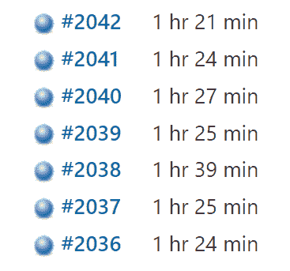

# Java 周刊，第 407 期

> 原文：<https://web.archive.org/web/20220930061024/https://www.baeldung.com/java-weekly-407>

## 1. Spring 和 Java

[**> >更快的 Maven 内置于 Docker**](https://web.archive.org/web/20220524031136/https://blog.frankel.ch/faster-maven-builds/2/)[blog.frankel.ch](https://web.archive.org/web/20220524031136/https://blog.frankel.ch/faster-maven-builds/2/)

更快的 Maven 版本总是好的。尤其是当你有一个回购需要一个半小时来建立🙂

[**> >取一个多对多关联的 DTO**](https://web.archive.org/web/20220524031136/https://thorben-janssen.com/fetching-dtos-with-to-many-association/)【thorben-janssen.com】

DTO 投影绝对是正确的选择，**而不是**，在任何时候，返回实体。所以，学会使用这些是相当有用的。

#### 同样值得一读:

* [**> >甲骨文提出缩短 Java LTS 周期两年**](https://web.archive.org/web/20220524031136/https://www.infoq.com/news/2021/10/oracle-java-two-year-lts/)【infoq.com】
* [**> > JEP 408:简单 Web 服务器**](https://web.archive.org/web/20220524031136/https://openjdk.java.net/jeps/408)【openjdk.java.net】
* [**> >利用 jOOλ的鬼鬼祟祟的投掷来躲避被检查的异常**](https://web.archive.org/web/20220524031136/https://blog.jooq.org/use-joo%ce%bbs-sneaky-throw-to-avoid-checked-exceptions/)【jooq.org】
* [**> > JPA 和 Hibernate 二级缓存**](https://web.archive.org/web/20220524031136/https://vladmihalcea.com/jpa-hibernate-second-level-cache/)【vladmihalcea.com】
* [**> >资源范围依赖**](https://web.archive.org/web/20220524031136/https://inside.java/2021/10/12/panama-scope-dependencies/)【inside.java】

**网络研讨会和演示:**

* [**> >一个精彩的播客:Heiko Scherrer on OpenWMS，Spring，Spring Boot，Spring Data，workflow with Activiti，还有更多**](https://web.archive.org/web/20220524031136/https://spring.io/blog/2021/10/07/a-bootiful-podcast-heiko-scherrer-on-openwms-spring-spring-boot-spring-data-workflow-with-activiti-and-more) [spring.io](https://web.archive.org/web/20220524031136/https://spring.io/blog/2021/10/07/a-bootiful-podcast-heiko-scherrer-on-openwms-spring-spring-boot-spring-data-workflow-with-activiti-and-more)
* [**> >用 IntelliJ 思想学习 Java 17**](https://web.archive.org/web/20220524031136/https://www.youtube.com/watch?v=FP0V98S4l9w)【youtube.com】
* [**> > G1:无限超越**](https://web.archive.org/web/20220524031136/https://inside.java/2021/10/11/p99-g1-to-infinity-and-beyond/)【inside.java】
* [**> >现代的、可扩展的并发 Java 平台**](https://web.archive.org/web/20220524031136/https://inside.java/2021/10/13/devlive-loom/)【inside.java】
* [**> > Spring Tips:Spring GraphQL**](https://web.archive.org/web/20220524031136/https://spring.io/blog/2021/10/06/spring-tips-spring-graphql) [spring.io](https://web.archive.org/web/20220524031136/https://spring.io/blog/2021/10/06/spring-tips-spring-graphql)
* [**> > Spring 提示:Spring 插件**](https://web.archive.org/web/20220524031136/https://spring.io/blog/2021/10/13/spring-tips-spring-plugin) [spring.io](https://web.archive.org/web/20220524031136/https://spring.io/blog/2021/10/13/spring-tips-spring-plugin)

**升级时间:**

* [**> > Mockito 4.0 发布**](https://web.archive.org/web/20220524031136/https://github.com/mockito/mockito/releases/tag/v4.0.0)【github.com】
* [**> > IntelliJ IDEA 2021.3 EAP 4:远程开发，Groovy 4 支持，更多**](https://web.archive.org/web/20220524031136/https://blog.jetbrains.com/idea/2021/10/intellij-idea-2021-3-eap-4/)【blog.jetbrains.com】
* [**> >冬眠 ORM 5.6.0 .最终发布**](https://web.archive.org/web/20220524031136/https://in.relation.to/2021/10/13/hibernate-orm-560-final/)
* [**> > Hibernate ORM 6 . 0 . 0 . beta 1 发布**](https://web.archive.org/web/20220524031136/https://in.relation.to/2021/10/11/orm-600-beta1/)
* [**> > JHipster 发布 v 7 . 3 . 0**](https://web.archive.org/web/20220524031136/https://www.jhipster.tech/2021/10/08/jhipster-release-7.3.0.html)【JHipster.tech】
* [**> >休眠无功 1.0.0.CR10 发布**](https://web.archive.org/web/20220524031136/https://in.relation.to/2021/10/13/hibernate-reactive-1_0_0_CR10/)

## 2. 技术&思考

[**> >在【netflixtechblog.com】**](https://web.archive.org/web/20220524031136/https://netflixtechblog.com/safe-updates-of-client-applications-at-netflix-1d01c71a930c)安全更新网飞的客户端应用

学习网飞如何做事是值得的。当然，你确实需要有一个大的、成熟的项目的背景。

[**> > SRE 不秤**](https://web.archive.org/web/20220524031136/https://bravenewgeek.com/sre-doesnt-scale/)【bravenewgeek.com】

就像我之前关于网飞的笔记一样，这也适用于大型组织，但是不管你的组织规模有多大，这仍然是一篇非常有趣的文章。

**同样值得一读:**

* [**> >媒体类型和内容类型头**](https://web.archive.org/web/20220524031136/https://www.mscharhag.com/api-design/media-types-content-type-header)【mscharhag.com】
* [**> > VPC 如何帮助您的 AWS 网络实现安全性和合规性**](https://web.archive.org/web/20220524031136/https://blog.scottlogic.com/2021/10/11/vpcs-aws.html)【blog.scottlogic.com】
* [**> >测试覆盖陷阱**](https://web.archive.org/web/20220524031136/https://arnoldgalovics.com/the-test-coverage-trap/)【arnoldgalovics.com】
* [**> >介绍集群 API**](https://web.archive.org/web/20220524031136/https://kubernetes.io/blog/2021/10/08/capi-clusterclass-and-managed-topologies/)【kubernetes.io】中的集群类和托管拓扑
* [**> > PayPal 采用 GraphQL:提高开发者生产力**](https://web.archive.org/web/20220524031136/https://www.infoq.com/news/2021/10/paypal-graphql/)【infoq.com】
* [**> >解读 A/B 测试结果:假阳性及统计显著性**](https://web.archive.org/web/20220524031136/https://netflixtechblog.com/interpreting-a-b-test-results-false-positives-and-statistical-significance-c1522d0db27a)【netflixtechblog.com】
* [**> >责任技术手册**](https://web.archive.org/web/20220524031136/https://martinfowler.com/articles/2021-responsible-tech-playbook.html)【martinfowler.com】
* [**> >坎比，一个带状神器探测器**](https://web.archive.org/web/20220524031136/https://netflixtechblog.medium.com/cambi-a-banding-artifact-detector-96777ae12fe2)【netflixtechblog.medium.com】

## 3. 本周精选

本周早些时候，我发出了一封关于 Datadog 的电子邮件，我想在这里强调他们平台的一个很酷的核心方面—**日志记录，以及与 APM 的深度集成**:

**[> >在数据狗](https://web.archive.org/web/20220524031136/https://www.datadoghq.com/dg/logs/benefits/?utm_source=Advertisement&utm_medium=Advertisement&utm_campaign=JavaWeekly-LogsDirectSend)**【datadoghq.com】进行测井和 APM

Next **»**[Java Weekly, Issue 408](/web/20220524031136/https://www.baeldung.com/java-weekly-408)**«** Previous[Java Weekly, Issue 406](/web/20220524031136/https://www.baeldung.com/java-weekly-406)
