# Java 对象优先：基于 BlueJ 的实用入门指南，第 7 版，全球版


**内容制作：** Naina Singh

**产品营销：** Joanne Dieguez

**封面图片：**

对本内容有任何疑问，请联系 [`https://support.pearson.com/getsupport/s/](https://support.pearson.com/getsupport/s/)。

KAO Two

KAO Park

Hockham Way

Harlow, Essex

CM17 9SR

英国

以及全球关联公司

*请访问我们的官方网站：* [`www.pearson.com/uk](https://www.pearson.com/uk)`

**英国图书馆刊书出版数据**

可在英国图书馆查询此本书的目录记录


1. 献给我的妻子 Helen

    1. *djb*

2. 献给 Kerstin

3. *mk*

# 前言

**Java 之父者 James Gosling 著**

看着我的女儿 Kate 在初中用商业 IDE 苦苦学习 Java 课程这种感觉是令人痛苦的。我希望自己能早点理解发生了什么。这正是 BlueJ 的完美用武之处。BlueJ 是一个专为学习中的学生设计的交互式开发环境。在我们使用这本书的教学中，团队协作始终是一个核心元素。我们让学生结对或分组，协作并同时地完成编程作业。这是出于几点原因。其一是 Java 有许多易于教学的特点：它有清晰的定义；编译器的广泛分析能让学生尽早发现问题；它还有一个非常健壮的内存模型，消除了大多数"神秘"错误。另一个是 Java 已经具有了商业上的重要性。本书直面最难教学的概念：对象。它引导学生从第一步开始，一直到一些非常复杂的概念。它成功地解决了编写编程类书籍时最棘手的问题之一：如何处理实际输入和运行程序的机械操作。大多数书籍都无声地跳过这个问题，或者轻描带过，给老师留下了思考如何将书中材料与实际步骤联系起来的负担。相反，本书假设使用 BlueJ，并能够将理解概念的任务与学生探索这些概念的操作机制结合起来。我希望去年女儿就能用上这本书。也许明年。

# 前言

## 第七版的新特性

距离本书上次更新已经有一段时间了。当第六版在 2017 年出版时，Java 8 是最新的 Java 版本，在 Java 中使用 Lambda 或流等函数式构造仍被视为某种新奇。

自那以后，Java 世界发生了巨大变化。编写时的当前版本是 `Java 22`，曾经的新奇构造已成为主流，并随之增加了额外的新的语言机制。

虽然本书已彻底更新以包含所有最新的 Java 语言特性，但语言的变化并不是本书的唯一改进之处。自上版相比，最显著的变化是增加了四个全新的章节。

第 10 章现在引入了*团队协作*。在我们使用这本书的教学中，团队协作始终是一个核心元素。我们让学生结对或分组，协作并同时地完成编程作业。毕竟，本书一直明确关注软件工程，而软件开发是一项团队运动。

本书现在引入了更正式的团队协作的概念和技术。一如既往，这些都得到了 `BlueJ` 的支持，它与分布式源代码仓库系统 `GIT` 深度集成。在第 10 章中，学生将学习如何处理源代码仓库和 `GIT`，这为他们向更专业的实践迈进提供了重要工具。即使你——作为读者——打算独立工作，了解并使用 `GIT` 也具有重要优势，能让你成为更优秀的软件开发者。

在第 11 章中，`recursion`（递归）现在有了专门的讨论章节。递归一直是优秀程序员工具箱中的重要部分，计算机科学中一些著名的算法都依赖于它。我们书早期版本缺少了递归方法，现在我们已经填补了这一空白。一如既往，我们努力使用一个实用的编程项目来自然地展示这些新结构，并提供一个有趣的示例。

第 15 章是一个新章节，其灵感源于 Java 语言近期新增的特性：`records`。record 结构允许编写一种特殊的类——主要作为直接的数据表示的类——这不仅代表了一种新的语言结构，更是一种有趣的概念以及思考建模程序的方式。因此，在单独的章节中进行讨论是合适的。

最后，第 16 章简介绍了 Java 语言的简史。对于对编程历史感兴趣的人，这一章提供了关于我们如何变成当前 Java 版本的故事和背景。

但对我们来说，介绍历史除了对历史本身的兴趣外还有另一个重要目标。通过理解 Java 语言是如何随时间推演的，我们不仅可以理解 Java 是*什么*，还能理解它*为什么*是现在这样。

这个"为什么？"的问题对我们来说非常重要。重要的是让读者在读完本书后，不仅知道 Java，而且对编程和编程语言有通用的理解。作为教师，我们必须意识到，大多数学生在未来的大部分职业生涯中，将不会使用 Java 编程，而是使用一种可能尚未被开发的编程语言。为了帮助我们的学生开启通往成为胜任且热情的程序员的道路，不仅理解编程语言的"是什么"，还要理解其"为什么"至关重要。展示语言如何随时间变化是进行这种讨论的一种引人入胜的方式。

介绍 Java 历史的一个副作用是，这一章还为我们提供了机会，提到我们在书中没有使用的语言结构（通常是因为它们在被新结构取代时已经过时了）。让读者意识到这些结构的存在是有用的，因为即使我们不打算在自己的实现中使用它们，在维护现有代码时也可能会遇到它们。

除了这些新章节外，本版的其他变化贯穿于全文：

*   我们更新了全书的 Java 代码语法，以使用近期 Java 版本引入的结构。这包括 `records` 的使用、新语法的 `switch` 语句、`switch` 表达式和模式匹配 `switch`、若干新的库方法等。

*   本书中使用的 GUI 工具包现在是 `JavaFX`。`JavaFX` 允许我们开发比之前使用的 `Swing` 工具包更现代的界面。它还具有更好的技术支持，例如使用单独的样式表以及可选的外部 GUI 构建器。

*   函数式语言结构，如 `lambdas` 和 `streams` 不再被视为高级内容，而是被贯穿于全书中，并在几个章节中添加了一些新示例。

尽管有了这些变化，书的整体结构、语调和方法保持不变；它们在过去运行得很好，没有理由偏离它们。

本书仍然是面向初学者的面向对象编程入门书。书的重点是从软件工程的角度介绍通用的面向对象编程概念。

虽然前几章是为没有经验的学生编写的，但后面的章节也适合更高级或更专业的程序员。特别是，具有非面向对象语言经验并希望将其技能迁移到面向对象方法的程序员，也能从书中受益。

我们在全书中使用两个工具来使引入的概念付诸实践：Java 编程语言和 Java 开发环境 `BlueJ`。

## Java

选择 Java 是因为它的语言设计和普及性。Java 编程语言本身提供了大多数重要面向对象概念的简洁实现，并很好地作为入门教学语言。它的普及性确保了巨大的支持资源池。

在任何领域，拥有多种信息来源对于教师和学生来说都是非常有帮助的。特别是对于 Java，已经存在无数书籍、教程、练习题、编译器、环境和测验，涵盖了许多不同的类型和风格。其中许多可以在线获取，许多是免费提供的。大量的高质量支持材料使得 Java 成为面向对象编程入门的极佳选择。

既然有这么多 Java 材料，是否还有空间进一步讨论它？我们认为有，而且我们使用的第二个工具就是原因……

## BlueJ

BlueJ 值得提一下。本书的独特之处在于完全集成了 `BlueJ` 环境。

`BlueJ` 是一种由英国伦敦国王学院编程教育工具小组开发和维护的 Java 开发环境，专门作为教学面向对象编程的环境设计的。由于多种原因，它比其他环境更适合入门教学：

*   用户界面简单得多。初学者通常在介绍 20 分钟后就能熟练地使用 `BlueJ` 环境。从那时起，教学可以集中在手头的重要概念——面向对象和 Java 上，而不需要浪费时间讨论环境、文件系统、类路径或 DLL 冲突。

*   该环境支持其他环境不具备的重要教学工具。之一是类可视化。`BlueJ` 会自动显示表示项目中类和关系的类 UML 图。可视化这些重要概念对教师和学生都有很大帮助。当屏幕上只有代码时，很难理解对象的概念！该图法是 UML 的简单子集，根据初学者的需求定制的。这使其易于理解，同时也允许在后续课程中迁移到完整的 UML。

*   `BlueJ` 环境最强大的优势之一是用户能够直接创建任何类的对象，并与它们的方法进行交互。这为对对象进行直接实验提供了机会，且环境的开销极小。学生们几乎可以"感受"到创建对象、调用方法、传递参数或接收返回值的含义。他们可以在方法编写后立即对其进行测试，而无需编写测试驱动程序。这种便利对于理解底层概念和语言细节来说是无与伦比的帮助。

*   BlueJ 还包含了许多其他专为软件开发学生设计的工具和特性。其中一些旨在帮助理解基本概念（例如编辑器中的作用域高亮），另一些则用于引入额外的工具和技术，例如在学生准备就绪后使用 `JUnit` 进行集成测试，或使用诸如 `GIT` 等版本控制系统进行团队协作。这些功能中的几项是 `BlueJ` 环境特有的。

BlueJ 是一个完整的 Java 环境。它不是为了教学而精简、简化的 Java 版本。它运行在 `OpenJDK` Java 开发包之上，并利用了标准的编译器和虚拟机。这确保了它始终符合官方且最新的 Java 规范。

本书的作者拥有多年 `BlueJ` 环境的教学经验（在此之前还有多年未使用该环境的经验）。我们都经历过使用 `BlueJ` 如何增加学生在课程中的参与度、理解力和活动性。其中一位作者还是 `BlueJ` 系统的开发负责人。

## 真实对象优先

选择 `BlueJ` 的原因之一是它允许一种教师真正先处理重要概念的方法。"对象优先"长期以来是许多教科书作者和老师的口号。遗憾的是，Java 语言并没有让这一高尚的目标变得容易实现。在首次体验活生生的对象之前，必须克服语法和细节上的重重障碍。创建一个并调用对象的最简 Java 程序通常包括：

*   编写一个类；

*   编写一个 `main` 方法，包括签名中的 `static` 方法、参数和数组等概念；

*   创建对象的语句（`new`）；

*   对变量进行赋值；

*   变量声明，包括变量类型；

*   使用点号表示法的方法调用；

*   可能还有参数列表。

因此，大多数教科书通常：

*   必须逐步完成这个令人生畏的列表，直到第四章左右才接触到对象；或者

*   使用一个带有单一 `static main` 方法的"Hello, world"风格程序作为第一个示例，从而没有创建任何对象。

有了 `BlueJ`，这并不是问题。学生可以将创建对象并调用其方法作为第一项活动！因为用户可以直接创建并与对象交互，因此在查看第一行 Java 语法之前，类、对象、方法和参数等概念就可以很容易以具体的方式进行讨论。我们不再在此详细解释更多，而是建议好奇的读者参阅第 1 章——到那时一切将很快变得明朗。

## 迭代式方法

本书的另一个重要方面是它遵循了迭代风格。在计算机教育社区领域，存在一种著名的教育设计模式，认为重要概念应该早期且频繁地教授。对于教科书作者来说，在引入某个主题时尝试介绍该主题的所有内容是非常具有吸引力的。例如，在介绍类型时，通常会给出内置数据类型的完整列表，或者在引入循环概念时讨论所有可用的循环。

这两种方法是冲突的：我们无法在集中讨论重要概念的同时，对遇到的所有主题提供全面的覆盖。我们对教科书的经验是，许多细节最初会分散注意力，并产生淹没重点的影响，从而使它们更难以掌握。

在本书中，我们多次提到所有重要主题，无论是在同一个章节内，还是跨越不同章节。概念引入的详细程度通常达到理解和应用当前任务所需的水平。它们在稍后的不同语境下被再次回顾，随着读者继续阅读章节，理解会不断加深。这种方法也有助于处理概念之间频繁发生的相互依赖。

有些老师可能不熟悉迭代方法。查看前几章时，习惯于顺序介绍的老师会对早期涉及的概念之多感到惊讶。这看起来可能像是一条陡峭的学习曲线。

重要的是，这并不是故事的结束。并不要求学生立即理解这些概念的所有内容。相反，这些基本概念将在整本书中反复出现，允许学生随着时间的推移获得更深层次的理解。由于他们的知识水平随着学习的进展而改变，稍后回顾重要主题允许他们获得更深层次的理解。

我们已经多次对学生尝试过这种方法。有时学生在处理这种情况时比一些老老师遇到的问题要少。请记住：只要你确保学生能够爬上去，陡峭的学习曲线就不是问题！

## 项目驱动方法

书中材料的介绍是由项目驱动的。本书讨论了许多编程项目并提供了许多练习。我们不是先介绍一个新语法然后提供一个将该语法应用于任务的练习，而是首先提供一个目标和一个问题。分析手头的问题决定了我们需要什么样的解决方案。因此，语言语法是在解决我们的问题时被引入的。

早期章节提供了至少两个讨论示例。这些是详细讨论的项目，以说明每章的重要概念。使用两个不同的示例支持了迭代方法：每个概念在引入后在不同的语境下被再次回顾。

在设计本书时，我们尝试使用了许多不同的示例项目。这有望捕捉读者的兴趣，并展示概念可以应用的各种不同语境。我们希望我们的项目能为老师提供良好的起点和许多有趣作业的灵感。

我们所有项目的实现代码都编写得非常仔细，以便可以通过阅读项目源码来研究许多边缘问题。我们坚信通过阅读和模仿优秀的示例来学习。然而，为了实现这一点，示例编写良好且值得模仿是非常重要的。我们已经尝试创建了优秀的示例。

本书与其他许多书籍相比的另一个特点是，它是根据基础软件开发任务来构建的，而不一定是根据特定的 Java 语言构造来构建的。这一点的一个标志是章节标题。在本书中，你找不到诸如"基元数据类型"或"控制结构"之类的传统的章节标题。通过基础开发任务进行结构化，我们能够提供一个更通用的介绍，这种介绍不受所使用的特定编程语言复杂性的驱动。我们还认为，学生更容易理解引言部分的意图，这使得阅读过程变得有趣得多。

由于这种方法，将本书作为参考书使用就不那么直接了。入门性教材和参考书具有不同的、部分是相互竞争的目标。在某种程度上，一本书可以尝试兼顾两者，但在某些地方必须做出妥协。我们的书显然被设计为一本教材，每当发生冲突时，教材风格优先于其作为参考书的使用。

然而，我们在每个章节的引言中列出了所介绍的 Java 构造，为作为参考书使用提供了支持。

## 补充材料

**作者网站：** 随本书的作者网站位于 `https://www.bluej.org/objects-first/`

在这里，你可以下载本书中用于讨论示例和练习的所有项目，以及其他资源。该网站还提供了下载 BlueJ 本身的链接。

**面向学生的 Pearson 配套网站：** 本书的所有读者都可以在位于 `www.pearson.com/uk` 的配套网站获取以下资源：

* **VideoNotes：** VideoNotes 是 Pearson 设计的一种视觉化工具，用于教授学生关键编程概念和技术。这些简短的逐步视频演示了如何从设计到编码解决问题。VideoNotes 允许自适应教学，并提供方便的导航，包括在每个 VideoNote 练习中选择、播放、回放、快进和停止的能力。

* 本书中所有示例的程序风格指南

* 感兴趣的进一步材料链接

* 所有项目的完整源代码

VideoNotes 和其他资源嵌入在 Pearson 电子教科书中。

**教师资源：** 以下补充材料仅供合规讲师使用：

* 章节练习题答案

* PowerPoint 幻灯片

访问 `www.pearson.com/uk` 的 Pearson 教师资源中心注册访问，或联系您当地的 Pearson 代表。

## Pearson 电子教科书

Pearson 电子教科书是一种易用的、针对移动优化的个性化阅读体验。它允许学生在一个地方轻松地高亮、笔记、听书和复习词汇——即使在离线状态下也是。通过 Pearson 电子教科书，学生可以创建自己的闪卡或使用预构建的闪卡，通过快速交互的格式回顾关键术语和概念来积极参与自我评估，使学习过程更加高效。翻译功能允许学生在屏幕上用 100 多种语言高亮并翻译文本，减少语言障碍并增强理解。增强搜索功能允许学生快速找到相关内容，包括媒体、图像、关键术语和自己的笔记。

## Blueroom

也许比静态网站资源更重要的是为使用 BlueJ 和本书教学的讲师提供的非常活跃社区论坛。它被称为 `Blueroom`，可以在 `https://blueroom.bluej.org` 找到。

Blueroom 包含一个资源集合，由其他教师共享许多教学资源，以及一个讲师可以在其中提问、讨论问题并关注最新发展的论坛。在 Blueroom 中可以联系许多其他老师，以及 BlueJ 的开发者和本书的作者。

# 本书详细讨论的项目列表

| 项目名称 | 章节 |
| :--- | :--- |
| **Figures (图形)** | 第 1 章 |
| 使用一些几何形状的简单绘制；插图了对象的创建、方法的调用和参数。 |
| **House (房子)** | 第 1 章 |
| 一个使用形状对象画图片的示例；引入了源代码、Java 语法和编译。 |
| **Lab-classes (实验类)** | 第 1, 2, 12 章 |
| 一个带有学生类的简单示例；插图了对象、字段和方法。在第 12 章再次使用以添加继承。 |
| **Ticket-machine (票务机)** | 第 2 章 |
| 火车票自动售票机模拟；引入了更多关于字段、构造函数、访问器和修改器方法、参数以及一些简单的语句。 |
| **Book-exercise (书籍练习)** | 第 2 章 |
| 存储书籍详情。强化了票务机示例中使用的构造。 |
| **Clock-display (时钟显示器)** | 第 3 章 |
| 数字钟显示器的实现；插图了抽象、模块化和对象交互的概念。包含一个带有动画 GUI 的版本。 |
| **Midi player (MIDI 播放器)** | 第 3 章 |
| 使用 midi 音乐系统播放简单旋律的项目。用于演示对象的创建和交互。 |
| **Music-organizer (音乐组织器)** | 第 4, 5, 17 章 |


| 音乐轨道组织器的实现；用于引入集合和循环。包含播放 MP3 文件的功能。第 5 章讨论了使用流的版本，并在第 17 章添加了 GUI。 |

| **Auction (拍卖)** | (第 4 章) |

| 一个拍卖系统。更多关于集合和循环的内容，这次使用了迭代器。 |

| **Club (俱乐部)** | (第 4 章) |

| 一个用于 `ArrayLists` 练习的小型项目。 |

| **Animal-monitoring (动物监控)** | (第 5, 6 章) |

| 一个监控动物种群数量的系统，例如在国家公园内。用于引入集合的功能性处理。 |

| **Tech-support (技术支持)** | (第 6, 18 章) |

| 一个类似 `Eliza` 的对话程序实现，用于向客户提供“技术支持”；引入了通用类和特定类；文档的读写。 |

| **Scribble (涂鸦)** | (第 6 章) |

| 一个用于通过学习类的形状绘制程序。 |

| **Bouncing-balls (蹦球)** | (第 6 章) |

| 蹦球的动画；演示了接口/实现的分离和简单图形。 |

| **Weblog-analyzer (日志分析器)** | (第 7, 18 章) |

| 分析访问日志的程序；引入了数组和 for 循环。 |

| **Automaton (自动机)** | (第 7 章) |

| 细胞自动机示例。用于练习数组编程。 |

| **Brain (大脑)** | (第 7 章) |

| `Brian’s Brain` 的版本，我们用它讨论二维数组。 |

| **World-of-zuul (Zuul 世界)** | (第 8, 11, 13 章) |

| 基于文本的交互冒险游戏。高度可扩展，是一个极好的开放式学生项目。在这里讨论良好的类设计、耦合和内聚。在第 11 章再次使用，使用了路径算法的递归解，并在第 13 章作为继承使用的示例。 |

| **Online-shop (在线商店)** | (第 9 章) |

| 在线购物网站部分实现的早期，处理用户评论；用于讨论测试和调试策略。 |

| **Calculator (计算器)** | (第 9 章) |

| 台式计算器的实现。这个示例强化了之前介绍的概念，并用于讨论测试和调试。 |

| **Bricks (砖块)** | (第 9 章) |

| 一个简单的调试练习；模拟为简单计算填充托盘砖块。 |

| **Recursion-experiments (递归实验)** | (第 11 章) |

| 用于支持首次递归实验的项目。 |

| **File-system (文件系统)** | (第 11 章) |

# 一个报告用户文件系统某些方面的项目。这用于练习递归方法和数据结构。

## 网络（第 12, 13 章）

社交网络应用程序的一部分。该项目在讨论后，并进行了非常详细的扩展，以介绍继承和多态的基础知识。

## 狐狸与兔子（第 14 章）

一个经典的捕食者-猎物者模拟；强化了继承概念，并添加了抽象类和接口。

## 实验（第 15 章）

一个旨在记录科学实验数据的项目。它用于引入记录（records）。

## 图像查看器（第 17 章）

一个简单的图像查看和处理应用程序。我们主要集中在构建 GUI 上。

## 音乐播放器（第 17 章）

在`Chapter 4` 的 `music-organizer` 项目中添加了 GUI，作为构建 GUI 的另一个示例。

## 通讯录（第 18 章）

一个带有可选 GUI 界面的通讯录实现。查询非常灵活：可以通过名称或电话号码的部分定义来搜索条目。该项目大量使用了异常。

## 影院订票系统（第 19 章）

一个用于管理影院提前预订座位的系统。该示例用于关于类发现和应用设计的讨论。没有提供代码，因为该示例代表了从零开始开发应用程序的过程。

## 出租车公司（第 20 章）

出租车示例是预订系统、管理系统和模拟的结合。它被作为一个案例研究，将书中讨论的许多概念和技术结合在一起。

# 致谢

许多人为这个新版本的诞生做出了贡献。首先最重要的是那些帮助 BlueJ 成为今天模样的人。Neil Brown 是 BlueJ 的当前首席开发者，已担任这一职位多年，与 Pierre Weill-Tessier 合作开发并维护该系统。在他之前，许多其他贡献者也帮助开发了 BlueJ。没有他们的工作，BlueJ 永远无法达到如今的质量和受欢迎程度，这本书可能永远无法写成。

另一个让 BlueJ 和这本书诞生成为可能的重要贡献是来自 Oracle 的慷慨支持。Oracle 多年来一直慷慨地支持 BlueJ，我们对这一至关重要的贡献表示非常感谢。

Pearson 团队在本书的方面也做了出色的工作，负责了制作过程和设计，并成功将其引入世界。

David 特别感谢 Lisa Davies，她在肯特大学我们的入门导论编程联合教学中带来了许多新颖的想法。她还是一位半专业音乐家，并慷慨地提供了一些她的原创音乐用于 `music-organizer` 项目，还为书中的很大比例的辅助视频内容录制了旁。肯特大学参加过基于本书的面向对象课程的学生一直以来是教学的荣幸，他们提供了必要的刺激和动力，让教学变得如此有趣。

Michael 感谢 Neil 和 Pierre，他们在构建和维护 BlueJ 以及我们的社区网站方面做了如此优秀的工作。没有这样一支优秀的团队，这一切都无法实现。

# 第 1 章 对象和类

是时候进入并开始我们对面向对象编程的讨论了。学习编程需要一些理论和大量实践的结合。在书中，我们将同时介绍这两者，以便它们相互加强。

面向对象方法的核心有两个我们必须先理解的概念：`objects`（对象）和 `classes`（类）。这些概念构成了面向对象语言中所有编程的基础。所以，让我们从简要讨论这两个基础开始吧。

## 1.1 对象和类

如果你用面向对象的语言编写计算机程序，你就是在你的计算机中创建世界上某部分的 `model`（模型）。构建该模型的部分是出现在问题领域中的 `objects`（对象）。这些对象必须在正在创建的计算机模型中表示。问题领域的对象随你正在编写的程序而异。如果你在编写一个文字处理器，它们可能是单词和段落；如果你在开发社交网络系统，它们可能是用户和消息；如果你在写一个电脑游戏，它们可能是怪物。

对象可以被分类。一个 `class`（类）以抽象的方式描述特定类型的所有对象。

我们可以通过观察一个例子来让这些抽象概念更加清晰。假设你想模拟一个交通模拟。你必须处理的一类实体是汽车。在我们的语境中，汽车是什么？它是一个 `class`（类）还是一个 `object`（对象）？几个问题可能帮助我们做出决定。

汽车是什么颜色的？它能跑多快？它现在在哪里？

你会发现，在我们谈论某辆特定的汽车之前，我们无法回答这些问题。原因在于在这个语境下，“汽车”这个词指的是 `class` 汽车；我们讨论的是泛指的汽车，而不是某辆特定的汽车。

如果我谈到“我停在家里车库里的那辆旧汽车”，我们就可以回答上述问题。那辆车是红色的，跑得不快，它在我的车库里。现在我谈论的是一个 `object`（对象）——汽车的一个特定实例。

我们通常将一个特定的对象称为 `instance`（实例）。从现在起，我们将经常使用“实例”一词。“实例”与“对象”大致同义；当我们想要强调它们属于特定的 `class`（类）时（例如“这个对象是汽车的一个实例”），我们将对象称为实例。在我们继续这个理论讨论之前，让我们来看一个例子。

## 1.2 创建对象

启动 BlueJ 并打开名为 `figures` 的示例。你应该看到一个类似于**图 1.1** 所示的窗口。

### 图 1.1 BlueJ 中的 *figures* 项目

在这个窗口中，一个图应该是可见的。图中每一个彩色矩形都代表我们项目中的一个 `class`（类）。在这个项目中，我们拥有名为 `Circle, Square, Triangle, Person,` 和 `Canvas` 的类。

右键点击 `Circle` 类并在弹出菜单中选择

```
new Circle()
```

系统向你请求一个“实例名称”；点击 OK——默认提供的名称目前足够了。你将在屏幕底部看到标记为“circle1”的红色矩形（**图 1.2**）。

### 图 1.2 对象台上的对象

你刚刚创建了第一个对象！**图 1.1** 中的矩形图标表示类 `Circle`；`circle1` 是从该类创建的对象。屏幕底部显示对象的区域被称为 `object bench`（对象工作台）。

# 1.3: 调用方法

右键点击其中一个圆形对象（而不是类！），你将看到一个包含若干项操作的弹出菜单（**图 1.3**）。从菜单中选择 `makeVisible`——这将在一个单独的窗口中画出该圆的表示图（**图 1.4**）。

### 图 1.3 对象的弹出菜单，列出了它的操作

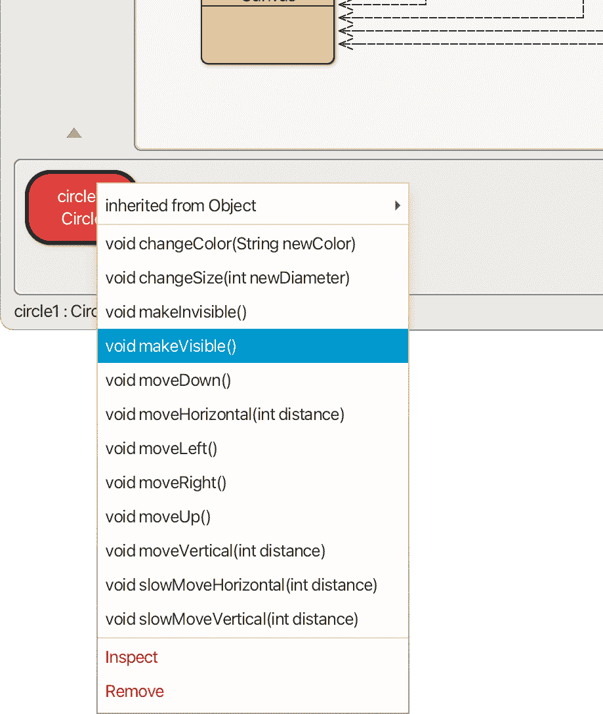

在中间面板中，可以看到一个带有四个指向左侧箭头的框。在中间面板下方，显示了一个带有该对象的矩形框。标题为继承自 `Object` 的下拉菜单包含以下列表：`void changeColor OpenParenthesis String newColor CloseParenthesis`、`void changeSize OpenParenthesis int newDiameter CloseParenthesis`、`void makeInvisible OpenParenthesis CloseParenthesis`、`void makeVisible OpenParenthesis CloseParenthesis`（选中）、`void moveDown OpenParenthesis CloseParenthesis`、`void moveHorizontal OpenParenthesis int distance CloseParenthesis`、`void moveLeft OpenParenthesis CloseParenthesis`、`void moveRight OpenParenthesis CloseParenthesis`、`void moveUp OpenParenthesis CloseParenthesis`、`void moveVertical OpenParenthesis int distance CloseParenthesis`、`void slowMoveHorizontal OpenParenthesis int distance CloseParenthesis` 以及 `void slowMoveVertical OpenParenthesis int distance CloseParenthesis`。下拉列表下方有两个选项 `Inspect` 和 `Remove`。窗口左下角显示文本 `circle1: Circle`。

### 图 1.4 圆的图形

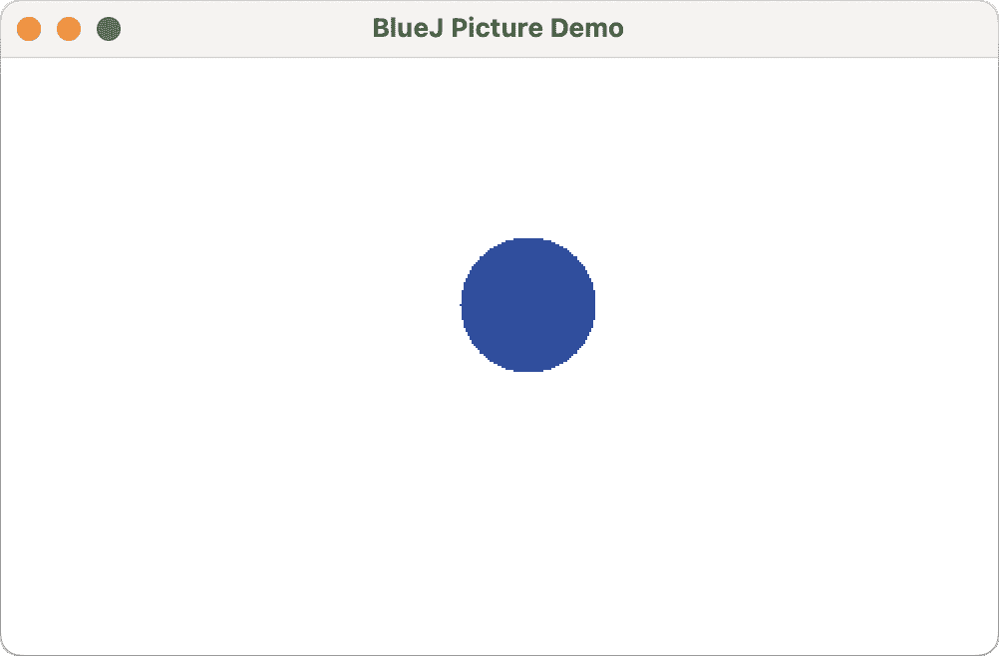

你会在圆的菜单中注意到其他几个操作。尝试调用 `moveRight` 和 `moveDown` 几次，让圆移动到屏幕边缘。你可能也喜欢尝试 `makeInvisible` 和 `makeVisible` 来隐藏和显示圆。

圆菜单中的条目代表你可以用来操作圆的操作。这些在 Java 中被称为 `methods`（方法）。使用通用术语，我们说这些方法被 `called`（调用）或 `invoked`（触发）。从现在起我们将使用这种专业的术语。我们可能会要求你“调用 `circle1` 的 `moveRight` 方法”。

# 1.4: 参数

现在调用 `moveHorizontal` 方法。你会看到出现一个对话框，提示你输入某些内容（**图 1.5**）。输入 50 并点击 OK。你会看到圆向右移动了 50 像素。

### 图 1.5 方法调用对话框

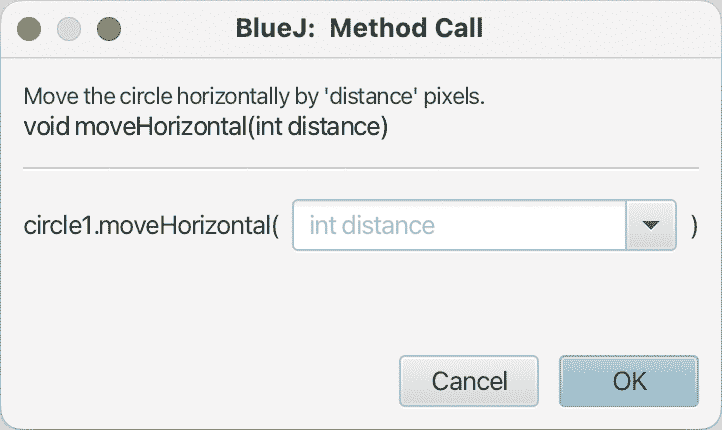

窗口包含以下行：第 1 行：水平方向移动圆 'distance' 像素。第 2 行：`void moveHorizontal OpenParenthesis int distance CloseParenthesis`。第 3 行：`Circle1 dot moveHorizontal OpenParenthesis, 一个显示为 int distance 的禁用下拉框, CloseParenthesis`。右下角有两个按钮 `Cancel` 和 `Ok`。OK 按钮被选中状态。

刚刚调用的 `moveHorizontal` 方法的编写方式使其需要更多信息才能执行。在这种情况下，所需的信息是 `distance`——圆应该移动多远。因此，`moveHorizontal` 方法比 `moveRight` 和 `moveLeft` 方法更灵活。后者总是以固定距离移动圆，而 `moveHorizontal` 则允许你指定想要移动的距离。

某些方法所需的额外值被称为 `parameters`（参数）。方法会指明它需要什么类型的参数。例如，在调用**图 1.5** 所示的 `moveHorizontal` 方法时，对话框显示了顶部的一行：

```
void moveHorizontal(int distance)
```

这被称为方法的 `header`（头部）。头部提供了有关该方法的一些信息。括号内的部分（`int distance`）是关于所需参数的信息。对于每个参数，`int distance` 就是所需参数的信息。

# 1.5: 数据类型

类型指定了可以传递什么类型的数据。在之前的示例中，我们看到的唯一数据类型是 `int`。

Java 支持其他几种数据类型，包括小数和字符。我们现在不会讨论所有类型，而是以后再回到这个问题上。如果你现在想了解它们，请参阅**第 2 章**。

# 1.6: 多个实例

一旦你有了一个类，你就可以随意创建任意数量该类的对象（或实例）。从 `Circle` 类，你可以创建许多圆。从 `Square` 类，你可以创建许多正方形。

这些每个对象都有自己的位置、颜色和大小。你通过调用该对象的方法来更改对象的属性（例如其大小）。这将影响该特定的对象，而不会影响其他对象。

你可能还会注意到参数的额外细节。看看三角形的 `changeSize` 方法。它的头部是

```
void changeSize(int newHeight, int newWidth)
```

该方法有两个参数，在头部用逗号隔开。事实上，方法可以有任意数量的参数。

定义对象的所有属性值（例如圆的 `x` 位置、`y` 位置、颜色、直径和可见性状态）也称为对象的 `state`（状态）。这是我们从今起将使用的常用术语的另一个例子。

在 BlueJ 中，可以通过从对象的弹出菜单选择 `Inspect`（检查）函数来查看对象的状态。当对对象进行检查时，会显示一个 `object inspector`（对象检查器）。对象检查器是对象的放大视图，显示存储在内部的属性（**图 1.6**）。

### 图 1.6 对象检查器，显示对象的详细信息

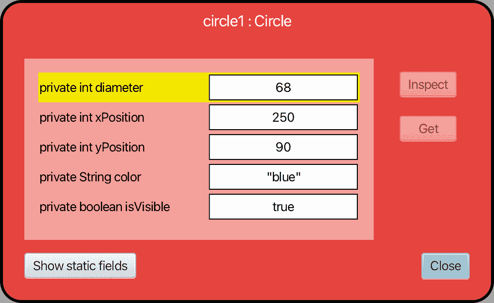

该窗口包含以下细节：第 1 行：文本框内的 `private int diameter`、`68`。第 2 行：文本框内的 `private int xPosition`、`250`。第 3 行：文本框内的 `private int yPosition`、`90`。第 4 行：文本框内的 `private String color`、`"blue"`。第 5 行：文本框内的 `private boolean isVisible`、`true`。这些细节的右侧有两个禁用的按钮 `Inspect` 和 `Get`。底部有两个按钮 `Show static fields` 和 `Close`。选择了 `Close` 按钮。

某些方法在调用时会改变对象的状态。例如，`moveLeft` 会改变 `xPosition` 属性。Java 将这些对象属性称为 *fields*（字段）。

# 1.8：对象中包含什么？

在检查不同的对象时，你会发现`相同`类的对象都具有相同的字段。也就是说，字段的数量、类型和名称是相同的，但每个对象中特定字段的实际值可能不同。相比之下，`不同`类的对象可能具有不同的字段。例如，圆有一个“直径”字段，而三角形有“宽度”和“高度”字段。

原因是字段的数量、类型和名称是在类中定义的，而不是在对象中。因此，`Circle` 类定义每个圆对象将拥有五个字段，命名为 `diameter`、`xPosition`、`yPosition`、`color` 和 `isVisible`。它还定义了这些字段的类型。也就是说，它规定前三个是 `int` 类型，而颜色是 `String` 类型，`isVisible` 标志是 `boolean` 类型。（`boolean` 是可以表示两个值的类型：`true` 和 `false`。我们稍后会详细讨论。）

当创建 `Circle` 类的对象时，该对象将自动拥有这些字段。字段的值存储在对象中。这确保了每个圆都有颜色（例如），每个圆可以有不同的颜色（**图 1.7**）。

### 图 1.7 带有字段和值的类及其对象

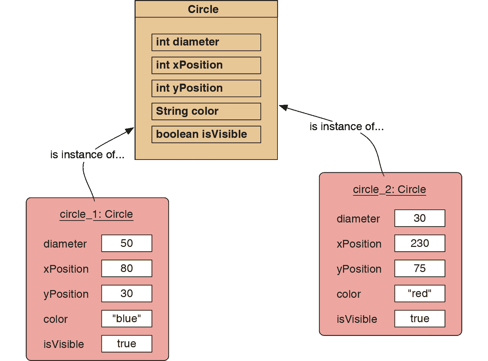


第一个框标题为 `Circle`，内部包含以下垂直排列的内框：`int diameter`、`int xPosition`、`int yPosition`、`String Color` 和 `boolean isVisible`。第二个框标题为 `circle underscore 1: Circle`，包含以下垂直排列的细节：第 1 行：文本框内的 `diameter: 50`。第 2 行：文本框内的 `xPosition: 80`。第 3 行：文本框内的 `yPosition: 30`。第 4 行：文本框内的 `String Color: "blue"`。第 5 行：文本框内的 `boolean isVisible: true`。第三个框标题为 `circle underscore 2: Circle`，包含以下垂直排列的细节：第 1 行：文本框内的 `diameter: 30`。第 2 行：文本框内的 `xPosition: 230`。第 3 行：文本框内的 `yPosition: 75`。第 4 行：文本框内的 `String Color: "red"`。第 5 行：文本框内的 `boolean isVisible: true`。标记为 `is instance of and so on` 的箭头从第二个和第三个框指向第一个框。

方法的情况也类似。方法定义在对象的类中。因此，给定类的所有对象都具有相同的方法。然而，方法是在对象上调用的。这使得在调用例如 `moveRight` 方法时，清楚要更改哪个对象。

### 图 1.8 从一组形状对象创建的两幅图像

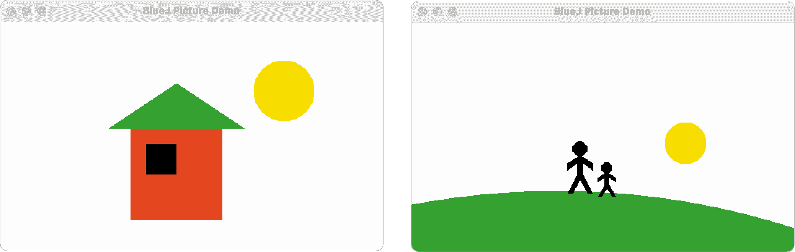

# 1.9：Java 代码

当我们用 Java 编程时，我们本质上是在编写调用对象方法的指令，就像我们在图中所做的那样。

每个类都有与其关联的一些 `source code`。源代码是定义类细节的文本。在 BlueJ 中，可以通过从类的弹出菜单中选择 `Open Editor` 函数，或者通过双击类图标来查看类的源代码。

源代码是用 Java 编程语言编写的文本。它定义了类拥有哪些字段（fields）和方法（methods），以及在调用方法时具体会发生什么。在下一章中，我们将讨论类源代码究竟包含哪些内容，以及它是如何结构的。

学习编程艺术的很大一部分在于学习如何编写这些类定义。为了做到这一点，我们将学习使用 Java 语言（尽管还有许多其他编程语言可以用于编写代码）。

当你对源代码进行更改并关闭编辑器时，该类的图标在图表中会显示为条纹。这些条纹表示源文件已更改。现在需要通过点击 `Compile` 按钮对该类进行编译。（你可能可能喜欢阅读“关于编译（About compilation）”注释以获取更多关于编译类时发生了什么的信息。）一旦类被编译，就可以再次创建对象并尝试你的更改了。

# 1.12: 另一个示例

在本章中，我们已经讨论了许多新概念。为了帮助理解这些概念，我们现在将在不同的语境下重新复习它们。为此，我们使用另一个示例。如果你还打开着 `house` 项目，请关闭它，并打开 `lab-classes` 项目。

该项目是一个学生数据库的简化，用于跟踪实验室课程的学生并打印课程名单。

# 1.13: 返回值

和以前一样，你可以创建多个对象。同样，和以前一样，对象拥有你可以从它们的弹出菜单中调用的方法。

在调用 `Student` 类的 `getName` 方法时，我们发现了一些新东西：方法可能会返回一个结果值。事实上，每个方法的头部都会告诉我们是否返回结果，以及结果的类型是什么。`getName` 的头部（如对象的弹出菜单所示）定义为

```
String getName()
```

方法名之前的单词 `String` 指定了返回类型。在这种情况下，它表示调用此方法将返回类型为 `String` 的结果。`changeName` 的头部规定：

```
void changeName(String replacementName)
```

单词 `void` 表示该方法不返回任何结果。

带有返回值的方法使我们能够通过方法调用从对象获取信息。这意味着我们可以使用方法来更改对象的状态，或者查询它的状态。方法的返回类型不是其签名（signature）的一部分。

# 1.14: 作为参数的对象

### 图 1.9 为 LabClass 添加学生

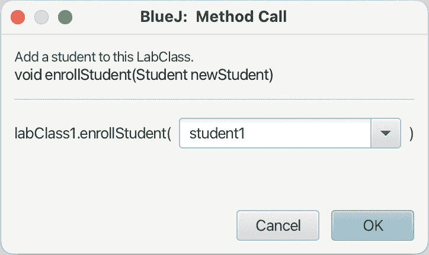

该窗口具有以下细节：第 1 行：向此 `LabClass` 添加学生。第 2 行：`void enrollStudent OpenParenthesis Student newStudent CloseParenthesis`。第 3 行：`labClass1 dot enrollStudent OpenParenthesis` 以及一个显示 `student1` 的框。右下角有两个 `Cancel` 和 `OK` 按钮。选择了 `OK` 按钮。

### 图 1.10 LabClass 类列出的输出

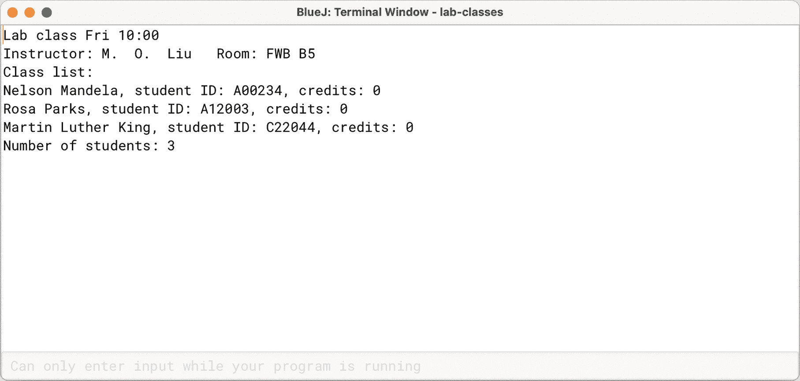

该窗口在左上角有三个彩色圆。标题显示在顶部中间。窗口显示的输出共有七行如下：

第 1 行：`Lab class Fri 10:00`。

第 2 行：`Instructor: M. Liu Room: F W B B 5`。

第 3 行：`Class list:`。

第 4 行：`Nelson Mandela, student I D: A 0 0 2 3 4, credits: 0`。

第 5 行：`Rosa Parks, student I D: A 1 2 0 0 3, credits: 0`。

第 6 行：`Martin Luther King, student I D: C 2 2 0 4 4, credits: 0`。

第 7 行：`Number of students: 3`。

如练习所示，对象可以作为参数传递给其他对象。当方法期望一个对象作为参数时，预期的对象类名被指定为参数类型并在方法签名中体现。

进一步探索此项目。尝试识别 `figures` 示例中讨论的概念。

# 1.15: 总结

在本章中，我们已经讨论了许多新概念。为了帮助理解这些概念，我们现在将在不同的语境下重新复习它们。为此，我们使用另一个示例。如果你还打开着 `house` 项目，请关闭它，并打开 `lab-classes` 项目。

该项目是一个学生数据库的简化，用于跟踪实验室课程的学生并打印课程名单。

和以前一样，你可以创建多个对象。同样，和以前一样，对象拥有你可以从它们的弹出菜单中调用的方法。

在调用 `Student` 类的 `getName` 方法时，我们发现了一些新东西：方法可能会返回一个结果值。事实上，每个方法的头部都会告诉我们是否返回结果，以及结果的类型是什么。`getName` 的头部（如对象的弹出菜单所示）定义为

```
String getName()
```

方法名之前的单词 `String` 指定了返回类型。在这种情况下，它表示调用此方法将返回类型为 `String` 的结果。`changeName` 的头部规定：

```
void changeName(String replacementName)
```

单词 `void` 表示该方法不返回任何结果。

带有返回值的方法使我们能够通过方法调用从对象获取信息。这意味着我们可以使用方法来更改对象的状态，或者查询它的状态。方法的返回类型不是其签名的一部分。

如练习所示，对象可以作为参数传递给其他对象。当方法期望一个对象作为参数时，预期的对象类名被指定为参数类型并在方法签名中体现。

进一步探索此项目。尝试识别 `figures` 示例中讨论的概念。

我们的售票机通过接收客户提供的货币来工作，客户随后请求打印票务。我们不需要担心具体的支付机制，因为它可以可能是物理的也可能是电子的，而且这些细节与我们讨论的主题无关。每台机器都会记录其运行期间收集的金额总额。在现实生活中，售票机通常会提供不同类型和价格的票务，客户从中选择他们想要的。我们简化的机器只打印单一价格的票务，但通过面向对象的编程，可以很容易地创建 `class` 的多个实例，每个实例都有自己的价格设置，这样当我们需要时，就可以满足对不同价格票务的需求。

## 2.1.1 探索简易售票机的行为

在 BlueJ 中打开 `naive-ticket-machine` 项目。该项目仅包含一个类——`TicketMachine`——你将能够类似于我们在第 1 章中讨论过的示例来探索它。当你创建一个 `TicketMachine` 实例时，会要求你提供一个数字，对应该特定机器将发出的票务价格。价格以分值为单位，因此像 500 这样的正整数是一个适用的数值值。

## 2.2 检查类定义

上一节末尾的练习表明，只有当我们插入与票务价格完全匹配的金额时，`TicketMachine` 对象的行为才符合我们的预期。在我们在本节中探索 `class` 的内部细节时，我们将看到为什么会这样。

通过双击 BlueJ 中类图的 `TicketMachine` 图标，查看该类的源代码。它看起来应该像图 2.1 所示。

### 图 2.1 BlueJ 编辑窗口

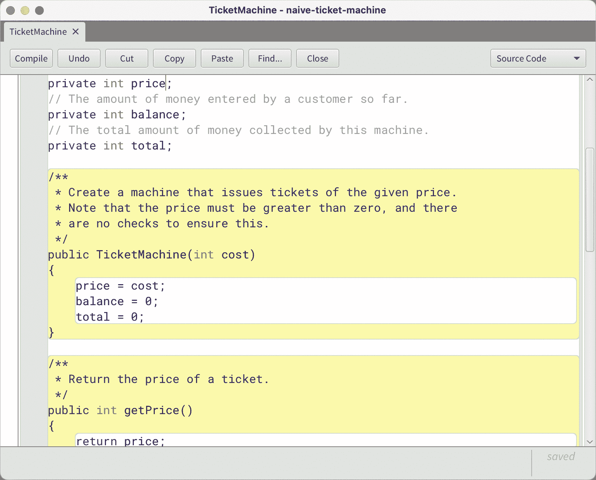

该窗口左上角有三个颜色的圆。标题位于顶部中间部分。打开了一个名为 `TicketMachine` 的标签页，顶部显示以下菜单选项：编译（`Compile`）、撤销（`Undo`）、剪切（`Cut`）、拷贝（`Copy`）、粘贴（`Paste`）、查找（`Find`）和关闭（`Close`）。右上部分有一个下拉菜单“Source code”。代码有 24 行。

第 1 行 `private int price;`

第 2 行 `// 客户目前投入的金额。`

第 3 行 `private int balance;`

第 4 行 `// 这台机器收集的总金额。`

第 5 行 `private int total;`

第 6 行 空格。

第 7 行 `/**`

第 8 行缩进层 1，`* 创建一个发行给定价格票务的机器。`

第 9 行缩进层 1，`* 注意价格必须大于零，且没有`

第 10 行缩进层 1，`* 确保此点的检查。`

第 11 行缩进层 1，`*/`

第 12 行 `public TicketMachine(int cost)`

第 13 行 `{`

第 14 行缩进层 2，`price = cost;`

第 15 行缩进层 2，`balance = 0;`

第 16 行缩进层 2，`total = 0;`

第 17 行 `}`

第 18 行 空格。

第 19 行 `/**`

第 20 行缩进层 1，`* 返回票务的价格。`

第 21 行缩进层 1，`*/`

第 22 行 `public int getPrice()`

第 23 行 `{`

第 24 行缩进层 2，`return price;`

在窗口右下角显示了保存的文本。

`class` 的完整文本在代码 2.1 中。通过逐条查看 `class` 定义的文本，我们可以充实我们在第 1 章中讨论过的某些面向对象概念。这个 `class` 定义包含了许多我们将反复看到的 Java 特性，因此仔细研究它将非常有益。

### 代码 2.1 TicketMachine 类

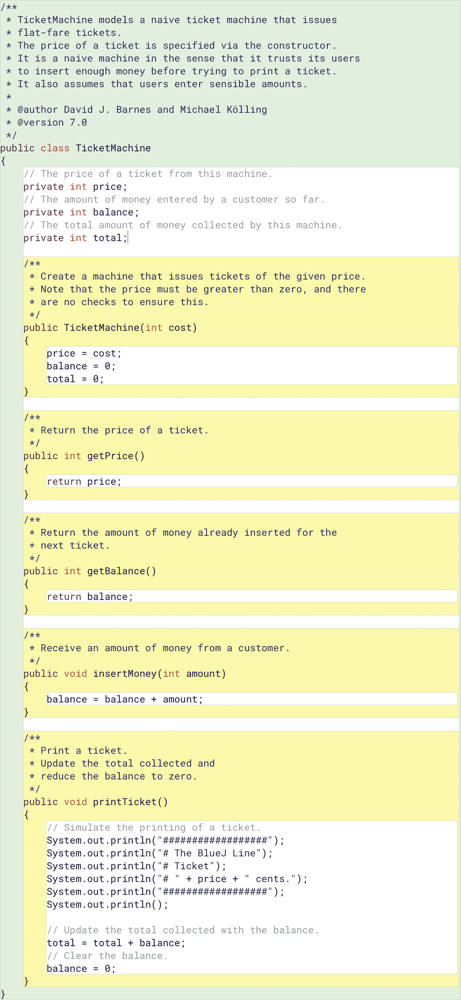

代码行如下。

第 1 行 `/**`

第 2 行缩进层 1，`* TicketMachine 模拟了一个发行`

第 3 行缩进层 1，`* 固定价格票务的简易售票机。`

第 4 行缩进层 1，`* 票务的价格通过构造函数指定。`

第 5 行缩进层 1，`* 它的简易之处在于信任用户`

第 6 行缩进层 1，`* 在打印票前投入足够的金额。`

第 7 行缩进层 1，`* 它还假设金额是合理的。`

第 8 行缩进层 1，`* 作者 David Barnes 和 Michael Köling`

第 9 行缩进层 1，`* 版本 7.0`

第 10 行 `*/`

第 11 行 `public class TicketMachine`

第 12 行 `{`

第 13 行 `// 票务的价格。`

第 14 行 `private int price;`

第 15 行 `// 客户目前投入的金额。`

第 16 行 `private int balance;`

第 17 行 `// 这台机器收集的总金额。`

第 18 行 `private int total;`

第 19 行 空格。

第 20 行 `/**`

第 21 行 `* 创建一个发行给定价格票务的机器。`

第 22 行 `* 注意价格必须大于零，且没有`

第 23 行 `* 确保此点的检查。`

第 24 行 `*/`

第 25 行 `public TicketMachine(int cost)`

第 26 行 `{`

第 27 行 `price = cost;`

第 28 行 `balance = 0;`

第 29 行 `total = 0;`

第 30 行 `}`

第 31 行 空格。

第 32 行 `/**`

第 33 行 `* 返回票务的价格。`

第 34 行 `*/`

第 35 行 `public int getPrice()`

第 36 行 `{`

第 37 行 `return price;`

第 38 行 `}`

第 39 行 空格。

第 40 行 `/**`

第 41 行 `* 返回为下一张票已投入的`

第 42 行 `* 金额。`

第 43 行 `*/`

第 44 行 `public int getBalance()`

第 45 行 `{`

第 46 行 `return balance;`

第 47 行 `}`

第 48 行 空格。

第 49 行 `/**`

第 50 行 `* 从客户处接收一个金额。`

第 51 行 `*/`

第 52 行 `public void insertMoney(int amount)`

第 53 行 `{`

第 54 行 `balance = balance + amount;`

第 55 行 `}`

第 56 行 `}`

第 58 行：缩进层 2，`/**`

第 59 行：缩进层 3，`* 打印票据。`

第 60 行：缩进层 3，`* 更新收集的总金额并`

第 61 行：缩进层 3，`* 将余额清零。`

第 62 行：缩进层 3，`*/`

第 63 行：缩进层 2，`public void printTicket()`

第 64 行：缩进层 2，`{`

第 65 行：缩进层 4，`// 模拟打印票据。`

第 66 行：缩进层 4，`System.out.println("##################");`

第 67 行：缩进层 4，`System.out.println("# The BlueJ Line");`

第 68 行：缩进层 4，`System.out.println("# Ticket");`

第 69 行：缩进层 4，`System.out.println("# " + price + " cents.");`

第 70 行：缩进层 4，`System.out.println("##################");`

第 71 行：缩进层 4，`System.out.println();`

第 72 行：空白

第 73 行：缩进层 4，`// 用余额更新收集的总金额。`

第 74 行：缩进层 4，`total = total + balance;`

第 75 行：缩进层 4，`// 清余额。`

第 76 行：缩进层 4，`balance = 0;`

第 77 行：缩进层 2，`}`

第 78 行：`}`

# 2.3: 类头

类的文本可以分为两个主要部分：一个较小的外层包装，仅用于命名类（显示在绿色背景上），以及一个执行所有工作的大得内部部分。在这种情况下，外层包装如下：

```java
public class TicketMachine
{
    Inner part of the class omitted.
}
```


不同类的外层包装看起来非常相似。外层包装包含类头，其主要目的是为类提供一个名称。根据一种广泛遵循的约定，我们总是以大写字母开始类名。如果使用一致，这种约定允许类名与其他类型的名称区分开来，例如变量名和方法名，这些将在稍后描述。在类头上方是一条注释（显示为蓝色文本），告诉我们关于该类的一些信息。

## 2.3.1: 关键字

`public` 和 `class`获取是 Java 语言的一部分，而 `TicketMachine` 并不是——编写类的人选择了那个特定的名称。我们称像 `public` 和 `class` 这样的词为**关键字**（keywords）或**保留字**（reserved words）——术语频繁且互换使用。Java 中大约有 50 个这样的词，你很快就能识别出大部分。一个值得记住的点是，Java 关键字永远不包含大写字母，而我们自己选择的词（如 `TicketMachine`）通常是大写和小写字母的混合。

## 2.4: 字段、构造函数和方法

类的内部部分是用来定义**字段**（fields）、**构造函数**（constructors）和**方法**（methods）的地方，它们赋予该类对象特定的特征和行为。我们可以将类的这三个组件的核心特征总结如下：

- 字段在对象内部**持久地**存储数据。
- 构造函数负责确保对象在首次创建时被正确设置。
- 方法实现对象的行为；它们提供了对象的功能。

在 BlueJ 中，字段显示为白色背景上的文本，而构造函数和方法则显示为黄色方框。

在 Java 中，关于在类内部定义字段、构造函数和方法的顺序，规则很少。在 `TicketMachine` 类中，我们选择了先列出字段，然后是构造函数，最后是方法（**代码 2.2**）。这是我们在所有示例中将遵循的顺序。其他作者选择采用不同的风格，这很大程度上是一个偏好问题。我们的风格并不比其他所有风格好，但选择一种风格并保持一致使用它是重要的，因为这会让你的类更容易于阅读和理解。

### 代码 2.2 我们对字段、构造函数和方法的排序


代码行如下：

第 1 行：`public class ClassName`

第 2 行：左大括号

第 3 行：缩进层 1，字段

第 4 行：缩进层 1，构造函数

第 5 行：缩进层 1，方法

第 6 行：右大括号

## 2.4.1: 字段

字段在对象内部**持久地**存储数据。这意味着在创建对象时，字段会被赋予初始值，然后它们在对象的整个生命周期内维护这些数据。初始值以后可以被更改，但只要对象继续存在，字段永远不会消失。结果是字段是对象的重要部分。

`TicketMachine` 类有三个字段：`price`、`balance` 和 `total`。字段也被称为**实例变量**（instance variables），因为对象也被称为**实例**（instance），而 `variable` 一词被多种用作存储数据的通用术语。我们在类的开头定义了这些字段（**代码 2.3**）：

- `price` 存储票的固定价格；
- `balance` 存储用户在请求票之前投入机器的金额；
- `total` 存储自机器构造以来所有用户支付的总金额（不包括当前余额）。设计思想是，当打印票时，余额中的金额会加到总金额中。

### 代码 2.3 TicketMachine 类的字段

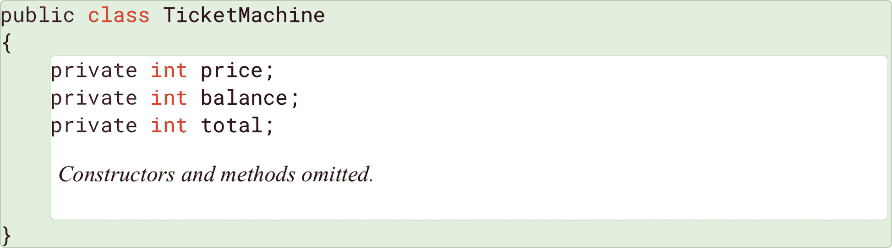

代码行如下：

第 1 行：`public class TicketMachine`

第 2 行：左大括号

第 3 行：`private int price;`

第 4 行：`private int balance;`

第 5 行：`private int total;`

第 6 行：空白

第 7 行：缩进层 2，省略了构造函数和方法。

第 8 行：空白

第 9 行：右大括号

`price` 和 `total` 字段不同的角色提供了一个很好的对比，有助于我们思考字段的本质。`price` 字段的值在 `ticketMachine` 对象创建时就会被设置，之后其值不再改变。相反，`total` 字段在 `ticketMachine` 对象创建时被设置为零，但随着投入的投入票据的打印，它的值会不断增加。然而，这两个字段的共同点是它们在所属对象的整个生命周期内都需要存在，因为 `ticketMachine` 对象执行任务持续需要这些值。

字段是对象内部的微小空间。每个对象都会为其类中声明的每个字段留出空间。`图 2.2` 显示了一个带有三个字段的票机对象的图示表示。这些字段尚未被分配任何值；一旦分配了，我们就可以将每个值写入代表字段的框中。这种表示法与 BlueJ 中显示对象台（object bench）上的对象类似，只不过我们在这里展示了更多的细节。在 BlueJ 中，由于空间原因，字段没有显示在对象图标上。然而，我们可以通过打开检查窗口（第 1.7 节）来查看它们。

每个字段在源代码中都有其自己的声明。在完整类定义中每个字段的上方行，我们添加了单行文本——一条*注释*——以供人类读者阅读该类定义：

```
// 这台机器的票票价格。
private int price;
```

单行注释由两个字符 `//` 引入，它们之间之间没有空格。更详细的注释（通常跨越几行）通常以多行注释的形式编写。它们以字符对 `/*` 开始，并以字符对 `*/` 结束。在`代码 2.1` 的类头部之前有一个很好的例子。

这三个字段的定义非常相似：

- 所有定义都表明它们是对象的 `private`（私有）字段；关于这意味着什么，我们将在第 6 章中进行详细说明，但目前我们只需简单说字段总是被定义为私有的。
- 所有三个字段的类型都是 `int`。`int` 是另一个关键字，代表整数数据类型。这表示每个字段都可以存储一个整数值，考虑到我们希望它们存储代表分单位货币金额的数字，这是合理的。

字段可以存储随时间变化的值，因此它们也被称为*变量*。如果需要，存储在字段中的值可以从其初始值更改。例如，随着越来越多的钱投入票机，我们将会希望更改存储在 `balance` 字段中的值。某些字段的值经常变化（如 `balance` 和 `total`），而另一些字段的值则很少变化或完全不变化（如 `price`），这是很常见的。尽管 `price` 的值一旦设置就不会改变，但这并并不改变它仍然被称为“变量”的事实。^(5) 在接下来的章节中，除了字段之外还会遇到其他类型的变量，但它们都具有存储数据的相同基本目的。

`price`、`balance` 和 `total` 字段都是票机对象为了完成从客户处收钱、打印票以及记录所有已支付金额总和这一角色所需的数据项。在接下来的章节中，我们将看到构造函数和方法如何使用这些字段来实现简单票机的行为。

从我们目前看到的字段定义中，我们可以开始总结出一个模式，这个模式在我们定义任何字段时都适用：

- 它们通常以保留字 `private` 开始。
- 它们包含一个类型名称（如 `int`、`String`、`Person` 等）。
- 它们包含一个用户选择的变量名称。
- 它们以分号结束。

记住这个模式将对你编写自己的类时非常有帮助。

当我们仔细观察不同类的源代码时，你会看到其他类似的源代码模式反复出现。学习编程的过程之一就是寻找此类模式，并在你自己的程序中使用它们。这就是为什么在现阶段详细研究源代码是非常有用的原因之一。

## 2.4.2：构造函数

构造函数需要履行一个特殊的角色。它们负责确保对象在首次创建时被正确设置；换句话说，确保确保对象在创建后立即就可以可以使用。这种构建过程也被称为*初始化*。一旦对象被创建，`constructor` 在该对象的生命周期中不再扮演任何角色，并且无法再次调用。`代码 2.4` 显示了 `TicketMachine` 类的构造函数。

### 代码 2.4：TicketMachine 的构造函数


代码行如下：

第 1 行：`public class TicketMachine`

第 2 行：`{`

第 3 行：

第 4 行：`    private int price;`

第 5 行：

第 6 行：`    private int balance;`

第 7 行：

第 8 行：`    private int total;`

第 9 行：

第 10 行：`    public TicketMachine(int cost)`

第 11 行：`    {`

第 12 行：`        price = cost;`

第 13 行：`        balance = 0;`

第 14 行：`        total = 0;`

第 15 行：`    }`

第 16 行：`}`

构造函数的一个显著特征是它们与其定义的类同名——在本例中为 `TicketMachine`。构造函数的名称紧跟在 `public` 之后，中间没有内容。^(6)

我们应该构造函数体与类字段之间存在紧密的联系。这是因为构造函数的主要作用之一就是初始化字段。对于某些字段（如 `balance` 和 `total`），可以通过赋值一个常数（在本例中为 0）来设置合理的初始值。而对于其他字段（如票价），情况就不那么简单，因为在构造特定机器之前，我们并不知道该机器的票价是多少。当你在 BlueJ 中尝试创建 `TicketMachine` 对象时，你会发现每当创建一个新的票机时，都必须提供票务的成本。这里需要注意的一个重要点是，票价最初是在*外部*决定的，然后被*传递给*构造函数的。在 BlueJ 内部，你决定该值并将其输入对话框。构造函数的任务之一就是接收该值并将其存储在新创建的票机的 `price` 字段中，这样机器就能记住那个值是多少，而不需要你不断地提醒它。

我们可以从这一点看到，字段的一个作用是记住传入对象的外部信息，以便该信息在整个对象的整个生命周期内对对象都是可用的——这与字段的持久特性是致合的。

**图 2.3** 显示了构造函数执行后的 `ticketMachine` 对象。值现在已经被赋值给字段。从该图中，我们可以看出售票务机是通过传入 500 作为票价的值来创建的。

### 图 2.3 初始化后的 TicketMachine 对象（为 500 分的票据创建）


在接下来的节中，我们将讨论对象如何从外部接收值。

## 2.5: 参数：接收数据

构造函数和方法在对象的生命周期中扮演着截然不同的角色，但它们从外部接收值的方式是相同的：即通过*参数*（parameters）。你可能记得我们在第 1 章（第 1.4 节）简要遇到过参数。参数是另一种变量，就像字段一样，它们也被用于存储数据。参数是定义在构造函数或方法头部的变量：

```
public TicketMachine(int cost)
```

此构造函数有一个参数 `cost`，其类型为 `int`——这与它将要用于设置的 `price` 字段类型相同。参数被用作一种临时信使，携带源自构造函数或方法外部的数据，并使其在内部可用。

**图 2.4** 释了如何通过参数接收值。在这种情况下，BlueJ 用户在创建新的售票机时（如左所示）在对话框中输入外部值，然后该值被复制到新机器构造函数的 `cost` 参数中。这通过标记为 (A) 的箭头所示。**图 2.4** 中 `TicketMachine` 对象中标记为“TicketMachine (constructor)”的框代表了仅在构造函数执行时才创建的对象的额外空间。我们将其称为对象的*构造空间*（constructor space）（或者当我们谈论方法而不是构造函数时，称为*方法空间*，因为情况是一样的）。构造空间用于提供存储构造函数参数值的空间。在我们的图中，所有变量都用白框表示。

### 图 2.4 参数传递 (A) 和赋值 (B)

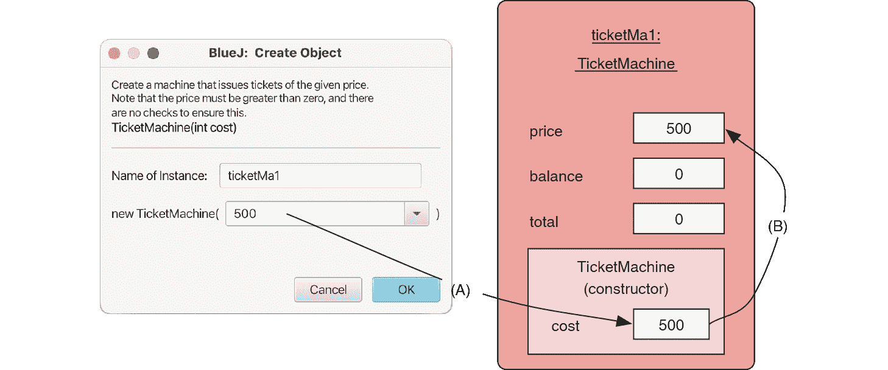

对话框的左上角有三个彩色圆圈。标题位于顶部中间部分。窗口具有以下细节：创建一个发行给定价格票据的机器。注意，价格必须大于零，且没有检查来确保这一点。`TicketMachine(int cost)`。实例名称：一个文本框显示为 `ticketMa1`；`new TicketMachine()`，一个选了 500 的下拉菜单。右下角有两个按钮 Cancel 和 Ok。选中了 OK 按钮。标题为 `ticketMa1: TicketMachine` 的框具有以下细节：文本框内 `price: 500`；文本框内 `balance: 0`；文本框内 `total: 0`。底部的矩形块写着 `TicketMachine (constructor)`，文本框内 `cost: 500`。标记为 (A) 的箭头从窗口中的 500 指向标题为 `ticketMa1: TicketMachine` 的框底部矩形块中的 500，标记为 (B) 的箭头从框底部矩形块中的 500 指向框顶部的 `price: 500`。

我们通过将构造函数或方法内部的参数*名称*（names）与从外部接收的*值*（values）区分开来，将这些名称称为*参数*（parameters），将外部值称为*实参*（arguments）。因此，`cost` 是一个参数，而用户提供的值（如 500）是一个实参。所以，我们可以说实参值被传递到构造函数或方法并在构造函数或方法的参数中接收。

参数仅在声明它的构造函数或方法体内部对对象可用。我们说参数的*作用范围*（scope）被限制在声明它的构造函数或方法体内。相比之下，字段的作用范围是整个类定义——它可以从同一类的任何地方访问。这是这两种变量之间一个非常重要的区别。

与变量作用范围相关的概念是变量的*生命周期*（lifetime）。参数的生命周期限于构造函数或方法的单次调用。一旦该调用完成，参数就会丢失。相比之下，字段的生命周期与它所属的对象周期相同。

## 2.5.1: 选择变量名

你从目前为止看到的代码中可能注意到的点之一是，我们为字段和参数选择的变量名与这些变量的目的有紧密的联系。像 `price`、`cost`、`title` 和 `alive` 这样的名称都告诉我们关于存储在该变量中的信息的有用信息。这使得更容易理解程序中发生什么。鉴于我们在选择变量名时有很大的自由度，选择能够传达目的的名称而不是字母和数字的任意且无意义的组合总是值得的。

## 2.6: 赋值

在上一节中，我们注意到需要将参数变量中持有的短命值复制到某个持久的地方——字段变量中。为了做到这一点，构造函数体包含以下*赋值语句*（assignment statement）：

```
price = cost;
```

赋值语句是将值存储到变量的方法。可以通过如上例所示赋值运算符 `=` 的存在来识别。注意，赋值符号看起来像数学中使用的“等于”符号，但在编程中的用法完全不同，这两个概念不能混淆。赋值语句的工作原理是获取赋值运算符右侧的值，并将该值复制到左侧的变量中。这在**图 2.4** 中通过标记为 (B) 的箭头所示。右侧被称为*表达式*（expression）。在最一般的形式，表达式是计算值的实体，但在这种情况下，表达式仅由单个变量组成，其值随后被复制到 `price` 变量中。我们在本章后面看到更复杂表达式的示例。

赋值语句的一条规则是：右侧表达式的类型必须与其被赋值的变量的类型匹配。我们已经遇到过三种不同的常用类型：`int`、`String` 和（非常简短地）`boolean`。这条规则意味着，例如，不允许在 `String` 类型的变量中存储 `int` 类型的表达式。这条规则同样适用于参数与其对应的实参值：实参值的类型必须与参数变量的类型匹配。

## 2.7: 方法

`TicketMachine` 类有四个方法：`getPrice`、`getBalance`、`insertMoney` 和 `printTicket`。你可以在类的源代码（代码 2.1）中看到它们，显示为黄色框。我们将通过考虑 `getPrice`（代码 2.5）来开始研究方法的源码。

### 代码 2.5 getPrice 方法

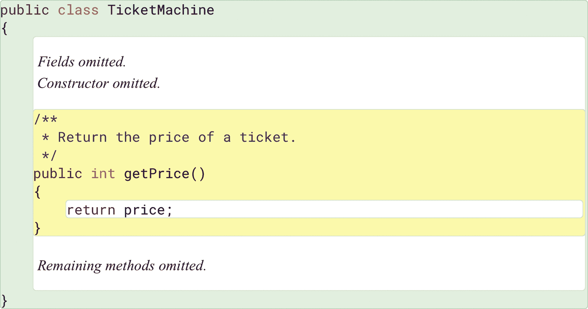

代码行如下：

第 1 行：`public class TicketMachine`

第 2 行：`{`

第 3 行：空行

第 4 行：缩进级别 1，省略字段。

第 5 行：缩进级别 1，省略构造函数。

第 6 行：空行

第 7 行：缩进级别 1，`/**`

第 8 行：缩进级别 2，`* Return the price of a ticket.`

第 9 行：缩进级别 2，`*/`

第 10 行：缩进级别 1，`public int getPrice()`


第 11 行：缩进级别 1，`OpenCurlyBracket`

第 12 行：缩进级别 3，`return price semicolon`

第 13 行：缩进级别 1，`CloseCurlyBracket`

第 14 行：空行

第 15 行：缩进级别 1，省略剩余方法。

第 16 行：空行

第 17 行：`CloseCurlyBracket`

方法包含两个部分：*头部*（header）和*方法体*（body）。这里是 `getPrice` 方法头部，前面是一个描述性注释：

```java
/**
 *  Return the price of a ticket.
 */
public int getPrice()
```

区分方法头部和字段声明是非常重要的，因为它们看起来非常相似。我们可以判断 `getPrice` 是一个方法而不是字段，因为方法头部总是包含一对括号——“`(`”和“`)`”——并且在头部结尾没有分号。

方法体是方法头部之后的剩余部分。它始终被一对匹配的大括号包围：“`{`”和“`}`”。方法体包含了*声明*（declarations）和*语句*（statements），它们定义了对象在方法被调用时所执行的操作。声明用于创建额外的、临时变量空间，而语句描述了方法的行为。在 `getPrice` 中，方法体包含一条语句，但在本章稍后的部分，我们将看到方法体由几行代码以及声明和语句组成的示例。

在一对匹配的大括号之间的任何声明和语句集合被称为*块*（block）。`TicketMachine` 类的体、构造函数体以及类内所有方法的体都是块，因为它们都被一对大括号所包围。

`TicketMachine` 构造函数头部与 `getPrice` 方法头部之间至少存在两个显著区别：

```java
public TicketMachine(int cost)
public int getPrice()
```

*   该方法有一个 `int` 类型的*返回类型*；构造函数没有返回类型。返回类型写在方法名之前。这是一个适用于所有情况的区别。

*   构造函数有一个参数 `cost`，但方法没有参数——只有一对空括号。这是一个适用于此特定情况的区别。

在 Java 中，有一条绝对规则：构造函数不能有返回类型。相反，构造函数和方法都可以有任意数量的参数，包括没有参数。

在 `getPrice` 的体内部有一条语句：

```java
return price;
```

这被称为*返回语句*（return statement）。它负责返回一个整数值，以匹配方法头部中的 `int` 返回类型。在方法包含返回语句的地方，它是该方法的最后一条语句，因为一旦执行了返回语句，方法中的后续语句将不再被执行。

`getPrice` 方法是所谓的“get 器”（getters）这种方法的典型形式，其名称也因此而选择。调用 get 器方法是为了“获取”对象某个字段的值。因此，它们有一个返回语句来返回该值，并有类型与返回值类型匹配的返回类型——即字段的类型。

返回类型和返回语句共同工作。`getPrice` 的 `int` 返回类型是一种承诺，保证方法体将执行某些操作，最终返回一个整数值作为方法的结果。在这里，与典型的 get 器方法一样，不需要对值进行计算，因为方法的调用者只是想获取 `price` 字段的值，而这个值无需计算即可返回。

## 2.8: 访问器和修改器方法

“getter”方法（例如 `getPrice` 和 `getBalance`）的另一个名称是*访问器方法*（accessor methods）。这是因为它们返回关于对象状态的信息。人们对于“返回值”意味着什么经常存在困惑。人们经常认为这意味着某些内容被打印了。事实完全并非如此，我们在查看 `printTicket` 方法时将看到是如何进行打印的。相反，返回一个值意味着某些信息在程序的不同部分之间内部传递。程序的某一部分通过方法调用向对象请求信息，而返回值是对象将该信息传回给调用者的方式。

`TicketMachine` 的其余方法——`insertMoney` 和 `printTicket`——具有更为重要的角色，主要因为它们每次被调用时都会*改变*一个或多个字段的值。我们将改变状态的方法称为*修改器方法*（mutator methods，或直接称为 *mutators*）。与 getter 的 `int` 返回类型不同，`insertMoney` 和 `printTicket` 都有 `void` 返回类型，这意味着这两个方法都没有向其调用者返回任何值。就像我们将调用访问器看作向对象请求信息一样，可以将调用修改器看作请求对象改变其状态。

修改器的一个显著特征是对象在被调用前后通常会表现出略不同的行为。我们可以通过以下练习来说说明这一点。

### 代码 2.6 insertMoney 方法

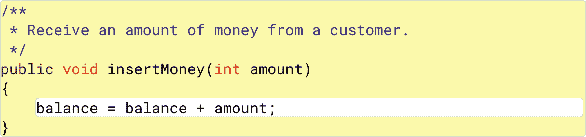

代码行如下：

第 1 行：`ForwardSlash asterisk asterisk`

第 2 行：缩进级别 1，`asterisk Receive an amount of money from a customer.`

第 3 行：缩进级别 1，`asterisk ForwardSlash`

第 4 行：`public void insertMoney OpenParenthesis amount CloseParenthesis`

第 5 行：`OpenCurlyBracket`

第 6 行：缩进级别 2，`balance equals balance plus amount semicolon`

第 7 行：`CloseCurlyBracket`

`insertMoney` 的头部有一个 `void` 返回类型。`void` 类型意味着方法不向调用者返回任何值。这与其他所有返回类型都显著不同。在 BlueJ 中，这种区别主要体现在调用 `void` 方法后不会显示返回值的对话框。在 `void` 方法体内部，这种区别体现在没有返回语句。

在 `insertMoney` 方法体中，有一个单一语句，它是另一种形式的赋值语句。我们在考虑赋值语句时，总是先检查赋值符号右侧表达式的计算情况。在这里，它的作用是计算出 `amount` 参数中的数值与 `balance` 字段中的数值之和。然后将这个组合后的值赋值给 `balance` 字段。该赋值的效果是将 `balance` 的值增加 `amount` 的值。

## 2.8.1: Setter 方法（设置方法）

变异器（mutator）最基本的形式是接收单个参数，并使用该值直接覆盖对象某个字段的值。与访问器方法（getter methods）互补，这些方法被称为“setter”方法。例如，如果我们想为 `lab-classes` 项目中 `Student` 类的 `credits` 字段添加一个 setter，它看起来如下：

```
public void setCredits(int numberOfCredits)
{
    credits = numberOfCredits;
}
```

setter 方法通常具有 `void` 返回类型，因为它不需要返回任何内容。它有一个参数，用于接收作为字段新值的数值。因此，参数的类型与字段的类型相同。方法体包含一条单一赋值语句，用新值覆盖字段的当前值。与 `TicketMachine` 的 `insertMoney` 方法和 `Student` 的 `addCredits` 方法不同，setter 在设置新值时并不使用字段的当前值。

setter 方法的通常名称是“set”加上要设置的字段名称，但将其首字母转换为大写；在此例中为 `setCredits`。

`TicketMachine` 没有任何 setter 方法，因为我们不希望直接设置它的任何字段；所有必要的变异都是通过 `insertMoney` 和 `printTicket` 方法完成的。然而，如果我们以后想更改 `price` 字段，那么它的 setter 看起来如下：

```
public void setPrice(int cost)
{
    price = cost;
}
```

这遵循与 `setCredits` 方法相同的模式：`void` 返回类型；一个与要设置字段类型相同的单一参数；以及一条覆盖字段当前值的单一赋值语句。

## 2.8.2: `this` 关键字

在我们的 setter 方法示例中，我们非常仔细地为参数命名了与它所设置的字段不同的名称。例如，我们在 `setPrice` 中使用 `cost` 作为参数名来设置 `price` 字段，在 `setCredits` 中使用 `numberOfCredits` 设置 `credits` 字段。如果我们为参数选择了与字段相同的名称，那么 `setPrice` 就会变成这样：

```
public void setPrice(int price)
{
    price = price; // 错误！
}
```

这个版本的问题在于，赋值语句将 `price` 参数的值赋值给了它自己，这是没有意义的！如果在 `TicketMachine` 的构造函数中使用 `price` 作为参数名，也会出现同样的问题：

```
public TicketMachine(int price)
{
    price = price; // 错误！
    balance = 0;
    total = 0;
}
```

请确保在完成练习后将构造函数恢复到原始状态。

如果一个参数与字段具有相同的名称，那么我们面临的问题是如何引用这两个变量以便能够区分它们。在构造函数中，如果我们简单地在构造函数中使用变量名“price”，将将使用哪一个变量——是参数还是字段？

Java 规范回答了这个问题。它规定将始终使用源自最近的嵌套块的定义。因为 `price` 参数定义在构造函数中，而 `price` 字段定义在类中，所以将使用参数。它的定义距离使用它的语句更“近”。

因此，当存在同名但定义更近的变量时，我们需要一种机制来访问字段。这正是 `this` 关键字的作用，这里是它的实际应用。

```
public TicketMachine(int price)
{
    this.price = price; // 正确！
    balance = 0;
    total = 0;
}
```

表达式 `this` 指向当前对象。编写 `this.price` 指的是当前对象中的 `price` 字段。因此，这种结构为我们提供了一种机制，在存在同名更近定义变量时访问字段。

## 2.9: 打印方法

**代码 2.7** 展示了最复杂的方法：`printTicket`。为了帮助理解后续讨论，请确保你已经在票上调用了此方法。你应该能在 BlueJ 终端看到类似下面的输出：

```
The BlueJ Line
Ticket
500 cents.
```

### 代码 2.7 printTicket 方法

```java
/**
 * 打印票据。
 * 更新总收集金额并将余额清零。
 */
public void printTicket() {
    // 模拟打印票据。
    System.out.println("The BlueJ Line");
    System.out.println("Ticket");
    System.out.println(price + " cents");
    System.out.println();

    // 用余额更新总收集金额。
    total = total + balance;
    // 清除余额。
    balance = 0;
}
```

这是我们目前见过的最长的方法，因此我们将将其拆解为更易处理的部分：

*   方法头表示该方法具有 `void` 返回类型，且不接受任何参数。

*   方法体包含八条语句以及相关的注释。

*   前六条语句负责在 BlueJ 终端窗口中打印你看到的内容：五行文本和第六行空行。

*   第七条语句将客户投入的余额（通过之前对 `insertMoney` 的调用）加到机器目前为止收集的所有金额的运行总中。

*   第八条语句使用一个基本的赋值语句将余额重置为零，为下一次客户做准备。

通过比较出现的输出与产生输出的语句，很容易看出像下面这样的语句：

```
System.out.println("#  The BlueJ Line");
```

它会字面不动地打印出成对双引号之间的字符串。`println` 调用的基本形式是：

```
System.out.println(something-we-want-to-print);
```

其中 `something-we-want-to-print` 可以替换为任何包含在双双引号中的字符串。字符串中的“#”字符并没有特殊意义——它只是我们想要打印的字符之一。`printTicket` 方法中的所有打印语句都是对 Java 语言内置的 `System.out` 对象的 `println` 方法的调用，圆括号之间的是每个方法调用的参数，正如你预期的那样。

在第四条语句中，`println` 的参数稍微复杂一些，需要进一步的解释：

```
System.out.println("#  " + price + " cents.");
```

它的作用是打印票的价格，并在金额两边添加一些额外的字符。两个 `+` 运算符被用于从三个独立的组件构建成一个字符串形式的单个参数值：

*   字符串字面量：`"# "`（*注意哈希符号后面有一个空格字符*）；

*   `price` 字段的值（注意字段名周围没有引号，因为我们需要的是字段的值，而不是它的名字）；

*   字符串字面量：`" cents."`（注意单词 `"cents"` 之前有一个空格字符）。

当字符串与其他任何内容之间被使用时，`+` 是字符串拼接运算符，而不是算术加法运算符；也就是说，它将字符串连接（合并）在一起创建一个新字符串。`price` 的数值会被会自动转换为字符串，并与周围的两个字符串连接起来。

注意，最后一次 `println` 调用不包含参数值。这是被允许的，调用它的结果是在上一个输出和任何后续输出之间留出一个空行。如果你打印第二张票，你就能很容易看到这个空行。

## 2.10: 方法总结

此时这里值得总结一下方法的几个特征，因为方法是我们将在本书中编写和探索的程序的基石。它们实现了每个对象的核心操作。

带有参数的方法接收从方法调用者传给它的参数值，然后方法将使用这些值来帮助它执行特定任务。并不是所有方法都接受参数；许多方法仅使用存储在对象字段中的数据来执行任务。

如果一个方法具有非 `void` 返回类型，它将把某些数据返回到调用它的地方——这些数据几乎肯定会被调用者用于进一步的计算或程序处理。尽管，许多方法具有 `void` 返回类型且不返回任何内容，但它们仍然在对象的上下文中执行了有用的任务。改变对象状态的方法——变器方法（mutator methods）——通常具有 `void` 返回类型。它们经常接受参数，其参数值被用于修改，尽管仍然可能编写一个不接受参数的变器方法。

访问器方法（如 getter 方法）始终具有非 `void` 返回类型，并返回与对象状态相关的值。

## 2.11: 简易票务机总结

我们现在详细检查了简易 `TicketMachine` 类的内部结构。我们看到该类有一个很小的外层，仅为类命名，以及一个包含字段、构造函数和几个方法的更实质性的内部主体。字段用于存储数据，使对象能够维持一种在方法调用之间持续的状态。每个对象都有自己的份的副本，因此这些变量也被称为实例变量。

构造函数用于在创建对象时设置初始状态。良好的初始状态将使对象能够在创建后立即对方法调用做出恰当的响应。

方法实现了类对象定义的行为。访问器方法提供有关对象状态的信息，变器方法改变对象的状态。

我们已经看到构造函数与方法的区别在于，它们具有与其定义所在的类相同的名称。构造函数和方法都可能接受参数，但只有方法可以有返回类型。非 `void` 返回类型允许我们将值从方法外部传递到调用方法的地方。重要重要的是，“返回一个值”并不意味着该值被打印出来。尽管当交互式调用非 `void` 方法时，BlueJ 会弹出一个“方法结果”对话框，但这仅仅是视觉辅助，而不是正常程序行为的一部分。

具有非 `void` 返回类型的方法在其体内部必须至少有一个返回语句；这通常是最后一条语句。构造函数永远没有任何种类型的返回类型——甚至没有 `void`。

在尝试以下练习之前，请确保你充分理解票务机是如何工作的以及这些行为是如何通过类的字段、构造函数和方法实现的。

## 2.12: 反思票务机的设计

通过研究 `TicketMachine` 的内部结构，你应该已经意识到它在现实世界中是多么不足。它在几个方面存在缺陷：

*   它没有检查客户是否有足够的钱买票。

*   如果客户付的钱多了，它不会退还任何钱。

*   它没有确保客户投入的金额是合理的（如果你还没有尝试过，可以实验输入负数会发生什么，例如）。

*   它没有检查传递给构造函数的票价是否合理。

如果我们能够解决这些问题，我们就能拥有一个功能更强大的软件，可以作为运行真实票务机的基础。

在接几节中，我们将检查一个改进后的票务机类的实现，它尝试解决简易实现中的某些缺陷。

## 2.13: 选择：条件语句

`Code 2.8` 显示了改进后的票机类定义的内部细节。由于我们之前讨论过简单的票机，该定义中的很大一部分你可能已经熟悉了。例如，外层封装是相同的，因为我们选择为这个类赋予相同的名称。它包含了维护对象状态的三个字段，且这些字段的声明方式相同。构造函数以及用于 `balance` 和 `total` 的两个访问方法（getter methods）也与之前相同。

### Code 2.8 一个更复杂的 TicketMachine

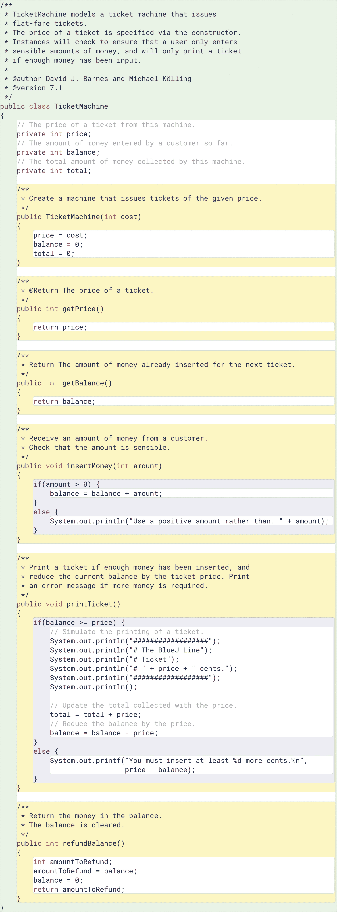

代码行如下。


```java
/**
 * TicketMachine 模拟了一个发行
 * 固定价格票务的票机。
 * 票价通过构造函数指定。
 * 实例将检查用户只输入合理的金额，
 * 并且只有在输入足够金额时才会打印票务。
 *
 * @author David J. Barnes and Michael Kölling
 * @version 7.1
 */
public class TicketMachine {
    /** 此票机票务的价格。 */
    private int price;
    /** 客户目前已投入的金额。 */
    private int balance;
    /** 此票机收到的总金额。 */
    private int total;

    /**
     * 创建一个发行指定价格票务的机器。
     */
    public TicketMachine(int cost) {
        price = cost;
        balance = 0;
        total = 0;
    }

    /** 返回票价。 */
    public int getPrice() {
        return price;
    }

    /** 返回为下一张票务已投入的金额。 */
    public int getBalance() {
        return balance;
    }

    /**
     * 从客户那里接收一个金额。
     * 检查金额是否合理。
     */
    public void insertMoney(int amount) {
        if (amount > 0) {
            balance += amount;
        } else {
            System.out.println("使用正数金额: " + amount);
        }
    }

    /**
     * 如果投入了足够的金额则打印票务，
     * 并用票价减少当前余额。
     * 如果需要更多钱，则打印错误信息。
     */
    public void printTicket() {
        if (balance >= price) {
            // 模拟打印票务。
            System.out.println("----------------");
            System.out.println("-------");
            System.out.println("Ticket");
            System.out.println(price + " cents");
            System.out.println("----------------");
            System.out.println();

            // 用票价更新总收金额。
            total += price;
            // 余额减去票价。
            balance -= price;
        } else {
            System.out.printf("你至少还需要再投入 %d 分。\n", price - balance);
        }
    }

    /**
     * 返回余额中的金额。
     * 清空余额。
     */
    public int refundBalance() {
        int amountToRefund = balance;
        balance = 0;
        return amountToRefund;
    }
}
```

第一个显著的变化可以出现在`insertMoney`方法中。我们意识到，简单版售票机的主要问题在于它没有检查某些条件。其中一个缺失的检查是对客户插入的金额的检查，因为可能会插入负数金额。我们通过使用`conditional statement`（条件语句）来检查插入的金额是否大于零，从而修复了这一缺陷：

```java
if(amount > 0) {
    balance = balance + amount;
}
else {
    System.out.println("Use a positive amount rather than: " +
                        amount);
}
```

条件语句根据用于引入它们的关键字，也被称为`if-statements`（if 语句）。条件语句中使用的测试是`boolean expression`（布尔表达式）的一个示例。在本章较早的章节中，我们介绍了产生数值结果的算术表达式。而布尔表达式只有两种可能的值（`true`或`false`）：`amount`的值要么大于零（`true`），要么不是（`false`）。条件语句利用这些可能的值在两个动作之间进行选择。这种“二选一”的决策在生活中的情况下应该很熟悉：例如，如果我有作业要完成，那么我就去写作业；否则，我将去看朋友。

条件语句具有如下伪代码所示描述的一般形式：

```text
if(perform some test that gives a true or false result) {
    如果测试结果为真，则执行此处的语句
}
else {
    如果测试结果为假，则执行此处的语句
}
```

这段伪代码的某些部分是合法的 Java 代码，这些部分将出现在所有条件语句中——关键字`if`和`else`、测试周围的圆括号，以及标记两个代码块的大括号——而其他部分将根据每个被编码的每种情况进行填充。在评估测试后，测试随后的两个语句块中只有一个会被执行。

在`insertMoney`方法中，在对插入的金额进行测试后，我们只把金额添加到`balance`中，或者打印错误信息。该测试使用大于运算符`>`来比较`amount`中的值与`0`。如果该值大于零，它会被加到`balance`中。如果不大于零，则会打印错误信息。通过使用条件语句，我们实际上保护了`balance`字段，防止在参数不代表有效金额的情况下发生更改。

其他三个关系运算符是`<`（小于）、`<=`（小于等于）和`>=`（大于等于）。它们都产生`true`或`false`的结果，并且都用于比较值，如`printTicket`方法所示。还有两个关系运算符：`==`（等于）和`!=`（不等于）。注意，使用两个相邻的`=`字符而不是单个`=`来测试相等性，因为单的`=`用于赋值。这些运算符经常被混淆是很常见的现象，因为我们习惯于认为`=`意味着“等于”，但在 Java 中它并非如此。

其他运算符的细节可以在附录 C 找到。

## 2.14：另一个条件语句示例

`printTicket`方法包含了另一个条件语句的示例。其大纲如下：

```java
if(balance >= price) {
    // 省略打印细节。
    // 用价格更新总收集金额。
    total = total + price;
    // 从余额中减去价格。
    balance = balance – price;
}
else {
    System.out.printf("You must insert at least %d more cents.%n",
                      price – balance);
}
```

通过这个`if-statement`，我们修复了简单版本的问题，即在打印之前没有检查客户是否插入了足够的票钱。这个版本检查`balance`字段中的值是否大于或等于`price`字段中的值。如果是，就可以打印票据。如果不是，我们转而打印一条错误信息。

打印错误信息引入了`printf`方法，作为`println`的替代方案，用于打印消息。这是在练习 2.43 中引入的。`printf`方法提供了字符串的“格式化打印”。它的第一个参数是以格式字符串形式呈现的要打印整体字符串的轮纲。格式字符串包含格式占位符（`%d`和`%n`），它们是插入到输出中的值的占位符。在这种情况下，`%d`是十进制整数的占位符，`%n`是结束行的占位符。插入到占位符中的值在`printf`调用中跟随格式字符串，但`%n`不需要对应的值。所以：

```java
System.out.printf("%n");
```

等同于：

```java
System.out.println();
```

在`printTicket`方法在使用`printf`时，`%d`将被表达式`price – balance`的值替换。

`printTicket`方法通过`price`的值减少`balance`的值。因此，如果客户插入的钱超过票价，那么`balance`中将剩下一些钱，可以用于支付第二张票。或者，客户可以要求退还剩余余额，这就是`refundBalance`方法所做的，正如我们在 2.16 节中看到的。

## 2.15：范围高亮

你现在应该注意到，BlueJ 编辑器在显示源代码时带有一些额外的装饰：某些元素周围有彩色框，例如方法和 if 语句（例如，参见代码 2.8）。

这些彩色注释被称为范围高亮（scope highlighting），它们有助于理清你程序的逻辑单元。一个`scope`（也称为`block`，块）通常由一对大括号指示的代码单元。

如你所见，范围通常是嵌套的：if 语句在方法内部，而方法又在类内部。BlueJ 通过不同的颜色来区分不同类型的范围。

初级程序员代码中最常见的错误之一就是弄错大括号——要么位置不对，要么漏掉了一个括号。以下两点可以极大地帮助避免此类错误：

- 注意代码的正确缩进。每当一个新范围开始时（在左大括号之后），将随后的代码多缩进一级。结束范围时，缩进会恢复。如果你的缩进完全混乱，请使用 BlueJ 的“自动布局”（Auto-layout）功能（在编辑器菜单中查找！）来修复它。
- 注意范围高亮。你会很快习惯结构良好的代码外观。尝试在编辑器中删除一个大括号或在任意位置添加一个，并观察颜色如何变化。学会识别范围看起来错误的时刻。

## 2.16：局部变量

到目前为止，我们遇到了两种不同类型的变量：字段（实例变量）和参数。我们现在将引入第三种。它们所有的共同点都是存储数据，但每种都有特定的角色。

[第 2.7 节](#）提到方法体（通常来说是块）可以包含声明和语句。到目前为止，我们看过的方法都没有包含任何声明，但`refundBalance`方法包含了。

```java
public int refundBalance()
{
    int amountToRefund;
    amountToRefund = balance;
    balance = 0;
    return amountToRefund;
}
```

它包含了三条语句和一个声明。这些语句将`balance`字段的值赋值给`amountToRefund`变量，然后将`balance`设置为零，最后返回`amountToRefund`中的值，当然，这个值是`balance`在被设置为零之前的旧值。

在方法开始处对`amountToRefund`的声明引入了一种新变量。它是什么样的变量呢？我们知道它不是字段，因为字段是定义在方法之外。它也不是参数，因为参数始终在方法头中定义。

`amountToRefund`变量是所谓的`局部变量`（`local variable`），因为它是在方法体内部进行局部定义的。“局部”这一标识是指局部变量仅对其定义块内部的代码（在本例中，即方法体）可用的。局部变量无法从同一类中的任何其他方法访问。这与字段形成了对比，字段可以被其类中的每个方法访问。

局部变量的声明看起来像字段的声明，但它们绝不会包含`private`或`public`。参数和局部变量的作用范围都局限于它们所属的方法语句。它们的生命周期是方法执行期间：它们在方法被调用时创建，在方法结束时销毁。方法的每次调用都会为它们创建一个新的副本。

在声明时直接初始化局部变量是非常常见的。因此，我们可以将`refundBalance`的声明和第一条语句合并为：

```java
int amountToRefund = balance;
```

但记住这里发生了两个步骤：声明变量`amountToRefund`以及给它赋一个初始值，这仍然重要的。

你可能会奇怪，既然我们已经有了字段，为什么还需要局部变量？局部变量主要用作临时存储，帮助单个方法完成其任务；我们认为它们是单个方法的数据存储。相比之下，字段用于存储贯穿整个对象生命周期的数据。我们尽量避免将仅具有局部（方法级）用途的变量声明为字段；也就是说，这些变量的值不需要在单个方法调用之外被保留。因此，即使同一个类中的两个或多个方法为了相似的目的而使用局部变量，如果它们的值不需要在方法结束之后持续，那么将它们定义为字段是不恰当的。

接下来的练习将有助于说明局部变量如何帮助`refundBalance`完成其任务，我们将尝试在不使用局部变量的情况下编写该方法。

# 2.17：字段、参数和局部变量

随着`refundBalance`方法中引入`amountToRefund`，我们现在看到了三种不同类型的变量：字段、参数和局部变量。理解这三种变量之间的相似之处和区别非常重要。以下是它们的特征总结：

- 所有三种类型的变量都可以存储与其定义类型对应的值。例如，`int`类型允许变量存储一个整数值。
- 字段定义在构造函数和方法之外。
- 字段用于存储贯穿整个对象生命周期的值。因此，它们维护了对象的当前状态。它们的生命周期与对象的寿命一样长。
- 字段具有类作用域：它们在整个类中都是可访问的，因此可以在定义所在类的任何构造函数或方法中使用。
- 只要被定义为`private`，字段无法从定义类之外的任何地方访问。
- 参数和局部变量仅在构造函数或方法执行期间存在。它们的生命周期仅持续单次调用，因此它们的值在调用之间会丢失。因此，它们充当的是临时而非永久存储位置。
- 参数定义在构造函数或方法头中。它们从外部接收值，通过构成构造函数或方法调用的参数值进行初始化。
- 参数的作用范围局限于它们定义的构造函数或方法。
- 局部变量定义在构造函数或方法的体内部。它们只能在其定义的构造函数或方法体内部进行初始化和使用。局部变量在表达式中使用之前必须进行初始化——它们不会被赋予默认值。
- 局部变量的作用范围局限于它们定义的块。它们无法从该块之外的任何地方访问。

新程序员经常发现很难判断一个变量应该定义为字段还是局部变量。人们有一种将所有变量都定义为字段的诱惑，因为它们可以从类中的任何地方访问。事实上，采用相反的方法是一个更明智的规则：将变量定义为方法局部的，除非它们显然是对象持久状态的真实部分。即使你预判会在两个或多个方法中使用同一个变量，也请为每个方法在局部定义一个独立的版本，直到你确定方法调用之间的持久性是合理的。

# 2.18：改进版售票机总结

在开发`TicketMachine`类的改进版本时，我们已经解决了初级版本的主要缺陷。在此过程中，我们引入了两种新的语言结构：条件语句和局部变量。

- 条件语句为我们提供了一种执行测试的方法，然后根据测试结果执行两个不同动作中的一种。
- 局部变量允许我们在构造函数或方法内部计算并存储临时值。它们有助于其方法所实现的行为，但一旦该方法结束，它们的值就丢失了。

关于条件语句及其测试形式的更多详细信息，可以查阅`附录 D`。

# 2.19：自测练习

本章涵盖了许多新领域，我们引入了许多概念。我们在未来的章节中将基于所有这些内容进行构建，因此对它们这些熟悉非常重要。尝试以下纸笔练习，以检查你是否已经习惯了本章引入的术语。不要因为我们建议在纸上而不是 BlueJ 中完成这些练习而沮丧。在没有编译器的情况下尝试是非常很好的练习。

如果你完成了大部分或全部练习，可能会尝试在 BlueJ 中创建一个新项目并编写自己的`Person`类定义。例如，该类可以有记录姓名和年龄的字段。如果你不确定如何完成之前的练习，请回顾本章早前的章节以及`TicketMachine`的源代码，以复习你不理解的内容。在下一节中，我们将提供复习材料。

# 2.20：实验表达式：代码面板

在之前的章节中，我们看到了各种用于实现不同计算的表达式，例如`total + price`和`amount > 0`。

在本书的剩余部分中，我们将遇到更多此类操作，当我们遇到新事物时，通过不同的示例进行尝试通常有助于更好地理解它们。

我们在第 1 章中简要过的代码面板（Code Pad）可以帮助我们实验 Java 表达式（图 2.5）。在这里，我们可以输入表达式，它们将立即被求值并显示结果。这对于尝试新的操作符和方法非常有帮助。

### 图 2.5 BlueJ 代码面板

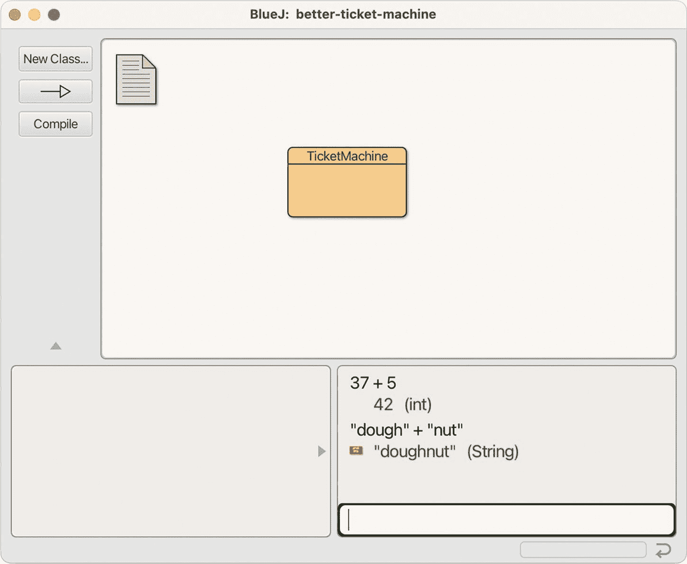

窗口的左上角有三个颜色的圆。标题位于顶部中间部分。在三个彩色圆下方的左面板中，垂直显示着三个按钮，如下：New Class（新建类）、省略号、右箭头指针和 Compile（编译）。中间面板的左上角有一个文档图标，中间有一个框。该框的标题为`TicketMachine`。中间面板下方并排显示两个矩形框。左侧框是空的。右侧框有以下代码：第 1 行：37 加 5\。第 2 行：缩进级别 1，42 左括号 int 右括号。第 3 行：左双引号 dough 右双引号 加 左双引号 nut 右双引号。第 4 行：一个小框，左双引号 doughnut 右双引号紧跟一个左括号 String 右括号。右侧框的底部有一个带指针的文本框。窗口右下角显示一个后退图标。


当代码面板中表达式的结果是一个对象（例如`String`）时，它会在显示结果的行旁边标记一个红小的红色对象符号。你可以点击此符号将对象移动到对象工作台（object bench）上以便进一步使用，或者双击它来检查该对象。你还可以在代码面板中声明变量并编写完整的语句。

你可以在代码面板中探索变量的使用。尝试以下操作：

```
sum = 99 + 3;
```

你会看到以下错误信息：

```
Error: cannot find symbol – variable sum
```

这是因为 Java 要求在使用变量（在此例中为`sum`）之前必须给它指定一个类型。记住，每当字段、参数或局部变量在源码中首次引入时，它的前面都有一个类型名称，例如`int`或`String`。基于此，现在在代码面板中尝试以下操作：

```
int sum = 0;
sum = 99 + 3;
```

这次没有报错，因为`sum`已经带类型引入了，之后在使用时无需再次重复该类型。如果你在单独的一行中输入：

```
sum
```

（不带分号），你将看到它当前存储的值。

现在在代码面板中尝试这个：

```
String swimmer = "cat" + "fish";
swimmer
```

我们再次为变量`swimmer`赋予了适当的类型，允许我们对它进行赋值并发现它存储了什么。这次我们在声明变量的同时将其设置为我们想要的值。

在执行以下操作后，你预期看到什么？

```
String fish = swimmer;
fish
```

尝试一下。你认为在赋值过程中发生了什么？

# 2.21: 总结

在本章中，我们涵盖了创建类定义的基础知识。类包含字段、构造方法和方法，它们定义了对象的状态和行为。在构造方法或方法的体内，一组语句实现了该行为的一部分。局部变量可以用作临时数据存储来辅助实现。我们已经涵盖了赋值语句和条件语句，将在后续章节中添加更多类型的语句。

本章引入的术语：

- **字段、实例变量、构造方法、方法、方法头、方法体、参数、参数、访问器、getter、修改器、setter、声明、初始化、块、语句、赋值语句、条件语句、返回语句、返回类型、注释、表达式、布尔表达式、操作符、变量、局部变量、作用域、生命周期**

接下来的练习旨在帮助你实验在本章中讨论的 Java 概念。你将创建自己的类，其中包含字段、构造方法、方法、赋值语句和条件语句等元素。

# 第 3 章 对象的相互交互（Object Interaction）

在之前的章节中，我们研究了对象是什么以及它们是如何实现的。在查看类定义时，我们讨论了字段、构造方法和方法。

现在我们将更进一步。为了构建有趣的应用程序，仅仅构建单个运行的对象是不够的。相反，对象必须组合在一起，以便它们协作完成一项共同任务。在本章中，我们将从三个对象构建一个小型应用程序，并安排方法调用其他方法来实现它们的目标。

# 3.1: 时钟示例

我们将用于讨论对象交互的项目是一个数字时钟显示器。显示器显示小时和分钟，用冒号分隔（图 3.1）。对于这个练习，我们将构建一个带有 24 小时显示的时钟。因此，显示器显示从 00:00（午夜）到 23:59（午夜前一分钟）的时间。事实证明构建 12 小时钟比 24 小时钟稍微复杂，我们将这个问题留到章节最后。

### 图 3.1 数字时钟显示


# 3.2: 抽象与模块化

第一个想法可能是在一个类中实现整个时钟。毕竟，这是我们目前所看到的：如何构建类来完成工作。

然而，在这里我们将以稍微不同的方式处理这个问题。我们将看看是否可以识别问题中的子组件并将其转换为独立的类。原因是*复杂性*。随着我们学习的进行，我们使用的示例和构建的程序将变得复杂。像票机这样简单的任务可以作为一个单独的问题来解决。

我们处理复杂性问题的解决方案是*抽象*。我们将问题划分为子问题，再划分为子子问题，以此类推，直到单个问题小到容易处理。一旦我们解决了其中一个子问题，我们就不再考虑该部分的细节，而是将解决方案视为下一个问题的单个构建块。这种技术有时被称为*分治法*（divide and conquer）。

对于其他部分也是如此。在最高层，设计师会将汽车视为一个整体。在链条中更下游的另一个工程师可能会花时间思考制造正确的材料。对于数字工程师来说，显示器是复杂的。数字工程师将从显示器的制造细节中抽象出来，将其视为一个单一实体。这就是抽象。

对于制造的细节，为了能够关注车身，设计师从车轮和发动机的技术细节中抽象出来，专注于车身形状。

每一个其他组件也是如此。当某人关注设计内部空间时，另一个人可能在开发座椅。

要点在于，如果观察得足够详细，汽车包含的零件之多以至于一个人无法同时知道每个部分的细节。如果必须这样做，汽车将无法被制造。汽车之所以能成功制造，是因为工程师使用了`模块化`和抽象。他们将汽车拆分为独立的模块（发动机、变速箱、座椅、方向盘等），并让不同的人独立处理这些模块。当一个模块构建完成后，他们使用抽象。他们认为该模块用于构建更复杂组件。

模块化和抽象因此相辅相成。模块化是将事物（问题）划分为较小部分的过程，而抽象则是忽略细节以关注大局的过程。

# 3.3: 软件中的抽象

在前一节讨论的模块化和抽象的相同原理被用于软件开发。为了帮助我们在复杂程序中保持整体，我们尝试识别可以作为独立实体编写的子组件。然后，我们尝试将这些子组件作为简单部分使用，而不必担心它们的内部复杂度。

在面向对象编程中，这些组件和子组件就是对象。如果我们尝试使用面向对象的语言在软件中构建汽车，我们会尝试像汽车工程师那样做。与其将汽车实现为一个单一的整体对象，而是首先为发动机、变速箱、轮子、座椅等构建单独的对象，然后从这些较小的对象组装成汽车对象。

确定对于给定的问题软件系统中应该什么类型的对象（以及这些`类`）并不总是容易的，我们将在本书的后面对此进行更多说明。目前，我们将从一个相对简单的示例开始。因此，回到我们的数字钟。

# 3.4: 时钟示例中的模块化

让我们仔细观察时钟显示示例。使用我们刚刚描述的抽象概念，我们想要找到查看此示例的最佳方法，以便我们编写一些类来实现它。一种方法是将其考虑为由四个数字的单个显示器组成（两个数字表示小时，两个表示分钟）。如果我们现在从那个非常底层的视图抽象出来，我们可以看到它也可以被视为两个独立的双数字显示（一组用于小时，一组用于分钟）。一组从 0 开始，每小时增加 1，并在达到其最终值 23 后返回 0。另一个在达到其最终值 59 后返回 0。这两个显示器行为的相似性可能会引导我们进一步抽象，不再区分地查看小时显示和分钟显示。相反，我们可能将它们看作是能够显示从零到最大值的对象。值可以增加，但如果值达到最大值，它接下来将翻转为零。现在，我们似乎达到了一个可以表示为类的适当抽象级别：一个双数字显示类。

对于我们的时钟显示，我们将首先为双数字显示编写一个类（图 3.2），然后给它一个访问器方法（accessor method）来获取其值，以及两个修改器方法（mutator methods）来设置和增加值。一旦我们定义了这个类，我们就可以创建该类的两个对象。

图 3.2：双数字显示


# 3.5: 实现显示

如上所述，为了构建时钟显示，我们需要先编写一个双数字显示的类，然后给它一个获取其值的访问器方法，以及两个设置值和增加值的修改器方法。为了构建时钟，我们需要两个显示器。一个是限制，另一个是当前值。

代码 3.1：双数字显示类


代码包含以下内容：

```java
class NumberDisplay {
    private int limit;
    private int value;
    // ... 方法定义
}
```

图 3.2：包含两个 NumberDisplay 字段的 ClockDisplay 类


代码包含以下内容：

```java
class ClockDisplay {
    private NumberDisplay hours;
    private NumberDisplay minutes;
    // ... 构造函数和方法
}
```

代码 3.2：ClockDisplay 字段


上一节描述的结构（一个持有两个`NumberDisplay`对象的`ClockDisplay`对象）可以在*对象图*中可视化，如**图 3.3a**所示。在图中，你可以看到我们正在处理三个对象。**图 3.3b**显示了相同情况的*类图*。

### 图 3.3 ClockDisplay 的对象图和类图

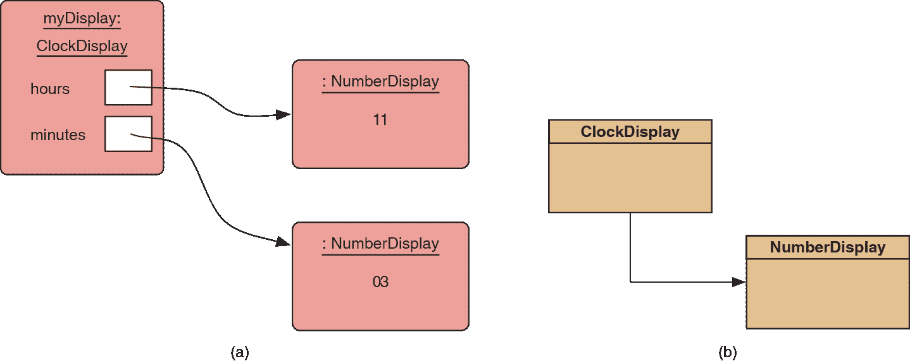

(a) 该图通过三个方框来描述`ClockDisplay`及其两个`NumberDisplays`。第一个框标题为`myDisplay : ClockDisplay`，包含以下内容：`hours`: 一个空白的正方框，`minutes`: 一个空白的正方框。第二个框标题为`: NumberDisplay`，内部包含文本`11`。第三个框标题为`: NumberDisplay`，内部包含文本`03`。从第一个框中对应`hours`的空白正方框引出的箭头指向第二个框。从第一个框中对应`minutes`的空白正方框引出的箭头指向第三个框。

(b) 一条箭头从标题为`ClockDisplay`的框指向标题为`NumberDisplay`的框。

注意，类图只显示了两个类，而对象图显示了三个对象。这是因为我们可以从同一个类创建多个对象。在这里，我们从`NumberDisplay`类创建了两个`NumberDisplay`对象。

这两个图提供了同一个应用程序的两种视图。类图显示了*静态视图*。它描绘了我们在编写程序时所拥有的。我们有两个类，箭头表示`ClockDisplay`类使用了`NumberDisplay`类（在`ClockDisplay`的源码中提到了`NumberDisplay`）。我们还说`ClockDisplay`*依赖于*`NumberDisplay`。

为了启动程序，我们将创建一个`ClockDisplay`类的对象。我们将编写时钟显示，使其自动为自己创建两个`NumberDisplay`对象。因此，对象图显示了*运行时*（应用程序运行时）的情况。这也被称为*动态视图*。

对象图还显示了另一个重要细节：当变量存储一个对象时，对象并不是直接存储在变量中的，而是将一个*对象引用*存储在变量中。在图中，变量显示为白框，而对象引用显示为箭头。被引用的对象存储在引用对象之外，对象引用连接了两者。

理解这两个不同的图和不同的视图是非常关重要的。BlueJ 只显示静态视图。你在主窗口中看到类图。为了规划和理解 Java 程序，你需要在纸上或在脑海中构建对象图。当我们思考程序将要做什么时，我们在思考它创建的对象结构以及这些对象如何相互作用。能够将对象结构可视化是至关重要的。

# 3.7: 基本类型和对象类型

Java 知道两种非常不同的类型：*基本类型*和*对象类型*。基本类型在 Java 语言中全都是预定义的的。它们包括`int`和`boolean`。基本类型的完整列表见附录 B。对象类型是由类定义的。某些类是由标准 Java 系统定义的（如`String`），而其他是我们自己编写的类。

基本类型和对象类型都可以用类型，但在某些情况下它们的行为不同。其中一个区别是值的存储方式。正如我们从图中看到的，基本类型的值直接存储在变量中（我们直接将值写入了变量框中——例如，在第 2 章，**图 2.3**）。另一方面，对象并不直接存储在变量中，而是存储对对象的引用（在我们的图中画为箭头，如**图 3.3a**所示）。

我们稍后会看到基本类型和对象类型之间的其他区别。

# 3.8: `NumberDisplay`类

在我们开始分析整个*时钟显示*（clock-display）项目的源码之前，如果了解`NumberDisplay`类以及它的功能如何支持`ClockDisplay`类的构建，将会有帮助。这可以在独立的*数字显示*（number-display）项目中找到。

**代码 3.3**显示了`NumberDisplay`类的完整源码。总的来说，这个类非常简单，尽管它确实展示了 Java 的一些新功能。它具有上面过的两个字段（第 3.5 节）、一个构造函数和四个方法（`getValue`、`setValue`、`getDisplayValue`和`increment`）。

### 代码 3.3 NumberDisplay 类的实现


代码如下：

```java
/**
 * NumberDisplay 类表示一个从零到给定限制的
 * 值的数字。限制可以在创建显示时指定。
 * 如果例如用于数字时钟的秒，限制将为 60，
 * 导致显示值为 0 到 59。当增加时，显示
 * 将自动滚动到零以达到限制。
 *
 * 作者 Michael Kölling 和 David Barnes 版本 7.0
 */
public class NumberDisplay {
    private int limit;
    private int value;

    /**
     * NumberDisplay 类对象的构造函数。
     * 设置显示回零的限制。
     */
    public NumberDisplay(int rollOverLimit) {
        limit = rollOverLimit;
        value = 0;
    }

    /**
     * 返回当前值。
     */
    public int getValue() {
        return value;
    }
}
```

第 42 行：缩进级别 4，如果`OpenParenthesis`值小于 10`CloseParenthesis` `OpenCurlyBracket`

第 43 行：缩进级别 5，返回`double quotes` 0`double quotes`加上值分号

第 44 行：缩进级别 4，`CloseCurlyBracket`

第 45 行：缩进级别 4，`else` `OpenCurlyBracket`

第 46 行：缩进级别 5，返回`double quotes` `double quotes`加上值分号

第 47 行：缩进级别 4，`CloseCurlyBracket`

第 48 行：缩进级别 2，`CloseCurlyBracket`

第 49 行：空白

第 50 行：缩进级别 2，`ForwardSlash` asterisk asterisk asterisk`

第 51 行：缩进级别 3，`asterisk`将显示设置为新的指定值。如果新

第 52 行：缩进级别 3，`asterisk`值小于零或超过限制，则不执行任何操作。

第 53 行：缩进级别 3，`asterisk` `ForwardSlash`

第 54 行：缩进级别 2，`public void setValue` `OpenParenthesis` `int replacementValue` `CloseParenthesis`

第 55 行：缩进级别 2，`OpenCurlyBracket`

第 56 行：缩进级别 4，`if` `OpenParenthesis` `OpenParenthesis` `replacementValue`大于等于 0`CloseParenthesis`逻辑与`OpenParenthesis` `replacementValue`小于限制双`CloseParenthesis` `OpenCurlyBracket`

第 57 行：缩进级别 5，`value`等于`replacementValue`分号

第 58 行：缩进级别 4，`CloseCurlyBracket`

第 59 行：缩进级别 2，`CloseCurlyBracket`

第 60 行：空白

第 61 行：缩进级别 2，`ForwardSlash` asterisk asterisk asterisk`

第 62 行：缩进级别 3，`asterisk`将显示值加一，如果达到

第 63 行：缩进级别 3，`asterisk`限制则循环归零。

第 64 行：缩进级别 3，`asterisk` `ForwardSlash`

第 65 行：缩进级别 2，`public void increment` `OpenParenthesis` `CloseParenthesis`

第 66 行：缩进级别 2，`OpenCurlyBracket`

第 67 行：缩进级别 4，`value`等于`value`加 1 分号

第 68 行：缩进级别 4，`if` `OpenParenthesis` `value`双等于`limit` `CloseParenthesis` `OpenCurlyBracket`

第 69 行：缩进级别 5，`value`等于 0 分号

第 70 行：缩进级别 4，`CloseCurlyBracket`

第 71 行：缩进级别 2，`CloseCurlyBracket`

第 72 行：`CloseCurlyBracket`


构造函数接收循环限制作为参数。例如，如果传入 24 作为循环限制，显示器将在该值处循环到 0。因此，显示值的范围将是 0 到 23。此功能允许我们将此类用于小时显示和分钟显示。对于小时显示，我们将创建一个限制为 24 的 `NumberDisplay`；对于分钟显示，我们将创建一个限制为 60 的 `NumberDisplay`。构造函数将循环限制存储在字段中，并将当前的显示值设置为 0。

接下来是当前显示值的简单 getter 方法（`getValue`）。后续练习之后的章节讨论了在 `setValue`、`getDisplayValue` 和 `increment` 方法中使用的一些新功能。

## 3.8.1：逻辑运算符

修改方法 `setValue` 很有趣，因为它并没有完全遵循我们在第 2 章中描述的 setter 方法模式。虽然它包含将参数 `replacementValue` 赋值给 `value` 字段，但它首先确保 `value` 字段没有设置为有效范围之外的值。它的内容如下：

```java
public void setValue(int replacementValue)
{
    if((replacementValue >= 0) && (replacementValue < limit)) {
        value = replacementValue;
    }
}
```

如上所述，有效范围是从 0 到限制减 1。我们使用 `if` 语句在赋值之前检查该值是否合法。符号 `&&` 是一个逻辑“与”运算符。它只有在 `&&` 符号两侧的条件都为真时，才会使 `if` 语句中的条件为真。详情请参见随后的“逻辑运算符”注释。附录 C 显示了 Java 逻辑运算符的完整表格。注意替换值必须严格小于限制值，因此等于限制的值必须被拒绝。你已经在练习 3.9 中见过这种情况。

## 3.8.2：字符串拼接

在第 2 章中，我们引入了通过字符串拼接来创建字符串的概念。本章随后的章节将讨论一些格式化字符串以避免这些潜在问题的方法。

```java
public void increment()
{
    value = value + 1;
    if(value == limit) {
        value = 0;
    }
}
```

在完整的 `clock-display` 项目的 `NumberDisplay` 版本中，限值溢出的任务实现方式略有不同。该版本使用“取模运算符”来检测溢出点，并在第 3.12.3 节中进行了讨论。

# 3.9：`ClockDisplay` 类

现在我们已经了解了如何构建一个定义两位数字显示的类，接下来我们将更详细地查看 `ClockDisplay` 类——该类将通过创建两个数字显示来创建一个完整的时间显示。**代码 3.4** 显示了 `ClockDisplay` 类的完整源代码，该代码可以在 `clock-display` 项目中找到。

### 代码 3.4：`ClockDisplay` 类的实现

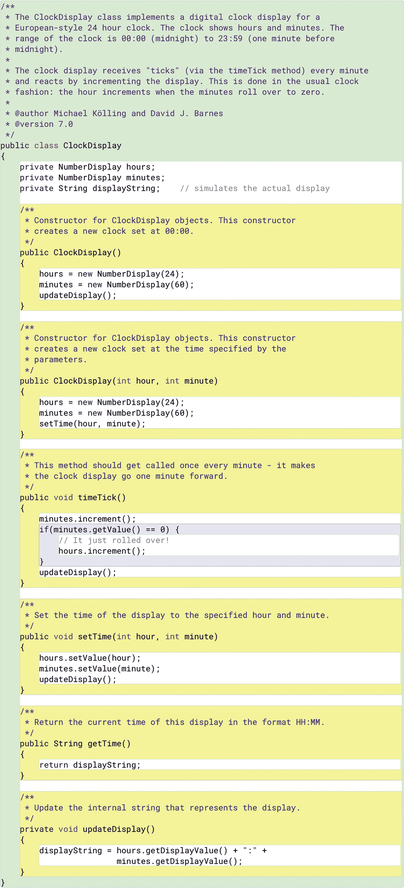

代码包含以下行：

- 第 1 行：斜杠星号星
- 第 2 行：缩进级别 1，星号 `ClockDisplay` 类实现了一个数字时钟显示
- 第 3 行：缩进级别 1，星号欧式 24 小时制。时钟显示小时和分钟。
- 第 4 行：缩进级别 1，星号时钟的范围是从 00:00（午夜）到 23:59（午夜的前一分钟）。
- 第 5 行：缩进级别 1，星号午夜）。
- 第 6 行：缩进级别 1，星号
- 第 7 行：缩进级别 1，星号时钟每分钟接收一次“滴答”（通过 `timeTick` 方法）
- 第 8 行：缩进级别 1，星号并通过增加显示来做出反应。这是按照通常的时钟方式完成：当分钟溢零时，小时加一。
- 第 9 行：缩进级别 1，星号
- 第 10 行：缩进级别 1，星号
- 第 11 行：缩进级别 1，星号作者 Michael Kölling 和 David J. Barnes
- 第 12 行：缩进级别 1，星号版本 7.0
- 第 13 行：缩进级别 1，星号斜杠
- 第 14 行：`public class ClockDisplay`
- 第 15 行：左大括号
- 第 16 行：缩进级别 2，`private NumberDisplay hours;`
- 第 17 行：缩进级别 2，`private NumberDisplay minutes;`
- 第 18 行：缩进级别 2，`private String displayString;` 双斜杠模拟实际显示
- 第 19 行：空行
- 第 20 行：缩进级别 2，斜杠星号星
- 第 21 行：缩进级别 3，星号 `ClockDisplay` 对象的构造函数。此构造函数
- 第 22 行：缩进级别 3，星号创建一个设置为 00:00 的新时钟
- 第 23 行：缩进级别 3，星号斜杠
- 第 24 行：缩进级别 2，`public ClockDisplay()`
- 第 25 行：缩进级别 2，左大括号
- 第 26 行：缩进级别 4，`hours = new NumberDisplay(24);`
- 第 27 行：缩进级别 4，`minutes = new NumberDisplay(60);`
- 第 28 行：缩进级别 4，`updateDisplay();`
- 第 29 行：缩进级别 2，右大括号
- 第 30 行：空行
- 第 31 行：缩进级别 2，斜杠星号星。
- 第 32 行：缩进级别 3，星号 `ClockDisplay` 对象的构造函数。此构造函数
- 第 33 行：缩进级别 3，星号创建一个设置为参数指定时间的新时钟
- 第 34 行：缩进级别 3，星号参数。
- 第 35 行：缩进级别 3，星号斜杠
- 第 36 行：缩进级别 2，`public ClockDisplay(int hour, int minute)`
- 第 37 行：缩进级别 2，左大括号
- 第 38 行：缩进级别 4，`hours = new NumberDisplay(24);`
- 第 39 行：缩进级别 4，`minutes = new NumberDisplay(60);`
- 第 40 行：缩进级别 4，`setTime(hour, minute);`
- 第 41 行：缩进级别 2，右大括号。
- 第 42 行：空行
- 第 43 行：缩进级别 2，斜杠星号星
- 第 44 行：缩进级别 3，星号此方法应每分钟被调用一次——它
- 第 45 行：缩进级别 3，星号让时钟显示向前移动分钟。
- 第 46 行：缩进级别 3，星号斜杠
- 第 47 行：缩进级别 2，`public void timeTick()`
- 第 48 行：缩进级别 2，左大括号
- 第 49 行：缩进级别 4，`minutes.increment();`
- 第 50 行：缩进级别 4，`if (minutes.getValue() == 0) {`
- 第 51 行：缩进级别 5，双斜杠刚刚溢出
- 第 52 行：缩进级别 5，`hours.increment();`
- 第 53 行：缩进级别 4，右大括号
- 第 54 行：缩进级别 4，`updateDisplay();`
- 第 55 行：缩进级别 2，右大括号
- 第 56 行：空行
- 第 57 行：缩进级别 2，斜杠星号星
- 第 58 行：缩进级别 3，星号将显示的时间设置为指定的小分钟。
- 第 59 行：缩进级别 3，星号斜杠
- 第 60 行：缩进级别 2，`public void setTime(int hour, int minute)`
- 第 61 行：缩进级别 2，左大括号
- 第 62 行：缩进级别 4，`hours.setValue(hour);`
- 第 63 行：缩进级别 4，`minutes.setValue(minute);`
- 第 64 行：缩进级别 4，`updateDisplay();`
- 第 65 行：缩进级别 2，右大括号
- 第 66 行：空行
- 第 67 行：缩进级别 2，斜杠星号星
- 第 68 行：缩进级别 3，星号以 H 点 M 的格式返回此显示的时间。
- 第 69 行：缩进级别 3，星号斜杠
- 第 70 行：缩进级别 2，`public String getTime()`
- 第 71 行：缩进级别 2，左大括号
- 第 72 行：缩进级别 4，`return displayString;`
- 第 73 行：缩进级别 2，右大括号
- 第 74 行：空行
- 第 75 行：缩进级别 2，斜杠星号星
- 第 76 行：缩进级别 3，星号更新表示显示的内部字符串。
- 第 77 行：缩进级别 3，星号斜杠
- 第 78 行：缩进级别 2，`private void updateDisplay()`
- 第 79 行：缩进级别 2，左大括号
- 第 80 行：缩进级别 4，`displayString = hours.getDisplayValue() + ":" + minutes.getDisplayValue();`
- 第 81 行：缩进级别 2，右大括号
- 第 82 行：右大括号

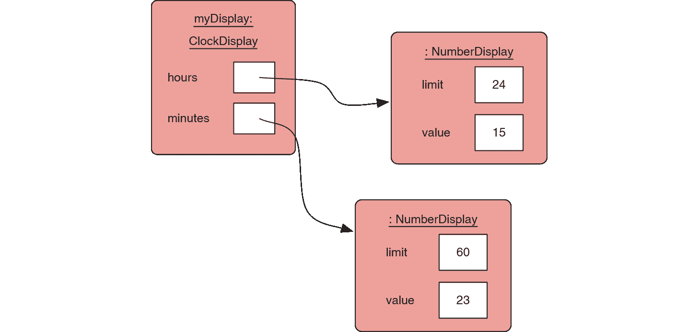

第一个框标题为 `myDisplay : ClockDisplay`（单下划线），包含以下内容：`hours`：一个空框，`minutes`：一个空框。第二个框标题为 `: NumberDisplay`（单下划线），包含以下内容：`limit`：文本框内的 24，`value`：文本框内的 15。第三个框标题为 `: NumberDisplay`（单下划线），包含以下内容：`limit`：文本框内的 60，`value`：文本框内的 23。有一个箭头从第一个框中对应 `hours` 的空框指向第二个框，有另一个箭头从第一个框中对应 `minutes` 的空框指向第三个框。

# 3.10：对象的创建

我们必须问自己的第一个问题是：`ClockDisplay` 使用的 `NumberDisplay` 对象从哪里来？作为时钟显示器的用户，当我们创建一个 `ClockDisplay` 对象时，我们假设我们的时钟显示有小时和分钟。因此，通过简单创建一个时钟显示，我们就隐式地创建了两个用于分钟的数字显示器。

然而，作为 `ClockDisplay` 类的编写者，我们必须实现这一点。为了做到，我们在 `ClockDisplay` 的构造函数中编写代码来创建两个 `NumberDisplay` 对象。因为构造函数在 `ClockDisplay` 对象创建时会自动执行，所以 `NumberDisplay` 对象将同时自动创建。以下是实现这一功能的 `ClockDisplay` 构造函数的代码：

```java
public class ClockDisplay
{
    private NumberDisplay hours;
    private NumberDisplay minutes;

    // 其他字段省略

    public ClockDisplay()
    {
        hours = new NumberDisplay(24);
        minutes = new NumberDisplay(60);
        updateDisplay();
    }

    // 方法省略
}
```

构造函数前两行中的每一行都创建一个新的 `NumberDisplay` 对象并将其赋值给字段。创建新对象的运算语法是：

```java
new ClassName (argument-list)
```

`new` 运算执行了两件事：

1. 它创建一个指定类的新对象（这里是 `NumberDisplay`）。
2. 它执行该类的构造函数。

如果类的构造函数定义为带有参数，则必须在 `new` 语句中提供相应的参数。例如，`NumberDisplay` 类的构造函数被定义为期望一个整数参数：

```java
public NumberDisplay(int rollOverLimit)
```

因此，调用此构造函数的 `NumberDisplay` 类的 `new` 运算必须提供一个 `int` 类型的参数以匹配定义的构造函数头：

```java
new NumberDisplay(24)
```

这种参数传递与第 2.5 节中讨论的方法相同。通过这个构造函数，我们实现了我们的目标：如果现在有人创建了一个 `ClockDisplay` 对象，`ClockDisplay` 构造函数将自动执行并创建两个 `NumberDisplay` 对象。从 `ClockDisplay` 类用户的角度来看，`NumberDisplay` 对象的创建是隐式的。然而，从编写者的角度来看，这种创建是显式的，因为他们必须编写代码来实现它。

构造函数中的最后一条语句是对 `updateDisplay` 的调用，用于设置 `displayString` 字段。

# 3.11：多重构造函数

你可能注意到，当你创建一个 `ClockDisplay` 对象时，它提供了两种方式：

```java
new ClockDisplay()
new ClockDisplay(int hour, int minute)
```

这是因为 `ClockDisplay` 类包含了多个构造函数。如果使用无参数的构造函数，那么显示的初始时间将是 00:00。另一方面，如果你想有一个不同的初始时间，可以通过第二个构造函数来实现。类定义包含实现各种任务的不同版本，这被称为方法的重载。

# 3.12：方法调用

## 3.12.1：内部方法调用

构造函数的最后一行是：

```java
updateDisplay();
```

这条语句是一个方法调用。正如我们上面看到的，`ClockDisplay` 类具有：

```java
private void updateDisplay()
```

上面的调用调用了该方法。因为该方法位于同一个类中，我们称之为内部方法调用。内部方法调用的语法为：

```java
methodName (argument-list)
```

在我们的示例中，方法没有参数，因此参数列表为空。当遇到方法调用时，执行将返回方法。这是因为可能有多个同名方法。

## 3.12.2：外部方法调用

外部方法调用意味着一个对象调用另一个对象的方法。这是本章的核心主题：组合组合以执行共同的任务。为了让一个对象调用另一个对象的方法，调用对象必须为另一个对象命名。我们现在将看到 `ClockDisplay` 对象如何调用它创建的两个 `NumberDisplay` 对象的方法，这两个对象分别是 `minutes` 和 `hours`。

这是 `ClockDisplay` 的 `timeTick` 方法，大部分交互在此完成：

```java
public void timeTick()
{
    minutes.increment();
    if(minutes.getValue() == 0) {
        // 进位了！
        hours.increment();
    }
    updateDisplay();
}
```

如果此显示器连接到真实的钟，此方法将每 60 秒由钟的电子计时器调用一次。现在，我们只需自己调用它来测试显示。

我们知道，对 `minutes` 对象调用 `increment` 方法要么会导致分钟数增加 `1`，要么会导致数字进位为零。如果进位为零，说明又过了一个小时，我们需要增加 `hours` 的值。因此，在紧对 `minutes` 调用 `increment` 后，`timeTick` 方法有一个 `if` 语句来检查是否也应该增加小时。`if` 语句中的条件调用 `minutes` 对象的 `getValue` 方法来查看它是否刚刚发生了进位。如果 `getValue` 返回零，那么我们就知道分钟刚刚进位了，应该增加 `hours`。如果分钟的值不为零，那么任务就完成了。在这种情况下，我们不需要更改小时数。因此，该 `if` 语句不需要一个 `else` 部分。

特别需要注意的是，`timeTick` 中所有的外部方法调用在点符号之前都需要一个对象的名字，而不是类名。所以，我们写的是：

```java
minutes.getValue()
```

而不是：

```java
NumberDisplay.getValue()
```

以及：

```java
hours.increment();
```

而不是：

```java
NumberDisplay.increment();
```

从这一点可以很明显地看出原因：我们有两个不同的 `NumberDisplay` 对象可以在它们上面调用这些方法，但初学者程序员经常犯在点符号之前编写类名而不是变量名的错误。如果我们没有在方法调用中命名对象，那么该调用将无法由其预期的对象来处理。这一基本原理在练习 3.10 中得到了说明。即使某个特定类型只有一个对象，在调用其方法时，我们也必须命名该对象，而不是它的类名。

在 `timeTick` 方法中，`ClockDisplay` 对象正在请求 `NumberDisplay` 对象执行整体任务的一部分。换句话说，整个计时任务的责任被分担到了 `ClockDisplay` 类和 `NumberDisplay` 类的代码之间。这是我们在之前讨论抽象时提到的分而治之原则的实际实例说明。这种跨越多个类和对象的责任分担是我们将反复看到的主题。

现在我们还应该能够理解 `ClockDisplay` 类的其余三个方法（参见**代码 3.4**）。`setTime` 方法接受两个参数——小时和分钟——并将时钟设置到指定时间。查看方法体，我们可以看到它是通过调用两个数字显示器的 `setValue` 方法来实现的。然后它内部调用 `updateDisplay` 来相应更新显示字符串，就像构造函数所做的那样。

`getTime` 方法是一个标准的 getter 方法——它只需返回当前的显示字符串。由于我们始终保持显示字符串是最新的，所以这就是全部的工作了。


最后，`updateDisplay` 方法负责更新显示字符串，以便正确反映由两个数字显示对象表示的时间。它在时钟时间每次变化时被调用。这再次说明了外部方法调用。它是通过调用每个 `NumberDisplay` 对象的 `getDisplayValue` 方法来工作的。这些调用返回各个数字显示器的特定值。然后`updateDisplay` 方法使用字符串拼接将这两个值结合起来并用冒号隔开。

## 3.12.3: 取模运算符

节 3.8.3 展示了 `NumberDisplay` 类中的 `increment` 方法将`value` 字段增加`1`，然后测试它是否达到了限制。以下替代版本使用了 Java 的*取模*运算符（`%`）来实现相同的功能。

```
public void increment()
{
    value = (value + 1) % limit;
}
```

取模运算符的操作与整数除法有关。例如，除法的结果

```
27 / 4
```

可以用整数表示为：

```
result = 6, remainder = 3
```

取模运算符仅返回此类除法的余数。因此，表达式（`27 % 4`）的结果将是`3`。

在这个版本的`increment` 方法中，`(value + 1)` 被除以`limit`。如果和小于`limit`，那么和就是余数，并被赋值给`value` 字段。但如果和等于`limit`，则除法后没有余数，并将零赋值给`value`。尝试以下练习来帮助你理解取模运算符是如何工作的。

## 3.12.4: 时钟显示总结

值得此示例使用抽象将问题拆分为更小部分的方式。观察`ClockDisplay` 类的源代码，你会注意到我们只需创建`NumberDisplay` 对象，而并不特别这些这些对象的内部看起来如何。我们可以调用它们的方法（`increment`、`getValue`、`getDisplayString`）来让它们为我们工作。在这个层次上，我们简单地假设`increment` 会正确增加显示，而不关心它是如何实现的。例如，它使用的是取模运算符还是`if` 语句，只要它实现了任务就无关紧要。

在现实项目中，这些不同的类通常由不同的人编写。你可能已经注意到，这些人所有人必须就类应该具有哪些方法签名以及这些方法做什么达成一致。这样，一个人就可以专注于实现方法，而另一个人只需要使用它们。

一个对象向其他对象提供的方法集被称为它的*接口*（interface）。我们稍后更详细地讨论接口。

# 3.13: 重新回顾模块化、抽象和对象交互

我们现在要在*midi-player* 项目的背景下进一步探索本章的主要主题——模块化、抽象和对象交互。该项目使用了音乐乐器接口（MIDI）标准。MIDI 允许乐器和计算机之间进行通信，并使复杂的曲曲能够数字化编码和播放。然而，对于这个项目，我们将利用 MIDI 而不探索它的任何细节。这是抽象和模块化的另一个例子：除了我们之外的人编写了完全理解 MIDI 标准的复杂性以及如何产生声音的类，但我们不需要知道那些细节。我们可以利用他们已经完成的工作来编写我们自己的程序。

这个项目的主要目的之一是帮助你更深入地思考你在 BlueJ 对象桌上创建的对象之间发生的交互，以及你的交互式方法调用如何被写成 Java 源代码。这将引导我们再次观察对象如何直接交互，而不是通过你作为中介。在某些方面，我们在这个项目中所做的就像你在第 1 章中通过 *figures* 和 *house* 项目所经历的那样，在那里你对 *figures* 项目中对象台上单个形状对象的原始交互随后以 *house* 项目中`Picture` 类的形式写了出来。

## 3.13.1: midi-player 项目

打开 *midi-player* 项目。它由三个类组成：`MidiPlayer`、`SimpleTune` 和`Note`。

本项目的目的不是教你任何新的 Java 特性。如果你浏览这些类的源代码，你会注意到一些我们尚未涵盖的 Java 特性，但我们的目标并不是要你现在就研究或理解它们。不要过度担心源代码中的这些部分。其中几个新特性将在下一章中进行介绍。

## 3.13.2: `Note` 类

根据我们目前为止所学过的 Java 特性，你应该能够轻松地理解`Note` 类的源代码。该类模拟了以特定长度播放的音符，在我们的项目中，这被称为它的`duration`（时长）。在首音乐中，音符的播放长度各不相同，这赋予了乐曲独特的特色。每个`SimpleTune` 对象将存储多个`Note` 对象，代表组成该旋律的音符序列。你已经在`lab-classes` 项目中接触过将多个对象组合在一起的想法，在那里，一个`LabClass` 对象为一门课程存储多个`Student` 对象，我们将在下一章向你正式介绍对象集合。

## 3.13.3: 播放旋律

`MidiPlayer` 对象拥有一个`playTune` 方法，可以播放在`SimpleTune` 对象中定义的简单旋律。我们将通过下面的练习来尝试这一功能。对于这个练习，你可能会发现开启 BlueJ Terminal 窗口中的方法记录很有用：选择`View` 并勾选`Terminal` 菜单项，然后在 Terminal 窗口的`Options` 菜单中勾选`Record method calls`。（你应该确保没有勾选`Clear screen at method call` 选项。）

当一个`SimpleTune` 对象传递给`MidiPlayer` 对象的`playTune` 方法时，`MidiPlayer` 对象会与`SimpleTune` 对象交互，获取它存储的`Note` 对象列表。然后播放器对象将按照相关的`duration` 依次播放每个音符。实际操作是如何实现的可以通过查看`MidiPlayer` 中`playTune` 方法的源代码找到。在本书的这个阶段，我们并不要求你理解那里看到的所有内容，因为它涉及许多我们尚未讨论过的 Java 特性。然而，你可能识别出的特征之一是该方法的源码包含了外部方法调用（从`MidiPlayer` 对象到`SimpleTune` 对象）和内部方法调用（从`MidiPlayer` 调用其自己的方法）。例如，其中一行代码是：

```java
int instrument = tune.getInstrument();
```

这调用了`SimpleTune` 对象`tune` 的`getInstrument` 方法，并将返回的值存放在名为`instrument` 的局部整数变量中。这是一个外部方法调用。

另一行是：

```java
addNoteToTrack(noteValue, track, tick, duration);
```

`addNoteToTrack` 之前缺少变量名和点告诉我们这是一个内部方法调用，`addNoteToTrack` 必须定义在`MidiPlayer` 类内部，而不是`SimpleTune` 类内部。

## 3.13.4: BlueJ 对象台

BlueJ 的独特特征之一是它的对象台（object bench）。这允许你通过检查对象的状态并对其调用方法来与对象直接交互。当你与对象台上的对象进行交互时，实际上你是在模拟独立于 BlueJ 运行的程序内部不断发生的情况。如果你开启了“方法记录”，可以在 BlueJ Terminal 窗口中看到相应的代码。

我们编写的源代码旨在通过让相应的程序在运行时创建创建新对象并安排这些对象相互交互来完成任务。随着你开始编写更复杂的程序，你会发现通过你与对象台上创建的对象进行交互来完成整个任务的情况越来越少。相反，你可能会创建一个对象，调用它的其中一个方法，然后在程序运行期间与程序中的许多对象不再进行任何进一步的直接交互。你可以通过完成以下练习在实践中探索这一点，这些练习将引导你完成编写一个创建并播放简单旋律的 Java 类的过程。换句话说，你将编写一个完成`Exercise 3.42` 的程序，而不是通过直接交互来解决它。如果你在完成该练习时开启了方法记录，那么你已经见过与你将编写的源代码非常相似的内容，所以如果你第一次没有这样做，可能会想在开启方法记录的情况下重复该练习。

## 3.13.5: 编写旋律播放程序

你将要创建一个类，接管创建`MidiPlayer` 对象、创建`SimpleTune` 对象、向`SimpleTune` 中添加一些音符的职责，然后将其传递给`MidiPlayer` 来播放旋律。

如果你在任何一点遇到困难，你可能想参考一下练习 3.42 中所示的代码来获取思路。只需注意对代码中的变量名进行适当的调整，因为它们可能与那里显示的代码不同；例如，用`player` 代替`midiPlay1`。

在完成`midi-player` 练习后，你应该拥有一个涉及“对象创建对象”的类：例如，`TuneCreator` 会创建一个`MidiPlayer` 对象和一个`SimpleTune` 对象。还有几个对象对之间对象交互/方法调用的示例：

* `TuneCreator` 对象多次调用了`SimpleTune` 对象的`addNote` 方法；

* 随后`TuneCreator` 对象调用了`MidiPlayer` 对象的`playTune` 方法，并将`SimpleTune` 对象（包含所有添加的音符）作为参数传递给它；

* 接着`MidiPlayer` 对象调用了`SimpleTune` 对象的`getNotes` 和`getInstrument` 方法。

这个示例说明了面向对象编程的一个核心点：程序通常通过对象创建其他对象并调用它们的各种方法来运行。

# 3.14: 实例方法

练习 3.10 涉及到错误地尝试在类名而不是变量名上调用方法。这行不通——结果是一条错误信息。

这种情况值得进一步讨论，因为在某些情况下，我们确实会在类名上调用方法。这些特殊方法被称为**静态方法**，而我们目前为止使用的方法是**实例方法**。让我们再次检查实例方法。

节 3.12.2 解释过，在进行外部方法调用时，我们通常为要调用方法的对象命名，而不是类类。例如，如果你尝试像这样查找`TicketMachine` 中的余额：

```
TicketMachine.getBalance()
```

编译错误将是：

```
non-static method getBalance cannot be referenced
from a static context
```

因为代码是在类名上调用`getBalance`，所以没有说明需要哪台机器的余额。如果你尝试像这样显示一首乐律的音符：

```
SimpleTune.showNotes();
```

你将再次收到相同的消息，因为不同的`SimpleTune` 对象将包含不同的乐律，而代码没有说明应该由哪个特定的`SimpleTune` 对象显示它的音符。

在第 2 章 中，我们引入了 Java 类的基本元素：字段、构造方法和方法。在所有情况下，我们编写的方法都是实例方法。换句话说，对这些方法的调用总是与对象关联的。这是一个重要的概念，因为每个对象都有一个状态（存储在它的实例字段中），该状态独立于该类的所有其他实例进行维护。如果我们对`TicketMachine` 对象调用`getBalance`，那么我们期望该特定对象返回调用时其特定余额字段的值，而不是任何其他`TicketMachine` 对象的余额。同一类的不同对象可能会返回不同的值，取决于它们当前的状态。

# 3.15: 静态方法

实例方法有时被称为“非静态方法”，这我们在上一节中看到的错误信息中使用的正是这种术语。从这些错误信息中，你可能会意识到有些方法被称为“静态方法”。静态方法很容易识别，因为它们在头部定义中带有`static` 关键字。（我们目前还没有在代码中看到过这些方法的示例。）在现阶段，我们不需要在自己的代码中编写任何静态方法（我们稍后会这样做，请参阅第 6 章），但我们可能想要使用标准库中的一些静态方法。理解它们之间的区别对于解释像上面那样的错误也有帮助。

静态方法的显著特征是它不与对象关联，而是与定义它的类关联。原因通常是该方法不需要引用任何特定对象的状态，而是执行某些可以独立于特定对象而完成的抽象计算。

对于静态方法，我们通过类名而不是对象来调用方法：

```
ClassName.methodName(argument-list)
```

接下来的章节提供了这些示例。

## 3.15.1: Math.abs 方法

标准的 Java`Math` 类是一个非常有趣的示例，因为它所有的方法都是静态的。该类没有定义实例字段，因此也没有实例方法。它纯粹被用作存放一组数学辅助函数的容器。结果是，创建`Math` 类的实例既不是必要的也没有用处的。

接下来的示例说明了`Math` 类的一个静态方法。假设我们想要打印一个整数变量的绝对值，无论它是正还是负。这里是我们可能会编写的代码：

```
if(x >= 0) {
    System.out.println(x);
}
else {
    System.out.println(-x);
}
```

在`x` 为正的情况下，我们直接打印它的值。然而，`Math` 类定义了一个名为`abs`（绝对值的缩写）的静态方法，为我们完成了这项任务。我们可以这样替换`if` 语句：

```
System.out.println(Math.abs(x));
```

注意，我们是在`Math` 类上调用`abs` 方法，而不是`Math` 对象。与产生编译错误的示例相比，这段代码可以编译，因为`abs` 被定义为静态方法。

## 3.15.2: System.currentTimeMillis 方法另一个示例是`System` 类中的`currentTimeMillis`。它返回自 1970 年以来的毫秒数。你可以想象，这是一个巨大的数字（一天有 24*60*1000 毫秒），所以方法的类型是`long`，这意味着这是一个很大的整数。以下说明了如何在调用`currentTimeMillis` 后计算当前的小时和分钟：

```
long millis = System.currentTimeMillis();
long seconds = millis / 1000;
long currentMinutes = seconds / 60 % 60;
long currentHours = seconds / (60 * 60) % 24;
```

再次，我们直接在`System` 类上调用`currentTimeMillis`，而不是`System` 类的实例。注意模运算符的使用，我们在节 3.12.3 中讨论过它，以确保分钟的值始终在 0 到 59 之间，小时在 0 到 23 之间。

上述代码的这个变体区别在于变量`currentMinutes` 和`currentHours` 的类型是`int` 而不是`long`。这种“类型转换”是必要的，因为`NumberDisplay` 对象存储的是`int` 值而不是`long` 值，并且不能将`long` 值赋值给变量。为了将赋值右边的长整数转换为`int` 值，使用了类型转换运算符`(int)`。`int` 周围的括号是必要的，因为它是转换运算符的一部分。

```
long millis = System.currentTimeMillis();
long seconds = millis / 1000;
// 使用“强制转换”将 long 转换为 int。
int currentMinutes = (int) (seconds / 60 % 60);
int currentHours = (int) (seconds / (60 * 60) % 24);
```

`currentTimeMillis` 方法也可以用于测量任务执行的实际耗时：只需在任务开始和结束时分别获取并存储系统时间，然后用一个值减去另一个值即可。结果为经过的毫秒数。

## 3.15.3: `String.format` 方法——字符串拼接的替代方案

到目前为止，我们一直使用 Java 的字符串拼接运算符`“+”` 来由多个元素（如字符串和数字）构建字符串。由于`“+”`既用于加法也用于拼接，将其用于拼接可能会导致某些意料之外的结果。另一种替代方案是使用`String` 类的静态方法`format`。它的工作原理与我们在第 2 章中介绍的`printf` 方法类似，它接受一个格式字符串作为参数，该字符串包含格式占位符（例如`%s`、`%d`、`%n`以及用于替换这些占位符的后续参数值。例如：

```
public String getStudentDetails()
{
    return String.format("name: %s, ID: %s, credits: %d",
                         name, id, credits);
}
```

它会将变量`name` 和`id` 的字符串值替换`%s` 占位符，并将`credits` 的整数值替换`%d` 占位符，从而输出格式化后的结果，如下：

```
"name: Alice Lyscoe, ID: 348290, credits: 15"
```

格式占位符可以接受可选的最小宽度，这使得更容易创建整齐的输出，其中每个组件都占据相同的空间。例如：

```
return String.format("name: %15s, ID: %6s, credits: %3d",
                     name, id, credits);
```

这会将名称格式化为至少十五字符，ID 格式化为六字符，学分格式化为三个字符。

## 3.16: 使用调试器

现在我们将使用一种软件工具：调试器来检查相同的概念——对象创建并调用其他对象。

在本章目前为止，我们使用了最基础的技术来分析给程序：代码阅读。阅读和理解源代码是软件开发人员最核心的技能之一，我们将在工作的每一个项目中都应用它。然而，有时使用额外的工具帮助我们更深入地理解程序的执行过程是有益的，我们现在将对此进行实验。

调试器是一种允许程序员逐步执行应用程序的程序。它通常提供某些功能，可以在源代码的选定点处停止和启动程序，并检查变量的值。


调试器的复杂度差异很大。为专业开发人员设计的调试器具有许多功能，可以对应用程序的多个方面进行复杂的检查。BlueJ 内置了一个调试器，它要简单得多。我们可以用它来停止程序、逐行执行代码，并检查变量的值。尽管调试器的界面简单，但它在为我们提供大量信息方面非常有用。

接下来的练习将引导你使用 BlueJ 调试器检查 `midi-player` 项目。

### 3.16.1: 设置断点

为了开始调查，我们在 `SimpleTune` 的 `showNotes()` 方法中设置了一个断点（练习 3.54）。断点是附加在源代码某行上的标记，当执行到该点时会停止方法的执行。在 BlueJ 编辑器中，它通过将该行显示为红色并在左侧边距显示一个小小的停止符号来表示（图 3.5）。

#### 图 3.5 BlueJ 编辑器中的断点

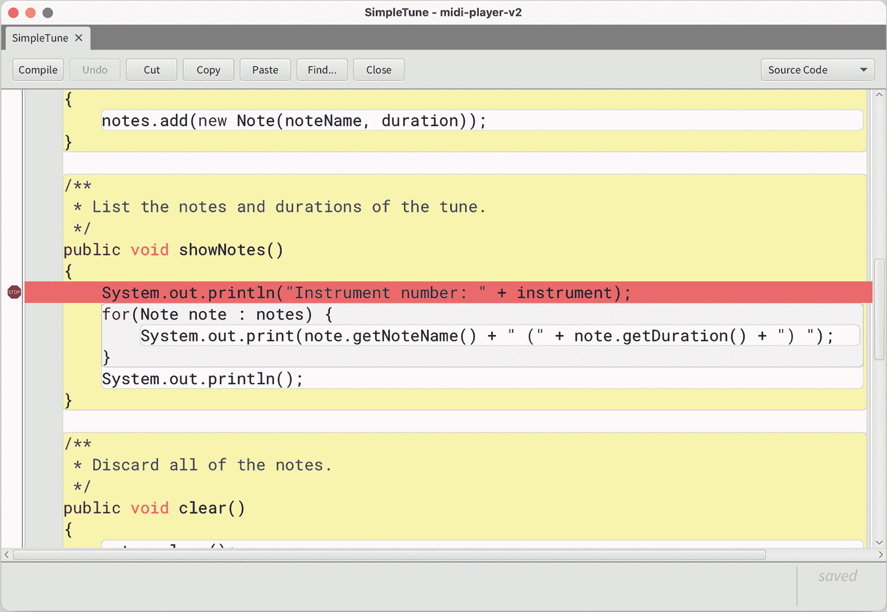

对话框的左上角有三个颜色的圆。标题位于顶部中间部分。`SimpleTune` 标签页打开，具有以下菜单选项：编译（`Compile`）、撤销（`Undo`，已禁用）、剪切（`Cut`）、复制（`Copy`）、粘贴（`Paste`）、查找省略号（`Find ellipsis`）和关闭（`Close`）。右上部分有一个源代码（`Source code`）下拉菜单。代码共有 21 行，如下：第 1 行：左大括号（`OpenCurlyBracket`）。第 2 行：缩进级别 2，`notes` 点 `add` 添加左括号（`OpenParenthesis`）`new Note` 添加左括号（`OpenParenthesis`）`noteName` 逗号 `duration` 关闭右括号（`CloseParenthesis`）右括号（`CloseParenthesis`）分号（`semicolon`）。第 3 行：右大括号（`CloseCurlyBracket`）。第 4 行：空白。第 5 行：`/*` 第 6 行：缩进级别 1，列出乐曲的音符和时长。第 7 行：`*/` 第 8 行：`public void showNotes()`。第 9 行：左大括号（`OpenCurlyBracket`）。第 10 行：缩进级别 2，`System.out.println("Instrument: " + instrument);` 第 11 行：缩进级别 2，`for (Note note : notes) {` 第 12 行：缩进级别 3，`System.out.print(note.getNoteName() + " (" + note.getDuration() + " ) ");` 第 13 行：缩进级别 2，`}` 第 14 行：缩进级别 2，`System.out.println();` 第 15 行：右大括号（`CloseCurlyBracket`）。第 16 行：空白。`/*` 第 17 行：缩进级别 1，清除所有音符。第 18 行：`*/` 第 19 行：`public void clear()`。第 20 行：左大括号（`OpenCurlyBracket`）。第 21 行：`notes.clear();` 右大括号（`CloseCurlyBracket`）。

通过打开 BlueJ 编辑器，选择相应的行（在我们的例子中是 `showNotes()` 方法的第一行），然后在编辑器的“工具”（`Tools`）菜单中选择“设置/清除断点”（`Set/Clear Breakpoint`）来设置断点。或者，你只需点击出现断点符号的代码行边距即可设置或清除断点。注意，必须先编译类。

一旦设置了断点，调用你对象的 `showNotes()` 方法（在练习 3.53 中创建）。`SimpleTune` 类的编辑器窗口和调试窗口将弹出（图 3.6）。绿色高亮标记了下一行执行的代码，当前对象在对象椅上用绿色轮廓标记。

#### 图 3.6 调试窗口，执行在断点处停止

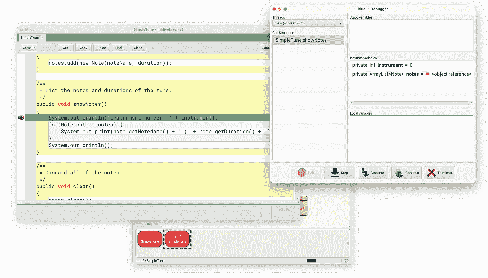

第一个对话框的左上角有三个圆圈。标题 `SimpleTune - midi-player-v2` 位于顶部中间。一个 `SimpleTune` 标签已打开，带有以下菜单选项：`Compile`（编译）、`Undo (disabled)`（撤销（禁用））、`Cut`（剪切）、`Copy`（复制）、`Paste`（粘贴）、`Find`（查找）和 `Close`（关闭）。右上有一个下拉菜单 `Source code`。代码有 21 行，如下：

第 1 行：`OpenCurlyBracket`。

第 2 行：`Indentation Level 2`，`notes dot add OpenParenthesis new Note OpenParenthesis noteName comma duration CloseParenthesis CloseParenthesis semicolon`。

第 3 行：`CloseCurlyBracket`。

第 4 行：`Blank`。

第 5 行：`ForwardSlash asterisk asterisk`。

第 6 行：`Indentation Level 1`，`asterisk List the notes and durations of the tune`。

第 7 行：`Indentation Level 1`，`asterisk ForwardSlash`。

第 8 行：`public void showNotes OpenParenthesis CloseParenthesis`。

第 9 行：`OpenCurlyBracket`。

第 10 行：`Indentation Level 2`，`System dot out dot println OpenParenthesis double quotes Instrument number colon double quotes plus instrument CloseParenthesis semicolon`。

第 11 行：`Indentation Level 2`，`for OpenParenthesis Note note colon notes CloseParenthesis OpenCurlyBracket`。

第 12 行：`Indentation Level 3`，`System dot out dot print OpenParenthesis note dot getNoteName OpenParenthesis CloseParenthesis plus double quotes OpenParenthesis double quotes plus note dot getDuration OpenParenthesis CloseParenthesis plus double quotes CloseParenthesis`。

第 13 行：`Indentation Level 2`，`CloseCurlyBracket`。

第 14 行：`Indentation Level 2`，`System dot out dot println OpenParenthesis CloseParenthesis semicolon`。

第 15 行：`CloseCurlyBracket`。

第 16 行：`Blank`。

第 17 行：`ForwardSlash asterisk asterisk`。

第 18 行：`Indentation Level 1`，`asterisk Discord all of the notes`。

第 19 行：`Indentation Level 1`，`asterisk ForwardSlash`。

第 20 行：`public void clear OpenParenthesis CloseParenthesis`。

第 21 行：`OpenCurlyBracket`。

第二个对话框标题为 `BlueJ: Debugger`，其左上角有三个彩色的圆圈。标题 `BlueJ: Debugger` 位于顶部中间。左侧面板包含：`Threads`：一个下拉菜单，其中选择了 `main (at breakpoint)`；`Call sequence`：`SimpleTune dot showNotes`。右侧面板有三个部分：第一部分 `Static variables`（静态变量），带有一个空白文本框；第二部分 `Instance variables`（实例变量），文本框内容为 `private int instrument equals 0`、`private ArrayList OpenAngleBracket Note CloseAngleBracket notes equals a box OpenAngleBracket object reference CloseAngleBracket`。第三部分 `Local variables`（局部变量）：一个选中的文本框。框底部有以下按钮：`Halt`（八边形，上面写着 `Halt`）、`Step`（指向水平线的箭头）、`Step into`（步进箭头）、`Continue`（带有两个淡色向下箭头的向下箭头）和 `Terminate`（叉号）。`Halt` 按钮是禁用的。

第三个对话框位于这两个对话框后面，显示以下内容：两个圆角矩形分别写着 `tune1: SimpleTune` 和 `Tune2: SimpleTune`。下方的文本写着 `tune2: SimpleTune`。右下角有一个返回按钮。

调试器窗口底部有一些控制按钮。它们可用于继续或中断程序的执行。（如需了解调试器控制器的详细说明，请参见 Appendix F。）

调试器窗口右侧有三个用于变量的区域，标题分别为 `Static variables`、`Instance variables` 和 `Local variables`。我们暂时忽略静态变量区域；稍后会讨论，而且该类没有任何静态变量。

我们看到该对象有两个实例变量（或字段）`instrument` 和 `notes`，我们可以看到当前值。`instrument` 变量存储值 0，`notes` 变量存储指向另一个对象的引用。对象引用就是我们在对象图中画的箭头。

注意，终端尚未打印任何内容。这是因为执行在带有断点的行被执行*之前*就已经停止了。下一行有打印到终端的代码，但它尚未被执行。

调试器不仅允许我们中断程序执行以便检查变量，还让我们缓慢地向前步进。

## 3.16.2: 单步执行

在断点处停止时，点击 `Step` 按钮将执行单行代码然后再次停止。

执行 `showNotes()` 方法前几步的结果如**图 3.7** 所示。我们可以看到执行已经移动（绿色高亮表示当前位置），终端窗口中出现了一些输出。

### 图 3.7 在执行几步操作后再次停止

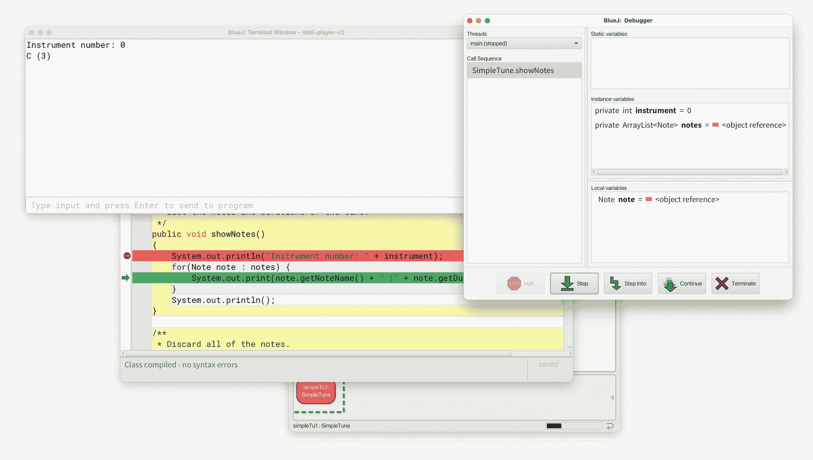

标题为 `BlueJ: Terminal Window - midi-player-v2` 的第一个对话框包含：`Instrument number: 0`、`OpenParenthesis`。底部的文本写着 `输入并按 Enter 发送到程序`。第二个对话框显示了部分代码如下：

第 1 行：`Indentation level 1`，`asterisk ForwardSlash`。

第 2 行：`public void showNotes OpenParenthesis CloseParenthesis`。

第 3 行：`OpenCurlyBracket`。

第 4 行：`Indentation Level 2`，`System dot out dot println OpenParenthesis double quotes Instrument number colon double quotes plus instrument CloseParenthesis semicolon`。

第 5 行：`Indentation Level 2`，`for OpenParenthesis Note note colon notes CloseParenthesis OpenCurlyBracket`。

第 6 行：`Indentation Level 3`，`System dot out dot print OpenParenthesis note dot getNoteName OpenParenthesis CloseParenthesis plus double quotes OpenParenthesis double quotes plus note dot getDuration OpenParenthesis CloseParenthesis plus double quotes CloseParenthesis`。

第 7 行：`Indentation Level 2`，`CloseCurlyBracket`。

第 8 行：`Indentation Level 2`，`System dot out dot println OpenParenthesis CloseParenthesis semicolon`。

第 9 行：`CloseCurlyBracket`。

第 10 行：`ForwardSlash asterisk asterisk`。

第 11 行：`Indentation Level 1`，`asterisk Discord all of the notes`。

第 12 行：`public void clear OpenParenthesis CloseParenthesis`。

第 13 行：`OpenCurlyBracket`。

标题为 `BlueJ: Debugger` 的第三个对话框其左上角有三个彩色的圆圈。标题 `BlueJ: Debugger` 位于顶部中间。左侧面板包含：`Threads`：一个下拉菜单，其中选择了 `main (at breakpoint)`；`Call sequence`：`SimpleTune dot showNotes`。右侧面板有三个部分：第一部分 `Static variables`，带有一个空白文本框；第二部分 `Instance variables`，文本框内容为 `private int instrument equals 0`、`private ArrayList OpenAngleBracket Note CloseAngleBracket notes equals a box OpenAngleBracket object reference CloseAngleBracket`。第三部分 `Local variables`：一个文本框内容为 `Note equals a box OpenAngleBracket object reference CloseAngleBracket`。

第四个对话框位于这两个对话框后面，显示以下内容：两个圆角矩形分别写着 `tune1: SimpleTune` 和 `Tune2: SimpleTune`。下方的文本写着 `tune2: SimpleTune`。右下角有一个返回按钮。

我们现在可以反复使用 `Step` 按钮执行到方法结束。这让我们看到执行的路径。这在循环和条件语句中特别有趣：我们可以清楚地看到循环重复执行其体，或者执行了条件语句的哪个分支，并以此判断是否符合我们的预期。

## 3.16.3: 步入方法

在步进 `createAndPlay()` 方法时，我们看到了多次对我们自己的类方法的调用。该行 `tune.addNote("G4", 2);` 包含了对 `tune` 对象 `addNote()` 方法的调用。

该行 `player.playTune(tune);` 调用 `player` 对象的 `playTune()` 方法，该对象的类型为 `MidiPlayer`。

在调试器中使用 `Step` 命令时，我们使用了抽象化：我们将 `SimpleTune` 类的 `addNote()` 方法视为单条指令，而不关注其内部是如何运作的。

如果我们对更多细节感兴趣，可以进一步探究该过程，并看到 `addNote()` 方法本身是如何逐步执行的。这是通过使用调试器中的 `Step Into` 命令而不是 `Step` 命令来实现的。`Step Into` 会进入调用的方法，并停在该方法内部的第一行。

在这些实验中，我们可以以慢动作的形式观察方法调用的过程。我们可以看到从一个方法到另一个方法的调用是如何导致被调用方法的执行的，以及这个过程是如何嵌套的。我们还可以观察到对象的创建（使用 `new` 关键字）会导致该对象的构造函数的执行，并且我们可以观察到从参数对对象的字段进行初始化。

一旦你理解了这些概念，就不再需要通过调试器来理解程序的控制流了。然而，熟悉调试器并在以后再次使用它是非常有价值的：当你正在程序中寻找一个顽固的 bug 时，调试器通常对于弄代码中发生了什么以及它为什么没有按照你的预期运行非常有帮助。

# 3.17: 总结

在本章中，我们讨论了如何将一个问题分解为子问题。我们可以尝试在想要建模的对象中识别出子组件，并将子组件实现为独立的类。这样做有助于降低大型应用程序实现的复杂性，因为它使我们能够单独地实现、测试和维护各个类。

我们已经看到这种方法如何产生对象结构共同工作以解决共同任务。对象可以创建其他对象，它们也可以相互调用方法。理解这些对象交互对于规划、实现和调试应用程序至关重要。

我们可以使用纸笔图表、代码阅读和调试器来研究应用程序的执行情况，或追踪 bug。

## 本章引入的术语


1. `abstraction`、`modularization`、`divide and conquer`、`class diagram`、`object diagram`、`object reference`、`overloading`、`internal method call`、`external method call`、`dot notation`、`instance method`、`static method`、`debugger`、`breakpoint`（抽象、模块化、分治法、类图、对象图、对象引用、重载、内部方法调用、外部方法调用、点符号表示、实例方法、静态方法、调试器、断点）

# 第 4 章 对象分组

本章的重点是介绍对象分组到集合中的某些方法。特别是，我们讨论了`ArrayList`类作为灵活大小集合的示例。与集合密切相关的是需要对它们包含的元素进行`iterate`（迭代）或循环。为了实现这个目的，我们引入了两个新的控制结构：`for-each`循环和`while`循环。

这一章既长又重要。如果不完全理解本章的内容，你可能无法成功成为一名出色的程序员。你可能需要比之前的章节花费更长来学习。不要急于跳过；请花时间仔细学习。

# 4.1: 基于第 3 章的主题进行构建

在介绍关于`collections`（集合）和`iteration`（迭代）的新材料的同时，我们还将重温第 3 章中引入的两个主题：`abstraction`（抽象）和`object interaction`（对象交互）。在那里我们看到抽象允许通过识别可以视为整体的离散组件来简化问题，而不是关注它们的细节。当我们开始使用 Java 中提供的`library classes`（库类）时，我们将看到这一原理的实际应用。虽然严格来说这些类并不是语言的一部分，但其中一些类与编写 Java 程序关联紧密，以至于它们通常被认为是那样。大多数编写 Java 程序的人会不断检查库，看看是否已经有人写了他们可以利用的类。这样，他们就节省了大量的精力，这些精力可以被更好地用于程序的其他部分。同样的原理也适用于大多数其他编程语言，它们也有有用的类库。因此，熟悉库的内容以及如何使用最常用的类是值得的。抽象的力量在于，我们通常不需要知道太多关于类内部长样子的（事实上，可能什么都不需要知道！）就能有效地使用它。

如果我们使用库类，那么意味着我们将编写代码来创建这些类的实例，然后我们的对象将与库对象进行交互。因此，对象交互在本章中也将频繁出现。

你会发现书中的章节不断地回顾并在之前章节引入的主题基础上进行构建。我们在序言中将这种方法称为“迭代方法方法”。这种方法的优点之一是，它将帮助你在阅读这本书的过程中逐渐加深对主题的理解。

在本章中，我们还扩展了对抽象的理解，它不仅意味着隐藏细节，还意味着看到程序中反复出现的共同特征和模式。识别出这些模式意味着我们通常可以在新情况下重用以前编写的方法或类的部分或全部。这在查看集合和迭代时尤为适用。

# 4.2: 集合抽象

我们在本章中探索的抽象之一是`collection`（集合）的概念——将事物分组在一起的概念，以便我们可以统一引用和管理它们。一个集合可能是巨大的（大学所有的学生）、很小的（一个学生正在修的课程），甚至是空的（我拥有的毕加索画作！）。

如果我们拥有一个邮票、签名、音乐会海报、装饰品、音乐或任何物品的集合，无论我们收集什么，我们都会经常对该集合执行一些常见的操作。例如，我们可能想向集合中`add to`（添加），但我们也可能想`reduce it`（减少）——例如如果我们有重复项或想为额外的购买筹资金。我们还可能以某种方式对其进行`arrange it`（排序）——通过获取日期或价值。我们在这里描述的是集合的典型`operations`（操作）。

在编程上下文中，集合抽象变成了某种类，而操作将是该类的方法。一个特定的集合（我的音乐收藏）将是类的一个实例。此外，存储在集合实例中的项本身也将是对象。

以下是一些与编程上下文关系更明显的集合示例：

* 电子日历存储了关于预约、会议、生日等事件的笔记。随着未来事件的安排，会添加新笔记，而当过去事件的细节不再需要时，旧笔记就会被删除。

* 图书馆记录了它们拥有的书籍和期刊的详情。随着新书的购买，目录会发生变化，旧书则被放入仓库或丢弃。

* 大学维护学生记录。每个学年都会向集合添加新记录，而离开的学生的记录会被移动到存档集合中。列出集合的子集是常见的：例如，所有修大一计算机科学的学生，或所有今年毕业的学生。

集合中存储的项目数量会随时间变化。到目前为止，我们还没有遇到过 Java 中任何允许我们将任意数量的项目组合在一起的特性。也许，我们可以定义一个包含许多独立字段的类，以涵盖固定但数量巨大的项目，但程序通常需要比这更通用的解决方案。一个适当的解决方案既不需要我们预先知道想要组合在一起的项目数量，也不需要为该数量设定一个上限。

我们将通过查看一个提供最简单对象分组方法的类开始对 Java 库的探索，这个类是一个未排序但按顺序的、大小可伸的列表：`ArrayList`。在接下来的几节中，我们将通过跟踪个人音乐收藏的示例，来说明如何通过单个容器对象将任意数量的对象组合在一起。

# 4.3: 音乐文件组织器

我们将编写一个类，可以帮助我们组织存储在计算机上的音乐文件。我们的类并不会实际存储文件详情；相反，它会将该责任委托给标准的`ArrayList`库类，这将为我们节省大量工作。那么，我们为什么需要编写自己的类呢？在处理库类时，需要记住的一个重要点是，它们并不是为任何特定的应用场景编写的——它们是通用类。一个`ArrayList`可能会存储学生记录对象，而另一个则存储事件提醒。这意味着，由我们为了使用库类而编写的类提供了提供了特定场景的操作，例如，我们正在处理的是音乐文件，或者播放存储在集合中的音乐文件。

为了简单起见，该项目的第一个版本将简单地处理单个音乐曲目的文件名。它将不会有关于标题、艺术家、播放时间等单独的细节。这意味着我们只是要求`ArrayList`存储代表文件名的`String`对象。在这一阶段保持简单有助于避免掩盖我们正试图说明的关键概念，即集合对象的创建和使用。在章节的稍后部分，我们将增加进一步的复杂性，以制作一个更具可行性的音乐组织器和播放器。

我们假设每个音乐文件代表一首音乐曲目。我们为项目提供的示例文件在文件名中都嵌入了艺术家名称和曲目标题，我们稍后会使用这一特性。目前，这里是我们在组织器初始版本中将拥的基本操作：

* 它允许将曲目添加到集合中。

* 除了运行它的机器内存限制外，它对可以存储的曲目数量没有预设限制。

* 它将告诉我们集合中有多少曲目。

* 它将列出所有的曲目。

我们将发现，`ArrayList`类使得从我们自己的类中提供这种功能变得非常容易。

注意，我们在第一个版本中并没有野心勃勃。这些功能将足以说明创建和使用`ArrayList`对象的基础知识，后续版本将逐步增量地构建更多功能，直到我们拥有一个更复杂的东西。（也许最重要的的一点是，我们以后可能会添加播放音乐文件的可能性。我们的第一个版本将无法做到这一点。）这种谦虚的、增量的方法比试图一次性实现所有内容更容易通向成功。

在分析使用此类类所需的源代码之前，探索一下音乐组织器的初始行为是有帮助的。

# 4.4: 使用库类

**代码 4.1** 显示了我们的`MusicOrganizer`类的完整定义，它使用了库类`ArrayList`。注意，库类不会出现在 BlueJ 的类图中。

#### 代码 4.1: MusicOrganizer 类

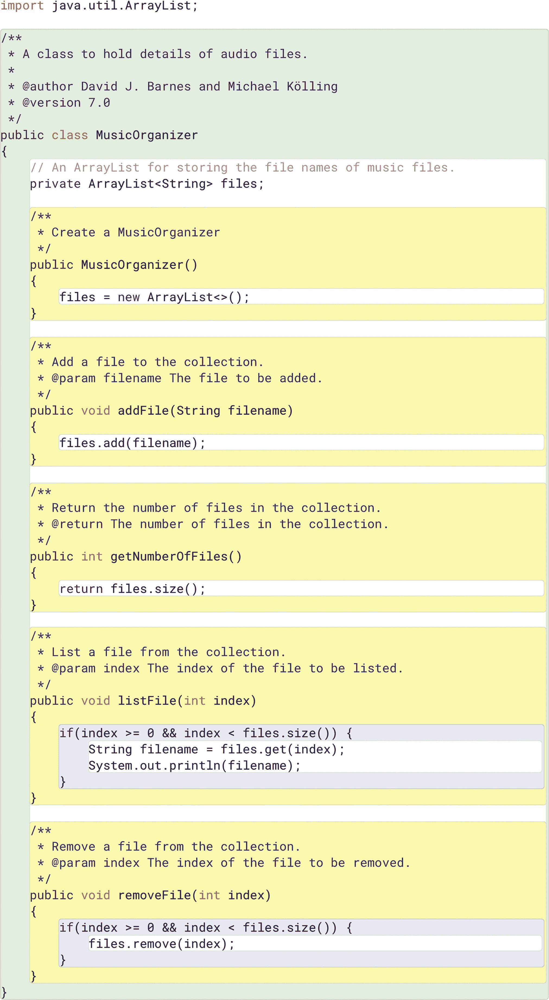

代码包含以下行：

第 1 行：`import java.util.ArrayList;`  
第 2 行：空。  
第 3 行：`/**`  
第 4 行：缩进级别 1，`* 用于存放音频文件详情的类。`  
第 5 行：缩进级别 1，`*`  
第 6 行：缩进级别 1，`* 作者 David J. Barnes 和 Michael Kölling`  
第 7 行：缩进级别 1，`* 版本 7.0`  
第 8 行：缩进级别 1，`*/`  
第 9 行：`public class MusicOrganizer.`  
第 10 行：`{`  
第 11 行：缩进级别 2，`// 用于存储音乐文件文件名的 ArrayList。`  
第 12 行：缩进级别 2，`private ArrayList<String> files;`  
第 13 行：空。  
第 14 行：缩进级别 2，`/**`  
第 15 行：缩进级别 3，`* 创建一个 MusicOrganizer.`  
第 16 行：缩进级别 3，`* */`  
第 17 行：缩进级别 2，`public MusicOrganizer()`  
第 18 行：缩进级别 2，`{`  
第 19 行：缩进级别 4，`files = new ArrayList<>();`  
第 20 行：缩进级别 2，`}`  
第 21 行：空。  
第 22 行：缩进级别 2，`/**`  
第 23 行：缩进级别 3，`* 将文件添加到集合中。`  
第 24 行：缩进级别 3，`* @param filename 要添加的文件`  
第 25 行：缩进级别 3，`*/`  
第 26 行：缩进级别 2，`public void addFile(String filename)`  
第 27 行：缩进级别 2，`{`  
第 28 行：缩进级别 4，`files.add(filename);`  
第 29 行：缩进级别 2，`}`  
第 30 行：空。  
第 31 行：缩进级别 2，`/**`  
第 32 行：缩进级别 3，`* 返回集合中的文件数量。`  
第 33 行：缩进级别 3，`* @return 集合中的文件数量`  
第 34 行：缩进级别 3，`*/`  
第 35 行：缩进级别 2，`public int getNumberOfFiles()`  
第 36 行：缩进级别 2，`{`  
第 37 行：缩进级别 4，`return files.size();`  
第 38 行：缩进级别 2，`}`  
第 39 行：空。  
第 40 行：缩进级别 2，`/**`  
第 41 行：缩进级别 3，`* 列出集合中的文件。`  
第 42 行：缩进级别 3，`* @param index 要列出的文件的索引`  
第 43 行：缩进级别 3，`*/`  
第 44 行：缩进级别 2，`public void listFile(int index)`  
第 45 行：缩进级别 2，`{`  
第 46 行：缩进级别 4，`if (index >= 0 && index < files.size()) {`  
第 47 行：缩进级别 5，`String filename = files.get(index);`  
第 48 行：缩进级别 5，`System.out.println(filename);`  
第 49 行：缩进级别 4，`}`  
第 50 行：缩进级别 2，`}`  
第 51 行：空。  
第 52 行：缩进级别 2，`/**`  
第 53 行：缩进级别 3，`* 从集合中删除一个文件。`  
第 54 行：缩进级别 3，`* @param index 要删除的文件的索引`  
第 55 行：缩进级别 3，`*/`  
第 56 行：缩进级别 2，`public void removeFile(int index)`  
第 57 行：空。  
第 58 行：缩进级别 4，如果 (`index >= 0` 且 `index < files.size()`) {  
第 59 行：缩进级别 5，`files.remove(index);`  
第 60 行：缩进级别 4，}  
第 61 行：缩进级别 2，}  
第 62 行：}

## 4.4.1 导入类

类文件的第一行说明了如何在 Java 中通过`import statement`访问库类：

```
import java.util.ArrayList;
```

这使得来自`java.util`包的`ArrayList`类在我们的类定义中可用。`import`语句必须始终放在文件的类定义之前。一旦以这种方式从包中导入了类名，我们就可以像使用我们自己的类一样使用该类。因此，我们在`MusicOrganizer`类头部使用`ArrayList`来定义一个`files`字段：

```
private ArrayList<String> files;
```

在这里，我们看到了一个新的新结构：在尖括号中提到`String`：`<String>`。这种需求在第 4.3 节中提到，在该节我们注意到`ArrayList`是一个通用的集合类——即对它可以存储的内容没有限制。然而，当我们想要使用`ArrayList`类时，必须明确指定要存储在该特定实例中的对象类型。我们可以存储任何选择的类型，但在声明`ArrayList`变量时，必须指定该类型。像`ArrayList`这样用第二个类型进行参数化的类被称为**泛型类**（generic classes，我们稍后会更详细地讨论它们）。

使用集合时，我们总是必须指定两个类型：集合本身的类型（这里是：`ArrayList`）以及计划存储在集合中的元素类型（这里是：`String`）。我们可以将完整的类型定义`ArrayList<String>`读取为“String 类型的 ArrayList”。我们使用此类型定义作为`files`变量的类型。

正如你现在所预期的，我们看到构造函数体与类字段之间存在紧密联系，因为构造函数负责初始化每个实例的字段。正如`ClockDisplay`为它的两个字段创建了`NumberDisplay`对象一样，在这里我们看到`MusicOrganizer`的构造函数创建一个`ArrayList`类型的对象并将其存储在`files`字段中。

## 4.4.2 菱形符号

为了创建`ArrayList`实例，我们写了以下语句：

```
files = new ArrayList<>();
```

这就是所谓的“菱形符号”（因为两个尖括号形成了一个菱形），它看起来很寻常。我们之前见过`new`语句具有以下形式：

```
new type-name(arguments)
```

我们还看到集合的完整类型名是

```
ArrayList<String>
```

因此，带有空参数列表，创建新集合对象的语句应该如下：

```
files = new ArrayList<String>();
```

事实上，写这条语句也是有效的。第一种使用菱形符号的版本（因此省略了对`String`类型的提及）仅仅是为了方便的快捷写法。如果集合对象的创建与赋值结合，编译器就可以从赋值左侧变量的类型推导出集合元素的类型，Java 允许我们跳过再次包含。元素类型是从变量类型自动推断的。

使用这种形式并没有改变所创建的对象只能存储`String`对象的事实；它仅仅是一种便利，节省了我们的输入时间并让我们的代码更短。

## 4.4.3 ArrayList 的关键方法

`ArrayList`类定义了很多方法，但我们在此阶段仅使用四个：`add`、`size`、`get`和`remove`。

前两个方法分别在相对简单的`addFile`和`getNumberOfFiles`方法中得到了说明。`ArrayList`的`add`方法在列表中存储一个对象，而`size`方法告诉我们当前其中存储了多少项内容。我们将在第 4.7 节中查看`get`和`remove`方法是如何工作的，尽管你可能通过通过阅读`listFile`和`removeFile`方法的代码就已经对它们有了初步了解。

## 4.5 使用集合的对象结构

为了理解像`ArrayList`这样的集合对象是如何运作，查看对象图很有帮助。图 4.1 展示了`MusicOrganizer`对象在存储两个文件名字符串时可能的样子。对比图 4.1 和图 4.2，后者存储了第三个文件名。

### 图 4.1 包含两个文件名的 MusicOrganizer


第一个标题为`MusicOrganizer`的框包含：`files`：一个`ArrayList<String>`类型的对象。第二个标题为`ArrayList<String>`的框包含两个空框。第三个标题为`String`的框包含：“Burning Man”。第四个标题为`String`的框包含：“Maverick”。从第一个框的点指向第二个框。从第二个框的两个点指向第三、第四个框。

### 图 4.2 包含三个文件名的 MusicOrganizer


第一个标题为`MusicOrganizer`的框包含：`files`：一个`ArrayList<String>`类型的对象。第二个标题为`ArrayList<String>`的框包含三个空框。第三个标题为`String`的框包含：“Burning Man”。第四个标题为`String`的框包含：“Maverick”。第五个标题为`String`的框包含：“The Falcon”。从第一个框的点指向第二个框。从第二个框的三个点分别指向第三、第四、五个框。

你应该观察到`ArrayList`类至少有三个重要的特性：

*   它能够根据需要增加内部容量：随着更多项目的添加，它会自动留出足够的空间。
*   它维护一个当前存储项数量的私有计数。它的`size`方法返回该计数。
*   它保持了你插入元素的顺序。`add`方法将每个新项存储在列表末尾。稍你可以按相同的顺序检索它们。

我们注意到`MusicOrganizer`对象看起来非常简单——它只有一个存储`ArrayList<String>`类型对象的字段。所有的困难工作都由`ArrayList`对象完成了。这就是使用库类的巨大优势之一：别人投入了时间和精力实现了实用的功能，而我们通过使用这个类几乎是免费地获得了这些功能。

在这个阶段，我们不需要担心`ArrayList`是如何支持这些特性的。只需要欣赏这种能力有多么有用即可。记住：这种对细节的抑制是抽象带给我们的优势；这意味着我们可以利用`ArrayList`编写任意数量的不同类，这些类需要存储任意数量的对象。

第二个特性——`ArrayList`对象维护其对插入对象的计数——对于我们实现`MusicOrganizer`类的方式具有重要影响。虽然组织器有一个`getNumberOfFiles`方法，但我们实际上并没有定义一个字段来记录这些信息。相反，组织器将跟踪项目数量的责任*委托*给它的`ArrayList`对象。这意味着组织器不会重复它从其他地方获取的可用信息。如果用户向组织器请求关于其内部包含的文件名数量的信息，组织器将把该问题传递给`files`对象，然后返回它从那里获取的任何答案。

信息或行为的重复是我们经常努力避免的。重复可能代表精力的浪费，并可能导致不一致性，即由于程序员的错误，两个本应该是相同的东西却变得不相同。我们将在后面的章节中讨论更多关于功能重复的内容。

## 4.6: 泛型类

这种使用尖括号的新符号值得进一步讨论一下。我们的`files`字段的类型声明为：

```
ArrayList<String>
```

我们在这里使用的类简单地称为`ArrayList`，但当它用于声明字段或其他变量时，需要指定第二个类型作为参数。需要此类类型参数的类被称为*泛型类*。与我们目前为止看到的其他类相比，泛型类在 Java 中没有定义单一类型，而是可能定义许多种类型。例如，`ArrayList`类可以用于指定`String`的`ArrayList`、`Person`的`ArrayList`、`MusicTrack`的`ArrayList`，或者我们拥有的任何其他类的`ArrayList`。每个特定的`ArrayList`都是一个独立的类型，可以用于字段、参数和返回值的声明。例如，我们可以定义以下两个字段：

```
private ArrayList<Person> members;
private ArrayList<TicketMachine> machines;
```

这些定义说明`members`指向一个可以存储`Person`对象的`ArrayList`，而`machines`可以指向一个存储`TicketMachine`对象的`ArrayList`。注意，`ArrayList<Person>`和`ArrayList<TicketMachine>`是不同的类型。尽管它们的类型派自同一个`ArrayList`类，但这些字段不能相互赋值。

泛型类用于各种目的；我们将在书的后面遇到更多。现在，像`ArrayList`这样的集合以及我们很快将遇到的其他集合，是我们需要处理的唯一泛型类。

## 4.7: 集合内部的编号

在最初几个练习中探索`music-organizer-v1`项目时，我们注意到必须使用从 0 开始的参数值来列出和移除集合中的文件名。这一要求的背后的原因是存储在`ArrayList`集合中的项具有隐式的编号（或位置），该位置从 0 开始。对象在集合中的位置通常被称为它的*索引*（index）。集合中的对象的位置更常见的名称是它的索引。集合中的第一个项索引为 0，第二个为 1，以此类推。**图 4.3** 展示了相同的情况。

### 集合中的元素索引


第一个框标题为`myMusic MusicOrganizer`，包含：`files`：一个带有点的空框。第二个框标题为`: ArrayList OpenAngleBracket String CloseAngleBracket`，包含：标记为 0 和 1 的框。第三个框标题为`: String`，包含：一个写着“Burning Man.m p 3”的文本框。第四个框标题为`: String`，包含：一个写着“The Falcon.m p 3”的文本框。第五个框标题为`: String`，包含：一个写着“Maverick.m p 3”的文本框。箭头从第一个框指向第二个框。

这意味着集合中的最后一个项索引为`size()-1`。例如，在一个有 20 个项的列表中，最后一个索引是 19。

`listFile`和`removeFile`方法都说明了如何使用索引访问集合中的项：一个通过`get`方法，另一个通过`remove`方法。注意在将索引传递给`ArrayList`方法之前，确保其值在有效索引范围内。这是一种良好的编程习惯，可以防止传递无效值导致方法调用失败。

### 4.7.1: 删除对编号的影响

正如向集合中添加项一样，通常也移除项，正如我们在`removeFile`方法中所示。`ArrayList`类有一个`remove`方法，它接收要删除对象的索引。删除过程中需要注意的一个细节是，它可以改变集合中其他对象的存储索引值。如果删除了一个低索引的项，集合会将所有后续项向前移动位置以填充空隙。因此，它们的索引将减少 1。

**图 4.4** 展示了通过删除项，`ArrayList`中某些项的索引值发生的变化。从**图 4.3** 所示的情况开始，索引为 1 的对象已被删除。结果是原本位于索引 2 的对象变成了 1，而索引为 0 的对象保持不变。

#### 删除项后的元素索引

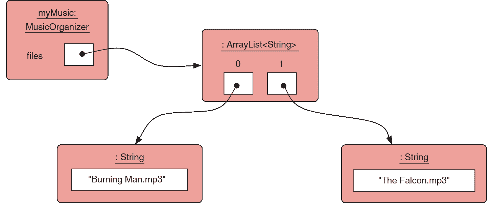

第一个框标题为`myMusic MusicOrganizer`，包含：`files`：一个带有点的空框。第二个框标题为`: ArrayList OpenAngleBracket String CloseAngleBracket`，包含：标记为 0 和 1 的两个空框，其中心有一个点。第三个框标题为`: String`，包含：一个写着“Burning Man.m p 3”的文本框。第四个框标题为`: String`，包含：一个写着“The Falcon.m p 3”的文本框。

使用整数索引值来访问集合中的对象，这是我们将会反复看到的内容——不仅适用于`ArrayList`，也适用于许多不同类型的集合。因此，理解我们目前为止所看到的这些内容非常重要：索引值从零开始；对象是按顺序编号的；以及集合中连续对象的索引值之间通常没有间隙。

使用整数值作为索引还允许我们在程序代码中轻松表达相对于集合中某个项的“下一个项”和“上一个项”等概念。如果某个项位于索引`p`，那么“下一个”项将位于索引`(p+1)`，而“上一个”项现在位于索引`(p–1)`。我们还可以将自然语言的选择描述（例如“前三个”）映射到程序相关的术语，例如“索引为`0`、`1`和`2`处的项”，“最后四个”可以是“索引从`(list.size()-4)`到`(list.size()-1)`处的项”。

我们甚至可以通过一个整数索引变量来遍历整个集合，该变量的初始值设为零，然后连续加 1，将其值传递给`get`方法，以顺序访问列表中的每个项（当它超过列表的最终索引值时停止）。

但我们有点操之过急了。尽管如此，稍后当我们查看*循环*和迭代时，我们将看到这一切在实践中是如何运作的。

## 4.8: 播放音乐文件

我们的组织器一个实用的功能是播放音乐轨道。再次，我们可以利用抽象来帮助自己。如果我们有一个专门为播放音频文件编写的类，那么我们的组织器类就不需要知道任何关于如何操作的知识；它只需将文件名传递给播放器类，让它来完成其余工作即可。

遗憾的是，Java 标准库没有适用于播放 mp3 文件的类，而这正是我们想要处理的音频格式。然而，许多独立程序员不断编写自己的有用类，并供他人使用。这些类通常被称为“第三方库”，它们的导入和使用方式与标准 Java 库类相同。

对于我们项目的下一个版本，我们使用了一组最初来自`javazoom.net`的类来编写我们自己的音乐播放器类。你可以在名为 *music-organizer-v2* 的版本找到它。我们将使用的`MusicPlayer`类的三个方法是`playSample`、`startPlaying`和`stop`。前两个接收要播放的音频文件的名称。第一个播放文件开头的几秒钟并在播放完成后返回，而第二个在后台开始播放，然后立即将控制权交回组织器——因此需要`stop`方法，以防你想取消播放。**代码 4.2** 显示了`MusicOrganizer`类中访问部分播放功能的新元素。

### 代码 4.2: MusicOrganizer 类的播放功能

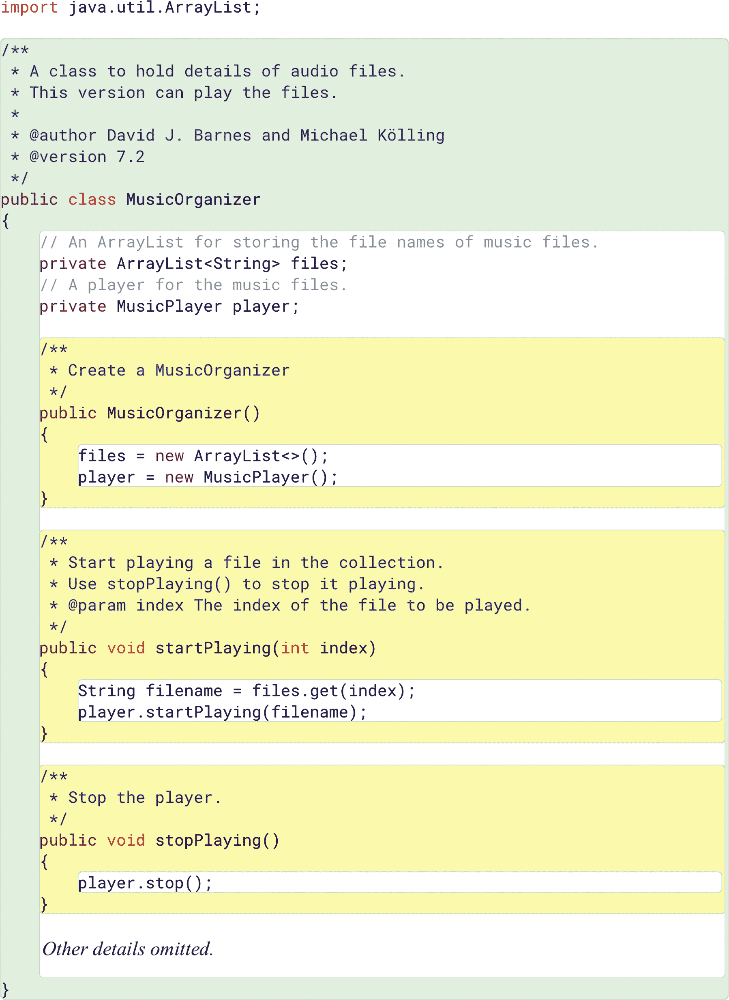

该代码包含以下行：

第 1 行：`import java dot util dot ArrayList semicolon`

第 2 行：空行

第 3 行：`ForwardSlash asterisk asterisk`

第 4 行：缩进级别 1，`* A class to hold details of audio files.`

第 5 行：缩进级别 1，`* This version can play the files`

第 6 行：缩进级别 1，`*`

第 7 行：缩进级别 1，`* at the rate author David J. Barnes and Michael Kölling`

第 8 行：缩进级别 1，`* at the rate version 7`

第 9 行：缩进级别 1，`* ForwardSlash`

第 10 行：`public class MusicOrganizer`

第 11 行：`OpenCurlyBracket`

第 12 行：缩进级别 2，`DoubleForwardSlash An ArrayList for storing the file names of music files.`

第 13 行：缩进级别 2，`private ArrayList OpenAngleBracket String CloseAngleBracket files semicolon`

第 14 行：缩进级别 2，`DoubleForwardSlash A player for the music files`

第 15 行：缩进级别 2，`private MusicPlayer player semicolon`

第 16 行：空行

第 17 行：缩进级别 2，`ForwardSlash asterisk asterisk`

第 18 行：缩进级别 3，`* Create a MusicOrganizer`

第 19 行：缩进级别 3，`* backward slash`

第 20 行：缩进级别 2，`public MusicOrganizer OpenParenthesis CloseParenthesis`

第 21 行：缩进级别 2，`OpenCurlyBracket`

第 22 行：缩进级别 4，`files equals new ArrayList OpenAngleBracket CloseAngleBracket OpenParenthesis CloseParenthesis semicolon`

第 23 行：缩进级别 4，`player equals new MusicPlayer OpenParenthesis CloseParenthesis semicolon`

第 24 行：缩进级别 2，`CloseCurlyBracket`

第 25 行：空行

第 26 行：缩进级别 2，`ForwardSlash asterisk asterisk`

第 27 行：缩进级别 3，`* Start playing a file in the collection.`

第 28 行：缩进级别 3，`* Use stop OpenParenthesis CloseParenthesis to stop it.`

第 29 行：缩进级别 3，`* param index The index of the file to be played.`

第 30 行：缩进级别 3，`* ForwardSlash`

第 31 行：缩进级别 2，`public void startPlaying OpenParenthesis index CloseParenthesis`

第 32 行：缩进级别 2，`OpenCurlyBracket`

第 33 行：缩进级别 4，`String filename equals files dot get Openhesis index semicolon`

第 34 行：缩进级别 4，`player dot startPlaying OpenParenthesis filename semicolon`

第 35 行：缩进级别 2，`CloseCurlyBracket`

第 36 行：空行

第 37 行：缩进级别 2，`ForwardSlash asterisk asterisk`

第 38 行：缩进级别 3，`* Stop the player`

第 39 行：缩进级别 3，`* ForwardSlash`

第 40 行：缩进级别 2，`public void stopPlaying OpenParenthesis CloseParenthesis`

第 41 行：缩进级别 2，`OpenCurlyBracket`

第 42 行：缩进级别 4，`player dot stop OpenParenthesis semicolon`

第 43 行：缩进级别 2，`CloseCurlyBracket`

第 44 行：空行

第 45 行：缩进级别 2，`Other details omitted.`

第 46 行：空行

第 47 行：`CloseCurlyBracket`

#### 4.8.1: 组织器总结

我们在组织音乐集合方面取得了良好的进展。我们可以存储任意数量的音乐文件名称，甚至播放它们。我们通过较少的代码工作实现了这一点，因为我们能够利用库类提供的功能：Java 标准库中的`ArrayList`，以及一个使用第三方类库的音乐播放器。我们不需要了解这些类的内部工作原理就可以实现这一点；只需要知道关键方法的名称、参数类型和返回类型就足够了。

## 4.9: 处理整个集合

在上一节结束时，我们说组织器中需要一个方法来列出存储在集合中的所有文件名。由于集合中的每个文件名都有唯一的索引号，表达我们想要实现的一种方式是说：我们希望从零开始，按连续增加的索引值显示存储的文件。在继续阅读之前，请尝试以下练习，看看我们能否用已知的 Java 轻松编写出这样的方法。

你可能已经注意到，完成`Exercise 4.19`实际上是不可能的，因为它取决于打印时列表中有多少个文件名。如果有三个文件，就需要三个`println`语句；如果有四个文件，就需要四个语句；以此类推。`listFile`和`removeFile`方法说明了在任何时刻，有效索引数字的范围都是`[0 to (size()–1)]`。因此，一个`listAllFiles`方法也必须考虑到这种动态大小才能完成它的工作。

我们在这里面对的需求是要求某项操作执行若干次，但执行的次数取决于可能发生变化的状况——在这种情况下，即取决于集合的大小。在我们编写的几乎每个程序中，都会遇到这种需求，而大多数编程语言都有几种方法通过使用`loop statements`（循环语句，也称为`iterative control structures`迭代控制结构）来处理它。

我们将引入的第一个用于列出文件的循环是专门用于集合的特殊循环，它完全避免了使用索引变量的需要：这被称为`for-each loop`（增强型循环）。

### 4.9.1: The for-each loop


`for-each loop`是对集合中的项重复执行一组动作的方法之一，但不需要多次编写这些动作，正如我们在`Exercise 4.19`中看到的，那是一个问题。我们可以用以下伪代码来总结`for-each`的`Java`语法和动作：

```
for(ElementType element : collection) {
    loop body
}
```

`Java`中主要的新新部分是`for`单词。`Java`语言有两种`for`循环变体：一种是我们在这里讨论的`for-each loop`；另一种简单地称为`for loop`，将在`Chapter 7`中讨论。

一个`for-each loop`有两个部分：循环头（循环语句的第一行）和紧随循环头后的循环体。循环体包含了我们希望反复执行的语句。

`for-each loop`的名称源于我们读取循环的方式：如果我们把关键字`for`读作“对于”，并将循环头中的冒号读作“在”，那么上面的代码结构就变得更有意义了，如下伪代码所示：

```
for each element in collection do: {
    loop body
}
```

当你将这个版本与第一个版本中的原始伪代码比较时，你会发现`element`是以变量声明的形式`ElementType element`编写的。这部分确实声明了一个变量，该变量随后被依次用于集合中的每个元素。在进一步讨论之前，让我们来看一个真实的`Java`代码示例。

`Code 4.3`显示了`listAllFiles`方法的实现，该方法使用这种`for-each`循环列出组织器`ArrayList`中当前所有的文件名。

### Code 4.3 Using a for-each loop to list the file names

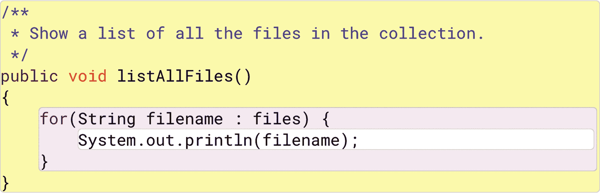

代码包含以下行：

`Line 1`: `ForwardSlash asterisk asterisk`

`Line 2`: 缩进级别 1，`asterisk`显示集合中所有文件的列表。

`Line 3`: 缩进级别 1，`asterisk ForwardSlash`

`Line 4`: `public void listAllFiles OpenParenthesis CloseParenthesis`

`Line 5`: `OpenCurlyBracket`

`Line 6`: 缩进级别 2, `for OpenParenthesis String filename colon files CloseParenthesis OpenCurlyBracket`

`Line 8`: 缩进级别 3, `System dot out dot println OpenParenthesis filename CloseParenthesis semicolon`

`Line 9`: 缩进级别 2, `CloseCurlyBracket`

`Line 10`: `CloseCurlyBracket`

在这个`for-each`循环中，循环体——由单个打印语句组成——被重复执行，`files ArrayList`中的每个元素执行一次。例如，如果列表中有四个字符串，则打印语句将执行四次。

在每次语句执行之前，变量`filename`都会被设置为持有列表中的一个元素：首先是索引 0 的元素，然后是索引 1 元素，以此此类推。因此，列表中的每个元素都被打印了出来。

让我们更详细地分析一下这个循环。关键字`for`引入了循环。后面跟着一对括号，其中定义了循环的细节。细节中的第一个是声明`String filename`。这声明了一个新的局部变量`filename`，它将按顺序持有列表元素。我们称这个变量为`loop variable`（循环变量）。我们可以选择这个变量的名字，就像选择任何其他变量一样；它不必非称为“filename”。然而，循环变量的类型必须与元素类型相同。

## 4.9.2: Selective processing of a collection

`listAllFiles`方法说明了`for-each`循环的基本用途：它通过循环头中声明的变量按顺序访问集合的每个元素。它没有提供元素的索引位置，但我们并不总是需要它，所以这并不是一个问题。

访问集合中的每项并不意味着我们要对每一项都执行相同的操作；我们可以变得更具选择性。例如，我们可能只想列出特定艺术家的音乐；或者我们需要列出标题中包含特定短语的所有曲目。没有什么阻止我们这样做，因为`for-each`循环的体就是一个普通的块，我们可以在里面使用任何我们`Java`语句。因此，在体中使用`if-statement`来选择我们想要的文件应该是很容易的。

`Code 4.4`显示了一个方法，仅列出集合中包含特定字符串的文件名。

### Code 4.4 Printing selected items from the collection

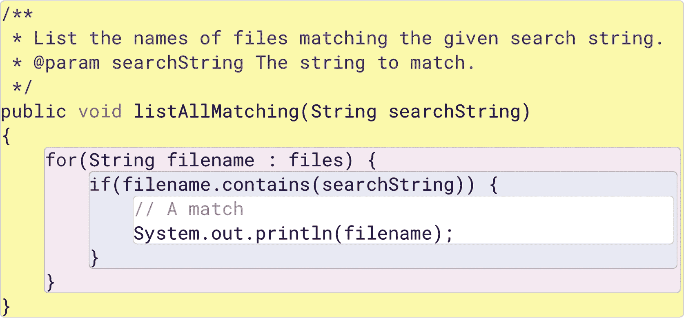

代码包含以下行：

`Line 1`: `ForwardSlash asterisk asterisk`

`Line 2`: 缩进级别 1，`asterisk`列出匹配给定搜索字符串的文件名。

`Line 3`: 缩进级别 1，`asterisk searchString`要匹配的字符串。

`Line 4`: 缩进级别 1，`asterisk ForwardSlash`

`Line 5`: `public void listAllMatching OpenParenthesis String searchString CloseParenthesis`

`Line 6`: `OpenCurlyBracket`

`Line 7`: 缩进级别 2, `for OpenParenthesis String filename colon files CloseParenthesis OpenCurlyBracket`

`Line 8`: 缩进级别 3, `if OpenParenthesis filename dot contains OpenParenthesis searchString CloseParenthesis CloseParenthesis OpenCurlyBracket`

```
public void listAllMatching(String searchString) {
    for (String filename : files) {
        if (filename.contains(searchString)) {
            // do something
        }
    }
}
```

第 9 行：缩进层级 4，双斜杠匹配

第 10 行：缩进层级 4，`System dot out dot println OpenParenthesis filename CloseParenthesis semicolon`

第 11 行：缩进层级 3，`CloseCurlyBracket`

第 12 行：缩进层级 2，`CloseCurlyBracket`

第 13 行：`CloseCurlyBracket`

使用`if`语句和`String`类`contains`方法的`boolean`结果，我们可以“过滤”哪些文件名需要打印，哪些不需要。如果文件名中不包含搜索字符串，那么我们只需忽略它即可——不需要`else`部分。过滤标准（`if`语句中的测试条件）可以是我们想要的任何内容。

## 4.9.3：for-each 循环总结

`for-each`循环始终用于遍历集合。它为我们提供了一种按顺序逐个访问集合中每个项目的方法，并允许我们以我们所需的任何方式处理这些项目。我们可以选择对每个项目执行相同的操作（正如我们在打印完整列表时所的那样），也可以有选择性地过滤列表（正如我们在只打印集合子集时所的那样）。循环体可以根据我们的意愿任意复杂。

这种本质上的简单性不可避免地带来了一些局限性。例如，一个限制是，我们无法遍历集合的同时通过添加新项目或删除项目来更改集合中存储的内容。然而，这并不意味着我们不能更改集合已有对象的状态。

我们还看到`for-each`循环没有为集合中的项目提供索引值。如果我们需要索引，就必须声明并维护自己的本地变量。这其中的原因再次与抽象有关。在处理集合并对其进行遍历时，值得记住两点：

*   `for-each`循环为遍历不同类型的集合提供了一个通用的控制结构。

*   某些类型的集合在自然上并不与它们存储的项目建立整数索引关联。我们将在第 6 章中遇到其中的一些集合。

因此，`for-each`循环抽象了逐个元素处理完整集合的任务，并能够处理不同类型的集合。我们不需要知道它是如何管理这些细节的。

我们还没有问的问题是：如果我们想在处理集合的过程中途停止，是否可以使用`for-each`循环？例如，假设我们不想播放所选艺术家的每一首歌曲，而只想找到第一首并播放它，不再继续下去。虽然在原则上使用`for-each`循环这样做是*可能*的，但我们的实践和建议是，不要对可能不需要处理整个集合的任务使用`for-each`循环。换句话说，只有当你*确定*想要处理*整个集合*时，我们才建议使用`for-each`循环。再次，换一种说法，一旦循环开始，你就确切知道体会将执行多少次——这将等于集合的大小。这种风格通常被称为*确定性迭代*（`definite iteration`）。对于你可能想在中途停止的任务，有更合适的循环可以使用——例如，*while 循环*，我们将在第 4.11 节中介绍它。在这些情况下，循环体执行的次数是不确定的；它通常取决于遍历过程中发生了什么。这种风格通常被称为*不确定性迭代*（`indefinite iteration`）。

## 4.10：改进结构——`Track` 类

到此为止，我们可以看到，仅仅包含音乐曲目所有细节的文件名字符串并不十分理想。例如，假设我们想找到所有标题中包含“love”一词的曲目。使用上述描述的不够复杂的匹配技术，我们还会找到名字中恰好包含该字符序列的艺术家的曲目（例如，“Glover”）。虽然这看起来可能不是特别大问题，但它确实有一种很“廉价”的感觉，而且只要再加一点努力，本可以做得更好。我们真正需要的是一个独立的类，例如`Track`，它能独立于文件名来存储艺术家和标题的细节。

任何商业播放器都会允许我们按艺术家、标题、专辑、流派等搜索曲目，并可能会包含额外的细节，如曲目播放时间和曲目编号。面向对象编程的力量之一在于，它允许我们设计类，紧密地模拟我们经常试图表示的现实世界的内在结构和行为。这是通过编写字段和方法与属性匹配的类来实现的。我们对于如何编写带有字段、构造函数、`getter`和`setter`方法的基础类已经有了足够的了解，因此可以轻松设计一个具有存储独立艺术家和标题信息字段的`Track`类。通过这样，我们将能够以更自然的方式与音乐组织器中的对象进行交互。

所以，是时候放弃用字符串存储曲目细节了，因为拥有一个独立的`Track`类是表示程序中使用的主要数据项——音乐曲目——最合适的方法。然而，我们不会野心过大。要克服的显性障碍之一是如何获取我们想要存储在`Track`中的各个独立信息。一种方法是在用户向组织器添加音乐文件时，要求他们输入艺术家、标题等。但这样做会非常耗时费力，因此对于这个项目，我们选择了一组文件名包含艺术家和标题的音乐文件。我们编写了一个辅助类（称为`TrackReader`）来填充相应的`Track`对象。我们目前不会太考虑这些实现的细节。

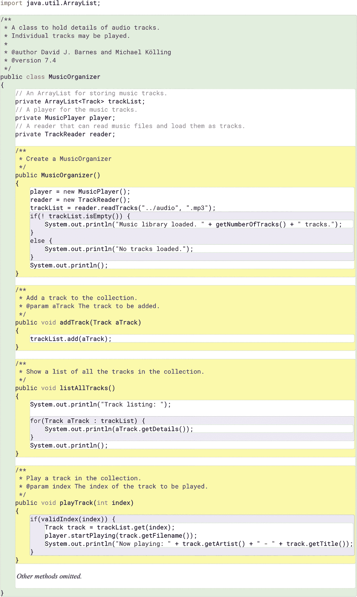

该代码包含以下行：

第 1 行：`import java.util.ArrayList;`

第 2 行：空

第 3 行：`/*`

第 4 行：缩进级别 1，`* 用于存储音频轨道详细信息的类.`

第 5 行：缩进级别 1，`* 可以播放单个轨道。`

第 6 行：缩进级别 1，`*`

第 7 行：缩进级别 1，`* 作者为 David J. Barnes 和 Michael Kölling`

第 8 行：缩进级别 1，`* 版本为 7.4`

第 9 行：缩进级别 1，`* /`

第 10 行：`public class MusicOrganizer`

第 11 行：`{`

第 12 行：缩进级别 2，`// 用于存储音乐轨道的 ArrayList.`

第 13 行：缩进级别 2，`private ArrayList<Track> trackList;`

第 14 行：缩进级别 2，`// 用于音乐轨道的播放器.`

第 15 行：缩进级别 2，`private MusicPlayer player;`

第 16 行：缩进级别 2，`// 可以读取音乐文件并将其加载为轨道的器.`

第 17 行：缩进级别 2，`private TrackReader reader;`

第 18 行：空

第 19 行：缩进级别 2，`/*`

第 20 行：缩进级别 3，`* 创建一个 MusicOrganizer`

第 21 行：缩进级别 3，`* /`

第 22 行：缩进级别 2，`public MusicOrganizer()`

第 23 行：`{`

第 24 行：缩进级别 4，`player = new MusicPlayer();`

第 25 行：缩进级别 4，`reader = new TrackReader();`

第 26 行：缩进级别 4，`trackList = reader.readTracks("./audio.mp3");`

第 27 行：缩进级别 4，`if (!trackList.isEmpty()) {`

第 28 行：缩进级别 5，`System.out.println("Music library loaded " + getNumberOfTracks() + " tracks");`

第 29 行：缩进级别 4，`}`

第 30 行：缩进级别 4，`else {`

第 31 行：缩进级别 5，`System.out.println("No tracks loaded.");`

第 32 行：缩进级别 4，`}`

第 33 行：缩进级别 4，`System.out.println();`

第 34 行：缩进级别 2，`}`

第 35 行：空

第 36 行：缩进级别 2，`/*`

第 37 行：缩进级别 3，`* 向集合中添加轨道.`

第 38 行：缩进级别 3，`* @param aTrack 要添加的轨道.`

第 39 行：缩进级别 3，`* /`

第 40 行：缩进级别 2，`public void addTrack(Track aTrack)`

第 41 行：`{`

第 42 行：缩进级别 4，`trackList.add(aTrack);`

第 43 行：缩进级别 2，`}`

第 44 行：空

第 45 行：缩进级别 2，`/*`

第 46 行：缩进级别 3，`* 显示集合中所有轨道列表.`

第 47 行：缩进级别 3，`* /`

第 48 行：缩进级别 2，`public void listAllTracks()`

第 49 行：`{`

第 50 行：缩进级别 4，`System.out.println("Track listing:");`

第 51 行：空

第 52 行：缩进级别 4，`for (Track aTrack : trackList) {`

第 53 行：缩进级别 5，`System.out.println(aTrack.getDetails());`

第 54 行：缩进级别 4，`}`

第 55 行：缩进级别 4，`System.out.println();`

第 56 行：缩进级别 2，`}`

第 57 行：空

第 58 行：缩进级别 2，`/*`

第 59 行：缩进级别 3，`* 播放集合中的轨道.`

第 60 行：缩进级别 3，`* @param index 要播放轨道的索引.`

第 61 行：空

第 62 行：缩进级别 2，`public void playTrack(int index)`

第 63 行：`{`

第 64 行：缩进级别 2，`if (validIndex) {`

第 65 行：缩进级别 5，`Track track = trackList.get(index);`

第 66 行：缩进级别 5，`player.startPlaying(track.getFilename());`

第 67 行：缩进级别 5，`System.out.println("Now playing " + track.getArtist() + " - " + track.getTitle());`

第 68 行：缩进级别 4，`}`

第 69 行：缩进级别 2，`}`

第 70 行：空

第 71 行：缩进级别 2，`其他方法省略.`

第 72 行：空

# 4.11: 不确定迭代

使用`for-each`循环让我们第一次体验了重复执行某些操作的原理。循环体内的语句会针对关联集合中的每个项目执行一次，并在到达集合末尾时停止迭代。`for-each`循环提供了*确定性迭代*；给定特定集合的状态，循环体执行的次数将与集合的大小精确匹配。但在许多情况下，我们想要重复某些操作，却无法预先准确预测这可能需要执行多少次。`for-each`循环在这些情况下无法帮助我们。

想象一下，比如你丢了钥匙，你需要在离开家之前找到它们。你的搜索过程将模拟一次**无限迭代**，因为有很多不同的地方需要寻找，而且你无法提前预知在找到钥匙之前需要搜索多少地方；毕竟，如果你能预知到这一点，你就会直接去它们所在的地方了！所以，你可能会在脑海中列出一份可能出现钥匙的地方列表，然后逐个访问每个地方，直到找到它们为止。一旦找到，你想要停止寻找，而不是去完整个列表（那将毫无意义）。


我们在这里看到的是无限迭代的一个例子：（搜索）动作将重复执行不可预测的次数，直到任务完成。在编程场景中，类似于寻找钥匙的场景非常常见。虽然我们并不总是在寻找某些东西，但经常会遇到我们想要继续做某事，直到这种重复不再必要的情况。事实上，这些情况非常常见，以至于大多数编程语言至少提供了一个（通常是多个一个）循环结构来表达它们。因为我们通过这些循环结构尝试的操作通常比仅仅从头到尾遍历一个完整的集合要复杂，因此它们需要花费更多的精力来理解。但由于通过它们可以实现更多样化的功能，这种努力将获得丰报。我们这里的重点是 Java 的 `while` 循环，它与其他编程语言中找到的循环相似。

## 4.11.1：while 循环

一个 `while` 循环由头部和体组成；循环体旨在重复执行。这里是 `while` 循环的结构，其中 `boolean condition` 和 `loop body` 是伪代码，其余部分都是 Java 语法：

```
while(boolean condition) {
    loop body
}
```

循环通过关键字 `while` 引入，其后跟的是一个布尔条件。该条件控制了特定循环迭代的次数。条件在程序控制第一次到达循环时进行求值，并在每次执行完循环体后重新求值。这就是 `while` 循环具有“无限”特性的原因——重新评估的过程。如果条件求值结果为 `true`，则执行循环体；一旦求值结果为 `false`，迭代结束。随后循环体将被跳过，执行将继续运行循环之后的任何代码。

注意，条件实际上在第一次测试时就可能求值结果 `false`。如果发生这种情况，循环体将完全不会执行。这是 `while` 循环的一个重要特性：循环体可能执行 0 次，而不是至少执行一次。

在看真正的 Java 示例之前，让我们先看看之前描述的找钥匙过程的伪代码版本，尝试感受 `while` 循环是如何工作的。以下是表达这种搜索的一种方式：

```
while(the keys are missing) {
    look in the next place
}
```

当我们第一次到达循环时，会对条件进行求值：钥匙丢失了。这意味着我们进入循环体，并查看心理列表中的下一个地方。之后，我们回到条件并对其进行重新求值。如果我们找到了钥匙，循环结束了，我们可以跳过循环离开房屋。如果钥匙仍然丢失，我们就会回到循环体并寻找下一个地方。这个重复的过程一直持续，直到钥匙不再丢失为止。

注意，我们同样可以反过来表达该循环的条件，如下所示：

```
while(not (the keys have been found)) {
    look in the next place
}
```

这种区别是细微的——一种被描述为一种需要改变的状态，而另一种被描述为一个尚未实现的目标。花些时间仔细阅读这两个版本，以确保你理解它们各自是如何工作的。两者都同样有效，并反映了我们在编写真实循环时必须做出的表达选择。在两种情况下，当最后找到钥匙时，我们在循环内部编写的内容将意味着循环条件在下次求值时从 `true` “翻转”为 `false`。

## 4.11.2：使用索引变量迭代

对于第一个用正确的 Java 代码编写的 `while` 循环，我们将编写代码 4.5 所示的 `listAllTracks` 方法的变体。这个版本在每个轨目的详细信息旁边包含了每个轨目的索引（代码 4.6）。可以在 `music-organizer-v5` 中找到这个名为 `listWithIndex` 的方法。

### 代码 4.6：使用 while 循环列出带有关联索引的轨道


该代码包含以下行：

第 1 行：`public void listWithIndex() {`

第 2 行：`System.out.println("Track listing:");`

第 3 行：`int index = 0;`

第 4 行：`while (index < trackList.size()) {`

第 5 行：`Track aTrack = trackList.get(index);`

第 6 行：`System.out.printf("%d: %s\n", index, aTrack.getDetails());`

第 7 行：`index++;`

第 8 行：`}`

第 9 行：`}`

需要观察的一个关键特征是整数变量 `index` 既用于访问列表元素，又用于控制迭代的长度。

虽然这个例子并没有真正说明 `while` 循环的无限特性，因为它遍历了整个集合，但它确实与 `for-each` 示例以及你可能为练习 4.24 编写的答案提供了有用的比较。该方法示例音频轨道时的输出可能如下：

```
Track listing:
0: Studio Lisa: The Falcon (file: ../audio/Studio-Lisa-Falcon.mp3)
1: Lisa Davies: Livid (file: ../audio/Lisa-Davies-Livid.mp3)
2: Studio Lisa: Avant Guardian (file: ../audio/Studio-Lisa-Avant-Guardian.mp3)
3: Studio Lisa: The Signature (file: ../audio/Studio-Lisa-Signature.mp3)
4: Lisa Davies: Maverick (file: ../audio/Lisa-Davies-Maverick.mp3)
5: Lisa Davies: Burning Man (file: ../audio/Lisa-Davies-Burning-Man.mp3)
```

显而易见，`while` 循环版本在编程方面需要我们投入更多精力。考虑：

- 我们必须声明一个列表索引变量，并且必须自己将其初始化为 0 以对应第一个列表元素。该变量必须在循环之外声明。
- 我们必须推导出如何表达循环条件，以确保循环在正确的时间停止。
- 列表元素不会自动从集合中提取并赋值给变量。相反，我们必须手动完成此操作，使用 `ArrayList` 的 `get` 方法。变量 `a` 将局部于循环体体。在每次迭代中，它都会被赋值一个新的新的 `Track` 对象。
- 我们必须记住手动增加计数器变量 `index`，以确保在到达列表末尾时，循环条件最终会变为 `false`。

`while` 循环体中的最后一个语句说明了一个用于将数值变量加 1 的特殊运算符：

```
index++;
```

这等同于：

```
index = index + 1;
```

到目前为止，`for-each` 循环对我们的目的来说显然更好用。它写起来更简单，而且更安全。之所以安全，是因为它保证一定会结束。在我们的 `while` 循环版本中，可能会出错导致`死循环`。如果我们忘记增加索引变量（循环体中的最后一行），循环条件将永远不会变为 `false`，循环将无期地迭代下去。这是一种典型的编程错误，即使是经验丰富的程序员偶尔也会中招。

程序将永远运行下去。在这种情况下，如果循环中不包含输出语句，程序似乎“挂起”了：它看起来什么都没做，并且对任何鼠标点击或按键没有响应。实际上，程序正在执行大量操作。它不断地执行循环，但我们看不到它的任何效果，程序似乎已经死掉了。在 BlueJ 中，通常可以通过主窗口右下角移动的“运行”指示器保持显示而程序似乎什么都没做这一点来检测到。

那么，`while` 循环相比 `for-each` 循环的优点是什么？优点有二：首先，与 `for-each` 循环不同，`while` 循环不需要关联集合（我们可以对任何可以写成布尔表达式的条件进行循环）；其次，即使我们使用循环来处理集合，也不需要处理每个元素——如果我们愿意，可以更早地停止，在循环条件中包含另一个表达我们停止原因的组件。当然，严格来说，循环条件实际上表达的是我们是否想要继续，而该条件的取反才导致了循环的停止。

拥有显式索引变量的好处是，我们可以在循环内部和外部使用它的值，而这在 `for-each` 示例中是无法实现的。我们在 `listWithIndex` 方法中这样做是为了显示集合中每个曲目的索引，这在我们想要选择一个曲目进行播放时非常有用。

在搜索列表时，拥有本地索引变量可能尤为重要，因为它可以提供项目所在位置的记录，在循环结束后该记录仍然可用。我们将在下一节中看到这一点。

## 4.11.3：搜索集合

搜索是你将遇到的最重要的迭代形式之一。因此，掌握它的核心要素至关重要。产生的那类循环结构在实际编程中会反复出现。

搜索的关键特征是它涉及`不确定性迭代`；由于这是必然的，因为如果我们确切知道要去哪里查找，就不需要搜索了。相反，我们必须启动搜索，在成功之前它将经历未知次数的迭代。这意味着在搜索时使用 `for-each` 循环是不恰的，因为它会完成它的整套迭代。

在真实的搜索场景中，我们必须考虑搜索可能会失败的事；我们可能会耗尽查找的地方。这意味着在编写作为搜索一部分的循环时，我们通常需要考虑两种结束可能性：

- 在无限次可能的迭代后搜索成功。
- 在耗尽所有可能性后搜索失败。

在编写循环条件时，这两点都必须考虑。由于如果我们想再迭代一次，循环条件应该求值为 `true`，因此每个结束标准都应该使条件求值为 `false` 以停止循环。

搜索失败时我们最终搜索了整个列表的事实，并没有让失败的搜索变成确定迭代的示例。确定迭代的关键特征是你可以在`循环开始时`确定迭代的次数。这在搜索中是不可能的。

如果我们使用索引变量来遍历集合的连续元素，那么搜索失败很容易识别：索引变量将增加到超出列表最后一项之后。这正是代码 4.6 中 `listWithIndex` 方法所涵盖的情况，其条件为：

```
while(index < trackList.size())
```

该条件表达了只要索引在集合的有效索引范围内，我们就想要继续；一旦它增加到范围之外，我们就想要循环停止。即使列表完全为空，这个条件也有效。在这种情况下，`index` 将初始化为零，对 `size` 方法的调用也将返回零。因为 0 并不小于 0，循环体将完全不会执行，这正是我们想要的。

我们还需要向条件中添加第二部分，用以指示我们是否已经找到了搜索项目并在找到时停止搜索。我们在第 4.11.1 节和练习 4.33 中看到，通常可以通过适当设置的布尔变量以正向或反向的方式表达这一点：

- 一个名为 `searching` 的变量（或 `missing`）初始化为 `true`，可以保持搜索继续，直到在找到项目时将其设置为 `false`。
- 一个名为 `found` 的变量初始化为 `false` 并在条件中作为 `!found` 使用，可以保持搜索继续，直到在找到项目时设置为 `true`。

以下是两种情况下对应的完整条件代码片段：

```
int index = 0;
boolean searching = true;
while(index < files.size() && searching)
```

或者：

```
int index = 0;
boolean found = false;
while(index < files.size() && !found)
```

花时间确保理解这两个片段，它们实现了相同的循环控制，但表达略有不同。记住，整个条件在我们想要继续时必须求值为 `true`，在我们由于任何原因停止时求值为 `false`。我们在第 3 章讨论过“与”运算符 `&&`，它只有在两个操作数都为真时才求值为 `true`。

匹配给定搜索字符串的第一个方法的完整版本可以在代码 4.7（音乐组织器-v5）中看到。该方法返回索引作为其结果。注意，我们需要一种方法向方法的调用者指示搜索是否失败。在这种情况下，我们选择返回一个不可能代表集合有效位置的值——负值。这是搜索情况中的常用技术：返回一个`越界`值来表示失败。

#### 代码 4.7：在列表中查找第一个匹配项

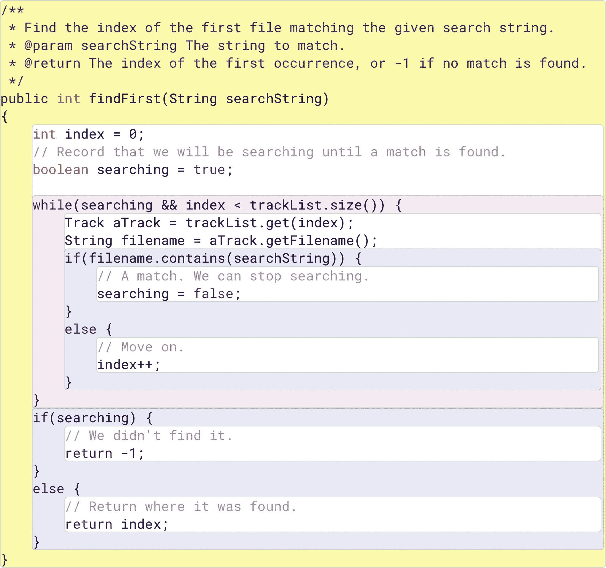

第 2 行：缩进级别 1，* 返回匹配给定搜索字符串的文件的索引。

第 3 行：缩进级别 1，* 参数 `searchString` 用于匹配的字符串。

第 4 行：缩进级别 1，* 返回第一次出现的索引，如果未找到则返回 -1。

第 5 行：缩进级别 1，* `ForwardSlash`

第 6 行：`public int findFirst(String searchString)`

第 7 行：`{`

```
{
    int index = 0;
    // Record that we will be searching until a match is found.
    boolean searching = true;
    while (searching && index < trackList.size()) {
        Track aTrack = trackList.get(index);
        String filename = aTrack.getFilename();
        if (filename.contains(searchString)) {
            // A match. We can stop searching.
            searching = false;
        } else {
            // Move on.
            index++;
        }
    }
    if (searching) {
        // We didn't find it.
        return -1;
    } else {
        // Return where it was found.
        return index;
    }
}
```

```
public int findFirst(String searchString) {
    int index = 0;
    // Record that we will be searching until a match is found.
    boolean searching = true;
    while (searching && index < trackList.size()) {
        Track aTrack = trackList.get(index);
        String filename = aTrack.getFilename();
        if (filename.contains(searchString)) {
            // A match. We can stop searching.
            searching = false;
        } else {
            // Move on.
            index++;
        }
    }
    if (searching) {
        // We didn't find it.
        return -1;
    } else {
        // Return where it was found.
        return index;
    }
}
```

人们可能会尝试在循环中只使用一个条件，尽管结束搜索有两个不同的原因。实现这种方法的方法是，当我们找到寻找的内容时，人为地让 `index` 的值变得过大。我们不建议这种做法，因为它会使循环的终止标准产生误导性，而清晰性始终是首选。

## 4.11.4：一些非集合示例

循环不仅用于集合。在许多情况下，我们希望重复一段完全不涉及集合的语句块。这里是一个打印从 0 到 30 的所有偶数的示例：

```
int index = 0;
while(index <= 30) {
    System.out.println(index);
    index = index + 2;
}
```

事实上，这是另一个使用 `while` 循环进行确定性迭代的例子，因为在开始时就能清楚将打印多少个数字。然而，我们不能使用 `for-each` 循环，因为它们只能在遍历集合时使用。稍后我们还会遇到第三种相关的循环——`for loop`，它对于这个特定的示例来说更为合适。

为了测试你对集合之外的 `while` 循环的理解，请尝试以下练习。

# 4.12：Iterator 类型

迭代是几乎每个编程项目中至关重要的工具，因此，发现编程语言通常提供各种支持它的功能，每种功能都有适用于不同情况的特定特点，这并不令人意外。

我们现在将讨论遍历集合的第三种方式，它介于 `while` 循环和 `for-each` 循环之间。它使用 `while` 循环来执行迭代，并使用 `iterator object` 而不是整数索引变量来跟踪列表中的位置。在这个阶段，我们必须对命名非常小心，因为 `Iterator`（注意大写的 I）是一个 Java 类型，但我们也会遇到一个名为 `iterator`（小写的 i）的方法，所以在阅读本节内容和编写你自己的代码时，务必密切注意这些差异。

检查集合中的每个项目是如此常见，以至于我们已经见过一个特殊的控制结构——`for-each` 循环，它是专门为此目的定制的。此外，Java 的各种集合库类提供了自定义的通用类型来支持迭代，`ArrayList` 在这方面是典型的。

`ArrayList` 的 `iterator` 方法返回一个 `Iterator` 对象。`Iterator` 定义在 `java.util` 包中，因此我们必须在类文件中添加第二个导入语句来使用它：


`import java.util.ArrayList;`
`import java.util.Iterator;`

一个`Iterator`只提供四个方法，其中两个用于遍历集合：`hasNext`和`next`。它们都不接受参数，但它们都有非空类型，因此它们被用于表达式中。我们通常使用`Iterator`的方式可以用伪代码描述为：

```
Iterator<ElementType> it = myCollection.iterator();
while(it.hasNext()) {
    调用 it.next() 来获取下一个元素
    对该元素进行某些操作
}
```

在这段代码片段中，我们首先使用`ArrayList`类的`iterator`方法获取一个`Iterator`对象。注意`Iterator`也是一个泛型，因此我们使用正在遍历的集合中的元素类型对其进行参数化。然后我们使用该`Iterator`重复检查是否存在元素（`it.hasNext()`），并获取元素（`it.next()`）。需要注意的一个重要点是，请求返回项的是迭代器而不是集合。事实上，我们往往不在循环体内直接引用集合；与集合的所有交互都是通过`Iterator`完成的。

使用`Iterator`，我们可以编写一个列出歌曲的方法，如代码 4.8 所示。实际上，`Iterator`从集合开始，在我们每次调用其`next`方法时，都会逐个处理对象。

#### 代码 4.8: 使用 Iterator 列出歌曲


该代码包含以下行：

Line 1: `/**`

Line 2: 缩进级别 1，`* 显示集合中所有歌曲的列表。`

Line 3: 缩进级别 1，`* ForwardSlash`

Line 4: `public void listAllTracks()`

Line 5: 空

Line 6: 缩进级别 2, `System.out.println("Track listing:");`

Line 7: 空

Line 8: 缩进级别 2, `Iterator<Track> it = trackList.iterator();`

Line 9: 缩进级别 2, `while (it.hasNext()) {`

Line 10: 缩进级别 3, `Track aTrack = it.next();`

Line 11: 缩进级别 3, `System.out.println(aTrack.getDetails());`

Line 12: 缩进级别 2, `}`

Line 13: `}`

花些时间将此版本与`Code 4.5`中使用 for-each 循环的版本进行比较。关于最新版本的一个特别注意的点是，尽管我们使用了`while`循环，但我们不需要使用索引变量。这是因为`Iterator`会跟踪它在集合中过的进度，因此它既知道是否还有剩余项目（`hasNext`），也知道如果还有其他项目，应该返回哪一个（`next`）（图 4.5）。

### 图 4.5：迭代器在一次迭代后，指向下一个要处理的项

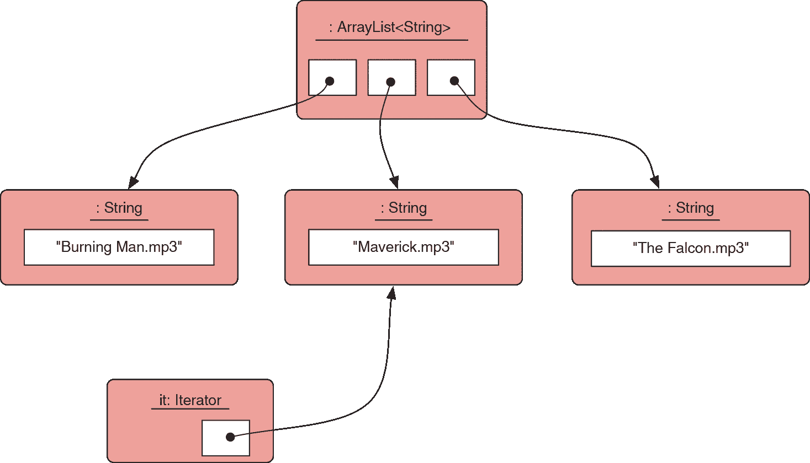

第一个方框标题为`colon ArrayList OpenAngleBracket String CloseAngleBracket`，内部有一排三个空框，每个空框中心有一个点。第二个方框标题为`colon String`，其中的文本框写着`double quotes Burning Man dot m p 3 double quotes`。第三个方框标题为`colon String`，其文本框写着`double quotes Maverick dot m p 3 double quotes`。第四个方框标题为`colon Stringa`，其文本框写着`double quotes The Falcon dot m p 3 double quotes`。第五个方框标题为`it colon Iterator`，有一个中心带点的空框。从第一个方框中每个点出的箭头分别指向第二个、第三和第四个方框。从第五个方框中点的箭头指向第三个方框。

理解`Iterator`如何工作的关键之一是，调用`next()`会导致`Iterator`返回集合中的下一个项目*然后移动过该项目*。因此，在`Iterator`上连续调用`next()`始终会返回不同的项目；一旦调用了`next()`，你就无法回到上一个项目。最终，`Iterator`会到达集合的末尾，然后从调用`hasNext()`中返回`false`。一旦`hasNext()`返回`false`，尝试在该特定的`Iterator`对象上调用`next()`将是一个错误——实际上，该`Iterator`对象已经被“用尽”了，没有进一步的用途。

表面上看，`Iterator`似乎与我们之前看到的遍历集合的其他方法相比没有明显的优势，但接下来的两个部分提供了为什么了解如何使用它的重要性。

## 4.12.1: 索引访问与迭代器

我们已经看到，至少有三种不同的方法可以遍历`ArrayList`。我们可以使用 for-each 循环（见章节 4.9.1）、带有整数型索引变量的`get()`方法（章节 4.11.2），或`Iterator`对象（本节）。

根据我们目前所了解的，所有方法在质量上似乎相当。第一种方法可能稍微更容易理解，但灵活性最低。

第一种方法使用 for-each 循环，是当处理集合中的所有元素时（即确定性迭代）的标准技术，因为在这种情况下它是最简洁的。另外两种版本的优点是可以在处理过程中更方便地停止迭代（不确定性迭代），因此当只处理集合的一部分时，它们是更优的。

对于`ArrayList`，后两种方法（使用`while`循环）实际上是同样好的。然而，情况并非总是如此。Java 提供了`ArrayList`之外的许多集合类。我们将在接下来的章节中看到其中几种。对于某些集合，通过提供索引来访问单个元素是不可能的，或者效率极低。因此，我们的第一个`while`循环版本是`ArrayList`集合特定的解决方案，可能不适用于其他类型的集合。

最新的解决方案（使用`Iterator`）适用于 Java 类库中的所有集合，因此它是一个重要的*代码模式*，我们将在后的项目中再次使用它。

## 4.12.2: 移除元素

选择使用哪种循环结构时，另一个重要的考虑因素是……

使用`ArrayList`，我们既可以通过索引访问元素，也可以使用`Iterator`对象遍历所有元素。你非常值得回顾一下不同类型的循环（`for-each`和`while`）的适用情况，以及为什么优先使用迭代器而不是整数索引，因为这类决策需要反复不断地做出。正确地做出这些决策可以使解决特定问题变得容易得多。

# 4.14: 另一个示例：拍卖系统

在本节中，我们将通过在不同的语境下重新观察本章介绍的一些新概念来后续学习。

`auction`项目模拟了在线拍卖系统的部分操作。其核心思想是拍卖由一组待售的物品组成。这些物品被称为“拍品”（lots），程序为每个拍品分配一个唯一的拍号。一个人可以通过对某个拍品出价来尝试购买它。所有拍品都在限期内提供。限期结束后，拍卖结束。拍卖结束时，对某个拍品出价最高的人被视为购买了该物品。拍卖结束时没有竞价的拍品将未售出。例如，未售出的拍品可以在之后的拍卖中再次出售。

`auction`项目包含以下类：`Auction`、`Bid`、`Lot`和`Person`。仔细观察该项目的类图（图 4.6）可以发现，各个类之间的关系比我们在之前的项目中看到的稍微复杂一点。这将影响在拍卖活动期间访问信息的方式。例如，图中显示`Auction`对象知道所有其他类型的对象：`Bid`、`Lot`和`Person`。`Lot`对象知道`Bid`对象，而`Bid`对象知道`Person`对象。图表无法告诉我们的是，存储在`Bid`对象中的信息（例如）是如何被`Auction`对象访问的。对此，我们必须查看各个类的代码。

### 图 4.6 `auction` 项目的类结构

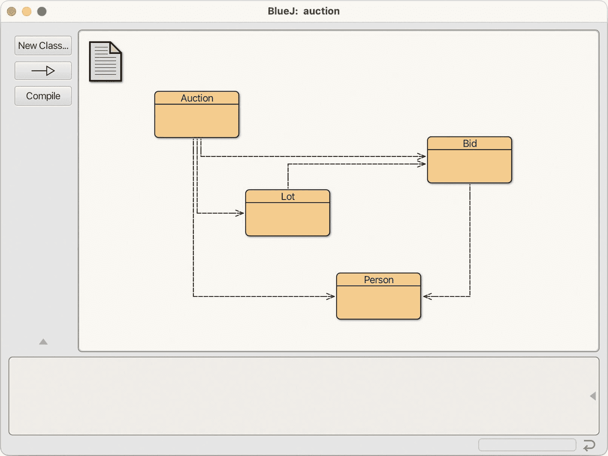

对话框的左上角有三个彩色的圆。标题 BlueJ: auction 位于顶部中间部分。三个按钮垂直排列在三个彩色圆下方，如下：New Class...、右箭头和 Compile。中间面板有四个框，标题分别为 Auction、Lot、Bid 和 Person。每个箭头都从`Auction`框指向`Bid`、`Lot`和`Person`框。有一个箭头从`Lot`框指向`Bid`框，另一个箭头从`Bid`框指向`Person`框。中间面板下方显示了一个矩形文本框。对话框的右下角显示了一个后退按钮。

## 4.14.1: 项目上手指南

在这个阶段，在继续阅读之前，打开`auction`项目并探索源码是值得的。除了看到熟悉的`ArrayList`和循环的用法外，你可能还会遇到一些起初并不完全理解的内容，但随着我们转向新概念和处理问题的新方法，这种情况完全在意料之中的。

`Auction`对象是该项目的起点。想要出售物品的人通过`enterLot`方法将物品输入拍卖，但他们只提供一个字符串描述。然后，`Auction`对象会为每个进入的拍品创建一个`Lot`对象。这模拟了现实世界中的运作方式：是拍卖网站而不是卖家为物品分配拍号或识别代码。因此，`Lot`对象是拍卖网站对待售物品的表示。

为了竞拍拍品，人们必须在拍卖行注册。在我们的程序中，潜在的竞标者由`Person`对象表示。这些对象必须在 BlueJ 的对象平台上独立创建。在我们的项目中，`Person`对象仅包含此人的名字。当有人想要竞拍某个拍品时，他们调用`Auction`对象的`makeABid`方法，输入他们感兴趣的拍号、竞标者的 Person 对象以及他们想要出出的金额。注意，他们传递的是拍号而不是`Lot`对象；`Lot`对象保持在`Auction`对象的内部，并始终通过其拍号在外部引用。

就像`Auction`对象创建`Lot`对象一样，它还将货币出价金额转换为`Bid`对象，该对象记录了金额和出该价的人。这就是为什么我们在类图中看到从`Bid`类到`Person`类的链接。然而，请注意，没有从`Bid`到`Lot`的链接；图上的链接是相反的，因为`Lot`记录了目前该拍品的最高出价。这意味着每当有更高的出价时，`Lot`对象就会替换它存储的`Bid`对象。

我们在这里描述的内容揭示了一个相当嵌套的对象引用链。`Auction`对象存储`Lot`对象；每个`Lot`对象可以存储一个`Bid`对象；每个`Bid`对象存储一个`Person`对象。这种链在程序中非常常见，因此该项目提供了一个探索它们在实践中如何运作的好机会。

由于`Person`类和`Bid`类都没有启动拍卖系统的任何活动，我们在此不详细讨论它们。研究这些类留给读者自己。相反，我们将重点关注`Lot`和`Auction`类的代码。

## 4.14.2: `null` 关键字

从上面的讨论可以清楚，`Bid`对象只有在有人对某个`Lot`出价时才被创建。然后，新创建的`Bid`对象存储出价的`Person`。这意味着`Bid`对象的`Person`字段可以在`Bid`构造函数中初始化。

相反，当创建`Lot`对象时，这仅意味着它已进入拍卖但还没有竞者。尽管如此，它仍然有一个`Bid`字段`highestBid`，用于记录该拍品的最高出价。在`Lot`构造函数中使用什么值来初始化此字段？

我们需要一个字段值，能够明确表示该变量目前指向“没有对象”。在某种意义上，该变量是“空的”。为了指示这一点，Java 提供了`null`关键字。因此，`Lot`的构造函数中有以下语句：

```
highestBid = null;
```

一个重要的原则是，如果变量包含`null`值，则不应对其调用方法。其原因显而易见：由于方法属于对象，如果变量没有引用对象，我们就无法调用方法。这意味着我们有时必须使用`if`语句来测试变量是否包含`null`，然后再在该变量上调用方法。未进行这种测试会导致非常常见的运行时错误：`NullPointerException`。我们在`Lot`和`Auction`类中都能看到这种测试的示例。

事实上，如果我们未能初始化一个对象类型的字段，它将被自动赋予`null`值。但在这种特殊情况下，我们倾向于显式地进行赋值，以确保代码阅读者心中毫无疑问，即我们在创建`Lot`对象时预期`highestBid`为`null`。

## 4.14.3: `Lot` 类

`Lot`类存储了拍品的描述、拍品编号以及目前为止收到的该拍品的最高出价详情。该类中最复杂的部分是`bidFor`方法（`Code 4.9`）。它处理当有人对拍品出价时的情况。当出价时，需要检查新出价是否高于该拍品的任何现有出价。如果更高，则新出价将作为该拍品的当前最高价存储。

### 代码 4.9 处理拍品的出价

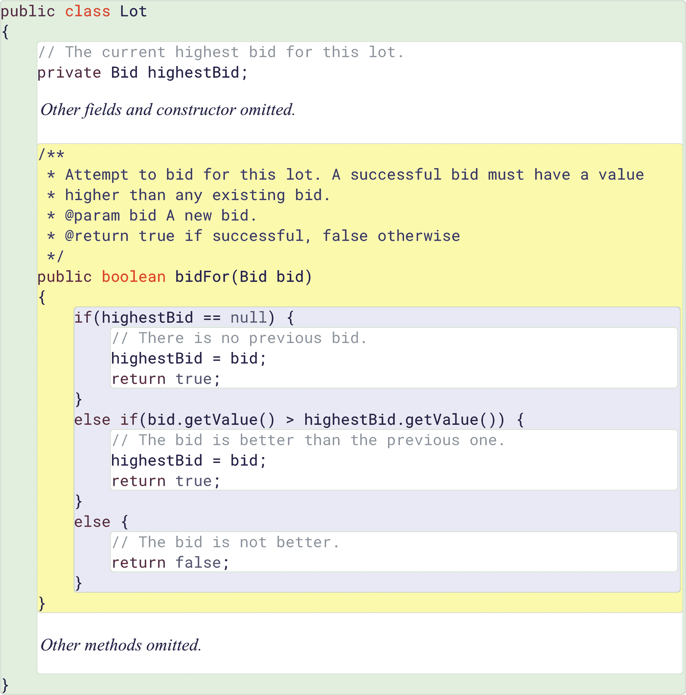

该代码包含以下行：

Line 1: `public class Lot`

Line 2: `OpenCurlyBracket`

Line 3: `Indentation level 1, DoubleForwardSlash The current highest bid for this lot.`

Line 4: `Indentation level 1, private Bid highestBid semicolon`

Line 5: `Blank`

Line 6: `Indentation level 1, Other fields and constructor omitted.`

Line 7: `Blank`

Line 8: `Indentation level 1, ForwardSlash asterisk asterisk`

Line 9: `Indentation level 2, asterisk Attempt to bid for this lot. A successful bid must have a value`

Line 10: `Indentation level 2, asterisk higher than any existing bid.`

Line 11: `Indentation level 2, asterisk at param bid A new bid.`

Line 12: `Indentation level 2, asterisk at return true if successful comma false otherwise`

Line 13: `Indentation level 2, asterisk ForwardSlash`

Line 14: `Indentation level 1, public boolean bidFor OpenParenthesis Bid bid CloseParenthesis`

Line 15: `Indentation level 1, OpenCurlyBracket`

Line 16: `Indentation level 3, if OpenParenthesis highestBid double equals null CloseParenthesis OpenCurlyBracket`

Line 17: `Indentation level 4, DoubleForwardSlash There is no previous bid.`

Line 18: `Indentation level 4, highestBid equals bid semicolon`

Line 19: `Indentation level 4, return true semicolon`

Line 20: `Indentation level 3, CloseCurlyBracket`

Line 21: `Indentation level 3, else if OpenParenthesis bid dot getValue OpenParenthesis CloseParenthesis greater than highestBid dot getValue OpenParenthesis CloseParenthesis OpenCurlyBracket`

Line 22: `Indentation level 4, DoubleForwardSlash The bid is better than the previous one.`

Line 23: `Indentation level 4, highestBid equals bid semicolon`

Line 24: `Indentation level 4, return true semicolon`

Line 25: `Indentation level 3, CloseCurlyBracket`

Line 26: `Indentation level 3, else OpenCurlyBracket`

Line 27: `Indentation level 4, DoubleForwardSlash The bid is not better.`


Line 28: `Indentation level 4, return false semicolon`

Line 29: `Indentation level 3, CloseCurlyCurly`

Line 30: `Indentation level 1, CloseCurlyBracket`

Line 31: `Blank`

Line 32: `Indentation level 1, Other methods omitted.`

Line 33: `Blank`

Line 34: `CloseCurlyBracket`

在这里，我们首先检查此出价是否为最高价。如果没有之前的出价，或者当前出价高于目前为止的最高价，则就是这种情况。检查的第一部分涉及以下测试：

```
highestBid == null
```

这是对`highestBid`变量当前是否指向一个对象的测试。正如上一节所述，在收到该拍品的出价之前，`highestBid`字段将包含`null`值。如果它仍然为`null`，则说明这是该特定拍品的第一次出价，它显然是最高价。如果它不是`null`，我们必须将其值与新出价进行比较。注意，第一个测试的失败为我们提供了一些有用信息：我们现在确定`highestBid`不是`null`，因此我们知道对其调用方法是安全的。我们不需要在第二个条件中进行`null`测试。比较两个出价的值允许我们选择更高的出价，或者在新出价没有更优时拒绝它。

## 4.1.4: Auction 类

`Auction`类（`Code 4.10`）进一步说明了本章早期讨论的`ArrayList`和`for-each`循环概念。

### 代码 4.10 Auction 类


该代码包含以下行：

Line 1: `import java.util.ArrayList semicolon`

Line 2: `Blank`

Line 3: `ForwardSlash asterisk asterisk`

Line 4: `Indentation level 1, asterisk A simple model of an auction.`

Line 5: `Indentation level 1, asterisk The auction maintains a list of arbitrary length.`

Line 6: `Indentation level 1, asterisk`

Line 7: `Indentation level 1, asterisk David Barnes and Michaellling.`

Line 8: `Indentation level 1, asterisk version 7.0`

Line 9: `Indentation level 1, asterisk ForwardSlash`

Line 10: `public class Auction`

Line 11: `OpenCurlyBracket`

Line 12: `Indentation level 2, DoubleForwardSlash The list of Lots in this auction.`

Line 13: `Indentation level 2, private ArrayList<Lot> listOfLots`

Line 14: `Indentation level 2, DoubleForwardSlash The number that will be given to the next lot entered into this auction.`

Line 15: `Indentation level 2, private int nextLotNumber`

Line 16: `Blank`

Line 17: `Indentation level 2, ForwardSlash asterisk asterisk`

Line 18: `Indentation level 2, asterisk Create a new auction.`

Line 19: `Indentation level 2, asterisk ForwardSlash`

Line 20: `public Auction()`

Line 21: `OpenCurlyBracket`

Line 22: `Indentation level 4, listOfLots = new ArrayList<>();`

Line 23: `Indentation level 4, nextLotNumber = 1;`

Line 24: `CloseCurlyBracket`

Line 25: `Blank`

Line 26: `Indentation level 2, ForwardSlash asterisk asterisk`

Line 27: `Indentation level 2, asterisk Enter a new lot into the auction.`

Line 28: `Indentation level 2, asterisk at param description description of the lot.`

Line 29: `Indentation level 2, asterisk ForwardSlash`

Line 30: `public void enterLot(String description)`

Line 31: `OpenCurlyBracket`

Line 32: `Indentation level 4, listOfLots.add(new Lot(nextLotNumber, description));`

Line 33: `Indentation level 4, nextLotNumber++;`

Line 34: `CloseCurlyBracket`

Line 35: `Blank`

Line 36: `Indentation level 2, ForwardSlash asterisk asterisk`

Line 37: `Indentation level 2, asterisk Show the full list of lots in this auction.`

Line 38: `Indentation level 2, asterisk ForwardSlash`

Line 39: `public void showLots()`

Line 40: `OpenCurlyBracket`

Line 41: `Indentation level 4, for (Lot aLot : listOfLots) OpenCurlyBracket`

Line 42: `Indentation level 5, System.out.println(aLot.toString());`

Line 43: `CloseCurlyBracket`

Line 44: `CloseCurlyBracket`

Line 45: `Blank`

Line 46: `Indentation level 2, ForwardSlash asterisk asterisk`

Line 47: `Indentation level 2, asterisk Make a bid for a lot.`

Line 48: `Indentation level 2, asterisk A message is printed indicating whether the bid is successful or not.`

Line 49: `Indentation level 2, asterisk`

Line 50: `Indentation level 2, asterisk at param lotNumber The lot being bid for.`

Line 51: `Indentation level 2, asterisk at param bidder The person bidding for the lot.`

Line 52: `Indentation level 2, asterisk at param value The value of the bid.`

Line 53: `Indentation level 2, asterisk ForwardSlash`

Line 54: `public void makeABid(int lotNumber, Person bidder, long value)`

Line 55: `OpenCurlyBracket`

```java
Lot selectedLot = getLot(lotNumber);
if (selectedLot != null) {
    Bid aBid = new Bid(bidder, value);
    boolean successful = selectedLot.bidFor(aBid);
    if (successful) {
        System.out.println("The bid for lot number " + lotNumber + " was successful.");
    } else {
        Bid highestBid = selectedLot.getHighestBid();
        System.out.println("Lot number: " + lotNumber + " already has a bid of " + highestBid.getValue());
    }
}
```

/**

 * 返回给定编号的拍品。如果不存在该编号的拍品则返回 null。

 * @param lotNumber 要返回的拍品编号。

 * @return 给定编号的拍品，或 null。

 */

public Lot getLot(int lotNumber) {

    if ((lotNumber == 1) || (lotNumber < nextLotNumber)) {

        // 编号看起来是合理的。

        Lot selectedLot = listOfLots.get(lotNumber - 1);

        // 包含一个置信检查以确保我们获得了

        // 正确的拍品。

        if (selectedLot.getNumber() != lotNumber) {

            System.out.println("Internal error: Lot number " + selectedLot.getNumber() + " was returned instead of " + lotNumber);

            // 不要返回无效的拍品。

            selectedLot = null;

        }

        return selectedLot;

    } else {

        System.out.println("Lot number: " + lotNumber + " does not exist.");

        return null;

    }

}

```

`listOfLots`是一个`ArrayList`，用于存放本次拍卖中提供的拍品。通过向`enterLot`方法传递简单的描述可以在拍卖中输入拍品。通过将描述和唯一的拍品编号传递给`Lot`的构造函数可以创建一个新的拍品。该新的`Lot`对象被添加到集合中。后续章节将讨论`Auction`类中使用的其他常见功能。

## 4.14.5: 匿名对象

`Auction`中的`enterLot`方法展示了一种常见的用法——匿名对象。我们在下面的语句中看到了这种用法：

```

listOfLots.add(new Lot(nextLotNumber, description));

```

在这里，我们正在做两件事：

* 我们正在创建一个新的`Lot`对象。
* 我们还将将这个新对象传递给列表。

我们可以用两行来写相同的语句，使步骤更加明确：

```java

Lot aLot = new Lot(nextLotNumber, description);

lots.add(aLot);

```

## 4.14.6: 方法调用链

在对拍卖项目的介绍中，我们注意到了一条对象引用链：`Auction`对象存储`Lot`对象；每个`Lot`对象可以存储一个`Bid`对象；每个`Bid`对象存储一个`Person`对象。如果`Auction`对象需要识别当前是谁在某个`Lot`上拥有最高出价，那么它需要要求`Lot`返回该拍品的`Bid`对象，然后向`Bid`对象获取出价的人（`Person`对象），最后再向该`Person`对象获取其姓名。在忽略`null`对象引用的情况下，为了打印出价者的名字，我们可能会看到如下序列：

```java

Bid bid = lot.getHighestBid();

Person bidder = bid.getBidder();

String name = bidder.getName();

System.out.println(name);

```

由于`bid`、`bidder`和`name`变量在这里被用作获取出价者名字的中间站，因此通过使用匿名对象引用来压缩此类序列是很常见的。例如，我们可以通过以下方式实现相同：

```java

System.out.println(lot.getHighestBid().getBidder().getName());

```

这看起来像是方法在调用方法，但这种方式不应该是这样理解的。记住这两组语句是等价的，方法调用链必须严格从左到右读取。在这里，调用链被人工加上了括号，以使自然顺序清晰：

```java

((lot.getHighestBid()).getBidder()).getName()


这种方法调用链看起来可能复杂，但如果你理解了底层规则，就可以将其拆解。即使你选择不以这种更简洁的方式编写代码，也应该学会如何阅读它，因为你可能会在其他程序员的代码中遇到它。

我们已经看到，像`ArrayList`这样的类可以方便地让我们创建包含任意数量对象的集合。Java 库中包含更多此类集合，我们将在第 6 章中查看其中的其他一些。你会发现，能够熟练地使用集合是编写趣味程序的一项重要技能。从现在起，我们看到的应用程序中几乎没有不使用某种形式集合的。

在使用集合时，通常需要遍历集合中的所有元素，以利用其中存储的对象。为了实现这一目的，我们已经见过了循环和迭代器的使用。

循环也是计算中的一个基本概念，从现在起，你在每个项目中都会使用它。请确保你充分熟悉如何编写循环——没有循环，你将走不远。在决定特定情况下使用哪种循环类型时，考虑任务是涉及确定性迭代（definite iteration）还是不确定迭代（indefinite iteration）通常是有用的。所需的迭代次数是确定的还是不定的？

顺便提一下，我们提到了 Java 类库，这是一个包含有用类的巨大集合，我们可以利用它来增强自己类的类的功能。我们需要更详细地学习该库，看看其中还有什么我们应该知道的内容。这将是未来章节的主题。

## 本章引入的术语

1. 集合 (collection)、迭代器 (iterator)、for-each 循环、while 循环、索引 (index)、导入语句 (import statement)、库 (library)、包 (package)、匿名对象 (anonymous object)、确定性迭代 (definite iteration)、不确定迭代 (indefinite iteration)

# 第 5 章：集合的函数式处理

本章介绍了一些替代技术，以实现与前几章讨论相同的任务。

## 5.1 对第 4 章主题的另类视角

在第 4 章中，我们开始学习处理对象集合的技术。处理集合是编程中的基本技术之一；几乎所有的计算机程序都会处理某种形式的集合，我们将在书中看到更多此类内容。良好地完成这一点至关重要。

然而，由于新的编程技术被引入主流编程语言，近年来学习编程中的集合已变得更加复杂了。这些技术可以使你的程序更简单，但它们增加了学习工作量——仅仅是因为有更多不同的结构需要掌握。

这些“新”技术并不是真正的新——它们只是在这一类语言中是新的。语言一直存在着不同的类型。例如，`Java`是一种命令式面向对象的语言，我们在第 4 章中开始引入的集合处理风格是处理问题的典型命令式。

另一类语言是函数式语言；这些语言已经存在很长时间，并且使用不同的编程风格。事实证明，由于我们后将讨论的原因，函数式的集合处理风格在某些情况下比命令式风格具有优势。因此，Java 语言的设计者在某个时刻决定向 Java 语言中添加一些函数式编程元素。他们在该语言的第 8 版本（Java 8，于 2014 年发布）中做到了这一点。添加的新技术是流（streams）和 lambda（有时也称为闭包）。这使得 Java 在技术上成为了一种混合语言：一种大部分是命令式但带有一些函数元素的语言。

对于精通的程序员来说，这是一件好事。新的函数式语言结构允许我们编写更优雅、更具表现力的程序。对于学习者来说，它增加了工作量：我们现在必须学习两种不同的方法来实现类似的目标。

我们在本章中涵盖的新函数式风格正在迅速流行，当你阅读他人的程序时，可能会遇到这种风格编写的代码。然而，上一章涵盖的命令式风格仍然是大多数代码的编写方式，并且仍然被认为是处理问题的“标准”Java 方法。当你处理由其他程序员编写的现有代码时（你大多数时候都是在这样做），理解并能够操作命令式风格是关重要的。当你编写自己的代码时，你可以选择自己的风格：函数式风格和命令式风格是解决同一个问题的两种不同方法，它们可以相互替代。在以后，我们有时会偏好函数式风格，因为它更简洁、更优雅。

简而言之，一个学习者要成为一名优秀的程序员，有必要熟悉这两种集合处理风格。在书中，我们首先介绍命令式风格，并在本章以及书中的各个部分介绍函数式风格。

函数式风格的内容可以跳过，你仍然会学习如何编程，并且仍然能够解决我们提出的问题。然而，为了获得完整的图景，可以按照它们出现的顺序进行阅读，你将在过程中学习这些替代结构。

## 5.2 监控动物种群数量

之前一样，我们将使用一个示例程序来介绍和讨论新结构。在这里，我们将查看一个监控动物种群数量的系统。

动物保护和濒危物种保护的重要要素是监测种群数量，并检测水平是健康还是在下降。我们的项目处理不同类型动物的观测报告，这些报告由不同区域的观测员传回。每份观测报告都包含看到的动物名称、看到了多少只、谁发送的报告（一个整数）、观测发生的区域（一个整数），以及观测发生的时间指示（一个简单的数值，可能是自实验开始以来的天数）。

简单的数据要求使得偏远地区的观测员能够轻松地发送较少的信息——可能是短信形式或通过手机应用程序——到一个基站，基站能够汇总数据并指导现场工作人员前往不同区域。

这种方法既适用于高度管理的项目（例如国家公园开展的项目，涉及运动触发的摄像头和评估录像的人员），也适用于松散组织的众包活动（例如全国鸟类计数日，大量志愿者使用手机应用发送数据）。

我们在书的项目项目中提供了此类系统的部分实现，命名为`animal-monitoring-v1`。

**代码 5.1** 显示了我们将用于记录单个观测员对特定动物的观测报告详情的`Sighting`类（在观测细节处理之后）。在本章中，我们不直接关注观测员发送的数据格式。为了帮助你对更广泛编程主题的理解，鼓励你阅读项目的完整源代码，以寻找我们尚未详细探讨的内容，并将其用于你个人的能力提升。然而，`Sighting`类非常直观。

#### 代码 5.1 Sighting 类

```java
/**
 * 单个观测员对某种类型动物的观测详情。
 */
```

```java
public class Sighting {
    /**
     * 被观测到的动物
     */
    private final String animal;

    /**
     * 观测者的 ID。
     */
    private final int spotter;

    /**
     * 观测到的数量。
     */
    private final int count;

    /**
     * 观测到区域的 ID。
     */
    private final int area;

    /**
     * 报告周期。
     */
    private final int period;

    /**
     * 创建一个特定类型动物观测的记录。
     * @param animal 被观测到的动物。
     * @param spotter 观测者的 ID。
     * @param count 观测到的数量 (>= 0)。
     * @param area 观测到区域的 ID。
     * @param period 报告周期。
     */
    public Sighting(String animal, int spotter, int count, int area, int period) {
        this.animal = animal;
        this.spotter = spotter;
        this.count = count;
        this.area = area;
        this.period = period;
    }

    // 省略部分访问器

    /**
     * 返回一个包含动物细节、观测数量、
     * 观测地点、观测者以及观测时间的字符串。
     * @return 提供观测细节的字符串
     */
    public String getDetails() {
        return animal + ", " + count + ", " + area + ", " + spotter + ", " + period;
    }
}
```

**代码 5.2** 显示了`AnimalMonitor`类的部分，该类用于将单个观测记录聚合到一个列表中。此时，来自所有不同观测者和区域的所有观测记录都存存储在一个集合中。除其他外，该类还包含用于打印列表、统计特定动物的观测总数、列出特定观测者的所有记录、删除不包含观测的记录等方法。所有这些方法都是使用第 4 章中描述的基础列表操作技术实现的：对整个列表进行迭代；根据某些条件处理列表的选元素（过滤）；以及删除元素。这里实现的方法对于此类应用程序来说并不完全，但实现它们的目的是为了展示这些不同类型列表处理的示例。

#### 代码 5.2 AnimalMonitor 类

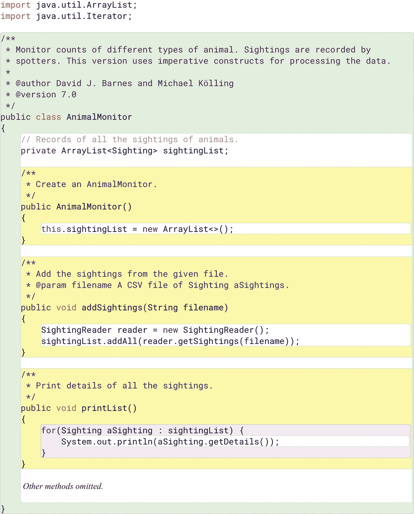

该代码包含以下几行：

```java
import java.util.ArrayList;
import java.util.Iterator;

/**
 * 不同类型动物的监视器。此版本使用命令式结构来处理数据。
 * @author David J. Barnes and Michael Kölling
 * @version 7.0
 */
public class AnimalMonitor {
    /**
     * 所有观测的记录
     */
    private ArrayList<Sighting> sightingList;

    /**
     * 创建一个 AnimalMonitor。
     */
    public AnimalMonitor() {
        this.sightingList = new ArrayList<>();
    }

    /**
     * 从给定文件中添加观测记录。
     * @param filename 观测记录的 CSV 文件
     */
    public void addSightings(String filename) {
        SightingReader reader = new SightingReader();
        sightingList.addAll(reader.getSightings(filename));
    }

    /**
     * 打印所有观测的细节。
     */
    public void printList() {
        for (Sighting sighting : sightingList) {
            System.out.println(sighting.getDetails());
        }
    }

    // 其他方法省略略
}
```

处理集合的新函数式风格的核心是`lambda`（表达式）的概念。

这个基本新思想是：我们可以将`一段代码`作为参数传递给方法，该方法可以在以后需要时执行这段代码。

到为止，我们已经见过了各种类型的参数——整数、字符串、对象——但这些都是`数据`片段，而不是`代码`片段。传递代码的能力是 Java 8 新引入的，它允许我们做一些非常实用的事情。

### 5.3.1 使用 lambda 处理集合

当我们在第 4 章中处理集合时，我们写了一个循环来逐个获取集合元素，然后对每个元素进行操作。代码结构始终类似于下面的伪代码：

```text
loop (for each element in the collection):
    get one element;
    do something with the element;
end loop
```

无论我们使用 for-each 循环还是 while 循环，无论使用迭代器（iterator）还是索引（index）来访问元素——原理都是相同的。

当使用 lambda 时，我们处理问题的方式有所不同。我们将一段代码传递给集合并说：“将这段代码应用到集合中的每个元素。”代码结构看起来如下：

```text
collection.doThisForEachElement(some code);
```

我们可以看到代码看起来简单得多。最重要的是：循环完全消失了。事实上，它并没有消失——它只是被移动到了`doThisForEachElement`方法中——但它从我们自己的代码中消失了；我们不再需要每次都写它。

我们让集合变得更加强大：集合不再仅仅能向我们分发元素以便对它们进行某些操作，集合现在能够为我们对元素执行操作。这让我们的生活变得更轻松。

我们可以这样思考：想象你需要给学校班级里的每个孩子理发。在旧风格中，你对老师说：*把第一个孩子送给我*。然后你给那个孩子理发。接着你说：*把下一个孩子送给我*。又一次理发。。就这样持续下去，直到没有孩子剩余。这就是旧式的“下一个项目/处理”的循环。

在新风格中，你这样做：你写下如何理发的指令，然后把这些指令交给老师并说：*对你班的每个孩子都这样做*。（在这里，老师代表集合。）事实上，这种方法一个很有意思的副作用是，我们甚至不需要知道老师将如何完成任务。例如，他们不需要自己去理发，而是可以为每个孩子将任务外包给单独的人员，这样每个孩子的头发就可以同时被理好。老师只需要传递你给他们的指令即可。

你的生活突然变得简单多。。老师在为你完成大部分工作。这正是 Java 集合能为你为你做的事情。

### 5.3.2 lambda 的基本语法

lambda 在某些方面类似于方法：它是一段定义用于执行某些操作的代码，但不会被立即执行。然而，与方法不同，它不属于任何类，且我们不会给它起名。将 lambda 的语法与执行类似任务的方法语法进行比较是有用的。

一个打印观察结果细节的方法可能像所示：

```text
public void printSighting(Sighting aSighting)
{
    System.out.println(aSighting.getDetails());
}
```

等效的 lambda 看起来如下：

```text
(Sighting aSighting) ->
{
    System.out.println(aSighting.getDetails());
}
```

你现在很容易地看到差异和相似之处。差异在于：

*   没有`public`或`private`关键字。
*   没有指定返回类型。这是因为编译器可以从 lambda 体中的最后一条语句推断出类型。在这种情况下，`println`方法是`void`，所以 lambda 的返回类型也是`void`。
*   lambda 没有名称；它从参数列表开始。
*   箭头（`->`）将参数列表与 lambda 体体隔开——这是 lambda 的特征性符号。

你会发现，lambda 经常被用于相对简单、一次性的任务，这些任务不需要完整类的复杂性。关于 lambda 的某些信息是默认提供或从上下文（即其返回类型）中推断出来的——我们对此没有选择余。此外，由于 lambda 没有关联的类，因此也没有实例字段和构造函数。这使得 lambda 的用法变得非常特化。由于缺少名称，lambda 也被称为`匿名函数`（`anonymous functions`）。

我们会在本书的后面部分遇到几次 lambda 和函数参数，例如，当我们在第 14 章中引入`函数式接口`（`functional interfaces`）时，以及我们在第 17 章中编写图形用户界面（GUI）时。然而，目前我们将探索如何与集合使用 lambda。

# 5.4 集合的 forEach 方法

在上面引入 lambda 概念时，我们提到了集合类的`doThisForEachElement`方法。这个方法在 Java 中被称为`forEach`。

如果我们有一个名为`myList`的集合，我们可以写：

`myList.forEach(... 应用到列表每个元素的代码 ...)`

传递给此方法的参数将是一个 lambda——一段代码——语法正如我们上面看到的。`forEach`方法将为每个列表元素执行 lambda，并将每个列表元素作为参数传递。

让我们看看具体的代码。`AnimalMonitor`类中的`printList`方法看起来如下：

```text
/**
 * 打印所有观察结果的。
 */
public void printList()
{
    for(Sighting aSighting : sightings) {
        System.out.println(aSighting.getDetails());
    }
}
```

我们现在可以编写该方法的基于 lambda 版本：

```java
/**
 * 打印所有观察结果的。
 */
public void printList()
{
    sightings.forEach(
        (Sighting aSighting) -> {
            System.out.println(aSighting.getDetails());
        }
    );
}
```


这个新版本的`printList`方法体由单个语句组成（尽管它跨越了五行），该语句是对列表`forEach`方法的调用。值得注意的是，与之前的版本不同，在这个版本中没有显式的循环语句——迭代是由`forEach`方法*隐式*处理的。

Java 中 lambda 语法的目标之一是允许我们编写清晰且简洁的代码。例如，省略`public`访问修饰符和返回类型就是这种开始。然而，编译器允许我们更进一步：在编译器可以自行推断的情况下，其他几个元素也可以被省略。

第一个元素是 lambda 参数的类型（在我们的案例中为`aSighting`）。由于 lambda 参数的类型必须与集合元素的类型匹配，因此编译器可以推断出这一点，我们被允许省略它。我们的代码随后看起来像这样：

```
sightingList.forEach(
    (aSighting) ->
    {        
        System.out.println(aSighting.getDetails());
    }
);
```

下一个简化项涉及括号和大括号：

- 如果参数列表只包含一个参数，则可以省略括号。
- 如果 lambda 的正体只包含一条语句，则可以省略大括号。

同时应用这两种简化后，lambda 的代码现在短到可以放进单行，我们可以这样写`forEach`调用：

```
sightingList.forEach(aSighting ->
    System.out.println(aSighting.getDetails()));
```

这是我们自己在代码中将首选的版本。

再次，我们鼓励你确保理解这种简化后的语法是如何符合描述的，因为在实践中，许多 lambda 是以这种形式编写的。

`animal-monitoring-v2`项目在使用此处讨论的函数式风格编写的，如果你想检查某些练习题的答案，可以使用它。但是，请自己完成练习，只有在真的遇到困难时才使用这个项目。

## 5.4.2: 从集合中移除元素

在第 4 章中，我们看到从集合中移除项最安全的方法是使用`Iterator`对象和循环。然而，有一种更简单、更简洁的方法，通过向集合的`removeIf`方法传递一个适当 lambda 来实现。该方法接受一个返回布尔结果的 lambda。如果 lambda 应用于集合中的某个元素时返回`true`，则该元素将被移除，否则将被保留。

传递给此方法的 lambda 类型被称为`predicate`（谓词），这意味着它返回一个布尔结果。

假设我们想要删除所有计数为零的观测记录。一个用于检查该条件的谓词 lambda 如下：

```
(Sighting aSighting) -> aSighting.getCount() == 0
```

由于 lambda 的体是一个布尔表达式，因此 lambda 的返回类型可以推断为`boolean`。当我们将其传递给`removeIf`方法时，像之前一样省略其参数的类型名称。以下代码将从`sightingList`中移除所有计数为零的观测：

```
sightingList.removeIf(aSighting -> aSighting.getCount() == 0);
```

再次，迭代是隐式的。`removeIf`方法依次将列表的每个元素传递给谓词 lambda，然后移除所有 lambda 返回`true`的元素。

## 5.5: 流（Streams）

`ArrayList`（以及相关的相关的集合类）的`forEach`方法只是利用 Java 8 引入的`streams`特性的方法示例之一。流与集合相似，但有一些重要的区别：

- 流中的元素不是通过索引访问的，通常是按顺序访问的。
- 流的内容和顺序不能更改——更改需要创建一个新流。
- 流可能是无限的！

流的概念被用于统一处理数据集，而无论这些数据来自何处。它可以是处理来自集合的元素（正如我们讨论过的那样），处理通过网络传来的消息，处理来自文本文件的文本行，或来自字符串中的所有字符。数据源并不重要——我们认为将其中任何一个视为一个流，然后使用相同的技术和方法来处理元素。

与 Java 之前处理集合的设施相比，流又增加了一个重大的新特性：安全并行处理的潜力。在许多情况下，集合中元素处理的顺序并不重要，或者集合中某个元素的处理在很大程度上与其他元素是独立的。在适用这些条件的情况下，在处理大量数据时，并行处理集合可以提供显著的加速。然而，我们在这里不再进一步讨论这一点。

`ArrayList`本身并不是流，但我们可以通过调用它的`stream`方法让它提供流的源。返回的流将包含`ArrayList`中按索引排序的所有元素。如果我们忽略并行化问题，流实际上并没有让我们能够实现任何我们已经遇到过的语言特性无法实现的功能。然而，流整齐地捕捉了许多我们想要在集合上执行的最常见任务，这种形式使得它们比我们习惯的编程方式要简单得多，正如我们在`print`方法中看到的。。我们已经在`forEach`和`removeIf`中看到了一些了。

### 5.5.1: 过滤、映射和归约

我们上面注意到流的内容不能被修改，因此更改需要新流。仅通过三个不同的函数就可以实现许多种处理流：`filter`、`map`和`reduce`。在查看具体的 Java 方法之前，我们先讨论这些函数的基本思想。它们都被应用于流以对其进行特定的处理。

#### 过滤函数（Filter）

`filter`函数接收一个流，选择其中的某些元素，并创建一个只包含所选元素的新流（如图 51 所示）。某些元素被过滤掉了。

#### 图 5.1: 对流应用过滤器

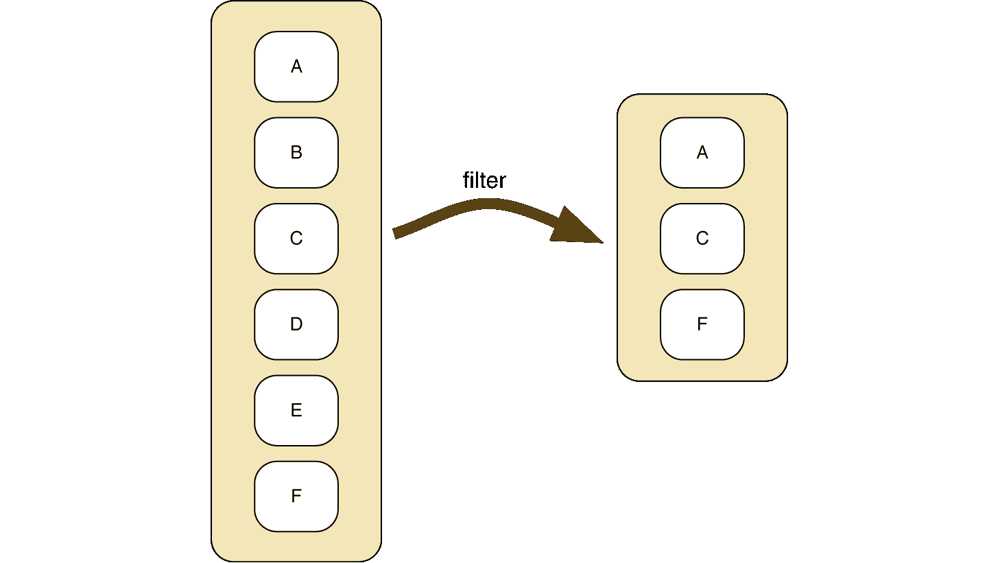 "查看图像")

流由一个垂直矩形框表示，内部有六个嵌入框，按顺序排列如下：A、B、C、D、E 和 F。一个标记为`filter`的箭头从这个流指向另一个流（过滤后的），该流有三个嵌入框，按顺序排列如下：A、C 和 F。

我们观测集合中的一个例子可以是从所有观测中选择大象的观测。我们从所有观测开始，应用一个只选择大象的过滤器，最后得到一个大象观测流，不再包含其他。

#### 映射函数（Map）

`map`函数接收一个流并创建一个新流，原始流中的每个元素都被映射到新流中一个新的、不同的元素（如图 5.2 所示）。新流的元素数量相同，但每个元素的类型和内容可以是不同的；它是以某种方式从原始元素推导出来的。

#### 图 5.2: 对流应用映射

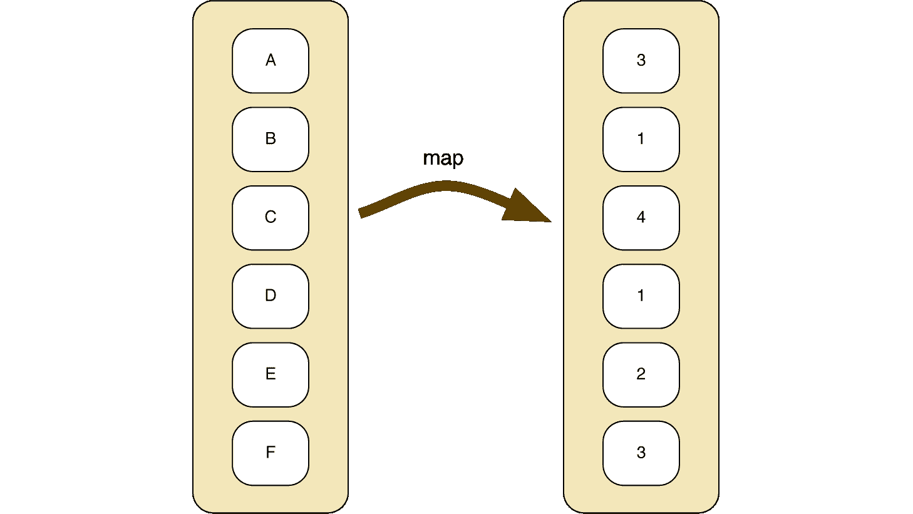 "查看图像")

流由一个垂直矩形框表示，其中有六个嵌套框，从上往下排列，如下：A、B、C、D、E 和 F。一个标记为`map`的箭头从该流指向另一个流（映射后的流），该流也有六个嵌套框，从上往下排列，如下：3, 1, 4, 1, 2, 和 3。

在我们的项目中，一个示例是将原始流中的每个观测对象替换为该次观测中发现的动物数量。我们从一个观测对象流开始，以一个整数流结束。

### `reduce`函数

`reduce`函数接收一个流并将所有元素折叠为单一结果（**图 5.3**）。这可以通过不同的方式实现，例如通过将所有元素相加，或者从流中仅选择最小的元素。我们从一个流开始，最终得到一个单一的结果。

在我们的动物监测项目中，这对于统计我们见过多少只大象非常有用：一旦我们获得了包含所有大象观测的流，就可以使用`reduce`将它们全部相加。（记住：每个观测实例可能包含多只动物。）

#### 图 5.3 对流应用归约

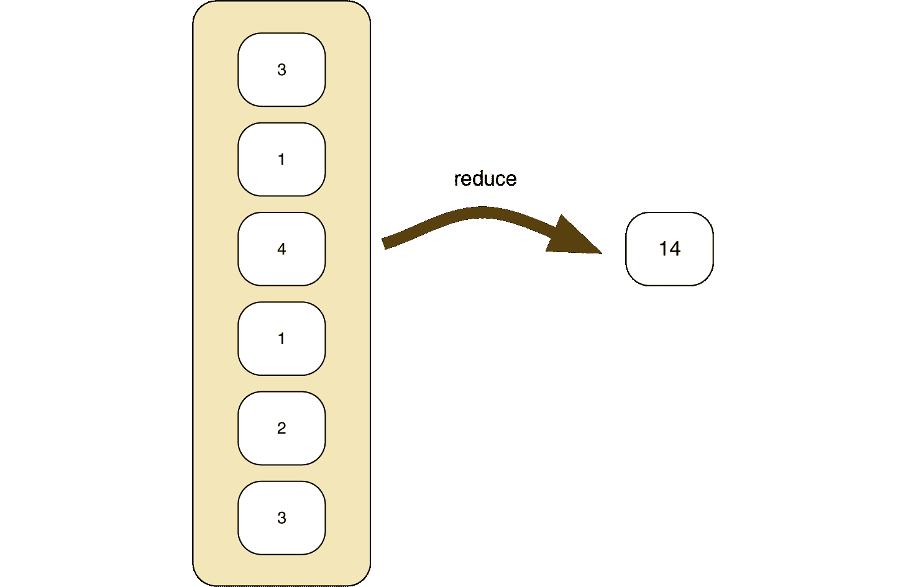

流由一个垂直矩形框表示，其中有六个嵌套框，从上往下排列，如下：3, 1, 4, 1, 2, 和 3。一个标记为`reduce`的箭头从该流指向一个标记为 14 的框。

## 5.5.2: 流水线 (Pipelines)

当多个函数组合成流水线时，流和流函数变得更有用。流水线是两个或多个此类函数的链，以便它们一个接一个地应用。

假设我们想找出记录了多少次大象观测。我们可以通过接一个应用`filter`、`map`和`reduce`函数来实现（**图 5.4**）。

#### 图 5.4 流函数的流水线

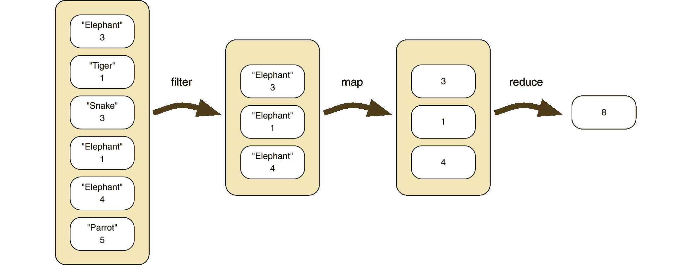

流由一个垂直矩形框表示，其中有六个嵌套框，从上往下排列，如下："大象”， 3。“老虎”， 1。“蛇”， 3。“大象”， 1。“大象”， 4。“鹦”， 5。一个标记为`filter`的箭头从该流指向另一个流（过滤后的流），该流有三个嵌套框，从上往下排列，如下："大象”， 3。“大象”， 1。“大象”， 4。一个标记为`map`的箭头从该流指向另一个流（映射后的流），该流有三个嵌套框，从上往下排列，如下：3, 1, 和 4。一个标记为`reduce`的箭头从该流指向一个标记为 8 的框。

在这个示例中，我们首先`filter`所有的观测以只选择大象观测，然后我们`map`每个观测对象到该次观测中发现的动物数量，最后用`reduce`函数将它们全部相加。注意，在应用`map`函数之后，我们处理不再是`Sighting`对象的流，而是一个整数值的流。这种输入流和输出流之间的转换形式在`map`函数中非常常见。

我们可以使用伪代码将其写成如下：

```
sightingList.filter(name == elephant).map(count).reduce(add up);
```

这不是正确的 Java 语法，但你理解这个意思。我们将在下面查看正确的 Java 代码。

以不同的方式组合这些函数，可以实现许多不同的操作。例如，如果我们想知道某个观测员在某天提交了多少报告，我们可以这样做：

```
sightingList.filter(spotter == spotterID)
                .filter(period == dayID)
                .reduce(count elements);
```

流水线始终从源（流）开始，紧接着是一系列操作。操作分为两种类型：*中间操作*和*终端操作*。在流水线中，最后一个操作必须是终端操作，而其他操作必须是中间操作：

```
source.inter1(...).inter2(...).inter3(...).terminal(...);
```

中间操作始终产生一个新的流，下一个操作可以应用于该流，而终端操作产生一个结果，或者没有返回值（例如作为终端操作的`forEach`）。流方法的文档总是会告诉你某项操作是中间的还是终端的。

我们现在继续讨论实现这些函数的方法的 Java 语法。这是流和 lambda 相遇的地方：每个方法的参数都是一个 lambda。

## 5.5.3: `filter`方法

`filter`方法创建流的子集。通常，它们是那些符合某些条件的元素。流的`filter`方法是一个中间操作，它只向输出流传递符合条件的元素。它接收一个接收元素并返回布尔值的 lambda。如果结果为 true，则该元素被包含在输出流中，否则被排除。例如，我们可能想选择与大象相关的元素。这里可以这样做：

```
sightingList.stream()
            .filter(s -> "Elephant".equals(s.getAnimal()))
```

注意，我们必须先从列表创建流，以便应用过滤器。我们不需要指定 lambda 参数的类型，因为编译器知道`ArrayList<Sighting>`将交付一个`Sighting`对象的流，因此参数的类型为`Sighting`。

更通用地说，将过滤作为方法的一部分是合理的，所以这就是我们重写`printSightingsOf`的方式：

```java
/**
 * 输出给定动物的所有观测详情。
 * @param animal 动物类型。
 */
public void printSightingsOf(String animal)
{
    sightingList.stream()
                .filter(s -> animal.equals(s.getAnimal()))
                .forEach(s -> System.out.println(s.getDetails()));
}
```

重要的是，流的每个操作都不会修改其输入流。每个操作都会根据其输入和操作创建一个新的流，以传递给序列中的下一个操作。在这里，终端操作是`forEach`，其结果是将通过之前过滤过程的观测打印出来。`forEach`方法是一个终端操作，因为它不返回另一个流作为结果——它是一个`void`方法。

为了说明这一点，请考虑当我们打印某次观测的细节时，我们实际上感兴趣的是从`getDetails`方法返回的字符串，而不是`Sighting`对象本身。上述代码（即在`System.out.println`调用中直接调用`getDetails()`）的另一种替代方案，是先将`Sighting`对象映射为细节字符串。然后，终端操作就可以直接打印这些细节：

```java
/**
 * 根据给定的观测者 打印所有观测记录。
 * @param spotter 观测者的 ID。
 */
public void printSightingsBy(int spotter)
{   
    sightingList.stream()
                .filter(aSighting -> aSighting.getSpotter() == spotter)
                .map(aSighting -> aSighting.getDetails())
                .forEach(details -> System.out.println(details));
}
```

这个示例与我们之前看到的版本是等的。我们在上面提到的另一个示例——映射到每次观测中发现的动物数量——看起来如下：

```java
sightingList.stream()
               .filter(aSighting -> aSighting.getSpotter() == spotter)
               .map(aSighting -> aSighting.getCount())
               . ...
```

这段代码段将产生一个整数流，然后我们可以对其进行进一步处理。

## 5.5.5: `reduce`方法

我们目前为止见过的中间操作以流作为输入并输出流。有时，我们需要一种操作将其输入流“折叠”为单个对象或值，而这正是`reduce`方法的功能，它是一项终端操作。

上述示例的完整代码——选择所有特定类型的动物，然后映射到每次观测中的动物数量，最后将所有数字相加——如下所示：

```java
public int getCount(String animal)
{   
    return sightingList.stream()            
               .filter(aSighting -> animal.equals(aSighting.getAnimal()))
               .map(aSighting -> aSighting.getCount())        
               .reduce(0, (total, count) -> total + count);
}
```

我们可以看到，`reduce`方法的参数看起来比`filter`和`map`方法稍微复杂一点。这里有两个方面：

* `reduce`方法有两个参数。在我们示例中，第一个是 0，第二个是 lambda 表达式。
* 此处使用的 lambda 本身有两个参数，分别称为`total`和`count`。

为了理解它是如何工作的，查看一下如果我们用传统方式编写添加所有计数的代码可能会有所帮助。我们会写一个像这样的循环：

```java
public int getCount(String animal)
{   
    int total = 0;   
    for(Sighting aSighting : sightingList) {        
        if(animal.equals(aSighting.getAnimal())) {            
            total = total + aSighting.getCount();        
        }
    } return total;
}
```


计算总和的过程涉及以下步骤：

- 声明一个变量来保存最终值，并赋予其初始值 `0`。
- 遍历列表并确定哪些观测记录与我们感兴趣的特定动物有关（过滤步骤）。
- 从识别出的观测中获取计数（映射步骤）。
- 将计数加到变量中。
- 返回迭代过程中在变量中累积的总和。

编写此过程的基于流的版本的关键点在于要出变量`total`充当了“累加器”的形式：每当识别出一个相关的计数，它就会被加到目前的值中，产生一个新值供下轮使用。为了让该过程运行，`total`必须被赋予初始值`0`以便第一个计数被添加。`reduce`方法接受两个参数：一个起始值和一个 lambda 表达式。从形式上说，起始值被称为`identity`（恒等值）。它是我们运行总和初始化的值。在我们的代码中，我们传递了`0`。第二个参数是一个带有两个参数的 lambda：一个用于运行总和，另一个用于流的当前元素。我们在代码中写的 lambda 如下：

```
(total, count) -> total + count
```

lambda 的体应该返回运行总和与元素合并的结果。在我们的示例中，“合并”仅仅是指将它们相加。应用此`reduce`方法的效果是将运行总和初始化为零，将流的每个元素加到它上，并在最后返回总和。由于我们的代码中没有显式循环，起初理解可能会有一点困难，但整个过程包含了与`for-each`版本相同的所有元素。

## 5.5.6: 其他流方法

我们已经说过，许多常见任务可以通过三类操作完成：`filter`、`map`和`reduce`。在实践中，Java 为流提供了许多更多方法，我们稍后会看到其中一些。然而，这些大部分只是这里介绍的三个操作的变体，尽管它们的名称不同。例如，`Stream`类型有名为`count`、`findFirst`和`max`的方法——这些都是`reduce`操作的变体——以及名为`limit`和`skip`的方法，它们是`filter`的示例。

## 5.6: 重温音乐组织项目

在第 4 章中，我们介绍了音乐组织项目来管理存储在`ArrayList`中的`Track`对象集合。现在我们将使用该项目的一个版本，在熟悉的范围内复习 lambda 使用以及基础流操作（`filter`、`map`和`reduce`），并引入流的一些额外功能。

然而，在继续阅读之前，你可能想通过完成以下练习来测试对流和 lambda 的理解，这些练习的答案将在后续章节给出。如果你发现可以轻松完成这些练习，可以跳到 5.6.3 节，那里我们将涵盖一些新内容并处理如何编写新版本的`findMatching`方法（该方法未被涵盖）。

### 5.6.1: 重写`listAllTracks`

`listAllTracks`方法在项目原始版本中的写法如代码 5.3 所示。

#### 5.3 listAllTracks 方法的原始版本

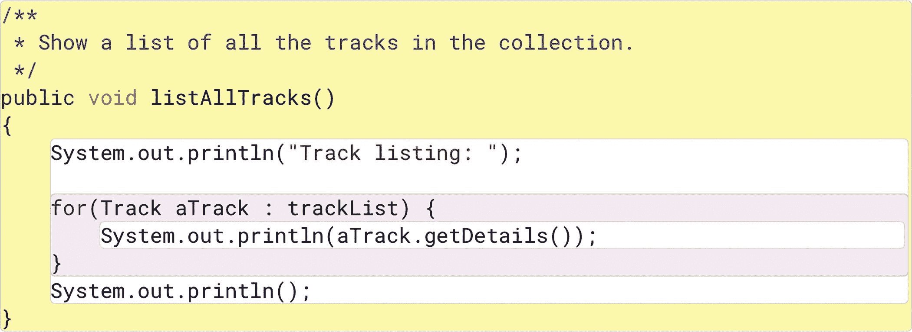

代码包含以下行：

- 行 1：`/**`
- 行 2：缩进 1 层，`* 显示集合中所有歌曲的列表。`
- 行 3：缩进 1 层，`* /`
- 行 4：`public void listAllTracks()`
- 行 5：`{`
- 行 6：缩进 2 层，`System.out.println("Track listing:");`
- 行 7：`(空行)`
- 行 8：缩进 2 层，`for(Track aTrack : trackList) {`
- 行 9：缩进 3 层，`System.out.println(aTrack.getDetails());`
- 行 10：缩进 2 层，`}`
- 行 11：缩进 2 层，`System.out.println("");`
- 行 12：`}`

```java
trackList.forEach(aTrack -> System.out.println(aTrack.getDetails()));
```

对此问题的另一种思考方式是：每个`Track`对象都需要映射到其`getDetails`方法返回的字符串，然后打印该字符串：

```java
trackList.stream().map(aTrack -> aTrack.getDetails())
          .forEach(details -> System.out.println(details));
```

事实上，正如我们在练习 5.20 中提示的那样，还有如下所示的变体：

```java
trackList.stream().map(aTrack -> aTrack.getDetails())
          .forEach(System.out::println);
```

`forEach`方法的参数是一个*方法引用*（method reference）。方法引用使用现有的方法来代替 lambda 表达式，该方法会在处理流中的每个元素时被调用。我们在这里不会详细解释这种语法，而将在第 6 章中再次详细介绍。

## 5.6.2: 重写`listByArtist`

`MusicOrganizer`原始的`listByArtist`方法如**代码 5.4**所示。请注意，如果搜索字符串与艺术家的名称部分匹配（子字符串），该方法也能找到这些艺术家。

#### 代码 5.4：listByArtist 方法的原始版本

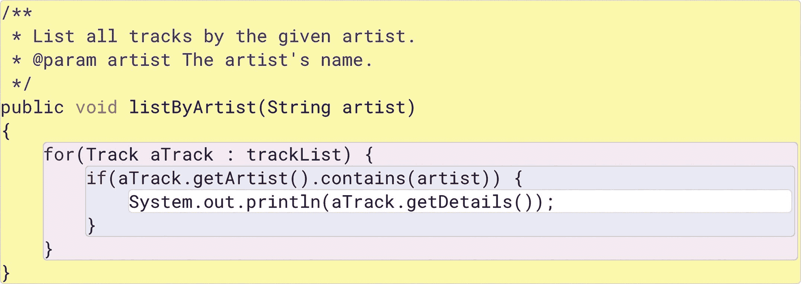

该代码包含以下行：

- 第 1 行：正斜杠 星号
- 第 2 行：缩进层 1，星号 列出给定艺术家的所有曲目。
- 第 3 行：缩进层 1，星号 在参数 artist 处 艺术家的名字。
- 第 4 行：缩进层 1，星号 正斜杠
- 第 5 行：`public void listByArtist 左括号 String artist 右括号`
- 第 6 行：左大括号
- 第 7 行：缩进层 2，`for 左括号 Track aTrack 冒号 trackList 右括号 左大括号`
- 第 8 行：缩进层 3，`if 左括号 aTrack 点 getArtist 左括号 右括号 点 contains 左括号 artist 右括号 右大括号 右大括号`
- 第 9 行：缩进层 4，`System 点 out 点 println 左括号 aTrack 点 getDetails 左括号 右括号 右括号 分 分号`
- 第 10 行：缩进层 3，右大括号
- 第 11 行：缩进层 2，右大括号
- 第 12 行：右大括号

该方法的形式与`listAllTracks`方法相似，它们都是基于 for-each 循环，但只打印一部分曲目。这表明我们必须对曲目流应用过滤器，并且相关的谓词 lambda（predicate lambda）将基于每个曲目艺术家的名称。

```java
trackList.stream()
          .filter(aTrack -> aTrack.getArtist().contains(artist))
          .map(aTrack -> aTrack.getDetails())
          .forEach(details -> System.out.println(details)); 
```

*music-organizer-with-streams*项目包含了我们在这里讨论过的代码，以及一个`listByTitle`方法，它是练习 5.30 的解决方案，并且与`listByArtist`非常相似。

## 5.6.3: 流索引、短路操作和 Optional 类

在 *music-organizer-for-streams* 项目的`MusicOrganizer`类中，有一个`findFirstMatching`方法，用于搜索匹配给定搜索字符串的标题，并找到找到的第一个索引。

我们可能想要尝试的方法如下：

```java
Track matchingTrack = trackList.stream()
          .filter(aTrack -> aTrack.getTitle().contains(searchString))
          .collect(Collectors.toList())
          .get(0);

return trackList.indexOf(matchingTrack);
```

这种方法的想法是将所有匹配的曲目收集到一个新列表中（通过调用`Collectors.toList`创建），然后在`trackList`中查找列表中的第一个项目以找到索引。在继续阅读之前，你可能想考虑为什么这不是一个好的解决方案，并在某些情况下会失败。将此方法转换为使用流比其他方法需要更多的精力。决定正确解决方案的关键问题是索引和匹配。对于第一点，我们已经注意到流与索引没有关联，因此我们需要找到一种绕过的方法。对于第二点，我们希望一旦找到匹配项就停止流，为此，我们将在流水线中引入短路操作（short-circuiting operation）。对于第三点，我们将引入`Optional`类，这是流处理的一个重要特性。

## 5.6.4: 流索引

将流的元素与其对应的索引关联的最简单方法是反转过来，使用索引流来访问对象。例如，我们可以如下列出曲目的详细信息：

```java
IntStream.range(0, trackList.size())
         .forEach(index ->
             System.out.println(index + ": " + trackList.get(index).getDetails()));
```

`IntStream`的`range`方法创建一个从 0 到第二个参数减 1 的值流，这正好匹配了`trackList`的有效索引。`IntStream`的一个特性是它生成的是原始值流而不是对象，在某些情况下，可能需要在流水线中使用`mapToObj`或装箱操作来显式创建对象。例如，这里上述的替代版本说明了这一点：

```java
IntStream.range(0, trackList.size())
          .mapToObj(index ->
             String.format("%3d: %s", index, trackList.get(index).getDetails()))
          .forEach(details -> System.out.println(details));
```

需要使用`mapToObj`将原始`int`索引映射到打印的格式化`String`。

## 5.6.5: 短路操作

该方法的不满意解决方案是找到所有匹配的标题，然后从中选取第一个。这样做效率低下且做了浪费：一旦找到了第一个标题，就不需要继续搜索。

为了改进这一点，我们可以使用短路终止操作，例如`findFirst`和`findAny`。我们可以在`findFirstMatching`的解决方案中使用`findFirst`：

```java
IntStream.range(0, trackList.size())
          .filter(index -> trackList.get(index)
             .getTitle()
             .contains(searchString))
          .findFirst()
```

一旦过滤器传递了第一个匹配标题的索引，处理就会停止。

然而，解决方案尚未完成，因为我们必须意识到，与任何搜索一样，搜索可能会失败。也就是说，可能没有匹配的标题——这正是我们在第 5.6.3 节开头尝试的解决方案未能正确处理的情况。如果是这样，那么`filter`方法产生的流将是空的。

在`findFirstMatching`的非流版本中，如果没有匹配项，则返回 −1，我们希望在这里也实现同样的操作，但`findFirst`方法无法做到这一点。它只能返回第一个匹配的索引或者什么都不返回。它表示这些替代方案的方式是将结果（如果有的话）封装在类型为`Optional`的对象中，我们将在下一节中介绍这种类型。

## 5.6.6: `Optional`类

在很多情况下，我们想要查找或计算某些东西，但这些东西可能并不存在。例如，在列表为空时查找列表中的最小值或最大值。虽然有人认为通过在尝试查找最小或最大值之前检查列表的大小很容易避免这些情况，但还有其他情况是无法避免的。通用流操作（如`findFirst`和`findAny`）以及专门的操作（如`IntStream`上的`min`和`max`）都被设计为返回`Optional`类型对象（对于`IntStream`为`OptionalInt`），因为它们可能无法提供结果。`Optional`对象要么封装了所寻找的项目，要么是空的。空并不等同于存储`null`值。它们具有`isEmpty`和`isPresent`方法，用于检查它们是否为空或是否包含有意义的值。

其结果是，检查返回`Optional`的操作的结果始终是重要的，并且当`Optional`为空时采取适当的行动。对于`findFirstMatching`方法，如果没有匹配项，我们希望该方法返回值 −1。完整的解决方案如**代码 5.5** 所示。

### 代码 5.5: `listByArtist`方法的原始版本

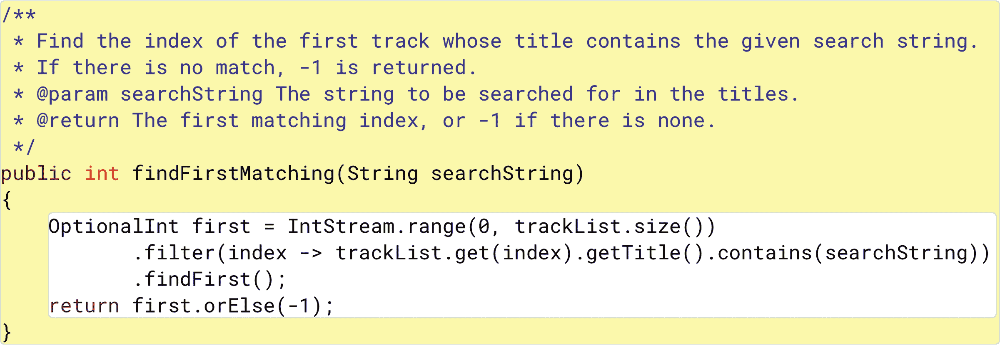

该代码包含以下行：

第 1 行：正斜杠星号
第 2 行：缩进级别 1，星号 查找标题包含给定搜索字符串的第一个歌曲的索引。
第 3 行：缩进级别 1，星号 如果没有匹配，则返回 -1。
第 4 行：缩进级别 1，星号 `@param searchString` 在标题中要搜索的字符串。
第 5 行：缩进级别 1，星号 `@return` 第一个匹配的索引，如果没有则返回 -1。
第 6 行：缩进级别 1，星号 正斜杠
第 7 行：`public int findFirstMatching OpenParenthesis String searchString CloseParenthesis`
第 8 行：`OpenCurlyBracket`
第 9 行：缩进级别 2，`OptionalInt first equals IntStream dot range OpenParenthesis 0 comma trackList dot size OpenParenthesis CloseParenthesis CloseParenthesis`
第 10 行：缩进级别 3，`dot filter OpenParenthesis index arrow operator trackList dot get OpenParenthesis index CloseParenthesis dot getTitle OpenParenthesis CloseParenthesis dot contains OpenParenthesis searchString CloseParenthesis CloseParenthesis`
第 11 行：缩进级别 3，`dot findFirst OpenParenthesis CloseParenthesis semicolon`
第 12 行：缩进级别 2，`return first dot orElse OpenParenthesis negative 1 CloseParenthesis semicolon`
第 13 行：`CloseCurlyBracket`

`IntStream`的`findFirst`方法返回`OptionalInt`。`orElse`方法是返回找到的值或在`Optional`对象为空时返回替代值的标准方法。对于此示例，这等于以下内容：

```
if(first.isPresent()) {
    return first.get();
}
else {
    return -1;
} 
```

使用`orElse`更加简洁、优雅，因此优于 if-else 版本。

## 5.6.7: 打印排序后的歌曲列表

`MusicOrganizer`的`listAllTracks`方法打印存储在组织器`ArrayList`中的所有`Track`对象的列表。列表的顺序与单个歌曲添加到`ArrayList`的顺序完全一致。这可能不是一种特别有用的排序；特别是当我们希望视觉上从列表中搜索某个特定艺术家或特定标题的歌曲时。更有用的方法是在打印列表之前按艺术家或标题对列表进行排序。在本节中，我们将探索通过艺术家名称、歌曲标题、播放次数等标准实现列表列表的一些可用选项。

我们需要做出的决策之一是，是否永久更改`trackList`实例中`Track`对象的顺序。这样做允许我们使用现有的`listAllTracks`方法进行输出；例如：

```java
/**
 * 输出按艺术家名称排序的歌曲。
 */
public void listSortedByArtist()
{
    trackList.sort(how-to-sort-by-artist);
    listAllTracks();
}
```

列表类定义了一个我们可以使用的`sort`方法。它接受一个参数，告诉列表如何比较对象以确定顺序。我们将使用`how-to-sort-by-artist`作为占位符。

作为排序`trackList`的替代方案，我们可以让新列表创建`trackList`的副本，排序副本，然后输出副本。例如：

```java
/**


* 输出按艺术家名称排序的歌曲。

```java
public void listSortedByArtist()
{
    ArrayList<Track> copy = new ArrayList<>(trackList);
    copy.sort(how-to-sort-by-artist);

    for(Track aTrack : copy) {
        System.out.println(aTrack.getDetails());
    }
}
```

然而，这需要额外的代码。另一种选项是利用`Stream`的`sorted`方法。

```java
/**
 * 输出按艺术家名称排序的歌曲。
 */
public void listSortedByArtist()
{
    trackList.stream()
        .sorted(how-to-sort-by-artist)
        .map(aTrack -> aTrack.getDetails())
        .forEach(details -> System.out.println(details));
}
```

这种基于流的版本是我们将采用的。因为排序的是`Stream`，`trackList`的原始顺序保持不变。

## 5.6.8：使用 lambda 排序集合

问题仍然是：我们如何实现伪代码`how-to-sort-by-artist`所要求的排序顺序？解决方案是使用 lambda 比较一对`Track`对象以确定哪一个应该在另一个前面。给定两个歌曲`t1`和`t2`，如果`t1`应在`t2`之前，lambda 应返回负值；如果`t2`应在`t1`之前，返回正值；如果顺序无关（例如艺术家、标题等相同），则返回零。

假设我们想按播放次数对歌曲进行排序，以便播放次数少的歌曲先列出。可以将以下 lambda 传递给`sorted`方法以实现该目标：

```java
(t1, t2) -> {
    if(t1.getPlayCount() < t2.getPlayCount()) {
        return -1;
    }

    if(t1.getPlayCount() > t2.getPlayCount()) {
        return 1;
    }
    else {
        return 0;
    }
}
```

事实上，返回的值并不非是 −1、1 或 0；任何负值或正值都可以表示这种关系，因此上面的 lambda 可以简化为：

```java
(t1, t2) -> t1.getPlayCount() - t2.getPlayCount()
```

比较两个字符串更加简单，因为`String`类有一个`compareTo`方法，可以返回一个用于排序的适当。因此，按艺术家名称排序的 lambda 为：

```java
(t1, t2) -> t1.getArtist().compareTo(t2.getArtist())
```

如果我们将此项添加到用于艺术家的`listSorted`方法中，那么最终版本如下：

```java
/**
 * 按艺术家名称输出曲目。
 */
public void listSortedByArtist()
{
    trackList.stream()
        .sorted((t1, t2) -> t1.getArtist().compareTo(t2.getArtist()))
        .map(track -> track.getDetails())
        .forEach(details -> System.out.println(details));
}
```

## 5.6.9：使用 Comparator

如果你已经在项目中添加了更多的`listSorted`方法，你会发现，除了传递给`sorted`方法的 lambda 表达式外，每个方法包含的代码都是完全相同的。在本节中，我们将看到如何避免这种重复代码。

在方法头部中声明的所有参数都必须有一个关联的类型，并且传递给方法调用的所有参数必须与方法头部中定义的类型匹配。`sorted`方法也不例外，它的参数类型是`Comparator`，该类型定义在`java.util`包中。`Comparator`是一个泛型类型，就像`ArrayList`、`HashMap`等一样。它接受的类型是待比较对象的类型。因此，在我们的示例中，类型将是`Comparator<Track>`。

我们一直用来对曲目排序的 lambda 表达式类型均为`Comparator<Track>`，因为它们返回的是两个`Track`对象之间比较的结果。这允许我们编写一个通用的`listSorted`方法，能够使用我们选择编写的任何`Comparator<Track>` lambda 表达式对曲目进行排序。该方法如下：

```java
/**
 * 根据给定的 Comparator 输出曲目。
 * @param comp 曲目应该如何进行比较。
 */
public void listSortedBy(Comparator<Track> comp)
{
    trackList.stream()
        .sorted(comp)
        .map(aTrack -> aTrack.getDetails())
        .forEach(details -> System.out.println(details));
}
```

我们现在只需通过调用`listSortedBy`并传递一个 lambda 参数来按艺术家详情排序编写`listSortedByArtist`方法，如下：

```java
/**
 * 按艺术家名称输出曲目。
 */
public void listSortedByArtist()
{
    listSortedBy((t1, t2) -> t1.getArtist().compareTo(t2.getArtist()));
}
```

我们显然也可以以相同的方式为标题和播放次数编写`listSorted`方法。

## 5.7：总结

在本章中，我们引入了一些与第 4 章中涵盖的概念密切相关的新概念。我们查看了处理数据流的函数式风格。在这种风格下，我们不编写循环来处理集合中的元素。相反，我们对源自集合的流应用操作流水线（pipeline），以便将序列转换为我们需要的形式。流水线中的每个操作都定义了对序列中单个元素要的操作。最常见的序列变换通过`filter`、`map`和`reduce`方法执行。

流水线中的操作通常接受 lambda 作为参数，以指定对序列中的每个元素要的操作。lambda 是一个匿名函数，它接受零或多个参数，并有一段与方法体作用相同的代码块。

看看你一直在做的`animal-monitoring-v1`项目，你可能注意到还有两个方法在使用 for-each 循环，我们还没有使用流来重写它们。这些是返回新集合作为方法结果的方法；我们还没有讨论过如何从流创建新集合。我们将在第 6 章中回到这个问题。

本章引入的术语：

1. 函数式编程、lambda、流、流线、`filter`、`map`、`reduce`、短路操作

# 第 6 章：更复杂的行为

在第 4 章中，我们引入了类库中的`ArrayList`类。该库由数千个类组成，每个类都有许多方法，既有带参数的也有不带返回返回类型。记住所有它们及其相关的细节是不可能的。相反，一个优秀的 Java 程序员应该知道：

- 记住库中一些最重要的类及其方法的名称（`ArrayList`就是这些重要类之一），以及
- 如何了解其他类并查找细节（如方法和参数）。

在本章中，我们将引入类库中的一些重要类，更多的库类将在贯穿书中介绍。更重要的是，我们将向你如何自己探索和理解库。这将使你能够编写出许多有趣的程序。幸运的是，Java 库的文档非常齐全。这些文档以 HTML 格式可用（可以在网页浏览器中阅读）。我们将利用它来了解类类。

阅读和理解文档是介绍介绍库类的第一部分。我们将这种方法更得进一步，还将讨论如何准备自己的类，以便其他人能够像使用标准库类一样使用它们。这对于现实世界的软件开发至关重要，在这些场景中，团队必须处理大型项目并随着时间的推移对软件进行维护。

你可能已经注意到`ArrayList`类的一点是，我们在从未查看过源代码的情况下就使用了它。我们没有检查它是如何实现的。对于使用它的功能来说，这并不是必要的。我们只需要知道类的名称、方法的名称、这些方法的参数和返回类型，以及这些方法具体是做什么的。我们并不真正关心工作是如何完成的。这是使用库类时的典型情况。

对于大型软件项目中的其他类也是如此。通常情况下，几个人通过处理不同的部分来合作完成一个项目。每个程序员都应该专注于自己的领域，而不需要理解所有其他部分的细节（我们之前在第 3 章中讨论过这一点，那里我们讨论了抽象和模块化）。实际上，每个程序员都应该能够像使用库类一样使用其他团队成员的类，在不需要了解其内部工作原理的情况下对它们进行明智的使用。

为了实现这一点，每位团队成员必须编写关于他们的类的文档，其风格应与 Java 标准库的文档相似，这使得其他人无需阅读代码即可使用该类。本章也将讨论这个话题。

## 6.2：TechSupport 系统

一如既往，我们将通过一个示例来探索这些问题。这次，我们将使用`TechSupport`。你可以在书的项目中通过`tech-support-v1`找到它。

`TechSupport`是一个旨在为虚构的 DodgySoft 公司客户提供技术支持的程序。不久前，DodgySoft 有一个技术支持部门，人员坐在电话旁。客户可以打电话获取有关 DodgySoft 软件产品技术问题的建议和帮助。然而，最近业务经营并不理想，DodgySoft 决定撤销技术支持部门以节省费用。现在现在开发`TechSupport`系统，以给人仍在提供支持的印象。该系统旨在模拟技术支持人员可能提供的回答。客户可以在线与技术支持系统进行通信。

### 6.2.1：探索 TechSupport 系统

我们现在开始使用`tech-support-v1`项目进行更详细的探索。它是我们系统的第一个、原始的实现。我们将在整个章节中对其进行改进。这样，我们对整个系统的理解应该比仅仅阅读完整解决方案要深得多。

在**练习 6.1**中，你将看到该程序本质上是在与用户进行对话。用户可以输入一个问题，系统会做出响应。尝试在我们的项目原型版本`tech-support-v1`上进行相同的操作。

在`TechSupport`的完整版本中，系统能够产生相当多样的回答——有时它们看起来甚至很有道理！在我们用作起点的原型版本中，回答受限大得多（**图 6.1**）。你会很快发现，回答总是是一样的：

1. “听起来很有趣。告诉我多一点。 。 。”

#### 图 6.1 第一个 TechSupport 对话

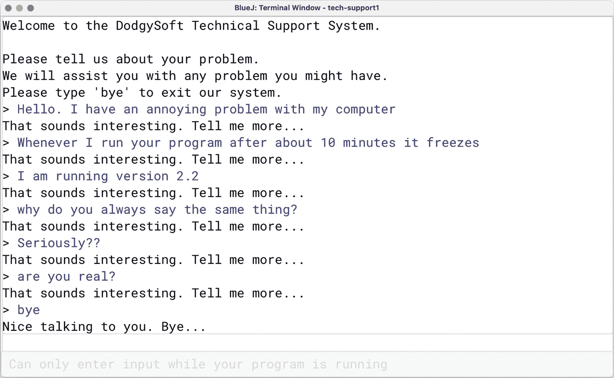

对话框的左上角有三个彩色圆。标题 BlueJ: figures 位于顶部中间。对话框显示了 19 行，如下：

第 1 行：欢迎使用 DodgySoft 技术支持系统。  
第 2 行：空白。  
第 3 行：请告诉我们您的问题。  
第 4 行：我们将协助您解决可能遇到的任何问题。  
第 5 行：输入 'bye' 退出我们的系统。  
第 6 行：> Hello。我的电脑有一个烦人的问题。  
第 7 行：听起来很有趣。告诉我多一点……。  
第 8 行：> 每当我在大约 10 分钟后运行你的程序时，它就会冻结。  
第 9 行：听起来很有趣。告诉我多一点……。  
第 10 行：> 我正在运行版本 2.2。  
第 11 行：听起来很有趣。告诉我多一点……。  
第 12 行：> 为什么你总是说同样的话？  
第 13 行：听起来很有趣。告诉我多一点……。  
第 14 行：> 真的吗？？  
第 15 行：听起来很有趣。告诉我多一点……。  
第 16 行：> 你是真实的吗？  
第 17 行：听起来很有趣。告诉我多一点……。  
第 18 行：> bye。  
第 19 行：很高兴和你聊天。再见……。

在 19 行下方显示了一个文本框，下方有一行（已禁用）字样写着：只有在你的程序运行时才能输入内容。

事实上，这一点也不有趣，而且当我们试图假装电话端坐着一个技术支持人员时，它并没有说服力。我们很快将尝试改进这个对话。但在在此之前，我们先探索一下目前拥有的内容。

项目图向了三个类：`SupportSystem`、`InputReader`和`Responder`（**图 6.2**）。`SupportSystem`是主类，使用`InputReader`获取输入并使用`Responder`生成响应。

#### 图 6.2 TechSupport 类图

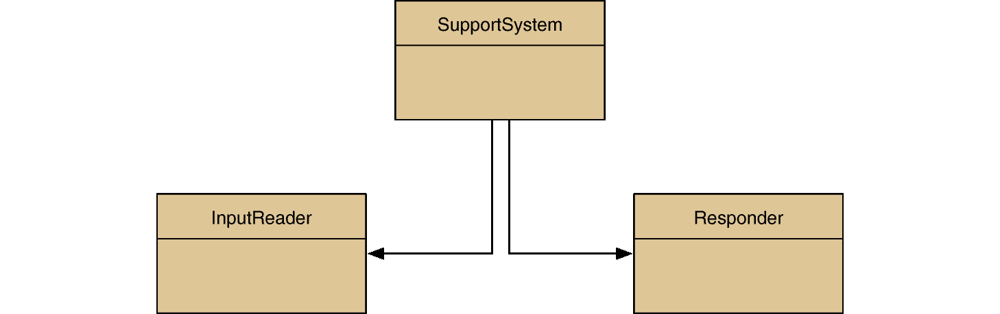

通过创建此类的对象并查看对象的方法来进一步检查`InputReader`。你会看到它只有一个可用用方法，称为`getInput()`，返回一个字符串。尝试一下。此方法允许你在终端输入一行内容，然后将你输入的内容作为方法结果返回。我们现在不检查其内部工作原理，只需注意`InputReader`有一个返回字符串的`getInput()`方法。

对`Responder`类执行相同的操作。你会发现它有一个`generateResponse()`方法，始终返回字符串“听起来很有趣。告诉我多一点……”这解释了我们在对话中看到的内容。

现在让我们更仔细地观察`SupportSystem`类。

### 6.2.2：阅读代码

`SupportSystem`完整源代码所示**代码 6.1**。**代码 6.2**显示了`Responder`类源代码。

#### 代码 6.1 SupportSystem 源代码

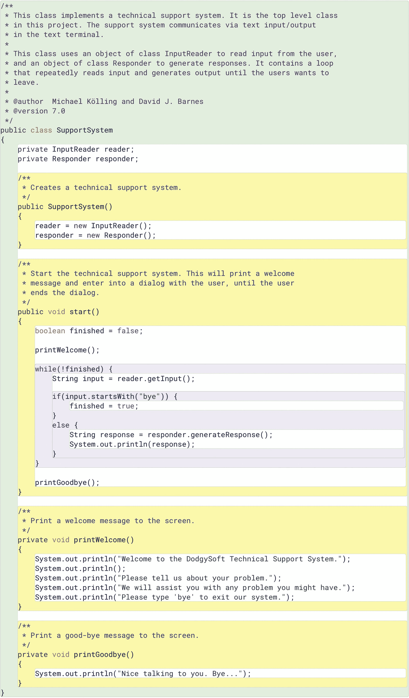

```java
// 此类实现了一个技术支持系统。它是该项目中的顶层类。
// 支持系统通过文本终端中的文本输入和输出进行通信。
// 此类使用 InputReader 类对象读取用户输入，
// 并使用 Responder 类对象生成响应。它包含一个循环，
// 重复读取输入并生成输出，直到用户想要离开。
```

```java
/**
 * author Michael Kölling and David J. Barnes
 * version 7.0.
 */
public class SupportSystem {
    private InputReader reader;
    private Responder responder;

    /**
     * 创建一个技术支持系统。
     */
    public SupportSystem() {
```


`reader = new InputReader();`

`responder = new Responder();`

`}`

`/**`
` * 启动技术支持系统。这将打印欢迎`
` * 消息并与用户对话，直到用户结束`
` * 对话。`
` */`
`public void start() {`
`    boolean finished = false;`
`    printWelcome();`
`    while (!finished) {`
`        String input = reader.getInput();`
`        if (input.startsWith("bye")) {`
`            finished = true;`
`        } else {`
`            String response = responder.generateResponse();`
`            System.out.println(response);`
`        }`
`    }`
`    printGoodbye();`
`}`

`/**`
` * 在屏幕上打印欢迎消息。`
` */`
`private void printWelcome() {`
`    System.out.println("Welcome to the DodgySoft Technical Support System.");`
`    System.out.println();`
`    System.out.println("Please tell us about your problem.");`
`    System.out.println("We will assist you with any problem you might have.");`
`    System.out.println("Please type 'bye' to exit our system.");`
`}`

`/**`
` * 在屏幕上打印再别消息。`
` */`
`private void printGoodbye() {`
`    System.out.println("Nice talking to you. Bye...");`
`}`

`}`

## 代码 6.2 Responder 源代码

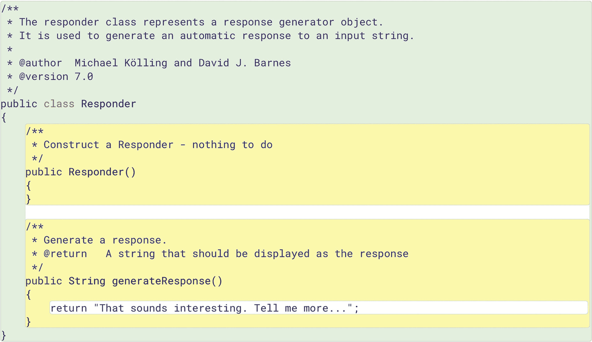

```java
/**
 * Responder 类表示一个响应生成器对象。
 * 它被用于生成响应。
 */
class Responder {

    /**
     * 无空构造函数。
     */
    public Responder() {

    }

    /**
     * 生成一个响应。
     */
    public String generateResponse() {
        return "That sounds interesting. Tell me more";
    }

}
```

循环的主体——即在我们希望继续执行时重复执行的部分——如果我们剥离对退出条件的检查，它由三条语句组成：

```java
String input = reader.getInput();
...
String response = responder.generateResponse();
System.out.println(response);
```

因此，循环会重复执行：

* 读取某些用户输入，
* 要求响应器生成响应，以及
* 打印该响应。

（你可能已经注意到响应完全不依赖于输入！这确实是我们以后需要改进的地方。）

最后一个要检查的部分是退出条件的检查。其意图是，当用户输入“bye”一词时，程序应该结束。我们在类中找到的相关源代码部分如下：

```java
String input = reader.getInput();
if(input.startsWith("bye")) {
    finished = true;
}
```

如果你能孤立地理解这些部分，那么再次查看 `Code 6.1` 中完整的 `start` 方法，看看你是否能整体理解所有内容，这是一个好主意。

在上面检查的最后一个代码片段中，使用了一个名为 `startsWith` 的方法。由于该方法是在持有 `String` 对象的变量 `input` 上调用的，它必须是 `String` 类的方法。但这个方法是做什么的？我们又如何发现呢？

我们可能仅从方法的名称猜到，它测试输入字符串是否以“bye”开头。我们可以通过实验来验证。再次运行 `TechSupport` 系统并输入“bye bye”或“bye everyone”。你会注意到这两种版本都会导致系统退出。注意，输入 `"Bye"` 或 `"bye"`——以大写字母开头或单词前有空格——不会被识别为以“bye”开头。这对于用户来说可能有点困扰，但事实证明，如果我们对 `String` 类进一步了解，就可以解决这些问题。

我们如何获取更多关于 `startsWith` 方法或 `String` 类其他方法的信息呢？

# 6.3: 读取类文档

`String` 类是 Java 标准类库中的类之一。我们可以通过阅读 `String` 类的库文档来了解它的更多细节。

要做到这一点，请从 BlueJ 的 `Help` 菜单中选择 `Java Class Libraries` 项。这将打开一个网络浏览器，显示 Java API（应用程序接口）文档的主页。

网络浏览器将显示 Java 库的顶层及其 `modules`（模块）。我们需要的所有类都在 `java.base` 模块中。

我们现在可以通过遵循链接来浏览库文档：例如，点击 `java.base` 查看模块的包（packages），找到并点击 `java.util` 包查看它的类，然后向下滚动找到 `ArrayList` 类，点击它并阅读其文档。这通常不是找到你所需内容最快的方法，而且它要求你知道要在哪个包中查找。

通常，当我们想要查找某个特定类或方法的文档时，使用首页右上角的搜索框会更快。让我们现在试一下用这种方法来查找 `String` 类的文档。

## 6.3.1: 接口与实现

你会发现文档包含了不同的信息片段。它们包括但不限于：

* 类的名称；
* 对该类目的的通俗描述；
* 该类的构造方法和方法的列表；
* 每个构造方法和方法的参数及返回类型；
* 每个构造方法和方法目的的描述。

这些信息整合在一起，被称为类的 `interface`（接口）。注意，接口*并没有*显示实现该类的源代码。如果一个类描述得很好（即，如果它的接口写得很好），那么程序员就不需要看到源代码就可以使用该类。看到接口提供了所需的所有信息。这又是抽象的实际应用。

使类运行起来的后台源代码被称为类的 `implementation`（实现）。通常，程序员一次只处理一个类的实现，同时通过它们的接口使用其他几个类。

接口与实现之间的这种区别是一个非常重要的概念，它将在本书及后续的章节中反复出现。

接口术语也用于单个方法。例如，`String` 文档向我们展示了 `length` 方法的接口：

1. `public int length()`
2. 返回此字符串的长度。等于字符串中 Unicode 代码单元的数量。
3. 指定为：
4.   接口 `CharSequence` 中的 `length`
5. 返回：
6. 由字符串表示的字符序列的长度。

方法的接口由此处显示的头部组成：

* 一个访问修饰符（此处为 `public`），
* 方法的返回类型（此处为 `int`）；
* 方法名；
* 参数列表（在本例中为空）；名称和参数合称为方法的 `signature`（签名）。

## 6.3.2: 使用库中的方法

回到 `TechSupport` 系统。我们现在稍微改进一下对输入的处理。我们在上面的讨论中看到，我们的系统并不宽容：例如，如果我们输入 `" bye"` 或 `"Bye"` 而不是 `"bye"`，单词将无法被识别。我们通过调整输入的文本来实现，让这些变体都能被识别为“bye”。

`String` 类文档告诉我们它有一个名为 `trim` 的方法可以去除空格。关于 `String` 对象的一个重要细节是它们是*不可变*（immutable）的——也就是说，它们一旦创建就无法被修改。仔细注意，例如 `trim` 方法返回一个新的字符串；而不是修改原始字符串。在研究了 `trim` 方法的接口后，我们可以使用以下代码从输入去除空格：

```java
input = input.trim();
```

这段代码将请求存储在 `input` 变量中的 `String` 对象创建一个类似的字符串。然后新的 `String` 被存储在 `input` 变量中，因为我们不再需要旧的那个。因此，在这行代码之后，`input` 指向两端没有空格的字符串。

我们现在可以将这行代码插入到源代码中，如下所示：

```java
String input = reader.getInput();
input = input.trim();
if(input.startsWith("bye")) {
    finished = true;
} else {
    // 代码省略代码
}
```

前两行也可以合并为一行：

```java
String input = reader.getInput().trim();
```

这行代码的效果与上面的前两行完全相同。重要的是，不要将其读为 `trim` 方法被调用在 `getInput` 方法上，实际上 `trim` 方法是调用在 `getInput` 方法返回的结果上的。右侧部分应该像如下括号的形式读取：

```java
(reader.getInput()).trim()
```

在这里，`getInput` 方法返回一个 `String` 对象，然后在返回的字符串上调用 `trim` 方法产生另一个字符串，该字符串随后将被赋值给 `input` 变量。

你更喜好哪种版本主要取决于个人喜好。应该主要基于可读性做出决定：使用你认为更容易阅读和理解的版本。通常，新手程序员会更倾向于双行版本，而经验丰富的程序员则已经习惯了单行风格。

现在我们已经解决了输入周围空格引起的问题，但还没有解决大写字母的问题。然而，进一步研究 `String` 类的文档暗示了一个可能的解决方案，因为它描述了一个名为 `toLowerCase` 的方法。

## 6.3.3: 检查字符串相等性

另一种解决方案是检查输入字符串是否*是*字符串“bye”，而不是检查它是否*以*字符串“bye”开头。一个（错误的！）编写此代码尝试如下：

```java
if(input == "bye") { // 并不总是有效的！
    ...
}
```

这里的问题在于，可能存在多个独立的 `String` 对象，它们都代表相同的文本。例如，两个 `String` 对象可能都包含字符“bye”。等号运算符（`==`）检查的是运算符的两侧是否引用自*同一个对象*，而不是它们是否具有相同的值！这是一个重要的区别。

在我们的示例中，我们感兴趣的是输入变量和字符串常量“bye”是否代表相同的值，而不是它们是否引用自同一个对象。因此，使用 `==` 运算符是错误的。即使输入变量的值是“bye”，它也可能返回 `false`。

解决方案是使用 `String` 类中定义的 `equals` 方法。该方法可以正确测试两个 `String` 对象的内容是否相同。正确的代码如下：

```java
if(input.equals("bye")) {
    ...
}
```

这当然也可以与 `trim` 和 `toLowerCase` 方法结合使用。

## 6.4: 添加随机行为

到目前为止，我们对 *TechSupport* 项目做了小小的改进，但它仍然非常基础。主要问题之一是，无论用户输入什么，它总是给出相同的响应。我们现在将通过定义一组可能的短语来改进这一点。然后，程序将在每次需要回复时随机选择其中一个。这将是我们项目中 `Responder` 类的扩展。

为了实现这一目标，我们将使用一个 `ArrayList` 来存储一些响应字符串，生成一个随机整数，并使用该随机数作为响应列表的索引，从中选出我们的一个短语。在这个版本中，响应仍然不取决于用户的输入（我们稍后会处理），但至少它会改变响应并看起来好得多。

首先，我们必须找到如何生成一个随机整数。

### 6.4.1: `Random` 类

Java 类库包含一个名为 `Random` 的类，这对我们的项目将很有帮助。

要生成随机数，我们必须：

* 创建一个 `Random` 类的实例并
* 调用该实例的方法来获取一个数字。

查看文档，我们看到有各种名为 `nextSomething` 的方法用于生成各种类型的随机值。生成随机整数的方法称为 `nextInt`。

以下示例说明了生成并打印随机整数所需的代码：

```java
Random randomGenerator = new Random();
int index = randomGenerator.nextInt();
System.out.println(index);
```


这段代码片段创建了`Random`类的一个新实例并将其存储在`randomGenerator`变量中。然后调用`nextInt`方法接收一个随机数，将其存储在`index`变量中并打印出来。

### 6.4.2 有限范围内的随机数

我们目前看到的随机数是基于 Java 整数的全范围（−2147483648 到 2147483647）生成的。作为实验这很好，但很少实用。更多时候，我们想要给定有限范围内的随机数。

`Random`类也提供了一个方法来支持这一点。它仍然被称为`nextInt`，但它有一个参数来指定我们想要使用的范围。

当使用从指定范围生成随机数的方法时，必须注意边界是*包含*的还是*不包含*的。例如，Java 库`Random`类中的`nextInt(int bound)`方法指定它生成一个从`0`（包含）到`bound`（不包含）的数字。这意味着值`0`被包含在可能的结果，而指定的`bound`值不包含。此调用可能返回的最大数字是`bound–1`。

### 6.4.3 生成随机响应

现在我们可以查看扩展`Responder`类，以便从预定义的短语列表中选择随机响应。**代码 6.2**显示了我们第一个版本中`Responder`类的源代码。

我们现在将向这个第一个版本添加代码以：

* 声明一个`Random`类型的字段来持有随机数生成器；
* 声明一个`ArrayList`类型的字段来持有我们可能的响应；
* 在`Responder`构造函数中创建`Random`和`ArrayList`对象；
* 用一些短语填充响应列表；
* 在调用`generateResponse`时选择并返回一个随机短语。

**代码 6.3**显示了带有这些新增内容的`Responder`源代码。

#### 代码 6.3 带有随机响应的 Responder 源代码


```java
Line 35: 缩进层 4，双斜杠 为默认响应中的索引选择一个随机数
Line 36: 缩进层 4，双斜杠 列表点 数字将将在 0（包含）和列表大小之间
Line 37: 缩进层 4，双斜杠 列表大小（不包含）。
Line 38: 缩进层 4，int index equals randomGenerator dot nextInt OpenParenthesis responses dot size OpenParenthesis double CloseParenthesis semicolon
Line 39: 缩进层 4，return responses dot get OpenParenthesis index CloseParenthesis semicolon
Line 40: 缩进层 2，右大括号
Line 41: 空行
Line 42: 缩进层 2，正斜杠星号
Line 43: 缩进层 3，* 构建一个默认响应列表，我们可以从中挑选一个
Line 44: 缩进层 3，* 如果我们不知道还能些什么的话。
Line 45: 缩进层 3，正斜杠
Line 46: 缩进层 2，private void fillResponses OpenParenthesis CloseParenthesis
Line 47: 缩进层 2，左大括号
Line 48: 缩进层 4，responses dot add OpenParenthesis DoubleQuotes 这听起来很奇怪。你能更详细地描述一下吗？DoubleQuotes CloseParenthesis semicolon
Line 49: 缩进层 4 ，responses dot add OpenParenthesis DoubleQuotes 没有任何其他客户投诉过这个问题双反斜杠 n DoubleQuotes plus
Line 50: 缩进层 5，DoubleQuotes 在点之前 你的系统配置是什么？DoubleQuotes CloseParenthesis semicolon
Line 51: 缩进层 4，responses dot add OpenParenthesis DoubleQuotes 我需要关于这方面的更多信息。DoubleQuotes CloseParenthesis semicolon
Line 52: 缩进层 4，responses dot add OpenParenthesis DoubleQuotes 你是否检查过没有发生 dll 冲突？DoubleQuotes CloseParenthesis semicolon
Line 53: 缩进层 4，responses dot add OpenParenthesis DoubleQuotes 手册中包含了这一点。你读过手册吗？DoubleQuotes CloseParenthesis semicolon
Line 54: 缩进层 4，responses dot add OpenParenthesis DoubleQuotes 你的描述有点模棱两可。你有双反斜杠 n plus
Line 55: 缩进层 5，DoubleQuotes 你身边有专家可以比你描述得更好吗？DoubleQuotes CloseParenthesis semicolon
Line 56: 缩进层 4，responses dot add OpenParenthesis DoubleQuotes 这不是错误，而是一个特性！DoubleQuotes CloseParenthesis semicolon
Line 57: 缩进层 4，responses dot add OpenParenthesis DoubleQuotes 你能详细说明一下那个吗？DoubleQuotes CloseParenthesis semicolon
Line 58: 缩进层 4，responses dot add OpenParenthesis DoubleQuotes 你尝试过在手机上运行该应用 吗？DoubleQuotes CloseParenthesis semicolon
Line 59: 缩进层 4，responses dot add OpenParenthesis DoubleQuotes 我刚刚查了 StackOverflow - 他们也不知道。DoubleQuotes CloseParenthesis semicolon
Line 60: 缩进层 2，右大括号
Line 61: 右大括号
```

在这个版本中，我们将填充响应列表的代码放在了一个独立的方法中，命名为`fillResponses`，该方法从构造函数中调用。这确保了在创建`Responder`对象时，响应列表就会被填充，但填充列表的源代码保持分离，以使类更易读。该类中最感兴趣的代码段是在`generateResponse`方法中。忽略注释，它的内容如下：

```java
public String generateResponse()
{
  int index = randomGenerator.nextInt(responses.size());
  return responses.get(index);
}
```

该方法中的第一行代码执行了三件事：

* 它通过调用`size`方法获取响应列表的大小。
* 它在`0`（包含）和大小（不包含）之间生成一个随机数。
* 它将该随机数存储在局部变量`index`中。

如果你觉得这一行代码量太多，你也可以写成：

```java
int listSize = responses.size();
int index = randomGenerator.nextInt(listSize);
```

这段代码与第一行等效。你更倾向于哪一个版本，仍然取决于你觉得哪一个更容易读。注意的是，这段代码段将在`0`到`listSize–1`（包含）的范围内生成一个随机数。这完美符合`ArrayList`的合法索引。记住，大小为`listSize`的`ArrayList`的索引范围是`0`到`listSize–1`。因此，计算出的随机数为我们提供了一个完美的索引，可以从列表元素的完整集中随机访问一个。方法中的最后一行是：

```java
return responses.get(index);
```

这一行代码执行了二件事：

* 它使用`get`方法获取位置`index`处的响应。
* 它使用`return`语句将选定的字符串作为方法结果返回。

如果不小心，你的代码可能会生成超出`ArrayList`有效索引范围的随机数。当你尝试将其作为索引访问列表元素时，你将得到`IndexOutOfBoundsException`。

## 6.4.4 文本块

在代码 6.3 显示的`fillResponses`方法中，两个较长的响应被设计为跨行输出。它们是通过两个字符串拼接创建的，其中一个包含嵌入换行符（`\n`）。这看起来有些奇怪，主要是为了避免在代码中出现长字面量。此外，换行符并不一定要是字符串的最后一个。例如，以下示例在拼接后代表相同的字符串：

```java
"First line.\n" + "Second line."

"First" + "line."
```

如果打印，输出都是：

```text
First line.

Second line.
```

这种方式创建多行字符串的局限性在于很难检查生成的字符串是否符合预期。文本块提供了一种按预期格式编写多行字符串字面量的方法。文本块的开始和结束由三个双引号指示：

```java
"""
First line.
Second line.
"""
```

因此，我们可以将内容作为`fillResponses`方法中的多行响应之一，例如：

```java
responses.add("""
    这听起来像是内存问题。
    你尝试过更换所有内存吗？
""");
```

注意用于缩进的空白不会形成字符串字符。结束三引号的位置被作为文本的最左边界，或者如果它出现在任何文本的右侧，则文本的最左非空白字符被用作边界。代码 6.4 显示了使用文本块重写的`fillResponses`方法。（准确地说，我们应该注意到一个小区别：文本块字符串包含尾随换行符，而其他字符串没有。如果你喜欢，可以通过向所有字符串添加换行符，或从文本块中删除换行符来清理。尝试找出方法。）

#### 代码 6.4 使用文本块处理多行字符串

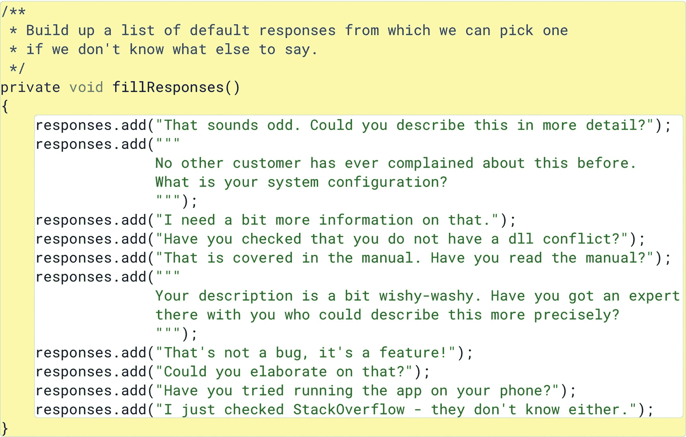 "View Image")

```java
Line 5: private void fillResponses()
Line 6: {
Line 7: Indentation level 2, responses.add("That sounds odd. Could you describe this in more detail?");
Line 8: Indentation level 2, responses.add("   ");
Line 9: Indentation level 3, No other customer has ever complained about this before.
Line 10: Indentation level 3, What is your system configuration?;
Line 11: Indentation level 3, "");
Line 12: Indentation level 2, responses.add("I need a bit more information on that.");
Line 13: Indentation level 2, responses.add("Have you checked that you do not have a dll conflict?");
Line 14: Indentation level 2, responses.add("That is covered in the manual. Have you read the manual?");
Line 15: Indentation level 2, responses.add("   ");
Line 16: Indentation level 3, Your description is a bit wishy-washy. Have you got an expert
Line 17: Indentation level 3, there with you who could describe this more precisely?;
Line 18: Indentation level 3, "");
Line 19: Indentation level 2, responses.add("That's not a bug, it's a feature!");
Line 20: Indentation level 2, responses.add("Could you elaborate on that?");
Line 21: Indentation level 2, responses.add("Have you tried running the app on your phone?");
Line 22: Indentation level 2, responses.add("I just checked StackOverflow - they don't know either.");
Line 23: }
```

## 6.4.5 阅读参数化类的文档

到为止，我们已经要求你查看了`java.lang`包中的`String`类文档，以及`java.util`包中的`Random`类文档。

文档中的某些类名看起来略有不同：例如，`ArrayList`被显示为`ArrayList<E>`，而`HashMap`显示为`HashMap<K, V>`。也就是说，类名后面跟着一些角括号内的额外信息。像这样的类被称为*参数化类*（parameterized classes）或*泛型类*（generic classes）。括号中的信息告诉我们，当我们使用这些类时，必须在角括号中提供一个或多个类型名称来完成定义。我们已经在[第 4 章]中实践过这一概念，在那里我们通过用如`Track`等类型名称对`ArrayList`进行参数化使用了它。它们可以使用任何类类型进行参数化：

```java
private ArrayList<String> notes;
private ArrayList<Student> students;
```

由于我们可以使用选择的任何其他类类型对`ArrayList`进行参数化，这反映在 API 文档中。因此，如果你查看`ArrayList<E>`的方法列表，你会看到这样的方法：

```java
boolean add(E e)
E get(int index)
```

这告诉我们，我们可以`add`到`ArrayList`中的对象类型取决于用于参数化它的类型，而从其`get`方法返回的对象类型也以同样的方式取决于该类型。实际上，如果我们创建一个`ArrayList<String>`对象，文档告诉我们该对象有以下两个方法：

```java
boolean add(String e)
String get(int index)
```

而如果我们创建一个`ArrayList<Student>`对象，那么它将拥有这两个方法：

```java
boolean add(Student e)
Student get(int index)
```

我们在本章的后续章节中将要求你查看更多参数化类型的文档。

# 6.5 包与导入（import）

源文件的顶部还有两行需要我们讨论：

```java
import java.util.ArrayList;
import java.util.Random;
```

我们在[第 4 章]中首次遇到`import`语句。现在是时候仔细地观察它了。

存储在类库中的 Java 类并不能自动供使用，就像当前项目中的其他类那样。相反，我们必须在源代码中声明我们想要使用库中的某个类。这被称为*导入*该类，并使用`import`语句完成。`import`语句的形式如下：

```java
import qualified-class-name;
```

由于库包含了数千个类，因此在库组织上需要一些结构。Java 使用*模块*（modules）和*包*（packages）将库类分组。我们现在可以很大程度上忽略模块——我们所需的一切都在`base`模块中，而我们自动处于该模块中。包是可以嵌套的（即包可以包含其他包）。

类的*全名*或*限定名*（qualified name）是它的包名，后面跟着点，然后是类名。因此，我们使用的两个类的限定名是`java.util.ArrayList`和`java.util.Random`。

Java 还允许我们使用以下语句导入整个包：

```java
import package-name.*;
```

因此，以下语句将导入`java.util`包中的所有类：

```java
import java.util.*;
```


像我们的第一个版本那样单独列出所有类，在输入方面多花了一些功夫，但作为文档来说非常好。这样做可以显式地说明我们的类使用了哪些类。因此，我们将倾向于使用第一个示例的风格，单独列出所有导入的类。

这些规则有一个例外：某些类被使用得非常频繁，几乎每个类都会导入它们。这些类被放在`java.lang`包中，该包会自动导入到每个类中。因此，我们不需要为`java.lang`中的类编写导入语句。`String`类就是此类类。

这里讨论的解决方案在书中项目中也名为`tech-support-v2`。然而，我们建议你作为基础版本的扩展自己实现它。

# 6.6: 使用映射（maps）进行关联

我们现在的技术支持系统解决方案是生成随机响应。这比我们的第一个版本好，但仍然不怎么有说服力。特别是，用户的输入并没有任何方式影响响应。这正是我们现在想要改进的地方。

计划是，我们将拥有一组可能出现在典型问题中的单词，并将这些单词与特定的响应关联起来。如果用户的输入包含我们已知的单词，我们就可以生成相关的响应。这仍然是一种非常原始的方法，因为它没有捕捉用户输入的任何含义，无法识别上下文。尽管如此，它可能非常有效，并且是一个很好的下一步。

为了实现这一点，我们将使用一个`HashMap`。你可以在 Java 库文档中找到`HashMap`类的文档。`HashMap`是`Map`的特化实现，你也可以找到它的文档。你会发现，你需要阅读这两者的文档才能理解`HashMap`是什么以及它是如何工作的。

## 6.6.1: 映射（map）的概念

map 是对象键值对的集合。与`ArrayList`一样，map 可以存储任意数量的条目。`ArrayList`和`Map`之间的区别在于，在`Map`中，每个条目不是一个对象，而是两个对象的`pair`（对）。这个对由一个`key`对象和一个`value`对象组成。

我们不再使用整数索引在集合中查找条目（就像我们在`ArrayList`中做的那样），而是使用`key`对象来查找`value`对象。

map 的一个日常例子是联系人列表。联系人列表包含条目，每个条目都是一个对：姓名和电话号码。你通过查找姓名并获取电话号码来使用联系人列表。我们不使用索引（条目在联系人列表中的位置）来查找它。

map 可以组织成这种方式，使得根据键查找值变得非常容易。在联系人列表的情况下，这是通过字母顺序排序完成的。通过按照键的字母顺序存储条目，找到键并查找值就变得简单。反向查找（根据值查找键——即根据给定电话号码查找姓名）在 map 中并不那么容易。就像联系人列表一样，在 map 中进行反向查找是可能的，但需要相对较长的时间。因此，map 是单向查找的理想选择，即我们知道查找键，并需要知道与该键关联的值。

## 6.6.2: 使用 HashMap

`HashMap`是`Map`的一种特定实现。`HashMap`类最重要的方法是`put`和`get`。`put`方法将条目插入 map 中，而`get`方法根据给定的键检索值。每个键都是唯一的，因此它与一个值相关。

下面的代码段创建了一个`HashMap`并向其中插入了三个条目。每个条目都是由姓名和电话号码组成的键值对。

```java
HashMap<String, String> contacts = new HashMap<>();

contacts.put("Charles Nguyen", "(531) 9392 4587");

contacts.put("Lisa Jones", "(402) 4536 4674");

contacts.put("Hiroshi Ito", "(998) 5488 0123");
```

正如我们在`ArrayList`中看到的，当声明`HashMap`变量时，我们必须说明 map 中将存储什么类型的对象，此外还要使用什么类型的对象作为键。对于联系人列表，我们将使用字符串作为键和值，但这两个类型通常是不同的。注意，我们将电话“数字”存储为字符串而不是整数，因为它们实际上并不是数值值。

正如我们在第 4.4.2 节中看到的，在创建泛型类的对象并将其赋值给变量时，我们只需要在赋值的左侧指定一次泛型类型（这里为`<String, String>`），并在右侧的对象构造可以使用菱形运算符；用于对象构造的泛型类型将从变量声明中复制。

下面的代码将查找`Charles Nguyen`的电话号码并将其打印出来。

```java
String number = contacts.get("Charles Nguyen");

System.out.println(number);
```

注意你将`key`（姓名“Charles Nguyen”）传递给`get`方法以接收`value`（电话号码）。

再次阅读`HashMap`类`get`和`put`方法的文档，查看解释是否符合你目前的理解。

## 6.6.3: 在 TechSupport 系统中使用 map

在`TechSupport`系统中，我们可以通过使用已知单词作为键并将关联的响应作为值，来很好地利用 map。**代码 6.5** 显示了一个示例，其中创建了一个名为`responseMap`的`HashMap`并创建了三个条目。例如，单词“slow”与以下文本相关联：

*“我认为这与你的硬件有关。升级你的处理器应该解决所有的性能问题。你对我们的软件有意见吗？”*

### 代码 6.5 将选定的单词与可能的响应关联

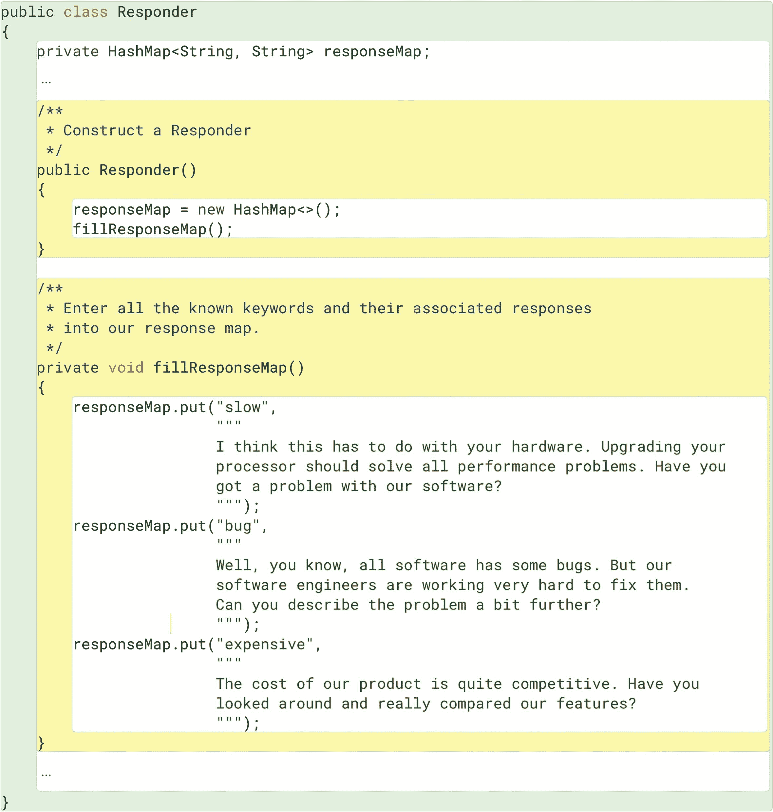

第 1 行：`public class Responder.`

第 2 行：`OpenCurlyBracket.`

第 3 行：缩进层级 1，`private HashMap OpenAngleBracket String comma String CloseAngleBracket responseMap semicolon.`

第 4 行：空。

第 5 行：缩进层级 1，`ellipsis`

第 6 行：空。

第 7 行：缩进层级 1，`/*`

第 8 行：缩进层级 2，`*Construct a Responder.`

第 9 行：缩进层级 2，`*/`

第 10 行：`public Responder()`

第 11 行：`OpenCurlyBracket.`

第 12 行：缩进层级 1，`responseMap = new HashMap<OpenAngleBracket String String CloseAngleBracket>();`

第 13 行：缩进层级 1，`fillResponseMap();`

第 14 行：`/*`

第 15 行：缩进层级 2，`* Enter the keywords and`

第 16 行：缩进层级 2，`* responses into our map.`

第 17 行：缩进层级 2，`*/`

第 18 行：`private void fillResponseMap()`

第 19 行：`OpenCurlyBracket.`

第 20 行：缩进层级 1，`responseMap.put("slow",`

第 21 行：缩进层级 2，`"I think this has to do with your hardware. Upgrading your`

第 22 行：缩进层级 2，`processor should solve all performance problems. Do you have`

第 23 行：缩进层级 2，`a problem with our software?");`

第 24 行：`);`

第 25 行：`responseMap.put("bug",`

第 26 行：缩进层级 2，`"Well, you know all software has some bugs. But our`

第 27 行：缩进层级 2，`engineers are working very hard to fix them. Can you`

第 28 行：缩进层级 2，`describe the problem a bit?");`

第 29 行：`);`

第 30 行：`responseMap.put("expensive",`

第 31 行：缩进层级 2，`"The cost of our product is quite competitive. Have you`

第 32 行：缩进层级 2，`looked around and really compared our features?");`

第 33 行：`);`

第 34 行：`CloseCurlyBracket.`

第 35 行：`CloseCurlyBracket.`

现在，每当有人输入包含“slow”单词的问题时，我们就可以查找并打印该响应。注意，源代码中的响应字符串跨越了行，并以第 6.4.4 节所述的文本块形式存入 map 中。

生成响应的首次尝试现在看起来像下面的`generateResponse`方法。在这里，为了暂时起见，我们假设用户只输入了一个单词（例如“slow”）。

```java
public String generateResponse(String word)
{   
    String response = responseMap.get(word);
    
    if(response != null) {
        return response;
    }
    else {
        // 如果我们到了这里，说明单词没有被识别。
        // 在这种情况下，我们选择默认响应之一。
        return pickDefaultResponse();
    }
}
```

在这段代码片段中，我们在响应映射表（response map）中查找用户输入的单词。如果我们找到了条目，就使用该条目作为响应。如果我们没有找到该单词的条目，就会调用一个名为`pickDefaultResponse`的方法。这个方法现在可以包含我们之前版本`generateResponse`的代码，该代码会随机选择一个默认响应（如**代码 6.3** 所示）。新的逻辑是：如果我们识别出了一个单词，就选择一个合适的响应；如果没有识别，则从我们的默认响应列表中随机选择一个响应。

只要用户不输入完整的问题而只输入单词，这种将关键词与响应关联的方法就非常有效。完成该应用程序的终极改进是允许用户再次输入完整的问题，然后如果我们识别出问题中的任何单词，就选择匹配的响应。

这就带来了识别用户输入的句子中关键词的问题。在当前版本中，用户输入由`InputReader`返回为单个字符串。现在我们将将其更改为新版本，其中`InputReader`以单词集合（set of words）的形式返回输入。技术上讲，这将是一个字符串集合，集合中的每个字符串都代表用户输入的单个单词。

如果我们能做到这一点，就可以将整个集合传递给`Responder`，然后`Responder`可以检查集合中的每个单词，以查看它是否已知以及是否有关联的响应。

要在 Java 中实现这一点，我们需要了解两点：如何将包含整个句子的单个字符串切割成单词，以及如何使用集合（sets）。这些问题将在接下来的两个章节中讨论。

# 6.7: 使用集合 (sets)

Java 标准库包含了在不同类中实现的各种变集合。我们将使用的类叫做`HashSet`。

我们需要两种类型的功能：能够向集合中输入元素，以及稍后检索这些元素。幸运的是，这些任务对我们来说几乎没有新内容。考虑以下代码片段：

```java
import java.util.HashSet;

...

HashSet<String> mySet = new HashSet<>();

mySet.add("one");

mySet.add("two");

mySet.add("three");
```

将此代码与向`ArrayList`输入元素所需的语句进行比较。几乎没有区别，除了我们这次创建的是`HashSet`而不是`ArrayList`。现在让我们来看看如何遍历所有元素：

```java
for(String anItem : mySet) {
    do something with anItem
}
```


再次，这些语句与我们在第 4 章中用于遍历`ArrayList`的语句是相同的。

简而言之，在 Java 中使用集合（collections）对于不同类型的集合是非常相似的。一旦你理解了如何使用其中一种，你就可以使用所有的集合。区别实际上在于每个集合的行为。例如，列表（list）将按照指定的顺序保留所有输入的元素，通过索引访问元素，并可以包含多个相同的元素。另一方面，集合（set）不维护任何特定顺序（在 for-each 循环中返回的元素顺序可能与输入时的顺序不同），并确保每个元素在集合中最多出现一次。第二次输入同一个元素没有任何影响。

## 6.8: 分割字符串

现在我们已经看到了如何使用集合，可以研究如何将输入字符串切割成单独的单词并存储在单词集合中。解决方案在`InputReader`的`getInput`方法的新版本中显示（代码 6.6）。

### 代码 6.6：返回单词集合的 getInput 方法

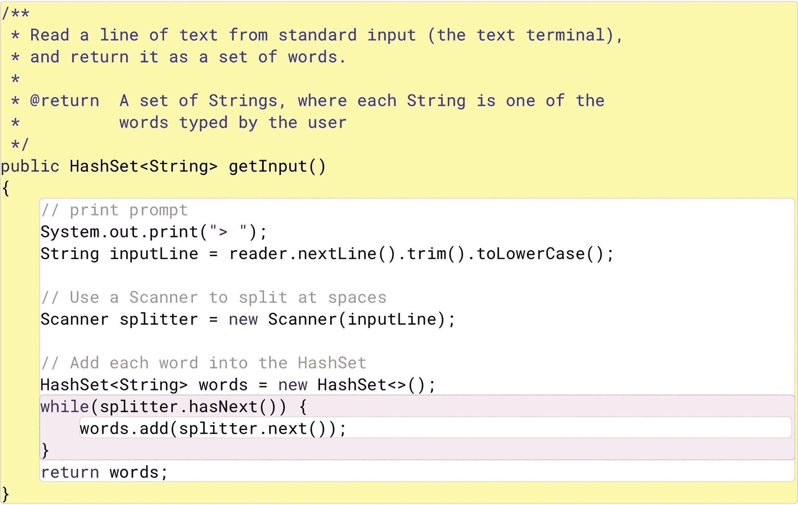

第 1 行：`/` 星号星星号

第 2 行：缩进级别 1，从标准输入读取一行文本（左括号）文本终端（右括号），逗号

第 3 行：缩进级别 1，星号并作为单词集合返回。

第 4 行：缩进级别 1，这里

第 5 行：缩进级别 1，每个 String 都是用户输入的

第 6 行：缩进级别 1，单词之一

第 7 行：缩进级别 1，在返回处

第 8 行：`public HashSet<String> getInput()`

第 9 行：`{`

第 10 行：缩进级别 2，`System.out.print("Enter question: ");`

第 11 行：缩进级别 2，`String inputLine = reader.nextLine().trim().toLowerCase();`

第 12 行：空行

第 13 行：缩进级别 2，使用 Scanner 按空格分割

第 14 行：缩进级别 2，`Scanner splitter = new Scanner(inputLine);`

第 15 行：空行

第 16 行：缩进级别 2，将每个单词添加到 HashSet

第 17 行：缩进级别 2，`HashSet<String> words = new HashSet<>();`

第 18 行：缩进级别 2，`while (splitter.hasNext()) {`

第 19 行：缩进级别 3，`words.add(splitter.next());`

第 20 行：缩进级别 2，`}`

第 21 行：缩进级别 2，`return words;`

第 22 行：`}`

在这里，除了使用`HashSet`之外，我们还使用了`Scanner`（与读取输入的类相同）。这次，scanner 处理的不是用户输入，而是我们的字符串`inputLine`。它可以将字符串分割成子字符串，并类似于迭代器对象，使用`hasNext`和`next`方法分别返回它们。

接几行代码创建一个`HashSet`，然后在返回集合之前遍历 scanner 找到的输入单词。

## 6.9: 完成 TechSupport 系统

为了将所有内容整合在一起，我们还需要调整`SupportSystem`和`Responder`类以正确处理单词集合而不是单个字符串。代码 6.7 显示了`SupportSystem`类中`start`方法的新版本。它并没有很大变化。变化在于：

*   接收`reader.getInput()`结果的`input`变量现在是`HashSet`。

*   结束应用程序的检查使用`HashSet`类的`contains`方法而不是 String 方法。（在文档中查找此方法。）

*   `HashSet`类必须使用`import`语句导入（此处未显示）。

### 代码 6.7：start 方法的最终版本

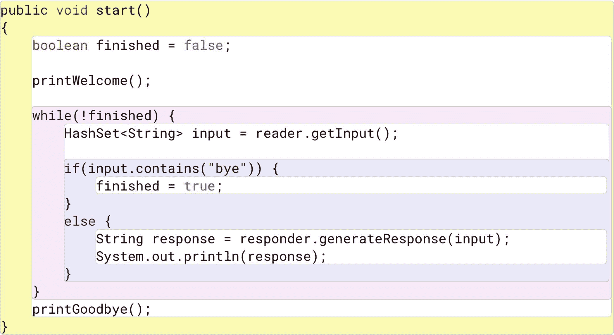

第 1 行：`public void start()`

第 2 行：`{`

第 3 行：缩进级别 1，`boolean finished = false;`

第 4 行：空行

第 5 行：缩进级别 1，`System.out.print("Welcome! ");`

第 6 行：空行

第 7 行：缩进级别 1，`while (!finished) {`

第 8 行：缩进级别 2，`HashSet<String> input = reader.getInput();`

第 9 行：空行

第 10 行：缩进级别 2，`if (input.contains("bye")) {`

第 11 行：缩进级别 3，`finished = true;`

第 12 行：缩进级别 2，`}`

第 13 行：缩进级别 2，`else {`

第 14 行：缩进级别 3，`String response = responder.generateResponse(input);`

第 15 行：缩进级别 3，`System.out.println(response);`

第 16 行：缩进级别 2，`}`

第 17 行：缩进级别 1，`}`

第 18 行：缩进级别 1，`printGoodbye();`

第 19 行：`}`

最后，我们必须扩展`Responder`类中的`generateResponse`方法，以接受一个单词集合作为参数。然后，该方法必须遍历这些单词，并使用我们已知单词的映射来检查每一个单词。如果识别出任何一个单词，我们立即返回相关的响应。如果我们像以前一样没有识别出任何单词，我们就选择一个默认响应中的之一。代码 6.8 显示了解决方案。

### 代码 6.8 generateResponse 方法的最终版本

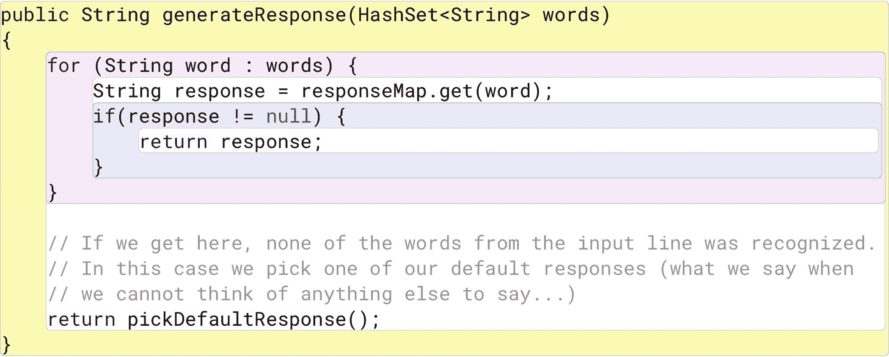

```
Line 1: public String generateResponse(HashSet<String> words) {
Line 2: `{`
Line 3: 缩进级别 1, `for (String word : words) {`
Line 4: 缩进级别 2, `String response = responseMap.get(word);`
Line 5: 缩进级别 2, `if (response != null) {`
Line 6: 缩进级别 3, `return response;`
Line 7: 缩进级别 2, `}`
Line 8: 缩进级别 1, `}`
Line 9: 空行
Line 10: 缩进级别 1, `// If we get here, none of the words from the input line was recognized.`
Line 11: 缩进级别 1, `// In this case we pick one of our default responses (what we say when`
Line 12: 缩进级别 1, `// we cannot think of anything else to say...)`
Line 13: 缩进级别 1, `return pickDefaultResponse();`
Line 14: `}`
```

这是本章讨论的对应用程序的最后更改。项目`tech-support-complete`中的解决方案包含了所有的更改。它包含了比本章显示的更多的单词与响应之间的关联。

该应用程序还有许多改进空间。我们在这里不再讨论它们。相反，我们以练习题的形式向读者提供一些建议。其中一些是非常具有挑战性的编程练习题。

## 6.10: 自动装箱与包装类

我们已经看到，通过适当的参数化，集合类可以存储任何类型的对象。仍然存在一个问题：Java 有一些类型不是对象类型。

正如我们所知的，*基本类型*——如`int`、`boolean`和`char`——与对象类型是分开的。它们的值不是类的实例，通常无法将它们添加到集合中。

这很遗憾。例如，在某些情况下我们可能想要创建一个`int`值列表或`char`值的集合。我们可以做什么？

Java 对此问题的解决方案是*包装类*。Java 中的每个基本类型都有对应的包装类，它表示相同的类型，但是一个真实的对象类型。例如，`int`的包装类被称为`Integer`。简单类型及其包装类的完整列表见[附录 B]。

以下语句显式地将基本类型`int`变量`mark`的值封装在`Integer`对象中：

```
Integer markObject = new Integer(mark);
```

现在`markObject`显然可以很容易地存储在`ArrayList<Integer>`集合中。然而，在实践中，我们不需要这样封装基本值。将基本值存储到对象集合中是通过一种称为*自动装箱*（autoboxing）的编译器功能自动完成的。

当基本类型的值在需要包装类型的环境中被使用时，编译器会自动将基本类型值封装在适当的包装对象中。这意味着基本类型的值可以直接添加到集合中：

```
private ArrayList<Integer> markList;

...

public void storeMark(int mark)
{   
    markList.add(mark);
}
```

相反的操作——*拆箱*（unboxing）也会执行，因此从集合中检索可能看起来像：

```
int mark = markList.get(markIndex);
```

每当基本类型的值传递给期望包装类型的方法，或存储在包装变量中，也会应用自动装箱。值得注意的是，这几乎使得基本类型可以存储在集合中。然而，集合的类型必须使用包装类型声明（例如`ArrayList<Integer>`，而不是`ArrayList<int>`）。

### 6.10.1: 计数

将映射与自动装箱结合提供了一种维护对象计数的简单方法。例如，假设运行*TechSupport*公司收到客户投诉，称某些答案与问题无关。公司可能会分析问题中单词，并为最频繁使用的单词添加更多响应。代码 6.9 显示了可以在`tech-support-analysis`项目中找到的`WordCounter`类。

#### 代码 6.9 用于计算单词频率的 WordCounter 类


```
Line 1: import java.util.HashMap;
Line 2: import java.util.HashSet;
Line 3:
Line 4: /**
Line 5:  *记录每个单词输入的次数。
Line 6:  *
Line 7:  * @author Michael Kölling and David J. Barnes
Line 8:  * @version 7.0.
Line 9:  */
Line 10: public class WordCounter {
Line 11: {
Line 12:     // 将每个单词与计数关联。
Line 13:     private final HashMap<String, Integer> counts;
Line 14:
Line 15:     /**
Line 16:      * 创建一个 WordCounter
Line 17:      */
Line 18:     public WordCounter() {
Line 19:     {
Line 20:         counts = new HashMap<>();
Line 21:     }
Line 22: }
Line 23:
Line 24: */
```

第 24 行：缩进级别 3，* 更新输入中所有单词的计数。

第 25 行：缩进级别 3，* 参数 input 用户输入的一组单词。

第 26 行：缩进级别 3，* ForwardSlash

第 27 行：缩进级别 2，`public void addWords(HashSet<String> input)`

第 28 行：缩进级别 2，`{`

第 29 行：缩进级别 4，`for (String word : input) {`

第 30 行：缩进级别 5，`int counter = counts.getOrDefault(word);`

第 31 行：缩进级别 5，`counts.put(word, counter + 1);`

第 32 行：缩进级别 4，`}`

第 33 行：缩进级别 2，`}`

第 34 行：`}`

`addWords`方法接收传递给`Responder`的相同单词集合，以便每个单词都可以与一个计数关联。这些计数存储在一个从`String`到`Integer`对象的映射中。

这说明了`HashMap`的`getOrDefault`方法的使用，它接受两个参数：一个键（key）和一个默认值。如果键已经在映射中使用，则该方法返回其关联的值；但如果键未未使用，它将返回默认值而不是`null`。这避免了需要根据键是否在使用来编写两种不同的后续操作。相反，使用`get`，我们必须编写如下代码：

```
Integer counter = counts.get(word);

if(counter == null) {
    counts.put(word, 1);
}
else {
    counts.put(word, counter + 1);
}
```

注意在这些示例中多次使用了自动装箱和自动拆箱。

## 6.11: 编写类文档

在开发你的项目时，在编写源码的同时为类编写文档是非常重要的。程序员不十分重视文档是一个常见现象，这经常会在日后后产生问题。

如果你不提供足够的文档，另一个程序员（或者过一段时间后的你自己！）可能很难理解你的类。通常情况下，在这种情况下，你需要做的是阅读类的实现代码并弄清楚它是做什么的。这对于小型学生项目可能可行，但在现实世界的项目中会产生问题。

商业应用由成千上万行代码和几千个类组成，这并不罕见。想象一下你必须阅读所有内容才能理解一个应用程序是如何运行的！你永远不会成功。

当我们使用 Java 库类（如`HashSet`或`Random`）时，我们完全依赖文档来了解如何使用它们。我们从未查看过这些类的实现。这之所以有效，是因为这些类的文档得非常充分（尽管这些文档还可以改进）。如果我们被要求在使用类之前阅读类的实现，我们的任务将会变得困难得多。

在软件开发团队中，类的实现通常由多个程序员共享。虽然你可能负责实现上一个示例中的`SupportSystem`类，但另一个人可能会实现`InputReader`。因此，你可能在编写一个类的同时调用其他类的方法。

针对库类讨论的论点同样适用于你编写的类：如果我们不需要阅读和理解完整的实现就能使用这些类，我们的任务就会变得更容易。与库类一样，我们只想看到类的公共接口，而不是实现。因此，为我们自己的类编写良好的类文档也是同样重要的。

Java 系统包含一个名为`javadoc`的工具，可以从源文件生成此类接口描述。例如，我们使用的标准库文档就是通过`javadoc`从类的源码创建的。

### 6.11.1: 在 BlueJ 中使用 javadoc

BlueJ 环境使用`javadoc`通过两种方式让你为你的类创建文档：

*   你可以通过将编辑器窗口右上角的弹出选择器从`Source Code`（源码）切换到`Documentation`（文档）（或通过使用编辑器`Tools`菜单中的`Toggle Documentation View`）来查看单个类的文档。

*   你可以使用主窗口`Tools`菜单中的`Project Documentation`功能为项目中的所有类生成文档。

如果你感兴趣，BlueJ 教程提供了更多详细信息。你可以在 BlueJ 的`Help`菜单中找到 BlueJ 教程。

### 6.11.2: 类文档的元素

类文档至少包含：

*   类名
*   描述类整体用途和特征的注释
*   版本号
*   作者姓名（或姓名）
*   每个构造函数和每个方法的文档

每个构造函数和方法的文档应该包含：

*   方法名称
*   返回类型
*   参数名称和类型
*   对方法用途和功能的描述
*   对每个参数的描述
*   对返回值的描述

此外，每个完整的项目都应该有一个总的项目注释，通常包含在“ReadMe”文件中。在 BlueJ 中，此项目注释可以通过显示在右上角的文本注释访问。

文档的某些元素（如名称和参数）可以从源码中提取。而其他部分（如描述类、方法的注释）则需要更多的关注，因为它们很容易被忘记、不完整或错误。

在 Java 中，`javadoc`注释以一个特殊的符号开头：

```
/**
这是一个 javadoc 注释。
 */
```

注释的起始符号必须具有两个星号才能被识别为 javadoc 注释。紧接类声明的注释被视为类注释。如果注释位于方法签名上方，则它是方法注释。

不同语言在生成和格式化文档的具体细节上有所不同。然而内容大致相同。

在 Java 中，使用`javadoc`有一些特殊的键符号用于格式化文档。这些键符号以`@`符号开头，包括

```
@version
@author
@param
@return
```


# 6.12: 公有与私有

是时候详细讨论类的一个我们遇到多次但没有多谈的方面了：访问修饰符。

访问修饰符是字段声明和方法签名开头的 `public` 或 `private` 关键字。例如：

```java
// 字段声明
private int numberOfSeats;

// 方法
public void setAge(int replacementAge) {
    ...
}

private double computeAverage() {
    ...
}
```

字段、构造函数和方法都可以是公共或私有的，尽管到目前为止我们看到的主要是私有字段以及公共构造函数和方法。

访问修饰符定义了字段、构造函数或方法的可见性。例如，如果一个方法是公共的，可以在类内部或任何其他类中调用。相反，私有方法只能在定义的类内部调用。它们对其他类是不可见的。

现在我们讨论了类的接口和实现之间的区别，我们可以更容易地理解这些关键字的目的。

记住：类的接口（`interface`）是另一个程序员在使用该类时需要看到的细节集合。它提供了有关如何使用该类的信息。接口包括构造函数、方法签名和注释。它也被称为类的 `public`（公共）部分。其目的是定义类“做了什么”（`what`）。

实现（`implementation`）是类中精确定义类“如何工作”（`how`）的区域。包含 Java 语句的方法体以及大多数字段都是实现的一部分。实现也被称为类的 `private`（私有）部分。类的使用者不需要了解实现细节。事实上，有充分的理由说明用户`应该被防止知道`实现细节（或者至少被防止利用这些知识）。这一原则被称为“信息隐藏”（`information hiding`）。

`public` 关键字将类的成员（字段、构造函数或方法）声明为接口的一部分（即对外部可见）；`private` 关键字将其声明为实现的一部分（即对外部访问隐藏）。

## 6.12.1: 信息隐藏

在许多面向对象的编程语言中，类的内部结构——即其实现（`implementation`）——对其他类是隐藏的。这涉及两个方面：首先，使用某个类的程序员`不需要知道`其内部实现；其次，用户`不被允许知道`其内部实现。

第一个原则——`不需要知道`——与`第 3 章`中讨论的抽象和模块化有关。如果必须知道我们所使用的所有类的所有内部实现，我们永远无法完成大型系统的实现。

第二个原则——`不被允许知道`——则有所不同。它也与模块化有关，但语境不同。编程语言不允许通过另一个类中的语句访问一个类的私有部分。这确保了一个类不会依赖于另一个类具体是如何实现的。

这对于维护来说非常重要。维护程序员的一项非常常见的任务是后期更改或扩展类的实现，以进行改进或修复错误。理想情况下，更改一个类的实现不应该导致必须修改其他类。这个问题被称为“耦合”（`coupling`）。如果程序某部分的更改不需要对程序的另一部分也进行相应的更改，这被称为弱耦合或松耦合。松耦合是良好的，因为它让维护程序员的工作变得简单得多。他们可能只需要理解并修改一个类，而不是理解并修改许多类。例如，如果一个 Java 系统程序员对 `ArrayList` 类的实现进行了改进，你希望自己不需要修改使用该类的代码。这将会实现，因为你没有在自己的代码中对 `ArrayList` 的实现进行任何引用。

所以，更准确地说，“用户不被允许知道类的内部实现”的这一规则指的不是另一个类的程序员，而是该类本身。如果程序员知道实现细节，通常不是问题，但类不应该“知道”（依赖于）另一个类的内部细节。这两个类的程序员甚至可以是同一个人，但类之间仍然应该保持松耦合。

耦合和信息隐藏的问题非常重要，我们将在稍后的章节中对它们进行更多阐述。

目前，重要的是理解 `private` 关键字通过通过允许其他类访问类的这部分来强制执行信息隐藏。这确保了松耦合，并使应用程序更具模块化且易于维护。

## 6.12.2: 私有方法和公共字段

到目前为止我们看到的大多数方法都是公共（`public`）。这确保了其他类可以调用这些方法。不过，有时我们也使用私有方法。例如，在 `TechSupport` 系统的 `SupportSystem` 类中，我们看到 `printWelcome` 和 `printGoodbye` 方法被声明为私有方法。

提供这两个选项的原因是方法实际上用于不同的目的。它们被用于为类的用户提供操作（公共方法），并用于将一个较大的任务拆分成几个较小的任务，以便更容易处理该大任务。在第二种情况下，子任务并不打算从类外部直接调用，而是被放在单独的方法中，纯粹是为了使类的实现更易读。在这种情况下，此类方法应该是私有的。`printWelcome` 和 `printGoodbye` 方法就是这方面的例子。

设置私有方法的另一个良好理由是，某个任务在类的多个方法中都是需要的（作为子任务）。与其多次编写代码，我们可以在单个私有方法中写一次，然后从几个不同的地方调用该方法。我们稍后会看到一个例子。

在 Java 中，字段也可以被声明为私有或公共。到目前为止，我们还没有看到公共字段的例子，这有充分的原因。将字段声明为公共破坏了信息隐藏原则。它使得一个依赖于该信息的类在实现发生变化时容易受到错误操作的影响。尽管 Java 语言允许我们声明公共字段，但我们认为这是一种糟糕的风格，并且不会使用这种选项。某些其他面向对象的语言完全不允许公共字段。

保持字段私有的另一个原因是它允许对象对其状态保持更大的控制。如果对私有字段的访问仅通过访问器（`accessor`）和修改器（`mutator`）方法进行，那么对象就有能力确保字段永远不会设置为与整体状态不一致的值。如果字段是公共的，这种完整性是不可能的。总之，字段应该是私有的。

Java 还有两个访问级别。一个通过使用 `protected` 关键字作为访问修符声明；另一个是在没有声明访问修符时使用的。我们将在后面的章节中讨论这些。

# 6.13: 通过接口学习类

我们将讨论另一个项目以回顾本章讨论的概念。该项目是 `scribble`，你可以在书籍项目的`第 6 章`

`Canvas` 类提供了一个可以在屏幕上的窗口，可以在上面绘图。它具有绘制线条、形状和文本的操作。可以通过交互式创建实例或从另一个对象来使用画布。`Canvas` 类不需要任何修改。最好的可能是将其视为库类：打开编辑器并切换到文档视图。这将显示带有 `javadoc` 文档的类接口。

`Pen` 类提供了一个笔对象，可以通过在屏幕上移动笔来在画布上绘制图形。笔本身是不可见的，但当它在画布上移动时，它会画出一条线。

`DrawDemo` 类提供了几个较小的示例，演示了如何使用笔对象在屏幕上绘制图形。理解和实验此项目的最佳起点是 `DrawDemo` 类。

`Pen` 和 `Canvas` 类中的某些方法引用了 `Color` 类型的参数。该类型在 `java.awt` 包的 `Color` 类中定义（因此，其全限定名称为 `java.awt.Color`）。`Color` 类定义了一些颜色常量，我们可以如下引用它们：

```java
Color.RED
```

使用这些常量需要在使用它们的类中导入 `Color` 类。

在交互式调用期望 `Color` 类参数的方法时，我们必须以稍微不同的方式引用该类。由于交互式对话框没有导入语句（因此无法自动识别 `Color` 类），我们必须编写全限定类名来引用该类（**图 6.5**）。这使得 Java 系统可以在不使用导入语句的情况下找到该类。

#### 图 6.5 **使用全限定类名的交互式调用**

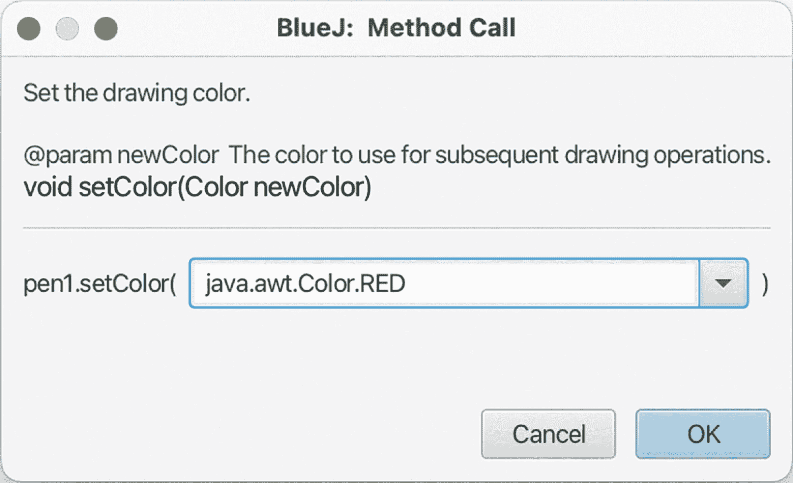

该对话框包含以下内容：

- 设置绘制颜色。
- 参数 `newColor`。后续绘制操作要使用的颜色。
- `void setColor(Color newColor)`
- `pen1.setColor(...)`，一个显示 `java.awt.Color.RED` 的下拉框。
- 右下角显示取消（`Cancel`）和确定（`Ok`）按钮。选中了 OK 按钮。

现在我们已经知道如何更改笔和画布的颜色，可以做更多练习了。

正如你所所的，我们可以直接在画布上绘制，也可以使用笔对象进行绘制。笔为我们提供了一个抽象，持有当前位置、旋转和颜色，这使得制作某些图形变得更加容易。让我们多实验一下，这次在类中编写代码，而不是使用交互式调用。

## 6.13.2: 代码补全

通常，我们对正在使用的库类相当熟悉，但仍然无法记住所有方法的精确名称或精确参数。对于这种情况，开发环境通常提供一些帮助：代码补全。

代码补全是 BlueJ 编辑器中的一个功能，当光标位于方法调用的点之后时可用。在这种情况下，输入 `CTRL-space` 将弹出一个列表，列出我们在调用中使用的对象接口中的所有方法（**图 6.7**）。

#### 图 6.7 **代码补全**


对话框左上角有三个圆。打开了 `DrawDemo` 页，带有以下菜单选项：编译（`Compile`）、撤销（`Undo`）、剪切（`Cut`）、复制（`Copy`）、粘贴（`Paste`）、查找（`Find...`）和关闭（`Close`）。右上部分有一个标记为 `Source Code`（源代码）的下拉菜单。显示了代码，其中一行是 `myCanvas.`。以下选项列在 `myCanvas.` 之后，选项右侧有一个垂直滚动条：

- `void eraseRectangle(int, int, int)`
- `void eraseString(String s, int, int)`
- `void fill(Shape s)`
- `void fillCircle(int, int, int)`（已选中）
- `void fillRectangle(int, int, int, int)`
- `Color getBackgroundColor()`
- `Class<?>?> getClass()`
- `Font getFont()`
- `Color getForegroundColor()`
- `Dimension getSize()`
- `int hashCode()`

右侧的文本如下：
第 1 行：`void fillCircle(int xPos, int yPos, int diameter)`
第 2 行：用画布当前的前景颜色填充给定圆的内部尺寸。
第 3 行：参数：`xPos`：圆心的 x 坐标。`yPos`：圆心的 y 坐标。`diameter`：要绘制的圆的直径。

背景代码的底部部分显示在选项下方，如下：

```java
int green = random.nextInt(256);
int blue = random.nextInt(256);
pen.setColor(new Color(red, green, blue));
```


第一个框（类变量）标题为 `BouncingBall`，内部一个文本框写有 `GRAVITY: 3`。第二个框（实例变量）标题为 `ball1: BouncingBall`（单下划线），内部一个文本框显示 `xPosition: 10`，另一个文本框显示 `yPosition: 233`。第三个框（实例变量）标题为 `ball2: BouncingBall`（单下划线），内部一个文本框显示 `xPosition: 76`，另一个文本框显示 `yPosition: 155`。第四个框（实例变量）标题为 `ball3: BouncingBall`（单下划线），内部一个文本框显示 `xPosition: 782`，另一个文本框显示 `yPosition: 33`。一个标有 `is instance of` 的省略号箭头从第二、第三和第四个框指向第一个框。

从图中我们可以看到，实例变量（`xPosition` 和 `yPosition`）存储在每个对象中。由于我们创建了三个对象，因此我们拥有这几个变量的三个独立副本。

另一方面，类变量 `GRAVITY` 存储在类本身中。因此，该变量始终有且只有一个副本，与创建的实例数量无关。

类中的源代码可以访问（读取和设置）这种变量，就像访问实例变量一样。从该类的任何实例都可以访问该类变量。因此，对象之间共享该变量。

如果一个值对于类的所有实例来说都应该保持相同，则经常会使用类变量。与其在每个对象中都存储一个相同值的副本（这会浪费空间且可能难以协调），不如在所有实例之间共享一个值。

Java 还支持 `class methods`（也称为 `static methods`），即属于类的方法。我们将在本章稍后的单独章节中讨论它们。

## 6.14.2: 常量

常量与变量相似，但它们在应用程序执行期间不能改变其值。在 Java 中，常量使用关键字 `final` 定义。例如：

```java
private final double discount = 0.1;
```

在这里，我们定义了一个名为 `discount` 值为 0.1 的常量。我们注意到常量的声明与字段声明相似，但有两个区别：

- 它们在类型名称之前包含 `final` 关键字；
- 它们必须在声明点（或在所属类的构造函数中）初始化一个值。

如果一个值打算不改变，那么将其声明为 `final` 是一个好主意。这确保了它在以后不会被意外更改。任何修改常量字段的尝试都会导致编译时错误信息。

在实践中，常量通常适用于类的所有实例，因此 `static` 关键字的一个频繁用途是定义 `class constants`。类常量是常量的类字段。它们通过使用 `static` 和 `final` 关键字组合来声明。例如：

```java
private static final int MAXIMUM_CLASS_SIZE = 40;
```

按照惯例，类常量通常大大写字母，并使用下划线作为单词之间的分隔符。我们将在书中遵循这一惯例。我们 `bouncing-ball` 项目中定义的 `GRAVITY` 是另一个此类常量的例子。这是定义常量最常用的样式。实例特定的常量使用频率要低得多。

我们在 `scribble` 项目中又遇到了两个常量的例子。第一个是 `Pen` 类中使用的两个常量，用于定义“随机波纹”的大小（回到项目并找到它们！）。第二个例子是该项目中颜色常量的使用，例如 `Color.RED`。在这种情况下，我们没有定义这些常量，而是使用了在另一个类中定义的常量。

我们之所以可以使用来自 `Color` 类的常量是因为它们被声明为 `public`。与其他字段（我们之前注释过它们永远不应该被声明为 `public`）相比，将常量声明为 `public` 通常没有问题，而且有时是有用的。之所以没有问题是因为它们不能被更改，与非常量字段不同。

# 6.15: 类方法

到目前，我们看到的大多数方法都是 `instance methods`：它们是在类的 `instance` 上被调用的。然而，在**第 3 章**介绍 `Math.abs` 和 `String.format` 等方法时，我们简要讨论了类方法的概念。类方法与实例方法的区别在于，类方法可以在没有实例的情况下被调用——有该类即可。

## 6.15.1: 静态方法

类方法在概念上与类变量相关，并使用相关的语法（Java 中的 `static` 关键字）。就像类变量属于类而不是属于实例一样，类方法也是如此。

类方法通过在方法头部的类型名称前面添加 `static` 关键字来定义：

```java
public static long currentTimeMillis()
{
}
```

随后，这种方法可以通过指定类名来调用。

到此为止，我们已经介绍了 `java.util` 包中的几个不同的集合类，例如 `ArrayList`、`HashMap` 和 `HashSet`。每种类都有许多独特的特征，使其适用于特定的场景。然而，它们之间也有许多相似之处和共同的方法。这表明它们可能在某种程度上是有联系的。在面向对象编程中，类之间的关系通过*继承*来表示。我们将在第 12 章和第 13 章中详细介绍这一主题，但在这里简要提及一下可能有助于加深你对不同类型集合的理解。

在尝试理解如何使用各种集合类以及它们之间的关系时，密切关注它们的名称是有帮助的。从名称来看，人们很容易假设 `HashSet` 一与 `HashMap` 非常相似。事实上，正如我们所说明的那样，`HashSet` 在用法上实际上更接近 `ArrayList`。它们的名称由两部分组成，例如“array”和“list”。后半部分告诉我们正在处理的是*什么类型*的集合（`List`、`Map`、`Set`），而前半部分告诉我们*它是如何实现的*（例如，使用数组（在第 7 章中介绍））或哈希表（在本章稍后讨论）。

对于使用集合来说，集合的类型（后部分）更为重要。我们之前讨论过，我们通常可以从实现中进行抽象；也就是说，我们不需要考虑太多细节。因此，对我们的目的而言，`HashSet` 和 `TreeSet` 是非常相似的。它们都是集合，所以行为也相似。主要的区别在于它们的实现，这只有在我们开始考虑效率时才重要：一种实现方式执行某些操作可能比另一种快得多。然而，效率问题出现得晚得多，而且只有当我们拥有非常大的集合或者对性能要求苛刻的应用时才会考虑。

这种相似性的一个结果是，我们在声明引用特定集合对象的变量时，通常可以忽略实现的细节。换句话说，我们可以将变量声明为更抽象的类型，例如 `List`、`Map` 或 `Set`，而不是更具体的类型——`ArrayList`、`LinkedList`、`HashMap`、`TreeSet` 等。例如，

```java
List<Track> tracks = new LinkedList<>();
```

或者

```java
Map<String, ContactDetails> contacts = new HashMap<>();
```


在这里，变量被声明为`List`类型，尽管创建并存储其中的对象类型是`LinkedList`（`Map`和`HashMap`也是如此）。

这些示例中像`tracks`和`contacts`这样的变量被称为多态变量，因为它们能够引用不同但相关的类型的对象。变量`tracks`可以引用`ArrayList`也可以引用`LinkedList`，而`contacts`可以引用`HashMap`也可以引用`TreeMap`。

这样声明变量的关键在于：在代码的其他部分使用变量的方式与它们所引用的精确、具体的类型无关。在`tracks`上调用`add`、`clear`、`get`、`remove`或`size`的语法都是相同的，并且对关联集合产生相同的效果。在任何情况下，精确类型很少重要。以这种方式使用多态变量的优势是，如果我们以后想从一种具体类型更改另一种类型，代码中唯一需要更改的地方是创建对象的地方。另一个优势是，我们编写的代码不需要知道别人编写的代码中可能用到的具体类型——我们只需要知道抽象类型：`List`、`Map`、`Set`等。这两个优势都减少了程序不同部分之间的耦合，这是一件好事，也是我们将在第8章中深入探讨的内容。

我们将在第12章和第13章中详细探索多态变量背后的机制。

## 6.18: 连接流与集合

### 6.18.1: 流的`collect`方法

在本节中，我们将继续讨论上一章开始的Java流和lambda表达式。我们在上一章中解释过，知道流的每个操作都不会修改其输入流是至关重要的。每个操作都会根据其输入和操作创建一个新的流。

`collect`方法是一个终结操作，因此它将作为流水线中的最后一个操作出现。它可以用于将流中的元素放回新的集合中。`collect`方法实际上有两个版本，但我们将关注最简单的那一个。即使是最基本的使用也涉及了对于本书目前阶段来说已经很高级的概念：流、静态方法和多态。

`collect`方法接受一个`Collector`作为参数。本质上，它必须能够以某种方式累积输入流的元素。这种累积的想法与我们在上一章涵盖的流`reduce`操作有相似之处。在那里我们看到数字流可以归约到一个数字；在这里，我们将对象流归约到一个对象，即另一个集合。由于我们通常不关心集合是`ArrayList`、`LinkedList`还是尚未熟悉的其他列表形式，我们可以要求`Collector`以多态类型`List`的形式返回集合。

获取`Collector`的简单方法是使用`java.util.stream`包中`Collectors`类定义的`static`方法：`toList`、`toMap`和`toSet`。

代码6.10显示了*animal-monitoring*项目中我们在第5章中看过的方法。该方法过滤完整的`Sighting`对象列表，创建一个仅包含特定动物的`List`。在我们*animal-monitoring-v1*项目的版本中，该方法是使用迭代风格编写的，使用了for-each循环。在这里，它被重写为函数式风格，使用了`collect`方法。

```
/**
 * 返回给定动物的所有观测列表。
 * @param animal 动物的类型。
 * @return 该动物的所有观测列表。
 */
```

Line 6: `public List<Sighting> getSightingsOf(String animal)`
Line 7: `{`
Line 8: 缩进层2, `return sightingList.stream()`
Line 9: 缩进层3, `.filter(aSighting -> animal.equals(aSighting.getAnimal(doubleValue)))`
Line 10: 缩进层3, `.collect(Collectors.toCollection(ArrayList::new));`
Line 11: `}`

需要注意的一点是，`Collectors`的`toList`方法实际上并没有返回一个传递给`collect`方法的`List`对象。相反，它返回一个`Collector`，最终会导致创建一个合适的具体的`List`对象。

### 6.18.2: 方法引用

假设我们希望将过滤后的流中的对象收集到特定的具体集合类型（例如`ArrayList`），而不是多态类型。这需要对上一节中使用的方法进行变体。我们仍然需要向`collect`操作传递一个`Collector`，但我们必须以不同的方式获取它。代码6.11展示了如何实现这一点。

#### 代码6.11: getSightingsOf方法的另一个版本


Line 1: `/**`
Line 2: 缩进层1, `* 返回给定动物的所有观测记录列表。`
Line 3: 缩进层1, `* @param animal 动物的类型。`
Line 4: 缩进层1, `* @return 给定动物的所有观测记录列表。`
Line 5: 缩进层1, `*/`
Line 6: `public List<Sighting> getSightingsOf(String animal)`
Line 7: `{`
Line 8: 缩进层2, `return sightingList.stream()`
Line 9: 缩进层3, `.filter(aSighting -> animal.equals(aSighting.getAnimal(doubleValue)))`
Line 10: 缩进层3, `.collect(Collectors.toCollection(ArrayList::new));`
Line 11: `}`

这次我们调用了`Collectors`的静态方法`toCollection`，它需要一个类型为`Supplier`的单个参数。我们使用的参数引入了一种新的记法，称为方法引用（method reference）。它的独特语法是一对相邻的冒号（`::`）。

方法引用是某些lambda表达式的便捷简写。它们通常用于编译器可以轻松推断出完整方法调用而无需显式指定其细节的地方。方法引用有四种情况：

1. 对构造函数的引用，正如我们在这里使用的那样：

```
ArrayList::new
```

（注意，严格来说，构造函数实际上并不是一个方法。）这是lambda表达式的简写：

```
() -> new ArrayList<>()
```

2. 对特定对象方法调用的引用：

```
System.out::println
```

这将是lambda表达式的简写：

```
obj -> System.out.println(obj)
```

注意`System.out`是`System`类的一个`public static`变量，参数`obj`将由使用方法引用的上下文提供，例如，作为流管道的终端操作：

```
forEach(System.out::println)
```

3. 对静态方法的引用：

```
Math::abs
```

这将是以下简写：

```
x -> Math.abs(x)
```

参数`x`将由使用方法引用的上下文提供，例如，作为流映射的一部分：

```
map(Math::abs)
```

4. 对特定类型实例方法的引用：

```
String::length
```

这将是以下简写：

```
str -> str.length()
```

再次，`str`将由上下文提供。注意，区分这种用法（涉及实例方法）与上述用法2（涉及特定实例）以及用法3（涉及静态方法）是非常重要的。

在这里，我们只说明了方法引用的最简单示例。在更通用的示例中，还会遇到涉及多个参数的复杂情况。

## 6.19: 恰当组织数据

到目前为止，重点大部分位于键和值类型均为`String`的map上，例如联系详情（第6.6.2节）和响应（第6.6.3节）。然而，map是一种多功能的集合，键值类型可以是任何对象。在本节中，我们将查看`HashMap`允许我们存储复杂值类型以组织数据的一些方法。

### 6.19.1: 按动物类型组织观测记录

我们在*动物监控*项目中经常希望执行的一项常见任务是查找特定类型动物的观测详情。例如，查找所有大象的观测记录。因此，将所有大象的观测记录单独存储在一个集合中，便于访问并提高速度，将是非常有用的。例如：

```
private ArrayList<Sighting> elephants;
```

然后将与大象相关的每个`Sighting`对象存储在该列表中，同时也存储在所有观测列表中。当然，大象观测只是我们感兴趣的动物的一个特定例子，因此遵循这种方法，我们应该为每种类型的动物创建单独列表：

```
private ArrayList<Sighting> mountainGorilla;
private ArrayList<Sighting> buffalo;
private ArrayList<Sighting> topi;
```

这进一步说明了外部接口（在文档或程序用户界面中暴露）与内部实现（对用户隐藏）的分离。

在原始的*动物监控*项目中，每个报告的数据存储在`Sighting`对象中，所有这些对象存储在`AnimalMonitor`类实例的单个`ArrayList`中。`AnimalMonitor`提供了查找特定类型动物观测记录、打印单个观测者的观测报告等方法。由于所有数据都存储在单个列表中，每当需要某些信息时，必须搜索整个列表以识别哪些特定对象包含相关数据；例如，哪些观测是大象，或者哪些是3号观测者的。

希望你至少能理解这种方法的缺点之一：源代码高度特化于我们在编写程序时恰好感兴趣的特定种类的动物。如果我们想监控额外的动物，就必须修改程序代码来定义所需的新变量，以及与各个列表相关的任何方法。这个缺点立即凸显了这并不是一个好的解决方案。

这种方法还有进一步的问题。动物的名称将以字符串的形式存在，例如“Elephant”（大象），而无法将字符串对象转换为变量名。此外，动物名称的字符串版本可能是“Mountain Gorilla”（山大猩猩），但我们不能在变量名中包含空格，因此在示例中我们使用了变量名`mountainGorilla`。即使可以将字符串映射到变量名，我们也将被迫使用别扭的命名约定来处理动物名称的字符串版本，以保持它们与相应的变量名完全一致。

然而，我们在这里已经拥有了更好解决方案的雏形：一种涉及映射（maps）的方案。具体来说，将动物的名称映射到其相关的观测记录列表。这正是使用`Map`的完美场景：

```
private HashMap<String, ArrayList<Sighting>> animalSightings;
```

重要的是，我们要理解现在将拥有多个`ArrayLists`，每种动物对应一个。每个列表存储在map中，并用该列表所属的动物名称作为键。因此，map中相关的`get`和`put`方法的头部如下：

```
public ArrayList<Sighting> get(String key)
public ArrayList<Sighting> put(String key, ArrayList<Sighting>)
```


（注意`put`方法的返回类型不是`void`，因为它返回了与该键关联的任何之前的值。）`animal-monitoring-with-maps`项目演示了在实践中如何使用这样的 map。`Code 6.12`显示了`AnimalMonitor`类的相关部分。

### 代码 6.12 使用 HashMap 组织观测记录的 AnimalMonitor 类


第 1 行：`public class AnimalMonitor`

第 2 行：`OpenCurlyBracket`

第 3 行：缩进层级 1，`// Records of all the sightings of each type of animal.`

第 4 行：缩进层级 1，`private HashMap<String, ArrayList<Sighting>> animalSightings;`

第 5 行：空

第 6 行：缩进层级 1，`/**`

第 7 行：缩进层级 2，`* Create an AnimalMonitor.`

第 8 行：缩进层级 2，`* /`

第 9 行：缩进层级 1，`public AnimalMonitor()`

第 10 行：缩进层级 1，`OpenCurlyBracket`

第 11 行：缩进层级 3，`animalSightings = new HashMap<>();`

第 12 行：缩进层级 1，`CloseCurlyBracket`

第 13 行：空

第 14 行：缩进层级 1，`...`

第 15 行：空

第 16 行：`CloseCurlyBracket`

构造函数创建了一个`HashMap`对象来存储各个列表，但此时 map 中尚未创建任何列表。列表的创建是在`addSighting`方法中执行的，该方法将一个观测对象添加到 map 中相应的基于动物的列表中。当要向 map 中添加观测记录时，它将与被观测动物的列表相关联。然而，这可能是该特定动物的首次观测，在这种情况下，map 中还没有它的对应列表。因此，添加观测记录的步骤如下：

- 获取该动物的列表，如果存在的话；
- 如果尚不存在列表，则创建一个并将其放入 map 中；
- 将观测记录添加到已获取或创建的列表中。

`Code 6.13`显示了如何实现这一操作。

### 代码 6.13 向我们的集合中添加新的观测记录


第 1 行：`/**`

第 2 行：缩进层级 1，`* Add a single sighting to our records.`

第 3 行：缩进层级 1，`* @param aSighting The sighting object to be added.`

第 4 行：缩进层级 1，`* /`

第 5 行：`public void addSighting(Sighting aSighting)`

第 6 行：`CloseCurlyBracket`

第 7 行：缩进层级 2，`String animal = aSighting.getAnimal();`

第 8 行：缩进层级 2，`ArrayList<Sighting> sightingList = animalSightings.get(animal);`

第 9 行：缩进层级 2，`if (sightingList == null) {`

第 10 行：缩进层级 3，`sightingList = new ArrayList<>();`

第 11 行：缩进层级 3，`animalSightings.put(animal, sightingList);`

第 12 行：缩进层级 2，`}`

第 13 行：缩进层级 2，`sightingList.add(aSighting);`

第 14 行：`CloseCurlyBracket`

通过这种方式使用 map 意味着我们可以根据动物名称直接查找其观测记录，而源代码不需要包含特定的动物名称，这意味着它可以支持无限数量的类型。`printingsOf`方法（`Code 6.14`）演示了如何使用 map 查找观测记录。在这里我们必须小心：可能实际上并没有该动物的观测。如果是这样，则还没有对应的列表（即使是空的），因此我们要先检查 map 是否包含该键。

### 代码 6.14 新版本中按动物打印观测记录


第 1 行：`/**`

第 2 行：缩进层级 1，`* Print the details of all the sightings of the given.`

第 3 行：缩进层级 1，`* @param animal The type of animal.`

第 4 行：缩进层级 1，`* /`

第 5 行：`public void printSightingsOf(String animal)`

第 6 行：`OpenCurlyBracket`

第 7 行：缩进层级 2，`if (animalSightings.containsKey(animal)) {`

第 8 行：缩进层级 3，`for (Sighting aSighting : animalSightings.get(animal)) {`

第 9 行：缩进层级 4，`System.out.println(aSighting.getDetails());`

第 10 行：缩进层级 3，`}`

第 11 行：缩进层级 2，`}`

第 12 行：`CloseCurlyBracket`

该版本的项目有助于说明作为 map 值的对象类型可以是我们想要的类型：`List<Set<Artifact>>`、`TicketMachine`、`Student`、`Set<Book>`等。

通过对比编译时固定命名列表与使用可以在运行时适应新键值和新值的 map 之间的区别，你应该理解 map 对于动态且灵活地构建数据的重要性。

## 6.20: 总结

处理类库和类接口对于一名合格的程序员来说是关重要的。这个主题有两个方面：阅读类库描述（特别是类接口）以及编写它们。

了解 Java 标准类库中的一些基本类，并在需要时能够找到更多信息是非常重要的。在本章中，我们介绍了一些最重要的类，并讨论了如何查阅库文档。

同样重要的是能够按照库类相同的风格对编写的任何类编写文档，这样其他程序员就可以轻松地使用该类，而无需理解其实现细节。这些文档应该为每个项目、类和方法都包含良好的注释。在 Java 程序中使用`javadoc`将帮助你实现这一点。

本章还讨论了类方法和字段以及它们的使用方法，特别是用于定义常量。我们进一步讨论了集合类的额外细节，包括如何从流（streams）填充它们。

本章引入的术语：

1. `interface, implementation, map, set, autoboxing, wrapper classes, javadoc, access modifier, information hiding, class variable, class method, main method, static, constant, final, polymorphic variable, method reference`

# 第 7 章固定大小集合——数组

## 7.1: 固定大小集合

在第 4 章中，我们查看了`ArrayList`等库类允许我们维护对象集合的方法。我们还在第 6 章中查看了更多集合类型，例如`HashSet`和`HashMap`。所有这些集合类型的一个显著特征是它们的容量是灵活的——我们永远不需要指定特定集合将包含多少项目，并且存储的项目数量可以在集合的整个周期内增加或减少。

相比之下，本章关于的是大小固定的集合。这些被称为`arrays`（数组），在数组对象创建时点，我们必须指定它能存储的最大项目数量，且之后无法更改。起初，这可能看起来是一个不必要的限制；但在某些应用程序中，我们将预先确切知道想要存储多少项目，并且该数量在集合的整个周期内将保持固定。在这种情况下，我们可以选择选择使用专门的固定大小集合对象来存储项目。

## 7.2: 数组

尽管数组的固定大小性质在许多情况下可能是一个显著缺点，但数组与灵活大小集合类相比，至少有两个补偿性优势：

- 访问数组中持有的项目通常比访问同类灵活大小集合中的项目更高效。
- 数组能够存储对象或原始类型值（Primitives）。灵活大小集合只能存储对象。

数组的另一个独特特征是它们在 Java 中有特殊的语法支持；可以使用不同于普通方法调用的自定义语法来访问它们。其原因主要是历史悠久的：数组是编程语言中最老的集合结构，处理数组的语法已经发展了数十年。Java 使用了在其他编程语言中建立的相同语法，以便让已经习惯数组的程序员保持操作简单，尽管这与语言的其他部分的语法并不一致。

在接下来的节中，我们将展示如何使用数组来维护固定大小的集合。我们还将引入一种通常与数组紧密相关的新循环结构——`for loop`。（注意`for loop`与`for-each loop`不同。）

## 7.3: 日志文件分析器

Web 服务器通常会维护客户端对其存储的网页进行访问的日志文件。在有适当工具的情况下，这些日志允许 Web 服务管理器提取并分析有用信息，例如：

- 他们提供的哪些页面最受欢迎
- 哪些网站将用户带到了本站
- 其他网站是否似乎指向该站页面的断链
- 从服务器传输了多少数据
- 一天、一周或一个月中最繁忙的时段

此类信息可能帮助管理员确定，例如，他们是否需要升级到更强大的服务器，或者什么时候是空闲时期，以便安排维护活动，使对访问网站的用户的影响最小。

`weblog-analyzer`项目包含一个应用程序，用于对此类 Web 服务器的模拟数据进行简单分析，该服务器在每次访问时都会向日志文件写入一行。项目文件夹中提供了一个名为`weblog.txt`的示例日志文件。每行按以下格式记录访问日期和时间：

1. 年 月 日 时 分

例如，下面这一行记录了 2024 年 6 月 7 日上午 03:45 的访问：

1. 2024 06 07 03 45

该项目由四个类组成：`LogAnalyzer`、`LogfileReader`、`LogEntry`和`LogfileCreator`。我们将花费大部分时间研究`LogAnalyzer`类，因为它包含了创建和使用数组的示例（代码 7.1）。随后的练习将鼓励你检查并修改`LogEntry`，因为它也使用了数组。`LogfileReader`类使用了我们尚未涵盖的 Java 语言功能，因此我们不再详细探索该类。`LogfileCreator`类允许你创建包含随机数据的自己的日志文件。

#### 代码 7.1 日志分析器


```java
/**
 * 读取服务器数据并分析小时访问模式。
 * @author David J. Barnes and Michael Kölling.
 * @version 7.0
 */
class LogAnalyzer {
    public static final int HOURS_PER_DAY = 24;

    /** 计算小时访问计数的地方。 */
    private int[] hourCounts;

    /** 使用 LogfileReader 访问数据。 */
    private LogfileReader reader;

    /**
     * 创建一个分析小时访问的对象。
     */
    public LogAnalyzer() {
        /** 创建数组对象来存储小时访问计数。 */
        hourCounts = new int[HOURS_PER_DAY];

        /** 创建读取器以获取数据。 */
        reader = new LogfileReader();
    }
}
```

```java
Line 30: Indentation level 2, public void analyzeHourlyData OpenParenthesis CloseParenthesis

Line 31: Indentation level 2, OpenCurlyBracket

Line 32: Indentation level 4, while OpenParenthesis reader dot hasNext OpenParenthesis CloseParenthesis CloseParenthesis OpenCurlyBracket

Line 33: Indentation level 5, LogEntry entry equals reader dot next OpenParenthesis CloseParenthesis semicolon

Line 34: Indentation level 5, int hour equals entry dot getHour OpenParenthesis CloseParenthesis semicolon

Line 35: Indentation level 5, hourCounts OpenSquareBracket hour CloseSquareBracket plus plus semicolon

Line 36: Indentation level 4, CloseCurlyBracket

Line 37: Indentation level 2, CloseCurlyBracket
```

```java
/**
 * 打印每小时计数。
 * 这些计数应该通过预先
 * 调用 analyzeHourlyData 来设置。
 */
public void printHourlyCounts() {
    System.out.println("Hr:" + Count);
    for (int hour = 0; hour < hourCounts.length; hour++) {
        System.out.println(hour + ": " + hourCounts[hour]);
    }
}

/**
 * 打印 LogfileReader 读取的数据行
 */
public void printData() {
    reader.printData();
    {
{
}
}
}
```

分析器目前仅使用存储在服务器日志行中的部分数据。它提供的信息允许我们确定服务器在一天中哪些时段通常最繁忙或最清闲。这是通过统计日志所涵盖范围内，每个一小时段内进行了多少次访问来实现的。

在接下来的几个章节中，我们将研究该类如何使用数组来完成这项分析。

### 7.3.1: 声明数组变量

`LogAnalyzer`类包含一个数组类型的字段：

```java
private int[] hourCounts;
```

数组变量声明的独特特征是类型名中包含了一对方括号：`int[]`。这表示`hourCounts`变量是一个整数数组。我们称`int`是该数组的基础类型，这意味着数组对象将存储`int`类型的值。区分数组变量声明与外观相似的简单变量声明是非常重要的：

```java
int hour; // 单个 int 变量。
int[] hourCounts; // 一个 int 数组变量。
```

在这里，变量`hour`能够存储单个整数值，而`hourCounts`将在对象被创建后用于引用该数组对象。数组变量声明本身不会创建数组对象。这是在另一个阶段使用`new`运算符完成的，与其他对象的情况一样。请注意，声明并没有说明数组有多大。这只有在创建数组对象时才会指定。

值得再次看一眼这种不寻的语法。`int[]`声明在更传统的语法中可能会显示为`Array<int>`。它之所以不是是因为历史原因而非逻辑原因。你仍然应该以相同方式读取它：即“int 数组”。

### 7.3.2: 创建数组对象

接下来要查看的是如何创建数组对象并与数组变量关联。

`LogAnalyzer`类的构造函数包含一个创建一个`int`数组对象的语句：

```java
hourCounts = new int[HOURS_PER_DAY];
```

其中`HOURS_PER_DAY`在类中被定义为静态整数变量，值为 24。实际上，这段代码等同于：

```java
hourCounts = new int[24];
```

该语句创建了一个能够存储 24 个独立整数值的数组对象，并使`hourCounts`数组变量引用该对象。值 24 是数组的大小，而不是构造函数参数。注意这种语法与普通对象创建的语法有多不同。例如，构造函数没有圆括号。图 7.1 展示了结果。

### 7.3.3: 使用数组对象

数组的单个元素通过对数组进行*索引*（indexing）来访问。索引是写在数组变量名后的方括号之间的整数表达式。例如：

```text
labels[6]
machines[0]
people[x + 10 - y]
```

索引表达式的有效值取决于数组的长度。与其他集合一样，数组索引始终从 0 开始，直到数组长度减 1。因此，`hourCounts`数组的有效索引是 0 到 23（包含边界）。

从数组中选择元素的表达式可以使用任何可以使用数组基础类型变量的地方。这意味着我们可以在赋值语句的两侧都使用它们，例如：


```java
labels[5] = "Quit";
double half = readings[0] / 2;
System.out.println(people[3].getName());
machines[0] = new TicketMachine(500);
```

在赋值操作的左侧使用数组索引等同于数组的变异器（或 `set` 方法），因为数组的内容将发生改变。在其他任何地方使用它则等同于访问器（或 `get` 方法）。

## 7.3.4：分析日志文件

在 `LogAnalyzer` 构造函数中创建的 `hourCounts` 数组用于存储网络访问数据的分析结果。数据在 `analyzeHourlyData` 方法中存储其中，并在 `printHourlyCounts` 方法中从中显示。由于 `analyzeHourlyData` 方法的任务是统计每个小时段的访问次数，因此数组需要 24 个位置——对应 24 小时一天中的每一个小时。该分析器将读取日志文件的任务委托给 `LogfileReader`。

`LogfileReader` 类相当复杂，我们建议你不要花太多时间去研究它的实现。它的作用是处理将每行日志拆分为单独数据值的任务，但我们可以通过仅考虑其中两个方法的头部来抽象掉实现细节：

```java
public boolean hasNext()
public LogEntry next()
```

这些方法与我们在 `Iterator` 类型中看到的方法完全匹配，`LogfileReader` 可以以类似的方式使用，只不过我们不允许使用 `remove` 方法。如果日志文件中至少还有一个待分析的条目，`hasNext` 方法返回 `true`，然后 `next` 方法返回一个包含下一行日志值的 `LogEntry` 对象。

从每个 `LogEntry` 中，分析器的 `analyzeHourlyData` 方法获取 `hour` 字段的值：

```java
int hour = entry.getHour();
```

我们知道存储在局部变量 `hour` 中的值将始终在 0 到 23 范围内，这恰好匹配 `hourCounts` 数组的有效索引范围。数组中的每个位置都用于表示对应小时的访问计数。每当读取到一个小时值时，我们都希望将该小时的计数加 1。我们将其写为：

```java
hourCounts[hour]++;
```

注意，被增加的是数组元素中存储的值，而不是 `hour` 变量。以下两种替代方案都是等价的，因为我们可以像使用普通变量一样使用数组元素：

```java
hourCounts[hour] = hourCounts[hour] + 1;
hourCounts[hour] += 1;
```

在 `analyzeHourlyData` 方法结束时，我们就拥有了日志期间每个小时的完整累积计数。

在下一节中，我们将查看 `printHourlyCounts` 方法，因为它引入了一种非常适合遍历数组的新类型循环。

## 7.4：for 循环

Java 有两种变体的 `for` 循环，它们都使用关键字 `for`。在第 4 章中，我们引入了第一种变体 `for-each` 循环，作为遍历可变大小集合全部内容的方法。第二种变体 `for` 循环是另一种迭代控制结构，它在以下情况下特别适用：

- 我们希望固定次数地执行一组语句。
- 我们在循环内部需要一个变量，其值在每次迭代时按固定量变化（通常是每次增加 1）。

`for` 循环非常适用于需要确定迭代的情况。例如，当我们想要对数组中的每个元素执行某些操作时（例如打印每个元素），使用 `for` 循环是很常见的。这符合标准，因为固定次数的执行对应于数组的长度，并且需要一个变量来提供递增的索引。

`for` 循环具有以下通用形式：

```java
for (initialization; condition; post-body action) {
    重复的语句
}
```

当我们将这个 `for` 循环与 `for-each` 循环进行比较时，我们发现语法差异在于括号之间的部分。在 `for` 循环中，括号包含三个独立的部分，用分号隔开。接下来的具体示例取自 `LogAnalyzer` 的 `printHourlyCounts` 方法：

```java
for(int hour = 0; hour < hourCounts.length; hour++) {
    SYSTEM.OUT.PRINTLN(hour + ":" + hourCounts[hour]);
}
```

结果将是打印数组中每个元素的值，并在其前面带上对应的小时数。例如：

```text
0: 149
1: 149
2: 148
...
23: 166
```

从编程语言设计的角度来看，如果为这两个循环使用两个不同的关键字（比如 `for` 和 `foreach`）会更好。对它们两者都使用 `for` 的原因再次是历史的偶然。旧版本的 Java 语言不包含 `for-each` 循环，当它最终被引入时，Java 设计者不想在这一阶段引入新关键字，因为这可能会给现有程序带来问题。所以，他们决定对两个循环使用相同的关键字。这使得我们区分这些循环稍微有些困难，但我们将习惯识别不同的头部结构。

尽管 `for` 循环通常用于确定迭代，但它由一个通用的布尔表达式控制，这一事实意味着它更接近 `while` 循环而不是 `for-each` 循环。我们可以通过将其通用形式重写为等价的 `while` 循环来演示 `for` 循环的执行方式：

```java
initialization;
while(condition) {
    重复的语句
    post-body action
}
```

将 `for` 循环重写为 `while` 循环在 `printHourlyCounts` 中所示：

```java
int hour = 0;
while(hour < hourCounts.length) {
    // 重复的语句
    hour++;
}
```

从这个重写的版本中，可以看到循环体动作实际上是在循环语句之后执行的，尽管它在 `for` 循环的头部中。此外，可以看到初始化部分在第一次测试条件之前只执行一次。

在两个版本中，请特别注意条件：

```java
hour < hourCounts.length
```

这说明了两个重要点：

- 所有数组都包含一个 `length` 字段，包含该数组的大小。该字段的值始终匹配创建数组对象的整数表达式的值。所以这里 `length` 的值将是 24。
- 条件使用小于运算符 `<` 来检查 `hour` 与数组长度。在这种情况下，只要 `hour` 小于 24，循环就会继续。通常，当我们想要访问数组中的每个元素时，`for` 循环头部具有以下通用形式：

```java
for(int index = 0; index < array.length; index++)
```

这是正确的，因为我们不希望使用等于数组长度的索引；这样的元素永远不存在。

## 7.4.1：数组与 for-each 循环

我们也能将上面的 `for` 循环重写为 `for-each` 循环吗？答案是：几乎。这是一个尝试：

```java
for(int value : hourCounts) {
    System.out.println(": " + value);
}
```

这段代码可以编译并运行。（试一下吧！）从这段代码中，可以看到数组实际上可以像其他集合一样用于 `for-each` 循环。然而，我们遇到了一个问题：我们无法轻松在冒号前面打印小时数。这段代码片段简单地省略了小时数，只打印冒号和值。这是因为 `for-each` 循环没有提供对循环计数变量的访问，而我们在这种情况下需要它来打印小时数。

要修复这个问题，我们需要定义自己的计数器变量（类似于在 `while` 循环示例中的做法）。但如果我们需要一个索引变量，那么使用旧式的 `for` 循环编写迭代会更有意义，因为它更简洁，并且更清晰地表达了循环在做什么。

## 7.4.2：for 循环与迭代器

在第 4 章中，我们展示了如果我们想在遍历集合的同时移除元素，那么使用 `Iterator` 的必要性。当我们想要执行类似下面的操作时，`for` 循环配合 `Iterator` 有一种特殊的用法。假设我们想从音乐组织器中删除特定艺术家的每首曲目。这里的点在于，我们需要检查集合中的每条曲目，因此 `for-each` 循环似乎是合适的，但我们已经知道如果我们要删除项目，就不能使用它。然而，我们可以安全地如下所示使用 `for` 循环：

```java
for(Iterator<Track> it = tracks.iterator(); it.hasNext(); ) {
    Track track = it.next();
    if(track.getArtist().equals(artist)) {
        it.remove();
    }
}
```

这里需要注意的一点是，循环头部没有后置体操作——它是空的。这是允许的，但我们仍然必须在循环条件后包含分号。通过使用 `for` 循环而不是 `while` 循环，可以更清楚地表明我们意图检查列表中的每个项目。

## 7.5：Arrays 类

数组对象不是由具名类创建的，它们没有方法。然而，有几个常见的操作是我们想要应用到数组对象上的，例如复制、打印和对其中的数据进行排序。`java.util` 包中的 `Arrays` 类通过提供一系列静态方法填补了这一空白，这些方法接受数组对象作为参数并对其进行某些处理。例如，`Arrays.copyOf` 方法接收一个数组和一个长度作为参数，并返回以给定长度数组形式的参数数组的副本。如果长度参数比数组参数的长度短，则返回一个截断版本。例如，在创建过大数组但未填充的情况下，这非常有用，随后可以创建一个精确所需长度的副本。或者，如果长度参数大于数组参数的长度，则将返回一个更大的数组，其中额外的元素将根据数组参数的基础类型填充为 `0`、`false` 或 `null` 值。

`Arrays.fill` 方法接收一个数组参数和一个用于填充给定数组的值。这对于初始化或将数组内容清空为特定值非常有用。我们将在本章后面的后续一个项目中看到它重新初始化数组的用法示例。

`Arrays` 类中还有许多其他适用于数组的有用方法，我们建议你熟悉那里提供的可用方法。

## 7.6：数组与流

在第 5 章中引入的流式处理原理同样适用于数组，也适用于灵活集合。通过将数组传递给 `java.util.Arrays` 的静态 `stream` 方法，可以从数组的内容获取一个流。如果数组是 `int[]` 类型，则返回一个 `java.util.stream.IntStream` 类型的对象：

```java
int[] nums = { 1, 2, 3, 4, 5, };
IntStream stream = Arrays.stream(nums);
```

`DoubleStream` 和 `LongStream` 类型对应于 `double[]` 和 `long[]` 数组的流版本。否则，类型 `T` 数组的流版本将是 `Stream<T>` 类型。

标准的流操作，如 `filter`、`limit`、`map`、`reduce`、`skip` 等在生成的流上显然都是可用的，因此一旦转换为流，固定大小集合中的数据就可以以与灵活集合完全相同的方式进行处理。

`IntStream` 类的静态 `range` 方法通常用于创建集合的整数索引的流；例如：

```java
IntStream indices = IntStream.range(0, nums.length);
```

`nums.length` 的值将从流中排除。下面的示例说明了我们如何识别数组中高于特定阈值的值的索引。注意，我们在这里感兴趣的是索引而不是值：

```java
int[] above = IntStream.range(0, hourCounts.length)
                    .filter(i -> hourCounts[i] > threshold)
                    .toArray();
```

## 7.7：自动机项目

在接下来的章节中，我们将扩展对细胞自动机的覆盖。这些是显示出有趣模式的、相对较简单的结构。我们将从一维示例开始，然后扩展到二维。

细胞自动机由单元格网格组成。每个单元格根据有限的范围维护一个状态——通常只是 0 和 1。例如，这些值可以被解释为“关闭”和“开启”。虽然我们可以将单元格实现为包含单个布尔字段加上 getter 和 setter 的类，但对于基础自动机来说这可能大过其实，我们更倾向于用 `int` 数组来表示自动机。

在每一步中，根据每个单元的当前状态及其邻居的状态计算新状态。对于一维自动机，邻居是左侧和右侧的单元。换句话说，对于索引为 `i` 的单元，邻居是 `i-1` 和 `i+1`。我们将索引 `i` 的单元称为“中心”单元。自动机的有趣之处在于，基于这三个值计算新状态的不同规则对整体行为产生的广泛影响。

**代码 7.2** 显示了基于这些原理实现自动机的首次尝试。该版本可以在 `automaton-v1` 项目中找到。计算单元新状态的规则是将单元两个邻居的状态值加上单元的当前状态，并计算和对 2 取模。应用模运算可以强制新状态值始终为 0 或 1。**图 7.2** 显示了重复应用此更新规则到每个单元的结果，从第 0 步单个值为 1 的单元开始，其他所有单元值为 0。在初始步骤之后，原始的 1 值单元保持为 1，但它的两个 0 值邻居都变成了 1，而所有其他单元保持为 0。随后的步骤会以对称模式的形式产生进一步变化。

### 代码 7.2：Automaton 类（第一个版本）


代码包含以下行：

第 1 行：`import java.util.Arrays;`

第 2 行：空白

第 3 行：`/**`

第 4 行：`* 模型一个 1 元细胞自动机。`

第 5 行：`*`

第 6 行：`* 作者 David J. Barnes 和 Michael Kölling`

第 7 行：`*/`

Line 7: 缩进级别 1，版本 7.1 处的星号

Line 8: 缩进级别 1，星号正斜杠

第 9 行：`public class Automaton`

第 10 行：`OpenCurlyBracket`

第 11 行：缩进级别 2，`//` 单元的数量。

第 12 行：缩进级别 2，`private final int numberofCells;`

第 13 行：缩进级别 2，`//` 单元的状态。

第 14 行：缩进级别 2，`private int[] state;`

第 15 行：空行

第 16 行：缩进级别 2，`/*`

第 17 行：缩进级别 3，`* 创建由给定数量单元组成的维维元自动机。`

第 18 行：缩进级别 3，`* @param numberOfCells 自动机中的单元数量。`

第 19 行：缩进级别 3，`*/`

第 20 行：缩进级别 2，`public Automaton(int numberOfCells)`

第 21 行：缩进级别 2，`OpenCurlyBracket`

第 22 行：缩进级别 4，`this.numberOfCells = numberOfCells;`

第 23 行：缩进级别 4，`state = new int[numberOfCells];`

第 24 行：缩进级别 4，`//` 在中间设置单个 '1' 单元来初始化自动机。

第 25 行：缩进级别 4，`state[numberOfCells / 2] = 1;`

第 26 行：缩进级别 2，`CloseCurlyBracket`

第 27 行：空行

第 28 行：缩进级别 2，`/*`

第 29 行：缩进级别 3，`* 打印自动机的当前状态。`

第 30 行：缩进级别 3，`*/`

第 31 行：缩进级别 2，`public void print()`

第 32 行：缩进级别 2，`OpenCurlyBracket`

第 33 行：缩进级别 4，`for (int cellValue : state) {`

第 34 行：缩进级别 5，`if (cellValue == 1) {`

第 35 行：缩进级别 6，`System.out.print("1");`

第 36 行：缩进级别 5，`}`

第 37 行：缩进级别 5，`else {`

第 38 行：缩进级别 6，`System.out.print("0");`

第 39 行：缩进级别 5，`}`

第 40 行：缩进级别 4，`}`

第 41 行：缩进级别 4，`System.out.println();`

第 42 行：缩进级别 2，`CloseCurlyBracket`

第 43 行：空行

第 44 行：缩进级别 2，`/*`

第 45 行：缩进级别 3，`* 将自动机更新到下一个状态。`

第 46 行：缩进级别 3，`*/`

第 47 行：缩进级别 2，`public void update()`

第 48 行：缩进级别 2，`OpenCurlyBracket`

第 49 行：缩进级别 4，`//` 在单独数组中构建新状态。

第 50 行：缩进级别 4，`int[] nextState = new int[state.length];`

第 51 行：缩进级别 4，`//` 根据两个邻居的状态，// 简单地更新每个单元的

第 52 行：缩进级别 4，`// 状态

第 53 行：缩进级别 4，`for (int i = 0; i < state.length; i++) {`

第 54 行：缩进级别 5，`int left, center, right;`

第 55 行：缩进级别 5，`if (i == 0) {`

第 56 行：缩进级别 6，`left = 0;`

第 57 行：缩进级别 5，`}`


`Line 58:` 缩进级别 5，`else {`

`Line 59:` 缩进级别 6，`left = state[i - 1];`

`Line 60:` 缩进级别 5，`}`

`Line 61:` 缩进级别 5，`center = state[i];`

`Line 62:` 缩进级别 5，`if (i + 1 < state.length) {`

`Line 63:` 缩进级别 6，`right = state[i + 1];`

`Line 64:` 缩进级别 5，`}`

`Line 65:` 缩进级别 5，`else {`

`Line 66:` 缩进级别 6，`right = 0;`

`Line 67:` 缩进级别 5，`}`

`Line 68:` 缩进级别 5，`nextState[i] = (left + center + right) % 2;`

`Line 69:` 缩进级别 4，`}`

`Line 70:` 缩进级别 4，`state = nextState;`

`Line 71:` 缩进级别 2，`CloseCurlyBracket`

`Line 72:` 空行

`Line 73:` 缩进级别 2，`/*`

`Line 74:` 缩进级别 3，`* 重置自动机。`

`Line 75:` 缩进级别 3，`*/`

`Line 76:` 缩进级别 2，`public void reset()`

`Line 77:` 缩进级别 2，`OpenCurlyBracket`

`Line 78:` 缩进级别 4，`Arrays.fill(state, 0);`

`Line 79:` 缩进级别 4，`//` 设置单个 '1' 单元来初始化自动机。

`Line 80:` 缩进级别 4，`state[numberOfCells / 2] = 1;`

`Line 81:` 缩进级别 2，`CloseCurlyBracket`

`Line 82:` 缩进级别 2，`CloseCurlyBracket`

### 图 7.2 在 `automaton-v1` 中实现的自动机的前几步


该表格包含 8 行 16 列。列标题如下：第 1 列：`Step`。第 2 到第 16 列合并并标记为：`Cell States` - 空单元处于状态 `0`。行条如下：

- 第 1 行：第 1 列：`0`。第 2 列：为空。第 3 列：为空。第 4 列：为空。第 5 列：为空。第 6 列：为空。第 7 列：为空。第 8 列：为空。第 9 列：星号。第 10 列：为空。第 11 列：为空。第 12 列：为空。第 13 列：为空。第 14 列：为空。第 15 列：为空。第 16 列：为空。
- 第 2 行：第 1 列：`1`。第 2 列：为空。第 3 列：为空。第 4 列：为空。第 5 列：为空。第 6 列：为空。第 7 列：为空。第 8 列：星号。第 9 列：星号。第 10 列：星号。第 11 列：为空。第 12 列：为空。第 13 列：为空。第 14 列：为空。第 15 列：为空。第 16 列：为空。
- 第 3 行：第 1 列：`2`。第 2 列：为空。第 3 列：为空。第 4 列：为空。第 5 列：为空。第 6 列：为空。第 7 列：星号。第 8 列：为空。第 9 列：星号。第 10 列：为空。第 11 列：星号。第 12 列：为空。第 13 列：为空。第 14 列：为空。第 15 列：为空。第 16 列：为空。
- 第 4 行：第 1 列：`3`。第 2 列：为空。第 3 列：为空。第 4 列：为空。第 5 列：为空。第 6 列：星号。第 7 列：星号。第 8 列：为空。第 9 列：星号。第 10 列：为空。第 11 列：星号。第 12 列：星号。第 13 列：为空。第 14 列：为空。第 15 列：为空。第 16 列：为空。
- 第 5 行：第 1 列：`4`。第 2 列：为空。第 3 列：为空。第 4 列：为空。第 5 列：星号。第 6 列：为空。第 7 列：为空。第 8 列：为空。第 9 列：星号。第 10 列：为空。第 11 列：为空。第 12 列：为空。第 13 列：为空。第 14 列：星号。第 15 列：为空。第 16 列：为空。
- 第 6 行：第 1 列：`5`。第 2 列：为空。第 3 列：为空。第 4 列：星号。第 5 列：星号。第 6 列：星号。第 7 列：为空。第 8 列：星号。第 9 列：星号。第 10 列：星号。第 11 列：为空。第 12 列：星号。第 13 列：星号。第 14 列：星号。第 15 列：为空。第 16 列：为空。
- 第 7 行：第 1 列：`6`。第 2 列：为空。第 3 列：星号。第 4 列：为空。第 5 列：星号。第 6 列：为空。第 7 列：为空。第 8 列：为空。第 9 列：星号。第 10 列：为空。第 11 列：为空。第 12 列：为空。第 13 列：星号。第 14 列：为空。第 15 列：星号。第 16 列：为空。
- 第 8 行：第 1 列：`7`。第 2 列：星号。第 3 列：星号。第 4 列：为空。第 5 列：星号。第 6 列：星号。第 7 列：为空。第 8 列：星号。第 9 列：星号。第 10 列：星号。第 11 列：为空。第 12 列：星号。第 13 列：星号。第 14 列：为空。第 15 列：星号。第 16 列：星号。

## 7.7.1: 条件运算符

虽然 `automaton-v1` 中的自动机版本可以正常工作并产生有趣的结果，但我们仍可以对其实现进行一些改进。我们将首先引入一个新的运算符，该运算符通常用于简化 `if-else` 语句的表达式。

你可能已经注意到，在**代码 7.2** 中三个结构非常相似的 `if-else` 语句：

```
if(condition) {
    do something;
}
else {
    do something similar;
}
```

例如，在 `print` 方法中我们有：

```
if(cellValue == 1) {
    System.out.print("*");
}
else {
    System.out.print(" ");
}
```

在 `update` 方法中有两个赋值给变量 `left` 和 `right` 的 `if-else` 语句，其备选操作的区别仅在于右侧的表达式。

在这些情况下，我们通常可以使用*条件运算符*，它由字符 `?` 和 `:` 组成。该运算符被称为*三元运算符*，因为它接受三个操作数，与之相对的是接受两个操作数的二元运算符（如 `+` 和 `*`）。它的通用形式为：

`condition ? value1 : value2`

如果 `condition` 为 `true`，则表达式求值为 `value1`；否则求值为 `value2`。例如，我们可以这样重写 `print` 方法的主体：

```
System.out.print(cellValue == 1 ? "*" : " ");
```

在 `update` 方法中，我们可以这样简化赋值 `left` 和 `right` 的 `if-else` 语句：

```
left = (cellValue == 1) ? prevLeft : 0;
right = (cellValue == 1) ? prevRight : 0;
```

条件运算符通常用于简化 `if-else` 语句的表达式。

## 7.7.2: 边界单元

我们对**代码 7.2** 进行的最重要改进是 `for` 循环的结构。目前这种结构很尴尬，因为我们需要对边界单元格外小心。我们希望确保 `left` 和 `center` 在下次迭代时具有它们应该的值。我们可以在进入循环之前显式地设置它们：

```
int left = 0;
int center = state[0];
for(int i = 0; i < state.length; i++) {
    int right = (i + 1 < state.length) ? state[i + 1] : 0;
    nextState[i] = (left + center + right) % 2;
    left = center;
    center = right;
}
```

注意 `left` 和 `center` 的变量声明必须移动到循环外部，以便在迭代之间保留它们。下一个练习要求你在自己的项目版本实现这些更改。如果你遇到困难或想检查答案，可以在 *automaton-v2* 中找到包含所有更改的版本；但在查看答案之前，请确保你已经自己完成了这些更改。

我们想要做的最后一个改进是避免在设置 `right` 时不断测试数组末尾。这个问题有一个常用的解决方案——扩展数组！起初这听起来像是在作弊，但只要使用得当且合理，扩展一个元素有时可以让代码更清晰。这里的想法是，额外的元素将包含值 0，作为最后一个单元的右侧邻居。然而，该额外的元素本身不会被包含自动机的单元。它永远不会被更改。`update` 方法的修订版本如**代码 7.3** 所示。

### 代码 7.3 更新方法的改进版本


该代码包含以下行：

- 第 1 行：斜杠星号星
- 第 2 行：缩进层 1，星号 将自动机更新到下一个状态。
- 第 3 行：缩进层 1，星号 斜杠
- 第 4 行：public void update()
- 第 5 行：左大括号
- 第 6 行：缩进层 2，双斜杠 在单独的数组中构建新状态。
- 第 7 行：缩进层 2，int[] nextState = new int[state.length];
- 第 8 行：缩进层 2，双斜杠 对于第一个单元格左侧不存在的值使用 0。
- 第 9 行：缩进层 2，int left = 0;
- 第 10 行：缩进层 2，int center = state[0];
- 第 11 行：缩进层 2，for (int i = 0; i < numberOfCells; i++) {
- 第 12 行：缩进层 3，int right = state[i + 1];
- 第 13 行：缩进层 3，nextState[i] = calculateNextState(left, center, right);
- 第 14 行：缩进层 3，left = center;
- 第 15 行：缩进层 3，center = right;
- 第 16 行：缩进层 2，右大括号
- 第 17 行：缩进层 2，state = nextState;
- 第 18 行：右大括号

请仔细注意，循环条件已经发生了变化，因为索引变量不再应该与（扩展后的）数组长度进行比较，而是与自动机的实际单元数量进行比较。这一变化对于确保在设置 `right` 的值时 `[i+1]` 永远不会超出数组边界至关重要。

在项目 *automaton-v3* 中也可以找到包含此代码的版本。

## 7.7.3: 查找表

在第 6 章中，我们讨论了 `HashMap` 类，它允许以 `(key, value)` 对的形式在对象之间建立关联。映射（map）是查找表的一种通用形式：键用于在映射中查找关联的值。在键的值为整数范围内的值而不是对象的应用程序中，数组通常是实现特殊查找表的方便且高效的方法。为了符合集合的索引方式，范围的最小值应为 0，尽管最小值为非零的范围也可以通过对范围内的所有值加上正偏移或负偏移的偏移量（offset）来轻松地转换为从 0 开始的范围。只要范围的大小是已知的，就可以创建一个一个固定大小的数组来存储 `(key, value)` 对的值，其中键 是一个从 0 开始的整数索引。

我们可以通过细胞自动机来阐明查找表的概念。如果你尝试过不同的计算单元格下一个状态的公式，那么你可能已经注意到，我们实现的 1D 自动机实际上并没有无限种方法来决定单元格的下一个状态。这种限制基于以下两个特征：

- 左、中、右值的 1 和 0 的组合只有八种可能的不同组合：000, 001, 010, … , 111
- 对于这八种组合中的每一种，结果只有两种可能：0 或 1。

这些特征共同意味着，实际上只有 256 种（即 `2⁸`）自动机行为。事实上，唯一行为的数量远少于此——总共只有 88 种。

这种相对较少的可能性使得通过查找表而不是评估函数来实现单元格下一个状态的成为可能。这需要两点：

- 一种将 `(left, center, right)` 三元组转换为 0–7 范围内数字的方法。这些值将作为查找表的索引键。
- 一个包含 8 个元素的整数数组，用于存储八种三元组组合的下一个状态值。这将是表。

下面的表达式说明了我们如何将三元组转换为 0–7 范围内的整数索引：

```
left * 4 + center * 2 + right
```

并且状态表可以如下设置：

```
stateTable = new int[] {
    0, 1, 0, 0, 1, 0, 0, 1,
};
```

这说明了`数组初始化器`（array initializer）的使用——一个存储在新创建数组中的值列表，被包含在大括号中。

# 7.8: 多维数组（进阶）

这一节是进阶内容。你现在可以安全地跳过它，而不会遗漏任何内容。我们将讨论二维数组，一种特殊但实用的数据结构。多维数组仅仅是一维情况的扩展。例如，二维数组是 1D 数组的 1D 数组。习惯上的做法是将二维数组的第一维度视为行，第二个维度视为列。虽然我们不会进一步探索这一特定特征，但数组的数组这一事实意味着二维数组不必是矩形的。

## 7.8.1: 大脑项目

我们有很多方法可以将我们在 1D 自动机看到的规则扩展到二维空间。二维自动机最著名的例子可能是康威的生命游戏（Conway’s Game of Life），其中单元格状态也是二元的（或是 1 或 0）。然而，我们将实现一种稍微复杂的细胞自动机，被称为布莱恩的大脑（Brian’s Brain）。这次我们将使用类来表示单元格，因为其行为和交互将比我们在上一节中看到的基础自动机复杂得多。

布莱恩大脑中的单元格始终处于三种可能的状态之一，描述为*存活*（alive）、*死亡中*（dying）或*死亡*（dead）。状态值在我们的项目中使用不同的颜色显示。我们应该明确，这些名称只是方便的标签，没有客观意义。我们将使用任意的值 0、1 和 2 来表示这些状态，尽管与 1D 自动机不同，我们不会使用这些值计算任何表达式。单元格的下一个状态根据其自身状态和邻居的状态计算出来。对于二维自动机，邻域通常包括它的八个相邻邻居。这被称为*摩尔邻域*（Moore neighborhood）（见图 7.4）。

### 图 7.4 外围灰色单元格是中心单元格的摩尔邻域


在布莱恩大脑中，更新单元格状态的规则如下：

- *存活*的单元格将其状态变为*死亡中*。
- 一个处于 `dying` 状态的细胞会将其状态变为 `dead`。
- 一个处于 `dead` 状态的细胞，如果恰好有两个邻居处于 `alive` 状态，则它会变为 `alive`，否则保持为 `dead`。

**代码 7.4** 显示了实现这些概念的 `Cell` 类。

#### 代码 7.4 二维自动机中的细胞


该代码包含以下行：


```java
import java.util.ArrayList;
import java.util.Arrays;

/**
 * 二维元胞自动机中的一个细胞。该细胞有多种可能的状态。
 * 这是 Brian's Brain 规则的实现。
 * @ https://en.wikipedia.org/wiki/Brain%27s_Brain
 * @ author David J. Barnes and Michael Kölling
 * @ version 7.0
 */
public class Cell {
    /** 可能的状态。 */
    public static final int ALIVE = 0, DEAD = 1, DYING = 2;

    /** 可能状态的数量。 */
    public static final int NUM_STATES = 3;

    /** 细胞的状态。 */
    private int state;

    /** 细胞的邻居。 */
    private Cell[] neighbors;

    /**
     * 设置初始状态。
     * @param initialState 初始状态
     */
    public Cell(int initialState) {
        state = initialState;
        neighbors = new Cell[0];
    }

    /**
     * 根据邻居的状态确定此细胞的下一个状态。
     * 这是 Brian's Brain 规则的实现。
     * @return 下一个状态
     */
    public int getNextState() {
        if (state == DEAD) {
            // 计算处于活跃状态的邻居数量。
            long aliveCount = Arrays.stream(neighbors)
                .filter(n -> n.getState() == ALIVE)
                .count();
            return aliveCount == 2 ? ALIVE : DEAD;
        } else if (state == DYING) {
            return DEAD;
        } else {
            return DYING;
        }
    }

    /**
     * 接收邻居细胞列表并进行复制。
     * @param neighborList 邻居细胞。
     */
    public void setNeighbors(List<Cell> neighborList) {
        neighbors = neighborList.toArray(new Cell[0]);
    }

    // 其他方法
}
```

## 7.8.2 计算下一个状态

`dead` 细胞的更新规则需要计算处于 `alive` 状态的邻居数量。`getNextState` 方法展示了使用 `Arrays.stream` 将邻居数组转换为流的示例，然后通过过滤将流限制为活跃的邻居，最后对生成的数量进行计数。注意 `count` 方法生成的数值类型为 `long`，因此 `aliveCount` 变量也必须是 `long` 类型。

## 7.8.3 设置 2D 细胞数组

**代码 7.5** 显示了 `Environment` 类中的部分元素，这些元素设置了 `Cell` 对象的二维数组以用于模拟自动机。

### 代码 7.5 `Environment` 类

```java
public class Environment {
    /** 细胞网格。 */
    private Cell[][] cells;

    /** 环境的可视化。 */
    private final EnvironmentView view;

    /**
     * 创建一个给定大小的环境。
     * @param numRows 行数
     * @param numCols 列数
     */
    public Environment(int numRows, int numCols) {
        setup(numRows, numCols);
    }
}
```

## 代码概述

行 16：缩进级别 3，随机的 `OpenParenthesis` `CloseParenthesis` 分号

行 17：缩进级别 3，查看新的 `EnvironmentView` `OpenParenthesis` `this` 逗号 `numRows` 逗号 `numCols` `CloseParenthesis` 分号

行 18：缩进级别 3，查看点 `showCells` `OpenParenthesis` `CloseParenthesis` 分号

行 19：缩进级别 1，`CloseCurlyBracket`

行 20：空行

行 21：缩进级别 1，省略了其他各种方法

行 22：空行

行 23：缩进级别 1，斜杠星号星

行 24：缩进级别 2，* 设置一个给定大小的新环境。

行 25：缩进级别 2，* 参数 `numRows` 行数。

行 26：缩进级别 2，* 参数 `numCols` 列数分号

行 27：缩进级别 2，* 斜杠星号

行 28：缩进级别 1，private void `setup` `OpenParenthesis` int `numRows` 逗号 int `numCols` `CloseParenthesis`

行 29：缩进级别 1，`OpenCurlyBracket`

行 30：缩进级别 3，`cells` 等于新的 `Cell` `OpenSquareBracket` `numRows` `CloseSquareBracket` `OpenSquareBracket` `numCols` `CloseSquareBracket` 分号

行 31：缩进级别 3，`for` `OpenParenthesis` int `row` 等于 0 分号 `row` 小于 `numRows` 分号 `row` 加加 `CloseParenthesis` `OpenCurlyBracket`

行 32：缩进级别 4，`for` `OpenParenthesis` int `col` 等于 0 分号 `col` 小于 `numCols` 分号 `col` 加加 `CloseParenthesis` `OpenCurlyBracket`

行 33：缩进级别 5，`cells` `OpenSquareBracket` `row` `CloseSquareBracket` `OpenSquareBracket` `col` `CloseSquareBracket` 等于新的 `Cell` `OpenParenthesis` `CloseParenthesis` 分号

行 34：缩进级别 4，`CloseCurlyBracket`

行 35：缩进级别 3，`CloseCurlyBracket`

行 36：缩进级别 3，`setupNeighbors` `OpenParenthesis` `CloseParenthesis` 分号

行 37：空行

行 38：缩进级别 1，`CloseCurlyBracket`

行 39：缩进级别 1，点点

行 40：空行

行 41：`CloseCurlyBracket`

## 数组声明

声明多维数组变量的语法是单维情况的扩展——每个维度对应一对空方括号：

```
Cell[][] cells;
```

同样，通过 `new` 创建数组对象指定了每个维度的长度：

```
cells = new Cell[numRows][numCols];
```

请记住，此时并没有创建 `Cell` 对象——只创建了数组对象，它将在 `Cell` 对象创建后能够存储它们。

## `setup` 方法

`setup` 方法使用典型的代码模式来遍历二维数组的所有元素：嵌套的 `for` 循环。该模式如下：

```
for(int row = 0; row < numRows; row++) {
    for (int col = 0; col < numCols; col++) {
        ... // 对每个元素进行操作
    }
}
```

在这个循环中，`setup` 方法创建一个 `Cell` 对象并将其赋值给数组中的当前位置：

```
cells[row][col] = new Cell();
```

最后，`setup` 方法调用 `setupNeighbors` 方法，为每个 `Cell` 传递其相邻单元的摩尔邻域（Moore neighborhood）。

## 环形布局

你可能记得在讨论 1D 自动机时，我们需要小心处理自动机的左端和右端，以为边缘单元提供完整的邻居集合。我们必须解决 2D 自动机相同的问题。例如，位置在 `cells[0][0]` 的 `Cell` 只有三个邻居，而不是八个。

我们可以采取的一种方法是在二维数组的顶部和底部额外增加一行，在左侧和右侧额外增加一列——变为 `(numRows+2)` 乘以 `(numCols+2)`——并在这些位置中各放置一个虚拟的*死亡*单元。相反，我们更倾向于使用“环绕”方法来计算邻域——换句话说，第一行的单元在最后一行有邻居，最左侧列的单元在最右侧列有邻居（反之亦然）。这被称为*环形布局*（toroidal arrangement）。通过这样，自动机中的每个单元都拥有完整的八个单元摩尔邻域。剩下的只需找到一种处理边缘情况的方法，使我们不需要采用特殊情况的代码。

如果我们暂时忽略边缘，位置 `[row][col]` 单元的邻居可以在行和列的所有 `+1` 和 `−1` 偏移处找到，例如 `[row+1][col]`, `[row+1][col+1]`, `[row−1][col]` 等。因此，我们可能会编写下面的代码来构建邻居列表：

```
Cell cell = cells[row][col];
for(int dr = −1; dr <= 1; dr++) {
    for(int dc = −1; dc <= 1; dc++) {
        int r = (row + dr + numRows) % numRows;
        int c = (col + dc + numCols) % numCols;
        if (dr != 0 || dc != 0) {
            neighbors.add(cells[r][c]);
        }
    }
}
```

*(注：上述代码是根据文本描述重构的表示)*

```java
Line 16: Indentation level 6, int n r equals OpenParenthesis numRows plus row plus d r CloseParenthesis Percentage numRows semicolon
Line 17: Indentation level 6, int n c equals OpenParenthesis numCols plus col plus d c CloseParenthesis Percentage numCols semicolon
Line 18: Indentation level 6, neighbors dot add OpenParenthesis cells OpenSquareBracket n r CloseSquareBracket OpenSquareBracket n c CloseSquareBracket CloseParenthesis semicolon
Line 19: Indentation level 5, CloseCurlyBracket
Line 20: Indentation level 4, CloseCurlyBracket
Line 21: Indentation level 4, DoubleForwardSlash The neighbours should not include the cell at
Line 22: Indentation level 4, DoubleForwardSlash OpenParenthesis row comma col CloseParenthesis) so remove it.
Line 23: Indentation level 4, neighbors dot remove OpenParenthesis cell CloseParenthesis semicolon
Line 24: Indentation level 4, cell dot setNeighbors OpenParenthesis neighbors CloseParenthesis semicolon
Line 25: Indentation level 4, neighbors dot clear OpenParenthesis CloseParenthesis semicolon
Line 26: Indentation level 3, CloseCurlyBracket
Line 27: Indentation level 2, CloseCurlyBracket
Line 28: CloseCurlyBracket
```

# 7.9: 可变参数 (Varargs)

在本章中，我们将涵盖与数组相关的最后一个话题：`varargs`——“variable arguments”的缩写。`String` 类的 `format` 方法提供了一种创建格式字符串的方便方法，这些字符串通常包含多个数据值。例如：

```java
String.format("Insert %d cents for a ticket price %d.",
              (price – balance), price);
```

第一个参数是一个包含格式说明符的 `String`，例如 `%d`（格式化整数）和 `%s`（格式化 `String`）。其余参数是用于替换格式化 `String` 中说明符的值。请注意，对 `format` 的调用其参数数量可能各不相同。具体数量取决于格式化 `String` 中有多少个说明符。看起来在 `String` 类中必须定义了许多不同版本的 `format` 方法：为每种可能的说明符组合定义一个版本。例如：

```java
public static String format(String format)
public static String format(String format, int arg1)
public static String format(String format, String arg1)
public static String format(String format, int arg1, String arg2)
public static String format(String format, String arg1, int arg2)
etc.
```

当然，通过这种方式拥有不同的参数组合是不可能的。相反，方法拥有不同数量参数的能力通过 `varargs` 特性以完全不同的方式得到了支持。

`format` 方法的头部实际上如下所示：

```java
public static String format(String format, Object... args)
```

`args` 参数类型中的三个点表示 `args` 是一个 `varargs` 参数；换句话说，传递给方法的实际参数数量可以是任意数量——包括数量为零。`Object` 数据类型是我们在稍后的章节中介绍的内容。在这里，它代表“任何类型”。

我们不再继续讨论 `format` 方法，而是将使用以下更简单的代码来演示 `varargs` 在实践中是如何工作的。

```java
/**
 * 返回参数的和。
 * @param values 一个待相加数字的可变长度列表。
 * @return 参数的和。
 */  
public static int sum(int... values)
{  
    int sum = 0;
    for(int i = 0; i < values.length; i++) {
        sum += values[i];
    }  
    return sum;
}
```

该方法计算作为参数传递的数字的和。参数类型（`int`）后面的三个点使得 `values` 参数变成一个 `varargs` 参数：在调用此方法时，可以传递任意数量的 `int` 参数。例如，所有这些对方法的调用都是有效的：

```java
int s = sum(2, 1);
int s = sum(4, 1, 2, 5);
int s = sum();
```

`varargs` 方法以声明的基类型（此处为：`int`）的数组形式接收参数。因此，在方法体内，`values` 参数的类型是 `int[]`。

一个方法最多有一个 `varargs` 参数。如果它还有其他参数，则 `varargs` 参数必须是最后一个。

在实践中，你最可能在调用库类方法时遇到 `varargs`，而不是在你自己的方法中使用它们。`varargs` 参数必须始终是方法头部的最后一个参数。在它们的实现中使用数组是它们在本章中被介绍的原因。

# 7.10: 总结

在本章中，我们讨论了作为固定大小集合对象的数组。单维数组是一种集合类型，非常适用于提前知道要存储的项目数量且不会改变的情况。与灵活大小集合（如 `ArrayList`）相比，它们在语法上也稍微轻量一些，特别是用于存储基本数据类型的值时。然而，除了这些特定情况外，它们没有提供任何在列表、映射和集合等集合中无法获得的功能。

本章引入的术语：


1. 数组（array）、`for` 循环（for loop）、条件运算符（conditional operator）、查找表（lookup table）、可变参数（varargs）

# 第 8 章：类设计

在本章中，我们将讨论影响类设计的一些因素。是什么使得类设计变得好坏？编写良好的类在短期内可能需要更多努力，但从长期来看，这种努力总是值得的。为了帮助我们编写良好的类，有一些可以遵循的原则。特别是，我们引入了这样一种观点：类设计应该是职责驱动的，并且类应该封装它们的数据。

本章与之前的许多章节一样，是围绕一个项目构建的。你可以通过阅读并遵循我们的论点来学习，也可以通过在学习章节的同时进行项目练习来更深入地学习。

项目工作分为三个部分。在第一部分，我们讨论了源代码的必要更改并开发了练习的完整解决方案。该部分的解决方案也可以从随书的项目获得。第二部分建议了更多的更改和扩展，我们在高层（类设计层面）讨论了可能的解决方案，但留给读者完成低级工作并完成实现。第三部分以练习的形式提出了更多的改进。我们没有给出解决方案——练习应用了贯穿整个章节的内容。

实现所有部分可以构成一个持续几周的良好编程项目。它也可以非常成功地作为一个小组项目。

## 8.1 引言

可以使用设计糟糕的类来实现应用程序并使其完成任务。简单地执行一个完成的应用程序通常不会指示其内部结构是否良好。

问题通常出现在维护维护员想要对现有应用程序进行某些更改时。例如，如果程序员尝试修复一个漏洞或想向现有程序添加新功能，那么在类设计良好的情况下可能简单而易见的任务，在类设计糟糕的情况下可能变得非常困难并涉及大量工作。

在较大的应用程序中，这种效应发生得更早，在初始实现阶段就会。如果实现开始时的结构很糟糕，那么后期完成它可能会变得异常复杂，导致整个程序可能无法完成、包含错误，或者需要更长的时间来构建。在现实中，公司通常会对一个应用程序进行多年的维护、扩展和销售。今天在软件商店购买的软件，其实现可能始于十多年前，这并不罕见。在这种情况下，软件公司无法忍受结构糟糕的代码。

由于糟糕的类设计的许多影响在尝试适配或扩展应用程序时会变得最明显，因此我们将恰恰要做这些工作。在本章中，我们将使用一个名为`world-of-zuul`的示例，它是一个基于文本冒险游戏的初步实现。在原始状态下，这个游戏其实并没有很有野心——首先，它是不完整的。然而，到本章结束时，你将能够发挥想象力，设计并实现你自己的游戏，并让它变得真正有趣。

在我们扩展原始应用程序的过程中，我们将借机会讨论其现有类设计的各个方面。我们将看到，我们开始的实现包含了糟糕设计的示例，并能够看到这如何影响我们的任务，以及我们如何修复它们。

在本书的项目示例中，你会找到两个版本的`zuul`项目：`zuul-bad`和`zuul-better`。它们实现了完全相同的功能，但某些类结构有所不同，一个项目代表了糟糕的设计，另一个项目代表了更好的设计。我们能够以良好或糟糕的方式实现相同的功能，这一事实说明糟糕的设计通常不是因为问题难以解决而导致的。糟糕设计更多地与我们在解决特定问题时所做的决策有关。我们不能用“没有其他方法可以解决问题”作为糟糕设计的借口。

因此，我们将使用具有糟糕设计的项目，以便探索它为什么糟糕，然后对其进行改进。更好的版本是我们在这里讨论的更改的实现。

## 8.2 `world-of-zuul` 游戏示例

从`Exercise 8.1`中，你已经看到`zuul`游戏并不很有冒险性。事实上，它在当前状态下相当无聊。但它为我们设计和实现自己的游戏提供了良好的基础，我们希望这个游戏会更有趣。

我们首先分析第一个版本中已经存在的类，并尝试找出它们是做什么的。类图如图`Figure 8.1`所示。

### 8.1 Zuul 类图


五个框的标题分别是`Game`、`Parser`、`Command`、`Room`和`CommandWords`。从`Game`框出的三个箭头指向`Parser`、`Command`和`Room`框。从`Parser`框出的两个箭头指向`Command`和`CommandWords`框。

项目显示五个类。它们分别是`Parser`、`CommandWords`、`Command`、`Room`和`Game`。幸运的是，源码调查显示这些类的文档非常详尽，我们通过阅读每个类顶部的类注释，就可以对它们的功能有一个初步概述。（这一事实也说明，糟糕的设计涉及的是比类的外观或文档的优劣更深层次的问题。）通过查看源代码查看每个类拥有哪些方法以及某些方法似乎在做什么，将有助于我们对游戏的理解。在这里，我们总结了每个类的目的：

- `CommandWords`：`CommandWords`类定义了游戏中所有有效的命令。它通过持有一个表示命令单词的`String`对象数组来实现这一点。
- `Parser`：解析器从终端读取输入行，并尝试将其解释为命令。它创建`Command`类的对象来表示输入的命令。
- `Command`：`Command`对象代表用户输入的命令。它拥有的方法让我们轻松地检查这是否是一个有效命令，并将命令的第一个两个单词作为独立的字符串获取。
- `Room`：`Room`对象代表游戏中的一个位置。房间可以有指向其他房间的出口。
- `Game`：`Game`类是游戏的主类。它设置游戏并进入循环以读取和执行命令。它还包含了实现每个用户命令的代码。

## 8.3 耦合与内聚引论

如果我们要证明某些设计优于其他设计的这一断言，我们需要定义一些术语，以便讨论我们认为在类设计中重要的问题。在讨论类设计的质量时，有两个术语是核心：`耦合`（coupling）和`内聚`（cohesion）。

`耦合`术语指的是类之间的相互关联性。我们在前面的章节中已经讨论过，我们的目标是将应用程序设计成一组通过定义良好的接口通信的协作类。耦合的程度表示这些类之间连接得有多紧密。我们追求低程度的耦合，或`松耦合`（loose coupling）。

耦合的程度决定了对应用程序进行更改的困难程度。在紧耦合的类结构中，一个类的更改可能会导致需要同时更改其他几个类。这是我们试图避免的，因为产生一个微小更改的影响会迅速波及整个应用程序。此外，找到所有需要更改的地方并实际进行更改可能是困难且耗时的。

另一方面，在松耦合的系统中，我们通常可以在修改一个类而无需修改其他类，且应用程序仍然可以运行。我们将在本章讨论紧耦合和松耦合的具体示例。

`内聚`术语与应用程序单个单元所负责的任务的数量和多样性有关。内聚适用于单个类和单个方法。理想情况下，一个代码单元应该负责一个内聚的任务（即一个可以被视为逻辑单元的任务）。一个方法应该实现一个逻辑操作，一个类应该代表一种类型的实体。内聚原则背后的主要原因是复用：如果一个方法或一个类只负责一个定义良好的事物，那么它更有可能在不同的上下文中再次使用。遵循这一原则的补充优势是，当对应用程序的某个方面需要更改时，我们可能会发现所有相关的部分位于同一个单元中。

内聚和抽象概念之间显然存在联系。抽象允许我们忽略程序或系统某些部分的底层细节和复杂性，简单将其视为处理整体任务一部分的单元。

我们将在下面通过示例讨论内聚如何影响类设计的质量。

## 8.4 代码重复

代码重复是设计不佳的指标。`Code 8.1`显示的`Game`类包含一个代码重复用。代码重复的问题在于，为了避免不一致，对其中一个版本的任何更改都必须对另一个版本进行同样的修改。这增加了维护人员的工作量，并引入了 Bug 的风险。维护人员很容易发现一份代码并在修改它后，就认为工作完成了。但并没有迹表明存在第二份代码，而它可能仍然保持不变。

### 代码 8.1 设计不当的 `Game` 类部分

 查看图片

```java
Line 1: public class Game
Line 2: {
Line 3: 
Line 4: Indentation level 1, 省略代码。
Line 5: 
Line 6: Indentation level 1, /* *
Line 7: Indentation level 2, * 创建所有房间并连接它们的出口。
Line 8: Indentation level 2, * /
Line 9: Indentation level 1, private void createRooms()
Line 10: {
Line 11: Indentation level 3, outside, pub, lab, office
Line 12: 
Line 13: Indentation level 3, // 创建房间
Line 14: Indentation level 3, outside = new Room("大学正门");
Line 15: Indentation level 3, theater = new Room("阶梯教室");
Line 16: Indentation level 3, pub = new Room("校园休息室");
Line 17: Indentation level 3, lab = new Room("计算机实验室");
Line 18: Indentation level 3, office = new Room("计算机办公室");
Line 19: 
Line 20: Indentation level 3, // 初始化出口
Line 21: Indentation level 3, outside.setExits(null, theater, lab, pub);
Line 22: Indentation level 3, theater.setExits(null, null, outside);
Line 23: Indentation level 3, pub.setExits(null, outside, null);
Line 24: Indentation level 3, lab.setExits(outside, office, null);
Line 25: Indentation level 3, office.setExits(null, null, lab);
Line 26: 
Line 27: Indentation level 3, // 启动游戏。
Line 28: Indentation level 3, currentRoom = outside;
Line 29: }
Line 30: 
Line 31: Indentation level 1, 省略代码
Line 32: 
Line 33: Indentation level 1, /* *
Line 34: Indentation level 2, * 为玩家打印欢迎消息。
Line 35: Indentation level 2, * /
Line 36: Indentation level 1, private void printWelcome()
Line 37: {
Line 38: 
Line 39: System.out.println("欢迎来到 Zuul 世界!");
Line 40: System.out.println("Zuul 世界是一个全新的、极其无聊的冒险");
Line 41: System.out.println("如果你需要帮助，请输入 'help'。");
Line 42: 
Line 43: System.out.println("你位于 " + currentRoom.getDescription());
Line 44: System.out.print("出口: ");
Line 45: if (currentRoom.northExit != null) {
Line 46: System.out.print("north");
Line 47: }
Line 48: if (currentRoom.eastExit != null) {
Line 49: System.out.print("east");
Line 50: }
Line 51: if (currentRoom.southExit != null) {
Line 52: System.out.print("south");
Line 53: }
Line 54: if (currentRoom.westExit != null) {
Line 55: System.out.print("west");
Line 56: }
Line 57: System.out.println();
Line 58: }
Line 59: 省略代码
Line 60: 
Line 61: /* *
Line 62: * 尝试向某个方向移动。如果有出口，则进入
Line 63: * 新房间，否则打印错误消息。
Line 64: * /
Line 65: private void goRoom(Command command)
Line 66: {
Line 67: if (!command.hasSecondWord()) {
Line 68: // 如果没有第二个单词，我们不知道该去哪...
Line 69: System.out.println("去哪儿？");
Line 70: return;
Line 71: }
Line 72: 
Line 73: String direction = command.getSecondWord();
Line 74: 
Line 75: // 尝试离开房间。
Line 76: Room nextRoom = null;
Line 77: if (direction.equals("north")) {
Line 78: nextRoom = currentRoom.northExit;
Line 79: }
Line 80: if (direction.equals("east")) {
Line 81: nextRoom = currentRoom.eastExit;
Line 82: }
```

第 82 行：缩进级别 3，`if (direction.dot == "south") {`

第 83 行：缩进级别 4，`nextRoom = currentRoom.southExit;`

第 84 行：缩进级别 3，`}`

第 85 行：缩进级别 3，`if (direction.dot == "west") {`

第 86 行：缩进级别 4，`nextRoom = currentRoom.westExit;`

第 87 行：缩进级别 3，`}`

第 88 行：空行

第 89 行：缩进级别 3，`if (nextRoom == null) {`

第 90 行：缩进级别 4，`System.out.println("There is no door!");`

第 91 行：缩进级别 3，`}`

第 92 行：缩进级别 3，`else {`

第 93 行：缩进级别 4，`currentRoom = nextRoom;`

第 94 行：缩进级别 4，`System.out.println("You are + currentRoom.getDescription());`

第 95 行：缩进级别 4，`System.out.print("Exits:");`

第 96 行：缩进级别 4，`if (currentRoom.northExit != null) {`

第 97 行：缩进级别 5，`System.out.print("north");`

第 98 行：缩进级别 4，`}`

第 99 行：缩进级别 4，`if (currentRoom.eastExit != null) {`

第 100 行：缩进级别 5，`System.out.print("east");`

第 101 行：缩进级别 4，`}`

第 102 行：缩进级别 4，`if (currentRoom.southExit != null) {`

第 103 行：缩进级别 5，`System.out.print("south");`

第 104 行：缩进级别 4，`}`

第 105 行：缩进级别 4，`if (currentRoom.westExit != null) {`

第 106 行：缩进级别 5，`System.out.print("west");`

第 107 行：缩进级别 4，`}`

第 108 行：缩进级别 4，`System.out.println();`

第 108 行：缩进级别 3，`}``

第 109 行：缩进级别 1，`}``

第 110 行：`}`

`printWelcome`和`goRoom`方法都包含以下代码行：

```java
System.out.println("You are" + currentRoom.getDescription());
System.out.print("Exits:");
if(currentRoom.northExit != null) {
    System.out.print("north");
}
if(currentRoom.eastExit != null) {
    System.out.print("east");
}
if(currentRoom.southExit != null) {
    System.out.print("south");
}
if(currentRoom.westExit != null) {
    System.out.print("west");
}
System.out.println(); 
```

代码重复通常是内聚性差的迹象。这里的问题在于，涉及的两个方法都做了两件事：`printWelcome`打印欢迎消息并打印当前位置的信息，而`goRoom`改变当前位置，然后打印（新）当前位置的信息。

这两个方法都打印关于当前位置的信息，但它们都不能调用另一个，因为它们还要负责其他事情。这是一种糟糕的设计。


更好的设计是使用一个独立的、内聚性的方法，其唯一任务是打印当前位置信息（**代码 8.2**）。然后，`printWelcome` 和 `goRoom` 方法可以在需要打印这些信息时调用该方法。这样，就避免了编写两次代码，而且当我们需要修改它时，只需要修改一次即可。

#### 代码 8.2 作为独立方法的 `printLocationInfo`


第 1 行：`/**`

第 2 行：缩进级别 1, `* 输出关于当前位置的信息`

第 3 行：缩进级别 1, `*/`

第 4 行：`private void printLocationInfo()`

第 5 行：`{`

第 6 行：`    System.out.println("You are " + currentRoom.getDescription());`

第 7 行：`    System.out.print("Exits:");`

第 8 行：`if(currentRoom.northExit != null) {`

第 9 行：`    System.out.print("north");`

第 10 行：`}`

第 11 行：`if(currentRoom.eastExit != null) {`

第 12 行：`    System.out.print("east");`

第 13 行：`}`

第 14 行：`if(currentRoom.southExit != null) {`

第 15 行：`    System.out.print("south");`

第 16 行：`}`

第 17 行：`if(currentRoom.westExit != null) {`

第 18 行：`    System.out.print("west");`

第 19 行：`}`

第 20 行：`    System.out.println();`

第 21 行：`}`

`Room` 类是用于存储（以及其他内容）每个房间出口的类。正如我们在 `Code 8.1` 中看到的，在 `Game` 类中，当前房间的出口信息被用于打印出口信息以及从一个房间移动到另一个房间。

`Room` 类非常短。它的源代码显示在 `Code 8.3` 中。阅读源码，我们可以发现出口在两个不同的地方被提到：它们被列为类顶部的字段，并在 `setExits` 方法中被赋值。要添加两个新方向，我们需要在这两个地方添加两个新出口（`upExit` 和 `downExit`）。

### Code 8.3: （设计不当的）`Room` 类源代码


```
Line 1: public class Room
Line 2: OpenCurlyBracket
Line 3: Indentation level 1, public String description semicolon
Line 4: Indentation level 1, public Room northExit semicolon
Line 5: Indentation level 1, public Room southExit semicolon
Line 6: Indentation level 1, public Room eastExit semicolon
Line 7: Indentation level 1, public Room westExit semicolon
Line 8: Blank
Line 9: Indentation level 1, ForwardSlash asterisk asterisk
Line 10: Indentation level 2, asterisk Create a room described DoubleQuotes description DoubleQuotes. Initially, it has
Line 11: Indentation level 2, asterisk no exits. DoubleQuotes description DoubleQuotes is something like DoubleQuotes a kitchen DoubleQuotes or
Line 12: Indentation level 2, asterisk DoubleQuotes an open court yard DoubleQuotes.
Line 13: Indentation level 2, asterisk at param description The room's description.
Line 14: Indentation level 2, asterisk ForwardSlash
Line 15: Indentation level 1, public Room OpenParenthesis String description CloseParenthesis
Line 16: Indentation level 1, OpenCurlyBracket
Line 17: Indentation level 3, this dot description equals description semicolon
Line 18: Indentation level 1, CloseCurlyBracket
Line 19: Blank
Line 20: Indentation level 1, ForwardSlash asterisk asterisk
Line 21: Indentation level 2, asterisk Define the exits of this room dot Every direction either leads
Line 22: Indentation level 2, asterisk to another room or is null OpenParenthesis no exit there CloseParenthesis
Line 23: Indentation level 2, asterisk at param north The north exit.
Line 24: Indentation level 2, asterisk at param east The east east.
Line 25: Indentation level 2, asterisk at the rate param south The south exit.
Line 26: Indentation level 2, asterisk at the rate param west The west exit.
Line 27: Indentation level 2, asterisk ForwardSlash
Line 28: Indentation level 1, public void setExits OpenParenthesis Room north comma Room east comma Room south comma Room west CloseParenthesis
Line 29: Indentation level 1, OpenCurlyBracket
Line 30: Indentation level 3, if OpenParenthesis north exclamation mark equals null CloseParenthesis OpenCurlyBracket
Line 31: Indentation level 4, northExit equals north semicolon
Line 32: Indentation level 3, CloseCurlyBracket
Line 33: Indentation level 3, if OpenParenthesis east exclamation mark equals null CloseParenthesis OpenCurlyBracket
Line 34: Indentation level 4, eastExit equals east semicolon
Line 35: Indentation level 3, CloseCurlyBracket
Line 36: Indentation level 3, if OpenParenthesis south exclamation mark equals null CloseParenthesis OpenCurlyBracket
Line 37: Indentation level 4, southExit equals south semicolon
Line 38: Indentation level 3, CloseCurlyBracket
Line 39: Indentation level 3, if OpenParenthesis west exclamation mark equals null CloseParenthesis OpenCurlyBracket
Line 40: Indentation level 4, westExit equals west semicolon
Line 41: Indentation level 3, CloseCurlyBracket
Line 42: Indentation level 1, CloseCurlyBracket
Line 43: Blank
Line 44: Indentation level 1, ForwardSlash asterisk asterisk
Line 45: Indentation level 2, asterisk at return The description of the room
Line 46: Indentation level 2, asterisk ForwardSlash
Line 47: Indentation level 1, public String getDescription OpenParenthesis CloseParenthesis
Line 48: Indentation level 1, OpenCurlyBracket
Line 49: Indentation level 3, return description semicolon
Line 50: Indentation level 1, CloseCurlyBracket
Line 51: CloseCurlyBracket
```

在 `Game` 类中找到所有相关的地方要多费一些精力。源代码要长得多（这里没有完整显示），找到所有相关的地方需要一些耐心和细心。

阅读 `Code 8.1` 所示的代码，我们可以看到 `Game` 类大量使用了房间的出口信息。`Game` 对象在 `currentRoom` 变量中持有一个房间的引用，并频繁地访问它。

# 8.6: 耦合 (Coupling)

在许多地方列出出口是类设计良好的征兆。在 `Room` 类中声明出口时，我们需要为每个出口列一个；在 `setExits` 方法中，每个出口有一个语句；依此类推。这种设计决策现在为我们增加了工作：当添加新出口时，我们需要找到所有地方并添加新的情况。

这是房间内部存储相邻房间方式的一种变化。从理论上讲，这种变化应该只影响 `Room` 类的*实现*（如何存储出口信息），而不是*接口*（房间存储什么）。理想情况下，当一个类的实现发生变化时，其他类不应该受到影响。这就是*松耦合*的案例。

在我们的示例中，这行不通。如果我们移除 `Room` 类中的出口变量并用 `HashMap` 替换它们，`Game` 类将无法再次编译。它对房间的出口变量进行了多次引用，这些引用都会导致错误。我们看到这里有一个*紧密耦合*的案例。在引入 `HashMap` 之前，我们将这些类进行解耦。

## 8.6.1: 使用封装减少耦合

此示例中的主要问题之一是使用了公有字段。`Room` 类中的出口字段都被声明为 `public`。显然，该类的程序员没有遵循我们在书中早些时候给出的指南（“永远不要让字段公有！”）。我们现在来看看结果。此示例中的 `Game` 类可以对这些字段进行直接访问（并且充分利用了这一事实）。

封装指南（将实现信息隐藏在视图之外）建议，外部应该只能看到关于类*做什么*的信息，而不是关于它*如何*做到的信息。这具有巨大的优势：如果没有其他类知道我们的信息是如何存储的，那么我们就可以轻松地更改存储方式，而不会破坏其他类。

我们可以通过将字段设为私有（`private`）并使用 getter 方法来访问它们，从而强制这种“做什么”与“怎么做”的分离。我们修改后的 `Room` 类的第一阶段如**代码 8.4**所示。

### 代码 8.4 使用访问方法减少耦合


```
Line 1: public class Room
Line 2: OpenCurlyBracket
Line 3: Indentation level 1, public String description semicolon
Line 4: Indentation level 1, public Room northExit semicolon
Line 5: Indentation level 1, public Room southExit semicolon
Line 6: Indentation level 1, public Room eastExit semicolon
Line 7: Indentation level 1, public Room westExit semicolon
Line 8: Blank
Line 9: Indentation level 1, Existing methods unchanged
Line 10: Blank
Line 11: Indentation level 1, public Room getExit OpenParenthesis String direction CloseParenthesis
Line 12: Indentation level 1, OpenCurlyBracket
Line 13: Indentation level 2, if OpenParenthesis direction dot equals OpenParenthesis DoubleQuotes north DoubleQuotes CloseParenthesis CloseParenthesis OpenCurlyBracket
Line 14: Indentation level 3, return northExit semicolon
Line 15: Indentation level 2, CloseCurlyBracket
Line 16: Indentation level 2, if OpenParenthesis direction dot equals OpenParenthesis DoubleQuotes east DoubleQuotes CloseParenthesis CloseParenthesis OpenCurlyBracket
Line 17: Indentation level 3, return eastExit semicolon
Line 18: Indentation level 2, CloseCurlyBracket
Line 19: Indentation level 2, if OpenParenthesis direction dot equals OpenParenthesis DoubleQuotes south DoubleQuotes CloseParenthesis CloseParenthesis OpenCurlyBracket
Line 20: Indentation level 3, return southExit semicolon
Line 21: Indentation level 2, CloseCurlyBracket
Line 22: Indentation level 2, if OpenParenthesis direction dot equals OpenParenthesis DoubleQuotes west DoubleQuotes CloseParenthesis CloseParenthesis OpenCurlyBracket
Line 23: Indentation level 3, return westExit semicolon
Line 24: Indentation level 2, CloseCurlyBracket
Line 25: Indentation level 3, return null semicolon
Line 26: Indentation level 1, CloseCurlyBracket
Line 27: CloseCurlyBracket
```

对 `Room` 类进行此更改后，我们需要修改 `Game` 类。在任何访问出口的地方，我们现在都使用访问方法。例如，我们不再写：

```
nextRoom = currentRoom.eastExit;
```

而是写成：

```
nextRoom = currentRoom.getExit("east");
```

这使得 `Game` 类中的代码部分也变得简单许多。在 `goRoom` 方法中，这里建议的替换将导致以下代码段：


`nextRoom = null;`
`if(direction.equals("north")) {`
    `nextRoom = currentRoom.getExit("north");`
`}`
`if(direction.equals("east")) {`
    `nextRoom = currentRoom.getExit("east");`
`}`
`if(direction.equals("south")) {`
    `nextRoom = currentRoom.getExit("south");`
`}`
`if(direction.equals("west")) {`
    `nextRoom = currentRoom.getExit("west");`
`}`

相反，现在整个代码段可以被替换为：

`nextRoom = currentRoom.getExit(direction);`

到目前为止，我们还没有改变 `Room` 类中出口的表示形式。我们只是清理了接口。`Game` 类的变化是微小的——不再是访问公共字段，而是使用方法调用——但收益是巨大的。我们现在可以更改房间存储出口的方式，而完全不需要担心 `Game` 类中的任何内容。`Room` 中的内部表示已与接口完全解耦。既然设计已经变成了本应有的样子，将单独的出口替换为 `HashMap` 就变得容易了。更改后的代码如**代码 8.5**所示。

### 代码 8.5 Room 类的源代码


```
Line 1: import java.util.HashMap
Line 2: Blank
Line 3: Class comment
Line 4: Blank
Line 5: public class Room
Line 6: OpenCurlyBracket
Line 7: Indentation level 1, private String description semicolon
Line 8: Indentation level 1, private HashMap<String, Room> exits semicolon
Line 9: Blank
Line 10: Indentation level 1, /**
Line 11: Indentation level 2, Create a room described "description". Initially, it has no exits.
Line 12: Indentation level 2, "description" is something like "kitchen" or an open courtyard.
Line 13: Indentation level 2, * @param description The room's description.
Line 14: Indentation level 2, */
Line 15: Indentation level 1, public Room(String description)
Line 16: Indentation level 1, OpenCurlyBracket
Line 17: Indentation level 3, this.description = description;
Line 18: Indentation level 3, exits = new HashMap<String, Room>();
Line 19: Indentation level 1, CloseCurlyBracket
Line 20: Blank
Line 21: Indentation level 1, /**
Line 22: Indentation level 2, Define the exits of this room. Every direction either leads
Line 23: Indentation level 2, to another room or is null (no exit there).
Line 24: Indentation level 2, * @param north The north exit.
Line 25: Indentation level 2, * @param east The east exit.
Line 26: Indentation level 2, * @param south The south exit.
Line 27: Indentation level 2, * @param west The west exit.
Line 28: Indentation level 2, */
Line 29: Indentation level 1, public void setExits(Room north, Room east, Room south, Room west)
Line 30: Indentation level 1, OpenCurlyBracket
Line 31: Indentation level 3, if (north != null) {
Line 32: Indentation level 4, exits.put("north", north);
Line 33: Indentation level 3, CloseCurlyBracket
Line 34: Indentation level 3, if (east != null) {
Line 35: Indentation level 4, exits.put("east", east);
Line 36: Indentation level 3, CloseCurlyBracket
Line 37: Indentation level 3, if (south != null) {
Line 38: Indentation level 4, exits.put("south", south);
Line 39: Indentation level 3, CloseCurlyBracket
Line 40: Indentation level 3, if (west != null) {
Line 41: Indentation level 4, exits.put("west", west);
Line 42: Indentation level 3, CloseCurlyBracket
Line 43: Indentation level 1, CloseCurlyBracket
Line 44: Blank
Line 45: Indentation level 1, /**
Line 46: Indentation level 1, * Return the room that is reached if we go from this room in direction
Line 47: Indentation level 1, * @param direction The direction to go in. If there is no room in that direction, return null.
*/
```

第 48 行: 缩进级别 1，参数方向处的星号 出口的方向
第 49 行: 缩进级别 1，返回处的星号 在所定方向上的房间
第 50 行: 缩进级别 1，正斜杠
第 51 行: 缩进级别 1，`public Room getExit(String direction)`
第 52 行: 缩进级别 1，左大括号
第 53 行: 缩进级别 3，`return exits.get(direction);`
第 54 行: 缩进级别 1，右大括号
第 55 行: 空行
第 56 行: 缩进级别 1，正斜杠 星号星号
第 57 行: 缩进级别 2，返回处的星号 房间的描述
第 58 行: 缩进级别 2，星号 左括号 指在构造函数中定义的那个 右括号。
第 59 行: 缩进级别 2，正斜杠
第 60 行: 缩进级别 1，`public String getDescription()`
第 61 行: 缩进级别 1，左大括号
第 62 行: 缩进级别 3，`return description;`
第 63 行: 缩进级别 1，右大括号
第 64 行：右大括号

再次强调一下，我们现在可以进行这一更改，而无需检查是否会破坏其他地方的内容。因为我们只更改了 `Room` 类的私有部分，根据定义，这些部分无法在其他类中使用，因此此更改不会影响其他类。接口保持不变。

这一更改的副作用是我们的 `Room` 类现在变得更短了。我们不再需要列出四个独立的变量，而只有一个。此外，`getExit` 方法也得到了极大的简化。

回想一下，引发这一系列更改的原始目标是为了更容易在 `up` 和 `down` 方向上添加两个新的可能出口。这已经变得简单多了。因为我们现在使用 `HashMap` 来存储出口，存储这两个额外的方向将无需任何更改即可工作。我们也可以通过 `getExit` 方法无问题地获取出口信息。

源码中唯一仍然对四个现有出口（`north`、`east`、`south`、`west`）的知识进行硬编码的地方是在 `setExits` 方法中。这是最后一部分需要改进的地方。目前，方法的头部定义为：

```java
public void setExits(Room north, Room east, Room south, Room west)
```

该方法是 `Room` 类接口的一部分，因此我们对其进行的任何更改都会由于耦合而不可避免地影响某些其他类。我们永远无法完全解耦应用程序中的类；否则，不同类的对象将无法相互作用。相反，我们试图将耦合程度降低到最低。如果我们必须为了适应额外的方向而对 `setExits` 进行更改，那么我们首选的解决方案是使用此方法完全替换它：

```java
/**
 * 定义从此房间出发的出口。
 * @param direction 出口的方向。
 * @param neighbor 在所定方向上的房间。
 */
public void setExit(String direction, Room neighbor)
{
    exits.put(direction, neighbor);
}
```

现在，此房间的出口可以一次设置一个出口，并且任何方向都可以作为出口。在 `Game` 类中，修改 `Room` 接口导致的更改如下。与其编写：

```java
lab.setExits(outside, office, null, null);
```

我们现在写：

```java
lab.setExit("north", outside);
lab.setExit("east", office);
```

我们已经完全移除了 `Room` 只能存储四个出口的限制。`Room` 类现在已经准备好存储 `up` 和 `down` 出口，以及你可能想到的任何其他方向（西北、东南等）。

# 8.7: 责任驱动的设计

我们在上一节中看到，利用适当的封装可以减少耦合，并显著减少对应用程序进行更改所需的工作量。然而，封装并不是影响耦合程度的唯一因素。另一个方面被称为责任驱动的设计。

责任驱动的设计表达了这样一个观点：每个类都应该负责处理自己的数据。通常，当我们需要为应用程序添加某些新功能时，我们需要问自己应该在哪个类中添加一个方法来实现这个新功能。哪一个类应该负责这项任务？答案是，负责存储某些数据的类也应该负责操作这些数据。

责任驱动的设计的使用程度会影响耦合程度，因此再次影响了应用程序修改或扩展的易用性。像往常一样，我们将通过示例更详细地讨论这一点。

## 8.7.1: 责任与耦合

我们在第 8.6.1 节中讨论的对 `Room` 类的更改使得在 `Game` 类中添加新方向变得简单。我们通过一个示例来研究这一点。假设我们要在办公室下方添加一个新房间（地下室）。我们只需要对 `createRooms` 方法进行细小的更改：

```java
private void createRooms()
{
    Room outside, theater, lab, office;
    cellar = new Room("the cellar");
    office.setExit("down", cellar);
    cellar.setExit("up", office);
}
```

由于 `Room` 类的新接口，这将无问题地运行。如果我们对比原始的 `printLocation` 方法与第 8.7 节所示的 `getExitString` 方法，就可以看到进一步的证据。

### Room 的 getExitString 方法


```java
public String getExitString() {
    String returnString = "Exits: ";
    if (northExit != null) returnString += "north ";
    if (eastExit != null) returnString += "east ";
    if (southExit != null) returnString += "south ";
    if (westExit != null) returnString += "west ";
    return returnString;
}
```

因为关于出口的信息现在只存储在房间本身，所以应该由房间来负责提供这些信息。房间比任何其他对象都能很好地做到这一点，因为它拥有所有关于出口数据内部存储结构的知识。现在，在 `Room` 类内部，我们可以利用出口存储在 `HashMap` 中的这一知识，并可以通过遍历该映射来描述出口。

因此，我们用**代码 8.7**中所示的 `getExitString` 版本替换了**代码 8.6**中所示的版本。该方法找到 `HashMap` 中所有出口的名称（`HashMap` 中的键就是出口的名称），并将它们拼接成一个 `String`，然后返回该字符串。（为了让此代码正常工作，我们需要从 `java.util` 导入 `Set`。）

### 代码 8.7 getExitString 的修订版


第 1 行：正斜杠、星号星号。
第 2 行：缩进层 1，星号 返回一个描述房间出口的字符串，例如
第 3 行：缩进层 1，星号 双引号 Exits 冒号 north west 双引号
第 4 行：缩进层 1，在 return 房间出口的详情
第 5 行：缩进层 1，星号 正斜杠
第 6 行：`private String getExitString()`
第 7 行：左大括号
第 8 行：缩进层 2，`String returnString = "Exits: ";`
第 9 行：缩进层 2，`Set<String> keys = exits.keySet();`
第 10 行：缩进层 2，`for (String exit : keys) {`
第 11 行：缩进层 3，`returnString += " " + exit;`
第 12 行：缩进层 2，右大括号
第 13 行：缩进层 2，`return returnString;`
第 14 行：左大括号

我们减少耦合的目标是，尽可能让对 `Room` 类的修改不需要对 `Game` 类进行修改。我们仍然可以改进这一点。

目前，我们仍然在 `Game` 类中编码了这样一种知识：我们从房间想要的信息由描述字符串和出口字符串组成：

```
System.out.println("You are " + currentRoom.getDescription());
System.out.println(currentRoom.getExitString());
```

如果我们在游戏中给房间添加物品怎么办？或者怪物？或者其他玩家？

当我们描述所看到的内容时——物品、怪物和其他玩家——它们也应该被包含在房间的描述中。我们不仅需要修改 `Room` 类来添加这些内容，还需要修改上方打印描述的代码段。

这再次违反了职责驱动设计的设计原则。因为 `Room` 类持有关于房间的信息，所以它也应该为房间生成一个描述。我们可以通过在 `Room` 类中添加以下方法来改进这一点：

```java
/**
 * 返回此房间的详细描述，格式如下：
 *     You are in the kitchen.
 *     Exits: north west
 * @return 房间的描述，包括出口。
 */
public String getLongDescription()
{
    return "You are " + description + ".\n" + getExitString();
}
```

在 `Game` 类中，我们接着写道

```
System.out.println(currentRoom.getLongDescription());
```

房间的“详细描述”现在包含了描述字符串以及关于出口的信息，未来还可能包含关于房间的任何其他内容。当我们进行这些未来的扩展时，将只需要修改 `Room` 类。

# 8.8: 修改的局部化


解耦和职责原则的另一个方面是修改的局部化。我们的目标是创建一种类设计，通过局部化修改的影响，使后续更改变得容易。

理想情况下，只需要更改一个类即可完成修改。有时需要更改几个类，但我们的目标是尽可能减少类的数量。此外，其他类中需要的更改应该是明显的、易于检测且易于执行。

在很大程度上，我们可以通过遵循良好的设计规则（例如使用职责驱动设计并追求松耦合和高内聚）来实现这一点。然而，在创建应用程序时，我们应该考虑到修改和扩展。预判程序的某个方面可能会发生变化，以便让任何更改都变得容易。

## 隐式耦合

我们已经看到使用公共字段是一种可能导致不必要的紧耦合的实践。有了这种紧耦合，可能需要对多个类进行更改。然而，还有一种更糟糕耦合形式：隐式耦合。隐式耦合是指一个类依赖另一个类，但这种依赖并不显而。如果我们更改了一个类中的公共字段而忘记了另一个，应用程序将无法编译。在隐式耦合的情况下，遗漏必要的更改可能无法被发现。

假设我们想给游戏添加`look`。`look`的目的仅仅是打印房间的描述。我们可以通过将其添加到`CommandWords`类的单词集中来引入新命令：

```java
// 存储有效命令的常量数组
private static final String validCommands[] = {
    "go", "quit", "help", "look"
};
```

这是一个良好内聚的示例：作者没有在解析器中定义单词（这是一种明显的可能性），而是创建了一个单独的类来定义。这使得我们很容易就能找到定义单词的地方，并且容易添加新命令。作者显然在考虑后路，假设可能会添加更多命令，并创建了一个让这种操作变得简单的结构。

我们已经可以测试这一点了。当我们进行此更改并运行游戏输入`look`命令时，什么都没有发生。这与未知命令的行为形成了对比；如果我们输入任何未知单词，我们会看到回复：

```
I don't know what you mean.
```

因此，没有看到这个回复表明该单词被识别了，但由于我们没有实现该命令的操作，什么没有发生。

我们可以通过为`Game`类添加一个`look`命令的方法来修复这个问题：

```java
private void look()
{
    System.out.println(currentRoom.getLongDescription());
}
```

当然，你也应该为这个方法添加注释。之后，我们只需要在`processCommand`方法中为`look`命令添加一个分支，当识别到`look`命令时，它将调用`look`方法：

```java
if(commandWord.equals("help")) {
    printHelp();
}
else if(commandWord.equals("go")) {
    goRoom(command);
}
else if(commandWord.equals("look")) {
    look();
}
else if(commandWord.equals("quit")) {
    wantToQuit = quit(command);
}
```

尝试一下，你就会发现它工作正常。

到目前为止，`Game`、`Parser`和`CommandWords`类之间的耦合性似乎非常好——这种扩展很容易实现，而且我们很快就让它运行了。

之前提到的问题——隐式耦合——在我们现在发出帮助命令时变得显而易见。输出如下：

```
You are lost. You are alone. You wander
around at the university.
Your command words are:
    go quit help
```

现在发现了一个小问题。帮助文本是不完全的：新命令`look`并没有被列出来。

这看起来似乎很容易修复：我们只需要编辑`Game`类中`printHelp`方法的帮助文本字符串即可。这很快就能完成，而且并不是什么大问题。但假设我们现在没有发现这个错误呢？在读到这里这里的内容之前，你考虑过这个问题吗？

这是一个根本性问题，因为每当添加一个命令时，都需要修改帮助文本，而非常容易忘记这一更改。程序可以编译并运行，一切看起来都很正常。维护程序员完全可能认为工作已经完成，并发布了一个现在包含bug的程序。

这就是隐式耦合的例子。当命令改变时，必须修改帮助文本（耦合），但程序源码中没有任何地方明确指出这种依赖关系（因此是隐式的）。

设计良好的类通过遵循责任驱动的设计原则来避免这种形式的耦合。因为`CommandWords`类负责命令词，它也应该负责打印命令词。因此，我们在`CommandWords`类中添加了以下方法：

```java
/**
 * Print all valid commands to System.out.
 */
public void showAll()
{
    for(String command : validCommands) {
        System.out.print(command + " ");
    }
    System.out.println();
}
```

这里的想法是，`Game`中的`printHelp`方法不再打印带有命令词的固定文本，而是调用一个方法请求`CommandWords`类打印它所有的命令词。这样做可以确保始终打印正确的命令词，而且添加新命令时也会将其添加到帮助文本中，而无需进一步更改。

剩下的唯一问题是`Game`对象没有`CommandWords`对象的引用。从类图（图8.1）中看到，没有从`Game`到`CommandWords`的箭头。这表明`Game`类甚至不知道`CommandWords`类的存在。相反，游戏只是有一个解析器，而解析器拥有命令词。

我们现在可以为解析器添加一个方法，将`CommandWords`对象传递给`Game`对象，以便它们进行通信。然而，这将增加应用程序的耦合程度。`Game`将依赖于`CommandWords`，而它目前并不依赖此。此外，我们会在类图中看到这种效果：`Game`将会有一个指向`CommandWords`的箭头。

图中的箭头实际上是判断程序耦合程度的一个很好的初步指标——箭头越多，耦合越紧。作为良好类设计的近似标准，我们的目标是创建箭头较少的图。

因此，`Game`没有对`CommandWords`的引用这一事实是一件好事！我们不应该改变它。从`Game`的观点来看，`CommandWords`类的存在是解析器的实现细节。解析器返回命令，而它是使用`CommandWords`对象还是其他东西来实现这一点，完全取决于解析器的实现。

更好的设计是让`Game`与`Parser`通信，而`Parser`再与`CommandWords`通信。我们可以通过在`Game`的`printHelp`方法中添加以下代码来实现这一点：

```java
System.out.println("Your command words are:");
parser.showCommands();
```

那么，缺失的是`Parser`中的`showCommands`方法，它将此任务委托给`CommandWords`类。这里是完整的方法（在`Parser`类中）：

```java
/**
 * Print out a list of valid command words.
 */
public void showCommands()
{
    commands.showAll();
}
```

本章到为止讨论的所有更改的完整实现可以在名为`zuul-better`的项目代码示例中找到。如果你已经完成了目前的练习，可以忽略这个项目并继续使用自己的。如果你还没有做练习，但想将本章的后续练习作为一个编程项目完成，可以使用`zuul-better`项目作为起点。

## 以前瞻性思考

我们现在的设计是对原始版本的重要改进。然而，还可以进一步改进。

优秀软件设计师的一个特点是具备前瞻性思考的能力。什么可能会改变？什么我们可以安全地假设在程序的生命周期内将保持不变？

我们硬编码在大多数类中的一个假设是，它将以文本形式运行。但它会一直这样吗？以后添加一个带有菜单、按钮和图像的图形用户界面可能是一个有趣的扩展。在这种情况下，我们就不希望打印到终端了。

将所有关于用户界面的信息封装在单个类中是良好的设计。我们可能仍然有命令词，可能仍然想在玩家输入帮助命令时显示它们。但我们的解决方案，例如`CommandWords`类中的`showAll`方法——并没有遵循这一规则。我们可以很容易通过修改`showAll`方法来实现这一点，使其返回包含所有命令词的字符串而不是打印它们。（在我们进行此更改时，应该将其重命名为`getCommandList`。）这个字符串可以在`Game`的`printHelp`方法中打印。

注意，这现在并没有带来收益，但我们将来可能会从改进的设计中受益。

## 内聚

我们引入了内聚的概念：代码单元应该始终负责一个且仅一个任务。现在我们将更深入地研究内聚原则并分析一些示例。

内聚原则可以应用于类和方法：类应该显示出高内聚性，方法也是如此。

### 方法内聚

当我们谈论方法的内聚时，我们追求的是这样一种理想：方法应该负责一个且仅一个定义良好的任务。

我们可以在`Game`类中看到一个内聚方法的示例。该类有一个名为`printWelcome`的私有方法用于显示欢迎词，该方法在`play`方法游戏开始时被调用（代码8.8）。

**代码 8.8 两个具有良好内聚性的方法**

```java
/**
 * Main play routineLoops until end of play.
 */
public void play()
{
    printWelcome();

    // 进入主命令循环。在这里反复读取命令并
    // 执行它们，直到游戏结束。
}
```

```java
boolean finished = false;
while (!finished) {
    command = parser.getCommand();
    finished = processCommand(command);
}
System.out.println("Thank you for playing. Goodbye.");
}

/*
 * Print out the opening message for the player
 */
private void printWelcome() {
    System.out.println();
    System.out.println("Welcome to the World of Zuul!");
    System.out.println("World of Zuul is a new, boring adventure game.");
    System.out.println("Type 'help' if you need help.");
    System.out.println();
    System.out.println(currentRoom.getLongDescription());
}
```

从功能角度来看，我们完全可以直接将`printWelcome`方法中的语句直接放入`play`方法中，实现相同的结果，而无需定义额外的方法并进行方法调用。顺便说，在`play`方法中调用的`processCommand`方法也是如此：这段代码同样可以直接写在`play`方法中。

然而，如果使用短小且内聚的方法，理解某段代码的功能以及进行修改会容易得多。在选定的方法结构中，所有方法都足够短且易于理解，它们的名称非常清楚地表示了它们的用途。这些特性为维护程序员提供了巨大的帮助。

### 类的内聚性

类的内聚规则规定，每个类应该代表问题领域中一个单一且定义良好的实体。

作为类内聚性的例子，我们现在讨论`zuul`项目的另一个扩展。我们现在想在游戏中添加`items`（物品）。每个房间可以放置一个物品，每个物品都有描述和重量。物品的重量以后可以用来判断它是否可以被捡起。

一种简单的方法是在`Room`类中添加两个字段：`itemDescription`和`itemWeight`。我们现在为每个房间指定物品细节，并在每次进入房间时打印出这些细节。

然而，这种方法并没有显示出良好的内聚性：`Room`类现在既描述了房间，又描述了物品。它还暗示了物品绑定到了特定的房间，而我们可能并不希望是这样。

更好的设计是创建一个单独类来表示物品的细节，可能称为`Item`。这个类将具有描述和重量的字段，而房间只需持有一个`item`对象的引用。

如果我们稍微更改一下，设计中分离房间和物品的真正益处就能显现出来。在游戏的游戏的进一步变体中，我们不仅允许每个房间有一个物品，还允许有无限数量的物品。在使用单独`Item`类的设计中，这是很容易实现的。我们可以创建多个`Item`对象并将它们存储在房间的物品集合中。

如果使用第一种简单的方法，这种变化几乎是不可能实现的。

### 为了可读性的内聚性

高内聚性对设计的益处有多种。最重要的两点是`readability`（可读性）和`reuse`（重用）。

第8.11.1节中讨论的例子——`printWelcome`方法的内聚性，显然是一个例子，增加内聚性可以使类更具可读性，从而更容易理解和维护。

第8.11.2节中的类内聚例子也具有可读性元素。如果存在单独的`Item`类，当需要修改物品的特征时，维护程序员将轻松识别从哪里开始阅读代码。类的内聚也增加了程序的可读性。

### 为了重用的内聚性

内聚性的另一个巨大优势是更高的重用潜力。

第8.11.2节中的类内聚例子也展示了这一点：通过创建一个单独的`Item`类，我们可以创建多个物品，从而对多于一个的物品使用相同的代码。重用也是方法内聚性的重要方面。考虑`Room`类中一个具有以下头头的方法：

```java
public Room leaveRoom(String direction)
```

该方法可以返回我们刚刚进入的房间并打印描述。这看起来像是一个可能的设计，而且确实可以正常工作。但在我们的版本中，我们将此任务分成了两个方法：

```java
public Room getExit(String direction)
public String getLongDescription()
```

第一个负责返回下一个房间，而第二个负责生成描述。这种设计的优势是，分离的任务可以更容易地重用。例如，`getLongDescription`方法现在不仅用于`goRoom`方法，还用于`printWelcome`和`look`命令的实现。

我们代码的质量通过其可读性得到了增强。这可以简单地确保我们使用的布局是一致的，并且已经了适当的文档。增强可读性的另一种方法是选择合适的语言特性来表达我们试图实现的目标。例如，在`processCommand`方法中，根据当前的命令单词选择正确的方法，我们本可以编写一系列单独的`if`语句，如下：

```java
boolean wantToQuit = false;
String commandWord = command.getCommandWord();
if (commandWord.equals("help")) {
    printHelp();
}
if (commandWord.equals("go")) {
    goRoom(command);
}
if (commandWord.equals("quit")) {
    wantToQuit = quit(command);
}
```

这种写法的问题在于，它给人一种印象，我们想要对每个命令单词对所有可能性进行测试，一个接一个地。然而，如果命令单词匹配"help"，那么就没有必要再测试它是否匹配"go"或"quit"，因为这些测试肯定会失败，但这正是这段代码所表达的。因此，在项目的原始版本中，我们清楚地说明了一旦匹配成功就可以停止检查，通过编写一个一系列`else-if`语句的逻辑序列来逐步缩小搜索范围，如下：

```java
if (commandWord.equals("help")) {
    printHelp();
}
else if (commandWord.equals("go")) {
    goRoom(command);
}
else if (commandWord.equals("quit")) {
    wantToQuit = quit(command);
}
```

现在，如果命令词匹配"help"，则不会进行另外两个测试；如果它匹配"go"，则不会再与"quit"进行测试。

第二个版本比第一个更具可读性。然而，随着代码的演进，我们始终需要审查最初的编码选择是否仍然合适，或者是否为了保持适当的可读性而需要进一步的更改。

随着我们向游戏中添加更多的命令词，例如"look"、"eat"、"take"、"drop"等），这种寻找匹配的风格将为每一个可能的单词需要一个额外的`else-if`，导致当前代码扩展为如下所示：

```java
if (commandWord.equals("help")) {
    printHelp();
}
else if (commandWord.equals("go")) {
    goRoom(command);
}
else if (commandWord.equals("quit")) {
    wantToQuit = quit(command);
}
else if (commandWord.equals("look")) {
    look(command);
}
else if (commandWord.equals("eat")) {
    eat(command);
}
else if (commandWord.equals("take")) {
    take(command);
}
```

等等。


虽然这种选择执行所选命令的正确方法在根本上没有错误，但我们看到测试是按照严格的顺序进行的，首先检查“help”，然后是“go”，最后是“quit”，等等，直到找到匹配项为止。实际上，这既施加了——也可能向读者暗示了——不同命令之间的优先级：始终检查“help”意味着它要么是最重要的命令，要么是最可能出现的命令，但这可能并非事实。命令更有可能是“go”而不是“help”，对于经验丰富的玩家来说尤其如此。

理想情况下，对命令词的测试应该给每种可能性平等的优先级，这意味着我们应该重新考虑我们编写此方法的原始选择，并使用更适合该过程的另一种编程语言结构：`switch statement`。

## 8.12.1：switch 语句

以下示例了 Java 的 `switch` 语句，用于根据四种可能性检查命令词，并调用相应的正确命令方法。

```java
switch (commandWord) {
    case "help" -> printHelp();
    case "go"   -> goRoom(command);
    case "look" -> look();
    case "quit" -> wantToQuit = quit(command);
}
```

`switch` 语句求值 `switch` 关键字后括号中的表达式，并寻找结果值与 `case` 关键字后列出的每个 `case labels`（case 标签）之间的匹配。如果 `case` 标签匹配，则执行箭头符号后的代码。在我们的案例中，控制 `switch` 语句的表达式是 `commandWord` 字符串，而 `case` 标签是所有待测试匹配的字符串。

`switch` 语句专门设计用于在不同的选择中选择一个（且仅一个）选项，匹配过程不依赖于 `case` 标签的顺序。由于在我们的代码中，我们需要选择一个命令来执行，`switch` 语句比一系列 `if-statements` 更好地表达了这种模式。虽然可以使用 `if-statements` 来正确实现我们的功能，但 `switch` 语句更简洁、更具可读性，且其功能更贴近地表达我们的意图。

`switch` 语句可能没有任何 `case` 匹配的情况。这完全没有问题——这不是错误，执行在 `switch` 语句后直接继续。然而，有时我们希望检测到没有匹配并采取某些行动，对于这种情况，可以添加一个 `default case`（默认分支）。例如：

```java
switch (commandWord) {
    case "help" -> printHelp();
    case "go"   -> goRoom(command);
    case "look" -> look();
    case "quit" -> wantToQuit = quit(command);
    default     -> System.out.println("Command not recognised");
}
```

Java 还有另一种旧语法来编写 `switch` 语句。这将在第 16 章中描述和讨论。在我们的项目中，我们不使用旧版本，因为这里展示的版本更优雅且安全。关于 `switch` 语句的更完整描述，请参附录 D。

## 8.12.2：Switch 表达式

在减少 `Game` 类和 `Room` 类之间耦合的过程中，我们引入了代码 8.4 所示的 `getExit` 方法，并在此重现：

```java
public Room getExit(String direction) {
    if (direction.equals("north")) {
        return northExit;
    }
    if (direction.equals("east")) {
        return eastExit;
    }
    if (direction.equals("south")) {
        return southExit;
    }
    if (direction.equals("west")) {
        return westExit;
    }
    return null;
}
```

尽管我们之后用 `HashMap` 替换了单独的出口字段，并将该方法的体简化为单个 `return` 语句，但我们将使用这个示例来引入 Java 的 `switch expression`（switch 表达式）功能，并在过程中将其与 map（映射）进行类比。

这个版本的 `getExit` 具有与我们在 `processCommand` 中看到的类似的特征。它涉及到对单个变量与一组互斥的值进行测试。尽管匹配会导致该方法返回出口，但可以认为，这种版本仍然可以使用 `if-statement` 的 `else-if` 形式来更清晰地表达。然而，我们有一个更合适的语言结构：`switch expression`。

Switch expressions 与 `switch` 语句相似，但它们被用在需要表达式的地方，例如赋值的右侧。在 `switch expression` 中，箭头符号后的代码是一个表达式而不是语句，并且一个值将作为整个 `switch expression` 的值。

```java
public Room getExit(String direction) {
    Room exit = switch(direction) {
        case "north" -> northExit;
        case "east"  -> eastExit;
        case "south" -> southExit;
        case "west"  -> westExit;
        default      -> null;
    };
    return exit;
}
```

我们这里的意图是根据控制表达式的值计算结果值。`switch expression` 明确地实现了这一意图。

注意 `switch expression` 的右括号后需要一个分号。这看起来不寻常，但它是为了标记整体语句的结束，`switch expression` 只是其中的。

控制表达式的所有可能值必须为整个 `switch expression` 产生值，因此 `default` 的使用在它们中很在这个示例中，我们将 `switch expression` 的结果赋值给变量，然后返回该变量的值。表达式的值可以在不使用变量的情况下直接返回，如下所示这将是此类示例的正常方式。再次注意，`return` 没有在整体表达式内部被使用。

```java
public Room getExit(String direction) {
    return switch(direction) {
        case "north" -> northExit;
        case "east"  -> eastExit;
        case "south" -> southExit;
        case "west"  -> westExit;
        default      -> null;
    };
}
```

然而，正如我们已经注意到的，我们实际上有一个更好的方法来编写这种逻辑，使用 `HashMap` 将方向名称与房间出口关联。

```java
public Room getExit(String direction) {
    return exits.get(direction);
}
```

使用 `switch` 表达式的版本是为了说明：`switch` 表达式与映射操作（mapping operation）的概念密切相关。一组不同的 `case` 标签值中的每一个值，都与整个 `switch` 表达式的一个特定结果值相关。这类似于一组不同的 map 键（key）与其对应的值（value）相关。

我们现在有了关联值对对的替代方法：要么通过 map 以数据形式实现，要么通过 `switch` 表达式通过计算实现。在 `Room` 类和 `getExit` 方法的情况下，`switch` 表达式方法相比于 map 方法并没有优势，因为配对过程中不涉及任何计算元素。然而，在需要计算元素的情况下，`switch` 表达式可能提供更优的解决方案。将在下一节中进行说明。

## 8.12.3：作为计算映射的 switch 表达式

假设我们的游戏包含液体物品，玩家可以通过它们来增加健康值，而液体的效果取决于玩家当前的健康值。我们需要根据液体类型和玩家当前的健康值进行计算。可以使用 `switch` 表达式来实现这一点，具体如下，展示了 `Player` 类中的一个方法。

```java
/**
 * 获取饮用液体后的新健康值。
 * @param liquid 要喝的液体。
 * @return 新的健康水平。
 */
private int getNewHealth(String liquid)
{
    return switch(liquid) {
        case "green potion" -> 0;
        case "red potion"   -> 1 + getHealth();
        case "water"        -> 2 * getHealth();
        default             -> getHealth();
    };
}
```

这段代码告诉我们，绿色药水会将玩家的健康值降为零，红色药水将增加 1 个单位，而水会让健康值翻倍。在所有其他情况下，都没有效果——它们的健康值保持不变。

实际上，我们在液体和玩家产生的健康值之间建立了一个映射。但这不是液体与值之间的固定关系，因此我们无法通过从一个值映射到另一个值的数据结构来实现相同的结果。

## 8.13：重构

在设计应用程序时，我们应该尝试提前考虑，预测未来可能的变化，并创建高内聚、低耦合的类和方法，使修改变得容易。这是一个高尚的目标，但我们不能总是预见到所有的扩展。这就是为什么重构很重要。

重构是重组现有类和方法的活动，以适应更改的需求。通常在应用程序的生命周期中，功能会不断添加。一个常见的结果是，作为这种副作用，方法和类的长度不断增加。维护程序员往往想向现有的类或方法中添加一些额外的代码。然而，长期这样做会降低内聚度。

重构是对类结构和方法结构的重新思考和重新设计。最常见的效果是类被拆分为两部分，或者方法被拆分为两个或多个。重构也可以包括将多个类或方法合并为一个，但这比拆分少见。它还包括修正对数据结构或控制结构的选择，正如我们在第 8.12.1 节看到的，使用 `switch` 语句替换了长串的 `if-else` 语句。

### 8.13.1：重构与测试

在提供类级别的重构示例之前，我们需要反思这样一个事实：当我们重构程序时，我们通常是提议对已经运行良好的内容进行一些重大更改。当某个内容发生变化时，可能会引入错误。因此，谨慎行事至关重要，并且在重构之前，我们应该确保为当前版本的程序建立了一套测试。如果不存在测试，我们应该首先决定如何合理地测试程序的功能，并记录这些测试（例如通过写下来），以便稍后重复它们。我们将在接后的章节中更正式地讨论测试。如果你已经熟悉自动化测试，请使用自动化测试。否则，目前手动（但系统性的）测试就足够。

一旦确定了一套测试，就可以开始重构了。理想情况下，重构应该遵循两个步骤：

第一步是重构以改进代码的内部结构，但不对应用程序的功能进行任何更改。程序的行为应该与此之前完全一致。一旦完成此阶段，应该重复之前建立的测试，以确保我们没有引入意外的错误。

第二步仅在我们重构后的版本中重新建立了基准功能后才采取。那时，我们处于一个安全的位置来增强程序。一旦完成了这些，当然需要对新版本进行测试。

同时进行多项更改（重构和添加新功能）会使得问题出现时更难找到问题的根源。

### 8.13.2：重构示例

作为一个示例，我们将继续进行向游戏添加物品的扩展。在第 8.11.2 节中，我们开始添加物品，并建议了一种房间可以包含任意数量物品的结构。这种安排的逻辑扩展是：玩家应该能够捡起物品并随身携带。以下是我们下一个目标的非正式规范：

- 玩家可以从当前房间捡起物品。
- 玩家可以携带任意数量的物品，但有最大重量限制。
- 某些物品无法被捡起。
- 玩家可以在当前房间丢弃物品。

为了实现这些目标，我们可以采取以下操作：

- 如果尚未完成，我们在项目中添加一个 `Item` 类。如上所述，一个物品有一个描述（字符串）和一个重量（整数）。
- 我们还应该在 `Item` 类中添加一个 `name` 字段。这允许我们使用比描述更短的名称来引用物品。例如，如果当前房间有一本书，那么该物品的字段值可能是：
  1. `name`：`book`
  2. `description`：`一本装在灰色皮上的、灰尘的旧书`
  3. `weight`：`1200`

当我们进入房间时，可以打印物品的描述来告诉玩家那里有什么。但对于命令来说，名称会更易用。例如，玩家可能会输入 `take book` 来捡起那本书。

- 我们可以通过让某些物品变得非常重（超过玩家的重量）来确保它们无法被捡起。或者我们应该有另一个 `boolean` 字段 `canBePickedUp`？你认为哪种设计更好？这重要吗？尝试通过思考未来对游戏可能的更改来回答这个问题。
- 我们添加 `take` 和 `drop` 命令来捡起和丢弃物品。这两个命令都有物品名称作为第二个单词。
- 我们必须在某处添加一个字段（持有某种集合）来存储玩家当前携带的物品。我们还需要添加一个玩家可以携带的最大重量字段，以便我们在每次尝试捡起东西时都能进行检查。这些字段应该放在哪里？再次，思考未来的扩展以帮助你做出决定。

最后一个任务将是我们现在要详细讨论的内容，用来说明重构的过程。

当我们思考如何让玩家携带物品时，首先要问自己的一个问题是：我们应该在哪里添加当前携带物品和最大重量的字段？快速查看现有的类发现，`Game` 类确实是唯一可以放置这些内容的地方。它们不能存储在 `Room`、`Item` 或 `Command` 中，因为这些类随着时间的推移会产生许多不同的实例，而且这些实例并不总是可以被访问的。在 `Parser` 或 `CommandWords` 中存放也没有意义。

进一步支持将这些更改放在 `Game` 类中的决定的理由是，它已经存储了当前房间（关于玩家目前所在位置的信息），因此添加当前物品（关于玩家拥有什么的信息）看起来与此非常契合。

这种方法是可以行的。然而，这并不是一个良好的设计。`Game` 类已经相当庞大了，而且有充分的理由认为它目前已经包含了过多的内容。添加更多内容不会让它变得更好。

我们应该再次问自己，这些信息应该属于哪个类或对象。通过仔细考虑我们在这里添加的信息类型（携带的物品、最大重量），我们意识到这是关于*玩家*的信息！逻辑上的做法（遵循职责驱动的设计准则）是创建一个 `Player` 类。然后我们可以将这些字段添加到 `Player` 类中，并在游戏开始时创建一个 `Player` 对象来存储数据。

现有的字段 `currentRoom` 也存储了关于玩家的信息：玩家当前的位置。因此，我们现在也应该将此字段移动到 `Player` 类中。

现在分析，显而易见这种设计更符合职责驱动的设计原则。谁应该负责存储关于玩家的信息？当然是 `Player` 类。

在原始版本中，我们对玩家只有一条信息：当前房间。即使在当时我们是否应该有一个 `Player` 类仍然有讨论空间。这两种观点都有论据。这会是一个很棒的设计，所以是的，也许我们应该这样做。但一个只有一个字段且没有具有重大意义方法的类可能被认为是过度设计。

有时会有像这里这样的灰色地带，任何一种决定都是站得住脚的。但在添加了我们的新字段后，情况变得非常清晰了。现在有一个强有力的理由支持 `Player` 类。它将存储字段，并拥有诸如 `dropItem` 和 `pickUpItem` 等方法（这些方法可以包含重量检查，如果我们无法携带则可能会返回 `false`）。

当我们引入 `Player` 类并将 `currentRoom` 字段从 `Game` 移动到 `Player` 时所的操作就是重构。我们重构了表示数据的方式，以便在需求变化时实现更好的设计。

没有像我们这样受过良好训练（或只是偷懒）可能会将 `currentRoom` 字段留在原处，因为看到程序运行正常，而且似乎没有太大需要进行此更改。他们最终将得到一个混乱的类设计。

如果我们再往前考虑一步，就能看到做出此更改的影响。假设我们现在想扩展游戏以允许多个玩家。有了我们出色的新设计，这突然变得非常容易。我们已经有一个 `Player` 类（`Game` 持有一个 `Player` 对象），并且很容易创建几个 `Player` 对象，并在 `Game` 中存储一个玩家集合而不是单个玩家。每个玩家对象都将持有它自己的当前房间、物品和最大重量。不同的玩家可以有不同的最大重量，从而开启了具有完全不同能力的玩家这一更广泛的概念——他们的携带能力仅仅是许多能力之一。

然而，那个将 `currentRoom` 留在 `Game` 类中的懒惰程序员现在面临着严重的问题。因为整个游戏只有一个当前房间，无法轻松存储多个玩家的当前位置。糟糕的设计通常会反噬，最终为我们带来更多工作。

进行良好的重构在很大程度上取决于思维方式，而不仅仅是技术技能。当我们对应用程序进行更改和扩展时，我们应该经常质疑原始类设计是否仍然代表最佳解决方案。随着功能的改变，对某些设计支持或反对的论据也会发生变化。对于简单应用程序来说良好的设计，在添加某些扩展后可能就不再良好了。

识别出这些变化并实际上对源代码进行重构修改，通常会节省大量的时间和精力。我们越早清理设计，通常就能节省越多的工作。

我们应该准备好*提取出*方法（将现有方法体中的一系列语句转换为新的、独立的方法）和类（提取类的一部分并据此创建一个新类）。定期考虑重构可以保持我们的类设计整洁，并最终节省工作。当然，真正意味着重构从长远来看让生活变得困难的因素之一，就是我们未能针对原始版本对重构版本进行充分的测试。每当我们开始一项重大重构任务时，确保在更改前后都进行了良好的测试至关重要。手动进行这些测试（通过交互式创建和测试对象）会很快变得枯燥。我们将在下一章研究如何改进我们的测试——通过自动化来实现。

# 8.14：为了语言无关性进行重构


`zuul`游戏的一个我们尚未讨论的特点是，用户界面与用英语编写的紧密相关。这一假设被嵌入在存储有效命令列表的`CommandWords`类和`Game`类中，在后者，`processCommand`方法显式地将每个命令单词与一组英语单词进行比较。如果我们想更改界面以允许用户使用不同的语言，我们就必须找到源代码中所有使用命令的地方并对其进行更改。这是我们在 8.9 中讨论过的隐式耦合的另一个例子。

如果我们想让程序具有语言无关性，理想情况下，我们应该在源代码中只在一个地方存储命令的文本，并在其他所有地方以无关语言的方式引用命令。实现可能的编程语言特性是枚举类型，或`enums`。我们将通过`zuul-with-enums`项目探索 Java 的这一特性。

## 8.14.1 枚举类型

**8.9**显示了一个名为`CommandWord`的 Java 枚举类型定义。

### 代码 8.9：用于命令的枚举类型

```java
/**
 * 游戏所有有效命令的表示
 *
 * @author Michael Kölling and David J. Barnes
 * @version 7.0
 */
public enum CommandWord {
    /** 每个命令单词一个值，以及一个用于未识别命令的值 */
    GO, QUIT, HELP, UNKNOWN
}
```

在最简单的形式下，枚举类型（enumerated type）定义包含一个使用`enum`而不是`class`的外层包装器，以及一个由变量名组成的列表，这些变量表示属于该类型的集合。按照惯例，这些变量名通常全大写。我们从不创建枚举类型的对象。实际上，类型定义中的每个名称都代表一个已经为我们创建好并供我们使用的类型唯一实例。我们将这些实例称为`CommandWord.GO`、`CommandWord.QUIT`等。虽然使用它们的语法相似，但重要的是，要避免将这些值看作是在第 6.14 节中讨论过的那些数值类常量。

我们如何使用`CommandWord`类型来迈出将`zuul`游戏逻辑与特定自然语言解耦的一步呢？我们可以做的第一个更改之一是进一步改进`Game`类中`processCommand`方法对命令单词的处理。在第 8.12 节中，我们查看了该方法，并将一系列的`if`语句替换为了`switch`语句。生成的代码看起来大致如下：

```
if(command.isUnknown()) {
    System.out.println("What do you mean?");
    return false;
}
String commandWord = command.getCommandWord();
switch (commandWord) {
    case "help" -> printHelp();
    case "go"    -> goRoom(command);
    case "quit" -> wantToQuit = quit(command);
}
```

在这里，我们对命令字符串本身（例如`"help"`）进行了切换。如果将`commandWord`类型设置为`CommandWord`而不是`String`，那么它可以被重写如下：

```
CommandWord commandWord = command.getCommandWord();
switch (commandWord) {
    case UNKNOWN -> System.out.println("What do you mean?");
    case HELP    -> printHelp();
    case GO      -> goRoom(command);
    case QUIT    -> wantToQuit = quit(command);
}
```

注意，我们将`case`标签替换为了枚举值，并且通过将`UNKNOWN`设为自身的命令值，也将对未知命令的检查折叠到了这个`switch`语句中。

现在我们只需要安排用户输入的命令映射到对应的`CommandWord`值即可。打开`zuul-with-enums-v1`项目查看我们是如何做到的。最显著的更改可以在`CommandWords`类中找到。我们不再使用字符串数组来定义有效命令，而是使用一个`String`和`CommandWord`对象之间的`map`：

```
private HashMap<String, CommandWord> validCommands;
public CommandWords()
{
    validCommands = new HashMap<>();
    validCommands.put("go", CommandWord.GO);
    validCommands.put("help", CommandWord.HELP);
    validCommands.put("quit", CommandWord.QUIT);
}
```

用户输入的命令单词现在可以很容易地转换为其对应的枚举值。

## 8.14.2 命令接口的进一步解耦

枚举类型`CommandWord`使我们能够实现用户界面语言与游戏逻辑之间重大的解耦，几乎完全可以通过编辑`CommandWords`类来将命令翻译成另一种语言。（在某个阶段，我们还应该翻译房间描述和其他输出字符串，可能通过从文件读取它们，但我们将把这项工作留到以后再说。）我们还想对命令单词进行进一步的解耦。目前，每当游戏中引入一个新命令时，我们都必须在`CommandWord`中添加一个新值，并在`CommandWords`类中建立该值与用户文本之间的关联。如果能让`CommandWord`类型自成一体——实际上，将“文本:值”的配对从`CommandWords`移动到`CommandWord`——将会帮助。

Java 允许枚举类型定义包含比类型值列表多多的内容。我们不会详细探索这一特性，只是让你了解一下可能性。代码 10 显示了一个增强的`CommandWord`类型，它看起来与普通类非常相似。这可以在`zuul-with-enums-v2`项目中找到。

### 将字符串与枚举值关联


```java
public enum CommandWord {
    GO("go"),
    QUIT("quit"),
    HELP("help"),
    UNKNOWN("question");

    private final String commandString;

    CommandWord(String commandString) {
        this.commandString = commandString;
    }

    public String toString() {
        return commandString;
    }
}
```

关于这个新版本的`CommandWord`的要点是：

- 每个类型值后面都跟着一个参数——在这种情况下，与该值关联的命令文本。
- 与代码 8.9 中的版本不同，类型值列表末尾需要一个分号。
- 类型定义包含一个构造函数。它没有`public`关键字，因为我们不创建实例。与每个类型值关联的参数传递给此构造函数。
- 类型定义包含一个字段`commandString`。构造函数将命令字符串存储在该字段中。
- 使用`toString`方法来返回与特定值关联的文本。

由于命令文本现在存储在`CommandWord`类型中，`zuul-with-enums-v2`中的`CommandWords`类使用了一种不同的方式来创建文本与枚举值之间的`map`：

```java
validCommands = new HashMap<>();
for(CommandWord command : CommandWord.values()) {
    if(command != CommandWord.UNKNOWN) {
        validCommands.put(command.toString(), command);
    }
}
```

每个枚举类型都定义了一个`values`方法，该方法返回一个填充了该类型值对象的数组。上面的代码遍历该数组并调用`toString`方法以获取与每个值关联的命令字符串。

# 8.15 设计指南

初学者经常听到的一个关于编写良好的面向对象程序的建议是：“不要在单个方法中放入过多的内容”或“不要把所有东西都放在一个类中”。这两个建议都有道理，但经常会引发反向的问题：“一个方法应该有多长？”或“一个类应该有多长？”

在通过了本章的讨论后，现在可以从内聚和耦合的角度回答这些问题。如果一个方法执行了超过一个逻辑任务，那么它就太长了。如果一个类代表了多个逻辑实体，那么它就太复杂了。

你会发现，这些答案并没有给出具体说明该做什么的明确规则。诸如`one logical task`这样的术语仍有解释的空间，不同的程序员在许多情况下会有不同的决定。

这些是`guidelines`（指南），而不是刻板的规则。尽管如此，记住这些点将显著提高你的类设计，使你能够掌握更复杂的问题，并编写出更好、更有趣的程序。

# 8.16 总结

在本章中，我们讨论了通常所谓的应用程序`nonfunctional aspects`（非功能属性）。在这里，问题不在于如何让程序执行特定任务，而在于通过设计良好的类来完成任务。

良好的类设计在应用需要修正、修改或扩展时可以产生巨大的影响。它还允许我们在其他语文中复用应用的部分（例如用于其他项目），从而在后期产生收益。

类设计可以根据两个关键概念进行评估：耦合和内聚。耦合指的是类之间的关联性，而内聚指的是将模块化为适当的单元。良好的设计应该表现出松耦合和高内聚。

实现良好结构的一种方法是遵循职责驱动驱动的设计过程。每当我们向应用程序添加一个功能时，我们都会尝试识别哪个类应该负责任务的哪部分。

在扩展程序时，我们使用定期的重构来使设计适应变化的需求，并确保类和方法保持内聚和松耦合。

本章引入的术语：

1. `code duplication`、`coupling`、`cohesion`、`encapsulation`、`responsibility-driven design`、`implicit coupling`、`refactoring`

# 第 9 章 行为良好的对象

## 9.1 引言

如果你遵循了本书之前的章节，并且实施了我们建议的练习，那么到目前为止你已经编写了相当多的类。你可能观察到的一个现象是，你写的类在第一次尝试编写源码后很少是完美的。通常，它起初运行并不正确，需要更多的工作来完成它。

你面对的问题会随着时间而变化。初学者通常在 Java`syntax errors`（语法错误）上挣扎。语法错误是源代码结构本身的错误它们很容易发现，因为编译器会高亮它们并显示某种错误信息。

处理更复杂问题的经验丰富的丰富的程序员通常在语言语法上遇到的困难较少。他们更关注`logical errors`（逻辑错误）。

逻辑错误是指程序编译和执行时没有明显错误，但交付了错误结果的问题。逻辑问题比语法错误严重得多，也更难发现。事实上，有时很难检测出最初存在错误。

编写语法上正确的程序相对容易学习，而且良好的工具（如编译器）可以检测语法错误并指出它们。另一方面，编写逻辑上正确的程序对于任何非平凡的问题来说都是非常困难的，而且通常无法自动证明程序的正确性。事实上，这非常困难，以至于大多数商业销售的软件已知包含大量的 bug。

因此，一个胜任的软件工程师学习如何处理正确性，以及如何减少类中的错误数量是非常关重要的。

在本章中，我们将讨论各种与提高程序正确性相关的活动。这些包括测试、调试和为了可维护性而编写。

`Testing`（测试）是一项关于找出一段代码是否包含任何错误的活动。良好的测试并不容易，在测试程序时有很多需要考虑的内容。

`Debugging`（调试）在测试之后。如果测试显示存在错误，我们使用调试技术来找出错误的确切位置以及如何修复它。在知道错误存在、找到原因和修复它之间，可能会有大量的工作。

`Writing for maintainability`（为了可维护性编写代码）可能是最基础的话题。它是关于尝试以这样编写代码：从源上避免错误，如果错误仍然溜入，尽可能容易发现它们。代码风格和注释是其中的一部分，我们在之前的章节中讨论过的代码质量原则也是。理想情况下，代码应该是易于理解的，这样原始程序员就可以避免引入错误，维护程序员也可以轻松地发现可能的错误。

在实践中，这并不总是简单。但错误少与多之间存在巨大差异，调试编写良好的代码和编写得不代码所花费的精力也存在差异。

## 9.2 测试与调试

测试和调试是软件开发中至关重要的技能。你经常需要检查程序是否有错误，然后在错误发生时定位这些错误的源头。此外，你可能负责测试他人的程序或修改它们。在后一种情况下，调试任务与理解他人代码的过程密切相关，你可能用于执行这两种操作的技术有很大重叠。在接下来的章节中，我们将研究以下测试和调试技术：

- `manual unit testing within BlueJ`
- `test automation`
- `manual walkthroughs`
- `print statements`
- `debuggers`

我们将在你可能编写的一些类的背景下查看前两种测试技术，并在理解他人代码的背景下查看其余调试技术。

## 9.3 BlueJ 中的单元测试

`unit testing`（单元测试）一词指的是对应用程序各个部分的测试，而`application testing`（应用测试）是指对完整应用程序的测试。被测试的单元可以是各种大小。它们可能是一组类、单个类，甚至是单个方法。值得注意的是，单元测试可以在应用程序完成很久之前就可以。任何单个方法一旦编写并编译，就可以（也应该）进行测试。

由于 BlueJ 允许我们直接与单个对象交互，它为类和方法进行测试提供了独特的方法。我们在本节中想要强调的一点是，开始测试永远都不早。早期实验和测试是有益的。首先，它们让我们获得了系统的宝贵经验；这使得尽早发现问题并修复它们的成本比在开发极后期才发现要低得多。其次，我们可以开始建立一系列测试用例和结果，随着系统的增长可以反复使用。当我们对系统进行任何更改时，这些测试用例允许我们检查是否由于这些更改无意中向系统的其他部分引入了错误。

为了在 BlueJ 中演示这种形式的测试，我们将使用`online-shop`项目，该项目代表了在线销售商店软件开发的早期阶段。我们的项目仅包含该应用程序的一个非常小部分，即处理对销售商品的客户评论的部分。

打开`online-shop`项目。目前，它只包含两个类：`SalesItem`和`Comment`。该应用程序此部分的预期功能——仅专注于处理客户评论——如下：

- 可以创建带有描述和价格的销售商品。
- 可以向销售商品添加和删除客户评论。
- 评论包括评论正文、作者名和评分。评分范围在 1 到 5 之间（包含 1 和 5）。
- 每个人最多只能留一条评论。同一作者后续的留评论尝试将被拒绝。dede。
- 用户界面（此项目尚未实现）将包含一个提问：“这条评论对你有帮助吗？”`，并配有“是”和“否”按钮。用户点击“是”或“否”被称为对评论进行`upvoting`（点赞）或`downvoting`（踩评）。评论会保留赞成和反对票数的差值，以便最有用的评论（票数差值最高的）可以显示在最上方。

我们项目中的`Comment`类存储了单条评论的信息。对于我们的测试，我们将重点关注**代码 9.1**所示的`SalesItem`类。该类的对象代表单个销售商品，包括为该商品留的所有评论。

### 代码 9.1 `SalesItem`类


该代码包含以下行：

第 1 行：`import java dot util dot ArrayList semicolon`

第 2 行：`import java dot util dot Iterator semicolon`

第 3 行：空

第 4 行：`forward slash asterisk asterisk`

第 5 行：缩进层 1，`* The class represents sales items on an online e-commerce site. SalesItem`

第 6 行：缩进层 1，`* objects store all information relevant to this item comma, including description comma`

第 7 行：缩进层 1，`* price comma customer comments comma, excreta`

第 8 行：缩进层 1，`*`

第 9 行：缩进层 1，`* NOTE colon The current version is incomplete exclamation mark Currently comma only code dealing with`

第 10 行：缩进层 1，`* customer comments is here.`

第 11 行：缩进层 1，`*`

第 12 行：缩进层 1，`* at author Michael Kölling and David J. Barnes`

第 13 行：缩进层 1，`* at version 7. 0`

第 14 行：缩进层 1，`* forward slash`

第 15 行：`public class SalesItem`

第 16 行：`OpenCurlyBracket`


# SalesItem 类源码分析

第 17 行：缩进层 2，`private String name semicolon`

第 18 行：缩进层 2，`private int price semicolon DoubleForwardSlash in cents`

第 19 行：缩进层 2，`private ArrayList OpenAngleBracket Comment CloseAngleBracket comments semicolon`

第 20 行：空

第 21 行：缩进层 2，`forward slash asterisk asterisk`

第 22 行：缩进层 3，`* Create a new sales item.`

第 23 行：缩进层 3，`* forward slash`

第 24 行：缩进层 2，`public SalesItem OpenParenthesis String name comma int price CloseParenthesis`

第 25 行：缩进层 2，`OpenCurlyBracket`

第 26 行：缩进层 4，`this dot name equals name semicolon`

第 27 行：缩进层 4，`this dot price equals price semicolon`

第 28 行：缩进层 4，`comments equals new ArrayList OpenAngleBracket CloseAngleBracket OpenParenthesis CloseParenthesis semicolon`

第 29 行：缩进层 2，`CloseCurlyBracket`

第 30 行：空

第 31 行：缩进层 2，`forward slash asterisk asterisk`

第 32 行：缩进层 3，`* Return the name of this item.`

第 33 行：缩进层 3，`* forward slash`

第 34 行：缩进层 2，`public String getName OpenParenthesis CloseParenthesis`

第 35 行：缩进层 2，`OpenCurlyBracket`

第 36 行：缩进层 4，`return name semicolon`

第 37 行：缩进层 2，`CloseCurlyBracket`

第 38 行：空

第 39 行：缩进层 2，`forward slash asterisk asterisk`

第 40 行：缩进层 3，`* Return the price of this item.`

第 41 行：缩进层 3，`* forward slash`

第 42 行：缩进层 2，`public int getPrice OpenParenthesis CloseParenthesis`

第 43 行：缩进层 2，`OpenCurlyBracket`

第 44 行：缩进层 4，`return price semicolon`

第 45 行：缩进层 2，`CloseCurlyBracket`

第 46 行：空

第 47 行：缩进层 2，`forward slash asterisk asterisk`

第 48 行：缩进层 3，`* Return the number of customer comments for this item.`

第 49 行：缩进层 3，`* forward slash`

第 50 行：缩进层 2，`public int getNumberOfComments OpenParenthesis CloseParenthesis`

第 51 行：缩进层 2，`OpenCurlyBracket`

第 52 行：缩进层 2，`return comments dot size OpenParenthesis semicolon`

第 53 行：缩进层 2，`CloseCurlyBracket`

第 54 行：空

第 55 行：缩进层 2，`forward slash asterisk asterisk`

第 56 行：缩进层 3，`* Add a comment to the comment list of sales item. Return true if`

第 57 行：缩进层 3，`successful false if the comment was rejected`

第 58 行：缩进层 3，`* The comment will be rejected if the same author has already`

第 59 行：缩进层 3，`* comment or if the rating is invalid. Valid are between`

第 60 行：缩进层 3，`* 1 and 5 OpenParenthesis inclusiveParenthesis.`

第 61 行：缩进层 3，`* forward slash`

第 62 行：缩进层 2，`public boolean addComment OpenParenthesis String comma String comma int rating CloseParenthesis`

第 63 行：缩进层 2，`OpenCurlyBracket`

第 64 行：缩进层 4，`if ratingInvalid OpenParenthesis rating CloseCurlyBracket DoubleSlash reject invalid ratings`

第 65 行：缩进层 5，`return false semicolon`

第 66 行：缩进层 4，`CloseCurlyBracket`

第 67 行：空

第 68 行：缩进层 4，`if findCommentByAuthor OpenParenthesis author CloseParenthesis exclamation mark equals null CloseCurlyBracket DoubleSlash reject multiple comments`

第 69 行：缩进层 5，`return false semicolon by same author`

第 70 行：缩进层 4，`CloseCurlyBracket`

第 71 行：空

第 72 行：缩进层 4，`comments dot add OpenParenthesis new Comment OpenParenthesis author comma text comma rating CloseParenthesis CloseParenthesis semicolon`

第 73 行：缩进层 4，`return true semicolon`

第 74 行：缩进层 2，`CloseCurlyBracket`

第 75 行：空

第 76 行：缩进层 2，`forward slash asterisk asterisk`

第 77 行：缩进层 3，`* Remove the comment stored at the index given. If the index is invalid comma`

第 78 行：缩进层 3，`* do nothing.`

第 79 行：缩进层 3，`* forward slash`

第 80 行：缩进层 2，`public void removeComment OpenParenthesis int index CloseParenthesis`

第 81 行：缩进层 2，`OpenCurlyBracket`

第 82 行：缩进层 4，`if index greater than or equal to 0 double Ampersand index less than comments dot size OpenParenthesis CloseParenthesis OpenCurlyBracket DoubleSlash if index is valid`

第 83 行：缩进层 5，`comments dot remove OpenParenthesis index CloseParenthesis semicolon`

第 84 行：缩进层 4，`CloseCurlyBracket`

第 85 行：缩进层 2，`CloseCurlyBracket`

第 86 行：空

第 87 行：缩进层 2，`forward slash asterisk asterisk`

```java
/**
 * 对索引为 'index'的评论点赞。即：将此评论标记为更有帮助。
 * 如果索引无效，则不执行任何操作。
 */
public void upvoteComment(int index) {
    if (index >= 0 && index < comments.size()) {
        // 如果索引有效
        comments.get(index).upvote();
    }
}
```

```java
/**
 * 对索引为 'index'的评论点踩。即：将此评论标记为较没帮助。
 * 如果索引无效，则不执行任何操作。
 */
public void downvoteComment(int index) {
    if (index >= 0 && index < comments.size()) {
        // 如果索引有效
        comments.get(index).downvote();
    }
}
```

```java
/**
 * 在屏幕上显示所有评论。（目前为了测试：打印到终端。稍后修改为网页显示。）
 */
public void showInfo() {
    System.out.println("***");
    System.out.println("Price: " + priceString(price));
    System.out.println();
    System.out.println("Customer comments:");
    for (Comment comment : comments) {
        System.out.println("--");
        System.out.println(comment.getFullDetails());
    }
    System.out.println();
    System.out.println("===");
}
```

```java
/**
 * 返回最有帮助的评论。最有用的评论是票数余额最高的评论。
 * 如果有多个评论的票数相同相同，则返回其中任何一个。
 */
public Comment findMostHelpfulComment() {
    Iterator<Comment> it = comments.iterator();
    Comment best = it.next();
    while (it.hasNext()) {
        Comment current = it.next();
        if (current.getVoteCount() > best.getVoteCount()) {
            best = current;
        }
    }
    return best;
}
```

```java
/**
 * 检查给评分是否无效。如果是，则返回 true。
 * 有效评分范围在 [1..5] 之间。
 */
private boolean ratingInvalid(int rating) {
    return rating < 1 || rating > 5;
}
```

```java
/**
 * 根据给定的作者姓名查找评论。
 * 如果存在则返回该评论；如果不存在则返回 null。
 */
private Comment findCommentByAuthor(String author) {
    for (Comment comment : comments) {
        if (comment.getAuthor().equals(author)) {
            return comment;
        }
    }
    return null;
}
```

```java
/**
 * 对于以 int 形式的价格，返回一个表示相同价格的可读 String。
 * 价格以整分分给出。例如当 price 等于 12345 时，返回以下字符串：123.45 dollars。
 */
private String priceString(int price) {
    int dollars = price / 100;
}
```

```
Line 177: Indentation level 4, int cents equals price minus OpenParenthesis dollars asterisk 100 CloseParenthesis semicolon
Line 178: Indentation level 4, if OpenParenthesis cents less than or equal to 9 CloseParenthesis OpenCurlyBracket
Line 179: Indentation level 5, return double quotes dollar double quotes plus dollars plus double quotes dot 0 double quotes plus cents semicolon DoubleForwardSlash add zero padding
Line 180: Indentation level 4, CloseCurlyBracket
Line 181: Indentation level 4, else OpenCurlyBracket
Line 182: Indentation level 5, return double quotes dollar double quotes plus dollars plus double quotes dot double quotes single quote dot double quotes plus cents semicolon
Line 183: Indentation level 4, CloseCurlyBracket
Line 184: Indentation level 2, CloseCurlyBracket
Line 185: CloseCurlyBracket
```

作为我们测试的一部分，我们应该检查预期功能的几个部分，包括：

- 是否可以从销售项目中添加或删除注释？
- `showInfo` 方法是否正确显示了关于销售项目的所有信息？
- 约束条件（评分必须在 1 到 5 之间，每人只能有一个注释）是否正确执行？
- 我们是否能正确找到最有帮助的注释（投票最多的那个）？

我们将发现，使用 BlueJ 中的对象台（object bench）可以方便地测试所有这些内容。此外，我们将看到 BlueJ 的交互性质使得我们通过对被测类进行受控修改来简化某些测试工作。

## 9.3.1 使用检查器

在进行交互式测试时，使用对象检查器（object inspectors）通常非常有帮助。在准备测试之前，在对象台上创建一个 `SalesItem` 对象，并通过从对象的菜单中选择 `Inspect` 函数来打开它的检查器。选择 `comments` 字段并同样打开它的检查器（**图 9.1**）。检查列表是否已创建（不为空）且初始大小为 0。还要检查在添加注释时大小是否会增加。保持注释列表检查器打开以便辅助随后的测试。

### 图 9.1 注释列表的检查器


第一个框名为 `salesite1: SalesItem`，包含以下内容：`private String name`：一个框显示“A I for Dummies”；`private int price`：一个框显示 14899；`private ArrayList<comments>`：一个框内有一个从某点指向右侧的箭头。右侧有 `Inspect (selected)` 和 `Get (disabled)` 按钮。左下角是 `Show static fields` 按钮。第二个框名为 `comments: ArrayList<Comment>`，包含以下内容：`Object box elementData`：一个框内有一个从某点指向右侧的箭头；`private int size`：一个框显示 2；`protected int modCount`：一个框显示 2。右侧有 `Inspect (selected)` 和 `Get (disabled)` 按钮。底部有 `Show static fields` 和 `Close` 按钮。第二个框位于第一个框上方。

测试使用数据结构的类时，一个关键组件是检查它们在数据结构为空以及（在适当的情况下）为满时的行为是否正常。针对满额数据结构的测试仅适用于那些具有固定限制的结构，例如数组。在我们的案例中，由于使用了 `ArrayList`，因此不需要测试列表是否已满，因为列表会根据需要扩展。然而，对空列表进行测试是非常重要的，因为这是一个需要特殊处理的情况。

在 `SalesItem` 上可以执行的第一个测试是在在添加任何注释之前调用其 `showInfo` 方法。这应该正确地显示项目的描述和价格，且没有注释。


良好测试的一个关键特征是确保检查了*边界*（boundaries），因为这些通常是出现问题的地方。与 `SalesItem` 类相关的边界例如，是空的注释列表。为 `Comment` 类设置的边界包括将评分限制在 1 到 5 的范围内。该范围顶端和底部的评分是边界情况。不仅要检查此范围中间的评分，还要检查可能的最高和最低评分，这是重要的。

为了进行此类测试，请在对象台上创建一个 `SalesItem` 对象，并尝试执行以下操作作为注释功能的初始测试。如果你仔细地执行这些测试，它们应该能发现我们代码中的两个错误。

## 9.3.2 正向测试与反向测试

在决定测试什么时，我们通常区分*正向*（positive）和*反向*（negative）测试用例。正向测试是对预期运行的功能的测试。例如，由新作者使用有效评分添加注释就是正向测试。在测试正向用例时，我们必须让自己相信代码确实按照预期工作了。

反向测试是对预期会失败的情况的测试。使用无效评分或尝试存储同一作者的第二个注释都是反向测试。在测试反向案例时，我们期望程序以某种特定的、受控的方式处理这些错误。

## 9.4 测试自动化

如果你完成了上一节的所有练习，就会注意到，手动进行彻底测试很快就会变得枯燥。当测试不仅需要运行一次而且可能需要运行数千次时，这个问题变得尤为突出。幸运的是，有技术允许我们自动化测试，从而消除与之相关的大部分工作。下一节将在回归测试背景下介绍测试自动化。

### 9.4.1 回归测试

如果我们能假设修正错误只会提高程序的质量，那就太好了。遗憾的是，经验表明，在修改软件时引入进一步错误是非常容易的。因此，修复一个错误可能同时引入另一个错误。

因此，每当对软件进行更改时，运行*回归测试*（regression tests）都是理想的。回归测试涉及重新运行通过的测试，以确保新版本仍然通过这些测试。如果可以自动化，它更有可能执行。自动化回归测试的最简单方法之一是编写一个作为*测试台*（test rig）或*测试支架*（test harness）的程序。

### 9.4.2 使用 JUnit 进行自动化测试

BlueJ（以及许多其他开发环境）通过名为 JUnit 的测试系统提供了回归测试的支持。JUnit 是 Erich Gamma 和 Kent Beck 为 Java 语言设计的测试框架，现在许多其他语言也提供了类似的系统。

为了用我们的示例研究回归测试，请打开 *online-shop-junit* 项目。该项目包含与之前相同的类，外加一个额外的类 `SalesItemTest`。

`SalesItemTest` 是一个测试类。首先注意的是它的外观与我们之前看到的不同（**图 9.2**）。它被标记为 `<<unit test>>`，其颜色与图中普通类不同，并且它附属于 `SalesItem` 类（如果在图中移动 `SalesItem`，它也会随之移动）。

### 图 9.2 带有测试类的项目


对话框的左上角有三个彩色的圆。标题位于顶部中间部分。在左侧面板上显示了三个按钮：`New Class`省略号、一个右箭头和`Compile`。这三个按钮下方是：向下箭头（禁用）、`Teamwork`（禁用）、`Share`按钮、`Testing`（禁用）、`Run Tests`按钮、用于录制的的单选按钮（禁用）、`End`（禁用）和`Cancel`（禁用）按钮。中间面板的左上角有一个文件图标，中间部分有三个框。第一个框标题为 `SalesItem`，它重叠了标题为 `OpenAngleBracket OpenAngleBracket unit test CloseAngleBracket CloseAngleBracket SalesItemTest` 的第二个框。第三个框显示在前两个框的左下方，标题为 `Comment`。一条虚线从标题为 `SalesItem` 的框指向标题为 `Comment` 的框。中间面板下方显示有一个矩形文本框。对话框的右下角有一个返回按钮。

你会注意到，**图 9.2** 在主窗口的 `Compile` 按钮下方还显示了一些额外的控件。这些控件允许你使用内置的回归测试工具你可以通过点击 `Compile` 按钮下方的灰色小三角形（就在对象台上方）来显示这些控件。

另一个区别在我们当我们右键点击测试类时出现的菜单中（**图 9.3**）显而可见。菜单中有三个新部分，而不是构造函数列表。

### 图 9.3 测试类的弹出菜单


图表显示了两个框。第一个框标题为 `SalesItem`，它重叠了标题为 `OpenAngleBracket OpenAngleBracket unit test CloseAngleBracket CloseAngleBracket SalesItemTest` 的第二个框。从第一个框出发的虚线指向右侧。框右侧显示的弹出菜单从上到下的选项如下：`Test All`（已选中）、`void testAddComment OpenParenthesis CloseParenthesis`、`void testIllegalRating OpenParenthesis CloseParenthesis`、`void testInit OpenParenthesis CloseParenthesis`、`Open Editor`、`Compile`、`Inspect`、`Delete`、`Duplicate`省略号、`Create Test Method`省略号、`Object Bench to Test Fixture` 和 `Test Fixture to Object Bench`。

使用测试类，我们可以自动化回归测试。测试类包含了用于执行若干预备测试并检查结果的代码。这使得重复相同的测试变得容易得多。

测试类通常与一个普通的项目类关联。在这种情况下，`SalesItemTest` 与 `SalesItem` 类关联，我们说 `SalesItem` 是 `SalesItemTest` 的*引用类*。

在我们的项目中，测试类已经创建完毕并包含一些测试。我们现在可以通过点击 `Run Tests` 按钮来执行这些测试。

### 图 9.4 测试结果窗口


对话框的左上角有三个彩色的圆。标题位于顶部中间部分。中间面板显示以下内容：勾号、`SalesItemTest dot testIllegalRating OpenParenthesis CloseParenthesis`。勾号、`SalesItemTest dot testInit OpenParenthesis CloseParenthesis`。勾号、`SalesItemTest dot testAddComment OpenParenthesis CloseParenthesis`（已选中）。中间面板下方有一个阴影水平条。水平条下方显示的是：`Tests: 3\. X icon`、`Errors: 0\. X icon`、`Failures: 0\. X icon`、`Total Time: 131 m s`。中间面板下方显示有一个被选中的矩形文本框。`Show Source`（禁用）和 `Close` 位于对话框的底部。

**图 9.4** 显示了运行名为 `testAddComment`、`testInit` 和 `testIllegalRating` 的三个测试的结果，这些测试定义在测试类中。测试名称左左侧的勾号表示测试成功。你可以通过从与测试类相关的弹出菜单中选择 `Test All`，或从同一菜单中选择并单独运行测试来获得相同的结果。

测试类在某些方面与普通类明显不同，如果你打开 `SalesItemTest` 的源代码，你会注意到它具有一些新功能。我们不会详细讨论测试类内部是如何运作的，但值得注意的是，尽管 `SalesItemTest` 的源代码可能是由人员编写的，但实际上，它是由 BlueJ*自动生成*的。随后又添加了一些注释来说明测试的目的。

每个测试类通常包含对其引用类功能的测试。它是通过在潜在的引用类上点击鼠标右键并从弹出菜单中选择 `Create Test Class` 创建的。请注意 `SalesItem` 已经有一个测试类了，因此此额外的菜单项没有出现在它的类菜单中，但 `Comment` 的菜单中有此选项，因为它目前没有关联的测试类。测试类包含了执行测试并检查测试是否成功的代码。例如，这里有一个测试检查项目价格为 1000：

```java
assertEquals(1000, salesItem.getPrice());
```

当运行此类测试时，BlueJ 如图 9.4 所示显示结果。在下一节中，我们将讨论 BlueJ 如何支持创建自己的测试。

当你调用 `addComment` 方法时，你会注意到方法调用对话框现在多了一个部分：一个断言（**图 9.5**）。这是自动化测试过程中的关键部分。它的目的是允许你指定方法调用的结果*应该是*。

### 图 9.5 带有断言功能的方法结果对话框


该对话框包含以下内容：向此销售物品的评论列表添加注释。如果成功则返回 true；如果注释被拒绝则返回 false。

如果同一作者已经留过注释，或者评分无效，则注释会被拒绝。有效的评分是 1 到 5 之间的数字（包含边界）。


```java
boolean addComment(String author, String text, int rating)
```

`saleslte.addComment("Fred", "Great book! I am writing AI bots all the time now", 4)`

一个勾选的复选框，Assert that: `result` 是下拉菜单，其中选择了 equal to，一个显示为 true 的文本框（已选中）。Cancel 和 Ok 按钮位于右下角。OK 按钮被选中。

在这种情况下，我们期望方法的返回值为 `true`，并且我们希望在测试中包含一个检查以确保情况确实如此。我们现在可以确保 `Assert that` 复选框被勾选，在对话框中输入 `true`，并选择 `Ok` 按钮。

- 为你的销售物品添加第二条注释。确保注释是有效的（它们有唯一的作者，且评分有效）。断言第二次添加注释的结果也为 `true`。
- 我们现在预计存在两条注释。为了测试这确实如此，请调用 `getNumberOfComments` 方法并断言结果为 2。

这是测试的最后阶段。然后我们按下 `End` 按钮停止录制。此时，BlueJ 会为 `SalesItemTest` 类中的我们的新方法 `testTwoComments` 添加源代码，然后编译该类并清除对象池（object bench）。生成的解决方法如代码 9.2 所示。

### 代码 9.2 自动生成的测试方法


代码包含以下行：

第 1 行：`@Test`  
第 2 行：`public void testTwoComments()`  
第 3 行：`{`  
第 4 行：`SalesItem salesIte1 = new SalesItem("A I for Dummies", 19899);`  
第 5 行：`assertEquals(true, salesIte1.addComment("James Duckling", "Not for me", 2));`  
第 6 行：`assertEquals(true, salesIte1.addComment("Ada L.", "Great book", 4));`  
第 7 行：`assertEquals(2, salesIte1.getNumberOfComments());`  
第 8 行：`}`

可见，该方法包含了重现录制时所执行操作的语句：创建了一个 `SalesItem` 对象，并调用了 `addComment` 和 `getNumberOfComments` 方法。对 `assertEquals` 的调用检查了这些方法返回的结果与预期值是否匹配。你还可以看到一个新的结构 `@Test`。这是一个注解，将此方法标识为测试方法。

一旦生成了测试方法，你就应该在测试类中找到它，并添加方法注释来说明该方法执行了哪些测试。

提供下面的练习是为了让你亲自尝试这个过程。它们包含一个示例，显示当实际值与预期值不匹配会发生什么。

## 9.4.4 固定件（Fixtures）

随着一组测试方法的构建，你经常会发现自己在为每个方法创建相似的对象。例如，对 `SalesItem` 类的每个测试都将涉及创建至少一个 `SalesItem` 对象并初始化它，通常是通过添加一条或多条注释。在多个测试中使用的对象或对象组被称为 `fixture`（固定件）。

与测试类关联的两个菜单项允许我们在 BlueJ 中处理固定件：`Object Bench to Test Fixture` 和 `Test Fixture to Object Bench`。在你的项目中，在对象池上创建两个 `SalesItem` 对象。留下一个没有任何注释，并在另一个上添加两条注释。现在从 `SalesItem` 选择 `Object Bench to Test Fixture`。这些对象将从对象池中消失。如果你检查 `SalesItemTest` 的源代码，你会发现它的 `setUp` 方法看起来类似于代码 9.3，其中 `salesIte1` 和 `salesIte2` 被定义为字段。

### 代码 9.3 创建固定件


代码包含以下行：

第 1 行：`/**`  
第 2 行：` * 设置测试固定件.`  
第 3 行：` * 在每个测试方法之前被调用.`  
第 4 行：` */`  
第 5 行：`@Before`  
第 6 行：`public void setUp()`  
第 7 行：`{`  
第 8 行：`SalesItem salesIte1 = new SalesItem("A I for Dummies", 19899);`  
第 9 行：`SalesItem salesIte2 = new SalesItem("Harry Potter", 1250);`  
第 10 行：`salesIte2.addComment("Jill", "Best book ever!", 5);`  
第 11 行：`salesIte2.addComment("Cho", "Love it", 4);`  
第 12 行：`}`

`setUp` 方法的意义在于它会在每个测试方法被调用之前自动调用。方法头部的 `@Before` 注解确保了这一点。这意味着单个测试方法不再需要为自己创建固定件对象的版本。

测试自动化是一个强大的概念，因为它增加了编写测试的概率，并增加了在程序开发过程中对这些测试被运行和重新运行的概率。你应该尝试养成在项目开发早期就开始编写单元测试的习惯，并随着项目的进展保持这些测试的更新。在第 18 章中，我们将在错误处理的上下文中回到断言的主题。

在第 9.6 节中，我们将介绍调试——即当我们注意到错误存在并需要找到并修复它时开始的活动。

# 9.5：重构以使用流

在之前的章节中，我们引入了流作为处理集合时循环的替代方案。`online-shop` 项目提供了一个练习机会，即使用流重写传统的循环。如果你想更多地练习使用流，完成以下练习将是一个很好的机会。

# 9.6：调试

测试是非常重要的，良好的测试有助于发现错误的存在。然而，仅仅依靠测试是不够的。在检测到错误之后，我们还必须找到原因并修复它。这就是调试派上用场的地方。

为了讨论调试的不同方法，我们使用一个假设的场景。想象你被要求加入一个现有的项目团队，该团队正在实现一个软件计算器（图 9.6）。你被调入是因为编程团队的一位关键成员刚刚晋升为另一个项目的管理职位。在离开之前，他们向加入的团队保证，他们负责的计算器部分的实现已经完成并经过了充分的测试。他们甚至还编写了一些测试软件来验证这一点。你被要求接管该类，并确保在与团队其他成员编写的类进行集成之前，对其进行适当的注释。

### 图 9.6：软件计算器的用户界面


屏幕左上角有三个颜色的圆圈。顶部的水平文本框（已选中）显示 42。以下按钮分为四行排列，如下：

- 第 1 行：1、2、3、C
- 第 2 行：4、5、6、7
- 第 3 行：7、8、9
- 第 4 行：0、加、减和等号

下方显示文本 Super Calculator（超级计算器）。

计算器的软件经过精心设计，将用户界面与计算器逻辑分离，以便计算器以后可以在不同的上下文中使用。我们在这里看到的第一个版本将在图形用户界面上运行，如图 9.6 所示。然而，在项目的后续扩展中，同一个计算器实现能够在网页浏览器或移动设备上运行。

为了这一准备，应用程序被拆分为不同的类，最重要的用于实现图形用户界面的 `UserInterface` 类和实现计算逻辑的 `CalcEngine` 类。离开的程序员负责的是后一个类。当计算器在不同的用户界面运行时，该类应该保持不变。

为了研究其他类如何使用 `CalcEngine` 类，查看其接口是有用的。令人混淆的是，我们现在谈论的不是用户界面，而是类接口。`interface` 一词的这种双重含义是不利的，但理解这两个含义是非常重要的。

类接口是其他类可以使用的公共方法摘要。它是其他类可以看到的内容，以及它们如何与我们的类交互。接口显示在类的 Javadoc 文档以及编辑器的 `Documentation` 视图中。代码 9.4 显示了 `CalcEngine` 类的接口。

### 代码 9.4：算术逻辑单元的接口


该接口包含以下行：

第 1 行：斜杠星号  
第 2 行：缩进级别 1，星号 创建 CalcEngine 实例。  
第 3 行：缩进级别 1，星号斜杠  
第 4 行：`public CalcEngine OpenParenthesis CloseParenthesis semicolon`  
第 5 行：空  
第 6 行：斜杠星号  
第 7 行：缩进级别 1，星号 返回当前应该出现在显示器值。  
第 8 行：缩进级别 1，星号 at return 在计算器显示器上显示的值。  
第 9 行：缩进级别 1，星号斜杠  
第 10 行：`public int getDisplayValue OpenParenthesis CloseParenthesis semicolon`  
第 11 行：空  
第 12 行：斜杠星号  
第 13 行：缩进级别 1，星号 按了一个数字。处理它。  
第 14 行：缩进级别 1，星号 param number 单位数。  
第 15 行：缩进级别 1，星号斜杠  
第 16 行：`public void numberPressed OpenParenthesis int CloseParenthesis semicolon`  
第 17 行：空  
第 18 行：斜杠星号  
第 19 行：缩进级别 1，星号 当按下加号时应调用此方法。  
第 20 行：缩进级别 1，星号斜杠  
第 21 行：`public void plus OpenParenthesis CloseParenthesis semicolon`  
第 22 行：空  
第 23 行：斜杠星号  
第 24 行：缩进级别 1，星号 当按下减号时应调用此方法。  
第 25 行：缩进级别 1，星号斜杠  
第 26 行：`public void minus OpenParenthesis CloseParenthesis semicolon`  
第 27 行：空  
第 28 行：斜杠星号  
第 29 行：缩进级别 1，星号 当按下等号时应调用此方法。  
第 30 行：缩进级别 1，星号斜杠  
第 31 行：`public void equals OpenParenthesis CloseParenthesis semicolon`  
第 32 行：空  
第 33 行：斜杠星号  
第 34 行：缩进级别 1，星号 当按下 C OpenParenthesis clear CloseParenthesis 按钮时应调用此方法。  
第 35 行：缩进级别 1，星号斜杠  
第 36 行：`public void clear OpenParenthesis CloseParenthesis semicolon`

这样的接口可以在实现完整类之前编写。它代表了 `CalcEngine` 类与想要使用它的程序其他部分之间的简单形式约定。`CalcEngine` 类提供了该接口的实现。接口描述了逻辑组件中将实现的最小方法集，并且对每个方法的返回类型和参数进行了完整定义。

注意，接口没有给出其实现类在收到按下加法的操作时内部具体会做什么的细节；这由实现者决定。此外，实现类可能还有此处未列出的方法。

在接下来的章节中，我们将查看此任程序员实现此接口的尝试。在这种情况下，我们认为在对软件进行记录之前了解它的最佳方法是探索其源代码和对象的行为。

打开 `calculator-engine` 项目以查看类。这是该项目的版本，仅包含引擎和一个测试类，但不包含用户界面。在开发的此阶段，`CalcEngineTester` 类取代了用户界面。这说明了类与类之间定义接口的另一个优点：这使得为了测试目的更容易开发其他类的模拟模型（mock-ups）。

如果你查看 `CalcEngine` 类，你会发现人们对良好风格的某些重要领域投入了关注：

- 类在顶部有一个多行注释，说明了该类的目的，同时也包含了版本号。
- 接口的每个方法都有一个注释，说明了其目的、参数和返回类型。这无疑会更容易为接口生成文档。
- 类的布局是一致的，使用了恰当的空白来指示不同的代码块和控制结构。
- 选择了具有表现力的变量名和方法名。

尽管这些规范在实现过程中可能看起来很耗时，但它们在帮助他人理解你的代码（正如我们在这种情况下必须做的那样），或者在你停止工作该类一段时间后帮助你记住该类的功能方面，会有巨大的益处。

我们还注意到另一个看起来不太乐观的细节：没有使用专门的测试类来捕获测试，而是使用了一个自定义的测试类。由于我们了解 BlueJ 中的单元测试，我们好奇为什么这并不一定是坏事。手写的测试类可能同样很好，但它让我们有点怀疑。离开这部分代码的程序员真的知道自己在做什么吗？我们稍后会回到这一点。

尝试以下练习，看看是否确实如此。上面的实验应该已经让你意识到，`CalcEngine` 类似乎有些不对。它看起来包含一些错误。但这些错误是什么呢？我们该如何找到它们呢？在接下来的章节中，我们将考虑尝试定位类中错误发生位置的若干种不同方法。

# 9.8：手动走查（Manual walkthroughs）

手动走查是一种相对较少使用的技术，也许因为这是一种特别“低技术性”的调试和测试技术。然而，不要让这误导你认为它们没用。

手动走查涉及打印你试图理解或调试的类的副本，然后离开电脑！坐在电脑屏幕前花费大量时间但在解决编程问题上没有进展，这太容易了。转移注意力往往可以让你的头脑活跃起来，从完全不同的方向攻击问题。我们经常发现，去吃午饭或离开办公室会带来那种在键盘前密集工作几小时也无法获得的启示。

走查涉及同时阅读类以及追踪类与对象之间的控制流。这有助于我们理解对象之间是如何相互作用的以及它们在内部是如何运行的。实际上，走查是你运行程序时计算机内部发生情况的“纸笔模拟”。在实践中，最好关注应用程序的一个狭窄部分，例如动作的单一逻辑分组，甚至是一个单次方法调用。

## 9.8.1：高层级走查

我们将通过 `calculator-engine` 项目来说明走查技术。你可能会发现打印 `CalcEngine` 和 `CalcEngineTester` 类的副本是有用的，以便遵循该技术的步骤。

我们将从检查 `CalcEngineTester` 类的 `testPlus` 方法开始，因为它包含一个单一的逻辑动作分组，这应该帮助我们理解 `CalcEngine` 类的几个方法是如何协同工作以完成计算器的计算角色的。在我们处理它的过程中，我们经常会为脑海中产生的问题做铅笔记录。

1. 对于第一阶段，我们不想深入过多的细节。我们只是想看看 `testPlus` 方法是如何使用引擎对象的，而不探索引擎的内部细节。从早期的实验来看，似乎可以发现一些错误，但我们不知道错误是在测试类中还是引擎类中。所以，第一步是检查测试类似乎在适当地使用引擎。
2. 我们注意到 `testPlus` 的第一条语句假设 `engine` 字段已经指向一个有效对象：

   ```java
   engine.clear();
   ```

   我们可以通过检查类的构造函数来验证这一点。对象的字段没有在声明或构造函数中正确初始化是一个常见错误。如果我们尝试使用没有关联对象的字段，可能会出现运行时错误 `NullPointerException`。
3. 调用 `clear` 将试图将引擎置于有效的起始状态，准备接收执行计算的指令。这看起来是一个合理的做法，等同于在真实的计算器上按下“重置”或“清除”键。

   在这一阶段，我们不查看引擎类来检查 `clear` 方法具体做了什么。那可以等到我们对测试类的操作达到某种程度的信心。相反，我们只需做个铅笔记录，检查 `clear` 是否如预期将引擎置于有效的起始状态。
4. `testPlus` 中的下一条语句通过 `numberPressed` 方法输入数字：

   ```java
   engine.numberPressed(3);
   ```

   这是合理的，因为计算的第一步是输入第一个操作数。再次，我们不看引擎对数字做了什么。我们只需假设它存储该数字以供以后计算使用。
5. 下一条语句调用了 `plus`，所以我们现在知道左操作数的完整值是 3。我们在打印件上对这一事实做了铅笔记录，或者在 `testPlus` 的注释中对此断言打一个勾。同样，我们应该记录或确认执行的操作是加法。

   这看起来是一件微不足道的事，但类的注释很容易与它们应该记录的代码脱节。因此，在阅读代码的同时检查注释可以帮助我们避免以后被它们误导。
6. 接下来，通过再次调用 `numberPressed` 输入另一个单数字作为右操作数。
7. 通过调用 `equals` 方法请求完成加法。我们做了一个铅笔记录，从它在 `testPlus` 中的用法来看，`equals` 方法似乎没有返回预期的计算结果。这是我们在查看 `CalcEngine` 时可以检查的内容。
8. `testPlus` 的最后一条语句获取应该显示在计算器屏幕上的值：

   ```java
   return engine.getDisplayValue();
   ```


1. 据推测，这是加法的结果，但如果我们不详细查看`CalcEngine`，就无法确定这一点。再次，我们做了一个记录来检查是否确实如此。

随着对`testPlus`的检查完成，我们有理由相信它正确地使用了引擎：即，通过模拟一个可识别的按键序列来完成一个简单的计算。我们可能会说，这种方法并不特别野心勃勃——两个操作数都是单数字，且只使用了一个运算符。然而，这在测试方法中并不寻常，因为在测试更复杂的组合之前，测试最基本的功能是非常重要的。尽管如此，在某个阶段，应该向测试器添加一些更复杂的测试。

在查看`CalcEngine`类之前，值得先梳理一下`testAll`方法，看看它是如何使用我们一直在观察`testPlus`和`testMinus`方法的。从这里，我们可以观察到以下点：

1. `testAll`方法是一系列顺序执行的打印语句。
2. 它包含了对`testPlus`和`testMinus`的各一次调用，并将它们返回的值打印出来供用户查看。我们可能会注意到，没有任何内容告诉用户结果应该是多少。这使得用户难以确认结果是否正确。
3. 最后的语句粗略地声称：

```text
All tests passed.
```

但该方法并没有包含任何测试来建立这一断言的真实性！应该有一种适当的方法来确定结果值应该是什么，以及它们是否被正确计算。这是我们一旦有机会回到该类的源代码时就应该纠正的问题。

在这个阶段，我们不应该被最后一点分心，去进行那些不能直接解决我们正在寻找的错误的更改。如果我们做了那类更改，很容易掩盖掉错误。成功调试的一个关键要求之一，就是能够容易且可重复地触发你正在寻找的错误。在这种情况下，评估尝试纠正的效果要容易得多。

在检查完测试类后，我们现在可以检查`CalcEngine`类的源代码了。我们可以利用从`testPlus`方法梳理中获得的一系列合理的方法调用序列，以及由此产生的一系列问题，来进行探索。

## 9.8.2：通过梳理检查状态

`CalcEngine`对象在风格上与它的测试器大不相同。这是因为引擎是一个完全被动的对象。它不会启动任何自己的活动，只是对外部方法调用做出响应。这是服务器风格行为的典型特征。服务器对象通常严重依赖其状态来决定如何响应方法调用。这对于计算器引擎尤为如此。因此，进行梳理的一个重要部分是确保我们始终拥有其状态的准确表示。

在纸上做到这一点的一种方法是制作一个对象的字段及其值的表格（图 9.7）。可以输入新的一行来记录每次方法调用后值的运行日志。

#### 图 9.7 对象状态的非正式表格化

| 调用的方法 | displayValue | leftOperand | previousOperator |
| :--- | :--- | :--- | :--- |
| `initial state` | 0 | 0 | `' '` |
| `clear` | 0 | 0 | `' '` |
| `numberPressed(3)` | 3 | 0 | `' '` |

这种技术使得在似乎出现问题时，回溯检查变得非常容易。比较两次调用同一个方法后的状态也是可能的。

1. 当我们开始梳理`CalcEngine`时，我们记录引擎的初始状态，如图 9.7 中的第一行值。它所有的字段都在构造函数中进行了初始化。正如我们在梳理测试器时观察到的，对象的初始化是非常重要的，我们在这里记录要检查默认初始化是否足够——特别是因为`previousOperator`的默认值似乎并不代表一个有意义的运算符。此外，这让我们思考，在计算中的第一个真实运算符之前，有一个*先前的*运算符是否真的有意义。在记录这些问题时，我们并不非要立即尝试找到答案，但当我们发现更多关于该类的信息时，它们提供了提示。
2. 下一步是看调用`clear`如何改变引擎的状态。如图 9.7 的第二行数据所示，在这一刻，状态保持不变，因为`displayValue`已经被设置为 0。但我们在这里也记录了另一个问题：为什么只有一个字段的值被此方法设置了？如果这个方法旨在实现某种形式的重置，为什么不清除所有字段呢？
3. 接下来，调查了参数为 3 的`numberPressed`调用。该方法将`displayValue`的现有值乘以 10，然后加上新数字。这正确地模拟了在现有数字右侧附加新数字的效果。它依赖于在输入新数字的第一位数字时，`displayValue`具有一个 0 的合理初始值，而我们对`clear`方法的调查让我们有信心情况将会如此。所以，这个方法看起来没问题。
4. 继续遵循`testPlus`方法中的调用顺序，我们接下来看`plus`。它的第一语句调用了`applyPreviousOperator`方法。在这里我们必须决定继续忽略嵌套的方法调用，还是跳进去看看它执行了什么。快速看一眼`applyPreviousOperator`方法，可以看到它非常短。此外，它显然将改变引擎的状态，如果我们不跟进，将无法继续记录状态的变化。所以，我们确实决定跟进这个嵌套调用。为了记住我们从哪里来，在跟随`applyPreviousOperator`方法之前，我们在`plus`方法内部进行标记。如果跟随嵌套调用可能导致进一步的嵌套调用，我们需要比简单标记更多的东西来帮助返回。在这种情况下，使用递增的数值来标记调用点并在返回时重用之前的值更好。
5. `applyPreviousOperator`方法让我们了解`previousOperator`字段是如何使用的。它似乎也回答了我们之前的问题之一：将空格作为运算符的初始值是否足够。该方法在应用之前显式地检查`previousOperator`是否包含`+`或`−`。因此，另一个值不会导致应用错误的操作。在该方法结束时，`leftOperand`的值已经发生了变化，因此我们在状态表中记录了它的新值。
6. 返回`plus`方法，剩下的两个字段已设置了值，因此状态表的下一行包含以下值：

```text
plus 0 3 '+'
```

引擎的梳理可以用类似的方式继续，通过记录状态变化、获得对其行为的见解并在过程中提出问题。以下练习应该帮助你完成梳理。

## 9.8.3：口头梳理

使用梳理技术发现程序错误的另一种方法是尝试向他人解释一个类或方法的功能。这通过两种完全不同的方式起作用：

- 向你解释代码的人可能会为你发现错误。
- 你经常会发现，仅仅是尝试用语言描述一段代码应该做什么，就足以在你自己的脑海中触发对它为什么没有运作的理解。

这种效应非常常见，以至于向一个完全不熟悉代码的人解释代码往往是值得的——不是预期*他们*会发现错误，而是预期*你*会发现。

事实上，有些人会通过向无生命物体解释他们的代码来应用这种技术——这个过程被称为“橡皮鸭调试”。对某些人来说，这种方法同样有效！

# 9.9：打印语句

用于理解和调试程序的最常用技术——即使在经验丰富的程序员中也是如此——是临时地用打印语句对方法进行注释。打印语句之所以受欢迎，是因为它们存在于大多数语言中，所有人都可以使用，而且在任何编辑器中都非常容易添加。使用它们不需要额外的软件或语言特性。随着程序的运行，这些打印语句将为用户提供如下信息：

- 哪些方法被调用了
- 参数的值
- 方法被调用的顺序
- 在关键点上局部变量和字段的值

`Code 9.5`显示了`numberPressed`方法在添加打印语句后可能的示例。此类信息对于提供对象状态随修改器（mutators）的调用而变化的图视图特别有帮助。为了支持这一点，通常值得包含一个调试方法，用于打印对象所有字段的当前值。`Code 9.6`显示了`CalcEngine`类中这样一个`reportState`方法。

### 代码 9.5 添加了调试打印语句的方法


代码包含以下行：

第 1 行：星号星  
第 2 行：缩进级别 1，星号 一个数字按钮被按下。处理它。  
第 3 行：缩进级别 1，星号 在参数 number 单数数字。  
第 4 行：缩进级别 1，星号 斜杠  
第 5 行：`public void numberPressed(int number)`  
第 6 行：左大括号  
第 7 行：缩进级别 2，`System.out.println("numberPressed called with: " + number);`  
第 8 行：空行  
第 9 行：缩进级别 2，`displayValue = displayValue * 10 + number;`  
第 10 行：空行  
第 11 行：缩进级别 2，`System.out.println("displayValue is: " +`  
第 12 行：缩进级别 3，`displayValue + " at end of numberPressed");`  
第 13 行：右大括号

### 代码 9.6 一个状态报告方法


代码包含以下行：

第 1 行：星号星  
第 2 行：缩进级别 1，星号 打印此对象的单字段的值。  
第 3 行：缩进级别 1，星号 在参数 where 此状态发生的地方。  
第 4 行：缩进级别 1，星号 斜杠  
第 5 行：`public void reportState(String where)`  
第 6 行：左大括号  
第 7 行：缩进级别 2，`System.out.println("displayValue: " + displayValue +`  
第 8 行：缩进级别 3，`" leftOperand: " + leftOperand +`  
第 9 行：缩进级别 3，`" previousOperator: " + previousOperator +`  
第 10 行：缩进级别 3，`" at " + where);`  
第 11 行：右大括号

如果`CalcEngine`的每个方法在其入口处都包含一个打印语句，并在结束处调用`reportState`，那么，图 9.8 显示了调用测试器的`testPlus`方法后可能产生的输出。（这是从`calculator-engine-print`项目中可以找到的计算器引擎版本生成的。）此类输出允许我们构建出一个关于控制流如何在不同方法之间流动的图视图。例如，我们可以从状态值报告的顺序看到，对`plus`的调用包含了对`applyPreviousOperator`的嵌套调用。

### 图 9.8 调用`testPlus`的调试输出

```text
clear called

displayValue: 0 leftOperand: 0 previousOperator: at end of clear

numberPressed called with: 3

displayValue: 3 leftOperand: 0 previousOperator: at end of number...

plus called

applyPreviousOperator called

displayValue: 3 leftOperand: 3 previousOperator: at end of apply...

displayValue: 0 leftOperand: 3 previousOperator: + at end of plus

numberPressed called with: 4

displayValue: 4 leftOperand: 3 previousOperator: + at end of number...

equals called

displayValue: 7
```


事实上，有些人会通过向无生命物体解释他们的代码来应用这种技术——这个过程被称为“橡皮鸭调试”。对某些人来说，这种方法同样有效！

用于理解和调试程序的最常用技术——即使在经验丰富的程序员中也是如此——是临时地用打印语句对方法进行注释。打印语句之所以受欢迎，是因为它们存在于大多数语言中，所有人都可以使用，而且在任何编辑器中都非常容易添加。使用它们不需要额外的软件或语言特性。随着程序的运行，这些打印语句将为用户提供如下信息：

* 哪些方法被调用了
* 参数的值
* 方法被调用的顺序
* 在关键点上局部变量和字段的值

`Code 9.5` 显示了 `numberPressed` 方法在添加打印语句后可能后的示例。此类信息对于提供对象状态随修改器（`mutators`）的调用而变化的图视图特别有帮助。为了支持这一点，通常值得包含一个调试方法，用于打印对象所有字段的当前值。`Code 9.6` 显示了 `CalcEngine` 类中这样一个 `reportState` 方法。

* 添加过多的打印语句很难识别你需要的内容。
* 在循环中添加打印语句是一个问题的根源。
* 一旦目的实现，它们可能再次被需要。

## 9.9.1 开启或关闭调试信息

如果类在添加打印语句时仍在开发中，我们通常不希望每次都看到输出。实现这一点的常见方法是向类添加一个 `boolean` 字段，然后让打印取决于该值。`Code 9.7` 阐述了这个想法。

### 代码 9.7 控制是否打印调试信息


代码包含以下行：

第 1 行：`星号星`
第 2 行：缩进级别 1，`星号 一个数字按钮被按下。处理它。`
第 3 行：缩进级别 1，`星号 在参数 number 单数数字。`
第 4 行：缩进级别 1，`星号 斜杠`
第 5 行：`public void numberPressed 左括号 int number 右括号`
第 6 行：`左大括号`
第 7 行：缩进级别 2，`if 左括号 debugging 右括号 左大括号`
第 8 行：缩进级别 3，`System dot out dot println 左括号 双引号 numberPressed called with colon 双引号 加 number 右括号 分号;`
第 9 行：`右大括号`
第 10 行：空行
第 11 行：缩进级别 2，`displayValue 等于 displayValue 星号 10 加 number 分号;`
第 12 行：空行
第 13 行：缩进级别 2，`if 左括号 debugging 右括号 左大括号`
第 14 行：缩进级别 3，`reportState 左括号 双引号 end of numberPressed 双引号 右括号 分号;`
第 15 行：缩进级别 2，`右大括号`
第 16 行：`右大括号`

该主题的一个更经济的变体是将直接调用打印语句替换为调用添加到类中的专用打印方法。该打印方法仅在 `debugging` 字段为真时才打印。因此，对打印方法的调用不需要由 `if` 语句来保护。`Code 9.8` 阐述了这种方法。注意，这个版本假设 `reportState` 要么自己测试 `debugging` 字段，要么调用新的 `printDebugging` 方法。

### 代码 9.8 一种选择性打印调试信息的方法


代码包含以下几行：

第 1 行：`斜杠星号`
第 2 行：缩进层 1，`星号 A 按了一个数字按钮。处理它。`
第 3 行：缩进层 1，`参数 number 处的单个数字。`
第 4 行：缩进层 1，`星号`
第 5 行：`public void numberPressed(int number)`
第 6 行：`{`
第 7 行：缩进层 2，`printDebugging("numberPressed called with: " + number);`
第 8 行：空白
第 9 行：缩进层 2，`displayValue = displayValue * 10 + number;`
第 10 行：空白
第 11 行：缩进层 2，`reportState("end of numberPressed");`
第 12 行：`}`
第 13 行：空白
第 14 行：`斜杠星号`
第 15 行：缩进层 1，`星号 如果开启了调试，则打印调试信息。`
第 16 行：缩进层 1，`星号参数 info 要打印的调试信息。`
第 17 行：缩进层 1，`斜杠`
第 18 行：`private void printDebugging(String info)`
第 19 行：`{`
第 20 行：缩进层 2，`if (debugging) {`
第 21 行：缩进层 3，`System.out.println(info);`
第 22 行：缩进层 2，`}`
第 23 行：`}`

从这些实验可以看出，要找到有用的打印细节需要一些练习。在实践中，当我们大致知道错误可能隐藏在程序的哪个区域时，通常会一次向一个或少数几个方法添加打印语句。

# 9.10: 调试器

在第 3 章中，我们引入了使用调试器来理解现有应用程序如何运行以及其对象如何相互作用。以类似的方式，我们可以使用调试器来追踪错误。

调试器本质上是一个支持对代码段进行单步（`walkthrough`）的软件工具。我们通常在想要开始单步的语句处设置断点，然后使用 `Step`（单步）或 `Step Into`（步入）函数执行实际的步进。

一个优势是，调试器会自动跟踪每个对象的状态，因此这样做比手动操作更快且更不容易出错。一个缺点是，调试器通常不会保留状态更改的永久记录，因此很难回溯并检查几个语句之前的状态。

调试器通常还会在每个时间点提供关于`调用序列`（`call sequence`，或堆栈 `stack`）的信息。调用序列显示了包含当前语句的方法名称、调用当前方法的方法名称，以及调用*该*方法的方法名称，以此类推。因此，调用序列包含了所有当前活动状态且未完成的方法的记录——这类似于我们在单步执行期间通过在方法调用语句旁边写标记所手动完成的工作。

在 BlueJ 中，调用序列显示在调试器窗口的左侧（**图 9.9**）。该序列中的每个方法名都可以选择，以检查该方法局部变量的当前值。

#### 图 9.9 BlueJ 调试窗口，执行在断点处停止


第一个标题为 BlueJ: calculator-engine 的对话框在其左上角有三个圆。标题位于顶部中间。在左侧面板上显示了三个按钮：New Class（新类）、省略号、右箭头和 Compile（编译）。中间面板的左上角有一个文档图标。一个箭头从标题为 `CalcEngineTester` 的框指向标题为 `CalcEngine` 的框。注意：由于第二个对话框重叠了第一个框，中间面板部分可见。

第二个对话框显示了一个窗口，其左上角有三个圆。标题 CalcEngine-calculator-engine 位于顶部中间。打开了标签页 CalcEngine，并带有以下菜单选项：Compile（编译）、Undo（撤销，禁用）、Cut（剪切）、Copy（复制）、Paste（粘贴）、Find（查找）省略号和 Close（关闭）。右上部分有一个下拉菜单 Source code（源代码）。显示了一段代码，代码中的以下行用向右箭头高亮：`if (previousOperator == '+') {`。注意：代码部分可见，且第三个对话框重叠了第一个和第二个框。

第三个标题为 BlueJ: Debugger 的对话框在其左上角有三个彩色的圆。标题位于顶部中间。左侧面板包含：Threads（线程）：一个下拉菜单，其中勾选了 main（在断点处）；Call sequence（调用序列）：`CalcEngine.apply`、`CalcEngineTester.testPlus`。右侧面板有三个部分：第一部分：静态变量，为空框。第二部分：实例变量，文本框显示 `int displayValue = 3; char previousOperator = '\'';`。第三部分：局部变量：为空框。对话框底部有以下按钮：Halt（停止，八边形显示 Halt）、Step（带有水平线的向下箭头）（已选中）、Step into（步入，向下箭头）和 Terminals（终止，交叉）。停止按钮是禁用的。

# 9.11: 调试流

在本章中描述的所有调试技术在编写使用流的代码时同样适用。唯一的细微之处在于涉及流的语句的复杂性。单个语句包含三个或更多操作作为管道并不罕见，且这些操作之间的顺序和逻辑流对于语句的正确结果至关重要。因此，在管道的中间点检查流的状态通常是非常用的。

`peek` 方法是一种流操作，它提供了等同于打印语句的功能，用于检查管道各个点的状态。它是一个可以插入到管道中任何点的中间操作。它接受一个 `consumer` 表达式作为参数，但会将输入流的元素原封不动地通过其输出流。

例如，假设你正在审查 *animal-monitoring* 项目中由他人编写的复杂代码。该代码旨在为特定的动物、区域和观察者创建一个目击记录列表。他们可能以如下单语句编写代码：

```
List<Sighting> result =

    sightingList.stream()

        .filter(aSighting -> 

            animal == aSighting.getAnimal() &&

            area == aSighting.getArea() &&

            spotter == aSighting.getSpotter())

        .collect(Collectors.toList());
```

想象一下，这段代码产生的列表始终为空，尽管你使用的测试数据中包含绝对应该匹配的观测记录。显然，`filter` 操作出了问题，但你无法立即发现问题所在。彻底解决这一问题最简单的方法之一是将单个的 `filter` 操作拆分为三个独立的 `filter`，并在每个过滤步骤后打印出剩余元素的字段。以下版本就实现了这一点：

```
List<Sighting> result =

    sightingList.stream()

                   .filter(aSighting -> 

                            animal == aSighting.getAnimal())

                    .peek(aSighting -> 

                            System.out.println(aSighting.getAnimal())

                    .filter(aSighting -> 

                              area == aSighting.getArea())

                    .peek(aSighting -> 

                            System.out.println(aSighting.getArea())

                    .filter(aSighting -> 

                              spotter == aSighting.getSpotter())

                    .peek(aSighting -> 

                            System.out.println(aSighting.getDetails())

                    .collect(Collectors.toList());
```

通过这个版本，你很可能会发现第一个 `filter` 操作没有将任何记录传递给下一个操作，因为没有使用 `equals` 方法进行字符串相等性测试。一旦修正了这一点，就可以重新运行测试，并最终移除 `peek` 操作。

`peek` 操作也可以作为在管道序列中间创建一个位置，以便为调试器设置断点的方便方法。在这种情况下，你可能对对象的状态感兴趣，而不是打印某些内容，因此，可以使用一个什么都不做的消费者型 lambda 表达式作为 `peek` 的参数：

```
peek(aSighting -> { })
```

# 9.12: 选择调试策略

我们已经看到几种不同的调试和测试策略：书面和口头演练、使用打印语句（无论是临时还是永久的，带有启用开关）、使用对象台进行交互式测试、编写自己的测试类，以及使用专门的单元测试类。

在实践中，我们会在不同时期使用不同的策略。演练、打印语句和交互式测试是对新代码进行初始测试、调查程序段的工作原理或调试的有用技术。它们的优点是快速易于使用，适用于任何编程语言，并且（交互式测试外）不依赖于环境。它们的主要缺点是活动不易于重复。对于调试来说这可以接受，但对于测试，我们需要更好的：我们需要一种允许易于重复回归测试的机制。使用单元测试类的优势在于——一旦设置好，测试就可以无限次地执行。

因此，前一个程序员的测试方法——编写自定义测试类——是朝着正确方向迈的一步，但存在缺陷。我们现在知道他的问题在于，虽然他的类包含了合理的测试方法调用，但它没有对方法结果包含任何断言，因此无法检测到测试失败。使用专门的单元测试类可以解决这些问题。

# 9.13: 总结

在编写软件时，我们应该预见到它将包含逻辑错误。因此，将测试和调试视为整个开发过程中的正常活动是非常关重要的。BlueJ 特别擅长支持交互式单元测试。

# 10: 团队工作

想象一下，这段代码产生的列表始终为空，尽管你使用的测试数据中包含绝对应该匹配的观测记录。显然，`filter` 操作出了问题，但你无法立即发现问题所在。彻底解决这一问题最简单的方法之一是将单个的 `filter` 操作拆分为三个独立的 `filter`，并在每个过滤步骤后打印出剩余元素的字段。以下版本就实现了这一点：

```
List<Sighting> result =

    sightingList.stream()

                   .filter(aSighting -> 

                            animal == aSighting.getAnimal())

                    .peek(aSighting -> 

                            System.out.println(aSighting.getAnimal())

                    .filter(aSighting -> 

                              area == aSighting.getArea())

                    .peek(aSighting -> 

                            System.out.println(aSighting.getArea())

                    .filter(aSighting -> 

                              spotter == aSighting.getSpotter())

                    .peek(aSighting -> 

                            System.out.println(aSighting.getDetails())

                    .collect(Collectors.toList());
```

通过这个版本，你很可能会发现第一个 `filter` 操作没有将任何记录传递给下一个操作，因为没有使用 `equals` 方法进行字符串相等性测试。一旦修正了这一点，就可以重新运行测试，并最终移除 `peek` 操作。

`peek` 操作也可以作为在管道序列中间创建一个位置，以便为调试器设置断点的方便方法。在这种情况下，你可能对对象的状态感兴趣，而不是打印某些内容，因此，可以使用一个什么都不做的消费者型 lambda 表达式作为 `peek` 的参数：

```
peek(aSighting -> { })
```


## 10.1: 团队工作的需求

编程是一项团队运动。在你所做的工作中，你经历过也可能没有经历。也许你是独自读完这本书的；然而，要成为一名胜任的程序员，你必须学会很好地团队工作。

编程在流行文化中经常被描造成一种“孤狼”活动。电影比比可见，“黑客”坐在昏暗、拥挤的房间里，面对屏幕，通过输入晦涩的代码施展魔法，利用少数人掌握的深奥知识。事实完全并非如此。程序员往往被描绘成有社交障碍且个人卫生欠佳的男性，这一事实对我们的职业或吸引更广泛的人没有任何好处。

编程有时需要深度的个人工作。当你处理一个挑战性问题时，或者当你尝试调试一个棘手的故障时，我们部分时间是独立工作的。但这只是整个故事的一小部分。

在其他时候，你需要与团队一起工作，描述想法、讨论方案的优缺点、交流设计或算法等。你需要非常强的人际交往技巧，包括团队合作、沟通和其他社交能力。

现实中，任何具有真正意义的程序都不再由一个人开发。那个时代已经过去。如果你选择软件开发作为职业道路，即使作为更广泛职业的一个元素，你将在团队中工作。

你可能在小型初创公司工作，或者在研究团队；在这种情况下，你可能在一个只有几人的团队中开发软件系统。或者你可能在大型软件开发公司（如谷歌或微软）或大型银行或保险公司工作。在这种情况下，你可能会在一个几十甚至数百人的团队中工作。

在专业水平上，编程既是一项以人的社交活动，又是一项技术活动。优秀的程序员将具备两类技能：技术和社交技能。

在大团队中，我们需要在两方面都有特长的人才。只有这样，大型长期项目才能成功。

## 10.2: 团队工作的技术

在软件开发团队工作涉及几个要素：组织挑战（如项目管理）、通团队工作技能（如沟通和演示技巧）以及一个技术部分，它允许我们处理多人同时操作同一套系统源代码的实际问题，并使系统正常运行。

本章仅介绍和讨论技术部分。我们将讨论`source code repositories`源代码仓库和`version control systems`版本控制系统，作为处理在单系统中进行团队协作的实际问题的技术解决方案。我们不会在这里讨论其他方面，因为那些内容足够写另一整本书了。如果你感兴趣，有很多书籍讨论了通用方面，以及关于`software engineering`软件工程的书籍，它们专门在软件开发的背景下讨论了这些挑战。

## 10.3: 结对编程

在进入本章正文内容之前，我们将简要讨论一种特定的团队工作形式，它与在本章剩余部分介绍的内容非常不同：`pair programming`结对编程。

结对编程是两个人共同完成某项软件工作的方法。它首次被描述为`Extreme Programming`极限开发这种编程方法的一部分，这是`Agile Programming`敏捷开发方法的一种形式，由 Kent Beck 开发。

结对编程的工作方式是两个人并坐在一个屏幕前，共同编写代码。为了让结对编程按预期工作，有几条重要的规则：

- 两个人一起工作，但他们只使用一台机器：一个屏幕和一个键盘。
- 两个人的技能应该相似。
- 其中一人是`driver`驾驶员，另一人是`navigator`导航员。驾驶员掌握键盘并负责打字。导航员观察同一个屏幕，进行思考、规划和分析，两人就下一步要做什么、写什么、如何进行进行对话。
- 两个程序员定期交换位置——也许每隔 30 分钟左右。
- 关键在于他们不是分别处理不同的问题，而是共同处理同一个问题。

研究表明，这种这种做法通常会产生比单个程序员编写的质量更高的代码。虽然这个过程比单人工作更耗费精力（因为需要两个人），但在商业环境中，这种投资通常可以通过后期更少的错误和更高的代码质量（从而节省调试和修复 bug 的精力）来回收。

如果你还没有尝试过结对编程，我们强烈建议你在下一个编程项目中尝试一下。这种工作风格对于学习编程的细微细节以及获取技术方面的新想法非常有帮助，无论你是从伙伴那里获得灵感的人，还是负责解释的人。优秀的程序员一直在学习，而讨论代码是学习最好的方式之一。

在团队协作方面，这个过程不会遇到在大团队中出现的根本性挑战。你应该先尝试结对编程，它将提供良好的学习体验，但它并不能让你为更通用的团队协作做好准备。首先，结对编程限于两个人，而现实世界中的团队通常有数百人。其次，团队协作中最根本的技术问题源于多人同时修改同一个代码库，以及由此产生的所有可能的问题。在结对编程中，由于一次只有一个人在编辑，这个问题就不会发生。

在团队协作方面，一对编程人员本质上充当了单一开发者。因此，我们可以结对编程与团队协作相结合，但这并不能消除在大团队工作对技术支持的需求。

## 10.4: 团队协作——问题

让我们暂时退一步，讨论一下为什么团队工作是一项技术挑战。

问题并不仅仅源于许多软件系统很大（例如，想象一下 Microsoft Office 或 Google Maps：这些系统由数百人花费几十年开发，包含数百万行代码）。我们可以通过使用良好的抽象技术、设计良好且记录的类以及团队内部良好的沟通来解决规模和复杂性问题。

核心问题更为基础：当另一个程序员可能需要对同一个文件进行更改时，我该如何开发和测试我的代码？如果我需要测试，但另一个程序员正在进行某些工作，导致系统无法编译怎么办？如果我们需要修改同一个类，并且互相干扰了对方的编辑怎么办？

### 10.4.1: 临时方案 (Ad Hoc solutions)

当学生开始团队工作时，他们通常会制定一些临时流程来组织自己。其中许多都是有问题的。考虑这个问题：起初，你独自在单台电脑上工作，使用 `BlueJ` 或其他 IDE 编辑代码，一切正常。现在，你被分配了团队工作的任务。目标是分工合作，每个人实现系统的一部分，并让整个系统协同工作。每个开发者都有一台自己的电脑，上面有一份开发中的项目副本（图 10.1）。我们如何组织工作流来使其可行呢？

#### 图 10.1: 多名开发者开发系统


一种幼稚的方法是约定由谁编辑哪个类，然后——当你的工作完成后——将该类的源代码发送给其他团队成员，也许通过电子邮件。团队成员随后必须将新源代码复制到自己的版本中，并从那里继续。

尝试过这种方法的团队不可避免地发现这种模型很快就会崩溃。通常，不同的团队成员对类的修改是不兼容的，很难跟踪哪个是最新版本，项目无法测试，因为无法编译，需要修复错误，等等等等。简而言之：这个过程在现实世界中是不可行的。我们需要一个更好的解决方案。

### 10.4.2: 共享存储 (Shared storage)

我们的下一个想法可能是将项目存储在共享文件系统中。与其在每个团队成员的电脑上拥有多个项目副本，我们使用一个项目的中央版本，所有团队成员都在同一个副本上工作（图 10.2）。

#### 图 10.2: 使用中央存储的共享项目


这种模型避免了一些问题：团队成员不会使用其他程序员类的旧版本，不需要疑问哪个版本是当前版本（因为只有一个），类不需要通过电子邮件发送，也不需要手动合并到项目中。然而，仍然存在或由于这种设置产生的其他问题：如果一个程序员处于开发过程中无法编译的中间状态，所有人都无法编译和测试代码。如果两个开发者需要编辑同一个类，存在不小心覆盖对方更改的危险。我们还无法真正追踪谁做了什么更改，所以当我们需要向开发者提问时，不知道该问谁。因此，这个想法也没有提供良好的解决方案。

### 10.4.3: 带有本地副本的共享仓库 (A Shared repository with local copies)

我们的下一个想法是结合之前的两种模型：我们使用一个共享服务器（我们称之为`repository`仓库），并在每个开发者的电脑上都拥有项目的本地副本（图 10.3）。


通过正确的技术，这种模型可以运行良好。每位程序员都有自己的一份项目副本进行工作，因此其他开发人员进行中的工作不会干扰到他们自己的代码。定期地，当程序员完成了一项工作时，他们会将更改从本地项目副本拷贝回存储库。

我们仍然需要解决当多个程序员编辑同一个类时会发生什么，以及我们如何跟踪每个类的最新版本。手动执行这些操作将很困难，但在正确的技术支持下，这可以变为现实。在本章的剩余部分，我们将研究如何使用`版本控制系统`（`VCS`）——一种使此过程良好运行的软件。

## 10.5: 使用共享仓库工作

当我们在团队中工作时，我们使用项目的中央共享副本以及每个程序员计算机上的本地副本。我们还将使用有助于保持这些多个副本同步的软件，并支持以组织化、合理的方式发布所做的更改。

### 10.5.1: 术语

为了讨论这一过程和相关软件，引入一些术语是有帮助的。

- 我们将存放共享项目且所有开发者均可访问的中央空间称为`repository`（仓库）。
- 存储在仓库中的项目副本是`primary version`（主版本）。开发者个人电脑上的副本是`working copies`（工作副本）。
- 将主版本拷贝并在开发者机器上创建新工作副本的操作称为`checkout`（检出）。我们说“`我正在检出项目。`”。
- 将本地更改从工作副本拷贝回主版本的操作称为`commit`（提交）。我们可以说“`我昨晚提交了我的更改。`”。
- 将最近的更改拷贝到我们的工作副本的操作称为`update`（更新）。我们可以说“`你应该更新你的副本以查看我做的更改。`”。
- 将开发者提交的更改集成到仓库中某个类中的过程称为`merging`（合并）。当一个类被一个开发者提交时，它并不会简单的覆盖仓库版本。相反，系统会检查其他开发者是否也对同一个类进行了更改，并将更改合并到同一个源文件中，保持所有修改完好无。只要两个开发者没有编辑代码的同一行，合并通常运行良好。
- 当两个开发者对类的同一行代码做了不同的更改，导致更改无法自动合并的情况被称为`conflict`（冲突）。

这些术语将帮助我们描述和讨论在与共享仓库工作时应该使用的工作流。

### 10.5.2: 扩展工作流

让我们通过首先查看程序员在独立开发中通常使用的工作流（图 10.4），开始研究团队项目中的工作流是如何发生变化的。

#### 图 10.4 单开发者的软件开发工作流


流程图从一个标记为`Write some code`（编写一些代码）的框开始。一个箭头从`Write some code`框向下指向标记为`Test it`（测试它）的框。每个箭头从`Test it`框向下指向两个标记为`It Works`（运行正常）和`Doesn't work`（运行异常）的框。标记为`new feature`（新功能）的箭头从`it works`框回指到`Write some code`框。标记为`fix it!`（修复它！）的箭头从`doesn't work`框回指到`Write some code`框。

当我们独立工作时，我们通常在两个可能的循环中进行迭代：我们编写一些代码，当我们认为我们已经完成了一项任务时，我们就对其进行测试。只要我们发现问题，我们就回到代码处并改进它。我们一直这样做，直到测试显示代码运行正常。一旦完成，我们就选择下一个任务进行实现并再次执行相同的操作。我们重复这一过程，直到程序完成。

当我们在带有仓库和工作副本的团队项目中工作时，我们需要将与仓库的同步集成到我们的工作流中。第一次尝试如图 10.5所示。第一个循环保持不变：再次，我们在编写、测试、改进之间进行迭代，直到我们自己相信代码运行正常。需要注意的是，我们不会在代码有缺陷时将其提交到仓库。这在我们的代码无法编译时尤为重要：我们永远不应该将无法编译的代码提交到仓库，因为一旦其他开发者更新，它可能会破坏所有其他开发者的版本。那时他们将无法编译他们的项目来测试自己的工作。

#### 图 10.5 带有中央仓库的工作流的第一版本


流程图从一个标记为`Write some code`（编写一些代码）的框开始。一个箭头从`Write some code`框向下指向标记为`Test it`（测试它）的框。每个箭头从`Test it`框向下指向标记为`It Works`（运行正常）和`Doesn't work`（运行异常）的框。标记为`commit`（提交）的箭头从`it works`框指向`C P U`，然后标记为`new feature`（新功能）的箭头从`C P U`回指到`Write some code`框。标记为`fix it!`（修复它！）的箭头从`doesn't work`框回指到`Write some code`框。

一旦我们完成了一个任务且代码运行正常，我们将其提交到仓库，它就成了主版本的一部分。然后我们就可以处理下一个任务。

这个过程在原理上是可行的。然而，仍然存在一个由冲突引起的微妙问题。当多个开发者并行工作时，他们都会执行反复的更新和提交（图 10.6）。因此，作为个人团队成员，我们无法假设主版本自我们上次本地副本以来没有变化。

#### 图 10.6 共享开发中的更新和提交


图中显示一个 CPU 连接到四台笔记本电脑。CPU 和四台笔记本电脑上方各有一个框，里面包含由四个互连框组成的网络。标记为`update`（更新）的箭头从`C P U`指向所有四台笔记本电脑，标记为`commit`（提交）的箭头从四台笔记本电脑指向`C P U`。

这导致了两个开发者同时更改同一个类的可能性。也就是说，你可能在本地副本中对某个类进行了更改，而另一个开发者更改了同一个类，并已经将他们的版本提交回仓库。

如果你现在提交你的版本，版本控制系统将尝试合并这两组更改。它将尝试把你更改的行合并到已被其他人更改过的类中。通常，当两个程序员更改了不同的代码行时，这种情况运行良好，合并操作是成功的。两组更改都保留在主副本中。

然而，这并不能保证一定成功。如果两个开发者都修改了同一行代码，并且以不同的方式进行修改，版本控制系统就会陷入僵局：它无法判断哪个版本是正确的。（可能现在任何一个单一版本都无法正常工作。）这无法自动解决。它被称为`conflict`（冲突），必须由人类来解决：程序员需要相互交流并决定如何处理。

当发生冲突时，版本控制系统会在源代码中用某些错误文本标记出来，以便发现和修复。在冲突存在期间，该类将无法编译。

我们可以看到主版本中的冲突如何有效地违反了规则 #1：我们现在有一个无法编译的主版本，而这正是我们想要避免的。虽然我们无法避免偶尔发生冲突，但这个问题有一个解决方案。它在于改进后的工作流。

关键细节是，我们应该在每次提交（commit）之前，立即执行更新（update）（图 10.7）。更新会将主版本中的任何更改合并到我们的本地副本中，从而根据需要检查冲突。如果我们有冲突，它现在存在于我们的本地副本中，而不是仓库版本中。因此，我们可以在提交更改之前有时间消除冲突，确保主版本不会出现冲突。

#### 图 10.7 带有中央仓库的改进型工作流


流程图从一个标记为“编写一些代码 (Write some code)”的框开始。一个箭头从“编写一些代码”框指向标记为“测试它 (Test it)”的框。每个箭头从“测试它”框指向两个标记为“运行正常 (It Works)”和“运行不正常 (Doesn't work)”的框。“运行正常”框连接到一个标记为 `update` 的框，然后 `update` 连接到标记为“消除冲突 (remove conflicts)”的框，然后“消除冲突”连接到标记为“提交 (commit)”的框。一个箭头从“提交”框指向 CPU，然后一个标记为“新功能 (new feature)”的箭头从 CPU 回到“编写一些代码”框。从 CPU 指向 `update` 框有一个虚线箭头。一个标记为“修复它！(fix it exclamatory mark)”的箭头从“运行不正常”框回到“编写一些代码”框。

### 10.5.3 版本控制系统的功能

在上面的讨论中，我们已经看到 VCS 如何支持我们的团队工作：它组织了源代码的交换、维护一个中央主版本、将更改合并到项目中以及检测冲突。

它还有额外的功能来支持团队通信：每当我们提交代码时，系统都会提示我们写一个`commit comment`（提交注释，即对我们更改的内容以及原因的解释），其他团队成员可以自动收到更改通知。

除了支持团队工作外，VCS 还支持`versioning`（版本控制）：它不仅保留主副本的最新版本，还保留了项目发生的所有更改列表，按顺序排列，并标明了作者和提交注释。因此，它维护了项目的历史：我们可以看到谁做了更改、更改了什么、何时以及为什么更改。这些信息可以用于`version rollback`（版本回滚）：系统能够重建系统的任何以前状态。例如，开发者可以发布一个命令，其实际相当于“将我们的主版本恢复到上周五上午 10 点的状态”。

在本章中，我们将利用 VCS 的团队工作支持功能；我们不再详细讨论版本控制了。然而，值得注意的是，版本控制功能在团队协作方面之外也是很有用的。如果你在一个严肃的项目上，即使你是一个单人开发者，使用 VCS 也会非常有益，因为有版本控制和自动备份的好处。

## 10.6 BlueJ 中的团队协作

有几种不同的版本控制系统可以使用，其中一些是开源的，一些是商业的。“CVS 和`Subversion`是较旧的 VCS，它们的使用现在已经减少。现代系统包括`GIT`、`Mercurial`和`Bazaar`；其中，`GIT`是目前最流行的。

BlueJ 内置了对`GIT`仓库操作的支持。我们现在来讨论如何在 BlueJ 项目中使用`GIT`。为了做到这一点，我们将像往常一样使用一个示例：我们来自第 8 章的`World of Zuul`项目。（注意，在本章中，你使用哪个特定项目其实完全没有关系。任何包含多个类的项目都可以用来熟悉如何与 VCS 工作。）

### 10.6.1 GIT VCS

如上所述，对于这些练习，我们将使用`GIT`仓库。`GIT`使用的模型比我们上面描述的通用仓库系统模型稍微复杂一些（图 10.3）。主要区别在于`GIT`使用了两个级别的仓库：`local repository`（本地仓库）和`remote repository`（远程仓库）。本地仓库位于你自己的机器上，而远程仓库位于共享服务器上，并持有主副本（图 10.8）。

#### 图 10.8 GIT VCS 的仓库设置


右侧的 CPU 标记为 GitHub，而笔记本电脑显示在左侧。左上角、左上中间和 CPU 上方显示的三个包含相互互连框的块分别标记为 Working copy（工作副本）、local repository（本地仓库）和 remote repository（远程仓库）。从 CPU 指向工作副本和本地仓库的箭头分别标记为 pull（更新）和 fetch。从本地仓库指向工作副本的箭头标记为 merge（合并）。从工作副本指向本地仓库的箭头标记为 commit（提交）。从本地仓库指向 CPU 的箭头标记为 push（推）。

当你使用`GIT`时，你仍然直接在本地机器上的工作副本上进行工作。然而，当你完成了一些更改后，现在有两个层级的复制操作：你首先将它们复制到本地仓库，然后从那里复制到远程仓库。

这里的想法是，你频繁地提交到本地仓库（也是你进行中的工作），并且在任务完成后才复制到远程仓库。这种更复杂的设置的原因是灵活性：它允许对不同版本进行更细粒度的操作，包括自己的版本回滚，在将更改发布到远程仓库之前进行中间更改。

为了合理地讨论该模型涉及的步骤，我们需要理解`GIT`为该过程中使用的术语：

- 该模型涉及的三个项目副本被称为`working copy`（工作副本）、`local repository`（本地仓库）和`remote repository`（远程仓库）。像以前一样，你的工作是在工作副本上进行的。远程持有共享的主版本。
- 从工作副本复制到本地仓库被称为`commit`（提交）。从本地仓库复制到远程仓库被称为`push`（推）。
- 反过来，从主版本获取更改到工作副本也是两个步骤的过程。从远程仓库复制更改到本地仓库被称为`fetch`，从本地仓库复制到你的工作副本则是`merge`（合并）。
- 然而，仅执行`fetch`而不执行`merge`通常没用。通常，这两个动作是一起执行的。组合操作被称为`pull`或`update`。

在 BlueJ 中，你会在界面上看到`commit`、`push`和`update`术语。我们不需要处理独立的`fetch/merge`操作。

### 10.6.2: GIT 仓库托管服务

要使用`GIT`，你需要一个所有团队成员都可以访问的服务器。你可以自己搭建并运行服务器，但对于大多数非专业用户来说，这比必要的要复杂得多。相反，我们将使用免费的公开的`GIT`托管平台。

有多种`GIT`托管服务可用，它们通常都有基于浏览器的网页界面供操作。在本书时，最流行的是`GitHub`、`Bitbucket`和`GitLab`。你可以通过网络搜索轻松找到它们。

所有这些系统都采用免费/商业混合业务模式：它们允许你免费使用基础功能，并对一些高级功能收费。它们提供的功能非常相似。为了完成这些练习，我们将使用`GitHub`。不过，这并不是一种价值判断；如果提供的功能或其服务条款更符合你的需求，你可以使用其中任何一个。

### 10.6.3: 创建仓库

使用`GIT`仓库的前两个步骤是注册一个公开的`GIT`托管服务并创建一个仓库。让我们现在就操作。

要创建一个仓库，请登录你的`GitHub`账户，并在屏幕右上角的`+`菜单中选择“New repository”（新建仓库）选项。填写要求的详情，包括仓库名称和描述（图 10.9）。将项目设为私有（否则全世界都能看到它），并确保**取消勾选添加 README 文件的选项**。（BlueJ 会创建自己的`README`文件，这会产生干扰。）

#### 图 10.9：在 GitHub 上创建 GIT 仓库


截图显示左上角有三个颜色的圆。New Repository 标签页处于打开状态。中间面板的左上角显示了一个菜单选项图标，文字为 New Repository 以及猫的 Logo 剪影。文字右侧显示了一个搜索图标、一个选中了加号的下拉菜单、一个带点的圆图标、一个连接图标、一个上传图标和一个 android 图标。中间面板包含：Create a new repository（创建一个新仓库）。仓库包含所有项目文件，包括修订历史。Already have a project repository elsewhere?（其他处已有项目仓库？）Import a repository（提供链接）。必填字段用星号 (*) 标记。Owner 星号：一个下拉菜单，选择了 android 图标和`mkolling`。Repository name 星号：一个框显示`world-of-zuul`。仓库名称下方的文本显示，勾号，`world-of-zuul`可用。Owner 和 Repository name 之间显示了一个斜杠。好的仓库名称短而易记。需要灵感吗？verbose-journey 怎么样？Description (optional）：一个文本框显示，文本冒险游戏。Object First with Java 部分。带有文件夹图标的单选按钮，Public：互联网上的任何人都可以看到此仓库。你可以选择谁可以提交。单选按钮（已选中），带锁图标，Private：你选择谁可以查看和提交此仓库。Initialize this repository with：一个复选框，Add a README file：在这里你可以为项目编写长长的描述。了解更多关于 README 的信息（提供链接）。Add`.git ignore`：一个下拉菜单，选择了`.git ignore`模板：`None`。从模板列表中选择不跟踪的文件。了解更多关于忽略文件的信息（提供链接）。Choose a license：一个下拉菜单，选了`License`：`None`。许可告诉其他人他们对你的代码可以做什么和不能做什么。了解更多关于许可的信息（提供链接）。一个信息图标，你正在你的个人账户中创建一个私有仓库。底部有一个 Create Repository 按钮。

一旦你创建了仓库，你将看到一个显示“快速设置”所需的仓库地址的页面（图 10.10）。确保你选中了`HTTPS`并复制地址，将其存储在安全的地方。你可以忽略此页面上的其他内容——BlueJ 将处理仓库的设置和初始化。

#### 图 10.10：在 GitHub 上创建 GIT 仓库


该框包含：Quick setup - 如果你以前做过这类操作。一个框显示，箭头指向带有文字的系统图标，Set up in Desktop，或者一个带有两个部分的文本框，显示`HTTPS`和`SSH`，一个框内的链接显示为`https://github.com/mkolling/world-of-zuul.git`（已选中），两个重叠的框。

### 10.6.4: 分享你的项目

现在我们已经为仓库创建了服务器空间，我们需要初始化仓库并将项目复制进去。BlueJ 可以处理这一点。

首先，通过选择窗口底部的小箭头显示 BlueJ 的团队控制控件（图 10.11）。

#### 图 10.11：BlueJ 工具栏中的团队协作部分


显示对话框的左侧面板，从上到下依次为：Compile（编译）按钮，指针选择了向下的箭头，Teamwork: Share 省略号按钮，Testing: Run Tests（运行测试）按钮，带录制标记的圆（禁用），End（禁用）按钮和 Cancel（禁用）按钮。

你现在可以通过点击`Share`按钮来分享你的项目。填写生成的对话框。`Repository URI`是你上一步从 GitHub 页面复制的地址（以`https`开头）。填写其余信息。用户名是你之前创建的 GitHub 账户（但是，请注意下方的 *GitHub 密码说明*）。使用`Check connection`按钮检查详情是否正确以及是否可以建立是一个良好的习惯。

一旦完成此步骤，仓库就已初始化，项目已作为主版本复制到其中。

接下来，我们需要让其他团队成员能够访问我们的仓库。由于仓库是私有的，只有命名的协作者才有访问权限。我们可以通过网页界面进入仓库，并点击 *Settings*（设置）和 *Collaborators*（协作者）来添加协作者。

### 10.6.5: Checkout

现在 Alice 已经创建了仓库并添加了团队成员，Bob 可以通过 *checkout*（检出）来获取项目的副本。

要执行检出，你应该使用 BlueJ，且不需要打开任何项目。BlueJ 中的 checkout 功能位于`Tools`菜单下的`Team`子菜单中。

一旦你开始检出（checkout），就会看到一个与我们之前共享项目时类似的对话框。用相关详细信息填写信息，并在开始检出之前，使用`Check connection`按钮检查一切无误。（你可以忽略`Branch`字段。`GIT`支持在不同的分支上工作，以便在将它们合并回之前将不同的工作内容分开一段时间。这是`GIT`的更高级的用法，我们在此不进行讨论。）

当你检出一个项目时，系统会要求你提供一个名称和本地保存位置。为项目命名合适的名称，你就可以开始处理该项目了。

### 10.6.6: 检查项目状态

Alice 和 Bob 现在都拥有共享项目的工作副本，主副本位于远程存储中。你还会注意到 BlueJ 工具栏中的`Teamwork`部分现在显示了若干个额外的按钮（图 10.12）。这些按钮用于你在团队合作期间经常需要使用的功能，而使用频率较低的功能则在`Team`菜单中。

#### 图 10.12 BlueJ 中共享项目的协作控制


显示的是对话框的左侧面板，按顺序排列：Compile 按钮、一个向下箭头、Teamwork: Update 省略号按钮、Commit or Push 省略号按钮、Status 按钮。Testing: Run Tests 按钮、带有录制标记的圆圈（已禁用）以及 End 按钮（已禁用）。

检查状态可以让我们看到我们工作副本和远程存储库中的更改。

### 10.6.7: 团队工作

Alice 和 Bob 现在已准备好开始共享项目的工作了。他们将商定谁做什么，并各自开始自己的任务。每当他们完成一个子任务并达到可以编译且与团队共享的程度时，他们将使用 commit 命令共享他们的最新版本，并使用更新来获取他人的更改。

在 BlueJ 中，由于我们使用`GIT`主要用于团队工作而不是版本控制，因此在不 push 的情况下进行 commit 很少用。通常情况下，我们会同时执行这两者，就像你在这里做的那样。

你还会注意到系统提示你写一个`commit comment`（图 10.13）。在这里编写有意义的注释是一个良好的习惯（也是非常预期的）（事实上，BlueJ 不允许你在未在此字段输入任何内容的情况下进行 commit）。我们稍后将看到如何利用这一点查看项目历史，查看谁在什么时候做了什么工作。

#### 图 10.13 BlueJ 的 commit/push 对话框：这里是输入 commit 注释的地方


对话框左上角有三个颜色的圆圈。对话框包含：Files ready for commit：一个框显示如下：`CommandWords.java` Modified（已修改），`Room.java` Modified（已选中）。Commit comment：一个框显示 Implemented first version of the "look" command to display the room description.（尚未显示物品。）一个标记为`Commit diagram layout`的复选框和一个 commit 按钮。Files ready for push：一个禁用的框，显示`No files to push (commit first)`。对话框右下部分显示了一个禁用的 push 按钮和一个 Close 按钮。

在这个对话框中，你还有共享 BlueJ 图表布局的选项。团队可以决定是共享他们的布局还是更倾向于维护个人布局。

BlueJ 中的更新会同时执行`GIT`的`fetch`和`merge`操作。在某些情况下，系统会提示你在进行更新之前先进行 commit。如果两个团队成员都修改了同一个类，则需要这样做来支持合并。在这种情况下，请按照建议操作：先进行 commit（不 push），然后再次尝试更新。

### 10.6.8: 解决冲突

当我们引入基于存储库的团队协作概念时，提到了`conflicts`（冲突）的可能性。当两个或多个程序员修改同一个类中的相同行时，就会系统无法合并这些更改。

在上一个练习中，你会注意到 Alice 被提示先进行 commit。当她这样做时，如果你仔细观察，你会发现 BlueJ 允许 commit 但不允许 push。这是因为 BlueJ 已经注意到了导致的冲突，并防止将更改推送到主副本。

当发生冲突时，需要由开发者来解决。系统无法自动决定选择哪个版本，或如何合并更改。相反，它将用标记分开显示被修改行的两个版本：

```
<<<<<<< HEAD
（Alice 的版本）
=======
（Bob 的版本）
>>>>>>> (commit id)
```


```text
<<<<<<< HEAD

  Alice 编写的代码行

=======

  Bob 编写的代码行

>>>>>>> 42890e9ca7d1bea56813cc62b2
```

## 10.6.9：项目历史

最后一个可以探索的功能是项目历史。

项目历史可以用许多不同的方式使用。它可以用于找到做过特定更改的开发者，以防我们需要向他们提问；它可以用于调查在什么时候（以及为什么）做了某项更改；还可以用于总结团队成员在共享项目中做了哪些工作。

只有当团队成员编写了有意义的`commit`注释，这一切才有意义，因此意识到这一点将极大有助于决定在`commit`时写什么（以及详细到什么程度）。

## 10.7 更多团队协作功能

BlueJ 直接暴露的是`GIT`提供的功能子集。这里讨论的功能对于团队工作中最常见的任务已经足够，我们看到的说明了团队协作的重要原则。

通过你`GIT`存储库的网页界面可以使用更多功能。在这里，你可以使用分支来支持开发者在独立副本上工作较长时间，之后再合并回主版本；你可以设置电子邮件通知以实时获取其他团队成员的更改；你可以使用额外功能，例如问题跟踪和项目 wiki。也许最重要的是，如果某些内容无法挽回，你还可以使用版本回滚来恢复之前的项目版本。

这些功能超出了本书的范围；我们鼓励你在感兴趣的时候花时间研究它们。然而，了解你完全可以同时通过 BlueJ 和网页界面对存储库操作是有帮助的。

# 10.8：总结

在本章中，我们引入了基于使用共享存储库和版本控制系统的团队协作的主要概念，并实验了 BlueJ 中支持这些概念的功能。

BlueJ 的实现使用了`GIT`作为版本控制软件，因为这是目前最流行的系统。我们已经讨论了`GIT`的哪些部分被 BlueJ 直接使用，并指出了读者在继续于大型团队工作时可能想要自行探索的其他额外功能。

从概念上讲，团队协作工作流并不特别难以理解和应用。然而，要真正习惯它，在实践中使用它一段时间是非常关重要的。如果你还没有这样做过，我们建议你在接下来的项目中尝试以团队形式进行，并利用这里描述的工具。

团队协作集成并不是 BlueJ 这一 IDE 特有的。当你以及当你使用其他环境进行工作时，你会发现所有现代环境都支持使用版本控制系统。

本章引入的术语：

团队协作（teamwork）、结对编程（pair programming）、版本控制系统（version control system, VCS）、源代码仓库（source code repository）、主版本（primary version）、工作副本（working copy）、检出（checkout）、提交（commit）、推送（push）、更新（update）、拉取（pull）、获取（fetch）、合并（merge/merging）、冲突（conflict）、版本控制（versioning）、回滚（rollback）

# 第 11 章 递归

## 11.1 引言

在本章中，我们将介绍编程和计算机科学中一个重要的课题：`recursion`（递归）。简单来说，递归提供了一种重复执行任务的方法，而在此之前我们一直使用循环来实现。从更广泛的意义上，当某个事物通过引用自身来定义时，就发生了递归。递归是一种强大的编程特性，既适用于方法的编写方式，也适用于类的数据元素的定义。

任何可以使用迭代（使用循环）编写的内容也可以通过递归编写，反之亦然。事实上，某些编程语言没有迭代控制结构（如`while`循环和`for`循环），只有递归可以实现相同的效果。这类语言通常属于函数式编程语言家族。Java 同时支持递归和迭代，因此我们有时可以选择迭代或递归来解决某个特定任务。在任何特定情况下使用哪种方法取决于不同的因素。某些任务使用递归比迭代表达得清晰。另一方面，迭代方案的执行效率有时比等效的递归方案更高。

递归也适用于类的定义，并体现在类的数据元素（如字段）中。这通常发生在类对递归数据结构（如树和图）进行建模的情况下。

在本章中，我们将讨论两种类型的递归：递归方法和类的递归定义。在实践中，这些通常是结合的：当类定义是递归的时，我们经常发现涉及它们的任务最容易使用递归方法编写代码。

## 11.2 递归方法

描述递归方法的简单方法是：它是调用自身的方法。`Code 11.1` 显示了一个示例。

### 代码 11.1：一个递归方法


第 1 行：斜杠星号星

第 2 行：缩进层 1，星号 递归单引号 hello 方法。

第 3 行：缩进层 1，星号斜杠

第 4 行：`public void sayHello()`

第 5 行：`{`

第 6 行：缩进层 2，`System.out.println("Hello!");`

第 7 行：缩进层 2，`sayHello();`

第 8 行：`}`

在继续阅读之前，你可能想想一下如果调用这个方法会发生什么。

当方法被调用时，它会打印 "Hello!" 然后调用自己。这次调用使得它成为一个递归方法。因为该方法对自身进行了递归调用，“Hello!”会被再次打印，方法将再次进行一次递归调用，并一直持续下去：“Hello!” 被打印，方法调用自己；“Hello!” 被打印，方法调用自己；一次又一次。

希望你能看到这里存在一种形式的重复，尽管没有涉及循环。重复是递归调用的结果。效果与以下循环的效果类似：

```java
while (true) {
    System.out.println("Hello!");
}
```

由于没有退出循环的方法，这会无限期打印该字符串。

关于递归的`sayHello`方法需要注意的一个重要点是：它的第一次调用永远不会完成，因为在方法结束之前，又发生了另一个方法调用——递归地调用`sayHello`——而在该调用的结束之前，以此此类推。对`sayHello`的多次调用中没有一个会真正结束，因为在它们完成之前，总会有另一个调用等待完成。

看起来调用`sayHello`将无限地打印 "Hello!"。然而，在实践中情况并非如此。程序最终会因为`StackOverflowError`（图 11.1）而停止运行。

### 图 11.1：StackOverflowError 示例


对话框右上角有三个颜色的圆。顶部面板显示了七行，如下：

第 1 行："Hello!"

第 2 行："Hello!"

第 3 行："Hello!"

第 4 行："Hello!"

第 5 行："Hello!"

第 6 行："Hello!"

一个禁用的框写着：“在程序运行时可以输入输入”。底部面板显示了 16 行，如下：

第 1 行：`java.lang.StackOverflowError`

第 2 行：缩进层 1，`java.io.FileOutputStream.write()`

第 3 行：缩进层 1，`java.io.BufferedOutputStream.flushBuffer()`

第 4 行：缩进层 1，`java.io.BufferedOutputStream.flush()`

第 5 行：缩进层 1，`java.io.PrintStream.write()`

第 6 行：缩进层 1，`java.io.PrintStream.write()`

第 7 行：缩进层 1，`java.internal.StreamEncoder.writeBytes()`

第 8 行：缩进层 1，`java.internal.StreamEncoder.implFlushBuffer()`

第 9 行：缩进层 1，`java.internal.StreamEncoder.flushBuffer()`

第 10 行：缩进层 1，`java.io.OutputStreamWriter.flushBuffer()`

第 11 行：缩进层 1，`java.io.PrintStream.writeln()`

第 12 行：缩进层 1，`java.io.PrintStream.println()`

第 13 行：缩进级别 1，位于`RecursionTester.sayHello(RecursionTester.java:17)`。

第 14 行：缩进级别 1，位于`RecursionTester.sayHello(RecursionTester.java:18)`。

第 15 行：缩进级别 1，位于`RecursionTester.sayHello(RecursionTester.java:18)`。

第 16 行：缩进级别 1，位于`RecursionTester.sayHello(RecursionTester.java:18)`。

第 1、13、14、15 和 16 行被高亮，而所有其他行均被禁用。

这是因为每次调用方法时，都会在名为`Stack`（栈）的内存区域中使用少量内存。通常，在方法完成后，这些内存会被重新可用。但在我们的递归`sayHello()`方法中，没有任何方法调用会结束，因为我们在到达结尾之前就调用了下一个方法。因此，我们使用的空间越来越多，最终会耗尽栈空间。耗尽栈空间的情况被称为`Stack overflow`（栈溢出），这就是我们在这里看到的错误。

正如我们通常不想编写永远不会结束的循环（`infinite loops`，无限循环）一样，我们通常不想编写永远不会结束的递归方法。在接下来的章节，我们将看到如何避免`infinite recursion`（无限递归）。

无限递归方法调用通常表示编程错误，就像无限循环通常是编写错误一样。值得注意的是行为上的区别：无限递归最终会因栈溢出导致程序“崩溃”，而无限循环真的可以永远持续下去（如果它们没有产生任何输出，程序看起来就会“卡死”）。

## 11.2.1：避免无限递归

为了避免无限递归和随之产生的栈溢出，递归方法需要包含一条不涉及调调路径。这种路径被称为`base case`（基本情况）。基本情况可能涉及某些非递归操作，也可能不涉及任何操作。无论是否有操作，基本情况都提供了一个离开递归的逃逸路径，允许到达方法的结束并让递归“回溯（unwind）”。

在代码中，基本情况通常由`if`语句表示，其中一个条件包含递归调用，而相反的条件不包含。这类似于确保`while`循环体内部有一条路径，最终会导致循环条件变为为假并允许迭代完成。

考虑**代码 11.2**所示的`sayHello`方法的新版本。该版本接受一个参数，用于指定打印消息的次数。

### 代码 11.2：带有基本情况的递归方法


```java
/*
 * 缩进级别 1, * 带有参数的递归单个 'hello' 方法。
 * 缩进级别 1, 位于 param numberOfTimes 指明要打印 'hello' 多少次。
 * 缩进级别 1, * */
public void sayHello(int numberOfTimes)
{
    if (numberOfTimes > 0) {
        System.out.println("Hello!");
        sayHello(numberOfTimes - 1);
   }
}
```

该版本方法最显著的区别是，现在方法体内部有两条不同的路径：一条是递归路径，另一是非递归路径。选择哪条路径由`if`语句的条件控制。如果参数值大于零，则会打印 "Hello!" 并进行递归调用。如果参数值不大于零，我们就到达了基本情况，不再进行进一步的递归调用——方法直接结束。

注意，在递归调用中，传递给调用的参数值比当前调用接收到的少 1。这意味着每次连续的递归调用接收到的参数值都比其调用者接收到的值少 1。因此，方法最终会被参数 0 被调用。当这种情况发生时，`if`语句的条件将为假，并将通过方法的非递归路径。该调用将返回到其调用者，从而允许其调用者完成并返回到其调用者，以此此类推，直到回到原始调用。**图 11.2**展示了当用`numberOfTimes`参数值 3 调用`sayHello`时发生的情况。

### 图 11.2：修改后的 sayHello 方法的执行


方框在右侧相互叠。第一个框的顶部显示了 3 行，如下：第 1 行：`sayHello(numberOfTimes)`，一个标记为 3 的框。第 2 行：`print("Hello!")`。第 3 行：`call sayHello(2)`。标记为`sayHello(3)`的箭头指向第一个框的顶部。第二个框的顶部显示了 3 行：第 1 行：`sayHello(numberOfTimes)`，一个标记为 2 的框。第 2 行：`print("Hello!")`。第 3 行：`call sayHello(1)`。从第一个框的第 3 行出的箭头指向第二个框。第三个框的顶部显示了 3 行：第 1 行：`sayHello(numberOfTimes)`，一个标记为 1 的框。第 2 行：`print("Hello!")`。第 3 行：`call sayHello(0)`。从第二个框的第 3 行出的箭头指向第三个框。第四个框的顶部显示了 3 行：第 1 行：`sayHello(numberOfTimes)`，一个标记为 0 的框。第 2 行：`condition is false`。第 3 行：`return from method`。从第三个框的第 3 行出的箭头指向第四个框。从第四个框的第 3 行出的箭头指向第三个框底部的`return from method`所在。从第三个框底部的`return from method`行出的箭头指向第二个框底部的`return from method`行。从第二个框底部的`return from method`行出的箭头指向第一个框底部的`return from method`行。从第一个框底部的行引出的箭头指向外部。从第一、第二、第三个框顶部的行通过虚线指向一个标题为 Terminal（终端）的框，该框内容如下：第 1 行：Hello!。第 2 行：Hello!。第 3 行：Hello!。

注意，每个版本的调用都有其`numberOfTimes`参数的副本，每个副本都是相互独立的，并且每个副本持有从其调用者接收到的不同值。在进行最后一次调用时，有四个独立的参数版本分别持有值 3、2, 1 和 0。

该方法的等效迭代版本将是：

```java
public void sayHello(int numberOfTimes)
{
    while (numberOfTimes > 0) {
        System.out.println("Hello!");
        numberOfTimes--;
    }
}
```


在迭代情况中，`numberOfTimes` 参数只有一个版本，它保存的值在每次迭代时都会减 1，直到最终变为零，此时迭代停止。

根据我们目前所看到的这些简单示例，还不清楚为什么递归解决方案会更好。事实上，对于这个例子来说，迭代反而更简单更快速。然而，在本章的后面部分，我们将讨论递归解决方案具有明显优势的示例。

## 11.2.2: 分治法

“分治”是一种通常涉及递归的解决问题的技术。该技术的核心思想是将复杂问题分解成多个更小、复杂性较低的问题，然后将这些问题的解决方案组合在一起，解决原始的整体问题。这些相对较小的问题通常会被进一步拆分为多个更小的问题，直到剩余问题的规模可以被相对容易地解决。这与我们在第 3 章中讨论的模块化有关。

子问题的反复拆分通常通过递归实现，其中最低层的问题成为非递归的基例（base case），允许递归终止。

分治法的一个可能实用的特性是，子问题通常可以独立解决，因此可以并行处理——从而充分利用多核处理器。此外，那些涉及处理大量数据的问题也可以在解决方案的最底层高效地利用内存缓存，因为那里涉及的数据量可能要小得多。

作为分治法的一个示例，假设我们想要查找某个特定对象或值是否出现在一个集合（可以是数组或列表）中。如果集合是无序的，那么我们需要顺序查看每个元素。这种从头到尾的搜索将是（如果该值在集合中）平均需要检查一半的项才能找到该值；如果不在集合中，则需要搜索整个集合。对于大型集合来说，这是一个相当慢的方法。

然而，如果我们有一个集合的排序副本，就可以做得更好。对于有序集合，可以通过递归使用`binary search`（二分查找）来显著缩短搜索时间，二分查找正是分治技术的一个示例。

`recursion-experiments`项目包含一个名为 `BinarySearchTester`的类，它通过示例代码搜索整数数组，演示了这种技术。它有两个构造函数（代码 11.3）。默认构造函数（不带参数的那个）创建一个包含 1,000 个随机生成的整数值的数组，对它们进行排序，然后使用 `Searcher` 类中实现的二分查找算法执行两次搜索：一次搜索数据中确实存在的值，另一次搜索一个不存在的值。

### 代码 11.3 初始化某些测试数据并测试搜索


第 1 行：斜杠星号星

第 2 行：缩进层级 1，星号 执行二分查找的演示测试。

第 3 行：缩进层级 1，星号 此构造函数创建了 1000 个整数的测试数据，然后执行

第 4 行：缩进层级 1，星号 对数据进行两次搜索：一次是数据中确实存在的值，

第 5 行：缩进层级 1，星号 另一次是一个不存在的值。

第 6 行：缩进层级 1，星号 斜杠

第 7 行：`public BinarySearchTester()`

第 8 行：`{`

第 9 行：缩进层级 2，此 `(1000);`

第 10 行：空白

第 11 行：缩进层级 2，双斜杠 选取一个已知在列表中的随机值并进行搜索

第 12 行：`int value = nums[rand.nextInt(nums.length)];`

第 13 行：`findAndReport(value);`

第 14 行：空白

第 15 行：缩进层级 2，双斜杠 现在选取一个在列表中不存在的值并再次搜索

第 16 行：`value = -100;`

第 17 行：`findAndReport(value);`

第 18 行：`}`

第 19 行：空白

第 20 行：斜杠星号星

第 21 行：缩进层级 1，星号 为该对象进行一些二分查找算法实验做好准备：

第 22 行：缩进层级 1，星号 根据参数指定的大小创建一个随机整数的排序数组

第 23 行：缩进层级 1，参数，然后我们可以使用它进行实验。

第 24 行：缩进层级 1，星号

第 25 行：缩进层级 1，星号 param 要创建的数组的大小

第 26 行：缩进层级 1，星号 斜杠

第 27 行：`public BinarySearchTester(int dataSize)`

第 28 行：`{`

第 29 行：缩进层级 2，双斜杠 生成待排序的数据。

第 30 行：`nums = generateRandomData(dataSize);`

第 31 行：`Arrays.sort(nums);`

第 32 行：`}`

第二个构造函数允许你创建一个任意大小的测试数组。然后你可以使用该对象的其他方法打印数据集并进行一些交互式搜索。

二分查找过程利用了待搜索集合中的值是按升序排列的这一事实。当我们搜索一个值时，首先检查集合中间的元素并将其与搜索值进行比较（如果元素数量为偶数，则检查中间附近的元素）。三种可能的情况之一总会适用：

*   两个值匹配。在这种情况下，已找到该值，搜索可以停止。
*   要搜索的值比所比较的值大。在这种情况下，没有必要考虑存储在较小索引处的任何值，因为集合的排序特性意味着它们都比要搜索的值小。只需要搜索数组中索引大于所比较索引的部分即可。
*   要搜索的值比所比较的值小。这与上一种情况相反，因此只需要搜索索引小于所比较索引的元素。

可以看出，每当值与与其比较的值不匹配时，待搜索集合的数量就会大约减半——搜索任务变得更小了。例如，如果我们搜索一个包含 101 个元素的集合，在第一次尝试时没有找到匹配项，那么搜索将在剩余的 50 个元素中继续，因为另外 50 个元素要么太大要么太小。同样，在下一次尝试中，如果我们没有找到匹配项，又有 25 个元素被排除，以此类推。通过将此过程反复应用于集合中越来越小的部分，最终要么找到了该值，要么集合中已没有可搜索的内容。相比之下，对未排序集合进行线性搜索时，每次不匹配只能消除集合中的一个元素，其余部分仍必须检查。

这种重复通过对 `binarySearch` 方法进行递归调用来实现，但每次递归调用时都针对集合的较小部分进行（**代码 11.4**）。

#### 代码 11.4 递归的 binarySearch 方法


```
Line 1: ForwardSlash asterisk asterisk

Line 2: Indentation level 1, asterisk Search nums OpenSquareBracket first CloseSquareBracket to nums OpenSquareBracket last minus 1 CloseSquareBracket for value

Line 3: Indentation level 1, asterisk Compare value with the item in the middle of the range

Line 4: Indentation level 1, asterisk at the rate param nums The array to be search

Line 5: Indentation level 5, asterisk The array must already be sorted in ascending order

Line 6: Indentation level 2, at param value The value to search for.

Line 7: Indentation level 1, asterisk at param first The OpenParenthesis inclusive CloseParenthesis index of the first item to consider.

Line 8: Indentation level 1, asterisk at param last The OpenParenthesis exclusive CloseParenthesis index of the last item to consider.

Line 9: Indentation level 1, asterisk at return The index of value if found comma otherwise negative 1.

Line 10: Indentation level 1, asterisk ForwardSlash

Line 11: private static int binarySearch OpenParenthesis int OpenSquareBracket CloseSquareBracket nums comma int value comma int first comma int last CloseParenthesis

Line 12: OpenCurlyBracket

Line 13: Indentation level 2, if OpenParenthesis first CloseAngleBracket equals last CloseParenthesis

Line 14: Indentation level 3, return negative 1 semicolon

Line 15: Indentation level 2, else OpenCurlyBracket

Line 16: Indentation level 3, int middle equals OpenParenthesis last plus first CloseParenthesis ForwardSlash 2 semicolon

Line 17: Indentation level 3, if OpenParenthesis value double equals nums OpenSquareBracket middle CloseSquareBracket CloseParenthesis OpenCurlyBracket

Line 18: Indentation level 4, return middle semicolon

Line 19: Indentation level 3, CloseCurlyBracket

Line 20: Indentation level 3, else if OpenParenthesis value less than nums OpenSquareBracket middle CloseSquareBracket CloseParenthesis OpenCurlyBracket

Line 21: Indentation level 4, DoubleForwardSlash Search the left half.

Line 22: Indentation level 4, return binarySearch OpenParenthesis nums comma value comma first comma middle CloseParenthesis semicolon

Line 23: Indentation level 3, CloseCurlyBracket

Line 24: Indentation level 3, else OpenCurlyBracket

Line 25: Indentation level 4, DoubleForwardSlash Search the right half.

Line 26: Indentation level 4, return binarySearch OpenParenthesis nums comma value comma middle plus 1 comma last CloseParenthesis semicolon

Line 27: Indentation level 3, CloseCurlyBracket

Line 28: Indentation level 2, CloseCurlyBracket

Line 29: CloseCurlyBracket
```

基础情况（base cases）是什么呢？有两个：

- 找到了目标值，不再需要进行递归调用。
- 没有更多元素需要考虑了，因为所有相关的部分都已搜索过但未成功：目标值不在集合中。

`Searcher` 类中的 `binarySearch` 方法对排序后的整数数组进行递归二分搜索，以检查其是否包含特定值。如果该值在数组中，则方法返回该值的索引，否则返回 -1 表示该值不存在。

虽然每次都将整个数组传递给 `binarySearch` 方法，但每次调用只考虑数组的一个部分来确定该值是否存在。待搜索的部分由参数 `first` 和 `last` 指定。需要注意的是，参数 `last` 始终指向该部分最后一个元素大 1 的索引。换句话说，方法不应检查元素 `nums[last]`。搜索范围是从 `nums[first]`（包含）到 `nums[last]`（不包含）的部分。这意味着如果 `first` 和 `last` 的值相同，则搜索完成，且要查找的项目不在集合中。

搜索通过调用 `search` 方法启动，该方法接收整数数组和要搜索的值作为参数（**代码 11.5**）。它的任务仅仅是调用执行分治法的方法，并传入定义数组边界的额外参数。注意，`binarySearch` 的最后一个参数是数组的长度，这符合上述的约定。

#### 代码 11.5 用于启动的 方法


```
Line 1: ForwardSlash asterisk asterisk

Line 2: Indentation level 1, asterisk Search a sorted array for the index of an item.

Line 3: Indentation level 1, asterisk

Line 4: Indentation level 1, asterisk at param nums The data to be searched.

Line 5: Indentation level 1, asterisk at param value The value to be found.

Line 6: Indentation level 1, asterisk at return The index of value, or negative 1 if it does not occur.

Line 7: Indentation level 1, asterisk ForwardSlash

Line 8: public static int search OpenParenthesis int OpenSquareBracket CloseSquareBracket nums comma int value CloseParenthesis

Line 9: OpenCurlyBracket

Line 10: Indentation level 2, DoubleForwardSlash Search the range nums OpenSquareBracket 0 CloseSquareBracket to nums OpenSquareBracket nums length minus 1 CloseSquareBracket.

Line 11: Indentation level 2, return binarySearch OpenParenthesis nums comma value comma 0 comma nums length CloseParenthesis semicolon

Line 12: CloseCurlyBracket
```

这里实现的二分搜索算法（作为分治算法的示例）说明了如何使用递归比迭代方法更容易实现某些解决方案。如果使用迭代而不是递归来实现这种算法，情况会变得复杂得多，并且生成的代码更难理解和正确编写。如果你真的好奇，可以尝试一下。但警告你：这比递归难得多。

# 11.3: 递归类

到目前为止，我们讨论了递归的一般概念，并检查了一个操作在整数数组上的递归算法示例。然而，递归在处理自身递归定义的数据时具有特别的优势。在面向对象的语言中，递归数据结构是通过递归类定义的。

如果一个类的字段定义引用了该类本身，那么这个类就是递归的。换句话说：递归类至少有一个属于自身类型的字段。

事实上，我们已经在 *World of Zuul* 项目的 `Room` 类中见过了这种形式。`Room` 类的原始版本如下：

```java
public class Room

{

    public String description;

    public Room northExit;

    public Room southExit;

    public Room eastExit;

    public Room westExit;

    ...

}
```

而改进后的版本如下：

```java
public class Room

{

    private String description;

    private HashMap<String, Room> exits;

    ...

}
```

这两个版本都是通过涉及 `Room` 类的字段来定义 `Room` 类的。这意味着 `Room` 类是递归定义的。这种递归定义产生了一个有趣的结果，即：无法通过 `Room` 类构造函数的参数来初始化与房间相关的字段。例如，假设我们尝试在“坏掉的”版本的 `Room` 类中添加以下构造函数：

```java
public class Room 

{

    public String description;

    public Room northExit;

    public Room southExit;

    public Room eastExit;
```


```java
public Room westExit;

public Room(String description,
            Room n, Room s, Room e, Room w)
{
    this.description = description;
    northExit = n;
    southExit = s;
    eastExit = e;
    westExit = w;
}

...
}
```

在继续阅读之前，值得尝试弄清楚为什么这种方法是不可行的。

考虑一下调用剧院（theater）这个构造函数会是什么样子：

```java
Room theater = new Room("in a lecture theater",
                       null, null, null, outside);
```

这要求`outside`房间已经创建，以便作为参数接收：

```java
Room outside = new Room(
    "outside the main entrance of the university",
    null, lab, theater, pub);
```

但创建`outside`房间需要`lab`、`pub`和`theater`房间已经创建完毕，因为它们是相互链接的。因此，在`outside`创建之前，我们无法创建`theater`；而在`theater`创建之前，我们无法创建`outside`；由于该类的递归 Nature 性，它们是相互依赖的。`outside`与`lab`之间、`outside`与`pub`之间也存在同样的相互依赖关系。

这正是为什么在 Zuul 项目中，所有房间对象的出口初始化是一个阶段过程的原因：首先创建所有房间对象且不包含与其他房间的链接，然后调用`setExits`方法来建立链接。

然而，尽管存在这个显而易见的问题，递归定义的类对于建模如*树*和*图*等常见数据结构至关重要，我们将在未来的示例中重新回到这个递归定义的`Room`类。

# 11.4: 递归数据结构

*递归数据结构*一词通常用于将大量数据组织成结构化形式的方法，如*链表*、*树*和*图*。*数据结构*一词涉及在非面向对象的语言中对相关数据进行组织和操作。换句话说，在这些语言中，数据和操作数据的代码并没有在类定义中被显式地组合在一起。

在这些语言中，递归数据结构通常实现为数组与指向动态分配内存的“指针”的组合，以及在数据上运行的递归“函数”（类似于方法）。面向对象允许我们通过类定义将数据和操作它的代码统一起来。在这些语言中，递归数据结构通常实现为数组与指向动态分配内存的“指针”的组合，以及在数据上运行的递归“函数”（类似于方法）。

关于面向对象的递归数据。虽然`Room`的示例并不完全符合这一范式，但它实际上与*图*非常相似。

# 11.5: 文件系统

文件系统是递归结构的一个很好的例子。历史上，我们把这种结构称为“树”，因为它看起来像一棵倒立的树，顶部有一个“根”，“分支”向下生长到“叶子”。叶子是树中任何下方没有后续内容的部分。在文件系统中，单个数据就是叶子，而文件夹则会分出分支。当然，一个文件夹可能是空的，在这种情况下它被视为一个叶子。

*file 系统*项目是关于处理文件和文件夹代码的小型演示。在 Java 中，文件夹被视为文件的一种特例：它恰好持有指向其他文件的引用。由于 Java 中的`File`类在其实例中包含了文件夹，因此可以包含其他文件，它是一个递归类，而代表我们文件系统的`File`对象构成了递归数据。

我们可能想对文件系统执行的典型工作是找到所有特定类型的文件。例如，找到所有音频文件，以便将它们添加到播放列表中。另一个例子是找到所有大文件，以便我们可以考虑删除它们以释放空间，或者找到所有不包含数据的文件，或所有不包含文件的文件夹，以便它们可以作为清理过程的一部分被移除。

递归地累加文件夹中包含的所有文件的大小也是很有用的，这样我们就可以显示一个文件夹占据了多少磁盘空间。这些功能每一个都可以使用递归方法来实现。

#### 图 11.3: 由文件夹组成的文件系统


Line 2: 缩进层 1，* 打印作为参数提供的文件夹的内容。

Line 3: 缩进层 1，*

Line 4: 缩进层 1，* `@param folderName` 要列出的文件夹的名称。

Line 5: 缩进层 1，* /

Line 6: `public void listFolder(String folderName)`

Line 7: `{`

Line 8: 缩进层 2，`listFolder(new File(folderName));`

Line 9: `}`

Line 10: （空行）

Line 11: `/** **`

Line 12: 缩进层 1，* 打印作为参数提供的文件夹的内容

Line 13: 缩进层 1，* 给定的`File`句（`File`）应该是一个文件夹，而不是数据文件。

Line 14: 缩进层 1，* 如果不是文件夹，则不会打印任何内容。

Line 15: 缩进层 1，*

Line 16: 缩进层 1，* `@param folder` 感兴趣的文件夹。

Line 17: 缩进层 1，* /

Line 18: `private void listFolder(File folder)`

Line 19: `{`

Line 20: 缩进层 2，`if (folder.isDirectory()) {`

Line 21: 缩进层 3，`for (File file : folder.listFiles()) {`

Line 22: 缩进层 4，`System.out.println(file.getName());`

Line 23: 缩进层 3，`}`

Line 24: 缩进层 2，`}`

Line 25: `}`

在完成上述练习时，你会观察到文件夹内容的列表不是递归的。该方法列出了直接包含的内容，但没有列出其中包含的任何文件夹的内容。现在我们希望修改此方法，使其能够列出我们文件夹中直接或间接包含的所有文件。

## 11.5.1: 递归列出文件

Java 的`File`类有一个名为`isDirectory()`的方法，它可以让我们检查给定的文件对象实际上是否是一个文件夹。我们在`listFolder`的实现中（**代码 11.6**）使用了该方法，以确保我们不会尝试列出不是文件夹的文件。

我们现在可以再次使用相同的方法来递归列出文件夹：对于我们在文件夹中找到的每个文件名，我们可以检查该文件本身是否是一个文件夹，如果是，我们可以对它递归地调用`listFolder`方法。

根据上面的练习，你的`for-each`循环现在应该看起来像：

```java
for (File file : folder.listFiles()) {
    System.out.println(file.getName());

    if (file.isDirectory()) {
        listFolder(file);
    }
}
```


当你执行该方法时，你会发现它现在列出了提供的顶层文件夹中包含的所有文件（直接或间接的）。因此，一个简单的递归调用就让我们能够处理整个、任意大小的递归数据结构，而我们编写的代码在编写和理解上非常直观。

这个示例展示了递归方法的真正威力：当我们处理递归数据时，递归方法产生的代码比迭代解决方案要优雅得多且易于编写。

然而，我们还没有完全完成。如果我们的任务是累加文件的大小，那么这种结构就是完美的，因为顺序并不重要，我们就可以完成了。但是对于打印来说，顺序是重要的。输出的格式并不理想（例如，我们无法在输出中看到某个文件位于哪个文件夹中），花一些时间改进格式将是有趣的。

## 11.5.2: 改进列表的格式

改进我们输出格式的第一个版本是将文件夹内容与文件名分开列出。

一个值得注意的观察是，我们目前看到的输出顺序是由于决定一旦识别出子文件夹为文件夹就立即打印其内容的结果。另一种方法是首先打印文件夹单层级的完整内容，然后才进行递归调用以打印任何子文件夹的内容。换句话说，当识别出一个子文件夹时，它被添加到一个列表中，而不是立即成为递归调用的主对象。只有当当前文件夹的内容都已列出后，才通过递归调用`listFolder`遍历子文件夹列表。**代码 11.7** 显示了这种方法。

#### 代码 11.7 一个在末尾显示子文件夹的文件夹列表版本

```
Line 1: /**
Line 2: 缩进层 1，* 列出从 folder 开始的文件夹层级结构。
Line 3: 缩进层 1，*
Line 4: 缩进层 1，* @param folder 层级结构根目录的文件夹。
Line 5: 缩进层 1，* /
Line 6: private void listFolder(File folder)
Line 7: {
Line 8: 缩进层 2,     if (folder.isDirectory()) {
Line 9: 缩进层 3,         List<File> subfolders = new LinkedList<File>();
Line 10: 缩进层 3,        System.out.println("Folder: " + folder.getName());
Line 11: 缩进层 3,         for (File f : folder.listFiles()) {
Line 12: 缩进层 4,             System.out.println(f.getName());
Line 13: 缩进层 4,             if (f.isDirectory()) {
Line 14: 缩进层 5,                 subfolders.add(f);
Line 15: 缩进层 4,         }
Line 16: 缩进层 3,     }
Line 17: 缩进层 3,         for (File f : subfolders) {
Line 19: 缩进层 4,             listFolder(f);
Line 20: 缩进层 3,     }
Line 21: 缩进层 2,     }
Line 22: }
```

此版本的`listFolder`方法可以在 *file-system-v2* 项目中找到。

你应该比较两个版本`listFolder`的输出，以确保你理解每个结果是如何由于递归调用的位置不同而产生的。虽然仍然没有完全反映文件系统的嵌套结构，但这个版本确实更容易识别特定文件位于哪个文件夹中。

对话框左上角有三个颜色的圆圈。对话框显示 11 行，如下：

- 第 1 行：`[myFolder]`
- 第 2 行：缩进级别 1，`[images]`
- 第 3 行：缩进级别 2，`dover.jpg (77336 bytes)`
- 第 4 行：缩进级别 2，`london.jpg (63418 bytes)`
- 第 5 行：缩进级别 2，`gothic.jpg (143601 bytes)`
- 第 6 行：缩进级别 2，`whitstable.jpg (127061 bytes)`
- 第 7 行：缩进级别 2，`bluej-icon.jpg (72049 bytes)`
- 第 8 行：缩进级别 1，`Thesis.pdf (17055 bytes)`
- 第 9 行：缩进级别 1，`[notes]`
- 第 10 行：缩进级别 2，`shopping.txt (36 bytes)`
- 第 11 行：缩进级别 2，`note.txt (39 bytes)`

基本思想非常简单。我们为每次递归方法调用增加一级缩进（三个空格）。我们通过将当前缩进级别传递给方法，并在每次进行新的递归调用时增加三个空格来实现。

**代码 11.8** 显示了该实现的核心方法。该方法现在接收两个额外的参数，分别代表在每级添加的缩进量（`levelIndent`）和当前的缩进级别（`currentIndent`）。

#### 代码 11.8 带有缩进的格式化文件夹列表，用于显示嵌套


```
Line 1: /**
Line 2: 缩进级别 1，* 列出给定文件夹的内容，应用
Line 3: 缩进级别 1，* 在每级应用缩进以显示嵌套结构。
Line 4: 缩进级别 1，*
Line 5: 缩进级别 1，* @param folder 是层级结构根节点的文件夹。
Line 6: 缩进级别 1，* @param currentIndent 是当前的缩进量。
Line 7: 缩进级别 1，* @param levelIndent 是在每个新层级上要添加的缩进。
Line 8: 缩进级别 1，* /
Line 9: private void listFormatted(File folder, String currentIndent, String levelIndent)
Line 10: {
Line 11: 缩进级别 2，System.out.printf("%s%s%n", currentIndent, folder.getName());
Line 12: 缩进级别 2，currentIndent += levelIndent;
Line 13: 缩进级别 2，for (File f : folder.listFiles()) {
Line 14: 缩进级别 3，if (f.isDirectory()) {
Line 15: 缩进级别 4，listFormatted(f, currentIndent, levelIndent);
Line 16: 缩进级别 3，}
Line 17: 缩进级别 3，else {
Line 18: 缩进级别 4，System.out.printf("%s%s (%d)%n", currentIndent, f.getName(), formatSize(f));
Line 19: 缩进级别 3，}
Line 20: 缩进级别 2，}
Line 21: }
```

每次调用`listFormatted`时，当前文件夹的名字都会以方括号的形式打印出来，并带有当前缩进级别的缀（由`currentIndent`参数表示）。在打印该文件夹的内容之前，`currentIndent`会通过每级添加的额外缩进进行扩展，由`levelIndent`参数表示。更新后的`currentIndent`和`levelIndent`的固定值都会被传递给任何子文件夹的递归调用。

该版本的完整实可以在 *file-system-v3* 中找到。这种格式清晰地显示了每个文件或文件夹是如何嵌套在其父文件夹中的。请注意，作为一项额外功能，我们还包含了每个文件的字节显示（以字节为单位）。

# 11.6：使用递归类

在**第 11.4 节**](#urn_pearson_manifest_d195d4bb-d6b4-4e38-86f3-b99c451f1f72.xhtml) 中，我们提到递归类定义在建模被称为“树”和“图”的递归数据结构的领域中很常见，并且处理此类数据结构通常涉及递归方法的使用。

## 11.6.1：寻找路径

如果玩家拥有房间地图，那么他们就可以利用地图找到从当前房间到另一个房间的路径。使用地图寻找路径是日常生活中的一项常见任务，已经开发了算法来寻找最小化到目的地*距离*或到达目的地的*旅行时间*的路径。此类算法通常涉及递归的使用，我们可以使用这个版本的 Zuul 来说明此类过程涉及的一些内容。

在 *zuul-recursion-v1* 项目中，`Game` 类已经识别了 'route' 命令，以便找到从当前房间到目标房间所需的系列移动。`Game` 类的`findRoute`方法调用了当前房间对象的`findRoute`方法并将并将房间名称作为参数传递。然而，`Room` 类中此版本的`findRoute`方法简单地检查目标房间是否与被调用的`Room`对象直接连接（**代码 11.9**）。

#### 代码 11.9 findRoute 方法的第一个版本


```
Line 1: /**
Line 2: Indentation level 1, * 如果存在路径，则返回从此房间到目的地的路径
Line 3: Indentation level 1, * 注意 注意：此方法目前尚未完成。
Line 4: Indentation level 1, * @param destination 目的地。
Line 5: Indentation level 1, * @return 路径，如果不存在则返回 null。
Line 6: Indentation level 1, */
Line 7: public String findRoute(String destination)
Line 8: {
Line 9: Indentation level 2, String route = null;
Line 10: Indentation level 2, Iterator<Entry<String, Room>> it = exits.entrySet().iterator();
Line 11: Indentation level 2, while (it.hasNext() && route == null) {
Line 12: Indentation level 3, Entry<String, Room> pair = it.next();
Line 13: Indentation level 3, if (pair.getValue().getName().equals(destination)) {
Line 14: Indentation level 4, route = pair.getKey();
Line 15: Indentation level 3, }
Line 16: Indentation level 2, }
Line 17: Indentation level 2, return route;
Line 18: }
```

为了使`findRoute`方法具有完全的功能，如果目标房间与当前房间没有直接连接，那么就有必要检查它是否与当前房间连接的任何房间相连。这立即意味着对`findRoute`方法进行递归调用。然而，需要注意的一点是，递归调用将在一个不同的`Room`对象上进行，而不是最初调用该方法的对象。这与我们之前看到的所有递归示例不同，之前的那些递归调用总是在单个对象上进行的。

**代码 11.10** 显示了项目 `zuul-recursion-v2` 版本中 `Room` 类中的`findRoute`方法。它尝试在目的地与当前房间没有直接连接的情况下使用递归来寻找路径。递归调用位于第二个 `while` 循环体内。额外的代码对当前房间的出口进行第二次迭代，在连接的房间上递归地调用`findRoute`。

#### 代码 11.10 尝试寻找一条完整的路径


```
Line 1: /**
Line 2: Indentation level 1, * 如果存在路径，则返回从此房间到目的地的路径
Line 3: Indentation level 1, * 注意：此方法无法正常工作。它在两个房间之间反复回。
Line 4: Indentation level 1, * @param destination 目的地。
Line 5: Indentation level 1, * @return 路径，如果不存在则返回 null
Line 6: Indentation level 1, */
Line 7: public String findRoute(String destination)
Line 8: {
Line 9: Indentation level 2, String route = null;
Line 10: Indentation level 2, // 检查是否直接连接。
Line 11: Indentation level 2, Iterator<Entry<String, Room>> it = exits.entrySet().iterator();
Line 12: Indentation level 2, while (it.hasNext() && route == null) {
Line 13: Indentation level 3, Entry<String, Room> pair = it.next();
Line 14: Indentation level 3, if (pair.getValue().getName().equals(destination)) {
Line 15: Indentation level 4, route = pair.getKey();
Line 16: Indentation level 3, }
Line 17: Indentation level 2, }
Line 18: Indentation level 2, if (route != null) {
Line 19: Indentation level 3, return route;
Line 20: Indentation level 2, }
Line 21: Indentation level 2, else {
Line 22: Indentation level 3, // 没有直接连接。
Line 23: Indentation level 3, // 检查它是否与相邻房间连接。
Line 24: Indentation level 3, it = exits.entrySet().iterator();
Line 25: Indentation level 3, while (it.hasNext() && route == null) {
Line 26: Indentation level 4, Entry<String, Room> pair = it.next();
Line 27: Indentation level 4, route = pair.getValue().findRoute(destination);
Line 28: Indentation level 4, if (route != null) {
Line 29: Indentation level 5, route = pair.getKey() + " " + route;
Line 30: Indentation level 4, }
Line 31: Indentation level 3, }
Line 32: Indentation level 3, return route;
Line 33: Indentation level 2, }
Line 34: }
```

在继续阅读之前，请花点考虑为什么这种尝试通常会导致无限递归和栈溢出的失败。

到为止考虑的`findRoute`方法递归版本的问题在于，它们没有考虑到再次访问访问过的房间是没有意义的。因此，可能会在两个房间之间无限反复往返，或者在一个不包含目标房间的循环中循环。

为了打破这些循环，有必要记录已访问的房间，并仅对尚未访问的房间递归调用`findRoute`方法。**代码 11.11** 显示了这种方法的起点，你可以在 `zuul-recursion-v3` 中找到它。

```
Line 8: 缩进级别 2，return findRoute(destination, new HashSet<Room>());
Line 9: }
```

现在有两个版本的`findRoute`方法。其中一个版本简单地将目标房间名称作为参数，然后使用房间名称和一个新创建的`Set`对象调用另一个版本。该集合（set）将用于在递归路径查找过程中跟踪哪些房间已经被访问。注意，该方法没有必要在局部变量中保留`set`对象，因为一旦搜索完成，它将不再被使用。

**代码 11.12** 显示了`findRoute`的递归版本，它使用`Set`来记录到目前为止访问过的房间，并避免重复访问它们。

#### 代码 11.12 findRoute 方法的递归部分


```
Line 1: /*
Line 2: 缩进级别 1，* 如果存在路径，返回从此房间到目的地的路径。
Line 3: 缩进级别 1，* @param destination 目的地。
Line 4: 缩进级别 1，* @param visited 已访问过的房间的集合。
Line 5: 缩进级别 1，* @return 路径，如果没有则返回 null。
Line 6: 缩进级别 1，*/
Line 7: private String findRoute(String destination, Set<Room> visited)
Line 8: {
Line 9: 缩进级别 2，visited.add(this);
Line 10: 缩进级别 2，String route = null;
Line 11: 缩进级别 2，Iterator<Entry<String, Room>> it = exits.entrySet().iterator();
Line 12: 缩进级别 2，while (it.hasNext() && route == null) {
Line 13: 缩进级别 3，Entry<String, Room> pair = it.next();
Line 14: 缩进级别 3，Room neighbor = pair.getValue();
Line 15: 缩进级别 3，if (!visited.contains(neighbor)) {
Line 16: 缩进级别 4，if (neighbor.getName().equals(destination)) {
Line 17: 缩进级别 5，route = pair.getKey();
Line 18: 缩进级别 4，}
Line 19: 缩进级别 4，else {
Line 20: 缩进级别 5，route = neighbor.findRoute(destination, visited);
Line 21: 缩进级别 5，if (route != null) {
Line 22: 缩进级别 6，route = pair.getKey() + " " + route;
Line 23: 缩进级别 5，}
Line 24: 缩进级别 4，}
Line 25: 缩进级别 3，}
Line 26: 缩进级别 2，}
Line 27: 缩进级别 2，return route;
Line 28: }
```

此版本寻找任意两个房间之间的路径。例如，从“outside”到“kitchen”的路径如下：

```


`north east north west south`

虽然`findRoute`方法保证能在两个房间之间找到路径（如果存在的话），但它并不保证能找到最短路径。从“outside”到“kitchen”有一个更短的路径是“north north”。要找到最短路径，需要在搜索过程中添加一些更复杂的逻辑。一种方法是找到两个房间之间的所有路径，然后选择步数最少的一个。然而，对于大型网络来说，寻找所有路径的计算开销可能过高。

幸运的是，由于路径查找是许多应用领域中的重要任务，有几种著名的寻找最短路径的方法，不需要找到所有可能的路径。其中最著名的是*Dijkstra 最短路径算法*（Dijkstra's Shortest Path Algorithm），由著名的计算机科学家 Edsgar W. Dijkstra 设计。对这一特定算法的讨论超出了本书的范围，但可以在 Web 许多地方找到它的细节，在 World of Zuul 项目中使用该算法的迭代版本可以在 `zuul-shortest-path` 项目中找到。

## 11.7: 总结

在本章中，我们引入了递归的概念——计算机科学中的一个重要概念。递归在计算机程序中以两种形式出现：首先是递归方法的形式（包含调用自身的方法），其次是递归数据结构的形式（在定义中包含对自身类型引用的数据类型）。

## 12 通过继承改进结构

在本章中，我们引入了一些额外的面向对象构造来改进应用程序的通用结构。我们用于设计更好程序结构的主要概念是*继承*（inheritance）和*多态*（polymorphism）。

这两个概念都是面向对象思想的核心，你稍后会发现它们从现在开始讨论的所有内容中以各种形式出现。然而，不仅是后续章节严重依赖这些概念。早期章节中讨论的许多构造和技术都受到继承和多态方面的影响，我们将重新回顾之前介绍的问题，并对 Java 语言不同部分之间的联系有更全面的理解。

### 12.1: 网络示例

`network`项目实现了一个社交网络应用的小部分的原型。我们关注的部分是*新闻动态*（news feed）——当用户打开网络主页时应该出现在屏幕上的消息列表。

在这里，我们将从简单的小规模开始，以便以后扩展和增长应用程序。起初，我们的新闻动态（news feed）中只有两种类型的帖子：文本帖子（我们称之为*消息*）以及由照片和说明组成的照片帖子。

我们在这里正在原型化的应用程序部分是存储和显示这些帖子的引擎。我们希望通过此原型提供的功能至少包含以下内容：

- 它应该允许我们创建文本帖子和照片帖子。
- 文本帖子由任意长度的消息组成，可能跨越多行。照片帖子由一张图像和一个说明组成。每条帖子还存储了一些额外的细节。
- 它应该持久地存储这些信息，以便之后使用。
- 它应该提供搜索功能，允许我们找到（例如）某个用户的所有帖子，或给定日期范围内的所有照片。
- 它应该允许我们显示帖子列表，例如最近帖子列表或特定用户的所有帖子列表。
- 它应该允许我们删除信息。

我们想要为每条消息帖子存储的细节是：

- 作者的用户名
- 消息正文
- 时间戳（发布时间）
- 赞该帖子的人数
- 其他用户对该帖子的评论列表

我们想要为每条照片帖子存储的细节是：

- 作者的用户名
- 要显示的图像文件名
- 照片的说明（一行文本）
- 时间戳（发布时间）
- 赞该帖子的人数
- 其他用户对该帖子的评论列表

#### 12.1.1: 网络项目：类与对象

为了实现该应用程序，我们首先必须决定使用哪些类来对这个问题进行建模。在这种情况下，某些类是很容易识别的。要决定我们应该有一个`MessagePost`类来表示消息帖子，以及一个`PhotoPost`类来表示照片帖子，是非常直接的。

这些类的对象应该封装我们想要存储的关于这些对象的所有数据（**图 12.1**）。

##### 图 12.1 `MessagePost`和`PhotoPost`对象中的字段


第一个框标题为`MessagePost`（单下划线），包含以下内容，从上到下：`username`：空白文本框，`message`：空白文本框，`timestamp`：空白文本框，`likes`：空白文本框，`comments`：空白文本框。第二个框标题为`PhotoPost`（单下划线），包含以下内容，从上到下：`username`：空白文本框，`filename`：空白文本框，`caption`：空白文本框，`timestamp`：空白文本框，`likes`：空白文本框，`comments`：空白文本框。

这些数据项中的某些可能还具有访问器（accessor）和修改器（mutator）方法（**图 12.2**）。对于我们的目的来说，现在决定所有方法的确切细节并不重要，只需对该应用程序的设计有一个初步印象。在图中，我们为那些可能随时间变化的字段（“点赞”或“取消点赞”帖子以及添加评论）定义了访问器和修改器方法，并假设其他字段是在构造函数中设置的。我们还添加了一个名为`display`的方法，它将显示`MessagePost`或`PhotoPost`对象的详细信息。

##### 图 12.2 `MessagePost`和`PhotoPost`类的细节


第一个框标题为`MessagePost`，有两个水平部分。顶部部分包含以下内容：`username`, `message`, `timestamp`, `likes`和`comments`。底部部分包含以下内容：`like`, `unlike`, `addComment`, `getText`, `getTimeStamp`, 和`display`。第二个框标题为`PhotoPost`，有两个水平部分。顶部部分（标记为 top half shows fields）包含以下内容：`username`, `filename`, `caption`, `timestamp`, `likes`, 和`comments`。底部部分（标记为 bottom half shows methods）包含以下内容：`like`, `unlike`, `addComment`, `getImageFile`, `getCaption`, `getTimeStamp`, 和`display`。

一旦我们定义了`MessagePost`和`PhotoPost`类，我们就可以创建所需的任意数量帖子对象——为每个想要存储的消息帖子或照片帖子创建一个对象。除此，我们还需要另一个对象：一个表示完整新闻动态的对象，它可以包含消息帖子集合和照片帖子集合。为此，我们将创建一个名为`NewsFeed`的类。

`NewsFeed`对象本身可以持有两个集合对象（例如，类型为`ArrayList<MessagePost>`和`ArrayList<PhotoPost>`）。其中一个可以持有所有消息，另一个持有所有照片。这种模型如图**图 12.3**所示。

##### 图 12.3 网络中的对象


第一个框标题为`NewsFeed`（单下划线），包含：`messages`：一个空白框，`photos`：一个空白框。

在实践中，为了实现完整的网络应用程序，我们需要更多的类来处理诸如将数据保存到数据库以及提供用户界面（可能通过网络浏览器）。这些与目前的讨论没有直接关系，因此我们暂时跳过对它们的描述，专注于对这里提到的核心类进行更详细的讨论。

#### 12.1.2: 网络源码

到目前为止，当前三个类（`MessagePost`、`PhotoPost`和`NewsFeed`）的设计非常直接。将这些想法转换为 Java 代码同样简单。**代码 12.1** 显示了`MessagePost`类的源码。它定义了适当的字段，在构造函数中设置了所有预期不会随时间变化的数据项，并在适当的地方提供了访问器和修改器方法。它还实现了`display`方法的第一个简单版本，用于在文本终端中显示帖子。

##### 代码 12.1 `MessagePost`类的源码


```java
import java.util.ArrayList;

/**
 * 该类存储了社交网络中帖子的信息。
 * 帖子的主要部分由一条（可能是多行的）文本消息组成。
 * 其他数据，如作者和时间也被存储在其中。
 * 
 * 作者：Michael Kölling 和 David J. Barnes
 * 版本：0.1
 */
public class MessagePost {
    private String username; // 帖子作者的用户名
    private String message; // 一条任意长度的多行消息
    private long timestamp;
    private int likes;
    private ArrayList<String> comments;

    /**
     * MessagePost 类对象的构造函数。
     * 
     * @param author 此帖子的作者的用户名。
     * @param text 此帖子的文本。
     */
    public MessagePost(String author, String text) {
        username = author;
        message = text;
        timestamp = System.currentTimeMillis();
        likes = 0;
        comments = new ArrayList<>();
    }

    /**
     * 记录用户的另一次点赞。
     */
    public void like() {
        likes++;
    }

    /**
     * 记录用户撤回了他的点赞票。
     */
    public void unlike() {
        if (likes > 0) {
            likes--;
        }
    }

    /**
     * 为此帖子添加一条评论。
     * 
     * @param text 要添加的新评论。
     */
    public void addComment(String text) {
        comments.add(text);
    }

    /**
     * 返回此帖子的文本。
     * 
     * @return 帖子的文本。
     */
    public String gettext() {
        return message;
    }

    /**
     * 返回此帖子的创建时间。
     * 
     * @return 帖子的创建时间，系统时间值形式。
     */
    public long getTimeStamp() {
        return timestamp;
    }

    /**
     * 显示此帖子的详情
     * 目前打印到终端。这目前模拟
     * 在网页浏览器中的显示。
     */
    public void display() {
        System.out.println(username);
        System.out.println(message);
        System.out.print(timestamp);
        if (likes > 0) {
            System.out.println(likes + " people like this");
        } else {
            System.out.println();
        }
        if (comments.isEmpty()) {
            System.out.println("No comments.");
        } else {
            System.out.println(comments.size() + " comment(s) Click here");
        }
    }
}
```

```java
Line 115: 缩进级别 3，星号 返回针对给定时间的相对时间字符串
Line 116: 缩进级别 4，星号 ForwardSlash
Line 117: 空行
Line 118: 缩进级别 2，私有 String `timeString` 左括号 long time 右括号
Line 119: 缩进级别 2，左大括号
Line 120: 缩进级别 4，long `current = System.currentTimeMillis();`
Line 121: 缩进级别 4，long `pastMillis = current - time;` 双斜杠 经过的毫秒数
Line 122: 缩进级别 4，long `seconds = pastMillis / 1000;`
Line 123: 缩进级别 4，long `minutes = seconds / 60;`
Line 124: 缩进级别 4，if `(minutes > 0)` `{`
Line 125: 缩进级别 5，返回 `minutes + " minutes ago";`
Line 126: 缩进级别 4，右大括号
Line 127: 缩进级别 4，`else` `{`
Line 128: 缩进级别 5，返回 `seconds + " seconds ago";`
Line 129: 缩进级别 4，右大括号
Line 130: 缩进级别 2，右大括号
Line 131: 右大括号
```

有一些细节值得注意：

- 我们进行了一些简化处理。例如，帖子的评论被存储为字符串。在后续更完整的版本中，我们可能会为评论使用自定义类，因为评论还包含作者和时间等额外细节。“点赞”计数被存储为一个简单的整数。我们目前没有记录是哪个用户点赞了帖子。虽然这些简化使得我们的原型看起来不完整，但它们与我们这里的主要讨论并不相关，我们暂时保持其原样。

- 时间戳被存储为类型为`long`的单个数字。这反映了常见的做法。我们可以轻松地从 Java 系统获取毫秒为单位的`long`值系统时间。我们还写了一个名为`timeString`的短方法，将此数字转换为相对时间字符串，例如“5 分钟前”。在我们的最终应用程序中，系统必须使用实时而非系统时间，但同样，对于目前的原型来说，系统时间足够了。

注意，我们目前并不打算在任何意义上完善该实现。它的目的是让人感受这样一个类可能是什么样的。我们将此作为后续讨论继承的基础。

现在，让我们比较`MessagePost`的源代码与代码 12.2 所示的`PhotoPost`类源代码。观察这两个类，我们很快发现它们非常相似。这并不意外，因为它们的用途相似：它们都用于存储动态流信息，不同类型的帖子有许多共同点。它们的区别在于细节，例如某些字段、相应的访问器以及`display`方法体。

##### 代码 12.2 `PhotoPost`类源代码


```java
Line 1: import java.util.ArrayList;
Line 2: 空行
Line 3: 斜杠星号
Line 4: 缩进级别 1，星号 该类存储社交网络中的帖子信息。
Line 5: 缩进级别 1，星号 帖子的主体部分由照片和说明组成。
Line 6: 缩进级别 1，星号 作者和时间等其他数据也被存储。
Line 7: 缩进级别 1，星号
Line 8: 缩进级别 1，星号 作者 Michael Kelly 和 David J. Barnes
Line 9: 缩进级别 1，星号 版本 0.1
Line 10: 缩进级别 1，星号 ForwardSlash
Line 11: public class PhotoPost
Line 12: 左大括号
Line 13: 缩进级别 2，private String `username;` ForwardSlash 帖子作者
Line 14: 缩进级别 2，private String `filename;` ForwardSlash 图片文件名
Line 15: 缩进级别 2，private String `caption;` ForwardSlash 一行图片说明
Line 16: 缩进级别 2，private long `timestamp;`
Line 17: 缩进级别 2，private int `likes;`
Line 18: 缩进级别 2，private ArrayList<String> `comments;`
Line 19: 空行
Line 20: 缩进级别 2，斜杠星号
Line 21: 缩进级别 3，星号 PhotoPost 类对象的构造函数
Line 22: 缩进级别 3，星号
Line 23: 缩进级别 3，星号 参数 author 帖子的用户名
Line 24: 缩进级别 3，星号 参数 filename 帖子中的图片文件名
Line 25: 缩进级别 3，星号 参数 caption 图片的说明
```


### 构造函数

```java
/**
 * ForwardSlash
 */
public PhotoPost(String author, String filename, String caption) {
    this.username = author;
    this.filename = filename;
    this.caption = caption;
    this.timestamp = System.currentTimeMillis();
    this.likes = 0;
    this.comments = new ArrayList<String>();
}
```

### 点赞与取消点赞

```java
/**
 * 记录用户的“点赞”指示。
 */
public void like() {
    likes++;
}

/**
 * 记录用户撤回了他的点赞票。
 */
public void unlike() {
    if (likes > 0) {
        likes--;
    }
}
```

### 添加评论

```java
/**
 * 给此帖子添加评论
 *
 * 参数 text 要添加的新评论
 */
public void addComment(String text) {
    comments.add(text);
}
```

### 获取图片文件名

```java
/**
 * 返回此帖子中图片的名称。
 *
 * 参数返回 帖子的图片文件名。
 */
public String getImageFile() {
    return filename;
}
```

### 获取图片标题

```java
/**
 * 返回此贴文图片的标题。
 *
 * 对应的图片的标题
 */
public String getCaption() {
    return caption;
}
```

### 获取创建时间

```java
/**
 * 返回此贴文的创建时间。
 *
 * 对应的贴文创建时间，以系统时间值表示。
 */
public long getTimeStamp() {
    return timestamp;
}
```

### 显示贴文详情

```java
/**
 * 显示此贴文的详情
 *
 * （目前：打印到文本终端。这目前模拟在网页浏览器中显示）
 */
public void display() {
    System.out.println(username);
    System.out.println("" + filename + "\"");
    System.out.println("" + caption);
    System.out.print(timeString(timestamp));

    if (likes > 0) {
        System.out.println("-" + likes + " people like this");
    } else {
        System.out.println();
    }

    if (comments.isEmpty()) {
        System.out.println("No comments");
    } else {
        System.out.println("" + comment.size() + " " + comment.get(s) + ". Click here to view");
    }
}
```

### 生成相对时间字符串

```java
/**
 * 创建一个描述过去某个时间点的字符串
 * 相对于当前时间，例如“30 秒前”或“7 分钟前”。
 * 目前字符串中仅使用了秒和分钟作为单位。
 *
 * 参数 time 对应的要转换的时间值（以系统毫秒为单位）
 * 返回一个给定时间的相对时间字符串
 */
private String timeString(long time) {
    long current = System.currentTimeMillis();
    long pastMillis = current - time;
    long seconds = pastMillis / 1000;
    long minutes = seconds / 60;

    if (minutes > 0) {
        return minutes + " minutes ago";
    } else {
        return seconds + " seconds ago";
    }
}
```

### `NewsFeed` 类

```java
public class NewsFeed {
    ArrayList<MessagePost> messages = new ArrayList<>();
    ArrayList<PhotoPost> photos = new ArrayList<>();

    /**
     * 向新闻流中添加一条文本帖子。
     *
     * @param text 要添加的文本帖子。
     */
    public void addMessagePost(MessagePost message) {
        messages.add(message);
    }

    /**
     * 向新闻流中添加一条照片帖子。
     *
     * @param photo 要添加的照片帖子。
     */
    public void addPhotoPost(PhotoPost photo) {
        photos.add(photo);
    }

    /**
     * 显示新闻流。目前：将新闻流详情打印到终端。
     * 待办：以后将其替换为在网页浏览器中显示。
     */
    public void show() {
        // 显示所有文本帖子
        for (MessagePost message : messages) {
            message.display();
            System.out.println(); // 帖子之间留空行
        }

        // 显示所有照片
        for (PhotoPost photo : photos) {
            photo.display();
            System.out.println(); // 帖子之间留空行
        }
    }
}
```


这绝不是一个完整的应用程序。它目前还没有用户界面（因此在 BlueJ 之外无法使用），而且输入的数据没有存储在文件系统或数据库中。这意味着每次程序结束时，所有输入的数据都会丢失。程序中没有对显示的帖子列表进行排序的功能——例如按日期时间或相关性排序。目前，我们总是先按照输入顺序获取消息，然后是照片帖子。此外，输入、编辑数据以及搜索和显示数据的功能对于我们对真实程序的要求来说不够灵活。

然而，这在我们的语境下并不重要。我们可以以后再改进应用程序。基本结构已经有了，而且它可以正常运行。这已经足够我们讨论设计问题和可能的改进方案了。

## 12.1.3 网络应用程序的讨论

尽管我们的应用程序尚未完成，但我们已经完成了最重要的部分。我们定义了应用程序的核心——存储基本信息的数据结构。

到目前为止这一过程相当直接，我们现在可以继续设计其余的缺失部分。不过在此之前，我们应该讨论一下目前解决方案的质量。

我们目前的解决方案存在几个根本性问题。最明显的一个是代码重复。

我们在上面注意到 `MessagePost` 和 `PhotoPost` 类非常相似。事实上，这两个类的大部分源代码是完全相同的，只有几处不同。我们已经在第 8 章中讨论过与代码重复相关的问题。除了必须写两遍代码（或复制粘贴然后检查并修复差异）这一令人恼恼的事之外，维护重复代码通常会带来很多问题。许多可能的更改都必须执行两次。例如，如果注释列表的类型从 `ArrayList<String>` 变为 `ArrayList<Comment>`（以便存储更多细节），那么这个更改必须在 `MessagePost` 类中进行一次，在 `PhotoPost` 类中再进行一次。此外，与维护重复代码相关的总是存在着引入错误的危险，因为维护程序员可能没有意识到在第二个（或第三个）位置也需要相同的更改。

我们在另一个地方也有代码重复：在 `NewsFeed` 类中。我们可以看到该类中的所有内容都做了两遍——一次针对消息帖子，一次针对照片帖子。该类定义了两个列表变量，创建两个列表对象，定义了两个 `add` 方法，并且 `show` 方法中有两段几乎完全相同的代码块来打印列表。

当我们分析要向此程序添加另一种类型的帖子需要做什么时，这种重复带来的问题就变得显而易见了。假设我们不仅要存储消息和照片帖子，还要存储活动帖子。活动帖子可以自动生成，并通知我们某位联系人的活动，例如“Fred 更改了他的个人资料”或“Jacob 现在和 Feena 成为朋友了”。活动帖子看起来足够相似，因此修改我们的应用程序来实现这一点应该是很容易的。我们将引入另一个类 `ActivityPost`，并本质上为我们已在 `MessagePost` 和 `PhotoPost` 类中拥有的源代码编写第三个版本。然后我们必须得处理 `NewsFeed` 类，添加另一个列表变量、另一个列表对象、另一个 `add` 方法以及在 `show` 方法中添加另一个循环。

我们做的越多次，代码重复的问题就越严重，以后进行更改就变得越困难。当我们对像这样的情况感到不适时，这通常是一个可能有更好的替代方案的良好信号。对于这个特定的案例，解决方案可以在对象对象导语言中找到。它们提供了一种独特的特征，对涉及相似类集的程序有巨大影响。在接下来的章节中，我们将介绍这种特征，它被称为继承。

## 12.2 使用继承

继承是一种为我们解决重复问题提供方案的机制。其思想非常简单：不再完全独立地定义 `MessagePost` 和 `PhotoPost` 类，而是首先定义一个包含这两个类共同内容的类。我们将这个类命名为 `Post`。然后，我们可以声明 `MessagePost` 是一个 `Post`，而 `PhotoPost` 也是一个 `Post`。最后，我们将消息帖子所需的额外细节添加到 `MessagePost` 类中，将照片帖子所需的细节添加到 `PhotoPost` 类中。这种技术的本质特征是，我们只需要描述一次共同特征。

`图 12.5` 显示了这种新结构的类图。在顶部，显示了 `Post` 类，它定义了所有帖子（消息和照片）共有的所有字段和方法。在 `Post` 类下方，显示了 `MessagePost` 和 `PhotoPost` 类，它们只包含每个特定类特有的字段和方法。

### 图 12.5 MessagePost 和 PhotoPost 继承自 Post


第一个标题为 `Post` 的框有两个水平部分。顶部部分包含：`username`、`timestamp`、`likes` 和 `comments`。底部部分包含：`like`、`unlike`、`addComment`、`getTimeStamp` 和 `display`。第二个标题为 `MessagePost` 的框有两个水平部分。顶部部分包含：`message`。底部部分包含：`getText`。第三个标题为 `PhotoPost` 的框有两个水平部分。顶部部分包含：`filename`、`caption`。底部部分包含：`getImageFile` 和 `getCaption`。箭头从第二个和第三个框指向第一个框。

面向对象编程的这一新特性需要新的术语。在这种情况下，我们说 `MessagePost` 类“继承自”（inherits from） `Post` 类。`PhotoPost` 类也继承自 `Post`。在 Java 程序的习惯中，可以使用“class `MessagePost` `extends` class `Post`”这一表达式，因为 Java 使用 `extends` 关键字来定义继承关系（我们稍后将会看到）。类图中的箭头（通常用空心箭头画）表示继承关系。

`Post` 类（其他类继承自类）被称为“父类”（parent class）或“超类”（superclass）。继承类（本例中的 `MessagePost` 和 `PhotoPost`）被称为“子类”（child classes）或“subclasses”。在本书书中，我们将使用“超类”和“子类”这两个术语来指代继承关系中的类。

继承有时也被称为“是一种”（is-a）关系。这是因为子类是超类的特化。我们可以说“一个消息帖子是一个帖子”且“一个照片帖子是一个帖子”。

现在使用继承的目的已经显而易见了。`MessagePost` 类的实例将拥有 `MessagePost` 类和 `Post` 类中定义的所有字段（`MessagePost` 继承了 `Post` 的字段）。`PhotoPost` 的实例将拥有 `PhotoPost` 类和 `Post` 类中定义的所有字段。因此，我们实现了与之前相同的效果，但只需要定义一次 `username`、`timestamp`、`likes` 和 `comments` 字段，就可以在两个不同的地方中使用它们。

方法的情况也是如此：子类的实例拥有超类和子类中定义的所有方法。通常，我们可以说：因为消息帖子是帖子，所以消息帖子对象拥有帖子所拥有的一切，而且更多。因为照片帖子也是帖子，它拥有帖子所拥有的一切，而且更多。

因此，继承允许我们创建两个相似的类，同时避免了重复编写相同部分的需求。继承还有许多其他优势，我们将在下面讨论。不过，我们将从另一个更通用的角度来看继承层次结构。

## 12.3 继承层次结构

继承可以比上面的示例要通用得多。两个以上的子类可以继承同一个超类，而一个子类反过来也可以是其他子类的超类。这些类形成了一个“继承层次结构”（inheritance hierarchy）。

继承层次结构最为人知的例子可能是生物学家使用的物种分类。图 12.6 显示了其中一小部分。我们可以看到贵犬是狗，狗是哺乳动物，哺乳动物是动物。

### 图 12.6 继承层次结构的示例


箭头分别从标题为 `Mammal` 和 `Bird` 的两个框指向标题为 `Animal` 的框。箭头分别从标题为 `Dog` 和 `Cat` 的两个框指向标题为 `Mammal` 的框。箭头分别从标题为 `Chicken` 和 `Sparrow` 的两个框指向标题为 `Bird` 的框。箭头分别从标题为 `Poodle` 和 `Dalmatian` 的两个框指向标题为 `Dog` 的框。

我们知道一些关于贵犬的信息——例如，它们是活的，会叫，吃肉，并产下幼崽。通过仔细观察，我们发现它们是狗、哺乳动物或动物。贵犬是狗的子类，狗是哺乳动物的子类，哺乳动物是动物的子类。

## 12.4 Java 中的继承

在讨论继承更多细节之前，我们将查看 Java 语言如何表达继承。以下是 `Post` 类源代码片段：

```java
public class Post {

    String username;

    long timestamp;

    int likes;

    ArrayList<String> comments;

    // 省略构造函数和方法

}
```

到目前为止，这个类并没有特别之处。它从普通的类定义开始，并以通常的方式定义 `Post` 的字段。接下来，我们检查 `MessagePost` 类源码：

```java
public class MessagePost extends Post {

    String message;

    // 省略构造函数和方法

}
```

这里有两个值得注意的地方。首先，关键字 `extends` 定义了继承关系。“`extends Post`”指定该类是 `Post` 类的子类。第二，`MessagePost` 类只定义了 `MessagePost` 对象特有的字段（在本例中只有 `message`）。来自 `Post` 的字段被继承了，不需要在此处列出。尽管如此，`MessagePost` 类的对象仍然拥有 `username`、`timestamp` 等字段。

接下来，让我们看下 `PhotoPost` 的源代码：

```java
public class PhotoPost extends Post {

    String filename;

    String caption;

    // 省略构造函数和方法

}
```

该类遵循与 `MessagePost` 类相同的模式。它使用 `extends` 关键字将自己定义为 `Post` 的子类，并定义了自己额外的字段。

### 12.4.1 继承与访问权限

对于其他类的对象，`MessagePost` 或 `PhotoPost` 对象看起来与其他所有类型的对象一样。因此，在超类或子类部分中定义为 `public` 的成员可以被其他类的对象访问，但定义为 `private` 的成员是不可访问的。

事实上，隐私规则也适用于子类和其父类之间：子类无法访问其父类的私有成员。这意味着，如果子类方法需要访问或更改父类中的私有字段，那么父类就需要提供适当访问器（accessor）和/或修改器（mutator）方法。然而，子类对象可以调用其父类中定义的任何公共方法，就像这些方法是在子类中本地定义的一样——不需要变量，因为这些方法都是同一个对象的一部分。

关于父类和子类之间的访问权限问题，我们将在第 13 章中进一步讨论，届时我们将引入 `protected` 修饰符。

### 12.4.2 继承与初始化

当我们创建一个对象时，该对象的构造函数负责将所有对象字段初始化为某些合理的状态。我们必须更仔细地观察在继承自其他类的图中是如何完成的。

当我们创建一个 `MessagePost` 对象时，我们向消息帖的构造函数传递两个参数：作者名称和消息文本。其中一个包含 `Post` 类中定义字段的值，另一个包含 `MessagePost` 类中定义字段的值。所有这些字段都必须正确初始化，`代码 12.4` 显示了在 Java 中用于实现此点的代码段。

#### 代码 12.4 子类和父类字段的初始化


```java
public class Post
{
    private String username; // username of the post's author
    private long timestamp;
    private int likes;
    private ArrayList<String> comments;

    /**
     * Constructor for objects of class Post
     *
     * @param author The username of the author of this post
     */
    public Post(String author)
    {
        username = author;
        timestamp = System.currentTimeMillis();
        likes = 0;
        comments = new ArrayList<>();
    }

    Methods omitted
}

public class MessagePost extends Post
{
    private String message; // an arbitrarily long, multi-line message

    /**
     * Constructor for objects of class MessagePost.
     *
     * @param author The username of the author of this post
     * @param text The text of this post.
     */
    public MessagePost(String author, String text)
    {
        super(author);
        message = text;
    }

    Methods omitted
}
```


这里可以得出几点观察结果。首先，`Post` 类有一个构造函数，尽管我们并不打算直接创建 `Post` 类的实例。此构造函数接收初始化 `Post` 字段所需的参数，并包含了执行此初始化的代码。其次，`MessagePost` 构造函数接收初始化 `Post` 和 `MessagePost` 均需的参数。它随后包含了以下行：

```java
super(author);
```

关键字 `super` 是对父类的调用。它的效果是执行了 `Post` 构造函数。当我们创建一个消息帖时，会调用 `MessagePost` 构造函数，该函数反过来调用 `Post` 构造函数。`Post` 构造函数初始化帖子字段，然后返回到 `MessagePost` 构造函数，后者初始化在 `MessagePost` 中定义的剩余字段。为了使其工作，帖子字段所需的参数被作为参数传递给父类构造函数。

在 Java 中，子类构造函数必须作为第一条语句调用父类构造函数。如果你没有写对父类的调用，Java 编译器会自动插入一个父类调用，以确保父类字段被正确初始化。插入的调用等同于写入：

```java
super();
```

这种自动插入仅在父类具有无参数构造函数时有效（因为编译器无法猜测应该传递什么参数值），否则将报告错误。通常情况下，在构造函数始终包含显式的父类调用是一个好习惯，即使它是可以生成的。

## 12.5 网络：添加其他类型

既然我们已经为网络项目设置了继承层次结构，并将通用元素放在 `Post` 类中，那么添加其他类型的帖子就变得简单多了。例如，我们可能想添加事件帖子，它们由事件的描述组成（例如，“Fred 加入了‘尼尔·斯蒂芬森粉丝’小组）。标准事件可能是用户加入小组、用户成为好友或用户更改头像。为了实现这一点，我们现在可以定义一个名为 `EventPost` 的 `Post` 新子类（图 12.7）。

由于 `EventPost` 是 `Post` 的子类，它自动继承了我们在 `Post` 中定义的所有字段和方法。因此，`EventPost` 对象已经拥有了用户名、时间戳、点赞计数器和评论。我们现在可以专注于添加帖子特有的属性，例如事件类型。事件类型可能存储为枚举常量（见第 8 章）或描述事件的字符串。

### 图 12.7：带有 `EventPost` 类的网络项目


第一个标题为 `Post` 的框有两个水平部分。顶部包含：`username`（用户名）、`timestamp`（时间戳）、`likes`（点赞）和 `comments`（评论）。底部包含：星号*。第二个标题为 `MessagePost` 的框有两个水平部分。顶部包含：`message`（消息）。底部包含：星号*。第三个标题为 `PhotoPost` 的框有两个水平部分。顶部包含：`filename`（文件名）、`caption`（说明文字）。底部包含：星号*。第四个标题为 `EventPost` 的框有两个水平部分。顶部包含：`eventType`（事件类型）。底部包含：星号*。注意：星号表示未显示的方法。有一个箭头从第二个、第三和第四个框指向第一个框。

这是设计类层次结构时非常常见的情况。当层次结构看起来并不合适时，我们必须重构层次结构。

那些不是用于创建实例，但其目的仅作为其他类超类的类（例如 `Post` 和 `CommentedPost`）被称为 `abstract classes`（抽象类）。我们将在第 14 章中详细研究这一点。

## 12.6 继承的优势（到为止）

我们已经看到了在 `network` 应用中使用继承的几个优势。在探索继承的其他方面之前，我们将总结到为止所遇到的通用优势：

- **避免代码重复**：继承的使用避免了双倍编写相同或非常相似的代码副本（甚至更频繁）。
- **代码重用**：现有代码可以被重用。如果已经存在与我们需要的类似的类，我们有时可以对现有类进行子类化并重用现有代码，而无需重新实现一切。
- **更易维护**：维护应用程序变得更容易了，因为类之间的关系被清晰地表达出来。对不同类型子类共享的字段或方法的更改只需进行一次。
- **可扩展性**：使用继承，在某些方面扩展现有应用程序将变得容易得多。

## 12.7 子类型化

我们还没有研究的是，当我们修改项目以使用继承时，`NewsFeed` 类中的代码是如何变化的。`Code 12.5` 显示了 `NewsFeed` 的完整源代码。我们可以将其与 `Code 12.3` 中的源代码进行对比。

### 代码 12.5：`NewsFeed` 类源代码（第二个版本）

```java
import java.util.ArrayList;

/**
 * NewsFeed 类存储社交网络应用程序的新帖子。
 *
 * 帖子的显示目前通过向终端打印详情来模拟。
 * 以后，这应该在浏览器中显示。
 *
 * 此版本不将数据保存到磁盘，并且不提供任何搜索或排序功能。
 *
 * @author Michael Kölling and David J. Barnes
 * @version 0.2
 */
public class NewsFeed {
    private ArrayList<Post> posts;

    /**
     * 构建一个空的新源。
     */
    public NewsFeed() {
        posts = new ArrayList<Post>();
    }
}
```

```java
Line 31: Indentation level 3, asterisk at param post The post to be added

Line 32: Indentation level 3, asterisk ForwardSlash

Line 33: Indentation level 2, public void addPost OpenParenthesis Post post CloseParenthesis

Line 34: Indentation level 2, OpenCurlyBracket

Line 35: Indentation level 4, posts dot add OpenParenthesis post CloseParenthesis semicolon

Line 36: Indentation level 2, CloseCurlyBracket

Line 37: Blank

Line 38: Indentation level 2, ForwardSlash asterisk asterisk

Line 39: Indentation level 3, asterisk Show the news feed. Currently colon print the news feed details

Line 40: Indentation level 3, asterisk to the terminal. OpenParenthesis To do colon replace this later with display

Line 41: Indentation level 3, asterisk in web browser. CloseParenthesis

Line 42: Indentation level 3, asterisk ForwardSlash

Line 43: Indentation level 2, public void show OpenParenthesis CloseParenthesis

Line 44: Indentation level 2, OpenCurlyBracket

Line 45: Indentation level 4, DoubleForwardSlash display all posts

Line 46: Indentation level 4, for OpenParenthesis Post post colon posts CloseParenthesis OpenCurlyBracket

Line 47: Indentation level 5, post dot display OpenParenthesis CloseParenthesis semicolon

Line 48: Indentation level 5, System dot out dot println OpenParenthesis CloseParenthesis semicolon DoubleForwardSlash empty line between posts

Line 49: Indentation level 4, CloseCurlyBracket

Line 50: Indentation level 2, CloseCurlyBracket

Line 51: CloseCurlyBracket
```

正如我们看到的，自从我们改为使用继承，代码变得更短、更简单了。在第一个版本（`Code 12.3`）中，一切都必须执行两次，而现在只需要执行一次。我们只有一个集合，只有一个添加帖子的方法，以及 `show` 方法中的一个循环。

我们能够缩短源代码的原因是因为在新版本中，我们可以使用 `Post` 类型来替代我们之前使用的 `MessagePost` 和 `PhotoPost`。我们首先通过检查 `addPost` 方法来研究这一点。

在第一个版本中，我们有两个方法向新闻流添加帖子。它们的头定义如下：

```java
public void addMessagePost(MessagePost message)

public void addPhotoPost(PhotoPost photo)
```

在我们新版本中，我们通过单个方法来实现相同的目的：

```java
public void addPost(Post post)
```

原始版本中的参数是用 `MessagePost` 和 `PhotoPost` 类型定义的，这确保了我们向这些方法传递的是 `MessagePost` 和 `PhotoPost` 对象，因为参数类型必须与参数类型匹配。到目前为止，我们将“类型必须匹配”这一要求解释为“必须是相同类型”——例如，参数的类型必须与相应的形式参数的类型相同。事实上，这只是事实的一部分，因为子类对象可以使用任何需要父类类型的地方。

### 12.7.1 子类与子类型

我们之前讨论过类定义了类型。从类 `MessagePost` 创建的对象的类型是 `MessagePost`。我们刚刚也讨论了类可能有子类。因此，由类定义的类型可以拥有子类型。在我们的示例中，`MessagePost` 类型是 `Post` 类型的子类型。

### 12.7.2 子类型化与赋值

当我们想要将对象赋值给变量时，对象的类型必须与变量的类型匹配。例如：

```java
Car myCar = new Car();
```

这是一个有效的赋值，因为 `Car` 类型的对象被赋值给声明用于持有 `Car` 类型对象的变量。现在我们已经了解了继承，我们必须更完整地陈述类型规则：变量可以持有其声明类型的对象，也可以持有其声明类型的任何子类型的对象。

假设我们有一个类 `Vehicle`，它有两个子类：`Car` 和 `Bicycle`（图 12.9）。

#### 图 12.9：继承层次结构


```java
Vehicle v1 = new Vehicle();

Vehicle v2 = new Car();

Vehicle v3 = new Bicycle();
```

变量的类型声明了它可以存储的内容。声明一个类型为 `Vehicle` 的变量表示该变量可以持有车辆。但因为汽车也是车辆，所以将汽车存储在预留存放车辆的变量中是完全合法的。（把变量想象成一个车库：如果有人告诉你你可以在车库里停车辆，你会认为在车库里停一辆汽车或一辆自行车都是可以的。）这一原则被称为*替换*（substitution）。在面向对象的语言中，我们可以在需要父类类型的地方替换子类对象。

### 12.7.3 子类型化与参数传递

向方法传递参数（即把参数值赋值给参数）的行为与赋值给变量完全相同。这就是为什么我们可以将 `MessagePost` 类型的对象传递给一个具有 `Post` 参数的方法。在 `NewsFeed` 类中，`addPost` 的定义如下：

```java
public void addPost(Post post)
{
   ...
}
```

现在我们可以使用该方法向馈添加消息帖子和照片帖子：

```java
NewsFeed feed = new NewsFeed();

MessagePost message = new MessagePost(...);

PhotoPost photo = new PhotoPost(...);

feed.addPost(message);

feed.addPost(photo);
```

由于子类型规则，我们只需要一个方法（参数为 `Post`）就可以添加 `MessagePost` 和 `PhotoPost`。我们将在下一章详细讨论子类型化。

### 12.7.4 多态变量

Java 中持有对象类型的变量是*多态*变量。“多态”一词字面意思是“多种形状”，指的是变量可以持有不同类型的对象（即声明类型或该声明类型的任何子类型）。多态在面向对象的语言中出现在多个语境中——多态变量只是第一个例子。我们将在下一章详细地讨论多态的其他形式。

目前，我们只需观察多态变量如何帮助我们简化 `show` 方法。该方法的体如下：

```java
for(Post aPost : posts) {
   aPost.display();
   System.out.println(); // 帖子之间的空行
}
```

因此，此示例中继承的使用消除了在 `show` 方法中两个独立循环的需求。继承不仅避免了服务器类中的代码重复，还避免了这些类的客户端中的代码重复。

### 12.7.5 类型转换（Casting）

有时，不能从超类型赋值给子类型的规则比必要的更具限制性。如果我们知道超类型变量持有的是子类型对象，那么这种赋值实际上是允许的。例如：

```java
Vehicle v;

Car c = new Car();

v = c;  // correct

c = v;  // error
```


上述语句将无法编译：我们在最后一行会得到编译器错误，因为不允许将`Vehicle`变量赋值给`Car`变量（从超类型到子类型）。然而，如果我们按顺序执行这些语句，我们就知道实际上可以允许这种赋值。我们可以看到变量`v`实际上包含一个`Car`类型的对象，因此赋值给`c`是可以的。编译器并没有那么智能。它逐行转译代码，因此它会孤立地查看最后一行，而不知道变量`v`中当前存储了什么。这被称为`类型丢失`（type loss）。`v`中对象的类型实际上是`Car`，但编译器并不知道。

我们可以通过显式告诉类型系统变量`v`持有一个`Car`对象来解决这个问题。我们使用`强制转换运算符`（cast operator）：

```java
c = (Car) v;  // okay
```

强制转换运算符由类型名称（这里是`Car`）组成，写在变量或表达式前的括号中。这样做会导致编译器认为该对象是一个`Car`，它不再报告错误。然而，在运行时，Java 系统将检查它是否确实是一个`Car`。如果我们足够小心，并且它确实是一个`Car`，那么一切正常。如果`v`中的对象是其他类型，运行时系统将指示一个错误（称为`ClassCastException`），程序将停止。

现在考虑这段代码片段，其中`Bicycle`也是`Vehicle`的子类：

```java
Vehicle v;

Car c;

Bicycle b;

c = new Car();

v = c;  // okay

b = (Bicycle) c;  // compile time error!

b = (Bicycle) v;  // runtime error!
```

最后两个赋值都将失败。尝试将`c`赋值给`b`（即使使用了强制转换）将是一个编译错误。编译器注意到`Car`和`Bicycle`之间不构成关系，因此`c`不是`Bicycle`。尝试将`v`赋值给`b`（使用强制转换）将在编译时通过，但在运行时失败，因为`v`实际上包含一个`Car`，而不是`Bicycle`。

## 12.8：超类（The superclass）

因此，此示例中继承的使用消除了在`show`方法中两个独立循环的需求。继承不仅避免了服务器类中的代码重复，还避免了这些类的客户端中的代码重复。

Java 中的每个类都有一个超类。如果一个类没有显式声明超类，它就会隐式继承自`Object`。这就是为什么每个对象都有如`toString()`、`equals()`和`hashCode()`等方法。

## 12.9：集合层次结构（The collection hierarchy）

Java 库在定义集合时广泛使用了继承。例如，`ArrayList`类继承自`AbstractList`类，而`AbstractList`又继承自`AbstractCollection`。我们在这里不讨论这一层次结构，因为它在许多可访问的地方都有详细描述。其中一个很好的描述位于 Oracle 网站上：`https://docs.oracle.com/javase/tutorial/collections/`。

## 12.10：总结（Summary）

本章介绍了继承的初步概念。Java 中的所有类都排列在一个继承层次结构中。每个类都可能有一个显式声明的超类，或者隐式继承自`Object`。子类通常代表超类的特化。由于继承关系也被称为“是一个 is”的关系（is-a relationship，汽车*是一种*车辆）。

子类继承超类的所有字段和方法。子类对象拥有其所属类声明的所有字段和方法，以及来自所有超类的字段和方法。继承关系可以避免代码重复、重用现有代码，并使应用程序更具维护性和扩展性。子类还形成了子类型，这导致了多态变量。子类型对象可以替换超类型对象，并且允许变量持有其声明类型子类型的实例对象。

上一章通过讨论`network`示例引入了继承的核心概念。虽然我们已经接触了继承的基础，但仍有许多重要的细节我们尚未研究。继承是理解和使用面向对象语言的核心，而详细理解它对于接下来的学习进展是必要的。

在本章中，我们将继续使用`network`示例来探索围绕继承和多态的剩余问题中最重要的一部分。

# 13.1：问题：network 的`display`方法

当你在第 12 章中尝试`network`示例时，你可能注意到第二个版本——即使用继承的那个——存在一个问题：`display`方法没有显示帖子的所有数据。

让我们来看一个例子。假设我们创建了一个具有以下数据的`MessagePost`对象和一个`PhotoPost`对象：

消息帖子：

1. 莱昂纳德·达·芬奇
2. 今天早上有一个很棒的主意。但现在我忘记那是什么了。关于飞行的事……
3. 40 秒前。2 个人点赞。
4. 无评论。

照片帖子：

1. 亚历山德·格拉汉·贝尔
2. $\boxed{\left\lbrack {{experiment}.{jpg}} \right\rbrack}$
3. 我想我可能会把这个东西叫做“电话”。
4. 12 分钟前。4 个人点赞。
5. 无评论。

如果我们将这些对象输入新闻流，然后调用新闻流第一个`show`方法（不带继承的版本），它会打印出：

```text
莱昂纳德·达·芬奇

今天早上有一个很棒的主意。

但现在我忘记那是什么了。关于飞行的事……

40 秒前 - 2 个人点赞。

  无评论。

亚历山德·格拉汉·贝尔

[experiment.jpg]

我想我可能会把这个东西叫做“电话”。

12 分钟前 - 4 个人点赞。

  无评论。
```

虽然格式并不漂亮（因为在文本终端中，我们没有可用的格式选项），但所有信息都在，我们可以想象以后如何调整`show`方法，以便在不同的用户界面以更漂亮的格式显示数据。

将其与第二个`network`版本（带继承）进行比较，后者只打印了：

```text
莱昂纳德·达·芬奇

40 秒前 - 2 个人点赞。

  无评论。

亚历山德·格拉汉·贝尔

12 分钟前 - 4 个人点赞。

  无评论。
```

我们注意到，消息帖子的文本，以及照片帖子的图像文件名和标题缺失了。原因很简单。这个版本的`display`方法是在`Post`类中实现的，而不是在`MessagePost`和`PhotoPost`中（**图 13.1**）。在`Post`的方法中，只有在`Post`中声明的字段是可用的。如果我们尝试从`Post`的`display`方法访问`MessagePost`的`message`字段，系统将会报告一个错误。这说明了一个重要的原则：继承是单行道：`MessagePost`继承了`Post`的字段，但`Post`仍然不知道子类中字段的任何信息。

#### 图 13.1 显示，版本 1：父类中的`display`方法


四个框分别标记为 NewsFeed、`Post`、`MessagePost`和`PhotoPost`，所有的框都有两个水平部分。一个箭头从名为 NewsFeed 的第一个框的底部水平部分指向名为`Post`的第二个框的顶部水平部分。`Post`框的顶部水平部分是空白，而底部包含如下：水平省略号，`display`。两个箭头分别从标记为`MessagePost`和`PhotoPost`的第三、第四个框指向第二个框的底部。第三和第四框有两个空白的水平部分。

# 13.2：静态类型和动态类型

尝试解决开发完善的多态`display`方法的问题将引导我们进入对*静态类型*、*动态类型*以及*方法查找*的讨论。但让我们从开始。

解决显示问题的第一次尝试可能是将`display`方法移动到子类中（**图 13.2**）。这样，由于该方法现在属于`MessagePost`和`PhotoPost`类，它可以访问`MessagePost`和`PhotoPost`的特定字段。它还可以通过调用`Post`类中定义的 getter 方法来访问继承的字段。它还可以通过调用此项来访问继承的字段。

#### 图 13.2 显示，版本 2：子类中的`display`方法


四个框分别标记为 NewsFeed、`Post`、`MessagePost`和`PhotoPost`，所有的框都有两个水平部分。一个箭头从名为 NewsFeed 的第一个框的底部水平部分指向名为`Post`的第二个框的顶部水平部分。`Post`框的顶部水平部分是空白，而底部包含如下：水平省略号，`display`。两个箭头分别从标记为`MessagePost`和`PhotoPost`的第三、第四个框指向第二个框的底部。第三和第四框有两个空白的水平部分。

尝试解决开发完善的多态`display`方法的问题将引导我们进入对*静态类型*、*动态类型*以及*方法查找*的讨论。但让我们从开始。解决显示问题的第一次尝试可能是将`display`方法移动到子类中（**图 13.2**）。这样，由于该方法现在属于`MessagePost`和`PhotoPost`类，它可以访问`MessagePost`和`PhotoPost`的特定字段。它还可以通过调用`Post`类中定义的 getter 方法来访问继承的字段。它还可以通过调用此项来访问继承的字段。尝试此第 3.9 节

我们将引入一种进一步的访问类型。

## 13.2.1：从 NewsFeed 调用`display`

首先，我们调查从`NewsFeed`调用`display`的问题。`NewsFeed`类中相关的代码如下：

```java
for (Post post : posts) {
    post.display();
    System.out.println();
}
```

for-each 语句从集合中获取每个帖子；体内的第一条语句尝试在`post`上调用`display`方法。编译器告诉我们找不到`post`的`display`方法。

从一方面来看，这似乎是合理的；`Post`现在没有`display`方法（见图 13.2）。

从另一方面，这似乎不符合逻辑且令人恼恼。我们知道集合中的每个`Post`对象实际上都是`MessagePost`或`PhotoPost`对象，而两者都有`display`方法。这意味着`post.display()`应该是可以运行的，因为无论它是`MessagePost`还是`PhotoPost`，我们都知道它有`display`方法。

为了详细理解为什么它不起通，我们需要更仔细地查看类型。考虑以下语句：

```java
Car c1 = new Car();
```

`v1`的类型是什么？这取决于我们具体指的“`v1`的类型”。变量`v1`的类型是`Vehicle`；存储在`v1`中的对象的类型是`Car`。通过子类型化和替换规则，我们现在面临了变量类型与其中存储的对象类型并不完全相同的情况。

让我们引入一些术语，以便更好地讨论这个问题：

- 我们将变量的声明类型称为**静态类型**（static type），因为它是于源代码中声明的——即程序的静态表示。
- 我们将存储在变量中的对象的类型称为**动态类型**（dynamic type），因为它取决于运行时的赋值——即程序的动态行为。

因此，通过上面的解释，我们可以描述得更精确：`v1`的静态类型是`Vehicle`，`v1`的动态类型是`Car`。我们现在也可以重新表述关于`NewsFeed`类中调用`post`的`display`方法的讨论了。在调用时：

```java
post.display();
```


`post` 的静态类型是`Post`，而动态类型是`MessagePost`或`PhotoPost`之一（图 13.3）。我们不知道具体是哪一个，假设我们已经向馈送中输入了`MessagePost`和`PhotoPost`对象。

### 图 13.3 包含 `PhotoPost` 类型对象的 `Post` 类型变量


编译器报告了错误，因为在类型检查时，使用的是静态类型。动态类型通常只在运行时已知，因此如果编译器想在编译时进行任何检查，它只能使用静态类型。`post` 的静态类型是`Post`，而`Post`并没有`display`方法。所有已知的`Post`子类都拥有`display`方法，这并不产生影响。在这方面，编译的行为是合理的，因为它无法保证*所有* `Post` 的子类确实都定义了`display`方法，而这在实践中是不可能检查的。

换句话说，为了让这个调用生效，`Post`类必须有一个`display`方法，所以我们似乎回到了原始的问题，没有取得任何进展。

### 图 13.4 Display，版本 3：子类和父类中的`display`方法


这四个框的标题分别为`NewsFeed`、`Post`、`MessagePost`和`PhotoPost`，四个框都有两个水平部分。一个箭头从标题为`NewsFeed`的第一个框的底部水平部分指向标题为`Post`的第二个框的顶部水平部分。第二个、第三和第四个框标题分别为`Post`、`MessagePost`和`PhotoPost`的底部水平部分包含：水平省略号，`display`。两个箭头分别从第三个和第四个框指向第二个框的底部。

## 13.3: 重写 (Overriding)

我们将讨论的下一个设计是父类和子类都具有`display`方法（图 13.4）。所有`display`方法的签名完全相同。

**代码 13.1** 显示了所有三个类源码的相关细节。`Post`类有一个`display`方法，用于打印出在`Post`中声明的所有字段（那些消息帖子和照片帖子共有的字段），子类`MessagePost`和`PhotoPost`分别打印`MessagePost`和`PhotoPost`对象特有的字段。

### 代码 13.1 三个类中`display`方法的源代码


代码包含以下行。

第 1 行：`public class Post`
第 2 行：`{`
第 3 行：`空白`
第 4 行：`缩进级别 1，水平省略号`
第 5 行：`空白`
第 6 行：`缩进级别 1，public void display()`
第 7 行：`缩进级别 1，{`
第 8 行：`缩进级别 2，System.out.println(username);`
第 9 行：`缩进级别 2，System.out.print(timeString(timestamp));`
第 10 行：`空白`
第 11 行：`缩进级别 2，if (likes > 0) {`
第 12 行：`缩进级别 3，System.out.println(" - " + likes);`
第 13 行：`缩进级别 2，}`
第 14 行：`缩进级别 2，else {`
第 15 行：`缩进级别 3，System.out.println();`
第 16 行：`缩进级别 2，}`
第 17 行：`空白`
第 18 行：`缩进级别 2，if (isEmpty) {`
第 19 行：`缩进级别 3，System.out.println();`
第 20 行：`缩进级别 2，}`
第 21 行：`缩进级别 2，else {`
第 22 行：`缩进级别 3，System.out.println(" " + size);`
第 23 行：`缩进级别 4，点击此处`
第 24 行：`缩进级别 2，}`
第 25 行：`缩进级别 1，}`
第 26 行：`}`


代码包含以下行。

第 1 行：`public class MessagePost extends Post`
第 2 行：`{`
第 3 行：`空白`
第 4 行：`缩进级别 1，水平省略号`
第 5 行：`空白`
第 6 行：`缩进级别 1，public void display()`
第 7 行：`缩进级别 1，{`
第 8 行：`缩进级别 2，System.out.println(message);`
第 9 行：`缩进级别 1，}`
第 10 行：`}`


代码包含以下行。

第 1 行：`public class PhotoPost extends Post`
第 2 行：`{`
第 3 行：`空白`
第 4 行：`缩进级别 1，水平省略号`
第 5 行：`空白`
第 6 行：`缩进级别 1，public void display()`
第 7 行：`缩进级别 1，{`
第 8 行：`缩进级别 2，System.out.println("[ " + filename + " ]");`
第 9 行：`缩进级别 2，System.out.println(" " + caption);`
第 10 行：`缩进级别 1，}`
第 11 行：`}`

这个设计运行得好一点。它可以编译，也可以执行，尽管它还不完美。这种设计的实现已在项目 *network-v3.* 提供（如果你已经完成了练习 13.2，那么你自己的版本中已经有了这种设计的类似实现）。

我们在这里使用的技术称为`overriding`（重写，有时也称为`redefinition`重定义）。重写是指在父类中定义了一个方法（在本例中为`Post`类中的`display`方法），而在子类中定义了一个具有完全相同签名的方法。在子类中的版本之前可以添加`@Override`注解，以明确表示正在定义一个继承方法的新版本。

在这种情况下，子类对象具有两个相同名称和签名的方法：一个继承自父类，另一个定义于子类。当我们调用此方法时，将执行哪一个呢？

## 13.4: 动态方法查找

一个令人惊讶的细节是，一旦执行新闻流的`show`方法，到底打印了什么。如果我们再次创建并进入第 13.1 节中描述的对象，我们新版本程序中`show`方法的输出是：

```
Had a great idea this morning.
But now I forgot what it was. Something to do with flying...
[experiment.jpg]
I think I might call this thing ‘telephone’.
```

我们可以从输出中看到，`MessagePost`和`PhotoPost`中的`display`方法被执行了，而不是`Post`中的那一个。

起初这看起来可能很奇怪。我们在第 13.2 节中的调查表明，编译器坚持在`Post`类中有一个`display`方法——子类中的方法是不够的。现在的实验表明，`Post`类中的方法根本没有执行，而是执行了子类的方法。简而言之：

*   类型检查使用的是静态类型，但在运行时，执行的是动态类型的方法。

这是一个非常重要的陈述。为了更好地理解它，我们更详细地查看方法是如何调用的。这一过程被称为`method lookup`（方法查找）、`method binding`（方法绑定）或`method dispatch`（方法分发）。我们将在书中使用`method lookup`术语。

我们从一个简单的方法查找场景开始。假设我们有一个存储在类型为`PhotoPost`的变量`v1`中的`PhotoPost`类对象（图 13.5）。`PhotoPost`类有一个`display`方法，且没有重写父类。这是一个非常简单的情况——这里不涉及继承或多态。然后我们执行语句：

```
v1.display();
```


#### 图 13.5 简单对象的方法查找


右上角写着文本 `v 1 dot display OpenParenthesis CloseParenthesis semicolon`。一个箭头从标题为 `PhotoPost v 1 semicolon` 的第一个框指向标题为 `colon PhotoPost`（带下划线）的第二个框。一个标记为 `instance of` 的虚线箭头从第二个框指向标题为 `PhotoPost` 的第三框，该框有两个水平部分。顶部部分是空白的。底部部分包含内容：水平省略号，`display`。

当该语句执行时，按以下步骤调用 `display` 方法：

1. 访问变量 `v1`。
2. 找到存储在该变量中的对象（遵循引用）。
3. 找到对象的类（遵循 `instance of` 引用）。
4. 在类中找到 `display` 方法的实现并执行它。

这一切看起来都非常直观，并不令人意外。

接下来，我们看带有继承的方法查找。这种场景类似，但这次 `PhotoPost` 类有一个父类 `Post`，且 `display` 方法仅在父类中定义（图 13.6）。

#### 图 13.6 带有继承的方法查找


右上角写着文本 `v 1 dot display OpenParenthesis CloseParenthesis semicolon`。一个箭头从标题为 `PhotoPost v 1 semicolon` 的第一个框指向标题为 `colon PhotoPost`（带下划线）的第二个框。一个标记为 `instance of` 的虚线箭头从第二个框指向标题为 `PhotoPost` 的第三框，该框有两个水平部分。两个水平部分都是空白的。一个箭头从第三框指向标题为 `Post` 的第四框，该框有两个水平部分。顶部部分是空白的。底部部分包含内容：`display`。

我们执行相同的语句。方法调用随后以类似的方式开始：执行上一个场景的第 1 步到第 3 步：

1. 访问变量 `v1`。
2. 找到存储在该变量中的对象（遵循引用）。
3. 找到对象的类（遵循 `instance of` 引用）。
4. 在类中找到 `display` 方法的实现并执行它。

接下来，我们看带有继承的方法查找。这种场景类似，但这次 `PhotoPost` 类有一个父类 `Post`，且 `display` 方法仅在父类中定义（图 13.6）。

我们执行相同的语句。方法调用随后以类似的方式开始：执行上一个场景的第 1 步到第 3 步：

1. 访问变量 `v1`。
2. 找到存储在该变量中的对象（遵循引用）。
3. 找到对象的类（遵循 `instance of` 引用）。
4. 在类中找到 `display` 方法的实现并执行它。
5. 在 `PhotoPost` 中找到 `display` 方法。
6. 如果没有找到匹配的方法，则搜索父类。
7. 在 `Post` 中找到 `display` 方法。

最后，我们来到最有趣的场景：带有多态和重写的方法查找（图 13.7）。

#### 图 13.7 多态和重写的方法查找


左上角写着文本 `v 1 dot display OpenParenthesis CloseParenthesis semicolon`。一个箭头从标题为 `PhotoPost v 1 semicolon` 的第一个框指向标题为 `colon PhotoPost`（带下划线）的第二个框。一个标记为 `instance of` 的虚线箭头从第二个框指向标题为 `PhotoPost` 的第三框，该框有两个水平部分。顶部部分是空白的。底部部分包含内容：`display`。一个箭头从第三框指向标题为 `Post` 的第四框，该框有两个水平部分。顶部部分是空白的。底部部分包含内容：`display`。

- 变量 `v1` 的声明类型现在是 `Post`，而不是 `PhotoPost`。
- `display` 方法在 `Post` 中定义，然后在 `PhotoPost` 中被重定义（重写）。

这个场景对于理解我们网络应用程序的行为以及解决我们的 `display` 方法问题是最重要的。

执行方法执行的步骤完全相同：

1. 访问变量 `v1`。
2. 找到存储在该变量中的对象（遵循引用）。
3. 找到对象的类（遵循 `instance of` 引用）。
4. 在类中找到 `display` 方法的实现并执行它。
5. 在 `PhotoPost` 中找到 `display` 方法。
6. 如果没有找到匹配的方法，则搜索父类。
7. 在 `Post` 中找到 `display` 方法。

这解释了我们在 `network` 项目中观察到的行为。当打印帖子时，只有子类（`MessagePost` 和 `PhotoPost`）中的 `display` 方法被执行了，导致列表显示不完整。在下一节中，我们将讨论如何修复这个问题。

# 13.5: 方法中的 `super` 调用

现在我们已经详细了解了重写方法的执行机制，就可以理解问题的解决方案了。显而易见，我们实现的是：对于例如 `PhotoPost` 对象的 `display` 方法的每次调用，都能让该对象的 `Post` 类的 `display` 方法和 `PhotoPost` 类的方法都被执行。这样所有细节都会打印出来。（在本章稍后将讨论另一种解决方案。）

事实上这很容易实现。我们可以简单地使用 `super` 结构，我们已经在第 12 章的构造函数环境中遇到过它。代码 13.2 用 `PhotoPost` 类的 `display` 方法说明了这一思想。

### 代码 13.2 使用 `super` 调用重定义方法


代码包含以下行：

第 1 行：`public void display()`

第 2 行：`{`  
第 3 行：缩进级别 1，`super.display();`  
第 4 行：缩进级别 1，`System.out.println("" + filename + "");`  
第 5 行：缩进级别 1，`System.out.println("" + caption);`  
第 6 行：`}`

现在对 `PhotoPost` 对象调用 `display` 时，首先会调用 `PhotoPost` 类中的 `display` 方法。该方法的第一条语句将反过来调用父类的 `display` 方法，打印出通用帖子信息。当控制从父类方法返回时，子方法的剩余语句将打印 `PhotoPost` 类的特定字段。

有三个细节值得注意：

- 与构造函数中的 `super` 调用情况不同，父类方法的方法名是显式写出的。方法中的 `super` 调用始终具有以下形式：

```java
super.methodName(arguments);
```

- 当然，参数列表可以是空的。
- 同样，与构造函数中 `super` 用的规则不同，方法中的 `super` 调用可以发生在该方法的任何位置。它不必是第一条语句。
- 而且，与构造函数中的 `super` 调用情况不同，不会生成自动的 `super` 调用，也不需要强制 `super` 调用；它是完全可选的。因此，默认行为的效果是子类方法完全隐藏（即重写）父类的同名方法版本。

值得重申的是练习 12.6 中说明过的内容：在没有方法重写的情况下，父类的非私有方法可以直接从其子类访问，无需任何特殊语法。只有在需要访问重写方法的父类版本时，才必须调用 `super`。

如果你完成了练习 13.3，你会注意到这个解决方案是有效的，但尚不完美。它打印了所有细节，但顺序与我们预期的不同。我们将在章节的末尾解决最后一个问题。

# 13.6: 方法多态

我们在之前的小节中讨论的（13.2 节–13.5 节）是另一种形式的多态。它就是所谓的多态方法分发（或简称为方法多态）。

记住，多态变量是可以存储不同类型对象的变量（Java 中的每个对象变量都具有潜在的多态性）。类似地，Java 方法调用也是多态的，因为它们可能在不同的时间调用不同的方法。例如，语句：

```java
post.display();
```

根据 `post` 变量的动态类型，它可以某一次调用 `MessagePost` 的 `display` 方法，另一次调用 `PhotoPost` 的 `display` 方法。

# 13.7: 对象方法：`toString`

在第 12 章中，我们提到通用父类 `Object` 实现了一些方法，这些方法随后成为所有对象的一部分。这些方法中最有趣的是 `toString`，我们在这里介绍它（如果你对更多细节感兴趣，可以查阅 `Object` 的文档）。`toString` 方法的作用是创建对象的字符串表示。这对于任何需要文本形式表示的对象都是非常有用的，而且有助于所有对象的调试，例如。

`Object` 类中 `toString` 的默认实现无法提供大量细节。例如，如果我们在 `PhotoPost` 对象上调用 `toString`，将得到类似下面的字符串：

```text
PhotoPost@65c21c0
```

返回值显示对象的类名和一个哈希值。

为了让这个方法更有用，我们通常会在自己的类中对其进行重写。例如，我们可以根据 `toString` 方法来定义 `display` 方法。在这种情况下，`toString` 方法不会打印细节，而是创建一个包含内容的字符串。代码 13.3 显示了更改后的源码。

### 代码 13.3 `Post` 和 `MessagePost` 的 `toString` 方法


代码包含以下行：

第 1 行：`public class Post`  
第 2 行：`{`  
第 3 行：`...`  
第 4 行：`...`  
第 6 行：`public String toString()`  
第 7 行：`{`  
第 8 行：缩进层级 2，`String text = username + "/" + timeString(timestamp);`  
第 9 行：缩进层级 2，`if (likes > 0) {`  
第 10 行：缩进层级 3，`text += "-" + likes + " people like this";`  
第 11 行：缩进层级 2，`}`  
第 12 行：缩进层级 2，`else {`  
第 13 行：缩进层级 3，`text += "/";`  
第 14 行：缩进层级 2，`}`  
第 15 行：`...`  
第 16 行：缩进层级 2，`if (comments.isEmpty()) {`  
第 17 行：缩进层级 3，`return text + " No comments";`  
第 18 行：缩进层级 2，`}`  
第 19 行：缩进层级 2，`else {`  
第 20 行：缩进层级 3，`return text + comments.size() + " comments";`  
第 21 行：缩进层级 4，`comments.forEach(s -> "Click here to view comment");`  
第 22 行：缩进层级 2，右括号  
第 23 行：缩进层级 1，右括号  
第 24 行：空行  
第 25 行：缩进层级 1，`public void display()`  
第 26 行：缩进层级 1，左大括号  
第 27 行：缩进层级 2，`System.out.println(toString());`  
第 28 行：缩进层级 1，右括号  
第 29 行：右括号


该代码包含以下行：

第 1 行：`public class MessagePost extends Post`  
第 2 行：左括号  
第 3 行：空行  
第 4 行：缩进层级 1，省略号  
第 5 行：空行  
第 6 行：缩进层级 1，`public String toString()`  
第 7 行：缩进层级 1，左大括号  
第 8 行：缩进层级 2，`return super.toString() + message + "\n";`  
第 9 行：缩进层级 1，右括号  
第 10 行：空行  
第 11 行：缩进层级 1，`public void display()`  
第 12 行：缩进层级 1，左大括号  
第 13 行：缩进层级 2，`System.out.println(toString());`  
第 14 行：缩进层级 1，右括号  
第 15 行：右括号

最终，我们计划完全从这些类中移除 `display` 方法。仅定义一个 `toString` 方法的一个巨大优势是，我们不再要求在 `Post` 类中强制规定对描述文本的具体处理方式。原始版本总是将文本打印到输出终端。现在，任何客户端（例如 `NewsFeed` 类）都可以自由地对该文本进行其想要的操作。它可以在图形用户界面的文本区域中显示文本；将其保存到文件；通过网络发送；在网络浏览器中显示；或者像以前一样，将其打印到终端。

客户端用于打印帖的语句现在可能像所示：

```java
System.out.println(post.toString());
```

事实上，`System.out.print` 和 `System.out.println` 方法在这一方面是特殊的：如果其中一个方法的参数不是 `String` 对象，那么该方法会自动调用对象的 `toString` 方法。因此，我们不需要显式地写出调用，而可以写成：

```java
System.out.println(post);
```


现在考虑 `NewsFeed` 类 `show` 方法的修改版本，如**代码 13.4** 所示。在这个版本中，我们移除了 `toString` 调用。它能正确编译并运行吗？

### 代码 13.4 NewsFeed 的 show 方法的新版本


该代码包含以下行：

第 1 行：`public class NewsFeed`  
第 2 行：左括号  
第 3 行：空行  
第 4 行：缩进层 1，省略号  
第 5 行：空行  
第 4 行：缩进层 1，正斜星星号  
第 5 行：缩进层 2，`* 显示新闻馈。目前冒号将新闻馈的详细信息打印到`  
第 6 行：缩进层 2，`* 终端。（为了以后：冒号稍后用网页浏览器中的 display 替换此。）`  
第 7 行：缩进层 2，`* 正斜杠点`  
第 8 行：缩进层 1，`public void show 左括号 右括号`  
第 9 行：缩进层 1，左大括号  
第 10 行：缩进层 3，`for 左括号 Post post colon posts 右括号 左大括号`  
第 11 行：缩进层 4，`System dot out dot println 左括号 post 右括号 分号`  
第 12 行：缩进层 3，右大括号  
第 13 行：缩进层 1，右大括号  
第 14 行：右括号

事实上，该方法*确实*按照预期工作。如果你能详细解释这个例子，那么你可能已经很好地理解了在本章和上一章中介绍的大部分概念！这里是对循环内部单个 `println` 语句的详细解释。

- `for`-each 循环遍历所有的帖子，并将它们放在一个静态类型为 `Post` 的变量中。动态类型是 `MessagePost` 或 `PhotoPost`。
- 由于这个对象正在被打印到 `System.out` 且它不是 `String`，因此它的 `toString` 方法被自动调用。
- 调用此方法之所以有效，是因为 `Post` 类（静态类型！）拥有一个 `toString` 方法。（记住：类型检查是针对静态类型进行的。如果 `Post` 类没有 `toString` 方法，则此调用将是不允许的。然而，`Object` 类中的 `toString` 方法保证了该方法对任何类始终可用。）
- 输出正确显示了所有细节，是因为每个可能的动态类型（`MessagePost` 和 `PhotoPost`）都重写了 `toString` 方法，并且动态方法查找确保了执行了重定义的方法。

`toString` 方法通常对于调试目的很有用。通常，如果对象可以以合理的格式轻松打印出来，会非常方便。大多数 Java 库类都重写了 `toString`（例如，所有的集合都可以这样打印），通常为我们的类重写此方法也是一个好主意。

## 13.8：对象相等性：`equals` 和 `hashcode`

有时为了确定两个对象是否“相同”是必要的。`Object` 类定义了两个方法 `equals` 和 `hashCode`，它们与确定相似性有密切联系。在使用诸如“相同”之类的短语时，我们实际上必须小心；因为在讨论对象时，这可能意味着两种完全不同的意思。有时我们希望知道两个不同的变量是否指向同一个对象。当将对象变量作为参数传递给方法时，正是这种情况。当将一个对象变量赋值给另一个时，也会发生这种情况。这种情况被称为引用相等。引用相等使用 `==` 进行测试。因此，以下测试在 `var1` 和 `var2` 指向同一个对象（或都是 `null`）时返回 `true`，在其他情况下返回 `false`：

```
var1 == var2
```

引用相等完全不考虑所指向对象的*内容*，只是判断两个变量指向同一个对象还是两个不同的对象。这就是为什么我们还定义了*内容相等*，以区别于引用相等。内容相等测试两个对象在内部是否是相同的——即两个对象的内部状态是否相同。这就是为什么我们在第 6 章中比较字符串时拒绝使用引用相等](#urn_pearson_manifest_5d75092a-6ccb-4eaf-97cc-591761ebaeed.xhtml)。

两个特定对象之间的内容相等含义是由对象的类定义的。这就是我们利用从 `Object` 超类继承的 `equals` 方法的地方。如果我们需要定义两个对象根据其内部状态是否相等，那么我们必须重写 `equals` 方法，从而允许我们编写如下的测试：

```
var1.equals(var2)
```

这是因为从 `Object` 类继承的 `equals` 方法实际上进行的是引用相等测试。它看起来像这样：

```
public boolean equals(Object obj)
{
  return this == obj;
}
```

由于 `Object` 类没有字段，因此没有状态需要比较，该方法显然无法预见子类中可能存在的字段。

测试两个对象之间内容相等性的方法是测试它们两组字段的值是否相等。然而请注意，`equals` 方法的参数类型为 `Object`，因此只有当我们比较相同类型的字段时，对字段的测试才有意义。这意味着我们必须首先确定作为参数传递的对象的类型与与其比较的对象的类型相同。以下是我们可能在第 1 章中 `lab-classes` 项目的 `Student` 类中编写该方法：

```
public boolean equals(Object obj)
{
    if(this == obj) {
        return true; // 引用相等。
    }
    if(!(obj instanceof Student)) {
        return false; // 类型不相同。
    }
    // 访问另一个学生的字段。
    Student other = (Student) obj;
    return name.equals(other.name) &&
          id.equals(other.id) &&
          credits == other.credits;
}
```

第一个测试只是为了提高效率；如果传递给对象的是其自身的引用进行比较，那么我们就知道内容相等性必然为真。第二个测试确保了我们正在比较两个学生。如果不是，那么我们就认为这两个对象是不等的。在确定了另一个学生后，我们使用类型转换和另一个正确类型的变量，以便妥当地访问其细节。最后，我们利用了对象的私有元素可以被同类实例直接访问的这一事实；这在这样的情况下至关重要，因为类中的每个私有字段并不一定定义了访问器方法。请注意，我们在对象字段 `name` 和 `id` 上始终如一地使用了内容相等性测试而不是引用相等性测试。

并不总是需要比较两个对象中的每个字段来确定它们是否相等。例如，如果我们确定每个 `Student` 都被分配了唯一的 `id`，那么我们就不需要再测试 `name` 和 `credits` 字段了。这样就可以将上面的最终语句简化为：

```
return id.equals(other.id);
```

每当重写 `equals` 方法时，也应该重写 `hashCode` 方法。`hashCode` 方法用于 `HashMap` 和 `HashSet` 等数据结构，以便在这些集合中提供高效的对象放置和查找。本质上，`hashCode` 方法返回一个表示对象的整数值。从 `Object` 的默认实现中，不同的对象具有不同的 `hashCode` 值。

`equals` 和 `hashCode` 方法之间存在着重要的联系，即通过调用 `equals` 判定相同的对象必须从 `hashCode` 返回相同的值。这一规定（或契约）可以在 `Object` 类 API 文档中 `hashCode` 的描述中找到³²]。本质上，应该利用重写的 `equals` 方法所比较的字段的值来计算一个整数值。实现此点的最简单方法是利用 `java.util.Objects` 类定义的 `hash` 方法，并将所有用于计算代码的字段作为参数传递，例如：

```
public int hashCode()
{
    return Objects.hash(name, credits, id);    
}
```

## 13.9：受保护访问

在第 12 章中，我们注意到类成员的公共和私有可见性规则适用于子类与其父类之间，也适用于不同继承层次的类之间。这可能具有一定的限制性，因为父类与其子类之间的关系显然比与其他类之间的关系更紧密。由于这个原因，面向对象的语言通常定义了一种处于私有访问完全限制和公共访问完全可用之间的访问级别。在 Java 中，这被称为 `protected`。

虽然 `protected` 访问可以应用于类的任何成员，但它通常预留给方法和构造函数。它通常不应用于字段，因为那会削弱封装性。在可能的情况下，偶尔会有一些子类直接访问是理想的有效情况。继承代表了比普通客户端关系紧密得多的耦合形式。继承将类更紧密地结合在一起，改变父类可以更容易地破坏子类。在设计类及其它们的关系时，应该考虑到这一点。


这五行如下：第 1 行：列奥纳德·达芬奇。第 2 行：今天早上有一个（下划线）好主意（下划线）。第 3 行：但我现在忘记是什么了。关于飞行的省略号。第 4 行：40 秒前连字符 2 个人喜欢这样。第 5 行：缩进级别 1，无注释。

## 13.10：`instanceof` 运算符

在 `network` 项目中引入继承的后果之一是，`NewsFeed` 类只认识 `Post` 对象，无法区分消息和照片帖子。这使得所有类型的帖子都能存储在同一个列表中。

然而，假设我们只想从列表中检索消息帖子或照片帖子；我们该怎么做呢？或者，我们可能想根据特定作者查找消息帖子？如果 `Post` 类定义了 `getAuthor` 方法，这并不是问题，但这会同时找到消息和照片帖子。返回哪种类型重要吗？

在某些情况下，我们需要重新发现对象的特定动态类型，而不是处理一个共享的超类型。为此，Java 提供了 `instanceof` 运算符。`instanceof` 运算符测试给定对象是否直接或间接地是给定类型的实例。该测试：

```
obj instanceof MyClass
```

如果 `obj` 的动态类型是 `MyClass` 或 `MyClass` 的任何子类，则返回 `true`。左操作数始终对象引用，右操作数是类名。因此

```
post instanceof MessagePost
```

只有当 `post` 是 `MessagePost` 而不是 `PhotoPost` 时，才返回 `true`。

`instanceof` 运算符的另一种格式在类型名后包含变量声明：

```
post instanceof MessagePost msgPost
```

此版本测试 `post` 是否为 `MessagePost` 类型，如果是，则将帖子对象赋值给变量 `msgPost`（其类型为 `MessagePost`）并返回 `true`。注意，此赋值包含了强制转换回动态类型。我们随后可以在 `if` 语句中使用它来处理消息帖子：

```
if(post instanceof MessagePost msgPost) {
    在这里使用 msgPost
}
```

例如，这里有一些代码用于识别帖子列表中的所有消息帖子，并将它们存储在单独列表中。

```
ArrayList<MessagePost> messages = new ArrayList<>();
for(Post post : posts) {
    if(post instanceof MessagePost msgPost) {
        messages.add(msgPost);
    }
}
```


# 13.11: 继承的局限性

在目前介绍继承的两个章节中，我们已经看到继承关系允许我们避免代码重复、重用现有代码并使应用程序更具可维护性和可扩展性。这些显然都是理想的特性。然而，继承作为一种技术的吸引力有时意味着它可能被误用，或者忽略了其他更具吸引力的备替代技术。

在本节中，我们将探索允许限制类被扩展的机制，以简化代码、使其更健壮，并防止对继承的某些误用。我们将通过将类声明为`final`或`sealed`来实现这一点。

为了理解为什么这样做是理想的，退后一步考虑继承如何被不恰当地使用，以及在什么情况下应该优先使用组合是有用的。

## 13.11.1: 组合与继承

继承本质上是一种代码重用机制。我们可以通过继承现有代码来重用它，这立即为我们的新类提供了一系列我们不需要从零编写的功能。然而，我们之前也见过另外一种形式的代码重用：我们可以直接从库中导入并实例化一个类，并通过这种方式访问预存在的功能。这被称为`composition`（组合）。

举个例子，让我们看看定义在`java.util`包中的`Stack`类。栈（Stack）是一种已知的数据结构，支持存储和移除任意数量的项（一种集合）。

栈的显著特征是元素添加和移除的顺序非常严格。你可以把它想象成厨房橱柜里的一叠盘子：当元素添加到栈中时，它们总是被添加到栈的顶部，当它们被移除时，则从顶部取出。这使得栈变成了所谓的“后进先出”（`LIFO`）数据结构。最后添加的元素将第一个被取出的元素。

栈上的操作通常称为`push`（元素被“推入”栈中，即添加到顶部）和`pop`（元素被“弹出”栈外，即被移除）。在栈中，早期集合类的实现者在编写`Stack`类时，他们显然意识到重用现有类之一将是有益的。他们通过继承`Vector`（`ArrayList`的早期版本）实现了这一点。**图 13.12** 阐了这一点。

#### 图 13.12: 使用继承实现的栈


第一个框标题为`myStack`，中心有一个点。箭头从该点向右指向标题为`Stack`（带有下划线）的第二个框。第二个框包含：带有五个元素元素的元素。一个标记为`instance of`的虚线箭头从第二个框指向第三个框的底部，第三个框标题为`Stack`，有两个水平部分。顶部部分为空。底部部分包含：`push`、`pop`、水平省略号。箭头从标题为`Stack`的第三个框指向第四个框的底部，第四个框标题为`Vector`，有两个水平部分。顶部部分为空。底部部分包含：`add`、`remove`、水平省略号。

**练习 13.9** 指出了一个问题：由于`Stack`继承自`Vector`，`Vector`的所有公共方法都可以在`Stack`对象上调用。这包括在任意位置添加元素的方法，而这违反了栈的规范。`Stack`对象还继承了类型：栈*是一个*向量，因此可以被赋值给向量变量并在其他上下文中被视为向量处理。所有这些都不应该发生，以这种方式使用栈将是一个错误。

从书的前几个部分，你就会意识到我们不相信信任未来的程序员会做正确的事。当事情可能出错时，它们通常会出错，因此我们希望尽可能从源上防止错误。

在这个例子中，继承`Vector`来实现`Stack`是一个糟糕的选择。它有助于实现，但模型是错误的。实现`Stack`的另一种方案（同时仍然使用`Vector`存储元素）是使用组合（**图 13.13**）。在这种模型中，`Stack`内部使用一个`Vector`对象（它由一个`Vector`其自身的代码组成），但它并没有继承它。

#### 图 13.13: 使用组合实现的栈


第一个框标题为`Stack myStack`，中心有一个点。一个箭头从该点向右指向第二个标题为`colon Stack`的框（带有下划线）。第二个框包含：`private Vector data`，其旁边带有一个中心有点的框。一个标记为`instance of`的虚线从第二个框指向第三个框的底部，第三个框标题为`Stack`，它有两个水平部分。顶部部分是空白。底部部分包含：`push`、`pop`以及水平省略号。一个箭头从第二个框向右指向第四个标题为`colon Vector`的框（带有下划线）。第四个框包含：`elements`，其旁边带有一个空的五元素数组。一个标记为`instance of`的虚线从第四个框指向第五个框的底部，第五个框标题为`Vector`，它有两个水平部分。顶部部分是空白。底部部分包含：`add`、`remove`以及水平省略号。

在这个版本中，`Stack`提供了自己的方法（`push`、`pop`等），这些方法在它们自己的实现中使用了`Vector`方法。但`Vector`方法没有在`Stack`对象的接口中暴露，且`Stack`并没有成为`Vector`的子类型。

通常情况下，如果你的类可以从重用另一个现有类中受益，你通常可以选择继承或组合。

只有当新类型确实是现有类型的子类型时，我们才应该使用继承即即如果我们想要继承并暴露所有现有的接口，并在基础上添加内容，并且如果新类型的实例也是超类型的实例。

另一种，如果重用的目的是内部的、仅用于实现的，并且我们想要限制现有的接口，那么我们就使用组合。选择正确的机制并不特别困难，但是——正如你从`Stack`示例中看到的——程序员选择不恰的机制的情况并不罕见。

在我们自己的项目中，我们经常使用组合来来实现我们的类。`music-organizer`项目中的`MusicOrganizer`类和`network`项目中的`NewsFeed`类提供了示例。在这两个例子中，我们都创建了一个新的基于集合的类，并通过实例变量而不是继承来利用现有集合类的功能。`MusicOrganizer`对象不是通过扩展`ArrayList`类来存储`Track`对象集合，而是通过声明一个`ArrayList`实例变量来代表它存储`Track`对象。同样，在`NewsFeed`中，我们声明了一个`ArrayList`实例变量并在其中存储帖子对象。我们可以将`MusicOrganizer`和`NewsFeed`视为存储对象集合的类，但这不足以通过扩展现有集合类之一来来实现它们的理由。

## 13.11.2: 防止继承——最终类 (final classes)

在某些情况下，简单地禁止创建子类型是有益的，以确保类的某些属性不会被子类更改。`String`类就提供了这样一个例子。

我们已经看到字符串对象是不可变的，而且名称暗示将转换字符串对象字符的方法（例如`toLowerCase`或`trim`）实际上会创建一个新的字符串对象作为其结果，并保持原始对象不变。

假设我们想要定义一个实现可变字符串的类。与其从头创建一个新类，实现这一点的明显方法是扩展现有的`String`类并覆盖它的某些方法，添加更多方法以实现可变性。然而，这是不允许的。如果我们尝试写这样一个新类：

```
public class MutableString extends String
```

Java 编译器将给出错误：

```
cannot inherit from final java.lang.String
```

这告诉我们`String`类是一个`final class`（最终类）。换句话说，不允许定义它的子类。这种禁止是通过在其类定义的头部中包含`final`关键字实现的：

```java
public final class String
```

如果不是这样，那么在任何预期`String`对象的地方都可以使用字符串的可变子类型，而大量基于字符串是不可变的而编写的代码可能会产生微妙且难以发现的错误。

我们可以通过将自己的类声明为`final`来轻松地禁止我们类的子类的存在。

## 13.11.3: 限制继承——密封类 (sealed classes)

`sealed classes`（密封类）提供了另一种限制继承的机制。这种构造结构并没有完全禁止继承，而是将子类限制在一个知的集合中。我们可以通过回到在`network`项目中灵活格式化帖子输出的挑战来研究这一点。

当我们把继承引入这个项目，并将其特征分离为`Post`超类及其两个子类——`MessagePost`和`PhotoPost`时，我们经过了显示方法的多个版本，以确保帖子中的所有信息都能出现在新闻源的输出中。最终版本涉及在`Post`类中定义一个显示方法，在子类中覆盖它，并让子类版本通过“super”调用调用覆盖的版本。超类版本输出公共数据——用户、时间戳、评论和点赞——而子类版本输出不同的数据——`PhotoPost`的文件名和说明，以及`MessagePost`的消息。

从表面上看，这完全不合理。这种方法遵循了第 8 章概述的职责驱动设计原则，该原则建议每个类都应该负责处理自己的事务。然而，在在本章早期处理这个问题时，我们已经看到这种机制的局限性。在实践中，如果我们希望对可能的用户界面保持灵活，我们可能希望将输出格式留给更高级别的类（`NewsFeed`或另一个尚未编写的用户界面类）。这样，显示就可以适应不同类型的用户界面。

在`network-v4`项目中，帖子相关的类不再提供显示方法，而是提供访问器方法，允许`NewsFeed`类安排输出的精确格式。这在它的`formatPost`方法中（**代码 13.6**）中编写，将帖子元素的顺序恢复到项目非继承版本中出现的顺序。此外，与“点赞”相关的文本已过调整，当帖子只有一个点赞时，它显示为“1 person likes this”而不是“1 people likes this”。

#### 代码 13.6 新 formatPost 方法的源代码


代码包含以下行。

```
/**
 * 为显示格式化指定的帖子。
 */
private String formatPost(Post post) {
    String formattedPost = post.getAuthor() + "\n";
    switch (post) {
        case MessagePost messagePost:
            formattedPost += messagePost.getText() + "\n";
        case PhotoPost photoPost:
```

```
Line 12: Indentation level 4, formattedPost += "\"" + photoPost.getImageFile() + "\n"
Line 13: Indentation level 5, + photoPost.getCaption() + "'\n";
Line 14: Indentation level 2, CloseCurlyBracket
Line 15: Indentation level 2, formattedPost += post.getFormattedTime();
Line 16: Indentation level 2, int likes = post.getLikes();
Line 17: Blank
Line 18: Indentation level 2, formattedPost += switch (likes) {
Line 19: Indentation level 3, OpenCurlyBracket
Line 20: Indentation level 4, case 0 -> "\n";
Line 21: Indentation level 4, case 1 -> "-" + likes + " person likes this.\n";
Line 22: Indentation level 4, default -> "-" + likes + " people likes this.\n";
Line 23: Indentation level 3, CloseCurlyBracket;
Line 24: Indentation level 2, List<String> comments = post.getComments();
Line 25: Indentation level 2, if (comments.isEmpty()) {
Line 26: Indentation level 3, formattedPost += "No comments.\n";
Line 27: Indentation level 2, CloseCurlyBracket
Line 28: Indentation level 2, else {
Line 29: Indentation level 3, formattedPost += "" + comments.size();
Line 30: Indentation level 5, + " comment(" + s + "). Click here to view.\n";
Line 31: Indentation level 2, CloseCurlyBracket
Line 32: Indentation level 2, return formattedPost;
Line 33: CloseCurlyBracket
```

**代码 13.6** 所示的`formatPost`方法使用了两种不同版本的 switch 语句：一个用于`switch`表达式（我们在第 8 章中讨论过）用于添加点赞，以及开头处我们尚未讨论过的新 switch 语句版本（称为*模式匹配 switch*^(34))）。在进一步研究之前，让我们先看看该版本的项目中还有哪些新内容。

查看`Post`类的头部，我们在这里看到了一些新的关键字：

```
public abstract sealed class Post
    permits MessagePost, PhotoPost
```

`sealed`和`permits`关键字是成对使用的：声明一个类为`sealed`（密封）意味着对它的继承是限制的，只允许一组特定的、已知的类扩展该类。`permits`子句则列出了这些类。`abstract`关键字确保无法创建`Post`类本身的对象；将在下一章中进行更详细的解释。

当父类被密封时，其子类必须声明自己的继承策略：它们必须声明为`final`（不允许任何子类）、`sealed`（限制子类）或`non-sealed`（任何子类）。这为我们提供了关于可能的子类对象集合的信息——我们很快就会看到这些信息的用处。

在我们的项目中，我们将`MessagePost`和`PhotoPost`类声明为`final`。使用这种组合（父类中使用`abstract`和`sealed`，子类中使用`final`）确保了我们项目中可能存在的 post 对象只有`MessagePost`对象和`PhotoPost`对象。即使我们的项目通过添加额外的类来扩展扩展，情况也是如此的：在不修改现有声明的情况下，无法添加其他`Post`子类。

然后，我们将此知识与**代码 13.6** 中的模式匹配 switch 语句相对应。在这一版本的 switch 语句中，每个`case`都列出了 switch 头部使用的变量类型的子类型。如果 switch 变量的动态类型与`case`中的类型匹配，则会对 case 标签中的子类型变量进行类型转换赋值，并执行该`case`。因此，我们可以根据多态变量的动态类型编写执行不同操作的 switch 语句。

模式匹配 switch 语句必须列出所有可能的子类型。如果未处理可能的类型，编译器将报告错误。

## 13.11.4: 密封类——Sealed classes——优势

为了理解配合模式匹配 switch 语句使用的密封类的威力，让我们考虑如果没有这些语句，我们会如何编写这段代码。

我们可以让`Post`类保持非密封状态，并在`NewsFeed`类中使用一系列`if`语句，结合`instanceof`运算符来实现类似的结果：

```
if (post instanceof MessagePost) {
    ...
} else if (post instanceof PhotoPost) {
    ...
}
```


这种方法的危险在于，当应用程序扩展时，存在错误侵入的风险：如果我们现在为 `Post` 添加一个新子类（例如，`EventPost` 类），代码中没有任何地方提示我们还必须在 `if` 语句中扩展另一个 `case`。而且即使我们扩展了 `if` 语句，又怎么能保证其他地方没有类似的语句呢？我们需要研究整个程序才能确定，而编译器无法为此提供帮助。

我们可以从耦合（coupling）的角度来描述这种问题：我们现在拥有一种隐式耦合，添加新子类会要求我们在其他地方编写代码，但在源代码中没有这种指示，编译器无法提供帮助。

通过我们使用的构造（密封类和模式匹配），可以避免这种潜在的错误：

- 如果我们创建 `Post` 的新子类，必须在 `Post` 类的 `permits` 子句中列出该类。
- 将新类添加到 `permits` 子句的效果是我们需要在 `NewsFeed` 类的 `switch` 语句中也列出该类。否则将报告错误。

因此，使用密封类和模式匹配 `switch`，耦合变得显式，编译器可以检查我们是否遗漏了某个情况。如果我们漏了，它会提醒我们并防止此类错误。

# 13.12：继承重写的另一个示例

为了讨论另一个类似的继承示例，我们回到第 8 章中的一个项目：`zuul` 项目。在 `world-of-zuul` 游戏中，我们使用一组 `Room` 对象来为简单游戏创建场景。练习 8.51 建议你实现一个传送门（transporter room，当你尝试进入或离开时，它会将你传送到游戏中的随机位置）。我们在这里回到这个练习，是因为它的解决方案可以从继承中极大获益。

这个任务没有唯一的解决方案。许多不同的方案可以实现。某些方案比其他更好——更优雅、更易读、且更容易维护和扩展。

假设我们想要实现此任务：当玩家尝试离开魔法传送室时，他们会被传送到一个随机房间。许多人首先想到的最直接的解决方案是在 `Game` 类中处理这个问题，该类实现了玩家的命令。其中一个命令是 `go`，它在 `goRoom` 方法中实现。在这个方法中，我们使用以下语句作为代码的核心部分：

```java
nextRoom = currentRoom.getExit(direction);
```

该语句从当前房间获取我们想要前往方向的相邻房间。为了添加我们的魔法传送功能，我们可以以类似下面的形式对其进行修改：

```java
if(currentRoom.getName().equals("Transporter room")) {
    nextRoom = getRandomRoom();
}
else {
    nextRoom = currentRoom.getExit(direction);
}
```

这里的想法非常简单：我们只需要检查我们是否在传送室中。如果是，我们就通过获取一个随机房间来找到下一个房间（当然，我们必须以某种方式实现 `getRandomRoom` 方法）；否则，我们只需按照之前的操作即可。

虽然这个解决方案有效，但它有几个缺点。首先，使用文本字符串（如房间名称）来识别房间是一个坏主意。想象一下，有人想将你的游戏翻译成另一种语言——比如德语。他们可能会更改房间的名字——“Transporter room”变成“Transporterraum”——结果游戏突然无法运行了！这是一个典型的可维护性问题。

第二个解决方案稍微好一点，是使用实例变量而不是房间名称来识别传送室。类似于此：

```java
if(currentRoom == transporterRoom) {
    nextRoom = getRandomRoom();
}
else {
    nextRoom = currentRoom.getExit(direction);
}
```

这一次，我们假设我们有一个类型为 `Room` 的实例变量 `transporterRoom`，在其中存储了对传送室的引用。现在，检查不再依赖于房间的名称。这要好一点。

尽管如此，仍然有进一步改进的空间。当我们考虑另一个维护方面的变更时，就能理解这个解决方案的缺点。想象我们想要再添加两个传送室，使得游戏有三个不同的传送位置。

我们现有设计中一个非常好的方面是，我们可以在一个地方设置平面布局，而游戏的其他部分完全独立于它。我们可以轻松地更改房间的布局，一切仍然能够工作——可维护性得分！但是，用我们目前的解决方案，这一点被破坏了。如果我们添加两个新的传送室，我们就必须增加两个实例变量或一个数组（用于存储这些房间的引用），并且必须修改我们的 `goRoom` 方法来对这些房间进行检查。在易于更改方面，我们退步了。

因此，问题是：我们能否找到一种不需要在每次添加新传送室时都修改命令实现的解决方案？以下是我们的下一个想法。

我们可以在 `Room` 类中添加一个方法 `isTransporterRoom`。这样，`Game` 对象就不需要记住所有的传送室——房间自己知道。当房间被创建时，它们可以接收一个布尔标记，指示给定房间是否为传送室。`goRoom` 方法就可以使用以下代码段：

```java
if(currentRoom.isTransporterRoom()) {
    nextRoom = getRandomRoom();
}
else {
    nextRoom = currentRoom.getExit(direction);
}
```

现在我们可以根据需要添加任意数量的传送室；不需要对 `Game` 类进行任何额外的更改。然而，`Room` 类多了一个额外的字段，其值实际上仅是因为一或两个实例的性质才需要的。这种特殊情况代码是类设计存在弱点的典型指示。如果我们决定引入更多类型的特殊房间，每个房间都需要自己的标记字段和访问器方法，这种方法的扩展性也不好。

通过继承，我们可以做得更好，并实现一个比这更灵活的解决方案。我们可以实现一个类 `TransporterRoom` 作为 `Room` 类的子类。在这个新类中，我们重写 `getExit` 方法并更改其实现，使其返回一个随机房间：

```java
public class TransporterRoom extends Room {
    /**
     * 选择一个随机房间。
     * @param direction 方向
     * @return 一个随机房间。
     */
    public Room getExit(String direction) {
        // 省略实现
        return findRandomRoom();
    }

    /**
     * 返回一个随机房间。
     * @return 一个随机房间。
     */
    private Room findRandomRoom() {
        // 省略实现
    }
}
```

这个解决方案的优雅之处在于，`Game` 或 `Room` 类都不需要任何更改！我们只需要在平面布局设置中添加 `TransporterRoom`（几乎）就足够让它运行起来了。同样注意，新类不需要一个标记来指示其特殊性质——它的类型本身和独特的行为就提供了这些信息。因为 `TransporterRoom` 是 `Room` 的子类，它可以用于任何需要 `Room` 对象的地方。

当然，我们遗漏的是 `findRandomRoom` 的实现。实际上，这在单独的类（例如 `RoomRandomizer`）中完成可能比在 `TransporterRoom` 类中更好。

### 总结

当我们处理带有子类和多态变量的类时，我们必须区分静态类型和动态类型。

我们在本章中使用的项目是一个仿真。我们用它来再次讨论继承，并发现我们遇到了一些新问题。随后，引入了抽象类和接口来处理这些问题。

# 14.1：仿真

计算机经常被用于模拟真实系统。这些系统包括对城市流量进行建模、预测天气、模拟感染传播、分析股票市场、进行环境模拟等。事实上，世界上许多最强大的计算机都被用于运行某种仿真。

在创建计算机仿真时，我们试图在软件模型中对现实世界子集的行为进行建模。任何仿真必然是对真实情况的简化。决定省略哪些细节以及包含哪些细节通常是一项具有挑战性的任务。仿真越详细，它在预测真实系统行为时就可能越准确。但更多的细节会增加模型的复杂性，并对计算能力和程序员的时间提出更高要求。一个为人知的例子是天气预报：在过去的几十年里，天气模拟中的气候模型通过增加越来越多的细节得到了改进。结果是，天气预报的准确性显著提高（但远未完美，正如我们所有人曾经经历过的那样）。这种改进很大程度上是通过计算机技术的发展而实现的。

仿真的益处在于，我们可以进行在真实系统中无法完成的实验，要么是因为我们对真实物体没有控制权（例如天气），要么是因为其成本太高、太危险，或者在发生灾难时是不可逆的。我们可以使用仿真来研究系统在某些情况下的行为，或者研究“如果……”的问题。

环境仿真的一个例子是尝试预测人类活动对自然栖息地的影响。考虑一个包含稀危物种的国家公园，有一个提议在其中间修建一条高速公路，将其完全分为两半。高速公路提案的支持者声称，将公园一分为二会导致实际土地损失非常小，且对其中的动物没有影响，但环保主义者持有不同意见。在不修建高速公路的情况下，我们如何判断可能的影响是什么？仿真是方案之一。在所有这类情况下，一个核心问题将是：“仿真有多好？”用一个设计不当的仿真可以“证明”任何事情。通过控制实验获得对其信任是至关重要的。

这个特定案例的问题归结为：对于物种的生存来说，拥有一个单一连接的栖息地区域是否重要，还是两个不相交区域（总面积与另一个相同）一样好。我们不会先修建高速公路然后观察发生了什么，而是将尝试仿真其效果以便做出明智的决策。

我们的仿真将不可比我们描述的场景更简单，因为我们主要用它来说明面向对象的设计和实现的新功能。因此，它不具备准确模拟自然许多方面的潜力，但仿真的某些特征仍然很有趣。特别是，它将展示典型仿真的结构。此外，它的准确性可能会令你惊讶；将更大的复杂性等同于更高的准确性是一个错误。通常情况下，对事物的简化模型比更复杂的模型能提供更多的见解和理解，而复杂的模型往往很难分离底层机制——甚至无法确定模型是否有效。

# 14.2：狐子与兔子仿真

我们在本章中选择处理的仿真场景以上述高速公路案例为基础。它涉及在封闭区域内追踪狐子和兔子的种群。这只是“捕食者-猎物仿真”的一个特定例子。此类仿真通常用于模拟由于捕食者物种捕食猎物物种导致的种群数量变化。此类物种之间存在着微妙的平衡。大量的猎物会为较少的捕食者提供充足的食物。然而，过多的捕食者可能会杀死所有猎物，导致捕食者无物可吃。种群数量也受到环境大小和性质的影响。例如，一个狭小的封闭环境可能导致过度拥挤，并使捕食者容易找到猎物；或者污染的环境可能会减少猎物储备，使得即使是数量适中的捕食者也无法生存。因为在一种情境下，捕食者往往是其他物种的猎物（例如猫、鸟和虫子），食物链某一部分的损失会对其他部分的生存产生巨大影响。

正如我们在之前的章节中所做过的，我们将从一个应用程序版本开始，它从用户的角度来看运行良好，但从良好的面向对象设计和实现原则来看，其内部视图并不理想。我们将使用这个基础版本开发几个改进版本，逐步引入新的抽象技术。

我们希望在基础版本中解决的一个特定问题是，它没有充分利用第 12 章中引入的继承技术。然而，我们将从检查仿真的机制开始，不对其实现过分批评。一旦我们理解了它是如何工作的，我们就处于进行改进的良好位置。

## 14.2.1：狐子与兔子项目

打开 `foxes-and-rabbits-v1` 项目。类图如图 14.1 所示。

#### 图 14.1 狐子与兔子项目的类图


这九个框命名如下：`SimulatorView`、`Simulator`、`FieldStats`、`Counter`、`Field`、`Location`、`Fox`、`Rabbit` 和 `Randomizer`。有五个箭头从 `SimulatorView` 指向五个框，分别为 `Field`、`Fox`、`Rabbit`、`Location` 和 `FieldStats`。六个箭头从 `Simulator` 指向六个框，分别为 `SimulatorView`、`Randomizer`、`Rabbit`、`Fox`、`Location` 和 `Field`。三个箭头从 `FieldStats` 指向三个框，分别为 `Field`、`Location` 和 `Counter`。四个箭头从 `Field` 指向四个框，分别为 `Fox`、`Rabbit`、`Randomizer` 和 `Location`。四个箭头从 `Fox` 指向四个框，分别为 `Field`、`Location`、`Rabbit` 和 `Randomizer`。三个箭头从 `Rabbit` 指向三个框，分别为 `Field`、`Location` 和 `Randomizer`。

我们在讨论中重点关注的主要类是 `Simulator`、`Fox` 和 `Rabbit`。`Fox` 和 `Rabbit` 类分别为捕食者和猎物的行为提供了简单的模型。在这个特定的实现中，我们没有尝试提供真实狐子和兔子的准确生物模型；相反，我们只是试图说明典型的捕食者-猎物仿真的原理。我们的主要关注点是对种群数量影响最大的方面：出生、死亡和食物供应。

`Simulator` 类负责创建模拟的初始状态然后对其进行控制和执行。其基本思想简单：模拟器持有狐狸和兔子的集合，并反复地让这些动物有机会经历其生命周期中的一步。在每一步中，每只狐狸和每只兔子都被允许执行体现其行为特征的动作。在每一步之后（当所有动物都有机会行动后），场地的新当前状态将显示在屏幕上。

我们可以将其余类的目的总结如下：

- `Field` 代表一个二维封闭场地。场地由固定数量的位置组成，按行和列排列。场地中的每个位置最多由一只动物占据。每个场地位置可以放置一只动物，也可以是空的。
- `Location` 代表场地内的二维位置，由行和列值指定。
- 这五个类（`Simulator`、`Fox`、`Rabbit`、`Field` 和 `Location`）共同提供了模拟的模型。它们完全决定了模拟的行为。
- `Randomizer` 类为我们对模拟的随机方面提供了某种程度的控制，例如新动物出生的时间。
- `SimulatorView`、`FieldStats` 和 `Counter` 类提供了模拟的图形化显示。显示显示场地的图像以及每个物种的计数器（兔子和狐狸的当前数量）。
- `SimulatorView` 提供了字段状态的可视化。示例可见图 14.2。
- `FieldStats` 为可视化提供场中狐狸和兔子数量的数量。
- `Counter` 存储一种动物的当前计数以辅助计数。

### 图 14.2：狐狸与兔子模拟的图形化显示


右上角三个彩色圆，标题显示在中间部分。界面显示了一系列代表不同实体的彩色方块：黄色方块代表兔子，蓝色方块代表狐狸。网格中密满了黄色方块，表明兔子数量很高，而蓝色方块分散分布，显示狐狸数量较少。在底部，种群计数显示“Rabbits: 4878”和“Fox: 340”。模拟处于“Step: 220”。

在阅读关于其实现之前，尝试以下练习以理解模拟是如何运行的。

现在我们已经对这个项目的功能有了宏观的外部了解，我们将详细查看 `Rabbit`、`Fox` 和 `Simulator` 类的实现。

## 14.2.2：Rabbit 类

`Rabbit` 类的源代码在代码 14.1 所示。

### 代码 14.1：Rabbit 类


代码包含以下几行：

```text
Line 1: public class Rabbit

Line 2: {

Line 3: // 所有兔子共享的特征

Line 4: // 兔子开始繁殖的年龄

Line 5: static final int BREEDING_AGE = 5;

Line 6: // 兔子可以活到的年龄

Line 7: static final int MAX_AGE = 40;

Line 8: // 兔子繁殖概率

Line 9: static final double BREEDING_PROBABILITY = 0.12;

Line 10: // 最大出生数

Line 11: static final int MAX_LITTER_SIZE = 4;

Line 12: // 控制繁殖的共享随机数生成器

Line 13: static final Randomizer rand = Randomizer.getRandom();

Line 14:

Line 15: // 个体实例字段

Line 16:

Line 17: // 兔子年龄

Line 18: private int age;

Line 19: // 兔子是否活着

Line 20: private boolean alive;

Line 21: // 兔子的位置

Line 22: private Location location;

Line 23:

Line 24:

Line 25: // 创建一只新兔子。新出生兔子年龄可以为

Line 26: 零或者一个随机年龄。

Line 27:

Line 28: @param randomAge 如果为 true，兔子将有一个随机年龄

Line 29: @param location 场地内的位置。

Line 30:

Line 31: public Rabbit(boolean randomAge, Location location)

Line 32: {

Line 33: // 省略构造体

Line 34: }

Line 35:

Line 36: // 这是兔子大部分时间在做的 - 它在四处
```


`Line 37`: // 跑。有时它会繁殖或老死。

`Line 38`: `@param currentField` 占据的字段。

`Line 39`: `@param nextFieldState` 更新后的字段。

`Line 40`:

```java
public void run(Field currentField, Field nextFieldState) {
    incrementAge();
    if (alive) {
        List<Location> freeLocations = nextFieldState.getFreeAdjacentLocations(location);
        if (!freeLocations.isEmpty()) {
            giveBirth(nextFieldState, freeLocations);
        }

        // 尝试移动到空位置。
        if (!freeLocations.isEmpty()) {
            Location newLocation = freeLocations.get(0);
            this.location = newLocation;
            nextFieldState.placeRabbit(this, newLocation);
        }
    }
}
```


第 57 行：缩进层 4，`CloseCurlyBracket`
第 58 行：缩进层 4，`else` `OpenCurlyBracket`
第 59 行：缩进层 5，`DoubleForwardSlash` 拥挤
第 60 行：缩进层 5，`setDead()` 分号
第 61 行：缩进层 4，`CloseCurlyBracket`
第 62 行：缩进层 3，`CloseCurlyBracket`
第 63 行：缩进层 1，`CloseCurlyBracket`
第 64 行：空行
第 65 行：缩进层 1，`forward slash asterisk`
第 66 行：缩进层 1，`asterisk` 表示该兔子不再存活。
第 67 行：缩进层 2，`asterisk` 兔子已从场地中移除。
第 68 行：缩进层 2，`asterisk` 正斜杠
第 69 行：缩进层 1，`public void setDead()` 
第 70 行：缩进层 1，`OpenCurlyBracket`
第 71 行：缩进层 3，`alive` 等于 false 分号
第 72 行：缩进层 3，`if` `OpenParenthesis` `location` 叹号等于 null `CloseParenthesis` `OpenCurlyBracket`
第 73 行：缩进层 4，`location` 等于 null 分号
第 74 行：缩进层 3，`CloseCurlyBracket`
第 75 行：缩进层 1，`CloseCurlyBracket`
第 76 行：空行
第 77 行：缩进层 1，`forward slash asterisk asterisk`
第 78 行：缩进层 2，`asterisk` 增加年龄。
第 79 行：缩进层 2，`asterisk` 这可能导致兔子死亡。
第 80 行：缩进层 2，`asterisk` 正斜杠
第 81 行：缩进层 1，`private void incrementAge()` 
第 82 行：缩进层 1，`OpenCurlyBracket`
第 83 行：缩进层 3，`age` 加加 分号
第 84 行：缩进层 3，`if` `OpenParenthesis` `age` 大于 `MAX_AGE` `CloseParenthesis` `OpenCurlyBracket`
第 85 行：缩进层 4，`setDead()` 分号
第 86 行：缩进层 3，`CloseCurlyBracket`
第 87 行：缩进层 1，`CloseCurlyBracket`
第 88 行：空行
第 89 行：缩进层 1，`forward slash asterisk asterisk`
第 90 行：缩进层 2，`asterisk` 检查该兔子在这一步是否出生。
第 91 行：缩进层 2，`asterisk` 新出生的将在相邻的空位置。
第 92 行：缩进层 2，`asterisk` 在参数 `freeLocations` 当前场地中的空位置。
第 93 行：缩进层 2，`asterisk` 正斜杠
第 94 行：缩进层 1，`private void giveBirth(Field nextFieldState, List<Location> freeLocations)` 
第 95 行：缩进层 1，`OpenCurlyBracket`
第 96 行：缩进层 3，`DoubleForwardSlash` 新兔子出生在相邻的位置。
第 97 行：缩进层 3，`DoubleForwardSlash` 获取相邻空位置的列表。
第 98 行：缩进层 3，`int births` 等于 `breed()` 分号
第 99 行：缩进层 3，`if` `OpenParenthesis` `births` 大于 0 `CloseParenthesis` `OpenCurlyBracket`
第 100 行：缩进层 4，`for` `OpenParenthesis` `int b` 等于 0 `b` 小于 `births` `And` `freeLocations.isEmpty()` 
第 101 行：缩进层 5，`Location loc` 等于 `freeLocations.remove()`
第 102 行：缩进层 5，`Rabbit young` 等于 `new Rabbit(false, loc)`
第 103 行：缩进层 5，`nextFieldState.placeRabbit(loc)`
第 104 行：缩进层 4，`CloseCurlyBracket`
第 105 行：缩进层 3，`CloseCurlyBracket`
第 106 行：缩进层 1，`CloseCurlyBracket`
第 107 行：空行
第 108 行：缩进层 1，`forward slash asterisk asterisk`
第 109 行：缩进层 2，`asterisk` 生成兔子的数量，
第 110 行：缩进层 2，`asterisk` 返回表示出生数量的数字，
第 111 行：缩进层 2，`asterisk` 如果它可以繁殖。
第 112 行：缩进层 2，`asterisk` 正斜杠
`private int breed()` 
第 113 行：缩进层 1，`OpenCurlyBracket`
第 114 行：缩进层 3，`int births` 分号
第 115 行：缩进层 3，`if` `OpenParenthesis` `canBreed()` `And` `rand.nextDouble()`
第 116 行：缩进层 4，`births` 等于 `rand.nextInt(LITTER_SIZE)`
第 117 行：缩进层 3，`CloseCurlyBracket`
第 118 行：缩进层 3，`else` `OpenCurlyBracket`
第 119 行：缩进层 4，`births` 等于 0 分号
第 120 行：缩进层 3，`CloseCurlyBracket`
第 121 行：缩进层 1，`CloseCurlyBracket`
第 122 行：空行
第 123 行：缩进层 1，`forward slash asterisk asterisk`
第 124 行：缩进层 2，`asterisk` 增加年龄的方法，
第 125 行：缩进层 2，`asterisk` 增加步数。
第 126 行：缩进层 2，`asterisk` 正斜杠
`private void incrementAge()` 
第 127 行：缩进层 1，`OpenCurlyBracket`
第 128 行：缩进层 3，`age` 加加 分号
第 129 行：缩进层 3，`if` `OpenParenthesis` `age` 大于 `MAX_AGE` `CloseParenthesis` `OpenCurlyBracket`
第 130 行：缩进层 4，`setDead()` 分号
第 131 行：缩进层 3，`CloseCurlyBracket`
第 132 行：缩进层 1，`CloseCurlyBracket`
第 133 行：空行
第 134 行：缩进层 1，`forward slash asterisk asterisk`
第 135 行：缩进层 2，`asterisk` 检查该兔子在这一步是否出生。
第 136 行：缩进层 2，`asterisk` 新出生的将在相邻的空位置。
第 137 行：缩进层 2，`asterisk` 在参数 `freeLocations` 当前场地中的空位置。
第 138 行：缩进层 2，`asterisk` 正斜杠
第 139 行：缩进层 1，`private void giveBirth(Field nextFieldState, List<Location> freeLocations)` 
第 140 行：缩进层 1，`OpenCurlyBracket`
第 141 行：缩进层 3，`DoubleForwardSlash` 新兔子出生在相邻的位置。
第 142 行：缩进层 3，`DoubleForwardSlash` 获取相邻空位置的列表。
第 143 行：缩进层 3，`int births` 等于 `breed()` 分号
第 144 行：缩进层 3，`if` `OpenParenthesis` `births` 大于 0 `CloseParenthesis` `OpenCurlyBracket`
第 145 行：缩进层 4，`for` `OpenParenthesis` `int b` 等于 0 `b` 小于 `births` `And` `freeLocations.isEmpty()`
第 146 行：缩进层 5，`Location loc` 等于 `freeLocations.remove()`
第 147 行：缩进层 5，`Rabbit young` 等于 `new Rabbit(false, loc)`
第 148 行：缩进层 5，`nextFieldState.placeRabbit(loc)`
第 149 行：缩进层 4，`CloseCurlyBracket`
第 150 行：缩进层 3，`CloseCurlyBracket`
第 151 行：缩进层 1，`CloseCurlyBracket`
第 152 行：空行
第 153 行：缩进层 1，`forward slash asterisk asterisk`
第 154 行：缩进层 2，`asterisk` 生成兔子的数量，
第 155 行：缩进层 2，`asterisk` 返回表示出生数量的数字，
第 156 行：缩进层 2，`asterisk` 如果它可以繁殖。
第 157 行：缩进层 2，`asterisk` 正斜杠
`private int breed()` 
第 158 行：缩进层 1，`OpenCurlyBracket`
第 159 行：缩进层 3，`int births` 分号
第 160 行：缩进层 3，`if` `OpenParenthesis` `canBreed()` `And` `rand.nextDouble()`
第 161 行：缩进层 4，`births` 等于 `rand.nextInt(LITTER_SIZE)`
第 162 行：缩进层 3，`CloseCurlyBracket`
第 163 行：缩进层 3，`else` `OpenCurlyBracket`
第 164 行：缩进层 4，`births` 等于 0 分号
第 165 行：缩进层 3，`CloseCurlyBracket`
第 166 行：缩进层 1，`CloseCurlyBracket`
第 167 行：空行
第 168 行：缩进层 1，`forward slash asterisk asterisk`
第 169 行：缩进层 2，`asterisk` 增加年龄的方法，
第 170 行：缩进层 2，`asterisk` 增加步数。
第 171 行：缩进层 2，`asterisk` 正斜杠
`private void incrementAge()` 
第 172 行：缩进层 1，`OpenCurlyBracket`
第 173 行：缩进层 3，`age` 加加 分号
第 174 行：缩进层 3，`if` `OpenParenthesis` `age` 大于 `MAX_AGE` `CloseParenthesis` `OpenCurlyBracket`
第 175 行：缩进层 4，`setDead()` 分号
第 176 行：缩进层 3，`CloseCurlyBracket`
第 177 行：缩进层 1，`CloseCurlyBracket`
第 178 行：空行
第 179 行：缩进层 1，`forward slash asterisk asterisk`
第 180 行：缩进层 2，`asterisk` 检查该兔子在这一步是否出生。
第 181 行：缩进层 2，`asterisk` 新出生的将在相邻的空位置。
第 182 行：缩进层 2，`asterisk` 在参数 `freeLocations` 当前场地中的空位置。
第 183 行：缩进层 2，`asterisk` 正斜杠
第 184 行：缩进层 1，`private void giveBirth(Field nextFieldState, List<Location> freeLocations)` 
第 185 行：缩进层 1，`OpenCurlyBracket`
第 186 行：缩进层 3，`DoubleForwardSlash` 新兔子出生在相邻的位置。
第 187 行：缩进层 3，`DoubleForwardSlash` 获取相邻空位置的列表。
第 188 行：缩进层 3，`int births` 等于 `breed()` 分号
第 189 行：缩进层 3，`if` `OpenParenthesis` `births` 大于 0 `CloseParenthesis` `OpenCurlyBracket`
第 190 行：缩进层 4，`for` `OpenParenthesis` `int b` 等于 0 `b` 小于 `births` `And` `freeLocations.isEmpty()`
第 191 行：缩进层 5，`Location loc` 等于 `freeLocations.remove()`
第 192 行：缩进层 5，`Rabbit young` 等于 `new Rabbit(false, loc)`
第 193 行：缩进层 5，`nextFieldState.placeRabbit(loc)`
第 194 行：缩进层 4，`CloseCurlyBracket`
第 195 行：缩进层 3，`CloseCurlyBracket`
第 196 行：缩进层 1，`CloseCurlyBracket`
第 197 行：空行
第 198 行：缩进层 1，`forward slash asterisk asterisk`
第 199 行：缩进层 2，`asterisk` 生成兔子的数量，
第 200 行：缩进层 2，`asterisk` 返回表示出生数量的数字，
第 201 行：缩进层 2，`asterisk` 如果它可以繁殖。
第 202 行：缩进层 2，`asterisk` 正斜杠
`private int breed()` 
第 203 行：缩进层 1，`OpenCurlyBracket`
第 204 行：缩进层 3，`int births` 分号
第 205 行：缩进层 3，`if` `OpenParenthesis` `canBreed()` `And` `rand.nextDouble()`
第 206 行：缩进层 4，`births` 等于 `rand.nextInt(LITTER_SIZE)`
第 207 行：缩进层 3，`CloseCurlyBracket`
第 208 行：缩进层 3，`else` `OpenCurlyBracket`
第 209 行：缩进层 4，`births` 等于 0 分号
第 210 行：缩进层 3，`CloseCurlyBracket`
第 211 行：缩进层 1，`CloseCurlyBracket`

兔子类包含了一些适用于所有兔子的设置变量。这些设置包括生存的最大年龄（以步数表示）以及任何时候可以产生的后代数量。模拟的随机化控制通过 `Randomizer` 类提供的单个 `Random` 对象来实现。这使得练习 14.9 中的重复性成为可能。此外，每个兔子都有实例变量来描述其状态：年龄、是否仍然存活以及它们在场地中的位置。

兔子的行为定义在它的 `run` 方法中，该方法在每一步都会被调用，兔子会增加年龄；如果足够大，它可能会繁殖，然后尝试移动。移动和繁殖行为都有随机成分。兔子移动的方向是随机选择的，繁殖则根据类变量 `BREEDING_PROBABILITY` 随机发生。

你已经能看到对我们的模型进行的一些简化：例如，没有尝试区分雌雄，一旦年龄足够，兔子可能每一步都会产生新的后代。

## 14.2.3 狐狸类

`Fox` 类与 `Rabbit` 类之间有很多相似之处，因此只显示了**代码 14.2** 中的独特元素。

#### 狐狸的一些方法


代码如下：

```


`public class Fox` {

    /* 所有狐狸共享的特征（类变量）。

       单个兔子的食物价值。实际上，这是狐狸在下一次进食之前可以移动的步数。 */

    `private static final int RABBIT_FOOD_VALUE = 9;`

    /* 其他静态字段省略。 */

    /* 个体特征（实例字段）。

       狐狸的年龄 */

    `private int age;`

}

Line 15: 缩进层 1, 双斜杠 `// 狐狸是否存。`

Line 16: 缩进层 1, `private boolean alive;`

Line 17: 缩进层 1, 双斜杠 `// 狐狸在字段中的位置。`

Line 18: 缩进层 1, `private Location location;`

Line 19: 缩进层 1, 双斜杠 `// 狐狸的饥饿程度，通过吃兔子来增加。`

Line 20: 缩进层 1, `private int foodLevel;`

Line 21: 空行

Line 22: 缩进层 1, `/**`

Line 23: 缩进层 2, `* 创建一只狐狸。狐狸可以作为一个新生婴儿（年龄为零`

Line 24: 缩进层 2, `* 且不饿）或者以随机的年龄和饥饿程度创建。`

Line 25: 缩进层 2, `*`

Line 26: 缩进层 2, `* @param randomAge 如果为 true，狐狸将具有随机年龄和饥饿程度。`

Line 27: 缩进层 2, `* @param location 字段内的位置。`

Line 28: 缩进层 2, `*/`

Line 29: 缩进层 1, `public Fox(boolean randomAge, Location location)`

Line 30: 缩进层 1, `{`

Line 31: 缩进层 3, 构造函数体省略。

Line 32: 缩进层 1, `}`

Line 33: 空行

Line 34: 缩进层 1, `/**`

Line 35: 缩进层 2, `* 这是狐狸大部分时间在做的事：捕寻找`

Line 36: 缩进层 2, `* 兔子。在这个过程中，它可能会繁殖、饿死、`

Line 37: 缩进层 2, `* 或老死`

Line 38: 缩进层 2, `* @param currentField 当前占据的字段。`

Line 39: 缩进层 2, `* @param nextFieldState 更新后的字段。`

Line 40: 缩进层 2, `*/`

Line 41: 缩进层 1, `public void hunt(Field currentField, Field nextFieldState)`

Line 42: 空行

Line 43: 缩进层 3, `incrementAge();`

Line 44: 缩进层 3, `incrementHunger();`

Line 45: 缩进层 3, `if (alive) {`

Line 46: 缩进层 4, `List<Location> freeLocations =`

Line 47: 缩进层 5, `nextFieldState.getFreeAdjacentLocations(location);`

Line 48: 缩进层 4, `if (!freeLocations.isEmpty()) {`

Line 49: 缩进层 5, `giveBirth(nextFieldState, freeLocations);`

Line 50: 缩进层 4, `}`

Line 51: 缩进层 4, `// 如果找到食物来源，则向其移动。`

Line 52: 缩进层 4, `Location newLocation = findFood(currentField);`

Line 53: 缩进层 4, `if (newLocation == null && !freeLocations.isEmpty()) {`

Line 54: 缩进层 5, `// 未找到食物，则尝试移动到空位置。`

Line 55: 缩进层 5, `newLocation = freeLocations.remove(0);`

Line 56: 缩进层 4, `}`

Line 57: 缩进层 4, `// 查看是否移动移动。`

Line 58: 缩进层 4, `if (newLocation != null) {`

Line 59: 缩进层 5, `this.location = newLocation;`

Line 60: 缩进层 5, `nextFieldState.placeFox(this, newLocation);`

Line 61: 缩进层 4, `}`

Line 62: 缩进层 4, `else {`

Line 63: 缩进层 5, `// 拥挤`

Line 64: 缩进层 5, `setDead();`

Line 65: 缩进层 4, `}`

Line 66: 缩进层 2, `}`

Line 67: 缩进层 1, `}`

Line 68: 空行

Line 69: 缩进层 1, `/**`

Line 70: 缩进层 2, `* 寻找当前位置相邻的兔子。`

Line 71: 缩进层 2, `* 只吃第一只活着的兔子。`

Line 72: 缩进层 2, `* @param field 当前占据的字段。`

Line 73: 缩进层 2, `* @return 找到食物的位置，如果没有找到则返回 null。`

Line 74: 缩进层 2, `*/`

Line 75: 缩进层 1, `private Location findFood(Field field)`

Line 76: 缩进层 1, `{`

Line 77: 缩进层 3, `List<Location> adjacent = field.getAdjacentLocations(location);`

Line 78: 缩进层 3, `Iterator<Location> it = adjacent.iterator();`

Line 79: 缩进层 3, `Location foodLocation = null;`

Line 80: 缩进层 3, `while (foodLocation == null && it.hasNext()) {`

Line 81: 缩进层 4, `Location loc = it.next();`

Line 82: 缩进层 4, `Object animal = field.getObjectAt(loc);`

Line 83: 缩进层 4, `if (animal instanceof Rabbit rabbit) {`

Line 84: 缩进层 5, `if (rabbit.isAlive()) {`

Line 85: 缩进层 6, `rabbit.setDead();`

Line 86: 缩进层 6, `foodLevel = RABBIT_FOOD_VALUE;`

Line 87: 缩进层 6, `foodLocation = loc;`

Line 88: 缩进层 5, `}`

Line 89: 缩进层 4, `}`

Line 90: 缩进层 3, `}`

Line 91: 缩进层 3, `return foodLocation;`

Line 92: 缩进层 1, `}`

Line 93: 空行

Line 94: 缩进层 1, `/**`

Line 95: 缩进层 3, 其他方法省略。

Line 96: `}`

对于狐狸，`hunt` 方法在每一步被调用并定义了它们的行为。除了每一步的增长和可能的繁殖外，狐狸还会寻找食物（使用 `findFood`）。和兔子一样，无法移动的狐狸被认为因拥挤死亡。

## 14.2.4: Field 类

`Field` 类的关键部分如代码 14.3 所示。`Field` 类存储了字段中狐狸和兔子的独立列表。它包含将单个狐狸和兔子放入字段的方法，以及返回空位置列表的方法，这些位置用于狐狸和兔子每一步“捕猎”和“运行”动作的一部分。

#### 代码 14.3 **Field 类的一部分**


代码包含以下行：

Line 1: `public class Field`

Line 2: `{`

Line 3: 缩进层 1, `// 用于提供随机位置的随机数生成器。`

```java
private static final Random rand = new Randomizer();

// 场的维度。

private final int depth, width;

// 按位置映射的动物。

private final Map<Location, Object> field = new HashMap<>();

// 两种类型的动物。

private final List<Rabbit> rabbits = new ArrayList<>();

private final List<Fox> foxes = new ArrayList<>();

/**

 * 表示一个给定尺寸的场。

 * @param depth 场的深度。

 * @param width 场的宽度。

 */

public Field(int depth, int width) {

    this.depth = depth;

    this.width = width;

}

/**

 * 在给定位置放置一只兔子。

 * 如果该位置已经有动物，则该动物将丢失。

 * @param rabbit 要放置的兔子。

 * @param location 放置兔子的位置。

 */

public void placeRabbit(Rabbit rabbit, Location location) {

    assert location != null;

    Object other = field.get(location);

    if (other instanceof Rabbit anotherRabbit) {

        rabbits.remove(anotherRabbit);

    } else if (other instanceof Fox aFox) {

        foxes.remove(aFox);

    }

    field.put(location, rabbit);

    rabbits.add(rabbit);

}

/**

 * 在给定位置放置一只狐狸。

 * 如果该位置已经有动物，则该动物将丢失。

 * @param fox 要放置的狐狸。

 * @param location 放置狐狸的位置。

 */

public void placeFox(Fox fox, Location location) {

    assert location != null;

    Object other = field.get(location);

    if (other instanceof Rabbit aRabbit) {

        rabbits.remove(aRabbit);

    } else if (other instanceof Fox anotherFox) {

        foxes.remove(anotherFox);

    }

    field.put(location, fox);

    foxes.add(fox);

}

/**

 * 返回给定位置的动物，如果有的话。

 * @param location 场中的位置。

 * @return 给定位置的动物，如果没有，则返回 null。

 */

public Object getObjectAt(Location location) {

    return field.get(location);

}

/**

 * 获取随机排序的空相邻位置列表。

 * @param location 获取与此位置相邻的位置。

 * @return 空相邻位置的列表。

 */

public List<Location> getFreeAdjacentLocations(Location location) {

    // Body of omitted

}

/**

 * 返回与给定位置相邻的随机排序位置列表。

 * 列表将不包含位置本身。

 * 所有位置将位于网格内。

 * @param location 生成相邻关系的基础位置。

 * @return 与给定位置相邻的位置列表。

 */

public List<Location> getAdjacentLocations(Location location) {

    // Body of omitted

}

/**

 * 返回活着的兔子的列表。

 * @return 活着的兔子列表。

 */

public List<Rabbit> getRabbits() {

```

```java
Line 102: Indentation level 3, return foxes.stream().filter(Fox::isAlive).toList();

Line 103: Indentation level 1, }

Line 104: 

Line 105: Indentation level 1, /*

Line 106: Indentation level 2, * Return a list of the foxes that are alive.

Line 107: Indentation level 2, * at return The list of foxes that are alive.

Line 108: Indentation level 2, * */

Line 109: Indentation level 1, public List<Fox> getFoxes()

Line 110: Indentation level 1, {

Line 111: Indentation level 3, return foxes.stream().filter(Fox::isAlive).toList();

Line 112: Indentation level 1, }

Line 113: 

Line 114: Indentation level 2, Other methods omitted

Line 115: 

Line 116: }
```

该器的一个重要特性是模拟器使用了两个 `Field` 对象。其中一个记录模拟的当前状态，另一个则用于在当前模拟步骤完成后构建模拟的状态。换句话说，这两个字段充当了单次模拟步骤“之前”和“之后”状态的记录。关于这的更多细节请参阅 `Simulator` 的 `simulateOneStep` 方法描述。

## 14.2.5: Simulator 类：设置

`Simulator` 类是应用程序的核心部分，负责协调所有其他部分。代码 14.4` 展示了它的部分主要功能。

#### 代码 14.4 Simulator 类的一部分


该代码包含以下行：

```java
Line 1: public class Simulator

Line 2: {

Line 3: Indentation level 1, Static fields omitted.

Line 4: Indentation level 1, // The current state of the field.

Line 5: Indentation level 1, private Field field;

Line 6: Indentation level 1, // The current step of the simulation.

Line 7: Indentation level 1, private int step;

Line 8: Indentation level 1, // A graphical view of the simulation.

Line 9: Indentation level 1, private final SimulatorView view;

Line 10: 

Line 11: Indentation level 1, /*

Line 12: Indentation level 2, * Create a simulation field with the given size.

Line 13: Indentation level 2, * @param depth Depth of the field. Must be greater than zero.

Line 14: Indentation level 2, * @param width Width of the field. Must be greater than zero.

Line 15: Indentation level 2, */ */

Line 16: Indentation level 1, public Simulator(int depth, int width)

Line 17: Indentation level 2, {

Line 18: Indentation level 3, if (width <= 0 || depth <= 0) {

Line 19: Indentation level 4, System.out.println("The dimensions must be greater than zero.");

Line 20: Indentation level 4, System.out.println("Using default values.");

Line 21: Indentation level 4, depth = DEFAULT_DEPTH;
```


`Line 22`: `Indentation level 4, width = DEFAULT_WIDTH;`

`Line 23`: `Indentation level 3, }`

`Line 24`:

`Line 25`: `Indentation level 3, field = new Field(depth, width);`

`Line 26`: `Indentation level 3, view = new SimulatorView(depth, width);`

`Line 27`:

`Line 28`: `Indentation level 3, reset();`

`Line 29`: `Indentation level 1, }`

`Line 30`:

`Line 31`: `Indentation level 1, /*`

`Line 32`: `Indentation level 2, * Run the simulation for the given number of steps.`

`Line 33`: `Indentation level 2, * Stop before the given number of steps if it ceases to be viable.`

`Line 34`: `Indentation level 2, * @param numSteps The number of steps to run for.`

`Line 35`: `Indentation level 3, */`

`Line 36`: `Indentation level 1, public void simulate(int numSteps)`

`Line 37`: `Indentation level 1, {`

`Line 38`: `Indentation level 3, reportStats();`

`Line 39`: `Indentation level 3, for (int n = 1; n <= numSteps && field.isViable(); n++) {`

`Line 40`: `Indentation level 4, simulateOneStep();`

`Line 41`: `Indentation level 4, delay(50); // change execution speed`

`Line 42`: `Indentation level 3, }`

`Line 43`: `Indentation level 1, }`

`Line 44`:

`Line 45`: `Indentation level 1, /*`

`Line 46`: `Indentation level 2, * Run the simulation from its current state for a single step.`

`Line 47`: `Indentation level 2, * Iterate over the whole field updating the state of each fox and rabbit.`

`Line 48`: `Indentation level 2, */`

`Line 49`: `Indentation level 1, public void simulateOneStep()`

`Line 50`: `Indentation level 1, {`

`Line 51`:

`Line 52`: `Indentation level 3, Body of method shown below Code 14.5`

`Line 53`: `Indentation level 1, }`

`Line 54`:

`Line 55`: `Indentation level 1, /*`

`Line 56`: `Indentation level 2, * Randomly populate the field with foxes and rabbits.`

`Line 57`: `Indentation level 2, */`

`Line 58`: `Indentation level 1, private void populate()`

`Line 59`: `Indentation level 1, {`

`Line 60`: `Indentation level 3, Randomizer rand = new Randomizer();`

`Line 61`: `Indentation level 3, field.clear();`

`Line 62`: `Indentation level 3, for (int row = 0; row < field.getDepth(); row++) {`

`Line 63`: `Indentation level 4, for (int col = 0; col < field.getWidth(); col++) {`

`Line 64`: `Indentation level 5, if (rand.nextDouble() <= FOX_CREATION_PROBABILITY) {`

`Line 65`: `Indentation level 6, Location location = new Location(row, col);`

`Line 66`: `Indentation level 6, Fox fox = new Fox(true, location);`

`Line 67`: `Indentation level 6, field.placeFox(fox, location);`

`Line 68`: `Indentation level 5, }`

`Line 69`: `Indentation level 5, else if (rand.nextDouble() <= RABBIT_CREATION_PROBABILITY) {`

`Line 70`: `Indentation level 6, Location location = new Location(row, col);`

`Line 71`: `Indentation level 6, Rabbit rabbit = new Rabbit(true, location);`

`Line 72`: `Indentation level 6, field.placeRabbit(rabbit, location);`

`Line 73`: `Indentation level 5, }`

`Line 74`: `Indentation level 5, // else leave location empty.`

`Line 75`: `Indentation level 4, }`

`Line 76`: `Indentation level 3, }`

`Line 77`: `Indentation level 1, }`

`Line 78`: Blank

`Line 79`: `Indentation level 2, Other methods omitted.`

`Line 80`: Blank

`Line 81`: `}`


`Simulator`有三个重要的部分：它的构造函数、`populate`方法以及`simulateOneStep`方法。`simulateOneStep`的体如图14.5所示。

当一个`Simulator`对象被创建时，它会创建用于存放不同类型动物的`field`以及图形界面。一旦这些被创建，就会调用模拟器的`populate`方法（间接通过`reset`方法调用）来创建初始种群。使用不同的概率来决定`field`中的每个位置是否包含其中一种动物。初始的狐狸和兔子种群在这里创建并放置在`field`中。

注意，在模拟开始时创建的动物被赋予了一个随机的初始年龄。这有两个目的：

1. 它更准确地代表了混合年龄的种群，而这应该是模拟的正常状态。
2. 如果所有动物都从零岁开始，那么在初始种群达到各自的繁殖年龄之前，就不会产生新动物。由于狐狸无论年龄大小都会吃兔子，这存在兔子种群在有机会繁殖之前被杀光，或者狐狸种群因饥饿死的风险。

## 14.2.6: Simulator类：一个模拟步骤

`Simulator`类的核心部分是代码14.5所示的`simulateOneStep`方法。

它从`field`的当前状态获取所有存活兔子和狐狸的独立列表。它还会创建一个新的`Field`对象，并将更新后的动物转移到其中。第二个`field`记录了当前更新步骤结束时的`field`状态。它将接收任何新出生的狐狸和兔子。在每个步骤结束时，新的`field`将替换旧的，为模拟的下一个步骤做好准备。

#### 代码14.5 Simulator类内部：模拟一个步骤


代码包含以下行：

```
Line 1: /**
Line 2: Indentation level 1, * 从当前状态开始运行单步模拟.
Line 3: Indentation level 1, * 遍历整个场地，更新每只狐狸和兔子的状态。
Line 4: Indentation level 1, */
Line 5: public void simulateOneStep()
Line 6: {
Line 7: Indentation level 2, step++;
Line 8: Indentation level 2, // 使用一个独立的 Field 来存储下一步的初始状态.
Line 9: Indentation level 2, Field nextFieldState = new Field(field.getDepth(), field.getWidth());
Line 10: Blank
Line 11: Indentation level 2, List<Rabbit> rabbits = field.getRabbits();
Line 12: Indentation level 2, List<Fox> foxes = field.getFoxes();
Line 13: Blank
Line 14: Indentation level 2, // 让所有兔子奔跑.
Line 15: Indentation level 2, for (Rabbit rabbit : rabbits) {
Line 16: Indentation level 3, rabbit.run(field, nextFieldState);
Line 17: Indentation level 2, }
Line 18: Blank
Line 19: Indentation level 2, // 让所有狐狸捕猎.
Line 20: Indentation level 2, for (Fox fox : foxes) {
Line 21: Indentation level 3, fox.hunt(field, nextFieldState);
Line 22: Indentation level 2, }
Line 23: Blank
Line 24: Indentation level 2, // 用新状态替换旧状态.
Line 25: Indentation level 2, field = nextFieldState;
Line 26: Blank
Line 27: Indentation level 2, reportStats();
Line 28: Indentation level 2, view.showStatus(step, field);
Line 29: }
```

`simulateOneStep`方法使用独立的循环让每种类型的动物执行其程序设定的行为。每只动物都接收当前状态的副本并成为下一个状态。两种类型的动物分别在新的`field`中繁殖。

## 14.2.7: 改进模拟的步骤

现在我们已经了模拟是如何运行的，就可以进行改进了。通过引入新功能进行渐进改进将是后续章节的重点。有几个可以开始的地方，但最明显的缺陷之一是在`Fox`和`Rabbit`类的实现中没有尝试利用继承的优势。

# 抽象类

第12章引入了继承和多态等概念，我们应该能够在模拟应用中利用这些概念。例如，`Fox`和`Rabbit`类共享许多相似特征，这表明它们应该是共同父类（如`Animal`）的子类。在本节中，我们将开始进行此类更改以改进模拟的设计和实现。

## 14.3.1 Animal父类

第一组更改将把`Fox`和`Rabbit`的相同元素移动到`Animal`父类。项目*foxes-and-rabbits-v1*提供了模拟的基础版本副本，供你跟踪我们做的更改。

* `Fox`和`Rabbit`都定义了`age`、`alive`和`location`属性。然而，此时我们只把`alive`和`location`移动到`Animal`父类，稍后再处理`age`字段。按照我们处理实例字段的惯做法，这些字段在父类中都设为私有。
* 这些字段需要getter和setter方法，因此可以将`Fox`和`Rabbit`中现有的`getLocation`、`setLocation`、`isAlive`和`setDead`移动到`Animal`。
* 在移动这些方法时，我们必须考虑它们最合适的可见性。例如，`setLocation`在`Fox`和`Rabbit`中都是私有的（private），但在`Animal`中不能保持为私有，因为`Fox`和`Rabbit`将无法调用它。因此，我们应该将其可见性提升到`protected`，以表示它是供子类调用的。
* 类似地，注意`setDead`在`Rabbit`中是公共的（public），但在`Fox`中是私有的。那么它在`Animal`中也应该是公共的吗？它之所以在`Rabbit`中是公共的，是因为狐狸在吃掉猎物时需要能够调用兔的`setDead`方法。现在由于它们是共享同一个父类的兄弟类，更合适的可见性是`protected`，这再次表明该方法不是动物通用接口的一部分——至少在项目开发的这一阶段是这样。

这些这些是通过继承来消除代码重复的第一步，就像我们在第12章中所做的那样。

## 14.3.2: 抽象方法

到目前为止，`Animal`父类的使用有助于避免`Rabbit`和`Fox`类中的大量代码重复，并可能让未来添加新的动物类型变得更容易。然而，正如我们在第12章中看到的，智能地使用继承还应该简化客户端类——在本例中为`Field`和`Simulator`。我们现在来研究这个问题。

`Field`类中可能的改进是显而易见的。它现在可以有一个单一列表来存储两种类型的动物，不再需要单独的方法来将兔子和狐狸放在字段中。这些改进与我们在第12章中网络项目`NewsFeed`类中所做的改进相似。

在`Simulator`类的之前的版本中，我们通过遍历狐狸和兔子的单独类型列表来实现每个模拟步骤。相关代码显示在**代码14.5**中。现在我们有了`Animal`类，可以改进这一点。由于我们动物集合中的所有对象都是`Animal`的子类型，我们只需要使用`Animal`类型进行一次迭代（**代码14.6**）。然而，这个解决方案中仍然存在一个问题。尽管我们知道列表中的每个项都是`Animal`，但我们仍然需要确定它是哪种类型的动物，以便为其类型调用正确的动作方法——`run`或`hunt`。我们使用`instanceof`运算符来确定类型。

### 代码14.6: 一种让动物行动的不尽意的单列表解决方案


该代码包含以下行：

```
第 1 行：List<Animal> animals = field.getAnimals();
第 2 行：for (Animal anAnimal : animals) {
第 3 行：缩进层 1, if (anAnimal instanceof Rabbit) {
第 4 行：缩进层 2, // 让所有的兔子跑起来。
第 5 行：缩进层 2, rabbit.run(field, nextFieldState);
第 6 行：}
第 7 行：else if (anAnimal instanceof Fox) {
第 8 行：缩进层 2, // 让狐狸狩猎。
第 9 行：缩进层 2, fox.hunt(field, nextFieldState);
第 10 行：}
第 11 行：}
```

让动物行动的一种不满意的单列表解决方案


该代码包含以下行：

```
第 1 行：List<Animal> animals = field.getAnimals();
第 2 行：for (Animal anAnimal : animals) {
第 3 行：缩进层 1, switch (anAnimal) {
第 4 行：缩进层 2, case Rabbit ->
第 5 行：缩进层 2, rabbit.run(field, nextFieldState);
第 6 行：;
第 7 行：case Fox ->
第 8 行：缩进层 2, fox.hunt(field, nextFieldState);
第 9 行：};
第 10 行：}
```

我们可以通过密封类并使用模式匹配switch来改进，正如在上一章中讨论的那样（**代码14.6**）。然而，这并没有完全消除问题。代码14.7: 稍微好一点但仍不满意的动物行动解决方案


该代码包含以下行：

```
第 1 行：List<Animal> animals = field.getAnimals();
第 2 行：for (Animal anAnimal : animals) {
第 3 行：缩进层 1, anAnimal.act(field, nextFieldState);
第 4 行：}
```

代码14.8: 完全改进的动物行动

 *注：此处由于原文示例代码占位符可能重复，此处保持逻辑结构翻译*

我们可以通过在父类（`Animal`）中创建一个名为`act`的方法并在子类中重写它来获得改进，从而通过多态方法调用让动物行动。代码14.8显示了代码。

最后几点观察非常重要：

* 我们用于集合每个元素的变量（`anAnimal`）类型为`Animal`。这是合法的，因为集合中的所有对象都是狐狸或兔子，都是`Animal`的子类型。
* 我们假设特定的动作方法（`Rabbit`的`run`，`Fox`的`hunt`）已重命名为`act`。我们不是告诉每只动物具体做什么，而是告诉它们“行动”，并让它们自己决定想做什么。这减少了`Simulator`与各个动物子类之间的耦合。
* 由于变量的动态类型决定了实际执行的方法（正如在第13章中讨论的那样），狐狸的`act`方法将执行狐狸，兔子的方法将执行兔子。
* 由于类型检查是通过静态类型进行的，只有当`Animal`类具有正确签名的`act`方法时，代码才能编译。

最后一点是唯一剩余的问题。因为我们使用了语句

```
anAnimal.act(field, nextFieldState);
```

并且变量`anAnimal`的类型为`Animal`，只有当`Animal`定义了`act`方法时，这段代码才能通过——正如我们在第13章中所看到的。然而，这里的情况与我们在第13章中遇到`display`方法时的情况大不同。在当时，父类版本的`display`方法有一项有用的任务要做：打印父类中定义的字段。在这里，尽管每种动物都有一组特定的动作要执行，但我们无法详细描述所有普通动物的动作。具体的动作取决于具体的子类型。

我们面临的问题是决定我们应该如何定义`Animal`的`act`方法。

这个问题反映了这样一个事实：`Animal`类的实例永远不存在。在我们的模拟（或自然界）中，不存在一个对象仅仅是动物，而不是某个更具体的子类的实例。这类不打算用于创建对象而仅作为父类的类被称为*抽象类（abstract classes）*。以动物为例，我们可以说每种动物都能采取行动，但在不引用更具体的子类的情况下，我们无法准确描述它是如何行动的。这是抽象类的典型特征，并体现在Java的构造结构中。

对于`Animal`类，我们希望声明每种动物都有一个`act`方法，但我们无法在`Animal`类中提供合理的实现。Java的解决方案是将该方法声明为*抽象的（abstract）*。这是一个抽象`act`方法的示例：

```
abstract public void act(Field currentField, Field nextFieldState);
```


抽象方法有两个特征：

1.  它以关键字`abstract`为前缀。
2.  它没有方法体。相反，它的方法头以分号结束。

由于方法没有体，因此它永远不会被执行。但我们已经确定我们并不希望执行动物的`act`方法，所以这不是一个问题。

在详细研究使用抽象方法的影响之前，我们将更正式地引入抽象类的概念。

## 14.3.3: 抽象类

可以声明为抽象的不只有方法；类也可以声明为抽象类。**代码 14.9**展示了`Animal`类作为抽象类的示例。通过在类头中插入关键字`abstract`可以将类声明为抽象类。

#### 代码 14.9 作为抽象类的 Animal


该代码包含以下行：

- 第 1 行：`public abstract class Animal`
- 第 2 行：`左括号`
- 第 3 行：`空白`
- 第 4 行：`缩进级别 1，省略了字段和构造函数`
- 第 5 行：`空白`
- 第 6 行：`缩进级别 1，斜杠星号`
- 第 7 行：`缩进级别 1，星号 Act.`
- 第 8 行：`缩进级别 1，星号参数 currentField 字段的当前状态.`
- 第 9 行：`缩进级别 1，星号参数 nextFieldState 正在构建的新状态.`
- 第 10 行：`缩进级别 1，星号斜杠`
- 第 11 行：`缩进级别 1，abstract public void act 左括号 Field currentField 逗号 Field nextFieldState 右括号 分号`
- 第 12 行：`空白`
- 第 13 行：`缩进级别 1，省略了其他方法`
- 第 14 行：`空白`
- 第 15 行：`右括号`

非抽象的类（我们之前见过的所有类）被称为*具体类（concrete classes）*。

将类声明为抽象有几个目的：

-   抽象类不能被创建实例。尝试在抽象类上使用`new`关键字将是错误，编译器将不允许这样做。这在 BlueJ 中也有体现：在类图上右键点击抽象类，在弹出菜单中将不会列出任何构造函数。这符合我们上文讨论的意图：我们声明过不希望直接创建`Animal`类的实例——该类仅作为父类。将类声明为抽象强制了这一限制。
-   只有抽象类才能抽象方法。这确保了具体类中的所有方法始终是可以执行的。如果允许在具体类中存在抽象方法，我们就能创建一个缺少某个方法实现的类实例。
-   带有抽象方法的抽象类强迫子类重写并实现那些声明为抽象的方法。如果子类没有为继承的抽象方法提供实现，那么它本身也是抽象的，且不能创建其实例。要使子类成为具体类，它必须为*所有*继承的抽象方法提供实现。

现在我们可以开始看到抽象方法的用途了。尽管它们没有提供实现，但它们确保了所有具体子类都有该方法的实现。换句话说，尽管`Animal`类没有实现`act`方法，但它确保了所有现有动物都有一个实现的`act`方法。这是通过确保以下：

-   不能直接创建`Animal`类的实例，并且
-   所有子类必须实现`act`方法。

虽然我们不能直接创建抽象类的实例，但我们仍然可以像通常一样将抽象类作为类型使用。例如，多态的常规规则允许我们将狐狸和兔子处理为`Animal`实例。

`foxes-and-rabbits-v2`项目提供了我们这里讨论的模拟实现。需要注意的是，`Simulator`中的更改（处理单个列表而不是分开的列表）意味着版本 2 的模拟结果与版本 1 不相同。

在书籍项目中，你会找到该项目的第三版本：`foxes-and-rabbits-graph`。该项目在模型（即动物/狐狸/兔子/模拟器实现）上与`foxes-and-rabbits-v2`相同，但增加了第二个视图：显示随时间变化的数量图表。我们将在本章稍些时候讨论其实现的某些方面；现在只需对该项目进行实验。

如果你已经完成了本章之前的练习，那么你的项目版本将与`foxes-and-rabbits-v2`相同，与`foxes-and-rabbits-graph`相似，只是缺少图形显示。从这里开始可以使用这两个版本继续练习。

## 14.4: 更多抽象方法

我们在第 14.3.1 节中创建`Animal`父类时，是通过识别子类的共同元素完成的，但我们选择不移动`age`字段及其相关方法。这可能过于保守了。我们可以很容易地将`age`字段移动到`Animal`，并在那里提供 getter 和 setter，供子类方法（如`incrementAge`）调用。我们为什么不将`incrementAge`和`canBreed`移动到`Animal`中呢？

不移动这些方法的原因是，虽然`Fox`和`Rabbit`中剩余的几个方法体包含文本上完全相同的语句，但它们使用了具有不同值的类变量，这意味着它们无法直接移动到父类中。对于`canBreed`来说，问题在于`BREEDING_AGE`变量，而`breed`则依赖于`BREEDING_PROBABILITY`和`MAX_LITTER_SIZE`。如果将`canBreed`移动到`Animal`，编译器将需要访问`Animal`类中针对子类的特定繁殖年龄的值。人们很想在`Animal`类中定义一个`BREEDING_AGE`字段，并假设它的值会被子类中同名的字段所覆盖。然而，在 Java 中，字段的处理方式与方法不同：字段不能被子类版本覆盖。^ 这意味着`Animal`类中的`canBreed`方法将使用该类定义的无意义的值，而不是特定于某个子类的值。

字段的值毫无意义，这一事实为我们提供了如何解决这一问题的线索，并因此将更多相似的方法从子类移动到父类。

记住我们在`Animal`中将`act`定义为抽象方法，因为为该方法提供方法体是没有意义的。如果我们通过方法而不是字段来访问繁殖年龄，就可以规避与年龄属性相关的问题。这种方法在代码 14.10中显示。

### 代码 14.10 Animal 的 canBreed 方法


代码包含以下行：

第 1 行：斜杠星号

第 2 行：缩进层级 1，星号 如果动物达到了繁殖年龄，就可以繁殖。

第 3 行：缩进层级 1，星号斜杠

第 4 行：`protected boolean canBreed 左括号右括号`

第 5 行：左大括号

第 6 行：缩进层级 2，`return age 大等于 getBreedingAge 左括号右括号 分号`

第 7 行：右大括号

第 8 行：空行

第 9 行：斜杠星号

第 10 行：缩进层级 1，星号 获取此动物的繁殖年龄。

第 11 行：缩进层级 1，星号 @return 繁殖年龄。

第 12 行：缩进层级 1，星号斜杠

第 13 行：`abstract protected int getBreedingAge 左括号右括号 分号`

`canBreed`方法已移动到`Animal`并重写为使用方法调用返回的值而不是类变量的值。为了实现这一功能，必须在`Animal`类中定义方法`getBreedingAge`。由于我们无法为所有动物指定繁殖年龄，我们可以再次在`Animal`类中使用`abstract`方法并在子类中进行具体的重定义。`Fox`和`Rabbit`都将定义自己的`getBreedingAge`版本，以返回它们特定的`BREEDING_AGE`值：

```
/**

 *  获取此动物的繁殖年龄。

 * @return  繁殖年龄。

 */

protected int getBreedingAge()

{

    return BREEDING_AGE;

}
```

因此，尽管对`getBreedingAge`的调用源自父类的代码，但所调用的方法定义在子类中。这初看起来很神秘，但它基于我们在第 13 章中描述的相同原理，即使用对象的动态类型来确定在运行时调用哪个版本的方法。这里演示的技术使得每个实例都能够使用与其子类类型匹配的值。使用相同的方法，我们可以将剩余的方法`incrementAge`和`breed`移动到父类。

## 14.5: 多重继承

### 14.5.1: Actor 类

在这一节中，我们将讨论一些可能的未来扩展以及支持这些扩展的某些编程结构。

我们的模拟第一个显而易见的扩展是添加新动物。如果你尝试过**练习 14.49**，那么你可能已经触及了这一点。然而，我们应该对其进行一些泛化：也许模拟中的所有参与者都不是动物。我们目前的结构假设模拟中所有执行的参与者都是动物，并且它们继承自`Animal`。我们可能喜欢的另一个增强是引入环境监测器（人类或机械），但它们并不完美契合现有的纯动物基础的假设。

为了处理更通用的参与者，引入一个`Actor`父类似乎是一个好主意。`Actor`类将作为所有模拟参与者的父类，无论它们是什么。**图 14.3**显示了该部分的类图。`Actor`和`Animal`类是抽象类，而`Rabbit`、`Fox`和`Scientist`是具体类。

### 图 14.3 带有 Actor 的模拟结构


有一条箭头从`Simulator`框指向`Actor`。有一个箭头从`Animal`和`Scientist`指向`Actor`。有一个箭头从`Rabbit`和`Fox`指向`Animal`。

`Actor`类将包含所有参与者的共同部分。所有可能的参与者的共同点是它们都会执行某种动作。我们还需要知道参与者是否仍然活跃。因此，`Actor`类中唯一的定义是抽象的`act`和`isActive`方法：

```
public abstract class Actor

{

    abstract void act(Field currentField, Field nextFieldState);

    abstract boolean isActive();

}
```

这应该足够重写`Simulator`中的执行循环（**代码 14.8**），使用`Actor`类代替`Animal`类。这种新结构更加灵活，因为它允许更容易地添加非动物参与者。事实上，我们甚至可以将统计收集类`FieldStats`重写为一个`Actor`——它每一步都会执行一次动作。它的动作是更新当前的动物数量，并且它始终处于活跃状态。

### 14.5.2: 通过抽象实现灵活性

通过转向模拟负责管理参与者对象的概念，我们成功地从最初的矩形区域中狐狸和兔子的特定场景抽象了很远。这种抽象过程带来了更高的灵活性，这可能允许我们进一步拓宽通用模拟框架可以做到的范围。如果我们思考其他类似模拟场景的需求，我们就能想出可以引入的额外功能的想法。

例如，模拟其他的捕食者-猎物场景可能有用，例如涉及鱼类和鲨的海洋模拟，或者鱼类和渔队。如果海洋模拟涉及对鱼类的食物供应建模，那么我们可能不想可视化浮游生物种群——要么因为数量太庞大，要么因为它们太小了。环境模拟可能涉及天气的建模，天气显然是一个参与者，但可能不需要在区域单元中进行可视化。

在下一节中，我们将研究可视化与行为的分离，这将作为我们模拟框架的进一步扩展。

### 14.5.3: 选择性绘制

实现可视化与行为分离的一种方法是改变它们在模拟中的执行方式。与其每次都遍历整个区域并在每个位置绘制执行者，我们可以遍历一个单独的可绘制执行者集合。`simulator`类中的代码看起来如下：

```
// 让所有执行者执行。
for(Actor actor : actors) {
    actor.act(...);
}

// 绘制所有可绘制项。
for(Drawable item : drawables) {
    item.draw(...);
}
```

所有的执行者都将在`actors`集合中，而我们想要在屏幕上显示的执行者也将在`drawables`集合中。为了使这种机制工作，我们需要另一个名为`Drawable`的超类，它声明了一个抽象的`draw`方法。`Drawable`执行者必须同时继承`Actor`和`Drawable`。**图 14.4**显示了一个示例，假设我们有蚂蚁，它们会执行行为但由于数量太多无法可视化。

### 图 14.4 带有 Drawable 类的执行者层次结构


箭头分别从名为`Animal`和`Scientist`的框向上指向名为`Actor`的框。箭头分别从名为`Rabbit`、`Fox`和`Ant`的框向上指向名为`Animal`的框。箭头分别从名为`Rabbit`、`Fox`和`Scientist`的框向上指向名为`Drawable`的框。

### 14.5.4: Drawable 执行者：多继承

这里提出的场景使用了一种被称为*多继承*的结构。当一个类拥有多个一个直接超类时，就存在多继承。子类随后将拥有两个超类的所有特征以及在子类本身中定义的特征。

多继承在原理上非常容易理解，但在编程语言的实现中会导致显著的复杂。不同的面向对象语言对多继承的处理方式各异：某些语言允许继承多个超类；而另一些则不允许。Java 介于两者之间。它不允许类的多重继承，但提供了另一种名为“接口（interface）”的结构，它允许有限形式的多继承。接口将在下一节中讨论。

## 14.6: 接口

到本书为止，我们一直以非正式含义使用“接口”这一术语，表示类中与其他类耦合的部分。Java 通过允许定义*接口类型*更正式地捕获了这一概念。

乍一看，接口与类相似。在它们最常见的形式中，它们最接近所有方法都是抽象的抽象类。我们可以将接口最重要的特征总结如下：

-   在声明头部中使用`interface`关键字代替`class`。
-   接口不包含任何构造函数。
-   接口不包含任何实例字段。
-   接口中只允许常量类字段（`static`和`final`）且具有公有可见性的字段。可以省略`public`、`static`和`final`关键字；它们会被自动假设。
-   抽象方法在头部中不需要包含`abstract`关键字。

在 Java 8 之前，接口中的所有方法都必须是抽象的，但现在接口中也提供了以下非抽象方法类型：

-   标记有`default`关键字的方法具有方法体。
-   标记有`static`关键字的方法具有方法体。

默认情况下，接口中的方法（无论是抽象的、具体的还是静态的）都具有公共可见性。接口中允许私有方法，但我们不再进一步讨论。

### 14.6.1: 一个 Actor 接口

**代码 14.11**显示了将`Actor`定义为接口类型。

#### 代码 14.11 Actor 接口


代码包含以下行：

第 1 行：`/** 任何希望参与模拟的类应实现的`

第 2 行：`接口。`

第 3 行：`* 作者 David J. Barnes 和 Michael Köelling`

第 4 行：`* 版本 7.0 */`

第 5 行：`public interface Actor`

第 6 行：`{`

第 7 行：`/** 执行。`

第 8 行：`* @param currentField 区域的当前状态。`

第 9 行：`* @param nextFieldState 正在构建的新状态。 */`

第 10 行：`abstract void act(Field currentField, Field nextFieldState);`

第 11 行：

第 12 行：`/** 该执行者是否仍活跃状态。`

第 13 行：`* @return 如果活跃返回 true，否则返回 false。 */`

第 14 行：`abstract boolean isActive();`

第 15 行：`}`

类继承接口的方式与继承类的方式类似。然而，Java 使用不同的关键字——`implements`来继承接口。

如果一个类在它的类头部包含了`implements`子句，则认为该类*实现*了*一个接口。例如：

```
public class Fox extends Animal implements Drawable {
    // 类体省略。
}
```


如果一个类既扩展另一个类又实现一个接口，那么 `extends` 子句必须先写在类头部。

在接口中标记为 `default` 的方法将具有方法体，该方法体会被所有实现类继承。Java 8 在接口中引入默认方法模糊了抽象类和接口之间的区别，因为接口不再仅仅是“永远不包含方法体”了。然而，在考虑在接口中定义默认方法时，保持谨慎是非常重要的。必须记住，向语言中添加默认方法主要是为了支持在 Java 8 之前已经存在的 API 接口中添加新方法。默认方法使得更改现有的接口成为可能，而不会破坏已经实现这些接口旧版本的许多类。

由于接口的其他局限性——没有构造函数且没有实例字段——可以明确，默认方法中可以实现的功能是严格限制的，因为没有状态可以被它们直接检查或操作。因此，通常在我们编写自己的接口时，倾向于将自己限制在纯抽象方法上。此外，在本章讨论接口的特性时，为了简单起见，我们经常忽略非抽象方法的情况。

## 14.6.3: 接口的多重继承

如上所述，Java 允许任何类最多扩展另一个类。然而，它允许一个类实现任意数量的接口（此外可能还可以扩展一个类）。因此，如果我们将 `Actor` 和 `Drawable` 都定义为接口而不是抽象类，我们可以定义类 `Scientist`（图 14.4）来实现这两者：

```
public class Scientist implements Actor, Drawable
{
    Body of class omitted.
}
```

`Scientist` 类继承了所有接口的方法（在本例中为`act`和`draw`）作为抽象方法。那么，它必须通过重写方法为这两个方法提供定义，或者该类本身必须声明为抽象类。

`Animal` 类展示了一个类没有实现继承的接口方法的例子。在图 14.4 的新结构中，`Animal` 从 `Actor` 继承了抽象方法`act`。它没有为该方法提供方法体，这使得 `Animal` 本身是抽象的（它必须在类头中包含 `abstract` 关键字）。随后 `Animal` 的子类实现 `act` 方法并变成具体类。

接口中默认方法的存在会导致类实现多个接口时的复杂性。当一个类实现多个接口，且其中两个或多个接口具有相同签名的默认方法时，实现类*必须*重写该方法——即使该方法的其他版本是完全相同的。之所以的原因是，在通常情况下，需要明确类应该继承哪一个备选实现。该类可以通过在重写方法中调用首选版本，或者通过定义一个完全不同的实现来重写。重写方法的头部不会包含 `default` 关键字，因为该关键字仅用于接口。

现在有一种涉及 `super` 关键字的新语法，用于在重写方法中调用其中一个接口的默认方法。例如，假设 `Actor` 和 `Drawable` 接口都定义了一个名为 `reset` 的默认方法，其返回类型为 `void` 没有参数。如果实现这两个接口的类通过调用两个默认版本来重写此方法，那么重写方法可以定义如下：

```
public void reset()
{
    Actor.super.reset();
    Drawable.super.reset();
}
```

换句话说，重写继承的默认方法的实现类可以使用语法调用该默认方法：

```
InterfaceName.super.methodName(...)
```

## 14.6.4: 作为类型的接口

当一个类实现接口时，它通常不会从接口继承任何实现。那么，问题是：通过实现接口，我们实际上获得了什么？

当我们在第 12 章引入继承时，我们强调了继承的两个巨大优势：

1. 子类继承自父类的代码（方法实现和字段）。这允许重用现有代码并避免代码重复。
2. 子类成为父类的子类型。这允许了多态变量和方法调用。换句话说，它允许对象的不同特殊情况（子类的实例）被统一处理（作为超类型的实例）。

接口主要不是为了第一个好处，而是为了第二个。接口定义类型就像类定义一样。这意味着变量可以声明为接口类型，即使该类型的对象不存在（只有子类型）。

在我们的示例中，尽管 `Actor` 现在是一个接口，但我们仍然可以在 `Simulator` 类中声明一个 `Actor` 变量。模拟循环仍然保持不变运行。

接口没有直接实例，但它们可以作为其他类实例的超类型。

## 14.6.5: 作为规范的接口

在本章中，我们介绍了接口作为在 Java 中实现多重继承的手段。这是接口的重要用途之一，但还有其他用途。

接口最重要的特征是，它几乎完全将功能的定义（广义意义上的类的“接口”）与其实现分离开。一个如何在实践中使用这种方法的良好示例可以在 Java 集合层次结构中找到。

集合层次结构定义了（其他类型外）接口 `List` 以及类 `ArrayList` 和 `LinkedList`（图 14.5）。`List` 接口规范了列表的全功能，而不限制其底层的结构实现。子类（`LinkedList` 和 `ArrayList`）提供了相同接口的两种完全不同的结构实现。这很有趣，因为这两种实现在某些功能的效率上差异很大。例如，对列表中间元素进行随机访问，`ArrayList` 要快得多。然而，通过 `Iterator` 删除元素在 `LinkedList` 中可能更快。

#### 图 14.5: List 接口及其子类


在任何给定应用中哪种实现更好很难预先判断。这很大程度上取决于某些操作执行的相对频率以及其他因素。在实践中，找到最好的方法通常是尝试：使用两种替代方案实现应用程序并测量性能。

`List` 接口的存在使得这变得非常容易。如果我们不再使用 `ArrayList` 或 `LinkedList` 作为变量和参数类型，而是始终使用 `List`，那么我们的应用程序将独立于我们当前使用的特定列表类型运行。只有当我们创建一个新列表时，才真正需要使用特定实现的名称。例如，我们会写：

```
List<Type> myList = new ArrayList<>();
```

注意，多态变量的类型只是 `Type` 的 `List`。这样，我们只需要在创建列表的一个位置将 `ArrayList` 改为 `LinkedList`，就可以让整个应用程序改为使用链表。

## 14.6.6: 通过抽象类和接口提供库支持

在 `Chapter 6` 中，我们指出了集合类名称的重要性：`ArrayList`、`LinkedList`、`HashSet`、`TreeSet` 等。现在我们已经学习了抽象类和接口，就可以理解为什么选择这些特定的名称。`java.util` 包以接口的形式定义了几个重要的集合抽象，如 `List`、`Map` 和 `Set`。具体类的名称选择是为了传达关于它们遵循何种接口以及某些底层实现细节的信息。在针对特定场景决定使用何种具体类以做出明智决策时，这些信息非常有用。然而，通过尽可能为我们的变量使用最高层次的抽象类型（无论是抽象类还是接口），我们的代码在面对未来库的更改时将保持灵活性——例如，添加新的 `Map` 或 `Set` 实现。

在 `Chapter 17` 中，我们将介绍 Java GUI 库，届我们将大量使用抽象类和接口，并学习如何用极少的额外代码创建相当复杂的功能。

## 14.6.7: 函数式接口与 Lambda 表达式

对于只包含单个抽象方法的接口（无论其包含多少个默认方法和/或静态方法），有一种特殊的分类。这种接口被称为函数式接口。在声明中可以包含 `@FunctionalInterface` 注解，允许编译器检查接口是否符合函数式接口的规则。

函数式接口与 Lambda 表达式之间存在一种特殊关系。在任何需要函数式接口类型对象的地方都可以使用 Lambda 表达式代替。在随后的章节中，我们将在实现图形用户界面时广泛使用这一特性。

Lambda 与函数式接口之间的这种联系至关重要。特别是，它为我们提供了一种方便的方法，将 Lambda 表达式与类型关联，例如声明一个可以持有 Lambda 的变量。`java.util.function` 包定义了大量接口，为最常见的 Lambda 表达式类型提供了方便的名称。通常，接口名称表示其单个方法的返回类型和参数类型，因此也表示该种类型的 Lambda。例如：

*   `Consumer` 接口与返回类型为 `void` 的 Lambda 相关。例如，`DoubleConsumer` 接收单个 `double` 参数且不返回结果。
*   `BinaryOperator` 接口接收两个参数并返回相同类型的结果。例如，`IntBinaryOperator` 有两个 `int` 参数并返回一个 `int` 结果。
*   `Supplier` 接口返回指定类型的结果。例如，`LongSupplier`。
*   `Predicate` 接口返回 `boolean` 结果。例如，`IntPredicate`。

所有这些接口都扩展了 `Function` 接口，其单个抽象方法名为 `apply`。`java.lang` 包中定义了一个潜在有函数式接口类型 `Runnable`。它填补了 `Consumer` 接口列表的空白，因为它不接受参数且具有 `void` 返回类型。然而，它的单个抽象方法名为 `run`。

函数式接口类型允许将 Lambda 赋值给变量或作为实际参数传递。例如，假设有一对 `name` 和 `alias` 字符串，希望以特定方式格式化它们，例如“`Michelangelo` `Merisi` `(AKA Caravaggio)`”。接收两个 `String` 参数并返回 `String` 结果的 Lambda 与 `BinaryOperator` 接口兼容，我们可以如下所示为 Lambda 指定类型和名称：

```
BinaryOperator<String> aka =
    (name, alias) -> String.format("%s (AKA %s)", name, alias);
```

该 Lambda 将通过带有适当参数调用其 `apply` 方法来使用，例如：

```
System.out.println(aka.apply("Michelangelo Merisi", "Caravaggio"));
```

# 14.7: 接口的示例

在上一节中，我们讨论了如何使用接口将组件的规范与其实现分离，以便不同的实现可以被“插拔”，从而轻松替换系统的组件。这通常是为了分离在逻辑上仅松散耦合的系统部分。

我们在 `Section 14.3` 的末尾看到过这方面的例子（尽管没有显式讨论它）。在那里，我们研究了 `foxes-and-rabbits-graph` 项目，该项目以折线图的形式增加了另一种数量视图。通过查看该项目的类图，我们可以看到该添加也利用了 Java 接口（图 14.6）。

#### 图 14.6：SimulatorView 接口及其实现类


`GridView` 和 `GraphView` 类的实现相当复杂，我们并不期望你在现阶段完全理解它们。然而，为同一个接口提供两种实现的这种模式在这里非常重要，你应该确保自己理解了这一点。

# 14.8: Class 类

在第 12 章中，我们描述了命名反直觉的 `Object` 类。因此，发现还有一个 `Class` 类这不应该让你感到意外！这正是讨论类和对象可能变得非常困惑的地方。

在上一节中，我们在定义 `SimulatorView` 接口时使用了 `Class` 类型。`Class` 类与接口没有特殊关系；它是 Java 的一个通用特性，我们只是恰好在这里第一次遇到它。其核心思想是每个类型都关联着一个 `Class` 对象。

`Object` 类定义了 `getClass()` 方法，用于返回与对象关联的 `Class`。另一种获取类型 `Class` 对象的方法是在类型名后加上 `".class"`：例如，`Fox.class` 或 `int.class`——注意即使是原始类型也有与其关联的 `Class` 对象。

`Class` 类是一个泛型类——它有一个类型参数，指定我们引用的特定类子类型。例如，`String.class` 的类型是 `Class<String>`。如果我们想声明一个持有任何类型类对象的变量，可以使用问号代替类型参数——`Class<?>`。

如果我们想知道两个对象的类型是否相同，`Class` 对象就特别有用了。我们在 `GridView`（以及原始的 `SimulatorView`）类中使用了这一特性，将每种动物类型与字段中的颜色关联起来。`GridView` 拥有以下字段来实现它们之间的映射：

```
private final Map<Class<?>, Color> colors;
```

当设置视图时，`Simulator` 的构造函数对其 `setColor` 方法执行了以下调用：

```
view.setColor(Rabbit.class, Color.ORANGE);
view.setColor(Fox.class, Color.BLUE);
```


我们不会进一步详细介绍`Class<?>`的细节，但这段描述应该足够让你理解上一节中所示的代码。

## 14.9: 抽象类还是接口？

在某些情况下，必须在使用抽象类或接口之间做出选择，而在其他情况下，抽象类或接口都可以胜任工作。在 Java 8 引入默认方法之前，这个问题似乎是显而易见的：如果一个类型需要具体实现的元素——例如实例字段、构造函数或方法体——那么必须使用抽象类。然而，目前接口中默认方法的可用性在大多数情况下并不会真正改变这个问题的答案。通常情况下，除非是为了适配旧代码，否则应避免在接口中定义默认方法。

如果有选择，接口通常是更好的。接口是相对轻量级的类型，能够尽可能减少对实现类的限制。此外，如果我们提供一个抽象类作为类型，那么子类就不能继承其他任何类。因为接口允许多继承，使用接口不会产生这种限制。接口清晰地将类型规范与实现分离，这减少了耦合。因此，使用接口会导致更具活性且更具可扩展性的结构。

## 14.10: 事件驱动仿真

我们在本章中使用的仿真风格具有时间按离散、等长步骤流逝的特征。在每个时间步中，仿真中的每个执行者（actor）都被要求执行操作——即采取与其当前状态相应的行动。这种仿真风格有时被称为*基于时间的*（time-based）或*同步的*（synchronous）仿真。在这个特定的仿真中，大多数执行者在每个时间步中都有事情要做：移动、繁殖和进食。然而，在许多仿真场景中，执行者会花费大量时间步无所事事——通常是在等待某些需要他们采取行动的事情发生。例如，考虑我们仿真中一只新出生的兔子的情况。它被反复询问是否要繁殖，尽管这需要几个时间步后才可能实现。难道没有办法在兔子准备好之前避免提问这个不必要的问题吗？

还有一个关于时间步最合适大小的问题。我们刻意模糊化了一个时间步代表多少真实时间的问题，而且各种动作实际上所需的时间显著不同（例如，进食和移动发生的频率应该远高于出生）。是否有一种方法可以决定时间步大小，使其既不会小到大多数时间什么都没有发生，又不会长到导致不同类型的动作在时间步之间无法区分清楚？

另一种方法是使用*基于事件的*（event-based）或*异步的*（asynchronous）仿真风格。在这种风格中，仿真通过维护一个未来事件调度表来驱动。两种风格最明显的区别是，在基于事件的仿真中，时间的流逝是不均匀的。例如，一个事件可能在时间 *t* 发生，接下来两个事件发生在时间 *t + 2* 和时间 *t + 8*，而接下来的三个事件可能都在时间 *t + 9* 发生。

对于一个狐和兔子的仿真，我们所说的这类事件包括出生、移动、狩猎和自然死亡。通常发生的情况是，当每个事件发生时，就会为未来的某个时刻调度一个新事件。例如，当出生事件发生时，会调度标记动物衰老死亡的事件。所有未来事件存储在一个有序队列中，下一个发生的事件位于队列头部。重要的是，新调度的事件并不总是放在队列末尾；为了保持时间顺序，它们通常插入在前面的位置。此外，某些未来事件会因为之前的事件而失效——一个明显的例子是，如果兔子被吃掉了，它的自然死亡事件就不会发生！

事件驱动的仿真非常适合本章描述的技术。例如，事件的概念可能被实现为一个`Event`抽象类，包含事件发生的具体细节，但对事件涉及的内容只包含抽象细节。`Event`的具体子类将为不同的事件类型提供特定细节。通常，主仿真循环不需要关注具体的事件类型，而事件发生时可以使用多态方法调用。

基于事件的仿真通常效率更高，涉及大型系统和大量数据时更为有效；而同步仿真对于产生基于时间的视觉效果（如执行者的动画）更为合适，因为时间流动更均匀。

## 14.11: 继承总结

在第 12 章到第 14 章中，我们讨论了继承技术的许多方面。这些包括代码继承和子类型，以及继承接口、抽象类和具体类。

总的来说，我们可以区分使用的两个主要目的：我们可以使用它来继承代码（代码继承），也可以使用它来继承类型（子类型）。前者对于代码复用很有用，后者对于多态和特化很有用。

当我们继承（“extend”）具体类时，我们既继承了实现，也继承了类型。当我们继承（“implement”）接口时，我们将二者分离：我们继承了一个类型，但（通常）没有实现。对于两者的部分内容都有用的情况，我们可以从抽象类继承；在此处，我们继承了类型和部分实现。

在继承完整实现时，我们可以选择添加或重写方法。当继承的类型没有实现或仅有部分实现时，子类必须在实例化之前提供该实现。

其他一些面向对象的语言也提供了在不继承类型的情况下继承代码的机制。`Java`并没有提供这种结构。

## 14.12: 总结

在本章中，我们讨论了计算机模拟的基本结构。然后，我们利用这个示例引入了抽象类和接口，这些构造结构允许我们创建更深层次的抽象并开发更具灵活性的应用程序。

抽象类是不打算用于创建任何实例的类。它们的目的是作为其他类的超类。抽象类既可以有抽象方法——有方法头但没有方法体的方法——也可以有完整的方法实现。抽象类的具体子类必须重写抽象方法以提供缺失的方法实现。

在 Java 中定义类型的另一种构造是`interface`。`Java`接口类似于完全抽象的类：它们定义了方法头，但通常不提供实现。接口定义了可以用于变量的类型。

接口可以为类（或应用程序的一部分）提供规范，而不说明关于具体实现的任何内容。

`Java`允许接口的多重继承（它称之为“implements”关系），但对类只允许单继承（“extends”关系）。冲突默认方法的存在使得多重继承变得更加复杂。

本章引入的术语：

1. `abstract method`, `abstract class`, `concrete class`, `abstract subclass`, `multiple inheritance`, `interface (Java construct)`, `implements`

## 第 15 章 数据导向的类

许多编程任务围绕数据处理展开。责任驱动设计原则鼓励将数据与处理该数据的操作组合在一起，并以实例字段和方法的形式。在本章中，我们将探索对该原则的轻微偏离，因为我们引入了一种新的类定义形式，它支持`immutable data`（不可变数据）的概念——数据一旦存储在对象中就无法更改。在这种情况下，数据的某些`processing`（处理）方面——有时称为`the business logic`（业务逻辑）将必然位于其他类中。

### 15.1: 不可变类

到目前为止，我们已经看到类允许我们将以字段形式的数据与以方法形式的行为相结合。类的方法通常通过响应调用来处理并更改字段的值。然而，我们还没有注意到，在我们的项目中看到的某些类并没有包含任何可以更改其字段值的方法。换句话说，一旦通过构造函数创建了实例，该对象的状态在整个生命周期内都无法更改（假设其字段已定义为私有）。这样的类被称为“不可变”类，因为它们的实例不能被变异（改变状态）。

我们经常使用的一个具有这种属性的类是`String`类。`String`对象是不可变的，因为尽管它包含了`substring()`和`toLowerCase()`等方法，但这些方法实际上并没有改变被调用的`String`对象的字符。相反，这些方法会创建并返回一个新的`String`对象，其状态匹配所请求的变化，而原始`String`对象的状态保持不变。

`Java`提供了一项功能，允许以`record class`的形式显式表示类的这种不可变特性。Record 类（或简称为`records`）提供了一种定义实例为不可变的类的简洁方法。在本章中，我们将探索 record 类的特性。我们将在`experiments`项目的背景下进行探索。

### 15.2: experiments 项目

我们将通过逐渐将 records 整合到一个没有使用它们的项目中来引入 records 的特性。该项目设计用于支持记录和分析与实验室实验相关的数据。实验的准确性质并不重要，该项目最终可以被适用于不同类型实验的数据。

名为`experiments-v0`的版本包含了几个不可变的类，我们将看到使用 record 类将大大简化代码，并有助于确保其正确性。该项目支持简单的实验，在实验中获取读取数，每组读取数被分组为一个`experimental run`（实验运行）。

该项目包含以下类：

*   `Time`：记录读取数时间（小时和分钟）的记录 (**代码 15.1**)。
*   `Reading`：代表读取数的数值以及获取读取数的时间。
*   `ExperimentalRun`：读取数的列表和一个 ID，以便识别不同的运行。每次运行可能有不同数量的读取数。
*   `Experiment`：一个标题和`ExperimentalRuns`列表。每个实验可能有不同数量的运行。
*   `DataReader`：其`readData()`方法读取数据文件并返回`ExperimentalRuns`列表。数据采用 CSV 格式，每行编码单次实验运行。

#### 代码 15.1 Time 类


代码包含以下行：

第 1 行：斜杠星号星号

第 2 行缩进时间的记录。

第 3 行：在此记录读取数的时间。

第 4 行：

第 5 行作者 David J. 和 Michael Kölling

第 6 行版本 7.0

第 7 行：斜杠

第 8 行 `public class Time`

第 9 行 `{`

第 10 行 `private final int hour;`

第 11 行 `private final int minute;`

第 12 行 `}`

第 13 行斜杠星号星号

第 14 行创建一个 Time 对象。

第 15 行`@param hour` 读取的小时。

第 16 行`@param minute` 读取的分钟。

第 17 行斜杠

第 18 行 `public Time(int hour, int minute)`

第 19 行 `{`

第 20 行 `this.hour = hour;`

第 21 行 `this.minute = minute;`

第 22 行 `}`

第 23 行斜杠星号星号

第 24 行获取小时数。

第 25 行`@return` 小时数。

第 26 行斜杠

第 27 行 `public int getHour()`

第 28 行 `{`

第 29 行 `return hour;`

第 30 行 `}`

第 31 行

第 32 行斜杠星号星号

第 33 行获取分钟数。

第 34 行`@return` 分钟数。

第 35 行：缩进层 3，`return minute` 处有星号

第 36 行：缩进层 3，星号斜杠

第 37 行：缩进层 2，`public int getMinute()`

第 38 行：缩进层 2，左大括号

第 39 行：缩进层 4，`return minute;`

第 40 行：缩进层 2，右大括号

第 41 行：空行

第 42 行：缩进层 2，斜杠星号星

第 43 行：缩进层 3，* 以 `hh:mm` 的格式返回时间

第 44 行：缩进层 3，* 在所述的时间。

第 45 行：缩进层 3，星号斜杠

第 46 行：缩进层 2，`public String toString()`

第 47 行：缩进层 2，左大括号

第 48 行：缩进层 4，`return twoDigitString(hour) + ":" + twoDigitString(minute);`

第 49 行：缩进层 2，右大括号

第 50 行：空行

第 51 行：缩进层 2，斜杠星号星

第 52 行：缩进层 3，* 将`val`作为两位字符串返回。

第 53 行：缩进层 3，* 参数`val`需要格式化的值。

第 54 行：缩进层 3，星号斜杠

第 55 行：缩进层 2，`private String twoDigitString(int val)`

第 56 行：缩进层 2，左大括号

第 57 行：缩进层 4，`if (val >= 10) {`

第 58 行：缩进层 5，`return "" + val;`

第 59 行：缩进层 4，右大括号

第 60 行：缩进层 4，`else {`

第 61 行：缩进层 5，`return "0" + val;`

第 62 行：缩进层 4，右大括号

第 63 行：缩进层 2，右大括号

第 64 行右大括号

### 15.2.1: 定义记录类型（record type）

我们将通过考虑`Time`类来开始修改`experiments-v0`中的类。我们注意到它的两个字段都是`final`的。这使其成为表示为记录类型（record type）的理想选择。`Code 15.2`包含了以记录形式编写的`Time`定义。

#### 代码 15.2 以记录形式编写的 Time 类


该代码包含以下行：

第 1 行：斜杠星号星

第 2 行：缩进层 1，* 一个时间的记录。

第 3 行：缩进层 1，* 此处用于记录读取数的时间。

第 4 行：缩进层 1，*

第 5 行：缩进层 1，`@`作者 David J. Barnes 和 Michael Kölling

第 6 行：缩进层 1，* 版本为 7.1

第 7 行：缩进层 1，* 参数`hour`读取数的小时。

第 8 行：缩进层 1，* 参数`minute`读取数的分钟数。

第 9 行：缩进层 1，* 星号斜杠

第 10 行：`public record Time(int hour, int minute)`

第 11 行：左大括号

第 12 行：右大括号

可以立即看出，记录版本的代码量比同等类要少得多。事实上，似乎几乎没有任何代码！然而，记录版本在功能上（几乎）没有损失。

记录的定义看起来像是类定义和构造函数的混合，但它实际上是一个完整的类定义，其实例的创建方式与普通类完全相同，例如：

```
new Time(13, 15)
```

记录定义使用`record`关键字而不是`class`，并且类型名后紧跟一对括号。括号内包含记录的“组件”（components）。这些组件本身并不是字段，但它们指定了类实例字段的名称和类型。实例字段是根据组件*隐式地**定义*的，这意味着它们的定义永远不会显式地出现在类体中。指定字段的代码本质上是自动生成的。实例字段将始终被定义为`private`且`final`，以保持实例的不可变性。

实例字段通过*规范构造函数*（canonical constructor）初始化。如果构造函数的唯一作用是接收一组参数值以直接初始化实例字段，那么它通常也保持隐式。也就是说——就像字段一样，构造函数代码会自动生成并默认包含在内。`Time`记录的隐式规范构造函数与原始`Time`类中的构造函数完全等价：

```
public Time(int hour, int minute) {

    this.hour = hour;

    this.minute = minute;

}
```

由于实例字段是`final`的，因此记录类型仅在创建时可以完全初始化的情况下才是合适的。

### 15.2.2: 访问器（getter）方法

除了隐式规范构造函数外，记录定义还包含了其他需要显式编码的方法的隐式版本。记录定义为每个字段提供了一个隐式访问器方法。然而，它们的命名并没有遵循我们习惯的“get”约定。因此，而不是`getHour()`和`getMinute()`，`Time`记录字段的访问器将是`hour()`和`minute()`。

### 15.2.3: 继承自 Record 类的方法

记录是`Record`类的子类，它继承自`Object`类的`toString`、`hashCode`和`equals`方法。我们将在后面的章节查看`hashCode`和`equals`方法有多常用。

以下打印`experiments-v1`中`Reading`对象的输出说明了`toString`方法默认版本的性质。它是通过对`Reading`对象调用`toString`产生的，而这反过来会对`Time`对象调用`toString`：

```
Reading[value=12.72,time=Time[hour=12,minute=21]]
```

如果这不是所需的格式，那么只需在记录体中添加一个重写的`toString`版本即可重写默认方法。

完成以下练习以确认这是可能的。

### 15.3: 规范构造函数

通常可以在不显式编写构造函数的情况下定义记录，因为隐式构造函数已经胜任了初始化字段的任务。这种构造函数被称为*规范构造函数*，它确保每个字段都已初始化。在构造时初始化每个字段是记录的要求，因此对于在构造时无法完全初始化的类，记录类型是不适用的。

然而，有时我们确实需要在记录中编写一个或多个显式构造函数。常见原因包括：

*   防御复制以确保记录中数据的完全不可变性
*   状态验证，确保无法创建无效状态的记录对象
*   构造函数重载，通过非规范构造函数为字段提供默认值

我们将在接下来的章节中探讨这些原因的每一个。然而，正如我们稍后将看到的，如果我们确实包含了一个非规范构造函数（即参数集与规范组件集不同的构造函数），那么这个非规范构造函数必须调用规范构造函数，以确保每个实例字段都得到了初始化。

#### 15.3.1: 防御性拷贝

项目中的`ExperimentalRun`类也可以被写成如下的记录（record）。

```java
public record ExperimentalRun(String ID, List<Reading> readings)
{

}
```

它的隐式规范构造函数看起来如下：

```java
public ExperimentalRun(String ID, List<Reading> readings)

{


```java
this.ID = ID;

this.readings = readings;
```

这里需要注意的一个重要点是，对`readings`字段的赋值涉及赋值对象的引用。换句话说，`readings`字段将引用在程序其他地方创建的`List`对象，因此，该列表在程序的其他地方可能是可修改的。

`record`实例的不可变性保证仅适用于存储在实例字段中的值。它并不保证这些字段可能引用的对象的不可变性。在这种情况下，虽然`readings`字段稍后不能更改为指向另一个列表，但没有任何机制可以阻止程序的其他部分更改列表的内容。如果内容被更改（例如通过删除元素或添加新元素），实际上，这个“不可变”的`record`对象在程序执行的不同点会表现出不同的行为。

避免这种情况的发生是好的。

防止这种情况发生的某种方法是在规范构造函数中创建列表的副本；实际上，是将`ExperimentalRun`对象持有的数据与用于创建这些数据的代码完全解耦。我们可以通过重写规范构造函数来实现这一点。这是通过向`record`添加一个显式的规范构造函数完成的。在拷贝列表的同时，我们还对`ID`参数进行了修剪，以可靠确保`ID`字符串是可比较的。以下是重写的规范构造函数：

```java
public ExperimentalRun(String ID, List<Reading> readings)
{
    this.ID = ID.trim();
    this.readings = List.copyOf(readings);
}
```

## 15.3.2 状态验证

定义显式规范构造函数的另一个常见原因是确保对象的状态与其所建模的实体是合理的。例如，用于创建`Time`对象的小时和分钟值应在适当范围内（分别为 0 到 23 和 0 到 59）。

到为止，我们忽略了这样一个事实：有时我们需要主动阻止对象的创建，因为对象无法被置于有效的初始状态。延迟这一点的主要原因是，关于如何实现这一点的完整理解在书中第 18 章之前还没有被涵盖。它涉及到抛出异常的概念。然而，在构造期间能够防止对象被创建，是一个如此重要的概念，即使现在还无法进入完全细节，在这里以大纲的形式介绍它也是值得的。

在你的编程经验的这个阶段，你可能在运行代码时已经遇到过许多运行时错误，例如`NullPointerException`和`IndexOutOfBoundsException`。这些“异常”表示 Java 运行时检测到的逻辑错误，意味着程序无法继续运行。因此，当它们发生时，执行将由运行时系统终止。

同样的原理也适用于尝试初始化或将对象置于无效状态时；例如，创建一个 26:12 的`Time`而不是 12:26。这种尝试可能表明存在逻辑编程错误，需要通过调试和重写代码来修复，也可能表明程序处理了故障的外部数据。无论何种情况，简单地忽略错误让程序像什么意外都没有发生一样继续运行都是不恰当的。因此，我们希望运行时系统检测到此类错误时抛出异常。

编写抛出异常的代码非常简单，即使对该概念的完全理解需要第 18 章中更详细的解释。下面的示例创建了一个带有适当错误消息的`IllegalStateException`对象，然后“抛出”该异常。结果将是程序在该点终止。

```java
throw new IllegalStateException("Invalid hour: " + hour);
```

**代码 15.3** 显示了`Time`记录的规范构造函数，它同时检查小时值和分钟值，以确保所有`Time`对象都代表有效的 24 小时时间。`experiments-v2`项目包含了在此为止的所有代码更改。

### 代码 15.3 防止在`Time` record 中创建非法状态的对象


代码包含以下行：

- 第 1 行：斜杠星号
- 第 2 行：缩进级别 1，星号 创建一个`Time`对象点。防止创建无效的时间。
- 第 3 行：缩进级别 1，星号参数`hour`读取数的小时。
- 第 4 行：缩进级别 1，星号参数`minute`读取数的分钟。
- 第 5 行：缩进级别 1，星号斜杠
- 第 6 行：`public Time(int hour, int minute)`
- 第 7 行：`{`
- 第 8 行：缩进级别 2，`if (hour < 0 || hour >= 24) {`
- 第 9 行：缩进级别 3，`throw new IllegalStateException("Invalid hour: " + hour);`
- 第 10 行：缩进级别 2，`}`
- 第 11 行：缩进级别 2，`else if (minute < 0 || minute >= 60) {`
- 第 12 行：缩进级别 3，`throw new IllegalStateException("Invalid minute: " + minute);`
- 第 13 行：缩进级别 2，`}`
- 第 14 行：缩进级别 2，`else {`
- 第 15 行：缩进级别 3，`this.hour = hour;`
- 第 16 行：缩进级别 3，`this.minute = minute;`
- 第 17 行：缩进级别 2，`}`
- 第 18 行：`}`

## 15.3.3 构造函数重载

在类中定义多个构造函数是常见的，以支持可选参数组合以及初始化对象时的默认值。在定义`record`时这也是可能的，但要求必须存在规范构造函数（无论是隐式的还是显式的），并且必须被所有非规范构造函数调用，以确保每个字段都正确初始化。

想象一下，除了实验读取数的时间，我们还希望记录与一组实验读取数相关的温度。记录温度有可选单位——摄氏度、华华和开尔文，以某种方式将单位与温度读取关联起来是非常重要的，例如：

```java
new Temperature(12.5, "Celsius")
```

以下记录支持这一主意：

```java
public record Temperature(double value, String unit)
{
}
```

然而，如果我们能合理地假设某个特定单位会在大多数情况下使用，那么在创建`Temperature`对象时，我们可以省略单位名称，前提是包含一个非规范构造函数（non-canonical constructor），并向规范构造函数提供默认的单位名称：

```java
public record Temperature(double value, String unit)
{
    public Temperature(double value)
    {
        this(value, "Celsius");
    }
}
```

注意，在这个示例中，没有必要也包含显式的规范构造函数，因为我们并不想重写它；重载（overloading）和重写（overriding）是两个不同的概念。然而，如果我们确实定义了非规范构造函数，它*必须*仍然调用带有全量参数的规范构造函数。它是通过调用`this`实现的：

```java
this(value, "Celsius");
```

这里`this`的用法与用于区分同名字段和参数（或局部变量）的用法有关，但又有所不同。

现在，拥有多个构造函数允许我们创建`Temperature`对象：当使用默认的摄氏度单位时使用单个参数；当我们希望使用不同的单位时，使用两个参数：

```java
new Temperature(12.5)

new Temperature(285.65, "Kelvin")
```

## 15.4 `record`中的静态字段

`record`的组件定义了实例字段的完整集合，且不允许添加额外的实例字段。然而，在`record`中定义静态字段是可能的。例如，我们可能希望在`Temperature` record 中包含重要数值的名称（**代码 15.4**）。

### 代码 15.4 在`record`中包含静态字段


该代码包含以下行：

- 第 1 行：斜杠星号双
- 第 2 行：缩进层 1，* 一个温度读数的记录。
- 第 3 行：缩进层 1，* 读数的默认单位是摄氏度
- 第 4 行：缩进层 1，* 但可以使用备选方案。
- 第 5 行：缩进层 1，*
- 第 6 行：缩进层 1，* 作者 David J. Barnes 和 Michael Kölling
- 第 7 行：缩进层 1，* 版本 7.0
- 第 8 行：缩进层 1，`@param temperature`温度读数。
- 第 9 行：缩进层 1，`@param unit`示例双引号 Celsius 双引号 左括号 默认的 右括号。
- 第 10 行：缩进层 1，* 斜杠
- 第 11 行：`public record Temperature(double temperature, String unit)`
- 第 12 行：左大括号
- 第 13 行：缩进层 2，`public static final double CELSIUS_FP = 0;`
- 第 14 行：缩进层 2，`public static final double FAHRENHEIT_FP = 32;`
- 第 15 行：缩进层 2，`public static final double ZERO_CELSIUS_IN_KELVIN = 273.15;`
- 第 16 行：空白
- 第 17 行：缩进层 2，`public Temperature(double value)`
- 第 18 行：缩进层 2，左大括号
- 第 19 行：缩进层 3，`this(value, "Celsius");`
- 第 20 行：缩进层 2，右大括号
- 第 21 行：右大括号

`Temperature` record 的实现包含在`experiments-v3`中。

## 15.5 作为轻量级类型的`record`

`record`的一个特性是就编写它们所需的精力而言是极其“轻量级”。许多`record`定义在其正体内部很少或不需要额外的代码。此外，它们的实例是不可变的这一事实意味着它们的实现方式非常高效。这两个事实意味着，我们可以通过使用它们来定义新类型，显著增强代码的可读性，而不需要花费大量的编程精力，也不会带来显著的运行时惩罚。

为了说明这一点，考虑一下我们目前为止讨论的`experiments`项目，但还没有提到过在`Reading`对象中记录的数据类型。在实践中，我们期望这些值代表某些特定的内容。例如，假设我们的实验正在测量充电电池的有效性，而读数是电压水平。目前，每当我们访问`Reading`对象的`value`元素时，我们完全依赖程序员良好的变量命名习惯来使这一事实清晰。例如：

```java
double highestVoltage = maxReading.value();
```

很难保证程序员会使用良好的变量名——同样的语句很容易被写成如下形式，甚至是更晦晦的内容：

```java
double max = r.value();
```

这没有传达任何关于`max`变量中存储的数据含义的信息。

解决这个问题的方法之一为电压值定义一个`record`类型（**代码 15.5**）。

### 代码 15.5 定义为`record`的电压类型


该代码包含以下行：

- 第 1 行：斜杠星号
- 第 2 行：缩进层 1，* 电压。
- 第 3 行：缩进层 1，* 作者 David J. Barnes 和 Michael Kölling
- 第 4 行：缩进层 1，* 版本 7.0
- 第 5 行：缩进层 1，* `@param voltage`电压水平
- 第 6 行：缩进层 1，* 斜杠
- 第 7 行：`public record Voltage(double voltage)`
- 第 8 行：左大括号
- 第 9 行：缩进层 2，斜杠星号双
- 第 10 行：缩进层 3，获取值的字符串。
- 第 11 行：缩进层 3，* 返回值的字符串。
- 第 12 行：缩进层 3，* 斜杠
- 第 13 行：缩进层 2，`public String toString()`
- 第 14 行：缩进层 2，左大括号
- 第 15 行：缩进层 4，`return String.format("1f", voltage);`
- 第 16 行：缩进层 2，右大括号
- 第 17 行：右大括号

这允许我们适配此应用的`Reading`类型以存储`Voltage`类型的值而非`double`（**代码 15.6**）。

### 代码 15.6 使用`Voltage`作为参数类型


该代码包含以下行：

- 第 1 行：斜杠星号
- 第 2 行：缩进层 1，* 实验运行中的单次读数。
- 第 3 行：缩进层 1，*
- 第 4 行：缩进层 1，* 作者 David J. Barnes 和 Michael Kölling
- 第 5 行：缩进层 1，* 版本 7.4
- 第 6 行：缩进层 1，`@param value`读数的值。
- 第 7 行：缩进层 1，* `@param time`采集读数的时间。
- 第 8 行：缩进层 1，* 斜杠
- 第 9 行：`public record Reading(Voltage theVoltage, Time time)`
- 第 10 行：左大括号
- 第 11 行：缩进层 2，斜杠星号双
- 第 12 行：缩进层 3，获取读数和时间。
- 第 13 行：缩进层 3，* 返回读数和时间。
- 第 14 行：缩进层 3，* 斜杠
- 第 15 行：缩进层 2，`public String toString()`
- 第 16 行：缩进层 2，左大括号
- 第 17 行：缩进层 4，返回`String.format("%s rate %s", theVoltage, time);`
- 第 18 行：缩进层 2，`CloseCurlyBracket`
- 第 19 行：`CloseCurlyBracket`

现在，每当获取读取数的值时，即使变量命名不理想，其类型在代码中也是显式的。

```java
Voltage max = r.theVoltage().voltage();
```


# 15.6: 重构动物监控项目

记录类型（record types）的特性意味着我们可以重新审之前的项目，并简化和增强它们的某些功能。我们将通过`animal-monitoring`项目来实现，该项目最初在第 5 章中讨论过，并在第 6 章中略有扩展。在本节中，我们将通过将一个类重写为记录类型来简化它，然后利用记录类型的进一步特性为项目添加新功能。

## 15.6.1: 使用记录简化类定义

`代码 15.7` 显示了第 5 章中动物监控项目中的`Sighting`类。

### 代码 15.7 来自 animal-monitoring-v1 的 Sighting 类


该代码包含以下行：

第 1 行：正斜杠星号星号
第 2 行：缩进层 1，星号 个人观测者对某类动物的观测细节。
第 3 行：缩进层 1，星号
第 4 行：缩进层 1，星号 作者为 David J. Barnes 和 Michael Kölling
第 5 行：缩进层 1，星号版本 7.0
第 6 行：缩进层 1，星号正斜杠
第 7 行：`public class Sighting`
第 8 行：`OpenCurlyBracket`
第 9 行：缩进层 2，双正斜杠 被观测到的动物。
第 10 行：缩进层 2，`private final String animal` 分号
第 11 行：缩进层 2，双正斜杠 观测者的 ID。
第 12 行：缩进层 2，`private final int spotter` 分号
第 13 行：缩进层 2，双正斜杠 看到多少只。
第 14 行：缩进层 2，`private final int count` 分号
第 15 行：缩进层 2，双正斜杠 观测到区域的 ID。
第 16 行：缩进层 2，`private final int area` 分号
第 17 行：缩进层 2，双正斜杠 报告周期。
第 18 行：缩进层 2，`private final int period` 分号
第 19 行：空行
第 20 行：缩进层 2，正斜杠星号星号
第 21 行：缩进层 3，星号 创建一个特定类型动物观测的记录。
第 22 行：缩进层 3，星号 参数 `animal` 被观测到的动物。
第 23 行：缩进层 3，星号 参数 `spotter` 观测者的 ID。
第 24 行：缩进层 3，星号 参数 `count` 看到多少只 `OpenParenthesis` 大于等于 0 `CloseParenthesis`。
第 25 行：缩进层 3，星号 参数 `area` 观测到区域的 ID。
第 26 行：缩进层 3，星号 参数 `period` 报告周期。
第 27 行：缩进层 3，星号正斜杠
第 28 行：缩进层 2，`public Sighting OpenParenthesis String animal, int spotter, int count, int area, int period CloseParenthesis`
第 29 行：缩进层 2，`OpenCurlyBracket`
第 30 行：缩进层 4，`this.animal = animal` 分号
第 31 行：缩进层 4，`this.spotter = spotter` 分号
第 32 行：缩进层 4，`this.count = count` 分号
第 33 行：缩进层 4，`this.area = area` 分号
第 34 行：缩进层 4，`this.period = period` 分号
第 35 行：缩进层 2，`CloseCurlyBracket`
第 36 行：空行
第 37 行：缩进层 2，正斜杠星号星号
第 38 行：缩进层 3，星号 返回被观测动物的类型。
第 39 行：缩进层 3，星号 返回 动物类型。
第 40 行：缩进层 3，星号正斜杠
第 41 行：缩进层 2，`public String getAnimal OpenParenthesis CloseParenthesis`
第 42 行：缩进层 2，`OpenCurlyBracket`
第 43 行：缩进层 4，`return animal` 分号
第 44 行：缩进层 2，`CloseCurlyBracket`
第 45 行：空
第 46 行：缩进层 2，正斜杠星号星号
第 47 行：缩进层 3，星号 返回 观测者的 ID。
第 48 行：缩进层 3，星号 观测者的 ID。
第 49 行：缩进层 3，星号正斜杠
第 50 行：缩进层 2，`public int getSpotter OpenParenthesis CloseParenthesis`
第 51 行：缩进层 2，`OpenCurlyBracket`
第 52 行：缩进层 4，`return spotter` 分号
第 53 行：缩进层 2，`CloseCurlyBracket`
第 54 行：空
第 55 行：缩进层 2，正斜杠星号星号
第 56 行：缩进层 3，星号 返回 看到多少只。
第 57 行：缩进层 3，星号 数量。
第 58 行：缩进层 3，星号正斜杠
第 59 行：缩进层 2，`public int getCount OpenParenthesis CloseParenthesis`
第 60 行：缩进层 2，`OpenCurlyBracket`
第 61 行：缩进层 4，`return count` 分号
第 62 行：缩进层 2，`CloseCurlyBracket`
第 63 行：空
第 64 行：缩进层 2，正斜杠星号星号
第 65 行：缩进层 3，星号 返回 观测到区域的 ID。
第 66 行：缩进层 3，星号 观测到区域。
第 67 行：缩进层 3，星号正斜杠
第 68 行：缩进层 2，`public int getArea OpenParenthesis CloseParenthesis`
第 69 行：缩进层 2，`OpenCurlyBracket`
第 70 行：缩进层 4，`return area` 分号
第 71 行：缩进层 2，`CloseCurlyBracket`
第 72 行：空
第 73 行：缩进层 2，正斜杠星号星号
第 74 行：缩进层 3，星号 返回 观测周期。
第 75 行：缩进层 3，星号 观测周期。
第 76 行：缩进层 3，星号正斜杠
第 77 行：缩进层 2，`public int getPeriod OpenParenthesis CloseParenthesis`
第 78 行：缩进层 2，`OpenCurlyBracket`
第 79 行：缩进层 4，`return period` 分号
第 80 行：缩进层 2，`CloseCurlyBracket`
第 81 行：空
第 82 行：缩进层 2，正斜杠星号星号
第 83 行：缩进层 3，星号 返回一个包含动物细节、观测数量的、
第 84 行：缩进层 3，星号 观测地点、谁观测的以及时间。
第 85 行：缩进层 3，星号 返回一个提供观测细节的字符串。
第 86 行：缩进层 3，星号正斜杠
第 87 行：缩进层 2，`public String getDetails OpenParenthesis CloseParenthesis`
第 88 行：缩进层 2，`OpenCurlyBracket`
第 89 行：缩进层 4，`return animal +`
第 90 行：缩进层 5，双引号 逗号数量等于双引号加上数量 +`
第 91 行：缩进层 5，双引号 逗号区域等于双引号加上区域 +`
第 92 行：缩进层 5，双引号 逗号观测者等于双引号加上观测者 +`
第 93 行：缩进层 5，双引号 逗号周期等于双引号加上周期分号`
第 94 行：缩进层 2，`CloseCurlyBracket`
第 95 行：`CloseCurlyBracket`

`Sighting` 类存储了待处理的数据，但其本身不对这些数据进行任何操作。实际上，它的所有实例都是不可变的。它被动地存储数据，并将其提供给应用程序中具有处理数据功能的其他。这使得它非常适合重写为一种记录（record）类型。如`代码 15.8`所示，生成的记录版本简单易于理解，且没有丢失任何功能。

### 代码 15.8 写为 record 的 Sighting 类


该代码包含以下行：

第 1 行：斜杠星号星
第 2 行：缩进层 1，星号 个人观测者对某种动物的观测细节。
第 3 行：缩进层 1，星号
第 4 行：缩进层 1，星号 作者为 David J. Barnes 和 Michael Kölling
第 5 行：缩进层 1，星号 版本为 7.2
第 6 行：缩进层 1，星号
第 7 行：缩进层 1，星号 参数 animal 被观测到的动物。
第 8 行：缩进层 1，星号 参数 spotter 观测者的 ID。
第 9 行：缩进层 1，星号 参数 count 看到几只（大于等于 0）。
第 10 行：缩进层 1，星号 参数 location 观测到的位置。
第 11 行：缩进层 1，星号 参数 period 报告周期。
第 12 行：缩进层 1，斜杠
第 13 行：`public record Sighting OpenParenthesis String animal comma int spotter comma int count comma Location location comma int period CloseParenthesis`
第 14 行：左大括号
第 15 行：缩进层 2，斜杠星号星
第 16 行：缩进层 3，星号返回包含动物细节、观测数量的字符串，
第 17 行：缩进层 3，星号以及在哪里观测到的、谁观测的以及何时。
第 18 行：缩进层 3，星号 返回提供观测细节的字符串。
第 19 行：缩进层 3，星号斜杠
第 20 行：缩进层 2，`public String toString OpenParenthesis CloseParenthesis`
第 21 行：缩进层 2，左大括号
第 22 行：缩进层 4，`return animal plus`
第 23 行：缩进层 5，双引号，逗号 count 等双引号 plus count plus
第 24 行：缩进层 5，双引号，逗号 location 等双引号 plus location plus
第 25 行：缩进层 5，双引号，逗号 spotter 等双引号 plus spotter plus
第 26 行：缩进层 5，双引号，逗号 period 等双引号 plus period 分号
第 27 行：缩进层 2，右大括号
第 28 行：右大括号

## 15.6.2: 扩展项目功能

假设我们想在一个非常大的地理区域内监控动物，并将该区域划分为位置网格，以便方便地引用动物被观测的位置。

每个位置都通过字母/数字对来标识；例如`G10`或`A37`，其中字母表示网格的一行，数字表示一列。虽然我们可以将位置表示为字符串（如“G10”或“A37”），但更好的表示方法是在专门的`Location`类中分别记录行字母和列数字。由于`Location`对象将只存储不可变的数据，记录类型（record）是定义它的显而见的方式。`代码 15.9`显示了可能的实现方式。

### 代码 15.9 定义为 record 的位置


该代码包含以下行：

第 1 行：`import java dot util dot List semicolon`
第 2 行：空行
第 3 行：斜杠星号星
第 4 行：缩进层 1，星号 以行/列对形式的网格位置；
第 5 行：缩进层 1，星号 例如 C 3, R 101, 排泄物
第 6 行：缩进层 1，星号
第 7 行：缩进层 1，星号 作者为 David J. Barnes 和 Michael Kölling
第 8 行：缩进层 1，星号 版本为 7\. 0
第 9 行：缩进层 1，斜杠
第 10 行：`public record Location OpenParenthesis char row comma int column CloseParenthesis`
第 11 行：左大括号
第 12 行：缩进层 2，斜杠星号星
第 13 行：缩进层 3，星号 获取此位置的邻居。
第 14 行：缩进层 3，星号 返回邻居列表。
第 15 行：缩进层 3，斜杠
第 16 行：缩进层 2，`public List AngleBracket Location CloseAngleBracket getNeighbors OpenParenthesis`
第 17 行：缩进层 2，左大括号
第 18 行：缩进层 4，`return List dot of OpenParenthesis`
第 19 行：缩进层 5，`new Location OpenParenthesis char row minus 1 CloseParenthesis comma column minus 1 CloseParenthesis, 逗号`
第 20 行：缩进层 5，`new Location OpenParenthesis char row minus 1 CloseParenthesis comma column plus 1 CloseParenthesis, 逗号`
第 21 行：缩进层 5，`new Location OpenParenthesis char row plus 1 CloseParenthesis comma column minus 1 CloseParenthesis, 逗号`
第 22 行：缩进层 5，`new Location OpenParenthesis char row plus 1 CloseParenthesis comma column minus 1 CloseParenthesis, 逗号`
第 23 行：缩进层 5，`new Location OpenParenthesis char row plus 1 CloseParenthesis comma column minus 1 CloseParenthesis`
第 24 行：缩进层 5，`new Location OpenParenthesis char row minus 1 CloseParenthesis comma column plus 1 CloseParenthesis`
第 25 行：缩进层 5，`new Location OpenParenthesis char row plus 1 CloseParenthesis`
第 26 行：缩进层 4，右括号分号；
第 27 行：缩进层 2，右大括号
第 28 行：空行
第 29 行：缩进层 2，斜杠星号星
第 30 行：缩进层 3，星号 计算此 Location 到另一个 Location 的曼哈顿距离。
第 31 行：缩进层 3，星号 参数 other 另一个位置。
第 32 行：缩进层 3，星号 返回两个位置之间的曼哈顿距离。
第 33 行：缩进层 3，斜杠
第 34 行：缩进层 2，`public int distance OpenParenthesis Location CloseParenthesis`
第 35 行：缩进层 2，左大括号
第 36 行：缩进层 4，`return Math dot abs OpenParenthesis row minus other dot row CloseParenthesis plus Math dot abs OpenParenthesis column minus other dot column CloseParenthesis 分号`
第 37 行：缩进层 2，右大括号

`Location`类包含两个额外方法，用于返回相邻位置的列表以及两个位置之间的*曼哈顿距离*（即两个位置行和列差之和）。定义专门类的原因之一是它可以让我们更容易地识别哪些位置是给定位置的邻居。网格中与`G10`相邻的是八个位置`F9、F10、F11、G9、G11、H9、H10`和`H11`，由此可见邻居的字母或或数字只差一个值，这可以通过计算轻松得出，而不需要处理字符串中的字符。

人们很容易假设，表示矩形区域显而易见的数据结构是二维数组，其中每个元素存储该位置的目击列表。这样我们就必须找到一种方法，将位置的行和列表示映射到数组的整数索引。例如，将位置`A0`映射到第 0 行第 0 列，将`B0`映射到第 1 行第 0 列，以此此类推。

然而，在决定使用二维数组之前，值得记住，在这种特定情况下，不太可能在任何特定的报告期内，每个位置都一定有相关的目击记录。这是因为地理区域可能非常广阔，在实践中，有限的人员无法访问每一个位置。结果是，大型二维数组的大部分元素在每个报告期内都是空的。因此，考虑使用替代数据结构是值得的。

`HashMap`类在第 6 章中引入。在此之前，我们主要使用`String`作为键的类型，但实际上，*任何*对象类型都可以用作键类型。唯一的要求是键类型必须重写`hashCode`和`equals`方法，以反映内容相等性。事实证明这是记录类型（record types）的一个特性，它们除了提供`toString`方法外，还重写了`hashCode`和`equals`以反映内容相等。这允许我们使用`Location`作为`Map`的键类型，并将目击记录列表作为每个位置的关联值。

## 15.6.4: 目击映射

我们现在可以通过`HashMap`直接将目击记录与位置关联起来，使用`Location`作为键类型，`List<Sighting>`作为值类型：

```java

```


`private Map<Location, List<Sighting>> sightingsGrid;`

该映射的使用方式类似于`animalSightings`映射。例如，这里是`addSightings`方法中用于在此映射中存储`Sighting`对象的代码：

```java
// Store the sighting in the location map.
Location loc = aighting.location();
sightingList = sightingsGrid.get(loc);
if(sightingList == null) {
    sightingList = new ArrayList<>();
    sightingsGrid.put(loc, sightingList);
}
sightingList.add(sighting);
```

你可能想将其与用于填充`animalSightings`映射的代码进行比较。

**代码 15.10** 显示了`getSightingsInLocation`方法如何使用映射来查找某个位置特定动物的所有目击记录。

#### 代码 15.10 使用 record 访问 map 条目


该代码包含以下行：

第 1 行：正斜杠星号星

第 2 行：缩进级别 1，星号 返回给定类型动物的所有目击记录列表

第 3 行：缩进级别 1，星号 在特定的网格位置中。

第 4 行：缩进级别 1，星号 这里的`animal`动物的类型。

第 5 行：缩进级别 1，星号 这里的`loc`感关的位置。

第 6 行：缩进级别 1，星号 返回 目击记录列表。

第 7 行：缩进级别 1，星号 正斜杠

第 8 行：`public List OpenAngleBracket Sighting CloseAngleBracket getSightingsInLocation OpenParenthesis String animal comma Location loc CloseParenthesis`

第 9 行：左大括号

第 10 行：缩进级别 2，`List OpenAngleBracket Sighting CloseAngleBracket sightingList equals new ArrayList OpenAngleBracket CloseAngleBracket OpenParenthesis CloseParenthesis 分号`

第 11 行：缩进级别 2，`if OpenParenthesis sightingsGrid dot containsKey OpenParenthesis loc CloseParenthesis CloseParenthesis OpenCurlyBracket`

第 12 行：缩进级别 3，`for OpenParenthesis Sighting aSighting colon sightingsGrid dot get OpenParenthesis loc CloseParenthesis CloseParenthesis OpenCurlyBracket`

第 13 行：缩进级别 4，`if OpenParenthesis aSighting dot animal OpenParenthesis CloseParenthesis dot equals OpenParenthesis animal CloseParenthesis CloseParenthesis OpenCurlyBracket`

第 14 行：缩进级别 5，`sightingList dot add OpenParenthesis aSighting CloseParenthesis 分号`

第 15 行：缩进级别 4，右大括号

第 16 行：缩进级别 3，右大括号

第 17 行：缩进级别 2，右大括号

第 18 行：缩进级别 2，`return sightingList 分号`

第 19 行：右大括号

**代码 15.11** 展示了如何检查由左上角和右下角位置边界定义的矩形区域，以查找特定动物的目击总数。

#### 代码 15.11 使用 Location record 处理选定位置

显示了计算矩形位置内目击数量的程序代码。](images/274722e5-ac4e-4fb3-89f2-e285a981675.png "查看图像")

该代码包含以下行：

第 1 行：正斜杠星号星

第 2 行：缩进级别 1，星号 统计给定区域内给定动物的目击数量。

第 3 行：缩进级别 1，星号 参数 `animal` 要查找的动物。

第 4 行：缩进级别 1，星号 参数 `topLeft` 矩形区域的左上角。

第 5 行：缩进级别 1，星号 参数 `bottomRight` 矩形区域的右下角。

第 6 行：缩进级别 1，星号 返回 目击总数。

第 7 行：缩进级别 1，星号 正斜杠

第 8 行：`public int countSightingsInArea OpenParenthesis animal comma Location bottomRight CloseParenthesis`

第 9 行：左大括号

第 10 行：缩进级别 2，`int total equals 0 分号`

第 11 行：缩进级别 2，`for OpenParenthesis Location loc colon sightingsGrid dot keySet OpenParenthesis CloseParenthesis OpenCurlyBracket`

第 12 行：缩进级别 3，`if OpenParenthesis loc dot row OpenParenthesis CloseParenthesis equals topLeft dot row OpenParenthesis CloseParenthesis greaterParentand`

第 13 行：缩进级别 4，`loc dot column OpenParenthesis CloseParenthesis equals topLeft dot column OpenParenthesis CloseParenthesis greaterParentand`

第 14 行：缩进级别 4，`loc dot column OpenParenthesis CloseParenthesis equals bottomRight dot column OpenParenthesis CloseParenthesis OpenCurlyBracket`

第 15 行：缩进级别 5，`for OpenParenthesis Sighting sighting colon sightingsGrid dot get OpenParenthesis loc CloseParenthesis CloseParenthesis OpenCurlyBracket`

第 16 行：缩进级别 6，`if OpenParenthesis animal equals OpenParenthesis sighting dot animal OpenParenthesis CloseParenthesis CloseParenthesis OpenCurlyBracket`

第 17 行：缩进级别 7，`total plus sighting dot count OpenParenthesis CloseParenthesis 分号`

第 18 行：缩进级别 6，右大括号

第 19 行：缩进级别 5，右大括号

第 20 行：缩进级别 3，右大括号

第 21 行：缩进级别 2，右大括号

第 22 行：缩进级别 2，`return total 分号`

第 23 行：右大括号

## 15.7: 总结

在本章中，我们引入了 Java 的记录类型（`record types`），其旨在建模不可变数据。记录类型为常规类定义提供了一种简洁的替代方案。记录类型会自动生成许多有用元素。这些是：字段声明、构造函数、每个字段的访问器方法、`toString`、`equals` 和 `hashCode` 方法。

记录类型（`record types`）通常包含处理其包含的数据的功能有限。相反，检查和处理其数据的方法被放在单独的类中。这种风格与我们迄为止所遵循的职责驱动设计（`responsibility-driven design`）原则有所不同。然而，当应用程序需要被动的、不可变的、面向数据的类时，记录类型是该语言的一项方便特性。

本章引入的术语：

1. `record`、`component`、`canonical constructor`（规范构造函数）

## 第 16 章 Java 简史

本章与你之前看到的章节略有不同。我们不会引入任何新概念，而是将介绍我们在之前的演示中遗漏的混合构造和语法示例。更重要的是，我们将讨论为什么遗漏了它们、为什么我们认为你可能不应该使用它们，以及为什么它们最初存在于 Java 中。

为了理解这些构造的原理以及它们与语言其他部分的相互作用，讨论编程语言的整体演进将非常有意义。这些关于语言设计的思考对于编写 Java 程序可能并非至关重要，但它们能让你更好地理解为什么 Java 会演变成现在这样，以及设计编程语言时面临的一些挑战。

因此，本章是背景信息和基础章节。它对你立即编写程序没有直接帮助。但是，如果你有一天对设计自己的语言感兴趣，或者只是想对语言的质量有一个见解的意见，那么这些讨论将会很有趣。

本章的内容还有一个实际方面：我们将介绍几个在书其他部分刻意遗漏的构造，因为你编写良好的代码并不需要它们。但是，你在阅读他人的代码时可能会遇到其中一些构造，因此至少在某种程度上熟悉这些材料具有明显的优势。

我们将这些构造称为 `Stale Java`（过时的 Java）——即那些在 Java 中是合法的，但我们通常在自己的代码中避免使用的的构造。它们将在本章中以一系列表格的形式呈现。

本章的结构大致按照时间顺序排列，沿着 Java 语言的生命周期。然而，讨论的原则适用于所有编程语言的设计和演进。

### 16.1：Java 1.0——语言的诞生

Java 最初于 1996 年 1 月首次发布，由 James Gosling 设计（最初命名为 `Oak`，但在发布前由于商标问题被更名为 Java）。它被设计为一种真实的生产级语言，其指导原则包括简单性和一致性。

#### 16.1.1：研究语言与开发语言

新的编程语言大致可以分为两类：`research languages` 研究语言，引入新特性并允许用户对这些特性进行实验；`development languages` 开发语言，将一组连贯的特性（通常是在其他语言中经过尝试和测试的）整合为一个一致的整体，并旨在被工业界广泛采用和认真使用。

研究语言是推动编程语言研究的，但它们很少在第一次尝试中就做到完美，而且在塑造其他语言方面的影响往往大于其在工业中的自身采用。它们可以是冒险的、且与众不同的。

开发语言复制、适应并使用来自其他语言的经过证明的概念；将它们塑造为一个一致且实用的单元；并旨在被广泛采用和长期存在。它们必须务实并考虑现实世界的限制。

这种划分在某种程度上是人为的（许多研究语言的开发者可能希望被广泛采纳，而开发语言的创建者往往难以停止实验），但它提供了一个有用的近似。

Java 坚定地属于开发语言组。从从开始，它的目标就是为了被工业界广泛采纳，这一目标对优先级产生了显著影响。这引入的两个限制是：

*   该语言（表面上）对于有经验的程序员来说应该是熟悉的。程序员通常有一个青睐的语言并且不愿意改变。人们在学习该语言上投入了大量时间，重新获得相同水平的熟悉和能力是一项巨大的投资。如果程序员看一种新语言并发现它看起来易于理解，他们更有可能采纳它。
*   后期的语言更改应该与之前的版本向后兼容。如果一种语言在工业界被广泛采纳，然后当该语言的新版本引入了导致现有代码失效（即导致其无法编译）的更改，这将为采用该语言的公司带来严重问题。为新语言版本调整现有代码可能极其耗时且成本高昂，而且本身并没有提供任何即时益处。商业公司非常警惕没有收益的成本，此类更改可能是不使用某种语言的原因。因此，Java 一直承诺完全的向后兼容性：它向开发者保证任何新 Java 版本都将正确编译旧的 Java 代码。

我们将看到这两个原则如何塑造语言设计中的许多决策，以及许多语言构造的细节是如何由这些目标决定的。

#### 16.1.2：表面熟悉、易用性以及对 C 的借鉴

Java 的设计是为了易于使用和理解：它旨在具有少量的、正交的构造，很少冗余且语言元素相互作用明显。换句话说：对于每个问题，理想情况下有一种明显的写法。

但 Java 也是务实的：如果有助于在现实世界中进步，就会做出妥协。这些妥协之一就是使用 C 风格语法。

`C` 和 `C++` 是 Java 设计时两种主流语言，许多专业程序员对它们熟悉。将大多数语句直接基于`C/C++`语言的语法，是为了吸引程序员尝试 Java。“看，”它在说，“你已经知道了半个语言。这很容易学习。”

随着 C 风格语法而来的是循环、作为赋值符号的`=`以及`==`用于相等比较、大括号和分号等。随之而来的还有由于目标是看起来像`C`，Java 可能没有实现的某些语言构造。这些包括表 16.1 所示的内容。

#### 表 16.1 **过时的 Java：继承自 C**

| **Java 构造** | **注释** |
| :--- | :--- |
| 前缀/后置自增运算符示例：<br>`i++;`<br>`++i;`<br>`n = ++i + i++;` | 四行 Java 代码 `i = i+1;`<br>`i += 1;`<br>`i++;`<br>`++i;` 的效果完全相同。这清楚地违背了语言设计中避免冗余的目标。这些构造之所以存在的原因是效率：在 C 设计时，使用这些构造可以产生更高效的代码。在现代系统中，优化器通常情况下情况下生成高效的代码，这种优势已经消失了。在另一个表达式中编写后置或前置自增不再能带来更快的执行，而且通常会让代码更难读。我们通常建议不要这种样式。 |
| 省略可见性修饰符示例：<br>`String name;`<br>(作为实例变量) | 在我们这里演示的代码中，实例变量声明都以可见性修饰符开头：`private String name;` |

在 Java 中，完全省略可见性修饰符是合法的。这有定义的语义，但为什么不通过关键字（即`package`可见性修饰符）来表达这一点这完全是不符合逻辑的。支持这种做法仅仅是为了让代码看起来更像标准的 C 语言，但这已经不再是一个理由了。避免避免这种变体。

#### 循环示例

```java
do {
    …
} while (condition);
break;
continue;
```

C 语言中所有循环的语法都被直接复制到了`Java`中。由此我们得到了`for`循环、`while`循环和`do-while`循环。还不清楚 20 世纪 90 年从零设计的语言是否会使用这些循环结构。`do-while`循环很少使用，而且在循环中间允许`break`和`continue`语句会降低清晰度和可读性。我们通常建议避免这两种者。

对当时语言的另一个妥协是决定使用 C 的原始类型。数字和布尔值没有实现为对象，而是作为与 C 和 C++ 使用的相同的原始类型。除了熟悉度之外，一个强有力的理由是效率：人们担心该语言的性能将不够好。这一决定在以后会产生影响。

### 16.2: 适配新构造的挑战

Java 在首次发布时，既不完整也不完美。这并不意外；语言设计者认为，先发布一个可用的语言版本是值得的，并在稍后添加进一步的改进。

每次发布都会添加新的语言构造或库——我们在这里讨论其中一些更重要的。

#### 16.2.1: 集合与泛型

Java 1.0 在其标准库中仅包含了极少数且简单的结构结构实现。Java 1.2 添加了一个全面的集合框架。我们现在仍在大量使用的集合、映射和列表就是从那时开始首次出现的。然而，泛型在语言中仍然缺失。每个集合仅有`Object`作为元素类型，每当从集合中检索对象时，都必须手动将其强制转换回实际的动态类型。

Java 的旗舰属性之一是该语言旨在实现类型安全：所有数据都将是静态类型，并且系统的目标是在编译时确保类型正确性。每当对象添加到集合时都会丢失类型信息，这显然是其中的一个巨大漏洞。

为了解决这个问题，Java 5 在语言中添加了泛型。与其编写

```java
ArrayList notes = new ArrayList();
```

我们现在可以写成

```java
ArrayList<Note> notes = new ArrayList<Note>();
```

这种构造明显更好。系统现在可以确保添加到集合中的对象实际上是所需的类型，并且在从集合中检索元素时，类型仍然是知的。类型安全得到了恢复。

然而，一个问题源于前面提到的目标：完全向后兼容。请记住，Java 开发者承诺所有现有的 Java 代码在未来的版本中仍然有效。这意味着 Java 5 编译器也必须接受使用旧集合编写的代码。Java 现在允许这两种变体，尽管新版本明显更好。在这种情况下，设计者决定在使用旧样式时向编译器添加警告，但它仍然是有效的。然而，并没有什么好的理由去使用它。因此，旧式的集合被列入我们的“过时 Java”列表（表 16.2）。

#### 表 16.2 过时 Java：无类型集合

| **Java 构造构造** | **注释** |
| :--- | :--- |
| 无类型集合示例：`List a = new ArrayList();` | 在 Java 中，未声明元素类型的集合声明是合法的。没有理由使用这些。请使用集合类的泛型版本。 |

#### 16.2.2: 自动装箱（Auto-boxing）

将数字实现为原始类型而非对象，以及集合持有对象的这些决定的一个非预期副作用，是集合不能直接持有数字。

正如我们之前看到的，这个问题通过引入包装类得到了解决。然而，很快就会发现，重复编写代码来包装和解箱原始类型是枯燥的，并且让我们的代码看起来很混乱。作为回应，Java 设计者（在 Java 5 中）决定添加自动装箱。

自动装箱使得编写这样的代码成为可能：


```java
myList.add(5);
```

```java
int n = myList.get(0);
```

这段代码现在是合法的，并允许我们将原始类型输入集合中。至少看起来是这样：在幕后，我们仍然在插入对象。

这有几个问题。奇异且不一致的命名只是其中之一。（如果它们被称为包装类，为什么这个机制不叫自动包装呢？）

虽然上面的代码行使得忽略包装发生这一实成为可能，但这种简化在集合的声明中仍然是不可能的。也就是说，在声明我们的列表时，我们仍然必须写：

```java
List<Integer> myList;
```

而不是：

```java
List<int> myList;
```

因此，整个自动装箱机制只能某些时候处理原始类型，而不是到处。为了能够正确使用这种构造，程序员必须同时理解列表实际上持有的是包装类型这一事实以及自动装箱规则。虽然代码更简单了，但初学者必须学习的概念实际上增加了。理解这里到底发生了什么的复杂性变提高了，而不是减少了。

也许使用自动装箱需要这种理解也并不那么糟糕。毕竟，处理原始类型和处理对象之间存在巨大的性能差异，所以程序员意识到这一点其实是件好事。

然而，这种情况说明了我们在本章中多次遇到的一个根本问题：在保持向后兼容的同时向现有语言中适配新构造几乎是不可能的，而且无法以原始设计中可能实现的同样优雅的方式。几乎总是必须做出妥协，并产生非预期的副作用。我们将在下面讨论其中一些。

然而，在我们过时的 Java 构造列表中，我们可以添加显式包装和解箱（表 16.3）。

#### 表 16.3 过时 Java：显式包装

| Java 构造 | 注释 |
| :--- | :--- |
| 显式包装和解箱示例：`Integer n = new Integer(3);` `int n = l.get(0).intValue();` | 不再需要显式将原始类型包装在其包装类中。自动装箱和解箱实现了相同的功能并产生了更简单的代码。 |

## 16.2.3 关键字的问题

在保持向后兼容的同时适配新构造的问题之一是，引入新关键字几乎是不可能的。Java 多次遇到这一挑战，Java 开发者每次都选择了不同的替代方案。让我们来看几个例子。

Java 5 引入了 for-each 循环。这个循环与之前引入的集合框架配合得非常好，它是语言的一种受欢迎的补充。在理想的世界中，这个循环应该使用 `foreach` 关键字：

```java
foreach (Student st : studentList) {
    ...
}
```

这样做将需要引入一个新的关键字：`foreach`。我们在这里遇到的根本问题是，引入任何新关键字从根本上都与向后兼容的承诺相冲突。想象一个类使用 `foreach` 作为变量名。在 Java 1.4 中，这本可以运行得完好。但变量名不允许与关键字相同，因此如果 Java 5 引入了这个关键字，该代码将无法再次编译。

换句话说：新关键字总是面临着破坏现有代码的危险，因为该关键字可能已经在现有程序中被用作标识符了。

那么，该怎么办呢？

对于 `for-each` 循环，设计者决定重用一个已经存在的关键字：`for`。结果，我们现在有两个使用相同关键字的不同类型的循环。这是行得通的，因为可以通过它们头部的形状来区分循环——虽然不理想，但尚可行。

同样的问题在以后反复出现。另一个例子是在处理方法重写（overriding）时。在某个时刻，程序员意识到方法声明可能会无意中重写继承的方法，并在过程中破坏现有代码。例如，如果你在类中声明了一个新方法，碰巧这个方法的签名已经存在于父类中，但你却并没有察觉，你就在无意中改变了现有的行为。

因此，在某个时刻，Java 设计者决定，如果程序员显式声明以确保不是无意的，可能会会更好。在理想的世界里，Java 现在应该有一个新关键字，方法头部可能会像这样：

```java
@Override
public String process(Data data) {
    ...
}
```

但我们知道无法轻易添加新关键字，因此 `@Override` 作为注解被引入了，其效果是将正确检查的责任转移到了 IDE；这是为了维护兼容性而导致的 Java 语言的另一个实用主义做法。

在 Java 10 中引入 `var` 关键字时，我们看到了相同问题的第三实例。它允许我们写出这样的变量声明：

```java
var myMap = new HashMap<String, Integer>();

var number = 1;
```

使用这种结构，声明的变量类型是从初始值推断出来的。变量仍然是静态类型的——我们不需要自己写下类型。

实际上，将 `var` 称为关键字是不正确的。由于上述原因，`var` 并不是一个关键字，尽管它看起来是。Java 语言规范实际上说 `var` 是一个“保留类型名”。作为副作用，它现在允许我们写出如下合法的 Java 代码：

```java
var var = var();
```

## 16.2.4 副作用和意外后果

`var` 类型的引入也让我们对语言有了另一个观察：随着语言的发展和增长，它的复杂性增加了。但这种复杂性的增加不是线性的，而是指数级的。复杂度不仅来自于需要学习每个新结构，还来自于与现有结构的相互作用。这些作用可能是微妙的、意外的，并导致副作用。让我们来看几个例子。

### 类型推断

Java 是静态类型的。编译器处理每个标识符都有类型，这有助于确保类型的正确性。

在早期 Java 版本中，所有类型必须由程序员显式写。后来，这种要求在某些情况下被放宽了：Java 7 引入了钻石运算符，允许我们省略右侧类型：

```java
Set<Point> points = new HashSet<>();
```

在这种情况下，类型仍然是静态固定的。语义与在右侧写出类型完全相同；Java 编译器通过查看赋值的左侧来决定类型（推断）。

Java 10 引入了另一种类型推断的情况：上一节讨论的 `var` 类型。再次，系统现在允许我们省略静态类型，而是从上下推断。

这两个机制单独看起来都是无害的，有时是有用的。当我们观察这些不同思想的相互作用时，可能会出现异常。我们有两种类型推断的情况，一种是从右向左（左侧通过右侧决定），另一种是从左向右。那么，如果我们把它们放在一起会发生什么？考虑：

```java
var collection = new ArrayList<>();
```

现在这个列表的元素类型是什么？如何推断？这段代码合法吗？

答案是，目前的 Java 系统允许这种代码，而关于实际上发生了什么的答案相当复杂（以至于我们在这里不讨论它）。

这种声明显然是糟糕的代码，我们永远不应该写它。语言应该追求清晰并避免惊喜：在理想的世界里，一个称职程序员应该能够查看一行代码并预测其影响，而不会被晦涩的行为所震惊。

Java 在这种情况下违反了这一规则。通过两个无害结构的组合，它允许编写晦涩且难以理解的代码。

总的来说，我们质疑 `var` 类型的价值。它节省了一些输入量，反而引入了额外的不确定性和阅读工作量。我们的建议是不使用它。因此，它被添加到了我们的“过时的 Java”集合（表 16.4）。

#### 表 16.4：过时的 Java：var 类型

| Java 构建 | 注释 |
| :--- | :--- |
| 使用 `var` 类型进行类型推断：<br>`var s = new HashSet<String>();`<br>`var num = getValue();` | 在赋值左侧省略类型声明是合法的，但益处甚微。它节省了一些输入量，但节省输入量不是编程的主要目标。有些人会认为这让代码更整洁，因此更容易阅读。我们对这种好处的价值表示怀疑。然而，它给读者增加了另一项任务，读者必须推断类型以理解代码。如果右侧是一个方法调用，这一点尤为如此，因为类型不是立即可可见的。我们的判断是：缺点大于优点。 |

### 数字的相等性

另一个直观结构以非明显方式相互作用的例子，可以通过考虑这个问题来看：以下 `if` 语句中的条件可能为假吗？

```java
if ((n > m) || (n < m) || (n == m)) {
    ...
}
```

假设上面的代码编译并运行。是否存在变量 `n` 和 `m` 的可能定义，使得条件为假？如果代码编译，我们知道它们必须是数字（否则我们无法使用大于运算符）。如果它们是数字，`n` 必须大于、小于或相等，对吧？

答案是：是的，这个条件可能为假。考虑这些声明：

```java
Integer n = new Integer(1);

Integer m = new Integer(1);
```

给定这些声明，`if` 语句体将不会执行。

那么这里发生了什么？大于小于比较会执行自动拆箱（因为该运算符在对象类型上没有定义），但 `==` 运算符不会。它比较的是身份（identity）。

这种效果是糟糕的：我们看到了两个完全合理的构造（对象标识性和自动拆箱），但结果是，我们可以写出似乎违反了数学和逻辑基本规则的代码。编程语言设计中的金科法则——语言永远不应该让其程序员感到意外——在这里显然被破坏了。

我们再次看到，将构造后后到语言中会如何以意想不到的方式与现有语义相互作用，从而导致不希望的后果。总的来说，我们应该避免对包装对象进行任何计算。事实上，我们从一开始就应该尽可能避免使用包装对象和自动装箱。它们很少被需要（表 16.5）。

### 表 16.5 过时的 Java：包装类型

| Java 构造 | 注释 |
| :--- | :--- |
| 包装类，特别是对包装对象的算术运算。示例：<br>```java<br>new Integer(n)<br>Integer n = 3;<br>``` | 包装类很少有用。它们被用于将基本类型插入到集合中。然而，基本类型的集合非常罕见，而且通常不是最佳解决方案。在使用它们之前请三思。但特别注意：永远不要在包装类型上执行数学运算。 |

### `equals` 和 `hashCode` 方法

另一个不幸副作用的例子是，集合框架的哈希函数（例如在 `HashMap` 和 `HashSet` 中使用）同时使用了元素对象的 `equals` 和 `hashCode` 方法。结果是，只有当 `equals` 和 `hashCode` 方法都被定义为依赖于完全相同的属性时，该操作才能正常工作。

换句话说，如果程序员重写了 `equals` 但忽略了相应地重写 `hashCode`，那么结果对象在被另一个毫无防备的程序员插入 `HashSet` 时，就会面临破坏集合的危险。然而，Java 并没有相应的机制来表达这种依赖关系，以便编译器在违反此规则时拒绝该类。这种错误可能非常难以调试，因为会导致代码中远离问题源头的某处出现意料之外的行为。

在所有这些情况下，我们都能看到一个演进中的语言是如何随着时间的推移变得复杂的，以及复杂度是如何随着两个构造之间每可能的相互作用而增加的。

那么，Java 的设计糟糕吗？不。语言必须演进和发展，而增长一个正在积极使用的语言所面临的挑战是内在的。每种语言都是其历史的产物。

# 16.3 硬件发展的压力

那么，为什么我们不能在语言设计完成后就对其置之不理，避免后期添加构造所带来的所有问题呢？答案是用户要求改进，而且这种要求是合理的。

语言随时间推移进行适应有几个原因，也许最明显的是硬件的变化。当 Java 在 20 世纪 90 年代最初设计时，大多数处理器都是单内核。因此，大多数程序都是顺序程序，旨在在单核心上执行。

今天，即使是中端笔记本电脑也有多核处理器。顺序程序（我们在本书中编写的那种程序）一次只使用一个核心。换句话说，如果你的处理器有八个核心，而你的程序只使用了其中一个，那么你处理器投资的八分之七就被浪费了。对于大多数类型的程序来说是可以的，但在我们真正关心性能的应用程序中则不然。

为了编写真正高效的程序，我们希望编写*并发*代码——即可以同时使用多个核心的代码。（这个主题超出了本书的范围；我们在这里提到它是因为它影响了 Java 语言的演进。）

出于各种原因，如果使用函数式编程风格，并发程序会更容易编写。Java 最初并不支持函数式编程。当多内核系统成为标准时，向 Java 添加函数式编程机制以能够更容易编写并发程序变得具有优势。因此，Java 8 增加了我们在第 5 章中看到的 lambda 和流的概念。

有了这些构造，许多现有的库类现在可以改进以利用这些新功能。因此，Java 8 还包含了显著扩展和改进的类库，特别是改进后的集合版本。

再次，让我们简要检查这些变化的一些后果。

## 16.3.1 扩展库

通过函数式编程构造（如 lambda 和流）提供新功能来扩展 Java 库会有一些后果。

向库类中添加新方法很容易的。现有的子类将继承新方法，这不会产生问题。现有的子类不会使用这些新方法，但它们可以在软件系统的未来版本中使用它们。在任何情况下，原始代码都可以编译，一切正常。

然而，对于接口来说并非如此。当 Java 设计者向标准库中的接口添加一个新方法时，每个使用该接口的现有软件系统都会崩溃。由于实现该接口的现有类现在缺少了方法实现，它们将无法编译。因此，Java 无法向接口引入新方法并同时保持向后兼容性。另一方面，如果函数式编程构造不能在标准库中某些重要且广泛使用的接口中使用，那么引入这些构造就是徒劳的。

### 怎么办？

Java 设计者想出了一个解决方案：从 Java 8 开始，Java 允许在接口中实现方法（“默认方法”）。语言的这一补充解决了问题（接口可以引入新方法，而不具有该方法的实现子类仍然可以编译），但这违背了之前的一个重要原则：此前接口只提供类型继承，而不是实现继承。接口不包含代码这一事实对于避免某些类型的问题非常重要。

再次，Java 开发是务实的：为了推动语言的发展，对以前更整洁、简单的规则进行了修改。然而，结果是现在很难真正解释接口和抽象类之间的原理和差异了。两者都可以提供带有抽象方法的局部实现。它们的功能相似，但语法不同。

对于我们的*过时的 Java*列表，这意味着我们应该做一个决定，并将一种构造放入列表。每当存在冗余时（两个构造实现相同的功能），为了清晰和简单，我们应该倾向于使用一种风格并避免另一种。在这种情况下，应该避免接口中的默认方法，除非你有追溯扩展现有框架的任务（表 16.6）。

### 表 16.6 过时的 Java：接口中的默认方法

| Java 构造 | 注释 |
| :--- | :--- |
| 接口中的默认方法。示例：<br>```java<br>public interface Filter {<br>    ...<br>    default void apply() {<br>        ...<br>    }<br>}<br>``` | 避免在接口中实现方法。保持接口完全抽象；当你想要为一个或多个方法提供实现时，请使用抽象类。 |

## 16.3.2 方法引用与内部类

Java 8 引入函数式编程元素（包括 lambda 和方法引用），使得 Java 第一次能够像处理数据一样处理代码。代码段——方法或一组语句可以存储在变量中并作为参数传递。

在编程中，某些情况下需要这种能力来编写优雅的代码。最显著的例子是图形用户界面（GUI）的实现，我们将在后面的章节中讨论。在 GUI 开发中，我们需要将一个动作（代码）与一个对象（例如按钮）关联，这样当用户点击按钮时就会发生某些操作。

在 Java 拥有方法引用之前，它使用一种笨拙的机制来实现这一点：将一个对象与按钮关联；该对象有一个实现该动作的方法。这个对象需要一个类来定义，而该类仅被使用一次来实例化这个特定的对象。由于这种机制涉及大量的开销，Java 引入了一种结构来使其变得简单一点：内部类（inner classes），特别是匿名内部类（anonymous inner classes）。

我们在这里不再详细讨论这些结构（如果你感兴趣，可以在网上搜索它们），只是说明今天已经几乎没有理由使用它们了。尤其是匿名内部类，曾是 Java 中一种语法上的异类，导致代码难以阅读且编写起来很笨拙。表 16.7 将它们列入了我们的名单。

### 表 16.7 过时的 Java：匿名内部类

| Java 结构 | 注释 |
| :--- | :--- |
| 匿名内部类示例：<br>```java<br>item.addActionListener(<br>    new ActionListener() {<br>        public void actionPerformed(ActionEvent e) {<br>            saveAs();<br>        }<br>    }<br>);<br>``` | 匿名内部类提供的功能可以通过方法引用或 lambda 表达式更好地提供。不再需要使用匿名内部类。命名内部类在某些情况下仍然有有效的用例，但这些情况很少见，且应该限制它们的使用。 |

# 16.4 更近期的语言变更

更晚的语言版本添加了一系列其他新结构。例如 Java 14 中添加的新类型 `switch` 语句和 `switch` 表达式，Java 15 中添加的文本块（text blocks），以及 Java 16 中添加的记录（records）。Java 17 引入了密封类（`sealed classes`）的概念。

其中一些结构提供了以前不存在的功能（`sealed classes`、`records`），但另一些结构，例如新的 `switch` 语句语法和 `switch` 表达式，提供了新的、更灵活的语法作为现有结构的替代方案，实际上使之前的版本过时了。

我们在书中用于 `switch` 语句的语法看起来如下：

```java
switch (input.toLowerCase()) {
    case "yes", "y" -> deleteFile();
    case "no", "n" -> println("Cancelled");
    default -> println("Unrecognised");
}
```

之前版本的 `switch` 语句语法略有不同：

```java
switch (input.toLowerCase()) {
    case "yes":
    case "y":
        deleteFile();
        break;
    case "no":
    case "n":
        println("Cancelled");
        break;
    default:
```


```java
println("Unrecognised");

break;

}
```

一如既往，这两个版本现在在 Java 中都可用。新语法更优雅且更不容易出错。旧样式具有“贯穿”（fall through）行为，即如果没有包含`break`语句，执行将继续进入下一个`case`选项。这对于允许多个`case`调用同一个动作是必要的，但当程序员忘记包含`break`语句时，会导致经常错误。新语法更简洁、更安全。

同时，`switch`现在允许作为表达式使用（例如在赋值的右侧），为以前的惯用法提供了一种有用且更短的变体。考虑这个示例：

```java
state = switch(Math.signum(value))
{
    case 1 -> "positive";
    case -1 -> "negative";
    default -> "zero";
};
```

在此之前，代码看起来像这样：

```java
switch(Math.signum(value))
{
    case 1:
        state = "positive";
        break;
    case -1:
        state = "negative";
        break;
    default:
        state = "zero";
        break;
}
```

新版本同样更加简洁、安全且优雅。

在这里显示旧的`switch`语法是为了让你在遗留代码中遇到它时能够出它；你不再需要自己使用它，我们将其加入**表 16.8**的列表中。

### 表 16.8 过时的 Java：旧式`switch`语法

| **Java 结构** | **注释** |
| :--- | :--- |
| 旧式`switch`示例:<br>```java<br>switch (input)<br>{<br>    case "y":<br>        saveAndExit();<br>    case "n":<br>        println("Cancelled");<br>    default:<br>        println("Unrecognised");<br>}<br>``` |  |


通过使用`case`标签可以识别的旧语法比新语法更冗长且更不安全。

## 16.5: 未来以及它可能带来什么

Java 语言的发展并没有停止。如果你成为一名专业的 Java 程序员，你必须跟上不断发展的进展。我们在这里简要讨论的最后一个语言变更是`值类`（value classes），它们目前在实验性（预览）发布版本中实现，尚未正式添加到语言中。设计和实现该项目的项目代号为`Valhalla`（如果你想阅读更多，可以在网上搜索这个名字）。

值类以及一个名为`原始类型类`（primitive classes）的相关结构，旨在消除 Java 一个非常基本的原则：每个对象都通过引用存储。这些结构将对象内联存储（即直接存储在另一个对象中）。

这样做的原因仍然是性能。目前，对象是间接存储的，必须从堆内存中加载。当 Java 在 90 年代中期开发时，内存获取和算术运算的性能大致相同。在现代硬件上，情况不再如此：内存获取操作现在远慢于算术运算（通常慢 500 倍以上），导致通过引用加载的性能下降。

新模型允许对象存储在栈上，几乎没有开销。这对于数据密集型应用程序（如数据分析或建模）具有提升性能的潜力。

然而，其影响是巨大的。原始类型类意味着对象失去了身份标识，只能根据状态检查相等性。赋值将复制对象。多态的语义受到了影响。优点是，这种结构将对象类型与原始类型合并（例如，原始类型集合成为可能）；另一方面，我们对 Java 对象的许多假设将不再成立。我们必须为原始类学习全新的对象语义。语言将变得更强大，也更复杂。Valhalla 是一个困难且敏感的项目。这从其时间表中也可以看出：它从 2014 年就开始计划，最初打算在 Java 10 中发布，然后被反复推迟。我们在这里提到它是为了作为语言演进的一个例子，并鼓励你关注 Java 的现代发展。

## 16.6: 简单性与语言的演进

对 Java 语言进行的所有变更都是为了让 Java 变得更好：更灵活、更强大、更高效。

任何语言演变的终极目标都是追求简单：人们应该始终寻找最简单的解决方案。某些变化不可避免会让语言变得复杂——这是不可避免的——但设计者们仍在寻找满足该目标的最简单解决方案。

这样做的一个问题是，“简单性”是一个模糊的术语——它对不同的人有不同的含义。

专业程序员通常将简单性理解为他们编写代码时所体现的优雅性。对于每一个给定的问题，他们希望有一种结构能够允许他们用优雅、简单的术语来表达解决方案。语言中拥有更多的结构、更灵活的活性、更多的选项，有助于编写更简单的代码。

另一方面，初学者（以及老师）感兴趣的是另一种形式的简单性：我们希望语言是小巧且冗余极少的。对于每一个任务，应该有一种（理想情况下是只有一种）清晰而易见的方法来完成。选择是没有帮助的：在理解所有微妙的影响之前就必须做选择是一个问题，而不是机会。

因此，对于专业人士来说，简单性意味着`更多的构造`；而对于初学者来说，它意味着`更少的构造`。

语言演变的副作用是，每种语言随着时间的推移，作为入门语言的适用性都会变差。旧的语言更复杂，有更多的怪癖和奇特的边缘情况，以及更多内容。

这并不是 Java 特的问题，也不是 Java 语言设计团队的问题。每种语言都会经历这种演变。一种语言要么成长适应，要么整个语言变得过时。一旦发生这种情况，它将只用于维护遗留代码，开发者将转向新的语言来开发新的、令人兴奋的项目。

到目前为止，Java 很好地保持了竞争力。但某一天，我们可能需要一种新语言用于入门教学。

## 16.7: 总结

在本章中，我们展示了一些我们建议不要使用或谨慎使用的 Java 构造。我们在这里介绍它们的原因是，你在阅读他人的代码时很可能会遇到它们，而一个好的程序员应该能够识别并解释它们。

理解为什么这些构造变得不再流行也是有帮助的，这样我们就可以明智地判断在特定情况下使用它们是否合理。

我们将对这些构造的讨论建立在对 Java 历史中一些里程碑的展示基础之上。对语言发展方式（以及原因）有一种感觉，将帮助你更好地理解语言的特性和特征，并让你能够更好地参与关于特定任务下特定语言相对优劣的辩论。

本章引入的术语：

1. `无类型集合`, `遗留代码`, `内部类`, `匿名内部类`, `旧式 switch 语句`, `值类`, `原始类`

## 第 17 章 构建图形用户界面

### 17.1: 引言

到本书为止，我们专注于编写基于文本界面的应用程序。原因并不是基于文本的界面在原理上有什么巨大的优势；它们仅仅有一个优势就是更容易创建。

我们不希望在学习面向对象编程的早期阶段过分分散对重要软件开发问题的注意力。这些问题诸如对象结构和交互、类设计以及代码质量。

图形用户界面（GUI）也是由交互式对象构建的，但它们具有非常特殊的结构，在更宽泛地讨论对象结构之前，我们避免了引入它们。现在，我们已经准备好查看 GUI 的构建方法了。

本章中的部分材料大量使用了本书`第 5 章`中涵盖的`lambda expression`功能——如果你对它的语法还不熟悉，你可能需要偶尔查阅该章节。此外，回顾`第 14 章`中的内容也是值得的，因为 Java GUI 库中大量使用了抽象类和接口类型。

GUI 为我们的应用程序提供了一个由窗口、菜单、按钮和其他图形组件组成的界面。它们让应用程序看起来更像人们习惯的“典型”应用程序。

注意，我们在这里再次纠结`interface`一词的多重含义。我们现在谈论的接口既不是类的接口，也不是 Java 的接口构造。我们现在讨论的是`用户界面`——应用程序中显示在屏幕上供用户交互的部分。

一旦我们知道如何用 Java 创建 GUI，我们就可以开发外观好得程序。

### 17.2: 组件、布局和事件处理

创建 GUI 涉及的细节非常多。在书中，我们无法涵盖你用它们能做的所有事情的所有细节，但我们将讨论通用原理和大量的示例。

Java 中所有的 GUI 编程都是通过使用专门的标准类库完成的。一旦理解了原理，就可以通过查标准库文档找到所有必要的细节。

我们需要理解的原理可以分为三个主题领域：

*   我们可以在屏幕上显示哪些种元素？
*   我们如何安排这些元素？
*   我们如何响应用户输入？

将在`components`（组件）、`layout`（布局）和`event handling`（事件处理）关键字下讨论这些问题。

`Components` 是构建 GUI 的各个部分。它们是如按钮、菜单、菜单项、复选框、滑块、文本字段等。Java 库包含了许多现成的组件，我们也可以编写自己的。我们必须学习重要的组件是什么，如何创建它们，以及如何让它们看起来像我们想要。

`Layout` 处理如何在屏幕上安排组件的问题。旧的、更原始的 GUI 系统使用二维坐标处理：程序员为每个组件的位置和大小指定`x`-和`y`-坐标（像素）。在更现代的 GUI 系统中，这太简单了。我们必须考虑不同的屏幕分辨率、不同的字体、用户调整窗口大小以及许多让布局变得复杂的因素。解决方案将是一种允许用更通用术语指定布局的方案。例如我们可以指定某个组件应该位于另一个组件下方，或者当窗口调整大时此组件应该拉伸，但另一个组件应始终保持固定大小。我们将看到这是通过`layout panes`（布局面板）实现的。

`Event handling` 指我们将用来处理用户输入的技术。一旦我们创建了组件并将它们放置在屏幕上，我们还必须确保当用户点击按钮时发生某些事情。Java 库为此使用的模型是基于事件的：如果用户激活了组件（例如点击按钮或选择菜单项），系统将生成一个事件。我们的应用程序随后可以接收事件的通知（通过调用其一个方法），然后我们可以采取相应的行动。

我们将在本章稍晚些时候更详细地讨论这些每一个领域。首先，我们将简要介绍更多的背景知识和术语。

### 17.3 AWT, Swing 和 JavaFX

Java 有三个 GUI 库。最旧的一个被称为`AWT`（抽象窗口工具包），作为原始 Java API 的一部分引入。后来，Java 增加了一个改进得多的 GUI 库，称为`Swing`。然后，从 2008 年开始，逐渐引入了`JavaFX`库。在本书中，我们使用`JavaFX`库，因为它更现代，并且包含了旧库中不具备的各种概念和功能。例如，在现代 GUI 中被视为标准的动画和过渡效果，在 Java 中仅通过`JavaFX`才成为可能。

`AWT` 是一个新库，由许多类组成。`Swing` 利用了一些`AWT`类，用它自己的版本替换了某些`AWT`类，并添加了许多新类（图 17.1）。`JavaFX`主要使用自定义的新类，但仍然依赖于极少数`AWT`类的使用。`Swing`类已不再被使用。

#### 图 17.1 AWT、Swing 和 JavaFX


在导入 GUI 包时，以及在阅读可能使用其他一种 GUI 库的文档时，你必须意识到这一点。类名如`Button`、`Label`、`Menu`等既用于`AWT`也用于`JavaFX`，因此我们必须小心地导入正确的版本。可以通过查找 import 语句中的`import javafx.`来识别`JavaFX`程序。

对于入门来说，这些背景知识已经足够了。让我们来看一些代码。

### 17.4: ImageViewer 示例

一如既往，我们将通过使用示例来讨论新概念。我们在本章中将构建的应用程序是一个图像查看器（图 17.2）。这是一个可以打开并显示 JPEG 和 PNG 格式的图像文件、执行某些图像转换并将图像保存回磁盘的程序。

#### 图 17.2 一个简单的图像查看器应用程序


界面标题为“ImageViewer”，左上角有三个实心圆。标题下方是一个菜单栏，从左到右有标记为“File”、“Filter”和“Help”的三个选项。菜单栏下方显示了一个 URL 地址，内容为“File:/Users/mik//Lords.jpg”。在 URL 地址下方，有两个垂直排列的框，分别标记为“Smaller”和“Larger”。这两个框的右侧显示了一张图片。图片是一张傍晚时分河边一栋灯光建筑的照片。界面的左下角显示文本“File loaded”。

作为该工作的一部分，我们将使用自己的图像类来表示内存中的图像，实现各种过滤器来改变图像的外观，并使用 JavaFX 组件来构建用户界面。在此过程中，我们将把讨论重点集中在程序的 GUI 方面。

如果你好奇想看看我们将构建什么，可以打开并尝试`imageviewer3-0`项目——即图 17.2 中显示的版本；只需从`ImageViewer`菜单中选择“Run JavaFX Application”。在`第 17 章`（项目文件夹上一级）的`images`文件夹中有一些图像。当然，你也可以打开自己的图像。在这里，我们将缓慢开始，最初从简单的内容开始，然后逐步完成应用程序。

#### 17.4.1: 第一次实验：创建一个 JavaFX 应用程序

JavaFX 应用程序具有特定的结构，与其他 Java 程序略有不同。这是因为 JavaFX 系统（窗口管理器和事件处理器）运行在每个 JavaFX 程序的后台，并且在程序启动之前必须加载并初始化。

BlueJ 对创建和运行 JavaFX 应用程序有专门的支持。在创建新类时，`New Class…`对话框中的“JavaFX Class”选项作为类类型可用（图 17.3）。选择此选项会创建一个包含简单但完整的 JavaFX 示例的类。

##### 图 17.3 创建 JavaFX 应用程序


界面标题为 BlueJ: Create New Class，左上角有一个实心圆和两个空心圆。应用程序中的数据如下：

第 1 行：类名：文本框内填充了`Test`。

第 2 行：类类型：选择了单按钮`JavaFX Class`。

界面标题为 BlueJ: Create New Class，左上角有一个实心圆和两个空心圆。应用程序中的数据如下：

第 1 行：类名：文本框内填充了`Test`。

第 2 行：类类型：选择了单按钮`JavaFX Class`。

创建类后，我们可以使用菜单编译并运行该类。当你查看菜单时，你会注意到一个新的新选项：`Run JavaFX Application`（图 17.4）。该选项仅当类为顶层类时可用，它是执行 JavaFX 应用程序的标准方式。（创建对象的选项仍然可用，但仅用于调试任务。）

##### 图 17.4 使用类菜单启动 JavaFX 应用程序


界面标题为 Blue J: Demo，左上角有三个实心圆。标题下方，左侧的三个框从上到下是“New Class”、“右箭头和“Compile”，带有向上的箭头。在这些框的右侧和标题下方，有一个较大的框。框内左上角有一个页面插图，右侧有一个框。框被分为两部分；框的上部分标记为`FX`。一个弹出列表在框打开。弹出列表的数据如下：

第 1 行：`Run JavaFX Application`。注意：第 1 行被选中。

第 2 行：`new Test()`。

第 3 行：`void launch(Class<? extends Application> clazz, String[])`。

第 4 行：`void launch(String... args)`。

第 5 行：`void setUserAgentStylesheet(String stylesheet)`。

第 6 行：`String getUserAgentStylesheet()`。

第 7 行：`Open Editor`。

第 8 行：`Compile`。

第 9 行：`Inspect`。

第 10 行：`Delete`。

第 11 行：`Duplicate`。

第 12 行：`Convert to Stride`。

第 13 行：`Create Test Class`。

底部有两个框并排放置。在两个框下方，右下角有一个一个小水平框，后面跟着一个指向左的的箭头。

#### 17.4.2: 理解顶层 JavaFX 类

通过打开我们创建的类的编辑器，我们可以研究标准 JavaFX 类的结构。以下是适用于所有 JavaFX 应用程序的相关详细信息：

*   该类以一长很长的 JavaFX 库导入列表开始。这很正常：在 JavaFX 程序中，我们总是会导入许多不同的类。

*   我们的类继承了`Application`。这标识了它是一个顶层 JavaFX 类。`Application`是 JavaFX 库中的一个类，提供了运行 JavaFX 程序所必需的几个方法。

*   这里没有定义构造函数。当我们从菜单中选择“运行 JavaFX ”时，系统会在后台创建并初始化若干 JavaFX 系统类，以设置 JavaFX 框架。然后，它会实例化我们的类，调用它的`init()`方法，最后调用它的`start(…)`方法。

*   我们的类没有包含`init()`方法。这是因为我们的类非常简单，除了设置实例变量的值之外，不需要进行任何初始化。当我们需要进行初始化时，将使用`init()`方法，而不是类的构造函数。这是因为在调用我们的构造函数时，无法保证 JavaFX 系统已经准备就绪并初始化，因此我们无法确定安全地使用系统的哪些部分。只有当我们确定系统已为我们准备好我们可以开始工作时，才会调用`init()`方法。

*   `start(…)`方法具有特定的签名。它以`@Override`注解开头，表示我们正在重写一个继承的方法（在本例中是继承自`Application`）。它具有`void`返回类型和一个类型为`Stage`的参数。这才是我们的 JavaFX 程序真正开始的地方，也是我们将编写第一行代码来构建应用程序的地方。

*   `Stage`是 JavaFX 对顶层窗口的称呼。每个 JavaFX 程序都假定至少有一个窗口，JavaFX 会创建这个窗口并作为方法参数传递给我们。当我们接收到这个窗口时，它是空的且隐藏的（不可见的）。这为我们构建应用程序提供了“舞台（*stage*）”。我们将在下一节中详细讨论这一点。

#### 17.4.3: 创建顶层窗口

你在 GUI 中看到的几乎所有内容都包含在一个顶层窗口中。顶层窗口受操作系统窗口管理控制的窗口，通常可以独立地移动、调整大小、最小化和最大化。JavaFX 将顶层窗口称为`stage`。

为了学习如何开始编写我们的图像查看器应用程序，我们将使用一个比 BlueJ 默认 JavaFX 模板更简单的类。

代码 17.1 显示了一个完整的类（为了后续工作，已命名为`ImageViewer`），它在屏幕上显示一个窗口。该类在书籍项目中以`imageviewer0-1`存在（数字代表版本 0.1）。

#### 代码 17.1: ImageViewer 类的第一个版本


```
Line 1: import javafx.application.Application;
Line 2: import javafx.stage.Stage;
Line 3: import javafx.scene.Scene;
Line 4: import javafx.scene.control.*;
```


```java
import javafx.scene.layout.*;
```

在矩形框内，显示了以下代码：

```java
/**
 * ImageViewer is the main class of the image viewer application. It builds
 * and displays the application GUI and initialises all other components.
 *
 * This application uses JavaFX. To start it, use the BlueJ
 * 'Run JavaFX Application' option in the class's context menu.
 *
 * @author Michael Kölling and David J. Barnes
 * @version 0.1
 */
public class ImageViewer extends Application
{
    /**
     * The main entry point for JavaFX programs.
     */
    @Override
    public void start(Stage stage)
    {
        Label myLabel = new Label("I am a label. I can display some text.");

        Label myLabel2 = new Label("text 2.");

        StackPane root = new StackPane();
        root.getChildren().add(myLabel);
        root.getChildren().add(myLabel2);

        Scene scene = new Scene(root, 300, 100);

        stage.setTitle("ImageViewer");
        stage.setScene(scene);
        stage.show();
    }
}
```

我们现在将详细讨论代码 `17.1` 所示的 `ImageViewer` 类。

该类的前五行是我们需要的类导入语句，包含了 `javafx.scene.control` 和 `javafx.scene.layout` 中的所有类。在我们创建的所有 JavaFX 应用程序中，我们需要许多类。

`start` 方法的代码处理四个对象：`label`、`stack pane`、`scene` 和 `stage`。图 17.5 显示了这些对象之间的关系，包括它们在屏幕上的显示（左侧）以及对象结构（右侧）。

### 图 17.5：屏幕上的 JavaFX 界面对象以及对象结构


- `stage` 由标题栏（通常由操作系统样式）和窗口的内容区域组成，我们称内容区域为 `scene`。
- `scene` 包含了应用程序的所有元素。这是我们构建界面的地方。可用的元素分为两组：`controls`（例如标签、按钮和复选框），它们是界面的功能部分；以及 `layout panes`，它们持有一组控件并安排它们在屏幕上的布局。
- `scene` 总是包含一个布局容器，该容器反过来又持有所有其他界面元素。在我们的案例中，我们使用了 `StackPane`。（我们很快就会看到其他类型的布局容器。）
- 我们的 `StackPane` 包含单个控件：一个 `Label`。标签是一个仅显示某些文本的组件，不做其他任何操作。

通过 `Code 17.1`，我们可以看到我们是从内而外构建这个结构的。首先，我们创建标签（通过创建一个 `Label` 类的对象），并将我们想要显示的文本作为参数传递给它：

```java
Label myLabel = new Label("I am a label. I can display some text.");
```

接下来，我们创建 `StackPane`。我们很快就会看到，一个典型的界面包含几个布局面板；顶层布局面板（直接包含在 `scene` 中的那个）通常被称为 `root`（根）。

```java
StackPane root = new StackPane();
```

所有的布局面板都可以包含多个控件，称为其子节点。我们可以通过向面板请求其子节点列表，并将我们的控件添加到该列表中，从而将控件添加到布局面板中：

```java
root.getChildren().add(myLabel);
```

完成后，我们创建了一个包含根面板的场景（scene）。在我们的案例中，我们还指定了场景的初始大小（300x100 像素）：

```java
Scene scene = new Scene(root, 300, 100);
```

最后，我们准备阶段（stage）：设置窗口标题，将我们的场景放置到阶段上，并在一切就绪后在屏幕上显示阶段。注意，我们不需要创建 `Stage` 对象——这在 JavaFX 初始化期间已经完成，该对象是通过方法参数传递给我们的。

```java
stage.setTitle("ImageViewer");
stage.setScene(scene);
stage.show();
```


一旦我们完成了界面的设置，方法就会退出，JavaFX 框架将接管。

## 17.4.4: 扩展界面

我们目前为止构建的界面尽可能简单：它包含一个布局面板和一个控件。当你调整窗口大小时，你可以观察到`StackPane`的行为：它将始终保持控件位于窗口的中间中央。

为了构建更复杂的界面，我们将向根面板中添加多个组件（控件和布局面板）。图 17.6 显示了我们在根面板中添加两个标签后的情况。右侧的对象结构图显示我们的根面板现在有两个子节点，在左侧的界面中，我们可以看到两个标签。

### 图 17.6 布局面板中两个控件的 JavaFX 界面：屏幕上的显示和对象结构


左侧一个较大的框内刻有一个阴影框。阴影框标记为“Scene（窗口内容）”。大框的顶侧标记为“Stage（窗口）”，大框与阴影框之间顶部的空间被标记为“Title（标题）”。在阴影框内，两个小块被标记为“Label（标签）”。在阴影框的右下角，文本显示如下：`StackPane` ("root") 或 (一个 "布局节点")。

在图的右侧，流程图由五个垂直堆叠的标记框组成。顶部的框标记为“Stage”，随后是“Scene”和“StackPane”。`StackPane`框进一步分支为两个标记为“Label”的框。

我们很快将讨论其他布局面板。每种布局面板都有其在屏幕上排列控件的特定规则，这些规则可以用于排列我们的界面。

## 17.4.5: 研究 JavaFX 类

作为一个通用原则，你应该在学习本书中示例的同时，查阅我们遇到的所有类的类文档。这适用于我们使用的所有类；从现在起，我们不会每次都点出这一点，只需希望你养成这么做的习惯。

# 17.5: 控件

在我们继续构建图像查看器应用程序之前，快速查看一些 JavaFX 中提供的可用控件是有帮助的。图 17.7 显示了一些最常用的控件。这些控件中的每一个在 Java 中都由其自己的类表示（通常类名非常明显的类名），并且可以通过实例化相应类的对象来创建。

### 图 17.7 JavaFX 中可用的一些控件


界面数据如下。

行 1：简单标签。

行 2：鸟类插图的上半部分，带有文本“带图标的标签”。

行 3：标记为 Button（按钮）的框。

行 4：一个内部有一个点的小圆，带有文本“Radio Button（单选按钮）”。

行 5：标记为 Toggle Button（切换按钮）的框。

行 6：一个选中的 Check box（复选框）。

行 7：水平框标记为 TextField（文本框）。

你可以在 Oracle 的 JavaFX 网站上找到 JavaFX 控件的完整列表，包括描述和示例代码。[42](https://docs.oracle.com/en/java/17/docs/javafx/scene/javafx/controlsfx-index.html)

你会在实验中注意到，我们在示例中只能合理地显示单个控件。当我们添加多个控件时，控件将重叠显示。这是因为`StackPane`将所有子节点一个堆叠在另一个上面。它通常只显示一个子节点，隐藏其他的。通过这种方式，`StackPane`可以根据需要时显示不同的控件。（在少数情况下，我们可能也希望组件堆叠在一起，以便在图像上方显示文本。）

这就留下了问题：如何创建其他布局？

再次查看图 17.2，我们想要构建的界面。现在我们可以很容易识别组成界面的控件：从顶部开始是菜单栏、标签、两个按钮、图像以及另一个标签。

所以我们如何创建这些控件的布局？对于这一点，我们需要查看这些布局面板。

## 17.6 布局

我们通过将组件插入布局面板在 JavaFX 中排列它们。每个布局面板都有其排列子节点的策略，我们可以通过选择合适的面板来创建预期的 GUI。让我们看看常用的面板。

## 17.6.1: 布局面板

可用的布局面板在几个方面都有其特定的行为：

*   子节点的初始布局；
*   调整窗口大小时如何重新排列子节点；
*   窗口增大时如何分配可用空间。

第一个布局面板是`FlowPane`（图 17.8）。`FlowPane`最初将其所有子节点水平排列在一行中（图 17.8a）。观察调整窗口大小时发生什么是有趣的（图 17.8b）：如果组件在剩余水平空间内无法容，它们将换行到下一行，就像文档编辑器中固定宽度的段落中排列单词一样。

### 图 17.8 FlowPane


(a)：框标题为 ImageViewer，左侧有三个圆。数据的水平排列为：第一、第二、这段文本很长、第四、从左到右。

(b)：框有标题 ImageViewer，左侧有三个圆。框中的数据如下。

行 1：第一，第二。

行 2：这段文本很长，第四。

行 3：第五。

注意在本示例中，我们在没有指定初始大小的情况下创建了`Scene`对象。这是创建界面的最常见方式：如果没有指定大小，场景将自动调整大小以容纳所有子节点。

下一个布局面板被称为`HBox`（水平框的缩写）。当`HBox`以其默认布局显示时，它看起来实际上和`FlowPane`非常相似。所有子节点在水平方向上排成一行（图 17.9a）。

### 图 17.9 HBox


(a): 框标题为 ImageViewer，左侧有三个圆。数据的水平排列为：从左到右依次是第一个、第二个、这段文本要长得多、第四个和第五。

(b): 框有一个标题 ImageViewer，左侧有三个圆。框内有五个小框数据，如下：省略号、Se 省略号、这段文本要很多省略号、F 省略号和省略号。

当我们缩放窗口时，这两个面板之间的区别就变得明显了：`HBox`始终将其子节点保持在单水平行中，即使没有足够的空间来正确显示它们。如果我们窗口调小，它会尽可能压缩组件以显示它们，如果如果没有足够的空间显示它们，它最终会将它们完全隐藏。回到你的`layouts`项目并尝试一下。

`VBox`（垂直框）与`HBox`类似，不同在于它是垂直排列子节点的。图 17.10 显示了该示例。与之前一样，如果没有足够的空间显示子节点，它们就会从视图中消失。

### 图 17.10 VBox


左框 (a): 左侧框是垂直的，标题为 ImageViewer，左侧有三个小圆。框内数据如下。

第 1 行：第一个。

第 2 行：第二个。

第 3 行：这段文本要长得多。

第 4 行：第四个。

第 5 行：第五。

右框 (b): 右侧框是水平的，标题为 ImageViewer，左侧有三个小圆。框内数据如下。

第 1 行：第一个。

第 2 行：第二个。

第 3 行：这段文本要长得多。

图 17.11 显示了一个`TilePane`。再次，其初始布局与`FlowPane`相似，但子节点现在排列在等距分布的网格中。在图 17.11a 中，所有组件都被分配了相同的空间（一个“瓷砖”，计算结果以匹配最宽的组件），然后它们被放置在该瓷砖的中心。窗口本质上呈现了一个行五列的等距均匀网格。

### 图 17.11 TilePane


(a): 框标题为 ImageViewer，左侧有三个小圆。数据从左到右的水平排列如下：第一个、第二个、这段文本要长得多、第四个和第五。

(b): 框有两列数据，有一个标题 ImageViewer，标题左侧有三个小圆。框内数据如下：

第 1 行：列 1：第一个。列 2：第二个。

第 2 行：列 1：这段文本要长得多。列 2：第四个。

第 3 行：列 1：第五。列 2：空白。

当我们缩放窗口时（图 17.11b），`TilePane`保持等距网格但会适应可用的窗口大小。在这个示例中，它将其子节点重新排列为三行两列的网格。

像一样，尝试自己缩放窗口以感受它的行为。

布局面板中最令人惊讶的可能过于`BorderPane`。它可以容纳五个子节点，这些节点的排列方式是中心一个组件，其他放置在其四周（图 17.12）。每个位置都可能是空的，因此面板可能容纳少于五个子节点。

### 图 17.12 BorderPane


(a): 框由四个小框组成。带有文本标记的框排列如下：

第 1 行：顶部。

第 2 行：左、中、右。

第 3 行：底部。

(b): 框由四个小框组成。带有文本标记的框排列如下：

第 1 行：顶部。

第 2 行：左、中、右。

第 3 行：底部。

## 17.6.2: 嵌套面板

面板可以嵌套意味着一个面板可以包含另一个面板。这就是允许我们构建复杂界面的机制。

例如，考虑一个类似于 BlueJ 的界面（图 17.13）。这种布局可以使用多个嵌套面板来构建。

### 图 17.13 使用嵌套面板构建界面


在顶层，有一个水平框。在下方是另一个类似的（但较小的）框。第二个框左侧有四个小框，而框的右部分是`HBox`。在第二个框下方，还有两个框；左侧是垂直的，右侧是水平的。左框包含四个垂直排列的矩形框，是`VBox`。右框更宽且为空。在这些下方，在一个较大的水平框内还有三个框，是`FlowPane`。整个结构封装在一个较大的框中，在框与较大框之间的空间是`BorderPane`（右区域为空）。

在这个示例中，场景持有一个具有四个子节点的`BorderPane`：顶部有一个`HBox`，它可能包含一些按钮或其他控件。左侧有一个`VBox`，它持有一组按钮形成工具栏。底部是`FlowPane`，它又包含一组组件。在 BlueJ 中，中心持有一个名为`Canvas`的组件来显示类图，而右区域为空。

图 17.14 显示了一张图，概述了在这种情况下对象结构看起来是那样的。顶部的`Stage`和`Scene`对象在 JavaFX 程序中始终存在。`Scene`对象下的的一切都在我们的控制之下，并用于构建我们的界面。


顶部的框标记为`Stage`。顶部的框连接到下方的下一个框，标记为`Scene`。此外，第三个框排列在第二个框下方，第二个框标记为`BorderPane`。四个框与第三个框连接。这四个框分别标记为：`HBox`、`VBox`、`Canvas`和`FlowPane`。此外，`HBox`连接到四个重叠的框，其中三个框标记为“Button”，一个框标记为“Label”。`VBox`连接到四个标记为`Button`的框。`FlowPane`连接到三个框。除了顶部的框和第二个框外，所有的框都被高亮显示了。

真实的 BlueJ 界面实际上比这要复杂一些。如果你尝试一下，你会发现你可以调整 BlueJ 类图与对象工作台（object bench）之间的分割线。BlueJ 实际上在此处使用了`SplitPane`来允许此操作。另一个`SplitPane`用于容纳对象工作台和代码面板（Code Pad），如果你让代码面板可见，就能看到它。

BlueJ 的主界面还使用了`ScrollPane`：尝试将类图中的某些类向下方或向右侧移动，直到它们超出了窗口的可视区域。此时类图会显示滚动条，允许我们处理比视图区域更大的图表。这是通过将`Canvas`放置在`ScrollPane`中实现的，而`ScrollPane`又置于其父级面板中。

从核心来说，BlueJ 仍然使用`BorderPane`，尽管只使用了它的两个区域：左侧用于工具栏，中间用于图表。这确保了在调整窗口大小时，所有可用空间都会分配给图表区域。

# 17.7：开始制作 ImageViewer

是时候再次查看我们`ImageViewer`应用的一些代码了。我们的第一个目标非常简单。暂时忽略左侧的两个按钮和菜单栏（在图 17.2 中），我们首先将三个组件堆叠在一起：顶部是一个标签，中间是图像，底部是另一个标签。几种布局管理器都可以做到这一点。当我们考虑调整缩放的行为时，选择哪一个就变得清晰了。当我们放大窗口时，我们希望文本标签保持其高度，并让图像获得所有额外的空间。这暗示可以使用`BorderPane`：文本标签可以放在顶部和底部区域，而图像放在中间。代码 17.2 显示了实现此点的源代码。

## 代码 17.2：使用 BorderPane 排列组件


```
Line 1: @Override

Line 2: public void start(Stage stage) {

Line 3:     this.stage = stage;

Line 4:

Line 5:     filenameLabel = new Label("No image loaded");

Line 6:     imageLabel = new Label("IMAGE");

Line 7:     statusLabel = new Label("Version 0.2");

Line 8:

Line 9:     BorderPane contentPane = new BorderPane();

Line 10:    contentPane.setTop(filenameLabel);

Line 11:    contentPane.setCenter(imageLabel);

Line 12:    contentPane.setBottom(statusLabel);

Line 13:

Line 14:    Scene scene = new Scene(contentPane);

Line 15:

Line 16:    stage.setTitle("ImageViewer");

Line 17:    stage.setScene(scene);

Line 18:    stage.show();

Line 19: }
```


几个细节值得注意：

- 我们不仅将标签组件用于两个文本标签，还用于图像。这没问题——标签可以显示文本和/或图像。然而，我们还没有讨论过如何从文件加载图像，因此目前我们只是在图像标签上放了“IMAGE”一词作为占位符。
- 在顶部使用的四个变量（`stage`、`filenameLabel`、`imageLabel` 和 `statusLabel`）在此处没有声明。我们稍后仍然需要访问这些变量（例如更改标签上的文本），因此我们已将其声明为实例变量（在**代码 17.2** 中未显示）。

我们可以进行一项简化：`BorderPane` 有另一个构造函数，可以将它的所有五个子节点作为参数。可以传递 `null` 值来留空某个区域。因此，我们可以用一条语句替换中间的四行代码：

```java
BorderPane contentPane = new BorderPane(filenameLabel, imageLabel, statusLabel);
```

到目前为止，我们的界面看起来还没什么样子。窗口大小恰好能容纳它的子节点，我们做不了什么。从这里开始事情变得简单了。

### 17.7.1 添加图像

最显而易见的下一步是用实际图像替换我们的占位符。为了这样做，我们首先需要导入处理图像的 JavaFX 库：

```java
import javafx.scene.image.*;
```

完成后，我们就可以将创建标签的代码行替换为以下内容：

```java
imageLabel = new Label("", new ImageView(new Image("lords.jpg")));
```

让我们逐步研究这行代码：

- “lords.jpg”是包含在我们项目中的图像文件名称。（如果你在文件系统中打开项目文件夹，就可以看到该文件。）
- 我们首先创建一个以此名称为参数的 `Image` 类型对象。这创建了一个存储在内存中的图像对象。
- 然后我们使用我们的 `Image` 对象创建一个 `ImageView` 类型的对象。`ImageView` 是一个用于将 `Image` 对象绘制到 JavaFX 组件上的类。
- 接着我们创建一个标签。在这里，我们使用了另一个标签构造函数，它接受两个参数。在这个构造函数中，第一个参数是要显示的文本，第二个是显示显示的。通过对文本使用空字符串，我们将只显示图像。

到目前为止描述的项目可以在书籍项目 `imageviewer0-2` 中找到。

### 17.7.2 菜单

我们构建 GUI 的下一步是添加菜单和菜单项。这在概念上很容易，但包含一个棘手的细节：我们如何安排来响应用户操作，例如选择菜单项？我们将在下方讨论。

首先，我们创建菜单。涉及三个类：

- `MenuBar`——该类的对象代表可以显示在窗口顶部标题栏下方的菜单栏（参见**图 17.2**）。每个窗口最多有一个菜单栏。
- `Menu`——该类的对象代表单个菜单（例如常见的*文件*、*编辑*或*帮助*菜单）。菜单通常存放在菜单栏中。
- `MenuItem`——该类的对象代表菜单中的单个菜单项（例如*打开*或*保存*）。

对于我们的图像查看器，我们将创建一个菜单栏，以及几个菜单和菜单项。

我们可以通过使用 `VBox` 作为根节点并将菜单栏置于顶部，将菜单栏放入窗口中。然后我们可以将界面的其余部分（包含图像和标签的 `BorderPane`）放置在菜单栏下方的根节点中：

```java
Pane root = new VBox();

MenuBar menubar = new MenuBar();

…

Pane contentPane = new BorderPane(imageLabel, filenameLabel,
                               null, statusLabel, null);

root.getChildren().addAll(menubar, contentPane);
```

请注意，像往常一样，我们必须获取根节点的子节点列表来添加我们的组件。我们可以使用 `add(…)` 方法逐个地添加，也可以使用 `addAll(…)` 方法一次性全部添加。当然，我们必须记得也要修改创建 `Scene` 对象的代码，使其现在显示的是 `VBox` 而不是 `BorderPane`。

现在，我们准备好创建一个菜单并将其添加到菜单栏中了：

```java
Menu fileMenu = new Menu("File");

menubar.getMenus().add(fileMenu);
```

这两行代码创建一个标记为 `File` 的菜单并将其插入到我们的菜单栏中。最后，我们可以向菜单添加菜单项。以下代码向 `File` 菜单添加了两个标记为 `Open` 和 `Quit` 的项：

```java
MenuItem openItem = new MenuItem("Open");

MenuItem quitItem = new MenuItem("Quit");

fileMenu.getItems().addAll(openItem, quitItem);
```

你会发现创建菜单的代码可能会变得非常长。到目前为止，我们只添加了三个菜单项，就已经累积起来了。如果有更多的菜单项，它会变得更加臃肿。正如我们所知，为了可读性和内聚性，我们应该将创建菜单栏、菜单和菜单项的代码移动到自己的方法中，可以命名为 `makeMenuBar`，然后在我们的 `start` 方法中调用它。

到目前为止，我们完成了一半的任务：我们可以创建并显示菜单。但后半部分仍然缺失——当用户选择菜单时，什么都不会发生。我们现在必须添加代码来响应菜单选择。这将在下一节中讨论。

## 17.7.3 事件处理

JavaFX 使用了一种非常灵活的模型来处理 GUI 输入：一种带有事件监听器方法的事件处理模型。

JavaFX 框架本身及其某些组件在发生其他对象可能感兴趣的事情时会抛出事件。不同类型的操作引起不同类型的事件。当按钮被点击或菜单项被选中时，组件会抛出一个 `ActionEvent`。当鼠标被点击或移动时，会抛出一个 `MouseEvent`。当窗口关闭或最小化时，会生成 `WindowEvent`。还有许多其他类型的事件。

事件监听器是一个具有特定签名的方法，可以注册以监听特定组件的特定类型事件。当事件抛出时，JavaFX 框架会调用该方法。

例如，考虑以下方法：

```java
private void openAction(ActionEvent event)
```

该方法可以注册为菜单项操作的事件监听器（即当菜单项被选中时，它会被调用）。我们通过使用项的 `setOnAction` 方法将此方法注册到菜单项，该方法接收一个方法引用作为参数：

```java
openItem.setOnAction(this::openAction);
```

这本质上是告诉 `openItem` 组件在被用户激活时调用 `openAction` 方法。

为了使此起作用，`openAction` 方法必须具有正确的签名：它必须接受一个 `ActionEvent` 类型的参数，并且具有 `void` 返回类型。我们可以随心所欲地命名方法；通常，我们使用一个清楚说明该方法实现的操作的名称。

`ActionEvent` 参数包含了有关事件的更多详细信息（例如抛出的精确时间、是否按下了任何修饰键等）。在许多情况下，我们不需要使用这个参数；我们只需要知道菜单项被激活了，而我们知道当此方法被调用时，这已经发生了。

为了让这一切都能起作用，我们需要从 `javafx.event` 包导入这些类：

```java
import javafx.event.*;
```

让我们结合上下文来看这些代码段。**代码 17.3** 显示了我们 `ImageViewer` 类的相关部分（省略了必要的导入）。我们可以看到，现在我们在创建 `Open` 功能的菜单项后，立即调用 `setOnAction` 方法，将 `openAction` 方法注册为该项的监听器。

#### 代码 17.3 为菜单项添加监听器方法


第 1 行：`public class ImageViewer extends Application`

第 2 行：左括号

第 3 行：缩进级别 1，省略号双斜杠省略了实例变量

第 4 行：空行

第 5 行：缩进级别 1，双斜杠 --- 菜单函数的实现

第 6 行：空行

第 7 行：缩进级别 1，斜线星号

第 8 行：缩进级别 2，星号 'Open' 项已激活。

第 9 行：缩进级别 2，星号 /

第 10 行：`private void openAction(ActionEvent event)`

第 11 行：左括号

第 12 行：`System.out.println("Open");`

第 13 行：TODO 稍后实现

第 14 行：右括号

第 15 行：空行

第 16 行：斜线星号**

第 17 行：星号 JavaFX 程序的入口点。

第 18 行：星号 /

第 19 行：`@Override`

第 20 行：`public void start(Stage stage)`

第 21 行：左括号

第 22 行：`this stage = stage;`

第 23 行：空行

第 24 行：`Pane root = new VBox();`

第 25 行：`makeMenuBar(root); // 将菜单添加到根节点`

第 26 行：空行

第 27 行：... 省略创建 UI 的代码

第 28 行：右括号

第 29 行：空行

第 30 行：斜线星号**

第 31 行：星号 创建主框架的菜单栏。

第 32 行：星号 参数 frame 应该添加菜单栏的框架。

第 33 行：星号 /

第 34 行：`private void makeMenuBar(Pane parent)`

第 35 行：左括号

第 36 行：`MenuBar menubar = new MenuBar();`

第 37 行：`parent.getChildren().addAll(menubar);`

第 38 行：空行

第 39 行：`// 创建 File 菜单`

第 40 行：`Menu fileMenu = new Menu("File");`

第 41 行：空行

第 42 行：`MenuItem openItem = new MenuItem("Open");`

第 43 行：`openItem.setOnAction(this::openAction);`

第 44 行：空行

第 45 行：... 省略添加其他菜单项的代码

第 46 行：空行

第 47 行：// 将所有菜单添加到菜单栏

```java
menubar.getMenus().addAll(fileMenu);
```

第 49 行：缩进级别 1，右括号

第 50 行：右括号

`openAction` 方法本身在类的上方作为一个私有方法实现。通过这种安排，用户每当选择 *Open*（打开）菜单时都会调用 `openAction` 方法。

我们目前对该方法的实现只是一个占位符：目前，我们只是向终端打印一个字符串，以便测试该方法是否确实被激活。我们稍后需要提供一个正式实现。

项目 `imageviewer0-3` 提供了到目前为止讨论的功能实现。打开这个项目并将其与自己的实现进行比较。你会注意到我们在这个版本中做了一些额外的微小改进：

- 我们使用了一个名为 `VERSION` 的常量来表示版本字符串。这使得以后更改版本号变得更加容易。通常情况下，在代码中使用常量代替字符串字面量是一个良好的做法，并在类的顶部将这些字符串定义为常量。
- 我们实现了 `quitAction` 方法来实际退出应用程序。看看它是如何实现的。查阅涉及的类和方法的库文档。
- 我们现在程序首次启动时会显示一条消息，说明没有加载图像。实现方法非常简单：我们只需显示一张表示未选择（其他）图像的图像。该图像文件包含在项目中，文件名为 `emptyImage.png`。

## 17.7.4 关键 GUI 元素总结

在本章的开头，我们列出了 GUI 构建的三个区域：组件、布局和事件处理。现在我们已经看到了这些每个部分的示例：我们遇到了少数组件（标签、按钮、菜单、菜单项），讨论了安排这些组件布局的原理，并研究了动作事件的处理。

达到目前的状态（显示带有一些标签和几个菜单的窗口）是一项艰巨的工作，我们必须讨论许多背景概念。从现在起情况会变得容易——真的！理解布局和事件处理可能是我们为这个示例必须掌握的最困难的细节。

现在添加更多菜单、其他组件并改进布局将变得非常容易——只需重复同样的操作。我们可能需要查询许多细节（例如控件和布局面板的准确名称和功能），但基本概念都是相同的。

# 17.8 ImageViewer 1.0：第一个完整版本

我们现在开始创建图像查看器的第一个完整版本——一个能够真正完成主任务的版本：显示和操纵用户选择的一些图像。

## 17.8.1 图像处理类

在通解决方案的路上，我们将研究另一个中间版本：`imageviewer0-4`。它的类结构如图**图 17.15**所示。

#### 图 17.15 图像查看器程序的类结构


图中的每个框都分为两个部分。左上角的框顶部标记为 `ImageViewer`。该框发射了两个指向其他框的箭头。第一个箭头指向右侧，进入第二个框，该框顶部标记为 `ImageFileManager`。第二个箭头指向中下方，连接到第三个框，该框顶部标记为 `OFImage`。从标记为 `ImageFileManager` 的框有一个箭头指向标记为 `OFImage` 的框。

如你所示，我们增加了两个新类：`OFImage` 和 `ImageFileManager`。`OFImage` 是表示我们想要显示和操纵的图像的类。`ImageFileManager` 是辅助类，提供静态方法从磁盘读取图像文件（JPEG 或 PNG 格式）并以 `OFImage` 格式返回，然后将 `OFImage` 保存回磁盘。

对于这个项目，可以将这些类视为库类；你不需要修改它们。

我们将简要讨论这两个类最重要的方面。然而，我们不会完全解释它们——这将留给好奇读者的研究。

`OFImage` 类是我们表示内存中图像的自定义格式。你可以将 `OFImage` 看作一个二维像素数组。每个像素都可以有颜色。我们使用标准类 `Color`（来自 `javafx.scene.paint.Color` 包）来表示每个像素的颜色。（也看看 `Color` 类的文档；我们稍后会需要它。）

`OFImage` 实现为 JavaFX 标准类 `WritableImage`（来自 `javafx.scene.image` 包）的子类。`WritableImage` 为我们提供了大部分想要的功能（它也将图像表示为二维数组），但它没有直接设置或获取像素的方法（它使用不同的方法并配合一个中间类来实现此，而我们想要简化它）。因此，我们创建了自己的子类，并添加了这两个方法。

对我们来说，`OFImage` 最重要的方法是：

- `getPixel` 和 `setPixel` 用于读取和修改单个像素；
- `getHeightAsInt` 和 `getWidthAsInt` 用于查找图像的大小。（原始的 `WritableImage` 以 `double` 类型返回宽度和高度，因此我们添加了这两个方法，因为我们需要整数类型的值。）

`ImageFileManager` 类提供了三个方法：两个用于从磁盘读取命名的图像文件（不同类型）并将其作为 `OFImage` 返回，一个用于将 `OFImage` 文件写入磁盘。这些方法可以读取标准 JPEG 和 PNG 格式的文件，`save` 方法将以 JPEG 格式写入文件。

## 17.8.2 选择图像

我们现在扩展了 `ImageViewer` 类，让用户能够选择并加载图像。**代码 17.4** 显示了与之前版本的相关差异。

#### 代码 17.4 带有打开图像代码的 `ImageViewer` 类


```java
public class ImageViewer extends Application {

    // ... 其他实例变量

    private FileChooser fileChooser;

    /**
     * 初始化 ImageViewer
     */

    public ImageViewer() {

        fileChooser = new FileChooser();

        fileChooser.setInitialDirectory(new File(System.getProperty("user.dir")));

    }

    // --- 菜单函数的实现 ---

    /**
     * 'Open' 项被激活了。
     */

    private void openAction(ActionEvent event) {

        File file = fileChooser.showOpenDialog(stage);

    }

}
```

```java
if (file == null) {
```


Line 26: Indentation level 4, `openFile(file);`

Line 27: Indentation level 3, `}`

Line 28: Indentation level 1, `}`

Line 29: Blank

Line 30: Indentation level 1, `/*`

Line 31: Indentation level 2, `* Open and display the specified image file`

Line 32: Indentation level 2, `* @param file The file to open. Must not be null.`

Line 33: Indentation level 2, `*/`

Line 34: Indentation level 1, `private void openFile(File file) {`

Line 35: Indentation level 1, `{`

Line 36: Indentation level 3, `Image currentImage = ImageFileManager.loadImage(file);`

Line 37: Blank

Line 38: Indentation level 3, `if (currentImage == null) {`

Line 39: Indentation level 4, `imageLabel.setGraphic(new ImageView(currentImage));`

Line 40: Indentation level 4, `stage.sizeToScene();`

Line 41: Indentation level 3, `}`

Line 42: Indentation level 1, `}`

Line 43: Blank

Line 44: Indentation level 1, `// // other methods omitted`

Line 45: `}`

我们对类所做的修改如下：

*   我们为该类添加了一个构造函数，并在其中实例化了一个类型为 `FileChooser` 的对象。`FileChooser` 是一个标准的 JavaFX 类，用于显示文件选择对话框。该对话框在最初是隐藏的——在此时它不会显示在屏幕上。但当我们需要它时，我们已经准备好了要显示的对象。我们还配置了文件选择器，使其在显示时从项目目录开始，并且我们声明了一个实例变量来存储该对象以供以后使用。
*   我们现在修改了 `openAction` 方法以显示文件选择器的打开对话框，允许用户选择一个要打开的文件。如果取消了此对话框，它将返回 `null`。在这种情况下，没有其他需要执行的操作了。否则，我们调用 `openFile` 来打开并显示图像文件。
*   我们添加了一个新方法 `openFile` 来实际打开并显示图像文件。我们尝试使用我们的 `ImageFileManager` 辅助类来加载图像。如果选择的文件不是有效的图像文件，该方法将返回 `null`，因此我们需要检查这一点。如果图像加载成功（不为 `null`），我们就会在图像标签上显示它。最后，我们调用 `stage` 的 `sizeToScene` 方法。这是必要的，因为新图像的尺寸可能不同，我们需要告诉 stage 它应该调整自身大小以适应当前场景。

我们还添加了对 `File` 类的导入语句。

通过这个版本，我们解决了核心任务；我们现在可以从磁盘打开图像文件并将其显示在屏幕上。然而，在我们将项目命名为“版本 1.0”并首次宣布完成之前，我们还想再添加一些改进。

*   我们想让两个文本标签正常工作：一个应该在顶部显示图像文件名，另一个在底部显示状态消息。
*   我们想添加一个 `Filter` 菜单，其中包含一些可以改变图像外观的过滤器。
*   我们想实现 `Help` 菜单中的 `About ImageViewer` 项。选择此菜单项应该显示一个包含应用程序名称、版本号和作者信息的对话框。

## 17.8.3: 图像过滤器

接下来，我们将添加一些过滤器来实现某些特殊效果。

图像过滤器是图像处理的第一步。最终，我们不仅想要能够打开和显示图像，还能够处理它们并将它们保存回磁盘。

在这里，我们从添加三个简单的过滤器开始。过滤器是一个应用于整个图像的函数。（当然，它也可以被修改为应用于图像的一部分，但我们目前还没有那样做。）

这三个过滤器分别命名为 `darker`、`lighter` 和 `threshold`。`darker` 让整个图像变暗，而 `lighter` 让它变亮。`threshold` 过滤器将图像转换为灰度照片，只有几种预设的灰色调调。我们选择了三级阈值。这意味着我们将使用三种颜色：黑色、白色和中灰色。所有亮度处于上三分之一范围的像素将变为白色，处于下三分之一的将变为黑色，中间三分之一将变为灰色。

为了实现过滤器的添加，我们需要做两件事：

*   为每个过滤器创建菜单项，并关联相应的菜单监听器；以及
*   实现实际的过滤器操作。

首先是菜单。这其中并没有什么新东西。这只是我们已经为现有菜单编写的更多类似的菜单创建代码。我们需要添加以下部分：

*   我们创建一个名为 `Filter` 的新菜单（类 `Menu`），并将其添加到菜单栏中（在 `Help` 菜单之前）。
*   我们创建了三个名为 `Darker`、`Lighter` 和 `Threshold` 的菜单项（类 `MenuItem`），并把它们添加到我们的过滤器菜单中。
*   我们为每个菜单项添加了一个动作监听器，并像我们之前讨论其他菜单项时那样使用方法引用。动作监听器方法应分别为 `makeDarker`、`makeLighter` 和 `threshold`。

在我们添加了菜单并创建了处理过滤器的（空）方法后，我们需要实现每个过滤器。

简单的过滤器类型涉及遍历图像并对其颜色进行某种更改。这种处理方法见**代码 17.5**。更复杂的过滤器可能会使用相邻像素的值来调整像素值。

过滤器函数本身作用于图像，因此根据职责驱动的设计原则，它应该实现在 `OFImage` 类中。另一方面，处理菜单调用也包含一些与 GUI 相关的代码（例如，当我们调用过滤器时必须检查是否打开了图像），这属于 `ImageViewer` 类。

由于这种推理，我们创建了两个方法——一个在 `ImageViewer` 中，一个在 `OFImage` 中——来共享工作（**代码 17.6** 和**代码 17.7**）。我们可以看到 `ImageViewer` 中的 `makeDarker` 方法包含了与 GUI 相关的任务（检查是否已加载图像并显示状态消息），而 `OFImage` 中的 `darker` 方法则包含了使图像每个像素稍微变暗的实际工作。

#### 代码 17.6 ImageViewer 类中的过滤器方法

```java

Line 1: public class ImageViewer extends Application

```

```java

Line 2: `OpenCurlyBracket`
Line 3: 空格
Line 4: 缩进层 1, // 字段、构造函数及所有其他方法省略
Line 5: 空格
Line 6: 缩进层 1, /*
Line 7: 缩进层 2, * 使此图片稍微变暗。
Line 8: 缩进层 2, */
Line 9: 缩进层 1, `private void makeDarker(ActionEvent event)`
Line 10: 缩进层 1, `OpenCurlyBracket`
Line 11: 缩进层 3, `if (currentImage != null) {`
Line 12: 缩进层 4, `currentImage.darker();`
Line 13: 缩进层 4, `showStatus("darker");`
Line 14: 缩进层 3, `CloseCurlyBracket`
Line 15: 缩进层 3, `else {`
Line 16: 缩进层 4, `showStatus("No image loaded.");`
Line 17: 缩进层 3, `CloseCurlyBracket`
Line 18: 缩进层 1, `CloseCurlyBracket`
Line 19: `CloseCurlyBracket`

#### 代码 17.7 在 OFImage 类中实现滤器


Line 1: `public class OFImage extends WritableImage`
Line 2: `OpenCurlyBracket`
Line 3: 空格
Line 4: 缩进层 1, // 字段、构造函数及所有其他方法省略
Line 5: 空格
Line 6: 缩进层 1, /*
Line 7: 缩进层 2, * 使此图片稍微变暗。
Line 8: 缩进层 2, */
Line 9: 缩进层 1, `public void darker()`
Line 10: 缩进层 1, `OpenCurlyBracket`
Line 11: 缩进层 3, `int height = getHeightAsInt();`
Line 12: 缩进层 3, `int width = getWidthAsInt();`
Line 13: 空格
Line 14: 缩进层 3, `for (int y = 0; y < height; y++) {`
Line 15: 缩进层 4, `for (int x = 0; x < width; x++) {`
Line 16: 缩进层 5, `setPixel(x, y, getPixel(x, y).darker());`
Line 17: 缩进层 4, `CloseCurlyBracket`
Line 18: 缩进层 3, `CloseCurlyBracket`
Line 19: 缩进层 1, `CloseCurlyBracket`
Line 20: `CloseCurlyBracket`

你可以在 `imageviewer1-0` 项目中找到目前为止描述的所有内容的完整实现。然而，在查看解决方案之前，你应该先尝试自己完成练习题。

## 17.8.4: 对话框

我们这个版本的最后一个任务是在*帮助*菜单中实现*关于 ImageViewer*... 菜单项。当选择此菜单项时，应该弹出一个对话框，显示一些简短信息。

我们通过添加一个名为 `showAbout` 的监听器方法来实现，它的任务是弹出一个“关于”对话框。

对话框的主要特征之一是它是否是模态的（modal）。模态对话框会在对话框关闭之前阻塞与应用程序其他部分的所有交互。它强迫用户先处理对话框。非模态对话框允许在对话框可见时与其它应用程序窗口进行交互。

JavaFX 包含了一些具有特殊用途的对话框，例如我们已经使用过的 `FileChooser` 对话框，以及用于通用对话类型的类。对于通用对话框，有一个非常灵活的 `Dialog` 类，允许我们以任何认为合适的方式设计和格式化对话框。然而，为了方便使用，还有一个名为 `Alert` 的子类，它提供了以标准格式显示对话框的简单方法。对于我们的目的来说，这个类包含了我们需要的所有内容，而且由于它处理起来更简单，这就是我们将要使用的类。

当我们显示警报（alert）时，可以指定警报的类型。类型决定了外观和按钮的数量。在默认实现中，外观仅取决于对话框中显示的图标选择，而显示的按钮要么是单个 OK 按钮，要么是 OK/取消按钮对。图 17.16 显示了一个警报类型设置为 INFORMATION 的简单警报对话框示例。

#### 图 17.16 一个简单的信息对话框


在框内，左侧圆圈内有一个小写字母 'i' 的符号，符号旁边是文本“ImageViewer Version 1.0”。在左下角有一个标记为“OK”的按钮。

代码 17.8 显示了创建和显示我们的对话框所需的代码。首先，我们使用所需的警报类型创建 Alert 对象。注意注意——和阶段（stage）一样，警报最初是隐藏的，这让我们在将其显示出来之前有机会对其进行配置。

#### 代码 17.8 实现 showAbout 方法


Line 1: /**
Line 2: 缩进层 1, * 显示“关于”对话框。
Line 3: 缩进层 1, */
Line 4: `private void showAbout(ActionEvent event)`
Line 5: `OpenCurlyBracket`
Line 6: 缩进层 2, `Alert alert = new Alert(AlertType.INFORMATION);`
Line 7: 缩进层 2, `alert.setTitle("ImageViewer");`
Line 8: 缩进层 2, `alert.setHeaderText(null);` // Alerts 有一个可选的标题。我们不需要。
Line 9: 缩进层 2, `alert.setContentText("ImageViewer\nVersion 1.0");`
Line 10: 空格
Line 11: 缩进层 2, `alert.showAndWait();`
Line 12: `CloseCurlyBracket`

我们可以设置三个文本区域：对话框窗口的标题、头部和内容字符串。在我们的示例中，我们没有使用头部，并使用了一个包含换行符的内容字符串来跨行格式化。

最后，我们调用 `showAndWait` 方法来显示对话框并等待用户关闭它。

  

`imageviewer1-0` 项目包含在书籍项目项目中，它包含了目前为止讨论的所有功能的实现。你应该仔细研究这个项目，并将其与你自己的解决方案进行比较。

# 17.9: ImageViewer 2.0：改进程序结构

我们的应用程序 1.0 版本已经有了可用的 GUI 并可以显示图像。它还可以应用三种基础滤镜。

改进应用程序的下一个显而易见的想法是添加更多有趣的滤镜。然而，在我们动手实现之前，让我们先思考一下这涉及到什么。

按照目前的滤镜结构，对于每个滤镜我们必须做三件事：

1. 添加一个菜单项
2. 在 `ImageViewer` 中添加一个方法来处理菜单激活
3. 在 `OFImage` 中添加滤镜的实现

第 1 和 3 点是不可避免的——我们需要一个菜单项和一个滤镜实现。但第 2 点看起来很可疑。如果我们查看 `ImageViewer` 类中的这些方法（`Code 17.9` 展示了其中两个作为示例），这非常像代码重复。这些方法本质上是相同的（除了一些细微细节之外），对于每个新滤镜，我们都必须添加另一个这样的方法。

### Code 17.9 来自 ImageViewer 的两个滤镜处理方法


```java

Line 1: forward slash asterisk asterisk

Line 2: Indentation level 1, asterisk single quote Lighter single quote function colon make the picture lighter

Line 3: Indentation level 1, asterisk forward slash

Line 4: private void makeLighter OpenParenthesis ActionEvent event CloseParenthesis

Line 5: OpenCurlyBracket

Line 6: Indentation level 2, if OpenParenthesis currentImage exclamation mark equals null CloseParenthesis OpenCurlyBracket

Line 7: Indentation level 3, currentImage dot lighter OpenParenthesis CloseParenthesis semicolon

Line 8: Indentation level 3, showStatus OpenParenthesis double quotes Applied colon lighter double quotes CloseParenthesis semicolon

Line 9: Indentation level 2, CloseCurlyBracket

Line 10: Indentation level 2, else OpenCurlyBracket

Line 11: Indentation level 3, showStatus OpenParenthesis double quotes No image loaded. double quotes CloseParenthesis semicolon

Line 12: Indentation level 2, CloseCurlyBracket

Line 13: CloseCurlyBracket

Line 14: Blank

Line 15: forward slash asterisk asterisk

Line 16: Indentation level 1, asterisk single quote threshold single quote function colon apply the threshold filter
```


进入`/path/to/xxx`目录，找到`xxx.json`。

在表达式`cvar = avar + bvar`中，加法运算符（`+`）将`avar`与`bvar`相加，得到它们的和`cvar`

在`List.of(arg0, arg1, arg2)`中，`List`接口的工厂方法`of()`接受一系列的元素，返回包含它们的只读列表。

之后我们这样调用`cmd`命令：`cmd arg0 arg1 arg2`。

```
if (condVar > someVal) {console.log("xxx")}
```

---

`Line 17`：缩进级别 1，星号斜杠

`Line 18`：`private void threshold OpenParenthesis ActionEvent event CloseParenthesis`

`Line 19`：`OpenCurlyBracket`

`Line 20`：缩进级别 2，`if OpenParenthesis currentImage exclamation mark equals null CloseParenthesis OpenCurlyBracket`

`Line 21`：缩进级别 3，`currentImage dot threshold OpenParenthesis CloseParenthesis semicolon`

`Line 22`：缩进级别 3，`showStatus OpenParenthesis double quotes Applied colon threshold double quotes CloseParenthesis semicolon`

`Line 23`：缩进级别 2，`CloseCurlyBracket`

`Line 24`：缩进级别 2，`else OpenCurlyBracket`

`Line 25`：缩进级别 3，`showStatus OpenParenthesis double quotes No image loaded. double quotes CloseParenthesis semicolon`

`Line 26`：缩进级别 2，`CloseCurlyBracket`

`Line 27`：`CloseCurlyBracket`

如我们所知，代码重复是设计不良的迹象，应该被避免。我们通过重构代码来处理这个问题。我们希望找到一种设计，让我们能够添加新滤镜，而不需要每次都为滤镜添加一个新的分发方法。

为了实现我们的目标，我们需要避免在 `ImageViewer` 类中硬编码每个滤镜方法名称（`lighter`、`threshold` 等）。相反，我们应该使用滤镜集合，然后编写单一的滤镜调用方法来查找并调用正确的滤镜。这在风格上类似于`foxes-and-rabbits`项目中将模拟器从单个角色类型中解耦时引入`act`方法的方法，该项目位于第 14 章。

为了做到这一点，滤镜本身必须变成对象，而不仅仅是方法名。如果我们想将它们存储在公共集合中，所有滤镜都需要一个共同的父类，我们将其命名为 `Filter` 并赋予一个`apply`方法（`Figure 17.17`显示了结构，`Code 17.10`显示了源代码）。

### Figure 17.17 作为对象的滤镜类结构


每个框都分为若干部分，标签位于顶部。顶部的框标记为 "ImageViewer"。有四个框标记为 "ImageViewer"。

### Code 17.10 抽象类 Filter：滤镜的父类


```
Line 1: public abstract class Filter

Line 2: OpenCurlyBracket

Line 3: Indentation level 1, private String name

Line 4: Blank

Line 5: Indentation level 1, forward slash asterisk asterisk

Line 6: Indentation level 2, asterisk Create a new filter with a given name

Line 7: Indentation level 2, asterisk at the rate param name The name of the filter

Line 8: Indentation level 2, asterisk forward slash

Line 9: Indentation level 1, public Filter OpenParenthesis String name CloseParenthesis

Line 10: Indentation level 1, OpenCurlyBracket

Line 11: Indentation level 3, this dot name equals name

Line 12: Indentation level 1, CloseCurlyBracket

Line 13: Blank

Line 14: Indentation level 1, forward slash asterisk asterisk

Line 15: Indentation level 2, asterisk Return the name of this filter

Line 16: Indentation level 2, asterisk at the rate return The name of this filter

Line 17: Indentation level 2, asterisk forward slash

Line 18: Indentation level 1, public String getName OpenParenthesis CloseParenthesis

Line 19: Indentation level 1, OpenCurlyBracket

Line 20: Indentation level 3, return name

Line 21: Indentation level 1, CloseCurlyBracket

Line 22: Blank

Line 23: Indentation level 1, forward slash asterisk asterisk

Line 24: Indentation level 2, asterisk Apply this filter to an image.

Line 25: Indentation level 2, asterisk at the rate param image The image to be changed by this filter.

Line 26: Indentation level 2, asterisk forward slash

Line 27: public abstract void apply OpenParenthesis OFImage image CloseParenthesis semicolon

Line 28: CloseCurlyBracket
```

每个滤镜都将有一个独立的名称，其`apply`方法将该特定类型的滤镜应用于图像上。注意这是一个抽象类，因为在这一层级`apply`方法必须是抽象的，但`getName`方法可以完全实现，因此`Filter`是一个类而不是接口。

一旦我们写好了父类，通过子类来实现特定的过滤器就不难了。我们所做的就是为`apply`方法提供一个实现，使用它的`getPixel`和`setPixel`方法来处理（作为参数传入的）图像。`Code 17.11`显示了一个示例。

### Code 17.11 特定过滤器类的实现


```java
/**
 * 一种图像过滤器，使图像变暗一点
 * 
 * @author Michael Kölling and David J. Barnes
 * @version 1.0
 */
public class DarkerFilter extends Filter {

    /**
     * DarkerFilter 类类对象的构造函数。
     * @param name 过滤器的名称。
     */
    public DarkerFilter(String name) {
        super(name);
    }

    /**
     * 将此过滤器应用到图像。
     * @param image 由此过滤器更改的图像。
     */
    public void apply(OFImage image) {
        int height = image.getHeightAsInt();
        int width = image.getWidthAsInt();
        for (int y = 0; y < height; y++) {
            for (int x = 0; x < width; x++) {
                image.setPixel(x, y, image.getPixel(x, y).darker());
            }
        }
    }
}
```

作为此的副作用，`OFImage`类变得简单得多了，因为所有的过滤器方法都可以从其中移除。它现在只定义了`setPixel`、`getPixel`以及宽度和高度的方法。

一旦我们这样定义了过滤器，就可以创建过滤器对象并将它们存储在集合中（`Code 17.12`）。

### Code 17.12 添加过滤器集合


```java
public class ImageViewer extends Application {
    private List<Filter> filters;

    /**
     * 初始化 ImageViewer。
     */
    public ImageViewer() {
        filters = createFilters();
    }

    /**
     * 创建并返回包含所有已知过滤器的列表。
     * @return 过滤器列表。
     */
    private List<Filter> createFilters() {
        List<Filter> filterList = new ArrayList<>();
        filterList.add(new DarkerFilter("Darker"));
        filterList.add(new LighterFilter("Lighter"));
        filterList.add(new ThresholdFilter("Threshold"));
        return filterList;
    }
    ...
}
```

一旦搭建了这个结构，我们可以进行最后两项更改（`Code 17.13`）：

- 我们更改了创建过滤器菜单的代码，使其遍历过滤器集合。对于每个过滤器，它都会创建一个菜单项并使用过滤器的`getName`方法来确定该项目的标签。
- 完成此后，我们可以编写一个通用的`applyFilter`方法，将此过滤器应用到当前图像。注意，该方法需要接收过滤器作为参数。由于由于原因，它的签名与动作处理程序（action handler）匹配，我们无法在`setOnAction`调用中使用方法引用。为了解决这个问题，我们改用 Lambda 表达式（接受一个`ActionEvent`参数以匹配预期的签名），并从那里调用`applyFilter`方法。

### Code 17.13 创建过滤器菜单


```java
/**
 * 将给定的过滤器应用到当前图像。
 * @param filter 要应用的过滤器。
 */
private void applyFilter(Filter filter) {
    if (currentImage != null) {
        filter.apply(currentImage);
        showStatus("Applied " + filter.getName());
    } else {
        showStatus("No image loaded.");
    }
}

/**
 * 创建主框架的菜单栏。
 * @param frame 应该添加菜单栏的框架。
 */
```

```java
Line 20: private void makeMenuBar() {
Line 21:
Line 22:     // ...
Line 23:     // create the Filter menu
Line 24:     Menu filterMenu = new Menu("Filter");
Line 25: 
Line 26:     for (Filter filter : filters) {
Line 27:         MenuItem item = new MenuItem(filter.getName());
Line 28:         item.setOnAction(e -> applyFilter(filter));
Line 29:         filterMenu.getItems().add(item);
Line 30:     }
Line 31: 
Line 32:     // ...
} }
```

`imageviewer2-0`项目包含了这些更改的完整实现。

在本节中，我们进行了纯重构。我们完全没有改变应用程序的功能，而是专门专注于改进实现结构，以便未来的更改变得更加容易。

现在，在重构完成后，我们应该测试所有现有功能是否仍按预期工作。在所有开发项目中，我们都需要这样的阶段。我们并不总在开始时就做出完美的设计决策，应用程序会不断增长，需求也会发生变化。尽管在本章我们的主要任务是处理 GUI，但在继续之前，我们需要退后一步并重构代码。这项工作从长远来看将会有回报，因为它让所有后续更改都变得更容易了。

有时人们倾向于保持结构不变，尽管我们意识到它们并不好。在短期内，忍受一些代码重复可能比进行细致的重构更容易。这样做可以维持一段时间，但对于打算生存较久的项目来说，这避免会产生问题。一个通用规则是：花时间；保持代码整洁！

既然我们已经完成了这一步，就可以准备添加更多过滤器了。

一旦你实现了一些自己的过滤器，就应该将项目的版本号改为"version 2.1"。

# 17.10: ImageViewer 3.0: 更多的界面改进

在我们离开图像查看器项目之前，我们想添加最后的几项改进，并在过程中查看另外两个方面：按钮以及如何使用样式来改进外观。

## 17.10.1: 按钮

我们现在想为图像查看器添加更改图像大小的功能。我们通过提供两个函数来实现：`larger`（将图像大小翻倍）和 `smaller`（将大小减半）。（准确地说，我们同时翻倍或减半宽度和高度，而不是面积。）

实现这种功能的方法是为这些任务实现过滤器。但我们决定不这样做。到为止，过滤器从未改变过图像大小，我们希望保持这样。相反，我们在框架的左侧引入了一个工具栏，其中包含两个标记为 `Larger` 和 `Smaller` 的按钮（本章开头的图 17.2 已经了这些按钮）。这也给了我们一个观察微调布局的机会。

到为止，我们窗口的主部分（菜单栏下方的区域）使用 `BorderPane`，其中左侧和右侧区域是空的。我们可以利用左侧添加工具栏按钮。但有一个小问题。`BorderPane` 的每个区域只能容一个组件，而我们有两个按钮。

解决方案很简单。我们将两个按钮放入一个 `VBox` 中，然后将 `VBox` 添加到 `BorderPane` 的左区域。代码 17.14 显示了实现此操作的代码。

#### 代码 17.14 添加带有两个按钮的工具栏面板


```java
Line 1: Button smallerButton = new Button("Smaller");
Line 2: smallerButton.setOnAction(this::makeSmaller());
Line 3: 
Line 4: Button largerButton = new Button("Larger");
Line 5: largerButton.setOnAction(this::makeLarger());
Line 6: 
Line 7: Pane toolBar = new VBox(smallerButton, largerButton);
Line 8: 
Line 9: Pane contentPane = new BorderPane(imageLabel, filenameLabel, null, statusLabel, toolBar);
```


当我们尝试它时，发现它大部分情况下可以工作，但看起来并不完全符合预期。与图 17.2 显示的截图相比，我们注意到两个区别：

- 各个组件之间没有间距，导致它们看起来挤在了一起。
- 两个工具栏按钮的宽度不同，导致工具栏看起来不整洁。

我们将在接下来的节中修复这些问题，从按钮的大小开始。

## 17.10.2 组件的大小

组件在显示时的尺寸通常是由组件本身和布局面板之间的协商决定的。每个组件都有一个首选尺寸、最小尺寸和最大尺寸。容器使用这三个值来决定将其设置为多大。例如，文本标签倾向于将自己的大小设置为恰好足够显示其文本。也就是说，它将所有三个属性都设置为相同的值。按钮的行为也类似，但为边框留了一点空间。通过将三个属性设置为相同的值，按钮实际上在说：“我真的很想变成这个大小”。

大多数布局面板会尝试尊重这些偏好，并给按钮它想要的空间。然而，这并不总是奏效。例如，如果用户缩小了窗口，布局面板可能没有足够的空间。我们在对布局面板的实验中看到了可能会发生的情况：如果空间不足，布局面板可能会将按钮压缩到其声明的最小尺寸以下。

布局面板本身也有作用：某些布局面板对子组件的大小有强观点，并会覆盖它们的偏好。或者，如果组件有强观点，它们可能会尊重它们；如果组件不在乎，它们会做出自己的决定。

在我们的工具栏案例中，我们有一个`VBox`和两个按钮。`VBox`倾向于让所有组件宽度相同，但按钮有声明的最小、首选和最大宽度。在这种情况下，`VBox`让位于按钮意愿并使用其首选尺寸。

我们可以通过更改按钮的属性来改变这种效果：

```
largerButton.setMaxWidth(Double.MAX_VALUE);
```

`Double.MAX_VALUE`是`Double`类中的一个常量，存储了`double`类型变量中可以存储的最大可能值。通过将按钮的最大宽度设置为最大的可能的数字，我们实际上在说：“我们没有最大限制——随你想变多宽就多宽”。

一旦这样做，`VBox`实际上决定了：“*如果你不介意变宽，那么我就让你和整个面板整体一样宽*”。

到此，我们图像查看器的基础功能已经完成了。现在缺失的最后一步是样式设置：安排字体、颜色以及组件之间的间距，以使界面看起来更漂亮。我们将在下一节中讨论这一点。

## 17.10.3 使用 CSS 进行样式设置

到目前为止，我们一直在致力于程序的功能、功能组件在屏幕上的呈现以及它们的相对位置。我们还没有做的是对其外观进行润色。

我们界面的外观受许多不同方面的影响：字体、字体大小、前景色和背景颜色、组件之间的间距以及许多其他因素。JavaFX 组件具有许多决定精确外观的属性，这些每个属性都可以被更改，以实现不同的外观。

实现每个组件的类都具有更改这些任何一个属性的方法，因此自然的方法似乎是在构建 GUI 期间使用这些 API 方法来设置外观。这种方法是得通的。然而，我们不会这样做，因为有一个更好的替代方案。

JavaFX 有一种不同且更灵活的机制来定义我们界面的样式。组件属性可以定义在类型为 CSS（级联样式表）的独立文件中。CSS 文件最初是为了给网页设置样式而发明的（HTML 文件定义内容），而 JavaFX 在此处也使用了相同的机制。我们的 Java 代码定义界面的内容，而 CSS 文件将添加样式。

在 BlueJ 中，你可以使用图表的右键菜单（图 17.18）或主菜单创建一个 CSS 文件。CSS 文件被包含在类图中，并可以在 BlueJ 中直接编辑。

### 图 17.18 向项目添加 CSS 样式表


左上角显示了一个页面插。右上角放置了一个标记为“mystyle dot c s s”的框。在流程图中，每个框都被分为两部分，标签位于上方。顶部的框标记为“ImageViewer”。有四个箭头从这个顶部的框发出：第一个箭头指向左侧，进入一个标记为“ImageFileManager”的框。第二个箭头也指向左侧，进入另一个标记为“OFimage”的框。第三个箭头指向右侧，进入一个与列表叠加的框。第四个箭头指向一个标记为“LighterFilter”的框，它向右发射一个箭头，指向标记为“DarkerFilter”的框。从“DarkerFilter”框发出的箭头指向右侧，进入标记为“ThresholdFilter”的框。从“LighterFilter”、“DarkerFilter”和“ThresholdFilter”框分别向上指向与列表叠加的框，每个框的另一个箭头指向左侧，进入标记为“OFimage”的框。此外，来自“ImageFileManager”框的箭头指向“OFimage”框。上方框的叠加列表数据如下：

第 1 行：New Class…新类…

第 2 行：New Package.新包。

第 3 行：New C S File…新 CSS 文件… 注意：第 3 行被选中。

第 4 行：Add Class from File…从文件添加类…

CSS 文件是一个简单的文本文件，最初完全是空的。在我们开始在该文件中编写样式规则之前，我们需要再做一件事：我们必须告诉程序读取该 CSS 文件。我们通过在创建`Scene`对象后立即将我们的文件添加到场景的样式表中来实现：

```
Scene scene = new Scene(root);
scene.getStylesheets().add("mystyle.css");
```

当然，你在这里必须使用创建文件时选择的 CSS 文件名。现在，我们可以在 CSS 文件中进行设置，而不是编写 Java 代码。

## 17.10.4 使用样式类

我们现在准备好编写一些样式规则了。例如，在你的样式表中尝试以下文本：

```
.button {
    -fx-font-size: 20px;
    -fx-padding: 16;
}
```

将此文本写入你的样式文件，确保它已保存，然后再次运行你的程序。你应该能注意到变化：按钮现在有了不同的外观。

这种机制的一个有趣方面是，为了更改样式，代码不需要重新编译。只需编辑样式表并重启应用程序即可。这是分离样式表的巨大优势之一：由于样式设置通常需要对精确的属性值进行详细的实验，如果程序不需要重新编译，速度会快得多。在大大型公司中，这意味着样式设置可以由不同的人（例如图形设计师）完成，他们不需要使用程序员的开发工具。

样式定义由两部分组成：一个`selector`（大括号之前的部分）和括号内一组`rules`（规则）。选择器决定了定义适用于哪些组件，而规则定义了组件属性的值。

规则通常易于阅读：它们总是以“-fx”前缀开头，它们的名称非常清晰地暗示了它们设置的属性。我们无法在此列出所有可用的 CSS 属性——太多了。要查找 CSS 属性的名称，我们可以在 *JavaFX CSS Reference* 中查询。

## 17.10.5 定义你自己的样式类

如果你已经完成了`练习 17.62`，你可能已经注意到类选择器的一个局限性：它们始终适用于该类的所有组件。如果我们使用（例如）`.label`选择器，我们正在为所有标签设置样式。这并不总是我们想要的——有时，我们想为特定的标签或一组标签设置样式。

解决问题的方案是定义自定义样式类。我们可以为组件分配额外的样式类，然后我们可以为这些类编写样式定义。

让我们来看一个例子。

**代码 17.15** 为我们的两个文本标签添加了样式类`infoLabel`。这个类`infoLabel`并不存在——它只是我们在这里定义的一个新样式类的名称。（我们选择“infoLabel”这个名称，是因为这些标签是显示信息的。你可以选择任何喜欢的名称，但与命名所有标识符一样，尽量让它们具有描述性。）


第 1 行：`filenameLabel equals new Label OpenParenthesis CloseParenthesis semicolon`

第 2 行：`filenameLabel dot getStyleClass OpenParenthesis CloseParenthesis dot add OpenParenthesis double quotes infoLabel double quotes CloseParenthesis semicolon`

第 3 行：空

第 4 行：`statusLabel equals new Label OpenParenthesis CloseParenthesis semicolon`

第 5 行：`statusLabel dot getStyleClass OpenParenthesis CloseParenthesis dot add OpenParenthesis double quotes infoLabel double quotes CloseParenthesis semicolon`

将此样式类赋予组件没有立即效果。但它允许我们现在样式表中为该类添加样式定义，而这些定义将仅应用于这些组件。

因此，在样式表中我们现在可以写：

```
.infoLabel {
    -fx-font-size: 20px;
    -fx-padding: 12;
}
```

此定义将仅为两个文本标签设置样式。

当然，你可以对任何喜欢的组件组使用样式类，这样就可以对一组组件设置样式，确保它们始终具有相同的外观。

## 17.10.6 使用 ID 选择器进行建模

我们在这个版本中想要添加的最后一点是工具栏按钮和图像周围的内边距（padding）。目前，它们紧贴窗口边缘，看起来并不好看。我们通过设置布局窗格的`padding`和`spacing`属性来实现这一点。`padding`是布局窗格组件外围的空间，而`spacing`是组件之间的空间。

布局窗格没有预定义的样式类。这是因为对所有`BorderPanes`或所有`VBox`实例应用样式几乎没有意义。相反，我们应该使用节点`node ID*`。

ID 可以分配给场景图中的任何节点（即任何 JavaFX 组件）。一旦我们分配了一个 ID，就可以编写一个仅适用于具有该 ID 的单体组件的样式定义。

让我们为工具栏执行此操作。在创建工具栏面板后，我们可以添加一行代码来设置 ID：

```
Pane toolBar = new VBox(smallerButton, largerButton);
toolBar.setId("toolbar");
```

然后我们可以为此 ID 定义样式：

```
#toolbar {
    -fx-padding: 12;
    -fx-spacing: 12;
}
```

如你所见，ID 的样式选择器（与类相比）以哈希符号（`#`）而不是点开头。

理论上，同一个 ID 可以用于多个组件（从而使得 ID 选择器的行为与自定义样式类非常相似），但这种做法并不推荐。在为单个组件定义样式时使用 ID，在为组件组设置样式时使用样式类。

到目前为止讨论的所有更改都可以在书中的项目`imageviewer3-0`中找到。在该版本中，我们还添加了一个名为“鱼眼（Fish Eye）”的额外过滤器，为你提供一个更复杂的过滤器实现示例。（鱼眼滤镜在处理人物肖像时效果最好。）

`imageviewer4-0`显示了其他几种可能的过滤器实现示例。

## 17.10.7 样式继承

为场景图中任何节点设置的样式会被其下方的所有节点继承。

为了理解这意味着什么，请参考图 17.14 中的场景图：如果我们为图中的一个组件设置属性，该样式将应用于该节点及其所有子节点（除非子节点也显式地设置了该属性）。例如，如果我们为工具栏（一个`VBox`）设置字体大小，此字体大小将自动应用于此工具栏中的所有按钮。因此，为了一致性，通常为整个窗格设置属性比为单个控件设置属性要好。

顶层组件（直接包含在场景中的组件）将自动分配样式类`.root`。因此，我们可以通过为`.root`类编写规则来为整个界面指定属性。

例如，尝试以下定义：

```
.root {
    -fx-font-size: 16pt;
    -fx-font-family: "Courier New";
    -fx-base: rgb(132, 145, 47);
    -fx-background: rgb(225, 228, 203);
}
```


当你带有这些样式规则运行程序时，你会发现它们被应用于整个界面，除非为特定组件重新定义。

## 17.10.8: 深入探索样式

关于 CSS 样式，有更多细节可以发现，包括复合选择器、伪类以及长长长的属性列表。我们将细节留给你随着时间的推移自己去调查。一个非常好的起点是我们之前提到的参考指南。（如果你还没有这样做，可能应该把它加签。）

CSS 样式并不是一个通过阅读整个文档就能完整学习的主题。它是一个丰富且详细的领域，当你从事其他项目时会发现越来越多的细节。

## 17.11: 进一步扩展

使用 JavaFX 编程 GUI 是一个很大的学科领域。JavaFX 有许多不同类型的组件以及许多不同的容器和布局管理器。这些中的每一个都有许多属性和方法。

熟悉整个 JavaFX 库需要时间，不是几周内就能完成的。通常，当我们编写 GUI 时，我们会继续阅读我们之前不知道的细节，并随着时间的推移逐渐成为专家。

本章讨论的示例虽然包含很多细节，但它只是对 GUI 编程的简要介绍。我们讨论了大多数重要概念，但仍有大量功能等待发现，其中大部分超出了本书的范畴。

我们在这里没有涵盖的额外主题包括：

* 视觉效果的使用，如阴影、反射、光照效果和透明度。
* 动画，例如移动组件进入或离开界面。
* 使用 GUI 生成器（如 Scene Builder）和 FXML 来构建界面。

有很多信息源可以帮助你继续学习。你经常需要查找 JavaFX 类的 API 文档；没有它是不可能工作的。市面上和网上也有许多纸质和 GUI/JavaFX 教程。

以下是一些帮助你开始进一步调查的练习：

我们在此处结束对图像查看器示例的讨论。然而，感兴趣的读者可以从许多方向对其进行扩展。利用在线文档和教程的信息，你可以添加许多界面组件。

以下练习为你提供了一些灵感，显然还有更多。

## 17.12: 另一个示例：MusicPlayer

到目前为止，我们详细讨论了一个 GUI 应用程序示例。现在我们想引入第二个应用程序，提供另一个学习示例。这个程序引入了一些额外的 GUI 组件。

这个第二个示例是一个音乐播放器应用程序。我们不会对其进行任何详细讨论。它旨在作为你很大程度上独立研究源代码的基础，并作为你复制和修改的代码片段来源。在这里，在本章中，我们仅指出应用程序中值得关注的某些特定方面。

`musicplayer` 项目提供了基于第 4 章 `music-organizer` 项目类的图形界面。与那里，程序查找并播放存储在章节文件夹内 `audio` 文件夹（项目文件夹的上一级）中的 MP3 文件。如果你有自己的正确格式的文件，你应该能够通过将它们放入 `audio` 文件夹来播放它们。（注意，只有当文件名格式正确，艺术家/标题显示才能正常工作。）

音乐播放器由三个类实现：`MusicPlayer`、`PlayerEngine` 和 `MusicFilePlayer`。我们这里只研究第一个类。`MusicFilePlayer` 本质上可以作为一个库类来使用；创建实例时会传入要播放的 MP3 文件名。你只需要熟悉它的接口即可，而不需要理解或修改它的实现代码。（当然，如果你感兴趣，也欢迎学习这个类，但它使用了一些我们将在本书中不会讨论的概念。）

以下是关于 `musicplayer` 项目的一些值得注意的观察结果。

### 模型/视图分离

此应用程序使用了比之前示例更好的模型/视图分离。这意味着应用程序的功能（模型）与应用程序的用户界面（GUI）被清晰地分开了。这两个部分（模型和视图）中的每一个部分都可能由多个类组成，但为了实现清晰的分离，每个类都应该明确地属于其中一组。在我们的示例中，视图由单个类组成（`MusicPlayer` 类，它包含了所有的 GUI 且没有包含太多其他内容）。你可以看到，没有其他类（例如，其他类）导入任何 JavaFX 包。

将应用程序的功能与界面分离是良好内聚性的示例；它使程序更容易理解、更容易维护，并且更容易适应不同的需求（特别是不同的用户界面）。例如，为音乐播放器编写一个文本界面是相当容易的，可以有效地替换 `MusicPlayer` 类而保持其他类不变。

### 组合框

声音播放器展示了使用 `ComboBox` 的示例。组合框是一个值的集合，在任何时候只能选择其中一个值。选中的值会显示出来，可以通过弹出菜单访问选择。在声音播放器中，组合框用于为轨道选择特定的排序方式。

`ComboBox` 也可以是可编辑的，在这种情况下值并不是所有都预定义的，而是可以由用户输入。我们的示例不是这样的。

### 列表

程序还包含一个列表示例（`ListView` 类），用于列出轨道列表。列表可以包含任意数量的值，并且可以选择一个或多个值。此示例中的列表值是字符串，但也可以或其他类型。

### 鼠标事件和双击

我们包含了一个鼠标事件的示例（确切地说，是鼠标点击事件）。它被用于轨道列表：如果你双击一个列表项，轨道将开始播放。该事件处理程序实际上在列表的每次点击时都会被调用——你可以研究该事件处理方法，看看我们是如何确保只有双击才会启动轨道的。

此示例中演示的其他元素还包括滑块的使用（目前它没做什么——缺少实现代码），以及使用颜色来更改应用程序的外观。

## 17.13: 总结

在本章中，我们提供了关于使用 JavaFX 进行 GUI 编程的介绍。我们讨论了三个主要的概念领域：创建 GUI 组件、布局和事件处理。

我们看到，构建 GUI 通常从创建一个顶层窗口开始，该窗口承载一个场景（`scene`）。然后，场景被各种组件所填充，这些组件为用户提供信息和功能。我们遇到的组件包括菜单、菜单项、按钮、标签等。

组件在布局容器（`layout panes`）的帮助下排列在屏幕上。布局容器持有组件的集合，并负责在容器的屏幕区域内安排组件的布局。嵌套布局容器、使用不同容器的组合，是实现所需的组件尺寸和并列组合的常用方法。

控件（可以对用户输入做出反应的交互组件）在被用户激活时产生事件。我们可以指定事件监听器方法，当此类事件发生时，它们会收到通知。当监听器方法被通知时，它可以采取适当的操作来处理用户事件。事件监听器通常使用方法引用或 lambda 表达式实现。

最后，我们提供了在线参考和教程的指针，这些可以用于学习本章未涵盖的细节。

本章引入的术语：

1. **GUI, JavaFX, stage, scene, scene graph, component, control, layout, layout pane, event, event handling, event listener, label, button, menu bar, menu, menu item, modal dialog, styling, CSS**

# 第 18 章 错误处理

在`第 9 章`中，我们看到程序中的逻辑错误比语法错误更难发现，因为编译器无法对逻辑错误提供任何帮助。逻辑错误的产生于几个原因，在某些情况下这些原因可能会重叠：

* 问题的实现不正确。例如，一个涉及生成某些数据值统计数据的问题可能被编写为寻找平均值而不是中位数（“中间”值）。
* 对象可能被要求执行它无法执行的操作。例如，调用集合对象的 `get` 方法时，传入了有效范围之外的索引值。
* 对象可能以类设计者未预料的方式使用，导致对象处于不一致或不恰的状态。这通常发生在一个类在与其原始设置不同的环境中被重用时，可能它是通过继承进行了扩展。

尽管在`第 9 章`中讨论的各种测试策略可以帮助我们在程序投入之前识别并消除许多逻辑错误，但经验表明即使是经过最彻底测试的程序也会由于程序员无法控制的情况而发生故障。考虑浏览器在网络连接丢失时要求显示网页的情况，或者程序尝试向没有剩余空间的磁盘写入数据。这些问题不是逻辑编程错误的结果，但如果没有考虑它们发生，很容易导致程序失败。

在本章中，我们查看了如何预测错误以及在程序执行期间出现错误时如何响应。此外，我们就错误发生时的报告提供了一些建议。我们还简要介绍了如何进行输入/输出，因为文件处理是容易产生错误的情况之一。

## 18.1: 地址簿项目

我们将使用 `address-book` 系列项目来说明许多应用程序中出现的错误报告和错误处理原理。这些项目代表一个存储任意人数个人联系详情（姓名、地址和电话）的应用程序。例如，联系列表可能会在手机或电子邮件程序中使用。地址簿通过姓名和电话对联系详情进行索引。我们将讨论的主要类是 `AddressBook`（代码 18.1）和 `ContactDetails`。此外，还提供了 `AddressBookDemo` 类，用于初始化带有示例数据的地址簿。

### 代码 18.1 **AddressBook 类**


代码包含以下行：

第 1 行 `import java.util.Iterator;`

第 2 行 `import java.util.LinkedList;`

第 3 行 `import java.util.List;`

第 4 行 `import java.util.Set;`

第 5 行 `import java.util.SortedMap;`

```java
import java.util.TreeMap;
import java.util.TreeSet;

/**
 * 用于维护任意数量联系详情的类。
 * 详情通过名称和电话号码进行索引。
 *
 * @author David J. Barnes and Michael Kölling
 * @version 7.0
 */
public class AddressBook {
    // 用于存储任意数量详情的容器。
    private TreeMap<String, ContactDetails> book;
    private int numberOfEntries;

    /**
     * 对地址簿进行任何初始化。
     */
    public AddressBook() {
        book = new TreeMap();
        numberOfEntries = 0;
    }

    /**
     * 查询名称或电话号码并返回
     * 对应的联系详情。
     * @param key 要查找的名称或号码。
     * @return 与键相对应的详情。
     */
    public ContactDetails getDetails(String key) {
        return book.get(key);
    }

    /**
     * 返回当前键是否正在被使用。
     * @param key 要查找的名称或号码。
     * @return 如果键在使用中使用则返回 true，否则返回 false。
     */
    public boolean keyInUse(String key) {
        return book.containsKey(key);
    }

    /**
     * 向地址簿中添加一组新的详情。
     * @param details 与人员关联的详情。
     */
    public void addDetails(ContactDetails details) {
        book.put(details.name(), details);
        book.put(details.phone(), details);
        numberOfEntries++;
    }

    /**
     * 更改之前存储在给定键下的详情。
     * @param oldKey 用于存储详情的键之一。
     * @param details 替换的详情。
     */
    public void changeDetails(String oldKey, ContactDetails details) {
        removeDetails(oldKey);
        addDetails(details);
    }

    /**
     * 搜索所有以给定前缀开头的键下的存储详情。
     * @param keyPrefix 要搜索的前缀。
     * @return 找到的详情数组。
     */
    public ContactDetails[] search(String keyPrefix) {
        // 构建匹配项列表。
        List<ContactDetails> matches = new LinkedList<>();
        // 查找等于或大于前缀的键。
        SortedMap<String, ContactDetails> tail = book.tailMap(keyPrefix);
        Iterator<String> it = tail.keySet().iterator();
        // 当找到不匹配项时停止。
        boolean endOfSearch = false;
        while (!endOfSearch && it.hasNext()) {
            String key = it.next();
            if (key.startsWith(keyPrefix)) {
                matches.add(book.get(key));
            } else {
                // 由于列表是有排序的，不会再有更多匹配项。
                endOfSearch = true;
            }
        }
        ContactDetails[] results = new ContactDetails[matches.size()];
        matches.toArray(results);
        return results;
    }

    /**
     * 返回地址簿中当前的条目数量。
     * @return 条目数量。
     */

public int getNumberOfEntries() {
    return numberOfEntries;
}

/**
 * 从地址录中删除给定键的条目。
 * @param key 要删除的条目的键之一。
 */
public void removeDetails(String key) {
    ContactDetails details = book.get(key);
    book.remove(details.name());
    book.remove(details.phone());
    numberOfEntries--;
}

/**
 * 返回所有的联系详情，并根据 ContactDetails 类的排序顺序进行。
 * @return 排序后的详情列表。
 */
public String listDetails() {
    // 因为每个条目都存储在两个键下，
    // 有必要构建一个 ContactDetails 集合。这
    // 可以消除重复项。
    StringBuilder allEntries = new StringBuilder();
    Set<ContactDetails> sortedDetails = new TreeSet<>(book.values());
    for (ContactDetails details : sortedDetails) {
        allEntries.append(details).append("\n");
    }
    return allEntries.toString();
}
```

可以通过 `addDetails` 方法在地址录中存储新详情。这假设这些详情代表一个新联系人，而不是现有联系人的详情更改。为了涵盖后者的情况，`changeDetails` 方法会删除旧条目并将其替换为修订后的详情。地址录提供了两种检索条目的方法：`getDetails` 方法接受名称或电话号码作为键并返回匹配详情；`search` 方法返回所有以给定搜索字符串开头的详情数组（例如搜索字符串 `"084"` 将返回所有电话号码带有该前缀的条目）。

有两个版本的 `address-book` 项目介绍性供你探索。它们都提供了相同版本的 `AddressBook` ，如**代码 18.1**所示。`address-book-v1t` 项目提供了一个基于文本的用户界面，其风格与第 8 章中讨论的 `zuul` 游戏界面相似。目前可以使用命令列出地址录内容、搜索它以及添加新条目。然而，作为界面，`address-book-v1g` 版本可能更有趣，因为它包含了一个简单的 GUI。尝试这两个版本，以获得关于应用程序能做什么的经验。

## 18.2: 防御性编程

### 18.2.1: 客户端–服务器交互

`AddressBook` 是一个典型的 `server` `class`。换句话说，它的对象响应来自其他对象对其方法的调用，并且不会主动启动任何操作。服务器对象的所有操作都由其他对象的调用驱动，我们称这些为 `client objects`。程序员在设计和实现服务器类时，至少可以采取两种可能的观点：

* 他们可以假设客户端类已经编写得非常准确，因此客户端对象只会以合理且定义良好的方式与服务器对象交互。

* 他们可以假设服务器对象将在一个本质上存在问题的环境中运行，在该环境中必须采取所有可能的步骤来防止客户端错误地使用它们。

这些观点清楚地代表了两个极端情况。在实践中，最可能的情况通常处于两者之间。大多数客户端交互都是合理的，偶尔会有尝试错误地使用服务器——可能是由于逻辑错误或客户端的误解。这些观点提供了一个实用的基础，用来讨论以下问题：

* 服务器类应该在它的方法中内置多少针对不当使用的检查？


服务器方法应该如何向其客户端报告错误？

客户端调用者如何预判方法调用的失败？

客户端应该如何处理其调用之一的失败？

如果我们带着这些问题检查`AddressBook`类，将会发现该类的编写方式完全信任其客户端会恰当地调用它的方法。练习`18.8`说明了在这一假设下会发生什么错误。

`removeDetails`方法的问题在于，它假设传递它的键是地址录的有效键。它使用假设键来检索关联的联系详情：

```
ContactDetails details = book.get(key);
```

然而，如果map没有该特定的键，那么`details`变量最终包含`null`。这本身并不是错误；但错误源于以下语句，其中我们假设`details`指向一个有效对象：

```
book.remove(details.name());
```

在包含`null`的变量上调用方法是错误的，结果会导致运行时错误。BlueJ将其报告为`NullPointerException`并突出显示产生该错误的语句。在终端窗口中，一条诊断消息解释了错误的原因：

```
Cannot invoke "ContactDetails.name()" because "details" is null
```

在本章的稍后部分，我们将详细讨论*异常*。现在，我们只需简单地说，如果在运行中的应用程序中发生这样的错误，那么应用程序将会崩溃——也就是说，将以一种失控的方式在完成任务之前终止。

这里显然存在问题，但那是谁的错呢？是`client`类的编写者的错，在调用`removeDetails`方法时传入了错误的参数值；还是`server`类的编写者的错，未能预见到并妥善地处理这种情况？`client`类的编写者可能会辩称，方法文档中并没有地方说明键必须是有效的。相反，`server`类的编写者可能会辩称，尝试用无效键删除详情显然是错误的。我们在本章关注的不是解决此类争端，而是尝试防止它们从源头上发生。我们将先从`server`类的角度来看错误处理。

## 18.2.2: 参数检查

当服务器对象的构造函数和方法通过参数接收值时，它是最脆弱的。传递给构造函数的值用于设置对象的初始，而传递给方法的值将用于影响方法调用的整体效果，并改变对象的状态以及方法返回的结果。因此，服务器对象知道自己是否可以信任参数值的有效性，或者是否需要自己检查它们的有效性，这是至关重要的。`ContactDetails`和`AddressBook`类目前的情况是对参数值完全没有进行检查。正如我们所看到的，在`removeDetails`方法中，这会导致错误。在`removeDetails`中防止`NullPointerException`是相对容易的，`Code 18.2`展示了如何实现。请注意，在改进方法代码的同时，我们也更新了方法的注释，说明未知键是被忽略的。

#### Code 18.2 在removeDetails中防御无效键


代码包含以下行：

```java
/**
 * 从地址簿中删除条目。
 * 键应该是当前正在使用的。
 * @param key 要删除的条目的键
 */
public void removeDetails(String key) {
    if (inUse(key)) {
        // ...
    }
}
```

如果我们检查`AddressBook`的所有方法，会发现其他地方也可以进行类似的改进：

*   `addDetails`方法应该检查收到的参数值是否为`null`。

*   `changeDetails`方法应该检查旧键是否正在使用，并且新详情是否为`null`。

*   `search`方法应该检查键是否为`null`。

这些更改已经在`address-book-v2`和`address-book-projects`项目中实现。

## 18.3: 服务器错误报告

在保护了服务器对象通过错误的参数值执行非法操作后，我们可以认为这就是服务器编写者需要做的一切。然而，理想情况下，我们希望避免此类错误情况的发生。此外，错误的参数值通常是来自`client`类中的某种编程错误。因此，与其仅仅在服务器中解决问题，不如让服务器对象尝试通知客户端本身或人类用户，这样编写错误的客户端可能会被修复。但请注意，通知的“受众”往往完全不同。

服务器发生问题时报告问题的最佳方式是什么？这个问题没有标准答案，合适的答案通常取决于特定服务器对象的使用上下文。在接下来的章节中，我们将探索服务器报告错误的多种选项。

## 18.3.1: 通知用户

当对象检测到错误时，最明显的响应方式是尝试以某种方式通知应用程序的用户。主要选项是使用`System.out`或`System.err`输出错误消息，或者显示错误消息警报窗口。

这两种方法存在两个主要问题：

*   它们假设应用程序是由会看到错误消息的人类使用的。许多应用程序是独立于人类用户运行的。错误消息或错误窗口将不会被注意到。

*   即使有人类用户看到错误消息，该用户能够采取行动的情况也是罕见的。想象一个在自动取款机前的用户遇到了`NullPointerException`！只有在用户直接操作导致问题的情况下（例如向应用程序提供了无效的输入），用户才可能采取某些纠正或避免措施。

打印不当错误信息的程序比获得有用结果更容易惹怒用户。因此，在极少数情况下，通知用户并不是错误报告问题的通用解决方案。

## 18.3.2: 通知客户端对象

与我们目前讨论的方法完全不同的方法是让服务器对象在发生问题时向客户端对象反馈指示。实现这一点有两种主要方法：

*   服务器可以使用非`void`返回类型来返回一个指示方法调用成功或失败的值。

*   如果发生错误，服务器可以抛出一个异常。这引入了Java的一个新功能，该功能在其他一些编程语言中也能找到。我们将在`Section 18.4`中详细描述这一功能。

这两种技术都有优点，即鼓励*客户端*的程序员考虑方法可能会失败。然而，只有抛出异常的决定才能主动防止客户端程序员忽略方法失败的后果。

```java
/**
 * 从地址簿中删除给定键的条目。
 * 键应当是当前正在使用的键。
 * @param key 要删除的条目的键之一。
 * @return 如果成功删除了条目则返回true，否则返回false。
 */
public boolean removeDetails(String key) {
    if (keyInUse(key)) {
        ContactDetails details = book.get(key);
        book.remove(details.name());
        book.remove(details.phone());
        numberOfEntries--;
        return true;
    } else {
        return false;
    }
}
```

这允许客户端使用`if`语句来保护依赖于条目是否成功移除的语句：

```
if(contacts.removeDetails("...")) {
    // 条目已成功删除。继续正常操作。
    ...
}
else {
    // 移除失败。如果可能，尝试恢复。
    ...
}
```

当服务器方法已经具有非`void`返回类型时（这实际上阻止了返回`boolean`诊断值），可能仍有其他方法通过返回类型来指示错误的发生。如果返回类型范围内的某个值可以作为错误诊断值使用，情况就是如此。例如，`getDetails`方法返回与给定键对应的`ContactDetails`对象，下例示例假设特定键将定位一组有效的联系人详情：

```
// 给David发送一条短信。
ContactDetails details = contacts.getDetails("David");
String phone = details.phone();
...
```

`getDetails`方法指示键无效或未使用的一种方法，是让它返回`null`值而不是`ContactDetails`对象（**代码18.4**）。

#### 代码18.4 返回一个越范围的错误诊断值


该代码包含以下行：

```java
/**
 * 查找名称或电话号码并返回对应的联系人详情。
 * @param key 要查找的名称或数字。
 * @return 对应键的详情，如果键未在使用则返回null。
 */
public ContactDetails getDetails(String key) {
    if (keyInUse(key)) {
        return book.get(key);
    } else {
        return null;
    }
}
```

这允许客户端检查调用的结果，然后要么继续正常的控制流，要么尝试从错误中恢复：

```
ContactDetails details = contacts.getDetails("David");
if(details != null) {
    // 给David发送一条短信。
    String phone = details.phone();
    ...
}
else {
    // 未找到该条目。
    // 如果可能，尝试恢复。
    ...
}
```

返回对象引用的方法通常使用`null`值作为失败或错误的指示。对于返回基本类型（primitive）值的方法，有时会有一个*越范围的值*可以承担类似的角色：例如，`String`类的`indexOf`方法返回一个负值，表示它未能找到所搜索的字符。

显然，当返回类型中的所有值对客户端来说都具有有效含义时，就无法使用越范围的值。此外，没有办法*强制要求*客户端检查返回值的诊断属性。结果，如果返回`null`值来指示问题（例如），客户端可能很容易地像什么都没发生一样继续运行，并最终因`NullPointerException`终止。或者当返回一个越范围的基本类型值时，客户端甚至可能会使用该诊断返回值。

实际上，我们可能将诊断值用于两个不同的目的。一个目的是告诉客户端其请求是否成功。另一个目的是指示其请求存在某些问题。这在`getDetails`（**代码18.4**）和`removeDetails`（**代码18.3**）方法中都是如此。在`getDetails`中，`null`结果代表请求失败；但在`removeDetails`中，`null`结果代表错误的请求——程序错误——因为注释明确说明该键应该是正在使用的。

在许多情况下，一个*未成功的*请求并不代表逻辑错误，而一个*错误的*请求几乎肯定代表是。在这些情况下，我们预期客户端会采取完全不同的后续操作，因此服务器对象有时需要比目前讨论的其他方法来告知客户端它无法执行请求的操作。

## 18.3 Optional类型

在**5.6.6**中，我们引入了`java.util`包中的`Optional`类，作为流处理流水线返回有意义的结果或指示没有可用结果的方法。`Optional`对象要么封装所查找的项目，要么是*空的*。空并不等同于存储一个`null`值。`Optional`对象具有`isEmpty`和`isPresent`方法，供接收对象检查它们是否为空或是否包含有意义的值。

`Code 18.5`显示了`removeDetails`方法的一个版本，它使用`Optional`类的静态方法`ofNullable`来返回一个包含被删除的`ContactDetails`的`Optional`对象（如果存在），否则返回一个空对象。请注意，尽管在没有匹配项时向`ofNullable`方法传递了`null`，但在那种情况下`Optional`对象不会存储`null`。该`null`值仅用于表示`Optional`对象中没有要存储的`ContactDetails`对象，并且它是空的。

#### Code 18.5 **从removeDetails方法返回Optional对象。**


该代码包含以下行：

```java
Line 1: /**
Line 2:  * 从地址簿中删除给定键的条目。
Line 3:  * 该键应该是当前正在使用的。
Line 4:  * @param key 要删除的条目的键之一。
Line 5:  * @return 如果找到了被删除的详情，则在Optional中返回，
Line 6:  * 或者如果键不存在则返回一个空Optional。
Line 7:  */
Line 8: public Optional<ContactDetails> removeDetails(String key)
Line 9: {
Line 10:     ContactDetails details;
Line 11:     if (keyInUse(key)) {
Line 12:         details = book.get(key);
Line 13:         book.remove(details.name());
Line 14:         book.remove(details.phone());
Line 15:         numberOfEntries--;
Line 16:     }
Line 17:     else {
Line 18:         details = null;
Line 19:     }
Line 20:     return Optional.ofNullable(details);
Line 21: }
```

对此版本的`removeDetails`的调用可能如下检查结果：

```
Optional<ContactDetails> removed = book.removeDetails(key);
if(removed.isPresent()) {
    System.out.println("Removed: " + removed.get());
}
else {
    System.out.println("No match for: " + key);
}
```


`Optional` 类型是服务器对象的一种理想的轻量级方式，用于向客户端对象明确表示数据请求的成功或失败。

## 18.4: 异常抛出原则

抛出异常是服务器对象指示其无法履行某个方法调用的最有效方法。与使用特殊返回值相比，它的主要优势之一是客户端（几乎）不可能忽略异常已抛出的事实并无视一切地继续执行。客户端未能处理异常将导致应用程序立即终止。此外，异常机制独立于方法的返回值，因此它可以用于所有方法，而不取决于返回类型。

抛出异常是指示失败的一种相对重量较重的选项，与返回一个 `Optional` 对象相比，它应该用于逻辑错误或不可恢复的失败，而不是仅仅用于表示未找到某些东西（例如）。

在接下来的讨论中，始终需要记住的一个重要点是：在涉及异常的情况下，发现错误的地方与尝试恢复（如果有的话）的地方是不同的。发现发生在服务器的方法中，而恢复将在客户端进行。如果在发现点可以进行恢复，那么抛出异常就没有意义了。

### 18.4.1: 抛出异常

`Code 18.6` 显示了如何使用 `throw` 语句抛出异常。在这里，`getDetails` 方法抛出一个异常，以表示为键传递 `null` 值是没有意义的，因为它不是一个有效的键。

#### Code 18.6 抛出异常


该代码包含以下行：

第 1 行：斜星号  
第 2 行：缩进层 1，星号 查找名称或数字并返回  
第 3 行：缩进层 1，星号 对应的详情。  
第 4 行：缩进层 1，星号 @param key 要查找的名称或数字。  
第 5 行：缩进层 1，星号 @return 与键对应的详情，或者  
第 6 行：缩进层 1，星号 如果没有返回 null。  
第 7 行：缩进层 1，星号 @throws IllegalArgumentException 如果键无效。  
第 8 行：缩进层 1，星号斜号结束  
第 9 行：`public ContactDetails getDetails(String)`  
第 10 行：左花括号  
第 11 行：缩进层 2，`if(key == null)` 左花括号  
第 12 行：缩进层 3，`throw new IllegalArgumentException("key in getDetails");`  
第 13 行：缩进层 2，右花括号  
第 14 行：缩进层 2，`return book.get(key);`  
第 15 行：右花括号

抛出异常有两个阶段。首先，使用 `new` 关键字创建一个异常对象（在本例中为 `IllegalArgumentException` 对象）；然后使用 `throw` 关键字抛出异常对象。这两个阶段几乎总是结合在一个语句中：

```java
throw new ExceptionType("optional-diagnostic-string");
```

在创建异常对象时，可以将诊断字符串传递给其构造函数。异常接收者可以通过异常对象的 `getMessage` 和 `toString` 方法获取该字符串。如果异常未被处理并导致程序终止，该字符串也会显示给用户。我们使用的异常类型 `IllegalArgumentException` 定义在 `java.lang` 包中，经常用于指示传递给方法或构造函数的参数值不恰当。

`Code 18.6` 还说明了可以使用 `@throws` 标签扩展方法的 javadoc 文档，包含其抛出的任何异常。

### 18.4.2: 检查异常与非检查异常

异常对象始终是特殊层次结构中的类实例。我们可以通过在该层次结构中创建子类来创建新的异常类型（**图 18.1**）。严格来说，异常类始终是 `java.lang` 包中定义的 `Throwable` 类的子类。我们将遵循定义和使用 `java.lang` 包中定义的 `Exception` 类的子类的惯例。该包定义了许多常见的异常类，您在开发程序时可能已经遇到，例如 `NullPointerException`、`IndexOutOfBoundsException` 和 `ClassCastException`。

#### 图 18.1 异常类层次结构


底部是一个标记为 `MyUncheckedException` 的未阴影框。一个箭头从该框指向右上，指向标记为 `RuntimeException` 的阴影框。`RuntimeException` 框有一个箭头指向左上，指向另一个标记为 `Exception` 的阴影框。在 `RuntimeException` 框的右侧显示了一个标记为 `MyCheckedException` 的未阴影框。该框有一个指向右上的箭头，也指向 `Exception` 框。`Exception` 框有一个指向左上的箭头，指向标记为 `Throwable` 的阴影框。此外，在 `Exception` 框的左侧另一个标记为 `Error` 的阴影框，它也指向 `Throwable` 框。

Java 将异常类分为两类：*检查异常*（checked exceptions）和*未检查异常*（unchecked exceptions）。Java 标准类 `RuntimeException` 的所有子类都是未检查异常；`Exception` 的所有其他子类都是检查异常。

简单来说，它们的区别在于：检查异常用于客户端应该预期某个操作可能会失败的情况（例如，如果它尝试写入磁盘，它应该预料磁盘可能已满）。在这种情况下，客户端将被强制检查操作是否成功。未检查异常用于在正常运行中不应发生失败的情况——它们通常表示程序错误。例如，程序员永远不会在明知的情况下尝试从列表中不存在的位置获取项，因此当他们真的那样做时，就会触发一个未检查异常。

遗憾的是，在任何特定情况下知道抛出哪种类的异常并不是一门精确的科学，但我们可以提供以下通性建议：

*   一条经验法是，对于可能导致程序失败的情况使用未检查异常——通常是因为怀疑程序中存在逻辑错误，这将阻止其继续运行。由此推导出，在客户端可能进行恢复的情况下应该使用检查异常。该策略的一个问题是，它假设服务器对其被使用的上下文足够了解，能够判断客户端恢复是可能还是不可可能的。

*   另一条经验法是，对于可以合理避免的情况使用未检查异常。例如，在包含 `null` 的变量上调用方法是完全可以避免的逻辑编程错误的结果，而 `NullPointerException` 是未检查的这符合这一模型。由此推导出，检查异常应该用于程序员无法控制的失败情况，例如在尝试写入文件时磁盘满，或由于无线网络连接断开导致网络操作失败。

管理异常使用的正式 Java 规则对于未检查异常和检查异常显著不同，我们分别将在第 18.4.4 节和第 18.5.1 节详细概述差异。简单来说，规则确保了调用可能抛出检查异常方法的客户端对象包含预见到问题可能发生的代码，并在问题发生时尝试处理该问题^(48)

### 18.4.3: 异常的影响

当抛出异常时会发生什么？实际上有两个影响需要考虑：在发现问题的方法中的影响，以及在方法调用者中的影响。

当抛出异常时，抛出方法的执行会立即结束；它不会执行到方法体的末尾。结果是，非 `void` 返回类型的方法不需要在抛出异常的路径上执行 `return` 语句。这是合理的，因为抛出异常表示抛出方法无法继续正常执行，这包括无法返回有效结果。我们可以通过在**代码 18.6**中所示 方法体的备变版本来说明这一原则：

```java
if(key == null) {

    throw new IllegalArgumentException(

                "null key in getDetails");

}

else {

    return book.get(key);

}
```

在抛出异常的路径上缺少 `return` 语句是可以接受的。事实上，如果在任何 `throw` 语句之后编写了任何语句，编译器将指示错误，因为这些语句永远不会被执行。

异常对调用该方法的程序点的影响稍微复杂。特别是，完整的影响取决于是否编写了代码来*捕获*（catch）异常。考虑以下对 `getDetails` 的构造调用：

```java
Details details = contacts.getDetails(null);

// 以下语句将无法到达。

String phone = details.phone();
```

我们*可以*说，在所有情况下，这些语句的执行都将是不完整的；`getDetails` 抛出的异常将中断第一条语句，并且不对 `details` 变量进行赋值。结果是第二条语句也不会执行。

这清晰地说明了异常防止客户端继续操作的能力，无论是否发生了问题。接下来实际上发生了什么取决于异常是否被捕获。如果没有被捕获，程序将简单终止，并指示抛出了未捕获的 `IllegalArgumentException`。我们将在 18.5.2 节讨论如何捕获异常。

### 18.4.4: 使用未检查异常

从程序员的角度来看，未检查异常最容易使用，因为编译器对它们的使用强制规则很少。这就是*未检查*的意思：编译器既不对抛出未检查异常的方法，也不对调用方法的地方应用特殊检查。如果一个异常类是 `RuntimeException` 类的子类，它是未检查的。到目前为止我们说明抛出异常的所有示例都涉及未检查异常。因此，关于如何抛出未检查异常，这里没有更多补充的内容——只需使用 `throw` 语句即可。

如果我们也遵循在预期会导致程序终止的情况下使用未检查异常的惯例——即异常不会被捕获——那么对于方法的调用者应该做什么也没有进一步可以讨论的，因为它什么都不做并让程序失败。然而，如果需要捕获未检查异常，则*可以*为它编写异常处理器，就像处理检查异常一样。这样做的方法在 18.5.2 节中描述。

我们已经见过未检查异常 `IllegalArgumentException` 的使用；它由构造函数或方法抛出，以指示其参数值不合适。例如，如果传递它的键字符串为空，`getDetails` 方法可能会选择抛出此异常（**代码 18.7**）。

#### 代码 18.7 检查非法参数值


代码包含以下行：

第 1 行：`/**`  
第 2 行：缩进层 1，星 ` * 查找名称或电话号码并返回`  
第 3 行：缩进层 1，星 ` * 对应的联系详情。`  
第 4 行：缩进层 1，星 ` * @param key 要查找的名称或数字。`  
第 5 行：缩进层 1，星 ` * @return 与 key 对应的详情，如果没有匹配的项，`  
第 6 行：缩进层 1，星 ` * 则返回 null。`  
第 7 行：缩进层 1，星 ` * @throws IllegalArgumentException 如果 key 无效。`  
第 8 行：`*/`  
第 9 行：`public ContactDetails getDetails(String key)`  
第 10 行：左大括号  
第 11 行：缩进层 2，`if (key == null) {`  
第 12 行：缩进层 3，`throw new IllegalArgumentException("null key in getDetails");`  
第 13 行：缩进层 2，右大括号  
第 14 行：缩进层 2，`if (key.trim().length() == 0) {`  
第 15 行：缩进层 3，`throw new IllegalArgumentException("Empty key passed to getDetails");`  
第 16 行：缩进层 2，右大括号  
第 17 行：缩进层 2，`return book.get(key);`  
第 18 行：右大括号

```java
public ContactDetails getDetails(String key) {

    if (key == null) {

        throw new IllegalArgumentException("null key in getDetails");

    }

    if (key.trim().length() == 0) {

        throw new IllegalArgumentException("Empty key passed to getDetails");

    }

    return book.get(key);

}
```

在执行方法的主要目的之前，让方法对其参数进行一系列有效性检查是非常值得的。这降低了方法在执行操作到一半时因为参数值错误而不得不抛出异常的可能性。避免这种情况的一个特殊原因是，对对象的部分变异可能会导致其在后续使用时处于不一致的状态。如果方法由于任何原因失败，理想情况下，调用该方法的对象应该保持在尝试操作之前的状态。

`java.util.Objects` 类的静态方法 `requireNonNull` 提供了一个方便的用于测试表达式并在表达式为 `null` 时抛出异常的便捷简写方式。如果 `key` 的值为 `null`，则以下代码将抛出一个带有相关字符串的 `NullPointerException`；否则它什么都不做：

```java
Objects.requireNonNull(key, "null key passed to getDetails");
```

### 18.4.5: 防止对象创建

异常的一个重要用途是当对象无法处于有效的初始状态时防止对象的创建。这通常是由于构造函数接收到了不适当的参数值导致的。我们可以通过 `ContactDetails` 类来阐明这一点。目前构造函数对它接收到的参数值相当宽容；它不拒绝 `null` 值，而是用空字符串替换它们。然而，地址录需要每个条目至少有一个名称或电话号码作为唯一索引值，因此一个 `name` 和 `phone` 字段都空的条目将无法索引。我们可以通过防止构造没有有效键信息的 `ContactDetails` 对象来反映这一需求。从构造函数中抛出异常与从方法中抛出异常完全相同。`代码 18.8` 显示了修改后的构造函数，它将防止条目出现 `name` 和 `phone` 字段同时为空。

#### 代码 18.8 ContactDetails 类的构造函数


代码包含以下行：

第 1 行：`/**`  
第 2 行：缩进层 1，星 ` * 设置联系详情。所有详情都经过了 trim 处理以移除`  
第 3 行：缩进层 1，星 ` * 末尾空格。`  
第 4 行：缩进层 1，星 ` * @param name 名称。`  
第 5 行：缩进层 1，星 ` * @param phone 电话号码。`  
第 6 行：缩进层 1，星 ` * @param address 地址。`  
第 7 行：缩进层 1，星 ` * @throws IllegalStateException 如果 name 和 phone 都为空。`  
第 8 行：`*/`  
第 9 行：`public ContactDetails(String name, String phone, String address)`  
第 10 行：左大括号  
第 11 行：缩进层 2，`// 如果任何参数为 null，则使用空字符串`  
第 12 行：缩进层 2，`if (name == null) {`  
第 13 行：缩进层 3，`name = "";`  
第 14 行：缩进层 2，右大括号  
第 15 行：缩进层 2，`if (phone == null) {`  
第 16 行：缩进层 3，`phone = "";`  
第 17 行：缩进层 2，右大括号  
第 18 行：缩进层 2，`if (address == null) {`  
第 19 行：缩进层 3，`address = "";`  
第 20 行：缩进层 2，右大括号  
第 21 行：空  
第 22 行：缩进层 2，`this.name = name.trim();`  
第 23 行：缩进层 2，`this.phone = phone.trim();`  
第 24 行：缩进层 2，`this.address = address.trim();`  
第 25 行：空  
第 26 行：缩进层 2，`if (this.name.isEmpty() && this.phone.isEmpty()) {`  
第 27 行：缩进层 3，`throw new IllegalStateException("Either name or phone must not be blank");`  
第 28 行：缩进层 2，右大括号  
第 29 行：右大括号

```java
public ContactDetails(String name, String phone, String address) {

    // 如果任何参数为 null，则使用空字符串

    if (name == null) {

        name = "";

    }

    if (phone == null) {

        phone = "";

    }

    if (address == null) {

        address = "";

    }

    this.name = name.trim();

    this.phone = phone.trim();

    this.address = address.trim();

    if (this.name.isEmpty() && this.phone.isEmpty()) {

        throw new IllegalStateException("Either name or phone must not be blank");

    }

}
```


`this.phone = phone.trim();`

`this.address = address.trim();`

```
if (this.name.isEmpty() && this.phone.isEmpty()) {
    throw new IllegalStateException("Either the name or phone must not be blank.");
}
```

从构造函数抛出的异常对客户端的影响与从方法抛出的异常相同。因此，以下创建无效 `ContactDetails` 对象的尝试将失败；它*不会*在 `badDetails` 变量中存储 `null` 值：

```
ContactDetails badDetails = new ContactDetails("", "");
```

## 18.5: 异常处理

抛出异常的原理对于未检查异常和检查异常同样适用，但 Java 的规则意味着异常处理仅对检查异常是要求的。检查异常类是 `Exception` 的子类，但 `RuntimeException` 的子类。在使用检查异常时，有更多规则需要遵守，因为编译器在抛出检查异常的方法以及任何该方法的调用者中都会强制执行检查。

### 18.5.1: 检查异常：`throws` 子句

编译器的第一个要求是，抛出检查异常的方法必须在添加到方法头部的 *`throws` 子句* 中声明其这样做。例如，一个抛出来自 `java.io` 包的检查异常 `IOException` 的方法头部可能如下：

```
public void saveToFile(String destinationFile)
throws IOException
```

允许对未检查异常使用 `throws` 子句，但编译器并不要求这样做。

区分方法头中的 `throws` 子句与位于方法前的 `@throws` javadoc 注释是非常重要的；后者对于两种类型的异常来说都是完全可选的。尽管如此，我们建议对受检查异常和未受检查异常都包含 javadoc 文档。这样，对于想要使用抛出异常的方法的人来说，就可以获取尽可能多的信息。

### 18.5.2: 预测异常：`try` 语句

在使用受检查异常时，第二个要求是抛出受检查异常的方法调用者必须做好处理该异常的准备。这通常意味着以 `try` 语句的形式编写一个 `异常处理器`。大多数实际的 `try` 语句具有**代码 18.9** 所示的通用形式。这引入了两个新的 Java 关键字——`try` 和 `catch`——它们分别标记了 `try 块` 和 `catch 块`。

#### 代码 18.9 异常处理器的 `try` 和 `catch` 块


代码包含以下行：

第 1 行：`try` 左括号

第 2 行：缩进级别 1，在此处保护一个或多个语句。

第 3 行：右括号

第 4 行：`catch` 左括号 Exception e 右括号 左括号

第 5 行：缩进级别 1，在此处报告并从异常中恢复。

第 6 行：右括号

假设我们有一个方法可以将地址通讯录的内容保存到文件中。以某种方式要求用户提供文件名（可能通过 GUI 对话框），然后调用地址通讯录的 `saveToFile` 方法将列表写入文件。如果我们不需要考虑异常，那么代码将写如下所示：

```
String filename = request-a-file-from-the-user;
addressbook.saveToFile(filename);
```

然而，由于写入过程可能会因异常而失败，因此必须将 `saveToFile` 的调用放在 `try 块` 中，以显示已经考虑了这一点。**代码 18.10** 展示了我们在预见到可能失败时倾向于如何编写此代码。

#### 代码 18.10 一个异常处理器


代码包含以下行：

第 1 行：`String filename = null;`

第 2 行：`boolean successful;`

第 3 行：`try` 左括号

第 4 行：缩进级别 1，`filename = request-a-hyphen-file-hyphen-from-the-hyphen-user;`

第 5 行：缩进级别 1，`addressBook.saveToFile(filename);`

第 6 行：缩进级别 1，`successful = true;`

第 7 行：右括号

第 8 行：`catch` 左括号 IOException e 右括号 左括号

第 9 行：缩进级别 1，`System.out.println("Unable to save to " + filename);`

第 10 行：缩进级别 1，`successful = false;`

第 11 行：右括号

`try 块` 可以包含任意数量的语句，因此我们倾向于在其中不仅放置可能失败的单个语句，还放置所有与其某种方式相关的语句。这种思想是，`try 块` 代表了一系列我们希望被视为逻辑整体的操作，但同时也承认它们可能在某处失败。那么，如果从关联 `try 块` 中的任何语句抛出异常，`catch 块` 将尝试处理该情况或报告问题。请注意，由于 `try 块` 和 `catch 块` 都使用了 `filename` 和 `successful` 变量，出于作用域的原因，在这个示例中它们必须在 `try 语句` 之外声明。

为了理解异常处理器是如何工作的，至重要的是理解*异常会阻止调用者继续执行控制流*。异常会中断调用者语句的执行，因此紧随问题语句之后的任何语句都将不会执行。问题随之产生：“执行在调用者的何处恢复？”`try 语句` 提供了答案：如果 `try 块` 中的语句抛出异常，则执行将在相应的 `catch 块` 中恢复。因此，如果我们考虑**代码 18.10** 中的示例，从 `saveToFile` 调用抛出 `IOException` 的效果将是控制从 `try 块` 转移到 `catch 块`，如**代码 18.11** 所示。

#### 代码 18.11 `try` 语句中的控制转移


代码包含以下行：

第 1 行：`try` 左括号

第 2 行：缩进级别 1，`filename = request-a-hyphen-file-hyphen-from-the-hyphen-user;`

第 3 行：缩进级别 1，`addressBook.saveToFile(filename);`

第 4 行：缩进级别 1，`successful = true;`

第 5 行：右括号

第 6 行：`catch` 左括号 IOException e 右括号 左括号

第 7 行：缩进级别 1，`System.out.println("Unable to save to " + filename);`

第 8 行：缩进级别 1，`successful = false;`

第 9 行：右括号

箭头指向第 7 行，标记为“1. 从此处抛出异常。”箭头指向第 7 行，标记为“2. 控制转移此处。”

`try 块` 中的语句被称为*保护语句*。如果在执行保护语句期间没有发生异常，当到达 `try 块` 结束处时，将跳过 `catch 块`。执行将继续 try/catch 语句之后的内容。

`catch 块` 在紧跟 `catch` 单词的括号中命名它旨在处理的异常类型。除了异常类型名称外，它还包含一个变量名（传统上 `e` 或 `ex`），用于引用被抛出的异常对象。拥有此对象的引用对于提供支持恢复或报告问题的信息非常有用——例如访问抛出方法放置在其中的任何诊断消息。一旦 `catch 块` 完成，控制*不会*返回到产生异常的语句。

请注意，在你所看到的所有 `try 语句` 示例中，异常并不是由客户端对象中的 `try 语句`*直接*抛出的。相反，异常是*间接*产生的，是从服务器对象中的方法传回的，该方法是从 `try 块` 内的语句调用的。这是通常的模式，在 `try 语句` 中直接包含 `throw 语句` 几乎是一个编程错误。

### 18.5.3: 抛出和捕获多个异常

有时一个方法会抛出多种类型的异常以指示不同类型的问题。如果这些是受检查异常，它们必须全部列在方法的 `throws` 子句中，并用逗号分隔。例如：

```
public void process()
throws EOFException, FileNotFoundException
```

异常处理器必须考虑其保护语句抛出的所有受检查异常，因此 `try 语句` 可以包含多个 `catch 块`，如**代码 18.12** 所示。请注意，在每情况下可以使用相同的变量名来表示异常对象。

#### 代码 18.12 `try` 语句中的多个 `catch` 块


代码包含以下行：

第 1 行：`try` 左大括号
第 2 行：缩进层 1，省略号
第 3 行：缩进层 1，引用点处理 左括号 右括号 分号
第 4 行：缩进层 1，省略号
第 5 行：右大括号
第 6 行：`catch` 左括号 `EOFException` e 右括号 左大括号
第 7 行：缩进层 1，双斜杠 对文件结束结束异常采取适当的操作
第 8 行：缩进层 1，省略号
第 9 行：右大括号
第 10 行：`catch` 左括号 `FileNotFoundException` e 右括号 左大括号
第 11 行：缩进层 1，双斜杠 对文件未找到异常采取适当的操作
第 12 行：缩进层 1，省略号
第 13 行：右大括号

当抛出异常时，将按照 `catch` 块的编写顺序进行检查，直到找到匹配的异常类型。因此，如果抛出了 `EOFException`，控制将转移到第一个 `catch` 块；如果抛出了 `FileNotFoundException`，控制将转移到第二个。一旦到达单个 `catch` 块的末尾，执行将从最后一个 `catch` 块之后继续进行。

如果需要，可以使用多态来避免编写多个 `catch` 块。然而，这可能会以无法采取针对特定类型的恢复操作为代价。在**代码 18.13** 中，单一 `catch` 块将处理由受保护语句抛出的每个异常。这是因为寻找适当 `catch` 块的异常匹配过程仅仅检查异常对象是否是该块中指定类型的实例。由于所有异常都是 `Exception` 类的子类型，因此该块将捕获所有异常，无论是受检异常还是未检异常。根据匹配过程的性质，单个 `try` 语句中 `catch` 块的顺序非常重要，且某个异常类型的 `catch` 块不能跟在其超类型的块之后，因为较早的超类型块会在检查子类型块之前始终匹配。编译器会将此报告为错误。

##### 代码 18.13 在单一 `catch` 块中捕获所有异常


代码包含以下行：

第 1 行：`try` 左大括号
第 2 行：缩进层 1，省略号
第 3 行：缩进层 1，引用点处理 左括号 右括号 分号
第 4 行：缩进层 1，省略号
第 5 行：右大括号
第 6 行：`catch` 左括号 `Exception` e 右括号 左大括号
第 7 行：缩进层 1，双斜杠 对所有异常采取适当的操作
第 8 行：缩进层 1，省略号
第 9 行：右大括号

处理具有相同恢复或报告操作的多个异常的更好方法是在异常变量名之前用“|”符号分隔，将异常类型列在一起。参见**代码 18.14**。

##### 代码 18.14 捕获多个异常


代码包含以下行：

第 1 行：`try` 左大括号
第 2 行：缩进层 1，省略号
第 3 行：缩进层 1，引用点处理 左括号 右括号 分号
第 4 行：缩进层 1，省略号
第 5 行：右大括号
第 6 行：`catch` 左括号 `EOFException` 管道 `FileNBotFoundException` e 右括号 左大括号
第 7 行：缩进层 1，双斜杠 对两种异常均采取适当的操作
第 8 行：缩进层 1，省略号
第 9 行：右大括号

### 18.5.4: 传播异常

到目前为止，我们建议必须在尽可能早的机会捕获并处理异常。这意味着在 `process` 方法中抛出的异常必须在调用 `process` 的方法中捕获并处理。事实上，情况并非严格如此，因为 Java 允许异常从客户端方法传播到客户端方法的调用者，甚至可能更远。方法传播异常的简单方法是不包含保护其可能抛出异常的语句的异常处理器。然而，对于受检异常，编译器要求传播异常的方法包含一个 `throws` 子句，即使它本身没有创建并抛出异常。这意味着你有时会看到一个带有 `throws` 子句的方法，但方法体中没有 `throw` 语句。当调用方法无法或不需要自行承担任何恢复操作时，传播是很常见的，但从高级层调用内部来看这可能是可能的或必要的。这在构造函数中也很常见，当构造函数失败时。

如果传播的异常是未检异常，那么 `throws` 子句是可选的，我们倾向于省略它。

### 18.5.5: `finally` 块

`try` 语句可以包含第三个可选组件。这就是 `finally` 块（**代码 18.15**），它通常被省略。`finally` 块提供了一个无论是否发生异常都应该执行的语句。如果控制到达 `try` 块的末尾，则跳过 `catch` 块并执行 `finally` 块。相反，如果从 `try` 块抛出异常，则执行适当的 `catch` 块，随后执行 `finally` 块。

#### 代码 18.15 带有 `finally` 块的 `try` 语句


代码包含以下行：

第 1 行：`try` 左大括号
第 2 行：缩进层 1，保护更多的语句
第 3 行：右大括号
第 4 行：`catch` 左括号 `Exception` e 右括号 左大括号
第 5 行：缩进层 1，报告并恢复异常
第 6 行：右大括号
第 7 行：`finally` 左大括号
第 8 行：缩进层 1，无论是否发生异常都执行此处的操作
第 9 行：右大括号

初看之下，`finally` 块似乎是多余的。下面的示例不是说明了与**代码 18.15** 相同的控制流吗？

```
try {
    保护更多的语句。
}
catch(Exception e) {
    报告并恢复异常。
}
无论是否发生异常都执行此处的操作。
```

至少在两种情况下，这两个示例会有不同的影响：

*   即使在 `try` 或 `catch` 块中执行了 `return` 语句，`finally` 块也会执行。
*   如果从 `try` 块抛出异常但未被捕获，`finally` 块仍然执行。

在后一种情况下，未捕获的异常可能是不需要 `catch` 块的未检异常，例如。然而，它也可能是未被 `catch` 块处理的受检异常，并从方法传播，以便在调用序列中的更高层进行处理。在这种情况下，`finally` 块仍然会执行。

如果方法传播所有异常，那么在同时包含 `try` 块和 `finally` 块的 `try` 语句中省略 `catch` 块也是可能的：

```
try {
    保护更多的语句。
}
finally {
    无论是否发生异常都执行此处的操作。
}
```


在实践中，`finally`块相对少见，因为没有多少操作无论是否抛出异常都同样适用。在需要关闭文件或释放其他资源的情况下，使用`try-with-resource`语句（Section 18.9.4）是首选方案。

# 18.6: 定义新的异常类

当标准异常类无法充分描述错误条件的性质时，可以使用继承定义新的、具描述性的异常类。新的检查异常（checked exception）可以定义为任何现有检查异常类（例如`Exception`）的子类，而新的未检查异常（unchecked exception）将应该是`RuntimeException`层次结构的子类。

所有现有的异常类都支持在构造函数中传递诊断字符串。然而，定义新异常类的主要原因之一是在异常对象包含更多信息，以支持错误诊断和恢复。例如，`address-book`应用程序中的某些方法（如`changeDetails`）接受一个应该与现有条目匹配的`key`参数。如果找不到匹配的条目，则表示这是一个编程错误，因为这些方法无法完成其任务。在报告异常时，包含导致错误的`key`详情是有帮助的。`Code 18.16`显示在`address-book-v3t`项目中定义的新检查异常类。它在构造函数中接收`key`，然后通过诊断字符串和专用的 getter 方法提供该值。如果此异常被调用者中的异常处理器捕获，则`key`将对于尝试从错误恢复的语句可用。

### Code 18.16: 带有额外诊断信息的异常类


代码包含以下行：

第 1 行：斜杠星号
第 2 行：缩进级别 1，星号 捕获未能匹配地址簿中条目的键。
第 3 行：缩进级别 1，星号
第 4 行：缩进级别 1，星号 作者 David J. Barnes 和 Michael Kölling
第 5 行：缩进级别 1，星号 版本 7.0
第 6 行：缩进级别 1，星号斜杠
第 7 行：`public class NoMatchingDetailsException extends Exception`
第 8 行：左大括号
第 9 行：缩进级别 2，双斜杠 没有匹配的键。
第 10 行：缩进级别 2，`private String key;`
第 11 行：空
第 12 行：缩进级别 2，斜杠星号
第 13 行：缩进级别 3，星号 存储错误中的详情。
第 14 行：缩进级别 3，星号 @param key 没有匹配的键。
第 15 行：缩进级别 3，星号斜杠
第 16 行：缩进级别 2，`public NoMatchingDetailsException(String key)`
第 17 行：缩进级别 2，左大括号
第 18 行：缩进级别 4，`this.key = key;`
第 19 行：缩进级别 2，右大括号
第 20 行：空
第 21 行：缩进级别 2，斜杠星号
第 22 行：缩进级别 3，星号 返回错误中的键。
第 23 行：缩进级别 3，星号斜杠
第 24 行：缩进级别 2，`public String getkey()`
第 25 行：缩进级别 2，左大括号
第 26 行：缩进级别 4，`return key;`
第 27 行：缩进级别 2，右大括号
第 28 行：空
第 29 行：缩进级别 2，斜杠星号
第 30 行：缩进级别 3，星号 返回一个包含错误键的诊断字符串。
第 31 行：缩进级别 3，星号斜杠
第 32 行：缩进级别 2，`public String toString()`
第 33 行：缩进级别 2，左大括号
第 34 行：缩进级别 4，`return "No details matching: " + key + " were found.";`
第 35 行：缩进级别 2，右大括号
第 36 行：右大括号

在定义新的检查异常类时，应该记住包含可以支持恢复恢复信息的原则。在异常的构造函数中定义参数将有助于确保诊断信息可用。此外，在无法恢复或未尝试恢复的情况下，确保重写异常的`toString`方法以包含适当的信息，将有助于诊断错误原因。

# 18.7: 使用断言（assertions）

## 18.7.1: 内部一致性检查

当我们设计或实现一个类时，通常对执行过程中某点应该为真的的事情有一种直观的感觉，但很少正式地陈述它们。例如，我们期望一个`ContactDetails`对象始终包含至少一个非空字段，或者当使用特定的`key`调用`removeDetails`方法时，我们期望该`key`在方法结束时不再被使用。通常，这些是在我们在发布类之前在开发期间希望建立的条件。那种测试风格的特征是测试相对于被测试类是*外部*的。我们在本章中引入的参数检查做法将重点从完全外部检查稍微转向外部和内部检查的结合。然而，参数检查的主要目的是保护服务器对象免受客户端的错误使用。这仍然留下了一个问题：我们是否可以包含一些内部检查以确保服务器对象按照其应该的方式运行。

在开发期间实现内部检查的一种方法是通过正常的抛出异常机制。在实践中，我们必须使用未检查异常，因为我们不能期望普通的客户端类包含本质上是内部服务器错误的包含异常处理器。然后，我们将面临一个问题：在开发过程完成后是否移除这些内部检查，以避免几乎肯定会通过的运行时检查所可能产生的高昂成本。

## 18.7.2: 断言语句（assert statement）

为了满足执行高效内部一致性检查的需求（这些检查可以在开发代码中开启，但在发布代码中关闭），Java 提供了一种*断言机制*（assertion facility）。这一思想与我们在 第 9 章中使用 JUnit 测试时看到的相似，在那里我们断言从方法调用中期望的结果，而 JUnit 框架测试这些断言是否得到了确认。

`address-book-assert`项目是`address-book`项目的开发版本，展示了如何使用断言。`Code 18.17`显示了`removeDetails`方法，它现在包含了两种形式的`assert`语句。

```java
/**
 * 从地址簿中删除给定键的条目。
 * 该键应该是当前正在使用的。
 * @param key 要删除的条目的键之一。
 * @throws IllegalArgumentException 如果 key 为 null。
 */
public void removeDetails(String key) {
    if (key == null) {
        throw new IllegalArgumentException("Null key passed to removeDetails");
    }
    if (keyInUse(key)) {
        ContactDetails details = book.get(key);
        book.remove(details.name());
        book.remove(details.phone());
        numberOfEntries--;
    }
    assert keyInUse(key);
    assert consistentSize() : "Inconsistent book size in removeDetails";
}
```

`assert`关键字后面紧跟的是一个布尔表达式。该语句的目的是断言在方法执行到此点时应该为真的事情。例如，**代码 18.17** 中的第一个`assert`语句断言`keyInUse`在该点应返回`false`，这可能是因为该键最初就没有被使用，也因为关联的详细信息现在已从地址簿中删除，导致它不再被使用。这个显而易见的断言比表面看起来更重要；请注意删除过程实际上并没有涉及对地址簿使用该键。

因此，`assert`语句有两个作用：它显式地表达了我们假设在执行的某一点为真的内容，从而增加了当前开发者和未来维护程序员的可读性。此外，它实际上会在运行时执行检查，这样如果我们的假设被证明是错误的，我们就会收到通知。这有助于早期且方便地发现错误。

如果`assert`语句中的布尔表达式求值为`true`，则`assert`语句没有进一步影响。如果该语句求值为`false`，则将抛出`AssertionError`。它是`Error`的子类（参见**图 18.1**），并且被视为表示不可恢复错误的层次结构的一部分——因此，客户端代码中不应提供处理器。

**代码 18.17** 中的第二个`assert`语句说明了`assert`语句的另一种形式。冒号符号后的字符串将传递给`AssertionError`的构造函数，以提供诊断字符串。第二个表达式不需要是显式的字符串；任何产生值的表达式都是可以的，并在传递给构造函数之前会被转换为`String`。

第一个`assert`语句表明，断言经常利用类中已有的方法（例如`keyInUse`）。第二个示例说明，提供一个专门用于执行断言测试的方法（此例中的`consistentSize`）可能是有。如果检查涉及大量的计算，则可以使用这种方法。**代码 18.18** 显示了`consistentSize`方法，其目的是确保`numberOfEntries`字段准确地表示地址簿中唯一详细信息的数量。

#### 代码 18.18 检查地址簿的内部一致性


代码包含以下行：

```java
/**
 * 检查 numberOfEntries 字段与实际存储在地址簿中的
 * 条目数量是否一致。
 * @return 如果字段一致则返回 true，否则返回 false。
 */
private boolean consistentSize() {
    Collection<ContactDetails> allEntries = book.values();
    // 消除重复，因为我们使用了多个键。
    Set<ContactDetails> uniqueEntries = new HashSet<>(allEntries);
    int actualCount = uniqueEntries.size();
    return numberOfEntries == actualCount;
}
```

成功错误恢复的首要要求是客户端能够注意收到的任何错误通知。这听起来可能显而易见，但程序员经常会假设方法调用不会失败，因此懒得去检查返回值，这种情况并不罕见。虽然在使用异常时忽略错误会变得更加困难，但我们经常看到类似于下面的异常处理方法：

```
AddressDetails details = null;
try {
    details = contacts.getDetails(...);
}
catch(Exception e) {
    System.out.println("Error: " + e);
}
String phone = details.getPhone();
```

异常被捕获并报告了，但并没有考虑到`details`可能是错误的，只顾着继续向下执行。

Java 的`try`语句是在抛出异常时提供错误恢复机制的关键。从错误中恢复通常涉及在`catch`块中采取某种形式的纠正措施，然后重试。可以通过将`try`语句放在循环中来进行多次尝试。这种方法的一个示例可以在`Code 18.19`中，它是`Code 18.10`的扩展版本。组合备用文件名的工作可能涉及尝试一组可能的文件夹，或者提示交互式用户输入不同的名称。

### Code 18.19 尝试错误恢复


该代码包含以下行：

第 1 行：DoubleForwardSlash 尝试保存地址录
第 2 行：`boolean successful` 分号
第 3 行：`int attempts = 0` 分号
第 4 行：`do` 左括号
第 5 行：缩进层 1，`try` 左括号
第 6 行：缩进层 2，`addressbook.saveToFile(filename)` 分号
第 7 行：缩进层 2，`successful = true` 分号
第 8 行：缩进层 1，右括号
第 9 行：缩进层 1，`catch (IOException e)` 左括号
第 10 行：缩进层 2，`System.out.println("Unable to save to " + filename)` 分号
第 11 行：缩进层 2，`attempts++` 分号
第 12 行：缩进层 2，`if (attempts < MAX_ATTEMTS)` 左括号
第 13 行：缩进层 3，`filename = getAlternativeFileName()` 分号
第 14 行：缩进层 2，右括号
第 15 行：缩进层 1，右括号
第 16 行：右括号 `while (!successful && attempts < MAX_ATTEMTS)` 分号
第 17 行：`if (!successful)` 左括号
第 18 行：缩进层 1，报告问题并放弃。
第 19 行：右括号

尽管这个示例说明了特定情况的恢复，但它所展示的原理更具通用性：

*   预见错误并从中恢复，通常比在不会发生错误时需要更复杂的控制流。
*   `catch`块中的语句是设置恢复尝试的关键。
*   恢复通常需要再次尝试。
*   无法保证能够成功。
*   应该有一个逃生路径，避免无休地尝试徒劳的恢复。

周围并不总是有人类用户来提示备用输入，因此可能是客户端对象的责任通过类似日志 API 的工具记录错误，以便错误能被注意到并在之后进行调查（参见 练习 18.18）。

## 18.8.2: 避免错误

显而易见的是，陷入抛出异常的情况，最坏的情况下对程序执行是致命的，最好的情况下在客户端中进行恢复会变得非常混乱。从一开始就尝试避免错误可能会更简单，但这通常需要服务器和客户端之间的协作。

许多`AddressBook`对象被迫抛出异常的情况都涉及向其方法传递了`null`参数值。这些代表了客户端中的逻辑编程错误，可以通过客户端简单的预先测试来明确避免。例如，考虑以下示例：

```
String key = database.search(zipCode);
ContactDetails university = contacts.getDetails(key);
```

如果数据库搜索失败，那么它返回的 key 可能是空的或`null`。直接将该结果传递给`getDetails`方法将产生运行时异常。然而，使用`Optional`类型的结果（章节 18.3.3），可以避免异常并转而处理实际问题：

```
Optional<String> searchResult = database.search(zipCode);
if (!searchResult.isEmpty()) {
    String key = searchResult.get();
    ContactDetails university = contacts.getDetails(key);
} else {
    // 处理邮编搜索失败
}
```

在这种情况下，客户端能够为自己确定调用`getDetails`方法是不恰当的，但这并不总是可能的。有时客户端必须寻求服务器的帮助。

练习 18.34 建立了一个原则：如果一个键值已被使用，则`addDetails`方法不应接受一组新的数据。为了避免不当的调用，客户端可以利用地址录的`keyUse`方法，如下：

```
// 向地址录添加一组应该是新的数据。
if (contacts.keyUse(details.getName()) || contacts.keyUse(details.getPhone())) {
    contacts.changeDetails(details.getName(), details);
} else {
    contacts.addDetails(details);
}
```


使用这种方法，显然可以完全避免 `addDetails` 抛出 `DuplicateKeyException`，这表明它可以从受检查异常降级为非检查异常。

这个示例说明了一些重要的通用原理：

- 如果服务器的有效性检查和状态测试方法对客户端可见，客户端通常能够避免导致服务器抛出异常。
- 如果可以通过这种方式避免异常，那么抛出的异常实际上代表了客户端中的逻辑编程错误。这建议在此类情况下使用非检查异常。
- 使用非检查异常意味着当客户端已经确定不会抛出异常时，就不需要使用 `try` 语句。这是一个巨大的益处，因为为“不会发生”的情况编写 `try` 语句会让程序员感到厌恼，并可能让他们不太重视为真实的错误情况提供适当的恢复。

然而，影响并非都是积极的。以下是这种方法并不总是可行的原因：

- 将服务器类的有效性检查和状态测试方法对所有客户端公开，可能代表了封装的重大损失，并导致服务器与客户端之间的耦合程度比预期的要高。
- 对于服务器类来说，假设其客户端会进行必要的检查以避免异常，这可能是不安全的。结果是，这些检查会在客户端和服务器端重复出现。如果执行这些检查在计算上是“昂贵”的，那么这种重复可能是不可取的或成本过高的。然而，我们的观点是，在可以选择的情况下，为了编程的安全性而牺牲效率是值得的。

# 18.9：基于文件的输入/输出

错误恢复中一个不可忽视的重要编程领域是输入/输出。这是因为程序员对代码执行的外部环境可能几乎没有直接的控制权。例如，所需的数据文件在应用程序运行之前可能被意外删除或以某种方式被损坏；或者，将结果存储到文件系统的尝试可能会因为缺少适当权限或超过文件系统配额而受阻。输入或输出操作在任何阶段失败的方式有很多。此外，现代输入/输出已经超越了程序简单的访问本地文件存储，演变为网络环境，在这些环境中，对所访问资源的连接性可能是脆弱且不稳定的——例如，在移动设备环境中。

多年来，Java API 经历了多次演变，反映了 Java 程序所运行环境日益增长的多样性。与输入/输出相关的类的核心包一直是 `java.io`。该包包含了许多类，以与平台无关的方式支持输入/输出操作。特别是，它定义了检查异常类 `IOException` 作为通用指示，表示输入/输出操作出现了问题，几乎任何输入/输出操作都必须预见到可能会抛出此类异常之一。有时可能会抛出 `IOException` 的检查子类的实例，以提供更详细的诊断信息，例如 `FileNotFoundException` 和 `EOFException`。在 Java 的后续版本中，重心已从 `java.io` 包中的许多类转移到 `java.nio` 层次结构，尽管并没有完全取代 `java.io` 中的所有内容。

`java.io` 和 `java.nio` 包中许多不同类的完整描述超出了本书的范围，但我们将在已经见过的几个项目背景下提供一些基础示例。这应该为你提供足够的背景，让你在自己的项目中尝试输入/输出。特别是，我们将说明以下常见任务：

- 从文件系统获取有关文件的信息
- 使用 `FileWriter` 类向文件写入文本输出
- 使用 `FileReader` 和 `BufferedReader` 类从文件读取文本输入
- 预判 `IOException` 异常
- 使用 `Scanner` 类解析输入

此外，我们还将查看读取和写入对象的二进制版本作为 Java 序列化功能的简要介绍。

关于 Java 输入/输出的进一步阅读，我们推荐 Oracle 的教程，可以在此处找到：

```text
https://docs.oracle.com/javase/tutorial/essential/io/index.html
```

## 18.9.1：读取器、写入器和流

`java.io` 包中的几个类属于两个大类之一：处理文本文件的类和处理二进制文件的类。我们可以将文本文件认为包含类似于 Java `char` 类型格式的数据——通常是简单的、基于行的、人类可读的字母数字信息。用 HTML 编写的网页就是一个典型的例子。二进制文件则更加多样：图像文件是一个常见的例子，像文字处理器和媒体播放器等可执行程序也是如此。处理文本文件的 Java 类被称为读取器（readers）和写入器（writers），而处理二进制文件的被称为流处理器（stream handlers）。我们主要将重点关注读取器和写入器。

## 18.9.2：`File` 类和 `Path` 接口

文件不仅仅是一个名称和一些内容。文件位于特定磁盘驱动器上的特定文件夹或目录中，不同的操作系统对于文件路径中使用的字符有不同的约定。`java.io` 中的 `File` 类允许程序以独立于程序所运行的特定文件系统的方式来查询外部文件的细节。`file` 的名称被传递给 `File` 的构造函数。在程序中创建 `File` 对象并不会在文件系统中创建文件。相反，如果外部文件存在，它结果会在 `File` 对象中存储关于该文件的详细信息。

`java.nio.file` 中的 `Path` 接口和 `Files` 类（注意是复数）履行了与 `File` 类类似的作用。因为 `Path` 是一个接口而不是类，因此通过 `Paths` 类（也是复数）的静态 `get` 方法来创建实现类的具体实例，也可以通过 `File` 对象的 `toPath` 方法从 `File` 对象创建等效的 `Path` 对象。

有时，我们可以通过使用 `Files` 类和 `Path` 对象来检查文件是否存在，从而避免进入需要处理异常的情况。`Files` 类有 `exists` 和 `isReadable` 方法，如果我们先使用它们，尝试打开文件的失败概率就会降低。然而，由于打开一个我们知道存在的文件仍然需要处理潜在的异常，许多程序员并不热于先进行检查。

`Files` 类提供了大量的静态方法来查询 `Path` 对象的属性。

## 18.9.3：文件输出

在文件中存储数据涉及三个步骤：

1. 打开文件。
2. 写入数据。
3. 关闭文件。

文件输出的性质意味着这些步骤中的任何一个可能由于各种原因而失败，许多原因完全超出应用程序程序员的控制。因此，有必要预判每个阶段抛出的异常。

为了写入文本文件，通常会创建一个 `FileWriter` 对象，其构造函数接收要写入的文件名。文件名可以是 `String` 形式，也可以是 `File` 对象。创建 `FileWriter` 的效果是打开外部文件并准备接收某些输出。如果打开文件的尝试由于任何原因失败，那么构造函数将抛出 `IOException`。失败的原因可能是文件系统权限阻止用户写入某些文件，或者给的文件名与文件系统中的有效位置。

当文件成功打开后，可以使用写入器的 `write` 方法将字符（通常以字符串的形式）存储到文件中。即使文件已成功打开，任何写入尝试都可能失败。此类失败是罕见的，但仍然可能。

一旦写入了所有输出，关闭文件是非常关重要的。这确保了所有数据都已真实写入外部文件系统，并且通常具有释放某些内部或外部资源的效果。再次，在少数情况下，关闭文件的尝试可能会失败。

从上述讨论得的基本模式如下：

```java
FileWriter writer = new FileWriter(" ... name of file ... ");

while (there is more text to write) {
    ...
    writer.write(the next piece of text);
    ...
}

writer.close();
```

出现的主要问题是如何处理在三个阶段中抛出的任何异常。在尝试打开文件时抛出的异常实际上唯一可能采取措施的异常，而且只有在有某种方法生成替代名称进行尝试时才可能。由于这通常需要应用程序用户的干预，因此成功处理该异常的概率显然取决于具体的应用程序和语境。如果尝试写入文件失败，那么重复尝试可能也不会成功。同样，关闭文件失败通常也不值得再次尝试。其后果可能是文件不完整。

在 `代码 18.20` 中可以看到这种模式的示例。`weblog-analyzer` 项目中的 `LogfileCreator` 类包含一个方法，该方法可以将若干个随机日志条目写入文件，该文件的名称作为参数传递给 `createFile` 方法。该方法使用了两个不同的 `write` 方法：一个用于写入字符串，另一个用于写入字符。在将条目的文本作为字符串写入后，我们写入一个换行符，以便每条条目显示在单独的一行。

### 代码 18.20：写入文本文件


代码包含以下行：

第 1 行：斜杠星号星  
第 2 行：缩进级别 1，星号 创建随机日志条目的文件。  
第 3 行：缩进级别 1，星号参数 `filename` 要写入的文件。  
第 4 行：缩进级别 1，星号参数 `numEntries` 条目数量。  
第 5 行：缩进级别 1，星号 `@return` 如果成功则返回 `true`，否则返回 `false`。  
第 6 行：缩进级别 1，星号斜杠  
第 7 行：`public boolean createFile(String filename, int numEntries)`  
第 8 行：`{`  
第 9 行：缩进级别 2，`boolean success = false;`  
第 10 行：空行  
第 11 行：缩进级别 2，`if (numEntries > 0) {`  
第 12 行：缩进级别 3，`try {`  
第 13 行：缩进级别 4，`FileWriter writer = new FileWriter(filename);`  
第 14 行：缩进级别 4，`LogEntry[] entries = new LogEntry[numEntries];`  
第 15 行：缩进级别 4，`for (int i = 0; i < numEntries; i++) {`  
第 16 行：缩进级别 5，`entries[i] = createEntry();`  
第 17 行：缩进级别 4，`}`  
第 18 行：缩进级别 4，`Arrays.sort(entries);`  
第 19 行：缩进级别 4，`for (int i = 0; i < numEntries; i++) {`  
第 20 行：缩进级别 5，`writer.write(entries[i].toString());`  
第 21 行：缩进级别 5，`writer.write("\n");`  
第 22 行：缩进级别 4，`}`  
第 23 行：缩进级别 4，`writer.close();`  
第 24 行：缩进级别 4，`success = true;`  
第 25 行：缩进级别 3，`}`  
第 26 行：缩进级别 3，`catch (IOException e) {`  
第 27 行：缩进级别 4，`System.err.println("There was a problem writing to " + filename);`  
第 28 行：缩进级别 3，`}`  
第 29 行：缩进级别 2，`}`  
第 30 行：缩进级别 2，`return success;`  
第 31 行：`}`

## 18.9.4：`try-with-resource` 语句

在完成后关闭文件是非常重要的，`try` 语句有一个版本可以简化确保此操作发生的任务。这种形式被称为 `try with resource`（带资源的 `try`）或 `automatic resource management`（自动资源管理）。`代码 18.21` 显示了在 `weblog-analyzer` 项目中 `LogfileCreator` 类中的用法。

### 代码 18.21：使用 `try-with-resource` 语句写入文本文件


代码包含以下行：

第 1 行：斜杠星号星  
第 2 行：缩进级别 1，星号 创建随机日志条目的文件。  
第 3 行：缩进级别 1，星号参数 `filename` 要写入的文件。  
第 4 行：缩进级别 1，星号参数 `numEntries` 条目数量。  
第 5 行：缩进级别 1，星号 `@return` 如果成功则返回 `true`，否则返回 `false`。  
第 6 行：缩进级别 1，星号斜杠  
第 7 行：`public boolean createFile(String filename, int numEntries)`  
第 8 行：`{`  
第 9 行：缩进级别 2，`boolean success = false;`  
第 10 行：空行  
第 11 行：缩进级别 2，`if (numEntries > 0) {`  
第 12 行：缩进级别 3，`try (FileWriter writer = new FileWriter(filename)) {`  
第 13 行：缩进级别 4，`LogEntry[] entries = new LogEntry[numEntries];`  
第 14 行：缩进级别 4，`for (int i = 0; i < numEntries; i++) {`  
第 15 行：缩进级别 5，`entries[i] = createEntry();`  
第 16 行：缩进级别 4，`}`  
第 17 行：缩进级别 4，`Arrays.sort(entries);`  
第 18 行：缩进级别 4，`for (int i = 0; i < numEntries; i++) {`  
第 19 行：缩进级别 5，`writer.write(entries[i].toString());`  
第 20 行：缩进级别 5，`writer.write("\n");`  
第 21 行：缩进级别 4，`}`  
第 22 行：缩进级别 4，`success = true;`  
第 23 行：缩进级别 3，`}`  
第 24 行：缩进级别 3，`catch (IOException e) {`  
第 25 行：缩进级别 4，`System.err.println("There was a problem writing to " + filename);`  
第 26 行：缩进级别 3，`}`  
第 27 行：缩进级别 2，`}`  
第 28 行：缩进级别 2，`return success;`  
第 29 行：`}`

资源对象在 `try` 单词之后的新圆括号部分中创建。在这种情况下，资源与文件相关。一旦 `try` 语句执行完毕，将自动对资源调用 `close` 方法。这种 `try` 语句的形式适用于实现了 `AutoCloseable` 接口的类，该接口定义在 `java.lang` 包中。这些类主要与输入输出相关。

## 18.9.5：文本输入

读取文本文件内容的简单的方法是结合使用 `Paths` 和 `Files` 类：

```java
Path filePath = Paths.get(filename);

List<String> contents = Files.readAllLines(filePath);
```


这种技术在**代码 18.22** 中得到了说明，它展示了本章 `tech-support-io` 项目中 `Responder` 类的 `fillDefaultResponses` 方法。在这个版本中，`Responder` 从外部文件读取默认响应列表，而不是将其硬编码在类定义中。这是一种更具活性和扩展性的方法。

#### 代码 18.22 从文本文件中读取所有行


代码包含以下行：

第 1 行：`import java.io.*;`

第 2 行：`import java.nio.file.*;`

第 3 行：`import java.util.*;`

第 4 行：空行

第 5 行：`public class Responder`

第 6 行：`{`

第 7 行：`//` 包含默认响应的文件名。

第 8 行：`private static final String FILE_OF_DEFAULT_RESPONSES = "default.txt";`

第 9 行：空行

第 10 行：`//` 如果我们不认识某个单词，将使用的默认响应。

第 11 行：`private ArrayList<String> defaultResponses;`

第 12 行：空行

第 13 行：省略其他字段和方法

第 14 行：空行

第 15 行：`/*`

第 16 行：`*` 构建一个默认响应列表，我们可以从中选择

第 17 行：`*` 如果我们不知道还能说什么。

第 18 行：`*/`

第 19 行：`private void fillDefaultResponses()`

第 20 行：`{`

第 21 行：`try {`

第 22 行：`Path detailsFile = Paths.get(FILE_OF_DEFAULT_RESPONSES);`

第 23 行：`List<String> contents = Files.readAllLines(detailsFile);`

第 24 行：`defaultResponses.addAll(contents);`

第 25 行：`}`

第 26 行：`catch (IOException e) {`

第 27 行：`System.err.println("读取文件时遇到问题" + FILE_OF_DEFAULT_RESPONSES);`

第 28 行：`}`

第 29 行：`//` 确保我们至少有一个响应。

第 30 行：`if (defaultResponses.size() == 0) {`

第 31 行：`defaultResponses.add("您能详细说明一下那个问题吗？");`

第 32 行：`}`

第 33 行：`}`

第 34 行：`}`

`readAllLines` 方法可能会抛出 `IOException`，因此必须用 `try` 语句对其进行保护。

如果无法通过这种方式读取文本文件的完整内容，则可以使用 `FileReader` 类结合 `BufferedReader` 类，因为 `FileReader` 不包含读取单行的方法。读取行的难题在于行长度没有预定义的限制。这意味着任何从文件中返回下一行完整内容的方法都能够读取任意数量的字符。因此，通常使用 `FileReader` 对象打开文件，然后立即将其传递给 `BufferedReader` 的构造函数，`BufferedReader` 确实包含 `readLine` 方法。

## 18.9.6: Scanner: 解析输入

到目前为止，我们很大程度上将输入视为无结构化的文本行。然而，许多应用程序随后会将这些单行分解为代表多类型数据值的组件部分。例如，逗号分隔值 (CSV) 格式是存储文本文件的常用方式，其行由多个值组成，每个值都用逗号字符与其相邻的值隔开。实际上，此类文本行具有隐式结构。识别底层结构被称为*解析*（parsing），而将单个字符组合成单独的数据值则被称为*扫描*（scanning）。

`java.util` 包中的 `Scanner` 类专门设计用于扫描文本并将复合字符序列转换为类型化值，例如整数（`nextInt`）和浮点数（`nextDouble`）。虽然 `Scanner` 可以用于拆分 `String` 对象，但它也经常用于读取文件内容。它具有 `String`、`File` 或 `Path` 参数。

#### 代码 18.23 使用 Scanner 读取整数


代码包含以下行：

第 1 行：`/**`

第 2 行：`*` 从文件中读取并以数组形式返回它们。

第 3 行：`* @param filename` 要读取的文件。

第 4 行：`* @return` 读取的整数。

第 5 行：`*/`

第 6 行：`public int[] readInts(String)`

第 7 行：`{`

第 8 行：`int[] data;`

第 9 行：`try {`

第 10 行：`List<Integer> values = new ArrayList<>();`

第 11 行：`Scanner = new Scanner(Paths.get(filename));`

第 12 行：`while (scanner.hasNextInt()) {`

第 13 行：`values.add(scanner.nextInt());`

第 14 行：`}`

第 15 行：`//` 将它们拷贝到大小精确的数组中。

第 16 行：`data = new int[values.size()];`

第 17 行：`Iterator<Integer> it = values.iterator();`

第 18 行：`int i = 0;`

第 19 行：`while (it.hasNext()) {`

第 20 行：`data[i] = it.next();`

第 21 行：`i++;`

第 22 行：`}`

第 23 行：`}`

第 24 行：`catch (IOException e) {`

第 25 行：`System.out.println("Cannot find file" + filename);`

第 26 行：`data = new int[0];`

第 27 行：`}`

第 28 行：`return data;`

第 29 行：`}`

注意，此方法并不保证能读取整个文件。控制循环的 `Scanner` 的 `hasNextInt` 方法在遇到文件中看起来不属于整数的文本时，将返回 `false`。此时，数据收集将终止。事实上，在解析一个完整文件时，如果其中包含的数据需要解释为混合类型，那么交替调用不同的 `next` 方法是完全可能的。

`Scanner` 的另一个常见用法是从连接到程序的“终端”读取输入。我们经常使用调用 `System.out` 的 `print` 和 `println` 方法来将文本写入 BlueJ 终端窗口。`System.out` 的类型为 `java.io.PrintStream`，它映射到通常所谓的标准输出目标。同样，有一个对应的标准输入源 `System.in` 可用，其类型为 `java.io.InputStream`。当需要从终端读取用户输入时，通常不直接使用 `InputStream`，因为它一次只交付一个字符输入。相反，通常会将 `System.in` 传递给 `Scanner` 的构造函数。第 6 章 中的 `tech-support-complete` 项目中的 `InputReader` 类使用这种方法从用户读取问题：

```
Scanner reader = new Scanner(System.in);

  ... 省略中间代码 ...

String inputLine = reader.nextLine();
```


`Scanner` 的 `nextLine()` 方法返回来自标准输入的下一行完整输入（不包括最后的换行符）。

## 18.9.7: 对象序列化

简单来说，序列化允许将整个对象在单次写入操作中写入外部文件，并在后续阶段使用单次读取操作读回。这既适用于简单对象，也适用于集合（collections）等多组件对象。这是一项重要特性，避免了逐个字段读取和写入对象。这在具有持久化数据的应用程序中（如通讯录或媒体数据库）中特别有用，因为它允许将在一个会话中创建的所有条目保存，然后在稍后的会话中读回。当然，我们可以选择将对象的内容作为文本字符串写入，但将文本读回、将数据转换为正确类型并恢复复杂对象集的精确状态通常是非常困难的，甚至是不可能的。对象序列化是一个可靠得多的过程。

为了有资格参与序列化，类必须实现`java.io`包中定义的`Serializable`接口。然而，值得注意的是，该接口没有定义方法。这意味着序列化过程由运行时系统自动管理，几乎不需要编写用户定义的代码。在`address-book-io`项目中，`AddressBook`和`ContactDetails`都实现了此接口，以便它们可以保存到文件中。`AddressBookFileHandler`类定义了`saveToFile`和`readFromFile`方法来说明序列化过程。代码 18.24 包含了`saveToFile`的源代码，用于说明实际上只需要极少代码就可以在单个写入语句中保存整个通讯录。另请注意，由于我们是以二进制形式写入对象，因此使用了`Stream`对象而不是`Writer`。`AddressBookFileHandler`类还包含了用于文本文件的基本读取和写入技术的进一步示例。例如，查看它的`saveSearchResults`和`showSearchResults`方法。

### 代码 18.24 带有所有 ContactDetails 的完整 AddressBook 序列化


该代码包含以下行：

第 1 行：`public class AddressBookFileHandler`

第 2 行：`OpenCurlyBracket`

第 3 行：空白

第 4 行：缩进级 1，省略字段和方法

第 5 行：空白

第 6 行：缩进级 1，斜杠星号星号

第 7 行：缩进级 2，`* 将通讯录的二进制版本保存到指定文件中`

第 8 行：缩进级 2，`* 如果文件名不是绝对路径，则假设`

第 9 行：缩进级 2，`相对于当前文件夹。`

第 10 行：缩进级 2，`* param destinationFile 要保存详细信息的文件。`

第 11 行：缩进级 2，`* throws IOException 如果保存过程因任何原因失败。`

第 12 行：缩进级 2，`* /`

第 13 行：`public void saveToFile(String destinationFile)`

第 14 行：缩进级 3，`throws IOException`

第 15 行：`{`

第 16 行：缩进级 3，`Path destination = Paths.get(destinationFile).toAbsolutePath();`

第 17 行：缩进级 3，`ObjectOutputStream os = new ObjectOutputStream(new FileOutputStream(destination.toString()));`

第 18 行：缩进级 3，`os.writeObject(book);`

第 19 行：缩进级 3，`os.close();`

第 20 行：`}`

第 21 行：

## 18.10: 总结

当两个对象交互时，总会有出现问题的可能，例如：

*   客户端的程序员可能误解了特定服务器对象的状态或能力。
*   服务器对象可能由于特定的外部情况无法满足客户端请求。
*   客户端可能编写错误，导致向服务器方法传递了不适当的参数值。

如果发生了问题，程序可能会提前终止（即崩溃！）或产生错误且不希望的结果。通过使用异常，可以在很大程度上避免这些问题。异常提供了一种清晰定义的方式向客户端报告发生了问题。异常防止了客户端简单地忽略问题，并鼓励程序员在发生问题时尝试寻找替代方案作为解决方法。

在开发类时，可以使用断言语句进行内部一致性检查。这些语句通常从生产代码中移除。

输入输出是一个容易出现异常的区域，主要是因为程序员对程序运行的环境几乎没有或完全控制，但也反映了程序运行环境的复杂性和多样性。

Java API 通过读者、写入器和流支持文本和二进制数据的输入输出。这些功能的主要类可以在`java.nio`和`java.io`包中找到。

本章引入的术语：

1. `exception`, `unchecked exception`, `checked exception`, `exception handler`, `assertion`, `serialization`

# 第 19 章 设计应用程序

在本书的前面的章节中，我们描述了如何编写良好的类。我们讨论了如何设计这些类、如何让它们具有可维护性和健壮性，以及如何让它们相互交互。这一切都很重要，但我们忽略了任务中的一个方面：寻找类。

在我们之前所有的示例中，我们都假设自己或多或少地知道应该使用哪些类来解决问题。在真实的软件项目中，决定使用哪些类来实现对问题的解决方案可能是最困难的任务之一。在本章中，我们将讨论开发过程的这一方面。

开发软件系统的这些初始步骤通常被称为`分析与设计`。我们分析问题，然后设计解决方案。设计的第一步在层次上将比第 8 章中讨论的类设计更高。我们将思考应该创建哪些类来解决我们的问题，以及它们究竟应该如何相互作用。一旦我们有了这个问题的解决方案，就可以继续进行单个类的设计，并开始考虑它们的实现。

## 19.1：分析与设计

软件系统的分析与设计是一个巨大且复杂的问题领域。详细讨论它远超本书的范围。文献中描述了许多不同的方法，这些方法在实践中被用于这项任务。在本章中，我们的目标仅是对过程中遇到的问题进行介绍。

我们将使用一种相当简单的方法来处理这些任务，这种方法对于较小的问题非常好。为了发现初始类，我们使用`动词/名词方法`。然后，我们将使用`CRC 卡片`来进行初始的应用设计。

### 19.1.1：动词/名词方法

这种方法的核心是识别类和对象，以及它们之间的关联和交互。人类语言中的名词描述“事物”，例如人、建筑等。动词描述“动作”，例如写、吃等。从这些自然语言概念中，我们可以看到，在对编程问题的描述中，名词通常对应于类和对象，而动词则对应这些对象所做的事情——即方法。我们不需要很长的描述就能说明这种技术。描述通常只需要几段的长度。

我们将用于讨论这一过程的示例是影院订票系统的设计。

### 19.1.2：影院订票示例

这次，我们不再从扩展现有项目开始。我们现在假设我们处于一种情况：我们的任务是从零开始创建一个应用程序。任务是创建一个可以供经营影院的公司使用的系统，用于电影放映的座位预订。人们通常提前打电话预订座位。那么，应用程序应该能够为请求的场次找到空座位并为客户预留。

我们假设已经与影院运营商进行了几次会议，在这些会议期间，他们向我们描述了他们期望系统的功能。（理解预期功能是什么、描述它并与客户达成共识本身就是一个重大问题。然而，这超出了本书的范围，可以在其他课程和其他书籍中学习。）

这是我们为影院订票系统编写的描述：

1. `影院订票系统应该存储多个影院的座位预订。每个影院都有按行排列的座位。客户可以预订座位并获得行号和座号。他们可以请求预订几个相邻的座位。`

2. `每笔预订都是针对特定的场次（即在特定时间放映某部电影）。场次在指定的日期和时间进行，并安排在放映它们的影院。该系统存储客户的电话号码。`

给定这样一个相当清晰的描述，我们可以通过识别文本中的名词和动词，对发现类和方法进行首次尝试。

### 19.1.3：发现类

识别类的第一步是检查描述并标记文本中所有的名词和动词。通过这一操作，我们发现了以下名词和动词。（名词按它们在文中出现的顺序显示；动词附着在它们所指代的名词后面。）

| 名词 | 动词 |
| :--- | :--- |
| 影院订票系统 | `stores` (座位预订) `stores` (电话号码) |
| 预订 | |
| 影院 | `has` (座位) |
| 座位 | |
| 行 | |
| 客户 | `reserves` (座位) `is given` (行号，座号) `requests` (座位预订) |
| 行号 | |
| 座号 | |
| 场次 | `is scheduled` (在影院内) |
| 电影 | |
| 日期 | |
| 时间 | |
| 电话号码 | |

我们在这里识别的名词为我们系统中的类提供了初步近似。作为第一次筛选，我们可以为每个名词使用一个类。这并不是一个精确的方法；我们以后可能会发现需要几个额外的类，或者我们的一些名词是不需要的。然而，这将在稍后我们进行测试。重要的一点是不要立即排除任何名词；因为我们还没有足够的信息来做出明智的决定。

当我们和学生做这个练习时，有些学生会立即漏掉名词。例如，一个学生从之前的描述中漏掉了`row`（行）这个名词。当问及此时，学生通常说：“那只是一个数字，所以我用`int`。它不需要类。”在这个阶段不这样做是非常重要的。我们还没有足够的信息来判断`row`应该是`int`还是类。现在，我们只是机械地遍历段落。

你可能会注意到所有的名词都是以单数形式写的。类的名称通常是单数而不是复数。例如，我们会选择定义类为`Cinema`而不是`Cinemas`。因为复数是通过创建类的多个实例来实现的。

### 19.1.4：使用 CRC 卡片

我们设计的下一步是理出类之间的交互。为了实现这一点，我们将使用一种名为`CRC 卡片`的方法。

CRC 代表类/职责/协作者。这种方法的构想是取一些纸板卡片（普通的索引卡效果很好），并为每个类使用一张卡片。这项活动的关键是使用真实的物理卡片，而不仅仅是使用计算机或一张纸。每张卡片分为三个区域：左上方的一个区域写着类的名称；下面的一个区域用于记录类的职责；右侧的一个区域用于编写类的协作者（该类使用的类）。**图 19.1** 展示了 CRC 卡片的布局。

#### 图 19.1 **CRC 卡片**


左侧包含数据如下：

行 1：类名。注意：在第 1 行下方画了一条水平线。

行 2：职责

右侧顶部标记为协作者。

### 19.1.5：场景

现在我们已经对系统所需的类有了初步估算，以及它们在 CRC 卡片上的物理表示。为了弄清楚系统中类之间必要的交互，我们通过运行`scenarios`（场景）。一个场景是系统必须执行或支持的活动示例。场景也被称为`use cases`（用例）。我们在这里不使用该术语，因为它通常用于表示一种更正式的场景描述方式。

运行场景最好在小组中进行。每个小组的每个成员被分配一个类（或少数几个类），该人员通过大声说出该类当前正在做什么来扮演其角色。在运行场景的过程中，此人在 CRC 卡片上记录发现的关于该运行类的所有信息：它的职责应该是什么，以及它与哪些其他类协作。

我们从一个简单的示例场景开始：

1. `一位顾客给电影院打电话，想预订今晚看其中一场电影的座位`。`电影院员工开始使用预订系统来查找并预订两个座位。`

由于人类用户与预订系统（由`CinemaBookingSystem`类表示）交互，因此这是场景开始的地方。接下来可能发生的情况如下：

*   用户（电影院员工）想找到今晚所有所选电影的场次。因此，我们可以在`CinemaBookingSystem`CRC 卡片上记录一项职责：`根据标题和日期查找场次`。我们也可以将类`Show`记录为协作者。

*   我们必须问自己：系统是如何找到场次的？它询问了谁？一种解决方案可能是`CinemaBookingSystem`存储了一个场次集合。这为我们额外有了一个额外的类：集合。（这以后可以通过使用`ArrayList`、`HashMap`、`HashSet`或其他具有适用于场次的额外方法的集合形式来实现。我们可以以后再做这个决定；现在，我们只需将其记录为`ShowCollection`。）这是我们在运行场景期间引入额外类的示例。偶尔会发生这种情况，即由于实现原因，我们必须添加最初遗漏的类。我们在`CinemaBookingSystem`卡片的职责中添加了：`存储场次集合`。并把`ShowCollection`添加到协作者中。

*   我们假设出现了三场电影：分别是下午 3:30、下午 5:30 和晚上 8:00。员工告知顾客时间，顾客选择了晚上 8:00 的场次。因此，员工想检查该场次的详情（是否已售罄、在哪个放映厅播放等）。因此，在我们的系统中，`CinemaBookingSystem`必须能够检索并显示场次详情。运行这个。扮演预订系统的人应该要求扮演`show`的人告诉他们所需的。然后我们在`CinemaBookingSystem`卡片上记录：`检索并显示场次详情`，在`Show`卡片上写道：`提供关于放映厅和空座数量的详情`。

*   假设有大量空位。顾客选择了 12 行的第 13 和 14 号座位。员工进行了该预订。我们在`CinemaBookingSystem`卡片上记录：`接受用户的座位预订`。

*   我们现在必须精确运行座位预订是如何工作的。座位预订显然是属于某个特定场次的，因此`CinemaBookingSystem`可能应该告诉`show`关于预订的事；它将执行预订的实际任务委托给`Show`对象。我们可以为`Show`类记录：`可以预订座位`。（你可能已经注意到，在运行 CRC 场景时，对象和类的概念是模糊的。实际上，代表类的人也在代表它的实例。这是刻意的，通常不是一个问题。）

*   现在轮到`Show`类了。它收到了一个预订座位的请求。它具体在做什么？为了能够存储座位预订，它必须有一个电影院内座位的表示。因此，我们假设每场电影都有一个指向`Theater`对象的链接。（在卡片上记录此：`存储放映厅`。这也是一个协作者。）放映厅应该知道它拥有的座位的精确数量和安排。（我们也可以在脑中或在单独的纸上记录，每场电影都必须有它自己的`Theater`对象实例，因为几场电影可以安排在同一个`Theater`中，预订其中一场的座位不会为另一场电影预订同一个座位。这是在创建`Show`对象时需要注意的。我们必须记住这一点，以便以后在运行`调度新场次`的场景时，记得为每场电影创建一个放映厅实例。）电影处理预订座席的方法可能是将此预订请求传递给放映厅。

*   现在放映厅接受了预订请求。（在卡片上记录此：`接受预订请求`。）它如何处理？放映厅内部可以有一个座位集合。或者它有一个行的集合（每行都是一个独立的对象），而行反过来持有座位。这些哪种替代方案更好？提前考虑其他可能的场景，我们可能会决定采用存储行的想法。例如，如果顾客要求在同一行内连续预订四个座位，如果我们把它们都按行排列，那么找到四个相邻的座位可能会更简单。我们在`Theater`卡片上记录：`存储行`。`Row`现在是一个协作者了。

*   我们在`Row`类上记录：`存储座位集合`。然后我们记录了一个新的协作者：`Seat`。

*   回到`Theater`类，我们尚未确定它应该如何准确对座位预订做出反应。让我们假设它做了两件事：找到行，然后向`Row`对象发出带有座位号的预订请求。

*   接下来，我们在`Row`卡片上记录：`接受座位的预订请求`。它必须找到正确的`Seat`对象（我们可以将其记录为一项职责：`根据编号查找座位`），并可以对该座位进行预订。它通过告诉`Seat`对象它现在已被预订来实现。

*   我们现在可以在`Seat`卡片上添加：`接受预订`。座位本身可以记住它是否已被预订。我们在`Seat`卡片上记录：`存储预订状态（空闲/已预订）`。

座位是否也应该关于谁预订它的信息？它可以存储顾客的名字或电话号码。或者我们应该在有人进行预订时就创建一个`Customer`对象，并在座位被预订后将`Customer`对象与座位一起存储？这些都是有趣的问题，我们将通过运行更多场景来尝试找出最佳解决方案。

这只是第一个简单的场景。我们需要运行更多场景以更好地理解系统应该如何工作。

运行场景的最佳方式是一组人围坐在桌子旁，并在桌子上移动卡片。协作紧密的卡片可以放在一起，以给出系统耦合程度的印象。

接下来要运行的其他场景包括：

*   一位顾客要求连续预订五个座位。推导出是如何找到这五个相邻座位的。

*   一位顾客打电话，说他们忘记了昨天预订的座位号。可以再次查询一下座位号吗？

*   一位顾客打电话取消预订。他们可以提供姓名和场次，但忘记了座位号。

*   一位已经有预订的顾客打电话。他们想知道是否可以在他们已有的座位旁边再预订一个座位。

*   一场演出被取消了。电影院想要向所有预订了该场次座位的客户发送短信。

这些场景应该能让你对系统的座位查询和预订部分有一个良好的理解。接着，我们需要另一组场景：即处理影院设置和场次排程的场景。以下是一些可能的场景：

*   必须为一家新电影院设置系统。该电影院有两个影厅，大小各异。`Theater A`有 26 行，每行 18 个座位。`Theater B`有 32 行。在这个影厅中，前六行每行 20 个座位，接下来的 10 行每行 22 个座位，其余行每行 26 个座位。

*   计划上映一部新电影。将在未来两周内上映，每天三次（下午 4:40、6:30 和晚上 8:30）。必须将这些演出添加到系统中。所有演出都在`Theater A`进行。

执行这些场景需要一些耐心和练习。花费足够的时间完成这件事是非常重要的。执行这里提到的场景可能需要几个小时。

初学者经常会走捷径，不去质疑和记录执行场景的每一个细节。这是危险的！我们很快就会开始用`Java`开发这个系统，如果某些细节未得到解答，那么在实现时很可能会做出*临时（ad hoc）*决策，而这些决策以后可能被证明是糟糕的选择。

初学者也经常会忘记某些场景。在开始类设计和实现之前，忘记深入思考系统的某部分，会导致后期产生大量工作，因为那时必须对已经部分实现的系统进行修改。

很好地完成这项活动，仔细执行每一个必要步骤并记录详细的步骤，需要一些练习和大量的自律。这项练习比看起来要难，也比你意识到的要重要。

## 19.2: 类设计

现在是时候迈出大一步了：从 CRC 卡片转向`Java`类。在 CRC 卡片练习期间，你应该已经对应用程序的结构以及你的类如何协作解决程序任务有了良好的理解。你可能遇到过必须引入额外类的情况（这在表示内部数据结构的类中很常见），并且可能注意到某个类的卡片从未使用过。如果是后者，现在可以删除这张卡片了。

现在识别实现所需的类已变得轻而易举。卡片向我们展示了所需的完整类集合。决定每个类的接口（即类应该拥有的公共方法集）稍微困难一点，但我们也朝着这个目标迈出了重要的一步。如果场景执行得好，那么为每个类记录的责任就描述了该类的公共方法（可能以及一些实例字段）。应该根据第 8 章中讨论的类设计原则：职责驱动设计、耦合内聚来评估每个类的职责。

### 19.2.1: 设计类接口

在开始用`Java`编写应用程序之前，我们可以再次利用卡片向最终设计迈出一步，通过将非正式的描述转换为方法调用并添加参数。

为了得到更正式的描述，我们现在可以再次执行场景，这次使用方法调用、参数和返回值的术语。应用程序的逻辑和结构不应再改变，但我们尝试记录关于方法签名和实例字段的完整信息。我们在一组新的卡片上进行操作。

一旦完成了上述练习，编写每个类的接口就很容易了。我们可以直接从卡片翻译到`Java`。通常，应该创建所有类，并为所有公共方法编写*方法存根（method stubs）*。方法存根是具有正确签名且方法体为空的方法占位符。在此时编写方法注释也是一种值得养成的良好习惯。如果方法的目的不能被清楚地描述，那么可能表明需要重新思考该方法的意图。这个过程也可以揭示出在识别合适方法时缺乏内聚。

许多学生发现详细地做这些工作很枯燥。然而，在项目结束时，你希望能够体会这些活动的价值。许多软件开发团队在事后意识到，在设计阶段节省的时间，必须花费许多倍的时间来修复没有被及早发现的错误或遗漏。在 CRC 卡片上更改细节很快；但在已经写了一半的程序中更改它们可能是困难的。

缺乏经验的程序员通常将编写代码视为“真正的编程”。进行初始设计被认为是多此一举，至少是令人恼火的，人们等不及想尽快结束它以便开始“正经工作”。这是一种非常误导的观点。

初始设计是项目最重要的部分之一。你计划在设计上花费的时间至少要与实现的时间一样多。应用程序设计不是在编程之前的任务——它*就是*编程中最重要的部分。

代码本身的错误以后可以很容易修复。整体设计中的错误充其量纠正成本将是昂贵的，最坏的情况下可能对应用程序是致命的。在运气不佳的情况下，它们几乎是不可修复的（除非重新开始）。

### 19.2.2: 用户界面设计

我们到目前为止讨论中漏掉的一部分是用户界面的设计。在某个阶段，我们必须详细决定用户在屏幕上看到什么以及他们如何与系统交互。

在一个良好的应用程序中，这与应用程序的底层逻辑是独立的，因此它可以独立于项目的类结构设计进行。正如我们在前面的章节中看到的，`BlueJ`在最终用户界面出现之前提供了与应用程序交互的方法，因此我们可以选择先处理内部结构。

目前，我们将忽略用户界面设计，并使用`BlueJ`方法调用来操作我们的程序。

# 19.3: 文档

关于软件应该如何构建，存在多种模型。其中广为人知的之一通常被称为*瀑布模型*（因为活动从一个水平进展到下一个水平，就像级联瀑布中的水一样——回不回头）。

## 19.3.1: 文档的重要性

我们已经多次指出文档对于沟通和理解的重要性。我们强烈建议采用一种标准文档方法，在项目开始时创建初始文档的骨架，然后在实现过程中逐步补充。

这类文档应该以高层概述为主要内容，而高层概述的水平通常已经足够。概要设计文档通常包括：对问题的英语描述；设计决策的讨论；以及类及其主要职责（特别是它们的公共接口）的列表。

许多学生和教师经常质疑文档的价值。学生抱怨这样做花费了太多时间，而这些时间本可以更好地用于编程。教师则抱怨学生只编写了少量的文档，通常仅仅是为了应付要求，而且往往是在实现结束后才写的。

这是一个难题。不幸的是，答案没有简单的解决办法。然而，许多软件开发者在职业生涯中发现了文档的价值，他们经常希望自己的文档比实际拥有的更多。写文档之所以困难，原因在于必须清晰地表述软件的设计方案。这需要深入理解设计，并且需要设计本身首先是连贯的。如果你很难表述清楚某些内容，将很难在代码中正确地表达它。无法进行清晰的书面总结往往表明对材料本身缺乏理解或缺乏连贯性。

然而，许多学生却以完全不同的顺序处理项目。他们先写代码，而且他们认为自己已经理解了代码，所以在实现后写文档应该很容易。经验表明，情况往往恰恰相反：这些文档编写起来非常困难，而且通常质量不高，还经常暴露设计的元素在本质上是临时的、集合不佳且难以解释的。一份好的文档往往揭示了深思熟虑的设计的好处。

即使是经验丰富的程序员也经常疑惑，为什么可能在实现之前编写文档。这是因为他们没有意识到，良好的文档关注的是高层问题（例如一个类或方法的作用是什么），而不是低层问题（例如它具体是如何实现的）。这通常是认为实现比设计更重要的症状表现。

如果一个软件开发人员想要向更具挑战的问题迈进，并开始专业地处理现实世界的应用程序，那么在几年时间里与几十个人共同开发一个应用程序并不罕见。仅仅“把文档记在脑子里”这种*临时性*（ad hoc）方案已不再行之有效。

# 19.4: 协作

软件开发通常是以团队形式进行的。清晰的面向对象的方法为团队合作提供了强有力的支持，因为它允许将问题拆分为松散耦合的组件（类），这些组件可以独立实现。

虽然最初的设计工作最好在小组中完成，但现在是时候分工执行了。如果类接口的定义和文档做得良好，那么应该是可以独立实现这些类的。现在可以将类分配给程序员，他们可以独立工作或结对小组工作。

在本章的剩余部分中，我们不再详细讨论电影订票系统的实现阶段。该阶段很大程度上涉及我们在本书前面的章节中一直在做的这类任务，我们希望读者到现在可以自己决定如何从这里继续。

# 19.5: 原型设计

与其通过一个巨大的飞跃先设计再构建完整的应用程序，不如使用*原型设计*来研究系统的部分。

原型是应用程序的一个版本，其中某部分被模拟以便对其他部分进行实验。例如，你可以实现一个原型来测试图形用户界面。在那种情况下，应用程序的逻辑可能没有被正确实现。相反，我们会为那些模拟任务的方法编写简单的实现。例如，当调用一个在电影系统中查找空位的方法时，该方法可以始终返回`seat 3, row 15`，而不是实际实现搜索。原型设计允许我们快速开发出一个可执行的（但不是全功能的）系统，以便我们能够在实践中研究应用程序的部分。

原型对于单个类也有帮助，可以辅助团队开发过程。通常，当不同的团队成员处理不同的类时，并不是所有类的完成时间都相同。在某些情况下，缺失一个类可能会阻塞其他类的开发和测试。在这些情况下，编写一个类原型是有益的。原型包含了所有方法存根（method stubs）的实现，但它不包含完整的、最终的实现，原型只模拟功能。编写原型应该是可以快速完成的，然后客户端类的开发可以使用原型继续，直到该类被实现。

正如我们在`第 19.6 节`中讨论的那样，原型设计的另一个额外好处是它可以让开发人员洞察早期阶段没有考虑的问题和困难。

# 19.6: 软件增长

关于软件应该如何构建，存在多种模型。其中广为人知的之一通常被称为*瀑布模型*（因为活动从一个水平进展到下一个水平，就像级联瀑布中的水一样——回不回头）。

## 19.6.1: 瀑布模型

在瀑布模型中，软件开发的几个阶段按固定的顺序进行：

* 问题分析
* 软件设计
* 软件组件的实现
* 单元测试
* 集成测试
* 将系统交付给客户

如果任何阶段失败，我们可能必须返回上一个阶段进行修复（例如，如果测试显示失败，我们就回到实现阶段），但从未计划重新访问早期的阶段。

这可能是最传统、最保守的软件开发模型，并且已经广泛使用了很长时间。然而，多年来，这种模型被发现了许多问题。两个主要缺陷是：它假设开发人员从一开始就详细理解了系统功能的全部范围，以及系统在交付后不会发生变化。

在实践中，这两个假设通常是不成立的。系统功能的设计在开始时并不完美是非常常见的现象。这通常是因为了解问题领域的客户对计算机并不了解，而且因为知道如何编程的软件工程师对问题领域的了解非常有限。

## 19.6.2: 迭代开发

解决瀑布模型问题的一种可能方法是在开发过程中使用早期原型设计和频繁的客户交互。构建的系统原型做不了什么，但它们能够让人们对系统看起来像什么样、能做什么产生一种印象，并且客户会定期对设计和功能发表意见。这导致了一个比瀑布模型更具循环特性的过程。在这里，软件开发通过一个*分析、设计、原型-实现、客户反馈*循环迭代几次。

另一种方法体现在这样一个观点中：良好的软件不是设计出来的，而是*增长*出来的。这种想法背后的逻辑是最初设计一个小型且清晰的系统，并使其进入终端用户可以使用的工作状态。然后以受控的方式逐渐添加额外功能（软件增长），并反复且频繁地达到“完成”状态（意味着软件完全可以使用并可以交付客户的状态）。

在现实中，增长软件显然与设计软件并不矛盾。每一个增长步骤都是经过仔细设计的。软件增长模型并不尝试做的是从一开始就设计完整的软件系统。甚至，“完整软件系统”的概念根本就不存在！

传统的瀑布模型的目标是交付一个完整的系统。软件增长模型假设不存在在不变状态下被无限使用的完整系统。软件系统只有两种可能发生：要么它被不断改进和适应，要么它就会消失。

这一讨论是本书的核心，因为它强烈影响了我们对程序员或软件工程师所需任务和技能的看法。你可能能够看出本书的作者强烈倾向于迭代开发模型而非瀑布模型。

# 19.7: 设计模式

在前面的章节中，我们已经详细讨论了一些用于重用工作并使我们的代码更易于他人理解的技术。到目前为止，这些讨论的大部分仍然停留在单个类的源代码层面。

随着我们经验的增加并开始设计更大型的软件系统，单个类的实现已经不再是最困难的问题了。整个系统的结构——类与类之间复杂的关系——比单个类的代码更难设计和理解。

从逻辑上讲，我们应该尝试在类结构上实现与我们在源代码上尝试过的相同目标，这是合理的。我们希望重用良好的工作成果，并让其他人能够理解我们做了什么。

在类结构层面，这两个目标都可以通过使用`设计模式`（design patterns）来实现。一种设计模式描述了软件开发中经常出现的共同问题，然后描述了适用于许多不同语境的该问题的通用解决方案。对于软件设计模式，解决方案通常是对一组较小的类及其相互作用的描述。

设计模式通过两种方式帮助我们完成任务。首先，它们记录了问题的良好解决方案，以便这些解决方案日后可以重用于类似的问题。在这种情况下，重用不在源代码层面，而是在类结构层面。

其次，设计模式有特定的名称，从而建立了一套词汇，帮助软件设计人员讨论他们的设计。当经验丰富的设计师讨论应用程序结构时，可能会说：“我认为这里应该使用单例模式（Singleton）”。`Singleton`是一个广为人知的设计模式名称，因此如果两个设计师都熟悉该模式，那么在这个层面上讨论它就可以节省大量细节的解释。因此，由常用设计模式引入的模式语言增加了另一个抽象层次，使我们能够应对日益复杂的系统中的复杂性。

软件设计模式通过 1995 年出版的一本书而风靡起来，该书描述了一系列模式、它们的应用和优点。这本书仍然是关于设计模式最重要的著作之一。在这里，我们并不尝试提供设计模式的完整概述。相反，我们讨论了少数模式，让读者对使用设计模式的益处有个印象，然后让读者在其他文献中继续学习模式。

### 19.7.1: 模式的结构

模式的描述通常使用包含某些最小信息的模板进行记录。模式描述不仅是关于某些类结构的信息，还包括该模式所解决的问题描述，以及支持或反对使用该模式的冲突因素（Competing forces）。

一个模式的描述至少包含：

* 一个可以方便讨论该模式的`name`（名称）
* 对模式解决的`problem`（问题）的描述（通常分为`intent`意图、`motivation`动机和`applicability`适用性等部分）
* 对`solution`（解决方案）的描述（通常列出`structure`结构、`participants`参与者和`collaborations`协作）
* 使用模式的`consequences`（后果），包括结果和权衡

在下面的章节，我们将简单讨论一些常用模式。

### 19.7.2: 装饰器（Decorator）

`Decorator`模式处理的是向现有对象添加功能的问题。我们假设想要一个与现有对象响应相同方法调用（具有相同接口）但具有增加或更改行为的对象。我们可能还想在现有接口上添加内容。

实现此目标的方法之一是继承。子类可以重写方法的实现并添加额外的方法。但使用继承是一种静态解决方案：一旦创建，对象就无法改变其行为。

更具动态性的解决方案是使用`Decorator`对象。`Decorator`是一个封装了现有对象的对象，可以代替原始对象（它通常实现相同的接口）。客户端随后与`Decorator`通信，而不是直接与原始对象通信（无需知道这种替换）。`Decorator`将方法调用传递给被封装的对象，但它可能会执行额外的操作。我们可以在 Java 输入输出库中找到一个示例。在那里，`BufferedReader`被用作`Reader`的装饰器（图 19.2）。`BufferedReader`实现了相同的接口，可以代替未缓冲的`Reader`，但它增加了`Reader`的基本行为。与使用继承相比，装饰器可以添加到现有对象上。

#### 图 19.2 装饰器模式的结构


### 19.7.3: 单例（Singleton）

许多程序中的一个常见情况是拥有一个只有一个实例的对象。例如，在我们的*world-of-zuul*游戏中，我们只需要一个解析器。如果我们编写一个软件开发环境，我们可能只需要一个编译器或一个调试器。

`Singleton`模式确保一个类只会创建一个实例，并提供对该实例的统一访问。在 Java 中，可以通过将构造函数设为私来定义`Singleton`。这确保了它无法从类外部调用，因此客户端类无法创建新实例。然后我们可以在`Singleton`类本身中编写代码来创建一个实例并并提供访问。（代码 19.1 说明了`Parser`类的此类示例。）

#### 代码 19.1 单例模式


第 1 行：`public class Parser`

第 2 行：`OpenCurlyBracket`

第 3 行：缩进级 1，`private static Parser instance equals new Parser OpenParenthesis Parenthesis semicolon`

第 4 行：缩进级 1，`public static Parser getInstance OpenParenthesis Parenthesis`

第 5 行：缩进级 1，`OpenCurlyBracket`

第 6 行：缩进级 2，`return instance semicolon`

第 7 行：缩进级 1，`CloseCurlyBracket`

第 8 行：空白

第 9 行：缩进级 1，`private Parser OpenParenthesis Parenthesis`

第 10 行：缩进级 1，`OpenCurlyBracket`

第 11 行：缩进级 2，`ellipsis`

第 12 行：缩进级 1，`CloseCurlyBracket`

第 13 行：`CloseCurlyBracket`

在此模式中：

* 构造函数是私有的，因此实例只能由类本身创建。这必须位于类的静态部分（静态字段初始化或静态方法），否则不存在实例。
* 定义并初始化了一个私有静态字段，作为解析器的实例。
* 定义了一个静态`getInstance`方法，提供对该实例的访问。

`Singleton`的客户端现在可以使用该方法获取解析器对象：

```
Parser parser = Parser.getInstance();
```


`Parser parser = Parser.getInstance();`


事实上，Java 提供了一种更简单的方法来获取单例的基本特征——带有单一值的枚举（enum）（代码 19.2）。

#### 代码 19.2 使用 Java 枚举定义的单例

- 第 1 行：`public enum Parser`
- 第 2 行：`OpenCurlyBracket`
- 第 3 行：缩进级别 1，`INSTANCE semicolon`
- 第 4 行：空白
- 第 5 行：缩进级别 1，`Parser-specific methods added here.`
- 第 6 行：空白
- 第 7 行：`CloseCurlyBracket`


单例实例将可以通过`Parser.INSTANCE`进行访问。由于在枚举定义中可以像类一样包含任意的额外功能，因此在 Java 中，这种方法比手工编写的方法值得考虑。

### 19.7.4 工厂方法

`工厂方法`（Factory method）模式为创建对象提供了一个接口，但让子类来决定创建哪种特定类型的对象。通常，客户端期望得到实际对象动态类型的父类或接口，而工厂方法提供了特化实现。

集合的迭代器（Iterators）是这种技术的一个示例。如果我们有一个`Collection`类型的变量，可以向它索要一个`Iterator`对象（使用`iterator`方法），然后对该迭代器进行操作（代码 19.3）。此示例中的`iterator`方法就是工厂方法。

#### 代码 19.3 工厂方法的用法


- 第 1 行：`public void process OpenParenthesis Collection OpenAngleBracket Type CloseAngleBracket coll CloseParenthesis`
- 第 2 行：`OpenCurlyBracket`
- 第 3 行：`Indentation level 1, Iterator OpenAngleBracket Type CloseAngleBracket it equals coll dot iterator OpenParenthesis CloseParenthesis semicolon`
- 第 4 行：`Indentation level 1, ellipsis`
- 第 5 行：`CloseCurlyBracket`

从客户端的角度来看（在代码 19.3 所示的代码中），我们处理的是`Collection`和`Iterator`类型的对象。实际上，集合的（动态）类型可能是`ArrayList`，在这种情况下，`iterator`方法返回一个类型为`ArrayListIterator`的对象。它可能是一个`HashSet`，此时`iterator`返回一个`HashSetIterator`。工厂方法在子类中被特化，以返回“官方”返回类型的特化实例。

我们可以在从第 14 章开始的狐狸与兔子模拟中很好地利用这种模式，将`Simulator`类与特定的动物类解耦。（记住：在我们的版本中，`Simulator`耦合到了`Fox`和`Rabbit`类，因为它创建了初始实例。）相反，我们可以引入一个`ActorFactory`接口，并为每个参与者实现实现该接口的类（例如`FoxFactory`和`RabbitFactory`）。`Simulator`只需要存储一个`ActorFactory`对象的集合，并要求它们每个产生数量的参与者。当然，每个工厂都会产生不同种类的参与者，但`Simulator`通过`ActorFactory`接口与它们进行通信。

### 19.7.5 观察者

在对书中几个项目的讨论中，我们尝试将应用程序的内部模型与其在屏幕上的呈现方式（视图）分离。`观察者`（Observer）模式提供了实现这种模型/视图分离的方法。

更广泛地说，观察者模式定义了一种一对多的关系，以便当一个对象改变其状态时，可以通知许多其他对象。它通过观察者与被观察对象之间极低的耦合度来实现。

观察者模式不仅支持对模型的解耦视图，还允许多个不同的视图（可以作为替代方案或同时存在）。作为一个示例，我们可以再次使用我们的狐狸与兔子模拟。

在模拟中，我们在屏幕上以二维动画网格展示了动物种群。还有其他可能性。我们可能更倾向于将人口显示为随时间变化的人口数量图，或者动画条形图（图 19.3）。我们甚至可能想同时看到所有的表示形式。

#### 图 19.3 同一个主题的多个视图


详细讨论设计模式及其应用超出了本书的范围。在这里，我们仅简要介绍了设计模式的概念，并对其中一些较为常见的模式进行了非正式的描述。

然而，我们希望这段讨论能为接下来的工作提供指引。一旦我们理解了如何创建具有良好定义的单类的良好实现，就可以集中精力在决定我们的应用程序中应该拥有哪些类，以及它们应该如何协作。良好的解决方案并不总是显而易见的，因此设计模式描述了那些在解决反复出现的类问题时反复被证明非常有用的结构。它们帮助我们创建出良好的类结构。

作为软件开发人员，你的经验越丰富，就会花更多的时间去思考高层次的结构，而不是单个方法的实现。

## 19.8 总结

在本章中，我们在抽象层次上向上迈了一步，不再仅仅思考单个类的设计（或两个类之间的协作），而是开始面向整个应用程序的设计。面向对象软件系统设计的中心在于决定使用哪些类来实现该系统，以及这些类之间的通信结构。

有些类是显而易见且容易发现的。我们以从问题的文本描述中识别名词和动词的方法作为起点。在发现类之后，我们可以使用`CRC`卡片和演练场景来设计类之间的依赖关系和通信细节，并充实每个类职责的细节。对于经验较少的设计师，在小组中演练场景是有帮助的。

`CRC`卡片可以将设计精化到方法名及其参数的定义。一旦实现这一目标，就可以在`Java`中编写带有方法存根（stub）的类，并对类的接口进行文档说明。

遵循这样的组织流程有几个目的。它确保了在投入大量时间进行实现之前，就能发现早期设计想法中的潜在问题。它还让程序员能够独立地对几个类进行实现，而不需要等待一个类的实现完成后才开始另一个类的实现。

灵活、可扩展的类结构并不总是容易设计的。设计模式被用于记录那些在不同类型问题的实现中被证明非常有用的良好结构。通过学习设计模式，软件工程师可以学习很多关于良好应用程序结构的知识，并提高应用程序设计技能。

本章引入的术语：

1. `分析与设计`、`动词/名词方法`、`CRC 卡`、`场景`、`用例`、`方法存根`、`设计模式`

# 第 20 章 案例研究

在本章中，我们将通过呈现一个扩展的案例研究，将书中介绍的许多面向对象的原理汇集在一起。我们将从对问题的初始讨论开始，经过类的发现、设计，以及实现和测试的迭代过程进行研究。与之前的章节不同，我们在这里的意图并不是引入任何重大的新话题。相反，我们寻求加强书中后半部分已经涵盖的话题，例如继承、抽象技术、错误处理和应用程序设计。

## 20.1 案例研究

我们将使用的案例研究是为一家出租车公司开发模型。该公司正在考虑是否将其业务扩展到城市的一个新区域。它运营出租车和班车。出租车在接载新乘客之前会将乘客送到目标地点。班车可能会在同一次行程从不同地点收集几名乘客，并将他们带往类似的地点（例如从不同的酒店收集几位客人并带送到机场不同的航站楼）。根据对新区域潜在客户数量的估计，公司希望知道扩张是否会盈利，以及为了有效运营，它们在新的地点需要多少辆车辆。

### 20.1.1 问题描述

以下段落提供了出租车公司运营程序的非正式描述，这是在与他们进行多次会议后得出的。

1. 公司同时运营个体出租车和班车。出租车用于将个人（或小群）从一个地点运送到另一个地点。班车用于从不同地点接人，并将他们运往他们的几个目的地。当公司收到来自个人、酒店、娱乐场所或旅游组织的电话时，它会尝试安排一辆车辆去接乘客。如果没有空闲车辆，它不运行任何形式的排队系统。当车辆到达接送地点时，司机会通知公司。同样，当乘客被送达目的地时，司机也会通知公司。

正如我们在第 14 章中建议的那样，建模的常见目的之一是帮助我们了解有关被建模情况的知识。在早期阶段识别我们想要学习的内容是有用的，因为产生的目标很可能对我们的设计产生影响。例如，如果我们正试图回答有关在这一地区运营出租车的盈利能力的问题，那么我们必须确保能够从模型中获得有助于我们评估盈利能力的信息。因此，我们应该考虑两个问题：潜在客户因为没有空闲车辆接他们而丢失的频率有多高，以及在另一个极端，出租车因为缺乏乘客而闲置的时间有多久。这些影响在出租车公司正常运行的基本描述中没有，但它们确实代表了我们在制定设计时必须演练的场景。

因此，我们可能会在描述中添加以下段落：

1. 系统存储了无法满足的乘客请求细节。它还提供了车辆在以下活动中每个花费的时间细节：运载乘客、前往接送地点和闲置。

然而，当我们开发模型时，我们将仅关注公司运营程序的原始描述，并将额外功能作为练习题。

进一步的完善是消除那些在系统中并不真正需要建模的实体。例如，描述中识别了联系出租车公司的多种方式：通过个人、酒店、娱乐场所和旅游组织。我们真的有必要维持这些区别吗？答案取决于我们想要从模型中获取什么信息。我们可能希望为提供大量客户的酒店安排折扣，或者为没有提供客户的娱乐场所发送宣传材料。如果不需要这种程度的细节，那么我们就可以根据某些统计学上的合理模式向模型“注入”乘客，从而简化模型。

### 20.2.2 使用 CRC 卡片

`Figure 20.1`包含了我们在对原始描述进行某些简化后留下的名词和动词关联的总结。现在，每个名词都应该分配到一张 CRC 卡上，准备好识别它的职责和协作者。

#### 图 20.1 出租车公司的名词和动词关联

| 名词 | 动词 |
| :--- | :--- |
| 公司（company） | 运营出租车接驳车，接收电话，调度车辆 |
| 出租车（taxi） | 运送乘客 |
| 接驳车（shuttle） | 运送一个或多个乘客 |
| 乘客（passenger） | |
| 位置（location） | |
| 乘客源（passenger-source） | 联系公司 |
| 车辆（vehicle） | 接上乘客，到达接送地点，通知公司到达，通知公司已送达 |

从该总结可以清楚地看出，“出租车”和“接驳车”是更通用的“车辆”类的不同特化类型。出租车和接驳车的主要区别在于，出租车只负责接送和运送单个乘客或一个完整的群体，而接驳车则同时处理多个独立的乘客。这两种车辆之间的关系暗示了一种继承层次，其中“出租车”和“接驳车”代表车辆的子类型。

### 20.2.3 场景

出租车公司实际上并不代表一个非常复杂的应用程序。我们将发现，系统中的大部分交互是通过探索“尝试满足乘客从一个位置到另一个位置的请求”这一基本场景来完成的。在实践中，这个单一场景将被分解为一系列按顺序执行的步骤，从最初的电话到最终的送达。

- 我们决定由乘客源为系统创建所有新的乘客对象。因此，`PassengerSource`的职责是`创建乘客`，协作者是`Passenger`。
- 乘客源联系出租车公司以请求接送乘客。我们将`TaxiCompany`视为`PassengerSource`的协作者，并添加`请求接送`作为职责。相应地，我们为`TaxiCompany`增加了`接收接送请求`的职责。与请求关联的是乘客和接送地点。因此，`TaxiCompany`有`Passenger`和`Location`作为协作者。当它带着请求调用公司时，乘客源可以将乘客和接送地点作为单独的对象传递。然而，最好将接送地点与乘客紧密关联。因此，`Passenger`的一个协作者是`Location`，职责将是`提供接送地点`。
- 乘客的接送地点源自哪里？接送地点和目的地可以在`Passenger`创建时决定。因此，为`PassengerSource`添加职责`为乘客生成接送和目的地位置`，并以`Location`为协作者；为`Passenger`添加职责`接收接送和目的地位置`以及`提供目的地位置`。
- 在收到请求后，`TaxiCompany`有职责`调度车辆`。这暗示了进一步的职责`存储车辆集合`，以`Collection`和`Vehicle`为协作者。由于请求可能会失败——可能没有空闲车辆——因此应该向乘客源返回成功或失败的指示。
- 没有迹象表明公司在调度时寻求区分出租车和接驳车，因此我们在这里不需要考虑这一点。然而，只有在车辆空闲时才能被调度。这意味着`Vehicle`的职责将是`指示是否空闲`。
- 当确定了空闲车辆后，必须将其导向接送地点。`TaxiCompany`有职责`引导车辆前往接送地点`，`Vehicle`中对应的职责是`接收接送地点`。`Location`被添加为`Vehicle`的协作者。
- 收到接送地点后，出租车和接驳车的行为可能大不同。出租车只有在不在前往接送地点或目的地的途中时才是空闲的。因此，`Taxi`的职责是`前往接送地点`。相比之下，接驳车必须处理多个乘客。当它收到接送地点时，它可能在几个可能的替代地点之间选择下一个要去的地方。因此，我们为`Shuttle`添加职责`选择下一个目标位置`，并使用一个`Collection`协作者来维护供选择的可能位置集。车辆在位置之间移动的事实表明它有`维护当前位置`的职责。
- 在到达接送地点时，`Vehicle`必须`通知公司接送到达`，以`TaxiCompany`为协作者；`TaxiCompany`必须`接收接送到达通知`。在现实生活中，出租车在到达接送地点时第一次与乘客见面，因此这是车辆接收下一个乘客的自然点。在模型中，它是从公司接收的，而公司最初是从乘客源接收的。`TaxiCompany`职责：`将乘客传递给车辆`；`Vehicle`职责：`接收乘客`，并将`Passenger`添加为`Vehicle`的协作者。
- 车辆现在请求乘客的预定目的地。`Vehicle`职责：`请求位置`；`Passenger`职责：`提供目的地位置`。再次，在这一点上出租车和接驳车的行为将不同。`Taxi`将直接`前往乘客目的地`。接驳车将`将位置添加到目标位置集合中`并选择下一个。
- 在到达乘客目的地后，`Vehicle`具有职责`卸送乘客`和`通知公司乘客到达`。`TaxiCompany`必须`接收乘客到达通知`。

我们列出的步骤代表了出租车公司的基本活动，每当有新乘客请求服务时该活动就会重复。然而，需要注意的一点是，我们的计算机模型需要在收到每个新请求时能够为每个新请求重新启动序列，即使之前的请求尚未完成。

在第 19 章中，我们建议下一步是根据第一版 CRC 卡片创建一套全新的 CRC 卡片，将每个类的职责转换为一组方法签名。我们并不是要淡化这一步骤的重要性，而是将这一步留给您来完成，并直接进入包含存根类（stub classes）和方法的 BlueJ 项目大纲。这应该很好地感受到项目的复杂性，并判断我们在到目前为止的步骤是否遗漏了任何关键环节。

值得指出，在项目生命周期的每一个阶段，我们都应该预见到之前阶段的工作会存在错误或遗留问题。这并不意味着我们的技术或能力存在弱点。它更多地反映了这样一个事实：项目开发通常是一个发现的过程。只有通过探索和尝试，我们才能充分理解自己想要实现的目标。因此，发现遗漏实际上说明了我们所使用的流程具有积极的意义！

### 20.3.2 协作者

在识别了类之间的协作关系后，经常需要解决的问题之一是：特定对象如何获取其协作者的引用。通常有三种不同的实现方式，这些方式通常代表了三种不同的对象交互模式：

- 协作者作为构造函数的参数被接收。此类协作者通常会存储在新对象的字段之一中，以便在新对象的整个生命周期内可用。该协作者可能会通过这种方式与多个不同的对象共享。例如：一个`PassengerSource`对象通过其构造函数接收`TaxiCompany`对象。
- 协作者作为方法的参数被接收。与此类协作者的交互通常是瞬态的——仅在方法执行期间有效——尽管接收对象可能会选择将该引用存储在它的某个字段中，以便进行更长期的交互。例如：`TaxiCompany`通过其方法接收`Passenger`协作者以处理接送请求。
- 对象为自己构造协作者。该协作者将仅供构造对象专门使用，除非它通过上述两种方式之一传递给其他对象。如果在方法中构造，则该协作通常是短期的，持续时间到构造它的代码块结束。然而，如果协作者被存储在字段中，则协作可能会持续整个创建对象的生命周期。例如：`TaxiCompany`创建了一个集合来存储它的车辆。

### 20.3.3 大纲实现

项目`taxi-company-outline`包含了我们在设计过程中描述的类、职责和协作关系的大纲实现。我们鼓励您浏览源代码，并将具体类与第 20.2.3 节中的相应描述对应起来。代码 20.1 显示了项目中`Vehicle`类的大纲。

#### 代码 20.1 `Vehicle`类的大纲


该代码包含以下行：

```text
```


Line 1: `forward slash asterisk asterisk`

Line 2: Indentation level 1, asterisk Capture outline details of a vehicle.

Line 3: Indentation level 1, asterisk

Line 4: Indentation level 1, asterisk at author David J. Barnes and Michael Kölling

Line 5: Indentation level 1, asterisk at version 7.0

Line 6: Indentation level 1, asterisk forward slash

Line 7: `public abstract class Vehicle`

Line 8: `OpenCurlyBracket`

Line 9: Indentation level 2, `private final TaxiCompany semicolon`

Line 10: Indentation level 2, `DoubleForwardSlash` Where the vehicle is.

Line 11: Indentation level 2, `private Location location semicolon`

Line 12: Indentation level 2, `DoubleForwardSlash` Where the vehicle is headed.

Line 13: Indentation level 2, `private Location targetLocation semicolon`

Line 14: Blank

Line 15: Indentation level 2, `forward slash asterisk asterisk`

Line 16: Indentation level 3, Constructor of class `Vehicle`

Line 17: Indentation level 3, `at param company` The taxi company. Must not be null.

Line 18: Indentation level 3, `at param location` The vehicle single quote s starting point. Must not be null.

Line 19: Indentation level 3, `asterisk at throws NullPointerException` If company or location is null.

Line 20: Indentation level 3, `asterisk forward slash`

Line 21: Indentation level 2, `public Vehicle OpenParenthesis TaxiCompany company comma Location location CloseParenthesis`

Line 22: Indentation level 2, `OpenCurlyBracket`

Line 23: Indentation level 4, `if OpenParenthesis company double equals null CloseParenthesis OpenCurlyBracket`

Line 24: Indentation level 5, `throw new NullPointerException OpenParenthesis double quotes "company" double quotes CloseParenthesis semicolon`

Line 25: Indentation level 4, `CloseCurlyBracket`

Line 26: Indentation level 4, `if OpenParenthesis location double equals null CloseParenthesis OpenCurlyBracket`

Line 27: Indentation level 5, `throw new NullPointerException OpenParenthesis double quotes "location" double quotes CloseParenthesis`

Line 28: Indentation level 4, `CloseCurlyBracket`

Line 29: Indentation level 4, `this.company = company`

Line 30: Indentation level 4, `this.location = location`

Line 31: Indentation level 4, `this.targetLocation = null`

Line 32: Indentation level 2, `CloseCurlyBracket`

Line 33: Blank

Line 34: Indentation level 2, `forward slash asterisk asterisk`

Line 35: Indentation level 3, `asterisk` Notify the company of our arrival at a pickup location.

Line 36: Indentation level 3, `asterisk forward slash`

Line 37: Indentation level 2, `public void notifyPickupArrival OpenParenthesis CloseParenthesis`

Line 38: Indentation level 2, `OpenCurlyBracket`

Line 39: Indentation level 4, `company.arrivedPickup(this) semicolon`

Line 40: Indentation level 2, `CloseCurlyBracket`

Line 41: Blank

Line 42: Indentation level 2, `forward slash asterisk asterisk`

Line 43: Indentation level 3, `asterisk` Notify the company of our arrival at a

Line 44: Indentation level 3, `asterisk` passenger's destination.

Line 45: Indentation level 3, `asterisk at param passenger` The passenger who has arrived.

Line 46: Indentation level 3, `asterisk forward slash`

Line 47: Indentation level 2, `public void notifyPassengerArrival OpenParenthesis Passenger passenger CloseParenthesis`

Line 48: Indentation level 2, `OpenCurlyBracket`

Line 49: Indentation level 4, `company.arrivedAtDestination(this, passenger) semicolon`

Line 50: Indentation level 2, `CloseCurlyBracket`

Line 51: Blank

Line 52: Indentation level 2, `forward slash asterisk asterisk`

Line 53: Indentation level 3, `asterisk` Receive a pickup location.

Line 54: Indentation level 3, `asterisk` How this is handled on the type of vehicle.

Line 55: Indentation level 3, `asterisk at param location` The pickup location.

Line 56: Indentation level 3, `asterisk forward slash`

Line 57: Indentation level 2, `public abstract void setPickupLocation OpenParenthesis Location location CloseParenthesis semicolon`

创建大纲项目的过程引发了一些问题。以下是其中一些：

*   由于设计和实现的性质不同，你应该预期在设计和实现之间发现某些差异。例如，对场景的讨论表明 `PassengerSource` 应该承担*生成上送点和目的地*的责任，而 `Passenger` 应该承担*接收上送点和目的地*的责任。与其将这些职责映射到单个方法调用，Java 中更自然的实现方式是编写类似如下的代码：

```
new Passenger(Location(), Location())
```

*   我们确保了大纲项目足够完整，可以成功编译。这在现阶段并非总是必要的，但意味着在下一阶段进行增量开发将容易一些。然而，这也有相应的缺点，即会让缺失的代码片段难以被发现，因为编译器不会指出这些未完成的细节。

```java
public abstract boolean isFree();

/**
 * 卸载任何目的地为当前位置的乘客。
 */
public abstract void offloadPassenger();

/**
 * 获取位置。
 * @return 此车辆当前的位置。
 */
public Location getLocation() {
    return location;
}

/**
 * 设置当前位置。
 * @param location 所在位置。不能为 null。
 * @throws NullPointerException 如果 location 为 null。
 */
public void setLocation(Location location) {
    if (location != null) {
        this.location = location;
    } else {
        throw new NullPointerException();
    }
}

/**
 * 获取目标位置。
 * @return 此车辆当前正前往的地方，如果处于闲置则返回 null。
 */
public Location getTargetLocation() {
    return targetLocation;
}

/**
 * 设置所需的目标位置。
 * @param location 去往哪里。不能为 null。
 * @throws NullPointerException 如果 location 为 null。
 */
public void setTargetLocation(Location location) {
    if (location != null) {
        targetLocation = location;
    } else {
        throw new NullPointerException();
    }
}

/**
 * 清除目标位置。
 */
public void clearTargetLocation() {
    targetLocation = null;
}
```

*   在场景中的两个点，车辆预计需要通知公司其已到达上送点或目的地。在实现中，组织这一点至少有两种方法。直接的方法是车辆存储一个对其公司的引用。这意味着在类图上这两个类之间将存在显式的关联。

*   到目前为止，还没有讨论过一个穿梭车可以载入多少乘客。可能有不同尺寸的穿梭车。应用的这方面被推迟到稍后解决。

在任何特定应用中，大纲实现（outline implementation）具体要做到什么程度并没有绝对的规则。大纲实现的目的不是创建一个完全可以运行的项目，而是记录应用大纲结构的设计（该结构是之前通过 CRC 卡片活动开发的）。在你审查 `taxi-company-outline` 项目中的类时，你可能会觉得在这个案例中我们走得太远了，或者可能走得还不够。从积极的一面来看，通过尝试创建一个至少可以编译的版本，我们确实发现自己被迫在某些细节上考虑了 `Vehicle` 继承层次：特别是哪些方法可以在父类中完整实现，而哪些方法最好留为抽象方法。从消面的一面来看，总是存在过早做出实现决策的风险：例如，决定特定类型的数据结构，而这些结构可能最好留到以后再处理；或者像我们在这里所做的，选择放弃 `Observer` 模式，转而采用更直接的方法。

## 20.3.4 测试

一旦开始实现，在开始考虑如何测试应用程序之前，我们不应该继续走得太远。我们不希望犯等到完整实现完成后才设计测试的错误。我们现在就可以安排一些测试，这些测试将随着实现的演进而逐渐发展。尝试以下练习，以感受在这个早期阶段可以实现的内容。

## 20.3.5 一些剩余问题

我们尚未尝试解决的主要问题之一是如何组织各种活动的顺序：乘客请求、车辆移动等。另一个问题是，位置还没有给出详细具体的形式，因此移动没有产生效果。随着我们进一步开发应用程序，这些问题以及其他问题的解决方案将应运而生。

# 20.4 迭代开发

显然，从在 `taxi-company-outline` 中开发的大纲实现到最终版本，我们还有很长的路要走。然而，我们不必要被整体任务的规模所压倒，而是通过识别通向最终目标的某些离散步骤并进行迭代开发过程，来让事情变得更易管理。

## 20.4.1 开发步骤

规划一些开发步骤有助于我们考虑如何将一个大问题拆分为若干个小问题。单独来说，这些小问题可能比那个大问题更简单、更易于管理，但它们组合在一起应该形成整体。当我们寻求解决这些小问题时，我们可能会发现还需要对其中一些问题进行拆分。此外，我们可能会发现我们的一些原始假设是错误的，或者我们的设计在某些方面是不完善的。这种发现过程与迭代开发方法相结合，意味着我们在足够早的阶段就能对我们的设计和所做出的决策获得宝贵的反馈，并使我们能够将其整合回一个灵活且不断演化的过程中。

考虑将整体问题拆分为哪些步骤，其额外优点是有助于识别应用程序不同部分之间相互连接的某些方式。在一个大型项目中，这个过程帮助我们识别组件之间的接口。识别步骤也有助于规划开发过程的时机。

迭代开发中的每一步都必须代表了应用程序朝着整体需求演进过程中一个清晰可辨的点。特别是，我们需要能够确定每个步骤何时完成。完成应该通过通过一组测试并对该步骤的成果进行审查来标记，以便能够将学到的任何教训整合到随后的步骤中。

以下是出租公司应用的一系列可能的开发步骤：

*   允许单辆出租车接送一名乘客并将其送到目的地。
*   提供足够的出租车，以便多个独立的乘客能够同时被接送并送往目的地。
*   允许单辆穿梭车接送一名乘客并将其送往目的地。
*   确保对没有可用车辆的乘客进行记录。
*   允许单辆穿梭车接送多名乘客并将他们同时送往目的地。
*   提供一个 GUI 来显示模拟器内所有活跃车辆和乘客的活动。
*   确保出租车和穿梭车能够并发运行。
*   提供所有剩余功能，包括完整的统计数据。

我们不会详细讨论所有这些步骤的实现，但我们将把应用程序完善到某个程度，使你能够自己从那里添加剩余的功能。

## 20.4.2 第一阶段

对于第一阶段，我们希望能够创建一个单个乘客，让他们被单辆出租车接走，并送到目的地。这意味着我们必须处理若干不同的类：确定可以有 `Location`、`Taxi` 和 `TaxiCompany`，可能还有其他。此外，我们还必须安排出租车在城市内移动时模拟时间的流动。这表明我们可能可以复用在第 14 章中看到的关于参与者（actors）的某些思想。

`taxi-company-stage-one` 项目包含了第一阶段要求的实现。这些类已经开发到出租车可以接送乘客并送到目的地的程度。`Demo` 类的 `run` 方法演示了这一场景。然而，在这个阶段，真正重要的是测试类——`LocationTest`、`PassengerTest`、`PassengerSourceTest` 和 `TaxiTest`——我们将在第 20.4.3 节中讨论它们。

我们不再详细讨论这个项目，而在这里简单描述从大纲版本开发出来时产生的一些问题。你应当通过仔细阅读源码来补充这些讨论。

第一阶段的目标被刻意设定得非常谦虚，但仍然与应用程序的基本活动——收集和送达乘客相关。这样做有充分理由。通过设定一个谦虚的目标，任务似乎在很短时间内是可以实现的。通过设定一个相关的目标，任务显然正让我们更接近完成整个项目。这些因素有助于保持我们的高积极性。

我们从第 14 章的 `foxes-and-rabbits` 项目中借用了参与者（actors）的概念。对于这一阶段，只需要出租通过它们的 `Vehicle` 父类成为参与者。在每一步中，出租要么向目标位置移动，要么保持空闲（代码 20.2）。尽管我们在这个阶段不需要记录任何统计数据，但让车辆记录空闲的步数是简单且方便的。这预见了后期阶段的一部分工作。

#### 代码 20.2 作为参与者的 Taxi 类


代码包含以下几行：

```
/**
 * 出租车能够运载一名乘客。
 *
 * @author David J. Barnes and Michael Kölling
 * @version 7.1
 */
public class Taxi extends Vehicle
```


```java
{

    private Passenger passenger;

    /**
     * Taxi 类对象的构造函数
     * @param company 出租车公司。不能为 null。
     * @param location 车辆的起始点。不能为 null。
     * @throws NullPointerException 如果 company 或 location 为 null。
     */
    public Taxi(TaxiCompany company, Location location) {
        super(company, location);
    }

    /**
     * 执行出租车的动作。
     */
    public void act() {
        Location target = getTargetLocation();
        if (target != null) {
            // 寻找下一个要去的地方。
            Location next = getLocation().nextLocation(target);
            setLocation(next);
            if (next.equals(target)) {
                if (passenger == null) {
                    notifyPassengerArrival(passenger);
                    offloadPassenger();
                }
            } else {
                notifyPickupArrival();
            }
        } else {
            incrementIdleCount();
        }
    }

    /**
     * 出租车是否空闲？
     * @return 这辆出租车是否空闲。
     */
    public boolean isFree() {
        return getTargetLocation() == null && passenger == null;
    }

    /**
     * 接收接送地点。这将成为
     * 目标位置。
     * @param location 接送地点。
     */
    public void setPickupLocation(Location location) {
        setTargetLocation(location);
    }

    /**
     * 接载乘客。
     * 将他们的目的地设置为目标位置。
     * @param passenger 乘客。
     */
    public void pickup(Passenger passenger) {
        this.passenger = passenger;
        setTargetLocation(passenger.getDestination());
    }

    public void offloadPassenger() {
        passenger = null;
        clearTargetLocation();
    }

}
```


我们处理的一种错误情况是，当车辆到达接送点时可能没有找到乘客。这通常是编程错误的结果，因此我们定义了未检查的 `MissingPassengerException` 类。

由于此阶段只需要单个乘客，因此 `PassengerSource` 类的开发推到了后期。相反，我们直接在 `Demo` 和 `Test` 类中创建乘客。

## 20.4.3: 测试第一阶段

作为第一阶段实现的一部分，我们开发了两个测试类：`LocationTest` 和 `TaxiTest`。第一个检查 `Location` 类的基本功能，这对于车辆的正确移动至关重要。第二个旨在测试乘客是否以正确的步数被接送并送往目的地，以及出租车随后是否立即恢复空闲状态。为了开发第二组测试，我们增强了 `Location` 类增加了 `distance` 方法，以提供两个位置之间移动所需的步数。

在正常运行时，应用程序是静默运行的，在没有 GUI 的情况下，没有视觉方法来监控出租车的进度。一种方法是在 `Taxi` 和 `TaxiCompany` 等类的核心方法中添加打印语句。然而，BlueJ 提供了另一种选择，即在 `Taxi` 类的 `act` 方法中设置断点。这将使得通过检查来“观察”出租车的移动成为可能。

由于对当前实现状态有了合理的信心水平，我们简单地在 `TaxiCompany` 的通知方法中留下了打印语句，以提供最少的用户反馈。

作为在实现的同时开发测试价值的证明，值得记录的是，有的测试类使我们识别并纠正了代码中的两个严重错误。

## 20.4.4: 开发的后期阶段

我们并不打算详细讨论出租公司应用开发的完成情况，因为你从中获得的获益较少。相反，我们将在后期阶段简要介绍该应用程序，并鼓励你从那里开始完成剩余部分。

这个更高级的阶段可以在 `taxi-company-later-stage` 项目中找到。它处理多辆出租车和乘客，并通过 GUI 提供了两者移动的渐进视图（图 20.2）。以下是该版本相对于上一个版本的一些主要开发大纲。

### 图 20.2 城市可视化


界面在左上角显示三个实心圆点，标题位于上方中间部分。标题下方显示了一个具有 20 列 20 行的表格。在第 4 行中：第 13 列放置了一个出租车图标。第 17 列放置了一个男人图标。在第 10 行中：第 19 列放置了一个出租车图标。在第 11 行中：第 9 列放置了一个站在出租车旁的图标。在第 14 行中：第 5 列放置了一个男人图标。注意：表格的其余条目留空。

*   `Simulation` 类现在管理执行者，就像在 `foxes-and-rabbits` 项目中一样。执行者是车辆、乘客源以及由 `CityGUI` 类提供的 GUI。每一步之后，模拟都会短暂暂停，以便 GUI 不会变化得太快。
*   在第一阶段开发期间，确定了对类似 `City` 类的需求。`City` 对象定义了城市网格的维度，并持有城市中所有感兴趣条目的集合——车辆和乘客。
*   城市中的项目可以可选地实现 `DrawableItem` 接口，这允许 GUI 显示它们。为了此目的，项目文件夹下的 `images` 文件夹中提供了车辆和人的图像。
*   `Taxi` 类实现了 `DrawableItem` 接口。它根据是否被占用或空闲向 GUI 返回不同的图像。`images` 文件夹中也存在图像文件，供穿梭车执行相同的操作。
*   `PassengerSource` 类较之前的版本进行了大幅的重构，以更好地适应其作为执行者的角色。此外，它还维护了错过接送的计数以供统计分析。
*   `TaxiCompany` 类负责创建在模拟中使用的出租车。

当你探索 `taxi-company-later-stage` 项目的源代码时，你会发现我们在书中后半部分涵盖的许多主题的插图：继承、多态、抽象类、接口和错误处理。

`taxi-company-later-stage` 项目使用了名为 `Swing` 的不同 Java GUI 工具包，以便如果你愿意的话，可以熟悉这个常用的 GUI 库。我们在此阶段不讨论 GUI 元素，但如果你感兴趣，代码可供自学。

书中的项目还包含了相同阶段的 JavaFX 版本，称为 `taxi-company-later-stage-FX`，以便如果你愿意的话，可以继续使用更熟悉的 GUI 工具包。

## 20.4.5: 开发的进一步想法

`taxi-company-later-stage` 项目提供的应用程序版本代表了向完全实现开发过程的一个重要点。然而，仍然有许多可以添加的内容。例如，我们几乎没有开发 `Shuttle` 类，因此在完成其实现方面会有很多挑战。穿梭车和出租车的主要区别在于，穿梭车必须考虑多个乘客，而出租车只需考虑一个。穿梭车已经载有一名乘客的这一事实不应阻止它被派去接另一个乘客。同样，如果它已经在去接送的路上，它仍然可以接受进一步的接送请求。这些问题引发了关于穿梭车如何组织其优先级的问题。乘客是否会在穿梭车响应竞争请求时被来回地驾驶，而永远无法送达？穿梭车不空闲意味着什么？是意味着它满了乘客，还是意味着它有足够的接送请求来填满它？假设至少有一个接送将在到达最后一次接送之前到达目的地：这是否意味着它可以接受超过其容量的接送请求？

另一个可以进一步开发的领域是车辆调度。出租公司目前运行得并不特别智能。当可能有多辆车可用时，它应该如何决定发送哪辆车？目前还没有尝试根据与接送点的距离来分配车辆。公司可以使用 `Location` 类的 `distance` 方法来计算距离接送点最近的空闲车辆。这会对乘客的平均等待时间产生显著差异吗？如何收集乘客等待接送时间的数据？如果让空闲的出租车移动到一个中心位置准备好下一次接送，以减少潜在的等待时间？城市的大小对这种方法的有效性是否有影响？例如，在大城市中，让空闲的出租车彼此错开分布，而不是全部聚集在中心是否更好？

该模拟是否可以用于模拟在城市同一区域运营的竞争性出租车公司？可以创建多个 `TaxiCompany` 对象，并由客源根据接送速度的快慢竞争性地向它们分配乘客。对于将其植入现有应用程序中来说，这种改变是否太过于根本性了？

## 20.4.6: 重用

目前，我们的目标一直是模拟车辆的运行，以评估将业务扩展到城市新区域的商业可行性。你可能已经注意到，一旦扩展运营，应用程序的大部分内容实际上可能很有用。

假设我们为模拟开发了一种聪明的调度算法，以决定哪辆车辆应该处理哪笔订单，或者我们已经制定了一套良好的方案，来决定车辆在空闲时去哪里等待，那么我们可能会在公司实际在新区域运营时使用相同的算法。每辆车辆位置的可视化表示也大有帮助。

换句话说，可以将出租公司的模拟转化为出租车管理系统，帮助真实公司进行运营。当然，应用程序的结构将会发生变化：程序将不再控制和移动出租车，而是记录它们的位置，这些位置是从每辆车辆中的 GPS（全球定位系统）接收器接收的。然而，许多为模拟开发的类可以在几乎不或不更改的情况下被重用。这说明了通过良好的类结构和类设计所获得的重用力量。

## 20.5: 另一个示例

你还可以开展许多与出租车应用程序类似的其他项目。一个流行的替代方案是如何对大楼内的电梯进行调度。在这里，电梯之间的协调变得尤为重要。此外，在封闭的建筑内，可能估计每层的人数，从而预测需求。还有与时间相关的行为需要考虑：早晨的到达、晚间的离开以及午餐时间当地的活动高峰。

使用我们在本章中概述的方法来实现一个带有一个或多个电梯的建筑模拟。

## 20.6: 进一步探索

通过展示自己的项目想法并演示我们将如何开发它们，我们只能带你走一段。你会发现，如果你能开发自己的项目想法并以自己的方式实现它们，就可以走得远得多。选择一个你感兴趣的话题，按照我们概述的阶段进行工作：分析问题、制定一些场景、勾画设计方案、计划一些实现阶段，然后开始。

设计和实现程序是一项令人兴奋且具有创造性的活动。和任何有意义的活动一样，它需要时间和练习才能精通。所以，如果你的早期努力似乎花费了永恒的时间或者充满了错误，请不要气馁。这是正常的，你会随着经验的增加而逐渐提高。开始时不要太心勃勃，要预计在过程中需要重做你的想法；这些都是自然学习过程的一部分。

最重要的是：享受其中！

# 附录 A：使用 BlueJ 项目

## A.1: 安装 BlueJ

要使用 BlueJ，你必须下载并安装 BlueJ 系统。你可以从 `https://www.bluej.org/` 免费下载。Windows 和 Mac OS 的下载包包含一个 JDK（Java 系统）的副本——这不需要单独安装。在 Linux 上，当安装 BlueJ 时，如果需要，软件包依赖将自动安装正确的 JDK 版本。

## A.2: 打开项目

你可以从该书的配套网站 `https://www.bluej.org/objects-first/` 下载所有的示例项目。

下载 zip 文件并将其解压缩，你将得到一个名为 `projects*` 的文件夹。双击图标安装并启动 BlueJ 后，从 *Project* 菜单中选择 *Open* ...。导航到项目文件夹并选择一个项目。（你可以同时打开多个项目。）每个项目文件夹都包含一个 `package.bluej` 文件，当它与 BlueJ 关联时，双击即可直接打开项目。

关于使用 BlueJ 的更多信息包含在 BlueJ 教程中。你可以通过 BlueJ *Help* 菜单中的 *BlueJ Tutorial* 选项访问该教程。

## A.3: BlueJ 调试器

关于使用 BlueJ 调试器的信息可以在附录 F 和 BlueJ 教程中找到。你可以通过 BlueJ *Help* 菜单中的 *Online Documentation* 访问该教程。

## A.4: 配置 BlueJ

BlueJ 的许多设置可以配置，以更好地适应你的个人情况。你可以通过 BlueJ 系统中的 *Preferences* 对话框获得一些配置选项，但通过编辑“BlueJ 定义文件”可以访问更多的配置选项。该文件的位置是 `<bluej_home>/lib/bluej.defs`，其中 `<bluej_home>` 是安装 BlueJ 系统的文件夹。

配置细节在 BlueJ 网站的 FAQ 中解释。你可以通过 BlueJ *Help* 菜单中的 *Online Documentation* 访问它。

以下是人们喜欢配置的一些最常见的内容。通过阅读 `bluej.defs` 文件可以找到更多的配置选项。

## A.5: 更改界面语言

你可以将界面语言更改为可用语言之一。要此操作，通过菜单打开 *Preferences* 对话框并进入 *Interface* 选项卡。在这里，你可以选择主用户界面语言。

## A.6: 更改新类模板

当你创建一个新类时，类的源代码被设置为默认源文本。此文本来自模板，并可以根据你的偏好进行更改。模板存储在文件夹中：

- `<bluej_home>/lib/<language>/templates/`
- `<bluej_home>/lib/<language>/templates/newclass/`

其中 `<bluej_home>` 是 BlueJ 安装目录，`<language>` 是当前使用的语言设置（例如 *english*）。

模板文件是纯文本文件，可以使用任何文本编辑器编辑。

# 附录 B：Java 类型

Java 的类型系统基于两种不同的类型：基本类型和对象类型。基本类型直接存储在变量中，并且具有值语义（赋值时复制值）。基本类型与类关联。相反，对象类型通过存储对象的引用（而不是对象本身）来操作。当赋值给变量时，只复制引用，而不是对象。

## B.1: 基本类型

下表列出了 Java 语言的所有基本类型：

| 类型名称 | 说明 | 字面量 |
| :--- | :--- | :--- |
| *整数* | | |
| `byte` | 字节级整数（8 位） | `24`, `−2` |
| `short` | 短整数（16 位） | `137`, `−119` |
| `int` | 整数（32 位） | `5409`, `−2003` |
| `long` | 长整数（64 位） | `423266353L`, `55L` |
| *实数* | | |
| `float` | 单精度浮点数 | `43.889F` |
| `double` | 双精度浮点数 | `45.63`, `2.4e5` |
| *其他类型* | | |
| `char` | 单个字符（16 位） | `'m'`, `'?'`, `'\u00F6'` |
| `boolean` | 布尔值（真或假） | `true`, `false` |

注意：

*   不带小数点的数字通常被解释为 `int`，但在赋值时会自动转换为 `byte`、`short` 或 `long` 类型（如果值在范围内）。你可以通过在数字后加上 `L` 来声明字面量为 `long`。（使用 `l`，小写 `L` 也可以，但应该避免，因为它很容易被误认为是数字 `1`。）

*   带有小数点的数字是 `double` 类型。你可以在数字后面加上 `F` 或 `f` 来指定一个 `float` 字面量。
*   字符可以写为单引号括的单个 Unicode 字符，也可以写为四位数字 Unicode 值的形式，并在前面加上“`\u`”。
*   两个布尔型字面量是 `true` 和 `false`。

由于原始类型的变量不引用对象，因此原始类型没有与之关联的方法。然而，当在需要对象类型的语文中时，可能会使用自动装箱（autoboxing）将原始类型值转换为对应的对象。更多信息请参见第 B.4 节。

下表详细出了数值类型中提供的最小值和最大值。

| 类型名称 | 最小值 | 最大值 |
| :--- | :--- | :--- |
| `byte` | `−128` | `127` |
| `short` | `−32768` | `32767` |
| `int` | `−2147483648` | `2147483647` |
| `long` | `−9223372036854775808` | `9223372036854775807` |
| | 正数最小值 | 正数最大值 |
| `float` | `1.4e–45` | `3.4028235e38` |
| `double` | `4.9e–324` | `1.7976931348623157e308` |

## B.2: 原始类型的强制转换

有时有必要将一个原始类型的值转换为另一个原始类型的值——通常是将一个具有特定值范围的类型转换为范围较小的类型。这被称为 `casting`（强制类型转换）。强制转换几乎总是涉及信息的丢失——例如，从浮点类型转换为整数类型时。在 Java 中，数值类型之间允许强制转换，但无法通过强制转换将 `boolean` 值转换为任何其他类型，反之亦然。

强制转换运算符由写在变量或表达式前面的括号内的原始类型名称组成。例如，

```java
int val = (int) mean;
```

如果 `mean` 是一个类型为 `double` 且值为 3.9 的变量，上述语句将整数值 3（通过截断转换）存储在变量 `val` 中。

## B.3: 对象类型

所有未列在 B.1 节“原始类型”中的类型都是对象类型。这些包括来自 Java 库的类和接口类型（如 `String`）以及用户定义的类型。

对象类型的变量持有指向对象的引用（或“指针”）。赋值和参数传递具有引用语义（即复制的是引用，而不是对象）。在将一个变量赋值给另一个后，两个变量都引用同一个对象。这两个变量被认为是同一个对象的别名。此规则不仅适用于变量之间的简单赋值，也适用于将对象作为参数传递给方法。因此，通过参数变量对对象进行的状态更改在方法完成后将持续存在于参数对象中。

类是对象的模板，定义了每个实例所拥有的字段和方法。

数组的行为类似于对象类型；它们也具有引用语义。数组没有类定义。

## B.4: 包装类

Java 中的每个原始类型都有一个对应的包装类，该类表示相同的类型但是一个真实的对象类型。这使得通过被称为 `autoboxing`（自动装箱）的过程需要在对象类型的地方使用原始类型的值。下表列出了 `java.lang` 包中的原始类型及其对应的包装类型。除了 `Integer` 和 `Character` 之外，包装类还包括：

| 原始类型 | 包装类型 |
| :--- | :--- |
| `byte` | `Byte` |
| `short` | `Short` |
| `int` | `Integer` |
| `long` | `Long` |
| `float` | `Float` |
| `double` | `Double` |
| `char` | `Character` |
| `boolean` | `Boolean` |

## B.5: 对象类型的强制转换

有时需要将一个对象类型的值转换为另一个对象类型的值——通常是将一个具有特定值范围的类型转换为范围较小的类型。这被称为 `casting`（强制类型转换）。强制转换几乎总是涉及信息的丢失——例如，从浮点类型转换为整数类型时。在 Java 中，数值类型之间允许强制转换，但无法通过强制转换将 `boolean` 值转换为任何其他类型，反之亦然。

强制转换运算符由写在变量或表达式前面的括号内的原始类型名称组成。例如，

```java
int val = (int) mean;
```


如果`mean`是一个类型为`double`且值为3.9的变量，上述语句将整数值3（通过截断转换）存储在变量`val`中。

*（注：由于提供的原始文本在B.4和B.5之后存在大量重复和逻辑混乱，此处翻译根据您提供的具体文本片段进行了逐句翻译，并保持了格式的完整。）*

---

**纠正：** 您提供的原始文本在B.4之后出现了大量的重复内容和格式错乱（例如表格重复、段落重复）。我已按照您提供的**文本内容**进行了精确对应的翻译。

- 带有小数点的数字是`double`类型。你可以在数字后面加上`F`或`f`来指定一个`float`字面量。
- 字符可以写为单引号括的单个Unicode字符，也可以写为四位数字Unicode值的形式，并在前面加上“`\u`”。
- 两个布尔型字面量是`true`和`false`。

由于原始类型的变量不引用对象，因此原始类型没有与之关联的方法。然而，当在需要对象类型的语境中时，可能会使用自动装箱（autoboxing）将原始类型值转换为对应的对象。更多信息请参见第B.4节。

下表详细列出了数值类型中提供的最小值和最大值。

| 类型名称 | 最小值 | 最大值 |
| :--- | :--- | :--- |
| `byte` | `−128` | `127` |
| `short` | `−32768` | `32767` |
| `int` | `−2147483648` | `2147483647` |
| `long` | `−9223372036854775808` | `9223372036854775807` |
| | 正数最小值 | 正数最大值 |
| `float` | `1.4e–45` | `3.4028235e38` |
| `double` | `4.9e–324` | `1.7976931348623157e308` |

## B.2: 原始类型的强制转换

有时有必要将一个原始类型的值转换为另一个原始类型的值——通常是将一个具有特定值范围的类型转换为范围较小的类型。这被称为`casting`（强制类型转换）。强制转换几乎总是涉及信息的丢失——例如，从浮点类型转换为整数类型时。在Java中，数值类型之间允许强制转换，但无法通过强制转换将`boolean`值转换为任何其他类型，反之亦然。

强制转换运算符由写在变量或表达式前面的括号内的原始类型名称组成。例如，

```
int val = (int) mean;
```

如果`mean`是一个类型为`double`且值为3.9的变量，上述语句将整数值3（通过截断转换）存储在变量`val`中。

## B.3: 对象类型

所有未列在B.1节“原始类型”中的类型都是对象类型。这些包括来自Java库的类和接口类型（如`String`）以及用户定义的类型。

对象类型的变量持有指向对象的引用（或“指针”）。赋值和参数传递具有引用语义（即复制的是引用，而不是对象）。在将一个变量赋值给另一个后，两个变量都引用同一个对象。这两个变量被认为是同一个对象的别名。此规则不仅适用于变量之间的简单赋值，也适用于将对象作为参数传递给方法。因此，通过参数变量对对象进行的状态更改在方法完成后将持续存在于参数对象中。

类是对象的模板，定义了每个实例所拥有的字段和方法。

数组的行为类似于对象类型；它们也具有引用语义。数组没有类定义。

## B.4: 包装类

Java中的每个原始类型都有一个对应的包装类，该类表示相同的类型但是一个真实的对象类型。这使得通过被称为`autoboxing`（自动装箱）的过程需要在对象类型的地方使用原始类型的值。下表列出了`java.lang`包中的原始类型及其对应的包装类型。除了`Integer`和`Character`之外，包装类还包括（注：此处原文在此处中断）：

*（由于您提供的原文在B.4之后存在大量重复和格式错乱，以上翻译严格基于您提供的文本内容。）*

当需要改变求值的正常顺序时，可以使用括号。因此，以下两个示例的结果均为100：

```
(205 − 5) / 2
2 * (47 + 3)
```

主要的一元运算符有`−`、`!`、`++`、`--`、`[]`和`new`。你会注意到`++`和`--`现在**表C.1**的前两行中。第一行的运算符在左侧取一个单操作数，而第二行的运算符在右侧取一个单操作数。

## C.2: 布尔表达式

在布尔表达式中，运算符用于组合操作数以产生`true`或`false`的值。此类表达式通常出现在`if`-`else`语句和循环的测试表达式中。

关系运算符通常组合一对算术操作数，尽管相等和不相等的测试也常用于对象引用。Java的关系运算符有：

| `==` | 等于 | `!=` | 不等于 |
| :--- | :--- | :--- | :--- |
| `<` | 小于 | `<=` | 大于或等于 |
| `>` | 大于 | `>=` | 大于或等于 |

二元逻辑运算符组合两个布尔表达式产生另一个布尔值。这些运算符是：

| `&&` | 与 |
| :--- | :--- |
| `||` | 或 |
| `^` | 异或 |

此外，

| `!` | 非 |

取单个布尔表达式并将其从`true`改变为`false`，反之亦然。

## C.3: 短路运算符

`&&`和`||`的应用方式略不寻常。如果`&&`的左侧操作数为`false`，则右侧操作数的值无关且不会被评估。同样，如果`||`的左侧操作数为`true`，则右侧操作数不会被评估。因此，它们被称为短路运算符。

## 附录D: Java控制结构

## D.1: 控制结构

控制结构影响语句执行的顺序。分为两大类：*选择语句*和*循环*。

选择语句提供了一个决策点，通过该点选择执行方法或构造函数体的某条路径而非另一条路径。`if`-`else`语句涉及两组不同的语句之间进行决策，而`switch`语句则允许从多个选项中选择单个选项。

循环提供了重复语句的选择，可以是固定次数或无限次次数。前者以*for-each循环*和*for循环*为典型，后者则以*while循环*和*do循环*为典型。

在实践中，对上述描述的例外非常常见。例如，如果`else`部分包含嵌套的`if`-`else`语句，则可以使用`if`-`else`语句从多个备选语句组中选择，且`for`循环可以用于无限次的循环。

## D.2: 选择语句

### D.2.1: `if-else`

`if`-`else`语句有两种主要形式，两者都由布尔表达式的求值控制：

```
if(expression) {
    statements
}

if(expression) {
    statements
}
else {
    statements
}
```

在第一种形式中，布尔表达式的值用于决定是否执行语句。在第二种形式中，表达式用于在两个备选语句组之间进行选择，只有其中一个会被执行。

示例：

```
if(field.size() == 0) {
    System.out.println("The field is empty.");
}

if(number < 0) {
    reportError();
}
else {
    processNumber(number);
}
```

通过在第一个`if`-`else`的`else`部分放置第二个`if`-`else`将`if`-`else`语句连接起来是非常常见的。这可以任意持续。始终包含一个最终的`else`部分是一个好习惯，可以明确所有条件都已考虑在内。

```
if(n < 0) {
    handleNegative();
}
else if(n == 0) {
    handleZero();
}
else {
    handlePositive();
}
```

### D.2.2: `switch`

Java同时拥有`switch`语句和`switch`表达式。`switch`语句有两种有两种形式，一种带有`break`语句，另一种则不带。我们倾向于使用不带的版本。

`switch`语句和`switch`表达式使用控制表达式的值从无序的case列表中选择。无论哪个case与控制表达式的值匹配，都会被选中，在该情况下其他case将被忽略。

首选的`switch`语句形式如下：

```
switch(expression) {
    case value -> statement;
    case value, value -> statement;
    case value -> { statement; statement; ... }
}
```

*   一个`switch`语句可以有任意数量的标签。
*   可以使用多个值。
*   `default`情况是可选的。

示例：

```
switch(day) {
    case "mon" -> work();
    case "tue", "wed" -> work();
    case "thu" -> work();
    case "fri" -> work();
    case "sat", "sun" -> rest();
    default -> invalid();
}
```

`switch`表达式使用类似的语法来返回一个值。

示例：

```
String day = switch(day) {
    case "mon" -> "Monday";
    case "tue" -> "Tuesday";
    case "wed" -> "Wednesday";
    case "thu" -> "Thursday";
    case "fri" -> "Friday";
    case "sat" -> "Saturday";
    case "sun" -> "Sunday";
    default -> "invalid";
};
```

## D.3: 循环

Java有三种循环：`while`、`do-while`和`for`。`while`和`do-while`适用于无限迭代。*for-each循环*旨在集合的固定迭代，而*for循环*位于两者之间。

### D.3.1: `while`

`while`循环在给定表达式为`true`时执行语句块。表达式在执行体之前测试，因此体可能执行零次。这是`while`循环的特性。

```
while (expression) {
    statements
}
```

示例：

```
System.out.print("Please enter a filename: ");
input = readInput();
while(input == null) {
    System.out.print("Please try again: ");
    input = readInput();
}

int index = 0;
boolean found = false;
while(!found && index < list.size()) {
    if(list.get(index).equals(item)) {
        found = true;
    }
    else {
        index++;
    }
}
```

### D.3.2: `do-while`

`do-while`循环在给定表达式为`true`时执行语句块。表达式在执行循环体后测试，因此体至少执行一次。这与`while`循环有一个重要区别。

```
do {
    statements
} while (expression);
```

示例：

```
do {
    System.out.print("Please enter a filename: ");
    input = readInput();
} while (input == null);
```

### D.3.3: `for`

`for`循环有两种不同的形式。第一种形式也称为*for-each循环*，专门用于迭代集合的元素。循环变量在循环的每次迭代中被赋值为集合连续元素的值。

```
for(variable-declaration : collection) {
    statements
}
```

示例：

```
for(String note : list) {
    System.out.println(note);
}
```

集合元素没有提供关联的索引值。如果需要在迭代过程中修改集合，则不能使用*for-each循环*。

第二种形式的`for`循环只要`condition`结果为`true`就会一直执行。在循环开始之前，会恰好执行一次`initialization`。`condition`在每次执行循环体之前都会求值（因此循环体中的语句可能会执行零次）。在每次执行完循环体后，会执行一次`increment`。

```
for(initialization; condition; increment) {
    statements
}
```

示例：

```
for(int i = 0; i < text.size(); i++) {
    System.out.println(text.get(i));
}
```

这两种类型的`for`循环都常被用于执行固定次数的循环体——例如，为集合中的每个元素执行一次——尽管从效果上来说，`for`循环实际上更接近`while`循环而不是`for-each`循环。

# D.4: 异常

抛出和捕获异常提供了另一对改变控制流的结构。然而，异常主要用于预测和处理错误情况，而不是用于正常的控制流。

```
try {
    statements
}
catch(exception-type name) {
    statements
}
finally {
    statements
}
```

示例：

```
try {
    FileWriter writer = new FileWriter("foo.txt");
    writer.write(text);
    writer.close();
}
catch(IOException e) {
    Debug.reportError("Writing text to file failed.");
    Debug.reportError("The exception is: " + e);
}
```

异常语句可以包含任意数量的`catch`子句。它们按照出现的顺序进行求值，并且只执行第一个匹配的子句。（如果抛出的异常对象的动态类型与catch子句中声明的异常类型兼容，则该子句匹配）。`finally`子句是可选的。

通过编写用`|`符号分隔的异常类型列表，可以在同一个catch子句中处理多个异常。

示例：

```
try {
    ... 
    var.doSomething();
    ... 
}
catch(EOFException | FileNotFoundException e) {
    ... 
}
```

自动资源管理（ARM）——也称为“try-with-resource”，意识到`try`语句通常用于保护那些使用了资源的语句，这些资源在完成完成后（无论成功还是失败）都应该关闭。`try`语句的头部被修改以包含资源（通常是文件）的打开，资源将在`try`语句结束时自动关闭。

示例：

```
try (FileWriter writer = new FileWriter(filename)){
    ... 
    Use the writer ... 
    ... 
}
catch(IOException e) {
    ... 
}
```

# D.5: 断言

`Assertion`语句主要作为程序开发期间的测试工具，而不是生产代码。断言语句有两种形式：

```
assert boolean-expression ;
assert boolean-expression : expression ;
```

示例：

```
assert getDetails(key) != null;

assert expected == actual:
    "Actual value: " + actual +
    "does not match expected value: " + expected;
```

如果断言表达式求值结果为`false`，则将抛出一个`AssertionError`。

需要编译器选项（`-ea`）才能启用开发代码中的断言语句。在没有此选项的情况下，它们在生产代码中处于失效状态，而无需从程序源中删除它们。

# 附录E: 在没有BlueJ下运行Java

在本书中，我们使用BlueJ来开发和执行Java应用程序。这样做理由充分：BlueJ提供的工具让某些开发任务变得非常简单。特别是，它让我们轻松地执行类和对象的单个方法；如果我们想快速测试一段新代码，这非常有用。

我们将不使用BlueJ进行的讨论分为两类：不使用BlueJ执行程序，以及不使用BlueJ开发。

## E.1: 不使用BlueJ执行

通常，当应用程序交付给最终用户时，它们的执行方式与在BlueJ内部不同。它们只有一个唯一的启动点，定义了用户启动应用程序时执行的起始位置。

启动应用程序使用的精确机制取决于操作系统。通常，这是通过双击完成的。


Error: Main method not found in class `Game`, please define the `main` method as:

```
public static void main(String[] args)
```

or a JavaFX application class must extend `javafx.application.Application`

在这种情况下，确保执行类具有正确的`main`方法。

## E.2: 创建可执行的 `.jar` 文件

Java 项目通常存储为目录（或“文件夹”）中的一组文件。下面我们将简要讨论这些不同的文件。

若要向他人分发应用程序，将整个程序存储在单个文件中通常会更方便。Java 实现此点的机制是 Java 归档文件（`.jar`）格式。应用程序的所有文件都可以打包成单个文件，并且它们仍然可以执行。（如果你熟悉“zip”压缩格式，你可能会感兴趣地发现，这种格式实际上是相同的。“Jar”文件可以用 zip 程序打开，反之亦然。）

要使 `.jar` 文件变得可执行，必须在某处指定主类。（记住：执行的方法始终是`main`，但我们需要指定该方法所属的类。）这是通过在 `.jar` 文件中包含一个带有此类信息的文本文件（`manifest file`）来实现的。幸运的是，BlueJ 会为你处理好这一切。

在 BlueJ 中创建可执行的 `.jar` 文件，请使用`Project—Create Jar File`函数，并在生成的对话框中指定包含`main`方法的类。（你仍然必须按照上述讨论完全编写`main`方法。）

有关此函数的详细信息，请阅读 BlueJ 教程，你可以通过 BlueJ 菜单`Help—Online Documentation`或 BlueJ 网站获取。

一旦创建了可执行的 `.jar` 文件，就可以双击它来执行。执行此 `.jar` 文件的计算机必须安装 JDK 或 JRE（Java 运行环境）并与 `.jar` 文件关联。

## E.3: 不使用 BlueJ 进行开发

如果你不仅想执行而且还想在没有 BlueJ 的情况下开发程序，你就需要编辑和编译类。类的源代码存储在以 `.java` 结尾的文件中。例如，类`Game`存储在名为`Game.java`的文件中。源码可以使用任何文本编辑器进行编辑。到处有很多免费或廉价的文本编辑器。某些编辑器（如`Notepad++`或 WordPad）是 Windows 自带的，但如果你真的想使用编辑器进行比快速测试以外的操作，你很快就会想要一个更好的。不过，请小心使用文字处理器。文字处理器通常不以纯文本格式保存文本，Java 系统将无法读取它。

然后可以使用 JDK 自带的 Java 编译器从命令行编译源文件。它被称为`javac`。要编译名为`Game.java`的源文件，请使用命令：

```bash
javac Game.java
```

此命令将编译`Game`类以及它依赖的任何其他类。它将创建一个名为`Game.class`的文件。该文件包含 Java 虚拟机执行的代码。要执行它，请使用命令：

```bash
java Game
```


注意，此命令不包含 `.class` 后缀。

# 附录 F：使用调试器

BlueJ 调试器提供了一系列基础调试功能，这些功能比许多专业编程环境更容易访问，而且对于调试程序和理解程序的运行时行为都是真正实用的。

通过从 `View` 菜单中选择 `Show Debugger` 项可以访问调试器窗口。在执行过程中遇到断点时，调试器窗口也会打开（见下文）。图 F.1 显示了调试器窗口。

#### 图 F.1 BlueJ 调试器窗口


对话框左上角有三个颜色的圆。标题 BlueJ: Debugger 位于顶部中间。左侧面板包含：`Threads`：一个空白下拉菜单；`Call sequence`：线程正在运行或已完成。必须停止线程才能查看详情。右侧面板有三个部分：第一部分：带有空白文本框的静态变量；第二部分：带有空白文本框的实例变量；第三部分：带有空白文本框的局部变量。框底部有以下按钮：`Halt`（一个标有 STOP 的八边形）、`Step`（指向水平条的向下箭头）、`Step into`（步进箭头）、`Continue`（后面带有两个淡色向下箭头的向下箭头）和 `Terminate`（交叉符号）。前四个按钮是禁用的。

调试器窗口包含四个显示区域五个控制按钮。只有当程序到达断点或由于其他原因停止时，区域和按钮才会变为激活。以下章节描述了如何设置断点、如何控制程序执行以及每个显示区域的用途。

## F.1: 断点

断点是附加在代码行上的标记（图 F.2）。在程序执行期间遇到断点时，程序执行暂停，调试器的显示和控制将变为激活，允许你检查程序状态并控制后续执行。

#### 图 F.2 附加在代码行上的断点


代码有 16 行，如下：第 1 行：`public void simulateStep()`；第 2 行：`{`；第 3 行：`// 使用独立的 Field 来存储状态`；第 4 行：`Field nextState = new Field(field.getDepth(), field.getWidth());`；第 5 行：`// 下一步`；第 6 行：`List<Animal> animals = field.getAnimals();`；第 7 行：`for (Animal anAnimal : animals) {`；第 8 行：`anAnimal.act(field, nextState);`；第 9 行：`}`；第 10 行：`// 用新状态替换旧状态`；第 11 行：`field = nextState;`；第 12 行：` `；第 13 行：`reportStats();`；第 14 行：`}`。

断点通过编辑器窗口设置。点击源码左侧断点区域的左鼠标按钮，或将光标放在要设置断点的代码上，从编辑器的 `Tools` 菜单中选择 `Set/Clear Breakpoint`。可以通过相反的过程移除断点。断点只能在已编译的类中设置。

## F.2: 控制按钮

图 F.3 显示了断点处激活的控制按钮。


按钮如下：`Halt`（一个标有 Halt 的八边形）、`Step`（指向水平条的向下箭头）、`Step into`（步进箭头）、`Continue`（后面带有两个淡色向下箭头的向下箭头）和 `Terminate`（交叉符号）。“Halt”按钮是禁用的。

### F.2.1: Halt

`Halt` 按钮在程序运行时处于激活状态，因此在必要时允许中断执行。如果停止执行，调试器将显示程序到达断点时的状态。

### F.2.2: Step

`Step` 按钮恢复执行并执行下一条语句。语句执行完成后，执行将再次暂停。如果语句涉及方法调用，则整个方法调用被视为单个步骤，并在执行再次暂停之前完成。

### F.2.3: 步入 (Step Into)

`Step Into` 按钮恢复执行并执行下一条语句。如果该语句是一个方法调用，则执行将“进入”该方法，并在方法内部的第一条语句处暂停。

### F.2.4: 继续 (Continue)

`Continue` 按钮恢复执行。程序将正常运行，直到遇到下一个断点、通过 `Halt` 按钮中断执行，或者执行正常完成。

### F.2.5: 终止 (Terminate)

`Terminate` 按钮强制结束当前程序的执行，使其无法再次恢复。如果只是想中断执行以检查当前程序状态，则优选使用 `Halt` 操作。

## F.3: 变量显示

图 F.4 显示了在断点处激活的所有三个变量显示区域，示例取自第 14 章中讨论的捕食者-猎物模拟。静态变量显示在上方，实例变量显示在中间，局部变量显示在下方。

#### 图 F.4 激活变量显示


第一个标题为 Static variables 的框包含以下内容：`private int DEFAULT_WIDTH equals 120;` `private int DEFAULT_DEPTH equals 80;` `private double FOX_CREATION_PROBABILITY equals 0.02;` `private double RABBIT_CREATION_PROBABILITY equals 0.08\.`。第二个标题为 Static variables 的框包含以下内容：`private Field field equals a box OpenAngleBracket object reference CloseAngleBracket.` `private int step equals 0\.` `private SimulatorView view equals a box OpenAngleBracket object reference CloseAngleBracket.`。第三个标题为 Local variables 的框包含以下内容：`Random rand equals a box OpenAngleBracket object reference CloseAngleBracket.` `int row equals 0\.` `int col equals 2`。

当到达断点时，执行将暂停在当前程序内激活对象的语句处。`Static variables` 区域显示该对象类中定义的静态变量的值。`Instance variables` 区域显示特定对象的实例变量的值。这两个区域都包含了从父类继承的任何变量。

`Local variables` 区域显示当前执行的方法或构造函数的局部变量和参数的值。局部变量只有在初始化后才会出现在此区域，因为只有在那个点，它们才在虚拟机中产生。

这些区域中的任何作为对象引用的变量都可以通过双击它们进行检查。

## F.4: 调用序列显示

图 F.5 显示了 `Call Sequence`（调用序列）显示，包含一个深度为六的方法序列。方法在序列中以 `Class.method` 的格式出现，无论它们静态方法还是实例方法。构造函数在序列中显示为 `Class.<init>`。

#### 图 F.5 调用序列


该框内垂直排列了：`Animal.setDead (Selected)`、`Fox.findFood`、`Fox.act`、`Simulator.simulateOneStep`、`Simulator.simulate` 以及 `Simulator.runLongSimulation`。

调用序列像`栈`一样运行，序列顶端的方法是执行流所在所在。变量显示区域反映了调用序列中当前高亮的方法或构造函数的细节。选择序列中的不同行将更新其他显示区域的内容。

## F.5: 线程选择器

`Threads` 选择器控件超本书的范围，将不再进一步讨论。

# 附录 G: JUnit 单元测试工具

在本附录中，我们简要概述 BlueJ 支持 JUnit 风格单元测试的主要功能。更多细节可以在 BlueJ 网站提供的测试教程中找到。

## G.1: 创建测试类

通过右键点击类图中的一个类并选择 `Create Test Class` 来创建测试类。测试类的名称通过在关联类的名称后添加后缀 `Test` 自动确定的。或者，可以通过选择 `New Class` . . 按钮并选择类类型为 `Unit Test` 来创建测试类。在这种情况下，你可以自由选择其名称。

测试类在类图中被标记为 `<<unit test>>`，并且它们具有与普通类不同的颜色。

## G.2: 创建测试方法

可以交互式地创建测试方法。记录与类图和对象台（object bench）的用户交互序列，然后将其捕获为测试类方法中的一系列 Java 语句和声明。从与测试类相关的弹出菜单中选择 `Create Test Method` 开始录制。在与测试类相关的弹出菜单中选择 `Create Test Method` 后，主窗口左侧将显示一组额外的控件。

你将被提示输入新方法的名称。JUnit 的早期版本要求方法名以“test”开头。这在当前版本中不再是。

类图左侧录制符号将变为红色，`End` 和 `Cancel` 按钮将可用。

一旦开始录制，任何对象的创建或方法调用将形成被创建方法的代码的一部分。选择 `End` 完成录制并捕获测试，或选择 `Cancel` 丢弃录制，保持测试类不变。

测试方法具有注解 `@Test`。

## G.3: 测试断言

在录制测试方法时，任何返回结果的方法调用都会在方法调用对话框中提示断言。这提供了通过勾选 `Assert that` 框对结果进行断言的机会。下拉菜单包含一组针对结果可能的断言。如果进行了断言，它将被编码为测试方法中的一个方法调用，旨在测试失败时导致 `AssertionError`。

## G.4: 运行测试

可以通过与测试类相关的弹出菜单中选择单个测试方法来运行它们。测试成功将通过主窗口状态栏中的消息指示。测试失败将导致 `Test Results` 窗口出现。从测试类的弹出菜单中选择 `Test All` 可运行单个测试类的所有测试。`Test Results` 窗口将详细说明每个方法的成功失败。

## G.5: 测试件 (Fixtures)

可以通过与测试类相关的弹出菜单中选择 `Object Bench to Test Fixture` 将对象台的内容捕获为 `fixture`（测试件）。创建测试件的效果是为测试类添加了每个对象的字段定义，并在其 `setUp` 方法中添加语句，以重新创建对象在对象台上的精确状态。然后从对象台上移除这些对象。

`setUp` 方法在测试类中具有注解 `@BeforeEach`，并且该方法在任何测试方法的运行之前自动执行，因此测试件中的所有对象对所有测试都可用。

可以通过从测试类的菜单中选择 `Test Fixture to Object Bench` 在对象台（object bench）上重新创建固件对象。

每个测试方法执行后，都会调用带有 `@AfterEach` 注解的 `tearDown` 方法。如果需要，可以使用它执行任何测试后的清理或清理操作。

# 附录 H：协作工具

在本附录中，我们将简要描述用于支持团队协作的工具。

BlueJ 包含了基于源代码仓库模型的协作支持工具。在这一模型中，使用远程仓库来存储源代码。用户可以从他们工作的机器通过互联网访问该仓库。

BlueJ 支持 `GIT` 仓库（`GIT` 是一种用于源代码仓库的特定工具和协议）。使用仓库最常见的方法是使用公开的仓库服务器，例如 `GitHub`、`Bitbucket` 或 `GitLab`。或者，由管理员设置本地服务器。

## H.1：创建仓库

为了在团队成员之间共享项目，必须创建一个仓库。最常用的做法是在其中一个公开的仓库站点（如 `GitHub`、`Bitbucket` 或 `GitLab`）上创建一个账户，并按照网站上的说明创建账户。一旦创建了账户，就可以设置仓库。

所有用户都必须在站点上创建账户；但只需要一个用户为项目创建一个仓库。

详细说明可以参考本书的`第 10 章` 以及 `BlueJ Git Tutorial` 文档，该文档可以通过 BlueJ 的 Help（帮助）菜单访问：选择 `Online Documentation`（在线文档），然后选择 `BlueJ Git Tutorial`。

## H.2：启用协作功能

协作工具在 BlueJ 中默认隐藏的。要显示这些工具，点击 BlueJ 主窗口左侧工具栏底部的灰色箭头（位于对象台上方）。随后 BlueJ 界面将显示 `Share`（共享）按钮以开始共享项目，或者如果项目已经共享，则显示三个额外按钮（`Update`、`Commit/Push`、`Status`）。

## H.3：共享项目

要创建一个共享项目，由一名团队成员按照标准的 BlueJ 项目创建该项目。然后可以使用工具栏上的 `Share` 按钮，或者通过 `Tools` 菜单中 `Team` 子菜单下的 `Share this project` 功能来共享项目。使用此功能时，项目的副本将被放置于中央仓库中。需要在对话框中指定之前创建的仓库的细节。此过程的逐步描述见 `BlueJ Git Tutorial` 以及本书的`第 10 章`。

## H.4：使用共享项目

一旦某个用户将共享项目存储在仓库中，其他团队成员就可以使用该项目。要这样做，从 `Team` 菜单中选择 `Checkout Project`。这会将共享项目的副本从中央仓库放置到你的本地文件系统中。然后你可以对本地副本进行工作。

## H.5：更新与提交

团队成员在本地磁盘上的各种项目副本需要定期同步。这是通过中央仓库完成的。使用 `Commit/Push` 函数将你的更改复制到仓库，使用 `Update` 函数将仓库中的更改（其他团队成员提交的）复制到你的本地副本中。频繁提交和更新是一个良好的习惯，这样任何一步的更改都不会变得过于巨大。

## H.6：更多信息

更详细的信息可以在 `BlueJ Git Tutorial` 中找到（可以通过 BlueJ `Help` 菜单中的 `Online Documentation` 项目访问），以及本书的`第 10 章`。

# 附录 I：Javadoc

为类和接口定义编写良好的文档是编写高质量源码的重要补充。文档允许你以自然语言、高层概览的形式向人类读者传达你的意图，而不是强迫他们阅读相对低层次的源代码。对于类或接口的 `public` 元素的文档特别有价值，这样程序员就可以在不需要知道实现细节的情况下使用它。

在本书的所有项目示例中，我们使用了一种被 `javadoc` 文档工具识别特定注释样式，该工具作为 JDK 的一部分发布。该工具以一致风格的 HTML 页面形式自动生成类文档。Java API 也是使用相同的工具进行记录的，在使用库类时，其价值得到了认可。

在本附录中，我们简要总结了文档注释的主要元素，你应该养成在自己的源代码中使用这些元素的习惯。

## I.1：文档注释

需要记录的类元素包括整个类定义、其字段、构造函数和方法。从类使用者的角度来看，最重要的为类及其公共构造函数和方法提供文档。我们倾向于不对字段提供 javadoc 样式的注释，因为我们认为这些是私有细节。

文档注释始终以三元组 `/**` 开始，并字符对 `*/` 结束。在这些符号之间，注释可以包含一个主描述，随后是标签部分，尽管两者都是可选的。

### I.1.1：主描述

类的主描述应该是用途的通用描述。`代码 I.1` 显示了主描述的一部分。

#### 代码 I.1：类的主描述

```java

/**

 * 此类是 Zuul 应用的主类。

 *

 * "Zuul" 是一个简单的基于文本的冒险游戏。

 * 用户可以在场景中行走。仅此而已。

 * 应该扩展它使其更有趣！

 * 要玩这个游戏，创建该类的实例并

 * 调用 "play" 方法。 */

```

方法的主描述应该保持得相当通用，不要详细说明方法是如何实现的。事实上事实上，方法的主描述可能只需要句话，例如：

```java

/**

 * 创建一个具有不同上车点和目的地

 * 位置的新乘客。

 */

```

对于类、接口或方法的主描述的第一句应该给予特别关注，因为它被用于生成的文档顶部的独立摘要中。

Javadoc 还支持在这些注释中使用 HTML 标记。

### I.1.2：标签部分

主描述之后是标签部分。Javadoc 识别约 20 个标签，我们在这里只讨论其中最重要的几个（表 I.1）。标签可以以两种形式使用：*块标签*和*内联标签*。我们将只讨论块标签，因为它们是最常用的。

`@author` 和 `@version` 标签经常出现在类和接口注释中，不能在构造函数、方法或字段注释中使用。这两个标签后面都跟有自由文本，且两者都没有强制格式要求。示例如下：

```

@author  Marie Curie

@version  2.3

```

`@param` 和 `@throws` 标签用于方法和构造函数，而 `@return` 仅用于方法。示例如下：

```

@param  limit 允许的最大值。

@return 1 到 limit 范围内（包含 limit）的随机数。

@throws IllegalLimitException 如果 limit 小于 1。

```


`@see`标签有多种不同的形式，可以用于任何文档注释中。它提供了一种将注释引用到另一个类、方法或其他形式的文档的方法。被注释的项中会添加一个“另参”（See Also）部分。这里是一些典型示例：

```
@see "The Java Language Specification, by Joy et al"
@see <a href="https://www.bluej.org/">The BlueJ web site</a></a>
@see #isAlive
@see java.util.ArrayList#add
```

第一种简单嵌入了一个不带链接的文本字符串；第二种嵌入了指向指定文档的超链接；第三种链接到同一类中`isAlive`方法的文档；第四种链接到`java.util`包中`ArrayList`类`add`方法的文档。

## I.2: BlueJ 对 javadoc 的支持

如果项目使用了 Javadoc 风格进行注释，那么 BlueJ 提供了生成完整 HTML 文档的支持。在主窗口中，选择`Tools/Project Documentation`菜单项，文档将被生成（如果需要）并在浏览器窗口显示。

在 BlueJ 编辑器中，可以通过将窗口右侧的`Source Code`（源代码）选项更改为`Documentation`（文档），将类的源代码视图切换到文档视图（图 I.1），或者通过使用编辑器`Tools`菜单中的`Toggle Documentation View`（切换文档视图）。这可以提供文档的快速预览，但不会包含对父类文档或被用类文档的引用。

### 图 I.1 源代码与文档视图选项


更多细节请见：

```
https://www.oracle.com/technical-resources/articles/java/javadoc-tool.html
```

# 附录 J：程序风格指南

## J.1: 命名

### 1.1: 使用有意义的名称

所有标识符（类、变量和方法名）都使用描述性名称。避免歧义。避免缩写。简单的 setter 方法应该命名为`setSomething()`……。简单的 getter 方法应该命名为`getSomething()`……。返回值为`boolean`类型的 getter 方法通常被称为`isSomething()`……——例如，`isEmpty()`。

### 1.2: 类名以大写字母开头

### 1.3: 类名应为单数名词

### 1.4: 方法名和变量名以小写字母开头

这三者——类、方法和变量名——在第一个字母之后的每个单词都使用大写字母开头，以提高复合标识符的可读性，例如`numberOfItems`。

### 1.5: 常量使用大写字母

常量偶尔使用下划线来表示复合标识符：

```
MAXIMUM_SIZE
```

## J.2: 布局

### 2.1: 一级缩进为四个空格

### 2.2: 块内的所有语句都缩进一级

### 2.3: 类和方法的花括号单独占一行

类块和方法块的花括号单独位于单独行中，并且处于相同的缩进级别。例如：

```
public int getAge()

{

    statements

}
```

### 2.4: 对于所有其他块，花括号在行尾打开

所有其他块均在定义该块的关键字所在的行尾打开花括号。右花括号单独占一行，与定义该块的关键字对齐。例如：

```
while(condition) {

    statements

}

if(condition) {

    statements

}

else {

    statements

}
```

### 2.5: 在控制结构中始终使用花括号

即使循环体只有一个语句，在`if`语句和循环中也要使用花括号。

### 2.6: 在控制结构块的左大括号前使用空格

### 2.7: 在运算符周围使用空格

### 2.8: 在方法（和构造函数）之间留空行

使用空行来分隔代码的逻辑块；这意味着至少在方法之间，以及方法内部的逻辑部分之间也要如此。

## J.3: 文档

### 3.1: 每个类在顶部都有一个类注释

类注释至少包含：

• 类的总体描述

• 作者姓名

• 版本号

每一位对该类做过贡献的人都必须列为作者，或以其他适当的方式注明感谢。

版本号可以是简单的数字、日期或其他格式。重要的是，读者必须能够识别两个版本是否不同，并判断哪一个是较新的。

### 3.2: 每个方法都有一个方法注释

### 3.3: 注释应符合 Javadoc 规范

类注释必须被 Javadoc 识别。也就是说，它们应该以`/**`开头。

### 3.4: 代码注释（仅在需要时）

只有在代码不直观或难以理解时才包含注释（应尽可能使代码直观或易懂）。

## J.4: 语言使用限制

### 4.1: 声明顺序：字段、构造函数、方法

类定义的元素（如果存在）按以下顺序出现：包语句；导入语句；类注释；类头；字段定义；构造函数；方法；内部类。

### 4.2: 字段不可公共（final 字段除外）

字段应为`private`，除非有充分理由将其设置为`protected`。

### 4.3: 始终使用访问修饰符

指定所有字段和方法的`private`、`public`或`protected`。永远不要使用默认（包私）访问。

### 4.4: 分别导入类

显式导入每个类优于导入整个包。例如：

```
import java.util.ArrayList;

import java.util.HashSet;
```

优于

```
import java.util.*;
```


### 4.5: 始终包含构造函数（即使为空）

### 4.6: 始终包含父类构造调用

在子类的构造函数中，不要依赖自动插入父类的调用。即使不写也能工作，也要显式包含 `super()` 调用。

### 4.7: 在构造函数中初始化所有字段

包含默认值的赋值。这让读者清楚已经考虑了所有字段的初始化。

### 4.8: 表达式内部不使用前缀/后缀运算符

不要在其他表达式或语句中使用前缀/后缀自增自减运算符。这降低了可读性，且没有效率优势。

### 4.9: 在循环中避免 `break` 和 `continue` 语句

### 4.10: 避免使用 `var` 代替实际类型声明变量

### 4.11: 避免在接口中使用默认方法

接口中的默认方法在适配旧代码时可能非常有用，但在编写新类时很少是一个良好的设计选择。

### 4.12: 在 `switch` 语句中使用新语法

`switch` 语句应使用新语法，在 `case` 语句后使用箭头符号（`->`）而不是冒号。新语法更简洁、安全，因为它不提供穿透到下一个 `case` 标签的功能。

## J.5: 代码惯用法

### 5.1: 在集合上使用迭代器

要遍历整个集合，请使用 `for-each` 循环。当迭代过程中需要更改集合时，请使用 `Iterator` 配合 `while` 循环或 `for` 循环，而不是整数索引。

### 5.2: 考虑添加 `equals` 和 `hashCode` 方法

只有当你的类对象正确定义了 `equals` 和 `hashCode` 方法时，它们在基于哈希的集合（如 `HashMap`、`HashSet` 等）中才能正常工作。对于任何给定的类，请考虑这样做是否有必要。

# 附录 K：重要的库类

Java 平台包含了一系列丰富的库，支持各种编程任务。

在本附录中，我们简要总结了 Java API 中最重要的包的某些类和接口的细节。一名合格的 Java 程序员应该熟悉其中大部分内容。本附录仅为摘要，应当结合完整的 API 文档一起阅读。

## K.1: `java.lang` 包

`java.lang` 包中的类和接口是 Java 语言的基础，因为该包会被隐式地自动导入到任何类定义中。

| 包 `java.lang`——最重要类的摘要 |
| :--- | :--- |
| 接口 `Comparable` | 实现此接口允许对实现类的对象进行比较和排序。例如，可以使用 `Arrays.sort` 和 `Collections.sort` 等静态工具方法在这些情况下提供高效的排序。 |
| 接口 `Runnable` | 一个不接受参数且不返回结果的接口，用于此类特征的 `lambda` 表达式的类型。 |
| 类 `Math` | `Math` 是仅包含静态字段和方法的类。这里定义了数学常量 `e` 和 `π` 的值，以及 `abs`、`min`、`max` 和 `sqrt` 等三角函数和其他。 |
| 类 `Object` | 所有类都以 `Object` 作为类层次结构的根基类。从它开始，所有对象都继承了 `equals`、`hashcode` 和 `toString` 等重要方法的默认实现。 |
| 类 `String` | 字符串是许多应用程序的重要特性，它们在 Java 中受到特殊对待。`String` 类的关键方法有 `charAt`、`equals`、`indexOf`、`length`、`split` 和 `substring`。字符串是不可变对象，因此像 `trim` 这样看似修改的方法实际上返回的是表示操作结果的新 `String` 对象。 |
| 类 `StringBuilder` | 当需要从多个组件构建字符串（例如通过拼接）时，`StringBuilder` 类提供了 `String` 的高效替代方案。它的关键方法是 `append`、`insert` 和 `toString`。 |

## K.2: `java.util` 包

`java.util` 包是一个相对不连续的有用类和接口集合。

| 包 `java.util`——最重要类和接口的摘要 |
| :--- | :--- |
| 接口 `Collection` | 此接口为 `java.util` 包中定义的大多数基于集合的类（如 `ArrayList`、`HashSet` 和 `LinkedList`）提供了核心方法集。它定义了 `add`、`clear`、`iterator`、`remove` 和 `size` 方法的签名。 |
| 接口 `Iterator` | `Iterator` 定义了用于遍历集合内容的简单一致接口。它的三个核心方法是 `hasNext`、`next` 和 `remove`。 |
| 接口 `List` | `List` 是 `Collection` 接口的扩展，提供了一种对选择施加序列的方法。因此，它的许多方法都接受一个索引参数：例如 `add`、`get`、`remove` 和 `set`。`ArrayList` 和 `LinkedList` 等类实现了 `List`。 |
| 接口 `Map` | `Map` 接口通过支持将集合中的每个对象与 `key` 值关联的理念，提供了基于列表的集合的替代方案。通过其 `put` 和 `get` 方法添加和检索对象。注意，`Map` 不返回 `Iterator`，但它的 `keySet` 方法返回键的 `Set`，而它的 `values` 方法返回 `map` 中对象的 `Collection`。 |
| 接口 `Set` | `Set` 扩展了 `Collection` 接口，意图是强制集合不包含重复元素。值得指出，`Set` 并没有用于强制这一限制的实现。这意味着 `Set` 实际上是作为标记接口提供的，以便让集合实现者指明他们的类满足了这一特定限制。 |
| 类 `ArrayList` | `ArrayList` 是 `List` 接口的实现，它使用数组通过整数索引对所存储的对象提供高效的直接访问。如果在列表的最后一个位置以外的任何地方添加或删除对象，则必须移动后续项目以腾出空间或填补间隙。关键方法有 `add`、`get`、`iterator`、`remove`、`removeIf`、`size` 和 `stream`。 |
| 类 `Collections` | `Collections` 包含了许多操作集合的有用静态方法。关键方法有 `binarySearch`、`fill` 和 `sort`。 |
| 类 `HashMap` | `HashMap` 是 `Map` 接口的实现。关键方法有 `get`、`put`、`remove` 和 `size`。遍历 `HashMap` 通常有两个阶段：通过其 `keySet` 方法获取键的集合，然后遍历这些键。 |
| 类 `HashSet` | `HashSet` 是 `Set` 接口的基于哈希的实现。关键方法有 `add`、`remove` 和 `size`。 |
| 类 `LinkedList` | `LinkedList` 是 `List` 接口的实现，使用内部链式结构存储对象。直接访问列表末端是高效的，但通过索引访问单个对象的效率低于 `ArrayList`。另一方面，在列表内部添加或删除对象不需要移动元素。关键方法有 `add`、`getFirst`、`getLast`、`iterator`、`removeFirst`、`removeIf`、`removeLast`、`size` 和 `stream`。通常情况下没有强力理由选择 `LinkedList`。 |
| 类 `Random` | `Random` 类支持生成伪随机值——通常是随机数。生成的数字序列由`种子值`决定，该值可以通过构造函数传递或通过调用 `setSeed` 设置。两个相同种子的 `Random` 对象将返回相同的序列。关键方法有 `nextBoolean`、`nextDouble`、`nextInt` 和 `setSeed`。 |
| 类 `Scanner` | `Scanner` 类提供了读取和解析输入的方法。通常用于读取键盘输入。关键方法有 `next` 和 `hasNext`。 |

## K.3: `java.io` 和 `java.nio.file` 包

`java.io` 和 `java.nio.file` 包包含了支持输入输出和访问文件系统的类。`java.io` 中的许多输入输出类通过它们是基于流（处理二进制数据）还是`读取器`和`写入器`（处理字符）来区分。`java.nio` 包提供了几个支持方便访问文件系统的类。

| 包 `java.io`——最重要类和接口的摘要 |
| :--- | :--- |
| 接口 `Serializable` | `Serializable` 接口是一个空接口，实现它的类不需要编写任何代码。类实现此接口是为了参与序列化过程。可序列化对象可以整体写入输出源并从输入源读取。这使得 Java 中持久化数据的存储和检索成为一个相对简单的过程。更多信息请参见 `ObjectInputStream` 和 `ObjectOutputStream` 类。 |
| 类 `BufferedReader` | `BufferedReader` 是一个为输入源提供缓冲字符访问的类。缓冲输入通常比非缓冲更高效，特别是当输入源位于外部文件系统时。由于它缓冲了输入，它能够提供大多数其他输入类中没有的 `readLine` 方法。关键方法有 `close`、`read` 和 `readLine`。 |
| class `BufferedWriter` | `BufferedWriter` 是一个提供缓冲字符输出的类。缓冲输出通常比非缓冲输出更高效，特别是当输出目标位于外部文件系统时。其关键方法有 `close`、`flush` 和 `write`。 |
| class `File` | `File` 类为外部文件系统中的文件和文件夹（目录）提供了对象表示。它存在对应的方法来指示文件是否可读和/或可写，以及它是文件还是文件夹。可以为不存在的文件创建 `File` 对象，这可能是在文件系统上创建物理文件的第一步。其关键方法有 `canRead`、`canWrite`、`createNewFile`、`createTempFile`、`getName`、`getParent`、`getPath`、`isDirectory`、`isFile` 和 `listFiles`。 |
| class `FileReader` | `FileReader` 类用于打开外部文件以便作为字符读取内容。`FileReader` 对象通常传递给另一个读取器类（如 `BufferedReader`）的构造函数，而不是直接使用。关键方法有 `close` 和 `read`。 |
| class `FileWriter` | `FileWriter` 类用于打开外部文件以便写入字符数据。构造函数对决定了是附加到现有文件，还是丢弃其现有内容。`FileWriter` 对象通常传递给另一个 `Writer` 类（如 `BufferedWriter`）的构造函数，而不是直接使用。关键方法有 `close`、`flush` 和 `write`。 |
| class `IOException` | `IOException` 是一个检查异常类，位于大多数输入/输出异常层次结构的根部。 |

**Package `java.nio.file` —最重要类和接口摘要**

| interface `Path` | `Path` 接口提供了访问文件系统中文件信息的关键方法。`Path` 实际上是 `java.io` 包中旧版本 `File` 类的替代品。 |
| class `Paths` | `Paths` 类提供了 `get` 方法来返回 `Path` 接口的具体实例。 |
| class `Files` | `Files` 是一个提供静态方法的类，用于查询文件和目录（文件夹）的属性，以及操作文件系统——例如创建目录和更改文件权限。它还包括打开文件的方法，如 `newBufferedReader`。 |

## K.4: `java.util.function` 包

`java.util.function` 包只包含接口。它提供了与 `lambda` 表达式和方法引用相关的常用类型。其中包含（consumer）、供应商（supplier）和谓词（predicate）接口，以及二元运算符（binary operators）等。所有的接口都是重要的，我们在这里仅描述其中一小部分。

**Package `java.util.function` —部分典型接口摘要**

| interface `BiFunction` | `BiFunction` 接口接受两个参数并返回一个结果。参数和结果的类型可能完全不同，因此它是 `BinaryOperator` 接口的泛化。 |
| interface `BinaryOperator` | `BinaryOperator` 接口接受两个泛型类型的参数并返回相同类型的结果。这通常用于 `reduce` 操作。 |
| interface `Consumer` | `Consumer` 接口接受一个泛型类型的单一参数且其结果为 `void`。 |
| interface `Predicate` | `Predicate` 接口接受一个泛型类型的单一参数并返回一个 `boolean` 结果。这通常用于 `filter` 操作。 |
| interface `Supplier` | `Supplier` 接口不接受参数并返回一个泛型类型的结果。 |

## K.5: `java.net` 包

`java.net` 包包含支持网络应用的类和接口。这些内容大部分在本书的范围之外。

**Package `java.net` —最重要类摘要**

| class `URL` | `URL` 类表示统一资源定位符。换句话说，它提供了一种描述互联网上某处位置的方法。事实上它也可以用于描述本地文件系统上某处的位置。我们将其在这里是因为 `java.io` 包中的类经常使用 `URL` 对象。关键方法有 `getContent`、`getFile`、`getHost`、`getPath` 和 `openStream`。 |

## K.6: 其他重要的包

其他重要的包有：

1. `javafx.application`
2. `javafx.stage`
3. `javafx.scene`
4. `javafx.event`

这些包在编写图形用户界面（GUI）时被广泛使用，并且包含了许多 GUI 程序员应该熟悉的有用类。

# 附录 L：概念术语表

1. **抽象类 (abstract class)** 抽象类是不用于创建实例的类。它的目的是作为其他类的超类。抽象类可以包含抽象方法。
2. **抽象方法 (abstract method)** 抽象方法的定义由一个没有方法体的方法头组成。它用关键字`abstract`标记。
3. **抽象子类 (abstract subclass)** 若要使抽象类的子类变为具体的，它必须为所有继承的抽象方法提供实现。否则它本身将是抽象的。
4. **抽象 (abstraction)** 抽象是忽略部分细节、将注意力集中在问题更高层次的能力。
5. **访问修饰符 (access modifier)** 访问修饰符定义了字段、构造函数或方法的可见性。公共（`public`）元素可以从同一个类内部和其他类访问；私有（`private`）元素只能从同一个类内部访问。
6. **访问方法 (accessor method)** 访问方法返回有关对象状态的信息。
7. **匿名内部类 (anonymous inner classes)** 匿名内部类是实现非函数接口监听器的有用结构。
8. **数组 (array)** 数组是一种可以存储固定数量元素的特殊集合类型。
9. **断言 (assertion)** 断言是在程序正常执行期间应该是真实的陈述。如果条件为假，我们说断言失败。我们可以使用断言显式地陈述我们的假设，并更容易地检测编程错误。
10. **赋值语句 (assignment statement)** 赋值语句将右侧表示的值存储在左侧命名的变量中。
11. **自动装箱 (autoboxing)** 当原始类型值用在需要包装类型的上下文中，会执行自动装箱。
12. **基准情况 (base case)** 基准情况是不产生任何递归调用的递归调用。
13. **二分查找 (binary search)** 二分查找是分治算法的一种实现示例。
14. **布尔表达式 (boolean expression)** 布尔表达式只有两个可能的值：真和假。它们通常控制条件语句中两条路径的选择。
15. **标准构造函数 (canonical constructor)** 记录的标准构造函数是接收每个组件的一个参数值并初始化其字段的方法。
16. **检查异常 (checked exception)** 检查异常是一种需要编译器进行额外检查的异常类型。特别是，Java 中的检查异常需要使用 `throws` 子句和 `try` 语句。
17. **类 (class)** 对象是从类创建的。类描述对象的类型；对象是该类的具体实例。类名可以用作变量的类型。以类作为类型的变量可以存储该类的对象。
18. **类内聚性 (class cohesion)** 高内聚类代表一个定义良好的实体。
19. **类图 (class diagram)** 类图显示应用程序的类以及它们之间的关系。它提供了源代码的信息，并展示了程序的静态视图。
20. **类变量，静态变量** 类可以拥有字段。这些字段被称为类变量或静态变量。类变量在任何时候都只存在一个副本，与创建的实例数量无关。
21. **代码重复** 代码重复（在应用程序中多次出现相同的代码段）是设计不良的迹象。应该避免这种情况。
22. **内聚性** 内聚性一术语描述了代码单元与逻辑任务或实体之间的映射紧密程度。在高度内聚的系统中，每个代码单元（方法、类或模块）都负责一个定义良好的任务或实体。良好的类设计表现出高程度的内聚性。
23. **集合** 集合对象可以存储任意数量的其他对象。
24. **注释** 注释被插入到类的源代码中，用于为人类阅读者提供解释。它们对类的功能没有影响。
25. **组件** GUI 是通过在屏幕上排列组件来构建的。组件由对象表示。
26. **条件语句** 条件语句根据测试结果采取两种可能的行动之一。
27. **常量** 常量被声明为 `static final` 字段。它们存储了程序运行期间不能更改的值。
28. **构造函数** 构造函数允许每个对象在首次创建时被正确设置。
29. **内容面板，菜单栏** 通过将组件添加到框架的菜单栏或内容面板，将其放置在框架中。
30. **耦合** 耦合一术语描述了类之间的相互连接性。我们力求在系统中实现松耦合——即系统中每个类在很大程度上是独立的，并通过一个小的、定义良好的接口与其他类进行通信。
31. **自定义类型名** 记录（`Records`）提供了一种简单方便的机制来定义自定义类型名。
32. **调试器** 调试器是一种帮助检查应用程序如何执行的软件工具。它可以被用于寻找 bug。
33. **调试** 调试是尝试定位并修复错误源的过程。
34. **设计模式** 设计模式是对常见计算问题的描述，以及对一组相关的类及其交互结构的描述，有助于解决该问题。
35. **对话框** 可以使用 JavaFX 的 `Alert` 类显示简单的对话框。
36. **分治法** 分治法是一种递归的解决问题的策略，它将问题分解为更小的子问题，直到子问题易于解决。
37. **文档** 类的文档应该足够详细，以便其他程序员可以在无需阅读实现的情况下使用该类。
38. **动态类型** 变量 `v` 的动态类型是当前存储在 `v` 中的对象的类型。
39. **封装** 类中适当的封装减少耦合，从而导致更好的设计。
40. **事件处理** 事件处理一术语指的是响应用户事件（如鼠标按钮点击或键盘输入）的任务。
41. **事件监听器** 可以为 GUI 控件注册事件监听器。事件监听器是一个在当控件被激活时会被调用的方法。
42. **异常** 异常是一个表示程序失败细节的对象。抛出异常以表示发生了失败。
43. **异常处理器** 保护可能抛出异常的语句的程序代码被称为异常处理器。如果发生异常，它会提供报告和/或恢复代码。
44. **外部方法调用** 方法可以使用点符号表示调用其他对象的方法。这被称为外部方法调用。
45. **字段** 字段存储供对象使用的数据。字段也被称为实例变量。
46. **过滤** 我们可以对流进行过滤，以只选择特定的元素。
47. **`final` 类** 类可以通过声明自己为 `final` 来禁止子类的创建。
48. **固具** 固具是一组处于定义状态的节点，作为单元测试的基础。
49. **`for` 循环** 一种迭代控制结构，通常在需要索引变量从集合（如 `ArrayList` 或数组）中选择连续元素时使用。
50. **函数式风格** 在集合处理的函数式风格中，我们并不检索每个元素对其进行操作。相反，我们将一个代码段传递给集合，以便应用于每个元素。
51. **图像格式** 图像可以以不同的格式存储。差异主要影响文件大小和图像质量。
52. **不可变性** 如果一个对象一旦创建，其内容或状态就不能更改，则称该对象是不可变的。`String` 是不可变对象的示例。
53. **不可变类** 如果一个类的对象的状态在构造后不可被更改，则该类是不可变的。
54. **实现** 定义一个类的完整源代码被称为该类的实现。
55. **无限递归/栈溢出** 无限递归会导致栈溢出。
56. **信息隐藏** 信息隐藏是一项原则，规定类实现的内部细节应该对其他类隐藏。它确保了应用程序具有更好的模块化。
57. **继承层次结构** 通过继承关系链接的类形成了一个继承层次结构。
58. **继承** 继承允许我们把一个类定义为另一个类的扩展。
59. **继承与组合** 继承和组合是代码复用的替代机制。我们应该仔细评估在任何情况下哪机制更合适。
60. **实例方法** 实例方法必须在对象上调用，而不是类。
61. **接口** Java 接口是一种类型的规范（以类型名和一组方法的形式存在）。它通常不为其方法提供实现。
62. **接口** 类的接口描述了类做什么以及如何使用，而不显示实现。
63. **内部方法调用** 方法可以在实现内部调用同类的其他方法。这被称为内部方法调用。
64. **迭代器** 迭代器是一个提供遍历集合所有元素功能的对象。
65. **Java 库** Java 标准类包含许多非常有用的类。了解如何使用库很重要。
66. **`lambda`** `lambda` 是一个可以被存储并在以后执行的代码段。
67. **布局** 通过使用布局管理器来实现组件的布局。
68. **布局面板** 组件的最终尺寸和布局是由组件本身及其所在的布局面板共同的。
69. **库文档** Java 类库文档显示了库中所有类的细节。使用这些文档对于良好利用类至关重要。
70. **生命周期** 变量的生命周期描述了变量在销毁之前持续多久。
71. **链表、树、图** 链表、树和图都是递归定义数据结构的示例。
72. **局部变量** 局部变量是在单个方法内声明和使用的变量。其作用域和生命周期限于该方法。
73. **变更局部化** 良好的类设计的主要目标之一是变更局部化：对一个类的修改对其他类的影响应该尽可能小。
74. **`map`** `map` 是一个将键值对作为元素存储的集合。可以通过提供键来查找值。
75. **`map`** 我们可以将一个流映射到一个新流，其中原始流的每个元素都被替换为派自原始元素的新元素。
76. **menu bar, content pane** 通过将组件添加到框架的菜单栏或内容面板中，可以将组件放在框架中。
77. **method calling** 对象之间可以通过调用彼此的方法进行通信。
78. **method cohesion** 高内聚度的方法负责一个且仅负责一个定义良好的任务。
79. **method polymorphism** Java 中的方法调用是多态的。同一个方法调用在不同时间可能会调用不同的方法，取决于用于执行调用的变量的动态类型。
80. **method** 我们可以通过调用对象上的方法来与对象进行通信。
81. **modularization** 模块化是将一个整体划分为定义良好的部分的过程，这些部分可以单独进行构建和检查，并以定义良好的方式相互交互。
82. **multiple inheritance** 类继承自多个父类的情况被称为多重继承。
83. **multiple instances** 可以从单个类创建许多相似的对象。
84. **mutator method** 变异方法（`Mutator methods`）改变对象的状态。
85. **negative testing** 否定测试是对预期失败的用例进行的测试。
86. **`null`** Java 保留字 `null` 用于表示“没有对象”，当对象变量当前没有指向某个特定对象时。未显式初始化的字段默认将包含 `null` 值。
87. **object** 所有没有显式父类的类都以 `Object` 作为它们的父类。Java 对象模拟了问题领域中的对象。
88. **object creation** 对象可以使用 `new` 运算符创建其他对象。除非提供额外信息，否则某些对象无法被构造。
89. **object diagram** 对象图显示了应用程序执行过程中某一时刻的对象及其之间的关系。它提供了关于运行时对象的信息，并展示了程序的动态视图。
90. **object references** 对象类型的变量存储了对对象的引用。
91. **overloading** 类可以包含多个构造函数，或多个同名的方法，只要每个方法都具有独特的参数类型集合。
92. **overriding** 子类可以重写方法实现。要实现这一点，子类声明一个与父类签名相同的方法，但具有不同的方法体。重写的方法在对子类对象的方法调用中具有优先级。
93. **pair programming** 结对编程是一种开发过程，两个程序员在同一台计算机上共同工作。
94. **parameter** 方法可以拥有参数，为任务提供额外信息。
95. **pipeline** 管道（`pipeline`）是链中两个或多个流函数的组合，每个函数轮流应用。
96. **positive testing** 正向测试是对预期成功的用例进行的测试。
97. **primitive type** Java 中的基本类型是非对象类型。如 `int`、`boolean`、`char`、`double` 和 `long` 等类型是最常见的基本类型。基本类型没有方法。
98. **`println`** `System.out.println` 方法将其参数打印到文本终端。
99. **`printf`** `System.out.printf` 方法将格式化字符串打印到文本终端。
100. **`protected`** 将字段或方法声明为 `protected` 允许从（直接或间接）子类直接访问它。
101. **prototyping** 原型开发是构建一个部分工作的系统，其中应用程序的一些功能被模拟。它的作用是在开发过程早期提供对系统如何运行的理解。
102. **`record`** `record` 是类定义的变体，为定义不可变类提供了方便、简洁的语法。
103. **recursive class** 递归类是一种利用自身来定义字段的类。
104. **recursive data structure** 在面向对象的语言中，递归数据结构是通过递归类实现的。
105. **recursive method** 递归方法是指在体内部包含对自身调用的方法。
106. **recursive method call** 递归方法调用通常可以用迭代代替，反亦然。
107. **reduce** 我们可以对流进行规约；减少意味着应用一个接收整个流并交付单个结果的函数。
108. **refactoring** 重构是重组现有设计的活动，以便在应用程序修改或扩展时保持良好的类设计。
109. **repository** 仓库（`repository`）是一个存放软件项目共享副本的中心空间。
110. **responsibility-driven design** 职责驱动的设计是通过通过给每个类分配定义良好的职责来设计类的过程。这一过程可以用于确定哪个类应该实现应用程序功能的哪种部分。
111. **result** 方法可能通过返回值返回有关对象的信息。
112. **reuse** 继承允许我们在新的语境中重用之前编写类。
113. **scenarios** 场景（`scenarios`，也称为“用例”）可用于理解系统中的交互。
114. **scene/stage** 通过将组件添加到根面板的子节点，可以将组件放入窗口中。根面板被添加到场景（`scene`）中，场景由阶段（`stage`）持有。
115. **scope** 变量的作用域定义了可以访问变量的源代码区域。
116. **serialization** 序列化允许整个对象以及对象层次在单次操作中被读取和写入。相关的每个对象必须来自实现了 `Serializable` 接口的类。
117. **set** 集合（`set`）是一个每个独立元素最多存储一次的集合。它不维护任何特定顺序。
118. **signature** 方法的名称和参数类型称为其签名（`signature`）。它们提供了调用该方法所需的信息。
119. **source code** 类的源代码决定了该类每个对象的结构和行为（字段和方法）。
120. **standard class library** Java 标准类库包含许多非常有用的类。知道如何使用该库非常重要。
121. **state** 对象具有状态。状态通过在字段中存储值来表示。
122. **static method** 类方法（称为静态方法）是属于类而不是实例的方法。它们通过类调用，并且无法访问类的实例。
123. **static type** 变量 `v` 的静态类型是源代码语句中声明的类型。
124. **static variable, class variable** 类可以拥有字段。这些被称为类变量或静态变量。类变量在任何时候都存在一个副本，与创建的实例数量无关。
125. **streams** 流统一了对集合和其他数据集中的元素的处理。流提供了处理这些数据集的有用方法。
126. **stylesheet** JavaFX 组件使用类型为 CSS 的外部样式表进行样式设置。
127. **subclass** 子类是扩展（继承）另一个类的类。它继承了父类的所有字段和方法。
128. **substitution** 在需要父类型对象的地方可以使用子类型对象。这被称为替换（`substitution`）。

# 术语表

129. `subtype` 子类型。类似于类层次结构，类型形成了一个类型层次结构。由子类定义定义的类型是其父类类型的子类型。
130. `superclass` 超类。超类是一个被另一个类扩展的类。
131. `superclass constructor` 超类构造函数。子类的构造函数必须始终作为第一条语句调用其父类的构造函数。如果源代码中没有包含此类调用，Java 将尝试自动插入调用。
132. `superclass method calls` 超类方法调用。在超类内部对非私有实例方法的调用，始终会在对象动态类型的更宽上下文中进行求值。
133. `switch statement` switch 语句。`switch` 语句从多个不同的选项中选择一组语句进行执行。
134. `testing` 测试。测试是发现某段代码（方法、类或程序）是否产生预期行为的活动。
135. `test automation` 测试自动化。测试自动化简化了回归测试的过程。
136. `toString` Java 中的每个对象都有一个 `toString` 方法，可以用于返回自身的字符串表示。通常，为了使其有用，类应该重写此方法。
137. `type` 类型。变量具有类型。类型定义了变量可以取的值类型。
138. `unchecked exception` 未检查异常。未检查异常是一种在使用时不需要编译器检查的异常。
139. `use cases` 用例。用例（也称为“场景”）可用于理解系统中的交互。
140. `update/commit` 更新/提交。团队中的程序员通过使用 `update` 和 `commit` 命令与仓库协作，将他们的工作副本与共享仓库同步。
141. `varargs` 变长参数。可以使用 `varargs` 结构定义具有灵活数量参数的方法。
142. `variables and subtypes` 变量与子类型。变量可以持有其声明类型或其声明类型的任何子类型的对象。
143. `verb/noun` 动词/名词。系统中的类大致对应于系统描述中的名词。方法对应于动词。
144. `version control system` 版本控制系统。版本控制系统（`VCS`）支持多个开发人员在共享仓库中针对同一个项目进行工作。
145. `versioning/rollback` 版本化/回滚。VCS 支持版本化和回滚：将软件系统恢复到之前的状态。
146. `walkthrough` 演练。演练是一种逐行检查代码段，同时观察状态变化和其他应用程序行为的活动。

# 脚注

