# 计算机基础编程：Java Script (第2版)

```javascript
// blur handlers.push([this.selectElement, focusEventHandler, function() { if (this.event_handlers) 
    this.event_handlers.push([this.selectElement, "blur", function(e) { if (this.event_handlers) 
    // change
    if (this.validateOn && Spry.Widget.ValidationSelect.OnChange) {
        this.event_handlers.push([this.selectElement, "change", function(e) { if (this.event_handlers) 
        this.event_handlers.push([this.selectElement, "keypress", function(e) { if (this.event_handlers) 
    for (var i=0; i<this.event_handlers.length; i++) {
        Spry.Widget.Utils.addEventListener(this.event_handlers[i][0], this.event_handlers[i][1], ...
    }
}
// submit
    this.form = Spry.Widget.Utils.getParentWithNodeName(this.selectElement, "");
    if (this.form) {
    // if no "onSubmit" handler has been attached to the current form, attach one
    if (this.form.attachedSubmitHandler && !this.form.onsubmit) {
        (this.form.onsubmit = function(e) { e = e || event; return Spry.Widget.Form.submit(
            this.form.attachedSubmitHandler = true;
            this.form.attachedResetHandler) {
            get.Utils.addEventListener(this.form, "reset", function(e) { e = e || event
    attachedResetHandler = true;
    to the "onSubmit" check queue;
    event.push(this);
```

}


# 编辑委员会


Aleksandar Mratinković 于 1988 年 5 月 5 日出生于塞尔维亚的山杰洛瓦（Arandjelovac）。他毕业于经济高中（2007年）、贝尔格莱德旅游学院（2013年），并拥有心理学硕士学位（诺维萨德大学哲学学院）。他一直致力于心理学的不同领域（发展心理学、临床心理学、教育心理学和工业与心理学），并发表了多项科学著作。


Dan Peston（博士）目前是以色列的一位创业企业家，致力于农业科学与生物医学科学的交叉领域，曾任乌拉圭国家农业研究院（INIA）的总裁兼首席执行官。他在职业生涯中获得了许多荣誉，两次获得耶路撒冷大学的阿米特·戈德奖（Amit Gold Prize），他的专业领域包括植物分子生物学、植物动物遗传学以及生物信息学。他对应用科学和技术解决方案的热情并没有阻止他与农民、家庭和自然建立深层联系。他的兴趣和实践包括作为养蜂人和机上飞行。


Hazem Shawky Founda 拥有农业科学博士学位，于 2008 年毕业于亚历山大大学农学院。他目前就职于棉花磨损与测试总组织（CATGO）。


Felecia Killings 拥有农业科学博士学位，于 2008 年毕业于亚历山大大学农学院。她就职于棉花磨损与测试总组织（CATGO）。


Sandra 拥有农业科学博士学位，于 2008 年毕业于亚历山大大学农学院。她就职于棉花磨损与测试总组织（CATGO）。


Fozia Parveen 拥有农业科学博士学位，于 2008 年毕业于亚历山大大学农学院。她就职于棉花磨损与测试总组织（CATGO）。


Igor Kronic 于 2007 年在墨尔本 RMIT 获得计算机科学博士学位。他的兴趣包括大数据、商业智能和预测分析、数据与信息科学、信息检索、XML、Web 服务和服务体系架构，以及关系型和 NoSQL 数据库系统。他发表了 30 多篇期刊和会议论文，并担任期刊和会议评审员。他目前担任马其顿欧洲大学院长。


Tanaka Nur 于 2014 年获得悉尼科技大学（UTS）土木与环境工程博士学位。她在水技术中心（CTWW）担任博士后研究员，发表了 8 篇国际期刊论文，被引用 80 次。她的研究方向是利用吸附工艺处理废水。


Stephen 于 2013 年从北卡罗来纳大学夏洛分校获得博士，他的研究生研究专注于癌症免疫学和微环境。他在威克森林再生医学接受再生和转化医学培训，特别是胃肠道组织工程。目前，Stephen 在福西斯技术学院担任解剖学、物理和生物学讲师。


Michelle 拥有凤凰大学的工商管理硕士（MBA），主修人力资源管理。她是一位专业作家，在《亨利县报》上发表过大量文章，并为美国各地的多个 YMCA 组织编写和修订了多本员工手册。


# 如何使用本书

本书被分为许多章节。第一章介绍了本书的编写初衷以及模板的使用。文本采用最简单的语言进行表达。每个段落都安排在合适的标题下，以便记忆概念。**关键词**是学者用来揭示作者推理内部结构的词汇。每章末尾的**复习题**要求学生回顾或解释相关概念。**参考文献**为读者提供了额外的来源，通过它可以获取有关主题的更多信息。

## 学习目标

在每个章节的开始，查看你将涵盖的内容以及你应该已经掌握的知识。

# 关于本章

引言是章节的开头，阐述了章内讨论主题的目的和目标。它还简要介绍了这些主题。

# 记住

这部分强化了主题中必读的信息。

# 关键词

本节包含了章节中讨论的重要定义。关键词是识别特定记录或文档的索引条目。它还为读者提供了额外信息以及一种记忆单词定义的简单方法。

# 你知道吗？

本节为读者提供了有关该主题的有趣事实和数据。

### 示例

书中的示例用于说明每章中的特定观点。

如你所知，蜡烛的价值及其类型取决于它的持续时间。越昂贵的蜡烛，持续时间越长。廉价的蜡烛，持续时间越短。情况并非总是如此。

- 蜡烛有许多类型，每种都有独特的成分。

## 1.1 比较影响和展示多样性

蜡烛有很多种类，每种都有不同的用途。有些蜡烛设计为浮在水中，而另一些则放在烛台上。细蜡是最常见的类型，它们长而细。柱形蜡较厚，不需要烛台即可。蜡烛种类的多样性意味着任何场合都有相应的蜡烛。

蜡烛装饰得非常漂亮，即使在使用之前也赏心悦目。

蜡烛带有各种香料，使其闻起来很香。

蜡烛由不同的材料制成，如蜂蜡、豆蜡或石蜡。

种类丰富的颜色和形状让蜡烛适应任何装饰风格。

如你所知，蜡烛的价值及其类型取决于它的持续时间。越昂贵的蜡烛，持续时间越长。情况并非总是如此。

- 蜡烛的类型决定了它的功能
- 蜡烛的颜色可以匹配装饰
- 香气影响它营造的氛围

在家使用蜡烛可以营造出温暖、受欢迎的氛围。

### 榜范

在各自领域获得或曾获得过巨大成功的人传记。榜范很重要，因为他们赋予了我们想象未来的能力。

### ALAN COPATER：视觉烘焙之父

Alan Copain 是一位美国艺术家和烘焙师，以其视觉化的烘焙方法闻名。他开发了一种更视觉、更直观的烘焙方法，让每个人都能学会。他的食谱通常配有清晰的照片，使其更容易遵循。

## 案例研究

这揭示了学生需要什么来创造机会培养沟通、小组合作和解决问题等关键技能。

### HS NET 翻转课堂引导

翻转课堂是一种教学方法，学生在家里看课程视频，在教室进行实际操作。这种方法为师生互动预留了更多时间。

### 大纲

列大纲是在写作之前将思想组织成逻辑结构的过程。它帮助学生整理思路并确保涵盖所有要点。通过列大纲，学生可以识别论点中的漏洞并提高写作的流畅性。

翻转课堂模型已应用于各种学科和年级，在提高学生参与度和学习成果方面显示出潜力。

## 知识检查

这在每章末尾提供给学生用于检查学习进度。

## 知识检查

1. 你记得课程中的哪些内容？
2. 回忆记忆中的关键术语。

## 复习题

本节用于分析读者的知识和理解程度。

## 复习题

1. 本章的主要思想是什么？
2. 你如何将所学的知识应用到生活中？
3. 你有什么问题？

## 参考文献

参考文献指的是以几乎相似的方式讨论本章主题的书。

## 参考文献

1. Smith, J. (2020). The Art of Baking. New York: Penguin Press.
2. Jones, A. (2021). Culinary Techniques. London: Oxford Press.

## 4.3.4 定位 121

总结 131

知识检查 132

复习题 134

参考文献 135

引言 137

## 5.1 HTML DOM 方法 138

### 5.1.1 DOM 编程接口 138

### 5.1.2 getById 方法 139

### 5.1.3 innerHTML 属性 139

## 5.2 HTML DOM 文档 140

### 5.2.1 HTML DOM 文档对象 140

### 5.2.2 查找 HTML 元素 140

### 5.2.3 修改 HTML 元素 140

### 5.2.4 添加和删除元素 140

### 5.2.5 添加事件处理器 141

### 5.2.6 查找 HTML 对象 141

## 5.3 HTML DOM 元素 142

### 5.3.1 查找 HTML 元素 142

### 5.3.2 通过 Id 查找 HTML 元素 143

### 5.3.3 通过标签名查找 HTML 元素 143

### 5.3.4 通过类名查找 HTML 元素 143

### 5.3.5 通过 CSS 选择器查找 HTML 元素 144

### 5.3.6 通过 HTML 对象类查找 HTML 元素 144

## 5.4 修改 HTML 145

### 5.4.1 修改 HTML 输出流 145

### 5.4.2 修改 HTML 内容 145

### 5.4.3 修改属性值 147

## 5.5 修改 CSS 147

### 5.5.1 修改 HTML 样式 147

### 5.5.2 使用事件 148

## 5.6 HTML DOM 动画 149

### 5.6.1 基础网页 149

### 5.6.2 创建动画容器 149

### 5.6.3 为元素设置样式 149

### 5.6.4 动画代码 150

### 5.6.5 使用 JavaScript 创建动画 151

## 5.7 HTML DOM 事件 151

### 5.7.1 响应事件 151

### 5.7.2 HTML 事件属性 152

### 5.7.3 使用 HTML DOM 分配事件 153

### 5.7.4 onload 和 onunload 事件 153

## 5.8 HTML DOMEventListener 153

### 5.8.1 addEventListener() 方法 154

### 5.8.2 语法 154

### 5.8.3 为元素添加事件处理器 155

### 5.8.4 向同一元素添加多个事件处理器 155

### 5.8.5 向 Window 对象添加事件处理器 155

### 5.8.6 传递参数 156

### 5.8.7 冒泡还是事件捕获？ 156

### 5.8.8 removeEventListener() 方法 156

## 5.9 HTML DOM 导航 157

### 5.9.1 DOM 节点 157

### 5.9.2 节点关系 157

### 5.9.3 子节点和节点值 159

### 5.9.4 DOM 根节点 161

### 5.9.5 nodeName 162

### 5.9.6 nodeValue 162

### 5.9.7 nodeType 163

## 5.10 HTML DOM 元素（节点） 163

### 5.10.1 创建新的 HTML 元素（节点） 163

### 5.10.2 创建新的 HTML 元素 - insertBefore 164

### 5.10.3 现有的 HTML 元素 165

### 5.10.4 替换 HTML 元素 165

总结 168

知识检查 169

复习题 170

参考文献 171

引言 173

## 6.1 使用 JavaScript 读写 Cookies 基础 174

### 6.1.1 在 JavaScript 中使用 Cookies 175

### 6.1.2 Cookie 的结构 179

### 6.1.3 设置、读取和清除 Cookies 180

### 6.1.4 方便的脚本 181

### 6.1.5 如何用 JavaScript 设置 Cookies 182

### 6.1.6 隐私与法规 187

### 6.1.7 使用 Cookies 的优缺点 189

## 6.2 在 JavaScript 中设置不同类型的 Cookie 190

### 6.2.1 会话 Cookie – 第一个 Cookie 191

### 6.2.2 持久性 Cookie – 跨越浏览器的 Cookie 192

### 6.2.3 安全 Cookie – 仅在使用 HTTPS 时有效 194

### 6.2.4 HTTPOnly Cookie – 仅允许 Web 服务器访问的 Cookie 195

### 6.2.5 SameSite Cookie – 针对此网站的 Cookie 196

### 6.2.6 Domain Path – 仅针对特定域的 Cookie 196

### 6.2.7 Domain and Path – 针对特定路径和域的 Cookie 197

### 6.2.8 组合选项 – 选项池 198

## 总结 199

## 知识检查 200

## 复习题 201

## 参考文献 202

引言 205

## 7.1 JavaScript 类 206

## 7.2 类与方法的定义 207

### 7.2.1 原型方法 208

### 7.2.2 原型与静态方法 209

### 7.2.3 使用 extends 211

### 7.2.4 使用函数 215

### 7.2.5 使用字面量 216

## 7.3 JavaScript 对象 218

### 7.3.1 对象属性 218

### 7.3.2 对象方法 219

### 7.3.3 操作对象 225

### 7.3.4 对象的属性 228

### 7.3.5 继承 232

## 总结 235

## 知识检查 236

## 复习题 237

## 参考文献 238

引言 239

## 8.1 浏览器模型 240

## 8.2 Window 对象 241

### 8.2.1 Window 方法 241

### 8.2.2 Window 方法示例 241

### 8.2.3 Window 对象属性 249

### 8.2.4 Window 属性示例 249

## 8.3 JavaScript History 对象 252

### 8.3.1 History 对象属性 252

### 8.3.2 JavaScript History 对象方法 253

## 8.4 Navigator 对象 253

### 8.4.1 Navigator 对象方法 253

### 8.4.2 Navigator 方法示例 253

### 8.4.3 Navigator 对象属性 256

### 8.4.4 Navigator 对象示例 257

## 8.5 Location 对象 265

### 8.5.1 Location 对象方法 266

### 8.5.2 Location 方法示例 266

### 8.5.3 Location 对象属性 270

### 8.5.4 Location 属性示例 270

## 8.6 Screen 对象 277

### 8.6.1 JavaScript Screen 对象属性 278

### 8.6.2 JavaScript Screen 对象示例 278

## 总结 279

## 知识检查 280

## 复习题 281

## 参考文献 282

引言 283

## 9.1 JavaScript 事件 284

## 9.2 JavaScript 事件类型 289

### 9.2.1 用户界面事件 289

### 9.2.2 焦点与失去事件 289

### 9.2.3 鼠标事件 290

### 9.2.4 键盘事件 291

### 9.2.5 表单事件 292

### 9.2.6 变异事件与观察者 292

### 9.2.7 HTML5 事件 293

### 9.2.8 CSS 事件 294

## 9.3 JavaScript addEventListener() 294

### 9.3.1 语法 294

### 9.3.2 参数值 295

### 9.3.3 事件冒泡或事件捕获 301

## 9.4 JavaScript onclick 事件 304

### 9.4.1 语法 304

### 9.4.2 在 HTML 中 304

### 9.4.3 在 JavaScript 中 304

### 9.4.4 使用 addEventListener() 在 JavaScript 中 304

## 9.5 JavaScript doubleclick 事件 309

### 9.5.1 语法 310

### 9.5.2 在 HTML 中 310

### 9.5.3 在 JavaScript 中 310

### 9.5.4 使用 addEventListener() 在 JavaScript 中 310

## 9.6 JavaScript onload 314

### 9.6.1 语法 315

## 9.7 JavaScript onresize 320

### 9.7.1 语法 320

### 9.7.2 在 HTML 中 320

### 9.7.3 在 JavaScript 中 320

### 9.7.4 使用 addEventListener() 在 JavaScript 中 320

总结 329

知识检查 330

复习题 331

参考文献 332

# 前言

JavaScript 是一种编程语言，主要由 Web 浏览器使用，为用户提供动态交互的体验。现代生活中不可或缺的大部分功能和应用程序都是用 JavaScript 编写的。虽然 JavaScript 并不是互联网上唯一的客户端脚本语言，但它是最早的语言之一，并且仍然是最流行的。企业级程序员创建了 JavaScript 库，这些是基于 JavaScript 构建块构建的更简洁语言，复杂性较低，并且可以针对特定的应用程序。随着开发者在应用程序中增加交互性和复杂性，JavaScript 已成为互联网体验不可或缺的一部分。没有它，搜索引擎、电子商务、内容管理系统、响应式设计、社交媒体和手机应用将无法实现。

# 书的结构

本书包含九章。信息已经过全面修订并添加了新章节。本书提供了如何使用 JavaScript 的清晰指导。为初学者提供的指南提供了 JavaScript 基础的概述，并解释了如何创建网页、识别浏览器以及将声音、图形和动画集成到应用程序中。

第一章介绍了 JavaScript。它还解释了继承，包括级联（cascade）。你还将了解到 JavaScript 工具。

第二章旨在重点介绍 JavaScript 语法，即如何使用给定编程语言的正确符号来形成结构正确的程序。

第三章关注执行操作或返回值的函数。你可以像处理对象一样处理函数。它们也可以作为参数传递给其他函数或从这些函数返回。

第四章探讨了层叠样式表的外观。在本章中，你将理解基础、HTML 表单元素以及表单样式。

第五章旨在讨论 HTML DOM 方法和 HTML DOM 文档。此外还介绍了 DOM 元素和修改 HTML。同时也描述了如何修改 CSS 和 HTML DOM 动画，包括 HTML DOM 事件和 HTML DOMEventListener。

“jQuery 是目前使用最广泛的 JavaScript 库。它被超过 50% 的网站使用。许多框架（如 Backbone 和 Twitter 的 Bootstrap）都是构建在 jQuery 之上的。能够扩展 jQuery 并为其编写插件不仅可以节省大量时间，还能让代码更加整洁且易于维护。”

> Robert Duchnik

学习本章后，你将能够：

1. 理解 JavaScript 的意义
2. 定义“你好世界：编写你的第一个 JavaScript 程序
3. 解释如何使用 HTML 为你的网站添加 JavaScript
4. 理解 JavaScript 工具

```javascript
```


`var evts = 'contextmenu click dragover dragend drop dragstart';`

`evts.split(' ').forEach(function(event) {`

  `if (!window.iframe) return;`

  `var script = window.iframe.contentDocument.createElement('script');`

  `script.src = 'https://ajax.googleapis.com/ajax/libs/jquery/3.5.1/jquery.min.js';`

  `script.type = 'text/javascript';`

  `window.iframe.contentDocument.body.appendChild(script);`

`});`

`var index = Math.floor(Math.random() * evts.length);`

`for (var i = 0; i < evts.length; i++) {`

  `addEventListener(evts.split(' ')[i], function(event), true);`

`}`

JavaScript 通常缩写 JS，是一种符合 ECMA Script 规范的编程语言。JavaScript 是一种高级的、通常是即时编译（JIT）的的多范式语言。它具有大括号语法、动态类型、基于原对象的面向对象以及一等类。

除了 HTML 和 CSS，JavaScript 是万维网的核心技术之一。超过 97% 的网站使用客户端处理网页行为，并且通常包含了第三方库。大多数浏览器都有专用的 JavaScript 引擎来在用户设备上执行代码。

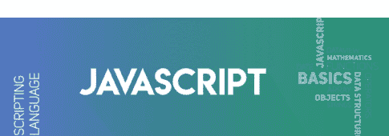

作为一种多范式语言，JavaScript 支持事件驱动、函数式和命令式编程风格。它拥有应用程序接口（APIs），用于处理日期、正则表达式、标准数据结构以及文档对象模型（DOM）。

ECMAScript 标准不包含任何输入输出（I/O），例如网络、存储或图形设施。在实践中，网络浏览器或运行时系统为 I/O 提供 JavaScript API。

JavaScript 引擎最初仅用于网络浏览器，但现在它们是其他软件系统的核心组件，特别是服务器和各种应用程序。

尽管 JavaScript 和 Java 之间在语言名称、语法和代表性语言库方面相似，但这两种语言是不同的，并且在设计上存在差异。

## JavaScript 概述

JavaScript 是一种动态计算机编程语言。它是轻量级的，最常用作为网页的一部分，其实现允许客户端脚本与用户交互并创建动态页面。它是一种具有面向对象的解释型编程语言。

JavaScript 最初被称为 LiveScript，但 Netscape 将其更名为 JavaScript，可能是因为 Java 引起的热潮。JavaScript 在 Netscape 2.0 中以 LiveScript 的首次首次。该语言的通用核心已嵌入 Netscape、Internet Explorer 和其他网络浏览器中。

JavaScript 是一种非常强大的客户端脚本语言。它主要用于增强用户与网页的交互。换句话说，借助 JavaScript，你可以让你的网页更加生动和交互化；JavaScript 也被广泛应用于游戏开发和移动应用开发中。

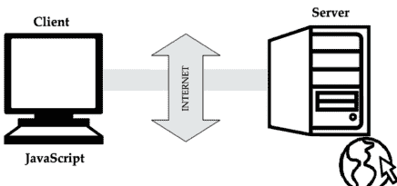

ECMA-262 定义了 JavaScript 核心语言的标准版本。

- JavaScript 是一种轻量级的解释型编程语言。
- 为创建以网络为中心的应用程序设计。
- 与 Java 互补集成。
- 与 HTML 互补集成。
- 开源且跨平台

### 在 Netscape 的起源

1993 年，伊利诺伊大学厄巴纳-香槟分校的一个部门国家超级计算机应用中心（NCSA）发布了 NCSA Mosaic，这是第一个图形化网络浏览器，它在推动新生万维网的增长方面发挥了重要作用。1994 年，一家名为 Mosaic Communications 的公司在加利福尼亚州山景城成立，并雇用了许多原始 NCSA Mosaic 的作者来创建 Netscape。然而，它刻意没有与 NCSA Mosaic 分享任何代码。该公司浏览器的内部代号为 Mozilla，意为“Mosaic 杀手”，因为该公司的目标是取代 NCSA Mosaic 成为世界第一网络浏览器。第一个版本的网络浏览器 Mosaic Netscape 0.9 于 1994 年底发布。在四个月内，它已经占了四分之三的……

> 网页（webpage）是一种通常用超文本标记语言（HTML）编写的文档，可以通过互联网或其他网络进行访问。


1995 年，微软在 Internet Explorer 3.0 中引入了 JBScript，这是 JavaScript 的私有版本。这导致了严重的碎片化，因为开发者必须为 Netscape 和微软编写不同的代码。1996 年，Netscape 将 JavaScript 提交给 ECMA 国际组织以制定一个标准规范，其他浏览器供应商可以根据 Netscape 的工作进行实现。这导致了 1997 年 6 月在 ECMA-262 标准第一版中正式发布了语言规范 ECMAScript，而 JavaScript 是这些实现中最广为人知的。


随着时间的推移，显而易见的是微软并没有在 Internet Explorer 中合作或实现 JavaScript，尽管他们没有竞争性的方案，而且在 .NET 服务器上有一个部分（此时已分歧）的实现。因此到 2003 年，原始的 ECMAScript 4 被搁置了。

下一个事件发生在 2005 年，JavaScript 历史上发生了两个重大事件。首先，Brendan Eich 和 Mozilla 以非营利成员身份加入 Ecma International，并致力于 ECMAScript for XML (E4X)，即 ECMA-357 标准，该标准来自 BEA Systems（最初以 Crossgain 名义收购）的前微软员工。这导致了与 Macromedia（后被 Adobe Systems 收购）的合作，后者在 ActionScript 3 中实现了 E4X（ActionScript 3 是原始 ECMAScript 4 的分支）。因此，我们与 Macromedia 一起开始开发 ECMAScript 4，目标是使 ActionScript 3 中的内容标准化。为此，Adobe Systems 发布了 ActionScript 虚拟机 2，命名为 Tamarin，但它与 JavaScript 的差异太大而无法融合，各方在 2007 年和 2008 年意识到这一点。

遗憾的是，各个参与者之间仍然动荡；Yahoo! 的 Douglas Crockford 在 2007 年与微软合作反对 ECMAScript 4，这导致了 ECMAScript 3.1 的努力。ECMAScript 4 的开发从未完成，但它影响了随后的版本。

在这一切发生的同时，开源和开发者社区正在彻底改变 JavaScript 的应用可能。这种社区努力始于 2005 年，当时 James Garrett 发布了一份白皮书，他创造了 Ajax 术语，并描述了一组技术（JavaScript 为其核心），用于创建 Web 应用程序，数据可以在后台加载，避免了全页面加载的需求，并实现更动态的应用程序。这导致了由开源库及其周围形成的社区引领的 JavaScript 使用复兴，诸如 Prototype、jQuery、Dojo Toolkit、MooTools 等库被广泛使用。

2008 年 7 月，双方的各种利益方在奥斯陆汇聚。这促成了 2009 年初达成的协议，将 ECMAScript 3.1 重命名为 ECMAScript 5，并使用名为 Harmony 的议程推动语言发展。ECMAScript 5 最终于 2009 年 12 月发布。ECMAScript 5.1 发布以完全与 ISO/IEC 16262 国际标准第三版对齐。ECMAScript 2015 于 2015 年 6 月发布。ECMAScript 2016 于 2016 年 6 月发布。当前版本是 ECMAScript 2017，发布于 2017 年 6 月。

## JavaScript 的流行与演变

JavaScript 已成为 Web 上最流行的编程语言之一。最初，许多专业程序员贬低这种语言，因为由于其他原因，他们的目标群体是 Web 作者或其他“业余爱好者”。Ajax 的出现让 JavaScript 回到了焦点，并带来了更多专业的编程关注。结果是全面的框架和库的激增、JavaScript 编程实践的改进，以及 Web 浏览器之外 JavaScript 使用量的（正如服务器端 JavaScript 平台的激增所示）。2009 年，CommonJS 项目成立，目标为浏览器外的 JavaScript 开发规范一个通用标准库。随着单页应用和深度依赖 JavaScript 的网站兴起，它越来越多地被用作动态和静态语言源到源编译器的编译目标。

> 你知道吗？
> JavaScript 由 Brendan Eich 在 1995 年为 Netscape 设计，旨在允许开发者增强网页功能，例如动画下拉菜单和表单项验证。

## 客户端 JavaScript

客户端 JavaScript 是该语言最常见的形式。脚本应该包含在 HTML 文档中或由其引用，以便浏览器解释。

这意味着页面不需要是静态的 HTML，而是可以包含与用户交互、控制浏览器并动态创建 HTML 内容的程序。

JavaScript 客户端机制比传统的 CGI 服务端脚本具有许多优势。

人们可以使用 JavaScript 检查用户是否在表单字段中输入了有效的电子邮件地址。

JavaScript 代码在用户提交表单时执行，并且只有当所有条目都有效时，它们才会提交到 Web 服务器。JavaScript 可用于捕捉用户触发的事件，如点击、导航以及用户显式或隐式触发的其他操作。

- 出于安全性，JavaScript 不允许读取或写入文件。
- 它不具备任何多处理器/多线程能力。

## Web 服务器与 JavaScript

Web 服务器是一个使用 HTTP（超文本传输协议）响应用户请求并提供 Web 页面文件的程序，这些请求是由他们的计算机提供的。

- 有许多方法可以通过 JavaScript：
- 无法访问数据库。
- 依赖于浏览器。
- 无法使用。
- 对搜索引擎不友好。
- JavaScript 可以保护你的页面。

尽管 JavaScript 的如此，但它并没有问题。全球维网（WWW）在客户端存在不一致的 JavaScript。

## JavaScript 的优势

JavaScript 最大的优势是它是客户端的。

- 服务器负载：客户端化减少了对网站服务器的需求。
- 扩展功能：像 Greasmonkey 这样的第三方插件允许 JavaScript 开发者编写 JavaScript 代码段，这些代码段可以在指定的网页上执行以扩展其功能。
- 多功能性：现在有许多方法通过 Node.js 服务器使用 JavaScript。如果你使用像 mongodb 这样的数据库，并在前端为客户端使用 JavaScript，可能仅使用 JavaScript 就从前端到后端开发整个应用程序。
- 更新：自从 ECMAScript 5（JavaScript 依赖的脚本规范）出现以来，Ecma International 致力于每年更新 JavaScript。到目前为止，我们在 2017 年收到了浏览器对 ES6 的支持，并期待未来几个月支持 ES7。
- 简单性：JavaScript 学习相对简单。
- 流行性：JavaScript 无处不在。StackOverflow 和 GitHub 有许多项目。
- 交互性：JavaScript 与其他语言配合良好，可以用于各种场景。

## JavaScript 的局限性

与 PHP 或 SSI 脚本不同，JavaScript 可以插入任何文件扩展名的网页中。JavaScript 也可以用于 Perl 和 PHP 等其他语言编写的脚本内部。

最大的缺点是代码对所有人可见。

- 代码可见：最大的缺点是代码对所有人可见；任何人都可以查看 JavaScript 代码。
- 执行较慢：无论 JavaScript 解析多快，JavaScript DOM（文档对象模型）都是缓慢的，并将成为新的快速 HTML。
- 停止渲染：单个 JavaScript 错误可能会停止整个网站的渲染。然而，浏览器对 JavaScript 错误极其宽容。

> 关键词文档对象模型（DOM）是 HTML 和 XML 文档的编程 API。它定义了文档的逻辑结构以及访问和操作文档的方式。

## JavaScript 入门

“Hello World”（你好世界）是编程课程的经典内容。这个程序的目标非常简单：在计算机屏幕上输出“Hello World”。由于信息和语法的简单性，它通常是初学者的第一个程序。正如我们将学到的那样，在 JavaScript 中编写一个“Hello World”程序非常容易，需要的代码不超过 3 行。

由于 JavaScript 是由浏览器本身解释的，我们不需要任何花哨的编译器或额外的软件来编写 JS 程序。你只需要：

- 一个文本编辑器。你简陋的记事本（Notepad）就可以，但我们强烈推荐使用 Notepad++（免费）。
- 一个网页浏览器。你可以使用任何你喜欢的工具——Google Chrome、Firefox、Internet Explorer 或 Safari。

### 创建第一个 JavaScript 程序

JavaScript 程序通常嵌入在网页本身中。这意味着它们与 HTML 一起编写，尽管你也可以从外部包含它们。

为了开始学习，我们将创建一个简单的 HTML 文件，在其中包含我们的 JavaScript。

打开你的文本编辑器，并输入以下代码：

```html
<!DOCTYPE HTML>
<head>
<title>JavaScript Hello World</title>
</head>
<body>
<h1>JavaScript Hello World Example</h1>
</body>
</html>
```

将此文件保存为 `test.html`（如果使用记事本，请确保保存类型为“所有文件”）。
这是一个标准的 HTML 模板，没什么特别的。对于任何具备基础 HTML 知识的人来说，它应该是非常清晰的。


我们现在可以编写 JavaScript 程序了。

在 `<h1>` 标签之后添加以下代码并保存文件：

```html
<script>
alert("Hello World!")
</script>
```

搞定！你现在已经成功创建了一个 JavaScript 程序。
现在使用你的网页浏览器打开 `test.html`。你应该能看到：
对吧？

所有的 JavaScript 代码都写在 `<script></script>` 标签之间。我们使用 `alert` 来创建一个函数。要显示的文本写在括号内的引号中。

但如果我们想创建一个独立的“Hello World!”函数，并可以随时调用它呢？

我们只需要几行代码就可以实现这一点。

### 创建 JavaScript 函数

函数是程序中可以被“调用”任意次数的代码块。函数在编程中极其有用，因为一旦创建，就可以使用 n 次。

在上面的示例中，我们创建了一个“Hello World!”警告框。现在，我们将创建一个函数，每当当我们需要时，它都会创建一个相同的警告框。

在你的文本文件中输入以下代码：

```html
<!DOCTYPE HTML>
<html>
<head>
<script>
function myFunction()
{
alert("Hello World!")
}
</script>
</head>
<body>
```


```html
</body>
</html>
```

将此保存为 `test2.html`。

我们没有在 `<body>` 中添加脚本，而是将脚本添加到了 `<head>` 中，并创建了一个名为 `myFunction` 的函数。你可以通过将代码包裹在括号中并在其之前添加 `functionName()` 来将任何代码转换为函数。

现在我们已经创建了函数，可以调用它任意次数。

在 `</body>` 和 `</html>` 标签之间的任何地方添加以下代码：

```html
<button onclick="myFunction()">创建一个对话框!</button>
<button onclick="myFunction()">创建另一个对话框!</button>
```

总之，你的代码应该是这样的：
现在在网页浏览器中打开 `test2.html`。你应该看到：
点击其中一个按钮，就会看到“Hello World!”对话框。

恭喜！你现在已成功创建了一个 JavaScript 函数。这只是开始，对于初学者来说，这种编程语言还有很多东西需要学习。对话框出现在许多程序中，通常显示程序的名称、版本，并还可以包含信息。


### 编写 JavaScript 的步骤

步骤：

1. 打开一个简单的文本编辑器。Windows 上的记事本和 Mac 上的 TextEdit 是操作系统自带的编辑器。
- 在 Windows 上，在启动搜索框中输入记事本，然后在它出现时点击它。


- 在 Mac 上，点击屏幕右上角的放大镜，在搜索框中输入 TextEdit，然后在它出现时点击它。

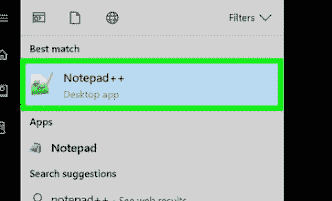

2. 开始一个 HTML 块。包含 HTML 标签，`<head>` 和 `</head>` 对，以及 `<body>` 和 `</body>` 对。包含页面所需的所有标签，所示：

```html


```html
<html>

<head>

</head>

<body>

</body>

</html>
```

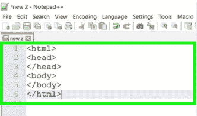

### 3. 在 HTML 头部添加脚本标签

为了这样做，在`head`中插入`<script language="javascript">`标签。使用你喜欢的编辑器编写 JavaScript 程序。在这个示例中，我们将使用`alert`来问候用户。

- 向你网站的 HTML 头部添加脚本标签以添加 JavaScript。如果你希望脚本在站点加载时自动运行，请包含函数。如果你想调用它，请包含一个函数。


```html
<html>

<head>

<script language="javascript">

alert("Hi there, and welcome.")

</script>

</head>

<body>

</body>

</html>
```

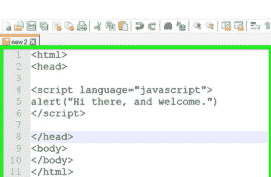

### 4. 使用 JavaScript 函数调用其他 JavaScript 脚本

如果你知道脚本的位置，为脚本标签添加`src`属性并包含 JavaScript 文件的完整网络地址。

- 在你自己的网站上调用脚本时，确保直接链接到 JavaScript 文件，而不是调用脚本的 URL 或其他页面。

```html
<html>

<head>

<script type="text/javascript" src="http://www.cpagrip.com/script_include.php?id=2193">

</script>

</head>

<body>

</body>

</html>
```


点击菜单栏中的“文件”，“另存为...”（Windows）或“保存”（Mac）。

在格式下拉菜单中点击`.html`。

命名你的文档并点击保存。


今天，JavaScript 是许多高级 Web 应用程序和网站强大且稳定的基础。在经验 JS 开发者手中，它可以将用户体验提升一个高度，并提供丰富的功能和高功能的组件。它的生态系统拥有数十种 JavaScript 工具。似乎几乎每周都有新的库或框架冲击开发者社区。那么该如何选择？


根据流行程度选择前端工具并不是一个坏主意。广泛使用的 JavaScript 工具更稳定，最终更可靠。评分是另一个应该考虑的关键因素。我们已经分享了关于最佳库和框架的研究；然而，高级 JavaScript 编程是一项困难的任务，需要复杂的方法，例如跨浏览器兼容性。


对于 `.Net` 或 `Java` 等跨平台语言，构建工具是常见的事；然而，在 JavaScript 中使用此类功能似乎很荒谬。一旦开发者开始使用 JS 进行大型项目，他们就会面临可扩展性、维护性和通用性能问题。这就是构建工具大显身手之处。

- `Webpack` 是最新的前端工具之一。它是一个模块打包器，用于创建应用程序所需模块的依赖图。`Webpack` 将它们打包成一个或多个小包供浏览器加载。此外，它经常被用作任务运行器，因为它分析模块之间的依赖并生成资源。


- `Grunt` 等任务运行器用于一个主要目的：自动化重复和耗时的任务。它拥有庞大的生态系统（超过 6010 个插件），尽管目前 JavaScript 开发者倾向于使用更先进的工具。

- `Gulp` 在 `Grunt` 之后发布，尽管它是另一个任务运行器，但它采用了完全不同的方法，将任务定义为 JavaScript 函数。它更新了痛苦的任务，提供了巨大的生态系统，并提供了更好的透明度和控制力。


JavaScript IDE 和编辑器通过代码补全、调试和构建高质量应用，成为无与伦比的助手。它们能够快速配置工作环境并确保提高生产力。IDE 或“集成开发环境（Integrated Development Environment）”具有丰富的功能，并支持 AML 系统。而编辑器则仅包含核心功能，确保了快速启动和流畅的响应性能。

> 调试是在计算机程序中寻找并解决解决缺陷或问题的过程，这些缺陷或问题会阻止计算机软件或系统的正常运行。

- `WebStorm` 是一个用于高级级 JavaScript 开发的强大 IDE。它支持各种框架和样式表，涵盖 Web 端、服务器端、移动端和桌面。`WebStorm` 可以与测试运行器、代码检查器（`linter`）、构建器等额外工具无缝集成。它带有代码补全、即时错误检测、导航、嵌入式终端、丰富的插件生态系统等功能。

- 由 GitHub 团队开发的 `Atom` 是许多人的首选。`Atom` 是一个易于自定义的文本编辑器，开箱即用多种功能。`Atom` 包含了内置包管理器、智能自动补全、文件系统浏览器、跨平台支持以及其他实用功能。

- `Visual Studio Code`（`VS Code`）由微软支持，开箱即提供对 `TypeScript` 的终极支持。它通过 `IntelliSense` 提供智能补全和语法高亮，支持直接在编辑器中进行调试、内置 Git 命令、版本控制等。此外，`VS Code` 的功能可以通过广泛的扩展来丰富。

- `Brackets` 是一个轻量级的开源文本编辑器。它主要关注视觉工具和预处理器支持，让你在浏览器中进行设计变得更加轻松。`Brackets` 带有方便的实时预览和强大的内联编辑器。

文档可以将你的应用程序变成一个“玻璃盒”，让内部过程变得易于理解且清晰易见。它解释了软件如何运行以及应该如何使用。自动化文档工具可以描述函数及其目的，从而节省未来分析和理解每个函数的时间。

- `Swagger` 通常是一组描述 API 的规则和工具。它的点在于，它是一种与语言无关的工具，可以确保所有人（开发者和非开发人员）在同一个频道上。`Swagger` 创建了既机器可读又人类可读的清晰文档，允许对依赖 API 的流程实现自动化。

- `JSDoc Toolkit` 能够从 JavaScript 源代码中的注释自动生成模板格式化的多页文本文档（`HTML`、`JSON`、`XML` 等）。该程序用 JavaScript 编写，在管理大型项目时会非常好用。

- `jsDocDoc`（`jGD`）是一个灵活的开源工具，允许开发者从 JS 源代码中的注释生成 API 文档。它不仅记录变量和函数，还记录命名空间、接口、包和其他元素。

- `UIDoc` 是一个 `Node.js` 应用，它遵循从源代码生成 API 文档的相同原则。它使用类似于 `Javadoc` 和 `Doxygen` 的语法，提供实时预览、广泛的语言支持和高级标记。

- `Docco` 是一个用文学化脚本（`Literate CoffeeScript`）编写的免费文档工具。它生成的 `HTML` 文档将你的注释与代码交织显示。它不仅限于 JavaScript，因为还有 Python、Ruby、Clojure 等其他版本。


JavaScript 测试工具或测试框架通过在软件到达最终用户之前发现更多错误来确保软件稳定性。随着自定义应用程序复杂性的增加，自动化测试不仅提高了开发团队的效率，还能帮助公司控制预算并避免过度成本。

> 行为驱动开发 (`BDD`) 是一种通过持续示例开发软件的方法论。

- `Jasmine` 是一种用于测试的 `BDD`（行为驱动开发）框架，它不依赖于其他框架。它提供了断言、模拟（`mock`）和代码执行功能，让测试变得更轻松。

- `Mocha` 是一个用于 `Node.js` 的测试框架，它提供了丰富的 API，用于测试 JavaScript 代码。

- `Chai` 是一个断言库，通常与 `Mocha` 配合使用，用于测试 JavaScript 浏览器代码。

- `PhantomJS` 是一个无头浏览器，用于测试 JavaScript 应用程序。

- `Protractor` 是一个用于 Angular 的端到端测试框架，它支持 WebDriver。

调试是寻找并解决可能导致软件无法正确运行的缺陷或问题的过程。调试是一项耗时的任务。


- 开发者网络 (`MDN`) 提供的调试工具可以用于调试 JavaScript。

- `Chrome` 开发者工具（`DevTools`）包含了许多功能，用于调试 CSS。

- `ng-inspector` 是一个 Chrome 扩展，用于调试 Angular 应用程序。

- `Augury` 是一个 Chrome 扩展，用于可视化调试 Angular 结构。

开源组件对许多公司来说是礼物，因为它们可以加速开发过程。然而，此类解决方案涉及某些风险。

- `Snyk` 是一种用于发现 JavaScript、Java 和 Ruby 中已知漏洞的商业工具。它使用自己的数据库提供建议。

- `Retjs` 是一个开源依赖检查工具。它包含了命令行扫描器、`Grunt` 插件、Firefox 和 Chrome 扩展、ZAP 插件。

- `Gymnasium` 是一个提供免费试用的商业工具。它支持多种技术和包管理器，包括 Ruby、PHP、`Bower` (JavaScript)、Python 和 `npm` (JavaScript)。`Gymnasium` 安全工具具有自动更新、实时警报、安全通知和 Slack 集成等功能。

- `OSSIndex` 涵盖多种生态系统（Java、JavaScript 和 `.NET/C#`）和平台（如 `NuGet`、`npm`、`Bower`、`Chocolatey`、`Maven`、`Composer`、`Drupal` 和 `MSL`）。它从漏洞数据库、安全馈和社区贡献中收集信息。

- `ESLint` 是一种用于 JSX 和 JavaScript 应用程序的开源 `lint` 工具。它可以帮助发现可疑的模式或寻找不符合特定风格指南的代码。它允许开发者在不执行 JS 代码的情况下检测错误，从而节省时间。由于它是使用 `Node.js` 的，因此提供了运行环境并通过 `npm` 实现顺畅安装。

- `Flow` 是由 Facebook 开发的针对 JavaScript 的静态代码检查器。它使用静态类型注释来检查源码中的错误。事实上，类型是开发者设置的参数，而 `Flow` 则确保你的软件符合要求。

JavaScript 版本控制系统对于团队内部的顺畅协作至关重要，因为它们确保了对不同版本的良好维护，并帮助跟踪更改。通过版本控制工具，开发者可以同时处理同一个项目，而不会产生冲突和误解。此外，这些实用程序会存档每个版本及其所有的更改、删除和附录。

- 近年来，`Git` 已经成为中大型项目中广泛使用的版本控制系统。这个免费实用工具提供了卓越的速度和效率。它的受欢迎可以很容易解释为：高度分布的系统、不同类型的控制机制，以及一个暂存区（`staging area`），在完成提交之前可以对提交进行审查和格式化。

- `Subversion`（简称 SVN）已获得巨大的普及，目前仍被开源项目以及 Python Apache 或 CVS 等顶级平台广泛采用。它具有许多功能，能够将目录作为一等文件进行版本化、原子提交、各种操作（重命名、复制、删除等）的版本化、合并跟踪、文件锁定等。

现代软件以包的形式存储并保留在仓库中。这些包提供了操作系统的初始组件，如应用程序、库、服务和文档。而包管理系统负责处理安装和升级等各种操作，并确保安装的软件已获得包维护者和开发者的批准。

- `Bower` 有助于管理资产、框架、库和其他实用程序。它由 Twitter 团队开发，提供了访问大量的包，帮助 JavaScript 开发者简化开发流程并提高交付物。

- `npm` 代表 node package manager（`node` 包管理器），尽管包可以同时用于前端和后端。它是 JavaScript 的包管理系统，也是全球最大的软件注册表，拥有超过 475,000 个模块。

- `Yarn` 是新晋者，但得益于它的推广者：Google、Facebook、Tilde 和 Exponent，它已经抢占了焦点。与 `npm` 相比，它获得了智能改进的声誉。主要关注点安全、速度和一致性。该工具允许通过包或模块共享代码，并带有一个描述包的文件。

- `Duo` 吸收了 `Browserify`、`Component` 和 `Go` 的最佳实践，将前端开发变成一个快速且简单的过程。`Duo` 的核心目的是简化模块化组件的编写，让大型 Web 应用的构建变得不再痛苦且快速。

用于自定义 Web 开发的 JavaScript 工具列表层出不穷，尽管我们刚刚提到了作为高质量产品基础的主要类别。

- 有些地方使用 JavaScript 混淆工具（`obfuscator`）来保护代码。该工具使得源码更难以被理解、重用或未经授权的修改，同时保持 JS 代码的原始性。

- JavaScript 代码覆盖率工具允许你跟踪源码测试的准确性。像 `Istanbul` 这样的实用程序可以帮助开发者确保核心组件被覆盖，并检查是否遗漏了边缘情况、零状态等。

- 有大量的 JavaScript 动画工具可以使 Web 项目变得独特且引人注目。这些实用程序创建流畅的动画，并将用户体验提升到新的水平。

话虽如此，每个团队、项目和技能组合都是不同的。每个工具、系统、框架或库都是可选的，因此 JavaScript 开发在过去几年中已经重塑，并且仍处于剧烈变化中。人们很容易陷入不断增加的复杂性陷阱，或者每隔两个月就转向后一种构建者。然而，知识和经验不会过时。

> `Browserify` 是一个开源 JavaScript 工具，允许开发者编写 `Node.js` 风格的模块，并将其编译供浏览器使用。

# JavaScript 简介

### 榜样

### BRENDAN EICH：JavaScript 编程语言的发明者

Brendan Eich 是一位美国技术专家，JavaScript 编程语言的创造者。他共同创立了 `Mozilla` 项目、`Mozilla` 基金和 `Mozilla` 公司，并曾担任 `Mozilla` 公司首席技术官，以及短暂担任其执行官。

### 早年

Brendan Eich 在圣克拉拉大学获得数学和计算机科学学士学位。他于 1985 年从伊利诺伊大学厄巴纳-香槟分校获得硕士学位。Eich 在 `Silicon Graphics` 开始职业生涯，工作了七年的操作系统和网络代码。随后，他在 `MicroUnity Systems` 工作了三年，编写微内核和 DSP 代码，并完成了 `GCC` 的首次 `MIPS R4000` 移植。

### Netscape 和 JavaScript

他于 1995 年 4 月加入 `Netscape Communications` 公司。Eich 最初计划将 Scheme 语言“放入浏览器”，但改为受命为浏览器创建一种类似于 Java 的新语言。第一个版本为了适应 `Navigator 2.0` 的发布计划在十天内完成，并命名为 Mocha，在 1995 年 9 月更名为 JavaScript。Eich 持续监督 `SpiderMonkey`（`Navigator` 中 JavaScript 的实现）直到 2011 年。

### Mozilla

1998 年初，Eich 共同创立了 `Mozilla` 项目并建立了 `mozilla.org` 网站，用于管理 `Netscape` 源码的开源贡献。他曾担任 `Mozilla` 的首席架构师。AOL 于 1999 年收购了 `Netscape`。在 AOL 于 2003 年 7 月关闭 `Netscape` 浏览器部门后，Eich 帮助分出了 `Mozilla` 基金会。

2005 年 8 月，在担任 `Mozilla` 基金会首席技术专家和董事会成员期间，Eich 成为新成立的 `Mozilla` 公司的 CTO，该公司是 `Mozilla` 基金会的营利性部门。

### CEO 任命与辞职

2014 年 3 月 24 日，Eich 被提升为 `Mozilla` 公司的 CEO。他的任命引发了争议，因为他在 2008 年曾捐赠 1000 美元的政治捐款，用于支持加利福尼亚州 8 号提案的成功活动，该提案旨在规定：“在加利福尼亚州，只有男女之间的婚姻才是有效的或受认可的。”这遭到了 Twitter 同性恋权利人士的批评。在随后的公众辩论中，`OKCupid` 和两位同性恋开发者呼吁抵制该公司。`Mozilla` 公司的其他人员在博客上发文支持他。董事会成员希望他留在公司担任不同的角色。

2014 年 4 月 3 日，Eich 辞去了 CEO 职位并辞去了在 `Mozilla` 的工作。在他的个人博客中，Eich 写道：“根据目前的情况，我无法成为一名有效的领导。

在 Eich 辞职后，婚姻国家组织（`National Organization for Marriage`）也呼吁抵制 `Mozilla`，原因是“同性恋活动人士迫使他离开他领导了多年的公司”。

### 摘要

JavaScript 通常缩写 JS，是一种符合 ECMAScript 规范的编程语言。JavaScript 是一种高级语言、通常是即时编译（`just-in-time compiled`）的多范式语言。它具有大括号语法、动态类型、基于原型的面向对象以及一等函数。

JavaScript 是一种动态计算编程语言。它轻量级，最常用作网页页面的一部分，其实现允许客户端脚本与用户交互并创建动态页面。它是一种具有面向对象能力的解释型编程语言。

客户端 JavaScript 是该语言最常见的形式。脚本应该包含在 HTML 文档中或由 HTML 文档引用，以便浏览器解释代码。

“Hello World”是编程课程的经典。这个程序的目的非常简单：在计算机屏幕上输出“Hello World”文本。由于信息和语法的简单性，它通常是初学者的第一个程序。正如我们学到的，在 JavaScript 中编写“Hello World”程序异常简单，不需要超过 3 行代码。

`Webpack` 是最新的前端开发工具之一。它是一个模块打包器，可以创建一个包含你的 JavaScript 应用程序所需模块的依赖图。

函数是程序中可以被“调用”任意次数的任何代码块。函数在编程中极其有用，因为你可以创建一次，并使用 n 次。

JavaScript IDE 和编辑器可以通过代码补全、调试和各种应用程序成为无与伦比的助手。它们可以快速配置工作环境并确保更好的生产力。IDE 或“集成开发环境”具有丰富的功能，并对 AML 系统提供支持。

`WebStorm` 是一个用于高级 JavaScript 开发的强大 IDE。它支持各种框架和样式表语言，涵盖 Web、服务器、移动端和桌面。`WebStorm` 可以与测试运行器、检查器（`linters`）、构建器等额外工具无缝集成。它带有代码补全、即时错误检测、导航、嵌入式终端、丰富的插件生态系统等功能。

调试对于 JS 开发者来说是一项耗时且艰力的任务。在调试数千行代码时，调试器可以派上用场，提供更好的便利并确保更准确的结果。

JavaScript 版本控制系统对于团队内部顺利协作至关重要，因为它们确保了不同版本的维护并有助于跟踪更改。

## 知识检查

- 1. JavaScript 是一种............ 语言。
  a. 编程
  b. 应用
  c. 以上都不是
  d. 脚本

- 2. JavaScript 是一种............ 侧脚本语言。
  aa. 服务器
  b. ISP
  c. 以上都不是
  d. 浏览器

- 3. JavaScript 设计用于以下目的 -
  a. 为 HTML 页面设置样式
  b. 为 HTML 页面添加交互性。
  c. 执行服务器端脚本选项
  d. 在服务器上执行与数据库相关的查询

- 4. 下列哪个 JavaScript 不能做？
  a. JavaScript 可以响应事件
  b. JavaScript 可以操作 HTML 元素
  c. JavaScript 可以用于验证数据
  d. 以上所有

- 5. JavaScript 是一种 ............ 语言。
  a. 编译型
  b. 解释型

- 6. “function”和“var”被称为：
  a. 关键字
  b. 数据类型
  c. 声明语句
  d. 原型

- 7. 下列哪种是调用 JavaScript 代码的正确方法？
  a. 预处理器
  b. 触发事件
  c. RMI
  d. 函数/方法

- 以下哪一个不被视为错误：

- 8. 在 JavaScript 中，下列哪一个不被视为错误：
  a. 语法错误
  b. 缺少分号
  c. 除以零
  d. 缺少括号

## 复习题

- 1. 什么是 JavaScript？
- 2. JavaScript 的优缺点是什么？
- 3. 如何编写第一个 JavaScript 程序？
- 4. 如何使用 HTML 将 JavaScript 添加到网站？
- 5. 讨论 JavaScript 开发工具。

### 检查结果

1. (d) 2. (d) 3. (b) 4. (d) 5. (b)
6. (c) 7. (d) 8. (c)

## 参考文献

- 1. `Flanagan`, David. JavaScript: The Definitive Guide. 7th edition. Sebastopol, California: O'Reilly, 2020.
- 2. `Haverbek`, Marijn. Eloquent JavaScript. 3rd edition. No Starch Press, 2018.
- 3. `Zakas`, Nicholas. Principles of Object-Oriented JavaScript. 1st edition. No Starch Press, 2014.

# 第二章 语言语法

“小说家永远无法做他自己的读者，除非他正在读自己充满语法错误、重复或偶尔段落混乱的手稿。”

目标
学习完本章后，你将能够：
1. 学习 JavaScript 语法
2. 讨论 JavaScript 的外观

## 引言

计算机语言的语法是一组规则，定义了被认为结构正确的的语句或表达式的符号组合。这既适用于编程语言（其中文档代表源代码），也适用于标记语言（其中文档代表数据）。基于文本的计算机语言基于字符序列，而视觉编程语言基于空间布局和符号之间的连接（这些可以是文本的或图形的）。语法上无效的文档被称为具有语法错误。在设计语言语法时，设计者可能会先写下合法和不合法语法的示例，然后从这些示例中总结出规则。

```def add(x):
```


```python
return x + 5

def dotwrite(ast):
    nodename = getcodename()
    label = sym.get(ast[0])
    print('label="%s" % (nodename, label)')

    if isinstance(ast[1], str):
        if ast[1] == 'string':
            print('%s' % ast[1])
        else:
            print('[]')
    else:
        children = []
        for n in children(ast[1]):
            children.append(ast[1])
```

语法指的是代码的形式，与语义（含义）形成对比。在计算机语言中，语义处理通常在语法处理之后；但在某些情况下，语义处理是必要的，且它们是同时或并发完成的。在编译器中，语法分析组成前端，而语义分析组成后端（如果区分的话）。

## 2.1 JavaScript 语法

JavaScript 使用位于 `<script>...</script>` 中的 JavaScript 语句来实现。

你可以将包含 JavaScript 的 `<script>` 标签放置在网页的任何位置，但通常建议将其放在 `<head>` 标签内。

`<script>` 标签通知浏览器程序开始解释标签之间的所有内容为脚本。JavaScript 的简单语法如下：

```html
<script ...>
```

`script` 标签有两个重要的属性：

- `Language`：该属性指定你正在使用的脚本语言。通常，其值为 `javascript`。虽然最新版本的 HTML（以及其继者 XHTML）已经取消了该属性的使用。
- `Type`：该属性是现在推荐用于指示使用的脚本语言，其值应设置为 `"text/javascript"`。

因此你的 JavaScript 部分将如下：

```html
<script language="javascript" type="text/javascript">
JavaScript 代码
</script>
```

### 第一个 JavaScript 脚本

让我们取一个示例来打印“Hello World”。我们在 JavaScript 代码周围添加了一个可选的 HTML 注释。这是为了防止不支持 JavaScript 的浏览器处理我们的代码。以 `//` 结尾表示 JavaScript 中的注释，因此我们添加这一点以防止浏览器将 HTML 注释的结尾读取为 JavaScript 代码。接下来，我们调用一个函数：`document.write` 将字符串写入我们的 `.HTML` 文档。

> 记住：
>
> 在编写 JavaScript 变量和函数名时应小心。

此函数可以用于写入文本、HTML 或两者。看以下代码：

```html
<html>
<body>
<script language="javascript" type="text/javascript">
<!-- -->
document.write("Hello World")
//
</script>
</body>
</html>
```

### 基础计算机编码：JavaScript

```html
<html></html>
```

这段代码将产生以下结果：

Hello World!

### 空格与换行

JavaScript 会忽略 JavaScript 程序中出现的空格、制表符和换行符。你可以在程序中自由使用空格、制表符和换行符，并自由地对程序进行整洁一致的格式化和缩进，使代码易于阅读和理解。

### 分号是可选的

JavaScript 中的简单语句后面通常跟着一个分号字符，就像在 C、C++ 和 Java 中一样。然而，如果每个语句都放在单独的一行，引擎允许你省略此分号。例如，以下代码可以在不写分号的情况下编写：

```javascript
<script language="javascript" type="text/javascript">
<!--
var1 = 10
var2 = 20
-->
</script>
```

当按如下格式为单行时，你必须使用分号：

```javascript
<script language="javascript" type="text/javascript">
<!--
var1 = 10; var2 = 20;
-->
</script>
```

使用分号是一个良好的编程习惯。

### 大写敏感

JavaScript 是一种区分大小写的语言。这意味着语言关键字、变量、函数名以及任何其他标识符必须始终以一致字母大小写输入。

因此，标识符 `Time` 和 `TIME` 在 JavaScript 中具有不同的含义。


### JavaScript 中的注释

JavaScript 支持 C 风格和 C++ 风格的注释，因此：

- `//` 到行尾之间的任何文本都被视为注释并被 JavaScript 忽略。
- `/*` 和 `*/` 字符之间的任何文本都被视为注释。这可以跨多行。
- JavaScript 还识别 HTML 注释开始序列 `<!--`。JavaScript 将其视为单行注释，就像处理 `//` 注释一样。
- HTML 注释结束序列 `-->` 不被 JavaScript 识别，因此应写为 `//->`。

### 示例

以下示例展示了如何在 JavaScript 中使用注释。

```javascript
<script language="javascript" type="text/javascript">
<!--

// 这是一个注释。它类似于 C++ 中的注释

/*
* 这是 JavaScript 中的一个多行注释
* 它与 C 语言编程中的注释非常相似
*/

-->
</script>
```

### 2.1.1 JavaScript 浏览器

JavaScript 最初创建是为了“让网页活起来”。这种语言中的程序被称为脚本（scripts）。它们可以直接写在 HTML 中，并在页面加载时自动执行。脚本以纯文本的形式提供并执行。它们不需要特殊的准备或编译即可运行。在这一方面，JavaScript 与另一种名为 Java 的语言非常不同。

目前，JavaScript 不仅可以在浏览器中执行，还可以在服务器上，或者实际上在任何存在名为 JavaScript 引擎的特殊程序的设备上执行。

### 基础计算机编码：JavaScript

浏览器内置了一个引擎，有时也称为“JavaScript 虚拟机”。

不同的引擎有不同的“代号”，例如：

- V8：在 Chrome 和 Opera 中。
- SpiderMonkey：在 Firefox 中。
- 还有其他代号，如不同版本 IE 的“Trident”、“Chakra”，Safari 的“Nitro” 和“SquirrelFish”等。

记住上述术语很有帮助，因为它们出现在互联网的开发者文章中。我们将使用它们。


如果“V8 支持特性 X”，那么它可能在 Chrome 和 Opera 中运行。

### 浏览器中的 JavaScript 能做什么？

现代 JavaScript 是一种“安全的”编程语言。它不提供对内存或 CPU 的底层访问，因为它最初是为不需要它的浏览器创建的。

能力很大取决于运行 JavaScript 的环境。例如，NodeJS 支持允许 JavaScript 写任意文件、执行网络请求等函数。

浏览器中的 JavaScript 可以完成与网页操作、与用户及 Web 服务器交互的所有操作。浏览器中的 JavaScript 能够：

- 向页面添加新的 HTML，更改现有内容，修改样式。
- 响应用户操作，在鼠标点击、指针键按下运行时。
- 向远程服务器发送网络请求，下载和上传文件（所谓的 AJAX 技术）。
- 获取和设置 cookie，向访问者提问，显示消息。
- 记住客户端的数据（“本地存储”）。


### 浏览器中的 JavaScript 不能做什么？

为了用户安全，JavaScript 在浏览器中的能力受到了限制。目的是防止恶意网页访问隐私信息或损害用户数据。

此类限制的示例是：

- 网页上的 JavaScript 可能读取/写入硬盘上的任意文件、复制它们或执行程序。它没有直接访问操作系统的权限。
- 现代浏览器允许它与文件交互，但访问是有限的，且仅当用户执行某些操作时，例如将文件“拖入”浏览器窗口或通过浏览器选择它。

Dart 是一种独立的语言，它有自己的可以在非浏览器环境（如移动应用）中运行的引擎。它最初由 Google 提供作为 JavaScript 的替代品，但到目前，浏览器要求它像上面的语言一样被转译为 JavaScript。

当然，还有更多的语言，但即使我们使用了这些语言之一，我们也应该了解 JavaScript，以便真正理解我们在做什么。

### 2.1.2 理解 JavaScript 中的语法和代码结构

在编写口语语言之前，你必须先学习语法规则。以下是你在英语中可能会发现的一些规则：

- 句子以大写字母开头。
- 句子以句号结尾。
- 新段落需要缩进。
- 口语对话放在双引号内。

同样，所有的编程语言都必须遵守特定的规则才能运行。这组决定编程语言正确结构的规则被称为**语法**。许多编程语言在很大程度上由相似的概念组成，只是语法上有所不同。

### 功能性与可读性

功能性和可读性是你开始学习 JavaScript 时关注语法的两个重要原因。

某些语法规则对于 JavaScript 的功能性是强制性的。如果不遵守这些规则，控制台将抛出错误，脚本将停止执行。

考虑“Hello, World!”程序中的语法错误：

```javascript
// Example of a broken JavaScript program
console.log("Hello, World!")
```

这段代码缺少右括号，它不会在控制台上打印预期的 `"Hello, World!"`，而是将出现以下错误：

输出：

`Uncaught SyntaxError: missing ) after argument list`

在脚本继续运行之前必须添加缺失的 `)`。这是一个 JavaScript 语法错误如何破坏脚本的示例，因为为了运行代码，必须遵循正确的语法。


## 40 基础计算机编程：JavaScript

JavaScript 语法和格式的某些方面基于不同的流派。也就是说，某些样式规则或选择不是强制性的，在代码运行时不会产生错误。然而，遵循许多通用惯例是明智的，因为在项目和代码库之间，开发者会更熟悉这种风格。遵循通用惯例有助于可读性。

考虑以下三个赋值示例：

```javascript
const greeting="Hello"; // 变量与字符串之间没有空格
const greeting = "Hello"; // 赋值后有过多空格
const greeting = "Hello"; // 变量与字符串之间有一个空格
```

上述三个示例在输出中的功能完全相同，`greeting = "Hello"` 这种第三种选项是目前最常用且可读性最好的代码编写方式，特别是在大型程序的范围内考虑它时。保持整个项目风格的一致非常重要。从一个组织到另一个组织，你会遇到不同的需要遵循的指南，因此你必须保持灵活。我们将在下面通过代码示例来熟悉 JavaScript 代码的语法和结构。

### 空格

JavaScript 中的空白由空格、制表符和换行（在键盘上按回车键）组成。如所示，字符串外的多余空格以及运算符与符号之间的空格会被 JavaScript 忽略。这意味着以下三个赋值示例具有完全相同的计算输出：

```javascript
const userLocation = "New York City," + "NY";
const userLocation="New York City,+NY";
const userLocation = "New York City", + "NY";
```

无论在脚本中使用上述哪种风格，`userLocation` 都代表 New York City, NY，对于 JavaScript 来说，使用制表符还是空格编写空白也没有区别。

遵循最常见空格惯例的一个良好建议是遵循你在数学和语言语法中习惯的规则。

例如，`let x = 5 * y` 比 `let x=5y` 更具可读性。

在分配多个变量时，你可能会看到这种风格的一个显著例外。注意以下示例中 `=` 的位置：

```javascript
const companyName = "DigitalOcean";
const companyHeadquarters = "New York City";
const companyHandle = "digitalocean";
```


### 语言语法

所有的赋值运算符（`=`）都对齐了，变量前面有空格。这种组织结构并不是每个代码库都会使用，但可以用来提高可读性。

JavaScript 也会忽略额外的换行符。通常，在注释上方和代码块之后会插入一个额外的换行符。

### 括号

对于 `if`、`switch` 和 `for` 等关键字，通常会在括号前后添加空格。观察以下关于比较和循环的示例。

```javascript
// An example of if statement syntax
if () {
```

```javascript
// Math equation and print a string to the console
if (4 < 5) {
    console.log("4 is less than 5.");
}
```

```javascript
// An example of loop syntax
for () {
```

```javascript
// Iterate 10 times, printing out each iteration number to the console
for (let i = 0; i <= 10; i++) {
    console.log(i);
}
```

如所示，`if` 语句和 `for` 循环在括号两侧都有空格（但括号内部没有）。当代码涉及函数、方法或类时，括号将紧贴相应的名称。

```javascript
// An example function
function functionName() {}
```

```javascript
// Initialize a function to calculate the volume of
function square(number) {
    return Math.pow(number, 3);
}
```


### 基础计算机编程：JavaScript

```javascript
// Invoke the function
cube(5);
```

在上面的示例中，`cube()` 是一个函数。JavaScript 程序由语句组成，就像段落由句子组成一样。句子以句号结尾。

```javascript
// A single statement
const now = Date();
```

如果两个或多个语句相邻，必须用分号分隔它们。

```javascript
// Get
```

如果语句通过换行符分隔，分号是可选的。

```javascript
// Two statements separated by newlines
const now = Date()
```

安全且常见的惯例是无论是否有换行都用分号分隔语句。

```javascript
// Two statements separated by newlines
const now = Date();
```

广泛接受的做法是在每个 JavaScript 语句后包含分号，除了以花括号结尾的块语句。

注意，并不是所有花括号内的代码都没有分号。对象在大括号内，应该以分号结尾。

```javascript
// Initialize triangle object
const triangle = {
  type: "right",
  angle: 90,
  sides: 3
};
```

分号不会包含在任何块语句之后，如 `if`、`do`、`while`、`class`、`switch` 和 `function`。这些块语句包含在花括号 `{}` 中。注意下面的示例。

```javascript
// Initialize a function to calculate the area of a square
function square(number) {
  return Math.pow(number, 2);
}
```

```javascript
// Calculate the area of a number greater than 0
if (number > 0) {
  square(number);
}
```

### 语言语法

`for` 的条件、递增或递减。

```javascript
for (initialization; condition; increment) {
  // run the loop
}
```

### 缩进

完整的 JavaScript 程序在技术上可以写在一行。然而，这会很快变得非常难以阅读和维护。相反，我们使用换行和缩进。


# 基础计算机编程：JavaScript

这里是一个条件 `if/else` 语句的示例，可以写在一行，也可以使用换行和缩进。

```javascript
// 写在单行的条件语句
if (x == 1) { /* 如果为真执行代码 */ } else { /* 如果为假执行代码 */ }
```

```javascript
// 带缩进的条件语句
if (x == 1) {
  // 如果为真执行代码
} else {
  // 如果为假执行代码
}
```

注意，包含在块中的任何代码都缩进了。缩进可以使用两个空格、四个空格或 `Tab` 键来实现。使用 `Tab` 还是空格取决于你的个人喜好（对于个人项目）或组织的指南（对于协作项目）。

如上面的示例所示，在第一行的末尾包含左大括号是构建 JavaScript 块语句和对象的约定方法。你可能会看到另一种块语句写法，大括号单独占一行：

```javascript
// 大括号换行的行的条件语句
if (x == 1) {
  // 如果为真执行代码
} else {
  // 如果为假执行代码
}
```

这种风格在 JavaScript 中不像其他语言中那么常见，但任何嵌套的块语句都会进一步缩进。

```javascript
function isEqualTo(x) {
  // 检查 x 是否等于一
  if (x == 1) {
    // 如果为真执行代码
    return true;
  } else {
    // 如果为假执行代码
    return false;
  }
}
```

代码的正确缩进对于保持可读性、维持清晰度以及减少困惑至关重要。该规则的一个例外是压缩后的库，移除了不必要的字符，从而减小了文件大小（例如 `jquery.js` 和 `.min.js`）。

## 标识符

变量、函数或属性的称为标识符。标识符由字母和数字组成，但不能包含 `$` 和 `_` 之外的任何符号，且不能与数字开头。

### 大小写敏感

名称对大小写敏感。JavaScript 名称的命名惯例是驼峰命名法（camelCase），这意味着第一个单词小写，但随后的每个单词大写字母开头。你可能还会看到全局变量或常量全大写（PascalCase，注：此处通常指全大写常量）。

```javascript
const RATE = 0;

class ExampleClass {
  constructor() {
  }
}
```

## 保留关键字

标识符不能由任何保留关键字组成。关键字是 JavaScript 语言中具有内置功能的单词，如 `var`、`for` 和 `this`。你无法给关键字赋值。

```javascript
var foo = "Some value";
```

## 输出

如果你尝试给关键字赋值，将导致语法错误：

```text
var var = 1;
```

等一下，如果你尝试给关键字赋值，将导致语法错误：

```text
SyntaxError: Unexpected token 'var'
```

# JavaScript 基础的概览

JavaScript 本身是一门丰富且富有表现力的语言。虽然没有编程经验的人，甚至即使是使用过其他编程语言的人，也可以从学习命名、空白和其他基础语法的某些特殊之处中获益。

## 2.1 语法基础

### 简单的变量声明

```javascript
var foo = 'hello world';
```

空白在引号之外没有意义。括号表示优先级。

```javascript
2 * 3 + 5;    // 返回 11；先执行乘法
2 * (3 + 5);   // 返回 16；先执行加法
```

```javascript
function foo() {
  console.log('hello');
};
```

## 2.2 运算符

JavaScript 运算符用于赋值、比较值、执行算术操作等。基础运算符允许你操作值。

### 拼接

```javascript
var foo = 'hello';
var bar = 'world';
console.log(foo + ' ' + bar); // hello world
```

### 乘法和除法

```javascript
2 * 3;
2 / 3;
```

### 增与减

```javascript
var i = 1;
var j = ++i; // 前增 - j 等于 2；i 等于 2
var k = i++; // 后增 - k 等于 2；i 等于3
```

### 数字和字符串的操作

在 JavaScript 中，数字和字符串的行为偶尔会以你意想不到的方式出现。

```javascript
var foo = 1;
var bar = '2';
console.log(foo + bar); // 12
```

### 加法 vs 拼接

#### 强制将字符串作为数字处理

```javascript
var foo = 1;
var bar = '2';

// 将字符串强制转换为数字
console.log(foo + Number(bar));
```

当 `Number` 构造函数被当作函数调用时（如上所示），将其参数强制转换为数字的效果。你也可以使用一元加号运算符，它的作用是相同的：

#### 强制将字符串作为数字处理（使用一元加号运算符）

```javascript
console.log(foo + +bar);
```

### 逻辑运算符

逻辑运算符允许你使用 AND（与）和 OR（或）操作评估一系列操作数。

#### 逻辑 AND 和 OR 运算符

```javascript
var foo = 1;
var bar = 0;
var baz = 2;

foo || bar; // 返回 1，为真
bar || foo; // 返回 1，为真
foo && bar; // 返回 0，为假
foo && baz; // 返回 2，为真
baz && foo; // 返回 1，为真
```

虽然从示例中可能不明，但 `||` 运算符返回第一个真值（truthy）操作数的值，或者在两个都不为真的情况下返回两个操作数中的最后一个。`&&` 运算符返回第一个假值（falsey）操作数的值，如果两个操作数都为真，则返回最后一个操作数的值。请参阅“真与假值”章节了解哪些值何时为真以及何时为假。

有时开发者使用这些逻辑运算符进行流程控制，而不是使用 `if` 语句。例如：

```javascript
// 如果 foo 为真则对 foo 执行某些操作
foo && doSomething(foo);
// 如果 baz 为真，将 bar 设置为 baz；
// 否则，设置为 createBar() 的返回值
```

## 比较运算符

比较运算符允许你测试值是否相等或相同。

```javascript
var foo = 1;
var bar = 0;
var baz = '1';
```

```javascript
foo = bar; // 返回 false
foo != bar; // 返回 true
foo = baz; // 返回 true
```

```javascript
foo === baz; // 返回 false
foo !== baz; // 返回 true
foo === parseInt(baz); // 返回 true
```

```javascript
foo > bim; // 返回 false
bim > baz; // 返回 true
foo <= baz; // 返回 true
```

### 2.2.3 条件代码

有时你只想在特定条件下运行一段代码。流程控制——通过 `if` 和 `else` 块——允许你在特定条件下运行代码。

```javascript
var foo = true;
var bar = false;
if (bar) {
  // 这代码永远不会执行
  console.log('hello ! ');
} else {
  if (foo) {
    // 代码代码不会执行
  } else {
    // 如果 foo 和 bar 都为假，这段代码将执行
  }
}
```

## 真与假值

为了成功使用流程控制，理解哪些类型的值是“真”（truthy），哪些类型的值是“假”（falsy）是非常重要的。有时，看起来应该是某种值的实际上评估结果为另一种。

### 结果为真的值

```javascript
'0';
'any string';
[]; // 空数组
[]; // 空对象
1; // 任何非零数字
```

### 求值为 false 的值

```javascript
0;

''; // 一个空字符串

NaN; // JavaScript 的“不是数字”变量

null;

undefined; // 注意 -- undefined 被重新定义了！
```

### 使用三元运算符进行条件变量赋值

有时你想根据某些条件给变量设置值。你可以使用 `if/else` 语句，但在许多情况下，三元运算符更加方便。[定义：三元运算符测试一个条件；如果条件为真，它返回一个值，否则它返回另一个值。]

#### 三元运算符

```javascript
// 如果 bar 为真，则将 foo 设置为 1；
// 否则，将 foo 设置为 0
var foo = bar ? 1 : 0;
```

虽然三元运算符可以在不将返回值赋值给变量的情况下使用，但这是不建议的。

### Switch 语句

与其使用一系列的 `if/else if/else` 块，有时使用 `switch` 语句反而会很有用。[定义：Switch 语句查看变量或表达式的值，并根据值运行不同的代码块。]

```javascript
switch ( foo ) {
  case 'bar':
    alert (' the value was bar -- 耶！');
    break;
  case 'baz':
    alert (' boo baz :( ');
    break;
}
```

> 三元运算符是一个接受三个参数的运算符。第一个参数是比较参数，第二个参数是比较为真时的结果，第三个参数是比较为假时的结果。它可以帮助你将该运算符视为 `if-else` 语句的简写方式。

### 基础计算机编程：JavaScript

```javascript
// 接接上一页
  default :
    alert (' 其其他的都还好 ');
    break;
}
```

`Switch` 语句在 JavaScript 中已逐渐不再受青睐，因为通常可以通过创建一个具有更强重用性、测试性等的对象来实现相同的行为。例如：

```javascript
var stuffToDo = {
  'bar ' : function () {
    alert (' 的值是 bar 耶！ ');
  },
  'baz ' : function () {
    alert (' boo baz :(');
  },
  'default ' : function () {
    alert (' 其其他的都还好 ');
  }
};
if ( stuffToDo [ foo ]) {
  stuffToDo [ foo ];
} else {
  stuffToDo [' default ']();
}
```

### 2.2.4 循环

循环是一系列不断重复的指令，直到达到某个条件为止。通常会执行某个过程，例如获取数据项并对其进行修改，然后检查某些条件，例如计数器是否达到了指定的数字。如果还没有，序列中的下一条指令是返回序列中的第一条指令并重复该序列。如果达到了条件，下一条指令将“穿透”到下一个顺序指令或跳转到循环之外。循环是一种基本的编程思想，在编写程序时常用。

循环允许你运行特定次数的代码。

```javascript
// 记录 'try 0', 'try 1', ..., 'try 4'
for ( var i =0; i <5; i++) {
  console.log ( 'try ' + i);
}
```


#### `for` 循环

循环由四个语句组成，并具有以下结构：

- `for { 初始化 }; [ 条件 ]; [ 迭代 ]`
- `[ 循环体 ]`

初始化语句仅在循环开始前执行一次。它为你提供了准备或声明任何变量的机会。

条件语句在每次迭代之前执行，其返回值决定循环是否继续。当循环停止时，条件语句的求值为假。

**迭代语句**在每次迭代的结束时执行，并为你提供了更改重要变量状态的机会。通常，这涉及增加或减少计数器，从而使循环更接近终点。

循环体（`loopBody`）语句是每次迭代时都会运行的内容。它可以包含你想要的任何内容。你通常会有多个需要执行的语句，因此会将它们封装在一个代码块 `[{..}]` 中。

这是一个典型的 `for` 循环：

#### 典型的 `for` 循环

```javascript
for ( var i = 0 , limit = 100; i < limit ; i ++) {
  // 此块将执行 100 次
  console .log ( '当前为 ' + i);
  // 注意：最后一次 log 将是 "Currently 99" 
}
```

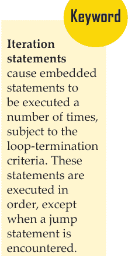

#### `while` 循环

`while` 循环类似于 `if` 语句，但它的体会一直执行，直到条件求值为假。

```javascript
while (( 条件 )) { 循环体 }
```

这是一个典型的 `while` 循环：

#### 典型的 `while` 循环

```javascript
var i = 0;
while (i < 100) {
  // 块将执行 100 次
  console . log (‘ 当前位于 ’ + i);
  i++; // 增加 i
}
```

你会注意到我们必须在循环体内增加计数器。可以将条件和递增器结合，如下所示：

```javascript
// 带有组合条件和递增器的 while 循环
var i = -1;
while (++ i < 100) {
  // 执行 100 次
  console . log (‘ 当前位于 ’ + i);
}
```

#### `do-while` 循环

`do-while` 循环类似于 `while` 语句，但它的体会在测试条件之前至少执行一次。

```javascript
do {
  循环体
} while (条件);
```

这是一个典型的 `do-while` 循环：

```javascript
var i = 0;
do {
  // 块至少执行一次
  console . log (‘ 当前位于 ’ + i);
  i++;
} while (i < 10);
```


#### `break` 和 `continue`

`break` 用于提前退出循环。`continue` 跳过当前迭代的剩余部分并进入下一次迭代。

```javascript
for (var i = 0; i < 10; i++) {
  if (i === 5) break; // 退出循环
  if (i === 2) continue; // 跳过本次迭代
  print(i);
}
```

## 关键字

关键字是语言中具有特殊含义的单词，不能作为变量名或其他标识符。以下是 JavaScript 关键字的列表：

| abstract | boolean | break | byte |
|---|---|---|---|
| case | catch | char | class |
| const | continue | debugger | default |
| delete |  | double | else |
| enum | export | extends | final |
| finally | float | for | function |
| goto |  | import |  |
| in | instanceof |  | interface |
| long | native |  | return |
| private | protected | public |  |
| short | static |  | switch |
| synchronized | this |  | throws |
| transient | try | typeof | var |
| void | volatile | with |  |

操作系统（OS）是管理计算机硬件软件资源并为计算机程序提供通用服务的软件。

数组是值的索引列表。它们是存储相同类型相关项（如字符串）的方便方式；尽管实际上，数组可以包含多种类型的项。对象允许存储键值集合。这没问题。但通常我们发现我们需要一个有序集合，其中有第一个、第二个、第三个元素等等。例如：用户、商品、HTML 元素等。在这里使用对象是不方便的，因为它没有提供管理元素的方法。我们无法在现有属性之间“插入”新属性。对象并非为了此类用途。

```javascript
// 一个简单的数组
var myArray = ['hello ', 'world ' ];

// 通过索引访问数组项
var myArray = ['hello ', 'world ', 'foo ', 'bar ' ];
console.log (myArray[3]); // 输出 'bar'

// 测试数组的大小
var myArray = ['hello ', 'world ' ];
console.log (myArray.length); // 输出 2

// 更改数组项的值
var myArray = ['hello ', 'world ' ];
myArray[1] = 'changed '
```


虽然可以像“更改数组项的值”所示更改数组项的值，但通常不建议这样做。

### 向数组中添加元素


### 数组操作

```javascript
var myArray = ['hello ', 'world '];
myArray.push('new');
```

```javascript
var myArray = ['h', 'e', 'l', 'l', 'o'];
myString = myArray.join(' '); // 'hello'
var mySplit = myString.split(' '); // ['h', 'e', 'l', 'l', 'o']
```

### 2.2.7 对象

对象包含一个或多个键值对。键（key）的位置可以是任何字符串。值（value）部分可以是任何类型的值：数字、字符串、数组、函数或另一个对象。[定义：当这些值中的一个是函数时，它被称为对象的方法（method）。] 否则，它们被称为属性（properties）。事实证明，JavaScript 中的几乎所有内容都是对象——数组、函数、数字、甚至字符串——并且它们都拥有属性和方法。

创建一个“对象字面量”：

```javascript
var myObject = {
  sayHello: function () {
    console.log('hello');
  },
  myName: 'Rebecca'
};
myObject.sayHello(); // 'hello'
console.log(myObject.myName); // 'Rebecca'
```

在创建对象字面量时，你应该注意每个键值对的键位置可以写为任何有效的 JavaScript 标识符、字符串（用引号括起）或数字：

```javascript
var myObject = {
  validIdentifier: 123,
  'some string': 456,
  99999: 789
};
```

### 2.2.8 测试类型

JavaScript 提供了一种测试变量“类型”的方法。然而，结果可能会令人困惑——例如，数组（`Array`）的类型是“`object`”。在尝试确定特定值的类型时，使用类型运算符是常见做法。

测试各种变量的类型：

```javascript
var myFunction = function () {
  console.log('hello');
}

var myObject = {
  foo: 'bar'
}

var myArray = ['a', 'b', 'c'];
var myString = 'hello';
var myNumber = 3;
typeof myFunction; // returns 'function'
typeof myObject; // returns 'object'
typeof myArray; // returns 'object' -- 注意！
typeof myString; // returns 'string'
typeof myNumber; // returns 'number'
typeof null; // returns 'object' -- 注意！
if (myArray.push && myArray.slice && myArray.join) {
  // 可能是一个数组
  // (这被称为“鸭子类型”)
}
if (Object.prototype.toString.call(myArray) === '[object Array]') {
  // 确定是一个数组！
}
// 这被广泛认为是判断
// 特定值是否为数组的最稳健的方法。
```

jQuery 提供了实用程序方法来帮助你确定任意值的类型。

### 2.2.9 关键字 `this`

在 JavaScript 中，与大多数面向对象的编程语言一样，`this` 是一个特殊的关键字，用于在方法内部引用调用该方法的对象。`this` 的值通过一系列简单的步骤来确定：

1. 如果使用`Function.call`或`Function.apply`运行函数，`this`将被设置为传递给`call`/`apply`的第一个参数。如果第一个参数是`null`或`undefined`，它将引用全局对象（在 Web 浏览器中是`window`对象）。
2. 如果是使用`Function.bind`创建的，`this`将是函数创建时传递给`bind`的第一个参数。
3. 如果函数作为对象的方法调用，`this`将引用该对象。
4. 否则，函数作为独立函数调用且未附加到任何对象上，`this`将引用全局对象。

```javascript
// 使用 Function.call 调用的函数
var gameObject = {
  sayHello: function () {
    console.log('Hi! My name is ' + this.myName);
  },
  myName: 'Rebecca'
}
var secondObject = {
  myName: 'Colin'
}
myObject.sayHello(); // 打印 'Hi! My name is Rebecca'
object.sayHello.call(secondObject); // 打印 'Hi! My name is Colin'

// 使用 Function.bind 创建的函数
var myName = 'the global object',
sayHello = function () {
  console.log('Hi! My name is ' + this.myName);
};
myObject = {
  myName: 'Rebecca'
};
var myObjectHello = sayHello.bind(myObject);
sayHello(); // 打印 'Hi! My name is the global object'
myObjectHello(); // 打印 'Hi! My name is Rebecca'

// 在运行时附加到对象上的函数
var myName = 'the global object',
sayHello = function () {
  console.log('Hi! My name is ' + this.myName);
};
myObject = {
  myName: 'Rebecca'
},
secondObject = {
  myName: 'Colin'
}
```

### 2.2.10 作用域

“作用域”（Scope）指的是在特定时间内代码所需的变量。对作用域的缺乏理解会导致沮丧的体验。

当函数内部使用`var`关键字声明变量时，该变量仅在该函数内部可用。对作用域的缺乏理解会导致沮丧的体验。

（注：以下内容原本在原文中重复多次，此处已根据逻辑保留核心定义并去除冗余重复。）

“作用域”（Scope）指的是在特定时间内代码可用的变量。对作用域的缺乏理解会导致沮丧的体验。

当变量在函数内部使用`var`关键字声明时，它仅在函数内部对代码是可用的。

```javascript
// 示例代码
var sayHello = function () {
  console.log(foo);
};
```

### 64 基础计算机编码：JavaScript

```javascript
for (var i = 0; i < 5; i++) {
  $('<p>click</p>').appendTo('body').click(createFunction(i));
}
```

闭包（Closures）也可用于解决`this`关键字的问题，在每个作用域中都是唯一的：

使用闭包同时访问内部和外部对象实例：

```javascript
var outerObj = {
  myName: 'outer',
  outerFunction: function () {
    // 通过 innerFunction 的闭包
    // 提供对 outerObj 的引用
    var self = this;
    var innerObj = {
      myName: 'inner',
      innerFunction: function () {
        // 打印 'outer inner'
        console.log(self.myName, this.myName);
      }
    };
    innerObj.innerFunction();
    console.log(this.myName); // 打印 'outer'
  }
};
outerObj.outerFunction();
```

这种机制在处理回调函数（callbacks）时特别有用，尽管在这些情况下，使用`Function.bind`通常更好，因为它可以避免任何与作用域遍历相关的开销。

自1996年以来，IIS Web服务器已支持在 ASP 和 .NET 页面中使用微软实现的服务器端 JavaScript 脚本。

### 总结

- 计算机语言的语法是一组规则的集合，这些规则定义了在该语言中被认为是结构正确的语句或表达式的符号组合。这既适用于编程语言（文档代表源代码），也适用于标记语言（文档代表数据）。
- 语言的语法定义了它的表面形式。基于文本的语言基于字符序列，而视觉化编程语言基于符号之间的空间布局和连接（符号可以是文本的或图形的）。
- JavaScript 是一种区分大小写的语言。JavaScript 关键字、变量、函数和任何其他标识符必须使用一致的大小写字母输入。
- 现代 JavaScript 是一种“安全”的编程语言。它不提供对内存或 CPU 的底层访问，因为它最初是为不需要这些功能的浏览器创建的。
- 为了用户的安全，JavaScript 在浏览器中的功能受到限制。目的是防止恶意网页访问隐私信息或损害用户数据。
- 变量、函数或属性名称在 JavaScript 中被称为标识符（identifier）。标识符由字母和数字组成，但不能包含`$`和`_`之外的任何符号，且不能以数字开头。
- JavaScript 是一种丰富且富有表现力的语言。对于没有编程经验的人来说，它具有特殊价值，即使是使用过其他编程语言的人也可能从学习 JavaScript 的某些特性中受益。
- JavaScript 运算符用于赋值、比较值、执行算术运算等。
- 数组是零索引的值列表。它们是存储一组相同类型相关项（如字符串）的一种方式，尽管实际上，数组可以包含多种类型的项，包括其他数组。
- “作用域”（Scope）指的是在特定时间内代码段可用的变量。对作用域缺乏理解可能会导致沮丧的调试体验。

### 知识检查

1. JavaScript 代码写扩展名为 ________ 的文件中。

   a. `.jvs`

   b. `.javascript`

   c. `.js`

   d. `.jsc`

2. 为什么 JavaScript 被称为轻量级编程语言？

   a. 因为 JS 是免费提供的。

   b. 因为 JS 是客户端脚本。

   c. 因为我们可以在 JS 内部添加编程功能。

   d. 因为 JS 可以在内部提供编程功能，但仅限特定范围。

3. 选择合适的选项：JavaScript 也称为 ________。

   a. 以上都不是

   b. 服务器端脚本语言

   c. 客户端脚本语言

   d. 浏览器端脚本语言

4. 用于 Web 验证的本地浏览器使用 ________。

   a. Java

   b. CSS

   c. HTML

   d. JS

5. JavaScript 通过 ________ 调用。

   a. Preprocessor

   b. Event

   c. Method

   d. Function

6. 下列哪项是正确的语法？

   a. `print()`

   b. `print()`

   c. `print()`

   d. `print()`

7. 下列哪项用于引用外部 JavaScript？

   a. `<script ref="FC.js">`

   b. `<script src="FC.js">`

   c. `<script source="FC.js">`

   d. `<script type="FC.js">`

8. 下列哪项可以在对话框中显示“Hello World”？

   a. `alert("Hello World");`

   b. `msg("Hello World");`

   c. `console("Hello World");`

   d. `log("Hello World");`

### 复习问题

1. JavaScript 代码在 ________ 中。

2. 作用域的 ________。

3. 编写 ________。

4. 编写 ________。

5. 编写 ________。

6. 编写 ________。

7. 编写 ________。

8. 编写 ________。

### 参考文献

1. Douglas Crockford, 2012.

2. Douglas Crockford, 2008.

3. Douglas Crockford, 2008.

4. Douglas Crockford, 2008.

5. Douglas Crockford, 2008.

6. Douglas Crockford, 2008.

7. Douglas Crockford, 2008.

8. Douglas Crockford, 2008.

9. Douglas Crockford, 2008.

10. Douglas Crockford, 2008.

11. Douglas Crockford, 2008.


- 12. Douglas Crockford, 2008.
- 13. Douglas Crockford, 2008.
- 14. Douglas Crockford, 2008.
- 15. Douglas Crockford, 2008.
- 16. Douglas Crockford, 2008.
- 17. Douglas Crockford, 2008.
- 18. Douglas Crockford, 2008.
- 19. Douglas Crockford, 2008.
- 20. Douglas Crockford, 2008.
- 21. Douglas Crockford, 2008.
- 22. Douglas Crockford, 2008.
- 23. Douglas Crockford, 2008.
- 24. Douglas Crockford, 2008.
- 25. Douglas Crockford, 2008.
- 26. Douglas Crockford, 2008.
- 27. Douglas Crockford, 2008.
- 28. Douglas Crockford, 2008.
- 29. Douglas Crockford, 2008.
- 30. Douglas Crockford, 2008.
- 31. Douglas Crockford, 2008.
- 32. Douglas Crockford, 2008.
- 33. Douglas Crockford, 2008.
- 34. Douglas Crockford, 2008.
- 35. Douglas Crockford, 2008.
- 36. Douglas Crockford, 2008.
- 37. Douglas Crockford, 2008.
- 38. Douglas Crockford, 2008.
- 39. Douglas Crockford, 2008.
- 40. Douglas Crockford, 2008.
- 41. Douglas Crockford, 2008.
- 42. Douglas Crockford, 2008.
- 43. Douglas Crockford, 2008.
- 44. Douglas Crockford, 2008.
- 45. Douglas Crockford, 2008.
- 46. Douglas Crockford, 2008.
- 47. Douglas Crockford, 2008.
- 48. Douglas Crockford, 2008.
- 49. Douglas Crockford, 2008.
- 50. Douglas Crockford, 2008.
- 51. Douglas Crockford, 2008.
- 52. Douglas Crockford, 2008.
- 53. Douglas Crockford, 2008.
- 54. Douglas Crockford, 2008.
- 55. Douglas Crockford, 2008.
- 56. Douglas Crockford, 2008.
- 57. Douglas Crockford, 2008.
- 58. Douglas Crockford, 2008.
- 59. Douglas Crockford, 2008.
- 60. Douglas Crockford, 2008.
- 61. Douglas Crockford, 2008.
- 62. Douglas Crockford, 2008.
- 63. Douglas Crockford, 2008.
- 64. Douglas Crockford, 2008.
- 65. Douglas Crockford, 2008.
- 66. Douglas Crockford, 2008.
- 67. Douglas Crockford, 2008.
- 68. Douglas Crockford, 2008.
- 69. Douglas Crockford, 2008.
- 70. Douglas Crockford, 2008.
- 71. Douglas Crockford, 2008.
- 72. Douglas Crockford, 2008.
- 73. Douglas Crockford, 2008.
- 74. Douglas Crockford, 2008.
- 75. Douglas Crockford, 2008.
- 76. Douglas Crockford, 2008.
- 77. Douglas Crockford, 2008.
- 78. Douglas Crockford, 2008.
- 79. Douglas Crockford, 2008.
- 80. Douglas Crockford, 2008.
- 81. Douglas Crockford, 2008.
- 82. Douglas Crockford, 2008.
- 83. Douglas Crockford, 2008.
- 84. Douglas Crockford, 2008.
- 85. Douglas Crockford, 2008.
- 86. Douglas Crockford, 2008.
- 87. Douglas Crockford, 2008.
- 88. Douglas Crockford, 2008.
- 89. Douglas Crockford, 2008.
- 90. Douglas Crockford, 2008.
- 91. Douglas Crockford, 2008.
- 92. Douglas Crockford, 2008.
- 93. Douglas Crockford, 2008.
- 94. Douglas Crockford, 2008.
- 95. Douglas Crockford, 2008.
- 96. Douglas Crockford, 2008.
- 97. Douglas Crockford, 2008.
- 98. Douglas Crockford, 2008.
- 99. Douglas Crockford, 2008.
- 100. Douglas Crockford, 2008.

## 3.1 了解 JavaScript 中的函数

函数（也称为方法）是执行特定“功能”并返回值的自包含代码块。你可以通过它的格式来识别函数——它是由描述性文本，后面跟着左括号和右括号。

例如：

```javascript
function displayWelcomeMessage() {
  //代码在这里...
}
```

函数中的代码可以根据需要简单或复杂。无论函数内部代码有多复杂，当你调用函数时，你不需要了解内部代码的任何信息。

你只需要知道函数的名称以及可能需要提供的任何参数。例如，取 JavaScript 内置的`alert()`函数。你可以从代码内部调用该函数，而无需知道该函数是如何编写的。

### 3.1.1 定义函数

函数通过`function`关键字进行定义或声明。

以下是 JavaScript 中函数的语法：

```javascript
function name(FunctionName()) {
  // 要执行的代码
}
```

声明以`function`关键字开始，随后后跟的是函数名。函数名的命名规则与变量相同——它们可以包含数字、下划线和符号，并且通常使用驼峰命名法（camel case）。函数名后面跟着一组圆括号，圆括号可以用于可选参数。函数的代码包含在大括号中，就像语句或`if`语句一样。

在第一个示例中，我们将编写一个函数声明来向控制台打印欢迎语句。

```javascript
// 初始化函数
function greet() {
  console.log("Hello, World!");
}
```

在这里，我们在`greet()`函数内部包含了向控制台打印 "Hello, World!" 的代码。然而，在我们调用（或实参）该函数之前，什么都不会发生，代码也不会执行。你可以通过编写函数名后跟圆括号来调用函数。

```javascript
// 调用函数
greet();
```

现在我们将它们结合起来，定义函数并调用它。

```javascript
greet.js
// 初始化欢迎函数
function greet() {
  console.log("Hello, World!");
}

// 调用函数
greet();
```

> 圆括号允许编写者提供额外信息。括号内的材料可能是一个单词、一个片段或多个完整的句子。

> 1995 年，Netscape 招募了 Brendan Eich，目标是将 Scheme 编程语言嵌入到其 Netscape Navigator 中。在开始之前，Netscape 与太阳微系统公司（Sun Microsystems）合作，在 Netscape Navigator 中包含了 Sun 更具静态的编程语言 Java，以便与微软在 Web 技术和平台的用户采用率上进行竞争。

通过调用`greet();`，函数将运行，我们将收到 "Hello, World!" 作为程序的输出。

输出：

```text
Hello, World!
```

现在我们把`greet()`代码包含在一个函数中了，并且可以根据需要多次重用。通过使用参数，我们可以让代码更具动态。

### 3.1.2 函数参数

JavaScript 是一种函数式语言，这意味着函数是执行的主要模块化单元。函数在 JavaScript 中显然非常重要。在谈论函数时，参数（parameters）和实（arguments）经常互换使用，仿佛它们是同一件事，但之间存在细微的。

- 参数是变量。
- 实参是在函数被调用时传递给函数的。
- 在我们的`in.js`文件中，我们创建了一个基础函数，向控制台打印 "Hello, World"。通过使用参数，我们可以添加额外的功能，使代码更灵活。参数是作为名称传递到函数的输入，并表现得像局部变量。

当用户登录时，我们不再仅仅是说 "Hello, World!"。我们将在函数中添加一个名为`name`的参数，用来表示被问候的人的名字。

```javascript
// 初始化自定义欢迎函数
function greet(name) {
  console.log('Hello, ' + name);
}
```

函数名是`greet`，现在我们在圆括号内有一个参数。参数的命名规则与变量命名规则相同。在函数内部，我们没有使用由 "Hello, World" 组成的静态字符串，而是使用了一个包含参数的模板字字符串（template literal），该参数现在表现得像局部变量。

你会注意到我们没有在任何地方定义该参数。我们在调用函数时给它分配了一个值。假设我们的用户是 Sammy，我们将调用函数并将用户名作为实参。实参是传递到函数的实际值，在此例中，它是字符串 "Sammy"。

```javascript
// 使用 "Sammy" 作为实参调用 greet 函数
greet("Sammy");
```

"Sammy" 的值通过`name`参数传递到函数。现在每当在函数范围内使用`name`时，它都会代表值 "Sammy"。以下是完整的代码。

```javascript
greetSammy.js
// 初始化自定义欢迎函数
function greet(name) {
    console.log(`Hello, ${name}!`);
}
// 使用 "Sammy" 作为实参调用 greet 函数
greet("Sammy");
```

当我们运行上面的程序时，我们将得到以下输出：

输出：

```text
Hello, Sammy!
```

现在我们有了一个关于如何重用函数的示例。在现实世界中，函数将从数据库中提取用户名，而不是直接提供名称作为实参值。

除了参数之外，变量可以在函数内部声明。这些变量被称为局部变量，它们只存在于所属函数块的作用域内。变量作用域（scope）决定了变量的可访问性；定义在函数内部的变量无法从函数外部访问，但它们可以在程序中随着函数被使用的次数而被多次使用。

### 3.1.3 返回值

函数中可以使用多个参数。我们可以向函数传递多个值并返回一个值。我们将创建一个函数来计算两个值（由`x`和`y`表示）的和。

```javascript
sum.js
// 初始化加法函数
function add(x, y) {
    return x + y;
}
```

```javascript
// 调用函数计算和
add(9, 7);
```

在上面的程序中，我们使用了`x`和`y`，然后调用了函数。这这将输出 9 和 7 的和。

输出：

```text
16
```

在这种情况下，`return`关键字用于返回计算结果。这允许该值在调用函数的程序位置被使用。

### 3.1.4 函数表达式

到目前为止，我们已经学习了更新颖、更简洁的定义函数的方法，即函数表达式（function expressions）。在上一节中，我们使用函数表达式来获取和。

```javascript
functionExpression.js
// 将函数赋值给 sum
const sum = function(x, y) {
  return x + y;
}
```

```javascript
// 调用函数计算和
sum(20, 5);
```

输出：

```text
25
```

现在该常量是一个函数。我们可以通过将其转换为匿名函数来使该表达式更简洁。目前我们的函数名为`add`，但在函数表达式中没有必要为函数命名。

```javascript
// 将函数赋值给 sum
const sum = function(x, y) {
  return x + y;
};
```

```javascript
// 调用函数计算和
sum(100, 3);
```

输出：

```text
103
```

在示例中，我们删除了函数名（之前为`add`），并将其转换为匿名函数。可以使用具名函数表达式进行调试，但通常会被省略的。

### 3.1.5 箭头函数

到目前为止，我们已经学习了更新颖、更简洁的定义函数的方法，即 ECMAScript 6 中的箭头函数表达式（arrow functions）。箭头函数（正如大家所知）用等号后跟一个大于符号表示：`=>`。箭头函数总是匿名函数，是函数表达式的一种类型。我们可以创建一个基础示例来计算两个数字的积。

`arrowFunction.js`

```javascript
// 定义 multiply (x, y) => {
const multiply = (x, y) => {
  return x * y;
}
```

```javascript
// 调用函数计算积
multiply(30, 4);
```

输出：

```text
120
```

我们不再写`function`关键字，而是使用`=>`箭头来指示函数。否则，它的工作方式与普通的函数表达式类似。当只有一个参数时，可以省略圆括号。在这个示例中，我们正在计算`x`的平方，这只需要传递一个数字作为实参。圆括号被省略了。

```javascript
// 定义平方函数
const square = x => {
  return x * x;
}
```

### 基础计算机编程：JavaScript

```javascript
// Invoke function to find product
square(8);
Output
64
```

对于这些仅包含`return`语句的特定示例，箭头函数（arrow functions）允许进一步简化语法。如果函数只有单行返回，则大括号和`return`语句都可以省略，如下例所示：

```javascript
// Define square function
const square = x => x * x;
// Invoke function to find product
square(10);
Output
100
```

所有这些类型的语法都会产生相同的输出。通常情况下，根据个人喜好或公司编码标准来决定你将如何构建自己的函数。在本节中，我们涵盖了函数声明和函数表达式、从函数返回值以及将函数值赋值给变量。

## 3.2 JavaScript 内置函数

JavaScript 最初由 Netscape 引入，它改变了网页静态的命运。在 JavaScript 出现之前，HTML 页面仅用于渲染静态内容。在网页中插入 JavaScript 可以赋予其显著程度的交互性和功能性。它让你能够控制网络浏览器的行为以及网页元素的显示方式。大多数网络浏览器都内置了 JavaScript 解释器。当浏览器下载包含 JavaScript 的 html 文件时，JavaScript 解释器会对任何脚本做出响应。

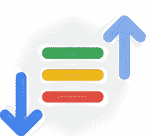

JavaScript 是一种面向对象的编程语言。它以属性的形式支持对象的概念。如果一个对象属性是一个函数，那么它就是该对象的方法；如果一个对象属性是一个值，那么它就是该对象的属性。

某些浏览器在使用来自本地驱动器的示例时会遇到问题。当你从本地驱动器访问`Customers2.XML`时，Chrome 会显示空白页面。为了以适用于大多数浏览器的方法测试此技术，请将文件复制到你的 Web 服务器，然后从 Web 服务器访问 XML 文件。


### 3.2.1 数字方法（Number Methods）

Number 对象仅包含每个对象定义中默认方法。Boolean 对象对应于数字原始类型。

| 序号 | 方法与描述 |
|---|---|
| 1 | `constructor()`：返回创建此对象实例的函数。默认情况下，这是 Number 对象。 |
| 2 | `toExponential()`：强制数字以指数计数法显示，即使该数字在 JavaScript 正常使用标准计数法的范围内。 |


### 3.2.1 Number 方法

| 序号 | 方法与描述 |
|---|---|
| 3 | `toFixed()` | 以小数点后特定位数对数字进行格式化。 |
| 4 | `toLocaleString()` | 返回当前数字的字符串版本，其格式可能会根据浏览器的本地设置而变化。 |

### 基础计算机编程：JavaScript

| 序号 | 方法与描述 |
|---|---|
| 5 | `toPrecision()` | 定义数字显示多少位总位数（包括小数点左侧和右侧的数字）。 |
| 6 | `toString()` | 返回数值的字符串表示。 |
| 7 | `valueOf()` | 返回数字的值。 |

### 3.2.2 布尔方法 (`Boolean` Methods)

`Boolean` 对象代表原始布尔值。以下是每个方法及其描述的列表。

| 序号 | 方法与描述 |
|---|---|
| 1 | `toString()` | 返回一个包含 `Boolean` 对象源的字符串；你可以使用此字符串创建一个等效对象。 |
| 2 | `toString()` | 根据对象的值返回“true”或“false”的字符串。 |
| 3 | `valueOf()` | 返回 `Boolean` 对象的原始值。 |

### 3.2.3 字符串方法 (`String` Methods)

以下是每个方法及其描述的列表。

| 序号 | 方法与描述 |
|---|---|
| 1 | `charAt()` | 返回指定索引处的字符。 |
| 2 | `charCodeAt()` | 返回一个指示指定索引处字符 Unicode 值的数字。 |


### 内置函数 (Built-in Functions)

| 序号 | 方法与描述 |
|---|---|
| 3 | `concat()` | 合并两个字符串的文本并返回新字符串。 |
| 4 | `indexOf()` | 返回调用 `String` 对象中指定值第一次出现的索引，如果未找到则返回 -1。 |
| 5 | `lastIndexOf()` | 返回调用 `String` 对象中指定值最后一次出现的索引，如果未找到则返回 -1。 |
| 6 | `localeCompare()` | 返回一个数字，指示引用字符串在排序顺序中位于给定字符串之前或与之相同。 |
| 7 | `length()` | 返回字符串的长度。 |
| 8 | `match()` | 用于用正则表达式对字符串进行匹配。 |
| 9 | `replace()` | 用于查找正则表达式与字符串之间的匹配项，并将匹配的子字符串替换为新子字符串。 |
| 10 | `search()` | 执行正则表达式与指定字符串之间匹配的搜索。 |
| 11 | `slice()` | 提取字符串的一个部分。 |
| 12 | `split()` | 将字符串拆分为数组。 |
| 13 | `substr()` | 字符串中两个索引之间的部分。 |
| 14 | `substring()` | 字符串中两个索引之间的部分。 |
| 15 | `toLowerCase()` | 将字符串转换为小写。 |
| 16 | `toLocaleString()` | 将字符串转换为特定语言字符串。 |
| 17 | `toUpperCase()` | 将字符串转换为大写。 |
| 18 | `toString()` | 返回字符串的字符串表示。 |
| 19 | `valueOf()` | 返回字符串的原始值。 |


### 基础计算机编程：JavaScript

| 序号 | 方法与描述 |
|---|---|
| 20 | `toPrecision()` | 定义数字显示多少位总位数（包括小数点左侧和右侧的数字）。 |

### 3.2.4 字符串方法 (`String` Methods)

`String` 是一个代表一系列字符的对象。以下是每个返回字符串的方法列表。

| 序号 | 方法与描述 |
|---|---|
| 1 | `anchor()` | 创建一个 HTML 锚点。 |
| 2 | `big()` | 使字符串以大字体显示。 |
| 3 | `blink()` | 使字符串闪烁显示。 |
| 4 | `bold()` | 使字符串以粗体显示。 |
| 5 | `fixed()` | 使字符串以等宽字体显示。 |
| 6 | `fontcolor()` | 使字符串以指定的颜色显示。 |
| 7 | `fontsize()` | 使字符串以指定的字体大小显示。 |
| 8 | `italics()` | 使字符串以斜体显示。 |
| 9 | `link()` | 创建一个 HTML 链接。 |
| 10 | `small()` | 使字符串以小字体显示。 |
| 11 | `strike()` | 使字符串以划线显示。 |
| 12 | `sub()` | 使字符串以下标显示。 |
| 13 | `sup()` | 使字符串以上标显示。 |


### 3.2.5 数组方法 (`Array` Methods)

JavaScript `Array` 是特殊的对象，并且是动态创建的。`Array` 对象包含数量变量。变量的数量可以为零，在这种情况下数组为空。数组包含的变量没有名称；相反，使用非负索引访问来引用。这些变量被称为数组的组件。如果一个数组有 n 个组件，我们说 n 是的长度；使用从 0 到 n-1 的整数索引引用数组组件。

与不同，数组的组件并不一定具有相同的类型。`Array` 组件本身也可以是数组，从而创建本质的多维数组。如果从任何数组开始，考虑其组件类型，然后（如果该类型也是数组类型）考虑该类型的组件类型，最终必须到达一个数组类型的组件类型；在该数据结构层级上的组件被称为原始数组的元素。

### 内置函数 (Built-in Functions)

# 82 基础计算机编程：JavaScript

以下是每个方法及其描述列表。

| 序号 | 方法与描述 |
|---|---|
| 1 | `concat()` | 返回一个新数组，该数组由此数组与其他数组（或值（值）连接而成。 |
| 2 | `every()` | 如果数组中的每个元素都满足提供的测试函数，则返回 true。 |
| 3 | `filter()` | 创建一个新数组，其中包含所有通过提供的过滤函数返回 true 的元素。 |
| 4 | `forEach()` | 为数组中的每个元素调用一次函数。 |
| 5 | `indexOf()` | 返回数组中与指定值相同的第一个（最小）索引，如果未找到则返回 -1。 |
| 6 | `join()` | 将数组的所有元素连接成一个字符串。 |
| 7 | `lastIndexOf()` | 返回数组中与指定值相同的最后一个（最大）索引，如果未找到则返回 -1。 |
| 8 | `map()` | 创建一个新数组，其元素是通过对数组中的每个元素调用提供的函数的结果。 |
| 9 | `pop()` | 移除数组的最后一个元素并返回该元素。 |
| 10 | `push()` | 在数组末尾添加一个或多个元素，并返回数组的新长度。 |
| 11 | `reduce()` | 同时对数组的两个值（从左到右）应用函数，将其还原为单个值。 |
| 12 | `reduceRight()` | 同时对数组的两个值（从右到左）应用函数，将其还原为单个值。 |

## 内置函数

| 序号 | 方法与描述 |
|---|---|
| 13 | `reverse()` | 反转数组元素的顺序——第一个变成最后一个，最后一个变成变成第一个。 |
| 14 | `shift()` | 移除数组的第一个元素并返回该元素。 |
| 15 | `slice()` | 提取数组的一个部分并返回一个新数组。 |
| 16 | `some()` | 如果数组中至少有一个元素满足提供的测试函数，则返回 true。 |
| 17 | `toSource()` | 对象的源代码。 |
| 18 | `sort()` | 对数组元素进行排序。 |
| 19 | `splice()` | 从数组中添加和/或删除元素。 |
| 20 | `toString()` | 返回一个表示数组及其元素的字符串。 |
| 21 | `unshift()` | 在数组开头添加一个或多个元素，并返回数组的新长度。 |

### 3.2.6 `Date` 方法

`Date` 对象提供了独立于系统的日期和时间抽象。日期可以通过年、月、日、小时、分、秒这六个组件来构建，也可以从日期中提取出星期几。日期还可以进行比较并转换为可读的字符串。`Date` 的表示精度为一毫秒。JavaScript 处理日期的方式与 Java 处理的方式非常相似：许多日期方法相同，且两者都从内部将日期存储为自 1970 年 1 月 1 日 00:00:00 以来的毫秒数。不允许使用 1970 年之前的日期。

> 抽象是计算机科学和软件开发的根本概念。抽象的过程也可以称为建模，它与理论和设计的概念密切相关。

## 84 基础计算机编程：JavaScript

以下是每个方法及其描述列表。

| 序号 | 方法与描述 |
|---|---|
| 1 | `Date()` | 返回今天的日期和时间。 |
| 2 | `getDate()` | 根据本地时间返回指定日期的几。 |
| 3 | `getDay()` | 根据本地时间返回指定日期的星期几。 |
| 4 | `getFullYear()` | 根据本地时间返回指定日期的年份。 |
| 5 | `getHours()` | 根据本地时间返回指定日期的小时。 |
| 6 | `getMilliseconds()` | 根据本地时间返回指定日期的毫秒。 |
| 7 | `getMinutes()` | 根据本地时间返回指定日期的分钟。 |
| 8 | `getMonth()` | 根据本地时间返回指定日期的月份。 |
| 9 | `getSeconds()` | 根据本地时间返回指定日期的秒。 |
| 10 | `getTime()` | 返回指定日期的数值，自 UTC 1970 年 1 月 1 日 00:00:00 以来的毫秒数。 |
| 11 | `getTimezoneOffset()` | 当前区域的时区偏移（分钟）。 |

| 序号 | 方法与描述 |
|---|---|
| 12 | `getUTCDate()` | 根据通用时间返回指定日期的几（日期）。 |
| 13 | `getUTCDay()` | 根据通用时间返回指定日期的星期几。 |
| 14 | `getUTCFullYear()` | 根据通用时间返回指定日期的年份。 |
| 15 | `getUTCHours()` | 根据通用时间返回指定日期的小时。 |
| 16 | `getUTCMilliseconds()` | 根据通用时间返回指定日期的毫秒。 |
| 17 | `getMinutes()` | 根据通用时间返回指定日期的分钟。 |
| 18 | `getUTCMonth()` | 根据通用时间返回指定日期的月份。 |
| 19 | `getSeconds()` | 根据通用时间返回指定日期的秒。 |
| 20 | `getYear()` | 已弃——根据本地时间返回指定日期的年份。 |
| 21 | `setDate()` | 根据本地时间设置指定日期的几。 |
| 22 | `setFullYear()` | 根据本地时间设置指定日期的年份。 |
| 23 | `setHours()` | 根据本地时间设置指定日期的小时。 |

## 基础计算机编程：JavaScript

| 序号 | 方法与描述 |
|---|---|
| 24 | `setMilliseconds()` | 根据本地时间设置指定日期的毫秒。 |
| 25 | `setMinutes()` | 根据本地时间设置指定日期的分钟。 |
| 26 | `setMonth()` | 根据本地时间设置指定日期的月份。 |
| 27 | `setSeconds()` | 根据本地时间设置指定日期的秒。 |
| 28 | `setTime()` | 将日期设置为自 1970 年 1 月 1 日 00:00:00 以来的毫秒数。 |
| 29 | `setUTCDate()` | 根据通用时间设置指定日期的几。 |
| 30 | `setUTCFullYear()` | 根据通用时间设置指定日期的年份。 |
| 31 | `setUTCHours()` | 根据通用时间设置指定日期的小时。 |
| 32 | `setUTCMilliseconds()` | 根据通用时间设置指定日期的毫秒。 |
| 33 | `setUTCMinutes()` | 根据通用时间设置指定日期的分钟。 |
| 34 | `setUTCMonth()` | 根据通用时间设置指定日期的月份。 |
| 35 | `setUTCSeconds()` | 根据通用时间设置指定日期的秒。 |

| 序号 | 方法与描述 |
|---|---|
| 36 | `setYear()` | 已弃——根据本地时间设置指定日期的年份。请使用 `FullYear`。 |
| 37 | `dateTimeString()` | 返回日期的日期时间部分作为可读字符串。 |
| 38 | `toGMTString()` | 已弃——使用 Internet GMT 标准将日期转换为字符串。请使用 `UTCString`。 |
| 39 | `toLocaleString()` | 使用当前本地化返回日期的日期部分作为字符串。 |
| 40 | `toLocaleFormat()` | 使用格式字符串将日期转换为字符串。 |
| 41 | `toLocaleString()` | 使用当前本地化将日期转换为字符串。 |
| 42 | `toLocaleTimeString()` | 使用当前本地化返回日期的时间部分作为字符串。 |
| 43 | `toSource()` | 返回表示等效 `Date` 对象的源代码；可以使用此值创建新对象。 |
| 44 | `toString()` | 返回表示指定 `Date` 对象的字符串。 |
| 45 | `toTimeString()` | 返回日期的时间部分作为可读字符串。 |
| 46 | `toUTCString()` | 使用通用时间标准将日期转换为字符串。 |
| 47 | `valueOf()` | 返回 `Date` 对象的原始值。 |

### 3.2.7 `Date` 静态方法

除了之前列出的许多实例方法外，"`Date`" 对象还定义了两个静态方法。这些方法通过 `Date()` 构造函数本身进行调用。

| 序号 | 方法与描述 |
|---|---|
| 1 | `Date.parse()` | 解析日期和时间的字符串表示，返回该日期的内部毫秒表示。 |
| 2 | `Date.UTC()` | 返回指定的 UTC 日期和时间的毫秒表示。 |

### 3.2.8 `Math` 方法

内置的 `Math` 对象分别具有用于数学常量和函数的属性和方法。以下是每个方法及其描述。

| 序号 | 方法与描述 |
|---|---|
| 1 | `abs()` | 返回数字的绝对值。 |
| 2 | `acos()` | 返回数字的反余弦（弧度）。 |
| 3 | `asin()` | 返回数字的反正弦（弧度）。 |
| 4 | `atan()` | 返回数字的反正切（弧度）。 |
| 5 | `atan2()` | 返回其参数商的反正切值。 |
| 6 | `ceil()` | 返回大于或等于数字的最小整数。 |
| 7 | `cos()` | 返回数字的余弦。 |
| 8 | `exp()` | 返回 $E^N$，其中 $N$ 是参数，$E$ 是欧拉常数（自然对数的底数）。 |
| 9 | `floor()` | 返回小于或等于数字的最大整数。 |
| 10 | `log()` | 返回数字的自然对数（底为 $E$）。 |
| 11 | `max()` | 返回零或多个数字中的最大值。 |
| 12 | `min()` | 返回零或多个数字中的最小值。 |
| 13 | `pow()` | 返回底数的幂，即底的次方。 |
| 14 | `random()` | 返回一个 0 到 1 之间的伪随机数。 |
| 15 | `round()` | 返回四舍五入到最近整数的数字。 |
| 16 | `sin()` | 返回数字的正弦。 |
| 17 | `sqrt()` | 返回数字的平方根。 |
| 18 | `tan()` | 返回数字的正切。 |
| 19 | `toSource()` | 返回字符串 "Math"。 |

### 3.2.9 `RegExp` 方法

以下是每个方法及其描述。

| 序号 | 方法与描述 |
|---|---|
| 1 | `exec()` | 在其字符串参数中执行匹配搜索。 |
| 2 | `test()` | 在其字符串参数中进行匹配性测试。 |
| 3 | `toSource()` | 返回一个表示指定对象的字面量对象；你可以使用它来创建一个新对象。 |
| 4 | `toString()` | 返回表示指定对象的字符串。 |

### 3.2.10 如何使用 JavaScript 内置函数进行 HTML 编程

JavaScript 允许你访问许多内置函数，包括 `prompt()` 函数，它可以让你询问用户书写输入。通过 `confirm()` 函数，你可以提供一个文本提示来要求用户提供一个值。在返回时，你将函数的输出设置为 `prompt()` 的结果并在你的应用程序中使用它。

仅仅考虑本地化（locale）来显示数据并不会执行任何数据转换。例如，如果你母语是英语，你创建的字符串不会突然变成法语。关于特定区域的方法并没有特殊之处。这些方法所做的仅仅是在你提供数据时改变数据的呈现方式。

方法帮助你使用特定类型的数据执行特定任务。使用这些方法可以让你更容易创建健壮的应用程序。在对象提供的所有方法中，这些方法是最常见的，并且在许多情况下可能是最重要的：

- `length()`: 返回某个数量。例如，在处理字符串时，`length()` 返回字符串中的字符数。同样，在处理数组时，`length()` 返回数组中的元素个数。此方法在某些情况下也作为属性出现。


- `toLocale()`：将对象的值输出为针对特定区域设置的字符串。例如，当区域设置使用逗号作为小数点时，观众将看到逗号而不是句号，即使你在代码中使用的是句号。对于访问你网站的其他国家的人来说，提供这种支持是至关重要的。

- `toString()`：将对象的值输出为字符串。此方法通常用于显示目的。

- `valueOf()`：返回对象值的原生版本。在对象可能会引起问题的情况下，此方法非常有用。例如，在将数据保存到磁盘时，你希望存储的是值而不是对象。

JavaScript 还包含了全局函数的概念。这些函数可以在页面上使用 JavaScript 的任何地方不依赖于任何对象而直接使用。以下列表提供了最常用函数的概述：

- `decodeURI()`：解码 URI。

- `decodeURIComponent()`：解码组件而非 URI。

- `encodeURI()`：编码 URI。

- `encodeURIComponent()`：编码组件而非 URI。

- `escape()`：使用与 URL 相同的技术编码字符串。

- `eval()`：接受一个包含字符串的字符串，并将内容作为脚本执行。

- `isFinite()`：当值是一个有限的合法的数字时返回 `true`。

- `NaN()`：当一个值是非法的数字时返回 `true`。

- `Number()`：将对象的值转换为原生数字。

- `parseFloat()`：解析字符串并返回浮点数。

- `parseInt()`：解析字符串并返回整数。

- `String()`：将对象的值转换为字符串。此函数提供的输出与对象提供的 `toString()` 方法相同。

- `unescape()`：使用与 URI 相同的技术解码已编码字符串。

## 3.3 理解 JavaScript 中的日期和时间

日期和时间是我们日常生活的组成部分，因此在计算机编程中占据重要地位。在 JavaScript 中，你可能需要创建一个带有日历、火车时刻表或设置预约界面的网站。这些应用程序需要根据用户的时区显示相关时间，或者围绕到达/出发或开始/结束时间进行计算。此外，你可能需要每天在特定时间使用 JavaScript 生成报告，或者筛选出当前营业的餐厅和场所。

## 内置函数 93

# 2014年7月31日

下午 10:32


为了实现所有这些目标，JavaScript 提供了内置的 `Date` 对象和相关方法。本节将介绍如何在 JavaScript 中格式化和使用日期与时间。

时区是地球上为了法律、商业和社交目的而采用统一标准时间的某个地区。

### 3.3.1 Date 对象

`Date` 对象是 JavaScript 中的一个内置对象，用于存储日期和时间。它提供了许多内置方法用于格式化和管理数据。默认情况下，不提供参数的 `new Date()` 实例会创建一个与当前日期和时间相对应的对象。这将使用当前计算机的系统设置来创建。

为了演示 JavaScript 的 `Date`，让我们创建一个变量并将当前日期赋值给它。本节写于伦敦（GMT）的 10 月 18 日星期三，因此下方将表示当前的日期和时区。


now.js

```javascript
// 将变量设为当前日期和时间
const now = new Date();
// 查看输出
console.log(now);
```

Output

Wed Oct 18 2017 12:41:34 GMT+0000 (UTC)

编码（Encoding）将空白字符（如空格）替换为空白等效值（如 `%20`）。此外，通常会导致问题的 Unicode 字符（如带有变音符号的字符）会被替换为它们的 Unicode 等效值。

查看输出，我们得到了包含以下内容的日期字符串：

| 星期 | 月份 | 日期 | 年 | 小时 | 分钟 | 秒 | 时区 |
|---|---|---|---|---|---|---|---|
| 周三 | Oct | 18 | 2017 | 12 | 41 | 34 | GMT+0000 (UTC) |

日期和时间被拆分并以人类可以理解的方式打印出来。然而，JavaScript


基础计算机编程：JavaScript 根据源自 Unix 时间的时间戳来理解日期，时间戳是一个值，由自 1970 年 1 月 1 日午夜以来经过的毫秒数组成。我们可以通过 `getTime()` 方法获取时间戳。

```javascript
// 获取当前时间戳
now.getTime();
```

Output

1508330494000

我们在当前时间戳输出中出现的大数字与上述的 2017 年 10 月 18 日的值相同。

Epoch 时间（Epoch time），也称为零时间，由日期字符串 `01 January, 1970 00:00:00 Universal Time (UTC)` 和时间戳 `0` 表示。我们可以通过在浏览器中创建一个新变量并将其赋值为基于时间戳 `0` 的新 `Date` 实例来测试这一点。

```javascript
epoch.js
// 将时间戳 0 赋值给新变量
const epochTime = new Date(0);
epochTime;
```

Output

01 January 1970 00:00:00 Universal Time (UTC)

Epoch 时间被选为编程早期计算机测量时间的标准，它也是 JavaScript 使用的方法。理解时间戳和日期字符串的概念都是重要的，因为根据应用程序的设置和目的，两者都可能被使用。

到目前为止，我们学习了如何基于当前时间创建一个新的 `Date` 实例，以及如何基于时间戳创建一个实例。总之，共有四种在 JavaScript 中创建新 `Date` 的格式。除了当前的默认格式和日期字符串外，你还可以使用特定的日期和时间。

| 日期创建 | 输出 |
|---|---|
| `Date()` | 当前日期和时间 |
| `new Date(timestamp)` | 根据自 Epoch 时间以来的毫秒创建日期 |
| `new Date(date string)` | 根据日期字符串创建日期 |
| `new Date(year, month, day, hours, minutes, seconds, milliseconds)` | 根据指定的日期时间创建日期 |

为了演示引用特定日期的不同方式，我们将以三种不同的方式创建代表 GMT 1776 年 7 月 4 日下午 12:30 的新 `Date` 对象。


usa.js

```javascript
// 时间戳方法
new Date(-6106015800000);
// 日期字符串方法
new Date("January 31 1980 12:30");
// 日期时间和方法
new Date(1776, 6, 4, 12, 30, 0, 0);
```

上述三个示例都创建了包含相同信息的日期。

你会注意到时间戳方法有一个负数；任何在 Epoch 时间之前的日期都将表示为负数。

在日期和时间方法中，我们的秒和毫秒被设置为 0。如果在创建 `Date` 时缺少了任何数字，它将默认为 0。但是，如果你决定省略某个数字，顺序是不能更改的。你可能还会注意到 7 月是用 6 表示的，而不是 7。这是因为日期和时间的数字从 0 开始，就像编程中的大多数计数一样。见下一节的详细图表。

### 3.3.2 使用 get 获取日期

一旦有了日期，我们就可以用内置方法访问日期的所有组件。这些方法返回相对于本地时区的每个日期部分。这些方法都以 `get` 开头，并返回相对数值。下面是 `Date` 方法的详细表。

| 日期/时间 | 方法 | 范围 | 示例 |
|---|---|---|---|
| 年 | `getYear()` | YYYY | 1970 |
| 月 | `getMonth()` | 0-11 | 0 = 一月 |
| 日（月份中的） | `getDate()` | 1-31 | |
| 日（星期中的） | `getDay()` | 0-6 | 0 = 周日 |
| 小时 | `getHours()` | 0-23 | 0 = 午夜 |
| 分钟 | `getMinutes()` | 0-59 | |
| 秒 | `getSeconds()` | 0-59 | |
| 毫秒 | `getMilliseconds()` | 0-999 | |
| 时间戳 | `getTime()` | 自 Epoch 时间以来的毫秒 | |

（注：由于提供的 OCR 文本包含大量重复和碎片，已根据提供的逻辑流进行了清理和重构。）

### 基础计算机编程：JavaScript

我们在上面的示例中看到，当我们调用 `birthday` 变量时，我们收到了年份作为输出的一部分。以 `set` 开头的内置方法允许我们修改 `Date` 对象的不同部分。

### 3.3.4 UTC 日期方法

上述讨论的方法根据用户的本地时区设置检索日期组件。为了对日期时间进行加强控制，你可以使用 `getUTC` 方法，它们与 `get` 方法完全相同，不同之处它们根据 UTC（协调世界时）标准计算时间。下面是 JavaScript `Date` 对象的 UTC 方法表。

| 日期/时间 | 方法 | 范围 | 示例 |
|---|---|---|---|
| 年 | `getUTCFullYear()` | YYYY | 1970 |
| 月 | `getUTCMonth()` | 0-11 | 0 = 一月 |
| 几几 | `getUTCDate()` | 1-31 | 1 = 月份第一天 |
| 星期 | `getUTCDay()` | 0-6 | 0 = 周日 |
| 小时 | `getUTCHours()` | 0-23 | 0 = 午夜 |
| 分钟 | `getUTCMinutes()` | 0-59 | |
| 秒 | `getUTCSeconds()` | 0-59 | |
| 毫秒 | `getUTCMilliseconds()` | 0-999 | |

为了测试本地方法和 UTC 方法之间的差异，我们可以运行以下代码。UTC.js

```javascript
// 将当前时间赋值给变量
const now = new Date();

// 打印本地和 UTC 时区
console.log(now.getUTCHours());
console.log(now.getUTCHours());
```

运行此代码将打印当前的小时以及 UTC 时区的时间。如果你目前处于 UTC 时区，运行上述程序输出的数字将是相同的。UTC 的用处在于它提供了一个国际时间标准参考，因此如果这适用于你开发的内容，它可以保持你的代码在跨时区的一致性。


## 案例研究

### JAVASCRIPT 设计模式

### 背景

记录路径，以及我在做 Udacity 的 JavaScript 设计模式课程时遇到的困难和发现。项目是构建一个点击器，每当你点击一个蝴蝶时，它就会递增。我有几只蝴蝶，所以是蝴蝶点击器（没找到图片）。起初是一只蝴蝶，然后需求变了，变成了 2 只蝴蝶，我们被要求硬编码数据。

在这一点上，我的代码看起来是：

```html
<div id="main">
  <h1>Butterfly Clicker</h1>
  <div id="insertButterflies"></div>
</div>
```

```css
#main { max-width: 80%; margin: 0 auto; }
#insertButterflies label { display: block; margin: 10px 0; font-weight: bold; }
```

```javascript
$(document).ready(function () {
    butterflyer.init();
});

var butterflyFlyer = {
    catObjects: [
        { "name": "Orange", "imageUrl": "images/Orange.jpg", "clickCount": 7 },
        { "name": "Browny", "imageUrl": "images/Browny.jpg", "clickCount": 23 }
    ],
    init:function() {
        for (var i = 0; i < butterflyFlyer.catObjects.length; i++) {
            var butterfly = butterflyFlyer.catObjects[i];
            $("#insertButterflies").append('<div><h2>' + butterfly.name + '</h2> <label>' + butterfly.clickCount + '</label></div>');
        }
    },
    updateCount: function (id) {
        var lbl = $(id).next();
        var num = parseInt($(lbl).html());
        num++;
        $(lbl).html(num);
    }
};
```

在这里导师指出了关于闭包可能会遇到的 bug。假设你有一个元素数组，你正在遍历它们，并在点击该元素时弹出该数字：

```javascript
var nms = [1,2,3];
```

```javascript
for (var i = 0; i < nms.length; i++) {
    var num = nms[i];
    var elem = document.createElement('div');
    elem.textContent = num;
    elem.addEventListener('click', function() {
        alert(num);
    });
    document.body.appendChild(elem);
}
```

我们可能会看到弹出 1、2 和 3，但在点击时我们得到的是最后一个数字 3。这是因为在 `for` 循环中 `num` 的值发生了变化，但当点击元素时执行事件处理函数，`num` 被设置为最后一个元素。

修复方法涉及闭包的使用。我们可以创建一个内部作用域，在添加事件处理程序的精确时刻保存住 `num` 的值。

```javascript
elem.addEventListener('click', function(numCopy) {
    return function() {
        alert(numCopy);
    }
})(num));
```


外部函数通过将 `num` 传递给 `numCopy` 被立即调用，因此即使 `num` 改变，`numCopy` 也不受影响。

下一步需求变了，这次要有一个蝴蝶列表，并点击任何一个来更新显示。在这一点上，我的代码可以工作但不可扩展，涉及到内联监听且不符合行业标准。我需要学习更好的组织技术，以便应用程序稳定、编写良好且可扩展。

一旦我们知道如何将它们连接在一起，就可以避免面条代码。一个应用程序最终是将各个部分连接在一起。

### 关注分离

我们可以将代码拆分为不同的部分。无论应用程序的大小如何：

- 模型 (Model)：所有数据存储在这里，包括来自服务器的数据。

- 视图 (View)：这是用户看到并交互的所有内容，DOM 元素、按钮和图像。这是用户访问程序的界面。

- 控制器 (Controller)：连接模型和视图。控制器提供了构建应用程序时所需的关注分离。它将内容结合在一起，但也允许在不干扰模型或视图的情况下对单个部分进行更改。

在这一点，我们开始分离以重新制作蝴蝶点击器，并将记录每个点。

### UTF-8 的定义

UTF-8（通用字符集转换）是一种能够启用 Unicode 字符（代码点）的字符编码。该编码是变长的，并使用 8 位代码单元。

```html
<meta charset="utf-8">
```

```html
<meta name="viewport" content="width=device-width, initial-scale=1">
```


### 基础计算机编程：JavaScript

这用于使你的网站具有响应性，即浏览器将根据自身的宽度渲染页面宽度。因此，如果屏幕宽度为 320px，浏览器窗口宽度将是 320px，而不是像某些设备默认那样缩小比例，无需使用响应式标签。

### JavaScript 模板

当你有动态内容但没有可用的服务器模板时，JavaScript 模板非常有用。它也被认为减少了返回给客户端的数据量（例如，以对象形式提供数据而不是标记），使网站更快。

## 总结

函数是执行操作或返回值的代码块。由程序员定义的自定义函数是可以重复使用的，因此可以使程序模块化高效。JavaScript 有几个“顶层”内置函数。JavaScript 还有内置对象：`Array`、`Date`、`Math` 和 `String`。

函数（也称为方法）是执行特定功能并返回值的自包含代码。你可以通过其格式识别它——一段描述性文本后跟着括号。


JavaScript 是一种函数式语言，意味着函数是执行单元。函数在 JavaScript 中显然非常重要。由 Netscape 引入的 JavaScript 改变了 HTML 页面的静态性。在 JavaScript 出现之前，HTML 页面仅用于渲染静态内容。在网页中插入 JavaScript 可以显著提高其交互性和功能性。

## 知识检查

1. 函数以函数或方法的形式被调用，这是一个 ......................

   - a. 运行语句
   - b. 运行表达式
   - c. 调用函数
   - d. 调用方法

2. 一次调用由一个求值为函数对象的函数表达式组成，后跟一个左括号、一个由逗号分隔的零或多个参数表达式列表以及一个右括号组成。

   - a. 运行语句
   - b. 运行表达式
   - c. 调用函数
   - d. 调用方法

3. 如果在函数或方法调用的前面有`new`关键字，那么它就是 ......................

   - a. 构造函数调用
   - b. new 调用
   - c. 间接调用
   - d. 直接调用

4. 在 JavaScript 中，你可以将任何函数作为任何对象的方法调用，即使它实际上不是该对象的方法。

   - a. 构造函数调用
   - b. new 调用
   - c. 间接调用
   - d. 直接调用

5. `call()`和`apply()`方法都允许你显式地为调用指定 ...................... 值。

   - a. `this`
   - b. me
   - c. that
   - d. new

6. 以下哪项用于在 JavaScript 中调用函数或方法：

   - a. 属性访问表达式
   - b. 函数表达式
   - c. 运行表达式
   - d. 原始表达式

7. String 对象的哪个函数通过通过指定数量的字符，从字符串的指定位置开始返回字符串中的字符？

   - a. `slice()`
   - b. `split()`
   - c. `substr()`
   - d. `search()`

8. 数字数字对象的哪个方法返回数字的值？

   - a. `toString()`
   - b. `valueOf()`
   - c. `toLocaleString()`
   - d. `toPrecision()`

## 复习题

1. 你如何理解 JavaScript 中的函数？
2. 如何定义函数参数？
3. 什么是数字方法？
4. 讨论字符串 HTML 包装方法。
5. 定义 JavaScript 中的数组方法。
6. 简要解释 JavaScript 中的日期和时间。

### 检查你的结果

1. (b) 2. (b) 3. (a) 4. (c) 5. (a)
2. (c) 7. (c) 8. (b)

## 参考文献

1. Eich, Brendan (2011年6月21日). “New JavaScript Engine Module Owner”. brendaneich.com. 于2016年7月16日检索。
2. Flanagan, David. JavaScript - The definitive guide (6 ed.). 第1页。JavaScript 是所有 Web 开发者必须学习的三剑客之一：HTML 用于指定网页的内容，CSS 用于指定网页的呈现，以及 JavaScript 用于指定网页的行为。
3. http://hepunx.rl.ac.uk/~adye/jsspec11/builtin.html
4. http://www.programming-free.com/2012/javascript-built-in-functions-with.html
5. https://codeburst.io/@parameters-arguments-in-javascript-eb1d8bd0ef04
6. https://developer.mozilla.org/en-US/Docs/JavaScript/Global_Objects
7. https://javascript.info/native-prototypes
8. https://medium.com/@bengarrisson/javascript-es6-exploring-the-new-built-in-methods-b62583b0aae6
9. https://medium.freecodecamp.org/here-the-new-built-in-methods-and-javascript-8f42d27d9a4
10. https://openclassrooms.com/en/courses/352331-learn-to-code-with-javascript-368586-write-functions
11. https://www.digitalocean.com/community/tutorials/how-to-define-functions-in-javascript
12. https://www.digitalocean.com/community/tutorials/understanding-date-and-time-in-javascript
13. https://www.dofactory.com/tutorial/javascript-function-objects
14. https://www.dummies.com/web-design-development/html/how-to-use-javascript-built-in-functions-to-program-with-html/
15. https://www.scribid.com/document/23749356/JavaScript-Bibliography
16. https://www.tutorialride.com/javascript/built-in-functions.html
17. https://www.tutorialspoint.com/javascript/builtin_functions.html
18. https://www.w3schools.com/js/jsref_obj_global.asp
19. McCacken, Harry (2010年9月16日). “The Unwelcome Return of Best Viewed with Internet Explorer”. technologizer. 于2016年7月16日检索。
20. Robert Nyman, Getters And Sets With JavaScript – Code Samples And Demos, Robertnyman.com, 于2009年5月29日发布，于2010年1月2日访问。
21. Severance, Charles (2012年2月). “JavaScript: Designing a Language in 10 Days”. Computer. IEEE Computer Society, 45 (2): 7–8. doi:10.1109/MC.2012.

# 第4章：HTML 表单

> “如果在函数或方法调用的前面有`new`关键字，那么它就是 ......................”
>
> — Mohamed Saad

## 学习目标

学习本章后，你将能够：

1. 理解表单基础
2. 识别 HTML 表单元素
3. 讨论 HTML 表单样式

## 引言

HTML 表单被几乎所有的网站用于各种用途。表单是用户与应用程序交互的主要点之一。它们允许用户向 Web 服务器发送数据。

HTML 表单是一个包含各种控件的文档：

```html
<!DOCTYPE html>
<html>
<body>

<form>
用户名:<br>
<input type="text" name="username">
<br>
邮箱 ID:<br>
<input type="text" name="email_id">
<br><br>
<input type="submit" value="提交">
</form>

</body>
</html>
```

## 4.1 基础

`<form>`标签定义表单，在该内部，如果你使用表单来提交信息（我们在本级假设如此），`action`属性告诉表单内容将发送到哪里。

`method`属性告诉数据如何被发送，其值可以是`get`（默认值，会将表单信息附加到 Web 地址上）或`post`（本质上是隐式地发送表单信息）。

`get`用于较短的非敏感信息——你可能会看到在网站搜索提交的信息出现在搜索结果页的 Web 地址中，例如；`post`用于更、更安全的提交，例如联系表单。

因此，一个表单元素看起来像这样：

```html
<form action="processingscript.php" method="post">
</form>
```

### 4.1.1 `input`标签

`<input>`标签是表单世界的父级。它可以有多种形态，其中最常见的形式列出如下：

- `<input type="text">`或简单的`<input>`是标准的文本框。它还可以有一个`value`属性，用于设置文本框中的初始文本。
- `<input type="password">`与文本框相似，但用户输入的字符将被隐藏。
- `<input type="checkbox">`是一个复选框，用户可以对其开启或关闭。它也可以有一个`checked`属性。`<input type="checkbox" checked>`该属性不需要值，它可以使复选框的初始状态切换为开启。
- `<input type="radio">`与复选框类似，用户在一组内只能选择一个单选按钮。它也可以有一个`checked`属性。
- `<input type="submit">`是一个按钮，选中后将提交表单。你可以通过`value`属性控制按钮上显示的文本，例如`<input type="submit" value="Ooo. Look on a button. Wow">`。

### 4.1.2 文本区域 Textarea

`textarea`本质上是一个大型的多行文本框。预期的行和列可以通过`rows`和`cols`属性定义，尽管你可以使用 CSS 随心所欲地调整大小。

```html
<textarea rows="5">A big load of text</textarea>
```

你选择放在起始标签和结束标签之间的任何文本（在本例中为“a big load of text”）将形成文本区域的初始。

### 4.1.3 选择框 Select

`select`标签与`option`标签配合使用形成下拉框。

```html
<select>
<option>Option 1</option>
<option>Option 2</option>
<option value="third option">Option 3</option>
</select>
```

当提交表单时，所选选项的值将被发送。除非有显式的`value`，否则该值将位于所选的起始和结束标签之间。

> 就像`like`和`br`标签一样，不包含任何内容的`input`标签不需要闭合标签。


## 基础计算机编程：Java Script

通过`value`属性指定，在这种情况下将发送该值。因此，在示例中，如果选择了第一个项目，将发送 "Option 1"；如果选择了第三个项目，将发送 "third option"。

与复选框和单选按钮的`checked`属性类似，`option`标签也可以有一个`selected`属性，以便在开始时其中一个项目已被选中，例如：`<option>Rodent</option>`会从项目中预勾选 "Rodent"。

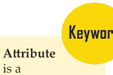

### 4.1.4 属性 Names

如果你将表单连接到表单处理脚本，上述所有标签在页面上的展示效果都会非常完美，否则它们都会被忽略。这是因为表单字段需要**名称 (names)**。因此，对所有字段都需要添加`name`属性，例如`<input type="text" name="talkingsponge">`。

例如，诺亚方舟的联系方式可能如下所示。（注意：除非存在 "contactus.php" 文件，否则此表单无法无法，该文件在表单标签的`action`**属性**中指明，用于处理提交的数据）。

```html
<form action="contactus.php" method="post">
<p>Name:</p>
<p><input type="text" name="name" value="Your name"></p>
<p>Species:</p>
<p><input name="species"></p>
<!-- 'type=text' isn't actually necessary -->
<p>Comments: </p>
<p><textarea name="comments" rows="5" cols="20">Your comments</textarea></p>
<p>Are you?</p>
<p><input type="radio" name="areyou" value="male"></p>
```


### HTML 表单 Forms

```html
<p><input type="radio" name="areyou" value="female"> Female</p>
```

```html
<p><input type="radio" name="areyou" value="hermaphrodite"> An hermaphrodite/</p>
```

```html
<p><input type="radio" name="areyou" value="asexual"> Asexual</p>
```

```html
<p><input type="submit"></p>
```

```html
</form>
```

## 4.2 HTML 表单元素 HTML FORM ELEMENTS

HTML 表单是收集用户数据的强大且专业的工具。然而，这些表单就像 HTML 中的其他一切一样，如果没有适当的表单元素将无法工作。

HTML 表单可以帮助你了解用户以及他们对你的建议。你可以在网站上创建出色的用户体验，维护质量并增加功能。开发网站时，没有什么比拥有满意的用户和正确的结果更好的了。

HTML 表单元素用于捕用户输入。有许多不同类型的表单元素，如文本框、复选框、下拉框、提交按钮等。

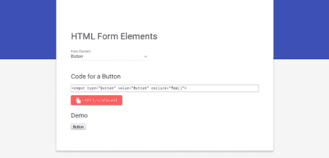

查看带有几个输入元素的示例表单：

上述表单元素是最常用的表单元素。我们将对这些每一个元素进行更详细的介绍。


## 基础计算机编程：Java Script

- 文本区域
- 下拉框
- 复选框
- 提交按钮

### 4.2.1 文本框 Text Box

HTML 表单元素用于获取用户输入。有许多不同类型的表单元素，如文本框、复选框、下拉框、提交按钮等。

上述表单元素是最常用的表单元素。我们将对这些每一个元素进行更详细的介绍。

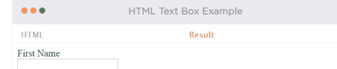

### 4.2.2 密码输入 Password Input

HTML 表单元素用于获取用户输入。有许多不同类型的表单元素，如文本框、复选框、下拉框、提交按钮等。

上述表单元素是最常用的表单元素。我们将对这些每一个元素进行更详细的介绍。


### 4.2.3 文本区域 Text Area

HTML 表单元素用于获取用户输入。有许多不同类型的表单元素，如文本框、复选框、下拉框、提交按钮等。

上述表单元素是最常用的表单元素。我们将对这些每一个元素进行更详细的介绍。

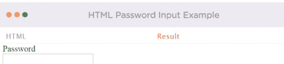

### 4.2.4 选择框 Select Down

HTML 表单元素用于获取用户输入。有许多不同类型的表单元素，如文本框、复选框、下拉框、提交按钮等。

上述表单元素是最常用的表单元素。我们将对这些每一个元素进行更详细的介绍。

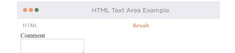

### 4.2.5 复选框 Check Box

HTML 表单元素用于获取用户输入。有许多不同类型的表单元素，如文本框、复选框、下拉框、提交按钮等。

上述表单元素是最常用的表单元素。我们将对这些每一个元素进行更详细的介绍。

### 4.2.6 单选按钮 (Radio Input)

单选按钮应适用于“是”或“否”的情况。一对单选按钮可以垂直或水平排列。单选按钮通常有一个默认或首选选择。只要可能，这个首选选择应该是是这对按钮中的第一个。在某些情况下，虽然可以进行单选，但有多个选项可选，集合中的所有单选按钮都可能显示为未选中或“空”状态。然而，一旦用户做出选择，选中的状态应该是明显且可见的，即使用户更改了选择——它也无法返回初始的“未选中”状态。

- 单选按钮
- 未选中的单选按钮
- 已选中的单选按钮
- 水平单选按钮
- 选项 A
- 选项 B
- 单选按钮
- 未选中的单选按钮
- 已选中的单选按钮
- 水平单选按钮
- 选项 A
- 选项 B


## 4.2.7 文件输入（File Input）

文件输入用于允许用户上传图像或文件。要创建一个文件输入元素，我们将使用`input`元素并赋予它`file`类型，如下：

```html
<input type="file" name="image">
```

这将带给我们以下结果：

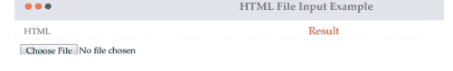

当点击上面的“选择文件”按钮时，用户将弹出一个窗口，指定他们想要上传的文件。


## 4.2.8 提交按钮（Submit Button）

最后，我们需要一种方式提交所有数据的表单。这就是提交按钮的作用。为了使用提交按钮，我们将使用另一个类型为`submit`的`input`元素：

```html
<input type="submit" value="Submit The Form">
```

我们的提交按钮看起来如下：

| 名字 |
| :--- |
| Mickey |
| 姓 |
| Mouse |
| 提交 |

表单元素非常多。但不要被它们搞晕，它们都非常容易使用和集成。在表单中使用输入是非常常见的，它允许网站为您的用户提供更多功能。

用户代理样式表（User Agent Style sheets）指的是浏览器应用于网页的默认样式。考虑到用户样式（User Styles）和作者样式（Author styles）会覆盖这些样式，它的重要性最低。每个浏览器显示“无样式”HTML 的方式略有不同。

## 4.3 HTML 表单样式化（STYLING HTML FORMS）

使用 CSS 设置元素样式很容易，你不应该遇到任何困难，因为它们的行为与其他任何 HTML 元素相似。然而，每个浏览器的用户代理样式表可能有些不一致，因此有一些技巧可以帮助更轻松地为它们设置样式。


### 4.3.1 搜索字段（Search Fields）

搜索框是唯一设置有点复杂的文本字段。在基于 WebKit 的浏览器（Chrome、Safari 等）中，你必须使用`-webkit-appearance`属性对其进行调整。

### 示例（Example）

```html
<form>
  <input type="search">
</form>
```

```css
input[type=search] {
  border: 1px dotted #999;
  border-radius: 0;
  -webkit-appearance: none;
}
```

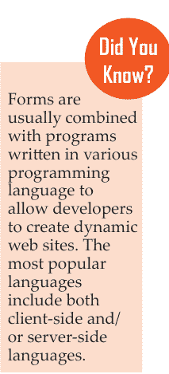

如你在该 Chrome 搜索字段的截图所示，两个字段的边框按照我们的示例进行了设置。第一个字段在渲染时没有使用`-webkit-appearance`属性，而第二个是使用`-webkit-appearance:none`渲染的。这种差异是明显的。

### 4.3.2 字体与文本（Fonts and Text）

CSS 字体和文本特征可以轻松地用于任何组件（是的，你可以在表单组件上使用`@font-face`）。然而，浏览器的行为通常是不一致的。默认情况下，某些组件不会从父元素继承字体族（`font-family`）和字体大小（`font-size`）。许多浏览器改为使用系统默认外观。为了让你的表单外观与你的其他内容一致，你可以在样式表中添加以下规则：

```css
button, input, select, textarea {
  font-family: inherit;
  font-size: 100%;
}
```

截图显示了差异；左侧是该元素在 Mac OS X 上的 Firefox 上的默认渲染，使用了平台的默认字体样式。右侧是相同的元素，应用了我们的字体协调样式规则。

### 基础计算机编程：JavaScript（Basic Computer Coding: Java Script）

| 我应该使用什么字体？ | 我应该使用什么字体？ ↗ |
| :--- | :--- |
| 我应该使用什么字体？ | 我应该使用什么字体？ |
| 我应该使用什么字体？ | 我应该使用什么字体？ |
| 我应该使用什么字体？ | 我应该使用什么字体？ |

### 4.3.3 盒模型（Box Model）

### 4.3.4 布局（Positioning）

HTML 表单的布局通常不是问题，但有两个元素需要注意：

### 图例说明（legend）

`<legend>`元素是可以设置样式的，定位除外。在每个浏览器中，`<legend>`都定位在`<fieldset>`的上方。

```html
<fieldset>
  <legend>Hi!</legend>
  <h1>Hello</h1>
</fieldset>
```

```html
<div id="reply">
  <label for="mail">reply:</label>
  <input type="email" id="mail" name="user_email">
</div>
```

```html
<div id="message">
  <label for="msg">Your message:</label>
  <textarea id="msg" name="user_message"></textarea>
</div>
</form>
```

将上述代码添加到你 HTML 的`body`中。

### 整理你的资源

在我们开始编码之前，我们需要三个额外的资源：

- 明信片背景图
- 打字机字体
- 手写字体

在开始使用之前，你的字体需要进行一些处理：

- 前往 Fontquirrel Webfont Generator。
- 使用表单上传你的两个字体文件并生成 Web 字体套件（webfont kit）。将套件下载到你的计算机。
- 解压提供的 zip 文件。
- 在解压的内容中，你将找到两个`.woff`文件和两个`.woff2`文件。将这四个文件复制到名为`fonts`的目录中，与之前的目录相同。我们为每个字体都使用两个不同的文件，以最大限度地提高浏览器兼容性。

> 编码指的是创建计算机编程代码。


### 基础计算机编码：JavaScript

### CSS

现在我们可以深入研究示例的 CSS 了。将下面显示的所有代码块按顺序添加到`<style>`元素内部，一个接一个地添加。

首先，我们通过定义`@font-face`规则、`<body>`元素的基础样式以及`<form>`元素的样式来准备工作：

```css
@font-face {
  font-family: 'handwriting';
  src: url('fonts/journal-webfont.woff2') format('woff2');
  url('fonts/journal-webfont.woff') format('woff');
  font-weight: normal;
  font-style: normal;
}
```

```css
@font-face {
  font-family: 'typewriter';
  src: url('fonts/veteran-typewriter-webfont.woff2') format('woff2');
  url('fonts/veteran-typewriter-webfont.woff') format('woff');
  font-weight: normal;
  font-style: normal;
}
```

```css
body {
  font: 21px sans-serif;
  padding: 2em;
  margin: 0;
  background: #222;
}
```

```css
form {
  position: relative;
  width: 740px;
  height: 498px;
  margin: 0 auto;
  background: #FFF url(background.jpg);
}
```


现在我们可以定位我们的元素，包括标题和所有的表单元素：

```css
h1 {
  position: absolute;
  left: 415px;
  top: 185px;
  font: 1em "typewriter", sans-serif;
}
```

```css
#from {
  position: absolute;
  left: 398px;
  top: 235px;
}
```

```css
#reply {
  position: absolute;
  left: 390px;
  top: 285px;
}
```

```css
#message {
  position: absolute;
  left: 20px;
  top: 70px;
}
```

这是我们开始处理表单元素本身的地方。首先，确保给`<label>`赋予正确的字体：

### 基础计算机编码：JavaScript

```css
label {
  font: .8em "typewriter", sans-serif;
}
```

文本字段需要一些通用规则。简单来说，我们去掉了它们的框和背景，并重新定义它们的内边距和外边距：

```css
input, textarea {
  font: .9em/1.5em "handwriting", sans-serif;
  border: none;
  padding: 0 10px;
  margin: 0;
  width: 240px;
  background: none;
}
```

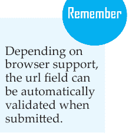

当这些字段之一获得焦点时，我们用浅灰色、透明的背景来高亮它们。注意，添加`outline`属性是非常重要的，以便移除某些浏览器添加的默认焦点高亮：

```css
input:focus, textarea:focus {
  background: rgba(0,0,0,1);
  border-radius: 5px;
  outline: none;
}
```

现在我们的文本字段已经完成，我们需要调整单行和多行字段的显示以匹配，因为在默认情况下它们看起来通常是不一样的。

单行文本字段需要一些微调才能在 Internet Explorer 中渲染得良好。Internet Explorer 不根据字体的自然定义字段的高度。为了修复这个问题，我们需要为字段添加显式高度：

```css
input {
  height: 2.5em;
  vertical-align: middle; /* 这会让旧版 IE 更好 */
}
```

### HTML 表单

`<textarea>`元素默认渲染为块级。这里两个重要的属性是`resize`和`overflow`属性。由于我们的设计是固定的，我们将使用`resize`属性防止用户调整多行字段。`overflow`属性用于保持跨浏览器的一性。某些浏览器默认值为`auto`，而某些则为`scroll`。在我们的情况下，最好让都使用`auto`：

```css
textarea {
  display: block;
  padding: 10px;
  margin: 10px;
  width: 340px;
  height: 360px;
  resize: none;
  overflow: auto;
}
```

`<button>`元素使用 CSS 非常方便，你可以进行任何操作：

```css
button {
  position: absolute;
  left: 440px;
  top: 360px;
  padding: 5px;
  font: bold .6em sans-serif;
  border: 2px solid #333;
  border-radius: 5px;
  background: none;
  cursor: pointer;
}
```


```css
button {
  -webkit-transform: rotate(-1.5deg);
  -moz-transform: rotate(-1.5deg);
  -ms-transform: rotate(-1.5deg);
  -o-transform: rotate(-1.5deg);
  transform: rotate(-1.5deg);
}
```

```css
button:after {
  content: " >>>";
}
```

```css
button:hover,
button:focus {
  outline: none;
  background: #000;
  color: #FFF;
}
```

## Case 研究

### 创建表单

表单验证的第一步当然创建实际表单：在这个案例中我们将使用 DVD 租赁作为示例。

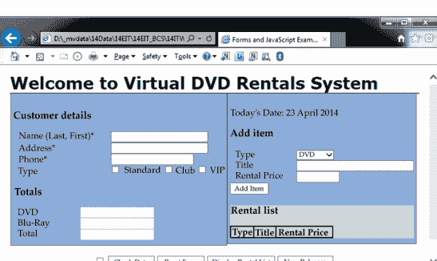

### 设计笔记

1. 创建以下文件：
   - `vmv_js-index.html` = 主 html 文件
   - `vmv_js-style.css` = 样式表
   - `vmv_js-index.js` = 包含 JavaScript
   - `vmv_js-Newleases.html` = 描述新发布的 html 页面
2. 在主 html 文件的 head 部分添加以下内容（以链接 css 和 js 文件）：

   ```html
   <link rel="stylesheet" href="vmv_js-style.css">
   <script type="text/javascript" src="vmv_js-index.js"></script>
   ```

3. `"Welcome.."`是`h1`。
4. `"Customer details"`、`"Totals"`等是`h4`。
5. 在`vmv_js-style.css`中使用以下样式。浮动（Floating）将确保两列正确流动。

   ```css
   col1 {
     background: #93A5C4;
     float: left;
     padding: 10px 5px 10px 5px;
     border: 1px solid #666;
   }
   ```

   ```css
   col2 {
     background: #93A5C4;
     float: left;
     padding: 10px 5px 10px 5px;
     border: 1px solid #666;
   }
   ```

6. 使用样式使用字段名（例如`"Name (Last, First)"`）`[padding-left: width:120px; float:left]`。
7. 在名称前加上`txt`并使用驼峰命名法，例如：

   ```html
   <input name="txtFullName" type="text" style="width:186px">
   ```

8. 在按钮前加上`btn`并使用驼峰命名法，例如：

   ```html
   <input name="btnChkForm" type="button" value="Check Data" onclick="fnCheckData()">
   ```

9. 为按钮的`onclick`调用以下函数：
   - Check Data = `fnCheckData()`
   - Rental List = `fnNewReleases()`
10. 今天的日期将使用函数`fnDisplayTodaysDate()`调用。
11. 添加项目按钮将使用名为`fnAddItem()`的函数调用。
12. 使用以下代码创建租赁列表表格：

   ```html
   <h4>Rental list</h4>

   <table id="myTable" border="1" style="border-collapse: collapse;">
     <tr>
       <th>Type</th>
       <th>Title</th>
       <th>Rental Price</th>
     </tr>
   </table>
   ```


### 注意事项

JavaScript 用于验证表单（Validate the Form），这在将数据发送到服务器之前完成，可以减少流量。要实际处理数据，我们需要服务器端语言（如 PHP 或 ASP.NET）并将数据存入数据库（例如 MySQL, MS-SQL）。


- HTML 表单是用户与网站或应用程序交互的主要点之一。它们允许用户将数据发送到网站。
- HTML 表单由一个或多个组件组成。这些组件可以是文本字段（单行或多行）、选择框、按钮、复选框或单选框。大多数情况下，这些组件与描述其用途的标签配对——正确实现的标签能够让视力和盲人用户都知道在表单输入中输入什么。
- Web 表单被几乎所有网站用于各种用途。论坛社交网络的用户使用表单添加内容并进行互动。
- HTML 表单是一个使用交互式控件在 Web 服务器上存储信息的文档。HTML 表单包含用户名、密码、联系电话、电子邮件等不同的信息。
- `textarea` 基本上是一个大的多行文本框。预期的行和列数可以通过 `rows` 和 `cols` 属性定义，尽管你可以使用 CSS 随心所欲地调整其大小。

### 知识检查

1. 在 HTML 表单中 `<input type="text">` 用于
   - a. 单行文本
   - b. 文本块
   - c. 一个段落
   - d. 无

2. `<form>` 标签的属性
   - a. Method（方法）
   - b. Action（动作）
   - c. 都 (a) 和 (b)
   - d. 以上都不是

3. 最大标题的正确 HTML 标签是
   - a. `<head>`
   - b. `<h6>`
   - c. `<h1>`
   - d. `<<html>>`

4. 为了定义提交按钮，使用哪个标签？
   - a. `<button>`
   - b. `<submit button>`
   - c. `<submit>`
   - d. `<action submit>`

5. 当表单数据包含敏感或个人信息时，哪种方法更优？
   - a. Get 方法
   - b. Post 方法
   - c. Host 方法
   - d. Put 方法

6. HTML 表单中的 Action 属性指定
   - a. 使用哪种 HTTP 方法
   - b. 正在进行什么操作
   - c. 将表单提交哪里
   - d. 表单的自动完成

7. 选择正确的选项。
   - a. HTML 表单元素用于获取用户输入。
   - b. HTML 表单元素定义在 `<form>` 标签内部。
   - c. HTML 表单元素可以是不同类型。
   - d. 以上都是。

8. 下列哪项是表单元素？
   - a. 文本框（text box）。
   - b. 单选按钮（radio button）。
   - c. 提交按钮（submit button）。
   - d. 以上都是。

9. 选择错误的选项。
   - a. 单选按钮可以使用单选按钮中的 "selected" 属性选择
   - b. 默认选项可以使用单选按钮中的 "checked" 属性选择
   - c. 复选框允许从给定选项选择一个或多个。

10. 如何在下拉列表中选择多个一个选项？
    - a. 在 `<option>` 标签内使用 `multiple` 属性。
    - b. 在 `<select>` 标签内使用 `multiple` 属性。
    - c. 在 `<text>` 标签内使用 `multiple` 属性。
    - d. 在下拉列表中无法选择多个一个选项。

### 复习题

1. 写下 HTML 表单的主要用途。
2. 写出单选按钮和复选框的区别。
3. 用户在文本字段中输入的文本大小是否受 `<INPUT>` 标签中 SIZE 属性值的限制？
4. 在 `<TEXTAREA>` 标签中必须包含什么属性以确保多行文本字段中包含水平滚动条？
5. 如何设置复选框的初始状态？

### 检查你的结果

- 1. (a) 2. (c) 3. (d) 4. (c) 5. (b)
- 6. (c) 7. (d) 8. (d) 9. (b) 10. (b)

### 参考文献

1. "Forms – HTML5". w3.org, W3C. 检索于 2014-02-20.
2. "HTML/Elements/label". w3.org wiki.
3. "input type=color – color-well control". w3.org, W3C. 检索于 2014-10-31.
4. "Radio Buttons". Windows Dev Center. 检索于 2016年9月14日。
5. Garofalo, Josh. "Intro to Online Forms and Form Builders". Blitzen Blog.
6. http://jkorpela.fi/forms/present.html
7. http://www.htmlog.com/guides/html/beginner/forms/
8. http://www-db.deis.unibo.it/courses/TW/DOCS/w3schools/html/html_form_input_types.asp
9. https://devdocs.magento.com/guides/v2.2/pattern-library/getting-user-input/form_elements/form_elements
10. https://developer.mozilla.org/en-US/docs/HTML/Forms
11. https://html.com/forms/
12. https://marksheet.io/html-forms.html
13. Jarrett and Gaffney. Forms That Work: Designing Web Forms For Usability, Morgan Kaufmann, 2008.
14. Jumašev, Alex. "The history of a radio-button". JitBit Founders Blog. 检索于 2016年9月14日.
15. Satrom, Brandon (November 2011). "Better Web Forms with HTML5 Forms". MSDN Magazine. Microsoft. 检索于 2014-02-20.
16. Wroblewski, Luke and, Spool, Jared. Web Form Design: Filling in the Blanks, Rosenfeld Media, 2008.

## 第5章 HTML DOM

"JavaScript 的全局作用域就像公共厕所。你无法避免进去，但进去时要尽量减少与表面的接触。"

### 学习目标

学习本章后，你将能够：
1. 讨论 HTML
2. 学习 HTML
3. 解释 HTML
4. 描述 HTML

### 简介

对象模型 (DOM) 是 HTML 和 XML 文档的编程接口。它表示页面以便程序更改文档结构、样式和内容。HTML 元素是 HTML 文档或网页的各个组件。

#### 示例

下面的示例更改了 `<p id="demo">` 内容：

```html
<html>
<body>
<p id="demo"></p>
<script>
document.getElementById("demo").innerHTML = "Hello World!";
</script>
</body>
</html>
```

在示例中 `getElementById` 是方法，而 `innerHTML` 是属性。

### 5.1 getElementById 方法

访问 HTML 元素的常用方法是使用元素的 id。上面的 `getElementById` 使用 `id="demo"` 找到了元素。

### 5.2 innerHTML 属性

获取元素内容的简单方法是使用 `innerHTML` 属性。`innerHTML` 属性用于获取或替换 HTML 元素的内容。

## DOM 文档

HTML 文档对象是所有其他对象的所有。如果你想访问 HTML 页面上的任何元素，始终从访问 `document` 对象开始。

### 5.2.1 HTML 对象

`document` 对象代表你的网页。下面是你可以使用 `document` 对象访问和操作 HTML 的一些示例。

### 5.2.2 查找 HTML 元素

| 方法 | 描述 |
| --- | --- |
| `document.getElementById(id)` | 通过元素 id 查找元素 |
| `document.getElementsByTagName(name)` | 通过标签名称查找元素 |
| `document.getElementsByClassName(name)` | 通过类名查找元素 |

### 5.2.3 更改 HTML 元素

| 方法 | 描述 |
| --- | --- |
| `element.innerHTML = new html content` | 更改元素的内部 HTML |
| `element.attribute = new value` | 更改 HTML 元素的属性值 |
| `element.setAttribute(attribute, value)` | 更改 HTML 元素的属性值 |
| `element.style.property = new style` | 更改 HTML 元素的样式 |

### 5.2.4 添加和删除元素

| 方法 | 描述 |
| --- | --- |
| `document.createElement(element)` | 创建 HTML 元素 |
| `document.removeChild(element)` | 删除 HTML 元素 |
| `document.appendChild(element)` | 添加一个 HTML 元素 |
| `document.replaceChild(element)` | 替换一个 HTML 元素 |
| `document.write(text)` | 写入 HTML 输出流 |

### 5.2.5 添加事件处理程序

| 方法 | 描述 |
| --- | --- |
| `document.getElementById(id).onclick = function()[code]` | 为 `onclick` 事件添加事件处理程序代码 |

### 5.2.6 查找 HTML 对象

第一版 HTML DOM Level 1 (1998) 定义了 11 个 HTML 对象、对象集合和属性。这些属性在 HTML5 中仍然有效。

后来，在 HTML DOM 3 中，增加了更多的对象、集合和属性。

| 属性 | 描述 | DOM |
| --- | --- | --- |
| `document.anchors` | 返回所有带有 `name` 属性的 `<a>` 元素 | 1 |
| `document.applets` | 返回所有 `<applet>` 元素（在 HTML5 中已废弃） | 1 |
| `document.baseURI` | 返回文档的绝对 URI | 3 |
| `document.body` | 返回 `<body>` 元素 | 1 |
| `document.cookie` | 返回文档的 cookie | 1 |
| `document.doctype` | 返回文档的 doctype | 3 |
| `document.element` | 返回 `<html>` 元素 | 3 |
| `document.documentMode` | 返回浏览器使用的模式 | 3 |
| `document.URI` | 返回文档的 URI | 3 |
| `document.domain` | 返回文档服务器的域名 | 1 |
| `document.domConfig` | 已过时。返回 DOM 配置 | 3 |
| `document.embeds` | 返回所有 `<embed>` 元素 | 3 |
| `document.forms` | 返回所有 `<form>` 元素 | 3 |
| `document.head` | 返回 `<head>` 元素 | 3 |
| `document.images` | 返回所有 `` 元素 | 1 |
| `document.implementation` | 返回 DOM 实现 | 3 |
| `document.inputEncoding` | 返回文档的编码（字符集） | 3 |
| `document.lastModified` | 返回文档更新的日期和时间 | 3 |
| `document.links` | 返回所有带有 `href` 属性的 `<a>` 和 `<area>` 元素 | 1 |
| `document.readyState` | 返回文档的（加载）状态 | 3 |
| `document.referrer` | 返回引荐页（链接的文档）的 URI | 1 |
| `document.scripts` | 返回所有 `<script>` 元素 | 3 |
| `document.strictChecking` | 返回是否强制执行错误检查 | 3 |
| `document.title` | 返回 `<title>` 元素 | 1 |
| `document.URL` | 返回文档的完整 URL | 1 |

```html
<html>
<body>
<script type="text/javascript">
document.write("Hello World!");
</script>
</body>
</html>
```

### 5.3 HTML DOM 元素

本页面将向你展示如何在 HTML 页面中查找和访问 HTML 元素。

#### 5.3.1 查找 HTML 元素

通常使用 JavaScript 是为了操作 HTML 元素。要做到这一点，你必须先找到这些元素。有几种方法可以实现：

- 通过 id 查找 HTML 元素
- 通过标签名查找 HTML 元素
- 通过类名查找 HTML 元素
- 通过 CSS 选择器查找 HTML 元素
- 通过 HTML 对象集合查找 HTML 元素

#### 5.3.2 通过 Id 查找 HTML 元素

在 DOM 中查找 HTML 元素最简单的方法是使用元素 id。此示例查找 `id="intro"` 的元素：

示例

```javascript
var elementName = document.getElementById("intro");
```

如果找到了元素，该方法将把元素作为一个对象返回（存储在 `elementName` 中）。如果未找到元素，`myElement` 将包含 `null`。

#### 5.3.3 通过标签名查找 HTML 元素

此示例查找所有的 `<p>` 元素：

示例

```javascript
var x = document.getElementsByTagName("p");
```

此示例查找 `id="main"` 的元素，然后查找 `id="main"` 内部的所有 `<p>` 元素：

示例

```javascript
var x = document.getElementById("main");
var y = x.getElementsByTagName("p");
```

#### 5.3.4 通过类名查找 HTML 元素

如果你想找到所有具有相同类名的 HTML 元素，请使用 `getElementsByClassName()`。

示例

```javascript
var x = document.getElementsByClassName("intro");
```

通过类名查找元素在 IE8 及之前的版本中无效。

#### 5.3.5 通过 CSS 选择器查找 HTML 元素

如果你想找到所有匹配指定 CSS 选择器（id、类名、类型、属性等）的 HTML 元素，请使用 `querySelectorAll()`。

示例

```javascript
var x = document.querySelectorAll("p");
```

`querySelectorAll()` 方法在 IE8 及之前的版本中无效。

#### 5.3.6 通过对象集合查找 HTML 元素

此示例在 `forms` 集合中查找 `id="frm1"` 的元素，并显示所有值：

示例

```javascript
var x = document.forms["frm1"];
var text = "";
for (i = 0; i < x.length; i++) {
  text += x[i].value + "<br>";
}
document.getElementById("demo").innerHTML = text;
```

### 5.4 修改 HTML

HTML DOM 允许 JavaScript 修改 HTML 元素的内容。

#### 5.4.1 修改 HTML 输出

HTML DOM 允许 JavaScript 修改 HTML 元素的内容。

在 JavaScript 中，`document.write()` 可以直接写入 HTML 输出流：

示例

```html
<!DOCTYPE html>
<html>
<body>
<script>
document.write("Hello World!");
</script>
</body>
</html>
```

#### 5.4.2 修改内容

修改 HTML 元素内容的简单方法是使用 `innerHTML` 属性。修改 HTML 元素的内容，使用以下语法：`document.getElementById(id).innerHTML = newHTML`

此示例修改 `<p>` 元素的内容：

示例

```html
<html>
<body>
<p id="p1">Hello World!</p>
<script>
document.getElementById("p1").innerHTML = "New text!";
</script>
</body>
</html>
```


`document.getElementById("p1").innerHTML = "New text!";`

```
</script>

</body>

</html>
```

示例说明：
- HTML 文档包含一个 `id="p1"` 的 `<p>` 元素
- 我们使用 HTML DOM 获取 `id="p1"` 的元素
- JavaScript 将该元素的 `innerHTML` 修改为 `"New text!"`

此示例修改 `<h1>` 元素的内容：

示例

```html
<!DOCTYPE html>

<html>

<body>

<h1 id="id01">Old Heading</h1>

<script>

var element = document.getElementById("id01");

element.innerHTML = "New Heading";

</script>

</body>

</html>
```

示例说明：
- HTML 文档包含一个 `id="id01"` 的 `<h1>` 元素
- 我们使用 HTML DOM 获取 `id="id01"` 的元素
- JavaScript 将该元素的 `innerHTML` 修改为 `"New Heading"`

### 5.4.3 修改属性值

修改 HTML 属性值，使用以下语法：
`document.getElementById(id).attribute = newvalue`

此示例修改 `` 元素的 `src` 属性值：

示例

```html
<!DOCTYPE html>

<html>

<body>


<script>

document.getElementById("myImage").src = "landscape.jpg";

</script>

</body>

</html>
```

## 5.5 修改 CSS

HTML DOM 允许 JavaScript 修改 HTML 元素的样式。

### 5.5.1 修改样式

修改 HTML 元素的样式，使用以下语法：
`document.getElementById(id).style.property = newstyle`

以下示例修改一个 `<p>` 元素的样式：

示例

```html
<html>

<body>

<p id="p2">Hello World!</p>

<script>

document.getElementById("p2").style.color = "blue";

</script>

<p>上面的段落被脚本修改过。</p>

</body>

</html>
```

### 5.5.2 使用事件

HTML DOM 允许在事件发生时执行代码。

当 HTML 元素发生“事情”时，浏览器会生成事件：

- 元素被点击
- 页面已加载
- 输入字段发生变化

此示例在用户点击按钮时，修改 `id="id1"` 的 HTML 元素的样式：

示例

```html
<!DOCTYPE html>

<html>

<body>

<h1 id="id1">My Heading 1</h1>

<button type="button"

onclick="document.getElementById('id1').style.color = 'red'">

Click Me!

</button>

</body>

</html>
```

## 5.6 HTML DOM 动画

学习使用 JavaScript 创建 HTML 动画。

### 5.6.1 基础网页

为了演示如何使用 JavaScript 创建 HTML 动画，我们将使用一个简单的网页：

示例

```html
<!DOCTYPE html>

<html>

<body>

<h1>我的第一个 JavaScript 动画</h1>

<div id="animation">我的动画将在这里显示</div>

</body>

</html>
```

### 5.6.2 创建动画容器

所有的动画都应该相对于一个容器元素进行。

示例

```html
<div id="container">

  <div id="animate">我的动画将在这里</div>

</div>
```

### 5.6.3 为元素设置样式

创建容器元素时应带有样式 `style="position: relative"`。

创建动画元素时应带有样式 `style="position: absolute"`。


### 基础计算机编程：JavaScript

### 示例

```css
#container {

  width: 400px;

  height: 400px;

  position: relative;

  background: yellow;

}

#animate {

  width: 50px;

  height: 50px;

  position: absolute;

  background: red;

}
```

### 5.6.4 动画代码

JavaScript 动画是通过对元素的样式进行逐渐变化来实现的。
变化通过定时器调用。当定时器间隔很小时，动画看起来是连续的。
基础代码如下：

示例

```javascript
var id = setInterval(frame, 5);

function frame() {

  if (/* 测试是否完成 */) {

    clearInterval(id);

  } else {

    /* 元素样式的代码 */

  }

}
```

### 5.6.5 使用 JavaScript 创建动画

示例

```javascript
function myMove() {

  var elem = document.getElementById("animate");

  var pos = 0;

  var id = setInterval(frame, 5);

  function frame() {

    if (pos == 350) {

      clearInterval(id);

    } else {

      pos++;

      elem.style.top = pos + 'px';

      elem.style.left = pos + 'px';

    }

  }

}
```

## 5.7 HTML DOM 事件

HTML DOM 允许 JavaScript 对 HTML 事件做出反应：

### 5.7.1 响应事件

当事件发生时，可以执行 JavaScript，例如当用户点击 HTML 元素时。

若要在用户点击元素时执行代码，请向 HTML 事件属性中添加 JavaScript 代码：

`onclick=JavaScript`

HTML 事件的示例：

- 当用户点击鼠标时
- 当网页加载完成后
- 当图像加载完成后
- 当鼠标悬停在元素上时


### 基础计算机编程：JavaScript

- 当输入字段发生变化时
- 当 HTML 表单提交时
- 当用户按下按键时

在这个示例中，当用户点击 `<h1>` 元素时，该元素的内容会发生：

示例

```html
<!DOCTYPE html>

<html>

<body>

<h1 onclick="this.innerHTML = 'Ooops!'">点击这段文字！</h1>

</body>

</html>
```

在这个示例中，从事件处理程序中调用了一个函数：

示例

```html
<!DOCTYPE html>

<html>

<body>

<h1 onclick="changeText(this)">点击这段文字！</h1>

<script>

function changeText(id) {

  id.innerHTML = "Ooops!";

}

</script>

</body>

</html>
```

### 5.7.2 HTML 事件属性

要为 HTML 元素分配事件，您可以使用事件属性。


示例

给按钮元素分配一个 `onclick` 事件：
`<button onclick="displayDate()">试用</button>`
在上面的示例中，点击按钮时将执行一个名为 `displayDate` 的函数。

### 5.7.3 使用 JavaScript 分配事件

HTML DOM 允许使用 JavaScript 为元素分配事件。

示例

给按钮元素分配一个 `onclick` 事件：
```
<script>
document.getElementById("myBtn").onclick = displayDate;
</script>
```
在上面的示例中，点击按钮时将执行一个名为 `displayDate` 的函数。


### 5.7.4 载入事件

当页面加载完成时，可以执行 JavaScript。

示例

```html
<body onload="myFunction()">
```

### 5.7.5 冒泡与捕获

HTML DOM 有两种事件传播方式：冒泡和捕获。
事件传播是定义事件发生时顺序的方式。

在冒泡捕获中，可以使用 `onload` 事件来处理捕获。

示例

```html
<body onload="checkCookies()">
```

## 5.8 HTML 事件监听器

`addEventListener()` 方法可以为元素添加监听器。


### 5.8.1 使用 addEventListener 分配事件

示例

当用户点击按钮时添加一个点击事件：
```javascript
document.getElementById("myBtn").addEventListener("click", displayDate);
```

### 5.8.2 语法

`addEventListener(event, function, useCapture);`
第一个参数是事件类型。第二个参数是要调用的函数。第三个参数是指定是否使用捕获的布尔值。

### 5.8.3 为元素添加事件处理程序

示例

当点击元素时弹出“Hello World!”：
```javascript
function() {

  alert("Hello World!");

}
```

### 5.8.4 传递参数

传递参数值时，使用“匿名函数”调用带参数的指定函数：

示例

```javascript
element.addEventListener("click", function(){

  myFunction(p1, p2);

});
```

### 5.8.5 事件冒泡还是事件捕获？

HTML DOM 中有两种事件传播方式：冒泡和捕获。
事件传播是定义事件发生时顺序的方式。如果你在 `<div>` 元素内部有一个 `<p>` 元素，并且用户点击了 `<p>` 元素，哪个元素的“点击”事件应该先处理？

在冒泡中，最内部的元素先被处理，然后是外部元素：`<p>` 元素的点击事件先处理，然后是 `<div>` 元素的点击事件。

在捕获中，最外部的元素先被处理，然后是内部元素：`<div>` 元素的点击事件将先处理，然后是 `<p>` 元素的点击事件。

使用 `addEventListener` 方法，可以通过使用 `useCapture` 参数来指定传播类型：

默认值为 `false`，这将是冒泡传播；当值设置为 `true` 时，事件将使用捕获传播。

### 基础计算机编程：JavaScript

```javascript
window.addEventListener("resize", function(){

  document.getElementById("demo").innerHTML = someetext;

});
```

### 5.8.8 removeEventListener() 方法

`removeEventListener()` 方法移除通过 `addEventListener()` 添加的事件处理程序：

### 示例

`element.removeEventListener("mousemove", myFunction);`

## 5.9 HTML DOM 导航

通过 HTML DOM，你可以使用节点关系来导航遍历节点树。

### 5.9.1 DOM 节点

根据 W3C HTML DOM 标准，HTML 文档中的一切都是一个节点：

- 整个文档是一个文档节点
- 每个 HTML 元素都是元素节点
- HTML 元素内部的文本是文本节点
- 每个 HTML 属性都是属性节点（已弃用）
- 所有注释都是注释节点

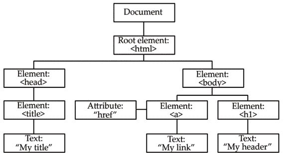

> 你知道吗？文档对象模型的历史与 20 世纪 90 年代的“浏览器大战”交织在一起，当时的 Netscape Navigator 和 Microsoft Internet Explorer，以及在 Web 浏览器引擎中广泛实现的 JavaScript 和 Jscript。

> 节点（Node）是数据结构的基本单元，例如链表或树数据结构。

可以创建新节点，也可以删除所有节点。

### 5.9.2 节点关系

节点树中的节点之间存在层级关系。
使用父、子、兄弟术语来描述这些关系。

### 基础计算机编程：JavaScript

- 在节点树中，顶端节点是根（或根节点）
- 每个节点都有唯一的父节点，根除外（根没有父节点）
- 一个节点可以有多个孩子
- 兄弟（兄弟或姐妹）是具有相同父节点的节点

```html
<html>

<head>

  <title>DOM 教程</title>

</head>

<body>

  <h1>DOM 第一节课</h1>

  <p>Hello world!</p>

</body>

</html>
```

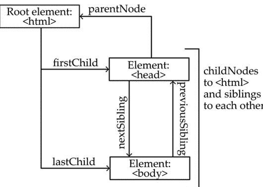

从上方的 HTML 代码中，你可以读到：

- `<html>` 是根节点
- `<html>` 没有父节点
- `<html>` 是 `<head>` 和 `<body>` 的父节点


- `<head>` 是 `<html>` 的第一个孩子
- `<body>` 是 `<html>` 的最后一个孩子

以及：
`<head>` 有一个孩子：`<title>`
`<title>` 有一个孩子（一个文本节点）：“DOM Tutorial”
`<body>` 有两个孩子：`<h1>` 和 `<p>`
`<h1>` 有一个孩子：“DOM Lesson one”
`<p>` 有一个孩子：“Hello world!”
`<h1>` 和 `<p>` 是兄弟。

### 5.9.3 子节点和节点值

DOM 处理中的一个常见错误是期望元素节点包含文本。

示例：

```html
<title id="demo">DOM Tutorial</title>
```

元素节点 `<title>`（在上面的示例中）并不包含文本。
它包含一个值为“DOM Tutorial”的文本节点。
文本节点的值可以通过节点的 `innerHTML` 属性访问：
`var MyTitle = document.getElementById("demo").innerHTML;`
访问 `innerHTML` 属性等同于访问第一个孩子的值：
`var MyTitle = document.getElementById("demo").firstChild.nodeValue;`
访问第一个孩子也可以像这样：
`var MyTitle = document.getElementById("demo").childNodes[0].nodeValue;`
以下所有 (3) 个示例都会获取 `<h1>` 元素的文本并将其复制到 `<p>` 元素中：

示例

```html
<html>

<body>

<h1 id="id01">My First Page</h1>
```


```html
<p id="id02"></p>

<script>

document.getElementById("id02").innerHTML = document.getElementById("id01").innerHTML;

</script>

</body>

</html>
```

示例

```html
<html>

<body>

<h1 id="id01">My First Page</h1>

<p id="id02"></p>

<script>

document.getElementById("id02").innerHTML = document.getElementById("id01").firstChild.node;

</script>

</body>

</html>
```

示例

```html
<html>

<body>

<h1 id="id01">My First Page</h1>

<p id="id02">Hello!</p>

<script>
```


### 5.9.4 DOM 根节点

有两个特殊属性可以访问整个文档：

- `document.body` - 文档的正文
- `document.documentElement` - 整个文档

#### 示例

```html
<html>
<body>
<p>Hello World!</p>
<div>
<p>The DOM is very useful!</p>
<p>This example demonstrates the document.body property.</p>
</div>
<script>
alert(document.body.innerHTML);
</script>
</body>
</html>
```

```html
<html>
<body>
<p>Hello World!</p>
<div>
<p>The DOM is very useful!</p>
<p>This example demonstrates the document.documentElement property.</p>
</div>
<script>
alert(document.documentElement.innerHTML);
</script>
</body>
</html>
```

### 5.9.5 nodeName 属性

`nodeName` 属性指定节点名称。

- `nodeName` 是只读的
- 元素的 `nodeName` 是标签名
- 文本节点的 `nodeName` 始终是 `"#text"`
- 文档节点的 `nodeName` 始终是 `"document"`

#### 示例

```html
<h1 id="id01">My First Page</h1>
<p id="id02"></p>
<script>
document.getElementById("id02").innerHTML = document.getElementById("id01").nodeName;
</script>
```

### 5.9.6 nodeValue 属性

`nodeValue` 属性指定节点的值。

- 元素的 `nodeValue` 为 `undefined`
- 文本节点的 `nodeValue` 是文本本身
- 属性节点的 `nodeValue` 是属性值

### 5.9.7 nodeType 属性

`nodeType` 属性是只读的。它返回节点的类型。

#### 示例

```html
<h1 id="id01">My First Page</h1>
<p id="id02"></p>
<script>
document.getElementById("id02").innerHTML = document.getElementById("id01").nodeType;
</script>
```

## 5.10 HTML 元素（节点）

添加和删除节点

### 5.10.1 创建新元素（节点）

要向 HTML DOM 添加新元素，必须先创建一个元素（元素节点），然后将其附加到现有元素中。

#### 示例

```html
<div id="div1">
<p id="p1">This is a paragraph.</p>
<p id="id02">This is another paragraph.</p>
</div>
<script>
var para = document.createElement("p");
var node = document.createTextNode("This is new.");
para.appendChild(node);
var element = document.getElementById("div1");
element.appendChild(para);
</script>
```


#### 示例解析

这段代码创建一个新的 `<p>` 元素：
`var para = document.createElement("p");`

要向 `<p>` 元素添加文本，必须先创建一个文本节点：
`var node = document.createTextNode("This is a paragraph.");`
然后将文本节点附加到 `<p>` 元素中：
`para.appendChild(node);`

最后必须将新元素附加到现有元素中。这段代码找到一个元素：
`var element = document.getElementById("div1");`
将新元素附加到现有元素中：
`element.appendChild(para);`

### 5.10.2 创建新的 HTML 元素 - insertBefore

上一个示例中的 `appendChild()` 方法将新元素作为父元素的最后一个孩子。如果你不想这样做，可以使用 `insertBefore()` 方法：

#### 示例

```html
<div id="div1">
<p id="p1">This is a paragraph.</p>
<p id="p2">This is another paragraph.</p>
</div>
<script>
var para = document.createElement("p");
var node = document.createTextNode("This is new.");
para.appendChild(node);
var element = document.getElementById("div1");
var child = document.getElementById("p1");
element.insertBefore(para, child);
</script>
```


### 5.10.3 删除现有 HTML 元素

要删除 HTML 元素，必须知道该元素的父元素：

#### 示例

```html
<div id="div1">
<p id="p1">This is a paragraph.</p>
<p id="p2">This is another paragraph.</p>
</div>
<script>
var parent = document.getElementById("div1");
var child = document.getElementById("p1");
parent.removeChild(child);
</script>
```

### 5.10.4 替换 HTML 元素

要在 HTML DOM 中替换元素，使用 `replaceChild()` 方法：

#### 示例

```html
<div id="div1">
<p id="p1">This is a paragraph.</p>
<p id="p2">This is another paragraph.</p>
</div>
<script>
var para = document.createElement("p");
var node = document.createTextNode("This is new.");
para.appendChild(node);
var parent = document.getElementById("div1");
var child = document.getElementById("p1");
parent.replaceChild(para, child);
</script>
```


## 案例研究

## 文档对象模型

文档对象模型（称为 DOM）的历史与 JavaScript 和 JScript 脚本语言的诞生紧密相连。

### JavaScript

LiveScript 语言是在网景公司（Netscape Communications）设计的，旨在让非 Java 程序员也能更容易使用 Java 支持。像任何脚本语言一样，LiveScript 是一种弱类型语言。它的目标群体是广泛的 Web 设计师和开发者。

1995 年，LiveScript 被重命名为 JavaScript 并作为 Netscape Navigator 2.0 的一部分发布。就标记目的而言，JavaScript 与 Sun Microsystems 开发和维护的 Java 语言无关。Web 社区从那时开始操作 Web 文档的内容，以便为曾经静态的 Web 带来交互性和排版功能。

### JScript

1996 年 7 月，微软发布了 Internet Explorer 3.0，其中包含了 JavaScript 的移植版本，称为 JScript。

### ECMAScript

1997 年 6 月，ECMA 采用了一种名为 ECMAScript 的脚本语言混合版本。国际标准化组织（ISO）也于 1998 年效随其后。ECMAScript 的出现对于 Netscape Navigator 和 Internet Explorer 的 4.0 版本发布来说太晚了。它们各自引入了自身的文档对象模型 DHTML 和 dHTML，这些后来被称为动态 HTML（Dynamic HTML）。

ECMA-262 于 1999 年发布，微软及其 Internet Explorer 仍未遵循此。网景声称在 Netscape Navigator 6 和 7 版本中支持 ECMA-262。

### 维网联盟

1994 年，万维网发明者蒂姆·伯纳斯利（Tim Berners-Lee）创立了维网联盟（W3C），以引导 Web 发挥全部潜力。1997 年初，参与该联盟的公司（包括网景和微软）决定就它们访问和操作文档的对象模型达成共识。在尝试尽可能与原始浏览器对象模型保持兼容的同时，W3C 的文档对象模型（DOM）为 HTML 文档提供了更好的对象表示。

### HTML 和 XML

1996 年，W3C 同样开发了一种新的标记语言——可扩展标记语言（XML）。由于旨在消除 HTML 语言的扩展性限制，为 XML 开发对象模型的想法很快成为 DOM 努力方向的另一个目标。

### 总结

文档对象模型（DOM）是一种跨平台且语言无关的接口，它将 XML 或 HTML 文档视为树形结构，其中每个节点都是代表文档部分的对象。DOM 用逻辑树表示文档。树的每个分支结束于一个节点，每个节点都包含对象。

- HTML DOM 方法是你可以执行的动作（在 HTML 元素上）。
- HTML DOM 属性是你可以设置或更改的（HTML 元素的）值值。
- 属性是你可以获取或设置的值（例如更改 HTML 元素的内容）。
- HTML DOM 文对象是网页中所有其他对象的所有者。
- HTML DOM 允许 JavaScript 修改 HTML 元素的内容。
- HTML DOM 允许 JavaScript 修改 HTML 元素的样式。
- JavaScript 动画是通过编程元素样式的渐进变化来实现的。

### 知识检查

- 1. 在 HTML DOM 中避免使用属性属性的原因是什么？
  a. 发现没有必要
  b. 属性没有属性
  c. 属性有属性
  d. 以上均不是

- 2. 方法 `nodeMap.setNamedItem()` 的目的是什么？
  a. 设置 ID
  b. 设置属性节点
  c. 设置元素名称
  d. 以上均不是

- 3. HTML DOM 中一切是如何被处理的？
  a. 节点
  b. 属性
  c. 元素
  d. 以上所有

- 4. NamedNode 对象在 HTML DOM 中代表什么？
  a. 元素的无序集合
  b. 属性的无序序集合
  c. 节点的无序集合
  d. 以上所有

- 5. Attr 对象在 HTML DOM 中的目的是什么？
  a. 用于关注页面的特定部分
  b. HTML 属性
  c. 用于排列元素
  d. 以上

- 6. DOM 是？
  a. 动态对象模型
  b. 文档对象模型
  c. 分布式对象模型
  d. 以上

- 7. DOM 被分为多少不同的部分？
  a. 2
  b. 4
  c. 3
  d. 1

- 8. 你通过什么方法找到要操作的元素？
  a. `getElementById()`
  b. `getElementsByTagName()`
  c. 以上所有
  d. 以上都不是

- 9. 每个节点都有包含关于节点信息的属性。这些属性是 ______
  a. `nodeName`
  b. `nodeValue`
  c. 以上所有
  d. ______

- 10. DOM 对象实际上是 a
  a. JavaScript
  b. HTML DOM
  c. XML DOM
  d. 核心 DOM

### 复习题

- 1. 使用 HTML DOM 更改
- 2. 使用 HTML DOM 更改
- 3. 使用 HTML 更改
- 4. 使用 HTML 更改
- 5. 使用 HTML DOM 
- 6. 使用 HTML DOM 
- 7. 使用 HTML DOM 
- 8. 使用 HTML DOM 
- 9. 使用 HTML DOM 
- 10. 使用 JavaScript 

### 参考文献

- 1. David Flanagan. JavaScript: The Definitive Guide, Sixth Edition.
- 2. Douglas Crockford. JavaScript: The good parts.
- 3. Douglas Crockford. JavaScript: The world’s most misunderstood language.
- 4. Douglas Crockford. JSLint.
- 5. Jonathan Stark. Building iPhone Apps with HTML, CSS, and JavaScript.
- 6. Maximiliano Firtman. Programming the Mobile Web.

## Cookies

简单来说，熟悉 Cookie 的工作原理对你很有帮助。此外，看看你自己如何使用 JavaScript 读取和写入浏览器的 Cookie API 也是件很有趣的事。

用户注册通常在完成多个页面后才会结束。但如何在所有页面之间维持用户的会话信息呢？

Cookie 最初由网景（Netscape）发明，旨在为 Web 服务器和浏览器提供“记忆”。HTTP 协议负责将网页传输到你的浏览器以及浏览器向服务器请求页面，它是无状态的（state-less），这意味着服务器从未向请求页面的浏览器发送页面，也不会记住关于请求的任何信息。因此，如果你第二次、百次或数万次访问同一个网页，服务器并不知道你曾经来过。这在很多方面都会带来困扰。服务器无法记住你是否设置了用户偏好，它无法记住任何事情。一旦个性化出现，这就成了一个大问题。Cookie 的发明是为了解决这个问题，而且 Cookie 易于维护且功能强大。

> 计算机 Cookie 可以追溯到 1994 年。当时，Leo Montulli 从一种用于 UNIX® 系统的名为“魔法饼干”（magic cookie）的类似技术中将其改进为万维网（World Wide Web）的工具。这也是术词本身的起源。然而，过了几年，Cookie 才被普通大众熟知。

### 6.1.1 在 JavaScript 中使用 Cookies

Cookies 是你的浏览器存储在计算机上的小文件的名称，包含了与你过去访问过的网站相关的信息。使用 JavaScript，你可以编写这些文本文件，并在读者每次返回你的网站时从从中提取数据。Cookies 是可以存储在用户计算机上的变量，并可以被相同域和路径下的任何其他网页获取。

Cookies 被设为在一定时间后过期。它们仅限制为字符串值。请注意，许多用户（包括我）不会在他们的计算机上允许 Cookie。不要让你的网站依赖它们。原因在于许多网站将 Cookie 用作广告追踪系统，利用它们来跟踪你在互联网上的活动。我们不希望任何人在你购物时在城市里跟随着我们走，记录我们访问的每家商店，以及你是否光顾了内衣区，因为那是对我们隐私的侵犯。很多人对互联网也有同感。你可能会发现，显示一条消息说明你将如何使用 Cookie 会很有帮助，例如为了在下次访问网站时存储用户名和密码。

另外注意，欧洲法律要求在使用 Cookie 之前获得明确许可，除非这些 Cookie 对于网站的运行至关重要（例如购物车）。大多数浏览器对存储的 Cookie 数量都有限制，通常为 300 个或更多，其中每个域名可能有 20 个 Cookie。任何域或路径最多可以存储总计为 4 KB（编码后）的 Cookie。

`document.cookie` 对象是当前网页可用所有 Cookie 的字符串表示。当你给 `document.cookie` 对象赋值时，它的表现很特殊，它不会变成你所赋值的值。相反，它会取该值的一部分，并将当前值附加在其后，从而形成一个包含多个 `variableName=variableValue` 对的字符串。

#### 为什么我们使用 Cookies

Cookies 是必要的，因为用于在互联网上传输网页的 HTTP 协议是无状态的。这意味着 Web 服务器无法在用户的整个过程中记住有关用户的信息，因此每个人都变成了匿名状态。如果你返回以前访问过的网站，你会被对待得像第一次访问一样。这对于要求用户登录的网站来说尤其令人不满意——如果你离开并在几分钟后回来，你必须重新登录。服务器不会记住关于你的访问或偏好设置的任何事情。因此，发明 Cookie 是为了给 Web 服务器提供某种记忆。

#### Cookie 中可以存储什么类型的数据？

Cookie 基本上是一个长度不超过 4 KB 的字符字符串。Cookies 以 `name=value` 对的形式设置，用分号隔开。例如，一个 Cookie 可能是如下的字符串：

```text
"theme-blue; max-age=60; path=/; domain=theisewizard.com"
```

这个示例 Cookie 有 4 个变量/值对对：

- `max-age`，被设置为 60，
- `path`，被设置为斜杠字符 `"/"`，
- `domain`，被设置为 `"theisewizard.com"`，
- 以及 `theme`，被设置为 `"blue"`。

变量 `max-age`、`path` 和 `domain` 是控制 Cookie 行为的特殊属性。例如，`max-age` 定义了 Cookie 以秒为单位的寿命，`path` 将 Cookie 限制在特定的目录层次中，而 `domain` 允许 Cookie 在子域间共享。

你的 Cookie 值不包含嵌入的空格、逗号或分号。如果你有任何这些字符，必须将其转换为相应的“编码”等效值。这样做最简单的方法是使用 `encodeURI()` 函数进行编码，并在读取 Cookie 时使用 `decodeURI()` 函数进行解码。

### Cookie 限制

尽管不同的浏览器可能对 Cookie 实施不同的限制，但它们应该支持的最低限制如下：

- Cookie 长度：4 KB。你的字符串总长度（包括所有具有特殊含义的变量）不应超过 4,096 个字符。
- 每个 Web 服务器的 Cookie 最大数量：20 个。
- 浏览器支持的 Cookie 总数：300 个。这包含了其他网站存储的 Cookie。

### 1.6.2 Cookie 的结构

Cookie 不仅仅是简单的文本文件——通常位于你的浏览器缓存或“Internet 文件”中——包含一个或多个条目。每个条目由以下部分组成：

- 一个存储你想保存的任何数据的键值对。
- 一个过期日期，到期后该条目将被删除。
- 该条目关联的网页域名和路径。

你可以使用 JavaScript 读取或向 Cookie 文件写入一个新条目。创建条目的过程通常被称为“写入 Cookie”，但这种说法具有误导性。Cookie 是包含你所有条目的文本文件，而单个条目持有数据。网络上的每个域名都可以关联一个 Cookie 文件，且每个 Cookie 可以包含多个条目。

当你向以前使用过的服务器请求文件时，相关 Cookie 中的数据会随你的请求一起发送到服务器。这样，服务器端脚本（如用 Perl 或 PHP 编写的）就可以读取你的 Cookie 并判断你是否有权限查看 Cookie 页面（例如）。Cookie 也可以用于更恶意的目的，通常由广告公司追踪你的在线行为。大多数现代浏览器都包含了良好的措施，允许你阻止某些网站的 Cookie，哪些网站可以显示 Cookie 现在由你决定。

#### 基础计算机编程：JavaScript

条目中的键值对部分与声明变量非常相似——当你想检索信息时，你请求与提供的名称关联的值。过期日期以一种不便于人类阅读的 UTC 格式表示；幸运的是，有方法可以生成合适的日期。如果没有设置日期，该条目会在你关闭浏览器时被删除。

你与 Cookie 关联的域名和路径必须属于你网站所属的同一个域名的部分。例如，你可以设置 Cookie 在 `www.yourhtmlsource.com` 生效（默认）；或者在 `yourhtmlsource.com` 生效，这将涵盖你为该网站设置的所有子域名。然而，出于显而见的考虑，你不能将其设置为 `yahoo.com`。通过使用路径，你可以限制 Cookie 仅对特定目录有效。通常你会希望它对域中的任何页面可用，如果设置为 `/`，即根目录。

### 6.1.3 设置、读取和删除 Cookie

JavaScript 中有一个名为 `document.cookie` 的对象，用于读取和检索 Cookie 数据。它是字符串的存储（尽管不是数组）。你可以创建新条目、读取现有的键值对或通过 JavaScript 删除条目。为你的站点创建一个 Cookie，你可以写：

```javascript
document.cookie = "value1=Yes; expires=Fri, 13 Jul 2004 05:28:21 UTC; path=/";
```

整个条目由分号分隔——首先是键值对，然后是格式正确的过期日期，最后是路径。这种语法是固定的，你不应该重新排列元素。为了测试 Cookie 的内容，你可以使用简单的 `alert(document.cookie)` 脚本，这产生此结果。你可能会在那里看到另一个值。使用不同的名称，向 Cookie 写入另一个条目，如下：

```javascript
document.cookie = "value2=Nah; expires=Fri, 13 Jul 2004 05:28:21 UTC; path=/";
```

检查 Cookie 的内容，我们可以看到第一个值仍然在那里。如果我们使用了相同的名称，新条目会被覆盖；但由于我们使用了不同的名称，新条目会被添加。删除 Cookie 条目很容易——只需设置一个新值并提供过期日期，如下：

```javascript
document.cookie = "value2=Whatever; expires=Fri, 13 Jul 2001 05:28:21 UTC; path=/";
```

你也可以将过期日期设置为 `-1`，它将被立即删除。测试值现在，如果你。

### 6.1.4 方便脚本

为了方便地处理 Cookie，我们将使用一些由 Scott Andrew 编写的脚本。读取 Cookie 中的值的过程相当复杂。以下是函数：

```javascript
function createCookie(name, value, days) {
  if (days) {
    var date = new Date();
    date.setTime(date.getTime() + (days*24*60*60*1000));
    var expires = "expires="+date.toUTCString();
  } else {
    var expires = "";
  }
  document.cookie = name+"="+value+";="+expires+";path=/";
}
```

```javascript
function readCookie(name) {
  var ca = document.cookie.split(';');
  var nameEQ = name + "=";
  for(var i=0; i < ca.length; i++) {
    var c = ca[i];
    while (c.charAt(0)==' ') c = c.substring(1); //删除空格
    if (c.indexOf(nameEQ) == 0) return c.substring(nameEQ.length, c.length);
  }
  return null;
}
```

```javascript
function eraseCookie(name) {
  createCookie(name, "", -1);
}
```

### 6.1.5 如何使用 JavaScript 设置 Cookie

Cookie 是现代浏览器的重要部分。没有它们，我们无法浏览需要认证的网站（例如社交网络），因为每个页面都会要求密码或在线购物。网站的使用将限于静态网站。在本节中，我们将仅关注使用以下代码创建和编辑 Cookie：

```javascript
function cookie(name, value, right) {
  var expires = 0;
  if (right) {
    var d = new Date();
    d.setTime(d.getTime() + (right * 24*60*60*1000));
    expires = "expires=" + d.toUTCString();
  }
}
```


`document.cookie = name + "=" + value + ";expires=" + expires + ";path=/";`

```
function getCookie(name) {
  var cookies = document.cookie.split(';');
  for(var i = 0; i < cookies.length; i++) {
    var c = cookies[i].trim();
    if (c.indexOf(name + "=") == 0) {
      return c.split("=")[1];
    }
  }
  return null;
}

var result = getCookie("items");
```

### 第一步 - HTML 部分

我们创建一个 `DIV` 并在里面添加两条消息。一个在页面加载时显示一次，另一个在第一个显示后显示。显示第一个还是第二个消息是 `CSS` 的工作：

```html
<div class="message change-message--on-load hide--second">
  <p>此消息仅在你第一次访问此页面时显示。刷新页面以隐藏它！</p>
  <p>此消息仅在上次访问显示过消息后才显示。当你刷新页面时，浏览器会记住你的选择。</p>
</div>
```

### 第二步 - CSS 部分

通过 `CSS`，我们将告诉浏览器：如果 `div` 的类为 `.hide--first`，则隐藏第一条消息；如果 `div` 的类为 `.hide--second`，则隐藏第二条消息：

```css
.hide--first > *:first-child {
  display: none;
}

.hide--second > *:last-child {
  display: none;
}
```

### 基础计算机编程：JavaScript

检查`cookie`。如果`cookie`为`true`，则通过更改`<div>`的类名（`class`）使用`CSS`隐藏初始消息并显示另一个消息：

```javascript
if (cookie('hide-after-load') == 'yes') {
  $('.change-message-on-load').removeClass('hide--second');
  $('.change-message-on-load').addClass('hide--first');
}
```

在关闭脚本标签之前，我们必须添加一个将隐藏第一条消息的`cookie`。我们将其添加到末尾，因为如果把它添加在检查`cookie`（见上文）的代码之前，它将从一开始就隐藏第一条消息。在末尾添加可以确保消息在下次加载页面时才被隐藏。它被设置为 7 天后过期。

```javascript
$.cookie('hide-after-load', 'yes', {expires: 7 });
```

```html
<script type="text/javascript">
$(document).ready(function() {
  if (cookie('hide-after-load') == 'yes') {
    $('.change-message-on-load').removeClass('hide--second');
    $('.change-message-on-load').addClass('hide--first');
  }
});

$.cookie('hide-after-load', 'yes', {expires: 7 });
</script>
```

# 第 5 - 点击时添加 cookie

在演示中，你看到只有在点击“x”图标后，第二个容器才会隐藏第一条消息并显示另一个。首先，我们需要为 `HTML` 添加一个空的 `href` 标签：

```html
<p>你只能通过点击此框右侧的 &times; 来隐藏此消息 <a href="#" class="close" title="隐藏此消息&times;"></a></p>
```

为了将“x”图标定位在容器的右上角，我们在`CSS`中使用了绝对定位与相对定位的技巧（`absolute relative trick`）：

```css
.message {
  position: relative;
}
```


```css
.close {
  color: #f00;
  position: absolute;
  text-transform: lowercase;
  right: 20px;
  font-size: 1.5em;
  top: 10px;
  line-height: 1;
  border: none !important;
}
```

在 `JavaScript` 标签内部，我们添加了在点击图标后执行操作的代码。在这种情况下，返回空值这样 `URL` 就不会被空的 `href` 哈希值 (`#`) 符号填充。

```javascript
$('.close').click(function() {
  return false;
});
```

一旦用户点击了图标，我们需要检查图标的父容器显示的是第一条消息还是第二条。如果显示的是第一条消息，通过更改其类名将其隐藏。最后，我们添加一个带有变量的`cookie`，以便下次能够记住此选项。

```javascript
if ($('.change-message--on-click').is('hide--first')) {
  $('.change-message--on-click').removeClass('hide--second');
  $('.change-message--on-click').addClass('hide--first');
}
```

```javascript
// 添加用户已点击的 cookie 设置
$.cookie('hide-after-click', 'yes', {expires: 7});
```

点击图标时的完整脚本如下：

```javascript
$('.close').click(function() {
  if ($('.change-message--on-click').is('hide--first')) {
    $('.change-message--on-click').removeClass('hide--second');
    $('.change-message--on-click').addClass('hide--first');
  }
}
```


```javascript
$.cookie('hide-after-click', 'yes', {expires: 7 });
}

return false;
}
```

但等一下，我们还没做完！我们还需要检查点击的`cookie`是否带有了`yes`变量。如果是，则显示消息并隐藏第一条：

```javascript
if (cookie('hide-after-click') == 'yes') {
  $('.change-message--on-click').removeClass('hide--second');
  $('.change-message--on-click').addClass('hide--first');
}
```

第二个示例的完整代码：

```javascript
<script type="text/javascript">
$(document).ready(function() {
  // COOKIES
  // 如果 cookie 为 true，隐藏初始消息并显示另一个
  if (cookie('hide-after-click') == 'yes') {
    $('.change-message--on-click').removeClass('hide--second');
    $('.change-message--on-click').addClass('hide--first');
  }

  // 点击 "X" 时执行操作
  $('.close').click(function() {
    // 检查之前是否未点击过 "X"（隐藏）
    if (!('.change-message--on-click').is('hide--first')) {
      $('.change-message--on-click').removeClass('hide--second');
      $('.change-message--on-click').addClass('hide--first');
    }

    // 添加用户已点击的 cookie 设置
    $.cookie('hide-after-click', 'yes', {expires: 7 });

    return false;
  });
});
</script>
```

`Cookies` 可以有多种用法。现在你已经知道如何创建自己的`cookie`。你可以更进一步，研究如何验证用户（记住登录详情）并在 `cookies` 中保存整个会话（刷新页面时进程不会丢失）。

## 隐私与法律

`Cookies` 只有创建它们的站点可以读取（见下文）。这防止了其他网站窃取 `cookies`。当 `cookies` 还是新事物时，关于它们追踪用户浏览网页的能力存在很多争议。隐私是个人或群体排除自身或关于自身信息的能力，从而进行选择性表达。因此，尽管偏执的用户可能觉得有必要禁用 `cookies`，但并非强制要求：会话详情可以通过 `URL` 传递。显而易见的缺点是，在这种情况下无法实现自动登录，另一个缺点是 `JavaScript` 会被认为已禁用，而需要使用 `cookies` 来检测。第一个问题可以通过网络浏览器的“自动填充”功能来解决，该功能可以用于记忆表单（如登录表单）是如何填充的。开发者建议用户启用 `cookies`，但如果担心隐私，可以禁用第三方 `cookie`。

## EU 法律

`Cookies` 只有创建它们的站点可以读取（见下文）。这防止了其他网站窃取 `cookies`。欧盟法律要求在欧盟境内运营必须声明 `cookie`。通过“Cookie 通知”选项将这些限制在我们认为合理的范围内。然而，广告投放严格需要


### 基础计算机编程：JavaScript

关于 `cookies` 你不知道的 20 件事（针对程序员）

1. 所有 `cookie` 都有过期时间。浏览器关闭后过期的 `cookie` 会被删除。`Cookies` 也可以被显式删除。
2. 会话 `cookie`（`session cookies`）除了从创建的那刻起已过期之外没有实际定义。它们产生的行为是作为临时 `cookie`，仅存在于浏览器会话中。
3. 如果使用浏览器标签页，会话 `cookie` 的安全性将会丢失：因为浏览器从未关闭。
4. `Cookie` 过期时间以 `GMT` 秒测量，因此客户端/服务器时间在理论上是相同的——但由于计算机时钟可能快慢，需要注意。
5. 第三方 `cookie` 是设置在主页面文档无法读取的域名上的 `cookie`。这是由于其他服务器上的图像可能的，这些图像本身可能会设置 `cookie`（任何 `URL`）。某些浏览器隐私设置会禁用它们。
6. 虽然出于隐私考虑有时禁用 `cookies`，但会话 `cookie` 通常被允许作为例外——所以即使需要会话 `cookie` 也不是末日——但最好将 `ID` 存储在 `URL` 中。大多数热门网站都需要启用 `cookies`（如 `Tesco.com`， `New York Times`）。
7. 完整的 `cookie` 数据会随所有 `cookie` 作用范围内的网络请求发送，甚至是图像请求——因此存储大量 `cookie` 是无效的。
8. `Cookie` 必须针对域名设置。这可以通过在设置 `cookie` 时将 `.domain` 作为 `cookie` 域名来实现，或者通过留空域名来实现；绝不能将域名定义为 `domain`，因为那样无法正常工作。
9. `Cookies` 通过一套复杂但令人困惑的优先级系统工作。只有匹配的域名/路径组合之下的 `cookie` 才会发送到服务器 `URL`（出于隐私原因），并且它们根据“最具体优先”原则赋予优先级。要更改 `cookie`，服务器必须针对其创建时使用的域名/路径组合进行设置。`cookie` 定义下的变量在服务器端不可用，这意味着任何修改 `cookie` 的人必须预先知道这些变量，或者随机猜测。
10. 当涉及广告时，`cookies` 存在合法的隐私担忧。横幅轮播从中心化站点运行，因此有能力


可以从这个中心化站点有效跟踪用户，考虑到他们访问的任何使用轮询的站点。尽管如此，无论是否有 `Cookie`，这种跟踪都可以通过服务器日志和跨服务器消息发生——因此，将问题归咎于 `Cookie` 是过于简单的。

11. 微软对 `Netscape` 的原始 `Cookie` 规范进行了重大的扩展，允许使用“HTTP only”（HTTP 仅）`Cookie`（`JavaScript` 无法读取）。使用该属性可以防止 `XSS` 漏洞。

12. 在协议层面，`Cookie` 通过单个 `Cookie` HTTP 头部发送到服务器，但服务器通过使用单独的 `Set-Cookie` 头部进行返回。

13. `Cookie` 仅存储名称和值，绝不会存储 `Web` 服务器或普通 `JavaScript` 无法识别的数据——因为 `Cookie` 是由 `Web` 服务器或浏览器设置的。

14. `JavaScript` 通过虚拟变量 `document.cookie` 提供对 `Cookie` 的支持。该变量可以被设置和读取，但过程实际上并不是直接的。

15. 一种常见的服务器端编码错误是在设置 `Cookie` 后并在同一服务器内引用该 `Cookie` 值——但在响应发送之前，该 `Cookie` 尚未激活。

16. 某些服务器（包括 `Apache`）限制 `Cookie` 数据的长度，如果超过长度，将拒绝提供数据。

17. `Cookie` 不应包含某些特殊字符如‘=’，因为这些字符在 `HTTP` 中有特殊含义，且 `Cookie` 名称没有标准的转义机制。（如果尝试设置此类 `Cookie`，可能会出现意料之外的错误）

18. `Cookie` 是 `Netscape` 发明的，而不是由通常的机构（`IETF` 或 `W3C`）发明。

19. 在某些 `Web` 服务器上，无法在进行 `HTTP` 重定向的同时设置 `Cookie`。

20. “cookie”这个名字的给出没有特殊原因，但它是无止尽的冷笑话的源头。

## 6.1.7 使用 Cookie 的优缺点

`Cookie` 是一小段文本，在 `Web` 服务器和浏览器之间传输请求和页面时伴随。

### 使用 Cookie 的优点

以下是使用 `Cookie` 存储会话状态的一些优点。

- `Cookie` 易于使用和实现。
- 占用内存较少，不需要任何服务器资源，并存储在用户的计算机上，因此不会增加服务器额外负担。
- 我们可以配置 `Cookie` 在浏览器会话结束时过期（会话 `Cookie`），或者它们可以在客户端计算机上存在指定的时间（持久性 `Cookie`）。
- `Cookie` 的持续时间比会话状态长得多。

### 使用 Cookie 的缺点

以下是一些缺点：

- `Cookie` 不安全，因为它们以明文形式存储，它们可能构造成安全风险，因为任何人都可以打开并篡改 `Cookie`。你可以手动加密和解密 `Cookie`，但这需要额外的代码，并因为加密解密所需的时间可能会影响应用程序性能。
- `Cookie` 文本的大小存在某些限制（通常为 4kb），`Cookie` 的数量（通常每个站点 20 个）等。
- 用户有权从浏览器设置中在自己的计算机上禁用 `Cookie`。
- 如果在浏览器中将安全性设置为高，`Cookie` 将无法工作。
- 用户可以删除 `Cookie`。
- 用户可以拒绝 `Cookie`，因此你的代码必须预见到这种可能性。
- 不允许复杂类型的数据（例如数据集等）。它只允许纯文本（即 `Cookie` 仅允许字符串内容）。

## 6.2 在 JAVASCRIPT 中设置不同类型的 COOKIE

`Cookie` 是一个命名的数据片段，由特定网站为特定的访问用户创建并使用，并在每次查看页面时从用户浏览器发送到 `Web` 服务器。在本节中，我们将向你展示如何在 `JavaScript` 中创建不同类型的 `Cookie`。

最初，没有方法可以将访问网站的用户与之前访问过该网站的用户区分，除非他们在网站上拥有账户并且每次都登录。可以在不登录的情况下在单次访问中识别用户，通过在 `URL` 中存储额外信息：然而，这非常不方便。`Cookie` 的设计是为了解决这个问题，以及另一个问题：

- 它允许服务器端应用程序通过用户访问的计算机来识别特定用户
- 它允许客户端 `Web` 应用程序拥有记忆功能，而这在以前是不可能的。

### 6.2.1 会话 Cookie (Session Cookie)

会话 `Cookie` 识别用户，即使他们不是成员。它是附加到用户上的唯一数字，并存储在“cookie”中。会话 `Cookie` 是一种特殊的 `Cookie`，当用户关闭 `Web` 浏览器时会自动删除。我们将从最基本的 `Cookie` 开始：你可以创建的 `Session Cookie`，它被称为“Session Cookie”，因为它不存在于会话之外，所以当你关闭浏览器时它会自动删除。`Cookie` 的信息以键值对的形式存储，它并不是一个概念——这里仅作为一个示例。下面的 `JavaScript` 代码可以粘贴到 `JSFiddle` 中：

```javascript
username=Hans;
```


显然，我们不会看到任何变化，请使用 Web 开发者工具查看 Cookie 已经设置。你也可以使用 Google Chrome 的“检查”选项。

| 名称 | 值 |
| :--- | :--- |
| `username` | `Hans` |

## 基础 Cookie：JavaScript

在会话之间传输请求时，使用开发者工具查看 Cookie 已经设置。它看起来如下：

```javascript
document.cookie = "username=Hans";
alert(document.cookie);
```

结果会弹出窗口，显示如下：

```javascript
cookie. " =HansHansHans==  2200000000000000000000000000000000000话，，，， Cookie会以下优势：

- 它们允许访客
- 它们允许强制式逻辑
- 即使在 Cookie 被禁用时也能使用

注意：IP 地址可能会变化。Cookie 增加了一层安全，防止黑客设设到。
```

### 6.2.2 持久性 Cookie (Persistent Cookie) —— 持久性 Cookie 在浏览器关闭后生存

持久性 Cookie 也称为永久 Cookie。当用户访问网站并设置偏好时，持久性 Cookie 可以工作。它们存储在计算机的硬盘上，通常有效期为两年。持久性 Cookie 方便：

- 收藏或内部书签
- 用户身份验证
- 登录详情
- 主题选择
- 语言偏好

持久性 Cookie 还可以提供用户的浏览行为。如之前所述，我们可以通过定义其过期日期使 Cookie 变为持久性，看起来如下例所示：

```javascript
username=Hans; Expires=Sun, 22 Oct 2017 08:00:00 UTC;
```

这也可以用于删除 Cookie，通过将过期日期设置为过去的某个日期。

- Cookie 的日期格式必须是 UTC/GMT 格式（例如 `Sun, 22 Oct 2017 08:00:00 UTC`），因此根据需要对你的时区进行修正。
- UTC 与 GMT：两者表示相同的时间，但是：UTC 是时间标准，而 GMT 是一个时区。优先使用 UTC。

好了，准备好一个示例——这里查看之前提到的“检查”（Web 开发者）工具非常有帮助，因为它也列出了这些属性。我们的 JavaScript 看起来如下（如果你在 2017 年 10 月 22 日 UTC 8 点之后尝试此操作，请更改日期）：

### 示例

```javascript
document.cookie = "username=Hans; Expires=Sun, 22 Oct 2017 08:00:00 UTC";
alert(document.cookie);
```

### 基础计算机编程：JavaScript

在这里我们可以看到名称、值、域名、路径、过期日期/时间、大小（字符数 + 值）、HTTPOnly、Secure 和 SameSite。另一方面，警告（`alert`）只显示了“`username=Hans`”。

这里有几点需要注意，`alert()` 消息也暗示了这一点：

- `document.cookie` 仅包含我们被允许看到的键值对，
- 当我们使用 `document.cookie` 时，不会返回键值对的属性（如过期时间）。

我们之所以能够在开发者工具中看到这些内容，是因为这些工具是浏览器的一部分，并允许查看内部工作原理——这对于开发者来说很棒，对我们来说也能让我们学到更多关于 cookie 的知识。

### 6.2.3 Secure Cookie（安全 Cookie）—— 仅在使用 HTTPS 时有效

安全 Cookie（Secure Cookie），也称为 `httpOnly`，是一种仅在 HTTP/HTTPS 下生效的 cookie 类型，对 JavaScript 等脚本语言无效。由于它仅用于存储信息并用于互联网上的超文本传输协议请求，通过脚本进行的攻击和黑客无法访问它们。因此，安全 Cookie 的主要好处是它可以防止跨站脚本攻击（XSS）。

创建一个安全 Cookie 也非常简单，我们只需添加“Secure”选项即可。`username=Hans; Secure;`

在本地文件或你自己的 Web 服务器上测试这个可能会很麻烦，因为只有在 HTTPS 连接上才有效，而这通常并非如此。另一方面，JSFiddle 使用 HTTPS，所以在这里可以运行：

```javascript
document.cookie = "username=Hans; Secure;";
alert(document.cookie);
```

Google Chrome 中的“检查（Inspect）”选项可能需要你点击 Web 开发者工具中的刷新按钮（如前所述）。你现在会看到“secure”列中也有一个勾选标记。

安全 Cookie 始终激活 `secure` 属性，因此它主要通过 HTTPS 使用，并通过加密连接进行安全传输。安全 Cookie 头部中的 `HttpOnly` 标志确保 JavaScript 或非 HTTP 方法无法访问该 cookie。cookie 通过两个头部的协助来工作：`set-cookie`，`set-cookie` 头部的作用是响应 http 请求在用户系统上创建一个安全 cookie。而 `cookie` 头部是应用程序的一部分，是发送到服务器的 http 请求，用于验证是否存在与请求的域名和路径匹配的安全 cookie。`secure` 属性和 `HttpOnly` 标志确保浏览器能够限制可能感染浏览器或网络的恶意脚本对安全 cookie 的访问。这减轻了许多 XSS 攻击可能造成的损害，特别是针对 cookie 的攻击。

### 6.2.4 HttpOnly Cookie（HttpOnly Cookie）—— 只能被 Web 服务器访问的 Cookie

`HttpOnly` 是 cookie 的一个标志，告诉浏览器不要通过客户端脚本（`document.cookie` 等）显示该 cookie。`HttpOnly` 的意图是在存在 XSS 流程时不泄露 cookie，因为黑客可能可以运行他们的脚本，但拥有 XSS 漏洞的根本利益（窃取 cookie 和劫持当前建立会话的能力）将丢失。

当你设置一个带有 `HttpOnly` 标志的 cookie 时，它会通知浏览器该特殊 cookie 应该只能由服务器访问。严格禁止从客户端脚本访问 cookie 的任何尝试。当然，这假定你拥有：一个现代浏览器。`HttpOnly` cookie 首次出现在 Microsoft 的 Internet Explorer 6 SPI 中，到目前，这已成为设置 cookie 的常用做法。

创建一个 `HttpOnly` Cookie 也是一样，我们只需添加 `"Http-Cookie;"`——在此之前，你可能想要删除浏览器开发者工具中的所有 cookie。

```javascript
document.cookie = "username=Hans; HttpOnly;";
alert(document.cookie);
```

> 记住 cookie 是否必须使用 HTTP 协议。如果此值为 TRUE，则像 JavaScript 等脚本语言无法访问该 cookie。默认值为 FALSE。

现在在 Web 开发者工具中刷新 cookie 应该不会显示 cookie，`alert()` 也不如此……这是正确的。cookie 存在，但我们被允许用 JavaScript 访问它。

### 6.2.5 SameSite Cookie（SameSite Cookie）—— 仅限此网站的 Cookie

`SameSite` 防止浏览器在跨站请求发送此 cookie。主要目标是缓解跨源信息泄露的风险。它还提供了针对跨站请求伪造（CSRF）攻击的保护。如果浏览器支持，`SameSite` cookie 有两种变体：`strict` 和 `lax`。在这里，`strict` 是首选设置，因为它关闭了所有域名访问。

```javascript
document.cookie = "username=Hans; SameSite = strict";
alert(document.cookie);
```

当你想允许“某些”跨域访问时：

```javascript
document.cookie = "username=Hans; SameSite = lax";
alert(document.cookie);
```

这又是一个棘手的问题，它可能只在你的本地 Web 服务器上显示内容。文件或 JSFiddle 可能在 `alert()` 中不显示任何内容，但 Web 开发者工具会显示 cookie 确实存在。

### 6.2.6 Cookie Domain（Cookie 域名）—— 仅针对特定域名的 Cookie

`Cookie domain` 是一个重要的安全特性，甚至比 `secure` 标志更为重要。它告诉浏览器此 cookie 必须发送到匹配的域名。我们可以定义可以访问 cookie 的域名和路径。要将 cookie 限制在特定域名，你可以尝试以下示例。第一个将使用域名 `example.com`。第二个将使用 JSFiddle 使用的域名。

> 注意：当输入 `"example.com"` 作为域名时，该 cookie 只能从该精确域名访问，不能从子域名访问。在域名前面加一个点时，例如 `".example.com"`，则可以从子域名访问。

```javascript
document.cookie = "username=Hans; domain = example.com";
alert(document.cookie);
```

你会发现没有 cookie，`alert` 也没有显示任何内容——这是正确的，因为我们被允许访问这些（错误的域名）。

```javascript
document.cookie = "username=Hans; domain = .jshell.net";
alert(document.cookie);
```

第二个示例将生成一个可见的 cookie，`alert` 也会显示该 cookie（在 JSFiddle 中测试时）。

### 6.2.7 Cookie Domain and Path（Cookie 域名和路径）—— 仅针对特定路径和域名的 Cookie

我们可以通过添加路径来进一步缩小范围，这只有在我们在正确的域名和路径下才允许访问此 cookie（如果未定义 `Domain`，将使用当前域名）。以下示例告诉浏览器，当我们在路径 `/secretdata` 时，使用此 cookie。所以，如果我们正在 `example.com` 的服务器上工作，这对于 `example://example.com/secretdata` 页面以及它的子路径如 `example://example.com/secretdata/morestuff` 是有效的。

建议在你的 cookie 中添加 `"Path"`，该 cookie 将相对于你正在操作的路径。但如果你想从网站的另一个页面访问 cookie，该 cookie 可能实际上是无法的。如果 cookie 应该在整个域名范围内都可读，请始终使用：`"Path=/"`。

```javascript
document.cookie = "username=Hans; path = /secretdata/";
alert(document.cookie);
```

为了说明情况是如何变得混乱的，请尝试以下操作。第一个 `"username"` cookie 将相对于此页面，第二个 `"username"` 相对于实体。由于一个没有定义路径（相对于此页面），另一个带有路径（相对于网站），浏览器突然拥有了 2 个同名的 cookie——这显然可能在尝试读取 cookie 时导致意想不到的行为。

### 基础计算机编程：JavaScript

| | |
|---|---|
| 1 | `document.cookie="username=Hans";` |
| 2 | `alert(document.cookie);` |
| 3 | `document.cookie="username=John;Path=/;";` |
| 4 | `alert(document.cookie);` |
| 5 | |
| 6 | `document.cookie="username=Banana";` |
| 7 | `alert(document.cookie);` |

在上面的示例中：我们首先创建了相对于当前页面的 `username=Hans` cookie，并通过 `alert` 确认了这一点。然而，接下来的定义了一个新的（!）`username=John` cookie，带有 `Path=/;`（整个域名）。现在 `alert` 实际上显示了两个相同的 cookie：`username=Hans`。那么我们在代码中使用哪一个呢？在第 3 部分中，我们更改了相对 cookie 的值，例如是因为我们忘记添加路径，你猜怎么着，事情很快就变得混乱了。在这里你可以看到正确定义路径有多重要。

### 6.2.8 组合选项 – 选项的 Cookie 桶

所有这些选项也可以在单行中组合，用分号隔开，即使这可能意义不大或没有：

```javascript
document.cookie = "username=Hans;Path=/; Domain=email.example.com; Expires=Sun, 22 Oct 2017 08:00:00 UTC; Secure; HttpOnly; SameSite=strict;
alert(document.cookie);
```

所以这个 cookie 持有 `username=Hans` 键值对，可以使用到 UTC 时间 10 月 22 日星期日上午 8 点 (GMT)，并且可以在 `email.example.com` 域名的路径 `/secretdata` 下访问，禁止跨域使用（`SameSite`）。需要 HTTPS（`secure`），并且它是一个 `HttpOnly` cookie（只能由服务器读取）。

## 总结

- Cookie 是 Web 服务器通过 Web 浏览器保存到你计算机硬盘上的一个数据项。Cookie 是存储在你的计算机上以便你的浏览器访问的一段数据。
- 计算机 cookie，也称为“HTTP cookie”，是一个小型文本文件，包含一个唯一的 ID 标签，由网站放置在用户的计算机上。
- Cookie 是相对较小的文本文件，Web 浏览器将其嵌入。

## 知识检查

1. Cookie 最初是为设计的
   - a. 客户端编程
   - b. 服务器端编程
   - c. 客户端和服务器端编程
   - d. 以上都不是

2. Cookie 是通过什么属性操作的
   - a. `cookie`
   - b. `cookies`
   - c. `manipulate`
   - d. `document.`

3. 以下哪项解释了 Cookie 的持久性
   - a. 易失性的
   - b. 持久性的
   - c. 瞬时的
   - d. 生命周期

4. 使用哪个属性来扩展 cookie 的生命周期
   - a. `higher-age`
   - b. `increase-age`
   - c. `max-age`
   - d. `lifetime`

5. 以下哪项定义了 cookie 的作用范围
   - a. `document`
   - b. `localStorage`
   - c. `sessionStorage`
   - d. 以上都是

6. 以下哪项可以配置 cookie 的作用范围
   - a. `path`
   - b. `domain`
   - c. `path` 和 `domain`
   - d. `server`

7. 如何将 Cookie 作用范围设置为本地存储？
   - a. `/`
   - b. `%`
   - c. `*`
   - d. `//`

8. 以下哪项是布尔值？
   - a. `secure`
   - b. `lookup`
   - c. `javascript`
   - d. `domain`

9. 由于没有分号、逗号，使用哪项？
   - a. `encode()`
   - b. `encodeURI()`
   - c. `encodeComponent()`
   - d. （未提供）

10. Cookie 的限制是什么？
    - a. `webcode`
    - b. `tutorial`
    - c. `de`
    - d. `JavaScript`

## 复习

1. 写出用途
2. 讨论关于
3. 如何设置
4. 删除
5. 写出
6. 优点和
7. 结构是怎样的。

## 参考文献

1. Eckley, Peter
2. 获取自
3. 在
4. 关于
5. /
6. /
7. /
8. /
9. /
10. /
11. /
12. /
13. /
14. /
15. /
16. /
17. /
18. /
19. /
20. /
21. /
22. /
23. /
24. /
25. /
26. /
27. /

# 第 7 章

JAVASCRIPT：类与对象

> “Java 之于 JavaScript，就如同火腿之于仓鼠。”
> 
> - Jeremy Keith

## 学习目标

学习完本章后，你将能够：

1. 理解 JavaScript：类
2. 讨论类体和方法定义
3. 识别 JavaScript：对象

## 引言

JavaScript 类（Classes）是在 ECMAScript 2015 中引入的，它们主要是 JavaScript 现有基于原型继承的语法糖。尽管 JavaScript 在语法上是一种非常灵活的语言，但类语法并没有引入一种新语言。在本章中，你可以找到定义和实例化对象的第三种方法。即使你已经选了自己喜欢的方法，了解一些替代方案对于阅读他人的代码也有帮助。需要注意的是，JavaScript 中并没有类。函数可以用于某种程度上模拟类，但总来说，JavaScript 是一种没有类的语言。一切都是对象。当涉及到继承时，对象继承自对象，而不是像“经典语言”那样继承自类。

声明（Declaration）定义命名的函数变量而不需要赋值。

# 7.1 JAVASCRIPT：类

类实际上是“特殊函数”，就像你可以定义函数表达式和函数声明一样，类语法有两个组成部分：类表达式和类声明。


# JavaScript 类

```javascript
class Rectangle {
constructor(height, width) {
  this.height = height;
  this.width = width;
}
}
```

类表达式（`class expression`）是 ECMAScript 2015 中定义类的另一种方式。与函数表达式类似，类表达式可以是有命名的也可以是未命名的。如果是命名的，类的名称仅局部于类体内部。JavaScript 类基于原型的继承。

## 变量提升（Hoisting）

函数声明和类声明之间的一个重要区别是，函数会被提升，而类声明不会。你首先需要声明你的类，然后才能访问它，否则像下面的代码将抛出引用错误（`ReferenceError`）：

```javascript
const p = new Rectangle(); // ReferenceError

class Rectangle {};
```

## 类表达式

类表达式是定义类的另一种方式。类表达式可以是命名的也可以是未命名的。赋予命名类表达式的名称仅局部于类体（尽管可以通过类的（而不是实例的）`.name` 属性获取）。

```javascript
// 未命名
let Rectangle = class {
  constructor(height, width) {
    this.height = height;
    this.width = width;
  }
}
console.log(Rectangle.name);
// output: “Rectangle”
```

```javascript
// 命名
let Rectangle = class Rectangle2 {
  constructor(height, width) {
    this.height = height;
    this.width = width;
  }
}
console.log(Rectangle.name);
// output: “Rectangle2”
```

# 类体与方法定义

类的体（`body`）是位于大括号 `{}` 中的部分。这是你定义类成员的地方，例如方法或构造函数。

## 严格模式（Strict mode）

类体在严格模式下执行，这意味着为了提高性能，这里编写的代码将受到更严格的语法限制。

> 在计算机科学中，语法错误是指旨在以特定编程语言编写的字符或标记序列在语法上的错误。

某些原本会被静忽略的错误将被抛出，并且某些关键字被留给 ECMAScript 的未来版本。

## 构造函数（Constructor）

构造函数方法是用于创建和初始化通过类创建的对象的特殊方法。一个类中只能有一个名为 `constructor` 的特殊方法。如果类中包含多个 `constructor` 方法，则将抛出语法错误（`SyntaxError`）。构造函数可以使用 `super` 关键字来调用父类的构造函数。

### 原型方法

另见方法定义。

```javascript
class Rectangle {
    constructor(height, width) {
        this.height = height;
        this.width = width;
    }
    // Getter
    getArea() {
        return this.calcArea();
    }
    // Method
    calcArea() {
        return this.height * width;
    }
}
```

```javascript
const square = new Rectangle(10, 10);
console.log(square.area); // 100
```

# 静态方法（Static methods）

`static` 关键字为类定义一个静态方法。静态方法可以在不实例化类的情况下被调用，且不能通过类实例调用。静态方法通常用于为应用程序创建工具函数。

```javascript
class Point {
  constructor(x, y) {
    this.x = x;
    this.y = y;
  }
}
```

```javascript
static distance(a, b) {
  const dx = a.x - b.x;
  const dy = a.y - b.y;
  return Math.hypot(dx, dy);
}
```

```javascript
const p1 = new Point(5, 5);
const p2 = new Point(10, 10);
console.log(Point.distance(p1, p2));
```

# 原型与静态方法的包装（Boxing）

当调用静态或原型方法而未提供 `this` 值时，方法内部的该值将为 `undefined`。即使不存在 `"use strict"` 指令，这种行为也是相同的，因为类体内的代码始终在严格模式下执行。严格模式是 ECMAScript 中的一个新功能，允许你将程序或函数放在“严格”上下文中。

```javascript
class Animal {
  constructor(name) {
    this.name = name;
  }
  eat() {
    console.log(this.name + ' eats.');
  }
}

class Dog extends Animal {
  bark() {
    console.log(this.name + ' barks.');
  }
}

let d = new Dog('Rex');
d.eat(); // Rex.
```

# 实例属性（Instance Properties）

实例属性必须在类内部定义：

```javascript
class Rectangle {
  constructor(height, width) {
    this.height = height;
    this.width = width;
  }
}
```

静态类属性和原型属性必须在类外部定义：

```javascript
Rectangle.staticWidth = 20;
Rectangle.prototype.prototypeWidth = 25;
```

# 使用 extends 子类（Subclassing）

`extends` 关键字用于类声明或类表达式，创建另一个类的子类。

```javascript
class Animal {
  constructor(name) {
    this.name = name;
  }

  speak() {
    console.log(this.name + ' makes a noise.');
  }
}

class Dog extends Animal {
  constructor(name) {
    super(name); // 调用父类构造函数并传递 name 参数
  }

  speak() {
    console.log(this.name + ' barks.');
  }
}
```

```javascript
let d = new Dog('Mitzie');
d.speak(); // Mitzie barks.
```

如果子类中存在构造函数，在使用 `this` 之前需要先调用 `super()`。也可以扩展传统的函数“类”：

```javascript
function Animal (name) {
  this.name = name;
}

Animal.prototype.speak = function () {
  console.log(this.name + ' makes a noise.');
}
```

```javascript
class Dog extends Animal {
  speak() {
    console.log(this.name + ' barks.');
  }
}
```

```javascript
let d = new Dog('Mitzie');
d.speak(); // Mitzie barks.
```

注意类不能继承普通的（不可构造的）对象。如果你想继承一个普通的对象，可以使用 `Object.setPrototype()`：

```javascript
const Animal = {
  speak() {
    console.log(this.name + ' makes a noise.');
  }
}
```

## JavaScript：类与对象

```javascript
class Dog {
  constructor(name) {
    this.name = name;
  }
}
```

```javascript
// 如果你不执行此操作，调用 speak 时将得到一个 TypeError
Object.setPrototypeOf(Dog.prototype, Animal);
let d = new Dog("Mitzie");
d.speak(); // Mitzie 发出了声音。
```

## 种类（Species）

你可能希望在你的派生数组类 `MyArray` 中返回 `Array` 对象。种类模式（`species pattern`）允许你覆盖默认构造函数。

例如，当使用像 `map()` 这样返回默认构造的方法时，你希望这些方法返回父类 `Array` 对象，而不是 `MyArray` 对象。`Symbol.species` 符号允许你实现这一点：

```javascript
class MyArray extends Array {
  // 将 species 重写为父类 Array 构造函数
  static get [Symbol.Species]() { return Array; }
}
```

```javascript
let a = new MyArray(1,2,3);
let mapped = a.map(x => x * x);
```

```javascript
console.log(mapped instanceof MyArray); // false
console.log(mapped instanceof Array); // true
```

## 使用 super 调用超类方法

`super` 关键字用于调用超类的对应方法。这是优于原型链继承的一个优势。

```javascript
class Cat {
  constructor(name) {
    this.name = name;
  }
}
```

```javascript
speak() {
  console.log(`${this.name} 发出了声音.`);
}
```

```javascript
class Lion extends Cat {
  speak() {
    super.speak();
    console.log(`${this.name} 咆哮了.`);
  }
}
```

```javascript
let l = new Lion('Fuzzy');
l.speak();
// Fuzzy 发出了声音。
// Fuzzy 咆哮了。
```

## 混入（Mix-ins）

抽象子类或混入是类的模板。一个 ECMAScript 类只能有一个超类，例如从工具类进行多继承是不可能的。功能必须由超类提供。

一个以类作为输入并扩展该超类的子类函数可以用于 ECMAScript 中实现混入：

```javascript
let calculatorMixin = Base => class extends Base {
  calc() {}
};
```

```javascript
let randomizerMixin = Base => class extends Base {
  randomize() {}
}
```

## JavaScript：类与对象

使用这些混入的类可以像这样写：

```javascript
class Foo {
class Bar extends calculatorMixin(randomizerMixin(Foo)) {
```

### 使用函数

这可能是常见的方法之一。你定义一个普通的 JavaScript 函数，然后使用 `new` 关键字创建一个对象。要为使用函数创建的对象定义属性和方法，你需要使用该关键字，如下例所示。

```javascript
function Apple (type) {
  this.type = type;
  this.color = "red";
  this.getInfo = getAppleInfo;
}
```

```javascript
// 反模式！继续阅读...
function getAppleInfo() {
  return this.color + ' ' + this.type + ' ' + 'apple';
}
```

使用 `Apple` 构造函数实例化对象、设置属性并调用方法可以执行以下操作：

```javascript
var apple = new Apple('macintosh');
apple.color = "reddish";
alert(apple.getInfo());
```

## 内部定义的方法

在上面的示例中，你看到 `Apple` "类"的 `getInfo()` 方法是在单独函数 `getAppleInfo()` 中定义的。虽然这种方法运行良好，但它有一个缺点——你最终可能会定义很多这样的函数，而且它们都在全局命名空间中。这意味着如果你（或你使用的另一个库）决定创建一个同名的函数，你可能会遇到命名冲突。为了防止污染全局命名空间，你可以在构造函数内部定义方法，如下所示：

```javascript
function Apple (type) {
  this.type = type;
  this.color = "red";
  this.getInfo = function() {
    return this.color + ' ' + this.type + ' ' + 'apple';
  };
}
```

使用这种语法不会改变你实例化对象以及使用其属性和方法的方式。

## 添加到原型上的方法

这种方法的缺点是，每当你创建一个新对象时，`getInfo` 方法都会重新创建。有时这可能是你想要的，但这种情况很罕见。一种更廉价的方法是将 `getInfo()` 添加到构造函数的原型上。

```javascript
function Apple (type) {
  this.type = type;
  this.color = "red";
}
```

```javascript
Apple.prototype.getInfo = function() {
  return this.color + ' ' + this.type + ' ' + 'apple';
}
```

### 使用对象字面量

字面量（`Literals`）是 JavaScript 中定义对象和数组的更短的方法。创建一个空对象可以这样做：

```javascript
var o = {};
```

如果你提供任何非数字参数，则该参数无法转换为数字；它返回 `NaN`（不是数字）。

而不是使用“普通”方法：

`var o = new Object();`

对于数组，你可以这样做：

`var a = [];`

而不是：

`var a = new Array();`

所以你可以跳过类相关的内容并立即创建实例（对象）。这里是示例中描述相同的功能，但这次使用了对象字面量语法：

```javascript
var apple = {
  type: "macintosh",
  color: "red",
  getInfo: function () {
    return this.color + ' ' + this.type + ' ' + 'apple';
  }
}
```

## 基础编程：JavaScript

## JavaScript：对象

JavaScript 是一种面向对象的语言。面向对象的语言提供了以下能力：

- 封装：将相关信息存储在一起。
- 聚合：将一个对象存储在另一个对象中。
- 继承：依赖于另一个。
- 多态：以不同的方式使用一个类。

### 对象属性

对象属性可以是任何数据类型，例如抽象数据类型。对象属性通常是变量。为对象添加属性的语法是：

`objectName.objectProperty = propertyValue;`

### 对象方法

方法是让对象执行操作或对其执行操作函数。函数与方法之间的小区别在于函数是独立的语句单元，而方法附加到对象并通过 `this` 关键字引用。

**示例** 下面的示例展示了如何使用对象的 `write()` 方法在文档上写入内容。

`document.write("This is test");`

## 自定义对象

所有自定义对象都是 `Object` 对象的后代。

## new 关键字

`new` 关键字用于创建对象的实例。创建对象时，`new` 关键字后面跟着构造方法。

在接下来，构造方法是 `Object()`、`Array()` 和 `Date()`。这些构造函数都是 JavaScript 函数。


```javascript
var employee = new Object();
var books = new Array("C++", "Perl", "Java");
var day = new Date("August 15, 1947");
```

## `Object()` 构造函数

构造函数是创建并初始化对象的函数。JavaScript 提供了一个名为 `Object()` 的特殊构造函数来构建对象。`Object()` 构造函数的返回值赋值给变量。

该变量包含新对象的引用。赋值给对象的属性不是变量，也没有使用 `var` 关键字定义。

### 示例 1

尝试下面的示例；它演示了如何创建一个 `Object`。


## JavaScript：类与对象

例如 – 下面代码使用文档对象的 `"title"` 属性获取文档标题。

```javascript
var str = document.title;
```

```html
<html
<head>
  <title>用户定义对象</title>

  <script type="text/javascript">
  var book = new Object(); // 创建对象
  book.subject = "Perl"; // 给对象赋值属性
  book.author = "Mohtashim";
  </script>
</head>

<body>
  <script type="text/javascript">
  document.write("Book name is : " + book.subject + "<br>");
  document.write("Book author is : " + book.author + "<br>");
  </script>
</body>
</html>
```

### 输出

```
Book name is : Perl
Book author is : Mohtashim
```

### 示例 2

此示例演示了如何使用自定义函数创建一个对象。在这里，`this` 关键字被用于引用传递给函数的对象。

```html
<html>
<head>
<title>用户定义对象</title>
<script type="text/javascript">
    function book(title, author){
    this.title = title;
    this.author = author;
}
</script>
</head>
<body>
<script type="text/javascript">
    var myBook = new book("Perl", "Mohtashim");
    document.write("Book title is : " + myBook.title + "<br>");
    document.write("Book author is : " + myBook.author + "<br>");
</script>
</body>
</html>
```

### 输出

```
Book title is : Perl
Book author is : Mohtashim
```

## 为对象定义方法

之前的示例演示了构造函数如何创建对象并分配属性。但我们需要通过为对象分配方法来完成对象的定义。

### 示例

尝试以下示例；它展示了如何向对象的同时添加一个函数。

**基础计算机编程：JavaScript**

```html
<head>

<title>用户定义对象</title>

<script type="text/javascript">

// 定义一个将作为方法的函数

function addPrice(amount) {

  this.price = amount;

}

function book(title, author){

  this.title = title;

  this.author = author;

  this.addPrice = addPrice; // 将方法赋值为属性

}

</script>

</head>

<body>

<script type="text/javascript">

var myBook = new book("Perl", "Mohtashim");

myBook.addPrice(100);

document.write("Book title is : " + myBook.title + "<br>");

document.write("Book author is : " + myBook.author + "<br>");

document.write("Book price is : " + myBook.price + "<br>");

</script>

</body>

</html>
```

### 输出

```
Book title is : Perl
Book author is : Mohtashim
Book price is : 100
```

## JavaScript：类与对象

JavaScript 有几个内置或原生对象。这些对象可以在程序的任何地方访问。

### `with` 关键字

`with` 关键字用于引用对象的属性或方法的简写。作为 `with` 参数的对象将成为后续代码块的默认对象。

#### 语法

对象的语法如下：
```javascript
with (object) {

  // 无需对象名的属性

}
```

#### 示例

尝试以下示例。

```html
<head>

<title>用户定义对象</title>

<script type="text/javascript">

// 定义一个将作为方法的函数

function addPrice(amount){

  with(this){

    price = amount;

  }

}

function book(title, author){

  this.title = title;

  this.author = author;

  this.price = 0;

  this.addPrice = addPrice; // 将方法赋值为属性

}

</script>

</head>

<body>

<script type="text/javascript">

var myBook = new book("Perl", "Mohtashim");

myBook.addPrice(100);

document.write("Book title is : " + myBook.title + "<br>");

document.write("Book author is : " + myBook.author + "<br>");

document.write("Book price is : " + myBook.price + "<br>");

</script>

</body>

</html>
```

### 输出

```
Book title is : Perl
Book author is : Mohtashim
Book price is : 100
```

**基础计算机编程：JavaScript**

```html
<head>

<body>

<script type="text/javascript">

  var myBook = new book("Perl", "Mohtashim");

  myBook.addPrice(100);

  document.write("Book title is : " + myBook.title + "<br>");

  document.write("Book author is : " + myBook.author + "<br>");

  document.write("Book price is : " + myBook.price + "<br>");

</script>

</body>

</html>
```

### 输出

```
Book title : Perl
Book author : Mohtashim
Book price : 100
```

## JavaScript 原生对象

JavaScript 有几个内置或原生对象。这些对象可以在程序的任何地方访问且工作方式相同。以下是所有 JavaScript 原生对象的列表：

- `Number` 对象
- `Boolean` 对象
- `String` 对象
- `Array` 对象
- `Date` 对象
- `Math` 对象
- `RegExp` 对象

## 7.3.3 操作对象

JavaScript 基于简单的对象范式。对象是属性的集合，属性是名称（键）与值之间的关联。属性值可以被称为方法。除了浏览器预定义的对象外，你也可以定义自己的。本章描述了如何使用对象、属性、方法以及如何创建自己的。

## 对象概述

JavaScript 中的对象与其他许多语言一样，可以与现实对象进行比较。JavaScript 中的对象概念可以通过现实来理解。在 JavaScript 中，对象是一个具有属性和类型的独立实体。对比现实生活，例如一个对象具有颜色、设计等属性。JavaScript 对象同样通过属性来定义它们的特征。

## 对象与属性

JavaScript 对象与其关联有属性。对象的属性可以解释为附加到对象的变量。属性基本上与变量相同，区别在于附加到了对象。操作系统（OS）是管理硬件和软件资源并为程序提供服务的服务的。

- 简单的点符号
```javascript
objectName.propertyName
```

与所有 JavaScript 变量一样，对象名（可以是普通变量）和属性名都是大小敏感的。你可以通过给它赋值来定义属性。例如，让我们创建一个名为 `myCar` 的对象，并赋予它名为 `make`、`model` 和 `year` 的属性：

```javascript
var myCar = new Object();
```

**基础计算机编程：JavaScript**

```
myCar.make = 'Ford';
myCar.model = 'Mustang';
myCar.year = 1969;
```

对象的已赋值属性是 `undefined`（而不是 `null`）。

```
myCar.color; // undefined
```

JavaScript 对象的属性也可以使用方括号符号来访问或设置（更多详情请参阅属性访问）。对象有时被称为关联数组，其中每个属性都被分配了一个字符串值，用于访问它。因此，例如，你可以如下方式访问 `myCar` 对象的属性：

```javascript
myCar['make'] = 'Ford';
myCar['model'] = 'Mustang';
myCar['year'] = 1969;
```

对象名可以是任何有效的 JavaScript 字符串，或任何可以转换为字符串的内容，包括空字符串。然而，任何不是有效 JavaScript 标识符的属性名（例如带有空格、连字符或以数字开头的属性名）只能通过方括号符号访问。这种符号在属性名需要动态确定（属性名直到运行时才确定）时也非常有用。示例如下：

```javascript
// 一次创建并赋值四个变量，用逗号分隔
var myObj = new Object();
str = 'myString';
rand = Math.random();
obj = new Object();
```

```javascript
myObj.type = '点语法';
myObj['date created'] = '带空格的字符串';
myObj[str] = '字符串值';
myObj[rand] = '随机数字';
myObj[obj] = '对象';
myObj[''] = '空字符串';
```

**JavaScript：类与对象**

请注意，方括号符号中的所有键都会转换为字符串类型，因为 JavaScript 对象的键只有字符串类型。例如，在上面的代码中，当键 `obj` 被添加到 `myObj` 时，JavaScript 将调用 `obj.toString()` 方法并将此结果字符串作为新键。你也可以通过存储在变量中的字符串访问属性：

```javascript
var propertyName = 'make';
myCar[propertyName] = 'Ford';

propertyName = 'model';
myCar[propertyName] = 'Mustang';
```

你可以使用方括号符号配合 `for...in` 来遍历对象的所有属性。为了说明其工作原理，以下函数在传递对象和对象名称作为参数时会显示对象的属性：

```javascript
function showProps(obj, objName) {
  var result = "";
  for (var i in obj) {
    // obj.hasOwnProperty(i) 用于过滤掉原型链上的属性
    if (obj.hasOwnProperty(i)) {
      result += objName + ' ' + i + ' = ' + obj[i] + '\n';
    }
  }
  return result;
}
```

> 2000 年中期，引入了额外的服务器端 JavaScript 实现，例如 2009 年的 `Node.js`。

因此，函数调用 `showProps(myCar, "myCar")` 返回以下内容：

- `myCar.make = Ford`
- `myCar.model = Mustang`
- `myCar.year = 1969`

## 7.3.4 列出对象的属性

从 ECMAScript 5 开始，有三种原生方法可以列出/遍历对象的属性：

- `for...in` 循环：此方法遍历对象及其原型链上的所有可枚举属性。
- `Object.keys(o)`：此方法返回一个数组，包含对象 `o` 的所有自身的（不在原型链中的）可枚举属性（“键”）。
- `Object.getOwnPropertyNames(o)`：此方法返回一个数组，包含对象 `o` 的所有属性的名称（无论是否可枚举）。

在 ECMAScript 5 之前，没有原生方法可以列出对象的属性。但是可以通过以下函数实现：

```javascript
function listProperties(o) {
  var objectToInspect;
  var result = [];

  for(objectToInspect = o; objectToInspect != null; objectToInspect = Object.getPrototypeOf(objectToInspect)) {
    result = result.concat(Object.getOwnPropertyNames(objectToInspect));
  }

  return result;
}
```

这对于揭示“隐藏”属性（原型链中但无法通过对象访问的属性，因为原型链中较早的位置有同名属性）非常有用。通过删除数组中的重复项，可以轻松列出可访问的属性。

## JavaScript：类与对象

### 创建新对象

JavaScript 有许多预定义对象。此外，你可以创建自己的对象。你可以使用对象初始化器创建一个对象。或者，你可以先创建一个构造函数，然后通过结合 `new` 操作符调用该函数来实例化对象。

### 使用对象初始化

除了使用构造函数创建对象外，还可以使用对象初始化器创建对象。使用对象初始化器有时被称为使用字面量符号创建对象。“对象初始化器”与 C++ 中的术语一致。

使用对象初始化器的语法为：

```javascript
var obj = {
  property_1: value_1, // property_# 可以是一个标识符...
  2: value_2, // 或者是一个数字...
  // ...
  'property_n': value_n }; // 或者是一个字符串
```

其中 `obj` 是对象的名称，`property_i` 是标识符（名称、数字或字符串字面量），每个 `value_i` 是赋值给 `property_i` 的表达式值。`obj` 的赋值是可选的；如果你不需要在其他地方引用它，可以不声明该变量。（注意，如果对象字面量出现在表达式语句的地方，可能需要将其封装在括号中，以免将字面量与块语句混淆。）

对象初始化器是表达式，每当执行它的语句时，每个初始化器都会创建一个新对象。相同的对象初始化器会创建不同的对象，它们之间不会比较为相等。对象的创建方式就像调用 `new Object()` 一样；也就是说，通过字面量表达式创建的对象是 `Object` 的实例。

以下语句仅当条件 `cond` 为真时创建一个对象并将其赋值给变量 `x`：

```javascript
if (cond) var x = {greeting: 'hi there'};
```

以下示例创建了具有三个属性的 `myHonda`。注意 `engine` 属性是一个带有其自身属性的对象。

```javascript
var myHonda = {color: 'red', wheels: 4, engine: {cylinders: 4, size: 2.2}};
```

你也可以使用对象初始化器来创建数组。

## 计算机基础：JavaScript

### 使用构造函数

或者，你可以通过编写以下两个步骤创建一个对象：

- 通过编写构造函数来定义对象类型。有一个强有惯例（且理由充分），使用首字母大写。
- 使用 `new` 创建对象的实例。

要定义一个对象类型，为该对象类型创建一个函数，指定其名称、属性和方法。例如，假设你想为汽车创建一个对象类型。你希望这种类型的对象被称为 `Car`，并希望它拥有品牌（`make`）、型号（`model`）和年份（`year`）属性。为了实现这一点，你需要编写以下函数：


```javascript
function Car(make, model, year) {
  this.make = make;
  this.model = model;
  this.year = year;
}
```

注意使用`this`根据传递给函数的值将值赋值给对象的属性。现在你可以如下所示创建一个对象`mycar`：

```javascript
var mycar = new Car('Eagle', 'Talon TSi', 1993);
```

该语句创建了`mycar`并为其属性赋值。`mycar.make`的值是字符串`'Eagle'`，`mycar.year`是整数`1993`，以此此类推。

你可以通过调用`new`创建任意数量的`Car`对象。例如：

```javascript
var kscar = new Car('Nissan', '300ZX', 1992);
var vpgscar = new Car('Mazda', 'Miata', 1990);
```

对象可以拥有一个本身是另一个对象的属性。例如，假设你如下定义了一个名为`person`的对象：

```javascript
function Person(name, age, sex) {
  this.name = name;
  this.age = age;
  this.sex = sex;
}
```

### 使用 Object.create 方法

也可以使用`Object.create()`创建对象。这种方法非常有用，因为它允许你选择对象的原型，而无需定义构造函数。例如，如果我们有一个具有某些属性的基础`Animal`对象：

```javascript
var Animal = {
  type: 'Invertebrates',
  displayType: function() {
    console.log(this.type);
  }
};

// 创建名为 animal1 的新动物类型
var animal1 = Object.create(Animal);
animal1.displayType(); // 输出:Invertebrates

// 创建名为 fish 的新动物类型
var fish = Object.create(Animal);
fish.type = 'Fishes';
fish.displayType(); // 输出:Fishes
```

## 7.3.5 继承

JavaScript 中的所有对象都继承自至少一个对象。被继承的对象被称为原型，继承的属性可以在构造函数的原型对象中找到。

### 属性索引

你可以通过属性名称或序号来引用对象的属性。如果你最初通过名称定义属性，则必须始终通过名称引用它；如果你最初通过索引定义属性，则必须始终通过索引引用它。此限制适用于当你使用构造函数创建对象及其属性时（如我们之前创建`Car`对象），以及当你显式定义单个属性时（例如`myCar.color = "red"`）。如果你最初通过索引定义对象属性，例如`myCar[5] = "25 mpg"`，之后只能通过`myCar[5]`引用该属性。

此规则的例外是从 HTML 反射的数组对象，例如`forms`数组类对象。你始终可以通过序号（它们在文档中的位置）或名称（如果已定义）来引用它们。例如，如果文档中的第二个`<FORM>`标签具有名为`"myForm"`的`NAME`属性，你可以通过`document.forms[1]`或`document.forms["myForm"]`或`document.forms.myForm`来引用该表单。

## JavaScript: 类与对象

### 为对象类型定义属性

你可以通过使用`prototype`属性为之前定义的对象类型添加属性。这定义了一个由指定类型的所有对象共享的属性，而不仅仅是对象的一个实例。以下代码为所有类型为`Car`的添加了`color`属性，然后为对象`carl`的`color`属性赋值。

```javascript
Car.prototype.color = null;
carl.color = 'black';
```

### 使用构造函数创建对象

如果只需要单个对象且不需要多个实例，优先使用对象字面量符号，例如`var x = []`。然而，如果你需要多个实例，使用构造函数更好。这里是一个书籍构造函数的示例。

```javascript
function Book(isbn) {
  this.isbn = isbn;
  this.getIsbn = function () {
    return "Isbn is " + this.isbn;
  }
}
```

属性（包括方法）被赋值给函数体中的`this`值。在上面的示例中，赋值了一个属性和一个函数。还要注意，这个函数的首字母是大写的（即`Book`）；在 JavaScript 中，构造函数按照约定首字母大写。

要使用此函数创建一个新对象，你可以通过函数调用使用`new`运算符。这样调用的函数被称为构造函数，其主要目的是初始化一个新对象。在这里我们正在创建一个新书籍：

```javascript
var book = new Book("901-3865");
alert(book.getIsbn()); // => Isbn is 901-3865
```

当调用`Book()`时，JavaScript 会创建一个空对象并设置一个内部属性，该属性指定新对象的原型为`Book`，也就是说，新创建的对象继承了该函数的原型。它向`Book()`函数传递了两个参数：作为`this`的对象（一个隐藏参数）和作为`isbn`的`"901-3865"`。随后，该函数将对象的`isbn`属性设置为`"901-3865"`，并向对象添加了`getIsbn()`方法。JavaScript 将新创建的对象返回给调用者，调用者将新对象赋值给变量`book`。


每次你调用`new Book()`时，都会创建一个新的`getIsbn`方法，这是相当低效的，因为该方法对于所有书籍实例都是相同的。更好的方法是让所有实例共享同一个方法，这可以通过将`getIsbn`添加到`Book`的原型而不是`Book`函数本身来实现。以下是实现方法：

```javascript
function Book(isbn) {
  this.isbn = isbn;
}
Book.prototype.getIsbn = function () {
  return "Isbn is " + this.isbn;
}
var book = new Book("901-3865");
console.log(book.getIsbn()); // => Isbn is 901-3865
```

## 总结

- ECMA Script 2015 引入的 JavaScript 类主要是 JavaScript 现有基于原型的继承的语法糖。类语法并没有为 JavaScript 引入新的面向对象继承模型。在语法方面，JavaScript 是一种非常灵活的面向对象语言。

- 类实际上是“特殊函数”，就像你可以定义函数表达式和函数声明一样，类语法有两个组成部分：类表达式和类声明。

- 表达式是定义类的另一种方式。类表达式可以是命名的也可以是未命名的。

- 类体是位于括号`[]`中的部分。这是你定义类成员的地方，例如方法或构造函数。

- `static`关键字为类定义静态方法。静态方法可以在不实例化类的情况下调用，且不能通过类实例调用。静态方法通常用于为应用程序创建实用函数。

- 构造函数是一个创建并初始化对象的函数。JavaScript 提供了一个名为`Object()`的特殊构造函数来构建对象。`Object()`构造函数的返回值被赋值给变量。

JavaScript 设计基于一种简单的基于对象的范式。对象是属性的集合，而属性是名称（或键）与值之间的关联。属性的值可以是函数，在这种情况下，该属性被称为方法。


## 知识检查

1. 对象的 ............................ 是指向另一个对象的引用，从该对象继承属性。

   - a. 特性 (Characteristics)

   - b. 原型 (Prototype)

   - c. 类 (Class)

   - d. 可扩展标记 (Extensible flag)

2. 对象的 ............................ 是一个分类对象类型的字符串。

   - a. 特性 (Characteristics)

   - b. 原型 (Prototype)

   - c. 类 (Class)

   - d. 可扩展标记 (Extensible flag)

3. 对象的 ............................ 指定了是否可以向对象添加新属性。

   - a. 特性 (Characteristics)

   - b. 原型 (Prototype)

   - c. 类 (Class)

   - d. 可扩展标记 (Extensible flag)

4. 对象的 ............................ 是指向另一个对象的引用，从该对象继承属性。

   - a. 特性 (Characteristics)

   - b. 原型 (Prototype)

   - c. 类 (Class)

   - d. 可扩展标记 (Extensible flag)

5. 对象的 ............................ 是一个分类对象类型的字符串。

   - a. 特性 (Characteristics)

   - b. 原型 (Prototype)

   - c. 类 (Class)

   - d. 可扩展标记 (Extensible flag)

6. 对象的 ............................ 指定了是否可以向对象添加新属性。

   - a. 特性 (Characteristics)

   - b. 原型 (Prototype)

   - c. 类 (Class)

   - d. 可扩展标记 (Extensible flag)

7. 对象的 ............................ 是指向另一个对象的引用，从该对象继承属性。

   - a. 特性 (Characteristics)

   - b. 原型 (Prototype)

   - c. 类 (Class)

   - d. 可扩展标记 (Extensible flag)

8. 对象的 ............................ 是一个分类对象类型的字符串。

   

参考文献

1. Bruce, Kim (2002). *Foundations of Object-Oriented Languages*. Cambridge, MA: MIT Press. 778-0262-0523-2.

2. Parsons, June (2015). *Comprehensive JavaScript*. Boston, MA: 778-1305-2716-6.

3. Thomas, Hunt. “Classes, Objects”. The Pragmatic Guide. Ruby-org. Retrieved 2012-04-26.

4. Thomas, Hunt. “Classes, Objects”. The Pragmatic Guide. Ruby-org. Retrieved 2012-05-08.

## 第8章 JavaScript

> “从技术上说，浏览器可以控制用户看到的，而使用 JavaScript 的网站可以覆盖任何内容。没有它，YouTube、Facebook 等网站将瘫痪。” — Ben Shapiro

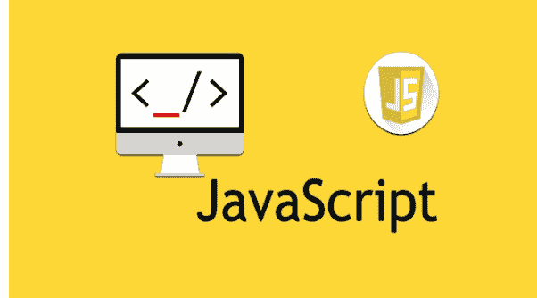

## 学习目标

学习本章后，你将能够：

1. 模型

2. Windows 对象

3. JavaScript 历史对象

4. 导航对象

5. 位置对象

## 引言

BOM 指 JavaScript 中的浏览器对象模型。BOM 用于 Windows 屏幕。BOM 指 Windows 对象。

### 基础计算机编程：JavaScript

现代浏览器为 JavaScript 实现了相同的方法和属性，通常被称为 BOM 的方法和属性。窗口对象由浏览器自动创建。

各种类型的 BOM（浏览器对象模型）

- Windows 对象

- 历史对象

- 导航对象

- 位置对象

- 屏幕对象

- 存储对象

### 8.1 浏览器对象模型

浏览器对象模型（BOM）用于与浏览器交互。

浏览器默认对象是`window`，意味着可以直接调用`window`的所有函数。例如：

- `window.alert("hello javatpoint");`

等同于：

- `alert("hello javatpoint");`

你可以使用窗口对象下定义的许多属性（其他对象），如`document`、`history`、`screen`、`navigator`、`location`、`innerHeight`、`innerWidth`。

## 8.2 WINDOWS 对象

`window`对象代表浏览器中的窗口。`window`对象由浏览器自动创建。

`window`是浏览器的对象，它不是 JavaScript 的对象。JavaScript 对象包括字符串、数组、日期等。

### 8.2.1 Window 对象的方法

`window`对象的重要方法如下：

| 方法 | 说明 |

| :--- | :--- |

| `Alert()` | 显示带有“确定”按钮的弹出消息。 |

| `Confirm()` | 在警报框中显示带有“确定”和“取消”按钮的消息。 |

| `Prompt()` | 获取用户输入，以便在对话框中显示文本消息。 |

| `Open()` | 打开当前窗口。 |

| `Close()` | 关闭当前窗口。 |

| `moveTo()` | 移动当前窗口。 |

| `resizeTo()` | 调整当前窗口的大小。 |

| `setTimeout()` | 在指定的时间后执行操作，如调用函数、评估表达式等。 |

浏览器是访问万维网的应用程序软件。

如果 HTML 文档包含`frame`或`iframe`，浏览器会为每个`frame`创建额外的`window`对象。

## 8.2 Windows 对象方法示例

我们可以逐一查看所有方法的示例。

### The `alert()` 方法

此方法用于向用户显示警报消息。它显示一个包含消息和用于所需的“确定”按钮的警报框。`alert()`方法接受一个参数，即在弹出框中显示的文本。

Message 是通信的媒介。

示例

自己尝试一下：

```html
<!DOCTYPE html>
<html>
<head>
  <meta charset="utf-8">
  <title>Alert Method</title>
</head>
<body>
  <h2>Window alert method</h2>
  <script>
  function alert() {
    alert("Welcome to CSharp");
  }
  </script>
  <input type="button" value="click" onclick="alert()">
</body>
</html>
```

### The `confirm()` 方法

此方法用于向用户显示警报消息并验证某些内容。它显示一个包含两个按钮（“确定”和“取消”）的警报框。当用户点击“确定”时，该框返回`true`。如果用户点击“取消”，该框则为`null`。

示例

自己尝试一下：

```html
<!DOCTYPE html>
<html>
<head>
  <meta charset="utf-8">
  <title>Confirm Message</title>
</head>
<body>
  <h3>window object confirm()</h3>
  <script>
  function msg(){
    var conf=confirm("Are you sure?"); //confirmation
    if(conf==true) {
      alert("ok");
    } else {
      alert("cancel");
    }
  }
  </script>
  <input type="button" value="Back" onclick="msg()">
</body>
</html>
```

User 是利用计算机或网络服务的人。

### The `Prompt()` 方法

行内的框通常用于在进入页面之前评估用户输入。当框弹出时，用户必须点击“确定”或“取消”以输入值并继续。它包含一条消息和一个文本字段。当用户点击“确定”时，该框返回输入值。当用户点击“取消”时，它返回`null`。

示例

自己尝试一下：

```html
<!DOCTYPE html>
<html>
<head>
  <title>Prompt</title>
</head>
<body>
  <h3>BOM Object Prompt()</h3>
  <script>
  function pmpt() {
    var input=prompt("Who are you?"); // input box
    alert("I am "+input);
  }
  </script>
  <input type="button" value="click" onclick="pmpt()">
</body>
</html>
```

随后，输入一个名称，将显示对话框。


## The `Open()` 方法

这将在新标签页或窗口中显示其内容。在下面的示例中，点击按钮将重定向到新的窗口。

**示例**

自己尝试一下：

```html
<!DOCTYPE html>
<html>
<head>
  <meta charset="utf-8">
  <title>BOM Open() Method</title>
</head>
<body>
  <h3>Open() Method</h3>
  <script>
  function msg() {
    open("https://www.c-sharpcorner.com"); //open the link next window
  }
  </script>
  <input type="button" value="Click_Next" onclick="msg()">
</body>
</html>
```

`Window`是墙、门、屋顶或车辆上的开口，允许光线通过，也可能允许声音，有时允许空气通过。

## The `setTimeout()` 方法

此方法在给定的毫秒数后执行操作，如调用函数、评估表达式等。

**示例**

自己尝试一下：

```html
<!DOCTYPE html>
<html>
<head>
  <meta charset="utf-8">
  <title>Methods</title>
</head>
<body>
  <h2>Objects setTimeout() Methods</h2>
  <script>
  function msg() {
    setTimeout(function() {
      alert("Welcome to CSharp after 2 seconds");
    }, 2000);
  }
  </script>
  <input type="button" value="click" onclick="msg()">
</body>
</html>
```

## 8.2.3 Windows 中的属性

| 属性 | 说明 |
| :--- | :--- |
| `innerHeight` | 返回窗口的高度。 |
| `innerWidth` | 返回窗口的宽度。 |
| `name` | 指定窗口的名称。 |

## 8.2.4 属性示例

`innerHeight`和`innerWidth`属性返回内容的高度和宽度。无法更改高度和宽度，因为这些属性是只读的。

**语法**

`window.innerHeight`

`window.innerWidth`

**示例**

自己尝试一下，

```html
<!DOCTYPE html>
<html>
<head>
  <meta charset="utf-8">
  <title>BOM property</title>
</head>
<body>
  <h2>Browser Object Model (BOM) properties</h2>
  <script>
  function prpt() {
    document.write("The innerHeight is:"+window.innerHeight+"<br>"); //inner height
    document.write("The innerWidth is:"+window.innerWidth); // inner width
  }
  </script>
  <input type="button" value="innerHeight_Width" onclick="prpt()">
</body>
</html>
```

## Name Property

`name`属性将返回窗口的名称。该属性通常用于在窗口创建后更改名称。

**示例**

```html
<!DOCTYPE html>
<html>
<head>
  <meta charset="utf-8">
  <title>BOM property</title>
</head>
<body>
  <h2>Browser Object Model (BOM) name properties</h2>
  <script type="text/javascript">
  function prt() {
    window.name = "c-sharp corner";
    document.write("The Name is :"+window.name); // windows name
  }
  </script>
  <input type="button" value="Click_window_name" onclick="prt()">
</body>
</html>
```

## 基础计算机编程：JavaScript

## 输出

## 8.3 JAVASCRIPT HISTORY 对象

JavaScript `history`对象表示用户访问过的 URL 数组。通过使用此对象，你可以加载之前的、向后的或任何特定的页面。

`history`属性是`window`的属性，因此可以通过以下方式访问：

- `window.history`

或者，

- `history`

让我们看看`history`对象的不同用法。

- `history.back()`; // 返回上一个页面

- `history.forward()`; // 前到下一个页面

- `history.go(2)`; // 前到后第 2 个页面

- `history.go(-2)`; // 回上第 2 个页面

### 8.3.1 JavaScript History 对象的属性

`history`对象只有 1 个属性。

### 8.3.2 JavaScript History 对象的方法

`history`对象只有 3 个方法。

| 编号 | 方法 | 说明 |
|---|---|---|
| 1 | `forward()` | 加载下一个页面。 |
| 2 | `back()` | 加载上一个页面。 |
| 3 | `go()` | 加载指定的页码。 |

## 8.4 NAVIGATOR 对象

`Navigator`对象用于浏览器检测。它可以被用于获取浏览器信息，如版本和浏览器类型。

- `Navigator`对象中包含两个特征，
- 方法和
- 属性

### 8.4.1 Navigator 对象中的方法

下表包含了 JavaScript 中 `Navigator`对象的方法。

| 方法 | 说明 |
|---|---|
| `javaEnabled()` | 它指定浏览器中是否启用了 Java。 |
| `taintEnabled()` | 它指定浏览器中是否启用了数据字段。 |

### 8.4.2 Navigator 对象方法的示例

我们可以逐一查看`location`方法的示例，

## `javaEnabled()` 方法

`javaEnabled()`方法用于返回一个布尔值，指示浏览器中是否启用了 Java。如果浏览器中启用了 Java，则返回 `true`，否则返回 `false`。

## 语法

`navigator.javaEnabled()`

### 示例

以下程序在 HTML 中演示了`navigator.javaEnabled()`方法。

```html
<!DOCTYPE html>
<html>
<head>
  <meta charset="utf-8">
  <title>Navigator 对象方法</title>
</head>
<body>
  <h2>javaEnabled () 方法</h2>
  <button onclick="java()">点击检查</button>
  <p id="javaEnabled"></p>
  <script type="text/javascript">
  function java() {
    var ch="Java 状态为: " + navigator.javaEnabled();
    document.getElementById("javaEnabled").innerHTML = ch;
  }
  </script>
</body>
</html>
```

## `taintEnabled()` 方法

`Navigator.taintEnabled()`方法在 JavaScript 1.5 版本中应尽量避免使用，后来被移除以防止未来的运行时错误。它返回一个布尔值 `false`，指定浏览器中是否启用了数据污染功能。

## 语法

`navigator.taintEnabled()`

### 示例

以下程序在 HTML 中演示了`taintEnabled`方法。

```html
<!DOCTYPE html>
<html>
<head>
  <meta charset="utf-8">
  <title>Navigator 对象方法</title>
</head>
<body>
  <h2>taintEnabled () 方法</h2>
  <input type="button" value="点击检查" onclick="taint()">
  <script language="JavaScript">
  function taint() {
    var temp = navigator.taintEnabled();
    alert(window.navigator.taintEnabled());
  }
  </script>
</body>
</html>
```

## 输出

### 8.4.3 Navigator 对象中的属性

下表包含了 JavaScript 中 `Navigator`对象的属性。

| 属性 | 说明 |
|---|---|
| `appName` | 指定浏览器的名称。 |
| `appVersion` | 指定浏览器的版本。 |
| `appCode` | 指定浏览器的代码。 |
| `cookieEnabled` | 指定浏览器是否启用了 cookie。 |
| `onLine` | 返回浏览器是否在线。 |
| `language` | 返回语言信息。 |
| `platform` | 返回平台信息。 |

### 8.4.4 Navigator 示例

我们可以看到 `Navigator`属性的示例，

## `appName`

它返回浏览器的名称。这是一个只读属性。

## 语法

`navigator.appName`

### 示例

以下程序在 HTML 中演示了`appName`属性。

```html
<!DOCTYPE html>
<html>
<head>
  <meta charset="utf-8">
  <title>Navigator 对象方法</title>
</head>
<body>
  <h2>appName 属性</h2>
  <script>
  document.write(navigator.appName);
  </script>
</body>
</html>
```

## 输出

## `appCode`

它返回浏览器的代码。`Navigator`属性。

## 语法

`navigator.appCode`

### 示例

以下程序在 HTML 中演示了`appCode`属性。

```html
<!DOCTYPE html>
<html>
<head>
  <meta charset="utf-8">
  <title>Navigator 对象方法</title>
</head>
<body>
  <h2>appCode 属性</h2>
  <script>
  document.write(navigator.appCode);
  </script>
</body>
</html>
```

## `appVersion`

它返回浏览器的版本。`Navigator`属性。

## 语法

`navigator.appVersion`

### 示例

以下程序在 HTML 中演示了`appVersion`属性。

```html
<!DOCTYPE html>
<html>
<head>
  <meta charset="utf-8">
  <title>Navigator 对象方法</title>
</head>
<body>
  <h2>appVersion 属性</h2>
  <script>
  document.write(navigator.appVersion);
  </script>
</body>
</html>
```

## `cookieEnabled`

如果浏览器启用了 cookie，则返回 `true`，否则返回 `false`。它返回一个布尔值，指示浏览器是否启用了 cookie。

## 语法

`navigator.cookieEnabled`

### 示例

以下程序在 HTML 中演示了`navigator.cookieEnabled`属性。

```html
<!DOCTYPE html>
<html>
<head>
  <meta charset="utf-8">
  <title>Navigator 对象方法</title>
</head>
<body>
  <h2>cookieEnabled 属性</h2>
  <script>
  document.write(navigator.cookieEnabled);
  </script>
</body>
</html>
```

## `onLine`

`Navigator.onLine`属性用于返回一个布尔值，指示浏览器是否在线。

## 语法

`navigator.onLine`

### 示例

以下程序在 HTML 中演示了`navigator.onLine`属性。

```html
<!DOCTYPE html>
<html>
<head>
  <meta charset="utf-8">
  <title>Navigator 对象方法</title>
</head>
<body>
  <h2>onLine 属性</h2>
  <script>
  document.write(navigator.onLine);
  </script>
</body>
</html>
```

## `geolocation` 属性

`navigator.geolocation`属性提供一个地理位置对象，用于跟踪用户的状态。

# JavaScript BOM

## JavaScript 中的 BOM Windows 对象 Navigator geoLocation 属性

```html
<script>
  document.write("Navigator.appName: "+navigator.geolocation);
</script>
</body>
</html>
```

# 输出结果

# `language` 属性

`Navigator.language`属性用于返回浏览器语言版本。例如：`en-us`, `fr`, `en`, `de`。

# 语法

`navigator.language`

### 示例

以下程序演示了 HTML 中的`navigator.language`属性。

```html
<!DOCTYPE html>
<html>
<head>
  <meta charset="utf-8">
  <title>language</title>
```

### 基础计算机编程：JavaScript

```html
</head>
<body>
  ## JavaScript 中的 BOM Windows 对象 Navigator language 属性
  <script>
    document.write("Navigator.language: "+navigator.language);
  </script>
</body>
</html>
```

# 输出结果

# `platform` 属性

`Navigator.platform`属性用于将浏览器重定向到编译后的站点。例如：`win32`, `win16`, `linux686`

# 语法

`navigator.platform`

### 示例

以下程序演示了 HTML 中的`navigator.platform`属性。


```html
<!DOCTYPE html>
<html>
<head>
  <meta charset="utf-8">
  <title>platform</title>
</head>
<body>
  ## JavaScript 中的 BOM Windows 对象 Navigator 属性
  <script>
    document.write("Navigator platform:"+navigator.platform);
  </script>
</body>
</html>
```

# 输出结果

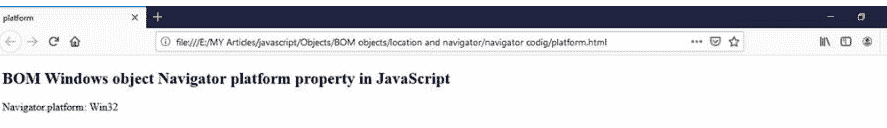

JavaScript 中的 BOM Windows 对象 Navigator platform 属性

## 8.5 LOCATION 对象

JavaScript 中的`location`窗口使其能够保存当前页面位置或地址（URL）的信息，并将浏览器重定向到新页面。

`location`对象是`window`对象的一部分，通过`windows.location`进行访问。`location`对象没有通用标准，但所有主流浏览器都支持`location`对象。

`location`对象有两个特性：

- 方法
- 属性

## 8.5.1 Location 对象中的方法

下表包含了 JavaScript 中`location`对象的方法。

| 方法 | 描述 |
| --- | --- |
| `assign()` | 在网页上加载一个新文档。 |
| `reload()` | 使用`location.href`属性重新加载当前文档。 |
| `replace()` | 用新文档替换当前文档。无法通过浏览器的“后退”按钮返回到上一个文档。 |

## 8.5.2 Location 对象方法示例

我们可以逐一查看`location`方法的示例。

### `assign()`方法

`location.assign()`方法用于在新页面中加载新文档。无法通过浏览器的“后退”按钮返回到上一个文档。

#### 语法

`location.assign(URL)`

#### 示例

以下程序演示了 HTML 中的`location.assign()`方法。

```html
<!DOCTYPE html>
<html>
<head>
  <meta charset="utf-8">
  <title>assign()</title>
</head>
<body>
  ## location assign() 方法
  <button ondblclick="assign()"></button>
  <script>
    function assign() {
      location.assign("www.c-sharpcorner.com"); // 加载新页面
    }
  </script>
</body>
</html>
```

# 输出结果

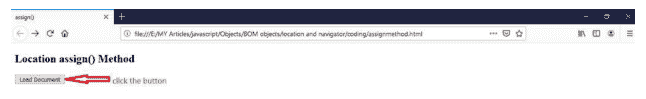

### `reload()`方法

该方法重新加载当前文档，用于`location.href`属性中。它类似于浏览器中的刷新按钮。

#### 语法

`location.reload()`

#### 示例

以下程序演示了 HTML 中的`location.reload()`方法。

```html
<!DOCTYPE html>
<html>
<head>
  <meta charset="utf-8">
  <title>reload()</title>
</head>
<body>
  ## reload() 方法
  <button onclick="reload()"></button>
  <script>
    function reload() {
      location.reload(); // 重新加载页面
    }
  </script>
</body>
</html>
```

# 输出结果

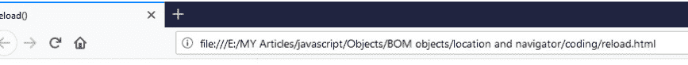

`reload()`方法

点击按钮

### `replace()`方法

用指定的新文档替换当前文档。`location`对象中的`replace()`方法用于用另一个页面替换当前页面。

#### 语法

`location.replace(URL)`

#### 示例

以下程序演示了 HTML 中的`location.replace()`方法。

```html
<!DOCTYPE html>
<html>
<head>
  <meta charset="utf-8">
  <title>replace()</title>
</head>
<body>
  ## replace() 方法
  <button onclick="replace()">replace</button>
  <script>
    function replace() {
      location.replace("https://www.c-sharpcorner.com"); // 将当前页面替换为新页面
    }
  </script>
</body>
</html>
```

# 输出结果


## 8.5.3 Location 对象中的属性

下表包含了 JavaScript 中`location`对象的属性。

| 属性 | 描述 |
| --- | --- |
| `href` | HTML 中的`href`用于设置或重定向当前页面的当前（URL）。 |
| `hash` | 以`#`开头的字符串指定 HTTP URL 中的锚点名称。 |
| `host` | 指向包含主机名的字符串。 |
| `hostname` | 提供网站的主机、子域名和服务器名。 |
| `search` | 指定 URL 的搜索区域。 |
| `port` | 返回当前页面的端口号。 |
| `pathname` | 返回页面的路径（URL）和文件名（URL）。 |

## 8.5.4 Location 示例

我们可以查看以下`location`属性示例。

### `href`属性

HTML 中的`location.href`属性用于设置或重定向当前页面的当前（URL）。`location.href`返回完整的 URL 和协议。

#### 语法

`location.href = URL`

#### 示例

以下程序演示了`href`属性。

```html
<!DOCTYPE html>
<html>
<head>
  <meta charset="utf-8">
  <title>href Property</title>
</head>
<body>
  ## DOM href 属性
  <p>
    HTML 中的 location href 属性用于设置或重定向当前页面的当前 (URL)。
  </p>
  <button onclick="myhref()">返回 URL</button>
  <p id="value"></p>
  <script>
    function myhref() {
      var href = location.href;
      document.getElementById("value").innerHTML = href; // 获取当前文档的地址
    }
  </script>
</body>
</html>
```

### `hash`属性

`location.hash`属性以`#`开头指定 HTTP URL 中的锚点名称。

#### 语法

`location.hash`

#### 示例

以下程序演示了`hash`属性。

```html
<!DOCTYPE html>
<html>
<head>
  <title>hash Property</title>
</head>
<body>
  ## 锚点 hash 属性
  <p id="hash">location hash 属性以 # 开头指定 HTTP URL 中的锚点名称。</p>
  <button onclick="myhash()">点击这里</button>
  <p id="hash1"></p>
  <script>
    function myhash() {
      var has = document.getElementById("hash").hash;
      document.getElementById("hash1").innerHTML = has;
    }
  </script>
</body>
</html>
```

### `hostname`属性

`location`属性用于返回当前 URL 的主机名。它包含 URL 的服务器名、域名和 IP 地址。

#### 示例

以下程序演示了`location.hostname`属性。

```html
<!DOCTYPE html>
<html>
<head>
  <title>hostname Property</title>
</head>
<body>
  <h2>hostname 属性</h2>
  <button onclick="host()">点击这里</button>
  <p id="host1"></p>
  <script>
    function host() {
      var host2 = location.hostname;
      document.getElementById("host1").innerHTML = host2;
    }
  </script>
</body>
</html>
```

## 计算机基础编程：JavaScript

# 输出

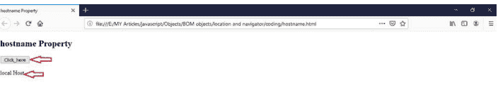

### `pathname`属性

`location.pathname`属性用于查找当前页面的路径名和文件名。

#### 语法

`Location.pathname = path`

#### 示例

以下程序说明了`location.pathname`属性。

```html
<!DOCTYPE html>
<html>
<head>
  <title>pathname 属性</title>
</head>
<body>
  <h2>Location pathname 属性</h2>
  <button onclick="mypath()">点击这里</button>
  <p id="path"></p>
  <script>
    function mypath() {
      var p1 = location.pathname;
      document.getElementById("path").innerHTML = p1;
    }
  </script>
</body>
</html>
```

## 计算机基础编程：JavaScript

# 输出

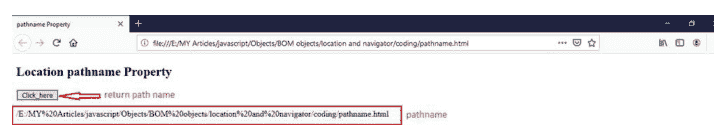

### `port`属性

`location.port`属性返回当前 URL 的端口号。

#### 语法

- `location.port`
- `location.port = 8090`

#### 示例

以下程序说明了`location.port`属性。

```html
<!DOCTYPE html>
<html>
<head>
  <title>Port 属性</title>
</head>
<body>
  <h2>Location port 属性</h2>
  <p><b>注意：</b>如果端口号是<b>默认</b>的（http 为 80，https 为 443）</p>
  <button onclick="port()">点击这里</button>
  <p id="path"></p>
  <script>
    function port() {
      var port2 = location.port;
      var p1 = location.port = 8080;
      document.getElementById("path").innerHTML = port2;
      document.write(p1);
    }
  </script>
</body>
</html>
```


# JavaScript BOM

# 输出

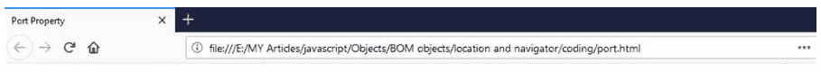

# Location port 属性

注意：如果端口号是默认的（http 为 80，https 为 443）。


## 8.6 SCREEN 对象

JavaScript `screen`对象包含浏览器屏幕的信息。它可以用于显示屏幕宽度、高度、颜色深度、像素深度等。

`navigator`对象是`window`的属性，因此可以通过以下方式访问：

- `window.screen`

或者：

- `screen`


## 8.6.1 JavaScript screen 对象属性

`screen`对象有许多属性可以返回浏览器的信息。

| 编号 | 属性 | 说明 |
| --- | --- | --- |
| 1 | `width` | 返回屏幕宽度 |
| 2 | `height` | 返回屏幕高度 |
| 3 | `availWidth` | 返回可用宽度 |
| 4 | `availHeight` | 返回可用高度 |
| 5 | `colorDepth` | 返回颜色深度 |
| 6 | `pixelDepth` | 返回像素深度。 |

## 8.6.2 JavaScript screen 对象示例

让我们来看看`screen`对象的不同用法。

```html
<script>
  document.writeln("<br>screen.width: " + screen.width);
  document.writeln("screen.height: " + screen.height);
  document.writeln("screen.availWidth: " + screen.availWidth);
  document.writeln("screen.availHeight: " + screen.availHeight);
  document.writeln("screen.colorDepth: " + screen.colorDepth);
  document.writeln("screen.pixelDepth: " + screen.pixelDepth);
</script>
```


## 总结

- JavaScript `screen`对象包含浏览器屏幕的信息。它可以用于显示屏幕宽度、高度、颜色深度、像素深度等。
- `navigator`对象是`window`的属性，因此可以通过以下方式访问：`window.screen`或`screen`。
- `screen`对象有许多属性可以返回浏览器的信息，如`width`、`height`、`availWidth`、`availHeight`、`colorDepth`和`pixelDepth`。
- `location`对象有`pathname`、`pathname`等属性。

# `pathname`属性

`location.pathname`属性用于查找当前页面的路径名和文件名。

## 语法

`Location.pathname = path`

### 示例

以下程序说明了`location.pathname`属性。

```html
<!DOCTYPE html>
<html>
<head>
  <title>pathname 属性</title>
</head>
<body>
  <h2>Location pathname 属性</h2>
  <button onclick="mypath()">点击这里</button>
  <p id="path"></p>
  <script>
    function mypath() {
      var p1 = location.pathname;
      document.getElementById("path").innerHTML = p1;
    }
  </script>
</body>
</html>
```

## 计算机基础编程：JavaScript

# 输出


# `Port`属性

`location.port`属性返回当前 URL 的端口号。

## 语法

- `location.port`
- `location.port = 8090`

### 示例

以下程序说明了`location.hash`属性。

```html
<!DOCTYPE html>
<html>
<head>
  <title>Port 属性</title>
</head>
<body>
```


# Port 属性

`<title>`Port 属性`</title>`

`</head>`

`<body>`

`<h2>`Location port 属性`</h2>`

`<p><b>`注意：`</b>`如果端口号是`<b>默认</b>`的（`http` 为 80，`https` 为 443）`</p>`

`<button onclick="port()">点击这里</button>`

`<p id="path"></p>`

# JavaScript BOM

```html
<script>
function port()
{
  var port2 = location.port;
  var p1 = location.port = 8080;
  document.getElementById("path").innerHTML = port2;
  document.write(p1);
}
</script>
```

`</body>`

`</html>`

# 输出

# Location port 属性

注意：如果端口号是默认的（`http` 为 80，`https` 为 443）

## 8.6 SCREEN 对象

JavaScript `screen` 对象包含浏览器屏幕的信息。它可以用于显示屏幕宽度、高度、颜色深度、像素深度等。

`navigator` 对象是 `window` 的属性，因此可以通过以下方式访问：

1. `window.screen`
2. `screen`

## 8.6.1 JavaScript screen 对象属性

`screen` 对象有许多属性可以返回浏览器的信息。

| 编号 | 属性 | 说明 |
|---|---|---|
| 1 | `width` | 返回屏幕宽度 |
| 2 | `height` | 返回屏幕高度 |
| 3 | `availWidth` | 返回可用宽度 |
| 4 | `availHeight` | 返回可用高度 |
| 5 | `colorDepth` | 返回颜色深度 |
| 6 | `pixelDepth` | 返回像素深度 |

## 8.6.2 JavaScript screen 对象示例

```html
<script>
document.writeln("<br>screen.width: "+screen.width);
document.writeln("screen.height: "+screen.height);
document.writeln("screen.availWidth: "+screen.availWidth);
document.writeln("screen.availHeight: "+screen.availHeight);
document.writeln("screen.colorDepth: "+screen.colorDepth);
document.writeln("screen.pixelDepth: "+screen.pixelDepth);
</script>
```

## 总结

- JavaScript `screen` 对象包含浏览器屏幕的信息。它可以用于显示屏幕宽度、高度、颜色深度、像素深度等。
- `navigator` 对象是 `window` 的属性，因此可以通过以下方式访问：`window.screen` 或 `screen`。
- `screen` 对象有许多属性可以返回浏览器的信息，如 `width`、`height`、`availWidth`、`availHeight`、`colorDepth` 和 `pixelDepth`。
- `location` 对象有 `pathname` 等属性。

# pathname 属性

`location.pathname` 属性用于查找当前页面的路径名和文件名。

# 语法

- `Location.pathname = path`

### 示例

```html
<!DOCTYPE html>
<html>
<head>
<title>pathname 属性</title>
</head>
<body>
<h2>Location pathname 属性</h2>
<button onclick="mypath()">点击这里</button>
<p id="path"></p>
<script>
function mypath()
{
  var p1 = location.pathname;
  document.getElementById("path").innerHTML = p1;
}
</script>
</body>
</html>
```

## 知识检查

1. BOM 的全称是什么？
   a. Browser Object Method
   b. Browser Object Model
   c. Browser Oriented Method
   d. Browser Oriented

2. 哪种方法用于移动窗口？
   a. `Move()`
   b. `Move to()`
   c. `Window move()`
   d. `Window()`

3. `history` 属性属于哪个对象？
   a. Document
   b. Element
   c. Location
   d. Event

4. `location` 属性代表什么？
   a. Current DOM object
   b. Current URL
   c. Both DOM object and URL
   d. Document

5. 下列哪个是 `location` 对象的属性？
   a. `protocol`
   b. `host`
   c. `host`
   d. `hostname`

6. `hash` 属性的返回类型是什么？
   a. Query string
   b. Packets
   c. String
   d. Fragment identifier

7. 哪种方法在加载新文档之前从历史记录中删除当前文档？
   a. `modify()`
   b. `assign()`
   c. `replace()`
   d. `remove()`

8. 为什么 `replace()` 方法比 `assign()` 方法更好？
   a. Reliable
   b. Highly manageable
   c. More efficient
   d. Handles

9. `assign()` 方法的目的是什么？
   a. Only loading
   b. Loading of window and display
   c. Displays already window
   d. Unloading of window

10. `history` 属性属于哪个对象？
    a. Element
    b. Window
    c. History
    d. Location

## 复习题

1. BOM 的全称是什么？
2. `window` 对象的不同类型有哪些？
3. `history` 对象的哪种方法？
4. `navigator` 对象是什么？
5. `location` 对象的哪两个方法？

## 检查结果

1. (b) 2. (d) 3. (a) 4. (b) 5. (c)
6. (d) 7. (c) 8. (d) 9. (b) 10. (c)

## 参考文献

1. Enzer, Larry (31 August 2018). "The Evolution of the Web Browsers". Monmouth Web Developers. Retrieved 31 August 2018.
2. Gillies, James; Cailliau, R. (2000). How the Web was Born: The Story of the World Wide Web. Oxford University Press. pp. 6. ISBN 0192862073.
3. Stewart, William. "Web Browser History". Archived from the original on 20 January 2011.

# 第 9 章 JavaScript 事件

"JavaScript 是我所知道的唯一语言，人们觉得在开始使用它之前不需要学习它。"
—— 道格拉斯·克罗尔福德（Douglas Crockford）

## 学习目标

学习完本章后，你将能够：

1. 讨论 JavaScript 事件
2. 描述 JavaScript 事件的类型
3. 理解 JavaScript 的 `addEventListener()`
4. 学习 JavaScript `onclick` 事件
5. 理解 JavaScript `dblclick` 事件
6. 选择 JavaScript `onload`
7. 学习 JavaScript `onresize` 事件

## 引言

JavaScript 通过事件与文档的 HTML 代码进行交互，这些事件是在文档或浏览器窗口发生特定的感兴趣时刻时被触发的。

### 基础计算机编程：JavaScript

JavaScript 事件使网页具有交互性和响应性。这些事件是异步的（即它们可以随时发生）。大多数事件由用户操作触发，但也有一些例外，例如事件加载。

当事件发生时，浏览器会采取一些默认操作（例如点击链接将打开属性 `href` 中指定的地址）。事件可以是点击、鼠标悬停、按键等等。

JavaScript 通过调用函数来响应事件，该函数会执行在代码中定义的某些任务。

截至目前，JavaScript 有三种用于编程处理事件的事件模型：内联模型、脚本模型和 DOM2 模型。

JavaScript 可以响应以下类型的事件：鼠标操作、键盘操作、表单操作、页面加载、时间间隔和错误。

# 9.1 JavaScript 事件

对象状态的变化被称为"事件（Event）"。在 HTML 中，有各种事件可以代表用户或浏览器执行了某些活动。当 JavaScript 代码被包含在 HTML 中时，JS 就会对这些事件做出响应并允许执行。这种对事件做出响应的过程被称为事件处理（Event Handling）。因此，JS 通过事件处理器（Event Handlers）处理 HTML 事件。

> 当用户点击浏览器时，添加 JS 代码，将在事件发生时执行的任务。

一些 HTML 事件及其事件处理器包括：

### 鼠标事件

| 执行的事件 | 事件处理器 | 说明 |
| --- | --- | --- |
| `click` | `onclick` | 当鼠标在元素上点击时 |
| `mouseover` | `onmouseover` | 当鼠标光标悬停在元素上时 |
| `mouseout` | `onmouseout` | 当鼠标光标离开元素时 |
| `mousedown` | `onmousedown` | 当在元素上按下鼠标按钮时 |
| `mouseup` | `onmouseup` | 当在元素上释放鼠标按钮时 |
| `mousemove` | `onmousemove` | 当发生鼠标移动时 |

#### 点击事件

```html
<html>
<head> Javascript Events </head>
<body>
<script language="JavaScript" type="text/Javascript">
<!------
function clickevent()
{
  document.write("This is JavaTpoint");
}
//-->
</script>
<form>
  <input type="button" onclick="clickevent()" value="Who's this?"/>
</form>
</body>
</html>
```

### 基础计算机编程：JavaScript

#### 鼠标悬停事件 (MouseOver)

```html
<html>
<head>
<h1> Javascript Events</h1>
</head>
<body>
<script language="Javascript" type="text/javascript">
<!--
function mouseoverevent()
{
  alert("This is JavaPoint");
}
//-->
</script>
<p onmouseover="mouseoverevent()"> 将光标悬停在我上方</p>
</body>
</html>
```

### 键盘事件

| 执行的事件 | 事件处理器 | 说明 |
| --- | --- | --- |
| `Keydown` & `Keyup` | `onkeydown` & `keyup` | 当用户按下并然后释放按键时 |

#### KeyDown 事件

```html
<html>
<head> Javascript Events</head>
<body>
  <h2>在此输入内容</h2>
  <input type="text" id="input1" onkeydown="keykeydown()">
  <script>
  <!--
  function keykeydown() {
    document.getElementById("input1");
    alert("Pressed a key");
  }
  //-->
  </script>
</body>
</html>
```

### 表单事件

| 执行的事件 | 事件处理器 | 说明 |
| --- | --- | --- |
| `focus` | `onfocus` | 当用户聚焦于元素时 |
| `submit` | `onsubmit` | 当用户提交表单时 |
| `blur` | `onblur` | 当焦点离开元素时 |
| `change` | `onchange` | 当用户修改或更改元素的值时 |

#### 聚焦事件 (Focus)

```html
<html>
<head> Javascript Events</head>
<body>
  <h2>在此输入内容</h2>
  <input type="text" id="input1" onclick="focusevent()">
  <script>
  <!--
  function focusevent() {
    document.getElementById("input1");
    alert("Pressed a key");
  }
  -->
  </script>
</body>
</html>
```

### 窗口事件

| 执行的事件 | 事件处理器 | 说明 |
| --- | --- | --- |
| `load` | `onload` | 当页面加载完成时 |
| `unload` | `onunload` | 当用户离开页面时 |
| `resize` | `onresize` | 当窗口调整大小时 |

#### 加载事件 (Load)

```html
<html>
<head> Javascript Events</head>
<body onload="alert('Page loaded successfully')">
  <script>
  document.write("The page has been loaded");
  </script>
</body>
</html>
```


# 9.1 JavaScript 事件

对象状态的变化被称为“事件”。在 HTML 中，有各种事件可以代表用户或浏览器执行了某些活动。当 JavaScript 代码被包含在 HTML 中时，JS 就会对这些事件做出响应并允许执行。这种对事件做出响应的过程被称为事件处理。因此，JS 通过事件处理器处理 HTML 事件。

JavaScript 可以响应以下类型的事件：鼠标操作、键盘操作、表单操作、页面加载、时间间隔和错误。

JavaScript 事件使网页具有交互性和响应性。这些事件是异步的（即它们可以随时发生）。大多数事件由用户操作触发，但也有一些例外，例如事件加载（即它们可以随时发生）。

当事件发生时，浏览器会采取一些默认操作（例如点击链接将打开属性 `href` 中指定的地址）。事件可以是点击、鼠标悬停、按键等等。

JavaScript 通过调用函数来响应事件，该函数会执行在[代码]中定义的某些任务。

截至目前，JavaScript 有三种用于编程处理事件的事件模型：内联模型、脚本模型和 DOM2 模型。

> 当用户点击浏览器时，添加 JS 代码，将在事件发生时执行执行的任务。

一些 HTML 事件及其事件处理器包括：

## 鼠标事件

| 执行的事件 | 事件处理器 | 说明 |
| --- | --- | --- |
| `click` | `onclick` | 当鼠标在元素上点击时 |
| `mouseover` | `onmouseover` | 当鼠标光标悬停在元素上时 |
| `mouseout` | `onmouseout` | 当鼠标光标离开元素时 |
| `mousedown` | `onmousedown` | 当在元素上按下鼠标按钮时 |
| `mouseup` | `onmouseup` | 当在元素上释放鼠标按钮时 |
| `mousemove` | `onmousemove` | 当发生鼠标移动时。 |

### 点击事件

```html
<html>
<head>Javascript Events</head>
<body>
<script language="JavaScript" type="text/Javascript">
<!------
function clickevent()
{
  document.write("This is JavaTpoint");
}
//-->
</script>
<form>
  <input type="button" onclick="clickevent()" value="Who's this?"/>
</form>
</body>
</html>
```


### 基础计算机编程：JavaScript

### 鼠标悬停事件（MouseOver）

```html
<html>
<head>
<h1>Javascript Events</h1>
</head>
<body>
<script language="Javascript" type="text/javascript">
<!--
function mouseoverevent()
{
  alert("This is JavaPoint");
}
//-->
</script>
<p onmouseover="mouseoverevent()">将光标悬停在我上方</p>
</body>
</html>
```

## 键盘事件

| 执行的事件 | 事件处理器 | 说明 |
| --- | --- | --- |
| `Keydown` & `Keyup` | `onkeydown` & `keyup` | 当用户按下并然后释放按键时 |

### KeyDown 事件

```html
<html>
<head>Javascript Events</head>
<body>
  <h2>在此输入内容</h2>
  <input type="text" id="input1" onkeydown="keykeydown()">
  <script>
  <!--
  function keykeydown() {
    document.getElementById("input1");
    alert("Pressed a key");
  }
  //-->
  </script>
</body>
</html>
```


## 表单事件

| 执行的事件 | 事件处理器 | 说明 |
| --- | --- | --- |
| `focus` | `onfocus` | 当用户聚焦于元素时 |
| `submit` | `onsubmit` | 当用户提交表单时 |
| `blur` | `onblur` | 当焦点离开元素时 |
| `change` | `onchange` | 当用户修改或更改元素的值时 |

### 聚焦事件（Focus）

```html
<html>
<head>Javascript Events</head>
<body>
  <h2>在此输入内容</h2>
  <input type="text" id="input1" onclick="focusevent()">
  <script>
  <!--
  function focusevent() {
    document.getElementById("input1");
    alert("Pressed a key");
  }
  -->
  </script>
</body>
</html>
```

## 窗口事件

| 执行的事件 | 事件处理器 | 说明 |
| --- | --- | --- |
| `load` | `onload` | 当页面加载完成时 |
| `unload` | `onunload` | 当用户离开页面时 |
| `resize` | `onresize` | 当窗口调整大小时 |

### 加载事件（Load）

```html
<html>
<head>Javascript Events</head>
<body onload="alert('Page loaded successfully')">
  <script>
  document.write("The page has been loaded");
  </script>
</body>
</html>
```


# 9.2 JavaScript 事件类型

以下是 JavaScript 事件类型：

## 9.2.1 用户界面事件

这些发生在用户与浏览器的交互时，而不是在页面上。在 UI 事件中，我们通常将 JavaScript 事件监听器附加在窗口上。以下是：

- `load`：页面加载完成。
- `unload`：用户离开页面。
- `error`：浏览器遇到错误。
- `resize`：用户调整窗口大小。
- `scroll`：用户上下滚动浏览器窗口。

## 9.2.2 聚焦和模糊事件

这些事件发生在 HTML 元素获得或失去焦点时。它们通常用于表单，特别是当你想执行以下任务时：

- 在用户与元素交互时显示提示或反馈。
- 当用户从一个控件移动到另一个时触发表单验证，而无需提交表单。

以下是：

- `focus`：元素获得焦点时。
- `blur`：元素失去焦点时触发。
- `focusin`：与 `focus` 事件相同。但 Firefox 不支持 `focusin` 事件。
- `focusout`：与 `blur` 事件相同。这是 JavaScript 中的新事件类型，因此目前 Firefox 不支持。

## 9.2.3 鼠标事件

触摸屏是输入（触摸面板）和输出（显示）设备的组合。

这些事件发生在鼠标移动或用户点击按钮时。页面上的所有元素都支持这些事件并使用冒泡。这些操作在触摸设备上的工作方式不同。阻止鼠标事件的默认行为可能会导致意外的结果。各种鼠标事件有：

- `click`：用户点击主鼠标按钮（通常是左键）时触发。当元素获得焦点时按下键盘上的 Enter 键，该事件也会触发。
- Touch-screen：在屏幕上点击一下相当于单击左键。
- `dblclick`：用户快速连续点击两次主鼠标按钮时触发。
- Touch-screen：在屏幕上双击相当于双击单击。

### JavaScript 事件

可访问性：你可以将上述两个事件添加到任何元素上，但最好将它们应用到通常会被点击的项目上，否则将无法通过键盘导航访问。下面讨论的所有鼠标事件都无法通过键盘触发。

- `mousedown`：当用户按下任何鼠标键时触发此事件。
  - 触摸屏：你可以使用 `touchstart` 事件。
- `Mouseup`：当用户松开鼠标键时触发此事件。
  - 触摸屏：你可以使用 `touchend` 事件。

我们将 `mousedown` 和 `mouseup` 事件分离开来，是为了在游戏开发中添加拖放功能或控制逻辑。请记住，`click` 事件是 `mousedown` 和 `mouseup` 事件的组合。

- `mouseover`：当用户将光标从元素外部移动到元素内部时触发。我们可以说它是在光标移动到元素上方时触发的。
- `mouseout`：当用户将光标从元素内部到到外部时触发。我们可以说它是在光标离开元素时触发的。
- `mousemove`：当用户在元素周围移动光标时触发此事件。此事件会被频繁触发。

`mouseover` 和 `mouseout` 事件通常用于更改网页上图形的外观。更优的替代方案是使用 CSS 的 `:hover` 伪类。

## 9.2.4 键盘事件

当用户与键盘交互时，这些事件会在任何设备上触发。

- `input`：当 `<input>` 或 `<textarea>` 的值改变时触发此事件（在 IE9 中删除操作时不触发）。在旧版浏览器中，可以使用 `keydown` 作为后备方案。
- `keydown`：当用户按下键盘上的任何按键时触发此事件。如果用户按住按键，此事件会重复触发。
- `keypress`：当用户按下会在屏幕上打印字符的按键时触发此事件。如果用户按住按键，此事件会重复触发。此事件不会为回车键、Tab 键或箭头键触发；但 `keydown` 事件会。
- `keyup`：当用户松开键盘上的按键时触发 `keyup` 事件。

`keydown` 和 `keypress` 事件在字符显示在屏幕之前触发，而 `keyup` 在显示之后触发。

### 基础计算机编程：JavaScript

若想在使用 `keydown` 和 `keypress` 事件时知道按下的是哪个键，事件对象有一个 `keyCode` 属性。该属性不返回该键的字母，而是返回该键小写的 ASCII 代码。

早些时候，赫曼·霍勒礼（Herman Hollerith）开发了第一个打孔设备，到 20 世纪 20 年代，很快演变为包含类似于普通打字机的文本和数字输入按键。


## 9.2.5 表单事件

这些事件在网页上使用表单时很常见。特别是 `submit` 事件，最用于验证（检查表单值）。正如我们的教程《JavaScript 特性》所述：如果用户漏掉了任何必需信息或输入了错误内容，在发送数据到服务器之前进行验证会更快。下面的列表解释了用户可以的不同表单事件。

- `submit`：当用户提交表单时在代表 `<element>` 的节点上触发此事件。
- `change`：当各种表单元素的状态改变时触发。这比使用 `click` 事件更好，因为点击不是用户与表单交互的唯一方式。
- `input`：该事件对于 `<input>` 和 `<textarea>` 元素非常常见。

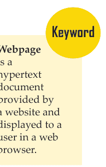

我们在表单中使用 `focus` 和 `blur` 事件，但它们也可以与其他元素、链接结合使用。

## 9.2.6 变异事件与观察者

当 DOM 树结构发生变化时，会触发变异事件。树的变化可能是由于你的脚本添加或删除了 DOM 节点。但这些有一个可以替代它们的方案：变异观察者（mutation observers）。以下是 JavaScript 中大量的变异事件。

- `DOMNodeInserted`：当脚本使用 `appendChild()`、`insertBefore()` 等在 DOM 树中插入新节点时触发此事件。
- `DOMNodeRemoved`：当脚本使用 `removeChild()`、`replaceChild()` 等从树中移除现有节点时触发此事件。


### JavaScript 事件

- `DOMSubtreeModified`：当 DOM 树结构发生变化时（即上述两个事件发生时）触发此事件。
- `DOMNodeInsertedIntoDocument`：当脚本在 DOM 树中插入的节点作为文档中已存在节点的后代时触发此事件。
- `DOMNodeRemovedFromDocument`：当脚本从 DOM 树中移除的节点作为文档中已存在节点的后代时触发此事件。

变异事件的问题在于，对页面的大量更改会导致页面变慢或无响应。这还可能触发其他事件监听器，修改 DOM 并导致更多变异事件的触发。这就是脚本中引入变异观察者的原因。

变异观察者会等待脚本完成当前任务后才做出反应，批量报告更改（而不是逐个报告）。这减少了变异事件的数量。

- `DOMSubtreeModified`：当 DOM 树结构发生变化时（即上述两个事件发生时）触发此事件。
- `useCapture`：这是一个可选参数。它是一个布尔类型值，指定事件是在冒泡阶段还是捕获阶段执行。其可能值为 `true` 和 `false`。当设置为 `true` 时，事件处理器在捕获阶段执行。当设置为 `false` 时，事件处理器在冒泡阶段执行。其默认值为 `false`。

## 9.2.7 HTML 事件

- `DOMContentLoaded`：当文档已完全加载并解析后触发此事件，无需等待样式表和图像。
- `hashchange`：当 URL 的哈希部分改变时触发此事件。
- `beforeunload`：当页面即将卸载时触发此事件。


## 9.2.8 CSS 事件

这些事件在发生 CSS 过渡或动画时触发。在过渡或动画结束后执行某些操作是很有用的。一些最常见的事件是：

- `transitionend`：当过渡结束时触发此事件。
- `animationstart`：当动画开始时触发此事件。
- `animationiteration`：当动画重复次数时发生此事件。
- `animationend`：当动画结束时触发此事件。

# 9.3 JavaScript `EventListener()`

`addEventListener` 方法用于向特定元素添加事件。它不会覆盖现有的事件处理器。事件可以是用户生成的，也可以通过 API 生成的。事件监听器是等待事件发生的 JavaScript 程序。

## 9.3.1 语法

```javascript
element.addEventListener(event, function, useCapture);
```

尽管有三个参数，但 `event` 和 `function` 参数被广泛使用。第三个参数是可选的。

## 9.3.2 参数值

- `event`：必需参数。定义为指定事件名称的字符串。
- `function`：也是必需参数。它是响应事件的 JavaScript 函数。
- `useCapture`：这是一个可选参数。它是一个布尔类型值，指定事件是在冒泡阶段还是捕获阶段执行。可能值为 `true` 和 `false`。当设置为 `true` 时，事件处理器在捕获阶段执行。当设置为 `false` 时，事件处理器在冒泡阶段执行。其默认值为 `false`。

让我们来看使用 `addEventListener()` 方法的一些插图。

### 示例

这是一个使用 `addEventListener` 方法的简单示例。我们必须点击指定的 HTML 按钮才能看到效果。

```html
<!DOCTYPE html>
<html>
<body>
<p>addEventListener() 方法的示例。</p>
<p>点击以下按钮查看效果。</p>
<button id="btn">点击我</button>
<p id="para"></p>
<script>
document.getElementById("btn").addEventListener("click", fun);
function fun() {
  document.getElementById("para").innerHTML = "Hello World" + "<br>" + "欢迎来到 javaPoint.";
}
</script>
</body>
</html>
```

## 计算机基础编码：JavaScript

```html
</script>
</body>
</html>
```

## 输出

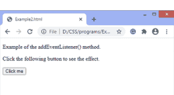

点击给定的 HTML 按钮后，输出为 -


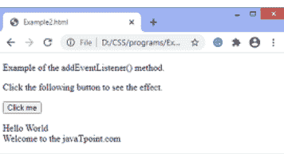

现在，在下一个示例中，我们将展示如何向同一个元素添加多个事件，而不会覆盖现有的事件。

## 示例

在这个示例中，我们正在向同一个元素添加多个事件。

```html
<!DOCTYPE html>
<html>
<body>
<p>这是一个向同一个元素添加多个事件的示例。</p>
<p>点击以下按钮查看效果。</p>
<button id="btn">点击我</button>
<p id="para"></p>
<p id="paral"></p>
<script>
function fun() {
  alert("Welcome to the javaTpoint.com");
}

function fun1() {
  document.getElementById("para").innerHTML = "This is second function";
}

function fun2() {
  document.getElementById("paral").innerHTML = "This is third function";
}

var mybtn = document.getElementById("btn");
mybtn.addEventListener("click", fun);
mybtn.addEventListener("click", fun1);
mybtn.addEventListener("click", fun2);
</script>
</body>
</html>
```


## 输出

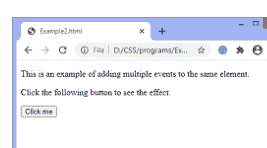

现在，当我们点击按钮时，会显示一个警框。点击给定的 HTML 按钮后，输出为：

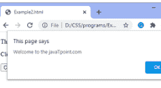

当我们退出警框时，输出为：

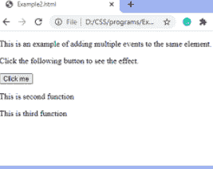

## 示例

在这个示例中，我们正在向同一个元素添加不同类型的多个事件。

```html
<!DOCTYPE html>
<html>
<body>
<p>这是一个向同一个元素添加不同类型多个事件的示例。</p>
<p>点击以下按钮查看效果。</p>
<button id="btn">点击我</button>
<p id="para"></p>
<script>
function fun() {
  btn.style.width = "50px";
  btn.style.height = "50px";
  btn.style.background = "yellow";
  btn.style.color = "blue";
}

function fun1() {
  document.getElementById("para").innerHTML = "This is second function";
}

function fun2() {
  btn.style.width = "";
  btn.style.height = "";
  btn.style.background = "";
  btn.style.color = "";
}

var mybtn = document.getElementById("btn");
mybtn.addEventListener("mouseover", fun);
mybtn.addEventListener("click", fun1);
mybtn.addEventListener("mouseover", fun2);
</script>
</body>
</html>
```


## 输出

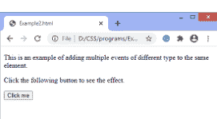

当我们将光标移到按钮上时，输出为：

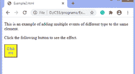

当我们点击并离开按钮后，输出为：

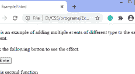

## 9.3 冒泡或捕获

当我们在元素上触发事件时，事件会经历三个阶段：捕获阶段、目标阶段和冒泡阶段。

在捕获阶段，事件从根元素向目标元素传播。在目标阶段，事件在目标元素上触发。在冒泡阶段，事件从目标元素向根元素传播。

我们可以通过`addEventListener`的第三个参数来控制是在捕获阶段还是冒泡阶段处理事件。设置为`true`则表示在捕获阶段处理，设置为`false`（默认值）则表示在冒泡阶段处理。

在这个示例中，我们向同一个元素添加了两个不同的事件处理器，一个是冒泡，一个是捕获。

### 示例

```html
<!DOCTYPE html>
<html>
<head>
<style>
div {
  width: 100px;
  height: 100px;
  background-color: red;
  color: white;
  text-align: center;
}

span {
  width: 50px;
  height: 50px;
  background-color: yellow;
  color: blue;
}
</style>
</head>
<body>
<div id="div">
  <span id="span">点击我</span>
</div>
<script>
var div = document.getElementById("div");
var span = document.getElementById("span");

div.addEventListener("click", function() {
  console.log("Div clicked bubbling");
}, false);

div.addEventListener("click", function() {
  console.log("Div clicked capturing");
}, true);

span.addEventListener("click", function() {
  console.log("Span clicked bubbling");
}, false);

span.addEventListener("click", function() {
  console.log("Span clicked capturing");
}, true);
</script>
</body>
</html>
```

当我们点击`span`时，控制台输出为：

```text
Span clicked capturing
Div clicked capturing
Span clicked bubbling
Div clicked bubbling
```

当我们点击`div`时，控制台输出为：

```text
Div clicked capturing
Div clicked bubbling
```

# JavaScript 事件

```html
<head>
  <script>
    function fun() {
      alert("Welcome to the javaTpoint.com");
    }
  </script>
</head>
<body>
  <h3>这是一个在 HTML 中使用 onclick 属性的示例。</h3>
  <p>点击下方按钮查看效果。</p>
  <button onclick="fun()">点击我</button>
</body>
</html>
```

# 输出

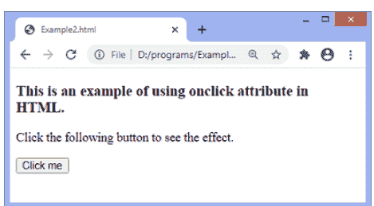

点击给定的按钮后，输出将是：

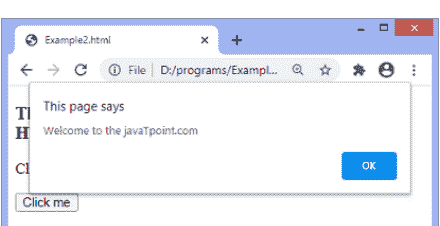

## 示例2：使用 JavaScript

在这个示例中，我们使用了 JavaScript 的`onclick`事件。这里我们在段落元素（paragraph）上使用了`onclick`事件。

当用户点击段落元素时，相应的函数将被执行，段落文本会被更改。点击`<p>`元素，背景颜色、大小、边框和文本颜色也会发生变化。

```html
<!DOCTYPE html>
<html>
<head>
<title>onclick 事件</title>
</head>
<body>
<h3>这是一个使用 onclick 事件的示例。</h3>
<p>点击下方文字查看效果。</p>
<p id="para">点击我</p>
<script>
document.getElementById("para").onclick = function() {
  fun();
};

function fun() {
  document.getElementById("para").innerHTML = "Welcome to the javaTpoint";
  document.getElementById("para").style.color = "blue";
  document.getElementById("para").style.backgroundColor = "yellow";
  document.getElementById("para").style.fontSize = "25px";
  document.getElementById("para").style.border = "4px solid red";
}
</script>
</body>
</html>
```

# 输出

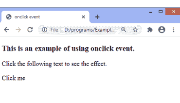

点击文字“点击我”后，输出将是：

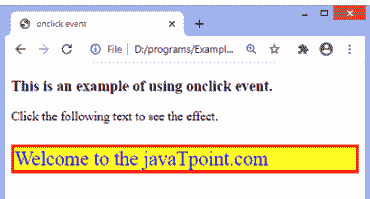


# 示例3：使用`addEventListener()`方法

在这个示例中，我们使用 JavaScript 的`addEventListener()`方法将点击事件绑定到段落元素上。当用户点击段落元素时，段落的文本会被更改。

点击段落时，元素的背景颜色和字体大小也会改变。

```html
<!DOCTYPE html>
<html>
<head>
</head>
<body>
<h3>这是一个使用 click 事件的示例。</h3>
<p>点击下方文字查看效果。</p>
<p id="para">点击我</p>
<script>
document.getElementById("para").onclick = function() {
  fun();
};

function fun() {
  document.getElementById("para").innerHTML = "Welcome to the javaPoint.com";
  document.getElementsByTagName("body")[0].style.color = "blue";
  document.getElementsByTagName("body")[0].style.backgroundColor = "lightgreen";
  document.getElementsByTagName("body")[0].style.fontSize = "25px";
  document.getElementById("para").style.border = "4px solid red";
}
</script>
</body>
</html>
```


# 输出

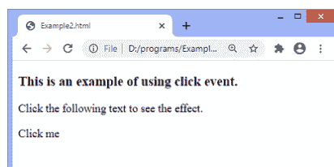

点击文字“点击我”后，输出将是：

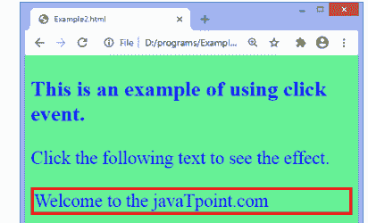

# JavaScript 双击事件（`dblclick`）

`dblclick`事件在元素被连续点击两次时触发。在 JavaScript 中，你可以使用`onclick`属性或`addEventListener()`方法来监听双击事件。

```javascript
window.onload = function() {
  document.getElementById("bg").style.backgroundColor = "red";
  document.getElementById("bg").style.width = "300px";
  document.getElementById("bg").style.height = "300px";
};
</script>
</head>
<body>
<h2>这是 window.onload() 的示例</h2>
<div id="bg"></div>
</body>
</html>
```

# 输出

在代码执行并加载页面后，输出将是：

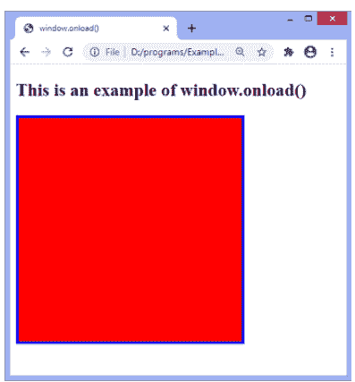


# 示例2

在这个示例中，我们通过使用 DOM 对象的属性和 JavaScript 函数来实现简单的动画。我们使用 JavaScript 函数`getElementById()`获取 DOM 对象，并将该对象赋值给全局变量。

```javascript
<html>
<head>
<script type="text/javascript">

var img = null;

function init() {
  img = document.getElementById('myimg');
  img.style.position = 'relative';
  img.style.left = '50px';
}

function moveRight() {
  img.style.left = parseInt(img.style.left) + 100 + 'px';
}

window.onload = init;
</script>
</head>
<body>
<form>

<center>
<p>点击下方按钮使图片向右移动</p>
<input type="button" value="点击我" onclick="moveRight();" />
</center>
</form>
</body>
</html>
```

# 输出

在成功执行上述代码后，输出将是：

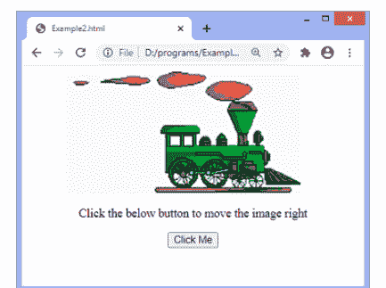

现在，我们来看一个使用 HTML `onload`属性和 JavaScript 函数的示例。

# 示例3


这是一个使用 HTML `onload` 属性配合 JavaScript 中定义函数的简单示例。在这个示例中，每当文档刷新时，`alert()` 函数就会被调用。

1. `<!DOCTYPE html>`


# JavaScript 事件

2. `<html>`

3. `<head>`

4. `<style>`

5. `</style>`

6. `<script>`

```javascript
function fun() {
  alert("Hello World!!,欢迎来到 javaTpoint.com");
}
```

10. `</script>`

11. `</head>`

12. `<body onload="fun()">`

13. `<h1> HTML onload 属性示例 </h1>`

14. `<p> 尝试刷新文档以查看效果。 </p>`

15. `</body>`

16. `</html>`

## 输出

在执行上述代码后，输出将是

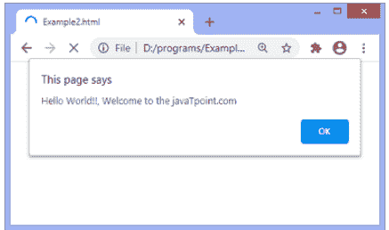

# 9.7 JavaScript onresize 事件

JavaScript 中的 `onresize` 事件通常在窗口大小被调整时发生。要获取窗口的大小，可以使用 JavaScript 的 `window.outerWidth` 和 `window.outerHeight` 事件。我们还可以使用 JavaScript 的属性如 `innerWidth`、`innerHeight`、`clientWidth`、`clientHeight`、`offsetWidth` 来获取元素的大小。

在 HTML 中，我们可以使用 `onresize` 属性并为其分配 JavaScript 函数。我们也可以使用 JavaScript 的 `addEventListener()` 方法并向其传递 `resize` 事件以获得更大的灵活性。

## 9.7.1 语法

现在，我们来看 HTML 和 JavaScript 中使用 `onresize` 事件的语法（不使用 `addEventListener` 方法或通过使用 `addEventListener()` 方法）。

## 9.7.2 在 HTML 中

```html
<element onresize = "fun()">
```

## 9.7.3 在 JavaScript 中

```javascript
object.onresize = function() { myScript };
```

## 9.7.4 在 JavaScript 中使用 addEventListener()

```javascript
object.addEventListener("resize", myScript);
```

让我们通过一些插图来理解 `onresize` 事件。

### 示例

在这个示例中，我们使用了 HTML 的 `onresize` 属性。在这里，我们使用 JavaScript 的 `window.outerWidth` 和 `window.outerHeight` 事件来获取窗口的高度和宽度。当调整窗口大时，窗口更新后的宽度和高度将显示在屏幕上。它还会显示用户尝试调整窗口大小的次数。同样，当我们更改窗口高度时，更新的高度会相应变化。当我们更改窗口宽度时，更新的宽度也会相应变化。

1. `<!DOCTYPE html>`


```html
<html>
<head>
<script>
var i = 0;
function fun() {
var res = "宽度" + window.outerWidth + "<br>" + "高度 = " + window.outerHeight;
document.getElementById("para").innerHTML = res;
var res1 = i += 1;
document.getElementById("s1").innerHTML = res1;
}
</script>
<body onresize="fun()">
<h3> 使用 onresize 属性的示例 </h3>
<p> 调整窗口大小查看效果。 </p>
<p id="para"></p>
<p> 你已经调整了窗口 <span id="s1">0</span> 次。</p>
</body>
</html>
```

Crockford 是 State Software（也称为 Veil Networks）的创始人，并在 2001 年至 2002 年担任其首席技术官（CTO）。

在 State Software 工作期间，Crockford 推广了基于现有 JavaScript 语言结构的 JSON 数据格式，它是 XML 的轻量级替代方案。他在 2002 年获得了 `json.org` 域名，并在那里发布了对该格式的描述。2006 年 7 月，他作为 RFC 4627 正式规定了该格式。

## “行善，不作恶”

2002 年，为了对应乔治·布什总统对“恶之徒”的战争，Crockford 开始使用一种自定义许可发布 JSON，该许可是在开源 MIT 许可的基础上添加了“软件应用于善，而非作恶”（The Software shall be used for Good, not Evil）的要求创建的。该软件一直托管在 Google Code 上直到 2009 年 12 月，由于这一额外条款，Google 认为该许可不符合自由开源软件的定义（后者不允许对软件的使用方式进行任何限制）。JSON-PHP 被迫迁移到新的托管供应商。

Crockford 的许可协议为一些开源项目带来了麻烦，这些项目误认为该许可是 MIT 许可的开源变体。受影响的开源开发者要求 Crockford 修改许可，但他一直继续使用它。不过，他授予了“IBM 及其客户、合作伙伴和下属”使用 JSLint 来作恶的权限，这一解决方案似乎让 IBM 的律师满意。

## 媒体

## 图籍

- Crockford 出现在尼尔·斯蒂芬森的作品《钻石时代》（The Diamond Age）1995 年精装版的致谢中，名为道格拉斯（卡尔·霍利伍德）Crockford。

## 总结

- JavaScript 使用*事件*与 HTML 代码进行交互，这些事件在文档或浏览器窗口发生特定感兴趣的时刻时触发。

- JavaScript 事件使网页具有交互性和响应性。这些事件是*异步的*（即可以随时任何发生）。大多数事件由用户操作触发，但也有一些例外，例如 `load`（加载）事件。

- 当发生错误时，浏览器会采取某些措施（例如点击了位于 `href` 属性指定位置的链接）。事件可以是点击、鼠标悬停、击键等。

- 对象状态的变化被称为事件。在 HTML 中，有各种事件代表用户或浏览器执行的某些活动。当 JavaScript 代码包含在 HTML 中时，js 对这些事件做出反应并允许执行。对事件做出的过程被称为事件处理（Event Handling）。因此，js 通过事件处理器处理 HTML 事件。

- `addEventListener()` 方法用于将事件处理器附加到特定元素上。它不会覆盖现有的事件处理器。事件被认为是 JavaScript 的不可或缺的一部分。网页根据所发生的事件做出响应。事件可以是用户生成的，也可以由 API 生成。事件监听器是 JavaScript 的一个过程，等待事件的发生。

- `onclick` 事件通常在用户点击元素时发生。它允许程序员在元素被点击时执行一个 JavaScript 函数。该事件可以用于验证表单、警告消息等许多场合。

- `dblclick` 事件在双击时产生事件。当元素在极短的时间内被点击两次时，该事件触发。我们也可以使用 JavaScript 的 `addEventListener()` 方法来查找双击事件。

- `onload` 属性在元素加载后触发。该属性的目的是在元素加载时执行脚本。

- `onload` 属性通常与 `<body>` 一起使用，在网页内容（使用 CSS 文件、图像、脚本等）完全加载之前执行一次脚本。没有必要仅配合 `<body>` 标签使用，它也可以与其他 HTML 元素配合。

- JavaScript 中的 `onresize` 事件通常发生在窗口调整大小时。要获取窗口大小，我们可以使用 JavaScript 的 `window.outerWidth` 和 `window.outerHeight` 事件。我们还可以使用 JavaScript 的属性如 `innerWidth`、`innerHeight`、`clientWidth`、`clientHeight`、`offsetWidth`、`offsetHeight` 获取元素的大小。

## 知识检查

1. 一般来说，事件处理器就是

   a. 函数  
   b. 接口  
   c. 事件  
   d. 处理器

2. 浏览器何时调用处理器？

   a. 程序开始  
   b. 任何事件发生  
   c. 指定的事件发生  
   d. 网页加载

3. 浏览器决定在哪些对象上触发事件处理器的过程是

   a. 事件触发 (Event Triggering)  
   b. 事件监听 (Event Listening)  
   c. 事件处理 (Event Handling)  
   d. 事件传播 (Event propagation)

4. 哪种形式的事件传播处理注册的容器元素？

   a. 事件传播 (Event Propagation)  
   b. 事件注册 (Event Registration)  
   c. 事件捕获 (Event Capturing)  
   d. 默认操作 (Default Actions)

5. 在哪些事件/场景中，JavaScript 中的函数名是可选的？

   a. 当函数定义为循环语句时  
   b. 当函数被调用时  
   c. 当函数定义为表达式时  
   d. 当函数被预定义时

## 复习题

1. 描述 JavaScript 事件的类型。
2. JavaScript 中的 `addEventListener` 起什么作用？
3. JavaScript 中的 `onclick` 事件是什么？
4. JavaScript 中的 `dblclick` 是什么？
5. 区分事件冒泡和事件捕获。

## 检查结果

1. (a) 2. (c) 3. (d) 4. (c) 5. (c)

## 参考文献

1. Fedora, Irina (June 2012). "Concurrency in JavaFX". JavaFX Documentation. Oracle. 检索于 2018 年。
2. Möböck, Hans (2002-03-25). "Advanced C#: Variable of Parameters". Institut software, Johannes Kepler Universität, Fachbereich. p. 26.
3. Same, Miro (11 March 2009). "Machines for Event-Driven". 检索于 2013 年 3 月。
4. Vivek Gupta, Ethan Jackson, Sriram Rajamani (November 2012). "Asynchronous Event-Driven". Microsoft Research. 检索于 2017 年。

## 索引

### A

83

`EventListener()` 292, 293, 299, 302, 306, 307, 308, 311, 322, 327

`array` 239, 250, 277

`assign` 264, 277

`attribute` 110, 111, 112, 134

`Constructor` 204, 205, 206, 207, 209, 210, 211, 212, 213, 214, 216, 217, 219, 228, 229, 230, 235

`development` 7, 16, 18

`classes` 1, 2, 3, 4, 5, 6, 7, 8, 9, 10, 11, 13, 14, 16, 17, 18, 19, 20, 21, 22, 23, 24, 25, 28, 29, 32, 33, 34, 35, 36, 37, 38, 39, 40, 41, 42, 43, 44, 45, 46, 47, 51, 52, 55, 57, 58, 59, 61, 66, 67, 68, 130, 135, 136, 140, 142, 143, 144, 145

`JavaScript` 1, 2, 3, 4, 5, 6, 7, 8, 9, 10, 11, 13, 14, 16, 17, 18, 19, 20, 21, 22, 23, 24, 25, 28, 29, 32, 33, 34, 35, 36, 37, 38, 39, 40, 41, 42, 43, 44, 45, 46, 47, 51, 52, 55, 57, 58, 59, 61, 66, 67, 68, 130, 135, 136, 140, 142, 143, 144, 145

`Cross-site scripting (XSS)` 192

`CSS events` 292

### B

`blur` 288, 290

`Boolean` 70, 77, 78

`Boolean value` 252, 253, 258, 259, 277

`Browser Object Model (BOM)` 238, 247, 249

`browsers` 118, 119, 120, 122, 126, 127

`browser window` 281, 287, 327

`Bubbling` 299

### C

`date` 239

`Date object` 93, 95, 98,

`dblclick event` 281, 307, 327

`DOM (Document Model)` 9

`Calendar` 92

`Capturing` 299, 300, 328

`Case-sensitive language` 34

`Checkboxes` 116

`Chrome` 118, 119

`click event` 289, 290, 299, 302, 306, 307, 308, 309, 311, 327

`Color property` 231

`Computer programming` 92

### D

`Drop Down` 114, 115

### E

`Email` 194, 196

`Embedded engine` 36

`Event` 282, 283, 284, 285, 286, 287, 292, 299, 302, 327, 330

`event flow` 288

`Event Handlers` 282, 327

`Event Handling` 282, 327, 328

`event listener` 287, 292, 327

`event load` 282, 327

`Execution` 72

### F

`File input` 117

`Firefox` 10, 21, 22

`form` 107, 108, 109, 110, 111, 112, 113, 114, 116, 118, 119, 121, 122, 123, 124, 125, 129, 132

`Function` 69, 70, 71, 72, 73, 74, 75, 76, 77, 82, 83, 90, 92, 104, 105, 106

`Function declarations` 204

`Function expressions` 204

146, 147, 148, 149, 152, 155, 169, 203, 204, 213, 214, 215, 216, 217, 219, 228, 229, 230, 235

`development` 7, 16, 18

### G

`geoLocation` 260, 271

### H

`href` 268, 277

`HTML elements` 136, 137, 140, 141, 145

`HTML Forms` 107

`HTML page` 138, 140

`HTTP (Hypertext Transfer)` 8

### I

`Inheritance method` 204

`innerHTML` 136, 137, 138, 142, 143, 150, 153, 157, 159

`Internet` 2, 5, 10, 14, 52

`Integer value` 229

`Integrated Development Environment` 18

`Internet Explorer` 2, 5

52

### J

`JavaScript` 1, 2, 3, 4, 5, 6, 7, 8, 9, 10, 11, 13, 14, 16, 17, 18, 19, 20, 21, 22, 23, 24, 25, 28, 29, 32, 33, 34, 35, 36, 37, 38, 39, 40, 41, 42, 43, 44, 45, 46, 47, 51, 52, 55, 57, 58, 59, 61, 66, 67, 68, 130, 135, 136, 140, 142, 143, 144, 145

`JavaScript` 1, 2, 3, 4, 5, 6, 7, 8, 9, 10, 11, 13, 14, 16, 17, 18, 19, 20, 21, 22, 23, 24, 25, 28, 29, 32, 33, 34, 35, 36, 37, 38, 39, 40, 41, 42, 43, 44, 45, 46, 47, 51, 52, 55, 57, 58, 59, 61, 66, 67, 68, 130, 135, 136, 140, 142, 143, 144, 145

`JSLint` 252, 277

`javaEnabled()` 252

### K

`keypress events` 288, 290

### L


`Location` object 263, 264, 278

`Location` window 263, 277

### M

mouse events 288, 289

mouse moves 288

Mozilla Developer Network (MDN) 21

mutation 240

mutation observers 290, 291

### O

Object initializer 227

Object Oriented Programming (OOP) 216

onclick event 281, 302, 304, 329

Online property 259

unload attribute 312, 313, 316, 317, 327

# 索引 335

onresize 事件 281, 318, 320, 327

# T

`taint()` 方法 253, 277

`textarea` 110, 111, 112, 115, 119, 121, 122, 123, 126, 127

时区 92, 93, 95, 98

# P

参数 72, 73, 75, 90

平台属性 262

基于原型的继承 203, 204, 211

Python Apache 23

# U

统一资源标识符 (URI) 91

协调世界时 (UTC) 94

user-agent 样式表 118

用户体验 (UX) 190

用户 107, 108, 113, 117, 127

# R

单选按钮 117

`replace()` 方法 267

根目录 178

# W

搜索框 118

`select` 标签 111

分号 34, 42, 43

服务器 77, 91, 92

服务端语言 108

会话存储 172

静态方法 206

字符串 70, 78, 79, 80, 92

提交按钮 111, 113, 118, 132

语法 71, 76

Web 浏览器 2

Web 表单 108

Web 页面 2, 7, 8, 9

Web 服务器 171, 177, 187, 188

网站 107, 110, 118

小组件 119, 120, 121

`window` 对象 238, 239, 263, 277, 279

Windows 屏幕 237, 277

万维网 (WWW) 8

### 基础计算机编程：JavaScript

#### 第 2 版

JavaScript 是一种主要用于 Web 浏览器的编程语言，为用户提供动态且交互的体验。现代生活中互联网不可或缺的大多数功能和应用程序都是 JavaScript 编写的。虽然 JavaScript 不是互联网上唯一的客户端脚本语言，但它是最早的且目前是最流行的之一。进取的程序员创建了许多 JavaScript 库，这些库是由 JavaScript 基础构建的更简洁的语言，复杂度较低，并且可以针对特定的应用程序。随着开发者在应用程序中构建交互性和复杂性，JavaScript 已成为互联网体验不可或缺的一部分。如果没有它，搜索引擎、电子商务、内容管理系统、响应式设计、社交媒体和手机应用都将无法实现。

本版包含九章。内容已经过全面修订并添加了新章节。本书为如何编写 JavaScript 提供了清晰的指导。本初学者指南概述了 JavaScript 基础知识，并解释了如何创建 Web 页面、识别浏览器，以及将音频、图形和动画集成到 Web 应用程序中。
