# 计算机基础编程：JavaScript（第3版）

```python
mirror.x = 'X'
mir_mod.use = True
mirror_mod.x = False
operation = 'Y'
mir_mod.use = True
mirror_mod.y = False
operation = 'Z'
mir_mod.use = True
mirror_mod.z = False
mirror_mod.x = True
selection at the end -add
rob.select-
ier.select-1
text.scene.objects.activ
lier.str(modifier
bier.ob.bpy.context.selected_obj.obj
data.objects[one.name]:sel
print("please select exact

OPERATOR CLASSES

types.Operator):
    x mirror to the selected
ject.mirror_mirror_x
ror "x"

def default(context):
    text.active_object is not
```

Lanre Gbadegesin

Lanre Gbadegesin


# 编辑委员会


Aleksandar Mratković 于1988年5月5日出生于塞尔维亚的Arandelovac。他毕业于经济高级中学（2007年）、贝尔格莱德旅游学院（2013年），并拥有心理学硕士学位（诺维萨德大学哲学学院）。他一直投身于心理学的不同领域（发展心理学、临床心理学、教育心理学和工业心理学），并发表了多项科学著作。


Dan Piao（博士）目前是以色列的一位创业企业家，致力于农业与生物医学的交叉领域，曾任乌拉圭国家农业研究院（INA）院长兼首席执行官。Dan是一位广泛发表论文的科学家，在职业生涯中获得了许多荣誉，包括两次获得耶路撒冷大学的Anita·戈德·梅尔奖，他的专业领域包括细胞分子生物学、植物天然遗传学和生物信息学。Dan对应用科学和技术解决方案的热情并没有阻止他与农民、家庭和自然建立深层联系。他的某些兴趣和实践包括担任家庭主和在船上捕鱼。


Hazem Fawky 于2008年获得亚历山大大学农业专业博士学位。他目前担任高级研究员。


Felecia Killings 拥有诺瓦亚东南部大学英语专业博士学位。她目前担任高级编辑。


Sandra Haj 拥有佛罗里达州立大学健康专业博士学位。她目前担任高级教授。


Fozia Parveen 在伊斯兰堡的法蒂玛·贾纳纳大学完成了环境科学博士学位。她目前担任博士后研究。


Igor Kunic 于2003年毕业于经济学院。2007年毕业后他进入了贝尔格莱德大学。


Jovan Pechevski 于2007年获得澳大利亚联邦理工大学（RMIT）计算机科学博士学位。他目前担任斯科普尔杰欧洲大学的院长。


Tanjina Nur 于2014年完成悉尼科技大学（UTS）土木与环境工程博士学位。现在她在水技术中心（CTWW）担任博士后研究员。


Stephen 于2013年毕业于北卡罗来大学夏洛特分校。目前，Stephen在福西西技术学院担任解剖学和生物学教师。


Michelle 拥有凤凰大学的工商管理硕士学位。她是一位专业作家，其文章多次在《亨利县报》上发表。


## 目录

总结 ............................................................................25

知识检查 ......................................................... 26

复习题 ............................................................................... 28

### 3.2.4 字符串 HTML 封装

3.2.6 日期方法..............................................................................80

3.2.8 数学方法..........................................................................................84

3.2.10 如何使用 JavaScript 内置函数配合 HTML 进行编程................................................................................86

### 3.3.1 Date 对象

3.3.3 使用 `set` 修改日期...........................................................................92

总结................................................................................................................98

复习题...............................................................................................101

## 第4章 HTML 表单

### 4.1 表单基础

4.1.2 输入（Input)........................................................................106

4.1.4 选择（Select)......................................................................................106

### 4.2 HTML 表单元素

4.2.2 密码输入................................................................................109

4.2.4 下拉列表..............................................................................110

4.2.6 单选框输入.....................................................................111

4.2.8 提交按钮..................................................................................112

### 4.3.1 搜索字段

.........................................................113

## 第5章 HTML DOM

### 5.1.2 `getElementById` 方法

....................................................... 133

### 5.2.6 查找 HTML 对象

............................................................... 134

### 5.3.1 查找 HTML 元素

........................................................... 136

### 5.3.3 通过标签名查找 HTML 元素

..................................... 137

### 5.3.5 通过 CSS 选择器查找 HTML 元素

...................... 137

### 5.4 修改 HTML

.............................................................. 138

#### 5.4.2 修改 HTML 内容

.................................................. 138

### 5.5 修改 CSS

........................................................................ 140

#### 5.5.2 使用事件

....................................................................... 141

### 5.6.1 一个基础网页

............................................................... 141

### 5.6.3 设置元素样式

......................................................... 142

### 5.6.5 使用 JavaScript 创建动画

............................................... 143

### 5.7.1 响应事件

...................................................... 144

### 5.7.3 使用 HTML DOM 分配事件

....................................................... 145

### 5.8 HTML DOM EventListener

...................................................................... 146

#### 5.8.2 语法

................................................................................ 146

#### 5.8.4 为同一元素添加多个事件处理器

......................................... 147

#### 5.8.6 参数

................................................................. 148

#### 5.8.8 监听器

................................................. 148

### 5.9.1 元素

................................................................ 149

### 5.9.3 子元素

................................................................ 151

### 5.9.5 属性

................................................................ 153

### 5.9.7 类型

................................................................ 154

#### 5.9.8.1 创建

............................................................................... 155

#### 5.9.8.3 元素

................................................................ 156

总结 ................................................................................. 160

复习题 ................................................................................. 163

## 第6章 Cookie

### 6.1 读取/写入 Cookie

................................................. 166

#### 6.1.2 Cookie 的结构

............................................................... 170

#### 6.1.4 脚本

................................................................ 172

#### 6.1.6 隐私与法律

................ 178

### 6.2.1 会话 Cookie

........................................................ 182

### 6.2.3 安全 Cookie – 在使用 HTTPS 时工作

................................................................ 184

### 6.2.5 SameSite Cookie – 仅适用于此网站

................................................................ 186

### 6.2.7 Cookie 域和路径 – 仅适用于特定路径和域名

..................................................... 187

总结 ................................................................................. 189

复习题 ................................................................................. 192

## 第7章 JavaScript 对象与类

### 7.1 JavaScript：类

................................................... 196

### 7.2.1 原型方法

.......................................................... 198

### 7.2.3 使用 `extends` 进行子类化

......................................................................... 201

### 7.2.5 使用对象字面量

....................................................................... 206

### 7.3.1 对象属性

................................................ 208

### 7.3.3 使用对象

............................................................................... 213

### 7.3.5 继承

.......................................................................... 220

## 第8章 Window 对象

### 8.2 Window 对象（Windows Objects）

....................................................230

#### 8.2.2 Window 方法示例

.........................................231

#### 8.2.4 Window 对象属性示例

..................................238


### 8.3.1 JavaScript 历史对象的方法

- 8.4 `Navigator` 对象

### 8.4.2 `Navigator` 方法示例

### 8.4.4 `Navigator` 对象属性示例

### 8.5.1 `Location` 对象中的方法

### 8.5.3 `Location` 对象中的属性

- 8.6 `Screen` 对象

### 8.6.2 JavaScript `Screen` 对象示例

复习题

- 9.2 JavaScript 事件类型

### 9.2.2 焦点与失焦点事件

### 9.2.4 键盘事件

### 9.2.6 变异事件与观察器

### 9.2.8 CSS 事件

### 9.3.1 语法

### 9.3.3 事件冒泡或事件捕获

### 9.4.1 语法

### 9.4.3 在 JavaScript 中

- 9.5 JavaScript `dclick` 事件

### 9.5.2 在 HTML 中

### 9.5.4 使用 `addEventListener()` 方法在 JavaScript 中实现

### 9.6.1 语法

### 9.7.1 语法

### 9.7.3 在 JavaScript 中

知识检查

参考文献

- 引言

- 10.1 JavaScript 数据类型

### 10.1.1 原型数据类型

### 10.1.2 结构化数据类型

### 10.1.3 JavaScript 字符串

### 10.1.4 JavaScript 数字：整数、浮点数、二进制、指数计数、十六进制、八进制

### 10.1.5 JavaScript 布尔值

### 10.1.6 JavaScript 对象：创建对象、访问属性与方法

### 10.1.7 JavaScript `Date`：在 JavaScript 中创建、转换和比较日期

### 10.1.8 JavaScript 数组：创建、访问、添加与删除元素

### 10.1.9 JavaScript 中 `Null` 和 `Undefined` 的区别

- 10.2 JavaScript 变量

### 10.2.1 声明变量

### 10.2.2 JavaScript 命名规范

### 10.2.3 动态类型

### 10.2.4 JavaScript 中的常量变量

### 10.2.5 变量作用域

### 10.2.6 不使用 `var` 和 `let` 关键字声明变量

总结

知识检查

复习题

参考文献

# 索引

# 前言

JavaScript 是一种多功能的编程语言，主要用于网页浏览器，通过动态和交互式元素来增强用户体验。它在实现现代互联网使用中至关重要的各种功能和应用方面发挥着至关重要的作用。虽然它不是唯一的客户端脚本语言，但 JavaScript 作为先驱之一脱颖而出，并保持着最常用语言的地位。为了简化开发，创新的程序员开发了 JavaScript 库，这些是基于 JavaScript 组件构建的简化语言，专为特定应用设计。该语言已成为 Web 开发不可缺的，使得搜索引擎、电子商务平台、内容管理系统、响应式设计、社交媒体和移动应用等不同领域的应用程序具有更高的交互性和复杂性。本质上，如果没有 JavaScript 的基础性贡献，我们今天所知的互联网格局将是不可能的。

## 本书结构

本版包含九章。内容已经过全面修订并添加了新章节。本书对如何使用编写 JavaScript 的方法提供了清晰的指导。初学者指南概述了 JavaScript 基础知识，并解释了如何创建 Web 页面、识别浏览器以及将声音、图形和动画集成到 Web 应用程序中。

**第一章**介绍了 JavaScript。它还解释了继承以及级联机制。你还将了解 JavaScript 工具。

**第二章**侧重于 JavaScript 语法，它规定了符号的正确顺序，以便使用给定的编程语言形成结构正确的程序。

**第三章**侧重于执行操作或返回值的内置函数。你可以像处理对象一样处理函数。它们还可以作为参数传递给其他函数，或从这些函数返回。

**第四章**探讨了层级样式表（CSS）的外观。在这一章中，你将了解表单基础、HTML 表单元素以及 HTML 表单的样式。

**第五章**旨在讨论 HTML DOM 方法和 HTML DOM 文档。此外，还介绍了 DOM 元素和更改 HTML。还描述了如何更改 CSS 和 HTML DOM 动画，包括 HTML DOM 事件和 HTML DOM 事件监听器（`EventListener`）。

第六章从使用 JavaScript 读写 cookie 的基础开始。进一步给出了 JavaScript 中不同 cookie 的设置。

第七章讨论了 JavaScript 类和对象。函数可以用于某种程度上模拟类，但通常情况下 JavaScript 是一种没有类的语言。一切都是对象。在涉及到继承时，对象继承自对象，而不是像“经典语言”那样类继承自类。

第八章重点介绍了 JavaScript BOM。BOM 指的是 JavaScript 中的 `Windows` 对象。现代浏览器已经实现了用于 JavaScript 交互的方法和属性，通常被称为 BOM 的方法和属性。

第九章探索了 JavaScript 事件。JavaScript 使用事件与文档的 HTML 代码交互，这些事件会在文档或浏览器窗口发生特定感兴趣的时刻时触发。

第十章重点介绍了 JavaScript 数据类型和变量，对这些基础编程概念进行了重点探索。读者将对数据类型有深入的理解，并学会如何在 JavaScript 代码中有效利用变量。

# 第一章

## JavaScript 简介

# 导论

JavaScript 是一种轻量级、跨平台、单线程且解释型的编译编程语言。它也被称为网页的脚本语言。它因网页开发而广闻，许多非浏览器环境也使用它。

学习完本章后，你将能够：

- 解释 JavaScript 的含义
- 定义 hello world：编写你的第一个 JavaScript 程序
- 解释如何使用 html 将 JavaScript 添加到你的网站
- 理解 JavaScript 工具

JavaScript 是一种弱类型语言（动态类型）。JavaScript 可以用于客户端开发，也可以用于服务端开发。JavaScript 既是命令式语言也是声明式语言。JavaScript 包含了标准对象库（如 `Array`、`Date` 和 `Math`）以及一组核心语言元素，如操作符、控制结构和语句。

## 1.1 JavaScript 的含义

JavaScript 是一种动态计算机编程语言。它是轻量级的，最常用作网页的一部分，其实现允许客户端脚本与用户交互并使页面动态化。它最初被称为 LiveScript，但由于 Java 带来的热度，更名为 JavaScript，并在 1995 年 Netscape 2.0 中首次出现。它是具有面向对象能力的解释型语言。

JavaScript 是一种非常强大的脚本语言，被嵌入到 Netscape、Internet Explorer 等浏览器中。换句话说，通过 JavaScript 的帮助，你可以让网页更加生动和交互。JavaScript 也广泛用于游戏开发和移动应用开发。

ECMA-262 规范定义了语言的标准版本。

- JavaScript 是一种轻量级的解释型语言。
- 设计用于创建网络应用。
- 与 Java 集成。
- 与 HTML 集成。
- 开放且跨平台。

### 1.1.1 Netscape 的历史

#### Netscape 的起源

1993 年，伊利诺伊大学厄巴纳-香槟分区的超级计算机应用中心（NCSA）发布了第一个流行的图形化网页浏览器 Mosaic，它在推动新生 Web 的增长中起了重要作用。1994 年，一家名为 Mosaic Communications 的公司在加州 View 成立，并雇了许多 NCSA 的作者创建 Netscape。然而，该浏览器的内部代号为 Mozilla，意为“Mosaic 杀手”，因为其目标是取代世界第一的 Mosaic。Web 的第一个版本 Mosaic 0.9 于6月底发布。在四个月内，它占据了四分之三的市场份额，成为90 年代互联网的主要浏览器。

为了避免与 NCSA 的所有权问题，该浏览器在同年更名为 Netscape Navigator，公司也更名为 Netscape Communications。Netscape Communications 意识到 Web 需要变得更加动态。公司创始人 Marc Andreessen 认为 HTML 需要一种“胶水语言”，让 Web 设计师和兼职程序员轻松地将图像和插件等组件组合在一起，代码可以直接写在 Web 页面标记中。

1995 年，Netscape Communications 招募了 Brendan Eich，目标是将 Scheme 编程语言嵌入 JavaScript 中。在他开始之前，Netscape Communications 与 Sun Microsystems 合作，在 Netscape Navigator 中包含更多的静态编程语言 Java，以便与微软竞争用户对 Web 技术和平台的采用。为了反对关于 JavaScript 的提案，公司需要一个原型。他在1995年5月用10天时间写了一个。

尽管是在 Mocha 的名称下开发的，但该语言在 1995 年 9 月 Netscape Navigator 2.0 Beta 版发布时正式名为 LiveScript，但在 12 月部署在 Netscape Navigator 2.0 beta 3 时被更名为 JavaScript。最终的选择

> 记住，Netscape Communications 然后决定他们想要创建的脚本语言类似于 Java 并具有类似的语法，这排除了采用 Perl、Python、TCL 或 Scheme 等语言。

> Java 是一种高级的、基于类的、面向对象的编程语言，设计目标是尽可能地减少实现依赖。

名称引起了误解，让人认为这种语言是 JavaScript 编程语言的衍生品，这种选择被认为是 Netscape 的一种营销手段，旨在让 JavaScript 获得当时热门 Web 编程语言的声誉。

存在一个常见的误区，认为 JavaScript 受由 Nombas Corp 开发的早期网页脚本语言的影响（不要与 1997 年创建的 Cmm 混淆）。然而，Brendan Eich 在创建 LiveScript 之前从未听说过 Cmm。尽管 Nombas 确实向 Netscape 推销过他们的嵌入式网页脚本技术，但当时 Web 脚本并不是一个新概念，因为 ViolaWWW Web 浏览器已经实现过它。Nombas 后来在他们的 ScriptEase 产品中改提供 JavaScript 代替 Cmm，并参与了标准化 ECMAScript 的 TC39 小组。

## 服务端 JavaScript


1995 年 12 月，在为浏览器发布 JavaScript 后，Netscape 通过 Netscape Enterprise Server 引入了该语言的服务端脚本实现。

自 1996 年以来，IIS Web 服务器已在 ASP 和 .NET 页面中支持微软的服务端 JavaScript 实现。自 2000 年代中期以来，引入了额外的服务端 JavaScript 实现，例如 2009 年的 Node.js。

## 微软的采用

微软包括 VBScript 和 JavaScript 在内的脚本技术于 1996 年发布。JScript 是 Netscape JavaScript 的反向工程实现，是 Internet Explorer 3 的一部分。JavaScript 也在 Internet Information Server 中用于服务端脚本。

Internet Explorer 3 还包含了微软对 CSS 和 HTML 各扩展的首次支持，但在每种情况下，其实现与 JavaScript Navigator 中的实现显著不同。这种时间上的差异使得设计师和程序员很难让同一个网站在两个浏览器中都能良好运行，导致了“最佳在 Netscape 中查看”和“最佳在 Internet Explorer 中查看”标志的出现，这些标志是浏览器战争早期的特征。

JavaScript 开始被认为是跨平台和标准驱动的 Web 的障碍之一。个人开发者承担了让他们的网站在两个浏览器中运行的艰巨任务，但许多人无力承担这种时间。随着 Internet Explorer 4 的发布，微软引入了动态 HTML（Dynamic HTML）的概念，但语言实现的差异以及不同且专有的文档模型（DOM）仍然是 JavaScript 在 Web 上广泛采用的障碍。

## 标准化

1996 年 11 月，Netscape 将 JavaScript 提交给 ECMA 国际组织以制定标准规范，其他浏览器厂商可以据此实现。

## JavaScript 简介

基于 Netscape 完成的工作，这导致了语言规范 ECMAScript 的正式发布。该规范于 1997 年 6 月在 ECMA-262 标准的第一版中发布，JavaScript 是最为人知的实现。ActionScript 和 JavaScript 是 ECMAScript 的其他知名实现。

标准的制定以周期进行，于 1998 年 6 月发布了 ECMAScript 2，它引入了一些修改以符合 ISO/IEC 16262 国际标准。1999 年 12 月发布了 ECMAScript 3，它是现代 JavaScript 的基准。由 Waldmer Horwat（当时在 Netscape，现在在 Google）领导的原始 ECMAScript 4 工作始于 2000 年，起初微软似乎参与了，甚至在他们的 JavaScript .NET 语言中实现了一些提案。

随着时间的推移，很明显，微软无意在 Internet Explorer 中合作或实现真正的 JavaScript，他们没有竞争性的提案，并且在 .NET 服务端只有一个部分（在当时已分歧）的实现。原始的 ECMAScript 4 工作在 2003 年被搁置。

下一个重大事件发生在 2005 年，当时 JavaScript 历史上有两个大事件：Brendan Eich 和 Mozilla 以非营利成员身份加入 Ecma 国际组织，并启动了 XML 的 ECMAScript（E4X），即 ECMA-387 标准；而来自 BEA Systems（后被 Adobe Systems 收购）的微软员工正在实现 ActionScript 4（ActionScript 3 是原始 ECMAScript 3 的分支），其目标是标准化的，即 ActionScript 3。

为此，Adobe Systems 发布了代号为 Tamarin 的 ActionScript Virtual 2，这是一个开源项目。但 Tamarin 和 ActionScript 3 与 JavaScript 的差异太大，无法收敛，双方在 2007 年和 2008 年意识到这一点。

不幸的是，各个参与者之间仍然存在动荡；Douglas Crockford 在 2007 年与微软合作反对 ECMAScript 4，这导致了 ECMAScript 3.1 的努力。ECMAScript 4 的开发从未完成，但该项工作影响了后续版本。

在所有这一切发生时，开源和开发者社区开始致力于彻底改变 JavaScript 的可能性。这种社区努力引发于 2005 年，当时 James Garrett 发布了一份白皮书，他在其中创造了 Ajax 术语，并描述了一组以 JavaScript 为核心的技术，用于创建可以在后台加载数据的 Web 应用，避免了刷新整个页面的需求，并带来了更具动态的应用程序。

这导致了由开源库及其周围形成的社区所引领的用途复兴时期，如 Prototype、jQuery、Dojo Toolkit、MooTools 等库相继发布。

2008 年 7 月，双方的各个利益方在奥斯陆汇合。这导致了最终在 2009 年初达成的协议，即将 ECMAScript 3.1 重命名为 ECMAScript 5，并使用名为 Harmony 的议程推动语言发展。

ECMAScript 5 终于于 2009 年 12 月发布，ECMAScript 6 于 2015 年 6 月发布，ECMAScript 7 于 2016 年 6 月发布，ECMAScript 8 于 2017 年 6 月发布，ECMAScript 9 于 2018 年 6 月发布，ECMAScript 10 于 2019 年 6 月发布。

StackOverflow 和 GitHub 有许多使用 JavaScript 的项目，而且这种语言本身近年来在行业内引起了广泛关注。

- **互操作性：** JavaScript 与其他语言具有良好的兼容性，并可以用于各种应用程序。与 PHP 或 SSI 脚本不同，JavaScript 可以插入到任何网页中，无论文件扩展名是什么。JavaScript 也可以用在 Perl 和 PHP 等其他语言编写的脚本内部。
- **服务器负载：** 作为客户端，减少了对网站服务器的需求。
- **扩展功能：** 诸如 Greasemonkey 这样的第三方插件允许 JavaScript 开发者编写 JavaScript 代码段，这些代码可以在指定的网页上执行，以扩展其功能。
- **多功能性：** 如今，有很多方法可以使用 JavaScript：通过 Node.js、使用 Express 启动 Node、使用像 MongoDB 这样的文档数据库，以及在前端使用 JavaScript；仅使用 JavaScript 就可以从前端到后端开发整个 JavaScript 应用程序。
- **更新：** 自 Ecma 5（JavaScript 依赖的脚本语言）出现以来，Ecma 国际组织致力于每年更新 JavaScript。到目前为止，我们已经在 2017 年收到了浏览器对 ES6 的支持，并期待未来几个月对 ES7 的支持。

文档对象模型（DOM）是用于 HTML 和 XML 文档的编程 API。它定义了文档的逻辑结构以及访问和操作文档的方式。

### 1.1.5 JavaScript 的缺点

JavaScript 最大的缺点是代码对所有人可见。

- **代码始终可见：** 最大的缺点是代码对所有人可见；任何人都可以查看 JavaScript 代码。
- **执行速度较慢：** 无论 JavaScript 解析有多快，JavaScript DOM（文档对象模型）的渲染都是缓慢的，且永远无法像 HTML 那样快速渲染。
- **停止渲染：** 一个 JavaScript 错误可能会停止整个网站的渲染。然而，浏览器对 JavaScript 错误极具容忍度。

## 1.2 HELLO WORLD：编写你的第一个 JavaScript 程序

“Hello World”是编程课程中的经典内容。该程序的目标非常简单：在计算机屏幕上输出“Hello World”。因为信息和语法简单，它是教给初学者的第一个程序。正如我们将学到的，在 JavaScript 中编写“Hello World”程序非常简单，不需要超过 3 行代码。

Firefox 是由 Mozilla 基金会及其子公司 Mozilla 公司开发的免费开源网页浏览器。

### 你需要什么

由于 JavaScript 是由浏览器本身解释的，因此我们不需要任何花哨的编译器或额外的软件来编写 JS 程序。你只需要：

- 一个文本编辑器。你简陋的记事本就可以用，但我们非常推荐 Notepad++（免费）。
- 一个网页浏览器。你可以使用任何你喜欢的工具：Google Chrome、Firefox、Internet Explorer 或 Safari。

### 1.2.1 入门：创建 HTML 框架

JavaScript 程序通常嵌入在网页本身中。这意味着它们与 HTML 一起编写的，尽管你也可以将它们包含在外部。为了开始，我们将首先创建一个简单的 HTML 文件，并在其中包含我们的 JavaScript。

打开你的文本编辑器，并在其中输入以下代码：

```html
<!DOCTYPE html>
<html>
<head>
<title>JavaScript Hello World</title>
</head>
<body>
<h1>JavaScript Hello World Example</h1>
</body>
</html>
```

如果使用记事本，请保存此文件（请确保保存为“所有文件”并重命名为 `test.html`）。这是一个标准的 HTML 模板，没什么特别的。对于任何对 HTML 有基本了解的人来说，这应该是非常清晰的。

### 1.2.2 添加 JavaScript 代码

我们现在可以编写 JavaScript 程序了。

在 `<h1>` 标签之后添加以下代码并保存文件：

```html
<script>
alert("Hello World!")
</script>
```

就是这样！你成功创建了一个 JavaScript 程序。

现在使用你的网页浏览器打开 `test.html`。

1. 在格式下拉菜单中点击 `.html`。

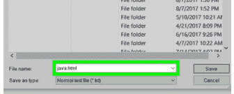

2. 命名你的文档并保存。

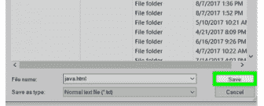

今天，JavaScript 已经成为许多高级 Web 应用程序和网站强大且稳定的基础。在丰富的 JS 开发者手中，它可以将用户体验提升到新的高度，并提供丰富的功能和高功能性组件。它的生态系统包含了数十种 JavaScript 工具。似乎几乎每周都有新的库或框架涌入开发者社区。那么，如何为 JavaScript 开发选择必要的工具呢？


## JavaScript 简介

根据流行程度选择前端工具并不是一个坏主意。广泛使用的 JavaScript 开发工具更稳定，拥有更大的社区支持，并且最终更可靠。评分是另一个应该考虑的关键因素。我们已经分享了关于最佳 JavaScript 库和框架的研究；然而，高级 JavaScript 编程是一项艰巨的任务，需要复杂的方法，特别是当涉及到跨浏览器兼容性和进一步扩展时。


### 1.4.1 JavaScript 构建工具和自动化系统

.NET 或 Java 等跨平台语言的构建工具是常有的；然而，在 JavaScript 中使用此类功能似乎很疯狂。但时代在变。一旦开发者开始使用 JavaScript 进行大型项目，他们就会面临可扩展性、维护性、安全性和通用性能问题。这就是构建工具变得有用的地方。

> Webpack 是一个免费且开源的 JavaScript 模块打包器。

- Webpack 是最新的前端开发工具之一。它是一个模块打包器，可以创建一个包含 JavaScript 应用程序所需的所有模块的依赖图。Webpack 将它们打包成一个或多个小包，以便浏览器加载。此外，它经常被用作任务运行器，因为它分析模块之间的依赖关系并生成资源。


## 基础计算机编程：JavaScript

- 像 Grunt 这样的任务运行器用于一个主要目的——重复耗时任务的自动化。尽管它带有一个巨大的生态系统（超过 60 多个插件），但目前 JavaScript 开发者倾向于使用更高级的工具。
- Gulp 在 Grunt 之后发布，尽管它是另一个任务运行器，但它采取了完全不同的方法，将任务定义为 JavaScript 函数。它自动化处理了痛苦的任务，提供了庞大的生态系统，并对过程提供了更好的透明度和控制。
- Browserify 允许软件开发者在浏览器中使用 Node.js 风格的模块。你定义依赖项，它会将所有内容打包成一个整洁的 JS 文件。结果是可以使用 `require` 语句引入 JavaScript 文件，并能够从 `npm` 导入模块。
- Branch.io 背后的核心思想是简单和快速。它带有轻量简单的配置和详细的文档，以便快速上手。Branch 会为你的 JavaScript 文件自动创建源映射，连同 CSS 样式表，简化了客户端的调试过程。
- Yeoman 是一个多操作工具，因为它可以用于任何编程语言（JavaScript、Python、C#、Java 等）。它是一个用于 Web 应用开发的脚手架系统，拥有丰富的生态系统（62-13 个插件）和创建新生成器的能力。Yeoman 允许开发者快速创建新项目并增强现有项目的维护。


## 4.2 JavaScript IDE 和编辑器

JavaScript IDE 和编辑器可以通过代码补全、调试和构建应用程序成为无与伦比的助手。它们可以快速配置工作环境并确保提高生产力。IDE 或集成开发环境具有丰富的功能并对 AML 系统的支持。而编辑器只包含核心功能，确保快速且流畅的性能。

- WebStorm 是一个用于高级 JavaScript 开发的强大 IDE。它支持各种框架和样式表语言，涵盖 Web、服务器、移动端和桌面。WebStorm 可以与运行器、检查器、构建器等其他开发工具无缝集成。它具有代码补全、实时错误检测、导航、嵌入式终端、丰富的插件生态系统等功能。
- GitHub 团队开发的 Atom 是许多人的首选。它是一个易于自定义的文本编辑器，开箱即用带有多种功能。Atom 包含了内置包管理器、智能自动补全、文件系统浏览器、跨平台支持以及其他一些有用功能。
- Visual Studio Code 由微软支持，并开箱即对 TypeScript 提供终极支持。它通过 IntelliSense 提供智能补全和语法高亮，编辑器内置了调试、命令、控制等功能。此外，VS Code 的功能可以通过广泛的扩展进行丰富。
- Brackets 是一个轻量级的开源文本编辑器。它主要关注视觉工具和预处理器的支持，让你在浏览器中设计更加容易。Brackets 带有方便的实时预览和强大的内联编辑器。

> 调试是发现程序中缺陷或问题的过程。

文档工具将你的应用程序透明化，使其易于理解。自动化工具描述软件如何运行以及应该如何。随着应用程序日益复杂，文档。

- Swagger 通常是描述 API 的一组规则和工具。重点在于，它是一种语言无关的实用程序，可以让所有人（包括开发者和非开发者）达成共识。Swagger 从注释中生成模板格式的文档（HTML、JSON）。该应用使用 JavaScript 编写，对于大型项目非常有用。
- JSDoc 是一个灵活的开源工具，允许生成文档。它不仅记录变量和函数，还记录命名空间、接口、包或其他元素。
- Yield 是一个遵循 Javadoc 原则的 Node.js 应用。它使用类似于 D 的语法，并提供实时预览。
- Docco 是用 LiterateScript 编写的免费文档工具。它生成的 HTML 文档会将你的注释与代码交错显示。它限于 JavaScript，因为没有 Python 或 Ruby 版本。

JavaScript 测试工具或测试框架通过在到达终端用户之前发现更多错误来确保软件稳定性。随着应用程序日益复杂，自动化测试不仅提高了开发团队的生产力，还能帮助公司控制预算并避免额外成本。

- Jasmine 是测试 JavaScript 代码的行为驱动开发（BDD）框架。它没有外部依赖，且不需要 DOM 即可启动。为了让编写测试更简单快速，它具有简洁易懂的语法。它也可以用于测试 Node.js、Python 和 Ruby。
- Mocha 是一个运行在 Node.js 和浏览器中的功能测试框架。作为许多开发者的首选方案，它顺序执行测试以提供准确灵活的报告，同时让异步测试变得有趣简单。Mocha 经常与 Chai 配合使用进行验证。
- Protractor 是适用于 AngularJS 和 Angular 应用程序的 Node.js 端端测试框架。它基于 WebDriver 构建，像终端用户一样测试应用程序，使用浏览器特定的驱动程序和原生事件。

## 1.4.5 JavaScript 调试工具

调试代码对于 JS 开发者来说是一项耗时且费力的任务。在调试数千行代码时，调试器可以大显身手，提供更好的便利性并确保结果更准确。


- 来自 Mozilla 开发者网络（MDN）的 JavaScript 调试器可以作为独立的 Web 应用，在其他浏览器和 Node.js 中调试代码。Firefox 提供了本地和远程功能，还可以调试在 Android 设备上通过 Firefox 运行的代码。
- Chrome DevTools 包含多种实用程序，用于调试 JavaScript 代码、编辑 CSS 以及测试应用的性能。


- `ng-inspector` 是 Firefox、Chrome 和 Safari 浏览器的扩展，可帮助开发者开发、理解和调试 AngularJS 应用程序。该工具使用实时更新、DOM 高亮，以及对作用域（scopes）、模型和其他应用的。

- `Augury` 是一个 Chrome 扩展，用于可视化和调试 Angular 2 应用程序。它允许 Angular 2 开发者直接洞察应用结构、运行特性和变更检测。

开源现成组件对大多数公司来说是一份礼物，因为它们帮助免费加速了软件开发过程。然而，此类解决方案也涉及风险。平均而言，每个应用程序中有 105 个开源组件，而 67% 的应用程序包含安全漏洞。

开源是强大的，但跟踪和缓解这些风险至关重要。

- `Snyk` 是一款商业工具，用于发现、修复和防止 JavaScript、Java 和 Ruby 应用中的漏洞。该服务拥有自己的漏洞数据库，并获取来自 NSP 和 NIST NVD 的数据。基础计算机编码：JavaScript。它允许开发者使用公司提供的补丁和升级来修复安全风险。

- `Node Security Project (NSP)` 提供了扫描依赖和检测漏洞的有用工具。NSP 使用其基于 npm 模块扫描构建的自有数据库，以及来自 NIST 国家漏洞数据库 (NVD) 等公共数据库的数据。此外，NSP 还提供了与 GitHub Pull Request 和 CI 软件的集成、实时检查、警报以及如何处理 Node.js 应用中漏洞的建议。

- `RetireJs` 是一个开源依赖检查器。它包含了各种组件，如命令行扫描器、Grunt 插件、Firefox 和 Chrome 扩展、Burp 和 OWASP ZAP 插件。Retire 从 NIST NVD 以及其他来源（如错误跟踪系统、博客和邮件列表）收集漏洞信息。

- `Gemnasium` 是一款带有免费试用的商业工具。它支持多种技术和包，包括 Ruby、PHP、Bower (JavaScript)、Python 和 npm (JavaScript)。Gemnasium 安全工具具有许多有用功能，如自动更新、实时警报、安全通知和 Slack。

- `OSSIndex` 支持多种生态系统（Java、JavaScript、.NET/）和多个平台，如 NuGet、npm、Bower、Chocolatey、Maven、Composer、Drupal 和 MSI。它从漏洞数据库、各种安全源以及社区贡献收集漏洞信息。

为了验证 JavaScript 代码质量，开发公司通常转向功能测试和单元测试常用活动。然而，还有另一种方法允许开发者检查代码质量及其对编码标准的遵循情况，即静态代码分析。

现代软件开发公司将静态代码分析工具集成到交付过程中，以防止劣代码进入生产阶段。

- `JSLint` 是一种基于 Web 的分析工具，用于验证 JavaScript 代码质量。一旦它在源码中检测到问题，就会返回一个包含问题描述及其在代码中近似位置的消息。JSLint 能够分析某些风格约定并揭示语法错误和结构性问题。

- `JSHint` 是一个灵活的社区驱动工具，用于发现你的 JS 代码中的错误和潜在问题。这种静态代码分析工具的主要目标是帮助 JavaScript 工程师处理复杂项目。它能够检测语法错误、隐式数据问题。

- `ESLint` 是一种用于验证 JavaScript 代码质量的静态分析工具。一旦它在源码中检测到问题，就会返回一个包含问题描述及其在代码中近似位置的消息。ESLint 能够分析某些风格约定并发现语法错误和结构性问题。

- `Flow` 是由 Facebook 开发的静态代码检查器。它通过类型注解检查 JavaScript，确保你的代码符合要求。

版本控制系统对于团队协作至关重要，因为它们可以跟踪版本并确保软件的准确性。这些工具允许开发者同时在同一个项目上工作，而不会产生冲突或误解。

- 近年来 `Git` 已成为广泛使用的版本控制系统，适用于小型和大型项目。它提供了卓越的性能。

- `Subversion (SVN)` 获得了巨大的人气，并被广泛应用于 Ruby 等平台。它带有许多功能，允许对目录进行归档。

现代软件以包的形式存储并保留在仓库中。此类包提供了初始组件。此外，包管理系统负责各种操作，并确保安装的软件已通过审核。

- `Bower` 用于管理资产、框架、库和其他工具。由 Twitter 团队开发，提供了大量的包，帮助 JavaScript 开发者简化开发流程。

- `npm` 代表 node package manager，它是 JavaScript 的包管理系统以及世界上最大的软件注册表，拥有超过 47 万个模块。

- `Yarn` 是新秀，但得益于其推广者（Google、Facebook、Tilde 和 Exponent），它已经占据了市场。与 npm 相比，它被誉为智能改进。该工具通过包或模块实现代码共享，并附带一个描述包的文件。

## 榜样

## 布兰丹·艾奇：JavaScript 编程语言的发明者

布兰丹·艾奇（Brendan Eich）是一位美国技术专家，JavaScript 编程语言的创造者。他共同创立了 Mozilla 项目、Mozilla 基金会和 Mozilla 公司，并担任 Mozilla 公司的首席技术官，曾短暂担任首席执行官。

## 早年生活

布兰丹·艾奇在圣克拉拉大学获得数学和计算机科学学士学位。他于 1985 年在伊利诺伊大学厄巴纳纳香槟槟分校获得硕士学位。他在 Silicon Graphics 开始职业生涯，在那里工作了七年的操作系统和网络代码。随后，他在 MicroUnity Systems Engineering 工作了三年，负责编写微内核和 DSP 代码，并完成了 GCC 的首个针对 MIPS R400 的移植。

他于 1995 年 4 月加入 Netscape 通信公司。他最初加入的目的是将 Scheme “放入浏览器”，但 Eich 被委托创建一种类似于 Java 的新语言，为 Netscape Web 浏览器开发 JavaScript。

第一个版本在十天内完成，以适应 JavaScript 2.0 Beta 的发布，被称为 Mocha，随后在 1995 年 9 月更命名为 LiveScript，并在同月晚些更名为 JavaScript。他一直监督 Spider Monkey（JavaScript 在 Navigator 中的具体实现）的，直到 2011 年。

## Mozilla

1998 年，Eich 共同创立 Mozilla 项目，网站为 `mozilla.org`，旨在管理 Netscape 源码的开源贡献。他担任 Mozilla 的首席架构师。AOL 于 2003 年 7 月关闭了 Netscape 浏览器部门，Eich 帮助将 Mozilla 基金会拆分出来。

2005 年 8 月，在担任了 Mozilla 基金会的首席技术专家和董事会成员后，Eich 成为新成立的 Mozilla 公司的 CTO，该公司旨在作为 Mozilla 基金会的营利性分支。

## CEO 任命与辞职

2014 年 3 月 24 日，Eich 被提升为 Mozilla 公司的 CEO。他的任命引发了争议，原因是他在 2008 年为加州第 8 号提案的成功竞选捐赠了 1000 美元的政治款，该提案旨在规定：“在加州，只有男人和女人之间的婚姻是有效或认可的。”这受到了 Twitter 上同性恋权利活动者的批评。在随后的公众讨论中，OKCupid 和两个同性恋应用开发者呼吁抵制该公司。Mozilla 公司的其他人在他们的博客上发声支持他。董事会成员希望他以不同的职位留任公司。

2014 年 4 月 3 日，Eich 辞去了 CEO 职位并辞了 Mozilla 工作。在他的个人博客中，Eich 表示：“在目前的情况下，我无法成为有效的领导者。”

在 Eich 辞职后，国家婚姻组织（National Organization for Marriage）号召抵制 Mozilla，理由是“同性恋活动迫使他离开了他领导多年的公司”。

## 总结

- JavaScript 是一种轻量级、跨平台、单线程的解释型编译编程语言。它被称为网页的脚本语言。它因开发网页而闻名，许多非浏览器环境也使用它。

- JavaScript 是一种弱类型语言（动态类型）。JavaScript 可用于客户端开发，也可用于服务端开发。JavaScript 既是命令式语言也是声明式语言。JavaScript 包含标准对象库（如 `Array`、`Date` 和 `Math`）以及一组核心元素（如运算符、控制结构和语句）。

- JavaScript 是一种动态编程语言。它是轻量级的，最常用作网页的一部分，其实现允许客户端脚本与用户交互并制作动态页面。它是一种具有面向对象能力的解释型编程语言。

- 客户端 JavaScript 是该语言最常见的形式。脚本应包含在 HTML 文档中或由 HTML 文档引用，以便浏览器解释。

- “Hello World”是编程课程的经典。该程序的目的很简单：在计算机屏幕上输出“Hello World”。因为消息和语法简单，它通常是教给初学者的第一个程序。用 JavaScript 编写“Hello World”程序异常容易，不需要超过 3 行代码。

- JavaScript 程序通常嵌入在网页本身中。这意味着它们与 HTML 一起编写，尽管你也可以从外部包含它们。

- 函数是程序中可以被“调用”任意次数的任意块。函数在编程中极其有用，因为你可以创建一次，使用 `n` 次。

- `Webpack` 是最新的领域端开发工具之一。它是一个模块打包器，可以为你的 JavaScript 应用程序创建所需的所有模块依赖图。Webpack 将它们打包成一个或多个包供浏览器加载。

- `Browserify` 允许开发者在浏览器中使用 `node.js` 模块。你定义依赖，它会将所有内容打包成整洁的 JS 文件。结果是 JavaScript 文件可以使用 `"require"` 语句包含，并启用来自 npm 的模块。

- `Yeoman` 是一个脚手架生成器，可以帮助你快速构建复杂的开发流。

- `WebStorm` 是强大的 IDE。它支持各种框架、调试器、代码测试器等。

- `Visual Studio Code` 提供了 TypeScript 支持。它提供智能补全、语法高亮。

- `Brackets` 是一个轻量级编辑器。它提供实时预览和强大的调试功能。

- 调试代码是一项耗时的任务。调试器可以更准确地处理结果。

- -

- `Brackets` 是一个轻量级编辑器。它提供实时预览和强大的调试功能。

1. JavaScript 是........... 语言。

   a. 编程

   b. 应用

   c. 其他

   d. 脚本

2. JavaScript 是........... 脚本。

   a. 服务端

   b. ISP

   c. 其他

   d. 浏览器

3. JavaScript 设计用于：

   a. 为 HTML 页面样式

   b. 为 HTML 添加交互性

   c. 执行服务端操作

   d. 执行服务器查询

4. 下列 JavaScript 无法：

   a. JavaScript 可以响应事件

   b. JavaScript 可以操作 HTML 元素

   c. JavaScript 可以验证数据

   d. 以上

5. JavaScript 是........... 语言。

   aa. 编译型

   b. 解释型

6. “function”和“var”被称为：

   aa. 关键字

   b. 数据类型

   c. 声明语句

   d. 原型

7. 调用 JavaScript 代码的正确方式是：

   aa. 处理器

   b. 触发事件

   c. RMI

   d. 函数/方法

8. 在 JavaScript 中，下列项不被视为错误：

   aa. 语法错误

   b. 缺少分号

   c. 除以零

   d. 缺少括号

9. 什么是 JavaScript？

   aa. JavaScript 是一种用于制作网站交互的脚本语言

   b. JavaScript 是一种用于制作网站交互的汇编语言

   c. JavaScript 是一种用于制作网站交互的编译语言

   d. 以上

10. 关于 JavaScript，下列哪项正确的？

    aa. JavaScript 是一种基于对象的语言

    b. JavaScript 是一种汇编语言

    c. JavaScript 是一种面向对象的语言

    d. JavaScript 是一种高级语言

11. 在给定语句中，哪条语句定义了 JavaScript 中的闭包？

    aa. JavaScript 是一个包含其内部函数引用的函数

    b. JavaScript 是一个包含其词法环境的函数

    cc. JavaScript 是一个包含其内部函数对象的函数

- d. 以上均不是

12. JavaScript 中的数组是由以下哪个语句定义的？

    - a. 它是一个有序的值列表

    - b. 它是一个有序的对象列表

    - c. 它是一个有序的字符串列表

    - d. 它是一个有序的函数列表

13. 下列哪项不是 JavaScript 数据类型？

    - a. 空类型 (Null type)

    - b. 未定义类型 (Undefined type)

    - c. 数字类型 (Number type)

    - d. 以上所有都是

14. 客户端 JavaScript 代码嵌入在 HTML 文档的哪里？

    - a. 使用特殊 `javascript:code` 的 URL

    - b. 使用特殊 `javascript:protocol` 的 URL

    - c. 使用特殊 `javascript:encoding` 的 URL

    - d. 使用特殊 `javascript:stack` 的 URL

15. 下列哪项是所有客户端 JavaScript 功能和 API 的主入口？

    - a. 位置 (Position)

    - b. 窗口 (Window)

    - c. 标准 (Standard)

    - d. 所在 (Location)

## 复习题

1. 什么是 JavaScript？

2. 什么是客户端 JavaScript？

3. 写述 JavaScript 的优势。

4. 写述 JavaScript 的缺点。

5. 如何编写第一个 JavaScript 程序？

6. 如何使用 HTML 将 JavaScript 添加到你的网站？

7. 讨论 JavaScript 开发工具。

8. `Webpack` 是什么用的？

9. `Swagger` 是什么用的？

10. `Snyk` 是什么用的？

## JavaScript 简介

## 检查结果

- 1. (d) 2. (d) 3. (b) 4. (d) 5. (b)

- 6. (c) 7. (d) 8. (c) 9. (a) 10. (a)

- 11. (b) 12. (a) 13. (d) 14. (b) 15. (b)

## 参考文献

- 1. Flanagan, David. JavaScript: The Definitive Guide. 7th edition. Sebastopool, California: O'Reilly, 2020.

- 2. Haverbeke, Marijn. Eloquent JavaScript. 3rd edition. No Starch Press, 2018. 472 pages. ISBN 978-1593279509. (download)

- 3. Zakas, Nicholas. Principles of Object-Oriented JavaScript, 1st edition. No Starch Press, 2014. 120 pages. ISBN 978-1593275402.

## 第二2 章

# 语言语法

## 引言

语法是指指定符号正确组合序列的规则，这些序列可用于使用给定的编程语言形成结构正确的程序。程序员通过编程语言结构正确的语法、语义和句法与计算机通信。编程语法包含类似于单词的字符串，就像人类语言一样。格式正确的语法字符串会在指定的编程语言中产生语法正确的句子。语法描述了语言变量和字符如何组合成字符串。

- 在学习本章后，你将能够：

  1. 学习 JavaScript 语法
  2. 讨论 JavaScript 的外观

语义赋予组合字符串以意义，而语法将字符转换为标记（tokens）或字符字符串。

语法（形式）与语义形成对比。在处理计算机语言时，语义处理通常在语法处理之后，但在某些情况下，语义处理对于完整的语法分析是必要的，这些是同时或并发完成的。在编译器中，语法分析包括前端，而语义分析包括后端（以及中间端，如果该阶段被区分开来）。

## 2.1 JAVASCRIPT 语法

JavaScript 可以使用放在 `<script>...</script>` 中的 JavaScript 语句来实现。

你可以将包含 JavaScript 的 `<script>` 标签放置在页面的任何地方，但通常建议将其保留在 `<head>` 标签内。

`<script>` 标签通知浏览器开始解释这些标签之间的文本为脚本。简单的 JavaScript 语法如下：

```html
<script>
JavaScript 代码
</script>
```

`<script>` 标签有两个重要的属性：

- Language（语言）——该属性指定你正在使用的脚本语言。通常，它的值将是 `javascript`。虽然最近版本的 HTML（及其继任者）已不再使用此属性。

- Type（类型）——该属性用于指示脚本语言，其值应设置为 `"text/javascript"`。

因此，你的 JavaScript 段看起来像这样：

```html
<script language="javascript" type="text/javascript">
JavaScript 代码
</script>
```

> 注意：在编写 JavaScript 变量和函数名时应小心。

## 第一个 JavaScript 脚本


让我们取示例打印“Hello World”。添加可选的 HTML 注释是为了防止浏览器将我们的代码结尾视为 JavaScript 代码。`//` 表示 JavaScript 中的注释。通过 `document.write` 函数可以将字符串写入 HTML 文档。看下面的代码：

```html
<html>
<body>
<script language="javascript" type="text/javascript">
document.write("Hello World!")
</script>
</body>
</html>
```

这段代码将产生结果：Hello World!

## 空格与换行

JavaScript 忽略程序中的空格、制表符和换行符。

你可以自由地使用空格、制表符和换行符，并以整洁一致的方式格式化你的程序，这使得代码易于阅读和理解。这是一种面向对象的编程语言，为程序提供了清晰的结构并降低了开发成本。

## 分号是可选的

JavaScript 中的简单语句通常跟着分号，就像在 C、C++ 和 Java 中一样。然而，如果你的每个语句都单独成一行，则允许省略分号。

```html
<script language="javascript" type="text/javascript">
var1 = 10
var2 = 20
</script>
```

但当格式化为单行时，必须使用分号：

```html
<script language="javascript" type="text/javascript">
var1 = 10; var2 = 20;
</script>
```

使用分号是一种良好的编程习惯。

## 大写敏感

JavaScript 是一种大小敏感的语言。这意味着语言关键字、变量名和任何其他标识符必须始终使用一致的大小写字母。因此，标识符 `Time` 和 `TIME` 在 JavaScript 中具有不同的含义。

## JavaScript 中的注释

JavaScript 支持 C 风格和 C++ 风格的注释，因此：

- `//` 与行尾之间的任何文本都被视为注释并被 JavaScript 忽略。
- `/*` 和 `*/` 之间的任何文本都被视为注释。它可以跨多行。
- JavaScript 也识别 HTML 注释起始序列 `<!--`，将其视为单行注释。HTML 注释结束序列 `-->` 不被 JavaScript 识别，因此它应该写成 `//-->`。

## 示例

下面的示例展示了如何在 JavaScript 中使用注释。

```html
<script language="javascript" type="text/javascript">
<!--
// 这是一个注释。它类似于 C++ 中的注释
/*
 * 这是一个 JavaScript 中的多行注释
 * 它非常类似于 C 中的注释
 */
</script>
```

## 2.1.1 JavaScript 浏览器

JavaScript 最初是为了“让猴动起来”。这种语言中的程序被称为脚本。它们可以直接写在 HTML 中并在页面加载时执行。脚本以纯文本的形式提供并执行。它们不需要特殊的准备或编译即可运行。在这方面，JavaScript 与语言 Java 非常不同。

目前，JavaScript 不仅可以在浏览器中执行，还可以在服务器上执行。浏览器拥有嵌入式引擎，有时被称为“JavaScript 虚拟机”。

引擎有不同的“名称”，例如：

- V8：在 Chrome 和 Opera 中。
- SpiderMonkey：在 Firefox 中。
- 还有其他名称，如用于不同版本的 IE 的“Trident”/“Chakra”，用于 Microsoft Edge 的“ChakraCore”，用于 Safari 的“Nitro”和“SquirrelFish”。

上面的术语很好记，因为它们被用于互联网上的开发者文章。我们也会使用它们。

> 如果“特性 X 被 V8 支持”，那么它可能在 Chrome 和 Opera 中有效。


## 浏览器 JavaScript 可以做什么？

现代 JavaScript 是一种“安全”的编程语言。它不提供内存或 CPU 的低级访问，因为它最初是为不需要它的浏览器创建的。

能力很大程度上取决于运行 JavaScript 的环境。例如，Node.JS 支持允许 JavaScript 读写任意文件、执行网络请求等函数。

## 基础计算机编程：JavaScript

浏览器内 JavaScript 可以完成所有与网页操作、与用户以及 Web 服务器交互相关的任务。

例如，浏览器内 JavaScript 能够：

- 在页面上添加新的 HTML，更改现有内容，修改样式。
- 响应用户操作，在鼠标点击、移动、按键时运行。
- 通过网络向远程服务器发送请求，下载和上传文件（即所谓的 AJAX 和 COMET 技术）。
- 获取和设置 cookie，向访问者提问，显示消息。
- 在客户端记住数据（“本地存储”）。

家用机器人是服务机器人的一种，是一种主要用于家务劳动的自主机器人，但也可以用于教育、娱乐或治疗。

## 浏览器内 JavaScript 不能做什么？

为了用户的安全考虑，JavaScript 在浏览器中的功能是受到限制的。其目的是防止恶意网页访问隐私信息或损害用户数据。

此类限制的示例有：

- 网页上的 JavaScript 不得读取/写入硬盘上的任意文件、复制这些文件或执行程序。它无法直接访问操作系统的系统函数。

现代浏览器允许它与文件进行交互，但这种访问是有限的，并且只有在用户执行某些操作时才会提供，例如将文件“拖入”浏览器窗口或通过 `<input>` 标签选择它。

有方法与相机/麦克风和其他设备进行交互，但这些需要用户的显式许可。因此，启用 JavaScript 的页面可能在暗中开启摄像头、观察周围并将信息发送给美国国家安全局（NSA）。

- 不同的标签页/窗口通常互不感知。例如，当一个窗口使用 JavaScript 打开另一个窗口时，它们是可以的。即使在这种情况下，如果两个页面来自不同的网站（不同的域名、协议或端口），一个页面的 JavaScript 也无法访问另一个。

这被称为“同源策略”。为了绕过这一限制，两个页面都必须包含特殊的 JavaScript 代码来处理数据交换。

## 语言语法

限制仍然是为了用户的安全。用户打开的来自`http://anyisite.com`的页面不能够访问 URL 为`http://gmail.com`的另一个浏览器标签页，并从那里窃取信息。

- JavaScript 可以轻松通过网络与当前页面所属的服务器进行通信。但它从其他网站/域接收数据的能力被限制了。虽然可行，但需要远程端的显式同意（表示在 HTTP 请求头中）。再次，这是出于安全限制。

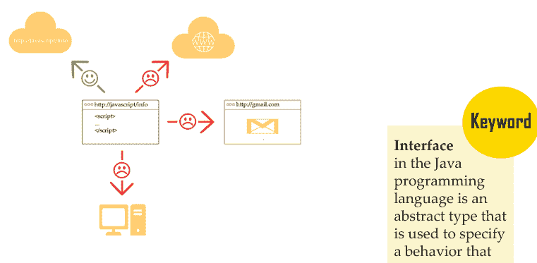

如果在浏览器之外使用 JavaScript（例如在服务器上），则不存在这些限制。现代浏览器还允许安装插件/扩展，这些扩展可能会获得扩展权限。

## 什么让 JavaScript 独特性？

JavaScript 至少有三个优秀之处：

- 与 HTML/CSS 的完美集成。
- 用简单的方法处理简单任务。
- 受所有主流浏览器支持并默认启用。

这三点结合在一起仅存在 JavaScript 中，其他浏览器技术均不存在。

这就是 JavaScript 独一无二之处。这也是为什么它是创建浏览器界面最广泛的工具。

在计划学习新技术时，检查其前景是有益的。现在，让我们转向包含新语言和浏览器能力的现代趋势。

## JavaScript“之上”的语言

JavaScript 的语法并不适合所有人的需求。不同的人有不同的需求。

这是预料之中的，因为每个人的项目和需求都是不同的。因此，最近出现了许多新语言，它们在浏览器中运行之前会被转译（转换）为 JavaScript。

现代工具使转译变得非常快速且透明，实际上允许开发者使用另一种语言编写代码并在“底层”进行自动转换。此类语言的示例有：

- CoffeeScript 是 JavaScript 的“语法糖”，它引入了更短的语法，允许编写更精确、清晰的代码。通常情况下，它是为了让代码更简洁。
- TypeScript 专注于添加类型系统，以简化开发（注：原文描述略有偏差，意指增加类型严谨性）。它是由 Microsoft 开发的。
- Dart 是一种独立的语言，它可以在 JavaScript 环境中运行（如上所示）。它是由 Google 提供的。

无论使用哪种风格，在 JavaScript 中都必须遵循特定的规则。以下是 JavaScript 中一些常见的规则示例：

### 2.1.2 理解 JavaScript 中的语法和结构

在学习编写语言之前，你必须首先了解规则。以下是你在英语语言中可能会发现的规则示例：

- 句子以大写字母开头。
- 句子以句号结束。
- 段落缩进。
- 对话位于双引号内。

同样，所有编程语言都必须遵循特定的规则才能运行。这些规则决定了 JavaScript 的结构。许多编程语言在这些方面是相似的。

## 功能性与可读性

功能性和可读性是你开始学习 JavaScript 时关注的两个重要原因。

JavaScript 的某些语法规则是强制性的。如果不遵守，控制台将抛出错误并停止执行。

考虑以下“Hello, World!”程序的语法错误：

```javascript
broken.js
// 示例代码
console.log("Hello
```

此代码示例缺少了右括号，因此在控制台打印“Hello, World!”会出现以下错误：

```text
Output

Uncaught SyntaxError: ) after argument list
```

在添加`)`之前脚本无法继续。这是一个 JavaScript 语法错误破坏脚本的示例，因为必须遵循正确的语法才能运行。

JavaScript 语法和格式的某些方面基于不同的流派。样式规则或选择是非强制的，运行代码时不会产生错误。有很多合理的约定，因为项目和代码库之间的开发者会熟悉这种风格。

考虑以下变量赋值示例：

```javascript
const greeting="Hello"; // 变量与字符串之间没有空格
const greeting =  ; // 赋值后空格过多
const greeting = "Hello";   // 变量与字符串之间有单个空格
```

上述三个示例在输出方面功能完全相同，但第三种 `greeting = "Hello"` 是最常用的，也是编写代码最好的方式。

## 空格

JavaScript 中的空白包括空格、制表符和换行。如前所示，字符串外的多余空格以及运算符与其他符号之间的空格会被 JavaScript 忽略。这意味着这三个变量赋值示例将具有相同的计算输出：

```javascript
const getLocation = "New York City, " + "NY";
const getLocation="New York City,"+NY;
const getLocation = "New York City," + "NY";
```

无论在脚本中使用哪种风格，`getLocation` 都代表“New York City, NY”，无论使用制表符还是空格编写空白对 JavaScript 也没有区别。

## 基础计算机编程：JavaScript

遵循最常见空格规范的一个良好原则，是遵循与你在数学和语言语法中使用的相同的规则。

例如，`let x = 5 * y` 比 `let x=5y` 更具可读性。

你可能会看到的这种风格的一个例外是在为多个变量赋值。在下面的示例中，`=` 的位置如下：

```javascript
const constName = "DigitalOcean";
const companyHeadquarters = "New York City";
const companyHandle = "digitalocean";
```

所有的赋值运算符（`=`）都对齐了，变量后留有空格。这种组织结构并不是每个代码库都会使用的，但可以用来提高可读性。

JavaScript 也会忽略多余的换行。通常情况下，代码块后的注释会插入一个额外的换行。

## 括号

对于 `if`、`switch` 和 `for` 等关键字，通常会在括号前后添加空格。请观察以下比较和循环的示例。

```javascript
// if 语句语法示例
if () {

}
```

```javascript
// 检查数学方程并将字符串打印到控制台
if (4 < 5) {
  console.log("4 is less than 5.");
}
```

```javascript
// 循环语法示例
for () {

}
```

```javascript
// 迭代 10 次，将每个迭代数字打印到控制台
for (let i = 0; i<= 10; i++) {
  console.log(i);
}
```

如所示，`if` 语句和 `for` 循环在括号的两侧都有空格（但括号内部没有）。

当代码涉及函数、方法或类时，括号将与相应的名称相连。

```javascript
// 示例
```

## 语言语法

```javascript
function functionName() {

  // 初始化一个函数来计算立方体的体积
  function cube(number) {
    return Math.pow(number, 3);
  }
}

// 调用函数
cube(5);
```

在上面的示例中，`cube()` 是一个函数，一对括号 `()` 将包含参数或变量。在这种情况下，参数分别是 `number` 或 `5`。虽然 `cube()` 后面多加一个空格是有效的，代码会按预期执行，但几乎从不这样做。将它们放在一起可以轻松将函数名与括号对以及任何相关的传递参数关联。

## 分号

JavaScript 程序由一系列被称为“语句”（statements）的指令组成，就像编写好的段落由系列句子一样。虽然句子以句号结束，但 JavaScript 语句通常以分号（`;`）结束。

```javascript
// 单条 JavaScript 语句
const now = new Date();
```

如果两个语句相互相邻，则必须用分号将它们分隔。

```javascript
// 获取当前时间戳并打印到控制台
const now = new Date(); console.log(now);
```

如果语句之间用换行符分隔，分号是可选的。

```javascript
// 用换行分隔的两个语句
const now = new Date()
console.log(now)
```

一个安全且常见的约定是无论是否有换行，都用分号分隔语句。通常，实现分号被认为是一种良好的做法，可以减少错误的概率。

```javascript
// 用换行和分号分隔的两个语句
const now = new Date();
console.log(now);
```

## 基础计算机编程：JavaScript

在 `for` 循环的初始化、条件和递增/递减之间也需要分号。

```javascript
for (initialization; condition; increment) {
    // 运行循环
}
```

任何类型的块语句（block statement），如 `if`、`do`、`while`、`switch` 和 `function` 后都不包含分号。这些块语句包含在大括号 `{}` 中。注意下面的示例。

```javascript
// 初始化一个函数来计算正方形面积
function square(number) {
    return Math.pow(number, 2);
}

// 计算大于 0 的数字面积
if (number > 0) {
    square(number);
}
```

注意，并不是所有在大括号中的代码都不带分号结束。对象在大括号中进行编码的，并且应该以分号结束。

```javascript
// 示例对象
const objectName = {};

// 初始化三角形对象
const triangle = {
    type: "right",
    angle: 90,
    sides: 3,
};
```

除了以大括号结束的块语句外，在每个 JavaScript 语句后包含分号是一项广泛接受的做法。

## 缩进

一个完整的 JavaScript 程序在技术上可以写在一行。然而，这将很快变得难以阅读和维护。相反，我们使用换行和缩进。这里有一个 `if/else` 语句的示例，可以写在一行或带缩进。

```javascript
// 写在一行的条件语句
if (x === 1) { /* 如果为真 */ } else { /* 如果为假 */ }
```

```javascript
// 缩进的条件语句
if (x === 1) {
    // 如果为真
} else {
    // 如果为假
}
```

注意，块内的任何代码都是缩进的。缩进可以使用两个空格、四个空格或按 Tab 键完成。使用制表符还是空格取决于个人偏好（对于个人项目）或组织的指南（对于协作项目）。

将左括号放在行尾（如上面的示例）是 JavaScript 块语句和对象的习惯结构。你可能会看到的另一种块语句写法是括号单独换行。

```javascript
// 括号换行的条件语句
if (x === 1) {
    // 如果为真
} else {
    // 如果为假
}
```

这种风格在 JavaScript 中比其他语言少得多，但也并未听说。

任何嵌套块语句将进一步缩进。


## 基础计算机编程：JavaScript

良好的缩进对于维护可读性至关重要。

## 标识符

标识符由字母和数字组成，但不能以符号开头。

## 大写敏感

这些名称对大小敏感。

```javascript
var myVariable = 1;
var myvariable = 2;
```

类名的约定是通常使用大写（PascalCase）。

```javascript
// 初始化一个类
class ExampleClass {
  constructor() {}
}
```

## 保留关键字

关键字是 JavaScript 语言中具有功能的功能的，如`var`、`if`、`for`。例如，你无法为名为`var`的变量赋值。

```javascript
var var = "Some value";
```

由于 JavaScript 将`var`理解为关键字，这将导致错误：

```
Output
SyntaxError: Unexpected token (1:4)
```

## 数字和字符串的操作

在 JavaScript 中，数字和字符串的行为可能会以你意料不到的方式出现。

### 加法与拼接

```javascript
var foo = 1;
var bar = '2';
console.log(foo + bar); // 12. 哎呀
```

### 强制将字符串视为数字

```javascript
var foo = 1;
var bar = '2';

// 将字符串强制转换为数字
console.log(foo + Number(bar));
```

`Number`构造函数在作为函数调用时（如上所示），会将其参数转换为数字。你也可以使用一元加号运算符，它实现的功能是相同的：

### 强制将字符串视为数字（使用一元加号运算符）

```javascript
console.log(foo + +bar);
```

# 逻辑运算符

逻辑运算符允许你使用 AND（与）和 OR（或）操作来评估一组操作。

## 逻辑 AND 和 OR 运算符

```javascript
var foo = 1;
var bar = 0;
var baz = 2;

foo || bar; // 返回 1，为真
bar || foo; // 返回 1，为真

foo && bar; // 返回 0，为假
foo && baz; // 返回 2，为真
baz && foo; // 返回 1，为真
```

虽然可能不明显看出`||`运算符返回第一个真值（truthy）的值，或者在两个者都不为真的情况下，它会返回两个操作数的值。`&&`运算符返回第一个假值（falsey）操作数的值，如果两个都为真，则返回最后一个值。务必参考“真假值（Truthy and Falsy Things）”章节以获取更多关于哪些值会被评估为真或假的详细信息。

有时你会看到开发者使用这些逻辑运算符进行流控制，而不是使用`if`语句。例如：

```javascript
// 如果 foo 为真，对 foo 执行某些操作
foo && doSomething(foo);
// 如果 baz 为真，则将 bar 设置为 baz
// 否则，将其设置为 createBar() 的返回值
var bar = baz || createBar();
```

这种风格非常优雅且简洁；尽管如此，它读起来可能非常困难，尤其是对于初学者来说。

我在这里提到它是为了让你在阅读代码时能识别它，但在你完全熟悉它的含义以及你预期的行为之前，我不建议使用它。

# 比较运算符

比较运算符允许你测试值是否等价，或者值是否完全相同。

```javascript
var foo = 1;
var bar = 0;
var baz = '1';
var bim = 2;
```

```javascript
foo == bar; // 返回 false
foo != bar; // 返回 true
foo == baz; // 返回 true；注意！
```

```javascript
foo === baz; // 返回 false
foo != baz; // 返回 true
foo === parseInt(baz); // 返回 true
```

```javascript
foo > bim; // 返回 false
bim > baz; // 返回 true
foo <= baz; // 返回 true
```

# 流控制

有时你可能只想在特定条件下运行一段代码。流控制——通过`if`和`else`块——允许你只在特定条件下运行代码。

> 虽然单行语句并不强制要求使用大括号，但一致地使用大括号（即使在不是强制要求的情况下）可以使代码更具可读性。注意不要在不同的块、if/else块中多次定义同名的函数，否则可能无法得到预期的结果。

```javascript
var foo = true;
var bar = false;
if (bar) {
  //这段代码永远不会运行
  console.log('hello!');
}
if (bar) {
  //这段代码不会运行
} else {
  if (foo) {
    //这段代码将运行
  } else {
    // 如果 foo 和 bar 都为假，这段代码将运行
  }
}
```

# 真假值（Truthy and Falsy）

为了成功使用流控制，理解哪些类型的值是“真值”（truthy）哪些类型的值是“假值”（falsy）很重要。有时，看起来应该评估为某种结果的值实际上评估为另一种结果。

## 评估为真的值

- `'0'`

- `'任何字符串'`

- `[]`; // 一个空数组

- `{}`; // 一个空对象

- `1`; // 任何非零数字

## 评估为假的值

- `0`

- `''`; // 空字符串

- `NaN` // JavaScript 的“不是数字”变量

- `null`;

- `undefined`; // 注意 -- undefined 可以被重新定义

三元运算符是一个接受三个参数的运算符。第一个参数是比较参数，第二个参数是比较为真的结果，第三个参数是比较为假的结果。如果将该运算符看作编写`if-else`语句的简写方式对你有帮助。

## 使用三元运算符进行条件变量赋值

有时你想根据某些条件为变量设置一个值。你可以使用`if/else`语句，但在很多情况下，三元运算符更方便。[定义：三元运算符测试条件；如果条件为真，它返回一个特定值，否则返回另一个值。]

### 三元运算符

```javascript
// 如果 bar 为真，将 foo 设置为 1
// 否则 = 将 foo 设置为 0
var foo = bar ? 1 : 0;
```

虽然可以使用三元运算符而不将返回值赋值给变量，但通常不建议这么做。

# Switch 语句

虽然三元运算符可以在不将返回值赋值给变量的情况下使用，但这通常是不被鼓励的。定义：switch 语句检查变量的值，并根据值执行不同的代码块。

```javascript
switch (foo) {
  case 'bar':
    alert('the value was bar!');
    break;
  case 'baz':
    alert('boo baz(');
    break;
  default:
    alert('everything else is ok');
}
```

`switch`语句在 JavaScript 中已不再流行，因为通常相同的行为可以通过创建一个对象来实现，更具潜力。例如：

```javascript
var stuffToDo = {
  'bar': function() {
    alert('the value was bar!');
  },
  'baz': function() {
    alert('boo baz(');
  },
  'default': function() {
    alert('everything else is ok');
  }
};
stuffToDo[foo]();
```

# 循环

你只想在特定条件下运行一段代码。流控制——通过`if`和`else`块——允许你只在特定条件下运行代码。

循环是在满足条件下重复的序列。

## 语言语法

条件语句在每次迭代之前执行，其返回值决定循环是否继续。如果条件语句评估为假值，则循环停止。

迭代语句在每次迭代结束时执行，并提供更改状态变量的机会。通常，这涉及到计数器的增加或减少。

循环语句是每次运行的内容。它可以包含你想要的内容。你通常会有多个需要执行的语句，因此将它们封装在块（`{}`）中。

### for 循环

典型的`for`循环如下：

```javascript
for (var i = 0, limit = 100; i < limit; i++) {
  //这段代码将执行 100 次
  console.log('Currently at ' + i);
}
// 注意：最后的日志是 "Currently at 99"
```

### while 循环

`while`循环类似于`if`语句，但它的体会一直执行直到条件评估为假。

```javascript
while (conditional) {
  //循环体
}
```

这是一个典型的`while`循环：

```javascript
var i = 0;
while (i < 100) {
  //这段代码将执行 100 次
  console.log('Currently at ' + i);
  i++; // 递增 i
}
```

你会注意到我们必须在循环体内递增计数器。可以将条件和递增器结合，如下：

### 带有组合条件和递增器的 while 循环

```javascript
var i = -1;
while (++i < 100) {
  //这段代码将执行 100 次
}
```

注意我们从`-1`开始，并使用了前置增运算符（`++i`）。

## do-while 循环

这与`while`循环几乎相同，不同在于在测试条件之前，循环体至少会执行一次。

```javascript
do [loopBody] while (conditional);
```

这是一个`do-while`循环示例：

```javascript
// 即使条件求值为 false
// 这个循环体仍然会执行
do {
  alert('Hi there!');
} while (false);
```

这种类型的循环非常少见，因为很少情况下需要一个盲目至少执行一次的循环。无论如何，了解它是有好处的。

## 跳出（break）和 继续（continue）

通常，循环的终止是因为条件语句没有求结果为真，但可以在循环体内部使用`break`语句从途中停止循环。

### 停止循环

```javascript
for (var i = 0; i < 10; i++) {
  if (something) {
    break;
  }
}
```

你可能还想继续循环而不执行更多的循环体内容。这是通过`continue`语句实现的。

### 跳到循环的下一次迭代

```javascript
for (var i = 0; i < 10; i++) {
  if (something) {
    continue;
  }
  // 只有当条件 'something' 未满足时，
  // 以下语句才会被执行
  console.log('I have been reached');
}
```

# 保留字 (Reserved Words)

保留字是专用于特殊用途的术语或短语，在创建变量名时不能使用。例如，“print”是一个保留字，因为在许多语言中，它是用于在屏幕上显示文本的函数。

保留字在操作系统中作为识别设备文件或其他服务的方法。以下是 MS-DOS 和 Windows 操作系统中的微软保留字列表。当尝试将以下任何保留字作为文件名或在命令中使用它们时，你可能会遇到异常的响应。例如，尝试将文件保存为`CON`或`CON.txt`可能会生成保留文件名、拒绝访问错误，或提示文件已存在。

JavaScript 有许多“保留字”，即在语言中具有特殊含义的单词。你应该避免在代码中使用这些单词，除非是按照其预期的含义使用它们。

| abstract | boolean | break | byte |
|---|---|---|---|
| case | catch | char | class |
| const | continue | debugger | default |
| delete | do | double | else |
| enum | export | extends | final |
| finally | float | for | function |
| goto | if | | import |
| | instanceof | int | interface |
| long | native | new | package |
| private | protected | public | return |
| short | static | super | throws |
| synchronized | this | throw | var |
| transient | volatile | while | with |

操作系统 (OS) 是管理计算机硬件资源并为计算机程序提供通用服务的系统软件。

# 数组 (Arrays)

数组是零索引的值列表。它们是存储一组相同类型相关项（如字符串）的方便方法，尽管实际上，数组可以包含多种类型的项，包括其他数组。对象允许存储键值对集合。这没关系。但通常我们发现我们需要一个有序的集合，其中有第 1 个、第 2 个、第 3 个元素以此类推。例如，我们需要存储某个列表：用户、商品、HTML 元素等。在这里使用对象是不方便的，因为它没有管理元素顺序的方法。我们无法在现有属性“之间”插入新属性。对象并不是为了这种用途设计的。

```javascript
// 一个简单的数组
var myArray = ['hello', 'world'];

// 通过索引访问数组项
var myArray = ['hello', 'world', 'foo', 'bar'];
console.log(myArray[3]); // 记录 'bar'

// 测试数组的大小
var myArray = ['hello', 'world'];
console.log(myArray.length); // 记录 2

// 更改数组项的值
var myArray = ['hello', 'world'];
myArray[1] = 'changed';
```

虽然可以像“更改数组项的值”所示更改数组项的值，但通常不建议这样做。

```javascript
// 向数组中添加元素
var myArray = ['hello', 'world'];
myArray.push('new');

// 操作数组
var myArray = ['h', 'e', 'l', 'l', 'o'];
var string = myArray.join(''); // 'hello'
var split = myArray.split(''); // ['h', 'e', 'l', 'l', 'o']
```

# 对象 (Objects)

对象包含一个或多个键值对。键部分可以是任何类型的值：数字、字符串、数组、函数，甚至是另一个对象。[定义：当这些值中的其中一个是函数时，它被称为对象的方法 (method)。] 否则，它们被称为属性 (properties)。事实证明，JavaScript 中的几乎一切都是对象——数组、函数、数字，甚至字符串，它们都拥有属性。

```javascript
// “对象”字面量
var myObject = {
  sayHello: function() {
    console.log('hello');
  },
  myName: 'Rebecca'
}

myObject.sayHello(); // 记录 'hello'
console.log(myObject.myName); // 记录 'Rebecca'
```

`this`关键字在方法中用于引用被调用的对象。

# 类型测试 (Testing Type)

JavaScript 提供了一种测试变量“类型”的方法。然而，结果可能会令人困惑——例如，数组的类型是`"object"`。通常做法是使用`typeof`运算符来确定特定值的类型。

```javascript
// 测试各种的类型
var myFunction = function() {
  console.log('hello');
};
var myObject = {
  foo: 'bar'
};
var myArray = ['a', 'b', 'c'];
var myString = 'hello';
var myNumber = 3;

typeof myFunction; // 'function'
typeof myObject; // 'object'
typeof myArray; // 'object'
typeof myString; // 'string'
typeof myNumber; // 'number'
```


```javascript
typeof myObject; // 'object'

typeof myArray; // 'object' -- 注意！

typeof myString; // 'string'

typeof myNumber; // 'number'

typeof null; // 'object' -- 注意！

if (myArray.push && myArray.slice) {

  // 可能是数组

  // （被称为“鸭子类型” duck typing）

}

if (Object.prototype.toString.call(myArray) === '[object Array]') {

  // 是数组

  // 这被认为是最稳健的方法

}
```

## 2.2.9 `this` 关键字

在 JavaScript 中，像面向对象的编程语言一样，`this` 是一个特殊的关键字，用于方法内部引用被调用的对象。`this` 的值通过一系列简单的步骤确定：

1. 如果使用 `Function.call` 或 `Function.apply` 调用函数，`this` 将设置为传递给 `call`/`apply` 的第一个参数。如果传递给 `call`/`apply` 的第一个参数是 `null` 或 `undefined`，则 `this` 将引用全局对象（在浏览器中为 `window` 对象）。
2. 如果使用 `Function.bind` 调用函数，`this` 将创建函数时传递给 `bind` 的第一个参数。
3. 如果作为对象的方法调用函数，`this` 将引用该对象。
4. 否则，作为未附加到任何对象的独立函数调用，`this` 将引用全局对象。

### 使用 `Function.call` 调用的函数

```javascript
var myWeb = {

  sayHello: function () {

    console.log('Hi! My name is ' + this.myName);

  },

  myName: 'Rebecca'

};

var secondObject = {

  myName: 'Colin'

};

myObject.sayHello.call(secondObject); // 记录 'Hi! My name is Colin'
```

### 使用 `Function.bind` 创建的函数

```javascript
var myName = 'the global object ',

sayHello = function () {

  console.log('Hi! My name is ' + this.myName);

},

myObject = {

  myName: 'Rebecca'

};

```

`var myObject();` // 打印 ‘Hi! My name is the global object ’

```javascript
sayHello.bind(myObject);
myHello(); // 打印 ‘Hi! My name is Rebecca ’
```

### 在运行时挂载的函数

```javascript
var myName = 'the global object ',

sayHello = function () {

  console.log('Hi! My name is ' + this.myName);

},

myObject = {

  myName: 'Rebecca'

},

secondObject = {

  myName: 'Colin'

};

myObject.sayHello = sayHello;
secondObject.sayHello = sayHello;

sayHello(); // 打印 ‘Hi! My name is the global object ’
myObject.sayHello(); // 打印 ‘Hi! My name is Rebecca ’
secondObject.sayHello(); // 打印 ‘Hi! My name is Colin ’
```

在实例方法上不要这样做是非常重要的，因为这会导致函数内部 `this` 的值发生变化，从而导致错误的代码运行。例如：

```javascript
var myName = {

  myObject: {

    sayHello: function () {

      console.log('Hi! My name is ' + this.myName);
```

> **记住**
>
> 在深层命名空间中调用函数时，你往往很想通过将实际函数的引用存储在单个较短的变量中，来减少需要输入的代码量。


57

```javascript
    },

    myName: 'Rebecca'

  }

};

var hello = myNamespace.myObject.sayHello;

hello(); // 打印 'Hi! My name is undefined '

```

但是，你可以安全地简化到调用方法所在的对象之前的所有内容：

```javascript
var myNamespace = {

  myObject: {

    sayHello: function () {

      console.log('Hi! My name is ' + this.myName);

    },

    myName: 'Rebecca'

  }

};

var obj = myNamespace.myObject;

obj.sayHello(); // 打印 ‘Hi! My name is Rebecca ’
```

## 2.2.10 作用域（Scope）

“作用域”指的是在特定时间内代码可用的变量。对作用域的缺乏理解会导致令人沮丧的调试体验。

当使用 `var` 关键字在函数内部声明变量时，它只对该函数内部的代码可见——函数外部的代码无法访问该变量。相反，在函数内部定义的函数将可以访问声明的变量。

此外，在函数内部未使用 `var` 关键字声明的变量并不是局部变量；JavaScript 将遍历整个作用域链直到 `window` 作用域，以找到该变量之前的定义位置。如果变量之前没有定义，它将在全局作用域中定义，这可能会导致极其不可预测的后果。

### 函数必须访问相同作用域定义的变量

```javascript
var foo = 'hello';

var sayHello = function () {

  console.log(foo);

};

sayHello(); // 打印 'hello '
```

`console.log(foo);` // 也打印 ‘hello ’

### 变量定义所在作用域之外的代码无法访问该变量

```javascript
var sayHello = function () {

  var foo = 'hello';

  console.log(foo);

};

sayHello(); // 打印 ‘hello ’

console.log(foo); // 什么都不打印
```

### 同名的变量可以存在于不同的作用域并具有不同的值

```javascript
var foo = 'world';

var sayHello = function () {

  var foo = 'hello ';

  console.log(foo);

};

sayHello(); // 打印 ‘hello ’
console.log(foo); // 打印 ‘world ’
```

### 函数可以“看到”函数定义后变量值的变化

```javascript
var myFunction = function () {

  var foo = 'hello ';

  var myFn = function () {

    console.log(foo);

  };

  foo = 'world ';

  return myFn;

};

var f = myFunction();

f(); // 打印 ‘world ’ -- 噢糟糕
```

## 作用域疯狂（Scope insanity）

```javascript
// 一个自执行匿名函数

(function () {

  var baz = 1;

  var bim = function () {
    alert(baz);
  };

  bar = function () {
    alert(baz);
  };

}());
```

```javascript
console.log(baz); // baz 在函数外部未定义

bar(); // bar 定义在匿名函数外部

// 它没有用 var 声明；此外

// 因为它是在与 baz 相同的作用域内定义的，

// 所以它可以访问 baz，即使函数外的

// 其他代码无法访问

bim(); // bim 在匿名函数外部未定义，

// 所以这将导致错误
```

# 闭包（Closures）

闭包是作用域概念的扩展——函数可以访问创建函数时作用域中可用的变量。如果这让你感到困惑，通常通过示例来理解闭包是最好的。

在“函数可以看到函数定义后变量值的变化”中，查看函数如何访问不断变化的变量值。在循环内部定义的函数也存在类似的行为；函数在函数定义后仍能“看到”变量值的变化，导致全部弹出 5。

如何锁定 `i` 的值？

```javascript
/* 这种行为不会按我们想要的方式运行； */
/* 每次点击都会弹出 5 */

for (var i = 0; i < 5; i++) {

  $('p> click me </p>').appendTo('body').click(function () {

    alert(i);

  });

}

/* 修复：在 createFunction 内部“关闭”i 的值，这样它就不会改变 */

var createFunction = function (i) {

  return function () {
    alert(i);
  };

};

for (var i = 0; i < 5; i++) {

  $('p> click me </p>').appendTo('body').click(createFunction(i));

}
```

闭包还可以用于解决 `this` 关键字的问题，该关键字在每个作用域中都是唯一的。

## 使用闭包同时访问内部和外部实例

```javascript
var outerObj = {

  myName: 'outer',

  outerFunction: function () {

    // 通过 innerFunction
    // 访问 outerObj

    var self = this;

    var innerObj = {

      myName: 'inner',

      innerFunction: function () {

        // 打印 'outer inner '

        console.log(self.myName, this.myName);

      }

    };

    innerObj.innerFunction();

    console.log(this.myName); // 打印 'outer '

  }

};

outerObj.outerFunction(); // 打印 'outer '

outObj.outerFunction();
```

> **你知道吗？**
>
> 自 1996 年以来，IIS Web 服务器已支持微软的服务器端实现——在 ASP 和 .NET 页面中。

这种机制在处理回调 `bind` 时特别有用，但在这些情况下，通常使用 `Function.bind` 更好，因为它将避免任何与作用域遍历相关的开销。

# 知识检查

1. JavaScript 代码写在扩展名为 ________ 的文件中。
   - a. `.vs`
   - b. `.javascript`
   - c. `.js`
   - d. `.jsc`

2. 为什么 JavaScript 被称为轻量级编程语言？
   - a. 因为 JS 是免费提供的。
   - b. 因为 JS 是客户端脚本语言。
   - c. 因为我们可以在 JS 内部添加编程功能。
   - d. 因为 JS 可以在内部提供编程功能，但限于特定程度。

3. 选择合适的选项（项）：JavaScript 也被称为 ________。
   - a. 以上均不是
   - b. 服务端脚本语言
   - c. 客户端脚本语言
   - d. 浏览器端脚本语言

4. 用于网页进行验证的本地浏览器使用 ________。
   - a. Java
   - b. CSS
   - c. HTML
   - d. JS

5. JavaScript 代码可以通过 _________ 调用。
   - a. 函数 / 方法
   - b. RMI
   - c. 触发事件
   - d. 预处理器

6. 下列哪项是使用 JavaScript 打印页面的正确语法？
   - a. `print();`
   - b. `print();`
   - c. `print();`
   - d. `print();`

7. 下列哪种语法引用名为 `"LFC.js"` 的外部脚本是正确的？
   - a. `<script source="LFC.js">`
   - b. `<script ref="LFC.js">`
   - c. `<script src="LFC.js">`
   - d. `<script type="LFC.js">`

8. 下列哪项语法可以在 alert 框中编写“Hello World”？
   - a. `alert("Hello World");`
   - b. `msgBox("Hello World");`
   - c. `alert("Hello World");`
   - d. `msgBox("Hello World");`

9. 为什么 JavaScript 和 Java 的名字相似？
   - a. JavaScript 是 Java 的精简版。
   - b. JavaScript 的语法松散基于 Java 的语法。
   - c. JavaScript 和 Java 都源于爪哇夷岛。
   - d. 以上都不是

10. 在当前 HTML 文档中调用外部 JavaScript 文件的正确语法是？
    - a. `<script src="jsfile.js"></script>`
    - b. `<script href="jsfile.js"></script>`
    - c. `<import src="jsfile.js"></import>`
    - d. `<script link="jsfile.js"></script>`

11. 在 JavaScript 中声明常量的正确语法是？
    - a. `const constant_name;`
    - b. `constant_name const;`
    - c. `constant_name = value;`
    - d. `constant_name = value;`

12. 下述 JavaScript 代码的输出是什么（`let` 示例）？

```html
<script>
let a = 10;
let a = 0;
</script>
```

- a. 10
- b. 0
- c. `SyntaxError`（语法错误）
- d. `TypeError`（类型错误）

13. JavaScript `typeof` 运算符的正确语法是？
    - a. `typeof variable/value`
    - b. `typeof(variable)/value`
    - c. a 和 b 都是
    - d. 以上都不是

## 14. 函数定义的正确语法是？

- a. `return_type function function_name(parameter1, parameter2, ...) { /*Function's body*/ }`
- b. `function function_name(parameter1, parameter2, ...) { /*Function's body*/ }`
- c. `return_type function_name(parameter1, parameter2, ...) { /*Function's body*/ }`
- d. `function function_name(parameter1, parameter2, ...) as return_type { /*Function's body*/ }`

## 15. 引用外部对象的正确语法是？

- a. 以上均不是
- b. 服务端脚本语言
- c. 客户端脚本语言
- d. 浏览器端脚本语言

# 复习题

1. `script` 标签的两种属性。
2. JavaScript 能够做什么？
3. 在 JavaScript 中可以做什么？
4. 关于 JavaScript 的三点内容。
5. JavaScript 的代码结构。
6. JavaScript 运算符的各种类型。
7. 编写模块代码。
8. 关于 JavaScript 的循环。

# 检查结果

- 1. (c)
- 2. (d)
- 3. (c)
- 4. (d)
- 5. (c)
- 6. (a)
- 7. (c)
- 8. (b)
- 9. (c)
- 10. (a)
- 11. (d)
- 12. (c)
- 13. (c)
- 14. (b)
- 15. (a)

# 参考

# 第 3 章 内置函数

## 引言

函数（也称为方法）是一段执行特定任务的自包含代码。函数可以在程序的任何地方调用。这消除了重复编写相同代码的需求。函数允许程序员将大型程序分成小的易于管理的代码。像任何其他高级编程语言一样，JavaScript 也支持函数。我们在之前的章节中见过 `alert()` 和 `write()`。学习本章，你将能够：

1. 理解 JavaScript 中的函数
2. 讨论内置函数
3. 理解 JavaScript

函数是执行特定任务的代码组。使用 `function` 关键字定义或声明。以下是函数的语法：

```javascript
function myFunction() {

  // 要执行的代码

}
```


声明以 `function` 关键字开始，后面是函数的名称。函数名遵循与变量相同的规则——可以包含字母、数字、下划线和美元符号，并且通常使用驼峰命名法。这里名称跟着一对括号，可以用于可选参数。函数的代码包含在大括号中，就像语句一样。

在第一个示例中，我们将创建一个函数向控制台打印问候。

```javascript
function greet() {
  console.log("Hello, World!");
}
```

我们在 `greet()` 函数内部包含了将 Hello, World! 打印到控制台的代码。然而，在我们调用或执行该函数之前，什么都不会发生，代码也不会执行。你可以通过编写函数名加上括号来调用函数。

```javascript
// 调用函数
greet();
```

现在我们将它们结合在一起，定义我们的函数并调用它。

```javascript
greet.js
// 初始化问候函数
function greet() {
  console.log("Hello, World!");
}
```

```javascript
// 调用函数
greet();
```

通过调用 `greet()`，函数将运行，我们获得 Hello, World! 作为程序的输出。

输出
Hello, World!

现在我们把 `greet()` 代码包含在函数中，并根据需要多次使用它。通过参数，我们可以让代码更具动态。

1995年，Netscape Communications 聘请 Brendan Eich，目标是将 Scheme 编程语言嵌入到它的 Netscape Navigator 中。在他开始工作之前，Netscape Communications 与 Sun Microsystems 合作，将 Java 包含在 Netscape Navigator 中，以与微软在 Web 技术平台用户采用方面进行竞争。

## 3.1.2 函数参数 (Function Parameters)

JavaScript 是一种函数式语言，这意味着函数是执行的主要模块单元。函数在 JavaScript 中非常重要。在谈论函数时，参数（parameters）和参数（arguments）这两个术语经常互用，仿佛它们是同一件事，但它们之间存在非常微妙的区别。

- 参数是函数定义中列出的变量。
- 变量是在调用函数时传递给函数的值。

在我们的 `greet.js` 文件中，我们创建了一个向控制台打印 Hello 的基本函数。使用参数，我们可以添加额外的功能，使代码更加灵活。参数是作为名称传递到函数的输入，并表现为局部变量。

当用户登录到应用程序时，我们可能希望程序根据名称来识别他们，而不是仅仅说“Hello, World!”。我们将为函数添加一个参数，表示被问候的人的名字。

```javascript
// 初始化自定义问候函数
function greet(name) {
  console.log(`Hello, ${name}!`);
}
```

函数的名称是 greet，现在我们在括号内有一个参数。参数的名称遵循与变量命名的相同规则。在函数内部，我们不再使用由 Hello 组成的静态字符串，而是使用一个包含我们参数的模板字符串（template literal string），该参数现在表现为局部变量。

你会注意到我们没有在任何地方定义 `name` 参数。我们在调用函数时给它赋值。假设我们的用户是 Sammy，我们将调用函数并将用户名作为参数传递进去。参数是传递给函数的实际值，在这种情况下，它是字符串 "Sammy"。

```javascript
// 使用 "Sammy" 作为参数调用 greet 函数
greet("Sammy");
```

"Sammy" 的值通过 `name` 参数传递到函数。每当在函数内部使用 `name` 时，它都会代表值 "Sammy"。这里是完整代码。

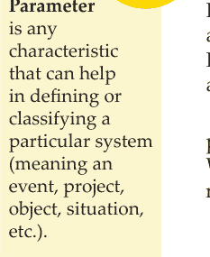

## 内置函数 (Built in Functions)

greetSammy.js

```javascript
// 初始化自定义问候函数
function greet(name) {
    console.log(`Hello, ${name}!`);
}

// 使用 "Sammy" 作为参数调用 greet 函数
greet("Sammy");
```

当我们运行上面的程序时，将得到以下输出。
Hello, Sammy!

现在我们有了一个关于如何重用函数的示例。在现实世界中，函数将从数据库中提取用户名，而不是直接提供名称作为参数值。

除了参数之外，变量可以在函数内部声明。这些变量被称为局部变量，它们只存在于函数块的作用范围内。变量作用域（Variable scope）决定了变量的可访问性；在函数内部定义的变量在函数外部无法访问，但在程序中只要函数被调用，就可以多次使用它们。

## 3.1.3 返回值 (Returning Values)

一个函数可以使用多个参数。我们可以向函数传递多个值并返回一个值。我们将创建一个函数来计算两个值（用 x 和 y 表示）的和。

```javascript
sum.js
// 初始化加法函数
function add(x, y) {
    return x + y;
}

// 调用函数求和
add(9, 7);
```

在上面的程序中，我们定义了一个带有参数 x 和 y 的函数，然后将 9 和 7 的值传递给函数。当我们运行程序时，将得到这些数字之和作为输出。

输出
16
在这种情况下，将 9 和 7 传递给 `sum()` 函数，程序返回了 16。
当使用 `return` 关键字时，函数将停止执行并返回表达式的值。虽然在这种情况下浏览器会在控制台中显示该值，但这与使用 `console.log()` 打印到控制台不同。

基础计算机编程：JavaScript (Basic Computer Coding: Java Script)

调用函数将在函数被调用的位置输出该值。
该值可以被立即使用，也可以放入变量中。

## 3.1.4 函数表达式 (Function Expressions)

在上一节中，我们使用函数声明来获取两个数字的和并返回该值。我们也可以通过将函数赋值给变量来创建函数表达式。使用相同的 `add` 函数示例，我们可以直接将返回的值应用给变量，在这种情况下是 `sum`。

```javascript
functionExpression.js
// 将 add 函数赋值给 sum 常量
const sum = function add(x, y) {
  return x + y;
}

// 调用函数求和
sum(20, 5);
```

输出

25

现在 `sum` 常量是一个函数。我们可以通过将其转换为匿名函数（即未命函数）来使此表达式更简洁。目前，我们的函数名为 `add`，但使用函数表达式时，没有必要给函数命名，名称通常会被省略。

```javascript
anonymousExpression.js
// 将函数赋值给 sum 常量
const sum = function(x, y) {
  return x + y;
}

// 调用函数求和
sum(100, 3);
```

输出

103

在这个示例中，我们删除了名为 `add` 的函数名，并将其转换为匿名函数。具名函数表达式可以辅助调试，但它通常会被省略。

## 3.1.5 箭头函数 (Arrow Functions)

到为止，我们已经学习了如何使用关键字定义函数。然而，有一种更新、更简洁的方法来定义函数，即 ECMAScript 6 中的箭头函数。箭头函数通常等号后跟大于号：=>。如果函数只有一个参数，可以省略括号，如下所示。

```javascript
arrowFunction.js
// 定义乘法函数
const multiply = (x, y) => {
  return x * y;
}

// 调用函数求积
multiply(30, 4);
```

输出

120

我们不再写关键字，而是使用 `=>` 来指示函数。在这种情况下，如果函数是单行返回，大括号和 `return` 语句都可以省略。

```javascript
// 定义平方函数
const square = x => x * x;
```


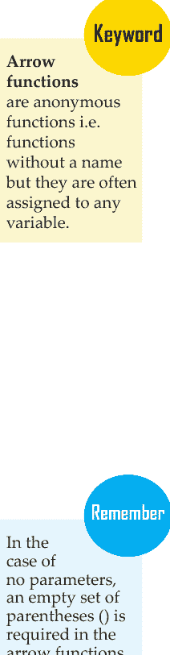

# 基础计算机编程：JavaScript

## 输出

`100`

所有这些类型都会产生相同的输出。通常根据偏好或公司标准来决定如何组织你自己的函数。在本节中，我们涵盖了函数声明和函数表达式、函数的返回值以及将函数赋值给变量。

## 3.2 JavaScript 内置函数

JavaScript 最初由 Netscape 引入，改变了 HTML 页面的静态命运。在 JavaScript 出现之前，HTML 页面仅用于渲染静态内容。在网页中插入 JavaScript，可以赋予其显著的交互性和功能。它允许你控制浏览器的行为以及网页元素的显示方式。大多数浏览器都内置了 JavaScript 解释器。当浏览器下载包含 JavaScript 的 HTML 文件时，JavaScript 解释器会对脚本做出反应。

JavaScript 是一种面向对象的编程语言。它支持属性中的对象概念。如果对象属性是一个函数，那么它就是该对象的方法；如果对象属性是一个值，它就是该对象的属性。

某些浏览器在从本地驱动器使用示例时会遇到问题。从本地驱动器访问`Customers2.XML`时，Chrome 会显示空白。为了在大多数浏览器中测试此技术，请将文件复制到 Web 服务器，然后从 Web 服务器访问 XML 文件。

### 3.2.1 数字方法

`Number`对象仅包含所有对象定义中的默认方法。`Boolean`对象对应数字原始类型。

| 序号 | 方法与描述 |
| --- | --- |
| 1 | `constructor()` - 返回创建此对象实例的函数。默认情况下，这是`Number`对象。 |
| 2 | `toExponential()` - 强制将数字以科学计数法格式显示，即使该数字在 JavaScript 正常使用标准表示法的范围内。 |
| 3 | `toFixed()` - 将数字格式化为小数点后带有特定位数的数字。 |
| 4 | `toLocaleString()` - 返回当前数字的字符串版本，其格式可能会根据浏览器的本地化设置而变化。 |
| 5 | `toPrecision()` - 定义数字时显示多少位总数字（包括小数点左侧和右侧的数字）。 |
| 6 | `toString()` - 返回数字值的字符串表示。 |
| 7 | `valueOf()` - 返回数字的值。 |

### 3.2.2 布尔方法

`Boolean`对象表示一个原始布尔值。以下是每个方法及其描述列表。

| 序号 | 方法与描述 |
| --- | --- |
| 1 | `toStringSource()` - 返回一个包含`Boolean`对象源的字符串；你可以使用此字符串来创建一个等效的对象。 |
| 2 | `toString()` - 根据对象的值返回 "true" 或 "false" 字符串。 |
| 3 | `valueOf()` - 返回`Boolean`对象的原始值。 |

### 3.2.3 字符串方法

以下是每个方法及其描述列表。

| 序号 | 方法与描述 |
| --- | --- |
| 1 | `charAt()` - 返回指定索引处的字符。 |
| 2 | `charCodeAt()` - 返回表示指定索引处字符 Unicode 值的数字。 |
| 3 | `concat()` - 组合两个字符串的文本并返回新字符串。 |
| 4 | `indexOf()` - 返回指定值在调用它的`String`对象中首次出现的索引，如果未找到则返回 -1。 |
| 5 | `lastIndexOf()` - 返回指定值在调用它的`String`对象中最后一次出现的索引，如果未找到则返回 -1。 |
| 6 | `localeCompare()` - 返回一个数字表示字符串在排序顺序中是在另一个字符串之前、之后还是相同。 |
| 7 | `length()` - 返回字符串的长度。 |
| 8 | `match()` - 用于将正则表达式与字符串进行匹配。 |
| 9 | `replace()` - 用于查找正则表达式与字符串之间的匹配项，并将匹配的子字符串替换为新子字符串。 |
| 10 | `search()` - 执行正则表达式与指定字符串之间匹配的搜索。 |
| 11 | `slice()` - 提取字符串的一个部分并返回新字符串。 |
| 12 | `split()` - 通过将字符串拆分为子字符串将`String`对象分割为数组。 |

| 序号 | 方法 | 描述 |
| --- | --- | --- |
| 13 | `substr()` | 返回字符串中从指定位置开始的、指定数量的字符。 |
| 14 | `substring()` | 返回字符串中两个索引之间的字符。 |
| 15 | `toLocaleLowerCase()` | 在尊重当前本地化设置的同时，将字符串中的字符转换为小写。 |
| 16 | `toLocaleUpperCase()` | 在尊重当前本地化设置的同时，将字符串中的字符转换为大写。 |
| 17 | `toLowerCase()` | 返回转换成小写的调用字符串值。 |
| 18 | `toString()` | 返回表示指定对象的字符串。 |
| 19 | `toUpperCase()` | 返回转换成大写的调用字符串值。 |
| 20 | `valueOf()` | 返回指定对象的原始值。 |

### 3.2.4 字符串 HTML 包装器

`String`是一个表示系列字符的对象。以下是每个返回在适当 HTML 标签包装内的字符串副本的方法列表。

| 序号 | 方法与描述 |
| --- | --- |
| 1 | `anchor()` | 创建一个用作超文本目标的 HTML 锚点标签。 |
| 2 | `big()` | 创建一个以大字体显示的字符串，就像在`<big>`标签中一样。 |
| 3 | `blink()` | 创建一个闪烁的字符串，就像在`<blink>`标签中一样。 |
| 4 | `bold()` | 创建一个以粗体显示的字符串，就像在`<b>`标签中一样。 |
| 5 | `fixed()` | 导致字符串以等宽字体显示，就像在`<tt>`标签中一样。 |
| 6 | `fontcolor()` | 导致字符串以指定的颜色显示，就像在`<font color="color">`标签中。 |
| 7 | `fontsize()` | 导致字符串以指定的字体大小显示，就像在`<font size="size">`标签中。 |
| 8 | `italics()` | 导致字符串以斜体显示，就像在`<i>`标签中。 |
| 9 | `link()` | 创建一个请求另一个 URL 的 HTML 超文本链接。 |
| 10 | `small()` | 导致字符串以小字体显示，就像在`<small>`标签中。 |
| 11 | `strike()` | 导致字符串以删除线文本显示，就像在`<strike>`标签中。 |
| 12 | `sub()` | 导致字符串以下标显示，就像在`<sub>`标签中。 |
| 13 | `sup()` | 导致字符串以上标显示，就像在`<sup>`标签中。 |

### 3.2.5 数组方法

数组是特殊的对象。它们具有索引。数组的长度是动态的。数组包含从 0 到`n-1`的索引。数组的长度可以改变。

| 序号 | 方法与描述 |
| --- | --- |
| 1 | `concat()` | 返回与任何数组合并的新数组。 |
| 2 | `every()` | 如果数组中的每个元素都通过提供的函数，则返回 true。 |
| 3 | `filter()` | 创建一个通过提供的函数返回真的元素的数组。 |
| 4 | `forEach()` | 为数组中的每个元素调用函数。 |
| 5 | `indexOf()` | 返回元素在数组中首次出现的索引，如果未找到则返回 -1。 |
| 6 | `join()` | 将数组的所有元素连接成字符串。 |
| 7 | `lastIndexOf()` | 返回元素在数组中最后一次出现的索引，如果未找到则返回 -1。 |
| 8 | `map()` | 创建一个带有调用函数结果的新数组。 |
| 9 | `pop()` | 移除数组的最后一个元素并返回该元素。 |
| 10 | `push()` | 在数组末尾添加一个或多个元素并返回新的长度。 |
| 11 | `reduce()` | 从左到右对数组的值执行还原函数，将其归纳为单个值。 |
| 12 | `reduceRight()` | 从右到左对数组的值执行还原函数，将其归纳为单个值。 |
| 13 | `reverse()` | 反转数组元素的顺序——第一个变成最后一个，最后一个变成第一个。 |
| 14 | `shift()` | 移除数组的第一个元素并返回该元素。 |
| 15 | `slice()` | 提取数组的一个部分并返回新数组。 |
| 16 | `some()` | 如果数组中至少有一个元素通过提供的函数，则返回 true。 |
| 17 | `toSource()` | 表示对象的源代码。 |
| 18 | `sort()` | 对数组元素进行排序。 |
| 19 | `splice()` | 在数组中添加和/或删除元素。 |
| 20 | `toString()` | 返回表示数组及其元素的字符串。 |
| 21 | `unshift()` | 在数组开头添加一个或多个元素并返回新的长度。 |

### 3.2.6 日期方法

`Date`对象提供了日期和时间的系统无关抽象。日期可以通过年、月、日、小时、分钟和秒来构建，也可以从日期中提取这六个组件以及星期几。

日期也可以进行比较并转换为可读的字符串格式。日期的表示精度为毫秒。

JavaScript 处理日期的方式与 Java 处理日期的方式非常相似：两种语言都有许多相同的日期方法，并且都在内部存储为自 1970 年 1 月 1 日 00:00:00 以来毫秒数。不允许 1970 年之前的日期。

| 序号 | 方法与描述 |
|---|--|
| 1 | `Date()` - 返回今天的日期和时间 |
| 2 | `getDate()` - 根据本地时间返回指定日期的月份中的几号 |
| 3 | `getDay()` - 根据本地时间返回指定日期的星期几 |
| 4 | `getFullYear()` - 根据本地时间返回指定日期的年份 |
| 5 | `getHours()` - 根据本地时间返回指定日期的小时 |
| 6 | `getInMillis()` - 根据本地时间返回指定日期的毫秒数 |
| 7 | `getMinutes()` - 根据本地时间返回指定日期的分钟 |
| 8 | `getMonth()` - 根据本地时间返回指定日期的月份 |
| 9 | `getSeconds()` - 根据本地时间返回指定日期的秒 |
| 10 | `getTime()` - 返回指定日期的数值，表示自 UTC 1970 年 1 月 1 日 00:00:00 以来的毫秒数 |
| 11 | `getTimeZoneOffset()` - 返回当前区域的时区偏移量（分钟） |
| 12 | `getUTCDate()` - 根据世界时间返回指定日期的月份中的几号 |
| 13 | `getUTCDay()` - 根据世界时间返回指定日期的星期几 |
| 14 | `getUTCFullYear()` - 根据世界时间返回指定日期的年份 |
| 15 | `getUTCHours()` - 根据世界时间返回指定日期的小时 |

| 序号 | 方法与描述 |
|---|---|
| 16 | `getUTCMilliseconds()` | 根据世界时间返回指定日期的毫秒数 |
| 17 | `getUTCMinutes()` | 根据世界时间返回指定日期的分钟 |
| 18 | `getUTCMonth()` | 根据世界时间返回指定日期的月份 |
| 19 | `getUTCSeconds()` | 根据世界时间返回指定日期的秒 |
| 20 | `getYear()` | 已弃用 - 根据本地时间返回指定日期的年份。请使用`getFullYear()`。 |
| 21 | `setDate()` | 根据本地时间设置指定日期的月份中的几号 |
| 22 | `setFullYear()` | 根据本地时间设置指定日期的年份 |
| 23 | `setHours()` | 根据本地时间设置指定日期的小时 |
| 24 | `setMilliseconds()` | 根据本地时间设置指定日期的毫秒数 |
| 25 | `setMinutes()` | 根据本地时间设置指定日期的分钟 |
| 26 | `setMonth()` | 根据本地时间设置指定日期的月份 |
| 27 | `setSeconds()` | 根据本地时间设置指定日期的秒 |
| 28 | `setTime()` | 将`Date`对象设置为自 UTC 1970 年 1 月 1 日 00:00:00 以来毫秒数表示的时间 |
| 29 | `setUTCDate()` | 根据世界时间设置指定日期的月份中的几号 |
| 30 | `setUTCFullYear()` | 根据世界时间设置指定日期的年份 |
| 31 | `setUTCHours()` | 根据世界时间设置指定日期的小时 |

| 序号 | 方法与描述 |
|---|---|
| 32 | `setUTCMilliseconds()` | 根据世界时间设置指定日期的毫秒数 |
| 33 | `setUTCMinutes()` | 根据世界时间设置指定日期的分钟 |
| 34 | `setUTCMonth()` | 根据世界时间设置指定日期的月份 |
| 35 | `setUTCSeconds()` | 根据世界时间设置指定日期的秒 |
| 36 | `setYear()` | 已弃用 - 根据本地时间设置指定日期的年份。请使用`setFullYear()`。 |
| 37 | `toDate()` | 返回`Date`的“日期”部分，格式为人类可读字符串 |
| 38 | `toGMTString()` | 已弃用 - 使用 Internet GMT 约定将日期转换为字符串。请使用`toUTCString()`。 |
| 39 | `toLocaleDateString()` | 使用当前区域的约定返回`Date`的“日期”部分字符串 |
| 40 | `toLocaleFormat()` | 使用格式字符串将日期转换为字符串 |
| 41 | `toLocaleString()` | 使用当前区域的约定将日期转换为字符串 |
| 42 | `toLocaleTimeString()` | 使用当前区域的约定返回`Date`的“时间”部分字符串 |
| 43 | `toSource()` | 返回表示等效`Date`对象源的字符串；你可以用它创建新对象 |
| 44 | `toString()` | 返回表示指定`Date`对象的字符串 |
| 45 | `toTimeString()` | 返回`Date`的“时间”部分，格式为人类可读字符串 |
| 46 | `toUTCString()` | 使用世界时间将日期转换为字符串 |
| 47 | `valueOf()` | 返回`Date`对象的数值 |

### 3.2.7 Date 静态方法

除了之前的许多方法外，`Date`对象还定义了静态方法：

| 序号 | 方法 & 描述 |
|---|---|
| 1 | `Date.parse()` | 解析日期字符串并返回毫秒 |
| 2 | `Date.UTC()` | 返回世界时间的表示 |

### 3.2.8 Math 方法

内置`Math`对象具有常量属性和方法，列举如下：

| 序号 | 方法 & 描述 |
|---|---|
| 1 | `abs()` | 返回数值的绝对值 |
| 2 | `acos()` | 返回数值的反余弦（弧度） |
| 3 | `asin()` | 返回数值的反正弦（弧度） |
| 4 | `atan()` | 返回数值的反正切（弧度） |
| 5 | `atan2()` | 返回两个参数的反正切（弧度） |
| 6 | `ceil()` | 返回大于或等于数值的整数 |
| 7 | `cos()` | 返回数值的余弦 |
| 8 | `exp()` | 返回 E 的次方 |
| 9 | `floor()` | 返回小于等于数值的整数 |
| 10 | `log()` | 返回数值的自然对数（底为 E） |
| 11 | `max()` | 返回多个数值中的最大值 |
| 12 | `min()` | 返回多个数值中的最小值 |
| 13 | `pow()` | 返回底数的幂 |
| 14 | `random()` | 返回 0 到 1 之间的伪随机数 |
| 15 | `round()` | 返回四舍五入到整数的数值 |
| 16 | `sin()` | 返回数值的正弦 |
| 17 | `sqrt()` | 返回数值的平方根 |
| 18 | `tan()` | 返回数值的正切 |
| 19 | `toSource()` | 返回字符串 "Math" |

### 3.2.9 RegExp 方法

| 序号 | 方法 & 描述 |
|---|---|
| 1 | `exec()` | 在字符串中执行匹配搜索 |
| 2 | `test()` | 测试字符串中是否存在匹配 |
| 3 | `toSource()` | 返回表示正则表达式对象的字面量；你可以用它创建新对象 |
| 4 | `toString()` | 返回表示正则表达式对象的字符串 |

### 3.2.10 如何使用 JavaScript 内置函数进行 HTML 编程

JavaScript 允许访问许多内置函数，包括`prompt()`函数，它可以让你询问用户输入。通过`confirm()`函数，你可以向用户提供文本提示以获取值。在返回时，你可以将函数的输出赋值并使用这些数据。

仅仅考虑区域化显示数据并不会进行任何数据转换。例如，如果你母语是英语，字符串不会突然变成法语。这里并没有特定的区域化方法。

方法帮助你对特定类型的数据执行特定任务。使用这些方法可以帮助创建更健壮的应用程序。所有对象提供的方法中，这些是最常见且可能最重要的：

- `length()`: 在处理字符串时，`length()`返回字符的数量。同样，在处理数组时，`length()`返回数组元素的数量。该方法在某些情况下也以属性形式出现。
- `toString()`: 以区域特定字符串格式输出对象的值。此方法通常用于显示目的。
- `valueOf()`: 返回对象值的原生版本。在对象可能会导致问题的情况下，你需要此方法。例如，在将数据保存到磁盘时，你想要存储的是值而不是对象。

JavaScript 包含了全局函数的概念。无论你在页面的任何地方使用，这些函数在不依赖于任何对象的情况下可用。以下列表提供了最常用函数的概览：

- `decodeURI()`: 解码统一资源标识符 (URI)。
- `decodeURIComponent()`: 解码 URI 组件，而不是整个 URI。

URI 通常包含三个到五个标准组成部分：
- 协议（Protocol）：访问资源时使用的传输规则集，例如 HTTP、HTTPS、FTP、SMTP 或 NNTP。
- 主机（Host）：提供资源访问的服务器名称，例如 blog.johnmuellerbooks.com。
- 端口（Port）：访问资源时的端口。通常情况下，你不需要提供此组件，因为大多数网站使用标准端口，浏览器会默认假设这些端口。例如，HTTP 依赖 80 端口进行通信。当服务器使用 80 端口时，你不需要将端口号作为 URI 的一部分包含在内。
- 路径（Path）：资源在服务器上的完整定义位置。在某些情况下，你不提供路径，这意味着服务器将提供在默认路径上找到的资源。
- 查询（Query）：键值对，用于定义在服务器上获取你所需的资源所需的额外信息。

- `encodeURI()`: 编码 URI。
- `encodeURIComponent()`: 编码 URI 组件而不是整个 URI。
- `escape()`: 使用与 URI 相同的技术对字符串进行编码。例如，`escape("This string is encoded!")`输出`This%20string%20is%20encoded%21`。
- `eval()`: 接受一个包含脚本的字符串，然后将字符串内容作为脚本执行。许多开发者使用此函数来创建提供良好灵活性的自修改应用程序。
  - 评估的代码（evaluated code）会通过注入攻击使你的应用程序面临潜在的安全问题。
  - 调试评估的代码极其困难，因为没有任何标准的调试工具都无法工作。
  - 评估的代码运行速度较慢，因为浏览器无法对其进行编译和缓存。
- `isFinite()`: 当一个值是有限的合法的数字时，返回 true。
- `isNaN()`: 当一个值是非数字时，返回 true。
- `Number()`: 将对象的值更改为数字。
- `parseFloat()`: 解析字符串并返回浮点数。
- `parseInt()`: 解析字符串并返回整数。
- `String()`: 将对象的值转换为字符串。此函数提供的输出与大多数对象提供的`toString()`方法相同。
- `unescape()`: 使用与 URI 相同的技术对已编码字符串进行解码。

时区是地球上的一个区域，为了法律、商业和社会目的，它遵循统一的标准。

## 3.3 理解 JavaScript 中的日期和时间

日期和时间是我们日常生活的常规组成部分，因此在计算机编程中占有重要地位。在 JavaScript 中，你可能需要创建一个带有日历、火车时刻表或预约界面的网站。这些应用程序需要根据用户当前的时区显示相关时间，或者围绕到达和出发时间或开始和结束时间进行计算。此外，你可能需要使用 JavaScript 在每天的特定时间生成报告，或者筛选当前的餐厅和机构。

2014年7月31日 晚上 10:32

为了实现所有这些以及更多目标，JavaScript 自带了内置的`Date`对象和相关方法。本节将介绍如何在 JavaScript 中格式化和使用日期与时间。

### 3.3.1 Date 对象

`Date`对象是 JavaScript 中一个存储日期和时间的内置对象。它提供了许多内置方法来格式化和管理该日期。默认情况下，一个不带参数的新`Date`实例会创建一个与当前日期和时间对应的对象。这将根据当前计算机的设置创建。

为了演示 JavaScript 的`Date`，创建一个变量并将当前日期赋值给它。本节写于 10 月 18 日星期三（格林时间），因此在下方表示了当前的日期、时间和时区。

```javascript
```


# `now.js`

```javascript
// 将变量设置为当前日期

const now = new Date();
```

## 输出

```text
Wed Oct 18 2017 12:41:34 GMT+0000
```

查看输出，我们得到了以下字符串：

| 星期几 | 月份 | 日期 | 年份 | 小时 | 分钟 | 时区 |
|---|---|---|---|---|---|---|
| Wed | Oct | 18 | 2017 | 12 | 41 | GMT+0000 |

日期和时间被拆分并以人类可以理解的方式打印出来。JavaScript 根据来自 Unix 时间的时间戳来理解日期，该时间戳由自 1970 年 1 月 1 日午夜以来经过的毫秒数组成。我们可以通过`getTime()`方法获取时间戳。

```javascript
// 获取当前时间戳

now.getTime();
```

## 输出

```text
1508334940000
```

我们在输出中出现的大数字代表与上述相同的值，即 2017 年 10 月 18 日。纪时间（Epoch time），也称为零时间，由日期字符串 01 January 1970 00:00:00 Universal Time（世界时）表示。我们可以通过创建一个新变量并为其分配时间戳 0 来在浏览器中进行测试。

# `epoch.js`

```javascript
// 给新变量分配时间戳 0

const epochTime = new Date(0);
```

## 输出

```text
Mon Jan 01 1970 00:00:00 GMT+0000
```

纪时间被选为计算机按天测量时间的标准。到为止，我们学习了如何根据当前时间创建新的`Date`实例，以及如何根据时间戳创建一个实例。总而言，在 JavaScript 中有四种格式可以让你创建 Date。

| 日期创建 | 输出 |
|---|---|
| `new Date()` | 当前日期和时间 |
| `new Date(timestamp)` | 根据自纪时间以来的毫秒创建日期 |
| `new Date(date string)` | 根据日期字符串创建日期 |
| `new Date(year, month, day, hours, seconds, milliseconds)` | 根据指定的日期时间创建日期 |

为了演示引用特定日期的不同方式，我们将以三种不同的方式创建代表 1776 年 7 月 4 日 GMT 下午 12:30 的 Date 对象。

# `usa.js`

```javascript
// 时间戳方法

new Date(-610601580000);

// 日期字符串方法

new Date("January 31 1980 12:30");

// 日期时间方法

new Date(1776, 6, 4, 12, 30, 0);
```

上述示例都包含相同的信息。你会注意到时间戳方法是一个负数；任何纪时间之前的日期都表示为负数。在日期时间方法中，秒和毫秒被设置为 0。如果省略某个数字，它将默认为 0。然而，顺序无法更改，你可能注意到 7 月表示为 6。这是因为大多数编程中的日期和时间从 0 开始。见下一节的详细图表。使用`new`关键字创建 Date 实例。

## 3.3.2 使用`get`获取日期

一旦我们有了日期，就可以通过各种内置方法访问日期的所有部分。这些方法将返回相对于本地时区的日期每个部分。这些方法都以`get`开头，并返回相应的数字。下面是 Date 对象方法的详细表格。

| 日期/时间 | 方法 | 范围 | 示例 |
|---|---|---|---|
| 年份 | `getFullYear()` | YYYY | 1970 |
| 月份 | `getMonth()` | 0-11 | 0 = 一月 |
| 日期（月份中） | `getDate()` | 1-31 | 1 = 月 1 日 |
| 日期（星期几） | `getDay()` | 0-6 | 0 = 星期日 |
| 小时 | `getHours()` | 0-23 | 0 = 午夜 |
| 分钟 | `getMinutes()` | 0-59 | |
| 秒 | `getSeconds()` | 0-59 | |
| 毫秒 | `getMilliseconds()` | 0-999 | |
| 时间戳 | `getTime()` | | 自纪时间以来的毫秒数 |

让我们根据 1980 年 7 月 31 日创建一个新日期，并将其赋值给变量。

# `harryPotter.js`

```javascript
// 初始化一个新的生日实例

const birthday = new Date(1980, 6, 31);
```

# 基础计算机编码：JavaScript

```javascript
const birthday = new Date(1980, 6, 31);

getDateComponents.js

birthday.getFullYear(); // 1980

birthday.getMonth(); // 6

birthday.getDate(); // 31

birthday.getDay(); // 4

birthday.getHours(); // 0

birthday.getMinutes(); // 0

birthday.getSeconds(); // 0

birthday.getMilliseconds(); // 0

birthday.getTime(); // 333849600000 (GMT)
```

现在我们可以使用我们所有的方法来获取每个日期的组成部分，从年份到毫秒。

有时候可能需要提取日期的部分内容，而内置方法就是你实现此目的的工具。为了进行说明，我们可以将当前日期与 10 月 3 日的日期和月份进行比较，看看今天是否为 10 月 3 日。

# `oct3.js`

```javascript
// 获取今天的日期

const today = new Date();

// 将今天与 10 月 3 日进行比较

if (today.getDate() === 3 && today.getMonth() === 9) {
    console.log("今天是 10 月 3 日.");
} else {
    console.log("今天不是 10 月 3 日.");
}
```

## 输出

```text
今天不是 10 月 3 日。
```

由于在编写时并不是 10 月 3 日，控制台反映了这一点。以`get`开头的内置 Date 方法允许我们访问日期组件，并返回与我们从实例化对象中获取的数据相关的数字。

## 3.3.3 使用`set`修改日期

对于我们上面学习的所有方法，都有一个对应的方法。`get`用于从日期中检索特定组件，而`set`用于修改日期的组件。下面是 Date 对象`set`方法的详细图表。

| 日期/时间 | 方法 | 范围 | 示例 |
|---|---|---|---|
| 年份 | `setFullYear()` | YYYY | 1970 |
| 月份 | `setMonth()` | 0-11 | 0 = 一月 |
| 日期（月份中的） | `setDate()` | 1-31 | 1 = 月份 1 号 |
| 星期（星期中的） | `setDay()` | 0-6 | 0 = 星期 |
| 小时 | `setHours()` | 0-23 | 0 = 午夜 |
| 分钟 | `setMinutes()` | 0-59 | |
| 秒 | `setSeconds()` | 0-59 | |
| 毫秒 | `setMilliseconds()` | 0-999 | 自 Unix 戳以来的毫秒 |
| 时间戳 | `setTime()` | | |

我们可以使用这些方法来修改日期的一个、多个或所有组件。例如，我们可以将上面`birthday`变量的年份从 1980 年改为 1997 年。

```javascript
// harryPotter.js

// 修改生日日期的年份

birthday.setFullYear(1997);
```

`birthday`;

## 输出

```text
Thu Jul 31 1997 00:00:00 GMT+0000 (UTC)
```

我们在上面的示例中看到，我们将收到的`birthday`变量接收的新年份作为输出的一部分。以`set`开头的内置方法允许我们修改 Date 对象的不同部分。

## 3.3.4 使用 UTC 的日期方法

上面讨论的方法根据用户的本地时间设置来检索日期组件。为了对日期进行更强的控制，你可以使用 UTC 方法，它们与`get`方法完全相同，但它们是根据 UTC（协调世界时）标准计算时间的。下面是 JavaScript Date 对象的 UTC 方法表格。

| 日期/时间 | 方法 | 范围 | 示例 |
|---|---|---|---|
| 年份 | `getUTCYear()` | YYYY | 1970 |
| 月份 | `getUTCMonth()` | 0-11 | 0 = 一月 |
| 日期（月份中的） | `getUTCDate()` | 1-31 | 1 = 月份 1 号 |
| 星期（星期中的） | `getUTCDay()` | 0-6 | 0 = 星期 |
| 小时 | `getUTCHours()` | 0-23 | 0 = 午夜 |
| 分钟 | `getUTCMinutes()` | 0-59 | |
| 秒 | `getUTCSeconds()` | 0-59 | |
| 毫秒 | `getUTCMiseconds()` | 0-999 | |

为了测试本地方法和`get`方法之间的差异，我们可以运行以下代码。

# `UTC.js`

```javascript
// 将当前时间赋值给变量

const now = new Date();

// 打印本地和 UTC 时区

console.log(now.getHours());

console.log(now.getUTCHours());
```


运行这段代码将打印出当前时区，运行上述程序输出的数字是相同的。如果你目前处于 `UTC` 时区，那么 `UTC` 区的数就是该小时。`UTC` 的用处在于它提供了一个国际时间标准参考，如果这适用于你正在开发的内容，它可以保持你的代码在不同时区的一致性。

## 案例研究：JavaScript 设计模式

## 背景

在我学习 Udacity 的 `JavaScript` 设计模式课程期间，记录我的路径、挣扎和发现。起始项目是构建一个猫点击器，每当你点击猫时，旁边的数字就会增加。

在我学习 Udacity 的 `JavaScript` 设计模式课程期间，记录我的路径、挣扎和发现。起始项目是构建一个猫点击器，每当你点击猫时，旁边的数字就会增加。

在我学习 Udacity 的 `JavaScript` 设计模式课程期间，记录我的路径、挣扎和发现。起始项目是构建一个猫点击器，每当你点击猫时，旁边的数字就会增加。

在我学习 Udacity 的 `JavaScript` 设计模式课程期间，记录我的路径、挣扎和发现。起始项目是构建一个猫点击器，每当你点击猫时，旁边的数字就会增加。

在我学习 Udacity 的 `JavaScript` 设计模式课程期间，记录我的路径、挣扎和发现。起始项目是构建一个猫点击器，每当你点击猫时，旁边的数字就会增加。

在我学习 Udacity 的 `JavaScript` 设计模式课程期间，记录我的路径、挣扎和发现。起始项目是构建一个猫点击器，每当你点击猫时，旁边的数字就会增加。

在我学习 Udacity 的 `JavaScript` 设计模式课程期间，记录我的路径、挣扎和发现。起始项目是构建一个猫点击器，每当你点击猫时，旁边的数字就会增加。

在我学习 Udacity 的 `JavaScript` 设计模式课程期间，记录我的路径、挣扎和发现。起始项目是构建一个猫点击器，每当你点击猫时，旁边的数字就会增加。

在我学习 Udacity 的 `JavaScript` 设计模式课程期间，记录我的路径、挣扎和发现。起始项目是构建一个猫点击器，每当你点击猫时，旁边的数字就会增加。

在我学习 Udacity 的 `JavaScript` 设计模式课程期间，记录我的路径、挣扎和发现。起始项目是构建一个猫点击器，每当你点击猫时，旁边的数字就会增加。

在我学习 Udacity 的 `JavaScript` 设计模式课程期间，记录我的路径、挣扎和发现。起始项目是构建一个猫点击器，每当你点击猫时，旁边的数字就会增加。

在我学习 Udacity 的 `JavaScript` 设计模式课程期间，记录我的路径、挣扎和发现。起始项目是构建一个猫点击器，每当你点击猫时，旁边的数字就会增加。

在我学习 Udacity 的 `JavaScript` 设计模式课程期间，记录我的路径、挣扎和发现。起始项目是构建一个猫点击器，每当你点击猫时，旁边的数字就会增加。

在我学习 Udacity 的 `JavaScript` 设计模式课程期间，记录我的路径、挣扎和发现。起始项目是构建一个猫点击器，每当你点击猫时，旁边的数字就会增加。

在我学习 Udacity 的 `JavaScript` 设计模式课程期间，记录我的路径、挣扎和发现。起始项目是构建一个猫点击器，每当你点击猫时，旁边的数字就会增加。

在我学习 Udacity 的 `JavaScript` 设计模式课程期间，记录我的路径、挣扎和发现。起始项目是构建一个猫点击器，每当你点击猫时，旁边的数字就会增加。

在我学习 Udacity 的 `s 设计` 设计课程期间期间，`acity` 的 `Udacity's JavaScript` 设计模式课程期间

`acityacity` 的 `Udacity's JavaScript` 设计模式课程期间，记录我的路径、挣扎和发现。起始项目是构建一个猫点击器，每当你点击猫时，旁边的数字就会增加。

`acity`课程 课程，课程，，，，，发现。。。
。学习 `Udacity's JavaScript` 设计模式课程期间，记录我的路径、挣扎和发现。起始项目是构建一个猫点击器，每当你点击猫时，旁边的数字就会增加。

`s，记录路径' JavaScript` 设计模式模式期间。起始项目是构建一个猫点击器，每当你点击猫时，旁边的数字就会增加。

在我学习 Udacity 的 `JavaScript` 设计模式课程期间，记录我的路径、挣扎和发现。起始项目是构建一个猫点击器，每当你点击猫时，旁边的数字就会增加。

`s学习 Udacity's JavaScript` 设计模式课程期间，记录我的路径、挣扎和发现。起始项目是构建一个猫点击器，每当你点击猫时，旁边的数字就会增加。

`s学习 Udacity's JavaScript` 设计模式课程期间，`Udacity's JavaScript` 设计模式课程期间，课程 课程期间的 `Udacity's JavaScript` 设计模式课程期间，课程期间的 `Udacity's JavaScript` 设计模式课程期间，`Udacity's JavaScript` 设计模式课程期间，`s Udacity's JavaScript` 设计模式课程期间，课程 课程期间的 `Udacity's JavaScript` 设计模式课程期间，课程 期间的 课程期间的 `Udacity's JavaScript` 设计模式课程期间，`Udacity's JavaScript` 设计模式课程期间，`Udacity's JavaScript` 设计模式课程期间，`Udacity's JavaScript` 设计模式课程期间，`Udacity's JavaScript` 设计模式课程期间，`s Udacity's JavaScript` 设计模式课程期间，`Udacity's JavaScript` 设计模式课程期间，`Udacity's JavaScript` 设计模式课程期间，`Udacity's JavaScript` 设计模式课程期间，`Udacity's JavaScript` 设计模式课程期间，`Udacity's JavaScript` 设计模式课程期间，`Udacity's JavaScript` 设计模式课程期间，`Udacity's JavaScript` 设计模式课程期间，`Udacity's JavaScript` 设计模式课程期间，`Udacity's JavaScript` 设计模式课程期间，`Udacity's JavaScript` 设计模式课程期间，`Udacity's JavaScript` 设计模式课程期间，`Udacity's JavaScript` 设计模式课程期间，`Udacity's JavaScript` 设计模式课程期间，`Udacity's JavaScript` 设计模式课程期间，`Udacity's JavaScript` 设计模式课程期间，`Udacity's JavaScript` 设计模式课程期间，`Udacity's JavaScript` 设计模式课程期间，`Udacity's JavaScript` 设计模式课程期间，`Udacity's JavaScript` 设计模式课程期间，`Udacity's JavaScript` 设计模式课程期间，`Udacity's JavaScript` 设计模式课程期间，`Udacity's JavaScript` 设计模式课程期间，`Udacity's JavaScript` 设计模式课程期间，`Udacity's JavaScript` 设计模式课程期间，`Udacity's JavaScript` 设计模式课程期间，`Udacity's JavaScript` 设计模式课程期间，`Udacity's JavaScript` 设计模式课程期间，`Udacity's JavaScript` 设计模式课程期间，`Udacity's JavaScript` 设计模式课程期间，`Udacity's JavaScript` 设计模式课程期间，`Udacity's JavaScript` 设计模式课程期间，`Udacity's JavaScript` 设计模式课程期间，`Udacity's JavaScript` 设计模式课程期间，`Udacity's JavaScript` 设计模式课程期间，`Udacity's JavaScript` 设计模式课程期间，`Udacity's JavaScript` 设计模式课程期间，`Udacity's JavaScript` 设计模式课程期间，`Udacity's JavaScript` 设计模式课程期间，`Udacity's JavaScript` 设计模式课程期间，`Udacity's JavaScript` 设计模式课程期间，`Udacity's JavaScript` 设计模式课程期间，`Udacity's JavaScript` 设计模式课程期间，`Udacity's JavaScript` 设计模式课程期间，`Udacity's JavaScript` 设计模式课程期间，`Udacity's JavaScript` 设计模式课程期间，`Udacity's JavaScript` 设计模式课程期间，`Udacity's JavaScript` 设计模式课程期间，`Udacity's JavaScript` 设计模式课程期间，`Udacity's JavaScript` 设计模式课程期间，`Udacity's JavaScript` 设计模式课程期间，`Udacity's JavaScript` 设计模式课程期间，`Udacity's JavaScript` 设计模式课程期间，`Udacity's JavaScript` 设计模式课程期间，`Udacity's JavaScript` 设计模式课程期间，`Udacity's JavaScript` 设计模式课程期间，`Udacity's JavaScript` 设计模式课程期间，`Udacity's JavaScript` 设计模式课程期间，`Udacity's JavaScript` 设计模式课程期间，`Udacity's JavaScript` 设计模式课程期间，`Udacity's JavaScript` 设计模式课程期间，`Udacity's JavaScript` 设计模式课程期间，`Udacity's JavaScript` 设计模式课程期间，`Udacity's JavaScript` 设计模式课程期间，`Udacity's JavaScript` 设计模式课程期间，`Udacity's JavaScript` 设计模式课程期间，`Udacity's JavaScript` 设计模式课程期间，`Udacity's JavaScript` 设计模式课程期间，`Udacity's JavaScript` 设计模式课程期间，`Udacity's JavaScript` 设计模式课程期间，`Udacity's JavaScript` 设计模式 设计模式课程期间，`Udacity's JavaScript` 设计模式课程期间，`Udacity's JavaScript` 设计模式课程期间，`Udacity's JavaScript` 设计模式课程期间，`Udacity's JavaScript` 设计模式课程期间，`Udacity's JavaScript` 设计模式课程期间，`Udacity's JavaScript` 设计模式课程期间，`Udacity's JavaScript` 设计模式课程期间，`Udacity's JavaScript` 设计模式课程期间，`Udacity's JavaScript` 设计模式课程期间，`Udacity's JavaScript` 设计模式课程期间，`Udacity's JavaScript` 设计模式课程期间，`Udacity's JavaScript` 设计模式课程期间，`Udacity's JavaScript` 设计模式课程期间，`Udacity's JavaScript` 设计模式课程期间，`Udacity's JavaScript` 设计模式课程期间，`Udacity's JavaScript` 设计模式课程期间，`Udacity's JavaScript` 设计模式课程期间，`Udacity's JavaScript` 设计模式课程期间，`Udacity's JavaScript` 设计模式课程期间，`Udacity's JavaScript` 设计模式课程期间，`Udacity's JavaScript` 设计模式课程期间，`Udacity's JavaScript` 设计模式课程期间，`Udacity's JavaScript` 设计模式 设计模式课程期间，`Udacity's JavaScript` 设计模式课程期间，`Udacity's JavaScript` 设计模式课程期间，`Udacity's JavaScript` 设计模式课程期间，`Udacity's JavaScript` 设计模式课程期间，`Udacity's JavaScript` 设计模式课程期间，`Udacity's JavaScript` 设计模式课程期间，`Udacity's JavaScript` 设计模式课程期间，`Udacity's JavaScript` 设计模式课程期间，`Udacity's JavaScript` 设计模式课程期间，`Udacity's JavaScript` 设计模式课程期间，`Udacity's JavaScript` 设计模式课程期间，`Udacity's JavaScript` 设计模式课程期间，`Udacity's JavaScript` 设计模式课程期间，`Udacity's JavaScript` 设计模式课程期间，`Udacity's JavaScript` 设计模式课程期间，`Udacity's JavaScript` 设计模式课程期间，`Udacity's JavaScript` 设计模式课程期间，`Udacity's JavaScript` 设计模式课程期间，`Udacity's JavaScript` 设计模式课程期间，`Udacity's JavaScript` 设计模式课程期间，`Udacity's JavaScript` 设计模式课程期间，`Udacity's JavaScript` 设计模式课程期间，`Udacity's JavaScript` 设计模式课程期间，`Udacity's JavaScript` 设计模式课程期间，`Udacity's JavaScript` 设计模式课程期间，`Udacity's JavaScript` 设计模式课程期间，`Udacity's JavaScript` 设计模式课程期间，`Udacity's JavaScript` 设计模式课程期间，`Udacity's JavaScript` 设计模式课程期间，`Udacity's JavaScript` 设计模式课程期间，`Udacity's JavaScript` 设计模式课程期间，`Udacity's JavaScript` 设计模式课程期间，`Udacity's JavaScript` 设计模式课程期间，`Udacity's JavaScript` 设计模式课程期间，`Udacity's JavaScript` 设计模式课程期间，`Udacity's JavaScript` 设计模式课程期间，`Udacity's JavaScript` 设计模式课程期间，`Udacity's JavaScript` 设计模式课程期间，`Udacity's JavaScript` 设计模式课程期间，`Udacity's JavaScript` 设计模式课程期间，`Udacity's JavaScript` 设计模式课程期间，`Udacity's JavaScript` 设计模式课程期间，`Udacity's JavaScript` 设计模式课程期间，`Udacity's JavaScript` 设计模式课程期间，`Udacity's JavaScript` 设计模式课程期间，`Udacity's JavaScript` 设计模式课程期间，`Udacity's JavaScript` 设计模式课程期间，`Udacity's JavaScript` 设计模式课程期间，`Udacity's JavaScript` 设计模式课程期间，`Udacity's JavaScript` 设计模式课程期间，`Udacity's JavaScript` 设计模式课程期间，`Udacity's JavaScript` 设计模式课程期间，`Udacity's JavaScript` 设计模式课程期间，`Udacity's JavaScript` 设计模式课程期间，`Udacity's JavaScript` 设计模式课程期间，`Udacity's JavaScript` 设计模式课程期间，`Udacity's JavaScript` 设计模式课程期间，`Udacity's JavaScript` 设计模式课程期间，`Udacity's JavaScript` 设计模式课程期间，`Udacity's JavaScript` 设计模式课程期间，`Udacity's JavaScript` 设计模式课程期间，`Udacity's JavaScript` 设计模式课程期间，`Udacity's JavaScript` 设计模式课程期间，`Udacity's JavaScript` 设计模式课程期间，`Udacity's JavaScript` 设计模式课程期间，`Udacity's JavaScript` 设计模式课程期间，`Udacity's JavaScript` 设计模式课程期间，`Udacity's JavaScript` 设计模式课程期间，`Udacity's JavaScript` 设计模式课程期间，`Udacity's JavaScript` 设计模式课程期间，`Udacity's JavaScript` 设计模式课程期间，`Udacity's JavaScript` 设计模式课程期间，`Udacity's JavaScript` 设计模式课程期间，`Udacity's JavaScript` 设计模式课程期间，`Udacity's JavaScript` 设计模式课程期间，`Udacity's JavaScript` 设计模式课程期间，`Udacity's JavaScript` 设计模式课程期间，`Udacity's JavaScript` 设计模式课程期间，`Udacity's JavaScript` 设计模式课程期间，`Udacity's JavaScript` 设计模式课程期间，`Udacity's JavaScript` 设计模式课程期间，`Udacity's JavaScript` 设计模式课程期间，`Udacity's JavaScript` 设计模式课程期间，`Udacity's JavaScript` 设计模式课程期间，`Udacity's JavaScript` 设计模式课程期间，`Udacity's JavaScript` 设计模式课程期间，`Udacity's JavaScript` 设计模式课程期间，`Udacity's JavaScript` 设计模式课程期间，`Udacity's JavaScript` 设计模式课程期间，`Udacity's JavaScript` 设计模式课程期间，`Udacity's JavaScript` 设计模式课程期间，`Udacity's JavaScript` 设计模式课程期间，`Udacity's JavaScript` 设计模式课程期间，`Udacity's JavaScript` 设计模式课程期间，`Udacity's JavaScript` 设计模式课程期间，`Udacity's JavaScript` 设计模式课程期间，`Udacity's JavaScript` 设计模式课程期间，`Udacity's JavaScript` 设计模式课程期间，`Udacity's JavaScript` 设计模式课程期间，`Udacity's JavaScript` 设计模式课程期间，`Udacity's JavaScript` 设计模式课程期间，`Udacity's JavaScript` 设计模式课程期间，`Udacity's JavaScript` 设计模式课程期间，`Udacity's JavaScript` 设计模式课程期间，`Udacity's JavaScript` 设计模式课程期间，`Udacity's JavaScript` 设计模式课程期间，`Udacity's JavaScript` 设计模式课程期间，`Udacity's JavaScript` 设计模式课程期间，`Udacity's JavaScript` 设计模式课程期间，`Udacity's JavaScript` 设计模式课程期间，`Udacity's JavaScript` 设计模式课程期间，`Udacity's JavaScript` 设计模式课程期间，`Udacity's JavaScript` 设计模式课程期间，`Udacity's JavaScript` 设计模式课程期间，`Udacity's JavaScript` 设计模式课程期间，`Udacity's JavaScript` 设计模式课程期间，`Udacity's JavaScript` 设计模式课程期间，`Udacity's JavaScript` 设计模式课程期间，`Udacity's JavaScript` 设计模式课程期间，`Udacity's JavaScript` 设计模式课程期间，`Udacity's JavaScript` 设计模式课程期间，`Udacity's JavaScript` 设计模式课程期间，`Udacity's JavaScript` 设计模式课程期间，`Udacity's JavaScript` 设计模式课程期间，`Udacity's JavaScript` 设计模式课程期间，`Udacity's JavaScript` 设计模式课程期间，`Udacity's JavaScript` 设计模式课程期间，`Udacity's JavaScript` 设计模式课程期间，`Udacity's JavaScript` 设计模式课程期间，`Udacity's JavaScript` 设计模式课程期间，`Udacity's JavaScript` 设计模式课程期间，`Udacity's JavaScript` 设计模式课程期间，`Udacity's JavaScript` 设计模式课程期间，`Udacity's JavaScript` 设计模式课程期间，`Udacity's JavaScript` 设计模式课程期间，`Udacity's JavaScript` 设计模式课程期间，`Udacity's JavaScript` 设计模式课程期间，`Udacity's JavaScript` 设计模式课程期间，`Udacity's JavaScript` 设计模式课程期间，`Udacity's JavaScript` 设计模式课程期间，`Udacity's JavaScript` 设计模式课程期间，`Udacity's JavaScript` 设计模式课程期间，`Udacity's JavaScript` 设计模式课程期间，`Udacity's JavaScript` 设计模式课程期间，`Udacity's JavaScript` 设计模式课程期间，`Udacity's JavaScript` 设计模式课程期间，`Udacity's JavaScript` 设计模式课程期间，`Udacity's JavaScript` 设计模式课程期间，`Udacity's JavaScript` 设计模式课程期间，`Udacity's JavaScript` 设计模式课程期间，`Udacity's JavaScript` 设计模式课程期间，`Udacity's JavaScript` 设计模式课程期间，`Udacity's JavaScript` 设计模式课程期间，`Udacity's JavaScript` 设计模式课程期间，`Udacity's JavaScript` 设计模式课程期间，`Udacity's JavaScript` 设计模式课程期间，`Udacity's JavaScript` 设计模式课程期间，`Udacity's JavaScript` 设计模式课程期间，`Udacity's JavaScript` 设计模式课程期间，`Udacity's JavaScript` 设计模式课程期间，`Udacity's JavaScript` 设计模式课程期间，`Udacity's JavaScript` 设计模式课程期间，`Udacity's JavaScript` 设计模式课程期间，`Udacity's JavaScript` 设计模式课程期间，`Udacity's JavaScript` 设计模式课程期间，`Udacity's JavaScript` 设计模式课程期间，`Udacity's JavaScript` 设计模式课程期间，`Udacity's JavaScript` 设计模式课程期间，`Udacity's JavaScript` 设计模式课程期间，`Udacity's JavaScript` 设计模式课程期间，`Udacity's JavaScript` 设计模式 设计模式课程期间，`Udacity's JavaScript` 设计模式课程期间，`Udacity's JavaScript` 设计模式课程期间，`Udacity's JavaScript` 设计模式课程期间，`Udacity's JavaScript` 设计模式课程期间，`Udacity's JavaScript` 设计模式课程期间，`Udacity's JavaScript` 设计模式课程期间，`Udacity's JavaScript` 设计模式课程期间，`Udacity's JavaScript` 设计模式课程期间，`Udacity's JavaScript` 设计模式课程期间，`Udacity's JavaScript` 设计模式课程期间，`Udacity's JavaScript` 设计模式课程期间，`Udacity's JavaScript` 设计模式课程期间，`Udacity's JavaScript` 设计模式课程期间，`Udacity's JavaScript` 设计模式课程期间，`Udacity's JavaScript` 设计模式课程期间，`Udacity's JavaScript` 设计模式课程期间，`Udacity's JavaScript` 设计模式课程期间，`Udacity's JavaScript` 设计模式课程期间，`Udacity's JavaScript` 设计模式课程期间，`Udacity's JavaScript` 设计模式课程期间，`Udacity's JavaScript` 设计模式课程期间，`Udacity's JavaScript` 设计模式课程期间，`Udacity's JavaScript` 设计模式课程期间，`Udacity's JavaScript` 设计模式课程期间，`Udacity's JavaScript` 设计模式课程期间，`Udacity's JavaScript` 设计模式课程期间，`Udacity's JavaScript` 设计模式课程期间，`Udacity's JavaScript` 设计模式课程期间，`Udacity's JavaScript` 设计模式课程期间，`Udacity's JavaScript` 设计模式课程期间，`Udacity's JavaScript` 设计模式课程期间，`Udacity's JavaScript` 设计模式课程期间，`Udacity's JavaScript` 设计模式课程期间，`Udacity's JavaScript` 设计模式课程期间，`Udacity's JavaScript` 设计模式课程期间，`Udacity's JavaScript` 设计模式课程期间，`Udacity's JavaScript` 设计模式课程期间，`Udacity's JavaScript` 设计模式课程期间，`Udacity's JavaScript` 设计模式课程期间，`Udacity's JavaScript` 设计模式课程期间，`Udacity's JavaScript` 设计模式课程期间，`Udacity's JavaScript` 设计模式课程期间，`Udacity's JavaScript` 设计模式课程期间，`Udacity's JavaScript` 设计模式课程期间，`Udacity's JavaScript` 设计模式课程期间，`Udacity's JavaScript` 设计模式课程期间，`Udacity's JavaScript` 设计模式课程期间，`Udacity's JavaScript` 设计模式课程期间，`Udacity's JavaScript` 设计模式课程期间，`Udacity's JavaScript` 设计模式课程期间，`Udacity's JavaScript` 设计模式课程期间，`Udacity's JavaScript` 设计模式课程期间，`Udacity's JavaScript` 设计模式课程期间，`Udacity's JavaScript` 设计模式课程期间，`Udacity's JavaScript` 设计模式课程期间，`Udacity's JavaScript` 设计模式课程期间，`Udacity's JavaScript` 设计模式课程期间，`Udacity's JavaScript` 设计模式课程期间，`Udacity's JavaScript` 设计模式课程期间，`Udacity's JavaScript` 设计模式课程期间，`Udacity's JavaScript` 设计模式课程期间，`Udacity's JavaScript` 设计模式课程期间，`Udacity's JavaScript` 设计模式课程期间，`Udacity's JavaScript` 设计模式课程期间，`Udacity's JavaScript` 设计模式课程期间，`Udacity's JavaScript` 设计模式课程期间，`Udacity's JavaScript` 设计模式课程期间，`Udacity's JavaScript` 设计模式课程期间，`Udacity's JavaScript` 设计模式课程期间，`Udacity's JavaScript` 设计模式课程期间，`Udacity's JavaScript` 设计模式课程期间，`Udacity's JavaScript` 设计模式课程期间，`Udacity's JavaScript` 设计模式课程期间，`Udacity's JavaScript` 设计模式课程期间，`Udacity's JavaScript` 设计模式课程期间，`Udacity's JavaScript` 设计模式课程期间，`Udacity's JavaScript` 设计模式课程期间，`Udacity's JavaScript` 设计模式课程期间，`Udacity's JavaScript` 设计模式课程期间，`Udacity's JavaScript` 设计模式课程期间，`Udacity's JavaScript` 设计模式课程期间，`Udacity's JavaScript` 设计模式课程期间，`Udacity's JavaScript` 设计模式课程期间，`Udacity's JavaScript` 设计模式课程期间，`Udacity's JavaScript` 设计模式课程期间，`Udacity's JavaScript` 设计模式课程期间，`Udacity's JavaScript` 设计模式课程期间，`Udacity's JavaScript` 设计模式课程期间，`Udacity's JavaScript` 设计模式课程期间，`Udacity's JavaScript` 设计模式课程期间，`Udacity's JavaScript` 设计模式课程期间，`Udacity's JavaScript` 设计模式课程期间，`Udacity's JavaScript` 设计模式课程期间，`Udacity's JavaScript` 设计模式课程期间，`Udacity's JavaScript` 设计模式课程期间，`Udacity's JavaScript` 设计模式课程期间，`Udacity's JavaScript` 设计模式课程期间，`Udacity's JavaScript` 设计模式课程期间，`Udacity's JavaScript` 设计模式课程期间，`Udacity's JavaScript` 设计模式课程期间，`Udacity's JavaScript` 设计模式课程期间，`Udacity's JavaScript` 设计模式课程期间，`Udacity's JavaScript` 设计模式课程期间，`Udacity's JavaScript` 设计模式课程期间，`Udacity's JavaScript` 设计模式课程期间，`Udacity's JavaScript` 设计模式课程期间，`Udacity's JavaScript` 设计模式课程期间，`Udacity's JavaScript` 设计模式课程期间，`Udacity's JavaScript` 设计模式课程期间，`Udacity's JavaScript` 设计模式课程期间，`Udacity's JavaScript` 设计模式课程期间，`Udacity's JavaScript` 设计模式课程期间，`Udacity's JavaScript` 设计模式课程期间，`Udacity's JavaScript` 设计模式课程期间，`Udacity's JavaScript` 设计模式课程期间，`Udacity's JavaScript` 设计模式课程期间，`Udacity's JavaScript` 设计模式课程期间，`Udacity's JavaScript` 设计模式课程期间，`Udacity's JavaScript` 设计模式课程期间，`Udacity's JavaScript` 设计模式课程期间，`Udacity's JavaScript` 设计模式课程期间，`Udacity's JavaScript` 设计模式课程期间，`Udacity's JavaScript` 设计模式课程期间，`Udacity's JavaScript` 设计模式课程期间，`Udacity's JavaScript` 设计模式课程期间，`Udacity's JavaScript` 设计模式课程期间，`Udacity's JavaScript` 设计模式课程期间，`Udacity's JavaScript` 设计模式课程期间，`Udacity's JavaScript` 设计模式课程期间，`Udacity's JavaScript` 设计模式课程期间，`Udacity's JavaScript` 设计模式课程期间，`Udacity's JavaScript` 设计模式课程期间，`Udacity's JavaScript` 设计模式课程期间，`Udacity's JavaScript` 设计模式课程期间，`Udacity's JavaScript` 设计模式课程期间，`Udacity's JavaScript` 设计模式课程期间，`Udacity's JavaScript` 设计模式课程期间，`Udacity's JavaScript` 设计模式课程期间，`Udacity's JavaScript` 设计模式课程期间，`Udacity's JavaScript` 设计模式课程期间，`Udacity's JavaScript` 设计模式课程期间，`Udacity's JavaScript` 设计模式课程期间，`Udacity's JavaScript` 设计模式课程期间，`Udacity's JavaScript` 设计模式课程期间，`Udacity's JavaScript` 设计模式课程期间，`Udacity's JavaScript` 设计模式课程期间，`Udacity's JavaScript` 设计模式课程期间，`Udacity's JavaScript` 设计模式课程期间，`Udacity's JavaScript` 设计模式课程期间，`Udacity's JavaScript` 设计模式课程期间，`Udacity's JavaScript` 设计模式课程期间，`Udacity's JavaScript` 设计模式课程期间，`Udacity's JavaScript` 设计模式课程期间，`Udacity's JavaScript` 设计模式课程期间，`Udacity's JavaScript` 设计模式课程期间，`Udacity's JavaScript` 设计模式课程期间，`Udacity's JavaScript` 设计模式课程期间，`Udacity's JavaScript` 设计模式课程期间，`Udacity's JavaScript` 设计模式课程期间，`Udacity's JavaScript` 设计模式课程期间，`Udacity's JavaScript` 设计模式课程期间，`Udacity's JavaScript` 设计模式课程期间，`Udacity's JavaScript` 设计模式课程期间，`Udacity's JavaScript` 设计模式课程期间，`Udacity's JavaScript` 设计模式课程期间，`Udacity's JavaScript` 设计模式课程期间，`Udacity's JavaScript` 设计模式课程期间，`Udacity's JavaScript` 设计模式课程期间，`Udacity's JavaScript` 设计模式课程期间，`Udacity's JavaScript` 设计模式课程期间，`Udacity's JavaScript` 设计模式课程期间，`Udacity's JavaScript` 设计模式课程期间，`Udacity's JavaScript` 设计模式课程期间，`Udacity's JavaScript` 设计模式课程期间，`Udacity's JavaScript` 设计模式课程期间，`Udacity's JavaScript` 设计模式课程期间，`Udacity's JavaScript` 设计模式课程期间，`Udacity's JavaScript` 设计模式课程期间，`Udacity's JavaScript` 设计模式课程期间，`Udacity's JavaScript` 设计模式课程期间，`Udacity's JavaScript` 设计模式课程期间，`Udacity's JavaScript` 设计模式课程期间，`Udacity's JavaScript` 设计模式课程期间，`Udacity's JavaScript` 设计模式课程期间，`Udacity's JavaScript` 设计模式课程期间，`Udacity's JavaScript` 设计模式课程期间，`Udacity's JavaScript` 设计模式课程期间，`Udacity's JavaScript` 设计模式课程期间，`Udacity's JavaScript` 设计模式课程期间，`Udacity's JavaScript` 设计模式课程期间，`Udacity's JavaScript` 设计模式课程期间，`Udacity's JavaScript` 设计模式课程期间，`Udacity's JavaScript` 设计模式课程期间，`Udacity's JavaScript` 设计模式课程期间，`Udacity's JavaScript` 设计模式课程期间，`Udacity's JavaScript` 设计模式课程期间，`Udacity's JavaScript` 设计模式课程期间，`Udacity's JavaScript` 设计模式课程期间，`Udacity's JavaScript` 设计模式课程期间，`Udacity's JavaScript` 设计模式课程期间，`Udacity's JavaScript` 设计模式课程期间，`Udacity's JavaScript` 设计模式课程期间，`Udacity's JavaScript` 设计模式课程期间，`Udacity's JavaScript` 设计模式课程期间，`Udacity's JavaScript` 设计模式课程期间，`Udacity's JavaScript` 设计模式课程期间，`Udacity's JavaScript` 设计模式课程期间，`Udacity's JavaScript` 设计模式课程期间，`Udacity's JavaScript` 设计模式课程期间，`Udacity's JavaScript` 设计模式课程期间，`Udacity's JavaScript` 设计模式课程期间，`Udacity's JavaScript` 设计模式课程期间，`Udacity's JavaScript` 设计模式课程期间，`Udacity's JavaScript` 设计模式课程期间，`Udacity's JavaScript` 设计模式课程期间，`Udacity's JavaScript` 设计模式课程期间 设计模式 设计模式课程期间。

## 计算机基础编程：JavaScript

## 摘要

- 函数是一组可重用的代码，可以在程序的任何地方被调用。这消除了重复编写相同代码的必要性。它帮助程序员编写模块化代码。函数允许程序员将一个庞大程序分成许多较小且易于管理的函数。

- 函数（也称为方法）是一段自包含的代码，用于执行特定的“功能”，然后返回一个值。你可以通过其格式识别函数——它是一段描述性文本，后面跟着一对括号。

- `JavaScript` 是一种函数式语言，这意味着函数是执行的主要模块单元。函数在 `JavaScript` 中显然非常重要。

- `JavaScript` 最初由 `Netscape` 引入，改变了 `HTML` 网页的静态存在状态。在 `JavaScript` 出现之前，网页仅用于渲染静态内容。在网页中插入 `JavaScript` 可以赋予其显著的交互性和功能性。

- `JavaScript` 是一种面向对象的编程语言。它支持以属性形式的对象概念。如果一个对象的属性包含函数，那么它是该对象的方法；如果一个对象的属性包含值，那么它就是该对象的属性。

- `JavaScript` 数组是一种特殊的对象，是动态创建的。数组对象包含多个变量。变量的数量可能为零，在这种情况下数组为空。数组中包含的变量没有名称；相反，它们通过使用非负整数索引值的数组访问表达式来引用。这些变量被称为数组的组件。

## 内置函数

## 知识检查

1. 函数被作为函数或方法调用是通过 .........................
   - a. 运行语句
   - b. 运行表达式
   - c. 运行函数
   - d. 运行方法

2. 一个 ________ 由一个求值为函数对象的函数表达式、随后紧跟的左括号、一个用逗号分隔的零或多个参数表达式列表以及一个右括号组成。
   - a. 运行语句
   - b. 运行表达式
   - c. 运行函数
   - d. 运行方法

3. 如果函数或方法调用之前带有 `new` 关键字，那么它就是 .........................
   - a. 构造函数调用
   - b. `new` 调用
   - c. 间接调用
   - d. 直接调用

4. 在 ________ 中，你可以将任何函数作为任何对象的方法，即使它实际上不是该对象的方法。
   - a. 构造函数调用
   - b. `new` 调用
   - c. 间接调用
   - d. 直接调用

5. `call()` 和 `apply()` 方法都允许你显式地指定调用的 ......................... 值。
   - a. `this`
   - b. `me`
   - c. `that`
   - d. `new`

6. `JavaScript` 中以下哪项用于调用函数或方法：
   - a. 属性访问表达式
   - b. 函数表达式
   - c. 运行表达式
   - d. 原始表达式

7. `String` 对象的下列哪个函数可以返回从指定位置开始、通过指定数量的字符的字符串中的字符？
   - a. `slice()`
   - b. `split()`
   - c. `substr()`
   - d. `search()`

8. 下列哪个数字对象函数返回数字的值？
   - a. `toString()`
   - b. `valueOf()`
   - c. `toLocaleString()`
   - d. `toPrecision()`

9. `JavaScript` 中的函数定义以 ________ 开始
   - a. 标识符和标识符
   - b. 返回类型和标识符
   - c. 返回类型、`function` 关键字、标识符和括号
   - d. 标识符和返回类型

10. `JavaScript` 中的函数何时是可选的？
    - a. 当函数被定义为循环语句时
    - b. 当函数被定义为表达式时
    - c. 当函数被预定义时
    - d. 当函数被调用时

11. 执行函数时，`return` 语句的目的是？
    - a. 返回值并继续执行剩余语句
    - b. 返回值并停止程序
    - c. 返回值并停止执行函数
    - d. 停止执行函数并返回值

12. 如果 `return` 语句没有关联的表达式会发生什么？
    - a. 它返回值 `0`
    - b. 它将抛出一个异常
    - c. 它返回 `undefined` 值
    - d. 它将抛出一个错误

13. 没有返回值的函数称为
    - a. 过程 (Procedures)
    - b. 方法 (Method)
    - c. 静态函数
    - d. 动态函数

14. 函数遇到什么时停止执行？
    - a. `continue` 语句
    - b. `break` 语句
    - c. `goto` 语句
    - d. `return` 语句

15. `JavaScript` 中用哪个关键字来定义函数？
    - a. `void`
    - b. `int`
    - c. `function`
    - d. `main`

## 复习题

1. 你如何理解 `JavaScript` 中的函数？
2. 如何定义函数参数。
3. 谁首次引入了改变 `HTML` 网页命运的 `JavaScript`？
4. 数字方法是指什么意思？
5. 列出布尔方法。
6. 列出字符串方法。
7. 讨论字符串 HTML 封装。
8. 定义 `JavaScript` 中的数组方法。
9. 如何使用 `JavaScript` 内置
10. 你如何理解 `JavaScript` 中的函数？
    - a. 返回值并继续执行剩余语句
    - b. 返回值并停止程序
    - c. 返回值并停止执行函数
    - d. 停止执行函数并返回值
11. 执行函数时，`return` 语句的目的是？
12. 如果 `return` 语句没有关联的表达式会发生什么？
13. 没有返回值的函数称为 ________


`<form>`

`Username:`  
`<input type="text" name="username">`

`Email id:`  
`<input type="text" name="email_id">`

`<input type="submit" value="Submit">`

`</form>`

```
<body>
</html>
```

在表单实际 HTML 中使用的基础标签有`form`、`input`、`textarea`、`select`和`option`。

Web 地址或域名是你可以在网上找到的地址。


## 4.1.1 表单 (Form)

`form`定义了表单的结构。在这个标签内，如果你正在使用表单让用户提交信息（我们在这个级别假设是如此），则需要一个`action`属性来告诉表单其内容将发送到哪里。

`method`属性告诉我们数据将如何发送，它可以具有`get`值（默认值），会将表单信息附加到网页地址上；或者`post`，它（本质上）会隐性地发送表单信息。

`get`用于较短的非敏感信息，你可能会看到提交的信息出现在网站搜索结果的搜索结果页的网页地址中，例如；`post`用于更长的、更安全的提交，例如联系表单。

因此，一个表单元素看起来像这样：

```
<form action="processingscript.php" method="post">

</form>
```

## 4.1.2 输入 (Input)

`input`标签是表单世界的“老祖父”。它可以有多种形态，下面最常见的形式列举如下：

- `<input type="text">`或简单的`<input>`是一个标准的文本框。它还可以有一个`value`属性，用于设置文本框中的初始文本。
- `<input type="password">`与文本框类似，但用户输入的字符会被隐藏。
- `<input type="checkbox">`是一个复选框，用户可以对其进行开启或关闭。它也可以有一个`checked`属性（例如`<input type="checkbox" checked>` - 该属性不需要值），并使复选框的初始状态被切换。
- `<input type="radio">`与复选框类似，但用户在一组内只能选择一个单选按钮。它也可以有一个`checked`属性。
- `<input type="submit">`是一个按钮，选中后提交表单。你可以通过`value`属性控制提交按钮上显示的文本，例如`<input type="submit" value="Oops. Look on a button. Wow!">`


就像`img`和其他标签一样，`input`标签不包裹任何内容，因此不需要闭合标签。

## 4.1.3 文本区域 (Textarea)

`textarea`基本上是一个大的多行文本框。预期的行和列数可以通过`rows`和`cols`属性定义，尽管你可以使用 CSS 随心所欲地调整大小。

```
<textarea rows="5" cols="20">A big load of text</textarea>
```

你选择在起始和结束标签之间放置的任何文本（在本例中为“a big load of text”）将形成该文本的初始值。

## 4.1.4 选择框 (Select)

`select`标签配合`option`标签可以制作下拉框。

```
<select>
<option>Option 1</option>
<option>Option 2</option>
<option value="third option">Option 3</option>
</select>
```

当表单被提交时，选中的选项的值将是选中的起始和结束标签之间的文本，除非用`value`属性显式指定了值，则会发送该值。因此，在上面的示例中，如果选择了第一项，将发送 "Option 1"；如果选择了第三项，将发送 "third option"。

与复选框和按钮的`checked`属性类似，`option`标签也可以有一个属性，以便让其中一个项目一开始处于选中状态，例如`<select>Rodent</option>`会从项目中预先选择 "Rodent"。

## 4.1.5 属性 (Names)

上述所有标签在页面上展示时看起来都会非常漂亮，或者如果你将表单连接到表单处理脚本，该脚本将被忽略。这是因为表单字段需要`name`属性。因此，所有字段都必须添加`name`属性，例如`<input type="text" name="talkingsponge">`。

例如，诺亚方舟的联系表单可能像下面所示。（注意：除非表单标签的`action`属性中指定了 "contactus.php" 文件来处理提交的数据，否则此表单将无法工作）。

```
<form action="contactus.php" method="post">
<p>Name:</p>
<p><input type="text" name="name" value="Your name"></p>
<p>Species:</p>
<p><input name="species"></p>
<!-- 记得：'type=text' 并不是必须 -->
<p>Comments:</p>
<p><textarea name="comments" rows="5" cols="20">Your comments</textarea></p>
```


```
<p>Are you:</p>
<p><input type="radio" name="areyou" value="male"> Male</p>
<p><input type="radio" name="areyou" value="female"> Female</p>
<p><input type="radio" name="areyou" value="hermaphrodite"> An hermaphrodite</p>
<p><input type="radio" name="areyou" value="asexual"> Asexual</p>
<p><input type="submit"></p>
</form>
```

## 4. HTML 表单元素

HTML 表单是收集用户数据的一种强大且专业的工具。然而，这些表单像 HTML 中的其他所有内容一样，如果没有适当的 HTML 元素将无法工作。

HTML 表单可以通过让你了解你的用户和他们的建议来帮助你。通过 HTML 元素列表，你将能够在你的网站上创建极佳的用户体验，维护质量并添加功能。在开发网站时，没有比拥有满意的用户和正确的结果更好的了。

HTML 表单元素用于捕获用户输入。表单元素有很多类型，例如文本框、下拉框、下拉框、提交按钮等。

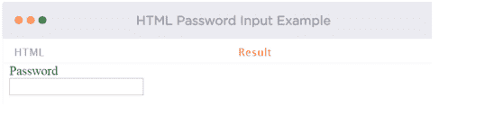

查看以下表单元素：

- 文本框输入
- 密码输入
- 文本区域
- 下拉框
- 复选框
- 文件输入
- 提交按钮

## 4.2.1 文本框输入 (Text Box Input)

文本框用于捕获如姓名、电子邮件或其他类型的文本。创建一个文本框，我们将使用`input`标签并指定其类型为文本。

查看在 HTML 中创建文本框的方式：  
`<input type="text" name="first_name">`

注意该属性。当表单提交时，该值将发送到服务器。

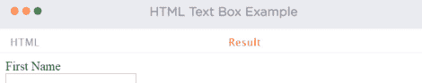

这是你创建文本框的方式：  
`<label for="first_name">First Name</label>`  
`<label>`标签在使用 HTML 表单时非常常见。由于我们的输入有`name="first_name"`，我们的标签将有一个`for="first_name"`。

## 4.2.2 密码输入 (Password Input)

密码输入本质上与文本框输入相同；但它在用户输入时不显示文本。在示例中尝试：

109

基础计算机编程：JavaScript


这是你创建密码输入的方式：  
`<input type="password" name="password">`

密码字段中的字符会被屏蔽（显示为星号或圆圈）。

## 4.2.3 文本区域 (Text Area)

为了创建一个允许用户输入大量文本的区域，我们可以使用`<textarea>`标签。查看 HTML 中创建文本区域的示例：  
`<textarea name="comment"></textarea>`

文本区域看起来如下：


## 4.2.4 选择下拉框 (Select Drop Down)

下拉菜单是用户在选择下拉菜单时可以选择的特定选项列表。在 HTML 中创建选择下拉，你需要在`<select></select>`标签内部表示它，然后对于你允许用户使用的每个选项，都将在`select`标签内部使用`<option></option>`标签进行指定。查看以下示例：  
`<select name="weapon">`

```
<option value="throwing_stars">Throwing Stars</option>
<option value="sword">Sword</option>
<option value="staff">Staff</option>
</select>
```

这将给你产生以下结果：

## 4.2.5 复选框 (Check Box)

在可以选择一个或多个选项的情况下，应该使用复选框。复选框也可用于用户希望“加入”或启用某项操作或设置的情况。复选框也可以与其他元素配合使用。

- 这是一系列复选框选项
- 这是该系列中的第二个选项，其带有换行的文本
- 这是该系列中的最后一个选项

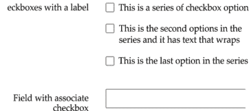

> 记住，复选框允许用户在有限的选项中选择零或多个选项。

如果关联的复选框之间存在*父子*关系，那么应该为用户提供某种视觉上的区别，以区分“部分勾选”和“全部勾选”，以防子元素作为可折叠部分被隐藏时。

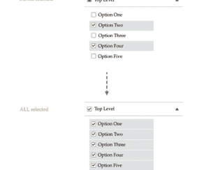

## 4.2.6 单选按钮输入 (Radio Input)

单选按钮应用于“是”或“否”的情况。一对单选按钮可以垂直排列，也可以水平排列。单选按钮通常有一个默认或首选选择。尽可能情况下，此首选选择应该是该对中的第一个按钮。在某些情况下，虽然只能进行单个选择但有多个选项可供选择，集合中的所有单选按钮可能都显示为未选中或“空”。然而，一旦用户进行了选择，选中状态在今后应该是清晰且可见的，即使用户更改了选择——它也无法回到初始的“未选中”状态。

+ 单选按钮
- 未选中的单选按钮
- 已中的单选按钮

+ 水平单选按钮
- 选项 A
- 选项 B

+ 单选按钮
- 未选中的单选按钮
- 已中的单选按钮

+ 水平单选按钮
- 选项 A
- 选项 B

## 4.2.7 文件输入 (File Input)

文件输入允许用户上传图像或文件。要创建一个文件输入元素，我们将使用`input`元素并给它一个文件类型，如下所示：  
`<input type="file" name="image">`  
这将带给我们以下结果：

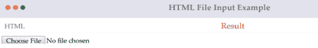

点击上面的“选择”按钮时，用户将弹出一个窗口来指定他们想要上传的文件。

## 4.2.8 提交按钮 (Submit Button)

最后，我们需要一种方式提交带有所有数据的单。这就是提交按钮的作用。为了使用提交按钮，我们将使用另一个类型为`submit`的`input`元素：  
`<input type="submit" value="提交表单">`  
我们的提交按钮看起来如下：

## HTML 表单

| 名字: | Mickey |
| :--- | :--- |
| 姓: | Mouse |
| | 提交 |

有很多表单元素。但不要感到压力，它们都非常易于使用和集成。通过表单允许用户输入是非常常见的，它能让我们的网站为用户提供更多功能。

> 用户代理程序样式表（User Agent Style sheets）指的是浏览器应用于网页的默认样式。它的优先级最低，因为用户样式（User Styles）和作者样式（Author styles）将覆盖它们。每个浏览器在显示“无样式”html 方面都略有不同。

## 4.3 为表单设置 HTML 样式

对于易用 CSS 设置样式的元素，你不应该遇到任何困难，因为它们的行为大部分与其他任何 HTML 元素相似。然而，每个浏览器的用户代理样式表可能有些不一致，因此有一些技巧可以帮助你更容易地为它们设置样式。


## 4.3.1 搜索字段

搜索框是唯一设置可能有些棘手的文本字段。在 WebKit 浏览器（Chrome、Safari 等）上，你必须使用`-webkit-appearance`私有属性对其进行调优。

## 示例

```
<form>
  <input type="search">
</form>

input[type=search] {
  border: 1px dotted #999;
  border-radius: 5px;
}
```

## 基础计算机编程：JavaScript

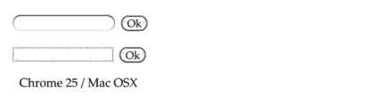

## 4.3.2 字体和文本

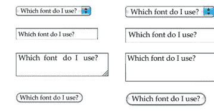

## 4.3.3 盒模型

## 基础计算机编程：JavaScript

```css
* {
  box-sizing: border-box;
}
```

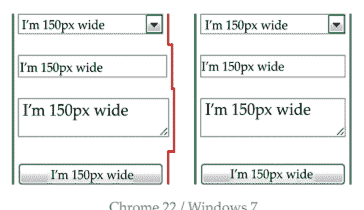

## 4.3.4 定位

如果你想跟随这个示例操作，请创建你的`postcard-start.html`文件的本地副本，并按照下面的说明进行。

## HTML 部分

HTML 部分比我们之前使用的示例稍微复杂一点，只是多出了几个 ID 和一个标题。

```html
<form>
  <h1>to:Mozilla</h1>
  <div id="name">
    <label for="name">from:</label>
    <input type="text" id="name" name="user_name">
  </div>
  <div id="reply">
    <label for="mail">reply:</label>
    <input type="email" id="mail" name="user_email">
  </div>
  <div id="message">
    <label for="msg">Your message:</label>
    <textarea id="msg" name="user_message"></textarea>
  </div>
  <div class="button">
    <button type="submit">Send your message</button>
  </div>
</form>
```

将上述代码添加到你 HTML 文件的`<body>`标签中。

## 组织你的资源

在我们开始编码之前，我们需要三个额外的资源：

- 明信片背景图
- 打字机字体
- 手写字体

编码指的是创建代码。

## 基础计算机编码：JavaScript

你的字体在开始之前需要进行一些处理：

- 进入`fonts`目录。
- 使用表单上传两个字体文件。
- 下载提供的 zip 文件。
- 在解压的内容中，你将找到两个 .woff 文件和两个 .woff2 文件。
- 将这些文件复制到名为`fonts`的目录中，与之前在同一个目录下。我们为每个字体使用两个不同的文件，以最大地提高浏览器兼容性。

## CSS 部分

现在我们可以研究示例的 CSS 了。将下面所有的代码块添加到`<style>`元素内部，一个接一个。首先，我们通过定义`@font-face`规则、所有的`<body>`元素和`<form>`元素来准备工作：

```css
@font-face {
  font-family: 'handwriting';
  src: url('fonts/journal-webfont.woff2') format('woff2');
  url('fonts/journal-webfont.woff') format('woff');
  font-weight: normal;
  font-style: normal;
}

@font-face {
  font-family: 'typewriter';
  src: url('fonts/veteran-typewriter-webfont.woff2') format('woff2');
```


`url('fonts/veteran-typewriter-webfont.woff') format('woff');`

`font-weight: normal;`

`font-style: normal;`

}

`body` {

  `font: 12px sans-serif;`

  `padding: 2em;`

  `margin: 0;`

  `background: #222;`

}

## HTML 表单

```css
form {

  position: relative;

  width: 740px;

  height: 498px;

  margin: 0 auto;

  background: #FFF url(background.jpg);

}
```

现在我们可以定位元素，包括标题和所有的表单元素：

```css
h1 {

  position: absolute;

  left: 415px;

  top: 185px;

  font: 1em "typewriter", sans-serif;

}
```

```css
from {

  position: absolute;

  left: 398px;

  top: 235px;

}
```

```css
reply {

  position: absolute;

  left: 390px;

  top: 285px;

}
```

```css
message {

  position: absolute;

  left: 20px;

  top: 70px;

}
```

## 基础计算机编码：JavaScript

从这里开始处理表单元素。首先，让我们确保 `<label>` 使用了正确的字体：

```css
label {

  font: .8em "typewriter", sans-serif;

}
```

文本字段需要一些通用规则。简单来说，我们去掉了它们的框和背景，并重新定义了它们的内边距和外边距：

```css
input, textarea {

  font: .9em/1.5em "handwriting", sans-serif;

  border: none;

  padding: 10px;

  margin: 0;

  width: 240px;

  background: none;

}
```


根据浏览器支持，字段提交时可以自动验证。当这些字段之一获得焦点时，我们会用浅灰色背景高亮它们。注意添加 `outline` 属性很重要，以移除某些浏览器默认的高亮：

```css
input:focus, textarea:focus {

  background: rgba(0,0,0,1);

  border-radius: 5px;

  outline: none;

}
```

现在文本字段已经完成了，我们需要调整单行和多行文本字段的显示，因为默认情况下看起来不一样。单行文本字段需要一些调整才能在 Internet Explorer 中正常渲染。Internet Explorer 根据字体的自然高度定义字段。为了修复这个问题，我们需要为字段添加式高度：

```css
input {

  height: 2.5em; /* 用于 IE */

  vertical-align: middle; /* 可选 */

}
```

`<textarea>` 元素默认渲染为 `block` 元素。这里两个重要的属性是 `resize` 和 `overflow`。因为我们的设计是固定尺寸，我们将使用 `resize` 属性来防止用户调整多行文本字段。`overflow` 属性用于使跨浏览器的渲染保持一致。某些浏览器默认值为 `auto`，在我们情况下，最好确保都使用 `auto`：

```css
textarea {

  display: block;

  padding: 10px;

  margin: 10px 0;

  width: 340px;

  height: 360px;

  resize: none;

  overflow: auto;

}
```

`<button>` 元素配合 CSS 非常方便，你可以随心所欲：

```css
button {

  position: absolute;

  left: 440px;

  top: 360px;

  padding: 5px;

  font: 1em sans-serif;

  border: 2px solid #333;

  background: none;

  cursor: pointer;

}

button:hover {

  background: #000;

  color: #FFF;

}
```


## 创建表单

表单的第一步当然是创建实际的表单：


## 设计笔记

1. 创建以下文件：
   - `vmv_js-index.html` = 主 HTML 文件
   - `vmv_js-style.css` = 样式文件
   - `vmv_js-index.js` = JavaScript 文件
   - `vmv_js-Releases.html` = HTML 页面
2. 将表单添加到主文件的 `<head>` 部分（链接 CSS 和 JS）：
   ```
   <link rel="stylesheet" type="text/css" href="vmv_js-style.css">
   <script type="text/javascript" src="vmv_js-index.js"></script>
   ```
3. "Welcome to" 使用 `h1`
4. "Customer details" 等使用 `h4`
5. 使用以下样式确保两列流动正确：

```css
.col1 {

  background: #93A54;

  float: left;

  padding: 10px 5px 10px 5px;

  border: 1px solid #666;

}

.col2 {

  background: #93A54;

  float: left;

  padding: 10px 5px 10px 5px;

  border: 1px solid #666;

}
```

## 基础计算机编码：JavaScript

6. 使用样式隔开字段名称（例如“Name (Last, First)”）。
   ```
   <input name="txtName" type="text" style="width: 120px; float: left;">
   ```
7. 在字段名称前加上 `txt` 并使用驼峰命名法，例如：
   ```
   <input name="txtFullName" type="text" style="width: 186px">
   ```
8. 在按钮名称前加上 `btn` 并使用驼峰命名法，例如：
   ```
   <input name="btnCheckForm" type="button" value="Check Data" onclick="fnCheckData()">
   ```
9. 按钮的 `onclick` 调用以下函数：
   - 检查数据 = `fnCheckData()`
   - 显示租赁列表 = `fnReleases()`
10. 今日日期将通过函数 `fnDisplayTodayDate()` 调用。
11. 添加项目按钮将通过函数 `fnAddItem()` 调用。
12. 租赁列表表格使用以下代码：
    ```
    <h2>Rental list</h2>
    <table id="myTable" border="1" style="border-collapse: collapse;">
      <tr><th>Type</th><th>Title</th><th>Rental Price</th></tr>
    </table>
    ```

## 说明

JavaScript 用于验证表单数据，这是在发送到服务器之前完成的，因此可以减少服务器流量。为了实际处理数据，我们将表单数据发送到 Internet 服务器，该服务器将使用服务器端语言（如 PHP 或 ASP.NET）处理这些数据，并将数据存入数据库。

## 摘要

- HTML 代表超文本标记语言（HyperText Markup Language）。它被用于使用标记语言来设计网页。它是超文本和标记语言的结合。HTML 使用预定义的标签和元素来告诉浏览器如何在屏幕上正确地显示内容，而表单（form）就是其中之一。

- HTML 表单是文档的一个部分，包含各种控件，如文本字段、密码字段、复选框、单选按钮、提交按钮、菜单等。

- Web 表单被几乎所有网站用于广泛的用途。表单用户和社交网络用户使用表单来添加内容并与其他用户进行交互。

- HTML 表单是一种文档，它通过交互式控件在 Web 服务器上存储用户信息。HTML 表单包含不同类型的信息，如用户名、联系电话、邮箱 ID 等。`textarea` 本质上是一个大型的多行文本框。预期的行和列数可以通过 `rows` 和 `cols` 属性进行定义，尽管你可以使用 CSS 随心所欲地调整大小。

- HTML 表单是收集用户数据的极佳且专业的工具。然而，这些表单就像 HTML 中的其他一切一样，如果没有适当的 HTML 表单元素，它们将无法工作。

- HTML 表单元素用于捕捉用户输入。有许多不同类型的表单元素，如文本框、复选框、下拉列表、提交按钮等。

- 文本框输入用于捕捉如名称、电子邮件、地址或任何类型的文本。要创建一个 HTML 文本框，我们将使用 `input` 标签并指定 `type` 属性为 `text`。

## 知识检查

1. 在 HTML 表单中，`<input type="text">` 用于
   a. 单行文本
   b. 文本块
   c. 一段落
   d. 无

2. `<form>` 标签的属性是
   a. Method
   b. Action
   c. (a) 和 (b) 都是
   d. 以上都不是

## 基础计算机编程：JavaScript

3. 最大的标题的正确 HTML 标签是
   a. `<head>`
   b. `<h6>`
   c. `<h1>`
   d. `<h1>`

4. 定义提交按钮使用哪个标签？
   a. `<button>`
   b. `<submit button>`
   c. `<submit>`
   d. `<action submit>`

5. 当表单数据包含敏感或个人信息时，哪种方法更优？
   a. Get 方法
   b. Post 方法
   c. Host 方法
   d. Put 方法

6. HTML 表单中的 Action 属性指定了
   a. 使用哪种 HTTP 方法
   b. 正在进行什么操作
   c. 将表单提交到何处
   d. 表单的自动完成

7. 选择正确选项。
   a. HTML 表单元素用于获取用户输入。
   b. HTML 表单元素定义在 `<for>` 标签内部。
   c. HTML 表单元素可以是不同类型。
   d. 以上所有都是。

8. 下列哪项是表单元素？
   a. 文本框。
   b. 单选按钮。
   c. 提交按钮。
   d. 以上所有。

9. 选择错误的选项。
   a. 单选按钮允许从给定的选项中只选择一个。
   b. 单选按钮可以使用属性 "selected" 默认选择默认选项。
   c. 单选按钮可以使用属性 "checked" 默认选择默认选项。
   d. 复选框允许从给定的选项中选择一个或多个选项。

10. 如何在下拉列表中选择多个选项？
    a. 在 `<option>` 标签内使用 `multiple` 属性。
    b. 在 `<select>` 标签内使用 `multiple` 属性。
    c. 在 `<text>` 标签内使用 `multiple` 属性。
    d. 下拉列表中是不可能选择多个选项的。

11. 下列中哪项是错误的？
    a. HTML 中的 `<label>` 用于为表单元素创建一个标签。
    b. `<label>` 可用于增加按钮的可点击区域。
    c. `id` 属性与 `<label>` 一起使用以增加表单元素的可点击区域。
    d. 以上都不是

12. 选择错误的选项。
    a. `action` 属性在表单的起始标签内使用。
    b. 使用 `action`，我们可以在点击提交按钮后重定向到一个页面。
    c. `<form action="home.php">` 重定向到页面 `home.php`。
    d. 以上都不是

13. 选择正确选项。
    a. `method` 属性的使用决定了表单数据将以何种方式提交。
    b. 方法可以是 POST 或 GET。
    c. HTML 中的默认方法是 GET。
    d. 以上所有均正确的。

14. 关于 HTML 中的 GET 方法，下列哪项是不正确的？
    a. 在 HTML 中使用 GET 方法是安全的。
    b. 使用 GET 方法允许我们书签该页面。
    c. GET 有局限性。
    d. 以上都不是

15. 下列哪个标签用于下拉列表？
    a. `<select>`
    b. `<text>`
    c. `<textarea>`
    d. `<dropdown>`

## 复习题

1. HTML 到底代表什么？
2. HTML 中的表单（form）是什么？
3. 写下 HTML 表单的主要用途。
4. 写出单选按钮和复选框的区别。
5. 用户在文本字段中可以输入的文本大小是否受 `<INPUT>` 标签中 `SIZE` 属性的限制？
6. `<TEXTAREA>` 标签必须包含哪个属性以确保多行文本字段中包含水平滚动条？
7. 如何设置复选框的初始状态？

## 检查你的知识

1. a
2. c
3. d
4. a
5. b
6. c
7. d
8. d
9. b
10. b
11. d
12. d
13. d
14. a
15. a

## 示例

下面的示例更改了 `id="demo"` 的 `<p>` 元素的内容（innerHTML）：

```html
<html>

<body>

  <p id="demo"></p>

  <script>

    document.getElementById("demo").innerHTML = "Hello World";

  </script>

</body>

</html>
```


在上面的示例中，`getElementById`是一个方法，而`innerHTML`是一个属性。

## 5.1.2 `getElementById` 方法

访问 HTML 元素最常见的方法是使用该元素的`id`。

在上面的示例中，`getElementById`使用`id="demo"`来找到该元素。

## 5.1.3 `innerHTML` 属性

获取 HTML 元素内容最简单的方法是使用`innerHTML`属性。

`innerHTML`属性用于获取或替换 HTML 元素的内容。

## 5.2 HTML DOCUMENT

HTML DOM `document`对象是网页中所有对象的所有。

### 5.2.1 HTML DOM 对象

`document`对象表示网页。如果你想访问 HTML 页面中的任何元素，始终从访问`document`对象开始。下面是一些如何使用`document`对象来访问和操作 HTML 的示例。

## 5.2.2 查找 HTML 元素

| 方法 | 描述 |
| --- | --- |
| `document.getElementById(id)` | 通过 id 查找元素 |
| `document.getElementsByTagName(name)` | 通过标签名查找元素 |
| `document.getElementsByClassName(name)` | 通过类名查找元素 |

## 5.2.3 修改 HTML 元素

| 方法 | 描述 |
| --- | --- |
| `element.innerHTML = html content` | 更改元素的 HTML 内容 |
| `element.attribute = value` | 更改 HTML 元素的属性值 |
| `element.setAttribute(attribute, value)` | 更改 HTML 元素的属性值 |
| `element.style.property = new style` | 更改 HTML 元素的样式 |

## 5.2.4 添加和删除元素

| 方法 | 描述 |
| --- | --- |
| `document.createElement(element)` | 创建 HTML 元素 |
| `document.removeChild(element)` | 移除 HTML 元素 |
| `document.appendChild(element)` | 添加 HTML 元素 |
| `document.replaceChild(element)` | 替换 HTML 元素 |
| `document.write(text)` | 写入 HTML 流 |

## 5.2.5 添加事件处理器

| 方法 | 描述 |
| --- | --- |
| `document.getElementById(id).onclick = function(j)` | 为 onclick 事件添加事件处理器 |

## 5.2.6 查找 HTML 对象

HTML DOM 1 级 (1998) 定义了 11 个 HTML 对象、集合和属性。这些在 HTML5 中仍然有效。

后来，在 HTML DOM 3 级增加了对象、集合和属性。

| 属性 | 描述 | DOM |
|---|---|---|
| `document.anchors` | 返回所有带有属性的 `<a>` 元素 | 1 |
| `document.applets` | 返回所有 `<applet>` 元素（HTML5 中已弃用） | 1 |
| `document.base` | 返回文档的绝对 URI | 3 |
| `document.body` | 返回 `<body>` 元素 | 1 |
| `document.cookie` | 返回文档的 cookie | 1 |
| `document.doctype` | 返回文档的 doctype | 3 |
| `document.documentElement` | 返回 `<html>` 元素 | 3 |
| `document.elementMode` | 返回浏览器使用的模式 | 3 |
| `document.URI` | 返回文档的 URI | 3 |
| `document.domain` | 返回文档服务器名称 | 1 |
| `document.domConfig` | 过时：返回 DOM 配置 | 3 |
| `document.embeds` | 返回所有 `<embed>` 元素 | 3 |
| `document.forms` | 返回所有 `<form>` 元素 | 1 |
| `document.head` | 返回 `<head>` 元素 | 3 |
| `document.images` | 返回所有 `` 元素 | 1 |
| `document.implementation` | 返回 DOM 实现 | 3 |
| `document.inputEncoding` | 返回文档的编码（字符集） | 3 |
| `document.lastModified` | 返回文档更新的日期和时间 | 3 |
| `document.links` | 返回所有带有 href 属性的 `<a>` 和 `<area>` 元素 | 1 |
| `document.readyState` | 返回文档的（加载）状态 | 3 |
| `document.referrer` | 返回引用页（链接的文档）的 URI | 1 |
| `document.scripts` | 返回所有 `<script>` 元素 | 3 |
| `document.strictErrorChecking` | 返回是否强制执行错误检查 | 3 |
| `document.title` | 返回 `<title>` 元素 | 1 |
| `document.URL` | 返回文档的完整 URL | 1 |

```
<html>
<body>
<script type="text/javascript">
document.write("Hello World!");
</script>
</body>
</html>
```

## 5.3 HTML DOM 元素

本文告诉你如何在 HTML 页面中查找和访问 HTML 元素。

### 5.3.1 查找 HTML 元素

通常使用 JavaScript 时你想操作 HTML 元素。

要做到这一点，你必须找到这些元素。有几种方法：

- 通过 id 查找 HTML 元素
- 通过标签名查找 HTML 元素
- 通过类名查找 HTML 元素
- 通过 CSS 选择器查找 HTML 元素

### 5.3.2 通过 id 查找 HTML 元素

查找 HTML 元素最简单的方法是使用`id`。如果你想访问 HTML 页面中的任何元素，始终从访问`document`对象开始。下面是一些你可以如何使用`document`对象来访问和操作 HTML 的示例。

```
document.getElementById("demo")
```

### 5.3.3 通过标签名查找 HTML 元素

在上面的示例中，`getElementById`使用`id="demo"`来找到该元素。

```
document.getElementsByTagName("p")
```

### 5.3.4 通过类名查找 HTML 元素

`innerHTML`属性对于获取或替换 HTML 元素的内容非常有用。

```
document.getElementsByClassName("demo")
```

### 5.3.5 通过 CSS 选择器查找 HTML 元素

HTML DOM 1 级 (1998) 定义了 11 个 HTML 对象、集合和属性。这些在 HTML5 中仍然有效。

后来，在 HTML DOM 3 级增加了对象、集合和属性。

```
document.querySelectorAll(".demo")
```

### 5.3.6 通过集合查找 HTML 元素

HTML DOM 1 级 (1998) 定义了 11 个 HTML 对象、集合和属性。这些在 HTML5 中仍然有效。

后来，在 HTML DOM 3 级增加了对象、集合和属性。

```
document.forms["frm1"]
```

## 基础计算机编程：JavaScript

### 5.4.3 更改属性值

要更改 HTML 属性的值，请使用此语法：
`document.getElementById(id).attribute = new value`

此示例更改了 `` 元素`src`属性的值：

## 示例

```
<!DOCTYPE html>
<html>
<body>

<script>
document.getElementById("myImage").src = "landscape.jpg";
</script>
</body>
</html>
```

## 5.5 修改 CSS

HTML DOM 允许 JavaScript 更改 HTML 元素的样式。

## 5.5.1 更改 HTML 样式

要更改 HTML 元素的样式，请使用此语法：
`document.getElementById(id).style.property = new style`

以下示例更改了 `<p>` 元素的样式：

## 示例

```
<html>
<body>
<p id="p2">Hello World!</p>
<script>
document.getElementById("p2").style.color = "blue";
</script>
</body>
</html>
```

<p>上面的段落已通过脚本更改。</p>

## 5.5.2 使用事件

HTML DOM 允许你在事件发生时执行代码。

当 HTML 元素发生“某些事情”时，浏览器会生成事件：

- 元素被点击
- 页面已加载
- 输入字段发生变化

此示例在用户点击按钮时，更改`id="id1"`的 HTML 元素的样式：

## 示例

```
<!DOCTYPE html>
<html>
<body>
<h1 id="id1">My Heading 1</h1>
<button type="button"
onclick="document.getElementById('id1').style.color = 'red'">
Click Me!</button>
</body>
</html>
```

## 5.6 HTML DOM 动画

学习使用 JavaScript 创建 HTML 动画。

## 5.6.1 基础网页

为了演示如何使用 JavaScript 创建 HTML 动画，我们将使用一个简单的网页：

## 示例

```
<!DOCTYPE html>
<html>
<body>
<h1>My First JavaScript Animation</h1>
<div id="animation">My animation will go here</div>
</body>
</html>
```

### 5.6.2 创建动画容器

所有动画都应该相对于容器元素。

## 示例

```
<div id="container">
<div id="animate">My animation will go here</div>
</div>
```

## 5.6.3 为元素设置样式

创建容器元素时应带有`style = "position: relative"`。

创建动画元素时应带有`style = "position: absolute"`。

## 示例

```
#container {
  width: 400px;
  height: 400px;
  position: relative;
  background: yellow;
}

#animate {
  width: 50px;
  height: 50px;
  position: absolute;
  background: red;
}
```

## 5.6.4 动画代码

JavaScript 动画通过编程元素样式的渐变变化来实现。

变化由定时器调用。当定时器间隔很小时，动画看起来是连续的。

基础代码如下：

## 示例

```
var id = setInterval(frame, 5);

function frame() {
  if (/* 检查是否完成 */) {
    clearInterval(id);
  } else {
    /* 更改元素样式的代码 */
  }
}
```

### 5.6.5 使用 JavaScript 创建动画

## 示例

```
function myMove() {
  var elem = document.getElementById("animate");
  var pos = 0;
  var id = setInterval(frame, 5);

  function frame() {
    if (pos == 350) {
      clearInterval(id);
    } else {
      pos++;
      elem.style.top = pos + 'px';
      elem.style.left = pos + 'px';
    }
  }
}
```

## 5.7 HTML DOM 事件

HTML DOM 允许 JavaScript 响应 HTML 事件：

## 5.7.1 响应事件

当事件发生时（例如用户点击 HTML 元素时），可以执行 JavaScript。

若要在用户点击元素时执行代码，请在 HTML 事件属性中添加 JavaScript 代码：

`onclick="JavaScript()"`

HTML 事件示例：

- 当用户点击鼠标时
- 当网页加载完成时
- 当图像加载完成后
- 当鼠标悬停在元素上时
- 当输入字段发生变化时
- 当提交 HTML 表单时
- 当用户按下按键时

在此示例中，当用户点击 `<h1>` 元素时，其内容会发生更改：

## 示例

```
<!DOCTYPE html>
<html>
<body>
<h1 onclick="this.innerHTML = 'Ooops!'">Click me</h1>
</body>
</html>
```

*(注：由于提供的 OCR 文本在此处略有碎片化，已根据逻辑还原了标准的示例结构)*

## 基础计算机编程：JavaScript

这些支持事件的对象，例如 `XMLHttpRequest` 对象。

## 示例

添加一个在用户缩放窗口时触发的事件监听器

```
window.addEventListener("resize", function() {
  document.getElementById("demo").innerHTML = sometext;
});
```

## 5.8.6 传递参数

在传递参数值时，使用“匿名函数”，该函数带有参数调用指定的函数：

## 示例

```
element.addEventListener("click", function() { myFunction(p1, p2); });
```

## 5.8.7 事件冒泡还是事件捕获？

HTML DOM 中有两种事件传播方式：冒泡和捕获。

事件传播是定义当事件发生时元素顺序的一种方式。如果你在 `<div>` 元素内部有一个 `<p>` 元素，当用户点击 `<p>` 元素时，应该先处理哪个元素的“点击”事件？

在**冒泡**中，先处理内部元素的事件，然后是外部元素：先处理 `<p>` 元素的点击事件，然后处理 `<div>` 元素的点击事件。

在**捕获**中，先处理外部元素的事件，然后是内部元素：先处理 `<div>` 元素的点击事件，然后处理 `<p>` 元素的点击事件。

通过`addEventListener()`方法，你可以通过 "useCapture" 参数来指定传播类型：
`addEventListener(event, function, useCapture);`

默认值为`false`，将使用冒泡传播；当值设置为`true`时，将使用捕获传播。

## 示例

```
document.getElementById("myP").addEventListener("click", myFunction, true);
document.getElementById("myDiv").addEventListener("click", myFunction, true);
```

## 5.8.8 `removeEventListener()` 方法

`removeEventListener()`方法移除已挂载到`addEventListener()`方法上的事件处理器：

## 示例

```
element.removeEventListener("mousemove", myFunction);
```


## 5.9 HTML DOM 导航

通过 HTML DOM，你可以利用节点关系在节点树中导航。

### 5.9.1 DOM 节点

根据 W3C HTML DOM 标准，HTML 文档中的一切内容都是一个**节点**：

- 整个文档是一个文档节点。
- 每个 HTML 元素都是元素节点。
- HTML 元素内部的文本是文本节点。
- 每个 HTML 属性都是属性节点（已弃用）。
- 所有注释都是注释节点。

> 文档对象模型的历史与 20 世纪 90 年代后期 Netscape Navigator 和 Microsoft Explorer 之间的“浏览器战争”历史交织在一起，同时也与 JavaScript 以及在 Web 浏览器引擎中首次广泛实现的脚本语言密切相关。

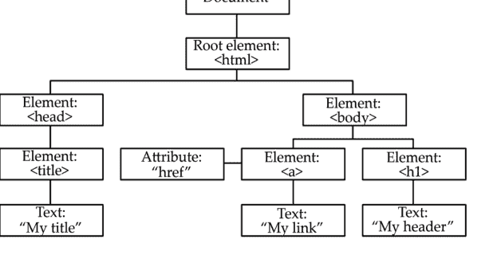

可以创建新节点，并且所有节点都可以被修改或删除。

### 5.9.2 节点关系

节点树中的节点之间存在层级关系。

使用父、子、兄弟等术语来描述这些关系：

- 在节点树中，顶端节点被称为根（或根节点）。
- 每个节点只有一个父节点，根节点除外（它没有父节点）。
- 一个节点可以有多个子节点。
- 兄弟节点是指具有相同父节点的节点。

节点是数据结构的基本单位，例如链表或树形结构。


```html
<html>
<head>
  <title>DOM Tutorial</title>
</head>
<body>
  <h1>DOM Lesson one</h1>
  <p>Hello world!</p>
</body>
</html>
```

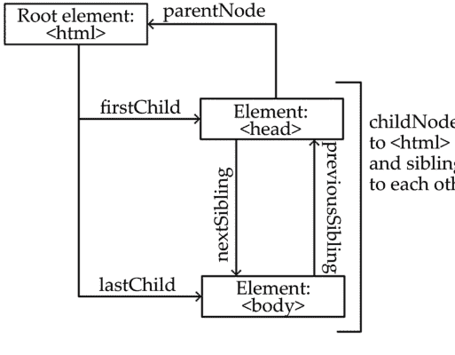

从上述 HTML 代码中，你可以读到：

- `<html>` 是根节点。
- `<html>` 没有父节点。
- `<html>` 是 `<head>` 和 `<body>` 的父节点。
- `<head>` 是 `<html>` 的第一个子节点。
- `<body>` 是 `<html>` 的最后一个子节点。
- `<head>` 有一个子节点：`<title>`。
- `<title>` 有一个子节点（文本节点）：“DOM Tutorial”。
- `<body>` 有两个子节点：`<h1>` 和 `<p>`。
- `<h1>` 有一个子节点：“DOM Lesson one”。
- `<p>` 有一个子节点：“Hello world!”。
- `<h1>` 和 `<p>` 是兄弟节点。

### 5.9.3 子节点和节点值

DOM 处理中的一个常见错误是期望元素节点包含文本。

示例：

```html
<title id="demo">DOM Tutorial</title>
```

元素节点 `<title>`（如上例所示）并不包含文本。它包含一个值为“DOM Tutorial”的文本节点。

可以通过节点的 `innerHTML` 属性访问该文本节点的值：

```javascript
var myFunction = document.getElementById("demo").innerHTML;
```

访问 `innerHTML` 属性等同于访问第一个子节点的 `nodeValue`：

```javascript
var myFunction = document.getElementById("demo").firstChild.nodeValue;
```

也可以这样访问第一个子节点：

```javascript
var myFunction = document.getElementById("demo").childNodes[0].nodeValue;
```

（注：此处原文文本似乎存在重复或断层，已根据逻辑翻译并保持了结构对应。）

## 基础计算机编程：JavaScript

### 示例

```html
<div id="div1">
  <p id="p1">This is a paragraph.</p>
  <p id="p2">This is another paragraph.</p>
</div>

<script>
  var para = document.createElement("p");

  var node = document.createTextNodeNode("This is new.");

  para.appendChild(node);

  var element = document.getElementById("div1");

  var child = document.getElementById("p1");

  element.insertBefore(para, child);
</script>
```

### 5.10.3 移除现有 HTML 元素

要移除 HTML 元素，你必须知道元素的父元素。

示例：

```html
<div id="div1">
  <p id="p1">This is a paragraph.</p>
  <p id="p2">This is another paragraph.</p>
</div>

<script>
  var parent = document.getElementById("div1");

  var child = document.getElementById("p1");

  parent.removeChild(child);
</script>
```

### 5.10.4 替换 HTML 元素

要替换 HTML DOM 中的元素，请使用 `replaceChild()` 方法：

示例：

```html
<div id="div1">
  <p id="p1">This is a paragraph.</p>
  <p id="p2">This is another paragraph.</p>
</div>

<script>
  var para = document.createElement("p");

  var node = document.createTextNode("This is new.");

  para.appendChild(node);

  var parent = document.getElementById("div1");

  var child = document.getElementById("p1");

  parent.replaceChild(para, child);
</script>
```

## 基础计算机编程：JavaScript

## 案例研究：对象模型

文档对象模型（称为 DOM）的历史与 JavaScript 和 JScript 脚本语言的诞生紧密相连。

## JavaScript

LiveScript 语言是在 Netscape Communications 设计的，旨在让非 Java 程序员能够更方便地使用 Netscape Navigator 中的 Java 支持。LiveScript 像任何脚本语言一样，是一种弱类型语言。它旨在面向大范围的 Web 设计师和开发者。

1995 年，LiveScript 被更名为 JavaScript，并作为 Netscape Navigator 2.0 的一部分发布。除了营销目的外，JavaScript 与 Sun Microsystems 开发和维护的 Java 语言没有任何关系。Web 社区从那时开始操作 Web 文档的内容，以便为曾经静态的 Web 带来交互性和版效果。

## JScript

1996 年 7 月，微软发布了 Internet Explorer 3.0，其中包含一个名为 JavaScript 的 JavaScript 移植。

## ECMAScript97

1997 年 6 月，ECMA 采纳了一种名为 ECMAScript 的混合脚本语言版本。国际标准化组织（ISO）于 1998 年随之效仿。

遗憾的是，ECMAScript 的出现对于 Netscape Navigator 和 Internet Explorer 的 4.0 版本来说太晚了。它们各自都引入了自己的文档对象模型，HTML 和 dHTML，后者演变成了动态 HTML（Dynamic HTML）。

1999 年 12 月发布的 ECMA-262 至今仍未被微软及其 Internet Explorer 遵循。ECMAScript 则声称在 Netscape Navigator 6 和 7 中支持 ECMA-262。

## 万维网标准联盟

1994 年，万维网的发明者 Tim Berners-Lee 创建了万维网联盟（W3C），以引导 Web 发挥其全部潜力。

1997 年初，参与该联盟的公司（包括 Netscape Communications 和微软）决定就它们用于访问和操作文档的对象模型达成共识。

虽然 W3C 仍在尝试尽可能地与原始浏览器对象模型保持向后兼容，但 W3C 的文档对象模型（DOM）为 HTML 文档提供了更好的对象表示。

## HTML 和 XML

1996 年，一种新的标记语言——可扩展标记语言（XML）诞生了。

## DOM 总结

文档对象模型（DOM）为 HTML 文档提供了更好的对象表示。虽然它仍在尝试尽可能与原始浏览器对象模型保持向后兼容，但 W3C 的文档对象模型（DOM）为 HTML 文档提供了更好的对象表示。

（注：由于原文中存在部分重复段落和标题，译文已根据要求进行了处理。）

## 参考文献

1. David Flanagan. *JavaScript: The Definitive Guide, Sixth Edition*. O'Reilly. 2011.
2. Douglas Crockford. *JavaScript: The Good Parts*. O'Reilly Media, 2008.
3. Douglas Crockford. *Javascript: The World's Most Misunderstood Programming Language*.
4. Douglas Crockford. *JSLint: The JavaScript Verifier*，`http://www.jslint.com/`，2002。Access 于 August 4, 2008。
5. Jonathan Stark. *Building iPhone Apps with HTML, CSS, and JavaScript*. O'Reilly. 2010.
6. Maximiliano Firtman. *Programming the Mobile Web*. O'Reilly. 2010.

# 第 6 章 Cookie（饼）

## 引言

Cookie 是一种在服务器端和客户端之间持久存在的信息。网络浏览器在用户访问时存储这些信息。Cookie 包含以字符串形式的信息，通常为由分号分隔的键值对形式。它维护了用户的状态，并在所有网页中记住用户的信息。

Cookies 是存储在您计算机上的小型文本文件中的数据。当 Web 服务器向浏览器发送网页后，连接就会关闭，服务器会忘记关于用户的所有信息。

学习本章后，你将能够：

1. 理解使用 JavaScript 读写 Cookie 的基础知识。
2. 解释如何在 JavaScript 中设置不同类型的 Cookie。

基础计算机编程：JavaScript

Cookie 的发明是为了解决“如何记住用户信息”的问题：

- 当用户访问网页时，他的/她的名字可以存储在 Cookie 中。
- 下次用户访问该页面时，Cookie 就会“记住”他的/她的名字。

Cookies 以键值对的形式保存，例如：

```text
username = John Doe
```

当浏览器从服务器请求网页时，属于该页面的 Cookie 会添加到请求中。这样，服务器就获取了必要的数据来“记住”关于用户的信息。

## 6.1 使用 JavaScript 读写 Cookie 的基础

Cookies 是网络浏览器嵌入用户计算机的较小文件。Cookies 允许本该无状态的 HTTP 通信模拟状态（例如，本地存储和会话存储）；然而，如今许多网站仍在使用 Cookie。因此，熟悉 Cookie 的工作原理是一个好主意。此外，看到你如何使用 JavaScript 读取和写入浏览器的 Cookie API 也是很有趣的。

一个用户注册在完成许多页面后结束。但如何在所有网页之间维护用户的会话信息呢？

Cookies 最初由 Netscape 发明，旨在为 Web 服务器和浏览器提供“记忆”。HTTP 协议负责安排网页传输到你的浏览器以及浏览器向服务器请求页面，它是无状态的，这意味着一旦服务器向请求页面的浏览器发送了页面，它就不会记住关于它的任何事情。

所以，如果你第二次、第三次、上百次或百万次访问同一个网页，服务器会再次认为这是你第一次来到那里。这在许多方面都会令人苦恼。服务器无法记住你在访问受保护页面时是否识别了身份，无法记住你的用户偏好，也无法记住任何事情。

一旦个性化发明，这变成了一个大问题。Cookie 的发明是为了解决这个问题。还有其他解决办法，但 Cookie 易于维护且功能强大。

### 6.1.1 在 JavaScript 中使用 Cookie

Cookies 是你的浏览器存储在计算机上的小文件的名称，这些文件包含你访问过的网站相关的信息。使用 JavaScript，你可以在读者返回你的网站时随时向这些文本文件写入内容并从中提取数据。

Cookies 是可以存储在用户计算机上的变量，并被正确网域和路径下的任何其他网页获取。Cookies 被设置为在一段时间后过期。它们被限制只能存储字符串值。

请注意，许多用户（包括我在内）不会在他们的计算机上允许 Cookie。其原因是许多网站仅将 Cookie 作为跟踪的一部分，他们利用它来跟踪你在城市中的移动。我们不希望任何人在我购物时一直跟着我，记录你访问的每家商店以及你是否进店查看。

许多人发现，首先显示你打算将 Cookie 用于什么是有帮助的，例如存储用户名和密码以便下次访问，这些日期可以追溯到 1994 年。那一年，Leo 从一种名为“魔法饼干”（magic cookie）的类似技术将其转化为万维网的工具，这种技术在普通大众中周知。这也是术语本身的起源。

```javascript
function setCookie(name, value, days) {
  var expires;

  if (days) {
    var date = new Date();

    date.setTime(date.getTime() + (days * 24 * 60 * 60 * 1000));

    expires = "expires=" + date.toUTCString();
  }

  document.cookie = name + "=" + value + (expires || "") + "; path=/";
}
```

还要注意，欧洲法律要求网站在使用 Cookie 之前获得明确许可，除非这些 Cookie 对于网站的运行至关重要。某些浏览器对存储的 Cookie 数量有限制，通常每个域名 20 个或更多 Cookie。

`document` 对象是当前网页可用所有 Cookie 的字符串表示。`cookie` 对象有些异常之处，在于当你给它赋值字符串时，它并不会变成你赋值的值。相反，它获取该值的一部分并将其当前值附加其后，形成一个包含多个“变量名=变量值”对的字符串。

## 为什么我们使用 Cookies

Web 服务器是通过 HTTP 或其安全变体 HTTPS 接受请求的软件和硬件。

## Cookie 中可以存储什么数据？

Cookie 基本上是一个不超过 4 KB 的文本字符串。Cookies 以键值对的形式设置，用分号分隔。例如，一个 Cookie 可能是如下的字符串：

```text
theme=blue; max-age=60; domain=example.com
```

此 Cookie 有 4 组变量/值对：

- `max-age`，设置为 60。
- `path`，设置为 `/`。
- `domain`，设置为 `example.com`。
- `theme`，设置为 `blue`。

变量 `max-age`、`path` 和 `domain` 是浏览器识别的特殊变量名，用于控制 Cookie 的生存期以及 Cookie 有效的 URL。在你的示例中，只有 `theme` 变量包含你想要设置的实际数据。

你可以创建任何想要的变量名，并将其设置为你想要的任何值，遵循以下约束：

### max-age

Cookies 的默认生存期为当前的浏览器会话。一旦访问者关闭了他的浏览器，Cookie 就会消失。

要让它持续更久，你需要将 `max-age` 变量设置为你希望 Cookie 持续的秒数（是的，秒数）。例如，如果你希望 Cookie 持续 30 天，将其设置为 2,592,000。

与其预先计算此值并放入脚本中，不如让 JavaScript 解释器在运行时为你计算并对其进行编码：

```javascript
"theme=blue; max-age=" + 60*60*24*30 + "; path=/; domain=example.com"
```


这比写一个你以后会忘记其含义的巨大数字要优。

### `path`

默认情况下，Cookies 只对存储它们的网页所在目录中的网页及其后代有效。也就是说，如果一个 Cookie 是由 `http://example.com/abc/webpage.html` 设置的，它对 `http://example.com/abc/yet-another-page.html` 以及 `http://example.com/abc/Sub-Folder/index.html` 有效，但对 `http://example.com/index.html` 无效。

如果你希望 Cookie 在其他目录中有效，例如 `http://example.com/special/`，你需要将 `path` 设置为值 `"special"`。如果你希望 Cookie 在你网站的任何地方有效，将其设置为 Web 目录的根目录，即 `"/"`。

### `domain`

你可能注意的另一个特殊变量名是 `domain` 变量。在 `example.com` 等子域名设置的 Cookie 只对该子域名有效。如果你希望它对 `example.com` 的所有子域名有效，你需要将 `domain` 指向 `"example.com"`。然后 Cookie 将对 `"www.example.com"`、`blog.example.com"` 以及你可能拥有的任何其他子域名有效。

### `secure`

另一个具有特殊含义的变量是：`secure`。此变量不应赋予任何值。包含它意味着只有当访问者通过安全连接访问您的网站时，cookie 才会发送。

### `expires`

`expires` 变量已经过时，尽管现在的浏览器仍然支持它。请改用 `max-age` 变量，因为它更容易使用。注意不要将 `"expires"` 作为变量名来存储您的数据。

### 无空格、逗号、分号

您的 cookie 值不能包含任何嵌入的空格、逗号或分号。如果你有任何这些字符，必须将其转换为“编码”后的等效字符。最简单的方法是使用 `encodeURIComponent()` 函数对其进行编码，并在读取 cookie 时使用 `decodeURIComponent()` 函数对其进行解码。

扩展你之前的示例，如果你想将 `"theme"` 变量设置为 `"blue theme"`，你可以按照以下方式操作：`theme=" + encodeURIComponent("blue theme") + "max-age= 60*60*24*30; path=/; domain=theewizard.`

当然，在上述情况下，由于只有一个空格字符需要编码，你可以手动将其设置为 `"blue%20 theme"`。

### Cookie 限制

尽管不同的浏览器可能实现不同的 cookie 限制，但它们应该支持的最低限制如下：
- Cookie 长度：4 KB。您的字符串总长度（包括所有具有特殊含义的变量）不应超过 4096 个字符。
- 每个 Web 服务器的最大 cookie 数量：20。
- 浏览器支持的 cookie 总数：300。这包含了其他网站存储的 cookie。

网站是网页和相关内容的集合，通过共同域名进行标识，并发布在至少一个 Web 服务器上。


## 6.1.2 Cookie 的结构

Cookie 不仅仅是简单的文本文件——通常位于浏览器缓存或“临时 Internet 文件”中——它们包含一个或多个条目。每个条目由以下部分组成：
- 一个键值对，用于存储你想保存的任何数据。
- 一个过期日期，在该日期之后该条目将被删除。
- 该条目应关联的 Web 域名和路径。

你可以使用 JavaScript 读取或向 cookie 文件写入新条目。创建条目的过程通常被称为“写入 cookie”，但这具有误导性。cookie 是包含你所有条目的文本文件，而单个条目本身持有数据。Web 上的每个域名都可以与其关联一个 cookie 文件，且每个 cookie 都可以包含多个条目。

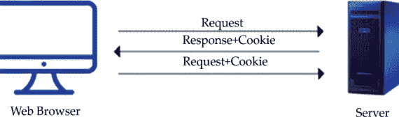

当你向以前使用过的服务器请求文件时，相关缓存中的数据将随你的请求一起发送到服务器。这些服务器端脚本（如用 Perl 或 PHP 编写的）可以读取你的 cookie 并判断你是否有权限查看某个页面（例如）。Cookie 也可以被广告公司用于某种更具恶意的目的，以跟踪你的在线行为。现代浏览器包含了良好的方法，允许你阻止某些网站的 cookie，因此你披露哪些信息现在由你决定。

条目中的键值对部分与声明变量非常相似，当你想要检索所需的信息时，你请求的是与你提供的名称关联的值。过期日期以一种不友好的 UTC 格式存储；幸运的是，有方法可以生成合适的日期。如果没有设置日期，则在你选择浏览器时，该条目会被删除。

你与 cookie 关联的域名和路径使其属于你网站所在的同一个域名。例如，你可以设置 cookie 在 `www.yourdomain.com` 激活（默认值）；或设置为 `yourdomain.com`，这将将涵盖你设置的所有域名和子域名。然而，出于安全考虑，你不能将其设置为 `yahoo.com`。使用路径可以限制 cookie 仅对特定目录有效。如果你希望它在域名内的任何页面可用，则将其设置为 `/`，根目录。

## 6.1.3 设置、读取和删除 Cookie

JavaScript 文档中有一个对象 `document.cookie`，用于读取和检索 cookie。

## 6.1.4 方便的脚本

为了方便我们自己调整 cookie，我们将使用一些脚本。这里有：

```javascript
function createCookie(name, days) {
  if (days) {
    var date = new Date();
    date.setTime(date.getTime()+(days*24*60*60*1000));
    var expires = ";="+date.toGMTString();
  } else expires = "";
  document.cookie = name+"="+value+expires+"; path=/";
}
```

```javascript
function readCookie(name) {
  var ca = document.cookie.split(';');
  var nameEQ = name + "=";
  for(var i=0; i < ca.length; i++) {
    var c = ca[i];
    while (c.charAt(0)==' ') c = c.substring(1,c.length);
    if (c.indexOf(nameEQ) == 0) return c.substring(nameEQ.length,c.length);
  }
  return null;
}
```

```javascript
function eraseCookie(name) {
  createCookie(name, "", -1);
}
```

## 6.1.5 如何使用 JavaScript 设置 Cookie

Cookie 是现代浏览器的重要部分。没有它们，我们无法浏览需要身份验证的网站，例如社交网络，因为我们

## 基础计算机编程：JavaScript

在我们浏览的每个页面上它都会要求我们输入密码。我们将无法发送电子邮件，也无法在网上购买物品。网站的使用将仅限于浏览静态网站。在本节中，我们将重点关注使用 jQuery 创建和编辑代码。

```javascript
function quickSort(items, left, right) {
  if (left < right) {
    var index = partition(items, left, right);
    quickSort(items, left, index - 1);
    quickSort(items, index + 1, right);
  }
  return items;
}
var result = quickSort(items);
```

## 第一步 - HTML 优先

我们创建一个 `DIV`，并在里面添加了条消息。其中一个只会在页面加载时显示一次，另一个会在第一个消息显示后显示。显示第一个还是第二个条消息是 CSS 的工作：

```html
<div class="message change-message--on-load hide--second">
  <p>此消息仅在你第一次访问此页面时显示。刷新页面即可触发它！</p>
  <p>此消息仅在上次访问中显示过之前的消息后才会显示。即使你刷新页面，浏览器也会记住你的选择。</p>
</div>
```

## 第二步 - CSS

通过 CSS，我们告诉浏览器如果 `div` 的类为 `.hide--first`，则隐藏第一个消息；如果 `div` 的类为 `.hide--second`，则隐藏第二个消息：

```css
.hide--first > *:first-child {
  display: none;
}
.hide--second > *:last-child {
  display: none;
}
```

## 第三步 - 初始化

为了加快加载速度，请将你的 JavaScript 添加页面底部，关闭 `<body>` 标签之前。我们需要调用 jQuery。

```html
<script type="text/javascript" src="http://ajax.googleapis.com/ajax/libs/jquery/1.6.4/jquery.min.js"></script>
```

接下来调用 cookie 脚本。确保你添加了指向脚本的正确 URL。

```html
<script type="text/javascript" src="cookie.js"></script>
```

在下方，我们添加了一个空的 `script` 标签，就可以开始编码了：

```html
<script type="text/JavaScript">
</script>
```

## 第四步 - JavaScript

首先我们添加 cookie 代码。这分为两个部分：一个检查 cookie 是否存在，另一个是添加 cookie 的。首先，我们将检查 cookie。如果 cookie 为 `true`，则通过更改 `<div>` 的类来隐藏初始消息并显示另一个（通过 CSS）：

```javascript
if ($.cookie('hide-after-load') == 'yes') {
  $('.change-message--on-load').removeClass('hide--second');
  $('.change-message--on-load').addClass('hide--first');
}
```

在关闭脚本之前，我们必须添加将隐藏第一个消息的 cookie。如果将其添加到代码末尾，它将位于检查 cookie（见上文）的代码之前，这会导致从一开始就隐藏第一个消息。在末尾添加可以确保消息在下次页面加载时被隐藏。在 7 天后。

```javascript
$.cookie('hide-after-load', 'yes', {expires: 7 });
```

第一个示例的完整代码：

```javascript
<script type="text/JavaScript">
$(document).ready(function() {
  if ($.cookie('hide-after-load') == 'yes') {
    $('.change-message--on-load').removeClass('hide--second');
    $('.change-message--on-load').addClass('hide--first');
  }
});
$.cookie('hide-after-load', 'yes', {expires: 7 });
</script>
```

## 第五步 - 点击时添加 cookie

在演示页面中，我们看到第二个容器只有在你点击“x” 图标后，才会隐藏第一个消息并显示另一个。我们需要在 HTML 中为图标添加一个空的 `href` 标签：

```html
<p>你可以通过点击此框右侧的 &times; 来隐藏此消息 <a href="#" class="close" title="Hide This Message&times;"><<a></a></a></p>
```

为了将“x” 图标置在容器的右上角，我们在 CSS 中使用了“在相对定位容器内使用绝对定位”的技巧：

```css
.message {
  position: relative;
}
.close {
  position: absolute;
  top: 0;
  right: 0;
  cursor: pointer;
}
```

基础计算机编程：JavaScript

<p>你可以通过点击此框右侧的 &times; 来隐藏此消息 <a href="#" class="close" title="Hide This Message&times;"><<a></a></a></p>

为了将“x” 图标置在容器的右上角，我们在 CSS 中使用了“在相对定位容器内使用绝对定位”的技巧：

```css
.message {
  position: relative;
}
.close {
  position: absolute;
  top: 0;
  right: 0;
  cursor: pointer;
}
```


基础计算机编程：JavaScript

Cookie 有许多用法方法。现在你已经知道如何创建自己的 cookie。你可以更进一步，研究如何验证用户（记住登录详情）并将整个会话保存在 cookie 中（即使你刷新页面，注册流程也不会丢失）。

- 1. 所有 cookie 都有过期时间。一个具有过去过期的 Cookie 在网页浏览器关闭后会被删除。Cookie 也可以显式删除。

- 2. 正是这种过期行为导致了“会话 Cookie（session cookies）”。会话 Cookie 没有其他实际定义，它们从创建的那刻起就被定义为过去过期。其产生的行为是它们充当临时 Cookie，仅在浏览器会话期间存在。

- 3. 如果使用网页浏览器标签页，会话 Cookie 的 XSS 防护安全性就会丢失：因为浏览器从未关闭，Cookie 就不会过期。

- 4. Cookie 的过期时间是以 GMT UNIX 时间戳秒为单位的，因此理论上客户端/服务器时间是相同的——但仍然需要同步，因为计算机时钟可能会快或慢。

- 5. 第三方 Cookie 是设置在主页面文档无法读取的域名上的 Cookie。这之所以能实现，是因为文档可能会引用其他服务器上的图像，而这些图像可能会设置 Cookie（URL 也可以生成 Cookie）。某些浏览器隐私设置会禁用它们。

- 6. 虽然人们有时会出于隐私考虑禁用 Cookie，但会话 Cookie 通常被作为例外允许——因此如果需要会话 Cookie 也并不是世界末日——但最好能够在 URL 中存储 ID。尽管如此，一些热门网站要求启用 Cookie（如 Tesco、纽约时报等等……）。

- 7. 完整的 Cookie 数据会随所有该 Cookie 作用范围内的 Web 请求发送，即使是图像请求也是如此——因此存储大量 Cookie 是很低效的。

- 8. Cookie 必须针对域名进行设置。这可以通过将 `.domain` 设置为 Cookie 域名，或者在设置 Cookie 时留空域名来实现；绝不应该定义域名，否则它无法正常工作。

- 9. Cookie 的工作遵循一套复杂但令人困惑的优先级系统。只有位于匹配的域名/路径组合下的 Cookie 会发送到服务器 URL（出于隐私考虑），并且它们将根据“越具体优先”的原则获得优先级。要更改 Cookie，服务器必须针对其创建时所在的域名/路径组合进行设置。在定义 Cookie 时所属的变量在服务器端不可用，这意味着任何修改 Cookie 的人必须预先知道这一点，或者进行盲猜。

- 10. 当涉及到广告时，Cookie 确实存在合理的隐私担忧。横幅轮播从中心化站点运行，因此能够有效地跟踪来自该中心化站点的用户，而无需考虑他们访问的任何使用该轮播站点。尽管如此，这种跟踪无论是否有 Cookie 都会通过服务器日志记录和跨服务器消息发生——所以将其归咎于 Cookie 是过于简单的。

- 11. 微软对 Netscape 的原始 Cookie 规范进行了极大的扩展，允许使用“HTTP only” Cookie（JavaScript 无法读取）。使用这种 Cookie 可以防止许多 XSS 漏洞。

- 12. 在协议层面，Cookie 通过单个 `Cookie` HTTP 头部发送到服务器，但通过多个、单独的 `Set-Cookie` 头部从服务器进行设置。

- 13. Cookie 仅存储名称和值，绝不会存储 Web 服务器或普通 JavaScript 无法识别的数据——因为 Cookie 是由 Web 服务器或浏览器设置的。

- 14. JavaScript 通过虚拟变量 `document` 提供其 Cookie 支持。Cookie 可以被设置和读取，但该过程实际上并不是直接的。

- 15. 一个常见的服务器端错误是设置一个 Cookie，然后在同一个服务器响应中引用该 Cookie 值——但在响应发送之前，该 Cookie 是不会被激活的。

- 16. 某些 Web 服务器（包括 Apache）限制 Cookie 数据长度，如果超过长度则拒绝提供数据。

- 17. Cookie 名称不应包含像 `/` 这样的特殊字符，因为这些在 HTTP 中具有特殊含义，且 Cookie 名称没有标准机制。（如果尝试设置此类 Cookie，可能会发生意外之外的错误）

- 18. Cookie 是 Netscape 发明的，而不是由通常的标准机构（IETF 或 W3C）发明的。

- 19. 在某些 Web 服务器上，无法在执行 HTTP 重定向的同时设置 Cookie。

- 20. “cookie（饼干）”这个名字的给出没有特殊原因，但它是无尽冷笑话的源头。

## 6.1.7 使用 Cookie 的优缺点

Cookie 是一段小文本，在请求和页面于 Web 服务器和浏览器之间传输时附加。

### 使用 Cookie 的优点

以下是使用 Cookie 存储会话状态的一些优点。

- Cookie 易于使用和实现。
- 占用内存少，不需要任何服务器资源，并存储在用户的计算机上，因此不会服务器产生额外负担。
- 我们可以配置 Cookie 在会话结束时过期。
- Cookie 的持续时间比会话长得多。

### 使用 Cookie 的缺点

以下是一些缺点：

- Cookie 不安全，因为任何人都可以打开并篡改它。
- 尺寸限制（例如 4kb）。
- 用户可以删除 Cookie。
- 用户可以拒绝 Cookie。
- 信息以明文形式存储。
- 将用户名等敏感信息存储在 Cookie 中并不是一个真正的“坏”主意——这里仅作为一个示例。

## 6.2 在 JAVASCRIPT 中设置 COOKIE 类型

Cookie 是一个从客户端发送到服务器的命名数据。在本节中，我们将向你展示如何创建不同类型的 Cookie。

> 客户端（Clientside）指的是由客户端执行的操作。

最初，除非通过在 URL 中存储额外信息拥有账户，否则无法在网上识别用户；然而这非常繁琐。Cookie 的设计就是为了解决这个问题。

### 6.2.1 会话 Cookie（Session Cookie）—— 第一个 Cookie

会话（session）即使在用户不是成员的情况下也能识别用户。它是用户的唯一数字，存储在“会话 Cookie”或他们的 URL 中。会话 Cookie 是一种特殊的 Cookie，当用户关闭浏览器时会自动删除。我们将从最基础的开始：会话 Cookie。这将是你可以创建的最简单的 Cookie，被称为“会话 Cookie”，因为它不会在会话之外生存，所以当你关闭浏览器时它会被自动删除。Cookie 的信息以键值对的形式存储，它最简单的形式如下所示：

```javascript
document.cookie = "username=Hans";
```

显然，我们没有看到任何有趣的事情发生，所以使用浏览器的开发者工具来查看 Cookie 是否已设置。你也可以在 JSFiddle 页面上使用 Google Chrome 的“检查（Inspect）”选项。如果你不想使用浏览器的开发者工具，也可以使用 `alert()`，它看起来像这样：

```javascript
document.cookie = "username=Hans";
```

结果应该弹出一个窗口，显示如下：

```text
username=Hans
```

好了，现在我们已经掌握了基础知识，现在是时候通过添加选项来做一些高级的操作了。这些选项也以值对的形式存储在同一个 `document.cookie` 属性中。让我们逐一来看。

会话（Sessions）相比传统的 Cookie 具有以下优势：

- 它们允许记住游客
- 它们可以用于强制成员显式登录
- 即使在禁用 Cookie 的情况下也可以使用

请注意，IP 地址永远无法替代会话，因为它们通常在多个用户之间共享，而且单个用户的动态 IP 地址经常会变化。Compose 增加了一层安全防护，即只有当会话 Cookie 为类似的 IP 地址创建时，才允许其工作；这降低了“会话劫取”的安全风险，即使黑客通过某种方式找到了另一个用户的会话（尽管这本身是不可能的）。

> 访客的会话实际上使用的是普通的 Cookie，即会话 Cookie。这是因为如果 Compose 扩展了如购物车系统等功能，在不同访问之间可能需要对其进行识别。

### 6.2.2 持久化 Cookie - 跨越浏览器存在的 Cookie

持久化 Cookie 是一种数据文件，能够为网站提供未来访问所需的用户偏好、设置和信息。持久化 Cookie 提供了对熟悉对象的便捷快速访问，增强了用户体验（UX）。持久化 Cookie 也称为存储 Cookie 或永久 Cookie。当用户访问网站并设置选择或偏好时，持久化 Cookie 可能被用于识别特定客户端，并能够追踪用户访问网站的路径。它们以文本文件的存储在计算机硬盘上，通常具有一到两年的有效期。持久化 Cookie 方便了以下偏好：

- 收藏或内部书签
- 用户身份验证
- 登录详情
- 菜单偏好
- 主题选择（如果适用）
- 语言偏好

持久化 Cookie 能够提供用户的浏览行为。如前所述，我们可以通过定义过期日期时间来使 Cookie 持久化，看起来像下面的示例：

```text
username=Hans; Expires=Sun, 22 Oct 2017 08:00:00 UTC;
```

这将通过将过期时间设置为过去来删除 Cookie - 你的浏览器将根据该时间移除 Cookie。

- Cookie 的日期格式必须是 UTC/GMT 格式（例如 `Sun, 22 Oct 2017 08:00:00 UTC`），并根据所需的时区进行修正。
- UTC 与 GMT：两者都表示相同的时间，但 UTC 是一个时区，而 GMT 是一个时区。优先使用 UTC。

好了，准备好看示例 - 在这里查看之前提到的“检查”（网页开发者）工具会非常有帮助，因为它也列出了这些属性。我们的 JavaScript 看起来可能像这样（如果你在 2017 年 10 月 22 日 UTC 8 点之后测试，请记得更改此处的日期）：

**示例**

```javascript
document.cookie = "username=Hans; Expires=Sun, 22 Oct 2017 08:00:00 UTC;\nalert(document.cookie);
```

当我们使用 Chrome（例如）检查 Cookie 时，我们会看到类似的内容：

| Name | Domain | Path | Expires/Max-Age | Size | HTTP | Secure | SameSite |
|---|---|---|---|---|---|---|---|
| username | Hans | fiddle.js.com | /display | 2017-10-22T08:00:00Z | 12 | | Secure | |

在这里我们可以看到名称、值、域名、路径、过期日期/时间（名称+值的字符数）、HttpOnly、Secure 和 SameSite。另一方面，`alert()` 显示的是 `"username=Hans"`。

这里有几点需要注意，`alert()` 消息恰恰指向了这一点：

- `document.cookie` 仅包含我们被允许看到的键值对，
- 当我们读取 `document.cookie` 时，键值对的属性（如过期时间）不会返回供我们使用。

我们能够在网页开发者工具中看到这些信息，是因为这些工具是你浏览器的一部分，并允许查看内部原理——这对开发者来说非常好，而且我们正在学习更多关于 Cookie 的知识。

### 6.2.3 安全 Cookie – 仅在启用 HTTPS 时有效

安全 Cookie（Secure Cookie），也称为 `httpOnly` Cookie，是一种仅在 HTTP/HTTPS 下工作的 Cookie 类型；对于 JavaScript 等脚本语言无效。由于它仅用于存储信息以及超文本传输协议请求和互联网数据传输，因此通过脚本进行的利用和攻击无法访问它们。所以，安全 Cookie 的主要优势是它可以通过跨站脚本（XSS）阻止这些攻击。

制作安全 Cookie 也非常简单，我们只需添加 `"Secure"` 选项：

```text
username=Hans; Secure;
```

这个在本地文件或你自己的 Web 服务器上测试可能有些困难，因为它只会在 HTTPS 连接上工作，而这通常并非如此。另一方面，JSFiddle 使用 HTTPS，所以它在那里可以工作：

```javascript
document.cookie = "username=Hans; Secure";
```

Google Chrome 中的“检查”选项可能需要你点击网页开发者工具中的刷新按钮（如前所述）。你现在会在“secure”列中看到一个校验和（或标记）。

安全 Cookie 始终激活 `secure` 属性，因此它主要通过 HTTPS 使用，并通过加密连接安全地传输。安全 Cookie 中的 `HttpOnly` 标志防止 JavaScript 访问它，这是防止会话劫持的主要防御。

### 6.2.4 HttpOnly Cookie – 脚本无法访问的 Cookie

`SameSite` 防止浏览器在跨站请求时发送此 Cookie。其主要目标是缓解跨源信息泄露的风险。它还对跨站请求伪造（CSRF）攻击提供了一些保护。如果浏览器支持，`SameSite` Cookie 有两种变体：`strict` 和 `lax`。这里是首选设置，因为它封锁了跨域访问。

```javascript
document.cookie = "username=Hans;SameSite=strict";
alert(document.cookie);
```

```javascript
当你想允许“某些”跨域时：document.cookie = "username=Hans;SameSite=lax";
alert(document.cookie);
```

这是一个很棘手的点，因为它在你的本地 Web 服务器上可能才会显示内容。文件或 JSFiddle 可能在 `alert()` 中不显示内容，但网页开发者工具会显示该 Cookie 确实存在。

### 6.2.6 Cookie 域 – 仅针对特定域名的 Cookie

Cookie 域是一个重要的安全特性，甚至比 `secure` 标记更为重要。它告诉浏览器此 cookie 只能发送到匹配的域名。我们可以定义允许 Cookie 访问的域和路径（`path`）。若要将 Cookie 限制在特定域名，可以尝试以下示例。第一个示例将使用随机域名 `example.com`。第二个示例将使用域名 `jshell.net` – 这是 JSFiddle 使用的域名。

注意：当将 `"example.com"` 作为域名输入时，Cookie 只能从该精确域名访问，而不能从子域名访问。在域名前面加上一个点（例如 `".example.com"`），则 Cookie 也可以从子域名访问（即 `forum.example.com`、`email.example.com`、`www.example.com` 等）。

```javascript
document.cookie = "username=Hans; domain = .example.com;
alert(document.cookie);
```

你会发现并没有 Cookie 生成，且 `alert()` 框也没有显示任何内容——这同样是正确的，因为我们不允许访问这些 Cookie，因为我们当前在错误的域名（不是 `example.com`）下工作。

```javascript
document.cookie = "username=Hans; domain = .jshell.net;
alert(document.cookie);
```

第二个示例将生成一个可见的 Cookie，且 `alert()` 将显示该 Cookie（当在 JSFiddle 中测试时，因为 JSFiddle 运行在 `jshell.net` 域）。

### 6.2.7 Cookie 域和路径 – 仅针对特定路径和域名的 Cookie

我们现在可以通过添加路径（`path`）来限制，只有当我们在正确的域和路径时才允许访问此 Cookie（如果没有定义 `Domain`，则将使用当前域名）。以下示例告诉浏览器，当我们处于当前域名的 `/secretdata` 路径下时访问此 Cookie。因此，如果我们在带有 `example` 域名的服务器上工作，这对于 `https://example.com/secretdata/it` 的子路径将是有效的。对于这一点测试起来有点复杂——而且你可能并不需要它。

建议在 Cookie 中添加 `"Path"`，这样浏览器就不会太感到困惑。默认情况下，Cookie 对于你正在操作的页面路径。但如果你想从网站上的另一个页面访问 Cookie，那么该 Cookie 可能实际上无法访问。如果你希望 Cookie 在整个域内都可读，请始终添加：`"Path=/;"`。

```javascript
document.cookie = "username=Hans; path = /secretdata";
alert(document.cookie);
```


# 基础计算机编程：JavaScript

为了说明事情变得变得复杂，请看以下代码。第一个 `"username"` Cookie 相对于此页面，第二个 `"username"` 相对于整个网站。由于其中一个没有定义路径（相对于此页面），另一个定义了路径（相对于整个网站），浏览器突然有了 2 个同名的 Cookie——这在尝试读取代码时显然可能导致意想不到的行为。


网站是相关网页的集合，包括多媒体内容，通常通过一个共同域名标识，并发布在至少一台服务器上。

| 行号 | 代码 |
|---|---|
| 1 | `document.cookie="username=Hans";` |
| 2 | `alert(document.cookie);` |
| 3 | `document.cookie="username=John; Path=/";` |
| 4 | `alert(document.cookie);` |
| 5 | |
| 6 | `document.cookie="username=Banana";` |
| 7 | `alert(document.cookie);` |

在上面的示例中，首先创建了相对于此页面的 Cookie `username=Hans`，且 `alert` 确认了这一点。然而，下一个 Cookie 被定义为一个新的（!）（带有 `Path=/`（整个域）的 Cookie（`username=John`）。`alert` 显示了两个同名的 Cookie：`username=Hans; username=John`。那么我们在代码中使用哪一个呢？在第三部分，我们更改了其中一个相对 Cookie 的值，例如因为我们忘记添加路径，你猜怎么着，事情很快就变得一团糟。在这里你可以看到正确定义路径（path）有多么重要。

## 6.2.8 组合选项 – Cookie 选项百家桶

所有这些选项可以在单行中组合，并用分号隔，即使这可能没什么意义或毫无意义：

```javascript
document.cookie = "username=Hans;Path=/;Domain=.example.com; Expires=Sun, 22 Oct 2017 08:00:00 GMT; Secure;HttpOnly";

alert(document.cookie);
```

# 知识检查

## 第一部分

- 1. Cookie 最初是为：
  - 客户端编程
  - 服务端编程
  - 客户端和服务端
  - 以上均不是
- 2. Cookie 的操作是使用哪个属性完成的？
  - `cookie`
  - `cookies`
  - `manipulate`
  - 以上均不是
- 3. 下列哪一项解释了 Cookie 的本性？
  - 非易失性（Non Volatile）
  - 易失性（Volatile）
  - 非瞬态（Intransient）
  - 瞬态（Transient）
- 4. 使用哪个属性来扩展 Cookie 的寿命？
  - `higher-age`
  - `increase-age`
  - `max-age`
  - `lifetime`
- 5. 下列哪一项定义了可见性？
  - `document Path`
  - `localStorage`
  - `sessionStorage`
  - 以上所有
- 6. 下列哪一项可用于配置 Cookie 的范围？
  - `path`
  - `domain`
  - `path` 和 `domain`
  - `server`

## 第二部分

- 7. 如何将 Cookie 可见性范围设置为 `localStorage`？
  - `/`
  - `%%`
  - `*`
  - `//`
- 8. 下列哪一项是布尔 Cookie 属性？
  - `bool`
  - `secure`
  - `'lookup'`
  - `domain`
- 9. 由于 Cookie 值中不包含分号、逗号或空格，使用了以下哪个函数？
  - `encodeURIComponent()`
  - `encodeURI()`
  - `encodeComponent()`
  - `encode()`
- 10. 每个 Cookie 的数据限制是什么？
  - 2 KB
  - 1 KB
  - 4 KB
  - 3 KB
- 11. 使用 JavaScript 创建 Cookie 的正确语法是哪个？
  - `cookie = 'key1 = value1; key2 = value2; expires = date';`
  - `cookie = 'key1 = value1; key2 = value2; expires = date';`
  - `cookie = 'key1 = value1; key2 = value2; expires = date';`
  - `cookie = 'key1 = value1; key2 = value2; expires = date';`
- 12. 如果删除缓存、Cookie 和浏览器历史记录，以下哪些数据是不适的？
  - 地址栏预测
  - 保存的密码
  - 浏览器插件
  - 购物车内容
- 13. [ ] 是当你访问网站时下载到你系统中的小文件。
  - Cookies
  - 缓存（Caches）

## 第三部分

- `c.` 机器人
- `d.` 爬虫
- 14. 缓存是临时的互联网文件，帮助浏览器下载网页图像、数据和文档，以便未来快速性能性能和查看。
  - `a.` 插件
  - `b.` 缓存
  - `c.` 扩展
  - `d.` 历史记录
- 15. 攻击者可以窃取来实现非法访问在线账户并干扰个人信息。
  - `a.` 插件
  - `b.` 缓存
  - `c.` cookies
  - `d.` 历史记录

# 复习题

1. 什么是 cookie？
2. cookie 中可以存储什么类型的数据？
3. 写出 JavaScript 中 cookie 的用途。
4. cookie 的结构是什么？
5. 讨论 cookie 的设置、读取和删除。
6. 如何使用 JavaScript 设置 cookie？
7. 定义 cookie 的隐私和法律。
8. 写出使用 cookie 的优缺点。

# 检查结果

- 1. (b) 2. (a) 3. (d) 4. (c) 5. (d)
- 6. (c) 7. (a) 8. (b) 9. (a) 10. (c)
- 11. (a) 12. (c) 13. (a) 14. (b) 15. (c)

# 参考文献

1. Eckersley, Peter (2010年5月17日). “你的浏览器有多独特?” (PDF). eff.org. Electronic Frontier Foundation. Archived from the original (PDF) on 2014年10月15日. Retrieved 2014年7月23日.
2. Jamrich, Parsons, June (2015-06-22). New perspectives computer concepts, 2016. Comprehensive. Boston, MA. ISBN 9781305271616. OCLC 917155105.
3. Thomas; Hunt. “类、对象与变量”. Programming Ruby: The Pragmatic Programmer’s Guide. Ruby-Doc.org, Retrieved 2012-04-26.

# 第7章

## JavaScript：类与对象

### 引言

类（Classes）和对象（Objects）是面向对象编程的基本概念，围绕现实实体。

JavaScript 类是在 ECMAScript 2015 中引入的，它们主要是 JavaScript 现有基于原型继承的语法糖。类实际上是一个特殊的函数。

类是创建对象的模板。它们用代码封装数据并对这些数据进行操作。JS 中的类构建在原型之上，但也具有一些类特有的语法和语义。

在学习本章后，你将能够：

- 1. 理解 JavaScript：类
- 2. 讨论类体和方法定义
- 3. 识别 JavaScript：对象

## 计算机基础编程：JavaScript

类首次在 ES6 类的新版本中引入，取代了之前使用的函数。类无非是其对象的蓝图。它主要用于创建对象。如果将其与现实生活例子联系起来，它就像建筑或房屋的计划图，其中包含了门、窗户、楼层等细节。根据作为蓝图的类制造出的对象，在这个例子中可以被称为房屋。因此，一个计划被用来创建许多房屋，就像一个类可以用来创建许多类一样。所以类不是现实实体，但对象是。

除了 7 种原始类型外，JavaScript 中最重要的数据类型是对象。尽管这种数据类型的本质与原始数据类型完全不同。这意味着原始数据类型中只存储一个值，但对象可以存储多个值，即使是不同类型。

函数声明定义了一个不需要赋值的命名函数变量。

## 7.1 JavaScript：类

类实际上是“特殊函数”，就像你可以定义函数表达式和函数声明一样，类的语法有两个组成部分：类表达式和类声明。

```javascript
class Rectangle {
  constructor(height, width) {
    this.height = height;
    this.width = width;
  }
}
```

### 提升（Hoisting）

函数声明和类声明之间的重要区别是，函数声明会被提升，而类声明不会。你首先需要声明类，然后访问它，否则如下代码将抛出引用错误（ReferenceError）：

```javascript
const p = new Rectangle(); // ReferenceError

class Rectangle {}
```

## 类表达式

类表达式是定义类的另一种方式。类表达式可以是命名的也可以是未命名的。命名类表达式名称局部于类体（尽管它可以通过类的（不是实例的）`name` 属性获取）。

```javascript
// 未命名
let Rectangle = class {
  constructor(height, width) {
    this.height = height;
    this.width = width;
  }
};
```

## 7.2 类体与方法定义

严格模式（Strict Mode）是 ECMAScript 5 中的一个新功能，允许将程序或函数放在“严格”上下文中。

```javascript
Rectangle.prototype.prototypeWidth = 25;
```

### 7.2.3 使用 `extends` 进行子类化

`extends` 关键字用于类声明或类表达式，用创建一个作为另一个类的子类。

```javascript
class Animal {
  constructor(name) {
    this.name = name;
  }

  speak() {
    console.log(this.name + ' makes a noise.');
  }
}
```

```javascript
class Dog extends Animal {
  constructor(name) {
    super(name); // 调用父类构造函数并传递 name 参数
  }

  speak() {
    console.log(this.name + ' barks.');
  }
}
```

```javascript
let d = new Dog('Mitzie');

d.speak();
```

如果子类中存在构造函数，它需要先通过 `"this"` 调用 `super()`。你也可以扩展传统的基于函数的“类”：

```javascript
function Animal (name) {
  this.name = name;
}
```

```javascript
Animal.prototype.speak = function () {
  console.log(this.name + ' makes a noise.');
}
```

```javascript
class Dog extends Animal {
  speak() {
    console.log(this.name + ' barks.');
  }
}
```

```javascript
let d = new Dog('Mitzie');

d.speak(); // Mittie barks.
```

注意，类不能扩展普通（不可构造的）对象。如果你想从普通对象继承，你可以可以使用 `Object.setPrototypeOf()`：

那些具有固定几何形状的物质被称为普通对象。

```javascript
const Animal = {
  speak() {
    console.log(this.name + ' makes a noise.');
  }
}
```

```javascript
class Dog {
  constructor(name) {
    this.name = name;
  }
}
```

如果你不这样做，在调用 `speak` 时会得到 `TypeError`。

```javascript
Object.setPrototypeOf(Dog.prototype, Animal);
let d = new Dog('Mitzie');
d.speak(); // Mittie makes a noise.
```

## 物种（Species）

你可能希望在派生的数组类 `MyArray` 中返回 `Array` 对象。物种模式（species pattern）允许你覆盖默认构造函数。

例如，当使用像 `map()` 这样返回默认构造函数的方法时，你希望这些方法返回父类 `Array` 对象而不是 `MyArray` 对象。`Symbol.species` 符号允许你：

```javascript
class MyArray extends Array {
  // 将 species 覆盖为父类 Array 构造函数
  static get [Symbol.species]() { return Array; }
}
```

```javascript
let a = new MyArray(1, 2, 3);
let mapped = a.map(x => x * x);
```

```javascript
console.log(mapped instanceof MyArray); // false
console.log(mapped instanceof Array); // true
```

## 使用 `super` 的父类

`super` 关键字用于调用父类的对应方法。这是相对于原型继承的一个优势。

```javascript
class Cat {
  constructor(name) {
    this.name = name;
  }

  speak() {
    console.log(`${this.name} makes a noise.`);
  }
}
```

```javascript
class Lion extends Cat {
  speak() {
    super.speak();
    console.log(`${this.name} roars.`);
  }
}
```

```javascript
let l = new Lion('Fuzzy');
```

```javascript
l.speak();

// Fuzzy makes a noise.
// Fuzzy roars.
```

## 混入（Mix-ins）

抽象子类或混入是类的模板。一个 ECMAScript 类只能有一个父类，因此无法对工具类进行多重继承。该功能必须由父类提供。

一个以父类作为输入、以扩展该类的子类作为输出的函数可以用于在 ECMAScript 中实现混入：

```javascript
let calculatorMix = Base => class extends Base {
  calc() { }
};
```

```javascript
let randomizerMix = Base => class extends Base {
  randomize() { }
};
```

使用这些混入的类可以像这样写：

```javascript
class Foo { }

class Bar extends calculatorMix(randomizerMix(Foo)) { }
```

## 7.2.4 使用函数

这可能是常用的方法之一。你定义一个普通的 JavaScript 函数，然后使用 `new` 关键字创建一个对象。要为使用 `function()` 创建的对象定义属性和方法，你使用 `this` 关键字，如下例：

```javascript
function Apple (type) {
  this.type = type;
  this.color = "red";
  this.getInfo = getAppleInfo;
}
```

```javascript
// 反模式！继续阅读...
function getAppleInfo() {
  return this.color + ' ' + this.type + ' ' + apple;
}
```

要使用 `Apple` 构造函数实例化一个对象，设置一些属性并调用方法，你可以这样做：

```javascript
var apple = new Apple('macintosh');

apple.color = "red";

alert(apple.getInfo());
```


## 内部定义的方法

在上面的示例中，你看到`Apple`类的`getInfo()`方法是在单独函数中定义的。虽然这样做可行，但它有一个缺点——每当你创建一个实例时它都会重新创建。为了避免这一点，你可以使用原型：

（此处原文存在大量重复的段落，已根据要求去重，仅保留核心逻辑翻译）

## 基础计算机编程：JavaScript

### 7.3.1 对象属性

对象属性可以是三种原始数据类型中的任意一种，也可以任何抽象数据类型（例如另一个对象）。对象属性通常是对象方法内部使用的变量，但也可以是贯穿页面的全局可见变量。

向对象添加属性的语法为`objectName.propertyName = propertyValue;`。

例如 – 下列代码使用文档对象的`title`属性获取文档标题。

```javascript
var str = document.title;
```

### 7.3.2 对象方法

方法是让对象执行某些操作或对对象执行某些操作的函数。函数和方法之间存在细微差别——函数是语句的独立单元，而方法是附着在对象上的函数，并可以通过`this`关键字进行引用。

方法非常有用，从将对象的内容显示在屏幕上对一组本地属性和参数执行复杂的数学运算，无一不包。

例如 – 遵循一个简单的示例，展示如何使用文档对象的`write()`方法在文档上写入内容。`document.write("This is test");`

## 用户定义对象

所有用户定义对象和内置对象都是名为`Object`的对象的后代。

### new 运算符

`new`运算符用于创建对象的实例。要创建一个对象，在`new`运算符后面跟着构造方法。

在接后的示例中，构造方法为`Object()`、`Array()`和`Date()`。这些构造函数是 JavaScript 的内置函数。

```javascript
var employee = new Object();
var books = new Array("C++", "Java");
var day = new Date("August 15, 1947");
```

### Object() 构造函数

构造函数是一个创建并初始化对象的函数。JavaScript 提供了一个名为`Object()`的特殊构造函数来构建对象。`Object()`构造函数的返回值会被赋值给变量。

## JavaScript：类与对象

变量包含对新对象的引用。分配给对象的属性不是变量，且没有使用`var`关键字定义。

### 示例 1

尝试以下示例；它演示了如何创建一个对象。

```html
<html>
<head>
<title>用户定义对象</title>
<script type="text/javascript">
var book = new Object(); // 创建对象
book.subject = "Perl"; // 给对象分配属性
book.author = "Mohammed";
</script>
</head>
<body>
<script type="text/javascript">
document.write("Book name is : " + book.subject + "<br>");
document.write("Book author is : " + book.author + "<br>");
</script>
</body>
</html>
```

输出

```
Book name : Perl
Book author : Mohammed
```

### 示例 2

此示例演示了如何使用用户定义函数创建对象。在这里，`this`关键字用于引用传递给函数的对象。

```html
<html>
<head>
<title>用户定义对象</title>
<script type="text/javascript">
function book(title, author){
  this.title = title;
  this.author = author;
}
</script>
</head>
<body>
<script type="text/javascript">
  var myBook = new book("Perl", "Mohammed");
  document.write("Book title is : " + myBook.title + "<br>");
  document.write("Book author is : " + myBook.author + "<br>");
</script>
</body>
</html>
```

输出

```
Book title : Perl
Book author : Mohammed
```

## 为对象定义方法

之前的示例演示了构造函数如何创建对象并分配其属性。但我们需要通过为对象分配方法来完成对象的定义。

### 示例

尝试以下示例；它展示了如何向对象添加函数。

```html
<html>
<head>
<title>用户定义对象</title>
<script type="text/javascript">
// 定义将作为方法工作的函数
function addPrice(amount){
    this.price = amount;
}
function book(title, author){
    this.title = title;
    this.author = author;
    this.addPrice = addPrice; // 将方法作为属性分配。
}
</script>
</head>
<body>
<script type="text/javascript">
var myBook = new book("Perl", "Mohammed");
myBook.addPrice(100);
document.write("Book title is : " + myBook.title + "<br>");
document.write("Book author is : " + myBook.author + "<br>");
document.write("Book price is : " + myBook.price + "<br>");
</script>
</body>
</html>
```

输出

```
Book title : Perl
Book author : Mohammed
Book price : 100
```

## this 关键字

`this`关键字用于引用传递给函数的对象。

### 语法

向对象添加属性的语法为`with`。

## 示例

尝试以下示例；它展示了如何与对象添加函数。

```html
<html>
<head>
<title>用户定义对象</title>
<script type="text/javascript">
// 定义将作为方法工作的函数
function addPrice(amount){
    this.price = amount;
}
function book(title, author){
    this.title = title;
    this.author = author;
    this.addPrice = addPrice; // 将方法作为属性。
}
</script>
</head>
<body>
<script type="text/javascript">
var myBook = new book("Perl", "Mohammed");
myBook.addPrice(100);
document.write("Book title is : " + myBook.title + "<br>");
document.write("Book author is : " + myBook.author + "<br>");
document.write("Book price is : " + myBook.price + "<br>");
</script>
</body>
</html>
```

输出

```
Book title : Perl
Book author : Mohammed
Book price : 100
```

## with 运算符

`with`运算符用于扩展对象的范围。

### 语法

```javascript
with (object)
}
```

## 示例

尝试以下示例。

```html
<html>
<head>
<title>用户定义对象</title>
<script type="text/javascript">
// 定义将作为方法工作的函数
function addPrice(amount){
    this.price = amount;
}
function book(title, author){
    this.title = title;
    this.author = author;
    this.addPrice = addPrice; // 将方法作为属性分配。
}
</script>
</head>
<body>
<script type="text/javascript">
var myBook = new book("Perl", "Mohammed");
with (myBook) {
  document.write("Book title is : " + title + "<br>");
  document.write("Book author is : " + author + "<br>");
  document.write("Book price is : " + price + "<br>");
}
</script>
</body>
</html>
```

输出

```
Book title is : Perl
Book author is : Mohammed
Book price is : undefined
```

## JavaScript 原生对象

JavaScript 具有许多内置的或原生对象。这些对象可以在任何地方访问，并在程序中运行。

> 操作系统 (OS) 是管理计算机硬件和资源并提供常用服务的软件。

以下是重要的原生对象列表：
- JavaScript Number 对象
- JavaScript Boolean 对象
- JavaScript String 对象
- JavaScript Array 对象
- JavaScript Date 对象
- JavaScript Math 对象
- JavaScript RegExp 对象

### 7.3.3 使用对象

JavaScript 设计正如在许多编程语言中一样，可以与现实生活对比。对象是属性的集合，属性是键和值之间的关联。属性的值可以是函数，在这种情况下该属性被称为方法。

#### 对象概述

在 JavaScript 中，设计采用了基于对象的范式。对象的概念可以与现实生活对比。例如对比一个杯子。杯子是一个对象，具有颜色、设计、重量、材质等属性。

#### 对象与属性

在 JavaScript 中，对象具有与之相关的属性。对象的属性可以解释为附着在对象上的变量。对象的属性与普通变量相同，区别在于附着于对象。对象的属性定义了对象的特征。通过简单的表示法访问对象的属性

```
objectName.propertyName
```

与所有 JavaScript 变量一样，对象名（可以是普通变量）和属性名都是大小敏感的。你可以通过赋值值来定义属性。例如，让我们创建一个名为`myCar`的对象，并赋予它名为`make`、`model`和`year`的属性：

```javascript
var myCar = new Object();
myCar.make = 'Ford';
myCar.model = 'Mustang';
myCar.year = 1969;
```

未赋值的对象属性为`undefined`（而不是`null`）：

```
myCar.color; // undefined
```

JavaScript 属性也可以使用括号表示法访问或设置（详情请参见属性访问）。对象有时被称为关联数组，因为每个属性都与一个字符串值相关联。因此，例如，你可以如下方式访问`myCar`对象的属性：

```javascript
myCar['make'] = 'Ford';
myCar['model'] = 'Mustang';
myCar['year'] = 1969;
```

对象的属性名可以是任何有效的 JavaScript 字符串，或任何可以转换为字符串的内容，包括空字符串。然而，任何不是有效 JavaScript 标识符的属性名（例如，属性名为是

## JavaScript：类与对象

包含空格、连字符或以数字开头的（属性）只能通过方括号表示法访问。这种表示法在属性名需要动态确定时（即属性名在运行时才确定）也非常有用。例如所示：

```javascript
// 在一次性操作中创建并赋值四个变量，
// 用逗号隔开
var obj = new Object();
str = 'myString',
rand = Math.random();
obj = new Object();
myObj.type = 'Dot syntax';
myObj['date created'] = 'String with space';
myObj[str] = 'String value';
myObj[rand] = 'Random Number';
myObj[obj] = 'Object';
myObj[''] = 'Even an empty string';
```

```javascript
console.log(myObj);
```

请注意，方括号表示法中的所有键都会转换为 String 类型，因为 JavaScript 对象的只有 String 类型作为键类型。例如，在上面的代码中，当键添加到`myObj`时，JavaScript 将调用`obj.toString()`方法，并使用该结果字符串作为新键。你还可以使用存储在变量中的字符串值来访问属性：

```javascript
var propertyName = 'make';
myCar[propertyName] = 'Ford';
```

```javascript
propertyName = 'model';
myCar[propertyName] = 'Mustang';
```

你可以使用`for...in`括号表示法来遍历对象的所有可枚举属性。为了说明其工作原理，以下函数会在将对象和对象名称作为参数传递给函数时，显示该对象的属性：

## 基础计算机编程：JavaScript

```javascript
function showProps(obj, objName) {
  var result = "";
  for (var i in obj) {
    // obj.hasOwnProperty 用于过滤掉来自对象原型链的属性
    if (obj.hasOwnProperty(i)) {
      result += objName + '.' + i + ' = ' + obj[i] + '\n';
    }
  }
  return result;
}
```

因此，函数调用`showProps(myCar, "myCar")`将返回如下：

```
myCar.model = Mustang
myCar.year = 1969
```

### 7.3.4 枚举对象的属性

从 ECMAScript 5 开始，有三种原生方法可以列出/遍历对象属性：

- `for...in`循环：此方法遍历对象及其原型链上的所有可枚举属性
- `Object.keys(o)`：此方法返回一个数组，包含对象`o`的所有“键”（不在原型链中）**可枚举属性**的名称“**keys**”。
- `Object.getOwnPropertyNames(o)`：此方法返回一个包含对象`o`所有属性名（可枚举或不可枚举）的数组。

在 ECMAScript 5 之前，没有原生方法可以列出对象的所有属性。但是，可以通过以下函数实现：

```javascript
function listAllProperties(o) {
  var objectToInspect;
  var result = [];
  for(objectToInspect = o; objectToInspect != null;
  objectToInspect = Object.getPrototypeOf(objectToInspect)) {
    result = result.concat(Object.getOwnPropertyNames(objectToInspect));
  }
  return result;
}
```

这可以揭示“隐藏”属性（原型链中但无法通过对象访问的属性，因为原型链中较早的位置存在同名的属性）。通过删除数组中的重复项可以轻松列出可访问的属性。

## 创建新对象

JavaScript 有许多预定义定义。此外，你还可以创建自己的对象。你可以使用对象初始化器创建一个对象。或者，你可以创建一个构造函数，然后结合`new`运算符调用该函数来实例化对象。

### 使用初始化器

除了使用构造函数创建对象外，你还可以使用对象初始化器创建对象。使用对象初始化器有时被称为使用字面量表示法创建对象。“对象初始化器”与 C++ 使用的术语一致。

```javascript
使用对象初始化器创建对象的语法为：
var obj = { 
  property_1: value_1, // property_# 可以是一个标识符：
  2: value_2, // 或者是一个数字...
  //...
  'property n': value_n // 或者是一个字符串
};
```


# 基础计算机编程：JavaScript

## 对象初始化器

除了使用构造函数创建对象，你还可以使用对象初始化器创建对象。使用对象初始化器有时被称为使用字面量表示法创建对象。“对象初始化器”与 C++ 使用的术语一致。使用对象初始化器创建对象的语法为：

```javascript
var obj = { 
  property_1: value_1, // property_# 可以是一个标识符：
  2: value_2, // 或者是一个数字...
  //...
  'property n': value_n // 或者是一个字符串
};
```

其中`obj`是新对象的名称，每个`property_i`是一个标识符（名称、数字或字符串字面量），`value_i`是一个其值赋值给`property_i`的表达式。对象和赋值是可选的；如果你不需要在其他地方引用此对象，则不需要将其赋值给变量。（注意，如果对象字面量出现在预期语句的地方，可能需要将对象字面量封装在括号中，以免字面量与块语句混淆。）

对象初始化器是表达式，每当语句执行时，每个对象初始化器都会创建一个新对象。

可枚举属性是那些内部标记被设置为 `true` 的属性，这是通过简单赋值或属性初始化创建的属性的默认值。

# JavaScript：类与对象

## 使用构造函数创建对象

```javascript
var mycar = new Car('Eagle', 'Talon Si', 1993);
```

该语句创建了`mycar`并为其属性赋值了指定值。然后`mycar.make`的值为字符串 `"Eagle"`，`mycar.year`的值为 1993，以此此类推。

你可以通过`new`创建任意数量的`Car`对象。例如：

```javascript
var kscar = new Car('Nissan', '300ZX', 1992);
var vpgcar = new Car('Mazda', 'Miata', 1990);
```

对象可以拥有是另一个对象的属性。例如，假设你定义了一个名为`person`的对象：

```javascript
function Person(name, age, sex) {
  this.name = name;
  this.age = age;
  this.sex = sex;
}
```

然后实例化两个新的`person`对象：

```javascript
var rand = new Person('Rand McKinnon', 33, 'M');
var ken = new Person('Ken Jones', 39, 'M');
```

然后，你可以重写`Car`的定义以包含一个接收`person`对象的属性，如下：

```javascript
function Car(make, model, year, owner) {
  this.make = make;
  this.model = model;
  this.year = year;
  this.owner = owner;
}
```

实例化新对象时，你使用：

```javascript
var car1 = new Car('Eagle', 'Talon TSi', 1993, rand);
var car2 = new Car('Nissan', '300ZX', 1992, ken);
```

注意，在创建新对象时不是传递字面量字符串或整数值，上述语句将`rand`和`ken`对象作为所有者的参数传递。那么，如果你想知道`car2`的所有者的名称，你可以访问以下属性：

```javascript
car2.owner.name
```

注意，你始终可以向先先定义的对象添加属性。例如，语句

```javascript
car1.color = 'black';
```

为`car1`添加了`color`属性，并将其赋值为“black”。然而，这并不会影响其他对象。要为所有相同类型的对象添加此新属性，你必须将该属性添加到`Car`对象类型的定义中。

## 使用 Object.create 方法

可以使用`Object.create()`方法创建对象。该方法非常有用，因为它允许你为想要创建的对象选择一个原型对象，而无需定义构造函数。

```javascript
// Animal 属性和方法封装
var Animal = {
  type: 'Invertebrates', // 属性的默认值
  displayText: function() { // 显示 Animal 类型的方法
    console.log(this.type);
  }
}
```

```javascript
// 创建一个名为 animal1 的新动物类型
var animal1 = Object.create(Animal);
animal1.displayText(); // 输出:Invertebrates
```

```javascript
// 创建一个名为 Fishes 的新动物类型
var fish = Object.create(Animal);
fish.type = 'Fishes'
fish.displayText(); // 输出:Fishes
```

## 继承

JavaScript 中的所有对象都继承自至少一个其他对象。被继承的对象被称为原型（`prototype`），继承的属性可以在构造函数的原型对象中找到。

## 对象的属性索引

你可以通过属性名或序数索引来引用对象的属性。如果你最初通过名称定义一个属性，那么你必须始终通过名称引用它；如果你最初通过索引定义一个属性，那么你必须始终通过该索引引用它。这种限制适用于当你使用构造函数创建对象及其属性时（正如我们之前对`Car`对象类型所做的那样），以及当你显式定义单个属性时（例如`myCar.color = "red"`）。如果你最初以索引的形式定义了对象属性，如`myCar[5] = "25 mpg"`，之后你只能通过`myCar[5]`引用该属性。

此规则的例外是自 HTML 反映的类数组对象，例如`forms`数组类对象。你始终可以通过序数（基于它们在文档中出现的位置）或名称（如果已定义）来引用这些对象。例如，文档中的第二个`<FORM>`标签具有名为 `"myForm"` 的`NAME`属性，你可以通过`document.forms[1]`、`document.forms["myForm"]`或`document.forms.myForm`来引用它。

## 为对象类型定义属性

你可以通过`prototype`属性向之前定义的对象类型添加属性。这定义了一个由所有指定类型的对象共享的属性，而不仅仅是对象的某个实例。以下代码为所有类型为`Car`的对象添加了`color`属性，并为对象`car1`的`color`属性赋值。

```javascript
Car.prototype.color = null;
car1.color = 'black';
```

## 使用构造函数创建对象

如果你只需要单个对象且不需要多个实例，则优先使用对象字面量如`var x = {}`。然而，如果你需要多个实例，使用构造函数会更好。这是一个书籍构造函数的示例。

```javascript
function Book(isbn) {
  this.isbn = isbn;
  this.getIsbn = function () {
    return "Isbn is " + this.isbn;
  }
}
```

属性（包括方法）被赋值给函数体内部的`this`值。在上面的示例中，我们注意到这个函数的首字母是大写的（即`Book`）；在 JavaScript 中，构造函数按照约定首字母大写。

要使用此函数创建一个新对象，你需要使用`new`运算符后跟函数调用。通过这种方式调用的函数被称为构造函数，其主要目的是创建并初始化新对象。在这里我们正在创建一个新对象：

```javascript
var book = new Book("901-3865");
alert(book.getIsbn()); // 输出: Isbn is 901-3865
```

当使用`new`时，JavaScript 会创建一个新的空对象，将其原型设置为函数的`prototype`属性，并将`this`绑定到新对象上。然后执行该函数。如果函数返回一个对象，则返回该对象；否则返回该新对象。

# 复习习题

## 选择题

- 7. 一组原型对象的链接被称为______
  a. 原型栈
  b. 原型 (prototype)
  c. 原型类
  d. 原型链

- 8. 为了了解一个对象，判断该对象是否是另一个对象的原型（或原型链的一部分），可以使用______
  a. `=`运算符
  b. `equals()`方法
  c. `===`运算符
  d. `isPrototypeOf()`方法

- 9. 类内部方法中存在的实例的行为由定义
  a. 方法 (Method)
  b. 类 (Classes)
  c. 接口 (Interfaces)
  d. 类和接口 (Classes and Interfaces)

- 10. 你用于引用调用它们的对象的关键字或属性是______
  a. `from`
  b. `to`
  c. `this`
  d. `object`

- 11. 增强类（Augmenting classes）的含义是______
  a. 对象即使在动态状态也会继承原型属性
  b. 对象仅在动态状态下继承原型属性
  c. 对象在静态状态下继承原型属性
  d. 对象在静态状态下不继承原型属性

- 12. 当类 B 可以扩展另一个类 A 时，我们说？
  a. A 是超类，B 是子类
  b. B 是超类，A 是子类
  c. A 和 B 都是超类
  d. A 和 B 都是子类

- 13. 如果 A 是超类 B 是子类，那么子类继承超类可以表示为______
  a. `B = inherit(A);`
  b. `B = A.inherit();`
  c. `B.prototype = inherit(A);`
  d. `B.prototype = inherit(A.prototype);`

- 14. 用于创建新属性同时也修改现有属性属性的方法
  a. `Object.defineProperty()`
  b. `Object.definePropertyProperties()`
  c. `Object.defineProperty()`和`Object.definePropertyProperties()`
  d. `Object.inherit()`

- 15. 过滤过滤集合的片段是
  a. `var t = FilteredSet(s, function(s) {return !(x instanceof Set)}`
  b. `var t = FilteredSet(function(s) {return !(x instanceof Set)}`
  c. `var t = FilteredSet(s, function(s) {return (x instanceof Set)}`
  d. `var t = FilteredSet(s, function(s) {return x;});`

# 复习习题

- 1. JavaScript 类是什么时候引入的？
- 2. JavaScript 中的类是什么？
- 3. 如何使用用户自定义函数创建对象。
- 4. 如何使用用户自定义函数创建对象。
- 5. 构造函数是如何创建对象并分配属性的。
- 6. 关注对象`()`构造函数。
- 7. 讨论 JavaScript 原生对象。

# 检查结果

- 1. (b) 2. (c) 3. (d) 4. (a) 5. (c)
- 6. (a) 7. (d) 8. (d) 9. (b) 10. (c)
- 11. (a) 12. (a) 13. (c) 14. (c) 15. (a)

# 参考文献

- 1. Bruce, Kim B. (2002). Foundations of Object-Oriented Languages: Types and Semantics. Cambridge, MA: MIT Press. ISBN 978-0-262-02523-2.
- 2. Jamrich, Parsons, June (2015-06-22). New perspectives computer concepts, 2016. Comprehensive. Boston, MA. ISBN 9781305271616. OCLC 917155105.
- 3. Thomas; Hunt. “Classes, Objects, and Variables”. Programming Ruby: The Pragmatic Programmer’s Guide. Ruby-Doc.org. Retrieved 2012-04-26.
- 4. Thomas; Hunt. “Classes and Objects”. Programming Ruby: The Pragmatic Programmer’s Guide. Ruby-Doc.org. Retrieved 2012-05-08.

# 第 8 章 JavaScript BOM

## 引言

Javascript 的创建是为了为网页添加功能，因此它被开发为在网络浏览器中运行。但随着时间的推移，javascript 演变并发展成为一种完整的编程语言。

javascript 运行的平台（在这里是网络浏览器）提供了特定平台的功能。为了使用 javascript 访问这些功能，主机环境（网络浏览器）提供了对象和函数。

浏览器对象模型 (BOM) 指由网络浏览器提供的用于操作与之相关的属性和对象。

在学习本章后，你将能够：

- 1. 浏览器对象模型
- 2. `window`对象
- 3. javascript `history`对象
- 4. `navigator`对象
- 5. `location`对象
- 6. `screen`对象

浏览器对象模型提供的对象和属性允许 javascript 与浏览器交互。

在执行 javascript 时可用的重要 BOM（浏览器对象模型）对象包括：
- `window`
- `window.document`
- `window.navigator`
- `window.history`
- `window.location`

> 你知道吗？在2020 年，估计有 49 亿人使用。

## 8.1 浏览器模型

浏览器对象模型 (BOM) 是用于与浏览器交互的。
例如：

```javascript
window.alert("hello");
```

## 8.2 对象

`window`对象由浏览器创建。
javascript 对象包括字符串、数组、日期等。

### 8.2.1 Window 方法

`window`的重要方法如下：

| 方法 | 描述 |
| :--- | :--- |
| `Alert()` | 显示带有确定按钮的弹出框。 |
| `Confirm()` | 显示带有确定和取消按钮的弹出框。 |
| `Prompt()` | 从框获取输入。 |
| `Open()` | 打开窗口。 |
| `Close()` | 关闭窗口。 |
| `Move()` | 移动窗口。 |
| `resizeTo()` | 调整窗口。 |
| `setTimeout()` | 在指定时间执行操作。 |

### 8.2.2 示例

我们可以看到所有 `window` 的方法：

## alert 方法

该方法用于向用户显示警报消息。它显示带有确定按钮的弹出框。

尝试一下：

```html
<!DOCTYPE html>
<html>
<head>
<meta charset="utf-8">
<title>测试</title>
</head>
<body>
  <h2>BOM alert 方法</h2>
  <script type="text/javascript">
  function alt() {
    alert("欢迎来到 JavaScript");
  }
  </script>
  <input type="button" value="点击这里" onclick="alt()">
</body>
</html>
```

## confirm 方法

该方法用于向用户显示警报消息以确认或接受某些。它显示带有确定和取消按钮的弹出框。当用户点击确定时，框返回 `true`。如果用户点击取消，则无效。

尝试一下：

```html
<!DOCTYPE html>
<html>
<head>
<meta charset="utf-8">
<title>确认消息</title>
</head>
<body>
  <h3>BOM window 对象 confirm 方法</h3>
  <script type="text/javascript">
  function msg() {
    var confm = confirm("你确定吗？");
    if(confm==true) {
      alert("确定");
    }
    else {
      alert("取消");
    }
  }
  </script>
  <input type="button" value="返回" onclick="msg();"/>
</body>
</html>
```


# prompt 方法

行中的输入框通常在进入页面之前评估用户输入。当输入框弹出时，用户必须点击确定或取消以输入值并继续。它具有消息和文本字段。当用户点击确定时，它返回输入值。当用户点击取消时，它返回`null`。

## 示例

尝试一下：

```html
<!DOCTYPE html>
<html>
<head>
<meta charset="utf-8">
<title>Prompt</title>
</head>
<body>
  <h3>BOM window 对象 Prompt 方法</h3>
  <script type="text/javascript">
  function pmpt() {
    var input = prompt("你是谁？");
    alert("我是 " + input);
  }
  </script>
</body>
</html>
```

```html
<input type="button" value="click" onclick="pmpt();">
</body>
</html>
```

## 输出

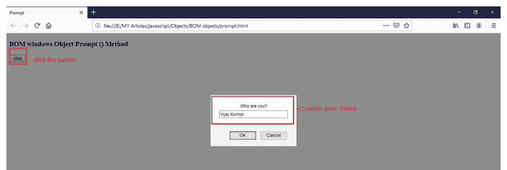

之后，输入名称名称将显示对话框。

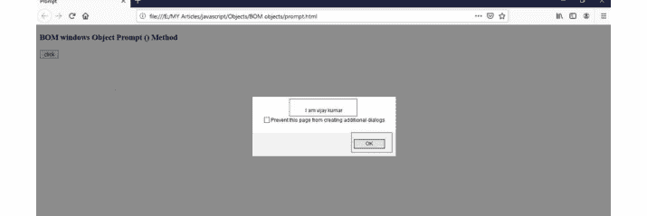

# open() 方法

这会在新标签页或窗口中显示其内容。在下面的示例中，点击按钮将将重定向到新窗口。

## 示例

自己尝试一下：

```html
<!DOCTYPE html>
<html>
<head>
<meta charset="utf-8">
<title>BOM open() 方法</title>
</head>
<body>
<h3>open() 方法</h3>
<script type="text/javascript">
function msg()
{
  open("https://www.c-sharpcorner.com"); // 在下一个窗口打开链接
}
</script>
<input type="button" value="Click_to_Next" onclick="msg()">
</body>
</html>
```

## 输出


# setTimeout() 方法

该方法在给定的毫秒后执行操作，调用函数、评估表达式等。

## 示例

自己尝试一下：

```html
<!DOCTYPE html>
<head>
<meta charset="utf-8">
<title>Windows 方法</title>
</head>
<body>
<h2>Windows 对象 SetTimeout() 方法</h2>
<script type="text/javascript">
function msg()
{
  setTimeout(
    function()
    {
      alert("Welcome to C-sharp corner after 2 seconds")
    }, 2000);
}
</script>
<input type="button" value="click" onclick="msg()">
</body>
</html>
```

## 输出

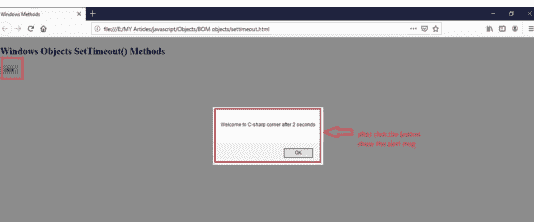

# Windows 对象中的属性

| 属性 | 描述 |
|--- |--- |
| `innerHeight` | 它返回浏览器窗口的高度。 |
| `innerWidth` | 它返回浏览器窗口的宽度。 |
| `name` | 指定窗口的名称。 |

# Windows 对象属性示例

## innerHeight 和 innerWidth

窗口对象属性返回浏览器内容的高度和宽度。我们无法更改和宽度，因为这些属性是只读的。

**语法**

```javascript
windows.innerHeight
windows.innerWidth
```

**示例**

自己尝试一下：

```html
<!DOCTYPE html>
<html>
<head>
<meta charset="utf-8">
<title>BOM 属性</title>
</head>
<body>
<h2>浏览器对象模型 (BOM) 属性</h2>
<script type="text/javascript">
function prpt()
{
  document.write("The innerHeight is: " + window.innerHeight + "<br>"); // 内部高度
  document.write("The innerWidth is : " + window.innerWidth); // 宽度
}
</script>
<input type="button" value="innerHeight_Width" onclick="prpt()">
</body>
</html>
```

## 输出

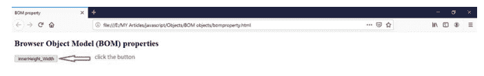
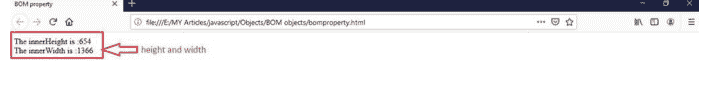

# Name 属性

`name`属性将返回窗口的名称。此属性通常用于在窗口创建后更改名称。

## 示例

```html
<!DOCTYPE html>
<html>
<head>
<meta charset="utf-8">
<title>BOM 属性</title>
</head>
<body>
<h2>浏览器对象模型 (BOM) name 属性</h2>
<script type="text/javascript">
function prt()
{
  window.name = "c-sharp corner";
  document.write("The Name is: " + window.name);
}
</script>
<input type="button" value="Click_name" onclick="prt()">
</body>
</html>
```

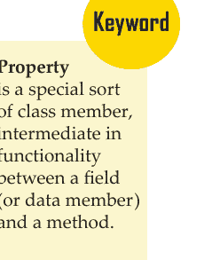

## 输出

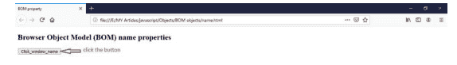

# HISTORY 对象

JavaScript `history`对象代表用户访问的 URL 数组。通过此对象，你可以访问后退、前进或跳转到特定页面。`history`是`window`的属性，所以可以这样访问：

```javascript
window.history
```

## history 的属性

`history`对象只有一个属性。

| 属性 | 描述 |
|---|---|
| `length` | 返回`history`的长度。 |

## history 的方法

`history`对象有三个方法。

| # | 方法 | 描述 |
|---|---|---|
| 1 | `forward()` | 前一个页面 |
| 2 | `back()` | 回到上一个页面 |
| 3 | `go()` | 跳转到指定页面 |

# Navigator 对象

`Navigator`对象用于检测浏览器。它可以获取诸如版本和类型等浏览器信息。它包含两个部分：方法和属性。

## Navigator 方法

`javaEnabled()`方法用于返回浏览器中是否启用了 Java。

**语法**

```javascript
javaEnabled()
```

### 示例

以下程序演示了 HTML 中的`navigator.javaEnabled()`方法。

```html
<!DOCTYPE html>
<html>
<head>
<meta charset="utf-8">
<title>Windows 方法</title>
</head>
<body>
<h2>如果在浏览器中启用了 Java 则返回 true，否则返回 false。</h2>
<input type="button" value="click" onclick="java()">点击检查</button>
<p id="javaEnabled"></p>
<script type="text/javascript">
function java() {
  var ch = "Java Enabled : " + navigator.javaEnabled();
  document.getElementById("javaEnabled").innerHTML = ch;
}
</script>
</body>
</html>
```

输出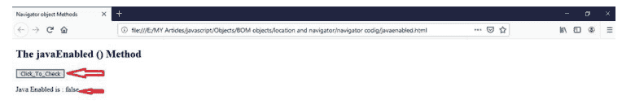

## Navigator 方法

`taintedEnabled()`方法在 JavaScript 1.5 版本中被建议避免，后来为了防止运行时错误而被移除。它返回一个布尔值，指定浏览器是否启用了数据污染功能。

**语法**

```javascript
taintedEnabled()
```

### 示例

以下程序演示了 HTML 中的`navigator.taintedEnabled()`方法。

```html
<!DOCTYPE html>
<html>
<head>
<meta charset="utf-8">
<title>Windows 方法</title>
</head>
<body>
<h2>taintedEnabled() 方法</h2>
<input type="button" value="click" onclick="taint()">点击检查</button>
<script language="JavaScript">
function taint() {
  var temp = navigator.taintedEnabled();
  alert(window.navigator.taintedEnabled());
}
</script>
</body>
</html>
```

输出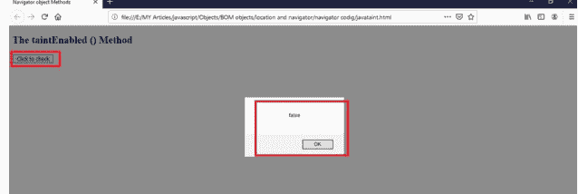

## Navigator 对象中的属性

以下表格包含了 JavaScript 中`Navigator`对象的属性。

| 属性 | 描述 |
|---|---|
| `appName` | 指定浏览器名称。 |
| `appVersion` | 指定正在使用的浏览器版本。 |
| `appCode` | 指定浏览器的代码名称。 |
| `cookieEnabled` | 指定浏览器是否启用了 cookie。 |
| `onLine` | 如果浏览器在线则返回`true`，否则返回`false`。 |
| `geolocation` | 提供一个地理位置对象，用于跟踪用户状态。 |
| `language` | 返回浏览器语言。 |
| `platform` | 返回浏览器兼容的平台。 |

## Navigator 对象属性示例

我们可以逐一查看属性的示例。

**`navigator.appName`属性**

```html
<script>
document.write("Navigator.appName: " + navigator.appName);
</script>
```

输出

### appCodeName 属性

它用于返回浏览器的代码名称。这是一个只读属性，所有现代浏览器都提供。

**语法**

```javascript
navigator.appCodeName
```

#### 示例

以下程序说明了 HTML 中的`Navigator.appCodeName`属性。

```html
<!DOCTYPE html>
<html>
<head>
    <meta charset="utf-8">
    <title>appCodeName</title>
</head>
<body>
    <h2>JavaScript 中的 BOM Windows 对象 Navigator appCodeName 属性</h2>
    <script>
        document.write("Navigator.appCodeName: " + navigator.appCodeName);
    </script>
</body>
</html>
```

输出

### appVersion 属性

在`navigator`中，`appVersion`指定了浏览器的版本。它返回一个表示浏览器版本信息的字符串。

**语法**

```javascript
navigator.appVersion
```

#### 示例

以下程序说明了 HTML 中的`navigator.appVersion`属性。

```html
<!DOCTYPE html>
<html>
<head>
    <meta charset="utf-8">
    <title>appVersion</title>
</head>
<body>
    <h2>JavaScript 中的 BOM Windows 对象 Navigator appVersion 属性</h2>
    <script>
        document.write("Navigator.appVersion: " + navigator.appVersion);
    </script>
</body>
</html>
```

输出

### cookieEnabled 属性

如果启用了 Navigator 的 cookie，则返回`true`，否则返回`false`。它返回一个布尔值，表示浏览器是否启用了 cookie。

**语法**

```javascript
navigator.cookieEnabled
```

#### 示例

以下程序说明了 HTML 中的`navigator.cookieEnabled`属性。

```html
<!DOCTYPE html>
<html>
<head>
    <meta charset="utf-8">
    <title>cookieEnabled</title>
</head>
<body>
    <h2>JavaScript 中的 BOM Windows 对象 Navigator cookieEnabled 属性</h2>
    <script>
        document.write("Navigator.cookieEnabled: " + navigator.cookieEnabled);
    </script>
</body>
</html>
```

输出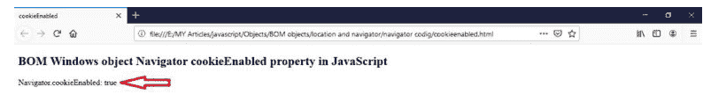

### onLine 属性

`Navigator.onLine`属性用于返回一个布尔值，表示浏览器是否在线。

**语法**

```javascript
navigator.onLine
```

#### 示例

以下程序说明了 HTML 中的`navigator.onLine`属性。

```html
<!DOCTYPE html>
<html>
<head>
    <meta charset="utf-8">
    <title>onLine</title>
</head>
<body>
    <h2>JavaScript 中的 BOM Windows 对象 Navigator onLine 属性</h2>
    <script>
        document.write("Navigator.onLine: " + navigator.onLine);
    </script>
</body>
</html>
```

输出

### geolocation 属性

`Navigator.geolocation`属性提供了一个可以用于跟踪用户状态的对象。

**语法**

```javascript
navigator.geolocation
```

#### 示例

以下程序说明了 HTML 中的`navigator.geolocation`属性。

```html
<!DOCTYPE html>
<html>
<head>
    <meta charset="utf-8">
    <title>geolocation</title>
</head>
<body>
    <h2>JavaScript 中的 BOM Windows 对象 Navigator geolocation 属性</h2>
    <script>
        document.write("Navigator.geolocation: " + navigator.geolocation);
    </script>
</body>
</html>
```

输出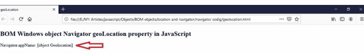


# geoLocation

## JavaScript 中的 BOM Windows 对象 Navigator 属性

```html
<!DOCTYPE html>
<html>
<head>
    <title>geoLocation</title>
</head>
<body>
    <h2>JavaScript 中的 BOM Windows 对象 Navigator 属性</h2>
    <script>
        document.write("NavigatorName: " + navigator.geolocation);
    </script>
</body>
</html>
```

输出：


## language 属性

`Navigator.language`属性用于返回浏览器的语言版本。例如`en-us`、`fr`、`en`、`de`。

### 语法

```javascript
navigator.language
```

### 示例

以下程序说明了 HTML 中的`navigator.language`属性。

```html
<!DOCTYPE html>
<html>
<head>
    <meta charset="utf-8">
    <title>language</title>
</head>
<body>
    <h2>JavaScript 中的 BOM Windows 对象 Navigator language 属性</h2>
    <script>
        document.write("Navigator.language: " + navigator.language);
    </script>
</body>
</html>
```

输出：

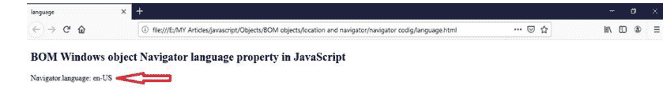

## platform 属性

`Navigator.platform`属性用于将浏览器重定向到编译站点。它返回一个表示浏览器站点的字符串。例如`win32`、`win16`、`linux68`。

### 语法

```javascript
navigator.platform
```

### 示例

以下程序说明了 HTML 中的`navigator.platform`属性。

```html
<!DOCTYPE html>
<html>
<head>
    <meta charset="utf-8">
    <title>platform</title>
</head>
<body>
    <h2>JavaScript 中的 BOM Windows 对象 Navigator platform 属性</h2>
    <script>
        document.write("Navigator.platform: " + navigator.platform);
    </script>
</body>
</html>
```

输出：


## replace() 方法

该方法用指定的新文档替换当前文档。`location`对象中的`replace()`方法用于用另一个页面替换当前页面。

```html
<button onclick="replace()">replace</button>
<script>
function replace() {
  location.replace("https://www.c-sharpcorner.com"); // 将当前页面替换为新页面
}
</script>
```

输出：

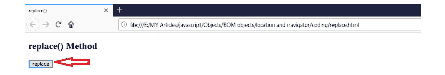

## Location 对象中的属性

下表包含了 JavaScript 中`location`对象的属性。

| 属性 | 描述 |
| :--- | :--- |
| `href` | HTML 中的`location.href`用于设置或重定向当前页面的当前 URL。 |
| `hash` | 以`#`开头的字符串指定 HTTP URL 中的锚点名称。 |
| `host` | 它指向一个包含主机名和端口字符串的字符串。 |
| `hostname` | 它提供了 Web 宿机的域名、子域名和服务器名称。 |
| `search` | 它指定了 URL 的搜索区域。 |
| `port` | 它返回当前页面的端口号。 |
| `pathname` | 它返回当前页面的路径 (URL) 和文件名 (URL)。 |

## Location 对象属性示例

### href 属性

HTML 中的`location.href`属性用于设置或重定向当前页面的当前 URL。`location.href`返回页面的完整 URL 和协议。

#### 语法

```javascript
location.href = URL
```

#### 示例

以下程序说明了`location.href`属性。

```html
<!DOCTYPE html>
<html>
<head>
  <title>href 属性</title>
</head>
<body>
  <h2>DOM Location href 属性</h2>
  <p>HTML 中的 location href 属性用于设置或重定向当前页面的当前 URL。</p>
  <button onclick="myhref()">返回 URL</button>
  <p id="value"></p>
  <script>
  function myhref() {
    var href = location.getElementById("value").innerHTML = href; // 获取当前文档中的位置
  }
  </script>
</body>
</html>
```

输出：

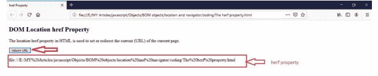

### hash 属性

`location.hash`属性字符串以`#`开头，指定 HTTP URL 中的锚点名称。

#### 语法

```javascript
location.hash
```

#### 示例

以下程序说明了`location.hash`属性。

```html
<!DOCTYPE html>
<html>
<head>
  <title>hash 属性</title>
</head>
<body>
  <h2>锚点 hash 属性</h2>
  <p id="hash">location hash 属性字符串以 # 开头指定 HTTP URL 中的锚点名称</p>
  <button onclick="myhash()">点击这里</button>
  <p id="hash1"></p>
  <script>
  function myhash() {
    var has=document.getElementById("hash").hash;
    document.getElementById("hash1").innerHTML = has;
  }
  </script>
</body>
</html>
```

输出：

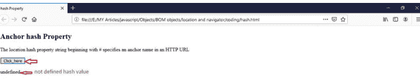

### hostname 属性

`location.hostname`属性用于返回 URL 的主机名。它包含了服务器名称、域名和 IP 地址。

#### 示例

以下程序说明了`location.hostname`属性。

```html
<!DOCTYPE html>
<html>
<head>
  <title>hostname 属性</title>
</head>
<body>
  <h2>hostname 属性</h2>
  <button onclick="host()">点击这里</button>
  <p id="host1"></p>
  <script>
  function host() {
    var host2=location.hostname;
    document.getElementById("host1").innerHTML = host2;
  }
  </script>
</body>
</html>
```

输出：

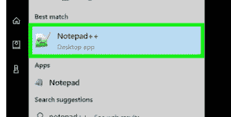

### pathname 属性

`location.pathname`属性用于查找当前页面的路径和文件名。

#### 语法

```javascript
location.pathname
```

#### 示例

以下程序说明了`location.pathname`属性。

```html
<!DOCTYPE html>
<html>
<head>
  <title>pathname 属性</title>
</head>
<body>
  <h2>pathname 属性</h2>
  <button onclick="mypath()">点击这里</button>
  <p id="path"></p>
  <script>
  function mypath() {
    var p1 = location.pathname;
    document.getElementById("path").innerHTML = p1;
  }
  </script>
</body>
</html>
```

输出：

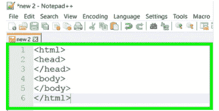

### port 属性

`location.port`属性返回 URL 的端口号。

#### 语法

```javascript
location.port
```

#### 示例

以下程序说明了`location.port`属性。

```html
<!DOCTYPE html>
<html>
<head>
  <title>Port 属性</title>
</head>
<body>
  <h2>Port 属性</h2>
  <p>注意：端口号默认 http 为 80，https 为 443</p>
  <button onclick="port()">点击这里</button>
  <p id="path"></p>
  <script>
  function port() {
    var port2 = location.port;
    var port1 = location.port = 8080;
    document.getElementById("path").innerHTML = port2;
    document.write(p1);
  }
  </script>
</body>
</html>
```

输出：

```
Port 属性 -> file://E/MY Articles/javascript/BOM objects/location and navigator/port.html ...
```

## SCREEN 对象

JavaScript `screen`对象包含了浏览器屏幕的信息。它可以显示屏幕宽度、高度、颜色深度、像素深度等。

`navigator`对象是`window`的属性，因此可以通过以下方式访问：

```javascript
window.screen
```

或者，

```javascript
screen
```

### JavaScript Screen 对象属性

`screen`对象有很多属性可以返回浏览器信息。

| # | 属性 | 描述 |
| :--- | :--- | :--- |
| 1 | `width` | 返回屏幕宽度 |
| 2 | `height` | 返回屏幕高度 |
| 3 | `availWidth` | 返回可用宽度 |
| 4 | `availHeight` | 返回可用高度 |
| 5 | `colorDepth` | 返回颜色深度 |
| 6 | `pixelDepth` | 返回像素深度 |

### JavaScript Screen 对象示例

让我们看看`screen`对象的用法。

```html
<script>
  document.writeln("<br/>screen.width: "+screen.width);
  document.writeln("<br/>screen.height: "+screen.height);
  document.writeln("<br/>screen.availWidth: "+screen.availWidth);
  document.writeln("<br/>screen.availHeight: "+screen.availHeight);
  document.writeln("<br/>screen.colorDepth: "+screen.colorDepth);
  document.writeln("<br/>screen.pixelDepth: "+screen.pixelDepth);
</script>
```

现在测试：

```
screen.width: 1366
screen.height: 768
screen.availWidth: 1366
screen.availHeight: 728
screen.colorDepth: 24
screen.pixelDepth: 24
```

# 总结

- 浏览器对象模型 (BOM) 是 Web 浏览器提供的用于操作与其相关的属性和对象的模型。浏览器对象模型提供的对象和属性允许 JavaScript 与浏览器交互。
- `window`对象代表浏览器中的一个窗口。`window`对象由浏览器自动创建。
- `window`对象返回浏览器内容的高度和宽度。我们无法更改高度和宽度，因为这些属性是只读的。
- `name`属性返回窗口的名称。该属性通常用于在窗口创建后更改名称。
- JavaScript `history`对象表示用户访问的 URL 数组。通过使用此对象，你可以加载上一个、后一个或任何特定页面。
- `Navigator`对象用于浏览器检测。它可以用于获取浏览器版本和类型等信息。
- `javaEnabled()`方法用于返回一个布尔值，指示浏览器是否启用了 Java。如果浏览器启用了 Java，则返回`true`，否则返回`false`。
- `Navigator.taintEnabled()`方法在 JavaScript 1.5 版本中效果最好，已被移除以防止未来的运行时错误。它返回一个布尔值`false`，指定浏览器是否启用了数据污染功能。
- `Navigator`属性提供了一个地理位置对象，可以用于跟踪用户状态。
- JavaScript 中的`location`对象使其能够保存当前页面的位置或地址 (URL)，并将浏览器重定向到新页面。
- `location`对象是`window`对象的一部分，通过`window`访问。`location`对象没有通用标准，但所有主流浏览器都支持`location`对象。
- `location.assign()`方法用于在新页面加载新文档。无法使用浏览器的“后退”按钮返回上一个文档。

# 知识检查

1. BOM 的全称是什么？
   a. 浏览器对象方法 (Browser Object Method)
   b. 浏览器对象模型 (Browser Object Model)
   c. 浏览器取向方法 (Browser Oriented Method)
   d. 浏览器取向模型 (Browser Oriented Model)

2. 哪个`window`方法用于移动当前窗口？
   a. `Move()`
   b. `MoveTo()`
   c. `Window.move()`
   d. `Window.moveto()`

3. URL 属性属于哪个对象？
   a. Document (文档)
   b. Element (元素)
   c. Location (位置)
   d. Event (事件)

4. `location`属性代表什么？
   a. 当前 DOM 对象
   b. 当前 URL
   c. 同时 DOM 对象和 URL
   d. Document (文档)

5. 下列哪项不是`Location`对象的属性？
   a. `protocol`
   b. `host`
   c. `hostee`
   d. `hostname`

6. `hash`属性的返回类型是什么？
   a. 查询字符串 (Query string)
   b. 数据包 (Packets)
   c. 字符串 (String)
   d. 分段标识符 (Fragment identifier)

7. 哪个方法在加载新文档之前从浏览历史中删除当前文档？
   a. `modify()`
   b. `assign()`
   c. `replace()`
   d. `remove()`

8. 为什么`replace()`方法比`assign()`方法更好？
   a. 可靠
   b. 高可管理性
   c. 更高效
   d. 处理无条件加载

9. `assign()`方法的目的是？
   a. 仅加载
   b. 窗口加载与显示
   c. 显示已存在的窗口
   d. 窗口卸载

10. `history`属性属于哪个对象？
    a. Element (元素)
    b. Window (窗口)
    c. History (历史记录)
    d. Location (位置)


# 11. `decodeURIComponent()` 由 ________ 定义

- a. 服务端 JavaScript
- b. 客户端 JavaScript
- c. 服务端和客户端 JavaScript
- d. 服务端 JavaScript

# 12. 使用什么函数从 URL 的 `search` 属性中提取参数？

- a. `urlArgs()`
- b. `url()`
- c. `hash()`
- d. `geturl()`

# 13. 以下 JavaScript 代码的输出是什么？

```html
<p>1</p>
<p>2</p>
<p>3</p>

function myFunction() {
  var x = document.getElementsByTagName("P").item(0);
  alert(x.innerHTML);
}
```

- a. 1
- b. 2
- c. 3
- d. 错误

# 14. 以下 JavaScript 代码的输出是什么？

```html
<p>1</p>
<p>2</p>
<p>3</p>
function myFunction()
{
  var l = document.getElementsByTagName("P").length;
  alert(l);
}
```

- a. 1
- b. 2
- c. 3
- d. 错误

# 15. 以下 JavaScript 代码的输出是什么？

```html
<p id="Element">Head</p>
function myFunction()
{
  var x = document.getElementsByTagName("P").namedItem("Element");
  alert(x.innerHTML);
}
```

- a. Head
- b. Element
- c. 错误
- d. 未定义

# 复习题

- 1. JavaScript 中的 BOM 代表什么？
- 2. 什么是浏览器对象模型？
- 3. 列出 BOM 的各种类型。
- 4. `window` 对象的不同类型有哪些？
- 5. `history` 对象的哪些方法？
- 6. 什么是 `navigator` 对象？
- 7. 提到 `Navigator` 对象的两个特征。
- 8. `location` 对象的两种方法是什么？

## 基础计算机编程：JavaScript

# `Load` 事件

```html
1. <html>
2. <head>javascriptEvents</head>
3. <br>
4. <body onload="window.alert('Page successfully loaded');">
5. <script>
6. <<!--
7. document.write("The page is loaded successfully");
8. //-->
9. </script>
10. </body
11. </html>
```

# 9.2 JavaScript 事件类型

下面讨论了最常见的 8 种 JavaScript 事件类型：

### 9.2.1 用户界面事件

这些事件由于与浏览器窗口的任何交互而产生。在这些事件中，我们将事件监听器附加到 `window` 对象，而不是 `document` 对象。各种 UI 事件如下：

- `load`：当网页加载完成时触发 `load` 事件。它也可以在图像、脚本或对象等元素节点上触发。
- `unload`：此事件在用户离开页面之前触发，即网页正在卸载。页面卸载通常是因为请求了新页面。
- `error`：当浏览器遇到 JavaScript 错误或不存在的资源时触发此事件。
- `resize`：当我们调整浏览器窗口大小时触发此事件。但浏览器会反复触发此事件，因此避免使用此事件来触发复杂的代码；这可能会降低页面响应速度。
- `scroll`：当用户在浏览器窗口上向上/向下滚动时触发此事件。它可以与整个页面相关，也可以与页面上的特定元素相关。

### 9.2.2 焦点和模糊事件

当你交互的 HTML 元素获得/失去焦点时会触发这些事件。它们通常用于表单，特别当你想执行以下任务时非常有用：

- 当用户与表单内的元素交互时，向用户显示提示或反馈。提示通常显示在用户正在交互的元素之外的。
- 当用户从一个控件移动到下一个控件时触发表单验证，无需等待提交表单。

不同的焦点和模糊事件如下：

- `focus`：当元素获得焦点时，针对特定的 DOM 节点触发此事件。
- `blur`：当元素失去焦点时，针对特定的 DOM 节点触发此事件。
- `focusin`：此事件与 `focus` 事件相同。但 Firefox 不支持 `focus` 事件。
- `focusout`：这与 `blur` 事件相同。这是 JavaScript 中的一种新事件类型，因此 Firefox 目前不支持。

`focus` 和 `blur` 事件使用事件捕获方法，而 `focusin` 和 `focusout` 事件同时使用事件流的捕获和冒泡方法。

### 9.2.3 鼠标事件

这些事件在鼠标移动或用户点击按钮时触发。页面上的所有元素支持这些事件和冒泡机制。这些操作在触摸设备上的工作方式不同，会导致意外结果。JavaScript 的各种鼠标事件如下：

- `click`：当用户点击主鼠标按钮（通常是左键）时触发此事件。当元素获得焦点且用户按下键盘上的 Enter 键时，也会触发此事件。

**触摸屏：** 在屏幕上单击相当于单次左键点击。

- `dblclick`：当用户快速点击两次主鼠标按钮时触发此事件。

**触摸屏：** 在屏幕上双击单击相当于双击左键。

**无障碍性：** 你可以将上述事件添加到任何事件中，但最好仅将其应用于通常会被点击的项，否则将无法通过键盘导航访问。下文讨论的所有鼠标事件都无法通过键盘触发。

- `mousedown`：当用户按下任何鼠标按钮时触发此事件。

**触摸屏：** 你可以使用 `touchstart` 事件。

- `mouseup`：当用户释放鼠标按钮时触发此事件。

**触摸屏：** 你可以使用 `touchend` 事件。

我们有单独的 `mousedown` 和 `mouseup` 事件用于在游戏开发中添加拖放功能或控制。不要忘记 `click` 事件是 `mousedown` 和 `mouseup` 事件的组合。

- `mouseover`：当用户将光标从元素外部移动到元素内部时触发此事件。我们可以说它是在光标移动到元素上方时触发的。
- `mouseout`：当用户将光标从元素内部移动到元素外部时触发此事件。我们可以说它是在光标离开元素时触发的。
- `mouseover` 和 `mouseout` 事件通常改变我们网页上图形的外观。一种更优的替代方案是使用 `CSS: hover` 伪类。
- `mousemove`：当用户在元素周围移动光标时触发此事件。此事件经常被触发。

## 9.2.4 键盘事件

当用户与键盘交互时，这些事件在任何设备上都会触发。

- `input`：当 `<input>` 或 `<textarea>` 的值改变时触发此事件（在 IE9 中删除操作时不触发）。你可以在旧版浏览器中使用 `keydown` 作为备用方案。
- `keydown`：当用户按下键盘上的任意键时触发此事件。如果用户按住按键，此事件会反复触发。
- `keypress`：当用户按下会在屏幕上打印字符的按键时触发此事件。如果用户按住按键，此事件会反复触发。此事件在按下 Enter、Tab 或方向键时不会触发；而 `keydown` 事件会触发。
- `keyup`：当用户释放键盘上的按键时触发 `keyup` 事件。

`keydown` 和 `keypress` 事件在字符出现在屏幕之前触发，`keyup` 在字符显示后触发。

在用 `keydown` 和 `keypress` 事件时，如果知道按下的是哪个键，事件对象有一个 `keyCode` 属性。它返回的不是该键对应的字母，而是返回该键小写的 ASCII 码。

### 9.2.5 表单事件

这些事件在网页上使用表单时很常见。

特别是，我们大多数在验证形式（检查表单值）中看到 `submit` 事件。正如我们在教程中描述的：

JavaScript 特性，如果用户需要任何输入信息或输入了错误，在将数据发送到服务器之前进行验证更快。下面的列表解释了可用的表单事件：

- `submit`：当用户提交表单时触发此事件。
- `change`：当表单元素的值改变时触发此事件。
- `input`：当 `<input>` 或 `<textarea>` 的值改变时触发此事件。
- `focus`：当元素获得焦点时触发此事件。
- `blur`：当元素失去焦点时触发此事件。
- `focusin`：当元素获得焦点时触发此事件。
- `focusout`：当元素失去焦点时触发此事件。

## 9.2.8 CSS 事件

这些事件在脚本遇到 CSS 元素时触发。由于 CSS 是 Web 开发的关键组成部分，开发者决定在 JS 中添加这些事件，以使 CSS 操作更加简单。一些常见的 CSS 事件如下：

- `transitionend`：当程序中的 CSS 过渡结束时，触发此事件。它用于通知脚本过渡已结束，以便其采取进一步的操作。
- `animationstart`：当程序开始 CSS 动画时，触发这些事件。
- `animationiteration`：当任何 CSS 动画重复自身时，发生此事件。通过此事件，我们可以在脚本中确定动画迭代的次数。
- `animationend`：当程序中的 CSS 动画结束时触发。这在我们想在动画完成后立即执行操作时非常有用。

## 9.3 JavaScript 事件监听器

`addEventListener` 方法用于向特定元素附加事件处理器。它不会覆盖现有的事件处理器。事件被认为是 JavaScript 的不可或缺的一部分。网页会根据发生的事件做出响应。事件可以是由用户生成的，也可以由 API 生成。事件监听器是等待事件发生的 JavaScript 程序。

我们可以向一个特定元素添加多个事件处理器，而不会覆盖现有的事件处理器。

## 9.3.1 语法

```javascript
element.addEventListener(event, function, useCapture);
```

尽管它有三个参数，但 `event` 和 `function` 参数被广泛使用。第三个参数是可选的。该函数的参数定义如下。

### 9.3.2 参数值

- `event`：这是一个必填参数。它可以定义为指定事件名称的字符串。
- `function`：这也是一个必填参数。它是一个响应发生事件的 JavaScript 函数。
- `useCapture`：这是一个可选参数。它是一个布尔值，指定事件是在冒泡阶段还是捕获阶段执行。它的可能值为 `true` 和 `false`。当其设置为 `true` 时，事件处理器在捕获阶段执行。当其设置为 `false` 时，处理器在冒泡阶段执行。它的默认值为 `false`。

让我们来看一些使用 `addEventListener()` 方法的插图。

## 示例

这是一个使用 `addEventListener()` 方法的简单示例。我们必须点击指定的 HTML 按钮才能看到效果。

```html
1. <!DOCTYPE html>
2. <html>
3. <body>
4. <p> Example of the addEventListener() method.</p>
5. <p> Click the following button to see the effect.</p>
6. <button id="btn"> Click me</button>
7. <p id="para"></p>
8. <script>
9. document.getElementById("btn").addEventListener("click", fun);
10. function() {
11. document.getElementById("para").innerHTML = "Hello World" + "<br>" + "Welcome to the javaPoint";
12. }
13. </script>
14. </body>
15. </html>
```

# 输出

点击指定的 HTML 按钮后，输出将为：

> 参数值中不要使用任何如 "on" 的前缀。例如，使用 `"click"` 而不是 `"onclick"`。

现在，在下一个示例中，我们将看到如何向同一个元素添加多个事件而不会覆盖这些事件。

## 示例

在这个示例中，我们正在向同一个元素添加多个事件。

```html
1. <!DOCTYPE html>
2. <html>
3. <body>
4. <p> This is an example of adding multiple events to the same element.</p>
5. <p> Click the following button to see the effect.</p>
6. <button id="btn"> Click me </button>
7. <p id="para"></p>
8. <p id="par1"></p>
9. <script>
10. function fun() {
11. alert("Welcome to the javaTpoint.com");
12. }
13.
14. function fun1() {
15. document.getElementById("para").innerHTML = "This is second function";
16.
17. }
18. function fun2() {
19. document.getElementById("para1").innerHTML = "This is third function";
20. }
21. var mybtn = document.getElementById("btn");
22. mybtn.addEventListener("click", fun);
23. mybtn.addEventListener("click", fun1);
24. mybtn.addEventListener("click", fun2);
25. </script>
26. </body>
27. </html>
```

# 输出

点击指定的 HTML 按钮后，输出将为：

> 参数值中不要使用任何如 "on" 的前缀。例如，使用 `"click"` 而不是 `"onclick"`。

现在，在下一个示例中，我们将看到如何向同一个元素添加多个事件而不会覆盖这些事件。

这个示例展示了如何向同一个元素添加多个事件监听器。

## 示例

在这个示例中，我们正在向同一个元素添加多个事件。

```html
1. <!DOCTYPE html>
2. <html>
3. <body>
4. <p> This is an example of adding multiple events to the same element. </p>
5. <p> Click the following button to see the effect. </p>
6. <button id="btn"> Click me </button>
7. <p id="para"></p>
8. <p id="par1"></p>
9. <script>
10. function fun() {
11. alert("Welcome to the javaTpoint.com");
12. }
13.
14. function fun1() {
15. document.getElementById("para").innerHTML = "This is second function";
16.
17. }
18. function fun2() {
19. document.getElementById("para1").innerHTML = "This is third function";
20. }
21. var mybtn = document.getElementById("btn");
22. mybtn.addEventListener("click", fun);
23. mybtn.addEventListener("click", fun1);
24. mybtn.addEventListener("click", fun2);
25. </script>
26. </body>
27. </html>
```

当我们移动光标时，输出为：

这个示例展示了一个包含多个元素和事件的页面结构。

```html
19. 这是一个 div 元素。
20. <br><br>
21. <span id="s1">这是一个 span 元素。 </span>
22. </div>
23. <h1>捕获 </h1>
24. <div id="d2">这是一个 div 元素。
25. <br><br>
26. <span id="s2">这是一个 span 元素。 </span>
27. </div>
```


```
29. <script>
30. document.getElementById("d1").addEventListener("dblclick", function() {
alert('You have double clicked on div element'), false);
31. document.getElementById("s1").addEventListener("dblclick", function() {
alert('You have double clicked on span element'), false);
32. document.getElementById("d2").addEventListener("dblclick", function() {
alert('You have double clicked on div element'), true);
33. document.getElementById("s2").addEventListener("dblclick", function() {
alert('You have double clicked on span element'), true);
34. </script>
35. </body>
36. </html>
```

# 输出

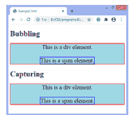

我们必须对特定元素进行双击才能看到效果。

## 基础计算机编程：JavaScript

## 9.4 JAVASCRIPT onclick 事件

`onclick` 事件通常在用户点击元素时发生。它允许程序员在元素被点击时执行 JavaScript 函数。此事件可以用于表单验证、警告消息等等许多场景。

使用 JavaScript，可以将此事件动态地添加到任何元素。它支持所有的 HTML 元素 `<html>`, `<head>`, `<title>`, `<style>`, `<script>`, `<base>`, `<iframe>`, `<body>`, `<br>`, `<meta>` 和 `<param>`。我们不能在给定的标签上应用 `onclick` 事件。

在 HTML 中，我们可以使用 `onclick` 属性为其分配一个 JavaScript 函数。我们也可以使用 `addEventListener()` 方法并向其传递一个点击事件，以获得更大的灵活性。

### 9.4.1 语法

现在，我们将在 HTML 和 JavaScript 中使用 `onclick` 事件的语法（不使用 `addEventListener()` 方法或通过使用 `addEventListener()` 方法）。

### 9.4.2 在 HTML 中

```
<element onclick = "fun()">
```

### 9.4.3 在 JavaScript 中

```
object.onclick = function() { myScript };
```

### 9.4.4 在 JavaScript 中使用 addEventListener()

```
object.addEventListener("click", myScript);
```

让我们通过一些插图来看看如何使用 `onclick` 事件。现在，我们将看到 HTML 和 JavaScript 中使用 `onclick` 事件的示例。

#### 示例 1 - 在 HTML 中使用 onclick 属性

在此示例中，我们正在使用 HTML `onclick` 属性并为其分配一个 JavaScript 函数。当用户点击给定的按钮时，相应的函数将被执行，屏幕上将显示一个对话框。

```
1. <html>
2. <head>
3. <head>
4. <script>
5. function fun() {
6. alert("Welcome to the javaTpoint.com");
7. }
8. </script>
9. </head>
10. <body>
11. <h3>这是一个在 HTML 中使用 onclick 属性的示例。</h3>
12. <p> 点击以下按钮查看效果。</p>
13. <button onclick="fun()">点击我</button>
14. </body>
15. </html>
```

# 输出

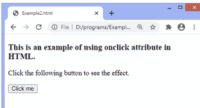

点击给定的按钮后，输出将为 -

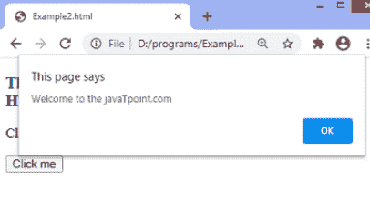

#### 示例 2 - 使用 JavaScript

在此示例中，我们正在使用 JavaScript 的 `onclick` 事件。在这里，我们对段落元素使用了 `onclick` 事件。

当用户点击段落元素时，相应的函数将被执行，段落的文本将改变。点击 `<p>` 元素时，背景颜色、大小、边框和文本颜色也会发生变化。

```
1. <!DOCTYPE html>
2. <html>
3. <head>
4. <title>onclick 事件 </title>
5. </head>
6. <body>
7. <h3>这是一个使用 onclick 事件的示例。</h3>
8. <p>点击以下文本查看效果。</p>
9. <p id = "para">点击我</p>
10. <script>
11. document.getElementById("para").onclick = function() {
12. 
13. };
14. document.getElementById("para").innerHTML = "Welcome to the javaPoint";
15. document.getElementById("para").style.color = "blue";
16. document.getElementById("para").style.backgroundColor = "yellow";
17. document.getElementById("para").style.fontSize = "25px";
18. document.getElementById("para").style.border = "4px solid red";
19. }
20. </script>
21. </body>
24. </html>
```

# 输出

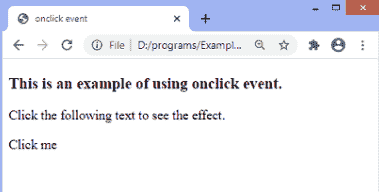

点击 *Click me* 文本后，输出将为 -

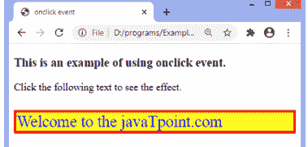

#### 示例 3 - 使用 addEventListener

在此示例中，我们使用 JavaScript 的 `addEventListener()` 方法为段落元素附加 `click` 事件。当用户点击段落时，段落的文本会改变。点击段落时，背景颜色和字体大小也会改变。

```
1. <!DOCTYPE html>
2. <html>
3. <head>
4. </head>
5. <body>
6. <h3>这是一个使用 click 事件的示例。</h3>
7. <p> 点击以下文本查看效果。</p>
8. <p id="para">点击我</p>
9. <script>
10. document.getElementById("para").onclick = function() {
11. fun()
12. };
13. function() {
14. document.getElementById("para").innerHTML = "Welcome to the javaTpoint.com";
15. document.getElementsByTagName("body")[0].style.color = "blue";
16. document.getElementsByTagName("body")[0].style.backgroundColor = "lightgreen";
17. document.getElementsByTagName("body")[0].style.fontSize = "25px";
18. document.getElementById("para").style.border = "4px solid red";
19. }
20. </script>
21. </body>
23. </html>
```

# 输出

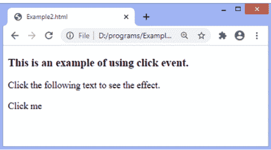

点击 *Click me* 文本，输出将为 -

## 9.5 JAVASCRIPT DBLCLICK 事件

`dblclick` 事件产生元素的双击。当元素在短时间内被点击两次时，触发该事件。我们也可以使用 JavaScript 的 `addEventListener()` 方法来实现双击事件。

在 HTML 中，我们可以使用 `ondblclick` 属性创建一个双击事件。

### 9.5.1 语法

现在，我们查看 HTML 和 JavaScript 中创建双击事件的语法（不使用 `addEventListener()` 方法或通过使用 `addEventListener()` 方法）。

### 9.5.2 在 HTML 中

```
<element ondblclick = "fun()">
```

### 9.5.3 在 JavaScript 中

```
object.ondblclick = function(){ myFunction };
```

### 9.5.4 在 JavaScript 中使用 addEventListener()

```
object.addEventListener("dblclick", myFunction);
```

让我们看一些插图来理解双击事件。

#### 示例 - 在 HTML 中使用 ondblclick 属性

在此示例中，我们使用 HTML `ondblclick` 属性创建双击事件。

```
1. <!DOCTYPE html>
2. <html>
3. <head>
4. </head>
5. <body>
6. <h1 id="heading" onclick="fun()"> Hello world :) </h1>
7. <h2>双击 "Hello world" 查看效果。</h2>
8. <p>这是一个使用 <b>onclick 属性</b>的示例。</p>
9. <script>
10. function fun() {
11. document.getElementById("heading").innerHTML = "Welcome to the javaPoint.com";
12. }
13. </script>
14. </body>
15. </html>
```

# 输出

执行上述代码后，输出将为 -

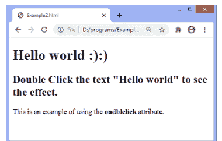

双击 "Hello world" 文本后，输出将为 -

# JavaScript 事件

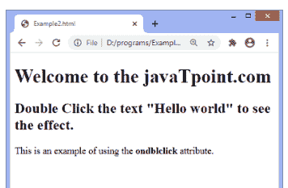

现在，我们将看到如何使用 JavaScript 创建双击事件。

#### 示例 - 使用 JavaScript

```
1. <!DOCTYPE html>
2. <html>
3. <head>
4. </head>
5. <body>
6. <h1 id="heading" onclick="fun()"> Hello world :) </h1>
7. <h2>双击 "Hello world" 文本查看效果。</h2>
8. <p>这是一个使用 JavaScript 创建双击事件的示例。</p>
9. <script>
10. document.getElementById("heading").ondblclick = function() { fun };
11. function fun() {
12. document.getElementById("heading").innerHTML = " Welcome to the javaPoint.com "
13. }
14. </script>
15. </body>
16. </html>
```

## 输出

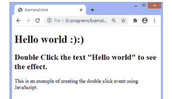

双击文本“Hello world”后，输出将为 -

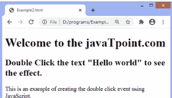

#### 示例 - 使用 JavaScript 的 addEventListener() 方法

```html
<!DOCTYPE html>
<html>
<head>
</head>
<body>
<h1 id="heading"> Hello world :) </h1>
<h2>双击文本“Hello world”以查看效果。 </h2>
<p>这是一个使用 <b>addEventListener()</b> 创建双击事件的示例。</p>
<script>
document.getElementById("heading").addEventListener("dblclick", fun);
function fun() {
  document.getElementById("heading").innerHTML = " Welcome to the javaTPoint.com"
} 
</script>
</body>
</html>
```

## 输出

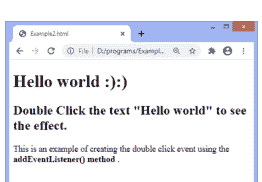

双击文本 "Hello world" 后，输出将为 -

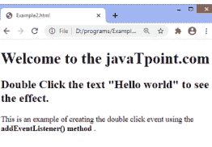

## 9.6 JavaScript ONLOAD

在 JavaScript 中，此事件可以用于页面完全显示时启动特定的函数。它也可以用于验证访问者浏览器的类型和版本。我们可以通过页面使用 `onload` 属性来检查 cookie。

在 HTML 中，`onload` 属性在对象加载时触发。该属性的目的是在关联元素加载时执行脚本。

在 HTML 中，`onload` 属性通常与 `<body>` 元素配合一起使用，以便在网页内容（包括 CSS 文件、图像、脚本等）完全加载后执行脚本。没有必要仅与 `<body>` 标签使用，因为它也可以用于其他的 HTML 元素。

`document.onload` 和 `window.onload` 之间的区别是：`document.onload` 在图像和其他外部内容的加载之前触发。它在 `window.onload` 之前触发。而 `window.onload` 在整个页面加载（包括 CSS 文件、脚本文件、图像等）时触发。

### 9.6.1 语法

```javascript
window.onload = fun()
```

让我们通过一些示例来理解这个事件。

> 记住：`onload` 属性没有必要仅与 `<body>` 标签使用，因为它也可以用于其他的 HTML 元素。

#### 示例 1

在此示例中，有一个高度为 200px 宽度为 200px 的 `div` 元素。在这里，我们使用 `window.onload()` 在加载网页后更改 `div` 元素的背景颜色、宽度和高度。

背景颜色设置为‘红色’，宽度和高度均为 200px。

```html
<!DOCTYPE html>
<html>
<head>
<meta charset = "utf-8">
<title>window.onload()</title>
<style type="text/css">
#bg{
width: 200px;
height: 200px;
}
</style>
<script type="text/javascript">
window.onload = function(){
  document.getElementById("bg").backgroundColor = "red";
  document.getElementById("bg").style.width = "300px";
  document.getElementById("bg").style.height = "300px";
}
</script>
</head>
<body>
<h2>这是一个 window.onload() 示例</h2>
<div id="bg"></div>
</body>
</html>
```

## 输出

执行代码并加载页面后，输出将为 -


#### 示例 2

在此示例中，我们通过使用 DOM 对象属性和 JavaScript 函数来实现简单的动画。我们使用 JavaScript 函数 `getElementById()` 获取 DOM 对象并将其赋值给全局变量。


```html
<html>
<head>
<script type="text/javascript">
var img = null;
function init() {
  img = document.getElementById('myimg');
  img.style.position = 'relative';
  img.style.left = '50px';
}
function moveRight() {
  img.style.left = parseInt(img.style.left) + 100 + 'px';
}
window.onload = init;
</script>
</head>
<body>
<form>

<center>
<p>点击下方按钮移动图像</p>
<input type="button" value="Click Me" onclick="moveRight(); />
</center>
</form>
</body>
</html>
```

## 输出

成功执行代码后，输出将为 -


## 示例3

这是一个 HTML 属性和 JavaScript 中定义的函数的简单示例。在此示例中，每当文档刷新时调用`alert()`函数。

```html
<!DOCTYPE html>
<html>
<head>
<style></style>
<script>
function fun() {
  alert("Hello World!! Welcome to javaTPoint.com");
}
</script>
</head>
<body onload="fun()">
<h1>HTML 属性示例</h1>
<p>尝试刷新文档以查看效果。</p>
</body>
</html>
```

## 输出

执行代码后，输出将为 -


## 9.7 JAVASCRIPT ONSIZE 事件

JavaScript 中的`onresize`事件通常发生在窗口调整大小时。要获取窗口的大小，我们可以使用 JavaScript 的`window.outerWidth`和`window.outerHeight`事件。我们也可以使用 JavaScript 的属性如`innerWidth`、`innerHeight`、`clientWidth`、`clientHeight`、`offsetWidth`、`offsetHeight`来获取元素的大小。

在 HTML 中，我们可以使用`onresize`属性并为其分配一个 JavaScript 函数。我们也可以使用 JavaScript 的`addEventListener()`方法并向其传递`resize`事件以获得更大的灵活性。

## 9.7.1 语法

现在我们查看 HTML 和 JavaScript 中`onresize`事件的语法（不使用`addEventListener()`方法或使用`addEventListener()`方法）。

## 9.7.2 在 HTML 中

```html
<element onresize="fun()">
```

## 9.7.3 在 JavaScript 中

```javascript
object.onresize = function() { myScript };
```

## 9.7.4 在 JavaScript 中通过 addEventListener() 方法

```javascript
object.addEventListener("resize", myScript);
```

## 示例

让我们通过一些插图来理解`onresize`事件。

在此示例中，我们使用了 HTML `onresize`属性。在这里，我们使用 JavaScript 的`window.outerWidth`和`window.outerHeight`事件来获取窗口的高度和宽度。当用户调整窗口大小时，窗口更新的宽度高度还将显示用户尝试调整窗口的次数。当我们更改窗口高度时，更新的高度将相应变化。同样，当我们更改窗口宽度时，更新的宽度也将相应变化。

```html
<!DOCTYPE html>
<html>
<head>
<script>
var i = 0;

function fun() {
  var res = "Width = " + window.outerWidth + "<br>" + "Height = " + window.outerHeight;
  document.getElementById("para").innerHTML = res;

  var res1 = i += 1;
  document.getElementById("s1").innerHTML = res1;
}
</script>
</head>
<body onclick="fun">
<h3>这是一个使用 onresize 属性的示例</h3>
<p>尝试调整浏览器窗口以查看效果。</p>

<p id="para"></p>
<p>你已经调整了窗口 <span id="s1"> 0</span> 次。</p>
</body>
</html>
```

## 输出

执行上述代码后，输出将为 -

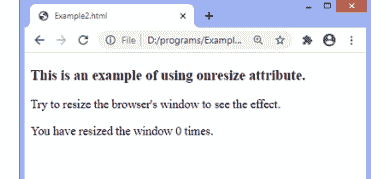

当我们尝试调整窗口时，输出将为 -

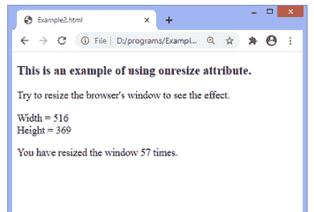

## 计算机基础编程：JavaScript

## 输出

在执行上述代码后，输出将为 -

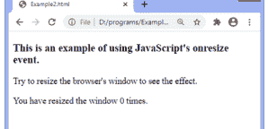

当我们尝试调整窗口大时，输出将为 -

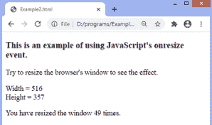

## 示例 - 使用 addEventListener 方法

在这个示例中，我们使用了 JavaScript 的`addEventListener()`方法。

+ 1. `<DOCTYPE html>`

2. `<html>`

3. `<head>`

4. `</head>`

5. `<body>`

6. `<h3>这是 JavaScript addEventListener() 方法的一个示例。</h3>`

7. `<p>尝试调整浏览器大小以查看效果。</p>`

8.

9. `<p id="para"></p>`

10. `<p>你已经调整了窗口<span id="s1"> 0 </span> 次。</p>`

11. `<script>`

12. `window.addEventListener("resize", func);`

13. `var i = 0;`

14.

15. `function func() {`

16. `var res = "Width = " + window.innerWidth + "<br>" + "Height = " + window.outerHeight;`

17. `document.getElementById("para").innerHTML = res;`

18.

19. `var res1 = i += 1;`

20. `document.getElementById("s1").innerHTML = res1;`

21. `]`

22. `</script>`

23. `</body>`

24. `</html>`

## 输出

在执行上述代码后，输出将为 -

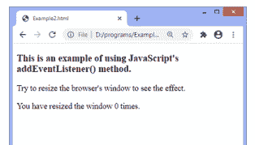

当我们尝试调整窗口大时，输出将为 -


## 计算机基础编程：JavaScript

## 榜样人物

## 道格拉斯·克拉克福德 (DOUGLAS Crockford)

Douglas Crockford 是一位美国计算机程序员和企业家，他深度参与了 JavaScript 语言的发展。他推广了数据格式 JSON（JavaScript 对象表示），并开发了 JSLint 和 JSMin 等多种 JavaScript 相关工具。直到2019年，他一直是 PayPal 的高级 JavaScript 架构师，也是 JavaScript、JSON 及相关网络技术的作家和演讲者。

## 教育背景

克拉克福德于1975年毕业于金山大学广播电视专业。他曾上过 FORTRAN 课程，并在大学实验室操作计算机。

## 职业生涯

克拉克福德于1980年购买了一台 Atari 8位计算机，并为 Atari Program Exchange (APX) 编写了游戏《Galahad and the Holy Grail》，这导致 Chris Crawford 雇佣他进入 Atari, Inc. 公司。在 Atari 工作期间，克拉克福德为 APX 编写了另一个游戏《Burgers!》，以及许多免费分发的实验性音频/视觉演示。

在华纳通讯出售该公司后，他加入了国家半导体公司。1984年，克拉克福德加入了卢斯影业，随后进入派拉蒙影业。20世纪90年代，他因发布电子游戏列表而闻名，当时他在电子游戏公告板上发布了自己的回忆录《疯狂大宅的清理》（The Expurgation of Maniac Mansion）。这篇回忆录记录了他如何努力让电脑游戏《疯狂大宅》符合任天堂的要求，以便他们能以卡带形式发布，同时也记录了随着任天堂的要求变得模糊和混乱，克拉克福德日益增长的挫败感。

克拉克福德与 Randy Farmer 和 Chip Morningstar 共同创立了 Electric Communities，并在1994年至1995年担任首席执行官。他参与了编程语言 E 的开发。

克拉克福德是 State Software（也称为 Veil Networks）的创始人，并在2001年至2002年担任其首席技术官。

在 State Software期间，克拉克福德推广了基于 JavaScript 语言结构的 JSON 数据格式，作为 XML 的轻量级替代方案。他在2002年获得了 json.org 域名，并在那里发布了该格式的说明。2006年7月，他正式将该格式规范为 RFC 4627。

## “行善而非作恶”

2002年，参考乔治·布什总统对“恶人”的战争，克拉克福德开始使用自定义许可证发布他的 JSMin 软件，该许可证是在开源 MIT 许可证的基础上添加了“软件应用于行善而非作恶”的要求创建的。这一条款被引入到 Ryan Grove 开发的 JSMin-PHP 版本中。该软件曾托管在 Google Code 上，直到2009年12月，由于该额外条款，Google 认为该许可证不符合开源软件的定义（因为后者不允许对软件的使用方式进行任何限制）。JSMin-PHP 被迁移到新的托管供应商。

克拉克福德的许可证导致某些开源项目出现问题，这些项目误认为是 MIT 许可证的开源变体。受影响的开源开发者。

## 媒体

## 图籍

# 总结

## JavaScript 事件

# 知识检查

+ 1. 一般来说，事件处理器本质就是

a. 函数

b. 接口

c. 事件

d. 处理器

2. 浏览器何时调用处理器？

a. 程序开始时

b. 任何事件发生时

c. 指定的事件发生时

d. 网页加载时

3. 浏览器决定触发哪些对象的处理器的过程是

a. 事件触发

b. 事件监听

c. 事件处理

d. 事件传播

4. 哪种形式的事件传播处理注册容器？

a. 事件传播

b. 事件注册

c. 事件捕获

d. 默认操作

5. 在哪些事件/场景下，JavaScript 中的函数名是可选的？

a. 当函数定义为循环语句时

b. 当调用函数时

c. 当函数定义为表达式时

6. 指定事件类型的类型

a. 事件类型

b. 事件目标

c. 事件类型和事件目标

d. 接口

7. 发生事件或与事件关联的对象是？

a. 事件类型

b. 事件目标

315

基础计算机编程：JavaScript

- c. 事件类型和目标目标

d. 接口

- 8. 哪个属性指定了事件的属性？

a. 类型 (Type)

b. 目标 (Target)

c. 方式 (Manner)

d. 程序 (Program)

- 9. 直接绑定到特定输入设备的事件是：

a. 设备无关输入事件

b. 设备相关输入事件

c. 用户界面事件

d. 状态事件变化

- 10. 在以下事件中，高层事件是：

a. 用户界面事件

b. 设备无关输入事件

c. 设备相关事件

d. 阶段事件变化

- 11. 不直接绑定到特定输入设备的事件是：

a. 用户界面事件

b. 设备无关事件

c. 设备相关事件

d. 阶段事件变化

- 12. 鼠标事件是在何时生成的？

a. 当用户在文档上点击鼠标时

b. 当用户在文档上移动鼠标时

c. 按按键时

d. 当用户在文档上点击或移动鼠标时

- 13. 焦点和模糊事件也是……的一部分

a. 元素事件

b. 处理器事件

c. 窗口事件

d. 滚动事件

- 14. 也可以为加载和错误事件注册处理器的元素是：

a. html

b. img

c. body

d. form

316

- 15. 如何检测并响应鼠标拖拽？

- a. 注册 mouseover 处理器

- b. 释放 mousedown 处理器

- c. 注册 mousedown 处理器

- d. 释放 mouseover 处理器

# 复习题

- 1. 什么是事件？

- 2. 什么是事件处理？

- 3. 写出 JavaScript 事件的类型。

- 4. JavaScript 中的 addEventListener 有什么？

- 5. JavaScript 中的 onclick 是什么？

- 6. JavaScript 中的 dblclick 是什么？

- 7. 区分事件冒泡和事件捕获。

## 结果

- 1. (a) 2. (c) 3. (d) 4. (c) 5. (c)

- 6. (a) 7. (b) 8. (a) 9. (b) 10. (a)

- 11. (b) 12. (d) 13. (c) 14. (b) 15. (c)

# 参考文献

- 1. Fedortsova, Irina (June 2012). “Concurrency in JavaFX”. JavaFX Documentation Home. Oracle. 检索于 2018年1月4日

- 2. Mössenböck, Hanspeter (2002-03-25). “Advanced C#: Variable Number of Parameters” (PDF). Institut für Systemsoftware, Johannes Kepler Universität Linz, Fachbereich Informatik. p. 26. 检索于 2011-08-05。

- 3. Samek, Miro (11 March 2009). “State Machines for Event-Driven Systems”. 检索于 2013年3月19。

- 4. Vivek Gupta, Ethan Jackson, Shaz Qadeer and Sriram Rajamani (November 2012). “P: Safe Asynchronous Event-Driven Programming”. Microsoft Research. 检索于 2017年2月20日。

```css
body {
  margin: 0;
  padding: 0;
  border: 1px solid #primary;
}

h1 {
  font-size: 36px;
  font-weight: normal;
}

h2 {
  font-size: 32px;
  font-weight: normal;
}

h3 {
  position: relative;
  margin-top: 20px;
  margin-bottom: 100px;
}

h3::before {
  content: "";
  display: block;
  width: 50px;
  height: 3px;
  background-color: #primary;
}

footer {
  background-color: #primary;
}
```

# 第 10 章

## JAVASCRIPT 数据类型与变量

## 引言

程序可以做很多事情，包括计算、排序名称、准备电话列表、显示图像、验证表单等无止止。但无论如何，程序都是根据提供给它的数据来工作的。数据类型规定了程序可以存储和处理什么类型的数据，例如数字和字符。JavaScript 支持多种基本数据类型。

当需要存储一段数据时，就会使用变量。变量包含可以在程序其他地方使用的数据。

学习本章后，你将能够：

- 1. 描述 JavaScript 数据类型

- 2. 解释 JavaScript 变量

基础计算机编程：JavaScript

```javascript
使用变量还可以确保代码的可重用性，因为它们可以在多个地方替换相同的值。
const currency = '$';
let income = 85000;
console.log(currency + income + ' is more than the average income.');
// 输出: $85000 高于平均收入水平。
```

## 10.1 JAVASCRIPT 数据类型

JavaScript 提供了不同的数据类型来存储不同类型的值。JavaScript 中有两种数据类型：

- 基本数据类型 (Primitive data type)

- 非基本（引用）数据类型 (Non-primitive (reference) data type)


JavaScript 是一种动态语言，意味着你不需要指定变量类型。它可以持有如数字、字符串等值。例如：

```javascript
let currency = '$';
let income = 85000;
console.log(currency + income + ' is more than the average income.');
// 输出: $85000 高于平均收入水平。
```

## JavaScript 数据类型与变量

示例：模板字符串

```javascript
let str1 = `This
is
multi-line
string`;

/*let str2 = "This
will
give error"; **/
```

> 字符（Character）是信息的单位，大致对应于字形、类字形单位或符号，例如自然语言书写形式中的字母表或音节文字中的。

JavaScript 字符串可以被视为字符数组。你可以使用方括号 `[index]` 或使用`str.at(pos)`方法访问字符串中的字符。

示例：作为数组的字符串

```javascript
let ch1 = str[0] // H
let ch2 = str[1] // e
let ch3 = str.at(2) // 1
let ch4 = str.at(3) // 1
```

`str[4] = "P";` //error

JavaScript 字符串可以使用`for`循环进行访问，如下所示。

示例：使用 for 循环

```javascript
let str = 'Hello World';

for(let i =0; i<str.length; i++)
console.log(str[i]);
```

```javascript
for(let ch of str)
console.log(ch);
```

## 基础编程：JavaScript

## 字符串内部的引号

你可以在双引号字符串中包含单引号，也可以在单引号字符串中包含双引号。但是，你不能在单引号字符串中包含单引号，在双引号字符串中包含双引号。

示例：字符串中的引号

```javascript
let str1 = "This is 'simple' string";
```

```javascript
let str2 = 'This is "simple" string';
```

`let str3 = `This is 'simple' and 'easy' string`;`

如果你想在字符串中包含与周围引号相同的引号，请在字符串值的内部引号前使用反斜杠（`\`）。

示例：字符串中的引号

```javascript
let str1 = "\"simple\" string";
```

```javascript
let str2 = '\simple\' string';
```

## 字符串拼接

JavaScript 字符串可以使用`+`运算符或`string.concat()`方法进行拼接。

示例：字符串拼接

```javascript
let str1 = 'Hello ';
let str2 = "World ";
let str3 = str1 + str2; //Hello World
let str4 = str1.concat(str2);//Hello World
```

## 字符串对象

JavaScript 允许你使用`new`关键字创建字符串对象，如下所示。

示例：字符串对象

```javascript
let str1 = new String(); //创建字符串对象
let str1 = 'Hello World'; //赋值
```

```javascript
// 或者
let str2 = new String('Hello World'); //创建并赋值
```

字符串对象和字符串字面量是不同的。`typeof()`方法返回变量的类型。以下代码区分了字符串和字符串对象。

示例：字符串对象

```javascript
let str1 = new String('Hello World');
let str2 = "Hello World";
typeof(str1); //"object"
typeof(str2); //"string"
```

## 字符串比较

两个字符串可以使用`<`, `>=`, 运算符以及`string.localeCompare(string)`方法进行比较。

数学运算符`<`和`>`比较两个字符串并根据字符串中字符的顺序返回布尔值（true 或 false）。

`==`运算符比较字符串的内容，`===`比较字符串的引用相等性。`localeCompare()`方法在当前语言区域下比较两个字符串。如果字符串相等，返回 0；否则返回 1。

示例：字符串比较

```javascript
console.log("a" < "b"); //true
console.log("b" < "a"); //false
console.log("Apple" == "Apple"); //true
console.log("Apple" == "apple"); //false
console.log("Apple" == "Apple"); //true
console.log("Apple" == "apple"); //false
console.log("Apple".localeCompare("Apple")); //0
console.log("Apple".localeCompare("apple")); //1
```

示例：字符串对象比较

```javascript
let str1 = "Hello";
let str2 = 'Hello';
```

```javascript
let str3 = new String('Hello');

console.log(str1 == str2); //true

console.log(str1 === str2);//true

console.log(str1 == str3); //true

console.log(str1 === str3);//false
```

> 注意：`===`运算符比较字符串对象的引用。JavaScript 字符串（原始类型或字符串对象）包含了不同用途的属性和方法。

## 字符串属性

| 属性 | 描述 |
| :--- | :--- |
| `length` | 返回字符串的长度。 |

## 字符串方法

| 方法 | 描述 |
| :--- | :--- |
| `charAt(position)` | 返回指定位置的字符（数字）。 |
| `charCodeAt(position)` | 返回指定位置的 Unicode 值。 |
| `concat([string])` | 连接指定的字面量值并返回新字符串。 |
| `indexOf(SearchString, position)` | 返回从指定位置开始第一次出现的索引。未找到返回 -1。 |
| `lastIndexOf(SearchString, position)` | 返回从指定位置开始最后一次出现的索引。未找到返回 -1。 |
| `localeCompare(string, position)` | 在当前语言区域比较两个字符串。 |
| `match(RegExp)` | 使用正则表达式搜索字符串并返回数组。 |
| `replace(searchValue, replaceValue)` | 搜索字符串并替换为新字符串。 |
| `search(RegExp)` | 根据正则表达式搜索字符串。 |
| `slice(startNumber, endNumber)` | 根据起始和结束索引截取字符串的一部分。 |
| `split(separatorString, limit)` | 根据分隔符将字符串拆分为数组。 |
| `substr(start, length)` | 返回从指定位置开始指定长度的字符。 |
| `substring(start, end)` | 返回起始到结束之间的字符。 |
| `toLowerCase()` | 将字符串转换为小写。 |
| `toUpperCase()` | 将字符串转换为大写。 |
| `toString()` | 返回小写字符串值。 |
| `valueOf()` | 返回对象的原始值。 |

## HTML 方法

| 方法 | 描述 |
| :--- | :--- |
| `anchor()` | 创建一个包裹字符串值的`<a>`元素。 |
| `big()` | 将字符串包裹在`<big>`标签中。 |
| `bold()` | 将字符串包裹在`<b>`标签中使其在 HTML 中加粗。 |
| `fixed()` | 将字符串包裹在`<fixed>`标签中。 |
| `color()` | 将字符串包裹在`<font color="color">`标签中。 |
| `fontsize()` | 将字符串包裹在`<font size="size">`标签中。 |
| `italics()` | 将字符串包裹在`<i>`标签中。 |
| `link()` | 将字符串包裹在`<a>`标签中，href 设置为指定的字符串。 |
| `small()` | 将字符串包裹在`<small>`标签中。 |
| `strike()` | 将字符串包裹在`<strike>`标签中。 |
| `sub()` | 将字符串包裹在`sub`标签中。 |
| `sup()` | 将字符串包裹在`<sup>`标签中。 |

## 数字：整数、浮点数、二进制、十六进制、八进制

Number 是 JavaScript 中用于正/负整数、浮点数、二进制、八进制、十六进制和指数值的原始数据类型。

JavaScript 中的类型是双精度 64 位格式，类似于 C# 和 Java 中的 double。它遵循国际 IEEE 754 标准。

数字的首字符必须是整数，且不能用引号包含。以下示例显示了 JavaScript 中不同类型的数字。

示例：JavaScript 中的数字

```javascript
var num1 = 100; // 整数

var num2 = -100; // 整数

var num3 = 10.52; // 浮点数

var num4 = -10.52; // 负浮点数

var num5 = 0xff; // 十六进制

var num6 = 256e-5; // 指数

var num7 = 030; // 八进制

var num8 = 0b0010001; // 二进制
```

## 整数

数字可以是正负整数。然而，JavaScript 中的整数是浮点值。JavaScript 中的整数值在 15 位数字内是准确的。16 位及以上的整数将改变并向上或向下舍整；因此，对于超过 15 位的整数请使用 BigInt。

示例：JavaScript 中的整数

```javascript
// 16 位整数

var int1 = 1234567890123456; // 准确

// 17 位整数

var int2 = 12345678901234567; // 将变为 12345678901234566

// 16 位整数

var int3 = 99999999999999999; // 将变为 9999999999999998

// 16 位整数，最后一位为 9

var int4 = 99999999999999999; // 将变为 10000000000000000
```

## BigInt (大整数)

BigInt 类型是一种数值原始类型，可以存储具有任意精度的整数。对于超过 15 位的长整数，请使用 BigInt。在整数末尾添加`n`可将其转换为 BigInt。

示例：JavaScript 中的整数

```javascript
// 16 位整数

var int1 = 1234567890123459n; // 将变为 12345678901234569
```

```javascript
// 17 位整数

var int2 = 12345678901234569n; // 将变为 12345678901234569
```

```javascript
// 20 位整数

var int3 = 99999999999999999999n; // 将变为 99999999999999999999
```

## 浮点数

JavaScript 中的浮点数只能保留 15 位小数精度；超出此范围，值将发生变化。

示例：JavaScript 中的浮点数

```javascript
// 17 位小数

var f1 = 123456789012345.9; // 准确
```

```javascript
// 18 位小数

var f2 = 1234567890123456.9; // 将变为 12345678901234567
```

```javascript
// 19 位小数

var f3 = 12345678901234567.9; // 将变为 1234567890123456.8
```

JavaScript 中浮点数的算术运算并不总是准确的。例如：

示例：浮点数的算术运算

```javascript
var f1 = 5.1 + 5.2; // 将变为 10.3
```

基础计算机编程：JavaScript

```javascript
var f2 = 10.1 + 10.2; // 将变为 20.29999999999997

var f3 = (10.1*100 + 10.2*100)/100; // 代替 10.1 + 10.2
```

数值字符串的算术运算（加法除外）将得到一个数字，如下所示

示例：数值字符串的算术运算

```javascript
var numStr1 = "5", numStr2 = "4";
```

```javascript
var multiplication = numStr1 * numStr2; // 返回 20

var division = numStr1 / numStr2; // 返回 1.25

var modulus = numStr1 % numStr2; // 返回 1
```

即使其中一个值为数字，结果也是相同的

示例：数字与字符串的算术运算

```javascript
var num = 5, str = "4";
```

```javascript
var multiplication = num * str; // 返回 20

var division = num / str; // 返回 1.25

var modulus = num % str; // 返回 1
```

如果任何值是字面量字符串，`+`运算符将进行拼接。

示例：数字与字符串的算术运算

```javascript
var num = 5, str = "4";
```

```javascript
var result = num + str; // 返回 "54"
```

## 二进制、八进制、十六进制、指数

二进制数必须以`0b`开头，后跟`0`或`1`。

八进制数必须以`0o`开头，后跟字母`O`或`0-7`。

十六进制数必须以`0x`开头，后跟字母`X`或`0-9A-F`。

指数数字应遵循`eN`格式，其中`e`是整数或浮点数，`N`是幂。

示例：二进制、八进制、十六进制、指数数字

```javascript
var b = 0b100; // 二进制
var oct = 0o54; // 八进制
var hex = 0x123456789ABCDEF; // 十六进制
var exp = 256e-5; // 指数
```

## Number() 函数

`Number()`是 JavaScript 中的构造函数，将其他类型转换为数字。

示例：Number() 函数

```javascript
var i = Number('100');
var f = Number('0.5');
var b = Number('0b100');
```

`typeof(i);` // 返回 number

`typeof(f);` // 返回 number

`typeof(b);` // 返回 number

使用`new`运算符配合`Number()`函数将返回一个包含常量和方法的对象。

示例：Number 对象

```javascript
var i = new Number('100');
var f = new Number('0.5');
var b = new Number('0b100');
typeof(i); // 返回 object
typeof(f); // 返回 object
typeof(b); // 返回 object
```

## 比较数字

使用`==`或`===`比较数字时要小心。`==`比较值，而`===`比较通过不同方式创建的引用和数字。

示例：数字比较

```javascript
var num1 = new Number(100);

var num2 = Number('100');

var num3 = 100;
```


```javascript
num1 == num2; // true
num1 === num2; // false
num2 == num3; // true
num2 === num3; // false
num1 === num3; // false
```

## Number 属性

Number 类型包含一些默认属性。JavaScript 将原始值视为对象，因此所有属性和方法适用于字面量数字和对象。下表列出了 Number 类型的所有属性。

| 属性 | 描述 |
|---|---|
| `MAX_VALUE` | JavaScript 支持的最大数字 |
| `MIN_VALUE` | JavaScript 支持的最小数字 |
| `NEGATIVE_INFINITY` | 返回无穷（`-Infinity`） |
| `NaN` | 代表不是数字 |
| `POSITIVE_INFINITY` | 返回无穷（`Infinity`） |

```javascript
Number.MAX_VALUE; // 1.79769313486231e+308
Number.MIN_VALUE; // 5e92222225021e-324
Number.NEGATIVE_INFINITY; // -Infinity
Number.POSITIVE_INFINITY; // Infinity
Number.NaN; // NaN
```

## Number 方法

下表列出了 Number 类型的所有方法。

| 方法 | 描述 |
|---|---|
| `toExponential(fraction)` | 返回指数格式的字符串 |
| `toFixed(fraction)` | 返回指定小数位数的字符串 |
| `toLocaleString()` | 根据浏览器本地设置返回数字字符串 |
| `toPrecision(precision)` | 返回指定总有效数的数字字符串 |
| `toString()` | 返回数字的字符串表示 |
| `valueOf()` | 返回 Number 对象的值 |

```javascript
var num = 100;

num.toExponential(2); // "1.00e+2"
num.toFixed(2); // "100.00"
num.toLocaleString(); // "100"
num.toPrecision(4); // "100.0"
num.toString(); // "100"
num.valueOf(); // 100
```

## 布尔值（Booleans）

布尔（非 Boolean）是 JavaScript 中的原始数据类型。它只有两个值：`true` 或 `false`。它用于通过 `if`、`switch`、`while` 循环等语句控制程序流。以下是布尔变量。

示例：布尔值

```javascript
var YES = true;
var NO = false;
```

以下示例演示了布尔值如何通过 `if` 条件控制程序。

```javascript
var YES = true;

if (YES) {
  alert("这段代码块将被执行");
}

if (NO) {
  alert("这段代码块将不会执行");
}
```

## Boolean 函数

JavaScript 提供 `Boolean()` 函数将其他类型转换为布尔类型。作为参数的值将被转换为布尔值。`Boolean()` 对于任何非空、非零对象或数组将返回 `true`。

示例：Boolean 函数

```javascript
var a = 10, b = 20;

var b1 = Boolean('Hello'); // true
var b2 = Boolean('h'); // true
var b3 = Boolean(10); // true
var b4 = Boolean([]); // true
var b5 = Boolean(a + b); // true
```

如果第一个参数是 `0`、`-0`、`null`、`false`、`NaN`、`undefined`、`""`（空字符串）或未传递参数，`Boolean()` 函数返回 `false`。

示例：Boolean 函数

```javascript
var b1 = Boolean(""); // false
var b2 = Boolean(0); // false
var b3 = Boolean(null); // false

var a;
var b4 = Boolean(a); // false
```

使用 `new` 运算符配合 `Boolean()` 函数返回一个 `Boolean` 对象。

示例：Boolean 对象

```javascript
var bool = new Boolean(true);

alert(bool); // true
```

任何对象在传递到条件语句时都会求值为 `true`。

示例：条件语句中的 Boolean 对象

```javascript
var bool = new Boolean(false);

if (bool) {
  alert('这将被执行。');
}
```

## Boolean vs boolean

`new Boolean()` 将返回一个 `Boolean` 对象，而不使用 `new` 关键字返回布尔值。`boolean`（小写）是原始类型，而 `Boolean`（大写）是 JavaScript 中的一个对象。使用 `typeof` 运算符检查类型。

```javascript
var num1 = new Boolean(100);
var num2 = Number('100');
var num3 = 100;

num1 == num2; // true
num1 === num2; // false
num2 == num3; // true
num2 === num3; // false
num1 === num3; // false
```

## 基础计算机编程：JavaScript

### 示例：布尔值 vs Boolean 对象

```javascript
var b1 = new Boolean(true);
var b2 = true;
```

```javascript
typeof b1; // object
typeof b2; // boolean
```

## 布尔方法

基本数据类型或 Boolean 对象包含以下方法。

| 方法 | 描述 |
|---|---|
| `toLowerCase()` | 在本地浏览器环境中返回布尔值的字符串形式。<br><br>示例：`var result = (1 > 2); result.toLocaleString(); // 返回 "false"` |
| `toString()` | 返回布尔形式的字符串。<br><br>示例：`var result = (1 > 2); result.toString(); // 返回 "false"` |
| `valueOf()` | 返回布尔对象的值。<br><br>示例：`var result = (1 > 2); result.valueOf(); // 返回 "false"` |

## 10.1.6 JavaScript 对象：创建对象、访问属性和方法

在这里你将学习对象、对象字面量、`Object()` 构造函数以及在 JavaScript 中访问对象。

你已经学习了 JavaScript 中的基本数据类型和结构化数据类型。对象是 JavaScript 中的一种非基本结构化数据类型。对象与 JavaScript 中的变量相同，区别在于对象以属性和方法的形式持有多个值。

在 JavaScript 中，可以通过两种方式创建对象：

1. 使用对象字面量/初始化语法。
2. 使用 `new` 关键字和 `Object()` 构造函数。

使用这些任一方法创建的对象是相同的。

以下示例演示了使用这两种方法创建对象。

### 示例：JavaScript 对象

```javascript
var p1 = { name: "Steve" }; // 对象字面量语法
var p2 = new Object(); // Object 构造函数
```

```javascript
p2.name = "Steve"; // 属性
```

上述，`p1` 和 `p2` 是对象的名称。对象可以像变量一样使用 `var` 或 `let` 关键字声明。`p1` 对象使用对象字面量语法（创建对象的简写形式）并带有一个属性名创建。`p2` 对象是通过使用 `new` 关键字调用 `Object()` 构造函数创建的。`p2.name = "Steve";` 为 `p2` 附加了一个字符串值为 `"Steve"` 的属性 `name`。

## 使用字面量语法创建对象

对象字面量是创建对象的简写形式。在 `{ }` 括号内定义对象，并用逗号分隔键值对。键（key）将是属性名，值（value）可以是字面量或函数。

语法：

```javascript
var <object名称> = { key1: value1, key2: value2... };
```

以下示例演示了使用字面量语法创建的对象。

### 示例：对象字面量语法

```javascript
var emptyObject = {}; // 没有属性或方法的对象
var person = { firstName: "John" }; // 拥有单个属性的对象
```

```javascript
// 拥有单个方法的对象
var message = {
  showMessage: function (val) {
    alert(val);
  }
};
```

```javascript
// 拥有属性的方法的对象
var person = {
  firstName: "James",
  lastName: "Bond",
  age: 15,
  getFullName: function () {
    return this.firstName + ' ' + this.lastName;
  }
};
```

注意整个键值对必须被声明。仅声明键而不给值是无效的，如下所示。

### 示例：错误的语法

```javascript
var person = { firstName };
```

```javascript
var person = { getFullName: };
```

## 使用 `Object()` 构造函数创建对象

另一种创建对象的方法是使用 `new` 关键字和 `Object()` 构造函数。属性和方法可以使用点符号 `.property-name` 或使用方括号 `["property-name"]` 来声明，如下所示。

### 示例：使用 `Object()` 构造函数创建对象

```javascript
var person = new Object();
```

```javascript
// 为 person 对象附加属性和方法
person.firstName = "James";
person["LastName"] = "Bond";
person.age = 25;
person.getFullName = function () {
  return this.firstName + ' ' + this.lastName;
};
```

对象可以拥有变量属性，也可以拥有计算属性，如下所示。

### 示例：变量作为对象属性

```javascript
var firstName = "James";
var lastName = "Bond";
```

```javascript
var person = { firstName, lastName };
```

## 访问 JavaScript 对象属性与方法

对象的属性可以使用点符号 `obj.property-name` 或方括号 `obj["property-name"]` 访问。然而，方法只能使用带括号的点符号 `obj.method-name()` 进行调用，如下所示。

### 示例：访问 JS 对象

```javascript
var person = {
  firstName: "James",
  lastName: "Bond",
  age: 25,
  getFullName: function () {
    return this.firstName + ' ' + this.lastName;
  }
};
```

```javascript
person.firstName; // 返回 James
person.lastName; // 返回 Bond

person["firstName"]; // 返回 James
person["lastName"]; // 返回 Bond

person.getFullName(); // 调用 getFullName 函数
```

在上面的示例中，`person.firstName` 访问了 `person` 对象的 `firstName` 属性。`person["firstName"]` 是访问属性的另一种方法。对象的方法可以使用 `()` 运算符调用，例如 `person.getFullName()`。如果访问方法时不带括号，JavaScript 引擎将返回函数定义。

访问对象的未属性将返回 `undefined`。如果你不确定对象是否具有特定属性，请使用 `hasOwnProperty()` 方法，如下所示。

### 示例：`hasOwnProperty()`

```javascript
var person = new Object();

if (person.hasOwnProperty("firstName")) {
  console.log("firstName exists");
}
```

### 示例：`Object` 构造函数

```javascript
var p1 = new Object();

p1.firstName = "James";
p1.lastName = "Bond";
```

```javascript
var p2 = new Object();

p2.firstName = "Sachin";
p2.lastName = "Tulkar";
```

```javascript
var p3 = new Object();

p3.firstName = "JavaScript";
p3.lastName = "Tarkar";
```

## 遍历对象

```javascript
for (var prop in person) {
  console.log(prop); // 属性名
  console.log(person[prop]); // 属性值
}
```

## 引用传递

```javascript
function changeFirstName(per) {
  per.firstName = "Steve";
}

var person = { firstName: "Bill" };

changeFirstName(person);

person.firstName; // 返回 Steve
```

## 嵌套对象

对象可以是另一个对象的属性。它被称为嵌套对象。

### 示例：嵌套对象

```javascript
var person = {
  firstName: "James",
  lastName: "Bond",
  age: 25,
  address: {
    id: 1,
    country: "UK"
  }
};

person.address.country; // 返回 "UK"
```

## 注意点

1. JavaScript 对象是以属性和方法的形式持有多个值的独立实体。
2. 对象属性存储字面值，方法代表函数。
3. 对象可以使用对象字面量或对象构造函数语法创建。
4. 对象字面量：

   ```javascript
   var person = {
     firstName: "James",
     lastName: "Bond",
     age: 25
   };
   ```

5. 对象构造函数：

   ```javascript
   var person = new Object();

   person.firstName = "James";
   person["lastName"] = "Bond";
   person.age = 25;
   person.getFullName = function () {
     return this.firstName + ' ' + this.lastName;
   };
   ```

6. 属性和方法可以使用点符号或 `[ ]` 方括号访问。
7. 对象通过引用从一个函数传递到另一个函数。
8. 对象可以包含另一个对象作为属性。

## 10.1.7 JavaScript Date：创建、转换、比较日期

JavaScript 提供 Date 对象用于处理日期和时间，包括日、月、年、时、分和毫。

使用 `Date()` 函数获取 JavaScript 当前日期时间的字符串表示。在 JavaScript 中使用 `new` 关键字获取 Date 对象。

### 示例：JavaScript 中的 Date

```javascript
Date(); // 返回当前日期时间字符串
```

```javascript
// 或
var currentDate = new Date(); // 返回当前日期时间的日期对象
```

## JavaScript 数据类型与变量

通过在 `Date()` 构造函数中指定不同的参数创建一个日期对象。

### `Date()` 语法

```javascript
new Date();
new Date(value);
new Date(dateString);
new Date(year, monthIndex);
```


`new Date(year, monthIndex, day)`

`new Date(year, monthIndex, day, hours)`

`new Date(year, monthIndex, day, hours, minutes)`

`new Date(year, monthIndex, day, hours, minutes, seconds)`

### 参数
- 无参数：如果在构造函数中未指定参数，日期对象将设置为当前日期。
- `value`：一个整数，表示自 UTC 1970 年 1 月 1 日 00:00:00 以来经过的毫秒数。
- `dateString`：一个可以使用 `Date.parse()` 方法解析的字符串。
- `year`：表示日期的整数。0 到 99 之间的数字代表 1900 年到 1999 年。其他数字均为实际年份。
- `monthIndex`：表示日期的月份整数。从 0（一月）开始到 11（十二月）。
- `day`：表示 1 到 31 之间几日的整数。
- `hours`：表示一天中小时的整数。
- `minutes`：表示时间的分钟的整数。
- `seconds`：表示时间的秒的整数。
- `milliseconds`：表示时间的毫秒的整数。

在下面的示例中，通过向 `Date()` 构造函数传递毫秒数创建一个日期对象。因此，日期将根据自 1970/1/1 以来经过的毫秒进行计算。

### 示例：通过指定毫秒创建日期
```javascript
var date1 = new Date(0); // Jan 01 1970 05:00:00
```

### 基础计算机编码：JavaScript
```javascript
var date2 = new Date(1000); // Jan 01 1970 05:00:01

var date3 = new Date(5000); // // 01 1970 00:000:
```

以下示例显示了可以在 `Date()` 中指定的字符串。

### 示例：通过指定日期字符串创建
```javascript
var date1 = new Date("2015-11-11");
```

你可以在日期字符串中使用任何有效分隔符来分隔日期段。

### 示例：使用不同的分隔符创建日期
```javascript
var date1 = new Date("222015-3");
var date2 = new Date("February-2015-3");
var date3 = new Date("February-2015-3");
var date4 = new Date("February,2015-3");
var date5 = new Date("February,2015,3");
var date6 = new Date("February 2015,3");
var date7 = new Date("February 15"); 
var date8 = new Date("3-2015"); // MM-dd-YYYY
var date9 = new Date("3/2015"); // MM-dd-YYYY
```

### 日期格式
JavaScript 默认支持 ISO8601 日期格式 `YYYY-MM-DDTHH:mm:ss.sss`

### 示例：ISO 日期
```javascript
var dt = new Date('2015-02-10T10:12:50.000Z');
```

### 转换格式
使用不同的 `Date` 方法将日期从一种格式转换为另一种格式，例如通用时间、GMT 或本地格式。下面的示例演示了 `toISOString()`、`toGMTString()`、`toLocaleDateString()` 和 `toTimeString()` 方法转换为相应的格式。

### 示例：不同格式的日期转换
```javascript
var date = new Date('2015-02-10T10:12:50.000Z');
// 'Default format.'
```

### 基础计算机编码
```javascript
date.toDate(); // 'Tue Feb 10 2015'
date.toLocaleString(); // '2/10/2015'
date.toGMTString(); // 'GMT format'
date.toISOString(); // '2015-02-10T10:12:50.000Z'
date.toLocaleDateString(); // 'Local date'
date.toString(); // 'Tue Feb 10 2015 15:42:50'
date.toTimeString(); // '15:42:50'
date.toUTCString(); // 'UTC format'
```

要获取上述格式之外的日期，需要使用不同的日期方法手动格式化。下面的示例将日期字符串转换为 DD-MM-YYYY。

### 示例：获取日期段
```javascript
var date = new Date('4-1-2015'); // M-D-YYYY
var d = date.getDate();
var m = date.getMonth() + 1;
var y = date.getFullYear();
var dateString = (d < 9 ? '0' + d) + '-' + (m <= 9 ? '0' + m) + '-' + y;
```

### 在 JavaScript 中比较日期
使用运算符比较两个日期对象。

### 示例：日期比较
```javascript
var date1 = new Date('4-1-2015');
var date2 = new Date('4-1-2015');
if (date1 > date2)
  alert(date1 + ' is greater than ' + date2);
```

### 日期类型与变量
下表列出了 `Date` 的所有 `get` 方法。

| 方法 | 描述 |
| :--- | :--- |
| `getDate()` | 返回日期 (1-31) |
| `getDay()` | 返回星期几 (0-6) |
| `getFullYear()` | 返回年份 |
| `getHours()` | 返回小时 (0-23) |
| `getMilliseconds()` | 返回毫秒数 (0-999) |
| `getMinutes()` | 返回分钟 (0-59) |
| `getMonth()` | 返回月份 (0-11) |
| `getSeconds()` | 返回秒 (0-59) |
| `getTime()` | 返回自 UTC 1970 年 1 月 1 日 00:00:00 以来的时间 |
| `getTimezoneOffset()` | 返回 UTC 与本地时间之间的分钟差 |
| `getUTCDate()` | 返回 UTC 时间的日期 (1-31) |
| `getUTDay()` | 返回 UTC 时间的星期几 (0-6) |
| `getUTCFullYear()` | 返回 UTC 时间的年份 |
| `getUTCHours()` | 返回 UTC 时间的小时 (0-23) |
| `getUTCMilliseconds()` | 返回 UTC 时间的毫秒 (0-999) |
| `getUTMinutes()` | 返回 UTC 时间的分钟 (0-59) |
| `getUTCMonth()` | 返回 UTC 时间的月份 (0-11) |
| `getUTCSeconds()` | 返回 UTC 时间的秒 (0-59) |

### 日期方法
下表列出了 `Date` 的所有 `set` 方法。

| 方法 | 描述 |
| :--- | :--- |
| `setState()` | 设置日期 (1-31) |
| `setFullYear()` | 设置年份。可选月份和日期 |
| `setHours()` | 设置小时 (0-23)。可选分钟和毫秒 |
| `setMilliseconds()` | 设置毫秒 (0-999) |
| `setMinutes()` | 设置分钟 (0-59)。可选秒和毫秒 |
| `setMonth()` | 设置月份 (0-11)。可选日期 |
| `setSeconds()` | 设置秒 (0-59)。可选毫秒 |
| `setTime()` | 设置自 UTC 1970 年 1 月 1 日 00:00:00 以来的时间 |
| `setUTUTCDate()` | 设置 UTC 时间的日期 (1-31) |
| `setUTCFullYear()` | 设置 UTC 时间的年份 |
| `setUTCHours()` | 设置 UTC 时间的小时 (0-23) |
| `setUTCMilliseconds()` | 设置 UTC 时间的毫秒 (0-999) |
| `setUTMinutes()` | 设置 UTC 时间的分钟 (0-59) |
| `setUTCMonth()` | 设置 UTC 时间的月份 (0-11) |

使用第三方日期库（如 `datejs.com` 或 `moments.com`）在 JavaScript 中广泛处理日期。

## Javascript 数据类型与变量
| 方法 | 描述 |
|---|---|
| `toLocaleString()` | 使用当前本地化设置返回指定日期的部分。 |
| `toFormat()` | 返回默认格式的日期字符串。 |
| `toLocalizedString()` | 使用当前本地化格式返回日期字符串。 |
| `toTimeString()` | 将指定 `Date` 的时间部分作为字符串返回。 |
| `toString()` | 为指定对象返回一个字符串。 |
| `toTimeString()` | 从指定的日期对象返回字符串形式的时间部分。 |
| `toUTCString()` | 返回 UTC 时区的字符串。 |
| `valueOf()` | 返回 `Date` 对象的原始值。 |

## 10.1.8 JavaScript 数组：创建、访问、添加与删除元素

我们已经了解到变量只能包含一个值。我们不能给单个变量分配多个值。JavaScript 数组是一种特殊的变量类型，可以使用特殊的语法存储多个值。

以下代码声明了一个包含五个数值的数组：
```javascript
let numArr = [10, 20, 30, 40, 50];
```
在上述代码中，`numArr` 是数组变量名。通过在方括号内用逗号分隔 `[10, 20, 30, 40, 50]`，为其分配了多个值。因此，`numArr` 存储了五个数值。`numArr` 数组使用字面量语法创建，这是创建数组的首选方式。

创建数组的另一种方法是使用 `Array()` 构造函数，如下：
```javascript
let numArr = new Array(10, 20, 30, 40, 50);
```

每个值都关联一个从 0 开始的数字索引。下图说明了数组如何存储值。


以下是一些存储不同类型数据的数组示例。

## 基础计算机编程：JavaScript

### 示例：数组字面量语法
```javascript
let stringArray = ["one", "two", "three"];
```
```javascript
let numericArray = [1, 2, 3, 4];
```
```javascript
let decimalArray = [1.1, 1.2, 1.3];
```
```javascript
let booleanArray = [true, false, false, true];
```

数组并不要求存储相同类型的值。它也可以存储不同类型的值。
```javascript
let data = [1, "Steve", "DC", true, 255000, 5.5];
```

## 获取数组大小
使用 `length` 属性获取数组中的元素总数。当从数组中添加或删除元素时，它会发生变化。

### 示例：获取数组大小
```javascript
let cities = ["Mumbai", "New York", "Paris", "Sydney"];
```
```javascript
console.log(cities.length); //4
```
```javascript
cities[4] = "Delhi";
```
```javascript
console.log(cities.length); //5
```

## 访问数组元素
可以使用索引访问数组元素（值）。在数组名后的方括号中指定索引，如 `arrayName[index]`，即可访问特定索引处的元素。注意数组的索引从 0 开始。

### 示例：访问数组元素
```javascript
let numArr = [10, 20, 30, 40, 50];
```
```javascript
console.log(numArr[0]); // 10
```
```javascript
console.log(numArr[1]); // 20
```
```javascript
console.log(numArr[2]); // 30
```
```javascript
console.log(numArr[3]); // 40
```
```javascript
console.log(numArr[4]); // 50
```
```javascript
let cities = ["Mumbai", "New York", "Paris", "Sydney"];
```
```javascript
console.log(cities[0]); // "Mumbai"
console.log(cities[1]); // "New York"
console.log(cities[2]); // "Paris"
console.log(cities[3]); // "Sydney"
```
```javascript
// 访问不存在的索引元素
console.log(cities[4]); // undefined
```

对于新浏览器，你可以使用 `arr.at(pos)` 方法从指定的索引获取元素。这与 `arr[index]` 相同，不同在于如果索引为负数，`at()` 将从最后一个元素开始返回。

## 示例：使用 at() 访问数组
```javascript
let numArr = [10, 20, 30, 40, 50];
console.log(numArr.at(0)); // 10
console.log(numArr.at(1)); // 20
console.log(numArr.at(2)); // 30
console.log(numArr.at(3)); // 40
console.log(numArr.at(4)); // 50
console.log(numArr.at(5)); // undefined
```
```javascript
// 传递负索引
console.log(numArr.at(-1)); // 50
console.log(numArr.at(-2)); // 40
console.log(numArr.at(-3)); // 30
```

你可以使用 `forEach()`、`for`、`for...in` 和 `for...of` 循环来遍历数组，如下所示。

## Javascript 数据类型与变量
| 方法 | 描述 |
|---|---|
| `push()` | 在数组末尾添加一个或多个元素，并返回数组的新长度。 |
| `reduce()` | 在回调函数中同时传递两个元素（直到最后一个元素），并返回一个单一值。 |
| `reduceRight()` | 从右到左在回调函数中同时传递两个元素（直到最后一个元素），并返回一个单一值。 |
| `reverse()` | 反转数组的元素。最后一个索引处的元素将变为第一个，索引为 0 的元素将变为最后一个。 |
| `shift()` | 从数组中移除第一个元素并返回该元素。 |
| `slice()` | 返回一个包含指定开始到结束元素的新数组。 |
| `some()` | 如果数组中至少有一个元素满足回调函数中的条件，则返回 `true`。 |
| `sort()` | 排序数组的元素。 |
| `splice()` | 在数组中添加/删除元素。 |
| `toString()` | 返回一个表示数组及其元素的字符串。 |
| `unshift()` | 在数组开头添加一个或多个元素，并返回数组的新长度。 |

## 10.1.9 JavaScript 中 Null 和 Undefined 的区别

在这里你将学习 JavaScript 中的 `null` 和 `undefined` 是什么，以及它们之间的区别。

### 什么是 Null？
`null` 意味着值的缺失。你将 `null` 分给变量，意图是该变量目前没有任何值，但将来将会有一个。它就像是值的占位符。`null` 的类型是 `object`（对象）。

### 示例：null
```javascript
let num = null;
console.log(num); // null
console.log(typeof num); // "object"
```

有时候，`null` 变量是结果性代码的结果。例如，如果你尝试使用 `document.getElementByID()` 通过错误的 id 查找 HTML 元素，它将返回 `null`。因此，建议在对该元素进行操作之前检查它是否为 `null`。

### 示例：null
```javascript
var saveButton = document.getElementById("save");
if (saveButton != null)
  saveButton.submit();
```


### 什么是 `Undefined`？

当你还没有给变量赋值任何值（即使是 `null` 也没有）时，该变量就是 `undefined` 的。

示例：`undefined` 变量

```javascript
let num;

console.log(num);//"undefined";
```

通常，当您忘记赋值或更改现有代码时，变量是 `undefined` 的。例如，考虑以下返回字符串的 `Greet()` 函数。

```javascript
function Greet(){

  return "Hi";

}
```

```javascript
let str = Greet();//"Hi"
```

现在，假设有人像下面这样修改了函数。那么现在 `str` 将是 `undefined`。

```javascript
function Greet(){

  alert("Hi");

}
```

```javascript
let str = Greet();//"undefined"
```

因此，`undefined` 变量是某些代码问题的结果。

### `Null` 和 `Undefined` 的区别

你必须显式地给变量赋值 `null`。当没有给变量赋值时，变量为 `undefined`。

示例：`null` 和 `undefined` 变量

```javascript
let num1 = null;

let num2;

console.log(num1);//null

console.log(num2); //undefined
```

`" "` 不同于 `null` 或 `undefined`。

```javascript
let str = "";

console.log(str === null);//false

console.log(str === undefined);//false
```

`null` 变量的类型是 `object`，而 `undefined` 变量的类型是 `"undefined"`。

示例：类型

```javascript
let num1 = null;

let num2;

console.log(typeof num1);//"object"

console.log(typeof num2); //"undefined"
```

使用 `===` 运算符检查变量是否为 `null` 或 `undefined`。该运算符会给出错误的结果。

示例：使用 `===` 和 `=`

```javascript
let num1 = null;
let num2;

console.log(num1 === null); //true

console.log(num2 === undefined);//true
```

```javascript
console.log(num1 === undefined); //true (incorrect)

console.log(num2 === null); //true (incorrect)
```

```javascript
console.log(num1 === null); //true

console.log(num2 === undefined); //true
```

```javascript
console.log(num1 === undefined);//false

console.log(num2 === null); //false
```

```javascript
console.log(num1 == num2);//true (incorrect)

console.log(num1 === num2);//false
```

`null` 和 `undefined` 变量在 `if` 语句和三元运算符中是假值（falsy）。

示例：在 `if` 语句中的 `null` 和 `undefined`

```javascript
let num1 = null;

let num2;

if(num1)

{

  console.log(num1);

} else {

  console.log("num1 is null");

}
```

```javascript
if(num2)

{

  console.log(num2);

} else {

  console.log("num2 is undefined");

}
```

`null` 变量在数值表达式中被视为 `0`，而 `undefined` 变量将是 `NaN`。

示例：数值表达式

```javascript
let num1 = null;

let num2;

console.log(num1 + 10);//10

console.log(num2 + 10);//NaN
```

## 基础计算机编程：JavaScript

## 变量声明

```javascript
let num1 = null;
let num2;

console.log(typeof num1);//"object"

console.log(typeof num2); //"undefined"
```

使用 `===` 运算符检查变量是否为 `null` 或 `undefined`。该运算符会给出错误的结果。

示例：使用 `===` 和 `=`

```javascript
let num1 = null;
let num2;

console.log(num1 === null); //true

console.log(num2 === undefined);//true
```

```javascript
console.log(num1 === undefined); //true (incorrect)

console.log(num2 === null); //true (incorrect)
```

```javascript
console.log(num1 === null); //true

console.log(num2 === undefined); //true
```

```javascript
console.log(num1 === undefined);//false

console.log(num2 === null); //false
```

```javascript
console.log(num1 == num2);//true (incorrect)

console.log(num1 === num2);//false
```

`null` 和 `undefined` 变量在 `if` 语句和三元运算符中是假值。

示例：在 `if` 语句中的 `null` 和 `undefined`

```javascript
let num1 = null;

let num2;

if(num1)

{

  console.log(num1);

} else {

  console.log("num1 is null");

}
```

```javascript
if(num2)

{

  console.log(num2);

} else {

  console.log("num2 is undefined");

}
```

`null` 变量在数值表达式中被视为 `0`，而 `undefined` 变量将是 `NaN`。

示例：数值表达式

```javascript
let num1 = null;

let num2;

console.log(num1 + 10);//10

console.log(num2 + 10);//NaN
```

## 基础计算机编程：JavaScript

示例：弱类型变量

```javascript
let variable = 1; // 数值值

variable = 'one'; // 字符串值

variable = 1.1; // 小数值

variable = true; // 布尔值

variable = null; // null 值
```

## 10.2.4 JavaScript 中的常量变量

使用 `const` 关键字在 JavaScript 中声明常量变量。

- 常量变量必须同时声明并初始化。
- 初始化后，常量变量的值不能改变。

示例：常量变量

```javascript
const num = 100;

num = 200; // 错误
```

```javascript
const name = // 错误

name = "Steve";
```

常量变量的值不能改变，但值的内容可以改变。

> 如果将一个对象赋值给 `const` 变量，那么该对象的底层值是可以改变的。

示例：常量变量

```javascript
const person = { name: 'Steve' };

person.name = "Bill";

alert(person.name); //Bill
```

### JavaScript 数据类型与变量

最佳实践是对常量变量使用大写字母命名，以便将其与其他非常量变量区分开。

## 10.2.5 变量作用域

JavaScript 中的作用域定义了变量、对象和函数的访问权限。

JavaScript 有作用域：

- 全局作用域
- 局部作用域

### 全局变量

在任何函数之外声明的变量被称为全局变量。它们可以在 JavaScript 代码的任何地方访问，即使是在任何函数内部。

示例：全局变量

```javascript
<script>
var userName = "Bill";

function modifyUserName() {

  userName = "Steve";

}

function showUserName() {

  alert(userName);

}

alert(userName); // 显示 Bill

modifyUserName();

showUserName();// 显示 Steve

</script>
```

示例中，变量 `userName` 成为全局变量，因为它是在任何函数之外声明的。`modifyUserName()` 函数修改了 `userName`，因为 `userName` 是全局变量，可以在任何函数内部访问。

同样，`showUserName()` 函数显示 `userName` 变量的当前值。在任何函数中更改全局变量的值将反映在整个程序中。

## 示例：全局变量

```javascript
function createUserName() {

  userName = "Bill";

}

function modifyUserName() {

  if(userName)

    userName = "Steve";

}

function showUserName() {

  alert(userName);

}

createUserName();

showUserName(); // Bill

modifyUserName();

showUserName(); // Steve
```

在上面的示例中，变量 `userName` 在 `createUserName()` 内部没有使用 `var` 关键字声明，因此在第一次调用 `createUserName()` 后它自动变成了全局变量。

### 局部变量

在函数内部声明的变量被称为该函数的局部变量。它们只能在声明它们的函数内部访问，不能在外部访问。

## JavaScript 数据类型与变量

示例：局部作用域

```javascript
<script>
function createUserName() {

  var userName = "Bill";

}

function showUserName() {

  alert(userName);

}

createUserName();

showUserName(); // 抛出错误：userName is not defined

</script>
```

> 记住
`UserName` 变量在至少调用一次 `createUserName()` 后才会变为全局。调用 `showUserName()` 将抛出异常 `'userName is not defined'`。

在示例中，`userName` 函数（变量）局部于 `createUserName()`。它不能在 `showUserName()` 函数或任何其他函数中访问。如果你尝试访问不在局部或全局作用域内的变量，将会报错。请使用 `try catch` 块进行异常处理。

## 示例：作用域

```javascript
var userName = "Bill";

function ShowUserName() {

  var userName = "Steve";

  alert(userName); // "Steve"

}

ShowUserName();

alert(userName); // Bill
```

> 记住
如果局部变量和全局变量具有相同的名称，则更改一个变量的值不会影响另一个变量的值。

JavaScript 不允许在 `if {` 块内部存在块级作用域。例如，在 `if` 块中定义的变量可以在 `if` 块外部（函数内部）访问。

## 基础计算机编程：JavaScript

示例：无块级作用域

```javascript
function NoBlockLevelScope() {

  if (1 > 0)

  {

    var myVar = 22;

  }

  alert(myVar);

}

NoBlockLevelScope();
```

示例：全局变量和局部变量

```javascript
let greet = "Hello " // 全局变量

function myFunction(){

  let msg = "JavaScript";

  alert(greet + msg); // 可以访问全局和局部变量

}

myFunction();

alert(greet);//可以访问全局
```

## 注意事项

- 全局变量可以在任何地方访问。
- 局部变量只能在声明它们的函数内部访问。
- 使用 `const` 确保变量不会被重新赋值。

## JavaScript 数据类型与变量

- 原始类型（Primitive types）是程序中最简单的构建单元。它们是可以被赋值单个值（如 `5.7`）或字符字符串的类型。
- 在 JavaScript 中，字符串是用于文本数据的原始数据类型。JavaScript 字符串必须包含在引号中。
- JavaScript 变量仅仅是存储位置名称。JavaScript 中有两种变量：局部变量和全局变量。
- 在任何函数之外声明的变量被称为全局变量。它们可以在 JavaScript 代码的任何地方访问，即使是在任何函数内部。
- 在函数内部声明的变量被称为该函数的局部变量。它们只能在声明它们的函数内部访问，不能在外部访问。

# 知识检查

1. JavaScript 代码可以通过以下方式调用：
a. RMI
b. 触发事件 (Trigger Event)
c. 预处理器
d. 函数/方法

2. volatile（易变的）变量的类型是：
a. volatile 变量
b. 可变变量
c. 不变变量
d. 动态变量

3. 十进制字面量以什么开头：
a. 00
b. 0x
c. 0X
d. 0x 和 0X 都

4. 实数表示的通用语法是：
a. `[[digits][.digits](E)([+-])[digits]]`
b. `[digits[[+digits](E)([+-])[digits]]]`
c. `[[digits](E)([+-])[digits]]`
d. `[.digits][digits](E)([+-])[digits]]]]`

5. 当算术运算过程中出现不定或无限值时，JavaScript：
a. 打印异常错误
b. 打印溢出错误
c. 显示 `"Infinity"`
d. 直接打印该值

6. 下列哪项在 JavaScript 中不被视为错误？
a. 语法错误
b. 缺少分号
c. 除以零
d. 缺少括号

7. 转义序列 `'\f'` 代表：
a. 浮点数
b. 返回值的函数表示
c. JavaScript 中不存在 `\f`
d. 换页符 (Form feed)

8. 检查 `"a"` 是否不等于 `"null"` 必须使用的代码段是：

```javascript
if(a!=null)

if (!)

if(a!=null)

if(a==null)
```


## 9. 语句`a == b`指的是

a. `a`和`b`的值、类型和引用地址均相等  
b. `a`和`b`的值均相等  
c. `a`和`b`的值和类型均相等  
d. 没有这样的语句

## 10. 字符串转换

假设我们必须将非字符串的`false`转换为字符串。我们使用的命令是（不调用用`new`运算符）：

a. `false.toString()`  
b. `String(false)`  
c. `String newvariable = "false"`  
d. `false.toString()`和`String(false)`都

# 复习题

1. 写出 JavaScript 中的两种数据类型。
2. 原始数据类型（primitive data types）是什么？
3. JavaScript 中的字符串是什么？
4. JavaScript 中的数字（number）是什么？
5. 什么是嵌套对象？
6. `undefined`指什么？
7. 变量是指？
8. 写出 JavaScript 中的两种变量类型。
9. 声明的规则有哪些？
10. 什么时候使用`var`？

## 检查结果

1. (d)
2. (b)
3. (d)
4. (a)
5. (c)
6. (c)
7. (d)
8. (d)
9. (c)
10. (d)

# 参考文献

1. Barr, Michael (2 December 2007). “Portable Fixed-Width Integers in C”. 取于 18 January 2016.
2. Bhatnagar, Seema (19 August 2008). *Textbook of Computer Science for Class XI*. PHI Learning Pvt. Ltd. p. 182. ISBN 978-81-203-2993-5.
3. Kopolov, Alexei (2003), “Dependent intersection: A new way of defining records in type theory”. 18th IEEE Symposium on Logic in Computer Science. LICS 2003. IEEE Computer Society. pp. 86–95. CiteSeerX10.1.1.89.4223. doi:10.1109/LICS.2003.1210048.
4. Scott, Michael L. (2009). *Programming Language Pragmatics* (Third ed.). Morgan Kaufmann Publishers. ISBN 978-0-12-374514-9.
5. Shaffer, Craig A. (2011). *Data Structures & Algorithm Analysis in C++* (3rd ed.). Mineola, NY: Dover. 1.2. ISBN 978-0-486-45882-9.
6. West, Randolph (27 May 2020). “How SQL server stores data types: money”. Born SQL. Retrieved 28 January 2022.
7. Wickham, Hadley (2017). “16 Dates and times”. *R for data science: import, tidy, transform, visualize, and model data*. Sebastopol, CA. ISBN 978-1499110399. Retrieved 28 January 2022.

# 索引

## A

- 抽象（Abstraction）80
- `addEventListener()`方法 283, 284, 289, 292, 295, 300, 306, 307, 310, 314
- 数组（array）231, 241, 266
- 数组元素（Array elements）350
- `assign()`方法 253, 254, 266
- 属性（attribute）105, 106, 109, 125, 126, 128
- 浏览器（browsers）113, 114, 115, 116, 120, 121
- 浏览器（browser）278
- 冒泡（Bubbling）289, 290

## B

- `BigInt` 321, 328, 329, 368
- 二进制数（Binary numbers）330, 368
- 焦点事件（blur events）279, 281
- 布尔值（Boolean）74, 75
- `Boolean()` 334, 335
- 布尔值（Boolean value）242, 243, 248, 249, 266
- 布尔类型（Booleans）333
- 浏览器对象模型（BOM）230, 239, 240
- 基础计算机编程：JavaScript

## C

- 日历（Calendar）88
- 捕获（Capturing）289, 291, 315
- 区分大小写语言（Case-sensitive language）34
- 复选框（Checkboxes）111
- Chrome 113, 114
- 点击事件（click event）280, 281, 289, 292, 295, 297, 299, 300, 314
- 颜色属性（Color property）221
- 计算机编程（Computer programming）88
- 常量变量（Constant variable）360, 362, 363
- 构造函数（Constructor）196, 197, 198, 200, 201, 202, 203, 205, 207, 208, 210, 217, 218, 220, 221
- 跨站脚本（Cross-site scripting (XSS)）185
- CSS 事件（CSS events）283

## D

- 数据类型（Data types）319, 368
- 日期对象（Date object）89, 91, 93, 322, 342, 347, 348, 349
- 双击（doubleclick）273, 297, 314
- DOM（文档对象模型）8
- 元素（elements）132, 133, 136, 137, 138, 140, 141, 145, 146, 149, 160
- 拖放（Drop Down）109, 110
- 动态类型（Dynamic typing）361

## E

- 电子邮件（Email）187, 188
- 嵌入引擎（Embedded engine）35
- 事件（Event）274, 275, 276, 278, 284, 292, 314, 315
- 事件（event）279
- 事件处理器（Event Handlers）274, 314
- 事件处理（Event Handling）274, 315
- 事件监听器（event listener）278, 283, 314
- 执行（Execution）70
- 指数数（Exponential numbers）330, 368

## F

- 文件（File）112
- Firefox 9, 19, 20
- 浮点数（Floating-point numbers）329, 368, 103, 104, 105, 106, 107, 108, 109, 111, 112, 113, 114, 115, 116, 117, 118, 119, 120, 123, 125, 126, 129
- 函数（Function）68, 69, 70, 71, 72, 73, 74, 75, 79, 80, 86, 88, 99, 101
- 函数声明（Function declarations）196
- 函数表达式（Function expressions）196

## G

- 地理（geoLocation）250, 266
- 全局变量（Global variable）359, 363, 364, 365, 366, 367

## H

- 十进制数（Hexadecimal numbers）330, 368
- 历史对象（history object）229, 241, 269
- JavaScript 数组（JavaScript array）349
- JavaScript 类（JavaScript classes）17
- JavaScript 开发（JavaScript development）6, 14, 15, 17, 22
- JavaScript 错误（JavaScript error）278
- JavaScript 历史对象（JavaScript history object）241, 266
- JavaScript 库（JavaScript libraries）15
- JavaScript 屏幕对象（JavaScript screen object）264, 266
- JavaScript 字符串（JavaScript string）214
- JavaScript（OOP）207
- 对象（Objects）324, 336, 337, 341
- 进制数（Octal numbers）330, 368
- 点击事件（onclick event）273, 292, 293, 294, 314, 317
- 在线属性（Online property）249
- 加载属性（onload attribute）301, 302, 305, 306, 314
- 按键事件（keypress events）280

## I

- `innerHTML` 132, 133, 134, 138, 139, 145, 148, 151, 152, 153, 154
- 整数（Integers）328, 329, 371
- 整数值（Integer value）219
- 集成环境（Integrated Environment）17
- Internet 185
- Internet Explorer 2, 4, 5, 9, 137, 149, 186

## J

- `javaEnabled()`方法 242, 266
- JavaScript 1, 2, 3, 4, 5, 6, 7, 8, 9, 10, 11, 12, 13, 14, 15, 16, 17, 18, 19, 20, 21, 22, 23, 25, 26, 27, 32, 33, 34, 35, 36, 37, 38, 39, 40, 41, 42, 43, 44, 45, 46, 48, 49, 53, 54, 55, 56, 58, 63, 65, 66, 104, 124, 132, 136, 138, 140, 141, 143, 144, 145, 146, 149, 160, 164, 195, 197, 204, 206, 207, 208, 213, 214, 215, 217, 220, 221, 223, 224, 226

## L

- 局部变量（Local variable）359, 365, 366, 367, 368
- 位置对象（Location）253, 258, 266, 367
- 参数（Parameter）70, 71, 73, 85, 86
- 原始类型（Primitive types）320
- 原型（Prototype）197

## N

- 名称（name）239, 266
- 未定义变量（Undefined variable）357, 358
- 统一资源标识符（URI）87
- 协调世界时（UTC）90
- 导航对象（Navigator object）242, 244, 245, 266
- 嵌套对象（Nested object）341, 370
- 空值（Null value）357, 358
- 数字（Number）321, 328, 329, 330, 331, 332, 333, 335, 336, 337, 338, 339, 340, 341, 342, 343, 344, 345, 346, 347, 348, 349, 350, 351, 352, 353, 354, 355, 356, 357, 358, 359, 360, 361, 362, 363, 364, 365, 366, 367, 368

## P

- 事件（event）279, 280
- 事件（event）279
- 开发者网络（MDN）199
- 脚本（scripts）349
- 脚本（script）348

## R

- 单选按钮（Radio buttons）111
- 替换（replace）256

## S

- 搜索（Search）113
- 分号（Semicolon）33, 41
- 下拉列表（select tag）106
- 服务器（Server）74, 87
- 服务端语言（Server-side languages）104
- 会话存储（Session storage）166
- 静态方法（Static methods）198
- 语法（Syntax）68, 73, 74

## O

- 对象初始化（Object initializer）217, 218
- 对象字面量（Object literal）336, 337, 341
- 对象面向编程（Object Oriented Programming）175

## T

- `javaEnabled()`方法 243, 266
- 文本区域（textarea）105, 106, 107, 110, 114, 115, 116, 117, 120, 121
- 时区（Time zone）88, 89, 91, 93, 94

## U

- 未定义变量（Undefined variable）357, 358
- 统一资源标识符（URI）87
- 协调世界时（UTC）90
- 用户代理样式表（user-agent style sheet）113
- 用户体验（UX）183
- 用户（users）104, 108, 112, 121

## V

- 变量（Variables）319, 322, 333, 338, 356, 359, 361, 362, 363, 364, 367, 368

## W

- 网页浏览器（Web browser）166, 178, 179, 181, 182, 186, 189
- Web 表单（Web forms）104
- 网页（Web page）133, 141, 144, 146, 160
- Web 服务器（Web server）170, 180, 181
- 网站（web site）105, 113
- 小部件（widget）114, 115
- 窗口对象（window object）230, 231, 253, 266, 269
- 世界维网（WWW）7

# 计算机编程基础：JavaScript

## 第三版

JavaScript 是一种多功能的编程语言，主要由网络浏览器使用，通过动态和交互元素来增强用户体验。它在实现各种现代互联网使用中必不可少的功能和应用方面发挥着至关重要的作用。虽然不是唯一的客户端脚本语言，但 JavaScript 作为先驱之一脱颖而出，并保持着其最广泛使用语言的地位。为了简化开发，富有创意的程序员开发了 JavaScript 库，这些库是由 JavaScript 组件构建的简化语言，为特定应用程序设计。该语言已成为 Web 开发不可或缺的一部分，使得搜索引擎、电子商务平台、内容管理系统、响应式设计、社交媒体和移动应用等不同领域的应用程序具有更高的交互性和复杂性。本质上，如果没有 JavaScript 的基础性贡献，我们今天所知的互联网格局将是不可能的。

## 本书结构

本版包含九章。内容已经过全面修订，并新增了若干章节。本书就如何使用编写 JavaScript 的方法提供了清晰的指导。入门指南概述了 JavaScript 的基础知识，并解释了如何创建 Web 页面、识别浏览器，以及将声音、图形和动画集成到应用程序中。

Lanre Badegesin 的专业领域包括容错计算、计算机和网络安全、点对点和网格计算以及分布式系统的性能评估。他曾就智能传感器、传感技术、WSN（无线传感器网络）、IoT（物联网）、ICT（信息与通信技术）、智能电网和能量采集等主题进行过演讲。除了演讲，Lanre 还合著了五本书，并在该领域的期刊、书籍和会议论文中发表了 70 多篇同行评审文章。
