# Java 基础与高级 Java 项目：在软件公司参加 10 面试并获得 5 个录用通知书

在本书中，你将学习到带有图解的解释和实操练习，成功执行练习并带有输出的现成解决方案以及逐步说明。

## AMIT K

逐步学习 Java。

## 第 1 章：引言

- 1 Java 虚拟机（JVM）

Java 是关于如何编写一种可以在不同平台上运行的程序。**一次编写，到处运行**。

在 Java 诞生之前，在 Windows 操作系统上编写并编译为机器码的程序由于许多差异无法在 Linux 操作系统上运行。

太阳系统公司（Sun Microsystems）工程师创建了 JVM（Java 虚拟机），安装在 Windows、Linux、Mac 等不同平台上。

JVM 编写的程序被编译成字节码（Byte Code），一种可以在 JVM 环境中运行的特殊代码。JVM 帮助将字节码翻译成宿主机的代码。这就是为什么 Java 可以在不同平台上运行的原理。

### JDK 和 JRE

#### JRE（Java 运行环境）


JRE 是 Java Runtime Environment 的缩写，包含了 JVM（Java 虚拟机）和许多支持执行 Java 语言编写的程序的 Java 类。

#### JDK（Java 开发工具包）

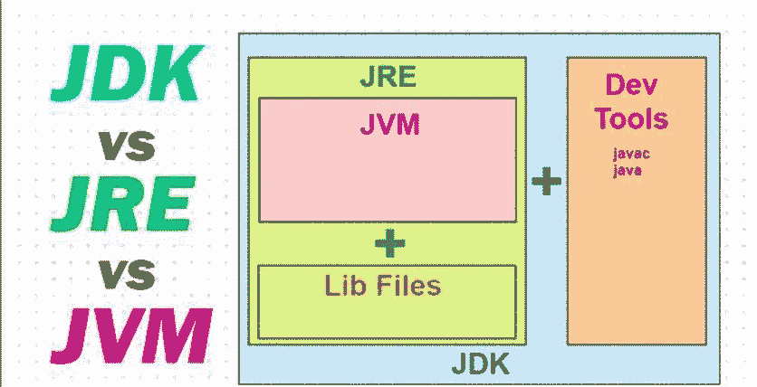

JDK 代表 Java Development Kit，它由两个部分组成：JRE 和 Java 开发工具。

JDK 对程序员来说是必须的，因为 Java 开发工具为 Java 应用程序开发提供了工具，例如 `Javac`，它可以将开发者的源代码编译成字节码等，然后在开发过程中使用 JRE 运行应用程序。

## 第 2 章：Java 中的数据类型

- 1 数据类型概览
- 2 `byte`
- 3 `boolean`
- 4 `char`
- 5 `short`
- 6 `int`
- 7 `long`
- 8 `float`
- 9 `double`
- 10 引用类型

## 数据类型概览

数据类型是关于如何处理数据的约定。

- 基本类型（Primitive Types）
  - `byte`
  - `boolean`
  - `char`
  - `short`
  - `int`
  - `long`
  - `float`
  - `double`
- 引用类型（Reference Types）

引用类型是存储对象的引用。

基本类型存储的是值。

引用类型存储的是指向对象的地址。

### 引用类型

引用类型是存储对象的引用。

- 类（Classes）
- 数组（Arrays）
- 接口（Interfaces）
- 包装类（Wrapper Classes）

基本类型存储的是值。

引用类型存储的是指向对象的地址。

### 基本类型

基本类型是存储值的类型。

- `byte`
- `boolean`
- `char`
- `short`
- `int`
- `long`
- `float`
- `double`

基本类型存储的是值。

引用类型存储的是指向对象的地址。

#### `byte`

`byte` 是一个 8 位的符号整数类型。

- `boolean`
- `char`
- `short`
- `int`
- `long`
- `float`
- `double`

基本类型存储的是值。

引用类型存储的是指向对象的地址。

#### `boolean`

`boolean` 是存储真或假值的类型。

- `byte`
- `char`
- `short`
- `int`
- `long`
- `float`
- `double`

基本类型存储的是值。

引用类型存储的是指向对象的地址。

#### `char`

`char` 是一个 16 位的 Unicode 字符类型。

- `boolean`
- `short`
- `int`
- `long`
- `float`
- `double`

基本类型存储的是值。

引用类型存储的是指向对象的地址。

#### `short`

`short` 是一个 16 位的符号整数类型。

- `boolean`
- `char`
- `int`
- `long`
- `float`
- `double`

基本类型存储的是值。

引用类型存储的是指向对象的地址。

#### `int`

`int` 是一个 32 位的符号整数类型。

- `boolean`
- `char`
- `short`
- `long`
- `float`
- `double`

基本类型存储的是值。

引用类型存储的是指向对象的地址。

#### `long`

`long` 是一个 64 位的符号整数类型。

- `boolean`
- `char`
- `short`
- `int`
- `float`
- `double`

基本类型存储的是值。

引用类型存储的是指向对象的地址。

#### `float`

`float` 是一个 32 位的单浮点数类型。

- `boolean`
- `char`
- `short`
- `int`
- `long`
- `double`

基本类型存储的是值。

引用类型存储的是指向对象的地址。

#### `double`

`double` 是一个 64 位的双精度浮点数类型。

- `boolean`
- `char`
- `short`
- `int`
- `long`
- `float`

基本类型存储的是值。

引用类型存储的是指向对象的地址。

### 引用类型（重复出现，但保留原始内容）

引用类型是存储对象的引用。

- 类（Classes）
- 数组（Arrays）
- 接口（Interfaces）
- 包装类（Wrapper Classes）

基本类型存储的是值。

引用类型存储的是指向对象的地址。

#### 类

类是对象的蓝图。

- 字段（Fields）
- 方法（Methods）
- 构造函数（Constructors）

基本类型存储的是值。

引用类型存储的是指向对象的地址。

#### 数组

数组是存储相同类型元素的集合。

- 一维数组
- 二维数组

基本类型存储的是值。

引用类型存储的是指向对象的地址。

#### 接口

接口是定义一组方法的类。

- 方法签名（Method Signatures）
- 常量（Constants）

基本类型存储的是值。

引用类型存储的是指向对象的地址。

#### 包装类

包装类是基本类型的对象的表示。

- `Byte`
- `Boolean`
- `Character`
- `Short`
- `Integer`
- `Long`
- `Float`
- `Double`

基本类型存储的是值。

引用类型存储的是指向对象的地址。

（注意：原文中“数据类型概览”及其后的内容重复出现四次，此处按照原文保留重复部分，仅调整格式。）

### 数据类型概览（第二次出现）

数据类型是关于如何处理数据的约定。

- 基本类型（Primitive Types）
  - `byte`
  - `boolean`
  - `char`
  - `short`
  - `int`
  - `long`
  - `float`
  - `double`
- 引用类型（Reference Types）

引用类型是存储对象的引用。

基本类型存储的是值。

引用类型存储的是指向对象的地址。

#### 基本类型

基本类型是存储值的类型。

- `byte`
- `boolean`
- `char`
- `short`
- `int`
- `long`
- `float`
- `double`

基本类型存储的是值。

引用类型存储的是指向对象的地址。

##### `byte`

`byte` 是一个 8 位的符号整数类型。

- `boolean`
- `char`
- `short`
- `int`
- `long`
- `float`
- `double`

基本类型存储的是值。

引用类型存储的是指向对象的地址。

##### `boolean`

`boolean` 是存储真或假值的类型。

- `byte`
- `char`
- `short`
- `int`
- `long`
- `float`
- `double`

基本类型存储的是值。

引用类型存储的是指向对象的地址。

##### `char`

`char` 是一个 16 位的 Unicode 字符类型。

- `boolean`
- `short`
- `int`
- `long`
- `float`
- `double`

基本类型存储的是值。

引用类型存储的是指向对象的地址。

##### `short`

`short` 是一个 16 位的符号整数类型。

- `boolean`
- `char`
- `int`
- `long`
- `float`
- `double`

基本类型存储的是值。

引用类型存储的是指向对象的地址。

##### `int`

`int` 是一个 32 位的符号整数类型。

- `boolean`
- `char`
- `short`
- `long`
- `float`
- `double`

基本类型存储的是值。

引用类型存储的是指向对象的地址。

##### `long`

`long` 是一个 64 位的符号整数类型。

- `boolean`
- `char`
- `short`
- `int`
- `float`
- `double`

基本类型存储的是值。

引用类型存储的是指向对象的地址。

##### `float`

`float` 是一个 32 位的单浮点数类型。

- `boolean`
- `char`
- `short`
- `int`
- `long`
- `double`

基本类型存储的是值。

引用类型存储的是指向对象的地址。

##### `double`

`double` 是一个 64 位的双精度浮点数类型。

- `boolean`
- `char`
- `short`
- `int`
- `long`
- `float`

基本类型存储的是值。

引用类型存储的是指向对象的地址。

#### 引用类型

引用类型是存储对象的引用。

- 类（Classes）
- 数组（Arrays）
- 接口（Interfaces）
- 包装类（Wrapper Classes）

基本类型存储的是值。

引用类型存储的是指向对象的地址。

##### 类

类是对象的蓝图。

- 字段（Fields）
- 方法（Methods）
- 构造函数（Constructors）

基本类型存储的是值。

引用类型存储的是指向对象的地址。

##### 数组

数组是存储相同类型元素的集合。

- 一维数组
- 二维数组

基本类型存储的是值。

引用类型存储的是指向对象的地址。

##### 接口

接口是定义一组方法的类。

- 方法签名（Method Signatures）
- 常量（Constants）

基本类型存储的是值。

引用类型存储的是指向对象的地址。

##### 包装类

包装类是基本类型的对象的表示。

- `Byte`
- `Boolean`
- `Character`
- `Short`
- `Integer`
- `Long`
- `Float`
- `Double`

基本类型存储的是值。

引用类型存储的是指向对象的地址。

### 数据类型概览（第三次出现）

数据类型是关于如何处理数据的约定。

- 基本类型（Primitive Types）
  - `byte`
  - `boolean`
  - `char`
  - `short`
  - `int`
  - `long`
  - `float`
  - `double`
- 引用类型（Reference Types）

引用类型是存储对象的引用。

基本类型存储的是值。

引用类型存储的是指向对象的地址。

#### 基本类型

基本类型是存储值的类型。

- `byte`
- `boolean`
- `char`
- `short`
- `int`
- `long`
- `float`
- `double`

基本类型存储的是值。

引用类型存储的是指向对象的地址。

##### `byte`

`byte` 是一个 8 位的符号整数类型。

- `boolean`
- `char`
- `short`
- `int`
- `long`
- `float`
- `double`

基本类型存储的是值。

引用类型存储的是指向对象的地址。

##### `boolean`

`boolean` 是存储真或假值的类型。

- `byte`
- `char`
- `short`
- `int`
- `long`
- `float`
- `double`

基本类型存储的是值。

引用类型存储的是指向对象的地址。

##### `char`

`char` 是一个 16 位的 Unicode 字符类型。

- `boolean`
- `short`
- `int`
- `long`
- `float`
- `double`

基本类型存储的是值。

引用类型存储的是指向对象的地址。

##### `short`

`short` 是一个 16 位的符号整数类型。

- `boolean`
- `char`
- `int`
- `long`
- `float`
- `double`

基本类型存储的是值。

引用类型存储的是指向对象的地址。

##### `int`

`int` 是一个 32 位的符号整数类型。

- `boolean`
- `char`
- `short`
- `long`
- `float`
- `double`

基本类型存储的是值。

引用类型存储的是指向对象的地址。

##### `long`

`long` 是一个 64 位的符号整数类型。

- `boolean`
- `char`
- `short`
- `int`
- `float`
- `double`

基本类型存储的是值。

引用类型存储的是指向对象的地址。

##### `float`

`float` 是一个 32 位的单浮点数类型。

- `boolean`
- `char`
- `short`
- `int`
- `long`
- `double`

基本类型存储的是值。

引用类型存储的是指向对象的地址。

##### `double`

`double` 是一个 64 位的双精度浮点数类型。

- `boolean`
- `char`
- `short`
- `int`
- `long`
- `float`

基本类型存储的是值。

引用类型存储的是指向对象的地址。

#### 引用类型

引用类型是存储对象的引用。

- 类（Classes）
- 数组（Arrays）
- 接口（Interfaces）
- 包装类（Wrapper Classes）

基本类型存储的是值。

引用类型存储的是指向对象的地址。

##### 类

类是对象的蓝图。

- 字段（Fields）
- 方法（Methods）
- 构造函数（Constructors）

基本类型存储的是值。

引用类型存储的是指向对象的地址。

##### 数组

数组是存储相同类型元素的集合。

- 一维数组
- 二维数组

基本类型存储的是值。

引用类型存储的是指向对象的地址。

##### 接口

接口是定义一组方法的类。

- 方法签名（Method Signatures）
- 常量（Constants）

基本类型存储的是值。

引用类型存储的是指向对象的地址。

##### 包装类

包装类是基本类型的对象的表示。

- `Byte`
- `Boolean`
- `Character`
- `Short`
- `Integer`
- `Long`
- `Float`
- `Double`

基本类型存储的是值。

引用类型存储的是指向对象的地址。

### 数据类型概览（第四次出现）

数据类型是关于如何处理数据的约定。

- 基本类型（Primitive Types）
  - `byte`
  - `boolean`
  - `char`
  - `short`
  - `int`
  - `long`
  - `float`
  - `double`
- 引用类型（Reference Types）

引用类型是存储对象的引用。

基本类型存储的是值。

引用类型存储的是指向对象的地址。

#### 基本类型

基本类型是存储值的类型。

- `byte`
- `boolean`
- `char`
- `short`
- `int`
- `long`
- `float`
- `double`

基本类型存储的是值。

引用类型存储的是指向对象的地址。

##### `byte`

`byte` 是一个 8 位的符号整数类型。

- `boolean`
- `char`
- `short`
- `int`
- `long`
- `float`
- `double`

基本类型存储的是值。

引用类型存储的是指向对象的地址。

##### `boolean`

`boolean` 是存储真或假值的类型。

- `byte`
- `char`
- `short`
- `int`
- `long`
- `float`
- `double`

基本类型存储的是值。

引用类型存储的是指向对象的地址。

##### `char`

`char` 是一个 16 位的 Unicode 字符类型。

- `boolean`
- `short`
- `int`
- `long`
- `float`
- `double`

基本类型存储的是值。

引用类型存储的是指向对象的地址。

##### `short`

`short` 是一个 16 位的符号整数类型。

- `boolean`
- `char`
- `int`
- `long`
- `float`
- `double`

基本类型存储的是值。

引用类型存储的是指向对象的地址。

##### `int`

`int` 是一个 32 位的符号整数类型。

- `boolean`
- `char`
- `short`
- `long`
- `float`
- `double`

基本类型存储的是值。

引用类型存储的是指向对象的地址。

##### `long`

`long` 是一个 64 位的符号整数类型。

- `boolean`
- `char`
- `short`
- `int`
- `float`
- `double`

基本类型存储的是值。

引用类型存储的是指向对象的地址。

##### `float`

`float` 是一个 32 位的单浮点数类型。

- `boolean`
- `char`
- `short`
- `int`
- `long`
- `double`

基本类型存储的是值。

引用类型存储的是指向对象的地址。

##### `double`

`double` 是一个 64 位的双精度浮点数类型。

- `boolean`
- `char`
- `short`
- `int`
- `long`
- `float`

基本类型存储的是值。

引用类型存储的是指向对象的地址。

#### 引用类型

引用类型是存储对象的引用。

- 类（Classes）
- 数组（Arrays）
- 接口（Interfaces）
- 包装类（Wrapper Classes）

基本类型存储的是值。

引用类型存储的是指向对象的地址。

##### 类

类是对象的蓝图。

- 字段（Fields）
- 方法（Methods）
- 构造函数（Constructors）

基本类型存储的是值。

引用类型存储的是指向对象的地址。

##### 数组

数组是存储相同类型元素的集合。

- 一维数组
- 二维数组

基本类型存储的是值。

引用类型存储的是指向对象的地址。

##### 接口

接口是定义一组方法的类。

- 方法签名（Method Signatures）
- 常量（Constants）

基本类型存储的是值。

引用类型存储的是指向对象的地址。

##### 包装类

包装类是基本类型的对象的表示。

- `Byte`
- `Boolean`
- `Character`
- `Short`
- `Integer`
- `Long`
- `Float`
- `Double`

基本类型存储的是值。

引用类型存储的是指向对象的地址。


引用类型存储的是指向对象的地址。

## 数据类型概览

数据类型是关于如何处理数据的约定。

- 基本类型（Primitive Types）
  - `byte`
  - `boolean`
  - `char`
  - `short`
  - `int`
  - `long`
  - `float`
  - `double`
- 引用类型（Reference Types）

引用类型是存储对象的引用。

基本类型存储的是值。

引用类型存储的是指向对象的地址。

### 基本类型

基本类型是存储值的类型。

- `byte`
- `boolean`
- `char`
- `short`
- `int`
- `long`
- `float`
- `double`

基本类型存储的是值。

引用类型存储的是指向对象的地址。

#### `byte`

`byte` 是一个 8 位的符号整数类型。

- `boolean`
- `char`
- `short`
- `int`
- `long`
- `float`
- `double`

基本类型存储的是值。

引用类型存储的是指向对象的地址。

#### `boolean`

`boolean` 是存储真或假值的类型。

- `byte`
- `char`
- `short`
- `int`
- `long`
- `float`
- `double`

基本类型存储的是值。

引用类型存储的是指向对象的地址。

#### `char`

`char` 是一个 16 位的 Unicode 字符类型。

- `boolean`
- `short`
- `int`
- `long`
- `float`
- `double`

基本类型存储的是值。

引用类型存储的是指向对象的地址。

#### `short`

`short` 是一个 16 位的符号整数类型。

- `boolean`
- `char`
- `int`
- `long`
- `float`
- `double`

基本类型存储的是值。

引用类型存储的是指向对象的地址。

#### `int`

`int` 是一个 32 位的符号整数类型。

- `boolean`
- `char`
- `short`
- `long`
- `float`
- `double`

基本类型存储的是值。

引用类型存储的是指向对象的地址。

#### `long`

`long` 是一个 64 位的符号整数类型。

- `boolean`
- `char`
- `short`
- `int`
- `float`
- `double`

基本类型存储的是值。

引用类型存储的是指向对象的地址。

#### `float`

`float` 是一个 32 位的单浮点数类型。

- `boolean`
- `char`
- `short`
- `int`
- `long`
- `double`

基本类型存储的是值。

引用类型存储的是指向对象的地址。

#### `double`

`double` 是一个 64 位的双精度浮点数类型。

- `boolean`
- `char`
- `short`
- `int`
- `long`
- `float`

基本类型存储的是值。

引用类型存储的是指向对象的地址。

### 引用类型

引用类型是存储对象的引用。

- 类（Classes）
- 数组（Arrays）
- 接口（Interfaces）
- 包装类（Wrapper Classes）

基本类型存储的是值。

引用类型存储的是指向对象的地址。

#### 类

类是对象的蓝图。

- 字段（Fields）
- 方法（Methods）
- 构造函数（Constructors）

基本类型存储的是值。

引用类型存储的是指向对象的地址。

#### 数组

数组是存储相同类型元素的集合。

- 一维数组
- 二维数组

基本类型存储的是值。

引用类型存储的是指向对象的地址。

#### 接口

接口是定义一组方法的类。

- 方法签名（Method Signatures）
- 常量（Constants）

基本类型存储的是值。

引用类型存储的是指向对象的地址。

#### 包装类

包装类是基本类型的对象的表示。

- `Byte`
- `Boolean`
- `Character`
- `Short`
- `Integer`
- `Long`
- `Float`
- `Double`

基本类型存储的是值。

引用类型存储的是指向对象的地址。


# 第 2 章：Java 中的数据类型

## 数据类型概览

数据类型是关于如何处理数据的约定。

- 基本类型（Primitive Types）
  - `byte`
  - `boolean`
  - `char`
  - `short`
  - `int`
  - `long`
  - `float`
  - `double`
- 引用类型（Reference Types）

引用类型是存储对象的引用。

基本类型存储的是值。引用类型存储的是指向对象的地址。

### 基本类型

基本类型是存储值的类型。

- `byte`
- `boolean`
- `char`
- `short`
- `int`
- `long`
- `float`
- `double`

基本类型存储的是值。引用类型存储的是指向对象的地址。

### `byte`

`byte` 是一个 8 位的符号整数类型。

- `boolean`
- `char`
- `short`
- `int`
- `long`
- `float`
- `double`

基本类型存储的是值。引用类型存储的是指向对象的地址。

### `boolean`

`boolean` 是存储真或假值的类型。

- `byte`
- `char`
- `short`
- `int`
- `long`
- `float`
- `double`

基本类型存储的是值。引用类型存储的是指向对象的地址。

### `char`

`char` 是一个 16 位的 Unicode 字符类型。

- `boolean`
- `short`
- `int`
- `long`
- `float`
- `double`

基本类型存储的是值。引用类型存储的是指向对象的地址。

### `short`

`short` 是一个 16 位的符号整数类型。

- `boolean`
- `char`
- `int`
- `long`
- `float`
- `double`

基本类型存储的是值。引用类型存储的是指向对象的地址。

### `int`

`int` 是一个 32 位的符号整数类型。

- `boolean`
- `char`
- `short`
- `long`
- `float`
- `double`

基本类型存储的是值。引用类型存储的是指向对象的地址。

### `long`

`long` 是一个 64 位的符号整数类型。

- `boolean`
- `char`
- `short`
- `int`
- `float`
- `double`

基本类型存储的是值。引用类型存储的是指向对象的地址。

### `float`

`float` 是一个 32 位的单浮点数类型。

- `boolean`
- `char`
- `short`
- `int`
- `long`
- `double`

基本类型存储的是值。引用类型存储的是指向对象的地址。

### `double`

`double` 是一个 64 位的双精度浮点数类型。

- `boolean`
- `char`
- `short`
- `int`
- `long`
- `float`

基本类型存储的是值。引用类型存储的是指向对象的地址。

### 引用类型

引用类型是存储对象的引用。

- 类（Classes）
- 数组（Arrays）
- 接口（Interfaces）
- 包装类（Wrapper Classes）

基本类型存储的是值。引用类型存储的是指向对象的地址。

### 类

类是对象的蓝图。

- 字段（Fields）
- 方法（Methods）
- 构造函数（Constructors）

基本类型存储的是值。引用类型存储的是指向对象的地址。

### 数组

数组是存储相同类型元素的集合。

- 一维数组
- 二维数组

基本类型存储的是值。引用类型存储的是指向对象的地址。

### 接口

接口是定义一组方法的类。

- 方法签名（Method Signatures）
- 常量（Constants）

基本类型存储的是值。引用类型存储的是指向对象的地址。

### 包装类

包装类是基本类型的对象的表示。

- `Byte`
- `Boolean`
- `Character`
- `Short`
- `Integer`
- `Long`
- `Float`
- `Double`

基本类型存储的是值。引用类型存储的是指向对象的地址。

# 引言

Java 是关于如何编写一种可以在不同平台上运行的程序。**一次编写，到处运行**。

## Java 虚拟机（JVM）

在 Java 诞生之前，在 Windows 操作系统上编写并编译为运行机器码的程序由于许多差异无法在 Linux 操作系统上运行。

太阳系统公司（Sun Microsystems）工程师创建了 JVM（Java 虚拟机），安装在 Windows、Linux、Mac 等不同平台上。

JVM 编写的程序被编译成字节码，一种可以在 JVM 环境中运行的特殊代码。JVM 帮助将字节码翻译成宿主机的代码。这就是为什么 Java 可以在不同平台上运行的原理。

# JDK 和 JRE

## JRE（Java 运行环境）


JRE 是 Java Runtime Environment 的缩写，包含了 JVM（Java 虚拟机）和许多支持执行 Java 语言编写的程序的 Java 类。

## JDK（Java 开发工具包）


JDK 代表 Java Development Kit，它由两个部分组成：JRE 和 Java 开发工具。

JDK 对程序员来说是必须的，因为 Java 开发工具为 Java 应用程序开发提供了工具，例如 `Javac`，它可以将开发者的源代码编译成字节码等，然后在开发过程中使用 JRE 运行应用程序。

# 第 3 章：Java 中的 if else 语句

## 1 if 语句

`if` 语句是关于控制流最基本的结构。它根据条件来决定是否执行某些代码。

`if` 语句允许执行代码块，如果条件为真。

```java
if (condition) {
    // Do something if
}
```

## 2 if - else 语句

`if - else` 语句是比 `if` 语句稍微复杂一点的。它允许你在条件为真时执行一个块，而在条件为假时执行另一个块。

```java
if (condition) {
    // Do something if true
} else {
    // Do something if false
}
```

## 3 if - else if - else 语句

`if - else if - else` 语句允许你检查多个条件。程序将按顺序检查条件，执行第一个为真的代码块，并跳过其余部分。

```java
if (condition1) {
    // Executes if condition1 is true
} else if (condition2) {
    // Executes if condition1 is false and condition2 is true
} else {
    // Executes if none of the above conditions are true
}
```

## 4 布尔值

布尔值只有两个值：真（`true`）或假（`false`）。它是逻辑判断的基础。

```java
boolean isJavaFun = true;
boolean isPythonHard = false;
```

## 5 条件表达式中涉及的运算符

运算符用于比较值并产生布尔值。

- 比较运算符：`==`, `!=`, `<`, `<=`, `>=`, `>`
- 逻辑运算符：`&&`（与），`||`（或），`!`（非）

# 第 4 章：Java 中的 Switch 语句

## 1 switch 语句的结构

`switch` 语句允许根据变量的值来执行多个代码块中的一个。

```java
switch (expression) {
    case value1:
        // 代码 for value1
        break;
    case value2:
        // 代码 for value2
        break;
    default:
        // 代码 for no match
}
```

## 2 switch 示例


这里有一个如何使用`switch`语句的简单示例。

```java
int day = 3;
switch (day) {
    case 1:
        System.out.println("Monday");
        break;
    case 2:
        System.out.println("Tuesday");
        break;
    case 3:
        System.out.println("Wednesday");
        break;
    default:
        System.out.println("Other day");
}
```

## 3 Java 中的 break 语句

`break`语句用于退出`switch`语句。如果没有`break`，程序将继续执行后续`case`的代码，这被称为“穿透”现象。

# 第5章：Java 中的循环

- 1 Java 中的循环
- 2 for 循环
- 3 for-each 循环
- 4 while 循环
- 5 do-while 循环
- 6 循环中的 break 语句
- 7 循环中的 continue 语句
- 8 标签循环

## 1 Java 中的循环

循环用于重复执行代码块。

## 2 for 循环

`for`循环通常用于在知道迭代次数的情况下执行代码。

```java
for (int i = 0; i < 5; i++) {
    System.out.println(i);
}
```

## 3 for-each 循环

`for-each`循环是用于遍历数组或集合的便利循环。

```java
for (String name : names) {
    System.out.println(name);
}
```

## 4 while 循环

`while`循环在条件为真时重复执行代码。

```java
int i = 0;
while (i < 5) {
    System.out.println(i);
    i++;
}
```

## 5 do-while 循环

`do-while`循环至少执行一次代码，然后检查条件。

```java
int i = 0;
do {
    System.out.println(i);
    i++;
} while (i < 5);
```

## 6 循环中的 break 语句

`break`语句可以终止循环。

## 7 循环中的 continue 语句

`continue`语句跳过当前迭代并继续下一次迭代。

## 8 标签循环

标签循环允许从嵌套循环中跳出特定的外循环。

# 第6章：Java 中的数组

- 1 什么是数组
- 2 一维数组
- 3 一维数组与 for-each 循环
- 4 一维数组的工具方法
- 5 二维数组

## 1 什么是数组

数组是存储相同类型元素的有序集合。

## 2 一维数组

一维数组是最简单的数组形式。

```java
int[] numbers = {1, 2, 3, 4, 5};
```

## 3 一维数组与 for-each 循环

使用`for-each`循环遍历一维数组非常简单。

```java
for (int number : numbers) {
    System.out.println(number);
}
```

## 4 一维数组的工具方法

`java.util.Arrays`类提供了许多处理数组的方法。

## 5 二维数组

二维数组是数组的数组。

```java
int[][] matrix = {
    {1, 2, 3},
    {4, 5, 6}
};
```

# 第7章：Java 中的继承与多态

- 1 引言
- 2 类、构造函数和实例
- 3 Java 中的继承
- 4 Java 中的多态

## 1 引言

继承允许一个类从另一个类继承属性和方法。

## 2 类、构造函数和实例

类是蓝图。构造函数用于初始化实例。实例是类的具体对象。

## 3 Java 中的继承

使用`extends`关键字来实现继承。

## 4 Java 中的多态

多态允许一个对象以许多不同类的形式存在。

# 第8章：Java 中的抽象类和接口

- 1 引言
- 2 抽象类
- 3 抽象类示例
- 4 接口概览
- 5 接口的结构
- 6 类实现接口

## 1 引言

抽象类和接口是实现抽象的工具。

## 2 抽象类

抽象类是不能实例化的类。它可以包含抽象方法。

## 3 抽象类示例

这里有一个使用抽象类的示例。

## 4 接口概览

接口是定义一组方法的契约。

## 5 接口的结构

接口可以包含方法签名和常量。

## 6 类实现接口

类使用`implements`关键字来实现一个接口。

```java
// Do something here
}
```

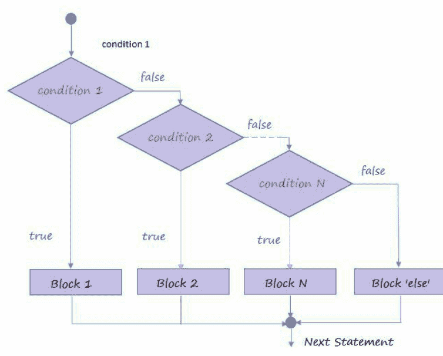

# ElseExample1.java

```java
package com.abd.java.javabasic.controlflow;
public class ElseExample1 {

    public static void main(String[] args) {
        // 声明一个 int 类型变量（32位整数）
        // 表示你的测试分数。
        int score = 70;

        System.out.println("Your score = " + score);
    }
}
```

```java
// 如果分数少于 50
if (score < 50) {
    System.out.println("You are not pass");
}
// 如果分数大于或等于 50 且小于 80
else if (score >= 50 && score < 80) {
    System.out.println("You are pass");
}
// 剩余情况（大于等于 80）
else {
    System.out.println("You are pass, good student!");
}
```

### 输出

Your score = 70

You are pass

更改上方变量`score`的值并运行`ElseExample1`类：

`int score = 20;`

### 输出

Your score = 20

You are not pass

### 4 Boolean

`boolean`数据类型只有两个值：`true`或`false`。

创建`BooleanExample`类：

### BooleanExample.java

```java
package com.abd.java.javabasic.controlflow;
public class BooleanExample {
    public static void main(String[] args) {
        // 声明一个 boolean 类型变量
        boolean value = true;
        // 如果 value 为 true
        if (value == true) {
            System.out.println("It's true");
        }
        // 其他
        else {
            System.out.println("It's false");
        }
        if (value) {
            System.out.println("It's true");
        }
        // 其他
        else {
            System.out.println("It's false");
        }
    }
}
```

### 输出

| It's true |

| It's true |

示例：

### ElseExample2.java

```java
package com.abd.java.javabasic.controlflow;
public class ElseExample2 {
    public static void main(String[] args) {

// 声明一个 int 类型变量，代表你的年龄。
int age = 20;

// 如果 age 小于等于 17
if (age <= 17) {
    System.out.println("You are 17 or younger");
}

// 如果 age 等于 18
else if (age == 18) {
    System.out.println("You are 18 year old");
}

// 如果 age 大于 18 且小于 40
else if (age > 18 && age < 40) {
    System.out.println("You are between 19 and 39");
}

// 剩余情况（大于等于 40）
else {
    // 嵌套语句
    // 测试 age 不等于 50。
    if (age != 50) {
        System.out.println("You are not 50 year old");
    }

    // 否定语句
    if (!(age == 50)) {
        System.out.println("You are not 50 year old");
    }

    // 如果 age 是 60 或 70
    if (age == 60 || age == 70) {
        System.out.println("You are 60 or 70 year old");
    }
}
}
```

### 输出

You are between 19 and 39

# 第4章：Java 中的 Switch 语句

- 1 switch 语句结构
- 2 switch 示例
- 3 switch 中的 break 语句

## 1 switch 语句结构

```java
// variable_to_test: 要测试的变量。
switch ( variable_to_test ) {
  case value1:
    // 在此处做操作...
    break;
  case value2:
    // 在此处做操作...
    break;
  default:
    // 在此处做操作...
}
```

## switch 语句的特点：

`switch`会检查变量的值，并从上到下与每个不同的值进行比较。每个待比较的值被称为`case`。当某个`case`为真时，执行该`case`的语句块。

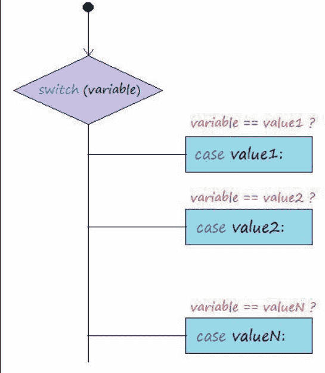

如果所有`case`都为假，将执行`default`语句块。注意：在`switch`结构中，可能存在也可能不存在`default`语句块。

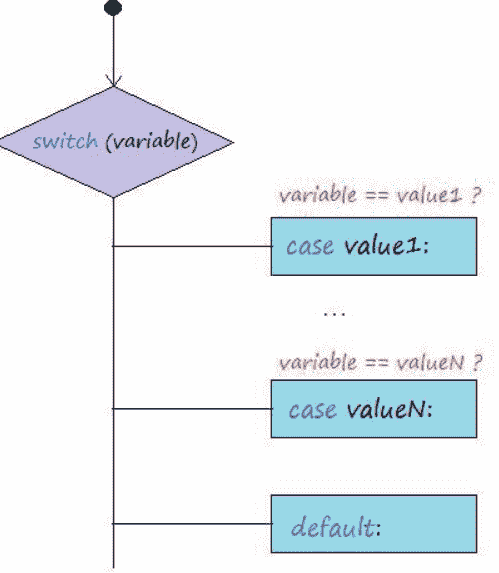

当找到`true case`时，如果该块中没有`break`语句，程序将继续执行下面的块，直到遇到`break`语句或没有语句块执行。

**break**语句使程序退出**switch**。（见下图）。


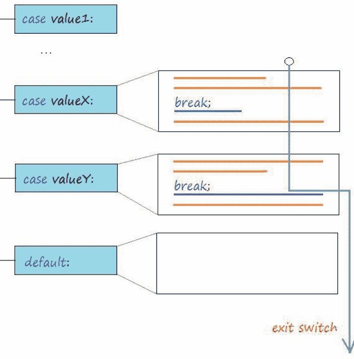

注意`case`语句是一个特定值，你不能进行以下操作：

```java
// 这是不允许的！！
case (age < 18) :
// case 仅接受特定值，例如：
case 18:
// 在此处做操作..
break;
```

## 2 switch 示例

SwitchExample1.java

```java
package com.abd.javabasic.controlflow;
public class SwitchExample1 {
    public static void main(String[] args) {
        // 声明一个变量
        int age = 20;

        // 检查值
        switch (age) {
            // Case 18
            case 18:
                System.out.println("You are 18 year old");
                break;
            // Case 20
            case 20:
                System.out.println("You are 20 year old");
                break;
            // 剩余情况
            default:
                System.out.println("You are not 18 or 20");
        }
    }
}
```

### 输出

You are 18 year old

## 3 switch 中的 break 语句

`break`语句用于退出`switch`块。如果没有它，程序将继续执行后续`case`，即使它们不匹配（这被称为贯穿/fall-through）。

```java
System.out.println("Total = " + total);

}
```

### 输出

Total = 5050

## 3 for-each 循环

```java
// arrayOrCollection: 数组或集合
for (Type variable: arrayOrCollection) {
  // 代码实现 ...
}
```

示例：

# ForeachExample.java

```java
package com.abd.java.javabasic;
public class ForeachExample {

  public static void main(String[] args) {

    // 声明一个 String 类型的数组。
    String[] fruits = new String[] {"Apple", "Apricot", "Banana" };

    // 使用 for-each 循环遍历数组。
    for (String fruit : fruits) {
      System.out.println(fruit);
    }
  }
}
```

### 输出

Apple

Apricot

Banana

## 4 while 循环

`while`循环用于在条件为真时重复执行程序段。

`while`循环通常在迭代次数未定义（非固定）时使用。

这是`while`循环的结构：

```java
// 当条件为真时执行
while ( condition ) {
    // 在此处执行某些操作...
}
```

# WhileExample1.java

```java
package com.abd.java.javabasic;
public class WhileExample1 {

    public static void main(String[] args) {

        int value = 3;

        // 只要 'value' 小于 10，循环继续运行。
        while (value < 10) {

            System.out.println("Value = " + value);

            // 通过加 2 来增加 'value'
            value = value + 2;
        }
    }
}
```

## 5 do-while 循环

`do-while`循环用于多次执行一段程序。`do-while`的特点是该语句块至少会被执行一次。在每次迭代后，程序会检查条件，如果条件仍然成立，则将执行该语句块。

这是`do-while`循环的结构：

```java
// do-while 循环至少执行一次迭代。
// 只要条件为真，它就会继续工作
do {
    // 在此处执行某些操作。
}
while (condition);
```

# DoWhileExample1.java

```java
package com.abd.java.javabasic.loop;
public class DoWhileExample1 {

    public static void main(String[] args) {

    int value = 3;

    // do-while 循环至少执行一次
    do {
        System.out.println("Value = " + value);

        // 增加 3
        value = value + 3;
    } while (value < 10);

}
}
```

### 输出

| Value = 3 |

| Value = 6 |

| Value = 9 |

## 6 循环中的 break 语句

`break`语句可以出现在循环中。它是帮助程序退出循环的语句。

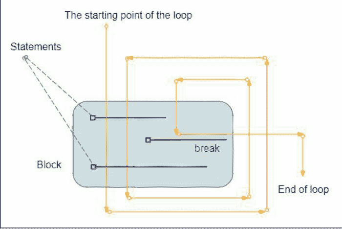

### LoopBreakExample.java


```java
package com.abd.java.javabasic.loop;
public class LoopBreakExample {

    public static void main(String[] args) {
        System.out.println("Break example");

        int x = 2;

        while (x < 15) {
            System.out.println("-------------------------");
            System.out.println("x = " + x);

            // 如果 x = 5 则退出循环。
            if (x == 5) {
                break;
            }
            x++;
            System.out.println("x after ++ = " + x);
        }

        System.out.println("Done!");
    }
}
```

### 输出

| Break example |
|---|---|
| x = 2 |
| x after ++ = 3 |
| x = 3 |
| x after ++ = 4 |
| x = 4 |
| x after ++ = 5 |
| x = 5 |
| Done! |

## 7 循环中的 continue 语句

`continue` 语句可以出现在循环中。当遇到 `continue` 语句时，程序将忽略语句块内的语句以及 `continue` 之外的语句，并开始新的迭代（如果条件仍然成立）。

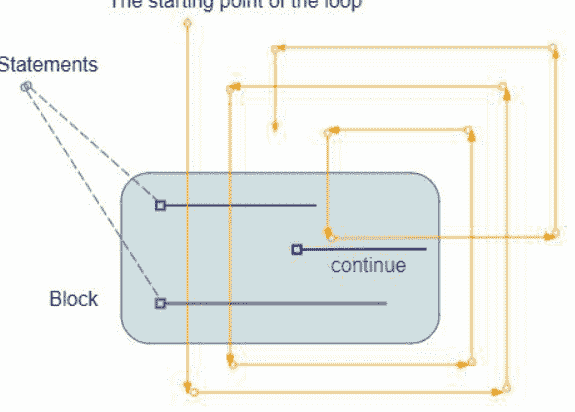

### LoopContinue.java

```java
package com.abd.java.javabasic;
public class LoopContinue {

    public static void main(String[] args) {
        System.out.println("Continue example");
        int x = 2;

        while (x < 7) {
            System.out.println("------------------------");
            System.out.println("x = " + x);

            // x = x + 1;
            x++;

            // % 运算符用于取余。
            // 如果 x 是偶数，则忽略 'continue' 之后的方的行；
            // 并开始新的迭代（如果条件成立）。
            if (x % 2 == 0) {
                continue;
            }
            System.out.println("x after ++ = " + x);
        }
        System.out.println("Done!");
    }
}
```

### 输出

| Continue example |
| x = 2 |
| x after ++ = 3 |
| x = 3 |
| x after ++ = 5 |
| x = 5 |
| x after ++ = 7 |
| Done! |

# 8 标签循环 (Labelled Loop)

Java 允许为循环标记一个标签。这就像给循环命名，当你在程序中使用嵌套循环时非常有用。

你可以使用 `break labelX;` 来跳出带有 `labelX` 的循环。

你可以使用 `continue labelX;` 来继续带有 `labelX` 的循环。


## 2 层嵌套循环，无标签

## 2 层嵌套循环，有标签

```java
for(........) {
    for(........) {
        break;
    }
}
```

```java
label1: for(........) {
    label2: for(........) {
        break label1;
    }
}
```

```java
// 带标签的 for 循环。
label1: for (...) {
}
// 带标签的 while 循环。
label2: while (...) {
}
// 带标签的 do-while 循环。
label3: do {
} while (..);
```

# LabelledLoopBreakExample.java

```java
package com.abd.java.javabasic.loop;
public class LabelledLoopBreakExample {

    public static void main(String[] args) {
        System.out.println("Labelled Loop Break example");

        int i = 0;
        label1: while (i < 5) {
            System.out.println("----------------");
            System.out.println("i = " + i);
            i++;
            label2: for (int j = 0; j < 3; j++) {
                System.out.println(" -> " + j);
                if (j > 0) {
                    // 跳出带有 label1 的循环。
                    break label1;
                }
            }
        }
        System.out.println("Done!");
    }
}
```

### 输出

| Labelled Loop Break example |
| i = 0 |
| Done! |

```java
for (int index = 0; index < myArray.length; index++) {
    System.out.println("Element " + index + " = " + myArray[index]);
}
```

### 输出

| 属性 | 值 |
|---|---|
| 数组长度 | 5 |
| myArray[3]=27 |
| 元素 0 = 10 |
| 元素 1 = 14 |
| 元素 2 = 36 |
| 元素 3 = 27 |
| 元素 4 = 18 |

# ArrayExample2.java

```java
package com.abd.java.javabasic.array;
public class ArrayExample2 {

    public static void main(String[] args) {

        // 声明一个包含 5 个元素的数组
        int[] myArray = new int[5];

        // 打印元素计数
        System.out.println("Array Length=" + myArray.length);

        // 使用循环为数组元素赋值。
        for (int index = 0; index < myArray.length; index++) {
            myArray[index] = 100 * index + 3;
        }

        // 打印索引为 3 的元素
        System.out.println("myArray[3] = " + myArray[3]);
    }
}
```

### 输出

| 属性 | 值 |
|---|---|
| 数组长度 | 5 |
| myArray[3] = 903 |

## 3. 一维数组和 for-each 循环

Java 5 为你提供了 `for-each` 循环，允许你在不使用索引变量的情况下遍历数组的所有元素。

示例：

# ArrayForeachExample.java

```java
package com.abd.java.javabasic.array;
public class ArrayForeachExample {
    public static void main(String[] args) {
        // 声明一个 String 类型的数组
        String[] fruits = new String[] { "Apple", "Apricot", "Banana" };

        // 使用 for-each 循环遍历数组。
        for (String fruit : fruits) {
            System.out.println(fruit);
        }
    }
}
```

### 输出

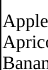

## 4. 一维数组的工具方法

Java 提供了一些数组的静态方法，例如排序数组、为所有数组元素赋值、搜索、比较数组等。这些方法定义在 `Arrays` 类中。

下面是 `Arrays` 类中定义的常用静态方法。这些方法适用于 `byte`, `char`, `double`, `float`, `long`, `int`, `short`, `boolean` 类型的元素数组。

```java
// 相同类型的参数，并返回一个 List。
public static <T> List<T> asList(T... a)

// 类型 X 可以是：byte, char, double, float, long, int, short, boolean

// 搜索数组中某个值的索引。
// (使用二分查找算法)。
public static int binarySearch(X[] x, X key)

// 复制数组元素以创建指定长度的数组数组。
public static int[] copyOf(int[] original, int newLength)

// 将指定数组的指定范围复制到新数组中。
public static double[] copyOfRange(double[] original, int from, int to)

// 比较两个数组
public static boolean equals(long[] a, long[] a2)

// 为数组的所有元素分配相同的值。
public static void fill(X[] a, X val)

// 将数组转换为字符串；
public static String toString(X[] a)
```

以下示例使用了 `Arrays` 类的一些方法。

### ArraysExample.java

```java
package com.abd.java.javabasic.array;

import java.util.Arrays;
import java.util.List;

public class ArraysExample {

    public static void main(String[] args) {
        int[] years = new int[]{ 2001, 1994, 1995, 2000, 2017 };

        // 排序
        Arrays.sort(years);

        for (int year : years) {
            System.out.println("Year: " + year);
        }

        // 将数组转换为字符串。
        String yearString = Arrays.toString(years);

        System.out.println("Years: " + yearString);

        // 从多个值创建列表。
        List<String> names = Arrays.asList("Tom", "Jerry", "Donald");

        for (String name : names) {
            System.out.println("Name: " + name);
        }
    }
}
```

### 输出

```
Year: 1994
Year: 1995
Year: 2000
Year: 2001
Year: 2017
Years: [1994, 1995, 2000, 2001, 2017]
Name: Tom
Name: Jerry
Name: Donald
```

## 5. 二维数组

二维数组的行和列用索引 0, 1, 2, .... 标记。要访问二维数组的元素，你需要通过两个索引来访问：行索引和列索引。

| 索引 | 0 | 1 | 2 | 3 | 4 | 5 | 6 | 7 | 8 | 9 |
|---|---|---|---|---|---|---|---|---|---|---|
| 0 | 0 | 1 | 2 | 3 | 4 | 5 | 6 | 7 | 8 | 9 |
| 1 | 10 | 11 | 12 | 13 | 14 | 15 | 16 | 17 | 18 | 19 |
| 2 | 20 | 21 | 22 | 23 | 24 | 25 | 26 | 27 | 28 | 29 |
| 3 | 30 | 31 | 32 | 33 | 34 | 35 | 36 | 37 | 38 | 39 |
| 4 | 40 | 41 | 42 | 43 | 44 | 45 | 46 | 47 | 48 | 49 |

你可以通过以下方式访问二维数组：

```java
int[][] matrix = new int[5][10];
int value = matrix[1][2]; // 访问第 1 行第 2 列的元素
```

```java
for (int row = 0; row < teamAndPlayers.length; row++) {
  String[] players = teamAndPlayers[row];

  for (int col = 0; col < players.length; col++) {
    System.out.println("Player at[" + row + "][" + col + "]=" + teamAndPlayers[row][col]);
  }
}
```

### 输出

团队数量: 2

美国球员数量: 3

越南球员数量: 2

Player at[0][0]=Sam

Player at[0][1]=Smith

Player at[0][2]=Robert

Player at[1][0]=Tran

Player at[1][1]=Nguyen

# 示例：

# TwoDimensionalExample3.java

```java
package com.abd.java.javabasic.array;
public class TwoDimensionalExample {

  public static void main(String[] args) {

    // 声明一个二维数组（数组的数组）。
    // 有 2 行。
    String[][] teamAndPlayers = new String[2][];
    // 美国球员
    teamAndPlayers[0] = new String[]{"Sam", "Smith", "Robert"};
    // 越南球员
    teamAndPlayers[1] = new String[]{ "Tran", "Nguyen" };

    for (int row = 0; row < teamAndPlayers.length; row++) {
      String[] players = teamAndPlayers[row];

      for (int col = 0; col < players.length; col++) {
        System.out.println("Player at[" + row + "][" + col + "]=" + teamAndPlayers[row][col]);
      }
    }
  }
}
```

### 输出

| Player at[0][0]=Sam |
| Player at[0][1]=Smith |
| Player at[0][2]=Robert |
| Player at[1][0]=Tran |
| Player at[1][1]=Nguyen |

# 第 7 章：继承与多态

## 1 简介

## 2 类、构造函数和实例

## 3 Java 中的继承

## 4 多态

### 1 简介

继承和多态 - 这是 Java 中一个非常重要的概念。如果你想学习继承，就必须更好地理解它。在开始学习继承之前，你需要显式地理解类、构造函数和实例。假设类描述了一个具有姓名、出生年份、出生地的人。

### Person.java


```java
package com.abd.java.inheritance.basic;

public class Person {

    // 字段名 - name
    private String name;
    // 字段 bornYear
    private Integer bornYear;
    // 字段 placeOfBirth
    private String placeOfBirth;

    // 构造函数有 3 个参数。
    // 目标是给 Person 的字段赋值。
    // 指定姓名、出生年份、出生地。
    public Person(String name, Integer bornYear, String placeOfBirth) {
        this.name = name;
        this.bornYear = bornYear;
        this.placeOfBirth = placeOfBirth;
    }

    // 构造函数有 2 个参数。
    // 目标是给姓名、出生年份赋值。
    // 未分配出生地。
    public Person(String name, Integer bornYear) {
        this.name = name;
        this.bornYear = bornYear;
    }

    public String getName() {
        return name;
    }

    public void setName(String name) {
        this.name = name;
    }

    public Integer getBornYear() {
        return bornYear;
    }

    public void setBornYear(Integer bornYear) {
        this.bornYear = bornYear;
    }

    public String getPlaceOfBirth() {
        return placeOfBirth;
    }

    public void setPlaceOfBirth(String placeOfBirth) {
        this.placeOfBirth = placeOfBirth;
    }
}
```

### PersonDemo.java

```java
package com.abd.java.inheritance.basic;

public class PersonDemo {

    public static void main(String[] args) {
        // 实例：托马斯·爱迪逊。
        Person person = new Person("Thomas Edison", 1847);

        System.out.println("Info: ");
        System.out.println("Name: " + person.getName());
        System.out.println("Born Year: " + person.getBornYear());
        System.out.println("Place of Birth: " + person.getPlaceOfBirth());

        // 实例：比尔·盖茨
        Person billGates = new Person("Bill Gates", 1955, "Seattle, Washington");

        System.out.println("Info: ");
        System.out.println("Name: " + billGates.getName());
        System.out.println("Born Year: " + billGates.getBornYear());
        System.out.println("Place of Birth: " + billGates.getPlaceOfBirth());
    }
}
```

## 区分类、构造函数和实例

`Person` 模拟了一个类，它是抽象的，但它包含了信息；在上面的示例中，信息是姓名、出生年份和出生地。

## 构造函数

构造函数的名称始终与类名相同。

一个类有一个或多个构造函数。可以带参数也可以不带参数；不带参数的构造函数被称为默认构造函数。构造函数用于创建类的实例。

参见示例，从构造函数创建对象（实例）。

```java
Person billGates = new Person("Bill Gates", 1955, "Seattle, Washington");
```

```java
public class Person {
    private String name;
    private Integer bornYear;
    private String placeOfBirth;

    public Person(String name, Integer bornYear, String placeOfBirth) {
        this.name = name;
        this.bornYear = bornYear;
        this.placeOfBirth = placeOfBirth;
    }
}
```

## 3 Java 中的继承

我们需要一些类来参与其中。

- `Animal`：模拟类。
- `Duck`：继承自 `Animal`。
- `Cat`：继承自 `Animal`。
- `Mouse`：继承自 `Animal`。

```java
public abstract String getAnimalName();
```

这种方法意味着你想创建一个类的实例，在子类中需要声明并实现方法。

### Animal.java

```java
package com.abd.java.inheritance.animal;

// 该类至少有一个抽象方法。
public abstract class Animal {

    // 姓名，例如 Tom, Jerry Mouse。
    private String name;

    // 默认构造函数
    public Animal() {
    }

    public Animal(String name) {
        this.name = name;
    }

    public String getName() {
        return name;
    }

    public void setName(String name) {
        this.name = name;
    }

    public abstract String getAnimalName();
}
```

## 接下来看 Cat，继承自 Animal

`Cat` 也有构造函数和字段。在构造函数的第一行必须调用 `super()`，这意味着调用父类的构造函数来分配字段。如果你不调用 `super()`，Java 会在编译时在构造函数的第一行插入 `super()`。

### Cat.java

```java
package com.abd.java.inheritance;

public class Cat extends Animal {

    private int age;
    private int height;

    public Cat(int age, int height) {
        // 调用父类的构造函数。
        // 目的是给父类的字段赋值。
        super();
        // 接下来，给自己的字段赋值。
        this.age = age;
        this.height = height;
    }

    public Cat(String name, int age, int height) {
        // 调用父类的构造函数。
        super(name);
        // 接下来，给自己的字段赋值。
        this.age = age;
        this.height = height;
    }

    public int getAge() {
        return age;
    }

    public void setAge(int age) {
        this.age = age;
    }

    public int getHeight() {
        return height;
    }

    public void setHeight(int height) {
        this.height = height;
    }

    @Override
    public String getAnimalName() {
        return "Cat";
    }
}
```

```java
package com.abd.java.inheritance.animal;

public class Mouse extends Animal {

    private int weight;

    // 默认构造函数。
    public Mouse() {
        // Mouse(int)
        // 调用 Mouse(int) 构造函数
        this(100);
    }

    // 构造函数有一个参数。
    public Mouse(int weight) {
        // 如果你没有调用任何 super (..)。
        // Java 将调用默认的 super()。
        super();
        this.weight = weight;
    }

    // 构造函数有 2 个参数。
    public Mouse(String name, int weight) {
        super(name);
        this.weight = weight;
    }

    public int getWeight() {
        return weight;
    }

    public void setWeight(int weight) {
        this.weight = weight;
    }

    @Override
    public String getAnimalName() {
        return "Mouse";
    }
}
```

## InstanceofDemo.java

```java
package com.abd.java.inheritance.demo;

import com.abd.java.inheritance.animal.Animal;
import com.abd.java.inheritance.animal.Cat;
import com.abd.java.inheritance.animal.Mouse;

public class InstanceofDemo {

    public static void main(String[] args) {
        // 创建一个 Animal 对象。
        // Animal 是抽象类，
        // 你不能通过 Animal 的构造函数创建对象。
        Animal tom = new Cat("Tom", 3, 20);

        System.out.println("name: " + tom.getName());

        // 使用 'instanceof' 运算符检查
        // 对象是否是某个特定类的实例。
        if (tom instanceof Mouse) {
            System.out.println("tom is a mouse");
        }
        if (tom instanceof Cat) {
            System.out.println("tom is a cat");
        }
        if (tom instanceof Animal) {
            System.out.println("tom is an animal");
        }
    }
}
```

### 输出

```text
name: Tom

tom is a cat

tom is an animal
```

## InheritDemo.java

```java
package com.abd.java.inheritance.demo;

import com.abd.java.inheritance.animal.Cat;

public class InheritDemo {

    public static void main(String[] args) {
        // 创建 Cat 实例。
        Cat tom = new Cat("Tom", 3, 20);

        // 调用从父类 (Animal) 继承的方法。
        System.out.println("name: " + tom.getName());
        System.out.println("animalName: " + tom.getAnimalName());

        System.out.println("--------");

        // 调用 Cat 类中定义的方法。
        System.out.println("Age: " + tom.getAge());
        System.out.println("Height: " + tom.getHeight());
    }
}
```

### 输出

```text
name: Tom

animalName: Cat

--------

Age: 3

Height: 20
```

## Casting in Java

```java
package com.abd.java.inheritance.demo;

import java.util.Random;

import com.abd.java.inheritance.animal.Animal;
import com.abd.java.inheritance.animal.Cat;
import com.abd.java.inheritance.animal.Mouse;

public class CastDemo {

    // 此方法返回一个随机动物。
    public static Animal getRandomAnimal() {
        // 返回随机值 0 或 1。
        int random = new Random().nextInt(2);

        Animal animal = null;
        if (random == 0) {
            animal = new Cat("Tom", 3, 20);
        } else {
            animal = new Mouse("Jerry", 5);
        }
        return animal;
    }

    public static void main(String[] args) {
        Animal animal = getRandomAnimal();

        if (animal instanceof Cat) {
            // 转换为 Cat
            Cat cat = (Cat) animal;
            // 并调用 Cat 类的方法。
            System.out.println("Cat height: " + cat.getHeight());
        } else if (animal instanceof Mouse) {
            // 转换为 Mouse。
            Mouse mouse = (Mouse) animal;
            // 并调用 Mouse 类的方法。
            System.out.println("Mouse weight: " + mouse.getWeight());
        }
    }
}
```

### 输出

```text
Cat height: 20
```

或

```text
Mouse weight: 5
```

## 4 Java 中的多态

你有一只亚洲猫 `AsianCat`，你可以说它是一个 `Cat`，也可以说它是一个 `Animal`，这是多态的一个方面。

或者另一个例子：在你的简历上记录你是一个亚洲男性，而你实际上是一个越南人。

下面的示例展示了你如何在声明与现实之间表现。

`AsianCat` 是 `Cat` 类的子类。

### AsianCat.java


# 1 继承示例

以下代码演示了`AsianCat`类继承`Cat`类的过程，并重写了`getAnimalName()`方法：

```java
package com.abd.java.inheritance.animal;

public class AsianCat extends Cat {

    public AsianCat(String name, int age, int height) {
        super(name, age, height);
    }

    // 重写父类 (Cat) 的方法
    @Override
    public String getAnimalName() {
        return "Asian Cat";
    }
}
```

接下来是`BuildHouse`类继承`ManualJob`并实现其抽象方法的示例：

```java
// 所以它必须实现剩余抽象方法。
public class BuildHouse extends ManualJob {
    public BuildHouse() {
    }
    // 实现父类的抽象方法。
    @Override
    public void doJob() {
        System.out.println("Build a House");
    }
}
```

## JobDemo.java

`JobDemo`类展示了如何创建抽象类的子类对象并调用其方法：

```java
package com.abd.java.abs;
public class JobDemo {
    public static void main(String[] args) {
        // 创建 AbstractJob 对象
        // 使用 JavaCoding 的构造函数;
        AbstractJob job1 = new JavaCoding();

        // 调用 doJob() 方法。
        job1.doJob();

        // getJobName 是 AbstractJob 类中的抽象方法。
        // 但它在特定的子类（JavaCoding）中被实现了。
        // 所以可以调用。
        String jobName = job1.getName();
        System.out.println("Job Name 1 = " + jobName);

        // 创建 AbstractJob 对象
        // 使用 BuildHouse 的构造函数。
        AbstractJob job2 = new BuildHouse();
        job2.doJob();
        String jobName2 = job2.getName();
        System.out.println("Job Name 2= " + jobName2);
    }
}
```

### 输出

运行上述代码将产生以下输出：

```
Coding Java...
Job Name 1= Java
Build a House
Job Name 2= Manual Job
```

# 4 接口概览 (Overview of the interface)

我们知道一个类只能继承一个父类。

```java
// B 是类 A 的子类，换句话说 B 自 A。
// Java 只允许一个类继承另外一个类。
public class B extends A {
    // ...
    // 在没有指定类 B 继承自特定类的情况下。
    // 默认，理解为 B 继承 Object 类。
    public class B {
}
// 此声明与上述是等价的。
public class B extends Object {
}
```

但一个类可以实现多个接口（Interfaces）。

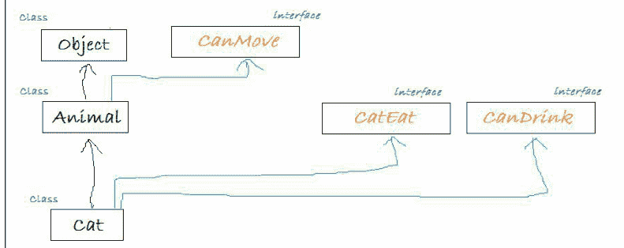

```java
// 一个类只能继承一个父类。
// 但可以实现（extends）多个接口。
public class Cat extends Animal implements CanEat, CanDrink {
    // ...
}
```

# 5 接口的结构 (Structure of an Interface)

```java
package com.abd.java.it;

#### 这是一个没有指定访问修饰符的接口。
// 它的访问修饰符是默认的。
// 只有相同包中的类可以实现这个接口。
interface NoAccessModifierInterface {

}
```

## CanMove.java

```java
package com.abd.java.it;

// 这个接口定义了一个标准，
// 关于能够移动的东西。
public interface CanMove {

    // 接口中的方法总是抽象且公共的。
    public abstract void run();

    // 即使你不指定 'public abstract'，java 也总是理解。
    void back();

    // 速度。
    public int getVelocity();

}
```

## CanDrink.java

```java
package com.abd.java.it;

// 这个接口定义了一个标准，
// 关于能够喝水的东西。
public interface CanDrink {

    // 接口中的字段始终是 'public static final'。
    // 无论你是否声明。
    public static final String PEPSI = "PEPSI";
    final String NUMBER_ONE = "NUMBER ONE";
    String SEVENUP = "SEVEN UP";

    public void drink();

}
```

# 6 类实现接口 (Class implements Interface)

## Animal.java

```java
package com.abd.java.jcls;

import com.abd.java.itf.CanMove;

// 这个类继承 Object。
// 并实现了 CanMove。
// CanMove 有 3 个抽象方法。
// 这个类只实现了一个方法。
// 因此它必须被声明为抽象。
// 剩余的抽象方法将在子类中实现。
public abstract class Animal implements CanMove {

    // 实现 run() 方法。
    @Override
    public void run() {
        System.out.println("Running");
    }
}
```

## Cat.java

```java
package com.abd.java.jcls;

import com.abd.java.itf.CanDrink;
import com.abd.java.itf.CanMove;

// 这个类继承 Animal 并实现了 CanDrink。
// 这个类是抽象的。
// 所以必须实现所有接口方法。
public abstract class Cat extends Animal implements CanDrink {

    protected String name;

    public Cat(String name) {
        this.name = name;
    }

    public String getName() {
        return name;
    }
}
```

```java
package com.abd.java.jcls;

import com.abd.java.itf.CanDrink;
import com.abd.java.itf.CanMove;

// 这个类继承 Cat 并实现了 CanMove。
// 这个类不是抽象的。
public class Mouse extends Cat implements CanMove {

    public Mouse(String name) {
        super(name);
    }

    @Override
    public void run() {
        System.out.println("Cat is running");
    }

    @Override
    public void back() {
        System.out.println("Cat is backing up");
    }

    @Override
    public int getVelocity() {
        return 10;
    }

    @Override
    public void drink() {
        System.out.println("Cat is drinking");
    }
}
```

# 3 Jdk1.6 的安装与 Eclipse 中的配置

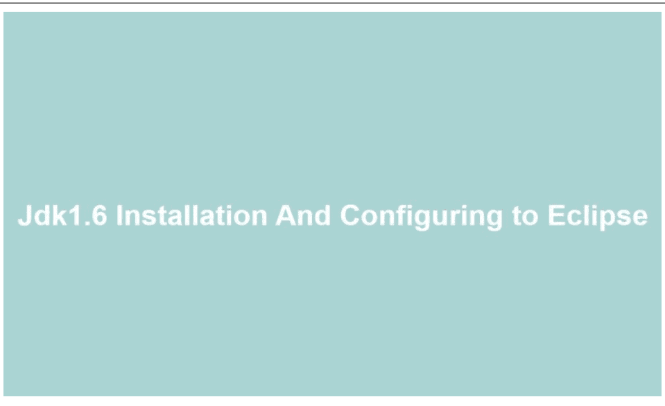

### 第 1 步：

### 第 2 步：

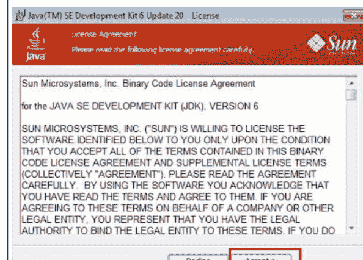

### 第 3 步：

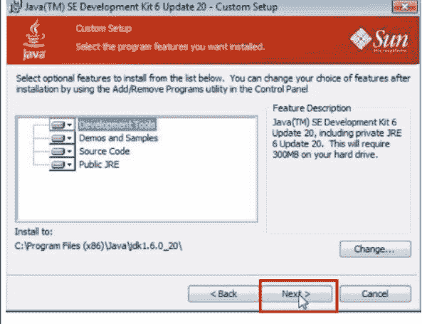

### 第 4 步：

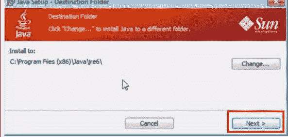

### 第 5 步：


### 第 6 步：

在 Eclipse 中配置 Jdk1.6

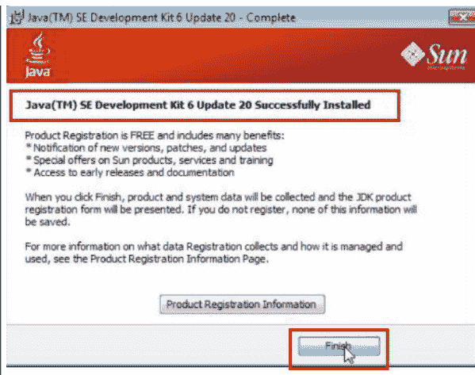

### 第 7 步：

Eclipse 指向 Jdk1.6 的位置

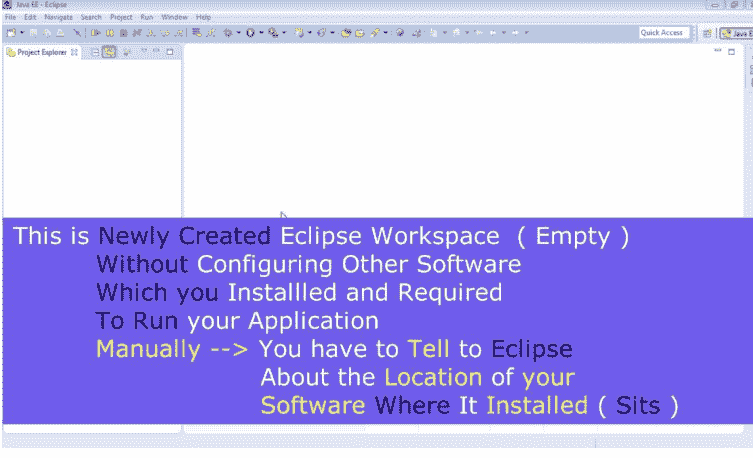

### 第 8 步：

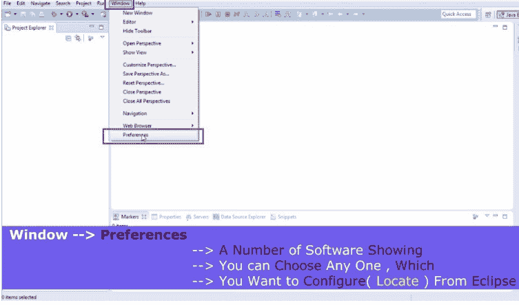

### 第 9 步：

窗口首选项（Window Preferences）显示软件

你可以从 Eclipse 中选择任何想要配置的内容

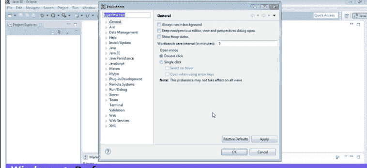

### 第 10 步：

### 第 11 步：

### 第 12 步：

### 第 13 步：

### 第 14 步：

### 第 15 步：

### 第 16 步：

### 第 17 步：

### 第 18 步：

```
Apr 27, 2023 2:17:10 PM org.apache.catalina.core.Lifecycle: The APR based Apache Tomcat native library allows optimal

Apr 27, 2023 2:17:11 PM org.coyote.http111Protocol.startProtocol: Initializing Coyote HTTP/1.1 on http-8080 processed in 236 ms

Apr 27, 2023 2:17:11 PM org.apache.catalina.core.StandardService: Starting service

Apr 27, 2023 2:17:11 PM org.apache.catalina.core.StandardEngine: Starting Service Engine: Tomcat/6.0.29

Apr 27, 2023 2:17:14 PM org.coyote.http111Protocol: Starting Coyote HTTP/1.1 on http-8080

Apr 27, 2023 2:17:14 PM org.coyote.common.ChannelSocket: insert on /0.0.0.0:8009

Apr 27, 2023 2:17:14 PM org.apache.jk.server.Main: JK running in IDE (Files=466) Configuration

Apr 27, 2023 2:17:14 PM org.apache.catalina.startup.Catalina: Server startup in 303 ms
```

### 第 19 步：

### 第 20 步：

# JAVA

# SPRING

# HIBERNATE

在本书中，你将学习从零开始使用 Spring Hibernate 开发 Java Web 应用，提供现成的解决方案并逐步解释。AMIT K

## 引言

学习如何使用 Spring Hibernate 从零开发 Java Web 应用

在这里你将学习到：

当用户通过（浏览器）提交请求时

Action 将接收请求、继续执行并连接数据库

Service 接口（包含方法）、对表进行什么操作

CRUD 操作（创建、更新、查询、删除）。

Service 接口的实现（方法）

包含依赖（持久化对象信息）。

DAO 接口（方法）、如何与表通信

用于 CRUD 操作（创建、更新、查询、删除）。

负责与表进行通信

POJO（简单 Java 对象）

所有请求数据来自（浏览器）

所有结果数据从（表）传输到（浏览器）

MVC（模型-视图-控制器）架构

用于视图（向浏览器显示结果数据）

结果数据来自（表）

连接数据库之后

前端控制器（Front Controller）将获取合适的（JSP 页面）并将数据放入（JSP 页面）

并将（JSP 页面）发送回浏览器

浏览器将显示

## 首页

## 环境

| 技术 | |
|---|---|
| Struts1, Spring, Hibernate, Javascript, Css, Query |
| 数据库 | MySQL |
| 服务器 | Tomcat 1.6 |
| 日志工具 | Log4j |
| IDE | Eclipse |
| 设计模式 | 前端控制器, MVC, 工厂, DAO, 代理, 单例, 抽象工厂模式, 模板模式, SessionFactory, 事务工厂。 |

## 目录结构

## 目录结构（展开）

## 项目资源

- hospital

- IAX-WS Web Services

- 部署描述符: hospital

- Java Resources

    - com.abd.action

        - AllAction.java

    - com.abd.biz

        - AdminBiz.java

        - DoctorBiz.java

        - PatientBiz.java

    - com.abd.biz.impl

当用户通过（浏览器）提交请求时

Action 将接收请求、继续执行并连接数据库

Service 接口（包含方法）、对表进行什么操作

CRUD 操作（创建、更新、查询、删除）

Service 接口的实现（方法）

包含依赖（持久化对象信息）

- AdminDaoImpl.java

- DoctorDaoImpl.java

- PatientDaoImpl.java

- com.abd.dao

    - AdminDao.java

    - AppointmentDao.java

    - CuraymentDao.java

    - DoctorDao.java

    - HistoryDao.java

    - PatientDao.java

DAO 接口（方法）、如何与表通信

用于 CRUD 操作（创建、更新、查询、删除）。

- AdminDaoImpl.java

- DoctorDaoImpl.java

- PatientDaoImpl.java

```
mysql> show tables:
admin
curayment
delete
doctor
history
patient
pinqueue

7 rows in set (0.00 sec)
```

# JBG 医疗保健

- 返回首页

医生已添加

- 查看医院医生信息

- 添加医生账号

- 移除医生账号

- 登出

- 患者用户

- 医生用户

# 查看医院医生信息

## 移除医生信息

| 全名 | 年龄 | 性别 | 职称 | 科室 | 长 | 电话 |
|---|---|---|---|---|---|--|
| Indira | 28 | 0 | 教授 | 眼科 | 近视 | 82330000 |
| Jagan | 29 | 0 | 教授 | 头部 | 头痛 | 10000083 |
| Christian | 40 | 0 | 外科医生 | 鼻科 | 打鼾 | 12340002 |
| Dinesh | 35 | 0 | 外科医生 | 牙科 | 牙齿 | 32000100 |
| Pankaj | 35 | 0 | 教授 | 眼科 | 近视 | 82323100 |
| Kamal | 28 | 0 | 教授 | 头部 | 头痛 | 12340823 |
| Raman | 29 | 0 | 教授 | 鼻科 | 打鼾 | 83500002 |
| Bhashrat | 40 | 0 | 外科医生 | 牙科 | 近视 | 65000822 |
| Ajay | 44 | 0 | MBBS | 内科医生 | 感冒 | 67082300 |
| Supriya | 35 | 1 | 外科医生 | 牙科 | 牙齿 | 68082300 |
| Ritu | 21 | 1 | MBBS | 眼科 | 近视 | 87200000 |


# 患者模块 II

## 患者注册

| 全名 | 年龄 | 性别 | 职称 | 科室 | 长 | 电话 |
| --- | --- | --- | --- | --- | --- | --- |
| Diuple | 39 | 0 | 教授 | 鼻科 | 打鼾 | 63000223 |
| Bhavna | 40 | 1 | 外科医生 | 内科 | 感冒 | 56000823 |
| Tripti | 34 | 1 | MBBS | 内科 | 牙科 | 47200020 |
| Dipti | 24 | 1 | MBBS | 牙科 | 牙齿 | 47200023 |
| Rohan | 35 | 0 | 外科医生 | 头部 | 头痛 | 56000823 |
| Dinesh | 28 | 0 | 教授 | 眼科 | 近视 | 23180000 |
| Dipti | 39 | 1 | 教授 | 头部 | 头痛 | 35400032 |
| Bhavna | 40 | 1 | 外科医生 | 鼻科 | 打鼾 | 32300230 |
| Ajay | 44 | 0 | MBBS | 内科 | 感冒 | 57008230 |

| 全名 | 年龄 | 性别 | 职称 | 科室 | 长 | 电话 |
| --- | --- | --- | --- | --- | --- | --- |
| Indra | 35 | 男 | 教授 | 眼科 | 近视 | 8230000 |
| Raj | 29 | 女 | 教授 | 头部 | 头痛 | 1000082 |
| Chetan | 40 | 男 | 外科医生 | 无 | 打鼾 | 12340002 |
| Sneha | 35 | 女 | 外科医生 | 牙科 | 牙齿 | 1231000 |
| Pankaj | 28 | 男 | 教授 | 眼科 | 近视 | 8232310 |
| Kamal | 20 | 女 | 教授 | 头部 | 头痛 | 12340021 |
| Bharat | 40 | 男 | 外科医生 | 无 | 打鼾 | 8330002 |
| Rajveer | 40 | 女 | 教授 | 眼科 | 感冒 | 4508302 |
| Ajay | 35 | 男 | 外科医生 | 牙科 | 牙齿 | 6082300 |
| Ritu | 41 | 女 | MBBS | 内科 | 感冒 | 6430500 |
| Digpti | 25 | 男 | 外科医生 | 眼科 | 近视 | 8120000 |
| Bharat | 40 | 女 | 外科医生 | 无 | 头痛 | 6500230 |
| Tejas | 44 | 男 | MBBS | 内科 | 感冒 | 6500230 |
| Digpti | 24 | 女 | MBBS | 内科 | 牙齿 | 4723000 |
| Rihan | 15 | 男 | 外科医生 | 牙科 | 牙齿 | 5408023 |
| Dinesh | 28 | 女 | 教授 | 眼科 | 近视 | 2388000 |
| Digpti | 39 | 男 | 教授 | 头部 | 头痛 | 3540032 |
| Bhavna | 40 | 女 | 外科医生 | 无 | 打鼾 | 3238029 |


## 患者注册成功

## JBG 医疗保健

恭喜！

- 返回首页
- 查看所有医生
- 预约
- 查看我的预约
- 取消预约
- 查询医生信息
- 查询记录
- 登出
- 医生用户
- 管理员用户

# 查看所有医生

## JBG 医疗保健

点击医生姓名查看医生预约信息

| 全名 | 序号 | 年龄 | 性别 (0男1女) | 职称 | 科室 | 长 | 电话 |
| --- | --- | --- | --- | --- | --- | --- | --- |
| Indra | 1 | 25 | 0 | 教授 | 眼科 | 近视 | 8233000 |
| Japan | 2 | 30 | 0 | 外科医生 | 鼻科 | 头痛 | 1234002 |
| Christian | 3 | 40 | 0 | 外科医生 | 牙科 | 牙齿 | 1234002 |
| Pankaj | 4 | 35 | 0 | 外科医生 | 牙科 | 牙齿 | 8232510 |
| Kamal | 5 | 28 | 0 | 教授 | 眼科 | 近视 | 8232510 |
| Raman | 6 | 29 | 0 | 教授 | 头部 | 头痛 | 1234568 |
| Rajveer | 7 | 40 | 0 | 外科医生 | 鼻科 | 头痛 | 1706956 |
| Ajay | 8 | 35 | 0 | MBBS | 眼科 | 感冒 | 4500582 |
| Supriya | 9 | 35 | 0 | 内科医生 | 鼻科 | 感冒 | 6802810 |
| Farhan | 10 | 31 | 0 | 外科医生 | 牙科 | 牙齿 | 6408210 |
| Dimple | 11 | 23 | 1 | 教授 | 眼科 | 近视 | 8233000 |
| Deepa | 12 | 21 | 1 | 教授 | 头部 | 头痛 | 1234002 |
| Bharna | 13 | 26 | 1 | 外科医生 | 鼻科 | 近视 | 6300520 |
| Tripti | 14 | 24 | 1 | 内科医生 | 眼科 | 感冒 | 6300520 |
| Digant | 15 | 27 | 1 | MBBS | 牙科 | 感冒 | 4723000 |
| Rohan | 16 | 25 | 0 | 外科医生 | 眼科 | 近视 | 3540032 |
| Dinesh | 17 | 28 | 0 | 教授 | 头部 | 头痛 | 2338000 |
| Bhimraj | 18 | 39 | 1 | 外科医生 | 鼻科 | 近视 | 3540032 |
| Ajay | 19 | 44 | 0 | MBBS | 内科 | 感冒 | 57008230 |

# 查询预约

## JBG 医疗保健


- 返回首页
- 查看所有医生
- 预约
- 查看我的预约
- 取消预约
- 查询医生信息
- 查询记录
- 登出
- 医生用户
- 管理员用户

科室：内科医生  
职称：MBBS  
擅长：感冒  
时间：周二上午  
确认

# 查询可用医生的预约列表

## JGB 医疗保健

点击医生姓名查看医生预约信息

| 全名 | 序号 | 年龄 | 性别 (0男1女) | 职称 | 科室 | 长 | 电话 |
| --- | --- | --- | --- | --- | --- | --- | --- |
| Ajay | 10 | 44 | 0 | MBBS | 内科 | 感冒 | 67300082 |
| Ajay | 12 | 42 | 1 | MBBS | 内科 | 感冒 | 546008 |
| Tripti | 16 | 34 | 1 | MBBS | 内科 | 感冒 | 5600023 |
| Ajay | 22 | 44 | 0 | MBBS | 内科 | 感冒 | 4723 |

- 返回首页
- 查看所有医生
- 预约
- 查看我的预约
- 取消预约
- 查询医生信息
- 查询记录
- 登出
- 医生用户
- 管理员用户

# 选择医生进行预约

## JBG 医疗保健

点击“预约医生号码”进行预约

| 返回首页 | 点击医生姓名查看预约信息 |
| --- | --- |
| 查看所有医生 | 日 Mon Tue Wed Thu Fri Sat |
| 预约 | 当前预约的号码 1 1 1 1 1 1 |
| 查看我的预约 | |
| 取消预约 | |
| 查询医生信息 | |
| 查询记录 | |
| 登出 | |
| 医生用户 | |
| 管理员用户 | |

# 预约确认

## JBG 医疗保健

- 返回首页
- 查看所有医生
- 预约
- 查看我的预约
- 取消预约
- 查询医生信息
- 查询记录
- 登出
- 医生用户
- 管理员用户

# 医生总数


# 取消预约号码

## JBG 医疗保健

| 预约号 | 医生号 | 0-周日 | 1-周一 | 下午 | 预约日期 |
| --- | --- | --- | --- | --- | --- |
| 1 | 1 | 25 | 0 | | 2024-01-21 19:51 |
| 2 | 10 | 44 | 0 | | 2024-01-21 19:49 |
| 3 | 2 | 30 | 1 | | 2024-01-21 19:14 |
| 4 | 3 | 40 | 1 | | 2024-01-21 19:35 |
| 5 | 4 | 35 | 0 | | 2024-01-21 19:43 |
| 6 | 5 | 26 | 1 | | 2024-01-21 19:31 |

# 取消选定的预约

## 取消成功

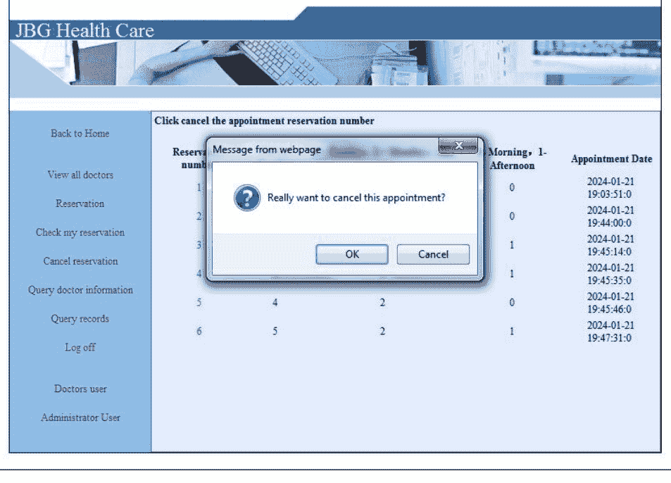

# 取消医生预约

## JBG 医疗保健

返回首页  
预约取消成功！  
查看所有医生  
预约  
查看我的预约  
取消预约  
查询医生信息  
查询记录  
登出  
医生用户  
管理员用户

# 查询医生记录

## JBG 医疗保健

| 医生姓名 | 医生序号 | 年龄 | 性别 | 职称 | 科室 | 长 | 电话 |
| --- | --- | --- | --- | --- | --- | --- | --- |
| Indira | 1 | 28 | 0 | 教授 | 眼科 | 近视 | 8233000 |
| Ajay | 10 | 44 | 0 | MBBS | 内科 | 感冒 | 67300082 |

## JGB 医疗保健

| 医生编号 | 症状 | 诊断 | 处方 | 治疗结束 | 治疗开始时间 | 治疗结束时间 |
| :--- | :--- | :--- | :--- | :--- | :--- | :--- |
| 1 | 近视 | 眼药水、眼检 | 眼药水、绿色/蔬菜 | 0 | 2024-01-21 | 2024-01-23 |
| 10 | 出汗、发冷、咳嗽 | 101°F、感冒测试、扫描 | 红红霉素 500 mg, Dell 250mg | 1 | 2024-01-21 | |
| 3 | 流体流出 | 检查、呼吸、问题 | 软药、Abbinsol 250mg | 0 | 2024-01-21 | 2024-01-23 |
| 4 | 呼吸困难、空腔 | 牙齿检查 | Abesto 膏剂、清洁 | 1 | 2024-01-21 | |

- 返回首页
- 查看所有医生
- 预约
- 查看我的预约
- 取消预约
- 查询医生
- 查询记录
- 退出登录
- 医生用户
- 管理员用户

# 医生模块模块 III

## 医生登录

## 医生登录成功


## JGB 医疗保健

你好 !! Indira

- 返回首页
- 修改密码
- 查看预约患者信息
- 创建记录
- 查看患者记录
- 修改患者记录
- 结束治疗
- 退出登录
- 患者用户
- 管理员用户

## 修改密码

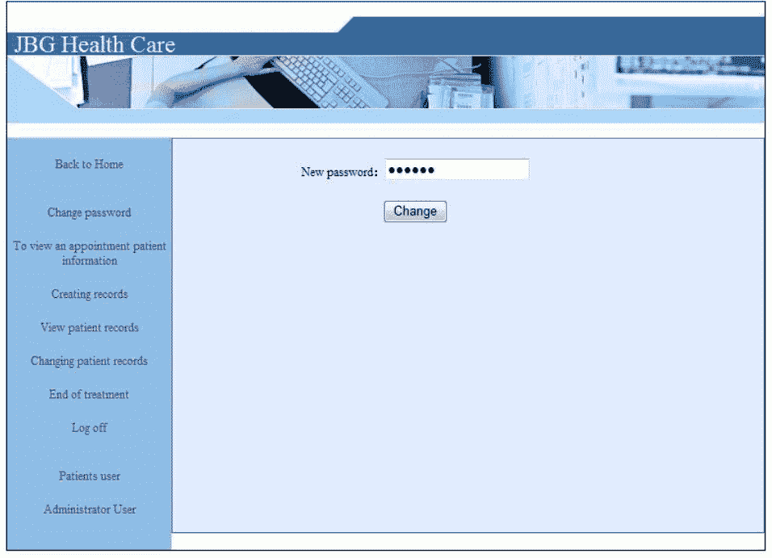

## 修改密码成功

## 查看患者预约

## JGB 医疗保健

| 全名 | 年龄 | 性别 | 联系地址 | 电话 | 预约号 |
| :--- | :--- | :--- | :--- | :--- | :--- |
| Amar | 20 | 0 | I A AMAR | 3455234523 | 1 |

- 返回首页
- 修改密码
- 查看预约患者信息
- 创建记录
- 查看患者记录
- 修改患者记录
- 结束治疗
- 退出登录
- 患者用户
- 管理员用户

## 创建患者记录

## 创建患者记录


## JGB 医疗保健


- 返回首页
- 修改密码
- 查看预约患者信息
- 创建记录
- 查看患者记录
- 修改患者记录
- 结束治疗
- 退出登录
- 患者用户
- 管理员用户

症状：流体流出  
诊断：检查、呼吸困难  
处方：软药、Abbinsol 250mg  
创建

## 创建患者记录成功

## JGB 医疗保健

- 返回首页  
超越医疗成功

- 修改密码
- 查看预约患者信息
- 创建记录
- 查看患者记录
- 修改患者记录
- 结束治疗
- 退出登录
- 患者用户
- 管理员用户

## 修改患者记录

## 修改患者记录成功


## JGB 医疗保健

- 返回首页  
更新成功！

- 修改密码
- 查看预约患者信息
- 创建记录
- 查看患者记录
- 修改患者记录
- 结束治疗
- 退出登录
- 患者用户
- 管理员用户

## 结束治疗

## JGB 医疗保健

需要成功操作

- 返回首页
- 修改密码
- 查看预约信息
- 创建记录
- 查看患者记录
- 修改患者记录
- 结束治疗
- 退出登录
- 患者用户
- 管理员用户

| 全名 年龄 性别 地址 | 电话 | 症状诊断 | 处方 | 开始时间 | 结束时间 |
| :--- | :--- | :--- | :--- | :--- | :--- |
| 修改结束时间 Amar | 20 0 | I.A. AMAR | 3453254523 | 眼检近视 | 眼药水、绿色/蔬菜 | 2024-01-21 |

## 治疗结束

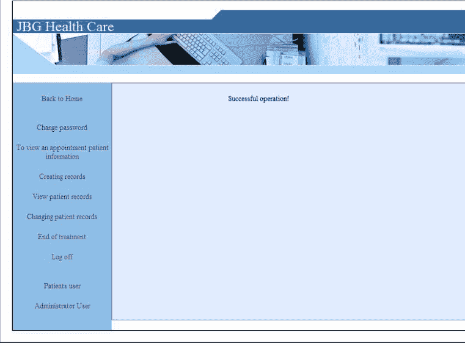

## 医院流程

步骤 1：医生 → 预约  
步骤 2：医生 → 治疗  
步骤 3：患者 → 治疗  
步骤 4：医生 → 结束  
步骤 5：患者 → 状态

### 医院设计

### 1. 整体功能

#### 1. 医院

- 医生
- 患者
- 预约

#### 2. 患者

- 修改密码
- 你的密码
- 你的信息

#### 3. 医生

- 你的密码
- 你的记录

#### 4. 管理员

- 增加或删除

### 2. 设计

- 医生
- 患者
- 预约
- 记录

### 模块数量

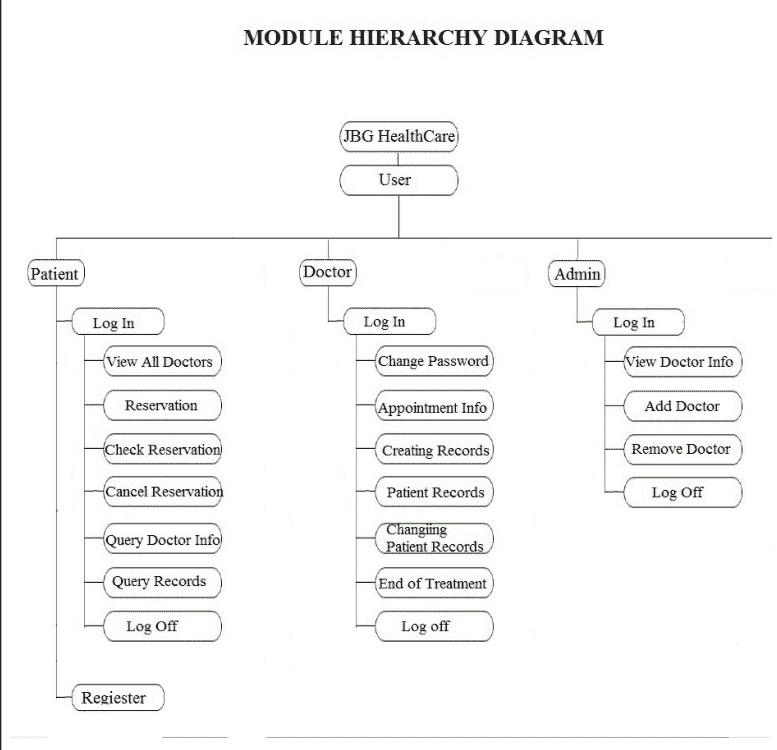

### 组件图


### 组件图

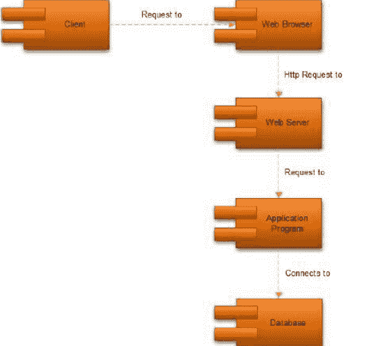

### 序列图（患者注册）

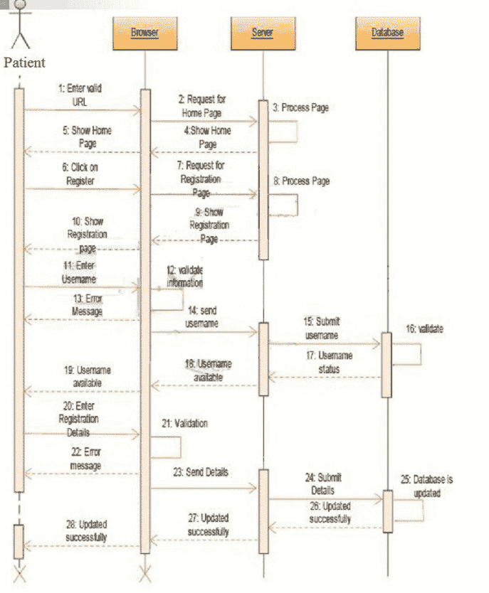

### 活动图（患者）

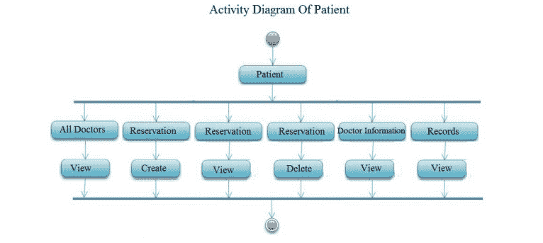

### 活动图（医生）

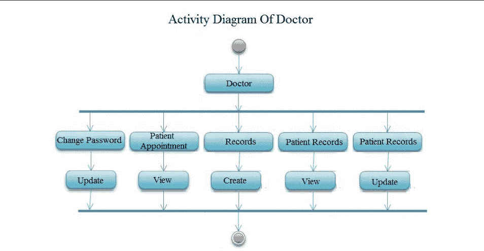

### 活动图（管理员）

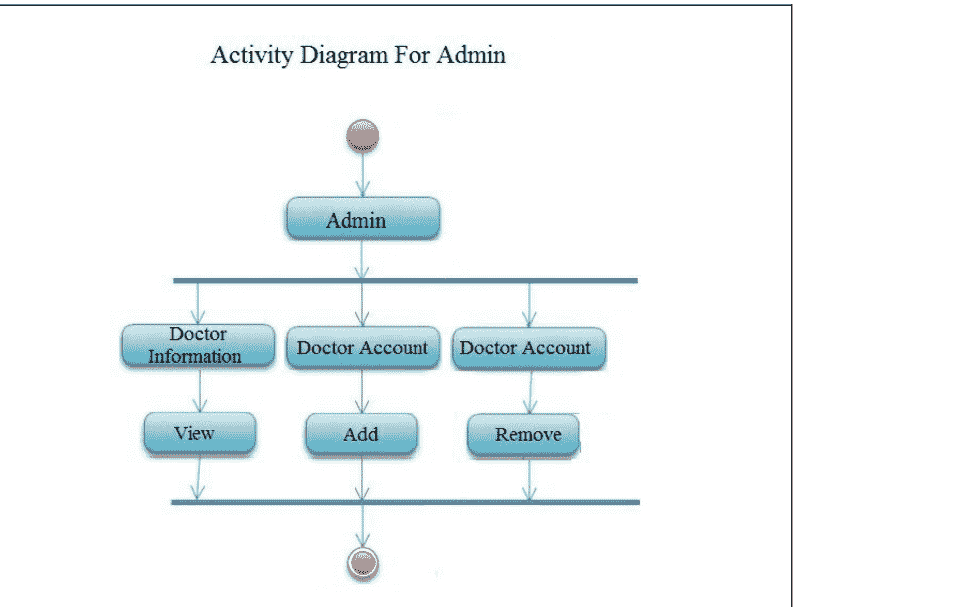

## 创建数据库 (terab1)

在 MySQL (服务器)

```
C:\Program Files\MySQL\MySQL Server 5.0\bin\mysql.exe
Enter password: *****
Welcome to the MySQL monitor. Commands end with ; or \g.
Your MySQL connection id is 2 to server version: 5.0.17-nt
Type: 'help'; or 'h' for help. Type 'c' to clear the buffer.
mysql> create database terabinal;
Query OK, 1 row affected (0.04 sec)
mysql> use terabinal;
Database changed
mysql> show tables;
Empty set (0.02 sec)
mysql>
```

## 部署你的 (医院 Web 应用)

到 Tomcat 服务器  
主页将如下所示

## 首页


## JGB 医疗保健

请选择：

- 患者用户
- 医生用户
- 管理员用户


## 再次进入 MySQL (服务器)

`show tables;`  
这次会出现自动生成的表  
由于你已经在运行 (医院 Web 应用)  
在 Tomcat 服务器中  
表将自动创建。


```sql
create sequence dl_admin_seq;
create table dl_admin (
  aid number(2) primary key,
  username varchar(20) unique not null,
  password varchar(20) not null,
  email varchar(20) not null,
  name varchar(12) not null,
  phone varchar(15)
);
```

### 医生可以接受的最大预约次数

| DID | 医生编号 | 主键 | 外键 `dl_doctor(DID)` |
| :--- | :--- | :--- | :--- |
| `SunA` | 周日上午 | 最大预约数 | |
| `SunP` | 周日下午 | 最大预约数 | |
| `MonA` | 周一上午 | 最大预约数 | |
| `MonP` | 周一下午 | 最大预约数 | |
| `Tue` | 周二上午 | 最大预约数 | |
| `P` | 周二下午 | 最大预约数 | |
| `WedA` | 周三上午 | 最大预约数 | |
| `WedP` | 周三下午 | 最大预约数 | |
| `ThA` | 周四上午 | 最大预约数 | |
| `ThuP` | 周四下午 | 最大预约数 | |
| `FriA` | 周五上午 | 最大预约数 | |
| `FriP` | 周五下午 | 最大预约数 | |
| `SatA` | 周六上午 | 最大预约数 | |
| `SatP` | 周六下午 | 最大预约数 | |

```sql
create table dl_appointment(
  did number(5) primary key references dl_doctor(did),
  sunA number(3) default '0',
  sunP number(3) default '0',
  monA number(3) default '0',
  monP number(3) default '0',
  tueA number(3) default '0',
  tueP number(3) default '0',
  wedA number(3) default '0',
  wedP number(3) default '0',
  thuA number(3) default '0',
  thuP number(3) default '0',
  friA number(3) default '0',
  friP number(3) default '0',
  satA number(3) default '0',
  satP number(3) default '0'
);
```

### 当前可以预约的医生人数

`DID` 数量 主键 外键 `dl_doctor(DID)`

- `SunA`: 周日上午最大预约数
- `SunP`: 周日下午最大预约数
- `MonA`: 周一上午最大预约数
- `MonP`: 周一下午最大预约数
- `Tue`: 周二上午最大预约数
- `P`: 周二下午最大预约数
- `WedA`: 周三上午最大预约数
- `WedP`: 周三下午最大预约数
- `ThA`: 周四上午最大预约数
- `ThuP`: 周四下午最大预约数
- `FriA`: 周五上午最大预约数
- `FriP`: 周五下午最大预约数
- `SatA`: 周六上午最大预约数
- `SatP`: 周六下午最大预约数

```sql
create table dl_curappointment(
  did number(5) primary key references dl_doctor(did),
  sunA number(3) default '0',
  sunP number(3) default '0',
  monA number(3) default '0',
  monP number(3) default '0',
  tueA number(3) default '0',
  tueP number(3) default '0',
  wedA number(3) default '0',
  wedP number(3) default '0',
  thuA number(3) default '0',
  thuP number(3) default '0',
  friA number(3) default '0',
  friP number(3) default '0',
  satA number(3) default '0',
  satP number(3) default '0'
);
```

### 医生表

- `DID` 医生编号
- 姓名
- 密码
- 年龄
- 性别 (1-男, 0-女)
- 医生姓名
- 科室
- 专科
- 电话号码

```sql
create table dl_doctor (
  did number(5) primary key,
  name varchar(12) not null,
  password varchar(20) not null,
  age number(3) not null,
  sex number(1) not null,
  level varchar(12) not null,
  section varchar(20) not null,
  specialism varchar(20) not null,
  phone varchar(15)
);
```

### 病历列表按顺序生成

- `HID` 病历记录号
- 医生主编号 (外键 `dl_doctor(DID)`)
- 症状描述
- 诊断结果
- 患者编号 (外键 `dl_patient(DID)`)
- `Rx` 处方
- 是否完成治疗 (0-否, 1-是)
- `Fdate` 开始时间 (2024-01-23 00:00)
- `SDate` 结束时间 (2024-01-21 00:00)

```sql
create sequence dl_history_seq;
create table dl_history (
  hid number(10) primary key,
  doctor_did number(5) references dl_doctor(did) not null,
  description varchar(64) not null,
  diagnose varchar(64) not null,
  patient_id number(8) references dl_patient(pid) not null,
  rx varchar2(64) not null,
  finished number(1) not null,
  fDate date not null,
  sDate date
);
```

### 患者表

- `PID` 序列生成
- 姓名
- 用户名 (登录名)
- 密码
- 年龄
- 性别 (1-男, 0-女)
- 家庭住址
- 电话号码
- 患者病史

```sql
create sequence dl_patient_seq;

create table dl_patient (
  pid number(8) primary key,
  name varchar2(12) not null,
  username varchar2(20) unique not null,
  password varchar2(20) not null,
  age number(3) not null,
  sex number(1) not null,
  address varchar2(32),
  phone varchar2(24)
);
```

### 预约记录表

- `QID` 记录号按序列生成
- 患者编号 (外键 `dl_patient(PID)`)
- 医生主编号 医生 (外键 `dl_doctor(DID)`)
- 预约日期：
  - 0-周日
  - 1-周一
  - 2-周二
  - 3-周三
  - 4-周四
  - 5-周五
  - 6-周六
- `AP` 预约时间：
  - 0-上午
  - 1-下午
- `Dat` 预约时间 (2024-01-21 00:00:00)

```sql
create sequence dl_pinqueue_seq;
create table dl_pinqueue (
  qid number(10) primary key,
  patient_id number(8) references dl_patient(pid) not null,
  doctor_did number(5) references dl_doctor(did) not null,
  day number(1) not null,
  ap number(1) not null,
  date date not null,
  constraint pinqueue_Doctor unique (doctor_did, patient_id)
);
```

### ADMIN 表

插入给定的 SQL 语句凭据

- `DID`
- 用户名
- 密码
- 邮箱
- 姓名

```sql
INSERT INTO dl_admin (aid, username, password, email, name) VALUES (1, 'Indira', 'password', 'Indira@abc.com', 'Professor');
INSERT INTO dl_admin (aid, username, password, email, name) VALUES (2, 'Jagan', 'password', 'Jagan@abc.com', 'Professor');
INSERT INTO dl_admin (aid, username, password, email, name) VALUES (3, 'Chetan', 'password', 'Chetan@abc.com', 'Suresh');
INSERT INTO dl_admin (aid, username, password, email, name) VALUES (4, 'Dinesh', 'password', 'Dinesh@abc.com', 'Suresh');
INSERT INTO dl_admin (aid, username, password, email, name) VALUES (5, 'Pankaj', 'password', 'Pankaj@abc.com', 'Suresh');
INSERT INTO dl_admin (aid, username, password, email, name) VALUES (6, 'Kamal', 'password', 'Kamal@abc.com', 'Professor');
INSERT INTO dl_admin (aid, username, password, email, name) VALUES (7, 'Raman', 'password', 'Raman@abc.com', 'Professor');
INSERT INTO dl_admin (aid, username, password, email, name) VALUES (8, 'Bharat', 'password', 'Bharat@abc.com', 'Suresh');
INSERT INTO dl_admin (aid, username, password, email, name) VALUES (9, 'Rajeev', 'password', 'Rajeev@abc.com', 'Professor');
INSERT INTO dl_admin (aid, username, password, email, name) VALUES (10, 'Ajay', 'password', 'Ajay@abc.com', 'MBBS');
INSERT INTO dl_admin (aid, username, password, email, name) VALUES (11, 'Supriya', 'password', 'Supriya@abc.com', 'Suresh');
INSERT INTO dl_admin (aid, username, password, email, name) VALUES (12, 'Ritu', 'password', 'Ritu@abc.com', 'MBBS');
INSERT INTO dl_admin (aid, username, password, email, name) VALUES (13, 'Dimple', 'password', 'Dimple@abc.com', 'Professor');
INSERT INTO dl_admin (aid, username, password, email, name) VALUES (14, 'Dipti', 'password', 'Dipti@abc.com', 'Professor');
INSERT INTO dl_admin (aid, username, password, email, name) VALUES (15, 'Bhavna', 'password', 'Bhavna@abc.com', 'Suresh');
INSERT INTO dl_admin (aid, username, password, email, name) VALUES (16, 'Tripti', 'password', 'Tripti@abc.com', 'MBBS');
INSERT INTO dl_admin (aid, username, password, email, name) VALUES (17, 'Dipti', 'password', 'Dipti@abc.com', 'MBBS');
INSERT INTO dl_admin (aid, username, password, email, name) VALUES (18, 'Rohan', 'password', 'Rohan@abc.com', 'Suresh');
INSERT INTO dl_admin (aid, username, password, email, name) VALUES (19, 'Dinesh', 'password', 'Dinesh@abc.com', 'Professor');
INSERT INTO dl_admin (aid, username, password, email, name) VALUES (20, 'Dipti', 'password', 'Dipti@abc.com', 'Professor');
```

### 4 `dl_curappointment` 当前预约表


```sql
INSERT INTO `dl_curappointment` (`DID`, `SunA`, `SunP`, `MonA`, `Mo`)
INSERT INTO `dl_curappointment` VALUES ('001', 1, 1, 1, 1, 1, 1,
INSERT INTO `dl_curappointment` VALUES ('002', 1, 1, 1, 1, 1, 1,
INSERT INTO `dl_curappointment` VALUES ('003', 1, 1, 1, 1, 1, 1,
INSERT INTO `dl_curappointment` VALUES ('004', 1, 1, 1, 1, 1, 1,
INSERT INTO `dl_curappointment` VALUES ('005', 1, 1, 1, 1, 1, 1,
INSERT INTO `dl_curappointment` VALUES ('006', 1, 1, 1, 1, 1, 1,
INSERT INTO `dl_curappointment` VALUES ('007', 1, 1, 1, 1, 1, 1,
INSERT INTO `dl_curappointment` VALUES ('008', 1, 1, 1, 1, 1, 1,
INSERT INTO `dl_curappointment` VALUES ('009', 1, 1, 1, 1, 1, 1,
INSERT INTO `dl_curappointment` VALUES ('010', 1, 1, 1, 1, 1, 1,
INSERT INTO `dl_curappointment` VALUES ('011', 1, 1, 1, 1, 1, 1,
INSERT INTO `dl_curappointment` VALUES ('012', 1, 1, 1, 1, 1, 1,
INSERT INTO `dl_curappointment` VALUES ('013', 1, 1, 1, 1, 1, 1,
INSERT INTO `dl_curappointment` VALUES ('014', 1, 1, 1, 1, 1, 1,
INSERT INTO `dl_curappointment` VALUES ('015', 1, 1, 1, 1, 1, 1,
INSERT INTO `dl_curappointment` VALUES ('016', 1, 1, 1, 1, 1, 1,
INSERT INTO `dl_curappointment` VALUES ('017', 1, 1, 1, 1, 1, 1,
INSERT INTO `dl_curappointment` VALUES ('018', 1, 1, 1, 1, 1, 1,
INSERT INTO `dl_curappointment` VALUES ('019', 1, 1, 1, 1, 1, 1,
INSERT INTO `dl_curappointment` VALUES ('020', 1, 1, 1, 1, 1, 1,
INSERT INTO `dl_curappointment` VALUES ('021', 1, 1, 1, 1, 1, 1,
INSERT INTO `dl_curappointment` VALUES ('022', 1, 1, 1, 1, 1, 1,
```

### 5 `dl_patient` 患者表

```sql
INSERT INTO `dl_patient` (`PID`, `Name`, `Username`, `Password`, `Age`),
INSERT INTO `dl_patient` VALUES (1001, 'Amar', 'Amar', 'Amar', 20),
INSERT INTO `dl_patient` VALUES (1002, 'Bharat', 'Bharat', 'Bharat', 20),
INSERT INTO `dl_patient` VALUES (1003, 'Raman', 'Raman', 'Raman', 20),
INSERT INTO `dl_patient` VALUES (1004, 'Gopal', 'Gopal', 'Gopal', 40),
INSERT INTO `dl_patient` VALUES (1005, 'Shyam', 'Shyam', 'Shyam', 45),
```

### 6 `dl_history` 历史记录表

```sql
INSERT INTO `dl_history` (`HID`, `Description`, `Diag`)
INSERT INTO `dl_history` VALUES (2, '001', 'Headache',
```

数据会自动获取。

## 实体关系图


### 概述


### 基础架构


### 概念分层架构

| 用户与接口 | 表示层 | 业务逻辑层 | 数据访问 | 数据源 |
| :--- | :--- | :--- | :--- | :--- |
| 浏览器, html | WAP/net | JEE框架 | JSON, XML | DBMS |
| 移动端,工作站 | 手持设备 | Web 服务 | AS/400 | |
| swing | 防火墙 | COTS | 遗留系统 | |

通过浏览器提交请求，`Action` 进入数据库（增删改查），服务接口实现（持久化对象，增删改查）。负责通信的表：

- `dl_curappointment`
- `dl_doctor`
- `dl_history`
- `dl_patient`
- `dl_queue`
- `mysql`

### `abd/action/AllAction.java`

```java
package com.abd.action;

import java.util.*;
import com.abd.biz.*;
import com.abd.entity.*;
import com.abd.util.*;
import org.springframework.context.ApplicationContext;
import org.springframework.web.struts.DispatchAction;
import org.apache.struts.http.action.*;
import javax.servlet.HttpServletRequest;
import javax.servlet.http.HttpServletResponse;
import javax.servlet.http.HttpSession;

public class AllAction extends DispatchAction {

    public ActionForward addDoctor(ActionMapping mapping, ActionForm form,
            HttpServletRequest request, HttpServletResponse response) throws Exception {
        ApplicationContext ctx = this.getApplicationContext();
        AdminBiz adminBiz = (AdminBiz)ctx.getBean("serviceAdmin");
        DynaActionForm daf = (DynaActionForm)form;
        Integer id = new Integer(Integer.parseInt(daf.getString("id")));
        String name = daf.getString("name");
        int age = Integer.parseInt((String)daf.get("age"));
        int sex = Integer.parseInt((String)daf.get("sex"));
        String levels = daf.getString("level");
        String spe = daf.getString("spe");
        String phone = daf.getString("phone");
        String section = daf.getString("section");
        String spdtay = daf.getString("spDay");
        int[] spDays = new int[14];
        spDays = Util.parseSpDays(spdtay);
        adminBiz.addDoctor(id, name, age, sex, levels, spe, spDays, phone, section);
        request.setAttribute("doctor", "hao");
        return mapping.forward("addDoc");
    }

    // 管理员获取所有医生
    public ActionForward getDoctor(ActionMapping mapping, ActionForm form,
            HttpServletRequest request, HttpServletResponse response) throws Exception {
        ApplicationContext ctx = this.getApplicationContext();
        AdminBiz admin = (AdminBiz)ctx.getBean("serviceAdmin");
        List<Doctor> set = admin.getAllDoctor();
        request.getSession(true).setAttribute("doctors", set);
        return mapping.forward("allDoc");
    }

    // 管理员登录
    public ActionForward login(ActionMapping mapping, ActionForm form,
            HttpServletRequest request, HttpServletResponse response) throws Exception {
        ApplicationContext ctx = this.getApplicationContext();
        AdminBiz admin = (AdminBiz)ctx.getBean("serviceAdmin");
        DynaActionForm daf = (DynaActionForm)form;
        String username = daf.getString("username");
        admin.login(username, daf.getString("password"));
        request.getSession(true).setAttribute("admin", username);
        return mapping.findForward("login");
    }

    // 管理员删除：如果医生有病历记录或已被预约，则不会删除医生
    public ActionForward removeDoctor(ActionMapping mapping, ActionForm form,
            HttpServletRequest request, HttpServletResponse response) throws Exception {
        ApplicationContext ctx = this.getApplicationContext();
        AdminBiz admin = (AdminBiz)ctx.getBean("serviceAdmin");
        Integer did = new Integer(Integer.parseInt(request.getParameter("did")));
        admin.removeDoctor(did);
        return mapping.findForward("removeDoctor");
    }

    // 注册
    public ActionForward registerPatient(ActionMapping mapping, ActionForm form,
            HttpServletRequest request, HttpServletResponse response) throws Exception {
        ApplicationContext ctx = this.getApplicationContext();
        PatientBiz patient = (PatientBiz)ctx.getBean("servicePatient");
        DynaActionForm daf = (DynaActionForm)form;
        String username = daf.getString("username");
        String password = daf.getString("password");
        String name = daf.getString("name");
        int age = Integer.parseInt((String)daf.get("age"));
        int sex = Integer.parseInt((String)daf.get("sex"));
        String address = daf.getString("address");
        String phone = daf.getString("phone");
        Patient p = patient.register(name, username, password, age, sex, address, phone);
        request.getSession(true).setAttribute("patient", p);
        return mapping.forward("pRegister");
    }

    public ActionForward login(ActionMapping mapping, ActionForm form,
            HttpServletRequest request, HttpServletResponse response) throws Exception {
        ApplicationContext ctx = this.getApplicationContext();
        PatientBiz patient = (PatientBiz)ctx.getBean("servicePatient");
        DynaActionForm daf = (DynaActionForm)form;
        String username = daf.getString("username");
        String password = daf.getString("password");
        Patient p = patient.login(username, password);
        request.getSession(true).setAttribute("patient", p);
        return mapping.findForward("pLogin");
    }

    // 所有医生患者信息
    public ActionForward allDoctorMessage(ActionMapping mapping, ActionForm form,
            HttpServletRequest request, HttpServletResponse response) throws Exception {
}
```

```java
ApplicationContext ctx = this.getAppContext();
PatientBiz patient = (PatientBiz)ctx.getBean("servicePatient");
List<Doctor> set = patient.queryAllDoctor();
request.getSession(true).setAttribute("doctors1", set);
return mapping.findForward("getDoc");
```

// 医生预约所需信息


```java
public ActionForward getAppointment(ActionMapping mapping, ActionForm \
HttpServletRequest request, HttpServletResponse response) throws Exception {
    ApplicationContext ctx = this.getAppContext();
    PatientBiz patient = (PatientBiz)ctx.getBean("servicePatient");
    List<Doctor> set = patient.queryAllDoctor();
    Set l1 = new HashSet();
    Set l2 = new HashSet();
    Set l3 = new HashSet();
    for(Doctor d:set) {
        l1.add(d.getSection());
        l2.add(d.getLevel());
        l3.add(d.getSpe());
    }
}
```

```java
request.setAttribute("sections", l1);
request.setAttribute("levels", l2);
request.setAttribute("spe", l3);
return mapping.findForward("pqd");
```

// 患者根据其自己的标准查询医生

```java
public ActionForward patientQueryMessage(ActionMapping mapping, ActionForm \
,
HttpServletRequest request, HttpServletResponse response) throws Exception {
    ApplicationContext ctx = this.getAppContext();
    PatientBiz patient = (PatientBiz)ctx.getBean("servicePatient");
    DynamicActionForm da = (DynamicActionForm)form;
    String section = da.getString("section");
    String levels = da.getString("level");
    String spe = da.getString("spe");
    int day = Integer.parseInt(da.getString("day"));
    int ap = Integer.parseInt(da.getString("ap"));
    List<Doctor> l = patient.queryDoctor(section,levels,spe,day,ap);
    request.getSession(true).setAttribute("doctors", l);
    return mapping.findForward("getDocs");
}
```

// 患者预约

```java
public ActionForward patientAppointment(ActionMapping mapping , ActionForm \
form,
HttpServletRequest request, HttpServletResponse response) throws Exception {
    ApplicationContext ctx = this.getAppContext();
    PatientBiz patient=(PatientBiz)ctx.getBean("servicePatient");
    Integer did=new Integer(Integer.parseInt(request.getParameter("did")));
    int day = Integer.parseInt(request.getParameter("day"));
    int ap = Integer.parseInt(request.getParameter("ap"));
    Patient p=(Patient)request.getSession(true).getAttribute("patient");
    patient.appointment(p,did, day, ap);
    return mapping.findForward("make");
}
```

// 患者信息检查医生的预约

```java
public ActionForward patientAppointmentMessage(ActionMapping mapping
ActionForm form,
HttpServletRequest request,HttpServletResponse response) throws Exception {
    AppContext ctx = this.getServletContext();
    PatientBiz patient=(PatientBiz)ctx.getBean("servicePatient");
    DynaActionForm def=(DynaActionForm)form;
    Integer did = new Integer(def.getString("did"));
    Appointment cur=patient.queryById(did);
    request.getSession(true).setAttribute("appointment",cur);
    return mapping.findForward("appointment");
}
```

// 带有预约看医生

```java
public ActionForward patientMyAppointment(ActionMapping mapping
ActionForm form,
HttpServletRequest request,HttpServletResponse response) throws Exception {
    AppContext ctx = this.getServletContext();
    PatientBiz patient=(PatientBiz)ctx.getBean("servicePatient");
    Integer pid=new Integer(Integer.parseInt(request.getParameter("pid")));
    List<Pinqueue> list=list.getPinqueuesById(pid);
    request.getSession(true).setAttribute("pinqueues",list);
    return mapping.findForward("getApp");
}
```

// 预约取消

```java
public ActionForward patientCancelAppointment(ActionMapping mapping
ActionForm form,
HttpServletRequest request,HttpServletResponse response) throws Exception {
    AppContext ctx = this.getServletContext();
    PatientBiz patient=(PatientBiz)ctx.getBean("servicePatient");
    Integer qid = new Integer(Integer.parseInt(request.getParameter("qid")));
    patient.cancelAppointment(qid);
    return mapping.findForward("cancel");
}
```

// 患者获取医生信息

```java
public ActionForward patientGetDoctorMessage(ActionMapping mapping ,ActionForm
form ,
HttpServletRequest request,HttpServletResponse response) throws Exception {
    AppContext ctx = this.getServletContext();
    PatientBiz patient=(PatientBiz)ctx.getBean("servicePatient");
    Integer pid=new Integer(Integer.parseInt(request.getParameter("pid")));
    List<Doctor> l=patient.queryHistoryByPid(pid);
    request.getSession(true).setAttribute("dMessages", l);
    return mapping.forward("current");
}
```

// 患者病历

```java
public ActionForward queryHistory(ActionMapping mapping , ActionForm form ,
HttpRequest request,HttpServletResponse response)throws Exception {
    ApplicationContext ctx=this.getWebApplicationContext();
    PatientBiz patient=(PatientBiz)ctx.getBean("servicePatient");
    Integer pid=new Integer(Integer.parseInt(request.getParameter("pid")));
    List<History> l=patient.queryHistoryByPid(pid);
    request.getSession(true).setAttribute("histories", l);
    return mapping.forward("his");
}
```

// 登录

```java
public ActionForward login(ActionMapping mapping , ActionForm form ,
HttpServletRequest request,HttpServletResponse response)throws Exception {
    ApplicationContext ctx=this.getWebApplicationContext();
    Doctor doctor=(Doctor)ctx.getBean("serviceDoctor");
    DynaForm daf=(DynaForm)form;
    String name=daf.getString("name");
    String password=daf.getString("password");
    Doctor d=doctor.login(name,password);
    request.getSession(true).setAttribute("doctor", d);
    return mapping.forward("login");
}
```

// 修改密码

```java
public ActionForward updatePassword(ActionMapping mapping
ActionForm form ,
HttpRequest request,HttpServletResponse response) throws Exception {
    ApplicationContext ctx=this.getWebApplicationContext();
    Doctor doctor=(Doctor)ctx.getBean("serviceDoctor");
    DynaForm daf=(DynaForm)form;
    String newPassword=daf.getString("password");
    String name=(request.getSession(true).getAttribute("doctor")).getName();
    doctor.updatePassword(name,newPassword);
    request.setAttribute("newPassword",newPassword);
    return mapping.forward("upd");
}
```

// 获取预约患者信息

```java
public ActionForward getAppointmentMessage(ActionMapping mapping
ActionForm form ,
HttpServletRequest request,HttpServletResponse response) throws Exception {
    ApplicationContext ctx=this.getWebApplicationContext();
    DoctorBiz doctor=(DoctorBiz)ctx.getBean("serviceDoctor");
    Integer did=new Integer(Integer.parseInt(request.getParameter("did")));
    List<DoctorPinqueue> pinqueue=doctor.getAllpinqueue(did);
    request.getSession(true).setAttribute("pinqueue", pinqueue);
    return mapping.findForward("getPatient");
}
```

// 转换模型

```java
public ActionForward createHistory(ActionMapping mapping, ActionForm form, 
HttpServletRequest request, HttpServletResponse response) throws Exception {
    ApplicationContext ctx=this.getWebApplicationContext();
    DoctorBiz doctor=(DoctorBiz)ctx.getBean("serviceDoctor");
    DynaActionForm df=(DynaActionForm)form;
    Integer pid=new Integer(Integer.parseInt(request.getParameter("pid")));
    String description=df.getString("description");
    String diagnose=df.getString("diagnose");
    String rx=df.getString("rx");
    int pd=1;
    doctor.createPinpqueue(pid,description, diagnose, rx, pd);
    request.setAttribute("bind", pd);
    return mapping.findForward("create");
}
```

// 检查患者记录

```java
public ActionForward queryPatientHistory(ActionMapping mapping, ActionForm form, 
HttpServletRequest request, HttpServletResponse response) throws Exception {
    ApplicationContext ctx=this.getWebApplicationContext();
    DoctorBiz doctor=(DoctorBiz)ctx.getBean("serviceDoctor");
    Integer did=new Integer(Integer.parseInt(request.getParameter("did")));
    List<DoctorQueryHistory> dqh=doctor.getAllHistory(did);
    request.getSession(true).setAttribute("dqhs", dqh);
    return mapping.findForward("gph");
}
```

// 修改患者记录记录

```java
public ActionForward updatePatientHistory(ActionMapping mapping, ActionForm form, 
HttpServletRequest request, HttpServletResponse response) throws Exception {
    ApplicationContext ctx=this.getWebApplicationContext();
    DoctorBiz doctor=(DoctorBiz)ctx.getBean("serviceDoctor");
    Integer hid=new Integer(Integer.parseInt(request.getParameter("hid")));
    String description=request.getParameter("description");
    String diagnose=request.getParameter("diagnose");
    String rx=request.getParameter("rx");
    doctor.updateHistory(hid, description, diagnose, rx);
    request.setAttribute("upda", hid);
    return mapping.findForward("upok");
}
```

```java
}
```

// 正在治疗结束患者的医生

```java
public ActionActionForward finishHistory(ActionMapping mapping ,ActionForm form ,
```


`HttpServletRequest request, HttpServletResponse response` `throws Exception(`

```java
ApplicationContext ctx = this.getWebApplicationContext();
DoctorBiz doctor = (DoctorBiz)ctx.getBean("serviceDoctor");
Integer hid = new Integer(Integer.parseInt(request.getParameter("hid")));
doctor.finish(hid);
return mapping.findForward("finishOk");
```

`// 注销`

`public ActionActionForward exit(ActionMapping mapping, ActionForm form, HttpServletRequest request, HttpServletResponse response) throws Exception(`

```java
HttpSession session=request.getSession(true);
if(session.getAttribute("admin")!=null){session.setAttribute("admin", null);}
if(session.getAttribute("doctor")!=null){session.setAttribute("doctor", null);}
if(session.getAttribute("patient")!=null){session.setAttribute("patient", null);}
return mapping.findForward("default");
```

``

## 业务逻辑层代码将位于下方

# 项目资源生成器

- `hospital`
  - `JAX-WS` Web 服务
  - 部署描述符: `hospital`
  - Java 资源
- `src`
  - `com.abd.action`
    - `AllAction.java`
  - `com.abd.biz`
    - `AdminDao.java`
    - `DoctorDao.java`
    - `PatientDao.java`
  - `com.abd.bizimpl`
    - `AdminDaoImpl.java`
    - `DoctorDaoImpl.java`
    - `PatientDaoImpl.java`
  - `com.abd.dao`
    - `AdminDao.java`
    - `AppointmentDao.java`
    - `CurrapmentDao.java`
    - `DoctorDao.java`
    - `HistoryDao.java`
    - `PatientDao.java`
    - `PinqueueDao.java`
  - `com.abd.daoimpl`
    - `AdminDaoImpl.java`
    - `AppointmentDaoImpl.java`
    - `CurrapmentDaoImpl.java`
    - `DoctorDaoImpl.java`
    - `PatientDaoImpl.java`
    - `PinqueueDaoImpl.java`

当用户通过（浏览器）提交请求时，`Action` 将接收请求、继续执行并连接数据库。

服务接口（包含方法），需要操作的表。CURD 操作（创建、更新、删除）。

服务接口实现（方法），包含依赖（持久对象信息）。

DAO 接口（方法），如何与表通信，用于 CURD 操作（创建、读取、删除），负责与表通信。

```mysql
mysql>

show tables;

Tables_in_tarena1

| :--- |

|dl_admin |

|dl_appointment |

|dl_delete |

|dl_history |

|dl_pinqueue |

7 rows in set (0.00 sec)
```

# `src\com\abd\biz`

### `AdminBiz.java`

```java
package com.abd.biz;

import java.io.IOException;
import java.sql.SQLException;
import java.util.*;
import com.abd.ext.SystemException;
import com.abd.entity.*;

public interface AdminBiz {

    // 管理员登录
    public void login(String username, String password) throws IOException, SQLException, SystemException;

    // 管理员添加医生
    public void add(Integer did, String name, int age, int sex, String levels, String spe, int[] pPerDay, String dPhone, String section) throws IOException, SQLException, SystemException;

    // 管理员删除医生
    public void removeDoctor(Integer did) throws IOException, SQLException, SystemException;

    // 系统管理员查看所有医生信息
    public List<Doctor> getAllDoctor() throws IOException, SQLException, SystemException;
}
```

### `DoctorBiz.java`

```java
package com.abd.entity.*;

import com.abd.expt.SystemException;
import java.io.IOException;
import java.sql.SQLException;
import java.util.List;

public interface DoctorBiz {

    // 医生登录返回一个医生对象
    public Doctor login(String name, String password) throws IOException, SQLException, SystemException;

    // 医生修改密码
    public void updatePassword(String name, String newPassword) throws IOException, SQLException, SystemException;

    // 根据 did 检查所有预约记录，根据 pid 识别患者信息，返回专门针对此方法的对象列表
    public List<DoctorQueryQueue> getAllPinqueue(Integer did) throws IOException, SQLException, SystemException;

    // 转诊医生挂号
    public void doctorCreatePinqueue(Integer did, Doctor d, String description, String diagnose, String rx, int pd) throws IOException, SQLException, SystemException;

    // 通过 did 检查其所有的病历和患者信息，返回一个特殊对象
    public List<DoctorQueryHistory> getAllHistory(Integer did) throws IOException, SQLException, SystemException;

    // 更新记录
    public void updateHistory(Integer hid, String description, String diagnose, String rx) throws IOException, SQLException, SystemException;

    // 治疗结束，需要记录结束时间，状态更改为
    public void finish(Integer hid) throws IOException, SQLException, SystemException;
}
```

### `PatientBiz.java`

```java
package com.abd.biz;

import java.io.IOException;
import java.sql.SQLException;
import java.sql.util.*;
import com.abd.entity.*;
import com.abd.expt.SystemException;

public interface PatientBiz {

    // 所有医生
    public List<Doctor> queryAllDoctor() throws IOException;

    // 注册患者需要的方法
    public void register(String name, String password, int age, String address, String phone) throws IOException, SQLException;

    // 患者登录
    public void login(String username, String password) throws IOException, SQLException;

    // 根据 did 查询当前预约
    public void queryByDid(Integer did) throws IOException, SQLException;

    // 预约
    public void appointment(Integer did, int day, int ap) throws IOException, SQLException;

    // 获取挂号信息
    public List<Pinqueue> getPinqueueById(Integer pid) throws IOException, SystemException;

    // 取消预约
    public void cancelAppointment(Integer qid) throws IOException, SQLException;

    // 根据 pid 查询患者信息
    public List<Doctor> queryByPid(Integer pid) throws IOException, SystemException;

    // 患者病历
    public List<History> queryHistoryByPid(Integer pid) throws IOException, SystemException;

    // 医生挂号
    public List<Doctor> queryDoctor(String section, String spe, int day, int ap) throws IOException;
}
```

# `src\abd\biz\impl`

### `AdminBizImpl.java`

```java
package com.abd.biz;

import java.io.IOException;
import java.sql.SQLException;
import java.util.*;

import com.abd.biz.AdminBiz;
import com.abd.dao.*;
import com.abd.entity.*;
import com.abd.expt.AppointmentException;
import com.abd.expt.IdException;
import com.abd.expt.PasswordException;
import com.abd.expt.SystemException;
import com.abd.expt.UsernameException;

public class AdminBizImpl implements AdminBiz {

    private AdminDao daoA = null;
    private DoctorDao daoB = null;
    private AppointmentDao daoC = null;
    private CurappointmentDao daoD = null;

    public AppointmentDao getDao() {
        return daoC;
    }

    public void setDaoC(AppointmentDao daoC) {
        this.daoC = daoC;
    }

    public CurappointmentDao getDao() {
        return daoD;
    }

    public void setDaoD(CurappointmentDao daoD) {
        this.daoD = daoD;
    }

    public AdminDao getDao() {
        return daoA;
    }

    public void setDao(AdminDao dao) {
        this.daoA = dao;
    }

    public DoctorDao getDao() {
        return daoB;
    }

    public void setDao(DoctorDao dao) {
        this.daoB = dao;
    }

    public void addDoctor(Integer did, String name, int age, int sex, String levels, String spe, int[] perDay, String phone, String section) throws IOException, SQLException, SystemException {

        Doctor doctor = daoB.getByById(did);
        if (doctor == null) {
            throw new Exception("did cuzai");
        } else {
            doctor = new Doctor();
            doctor.setId(did);
            doctor.setName(name);
            doctor.setAge(age);
            doctor.setSex(sex);
            doctor.setLevels(levels);
            doctor.setSpe(spe);
            doctor.setPhone(phone);
            doctor.setPassword("123456");
            doctor.setSection(section);

            Appointment app = new Appointment(perDay[0], perDay[1], perDay[2], perDay[3], perDay[4], perDay[5], perDay[6], perDay[7], perDay[8], perDay[9], perDay[10], perDay[11], perDay[12], perDay[13]);
            app.setDoctor(doctor);

            Curappointment cuu = new Curappointment(perDay[0], perDay[1], perDay[2], perDay[3], perDay[4], perDay[5], perDay[6], perDay[7], perDay[8], perDay[9], perDay[10], perDay[11], perDay[12], perDay[13]);
            cuu.setDoctor(doctor);

            doctor.setCuu(cuu);
            doctor.setApp(app);
            daoB.addDoctor(doctor);
        }
    }
}
```


```java
}
public List<Doctor> getAllDoctor() throws IOException, SQLException, SystemException {
    return daoB.getAllDoctor();
}

public void login(String username, String password) throws IOException, SQLException, SystemException {
    Admin admin = daoA.login(username);
    if (admin == null) {
        throw new UsernameException("不存在此账户 ");
    }
    if (!admin.getPassword().equals(password)) {
        throw new PasswordException("密码无效");
    }
}

public void removeDoctor(Integer did) throws IOException, SQLException, SystemException {
    Appointment app = daoC.queryApp(did);
    app.setDoctor(null);
    daoC.removeApp(app);
    Curappointment cuu = daoD.queryByDid(did);
    cuu.setDoctor(null);
    daoD.removeCur(cuu);
    Doctor doctor = daoB.queryById(did);
    doctor.setApp(null);
    doctor.setCuu(null);
    daoB.delete(doctor);
}
```

### `DoctorBizImpl.java`

```java
package com.abd.biz.impl;

import java.io.IOException;
import java.sql.SQLException;
import java.util.ArrayList;
import java.util.Date;
import java.util.List;
import java.util.Set;

import com.abd.biz.DoctorBiz;
import com.abd.dao.AppointmentDao;
import com.abd.dao.DoctorDao;
import com.abd.dao.HistoryDao;
import com.abd.dao.PatientDao;
import com.abd.dao.PinqueueDao;
import com.abd.entity.Curappointment;
import com.abd.entity.Doctor;
import com.abd.entity.DoctorQueryHistory;
import com.abd.entity.DoctorQueryPinqueue;
import com.abd.entity.History;
import com.abd.entity.Patient;
import com.abd.entity.Pinqueue;
import com.abd.entity.expt.PasswordException;
import com.abd.entity.expt.SystemException;
import com.abd.entity.expt.UsernameException;

public class DoctorBizImpl implements DoctorBiz {
    private DoctorDao daoDao;
    private PinqueueDao daoQ;
    private PatientDao daoP;
    private HistoryDao daoH;
    private CurappointmentDao daoC;

    public CurappointmentDao getDaoC() {
        return daoC;
    }

    public void setDaoC(CurappointmentDao daoC) {
        this.daoC = daoC;
    }

    public DoctorDao getDaoD() {
        return daoD;
    }

    public void setDaoD(DoctorDao daoD) {
        this.daoD = daoD;
    }

    public PinqueueDao getDaoQ() {
        return daoQ;
    }

    public void setDaoQ(PinqueueDao daoQ) {
        this.daoQ = daoQ;
    }

    public PatientDao getDaoP() {
        return daoP;
    }

    public void setDao(PatientDao daoP) {
        this.daoP = daoP;
    }

    public HistoryDao getDao() {
        return daoH;
    }

    public void setDao(HistoryDao daoH) {
        this.daoH = daoH;
    }

    public void doctorCreatePinqueue(Integer pid, Doctor d, String description, String diagnose, throws IOException, SQLException, SystemException {
        //医生和患者仅通过 PIN 关联
        Patient p = daoP.queryByPid(pid);
        Pinqueue pin = daoQ.queryByAndPatient(d, p);
        int day = pin.getAp();
        // 获取了 CUU，更新 CUU
        Courappointment cu = d.getCuU();
        switch (day) {
            case 0:
                if (ap == 0) {
                    cu.setSunA(cu.getSunA(1) + 1);
                } else {
                    cu.setSunP(cu.getSunP(1) + 1);
                }
                break;
            case 1:
                if (ap == 0) {
                    cu.setMonA(cu.getMonA(1) + 1);
                } else {
                    cu.setMonP(cu.getMonP(1) + 1);
                }
                break;
            case 2:
                if (ap == 0) {
                    cu.setTueA(cu.getTueA(1) + 1);
                } else {
                    cu.setTueP(cu.getTueP(1) + 1);
                }
                break;
            case 3:
                if (ap == 0) {
                    cu.setWedA(cu.getWedA(1) + 1);
                } else {
                    cu.setWedP(cu.getWedP(1) + 1);
                }
                break;
            case 4:
                if (ap == 0) {
                    cu.setTha(cu.getTha(1) + 1);
                } else {
                    cu.setThuP(cu.getThu(1) + 1);
                }
                break;
            case 5:
                if (ap == 0) {
                    cu.setFria(cu.getFria(1) + 1);
                } else {
                    cu.setFripP(cu.getripP(1) + 1);
                }
                break;
            case 6:
                if (ap == 0) {
                    cu.setSatA(cu.SatA(1) + 1);
                } else {
                    cu.setSatP(cu.SatP(1) + 1);
                }
                break;
        }
        // 设置属性
        History his = new History();
        his.setDescription(description);
        his.setDiagnose(diagnose);
        his.setRx(rx);
        his.setFinished(pd);
        his.setFdate(new Date());
        his.setDoctor(d);
        // 更新属性
        p.getHistory(id).add(his);
        his.setPatient(p);
        // 删除预约信息
        p.setDoctor(null);
        pin.setPatient(null);
        daoQ.deletePinque(pin);
        daoH.add(his);
    }

    public void finish(Integer hid) throws SQLException, SystemException {
        History his = daoH.query(hid);
        Date d = new Date();
        his.setFinished(0);
        his.setSdate(d);
        daoH.update(his);
    }

    public List<QueryHistory> getAllHistory(Integer did) throws IOException, SQLException, SystemException {
        List<QueryHistory> l = new ArrayList<>();
        Doctor d = daoD.queryById(did);
        List<History> his = daoH.queryByDoctor(d);
        for (History h : his) {
            Patient pat = daoP.queryById(h.getPatient().getId());
            QueryHistory qh = new QueryHistory(h.getHid(), pat.getName(), pat.getAge(), pat.getSex(),
                pat.getAddress(), pat.getPhone(), h.getDiagnosis(),
                h.getRx(), h.getFdate(), h.getSdate());
            l.add(qh);
        }
        return l;
    }

    public List<QueryPinqueue> getAllPinqueue(Integer did) throws IOException, SystemException {
        List<QueryPinqueue> l = new ArrayList<>();
        Doctor d = daoD.queryById(did);
        List<Pinqueue> pin = daoQ.queryByDoctor(d);
        for (Pinqueue q : pin) {
            Patient pat = daoP.queryByPid(q.getPatient().getId());
            QueryPinqueue dqp = new QueryPinqueue(q.getId(), pat.getName(), pat.getAge(), pat.getSex(),
                pat.getAddress(), pat.getPhone());
            l.add(dqp);
        }
        return l;
    }

    public Doctor login(String name, String password) throws IOException, SystemException {
        Doctor d = daoD.queryName(name);
        if (d == null) {
            throw new UsernameException("不存在此账户");
        }
        if (!d.getPassword().equals(password)) {
            throw new PasswordException("密码无效");
        }
        return d;
    }

    public void updateHistory(Integer hid, String description, String diagnosis, String rx) throws IOException, SystemException {
        History his = daoH.query(hid);
        his.setDescription(description);
        his.setDiagnose(diagnosis);
        his.setRx(rx);
        daoH.update(his);
    }

    public void updatePassword(String name, String newPassword) throws IOException, SystemException {
        Doctor d = daoD.queryName(name);
        d.setPassword(newPassword);
        daoD.update(d);
    }
}
```

### `PatientBizImpl.java`


```java
package com.abd.biz.impl;

import java.io.IOException;
import java.sql.SQLException;
import java.util.ArrayList;
import java.util.Date;
import java.util.List;
import java.util.Set;

import com.abd.biz.PatientBiz;
import com.abd.dao.CurappointmentDao;
import com.abd.dao.DoctorDao;
import com.abd.dao.HistoryDao;
import com.abd.dao.PatientDao;
import com.abd.dao.PinqueueDao;
import com.abd.entity.Curappointment;
import com.abd.entity.Doctor;
import com.abd.entity.History;
import com.abd.entity.Patient;
import com.abd.entity.Pinqueue;
import com.abd.entity.expt.AlreadyAppointmentException;
import com.abd.entity.expt.DayAlreadyAppointmentException;
import com.abd.entity.expt.IdException;
import com.abd.entity.expt.PasswordException;
import com.abd.entity.expt.SystemException;
import com.abd.entity.expt.UsernameException;
import com.abd.entity.expt.WrongException;

public class PatientBiz implements PatientBiz {
    private DoctorDao daoD;
    private CurappointmentDao daoC;
    private PatientDao daoP;
    private HistoryDao daoH;
    private PinqueueDao daoQ;

    public DoctorDao getDAOD() {
        return daoD;
    }

    public void setDAOD(DoctorDao daoD) {
        this.daoD = daoD;
    }

    public CurappointmentDao getDAOC() {
        return daoC;
    }

    public void setDaoC(CurappointmentDao daoC) {
        this.daoC = daoC;
    }

    public PatientDao getDaoP() {
        return daoP;
    }

    public void setDaoP(PatientDao daoP) {
        this.daoP = daoP;
    }

    public HistoryDao getDaoH() {
        return daoH;
    }

    public void setDaoH(HistoryDao daoH) {
        this.daoH = daoH;
    }

    public PinqueueDao getDaoQ() {
        return daoQ;
    }

    public void setDaoQ(PinqueueDao daoQ) {
        this.daoQ = daoQ;
    }

    public void appointmentDao(Patient p, Integer did, int day, int ap) throws IOException, SQLException, SystemException {
        //判断是否已经预约
        List<Pinqueue> list = daoQ.queryByPatient(p);
        for (Pinqueue pin : list) {
            if (pin.getDoctor().getId().intValue() == did.intValue()) {
                throw new AlreadyAppointmentException();
            }
            if (pin.getDay() == day && pin.getAp() == ap) {
                throw new AlreadyAppointmentException();
            }
        }
    }
}
```


```java
// 今天，医生可以确定是否进行预约
if (cuu.getSunA() < 0) {
    throw new WrongException();
} else {
    cuu.setSunP(cuu.getSunP() - 1);
    if (cuu.getSunP() < 0) {
        throw new WrongException();
    }
    break;
    case 1:
        if (ap == 0) {
            cuu.setMonA(cuu.getMonA() - 1);
            if (cuu.getMonA() < 0) {
                throw new WrongException();
            }
        } else {
            cuu.setMonP(cuu.getMonP() - 1);
            if (cuu.getMonP() < 0) {
                throw new WrongException();
            }
        }
        break;
    case 2:
        if (ap == 0) {
            cuu.setTueA(cuu.getTueA() - 1);
            if (cuu.getTueA() < 0) {
                throw new WrongException();
            }
        } else {
            cuu.setTueP(cuu.getTueP() - 1);
            if (cuu.getTueP() < 0) {
                throw new WrongException();
            }
        }
        break;
    case 3:
        if (ap == 0) {
            cuu.setWedA(cuu.getWedA() - 1);
            if (cuu.getWedA() < 0) {
                throw new WrongException();
            }
        } else {
            cuu.setWedP(cuu.getWedP() - 1);
            if (cuu.getWedP() < 0) {
                throw new WrongException();
            }
        }
        break;
    case 4:
        if (ap == 0) {
            cuu.setThuA(cuu.setThuA() - 1);
            if (cuu.getThuA() < 0) {
                throw new WrongException();
            }
        } else {
            cuu.setThuP(cuu.getThuP() - 1);
            if (cuu.getThuP() < 0) {
                throw new WrongException();
            }
        }
        break;
    case 5:
        if (ap == 0) {
            cuu.setFriA(cuu.getFriA() - 1);
            if (cuu.getFriA() < 0) {
                throw new WrongException();
            }
        } else {
            cuu.setFriP(cuu.getFriP() - 1);
            if (cuu.getFriP() < 0) {
                throw new WrongException();
            }
        }
        break;
    case 6:
        if (ap == 0) {
            cuu.setSatA(cuu.getSatA() - 1);
            if (cuu.getSatA() < 0) {
                throw new WrongException();
            }
        } else {
            cuu.setSatP(cuu.getSatP() - 1);
            if (cuu.getSatP() < 0) {
                throw new WrongException();
            }
        }
        break;
}

q.setDay(day);
q.setDoctor(d);
q.setPatient(p);
q.setAp(ap);
q.setDate(new Date());
d.getPin().add(q);
daoQ.addPin(q);
}

public void cancelAppointment(Integer qid) throws IOException, SQLException, SystemException {
    // 通过医生操作更新 Q
    Appointment pin = daoQ.queryById(qid);
    int day = pin.getDay();
    int ap = pin.getAp();

    // 获取 CU，更新 CU
    Appointment cuu = pin.getDoctor().getCuu();
    switch (day) {
        case 0:
            if (ap == 0) {
                cuu.setSunA(cuu.getSunA() - 1);
            } else {
                cuu.setSunP(cuu.getSunP() - 1);
            }
            break;
        case 1:
            if (ap == 0) {
                cuu.setMonA(cuu.getMonA() - 1);
            } else {
                cuu.setMonP(cuu.getMonP() - 1);
            }
            break;
        case 2:
            if (ap == 0) {
                cuu.setTueA(cuu.getTueA() - 1);
            } else {
                cuu.setTueP(cuu.getTueP() - 1);
            }
            break;
        case 3:
            if (ap == 0) {
                cuu.setWedA(cuu.getWedA() - 1);
            } else {
                cuu.setWedP(cuu.getWedP() - 1);
            }
            break;
        case 4:
            if (ap == 0) {
                cuu.setThuA(cuu.getThuA() - 1);
            } else {
                cuu.setThuP(cuu.getThuP() - 1);
            }
            break;
        case 5:
            if (ap == 0) {
                cuu.setFriA(cuu.getFriA() - 1);
            } else {
                cuu.setFriP(cuu.getFriP() - 1);
            }
            break;
        case 6:
            if (ap == 0) {
                cuu.setSatA(cuu.getSatA() - 1);
            } else {
                cuu.setSatP(cuu.getSatP() - 1);
            }
            break;
    }

    pin.setDoctor(null);
    pin.setPatient(null);

    // 删除 PIN
    daoQ.deletePin(pin);
}

public List<Appointment> getPinById(Integer pid) throws IOException, SQLException, SystemException {
    Patient p = daoP.queryById(pid);
    return daoQ.queryPatient(p);
}

public Patient login(String username, String password)
        throws IOException, SQLException, SystemException {
    Patient p = daoP.queryUsername(username);
    if (p == null) {
        throw new IdException("无此类账户");
    }
    if (p.getPassword().equals(password)) {
        throw new PasswordException("密码错误");
    }
    return p;
}

public List<Doctor> queryAllDoctor() throws IOException, SQLException {
    return dao.getAllDoctor();
}

public Appointment queryByDid(Integer did)
        throws IOException, SQLException, SystemException {
    return dao.queryByDid(did);
}

public List<Doctor> queryByPid(Integer pid)
        throws IOException, SQLException, SystemException {
    Patient p = daoP.queryPid(pid);
    List<Doctor> list = new ArrayList<Doctor>();

    for (History h : list) {
        // 注意：此处此处可能存在笔误 (list vs h)
        Doctor doc = dao.queryByDid(h.getDoctor().getDid());
        list.add(doc);
    }

    return list;
}

public List<History> queryByPid(Integer pid)
        throws IOException, SQLException, SystemException {
    Patient p = daoP.queryPid(pid);
    return dao.queryByPatient(p);
}

public Patient register(
        String name,
        String username,
        String password,
        int age,
        int sex,
        String address,
        String phone
) throws IOException, SQLException, SystemException {
    Patient p = daoP.queryUsername(username);
    if (p == null) {
        throw new UsernameException("用户名异常");
    }

    p = new Patient();
    p.setAddress(address);
    p.setAge(age);
    p.setName(name);
    p.setPassword(password);
    p.setPhone(phone);
    p.setSex(sex);
    p.setUsername(username);
    daoP.register(p);

    return p;
}

public List<Doctor> queryDoctor(
        String section,
        String levels,
        String spe,
        int day,
        int ap
) throws SQLException, SystemException {
    List<Doctor> dao = dao.getAllDoctor();
    List<Doctor> list = new ArrayList<Doctor>();

    for (Doctor doctor : list) {
        if (section.equals("se")) {
            if (doctor.getSection().equals(section)) {
                continue;
            }
        }

        if (levels.equals("le")) {
            if (doctor.getLevels().equals(levels)) {
                continue;
            }
        }

        if (spe.equals("nn")) {
            if (doctor.getSpe().equals(spe)) {
                continue;
            }
        }

        list.add(doctor);
        Appointment cuu = doctor.getCuu();

        if (day == 9) {
            switch (day) {
                case 0:
                    if (ap == 0) {
                        if (cuu.getSunA() == 0) {
                            list.remove(doctor);
                        }
                    } else if (ap == 1) {
                        if (cuu.getSunP() == 0) {
                            list.remove(doctor);
                        }
                    } else if (ap == 3) {
                        if (cuu.getSunA() == 0 && cuu.getSunP() == 0) {
                            list.remove(doctor);
                        }
                    }
                    break;
                case 1:
                    if (ap == 0) {
                        if (cuu.getMonA() == 0) {
                            list.remove(doctor);
                        }
                    } else if (ap == 1) {
                        if (cuu.getMonP() == 0) {
                            list.remove(doctor);
                        }
                    } else if (ap == 3) {
                        if (cuu.getMonA() == 0 && cuu.getMonP() == 0) {
                            list.remove(doctor);
                        }
                    }
                    break;
                case 2:
                    if (ap == 0) {
                        if (cuu.getTueA() == 0) {
                            list.remove(doctor);
                        }
                    } else if (ap == 1) {
                        if (cuu.getTueP() == 0) {
                            list.remove(doctor);
                        }
                    } else if (ap == 3) {
                        if (cuu.getTueA() == 0 && cuu.getTueP() == 0) {
                            list.remove(doctor);
                        }
                    }
                    break;
                case 3:
                    if (ap == 0) {
                        if (cuu.getWedA() == 0) {
                            list.remove(doctor);
                        }
                    } else if (ap == 1) {
                        if (cuu.getWedP() == 0) {
                            list.remove(doctor);
                        }
                    } else if (ap == 3) {
                        if (cuu.getWedA() == 0 && cuu.getWedP() == 0) {
                            list.remove(doctor);
                        }
                    }
                    break;
                case 4:
                    if (ap == 0) {
                        if (cuu.getThuA() == 0) {
                            list.remove(doctor);
                        }
                    } else if (ap == 1) {
                        if (cuu.getThuP() == 0) {
                            list.remove(doctor);
                        }
                    } else if (ap == 3) {
                        if (cuu.getThuA() == 0 && cuu.getThuP() == 0) {
                            list.remove(doctor);
                        }
                    }
                    break;
                case 5:
                    if (ap == 0) {
                        if (cuu.getFriA() == 0) {
                            list.remove(doctor);
                        }
                    } else if (ap == 1) {
                        if (cuu.getFriP() == 0) {
                            list.remove(doctor);
                        }
                    } else if (ap == 3) {
                        if (cuu.getFriA() == 0 && cuu.getFriP() == 0) {
                            list.remove(doctor);
                        }
                    }
                    break;
                case 6:
                    if (ap == 0) {
                        if (cuu.getSatA() == 0) {
                            list.remove(doctor);
                        }
                    } else if (ap == 1) {
                        if (cuu.getSatP() == 0) {
                            list.remove(doctor);
                        }
                    } else if (ap == 3) {
                        if (cuu.getSatA() == 0 && cuu.getSatP() == 0) {
                            list.remove(doctor);
                        }
                    }
                    break;
            }
        }
    }
}
```


# 概念多层架构 I

| 用户与接口 | 表现层 | 业务逻辑 | 数据访问集成 | 数据源 |
| --- | --- | --- | --- | --- |
| 浏览器 `html` | | | | Web 服务 |
| 移动 `JME/WAP` | | | | XML，过期的 Web 服务 |
| Windows 工作站查看 | | | | 遗留 OS/290 Linux |
| 软件 `JME` / 组件框架 | | | | 遗留 COTS SAP 系统 |
| 外部系统 | | | | |
| 供应商/分销/零售商业务合作伙伴 | 防火墙 | | 供应商/分销/处理业务合作伙伴 | |

数据访问集成层代码将出现在下方。

## Hibernate 设置与流程

## `src\com\abd\dao`

### `AdminDao.java`

```java
package com.abd.dao;
import com.abd.entity.Admin;
public interface AdminDao {
    public Admin login(String username);
}
```

### `AppointmentDao.java`

```java
package com.abd.dao;
import com.abd.entity.*;
public interface AppointmentDao {
    public void removeApp(Appointment app);
    public Appointment queryApp(Integer id);
}
```

### `CurappointmentDao.java`

```java
package com.abd.dao;
import java.util.List;
import com.abd.entity.Curappointment;
public interface CurappointmentDao {
    public void removeCur(Curappointment c);
    public Curappointment queryByDayId(Integer id);
    public List<Curappointment> queryByDay(int dayap);
}
```

### `DoctorDao.java`

```java
package com.abd.dao;
import java.util.List;
import com.abd.entity.*;
public interface DoctorDao {
    public Doctor queryBydid(Integer id);
    public Doctor queryName(String name);
    public void update(Doctor doctor);
    public List<Doctor> getAllDoctor();
    public void delete(Doctor doctor);
    public void addDoctor(Doctor doctor);
}
```

### `HistoryDao.java`

```java
package com.abd.dao;
import java.util.List;
import com.abd.entity.*;
public interface HistoryDao {
    public List<History> queryByPatient(Patient p);
    public void add(History history);
    public History query(Integer hid);
    public List<History> queryByDoctor(Doctor d);
    public void update(History history);
}
```

### `PatientDao.java`

```java
package com.abd.dao;
import com.abd.entity.Patient;
public interface PatientDao {
    public Patient queryByPid(Integer pid);
    public void register(Patient patient);
    public void queryByUsername(String username);
}
```

### `PinqueueDao.java`

```java
package com.abd.dao;
import java.util.List;
import com.abd.entity.*;
public interface PinqueueDao {
    public Pinqueue queryByDoctorAndPatient(Doctor doctor, Patient patient);
    public List<Pinqueue> queryByDoctor(Doctor d);
    public List<Pinqueue> queryByPatient(Patient p);
    public Pinqueue queryByQid(Integer qid);
    public void addPinqueue(Pinqueue q);
    public void deletePinqueue(Pinqueue q);
}
```

## `src\com\abd\dao\impl`

### `AdminDaoImpl.java`

```java
package com.abd.impl;
import java.util.List;
import org.springframework.framework.orm.hibernate3.support.HibernateDaoSupport;
import com.abd.dao.AdminDao;
import com.abd.entity.Admin;

public class AdminDaoImpl extends HibernateDaoSupport implements AdminDao {
    public Admin login(String username) {
        Object args[] = {username};
        List<Admin> l = getHibernateTemplate().find("from Admin a where a.username?", args);
        if(l.size() == 0) {
            return null;
        } else {
            return l.get(0);
        }
    }
}
```

### `AppointmentDaoImpl.java`

```java
package com.abd.impl;
import org.springframework.framework.orm.hibernate3.support.HibernateDaoSupport;
import com.abd.dao.AppointmentDao;
import com.abd.entity.*;

public class AppointmentDaoImpl extends HibernateDaoSupport implements AppointmentDao {
    public Appointment queryApp(Integer id) {
        return (Appointment)getHibernateTemplate().get(Appointment.class, id);
    }
    public void removeApp(Appointment app) {
        getHibernateTemplate().delete(app);
    }
}
```

### `CurappointmentDaoImpl.java`

```java
package com.abd.impl;
import java.util.List;
import org.springframework.framework.orm.hibernate3.support.HibernateDaoSupport;
import com.abd.dao.CurappointmentDao;
import com.abd.entity.Curappointment;

public class CurappointmentDaoImpl extends HibernateDaoSupport implements CurappointmentDao {
    public Curappointment queryByDayId(Integer id) {
        return (Curappointment)getHibernateTemplate().get(Curappointment.class, id);
    }
    public void removeCur(Curappointment c) {
        getHibernateTemplate().delete(c);
    }
    public List<Curappointment> queryByDay(int dayap) {
        return null; // 根据需要实现逻辑
    }
}
```

### `DoctorDaoImpl.java`

```java
package com.abd.impl;
import java.util.List;
import org.springframework.framework.orm.hibernate3.support.HibernateDaoSupport;
import com.abd.dao.DoctorDao;
import com.abd.entity.Doctor;

public class DoctorDaoImpl extends HibernateDaoSupport implements DoctorDao {
    public void addDoctor(Doctor doctor) {
        getHibernateTemplate().save(doctor);
    }
    public void delete(Doctor doctor) {
        getHibernateTemplate().delete(doctor);
    }
    public List<Doctor> getAllDoctor() {
        return getHibernateTemplate().find("from Doctor");
    }
    public Doctor queryBydid(Integer id) {
        return (Doctor)getHibernateTemplate().get(Doctor.class, id);
    }
    public Doctor queryName(String name) {
        Object args[] = {name};
        List<Doctor> l = getHibernateTemplate().find("from Doctor d where d.name?", args);
        if(l.size() == 0) {
            return null;
        } else {
            return l.get(0);
        }
    }
    public void update(Doctor doctor) {
        getHibernateTemplate().update(doctor);
    }
}
```

### `HistoryDaoImpl.java`

```java
package com.abd.impl;
import java.util.List;
import org.springframework.framework.orm.hibernate3.support.HibernateDaoSupport;
import com.abd.dao.HistoryDao;
import com.abd.entity.*;

public class HistoryDaoImpl extends HibernateDaoSupport implements HistoryDao {
    public void add(History history) {
        getHibernateTemplate().save(history);
    }
    public History query(Integer hid) {
        return (History)getHibernateTemplate().get(History.class, hid);
    }
    public List<History> queryByDoctor(Doctor d) {
        Object args[] = {d};
        List<History> l = getHibernateTemplate().find("from History h where h.doctor?", args);
        return l;
    }
    public List<History> queryByPatient(Patient p) {
        Object args[] = {p};
        List<History> l = getHibernateTemplate().find("from History h where h.patient?", args);
        return l;
    }
    public void update(History history) {
        getHibernateTemplate().update(history);
    }
}
```

### `PatientDaoImpl.java`

```java
package com.abd.impl;
import java.util.List;
import org.springframework.framework.orm.hibernate3.support.HibernateDaoSupport;
import com.abd.dao.PatientDao;
import com.abd.entity.Patient;

public class PatientDaoImpl extends HibernateDaoSupport implements PatientDao {
    public void register(Patient patient) {
        getHibernateTemplate().save(patient);
    }
    public Patient queryByPid(Integer pid) {
        return (Patient)getHibernateTemplate().get(Patient.class, pid);
    }
    public void queryByUsername(String username) {
        Object args[] = {username};
        List<Patient> l = getHibernateTemplate().find("from Patient p where p.username?", args);
        if(l.size() == 0) {
            return null;
        } else {
            return l.get(0);
        }
    }
}
```

### `PinqueueDaoImpl.java`


```java
package com.abd.impl;

import java.util.List;
import org.springframework.framework.orm.hibernate3.support.HibernateDaoSupport;
import com.abd.dao.PinqueueDao;
import com.abd.entity.*;

public class PinqueueDaoImpl extends HibernateDaoSupport implements PinqueueDao {
    public void addPinqueue(Pinqueue q) {
        getHibernateTemplate().save(q);
    }

    public void deletePinqueue(Pinqueue q) {
        getHibernateTemplate().delete(q);
    }

    public Pinqueue queryByQid(Integer qid) {
        return (Pinqueue) getHibernateTemplate().get(Pinqueue.class, qid);
    }

    public List<Pinqueue> queryByDoctor(Doctor d) {
        Object args[] = {d};
        List<Pinqueue> l = getHibernateTemplate().find("from Pinqueue q where q.doctor?", args);
        return l;
    }

    public List<Pinqueue> queryByPatient(Patient p) {
        Object args[] = {p};
        List<Pinqueue> l = getHibernateTemplate().find("from Pinqueue q where q.patient?", args);
        return l;
    }

    public Pinqueue queryByDoctorAndPatient(Doctor doctor, Patient patient) {
        Object args[] = {doctor, patient};
        List<Pinqueue> list = getHibernateTemplate().find("from Pinqueue q where q.doctor=? and q.patient?", args);
        for (Pinqueue p : list) {
            if (p.getPatient().getPid().intValue() == patient.getPatient().getPid().intValue()) {
                return p;
            }
        }
        return null;
    }
}
```

### `src/com/abd/entity`

#### `Admin.java`

```java
package com.abd.entity;

import java.io.*;

public class Admin implements Serializable {
    private Integer aid;
    private String username;
    private String password;
    private String email;
    private String phone;
    private String name;

    public Integer getId() {
        return aid;
    }

    public void setAid(Integer aid) {
        this.aid = aid;
    }

    public String getUsername() {
        return username;
    }

    public void setUsername(String username) {
        this.username = username;
    }

    public String getPassword() {
        return password;
    }

    public void setPassword(String password) {
        this.password = password;
    }

    public String getEmail() {
        return email;
    }

    public void setEmail(String email) {
        this.email = email;
    }

    public String getPhone() {
        return phone;
    }

    public void setPhone(String phone) {
        this.phone = phone;
    }

    public String getName() {
        return name;
    }

    public void setName(String name) {
        this.name = name;
    }
}
```

#### `Appointment.java`

```java
package com.abd.entity;

import java.io.Serializable;

/************
假设没有无构造函数参数
*/
public class Appointment implements Serializable {
    private Integer did;
    private int sunA;
    private int sunP;
    private int monA;
    private int monP;
    private int tueA;
    private int tueP;
    private int wedA;
    private int wedP;
    private int thuA;
    private int thuP;
    private int friA;
    private int friP;
    private int satA;
    private int satP;
    private Doctor doctor;

    public Appointment() {
        super();
    }

    public Appointment(
        int sunA,
        int sunP,
        int monA,
        int monP,
        int tueA,
        int tueP,
        int wedA,
        int wedP,
        int thuA,
        int thuP,
        int friA,
        int friP,
        int satA,
        int satP
    ) {
        this.sunA = sunA;
        this.sunP = sunP;
        this.monA = monA;
        this.monP = monP;
        this.tueA = tueA;
        this.tueP = tueP;
        this.wedA = wedA;
        this.wedP = wedP;
        this.thuA = thuA;
        this.thuP = thuP;
        this.friA = friA;
        this.friP = friP;
        this.satA = satA;
        this.satP = satP;
    }

    public Doctor getDoctor() {
        return doctor;
    }

    public void setDoctor(Doctor doctor) {
        this.doctor = doctor;
    }

    public Integer getDid() {
        return did;
    }

    public void setDid(Integer did) {
        this.did = did;
    }

    public int getSunA() {
        return sunA;
    }

    public void setSunA(int sunA) {
        this.sunA = sunA;
    }

    public int getSunP() {
        return sunP;
    }

    public void setSunP(int sunP) {
        this.sunP = sunP;
    }

    public int getMonA() {
        return monA;
    }

    public void setMonA(int monA) {
        this.monA = monA;
    }

    public int getMonP() {
        return monP;
    }

    public void setMonP(int monP) {
        this.monP = monP;
    }

    public int getTueA() {
        return tueA;
    }

    public void setTueA(int tueA) {
        this.tueA = tueA;
    }

    public int getTueP() {
        return tueP;
    }

    public void setTueP(int tueP) {
        this.tueP = tueP;
    }

    public int getWedA() {
        return wedA;
    }

    public void setWedA(int wedA) {
        this.wedA = wedA;
    }

    public int getWedP() {
        return wedP;
    }

    public void setWedP(int wedP) {
        this.wedP = wedP;
    }

    public int getThuA() {
        return thuA;
    }

    public void setThuA(int thuA) {
        this.thuA = thuA;
    }

    public int getThuP() {
        return thuP;
    }

    public void setThuP(int thuP) {
        this.thuP = thuP;
    }

    public int getFriA() {
        return friA;
    }

    public void setFriA(int friA) {
        this.friA = friA;
    }

    public int getFriP() {
        return friP;
    }

    public void setFriP(int friP) {
        this.friP = friP;
    }

    public int getSatA() {
        return satA;
    }

    public void setSatA(int satA) {
        this.satA = satA;
    }

    public int getSatP() {
        return satP;
    }

    public void setSatP(int satP) {
        this.satP = satP;
    }
}
```

#### `Curaprointment.java`

```java
package com.abd.entity;

import java.io.Serializable;

/**
 * 提供了无参数构造函数
 */
public class Curaprointment implements Serializable {
    private Integer did;
    private int sunA;
    private int sunP;
    private int monA;
    private int monP;
    private int tueA;
    private int tueP;
    private int wedA;
    private int wedP;
    private int thuA;
    private int thuP;
    private int friA;
    private int friP;
    private int satA;
    private int satP;
    private Doctor doctor;

    public Curaprointment() {
        super();
    }

    // 生成的存根
    public Curaprointment(
        int sunA,
        int sunP,
        int monA,
        int monP,
        int tueA,
        int tueP,
        int wedA,
        int wedP,
        int thuA,
        int thuP,
        int friA,
        int friP,
        int satA,
        int satP
    ) {
        this.sunA = sunA;
        this.sunP = sunP;
        this.monA = monA;
        this.monP = monP;
        this.tueA = tueA;
        this.tueP = tueP;
        this.wedA = wedA;
        this.wedP = wedP;
        this.thuA = thuA;
        this.thuP = thuP;
        this.friA = friA;
        this.friP = friP;
        this.satA = satA;
        this.satP = satP;
    }

    public Integer getDid() {
        return did;
    }

    public void setDid(Integer did) {
        this.did = did;
    }

    public int getSunA() {
        return sunA;
    }

    public void setSunA(int sunA) {
        this.sunA = sunA;
    }

    public int getSunP() {
        return sunP;
    }

    public void setSunP(int sunP) {
        this.sunP = sunP;
    }

    public int getMonA() {
        return monA;
    }

    public void setMonA(int monA) {
        this.monA = monA;
    }

    public int getMonP() {
        return monP;
    }

    public void setMonP(int monP) {
        this.monP = monP;
    }

    public int getTueA() {
        return tueA;
    }

    public void setTueA(int tueA) {
        this.tueA = tueA;
    }

    public int getTueP() {
        return tueP;
    }

    public void setTueP(int tueP) {
        this.tueP = tueP;
    }

    public int getWedA() {
        return wedA;
    }

    public void setWedA(int wedA) {
        this.wedA = wedA;
    }

    public int getWedP() {
        return wedP;
    }

    public void setWedP(int wedP) {
        this.wedP = wedP;
``` 


```java
}

public int getThuA() {
    return thuA;
}

public void setThuA(int thuA) {
    this.thuA = thuA;
}

public int getThuP() {
    return thuP;
}

public void setThuP(int thuP) {
    this.thuP = thuP;
}

public int getFriA() {
    return friA;
}

public void setFriA(int friA) {
    this.friA = friA;
}

public int getFriP() {
    return friP;
}

public void setFriP(int friP) {
    this.friP = friP;
}

public int getSatA() {
    return satA;
}

public void setSatA(int satA) {
    this.satA = satA;
}

public int getSatP() {
    return satP;
}

public void setSatP(int satP) {
    this.satP = satP;
}

public Doctor getDoctor() {
    return doctor;
}

public void setDoctor(Doctor doctor) {
    this.doctor = doctor;
}
```

### `Doctor.java`

```java
package com.ad.entity;

import java.io.Serializable;
import java.util.*;

public class Doctor implements Serializable {
    private Integer did;
    private String name;
    private String password;
    private int age;
    private int sex;
    private String levels;
    private String section;
    private String spe;
    private String phone;
    private Curaprointment cuu;
    private Appointment app;
    private Set<Pinqueue> pin = new HashSet<Pinqueue>();
    private Set<History> history = new HashSet<History>();

    public Integer getDid() {
        return did;
    }

    public void setDid(Integer did) {
        this.did = did;
    }

    public String getName() {
        return name;
    }

    public void setName(String name) {
        this.name = name;
    }

    public String getPassword() {
        return password;
    }

    public void setPassword(String password) {
        this.password = password;
    }

    public int getAge() {
        return age;
    }

    public void setAge(int age) {
        this.age = age;
    }

    public int getSex() {
        return sex;
    }

    public void setSex(int sex) {
        this.sex = sex;
    }

    public String getLevels() {
        return levels;
    }

    public void setLevels(String levels) {
        this.levels = levels;
    }

    public String getSection() {
        return section;
    }

    public void setSection(String section) {
        this.section = section;
    }

    public String getSpe() {
        return spe;
    }

    public void setSpe(String spe) {
        this.spe = spe;
    }

    public String getPhone() {
        return phone;
    }

    public void setPhone(String phone) {
        this.phone = phone;
    }

    public Curaprointment getCuu() {
        return cuu;
    }

    public void setCuu(Curaprointment cuu) {
        this.cuu = cuu;
    }

    public Appointment getApp() {
        return app;
    }

    public void setApp(Appointment app) {
        this.app = app;
    }
}
```

```java
public void setApp(Appointment app) {
    this.app = app;
}

public Set<Pincue> getPin() {
    return pin;
}

public void setPin(Set<Pincue> pin) {
    this.pin = pin;
}

public Set<History> getHistory() {
    return history;
}

public void setHistory(Set<History> history) {
    this.history = history;
}
```

### 医生问诊历史.java

```java
package com.abd.entity;

import java.io.Serializable;
import java.util.Date;

public class DoctorQueryHistory implements Serializable {
    private Integer hid;
    private String name;
    private int age;
    private int sex;
    private String address;
    private String phone;
    private String diagnose;
    private String description;
    private String rx;
    private Date fdate;
    private Date sdate;

    public DoctorQueryHistory() {
        super();
    }

    public DoctorQueryHistory(
            Integer hid,
            String name,
            int age,
            int sex,
            String address,
            String phone,
            String diagnose,
            String description,
            String rx,
            Date date,
            Date date2) {
        this.hid = hid;
        this.name = name;
        this.age = age;
        this.sex = sex;
        this.address = address;
        this.phone = phone;
        this.diagnose = diagnose;
        this.description = description;
        this.rx = rx;
        this.fdate = date;
        this.sdate = date2;
    }

    public Integer getHid() {
        return hid;
    }

    public void setHid(Integer hid) {
        this.hid = hid;
    }

    public String getName() {
        return name;
    }

    public void setName(String name) {
        this.name = name;
    }

    public int getAge() {
        return age;
    }

    public void setAge(int age) {
        this.age = age;
    }

    public int getSex() {
        return sex;
    }

    public void setSex(int sex) {
        this.sex = sex;
    }

    public String getAddress() {
        return address;
    }

    public void setAddress(String address) {
        this.address = address;
    }

    public String getPhone() {
        return phone;
    }

    public void setPhone(String phone) {
        this.phone = phone;
    }

    public String getDiagnose() {
        return diagnose;
    }

    public void setDiagnose(String diagnose) {
        this.diagnose = diagnose;
    }

    public String getDescription() {
        return description;
    }

    public void setDescription(String description) {
        this.description = description;
    }

    public String getRx() {
        return rx;
    }

    public void setRx(String rx) {
        this.rx = rx;
    }

    public Date getFdate() {
        return fdate;
    }

    public void setFdate(Date fdate) {
        this.fdate = fdate;
    }

    public Date getSdate() {
        return sdate;
    }

    public void setSdate(Date sdate) {
        this.sdate = sdate;
    }
}
```

### 医生问诊队列.java

```java
package com.abd.entity;

import java.io.Serializable;

/**
 * 医生预约问诊的患者信息
 */
public class DoctorQueryPinque implements Serializable {
    private Integer pid;
    private String name;
    private int age;
    private int sex;
    private String address;
    private String phone;
    private Integer qid;

    public DoctorQueryPinque(
            Integer pid,
            String name,
            int age,
            int sex,
            String phone,
            Integer qid) {
        this.pid = pid;
        this.name = name;
        this.age = age;
        this.sex = sex;
        this.address = address;
        this.phone = phone;
        this.qid = qid;
    }

    public String getName() {
        return name;
    }

    public void setName(String name) {
        this.name = name;
    }

    public int getAge() {
        return age;
    }

    public void setAge(int age) {
        this.age = age;
    }

    public int getSex() {
        return sex;
    }

    public void setSex(int sex) {
        this.sex = sex;
    }

    public String getAddress() {
        return address;
    }

    public void setAddress(String address) {
        this.address = address;
    }

    public String getPhone() {
        return phone;
    }

    public void setPhone(String phone) {
        this.phone = phone;
    }

    public Integer getPid() {
        return pid;
    }

    public void setPid(Integer pid) {
        this.pid = pid;
    }

    public Integer getQid() {
        return qid;
    }

    public void setQid(Integer qid) {
        this.qid = qid;
    }
}
```

### 历史.java

```java
package com.abd.entity;

import java.io.Serializable;
import java.util.Date;

public class History implements Serializable {
    private Integer hid;
    private String name;
    private int age;
    private int sex;
    private String address;
    private String phone;
    private String diagnose;
    private String description;
    private String rx;
    private Date fdate;
    private Date sdate;

    public History() {
        super();
    }

    public History(Integer hid, String name, int age, int sex,
```


```java
String address, String phone, String diagnose, String description,
String rx, Date date, Date date2) {
    this.hid = hid;
    this.name = name;
    this.age = age;
    this.sex = sex;
    this.address = address;
    this.phone = phone;
    this.diagnose = diagnose;
    this.description = description;
    this.rx = rx;
    this.fdate = date;
    this.sdate = date2;
}

public Integer getHid() {
    return hid;
}

public void setHid(Integer hid) {
    this.hid = hid;
}

public String getName() {
    return name;
}

public void setName(String name) {
    this.name = name;
}

public int getAge() {
    return age;
}

public void setAge(int age) {
    this.age = age;
}

public int getSex() {
    return sex;
}

public void setSex(int sex) {
    this.sex = sex;
}

public String getAddress() {
    return address;
}

public void setAddress(String address) {
    this.address = address;
}

public String getPhone() {
    return phone;
}

public void setPhone(String phone) {
    this.phone = phone;
}

public String getDiagnose() {
    return diagnose;
}

public void setDiagnose(String diagnose) {
    this.diagnose = diagnose;
}

public String getDescription() {
    return description;
}

public void setDescription(String description) {
    this.description = description;
}

public String getRx() {
    return rx;
}

public void setRx(String rx) {
    this.rx = rx;
}

public Date getFdate() {
    return fdate;
}

public void setFdate(Date fdate) {
    this.fdate = fdate;
}

public Date getSdate() {
    return sdate;
}

public void setSdate(Date sdate) {
    this.sdate = sdate;
}
}
```

### 患者.java

```java
package com.abd.entity;

import java.io.Serializable;

public class Patient implements Serializable {
    private Integer pid;
    private String name;
    private int age;
    private int sex;
    private String address;
    private String phone;
    private Set<History> history;

    public Patient() {
        super();
    }

    public Patient(Integer pid, String name, int age, int sex, String address, String phone) {
        this.pid = pid;
        this.name = name;
        this.age = age;
        this.sex = sex;
        this.address = address;
        this.phone = phone;
    }

    public String getName() {
        return name;
    }

    public void setName(String name) {
        this.name = name;
    }

    public int getAge() {
        return age;
    }

    public void setAge(int age) {
        this.age = age;
    }

    public int getSex() {
        return sex;
    }

    public void setSex(int sex) {
        this.sex = sex;
    }

    public String getAddress() {
        return address;
    }

    public void setAddress(String address) {
        this.address = address;
    }

    public String getPhone() {
        return phone;
    }

    public void setPhone(String phone) {
        this.phone = phone;
    }

    public Set<History> getHistory() {
        return history;
    }

    public void setHistory(Set<History> history) {
        this.history = history;
    }

    public Integer getPid() {
        return pid;
    }

    public void setPid(Integer pid) {
        this.pid = pid;
    }
}
```

### 队列.java

```java
package com.abd.entity;

import java.io.Serializable;
import java.util.Date;

public class Pinqueue implements Serializable {
    private Integer qid;
    private Patient patient;
    private Doctor doctor;
    private int day;
    private int ap;
    private Date t_date;

    public Integer getQid() {
        return qid;
    }

    public void setQid(Integer qid) {
        this.qid = qid;
    }

    public Patient getPatient() {
        return patient;
    }

    public void setPatient(Patient patient) {
        this.patient = patient;
    }

    public Doctor getDoctor() {
        return doctor;
    }

    public void setDoctor(Doctor doctor) {
        this.doctor = doctor;
    }

    public int getDay() {
        return day;
    }

    public void setDay(int day) {
        this.day = day;
    }

    public int getAp() {
        return ap;
    }

    public void setAp(int ap) {
        this.ap = ap;
    }

    public Date getT_date() {
        return t_date;
    }

    public void setT_date(Date t_date) {
        this.t_date = t_date;
    }
}
```

```java
this.day = day;
}

public int getAp() {
    return ap;
}

public void setAp(int ap) {
    this.ap = ap;
}

public Date getT_date() {
    return t_date;
}

public void setT_date(Date t_date) {
    this.t_date = t_date;
}
```

### hosp.hbm.xml

```xml
<?xml version="1.0"?>

<!DOCTYPE hibernate-mapping PUBLIC
    "//Hibernate/Hibernate Mapping DTD 3.0//EN"
    "http://hibernate.sourceforge.net/hibernate-mapping-3.0.dtd">

<hibernate-mapping package="com.abd.entity">
    <!-- 管理员 -->
    <class name="Admin" table="dl_admin">
        <id name="aid" column="aid">
            <!-- generator class="assigned" /-->
            <generator class="increment" />
        </id>

        <property name="username" />
        <property name="password" />
        <property name="email" />
        <property name="phone" />
        <property name="name" />
    </class>

    <!-- 预约 -->
    <class name="Appointment" table="dl_appointment">
        <id name="did" column="did" type="java.lang.Integer">
            <generator class="foreign">
                <param name="property">doctor</param>
            </generator>
        </id>

        <property name="sunA" />
        <property name="sunP" />
        <property name="monA" />
        <property name="monP" />
        <property name="tueA" />
        <property name="tueP" />
        <property name="wedA" />
        <property name="wedP" />
        <property name="thuA" />
        <property name="thuP" />
        <property name="friA" />
        <property name="friP" />
        <property name="satA" />
        <property name="satP" />

        <!-- 映射与医生 -->
        <one-to-one name="doctor" class="Doctor" constrained="true" cascade="save-" />
        <one-to-one>
        <class>

        <!-- 会诊 -->
        <class name="Courappointment" table="dl_courappointment">
            <id name="did" type="java.lang.Integer">
                <generator class="foreign">
                    <param name="property">doctor</param>
                </generator>
            </id>

            <property name="sunA" />
            <property name="sunP" />
            <property name="monA" />
            <property name="monP" />
            <property name="tueA" />
            <property name="tueP" />
            <property name="wedA" />
            <property name="wedP" />
            <property name="thuA" />
            <property name="thuP" />
            <property name="friA" />
            <property name="friP" />
            <property name="satA" />
            <property name="satP" />

            <!-- 医生映射 -->
            <one-to-one name="doctor" class="Doctor" constrained="true" cascade="save-" />
            <one-to-one>
            <class>
        </class>
        </class>

        <!-- 医生 -->
        <class name="Doctor" table="dl_doctor">
            <id name="did" column="did">
                <generator class="increment" />
            </id>

            <property name="name" />
            <property name="password" />
            <property name="age" />
            <property name="sex" />
            <property name="levels" />
            <property name="section" />
            <property name="spe" column="specialism" />


`<property name="phone" />`

<!-- 预约映射 -->

`<many-to-one name="app" class="Appointment" cascade="save-update" />`

`<many-to-one>`

<!-- 诊疗映射 -->

`<many-to-one name="cau" class="Curappointment" cascade="save-update" />`

`<many-to-one>`

<!-- 等队队列映射 -->

`<set name="pin" table="dl_pinque" inverse="true" cascade="save-update">`

`<key column="doctor_did" class="key" />`

`<many-to-many class="Pinqueue" />`

`</set>`

<!-- 历史映射 -->

`<set name="history" table="dl_history" inverse="true" cascade="save-update">`

`<key column="doctor_did" class="key" />`

`<many-to-one class="History" />`

`</set>`

`</class>`

<!-- 历史 -->

`<class name="History" table="dl_history">`

`<id name="hid" column="hid" type="java.lang.Integer">`

`<generator class="increment" />`

`</id>`

`<property name="description" />`

`<property name="diagnose" />`

`<property name="rx" />`

`<property name="finished" />`

`<property name="idate" column="fdate" type="java.sql.Date" />`

`<property name="sdate" column="sdate" type="java.sql.Date" />`

<!-- 医生映射 -->

`<many-to-one name="doctor" column="doctor_did" cascade="save-update" />`

`<many-to-one>`

<!-- 医生映射 -->

`<many-to-one name="doctor" column="doctor_did" cascade="save-" />`

`</class>`

<!-- 患者 -->

`<class name="Patient" table="dl_patient">`

`<id name="did" column="did">`

`<generator class="increment" />`

`</id>`

`<property name="name" />`

`<property name="password" />`

`<property name="age" />`

`<property name="sex" />`

`<property name="levels" />`

`<property name="section" />`

`<property name="spe" column="specialism" />`

`<property name="phone" />`

<!-- 预约映射 -->

`<many-to-one name="app" class="Appointment" cascade="save-update" />`

`<many-to-one>`

<!-- 诊疗映射 -->

`<many-to-one name="cau" class="Curappointment" cascade="save-update" />`

`<many-to-one>`

<!-- 等队队列映射 -->

`<set name="pin" table="dl_pinque" inverse="true" cascade="save-update">`

`<key column="doctor_did" class="key" />`

`<many-to-many class="Pinqueue" />`

`</set>`

<!-- 历史映射 -->

`<set name="history" table="dl_history" inverse="true" cascade="save-update">`

`<key column="doctor_did" class="key" />`

`<many-to-one class="History" />`

`</set>`

`</class>`

`</class>`

`</class>`

`</hibernate-mapping>`

```java
import java.servlet.FilterChain;
import java.servlet.FilterConfig;
import java.servlet.ServletExceptionException;
import java.servlet.ServletRequest;
import java.servlet.ServletResponse;
import java.servlet.http.HttpServletRequest;
import java.servlet.http.HttpServletResponse;
```

`public class EncodingFilter implements Filter` {

```
    @Override
    public void destroy() {
        // TODO 自动生成的存根
    }
```

```
    @Override
    public void doFilter(ServletRequest request, ServletResponse response,
        FilterChain chain) throws IOException, ServletException {
        // TODO 自动生成的方法存根
        HttpServletRequest req = (HttpServletRequest)request;
        HttpServletResponse res = (HttpServletResponse)response;
        res.setCharacterEncoding("UTF-8");
        req.setCharacterEncoding("UTF-8");
        chain.doFilter(req, res);
    }
```

```
    @Override
    public void init(FilterConfig arg0) throws ServletException {
        // TODO 自动生成的方法存根
    }
```

}

## `src\com\abd\util`

### `Util.java`

```java
package com.abd.util;
import java.util.Tokenizer;
import com.abd.expt.AppointmentException;

public class Util {
    /**
     * 预约字符串处理
     * 参数 dayPattern - 用逗号或空格分隔的预约信息
     * 返回 - 长度为 n 的整数数组
     */
    public static int[] parseSpDays(String dayPattern, int n)
        int[] spDays=new int[n];
        StringTokenizer token=new StringTokenizer(dayPattern.trim(), ", ");
        if(token.countTokens() != n)
            throw new AppointmentException();

        for(int i=0; i < n; i++){
            spDays[i]=Integer.parseInt(token.nextToken());
        }
        return spDays;
    }
}
```

## `src\res`

### `AppResources.properties`

```properties
errors.password=密码
errors.system=系统
errors.username=用户名
errors.id=ID
errors.sql=SQL
errors.app=应用
errors.io=IO
errors.exception=异常
errors.alreadyAppointment=已预约
errors.wrong=错误
errors.DayAlreadyAppointment=冲突
errors.header=<font color="red">
errors.footer=</font>
```

### `AppResources_zh.properties`

```properties
errors.password=密码错误！
errors.system=未知异常
errors.username=密码输入错误
errors.id=ID已存在
errors.sql=SQL异常
errors.app=应用异常
errors.io=IO异常
errors.exception=未知异常
errors.alreadyAppointment=你有一个预约
errors.wrong=你的操作错误
errors.DayAlreadyAppointment=冲突
errors.header=<font color="red">
errors.footer=</font>
```

### `src`

### `log4j.properties`

```properties
### 将日志输出到 stdout
log4j.appender.stdout=org.apache.log4j.ConsoleAppender
log4j.appender.stdout.Target=System.out
log4j.appender.stdout.layout=org.apache.log4j.PatternLayout
log4j.appender.stdout.ConversionPattern=%d{ABSOLUTE} %p %L

### 将日志输出到文件
log4j.appender.file=org.apache.log4j.FileAppender
log4j.appender.file.name=hibernate
log4j.appender.file.layout=org.apache.log4j.PatternLayout
log4j.appender.file.ConversionPattern=%d{ABSOLUTE} %p %L - %m

### 将日志级别从 'info' 设置为 'debug'
log4j.rootLogger=warn, stdout
log4j.rootLogger.warn=stdout, file

log4j.logger.hibernate=info
log4j.logger.hibernate=debug

### 记录 HQL 查询解析器活动
log4j.logger.hibernate.hql.ast=debug

### 只记录 SQL
log4j.logger.hibernate.SQL=debug

### 记录 JDBC 绑定参数
log4j.logger.hibernate.type=info
log4j.logger.hibernate.type=debug

### 记录架构导出/更新
log4j.logger.hibernate.hbm=debug

### 记录 HQL 解析树
log4j.logger.hibernate.hql=debug

### 记录缓存活动
log4j.logger.hibernate.cache=debug

### 记录事务活动
log4j.logger.hibernate.transaction=debug

### 记录 JDBC 资源获取
log4j.logger.hibernate.jdbc=debug

### 如果你想跟踪 DriverManagerProvider 的泄漏，请启用以下行
log4j.logger.hibernate.DriverManagerProvider=trace
```

## 概念多层架构

| 用户 & 接口 | 表示层 | 业务逻辑 | 数据访问 | 数据源 |

| :--- | :--- | :--- | :--- | :--- |

| 浏览器, html | | | DBMS | |

| IDE, JSP | | | XML, Web Services | |

| 工作站, swing | 表单 | | Framework | COBOL, OS, Unix |

| 表格 | | | COTS, Peoplesoft | |

| 外部系统 | | | 防火墙 | |

| 供应商合作伙伴 | | | | 遗留合作伙伴 |

| 供应商合作伙伴 | | | | |

## 表示层将位于下方

### `WebContent/admin/addDoctor.jsp`


# 添加医生页面

```jsp
<%@ page language="java" contentType="text/html; charset=UTF-8" pageEncoding="UTF-8"%>
<%@ isELIgn="false" %>
<%@ taglib uri="http://java.sun.com/jsp/jstl" prefix="c" %>
<%@ include file="../include/ccs.inc" %>
<!DOCTYPE html PUBLIC "-//W3C//DTD HTML 4.01 Transitional//EN" "http://www.w3.org/TR/html4.dtd">
<html>
<head>
<meta http-equiv="Content-Type" content="text/html; charset=UTF-8">
<title>添加医生</title>
</head>
<body bgcolor="#FFFFFF">
<table width="770" height="423" border="0" align="center" cellpadding="0" cellspacing="1" bgcolor="#00000">
<tr>
<td height="421" bgcolor="#FFFFFF"><@ include file="../include/head.inc" %>
<table width="770" height="290" border="0" align="center" cellpadding="0" cellspacing="0">
<tr>
<%@ include file="../include/admin.inc" %>
<td width="603" align="center" valign="top">
<table width="100%" height="85%" border="3" cellspacing="1" bgcolor="#66666">
<tr><br>
<td width="100%" height="400" align="center" valign="top" bgcolor="#E3EDFF">
<c:if test="${empty addDoctor}">
<font color="blue">医生添加成功</font>
</c:if>
<c:if test="${not empty addDoctor}">
<form method="POST" action="/hospital/allAction.do?method=addDoctor">
<p>序列号：<input type="text" name="name" value="0"/></p>
<p>全名：<input type="text" name="name"/></p>
<form>
</td>

</tr>
</table>
</td>
</tr>
</table>
</table>
</body>
</html>
```

# getDoctor.jsp

```jsp
<%@ page language="java" contentType="text/html; charset=UTF-8" pageEncoding="UTF-8"%>
<%@ isELIgn="false" %>
<%@ taglib uri="http://java.sun.com/jsp/jstl" prefix="c" %>
<%@ include file="../include/ccs.inc" %>
<!DOCTYPE html PUBLIC "-//W3C//DTD HTML 4.01 Transitional//EN" "http://www.w3.org/TR/html4.dtd">
<html>
<head>
<meta http-equiv="Content-Type" content="text/html; charset=UTF-8">
<title>医院门诊预约系统 - 管理员 - 信息</title>
</head>
<body bgcolor="#FFFFFF">
<table width="770" height="423" border="0" align="center" cellpadding="0" cellspacing="1" bgcolor="#00000">
<tr>
<td height="421" bgcolor="#FFFFFF"><@ include file="../include/head.inc" %>
<table width="770" height="290" border="0" align="center" cellpadding="0" cellspacing="0">
<tr>
<%@ include file="../include/admin.inc" %>
<td width="603" align="center" valign="top">
<table width="100%" height="85%" border="3" cellspacing="1" bgcolor="#66666">
<tr><br>
<td width="100%" height="400" align="center" valign="top" bgcolor="#E3EDFF">
<c:if test="${empty doctor}">
<p>查询成功（点击医生姓名可删除记录）</p>
</c:if>
<c:if test="${not empty doctor}">
<table width="100%">
<tr>
<th>全名</th>
<th>年龄</th>
<th>性别</th>
<th>职位</th>
<th>部门</th>
<th>专长</th>
<th>电话</th>
</tr>
</table>
</c:if>
</td>
</tr>
</table>
</td>
</tr>
</table>
</tr>
</table>
</table>
</body>
</html>
```

```html
</tr>
<c:forEach var="d" items="${doctors}">
<tr align="center">
<td><a href="/hospital/allAction.do?method=removeDoctor&id=${d.id}" onclick="return confirm('你确定要删除这名医生吗?')"></a></td>
<td>${d.name}</td>
<td>${d.age}</td>
<td>${d.sex}</td>
<td>${d.levels}</td>
<td>${d.section}</td>
<td>${d.dpe}</td>
<td>${d.phone}</td>
</tr>
</c:forEach>
</table>
<td></td>
<tr>
</table>
<td></td>
<tr>
</table>
<td></td>
<tr>
</table>
<td></td>
</body>
</body>
</html>
```

# login.jsp

```html-jsp
<@page language="UTF-8" contentType="text/html; charset=UTF-8">
<%@ pageEncoding="UTF-8" %>
<%@page isIgnored="false" %>
<%@taglib uri="http://java.sun.com/jsp/jstl/core" prefix="c" %>
<%@include file="../include/ccs.inc" %>
<!DOCTYPE HTML PUBLIC "//W3C//DTD HTML 4.01 Transitional//EN"
"http://www.w3.org/TR/html40/loose.dtd">
<html
<head>
<meta http-equiv="Content-Type" content="text/html; charset=UTF-8">
<title>管理员登录</title>
</head>
<body bgcolor="#FFFFFF">
<table width="770" height="423" border="0" align="center" cellpadding="0"
cellspacing="1" bgcolor="#000000"
```

```html
<tr bgcolor="#FFFFFF">
<td height="421" bgcolor="#FFFFFF">
<%@include file="../include/head.inc" %>
<table width="770" height="290" border="0" align="center" cellspacing="0">
<tr>
<%@include file="../include/admin.inc" %>
<td width="603" align="center" valign="top">
<table width="100%" height="85%" border="0" cellpadding="3" cellspacing="1" bgcolor="#666666">
<tr>
<td width="488" height="400" align="center" valign="top" bgcolor="#E3EDFF">
<br>
<c:if test="${empty admin}">
<p>你好! ${admin}</p>
<c:if test="${empty admin}">
<form method="POST" action="/hospital/AllAction.do?method=aLogin">
<p>用户名:<input type="text" name="username"></p>
<p>密码:<input type="password" name="password"></p>
<p><input type="submit" style="background:url(images/land.gif);height:50px;width:200px;border="0" value="登录"/></p>
</form>
</c:if>
</c:if>
</td>
</tr>
</table></td>
</tr></td>
</table>
</body>
</html>
```

# main.jsp

```html-jsp
<%@page language="java" contentType="text/html; charset=UTF-8"
pageEncoding="UTF-8" %>
<%@page isIgnored="false" %>
<%@taglib uri="http://java.sun.com/jsp/jstl/core" prefix="c" %>
<%@include file="../include/ccs.inc" %>
<!DOCTYPE html PUBLIC "-//W3C//DTD HTML 4.01 Transitional//EN"
"http://www.w3.org/TR/html4/loose.dtd">
<html
<head>
```

```html
<meta http-equiv="Content-Type" content="text/html; charset=UTF-8">
<title>管理员</title>
</head>
<body bgcolor="#FFFFFF">
<table width="770" border="0" align="center" cellpadding="1" cellspacing="#00000">
<tr>
<td width="421" bgcolor="#FFFFFF">
<%@ include file="../include/head.inc" %>
<table width="770" height="290" border="0" align="center" cellpadding="0">
<tr>
<%@ include file="../include/admin.inc" %>
<td width="603" align="center" valign="top">
<table width="100%" height="85%" border="0" cellpadding="3" cellspacing="1"
bgcolor="#666666">
<tr>
<td width="488" height="400" align="center" valign="top" bgcolor="#E3EDFF">
<br>点击左侧菜单进入相应页面
</td>
</tr>
</table>
</td>
</tr>
</table>
</td>
</tr>
</table>
</td>
</tr>
</tr>
</body>
</html>
```

# removeDoctor.jsp

```html-jsp
<%@ page language="java" contentType="text/html; charset=UTF-8"
pageEncoding="UTF-8" %>
<% page isIgnored="false" %>
<%@ taglib uri="http://java.sun.com/jsp/jstl/core" prefix="c" %>
<%@ include file="../include/ccs.inc" %>
<!DOCTYPE html PUBLIC "//W3C//DTD HTML 4.01 Transitional//EN"
"http://www.w3.org/TR/html4/loose.dtd">
<html
<head>
<meta http-equiv="Content-Type" content="text/html; charset=UTF-8">
<title>删除医生</title>
```

```html
</head>
<body bgcolor="#FFFFFF">
<table width="770" height="423" border="0" align="center" cellpadding="0"
cellspacing="1" bgcolor="#00000">
<tr>
<td width="421" bgcolor="#FFFFFF"><@ include file="../include/head.inc" %>
<table width="770" height="290" border="0" align="center" cellpadding="0">
<tr>
<%@ include file="../include/admin.inc" %>
<td width="603" align="center" valign="top">
<table width="100%" height="85%" border="0" cellpadding="3" cellspacing="1"
bgcolor="#666666">
<tr>
<td width="488" height="400" align="center" valign="top" bgcolor="#E3EDFF">
<br><font color="red">删除成功</font>
</td>
</tr>
</table>
</td>
</tr>
</table>
</body>
</html>
```

# WebContent/hospital.sql

`hospital.sql` 详情

# WebContent/createHistory.jsp


# 创建病历

```html-jsp
<%@ page language="java" contentType="text/html; charset=UTF-8"
pageEncoding="UTF-8">
<%@ page isIgnored="false" %>
<%@ taglib uri="http://java.sun.com/jsp/jstl/core" prefix="c" %>
<%@ include file="../include/ccs.inc" %>
<!DOCTYPE html PUBLIC "//W3C//DTD HTML 4.01 Transitional//EN"
"http://www.w3.org/TR/html4/loose.dtd">
<html
<head>
<meta http-equiv="Content-Type" content="text/html; charset=UTF-8">
<title>创建病历</title>
</head>
<body bgcolor="#FFFFFF">
<table width="770" height="423" border="0" align="center" cellpadding="0"
cellspacing="1" bgcolor="#00000">
<tr>
<td width="421" bgcolor="#FFFFFF"><% include file="../include/head.inc" %>
<table width="770" height="290" border="0" align="center" cellpadding="0">
<tr>
<%@ include file="../include/doctor.inc" %>
<td width="603" align="center" valign="top">
<table width="100%" height="85%" border="0" cellspacing="3" spacing="0"
bgcolor="#666666">
<tr>
<td width="488" height="400" align="center" valign="top"
bgcolor="#E3EDFF">
<c:if test="${empty bind}">
<p>转诊成功</p>
</c:if>
<c:if test="${empty bind}">
<form action="/hospital/allAction.do?method=createHistory&id=${param.id}"
method="POST">
<p>症状:<input type="text" name="description"/></p>
<p>诊断:<input type="text" name="diagnose"/></p>
<p>处方:<input type="text" name="rx"/></p>
<p><input type="submit" value="创建"/></p>
</form>
</c:if>
</td>
</tr>
</table>
</td>
</tr>
</table>
</tr>
</tr>
</table>
</body>
</html>
```

# finishHistory.jsp

```html-jsp
<%@ page language="java" contentType="text/html; charset=UTF-8"
pageEncoding="UTF-8"%>
<%@ page isIgnored="false" %>
<%@ taglib uri="http://java.sun.com/jsp/jst/core" prefix="c" %>
<%@ include file="../include/ccs.inc" %>
<!DOCTYPE HTML PUBLIC "-//W3C//DTD HTML 4.01 Transitional//EN"
"http://www.w3.org/TR/html4/loose.dtd">
<html
<head>
<meta http-equiv="Content-Type" content="text/html; charset=UTF-8">
<title>治疗结束</title>
</head>
<body bgcolor="#FFFFFF">
<table width="770" height="423" border="0" align="center" cellpadding="0"
cellspacing="1" bgcolor="#00000">
<tr>
<td height="421" bgcolor="#FFFFFFFF"><@ include file="../include/head.inc" %>
</td>
</tr>
<td width="770" height="290" border="0" align="center" cellpadding="0">
<tr>
<%@ include file="../include/doctor.inc" %>
<td width="603" align="center" valign="top">
<table width="100%" height="85" border="0" cellpadding="3" cellspacing="1"
bgcolor="#666666">
<tr>
<td width="488" height="400" align="center" valign="top" bgcolor="#E3EDFF">
<br>
治疗成功！
</td>
</tr>
</table>
</td>
</tr>
</table>
</td>
</tr>
</table>
</body>
</html>
```

# getPatientHistory.jsp

```html-jsp
<%@ language="java" contentType="text/html; charset=UTF-8"
pageEncoding="UTF-8"
<%@ page isIgnored="false" %>
<%@ taglib uri="http://java.sun.com/jsp/jst/core" prefix="c" %>
<%@ include file="../include/ccs.inc" %>
<!DOCTYPE html PUBLIC "-//W3C//DTD HTML 4.01 Transitional//EN"
"http://www.w3.org/TR/html4/loose.dtd">
<html
<head>
<meta http-equiv="content" content="text/html; charset=UTF-8">
<title>查询患者病历</title>
</head>
<body bgcolor="#FFFFFFFF">
<table width="770" height="423" border="0" align="center" cellpadding="0"
cellspacing="1" bgcolor="#00000">
<tr>
<td height="421" bgcolor="#FFFFFFFF"><@ include file = "../include/head.inc" %>
</td>
</tr>
<td width="770" height="290" border="0" align="center" cellpadding="0">
<tr>
<%@ include file = "../include/doctor.inc" %>
<td width="603" align="center" valign="top">
<table width="100%" height="85" border="0" cellpadding="3" cellspacing="1"
bgcolor="#666666">
<tr>
<td width="488" height="400" align="center" valign="top" bgcolor="#E3EDFF">
<br>
需要成功操作
</td>
</tr>
</table>
</td>
</tr>
</table>
</td>
</tr>
</table>
</body>
```

```html
<table>
  <tr>
    <th>开始时间</th>
    <th>结束时间</th>
  </tr></tr>
  <c:forEach var="dqh" items="${dqhs}">
    <tr align="center">
      <c:if test="${empty dqh.sdate}">
        <td><a href="/hospital/doctor/updateHistory.jsp?hid=${dqh.hid}">修改</a></td>
        <td><a href="/hospital/allAction.do?method=finishHistory&hid=${dqh.hid}">结束</a></td>
      </c:if>
      <c:if test="${empty dqh.sdate}">
        <td>${dqh.name}</td>
        <td>${dqh.age}</td>
        <td>${dqh.sex}</td>
        <td>${dqh.address}</td>
        <td>${dqh.phone}</td>
        <td>${dqh.diagnose}</td>
        <td>${dqh.description}</td>
        <td>${dqh.rx}</td>
        <td>${dqh.fdate}</td>
        <td>${dqh.sdate}</td>
      </c:if>
    </tr>
  </c:forEach>
</table>
</td>
</tr>
</table>
</td>
</tr>
</table>
</td>
</tr>
</table>
</body>
</html>
```

# getPatientInQueue.jsp

```html
<%@ page language="java" contentType="text/html; charset=UTF-8" pageEncoding="UTF-8"%>
<%@ page isELIgnored="false" %>
<taglib uri="http://java.sun.com/jsp/jstl/core" prefix="c" %>
<%@ include file="./include/ccs.inc" %>
<!DOCTYPE html PUBLIC "-//W3C//DTD HTML 4.01 Transitional//EN" "http://www.w3.org/TR/html4/loose.dtd">
<html>
<head>
  <meta http-equiv="Content-Type" content="text/html; charset=UTF-8">
  <title>挂号</title>
</head>
<body bgcolor="#FFFFFF">
  <table width="770" height="423" border="0" align="center" cellpadding="0" cellspacing="1" bgcolor="#000000">
    <tr>
      <td height="421" bgcolor="#FFFFFF"><% include file="./include/head.inc" %>
      <table width="770" height="290" border="0" align="center" cellpadding="0" cellspacing="0">
        <tr>
          <%@ include file="./include/doctor.inc" %>
          <td width="603" align="center" valign="top">
            <table width="100%" height="85" border="0" cellpadding="3" cellspacing="1" bgcolor="#66666">
              <tr>
                <td width="100%" height="400" align="center" valign="top" bgcolor="#E3EDFF"><p>点击患者病历记录姓名</p>>
                <table width="100%" border="0" cellspacing="0">
                  <tr>
                    <th>姓名</th>
                    <th>年龄</th>
                    <th>性别</th>
                    <th>联系地址</th>
                    <th>预约号</th>
                  </tr>
                  <c:forEach var="pq" items="${pques}">
                    <tr align="center">
                      <td><a href="/hospital/doctor/createHistory.jsp?pid=${pq.pid}">${pq.name}</a></td>
                      <td>${pq.age}</td>
                      <td>${pq.sex}</td>
                      <td>${pq.address}</td>
                      <td>${pq.phone}</td>
                      <td>${pq.id}</td>
                    </tr>
                  </c:forEach>
                </table>
              </tr>
            </table>
          </td>
        </tr>
      </table>
    </tr>
  </table>
</body>
```

# login.jsp


## 医生登录页面

```html
<%@ page language="java" contentType="text/html; charset="UTF-8" pageEncoding="UTF-8"%>
<%@ page isELIgnored="false" %>
<taglib uri="http://java.sun.com/jsp/jstl/core" prefix="c" %>
<%@ include file="../include/ccs.jsp" %>
<!DOCTYPE html PUBLIC "-//W3C//DTD HTML 4.01 Transitional//EN" "http://www.w3.org/TR/HTML4/loose.dtd">
<html>
<head>
    <meta http-equiv="Content-Type" content="text/html; charset=UTF-8">
    <title>医生登录</title>
</head>
<body bgcolor="#FFFFFF">
    <table width="770" height="423" border="0" align="center" cellpadding="0" cellspacing="1" bgcolor="#000000">
        <tr>
        <td height="421" bgcolor="#FFFFFF"><% include file="../include/head.inc" %>
        <table width="770" height="290" border="0" align="center" cellpadding="0" cellspacing="0">
            <tr>
                <%@ include file="../include/doctor.inc" %>
                <td width="603" align="center" valign="top">
                    <table width="100%" height="85" border="0" cellspacing="1" bgcolor="#66666">
                        <tr>
                        <td width="488" height="400" align="center" valign="top" bgcolor="#E3EDFF"><br>
                        <c:if test="${not empty doctor}"><p><strong>你好，${doctor.name}</strong></p>
                        </c:if>
                        <c:if test="${empty doctor}">
<form action="/hospital/allAction.do?method=d" method="POST">
<p>姓名：<input type="text" name="name"/></p>
<p>密码：<input type="password" name="password"/></p>
<p><input type="submit" style="background:url(images/land.gif);height:50px;width:200px;border="0" value="登录"/></p>
</form>
                        </c:if>
                        </td>
                    </tr>
                </table>
              </td>
            </tr>
        </table>
        </td>
    </table>
</body>
</html>
```

## main.jsp

```html
<%@ page language="java" contentType="text/html; charset=UTF-8" pageEncoding="UTF-8"%>
<%@ page isELIgnored="false" %>
<taglib uri="http://java.sun.com/jsp/jstl/core" prefix="c" %>
<%@ include file="../include/ccs.inc" %>
<!DOCTYPE html PUBLIC "-//W3C//DTD HTML 4.01 Transitional//EN" "http://www.w3.org/TR/HTML4/loose.dtd">
<html>
<head>
  <meta http-equiv="Content-Type" content="text/html; charset=UTF-8">
  <title>医生</title>
</head>
<body bgcolor="#FFFFFF">
  <table width="770" height="423" border="0" align="center" cellpadding="0" cellspacing="1" bgcolor="#000000">
    <tr>
      <td height="421" bgcolor="#FFFFFF"><% include file="../include/head.inc" %>
      <table width="770" height="290" border="0" align="center" cellpadding="0" cellspacing="0">
        <tr>
          <%@ include file="../include/doctor.inc" %>
          <td width="603" align="center" valign="top">
            <table width="100%" height="85" border="0" cellpadding="3" cellspacing="1" bgcolor="#66666">
              <tr>
                <td width="488" height="400" align="center" valign="top" bgcolor="#E3EDFF"><br>请点击左侧菜单进入相应页面</td>
              </tr>
            </table>
          </td>
        </tr>
      </table>
    </td>
  </table>
</body>
</html>
```

## updateHistory.jsp

```html
<%@ page language="java" contentType="text/html; charset=UTF-8" %>
<%@ page isELIgnored="false" %>
<%@ taglib uri="http://java.sun.org/jsp/jstl/core" prefix="c" %>
<%@ include file="../include/ccs.inc" %>
<!DOCTYPE html PUBLIC "-//W3C//DTD HTML 4.01 Transitional//EN" "http://www.w3.org/TR/html4.01/loose.dtd">
<html>
<head>
  <meta http-equiv="Content-Type" content="text/html; charset=UTF-8">
  <title>修改病历</title>
</head>
<body bgcolor="#FFFFFF">
  <table width="770" height="423" border="0" align="center" cellpadding="0" cellspacing="1" bgcolor="#000000">
    <tr>
      <td height="421" bgcolor="#FFFFFF"><% include file="../include/head.inc" %>
      <table width="770" height="290" border="0" align="center" cellpadding="0" cellspacing="0">
        <tr>
          <%@ include file="../include/doctor.inc" %>
          <td width="603" align="center" valign="top">
            <table width="100%" height="85" border="0" cellpadding="3" cellspacing="1" bgcolor="#66666">
              <tr>
                <td width="488" height="400" align="center" valign="top"><br>
                <c:if test="${!empty upda}">
                  <p>更新成功</p>
                </c:if>
                <c:if test="${empty upda}">
                  <form action="/hospital/allAction.do">
                    <p>描述：<input type="text" name="description"/></p>
                    <p>诊断：<input type="text" name="diagnose"/></p>
                    <p>处方：<input type="text" name="rx"/></p>
                    <p><input type="submit" value="确认修改"/></p>
                  </form>
                </c:if>
                </td>
              </tr>
            </table>
          </td>
        </tr>
      </table>
    </tr>
  </table>
</body>
</html>
```

## updatePassword.jsp

```html
<%@ page language="java" contentType="text/html; charset=UTF-8" pageEncoding="UTF-8" %>
<%@ page isELIgnored="false" %>
<%@ taglib uri="http://java.sun.com/jsp/jstl/core" prefix="c" %>
<%@ include file="../include/ccs.inc" %>
<!DOCTYPE html PUBLIC "-//W3C//DTD HTML 4.01 Transitional//EN" "http://www.w3.org/TR/html4/loose.dtd">
<html>
<head>
<meta http-equiv="Content-Type" content="text/html; charset=UTF-8">
<title>修改密码</title>
</head>
<body bgcolor="#ffffff">
<table width="770" height="423" border="0" align="center" cellpadding="0" cellspacing="1" bgcolor="#000000">
<tr>
<td height="421" bgcolor="#FFFFFF"><% include file="../include/head.inc" %>
<tr>
<table width="770" height="290" border="0" align="center" cellpadding="0" cellspacing="0">
<tr>
<td include file="../include/doctor.inc" %>
<td width="603" align="center" valign="top">
<table width="100%" height="85" border="0" cellspacing="1" bgcolor="#66666">
<tr>
<td width="488" height="400" align="center" valign="top" bgcolor="#E3EDFF">- <br>
<c:if test="${not empty newPassword}">
<p><strong>密码已成功修改</strong></p>
</c:if>
<c:else>
<c:if test="${empty newPassword}">
<form action="/hospital/allAction.do?method=doctorUpdatePassword" method="POST">
<p>新密码：<input type="password" name="password"/></p>
<p><input type="submit" value="修改"/></p>
</form>
</c:if>
</c:else>
</td>
</tr>
</table>
```

## WebContentinclude

## admin.inc

```html
<%@ page contentType="text/html; charset=UTF-8"%>

<td width="167" height="290" valign="top" bgcolor="#8FBEE8">

<div align="center">

<br>

<p><a href="/hospital/default.jsp">返回首页</a></p>

<br>

<c:if test="${empty admin}">

<p><a href="/hospital/admin.login.jsp">登录（管理员用户）</a></p>

</c:if>

<c:if test="${empty admin}">

<p><a href="/hospital/allAction.do?method=getDoctor">查看医院医生信息</a></p>

<p><a href="/hospital/admin/addDoctor.jsp">添加医生账号</a></p>

<p><a href="/hospital/allAction.do?method=getDoctor">删除医生账号</a></p>

<p><a href="/hospital/allAction.do?method=exit">退出</a></p>

</c:if>

<br>

<p><a href="/hospital/patient/main.jsp">患者用户</a></p>

<p><a href="/hospital/doctor/main.jsp">医生用户</a></p>

<br>

</div>

</td>
```

## css.inc

```css
<style type="text/css">

<!--

body,td.th {

    font-size: 12px;

    color: #000033;

}

a {

    font-size: 12px;

}

a:link {

    text-decoration: none;

}

a:visited {

    text-decoration: none;

}

a:hover {

    text-decoration: none;

}

a:active {

text-decoration: none;

}

-->

</style>
```

## doctor.inc

```html
<%@ page contentType="text/html; charset=UTF-8"%>

<td width="167" height="290" valign="top" bgcolor="#8FBEE8">

<div align="empty doctor">

<br>

<p><a href="/hospital/default.jsp">返回首页</a></p>

<br>

<c:if test="${empty doctor}">

<p><a href="/hospital/login.jsp">登录（医生用户）</a></p>

</c:if>

<c:if test="${empty doctor}">

<p><a href="/hospital/updatePassword.jsp">修改密码</a></p>

<p><a href="/hospital/allAction.jsp?did=${doctor.did}">method=getAppointmentMessage&did=${doctor.did}">查看预约患者信息</a></p>

<p><a href="/hospital/allAction.jsp">allAction</a></p>
```


## 页面链接与导航

- [创建记录](/hospital/allAction.jsp?queryPatientHistory&did=${doctor.did})
- [查看患者记录](/hospital/allAction.jsp?queryPatientHistory&did=${doctor.did})
- [allAction](/hospital/allAction.jsp/allAction/allAction)
- [修改患者记录](/hospital/allAction.jsp?queryPatientHistory&did=${doctor.did})
- [allAction](/hospital/allAction.jsp/allAction/allAction)
- [结束治疗](/hospital/allAction.jsp?queryPatientHistory&did=${doctor.did})
- [退出](/hospital/allAction.jsp?method=exit)

- [患者用户](/hospital/patient/main.jsp)
- [管理员用户](/hospital/admin/main.jsp)

## head.inc

## patient.inc

```html
<%@ page contentType="text/html; charset=UTF-8%">

<td width="167" height="290" valign="top" bgcolor="#8FBEE8">

<div align="center">

<br>

<p><a href="${empty patient}/default.jsp">返回首页</a></p>

<br>

<c:if test="${empty patient}">

<p><a href="/hospital/patient/login.jsp">登录（患者用户）</a></p>

<p><a href="/hospital/patient/register.jsp">注册</a></p>

</c:if>

<c:if test="${empty patient}">

<p><a href="/hospital/allAction.do?method=allDoctorMessage">查看所有医生</a></p>

<p><a href="/hospital/allAction.do?method=getMessage">预约</a></p>

<p><a href="/hospital/allAction.do?method=patientMyAppointment&pid=${patient.pid}">检查我的预约</a></p>

<p><a href="/hospital/allAction.do?method=patientMyAppointment&pid=${patient.pid}">取消预约</a></p>

<p><a href="/hospital/allAction.do?method=getDoctorMessage&pid=${patient.pid}">医生信息</a></p>

<p><a href="/hospital/allAction.do?method=queryHistory&pid=${patient.pid}">查询记录</a></p>

<p><a href="/hospital/allAction.do?method=exit">退出</a></p>

</c:if>

<br>

<p><a href="/hospital/doctor/main.jsp">医生用户</a></p>

<p><a href="/hospital/admin/main.jsp">管理员用户</a></p>

<br>

</div>

</td>
```

## WebContent/cancelAppointment.jsp

```html
<%@ page language="java" contentType="text/html; charset=UTF-8" pageEncoding="UTF-8" %>

<%@ page isELIgnored="false" %>

<%@ taglib uri="http://java.sun.com/jsp/jstl/core" prefix="c" %>

<%@ include file="../include/css.inc" %>

<!DOCTYPE html PUBLIC "-//W3C//DTD HTML 4.01//EN" "http://www.w3.org/TR/html40.dtd">

<html>

<head>

<meta http-equiv="Content-Type" content="text/html; charset=UTF-8">

<title>取消预约</title>

</head>

<body bgcolor="#ffffff">

<table width="770" height="423" border="0" align="center" cellpadding="0" cellspacing="1" bgcolor="#000000">

<tr>

<td height="421" bgcolor="#FFFFFFFF"><@ include file="../include/head.inc" %>

<table width="770" height="290" border="0" align="center" cellpadding="0">

<tr>

<%@ include file="../include/patient.inc" %>

<td width="603" align="center" valign="top">

<table width="100%" height="85%" border="0" cellpadding="3" cellspacing="1" bgcolor="#666666">

<tr

<td width="488" height="400" align="center" valign="top">

<br>

<p>预约取消成功！</p>

</td>

</tr>

</table>

</td>

<<tr><td></td></tr>

<<tr><td></td></tr>

</table>

</body>

</html>
```

## getAppointmentInfo.jsp

```html
<%@ page language="java" contentType="text/html; charset=UTF-8" pageEncoding="UTF-8" %>

<%@ page isELIgnored="false" %>

<%@ taglib uri="http://java.sun.com/jsp/jstl/core" prefix="c" %>

<%@ include file="../include/css.inc" %>

<!DOCTYPE html PUBLIC "-//W3C//DTD HTML 4.01//EN" "http://www.w3.org/TR/html40.dtd">

<html>

<head>

<meta http-equiv="Content-Type" content="text/html; charset=UTF-8">

<title>插入</title>

</head>

<body bgcolor="#FFFFFF">

<table width="770" height="423" border="0" align="center" cellpadding="0" cellspacing="1" bgcolor="#000000">

<tr bgcolor="#FFFFFF"><td height="421"><@ include file="../include/head.inc" %>

<table width="770" height="290" border="0" align="center" cellpadding="0">

<tr>

<%@ include file="../include/patient.inc" %>

<td width="603" align="center" valign="top">

<table width="100%" height="100%" border="0" cellpadding="3" cellspacing="1" bgcolor="#666666">

<tr

<td width="100%" height="400" align="center" valign="top" bgcolor="#E3EDFF">

<p align="left"><strong>取消预约编号：</strong></p>

<table width="100%">

<tr>

<th>预约编号</th>

<th>医生编号</th>

</tr>

<tr><td>0 - 周日</td>1 - 周一，以此类推</td></tr>

<tr><td>0 - 上午</td>1 - 下午</td></tr><th>预约日期</th></tr>

<c:forEach var="pi" items="${pinues}">

<tr align="center">

<td><a href="/hospital/AllAction.do?method=cancelAppointment&qid=${pi.qid}" onclick="return confirm('要取消这个预约吗？')">${pi.qid}</a></td>

<td>${pi.did}</td>

<td>${pi.day}</td>

<td>${pi.ap}</td>

<td>${pi.t_date}</td>

</tr>

</c:forEach>

</table>

</td>

</tr>

</table>

</td>

</tr>

</tr>

</table>

</body>

</html>
```

## getCurrentDoctorInfo.jsp

```html
<%@ page language="java" contentType="text/html; charset=UTF-8" pageEncoding="UTF-8"%>

<%@ page isELIgnored="false" %>

<%@ taglib uri="http://java.sun.com/jsp/jstl/core" prefix="c"%>

<%@ include file="../include/css.inc" %>

<!DOCTYPE html PUBLIC "-//W3C//DTD HTML 4.01//EN" "http://www.w3.org/TR/html40.dtd">

<html>

<head>

<meta http-equiv="Content-Type" content="text/html; charset=UTF-8">

<title>医生查询信息</title>

</head>

<body bgcolor="#ffffff">

<table width="770" height="423" border="0" align="center" cellpadding="0" cellspacing="0" bgcolor="#000000">

<tr>

<td width="421" bgcolor="#FFFFFC"><@ include file="../include/head.inc" %>

<table width="770" height="290" border="0" align="center" cellpadding="0">

<tr

<%@ include file="../include/patient.inc" %>

<td width="603" align="center" valign="top">

<table width="100%" height="85%" border="0" cellpadding="3" cellspacing="1" bgcolor="#666666">

<tr

<td width="100%" height="400" align="center" valign="top" bgcolor="#E3EDFF">

<table width="100%">

<tr>

<th>医生姓名</th>

<th>医生编号</th>

<th>年龄</th>

<th>性别</th>

<th>职称</th>

<th>科室</th>

<th>专长</th>

<th>电话</th>

</tr>

<c:forEach var="m" items="${dMessages}">

<tr align="center">

<td>${m.name}</td>

<td>${m.did}</td>

<td>${m.age}</td>

<td>${m.sex}</td>

<td>${m.title}</td>

<td>${m.dept}</td>

<td>${m.spec}</td>

<td>${m.phone}</td>

</tr>

</c:forEach>

</table>

</td>

</tr>

</table>

</td>

</tr>

</tr>

</table>

</body>

</html>
```

```html
<table>

  <c:forEach var="m" items="${list}">

    <tr>

      <td>${m.name}</td>

      <td>${m.did}</td>

      <td>${m.age}</td>

      <td>${m.sex}</td>

      <td>${m.levels}</td>

      <td>${m.section}</td>

      <td>${m.spe}</td>

      <td>${m.phone}</td>

    </tr>

  </c:forEach>

</table>

</body>
```

# getAppointment.jsp

```jsp
<%@ page language="java" contentType="text/html; charset=UTF-8"%>

<%@ pageEncoding="UTF-8"%>

<%@ page isIgnored="false"%>

<%@ taglib uri="http://java.sun.com/jsp/jstl/core" prefix="c" %>

<%@ include file="../include/ccs.inc" %>

<!DOCTYPE html PUBLIC "-//W3C//DTD HTML 4.01 Transitional//EN"

"http://www.w3.org/TR/html4/loose.dtd">

<html>

<head>

<meta http-equiv="Content-Type" content="text/html; charset=UTF-8">

<title>医生预约信息</title>

</head>

<body bgcolor="#FFFFFF">

<table width="770" height="423" border="0" align="center" cellpadding="0"

cellspacing="1" bgcolor="#000000">

<tr>

<td height="421" bgcolor="#FFFFFF"><@include file="../include/head.inc" %>

<table width="770" height="290" border="0" align="center" cellpadding="0">

<tr>

<@ include file="../include/patient.inc" %>

<td width="603" align="center" valign="top">

  <table width="100%" height="85%" border="0" cellpadding="3" cellspacing="1" bgcolor="#66666">

    <tr>

      <td width="100%" height="400" align="center" valign="top" bgcolor="#E3EDFF">

        <br>

        <p align="left">点击当前数字进行预约</p>

        <table width="100%" border="0" cellspacing="0">

          <tr>

            <td></td>

            <td>周日</td>

            <td>周一</td>

            <td>周二</td>

            <td>周三</td>

            <td>周四</td>

            <td>周五</td>

            <td>周六</td>

          </tr>

          <!-- 预约数据将根据逻辑循环生成 -->
```


```html
</table>
</td>
</tr>
</table>
</td>
</td>
</tr>
<tr align="center">
<td>当前可用预约数量</td>
</tr>
</table>
<td><a href="/hospital/allAction.do?method=patientAppointment&did=${curappointment.did}&day=0&ap=0">${curappointment.sunA}</a></td>
<td><a href="/hospital/allAction.do?method=patientAppointment&did=${curappointment.did}&day=0&ap=1">${curappointment.sunP}</a></td>
<td><a href="/hospital/allAction.do?method=patientAppointment&did=${curappointment.did}&day=1&ap=0">${curappointment.monA}</a></td>
<td><a href="/hospital/allAction.do?method=patientAppointment&did=${curappointment.did}&day=1&ap=1">${curappointment.monP}</a></td>
<td><a href="/hospital/allAction.do?method=patientAppointment&did=${curappointment.did}&day=2&ap=0">${curappointment.tueA}</a></td>
<td><a href="/hospital/allAction.do?method=patientAppointment&did=${curappointment.did}&day=2&ap=1">${curappointment.tueP}</a></td>
<td><a href="/hospital/allAction.do?method=patientAppointment&did=${curappointment.did}&day=3&ap=0">${curappointment.wedA}</a></td>
<td><a href="/hospital/allAction.do?method=patientAppointment&did=${curappointment.did}&day=3&ap=1">${curappointment.wedP}</a></td>
<td><a href="/hospital/allAction.do?method=patientAppointment&did=${curappointment.did}&day=4&ap=0">${curappointment.thuA}</a></td>
<td><a href="/hospital/allAction.do?method=patientAppointment&did=${curappointment.did}&day=4&ap=1">${curappointment.thuP}</a></td>
<td><a href="/hospital/allAction.do?method=patientAppointment&did=${curappointment.did}&day=5&ap=0">${curappointment.friA}</a></td>
<td><a href="/hospital/allAction.do?method=patientAppointment&did=${curappointment.did}&day=5&ap=1">${curappointment.friP}</a></td>
<td><a href="/hospital/allAction.do?method=patientAppointment&did=${curappointment.did}&day=6&ap=0">${curappointment.satA}</a></td>
<td><a href="/hospital/allAction.do?method=patientAppointment&did=${curappointment.did}&day=6&ap=1">${curappointment.satP}</a></td>
</tr>
</table>
<td></td>
</tr>
</table>
</body>
</html>
```

## `getDoctorInfo.jsp`

```jsp
<%@ page language="java" contentType="text/html; charset=UTF-8" pageEncoding="UTF-8"%>
<%@ page isIgnored="false" %>
<%@ taglib uri="http://java.sun.com/jsp/jstl/core" prefix="c" %>
<%@ include file="../include/header.jsp" %>

<!DOCTYPE html PUBLIC "-//W3C//DTD HTML 4.01 Transitional//EN"
"http://www.w3.org/TR/html4/loose.dtd">

<html>
<head>
<meta http-equiv="Content-Type" content="text/html; charset=UTF-8">
<title>所有医生</title>
</head>

<body bgcolor="#FFFFFF">
<table width="770" height="423" border="0" align="center" cellpadding="0" cellspacing="1" bgcolor="#000000">
<tr>
<td height="421" bgcolor="#FFFFFF">
<@include file="../include/head.inc" %>

<table width="770" height="290" border="0" align="center" cellpadding="0">
<tr>
<@include file="../include/patient.inc" %>

<td width="603" align="center" valign="top">
<table width="100%" height="85%" border="0" cellpadding="3" cellspacing="6" bgcolor="#66666">
<tr>
<td width="100%" height="400" align="center" valign="top" bgcolor="#E3EDFF">
<br>

<c:if test="${empty doctors}">
<p align="left">点击医生姓名查看医生预约信息：</p>
</c:if>

<table width="100%" border="0" cellspacing="0">
<tr>
<th>全名</th>
<th>序列号</th>
<th>年龄</th>
<th>性别（0男 1女）</th>
<th>职称</th>
<th>科室</th>
<th>专长</th>
<th>电话</th>
</tr>

<c:forEach var="dd" items="${doctors}">
<tr align="center">
<td><a href="/hospital/allAction.do?method=patientAppointment&did=${dd.did}">${dd.name}</a></td>
<td>${dd.did}</td>
<td>${dd.age}</td>
<td>${dd.sex}</td>
<td>${dd.levels}</td>
<td>${dd.section}</td>
<td>${dd.spe}</td>
<td>${dd.phone}</td>
</tr>
</c:forEach>
</table>

</td>
</tr>
</table>
</td>
</tr>
</table>
<td></td>
</tr>
</table>
<td></td>
</tr>
</body>
</html>
```

## `getDoctorInfo2.jsp`

```jsp
<%@ page language="java" contentType="text/html; charset=UTF-8" pageEncoding="UTF-8"%>
<%@ page isIgnored="false" %>
<%@ taglib uri="http://java.sun.com/jsp/jstl/core" prefix="c" %>
<%@ include file="../include/ccs.inc" %>

<!DOCTYPE html PUBLIC "-//W3C//DTD HTML 4.01//EN"
"http://www.w3.org/TR/HTML4/loose.dtd">

<html>
<head>
<meta http-equiv="Content-Type" content="text/html; charset=UTF-8">
<title>所有医生</title>
</head>

<body bgcolor="#FFFFFF">
<table width="770" height="423" border="0" align="center" cellpadding="0" cellspacing="1" bgcolor="#000000">
<tr>
<td height="421" bgcolor="#FFFFFF">
<@include file="../include/head.inc" %>

<table width="770" height="290" border="0" align="center" cellpadding="0">
<tr>
<@include file="../include/patient.inc" %>

<td width="603" align="center" valign="top">
<table width="100%" height="85%" border="0" cellpadding="3" cellspacing="1" bgcolor="#66666">
<tr>
<td width="100%" height="400" align="center" valign="top" bgcolor="#E3EDFF">
<br>

<c:if test="${empty doctors}">
<p align="left">点击医生姓名查看医生预约信息：</p>
</c:if>
```

```html
<table>
    <tr>
        <td>${dd1.did}</td>
        <td>${dd1.age}</td>
        <td>${dd1.sex}</td>
        <td>${dd1.levels}</td>
        <td>${dd1.section}</td>
        <td>${dd1.spe}</td>
        <td>${dd1.phone}</td>
    </tr>
    <c:forEach>
</table>
```

## `getHistory.jsp`


```jsp
<%@ page language="java"" contentType="text/html; charset=UTF-8" %>
<%@ pageEncoding="UTF-8" %>
<%@ page isIgnored="false" %>
<%@ taglib uri="http://java.sun.com/jsp/jst/core" prefix="c" %>
<%@ include file="../include/ccs.jsp" %>
<!DOCTYPE html PUBLIC "-//W3C//DTD HTML 4.01 Transitional//EN" "http://www.w3.org/TR/html4/loose.dtd">
<html>
<head>
    <meta http-equiv="Content-Type" content="text/html; charset=UTF-8">
    <title>患者记录</title>
</head>
<body bgcolor="#ffffff">
    <table width="770" height="423" border="0" align="center" cellpadding="0">
        <tr>
            <td id="421" bgcolor="#FFFFFFFF">
                <%@ include file="../include/head.inc" %>
                <table width="770" height="290" border="0" align="center" cellpadding="0" cellspacing="0">
                    <tr>
                        <%@ include file="../include/patient.inc" %>
                        <td width="603" align="center" valign="top">
                            <table width="100%" height="85%" border="0" cellpadding="3" cellspacing="1" color="#666666">
                                <tr>
                                    <td width="100%" height="400" align="center" valign="top" bgcolor="#E3EDFF">
                                        <br>
                                        <table width="100%">
                                            <tr>
                                                <th>医生编号，</th>
                                                <th>症状</th>
                                                <th>诊断</th>
                                                <th>处方</th>
                                                <th>治疗已结束（是 0 否 1）</th>
                                                <th>治疗开始时间</th>
                                                <th>治疗结束时间</th>
                                            </tr>
                                            <tr>
                                                <c:forEach var="his" items="${history}">
                                                    <tr align="center">
                                                        <td>${his.doctor.did}</td>
                                                        <td>${his.description}</td>
                                                        <td>${his.diagnose}</td>
                                                        <td>${his.rx}</td>
                                                        <td>${his.finished}</td>
                                                        <td>${his.fdate}</td>
                                                        <td>${his.sdate}</td>
                                                    </tr>
                                                </c:forEach>
                                            </tr>
                                        </table>
                                    </td>
                                    <td></td>
                                </tr>
                                <td></td>
                            </tr>
                            <td></td>
                        </tr>
                    </table>
                </td>
            </tr>
        </table>
    </td>
</tr>
</table>
</body>
</html>
```

## login.jsp

```jsp
<%@ page language="java" contentType="text/html; charset=UTF-8" pageEncoding="UTF-8" %>
<%@ page isIgnored="false" %>
<%@ taglib uri="http://java.sun.com/jsp/jst/core" prefix="c" %>
<%@ include file="../include/ccs.inc" %>
<!DOCTYPE html PUBLIC "-//W3C//DTD HTML 4.01 Transitional//EN" "http://www.w3.org/TR/html4/loose.dtd">
<html>
<head>
    <meta http-equiv="Content-Type" content="text/html; charset=UTF-8">
    <title>患者登录</title>
</head>
<body bgcolor="#FFFFFF">
    <table width="770" height="423" border="0" align="center" cellpadding="0" cellspacing="1" bgcolor="#000000">
        <tr>
            <td width="421" bgcolor="#FFFFFF">
                <%@ include file="../include/head.inc" %>
                <table width="770" height="290" border="0" align="center" cellpadding="0" cellspacing="0">
                    <tr>
                        <%@ include file="../include/patient.inc" %>
                        <table width="100%" height="85%" border="0" cellpadding="3" cellspacing="1" bgcolor="#666666">
                            <tr>
                                <td width="488" height="400" align="center" valign="top">
                                    <br>
                                    <c:if test="${not empty patient}">
                                        <p>你好！ ${patient.username}</p>
                                    </c:if>
                                    <c:if test="${empty patient}">
                                        <form action="/hospital/loginAction.do" method="POST">
                                            <p>用户名:<input type="text" name="username"></p>
                                            <p>密码:<input type="password" name="password"></p>
                                            <p>
                                                <input type="submit" style="background:url(images/land.gif);height:50px;width:200px;border:0" value="登录"/>
                                            </p>
                                        </form>
                                    </c:if>
                                </td>
                            </tr>
                        </table>
                    </tr>
                </table>
            </td>
        </tr>
    </table>
</body>
```

## main.jsp

```jsp
<%@ page language="java" contentType="text/html; charset=UTF-8" pageEncoding="UTF-8" %>
<%@ page isIgnored="false" %>
<%@ taglib uri="http://java.sun.com/jsp/jstl/core" prefix="c" %>
<%@ include file="./include/css.inc" %>
<!DOCTYPE HTML PUBLIC "-//W3C//DTD HTML 4.01 Transitional//EN" "http://www.w3.org/TR/html4/loose.dtd">
<html>
<head>
    <meta http-equiv="Content-Type" content="text/html; charset=UTF-8">
    <title>用户页面</title>
</head>
<body bgcolor="#FFFFFF">
    <table width="770" height="423" border="0" align="center" cellpadding="0" cellspacing="1" bgcolor="#000000">
        <tr>
            <td height="421" bgcolor="#FFFFFF">
                <%@ include file="../include/head.inc" %>
                <table width="770" height="290" border="0" align="center" cellpadding="0" cellspacing="0">
                    <tr>
                        <%@ include file="../include/patient.inc" %>
                        <td width="603" align="center" valign="top">
                            <table width="100%" height="85%" border="0" cellpadding="3" cellspacing="1" bgcolor="#666666">
                                <tr>
                                    <td width="488" height="400" align="center" valign="top" bgcolor="#E3EDFF">
                                        <br>
                                        点击左侧菜单进入相应页面
                                    </td>
                                </tr>
                            </table>
                        </td>
                    </tr>
                </table>
            </td>
        </tr>
    </table>
</body>
```

## makeAppointment.jsp


## `patientQueryDoctor.jsp`

```jsp
<%@ page language="java" contentType="text/html; charset=UTF-8" pageEncoding="UTF-8" %>
<%@ page isIgnored="false" %>
<%@ taglib uri="http://java.sun.com/jsp/jst/core" prefix="c" %>
<%@ include file="../include/ccs.inc" %>
<!DOCTYPE html PUBLIC "-//W3C//DTD HTML 4.01 Transitional//EN" "http://www.w3.org/TR/html4/loose.dtd">
<html
<head>
    <meta http-equiv="Content-Type" content="text/html; charset=UTF-8">
    <title>预约</title>
</head>
<body bgcolor="#FFFFFF">
    <table width="770" height="423" border="0" align="center" cellpadding="0" cellspacing="1" bgcolor="#000000">
        <tr>
            <td width="421" bgcolor="#FFFFFFFF">
                <%@ include file="../include/head.inc" %>
                <table width="770" height="290" border="0" align="center" cellpadding="0" cellspacing="0">
                    <tr>
                        <%@ include file="../include/patient.inc" %>
                        <td width="603" align="center" valign="top">
                            <table width="100%" height="85%" align="center" cellpadding="3" bgcolor="#666666">
                                <tr>
                                    <td width="488" height="400" align="center" valign="top">
                                        <br>
                                        <p><strong>恭喜！预约成功</strong></p>
                                    </td>
                                </tr>
                            </table>
                        </td>
                    </tr>
                </table>
            </td>
        </tr>
    </table>
</body>
</html>
```

## `patientQueryDoctor.jsp`

```jsp
<%@ page language="java" contentType="text/html; charset=UTF-8" pageEncoding="UTF-8" %>
<%@ page isIgnored="false" %>
<%@ taglib uri="http://java.sun.com/jsp/jst/core" prefix="c" %>
<%@ include file="../include/ccs.inc" %>
<!DOCTYPE html PUBLIC "-//W3C//DTD HTML 4.01 Transitional//EN" "http://www.w3.org/TR/html4/transitional.dtd">
<html
<head>
    <meta http-equiv="Content-Type" content="text/html; charset=UTF-8">
    <title>查询医生</title>
</head>
<body bgcolor="#FFFFFF">
    <table width="770" height="423" border="0" align="center" cellpadding="0" cellspacing="1" bgcolor="#000000">
        <tr>
            <td width="421" bgcolor="#FFFFFF">
                <%@ include file="../include/head.inc" %>
                <table width="770" height="290" border="0" align="center" cellpadding="0" cellspacing="0">
                    <tr>
                        <%@ include file="../include/patient.inc" %>
                        <td width="603" align="center" valign="top">
                            <table width="100%" height="85%" border="0" cellpadding="3" cellspacing="1" bgcolor="#666666">
                                <tr>
                                    <td width="488" height="400" align="center" valign="top" bgcolor="#E3EDFF">
                                        <br>
                                        <form action="/hospital/allAction.do?method=patientMessage" method="POST">
                                            <p>科室
                                                <select name="section">
                                                    <option value="se">请选择...</option>
                                                    <c:forEach var="section" items="${sections}">
                                                        <option value="${section}">${section}</option>
                                                    </c:forEach>
                                                </select>
                                            </p>
                                            <p>职称
                                                <select name="level">
                                                    <option value="le">请选择...</option>
                                                    <c:forEach var="l" items="${levels}">
                                                        <option value="${l}">${l}</option>
                                                    </c:forEach>
                                                </select>
                                            </p>
                                            <p>擅长
                                                <select name="spe">
                                                    <option value="nn">请选择...</option>
                                                    <c:forEach var="sp" items="${sp}">
                                                        <option value="${sp}">${sp}</option>
                                                    </c:forEach>
                                                </select>
                                            </p>
                                            <p>时间
                                                <select name="day">
                                                    <option value="9">请选择...</option>
                                                    <option value="1">周一</option>
                                                    <option value="2">周二</option>
                                                    <option value="3">周三</option>
                                                    <option value="4">周四</option>
                                                    <option value="5">周五</option>
                                                    <option value="6">周六</option>
                                                    <option value="0">周日</option>
                                                </select>
                                            </p>
                                            <p>上午/下午
                                                <select name="ap">
                                                    <option value="3">请选择...</option>
                                                    <option value="0">上午</option>
                                                    <option value="1">下午</option>
                                                </select>
                                            </p>
                                            <p><input type="submit" value="确认/></p>
                                        </form>
                                    </td>
                                </tr>
                            </table>
                        </td>
                    </tr>
                </table>
            </td>
        </tr>
    </table>
</body>
</html>
```

## `register.jsp`

```jsp
<%@ page language="java" contentType="text/html; charset=UTF-8" pageEncoding="UTF-8" %>
<%@ page isIgnored="false" %>
<%@ taglib uri="http://java.sun.com/jsp/jst/core" prefix="c" %>
<%@ include file="../include/ccs.inc" %>
<!DOCTYPE html PUBLIC "-//W3C//DTD HTML 4.01 Transitional//EN" "http://www.w3.org/TR/html4/loose.dtd">
<html
<head>
    <meta http-equiv="Content-Type" content="text/html; charset=UTF-8">
    <title>预约</title>
</head>
<body bgcolor="#FFFFFF">
    <table width="770" height="423" border="0" align="center" cellpadding="0" cellspacing="1" bgcolor="#000000">
        <tr>
            <td width="421" bgcolor="#FFFFFFFF">
                <%@ include file="../include/head.inc" %>
                <table width="770" height="290" border="0" align="center" cellpadding="0" cellspacing="0">
                    <tr>
                        <%@ include file="../include/patient.inc" %>
                        <td width="603" align="center" valign="top">
                            <table width="100%" height="85%" align="center" cellpadding="3" bgcolor="#666666">
                                <tr>
                                    <td width="488" height="400" align="center" valign="top">
                                        <br>
                                        <p><strong>恭喜！预约成功</strong></p>
                                    </td>
                                </tr>
                            </table>
                        </td>
                    </tr>
                </table>
            </td>
        </tr>
    </table>
</body>
</html>
```


```jsp
<@page language="java" contentType="text/html; charset=UTF-8"
pageEncoding="UTF-8" %>
<@page isIgnored="false" %>
<@taglib uri="http://java.sun.com/jsp/jstl/core" prefix="c">
<@include file="../header.inc" %>
<!DOCTYPE html PUBLIC "//W3C//DTD HTML 4.01 Transitional//EN"
"http://www.w3.org/TR/html4/loose.dtd">
<html>
<head>
<meta http-equiv="Content-Type" content="text/html; charset=UTF-8">
<title>患者挂号</title>
</head>
<body bgcolor="#FFFFFFFF">
<table width="770" height="423" border="0" align="center" cellpadding="0"
cellspacing="1" bgcolor="#000000">
<tr>
<td height="421" bgcolor="#FFFFFFFF">
<@include file="../head.inc" %>
<table width="770" height="290" border="0" align="center" cellpadding="0">
<tr>
<@include file="../patient.inc" %>
<td width="603" align="center" valign="top">
<table width="100%" height="85" border="0" cellpadding="3" cellspacing="0"
bgcolor="#666666">
<tr>
<td width="488" height="400" align="center" valign="top">
<br>
<td bgcolor="E3EDFF">
<c:if test="${empty patient}">
<p>恭喜！注册成功</p>
</c:if>
<c:if test="${empty patient}">
<form action="/hospital/AllAction.do?method=regsterPatient" method="POST">
<p>姓氏： <input type="text" name="username"/>
</p>
<p>密码： <input type="password" name="password"
type="password"/></p>
<p></p>
<p>名字： <input name="name"
type="text"/></p>
<p></p>
<p>年龄： <input name="age" type="text"/>
</p>
<p>性别： <input name="sex" type="text" size="4"
maxlength="1" /> ( 0男， 1女)
</p>
<p>联系地址： <input name="address" type="text" minlength="5"/>
</p>
<p>电话： <input name="phone" type="text" />
</p>
<p><input type="submit" style="background:url(images/land.gif);height:50px;
width:200px;border="0" value="注册" />
</p>
<form>
<table>
<tr>
<td></td>
</tr>
<tr>
<td></td>
</tr>
<tr>
<td></td>
</tr>
<tr>
<td></td>
</tr>
</table>
</form>
</body>
</html>
```

- `patient` (患者)
- `circleAppointment.jsp` (循环挂号)
- `getAppointmentInfo.jsp` (获取挂号信息)
- `getCurrentDoctorInfo.jsp` (获取当前医生信息)
- `getDoctorAppointmentInfo.jsp` (获取医生挂号信息)
- `getDoctorInfo.jsp` (获取医生信息)
- `getDoctor2.jsp` (获取医生2)
- `getHistory.jsp` (获取历史记录)
- `login.jsp` (登录)
- `main.jsp` (主页)
- `makeAppointment.jsp` (挂号)
- `patientQueryDoctor.jsp` (患者查询医生)
- `register.jsp` (注册)
- `register1.jsp` (注册1)
- `WEB-INF`
  - `spring-servlet.xml` (spring servlet配置)
  - `struts-config.xml` (struts配置)
  - `web.xml` (web部署)
- `default.jsp` (默认)
- `error.jsp` (错误页面)
- `Servers` (服务器)

## 初始化资源并注入依赖对象

- `struts-config.xml` 接收请求，处理
- `web.xml` 所有请求将交给 `web.xml`
- Next `web.xml` 将交给处理器

## WebContent/WEB-INF/spring-servlet.xml

```xml
<?xml version="1.0" encoding="UTF-8"?>
<bean id="dataSource" class="org.apache.commons.dbcp.BasicDataSource">
  <property name="DriverClassName">
  <value>com.mysql.jdbc.Driver</value>
  </property>
  <property name="url">
  <value>jdbc:mysql://localhost/hosp</value>
  </property>
  <property name="username">
  <value>root</value>
  </property>
  <property name="password">
  <value>root</value>
  </property>
</bean>

<!-- session factory -->
<bean id="sessionFactory" class="org.springframework.hibernate3.LocalSessionFactoryFactoryBean">
  <property name="dataSource">
    <ref bean="dataSource" />
  </property>
  <property name="hibernateProperties">
    <prop key="hibernate.dialect">org.hibernate.dialect.MySQLDialect</prop>
    <prop key="hibernate.hbmddl.auto">create</prop>
    <prop key="hibernate.show_sql">true</prop>
    <prop key="hibernate.format_sql">false</prop>
  </property>
  <property name="mappingResources">
    <list>
      <value>entity/hosp.hbm.xml</value>
    </list>
  </property>
</bean>
<bean id="adminDao" class="com.abd.dao.impl.AdminDaoImpl">
  <property name="sessionFactory">
    <ref bean="sessionFactory" />
  </property>
</bean>
<bean id="appointmentDao" class="com.abd.dao.impl.AppointmentDaoImpl">
  <property name="sessionFactory">
    <ref bean="sessionFactory" />
  </property>
</bean>
<bean id="curappointmentDao" class="com.abd.dao.impl.CurappointmentDaoImpl">
  <property name="sessionFactory">
    <ref bean="sessionFactory" />
  </property>
</bean>
<bean id="doctorDao" class="com.abd.dao.impl.DoctorDaoImpl">
  <property name="sessionFactory">
    <ref bean="sessionFactory" />
  </property>
</bean>
<bean id="historyDao" class="com.abd.dao.impl.HistoryDaoImpl">
  <property name="sessionFactory">
    <ref bean="sessionFactory" />
  </property>
</bean>
<bean id="patientDao" class="com.abd.dao.impl.PatientDaoImpl">
  <property name="sessionFactory">
    <ref bean="sessionFactory" />
  </property>
</bean>
<bean id="pinqueueDao" class="com.abd.dao.impl.PinqueueDaoImpl">
  <property name="sessionFactory">
    <ref bean="sessionFactory" />
  </property>
</bean>

<!--target-->
<bean id="adminTarget" class="com.abd.biz.impl.AdminBizImpl">
  <property name="daoA">
    <ref bean="adminDao" />
  </property>
  <property name="daoB">
    <ref bean="doctorDao" />
  </property>
  <property name="daoC">
    <ref bean="appointmentDao" />
  </property>
  <property name="daoD">
    <ref bean="curappointmentDao" />
  </property>
</bean>
<bean id="patientTarget" class="com.abd.biz.impl.PatientBizImpl">
  <property name="dao">
    <ref bean="doctorDao" />
  </property>
  <property name="daoC">
    <ref bean="curappointmentDao" />
  </property>
  <property name="daoP">
    <ref bean="patientDao" />
  </property>
  <property name="daoH">
    <ref bean="historyDao" />
  </property>
  <property name="daoQ">
    <ref bean="pinqueueDao" />
  </property>
</bean>
<bean id="doctorTarget" class="com.abd.biz.impl.DoctorBizImpl">
  <property name="daoD">
    <ref bean="doctorDao" />
  </property>
  <property name="daoQ">
    <ref bean="pinqueueDao" />
  </property>
  <property name="daoP">
    <ref bean="patientDao" />
  </property>
  <property name="daoH">
    <ref bean="historyDao" />
  </property>
  <property name="daoC">
    <ref bean="curappointmentDao" />
  </property>
</bean>

<!-- transactionManager -->
<bean id="transactionManager" class="org.springframework.orm.hibernate3.HibernateTransactionManager">
  <property name="sessionFactory">
    <ref bean="sessionFactory" />
  </property>
</bean>

<!-- serviceAdmin -->
<bean id="serviceAdmin" class="org.springframework.transaction.interceptor.TransactionProxyFactoryBean">
  <property name="proxyInterfaces">
    <value>com.abd.biz.AdminBiz</value>
  </property>
  <property name="target">
    <ref bean="adminTarget" />
  </property>
  <property name="transactionManager">
    <ref bean="transactionManager" />
  </property>
  <property name="transactionAttributes">
    <props>
      <prop key="*">PROPAGATION_REQUIRED</prop>
    </props>
  </property>
</bean>
<bean id="serviceDoctor" class="org.springframework.transaction.interceptor.TransactionProxyFactoryBean">
  <property name="proxyInterfaces">
    <value>com.abd.biz.DoctorBiz</value>
  </property>
</bean>
<bean id="servicePatient" class="org.springframework.transaction.interceptor.TransactionProxyFactoryBean">
  <property name="proxyInterfaces">
    <value>com.ad.biz.PatientBiz</value>
  </property>
  <property name="target">
    <ref bean="patientTarget" />
  </property>
  <property name="transactionManager">
    <ref bean="transactionManager" />
  </property>
  <property name="transactionAttributes">
    <props>
      <prop key="*">PROPAGATION_REQUIRED</prop>
    </props>
  </property>
</bean>
</beans>
```


```xml
<form-bean>
  <form-property name="did" type="java.lang.String" />
  <form-property name="name" type="java.lang.String" />
  <form-property name="age" type="java.lang.String" />
  <form-property name="sex" type="java.lang.String" />
  <form-property name="level" type="java.lang.String" />
  <form-property name="spe" type="java.lang.String" />
  <form-property name="phone" type="java.lang.String" />
  <form-property name="section" type="java.lang.String" />
  <form-property name="spDay" type="java.lang.String" />
  <form-property name="address" type="java.lang.String" />
  <form-property name="description" type="java.lang.String" />
  <form-property name="diagnosis" type="java.lang.String" />
  <form-property name="rx" type="java.lang.String" />
  <form-property name="day" type="java.lang.String" />
  <form-property name="ap" type="java.lang.String" />
</form-bean>

<form-beans>
  <action-mappings>
    <action parameter="method" path="/AllAction" type="com.abd.action.AllAction" name="allForm">
      <exception type="com.abd.expt.PasswordException" path="/error.jsp" key="errors.password" />
      <exception type="com.abd.expt.SystemException" path="/error.jsp" />
      <exception type="com.abd.expt.UsernameException" path="/error.jsp" key="errors.username" />
      <exception type="com.abd.expt.AlreadyAppointmentException" path="/error.jsp" key="errors.alreadyAppointment" />
      <exception type="com.abd.expt.WrongException" path="/error.jsp" key="errors.wrong" />
      <exception type="com.abd.expt.DayAlreadyAppointmentException" path="/error.jsp" key="errors.dayAlreadyAppointment" />
      <exception type="java.io.IOException" path="/error.jsp" key="errors.io" />
      <exception type="java.sql.SQLException" path="/error.jsp" key="errors.sql" />
      <exception type="com.abd.expt.IdException" path="/error.jsp" key="errors.id" />
      <exception type="com.abd.expt.AppointmentException" path="/error.jsp" key="errors.app" />
      <exception type="java.lang.Exception" path="/error.jsp" key="errors.exception" />
      <forward name="default" path="/default.jsp" />
      <forward name="aLogin" path="/admin/login.jsp" />
      <forward name="allDoctor" path="/admin/getDoctor.jsp" />
      <forward name="removeDoctor" path="/admin/removeDoctor.jsp" />
      <forward name="addDoc" path="/admin/addDoctor.jsp" />
      <forward name="pLogin" path="/patient/login.jsp" />
      <forward name="pRegister" path="/patient/register.jsp" />
      <forward name="getDoc" path="/patient/getDoctorInfo.jsp" />
      <forward name="getDocss" path="/patient/getDoctorInfo.jsp" />
      <forward name="appoint" path="/patient/getDoctorAppointmentInfo.jsp" />
      <forward name="make" path="/patient/makeAppointment.jsp" />
      <forward name="getApp" path="/patient/getAppointmentInfo.jsp" />
      <forward name="cancle" path="/patient/cancleAppointment.jsp" />
      <forward name="current" path="/patient/getCurrentDoctorInfo.jsp" />
      <forward name="his" path="/patient/getHistory.jsp" />
      <forward name="login" path="/doctor/login.jsp" />
      <forward name="upp" path="/doctor/updatePassword.jsp" />
      <forward name="getPatientIn" path="/doctor/getPatientInQueue.jsp" />
      <forward name="create" path="/doctor/createHistory.jsp" />
      <forward name="gph" path="/doctor/getPatientHistory.jsp" />
      <forward name="upok" path="/doctor/updateHistory.jsp" />
      <forward name="finishOK" path="/doctor/finishHistory.jsp" />
      <forward name="pqd" path="/patient/patientQueryDoctor.jsp" />
    </action>
  </action-mappings>
  <message-resources parameter="res.AppResources" />
  <plugin className="org.springframework.web.struts.ContextLoaderPlugin">
    <set-property property="ContextConfigLocation" value="/WEB-INF/spring-servlet.xml" />
  </plugin>
</struts-config>
```

### web.xml

```xml
<?xml version="1.0" encoding="UTF-8"?>
<web-app xmlns="http://www.w3.org/2001/XMLSchema-instance"
         xmlns:xsi="http://www.w3.org/2001/XMLSchema-instance"
         xmlns="http://java.sun.com/xml/ns/javaee/web-app_2_5.xsd"
         xsi:schemaLocation="http://java.sun.com/xml/ns/javaee/http://java.sun.com/xml/ns/javaee/web-app_2_5.xsd"
         id="WebApp_ID"
         version="2.5">
  <display-name>hospital</display-name>
  <welcome-file-list>
    <welcome-file>index.html</welcome-file>
    <welcome-file>index.jsp</welcome-file>
    <welcome-file>default.html</welcome-file>
  </welcome-file-list>
  <servlet>
    <servlet-name>action</servlet-name>
    <servlet-class>org.apache.struts.ActionServlet</servlet-class>
    <load-on-startup>1</load-on-startup>
    <init-param>
      <param-name>config</param-name>
      <param-value>WEB-INF/struts.xml</param-value>
    </init-param>
    <init-param>
      <param-name>debug</param-name>
      <param-value>true</param-value>
    </init-param>
  </servlet>
  <servlet-mapping>
    <servlet-name>action</servlet-name>
    <url-pattern>/*</url-pattern>
  </servlet-mapping>
  <filter>
    <filter-name>encoding</filter-name>
    <filter-class>com.abd.filter.EncodingFilter</filter-class>
  </filter>
  <filter-mapping>
    <filter-name>encoding</filter-name>
    <url-pattern>/*</url-pattern>
  </filter-mapping>
</web-app>
```

### default.jsp

```jsp
<?xml version="1.0" encoding="UTF-8"?>
<!DOCTYPE html PUBLIC "-//W3C//DTD HTML 4.01//EN" "http://www.w3.org/TR/REC-html41/strict.dtd">
<html>
<head>
  <meta http-equiv="Content-Type" content="text/html; charset=UTF-8">
  <title>Hospital - Home</title>
</head>
<body bgcolor="#000000">
  <table width="777" height="423" border="0" align="center" cellspacing="0">
    <tr>
      <td width="167" height="290" valign="top" bgcolor="#8FBEE">
        <div align="center">
          <br>
          <p>Please select:</p>
          <br>
          <p><a href="/patient/main.jsp">Users</a></p>
          <p><a href="/doctor/main.jsp">Doctors</a></p>
          <p><a href="/admin/main.jsp">Administrator User</a></p>
          <br>
        </div>
      </td>
      <td width="603" align="center" valign="top">
        <table width="100%" height="85%" border="0" cellspacing="3" bgcolor="#66666">
          <tr>
            <td width="488" height="400" align="center" valign="top" bgcolor="#E3EDFF">
              
            </td>
          </tr>
        </table>
      </td>
    </tr>
  </table>
</body>
</html>
```

```javascript
var speed = 30;
gun2.innerHTML = gun1.innerHTML;

function Marquee3() {
  if (gun2.offsetLeft) {
    gun.scrollLeft = gun1.offsetWidth;
  } else {
    gun.scrollLeft++;
  }
}

var MyMar3 = setInterval(Marquee3, speed);
gun.onmouseover = function() {
  clearInterval(MyMar3);
};
```

```javascript
gun.onmouseover = function() {
  MyMar3 = setInterval(Marquee3, speed);
};
```

### error.jsp

```jsp
<%@page isIgnored="false" %>
<%@page content="text/html;charset=UTF-8" %>
<%@taglib uri="http://struts.apache.org/tags-html" prefix="html"%>

<h1>
  <html:errors />
  <br>
  <a>Please return</a>
</h1>
```
