# Java 编程入门指南

## 速查表

## 关于作者

**Dr. Barry Burd** 拥有罗格斯大学计算机科学硕士学位和伊利诺伊大学数学博士学位。在伊利诺伊州尚佩恩-厄巴纳担任助教期间，他曾五次当选为全校范围内的“学生评选优秀教师名单”。

自1980年以来，Burd博士一直担任新泽西州麦迪逊德鲁大学数学与计算机科学系的教授。当不在德鲁大学授课时，Burd博士为商业和工业界的专业程序员提供培训课程。他曾在欧洲、澳大利亚、亚洲和美国的会议上发表演讲。他是多篇文章和书籍的作者，包括《Java傻瓜入门》和《Android应用开发全能傻瓜入门》，这两本书均由John Wiley & Sons, Inc.出版。

Burd博士与他的妻子和两个孩子（都已二十多岁，基本独立）居住在新泽西州麦迪逊。作为一名狂热的室内爱好者，Burd博士喜欢睡觉、聊天和美食。

## 献词

献给Harriet、Sam和Jennie、Sam和Ruth、Abram和Katie、Benjamin和Jennie

## 作者致谢

**作者待办事项清单，2012年2月13日：**

- **事项：** 给Kelly Ewing（本书的项目编辑和文案编辑）送巧克力。正如任何读过第4章的人所知道的，巧克力是地球上最珍贵的商品之一。所以当我送巧克力时，我是经过深思熟虑且有意识地赠送的。

- **事项：** 为Wiley的组稿编辑Katie Feltman竖立一块牌匾以示纪念。在你忙于其他项目时，Katie一直坚持让你写这本书的第三版。（当然，你想要一个长假而不是另一个书籍项目，但谁在乎呢？她是对的；你错了。）

- **事项：** 给技术编辑John Mueller寄一封感谢信，他帮助润色了你的初稿，并且奇迹般地没有给你增加很多额外的工作。

- **事项：** 向其他计算机书籍作者推荐你的代理人Neil Salkind。如果不是Neil，你可能还在书籍展会上徘徊，在技术会议上显得很落魄。

- **事项：** 去天普大学拜访Frank Thornton、Bonnie Averbach和Herbert Putz。感谢他们引导你走上教授的职业生涯。在其他任何职业中，你都没有时间写作。（顺便说一句，当你在费城时，别忘了停下来吃个奶酪牛排。）

- **事项：** 给伊利诺伊大学的Gaisi Takeuti，以及天普大学的William Wisdom和Hughes LeBlanc发电子邮件。感谢他们教你符号逻辑。这让你作为计算机科学家和数学家的生活丰富得多。

- **事项：** 多花时间陪伴家人。（提醒他们，你是在开始写书之前在房子里闲逛的那个家伙。）重申你的承诺，自己收拾干净。不要那么紧张兮兮地完成你开始的每一句话。记住，你永远无法完全回报他们给你的爱，但你应该始终努力。


## 出版商致谢

我们为这本书感到自豪；请将您的意见发送至 [http://dummies.custhelp.com](http://dummies.custhelp.com)。如需其他意见，请在美国境内致电 877-762-2974，美国境外致电 317-572-3993，或传真至 317-572-4002 联系我们的客户服务部。

帮助本书面世的部分人员包括：

### 采编与编辑

**项目编辑：** 凯利·尤因

**高级采编编辑：** 凯蒂·费尔特曼

**技术编辑：** 约翰·穆勒

**编辑经理：** 乔迪·詹森

**编辑助理：** 阿曼达·格雷厄姆

**高级编辑助理：** 切丽·凯斯

**封面照片：** © 哈维尔·皮耶里尼 / 木星图片社

**漫画：** 里奇·坦南特 ([www.the5thwave.com](http://www.the5thwave.com))

### 排版服务

**项目协调员：** 谢莉·蒙哥马利

**版式与图形：** 嘉莉·A·切萨维斯、科里·尼豪斯、拉冯·罗伯茨

**校对：** ConText 编辑服务公司、丽贝卡·德农库尔

**索引：** Infodex 索引服务公司

### 科技读物（傻瓜系列）出版与编辑

**理查德·斯瓦德利**，副总裁兼执行组出版人

**安迪·卡明斯**，副总裁兼出版人

**玛丽·贝德纳雷克**，执行采编总监

**玛丽·C·科德**，编辑总监

### 消费者读物（傻瓜系列）出版

**凯瑟琳·内本豪斯**，副总裁兼执行出版人

### 排版服务

**黛比·斯坦利**，排版服务总监

## 引言

### 你的故事是什么？

- ✔ 你是一名职场人士，有兴趣深入了解公司计算机的工作原理吗？

- ✔ 你是一名学生，需要额外阅读材料以顺利通过计算机入门课程吗？

- ✔ 你是一名普通计算机用户——你做过大量文字处理，想用你的计算机做些更有趣的事情？

- ✔ 你是一名求职者，有兴趣进入快节奏、充满魅力、备受瞩目的计算机编程世界（或者，至少是报酬优厚的计算机编程世界）吗？

那么，如果你想编写计算机程序，这本书就是为你准备的。本书避免了那种自以为是的“你当然已经知道”的假设，从头开始讲解计算机编程。

### 关于本书

本书使用 Java——一种强大的通用计算机编程语言。但本书的重点并非 Java 的细微之处和独特性。相反，本书强调一个过程——为计算机创建指令的过程。许多高深莫测的书籍描述了这个过程的机制——规则、惯例和形式主义。但那些书并非为真实的人而写。那些书无法带你从当前的水平达到你想要达到的水平。

在本书中，我对你的计算机经验做了一些基本假设。当你阅读每一节时，你将看到我的思维过程。你会看到我遇到的问题、我的思考以及我找到的解决方案。有些问题是我还是新手时遇到的；有些问题是我作为专家时遇到的。我帮助你理解，帮助你可视化，并帮助你独立创建解决方案。我甚至还会讲几个有趣的故事。

### 如何使用本书

我希望我能说：“翻开本书的任意一页，开始编写 Java 代码。只需填空，无需回顾。”从某种意义上说，这是真的。编写 Java 代码不会损坏任何东西，因此你总是可以自由地尝试。

但我必须诚实地说。如果你不理解全局，编写程序是很困难的。这对任何计算机编程语言都适用——不仅仅是 Java。如果你在不知道代码用途的情况下输入代码，并且代码没有完全按照你想要的方式运行，那么你就真的束手无策了。

因此，在本书中，我将编程分解为易于管理的模块。每个模块（或多或少）就是一章。你可以从任何地方开始——第 5 章、第 10 章，或其他任何地方。你甚至可以从某一章的中间开始浏览。我试图让示例变得有趣，而不让某一章依赖于另一章。当我使用来自另一章的重要概念时，我会附上注释，帮助你找到方向。

总的来说，我的建议如下：

- 如果你已经知道某些内容，就不用费心去阅读它。

- 如果你很好奇，不要害怕跳过。如果真的需要，你总是可以偷偷瞥一眼前面的章节。

### 本书使用的约定

几乎每本技术书籍都以一个小的字体图例开头，《Java傻瓜编程入门 第3版》也不例外。以下是对本书中使用的字体的简要说明：

- 新术语以斜体表示。

- 当我希望你输入一些简短的内容或执行某个步骤时，我使用粗体。

- 你还会看到这种 `computerease` 字体。我使用 `computerease` 字体表示 Java 代码、文件名、网页地址（URL）、屏幕消息和其他类似的东西。另外，如果你需要输入的内容确实很长，它会单独成行（或多行）以 `computerease` 字体显示。

- 当你在自己的计算机键盘上输入时，需要更改某些内容。例如，我可能要求你输入：

```java
class Anyname
```

这意味着你应该输入 **class**，然后输入你自己编造的任何名称。需要用你自己的词语替换的词语以斜体 `computerease` 表示。

## 你不需要阅读的内容

选择第一个你尚未了解其材料的章节或部分，然后从那里开始阅读。当然，你可能和我一样讨厌做决定。如果是这样，这里有一些你可以遵循的指南：

- ✓ 如果你已经知道计算机编程是怎么回事，那么可以跳过第 1 章的前半部分。相信我，我不会介意。

- ✓ 如果你被要求使用 Eclipse 以外的开发环境，那么你可以跳过第 2 章。这适用于你计划使用 NetBeans、IntelliJ IDEA 或其他一些开发环境的情况。

- ✓ 如果你已经做过一些计算机编程，准备好浏览第 6 至 8 章。全身心投入第 9 章，看看是否感觉舒适。（如果是，那就继续阅读。如果不是，重新浏览第 6、7 和 8 章。）

- ✓ 如果你觉得用 Java 以外的语言编写程序很舒服，那么这本书不适合你。请将本书作为纪念品保存，并购买我的《Java傻瓜书 第5版》，该书同样由约翰·威利父子出版公司出版。

本书的大部分示例需要 Java 5.0 或更高版本，有些示例需要 Java 7 或更高版本。因此，请确保你的系统使用的是 Java 5.0 或更高版本。如果你不确定你的计算机的 Java 版本，或者你在选择开发环境方面有余地，最安全的做法是阅读第 3 章。

如果你想跳过侧边栏和技术要点图标，那就请便吧。事实上，如果你想跳过任何内容，都请自便。

## 愚蠢的假设

在本书中，我对读者你做了一些假设。如果这些假设中有一个是不正确的，那么你可能没问题。如果所有这些假设都不正确……那么，无论如何，请买下这本书吧。

运行此代码的是超过 8 年（左右）的古老东西。你可以在 Windows、Macintosh 和 Linux 计算机上运行最新版本的 Java。

- ✓ 我假设你能操作计算机的常见菜单和对话框。你不必是 Windows、Linux 或 Macintosh 的高级用户，但你应该能够启动程序、查找文件、将文件放入特定目录……诸如此类。大多数时候，当你练习本书中的内容时，你是在键盘上输入代码，而不是用鼠标指指点点。

在那些偶尔需要拖放、剪切粘贴或即插即用的情况下，我会仔细指导你完成步骤。但你的计算机可能以数十亿种方式配置，我的指令可能并不完全适合你的特殊情况。因此，当你遇到这些特定于平台的任务时，请尝试按照本书中的步骤操作。如果这些步骤不太适合，请给我发电子邮件，或查阅一本为你系统量身定制的说明书籍。

- ✓ 我假设你能进行逻辑思考。计算机编程就是这么回事——逻辑思考。如果你能进行逻辑思考，你就成功了。如果你不相信你能进行逻辑思考，请继续阅读。你可能会感到惊喜。

- ✓ 我假设你对计算机编程知之甚少或一无所知。这不是那种“包罗万象”的书。我不是在取悦新手的同时戏弄专家。我将本书专门定位给新手——那些从未编写过计算机程序或从未感到编程舒适的人。如果你是这样的人，那你读对书了。

## 本书的组织结构

本书分为小节，这些小节被组合成节，这些节共同构成章，这些章最终被归为五个部分。（当你写一本书时，你会非常了解书的结构。经过数月的写作，你发现自己晚上睡觉时梦里都是节和章。）本书的部分如下所列。

### 第一部分：热身准备

第一部分的章节为你提供整体编程体验的准备。在这些章节中，你将了解编程的全部内容，并使你的计算机准备好编写和测试程序。

### 第二部分：编写你自己的 Java 程序

本部分涵盖基础构建模块——任何 Java 程序以及任何使用类似 Java 语言编写的程序中的元素。在本部分，你将学习如何表示数据以及如何从现有值获取新值。程序示例简短但精巧。

### 第三部分：控制流程

第三部分包含一些我最喜欢的章节。在这些章节中，你将让计算机从程序的一个部分导航到另一个部分。把你的程序想象成一座大宅，计算机在其中从一个房间移动到另一个房间。有时计算机需要在两条或多条走廊之间做出选择，有时计算机需要重新访问房间。作为程序员，你的工作就是规划计算机在宅邸中的行程。这非常有趣。

### 第四部分：使用程序单元

你是否曾通过将一个大问题分解成更小、更易管理的部分来解决它？这正是你在本书第四部分所要做的事情。你将发现将编程问题分解成小块并为这些新找到的部分创建解决方案的最佳方法。你还将了解如何使用他人的解决方案。这感觉像是在偷窃，但其实不是。

本部分还包含一章关于使用窗口、按钮和其他图形元素进行编程的内容。如果本书的示例让你觉得鼠标被冷落了，请阅读第20章。

### 第五部分：十大精选

“十大精选”是初学程序员的小型糖果店。在“十大精选”中，你可以找到各种列表——提示、资源以及各种有趣内容的列表。

我在本书网站上添加了一个附录，帮助你熟悉 Java 的文档。没有 Java 编程文档我无法编写程序。事实上，没有 Java 程序员能离开那些极其重要的文档来编写程序。这些文档采用网页格式，因此易于查找和浏览。但如果你不习惯所有这些术语，文档可能会让人应接不暇。

## 本书中使用的图标

如果你能看到我写这本书，你会看到我坐在电脑前自言自语。我在脑海中将每个句子重复几遍。当我有一个额外的想法、一句旁白、一些不属于常规思路的内容时，我会稍微歪一下头。这样，无论谁在听我说话（通常没人），都知道我稍微偏离了主题。

当然，在印刷品中，你看不到我歪头。我需要另一种方式将附带想法单独放在角落。我用图标来实现这一点。当你看到一个提示图标或记住图标时，就知道我正在快速绕道。

以下是我本书中使用的图标列表：

- **提示** 提示是额外的信息——其他书可能忘记告诉你的有用内容。

- **警告！** 每个人都会犯错。天知道我也犯过一些错。总之，当我想到人们特别容易犯的错误时，我会在警告图标中写下这个错误。

- **记住** 有时我想雇一支空中书写飞机队。“巴里，”白色的烟雾云说，“如果你想比较两个数字，请使用双等号。请不要忘记这样做。”因为我负担不起空中书写，我不得不满足于更简朴的方式。我创建了一个记住图标。

- **技术细节** 偶尔，我会遇到一个技术片段。这个片段可能帮助你理解幕后人员（开发 Java 的人员）在想什么。你不必读它，但你可能发现它有用。如果你计划阅读其他（更极客的）关于 Java 的书，你可能也会发现这个片段有帮助。

这个图标会提醒你注意有用的在线材料。（你不用等太久就能看到其中一个图标。我在这个简介末尾就用了一个！）

## 从哪里继续

如果你已经读到这里，那么你已准备好开始阅读关于计算机编程的内容。把我（作者）当作你的向导、你的主持人、你的私人助理。我会尽一切努力保持内容有趣，最重要的是，帮助你理解。

如果你喜欢所读内容，请给我发一封邮件。我的电子邮件地址是 `BeginProg@allmycode.com`，专门为本书的评论和问题而设。别忘了——要获取最新信息，请访问本书的支持网站之一。我的网站是 `http://allmycode.com/BeginProg3`，或者你可以访问 `www.dummies.com/go/beginningprogrammingwithjavafd`。

偶尔，我们会更新我们的技术书籍。如果本书确实有技术更新，它们将发布在 `www.dummies.com/go/beginningprogrammingwithjavafdupdates` 和 `http://allmycode.com/BeginProg3`。

请注意，此电子书中使用的一些特殊符号可能无法在所有电子阅读器设备上正常显示。如果你难以辨认任何符号，请致电 Wiley 产品技术支持，电话：800-762-2974。在美国境外，请致电 317-572-3993。你也可以通过 `www.wiley.com/techsupport` 联系 Wiley 产品技术支持。

# 第一部分：启动准备

*《第五波》 作者：里奇·坦南特*

### 本部分内容……

你必须先吃饭才能烹饪。你必须先穿衣才能缝纫。你必须先骑车才能开车。你必须先运行计算机程序才能编写计算机程序。

在本书的这一部分，你将运行计算机程序。

## 第一章：入门

### 本章内容

- 了解计算机编程是什么
- 理解使你能够编写程序的软件
- 准备使用集成开发环境

计算机编程？那是什么？它专业吗？它疼吗？它政治正确吗？比尔·盖茨控制它吗？为什么有人想做这个？我呢？我能学会做这个吗？

### 它到底是关于什么的？

你可能用计算机进行过文字处理。输入一封信，打印出来，然后把打印件寄给你爱的人。如果你很容易使用计算机，那么你可能上网冲浪过。访问一个页面，点击一个链接，看到另一个页面。这很容易，对吧？

嗯，这之所以容易，是因为有人确切地告诉了计算机该怎么做。如果你从工厂拿到一台计算机，不给这台计算机任何指令，计算机就不能进行文字处理，不能上网冲浪，也做不了任何事情。计算机唯一能做的就是遵循人们给它的指令。

现在想象一下，你正在用 Microsoft Word 写一部伟大的美国小说，你来到了一行的末尾。（不是句子的末尾；只是一行的末尾。）当你输入下一个单词时，计算机的光标自动跳到下一行。这里发生了什么？

嗯，有人编写了一个*计算机程序*——一组告诉计算机该做什么的指令。程序的另一个名称（或程序的一部分）是*代码*。清单 1-1 展示了 Microsoft Word 的代码可能是什么样子。

**清单 1-1：计算机程序中的几行代码**

```java
if (columnNumber > 60) {
    wrapToNextLine();
} else {
    continueSameLine();
}
```

如果你将清单 1-1 翻译成简单的英语，你会得到这样的内容：

> 如果列号大于60，
>
> > 那么转到下一行。
>
> 否则（如果列号不大于60），
>
> > 那么保持在同一行。

必须有人编写清单 1-1 所示的代码。这段代码，加上数百万行其他代码，构成了名为 Microsoft Word 的程序。

那么上网冲浪呢？你点击一个链接，它应该直接带你到 Yahoo.com。在幕后，有人编写了以下类型的代码：

```html
前往 <a href="http://www.yahoo.com">Yahoo</a>。
```

无论以何种方式，都必须有人编写程序。这个人被称为*程序员*。

#### 告诉计算机该做什么

你使用计算机所做的一切都涉及大量的代码。以一张包含电脑游戏的 CD-ROM 为例。它实际上是一张充满代码的 CD-ROM。在某个时候，有人必须编写游戏程序：

```java
if (person.touches(goldenRing)) {
    person.getPoints(10);
}
```

毫无疑问，编写程序的人拥有宝贵的技能。这些人有两个重要品质：

- 他们知道如何将大问题分解成更小的逐步过程。
- 他们能用非常精确的语言表达这些步骤。

用于编写步骤的语言被称为*编程语言*，而 Java 只是数千种有用的编程语言之一。清单 1-1 中的内容是用 Java 编程语言编写的。

### 选择你的“毒药”


本书并非关于编程语言之间的差异，但你应该了解一些其他语言的代码，以便从更宏观的视角理解问题。例如，另一种语言 `Visual Basic`，其代码与用 `Java` 编写的代码略有不同。`Visual Basic` 程序的一个片段可能如下所示：

```
If columnNumber > 60 Then
    Call wrapToNextLine
Else
    Call continueSameLine
End If
```

`Visual Basic` 的代码看起来比清单 1-1 中的 Java 代码更像普通英语。但是，如果你认为 `Visual Basic` 类似英语，那么请看看一些用 `COBOL` 编写的代码：

```
IF COLUMN-NUMBER IS GREATER THAN 60 THEN
    PERFORM WRAP-TO-NEXT-LINE
ELSE
    PERFORM CONTINUE-SAME-LINE
END-IF.
```

在光谱的另一端，你会找到像 `Haskell` 这样的语言。这里有一个简短的 `Haskell` 程序，以及该程序的输入和输出：

```
median aList =
  [ x | x <- aList,
    length([y | y <- aList, y < x]) ==
    length([y | y <- aList, y > x])]
*Main> median [4,7,2,1,0,9,6]
[4]
```

计算机语言之间可能存在巨大差异，但在某些方面，它们都是相同的。当你习惯了编写`IF COLUMN-NUMBER IS GREATER THAN 60`，你也能轻松地编写`if (columnNumber > 60)`。这只是用一组符号在心理上替换另一组符号。最终，编写像`if (columnNumber > 60)`这样的代码会成为你的第二天性。

### 从你的思维到计算机的处理器

当你创建一个新的计算机程序时，你会经历一个多步骤的过程。这个过程涉及三个重要的工具：

- **编译器**：编译器将你的代码翻译成计算机友好（人类不友好）的指令。
- **虚拟机**：虚拟机逐步执行计算机友好的指令。
- **应用程序编程接口**：应用程序编程接口包含有用的预编写代码。

接下来的三个部分将分别描述这三个工具。

#### 翻译你的代码

你可能听说过计算机处理零和一。这当然是正确的，但这意味着什么？首先，计算机电路并不直接处理字母表中的字母。当你在计算机屏幕上看到单词`Start`时，计算机在内部将其存储为`01010011 01110100 01100001 01110010 01110100`。你看到这个看起来友好的五个字母单词的感觉，只是你对计算机屏幕像素的解读，仅此而已。计算机将所有事物分解为非常低级、不友好的零和一序列，然后重新组合，以便人类可以处理结果。

那么当你编写一个计算机程序时会发生什么？嗯，程序必须被翻译成零和一。这个翻译过程的官方名称是*编译*。没有编译，计算机就无法运行你的程序。

我编译了清单 1-1 中的代码。然后我进行了一些无害的修改，以帮助我查看生成的零和一。我看到的是图 1-1 中的杂乱内容。

图 1-1 中编译过的杂乱内容有很多不同的名称：

- 大多数 Java 程序员称之为*字节码*。
- 我通常称之为`.class`文件。这是因为在 Java 中，字节码存储在名为`SomethingOrOther.class`的文件中。
- 为了强调区别，Java 程序员将清单 1-1 称为*源代码*，并将图 1-1 中的零和一称为*目标代码*。

要形象化源代码和目标代码之间的关系，请参见图 1-2。你可以编写源代码，然后让计算机根据你的源代码创建目标代码。为了创建目标代码，计算机使用一种叫做编译器的特殊软件工具。

图 1-1：我的计算机理解这些零和一，但我不理解。

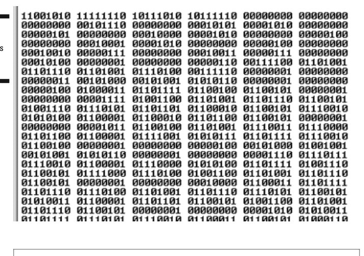

图 1-2：计算机编译源代码以创建目标代码。

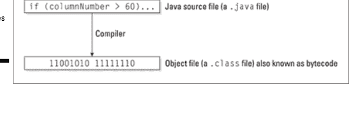


你的计算机硬盘驱动器上可能有一个名为`javac`或`javac.exe`的文件。这个文件包含那个特殊的软件工具——编译器。（嘿，你看，单词`javac`代表 "Java compiler"！）作为一名 Java 程序员，你经常告诉你的计算机构建一些新的目标代码。你的计算机通过幕后运行`javac`文件中的指令来实现这个愿望。

#### 运行代码

几年前，我在哥本哈根待了一周。我和一位朋友一起闲逛，他精通丹麦语和英语。当我们在公园里聊天时，我模糊地注意到一些孩子在我们周围转悠。我一句丹麦语也不会说，所以我以为孩子们在谈论普通的儿童话题。

#### 字节码到底是什么？

看看清单 1-1 以及该清单翻译成字节码的图 1-1。你可能会误以为字节码文件只是一个密码——用零和一替换单词中的字母，比如`if`和`else`。但事实并非如此。实际上，字节码文件最重要的部分是程序逻辑的编码。

图 1-1 中的零和一描述了数据从计算机一部分到另一部分的流动。我在下图中说明了这个流程。但请记住，这幅图只是一个插图。你的计算机不会查看这个特定的图表或任何类似的东西。相反，你的计算机读取一堆零和一来决定下一步做什么。

不必费心理解我在图中的图形化表示尝试的细节。这不值得你花时间。你应该从我混合了文本、方框和箭头的内容中获取的信息是，字节码（`.class`文件中的内容）包含了计算机要执行的操作的完整描述。当你编写计算机程序时，你的源代码描述了一个整体策略——一个大图景。编译后的字节码将整体策略转化为数百个微小的、一步一步的细节。当计算机“运行你的程序”时，它会检查这个字节码并执行每一个微小的分步细节。

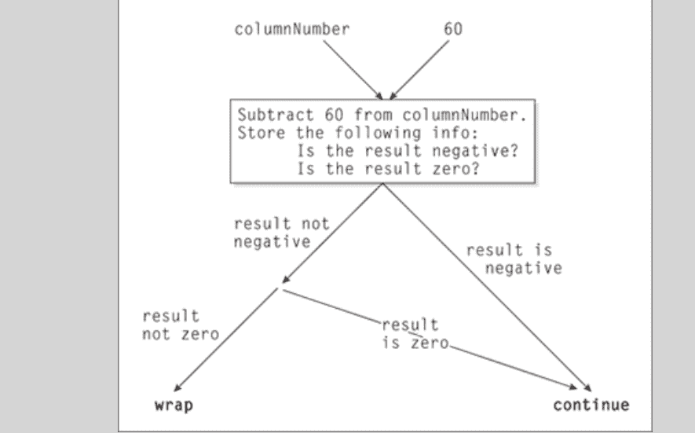

然后我的朋友告诉我那些孩子说的不是丹麦语。“他们在说什么语言？”我问。

“他们在胡言乱语，”她说。“只是些无意义的音节。他们听不懂英语，所以他们在模仿你。”

现在回到当前的情况。我看着图 1-1 中的内容，忍不住想嘲笑我的计算机说话的方式。但那样我就和哥本哈根的那些孩子一样了。对我来说毫无意义的东西，对我的计算机来说却可能完全有意义。当图 1-1 中的零和一渗透过我计算机的电路时，计算机“思考”着图 1-3 中所示的思想。

每个人都知道计算机不会思考，但计算机可以执行图 1-3 中描述的指令。对于许多编程语言（比如`C++`和`COBOL`这样的语言），计算机正是这样工作的。计算机吞噬一些目标代码，并按照目标代码所说的去做。

这就是许多编程语言的工作方式，但在 Java 中并非如此。在 Java 中，计算机执行的是另一套指令。计算机执行的是像图 1-4 中那样的指令。

图 1-3：计算机从字节码文件中获取的内容。

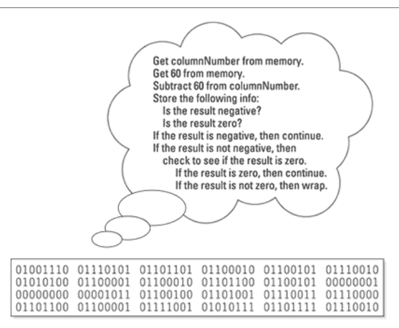

```
01001110 01110101 01101101 01100010 01100101 01110010
01010100 01100001 01100010 01101100 01100101 00000001
00000000 00001011 01100100 01101001 01110011 01110000
01101100 01100001 01111001 01010111 01101111 01110010
```

图 1-4：计算机如何运行 Java 程序。

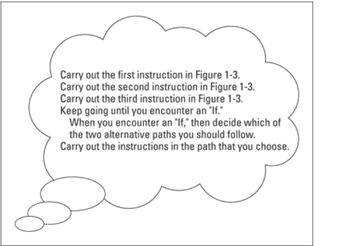

图 1-4 中的指令告诉计算机如何遵循其他指令。计算机的第一条指令不是`从内存中获取 columnNumber`，而是“按照字节码文件中所说的去做”。（当然，在字节码文件中，第一条指令恰好是`从内存中获取 columnNumber`。）

有一种特殊的软件执行图 1-4 中的指令。这种特殊的软件被称为*Java 虚拟机* (JVM)。JVM 引导你的计算机执行一些字节码指令。当你运行一个 Java 程序时，你的计算机实际上是在运行 JVM。这个 JVM 逐个零、逐个一地检查你的字节码，并执行字节码中描述的指令。

有许多很好的比喻可以描述 JVM。把 JVM 想象成一个代理、一个跑腿的、一个中间人。无论哪种方式，你都会遇到图 1-5 所示的情况。在 (a) 端是大多数编程语言中的情况——计算机运行一些目标代码。在 (b) 端是 Java 中的情况——计算机运行 JVM，然后 JVM 遵循字节码的指令。

你的计算机硬盘驱动器上可能有一个名为`java`或`java.exe`的文件。这个文件包含前面在图 1-4 中说明的指令——JVM 中的指令。作为一名 Java 程序员，你经常告诉你的计算机运行一个 Java 程序。你的计算机通过幕后运行`java`文件中的指令来实现这个愿望。

> **一次编写，到处运行**

当 Java 在 1995 年首次进入科技领域时，这种语言几乎立即流行起来。部分原因是由于 JVM。JVM 就像一个外语口译员，将 Java 字节码翻译成特定计算机理解的任何本地语言。因此，如果你把我的 Windows 计算机一个 Java 字节码文件，那么计算机的 JVM 会为 Windows 环境解释这个文件。如果你把这个相同的 Java 字节码文件交给我的同事的 Macintosh，那么 Macintosh JVM 会为 Mac 环境解释相同的字节码。

再次查看图 1-5。如果没有虚拟机，你需要为每个操作系统提供不同类型的目标代码。但是有了 JVM，只需要一段字节码就可以在 Windows 机器、Unix 设备、Mac 或任何其他设备上运行。这被称为*可移植性*，在计算机编程领域，可移植性是非常宝贵的资产。想想所有使用计算机浏览互联网的人。这些人并不都运行 Microsoft Windows，但每个人的计算机都可以有自己的字节码解释器——自己的 JVM。

甲骨文的市场人员将其称为*一次编写，到处运行*的计算模型。我认为这是创建软件的一种绝佳方式。

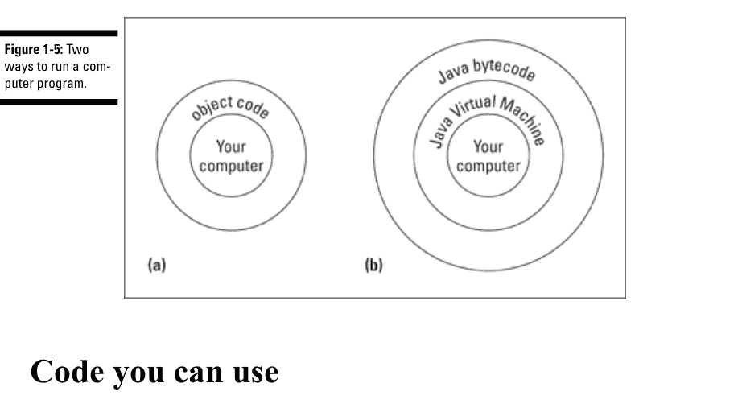

### 你可以使用的代码

20世纪80年代初，我的姐夫克里斯在一家计算机软件公司工作。这家公司为文字处理机编写代码。（当时，如果你想用电脑写文档，而不是用打字机，你得买一台除了文字处理什么都不会的“电脑”。）克里斯抱怨说，他总被要求一遍又一遍地写同样的代码。“首先，我写一个查找替换程序。然后，我写一个拼写检查器。接着，我又写一个查找替换程序。然后，写一个不同类型的拼写检查器。再然后，又是一个更好的查找替换程序。”

克里斯是如何对工作保持兴趣的？而克里斯的雇主又是如何维持业务的？每隔几个月，克里斯就不得不重新发明轮子。扔掉旧的查找替换程序，从头开始编写新程序。这很没效率。更糟的是，这很无聊。

多年来，计算机专业人士一直在寻找“圣杯”——一种编写软件使其易于复用的方法。不要反复编写和修改你的查找替换代码。只需将任务分解成小片段。一个片段查找单个字符，另一个片段查找空格，第三个片段用一个字母替换另一个。当你拥有所有这些片段后，只需将它们组装成一个查找替换程序。以后，当你想到文字处理软件的一个新功能时，只需以略微不同的方式重新组装这些片段。这很合理，成本效益高，而且有趣得多。

20世纪80年代末，软件开发领域取得了几项进展，到90年代初，许多大型编程项目都是用预制组件编写的。Java于1995年问世，因此其创始人很自然地创建了一个可复用代码库。该库包含了大约250个程序，包括处理磁盘文件、创建窗口和通过互联网传递信息的代码。自1995年以来，这个库已发展到包含超过4,000个程序。这个库被称为*应用程序编程接口 (API)*。

每一个Java程序，即使是最简单的程序，都会调用Java API中的代码。这个Java API既实用又令人生畏。说它实用，是因为你可以用API中的程序做很多事情。说它令人生畏，是因为API的范围极其广泛。没有人能记住Java API提供的所有功能。程序员会记住他们常用的功能，并在需要时查找那些临时用到的功能。他们在一种名为*API规范*的在线文档中查找这些功能（大多数Java程序员亲切地称之为*API文档*或*Javadocs*）。

API文档描述了Java API中的数千个功能。作为一名Java程序员，你需要每天查阅这份API文档。你可以在Oracle网站上将文档添加为书签，并在需要时随时访问。但从长远来看（甚至从不太长远的来看），下载一份自己的API文档副本可以节省时间。（详情请参阅第2章。）

### 你的Java编程工具集

要编写Java程序，你需要本章前面描述的工具：

- 你需要一个**Java编译器**。（参见“翻译你的代码”一节。）
- 你需要一个**JVM**。（参见“运行代码”一节。）
- 你需要**Java API**。（参见“你可以使用的代码”一节。）
- 你需要访问**Java API文档**。（同样，参见“你可以使用的代码”一节。）

你还需要一些不那么“异国情调”的工具：

- 你需要一个**编辑器**来编写你的**Java程序**。清单1-1包含了一个计算机程序的一部分。归根结底，计算机程序就是一大堆文本。因此，要编写计算机程序，你需要一个*编辑器*——一个创建文本文档的工具。

编辑器很像Microsoft Word，或者任何其他文字处理程序。最大的区别在于，编辑器不会给你的文本添加任何格式——没有粗体、斜体或字体的区别。计算机程序没有任何格式。它们除了普通的字母、数字和其他熟悉的键盘字符外，一无所有。

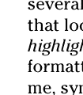

当你编辑程序时，你可能会看到粗体文本、斜体文本和多种颜色的文本。但你的程序本身不包含任何这些格式。如果你看到看起来像格式的东西，那是因为你使用的编辑器做了*语法高亮*。通过语法高亮，编辑器让文本看起来像是有格式的，以帮助你理解程序的结构。相信我，语法高亮非常有用。

➤ **你需要一种方式来发布命令。** 你需要一种方式来说诸如“编译这个程序”和“运行JVM”之类的话。每台计算机都提供了发布命令的方式。（你可以双击图标或在“运行”对话框中输入冗长的命令。）但当你使用计算机的功能时，你会从一个窗口跳到另一个窗口。你打开一个窗口阅读Java文档，另一个窗口编辑Java程序，第三个窗口启动Java编译器。这个过程可能非常乏味。

在最理想的情况下，你可以通过一个良好的界面完成所有程序编辑、文档阅读和命令发布。这个界面被称为*集成开发环境 (IDE)*。

一个典型的IDE将你的屏幕工作区域分成几个窗格——一个窗格用于编辑程序，另一个窗格用于列出程序名称，第三个窗格用于发布命令，还有其他窗格帮助你编写和测试程序。你可以安排这些窗格以便快速访问。更好的是，如果你在一个窗格中更改信息，IDE会自动更新所有其他窗格中的信息。

IDE帮助你从编程工作的这一部分无缝地移动到另一部分。有了IDE，你就不必担心编辑、编译和运行JVM的机制。相反，你可以专注于编写程序的逻辑。（你可能想不到吧？无论如何，你总是有事情要担心！）

#### 你的硬盘上已经有了什么？

你可能已经拥有创建Java程序所需的一些工具。以下是一些例子：

- 一些Windows安装已经包含了JVM。在你的`\windows\system32`目录中查找名为`java.exe`的文件。
- 运行版本不高于Mac OS X 10.6（Snow Leopard）的计算机自带Java编译器、JVM和Java API。
- 运行Mac OS X 10.7（Lion）的计算机不自带JVM。要安装JVM，请访问`www.macupdate.com/app/mac/39490/_java-for-os-x-lion`。
- 一些IDE自带Java工具。例如，当你下载免费的Eclipse IDE时，你会得到一个Java编译器和一份Java API文档副本。（详情请参阅第2章。）

你可能已经拥有一些Java工具，但在较旧的计算机上，你的工具可能已经过时。本书中的大多数示例可以在所有版本的Java上运行。但有些示例无法在Java 5.0之前的版本上运行。其他示例只能在Java 6或更高版本上运行，有些示例只能在Java 7或更高版本上运行。

最稳妥的办法是从Oracle网站重新下载工具。有关下载的详细说明，请参阅第2章。

#### Eclipse

本书中的程序适用于任何可以运行Java的IDE。这包括诸如NetBeans、IntelliJ IDEA、JDeveloper、JCreator等IDE。你甚至可以在没有IDE的情况下运行这些程序。但为了演示本书中的示例，我使用Eclipse IDE。我选择Eclipse而不是其他IDE有几个原因：

- Eclipse是免费的。
- 在所有Java IDE中，Eclipse是专业程序员最常用的。
- Eclipse有许多花哨的功能，但你可以忽略其中大部分，只需学习重复几个常规的操作步骤。使用Eclipse几次后，你的大脑会自动执行这些常规步骤。从那时起，你就可以停止担心Eclipse，专注于Java编程了。
- Eclipse是免费的。（值得一提两次。）

#### 设置你的计算机

**本章内容**

- 安装 Java
- 下载并安装 Eclipse 集成开发环境
- 检查你的 Eclipse 配置
- 获取本书示例中的代码

本书将教你如何编写 Java 程序，而在编写之前，你需要一些软件。至少，你需要我在第 1 章描述的软件——一个 Java 编译器和一个 Java 虚拟机（简称 JVM）。你也可以使用一个优秀的集成开发环境（IDE）和一些示例代码来入门。

其中一些软件你可以装在色彩鲜艳的盒子里买到，但更简单（也更便宜）的方式是从网上下载。事实上，编写 Java 程序所需的所有软件都是免费的。这些软件分为三个下载项——一个来自本书的网站，一个来自 Oracle，第三个来自`eclipse.org`。反正，谁还需要另一个色彩鲜艳的盒子呢？


本章中描述的 Oracle 和 Eclipse 网站总是在变化。你从这些站点下载的软件也在变。像“点击右上角的按钮”这样的具体指令很快就会过时（甚至会产生误导）。因此，在本章中，我提供了一系列详细的步骤，但也描述了这些步骤背后的理念。

请浏览每个推荐的站点，寻找获取我所描述软件的方法。当网站提供多个选项时，请查看本章中的说明，寻找选择最佳选项的提示。如果你的计算机上的 Eclipse 窗口与本章图中的窗口不完全一样，请在你的计算机窗口中查找我描述的所有选项。如果尝试了所有方法后仍找不到，请查看本书网站（`http://allmycode.com/BeginProg3`）或发送电子邮件至`BeginProg@allmycode.com`联系我。

#### 如果你不喜欢阅读说明……

我在本章开头简要（但有用）概述了获取所需软件的步骤。如果你是安装软件的老手，并且你的计算机没有怪问题，这些步骤可能就足够了。如果不是，你可以阅读后面几节更详细的说明。

以下是获取创建 Java 程序所需软件的方法：

1. 访问`http://allmycode.com/BeginProg3`并下载一个包含本书所有程序示例的文件。
2. 访问`www.oracle.com/technetwork/java/javase/downloads`并获取最新版本的 JRE 或 JDK。

如果你打算使用 Eclipse（如我在本书中描述的那样），JRE 或 JDK 都可以。选择与你的操作系统（Windows、Macintosh 或其他）匹配的软件版本。如果你在 32 位和 64 位软件之间难以抉择，选择 32 位版本更稳妥。


如果你赶时间（谁不是呢？），快速访问一下`http://java.com`可能对你有帮助。`http://java.com`网站提供了一个无忧的一键式 Java 安装程序。（只需点击一个大的 Java 下载按钮，非常明显。）Java 下载按钮并非在所有计算机上都有效。但如果它对你有效，那么就像挥舞一下虚拟魔杖，你就完成了这一步。你可以跳过`oracle.com`网站的复杂操作，直接进入第 3 步。

3. 访问`http://eclipse.org/downloads`并获取 Eclipse IDE。

选择 Eclipse IDE For Java Developers。下载的是一个压缩归档文件（对于 Windows 是`.zip`文件；对于其他操作系统，包括 Macintosh OS X，是`.tar.gz`文件）。

4. 解压缩下载的 Eclipse 归档文件。

归档文件包含一个名为`eclipse`的文件夹。将这个`eclipse`文件夹解压到你计算机硬盘上一个方便的位置。例如，在我的 Windows 计算机上，我有一个`C:\eclipse`文件夹。在我的 Mac 上，我在`Applications`文件夹里有一个`eclipse`文件夹。


在 Windows 中，`Program Files`名称中的空格会让一些 Java 软件感到困惑。我认为本书的软件不会出现这个问题，但我不能保证。所以，如果你愿意，可以把 Eclipse 解压到你的`C:\Program Files`或`C:\Program Files (x86)`文件夹。但请记住你的选择（以防以后遇到任何麻烦）。

5. 启动 Eclipse 并点击欢迎屏幕上的工作台图标。

   欢迎屏幕的图标没有文字标签。但当你将鼠标悬停在一个图标上时，会出现一个工具提示。选择工具提示标题为“Workbench”（工作台）的图标。

6. 在 Eclipse 中，导入你在第 1 步下载的代码。

   关于这些操作的详细信息，请参阅后面几节。

##### 那些恼人的文件名扩展名

“我的电脑”或“访达”窗口中显示的文件名可能会产生误导。你可能浏览某个目录时看到一个名为`Mortgage`的文件。该文件的真实名称可能是`Mortgage.java`、`Mortgage.class`、`Mortgage.somethingElse`，或者就是普通的`Mortgage`。像`.zip`、`.java`和`.class`这样的文件名结尾被称为*文件名扩展名*。

一个令人不快的事实是，Windows 和 Mac 默认隐藏许多文件名扩展名。这个糟糕的功能往往会迷惑程序员。所以，如果你不想被搞糊涂，请更改计算机的系统范围设置。方法如下：

- **在 Windows XP 中：** 选择“开始”⇒“控制面板”⇒“外观和主题”⇒“文件夹选项”。然后跳至**所有版本的 Windows**要点。
- **在 Windows 7 中：** 选择“开始”⇒“控制面板”⇒“外观和个性化”⇒“文件夹选项”。然后跳至**所有版本的 Windows**要点。
- **在 Windows 8 中：** 在“开始”屏幕中，选择“控制面板”⇒“更多设置”⇒“外观和个性化”⇒“文件夹选项”。然后继续到**所有版本的 Windows**要点。
- **在所有版本的 Windows（XP 及更新版本）中：** 按照前面其中一个要点中的说明操作。然后，在“文件夹选项”对话框中，单击“查看”选项卡。找到“隐藏已知文件类型的扩展名”选项。确保此复选框*未*被选中。
- **在 Mac OS X 中：** 在“访达”应用程序的菜单中，选择“偏好设置”。在出现的对话框中，选择“高级”选项卡，找到“显示所有文件扩展名”选项。确保此复选框*已*被选中。
- **在 Linux 中：** Linux 发行版往往不隐藏文件名扩展名。所以如果你使用 Linux，你可能不需要担心这个问题。但我没有检查所有的 Linux 发行版。所以如果你的文件被命名为`Mortgage`而不是`Mortgage.java`或`Mortgage.class`，请查阅你的 Linux 发行版特定的文档。

#### 获取本书的示例程序

要获取本书示例程序的副本，请访问[http://allmycode.com/BeginProg3](http://allmycode.com/BeginProg3)并点击链接下载本书的程序。将下载的文件（`BeginProgJavaDummies3.zip`）保存到计算机的硬盘上。


在某些情况下，你点击下载链接，但网页浏览器没有提供保存文件的选项。如果发生这种情况，请右键单击链接（或在 Mac 上按住 Control 键单击）。在出现的上下文菜单中，选择“目标另存为”、“链接另存为”、“将链接文件下载为”或类似标签的菜单项。

大多数网页浏览器会将文件保存到计算机硬盘上的`Downloads`目录。但你的浏览器配置可能有所不同。无论如何，请记下包含已下载的`BeginProgJavaDummies3.zip`文件的文件夹。

##### 压缩归档文件

当你访问[http://allmycode.com/BeginProg3](http://allmycode.com/BeginProg3)并下载本书的 Java 示例时，你下载的文件名为`BeginProgJavaDummies3.zip`。`.zip`文件是一个单独的文件，它编码了许多更小的文件和文件夹。例如，我的`BeginProgJavaDummies3.zip`文件编码了名为`06-01`、`06-02`等的文件夹。`06-02`文件夹包含一些子文件夹，这些子文件夹又包含文件。（名为`06-02`的文件夹包含代码清单 6-2 中的代码——第 6 章的第二个清单。）

`.zip`文件是*压缩归档*文件的一个例子。其他一些压缩归档的例子包括`.tar.gz`文件、`.rar`文件和`.cab`文件。*解压缩*文件意味着提取存储在大归档文件中的原始文件。（对于`.zip`文件，“解压缩”的另一个词是“解压”。）解压缩通常会重新创建归档文件中编码的文件夹结构。

因此，在解压缩我的`BeginProgJavaDummies3.zip`文件后，你的硬盘驱动器上将出现名为`06-01`、`06-02`的文件夹，其中包含名为`src`和`bin`的子文件夹，这些子文件夹又包含名为`SnitSoft.java`、`SnitSoft.class`等的文件。

#### 设置 Java

当你下载`BeginProgJavaDummies3.zip`文件时，你的网络浏览器可能会自动为你解压缩该文件。如果没有，你可以通过双击该`.zip`文件的图标来查看其内容。（事实上，双击文件图标后，你可以复制文件内容并执行一些其他文件操作。）

无论如何，请不要担心解压缩我的`BeginProgJavaDummies3.zip`文件。当你按照本章的说明操作时，你会将我的`BeginProgJavaDummies3.zip`文件内容导入 Eclipse IDE。在后台，Eclipse 的导入过程会自动解压缩这个`.zip`文件。

你可以通过访问[www.oracle.com/technetwork/java/javase/downloads](http://www.oracle.com/technetwork/java/javase/downloads)来获取最新、最强大的 Java 版本。寻找可用的 JRE 或 JDK 的最新版本。选择适合你计算机操作系统运行的版本。图 2-1 显示了我在[http://oracle.com](http://oracle.com)网站上点击下载 JRE 按钮（*大约*在 2011 年 11 月）的情景。

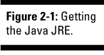

| Java 平台，标准版 | | |
| --- | --- | --- |
| **Java SE 7u1**<br>此版本包含许多安全修复。[了解更多 >]<br>"我需要哪个 Java？" 你的系统必须安装 JRE（Java 运行时环境）才能运行 Java 应用程序和小程序。要开发 Java 应用程序和小程序，你需要 JDK（Java 开发工具包），它包含了 JRE。 | **JDK**<br>[下载按钮]<br>**JDK 7 文档**<br>- [安装说明]<br>- [自述文件]<br>- [发行说明]<br>- [Oracle 许可协议]<br>- [Java SE 产品]<br>- [第三方许可协议]<br>- [已认证的系统配置] | **JRE**<br>[下载按钮]<br>**JRE 7 文档**<br>- [安装说明]<br>- [自述文件]<br>- [发行说明]<br>- [Oracle 许可协议]<br>- [Java SE 产品]<br>- [第三方许可协议]<br>- [已认证的系统配置] |
| **适用于 Mac OS X 的 JDK 7 开发者预览版**<br>适用于 Mac OS X 的 JDK 7 开发者预览版旨在供 Java 开发者使用。 | **JDK**<br>可在`jdk7.java.net`获取 | |

如果你无法确定最合适的 Java 版本，或者想知道*JRE*和*JDK*这些缩写代表什么，请参阅标题为“Eenie, meenie, miney mo”的边栏。

在接受许可协议并点击链接以获取 Java 安装文件后，你的计算机会执行以下两种操作之一：

- ✔ 下载并在你的系统上安装 Java。
- ✔ 下载 Java 安装文件并将其保存到你计算机的硬盘上。

##### Eenie, meenie, miney mo

Java 标准版下载页面（[www.oracle.com/technetwork/java/javase/downloads](http://www.oracle.com/technetwork/java/javase/downloads)）有许多选项。如果你不熟悉这些选项，这个页面可能会令人望而生畏。以下是页面上的一些选择：

##### 字长：32 位还是 64 位

你可能需要在标有 32 位系统和 64 位系统的链接之间进行选择。如果你不知道如何选择，那么可以先尝试 32 位版本。（有关 32 位系统和 64 位系统的更多信息，请参阅“你的计算机有多少位？”边栏。）

##### Java 版本号

Java 下载页面可能提供旧版本和新版本的 Java 供你选择。你可能会看到指向 Java SE 6、Java SE 7、Java SE 7u4 以及许多其他版本的链接。（像 7u4 这样的编号代表 Java 7 的第四次更新。）如果你不确定想要哪个版本号，选择最高的版本号可能是安全的。本书的大多数示例都在安装了 Java 5 的计算机上运行。少数示例仅在 Java 7 或更高版本上运行。

Java 版本的编号真的令人困惑。首先是 Java 1.0，然后是 Java 1.1，接着是 Java 2 标准版 1.2（J2SE 1.2）。是的，"Java 2"的编号与"1.x"的编号部分重叠。接下来是 1.3 和 1.4 版本。在 1.4.1 版本之后是 1.4.2 版本（中间穿插了像 1.4.1_02 这样的版本）。在 1.4.2_06 之后，下一个版本是 1.5 版本，也称为 5.0 版本。（这不是印刷错误。5.0 版本紧随 1.4 版本之后。）

1.5 版本的正式名称是"Java 2 平台，标准版 5.0"。更糟糕的是，下一个大版本是"Java 平台，标准版 6"，其中"Java 2"中的"2"被移除，"6.0"中的".0"也被省略。这就是让市场营销人员说了算的结果。

谢天谢地，从 Java 6 开始，版本号趋于一个可预测的模式。在 Java 6 之后是"Java 平台，标准版 7"，并有诸如"7u4"（意为"Java 7，第 4 次更新"）的更新。

##### JDK 与 JRE

下载页面提供了 JDK（Java 开发工具包）和 JRE（Java 运行时环境）之间的选择。JDK 下载包含的内容比 JRE 下载更多。JRE 包含一个 Java 虚拟机和应用程序编程接口（见第 1 章）。JDK 包含 JRE 中的所有内容，并且还包含一个 Java 编译器。

你可以下载 JDK，但我建议你下载 JRE。JRE 下载包更小，而且 Eclipse IDE 包含了自己的 Java 编译器。因此，当你根据本章的说明获取了 JRE 和 Eclipse 时，你就拥有了编写自己的 Java 程序所需的一切。

顺便说一下，JDK 的另一个名称是*Java SDK*——*Java 软件开发工具包*。有些人仍然使用 SDK 这个缩写，尽管 Oracle 的人已经不再使用它了。（实际上，最初的名字是 JDK。后来，Sun Microsystems 将其改为 SDK。几年后，Java 的负责人又改回了 JDK 这个名字。作为作者，这种不断的命名和重命名让我抓狂。）

##### Java SE 与 Java EE 与 Java ME

当你浏览时，可能会注意到标有 Java EE 或 Java ME 的链接。如果你知道这些是什么，并且知道你需要它们，那么务必下载这些好东西。但如果你不确定，那么请跳过 Java EE 和 Java ME 链接。请按照链接获取 Java SE（Java 标准版）。

缩写 Java EE 代表 Java 企业版，Java ME 代表 Java 微型企业版。企业版包含用于大型企业的软件，微型企业版包含用于手持设备的软件。（谷歌的 Android 软件与 Java 的微型企业版有相似之处，但在许多方面，Android 和 Java ME 是截然不同的东西。）

你不需要 Java EE 或 Java ME 来运行本书中的任何示例。

##### 其他 Java 相关软件

你可以单独下载 Java，也可以下载包含 Oracle NetBeans IDE 的 Java。你可以下载 JavaFX——一个用于创建游戏和应用程序的高性能平台。你甚至可能可以下载附带薯条和软饮料的 Java。你可以下载大量额外的东西，但实际上，你所需要的只是 Java JRE。

##### 安装类型

你可能会被提示在在线安装和离线安装之间做出选择。

使用离线安装，你首先需要下载一个大型安装程序文件。该文件占用硬盘大量空间（取决于你选择下载的内容，在 10 MB 到 150 MB 之间）。如果你以后需要再次安装 JDK，你计算机上已有该文件。在你更新 JDK 版本之前，你不需要再次下载 JDK。

为什么有人会想要第二次安装同一版本的 JDK？通常，我有两个原因。要么我想在第二台计算机上安装该软件，要么我把事情搞砸了，不得不卸载（然后重新安装）该软件。

使用在线安装，你不需要下载一个大的安装程序文件。相反，你下载一个微小的安装程序文件。然后，当你需要时，你下载（并丢弃）那个大的 10 到 150MB 文件的各个部分。

使用在线安装可以为你节省许多兆字节的硬盘空间。但是，如果你想第二次安装同一版本的 JDK，你必须重新执行整个浏览/点击/下载过程。

如果安装自行开始，请按照说明操作，对所有提示回答“是”，并且（除非你有充分理由不这样做）接受默认设置。如果安装没有自行开始，首先双击下载的安装文件。

- **在 Windows 上：** 接受安装向导提供的默认设置。
- **在 Mac 上：** 一个窗口会敦促你将 JDK 文件拖到`JavaVirtualMachines`文件夹中。在你能够将任何内容拖到`JavaVirtualMachines`文件夹之前，你可能需要重新输入计算机的密码。
- **使用 Linux `.rpm`文件：** 接受安装向导提供的默认设置。
- **使用 Linux `.tar.gz`文件：** `.tar.gz`文件是一个压缩存档文件。将存档内容解压到你选择的文件夹中。（有关文件名和文件类型的更多信息，请参阅本章标题为“那些讨厌的文件扩展名”和“压缩存档文件”的边栏。）

大多数人访问`http://oracle.com`并使用网站菜单安装 Java 不会遇到任何困难。但如果你的情况比大多数人更“有趣”，你可能需要做出一些决定并执行一些额外的步骤。接下来的几个小节将描述其中一些“有趣”的场景。

##### 你的计算机有多少位？


当你按照本章的说明操作时，你可能会被提示在软件的两个版本之间做出选择——32 位版本和 64 位版本。有什么区别，为什么你应该关心？

*位* 是你可以在计算机上存储的最小信息单位。大多数人认为一个位是零或一，并且这种对“位”的描述非常有用。要表示几乎任何数字，你需要将几个位堆叠在一起，并对二的幂次进行一些花哨的操作。这个编号系统的细节并非不可逾越。重要的是要记住，你计算机内部的每个电路部件都存储相同数量的位。（嗯，你计算机内部的一些电路是例外，有其特定的位数，但这不是什么大问题。）

在较旧的计算机中，每个电路存储 32 位。在较新的计算机中，每个电路存储 64 位。这个位数（32 或 64）就是计算机的字长。在较新的计算机中，一个字是 64 位长。

“太棒了！”你说。“我的电脑是上周买的。它一定是 64 位计算机。”嗯，事情可能没那么简单。除了计算机电路的字长之外，计算机上的操作系统也有字长。操作系统的指令也要处理特定数量的位。带有 32 位指令的操作系统可以在 32 位或 64 位计算机上运行，但带有 64 位指令的操作系统只能在 64 位计算机上运行。

而且更复杂的是，你运行的每个程序（网页浏览器、文字处理器，或你自己的某个 Java 程序）要么是 32 位程序，要么是 64 位程序。你可以在 64 位计算机上的 64 位操作系统中运行 32 位网页浏览器。或者，你也可以在 64 位计算机上的 32 位操作系统中运行 32 位浏览器。（参见本专栏附带的图。）

当网站让你在 32 位和 64 位软件版本之间做出选择时，主要考虑的是操作系统的字长，而不是计算机电路的字长。你可以在 64 位操作系统上运行 32 位文字处理器，但不能在 32 位操作系统上运行 64 位文字处理器（无论计算机电路的字长是多少）。

选择 64 位软件有一个很大的优势——那就是 64 位软件可以访问超过 3GB 的计算机硬件快速随机存取内存。根据我的经验，更多的内存意味着更快的处理速度。

所有这些关于字长的内容如何影响你的 Java 和 Eclipse 下载呢？情况如下：

- 如果你运行 32 位操作系统，你只能运行 32 位软件。
- 如果你运行 64 位操作系统，你可能同时运行一些 32 位软件和一些 64 位软件。大多数 32 位软件在 64 位操作系统上运行良好。
- 在 64 位操作系统上，你可能有同一程序的两个版本。例如，在我的 Windows 计算机上，我有两个版本的 Internet Explorer——一个 32 位版本和一个 64 位版本。

通常，Windows 将 32 位程序放在其 `Program Files (x86)` 目录中，将 64 位程序放在其 `Program Files` 目录中。

- 字长链的强度取决于其最弱的一环。例如，当我访问 `java.com` 并点击网站的*我有 Java 吗？*链接时，我得到的答案取决于我计算机上的 Java 版本与我运行的 Web 浏览器之间的匹配情况。如果我的计算机上只安装了 64 位 Java，那么在我的 32 位 Firefox 浏览器中，*我有 Java 吗？*链接会回答：您的系统上*未检测到正常工作的 Java*。但我在 64 位 Internet Explorer 中点击同一链接时，会回答：*您已安装推荐的 Java 版本*。

关于字长，最重要的一点是：当你按照本章的说明操作时，你会在计算机上安装 Java 软件和 Eclipse 软件。你的 Java 软件的字长必须与 Eclipse 软件的字长匹配。换句话说，32 位 Eclipse 与 32 位 Java 一起运行，64 位 Eclipse 与 64 位 Java 一起运行。我没有尝试所有可能的组合，但当我尝试用 64 位 Java 运行 32 位 Eclipse 时，我看到了一个误导性的错误消息：“未找到 Java 虚拟机”。

## 如果你想避免安装 Java……

第 1 章描述了 Java 生态系统，包括它的编译器、虚拟机和其他部分。你的计算机可能已经有一些 Java 工具。如果是这样，你可以要么使用已有的，要么在系统现有基础上添加最新版本的 Java。要了解你已有哪些并可能避免重新安装 Java，请继续阅读。

### 在 Windows 上

选择开始 ⇒ 控制面板 ⇒ 程序 ⇒ 程序和功能，在已安装程序列表中查找 *Java*（参见图 2-2）。如果你看到 Java 7 或更高版本，就没问题。如果你看到的唯一 Java 版本号小于 7（如 1.4.2、5.0 或 6），那么你的计算机没有能运行本书所有程序的版本。

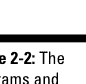

如果版本号是 5.0 或更高，你可以运行本书中的许多（但不是全部）程序。

图 2-2：Windows 7 上的“程序和功能”对话框。

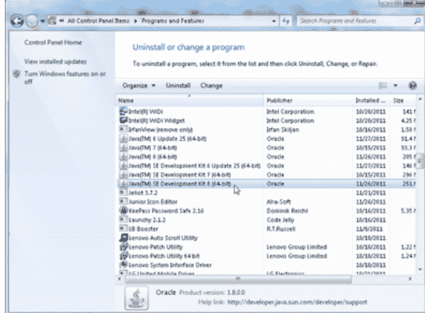

### 在 Mac 上

表 2-1 描述了最新 Mac OS 版本与 Java 版本之间的对应关系。

#### 表 2-1 Mac OS X 版本与 Java 版本

| 如果你有此 Mac OS X 版本…… | 那么你有此版本的 Java…… | 并且你可以运行此 Java 版本 |
|---|---|---|
| OS X 10.4 (Tiger) | Java 5.0 | Java 5.0 |
| OS X 10.5 (Leopard) PowerPC 和/或 32 位 | Java 5.0 | Java 5.0 |
| OS X 10.5 (Leopard) 64 位 | Java 6 | Java 6 |
| OS X 10.6 (Snow Leopard) 32 位 | Java 6 | Java 6 |
| OS X 10.6 (Snow Leopard) 64 位 | Java 6 | Java 7 |
| OS X 10.7 (Lion) | Java 6 | Java 7 |

Tiger、Leopard 和 Snow Leopard 预装了 Java。如果你在被提示时应用软件更新，你就会拥有表 2-1 中显示的 Java 版本。

Lion 上没有预装 Java。相反，系统会在你第一次启动需要 Java 的应用程序时自动安装 Java 6。

要查明你正在运行哪个版本的 OS X，请执行以下操作：

1. 选择苹果 ⇒ 关于本机。
2. 在出现的“关于本机”对话框中，查找*版本*一词。你会看到版本 10.6.4（或类似内容）的浅灰色文字。

> 如果你不经常应用软件更新，请在苹果菜单中选择“软件更新”。在出现的“软件更新”对话框中，点击“显示详细信息”按钮。然后选择名称中包含 *Java* 的项目（参见图 2-3）。如果你怀疑某个项目与 Java 有关但不确定，可以高亮显示该项目以查看其详细描述。无论如何，你可以选择比需要更多的项目，包括与 Java 无关的项目。做出选择后，点击“安装”按钮。

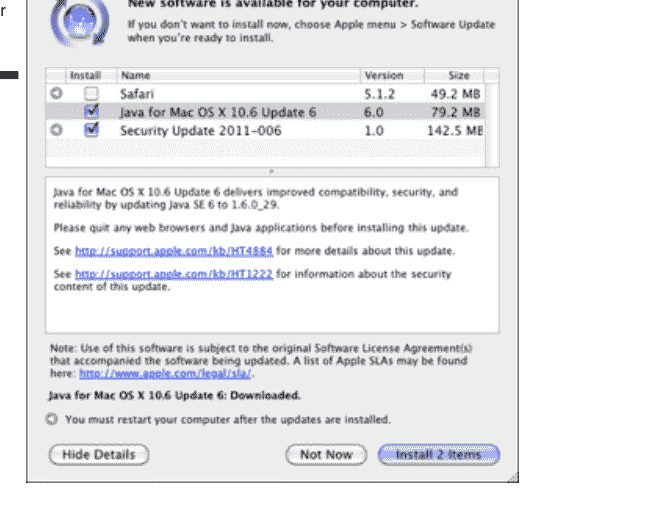

在网上的各个角落，我看到一些帖子描述了在 OS X 10.3 上安装 Java 5.0 的方法，以及绕过表 2-1 中限制的其他方法。但如果你不喜欢折腾，这些变通方法不适合你。（对于每个硬件或软件要求，总有人试图创建变通方法或*黑客技巧*。总之，应用黑客技巧需自担风险。）

如果你不相信表 2-1（坦白说，你不应该相信印刷品中的一切），你可以在你的计算机上执行测试来发现 Java 的存在以及（如果你的 Mac 有 Java）Java 版本号。以下是其中一项测试：

1. 在 Spotlight 的搜索栏中，输入 `Java Preferences`。
2. 当 Spotlight 的首选结果是 `Java Preferences` 时，按 `Enter` 键。

Java Preferences 窗口出现（参见图 2-4）。

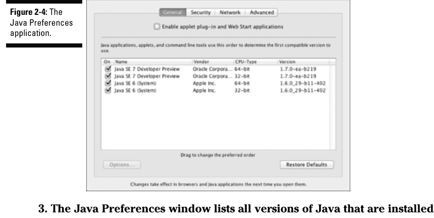

3. `Java Preferences` 窗口列出了安装在你计算机上的所有 Java 版本。在图 2-4 中，该计算机有四个版本的 Java——Java 6 和 Java 7 的 32 位和 64 位版本。

### 在 Linux 上

要检查 Linux 计算机上的 Java 安装（或缺乏 Java），请执行以下操作：

1. 在桌面菜单中查找名为 `Terminal`（也称为 `Konsole`）的程序。Terminal 窗口打开（通常是纯白色文字在纯黑色背景上）。
2. 在 Terminal 窗口中，输入以下文字，然后按 `Enter` 键：`java -version`。

在我的 Linux 计算机上，Terminal 窗口响应以下文字：

```text
java version 1.7.0_1
```

如果你的计算机响应的数字是 1.7.0 或更高，那么你可以打开香槟，期待愉快地运行本书的示例。如果版本号是 1.5 或更高，你可以运行本书的许多但不是全部示例。如果你的计算机响应类似 `command not found` 的内容，那么很可能你的计算机上没有安装 Java。

## 如果你在计算机上管理多个 Java 版本……

我在旧版本上安装新版本的 Java 时，有过一些好运气和坏运气。如果你能准备你的计算机，卸载现有的 Java 版本，从长远来看可能会省去一些麻烦。另一方面，如果卸载软件让你感到紧张，你可能可以在一台计算机上共存多个 Java 版本。（作为 Java 书籍的作者，我在计算机上保留了几个 Java 版本，而且很少遇到任何问题。我在 Windows 7 计算机上的典型一天创建了图 2-2。）

如果你怀疑以前安装的 Java 版本给你带来麻烦，以下几段描述了一些卸载技巧。

### 在 Windows XP 上卸载旧 Java 版本

选择开始 -> 控制面板 -> 添加或删除程序。然后，在“添加或删除程序”对话框中，查找名称以 *Java* 开头的条目。（通常，这些条目的名称类似于 *Java 6* 或 *Java SE Development Kit 6*。）

当你高亮显示其中一个条目时，Windows 会显示一个“删除”按钮（参见图 2-5）。点击“删除”按钮，然后根据提示操作。

### 在 Windows 7 上卸载旧 Java 版本

### 在 Windows 8 上卸载旧版 Java

选择开始 ⇒ 控制面板 ⇒ 卸载程序。在随后显示的已安装程序列表中，查找名称以“Java”开头的条目。（通常，这些条目的名称类似于 `Java 6` 或 `Java SE Development Kit 6`。）

当您右键单击其中一个条目时，Windows 会显示一个小的上下文菜单（参见图 2-6）。选择上下文菜单中的“卸载”选项，然后按照后续提示进行操作。

在“开始”屏幕中，选择控制面板 ⇒ 更多设置 ⇒ 卸载程序。这样，Windows 会显示已安装程序的列表。此后，卸载程序的步骤与 Windows 7 的步骤相同。

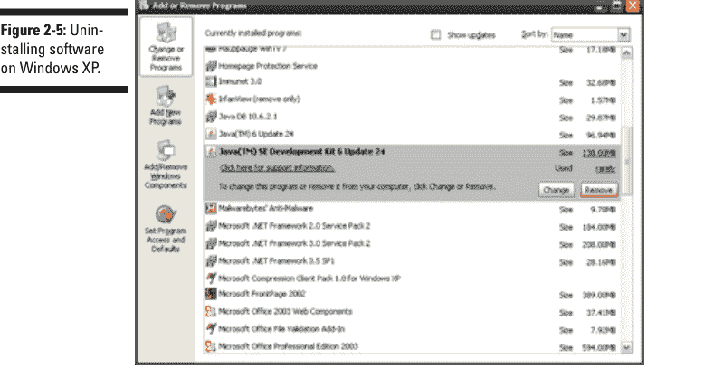

### 在 Mac 上设置 Java 版本优先级

Apple 并未让卸载旧版 Java 变得容易。但是，您可以通过运行 Mac 的“Java 偏好设置”应用程序来管理已安装的 Java 版本。具体操作如下：

1. 在 Spotlight 的搜索栏中，输入 `Java Preferences`。
2. 当 Spotlight 的“最佳匹配”显示为 `Java Preferences` 时，按回车键。此时会出现“Java 偏好设置”窗口（参见图 2-4）。
3. 在“Java 应用程序”列表中，将您偏好的 Java 版本（最好是 Java 7 或更高版本）拖动到列表顶部。
4. 关闭“Java 偏好设置”应用程序。

### 在 Linux 上卸载旧版 Java

抱歉。Linux 发行版种类繁多，我无法一一列举所有可能性。要在 Linux 上卸载软件，请查阅您所使用的 Linux 发行版的特定文档。

## 设置 Eclipse 集成开发环境

在前面的章节中，您已经获取了*计算机*处理 Java 程序所需的所有工具。本节则有所不同。在本节中，您将获取*您*用于编写和测试 Java 程序所需的工具。您将获得 Eclipse——一个 Java 的集成开发环境。

*集成开发环境*（IDE）是一种程序，它提供工具以帮助您轻松高效地创建软件。您可以不用 IDE 来创建 Java 程序，但使用 IDE 节省的时间和精力使得 IDE 物有所值。（有些资深程序员不同意我的观点，但这是另一回事。）

根据 Eclipse 基金会网站的说法，*Eclipse* 是“一个通用工具平台——一个面向任何事物（但又不针对特定事物）的可扩展开放 IDE。”的确，Eclipse 功能多样。程序员通常将 Eclipse 视为开发 Java 程序的 IDE，但 Eclipse 也提供了用于 C++、PHP 以及许多其他语言的编程工具。我甚至见过与程序开发无关的 Eclipse 化身。（其中一个产品是 *Lively Browser*——一个其标签页由 Eclipse 组件构建的网页浏览器。）

### 下载 Eclipse

以下是下载 Eclipse 的步骤：

1. 访问 [www.eclipse.org](http://www.eclipse.org)。
2. 找到适用于您操作系统的 Eclipse 下载方式。今天，我访问 [www.eclipse.org](http://www.eclipse.org) 时，看到一个显示“立即开始……下载 Eclipse”字样的大按钮（参见图 2-7）。明天，谁知道在这个不断变化的网站上我会看到什么！


点击“下载 Eclipse”按钮后，我看到了适用于我计算机操作系统的下载列表（参见图 2-8）。

Eclipse 的下载页面会引导您到特定于您计算机操作系统的 Eclipse 版本。例如，如果您在 Windows 计算机上访问该页面，页面会仅显示适用于 Windows 的下载。如果您是为另一台计算机下载 Eclipse，您可能需要覆盖自动选择的操作系统。查找一个包含您计算机操作系统名称的小型下拉列表。您可以在该下拉列表中更改所选的操作系统。

3. 从可用的软件包中选择一个 Eclipse 软件包。无论您的操作系统是什么，Eclipse 都有多种形态、大小和颜色。Eclipse 网站提供 Eclipse IDE for Java Developers、Eclipse IDE for Java EE Developers、Eclipse Classic 以及许多其他专用下载（参见图 2-8）。我通常选择 Eclipse IDE for Java Developers，我也建议您这样做。
4. 在 Eclipse 的 32 位和 64 位版本之间进行选择。如果您知道您的 Java 版本（32 位还是 64 位），请务必下载相应的 Eclipse 版本。如果您不知道您的 Java 版本，请下载 64 位版本的 Eclipse 并尝试启动它。如果您能启动 64 位 Eclipse，那就没问题了。但如果您遇到 `No Java virtual machine was found` 错误消息，请尝试下载并启动 32 位版本的 Eclipse。有关 32 位和 64 位字长的完整详情，请参阅本章的“您的计算机有多少位？”侧边栏。
5. 按照相应的链接开始下载。您跟随的链接取决于 Eclipse 的众多镜像站点中哪一个在提供您的下载。只需浏览各种可能性并开始下载即可。

### 安装 Eclipse

具体如何安装 Eclipse 取决于您的操作系统以及下载 Eclipse 时得到的文件类型。以下是简要概述：

- **如果您运行 Windows 且下载的是 `.exe` 文件：** 双击 `.exe` 文件的图标。
- **如果您运行 Windows 且下载的是 `.zip` 文件：** 将文件内容解压缩到您选择的目录。换句话说，在 Windows 资源管理器中找到 `.zip` 文件的图标。然后双击 `.zip` 文件的图标。（结果，Windows 资源管理器会显示 `.zip` 文件的内容，它只包含一个文件夹——一个名为 `eclipse` 的文件夹。）将 `eclipse` 文件夹拖动到计算机硬盘上的方便位置。有关 `.zip` 文件的更多信息，请参阅本章的“压缩归档文件”侧边栏。我最喜欢将 `eclipse` 文件夹拖动到 `C:` 驱动器根目录。所以我的 `C:` 驱动器上有名为 `Program Files`、`Windows`、`eclipse` 等文件夹。我避免将 `eclipse` 文件夹作为 `Program Files` 的子文件夹，因为我不时会遇到处理 `Program Files` 名称中空格的问题。
- **如果您运行 Mac OS X：** 如果您下载的是 `.tar.gz` 文件，请在“下载”文件夹中找到该文件并双击它。双击该文件应能解压缩文件内容。解压后，您的“下载”文件夹中会有一个新的 `eclipse` 文件夹。将这个新的 `eclipse` 文件夹拖动到您的“应用程序”文件夹，就大功告成了。如果您下载的是 `.dmg` 文件，您的网络浏览器可能会为您打开该文件。如果没有，请在“下载”文件夹中找到 `.dmg` 文件并双击它。按照此双击后出现的任何说明操作。如果要求您将 Eclipse 拖动到“应用程序”文件夹，请照做。
- **如果您运行 Linux：** 您可能会得到一个 `.tar.gz` 文件，但也有可能得到一个自解压的 `.bin` 文件。将 `.tar.gz` 文件解压到您喜欢的目录，或者执行自解压的 `.bin` 文件。

### 首次运行 Eclipse

首次启动 Eclipse 时，您需要执行一些额外的步骤。要让 Eclipse 运行起来，请执行以下操作：

1. 启动 Eclipse。在 Windows 中，“开始”菜单可能没有 Eclipse 图标。在这种情况下，请在 Windows 资源管理器中查找包含您已解压 Eclipse 文件的文件夹。双击代表 `eclipse.exe` 文件的图标。（如果您看到的是 `eclipse` 文件而不是 `eclipse.exe` 文件，请查看本章的“那些恼人的文件名扩展名”侧边栏。）

   在 Mac 上，前往 Spotlight 并在搜索栏中输入 `Eclipse`。当 `Eclipse` 作为 Spotlight 列表中的“最佳匹配”出现时，按回车键。

   当您启动 Eclipse 时，会看到一个“工作空间启动程序”对话框（参见图 2-9）。该对话框询问您希望将使用 Eclipse 创建的代码存储在计算机硬盘的哪个位置。

   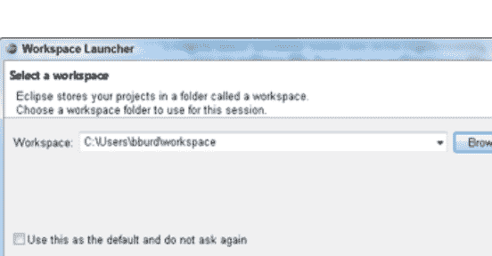

2. 在“工作空间启动程序”对话框中，单击“确定”接受默认设置（或者不接受默认设置！）。无论如何，这都不是什么大事！因为这是您第一次使用特定的 Eclipse 工作空间，Eclipse 会以欢迎屏幕启动（参见图 2-10）。纵观历史，大多数 Eclipse 欢迎屏幕都显示图标，而几乎没有提供有帮助的文字。

## 在 Eclipse 中配置 Java

Eclipse 通常会在你的计算机上查找 Java 安装，并选择一个已安装的 Java 版本来运行你的 Java 程序。你的计算机可能安装了多个版本的 Java，因此你可能需要仔细核对 Eclipse 选择的 Java 版本。以下步骤将向你展示如何操作：


# Eclipse 配置与 Java 程序运行指南

## 配置 Eclipse 以使用指定 Java 版本

1. **在 Windows 或 Linux 上**：在 Eclipse 的主菜单中，选择 **Window**➜**Preferences**。**在 Mac 上**：在 Eclipse 的主菜单中，选择 **Eclipse**➜**Preferences**。此时会出现 Eclipse 的“首选项”对话框（你可以参考图 2-12）。

2. **在“首选项”对话框左侧的树状视图中，展开 Java 分支。**

3. **在 Java 分支内，选择 Installed JREs（已安装的 JRE）子分支。**

4. **查看“首选项”对话框主体区域中的 Java 版本列表（Installed JREs）。** 在该列表中，每个 Java 版本都有一个复选框。Eclipse 使用其复选框被选中的版本。如果被选中的版本不是你首选的版本（例如，如果被选中的版本不是版本 7 或更高版本），那么你就需要进行一些更改。

5. 如果你首选的 Java 版本出现在 Installed JREs 列表中，请在该版本的复选框中打勾。

6. 如果你首选的 Java 版本未出现在 Installed JREs 列表中，请点击 Add（添加）按钮。点击 Add 按钮后，将出现一个 JRE Type（JRE 类型）对话框（参见图 2-13）。

7. 在 JRE Type 对话框中，双击 Standard VM（标准 VM）。此时会出现一个 JRE Definition（JRE 定义）对话框（参见图 2-14）。接下来的操作取决于几个不同的因素。

8. 填写对话框中的 JRE Home 字段。具体操作方式取决于你的操作系统。
   - 在 Windows 上，浏览到你安装首选 Java 版本的目录。在我使用的多台 Windows 计算机上，该目录通常是 `C:\Program Files\Java\jre7`、`C:\Program Files\Java\jdk1.7.0`、`C:\Program Files (x86)\Java\jre8` 或类似路径。
   - 在 Mac 上，使用 Finder 浏览到你安装首选 Java 版本的目录。在对话框的 JRE Home 字段中输入该目录的名称。

   我的 Mac 有一个名为 `/System/Library/Java/Java Virtual Machines/1.6.0.jdk/Contents/Home` 的 Java 目录，以及另一个名为 `/Library/Java/JavaVirtualMachines/JDK 1.7.0 Developer Preview.jdk/Contents/Home` 的 Java 目录。

   > **提示** 像 `/System` 和 `/Library` 这样的目录通常不会在 Finder 窗口中显示。要浏览到这些目录之一（例如 `/Library` 目录），请在 Finder 的菜单栏中选择“前往”⇒“前往文件夹”。在出现的对话框中，输入 `/Library`，然后点击“前往”。

   当你导航到包含你首选 Java 版本的目录时，可能会遇到一个名为 `JDK 1.7.0 Developer Preview .jdk` 的图标或其他扩展名为 `.jdk` 的项目。要查看此项目的内容，请按住 Control 键点击该项目的图标，然后选择“显示包内容”。

   - 在 Linux 上，浏览到你安装首选 Java 版本的目录。如有疑问，可以搜索一个名称以 `jre` 或 `jdk` 开头的目录。

   回到 JRE Definition 对话框，你可能还需要再做一件事。

9. 查看 JRE Definition 对话框的 JRE Name 字段；如果 Eclipse 没有自动填入名称，请在 JRE Name 字段中输入一个名称（几乎任何文本都可以）。

10. 点击 Finish（完成）按钮关闭 JRE Definition 对话框。“首选项”对话框会重新显示。对话框中的 Installed JREs 列表包含了你新添加的 Java 版本。

11. 在你新添加的 Java 版本旁边的复选框中打勾。你几乎完成了。（还有几个步骤需要执行。）

12. 在“首选项”对话框左侧的 Java 分支中，选择 Compiler（编译器）子分支。在“首选项”对话框的主体区域，你会看到一个 Compiler Compliance Level（编译器合规级别）下拉列表（参见图 2-15）。

13. 在 Compiler Compliance Level 下拉列表中，选择与你首选 Java 版本匹配的数字。对于 Java 7，我选择合规级别 1.7。对于 Java 8，我选择合规级别 1.8。（在我撰写本章时，Eclipse 中尚未提供级别 1.8。Java 8 有一个预览版，但 Eclipse 在许多个月后才会提供合规级别 1.8。）

14. 呼！点击“首选项”对话框的 OK（确定）按钮，返回 Eclipse 工作台。

### 导入本书的示例程序

这个导入过程可能比较棘手。当你从一个对话框切换到下一个对话框时，许多选项的名称都很相似。这是因为 Eclipse 提供了多种不同的方式来导入多种不同类型的内容。不过，如果你按照以下说明操作，就不会有问题。

1. 按照本章前面“获取本书示例程序”部分中的步骤操作。

2. 在 Eclipse 的主菜单中，选择 File⇒Import（文件⇒导入）（参见图 2-16）。此时 Eclipse 会显示一个 Import（导入）对话框。

3. 在 Import 对话框的树状视图中，展开 General（常规）分支。

4. 在 General 分支中，双击 Existing Projects Into Workspace（现有项目导入工作空间）子分支（参见图 2-17）。

5. 在 Import Projects（导入项目）对话框中，选择 Select Archive File（选择存档文件）单选按钮（参见图 2-18）。

6. 点击 Browse（浏览）按钮，在你计算机的硬盘上找到 `BeginProgJavaDummies3.zip` 文件。如果你不确定文件的位置，可以先在名为 `Downloads`（下载）的文件夹中查找。找到 `BeginProgJavaDummies3.zip` 文件后，Eclipse 的 Import Projects 对话框会显示该文件中的项目名称。（再次参考图 2-18。）

7. 点击 Select All（全选）按钮。本书的示例非常精彩，你想全部导入！

8. 点击 Finish（完成）按钮。此时，Eclipse 的主工作台会重新出现。工作台的左侧显示了本书中 Java 项目的名称（参见图 3-19）。

现在，真正有趣的部分开始了。

### 下一步是什么？

如果你正在阅读本段，那么你很可能已经按照本章中的一些说明进行操作了——这些说明是关于在你计算机上安装 Java 和 Eclipse IDE 的。那么，关键问题是：你安装正确了吗？这个问题的答案将在第 3 章中揭晓，因为在那一章，你将使用这些工具来运行一个全新的 Java 程序。

---

# 第 3 章 运行程序

**本章内容**
- 编译和运行程序
- 使用工作空间
- 编辑你自己的 Java 代码

如果你是一个编程新手，对你来说，运行程序可能意味着点击鼠标。你想运行 Internet Explorer，于是双击 Internet Explorer 的图标。就这么简单。

当你创建自己的程序时，情况就有点不同了。对于一个新程序，程序员（或来自程序员公司的某人）会创建程序的图标。在此之前，一个完全正常的程序可能根本没有图标。那么，对于一个全新的 Java 程序，你该怎么做？如何让程序运行起来？本章将告诉你需要了解的内容。

## 运行一个现成的 Java 程序

学习 Java 的最佳方式就是实践 Java。当你在实践 Java 时，你就在编写、测试和运行自己的 Java 程序。本节通过描述如何运行和测试程序来为你做准备。这里不是编写你自己的程序，而是运行一个我为你已经写好的程序。该程序用于计算你的住房抵押贷款的每月还款额。

这个计算抵押贷款的程序不会打开自己的窗口。相反，该程序在 Eclipse 的 Console（控制台）视图中运行。Console 视图是 Eclipse 工作台右下角部分的选项卡之一（参见图 3-1）。完全在这个 Console 视图中运行的程序称为*基于文本的程序*。

## 输入并运行自己的代码

上一节是关于运行他人的 Java 代码（从本书网站下载的代码）。但最终，你会编写自己的代码。本节将向你展示如何使用 Eclipse IDE 创建代码。

### 将你的程序与我的程序分开

你可以通过创建单独的工作空间，将你的代码与本书的示例分开。这里有两种方法：

- **启动 Eclipse 时，在 Eclipse 工作空间启动器对话框的“工作空间”字段中输入一个新文件夹名称。**
  如果该文件夹尚不存在，Eclipse 会创建它。如果文件夹已存在，Eclipse 的包资源管理器会列出该文件夹包含的所有项目。

- **在 Eclipse 工作台的主菜单中，选择“文件”⇒“切换工作空间”（参见图 3-6）。**
  选择“文件”⇒“切换工作空间”时，Eclipse 会提供你之前打开过的几个工作空间文件夹。如果你选择的文件夹不在列表中，请选择“其他”选项。作为响应，Eclipse 会重新打开其工作空间启动器对话框。

**图 3-6：** 切换到不同的 Eclipse 工作空间。

你可能在 Eclipse 工作台的右下角看不到“控制台”选项卡。要让“控制台”视图显示出来，请选择“窗口”⇒“显示视图”⇒“其他”。在弹出的“显示视图”对话框中，展开“常规”分支。最后，在该“常规”分支内，双击“控制台”项。

有关“控制台”视图（以及 Eclipse 工作台总体情况）的更多信息，请参阅本章后面的“视图和编辑器”部分。

实际上，当你运行抵押贷款程序时，你会在 Eclipse 的“控制台”视图中看到两样东西：

1. **抵押贷款程序发送给你的消息和结果。** 消息包括类似 `How much are you borrowing?` 的内容。结果包括类似 `Your monthly payment is $552.20` 的行。

2. **你在程序运行时给出的响应。** 如果你输入 `100000.00` 来回应程序关于你借多少钱的问题，你会看到那个数字在 Eclipse 的“控制台”视图中回显。

以下是运行抵押贷款程序的步骤：

1. **确保你已遵循第 2 章的说明——关于安装 Java、安装和配置 Eclipse 以及获取本书示例程序的说明。**
   谢天谢地！你不必多次遵循这些说明。

2. **启动 Eclipse。**
   Eclipse 工作空间启动器对话框出现（参见图 3-2）。

*工作空间*是你计算机硬盘上的一个文件夹。Eclipse 将你的 Java 程序存储在一个或多个工作空间文件夹中。除了这些 Java 程序，每个工作空间文件夹还包含一些 Eclipse 设置。这些设置存储你使用的 Java 版本、编辑器中首选的单词颜色、拖动编辑器区域边缘时的区域大小以及其他内容。你可以拥有多个工作空间，每个工作空间包含不同的程序和不同的设置。

默认情况下，工作空间启动器会尝试打开你上次运行 Eclipse 时打开的工作空间。你想打开第 2 章中使用的工作空间，因此不要修改启动器“工作空间”字段中的内容。

3. 在工作空间启动器对话框中，单击“确定”。

巨大的 Eclipse 工作台从你的计算机屏幕上盯着你（参见图 3-3）。

在图 3-3 中，工作台的最左侧是 Eclipse 的包资源管理器，其中包含诸如 03-01、04-01 等数字。每个数字实际上是一个 Eclipse *项目*的名称。正式地说，项目是工作空间内文件和文件夹的集合。直观地说，项目是一个基本的工作单元。例如，一个用于管理 CD 收藏（以及包含数据的文件）的独立 Java 程序文件集合可能构成一个单独的 Eclipse 项目。

再次查看图 3-3 中的包资源管理器，你会看到名为 03-01、04-01 等的项目。我的项目 03-01 包含第 3 章（本章）中的第一个也是唯一的示例。项目 06-02 包含代码清单 6-2 中的 Java 程序（本书第 6 章中的第二个代码清单）。项目名称可以包括字母、数字、空格和其他字符，但对于本书示例的名称，我坚持使用数字和破折号。

要了解更多关于 Eclipse 包资源管理器等内容的信息，请参阅即将介绍的部分“Eclipse 窗口里的那些东西都是什么？”

> **警告！**
> 当你启动 Eclipse 时，你看到的可能与图 3-3 中的内容不同。你可能看到 Eclipse 的欢迎屏幕，其中只有几个图标，其余窗口空空如也。你也可能看到类似图 3-3 的工作台，但包资源管理器中没有数字列表（03-01、04-01 等）。如果是这样，那么你可能遗漏了第 2 章中配置 Eclipse 的一些说明。或者，你可能在本节说明的步骤 2 中修改了启动器“工作空间”字段中的内容。
> 
> 无论如何，请确保你在包资源管理器中看到类似 03-01 和 04-01 的数字。看到这些数字可以确保 Eclipse 已准备好运行本书中的示例程序。

4. **在包资源管理器中，单击 03-01 分支。**
   本章的 Java 项目——03-01 项目——会高亮显示。

你可能想先睹为快一些 Java 代码。要查看你在 `Project 03-01` 中运行的 Java 程序，请在包资源管理器中展开 03-01 分支。在 03-01 分支内，你会找到一个 `src` 分支，该分支又包含一个 `(default package)` 分支。在 `(default package)` 分支内，你会找到 `Mortgage.java` 分支。该 `Mortgage.java` 分支代表我的 Java 程序。双击 `Mortgage.java` 分支会使我的代码出现在 Eclipse 的编辑器中。

5. **从主菜单中选择“运行”⇒“运行方式”⇒“Java 应用程序”，如图 3-4 所示。**

当你选择“运行方式”⇒“Java 应用程序”时，计算机会运行该项目的代码。（在此示例中，计算机运行我编写的一个 Java 程序。）作为运行的一部分，消息 `How much are you borrowing?` 会出现在 Eclipse 的“控制台”视图中。（“控制台”视图与“问题”视图、“Javadoc”视图、“声明”视图以及可能的其他视图共享 Eclipse 工作台的右下角区域。请参阅图 3-1。）

图 3-4：运行项目 03-01 中代码的一种方式。

6. **在 Eclipse 的“控制台”视图中任意位置单击，然后输入一个数字，例如 100000.00，并按 Enter 键。**

> 在步骤 6 中输入数字时，不要包含你所在国家的货币符号，也不要对数字进行分组。（美国居民，不要输入美元符号，也不要使用任何逗号。）类似 $100000.00 和 1,000,000.00 这样的内容会导致程序崩溃。你会在“控制台”视图中看到 `NumberFormatException` 消息。

按 Enter 键后，Java 程序会在“控制台”视图中显示另一条消息（`What's the interest rate?`）。（同样，请参阅图 3-1。）

7. **回应利率问题时，输入一个数字，例如 5.25，然后按 Enter 键。**

按 Enter 键后，Java 程序会在“控制台”视图中显示另一条消息（`How many years . . . ?`）。

8. **输入一个数字，例如 30，然后按 Enter 键。**

根据你输入的数字，Java 程序会显示每月还款额。再次请参阅图 3-1。

免责声明：你当地的抵押贷款公司收取的费用比我 Java 程序计算的金额要高。（高得多。）

> 在步骤 8 中输入数字时，不要包含小数点。像 30.0 这样的数字会导致程序崩溃。你会在“控制台”视图中看到 `NumberFormatException` 消息。

> 偶尔，你可能在程序运行中途决定犯了某种错误。你想立即停止程序的运行。只需单击“控制台”视图上方的小红色矩形即可（参见图 3-5）。

图 3-5：如何提前终止程序的运行。

如果你按照本节的说明操作，但没有得到我描述的结果，你可以尝试三件事。我按从最好到最差的顺序列出它们：

- 检查所有步骤，确保你一切都做对了。
- 发送电子邮件给我，地址是 `Beginprog@allmycode.com`。如果你描述发生的情况，我大概能找出问题所在并告诉你如何纠正。
- 恐慌。

## 编写并运行你的程序

以下是创建新 Java 项目的方法：

1. **启动 Eclipse。**

2. **从 Eclipse 的菜单栏中，选择 文件⇒新建⇒Java 项目。**
   此时会出现一个“新建 Java 项目”对话框。

3. **在“新建 Java 项目”对话框中，为你的项目输入名称，然后点击 完成。**

在图 3-7 中，我输入了名称 `MyFirstProject`。

如果你点击 下一步 而不是 完成，你会看到一些目前不需要的其他选项。因此，为避免任何混淆，只需点击 完成。

点击 完成 会将你带回 Eclipse 的工作台，你的项目 `MyFirstProject` 会出现在包资源管理器中，如图 3-8 所示。

下一步是创建一个新的 Java 源代码文件。

**图 3-7：** 让 Eclipse 创建一个新项目。

**图 3-8：** 你的项目出现在 Eclipse 的包资源管理器中。

4. **在包资源管理器中选择你新创建的项目。**
   为了生成图 3-8，我选择了 `MyFirstProject` 而不是 `SomeOtherProject`。

5. **在 Eclipse 的主菜单中，选择 文件>新建>类。**
   Eclipse 的“新建 Java 类”对话框会出现（参见图 3-9）。

**图 3-9：** 让 Eclipse 创建一个新的 Java 类。


Java程序员通常将其代码划分为一个或多个*包*。一个典型的包名类似于`java.util`或`com.allmycode.images`。在图3-9中，Eclipse警告我，我没有为项目代码指定包名。因此，代码被放入了一个名为Java *默认包*的普通位置。Java默认包是一个没有名称的包——用于存放未归入其他包的代码。包对于管理大型编程项目非常有用，但*《Java编程入门经典》*并不包含大型编程项目。因此，在本例中（以及本书的所有其他示例中），我选择忽略此警告。有关Java包的更多信息，请参阅第18章。

像所有其他窗口化环境一样，Eclipse提供了多种方法来完成相同的任务。除了选择 文件⇒新建⇒类，你可以在Windows上右键单击包资源管理器中的`MyFirstProject`（或在Mac上按住control键单击）。在弹出的上下文菜单中，选择 新建⇒类。你也可以先按Windows上的`Alt+Shift+N`（或Mac上的`Option+Cmd+N`）。具体的点击和按键选择取决于你。

> ## 我在Java程序中看到格式了吗？

当你使用Eclipse编辑器编写Java程序时，你会看到各种颜色的单词。某些单词总是蓝色的。其他单词总是黑色的。你甚至会看到一些粗体和斜体的短语。你可能认为你看到了格式，但实际上并没有。相反，你所看到的称为*语法着色*或*语法高亮*。

无论你怎么称呼它，问题如下：

*   在Microsoft Word中，诸如粗体格式之类的标记存储在文档内部。当你保存`MyPersonalDiary.doc`时，使“love”和“hate”这两个词变粗体的指令会被记录在`MyPersonalDiary.doc`文件内部。

*   在Java程序编辑器中，诸如粗体和着色之类的标记并不存储在Java程序文件内部。相反，编辑器会以易于阅读Java程序的方式显示每个单词。

例如，在Java程序中，某些单词（如`class`、`public`和`void`）具有其特定的含义。因此，Eclipse编辑器会以粗体、略带红色的字母显示`class`、`public`和`void`。当我保存Java程序文件时，计算机不会在Java程序文件中存储任何关于粗体、彩色字母的信息。但是，编辑器会根据自身的判断，用略带红色的颜色来高亮显示这些特殊单词。

其他编辑器可能会以蓝色字体显示相同的单词。另一个编辑器（如Windows记事本）则会以纯黑色显示所有单词。

6. **在“新建Java类”对话框的“名称”字段中，输入你的新类的名称。**

在本例中，我使用名称`MyFirstJavaClass`，名称中的任何单词之间都没有空格。（参见图3-9。）

“新建Java类”对话框中的名称不得包含空格。唯一允许使用的标点符号是下划线字符（`_`）。你可以将你的类命名为`MyFirstJavaClass`或`My_First_Java_Class`，但不能命名为`My First Java Class`或`JavaClass,MyFirst`。

7. **在`public static void main(String[] args)`复选框中打勾。**

你的勾选会告诉Eclipse创建一些样板Java代码。

8. **接受“新建Java类”对话框中所有其他选项的默认设置（换句话说，点击 完成）。**

你甚至可以忽略对话框顶部附近的“不建议使用默认包”的警告。

点击 完成 会将你带回Eclipse的工作台。现在`MyFirstProject`中包含一个名为`MyFirstJavaClass.java`的文件。为了方便你，`MyFirstJavaClass.java`文件中已经预先有了一些代码。Eclipse的编辑器会显示这些Java代码（参见图3-10）。

9. **替换新Java程序中已有的代码行。**

在Eclipse的编辑器中输入一行代码。将以下这行代码

`// TODO Auto-generated method stub`

替换为

`System.out.println("Chocolate, royalties, sleep");`

请完全按照代码清单3-1中的样子复制这行新代码。

*   精确地按照我在代码清单3-1中的拼写来拼写每个单词。

*   精确地按照我在代码清单3-1中的大小写来书写每个单词。

*   包含所有标点符号——点号、引号、分号，一个都不能少。

> **记住**

> *   区分小写字母l和数字1。`println`这个词告诉计算机打印一整行。`println`这个词中的每个字符都是小写字母。该词不包含数字。

### 代码清单3-1：一个显示我喜欢的东西的程序

```java
public class MyFirstJavaClass {
    /**
     * @param args
     */
    public static void main(String[] args) {
        System.out.println("Chocolate, royalties, sleep");
    }
}
```

**警告！** Java *区分大小写*，这意味着`system.out.printLn`与`System.out.println`不是相同的。如果你输入`system.out.printLn`，你的程序将无法工作。请确保你的代码大小写与代码清单3-1中完全一致。

如果你输入的所有内容都正确，你会看到图3-11中的内容。

**图3-11：** 在Eclipse编辑器中的Java程序。

如果你输入的代码与代码清单3-1中显示的不完全一致，你可能会在编辑器中看到锯齿状的红色下划线、内部带有X标记的小矩形或其他红色标记（参见图3-12）。

**图3-12：** 输入错误的Java程序。

Eclipse编辑器中的红色标记表示你的Java代码中的*编译时错误*。编译时错误（也称为*编译器错误*）是一种阻止计算机翻译你代码的错误。（关于代码翻译的讨论，请参阅第1章。）

图3-12中的错误标记出现在Java程序的第8行。行号显示在编辑器的左侧边栏。要让Eclipse编辑器显示行号，请选择 窗口⇒首选项（在Windows上）或 Eclipse⇒首选项（在Mac上）。然后选择 常规⇒编辑器⇒文本编辑器。最后，在“显示行号”复选框中打勾。

要修复编译时错误，你必须成为一名专注的侦探。你加入了一个名为*法律与秩序：Java编程小队*的精英团队。你很少能找到简单的答案。相反，你需要缓慢而仔细地梳理证据，寻找线索。你逐个字符地比较编辑器中看到的所有内容与我代码清单3-1中的代码。你不能错过任何一个细节，包括拼写、标点符号以及大小写。

Eclipse有一些不错的功能可以帮助你找到编译时错误的根源。例如，你可以将鼠标悬停在锯齿状的红色下划线上。这样做时，你会看到关于错误的简要说明以及一些修复错误的建议——一些*快速修复*（参见图3-13）。

**图3-13：** Eclipse提供一些有用的建议。

在图3-13中，弹出窗口告诉你Java不知道*system*这个词是什么意思——也就是说，*system无法解析*。在图的底部附近，快速修复选项之一是将*system*更改为*System*。

当你点击“更改为'System' (`java.lang`) ”选项时，Eclipse的编辑器会用*System*替换*system*。编辑器的错误标记消失了，你从图3-12中的错误代码变为了图3-11中的正确代码。

10. **在Eclipse的编辑器中对代码进行任何更改或修正。**

当你在编辑器中看不到波浪下划线或色块时，就可以尝试运行程序了。

11. **通过在编辑器内点击或点击Package Explorer中的`MyFirstProject`分支来选择`MyFirstJavaClass`。**

12. **在Eclipse的主菜单中，选择Run⇒Run As⇒Java Application。**

这就成功了。你的新Java程序在Eclipse的Console视图中运行。如果你运行的是代码清单3-1中的代码，你会在图3-14中看到`Chocolate, royalties, sleep`消息。这就像身处天堂一样！

## 可能出什么问题？

清除编辑器中的波浪下划线是值得庆祝的。Eclipse喜欢你的代码，所以从那时起，一切顺利，对吗？

嗯，不一定。除了明显的编译时错误，你的代码还可能有其他不那么明显的错误。

想象有人告诉你“到十字路口，然后*向右转*”。你立刻注意到说话者犯了个错误，并礼貌地回问“嗯？”那个毫无意义的*向右转*短语就像一个编译时错误。你的“嗯？”就像Eclipse编辑器中的波浪下划线。作为一个有听力的人，你可能能猜出*向右转*是什么意思，但Eclipse的编辑器从不敢修正你代码中的错误。

除了编译时错误，还有其他一些小精灵可能隐藏在Java程序中：

- **未检查的运行时异常：** 你没有编译时错误，但当你运行程序时，运行会提前结束。在运行过程中的某个地方，你的指令告诉Java去做一件无法完成的事情。例如，当在“运行一个现成的Java程序”部分运行抵押贷款程序时，你输入了`1,000,000.00`而不是`1000000.00`。Java不喜欢数字中的逗号，所以你的程序崩溃并显示了一条难看的信息，如图所示。

这是一个*未检查的运行时异常*的例子——相当于有人告诉你在十字路口向右转，而右边只有一堵大砖墙。Eclipse的编辑器不会警告你未检查的运行时异常，因为除非你运行程序，否则计算机无法预测异常会发生。

- **逻辑错误：** 你在Eclipse的编辑器中看不到错误标记，当你运行代码时，程序会运行到完成。但答案不正确。不是图中的`$552.20`，输出是`$552,200,000.00`。程序错误地告诉你每月要支付数千倍于你房子价值的金额！这相当于被告知向右转而不是向左转。你可能会在错误的方向上行驶很长时间。

逻辑错误是最难发现和修复的错误。最糟糕的是，逻辑错误常常未被注意到。1985年3月，我收到了一张`1,328,932.21`美元的月度家庭取暖费账单。显然，某台计算机打印了错误的金额。当我打电话给燃气公司投诉时，电话客服代表说：“别难过。只付一半就行。”

- **编译时警告：** 警告不像错误消息那么严重。所以，当Eclipse注意到你的程序中有可疑之处时，编辑器会显示波浪黄色下划线、一个包含感叹号的小黄色图标，以及其他一些不太显眼的提示。

例如，在图中第8行，我在代码清单3-1的代码中添加了关于`amount = 10`的内容。问题是，我在程序的任何地方都没有使用过`amount`或数字`10`。Eclipse用其淡黄色的标记有效地告诉我：“你的`amount = 10`代码还不至于构成致命错误。Eclipse仍然可以运行你的程序。但你确定要在你的程序中包含`amount = 10`（这似乎毫无用处的东西）吗？”

想象一下被告知“到达十字路口时转弯”。方向可能没问题。但如果你有疑虑，你会问：“我应该向哪边转？左还是右？”

当你确信自己知道自己在做什么时，你可以忽略警告，并在以后某个时候再处理它们。但警告可能表明你的代码有更严重的问题。所以我笼统的建议是：注意警告。但如果你不能弄明白为什么收到特定的警告，不要让警告阻止你继续前进。

## Eclipse窗口里的那些东西是什么？

信不信由你，一位编辑曾经拒绝过我的一本书稿。在页边空白处，编辑在“can't”、“it's”和“I've”这样的词旁边潦草地写着“这不是一个单词”。直到今天，我仍然不知道这位编辑为什么不喜欢缩写。我个人的看法是，语言总是需要扩展。如果没有新词——比如*dotcom*、*infomercial*和*vaporware*——我们会怎样？

即使《牛津英语词典》（任何关于词汇的争论中的权威）每年也增加超过4,000个条目。这是每年超过1%的增长。大约每天11个新词！

事实是，人类的思想就像一座摩天大楼。在建造49层之前，你无法建造第50层。在有像*e-mail*这样的词之前，你无法谈论*spam*（垃圾邮件）。在当今这个纷繁复杂的世界里，你需要语言的基石。这就是为什么本节包含了一堆新术语。

在本节中，每个新定义的术语都描述了Eclipse IDE的一个方面。所以在你阅读所有这些Eclipse术语之前，我提供以下免责声明：

- **本节是可选阅读。** 如果你对理解本书中的某些说明有困难，请参考本节。但如果你能轻松地使用Eclipse IDE，就不要因为纠结于本节的术语而把事情复杂化。

- **本节提供术语的解释，而不是术语的正式定义。** 是的，我的解释相当精确，但不，它们并不严密。本节中的几乎每个描述都有隐藏的例外、遗漏、豁免和排除。把本节中的段落当作友好的提醒，而不是法律合同。

- **Eclipse是一个非常有用的工具。** 但Eclipse并不是Java生态系统中官方的一部分。虽然我在本书中没有详细描述，但你可以编写Java程序而不必使用Eclipse。

## 理解大局

你对Eclipse的游览从一个宏观视角开始。

- **工作台：** Eclipse桌面（参见图3-3）。工作台是你开发代码的环境。

- **区域：** 工作台的一部分。图3-3中的工作台包含五个区域。为了说明这一点，我为每个区域画了边框（参见图3-15）。

- **窗口：** Eclipse工作台的一个副本。使用Eclipse，你可以同时打开多个工作台的副本。每个副本出现在自己的窗口中。

要打开第二个窗口，请转到Eclipse主菜单栏并选择Window⇒New Window。

- **操作：** 提供给你的一种选择，通常是在你点击某个东西时。例如，当你在Eclipse的主菜单栏中选择File⇒New时，你会看到一个可以创建的新事物的列表。该列表通常包括Project、Folder、File和Other，但也可能包括Package、Class和Interface等。这些事物中的每一个（菜单中的每一项）都称为*操作*。

### 视图、编辑器和其他内容

下一组术语涉及称为视图、编辑器和标签的东西。

你可能难以理解视图和编辑器之间的区别。（视图像编辑器，编辑器又像视图，诸如此类。）如果视图和编辑器对你来说似乎一样，而且你不确定能否分辨哪个是哪个，别难过。作为一个普通的Eclipse用户，随着使用工作台的经验积累，视图和编辑器之间的区别会自然而然地出现。你很少需要决定你正在使用的是视图还是编辑器。

图3-15：工作台被划分为区域。

如果你需要区分什么是视图，什么是编辑器，以下是你需要了解的内容：

**视图：** Eclipse工作台的一部分，用于显示供你浏览的信息。在最简单的情况下，视图占据工作台的一个区域。例如，在图3-3中，包资源管理器视图占据了最左边的区域。

许多视图以列表或树的形式显示信息。例如，在图3-10中，包资源管理器视图包含一棵树。

你可以使用视图来对事物进行更改。例如，要删除图3-10中的`SomeOtherProject`，请在包资源管理器视图中右键单击`SomeOtherProject`分支。（在Mac上，按住Control键单击`SomeOtherProject`分支。）然后，在弹出的上下文菜单中，选择“删除”。

> 记住

当你使用视图来更改某项内容时，更改会立即生效。例如，当在包资源管理器的上下文菜单中选择“删除”时，你选择的任何项目都会立即被删除。在某种程度上，这种行为并不新鲜。当你在Windows资源管理器中回收文件或在Macintosh Finder中将文件移到废纸篓时，也会发生类似的事情。

**编辑器：** Eclipse工作台的一部分，用于显示供你修改的信息。典型的编辑器以文本形式显示信息。这些文本可以是文件的内容。例如，图3-10中的编辑器显示了`MyFirstJavaClass.java`文件的内容。

> 记住

当你使用编辑器来更改某项内容时，更改不会立即生效。例如，查看图3-10中的编辑器。这个编辑器显示了`MyFirstJavaClass.java`文件的内容。你可以在编辑器中输入各种内容。在你从Eclipse的菜单栏中选择“文件”⇒“保存”之前，`MyFirstJavaClass.java`不会有任何变化。当然，这种行为并不新鲜。当你在Microsoft Word或任何其他文字处理程序中工作时，也会发生类似的事情。

> 技术细节

和其他作者一样，我偶尔会偷懒，当我本意是指“视图或编辑器”时，却使用“视图”这个词。当你发现我这么做时，只需摇摇头，继续阅读即可。当我非常谨慎时，我会使用Eclipse的官方术语。我将视图和编辑器称为Eclipse工作台的*部件*。不幸的是，“部件”这个术语在人们脑海中不太容易记住。

Eclipse工作台的一个区域可能包含多个视图或多个编辑器。大多数Eclipse用户无需过多思考这个“多个视图”的概念（甚至第一次也不用想）就能应付自如。但是，如果你关心围绕选项卡和活动视图的术语，以下是关键信息：

- **选项卡：** 除了称之为“选项卡”之外，无法描述的东西。我们称之为选项卡的东西，换个名字，同样能让我们从一个视图切换到另一个视图，或从一个编辑器切换到另一个编辑器。重要的是，视图可以*堆叠*在一起。Eclipse将堆叠的视图显示为带选项卡的笔记本中的页面。例如，图3-14显示了Eclipse工作台的一个区域。该区域包含五个视图（问题视图、Javadoc视图、声明视图、搜索视图和控制台视图）。每个视图都有自己的选项卡。

一堆堆叠的视图称为*选项卡组*。要将堆栈中的某个视图带到前台，请单击该视图的选项卡。

顺便说一句，所有这些关于选项卡和视图的内容也适用于选项卡和编辑器。唯一有趣的是Eclipse使用“编辑器”这个词的方式。在Eclipse中，编辑器区域的每个带选项卡的页面都是一个独立的编辑器。例如，图3-16中的编辑器区域包含三个编辑器（而不是属于单个编辑器的三个选项卡）。

- **活动视图或活动编辑器：** 在选项卡组中，位于前面的视图或编辑器。

在图3-16中，`MyFirstJavaClass.java`编辑器是活动编辑器。`Mortgage.java`和`ThingsILike.java`编辑器是非活动的。


**图3-16：** 编辑器区域包含三个编辑器。

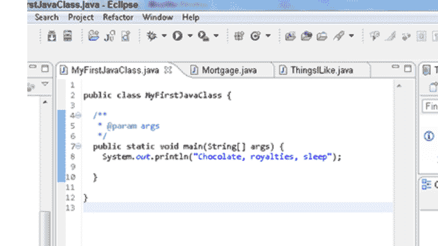

### 视图或编辑器内部有什么？

接下来的几个术语涉及单个视图、单个编辑器和单个区域。

- **工具栏：** 视图顶部的一栏按钮（和其他小东西）（参见图3-17）。

- **菜单按钮：** 工具栏中一个向下的箭头。当你单击菜单按钮时，会出现一个操作下拉列表（参见图3-18）。你在列表中看到哪些操作因视图而异。

- **关闭按钮：** 用于关闭特定视图或编辑器的按钮（参见图3-19）。

- **双箭头：** 一个双箭头，表示其他选项卡应显示在某个区域中（但该区域不够宽）。图3-20中的双箭头旁边有一个小数字2。数字2告诉你，除了两个可见的选项卡外，还有两个选项卡是隐藏的。单击双箭头会显示一个悬停提示，其中包含所有选项卡的标签（参见图3-20）。

- **标记栏：** 编辑器区域左边缘的垂直标尺。Eclipse在标记栏内显示微小的警报图标，称为*标记*。（例如，参见图3-12。）

图3-17：包资源管理器视图的工具栏。

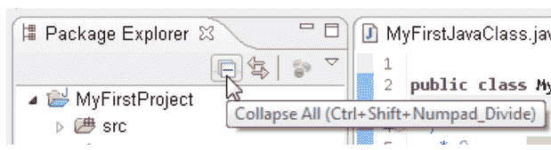

图3-18：单击包资源管理器视图的菜单按钮。

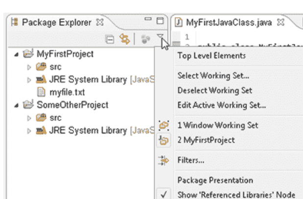

图3-19：编辑器的关闭按钮。

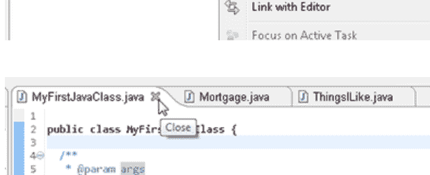

图3-20：双箭头表示有两个编辑器被隐藏。

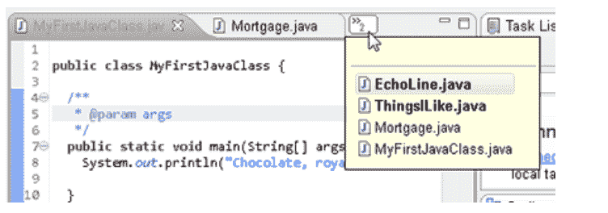

### 回到宏观视角

接下来的两个术语涉及Eclipse的整体外观和感觉。

- **布局：** 某些视图的安排。图3-3中的布局有七个视图，其中四个容易看到：

  - 在最左边，你会看到包资源管理器视图。

  - 在最右边，你有任务列表视图和大纲视图。

  - 靠近底部，你会看到问题、Javadoc、声明和控制台视图。

  除了所有这些视图之外，布局包含一个单独的*编辑器区域*。所有打开的编辑器都显示在此编辑器区域内。

- **透视图：** 一个非常有用的布局。如果某个布局确实很有用，有人会给这个布局命名。如果一个布局有名字，你就可以随时使用这个布局。例如，图3-3的工作台显示了Eclipse的*Java透视图*。默认情况下，Java透视图包含六个视图，其排列方式与图3-3所示的排列非常相似。

> **提示：** 控制台视图出现在图3-3中，但控制台视图并不总是作为Java透视图的一部分出现。通常，当你运行基于文本的Java程序时，控制台视图会自动出现。如果你想强制显示控制台视图，请选择“窗口”⇒“显示视图”⇒“其他”。在弹出的“显示视图”对话框中，展开“常规”分支。最后，在该“常规”分支内，双击“控制台”项目。

除了所有这些视图之外，Java透视图还包含一个编辑器区域。（当然，编辑器区域有多个选项卡，但选项卡的数量与Java透视图无关。）

你可以通过从Eclipse的主菜单栏中选择“窗口”⇒“打开透视图”来切换透视图。本书几乎完全专注于Eclipse的Java透视图。但如果你喜欢探索，可以访问其他一些透视图，一瞥Eclipse的强大和多功能性。

# 第二部分

编写你自己的Java程序


## 本部分内容……

本部分包含一些世界上最简单的程序。而且，尽管它们很简单，但这些程序阐明了所有计算机代码背后的基本思想。这些思想包括变量、值、类型、语句、方法以及许多其他重要内容。本书的这一部分是你的跳板、你的发射台、你的虚拟弹射器。

# 第4章

探索程序的组成部分

### 本章内容

- 识别Java程序中的单词

- 使用标点符号和缩进

- 理解Java语句和方法

我在一所文理学院的科学楼工作。当我走过生物学实验室时，我总是在心里默默感谢。我感谢自己不必解剖小动物。在我的工作中，我解剖的是计算机程序。计算机程序比防腐处理过的死动物气味好闻得多。而且，当我解剖一个程序时，我不会联想到自己的死亡。

在这一章，我邀请你和我一起解剖一个程序。我有一个名为`ThingsILike`的小程序。我将这个程序拆开，仔细研究其内部结构。准备好你的手术刀。我们开始吧！

## 第一次查看Java代码

我承认。第一次看到别人的计算机程序时，我感到有点不安。意识到自己不理解代码中的某些（或许多）东西让我紧张。我已经编写了数百个（也许是数千个）程序，但当我开始阅读别人的代码时，我仍然会感到不安。

事实是，了解一个计算机程序是一个自我引导的过程。首先，我对这个程序感到敬畏。然后，我运行程序看看它做了什么。接着，我盯着程序看一会儿，或者阅读别人对这个程序及其部分的解释。然后，我再多看一会儿，再运行一次程序。最终，我与这个程序和解了。不要相信那些声称自己从未经历过这些步骤的聪明人。即使是经验丰富的程序员也会缓慢而仔细地开始一个新项目。

### 看！一个程序！

在代码清单 4-1 中，你会看到一段 Java 代码。像所有新手程序员一样，你被期望谦卑地凝视这段代码。但*不要被吓倒*。当你掌握诀窍后，编程其实相当简单。是的，它也很有趣。

#### 代码清单 4-1：一个简单的 Java 程序

```
/*
 * A program to list the good things in life
 * Author: Barry Burd, BeginProg3@allmycode.com
 * February 13, 2012
 */
class ThingsILike {
    public static void main(String args[]) {
        System.out.println("Chocolate, royalties, sleep");
    }
}
```

当我运行代码清单 4-1 中的程序时，我得到了如图 4-1 所示的结果：计算机在屏幕上显示出 `Chocolate`、`royalties`、`sleep` 这些词。现在我承认，为了在某人的计算机屏幕上显示 `Chocolate`、`royalties`、`sleep` 这些词而去编写和运行一个 Java 程序，这工作量可不小，但万事总得有个开端嘛。

图 4-1：运行代码清单 4-1 中的程序。

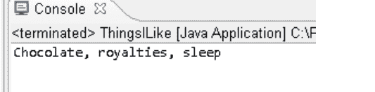

你可以在自己的计算机上运行代码清单 4-1 中的代码。方法如下：

1. 按照第 2 章的说明安装 Eclipse。

2. 然后，按照第 3 章前半部分的说明操作。这些说明告诉你如何运行名为 03-01 的项目，该项目可从本书网站（[http://allmycode.com/BeginProg3](http://allmycode.com/BeginProg3)）下载。要运行代码清单 4-1 中的代码，对同一个下载包中的 04-01 项目进行相同的操作即可。

## 程序各行的含义

如果代码清单 4-1 中的程序有朝一日变得有名，可能会有人写一本*导读*书来总结这个程序。那本书会非常薄，因为你只需一句话就能概括代码清单 4-1 的行为。这句话是：

```
在计算机屏幕上显示 Chocolate, royalties, sleep。
```

现在，把前面这句话与代码清单 4-1 的主体内容比较一下。因为代码清单 4-1 的行数要多得多，你可能会猜测其中包含大量样板代码。嗯，你猜对了。不写样板代码就无法编写 Java 程序，但幸运的是，从一个 Java 程序到另一个，样板文本的变化并不大。以下是我尽最大努力用不超过 57 个词对代码清单 4-1 所有文本的总结：

```
这个程序列出了生活中美好的事物。
Barry Burd 于 2012 年 2 月 13 日编写了此程序。
Barry 意识到你可能对此代码有疑问，
因此你可以通过 BeginProg3@allmycode.com 联系他。
此代码定义了一个名为 ThingsILike 的 Java 类。
这是指令的主起始点：
在屏幕上显示 Chocolate, royalties, sleep。
```

本章剩余部分（大约还有 4,500 个词）将更详细地解释代码清单 4-1 的代码。

## Java 程序中的元素

英语和 Java 都被称为*语言*，这并非巧合。你用语言来表达想法。英语向人类表达想法，Java 向计算机表达想法。更重要的是，英语和 Java 都有诸如单词、名称和标点符号之类的东西。事实上，这两种语言最大的区别在于 Java 比英语更容易学习。（如果英语简单，计算机就能理解英语了。遗憾的是，它们做不到。）

拿一个普通的英语句子与代码清单 4-1 中的代码做比较。这个句子是：

Suzanne 说“嗯”，因为你知道，她住在加拿大。

在你的高中语法课上，你担心的是动词、形容词和其他诸如此类的东西。但在本书中，你将从关键字和标识符的角度来思考，如图 4-2 所总结的那样。

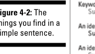

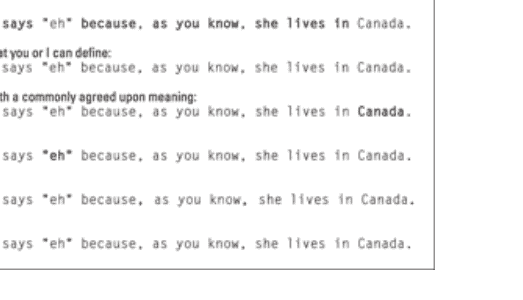

Suzanne 的句子里有各种各样的东西。它们与你在计算机程序中发现的东西是同一类。因此计划如下：比较图 4-1 中的元素与代码清单 4-1 中的类似元素。你已经理解英语，所以你可以利用这种理解来弄清楚一些关于 Java 的新东西。

但首先，这里有一个友好的提醒：在接下来的几段中，我将对英语和 Java 进行比较。在阅读这些段落时，保持开放的心态很重要。例如，在将 Java 与英语进行比较时，我可能会写“事物的名称与字典中的单词并不相同”。当然，你可以争辩说有些字典列出了专有名词，有些人有像 Hope、Prudence 和 Spike 这样的名字，但请别这样做。避免吹毛求疵会让你从阅读中收获更多。好吗？我们还是朋友吧？

### 关键字

关键字是字典里的词——一种直接内置于语言中的词。

在图 4-2 中，“says”这样的词是关键字，因为“says”在英语句子中无论何时使用都扮演着相同的角色。Suzanne 句子中的其他关键字是“because”、“as”、“you”、“know”、“she”、“lives”和“in”。

计算机程序也有关键字。事实上，代码清单 4-1 中的程序使用了四个 Java 关键字（以粗体显示）：

```
class ThingsILike {
    public static void main(String args[]) {
```

每个 Java 关键字都有特定的含义——这个含义从一个程序到另一个程序保持不变。例如，无论何时我编写 Java 程序，`public` 这个词总是表示程序中可被任何其他代码访问的部分。


Java 编程语言是*大小写敏感的*。这意味着如果你将单词中的小写字母改为大写字母，你就改变了该单词的含义。改变大小写可能使整个单词从有意义变得毫无意义。在代码清单 4-1 中，你不能用 `Public` 替换 `public`。如果你这样做了，整个程序就会停止工作。

本章几乎没有或根本没有关于关键字 `class`、`public`、`static` 和 `void` 含义的细节。你可以偷看其他章节的材料，但你也可以通过“作弊”来应付。当你编写程序时，只需以

```
class SomethingOrOther {
```

开头，然后将文本

```
public static void main(String args[]) {
```

粘贴到你的代码中。在你的前几个程序中，这个策略会非常有效。

表 4-1 列出了所有 Java 关键字。

| 表 4-1 | Java 关键字 | | |

| --- | --- | --- | --- |

| `abstract` | `continue` | `for` | `new` |

| `switch` | `assert` | `default` | `goto` |

| `package` | `synchronized` | `boolean` | `do` |

| `if` | `private` | `this` | `break` |

| `double` | `implements` | `protected` | `throw` |

| `byte` | `else` | `import` | `public` |

| `throws` | `case` | `enum` | `instanceof` |

| `return` | `transient` | `catch` | `extends` |

| `int` | `short` | `try` | `char` |

| `final` | `interface` | `static` | `void` |

| `class` | `finally` | `long` | `strictfp` |

| `volatile` | `const` | `float` | `native` |

| `super` | `while` | | |

在 Java 中，`true`、`false` 和 `null` 这些词具有特定的含义。与表 4-1 中的关键字一样，你不能在 Java 程序中使用 `true`、`false` 和 `null` 来表示它们通常含义之外的任何东西。但由于只有最挑剔的 Java 专家才关心的原因，`true`、`false` 和 `null` 并不被称为 Java 关键字。无论如何，如果你在表 4-1 中潦草地写下 `true`、`false` 和 `null` 这些词，也是可以的。

关于关键字，有一件事需要记住：在 Java 中，每个关键字都有一个官方的、预定义的含义。Oracle 公司的人对 Java 程序的构成拥有最终决定权，他们创建了所有 Java 关键字。你不能为任何 Java 关键字自己编造含义。例如，你不能在计算中使用 `public` 这个词：

```
//这是 **非常糟糕的代码：**
public = 6;
```

如果你尝试以这种方式使用关键字，编译器会显示错误消息并拒绝翻译你的源代码。英语中的情况也是如此。生个孩子，给他起名叫“Because”（因为）。

> “让我们为今晚的主持人——Because O. Borel（因为·O·博雷尔）献上特别的掌声。”

你可以这样做，但这孩子永远无法过上正常的生活。

尽管我在本节中热切地宣称，但 Java 的两个关键字在 Java 程序中没有任何意义。这两个关键字——`const` 和 `goto`——在 Java 中被保留不使用。如果你尝试创建一个名为 `goto` 的变量，Eclipse 会显示 `Invalid VariableDeclaratorId` 错误消息。Java 的创建者认为，如果你在代码中使用了 `const` 或 `goto` 这两个词中的任何一个，你应该被礼貌地告知转到 C++ 程序员的那一桌去。

### 你可以或我可以定义的标识符

我喜欢 Suzanne 这个名字，但如果你不喜欢传统名字，那就编造一个全新的名字。你有了一个新生儿。叫她“Deneen”或“Chrisanta”。叫他“Belton”或“Merk”。

一个*名称*是一个用来标识事物的词，因此我不再把这些东西称为名称，而开始称它们为*标识符*。在计算机编程中，*标识符*是某种名词。标识符指代一个值、程序的一部分、某种结构或任何数量的事物。

代码清单 4-1 中有两个你我可以自行定义的标识符。它们是虚构的词 `ThingsILike` 和 `args`。

```
class ThingsILike {
    public static void main(String args[]) {
```

正如 Suzanne 和 Chrisanta 这两个名字在英语中没有特殊含义一样，`ThingsILike` 和 `args` 这两个名字在 Java 中也没有特殊含义。在代码清单 4-1 中，我用 `ThingsILike` 作为我程序的名字，但我本可以使用像 `GooseGrease`、`Enzyme` 或 `Kalamazoo` 这样的名字。我必须在程序中写上 `(String someName[])`，但我可以使用 `(String args[])`、`(String commandLineArguments[])` 或 `(String cheese[])`。

> **提示**

> 按我说的做，别照我做的做。为你的 Java 程序中的事物编造合理、信息量丰富的名字。像 `GooseGrease` 这样的名字虽然有趣，但它们并不能帮助你追踪程序编写策略。

> **记住**

> 当我为我的 Java 程序命名时，我可以使用 `ThingsILike` 或 `GooseGrease`，但我不能使用 `public` 这个词。像 `class`、`public`、`static` 和 `void` 这样的词是 Java 中的关键字。

> **技术细节**

> `(String args[])` 中的 `args` 保存你在发出运行 Java 程序的命令时输入的任何额外内容。例如，如果你通过输入 `java ThingsILike won too 3` 来运行该程序，那么 `args` 就存储了额外的值 `won`、`too` 和 `3`。作为一名初级程序员，你不需要考虑 Java 的这个特性。只需将 `(String args[])` 粘贴到你的每个程序中即可。

## 具有约定含义的标识符

很多人叫 Suzanne，但只有一个国家叫 Canada。这是因为 "Canada" 这个词有一个标准、公认的含义。它是国旗上有一片红色枫叶的国家。如果你建立自己的国家，你应该避免将其命名为 Canada，因为将其命名为 Canada 会混淆所有人。（我知道，肯塔基州有一个城镇叫 Canada，但那不算数。记住，你应该忽略这类例外情况。）


大多数编程语言都有具有约定含义的标识符。在 Java 中，几乎所有这些标识符都在 Java API 中定义。代码清单 4-1 中有五个这样的标识符。它们是 `main`、`String`、`System`、`out` 和 `println` 这几个词：

```
public static void main(String args[]) {
    System.out.println("Chocolate, royalties, sleep");
}
```

以下是这些名字含义的简要概述（更详细的描述贯穿全书）：

- **`main`**：每个 Java 程序执行的主要起点。
- **`String`**：一串文本；一个接一个的一行字符。
- **`System`**：Java API 中一个现成的程序。（此程序访问你的计算机上一些超出 Java 虚拟机（JVM）直接控制范围的功能。）
- **`out`**：基于文本的程序显示其文本的地方。（对于在 Eclipse 中运行的程序，单词 `out` 代表控制台视图。要阅读更多关于基于文本程序的内容，请查看第 3 章的前几段。）
- **`println`**：在计算机屏幕上显示文本。

> 严格来说，Java API 中标识符的含义并非一成不变。尽管你可以为 `System` 或 `println` 这样的词自己定义含义，但这不是一个好主意。如果你这样做了，你会让其他程序员感到极度困惑，因为他们已经习惯了这些熟悉的标识符名称的标准 API 含义。

## 字面量

*字面量*是一段看起来就像它所代表的值的文本。在 Suzanne 的句子中（参考图 4-2），"eh" 是一个字面量，因为 "eh" 指的就是单词 "eh"。

编程语言也有字面量。例如，在代码清单 4-1 中，引号中的内容就是一个字面量：

```
System.out.println("Chocolate, royalties, sleep");
```

当你运行 ThingsILike 程序时，你会在屏幕上看到 Chocolate, royalties, sleep 这些词。在代码清单 4-1 中，文本 "Chocolate, royalties, sleep" 指的就是屏幕上出现的这些词，完全按照它们出现的样子（减去引号）。

你在计算机程序中使用的大多数数字都是字面量。如果你在计算机程序中放入语句

```
mySalary = 1000000.00;
```

那么 `1000000.00` 就是一个字面量。它代表数字 `1000000.00`（一百万）。

如果你不喜欢数数字，可以在你的 Java 7 程序中放入以下语句：

```
mySalary = 1_000_000.00;
```

从 Java 7 开始，带下划线的数字被允许用作字面量。

> 在 Java 7 之前的 Java 版本中，你不能在代码中使用诸如 `1_000_000.00` 这样的数字。

不同的国家使用不同的数字分隔符和不同的数字格式。例如，在美国，你写 `1,234,567,890.55`。在法国，你写 `1234567890,55`。在印度，你将数字以两个和三个为一组进行分组。你写 `1,23,45,67,890.55`。你不能在你的 Java 程序中放入像 `mySalary = 1,000,000.00` 这样的语句。Java 的数字字面量中没有任何逗号。但你可以写 `mySalary = 10_00_000.00` 以便在印度进行易读的编程。对于程序的输出，你可以使用 Java 的 `Locale` 和 `NumberFormat` 类来显示像 `1234567890,55` 这样的数字。

## 标点符号

一个典型的计算机程序有很多标点符号。例如，考虑代码清单 4-1 中的程序：

```
class ThingsILike {
    public static void main(String args[]) {
        System.out.println("Chocolate, royalties, sleep");
    }
}
```

每一个括号、每一个大括号、每一个任何种类的波浪线都在使程序有意义方面扮演着角色。

在英语中，你从左到右写完一行，然后将文本换行到下一行的开头。在编程中，你很少这样工作。相反，代码的标点符号指导着某些行的缩进。缩进显示了程序的哪些部分从属于哪些其他部分。就好像在英语中，你将 Suzanne 的句子写成这样：

    Suzanne says "eh" because, as you know, she lives in Canada.

图 4-3 和图 4-4 中的图表向你展示了 ThingsILike 程序的某些部分是如何包含在其他部分内部的。注意一对花括号就像一个盒子。为了使程序的结构一目了然，你将每个盒子内的所有内容都缩进。

> 我怎么强调这一点都不为过。如果你不缩进代码，或者你缩进了但不仔细，那么你的代码仍然可以编译并正确运行。但这种成功的运行给了你一种虚假的自信感。当你试图更新一些缩进混乱的代码时，你会变得毫无希望地困惑。所以，听从我的建议：在过程中的每一步都仔细缩进你的代码。无论你是草草编写一个快速测试程序，还是为亿万富翁客户编写代码，都要使你的缩进精确。

图 4-3：一对花括号就像一个盒子。

```
class ThingsILike {

    public static void main(String args[]) {

        System.out.println("Chocolate, royalties, sleep");
    }

}
```

图 4-4：计算机程序中的想法是相互嵌套的。

> Eclipse 可以自动为你缩进代码。选择你要缩进代码的 `.java` 文件。然后，在 Eclipse 的主菜单中，选择 `Source->Format`。Eclipse 会重新排列你在编辑器中的行，缩进应该缩进的内容，并总体上使你的代码看起来更好。（如果代码包含编译时错误，这可能不起作用。但总是值得一试。）

## 注释

注释是正常流程之外的文本。在图 4-2 中，"A comment:" 这几个词不是 Suzanne 句子的一部分。相反，这些词是关于 Suzanne 句子的。

计算机程序中的注释也是如此。代码清单 4-1 中的前五行构成一个大的注释。计算机不会对此注释采取任何操作。此注释内部没有要计算机执行的指令。相反，注释向其他程序员传达了关于你的代码的一些信息。

注释对你自己也有好处。想象一下，你把代码搁置一段时间，转而去做别的事情。当你稍后回来再次处理代码时，注释能帮助你记住之前在做什么。

Java 编程语言有三种不同类型的注释：

### 传统注释

清单 4-1 中的注释是一个*传统*注释。注释以 `/*` 开始，以 `*/` 结束。在开头 `/*` 和结尾 `*/` 之间的一切仅供人类阅读。`/*` 和 `*/` 之间的任何内容都不会被编译器翻译。

清单 4-1 中的第二、第三和第四行有额外的星号。我之所以称它们为“额外的”，是因为创建注释时并不需要这些星号。它们只是让注释看起来更美观。我在清单 4-1 中包含它们，是因为出于某种我完全不理解的原因，大多数 Java 程序员会添加这些额外的星号。

### 行尾注释

以下是一些带有行尾注释的代码：

```java
class ThingsILike {
    // 两样东西缺失了
    public static void main(String args[]) {
        System.out.println("sleep"); // 从这里缺失
    }
}
```

*行尾*注释以两个斜杠开始，一直延续到代码行的末尾。

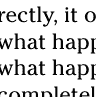

你可能听到程序员谈论“注释掉”他们代码的某些部分。当你在编写程序时，如果某些东西工作不正常，尝试移除一些代码通常会有所帮助。至少，你可以知道当那些可疑代码被移除时会发生什么。当然，你可能不喜欢代码被移除后的结果，因此你不想完全删除代码。相反，你将普通的 Java 语句转换为注释。例如，将 `System.out.println("Sleep");` 转换为 `/* System.out.println("Sleep"); */`。这样可以在你试图找出程序问题所在时，阻止 Java 编译器看到这段代码。

### Javadoc 注释

特殊的 *Javadoc* 注释是任何以额外星号开头的传统注释。

```java
/**
 * 打印一个字符串然后终止该行。
 */
```

这是一个很酷的 Java 特性。你可以从 `java.sun.com` 下载的软件包含一个名为 `javadoc` 的小程序。`javadoc` 程序会在你的代码中寻找这些特殊注释。该程序使用这些注释来创建一个全新的网页——一个为你代码定制的文档页面。要了解如何将 Javadoc 注释转换为网页，请访问本书的网站 (<http://allmycode.com/BeginProg3>)。

## 理解一个简单的 Java 程序

以下几节将介绍、解释、分析、剖析，并以其他方式揭示清单 4-1 中 Java 程序的奥秘。

## 什么是方法？

你正在一家高档车库担任汽车修理工。你的老板总是很匆忙，并且有将单词连在一起说的习惯，他说：“FixTheAlternator on that junkyOldFord。”在脑子里，你会过一遍一系列的任务。“把车开进维修间，打开引擎盖，拿扳手，松开交流发电机皮带，”等等。这里发生了三件事：

- **你有一个名称来表示你应该做的事情。** 这个名称是 `FixTheAlternator`。
- **在你脑海中，你有一个与名称 `FixTheAlternator` 相关联的任务列表。** 该列表包括“把车开进维修间，打开引擎盖，拿扳手，松开交流发电机皮带，”等等。
- **你有一个脾气暴躁的老板告诉你去做所有这些工作。** 你的老板通过说“FixTheAlternator”让你开始工作。换句话说，你的老板通过说出你应该做的事情的名称让你开始工作。

在这个场景中，使用 *method* 这个词并不过分。你有一个处理交流发电机的方法。你的老板调用那个方法，你通过执行所有你与该方法相关联的指令列表中的事情来回应。

### Java 方法

如果你相信前面部分的所有内容，那么你就准备好阅读关于 Java 方法的内容了。在 Java 中，*方法*是一系列要做的事情。每个方法都有一个名称，你通过在程序中使用该方法的名称来告诉计算机执行列表中的事情。

我从未编写过让机器人修理交流发电机的程序。但是，如果我编写了，该程序可能包含一个名为 `FixTheAlternator` 的方法。我的 `FixTheAlternator` 方法中的指令列表看起来会像清单 4-2 中的文本。

### 清单 4-2：方法声明

```java
void FixTheAlternator() {
    DriveInto(car, bay);
    Lift(hood);
    Get(wrench);
    Loosen(alternatorBelt);
    ...
}
```

在我 Java 代码的其他地方（清单 4-2 之外的某个地方)，我需要一条指令来调用我的 `FixTheAlternator` 方法。调用 `FixTheAlternator` 方法的指令可能看起来像清单 4-3 中的那一行。

### 清单 4-3：调用方法

```java
FixTheAlternator(junkyOldFord);
```

> **警告！**

> 不要过于仔细地审视清单 4-2 和 4-3。清单 4-2 和 4-3 中的所有代码都是假的！我编造了这段代码，使其看起来很像真正的 Java 代码，但它不是真正的代码。更重要的是，清单 4-2 和 4-3 中的代码并非旨在说明所有关于 Java 的规则。所以如果你手边有盐，就请对清单 4-2 和 4-3 半信半疑吧。

> **技术细节**

> 几乎每种计算机编程语言都有类似于 Java 方法的东西。如果你使用过其他语言，你可能记得诸如子程序、过程、函数、子例程、子过程或 PERFORM 语句之类的东西。无论你在最喜欢的编程语言中如何称呼它，*方法*就是一组被收集在一起并赋予新名称的指令。

### 声明、头和调用

如果你对什么是方法以及它如何工作有基本的了解（见前面部分），你可以深入挖掘一些有用的术语：

- 如果我比较懒惰，我将清单 4-2 中的代码称为*方法*。如果我不懒惰，我将这段代码称为*方法声明*。
- 清单 4-2 中的方法声明有两部分。第一行（包含名称 `FixTheAlternator` 的部分，直到但不包括左花括号）称为*方法头*。清单 4-2 的其余部分（被花括号包围的部分）是*方法体*。
- 术语*方法声明*将清单 4-2 中的指令列表与清单 4-3 中的指令区分开来，后者被称为*方法调用*。

有关所有方法术语的便捷图示，请参见图 4-5。

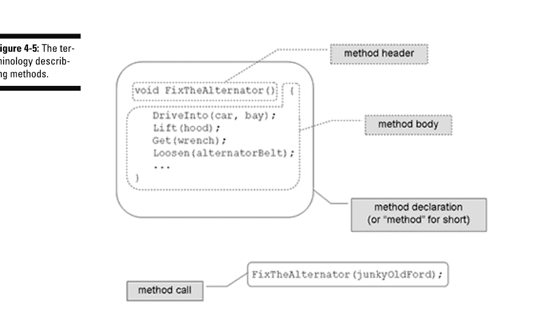

方法的头部和主体就像词典中的一个词条。词条并不真正使用它所定义的词。相反，词条告诉你当你使用这个词时会发生什么。

> **巧克力** (choc-o-late) *名词* 1. 地球上最容易上瘾的物质。 2. 用版税购买的东西。 3. 一个人饮食中最重要的营养元素。

**`FixTheAlternator()`** 将车开进维修间，打开引擎盖，拿起扳手，松开交流发电机皮带，然后吃一些巧克力。

相比之下，方法调用就像句子中使用一个词。方法调用启动某些代码。

> “我想要一些巧克力，否则我会大发脾气的。”

> “FixTheAlternator on that junkyOldFord。”

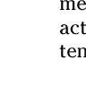

*方法声明*告诉计算机如果你调用该方法会发生什么。*方法调用*（一段独立的代码）告诉计算机实际调用该方法。方法的声明和方法的调用往往位于 Java 程序的不同部分。

## 程序中的 main 方法

在清单 4-1 中，大部分代码是一个名为 *main* 的方法的声明。（只需在代码的方法头中找到 `main` 这个词。）目前，不要担心方法头中的其他词——`public`、`static`、`void`、`String` 和 `args`。我将在接下来的几章中解释这些词（根据需要）。

像任何 Java 方法一样，`main` 方法是一个食谱：

```
如何制作饼干：
    预热烤箱。
    擀面团。
    烘烤擀好的面团。
```

或者

```
如何遵循 ThingsILike 代码中的主要指令：
    在屏幕上显示巧克力、版税、睡觉。
```

单词 `main` 在 Java 中扮演着特殊的角色。具体来说，你永远不会编写明确调用 `main` 方法的代码。单词 `main` 是程序开始运行时自动调用的方法的名称。

## 你如何最终告诉计算机做某事

在代码清单4-1的核心部分，隐藏着一行真正向计算机发出直接指令的代码。这一行

```
System.out.println("Chocolate, royalties, sleep");
```

告诉计算机显示文字 "Chocolate, royalties, sleep"。（如果你使用 Eclipse，计算机会在控制台视图中显示 "Chocolate, royalties, sleep"。）我可以至少用两种不同的方式来描述这行代码：

- **它是一条语句：** 在 Java 中，告诉计算机执行某项操作的直接指令称为语句。代码清单 4-1 中的语句告诉计算机显示一些文本。其他程序中的语句可能告诉计算机将数字 7 放入特定的内存位置，或使屏幕上出现一个窗口。计算机程序中的语句能执行各种各样的任务。
- **它是一次方法调用：** 在本章前面的“什么是方法？”一节中，我描述了一种称为“方法调用”的东西。语句

```
FixTheAlternator(junkyOldFord);
```

是方法调用的一个例子，同样

```
System.out.println("Chocolate, royalties, sleep");
```

也是。

Java 有许多不同类型的语句。方法调用只是其中一种。

## 用分号结束语句

在 Java 中，每条语句都以分号结尾。代码清单 4-1 中的代码只包含一条语句，所以清单中只有一行以分号结尾。

看看清单 4-1 中的任何其他行，例如方法头。方法头（包含单词 `main` 的那一行）并不直接告诉计算机执行任何操作。相反，方法头描述了某些操作以供将来参考。该头部宣布：“以防有人调用 `main` 方法，接下来的几行代码告诉你如何响应此调用。”

> **记住**

每个完整的 Java 语句都以分号结尾。方法调用是一条语句，因此以分号结尾，但方法头和方法声明都不是语句。

## 名为 System.out.println 的方法

代码清单 4-1 中间的语句调用了一个名为 `System.out.println` 的方法。此方法在 Java API 中定义。每当调用 `System.out.println` 方法时，计算机都会在其屏幕上显示文本。

想想名字。信不信由你，我认识两个名叫 Pauline Ott 的人。其中一位是修女；另一位是物理学家。当然，英语世界中有很多叫 Pauline 的人，就像 Java API 中有几个叫 `println` 的东西一样。因此，为了区分物理学家 Pauline Ott 和影评人 Pauline Kael，我写全名 "Pauline Ott"。同样，为了区分修女和物理学家，我写 "Sister Pauline Ott"。同样地，我要么写 `System.out.println`，要么写 `DriverManager.println`。前者（你经常使用）在计算机屏幕上写入文本。后者（本书中根本不用）写入数据库日志文件。

正如 Pauline 和 Ott 本身就是名字一样，`System`、`out` 和 `println` 也是 Java API 中的名字。但要使用 `println`，必须写出方法的全名。你永远不能单独写 `println`。它总是 `System.out.println` 或 API 名称的其他组合。

> **警告！**


Java编程语言区分大小写。如果将小写字母改为大写字母（或反之），就会改变单词的含义。你不能用`system.out.Println`替换`System.out.println`。如果这样做了，你的程序将无法运行。

## 方法，无处不在

在`ThingsILike`程序中，两个方法扮演了重要角色。图4-6说明了这种情况，接下来的几个要点将为你提供导览：

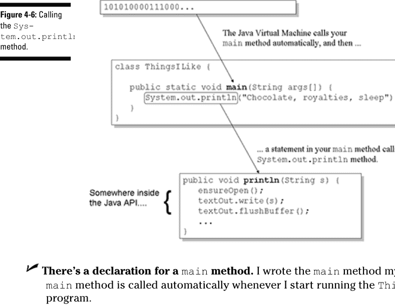

- **有一个`main`方法的声明。** 我自己编写了`main`方法。每当启动运行`ThingsILike`程序时，此`main`方法会被自动调用。
- **有一次对`System.out.println`方法的调用。** 对`System.out.println`方法的方法调用是`main`方法体中唯一的语句。换句话说，调用`System.out.println`方法是`main`方法待办事项清单上唯一的事情。

`System.out.println`方法的声明深藏在官方Java API中。要回顾Java API，请参见第1章。

>  当我说“`System.out.println`深藏在API中”时，我对API的描述并不完全准确。诚然，你可以忽略API内部所有繁琐的Java代码。你只需要记住`System.out.println`是在那段代码中的某个地方定义的。但当我让API代码听起来很神奇时，我就不够公平了。API只是另一堆Java代码。API中告诉计算机执行对`System.out.println`的调用意味着什么的语句，看起来很像代码清单4-1中的Java代码。

## Java类

你听说过*面向对象编程*（也称为*OOP*）这个术语吗？OOP是一种思考计算机编程问题的方式——一种被多种不同编程语言支持的方式。OOP始于1960年代，起源于一种名为`Simula`的语言。1970年代，它在另一种名为`Smalltalk`的语言中得到强化。到了1980年代，随着`C++`语言的出现，OOP大受欢迎。

有些人想改变这个缩写，称之为COP——面向类编程。这是因为面向对象编程始于一种称为*类*的东西。在Java中，一切都始于类，一切都封装在类中，一切都基于类。在创建某种类之前，你在Java中什么也做不了。这就像在《危险边缘》节目中，听到Alex Trebek说“让我们插播广告”，然后打断他说：“抱歉，Alex。如果不把指令放在一个类里，你就无法发出指令。”

理解类究竟是什么对你很重要，因此我不敢在本章中随意解释。相反，我在第17章中专门讨论了“什么是类？”这个问题。总之，在Java中，你的`main`方法必须位于一个类内部。我编写了代码清单4-1中的代码，因此我得为我的新类起个名字。我选择了名字`ThingsILike`，所以代码清单4-1的代码以`class ThingsILike`开头。

再看看代码清单4-1，注意`class ThingsILike`这行之后发生了什么。其余的代码都包含在花括号中。这些花括号标记了类内部的所有内容。没有这些花括号，你会知道`ThingsILike`类声明的开始位置，但你不会知道声明在哪里结束。

就好像`ThingsILike`类中的内容被装在一个盒子里。（参考图4-3。）要将一段代码框起来，你需要做两件事：

- **使用花括号：** 这些花括号告诉编译器一段代码的开始和结束位置。
- **缩进代码：** 缩进告诉你的人眼（以及其他程序员的眼睛）一段代码的开始和结束位置。

别忘了。你必须两者都做。

# 第5章

# 构成一个程序

## *本章要点*

- 从键盘读取输入
- 编辑程序
- 排查问题

就在昨天，我和我的仆人RoboJeeves聊天。（RoboJeeves是RJ-3000系列个人机器人生命体中的高端型号。）以下是讨论过程：

*我*：RoboJeeves，告诉我一个物体在真空中下落3秒后的速度。

*RoboJeeves*：好的，我会的。“一个物体在真空中下落3秒后的速度。”好了，我告诉你了。

*我*：RoboJeeves，别给我这种自作聪明的回答。我想要一个数字。我想要实际的速度。

*RoboJeeves*：好的！“一个数字；实际的速度。”

*我*：RJ，这些廉价笑话有失你的身份。你到底能不能告诉我问题的答案？

*RoboJeeves*：能。

*我*：“能”，什么？

*RoboJeeves*：能，我“能”或者“不能”告诉你问题的答案。

*我*：那么，到底是哪个？你能吗？

*RoboJeeves*：是的，我能。

*我*：那就告诉我。告诉我答案。

*RoboJeeves*：速度是每小时153,984,792英里。

*我*：（停顿思考后……）RJ，我知道你从不犯错，但那个数字153,984,792太高了。

*RoboJeeves*：太高？那不可能。在巨型行星Mangorrrrkthongo上，物体下落非常快。现在，如果你想知道地球上物体的下落情况，你应该一开始就说明。

有时候那个机器人真让我恼火。事实是，RoboJeeves只是执行我告诉他做的一切——不多也不少。如果我说“喂猫”，那么RoboJeeves会说：“喂给谁？你哪位客人要吃猫肉？”

## 计算机很愚蠢

尽管计算机很方便，但它们都做着同样的破事。它们*完全*按照你告诉它们的去做，这有时非常不幸。例如，1962年，一艘前往金星的水手号航天器在发射后仅4分钟就被摧毁了。为什么？它被摧毁是因为一个FORTRAN程序中漏掉了一个按键。大约在同一时间，NASA科学家发现了一个可能毁掉水星载人飞行任务的错误。（没错！这些是载人飞行！）这个错误是一个句号代替了逗号。（一个计算机程序员写了`DO 10 I=1.10`而不是`DO 10 I=1,10`。）

我完全尊重我的朋友RoboJeeves，但他和他的计算机表亲们都极其愚蠢。有时他们看起来像是在质疑我们人类，但实际上他们只是在做其他人类告诉他们的事情。他们可以抛虚拟硬币，并使用复杂的方案来模仿创造性行为，但他们从来不会真正独立思考。如果你说“跳”，那么他们就会按照程序对字母J-u-m-p的响应去做。

所以，当你编写计算机程序时，你必须想象一个精灵满足了你三个愿望。不要祈求永恒的爱，因为如果你这样做了，精灵就会给你一个流着口水、痴情的伴侣——一个你根本不喜欢的人。也不要祈求一百万美元，除非你想让精灵把你变成银行劫匪。

你在计算机程序中写的一切都必须非常精确。看一个例子……

## 回显键盘输入的程序

代码清单5-1包含一个小型Java程序。该程序让你在键盘上输入一行字符。一旦你按下回车键，程序就会显示第二行，复制你输入的任何内容。

### 代码清单5-1：一个Java程序

```java
import java.util.Scanner;
class EchoLine {
    public static void main(String args[]) {
        Scanner myScanner = new Scanner(System.in);
        System.out.println(myScanner.nextLine());
    }
}
```

图5-1显示了`EchoLine`代码（代码清单5-1中的代码）的运行情况。图中的文本是我自己输入的内容和计算机响应的混合。

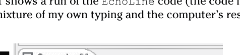

在图5-1中，我输入了第一行（第一个`Please don't repeat this to anyone`行），计算机显示了第二行。运行代码清单5-1中的代码时，会发生以下情况：

1. **起初，计算机什么也不做。**

   计算机正在等待你输入内容。

2. **你在Eclipse的Console视图内点击鼠标。**

   结果你会在Eclipse的Console视图左侧边缘看到一个光标，如图5-2所示。

   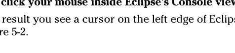

3. **你输入一行文本——任何文本都可以（见图5-3）。**

   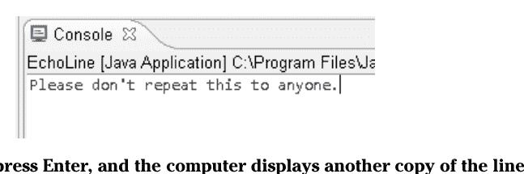

4. **你按下回车键，计算机显示你输入的文本的另一个副本，如图5-4所示。**

   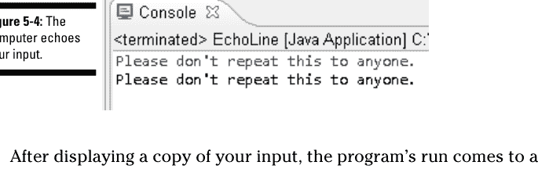

在显示你输入内容的副本后，程序的运行就结束了。

## 输入并运行程序

本书的网站（[http://allmycode.com/BeginProg3](http://allmycode.com/BeginProg3)）提供了一个链接，可以下载书中所有的Java程序。下载程序后，你可以按照第2章的说明将程序添加到你的Eclipse工作空间。然后，要测试代码清单5-1中的代码，你可以运行现成的05-01项目。

但我鼓励你不要运行现成的代码，而是从头开始——自己输入代码清单5-1，然后测试你新创建的代码。只需按照以下步骤操作：

1. 启动Eclipse。
2. 从Eclipse的菜单栏中，选择`File ⇒ New ⇒ Java Project`。

   Eclipse的`New Java Project`对话框出现。

3. 在对话框的`Project Name`字段中，输入`MyNewProject`。
4. 点击`Finish`。

   点击`Finish`将返回Eclipse工作台，`Package Explorer`中会显示`MyNewProject`。下一步是创建一个新的Java源代码文件。

5. 在`Package Explorer`中，选择`MyNewProject`，然后在Eclipse的主菜单中，选择`File ⇒ New ⇒ Class`。

   Eclipse的`New Java Class`对话框出现。

6. 在`New Java Class`对话框的`Name`字段中，输入你新类的名称。

   在这个例子中，使用`EchoLine`这个名称。严格按照我在代码清单5-1中的拼写来拼写`EchoLine`，大写E，大写L，中间没有空格。

   > 在Java中，一致的拼写和大小写非常重要。如果你在特定的程序中不保持一致，那么程序可能会有一些讨厌的、烦人的编译时错误。

   你可以选择在标有`public static void main(String[] args)`的框中打勾。如果你不勾选这个框，那么在你进行到第8步时，会需要多打一些字。无论勾选与否，这都没什么大不了的。

7. 点击`Finish`。

   点击`Finish`将返回Eclipse工作台。此工作台中的一个编辑器有一个名为`EchoLine.java`的选项卡。

8. 在`EchoLine.java`编辑器中输入代码清单5-1的程序。

   严格按照你在代码清单5-1中看到的方式复制代码。

   - 严格按照我在代码清单5-1中的拼写来拼写每个单词。
   - 严格按照我在代码清单5-1中的方式来大写每个单词。
   - 包含所有标点符号——点号、分号，所有符号。
   - 仔细检查单词`println`的拼写。确保`println`中的每个字符都是小写字母。（特别是，`ln`中的`l`是字母，不是数字。）

   如果你输入正确，编辑器中不会显示任何错误标记。如果看到错误标记，那么请返回并将你输入的所有内容与代码清单5-1中的内容进行比较。比较每个字母、每个单词、每个波浪线、每个污点。

9. 在编辑器中对代码进行任何更改或更正。

   当你最终看不到错误标记时，就可以运行程序了。

10. 通过点击编辑器内部或点击`Package Explorer`中的`MyNewProject`分支来选择`EchoLine`类。

11. 在Eclipse的主菜单中，选择`Run ⇒ Run As ⇒ Java Application`。

    你的新Java程序运行了，但没什么特别的事情发生。

12. 在Eclipse的`Console`视图内点击鼠标。

    结果，一个光标会出现在Eclipse的`Console`视图左侧边缘。（参考图5-2。）计算机正在等待你输入内容。

    

    如果你忘记在`Console`视图内点击鼠标，Eclipse可能不会将你的按键发送给正在运行的Java程序。相反，Eclipse可能会将你的按键发送给编辑器或（奇怪地）发送给`Package Explorer`。

13. 输入一行文本，然后按回车键。

    作为响应，计算机显示你的文本行的另一个副本。然后程序的运行就结束了。（参考图5-4。）

如果这个步骤列表看起来有点粗略，你可以在第3章找到更详细的说明。（首先查看第3章中关于编译和运行程序的部分。）在很大程度上，第5章这里的步骤是第3章内容的快速总结。主要区别在于，在第3章中，我不鼓励你自己输入程序。

那么，自己输入程序有什么大不了的呢？嗯，当你把手指放在键盘上时，可能会发生很多有趣的事情。这就是为什么本章的后半部分专门用于故障排除。

## EchoLine程序是如何工作的

当你还是一个刚出生的小婴儿，舒适地躺在母亲的怀抱里时，她告诉过你如何将字符发送到计算机屏幕：

```java
System.out.println(whatever text you want displayed);
```

她没有告诉你的是如何从计算机键盘获取字符。有很多种方法可以做到这一点，但我在本章中推荐的方法是

```java
myScanner.nextLine()
```

现在，有趣的部分来了。调用`nextLine`方法不仅仅是从键盘获取字符。当计算机运行你的程序时，计算机会用你在键盘上输入的任何内容替换文本`myScanner.nextLine()`。

要理解这一点，请看代码清单5-1中的语句：

```java
System.out.println(myScanner.nextLine());
```

当你运行程序时，计算机会看到你调用了`nextLine`并立刻停止。（参考图5-2。）计算机会等待你输入一行文本。于是（参考图5-3）你输入了这一行：

```
Hey, there's an echo in here.
```

计算机会将整个`Hey`行替代你程序中的`myScanner.nextLine()`调用。这个过程如图5-5所示。

`myScanner.nextLine()`调用被嵌套在`System.out.println`调用中。所以归根结底，计算机表现得就好像清单5-1中的语句是这样的：

```java
System.out.println("Hey, there's an echo in here.");
```

计算机会在屏幕上显示文本`Hey, there's an echo in here.`的另一个副本。这就是为什么你在图5-4中看到了两份`Hey`行。

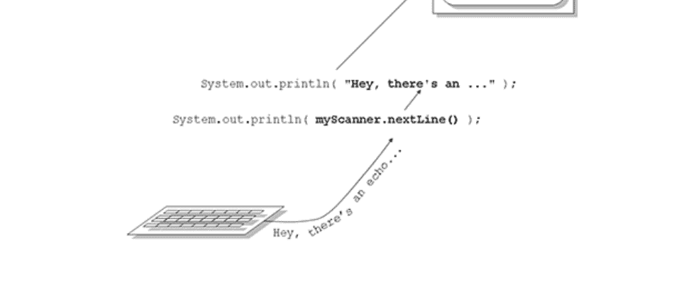

## 获取数字、单词及其他内容

在清单5-1中，`myScanner.nextLine()`这些词会从计算机键盘获取整行文本。所以如果你输入

```
Testing 1 2 3
```

清单5-1中的程序会回显你输入的整行文本`Testing 1 2 3`。

有时你不希望程序获取整行文本。相反，你希望程序获取一行中的一部分。例如，当你输入`1 2 3`时，你可能希望计算机获取数字`1`。（也许数字`1`代表一个客户之类的。）在这种情况下，你不会在程序中使用`myScanner.nextLine()`。相反，你会使用`myScanner.nextInt()`。

表5-1向你展示了`myScanner.next`相关方法的几种变体。不幸的是，表中的条目并不是非常易于预测。要读取一行输入，你需要调用`nextLine`。但要读取一个单词的输入，你不能调用`nextWord`。（Java API中没有`nextWord`方法。）相反，要读取一个单词，你需要调用`next`。

### 表5-1 部分`Scanner`方法

| 要读取此内容... | ...调用此方法 |
| :--- | :--- |
| 一个没有小数点的数字 | `nextInt()` |
| 一个带小数点的数字 | `nextDouble()` |
| 一个单词（例如，以空格结尾） | `next()` |
| 一行（或从一行中已读取部分数据后剩余的部分） | `nextLine()` |
| 单个字符（如字母、数字或标点符号） | `findWithinHorizon(".",0).charAt(0)` |

此外，表中的内容还有一个意外的结局。要读取单个字符，你不应该调用`nextSomething`。相反，你可以调用那个奇怪的`findWithinHorizon(".",0).charAt(0)`方法组合。（你需要原谅创建`Scanner`类的人。他们是从一个专门的角度创建`Scanner`的。）

> **快速了解`Scanner`**

在本章中，我建议你忽略`import java.util.Scanner`和`Scanner myScanner`等行背后的任何含义。只需不加思考地将这两行粘贴到你的代码中，然后继续。

当然，你可能不想接受我的建议。你可能不喜欢忽略代码中的东西。如果你恰好是这样固执的人，我有一些快速的事实告诉你。

✓ **`Scanner`这个词是在Java API中定义的。**

`Scanner`是一种可以用来获取输入的东西。

这个`Scanner`类属于Java 5.0及更高版本。如果你使用的是Java 1.4.2版本，那么你就无法使用`Scanner`类。（当你输入清单5-1时，你会看到一个错误标记。）

✓ **`System`和`in`这两个词是在Java API中定义的。**

合在一起，`System.in`代表计算机键盘。

在后面的章节中，你会看到类似`new Scanner(new File("myData.txt"))`这样的东西。在那些章节中，我用`new File("myData.txt")`替代了`System.in`，因为我不是从键盘获取输入。相反，我是从计算机硬盘上的一个文件中获取输入。

✓ **`myScanner`这个词不是来自Java API。**

`myScanner`这个词是Barry Burd的创造。你可以用`readingThingie`（或任何其他你想要使用的名称，只要始终如一地使用该名称）来替代`myScanner`。所以，如果你想有创意，你可以写


```
Scanner readingThingie =
    new Scanner(System.in);
System.out.println
    (readingThingie.nextLine());
```

修改后的清单5-1（用`readingThingie`代替`myScanner`）编译和运行起来毫无问题。

✓ **`import java.util.Scanner`这一行是一个*导入声明*的例子。**

可选的导入声明允许你缩写程序其余部分中的名称。你可以从清单5-1中删除导入声明。但如果你这样做，你必须在代码中始终使用`Scanner`类的*全限定名*。方法如下：

```
class EchoLine {
  public static void main
      (String args[]) {
    **java.util.Scanner myScanner**
        = new **java.util.Scanner**
            (System.in);
    System.out.println
        (myScanner.nextLine());
    }
}
```

要查看表中部分方法的实际应用，请查阅本书中的其他程序清单。第6、7和8章有一些特别好的例子。

## 输入两行代码，然后勇往直前

清单5-1中天真地隐藏了两行额外的代码。这两行帮助计算机从键盘读取输入。这两行是

```
import java.util.Scanner;
    Scanner myScanner = new Scanner(System.in);
```

关于这两行，我有一个坏消息和一个好消息。

- **坏消息是，这两行背后的推理很难理解。** 这在第5章尤其如此，因为我在这里介绍Java最基本的概念。

- **好消息是，你不必理解这两行背后的推理。** 你可以将这两行复制并粘贴到任何从键盘获取输入的程序中。你不需要以任何方式修改这两行。这两行在各种Java程序中都能无需任何修改地工作。

只需确保将这两行放在正确的位置：

- 让`import java.util.Scanner`这一行成为你程序的`第一行`。

- 将`Scanner myScanner = new Scanner(System.in)`这一行放在你的`main`方法中，紧接在`public static void main(String args[]) {`这一行之后。

在未来的某个时刻，你可能需要更仔细地处理这两行的位置。但现在，我给出的规则会对你很有帮助。

## 期待意外情况

不久前，我遇到一位有有趣政策的讲师。他说，“有时在我讲课时，我会在计算机上从头开始编写一个程序。我就在学生面前做。如果程序第一次尝试就编译并正确运行，我期望学生们给我热烈的掌声。”

起初，你可能觉得这家伙自负得离谱，但你必须客观看待问题。程序第一次就编译并正确运行是不寻常的。几乎总是有一个拼写错误或某种其他错误。

所以这一节处理的是你第一次编译和运行程序时看到的正常的、预料之中的错误。每个人都会犯这些错误，即使是经验最丰富的旅行者。关键是保持冷静的头脑。以下是我的一般建议：

- **不要期望你输入的程序第一次就能编译。** 准备好返回编辑器并修复一些错误。

- **不要期望一个毫无瑕疵地编译的程序能正确运行。** 即使`Eclipse`编辑器中没有错误标记，你的程序可能仍然存在缺陷。`Eclipse`编译完你的程序后，你仍然必须成功运行程序。也就是说，你的程序应该完成运行并显示正确的输出。

  你需要先编译，然后运行。让程序编译没有错误是两项任务中较容易的一项。

- **阅读`Eclipse`编辑器中的内容，而不是你假设在编辑器中的内容。** 不要假设你输入的单词是正确的，你大写的单词是正确的，或者你正确匹配了花括号或括号。将你输入的代码与你拥有的任何示例代码进行比较。确保每个细节都井然有序。

- **要有耐心。** 每一次好的编程努力都需要很长时间才能做对。如果你不能立即理解某些东西，那么就要坚持不懈。坚持下去（或者把它放一段时间，然后再回来）。只要你投入足够的时间，没有什么是你不能理解的。

- **不要变得沮丧。** 不要摔你的馅饼皮。（沮丧（而不是缺乏知识）是你的敌人。如果你沮丧，你就一事无成。

- **不要认为你是唯一一个理解缓慢的人。** 我就很慢，并且以此为荣。（凯利，第6章会晚一周。）

- **不要胆怯。**

如果你的代码无法运行，而你又无法找出原因，那就去请教别人。在`groups.google.com`上发帖或给我发电子邮件。（发送至`BeginProg3@allmycode.com`。）不要害怕任何人的挖苦或讽刺回答。（关于你可以用来回应那些自以为是回答的手势列表，请参阅附录 Z。）

## 诊断问题

本章前面的“键入并运行程序”一节告诉你如何运行`EchoLine`程序。如果一切顺利，你的屏幕最终会如图 5-1 所示。但事情并非总是一帆风顺。有时你的手指一滑，在程序中插入了一个拼写错误。有时你忽略了代码清单 5-1 中的某个细节，就会得到一个令人头疼的错误消息。

当然，代码清单 5-1 中的一些东西是可以更改的。代码清单 5-1 中的每个字并非一成不变。所以这里有个棘手的问题——我不能告诉你必须始终完全按照代码清单 5-1 的样子重新键入。有些更改是可以的；有些则不行。请继续阅读一些“例如”。

### 大小写敏感

Java 是 *区分大小写* 的。除其他含义外，区分大小写意味着在 Java 程序中，字母`P`与字母`p`不同。如果你给我写粉丝邮件，开头写的是 "Dear barry" 而不是 "Dear Barry"，我仍然能明白你的意思。但 Java 不是这样工作的。

所以，只需在 Java 程序中更改一个字符，你得到的可能就不是一次顺利的编译，而是一个大麻烦！像这样将`p`改为`P`：

```
//以下行是**错误的**：
System.out.PrintIn(myScanner.nextLine());
```

当你在`Eclipse`编辑器中键入该程序时，你会看到如图 5-6 所示的丑陋错误。


当你看到如图 5-6 所示的错误标记和快速修复提示时，最好的办法是保持冷静，仔细阅读消息。有时，消息中包含有用的提示。（当然，有时它们没有。）图 5-6 中的消息是`The method Println(String) is undefined for the type PrintStream`。用通俗的英语来说，这意味着“Java 编译器无法解释`Println`这个词。”（该消息没有说：“别输入`Println`这个词，你这个笨蛋！”无论如何，如果电脑说你是我们笨蛋中的一员，你应该把它当作一种恭维。）现在，编译器无法理解像`Println`这样的词有很多原因。但是，对于初学者来说，你应该立即检查两个重要事项：

- **你是否正确拼写了这个词？**

  你是否不小心输入了`printlin`（用数字 1）而不是`println`？

- **你是否正确地将所有字母大写？**

  你是否错误地输入了`Println`或`PrintLn`而不是`println`？

这些错误中的任何一个都可能让 Java 编译器乱成一团。因此，请逐字（逐字母）将你的输入与正确的输入进行比较。当你发现不一致之处时，返回编辑器并修复问题。然后再次尝试编译程序。

> 提示：当你在`Eclipse`编辑器中键入程序时，`Eclipse`会尝试编译该程序。当`Eclipse`发现编译时错误时，编辑器通常会显示至少三个红色错误标记（参见图 5-6）。编辑器左边距的标记有一个类似 X 的标记，有时还有一个小灯泡。右边距的标记是一个小矩形。中间的标记是锯齿状的红色下划线。如果你将鼠标悬停在其中任何一个标记上，`Eclipse`会显示一条消息，尝试描述错误的性质。如果你悬停在锯齿线上，`Eclipse`会显示一条消息，并可能列出建议的解决方案。（每个建议的解决方案称为一个 *快速修复*。）如果你右键单击左边距的标记（或在 Mac 上按住 Control 键单击），然后在出现的上下文菜单中选择快速修复，`Eclipse`会显示建议的解决方案。要让`Eclipse`自动修改你的代码（使用快速修复列表中的建议），只需单击或双击快速修复列表中的项目。（也就是说，单击任何看起来像链接的内容；双击任何看起来不像链接的内容。）

### 省略标点符号

在英语中，以及在 Java 中，使用正确的标点符号很重要。

以代码清单 5-1 中的分号为例。如果你忘记输入分号会发生什么？

```
//以下代码是**错误的**：
    System.out.println(myScanner.nextLine())
}
```

如果你省略了分号，你会得到如图 5-7 所示的消息。


像图 5-8 中的消息会让你的生活变得简单得多。我不必解释这个消息，你也不必费力去理解这个消息的含义。只需按字面意思理解消息`insert ";" to complete Statement`。在`System.out.println(myScanner.nextLine())`语句的末尾和该语句之后的任何代码之间插入分号。（对于最容易阅读和理解的代码，请在`System.out.println(myScanner.nextLine())`语句的末尾添加分号。）

### 使用过多的标点符号

在初中时，我的英语老师说我应该在我通常停下来喘口气的地方使用逗号。这个建议在过敏季节效果不佳，那时我的句子里的逗号比单词还多。即使作为一名有报酬的作者，我也很难决定逗号应该放在哪里，所以我经常为了保险起见添加额外的逗号。这给我的文案编辑凯莉带来了更多工作，她办公室桌子旁的垃圾桶里装满了逗号。

Java 程序也是如此。你可能会对标点符号使用过度。以代码清单 5-1 中的`main`方法头为例。对于新手程序员来说，这一行是一个危险的弯道。

有关 *方法头* 和 *方法体* 术语的信息，请参见第 4 章。

通常，你不应该在方法头末尾加上分号。但人们还是会添加分号。（也许在某种微妙的方式上，方法头看起来就应该以分号结尾。）

```
//以下行是错误的：
public static void main(String args[]); {
```

如果你在代码清单 5-1 的代码中添加这个多余的分号，你会得到如图 5-8 所示的消息。

#### 为什么计算机不能修复它？

你有多少次能替别人把话说完？“请，”你的主管说，“去那边连接……”

“电线。”你插嘴道。“我为什么要为这事打扰你？”

答案很简单。计算机不想冒任何风险。如果你 *真的* 不想在第 8 行语句后面加分号怎么办？如果缺少的分号代表一个更深层的问题怎么办？如果计算机添加了多余的分号，它可能弊大于利。

回到你和你的主管这里……

轰！一声巨响。“不是电线，你这个笨蛋。是那些点。我想要你连接这些点。”

“对不起，”你说。

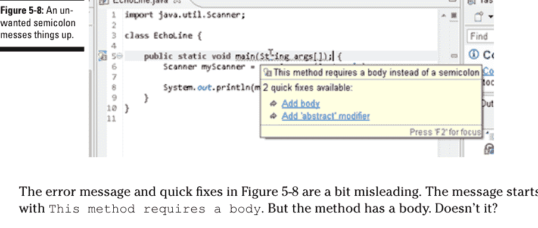

图 5-8 中的错误消息和快速修复提示有点误导性。消息以`This method requires a body`开头。但这个方法有方法体。不是吗？

当计算机尝试编译`public static void main(String args[]);`（以分号结尾）时，计算机感到困惑。我在图 5-9 中说明了这种困惑。你的眼睛看到了多余的分号，但计算机的眼睛将其解释为一个没有方法体的方法。所以这就是错误信息——计算机说`This method requires a body instead of a semicolon`（此方法需要一个方法体，而不是分号）。


如果你选择“Add Body”快速修复，Eclipse会生成以下（相当糟糕的）代码：

```java
import java.util.Scanner;
class EchoLine {
    public static void main(String args[]) {
    }
    {
        Scanner myScanner = new Scanner(System.in);
        System.out.println(myScanner.nextLine());
    }
}
```

这个“修复后”的代码没有编译时错误。但当你运行这段代码时，什么也不会发生。程序开始运行，然后就停止了，`Eclipse`的控制台视图中空无一物。

我们都知道，计算机是一台非常有耐心、非常善解人意的机器。这就是为什么计算机会查看你的代码，并决定再给你一次机会。计算机记得Java有一个高级特性，即你可以写一个方法头而不需要写方法体。当你这样做时，你会得到一个所谓的*抽象方法*——我在本书中根本不会用到它。总之，在图5-9中，计算机看到一个没有方法体的方法头。于是计算机自言自语道：“我知道了！也许程序员正在尝试写一个抽象方法。问题是，抽象方法的方法头中必须有`abstract`这个词。我应该提醒程序员这一点。”因此，计算机提供了图5-9中的`add 'abstract' modifier`（添加`abstract`修饰符）快速修复。

无论如何，要解读图5-9中的错误信息和快速修复，你必须字里行间地去理解。因此，这里有一些提示，帮助你解读这些晦涩的信息：

*   **避免本能反应。**

    有些人看到图5-9中的`add 'abstract' modifier`快速修复，会想知道在哪里可以添加修饰符。不幸的是，这不是正确的方法。如果你不知道`abstract`修饰符是什么，那么很可能你一开始就没打算使用抽象修饰符。

*   **长时间盯着那行错误的代码看。**

    如果你仔细观察图5-9中的`public static . . .`行，最终你会注意到它与清单5-1中的对应行不同。清单5-1中的那行没有分号，但图5-9中的那行有分号。

    当然，你并不总是从像清单5-1中那样的预先编写的代码开始。这就是熟能生巧的地方。你写的代码越多，你的眼睛就会对多余的分号和其他编程错误变得越敏感。

### 大括号过多

你在寻找最近的加油站，于是你问了一个当地人。“走到第一个红绿灯，然后左转，”当地人说。你直走了几条街，看到一个闪烁的黄色信号灯。你在信号灯处左转，走了大约一英里。什么？没有加油站？也许你把闪烁的信号灯误认为是真正的红绿灯了。

你来到了一个岔路口。“路线说明里没提到有岔路。我该走哪边？”你转向右边，但一分钟后，你被迫上了高速公路。你看到一个标志写着：“下一个出口24英里。”现在你真的迷路了，油表指向了“S”（“S”代表“Stranded”——抛锚了）。

那么事情是这样发生的：你犯了一个无心的错误。你不应该在那个闪烁的黄灯处左转。单是那个错误本身并不可怕。但那个最初的错误导致了更多的混乱，最终，你的选择变得毫无意义。如果你没有在那个闪烁的信号灯处转弯，你就永远不会遇到那个该死的岔路口。然后，上了高速公路简直就是一场灾难。

这个故事有意义吗？当然有。计算机也可能让自己陷入同样的麻烦。计算机注意到你的程序中有一个错误。然后，打个比方说，计算机在岔路口面临了一个选择——一个基于原始错误的岔路口——一个所有选择都不会带来好结果的岔路口。

举个例子。你正在重新输入清单5-1中的代码，但你错误地多输入了一个大括号：

```java
//以下代码**不正确**：
import java.util.Scanner;
class EchoLine {
    public static void main(String args[]) {
        Scanner myScanner = new Scanner(System.in);
    }
    System.out.println(myScanner.nextLine());
}
}
```

在`Eclipse`的编辑器中，你将鼠标悬停在最左边的标记上。你会看到图5-10所示的消息。

`Eclipse`感到困惑，因为对`System.out.println`的调用完全放错了位置。`Eclipse`显示了三条消息——一条关于`println`，一条关于括号，还有一条关于构造位置错误的非常晦涩的消息。这些消息中没有一条指出了问题的根源。`Eclipse`正在尽力从糟糕的情况中挽救，但此时，你不应该相信`Eclipse`说的任何一个字。

计算机不是聪明的动物，如果有人编程让`Eclipse`说`mis-placed construct(s)`（构造位置错误），那么`Eclipse`就会这么说。（有些人说计算机让他们觉得自己很笨。对我来说，正好相反。计算机提醒我一台机器可以有多笨，而一个人可以有多聪明。我喜欢这样。）

所以，当你看到一堆错误消息时，要仔细阅读每条消息。问问自己能从每条消息中学到什么。但不要把每条消息都当作权威的真理。当你已经尽力解读了`Eclipse`的消息后，请回到仔细审视代码的努力中去。

如果你得到不止一条错误消息，一定要仔细查看这组中的每条消息。有时，一条非常有帮助的消息会隐藏在一堆不太有用的消息之中。

### 拼写错误（以及其他失误）

你找到了一个古老的家族魔鬼蛋食谱（我的最爱之一）。你尽可能仔细地遵循每一步，但因为祖母的高血压，你没放盐。你递给祖母一个鸡蛋（一件完成的杰作）。“胡椒不够，”她说着就走开了。

下一道菜是红酒炖牛肉。你拿了一片不咸的给亲爱的老祖母。“不够甜，”她嘟囔着，离开了房间。“但这不可能，”你想。“红酒炖牛肉里没有糖。我没放盐。”即便如此，你还是回到厨房准备土豆泥。当然，你用了无盐黄油。“这次她会喜欢的，”你想。

“酸土豆！难吃！”祖母说着，走到水槽边把土豆泥都吐了出来。因为你自尊心强，你没有被祖母的行为冒犯。但你有些困惑。为什么她对三道无盐的菜说了这么多不同的话？也许有些你不知道的细微差别。

嗯，当你编写计算机程序时，同样的事情也会发生。你可能会犯两次同样的错误（或者至少，你认为同样的错误），但每次都得到不同的错误信息。


例如，如果你更改清单5-1中`println`的拼写或大小写，Eclipse会告诉你该方法未在类型`PrintStream`中定义。但如果你把`System`改成`system`，Eclipse会说无法解析`system`。而如果`System`拼写错误，Eclipse就不会注意`println`是否拼写正确。

在清单5-1中，如果你更改`args`的拼写，什么也不会出错。程序能正确编译和运行。但如果你更改`main`的拼写，你会面临一些不寻常的困难。（如果你不相信我，请阅读“运行时错误消息”部分。）

还是在清单5-1中，更改`Scanner myScanner = new Scanner(System.in)`这一行中的等号数量。一个等号，大家都高兴。如果你不小心输入了两个等号（`Scanner myScanner == new Scanner(System.in)`），Eclipse会引导你回到正轨，告诉你`Syntax error on token "==", = expected`（在标记“==”上出现语法错误，应为“=”）（见图5-11）。但如果你发疯输入四个等号，或者根本不输入等号，Eclipse就会误解一切，并建议你`insert ";"`（插入“;”）来完成`BlockStatements`（块语句）。不幸的是，插入分号一点帮助也没有（见图5-12）。

所以请记住：Java以多种不同的方式响应错误。你代码中的两处更改可能看起来很相似，但相似的更改并不总是导致相似的结果。你代码中的每个问题都需要单独处理。

这里有一个有用的练习：从一个可运行的Java程序开始。成功运行代码后，故意做一个会引入错误的改动。仔细查看每条错误信息，并自问这条信息是否有助于你诊断问题。这个练习很棒，因为它帮助你将错误视为正常现象，并让你在无压力的情况下练习分析错误信息。

## 运行时错误信息

到目前为止，在本章中，我描述的都是编译程序时出现的错误。另一类错误则隐藏到你运行程序时才会显现。一个典型的例子是单词`main`的拼写或大小写错误。

假设你在一时冲动下，错误地将`main`写成了大写开头的`Main`：

```
//以下这行是**不正确的**：
public static void Main(String args[]) {
```

当你输入代码时，一切正常。你看不到任何错误标记。

但随后你尝试运行程序。这时，麻烦就来了。灾难如图5-13所示。

**Figure 5-13:** 什么叫"在EchoLine类中找不到Main方法？"

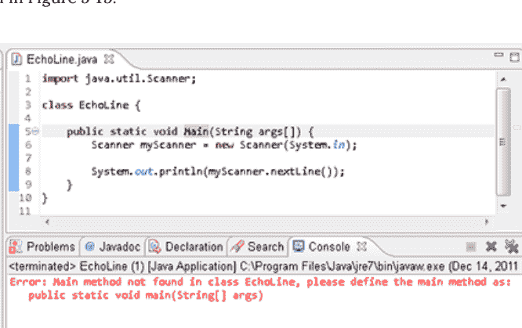

当然，你的程序里确实有名为`Main`的东西，但它有名为`main`的东西吗？（是的，我听说过一位名叫e. e. cummings的著名诗人，但见鬼的E. E. Cummings又是谁？）计算机不会假设你写的`Main`和它期望的`main`是一回事。你需要将`Main`改回`main`。然后一切就正常了。

但与此同时（或者换个双关说法，在"maintime"里），这种不正确的大小写是怎么逃过编译器法眼的呢？为什么编译程序时你没有收到任何错误信息？如果大写的`M`不会让编译器出错，那为什么这个大写的`M`会在运行时把一切都搞砸呢？

答案要回到Java编程语言中不同类型的单词。正如第4章所述，Java有标识符和关键字。

Java中的关键字是固定不变的。如果你把`class`改成`Class`，或者把`public`改成`Public`，那么你得到的将是新东西——计算机很可能无法理解的东西。这就是为什么编译器会对关键字的大小写错误报错。确保所有关键字都被正确使用是编译器的职责。

另一方面，标识符可以灵活多变。确实，有一个名为`main`的标识符，但你也可以创建一个名为`Main`的新标识符。（不过你不应该这样做。这会让熟悉Java中`main`一词常规含义的人感到困惑。）当编译器看到一行输入错误的代码，比如`public static void Main`时，编译器只会认为你在创造一个全新的名字。于是编译器放行了这行代码。你的老朋友——编译器，没有向你抱怨任何问题。

但是，当你尝试运行代码时，计算机就炸锅了。Java虚拟机（JVM）负责运行你的代码。（详见第1章。）JVM需要找到代码中开始执行语句的位置，因此它会寻找一个名为`main`（小写m）的起点。如果JVM没有找到任何名为`main`的东西，JVM就会不高兴。"在EchoLine类中找不到Main方法，"JVM说道。因此，在运行时，是JVM而非编译器，给你提供了错误信息。

> 一条更好的错误信息应该是**在EchoLine类中找不到main方法**，其中`main`的`m`是小写的。设计错误信息的人时不时会忽略一两个细节。

## 什么问题？我没看出问题

本章在最后，我将通过向你展示在清单5-1中你可以做哪些无伤大雅的修改，以一个积极的基调结束。

### 你创建的标识符

如果你创建了一个标识符，那么这个名称就随你定义。例如，在清单5-1中，你可以把`EchoLine`改成`RepeatAfterMe`。

```
class RepeatAfterMe {
    public static void main ... 等等。
```

只要保持一致，这完全没有问题。只需按照本章前面“输入并运行程序”部分的大部分步骤操作即可。

- 在第6步，在“新建Java类”对话框的Name字段中，输入`RepeatAfterMe`而不是`EchoLine`。

- 在第8步，当你从清单5-1复制代码时，不要在清单顶部附近输入`class EchoLine {`。相反，输入`class RepeatAfterMe {`。

### 空格和缩进

Java对空格和缩进的使用并不挑剔。你只需要保持程序组织良好、易于阅读即可。这是清单5-1中代码的一种替代空格和缩进写法：

```
import java.util.Scanner;
class EchoLine
{
  public static void main( String args[] )
  {
    Scanner myScanner =
        new Scanner( System.in );
    System.out.println
        ( myScanner.nextLine() );
  }
}
```

### 你选择的方式

程序就像指纹。没有两个程序看起来非常相似。假设我和一位同事讨论一个编程问题。然后我们各自回去编写自己的程序来解决同一个问题。当然，我们在重复劳动。但我们会写出完全相同的代码吗？绝对不会。每个人都有自己独特的风格，每个人都是独一无二的。

我曾请我的Java程序员朋友David Herst编写他自己的`EchoLine`程序，而没有向他展示我的清单5-1中的代码。以下是他写的内容：

```
import java.io.BufferedReader;
import java.io.InputStreamReader;
import java.io.IOException;
public class EchoLine {
    public static void main(String[] args)
            throws IOException {
        InputStreamReader isr =
                new InputStreamReader(System.in);
        BufferedReader br = new BufferedReader(isr);
        String input = br.readLine();
        System.out.println(input);
    }
}
```

不用担心`BufferedReader`、`InputStreamReader`或类似的东西。只需注意到，就像雪花一样，即使完成相同的任务，也没有两个程序是完全相同的。这很好。这意味着你的代码，无论多么与众不同，都可以和别人的一样出色。这非常鼓舞人心。

## 第6章：使用构建块：变量、值和类型

## 本章内容

- 声明变量

- 为变量赋值

- 处理数字

- 使用Java类型

早在1946年，约翰·冯·诺依曼撰写了一篇关于新兴计算机和计算技术的开创性论文。其中，他确立了一个基本事实：尽管计算机极其复杂，但其主要业务是将数据从一个地方移动到另一个地方。取一个数字——比如一个人银行账户的余额。将这个数字从计算机内存移动到计算机处理器。给余额加上几美元，然后再将其移回计算机内存。数据的移动……仅此而已；没有别的了。

很好！本章将向你展示如何移动你的数据。

### 使用变量

以下摘自一家软件公司的网站：

> SnitSoft认识到其对信息技术界的责任。为此，SnitSoft将其最受欢迎的应用程序以象征性的费用提供。只需支付5.95美元加上运费和手续费，您即可收到一张包含SnitSoft旗舰产品的CD-ROM。

请便。点击[立即订购！](Order Now!)链接。看看会发生什么。你会收到一张包含两个项目的订单。一个项目标价`5.95 (CD-ROM)`，另一个项目标价`25.00`（运费和手续费）。真是个骗局！多亏了SnitSoft的“慷慨”，你可以花30.95美元买到价值仅10美分的软件。

在SnitSoft网页的背后，一个计算机程序在进行一些无耻的算术运算。该程序看起来类似于清单6-1中的代码。

```
清单6-1：SnitSoft的大骗局

class SnitSoft {
    public static void main(String args[]) {
        double amount;
        amount = 5.95;
        amount = amount + 25.00;
        System.out.print(“We will bill $”);
        System.out.print(amount);
        System.out.println(“ to your credit card.”);
    }
}
```

当我在自己的计算机上（不是SnitSoft的计算机）运行清单6-1的代码时，我得到了如图6-1所示的输出。

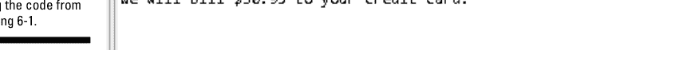

### 使用变量

清单6-1中的代码使用了一个名为`amount`的变量。*变量*是一个占位符。你可以将一个像5.95这样的数字放入变量中。一旦你将一个数字放入变量，你可以改变主意，将另一个不同的数字，比如30.95，放入该变量。（这就是变量中“变”的含义。）当然，当你将新数字放入变量时，旧数字就不在了。如果你没有将旧数字保存到其他地方，旧数字就消失了。

图6-2展示了清单6-1代码的前后变化图。当计算机执行`amount = 5.95`时，变量`amount`中存放着数字5.95。然后，在执行`amount = amount + 25.00`语句后，变量`amount`突然变成了30.95。当你思考一个变量时，想象计算机内存中的一个位置，电线和晶体管在那里存储5.95、30.95或任何其他数字。在图6-2中，想象每个方框都被数百万个其他类似的方框包围着。

现在你需要一些术语。（你可以参考图6-3。）存储在变量中的东西称为值。变量的值可以在程序运行期间改变（例如当SnitSoft添加运费和手续费时）。变量中存储的值不一定是数字。（例如，你可以创建一个始终存储字母的变量。）存储在变量中的值的种类称为变量的类型。（你可以在本章的剩余部分以及接下来的两章中阅读更多关于类型的内容。）

变量和变量名之间有一个微妙的、几乎难以察觉的区别。即使在正式写作中，当我指的是*变量名*时，我经常使用*变量*这个词。严格来说，`amount`是变量名，而所有与`amount`相关的内存存储（包括`amount`的值和类型）才是变量本身。如果你觉得*变量*和*变量名*之间的区别对你来说太微妙而不必担心，那么你不是一个人。

每个变量名都是一个标识符——一个你可以在自己的代码中创造的名字（更多关于此的内容，请参见第4章）。在准备清单6-1时，我创造了`amount`这个名字。

## 理解赋值语句

清单6-1中带有等号的语句称为*赋值语句*。在赋值语句中，你将一个值赋给某个东西。在许多情况下，这个东西是一个变量。

你应该养成从右向左阅读赋值语句的习惯。例如，清单6-1中的第一条赋值语句说，“将5.95赋给`amount`变量。”第二条赋值语句稍微复杂一点。从右向左阅读第二条赋值语句，你会得到“将25.00加到`amount`变量中已有的值上，并将该数字（30.95）作为`amount`变量的新值。”如果想要一个图形化、一目了然的说明，请参见图6-4。

在赋值语句中，被赋值的东西总是在等号的左侧。

## 是否换行？

清单6-1中的最后三条语句使用了一个巧妙的技巧。你希望程序在屏幕上只显示一行，但这一行包含三个不同的部分：

- 这行以`We will bill $`开头。

- 这行接着是`amount`变量的值。

- 这行以`to your credit card.`结束。

这是三个独立的部分，所以你把它们放在三条独立的语句中。前两条语句是调用`System.out.print`。最后一条语句是调用`System.out.println`。

调用`System.out.print`会在一行的一部分显示文本，然后将光标留在当前行的末尾。执行`System.out.print`后，光标仍然在同一行的末尾，因此下一个`System.out.`什么什么可以继续在该行打印。通过多次调用`print`，并以单次调用`println`结束，结果就是一行漂亮的输出，如图6-5所示。

调用`System.out.print`会写入一些内容，并将光标留在输出行的末尾。调用`System.out.println`会写入内容，然后通过将光标移动到全新输出行的开头来完成任务。

## 那些零和一意味着什么？

这里有一个单词：

gift

讨论的问题是，这个单词是什么意思？嗯，这取决于谁看这个单词。例如，一位说英语的读者会说“gift”代表一个人送给另一个人的东西，装在覆盖着亮纸和丝带的盒子里。

看！我正在给你一份**gift**！

但在德语中，单词“gift”的意思是“毒药”。

亲爱的，让我给你一些**gift**。

而在瑞典语中，“gift”可以表示“已婚”也可以表示“毒药”。

他们一**gift**，她就在他的饮料里放了一些**gift**。

然后是法语。在法国，有一种糖果棒叫“Gift”。

他来度假，他给我的只是一根**Gift**棒。

所以字母g-i-f-t到底意味着什么？嗯，在你决定一种解释它们的方式之前，它们什么都不意味着。计算机电路中的零和一也是如此。

例如，序列01001010。这个序列可以代表字母*J*，但它也可以代表数字74。同样的零和一序列可以代表1.0369608636003646×10⁻⁴³。当解释为屏幕像素时，同样的序列可以代表图6-6所示的点。01001010的含义完全取决于软件解释这个序列的方式。

## 类型和声明

你如何告诉计算机01001010代表什么？答案在于*类型*这个概念。变量的类型描述了该变量允许存储的值的种类。

在清单6-1中，查看`main`方法体中的第一行：

```
double amount;
```

这一行称为*变量声明*。在你的程序中放这一行就像在说，“我声明我打算在我的程序中拥有一个名为`amount`的变量。”这一行保留了`amount`这个名字供你在程序中使用。

在这个变量声明中，单词`double`是一个Java关键字。这个单词`double`告诉计算机你打算在`amount`中存储什么样的值。具体来说，单词`double`代表介于-1.8x10^308和1.8x10^308之间的数字。这是一个巨大的数字范围。如果没有花哨的x10表示法，第二个数字是

```
18000000000000000000000000000000000000000000000000000000000000000000000000000000000000000000000000000000000000000000000000000000000000000000000000000000000000000000000000000000000000000000000000000000000000000000000000000000000000000000000000000000000000000000000000000000000000000000000000000000000000000000000000000000000000000000000000000000000000000000000000000000000000000000000000000000000000000000000000000000000000000000000000000000000000000000000000000000000000000000000000000000000000000000000000000000.0
```

如果SnitSoft的人收取如此高的运费和手续费，他们可以用一个`double`类型的变量来表示这笔费用。

## 重点是什么？

比`double`关键字数字的巨大范围更重要的是，`double`值可以在小数点右侧有数字。在你声明`amount`为`double`类型后，你可以在`amount`中存储各种数字。你可以存储5.95、0.02398479或-3.0。在清单6-1中，如果我没有声明`amount`为`double`类型，那么我可能无法存储5.95。相反，我将不得不存储普通的5或无聊的6，而没有任何小数点后的数字。

有关没有小数点的数字的更多信息，请参见第7章。


本段处理的是一个非常挑剔的观点，所以如果你没心情，可以跳过。人们经常使用“十进制数”这个短语来描述在小数点右侧有数字的数字。问题在于，“dec”音节代表数字10，所以“decimal”一词暗示了一种基于10的表示。因为计算机存储的是基于2（而不是基于10）的表示，所以用“decimal”来描述这样的数字是用词不当。但在本书中，我实在忍不住。无论技术人员喜欢与否，我都要称它们为“十进制数”。

## 从键盘读取十进制数

我不敢相信！SnitSoft正在打折！仅限一周，你可以以仅5.75美元的低价购买SnitSoft CD-ROM！最好赶紧订购一个。

不，等等！清单6-1中的价格固定为5.95美元。我必须修改程序。

我知道了。我将使代码更具通用性。我将从键盘输入金额。清单6-2是修改后的代码，图6-7显示了新代码的运行情况。

```java
清单6-2：从键盘获取双精度值
import java.util.Scanner;
class VersatileSnitSoft {
    public static void main(String args[]) {
        Scanner myScanner = new Scanner(System.in);
        double amount;
        System.out.print("What's the price of a CD-ROM? ");
        amount = myScanner.nextDouble();
        amount = amount + 25.00;
        System.out.print("We will bill $");
        System.out.print(amount);
        System.out.println(" to your credit card.");
    }
}
```

## 虽有此法，然其中亦有疯狂之处

请注意清单 6-2 中对`nextDouble`方法的调用。回顾清单 5-1，我使用了`nextLine`，但在清单 6-2 中，我使用的是`nextDouble`。

> ## 谁做什么，以及如何做？

当你编写程序时，你被称为*程序员*，但当你运行程序时，你被称为*用户*。因此，当你测试自己的代码时，你既是程序员也是用户。

假设你的程序包含一个`myScanner.nextSomething()`调用，就像清单 5-1 和 6-2 中的调用一样。那么你的程序会从用户那里获取输入。但是，当程序运行时，用户如何知道要在键盘上输入什么呢？如果用户和程序员是同一个人，而且程序相当简单，那么知道要输入什么并不是什么难事。例如，当你开始运行清单 5-1 中的代码时，你面前就有这本书，书上写着“计算机正在等待你输入某些内容……你输入一行文本……”于是你输入文本并按回车键。一切正常。

但很少有程序自带自己的说明书。在许多情况下，当程序开始运行时，用户不得不盯着屏幕，弄清楚接下来该做什么。清单 6-2 中的代码就是在这种“盯着屏幕看”的场景下工作的。在清单 6-2 中，第一次调用`print`会在用户的屏幕上显示一条信息性消息（CD-ROM 的价格是多少？）。这类消息被称为*提示*。

当你开始编写程序时，你很容易混淆提示和用户输入的角色。所以请记住，提示和随后的输入之间并不存在预设的关系。要创建一个提示，你可以调用`print`或`println`。然后，要读取用户的输入，你需要调用`nextLine`、`nextDouble`或 Scanner 类的其他`nextSomething`方法之一。这些`print`和`next`调用属于两个独立的语句。Java 中没有常用的、既能提示又能“next”的单一语句。

作为程序员，你的工作是将提示和`next`操作结合起来。你可以用各种方式将提示和`next`操作结合起来。有些方式对用户有帮助，有些则不然。

- 如果你没有调用`print`或`println`，那么用户就看不到任何提示。一个闪烁的光标静静地等待着用户输入。用户不得不猜测该输入什么类型的内容。偶尔这样没问题，但通常不行。

- 如果你调用了`print`或`println`，但没有调用`myScanner.nextSomething`方法，那么计算机就不会等待用户输入任何东西。程序会急于执行`print`或`println`之后的任何语句。

- 如果你的提示显示了一条误导性的消息，那么你就在误导用户。Java 没有内置功能来检查提示是否恰当。这并不奇怪。大多数计算机语言都没有提示检查功能。

所以，请谨慎对待你的提示和获取操作。善待你的用户。记住，你曾经也是一个谦逊的计算机用户。

在 Java 中，每种类型的输入都需要其特定的方法。如果你要获取一行文本，那么`nextLine`就足够了。但如果你要从键盘读取某些内容，并希望将其解释为数字，你就需要像`nextDouble`这样的方法。

从清单 6-1 到清单 6-2，我添加了一个`import`声明和一些关于`new Scanner(System.in)`的内容。你可以通过阅读第 5 章中关于输入和输出的部分来了解更多关于这些内容的信息。（你甚至可以通过访问第 13 章来了解关于输入和输出的更多信息。）更多的示例（更多的`myScanner.nextSomething`方法）在第 7 章和第 8 章中。

## 方法与赋值

注意我在清单 6-2 中是如何使用`myScanner.nextDouble`的。方法`myScanner.nextDouble`是作为赋值语句的一部分被调用的。如果你查看第 5 章中关于 EchoLine 程序如何工作的部分，你会发现计算机可以用其他东西来替代方法调用。计算机在清单 6-2 中就是这样做的。当你在键盘上输入`5.75`时，计算机会将

```java
amount = myScanner.nextDouble();
```

变成

```java
amount = 5.75;
```

（计算机并没有真正重写清单 6-2 中的代码。这行`amount = 5.75`只是用来说明计算机操作的效果。）在清单 6-2 的第二个赋值语句中，计算机将 25.00 加到存储在`amount`中的 5.75 上。

一些方法调用具有这种替换效果，而另一些（如`System.out.println`）则没有。要了解更多关于这方面的信息，请参阅第 19 章。

## 同一主题的变体

在清单 6-1 中，需要两行来给`amount`变量赋予第一个值：

```java
double amount;
amount = 5.95;
```

你可以只用一行来完成同样的事情：

```java
double amount=5.95;
```

当你这样做时，你不是说你在“赋值”给`amount`变量。`double amount=5.95`这行不被称为“赋值语句”。相反，这行被称为带有*初始化*的声明。你正在*初始化*`amount`变量。你可以用初始化做各种事情，甚至是算术运算。

```java
double gasBill  = 174.59;
double elecBill =  84.21;
double H2OBill  =  22.88;
double total    = gasBill + elecBill + H2OBill;
```

## 将变量从一处移到另一处

记住初始化和赋值之间的区别会有所帮助。一方面，你可以将带有初始化的声明拖到方法外部。

```java
//这没问题：
class SnitSoft {
    static double amount = 5.95;
    public static void main(String args[]) {
        amount = amount + 25.00;
        System.out.print("We will bill $");
        System.out.print(amount);
        System.out.println(" to your credit card.");
    }
}
```

你不能对赋值语句做同样的事情。（参见下面的代码和图 6-8。）

```java
//这无法编译：
class BadSnitSoftCode {
    static double amount;
    amount = 5.95;           //语句放置不当
    public static void main(String args[]) {
        amount = amount + 25.00;
        System.out.print("We will bill $");
        System.out.print(amount);
        System.out.println(" to your credit card.");
    }
}
```

你不能将语句拖到方法外部。（尽管变量声明以分号结尾，但变量声明不被视为语句。想想看！）

将声明放在方法外部的优势在第 19 章中说明。在你迫切等待到达那一章时，请注意我是如何将`static`这个词添加到每个从`main`方法中提取出来的声明开头的。我必须这样做，因为`main`方法的头部包含了`static`这个词。并非所有方法都是`static`的。事实上，大多数方法都不是`static`的。但每当你从一个`static`方法中提取一个声明时，你必须在声明的开头添加`static`这个词。围绕`static`这个词的所有谜团都在第 18 章中得到解决。

## 组合变量声明

清单 6-1 中的代码只有一个变量（好像变量很稀缺似的）。你可以用几个变量达到同样的效果。

```java
class SnitSoftNew {
    public static void main(String args[]) {
        double cdPrice;
        double shippingAndHandling;
        double total;
        cdPrice = 5.95;
        shippingAndHandling = 25.00;
        total = cdPrice + shippingAndHandling;
        System.out.print("We will bill $");
        System.out.print(total);
        System.out.println(" to your credit card.");
    }
}
```

这个新代码产生的输出与清单 6-1 中的代码相同。（参考图 6-1。）

新代码有三个声明——程序的每个变量一个。因为所有三个变量都有相同的类型（`double`类型），我可以修改代码，一次性声明所有三个变量：

```java
double cdPrice, shippingAndHandling, total;
```

那么，一个声明和三个声明哪个更好？都不更好。这是个人风格的问题。

你甚至可以在组合声明中添加初始化。当你这样做时，每个初始化只适用于一个变量。例如，对于这一行

```java
double cdPrice, shippingAndHandling = 25.00, total;
```

`shippingAndHandling`的值变成 25.00，但变量`cdPrice`和`total`没有得到任何特定的值。

## 数字与类型

**本章内容**

- 处理整数
- 从旧值创建新值
- 了解Java中更特殊的数据类型

不久前，人们还以为计算机只会进行大型的数值计算。计算机解决算术问题，故事到此结束。

在20世纪80年代，随着文字处理程序的广泛使用，那种“大型数学计算机器”的神话逐渐被抛弃。但即便在那时，计算机也是非常出色的计算器。毕竟，计算机速度极快且极其精确。计算机从不需要掰着手指头算数。最重要的是，计算机在做算术时从不觉得是负担。我讨厌在一顿美餐后还要担心税费和小费，但计算机对此毫不介意。（即便如此，计算机也很少外出就餐。）

### 使用整数

让我告诉你，当个成年人一点都不好玩。现在我客厅里有四个小孩。他们都盯着我，因为我手里拿着一袋泡泡糖。袋子里有30颗泡泡糖，孩子们都在想“谁最棒？谁分到的泡泡糖更多？谁会被不公平对待？”他们坚持要进行一次完整、正式的泡泡糖计数，确保每个孩子分到的美味小零食数量完全相同。我必须小心。否则，这事就没完没了。

有30颗泡泡糖和4个孩子，根本无法平均分配。当然，如果我减少一个孩子，那每个孩子就能分到10颗。问题是，泡泡糖用完就没了；孩子可不是。所以我唯一的选择就是尽可能分配我能分的泡泡糖，然后处理掉剩下的。“好吧，快想想，”我对自己说。“有30颗泡泡糖和4个孩子，我能保证每个孩子分到多少颗？”

我立刻编写了一个计算机程序来帮我解决这个问题。完成后，我得到了清单7-1中的代码。

#### 清单7-1：如何防止四个孩子发脾气

```java
class KeepingKidsQuiet {
    public static void main(String args[]) {
        int gumballs;
        int kids;
        int gumballsPerKid;

        gumballs = 30;
        kids = 4;
        gumballsPerKid = gumballs / kids;

        System.out.print("Each kid gets ");
        System.out.print(gumballsPerKid);
        System.out.println(" gumballs.");
    }
}
```

KeepingKidsQuiet程序的运行结果如图7-1所示。如果每个孩子分到七颗泡泡糖，那他们就不能抱怨我偏心了。他们得找点别的事情来争吵。

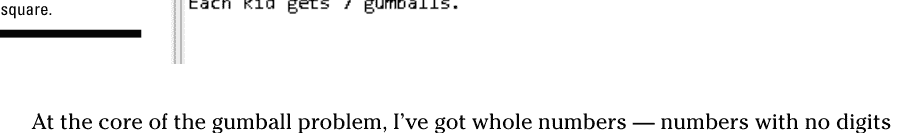

泡泡糖问题的核心是整数——即小数点后没有数字的数。当我用30除以4时，得到7.5，但我不能认真对待那个0.5。无论我怎么努力，我都无法将一颗泡泡糖一分为二，至少在听到“我的那一半比他的那一半大”之前不能。这个事实在Java中得到了很好的体现。在清单7-1中，所有三个变量（`gumballs`、`kids`和`gumballsPerKid`）的类型都是`int`。`int`值是整数。当你将一个`int`值除以另一个`int`值（就像清单7-1中使用斜杠那样），你会得到另一个`int`。当你用30除以4时，得到的是7——不是7.5。这在图7-1中可以看到。将以下语句结合起来

```java
gumballsPerKid = gumballs / kids;
System.out.print(gumballsPerKid);
```

会在计算机屏幕上显示数字7。

#### 从键盘读取整数

多么有趣的生活！昨天我客厅里有4个孩子，我有30颗泡泡糖。今天我家里有6个孩子，我有80颗泡泡糖。我该如何应对这些变化呢？有了！我将编写一个程序，从键盘读取泡泡糖和孩子的数量。程序在清单7-2中，程序的运行结果如图7-2所示。

#### 清单7-2：一个更通用的孩子与泡泡糖程序

```java
import java.util.Scanner;
class KeepingMoreKidsQuiet {
    public static void main(String args[]) {
        Scanner myScanner = new Scanner(System.in);
        int gumballs;
        int kids;
        int gumballsPerKid;

        System.out.print
            ("How many gumballs? How many kids? ");

        gumballs = myScanner.nextInt();
        kids = myScanner.nextInt();

        gumballsPerKid = gumballs / kids;

        System.out.print("Each kid gets ");
        System.out.print(gumballsPerKid);
        System.out.println(" gumballs.");
    }
}
```


你应该注意到清单7-2的一些要点。首先，你可以使用`nextInt`方法读取一个`int`值。其次，你可以连续调用`Scanner`方法。在清单7-2中，我调用了两次`nextInt`。我所要做的就是用空格分隔我输入的数字。在图7-2中，我在80和6之间放了一个空格，但更多的空格也同样有效。

这条空格规则适用于许多`Scanner`方法。例如，下面是一些读取三个数值的代码：

```java
gumballs = myScanner.nextInt();
costOfGumballs = myScanner.nextDouble();
kids = myScanner.nextInt();
```

图7-3显示了这三个方法调用的有效输入。

**图7-3：** 三个数字对应三个`Scanner`方法调用。

80 &nbsp;&nbsp;&nbsp;&nbsp;&nbsp;&nbsp;&nbsp;&nbsp;&nbsp;&nbsp;&nbsp;&nbsp; 7.35 6

#### 你读到的就是你得到的

在编写自己的代码时，你不应该想当然。假设你意外地颠倒了清单7-2中`gumballs`和`kids`赋值语句的顺序：


```java
//这段代码有误导性：
System.out.print("How many gumballs? How many kids? ");
kids = myScanner.nextInt();
gumballs = myScanner.nextInt();
```

那么，`How many gumballs? How many kids?` 这行就非常有误导性。因为`kids`的赋值语句出现在`gumballs`的赋值语句之前，你输入的第一个数字就变成了`kids`的值，第二个数字就变成了`gumballs`的值。尽管你的程序显示了`How many gumballs? How many kids?`，但这并不重要。重要的是程序中赋值语句的顺序。

如果`kids`的赋值语句意外地先出现，你可能会得到一个奇怪的答案，比如图7-4中的零。这就是`int`除法的工作方式。它只截断任何余数。用一个小数（比如6）除以一个大数（比如80），结果就是0。

**图7-4：** 如何让六个孩子非常不高兴。

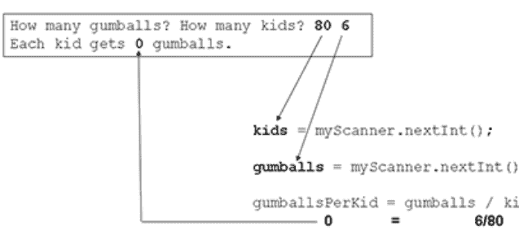

## 通过应用运算符创建新值

还有什么比你老朋友加号更令人欣慰的呢？它是你在小学数学中最早学到的东西。几乎所有人都知道二加二等于几。事实上，在英语用法中，“二加二”是某事很容易做的比喻。每当你看到加号，你大脑中的一个细胞就会说：“谢天谢地，这比想象中简单多了。”

所以Java也有一个加号。你可以用加号来计算两个数的和：

```java
int apples, oranges, fruit;
apples = 5;
oranges = 16;
fruit = apples + oranges;
```

当然，老式的减号也可以使用：

```java
apples = fruit - oranges;
```

使用星号表示乘法，使用正斜杠表示除法：

```java
double rate, pay, withholding;
int hours;
rate = 6.25;
hours = 35;
pay = rate * hours;
withholding = pay / 3.0;
```


当你将一个`int`值除以另一个`int`值时，你会得到一个`int`值。计算机不会四舍五入。相反，计算机会截断任何余数。如果你在程序中放入`System.out.println(11 / 4)`，计算机将打印`2`，而不是`2.75`。如果你需要一个带小数的答案，请将你相除的两个数字中的一个（或两个）设为`double`值。例如，如果你在程序中放入`System.out.println(11.0 / 4)`，计算机将一个`double`值`11.0`除以一个`int`值`4`。因为两个值中至少有一个是`double`，所以计算机打印`2.75`。

### 求余数

有一个有用的算术运算符叫做*取余*运算符。取余运算符的符号是百分号（`%`）。当你在程序中放入`System.out.println(11 % 4)`时，计算机打印`3`。它这样做是因为4可以整除11若干次，余数为`3`。

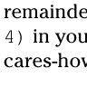

取余运算符的另一个名字是*模*运算符。

取余运算符相当有用。毕竟，余数是两个数相除后剩下的量。如果你要找零1.38美元呢？用138除以25后，你还剩下13美分，如图7-5所示。

清单7-3中的代码就运用了这个取余的思想。


#### 清单 7-3：找零钱

```java
import java.util.Scanner;
class MakeChange {
    public static void main(String args[]) {
        Scanner myScanner = new Scanner(System.in);
        int quarters, dimes, nickels, cents;
        int whatsLeft, total;
        System.out.print("你有多少分钱？ ");
        total = myScanner.nextInt();
        quarters = total / 25;
        whatsLeft = total % 25;
        dimes = whatsLeft / 10;
        whatsLeft = whatsLeft % 10;
        nickels = whatsLeft / 5;
        whatsLeft = whatsLeft % 5;
        cents = whatsLeft;
        System.out.println();
        System.out.println
            ("从 " + total + " 分钱中，你可以得到");
        System.out.println(quarters + " 个 25 分硬币");
        System.out.println(dimes + " 个 10 分硬币");
        System.out.println(nickels + " 个 5 分硬币");
        System.out.println(cents + " 分钱");
    }
}
```

清单 7-3 中代码的运行情况如图 7-6 所示。你最初有 138 分钱。语句

```java
quarters = total / 25;
```

将 138 除以 25，得到 5。这意味着你可以从 138 分钱中换出 5 个 25 分硬币。接下来，语句

```java
whatsLeft = total % 25;
```

再次将 138 除以 25，但只把余数 13 放入`whatsLeft`中。现在你已准备好进行下一步，即从 13 分钱中尽可能多地取出 10 分硬币。

你继续这样操作，直到所有 5 分硬币都被取走。此时，`whatsLeft`的值恰好为 3（表示 3 分钱）。

> ## 如果你的整数让你不爽，就把它扔掉

图 7-6 中的运行情况看起来有些人为设计。为什么你最初要从 138 分钱开始？为什么不使用更常见的 $1.38 呢？原因是数字 1.38 不是一个整数，而整数比其他类型的数字更精确。事实上，如果没有整数，取余运算符就不太有用了。例如，`1.38 % 0.25`的值是 0.12999999999999999。这么多 9 很难处理。想象一下，你读信用卡账单时，看到你欠款 $0.1299999999999999。你可能会支付 $0.13，让信用卡公司保留零钱。但经过多年四舍五入，信用卡公司会赚大钱！第 8 章将更详细地描述使用`double`值引起的不精确性。

在整本书中，我用关于金钱的程序来举例说明 Java 的`double`类型。许多作者也这样做。但为了更高的准确性，你应该避免对金钱使用`double`值。相反，你应该使用`int`值，或者使用我在本章最后一节描述的`long`值。更好的做法是，在 Java 的 API 文档中查找`BigInteger`和`BigDecimal`。这些`BigSomethingOrOther`类型使用起来很繁琐，但它们提供了工业级的数值范围和精度。

那么，如果你想输入 1.38，然后程序应该把你的 1.38 转换成 138 分钱呢？你如何让你的程序做到这一点？

我的第一个想法是将 1.38 乘以 100：

```java
//这不太行。
double amount;
int total;
amount=myScanner.nextDouble();
total=amount*100;
```

在日常算术中，乘以 100 就能奏效。但计算机很挑剔。在使用计算机时，当你混合`int`值和`double`值时必须非常小心。（请参阅此侧边栏中的第一张图。）

要将一个`double`值塞进一个`int`变量，你需要一种叫做*类型转换*的操作。当你转换一个值时，你本质上是在说："我意识到我正试图把一个`double`值挤压进一个`int`变量。这有点挤，但我无论如何都想这么做。"

要执行类型转换，你需要把一个类型名放在括号里，如下所示：

```java
//这行得通！
total = (int) (amount * 100);
```

这种转换记法将`double`值 138.00 转换为`int`值 138，这样大家就都满意了。（请参阅此侧边栏中的第二张图。）

```java
double amount;
int total;
...
total = amount * 100;
```

> 糟糕！这是一个`int`。在赋值语句的这一侧没有空间塞进一个`double`。

```java
System.out.print("你有多少钱？ ");
amount = myScanner.nextDouble();
total = amount * 100; //这不太行。
quarters = total / 100;
whatsleft = total % 100;
dimes = whatsleft / 10;
whatsleft = whatsleft % 10;
```

> 类型不匹配：无法从 double 转换为 int

> 提供了 2 个快速修复方案：

> -> 为`int`添加强制转换

> -> 将`total`的类型更改为`double`

当两个或多个变量具有相似类型时，你可以使用组合声明来创建这些变量。例如，清单 7-3 有两个组合声明——一个用于变量`quarters`、`dimes`、`nickels`和`cents`（都是`int`类型）；另一个用于变量`whatsLeft`和`total`（都是`int`类型）。但是要创建不同类型的变量，你需要分别声明。例如，要创建一个名为`total`的`int`变量和一个名为`amount`的`double`变量，你需要一个声明`int total;`和另一个声明`double amount;`。

清单 7-3 中有一个对`System.out.println()`的调用，括号里什么也没有。当计算机执行这条语句时，光标会跳到屏幕上的新行。（我经常使用这条语句在程序的输出中插入一个空行。）

## 自增和自减运算符

Java 有一些巧妙的小运算符，让生活更轻松（对计算机的处理器、对你的大脑、对你的手指）。总共有四个这样的运算符——两个自增运算符和两个自减运算符。自增运算符加一，自减运算符减一。要了解它们如何工作，你需要一些例子。

### 使用前置自增

第一个例子在图 7-7 中。

图 7-7 中程序的运行情况如图 7-8 所示。在这个极其平淡无奇的运行中，口香糖球的计数被显示了三次。

双加号根据放置位置的不同，有两个不同的名称。当你将`++`放在变量之前时，`++`被称为*前置自增*运算符。在“前置自增”这个词中，*前置*代表*之前*。在这个语境中，*之前*这个词有两个不同的含义：

- 你正在将`++`放在变量之前。
- 计算机在变量在语句的任何其他部分被使用*之前*，就将变量的值加 1。

图 7-9 慢动作回放了前置自增运算符的操作。在图 7-9 中，计算机遇到了`System.out.println(++gumballs)`语句。首先，计算机将`gumballs`加 1（将`gumballs`的值提高到 29）。然后计算机执行`System.out.println`，使用`gumballs`的新值（29）。

```java
class AddMoreGumballs {
    public static void main(String args[]) {
        int gumballs=27;
        ++gumballs;
        System.out.println(gumballs);
        System.out.println(++gumballs);
        System.out.println(gumballs);
    }
}
```

使用`System.out.println(++gumballs)`时，**计算机加 1** 是在屏幕*之前*打印`gumballs`的新值。

### 使用后置自增

前置自增的替代方案是*后置自增*。使用后置自增时，*后置*代表*之后*。*之后*这个词有两个不同的含义：

- 你将`++`放在变量之后。
- 计算机在变量在语句的任何其他部分被使用*之后*，才将变量的值加 1。

图 7-10 详细展示了后置自增运算符的操作。在图 7-10 中，计算机遇到了`System.out.println(gumballs++)`语句。首先，计算机执行`System.out.println`，使用`gumballs`的*旧值*（28）。然后计算机将`gumballs`加 1（将`gumballs`的值提高到 29）。

看看图 7-11 中粗体显示的代码行。计算机在屏幕上打印出`gumballs`的旧值（28）。只有在打印出这个旧值之后，计算机才将`gumballs`加 1（将`gumballs`的值从 28 提高到 29）。

使用`System.out.println(gumballs++)`时，**计算机加 1** 是在屏幕*之后*打印`gumballs`已经拥有的旧值。

图 7-11 中代码的运行情况如图 7-12 所示。比较图 7-12 与图 7-8 中的运行情况。

对于图 7-8 中的前自增，显示的第二个数字是 29。

对于图 7-12 中的后自增，显示的第二个数字是 28。在图 7-12 中，数字 29 在程序运行结束之前不会出现在屏幕上，直到计算机执行最后一次`System.out.println(gumballs)`。

你是不是在纠结该用前自增还是后自增？别再犹豫了。大多数程序员都使用后自增。在典型的 Java 程序中，你经常看到像`gumballs++`这样的写法，而很少看到像`++gumballs`这样的写法。

## 语句和表达式

计算机程序中任何具有值的部分都称为*表达式*。如果你写

```
gumballs = 30;
```

那么`30`就是一个表达式（一个值为 30 的表达式）。如果你写

```
amount = 5.95 + 25.00;
```

那么`5.95 + 25.00`就是一个表达式（因为`5.95 + 25.00`的值为 30.95）。如果你写

```
gumballsPerKid = gumballs / kids;
```

那么`gumballs / kids`就是一个表达式。（表达式`gumballs / kids`的值取决于包含该表达式的语句执行时，变量`gumballs`和`kids`的值。）

这就引出了前自增/前自减和后自增/后自减运算符的主题。理解这些运算符有两种方式：一种是人人都能理解的方式，另一种是正确的方式。我在本节大部分内容中（从时间角度，用*之前*和*之后*来解释）采用的是人人都能理解的方式。遗憾的是，人人都能理解的方式其实并不是真正正确的方式。当你看到`++`或`--`时，可以从时间顺序的角度来思考。但偶尔有些程序员会以令人困惑的方式使用`++`或`--`，这时"之前"和"之后"的概念就不再适用了。所以，如果你遇到棘手的情况，应该从语句和表达式的角度来思考这些运算符。

首先，记住语句是告诉计算机执行某个操作的指令，而表达式是一个有值的东西。（语句在第 4 章中介绍，表达式在本栏的前面部分介绍。）那么`gumballs++`属于哪一类呢？令人惊讶的是，两者都是。Java 代码`gumballs++`既是语句又是表达式。

假设在执行代码`System.out.println(gumballs++)`之前，`gumballs`的值为 28：

- 作为语句，`gumballs++`告诉计算机将`gumballs`加 1。
- 作为表达式，`gumballs++`的值为 28，而不是 29。

所以，尽管`gumballs`被加了 1，但代码`System.out.println(gumballs++)`实际上等同于`System.out.println(28)`。（请参阅本栏中的图示。）

现在，你刚才读到的关于`gumballs++`的几乎所有内容对`++gumballs`都适用。唯一的区别是，作为表达式，`++gumballs`的行为更符合直觉。假设在执行代码`System.out.println(++gumballs)`之前，`gumballs`的值为 28：

- 作为语句，`++gumballs`告诉计算机将`gumballs`加 1。
- 作为表达式，`++gumballs`的值为 29。

所以使用`System.out.println(++gumballs)`时，变量`gumballs`被加了 1，代码`System.out.println(++gumballs)`实际上等同于`System.out.println(29)`。

除了前自增和后自增，Java 还有两个使用`--`的运算符。这两个运算符分别称为*前自减*和*后自减*：

- 前自减（`--gumballs`）：计算机先从变量的值中减去 1，然后该变量才会在语句的其余部分中被使用。
- 后自减（`gumballs--`）：计算机先在语句的其余部分中使用该变量的值，然后再从中减去 1。

## 赋值运算符

如果你阅读了上一节——关于加 1 的运算符——你可能会想，是否可以巧妙地利用这些运算符来加 2、加 5 或加 1000000。你能写`gumballs++++`并仍然自称是 Java 程序员吗？不行。如果你这样尝试，Eclipse 会给你一条错误消息：


```text
Invalid argument to operation ++/--
```

如果你不使用 Eclipse，可能会看到不同的错误消息：

```text
unexpected type
required: variable
found   : value
         gumballs++++;
                     ^
```

不管用不用 Eclipse，结果都一样：你的代码包含错误，必须修正。

## 赋值运算符

那么如何加 1 以外的数值呢？幸运的是，Java 有丰富的赋值运算符供你使用。通过赋值运算符，你可以进行加、减、乘、除等任意运算。你还可以做其他很酷的操作。

例如，你可以通过编写：

```java
kids += 1;
```

来给`kids`变量加 1。

这比`kids++`或`kids = kids + 1`更好吗？不，并不更好。这只是一种替代写法。但你可以通过编写：

```java
kids += 5;
```

来给`kids`变量加 5。用前自增或后自增很难轻松地实现加 5。如果孩子们被困在了一个邪恶科学家的克隆机器里怎么办？语句：

```java
kids *= 2;
```

会将孩子的数量乘以 2。

使用赋值运算符，你可以对变量进行加、减、乘、除任何数字的操作。这个数字不一定是字面量。你可以在等号右侧使用一个具有数值的表达式：

```java
double amount = 5.95;
double shippingAndHandling = 25.00, discount = 0.15;
amount += shippingAndHandling;
amount -= discount * 2;
```

上面的代码将 25.00（`shippingAndHandling`）加到`amount`的值上。然后，从`amount`的值中减去 0.30（`discount * 2`）。多么慷慨啊！

## 大小很重要

以下是今天的新词汇：

- **foregift**（预付款）*n.* 承租人在签订租约时向出租人支付的一笔保证金。
- **hereinbefore**（在上文中）*adv.* 在本文档的前一部分中。

现在想象你正在阅读一些压缩文本。在这段文本中，所有的空格都被移除以节省存储空间。你遇到了以下字母序列：

```text
hereinbeforegiftedit
```

问题是，这些字母是什么意思？如果你知道每个单词的长度，你就能回答这个问题。

```text
here in be foregift edit

hereinbefore gifted it

herein before gift Ed it
```

计算机面临着同样的问题。当计算机在内存或磁盘中存储多个数字时，数字之间不会留空格。所以想象一下计算机内存的一小部分看起来像图 7-13 中的内容。（计算机只使用 0 和 1 来工作，但图 7-13 使用的是普通数字。使用普通数字更容易看清发生了什么。）

图 7-13 中存储了什么数字？是两个数字 42 和 21 吗？还是一个数字 4221？又或者是存储了四个数字 4、2、2 和 1？这完全取决于每个数字所占用的空间大小。

图 7-13：存储数字 4221。

想象一个变量存储每月的发薪日数。这个数字永远不会超过 31。你可以只用八个 0 和 1 来表示这个小数字。但如果是一个计算宇宙中恒星数量的变量呢？那个数字很可能超过一万亿，而要精确表示一万亿，你需要 64 个 0 和 1。

这时 Java 来救场了。Java 有四种整数类型。正如代码清单 7-1 中那样，我声明了：

```java
int gumballsPerKid;
```

我还可以声明：

```java
byte paydaysInAMonth;
short sickDaysDuringYourEmployment;
long numberOfStars;
```

这些类型中的每一种（`byte`、`short`、`int`和`long`）都有各自可能的值范围（参见表 7-1）。

Java 有两种小数类型（小数点右边有数字的数）。正如代码清单 6-1 中那样，我声明了：

```java
double amount;
```

我还可以声明：

```java
float monthlySalary;
```

在`double`和`float`之间选择时，我总是选择`double`。`double`类型的变量具有更大的可能值范围和更高的精度（参见表 7-1）。

### 表 7-1 Java 的基本数值类型

| 类型名称 | 取值范围 |
| :--- | :--- |
| **整数类型** | |
| `byte` | -128 到 127 |
| `short` | -32768 到 32767 |
| `int` | -2147483648 到 2147483647 |
| `long` | -9223372036854775808 到 9223372036854775807 |
| **小数类型** | |
| `float` | -3.4 ×10³⁸ 到 3.4 ×10³⁸ |
| `double` | -1.8 ×10³⁰⁸ 到 1.8 ×10³⁰⁸ |

表 7-1 列出了 Java 的六种*基本*类型（也称为*简单*类型）。Java 只有八种基本类型，因此表 7-1 中只缺少 Java 的两种基本类型。

第 8 章将描述剩余的两种基本类型。第 17 章将介绍非基本类型。

作为一名初级程序员，你不必在表 7-1 中的类型之间做出选择。整数就使用`int`，小数就使用`double`。如果你在其他人的程序中看到类似`short`或`float`的类型，只需记住以下几点：

- 类型`byte`、`short`、`int`和`long`表示整数。
- 类型`float`和`double`表示小数。

大多数时候，这些就是你需要知道的全部。

# 第 8 章

## 数字？谁需要数字？

### 本章内容

- 处理字符
- 处理“真”或“假”值
- 完善你对 Java 基本类型的了解

我不是很喜欢传真机。它们效率太低了。发送一份简短的传真，你会得到什么？你会得到两片纸——一片在发送端，另一片在接收端。你还会得到数百万个点——这些点扫描打印页面上的微小线条。这些点区分了亮斑和暗斑。多么浪费啊！

将传真与电子邮件消息进行比较。使用电子邮件，我可以只用 2500 个 0 和 1 就发送一份 25 个字的比赛报名表，而且不浪费任何纸张。最重要的是，电子邮件消息并不描述亮斑和暗斑。电子邮件消息包含每个字母的编码——字母 A 对应一个简短的 0 和 1 序列，字母 B 对应另一个不同的 0 和 1 序列，依此类推。还有什么能比这更简单的呢？

现在想象发送一份只有一词的传真。这个词是“true”，理解为“真的，我接受你为《Beginning Programming with Java For Dummies, 3rd Edition》一书撰稿的邀请。”带有此消息的传真会发送四个字母 t-r-u-e 的图片，纸张污损处是模糊的线条，墨粉不足处则出现小白点。

但说真的，“true”消息的本质是什么？不就只有两种可能吗？消息可能是“true”或“false”，为了表示这些可能性，我不需要大费周章。用 0 表示“false”，1 表示“true”怎么样？

> 他们问：“你接受我们为《Beginning Programming with Java For Dummies, 3rd Edition》一书撰稿的邀请吗？”
>
> 我回答：“1”。

可惜我几个月前没想到这个。无论如何，本章讨论字母、真、假以及其他类似的事情。

## 字符

在第 6 章和第 7 章中，你将数字存储在所有变量中。这很好，但生活不仅仅是数字。例如，我用电脑写了这本书，而这本书包含了成千上万个被称为*字符*的非数字内容。

Java 中用于存储字符的类型是`char`。代码清单 8-1 有一个使用`char`类型的简单程序，图 8-1 展示了该程序的运行结果。

### 代码清单 8-1：使用 `char` 类型

```java
class LowerToUpper {
    public static void main(String args[]) {
        char smallLetter, bigLetter;
        smallLetter = 'b';
        bigLetter = Character.toUpperCase(smallLetter);
        System.out.println(bigLetter);
    }
}
```

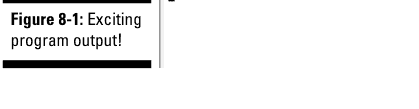

在代码清单 8-1 中，第一个赋值语句将字母 b 存储在`smallLetter`变量中。在该语句中，请注意 b 是如何被单引号包围的。在 Java 程序中，每个`char`字面量都以单引号开头和结尾。

> 当你用引号包围一个字母时，你是在告诉计算机该字母不是变量名。例如，在代码清单 8-1 中，错误的语句`smallLetter = b`会告诉计算机去查找一个名为`b`的变量。因为没有名为`b`的变量，你会得到一条“b cannot be resolved to a variable”（无法将 b 解析为变量）的消息。

在代码清单 8-1 的第二个赋值语句中，程序调用了一个名为`Character.toUpperCase`的 API 方法。方法`Character.toUpperCase`的功能如其名所示——该方法生成小写字母的大写等效形式。在代码清单 8-1 中，这个大写等效形式（字母`B`）被赋值给变量`bigLetter`，而`bigLetter`中的`B`被打印在屏幕上，如图 8-2 所示。

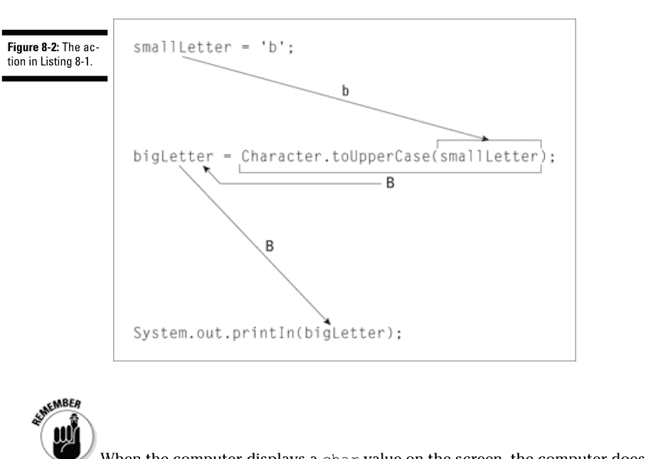

当计算机在屏幕上显示`char`值时，不会用单引号包围该字符。

## 我跑题了……

前一阵子，我想知道如果我调用`Character.toUpperCase`方法并传入一个本身就不是小写的字符会发生什么。我查阅了 Java API 文档，但没找到有用的信息。文档说`toUpperCase`使用来自 UnicodeData 文件的大小写映射信息“将字符参数转换为大写”。谢谢，但这对我没用。

虽然看起来很傻，但我问自己，如果我是`toUpperCase`方法，我会怎么做。如果有人递给我一个大写的`R`并让我把它变成大写，我会说什么？我会说，“拿回你那臭烘烘的大写`R`”。用计算机的行话来说，我会给那个人发送一条错误消息。所以我想知道，当我对字母`R`应用`Character.toUpperCase`时，是否会得到错误消息。

我试了一下。我在代码清单 8-2 中设计了这个实验。

### 代码清单 8-2：探究 `toUpperCase` 的行为

```java
class MyExperiment {
    public static void main(String args[]) {
        char smallLetter, bigLetter;
        smallLetter = 'R';
        bigLetter = Character.toUpperCase(smallLetter);
        System.out.println(bigLetter);
        smallLetter = '3';
        bigLetter = Character.toUpperCase(smallLetter);
        System.out.println(bigLetter);
    }
}
```

在我的实验中，我没有混合化学品并引爆东西。以下是我实际做的事情：

- **我将 `R` 赋值给 `smallLetter`。**
  - `toUpperCase`方法接收了大写的`R`，并返回给我另一个大写的`R`（见图 8-3）。我没有收到错误消息。这告诉我`toUpperCase`方法对已经是大写的字母做了什么。这个方法什么也没做。
- **我将 `3` 赋值给 `smallLetter`。**
  - `toUpperCase`方法接收了数字`3`，并返回给我相同的数字`3`（见图 8-3）。我没有收到错误消息。这告诉我`toUpperCase`方法对非字母字符做了什么。它什么也没做，绝对没做，一点没做。


我写这个实验是为了强调一个重要的观点。当你不理解计算机编程中的某些东西时，编写一个测试程序往往很有帮助。设计一个实验，看看计算机如何响应。

我猜测将大写`R`传给`toUpperCase`方法会给我一条错误消息，但我错了。看到了吗？问题的答案不是从天上掉下来的。创建 Java API 的人们做出了决定。他们做出了一些显而易见的选择，但也做出了一些意想不到的选择。没有人了解 Java 的所有特性，所以不要指望把所有答案都塞进脑子里。

Java 文档很棒，但对于文档回答的每一个问题，它忽略了另外三个问题。所以大胆一点。不要害怕尝试。编写大量简短的实验性程序。你不会弄坏计算机，所以放手去玩吧。你的好奇心总会得到回报。

阅读和理解 Java 的 API 文档是一门艺术，而不是科学。关于如何充分利用这些文档，可以查看本书网站上的附录——[http://allmycode.com/BeginProg3](http://allmycode.com/BeginProg3)。

## 一次只能一个字符

`char`变量只能存储一个字符。所以，如果你忍不住想写下面的语句：

```java
char smallLetters;
smallLetters = 'barry';  //Don't do this
```

请克制住这种冲动。你无法在`char`变量中一次存储多个字母，也无法在一对单引号之间放入多个字母。如果你试图存储单词或句子（而不仅仅是单个字母），那么你需要使用一种叫做`String`的东西。要了解 Java 的`String`类型，请参阅第 18 章。

## 变量与回收

在代码清单 8-2 中，我两次使用了`smallLetter`，两次使用了`bigLetter`。这就是为什么它们被称为*变量*。首先，`smallLetter`的值是`R`。后来，我改变了`smallLetter`的值，使`smallLetter`的值变成了`3`。

当我给`smallLetter`赋一个新值时，`smallLetter`的旧值就被覆盖了。例如，在图 8-4 中，第二个`smallLetter`赋值将`3`放入。

## 何时不应复用变量

上一节讨论了复用变量以使程序简洁易读的方法。本节将展示其反面——在某些情况下，你必须创建新的变量。

假设你正在编写一个程序，将一个四字母单词中的字母反转。你需要将每个字母存储在独立的变量中。代码清单 8-3 展示了相应的代码，图 8-5 展示了代码的运行过程。

```java
import java.util.Scanner;

class ReverseWord {
    public static void main(String args[]) {
        Scanner myScanner = new Scanner(System.in);
        char c1, c2, c3, c4;
        c1 = myScanner.findWithinHorizon(".", 0).charAt(0);
        c2 = myScanner.findWithinHorizon(".", 0).charAt(0);
        c3 = myScanner.findWithinHorizon(".", 0).charAt(0);
        c4 = myScanner.findWithinHorizon(".", 0).charAt(0);
        System.out.print(c4);
        System.out.print(c3);
        System.out.print(c2);
        System.out.print(c1);
        System.out.println();
    }
}
```

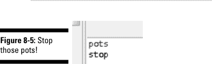

代码清单 8-3 中的技巧如下：

- 按顺序为变量`c1`、`c2`、`c3`和`c4`赋值。
- 将这些变量的值以相反的顺序显示在屏幕上：先`c4`，再`c3`，再`c2`，最后`c1`，如图 8-6 所示。

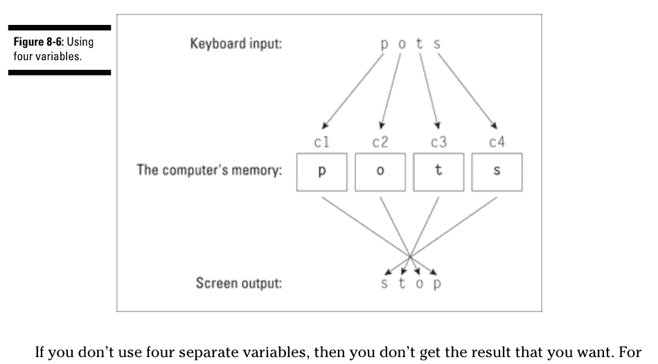

如果不使用四个独立的变量，就无法得到想要的结果。例如，假设你只用一个变量来存储字符。运行程序并输入单词 pots。当需要反转显示该单词时，计算机只记住了 pots 中最后一个字母 s，但不记得 p、o 和 t，如图 8-7 所示。

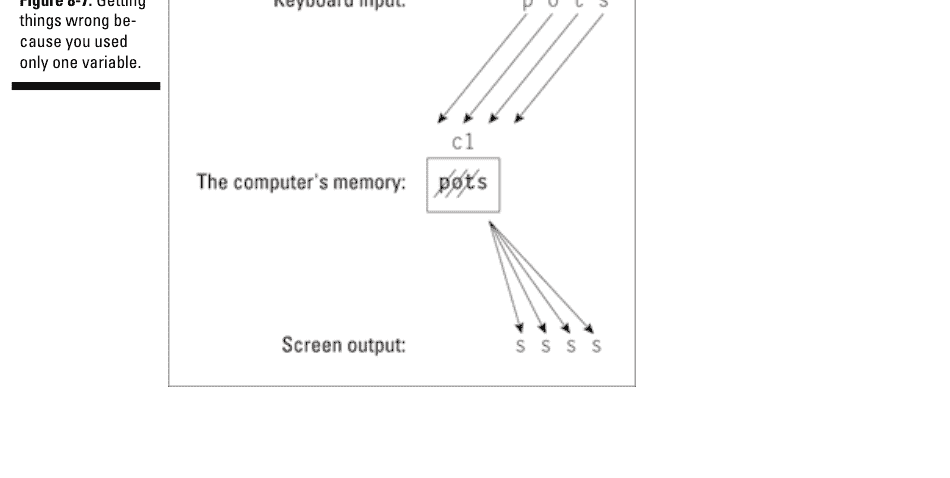

我希望能给你 12 条简单的规则来帮助你判断何时应该、何时不应该复用变量。但问题是，我做不到。这完全取决于你要实现什么目标。那么你该如何自己判断何时应该、何时不应该复用变量呢？就像有人问去卡内基音乐厅怎么走，答案是：“练习，练习，再练习。”

### 这些 `findWithinHorizon` 的复杂用法背后是什么原理？

这里不深入太多细节，简要介绍一下`findWithinHorizon(".", 0).charAt(0)`这一技巧的工作原理：

Java 的`findWithinHorizon`方法用于在输入中查找内容。该方法查找的内容取决于你在括号中放入的内容。例如，调用`findWithinHorizon("\\d\\d\\d", 0)`会查找由三个数字组成的序列。使用下面这行代码：

```java
System.out.println(myScanner.
findWithinHorizon("\\d\\d\\d", 0));
```

我可以输入：

```text
Testing 123 Testing Testing
```

计算机会显示


```text
123
```

在调用`findWithinHorizon("\\d\\d\\d", 0)`时，每个`\\d`代表一个数字。这种`\\d`的写法是正则表达式（一种特殊编码方式）中的众多缩写之一。

现在说点奇怪的事。在正则表达式的世界中，一个点代表任意字符。（也就是说，一个点代表“任意字符，不一定是句号”。）因此，`findWithinHorizon(".", 0)`告诉计算机查找用户在键盘上输入的下一个任意字符。当你需要输入单个字符时，`findWithinHorizon(".", 0)`非常有用。

在调用`findWithinHorizon("\\d\\d\\d", 0)`时，其中的`0`告诉`findWithinHorizon`一直搜索到输入结束。这个值`0`是一个特殊情况，因为任何非零值都会将搜索限制在一定数量的字符内。（这就是为什么方法名中含有`horizon`（范围）一词。`horizon`就是该方法能“看到”的最远距离。）以下是几个示例：

- 对于相同的输入`Testing 123 Testing Testing`，调用`findWithinHorizon("\\d\\d\\d", 9)`返回`null`。返回`null`是因为输入的前九个字符（即`Testing 1`这九个字符——七个字母、一个空格和一个数字）不包含三个连续的数字。这九个字符不匹配模式`\\d\\d\\d`。
- 对于相同的输入，调用`findWithinHorizon("\\d\\d\\d", 10)`也返回`null`。返回`null`是因为输入的前十个字符（即`Testing 12`）不包含三个连续的数字。
- 对于相同的输入，调用`findWithinHorizon("\\d\\d\\d", 11)`返回`123`。返回`123`是因为输入的前 11 个字符（即`Testing 123`）包含这 3 个连续的数字。
- 对于输入`A57B442123 Testing`，调用`findWithinHorizon("\\d\\d\\d", 12)`返回`442`。返回`442`是因为在输入的前 12 个字符（即`A57B442123 Test`）中，第一组由 3 个连续数字组成的序列是`442`。

但是等等！要从键盘获取单个字符，我调用的是`findWithinHorizon(".", 0).charAt(0)`。`charAt(0)`在读取单个字符中起什么作用呢？遗憾的是，任何`findWithinHorizon`调用都表现得像在查找多个字符，而不仅仅是单个字符。即使你调用`findWithinHorizon(".", 0)`，计算机只从键盘获取一个字母，Java 程序也会将该字母视为可能的多个输入字符之一。

`charAt(0)`调用解决了这个多字符问题。`charAt(0)`告诉 Java 从`findWithinHorizon`获取的所有字符中选取第一个字符。

是的，这确实很复杂。是的，我也不喜欢必须解释这些。但不，你不需要理解这个侧栏中的任何细节。想读就读，不想读就跳过。

## 读取字符

Java`Scanner`类的创建者并没有提供用于读取单个字符的`next`方法。因此，为了输入单个字符，我需要将两个 Java API 方法组合使用。我使用的是`findWithinHorizon`和`charAt`方法。

第 5 章的表 5-1 介绍了使用`findWithinHorizon(".", 0).charAt(0)`技巧读取单个输入字符的方法，代码清单 8-3 使用该技巧逐个读取字符。（实际上，代码清单 8-3 使用该技巧四次，读取了四个独立的字符。）

注意图 8-5 中的输入格式。要输入单词`pots`的字母，我依次输入四个字母，字母之间没有空格，也没有引号。`findWithinHorizon(".", 0).charAt(0)`技巧就是这样工作的，但这不是我或我的技巧的问题。其他开发者的字符读取方法也是如此。无论使用谁的方法，读取字符都与读取数字不同。具体区别如下：

✔ **使用`nextDouble`和`nextInt`等方法时，你需要在数字之间输入空格。**

如果我输入`80 6`，则两次调用`nextInt`分别读取数字 80 和数字 6。如果我输入`806`，则一次调用`nextInt`读取数字 806（八百零六），如图 8-8 所示。

✔ **使用`findWithinHorizon(".", 0).charAt(0)`时，字符之间不需要输入空格。**

如果我输入`po`，则两次连续调用`findWithinHorizon(".", 0).charAt(0)`分别读取字母 p 和字母 o。如果我输入`p o`，则两次调用`findWithinHorizon(".", 0).charAt(0)`分别读取字母 p 和一个空格字符。（是的，空格也是一个字符！）同样，请参见图 8-8。

**图 8-8：**读取数字和字符。

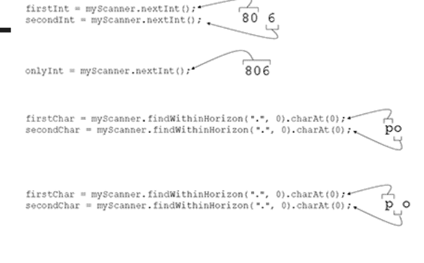

要在计算机程序的文本中表示单个字符，你需要用单引号将该字符括起来。但是，当你要将字符作为程序输入的一部分时，就不需要用引号将其括起来了。

假设你的程序调用了`nextInt`，然后调用了`findWithinHorizon(".", 0).charAt(0)`。如果你在键盘上输入`80x`，会得到一条错误信息。（信息显示为`InputMismatchException`。`nextInt`方法期望你在每个`int`值后输入一个空格。）那么，如果你不输入`80x`，而是在键盘上输入`80 x`会怎样呢？这时程序会获取到`80`作为`int`值，后面跟一个空格作为字符值。为了让程序获取到`x`，程序必须再次调用`findWithinHorizon(".", 0).charAt(0)`。这看起来有些浪费，但从长远来看是合理的。

## 布尔类型

我麻烦大了。我有 140 颗口香糖球，而有 15 个孩子在我的客厅里又跑又叫。他们大叫是因为每个孩子都想要 10 颗口香糖球，他们跑来跑去是因为在拥挤的客厅里孩子们就是这样。我需要一个程序来告诉我，是否能够给每个孩子 10 颗口香糖球。

我需要一个`boolean`类型的变量。`boolean`变量存储两个值之一——`true`或`false`（`true`表示我能给每个孩子 10 颗口香糖球；`false`表示我不能给每个孩子 10 颗口香糖球）。不管怎样，孩子们快闹翻天了，所以我写了一个简短的程序，并将其放在代码清单 8-4 中。程序的输出如图 8-9 所示。

```java
Listing 8-4: Using the boolean Type

class CanIKeepKidsQuiet {
    public static void main(String args[]) {
        int gumballs;
        int kids;
        int gumballsPerKid;
        boolean eachKidGetsTen;
        gumballs = 140;
        kids = 15;
        gumballsPerKid = gumballs / kids;
        System.out.print("True or false? ");
        System.out.println("Each kid gets 10 gumballs.");
        eachKidGetsTen = gumballsPerKid >= 10;
        System.out.println(eachKidGetsTen);
    }
}
```

在代码清单 8-4 中，变量`eachKidGetsTen`是`boolean`类型的。因此，存储在`eachKidGetsTen`变量中的值只能是`true`或`false`。（我不能在`eachKidGetsTen`变量中存储数字或字符。）

为了给变量`eachKidGetsTen`找到一个值，程序会检查`gumballsPerKid`是否大于或等于十。（符号`>=`代表“大于或等于”。真可惜！标准计算机键盘上没有`≥`键。）因为`gumballsPerKid`只有九，所以`gumballsPerKid >= 10`的结果是`false`。因此，`eachKidGetsTen`就变成了`false`。哎呀！孩子们会把房子拆掉的！（在他们动手之前，先看看图 8-10 吧。）

## 表达式和条件

在代码清单 8-4 中，代码`gumballsPerKid >= 10`是一个表达式。这个表达式的值取决于存储在变量`gumballsPerKid`中的值。在不顺利的日子里，`gumballsPerKid >= 10`的值是`false`。所以变量`eachKidGetsTen`被赋值为`false`。

像`gumballsPerKid >= 10`这样，其值为`true`或`false`的表达式，有时被称为条件。

> 像`true`和`false`这样的值看起来好像包含字符，但实际上并没有。在内部，Java 虚拟机并不使用字母 t-r-u-e 或 f-a-l-s-e 来存储`boolean`值。相反，JVM 存储的是代码，例如用 0 表示`false`，用 1 表示`true`。当计算机显示一个`boolean`值时（如在`System.out.println(eachKidGetsTen)`中），Java 虚拟机会将像 0 这样的代码转换成五字母的单词`false`。

### 比较数字；比较字符

在代码清单 8-4 中，我将一个变量的值与数字 10 进行比较。我在表达式中使用了`>=`运算符：

```java
gumballsPerKid >= 10
```

当然，大于或等于比较只能让你走到这一步。表 8-1 向你展示了可以用来比较事物的运算符。

| 运算符符号 | 含义 | 示例 |
| :--- | :--- | :--- |
| `==` | 等于 | `yourGuess == winningNumber` |
| `!=` | 不等于 | `5 != numberOfCows` |
| `<` | 小于 | `strikes < 3` |
| `>` | 大于 | `numberOfBoxtops > 1000` |
| `<=` | 小于或等于 | `numberOfCows + numberOfBulls <= 5` |
| `>=` | 大于或等于 | `gumballsPerKid >= 10` |

使用表 8-1 中的运算符，你可以比较数字和字符。

> 注意表 8-1 第一行中的双等号。不要试图使用单等号来比较两个值。表达式`yourGuess = winningNumber`（使用单等号）并不会比较`yourGuess`和`winningNumber`。相反，`yourGuess = winningNumber`会改变`yourGuess`的值。（它将`winningNumber`的值赋给变量`yourGuess`。）

你可以使用`==`和`!=`运算符来比较其他东西（除了数字和字符）。但这样做时，你必须小心。更多信息，请参见第 18 章。

#### 比较数字

没有什么比比较数字更枯燥的了。“对还是错？五大于或等于十。”错误。五既不大于也不等于十。明白我的意思吗？无聊。

比较整数是一个直截了当的事情。但不幸的是，当你比较小数时，就有一个小问题了。拿一个将摄氏度转换为华氏度的程序来说。等等！不要拿任何一个这样的程序；就拿代码清单 8-5 中的程序。

##### 代码清单 8-5：这里温暖舒适

```java
import java.util.Scanner;
class CelsiusToFahrenheit {
    public static void main(String args[]) {
        Scanner myScanner = new Scanner(System.in);
        double celsius, fahrenheit;
        System.out.print("Enter the Celsius temperature: ");
        celsius = myScanner.nextDouble();
        fahrenheit = 9.0 / 5.0 * celsius + 32.0;
        System.out.print("Room temperature? ");
        System.out.println(fahrenheit == 69.8);
    }
}
```

如果你运行代码清单 8-5 中的代码并输入数字 21，计算机会计算出`9.0 / 5.0 * 21 + 32.0`的值。信不信由你，你会想核对一下计算机的答案。（谁知道呢？也许计算机算错了！）你需要做一些算术运算，但请不要伸手去拿计算器。计算器只是一台小型计算机，而那种机器会互相包庇。要检查计算机的计算，你需要手动进行算术运算。什么？你说你有数学恐惧症？嗯，别担心。我已经在图 8-11 中做完了所有的数学计算。

如果你手动进行算术运算，那么你得到的`9.0 / 5.0 * 21 + 32.0`的值正好是 69.8。所以运行代码清单 8-5 中的代码，给`celsius`赋值 21。当你显示`fahrenheit == 69.8`的值时，你应该得到`true`，对吧？

嗯，不。看看图 8-12 中的运行结果。当计算机计算`fahrenheit == 69.8`时，结果是`false`，而不是`true`。这是怎么回事？

一点侦探工作可以大有帮助。所以回顾一下事实：

- **事实：**`fahrenheit`的值应该正好是 69.8。
- **事实：**如果`fahrenheit`是 69.8，那么`fahrenheit == 69.8`就是`true`。
- **事实：**在图 8-12 中，计算机显示了单词`false`。所以表达式`fahrenheit == 69.8`不是`true`。

你如何调和这些事实？几乎可以肯定`fahrenheit == 69.8`是`false`，那么这说明`fahrenheit`的值是什么呢？在代码清单 8-5 中，没有显示`fahrenheit`的值。这会不会是问题所在？

此时，我使用了一个流行的程序员技巧。我添加了语句来显示`fahrenheit`的值。

```java
fahrenheit = 9.0 / 5.0 * celsius + 32.0;
System.out.print("fahrenheit: ");    //Added
System.out.println(fahrenheit);    //Added
```

增强代码的运行结果如图 8-13 所示。如你所见，计算机偏离了目标。计算机计算出的`9.0 / 5.0 * 21 + 32.0`的值是 69.80000000000001，而不是预期的 69.8。事情就是这样。计算机用零和一进行所有的算术运算，所以计算机的算术运算看起来不像图 8-11 中的十进制算术。计算机的答案不是错误的。答案只是稍微有些不精确。

在第 7 章的一个例子中，Java 的取模运算符（`%`）给你的答案是 0.12999999999999999，而不是你期望的 0.13。同样的奇怪事情发生在本节的例子中。但本节的代码没有使用特殊的取模运算符。本节的代码使用了你熟悉的老朋友——除法、乘法和加法。

所以，当你用`==`比较两个数字是否相等，或用`!=`比较它们是否不相等时，要小心。当你使用 Java 的`double`类型或`float`类型时，微小的误差几乎可能在任何地方潜入。而且几个微小的误差会相互叠加，变得非常大。当你比较两个`double`值或两个`float`值时，这些值几乎永远不会完全相等。

如果你的程序没有按照你认为应该的方式运行，那么请检查你对变量值的猜测。在代码中添加`print`和`println`语句。

比较`double`值时，给自己留一些余地。不要比较精确相等，而是判断某个特定值是否接近预期值。例如，使用类似`fahrenhelt >= 69.8 - 0.01 && fahrenheit <= 69.8 + 0.01`的条件来判断`fahrenheit`是否在 69.8 的 0.01 范围内。要了解更多关于包含 Java 的`&&`运算符的条件，请参阅第 10 章。

#### 自动调试

如果你的程序无法正常工作，你可以尝试一种叫做调试器（debugger）的工具。调试器会自动在你可疑的代码中添加不可见的`print`和`println`调用。事实上，调试器有各种各样的功能来帮助你诊断问题。例如，调试器可以暂停程序的运行，并接受特殊命令来显示变量的值。使用某些调试器，你可以暂停运行并更改变量的值（只是为了看看这样做后情况是否会更好）。

Eclipse 的透视图（perspective）是一组视图的集合，旨在帮助你处理程序开发的某个特定方面。默认情况下，Eclipse 以 Java 透视图启动——这是帮助你创建 Java 程序的视图布局。另一个透视图——Debug 透视图——帮助你诊断代码中的错误。

在本书中，我不提倡使用自动调试器。但对于任何大型编程项目来说，自动调试是一项必不可少的工具。因此，如果你打算编写更大更好的程序，请尝试使用 Eclipse 的 Debug 透视图。要体验 Debug 透视图的一小部分功能，请执行以下操作：

1. 在编辑器（显示 Java 代码的地方）中，双击某行代码左侧的边距。

边距中会出现一个小蓝点（见图）。该点表示代码中的断点（breakpoint）。在后续步骤中，你将使程序运行到此断点处暂停。在图中，我点击了清单 8-5 中最后一行代码。

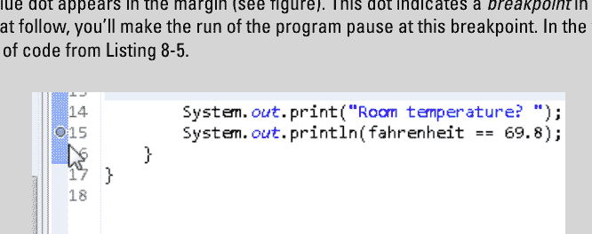


## 2. 在 Eclipse 中打开 Debug 透视图

在 Eclipse 的主菜单中，点击`Window⇒Open Perspective⇒Debug`。

结果，Eclipse 会显示一个新的布局。新布局包含一些熟悉的视图，例如 Console 视图和 Outline 视图。该布局还包含一些新视图，例如 Debug 视图、Variables 视图和 Breakpoints 视图（见图）。

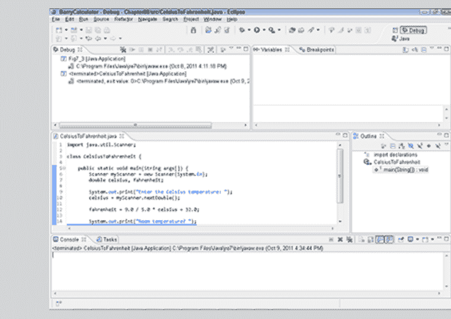

## 3. 启动 Java 应用程序调试

在 Eclipse 的主菜单中，点击`Run⇒Debug As⇒Java Application`。

记得选择 Debug As 菜单项。选择此项可以启用所有调试工具。

你的代码开始运行。由于你正在处理清单 8-5 中的程序，代码会提示你输入摄氏温度。

## 4. 输入温度

输入数字`21`，然后按 Enter。

你的代码继续运行，直到执行到达断点。在断点处，执行会暂停，以便你检查程序的状态。

## 5. 查看 Variables 视图

在 Eclipse 窗口的右上角，查找 Variables 视图。

Variables 视图显示程序变量的值。（这并不奇怪。）在图中，`fahrenheit`变量的值是 69.80000000000001。太好了！使用调试工具，你可以在运行中途检查变量的值！

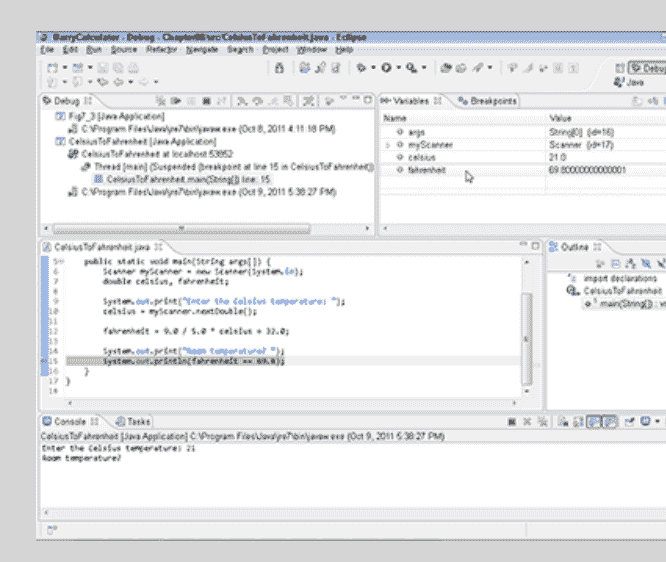

## 6. 继续运行程序

要完成程序的运行，点击 Debug 视图顶部的 Resume 按钮（见图）。

## 7. 返回 Java 透视图

要返回 Java 透视图，点击`Window->Open Perspective->Java`。

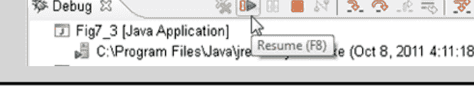

## 比较字符

表 8-1 中的比较运算符对字符也同样适用。粗略地说，运算符`<`的意思是"在字母表中更早出现"。但你必须注意以下几点：

- 因为 B 在字母表中比 H 靠前，所以条件`'B' < 'H'`为真。这并不奇怪。
- 因为 b 在字母表中比 h 靠前，所以条件`'b' < 'h'`为真。这也不奇怪。
- 每个大写字母都在任何小写字母之前，所以条件`'b' < 'H'`为假（false）。这才令人惊讶（见图 8-14）。

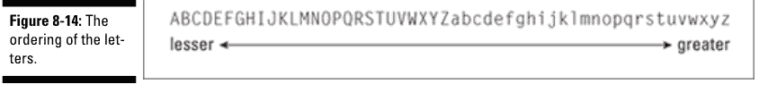

实际上，你很少需要比较两个字母。但在第 18 章中，你可以了解 Java 的`String`类型。使用`String`类型，你可以比较单词、名称和其他有用的内容。到那时，你必须仔细考虑字母顺序，而图 8-14 中的概念就会派上用场。

> 在底层，字母 A 到 Z 存储的数值编码是 65 到 90。字母 a 到 z 存储的编码是 97 到 122。这就是为什么每个大写字母都"小于"任何小写字母。

## 剩余的原始类型

在第 7 章中，我提到过 Java 有八种原始类型，但表 7-1 只列出了八种类型中的六种。表 8-2 描述了剩下的两种类型——`char`类型和`boolean`类型。表 8-2 不太令人兴奋，但我不能让你对表 7-1 中不完整的故事一无所知。

**表 8-2 Java 的非数值原始类型**

| Type Name | Range of Values |
| :--- | :--- |
| **Character Type** | |
| `char` | 数千个字符、字形和符号 |
| **Logical Type** | |
| `boolean` | 只有`true`或`false` |


如果你剖析 Java 虚拟机的某些部分，你会发现 Java 认为`char`是一种数值类型。这是因为 Java 使用一种叫做 Unicode 的东西来表示字符——Unicode 是一种国际标准，用于表示世界上许多语言的字母表。例如，大写字母 C 的 Unicode 表示是 67。希伯来字母 aleph 的表示是 1488。而（举一个更晦涩的例子）语音学中浊卷舌近音的表示是 635。但不用担心所有这些。我写`char`类型是数值类型的唯一原因是为了在科技界朋友面前保全面子。

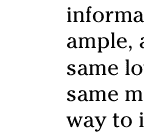

看了表 8-2 之后，你可能想知道什么是字形（glyph）。（事实上，无论你是否需要这些信息，我都很自豪能写这个深奥的概念。）字形（glyph）是字符的一种特定表示形式。例如，a 和 a 是两个不同的字形，但这两个字形都代表罗马字母表中同一小写字母。（因为这两个字形含义相同，所以它们被称为变体（allograph）。如果你想让自己听起来很聪明，想办法在日常对话中用上字形和变体这两个词！）

# 第三部分

## 控制流程

# The 5th Wave 作者：Rich Tennant


## 在本部分中……

计算机程序就像角色扮演视频游戏。它不是那种涉及射击、拳击或赛车的游戏。它是一种涉及策略的游戏。找到金戒指来打开秘密通道。通过背诵魔法词语来拯救公主。就是那种类型的东西。

因此，在本书的这一部分，你将创建通道。当你的程序从一个虚拟房间穿梭到另一个虚拟房间时，计算机越来越接近某个重要问题的解决方案。

嘿，承认吧。这听起来很有趣！

# 第 9 章：岔路口

- **本章内容**
  - 编写在备选方案之间进行选择的语句
  - 将语句相互嵌套
  - 编写几种不同类型的决策语句

以下是 *Beginning Programming with Java For Dummies, 3rd Edition, Chapter 2* 的摘录：

**如果你试图存储单词或句子（不仅仅是单个字母），**那么你需要使用一种叫做 String 的东西。*

这段摘录说明了两个重要点：首先，你可能需要使用一种叫做 String 的东西。其次，你的行动选择可以取决于某事是真还是假。

**如果**你确实试图存储单词或句子，

你需要使用一种叫做 String 的东西。

本章涉及决策，这在创建指令中起着基础性的作用。凭借本章的内容，你可以大幅扩展你的编程能力。

## 决策，决策！

想象自己走在一条宁静的乡村道路上。你正在享受一个愉快的夏日。天气不太热，一阵来自北方的微风让你感到清新和警觉。你手里拿着这本书，翻开到第 9 章。你读了关于存储单词或句子的段落，然后你抬起头。

> * 本摘录经 John Wiley & Sons, Inc. 许可转载。如果你在当地书店找不到 *Beginning Programming with Java For Dummies, 3rd Edition* 的副本，请访问`http://www.wiley.com`。

## 做出决策（Java if 语句）

你看到前方道路分叉。你看到两个路标——一个指向右边，另一个指向左边。一个路标上写着："存储单词或句子？真。"另一个路标上写着："存储单词或句子？假。"你评估了单词或句子的情况，然后继续前进，根据你的软件情况向右或向左拐。这个故事的示意图如图 9-1 所示。

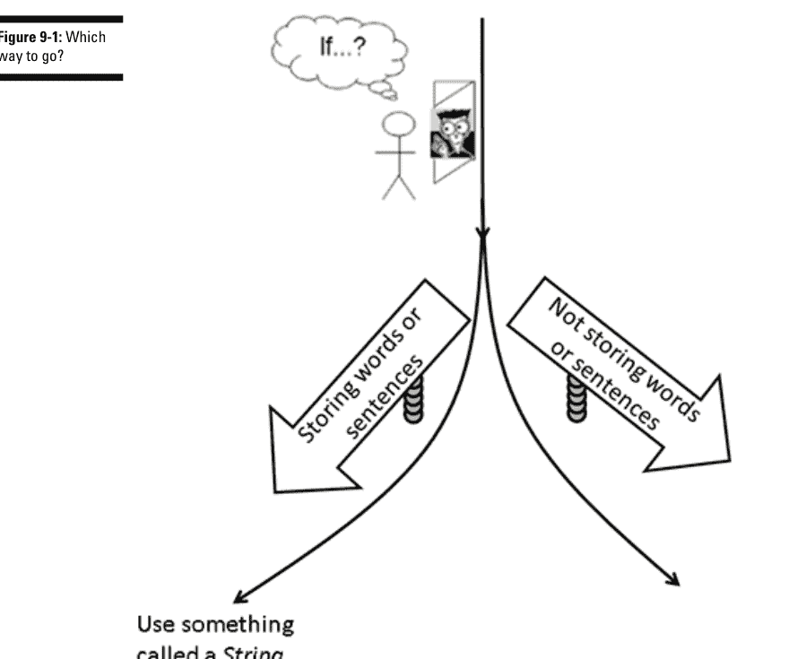

生活中充满了岔路口。以一组加热冷冻零食的普通说明为例：

### 微波炉烹饪说明

- 放在微波炉安全的盘子上。
- 高火加热 2 分钟。
- 翻转产品。
- 再高火加热 2 分钟。

### 传统烤箱说明

- 将烤箱预热至 350 度。
- 将产品放在烤盘上。
- 烘烤 25 分钟。

同样，你需要在备选方案之间做出选择。如果你使用微波炉，就这样做。否则，就那样做。

事实上，很难想象有不涉及选择的有用说明。如果你是房主，有两名受抚养人，且年收入超过 30,000 美元，请在这里勾选。如果你不记得如何在 Java 程序中使用花括号，请参阅第 4 章。用户是否正确输入了他的密码？如果是，则允许用户登录；如果不是，则将其踢出去。如果你认为市场会上涨，那就买股票；否则，买债券。如果你买股票，应该买哪只？应该什么时候卖出？

当你使用计算机程序时，你需要做出一个又一个的决策。几乎每种编程语言都有一种方式来朝两个方向之一进行分支。在 Java（以及许多其他语言）中，这种分支特性被称为 if 语句。查看代码清单 9-1 以了解一个 if 语句。

### 代码清单 9-1：一个 if 语句

```java
if (randomNumber > 5) {
    System.out.println("Yes. Isn't it obvious?");
} else {
    System.out.println("No, and don't ask again.");
}
```

要查看包含代码清单 9-1 中代码的完整程序，请跳转到代码清单 9-2（或者，如果你愿意，可以步行、跳跃或奔跑至代码清单 9-2）。

### 仔细观察 if 语句

一个`if`语句可以采用以下形式：

```java
if (Condition) {
    SomeStatements
} else {
    OtherStatements
}
```

**图 9-2：** 一个随机数字决定你的命运。


要获得一个实际的`if`语句，请用有意义的文本替换三个占位符`Condition`、`SomeStatements`和`OtherStatements`。以下是我如何在代码清单 9-1 中进行替换的：

- 我用`randomNumber > 5`替换了`Condition`。
- 我用`System.out.println("Yes. Isn't it obvious?");`替换了`SomeStatements`。
- 我用`System.out.println("No, and don't ask again.");`替换了`OtherStatements`。

替换过程如图 9-3 所示。

有时我需要`if`语句各部分的替代名称。我称它们为 if 子句和 else 子句。

```java
if (Condition) {
    if clause
} else {
    else clause
}
```


一个`if`语句是复合语句的一个例子——一个在其内部包含其他语句的语句。代码清单 9-1 中的`if`语句包含两个`println`调用，而这些对`println`的调用就是语句。

请注意我在代码清单 9-1 的`if`语句中如何使用括号和分号。特别地，请注意以下几点：

- 条件必须放在括号中。
- `if`子句内的语句以分号结尾。`else`子句内的语句也是如此。
- 条件之后没有分号。
- 关键字`else`之后没有分号。

作为一名初级程序员，你可能认为这些规则是任意的。但它们不是。这些规则属于一个非常精心设计的语法。它们就像英语句子的语法规则，但它们甚至更合乎逻辑！（抱歉，凯莉。）

表 9-1 向你展示了当违反`if`语句的标点符号规则时可能出现的问题。表中的最后两项最为臭名昭著。在这两种情况下，编译器不会捕获错误。这会让你产生一种虚假的安全感。问题在于，当你运行程序时，代码的行为并不是你所期望的。

### 表 9-1 常见 if 语句错误消息

| 错误 | 示例 | 最可能的消息或结果 |
| :--- | :--- | :--- |
| 条件周围缺少括号 | `if randomNumber > 5 {` | 需要 '('<br>语法错误，在标记 "if" 之后，此处需要 '(' |
| if 子句或 else 子句内的语句后缺少分号 | `if (randomNumber > 5) {`<br>`    System.out.println("Y")`<br>`}` | 需要 ';'<br>语法错误，插入 ";" 以完成 BlockStatements |
| 条件之后立即有分号 | `if (randomNumber > 5); {`<br>`    System.out.println("Y");`<br>`} else {` | 没有 'if' 的 'else'<br>语法错误，在标记 "else" 之后，删除此标记 |
| 关键字 else 之后立即有分号 | `} else; {` | 程序编译没有错误，但关键字 else 之后的语句总是被执行，无论条件是真还是假。 |
| 缺少花括号 | `if (randomNumber > 5)`<br>`    System.out.println("Y");`<br>`else`<br>`    System.out.println("N");` | 程序有时编译没有错误，但程序的运行可能不会做你期望它做的事情。（所以底线是，不要省略花括号。） |

在编写代码时，将`if`语句视为一个不可分割的单元会很有帮助。不要输入第一整行（包括条件等），而是尝试输入`if`语句的框架大纲。

```java
if () {
    //To do: Fill in the condition.
    //To do: Fill in SomeStatements.
} else {
    //To do: Fill in OtherStatements.
}
```

有了整个框架，你就可以开始处理待办事项清单上的项目了。当你将这种思维方式应用于复合语句时，就更难犯错了。

### 一个完整的程序

代码清单 9-2 包含一个带有简单`if`语句的完整程序。清单中的代码行为就像一个电子神谕。向程序提出一个是或否的问题，程序会回答你。当然，你问题的答案是随机生成的。但谁在乎呢？反正问着也挺有趣。

```java
import java.util.Scanner;
import java.util.Random;

class AnswerYesOrNo {
    public static void main(String args[]) {
        Scanner myScanner = new Scanner(System.in);
        Random myRandom = new Random();
        int randomNumber;

        System.out.print("Type your question, my child:  ");
        myScanner.nextLine();
        randomNumber = myRandom.nextInt(10) + 1;

        if (randomNumber > 5) {
            System.out.println("Yes. Isn't it obvious?");
        } else {
            System.out.println("No, and don't ask again.");
        }
    }
}
```

图 9-4 显示了代码清单 9-2 中程序的几次运行。程序的行为分为四个部分：


**图 9-4：** 全知的 Java 程序运行中。

1. **提示用户。**

   调用`System.out.print`，告诉用户输入一个问题。

2. **从键盘获取用户的问题。**

   在图 9-4 中，我运行了`AnswerYesOrNo`程序四次，每次输入一个不同的问题。同时，回到代码清单 9-2，语句

   ```java
   myScanner.nextLine();
   ```

   吞掉了我的问题，但完全没有处理它。这是一个异常情况，但你很聪明，所以你能处理它。

   通常，当程序从键盘获取输入时，程序会用输入做一些事情。例如，程序可以将输入赋值给一个变量：

   ```java
   amount = myScanner.nextDouble();
   ```

   或者，程序可以在屏幕上显示输入：

   ```java
   System.out.println(myScanner.nextLine());
   ```

   但代码清单 9-2 中的代码不同。当这个`AnswerYesOrNo`程序运行时，用户必须输入一些东西。（对`getline`的调用等待用户输入一些内容然后按回车键。）但`AnswerYesOrNo`程序不需要存储输入以供进一步分析。（计算机做我妻子问我是否打算在自己之后清理时我所做的事情。我忽略这个问题，编造一个任意的回答。）所以程序对用户的输入不做任何处理。`myScanner.nextLine`的调用就独自存在于自己的语句中，什么也不做，就像一个大黑洞。程序这样做是不寻常的，但电子神谕本身就是个不寻常的东西。它需要一些稍微不寻常的代码。

#### 3. 获取一个随机数 —— 任意一个从 1 到 10 的`整数`值

好吧，聪明的家伙们。你刚刚丢弃了用户的输入。那你还怎么回答用户的是或否问题？

没问题！完全没问题！你只需随机显示一个答案。用户根本不会察觉差异。（哈哈！）只要你能生成随机数，你就能做到这一点。从 1 到 10 的数字就足够了。

在代码清单 9-2 中，关于`Random`和`myRandom`的部分看起来非常像我们熟悉的`Scanner`代码。从一个初学程序员的角度看，`Random`和`Scanner`的工作方式几乎相同。当然，它们之间有一个重要的区别。调用`Random`类的`nextInt(10)`方法并不会从键盘获取任何东西。相反，这个`nextInt(10)`方法是凭空得到一个数字。


名字`Random`是在Java API中定义的。代码清单9-2中对`myRandom.nextInt(10)`的调用会得到一个0到9之间的数字。然后我的代码加上1（得到一个1到10之间的数字）并将这个数字赋值给变量`randomNumber`。完成这些之后，你就准备好回答用户的问题了。


> 在Java的API中，单词`Random`是一个Java类的名称，而`nextInt`是一个Java方法的名称。关于类和方法之间关系的更多信息，请参阅第17、18和19章。

## 4. 回答是或否

调用`myRandom.nextInt(10)`就像在电视游戏节目中转动一个轮盘。轮盘上有编号为1到10的槽位。代码清单9-2中的`if`语句将你的数字转换为“是”或“否”的选择。如果你得到一个大于5的数字，程序就回答`yes`。否则（如果你得到一个小于或等于5的数字），程序就回答`no`。

这一点你可以相信我。我已经根据我的`AnswerYesOrNo`程序做出了许多重要的决定。

## 在代码中缩进if语句

注意代码清单9-2中，`if`语句内部的`println`调用是如何缩进的。严格来说，你并不必须缩进`if`语句内部的语句。编译器并不关心，你可以把整个程序写在一行上，或者把所有语句排列成一种不规则的锯齿状。问题是，如果你不以某种逻辑方式缩进你的语句，那么你和其他人都无法理解你的代码。在代码清单9-2中，`println`调用的缩进有助于你的眼睛（和大脑）快速识别出这些语句从属于整体的`if/else`流程。

## 随机性让我头晕

当你调用`myRandom.nextInt(10) + 1`时，你会得到一个从1到10的数字。作为一个测试，我写了一个程序，调用了20次`myRandom.nextInt(10) + 1`。

```
Random myRandom=new Random();
System.out.print(myRandom.nextInt(10) + 1);
System.out.print(" ");
System.out.print(myRandom.nextInt(10) + 1);
System.out.print(" ");
System.out.print(myRandom.nextInt(10) + 1);
//...以此类推。
```

我运行了这个程序几次，得到了下图所示的结果。（实际上，我是从Eclipse的控制台视图复制结果到Windows记事本中的。）快速浏览一下图表，注意两个趋势：

- 没有明显的方法来预测下一个数字是什么。
- 没有哪个数字出现的频率比其他数字高出很多。

| 6 | 2 | 2 | 2 | 4 | 3 | 4 | 3 | 6 | 5 | 10 | 8 | 5 | 6 | 2 | 2 | 6 | 6 | 9 | 5 |
|---|---|---|---|---|---|---|---|---|---|---|---|---|---|---|---|---|---|---|---|
| 7 | 2 | 1 | 6 | 4 | 10 | 10 | 5 | 7 | 7 | 4 | 9 | 7 | 9 | 6 | 8 | 7 | 8 | 3 | 10 |
| 3 | 4 | 8 | 7 | 6 | 8 | 1 | 5 | 7 | 2 | 3 | 5 | 7 | 1 | 8 | 2 | 6 | 5 | 8 | 3 |
| 2 | 1 | 10 | 6 | 2 | 2 | 4 | 3 | 3 | 6 | 5 | 2 | 7 | 4 | 4 | 8 | 8 | 9 | 7 | 4 |
| 7 | 5 | 8 | 4 | 7 | 3 | 2 | 9 | 7 | 6 | 7 | 7 | 3 | 6 | 5 | 3 | 10 | 4 | 8 | 3 |
| 9 | 4 | 9 | 1 | 4 | 4 | 7 | 2 | 7 | 1 | 4 | 1 | 9 | 8 | 2 | 7 | 7 | 2 | 5 | 1 |
| 1 | 1 | 2 | 3 | 10 | 5 | 2 | 9 | 7 | 7 | 7 | 6 | 2 | 3 | 9 | 6 | 9 | 10 | 10 | 2 |
| 5 | 10 | 1 | 10 | 9 | 6 | 2 | 3 | 10 | 1 | 4 | 8 | 3 | 10 | 1 | 5 | 7 | 8 | 3 | 10 |

Java虚拟机费尽心机来维持这些趋势。这是因为以随机方式生成数字是一件非常棘手的事情。以下是关于这个过程的一些有趣事实：

- 科学家和非科学家都使用术语*随机数*。但实际上，单个随机数字这样的东西并不存在。毕竟，像9这样的数字有多随机呢？

一个数字只有在一个非常混乱的数字集合中时，才是*随机的*。更准确地说，如果用于生成数字的过程遵循上述两个趋势，那么这个数字就是*随机的*。当科学家们严谨时，他们会避免使用术语*随机数*，而改用术语*随机生成的数字*。

- 随机生成数字是很难的。计算机程序尽力而为，但归根结底，今天的计算机程序遵循某种模式，而这种模式并非真正的随机。

要以真正随机的方式生成数字，你需要一大桶乒乓球，就像州彩票开奖时用的那种。问题是，大多数计算机的外设中并没有配一大桶乒乓球。因此，严格来说，由Java的`Random`类生成的数字并不是随机的。相反，科学家们称这些数字为*伪随机*。

- 这让我们所有人感到惊讶，但知道一个随机生成的值对于预测下一个随机生成的值毫无帮助。

例如，如果你抛两次硬币，每次都是正面，那么第三次你得到反面的可能性更大吗？不。仍然是50-50的概率。

如果你有三个儿子，而你即将迎来第四个孩子，那么第四个孩子是女孩的可能性更大吗？不。孩子的性别与前面孩子的性别无关。（我忽略了任何生物效应，对此我一无所知。等等！我确实知道一些生物学的冷知识：新生儿更可能是男孩而不是女孩。每21个新生男孩，只有20个新生女孩。男孩更弱，所以我们死得更快。这就是为什么大自然在出生时制造更多的我们。）

在一个小程序中，未缩进或缩进不当的代码尚可容忍。但在一个复杂的程序中，不遵循清晰逻辑模式的缩进就是一场巨大而丑陋的噩梦。


始终缩进你的代码，以便一眼就能看清程序的流程。

## 主题的变奏

我不喜欢剥猫皮。但我听说，如果需要剥猫皮，我可以选择几种不同的技巧。下次我的猫组胺把地毯误认为猫砂盆时，我会记住这一点的。

> *Rick Ross 在我另一本书中读到关于剥猫皮的内容后，通过电子邮件发给了我这条信息：“...在第10页，你提到了‘剥猫皮’，然后开始讨论猫砂盆之类的事情。请注意，短语‘剥猫皮不止一种方法’指的是去除鲶鱼不可食用的皮很困难，而且有不止一种方法可以做到这一点。这些方法包括把那家伙的尾巴钉在木板上，用钳子把皮剥下来，到让毛茸茸的那种猫去管那该死的东西，干脆不去担心它。我在河边长大（那条贯穿美国南北的大河，以‘M’开头，并且有很多重复字母），所以这经历是我们那里的核心部分。一种常见的误解（尽管不人道且令人反感）。只是觉得你会想知道。*”

无论如何，无论你是剥鲶鱼皮、剥小猫皮，还是编写计算机程序，同样的原则都适用。你总是有其他选择。代码清单9-2向你展示了编写`if`语句的一种方法。本章的其余部分（以及整个第10章）将向你展示创建`if`语句的其他一些方法。

## ……否则会怎样？

你可以创建一个没有`else`子句的`if`语句。例如，想象一个网页，十个随机访问者中有一个会收到特别优惠。为了不让访客猜到，我调用`Random`类的`nextInt`方法，并向任何数字是幸运7的人提供优惠。

- 如果`myRandom.nextInt(10) + 1`生成数字7，显示特别优惠消息。
- 如果`myRandom.nextInt(10) + 1`生成除7以外的任何数字，则不执行任何操作。不显示特别优惠消息，也不显示令人沮丧的“抱歉，您没有优惠”的消息。

实现此策略的代码如代码清单9-3所示。代码的几次运行结果如图9-5所示。

### 代码清单9-3：你不是很幸运吗？

```java
import java.util.Random;
class SpecialOffer {
    public static void main(String args[]) {
        Random myRandom = new Random();
        int randomNumber = myRandom.nextInt(10) + 1;
        if (randomNumber == 7) {
            System.out.println("An offer just for you!");
        }
        System.out.println(randomNumber);
    }
}
```

清单9-3中的`if`语句没有`else`子句。该`if`语句的形式如下：

```
if (Condition) {
    SomeStatements
}
```

当`randomNumber`为7时，计算机显示`An offer just for you!`。当`randomNumber`不是7时，计算机不显示`An offer just for you!`。该动作如图9-6所示。

> 在`if`语句的条件中比较两个数字或字符时，务必（我的意思是*务必*）使用双等号。千万不要（那就是*千万、千万、千万*不要）使用单等号来比较两个值。单等号用于赋值，而不是比较。

图9-6：如果你没有什么好话要说，那就什么都不要说。

在清单9-3中，我擅自添加了一个额外的`println`。这个`println`（位于`main`方法的末尾）显示了我调用`nextInt`生成的随机数。在一个提供特别优惠的网页上，你可能不会看到随机生成的数字，但如果不知道代码生成的是什么数字，我就无法测试我的`SpecialOffer`代码："精雕细磨"之笔。

总之，请注意`randomNumber`的值在每次运行中都会显示。显示`randomNumber`的`println`不在`if`语句内部。（这个`println`在`if`语句之后。）所以计算机总是执行这个`println`。无论`randomNumber == 7`是真还是假，计算机都会执行适当的`if`操作，然后继续执行`System.out.println(randomNumber)`。

## 在if语句中装入更多内容

有一个有趣的情景：你现在有两支棒球队——Hankees队和Socks队。你想在两行上分别显示两支球队的得分，获胜方的分数显示在前面。（在计算机屏幕上，获胜方的分数显示在失败方的上方。如果出现平局，你就把两个相同的分数上下显示。）清单9-4中有相关代码。

### 清单9-4：愿最佳球队首先显示

```
import java.util.Scanner;
import static java.lang.System.in;
import static java.lang.System.out;
class TwoTeams {
    public static void main(String args[]) {
        Scanner myScanner = new Scanner(in);
        int hankees, socks;
        out.print("Hankees and Socks scores?  ");
        hankees = myScanner.nextInt();
        socks = myScanner.nextInt();
        out.println();
        if (hankees > socks) {
            out.print("Hankees:  ");
            out.println(hankees);
            out.print("Socks:    ");
            out.println(socks);
        } else {
            out.print("Socks:    ");
            out.println(socks);
            out.print("Hankees:  ");
            out.println(hankees);
        }
    }
}
```

图9-7展示了该代码的几次运行结果。（为了在一个图中展示多次运行，我将Eclipse控制台视图的结果复制到了Windows记事本中。）

借助花括号，一堆`print`和`println`调用安全地嵌套在`if`子句内部。另一组`print`和`println`调用被塞进了`else`子句内部。这就形成了图9-8所示的分支情况。

```
Hankees and Socks scores?  9 4

Hankees:  9
Socks:    4


Hankees and Socks scores?  3 8

Socks:    8
Hankees:  3


Hankees and Socks scores?  0 0

Socks:    0
Hankees:  0
```

## 语句与块

理解`if`语句的一种优雅方式是认识到，每个`if`语句子句中只能放置一条语句。

```
if (Condition)
    aStatement
else
    anotherStatement
```

初次读到这条单语句规则时，你可能会认为这有错字。毕竟，在清单9-4中，每个子句（`if`子句和`else`子句）似乎都包含四条语句，而不是一条。

但从技术上讲，清单9-4中的`if`子句只有一条语句，`else`子句也只有一条语句。诀窍在于，当你用花括号将一堆语句包围起来时，你就得到了所谓的*块（block）*，而块在所有方面表现得就像一条单独的语句。事实上，Java官方文档将块列为一种语句类型（众多不同类型语句中的一种）。所以在清单9-4中，下面这个块

```
{
    out.print("Hankees: ");
    out.println(hankees);
    out.print("Socks: ");
    out.println(socks);
}
```

就是一条语句。它是一个内部包含四条较小语句的语句。因此，这个大块，这条单独的语句，就作为清单9-4中`if`子句内部唯一的一条语句。

这就是单语句规则的工作原理。在`if`语句中，当你想让计算机执行多条语句时，你可以将这些语句组合成一条大语句。为此，你使用花括号创建一个块。

## 一些方便的import声明

写这一节的例子时，我已经厌倦了写`System`这个词。毕竟，清单9-4中有十行`System.out.print`。到了书中的这个地步，难道我的计算机还记不住`out.print`是什么意思吗？

当然，计算机不是这样工作的。如果你想让计算机"知道"`out.print`是什么意思，你必须在Java编译器内部的某个地方编码这种知识。

对我来说幸运的是，从Java 5.0开始就可以使用这种缩写功能了。（旧版本的Java编译器会直接卡壳在清单9-4的代码上。）这种缩写功能叫做*静态导入（static import）*。它在清单9-4的第二行和第三行中有所体现。

每当我用以下行开头一个程序时

```
import static java.lang.System.out;
```

我就可以在程序的其余部分中用简单的`out`替换`System.out`。`System.in`也是如此。有了清单9-4顶部附近的import声明，我就可以将`new Scanner(System.in)`替换为更简单的`new Scanner(in)`。

你可能会想这有什么大不了的。如果我可以把`java.util.Scanner`简写成`Scanner`，那缩写`System.out`又有什么特别的呢？为什么我必须写`out.print`？我能把`System.out.print`缩减成单个词`print`吗？再看一遍清单9-4的开头几行。我什么时候需要`static`这个词？`java.util`和`java.lang`又有什么区别？

我很抱歉。我对这些问题的回答不会让你兴奋。事实是，在第18章之前我没法解释清楚这些问题。在解释静态导入声明之前，我需要先介绍一些概念。我需要讲解类、包和静态成员。

所以在到达第18章之前，请多包涵。只需把三条import声明粘贴到你的Java程序顶部，并相信一切都会正常工作。

你可以用单个词`out`缩写`System.out`。你也可以用单个词`in`缩写`System.in`。只要确保*完全*按照你在清单9-4中看到的那样复制`import`声明。与清单9-4中的行有任何偏差，你都可能会遇到编译器错误。

# 第10章

## 他往哪走了？

### 本章内容

- 理清复杂的条件
- 编写酷炫的条件代码
- 交织你的`if`语句

又到报税季了。此刻，我正在填写12432-89B表：

> 如果你已婚且少于三个孩子，并且你的收入高于EIQ（预估收入配额），或者如果你单身且住在非居住区域（依据《统一分区法》第10条第iii部分所定义），并且你either是作为LLC（有限责任公司）的个体经营者，或者你符合退伍军人福利资格，那么跳过第3步和第4步或第4、5、6步，具体取决于你对问题2a和3d的回答。

本章没有12432-89B表那么复杂，但它确实涉及`if`语句潜在的复杂性。

## 构建更大更好的条件


在清单 9-2 中，代码根据对 `Random` 类的 `nextInt` 方法的一次调用来选择行动方案。这对第 9 章描述的电子神谕程序来说没问题，但如果你要掷一对骰子怎么办？在西洋双陆棋和其他骰子游戏中，掷出 3 和 5 与掷出 4 和 4 并不相同，尽管两次的总点数都是 8。下一步怎么走取决于你是否掷出了对子。要让计算机掷两个骰子，你需要执行两次 `myRandom.nextInt(6) + 1`。然后把两次掷骰结果组合成一个更大、更复杂的 `if` 语句。

所以要模拟西洋双陆棋游戏（以及许多其他更实际的情况），你需要组合条件。

`如果 die1 + die2 等于 8 且 die1 等于 die2，...`

你需要像与（and）和或（or）这样的东西——它们能把条件连接起来。Java 有运算符来表示这些概念，如表 10-1 所述，并在图 10-1 中进行了说明。

**表 10-1：逻辑运算符**

| 运算符符号 | 含义 | 示例 | 说明 |
|---|---|---|---|
| `&&` | 与（and） | `4 < age && age < 8` | 图 10-1(a) |
| `\|\|` | 或（or） | `age < 4 \|\| 8 < age` | 图 10-1(b) |
| `!` | 非（not） | `!eachKidGetsTen` | 图 10-1(c) |


组合条件，比如表 10-1 中的这些，可能会非常令人困惑。这就是为什么我在使用此类条件时会格外小心。下面是对表中每个示例的简要解释：

- `4 < age && age < 8`
  - `age` 变量的值大于 4 且小于 8。数字 5, 6, 7, 8, 9…… 都大于 4。但在这些数字中，只有 5, 6, 和 7 小于 8。因此只有数字 5, 6, 和 7 满足此组合条件。
- `age < 4 || 8 < age`
  - `age` 变量的值小于 4 或大于 8。要创建或条件，你使用两个竖线符号。在许多美式英语键盘上，你可以在回车键正上方找到竖线符号（与反斜杠键相同，但需要按住 Shift 键）。

在此组合条件中，`age` 变量的值要么小于 4，要么大于 8。例如，如果一个数字小于 4，那么该数字满足条件。数字 1, 2, 和 3 都小于 4，因此这些数字满足组合条件。

另外，如果一个数字大于 8，那么该数字也满足组合条件。数字 9, 10, 和 11 都大于 8，因此这些数字满足条件。

```java
!eachKidGetsTen
```

如果我对计算机编程语言没有经验，我会对这个感叹号感到困惑。我会认为 `!eachKidGetsTen` 的意思是，“是的，每个孩子确实得到了十个。”但这并不是这个表达式的意思。这个表达式说的是，“变量 `eachKidGetsTen` 的值不是 `true`。”在 Java 和其他编程语言中，感叹号代表否定，代表绝不，代表非。

清单 8-4 中有一个名为 `eachKidGetsTen` 的 `boolean`（布尔）变量。一个 `boolean` 变量的值要么是 `true`，要么是 `false`。因为 `!` 意味着非，所以表达式 `eachKidGetsTen` 和 `!eachKidGetsTen` 的值相反。因此，当 `eachKidGetsTen` 是 `true` 时，`!eachKidGetsTen` 是 `false`（反之亦然）。


Java 的 `||` 运算符是包含性的。这意味着，只要左侧的条件为 `true`，或者右侧的条件为 `true`，或者两者都为 `true`，你就会得到 `true`。例如，条件 `2 < 10 || 20 < 30` 的结果为 `true`。


在 Java 中，你不能像在普通英语中那样组合比较。在英语中，你可能会说，“我们将有三到十个人在餐桌上。”但在 Java 中，如果你写 `3 <= people <= 10`，你会得到一个错误消息。要进行这种比较，你需要类似 `3 <= people && people <= 10` 的表达式。

### 组合条件：一个例子

- 正价：$9.25
- 12岁以下儿童：$5.25
- 老年人（65岁及以上）：$5.25

因为儿童和老年人的价格相同，你可以将这些价格合并为一个类别。（这并不总是最佳的编程策略，但为了这个示例，我们就这样做。）要确定特定电影观众的票价，你需要一个或多个 `if` 语句。你可以用多种方式构造条件，我在清单 10-1 的代码中选择了其中一种方式。

#### 清单 10-1：你付的钱是不是太多了？

```java
import java.util.Scanner;
class TicketPrice {
    public static void main(String args[]) {
        Scanner myScanner = new Scanner(System.in);
        int age;
        double price = 0.00;
        System.out.print("How old are you? ");
        age = myScanner.nextInt();
        if (age >= 12 && age < 65) {
            price = 9.25;
        }
        if (age < 12 || age >= 65) {
            price = 5.25;
        }
        System.out.print("Please pay $");
        System.out.print(price);
        System.out.print(". ");
        System.out.println("Enjoy the show!");
    }
}
```

`TicketPrice` 程序（见清单 10-1）的几次运行如图 10-2 所示。（为了方便你查看，我从 Eclipse 的控制台视图中复制了这些运行结果到 Windows 记事本。）当你满 12 岁时，你开始支付全价。你会一直支付全价，直到 65 岁。到那时，你再次支付优惠价。

清单 10-1 的关键部分是中间的那组 `if` 语句，如图 10-3 所示。

```text
How old are you? 11
Please pay $5.25.  Enjoy the show!

How old are you? 12
Please pay $9.25.  Enjoy the show!

How old are you? 35
Please pay $9.25.  Enjoy the show!

How old are you? 64
Please pay $9.25.  Enjoy the show!

How old are you? 65
Please pay $5.25.  Enjoy the show!
```

第一个 `if` 语句的条件测试正价组。任何年龄至少 12 岁且小于 65 岁的人都属于此组。

第二个 `if` 语句的条件测试边缘年龄。年龄小于 12 或 65 岁及以上的人都属于此类。

当你形成一个现有条件的对立面时，你通常可以遵循清单 10-1 中的模式。`>=` 的对立面是 `<`。`<` 的对立面是 `>=`。`&&` 的对立面是 `||`。

如果你更改清单 10-1 中的金额，你可能会遇到问题。例如，使用语句 `price = 5.00`，程序会显示 `Please pay $5.0.  Enjoy the show!`。这是因为 Java 不会存储小数点右边的两个零（并且 Java 不知道也不关心 5.00 是一个美元金额）。要解决此类问题，请参阅第 18 章中关于 `NumberFormat.getCurrencyInstance` 的讨论。


## 何时初始化？

看看清单 10-1，注意 `price` 变量的初始化：

```java
double price = 0.00;
```

这行代码声明了 `price` 变量，并将变量的起始值设置为 `0.00`。当我省略这个初始化时，我会得到一个错误消息：

```text
The local variable price may not have been initialized
```

这是怎么回事？我没有初始化 `age` 变量，但编译器并没有对此抱怨。为什么编译器对 `price` 变量如此挑剔？答案在于代码赋值语句的位置。请考虑以下两个事实：

**给 `age` 赋值的语句（`age = myScanner.nextInt()`）不在 `if` 语句内部。**

该赋值语句总是被执行，并且（只要没有发生任何异常情况）变量 `age` 肯定会被赋予一个值。

**给 `price` 赋值的两条语句（`price = 9.25` 和 `price = 5.25`）都在 `if` 语句内部。**

如果你查看图 10-3，你会看到每个年龄段都被覆盖了。没有任何人会在售票柜台出现一个年龄使得两个 `if` 条件都为 `false` 的情况。因此，无论何时运行 `TicketPrice` 程序，第一个或第二个 `price` 赋值语句总会有一个被执行。

问题在于编译器不够聪明，无法检查所有这些情况。编译器只看到了图 10-4 中的结构，并担心计算机不会走任何一个 `true` 的分支。

如果（由于某种不可预见的原因）两个 `if` 语句的条件都为 `false`，那么变量 `price` 就不会被赋值。因此，如果没有初始化，最终当计算机执行到 `System.out.print(price)` 语句时，除非 `price` 有一个有意义的值，否则它无法显示 `price`。所以在这一点上，编译器会无奈地举手放弃。

**图 10-4：清单 10-1 中的选择**


## 越来越多的条件

昨晚我在当地汉堡店用餐时得到了一张折扣券。这张券可以在当地电影院抵扣 2.00 美元的票价。为了在 `TicketPrice` 程序中使用这张券，我必须调整清单 10-1 中的代码。修改后的代码见清单 10-2。在图 10-5 中，我带着这段新代码运行了几次。

### 清单 10-2：你有优惠券吗？

```java
import java.util.Scanner;
class TicketPriceWithDiscount {
    public static void main(String args[]) {
        Scanner myScanner = new Scanner(System.in);
        int age;
        double price = 0.00;
        char reply;
        System.out.print("How old are you? ");
        age = myScanner.nextInt();
        System.out.print("Have a coupon? (Y/N) ");
        reply = myScanner.findWithinHorizon(".", 0)
                .charAt(0);
        if (age >= 12 && age < 65) {
            price = 9.25;
        }
        if (age < 12 || age >= 65) {
            price = 5.25;
        }
        if (reply == 'Y' || reply == 'y') {
            price -= 2.00;
        }
        if (reply != 'Y' && reply != 'y' &&
            reply != 'N' && reply != 'n') {
            System.out.println("Huh?");
        }
        System.out.print("Please pay $");
        System.out.print(price);
        System.out.print(". ");
        System.out.println("Enjoy the show!");
    }
}
```

**图 10-5：运行清单 10-2 中的代码**

```text
How old are you? 51
Have a coupon? (Y/N) Y
Please pay $7.25. Enjoy the show!

How old are you? 51
Have a coupon? (Y/N) y
Please pay $7.25. Enjoy the show!

How old are you? 51
Have a coupon? (Y/N) N
Please pay $9.25. Enjoy the show!

How old are you? 51
Have a coupon? (Y/N) X
Huh?
Please pay $9.25. Enjoy the show!
```

清单 10-2 有两个 `if` 语句，其条件涉及字符：

- 在第一个这样的语句中，计算机检查 `reply` 变量存储的是字母 Y 还是字母 y。如果是其中任何一种情况，则从 `price` 中减去 2.00。（有关 `+=`、`-=` 等运算符的信息，请参阅第 7 章。）
- 第二个这样的语句有一个冗长的条件。该条件测试 `reply` 变量是否存储了任何合理的值。如果回复不是 Y，且不是 y，且不是 N，且不是 n，那么计算机将通过显示 “Huh?” 来表达它的困惑。（作为付费顾客，自动售票机屏幕上出现 “Huh?” 这个词肯定会引起你的注意。）

当你创建一个大型的多部分条件时，你总是有几种方式来思考该条件。例如，你可以将清单 10-2 中的最后一个条件重写为 `if (!(reply == 'Y' || reply == 'y' || reply == 'N' || reply == 'n'))`。如果 `reply` 不是 Y、y、N 或 n，则显示 ‘Huh?’。那么，哪种书写条件的方式更好——我在清单 10-2 中的方式，还是我在这个提示中的方式？这取决于你的喜好。只要能让你最容易理解逻辑，那就是最好的方式。

## 使用布尔变量

无论一个程序有多好，你总能让它变得更好一点。以清单 10-2 中的代码为例。`if` 语句的“森林”是否让你感到紧张？阅读每个条件时，你是否慢得像在爬行？如果你能瞥一眼条件并很快理解它的意思，那岂不是很好？

在某种程度上，你可以做到。如果你愿意创建一些额外的变量，你可以让你的代码更易于阅读。清单 10-3 向你展示了如何做。

**清单 10-3：乔治·布尔会感到骄傲**

```java
import java.util.Scanner;

class NicePrice {
    public static void main(String args[]) {
        Scanner myScanner = new Scanner(System.in);
        int age;
        double price = 0.00;
        char reply;
        boolean isKid, isSenior, hasCoupon, hasNoCoupon;
        System.out.print("How old are you? ");
        age = myScanner.nextInt();
        System.out.print("Have a coupon? (Y/N) ");
        reply = myScanner.findWithinHorizon(".", 0).charAt(0);
        isKid = age < 12;
        isSenior = age >= 65;
        hasCoupon = reply == 'Y' || reply == 'y';
        hasNoCoupon = reply == 'N' || reply == 'n';
        if (!isKid && !isSenior) {
            price = 9.25;
        }
        if (isKid || isSenior) {
            price = 5.25;
        }
        if (hasCoupon) {
            price -= 2.00;
        }
        if (!hasCoupon && !hasNoCoupon) {
            System.out.println("Huh?");
        }
        System.out.print("Please pay $");
        System.out.print(price);
        System.out.print(". ");
        System.out.println("Enjoy the show!");
    }
}
```


清单 10-3 的运行结果看起来与图 10-5 中的内容相似。清单 10-2 和 10-3 唯一的区别在于使用了 `boolean` 变量。在清单 10-3 中，在任何 `if` 语句开始之前，你就已经处理掉了所有的小于号和双等号。当你遇到那两个 `if` 语句时，条件可以使用简单的词语——比如 `isKid`、`isSenior` 和 `hasCoupon` 这样的词。你可以在第 8 章中阅读更多关于 `boolean` 变量的内容。

添加一个 `boolean` 变量可以使你的代码更易于管理。但是一些编程语言没有 `boolean` 变量，所以许多程序员更喜欢即时创建 `if` 条件。这就是为什么我在本书中混合使用这两种技术（带有和不带有 `boolean` 变量的条件）。

## 混合不同的逻辑运算符

如果你阅读了关于清单 10-2 的内容，你就知道我当地的电影院提供折扣券。问题是，我不能将优惠券与其他任何折扣同时使用。我试图说服检票员我不到 12 岁，但他没买账。当那招不灵后，我试图将优惠券与老年人折扣结合起来。那也没用。电影院一定使用了某种软件来检查像我这样的人。它看起来像清单 10-4 中的代码。看看图 10-6。

**清单 10-4：儿童或老年人无额外优惠**

```java
import java.util.Scanner;
class CheckAgeForDiscount {
    public static void main(String args[]) {
        Scanner myScanner = new Scanner(System.in);
        int age;
        double price = 0.00;
        char reply;
        System.out.print("How old are you? ");
        age = myScanner.nextInt();
        System.out.print("Have a coupon? (Y/N) ");
        reply = myScanner.findWithinHorizon(".", 0)
                .charAt(0);

        if (age >= 12 && age < 65) {
            price = 9.25;
        }
        if (age < 12 || age >= 65) {
            price = 5.25;
        }
        if ((reply == 'Y' || reply == 'y') &&
                (age >= 12 && age < 65)) {
            price -= 2.00;
        }
        System.out.print("Please pay $");
        System.out.print(price);
        System.out.print(". ");
        System.out.println("Enjoy the show!");
    }
}
```


清单 10-4 与其前身，清单 10-1 和 10-2，非常相似。最大的区别在于加粗的 `if` 语句。这个 `if` 语句测试两件事，每件事本身又有两个部分：

1. **顾客有优惠券吗？**

   即，顾客的回复是 `Y` 还是 `y`？

2. **顾客在常规年龄段内吗？**

   即，顾客是否至少 12 岁 *且* 小于 65 岁？

在清单 10-4 中，我使用 `&&` 运算符连接了项目 1 和 2。我这样做是因为这两个项目（项目 1 *和* 项目 2）都必须为真，顾客才有资格获得 2.00 美元的折扣，如图 10-7 所示。

## 使用括号

清单 10-4 演示了关于条件的一个重要问题。有时，你需要括号来使条件正确工作。以以下不正确的 `if` 语句为例：

```java
//This code is incorrect:
if (reply == 'Y' || reply == 'y' &&
    age >= 12 && age < 65) {
    price -= 2.00;
}
```

将此代码与清单 10-4 中的正确代码进行比较。这段不正确的代码没有括号将 `reply == 'Y'` 与 `reply == 'y'` 分组，也没有将 `age >= 12` 与 `age < 65` 分组。结果就是图 10-8 中那对奇怪的运行结果。

图 10-7：回复和年龄标准都必须为真。


图 10-8：一种“大写错误”。

```text
How old are you? 85
Have a coupon? (Y/N) y
Please pay $5.25. Enjoy the show!

How old are you? 85
Have a coupon? (Y/N) Y
Please pay $3.25. Enjoy the show!
```

## 构建嵌套结构

时间回到 1968 年，《囚徒》正在电视上热播。在最后一集中，剧中的英雄遇到了他的死对头——“一号”。起初，一号戴着一个诡异的快乐/悲伤面具，当面具揭开后，下面还有一个猴子面具。要想知道猴子面具后面是什么，你需要观看 DVD 版的系列剧。但与此同时，请注意这种层叠结构：面具之中套着面具。你也可以用 `if` 语句实现类似的效果。本节的例子将向你展示如何做到。

在图 10-8 中，注意尽管两次运行的年龄都是 85 岁，但输入 `y` 和 `Y` 得到的票价却不同。这种情况发生的原因是，如果没有括号，任何 `&&` 运算符都会在任何 `||` 运算符之前被计算。（这是 Java 编程语言的规则——先计算 `&&`，再计算 `||`。）当 `reply` 为 `Y` 时，那个错误的 `if` 语句中的条件就变成了以下形式：

```text
reply == 'Y' || some-other-stuff-that-doesn't-matter
```

只要 `reply == 'Y'` 为真，整个条件就自动为真，如图 10-9 所示。

但是，首先请看一下代码清单 10-4。在那段代码中，条件 `age >= 12 && age < 65` 被测试了两次。每一次，计算机都将数字 12、65 和 `age` 的值通过其内部复杂的电路进行处理，两次得到的结果都是相同的。这虽然浪费，但浪费还不是你唯一需要担心的问题。

假设你决定更改老年人票的年龄限制。从现在起，100 岁以下的人将不再享受老年人折扣。你在代码中翻找，找到了第一个 `age >= 12 && age < 65` 的测试。你把 65 改成了 100，拍拍自己的背，然后回家了。问题在于，你只更改了两个 `age >= 12 && age < 65` 测试中的一个，而没有更改另一个。难道不是将所有 `age >= 12 && age < 65` 的测试都集中在一处更好吗？

代码清单 10-5 来拯救你了。在代码清单 10-5 中，我把所有的 `if` 语句都合并成一个大的代码块。代码虽然密集，但它漂亮地完成了任务。

### 代码清单 10-5：嵌套 if 语句

```java
import java.util.Scanner;

class AnotherAgeCheck {
    public static void main(String args[]) {
        Scanner myScanner = new Scanner(System.in);
        int age;
        double price = 0.00;
        char reply;
        System.out.print("How old are you? ");
        age = myScanner.nextInt();
        System.out.print("Have a coupon? (Y/N) ");
        reply = myScanner.findWithinHorizon(".", 0).charAt(0);
        if (age >= 12 && age < 65) {
            price = 9.25;
            if (reply == 'Y' || reply == 'y') {
                price -= 2.00;
            }
        } else {
            price = 5.25;
        }
        System.out.print("Please pay $");
        System.out.print(price);
        System.out.print(". ");
        System.out.println("Enjoy the show!");
    }
}
```

### 嵌套 if 语句

运行代码清单 10-5 中的代码，其结果与运行代码清单 10-4 的代码看起来一模一样。你可以在图 10-6 中看到几次运行结果。代码清单 10-5 的主要思想是将一个 `if` 语句放在另一个 `if` 语句内部。毕竟，第 9 章提到一个 `if` 语句可以采取以下形式：

```java
if (Condition) {
    SomeStatements
} else {
    OtherStatements
}
```

谁说 `SomeStatements` 不能包含一个 `if` 语句？同样，`OtherStatements` 也可以包含一个 `if` 语句。而且，是的，你可以在一个 `if` 语句内部再创建一个 `if` 语句，甚至可以再套一个 `if` 语句。对于你可以嵌套的 `if` 语句数量，并没有预定义的限制。

```java
if (age >= 12 && age < 65) {
    price = 9.25;
    if (reply == 'Y' || reply == 'y') {
        if (isSpecialFeature) {
            price -= 1.00;
        } else {
            price -= 2.00;
        }
    }
} else {
    price = 5.25;
}
```

当你把一个 `if` 语句放在另一个 `if` 语句内部时，你就创建了*嵌套 if*语句。嵌套语句写起来并不难，只要你慢慢来，并且在脑海中清晰地把握代码的流程。如果觉得有帮助，可以像图 10-10 那样给自己画个流程图。

当你嵌套语句时，必须对缩进和花括号的使用保持强迫症般的严谨（见图 10-11）。当代码的缩进具有误导性时，任何人都（甚至包括编写代码的程序员）无法弄清楚代码是如何工作的。缩进不规范的嵌套语句是程序员的噩梦。

## 级联 if 语句

这里有一个谜题：你有两支棒球队——洋基队（Hankees）和袜子队（Socks）。你想将两队的分数显示在两行上，并且是赢家的分数显示在前面。（在计算机屏幕上，赢家的分数显示在输家的分数上方。）当比分相同时会发生什么？

放弃吗？答案是，没有绝对正确的答案。结果取决于你编写程序的方式。请回顾第 9 章的代码清单 9-4。当分数相等时，条件 `hankees > socks` 为假。因此，程序的执行流程会跳转到 `else` 子句。该子句先显示袜子队的分数，然后显示洋基队的分数。（参见图 9-7。）

程序不必总是这样工作。如果我修改代码清单 9-4，将 `hankees > socks` 改为 `hankees >= socks`，那么在平局时，洋基队的分数会先显示。

假设你想获得更多的控制权。当分数相同时，你希望显示一条 `平局` 的消息。要做到这一点，请用三叉叉子的思路来思考。你有一个叉子用于洋基队获胜，另一个用于袜子队获胜，第三个用于平局。你可以用几种不同的方式编写这段代码，但一种非常合理的方式是代码清单 10-6 所示。代码清单 10-6 中代码的三次运行结果见图 10-12。

### 代码清单 10-6：在平局的情况下……

```java
import java.util.Scanner;
import static java.lang.System.out;
class WinLoseOrTie {
    public static void main(String args[]) {
        Scanner myScanner = new Scanner(System.in);
        int hankees, socks;
        out.print("Hankees and Socks scores?  ");
        hankees = myScanner.nextInt();
        socks = myScanner.nextInt();
        out.println();
        if (hankees > socks) {
            out.println("Hankees win...");
            out.print("Hankees: ");
            out.println(hankees);
            out.print("Socks:   ");
            out.println(socks);
        } else if (socks > hankees) {
            out.println("Socks win...");
            out.print("Socks:   ");
            out.println(socks);
            out.print("Hankees: ");
            out.println(hankees);
        } else {
            out.println("It's a tie...");
            out.print("Hankees: ");
            out.println(hankees);
            out.print("Socks:   ");
            out.println(socks);
        }
    }
}
```

图 10-12：加油，球队，加油！

```text
Hankees and Socks scores?  9 4

Hankees win...
Hankees: 9
Socks:   4

Hankees and Socks scores?  3 8

Socks win...
Socks:   8
Hankees: 3

Hankees and Socks scores?  0 0

It's a tie...
Hankees: 0
Socks:   0
```

代码清单 10-6 阐述了一种思考问题的方式。你有一个问题，但答案超过两个。（在本节的棒球问题中，问题是“谁赢了？”答案有“洋基队”、“袜子队”或“平局”。）这个问题需要一个 `if` 语句，但一个 `if` 语句只有两个分支——`true` 分支和 `false` 分支。因此，你将备选方案组合起来，形成*级联 if*语句。

在代码清单 10-6 中，级联 `if` 语句的格式是：

```java
if (Condition1) {
    SomeStatements
} else if (Condition2) {
    OtherStatements
} else {
    EvenMoreStatements
}
```

总的来说，你可以根据需要任意多次使用 `else if`：

```java
if (hankeesWin) {
    out.println("Hankees win...");
    out.print("Hankees: ");
    out.println(hankees);
    out.print("Socks:   ");
    out.println(socks);
} else if (socksWin) {
    out.println("袜子队获胜...");
    out.print("袜子队:   ");
    out.println(socks);
    out.print("汉基队: ");
    out.println(hankees);
} else if (isATie) {
    out.println("平局...");
    out.print("汉基队: ");
    out.println(hankees);
    out.print("袜子队:   ");
    out.println(socks);
} else if (gameCancelled) {
    out.println("抱歉，各位体育迷。");
} else {
    out.println("比赛尚未结束。");
}
```

级联的 `if` 语句并没有什么特别之处。这并不是一种新的编程语言特性。级联的 `if` 语句利用了 Java 中的一个漏洞——一个关于在某些情况下可以省略花括号的漏洞。除此之外，级联的 `if` 语句只是为你提供了一种思考代码决策的新方式。

**注意：** 清单 10-6 使用了静态导入声明，以避免重复书写 `System.out` 这些词。要了解一些关于静态导入声明的内容（同时为我没有更透彻地解释这个概念而致歉），请参阅第 9 章。然后，要获取关于静态导入声明的真正内容，请参阅第 18 章。

## 枚举各种可能性


第 8 章描述了 Java 的 `boolean` 类型——这种类型只有两个值（`true` 和 `false`）。`boolean` 类型非常方便，但有时你需要更多的值。毕竟，交通灯的值可以是 `绿色`、`黄色` 或 `红色`。一张扑克牌的花色可以是 `黑桃`、`梅花`、`红心` 或 `方块`。而一个星期的工作日可以是 `星期一`、`星期二`、`星期三`、`星期四` 或 `星期五`。

生活中充满了各种小的可能性集合，而 Java 有一个能够反映这些可能性的特性。这个特性叫做 `enum` 类型。从 Java 5.0 版本开始就可以使用了。

## 创建枚举类型

清单 10-6 中的故事有三种可能的结局——汉基队获胜，袜子队获胜，或者比赛平局。你可以用以下 Java 代码行来表示这些可能性：

```java
enum WhoWins {home, visitor, neither}
```

本周的比赛在汉基维尔的 SnitSoft 体育场举行，所以 `home` 这个值代表汉基队获胜，而 `visitor` 这个值代表袜子队获胜。

计算机编程的目标之一是让每个程序的结构都能反映它所解决的问题。当一个程序能让你联想到它背后的实际问题时，这个程序就易于理解且维护成本低廉。例如，一个为客户账户制表的程序应该使用 `customer`（客户）和 `account`（账户）这样的名称。而一个处理三种可能结果（主队胜、客队胜、平局）的程序，应该有一个包含三个可能值的变量。代码行 `enum WhoWins {home, visitor, neither}` 创建了一个类型来存储这三个值。

`WhoWins` 类型被称为 `enum` 类型。你可以把这个新的 `WhoWins` 类型看作是加强版的 `boolean`。`WhoWins` 类型有三个值（`home`、`visitor` 和 `neither`），而不是两个（`true` 和 `false`）。你可以创建一个 `WhoWins` 类型的变量：

```java
WhoWins who;
```

然后为这个新变量赋一个值：

```java
who = WhoWins.home;
```

在下一节中，我将好好利用 `WhoWins` 类型。

## 使用枚举类型

清单 10-7 向你展示如何使用全新的 `WhoWins` 类型：

```java
hankees = myScanner.nextInt();
socks = myScanner.nextInt();
out.println();

if (hankees > socks) {
    who = WhoWins.home;
    out.println("汉基队获胜 :-(");
} else if (socks > hankees) {
    who = WhoWins.visitor;
    out.println("袜子队获胜 :-(");
} else {
    who = WhoWins.neither;
    out.println("平局 :-|");
}

out.println();
out.println("今日比赛由");
out.println("SnitSoft 赞助播出，");
out.println("他们是汉基维尔地区排名第一的");
out.println("软件供应商。");
out.println("SnitSoft 骄傲地展示在");
out.println("第 6 章中。请记住，五位医生中");
out.println("就有四位向他们的病人");
out.println("推荐 SnitSoft。");
out.println();
if (who == WhoWins.home) {
    out.println("我们痛扁了他们。不是吗？");
}
if (who == WhoWins.visitor) {
    out.println("裁判做出了不公正的");
    out.println("判罚。");
}
if (who == WhoWins.neither) {
    out.println("比赛进入加时。");
}
```

清单 10-7 中程序的三次运行如图 10-13 所示。以下是清单 10-7 中发生的事情：

- 我创建了一个变量来存储 `WhoWins` 类型的值。

就像代码行

```java
double amount;
```

声明 `amount` 用来存储 `double` 类型的值（如 5.95 和 30.95 这样的值）一样，代码行

```java
WhoWins who;
```

声明 `who` 用来存储 `WhoWins` 类型的值（如 `home`、`visitor` 和 `neither` 这样的值）。

- 我为 `who` 变量赋值。

我执行以下赋值语句之一

```java
who = WhoWins.something;
```

具体执行哪条语句，取决于 `if` 语句中 `hankees > socks` 比较的结果。

注意，在清单 10-7 中，我引用每个 `WhoWins` 值时，都写成 `WhoWins.home`、`WhoWins.visitor` 或 `WhoWins.neither`。如果我忘了 `WhoWrites` 前缀而写成

```java
who = home;  // 这个赋值无效！
```

那么编译器会给我一个 `home cannot be resolved to a variable` 的错误信息。`enum` 类型就是这样工作的。

**我将变量的值与每个 `WhoWins` 值进行比较。**

在一个 `if` 语句中，我检查 `who == WhoWins.home` 条件。在另外两个 `if` 语句中，我检查其他的 `WhoWins` 值。

在清单 10-7 的末尾，我本可以不用 `enum` 值。我可以再次检查像 `hankees > socks` 这样的条件。

```java
if (hankees > socks) {
    out.println("汉基队获胜 :-)");
}
// 然后在程序的后面...
if (hankees > socks) {
    out.println("我们痛扁了他们。不是吗？");
}
```

但这种方法会很笨拙。在一个更复杂的程序中，我可能最终会检查十几次 `hankees > socks`。这就像一遍又一遍地问同一个问题。

我没有反复检查 `hankees > socks` 条件，而是将比赛结果存储为一个 `enum` 值。然后我可以根据需要检查这个 `enum` 值多少次。这是解决重复检查问题的一个非常简洁的方法。

汉基队和袜子队的比分？9 4

汉基队获胜 :-)

今日比赛由 SnitSoft 赞助播出，他们是汉基维尔地区排名第一的软件供应商。SnitSoft 骄傲地展示在第 6 章中。请记住，五位医生中就有四位向他们的病人推荐 SnitSoft。

我们痛扁了他们。不是吗？

汉基队和袜子队的比分？3 8

袜子队获胜 :-(

今日比赛由 SnitSoft 赞助播出，他们是汉基维尔地区排名第一的软件供应商。SnitSoft 骄傲地展示在第 6 章中。请记住，五位医生中就有四位向他们的病人推荐 SnitSoft。

裁判做出了不公正的判罚。

汉基队和袜子队的比分？0 0

平局 :-|

今日比赛由 SnitSoft 赞助播出，他们是汉基维尔地区排名第一的软件供应商。SnitSoft 骄傲地展示在第 6 章中。请记住，五位医生中就有四位向他们的病人推荐 SnitSoft。

比赛进入加时。

# 第 11 章

# 如何拨动虚拟开关

**本章内容**

- 处理多种选择

- 从语句中间跳出

- 处理替代赋值

想象一下，用十扇不同的门玩《让我们成交》游戏。

蒙蒂·霍尔需要的是 Java 的 `switch` 语句。

## 认识 Switch 语句

第 9 章清单 9-2 中的代码模拟了一个算命玩具——一个电子神谕。向程序提出一个问题，程序会随机生成一个“是”或“否”的答案。但是，就玩具而言，清单 9-2 的代码并不太有趣。代码只有两种可能的答案。没有变化。即使是最早的会说话的玩偶也能说出大约十句不同的话。

假设你想增强清单 9-2 的代码。调用 `myRandom.nextInt(10) + 1` 会生成 1 到 10 的数字。所以也许你可以为这十个数字分别显示一句不同的话。一大堆 `if` 语句应该能起到作用：

```java
if (randomNumber == 1) {
    System.out.println("是的。这不是很明显吗？");
}
if (randomNumber == 2) {
    System.out.println("不，别再问了。");
}
if (randomNumber == 3) {
    System.out.print("是的，是的！");
    System.out.println(" 装满了三袋。");
```

### 清单 11-1：针对所有场合的回答

```java
import java.util.Scanner;
import java.util.Random;
import static java.lang.System.out;
class TheOldSwitcheroo {
    public static void main(String args[]) {
        Scanner myScanner = new Scanner(System.in);
        Random myRandom = new Random();
        int randomNumber;
        out.print("Type your question, my child:  ");
        myScanner.nextLine();
        randomNumber = myRandom.nextInt(10) + 1;
        switch (randomNumber) {
        case 1:
            out.println("Yes. Isn't it obvious?");
            break;
        case 2:
            out.println("No, and don't ask again.");
            break;
        case 3:
            out.print("Yessir, yessir!");
            out.println(" Three bags full.");
            break;
        case 4:
            out.print("What part of 'no'");
            out.println(" don't you understand?");
            break;
        case 5:
            out.println("No chance, Lance.");
            break;
        case 6:
            out.println("Sure, whatever.");
            break;
        case 7:
            out.print("Yes, but only if");
            out.println(" you're nice to me.");
            break;
        case 8:
            out.println("Yes (as if I care).");
            break;
        case 9:
            out.print("No, not until");
            out.println(" Cromwell seizes Dover.");
            break;
        case 10:
            out.print("No, not until");
            out.println(" Nell squeezes Rover.");
            break;
        default:
            out.print("You think you have");
            out.print(" problems?");
            out.print(" My random number");
            out.println(" generator is broken!");
            break;
        }
        out.println("Goodbye");
    }
}
```

但那种方法似乎很浪费。为什么不让一个语句只检查 `randomNumber` 的值一次，然后根据它发现的值采取相应的行动呢？幸运的是，正好有这样一个语句：`switch` 语句。清单 11-1 中有一个 `switch` 语句的示例。

## switch 语句中的 case

图 11-1 显示了清单 11-1 中程序的三次运行。以下是其中一次运行过程中发生的情况：

- 用户输入了一个沉重的问题，变量 `randomNumber` 获得了一个值。在图 11-1 的第二次运行中，这个值是 2。

- 清单 11-1 中的代码执行到达了 `switch` 语句的顶部，因此计算机开始检查此语句的 `case` 子句。值 2 与最上面的 `case` 子句（`case 1` 子句）不匹配，因此计算机转到下一个 `case` 子句。

- 下一个 `case` 子句中的值（数字 2）与 `randomNumber` 变量的值匹配，因此计算机执行此 `case 2` 子句中的语句。这两条语句是

```java
out.println("No, and don't ask again.");
break;
```

这两条语句中的第一条在屏幕上显示 `No, and don't ask again`。第二条语句被称为 `break` 语句。（真是个惊喜！）当计算机遇到 `break` 语句时，它会跳出当前所在的 `switch` 语句。因此在清单 11-1 中，计算机直接跳过了 `case 3`、`case 4` 等等。计算机跳转到 `switch` 语句结束后紧跟的语句。

> 计算机显示 `Goodbye`，因为 `switch` 语句之后的语句告诉计算机这样做。


清单 11-1 中程序背后的整体思想如图 11-2 所示。


## switch 语句中的 default

如果清单 11-1 程序的运行过程中出现了严重的错误怎么办？假设表达式 `myRandom.nextInt(10) + 1` 生成了一个不在 1 到 10 范围内的数字。那么计算机的反应是跳过所有的 `case` 子句。计算机没有落在某个 `case` 子句上，而是跳转到了 `default` 子句。在 `default` 子句中，计算机显示 `You think you have problems? ...`，然后跳出 `switch` 语句。在计算机离开 `switch` 语句之后，计算机显示 `Goodbye`。

> 你实际上并不需要在 `switch` 语句的最后放置一个 `break`。在清单 11-1 中，最后一个 `break`（作为 `default` 子句一部分的 `break`）只是为了整体整洁。

## switch 语句的琐碎细节

一个 `switch` 语句可以采用以下形式：

```java
switch (Expression) {
case FirstValue:
    Statements
case SecondValue:
    MoreStatements
// ... more cases...
default:
    EvenMoreStatements
}
```

以下是关于 `switch` 语句的一些细节：

- `Expression` 不一定非要有 `int` 值。它可以是 `char`、`byte`、`short` 或 `int`。

例如，以下代码在 Java 5 或更高版本中有效：

```java
char letterGrade;
letterGrade =
    myScanner.findWithinHorizon(".",0).charAt(0);
switch (letterGrade) {
case 'A':
    System.out.println("Excellent");
    break;
case 'B':
    System.out.println("Good");
    break;
case 'C':
    System.out.println("Average");
    break;
}
```

事实上，如果你避免使用 `Scanner` 类及其 `findWithinHorizon` 方法，那么这个 `switch` 语句在所有版本的 Java（新旧版本）中都适用。

- 如果你使用 Java 7 或更高版本，`Expression` 可以是 `String`。例如，以下代码在 Java 6 中不适用，但在 Java 7 中运行良好：


以下是对给定 Java `switch` 语句相关内容的排版整理：

```java
String description;
description = myScanner.next();
switch (description) {
case "Excellent":
    System.out.println('A');
    break;
case "Good":
    System.out.println('B');
    break;
case "Average":
    System.out.println('C');
    break;
}
```

`Expression` 不一定非得是一个单独的变量。它可以是任何类型为 `char`、`byte`、`short` 或 `int` 的表达式。例如，你可以用以下代码模拟掷两个骰子：

```java
int die1, die2;
die1 = myRandom.nextInt(6) + 1;
die2 = myRandom.nextInt(6) + 1;
switch (die1 + die2) {
    //...etc.
```

`switch` 语句中的 `case` 不一定需要按顺序排列。以下是一些可接受的代码：

```java
switch (randomNumber) {
case 2:
    System.out.println("No, and don't ask again.");
    break;
case 1:
    System.out.println("Yes. Isn't it obvious?");
    break;
case 3:
    System.out.print("Yessir, yessir!");
    System.out.println(" Three bags full.");
    break;
//...etc.
```

这种 `case` 的混合排列在你尝试阅读程序时可能会拖慢速度，但它仍然是合法的。

你不需要为表达式的每个预期值都提供一个 `case`。你可以将一些预期值留给 `default`。以下是一个例子：

```java
switch (randomNumber) {
case 1:
    System.out.println("Yes. Isn't it obvious?");
    break;
case 5:
    System.out.println("No chance, Lance.");
    break;
case 7:
    System.out.print("Yes, but only if");
    System.out.println(" you're nice to me.");
    break;
case 10:
    System.out.print("No, not until");
    System.out.println(" Nell squeezes Rover.");
    break;
default:
    System.out.print("Sorry,");
    System.out.println(" I just can't decide.");
    break;
}
```

- `default` 子句是可选的。

```java
switch (randomNumber) {
case 1:
    System.out.println("Yes. Isn't it obvious?");
    break;
case 2:
    System.out.println("No, and don't ask again.");
    break;
case 3:
    System.out.print("I'm too tired.");
    System.out.println(" Go ask somebody else.");
}
System.out.println("Goodbye");
```

如果你没有 `default` 子句，并且出现了任何 `case` 都未涵盖的值，那么 `switch` 语句将不执行任何操作。例如，如果 `randomNumber` 是 4，那么前面的代码将只显示 `Goodbye`，仅此而已。

- 在某些方面，`if` 语句比 `switch` 语句更通用。例如，你不能在 `switch` 语句的表达式中使用条件：

```java
//You can't do this:
switch (age >= 12 && age < 65)
```

你也不能将条件用作 `case` 值：

```java
//You can't do this:
switch (age) {
case age <= 12: //...etc.
```

## 是 break 还是不 break

有时候，每个Java程序员都会忘记使用 `break` 语句。起初，产生的输出令人困惑，但程序员随后想起了“贯穿”（fall-through）。术语*贯穿*描述了当你在没有 `break` 语句的情况下结束一个 `case` 时发生的情况。结果是代码的执行会直接“落入”到下一个 `case` 中。执行会一直贯穿下去，直到你最终遇到一个 `break` 语句或者整个 `switch` 语句结束。

如果你不相信我，只需看看代码清单11-2。这个清单中的代码展示了一个出问题的 `switch` 语句。

### 代码清单11-2：求求了，给我一个 `break` 吧！

```java
/*
* 这不是好代码。程序员忘记了一些
* break语句。
*/
import java.util.Scanner;
import java.util.Random;
import static java.lang.System.out;

class BadBreaks {
    public static void main(String args[]) {
        Scanner myScanner = new Scanner(System.in);
        Random myRandom = new Random();
        int randomNumber;

        out.print("Type your question, my child:  ");
        myScanner.nextLine();
        randomNumber = myRandom.nextInt(10) + 1;

        switch (randomNumber) {
            case 1:
                out.println("Yes. Isn't it obvious?");
            case 2:
                out.println("No, and don't ask again.");
            case 3:
                out.print("Yessir, yessir!");
                out.println(" Three bags full.");
            case 4:
                out.print("What part of `no'");
                out.println(" don't you understand?");
                break;
            case 5:
                out.println("No chance, Lance.");
            case 6:
                out.println("Sure, whatever.");
            case 7:
                out.print("Yes, but only if");
                out.println(" you're nice to me.");
            case 8:
                out.println("When pigs fly.");
                break;
            case 9:
                out.println("No, you're not eligible.");
                break;
            case 10:
                out.println("No. You're not a person.");
                break;
        }
    }
}
```

```java
out.println("Yes (as if I care).");
            case 9:
                out.print("No, not until");
                out.println(" Cromwell seizes Dover.");
            case 10:
                out.print("No, not until");
                out.println(" Nell squeezes Rover.");
            default:
                out.print("You think you have");
                out.print(" problems?");
                out.print(" My random number");
                out.println(" generator is broken!");
        }
        out.println("Goodbye");
    }
}
```

我在图11-3中展示了这段代码的两次运行结果。在第一次运行中，`randomNumber` 是7。程序执行了 `case` 7到`case` 10，以及`default`分支。在第二次运行中，`randomNumber` 是3。程序执行了 `case` 3和`case` 4。然后，因为 `case` 4有一个 `break` 语句，程序跳出了 `switch` 语句，并显示 `Goodbye`。

> 记住：代码清单11-2中的 `switch` 语句缺少一些 `break` 语句。即使没有这些 `break` 语句，代码也能毫无错误地编译。但是当你运行代码清单11-2中的代码时，你得不到想要的结果。


## 利用“贯穿”

通常，当你使用 `switch` 语句时，你并不希望发生贯穿，所以你会在整个 `switch` 中添加 `break` 语句。但有时，贯穿正是你所需要的。

想想一个月的天数。这有什么简单的规则吗？包含字母“r”的月份有31天？字母“i”出现在“e”之前（“c”之后除外）的月份有30天？

你可以随意使用 `if` 条件。但为了处理所有的可能性，我更喜欢使用 `switch` 语句。代码清单11-3展示了这个想法。

### 代码清单11-3：查找一个月的天数

```java
import java.util.Scanner;

class DaysInEachMonth {
    public static void main(String args[]) {
        Scanner myScanner = new Scanner(System.in);
        int month, numberOfDays = 0;
        boolean isLeapYear;

        System.out.print("Which month? ");
        month = myScanner.nextInt();

        switch (month) {
            case 1:
            case 3:
            case 5:
            case 7:
            case 8:
            case 10:
            case 12:
                numberOfDays = 31;
                break;
            case 4:
            case 6:
            case 9:
            case 11:
                numberOfDays = 30;
                break;
            case 2:
                System.out.print("Leap year (true/false)? ");
                isLeapYear = myScanner.nextBoolean();
                if (isLeapYear) {
                    numberOfDays = 29;
                } else {
                    numberOfDays = 28;
                }
        }
        System.out.print(numberOfDays);
        System.out.println(" days");
    }
}
```

图11-4展示了代码清单11-3程序的几次运行结果。对于第6个月，计算机跳转到 `case` 6。`case` 6子句内没有语句，因此程序运行的这部分相当枯燥。

**图11-4：** 距离下一个大截止日期还有多少天？

```
Which month? 1
31 days

Which month? 6
30 days

Which month? 2
Leap year (true/false)? false
28 days

Which month? 2
Leap year (true/false)? true
29 days
```

但是，由于 `case` 6子句中没有 `break`，计算机继续前进到`case` 9。计算机再次发现没有语句也没有 `break`，于是继续尝试下一个 `case`，即 `case` 11。此时，计算机找到了“宝藏”。计算机将30赋值给 `numberOfDays`，并跳出整个 `switch` 语句（参见图11-5）。

**图11-5：** 跟随弹跳的球。

```java
switch (month) {
    case 1:
    case 3:
    case 5:
    case 7:
    case 8:
    case 10:
    case 12:
        numberOfDays = 31;
        break;

    case 4:
    case 6:
    case 9:
    case 11:
        numberOfDays = 30;
        break;

    case 2:
        System.out.print("Leap year (true/false)? ");
        isLeapYear = myScanner.nextBoolean();
        if (isLeapYear)
            numberOfDays = 29;
        else
            numberOfDays = 28;
}
System.out.print(numberOfDays);
System.out.println(" days");
```

二月是最好的月份。一方面，代码清单11-3中的二月 `case` 包含对 `Scanner` 类 `nextBoolean` 方法的调用。该方法要求我输入 `true` 或 `false`。代码使用我输入的任何单词来为 `boolean` 变量赋值。（在代码清单11-3中，我将 `true` 或 `false` 赋值给 `isLeapYear` 变量。）

二月还包含自己的 `if` 语句。在第10章中，我在其他 `if` 语句内嵌套了 `if` 语句。但在二月，我在一个 `switch` 语句内嵌套了一个 `if` 语句。这很酷。

## 使用条件运算符

Java有一个我忍不住要介绍的精巧特性。使用这个特性，你可以以一种非常自然的方式思考替代方案。

那么，“自然的方式”是什么意思？如果我大声思考，模仿代码清单11-3末尾附近的 `if` 语句，我会想到这个：

```
//代码清单11-3中的思考过程：
接下来我该做什么？
如果这是闰年，
    我会让numberOfDays为29；
否则，
    我会让numberOfDays为28。
```

我毫无头绪地进入了一个 `if` 语句，不知道接下来要做什么。这似乎很傻。现在是二月，每个人都知道二月要做什么。你会问这个月有多少天。

在我看来，代码清单11-3中的代码没有反映思考二月最自然的方式。所以这里有一种更自然的方式：


//更自然的思考方式：
`numberOfDays`的值是...
    等等！这是闰年吗？
        如果是，29
        如果否，28

在这第二种更自然的思考方式中，我从一开始就知道我是在选择天数。所以当我遇到一个岔路口（这是闰年吗？）时，唯一剩下的任务就是在29和28之间做出选择。

我可以巧妙地做出选择：

```java
case 2:
    System.out.print("Leap year (true/false)? ");
    isLeapYear = myScanner.nextBoolean();
    numberOfDays = isLeapYear ? 29 : 28;
```

`? :`组合被称为条件运算符。在图11-6中，我向你展示了我关于二月的自然思考如何演变成条件运算符的格式。


作为一个整体，`isLeapYear ? 29 : 28`是一个具有值的表达式。这个表达式的值是多少呢？嗯，`isLeapYear ? 29 : 28`的值要么是29，要么是28。它取决于`isLeapYear`是真还是假。这就是条件运算符的工作原理：

- 如果问号前面的条件为真，那么整个表达式的值就是问号和冒号之间的内容。
- 如果问号前面的条件为假，那么整个表达式的值就是冒号后面的内容。

图11-7用一种滑稽的方式帮你可视化这些概念。

图11-7：你见过自己和自己说话的表达式吗？


所以，条件运算符的整体效果就好像计算机在执行

```
numberOfDays = 29;
```

或者

```
numberOfDays = 28;
```

无论如何，`numberOfDays`都会得到一个值，代码就能优雅地解决问题了。

## 第12章

## 不停地循环

### 本章内容

- 创建程序循环
- 用循环构建问题解决方案
- 诊断循环问题

第8章有一段代码，可以翻转用户输入的四个字母的单词。如果你还没读过第8章，或者只是不想翻回去，这里快速回顾一下代码：

```
c1 = myScanner.findWithinHorizon(".",0).charAt(0);
c2 = myScanner.findWithinHorizon(".",0).charAt(0);
c3 = myScanner.findWithinHorizon(".",0).charAt(0);
c4 = myScanner.findWithinHorizon(".",0).charAt(0);
System.out.print(c4);
System.out.print(c3);
System.out.print(c2);
System.out.print(c1);
```

这段代码对于恰好四个字母的单词来说非常棒，但如何翻转一个五字母单词呢？就目前的代码而言，你必须添加两条新语句：

```
c1 = myScanner.findWithinHorizon(".",0).charAt(0);
c2 = myScanner.findWithinHorizon(".",0).charAt(0);
c3 = myScanner.findWithinHorizon(".",0).charAt(0);
c4 = myScanner.findWithinHorizon(".",0).charAt(0);
c5 = myScanner.findWithinHorizon(".",0).charAt(0);
System.out.print(c5);
System.out.print(c4);
System.out.print(c3);
System.out.print(c2);
System.out.print(c1);
```

真麻烦！每当单词长度改变时，你就得给程序添加语句！输入变短时，你还得删除语句！这肯定不是解决问题的最佳方式。也许你可以命令计算机自动添加语句。（但话说回来，也许你做不到。）

幸运的是，你可以做得更好。你可以编写一条语句一次，然后告诉计算机执行这条语句多次。多少次呢？你可以告诉计算机，一条语句需要执行多少次就执行多少次。

这就是核心思想。本章其余部分将详细介绍细节。

## 重复执行指令（Java while 语句）

这里有一个简单的骰子游戏：一直掷两个骰子，直到掷出7或11。清单12-1有一个程序模拟了这个游戏的动作，图12-1展示了程序的两次运行。

**清单12-1：掷出7或11**

```
import java.util.Random;
import static java.lang.System.out;
class SimpleDiceGame {
    public static void main(String args[]) {
        Random myRandom = new Random();
        int die1 = 0, die2 = 0;
        while (die1 + die2 != 7 && die1 + die2 != 11) {
            die1 = myRandom.nextInt(6) + 1;
            die2 = myRandom.nextInt(6) + 1;
            out.print(die1);
            out.print(" ");
            out.println(die2);
        }
        out.print("Rolled ");
        out.println(die1 + die2);
    }
}
```

**图12-1：**

妈妈需要买双新鞋。

```
3 1
4 3
Rolled 7

2 1
4 6
5 3
6 4
4 6
1 5
2 2
1 5
1 3
2 6
1 4
6 5
Rolled 11
```

清单12-1的核心是一个叫做 *while语句*（也称为 *while循环*）的东西。`while`语句具有以下形式：

```
while (条件) {
    语句
}
```

用英语重新表述，清单12-1中的`while`语句可以这样说：

```
当两个骰子的和不是7也不是11时
就一直执行大括号里的所有内容：{
}
```

大括号里的内容（被一遍又一遍重复的内容）是获取两个新的随机数并显示这些随机数字值的代码。只要`die1 + die2 != 7 && die1 + die2 != 11`保持为真，大括号中的语句就会被重复执行。

循环中语句的每次重复执行称为循环的一次 *迭代*。在图12-1中，第一次运行有2次迭代，第二次运行有12次迭代。

当`die1 + die2 != 7 && die1 + die2 != 11`不再为真时（也就是说，当和为7或11时），语句的重复执行就会立即停止。计算机将继续执行循环后面的语句。

## 跟踪循环中的动作

为了跟踪清单12-1中代码的动作，我将借用图12-1第一次运行中的数字：

- 开始时，`die1`和`die2`的值都是0。

计算机到达`while`语句的顶部，检查`die1 + die2 != 7 && die1 + die2 != 11`是否为真（见图12-2）。条件为真，因此计算机走图12-3中的`true`路径。

计算机执行循环的一次迭代。在这次迭代中，计算机获取`die1`和`die2`的新值，并将这些值打印在屏幕上。在图12-1的第一次运行中，新值是3和1。


计算机返回到`while`语句的顶部，检查`die1 + die2 != 7 && die1 + die2 != 11`是否仍然为真。条件为真，因此计算机再次走图12-3中的`true`路径。

计算机执行循环的另一次迭代。在这次迭代中，计算机获取`die1`和`die2`的新值，并将这些值打印在屏幕上。在图12-1中，新值是4和3。

计算机返回到`while`语句的顶部，检查`die1 + die2 != 7 && die1 + die2 != 11`是否仍然为真。瞧！这个条件已经变成假了！（见图12-4。）计算机走图12-3中的`false`路径。

计算机跳转到循环后面的语句。计算机显示`Rolled 7`并结束程序的运行。


## 不会提前退出

在清单12-1中，当计算机发现`die1 + die2 != 7 && die1 + die2 != 11`为真时，计算机就会继续执行循环大括号内的所有五条语句。计算机执行

```
die1 = myRandom.nextInt(6) + 1;
die2 = myRandom.nextInt(6) + 1;
```

## 语句和块（借用我自己第9章的句子）

Java的`while`语句与`if`语句有很多共同点。和`if`语句一样，`while`语句是一个 *复合语句* —— 也就是说，`while`语句内部包含其他语句。此外，`if`语句和`while`语句通常都包含 *语句块*。当你用大括号将一组语句括起来时，你就得到了所谓的 *块*，而块在所有方面的行为都如同单条语句。

在典型的`while`语句中，你希望计算机一遍又一遍地重复执行几条较小的语句。为了重复几条较小的语句，你需要将这些语句组合成一条大语句。为此，你需要使用大括号创建一个块。

在清单12-1中，块

```
{
    die1=myRandom.nextInt(6)+1;
    die2=myRandom.nextInt(6)+1;
    out.print(die1);
    out.print(" ");
    out.println(die2);
}
```

是一条单独的语句。这是一条内部包含五条较小语句的语句。因此，这个大块（这条单独的语句）作为清单12-1中`while`语句内的一条大语句。

这就是关于`while`语句和块的故事。要了解这些内容如何应用于`if`语句，请参阅第9章末尾附近的“语句和块”补充内容。

也许（仅仅是也许），`die1`和`die2`的新值加起来等于7。即便如此，计算机也不会在循环中途跳出。计算机完成这次迭代，并再次执行

```
out.print(die1);
out.print(" ");
out.println(die2);
```

只有在完全执行完循环中的所有五条语句后，计算机才会再次进行测试（查看`die1 + die2 != 7 && die1 + die2 != 11`是否仍然为真）。

## 思考循环（语句该放在哪里）

这是一个简化版的二十一点纸牌游戏：你持续抽牌，直到总点数达到或超过21。如果总点数恰好是21，你就赢了；如果超过21，你就输了。（顺便说一句，每张花牌都算10点。）要玩这个游戏，你需要一个程序，其运行过程应如图12-5所示。

在本书的大多数章节中，我会先列出程序代码，再描述程序的功能。但本节不同。本节讨论的是编写代码的策略。因此，在本节中，我首先会头脑风暴各种策略。


## 找到一些代码片段

如何编写一个程序来玩简化版的二十一点？我首先从本节第一段描述的游戏规则中寻找线索。这个大的探索过程如图12-6所示。

根据图12-6的推理，我需要一个循环和一个`if`语句：

```
while (total < 21) {
    //执行操作
}
if (total == 21) {
    //你赢了
} else {
    //你输了
}
```

我还需要什么来让这个程序运行起来？看看图12-5中的示例输出。我需要一个包含“Card”和“Total”字样的标题。这可以通过调用`System.out.println`来实现：

```
System.out.println("Card    Total");
```


我还需要多行输出——每行包含两个数字。例如，在图12-5中，行“6 14”显示了两个变量的值。一个变量存储最近抽出的牌；另一个变量存储到目前为止抽出的所有牌的总和：

```
System.out.print(card);
System.out.print("    ");
System.out.println(total);
```

现在我有了四段代码，但我还没决定它们如何组合在一起。好吧，你完全可以觉得我疯了。但在这个过程中，我想象这四段代码像低成本电影的梦境片段一样互相盘旋。正如你可能想象的，我并不擅长描绘代码在梦境中盘旋的场景。即便如此，我还是把我的想法交给了威立出版社的设计部门，他们画出了图12-7中的图。


## 组装代码片段

我应该把每段代码放在哪里？解决这个问题的最佳方法是问：每段代码应该执行多少次？

- 程序需要多次显示牌和总点数。例如，在图12-5的第一次运行中，程序显示了四次这些值（首先是8 8，然后是6 14，依此类推）。为了获得这种重复显示，我将创建显示的代码放在循环内部：

```
while (total < 21) {
    System.out.print(card);
    System.out.print(" ");
    System.out.println(total);
}
```

- 程序**每次运行只显示一次**`Card`和`Total`**标题**。这个显示在所有重复数字显示之前，因此我将标题代码放在循环之前：

```
System.out.println("Card Total");
while (total < 21) {
    System.out.print(card);
    System.out.print("        ");
    System.out.println(total);
}
```

- 程序**每次运行只显示一次**“你赢了”或“你输了”。这个消息显示在重复数字显示之后。所以我将赢/输代码放在循环之后：

```
//初步草稿代码 - 尚未准备好发布：
System.out.println("Card Total");
while (total < 21) {
    System.out.print(card);
    System.out.print("        ");
    System.out.println(total);
}
if (total == 21) {
    System.out.println("You win :-)");
} else {
    System.out.println("You lose :-(");
}
```

## 获取变量的值

我几乎有了一个可以运行的程序。但如果我将为心智测试运行而编写的代码运行一遍，我会面临几个问题。为了理解我的意思，请想象你自己站在计算机的位置上一会儿。（好吧，计算机没有脚。想象你自己穿上计算机的靴子。）

你从上一节所示代码的顶部开始（那段以“初步草稿”注释开头的代码）。在代码的第一条语句中，你显示了“Card Total”这两个词。到目前为止一切顺利。但随后你遇到了`while`循环，并测试条件`total < 21`。那么，`total`是小于21还是不小于21？老实说，我忍不住想编造一个答案，因为我不知道`total`变量的值是多少，这让我很尴尬。（我相信计算机也很尴尬。）

在计算机到达`while`循环顶部之前，变量`total`必须有一个已知的值。因为玩家开始时一张牌也没有，所以初始的`total`值应该是0。这下解决了。我在程序顶部声明了`int total = 0`。

但是我的朋友，`card`变量呢？我是否也应该将`card`设置为零？不。牌堆中没有值为零的牌（至少，当我玩得公平时没有）。此外，在程序运行期间，`card`应该多次获得新的值。

等等！在上一句话中，*多次*这个短语触动了我大脑中的一个神经元。它激发了*在循环内*的反射。因此，我将`card`变量的赋值放在我的`while`循环内部：

```
//这是一份草稿 - 仍未准备好发布：
int card, total = 0;
System.out.println("Card    Total");
while (total < 21) {
    card = myRandom.nextInt(10) + 1;
    System.out.print(card);
    System.out.print("        ");
    System.out.println(total);
}
if (total == 21) {
    System.out.println("You win :-)");
} else {
    System.out.println("You lose :-(");
}
```

代码仍然有错误，我可能通过更多的计算机角色扮演来找到错误。但是，我反而变得大胆了。我运行这个测试版代码看看会发生什么。图12-8显示了部分运行结果。

图12-8：一次不正确的运行。

| Card | Total |
|------|-------|
| 5 | 0 |
| 10 | 0 |
| 3 | 0 |
| 4 | 0 |
| 8 | 0 |
| 5 | 0 |
| 5 | 0 |
| 1 | 0 |
| 6 | 0 |
| 7 | 0 |
| 2 | 0 |
| 1 | 0 |
| 3 | 0 |
| 4 | 0 |
| 8 | 0 |
| 3 | 0 |
| 5 | 0 |

不幸的是，图12-8中的运行没有自行停止。这种处理称为*无限循环*。循环不断运行，直到有人绊到计算机的电源线。


你可以立即停止程序的运行。在 Eclipse 控制台视图的顶部寻找那个小的红色矩形。当你将鼠标悬停在矩形上时，工具提示会显示“终止”。当你点击矩形时，活动的 Java 程序停止运行，矩形变为灰色。

## 从无限到有限

对于某些问题，无限循环是正常且可取的。例如，考虑一个实时的关键任务应用——空中交通管制或心肺机的监控。在这些情况下，程序应该持续不断地运行。

但是二十一点游戏应该很快结束。在图 12-8 中，游戏没有结束，因为 `total` 从未达到或超过 21。事实上，`total` 始终为零。问题在于我的代码没有语句来改变 `total` 变量的值。我应该将每张牌的值加到 `total` 中：

```
total += card;
```

我再次问自己这条语句应该放在代码中的哪个位置。计算机应该执行这条赋值语句多少次？在程序开始时一次？在运行结束时一次？还是重复执行？

计算机应该重复地将一张牌的值加到累计总分中。事实上，计算机应该在每次抽牌时都加到总分中。所以前面的赋值语句应该放在 `while` 循环内部，就在获取新牌值的语句旁边：

```
card = myRandom.nextInt(10) + 1;
total += card;
```

有了这个启示，我准备好查看完整的程序了。代码在代码清单 12-2 中，代码的两次运行结果如图 12-5 所示。

### 代码清单 12-2：简化版的二十一点游戏

```java
import java.util.Random;
class PlayTwentyOne {
    public static void main(String args[]) {
        Random myRandom = new Random();
        int card, total = 0;
        System.out.println("Card   Total");
        while (total < 21) {
            card = myRandom.nextInt(10) + 1;
            total += card;
            System.out.print(card);
            System.out.print("        ");
            System.out.println(total);
        }
        if (total == 21) {
            System.out.println("You win :-(");
        } else {
            System.out.println("You lose :-(");
        }
    }
}
```

如果你读完了整个部分，你可能已经筋疲力尽了。创建一个循环可能需要大量的工作。幸运的是，你练习得越多，它就变得越容易。

> **逃逸技巧**

你可以使用一个巧妙的技巧使程序的输出正确对齐。在图 12-5 中，数字 8 8，然后是 6 14（依此类推）被显示出来。我希望这些数字正好位于标题词“Card”和“Total”的正下方。通常，你可以通过按制表符键来获得完美的垂直列，但一个计算机会生成如图 12-5 所示的输出。如何让计算机程序按下 Tab 键？

在 Java 中，有一种方法：你可以在双引号内放置 `\t`。

```java
System.out.println("Card\tTotal");
System.out.print(card);
System.out.print("\t");
System.out.println(total);
```

在第一个语句中，计算机显示 "Card"，然后跳到屏幕上的下一个制表符停止位置，接着显示 "Total"。在接下来的三个语句中，计算机显示一个卡片号码（比如数字 6），然后跳到下一个制表符停止位置（直接位于单词 "Total" 下方），接着显示一个总计值（比如数字 14）。

字符组合 `\t` 是转义序列的一个例子。Java 的另一个转义序列 `\n` 会将光标移动到新行。换句话说，`System.out.print("Hello\n")` 与 `System.out.println("Hello")` 的作用相同。

## 关于循环的思考（循环预加载）

我记得我小时候。我们住在费城的 Front Street，靠近高架铁路转入 Kensington Avenue 的地方。清晨，我得去外面从井里打水。我得先泵几次水才能出来。爸妈管这叫“给泵预加载”。

如今我不再给泵预加载了。我预加载 `while` 循环。考虑一个忙碌的网络管理员的情况。她需要一个程序来从电子邮件地址中提取用户名。例如，程序读取：

```
John@BurdBrain.com
```

并输出：

```
John
```

程序是如何做到的？像本章的其他例子一样，这个问题涉及到重复：

程序在找到 `@` 符号时停止重复。我尝试编写这个程序。我的第一次尝试没有成功，但这是一个非常好的开始。它在代码清单 12-3 中。

### 代码清单 12-3：尝试从电子邮件地址获取用户名

```java
/*
 * 这段代码不能工作，但我并不气馁。
 */
import java.util.Scanner;
class FirstAttempt {
    public static void main(String args[]) {
        Scanner myScanner = new Scanner(System.in);
        char symbol = ' ';
        while (symbol != '@') {
            symbol = myScanner.findWithinHorizon(".",0)
                                        .charAt(0);
            System.out.print(symbol);
        }
        System.out.println();
    }
}
```

当你运行代码清单 12-3 中的代码时，你会得到如图 12-9 所示的输出。用户一个接一个地输入字符——先是字母 J，然后是 o，接着是 h，依此类推。起初，代码清单 12-3 中的程序什么也不做。（在用户按下回车键之前，计算机不会将任何用户输入发送给程序。）在用户输入完整的电子邮件地址并按下回车键后，程序才得到第一个字符（`John` 中的 `J`）。

不幸的是，程序的输出并非你所预期的。你得到的是用户名和 `@` 符号，而不仅仅是用户名 `John`。

#### 图 12-9：哎呀！连 `@` 符号也得到了。


要找出发生这种情况的原因，请跟踪计算机读取输入 `John@BurdBrain.com` 时的操作：

- 将 `symbol` 设置为 `' '`（一个**空格**）。
- 那个**空格**是否与 `@` 符号相同？
- 否，因此执行循环迭代。
  - 输入字母 `'J'`。
  - 打印字母 `'J'`。
- 那个 `'J'` 是否与 `@` 符号相同？
- 否，因此执行循环迭代。
  - 输入字母 `'o'`。
  - 打印字母 `'o'`。
- 那个 `'o'` 是否与 `@` 符号相同？
- 否，因此执行循环迭代。
  - 输入字母 `'h'`。
  - 打印字母 `'h'`。
- 那个 `'h'` 是否与 `@` 符号相同？
- 否，因此执行循环迭代。
  - 输入字母 `'n'`。
  - 打印字母 `'n'`。
- 那个 `'n'` 是否与 `@` 符号相同？ //问题就在这里。
- 否，因此执行循环迭代。
  - 输入 `@` 符号。
  - 打印 `@` 符号。 //哎呀！
- 那个 `@` 符号是否与 `@` 符号相同？
- 是，因此停止迭代。

在程序运行接近尾声时，计算机将字母 n 与 `@` 符号进行比较。因为 n 不是 `@` 符号，所以计算机直接进入循环：

- ✔ 循环中的第一个语句从键盘读取一个 `@` 符号。
- ✔ 循环中的第二个语句没有检查是否应该停止打印。相反，该第二个语句只是继续前进并显示 `@` 符号。

在你显示 `@` 符号之后，就无法回头了。你不能改变主意而不显示 `@` 符号。因此代码清单 12-3 中的代码并不完全有效。

## 解决问题

从错误中学习。代码清单 12-3 的问题在于，在读取字符和写入字符之间，程序没有检查 `@` 符号。它应该执行“输入，检查，打印”，而不是“检查，输入，打印”。也就是说，不是这样执行：

```
那个'o'是否与@符号相同？
否，因此执行循环迭代。
    输入字母'h'。
    打印字母'h'。
那个'h'是否与@符号相同？
否，因此执行循环迭代。
    输入字母'n'。
    打印字母'n'。
那个'n'是否与@符号相同？  //问题就在这里。
否，因此执行循环迭代。
    输入@符号。
    打印@符号。 //哎呀！
```

程序应该这样执行：

```
输入字母'o'。
那个'o'是否与@符号相同？
否，因此执行循环迭代。
打印字母'o'。
输入字母'n'。
那个'n'是否与@符号相同？
否，因此执行循环迭代。
打印字母'n'。
输入@符号。
那个@符号是否与@符号相同？
是，因此停止迭代。
```

这个循环如图 12-10 所示。


你可以尝试模仿以下非正式模式：

```
输入一个字符。
那个字符是否与@符号相同？
如果不是，执行一次循环迭代。
打印该字符。
```

问题在于，你不能将 `while` 循环的测试放在循环的中间：

```java
//这段代码不能按你想要的方式工作：
{
    symbol = myScanner.findWithinHorizon(".",0).charAt(0);
    while (symbol != '@')
        System.out.print(symbol);
}
```

你不能将 `while` 语句的条件夹在两个你打算重复的语句之间。那么你能怎么做？你需要遵循图 12-11 中的流程。因为每个 `while` 循环都以测试开始，这就是你进入循环的位置：首先测试，然后打印，最后输入。

#### 图 12-11：进入循环。


代码清单 12-4 展示了这种“测试，然后打印，然后输入”策略的实现。

#### 代码清单 12-4：不错的尝试，但是...

```java
/*
 * 这段代码几乎能工作，但有一个小错误：
 */
import java.util.Scanner;
class SecondAttempt {
    public static void main(String args[]) {
        Scanner myScanner = new Scanner(System.in);
        char symbol = ' ';
        while (symbol != '@') {
            System.out.print(symbol);
            symbol = myScanner.findWithinHorizon(".",0)
                .charAt(0);
        }
        System.out.println();
    }
}
```

代码清单 12-4 代码的运行如图 12-12 所示。代码几乎是正确的，但我仍然有一个小问题。注意用户输入前的空格。程序过早地冲入了循环。当计算机第一次执行以下语句时：

```java
System.out.print(symbol);
symbol = myScanner.findWithinHorizon(".",0).charAt(0);
```

计算机会显示一个不需要的空格。然后计算机得到 `John` 中的 `J`。在某些应用中，额外的空格没什么大不了的。但在其他应用中，额外的输出可能是灾难性的。


## 修正问题

不管是否具有灾难性，不需要的空格都是逻辑缺陷的症状。程序不应该在有有意义的结果可显示之前就显示结果。这个问题的解决方案被称为……（请击鼓）……循环预加载。你泵送 `findWithinHorizon(".",0).charAt(0)` 一次以使一些值流动起来。代码清单 12-5 展示了如何做到这一点。

代码清单 12-5 遵循了图 12-13 所示的策略。首先你获取一个字符（例如 `John` 中的字母 J），然后你进入循环。进入循环后，你将该字母与 `@` 符号进行比较，如果合适就打印该字母。图 12-14 展示了 `GetUserName` 程序的一次漂亮运行。

### 代码清单 12-5：如何预加载循环

```java
/*
 * 这段代码能正确工作！
 */
import java.util.Scanner;
class GetUserName {
    public static void main(String args[]) {
        Scanner myScanner = new Scanner(System.in);
        char symbol;
        symbol = myScanner.findWithinHorizon(".",0).charAt(0);
        while (symbol != '@') {
            System.out.print(symbol);
            symbol = myScanner.findWithinHorizon(".",0).charAt(0);
        }
        System.out.println();
    }
}
```

图 12-13：代码清单 12-5 中的策略。


图 12-14：代码清单 12-5 的运行结果。


循环的预热是一个重要的编程技巧。但这并不是故事的结局。在第 14、15 和 16 章中，你可以了解到一些其他有用的循环技巧。

# 第 13 章：文件堆：处理信息过载

## 本章内容

- 使用硬盘驱动器上的数据
- 编写代码访问硬盘驱动器
- 排查输入/输出行为故障

考虑以下场景：

- 你是一名企业主，拥有数百张发票。为了避免纸张成堆，你将发票数据存储在硬盘驱动器上的一个文件中。你需要定制代码来对发票进行排序和分类。
- 你是一名天文学家，拥有夜空扫描的数据。当你准备好分析一批数据时，你会将这批数据加载到计算机的硬盘驱动器上。
- 你是一本畅销自助书籍的作者。去年的流行趋势叫做“自我镜像法”。今年的热潮是“制作蛋糕系统”。在没有转换到出版商新规格的情况下，你无法修改你的书稿。你需要软件来让这项任务变得可以忍受。

每种情况都需要一个全新的计算机程序，而每个程序都从一个大型数据文件中读取。除此之外，每个程序还会创建一个全新的文件，其中包含清晰、亮眼的结果。

在前面的章节中，示例从键盘获取输入，并将输出发送到 Eclipse 的控制台视图。这对于小任务来说没问题，但你不能让计算机为每一小块夜空数据都提示你。对于大问题，你需要大量数据，而存储这些数据的最佳位置是在计算机的硬盘驱动器上。

## 运行面向磁盘的程序

为了处理海量数据，你需要能够从磁盘文件读取（以及写入）的工具。一提到磁盘文件，有些人的心就开始因恐惧而悸动。毕竟，磁盘文件难以捉摸且看不见。它被存储在计算机内部的某个地方，通过某种神奇的磁性过程。

事实是，从磁盘获取数据与从键盘获取数据非常相似。而将数据打印到磁盘就像将数据打印到计算机屏幕上一样。

在本书中，将程序的文本输出“显示在计算机屏幕上”意味着在 Eclipse 的控制台视图中显示文本。如果你避开 Eclipse 而使用不同的 IDE（如 NetBeans 或 IntelliJ IDEA），或者避开所有 IDE 而使用系统的命令窗口，那么对你来说，“显示在计算机屏幕上”的含义会略有不同。请根据需要理解字里行间的意思。此外，我深知有些计算机使用闪存，内部并没有真正的磁盘。因此，“面向磁盘”和“磁盘文件”等术语已显陈旧。但让我们面对现实：“唱片店”不再销售黑胶唱片，在美国的计量单位中，12 英寸不再是国王脚的长度。今天的 LCD 屏幕不再需要保存。而且，与旧的机械汽车收音机不同，网页的单选按钮并不标记你收藏的电台。

考虑运行前面章节中代码时的场景。你在键盘上输入一些内容。程序获取这些内容并吐出一些它自己的内容。程序将这些新内容发送到控制台视图。实际上，数据流从键盘，到计算机内部，再到屏幕，如图 13-1 所示。

当然，本章的目标是图 13-2 中的场景。硬盘驱动器上有一个包含数据的文件。程序从磁盘文件中获取数据并吐出一些全新的数据。然后，程序将新数据发送到硬盘驱动器上的另一个文件。实际上，数据流从一个磁盘文件，到计算机内部，再到另一个磁盘文件。

**图 13-1：** 使用键盘和屏幕。


### 图 13-2：使用磁盘文件


图 13-1 和图 13-2 中的两个场景非常相似。事实上，记住以下基本点会有所帮助：

### 磁盘文件中的内容与你在键盘上输入的内容没有区别

如果一个读取键盘的程序期望你输入 `19.95 5`，那么相应的读取磁盘的程序期望文件中包含相同的字符 `19.95 5`。如果一个读取键盘的程序期望你按回车键并输入更多字符，那么相应的读取磁盘的程序期望文件的下一行有更多字符。

### 磁盘文件中的内容与你在 Eclipse 控制台视图中看到的内容没有区别

如果一个屏幕打印程序显示数字 `99.75`，那么相应的磁盘写入程序会将数字 `99.75` 写入文件。如果一个屏幕打印程序将光标移动到下一行，那么相应的磁盘写入程序会在文件中创建一个新行。

如果你难以想象磁盘文件中有什么，只需想象你会在键盘上输入的文本，或者你会在计算机屏幕上（即在 Eclipse 的控制台视图中）看到的文本。同样的文本可以出现在磁盘上的一个文件中。

## 示例程序


代码清单 13-1 包含一个键盘/屏幕程序。该程序将单价乘以数量以获得总价。代码的运行结果如图 13-3 所示。

### 代码清单 13-1：使用键盘和屏幕

```java
import java.util.Scanner;
class ComputeTotal {

    public static void main(String args[]) {
        Scanner myScanner = new Scanner(System.in);
        double unitPrice, quantity, total;
        unitPrice = myScanner.nextDouble();
        quantity = myScanner.nextInt();
        total = unitPrice * quantity;
        System.out.println(total);
    }
}
```


目标是编写一个像代码清单 13-1 中那样的程序。但这个新程序不是与你的键盘和屏幕对话，而是与你的硬盘驱动器对话。新程序从你的硬盘驱动器读取单价和数量，并将总价写回你的硬盘驱动器。

Java 的 API 提供了与硬盘驱动器交互所需的一切。一个很好的例子在代码清单 13-2 中。

### 代码清单 13-2：使用输入和输出文件

```java
import java.util.Scanner;
import java.io.File;
import java.io.FileNotFoundException;
import java.io.PrintStream;
class ReadAndWrite {

    public static void main(String args[])
                        throws FileNotFoundException {
        Scanner diskScanner =
            new Scanner(new File("rawData.txt"));
        PrintStream diskWriter =
            new PrintStream("cookedData.txt");
        double unitPrice, quantity, total;
        unitPrice = diskScanner.nextDouble();
        quantity = diskScanner.nextInt();
        total = unitPrice * quantity;
        diskWriter.println(total);
    }
}
```

关于如何创建和使用`rawData.txt`文件（其名称出现在代码清单 13-2 中）的指南，请参阅即将到来的“创建输入文件”部分。

## 创建操作你硬盘驱动器的代码

> “我 _____ (打印你的名字)___ 同意在每月的第 ___ 天支付每月 _____ 美元。”

填空。这就是你需要做的全部。从磁盘读取输入的工作方式可以相同。只需填写代码清单 13-3 中的空白即可。

### 代码清单 13-3：从磁盘文件读取数据的模板

```java
/*
* 在 Eclipse 可以编译此代码之前，
* 你必须填写空白处。
*/
import java.util.Scanner;
import java.io.File;
import java.io.FileNotFoundException;
class ___________ {

    public static void main(String args[])
                         throws FileNotFoundException {
        Scanner diskScanner =
            new Scanner(new File("___________"));
        _______ = diskScanner.nextInt();
        _______ = diskScanner.nextDouble();
        _______ = diskScanner.nextLine();
        _______ = diskScanner.findWithinHorizon(".",0)
                                                    .charAt(0);
        // 依此类推。
    }
}
```

要使用代码清单 13-3，请为你的类编一个名字。将该名字插入第一个空白处。在第二个空白处（引号之间）输入输入文件的名称。然后，要从输入文件读取一个整数，请调用`diskScanner.nextInt`。要读取一个带小数点的数字，请调用`diskScanner.nextDouble`。你可以调用第 5 章表 5-1 中的任何`Scanner`方法（与从键盘获取按键时调用的方法相同）。

代码清单 13-3 中的内容不是一个完整的程序。相反，它是一个代码模板——一段半成品代码，留有空白供你填写。

使用代码清单 13-3 中的模板，你可以从磁盘文件输入数据。使用类似的模板，你可以将输出写入文件。该模板在代码清单 13-4 中。

### 代码清单 13-4：将数据写入磁盘文件的模板

```java
/*
* 在 Eclipse 可以编译此代码之前，
* 你必须填写空白处。
*/
import java.io.File;
import java.io.FileNotFoundException;
import java.io.PrintStream;
class ______________ {

    public static void main(String args[])
                                 throws FileNotFoundException {
        PrintStream diskWriter =
                                 new PrintStream("______________");
        diskWriter.print(________);
        diskWriter.println(________);
        // Etc.
    }
}
```

要使用清单 13-4，将你的类名插入第一个空白处。在引号之间的空格中键入输出文件的名称。然后，要将一行的一部分写入输出文件，请调用`diskWriter.print`。要将一行的其余部分写入输出文件，请调用`diskWriter.println`。


Eclipse 有一个用于创建和插入代码模板的内置功能。要开始使用 Eclipse 模板，请选择 Window->Preferences（在 Windows 上）或 Eclipse->Preferences（在 Mac 上）。在出现的 Preferences 对话框中，选择 Java->Editor->Templates。创建新模板并不简单。但如果你花点时间研究一下，就能完成很多工作。

如果你的程序从一个磁盘文件获取输入，并将输出写入另一个磁盘文件，那么请结合清单 13-3 和 13-4 的内容。当你这样做时，你会得到一个像清单 13-2 中那样的程序。

## 运行示例程序

测试清单 13-2 中的代码是一个三步过程。以下是这三个步骤的概要：

1. 创建`rawData.txt`文件。
2. 运行清单 13-2 中的代码。
3. 查看`cookedData.txt`文件的内容。

接下来的几个小节将详细阐述每一步。

### 创建输入文件

你可以使用任何普通的文本编辑器为清单 13-2 中的代码创建一个输入文件。在本节中，我将向你展示如何使用 Eclipse 的内置编辑器。

要创建一个输入文件：

1. **在 Eclipse 的 Package Explorer 中选择一个项目。**

   在这个例子中，选择 13-02 项目（即包含清单 13-2 中代码的项目）。

   > **注意** 在 Package Explorer 中，选择标签为项目名称的分支。（选择`13-02`分支以运行清单 13-2 中的代码。）不要选择项目内部的项目。（例如，不要选择`src`分支或`(default package)`分支。）

2. **在 Eclipse 的主菜单中，选择 File➡New➡File。**

   Eclipse 的 New File 对话框将会打开。

3. **在 File Name 字段中，键入你的新数据文件的名称。**

   你可以键入任何你认为是有效文件名的名称。对于本节的示例，我使用了名称`rawData.txt`，但其他名称，如`rawData.dat`、`rawData`或`raw123.01.dataFile`，也是可以的。我尽量避免使用麻烦的名称（包括简短、信息量不足的名称和包含空格的名称），但你选择的名称完全取决于你（以及你计算机的操作系统、老板的奇思妙想和客户的规格说明）。

4. **点击 Finish。**

   文件的名称将出现在 Eclipse 的 Package Explorer 中。一个空的编辑器（选项卡上显示新文件的名称）将出现在 Eclipse 的编辑器区域中。

5. **在编辑器中键入文本。**

   要创建本节的示例，我键入了文本`19.95 5`，如图 13-4 所示。要创建你自己的示例，请键入程序在运行时需要的任何文本。

### 运行代码

运行代码的方法与运行任何其他 Java 程序相同。选择要运行的项目（本例中为项目 13-02）。然后选择 Run ⇒ Run As ⇒ Java Application。

运行清单 13-2 中的程序时，Eclipse 的 Console 视图中不会出现任何文本。这种完全没有可见输出的情况会让一些人感到不安。事实是，像清单 13-2 中的程序一样，它在幕后完成所有工作。程序中没有从键盘读取的语句，也没有在屏幕上打印的语句。因此，如果你的硬盘非常响，当你选择 Run ⇒ Run As ⇒ Java Application 时，你可能会听到轻微的吱吱声，但你不会输入任何程序输入，也不会看到任何程序输出。

程序将其所有输出发送到硬盘上的一个文件。那么，你如何查看文件的内容呢？

### 查看输出文件

要查看清单 13-2 中程序的输出，请按照以下步骤操作：

1. 在 Project Explorer 中，选择 13-02 项目分支。
2. 在主菜单中，选择 File ⇒ Refresh。
3. 在 Project Explorer 中，展开 13-02 项目分支。
4. 一个名为`cookedData.txt`的新文件将出现在 Package Explorer 树中（在 13-02 项目中）。
5. **在 Package Explorer 树中，双击`cookedData.txt`分支。**

   `cookedData.txt`的内容将出现在 Eclipse 编辑器中（见图 13-5）。

### 解决磁盘文件问题

运行清单 13-2 中的代码时，计算机会执行`new Scanner(new File("rawData.txt"))`。如果 Java 虚拟机找不到`rawData.txt`文件，那么你会看到如图 13-6 所示的消息。这个错误信息可能非常令人沮丧。在许多情况下，你很清楚硬盘上有一个`rawData.txt`文件。这台愚蠢的电脑就是找不到它。

没有快速、万无一失的方法来解决这个问题。但你应该首先检查以下事项：

- **再次检查名为`rawData.txt`的文件。**

  打开“我的电脑”（在 Windows 上）或 Finder（在 Mac 上），四处查找带有该名称的文件。

- **检查文件名的拼写。**

  确保你程序中的名称与硬盘驱动器上的文件名完全一致。仅仅一个字母的错位，都可能导致计算机无法找到文件。

- **如果你使用 Linux（或除 Mac OS X 外的其他 UNIX 系统），请检查文件名的大小写。**

  在 Linux 和许多 UNIX 版本中，大小写的区别会让计算机感到困惑。

- **检查文件是否位于正确的目录中。**

  当然，你有一个名为`rawData.txt`的文件。但不要指望你的 Java 程序会去硬盘驱动器上的每个文件夹里寻找这个文件。你怎么知道应该将`rawData.txt`这样的文件放在哪个文件夹中？

  其工作原理如下：每个 Eclipse 项目在你的计算机硬盘驱动器上都有自己的文件夹。你在图 13-5 中看到了 13-02 项目文件夹及其`src`子文件夹。但在图 13-7 中，Windows 资源管理器显示了 13-02 文件夹、其`src`子文件夹，以及其他名为`.settings`和`bin`的子文件夹。（Mac 用户可以在 Finder 窗口中看到相同的子文件夹。）

  图 13-7：计算机硬盘驱动器上 13-02 项目文件夹的内容。

  

  `src`、`bin`和`.settings`文件夹包含它们自己的文件。但在图 13-7 中，`rawData.txt`和`cookedData.txt`文件直接位于 13-02 项目文件夹内。换句话说，`rawData.txt`和`cookedData.txt`文件位于 13-02 项目文件夹的根目录中。

  > 当你运行本节的示例时，`rawData.txt`文件应位于硬盘驱动器上 13-02 项目文件夹的根目录中。这就是为什么在“创建输入文件”一节的第 1 步中，我提醒你选择 13-02 项目文件夹，而不是项目的`src`子文件夹。

### 快速了解 Java 的磁盘访问工具

像清单 13-3 和 13-4 中的模板非常好。但了解这些模板的工作原理更好。这里有几个描述 Java 磁盘访问代码内部工作原理的小知识点。

- `PrintStream` 是你可用于编写输出的东西。
- `PrintStream` 类似于`Scanner`。最大的区别在于，`Scanner`用于读取输入，而`PrintStream`用于编写输出。要理解我的意思，请查看清单 13-2。注意使用`Scanner`的语句和使用`PrintStream`的语句之间的相似之处。
- `PrintStream` 这个词是在 Java API 中定义的。
- **在清单 13-2 中，表达式**`new File("rawData.txt")`**扮演的角色与**`System.in`**在许多其他程序中扮演的角色相同。**

  就像`System.in`代表计算机的键盘一样，表达式`new File("rawData.txt")`代表计算机硬盘上的一个文件。当计算机调用`new File("rawData.txt")`时，计算机创建了类似`System.in`的东西——你可以将其塞进`new Scanner( )`的括号内。

  `File` 这个词是在 Java API 中定义的。

- **`FileNotFoundException` 是在尝试从磁盘文件读取输入（或尝试将输出写入磁盘文件）时可能出错的情况。**

  磁盘文件访问充满了陷阱。即使是最好的程序也会偶尔遇到磁盘访问问题。因此，为了应对这些陷阱，Java 坚持要求你在代码中添加一些额外的词。

  在清单 13-2 中，添加的词`throws FileNotFoundException`构成了一个 throws 子句。throws 子句是一种免责声明。在你的代码中放入 throws 子句就像在说：“我意识到这段代码可能会遇到麻烦。”

  当然，在法律领域，你通常没有选择是否签署免责声明。“如果你不签署这份免责声明，那么外科医生就不会给你做手术。” 好的，那么我签。Java throws 子句也是同样的道理。如果你在代码中放入像`new PrintStream("cookedData.txt")`这样的东西，而你没有添加像`throws FileNotFoundException`这样的东西，那么 Java 编译器就会拒绝编译你的代码。

  那么，什么时候需要这个`throws FileNotFoundException`子句，什么时候应该不用它呢？嗯，代码中存在某些东西——比如`new PrintStream("cookedData.txt")`——会迫使你创建一个 throws 子句。你可以学习所有关于需要 throws 子句的情况。但在这一点上，最好专注于其他编程问题。作为一名初级 Java 程序员，最安全的做法是遵循清单 13-3 和 13-4 中的模板。

  `FileNotFoundException` 这个词是……你猜对了……在 Java API 中定义的。

- **为了创建本章的代码，我编造了**`diskScanner`**和**`diskWriter`**这两个名称。**

  `diskScanner`和`diskWriter`这些词并非来自 Java API。你可以用任何你想要的名称来代替`diskScanner`和`diskWriter`。你要做的就是在每个 Java 程序中始终如一地使用这些名称。

## 提示

在“我的电脑”和 Finder 中显示的文件名可能会产生误导。你看到的可能是文件名`rawData`，但文件的真实名称实际上是`rawData.txt`。要一劳永逸地解决此问题，请参阅第 2 章。


图 13-7 显示了位于其 Eclipse 项目根目录中的输入和输出文件。但一般来说，文件位置可能很棘手，特别是当你从 Eclipse 切换到一个不熟悉的 IDE 时。关于将输入和输出文件直接放在项目目录中的通用规则，在其他编程环境中可能不适用。

因此，这里有一个你可以使用的技巧：无论你使用什么 IDE（或者即使你是在没有 IDE 的情况下创建 Java 程序），都运行清单 13-2 中这段精简版的代码：

```java
import java.io.File;
import java.io.FileNotFoundException;
import java.io.PrintStream;
class JustWrite {
    public static void main(String args[])
        throws FileNotFoundException {
        PrintStream diskWriter =
            new PrintStream("cookedData.txt");
        diskWriter.println(99.75);
    }
}
```

这个程序不需要那个该死的`rawData.txt`文件。如果你运行此代码没有收到任何错误消息，那么就在你的硬盘驱动器上搜索此程序的输出（即`cookedData.txt`文件）。记下包含`cookedData.txt`文件的文件夹名称。当你将`rawData.txt`放在此同一文件夹中时，那么你之前在运行清单 13-2 代码时遇到的任何问题都应该会消失。

### 检查 `rawData.txt` 文件的内容

查看`rawData.txt`文件的内容，确保文件包含数字`19.95 5`，这总没坏处。如果`rawData.txt`没有出现在 Eclipse 的编辑器区域，请在 Package Explorer 中找到清单 13-2 项目（名为 13-02 的项目）。双击项目的`rawData.txt`分支，该文件就会出现在 Eclipse 的编辑器区域中。

默认情况下，Java 的`Scanner`类会查找输入值之间的空格。因此，本示例的`rawData.txt`文件应包含`19.95 5`，而不是`19.955`或`19.95,5`。

`Scanner`类会查找值之间的任何类型的*空白字符*。这些空白字符可能包括空格、制表符和换行符。因此，例如，`rawData.txt`文件可能包含`19.95 5`（`19.95`和`5`之间有多个空格），或者`19.95`和`5`分别位于两行。

## 编写磁盘导向程序

清单 13-2 与清单 13-1 非常相似。事实上，通过一些简单的编辑，你可以从清单 13-1 转换到清单 13-2。方法如下：

- 将以下 import 声明添加到代码的开头：

```java
import java.io.File;
import java.io.FileNotFoundException;
import java.io.PrintStream;
```

- 将以下 throws 子句添加到方法头：

```java
throws FileNotFoundException
```

- 在调用`new Scanner`时，将`System.in`替换为对`new File`的调用，如下所示：

```java
Scanner aVariableName =
    new Scanner(new File("inputFileName"))
```

- 创建一个`PrintStream`以将输出写入磁盘文件：

```java
PrintStream anotherVariableName =
    new PrintStream("outputFileName");
```

- 更改在调用`nextDouble`和`nextInt`时使用的变量名。例如，要从清单 13-1 转换到清单 13-2，将

```java
unitPrice = myScanner.nextDouble();
quantity = myScanner.nextInt();
```

更改为

```java
unitPrice = diskScanner.nextDouble();
quantity = diskScanner.nextInt();
```

- 在调用`print`和`println`时使用`PrintStream`变量名。例如，要从清单 13-1 转换到清单 13-2，我将

```java
System.out.println(total);
```

更改为

```java
diskWriter.println(total);
```

### 从文件读取

所有`Scanner`方法都可以从现有的磁盘文件中读取。例如，要从名为`mySpeech`的文件中读取一个单词，请使用以下类型的代码：

```java
Scanner diskScanner =
    new Scanner(new File("mySpeech"));

String oneWord = diskScanner.next();
```

要从名为`letters.dat`的文件中读取一个字符，然后在屏幕上显示该字符，你可以这样做：

```java
Scanner diskScanner =
    new Scanner(new File("letters.dat"));
System.out.println(
    diskScanner.findWithinHorizon(".",0).charAt(0));
```

注意我是如何从名为`mySpeech`的文件（而不是`mySpeech.txt`或`mySpeech.doc`）中读取的。点号后面添加的任何内容都称为*文件名扩展名*，对于充满数字和其他数据的文件，文件名扩展名是可选的。当然，Java 程序必须命名为`something.java`，但数据文件可以命名为`mySpeech.txt`、`mySpeech.reallymine.allmine`或者仅仅`mySpeech`。只要你`new File`调用中的名称与计算机硬盘驱动器上的文件名相同，一切就都没问题。

### 写入文件

`print`和`println`方法可以写入磁盘文件。以下是一些示例：

在运行清单 13-2 中的代码期间，变量`total`存储数字 99.75。要将 99.75 写入`cookedData.txt`文件，你执行：

```java
diskWriter.println(total);
```

这个`println`调用之所以写入磁盘文件，是因为清单 13-2 中的以下代码行：

```java
PrintStream diskWriter =
    new PrintStream("cookedData.txt");
```

在程序的另一个版本中，你可能决定不使用`total`变量。要将 99.75 写入`cookedData.txt`文件，你可以调用：

```java
diskWriter.println(unitPrice * quantity);
```

要在屏幕上显示`OK`，你可以进行以下方法调用：

```java
System.out.print("OK");
```

要将`OK`写入名为`approval.txt`的文件，你可以使用以下代码：

```java
PrintStream diskWriter =
    new PrintStream("approval.txt");

diskWriter.print("OK");
```

你可能决定将`OK`作为两个独立的字符写入。要写入屏幕，你可以进行以下调用：

```java
System.out.print('O');
System.out.print('K');
```

要将`OK`写入`approval.txt`文件，你可以使用以下代码：

```java
PrintStream diskWriter =
    new PrintStream("approval.txt");

diskWriter.print('O');
diskWriter.print('K');
```

就像`System.out`的对应方法一样，磁盘写入的`print`和`println`方法在行尾行为上有所不同。例如，你希望在屏幕上显示以下文本：

```text
Hankees Socks
```

为此，你可以进行以下方法调用：

```java
System.out.print("Hankees  ");
System.out.println("Socks");
System.out.print(7);
System.out.print("         ");
System.out.println(3);
```

要将相同的文本植入名为`scores.dat`的文件中，你可以使用以下代码：

```java
PrintStream diskWriter =
    new PrintStream("scores.dat");

diskWriter.print("Hankees  ");
diskWriter.println("Socks");
diskWriter.print(7);
diskWriter.print("         ");
diskWriter.println(3);
```

### 命名那个文件

如果包含数据的文件不在你程序的项目文件夹中，该怎么办？如果是这种情况，当你调用`new File`时，文件名必须包含文件夹名。例如，在 Windows 中，你的`TallyBudget.java`程序可能位于`c:\Users\MyUserName\workspace\13-09`文件夹中，而名为`totals`的文件可能位于名为`c:\advertisements`的文件夹中。（参见下图。）


接着，要引用`totals`文件，你需要包含文件夹名、文件名，并且（为稳妥起见）还要包含驱动器号：

```java
Scanner diskScanner = new Scanner
(new File("c:\\advertisements\\totals"));
```

注意我使用了双反斜杠来分隔驱动器号、文件夹名和文件名。要了解其中原因，请参阅第 12 章标题为“转义”的补充说明。字符串`"\totals"`中的单反斜杠代表一个制表符，后面跟着*totals*。但在本例中，文件名是`totals`，而不是`\totals`。如果使用单反斜杠，名称`...\advertisements\totals"`将无法正常工作。

在引号内，使用双反斜杠来表示通常意义上的单反斜杠。因此，字符串`"c:\\advertisements\\totals"`代表`c:\advertisements\totals`。这样很好，因为`c:\advertisements\totals`就是你通常在 Windows 中引用文件的方式。

如果你想避开所有这些反斜杠的困扰，可以使用正斜杠来指定每个文件的位置。Windows 对`new File("c:\\advertisements\\totals")`和`new File("c:/advertisements/totals")`的响应完全相同。而且如果你使用的是 UNIX、Linux 或 Macintosh，双反斜杠的麻烦就与你无关了。只需写：

```java
Scanner diskScanner =
new Scanner (new File(
"/Users/me/advertisements/totals"));
```

或者类似的、能反映你的系统目录结构的路径。

### 编写、重写与再重写

鉴于我爱开玩笑的性格，我做了一个小实验。我问自己，如果多次运行同一个写入程序会发生什么。于是我创建了一个小程序（清单 13-5 中的程序），并运行了两次。然后我检查了程序的输出文件。输出文件（如图 13-8 所示）只包含两个字母。

**清单 13-5：一个小实验**

```java
import java.io.File;
import java.io.FileNotFoundException;
import java.io.PrintStream;
class WriteOK {
    public static void main(String args[])
        throws FileNotFoundException {
        PrintStream diskWriter =
            new PrintStream(new File("approval.txt"));
        diskWriter.print('O');
        diskWriter.println('K');
    }
}
```

以下是实验从开始到结束的事件序列：

1. **在我运行清单 13-5 中的代码之前，我的电脑硬盘上没有`approval.txt`文件。**

   这没关系。每个实验都必须从某处开始。

2. **我运行清单 13-5 中的代码。**

   清单 13-5 中对`new PrintStream`的调用创建了一个名为`approval.txt`的文件。最初，新的`approval.txt`文件不包含任何字符。清单 13-5 后面的`print`和`println`调用将字符放入文件中。因此，运行代码后，`approval.txt`文件包含两个字母：字母`OK`。

3. **我第二次运行清单 13-5 中的代码。**

   此时，我可能想象会在`approval.txt`文件中看到`OKOK`。但我在图 13-8 中看到的并非如此。运行两次代码后，`approval.txt`文件只包含一个`OK`。原因如下：

   - 清单 13-5 中对`new PrintStream`的调用删除了我现有的`approval.txt`文件。该调用创建了一个新的、空的`approval.txt`文件。
   - 创建新的`approval.txt`文件后，`print`方法调用将字母`O`放入新文件中。
   - `println`方法调用将字母`K`添加到同一个`approval.txt`文件中。

故事就是这样。每次运行程序，它都会清除硬盘上已有的任何`approval.txt`文件。然后程序将数据添加到一个新创建的`approval.txt`文件中。

# 第 14 章：在循环中创建循环

## 本章内容

- 分析循环策略
- 诊断循环问题
- 创建嵌套循环

如果你是 Wiley 出版社的编辑，请不要阅读接下来的几段。在接下来的几段中，我将透露一个重要的商业秘密（这确实不是你希望我做的事）。

我即将描述一个万无一失的方法来编写一本畅销的*For Dummies*系列书籍。方法如下：

写几个词组成一个句子。重复几次组成一个段落。

```text
重复以下内容以形成一个段落：
    重复以下内容以形成一个句子：
        写一个词。
```

重复前面的步骤几次，形成一个章节。创建几个章节，然后创建几章。

```text
重复以下内容以形成一本畅销的
For Dummies 系列书籍：
    重复以下内容以形成一章：
        重复以下内容以形成一个章节：
            重复以下内容以形成一个段落：
                重复以下内容以形成一个句子：
                    写一个词。
```

这个过程涉及一个循环套着另一个循环，再套着另一个循环，再套着另一个循环，再套着另一个循环。这就像文字版的 M.C. Escher 画作。这有用吗，还是只是无聊之举？

嗯，在计算机编程的世界里，这种事情时有发生。大多数五层循环都隐藏在方法调用之后，但两层的循环套循环是家常便饭。所以本章将告诉你如何组合一个循环中的循环。这是非常有用的东西。

顺便说一句，如果你是 Wiley 出版社的编辑，现在可以开始阅读了。

## 回顾一下旧代码

清单 12-5 中的程序从电子邮件地址中提取用户名。例如，程序从键盘读入：

```text
John@BurdBrain.com
```

并在屏幕上输出：

```text
John
```

让我告诉你……在这本书中，我有一些相当蹩脚的理由来编写程序，但这个简单的电子邮件例子位居榜首！你为什么想在键盘上输入一些东西，却只让计算机显示你输入的一部分？这类代码一定有更好的用途。

当然有。BurdBrain.com 的网络管理员有一份包含 10,000 个员工电子邮件地址的名单。更确切地说，管理员的硬盘上有一个名为`email.txt`的文件。这个文件包含 10,000 个电子邮件地址，每行一个地址，如图 14-1 所示。

公司的电子邮件软件有一个有趣的功能。要向公司内部发送电子邮件，你不需要输入完整的电子邮件地址。例如，要给 John 发电子邮件，你可以输入用户名`John`，而不是`John@BurdBrain.com`。（这个`@BurdBrain.com`部分称为*主机名*。）

因此，公司的网络管理员想要提炼`email.txt`文件的内容。她想要一个新的文件`usernames.txt`，其中只包含不带主机名的用户名，如图 14-2 所示。

## 修改现有代码

为了解决管理员的问题，你需要修改清单 12-5 中的代码。新版本从磁盘文件获取电子邮件地址，并将用户名写入另一个磁盘文件。新版本在清单 14-1 中。

**清单 14-1：从一个文件到另一个文件**


```
import java.util.Scanner;
import java.io.File;
import java.io.FileNotFoundException;
import java.io.PrintStream;
class ListOneUsername {
    public static void main(String args[])
            throws FileNotFoundException {
        Scanner diskScanner =
            new Scanner(new File("email.txt"));
        PrintStream diskWriter =
            new PrintStream("usernames.txt");
        char symbol;
        symbol =
            diskScanner.findWithinHorizon(".",0).charAt(0);
        while (symbol != '@') {
            diskWriter.print(symbol);
            symbol =
                diskScanner.findWithinHorizon(".",0).charAt(0);
        }
        diskWriter.println();
    }
}
```

清单14-1与其前身清单12-5几乎完成相同的功能。唯一的区别是清单14-1中的代码不与用户交互。相反，清单14-1中的代码与磁盘文件交互。

## 运行你的代码

以下是运行清单14-1代码的方法：

1. 在你的 Eclipse 项目目录中创建一个名为 `email.txt` 的文件。
   在 `email.txt` 文件中，只放一个电子邮件地址。任何地址都可以，只要地址包含 `@` 符号。

2. 将 `ListOneUsername.java` 文件（清单14-1中的代码）放入你项目的 `src/(default package)` 目录中。

3. 运行清单14-1中的代码。
   当你运行代码时，在控制台视图中看不到任何有趣的内容。真可惜！

4. 查看 `usernames.txt` 文件的内容。
   如果你的 `email.txt` 文件包含 `John@BurdBrain.com`，那么 `usernames.txt` 文件就包含 `John`。

关于这些步骤的更多细节，请参阅第13章中清单13-2、13-3和13-4的讨论。

## 创建有用的代码

上一节描述了一个网络管理员的问题——从一个充满电子邮件地址的文件创建一个充满用户名的文件。清单14-1中的代码解决了部分问题——它只提取一个电子邮件地址。这是一个好的开始，但为了得到一个用户名，你不需要计算机程序。一支铅笔和一张纸就能搞定。

所以别再让网络管理员等下去了。在本节中，你将开发一个程序，处理硬盘文件中的几十个、几百个甚至几千个电子邮件地址。

首先，你需要一个创建程序的策略。将清单14-1中的语句运行一遍又一遍。更好的是，让这些语句自己一遍又一遍地运行。幸运的是，你已经知道如何一遍又一遍地做某事：使用一个循环。（关于循环的基础知识，请参阅第12章。）

所以策略是：将清单14-1中的语句包裹在一个更大的循环中：

```
while (没有到达 email.txt 文件的末尾) {
    执行清单 14-1 中的语句。
}
```

回顾清单 14-1 中的代码，你会发现其中的语句本身有一个 `while` 循环。因此，这个策略涉及将一个循环放在另一个循环内部：

```
while (not at the end of the email.txt file) {
    //Blah-blah
    while (symbol != '@') {
        //Blah-blah-blah
    }
    //Blah-blah-blah-blah
}
```

由于一个循环位于另一个循环内部，它们被称为 *嵌套循环*。外层的循环（`symbol != '@'` 循环）是 *内层循环*。新的循环（文件结尾循环）被称为 *外层循环*。

## 检查文件结尾

现在你只需要一种方法来测试循环条件。你如何知道什么时候到达了 `email.txt` 文件的末尾？

答案来自 Java 的 `Scanner` 类。该类的 `hasNext` 方法对以下问题给出 `true` 或 `false` 的回答：

> `email.txt` 文件中是否还有内容可供读取（超出你已经读取的部分）？

如果程序的 `findWithinHorizon` 调用还没有读完 `email.txt` 文件中的所有字符，那么 `diskScanner.hasNext()` 的值就是 `true`。因此，为了在到达 `email.txt` 文件末尾之前持续循环，你需要这样做：

```
while (diskScanner.hasNext()) {
    执行清单 14-1 中的语句
}
```

这个策略的第一次实现在清单 14-2 中。

### 清单 14-2：两个循环的机械组合

```
/*
 * 这段代码不能运行（但
 * 你可以从错误中学习）。
 */
import java.util.Scanner;
import java.io.File;
import java.io.FileNotFoundException;
import java.io.PrintStream;
class ListAllUsernames {

    public static void main(String args[])
                            throws FileNotFoundException {

        Scanner diskScanner =
            new Scanner(new File("email.txt"));
        PrintStream diskWriter =
            new PrintStream("usernames.txt");
        char symbol;
        while (diskScanner.hasNext()) {
            symbol = diskScanner.findWithinHorizon(".",0)
                                    .charAt(0);
            while (symbol != '@') {
                diskWriter.print(symbol);
                symbol = diskScanner.findWithinHorizon(".",0)
                                        .charAt(0);
            }
            diskWriter.println();
        }
    }
}
```

当你运行清单 14-2 中的代码时，你会得到如图 14-3 所示的令人失望的响应。


## 计算机的感受是什么

清单 14-2 中的代码出了什么问题？为了找出原因，我扮演计算机的角色。“如果我是一台计算机，当我执行清单 14-2 中的代码时，我会怎么做？”

我首先会做的几件事如图 14-4 所示。我会读取 `John` 中的 `J`，然后写下 `John` 中的 `J`，接着读取字母 `o`（也在 `John` 中）。

#### 图 14-4：扮演清单 14-2 中的代码。


在内层循环中循环几次后，我会在 `John@BurdBrain.com` 中得到 `@` 符号，如图 14-5 所示。

找到这个 `@` 符号会让我跳出内层循环，回到外层循环的顶部，如图 14-6 所示。

#### 图 14-5：到达用户名的末尾。


#### 图 14-6：离开内层循环。


我会在 `BurdBrain` 中得到 `B`，然后又会进入内层循环。但是接着（糟糕的是！）我会把那个 `B` 写入 `usernames.txt` 文件（见图 14-7）。


错误就在这里！你不想将主机名写入 `usernames.txt` 文件。当计算机找到 `@` 符号时，它应该跳过 `John` 电子邮件地址的其余部分。

此时，你有一个选择。你可以直接跳转到清单 14-3 中的修正代码，或者你可以继续阅读以了解图 14-3 中的错误信息。

## 为什么计算机会意外地越过文件结尾

啊！你一定想知道为什么图 14-3 有那个讨厌的错误信息。

我再次扮演计算机的角色。我已经完成了图 14-7 中的步骤。我不应该用内层循环处理 `BurdBrain.com`。但不幸的是，我确实这样做了。

我继续运行并处理更多的电子邮件地址。当我到达最后一个电子邮件地址的末尾时，我抓取 `BurdBrain.com` 中的 `m`，并回到循环开始处检查是否为 `@` 符号，如图 14-8 所示。


现在我遇到麻烦了。这个最后的 `m` 当然不是 `@` 符号。所以我进入内层循环，并试图获取下一个字符（见图 14-9）。`email.txt` 文件没有更多字符了，因此 Java 向计算机屏幕发送了一条错误信息。（`NullPointerException` 错误信息在图 14-3 中。）

## 解决问题

清单 14-3 提供了图 14-1 和图 14-2 所描述问题的解决方案。此清单中的代码与清单 14-2 中的代码几乎完全相同。唯一的区别是添加了对 `nextLine` 的调用。当计算机到达 `@` 符号时，此 `nextLine` 调用会“吞掉”输入行的其余部分。（换句话说，`nextLine` 调用会吞掉电子邮件地址的其余部分。这个想法之所以有效，是因为每个电子邮件地址都在自己的单独行上。）在“咀嚼并吞下” `@BurdBrain.com` 之后，计算机会优雅地移动到输入的下一行。


### 清单 14-3：这样好多了！

```
/*
 * 这段代码是正确的！！
 */
import java.util.Scanner;
import java.io.File;
import java.io.FileNotFoundException;
import java.io.PrintStream;
class ListAllUsernames {

    public static void main(String args[])
                            throws FileNotFoundException {

        Scanner diskScanner =
            new Scanner(new File("email.txt"));
        PrintStream diskWriter =
            new PrintStream("usernames.txt");
        char symbol;
        while (diskScanner.hasNext()) {
            symbol = diskScanner.findWithinHorizon(".",0)
                                           .charAt(0);
            while (symbol != '@') {
                diskWriter.print(symbol);
                symbol = diskScanner.findWithinHorizon(".",0)
                                               .charAt(0);
            }
            diskScanner.nextLine();
            diskWriter.println();
        }
    }
}
```

要运行清单 14-3 中的代码，你需要一个 `email.txt` 文件——一个类似于图 14-1 所示的文件。在 `email.txt` 文件中，输入几个电子邮件地址。任何地址都可以，只要每个地址包含一个 `@` 符号并且每个地址都在自己的单独行上。将 `email.txt` 文件保存在项目目录中，与 `ListAllUsernames.java` 文件（清单 14-3 中的代码）放在一起。更多细节，请参阅第 13 章中清单 13-2、13-3 和 13-4 相关的讨论。

通过清单 14-3，你已经达到了一个重要里程碑。你分析了一个微妙的编程问题，并找到了一个完整、可行的解决方案。你使用的工具包括思考策略和扮演计算机的角色。随着时间的推移，你可以使用这些工具来解决更大、更好的问题。

## 第 15 章

## 老套的循环

**本章内容**

- 创建重复动作
- 在循环中创建循环
- 坚持要求用户给出有效响应
- 遍历枚举值

我清楚地记得——在去埃德娜姑妈家的路上，我会感到的那种恐惧。她是一位善良的老太太，她的意图是好的。但拜访她的家总是那么令人痛苦。

首先，我们会坐在客厅里谈论其他亲戚。这没关系，只要我理解他们在说什么。有时，闲聊会涉及成人话题，我会变得非常无聊。

在所有的家庭闲聊之后，我父亲会帮埃德娜姑妈处理她的账单。这看起来很有趣，因为埃德娜姑妈有一种遗传性的家族疾病。像我和我的许多祖先一样，埃德娜姑妈根本无法管理好文件。好像纸上有什么过敏原，让埃德娜姑妈的皮肤发痒。在十分钟的有用付账后，我父亲会发现一个错误、一个不当的记录或其他需要处理的账目问题。他会询问埃德娜姑妈，而她会耸耸肩。他会变得焦躁不安，试图找出问题所在，而埃德娜姑妈则翻着白眼，带着无知而满意的微笑。这真是绝佳的娱乐。

然后，账单付完后，我们会坐下来吃晚饭。那时我就会想起为什么害怕这些拜访。晚餐是难以忍受的。埃德娜姑妈相信弗莱彻主义——一种健康运动，其追随者将每一口食物咀嚼 100 次。更虔诚的追随者会使用一个图表，为每种食物的咀嚼次数设定不同的数字。任何食物的最小咀嚼次数是 32 次——为你口中的每颗牙齿咬一下。做这件事的人说他们是在“弗莱彻化”。

## 以特定次数重复语句（Java `for` 语句）

生活中充满了计数循环的例子。而计算机编程反映着生活（……还是反过来？）。当你告诉计算机该做什么时，你通常是在告诉计算机打印三行内容、处理十个账户、拨打一百万个电话号码，或做其他类似的事情。因为计数循环在编程中如此常见，编程语言的设计者们专门开发了用于这类循环的语句。在 Java 中，用于以特定次数重复执行某段代码的语句被称为 `for` 语句。`for` 语句的一个示例如清单 15-1 所示。

### 清单 15-1：霍勒斯·弗莱彻的复仇

```java
import static java.lang.System.out;
class AuntEdnaSettlesForTen {
    public static void main(String args[]) {
        for (int count = 0; count < 10; count++) {
            out.print("I've chewed ");
            out.print(count);
            out.println(" time(s).");
        }
        out.println("10 times! Hooray!");
        out.println("I can swallow!");
    }
}
```

图 15-1 展示了运行清单 15-1 中程序的输出结果：

清单 15-1 中的 `for` 语句首先将 `count` 变量设置为 0。

- 然后 `for` 语句进行测试，确保 `count` 小于 10（确实如此）。
- 接着 `for` 语句向前执行花括号之间的打印语句。在这个初始阶段，计算机打印出 `I've chewed 0 time(s)`。

然后 `for` 语句执行 `count++`——即 `for` 语句圆括号中最后一个部分。这最后一步将 `count` 的值加 1。

这结束了清单 15-1 中 `for` 语句的第一次迭代。当然，这个循环不仅仅只有一次迭代：

1. 此时 `count` 等于 1，`for` 语句再次检查确保 `count` 小于 10。（是的，1 小于 10。）
2. 因为检查通过，`for` 语句回到花括号中的语句，在屏幕上打印 `I've chewed 1 time(s)`。
3. 然后 `for` 语句执行圆括号中最后的 `count++`。该语句将 `count` 的值加 1，使 `count` 的值增加到 2。

以此类推。整个过程不断重复，直到经过十次迭代后，`count` 的值最终达到 10。此时，`count` 小于 10 的检查失败，循环的执行结束。计算机跳转到 `for` 语句之后的下一条语句。在清单 15-1 中，计算机打印出 `10 times! Hooray! I can swallow!` 整个过程如图 15-2 所示。

## `for` 语句的结构剖析

一个典型的 `for` 语句如下所示：


```java
for (Initialization; Condition; Update) {
    Statements
}
```

在`for`关键字之后，圆括号中包含三部分内容：一个初始化部分、一个条件部分和一个更新部分。

圆括号中的三个部分各自承担不同的角色：

- **初始化部分：** 初始化部分只在程序运行首次到达`for`语句时执行一次。
- **条件部分：** 条件部分会被多次测试（在每次迭代开始时）。
- **更新部分：** 更新部分也会被多次求值（在每次迭代结束时）。

如果这样有助于理解，可以想象把循环的文本重新排列：

```java
//这不是真正的代码
int count = 0
for count < 0 {
    out.print("I've chewed ");
    out.print(count);
    out.println(" time(s).");
    count++;
}
```

你不能以这种方式编写真正的`for`语句。（编译器会把这样的代码直接丢进垃圾箱。）即便如此，这就是`for`语句各部分的实际执行顺序。

`for`语句的第一行（`for`关键字后跟圆括号中的内容）并不是一条完整的语句。因此，你几乎永远不应该在圆括号内容后面加分号。如果你犯了错误，输入了一个分号，

```java
// 不要这样做：
for (int count = 0; count < 10; count++); {
```

你通常会让计算机进入一个无限的空循环。计算机的光标就停在那里不断闪烁，直到你强制终止程序运行。

## 初始化 for 循环

观察清单 15-1 中`for`循环的第一行，注意其中的声明`int count = 0`。这是一个新的写法。当你创建`for`循环时，可以将变量（如`count`）的声明作为循环初始化的一部分。

如果在`for`循环的初始化部分声明了一个变量，你就不能在循环外部使用该变量。例如，在清单 15-1 中，尝试在循环结束后放一条`out.println(count)`：

```java
//此代码无法编译。
for (int count = 0; count < 10; count++) {
    out.print("I've chewed ");
    out.print(count);
    out.println(" time(s).");
}
out.print(count);    //count 变量在这里
                      // 不存在。
```

有了这个对`count`变量的额外引用，编译器会给出一条错误消息。你可以在图 15-3 中看到这条消息。如果你对`for`语句不太熟悉，这条消息可能会让你惊讶。"什么叫 'count cannot be resolved to a variable'？那条语句上面四行就有一个`count`变量的声明啊。" 没错。但是`count`变量是在`for`循环的初始化部分声明的。在`for`循环外部，那个`count`变量并不存在。

要在`for`语句外部使用变量，必须在`for`语句外部声明该变量。你甚至可以对`for`语句的计数变量这样做。清单 15-2 有一个示例。

### 清单 15-2：使用在 for 循环外部声明的变量

```java
import static java.lang.System.out;
class AuntEdnaDoesItAgain {
    public static void main(String args[]) {
        int count;
        for (count = 0; count < 10; count++) {
            out.print("I've chewed ");
            out.print(count);
            out.println(" time(s).");
        }
        out.print(count);
        out.println(" times! Hooray!");
        out.println("I can swallow!");
    }
}
```

清单 15-2 中代码的运行结果与清单 15-1 完全相同。运行结果如图 15-1 所示。与前一个清单不同，清单 15-2 能够使用`count`变量来显示数字 10。它之所以能做到这一点，是因为在清单 15-2 中，`count`变量属于整个`main`方法，而不仅仅属于`for`循环。

## 多功能的循环语句

如果你被困在荒岛上，只能使用一种循环，你希望拥有哪种？答案是，任何一种循环都能应付。选择`while`循环还是`for`循环，取决于代码的风格和效率，而不是必要性。

任何你能用`for`循环实现的功能，用`while`循环同样可以实现。例如，考虑清单 15-1 中的`for`循环。以下是如何用`while`循环实现相同效果：

```java
int count = 0;
while (count < 10) {
  out.print("I've chewed ");
  out.print(count);
  out.println(" time(s).");
  count++;
}
```

在`while`循环中，你需要显式地编写声明、初始化和递增`count`变量的语句。

同样的技巧反过来也适用。任何你能用`while`循环实现的功能，用`for`循环同样可以实现。但将某些`while`循环转换为`for`循环会显得牵强和不自然。考虑来自清单 12-2 的一个`while`循环：

```java
while (total < 21) {
  card =
    myRandom.nextInt(10) + 1;
  total += card;
  System.out.print(card);
  System.out.print(" ");
  System.out.println(total);
}
```

将这个循环转换为`for`循环意味着浪费`for`循环圆括号中的大部分空间：

```java
for ( ; total < 21 ; ) {
  card =
    myRandom.nextInt(10) + 1;
  total += card;
  System.out.print(card);
  System.out.print(" ");
  System.out.println(total);
}
```

前面那个`for`循环有一个条件，但既没有初始化，也没有更新。这没问题。没有初始化，计算机首次进入`for`循环时不会发生任何特别的事。没有更新，每次迭代结束时也不会发生任何特别的事。这很奇怪，但它确实有效。

通常，当你写一个`for`语句时，你是在计算某事要重复多少次。但实际上，你可以用`for`语句做几乎任何类型的重复。

注意清单 15-2 中`for (count = 0`这几个字。因为`count`在`for`语句之前就已经声明过了，所以你在`for`语句的初始化部分不需要再次声明`count`。我曾试着把`count`声明两次，就像下面的代码：

```java
//这是行不通的：
int count;
for (int count = 0; count < 10; count++) {
    ...etc.
}
```

Eclipse告诉我要规矩点：

```java
Duplicate local variable count                                  ^
```

## 使用嵌套 for 循环

因为你正在读*Beginning Programming with Java For Dummies, 3rd Edition*，我假设你管理着一家大酒店。下一章会告诉你关于酒店管理所需知道的一切。但在你开始读那章之前 stonith之前，你可以在本节先睹为快。

我碰巧知道你的酒店有9层楼，而且每层有20个房间。在这个阳光明媚的下午，有人递给你一个闪存驱动器，里面有一个装满数字的文件。你把这个`hotelData`文件复制到你的硬盘上，然后在Eclipse的编辑器中显示这个文件。你看到了图 15-4 所示的内容。


这个文件给出了每个房间的客人数。例如，在文件开头，你看到2 1 2。这意味着，在第一层，1号房有2位客人，2号房有1位客人，3号房有2位客人。读完这20个数字后，你看到0 2 2。所以在第二层，1号房有0位客人，2号房有2位客人，3号房有2位客人。故事继续直到文件的最后一个数字。根据那个数字，第九层20号房有4位客人。

你想要一个更有序的数字显示——像图 15-5 那样的显示。于是你拿出键盘，快速写一个Java程序。

**图 15-5：以可读方式显示图 15-4 中的数据**


和某些其他例子一样，你通过问自己每条语句应该执行多少次，来决定哪些语句放在哪里。首先，图 15-5 中的显示有9行，每行有20个数字：

```java
for (each of 9 floors)
    for (each of 20 rooms on a floor)
        get a number from the file and
        display the number on the screen.
```

所以你的程序有一个`for`循环嵌套在另一个`for`循环里面——一对嵌套的`for`循环。

接下来，你注意图 15-5 中每行是如何开头的。每行包含单词Floor，后跟楼层号。因为这个Floor显示在图 15-5 中只出现9次，所以打印这个显示的语句应该放在for each of 9 floors循环中（而不是在for each of 20 rooms循环中）。这些语句应该放在for each of 20 rooms循环之前，因为这个Floor显示在每行20个数字的显示之前出现一次：

```java
for (each of 9 floors)
    display "Floor" and the floor number,
    for (each of 20 rooms on a floor)
        get a number from the file and
        display the number on the screen.
```

你几乎准备好写代码了。但有一个细节很容易忘记。（嗯，这个细节我总是忘记。）在显示20个数字之后，程序要换到新的一行。这个换行操作在程序运行期间只发生9次，而且它总是在程序显示完20个数字之后发生：

```java
for (each of 9 floors)
    display "Floor" and the floor number,
    for (each of 20 rooms on a floor)
        get a number from the file and
        display the number on the screen,
    Go to the next line.
```

这就对了。这就是你需要的全部。创建图 15-5 显示的代码在清单 15-3 中。

### 清单 15-3：嘿！这是一个For-by-For吗？

```java
import java.util.Scanner;
import java.io.File;
import java.io.FileNotFoundException;
import static java.lang.System.out;
class DisplayHotelData {
    public static void main(String args[])
        throws FileNotFoundException {
        Scanner diskScanner =
            new Scanner(new File("hotelData"));
        for (int floor = 1; floor <= 9; floor++) {
            out.print("Floor ");
            out.print(floor);
            out.print(": ");
            for (int roomNum = 1; roomNum <= 20; roomNum++) {
                out.print(diskScanner.nextInt());
                out.print(' ');
            }
            out.println();
        }
    }
}
```

清单 15-3 中的代码让变量`floor`从1到9，让变量`roomNum`从1到20。因为`roomNum`循环在`floor`循环内部，所以写20个数字的操作发生9次。很好。这正是我想要的。

## 重复直到得到你需要的（Java的do语句）

我在第12章介绍了Java的`while`循环。当你创建一个`while`循环时，你先写循环的条件。在条件之后，你写被重复执行的代码。

```java
while (Condition) {
    被重复执行的代码
}
```

这种`while`语句的写法绝非偶然。该语句的样子强调了一个重要的点——计算机总是在执行任何重复代码**之前**检查条件。

如果循环的条件永远不会为真，那么循环内部的东西永远不会被执行——一次也不会。事实上，你可以很容易地构造一个语句永远不会被执行的`while`循环（虽然我想不出你为什么想这么做）：

```java
//这段代码不会打印任何东西：
int twoPlusTwo = 2 + 2;
while (twoPlusTwo == 5) {
    System.out.println("Are you kidding?");
    System.out.println("2+2 doesn't equal 5.");
    System.out.print  ("Everyone knows that");
    System.out.println(" 2+2 equals 3.");
}
```

尽管有这个愚蠢的`twoPlusTwo`例子，`while`语句结果证明是Java最有用的循环结构。特别是，`while`循环适用于那些你必须**三思而后行**的情况。例如："只要账户里还有钱，每个月就写一张房贷支票。"当你第一次遇到这个语句时，如果你的账户余额为零，你不想写房贷支票——一张都不想写。

但有时（不常），你想要**先行其事后论其理**。在你要向用户请求回应的情况下，也许用户的回应说得通，也许说不通。也许用户的手指滑了，或者用户没理解问题。在很多情况下，正确理解用户的回应很重要。如果用户的回应说不通，你必须再问一次。

### 获取可靠的回应

考虑一个删除多个文件的程序。在删除任何东西之前，程序向用户请求确认。如果用户输入Y，则删除；如果用户输入N，则不删除。当然，删除文件是很严重的事。把一次错误的按键误认为"是"的回答，可能会删除公司的记录。（而把一次错误的按键误认为"否"的回答，可能会保留公司的犯罪证据。）所以如果对用户的回应有任何疑问，程序应该要求用户再次回应。

暂停片刻，思考一下操作流程——计算机执行循环时应该和不应该发生什么。这种循环在获取用户的第一次回应之前不需要检查任何东西。确实，在用户给出第一次回应之前，循环没有什么可检查的。循环不应该以"只要用户的回应无效，就获取另一个回应"开头。相反，循环应该直接向前，获取用户的回应，然后检查回应以看它是否说得通。做所有这些的代码在清单 15-4 中。

**清单 15-4：删除之前先重复**

```java
/*
 * 免责声明：本书作者、Wiley Publishing,
 * Inc.，以及任何其他与本书创作
 * 有哪怕一丝关系的人，均不对因使用本代码、
 * 使用从本代码衍生出的任何作品、
 * 包括读者部分或全部创作的任何作品
 * 而导致的任何损害承担任何责任。
 *
 * 在此签名：_______________________________________
 */
import java.util.Scanner;
import java.io.IOException;
class IHopeYouKnowWhatYoureDoing {
    public static void main(String args[])
    throws IOException {
        Scanner myScanner = new Scanner(System.in);
        char reply;
        do {
            System.out.print("Reply with Y or N...");
```

## 删除文件


```java
System.out.print("  Delete all .keep files? ");
reply =
    myScanner.findWithinHorizon(".", 0).charAt(0);
} while (reply != 'Y' && reply != 'N');
if (reply == 'Y') {
    String opSystem = System.getProperty("os.name");

    if (opSystem.contains("Windows")) {

        Runtime.getRuntime().exec("cmd /c del *.keep");

    } else if (opSystem.contains("Mac")) {

        Runtime.getRuntime().exec(
            new String[] { "/bin/sh", "-c",
            "rm -f *.keep" });
    }
}
}
```

清单15-4中的`exec("cmd ...")`代码在所有工业强度版本的Microsoft Windows上都有效，包括Windows 7和Windows XP。要在Windows 95、98或Me中获得相同的效果，你必须按如下方式更改最后一行代码：

```java
Runtime.getRuntime().exec("start command /c del *.keep");
```

无论哪种方式，调用`Runtime.getRuntime()...等等`都会删除所有文件名以`.keep`结尾的文件。


Java没有简便的方法来引用所有文件名以`.keep`结尾的文件。因此，在清单15-4中，我调用`Runtime.getRuntime().exec`来执行一个操作系统命令。这个`Runtime`相关的东西可能比较棘手，所以不要纠结于细节。只需相信我——清单15-4中对`Runtime.getRuntime().exec`的调用就是用来删除文件的。


要只删除一个文件，请使用Java API的`delete`方法。例如，要删除你的`myData.txt`文件，请执行`new File("myData.txt").delete()`。不要被`new File`这部分误导了。代码`new File("myData.txt").delete()`删除的是已经存在于你电脑硬盘上的文件。`Runtime.getRuntime().exec`方法是我在第13章介绍的那种“需要`throws`子句”的方法之一。与第13章的方法不同，`exec`方法强制你抛出一个`IOException`。而有了`throws IOException`子句，就需要一个`import java.io.IOException`声明。此时，你可能想知道我是如何知道`exec`方法需要一个`throws IOException`子句的。还有多少其他Java API方法需要throws子句，以及你如何得知所有这些信息？答案是，你可以在Java的API文档中找到这些信息。详情请参阅本书网站（`allmycode.com/BeginProg3`）。

清单15-4程序的一次运行如图15-6所示。在删除一批文件之前，程序会询问用户是否允许进行删除。如果用户给出了两个预期答案之一（Y或N），那么程序将根据用户的意愿进行操作。但如果用户输入任何其他字母（或任何数字、标点符号等），那么程序会要求用户再次回应。


在图15-6中，用户犹豫了一会儿，先是字母U，然后是数字8，然后是小写字母。最后，用户输入Y，程序删除了`.keep`文件。如果你比较硬盘上的文件（在程序运行前后），你会看到程序会清除文件名以`.keep`结尾的文件。如果你使用Eclipse，以下是你如何可以判断文件正在被删除：

1. 创建一个包含清单15-4中代码的Java项目。

   如果你按照第2章的步骤导入了本书的示例，你可以跳过这个创建项目的步骤，直接使用现有的15-04项目。

2. 在“包资源管理器”中，选择该项目。

   > **记住**
   >
   > 不要选择项目的任何子文件夹。（例如，不要选择项目的`src`文件夹。）而是选择项目的根目录。有关项目根目录的更多信息，请参阅第13章。

3. 在Eclipse的主菜单中，选择“文件” > “新建” > “文件”。

   Eclipse的“新建文件”对话框出现。

   > **提示**
   >
   > 在“新建文件”对话框中，确保你的项目根文件夹的名称出现在对话框的“输入或选择父文件夹”字段中。例如，如果你按照第2章的步骤导入了本书的示例，请确保“15-04”（而不是其他任何文本）出现在“输入或选择父文件夹”字段中。

4. 在对话框的“文件名”字段中，输入你的新数据文件的名称。

   输入`irreplaceableInfo.keep`或类似的东西。

5. 单击“完成”。

   文件的名称出现在Eclipse的“包资源管理器”中。对于这个实验，你不必向文件添加任何文本。文件的存在只是为了被删除。

6. 重复步骤2到5几次。

   创建名为`somethingOrOther.keep`的文件，以及不包含`.keep`的文件名的文件。

7. 运行程序。

   当程序运行时，输入`Y`以删除`.keep`文件。（程序仅在此项目的根目录中删除`.keep`文件。程序的运行对根目录外的任何文件都没有影响。）运行程序后，你需要检查以确保程序删除了`.keep`文件。

8. 在“包资源管理器”中，选择项目的根目录（再次，为了稳妥起见）。

9. 在Eclipse的主菜单中，选择“文件” > “刷新”。

   Eclipse会重新检查项目目录，并在“包资源管理器”的树状结构中列出该目录的文件。假设程序正确完成了它的任务，文件名以`.keep`结尾的文件将不再出现在树状结构中。

## 使用Java的`do`语句

要编写清单15-4中的程序，你需要一个循环——一个反复询问用户是否应删除`.keep`文件的循环。循环会持续询问，直到用户给出一个有意义的回答。循环在每次迭代结束时，在用户每次回应后检查其条件。

这就是为什么清单15-4中的程序有一个`do`循环（也称为`do . . . while`循环）。使用`do`循环，程序会直接跳入，执行一些语句，然后检查一个条件。如果条件为真，那么程序会回到循环的顶部进行下一次循环。如果条件为假，那么计算机就会离开循环（并跳转到循环之后的任何代码）。清单15-4中循环的动作如图15-7所示。

### 详细查看`do`语句

`do`循环的格式是：

```java
do {
    Statements
} while  (Condition)
```


在循环末尾编写条件提醒我，计算机先执行循环内的语句。计算机执行完语句后，会继续检查条件。如果条件为真，计算机会返回重新执行语句。

使用`do`循环，计算机总是至少执行一次循环内的语句：

```java
//This code prints something:
int twoPlusTwo = 2 + 2;
do {
    System.out.println("Are you kidding?");
    System.out.println("2+2 doesn't equal 5.");
    System.out.print("Everyone knows that");
    System.out.println(" 2+2 equals 3.");
} while (twoPlusTwo == 5);
```

这段代码会显示"Are you kidding? 2+2 doesn't equal 5"等等，然后测试条件`twoPlusTwo == 5`。因为`twoPlusTwo == 5`为假，计算机会重新执行语句，而是跳转到循环之后的任何代码。

## 使用预定值重复（Java的增强`for`语句）

大多数人说他们“从未赢过任何东西”。其他人赢过抽奖、摇号和比赛，但他们没赢过东西。好吧，我有消息告诉这些人——其他人也没赢过东西。没有人赢过东西。概率定律就是这样运作的。你赢得美国流行彩票头奖的几率大约是1亿3500万分之一。如果你卖掉你价值25万美元的房子，并用所有的钱买彩票，你的中奖几率仍然只有1/540。如果你每天玩一次（每天卖掉一栋房子），你中头奖的几率仍然小于1/15。

当然，上一段的内容都不适用于我。我不买彩票，但我经常赢东西。我的连胜开始于几年前。我在一次在线研讨会结束时赢得了一些昂贵的Java软件。那个月晚些时候，我赢得了一枚带微芯片的粉色戒指（来自1998年Java会议的纪念品）。第二年，我赢得了一台无线PDA。就在上周，我赢得了一台高档商用打印机。

我从不花钱参加任何比赛。所有这些奖品都是免费得来的。当全国计算机科学教育者会议在内华达州里诺市举行时，我的同事们说服我去试试老虎机。我先输了23美元，然后又赢回了18美元。这时，我就停止了游戏。我想趁只落后5美元时收手。

因此，我编写一个关于老虎机的Java程序就成了一个很不寻常的事件。一个典型的老虎机有三个转轮，每个转轮大约有20个符号。但为了说明本节的观点，我不需要20个符号。相反，我使用四个符号——樱桃、柠檬、金橘和芜菁甘蓝。

### 创建增强的`for`循环

当你玩我简化的老虎机时，你可以旋转60多种组合中的任何一种——樱桃+樱桃+金橘、芜菁甘蓝+芜菁甘蓝+芜菁甘蓝，或者随便什么。本章的目标是列出所有可能的组合。但首先，我向你展示另一种循环。清单15-5定义了一个老虎机符号的枚举类型，并显示了符号列表。（关于枚举类型的介绍，请参见第10章。）

清单15-5：老虎机符号

```java
import static java.lang.System.out;
class ListSymbols {

  enum Symbol {
    cherry, lemon, kumquat, rutabaga
  }
  public static void main(String args[]) {
    for (Symbol leftReel : Symbol.values()) {
      out.println(leftReel);
    }
  }
}
```

清单15-5使用了Java的增强`for`循环。"增强"一词意味着"与Java早期版本中的循环相比有所增强"。增强`for`循环在Java 5.0版本中引入。如果你运行的是Java 1.4.2（或类似版本），那么你就不能使用增强`for`循环。

以下是增强`for`循环的格式：

```java
for (TypeName variableName : RangeOfValues) {
    Statements
}
```

以下是清单15-5中的循环如何遵循该格式：

- 在清单15-5中，单词`Symbol`是一个类型的名称。

  `int`类型描述-1、0、1和2这样的值。`boolean`类型描述值`true`和`false`。而（由于清单15-5中的代码）`Symbol`类型描述值`cherry`、`lemon`、`kumquat`和`rutabaga`。有关`Symbol`等枚举类型的更多信息，请参见第10章。

- 在清单15-5中，单词`leftReel`是一个变量的名称。

  清单15-1中的循环将`count`定义为一个`int`变量。类似地，清单15-5中的循环将`leftReel`定义为一个`Symbol`变量。所以理论上，变量`leftReel`可以取四个`Symbol`值中的任何一个。

  顺便说一下，我之所以称这个变量为`leftReel`，是因为该代码列出了老虎机三个转轮中最左边可能出现的所有符号。由于老虎机的三个转轮具有相同的符号，我本可以将这个变量命名为`middleReel`或`rightReel`。但再三考虑，我将`middleReel`和`rightReel`这两个名称保留给后面的示例。

- 在清单15-5中，表达式`Symbol.values()`代表清单15-5中的四个值。

  引用我在上一个要点中的话，"理论上，变量`leftReel`可以取四个`Symbol`值中的任何一个。"那么，`for`语句中的`RangeOfValues`部分将理论变成了实践。括号内的这个第三项表示："进行与`Symbol`值数量相同的循环迭代，并在循环的每次迭代中让`leftReel`变量取不同的`Symbol`值。"

  因此，清单15-5中的循环经历了四次迭代——一次迭代中`leftReel`的值为`cherry`，另一次迭代中`leftReel`的值为`lemon`，第三次迭代中`leftReel`的值为`kumquat`，第四次迭代中`leftReel`的值为`rutabaga`。在每次迭代中，程序打印`leftReel`变量的值。结果如图15-8所示。

通常，`someEnumTypeName.values()`表达式代表特定枚举类型的变量可以具有的值集。例如，在清单10-7中，你可能会使用表达式`WhoWins.values()`来引用`home`、`visitor`和`neither`值。

> 类型的名称（如`Symbol`）与该类型的值（如`Symbol.values()`）之间的区别确实很微妙。幸运的是，你不必担心这种区别。作为初学者，你只需在增强循环的`RangeOfValues`部分使用`.values()`后缀即可。

## 嵌套增强`for`循环

清单15-5以一种非常优雅的方式解决了一个简单的问题。因此，在阅读了清单15-5之后，你会询问更复杂的问题。"我能列出老虎机的四个符号所有可能的三转轮组合吗？"是的，你可以。清单15-6向你展示了如何做到这一点。

### 清单15-6：列出组合

```java
import static java.lang.System.out;
class ListCombinations {
    enum Symbol {
        cherry, lemon, kumquat, rutabaga
    }
    public static void main(String args[]) {

        for (Symbol leftReel : Symbol.values()) {
            for (Symbol middleReel : Symbol.values()) {
                for (Symbol rightReel : Symbol.values()) {
                    out.print(leftReel);
                    out.print(" ");
                    out.print(middleReel);
                    out.print(" ");
                    out.println(rightReel);
                }
            }
        }
    }
}
```

当你运行清单15-6中的程序时，你会得到64行输出。其中一些行如图15-9所示。

与清单15-3中的代码类似，清单15-6中的程序包含一个循环内的循环。事实上，清单15-6有一个循环内的循环内的循环。以下是清单15-6中的策略：

```text
for (each of the 4 symbols that
    can appear on the left reel),

    for (each of the 4 symbols that
        can appear on the middle reel),
        for (each of the 4 symbols that
            can appear on the right reel),
            display the three reels' symbols.
```

所以你从外层循环以`cherry`符号开始。然后你进入中间层循环，并以`cherry`符号开始该循环。接着你进入内层循环并选择`cherry`（一语双关）。最后，当每个循环都设置为`cherry`时，你显示`cherry cherry cherry`组合（见图15-10）。

图15-10：程序清单15-6中首次进入循环。

显示完`cherry cherry cherry`后，你继续使用最内层循环的其他值。也就是说，你将右转轮的值从`cherry`更改为`lemon`（见图15-11）。现在三个转轮的值是`cherry cherry lemon`，因此你在屏幕上显示这些值。（见图15-9中的第二行。）

在耗尽最内层（右转轮）循环的四个值后，你跳出该最内层循环。但这次跳转使你回到中间层循环的顶部，在那里你将`middleReel`的值从`cherry`更改为`lemon`。现在`leftReel`和`middleReel`的值分别为`cherry`和`lemon`（见图15-12）。

在中间层循环中更改为`lemon`后，你再次冲进最内层循环。就好像你以前从未见过这个内层循环一样，你将该循环的变量设置为`cherry`（见图15-13）。

在显示了美味的`cherry lemon cherry`组合后，你开始更改最内层循环的值（见图15-14）。

图15-11：在最内层循环中将cherry更改为lemon。

#### 图15-12：在中间层循环中将cherry更改为lemon。

图15-13：重新启动内层循环。

图15-14：第二次遍历最内层循环。

循环持续进行，直到显示所有64种组合。呼！

# 第四部分

## 使用程序单元

# 第五波浪潮

作者：里奇·坦南特

> “我真的无法解释，但每次我制作一个人挥动高尔夫球杆的动画时，主页上就会有一小块代码消失不见。”

### 在这部分中……


早在“猫王时代”，人们认为计算机程序应该是一长串指令列表。随后，在“迷人的六十年代”，人们决定将程序模块化。一个典型的程序由几个方法组成（就像本书示例中的主方法）。最后，在“沉重的八十年代”，程序员将方法和其他内容组合成称为对象的单元。

面向对象编程绝非一时的潮流，它已成为现代计算的基石。本书的这一部分将为您详细介绍它。

## 使用循环和数组

### 本章内容

- 最大限度地使用`for`循环
- 在单个变量中存储多个值
- 处理值组

本章有七张插图。对于这些插图，Wiley 出版社的人员坚持按照以下顺序编号：图 16-1、图 16-2、图 16-3、图 16-4、图 16-5、图 16-cppimg 和图 16-7。但我喜欢不同类型的编号方式。我想这样给插图编号：`figure[0]`、`figure[1]`、`figure[2]`、`figure[3]`、`figure[4]`、`figure[5]` 和 `figure[6]`。在本章中，您将明白其中的原因。

### 循环的实际应用

Java 汽车旅馆拥有十间舒适的客房，坐落在主干道旁一个安静的地方。除了一个独立的小办公室外，汽车旅馆只有一长排底层房间。从宽敞的前停车场可以轻松到达每个房间。

奇怪的是，汽车旅馆的房间编号是从 0 到 9。我可以说这种编号方式是个巧合——与建筑商最初的设计计划有关。但事实是，从 0 开始编号使得本章的示例更容易编写。

您作为 Java 汽车旅馆的经理，将入住数据存储在计算机硬盘上的一个文件中。该文件为汽车旅馆的每个房间都有一个条目。例如，在图 16-1 中，0 号房间有 1 位客人，1 号房间有 4 位客人，2 号房间是空的，以此类推。


您想要一份报告显示每个房间的客人数量。因为您知道有多少个房间，所以这个问题非常适合使用`for`循环。解决此问题的代码见清单 16-1，代码的运行结果如图 16-2 所示。

#### 清单 16-1：生成入住报告的程序

```java
import java.util.Scanner;
import java.io.File;
import java.io.FileNotFoundException;
import static java.lang.System.out;
class ShowOccupancy {
    public static void main(String args[])
                             throws FileNotFoundException {

        Scanner diskScanner =
            new Scanner(new File("occupancy"));
        out.println("Room\tGuests");
        for (int roomNum = 0; roomNum < 10; roomNum++) {
            out.print(roomNum);
            out.print("\t");
            out.println(diskScanner.nextInt());
        }
    }
}
```


| 房间 | 客人 |
| --- | --- |
| 0 | 1 |
| 1 | 4 |
| 2 | 0 |
| 3 | 2 |
| 4 | 2 |
| 5 | 1 |
| 6 | 4 |
| 7 | 3 |
| 8 | 0 |
| 9 | 2 |

清单 16-1 使用了一个`for`循环——这是第 15 章描述的那种循环。随着`roomNum`变量的值从 0 递增到 9，程序从入住文件中依次显示一个又一个数字。要了解更多关于如何从像我这样的入住文件中读取数字的信息，请参阅第 13 章。

本示例的输入文件名为`occupancy`——而不是`occupancy.txt`。如果您使用 Windows 记事本创建一个`occupancy`文件，必须在“另存为”对话框的“文件名”字段中使用引号。也就是说，必须在“文件名”字段中键入 `"occupancy"`（带引号）。如果不给文件名加上引号，记事本会为文件名添加一个默认扩展名（将`occupancy`变成`occupancy.txt`）。Macintosh 的 TextEdit 程序也存在类似的问题。默认情况下，TextEdit 会为每个新文件添加`.rtf`扩展名。要覆盖特定文件的`.rtf`默认设置，请选择“格式”⇒“制作纯文本”。要覆盖所有新创建文件的默认设置，请选择“TextEdit”⇒“偏好设置”。然后，在“偏好设置”对话框的“新建文稿”选项卡的“格式”部分，选择“纯文本”。

### 在运行时决定循环的限制

有时，您可能想要一份比图 16-2 更简洁的报告。“不要给我一长串房间列表，”您说。“只要给我 3 号房间的客人数量。”要获得这样的报告，您需要一个稍微聪明一些的程序。该程序见清单 16-2，程序的运行结果如图 16-3 所示。

#### 清单 16-2：请只报告一个房间

```java
import java.util.Scanner;
import java.io.File;
import java.io.FileNotFoundException;
import static java.lang.System.out;
public class ShowOneRoomOccupancy {
    public static void main(String args[])
                throws FileNotFoundException {
        Scanner myScanner = new Scanner(System.in);
        Scanner diskScanner =
                new Scanner(new File("occupancy"));
        int whichRoom;
        out.print("Which room? ");
        whichRoom = myScanner.nextInt();
        for (int roomNum = 0;
                roomNum < whichRoom; roomNum++){
            diskScanner.nextInt();
        }
        out.print("Room ");
        out.print(whichRoom);
        out.print(" has ");
        out.print(diskScanner.nextInt());
        out.println(" guest(s).");
    }
}
```

#### 图 16-3：几个单房间报告

```
Which room? 3
Room 3 has 2 guest(s).

Which room? 5
Room 5 has 1 guest(s).

Which room? 8
Room 8 has 0 guest(s).

Which room? 10
Room 10 has Exception in thread "main" java.util.NoSuchElementException
  at java.util.Scanner.throwFor(Scanner.java:817)
  at java.util.Scanner.next(Scanner.java:1431)
  at java.util.Scanner.nextInt(Scanner.java:2040)
  at java.util.Scanner.nextInt(Scanner.java:2000)
  at ShowOneRoomOccupancy.main(ShowOneRoomOccupancy.java:26)
```

如果说清单 16-2 有一个寓意，那就是`for`循环的迭代次数在每次运行时都可以不同。清单 16-2 中的循环会持续运行，只要计数变量`roomNum`小于用户指定的房间号。当`roomNum`等于用户指定的号码（即当`roomNum`等于`whichRoom`）时，计算机就跳出循环。然后计算机从`occupancy`文件中再获取一个`int`值，并在屏幕上显示该值。

当您凝视图 16-3 中的运行结果时，记住房间的不寻常编号很重要。3 号房间有两位客人，因为 3 号房间是图 16-1 的`occupancy`文件中的*第四个*房间。这是因为汽车旅馆的房间编号是从 0 到 9。

### 到处获取输入

清单 16-2 阐明了围绕数据输入的一些尖锐问题。一方面，该程序从键盘和磁盘文件获取输入。（程序从键盘获取一个房间号。然后程序从`occupancy`文件获取该房间的客人数量。）为了实现这一点，清单 16-2 使用了两个`Scanner`声明——一个声明`myScanner`，另一个声明`diskScanner`。

在程序后面的调用中，`myScanner.nextInt`从键盘读取，`diskScanner.nextInt`从文件读取。在程序中，您可以根据需要从键盘或磁盘读取任意次数。您甚至可以混合这些调用——一次从键盘读取，然后三次从磁盘读取，接着两次从键盘读取，依此类推。您要做的就是记住，每当从键盘读取时使用`myScanner`，每当从磁盘读取时使用`diskScanner`。

清单 16-2 中另一个有趣的细节是关于`occupancy`文件的。本章的许多示例都从`occupancy`文件读取，并且我在每个示例中使用相同的数据。（我使用的是图 16-1 中显示的数据。）要运行一个示例，我需要将`occupancy`文件从一个 Eclipse 项目复制到另一个项目。（在运行清单 16-2 中的代码之前，我转到 Eclipse 包资源管理器中的旧`16-01`项目。我右键单击`16-01`项目中的`occupancy`文件，并从上下文菜单中选择“复制”。然后我右键单击新的`16-02`项目分支，并从上下文菜单中选择“粘贴”。和往常一样，Mac 用户使用 control-click 而不是右键单击。）

在现实生活中，拥有多个数据文件副本可能是危险的。您可能修改了一个副本，然后意外地从另一个副本中读取了过时的数据。当然，您应该有备份副本，但您应该只有一个“主”副本——所有程序都从中获取相同输入的副本。

因此，在实际的程序中，您不会将`occupancy`文件从一个项目复制到另一个项目。那应该怎么做呢？您将`occupancy`文件放在硬盘上的一个位置，然后让每个程序使用该文件的目录路径名来引用该文件。例如，如果您的`occupancy`文件在`c:\Oct\22`目录中，您将编写

```java
Scanner diskScanner =
    new Scanner(new File(
        "c:\\Oct\\22\\occupancy"));
```

第 13 章的一个侧栏有关于文件名和双反斜杠的更多详细信息。

### 在 for 循环中使用各种条件

看看图 16-3 中的运行结果，注意当用户错误地询问一个不存在的房间时程序的糟糕行为。汽车旅馆没有 10 号房间。如果您询问 10 号房间的客人数量，程序会尝试读取比`occupancy`文件包含的更多的数字。这个不幸的尝试导致了`NoSuchElementException`。

清单 16-3 修复了文件结束的问题。

**清单 16-3：单房间代码的更精炼版本**

```java
import java.util.Scanner;
import java.io.File;
import java.io.FileNotFoundException;
import static java.lang.System.out;
```

### 读者，来认识数组；数组，来认识读者

```java
public class BetterShowOneRoom {

    public static void main(String args[])
            throws FileNotFoundException {

        Scanner myScanner = new Scanner(System.in);
        Scanner diskScanner =
                new Scanner(new File("occupancy"));
        int whichRoom;
        out.print("Which room? ");
        whichRoom = myScanner.nextInt();
        for (int roomNum = 0;
                roomNum < whichRoom && diskScanner.hasNext();
                roomNum++) {

            diskScanner.nextInt();
        }
        if (diskScanner.hasNext()) {
            out.print("Room ");
            out.print(whichRoom);
            out.print(" has ");
            out.print(diskScanner.nextInt());
            out.println(" guest(s).");
        }
    }
}
```

清单 16-3 中的代码并没有什么惊天动地的地方。要得到这段代码，你需要在清单 16-2 代码的基础上，为`occupancy`文件的结尾添加一些测试。你在每次调用`nextInt`之前都执行`diskScanner.hasNext`测试。这样，如果`nextInt`调用注定要失败，你就能在潜在的故障发生之前捕获它。图 16-4 展示了清单 16-3 代码的一些测试运行结果。


在清单 16-3 中，我想知道`occupancy`文件是否还包含更多数据（任何我尚未读取的数据）。因此，我调用了`Scanner`类的`hasNext`方法。`hasNext`方法会向前看，检查我是否能够读取任何类型的数据——`int`值、`double`值、一个单词、一个`boolean`值或其他任何类型。对于本节的示例来说，这样处理是可以的，但在某些情况下，你需要对输入数据更加挑剔。例如，你可能想知道是否可以调用`nextInt`（而不是`nextDouble`或`nextLine`）。幸运的是，Java 提供了满足你最挑剔输入需求的方法。代码`if (diskScanner.hasNextInt())`用于测试你是否可以从磁盘文件中读取一个`int`值。Java 还有类似`hasNextLine`、`hasNextDouble`等方法。有关这个普通的`hasNext`方法的更多信息，请参见第 14 章。


清单 16-3 有一个复杂的条件来让`for`循环继续运行：

```java
for (int roomNum = 0;
    roomNum < whichRoom && diskScanner.hasNext();
    roomNum++) {
```

许多`for`循环的条件都是简单的“小于”测试，但并没有规则说所有`for`循环的条件都必须如此简单。事实上，任何表达式都可以作为`for`循环的条件，只要该表达式的值为`true`或`false`。清单 16-3 中的条件将一个“小于”判断与`Scanner`类`hasNext`方法的调用结合在了一起。

一位疲惫的旅行者来到 Java 汽车旅馆的前台。“我想要一个房间，”旅行者说。于是，职员运行了类似图 16-2 所示的报告。注意到列表中第一个空闲的房间，职员建议了 2 号房。“我要了，”旅行者说。

如今找好帮手真难啊。你告诉过这位职员多少次要优先安排号数更大的房间入住？号数较小的房间更旧，急需修缮。例如，3 号房有一个室内游泳池。（水管漏水，所以地毯湿透了。）2 号房没有暖气（至少在冬天没有）。1 号房有严重的电路问题（所以，对于那个房间，你总是要求预付款）。此外，8 号房是空着的，而且你对号数更大的房间收费更高。

这就是展示方式上一个微妙变化能带来巨大差异的地方。你需要一个以相反顺序列出空闲房间的程序。这样，8 号房就会比 2 号房更早进入职员的视线。

思考一下以相反顺序显示数据的程序策略。使用图 16-1 中的输入，程序的输出应该如图 16-5 所示。

这是第一个（糟糕的）编程策略思路：

```
获取occupancy文件中的最后一个值。
如果值为0，则打印房间号。
获取occupancy文件中倒数第二个值。
如果值为0，则打印房间号。
...以此类推。
```

使用一些花哨的输入/输出程序，这个策略也许是可行的。但无论你使用什么输入/输出程序，直接跳转到文件的末尾或中间都是非常麻烦的。如果你计划反复跳转，情况就更糟了。所以，回到绘图板，想个更好的主意。

我有个主意！读取`occupancy`文件中的所有值，并将每个值存储在各自的变量中。然后，你按相反的顺序遍历这些变量，在适当的时候显示房间号。

这个想法可行，但代码太丑陋了，我拒绝尊称它为“清单”。不，这只是一个“请看以下代码”类型的东西。所以，请看下面这段丑陋的代码：


```java
/*
 * 呃！我受不了这段丑陋的代码！
 */
guestsIn0 = diskScanner.nextInt();
guestsIn1 = diskScanner.nextInt();
guestsIn2 = diskScanner.nextInt();
guestsIn3 = diskScanner.nextInt();
guestsIn4 = diskScanner.nextInt();
guestsIn5 = diskScanner.nextInt();
guestsIn6 = diskScanner.nextInt();
guestsIn7 = diskScanner.nextInt();
guestsIn8 = diskScanner.nextInt();
guestsIn9 = diskScanner.nextInt();

if (guestsIn9 == 0) {
    System.out.println(9);
}
if (guestsIn8 == 0) {
    System.out.println(8);
}
if (guestsIn7 == 0) {
    System.out.println(7);
}
if (guestsIn6 == 0) {
    // ...以此类推。
}
```

你所缺乏的是一种统一的方式来命名这十个变量。也就是说，如果能这样写就好了：

```java
/*
 * 好主意，但这不是真正的Java代码：
 */
// 正向读取
for (int roomNum = 0; roomNum < 10; roomNum++) {
    guestsIn[roomNum] = diskScanner.nextInt();
}

// 反向写入
for (int roomNum = 9; roomNum >= 0; roomNum--) {
    if (guestsIn[roomNum] == 0) {
        System.out.println(roomNum);
    }
}
```

嗯，你可以写这种循环。你需要的只是一对方括号。当你在前面代码所示的创意上加上方括号时，你就得到了所谓的数组。数组是一行值，就像单层汽车旅馆的一排房间。要想象这个数组，只需想象一下Java汽车旅馆：

- 首先，想象那些彼此相邻排列的房间。
- 接下来，想象同样的房间，但前墙不见了。在每个房间里，你可以看到一定数量的客人。
- 如果可以的话，忘记9号房里的那两位客人正把成堆的钞票放进一个大公文包里。忽略5号房里的客人已经一天半没离开电视的事实。不要关注所有这些细节，只看数字。在每个房间里，看到一个代表该房间客人数的数字。（如果自由形式的可视化不是你的强项，那么看看图16-6。）

图16-6：Java汽车旅馆房间的抽象快照。


用Java编程的术语来说，整排房间被称为一个数组。数组中的每个房间称为数组的一个分量（也称为数组的元素）。每个分量都与两个数字相关联：

- **索引：** 在Java汽车旅馆数组的情况下，索引就是房间号（一个从0到9的数字）。
- **值：** 在Java汽车旅馆数组中，值是指定房间的客人数（存储在数组分量中的数字）。

使用数组可以让你避免声明十个独立的变量：`guestsIn0`、`guestsIn1`、`guestsIn2`等等。要声明一个包含十个值的数组，你可以写两行相当简短的代码：

```java
int guestsIn[];
guestsIn = new int[10];
```

你甚至可以将这两行压缩成更长的一行：

```java
int guestsIn[] = new int[10];
```

在这两种代码片段中，注意数字10的使用。这个数字告诉计算机使`guestsIn`数组拥有十个分量。数组的每个分量都有自己的名字。起始分量名为`guestsIn[0]`，下一个是`guestsIn[1]`，依此类推。十个分量中的最后一个名为`guestsIn[9]`。

> **记住**
>
> 在创建数组时，你总是要指定分量的数量。数组的索引总是从0开始，到比总分量数少一的数字结束。例如，如果你的数组有十个分量（并且你用`new int[10]`声明了该数组），那么数组的索引范围是从0到9。

### 将值存储在数组中

创建数组后，你可以将值放入数组的分量中。例如，6号房的客人受够了你放在人们床上的那些薄荷糖。所以他们退房了，6号房变得空闲。你应该将值0放入第6个分量。你可以用这个赋值语句来完成：

```java
guestsIn[6] = 0;
```

在一个工作日，生意糟透了。没人住在汽车旅馆。但后来你有了一个幸运的转机。一辆大巴停在汽车旅馆前。车身侧面有一个牌子，上面写着“独行者大会”。从车上下来25个人，每个人都走向汽车旅馆的小办公室，没有人理会车上其他的乘客。每个人都想要一个单独的房间。其中只有10个人可以住在Java汽车旅馆，但这没关系，因为你可以把其他15个独行者送到路上的旧C-Side度假村和汽车旅馆去。

总之，要将其中十个独行者登记入住Java汽车旅馆，你需要在你的十个房间里各放一个客人。创建了数组后，你可以利用数组的索引，编写一个`for`循环，像这样：

```java
for (int roomNum = 0; roomNum < 10; roomNum++) {
    guestsIn[roomNum] = 1;
}
```

这个循环取代了十条赋值语句，因为计算机会执行语句`guestsIn[roomNum] = 1`十次。第一次执行时，`roomNum`的值是0，所以实际上，计算机执行的是：

```java
guestsIn[0] = 1;
```

在下一次循环迭代中，`roomNum`的值为1，因此计算机执行等效于以下语句的操作：

```java
guestsIn[1] = 1;
```

在接下来的迭代中，计算机表现得好像在执行：

```java
guestsIn[2] = 1;
```

以此类推。当`roomNum`变为9时，计算机执行等效于以下语句的操作：

```java
guestsIn[9] = 1;
```

请注意，循环的计数器从0到9。将其与图16-6进行比较，并记住数组的索引从0到数组元素数量减一。使用从0到9的房间号进行循环，可以覆盖Java汽车旅馆中的所有房间。


> 当你使用数组并通过`for`循环遍历数组的元素时，通常将循环的计数器变量从0开始。为了形成检查下一次迭代的条件，你通常会编写像`roomNum < arraySize`这样的表达式，其中`arraySize`是数组中元素的数量。

### 创建报告

创建图16-5中报告的代码如代码清单16-4所示。这个新程序使用了“世界上最丑陋的代码”（几页前带有变量`guestsIn0`、`guestsIn1`等的代码）中的思想。但是，代码清单16-4没有使用十个独立的变量，而是使用了一个数组。

**代码清单16-4：正向和反向遍历数据**

```java
import java.util.Scanner;
import java.io.File;
import java.io.FileNotFoundException;

class VacanciesInReverse {
    public static void main(String args[])
        throws FileNotFoundException {

        Scanner diskScanner =
            new Scanner(new File("occupancy"));
        int guestsIn[];
        guestsIn = new int[10];

        for (int roomNum = 0; roomNum < 10; roomNum++) {
            guestsIn[roomNum] = diskScanner.nextInt();
        }

        for (int roomNum = 9; roomNum >= 0; roomNum--) {
            if (guestsIn[roomNum] == 0) {
                System.out.print("Room ");
                System.out.print(roomNum);
                System.out.println(" is vacant.");
            }
        }
    }
}
```

请注意`VacanciesInReverse`程序第二个`for`循环括号中的内容。很容易出错。你的目标是检查9号房，然后是8号房，依此类推。

```java
if (guestsIn[9] == 0) {
    System.out.print(roomNum);
}
if (guestsIn[8] == 0) {
    System.out.print(roomNum);
}
if (guestsIn[7] == 0) {
    System.out.print(roomNum);
}
...以此类推，直到...
if (guestsIn[0] == 0) {
    System.out.print(roomNum);
}
```

关于代码的一些观察：

- 循环的计数器必须从9开始：

  `for (int roomNum = 9; roomNum >= 0; roomNum--)`

- 每次循环，计数器都递减一个：

  `for (int roomNum = 9; roomNum >= 0; roomNum--)`

- 只要计数器大于或等于0，循环就继续：

  `for (int roomNum = 9; roomNum >= 0; roomNum--)`

仔细思考这三点，你就能写出一个完美的`for`循环。

### 处理数组

本章早些时候，一群孤独的人来到了你的汽车旅馆。当他们最终离开时，你很高兴摆脱了他们，即使这意味着你的所有房间会空置一段时间。但现在，又一辆巴士驶入了停车场。这辆巴士上有一个标志写着“格里加里安俱乐部”。从巴士上下来了50个人，每个人比下一个更爱交际。现在，你停车场里的每个人都吵着要见其他人。在他们见面和打招呼的时候，他们都唱着俱乐部的主题歌，兴高采烈地朝前台走去。（哦不！是格里加里安圣歌！）

前五个格里加里安人都想要7号房。虽然很拥挤，但你从来不太在意防火规范。接下来是一群三人，想要0号房。（他们是计算机程序员，觉得这个房间号很可爱。）然后是一群四个格里加里安人，想要3号房。（对他们来说，带泳池的房间很有吸引力。）

面对这么多客人，你最好打开你的电脑。你启动了一个程序，让你输入新的入住数据。这个程序有五个部分：

- **创建一个数组，然后在数组的每个元素中放入0。**

  当孤独者俱乐部成员离开后，汽车旅馆突然空了。（见鬼，甚至在孤独者俱乐部成员离开之前，汽车旅馆似乎就空了。）要声明一个数组并用零填充数组，你可以执行如下类型的代码：

  ```java
  int guestsIn[];
  guestsIn = new int[10];

  for (int roomNum = 0; roomNum < 10; roomNum++) {
      guestsIn[roomNum] = 0;
  }
  ```

- **获取一个房间号，然后获取将要入住该房间的客人数量。**

  读取用户输入的数字是相当单调的事情。做一点提示和调用`nextInt`，你就准备好了：

  ```java
  out.print("Room number: ");
  whichRoom = myScanner.nextInt();
  out.print("How many guests? ");
  numGuests = myScanner.nextInt();
  ```

- **使用房间号和客人数量来改变数组中的一个值。**

  在本章的早些时候，要将一位客人放入2号房，你执行了：

  ```java
  guestsIn[2] = 1;
  ```

  所以现在，你有两个变量——`numGuests`和`whichRoom`。也许`numGuests`是5，`whichRoom`是7。要将`numGuests`放入`whichRoom`（也就是说，将5位客人放入7号房），你可以执行：

  ```java
  guestsIn[whichRoom] = numGuests;
  ```

  这是你新程序设计中的关键步骤。

- **询问用户程序是否应该继续。**

  还有更多客人需要安排房间吗？要找出答案，请执行此代码：

  ```java
  out.print("Do another? ");
  } while (myScanner.
      findWithinHorizon(".", 0).charAt(0) == 'Y');
  ```

- **显示每个房间的客人数量。**

  没问题！你已经做过了。你可以从代码清单16-1中（几乎逐字）复制代码：

  ```java
  out.println("Room\tGuests");
  for (int roomNum = 0; roomNum < 10; roomNum++) {
      out.print(roomNum);
      out.print("\t");
      out.println(guestsIn[roomNum]);
  }
  ```

这段最新代码片段与代码清单16-1中的代码之间唯一的区别是，这段新代码使用了`guestsIn`数组。第一次循环时，代码执行：

```java
out.println(guestsIn[0]);
```

显示0号房的客人数量。下一次循环时，代码执行：

```java
out.println(guestsIn[1]);
```

显示1号房的客人数量。最后一次循环时，代码执行：

```java
out.println(guestsIn[9]);
```

这很完美。

完整的程序（将这五部分组合在一起）在代码清单16-5中。程序的运行情况如图16-7所示。

#### 代码清单16-5：在数组中存储入住数据

```java
import java.util.Scanner;
import static java.lang.System.out;

class AddGuests {
    public static void main(String args[]) {
        Scanner myScanner = new Scanner(System.in);
        int whichRoom, numGuests;
        int guestsIn[];
        guestsIn = new int[10];

        for (int roomNum = 0; roomNum < 10; roomNum++) {
            guestsIn[roomNum] = 0;
        }

        do {
            out.print("Room number: ");
            whichRoom = myScanner.nextInt();
            out.print("How many guests? ");
            numGuests = myScanner.nextInt();
            guestsIn[whichRoom] = numGuests;
            out.println();
            out.print("Do another? ");
        } while (myScanner.
            findWithinHorizon(".", 0).charAt(0) == 'Y');

        out.println();
        out.println("Room\tGuests");

        for (int roomNum = 0; roomNum < 10; roomNum++) {
            out.print(roomNum);
            out.print("\t");
            out.println(guestsIn[roomNum]);
        }
    }
}
```

图16-7：运行代码清单16-5中的代码。


嘿！代码清单16-5中的程序相当大！它可能是本书到目前为止最大的程序。但大并不一定意味着困难。如果程序的每个部分都合理，你可以单独创建每个部分，然后将所有部分组合在一起。瞧！代码就变得可控了。

### 以优雅的方式循环

代码清单15-6使用增强型`for`循环来遍历一系列值。在那个程序中，值属于枚举类型。嗯，本章也处理一系列值——即数组中的值。所以，如果我向你展示一个遍历数组值的增强型`for`循环，你可能不会感到惊讶。

要看这样的循环，请从代码清单16-5中的代码开始。该程序中的最后一个循环看起来像这样：

```java
for (int roomNum = 0; roomNum < 10; roomNum++) {
    out.println(guestsIn[roomNum]);
}
```

要将其转换为增强型`for`循环，你需要编造一个新的变量名。（用`howMany`这个名字怎么样？我喜欢这个名字。）无论你选择什么名字，新变量都会遍历`guestsIn`数组中的值。

```java
for (int howMany : guestsIn) {
    out.println(howMany);
}
```

这种增强型循环使用了与第15章循环相同的格式。

```java
for (TypeName variableName : RangeOfValues) {
    Statements
}
```

在第15章中，`RangeOfValues`属于枚举类型。但在本侧边栏的示例中，`RangeOfValues`属于一个数组。


增强型 `for` 循环简洁明了。但不要急于在数组上使用增强型循环。这个特性有一些讨厌的限制。例如，我新的 `howMany` 循环无法显示房间号。我避免使用房间号，因为我的 `guestsIn` 数组中的房间号是 0 到 9 的索引。不幸的是，增强型循环无法轻松访问数组的索引。

这里还有另一个令人不快的意外。从清单 16-4 中的以下循环开始：

```java
for (int roomNum = 0; roomNum < 10; roomNum++) {
    guestsIn[roomNum] = diskScanner.nextInt();
}
```

将这个传统的 `for` 循环转换为增强型 `for` 循环，你会得到以下具有误导性的代码：

```java
for (int howMany : guestsIn) {
    howMany = diskScanner.nextInt();  //Don't do this
}
```

新的增强型循环并不能达到你预期的效果。这个循环从输入文件中读取值，然后将这些值丢进垃圾桶。最终，数组的值保持不变。

虽然令人遗憾，但这是事实。要充分利用数组，你必须退回到 Java 原始的 `for` 循环。

## 第 17 章：使用对象和类进行编程

### 本章内容

- 使用类进行编程（带着风格与技巧）
- 从类创建对象
- 加入专属的“我理解类和对象”俱乐部

第 6、7、8 章介绍了 Java 的基本类型——比如 `int`、`double`、`char` 和 `boolean`。这很棒，但现实世界的问题有多少只处理这种简单的值呢？考虑一下商家和客户之间的交易。客户进行一次购买，这可能涉及商品名称、型号、信用卡信息、销售税率以及其他许多东西。

在旧的计算机编程语言中，你将整个购买过程视为一堆未整理的衣物。想象一下一大堆袜子、衬衫和其他衣物。你没有篮子，所以你能拿多少就拿多少。当你走向洗衣机时，你会掉落一些东西——这里一只袜子，那里一块毛巾。这就像是旧的存储购买值的方式。在旧语言中，没有购买的概念。只有 `double` 值、`char` 值和其他零散的东西。你把购买金额放在一个变量里，把客户的名字放在另一个变量里，把销售税数据放在其他地方。但那太糟糕了。你很容易在前往编译器的路上丢失东西。程序中很小的错误，都可能让你在这里丢失一个金额，在那里丢失一个客户的名字。

所以，无论是洗衣服还是编程，如果你有一个篮子，情况会好得多。更新的编程语言，如 Java，允许你组合值并创建新的、更有用的值类型。例如，在 Java 中，你可以组合 `double` 值、`boolean` 值和其他类型的值来创建一种你称之为 `Purchase` 的东西。因为你的购买信息都集中在一个大的捆绑包里，所以跟踪购买的各个部分更容易。这是一个重要的计算机编程概念的开端——即面向对象编程的概念。

### 创建一个类

我从一个“传统”示例开始。清单 17-1 中的程序处理简单的购买数据。程序的两次运行如图 17-1 所示。

#### 清单 17-1：以传统方式操作

```java
import java.util.Scanner;
class ProcessData {
    public static void main(String args[]) {
        Scanner myScanner = new Scanner(System.in);
        double amount;
        boolean taxable;
        double total;
        System.out.print("Amount: ");
        amount = myScanner.nextDouble();
        System.out.print("Taxable? (true/false) ");
        taxable = myScanner.nextBoolean();
        if (taxable) {
            total = amount * 1.05;
        } else {
            total = amount;
        }
        System.out.print("Total: ");
        System.out.println(total);
    }
}
```

如果图 17-1 中的输出看起来有点奇怪，那是因为我在代码中没有控制小数点后的位数。所以在输出中，$20.00 的值看起来像 20.0。这没关系。我会在第 18 章向你展示如何解决这个问题。

### 引用类型和 Java 类

清单 17-1 中的代码涉及几个简单的值——`amount`、`taxable` 和 `total`。所以，本章的要点是：通过组合几个简单的值，你可以得到一个更有用的值。这就是它的运作方式。你取出 Java 的一些基本类型，将它们混合在一起做成一个基本类型炖菜，你会得到什么？你会得到一个更有用的类型，称为引用类型。清单 17-2 中有一个例子。

#### 清单 17-2：购买的含义

```java
class Purchase {
    double amount;
    boolean taxable;
    double total;
}
```

清单 17-2 中的代码没有 `main` 方法，所以 Eclipse 可以编译代码，但你无法运行它。当你在 Eclipse 的主菜单中选择 Run⇒Run As 时，弹出的上下文菜单中没有 Java Application 条目。你可以点击 Eclipse 工具栏中的小 Run As 按钮，然后选择 Java Application。但接着你会看到如图 17-2 所示的消息框。因为清单 17-2 没有 `main` 方法，所以没有执行的入口点。（事实上，清单 17-2 中的代码根本没有语句。无从执行。）

### 使用新定义的类

要对清单 17-2 中的代码做一些有用的事情，你需要一个 `main` 方法。你可以将 `main` 方法放在一个单独的文件中。清单 17-3 向你展示了这样一个文件。

#### 清单 17-3：使用你的购买类

```java
import java.util.Scanner;
class ProcessPurchase {
    public static void main(String args[]) {
        Scanner myScanner = new Scanner(System.in);
        Purchase onePurchase = new Purchase();
        System.out.print("Amount: ");
        onePurchase.amount = myScanner.nextDouble();
        System.out.print("Taxable? (true/false) ");
        onePurchase.taxable = myScanner.nextBoolean();
        if (onePurchase.taxable) {
            onePurchase.total = onePurchase.amount * 1.05;
        } else {
            onePurchase.total = onePurchase.amount;
        }
        System.out.print("Total: ");
        System.out.println(onePurchase.total);
    }
}
```

理解清单 17-3 中代码的最佳方式是逐行与清单 17-1 中的代码进行比较。事实上，有一个机械公式可以将清单 17-1 的代码转换为清单 17-3 的代码。表 17-1 描述了这个公式。

#### 表 17-1：将你的代码转换为使用类

| 在清单 17-1 中 | 在清单 17-3 中 |
|---|---|
| `double amount; boolean taxable; double total;` | `Purchase onePurchase = new Purchase();` |
| `amount` | `onePurchase.amount` |
| `taxable` | `onePurchase.taxable` |
| `total` | `onePurchase.total` |

这两个程序（清单 17-1 和 17-3）本质上做的是同一件事，但一个使用基本变量，另一个依赖于清单 17-2 中的 `Purchase` 代码。两个程序都有如图 17-1 所示的运行结果。

### 运行跨越两个独立文件的代码

从 Eclipse 的角度来看，一个包含两个 Java 源文件的项目没什么大不了的。你在同一个项目中创建两个类，然后选择 Run=>Run As=>Java Application。一切都会按你预期的那样工作。

唯一棘手的时候是当你在一个项目中有两个 `main` 方法时。本节的示例（清单 17-2 和 17-3）没有遭受这个困扰。但是当你在编写代码进行实验时，可以轻松地添加带有额外 `main` 方法的类。你也可以创建一个包含多个入口点的大型应用程序。

当一个项目中有多个 `main` 方法时，Eclipse 可能会提示你，询问你想运行哪个类的 `main` 方法。但有时 Eclipse 不会提示你，而是随意选择其中一个 `main` 方法，忽略其他所有方法。这可能会让人非常困惑。你在错误的 `main` 方法中添加了一个 `println` 调用，但控制台视图中什么也没显示。嘿，怎么回事？

你可以按照以下步骤来解决这个问题：

1. 在包资源管理器中展开项目的分支。
2. 展开项目分支中的 `src` 文件夹。
3. 展开 `src` 分支中的（默认包）分支。
4. （在 Windows 中：）右键单击你要运行其 `main` 方法的 `.java` 文件。（在 Mac 上：）按住 Control 键单击你要运行其 `main` 方法的 `.java` 文件。
5. 在弹出的上下文菜单中，选择 Run As->Java Application。

（默认包）分支包含 `.java` 文件。

> 你无法运行没有 `main` 方法的项目。如果尝试这样做，你会看到一个类似于前面图 17-2 中所示的消息框。

### 为什么要这样做？

表面上看，清单 17-3 中的代码更长、更复杂、更难阅读。但想想一大堆待洗的衣物。找一个篮子、把袜子扔进篮子可能需要一些时间。但当你把衣服放进篮子里后，搬运起来就容易多了。清单 17-3 中的代码也是同样的道理。当你把数据放入 `Purchase` 这个“篮子”后，对购物数据进行复杂的处理就容易多了。

### 从类到对象

清单 17-2 中的代码定义了一个类。类是一种设计蓝图；它描述了你打算如何组合和使用数据片段。例如，清单 17-2 中的代码表明了你打算将 `double`、`boolean` 和 `double` 值组合起来，以创建新的 `Purchase` 值。

类是所有 Java 编程的核心。但 Java 被称为面向对象的语言，而不被称为面向类的语言。事实上，没有人使用“面向类的语言”这个术语。为什么呢？

嗯，你无法拥抱一个类。类不是真实存在的。一个没有对象的类就像一天没有巧克力。如果你现在正坐在一个房间里，环顾一下房间里的所有椅子。房间里有多少把椅子？两把？五把？二十把？在一个有五把椅子的房间里，你有五个椅子对象。每把椅子（每个对象）都是真实的东西，你可以使用它，你可以坐在上面。

像 Java 这样的语言既有类也有对象。那么类和对象之间有什么区别呢？

- 对象是具体的事物。
- 类是该类事物的设计蓝图。

例如，你会如何描述椅子是什么？嗯，椅子有一个座面、一个靠背和几条腿。在 Java 中，你可能会写出清单 17-4 中的代码。

#### 清单 17-4：椅子的定义

```java
/*
 * 这是真正的 Java 代码，但这段代码
 * 无法独立编译：
 */
class Chair {
    FlatHorizontalPanel seat;
    FlatVerticalPanel back;
    LongSkinnyVerticalRods legs;
}
```

前面的代码是椅子的设计蓝图。代码告诉你每把椅子有三样东西。代码命名了这些东西（`seat`、`back` 和 `legs`），并告诉你关于每样东西的一点信息。（例如，`seat` 是一个 `FlatHorizontalPanel`。）同样地，清单 17-2 中的代码告诉你每次购买包含三样东西。代码命名了这些东西（`amount`、`taxable` 和 `total`），并告诉你每样东西的原始类型。

想象一下在宇宙边缘有一座宏大的工厂。每天晚上你睡觉时，这座工厂都会冲压出有形的对象——这些对象是你在下一个清醒的日子中会遇到的。明天你将去 Sloshy Shoes 公司面试。所以今晚，工厂为该公司的办公室制造椅子。工厂根据清单 17-4 中近乎真实的代码制造椅子对象，如图 17-3 所示。


在清单 17-3 中，这行代码

```java
Purchase onePurchase = new Purchase();
```

就像宇宙边缘那座宏大的工厂一样。它不是创建椅子对象，而是创建一个购物对象，如图 17-4 所示。清单 17-3 中的那行代码是一条带有初始化的声明。就像这行代码

```java
int count = 0;
```

声明了 `count` 变量并将 `count` 设置为 0 一样，清单 17-3 中的那行代码声明了 `onePurchase` 变量，并让 `onePurchase` 指向一个全新的对象。那个新对象包含三个部分：一个 `amount` 部分、一个 `taxable` 部分和一个 `total` 部分。


如果你想吹毛求疵，图 17-4 中的内容和清单 17-3 中那条醒目语句的作用之间是有区别的。图 17-4 显示了一个存储了 `20.00`、`true` 和 `21.00` 这些值的对象。清单 17-3 中的语句创建了一个新对象，但它并没有用有用的值来填充该对象。赋值操作在清单 17-3 后面的部分完成。

### 理解（或忽略）细微差别

有时，当你引用一个特定的对象时，你想强调该对象来自哪个类。嗯，强调重点上的细微差别会导致术语上的重大差异。以下是 Java 程序员使用术语的方式：

- 清单 17-3 中的醒目代码创建了一个新的对象。
- 清单 17-3 中的醒目代码创建了一个新的 `Purchase` 类的实例。

对象和实例这两个词几乎是同义词，但 Java 程序员从不说“`Purchase` 类的对象”（或者即使他们说了，也会觉得别扭）。

顺便说一句，如果你搞错了术语，说了类似“`Purchase` 类的对象”这样的话，也没有人会批评你。每个人都明白你的意思，生活照样继续。事实上，我经常使用类似“`Purchase` 对象”这样的短语来描述 `Purchase` 类的一个实例。对象和实例之间的区别并不是特别重要。但非常重要的是要记住，对象和实例这两个词具有相同的含义。（好吧！它们的含义几乎相同。）

### 引用对象的组成部分

创建对象后，你可以使用点号来引用对象的组成部分。例如，在清单 17-3 中，我通过以下代码将一个值放入 `onePurchase` 对象的 `amount` 部分：

```java
onePurchase.amount = myScanner.nextDouble();
```

在清单 17-3 后面的部分，我通过以下代码获取 `amount` 部分的值：

```java
onePurchase.total = onePurchase.amount * 1.05;
```

这种点号操作可能看起来很繁琐，但它确实能帮助程序员组织代码。在清单 17-1 中，每个变量都是一个独立的实体。但在清单 17-3 中，每次使用 `amount` 这个词都与购买的概念密不可分。这是件好事。

### 创建多个对象

创建 `Purchase` 类之后，你可以根据需要创建任意多的购物对象。例如，在清单 17-5 中，我创建了三个购物对象。

#### 清单 17-5：处理购物


```java
import java.util.Scanner;
class ProcessPurchasesss {
    public static void main(String args[]) {
        Scanner myScanner = new Scanner(System.in);
        Purchase aPurchase;
        for (int count = 0; count < 3; count++) {
            aPurchase = new Purchase();
            System.out.print("Amount: ");
            aPurchase.amount = myScanner.nextDouble();
            System.out.print("Taxable? (true/false) ");
            aPurchase.taxable = myScanner.nextBoolean();
            if (aPurchase.taxable) {
                aPurchase.total = aPurchase.amount * 1.05;
            } else {
                aPurchase.total = aPurchase.amount;
            }
            System.out.print("Total: ");
            System.out.println(aPurchase.total);
            System.out.println();
        }
    }
}
```

图 17-5 展示了清单 17-5 中代码的运行结果，图 17-6 阐释了其概念。


要编译清单 17-5 中的代码，必须在同一项目中包含`Purchase`类的副本。（`Purchase`类位于清单 17-2 中。）要将一个类的代码从一个项目复制到另一个项目，请参阅第 16 章。（该章的一个侧边栏描述了复制粘贴的流程。）

清单 17-5 中只有一个引用`purchase`对象的变量。（变量名为`aPurchase`。）该程序有三个`purchase`对象，因为赋值语句

```java
aPurchase = new Purchase();
```

被执行了三次（`for`循环的每次迭代执行一次）。就像你可以将`int`变量的赋值与变量的声明分开一样：

```java
int count;
count = 0;
```

你也可以将`Purchase`变量的赋值与变量的声明分开：

```java
Purchase aPurchase;
for (int count = 0; count < 3; count++) {
    aPurchase = new Purchase();
```

事实上，在你创建了清单 17-2 中的代码后，`Purchase`这个词就代表了一种全新的类型——引用类型。Java 有八种内置的基本类型，而引用类型的数量则可以在你的有生之年由人们定义。在清单 17-2 中，我定义了`Purchase`引用类型，你也可以定义引用类型。

表 17-2 简要比较了基本类型和引用类型。

| | 基本类型 | 引用类型 |
| --- | --- | --- |
| 创建方式 | 内置于语言中 | 定义为一个 Java 类 |
| 数量 | 八种 | 无限多种 |
| 示例变量声明 | `int count;` | `Purchase aPurchase;` |
| 示例赋值 | `count = 0;` | `aPurchase = new Purchase();` |
| 为其某个部分赋值 | （不适用） | `aPurchase.amount = 20.00;` |

### 思考类的另一种方式

当你开始学习面向对象编程时，你可能会觉得类这个概念是个大骗局。硅谷的一些极客无所事事，就跑到酒吧里，编造了一些关于类的令人费解的胡言乱语。他们自己也不知道这是什么意思，但看着人们费力去理解它，他们觉得很有意思。

嗯，这不是类的全部。类是严肃的东西。更重要的是，类很有用。许多权威研究表明，类和面向对象编程可以节省时间和金钱。

即便如此，类的概念可能非常难以捉摸。即使是经验丰富的程序员——那些对面向对象编程不熟悉的程序员——也难以理解对象与类有何不同。

### 类、对象与表格

因为类可能如此神秘，我将用另一个类比来扩展你的理解。图 17-7 有一个包含三笔采购的表格。表格的标题由一个词（“Purchase”）组成，表格有三列标题——“amount”、“taxable”和“total”。嗯，清单 17-2 中的代码也有相同的东西——`Purchase`、`amount`、`taxable`和`total`。所以在图 17-7 中，将表格的顶部（标题和列标题）视为一个类。就像清单 17-2 中的代码一样，这部分内容告诉我们成为一个`Purchase`意味着什么。（它意味着拥有一个`amount`值、一个`taxable`值和一个`total`值。）

```java
class Purchase {
    double amount;
    boolean taxable;
    double total;
}
```

类就像表格的顶部部分。那么对象呢？嗯，对象就像表格中的一行。例如，使用清单 17-5 中的代码和图 17-5 中的输入，我创建了三个对象（`Purchase`类的三个实例）。第一个对象的`amount`值为 20.00，`taxable`值为`true`，`total`值为 21.00。在表格中，第一行包含这三个值——20.00、`true`和 21.00，如图 17-8 所示。

```java
aPurchase = new Purchase();
...
aPurchase.amount = myScanner.nextDouble();
aPurchase.taxable = myScanner.nextBoolean();
...
aPurchase.total = aPurchase.amount * 1.05;
```

#### 一些问答

这里是世界上最简洁的面向对象编程常见问题解答：

##### ✔ 没有类，我能有对象吗？

不，你不能。在 Java 中，每个对象都是一个类的实例。

##### ✔ 没有对象，我能有类吗？

是的，你可以。事实上，本书中的几乎每个程序都创建了一个没有对象的类。以清单 17-5 为例。清单 17-5 中的代码定义了一个名为`ProcessPurchasesss`的类。而在清单 17-5（或其他任何地方）的任何地方，我都没有创建`ProcessPurchasesss`类的实例。我有一个没有对象的类。这完全没问题。这是正常操作。

##### ✔ 在我创建了一个类及其实例之后，我还能为该类添加更多实例吗？

是的，你可以。在清单 17-5 中，我创建了一个实例，然后是第二个，然后是第三个。如果我多执行一次`for`循环，我就会有第四个实例，并且我会在图 17-8 的表格中添加第四行。无论是零个对象、三个对象、四个对象还是更多对象，我仍然拥有同一个老的`Purchase`类。

##### ✔ 一个对象能来自多个类吗？

住口！也许其他面向对象语言允许这种糟糕的类杂交，但在 Java 中，这是严格禁止的。这是 Java 区别于之前某些语言的特性之一。Java 更简洁、更统一，也更容易理解。

# 第 18 章：使用 Java 类中的方法和变量

## 本章内容

- 使用 Java 的`String`类
- 调用方法
- 理解静态和非静态方法与变量
- 让数字看起来更美观

我希望你没有读过第 17 章，因为我在该章开头撒了个大谎。实际上，那不是谎言，是夸张。

实际上，那也不是夸张，是精心措辞。在第 17 章中，我写道将数据收集到一个类中是面向对象编程的开始。嗯，这是真的。只是在面向对象编程流行之前，许多编程语言就已具备了数据收集的特性。Pascal 有*记录*，C 有*结构体*。

需要精确地说，将数据分组成可用的块只是面向对象编程的先决条件。在你将数据和方法结合到类中之前，你并没有真正进行面向对象编程。

本章启动了“数据与方法”这个球的滚动，第 19 章将完善这幅图景。

## `String`类

`String`类是在 Java API 中声明的。这意味着，在你从 java.com 下载的东西中，某个地方有一个名为`String.java`的文件。如果你找到这个`String.java`文件并查看其中的代码，你会发现一些非常熟悉的内容：

在你自己的代码中，你可以使用这个`String`类，而无需查看`String.java`文件内部的内容。这是面向对象编程的一大优点。

### 一个简单的例子

`String`是一串字符。它就像几个连续的`char`值。你可以声明一个类型为`String`的变量，并在变量中存储多个字母。清单 18-1 有一个小例子。

```java
清单 18-1：我又在重复我自己了（再次）

import java.util.Scanner;
class JazzyEchoLine {
    public static void main(String args[]) {
        Scanner myScanner = new Scanner(System.in);
        String lineIn;
        lineIn = myScanner.nextLine();
        System.out.println(lineIn);
    }
}
```

清单 18-1 的运行结果如图 18-1 所示。这次运行结果与第 5 章清单 5-1 的运行结果有着不可思议的相似之处。那是因为清单 18-1 是对清单 5-1 工作的复述。

清单 18-1 中的新想法是使用了`String`。在清单 5-1 中，我没有变量来存储用户的输入。但在清单 18-1 中，我创建了`lineIn`变量。这个变量存储了一串字母，比如字母`Do as I write, not as I do.`

### 善用`String`变量

清单 18-1 中的程序获取用户输入并将其回显在屏幕上。这是一个很棒的程序，但是（就像我认识的许多大学管理者一样）它似乎并不是特别有用。

### 读写字符串

要从键盘读取字符串值，你可以调用`next`或`nextLine`方法：

- **`next`方法会读取到下一个空白字符为止。**

  例如，对于输入 Barry A. Burd，以下语句：

  ```java
  String firstName = myScanner.next();
  String middleInit = myScanner.next();
  String lastName = myScanner.next();
  ```

  会将`"Barry"`赋值给`firstName`，`"A."`赋值给`middleInit`，而`"Burd"`赋值给`lastName`。

- **`nextLine`方法会读取到当前行的末尾。**

  例如，对于输入 Barry A. Burd，以下语句：

  ```java
  String fullName = myScanner.nextLine();
  ```

  会将`"Barry A. Burd"`赋值给变量`fullName`。（嘿，当作者还是有一些隐藏福利的。）

要显示一个字符串值，你可以调用我们的老朋友`System.out.print`或`System.out.println`。事实上，本书中的大多数程序都在显示字符串值。在代码清单 18-2 中，像这样的语句：

```java
out.print("Customer's full name: ");
```

会显示字符串值`"Customer's full name: "`。

你可以使用`print`和`println`将`String`值写入磁盘文件。详情请参阅第 13 章。

第 4 章介绍了一串用双引号括起来的字符：

```java
"Chocolate, royalties, sleep"
```

在第 4 章中，我称其为某种*字面量*。（它之所以是字面量，是因为与变量不同，它看起来就和它所代表的东西一模一样。）那么，在本章，我可以继续讲述 Java 字面量的故事：

- 在代码清单 18-2 中，`amount`和`total`是`double`变量，而`1.05`是一个`double`字面量。
- 在代码清单 18-2 中，`fullName`是一个`String`变量，而像`"Customer's full name: "`这样的东西是`String`字面量。

> **切记**
>
> 在 Java 程序中，你需要用双引号将`String`字面量中的字母括起来。

#### 使用对象的方法

如果你不太关心类和引用类型，那么在代码清单 18-2 中使用`String`类型也没什么大不了的。几乎所有你能用原始类型做的事情，似乎也都能用`String`类型完成。但下一个弯道就有危险了。请看代码清单 18-3 中的代码以及图 18-3 中的运行结果。

### 代码清单 18-3：一个有问题的密码检查器

```java
/*
 * 此代码无法工作：
 */
import java.util.Scanner;
import static java.lang.System.out;
class TryToCheckPassword {
    public static void main(String args[]) {
        Scanner myScanner = new Scanner(System.in);
        String password = "swordfish";
        String userInput;
        out.print("What's the password? ");
        userInput = myScanner.next();
        if (password == userInput) {
            out.println("You're okay!");
        } else {
            out.println("You're a menace.");
        }
    }
}
```

图 18-3：但是我输入了正确的密码啊！

以下是此示例中呈现的事实：

- 根据代码清单 18-3 中的代码，`password`的值是`"swordfish"`。
- 在图 18-3 中，用户响应程序提示输入了`swordfish`。因此，在代码中，`userInput`的值是`swordfish`。
- `if`语句检查条件`password == userInput`。因为两个变量的值都是`swordfish`，所以这个条件*本应*为真，但是……
- 这个条件*不是*真的，因为程序的输出是`"You're a menace"`。

这里发生了什么？我尝试增强代码以寻找线索。密码检查程序的增强版本在代码清单 18-4 中，新版本的运行结果如图 18-4 所示。

### 代码清单 18-4：尝试调试代码清单 18-3 中的代码

```java
import java.util.Scanner;
import static java.lang.System.out;
class DebugCheckPassword {
    public static void main(String args[]) {
        Scanner myScanner = new Scanner(System.in);
        String password = "swordfish";
        String userInput;
        out.print("What's the password? ");
        userInput = myScanner.next();
        out.println();
        out.print("You typed                 ");
        out.println(userInput);
        out.print("But the password is ");
        out.println(password);
        out.println();
        if (password == userInput) {
            out.println("You're okay!");
        } else {
            out.println("You're a menace.");
        }
    }
}
```

哎哟！这次我也被难住了。图 18-4 的运行结果表明，`userInput`和`password`变量的值都是`swordfish`。那么为什么程序不接受用户的输入呢？

当你使用双等号比较两个东西时，引用类型和原始类型的行为方式是不同的。例如，考虑`int`和`String`的对比：

- ✔ 你可以用双等号比较两个`int`值。当你这样做时，结果完全符合你的预期。例如，以下代码中的条件为真：

  ```java
  int apples = 7;
  int oranges = 7;
  if (apples == oranges) {
      System.out.println("They're equal.");
  }
  ```

- ✔ 当你用双等号比较两个`String`值时，结果并不像你预期的那样。计算机不会检查两个`String`值是否包含相同的字母。相反，计算机检查的是变量在内存中存储方式的某种深奥属性。

就你的目的而言，术语*引用类型*只是类的一个花哨名称。因为在 Java API 中`String`被定义为一个类，所以我称`String`为引用类型。这个术语突出了原始类型（如`int`）和类（即引用类型，如`String`）之间的相似性。

#### 比较字符串


在前面的要点中，`int` 和 `String` 之间的差异非常有趣。但如果双等号对 `String` 值无效，你如何检查用户是否输入了正确的密码呢？你可以使用代码清单 18-5 中的代码来完成。

### 代码清单 18-5：调用对象的方法

```java
/*
* 此程序可以工作！
*/
import java.util.Scanner;
import static java.lang.System.out;
class CheckPassword {
    public static void main(String args[]) {
        Scanner myScanner = new Scanner(System.in);
        String password = "swordfish";
        String userInput;
        out.print("What's the password? ");
        userInput = myScanner.next();
        if (password.equals(userInput)) {
            out.println("You're okay!");
        } else {
            out.println("You're a menace.");
        }
    }
}
```

新密码检查代码的运行结果如图 18-5 所示，让我告诉你，这真是一个巨大的解脱！代码清单 18-5 中的代码确实可以工作！当用户输入 `swordfish` 时，`if` 语句的条件为真。

## 关于类和方法的真相

代码清单 18-5 中的神奇之处在于使用了一个名为 `equals` 的方法。我有两种方式来解释 `equals` 方法——一种简单的方式，一种更详细的方式。

首先，是简单的方式：`equals` 方法将一个字符串中的字符与另一个字符串中的字符进行比较。如果字符相同，那么 `if` 语句中的条件就是真。就是这么简单。

> **记住**
>
> 不要使用双等号来比较两个 `String` 对象。相反，应使用对象的 `equals` 方法之一。

为了更详细地理解 `equals` 方法，请翻到第 17 章，查看图 17-7 和图 17-8。这些图说明了类、对象和表格各部分之间的相似性。在这些图中，每一行代表一次购买，每一列代表购买所具有的一个特征。

你可以观察到任何类（包括 Java 的 `String` 类）都存在相同的相似性。实际上，图 17-7 为购买所做的展示，图 18-6 为字符串做了同样的展示。

### 图 18-6：将 `String` 类和 `String` 对象视为表格的组成部分

## String

| value | count | equals |
|---|---|---|
| swordfish | 9 | （一个用于将 `swordfish` 与任何字符串进行比较的方法） |
| catfish | 7 | （一个用于将 `catfish` 与任何字符串进行比较的方法） |

图 18-6 中展示的内容比真正的 `String` 类故事要简单得多。但图 18-6 提出了一个很好的观点。就像图 17-7 中的购买一样，每个字符串都有自己的特征。例如，每个字符串都有一个 `value`（存储在字符串中的实际字符），每个字符串都有一个 `count`（存储在字符串中的字符数）。你其实不能真正写出以下代码行：

```java
//This code does NOT work:
System.out.println(password.count);
```

但那是因为图 18-6 中的内容省略了一些微妙的细节。

总之，图 18-6 中的每一行都有三个项目——一个 `value`、一个 `count` 和一个 `equals` 方法。因此，表格的每一行包含的不仅仅是数据。每一行包含一个 `equals` 方法，一种对数据进行有用操作的方法。就好像每个对象（`String` 类的每个实例）都有三样东西：

- ✔ 一串字符（对象的 `value`）
- ✔ 一个数字（对象的 `count`）
- ✔ 一种与其他字符串进行比较的方法（对象的 `equals` 方法）

这就是面向对象编程的本质。每个字符串都有自己专属的 `equals` 方法副本。例如，在代码清单 18-5 中，`password` 字符串有它自己的 `equals` 方法。当你调用 `password` 字符串的 `equals` 方法，并将 `userInput` 字符串放入方法的括号中时，该方法会比较这两个字符串，看它们是否包含相同的字符。

代码清单 18-5 中的 `userInput` 字符串也有一个 `equals` 方法。我本可以使用 `userInput` 字符串的 `equals` 方法来将此字符串与 `password` 字符串进行比较。但我没有。事实上，在代码清单 18-5 中，我根本没有使用 `userInput` 字符串的 `equals` 方法。（要比较 `userInput` 与 `password`，我必须使用 `password` 字符串的 `equals` 方法或 `userInput` 字符串的 `equals` 方法。所以我做了一个任意的选择：我选择了 `password` 字符串的方法。）

## 调用对象的方法

调用字符串的 `equals` 方法就像获取一次购买的 `total`。对于 `equals` 和 `total`，你都使用你的老朋友——点号。例如，在代码清单 17-3 中，你写：

```java
System.out.println(onePurchase.total);
```

而在代码清单 18-5 中，你写：

```java
if (password.equals(userInput))
```

点号对于对象的变量和方法的工作方式相同。在这两种情况下，点号获取对象并挑选出对象的一部分。无论该部分是一段数据（如 `onePurchase.total`）还是一个方法（如 `password.equals`），它都有效。

## 组合和使用数据

在本章的这个部分，我终于可以说，“我早就告诉过你了。”以下是来自第 17 章的一段引用：

> 类是一个设计蓝图。该类描述了你打算如何组合和使用数据片段。

类可以定义你使用数据的方式。你如何使用一个密码和用户的输入？你检查它们是否相同。这就是为什么 Java 的 `String` 类定义了一个 `equals` 方法。


对象可以不仅仅是一堆数据。通过面向对象编程，每个对象都拥有使用该对象的方法副本。

## 静态方法

你有一大把支票。每张支票都有一个号码、一个金额和一个收款人。你用你自己的激光打印机打印这样的支票。要打印支票，你使用一个 Java 类。由 `Check` 类创建的每个对象都有三个变量（号码、金额和收款人）。每个对象还有一个方法（一个打印方法）。你可以在图 18-7 中看到所有这些。

你希望按数字顺序打印支票。因此你需要一个方法来对支票进行排序。如果图 18-7 中的支票被排序了，号码为 1699 的支票会排在第一位，号码为 1705 的支票会排在最后。

| number | amount | payee | print |
|---|---|---|---|
| 1705 | $25.09 | The Butcher | （裁切支票的方法） |
| 1699 | $31.27 | The Baker | （裁切支票的方法） |
| 1702 | $12.35 | The Candlestick Maker | （裁切支票的方法） |

大问题是，每张支票是否都应该有自己的 `sort` 方法？号码为 1699 的支票需要对自己进行排序吗？答案是否定的。有些方法确实不应该属于类中的对象。

那么这类方法属于哪里呢？如何在不为每张支票创建单独 `sort` 方法的情况下拥有一个 `sort` 方法？

答案是：你将 `sort` 方法设为 `static`。任何静态的东西都属于整个类，而不是类的任何特定实例。如果 `sort` 方法是静态的，那么整个 `Check` 类就只有一个 `sort` 方法副本。这个副本属于整个 `Check` 类。无论你创建多少个 `Check` 类的实例——三个、十个或零个——你只有一个 `sort` 方法。

有关此概念的说明，请参考图 18-7。整个类只有一个 `sort` 方法。所以 `sort` 方法是静态的。无论你如何调用 `sort` 方法，该方法都使用相同的值来执行其工作。

当然，每张支票（每个对象，图 18-7 表格中的每一行）仍然有自己的 `number`、自己的 `amount`、自己的 `payee` 和自己的 `print` 方法。当你 `print` 第一张支票时，你得到一个金额，当你 `print` 第二张支票时，你得到另一个金额。因为每个对象都有一个 `number`、一个 `amount`、一个 `payee` 和一个 `print` 方法，我称这些东西为*非静态*的。我称它们为非静态是因为……嗯……因为它们不是静态的。

### 调用静态和非静态方法

在本书中，我第一次使用 `static` 这个词是在代码清单 3-1 中。我在每个 `main` 方法中使用 `static` 作为一部分（本书的代码清单有很多 `main` 方法）。在 Java 中，你的 `main` 方法必须是静态的。就是这样。

要调用静态方法，你使用类的名称加上一个点号。这与调用非静态方法的方式略有不同：

要调用普通（非静态）方法，你在一个对象后面加上一个点号。

例如，处理图 18-7 中支票的程序可能包含以下类型的代码：

```java
Check firstCheck;
firstCheck.number = 1705;
firstCheck.amount = 25.09;
firstCheck.payee = "The Butcher";
firstCheck.print();
```

要调用类的静态方法，你在类名后面加上一个点号。

例如，要对图 18-7 中的支票进行排序，你可以调用：

```java
Check.sort();
```

## 将字符串转换为数字

代码清单 18-5 引入了一个名为 `equals` 的非静态方法。要比较 `password` 字符串和 `userInput` 字符串，你需要在两个字符串对象中的任何一个前面加上 `.equals`。在代码清单 18-5 中，我在 `password` 对象前面加上了 `.equals`：

```java
if (password.equals(userInput))
```

每个字符串对象都有自己的 `equals` 方法，因此我也可以通过编写：

```java
if (userInput.equals(password))
```

来达到相同的效果。

但 Java 还有另一个名为 `Integer` 的类，整个 `Integer` 类有一个名为 `parseInt` 的静态方法。如果有人给你一串字符，而你想将该字符串转换为 `int` 值，你可以调用 `Integer` 类的 `parseInt` 方法。代码清单 18-6 有一个小例子。

### 代码清单 18-6：请多来点筹码

```java
import java.util.Scanner;
import static java.lang.System.out;
class AddChips {
    public static void main(String args[]) {
        Scanner myScanner = new Scanner(System.in);
        String reply;
        int numberOfChips;
        out.print("How many chips do you have?");
        out.print(" (Type a number,");
        out.print(" or type 'Not playing') ");
        reply = myScanner.nextLine();
        if (!reply.equals("Not playing")) {
            numberOfChips = Integer.parseInt(reply);
            numberOfChips += 10;
            out.print("You now have ");
            out.print(numberOfChips);
            out.println(" chips.");
        }
    }
}
```

代码清单 18-6 的一些运行结果如图 18-8 所示。你想给每位玩家十个筹码。但房间里有些扫兴的人并不想玩。因此，两个同样没有筹码的人可能不会得到相同的待遇。一个空手的玩家会获得十个筹码，但一个空手的扫兴者则一个也得不到。

所以在代码清单 18-6 中，你调用 `Scanner` 类的 `nextLine` 方法，允许用户输入任意字符——而不仅仅是数字。如果用户输入 `Not playing`，那么你就不给这个扫兴者任何筹码。


如果用户输入了一些数字，那么你就得把这些数字保存在名为 `reply` 的字符串变量中。你不能给像 `reply` 这样的字符串加上十。因此，你调用 `Integer` 类的 `parseInt` 方法，该方法接收你的字符串，并返回一个漂亮的 `int` 值。然后，你就可以给这个 `int` 值加上十了。

Java 有一个漏洞，允许你将一个数字加到一个字符串上。问题是，你得到的不是真正的加法。将数字 `10` 加到字符串 `"30"` 上，会得到 `"3010"`，而不是 40。

不要把 `Integer` 和 `int` 混淆。在 Java 中，`int` 是一种基本类型（本书中一直使用这种类型）的名称。但 `Integer` 是一个类的名称。Java 的 `Integer` 类包含处理 `int` 值的便捷方法。例如，在代码清单 18-6 中，`Integer` 类的 `parseInt` 方法从字符串创建一个 `int` 值。

## 将数字转换为字符串

在第 17 章中，代码清单 17-1 将税加到购买金额上。但运行代码清单 17-1 中的代码会出现一个异常。请参阅图 17-1。对 20 美元征收 5% 的税，程序显示的总额是 `21.0`。这很奇怪。在我所熟知的货币金额中，通常不会只在小数点后显示一位数字。

如果你不仔细选择购买金额，情况会更糟。例如，在图 18-9 中，我用购买金额 19.37 运行了相同的程序（代码清单 17-1 中的代码）。结果显示的数字看起来非常难看。

计算机使用内部的零和一，其算术运算方式与你我习惯的不太一样。那么如何解决这个问题呢？


Java API 有一个名为 `NumberFormat` 的类，`NumberFormat` 类有一个名为 `getCurrencyInstance` 的静态方法。当你调用括号内为空的 `NumberFormat.getCurrencyInstance()` 时，你会得到一个可以将数字塑造成美元货币金额的对象。代码清单 18-7 给出了一个例子。

### 代码清单 18-7：显示美元金额的正确方式

```java
import java.text.NumberFormat;
import java.util.Scanner;

class BetterProcessData {
    public static void main(String args[]) {
        Scanner myScanner = new Scanner(System.in);
        double amount;
        boolean taxable;
        double total;
        NumberFormat currency =
            NumberFormat.getCurrencyInstance();
        String niceTotal;
        System.out.print("Amount: ");
        amount = myScanner.nextDouble();
        System.out.print("Taxable? (true/false) ");
        taxable = myScanner.nextBoolean();
        if (taxable) {
            total = amount * 1.05;
        } else {
            total = amount;
        }
        niceTotal = currency.format(total);
        System.out.print("Total: ");
        System.out.println(niceTotal);
    }
}
```


有关代码清单18-7的一些漂亮运行结果，请参见图18-10。现在，你终于看到了像$20.34这样的总额，而不是20.33850000000003。啊！这好多了。

### NumberFormat如何工作

就我当前的目的而言，代码清单18-7包含三个有趣的变量：

- 变量`total`存储一个数字，例如21.0。
- 变量`currency`存储一个可以将数字塑造成美元货币金额的对象。
- 变量`niceTotal`被设置为存储一堆字符。


`currency`对象有一个`format`方法。因此，为了将相应的一堆字符放入`niceTotal`变量，你需要调用`currency`对象的`format`方法。你将这个`format`方法应用于变量`total`。

## 理解全局

在本节中，我回答了一些我在本书中提出的迫切问题。“`java.util`代表什么？”“为什么我需要在代码的特定位置使用`static`这个词？”“园艺学学位如何能帮助你整理已注销的支票？”

我还以一些独特而有趣的方式解释了“static”。毕竟，静态方法和变量并不容易理解。从多个角度阅读关于Java的静态特性会很有帮助。

### 包和导入声明

在Java中，你可以将一组类分组到一个称为*包*的东西中。事实上，Java标准API中的类被划分为大约200个包。本书的示例大量使用了三个包——名为`java.util`、`java.lang`和`java.io`的包。

#### java.util.Scanner类

`java.util`包包含大约50个类，包括非常有用的`Scanner`类。像大多数其他类一样，这个`Scanner`类有两个名称——*完全限定名*和一个简短的*简单名*。该类的完全限定名是`java.util.Scanner`，简单名是`Scanner`。你通过在类的简单名前加上包名来获得完全限定名。（也就是说，你将包名`java.util`加到简单名`Scanner`上。你就得到了`java.util.Scanner`。）

导入声明允许你缩写类的名称。有了声明：

```java
import java.util.Scanner;
```

Java编译器就知道去哪里查找`Scanner`类。因此，你不必在整个代码中都写`java.util.Scanner`，只需写`Scanner`即可。

#### java.lang.System类

`java.lang`包包含大约35个类，包括广受欢迎的`System`类。（该类的完全限定名是`java.lang.System`，简单名是`System`。）你不必在整个代码中都写`java.lang.System`，只需写`System`即可。你甚至不需要`import`声明。

> **你需要知道的一切**
>
> 我可以用几句话概括Java的许多复杂性：
>
> - Java API包含许多包。
> - 一个包包含类。
> - 从一个类，你可以创建对象。
> - 一个对象可以有自己的方法。一个对象也可以有自己的变量。
> - 一个类可以有自己的静态方法。一个类也可以有自己的静态变量。


在Java的所有包中，`java.lang`包是特殊的。无论是否有导入声明，编译器都会导入`java.lang`包中的所有内容。你可以用`import java.lang.System`来开始你的程序。但如果你不这样做，编译器会自动添加这个声明。

#### 静态变量System.out

为了缩写`System.out.println`，你需要做什么样的导入？如何将其缩短为`out.println`？导入声明允许你缩写类的名称。但在表达式`System.out`中，单词`out`并不是一个类。单词`out`是一个静态变量。（`out`变量指的是Java程序发送文本输出的地方。）因此你不能写：

```java
//这段代码是错误的。不要使用：
import java.lang.System.out;
```

那么你该怎么做呢？你需要写：

```java
import static java.lang.System.out;
```

要了解更多关于`out`变量是静态变量的信息，请阅读下一节。

#### 揭开static的迷雾

我喜欢引用自己的话。当我引用自己的话时，我不需要书面许可。我不必考虑版权侵权，而且我从不会收到律师函。最重要的是，我可以修改和歪曲我说过的任何话。当我转述自己的想法时，别人无法歪曲我的话。

考虑到这一点，这里引用上一节的一句话：

> “任何属于static的东西都属于整个类，而不是类的某个特定实例……要调用静态方法，你需要使用类名和一个点号。”

多么深刻！在清单18-6中，我介绍了一个名为`parseInt`的静态方法。同样的引语也适用于静态`parseInt`方法：

> 静态`parseInt`方法属于整个`Integer`类，而不是`Integer`类的任何特定实例.... 要调用静态`parseInt`方法，你需要使用`Integer`类名加一个点。你需要写类似`Integer.parseInt(reply)`的内容。

非常好！我在第3章介绍的`System.out`那部分呢？我也可以将我的引语应用到那里。

> 静态`out`变量属于整个`System`类，而不是`System`类的任何特定实例.... 要引用静态`out`变量，你需要使用`System`类名加一个点。你需要写类似`System.out.println()`的内容。

如果你思考一下`System.out`的含义，这个静态特性就说得通了。毕竟，名称`System.out`指的是Java程序发送文本输出的地方。（当你使用Eclipse时，名称`System.out`指的是Eclipse的控制台视图。）一个典型的程序只有一个地方来发送其文本输出。因此，一个Java程序只有一个`out`变量。无论你创建多少个对象——三个、十个或零个——你都只有一个`out`变量。而当你将某物声明为静态时，你就确保了程序只有该事物的一个实例。

好了！那么，`out`变量是静态的。

为了缩写静态变量（或静态方法）的名称，你不使用普通的导入声明。相反，你使用静态导入声明。这就是为什么在第9章及以后，我使用`static`关键字来导入`out`变量：

```java
import static java.lang.System.out;
```

## Barry兑现了一个古老的承诺

在第6章，我将一个变量声明从`main`方法内部移到了外部。我从清单18-8所示的代码类型，变成了清单18-9所示的代码类型。

**清单18-8：在main方法内部声明变量**

```java
class SnitSoft {

    public static void main趁机() {

        double amount = 5.95;

        amount = amount + 25.00;

        System.out.println(amount);

    }

}
```

```java
class SnitSoft {

    static double amount = 5.95;

    public static void main(String args[]) {

        amount = amount + 25.00;

        System.out.println(amount);

    }

}
```

### 清单18-9：将变量从main方法中移出

在第6章，我承诺要解释为什么清单18-9需要额外的关键字`static`（在`static double amount = 5.95`中）。嗯，本章介绍了这么多关于静态方法的内容，我终于可以解释一切了。

参考图18-7。在该图中，你有支票，你有一个`sort`方法。每张支票都有自己的`number`（编号）、`amount`（金额）和`payee`（收款人）。但整个`Check`（支票）类只有一个`sort`方法。

我不知道你们怎样，但为了整理我已兑现的支票，我把它们挂在我那棵奇特的象足丝兰树上。我把编号较大的支票固定在上面的叶子上，把编号较小的支票放在下面的叶子上。当我找到一张编号介于另外两张支票之间的支票时，我会选择一片空闲的叶子（位于上下叶子之间的那片）。

一个模仿我排序方法的程序看起来像这样：

```java
class Check {

    int number;

    double amount;

    String payee;

    static void sort() {

        Yucca tree;

        if (myCheck.number > 1700) {

            tree.attachHigh(myCheck);

        }

        // ... 等等。

    }

}
```

由于`static`关键字，`Check`类只有一个`sort`方法。而且因为我将`tree`变量声明在静态`sort`方法内部，这个程序只有一个`tree`变量。（实际上，我把我所有的已兑现支票都挂在这一棵丝兰树上。）我可以将`tree`变量的声明移到`sort`方法外部。但如果我这么做，我可能会有太多的丝兰树。

```java
class Check {

    int number;

    double amount;

    String payee;

    Yucca tree;    // 这很糟糕！

                 // 每张支票都有自己的树。

    static void sort() {

        if (myCheck.number > 5000) {

            tree.attachHigh(myCheck);

        }

        // ... 等等。

    }

}
```

在这段糟糕的代码中，每张支票都有自己的编号、金额、收款人和树。但这太荒谬了！我不想把每张支票都固定到它自己的丝兰树上。大家都知道应该只用一棵丝兰树来整理支票。（大型银行就是这么做的。）

当我将`tree`变量的声明移到`sort`方法外部时，我想保留我只有一棵树的事实。（更准确地说，我整个`Check`类只有一棵树。）为了确保我只有一棵树，我将`tree`变量声明为静态。

```java
class Check {

    int number;

    double amount;

    String payee;

    static Yucca tree;    // 这样更好！

    static void sort() {

        if (myCheck.number > 5000) {

            tree.attachHigh(myCheck);

        }

        // ... 等等。

    }

}
```

出于完全相同的原因，当我从清单18-8移动到18-9时，我写了`static double amount`。

要了解更多关于排序的内容，请阅读玛格丽特·莱文·杨和约翰·R·莱文所著的《*UNIX For Dummies: Quick Reference*》第5版。要了解更多关于银行支票的内容，请阅读凯瑟琳·辛德尔所著的《*Managing Your Money Online For Dummies*》。要了解更多关于树的内容，请阅读菲利普·吉鲁、鲍勃·贝克斯特姆和兰斯·瓦尔海姆所著的《*Landscaping For Dummies*》。

## 第19章：创建新的Java方法

**本章内容**

- 编写处理现有值的方法
- 构建修改现有值的方法
- 创建返回新值的方法

在第3章和第4章，我介绍了Java方法。我向你展示了如何创建`main`方法以及如何调用`System.out.println`方法。在第3章到本章之间，我对方法没有做过多介绍。在第18章，我介绍了一系列可供你调用的新方法，但这只是故事的一半。

本章将完成这个闭环。在本章中，你将创建自己的Java方法——不是你一直在使用的那个陈旧的`main`方法，而是一些新的、强大的Java方法。

## 在类中定义方法

在第18章，图18-6引入了一个有趣的概念——一个面向对象编程的核心概念。每个Java字符串都有自己的`equals`方法。也就是说，每个字符串内部都内置了与其他字符串进行比较的功能。这是一个重要的观点。当你进行面向对象编程时，你将数据和功能捆绑成一个称为类的实体。只需记住Barry在第17章说过的不朽名言：

> 一个类描述了你打算*并且如何*组合和使用数据片段。

为什么这些话如此重要？它们之所以重要，是因为在面向对象编程中，数据块要对自己负责。通过面向对象编程，关于字符串的所有信息都位于`String.java`文件中。因此，如果有人在使用字符串时遇到问题，他们就知道去哪里寻找所有代码。这太棒了！

所以事情就是这样——对象包含方法。第18章向你展示了如何使用对象的方法，本章向你展示了如何创建对象的方法。

## 制作一个方法

想象一个包含三个账户信息的表格。（如果你难以想象，就看看图19-1。）在图中，每个账户都有一个姓氏、一个标识号和一个余额。此外（这里是重要的部分），每个账户都知道如何在屏幕上显示自己。表格的每一行都有自己的`display`方法副本。


### 账户

| lastName | id | balance | display |
| --- | --- | --- | --- |
| Aju | 9936 | $8,734.00 | (显示账户信息的方法) |
| Iap | 3492 | $6,718.00 | (显示账户信息的方法) |
| Ngp | 2151 | $1,008.00 | (显示账户信息的方法) |

图19-1中的姓氏对你来说可能很奇怪。那是因为我随机生成了表格的数据。每个姓氏都是三个字母的随意组合——一个大写字母后跟两个小写字母。


虽然看起来可能很奇怪，但随机生成账户值是一种常见的做法。当你编写新的@[MASKED]@代码时，你需要测试代码以检查其是否运行正确。你可以自己编造数据（使用像"Smith"、0000和1000.00这样的值）。但为了给你的代码提供有挑战性的测试，你应该使用一些意想不到的值。如果你有一些真实案例研究的数据，你应该使用它们。@[MASKED]@但如果你没有真实数据，随机生成的值很容易创建。

要了解我如何随机生成三个字母的名字，请参阅本章的“随机生成单词”侧栏。

我需要一些代码来实现图19-1中的想法。幸运的是，我有一些代码在代码清单19-1中。

#### 代码清单19-1：一个账户类

```java
import java.text.NumberFormat;

import static java.lang.System.out;

class Account {

    String lastName;

    int id;

    double balance;

    void display() {

        NumberFormat currency =

            NumberFormat.getCurrencyInstance();

        out.print("The account with last name ");

        out.print(lastName);

        out.print(" and ID number ");

        out.print(id);

        out.print(" has balance ");

        out.println(currency.format(balance));

    }

}
```


代码清单 19-1 中的`Account`类定义了四样东西——一个`lastName`、一个`id`、一个`balance`和一个`display`。因此，`Account`类的每个实例都有自己的`lastName`变量、自己的`id`变量、自己的`balance`变量，以及自己的`display`方法。这些内容与图 19-1 中的四列相对应。

## 检查方法的头部

代码清单 19-1 包含了`display`方法的声明。与`main`方法的声明类似，`display`声明有一个头部和一个主体（参见第 4 章）。头部包含两个词和一些圆括号：

- **单词`void`告诉计算机，当`display`方法被调用时，`display`方法不会返回任何东西给调用它的地方。** 在本章稍后，有一个方法确实会返回东西。目前，`display`方法不返回任何内容。
- **单词`display`是方法的名称。** 每个方法都必须有一个名称。否则，你就没有办法调用这个方法。

圆括号包含了你调用方法时打算传递给它的所有东西。

当你调用一个方法时，你可以动态地传递信息给那个方法。这个`display`示例，它的圆括号是空的，看起来很奇怪。那是因为当你调用`display`方法时，没有信息传递给它。这没关系。我将在本章后面给出一个更具体的例子。

## 检查方法的主体

`display`方法的主体包含一些`print`和`println`调用。这里有趣的是，主体引用了变量`lastName`、`id`和`balance`。方法的主体可以这样做。但是，每个对象都有自己的`lastName`、`id`和`balance`变量，那么`display`方法主体中的一个变量意味着什么呢？

嗯，当我使用`Account`类时，我创建了一些小的账户对象。也许我为图 19-1 中表格的每一行创建一个对象。每个对象都有自己`lastName`、`id`和`balance`变量的值，并且每个对象都有自己`display`方法的副本。

所以，以图 19-1 中的第一个`display`方法为例——为 Aju 的账户准备的方法。那个对象的`display`方法的行为就好像它包含了代码清单 19-2 中的代码。

```
代码清单 19-2：无人观察时 display 方法的行为方式

/*
 * 这不是真实的代码：
 */

void display() {
    NumberFormat currency =
        NumberFormat.getCurrencyInstance();
    out.print("The account with last name ");
    out.print("Aju");
    out.print(" and ID number ");
    out.print(9936);
    out.print(" has balance ");
    out.println(currency.format(8734.00));
}
```

事实上，三个`display`方法中的每一个都表现得好像其主体包含了稍微不同的代码。图 19-2 为`Account`类的两个实例说明了这个想法。

## 调用方法

要将上一节的想法付诸实践，你需要更多的代码。所以下一个代码清单（见代码清单 19-3）创建了`Account`类的实例。


### 代码清单 19-3：利用代码清单 19-1 中的代码

```java
import java.util.Random;

class ProcessAccounts {
    public static void main(String args[]) {
        Random myRandom = new Random();
        Account anAccount;
        for (int i = 0; i < 3; i++) {
            anAccount = new Account();
            anAccount.lastName = "" +
                (char) (myRandom.nextInt(26) + 'A') +
                (char) (myRandom.nextInt(26) + 'a') +
                (char) (myRandom.nextInt(26) + 'a');
            anAccount.id = myRandom.nextInt(10000);
            anAccount.balance = myRandom.nextInt(10000);
            anAccount.display();
        }
    }
}
```

以下是代码清单 19-3 中操作的总结：

```
执行以下操作三次：
    创建一个新对象（Account 类的一个实例）。
    为对象的 lastName、id 和 balance 随机生成值。
    调用对象的 display 方法。
```

三次`display`调用中的第一个打印出第一个对象的`lastName`、`id`和`balance`值。第二个`display`调用打印出第二个对象的`lastName`、`id`和`balance`值。依此类推。

代码清单 19-3 中代码的运行结果如图 19-3 所示。


> 关于代码清单 19-3 中的代码，你的运行结果可能会有所不同。你看到的值可能与图 19-3 中的不同。事实上，如果你运行代码清单 19-3 多次，你几乎每次都会得到不同的三个字母的名称、不同的 ID 号码和不同的账户余额。当程序随机生成值时，就会发生这种情况。

## 控制流

假设你正在运行代码清单 19-3 中的代码。计算机到达`display`方法调用处：

```java
anAccount.display();
```

在那时，计算机开始运行`display`方法内部的代码。换句话说，计算机跳转到`Account`类代码（代码清单 19-1 中的代码）的中间。

执行完`display`方法的代码（那些`print`和`println`调用的集合）之后，计算机返回到它离开代码清单 19-3 的地方。也就是说，计算机回到`display`方法调用处，并从那里继续执行。

所以，当你运行代码清单 19-3 中的代码时，每个循环迭代中的操作流程并不完全是从顶部到底部。相反，操作从`for`循环跳转到`display`方法，然后又返回到`for`循环。整个过程如图 19-4 所示。

图 19-4：代码清单 19-1 和 19-3 之间的控制流。


## 使用标点符号

在代码清单 19-3 中，注意点号的使用。要引用存储在`anAccount`对象中的`lastName`，你这样写：

```java
anAccount.lastName
```

要让`anAccount`对象*显示*自身，你这样写：

```java
anAccount.display();
```

太棒了！当你引用对象的变量或调用对象的方法时，唯一的区别是圆括号：

- 要引用对象的变量，你不使用圆括号。
- 要调用对象的方法，你使用圆括号。


当你调用一个方法时，你在方法名称后面放上圆括号。即使圆括号里什么都没有，你也要这样做。

### 多功能的加号

代码清单 19-3 中的程序使用了一些巧妙的技巧。在 Java 中，你可以用加号做两件不同的事情：

- **你可以用加号来加数字。** 例如，你可以写

```java
numberOfSheep = 2 + 5;
```

- **你可以用加号来*连接*字符串。** 当你连接字符串时，你把它们挤在一起，一个接一个。例如，表达式

```java
"Barry" + " " + "Burd"
```

将 Barry、一个空格和 Burd 挤在一起。新的挤压字符串是（你猜对了）`Barry Burd`。

在代码清单 19-3 中，语句

```java
anAccount.lastName = "" +
    (char) (myRandom.nextInt(26) + 'A') +
    (char) (myRandom.nextInt(26) + 'a') +
    (char) (myRandom.nextInt(26) + 'a');
```

有很多加号，其中一些加号将事物连接在一起。第一个事物是一个神秘的空字符串（`""`）。这个空字符串是不可见的，所以它永远不会妨碍你看到第二个、第三个和第四个事物。

程序将第二个事物连接到空字符串上。第二个事物是表达式`(char)(myRandom.nextInt(26) + 'A')`的值。这个表达式可能看起来很复杂，但它其实没什么大不了的。这个表达式代表一个大写字母（任何大写字母，随机生成的）。

程序将第三个事物连接到空字符串和大写字母上。第三个事物是表达式`(char)(myRandom.nextInt(26) + 'a')`的值。这个表达式代表一个小写字母（任何小写字母，随机生成的）。

程序将另一个小写字母连接到所有这些东西上。所以总共，你得到了一个随机生成的三个字母的名称。更多细节，请参见旁注。

> **技术细节**

在代码清单 19-3 中，语句`anAccount.balance = myRandom.nextInt(10000)`将一个`int`值赋给了`balance`。但`balance`是一个`double`变量，而不是一个`int`变量。这没关系。在 Java 少有的宽松情况下，它允许你将一个`int`值赋给一个`double`变量。赋值的结果没什么大惊小怪的。如果你将`int`值 8734 赋给`double`变量`balance`，那么`balance`的值就变成了 8734.00。结果如图 19-3 的第一行所示。

> **记住**

使用`double`类型来存储金额通常是一个坏主意。在本书中，我使用`double`是为了保持示例尽可能简单。但`int`类型更适合表示货币值，而`BigDecimal`类型则更好。更多细节，请参见第 7 章。

#### 随机生成单词

大多数程序在你第一次运行它们时都不能正常工作，有些程序没有广泛的试错甚至根本无法运行。本节的代码就是这样一个例子。

要编写本节的代码，我需要一种随机生成三个字母单词的方法。经过大约十几次尝试，我让代码运行起来了。但我并没有就此止步。我继续工作了几个小时，为了寻找一个*简单*的方法来随机生成三个字母的单词。最终，我选择了以下代码（见清单19-3）：

```java
anAccount.lastName = "" +
(char)
(myRandom.nextInt(26) + 'A') +
(char)
(myRandom.nextInt(26) + 'a') +
(char)
(myRandom.nextInt(26) + 'a');
```

这段代码并不简单，但比起我最初的工作版本要好得多。总之，以下是代码的工作原理：

- ✓ 每次调用`myRandom.nextInt(26)`**会生成一个从0到25的数字。**
- ✓ **加上**`A`**会得到一个从65到90的数字。** 要存储字母`A`，计算机在其内存中存放数字65。这就是为什么将0与`A`相加得到65，以及将25与`A`相加得到90。有关字母以数字形式存储的更多信息，请参见第8章末尾关于Unicode字符的讨论。
- ✓ **将`(char)`应用于数字会将该数字转换成一个`char`值。** 要存储字母`A`到`Z`，计算机在其内存中存放数字65到90。因此，将`(char)`应用于一个从65到90的数字，会将该数字转换成一个大写字母。有关应用类似`(char)`的更多信息，请参见第7章关于类型转换的讨论。

暂停并做个简要总结。表达式`(char)` `(myRandom.nextInt(26) + 'A')`表示一个随机生成的大写字母。类似地，`(char)` `(myRandom.nextInt(26) + 'a')`表示一个随机生成的小写字母。

注意！接下来的几个步骤可能有些棘手。

- ✓ **Java不允许你将一个`char`值赋值给一个字符串变量。** 因此，在清单19-3中，以下语句会导致编译器错误：

```java
//错误的语句：
anAccount.lastName = (char)
(myRandom.nextInt(26) + 'A');
```

- ✓ **在Java中，你可以使用加号将一个`char`值加到一个字符串上。当你这样做时，结果是一个字符串。** 所以`"" + (char) (myRandom.nextInt(26) + 'A')`是一个包含一个随机生成的大写字符的字符串。当你在该字符串末尾加上`(char) (myRandom.nextInt(26) + 'a')`时，你会得到另一个字符串——一个包含两个随机生成字符的字符串。最后，当你再在该字符串末尾加上另一个`(char) (myRandom.nextInt(26) + 'a')`时，你会得到一个包含三个随机生成字符的字符串。这样你就可以将这个大字符串赋值给`anAccount.lastName`。这就是清单19-3中语句的工作原理。

当你编写像清单19-3中那样的程序时，你必须非常小心数字、`char`值和字符串。我并非每天都做这种编程。所以，在我让本节示例正常工作之前，有过许多次失败的尝试。这没关系。我非常执着。

## 让对象完成工作

当我还是一个年轻的对象时，我不如你们现在拥有的对象聪明。例如，考虑一下清单19-4中的对象。这个对象不仅能展示自身，还能用值填充自身。

#### 清单19-4：一个具有两个方法的类

```java
import java.util.Random;
import java.text.NumberFormat;
import static java.lang.System.out;

class BetterAccount {
    String lastName;
    int id;
    double balance;

    void fillWithData() {
        Random myRandom = new Random();
        lastName = "" +
            (char) (myRandom.nextInt(26) + 'A') +
            (char) (myRandom.nextInt(26) + 'a') +
            (char) (myRandom.nextInt(26) + 'a');
        id = myRandom.nextInt(10000);
        balance = myRandom.nextInt(10000);
    }

    void display() {
        NumberFormat currency = NumberFormat.getCurrencyInstance();
        out.print("The account with last name ");
        out.print(lastName);
        out.print(" and ID number ");
        out.print(id);
        out.print(" has balance ");
        out.println(currency.format(balance));
    }
}
```

我编写了一些代码来使用清单19-4中的类。这个新代码在清单19-5中。

#### 清单19-5：这太酷了！

```java
class ProcessBetterAccounts {
    public static void main(String args[]) {
        BetterAccount anAccount;
        for (int i = 0; i < 3; i++) {
            anAccount = new BetterAccount();
            anAccount.fillWithData();
            anAccount.display();
        }
    }
}
```

清单19-5相当巧妙。因为清单19-4中的代码非常聪明，所以清单19-5中的新代码几乎没什么工作要做。这段新代码只是创建了一个`BetterAccount`对象，然后调用了清单19-4中的方法。当你运行所有这些内容时，你会得到如图19-3所示的结果。

## 将值传递给方法

想想派某人去超市买面包。当你这样做时，你会说：“去超市买些面包。”（在家试试看。你很快就会有一条新鲜面包！）当然，其他时候，你可能会派同一个人去超市买香蕉。你说：“去超市买些香蕉。”这一切的意义何在？嗯，你有一个方法，并且你在调用它时传递了一些即时信息给这个方法。这个方法名为“去超市买些...”。即时信息要么是“面包”，要么是“香蕉”，这取决于你的饮食需求。在Java中，方法调用看起来像这样：


```java
goToTheSupermarketAndBuySome(bread);

goToTheSupermarketAndBuySome(bananas);
```

括号中的内容被称为*参数或参数列表*。有了参数，你的方法就变得多功能得多。你可以不再每次都得到相同的东西，而是这次派某人去超市买面包，下次买香蕉，第三次买鸟食。当你调用你的`goToTheSupermarketAndBuySome`方法时，你当场决定你要让你的朋友买什么。

这些概念在清单19-6和19-7中变得更加具体。

#### 清单19-6：添加利息

```java
import java.text.NumberFormat;

import static java.lang.System.out;

class NiceAccount {

    String lastName;

    int id;

    double balance;

    void addInterest(double rate) {

        out.print("Adding ");

        out.print(rate);

        out.println(" percent...");

        balance += balance * (rate / 100.0);

    }

    void display() {

        NumberFormat currency =
            NumberFormat.getCurrencyInstance();

        out.print("The account with last name ");

        out.print(lastName);

        out.print(" and ID number ");

        out.print(id);

        out.print(" has balance ");

        out.println(currency.format(balance));

    }

}
```

#### 清单19-7：调用`addInterest`方法

```java
import java.util.Random;

class ProcessNiceAccounts {

    public static void main(String args[]) {

        Random myRandom = new Random();

        NiceAccount anAccount;

        double interestRate;

        for (int i = 0; i < 3; i++) {

            anAccount = new NiceAccount();

            anAccount.lastName = "" +
                (char) (myRandom.nextInt(26) + 'A') +
                (char) (myRandom.nextInt(26) + 'a') +
                (char) (myRandom.nextInt(26) + 'a');

            anAccount.id = myRandom.nextInt(10000);

            anAccount.balance = myRandom.nextInt(10000);

            anAccount.display();

            interestRate = myRandom.nextInt(5);

            anAccount.addInterest(interestRate);

            anAccount.display();

            System.out.println();

        }

    }

}
```

在清单19-7中，这一行：

```java
anAccount.addInterest(interestRate);
```

与我小小的超市示例中的`goToTheSupermarketAndBuySome(bread)`这一行扮演着相同的角色。单词`addInterest`是一个方法名，而括号中的单词`interestRate`是一个参数。整体来看，这个语句告诉清单19-6中的代码执行其`addInterest`方法。这个语句还告诉清单19-6在该方法的计算中使用某个数字（`interestRate`变量中存储的任何值）。`interestRate`的值可以是1.0、2.0，或者通过调用`myRandom.nextInt(5)`得到的任何其他值。同样地，`goToTheSupermarketAndBuySome`方法适用于面包、香蕉，或者你需要从市场购买的任何其他东西。

下一节将详细描述`addInterest`及其作用。与此同时，清单19-6和19-7中代码的运行结果如图19-5所示。

**图19-5：**运行清单19-7中的代码。

Java对类型的使用有非常严格的规则。例如，你不能将一个`double`值（如3.14）赋给`int`变量。（编译器根本不愿意砍掉.14这部分。你会收到错误信息。这有什么新鲜的？）但Java在类型使用方面也并非完全不通人情。Java允许你将`int`值（如`myRandom.nextInt(5)`）赋给`double`变量（如`interestRate`）。如果你将`int`值2赋给`double`变量`interestRate`，那么`interestRate`的值就变成了2.0。结果如图19-5的第二行所示。

## 传递值

当你调用一个方法时，可以即时向该方法传递信息。这些信息就在方法的参数列表中。清单19-7中调用了一次`addInterest`方法：

```java
anAccount.addInterest(interestRate);
```

第一次进入循环时，`interestRate`的值是2.0。（记住，我用的是图19-5中的数据。）所以在程序运行到该点时，这个方法的调用表现得好像它是下面这条语句：

```java
anAccount.addInterest(2.0);
```

计算机即将运行`addInterest`方法内部的代码（在清单19-6中）。但首先，计算机将值2.0*传递*给`addInterest`方法头中的参数。所以在`addInterest`方法内部，`rate`的值变成了2.0。关于这一概念的图示，见图19-6。

这里有个有趣的地方。`addInterest`方法头中的参数是`rate`。但是，在`ProcessNiceAccounts`类内部，方法调用中的参数是`interestRate`。这没问题。事实上，这是标准做法。

在清单19-6和19-7中，参数的名字不必相同。唯一重要的是两个参数（`rate`和`interestRate`）的类型相同。在清单19-6和19-7中，这两个参数都是`double`类型。所以一切都没问题。

在`addInterest`方法内部，`+=`赋值运算符将`balance * (rate / 100.0)`加到现有的`balance`值上。关于`+=`赋值运算符的一些信息，请参阅第7章。

## 使用方法头

接下来的几点，是我对`addInterest`方法头（在清单19-6中）的一些观察：

- 单词`void`告诉计算机，当调用`addInterest`方法时，`addInterest`方法不会向调用它的位置返回任何值。
  - 下一节有一个方法返回值的示例。
- 单词`addInterest`是方法的名称。
  - 当你在编写`ProcessNiceAccounts`类的代码时，就是用这个名字来调用该方法的（见清单19-7）。

方法头中的括号包含了你调用方法时要传递给该方法的所有内容的占位符。

当你调用一个方法时，可以即时向该方法传递信息。这些信息就是方法的参数列表。`addInterest`方法的头声明`addInterest`方法接收一条信息，且这条信息必须是`double`类型：

```java
void addInterest(double rate)
```

果然，如果你查看对`addInterest`的调用（在`ProcessNiceAccounts`类的`main`方法中），那个调用里面包含了变量`interestRate`。而`interestRate`的类型是`double`。当我调用`getInterest`时，我传递给方法的值就是`double`类型的。

## 方法如何使用对象的值

清单19-6中的`addInterest`方法被清单19-7中的`main`方法调用了三次。每次实际使用的账户余额和利率都不同：

**在图19-5的第一次调用中，`balance`为8983.00，利率为2.0。**

当进行这次调用时，表达式`balance * (rate / 100.0)`代表8983.00 * (2.0 / 100.00)。见图19-7。

**在图19-5的第二次调用中，余额为3756.00，利率为0.0。**

当进行这次调用时，表达式`balance * (rate / 100.0)`代表3756.00 * (0.0 / 100.00)。同样，见图19-7。

**在图19-5的第三次调用中，余额为8474.00，利率为3.0。**

当进行`addInterest`调用时，表达式`balance * (rate / 100.0)`代表8474.00 * (3.0 / 100.00)。

图19-7：Cbj的账户和Bry的账户。

## 从方法获取值

假设你让朋友去买杂货。你以方法调用的形式发出购买杂货的请求。你发出如下调用：

```java
goToTheSupermarketAndBuySome(bread);

goToTheSupermarketAndBuySome(bananas);
```

括号中的内容是参数。每次你调用`goToTheSupermarketAndBuySome`方法时，你都会在方法的参数列表中放入不同的值。

那么当你的朋友从超市回来时会发生什么呢？“这是你让我买的面包，”你的朋友说。作为执行你愿望的结果，你的朋友向你返回了某样东西。你进行了一次方法调用，而方法向你返回了信息（或者更好的是，方法返回了一些食物）。

返回给你的东西称为方法的*返回值*，而返回给你的东西的类型称为方法的*返回类型*。

### 一个示例

要看看返回值的实际工作原理，请查看清单19-8和19-9中的代码。

#### 清单19-8：返回一个值的方法

```java
import java.text.NumberFormat;

import static java.lang.System.out;

class GoodAccount {

    String lastName;

    int id;

    double balance;

    double getInterest(double rate) {

        double interest;

        out.print("Adding ");

        out.print(rate);

        out.println(" percent...");

        interest = balance * (rate / 100.0);

        return interest;

    }

    void display() {

        NumberFormat currency =
            NumberFormat.getCurrencyInstance();

        out.print("The account with last name ");

        out.print(lastName);

        out.print(" and ID number ");

        out.print(id);

        out.print(" has balance ");

        out.println(currency.format(balance));

    }

}
```

#### 清单19-9：调用清单19-8中的方法

```java
import java.util.Random;

import java.text.NumberFormat;

class ProcessGoodAccounts {

    public static void main(String args[]) {

        Random myRandom = new Random();

        NumberFormat currency =
            NumberFormat.getCurrencyInstance();

        GoodAccount anAccount;

        double interestRate;

        double yearlyInterest;

        for (int i = 0; i < 3; i++) {

            anAccount = new GoodAccount();

            anAccount.lastName = "" +
                (char) (myRandom.nextInt(26) + 'A') +
                (char) (myRandom.nextInt(26) + 'a') +
                (char) (myRandom.nextInt(26) + 'a');

            anAccount.id = myRandom.nextInt(10000);

            anAccount.balance = myRandom.nextInt(10000);

            anAccount.display();

            interestRate = myRandom.nextInt(5);

            yearlyInterest =
                anAccount.getInterest(interestRate);

            System.out.print("This year's interest is ");

            System.out.println(
                currency.format(yearlyInterest));

            System.out.println();

        }

    }

}
```

要查看清单19-8和19-9中代码的运行结果，请看图19-8。

### 返回类型和返回值如何工作

我想追踪一下清单19-8和19-9中的一部分操作。作为输入数据，我使用图19-8中的第一组值。

以下是调用`getInterest`时发生的事情（你可以在图19-9中follow）：

- ✔ `balance`的值为9508.00，`rate`的值为2.0。所以`balance * (rate / 100.0)`的值为190.16——一百九十美元十六美分。
- ✔ 值190.16被赋给`interest`变量，所以语句`return interest;`的效果等同于`return 190.16;`。
- ✔ `return`语句将这个值190.16发送回调用该方法的代码。*在该过程中的那一点上，清单19-9中的整个方法调用——`anAccount.getInterest(interestRate)`——就取值190.16。*
- ✔ 最后，值190.16被赋给变量`yearlyInterest`。

> 如果一个方法返回任何东西，那么对该方法的调用就是一个有值的表达式。这个值可以被打印、赋给变量、与其他东西相加，或者做任何其他操作。你可以对任何其他类型的值做的操作，都可以对方法调用做。

```java
double getInterest(double rate) {
    double interest;

    interest = balance * (rate / 100.0);
    return interest;
}
```


```java
yearlyInterest = anAccount.getInterest(interestRate);
```


### 再次处理方法头

当你创建一个方法或方法调用时，你必须注意在Java中始终如一地使用类型。因此，请确保检查以下几点：

- 在代码清单19-8中，`getInterest`方法的头以单词`double`开头。因此，当该方法执行时，它应该将一个`double`值发送回调用它的地方。
- 同样在代码清单19-8中，`getInterest`方法的最后一条语句是`return interest`。因此，该方法返回存储在`interest`变量中的任何值，而`interest`变量的类型是`double`。到目前为止，一切正常。
- 在代码清单19-9中，调用`getInterest`返回的值被赋给了一个名为`yearlyInterest`的变量。果然，`yearlyInterest`的类型是`double`。

这就确定了！在代码清单19-8和19-9中，处理方法`getInterest`时的类型使用是一致的。我太高兴了！

# 第20章：黏糊糊的GUI是条蠕虫

## 本章内容

- 投入行动
- 显示图像
- 使用按钮和文本框

有一个关于马戏团杂技演员跳过老鼠的精彩老笑话。不幸的是，如果我将这个笑话包含在本书中，我会因侵犯版权而被起诉。

总之，这个笑话讲的是从小处着手，逐步努力成就大事。这正是你阅读《Java编程傻瓜入门（第3版）》时所做的。

本书中的大多数程序都是基于文本的。*基于文本的*程序没有窗口，没有对话框，没有任何类似的东西。使用基于文本的程序时，用户在控制台视图中输入字符，程序在同一控制台视图中显示输出。

如今，很少有公开可用的程序是基于文本的。几乎所有的程序都使用GUI——一个*图形用户接口*。所以，如果你到现在为止已经阅读了本书的每一个字，你可能会对自己说：“我什么时候才能知道如何创建一个GUI呢？”

好了，就是现在！本章将带你进入Java的GUI编程世界。

## Java Swing类

Java的*Swing*类在计算机屏幕上创建图形对象。这些对象可以包括按钮、图标、文本框、复选框以及其他使窗口如此有用的优质部件。

实际上，Java的API有几套窗口组件。较旧的一套被称为*AWT*——*抽象窗口工具包*。但是要使用一些`Swing`类，你必须调用一些旧的AWT类。真让人费解！

### 在屏幕上显示图像

代码清单20-1中的程序在你的计算机屏幕上显示一个窗口。要查看该窗口，请看图20-1。

**代码清单20-1：创建一个包含图像的窗口**

```java
import javax.swing.JFrame;
import javax.swing.ImageIcon;
import javax.swing.JLabel;
import java.awt.Container;

class ShowPicture {
    public static void main(String args[]) {
        JFrame frame = new JFrame();
        ImageIcon icon = new ImageIcon("androidBook.jpg");
        JLabel label = new JLabel(icon);
        frame.add(label);
        frame.setDefaultCloseOperation(JFrame.EXIT_ON_CLOSE);
        frame.pack();
        frame.setVisible(true);
    }
}
```


当你在Eclipse编辑器中查看代码清单20-1时，你会看到一个小黄标记。黄色标记表示警告而不是错误，所以你可以忽略警告并仍然运行你的代码。如果你将鼠标悬停在标记上，你会看到一个关于名为`serialVersionUID`的东西的提示。*serialVersionUID*是一个数字，它帮助Java在将一个对象的不同副本从一个地方发送到另一个地方时避免版本冲突。你可以通过应用Eclipse的快速修复之一来消除警告，但如果你不挑剔，就不必费心这些快速修复。

代码清单20-1中的代码自身逻辑很少。相反，这段代码汇集了来自Java API的一堆类。


回到代码清单17-3，我用以下语句创建了一个`Purchase`类的实例：

```java
Purchase onePurchase = new Purchase();
```

所以在代码清单20-1中，我做了一件类似的事情。我用以下几行代码创建了`JFrame`、`ImageIcon`和`JLabel`类的实例：

```java
JFrame frame = new JFrame();
ImageIcon icon = new ImageIcon("androidBook.jpg");
JLabel label = new JLabel(icon);
```

以下是关于每一行的一些八卦：

- `JFrame`就像一个窗口（只不过它被称为`JFrame`，而不是“窗口”）。在代码清单20-1中，行

  ```java
  JFrame frame = new JFrame();
  ```

  创建了一个`JFrame`对象，但这一行并没有在任何地方显示`JFrame`对象。（显示是在代码后面进行的。）

> 在本章中，我将`JFrame`、`frame`和`window`这些词互换使用。（嗯，我几乎是互换使用它们的。你不必考虑它们之间的任何区别。）

`ImageIcon`对象是一张图片。在程序项目目录的根目录下，我有一个名为`androidBook.jpg`的文件。该文件包含图20-1中显示的图片。所以在代码清单20-1中，行

```java
ImageIcon icon = new ImageIcon("androidBook.jpg");
```

创建了一个`ImageIcon`对象——一个包含`androidBook.jpg`图片的图标。


由于我永远无法理解的原因，当你运行代码清单20-1时，你可能不想使用我的`androidBook.jpg`图像文件。你可以使用几乎任何`.gif`、`.jpg`或`.png`文件来替代我的（可爱的）Android书籍封面图片。为此，请将你自己的图像文件拖到Eclipse的Package Explorer中。（将其拖到此示例的项目文件夹根目录下。）然后，在Eclipse编辑器中，将名称`androidBook.jpg`更改为你自己的图像文件名。就这样！

我需要一个地方来放置图标。我可以把它放在一个名为`JLabel`的东西上。所以在代码清单20-1中，行

```java
JLabel label = new JLabel(icon);
```


创建了一个`JLabel`对象，并将`androidBook.jpg`图标放在新标签的面上。

如果你阅读了前面的项目符号，你可能会产生错误的印象。措辞可能暗示每个组件（`JFrame`、`ImageIcon`、`JLabel`等）的使用是你已知知识的逻辑延伸。"你把`ImageIcon`放在哪里？嗯，当然，你把它放在`JLabel`上。"当你长期并努力地使用Java的Swing组件后，所有这些事情对你来说都会变得自然。但在此之前，你需要在Java的API文档中查找所有信息。


你永远不需要记住Java的API类的名称或特性。相反，你将Java的API文档放在手边。当你需要了解某个类时，你在文档中查找它。如果你足够频繁地使用某个类，你就会记住它的特性。对于那些你不经常使用的类，你总是有文档。

有关使用Java API文档的技巧，请参阅本书网站上的附录——http://allmycode.com/BeginProg3。要查找大量Java示例代码，请访问第21章中列出的一些网站。

## 另一个类

`JFrame`是什么？像任何其他类一样，`JFrame`有几个部分。关于其中一些部分的简化视图，请参见图20-2。

就像第18章图18-6中的`String`一样，每个由`JFrame`类形成的对象既有数据部分也有方法部分。数据部分包括框架的高度和宽度。方法部分包括`add`、`setDefaultCloseOperation`、`pack`和`setVisible`。总的来说，`JFrame`类有大约320个方法。


由于本书无法承受的技术原因，你不能使用点来引用框架的高度或宽度。但你可以用那些著名的点调用许多`JFrame`方法。在代码清单20-1中，我通过编写`add(label)`、`frame.setDefaultCloseOperation(JFrame.EXIT_ON_CLOSE)`、`frame.pack()`和`frame.setVisible(true)`来调用框架的方法。

下面是清单20-1中`JFrame`方法的说明：

调用`frame.add(label)`会将标签放置到窗体上。该标签显示的是我的`androidBook.jpg`图片，因此这个调用会让图片显示在窗体上。

调用`frame.setDefaultCloseOperation`会告诉Java当你尝试关闭窗体时应该做什么。（在Windows中，你需要点击标题栏右上角的"x"；在Mac上，"x"位于窗体的左上角。）对于作为大型应用程序一部分的窗体，你可能希望点击"x"时窗体消失，但不希望应用程序停止运行。

但在清单20-1中，窗体就是整个应用程序——全部都在这里了。所以当你点击"x"时，你希望Java虚拟机自行关闭。为此，你需要调用`setDefaultCloseOperation`方法并传入参数`JFrame.EXIT_ON_CLOSE`。其他可选方案如下：

- `JFrame.HIDE_ON_CLOSE`：窗体消失，但仍存在于计算机内存中。
- `JFrame.DISPOSE_ON_CLOSE`：窗体消失，并且不再存在于计算机内存中。
- `JFrame.DO_NOTHING_ON_CLOSE`：窗体仍然显示，仍然存在，仍然执行你点击"x"之前的所有操作。点击"x"后什么都不会发生。所以选择这个`DO_NOTHING_ON_CLOSE`选项，你可能会非常困惑。


如果你没有调用`setDefaultCloseOperation`，Java会自动选择`HIDE_ON_CLOSE`选项。当你点击"x"时，窗体消失，但Java程序继续运行。当然，没有可见的窗体，清单20-1的运行不会产生太多效果。运行唯一明显的效果体现在你的开发环境的行为上。在Eclipse中，Console视图工具栏上的小方块会保持鲜红色。当鼠标悬停在方块上时，你会看到Terminate（终止）提示。所以要结束Java程序的运行（并让方块恢复到褪色的红灰色），只需点击这个小方块即可。

窗体的`pack`方法会将窗体紧缩包裹在添加到内容窗格中的所有内容周围。如果不调用`pack`，窗体可能比实际需要的大很多或小很多。

不幸的是，默认设置是让窗体比必要的小很多。如果在清单20-1中你忘记调用`frame.pack`，你得到的就是图20-3中所示的那个小窗体。当然，你可以通过用鼠标拖动窗体边缘来放大它。但为什么要这么做呢？直接调用`frame.pack`就好了。

调用`setVisible(true)`会让窗体出现在你的屏幕上。如果你忘记调用`setVisible(true)`（我经常忘记），当你运行清单20-1中的代码时，你的屏幕上什么也看不到。这种情况总是让人很不安，直到你弄清楚哪里做错了。


## 使用Eclipse的WindowBuilder

GUI程序没什么特别的。每个GUI程序都只是一个Java源文件（或者更可能是多个Java源文件），就像本书代码清单中的文件一样。但GUI程序有两个有趣的特性：

- GUI程序通常包含大量的Java代码。这些代码在不同的GUI程序之间差别很小。
- GUI程序涉及可视元素。描述可视元素的最佳方式是"绘制"它们。用Java源代码来描述它们既慢又不直观。

因此，为了让你的GUI开发更轻松，你可以将WindowBuilder添加到Eclipse IDE中。使用WindowBuilder，你可以直观地描述你的程序。WindowBuilder会自动将你的可视化描述转换为真正的Java源代码。

> 
> 有些网站使用WindowBuilder Pro这个名称。据我所知，WindowBuilder Pro就是普通的WindowBuilder的另一个名字。

### 安装WindowBuilder

Eclipse有一套精巧的机制来整合新功能。Eclipse工具被称为Eclipse*插件*。当你首次安装Eclipse时，默认会附带许多插件。然后，为了增强Eclipse的功能，你可以安装更多额外的插件。

Eclipse的WindowBuilder插件可以方便地创建GUI应用程序。以下是安装WindowBuilder的步骤：

1. 在Eclipse的主菜单中，选择Help⇒Install New Software（帮助⇒安装新软件）。一个Install（安装）对话框会打开。
2. 在Install对话框中，点击Add（添加）按钮。一个Add Repository（添加存储库）对话框会打开。
3. 在Add Repository对话框中，输入一个名称（最好是一个能让你联想到WindowBuilder的名称）和一个位置URL（见图20-4）。


位置URL指向网上可下载WindowBuilder插件的位置。在2012年初，正确的URL是http://download.eclipse.org/windowbuilder/WB/integration/3.8/和http://dl.google.com/eclipse/inst/d2wbpro/latest/3.7也可以使用。但不幸的是，我无法保证你读到这本书时这些URL仍然有效。不过，如果你在浏览器中访问www.eclipse.org/windowbuilder并四处查找，你很可能会找到最新的URL。找一个叫做Update Site URL（更新站点URL）的东西。


Add Repository对话框的Location（位置）字段不像浏览器的地址栏。你不能通过省略http://部分来缩写URL。

4. 点击OK关闭Add Repository对话框。

此时，Install对话框会显示你的位置URL服务器上可用的插件列表（见图20-5）。如果你和我一样，你会想要全部。


5. 点击**Select All**（全选）按钮，然后点击**Next**（下一步）。此时，Eclipse会要求你接受许可协议的条款（其中并未提及你的长子）。
6. **接受协议并按照Eclipse给出的其他指示操作。**经过一些点击和同意操作后，你的下载就开始了。插件会自动安装到Eclipse中。下载完成后，重启Eclipse，你就可以完整使用Eclipse WindowBuilder插件了。

## 创建GUI类

有句古老的谚语说得好："一幅图胜过70个字。"如果你把`java.awt.EventQueue`这样的东西算作三个独立的词，那么同一幅图就胜过80个字了。在本节中，你将创建一幅图，Eclipse会根据它生成一个80个字的Java程序。

1. **按照上一节（"安装WindowBuilder"一节）的说明操作。**
2. **创建一个新的Java项目。**如果你严格遵循我的指示，请将项目命名为`WindowBuilder-Project`。
3. **在Eclipse的Package Explorer中选择新项目的分支。**
4. **在Eclipse的主菜单中，选择File⇒New⇒Other（文件⇒新建⇒其他）。**出现Select A Wizard（选择向导）对话框。
5. **在Select A Wizard对话框的树形结构中，展开WindowBuilder分支。**
6. **在WindowBuilder分支中，展开Swing Designer分支。**Java的Swing类在计算机屏幕上创建图形对象。这些对象可以包括按钮、图标、文本框、复选框以及其他让窗口如此好用的各种元素。
7. **在Swing Designer分支中，双击JFrame项。**出现New JFrame对话框，如图20-6所示。


8. **在对话框的Name（名称）字段中，输入新Java类的名称。**如果你忠实遵循我的指示，请将类命名为`MyFrame`。
9. **取消勾选标有Use Advanced Template For Generate JFrame的复选框。**这个标签的文字非常奇怪。这不是我创造的措辞，所以别怪我！如果WindowBuilder的创建者在你读到这本书时已经将"for generate"改为"to generate"，那就从那个标注合理的复选框中取消勾选即可。

> **警告！**
>
> 如果你将步骤8和步骤9搞反了顺序，可能会得到意想不到的结果。出于某些奇怪的原因，当你在Name字段中输入任何内容（哪怕只有一个字符）时，Eclipse就会在Use Advanced Template复选框中打上勾。运气好的话，这种奇怪的行为在你安装Eclipse的时候会被修复。

10. **点击Finish（完成）按钮关闭New JFrame对话框。**

Eclipse的工作台重新出现。你新建的`MyFrame.java`文件出现在编辑器中。

### 运行你的基础GUI类

在上一节中，你使用WindowBuilder创建了一个全新的Java类。当运行这个新类的代码时，你会看到如图20-7所示的内容。你看到一个窗口（更准确地说，是一个`JFrame`实例），里面什么都没有。


这个`JFrame`不包含图像、按钮、文本字段——什么都不包含——这是由WindowBuilder创建新类的方式决定的。WindowBuilder用最少的代码来填充这个类。这样，新类就成了一块空白石板——一个空壳，你可以向其中添加按钮、文本字段或其他有用的组件。

下一节将描述用于创建图20-7中显示的Java代码。

### 展示代码

清单20-2包含了WindowBuilder自动生成的代码。运行这段代码，你会得到如图20-7所示的相当平淡的显示效果。

**清单20-2：WindowBuilder创建一个最小化的GUI应用程序**

```
import java.awt.EventQueue;

import javax.swing.JFrame;

public class MyFrame extends JFrame {

  /**

   * Launch the application.

   */

  public static void main(String[] args) {

    EventQueue.invokeLater(new Runnable() {

        public void run() {

            try {

                MyFrame frame = new MyFrame();

                frame.setVisible(true);

            } catch (Exception e) {

                e.printStackTrace();

            }

        }

    });

    /**

     * Create the frame.

     */

    public MyFrame() {

        setBounds(100, 100, 450, 300);

        setDefaultCloseOperation(JFrame.EXIT_ON_CLOSE);

    }

}
```

清单20-2包含几个容易让新程序员感到困惑的特性。但从根本上说，清单20-2做的事情与更简单的清单20-3相同。

#### 清单20-3：清单20-2中代码的精髓

```
import javax.swing.JFrame;

class ShowEmptyFrame {

    public static void main(String[] args) {

        JFrame frame = new JFrame();

        frame.setDefaultCloseOperation(JFrame.EXIT_ON_CLOSE);

        frame.setBounds(100, 100, 450, 300);

        frame.setVisible(true);

    }

}
```

与其结构复杂的前身一样，清单20-3显示了图20-7中所示的空框架。为了帮助显示这个框架，清单20-3调用了框架的`setDefaultCloseOperation`和`setVisible`方法。

清单20-3中唯一全新的特性是调用了框架的`setBounds`方法。调用`setBounds(100, 100, 450, 300)`会创建一个具有以下尺寸的框架：

- 框架的左上角距离屏幕左边缘100像素。
- 框架的左上角距离屏幕顶部100像素。
- 框架宽度为450像素。
- 框架高度为300像素。

## 关于代码的一些细节

你可以使用WindowBuilder而无需理解清单20-2中的任何细微之处。但如果你的目标是完全理解清单20-2，可以从阅读本节开始。

在第17章的清单17-3中，我用以下代码创建了`Purchase`类的一个实例：

```
Purchase onePurchase = new Purchase();
```

清单20-2中的代码做了类似的事情。在清单20-2中，WindowBuilder用以下代码创建了`MyFrame`类的一个实例：

```
MyFrame frame = new MyFrame();
```

比较第17章的图17-4与本章的图20-8。


在两幅图中，`new SomethingOrOther()`构造函数调用都是从一个现有类创建一个对象。

- **在第17章中，我创建了`Purchase`类的一个实例。**这个对象代表一次实际的购买（包含购买金额、税费等）。
- **在本章中，我创建了`MyFrame`类（清单20-2中的类）的一个实例。**这个对象代表计算机屏幕上的一个框架（一个带有边框、最小化按钮等的框架）。在一个更复杂的应用程序中——一个显示多个框架的应用程序——代码可能会从像*MyFrame*这样的类中创建多个对象（见图20-9）。

## 扩展一个类

在清单20-2中，`extends JFrame`这几个词尤为重要。当你看到Java的`extends`关键字时，想象一下将这个关键字替换成短语"是一种"。

```
public class MyFrame is a kind of JFrame {
```


当你输入`MyFrame extends JFrame`时，你声明了你的新`MyFrame`类拥有 Java 自身的`JFrame`类中内置的所有方法和其他内容，并且可能还有更多。例如，一个`JFrame`实例拥有`setDefaultCloseOperation`、`setBounds`和`setVisible`方法，所以每个新的`MyFrame`实例也拥有`setDefaultCloseOperation`、`setBounds`和`setVisible`方法（见图 20-10）。


**图 20-10：** 一个`MyFrame`实例拥有许多方法。


最棒的是，你可以免费获得所有的`JFrame`方法。`MyFrame`类的代码不需要为像`setDefaultCloseOperation`、`setBounds`和`setVisible`这样的方法提供声明（见清单 20-2）。`MyFrame`类代码中唯一的声明是为全新的方法——那些在`JFrame`类代码中尚未声明的方法。就好像清单 20-2 包含以下信息：

```java
public class MyFrame is a kind of JFrame {

    And in addition to what's in JFrame, MyFrame also has

    public static void main(String[] args) {

        // Etc.

    }

    And in addition what's in JFrame, MyFrame also has

    public MyFrame() {

        // Etc.

    }

}
```

`extends`关键字为 Java 编程增加了一个非常重要的概念——继承。在清单 20-2 中，新创建的`MyFrame`类继承了在现有`JFrame`类中声明的方法（和其他内容）。继承是面向对象编程语言的一个关键特性。

## Java 类，自我实例化！

第 17 章中的示例包含两个 Java 类——一个类定义了什么是`Purchase`（清单 17-2），另一个类从`Purchase`类创建一个对象（清单 17-3）。第二个类使用其对象来计算关于一次购买的事情。换句话说，清单 17-2 说“这就是一次购买的样子”，而清单 17-3 说“创建一次购买，然后用这次购买做这些事情。”

但是清单 20-2 中的代码有一个有趣的奇特之处。这段代码扮演了两个角色。首先，代码定义了什么是`MyFrame`：

```java
public class MyFrame extends JFrame {
```

代码也从`MyFrame`类创建了一个对象：

```java
public static void main(String[] args) {

    MyFrame frame = new MyFrame();
```

我在图 20-11 中阐述了这种情况。

图 20-11：`MyFrame`类创建了一个`MyFrame`对象。


清单 20-2 中的代码创建了自身的一个实例。尽管看起来很奇怪，但这种自我复制的行为是常见的 Java 编程模式。你取一个定义了有用内容的类（比如`MyFrame`），然后把`main`方法塞进类的代码里。

对我来说，这整件事都很奇怪。你不会创建一个同时描述支票账户和赛马的类，那么为什么 WindowBuilder 会创建一个同时描述框架和程序主要控制流的类呢？我唯一的猜测是，Java 程序员认为`main`方法在面向对象编程中是个怪胎。对程序员来说，`main`方法是必要的恶——千里之行始于这第一步。

## 如何避免交通堵塞

如果马塞尔·普鲁斯特是一名计算机程序员，他可能会写出清单 20-2 中的`main`方法。这个方法是对花括号、圆括号和分号使用的深入研究。要得到清单 20-2 中的`main`方法，你从两个简单的语句开始：

```java
MyFrame frame = new MyFrame();

frame.setVisible(true);
```

## 为你的窗体添加内容

你需要将这些语句放入一个`try-catch`语句块中（不管那是什么）。`try-catch`语句位于一个名为`run`的方法内部，该方法又位于一个`new Runnable()`构造函数调用中，而这个构造函数调用最终嵌套在一个`EventQueue.invokeLater`方法调用里。呼！

我不敢详细描述主方法的代码。（约翰·威立父子出版公司会因此砍掉太多树木。）相反，我将描述代码背后的原因——本章奇数编号的代码清单有何缺陷，以及（大致上）为什么代码清单 20-2 更优。

Java 程序是*多线程的*，这意味着在 Java 程序运行期间，会有几件事情同时发生。当你的代码的一部分在计算租金支付时，另一部分代码在屏幕上绘制窗体，而 Java 虚拟机的另一部分则在监听用户的按键和鼠标点击。

由于所有这些事情同时发生，你可能会遇到瓶颈。你甚至可能遇到*死锁*——即你的代码的两个部分互相玩起了“胆小鬼游戏”。“你先运行，我才能运行，”你的代码的一部分对另一部分说。“那好吧，我们都卡住了，因为你也不运行，我也不会运行，”另一部分对第一部分说。你的 Java 程序就冻结了，程序窗口完全无响应。

为了避免这种僵局的可能性，WindowBuilder 创建了代码清单 20-2 中的主方法。这个主方法小心地将所有与窗体相关的业务都导向一个*事件分派线程*。可以把事件分派线程想象成一个交通警察。你代码的一部分说：“我想最大化这个窗体。”另一部分代码说：“我想改变窗体的颜色。”通过代码清单 20-2 中的主方法，一部分代码请求事件分派线程“在你有机会时最大化窗体”。而另一部分则向同一个事件分派线程请求“在你能够时改变窗体的颜色”。事件分派线程控制着工作流程，让交通保持顺畅。

现在有个令人欣慰的消息。代码清单 20-2 中的主方法是样板代码。如果你的图形用户界面应用程序不是太花哨，你只需将这个主方法复制到你的应用程序的`.java`文件中即可。（记得将`MyFrame`替换成你给 Java 类起的任何名字。）如果你使用 WindowBuilder 创建程序，WindowBuilder 工具会为你生成这个主方法。不需要额外的修改。

我喜欢空旷的空间。当我刚大学毕业独自生活时，我的公寓墙上没有挂任何画。我不想日复一日地盯着同样的艺术品。我更喜欢用我自己想象中的图像来填补空白的墙面。所以对我来说，图 20-7 中那个空窗体令人感到舒缓。

但如果图 20-7 没有被纽约现代艺术博物馆收藏，那这个窗体就相当没用了。（顺便说一句，我还在等待博物馆馆长的回复呢。）当你创建一个功能强大的图形用户界面程序时，你首先要创建一个带有按钮和其他小部件的窗体。然后添加方法来响应按键、按钮点击以及其他类似操作。

下一节包含一些响应用户按钮点击的代码。但在本节中，你将使用 WindowBuilder 来显示一个按钮和一个文本框：

1. 按照本章前面“创建 GUI 类”部分的说明操作。
2. 当`MyFrame.java`在编辑器中打开时，查看编辑器区域底部的两个选项卡。

   选项卡上的标签是 Source 和 Design。Source 选项卡显示 Java 代码（即代码清单 20-2 中的内容）。

3. 选择 Design 选项卡。

   Design 选项卡显示窗体的预览，以及一个包含可添加到窗体的各种元素的调色板（见图 20-12）。

   > 你可以通过双击编辑器顶部的`MyFrame.java`选项卡来快速放大 Design 区域。

4. 在调色板的 Layouts 部分，单击 FlowLayout 项。

   作为响应，FlowLayout 项看起来像是被按下了（见图 20-13）。

   *流式布局*将对象排成一行，一个接一个地横跨窗体。在填满一整行对象后，Java 会将额外的对象放置在第二行（或者如果需要，第三、第四或第五行）。

   默认情况下，你的窗体使用的是*边界布局*。在边界布局中，文本框和按钮等项目会落在五个区域之一——NORTH、SOUTH、EAST、WEST 和 CENTER 区域。但你可以将调色板 Layouts 部分的任何项目应用到你的窗体。例如，使用*绝对布局*（也称为*空布局*），你可以将按钮和其他组件拖到窗体上的任何位置。使用*网格布局*，你可以将项目放入表格的单元格中。要了解更多，请将调色板上的任何布局放到你的窗体上，观察会发生什么。

5. 将鼠标指针悬停在窗体的预览上。

   再次参考图 20-13。

6. **当你的鼠标指针仍然悬停在窗体预览上时，单击鼠标。**

   此时，WindowBuilder 的响应可能会让你有点失望。Design 选项卡恢复到原始外观，窗体上没有什么特别的东西，调色板上的项目也没有被按下的。

   如果你想在步骤 5 和 6 之间改变主意（决定不向窗体添加 FlowLayout），请按 Escape 键。

   正如你在遵循任何长序列指令时应做的那样，要经常暂停以保存你的工作进度。在 Eclipse 的主菜单中，选择 File⇒Save。

7. **在调色板的 Components 部分查找两个项目——JTextField 项和 JButton 项（见图 20-13）。**

   Java 的`JTextField`类描述了一个白色框（通常称为文本框），用户可以在其中输入一行文本。`JButton`类描述了我们都知道并喜爱的那种可点击的东西。图 20-14 中的窗体包含一个空的`JTextField`组件和一个`JButton`组件，其表面有*New button*字样。

   你可以让你的窗体看起来像图 20-14 中的窗体：

8. **重复步骤 4 到 6，这次向你的窗体添加一个 JTextField。**

9. **重复步骤 4 到 6，这次向你的窗体添加一个 JButton。**

   生成的预览窗体见图 20-14。

   向窗体添加了一些小部件后，你可以进行一些优化。

10. 用鼠标在窗体的预览中选择`JTextField`（见图 20-15）。

    > 你也可以通过单击组件窗格中的组件名称来选择一个组件。你可以在编辑器区域的右上角找到组件窗格。

11. 在编辑器区域的左下角查找属性窗格。

    属性窗格显示当前选定组件的特征（见图 20-16）。

12. 在属性窗格的*text*行中输入一些内容（见图 20-17）。

13. 在属性窗格的 text 行之外的任何地方单击鼠标（最好在编辑器区域内的某个空白处）。

    现在，窗体预览中的`JTextField`组件包含了你的文本（见图 20-18）。但正如你所看到的，`JTextField`组件可能不够宽。

    图 20-17：向属性窗格的某一行输入文本。

    图 20-18：文本框中的文本。

14. 再次，在窗体的预览中选择`JTextField`组件，然后增加属性窗格 Columns 行中的数字。

    `JTextField`组件的宽度会相应增加。

    还有一些优化是必要的：

15. 选择`JButton`组件，并使用属性窗格更改组件的文本。

    在图 20-19 中，我将文本改为`Capitalize`这个单词。

### 图 20-19：更改按钮表面的文本


**16. 通过点击框架边框上的某处来选中整个框架，然后使用属性面板（Properties pane）更改框架的 Title 属性。**

在图 20-19 中，框架的标题是*Handy Capitalization Service*。

当你按照本节的步骤操作时，WindowBuilder 会修改你的项目 Java 代码。按照本节的步骤操作完成后，你可以按照常规方式运行项目（选择 Run>Run As>Java Application）。但当项目运行时，框架什么也不会做。当你点击框架上的按钮时，什么都不会发生。当你在文本框中输入内容时，什么也不会发生。真是浪费！

在下一节中，你将让按钮发挥功能。

## 执行操作

你在本章中创建的程序大约有 50 行代码。但到目前为止，在本章中你还没有输入过一行代码！这即将改变，因为在本节的说明中，你将让一个按钮响应鼠标点击。是的，你只需输入一行代码就能做到这一点！

你可以用 Java 编写 Android 应用程序（用于手机和平板设备），使用 App Inventor 工具，你可以完全不写任何代码（甚至一行都不用）就能编写一些完整的 Android 程序。我碰巧知道一本好书，其中 24 章中有 2 章介绍了 App Inventor。这本书是 Barry Burd 所著的*Android Application Development All-in-One For Dummies*（Wiley 出版）。（哦，不！又是一次厚颜无耻的自荐！）

**1. 按照本章前面“向框架添加内容”一节中的说明操作。**

结果是，你拥有了一个包含文本框（一个`JTextField`组件）和按钮（一个`JButton`组件）的框架。你正在使用 Design 选项卡——这是 Eclipse WindowBuilder 工具的一部分。

**2. 在框架的预览中（或在 Components 面板中），右键点击`JButton`组件；Mac 用户通常需要 Control 点击`JButton`组件。**

**3. 在弹出的上下文菜单中，选择 Add Event Handler。**

我很自豪自己搞清楚了如何创建图 20-20。请看看它。


**4. 在弹出的上下文子菜单中，选择 action。**

**5. 在弹出的上下文子子菜单中，选择`actionPerformed`（参见图 20-20）。**

当你点击`actionPerformed`时，Eclipse 会带你跳转到 WindowBuilder 已创建的 Java 代码（参见图 20-21）。


```java
txtTypeYourText = new JTextField();

txtTypeYourText.setText("Type your text here.");

getContentPane().add(txtTypeYourText);

txtTypeYourText.setColumns(20);

JButton btnNewButton = new JButton("Capitalize");

btnNewButton.addActionListener(new ActionListener() {

    public void actionPerformed(ActionEvent e) {

    }

});

getContentPane().add(btnNewButton);
```

#### 6. 在 Java 代码中，找到`JTextField`组件的名称。

在图 20-21 中，该组件的名称是`txtTypeYourText`。WindowBuilder 会为你的每个组件创建一个名称。默认情况下，第一个空文本框的名称是`textField`。第二个空文本框的名称是`textField_1`。包含文本*Hello! How are you?*的文本框被命名为`txtHelloHowAre`。我不知道所有的命名规则，但我知道的那些似乎都很合理。

#### 7. 在`actionPerformed`方法内部，输入以下代码行：

```java
nameOfYourJTextComponent.setText

    (nameOfYourJTextComponent.getText().toUpperCase());
```

对于名为`txtTypeYourText`的文本框，添加的代码行如图 20-22 所示。


#### 8. 保存并运行你的程序！

当你运行本节的程序时，你会看到如图 20-23、20-24 和 20-25 所示的屏幕截图。*看吧！*当你点击按钮时，Java 会将你的文本转换为大写！

图 20-23：一个全新的框架。


图 20-24：用户在文本框中输入内容。


图 20-25：点击按钮将文本框中的文本转换为大写。


为了方便阅读，我将本节示例的所有代码粘贴到清单 20-4 中。你唯一需要自己输入的那行代码在清单末尾附近以粗体标出。

#### 清单 20-4：行动中的大写转换

```java
import java.awt.EventQueue;

import javax.swing.JFrame;

import java.awt.FlowLayout;

import javax.swing.JTextField;

import javax.swing.JButton;

import java.awt.event.ActionListener;

import java.awt.event.ActionEvent;

public class MyFrame extends JFrame {

  private JTextField txtTypeYourText;

  /**
   * Launch the application.
   */

  public static void main(String[] args) {
```


```java
EventQueue.invokeLater(new Runnable() {
    public void run() {
        try {
            MyFrame frame = new MyFrame();
            frame.setVisible(true);
        } catch (Exception e) {
            e.printStackTrace();
        }
    }
});

}

/**
 * Create the frame.
 */
public MyFrame() {
    setTitle("Handy Capitalization Service");
    setBounds(100, 100, 450, 300);
    setDefaultCloseOperation(JFrame.EXIT_ON_CLOSE);
    getContentPane().setLayout(new FlowLayout(FlowLayout.CENTER, 5, 5));

    txtTypeYourText = new JTextField();
    txtTypeYourText.setText("Type your text here.");
    getContentPane().add(txtTypeYourText);
    txtTypeYourText.setColumns(20);

    JButton btnNewButton = new JButton("Capitalize");
    btnNewButton.addActionListener(new ActionListener() {
        public void actionPerformed(ActionEvent e) {
            txtTypeYourText.setText(txtTypeYourText.getText().toUpperCase());
        }
    });

    getContentPane().add(btnNewButton);
}
}
```


想了解更多？我在`Java For Dummies`第 5 版（由本人所著，John Wiley & Sons, Inc. 出版）中有一整章的内容。

# 第五部分

## 十大精选

### 第 5 次浪潮

作者：Rich Tennant


> "显然他是在连续通宵为个人网站上的所有内容制作动画之后，因自然原因去世的。而且，Morganstern——这个讽刺我可不是没注意到。"

### 本部分……

你已经接近本书的尾声，是时候做总结了。本书的这一部分是你的速查宝典，用不超过两千字的篇幅为你总结 Java 精华。什么？你没有阅读之前章节中的每一个字？没关系。你可以在本“十大精选”部分中获取大量有用的信息。

## 十组网络链接

### 本章内容

- 从 Oracle 获取资源
- 获取示例代码
- 阅读最新的 Java 新闻
- 更上一层楼——工作机会、认证等
- 了解其他有用的技术和编程语言

本章包含十组资源。每组资源都提供了可供访问的网站。每个网站都有帮助你更高效编写程序的资源。

### 第一手资料

Oracle 的 Java 官方网站是 [www.oracle.com/technetwork/java](http://www.oracle.com/technetwork/java)。该网站提供所有最新软件的下载。网站还有一个很棒的在线教程和迷你课程板块。教程/迷你课程板块的网址是 [www.oracle.com/technetwork/java/index-jsp-135888.html](http://www.oracle.com/technetwork/java/index-jsp-135888.html)。

此外，Oracle 还有两个专门用途的 Java 网站。Java 技术的使用者应访问 [www.java.com](http://www.java.com)。有兴趣分享 Java 技术的程序员和开发者可以访问 [www.java.net](http://www.java.net)。

### 寻找新闻、评论和示例代码

互联网上有大量专门致力于 Java 的网站。这些网站中许多都有评论、其他网站的链接，最重要的是，还有大量的 Java 示例代码示例。它们还可能提供免费的邮件列表，让你了解最新的 Java 动态。以下是此类网站的简要列表：

## 通过教程改进你的代码

要了解更多关于 Java 的信息，你可以访问 Oracle 的在线培训页面。还有一些其他不错的教程集可以在以下网站上找到：

- [Richard Baldwin 的网站：http://www.dickbaldwin.com](http://www.dickbaldwin.com)
- [Java 初学者教程：http://www.javabeginner.com](http://www.javabeginner.com)
- [IBM developerWorks：www.ibm.com/developerworks/training](http://www.ibm.com/developerworks/training)

## 在新闻组中寻求帮助

遇到了一个你无法逾越的障碍？尝试在互联网新闻组上发布你的问题。几乎总是会有友好的专家给出恰到好处的回复。

无论是否使用 Java，你都应该开始探索新闻组。你可以找到成千上万个新闻组——几乎涵盖了所有能想到的主题。（是的，新闻组比*傻瓜系列*书籍还要多！）要开始使用新闻组，请访问 [http://groups.google.com](http://groups.google.com)。要查找特定于 Java 的帖子，请寻找名称以`comp.lang.java`开头的组。作为初学者，你可能会发现以下两个组最有用：

- [http://comp.lang.java.programmer](http://comp.lang.java.programmer)
- [http://comp.lang.java.help](http://comp.lang.java.help)

## 阅读带有注释的文档

当程序员编写文档时，他们会问自己问题，然后尽其所能地回答这些问题。但有时，他们并没有问自己所有重要的问题。而且通常，他们假设读者已经知道某些事情。如果你是一个并不知道这些事情的读者，那你可能真的不走运了。

无论如何，所有文档都会省略一些细节。这就是为什么其他人对文档的评论会如此有帮助。在`www.jdocs.com`网站上，经验丰富的 Java 程序员用他们自己的注释来补充现有的 Java 文档。这些注释包括技巧和诀窍，但也添加了有用的信息片段——这些是文档原始作者省略的部分。如果你需要关于 Java API 某个方面的帮助，这是一个很棒的网站。

## 听一听！

你可以访问`http://javaposse.com`获取各种有用的、最新的信息，但你也可以收听 Java Posse 的每周播客。自 2005 年以来，四位 Java 绅士一直在为全世界的 Java 专业人士播报新闻、评论和深思熟虑的讨论。在技术社区中，Java Posse 是一个受人尊敬的机构——是关于 Java 相关问题的事实和思考的重要来源。

## 观点和倡导

Java 不仅仅是技术性的东西。这个领域有各种各样的议题和观点。要了解更多，请访问以下任何一个网站：

- Oracle 博客：http://blogs.oracle.com
- JRoller：http://jroller.com
- java.blogs 社区：www.javablogs.com
- Javalobby 的 DZone：http://java.dzone.com
- No Fluff Just Stuff 的博客列表：www.nofluffjuststuff.com/blog/list

顺便说一句，当你精通 Java 后，我强烈建议参加 No Fluff Just Stuff 的会议。每次会议都有经验丰富的行业专家带来的高级演讲。

## 寻找 Java 工作

你正在找工作吗？你想成为一名激动人心、薪酬丰厚的计算机程序员吗？如果是这样，请查看 [http://mshiltonj.com/sm](http://mshiltonj.com/sm) 的 SkillMarket。这个网站有对各个技术领域需求的统计数据。该网站比较了编程语言、数据库、认证等。最重要的是，该网站每天都会更新。

要从另一个角度了解各种编程语言的受欢迎程度，请访问 TIOBE 编程社区指数 [www.tiobe.com/index.php/content/paper-info/tpci](http://www.tiobe.com/index.php/content/paper-info/tpci)。该指数的月度列表对每种语言的相关热度进行排名。当然，当我为本章检查该网站时，Java 仍然位居榜首。

在你查看了所有 SkillMarket 和 TIOBE 的数据之后，尝试访问一个专门为计算机求职者设计的网站。将你的网络浏览器指向 [http://java.computerwork.com](http://java.computerwork.com)。

## 了解更多其他编程语言

开阔视野总是有益的。因此，要了解更多关于 Java 以外的编程语言，请访问 Éric Lévénez 网站：[www.levenez.com/lang](http://www.levenez.com/lang)。这个网站包含一个很酷的图表，追溯了世界上最流行的编程语言的谱系。要查看其他语言列表，请访问以下网站：

- **语言列表**：[http://people.ku.edu/~nkimmers/LangList/Extras/langlist.htm](http://people.ku.edu/~nkimmers/LangList/Extras/langlist.htm)
- **奎因页面**：[www.nyx.net/~gthompso/quine.htm](http://www.nyx.net/~gthompso/quine.htm)
- **Steinar Knutsen 的语言列表页面**：[http://home.nvg.org/~sk/lang/lang.html](http://home.nvg.org/~sk/lang/lang.html)

最后，要快速获取有关任何计算相关信息，请访问 [http://foldoc.org](http://foldoc.org)——自由在线计算机词典。

## 人人喜爱的网站

确实——这两个网站并非完全专注于 Java。然而，如果没有 Slashdot 和 SourceForge，任何一份值得极客一看的资源列表都不完整。

Slashdot 的标语，“给极客的新闻，重要的东西”，说明了一切。在 [http://slashdot.org](http://slashdot.org)，你可以找到几乎任何与计算相关的新闻、评论和讨论。甚至有一个新词来形容被 Slashdot 网站评论或讨论过的网站。当一个网站因 Slashdot 的推荐而访问量激增时，人们说这个网站被*Slashdot*了。

虽然知名度不那么高，[http://sourceforge.net](http://sourceforge.net) 是寻找各类开源软件的地方。SourceForge 仓库包含超过 80,000 个项目。在 SourceForge 网站上，你可以下载软件，阅读正在进行的项目，为现有项目做出贡献，甚至启动你自己的项目。SourceForge 对于各种经验水平的程序员和开发者来说都是一个很棒的网站。

# 第 22 章

## Java API 中十个有用的类

### 本章内容

- 了解更多关于类的知识
- 发现其他有用的类

我为自己感到自豪。我使用了不到 30 个 Java API 中的类，写了大约 400 页关于 Java 的内容。标准 API 大约有 4000 个类，所以我认为我做得很好。

无论如何，为了帮助你熟悉一些我最喜欢的 Java API 类，本章包含了一个简短的列表。这个列表中的一些类出现在本书的示例中。其他的类非常有用，如果不把它们包含进来，我就无法完成这本书。

有关本章中类的更多信息，请查看 Java 的在线 API 文档：`http://docs.oracle.com/javase/7/docs/api`。

## Applet

哪本 Java 书不提到一些小程序呢？*小程序*是在网页浏览器窗口中运行的一段代码。例如，在你的网页上一个小矩形中运行的小型货币计算器，可能就是一段用 Java 编写的代码。

曾几何时，Java 小程序非常火爆，但现在，人们对将 Java 用于业务处理更感兴趣。无论如何，如果你对小程序感兴趣，那就别害羞。查看 Java API 文档的`Applet`页面。

## ArrayList

第 16 章介绍了数组。这是个好东西，但在任何编程语言中，数组都有其局限性。例如，一个大小为 100 的数组。如果你突然需要存储第 101 个值，那么你真的就不走运了。不重写一些代码，你就无法改变数组的大小。将一个值插入数组是另一个问题。为了将"Tim"按字母顺序插入到"Thom"和"Tom"之间，你可能需要移动成千上万个"Tyler"、"Uriah"和"Victor"的名字来腾出空间。

但 Java 有一个`ArrayList`类。`ArrayList`就像一个数组，只是`ArrayList`对象可以根据需要增长和缩小。你也可以使用`ArrayList`类的`add`方法轻松地插入新值。`ArrayList`对象非常有用，因为它们能做数组无法做到的各种好事。

## File

说到有用的 Java 类！`File`类做了一些本书示例中没有包含的事情。`canRead`方法告诉你是否可以从文件中读取。`canWrite`方法告诉你是否可以写入文件。调用`setReadOnly`方法可以确保你不会意外地写入文件。`deleteOnExit`方法会删除一个文件，但要等到你的程序停止运行后才会执行。`exists`方法检查你是否有某个特定的文件。`isHidden`、`lastModified`和`length`方法给你提供更多关于文件的信息。你甚至可以通过调用`mkdir`方法创建一个新目录。面对它吧，这个`File`类功能强大！

## Integer

第 18 章描述了`Integer`类及其`parseInt`方法。`Integer`类还有许多其他功能，在处理`int`值时非常方便。例如，`Integer.MAX_VALUE`代表数字 2147483647。这是`int`变量能存储的最大值。（参考第 7 章。）表达式`Integer.MIN_VALUE`代表数字 -2147483648（`int`变量能存储的最小值）。调用`Integer.toBinaryString`接受一个`int`并返回其二进制（基数为 2）表示。而`Integer.toHexString`对基数 16（十六进制）所做的，正是`Integer.toBinaryString`对基数 2 所做的。

## Math

你有没有需要处理的数据？你是否用电脑进行复杂的计算？如果是这样，不妨试试 Java 的`Math`类。（这是一段代码，而不是一个坐下来听代数讲座的地方。）`Math`类处理 Π、e、对数、三角函数、平方根以及其他那些让大多数人感到头疼的数学运算。

## 数字格式化

第 18 章介绍了`NumberFormat.getCurrencyInstance`方法。通过这个方法，你可以将`20.338500000000003`转换成`$20.34`。如果你的家不在美国，或者你的公司产品销往全球，你可以使用`java.util.Locale`来增强你的货币实例。例如，通过`euro = NumberFormat.getCurrencyInstance(Locale.FRANCE)`，调用`euro.format(3)`会返回`3,00`，而不是`$3.00`。

`NumberFormat`类还提供了一些用于显示非货币金额的方法。例如，你可以显示带或不带逗号的数字，带或不带前导零的数字，以及小数点后保留任意位数的数字。

## Scanner

Java 的`Scanner`类在本书示例之外还有更多用途。与`NumberFormat`类类似，`Scanner`可以处理来自不同地区的数字。例如，要输入`3,5`并使其表示“三点五”，你可以输入`myScanner.useLocale(Locale.FRANCE)`。你还可以告诉`Scanner`跳过某些输入字符串，或者使用十进制以外的进制。总而言之，`Scanner`类非常多功能。

## String

第 18 章探讨了 Java 的`String`类。该章详细描述了一个名为`equals`的方法。`String`类还有许多其他有用的方法。例如，使用`length`方法，你可以获取字符串中的字符数。使用`replaceAll`，你可以轻松地将字符串中所有出现的“my fault”短语替换为“your fault”。而使用`compareTo`，你可以按字母顺序对字符串进行排序。

## StringTokenizer

我经常需要将字符串分割成多个部分。例如，我有一个`fullName`变量，存储着我自恋的“Barry A. Burd”字符串。从这个`fullName`值，我需要创建`firstName`、`middleInitial`和`lastName`值。我有一个大字符串（“Barry A. Burd”），而我需要三个小字符串——“Barry”、“A.”和“Burd”。

幸运的是，`StringTokenizer`类正是用来做这种繁琐工作的。使用这个类，你可以将“Barry A. Burd”或“Barry,A,,Burd”，甚至“Barry<tab>A.<tab>Burd”分割成多个部分。你也可以将每个分隔符视为有价值的数据，或者忽略每个分隔符，就像它是垃圾一样。如果你想对字符串进行大量有趣的处理，不妨看看 Java 的`StringTokenizer`类。

## System

你可能熟悉`System.in`和`System.out`。那么`System.getProperty`呢？`getProperty`方法可以揭示关于你计算机的各种信息。你可以找到的信息包括你的操作系统名称、处理器的架构、Java 虚拟机版本、类路径、用户名，以及你的系统是使用反斜杠还是正斜杠来分隔文件夹名称。当然，你可能已经知道所有这些信息。但是，你的 Java 代码是否需要在运行时动态获取它们呢？


## 在 Dummies.com® 获取更多资源并做更多事情

### 从免费速查表开始

速查表包括：

- 检查清单
- 图表
- 常用指令
- 以及其他好东西！

要获取本书的专属速查表，请访问 [www.dummies.com/cheat-sheet/beginningprogrammingwithjava](http://www.dummies.com/cheat-sheet/beginningprogrammingwithjava)。

### 在 Dummies.com 变聪明

Dummies.com 提供数千条涵盖从去除墙纸到使用最新版 Windows 等各种主题的答案，让你的生活更轻松。

查看我们的：

- 视频
- 图解文章
- 分步说明

此外，每个月通过参加我们的 Dummies.com 抽奖活动，你都有机会赢得有价值的奖品。*

想要每周获得 Dummies 的资讯吗？注册以下主题的时事通讯：

- 数码摄影
- Microsoft Windows 和 Office
- 个人理财与投资
- 健康与养生
- 计算、iPod 与手机
- eBay
- 互联网
- 美食、家居与园艺


\*抽奖活动并非目前在所有国家/地区都可用；请访问 Dummies.com 了解官方规则。

在 [Dummies.com](http://Dummies.com) 上发现“如何做”
