# 巴厘岛、苏门答腊和爪哇岛鸟类（Helm 野生动物指南）

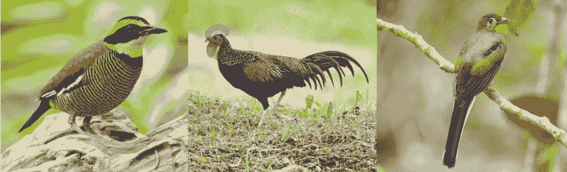

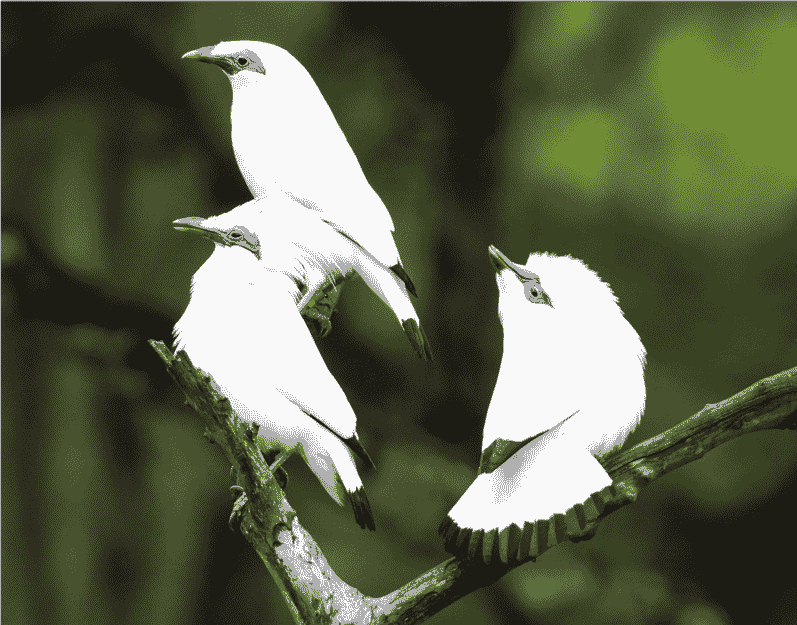

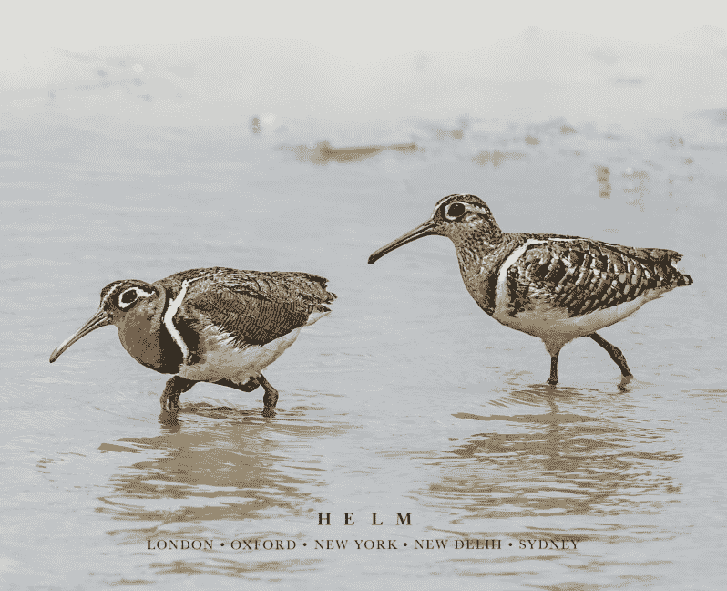

设计：Susan McIntyre

欲了解更多关于我们的作者和书籍，请访问`www.bloomsbury.com`并订阅我们的通讯邮件。

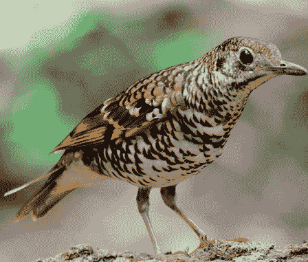

# 区域地图

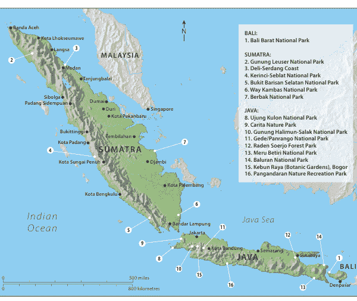

# 引言

巴厘岛、苏门答腊岛和爪哇岛总面积约 613,000 平公里，几乎是英国面积 2.5 倍，拥有约 700 种鸟类。拥有如此丰富的鸟类，鸟类因其美观和鸣声而被广泛饲养也并不意外。如今前往该地区的游客日益增加，他们一定会注意到许多房屋的檐下都挂着鸟笼。仔细观察会发现，许多被圈养的物种与世界各地宠物店中发现的物种相同。圈养状态下的许多物种往往与曾经发现的物种相同。幸运，尽管国际贸易已经停止，但当地市场仍然存在。如果地址发生变化或网站消失，作者和出版者对造成的任何不便深表歉意，但不对此类更改承担责任。

目前只有爪��灭绝，但许多其他物种，尤其是巴厘鸟正处于灭绝边缘。巴厘鸟的消失有广泛记载，很大程度上是因为非法捕获，受到人类干扰和栖息地丧失的影响。这种悲剧性的画面在许多其他物种身上重复，包括爪雀、�鸢和黑翅八��。

幸运的是，印尼当局联合国际保护组织已经认识到了保护的紧迫性，现在大部分地区已被划为国家公园和保护区，以保护野生动物。游客应注意，进入许多保护区需要正式许可，并可能需要提前安排。即使在保护区外，受威胁最大的动物在理论上也受到了保护。

在本书的篇幅限制内，涵盖在巴厘岛、苏门答腊岛和爪哇岛记录的所有约 700 种鸟类是不可能的。因此，选择是基于在该地区较为常见的鸟类。还加入了一些不常见但有趣且更壮观的物种，以揭示那里巨大的生物多样性，并对其特质提供理解。

书中介绍的 322 种物种包含了在该地区可能遇到的大多数科的合理代表。读者无疑会遇到其他物种，这些物种在列出的更专业（但更笨重）的书或互联网上有所介绍。

# 观鸟

对于我们大多数人来说，观鸟是一项让我们接近自然的爱好。这是一种体验世界并了解居住在其中的奇特生物的回报方式。无论你是资深专家还是业余观察者，观鸟都能带来丰富的发现和快乐。在巴厘、苏门答腊和爪哇地区，鸟类的多样性使其成为一个真正值得探索的地方。

## 观鸟辅助

拥有正确的设备对于任何观鸟体验都至关重要。一个好的双远镜是最重要的工具，允许你从远处观察和识别鸟类。望远镜对于观察远处鸟类的细节也很有用。鸟类指南对于识别物种是不可或缺，对于想要拍摄照片的人来说，带有长焦镜的相机通常是必要的。数字录音机也可用于录制鸟鸣，这有助于识别。最后，笔记本和笔对于记录观察结果和笔记非常有用。

# 如何使用本书

照片尽可能描绘了鸟类常见形态中的形态，无论是雄性还是雌性，并在文中简要描述了变异。书中涵盖的 322 种鸟类的顺序和命名通常遵循由`Avibase`– 世界鸟类数据库所采用的国际鸟类学界（IOC）分类法，以及康奈尔鸟类学实验室的现用术语。虽然存在其他清单，但基于更近期科学知识的修订过程将持续进行。在本书编写期间，国际鸟类学家联盟（IOU）正致力于一项共同努力，成立鸟类清单工作组（WGAC），旨在编制并维护一份开放获取的全球鸟物种清单，以统一分类法。因此，可以预料不仅学名将变得更加可靠。书中使用的名称遵循了 Eaton, J.A., van Balen, B., Brickle, N.W. 和 Rheandt, F.E. 所著第二版《印度尼西亚群岛的鸟类：大巽他岛和瓦拉西亚》（2021）中所含最新科学数据。

每个物种的描述都包括英文名称、学名，以及已知的正式印尼语名称。作为体型指南，提供了该物种从喙尖到尾末的总体长度。其余描述未遵循任何特定顺序，但提供了进行相当可靠识别所需的大多数线索。只有少数物种尝试描述了鸣叫声和歌声，因为人们认为如果没有听过实际声音的经验，这些描述是毫无意义的。尽管如此，声音的价值不应被低估。在许多情况下，它是成功识别物种的唯一决定因素。大部分描述不可避免是简短的，并使用大多数鸟类书籍采用的半技术语言编写，但为了方便理解，鸟类学家所使用的许多技术术语在第 218 页的词表中进行了解释。

# 关于照片的说明

除非另有说明，所有图像显示的都是成年羽色。请参考下方的索引获取更多信息：

- `male` – 雄性 – `female` – 雌性
- `imm.` – 未成年
- `ju.` – 幼鸟（亚成）
- `var.` – 变种
- `non br.` – 非繁殖期

爪哇、苏门答腊和巴厘岛位于东南亚板块的边缘，该板块压在澳洲-印度板块之上，产生了剧烈的地质活动。一排火山（部分仍然活跃，其他处于休眠状态）沿岛屿链形成了脊线。在苏门答腊，这些火山形成了巴里桑山脉，横跨整个岛屿，并在西部陡峭没入深海；在东部，坡度较缓，在到达巽达海之前形成了大片沼泽区。在爪哇岛，山脉从冲积平原孤立升起，而在苏门答腊东部，向巽达海方向倾斜。

巴厘岛曾通过陆桥与爪哇岛相连，但现在被 3 公里的湍急水域隔开，这些水以激流闻名。并不意外，巴厘岛的动植物与爪哇岛部具有相似性。然而，苏门答腊与婆罗洲的关系比爪哇岛更为密切。陆地的破碎结合地质和气候活动导致了许多栖息地的形成，反过来支持丰富的野生动物多样性。这包括许多特有种：即仅局限于单一区域或更小区域且在其他地方未发现。

爪哇岛和巴厘岛是地球上人口密度最高的地区之一，剩余野生动物栖息地的破坏是一个严重关注的问题。只有在偏远的山坡上才能找到大片自然森林。少数国家公园和自然保护区内存有低地森林。苏门答腊的人口密度仅为十分之一，情况略好，但农业、种植和林业的增长导致了其森林破坏的增加。

# 鸟类

我们可能会预计这些在不同时期与亚洲大陆相连的陆地具有相似的植物群。然而，由于它们并非同时分离，而且由于随后的局部气候条件各异，鸟类的组成在不同岛屿之间存在显著差异。最近最剧烈的变化是由人类及其对低地森林的破坏造成的。有追溯到 1657 年的大量记录，从 19 世纪早期创立印尼鸟类学的探险家的报告中看出，当时的鸟类比现在丰富得多。

# 何时以及哪里寻找鸟

由于该地区靠近赤道，气候炎热。该地区的季风天气概括为雨季和旱季，两者的温度差异不大。尽管如此，鸟类表现出明显的繁殖周期。在雨季（10 月至次年 3 月），大量北方迁徙候鸟抵达，较少的澳洲物种在旱季出现。

许多水鸟在雨季末尾到达，在淹没景观中孤立树木的安全处筑巢。这也是昆虫繁殖季节的高峰，此时充足的食物供食虫物种抚养幼雏。食果物种则推迟繁殖，直到树木和灌木结出成熟果。

整个地区遍布着栖息地多样性丰富的良好区域。显然，在如此规模的书中列出所有区域是不可能的，但为了引导观鸟者，下方列出了这些主要区域。

# 观鸟地点

## 巴厘岛

### 巴厘西国家公园

位于巴厘岛西部，是干旱森林、湿润森林与沿海灌木丛和树林的混合体。这里可以观察到带雨纹的、黑色的、以及许多巴厘岛特有的鸟类。

### 丁勿西-塞布拉国家公园

该公园包含了丁勿西山峰和丁勿西山谷，是观察苏门答腊山地鸟类的理想地点，如红冠嘴��、红冠凤�� Setup，以及丁勿西山峰。

### 尼尼达岛

尼尼达岛位于巴厘岛东部，严格来说在巴厘岛。在这里你可以看到柠檬腹白眼和巴厘岛特有种。

### 坎巴斯国家公园

位于苏门答腊南部，包含了低地森林和沿海森林。这里记录了许多物种，包括白翅鸭、风暴驸、黑冠嘴��，以及红冠凤鹶。

## 苏门答腊

### 格奴木勒瑟国家公园

这是一个巨大的雨林和山脉区，带有小片沿海延伸。这里是探索苏门答腊北部鸟类的理想地点，如带纹的、黑色的（亚洲）斑鸠，以及冠嘴嘴��和金嘴嘴�。延伸到格鲁普隆山，包含了所有的森林类型和一些非常原始的区域。这里相对较少访问，但可能会带来惊喜。该地区的稀有鸟类包括苏门答腊画尾鸟、冠嘴嘴��、红嘴凤鹶和小嘴鹳类。

### 贝尔巴克国家公园

该保护区位于东岸，包含了沿海森林和泥炭沼泽，以及红树林。这里是观察布蒂克嘴��、华莱莱雕和小鹳类的好区域。

## 爪哇岛

### 乌戎隆国家公园

位于爪哇岛的最西端，乌戎隆拥有了多种栖息地的稀有物种，从低地雨林和常绿森林到沿海灌木丛、红树林和开阔草场。那里有 24 种特有或濒危物种，包括爪哇大嘴鸟、白胸嘴��、爪哇太阳鸟、爪哇雕、蓝喉嘴��和绿孔雀。

绿孔雀。

## Gede/Pangrando 国家公园

这座位于西爪哇的国家公园主要由茂盛的常绿森林组成，但在Pangrando山顶部有苔藓覆盖的矮林和高山草甸。这里是观察许多鸟类的绝佳之地，包括爪哇鹹、爪哇蜡鸫、爪哇鹰雕、栗壳斑鹌、爪哇猫头鹰、爪哇白眼、暗色霍氏鴸、凤雀、山雀、火山金燕和蓝尾翡。

这里还有红树林和拥有优美海滩的相当崎岖的海岸。它是探索程度最少的地区之一，可能会发现新物种。较稀有的鸟类包括锦嘴喙、斑纹啄木、紫锦谷、针尾雀、黑冠绿头、灰斑纹绿鸽、黑喉果鸠、爪哇猫、瀑布（或巨）金燕、黑带凤和月嘴雀。

## Baluran 国家公园

`Baluran`国家公园位于爪哇岛的东北角，覆盖了`Baluran`死火火山周边地区。这里是最容易进行观鸟的地方之一，因为视野更开阔且易于到达，是观察绿孔雀和绿红丛林头鹰的好地方。该地区记录有白腹啄木、东方斑嘴喙、斑点猫头鹰、斑纹画、小大�和灰斑纹嘴雀。

## Meru Betiri 国家公园

`Meru Betiri`涵盖了大面积的湿润原生林和次生林，在这里很难错过黑喉黄鵴、烟头绿胶胶和东方鹊喜。可能看到的其他物种包括黑喉果鸠、冠翠翡、蓝耳翠翡、灰斑纹绿鸽、霍氏嘴雀、华丽蜂鸟、紫喉蜂鸟、山蓝画眉和黄喉鹦。

### 布哥植物园（`Kebun Raya`）

由于交通方便，布哥植物园在周末挤满了当地游客。然而，工作日的访问在相对宁静的环境中会非常有成效。`Kebun Raya`占地1平方公里，优美的环境已建立约两个世纪，提供了观察许多城市和森林鸟类的绝佳机会。这里有一群黑顶夜鹭和爪哇斑嘴八哥鸟。

## Pangaran 自然休闲公园

位于中爪哇岛南岸西拉恰普以西的`Pangandaran`半岛拥有一个自然休闲公园。该公园主要由旱地林组成，是观察绿丛鸡和爪哇斑纹画的好区域。其他存在的物种包括东方斑嘴喙、白腹画��、鳞冠嘴雀和黑背翠翡。东部是`Segara Anakan`的红树林，那里可以看到许多水鸟。在华丽蜂鸟中，在大量的鹭类、白鹭和燕中，可以看到小大�和白鹳。那里还记录有爪哇凤和鹳嘴翠翡。

# 访问国家公园

进入国家公园的费用可以在入口处支付。在大多数印度尼西亚国家公园，步道网络、经验丰富的鸟类导以及靠近最佳观鸟点的住宿都非常有限。

## 弧足绿��鸭（`Dendrocygna arcuata`）40–45cm

印尼语名称：`Belibis Kembang`

羽毛背部、尾部和胸部通常为深栗褐色，但尾下羽为白色，并有一排边缘黑色的白色羽露出折叠的翅膀。头部和颈部呈较浅棕色，后颈有一条深棕色长形冠。腿为黑褐色，喙为黑色。这种鸟在飞行时会发出一系列高频的哨叫声和叽啾声。

**观赏地点：** 整个地区的河流、淡水湖、湿沼泽、海岸湿地和红树林湿地。

## 棉羽绿鸭（`Nettapus coromandelianus`）30–35cm

印尼语名称：`Trutu Kapas`

这是一种小型黑白水鸭，雄性以白色为主，冠部、背部、翅膀和尾部有虹光黑色羽毛，并有一圈颈环。雌性的羽毛颜色较暗，雄性白色的地方为肉褐色白色，雄性黑色的地方为棕色；她有一条棕色的眼纹且没有颈环。飞行时，雄性会显示白色翅斑。

**观赏地点：** 遍布爪哇、巴厘以及苏门答腊北部海岸的湿地沼泽、湖泊、被淹的稻田和草地。稀有。与大多数野生动物不同，该物种经常栖息在树上，通常在树洞中筑巢。

## 斑纹水鸭（`Spatula querquedula`）37–41 cm

该地区的雄性通常处于换羽期，看起来像雌性。它们有棕色横纹羽毛和对比鲜明的头部图案，留有浅色的眉纹、深色的眼纹，以及纯白色的喉部。颈部和胸部为红褐色并缀有白色斑点。它有绿色的上翅镜羽，上下各有一个白色边缘。延长的肩部羽有灰色、深绿色、黑色和白色的条纹，上翅覆羽为蓝灰色。侧腹有精细的灰色花纹，腹部为白色。

喙为黑灰色，眼睛为红褐色，腿和足为灰色。

**观赏地点：** 见于整个地区，但较稀少；出现在沼泽、淡水湖、稻田、海岸盐沼、泥涂层和近岸水域。

## 宽眉黑水鸭（`Anas superciliosa`）47–60cm

印尼语名称：`Itik Alis`

“黑鸭”这个名称是一个误称，因为这种鸟的身体羽毛只有在飞行时与明显的白色翅下羽对比时看起来才是黑色。

它实际上是深棕色的，头部黑白相间。镜羽为虹绿色和紫色，腿为黄褐色，喙为灰色。

**观赏地点：** 见于整个地区，但在苏门答腊较少。这是一种浮食性水鸭，在浅水中嬉水。仅限于东爪哇和巴厘岛的山湖，但经常在沼泽和草地觅食。

## 凤尾环绿雉（`Rollulus rouloul`）25cm

印尼语名称：`Puyuh Sengayan`

非常独特的雄性在白色冠部上方长着一个华丽的簇状、刺状的红冠。它的整体羽毛为带紫色光泽的黑蓝色，向尾部渐深；翅膀为深红褐色。雌性缺乏绿色身体和灰色头部；翅膀为深栗色。它们有红腿，眼睛周围有裸露红色皮肤。喙为黑色，雄性基部更红。

**观赏地点：** 苏门答腊的低地泥炭沼和山林，它们以家庭为群聚集，寻找种子、昆虫和掉落果实。

## 栗腹斑鹌鹌（`Arborophila javanica`）27cm

印尼语名称：`Puyuh-gong Jawa`

爪哇岛特有，每个亚种都有不同的头部图案，红褐色带有黑色斑纹和黑色领圈。胸部从灰色过渡到栗色，腹部白色。侧腹为栗色，背部和尾部为灰褐色横纹，翅膀为棕色并有黑色横纹和小白点。腿为红色，喙为黑黑色。

**观赏地点：** 出现在爪哇山地森林的空地，通常成对出现，偶尔成小群出现，在灌木丛中觅食。

## 大花雉（`Argianus arg`）雄性160–200cm，雌70–75cm

印尼语名称：`Kuau Raja`

该地区雉类中最壮观的物种之一，特别是雄性，极长的二级羽和尾羽用于求偶展示。当尾巴高高并张开翅膀时，美丽的绿色“眼”状标记（眼斑）非常壮观。其他羽毛主要是栗褐色，被浅褐色和黑色的斑点及斑纹打破。雌性通常颜色较深，翅膀和尾巴较短，且没有雄性的眼斑。两性都有短的深棕色冠，头部和颈部稀有裸露蓝色皮肤。

**观赏地点：** 苏门答腊未受破坏的原始雨林。通常是一只雄性伴随着几只雌性。

## 绿孔雀（`Pavo muticus`）雄性：180–250cm，雌性：100–110cm

印尼语：`Merak Hijau`

这种壮丽的雉类主要呈现出幻光绿色，雄性具有明显的眼斑状尾羽，头部有垂直的冠羽。雌性与之相似但颜色更暗淡，腿部和尾巴较短，腹部颜色较浅。幼鸟外表相似，但脸部颈部有几根白羽。在繁殖季节，它们的鸣叫声和响亮的叫声随处可闻，雄性张开尾羽的惊艳展示极具辨识度。

观赏地点：爪哇岛上存在少数当地残留群，巴鲁兰国家公园是最后的据地。

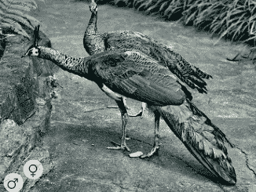

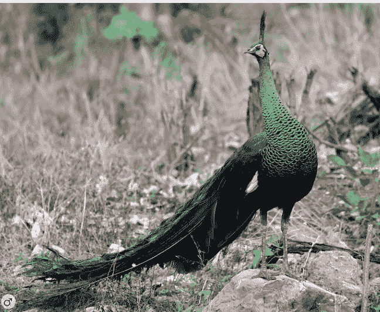

## 蓝胸鹌（`Synocicus chinensis`）12–15cm

该物种的雄性非常独特，但雌性容易与小斑鹌和条纹斑鹌混淆。黄色的脚是主要的区分特征。背部为深棕色并有浅色条纹，雌性比雄性色浅。雄性有明显的黑白围兜花纹，胸部、头部两侧和尾下侧面呈灰蓝色；腹部和下覆羽为亮栗色。雌性的腹部为带褐色斑点的浅褐色，胸部有较深的棕色，喉部有白色斑块，眼纹为浅褐色。刚孵壳的幼鸟非常小，几乎像蜜蜂一样。

观赏地点：稀疏分布于该地区的低地草地、稀树草原和沼泽，有时出现在农耕区。

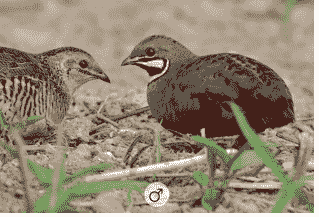

## 红原鸡（`Gallus gallus`）雄性：65–78cm，雌性：41–46cm

印尼语：`Ayam-hutan Merah`

雄性通过其齿状的红色冠、脸部和肉垂、长青铜颈羽以及深绿色的弧形尾羽来识别。它们具有栗色到金色的背部，以及黑绿色的胸部和初覆羽。雌性颜色暗淡得多；各种深浅的棕色，颈部有黑色条纹。喙为肉黄色，腿为板灰色。将野生鸟与普通的家鸡或野化鸡区分来并不容易，但纯野生鸟的雄性尾部、翅膀和颜色均为黑色，雌性为棕色斑点色，具有深灰色的腿和亮橙色的颈羽。

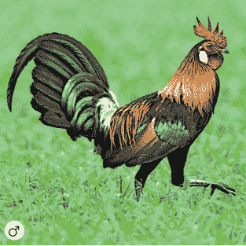

观赏地点：苏门腊北部、爪哇岛和巴厘岛的森林和灌木丛，有时靠近人类居住区。

## 绿原鸡（`Gallus varius`）雄性：65–75cm，雌性：40–46cm

印尼语：`Ayam-hutan Hijau`

这种大型黑绿色雉类与红原鸡相似，但冠为无齿状的紫红色。雄性有红色肉垂，眼睛周围皮肤裸露，光泽的绿色背部和颈部，以及边缘带黄色的幻光绿颈羽，上尾羽和翼覆羽为橙黄色；其余羽毛为黑色。雌性和幼鸟的羽毛不那么艳艳，背部为棕色并稀疏点缀褐色，腹部为褐色并有黑色斑点，喉部为白色。

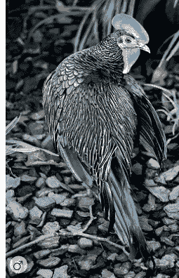

**观赏地点：** 爪哇岛和巴厘岛特有。分布在海岸附近，也分布在内陆森林，偏好开阔的草地，并通常与食草动物在一起。

## 巽门达领喉鸽（`Streptelia bitorquata`）30–33cm

印尼语：`Dederuk Jawa`

不要与其相似的欧亚领喉鸽（`Streptelia decaocto`）混淆。通常呈现为粉褐色的鸟，带有带有白色边缘的宽黑色半领圈。冠部和后脑为浅蓝灰色带粉色，前额为极浅灰色。背部和翼覆羽稍深。腹部为浅粉色，在泄门处和尾下覆羽处变为白色。它有粉褐色的喙、粉色的腿和棕橙色的虹膜。

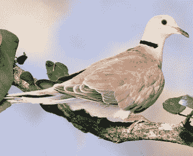

**观赏地点：** 主要出现在巴厘岛和爪哇岛的低地，通常在开阔地区，但也靠近人类居住区。经常看到在地面觅食。

## 东方斑鸠（`Spilopelia chinensis`）30cm

印尼语：`Tekukur Biasa`

这种非常熟悉的鸽子通常呈粉褐色羽毛，飞行羽颜色稍深，背部有深色斑点。颈部两侧都有明显的白色斑点黑斑。外尾羽末端有宽白色，这在飞行时非常明显。它有红色的羽毛和黑喙。

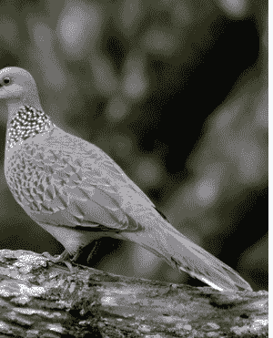

观赏地点：遍布整个地区，从城市花园到农村农田、低地地区的开阔地带和森林边缘，通常在地面觅食。

# 条纹道鸠 *Macropygia unchall* 37–41cm

印尼语：Uncal Loreng

因其较大的体型和背部密集的条纹与其他地斑鸠区分开来，这种鸽子颜色较暗淡；背部为棕色，有密集的黑色条纹。腹部颜色较浅，喉部为褐色，粉色较深并带有细的黑色条纹向泄门处逐渐变浅。头部和后脑为灰褐色，雄性带有绿光。尾巴为黑褐色，有强条纹。它有短黑喙、红脚和黄色虹膜。

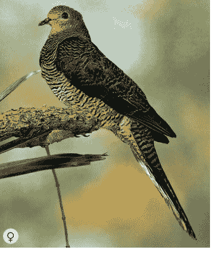

观赏地点：该地区的山地森林。罕见。

# 帕扎基道鸠 *Macropygia emiliana* 30–37cm

印尼语：Uncal Bu

比条纹道鸠小得多，通过褐色胸部和深棕色头部区分。背部为均匀的栗色，带有紫色光泽。腹部为较浅的栗色，翼覆羽有纹。雄性有红腿和棕褐色黑喙。雌性颜色更暗淡，光泽较少。

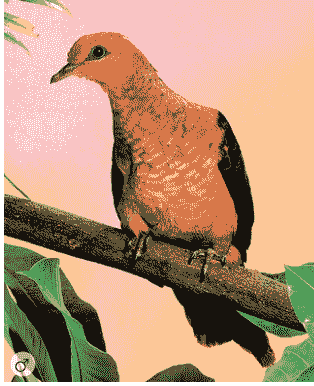

（注：此处原文似乎有文本断层或合并，已根据语境翻译）

24_1.png

观赏地点：分布在爪哇岛和巴厘岛的山地森林，它偏好森林边缘和灌木丛。

# 小道鸠 *Macropygia ruficeps* 29cm

印尼语：Uncal Kan

比其他道鸠小，通过褐色胸部和外尾羽上的深色条纹区分。腹部也有浅条纹，胸部条纹密集，尤其是雌性。雄性后脑有绿色和紫色光泽。它们有红腿和棕褐色黑喙。

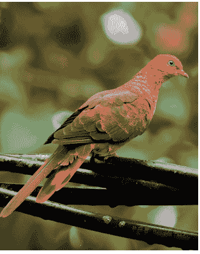

观赏地点：该地区的山地森林常见。通常成群出现，在边缘地草地和成熟稻田觅食。

# 亚洲翡翠鸠 *Chalcophaps indica* 23–27cm

印尼语：Delukan Zamrud

这种美丽的地斑鸠具有翡母绿幻光的翼覆羽和背部，深灰色背上有两条明显的白色横纹。飞行羽和短尾为黑色。腹部、颈部和头部两侧为深粉色。雄性有白色前额，冠和后脑染灰色。雌性颜色更暗淡。喙为亮红色，腿和脚为粉色，眼睛为深褐色。

观赏地点：遍布整个地区，偏好幽密森林、林缘和红树林。

# 条纹斑鸠 *Geopolia maugeus* 22–26cm

印尼语：Perkutut Loreng

条纹鸽因外表相似常与斑鸠鸽（Zebra Dove）混淆，但鸣声明显不同。此外，它胸部到侧腹有更强的黑白条纹，白色腹部和栗色下覆羽，眼睛皮肤裸露，虹膜为浅黄色。

观赏地点：从巴厘岛向东分布，栖息于低地的干燥开阔灌木丛、草地、耕地和林缘，甚至出现在城市。

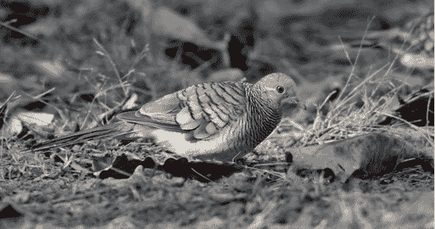

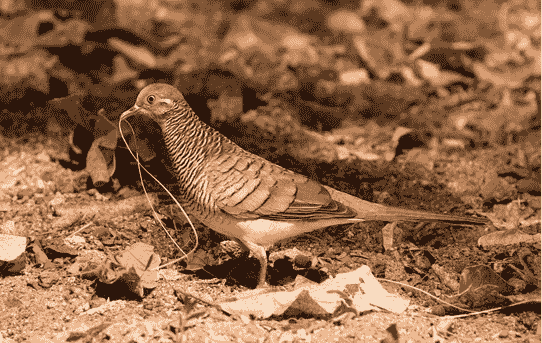

# 斑纹绿鸽 *Geopelia striata* 20cm

印尼语名称：Perkutut Jawa

因其颈部到尾部有细密的棕色横纹而被称为斑纹绿鸽。头部呈浅棕色，过渡到奶油色的面部、冠部、颈部和下巴。长而尖尖的尾巴呈棕黑色相间，外羽末带白色；在起飞时非常明显。当地通常被称为“和平鸽”，但不应与其近缘物种——大洋洲的和平鸽（`Geopelia placida`）混淆。

何处可见：在整个地区稀疏分布。常见于园林、耕作地、开阔草地和灌木丛。这是巴厘岛和爪哇答岛非常常见的笼鸟，在当地的文化神话中具有特殊意义。

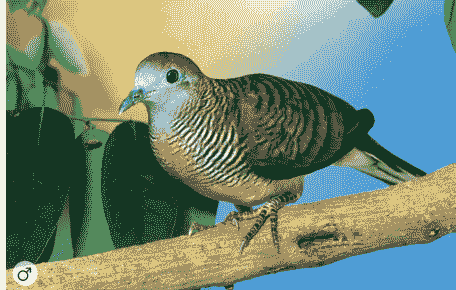

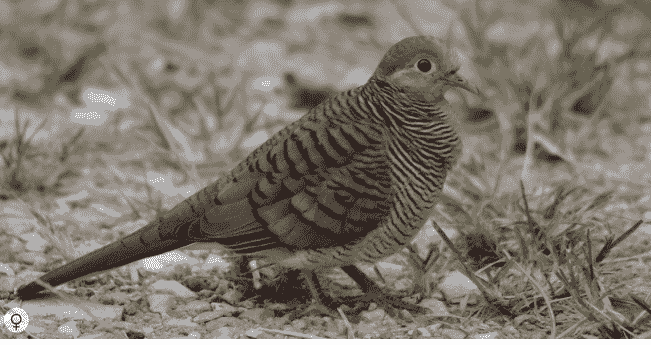

# 灰颊绿鸽 *Treron griseicauda* 25cm

印尼语名称：Punai Penganten

外观呈黄绿色的鸽子，头部为灰色，雌性背部为绿色，雄性背部为栗色。两性眼睛周围都有裸露的绿色皮肤斑块，额头为灰色。黑色的飞行羽边缘带有黄色。中央尾羽为绿色，末端尾羽颜色较深，显示出灰色的亚末端带。尾下覆在雄性为栗色，雌性则较浅。雄性的喙为黄色并带有绿色的蜡膜，与雌性的绿色喙不同。腿为红红色。

何处可见：巴厘岛和爪哇岛特有。栖于低地森林的高树上，有时与其他鸽子一起，栖息在果树上；有时也靠近人类居住区。

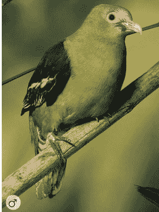

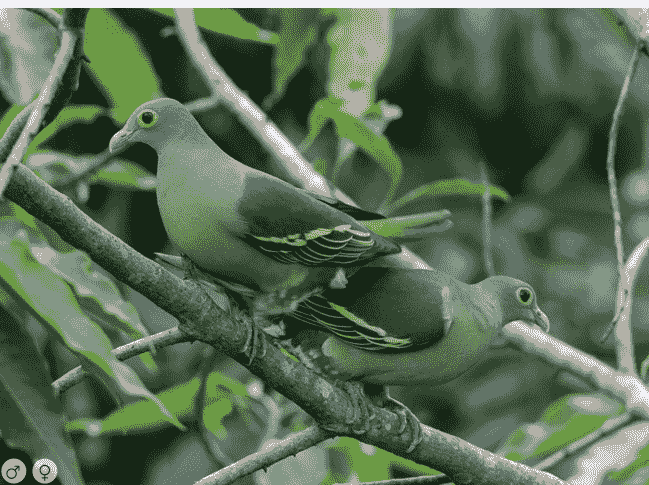

# 粉颈绿鸽 *Treron vernans* 27cm

印尼语名称：Punai Gading

这种小型绿鸽与相似鸽类的区别在于其具有带有黑色带和浅灰色末端的灰色尾巴。雄性的头部为蓝灰色，下胸部融合为粉色到橙色；腹部为黄绿色，背部翅膀为绿色。雌性为绿色，颜色更亮，但可以通过尾部图案以及与特征独特的雄性形伴在一起来识别。它们的叫声是“咕咕”的哨声，进食时则是一系列类似乌鸦的嘎咯声。

何处可见：常见于整个地区的低地、沿海森林、红树林，以及更开阔的乡村地区。当树木结果时，它们变得非常显眼。

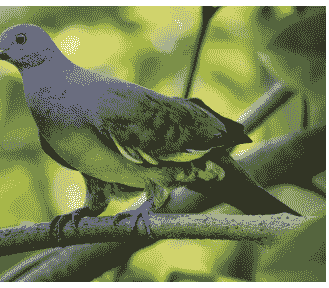

# 黑背果鸽 *Ptilinopus cinctus* 38–44cm

印尼语名称：Walik Putih

一种非常独特的黑白相间的果鸽，腹部和尾门处呈黄色。头部和颈部为灰白色，过渡到上胸的纯白色。一条宽的黑带将上胸与灰色的腹部隔开。背部为极深的绿黑色，过渡到深绿色的尾巴，尾巴有一条灰色末端带。脚为红色，喙为灰色。它们飞行速度迅速，翅膀扇动快速且响亮。

何处可见：在巴厘岛的湿润亚热带低地森林和山区森林可见，通常在果树上觅食。

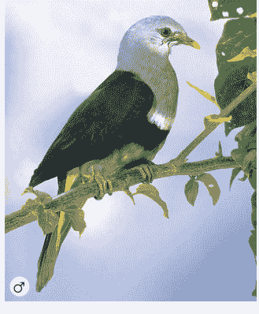

# 粉头果鸽 *Ptilopinus porphyreus* 29cm

印尼语名称：Walik Kepala-ungu

雄性的头部、颈部和喉部是迷人的紫粉色，胸部有一条对比鲜明的白色带，接着是绿黑色带，然后是灰色的腹部，一直到黄色的尾下覆。背部为绿色，脚为粉色，喙为浅绿色，虹膜为橙色。雌性有暗粉色的额部和面部，头部、颈部和喉部其余部分为绿色；胸部有明显的黑白带。

何处可见：分布于整个地区的山区森林。性害羞且不显眼。偶尔会在果树上成群聚集。

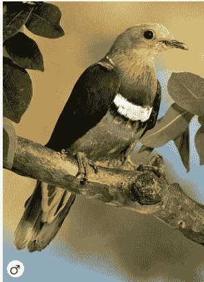

# 黑后脑果鸽 *Ptilopinus melanospilus* 27cm

印尼语名称：Walik Kembang

该物种背部、尾巴和下胸主要为绿色，带有黄色尾门和红色尾下覆。雄性头部为浅灰色，有明显的黑色后脑和黄色喉部。它们有红色的脚和绿黄色的喙。雌性和幼鸟的头部全为绿色，幼鸟有明显的黄色羽缘。通常通过其共鸣的“呜-wook-wook，呜-wook-wook”叫声来识别。

何处可见：在爪哇岛和巴厘岛的低地和高地森林常见，在苏门答腊岛偶尔出现。除了在果树上成群聚集外，很少见到。

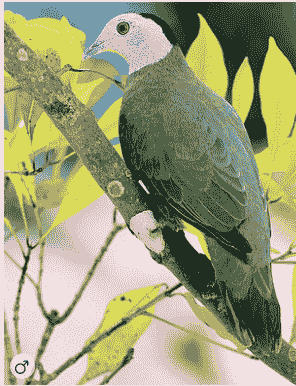

# 绿鸽 *Ducula aenea* 42cm

印尼语名称：Pergam Hijau

头部、颈部和下腹部为柔和的灰色，尾下覆为栗色。背部为绿色，带有青铜光泽。它们有长长的喙和红色的脚。

何处可见：这是该地区最常见的鸽子。栖息于河岸森林和红树林，在树冠上寻找果实。

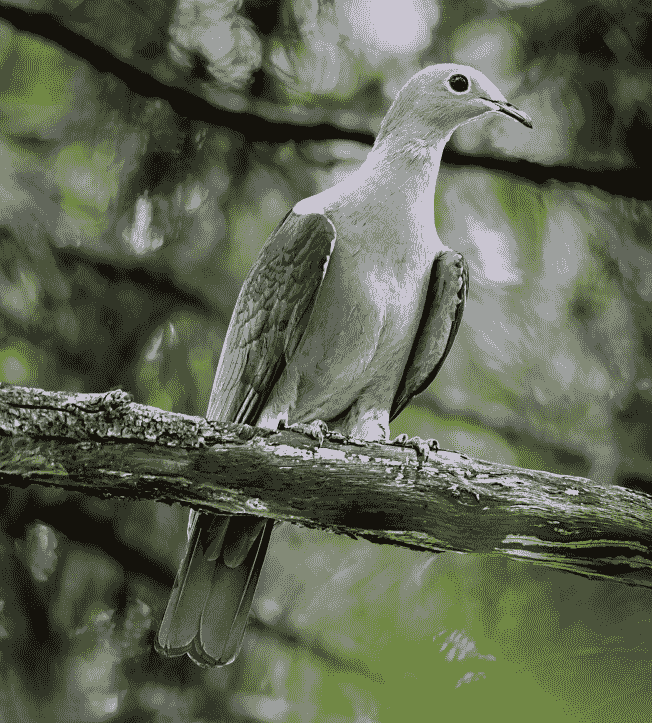

# 山鸽 *Ducula badia* 43–50cm

印尼语名称：Pergam Gunung

以其体型、栗棕色的背部以及浅灰色的头部和下腹部为特征。尾巴有宽带，尾下覆为白色。脚为灰色，喙为深色。

何处可见：苏门答腊的山区森林。

# 斑纹绿鸽 *Ducula biber* 35–42cm

印尼语名称：Pergam Laut

外观呈黄绿色的鸽子，头部为灰色，雌性背部为绿色，雄性背部为栗色。两性眼睛周围都有裸露的绿色皮肤斑块，额头为灰色。黑色的飞行羽边缘带有黄色。中央尾羽为绿色，末端尾羽颜色较深，显示出灰色的亚末端带。尾下覆在雄性为栗色，雌性则较浅。雄性的喙为黄色并带有绿色的蜡膜，与雌性的绿色喙不同。腿为红色。

何处可见：爪哇岛的沿海森林。

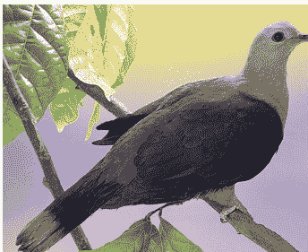

# 爪哇鹃 *Centropus nigrorufus* 46cm

印尼语名称：Bubut Jawa

该物种背部、尾巴和下胸主要为绿色，带有黄色尾门和红色尾下覆。雄性头部为浅灰色，有明显的黑色后脑和黄色喉部。它们有红色的脚和绿黄色的喙。雌性和幼鸟的头部全为绿色，幼鸟有明显的黄色羽缘。通常通过其共鸣的“呜-wook-wook，呜-wook-wook”叫声来识别。

何处可见：爪哇岛特有，常见于灌木丛中。

# 大鹃 *Centropus sinensis* 47–53cm

印尼语名称：Bubut Besar

这种巨大的类乌鸦鸟具有栗棕色的翅膀和背部，经常在灌木丛中可见。它们有长喙和红脚。它的叫声是响亮且低沉的。

何处可见：巴厘岛的低地森林。

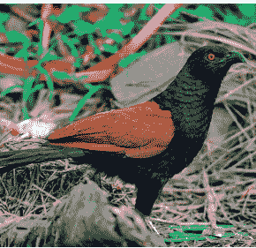

# 小鹃 *Centrus bengalensis* 31–35cm

印尼语名称：Bubut Alang-alang

较小的鹃类之一，拥有非常长的脚趾。羽毛颜色深，主要是黑色，带有红褐色的翅膀和长尾巴。繁殖期头部和上背部有光泽并带有深色羽缘，但在其他时期颜色较暗，羽缘呈白色。这一特征延伸到覆羽，覆羽带有白色条纹棕色羽毛。幼鸟有红棕色横纹下部，羽缘呈米白色，下部为浅褐色，尾下覆有黑色横纹。

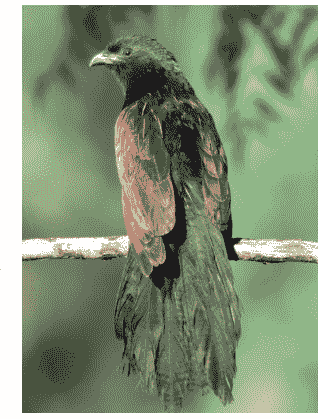

何处可见：遍布整个地区，主要在开阔的低地湿地，生长在芒茅草丛和低矮树木中。

# 栗胸画鹃 *Phaenicophaeus curvirostris* 42–50cm

印尼语名称：Kadalan Birah

通过巨大的弯曲喙很容易识别；上喙为浅黄色，下喙为棕红色或黑色。眼睛周围有红色皮肤斑块。雄性的虹膜为浅蓝色，而雌性为黄色。头部为灰色，带有细白色眉纹，下部和臀部。翅膀为深绿色到深蓝色，脚为深灰色到黑色。幼鸟喙为黄色，下喙部分黑色。

何处可见：栖于整个地区潮湿原始林和红树林的密林中，通常捕食小型脊椎动物、昆虫、小型甲壳动物，有时也吃无花果。

# 红嘴锦兜 *Phaeniculopheus javanicus* 42–44cm

印尼语名称：Kadalan Kembang

因其体型巨大且强壮的红喙与该地区的其他锦兜区分开来。背部呈中灰色，泛着淡蓝绿色的虹光栗色，胸部上方有一条深灰色条纹，灰色的尾羽末端带白色。眼睛周围环着一片裸露的蓝色皮肤，腿为灰色。幼鸟的喙呈较红色，尖端为黑色。可以通过其哀哀的叫声找到它们。

分布地：分布于爪哇岛和苏门答腊的森林和低矮丘陵，出现在次生灌木丛和常绿森林边缘；通常成对或小群群活动，在空茅草丛中觅食。

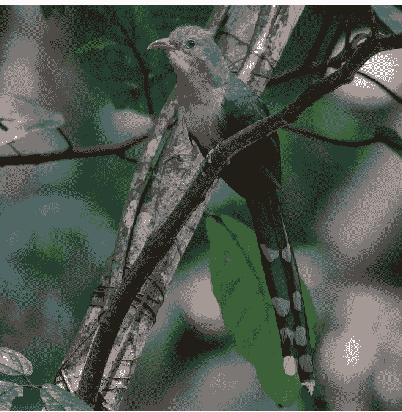

# 霍斯菲德铜鹃 *Chrysococcyx basalis* 17cm

印尼语名称：Kedasi Australia

一种小型杜鹃，其特征是本为部分棕色横纹的背部上带有绿色和青铜色的虹光色泽，并有白色的眉纹和一条棕色的眼纹。下腹部呈浅褐色，颈部有浅棕色斑纹，纹向侧腹和尾下羽处斑纹加深，但腹部中心呈白色。脚和眼圈为灰色，细长的喙为黑色，虹膜为红褐色。幼鸟通常颜色较暗，条纹少得多，虹膜呈较浅灰褐色。

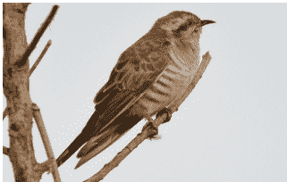

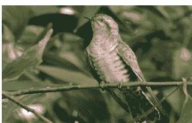

分布地：在3月和4月作为迁徙鸟出现在巴厘岛和爪哇岛，偶尔出现在苏门答腊南部，通常栖息在沿海干燥的开阔林地。

# 斑纹海鹃 *Cacomantis sonnerati* 22–23cm

印尼语名称：Wiwik Lurik

出现在爪哇岛和巴厘岛的成鸟背部呈亮锈棕褐色，并有深色横纹，下腹为灰白色，带有细密的棕色横纹。它们在棕色眼纹上方有一条宽宽的灰白色眉纹，下方有一条白线。虹膜为灰褐色。喙为黑色，腿为灰色。幼鸟的区别在于冠顶和背部的羽毛末端带白色。苏门答腊的鸟类颜色更深，背部呈现更多青铜色虹光。腿部较黄，虹膜浅得多。

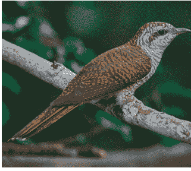

分布地：遍布整个地区。出现在低地森林边缘。稀有。

# 哀鹃 *Cacomantis merulinus* 18–23cm

印尼语名称：Wiwik Kelabu

成鸟头部、颈部和上胸部为浅灰色，与灰色的翅膀和背部形成对比。胸部的灰色过渡到浅灰色，然后变为锈褐色，在泄殖处变为黄褐色。尾羽为灰色，末端带白色。红褐色的虹膜周围环绕着狭窄的白色眼圈。喙为黑色，腿为黄褐色。

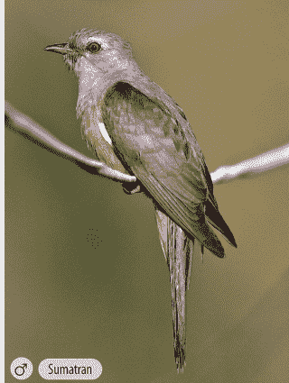

分布地：遍布该地区的低地，特别是在稀疏林地中，有时出现在城镇和村庄。

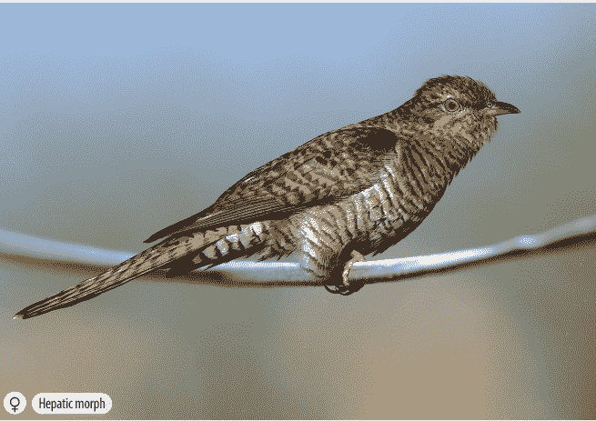

## 巽刷鹃 `Cacomantis sepulcralis` 21–28cm

印尼语名称：Wiwik Ucuing

成鸟上部为灰色，头部也是灰色。翅膀为灰褐色，略带绿色光泽。尾羽为黑色，末端带白色，外缘似乎有白色的水平V形斑块。下巴上方为灰色，上胸部平整，向泄殖处颜色变浅。虹膜为褐色，眼圈为亮黄色，脚为黄褐色，喙为黑色，基部有时为黄色。雌性下胸有轻微的灰色横纹。幼鸟颜色较暗，羽毛有棕色横纹。

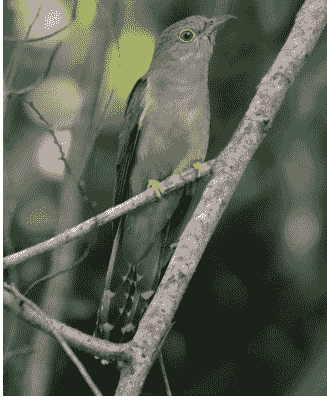

**在哪里**：遍布整个地区，通常出现在森林边缘和孤立的红树林中。

## 杜鹃 `Surniculus lugubris` 23–25cm

印尼语名称：Kedasi-hitam

这种主要是黑色的杜鹃拥有像牛緷一样的方形叉尾。其背部为亮光黑色，下部为棕黑色，唯有尾下羽有白色条纹，大腿部全白。喙为黑色，腿为灰色，虹膜为灰褐色。雌性颜色较暗，虹膜为黄色。幼鸟与成鸟相似，但头部、胸部和翅膀上有白色斑点。它们响亮而清晰的叫声是一组上升音阶的鸣唱声。

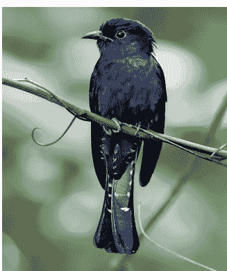

**在哪里**：出现在整个地区的低地森林。

## 大巴西鹃 `Hierocococcyx sparvervioides` 38–40cm

印尼语名称：Kangkok Besar

这种鸟是鹰鹃属中最大的，成鸟背部为棕色，尾部有棕色横纹、黑色亚末端带和纤细的白色末端。头部为灰色，有明显的黄色眼圈和橙色虹膜。它不像其他鹰鹃那样有白色后颈。上胸和腹部为白色褐色，带有密集的棕色斑纹和横纹，上胸呈锈褐色。下腹和泄殖处为灰白色。上喙为黑色，下喙基部为黑黄色。腿为橙黄色。

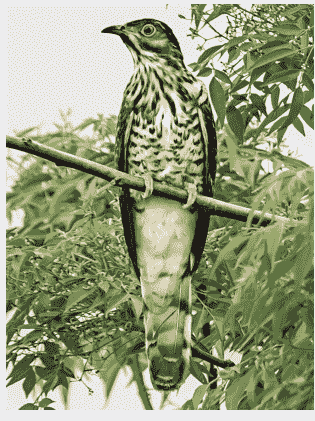

分布地：遍布整个地区，主要在低地森林和灌木丛。

## 普通杜鹃 `Cuculus canorus` 32–34cm

印尼语名称：Kangkok

背部为棕褐色，带有锈色和横纹背部。头部为灰色，有明显的黄色眼圈和橙色虹膜。它不像其他鹰鹃那样有白色后颈。上胸和腹部为白色褐色，带有密集的棕色斑纹和横纹，上胸呈锈褐色。下腹和泄殖处为灰白色。上喙为黑色，下喙基部为黑黄色。腿为橙黄色。

## 金丝燕 `Aerodramus fuciphagus` 11–13cm

印尼语名称：Walet Sarang-putih

在飞行时很难与其他雨燕区分。羽毛整体呈褐色，喉部、腹部和尾背部呈灰色。苏门答腊的鸟类颜色通常更深。

**观赏：** 它们自然栖息在该地区的阴暗洞穴中，利用回声定位导航。今天，这种雨燕在印度尼西亚已成为项大生意，人们鼓励它们在废弃建筑中筑巢，以便采集巢窝制作燕窝。

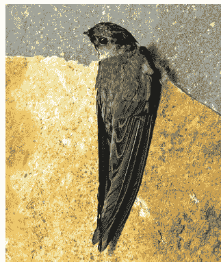

## 燕 `Apus nipalensis` 14–15cm

印尼语名称：Kapinis Rumah

这种中型雨燕可以通过宽大的白色尾部、浅色喉部和略微凹缺的尾巴来识别，与其相似但体更大的太平洋雨燕（`Apus pacificus`）不同，后者的尾巴有明显的叉形。除此之外，它有黑色羽毛、黑喙和棕色脚。

**观赏：** 通常成群出现在开阔的乡村地区上空捕食昆虫。它们偏好沿海栖息地和低矮丘，经常出现在城镇和村庄，在房屋屋檐下筑巢。它们还利用悬出的崖壁和岩洞口作为筑巢地。

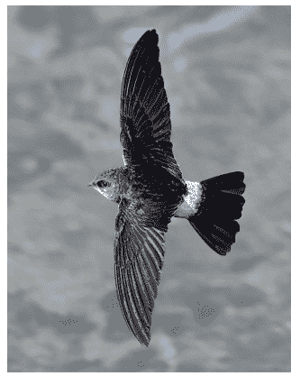

## 须树雀 `Hemiprocne comata` 15–17cm

比在该地区出现的灰尾树雀（`Hemiprocne longipennis`）要小。有长而略微叉的尾巴和退化的冠羽。雄性身体、头部和喉部大部分呈深绿青色，由长白色眉纹和须纹形成对比，须纹之间被深栗褐色的耳羽隔开。腹部和三缘羽呈白色。雌性非常相似，但耳羽为深蓝绿色。幼鸟颜色较暗且偏褐。

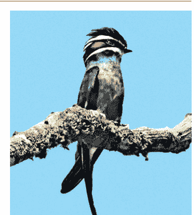

**观赏：** 出没于苏门答腊，主要在低地原生林、次生林或带有高树的林地。

## 黑水鸡 `Gallinula chloropus` 30–35cm

印尼语名称：Mandar Batu

这种适应性极强的水鸟几乎完全是深灰色到黑色，侧面有一条断续的白纹。它在尾部也显示出白斑，特别是当它抬起尾巴冲向避难所时。它有特征性的额盾和喙，喙尖呈黄色。腿为绿黄色。

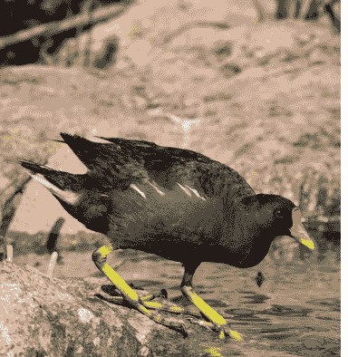

**观赏：** 经常出没于该地区的淡水池、河流和稻田。它是一个良好的水面游泳者，会潜水甚至在水面上奔跑。

## 紫秧鸡 `Porphyrio porphyrio` 40–48cm

印尼语名称：Mandar Besar

极易识别，是一种大型蓝黑色秧鸡，拥有硕大的亮红色喙和额盾，上背部和颈部侧面有紫色光泽。上翼羽为黑色并衬有绿色阴影，尾下羽为白色。它长而笨拙的粉色长腿配着巨大的开阔趾，是踏过和越过水生植物的理想工具。它们习惯抖动尾巴。

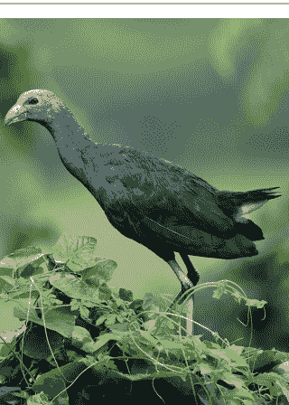

**观赏：** 遍布整个地区。这种安静且谨慎，栖留在芦苇边缘、沼泽，偶尔出现在稻田。

## 白胸秧 `Amauroornis phoenicurus` 28–33cm

印尼语名称：Kareo Padi

这种明显的秧鸡有白色的脸、前颈和胸部，并有栗色的侧腹和下腹，与深绿色的背部形成鲜明对比。喙为灰绿色带红底，腿脚为黄色。它们在黎明和黄昏时分非常活跃，发出嘈杂的鸣声、咕噜声和咯咯声。

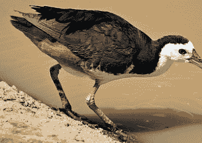

**观赏：** 出于整个地区的湿地。它是一种游击，经常出现在开阔处但远离茂密植被。它非常敏捷，在浮植物上奔跑并穿过丛林寻找昆虫。

## 红脚秧 `Rallina fasciciata` 22–25cm

印尼语名称：Tikusan Ceruling

红褐色的背部和头部是这种秧脚的特征。其余上部为灰褐色。下部和前翅有黑白横纹。它有绿喙。雌性头部更粉红，身体下部的横纹较窄。幼鸟标记不明显，下部较浅，脚呈褐色。

**观赏：** 出于潮湿的低地林缘。

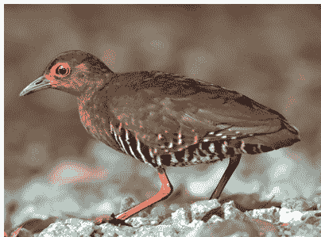

## 栗胸秧 `Zapornia fusca` 21–23cm

印尼语名称：Tikusan Merah

容易与该地区的其他秧混淆，它有红喙和红胸，栗褐色的下部有细横纹。

**观赏：** 出于整个地区的湿地、稻田，偶尔出现在沼泽。

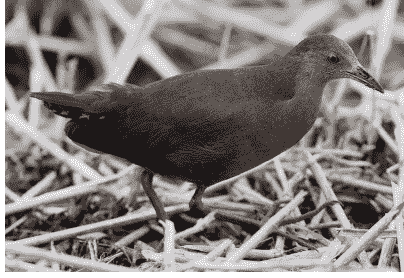

## 鸻 `Esacus magniroststris` 51–57cm

印尼语名称：Gagang-bay

这种壮实的海鸟有短弯喙和长黄腿。飞行时，它显示出浅色的翼带和尾背，下方有一块白斑。

**观赏：** 作为留鸟遍布整个地区。出现在沙质和岩石质海滩。

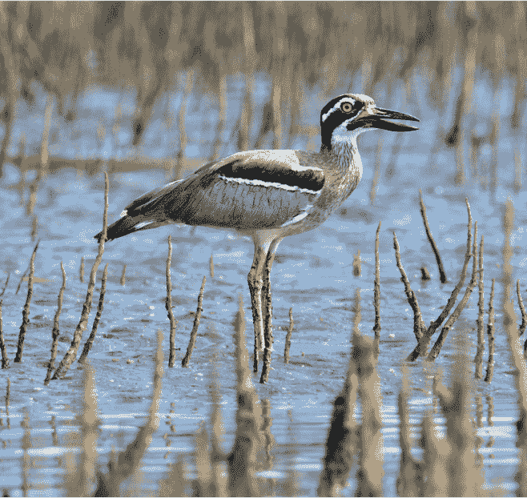

## 黑翅鸻 `Himantopus himantopus` 35–39cm

印尼语名称：Gagang Timur

这种高大而优雅的海鸟有长粉色腿、细脖子大头部。它的上部为黑色，下部为白色。

**观赏：** 主要出现在苏门答腊北部和爪爪腊，偏好浅水区和稻田。

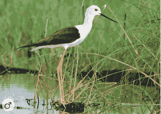

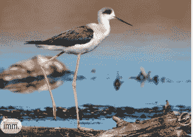

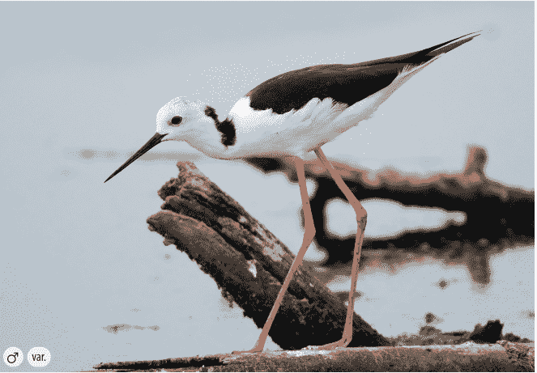

## 灰鸻 `Pluvialis squaratola` 27–30cm

印尼语名称：Cerek Besar

冬羽期，这种迷人的水鸟上部呈斑驳灰褐色，下部为浅灰色到白色。它有模糊的浅色眉纹、黑喙、深灰色腿和大黑眼睛。飞行时，它显示出浅色的翼带和尾背，下方身体处有一个白斑和一个大黑斑。这些特征很容易与太平洋鸻区分开，后者体型稍小且喙较短。

**观赏：** 作为冬季访客出现在该地区。成小群出现在潮间泥滩上捕食海洋无脊椎动物，经常栖息在孤立的石脊上。

## 太平洋鸻 `Pluvialis fulva` 23–26cm

印尼语名称：Cerek Kernyut

典型的鸻形状，直立姿态，身体健壮，脖子头部大，喙短而有力。在该地区它通常处于非繁殖羽期，失去了在繁殖地的标志性黑脸和下部。可以通过其斑点的金色、褐色和栗色上部，以及栗色的胸部、脸和眉纹来识别。喙为黑色，腿为灰色。

**观赏：** 这种冬季迁徙鸟停留在巽达群岛沿岸，经常成群聚集。它们在海滨附近的泥滩和开阔草地上很常见。

## 大沙鸻 `Anarhynchus leschenaultii` 22–25cm

这种棕色、白色和灰色的鸻与其他涉水鸟聚集在一起，特别是在泥滩和沙质河口海滩上的较小的青斑鸻。它最易于区分的特征是其更粗壮、微膨胀的喙，与可能遇到的所有其他冬候鸻不同，后者通常显示出胸带或颈环，且腿部较短。只有早期到达的个体可能显示出繁殖羽的残余，并带有褐色的胸带。

观赏地点：作为冬季候客出现在巴厘岛和爪哇岛的泥滩和海滩。

## 肯亚鸻 `Anarhynchus alexandrinus` 15–18cm

印尼语：Cerek Tilil

在繁殖羽下，雄性眼睛下方有一条黑色纹线，延伸至耳部，并在红褐色的冠部和颈部有一个黑色斑块。下部、下巴、脸颊、额头、条纹和颈环均为白色。胸部两侧有黑色区域，上部为沙棕色。喙和腿呈黑色。雌性和非繁殖期雄性体色更为普通，雄性的黑色区域变为深棕色。

观赏地点：遍布整个地区，主要在平坦的沿海海滩、湖泊和水道，极少出现在岩石岸。

## 西藏鸻 `Anarhynchus atrifrons` 18–21cm

印尼语：Cerek-pasir Tibet

容易与体型更大、腿更长的沙鸻混淆，尤其是当单只看到它时。它的头部更圆，喙更短且更细。成鸟在栗色冠部下有完整的黑色面罩，白色喉部上方有一条宽的红褐色胸带，延伸至侧腹。腿为灰色。非繁殖期鸟类颜色要暗得多，缺乏黑色和红褐色的斑纹。幼鸟也相似。

观赏地点：作为冬季候客出现在该地区平坦的沿海海滩和泥滩。

## 大斑斑嘴鹬 `Rostratula benghalensis` 23–28cm

印尼语：Berkik-kembang Besar

一种体态丰满的涉水鸟，带有微下弯的污黄色喙（雌性喙尖为黑色），从肩部到胸部有明显的窄白带。强烈的雌雄异异与常相反相反。体型较大的雌性显示出更亮、更显著的特征，具有更长的黑绿色翅膀和深栗色的上部，包括下半头部、颈部和胸部。一条白纹从白色眼环向后延伸。腿为黄色。雄性颜色较暗，翅膀和背部有黄褐色的条纹。

观赏地点：遍布整个地区的沿海、淡水沼泽和草地。

## 凤脚白危 `Hydrophasianus chirurgus`

繁殖羽长 40–58cm，平时为 30–31cm

印尼语：Burung-sepatu Teratai

繁殖期成鸟显示长黑尾巴和黑色下部，棕色的背部和肩羽与下方的白色翅斑形成对比。外飞羽为黑色。头部前方和颈部为白色，被一条细黑线与黄色的颈部和后颈分开。腿为浅灰色。非繁殖期时尾巴变得短很多，上部颜色更褐。下胸变为白色，但保留了颈部下方的一些黑色羽毛。幼鸟羽色更暗，与非繁殖期鸟相似，缺乏颈部的黄色，并有褐色的冠部。

观赏地点：该地区湿地的一种较为罕见的迁徙鸟。

## 欧亚亚鹬 `Numenius phaeopus` 40–46cm

一种大型长腿涉水鸟，颈部长，喙相对较短且下弯，腿为灰色。它的羽毛有密集的棕色斑点，在黄褐色眉纹和深色眼纹上方有一条明显的黑色冠纹。飞行时，显示出白色的腹部、尾部和下背部。通常很安静，受惊时经常会发出颤鸣的鸣声。

观赏地点：该地区常见的访客。通常聚集在潮汐泥滩，偶尔与其他涉水鸟一起出现在沿海沼泽和荒草地。

## 欧亚游鹬 `Numenius arquata` 50–60cm

印尼语名称：Gajahan

这种游鹬具有极好的伪装。羽色变化多变，主要是浅棕褐色。它有白色的腹部和尾部，腿为灰色。长且下弯的喙在雌性身上更长。飞行时，翅部显示出白色楔形。其名称源于飞行时发出的叫声。

观赏地点：作为冬季候客出现在该地区的湿地和海滩。

## 长嘴鹬 `Limosa lapponica` 37–40cm

印尼语：Ekor-laut

这种鹬体型较大，腿部直，与黑背游鹬（`Limosa limosa`）同时出现。羽毛斑点非常严重。它有白色的腹部和尾部，上部棕褐色。黑色斑块有助于与其他涉水鸟区分开来。

观赏地点：作为不常见的冬季候客出现在该地区的潮汐泥滩、沿海沼泽和荒草地。

## 红颈亚极 `Calidris ruficollis` 13–16cm

印尼语：Kedidi Leher-merah

非繁殖羽下具有浅灰色的上部和白色下部，喙和腿为黑色。这种小型涉水鸟的上部带有深浅不一的棕色标记。与小亚极（`Calidris minuta`）相似，后者在该地区很少见。

观赏地点：该地区常见的迁徙鸟，通常成群出现在河口、海滩以及淡水池塘和稻田。

## 亚极 `Calidris alba` 20cm

非繁殖羽下，它具有浅灰色的上部和白色下部，喙和脚为黑色。黑色斑块有助于与其他涉水鸟区分开来。飞行时显示黑色飞羽和明显的白色翼带。

观赏地点：作为不常见的非繁殖迁徙鸟出现在整个地区，几乎完全出现在沙滩上，通常跟随退潮的海浪觅食海洋无脊椎动物。

## 大鹬 `Gallinago gallinago` 25–27cm

印尼语：Bercik Ekor-kipas

容易与扇鹬（`Gallinago stenura`）和斯氏乌大鹬（`Gallinago megalura`）混淆，非常难以区分。它有长长的、尖为黑色的黄色喙，白色下部在侧腹和腹部有密集的棕色斑。上部为棕色，黄褐色羽毛边缘从背部到尾部形成条纹。它有深棕色的眼纹和宽的黄褐色眉纹。喉部和颈部也是黄褐色的。腿为黄色。飞行快速且不稳定，翅膀非常尖。

观赏地点：偶尔出现在爪哇岛和巴厘岛的开放淡水沼泽、河口、盐碱沼泽和稻田。

## 普通沙鹬 `Actitis hypoleucus` 19–21cm

印尼语名称：Trinil Pantai

这种沙鹬上部为棕色，下部为白色，有一块棕色斑从颈部延伸到侧腹。在飞行时，其白褐相间的条纹外尾羽清晰可见，白色的翅缘斑也是如此。这是一种非常忙碌的觅食者，尾部不断抖动。当受到骚扰时，它们通常会飞短一段距离并继续觅食，似乎并不干扰。

观赏地点：该地区常见的候鸟。通常单独活动，在沿海泥涂滩和泥泞的河岸觅食，偶尔也会访问上游的沼泽和稻田。

## 灰尾沙鹬 `Tringa brevipes` 23–27cm

印尼语名称：Trinil Ekor-kelabu

它的上部呈均匀的浅褐色，头部、颈部和胸部的灰色稍浅。腹部、颈部和尾端下为白色。下巴和颈部为白色至灰色。短腿为黄色，喙为黑色且基部呈黄色。雌性比雄性略大，幼鸟的上部呈现白色斑点状。

观赏地点：大多数候鸟涉水类的典型代表，经常出现在潮间带泥涂滩和碎石岸线，也出现在长有海草床的岩石上。一种在该地区东部更为常见的候鸟。

## 普通红脚鹬 `Tringa totanus` 27–29cm

印尼语名称：Trinil Kaki-merah

这种长红腿的涉水类从头部到臀部覆有棕褐色的黑色斑点上部。喉部、胸部和腹部颜色较浅，黑色斑点更明显。尾部有灰黑与白色相间的条纹，喙基部为红色尖端为黑色，黑色的虹膜周围有一圈白色的眼环。

观赏地点：该地区常见的候鸟，广泛分布于河口、盐盐沼和内陆淡水水湿地。

## 斑纹秧鸡 `Turnix suscitator` 16–17cm

印尼语名称：Gemak Loreng

雄性容易与雌性的蓝胸秧鸻（见第21页）混淆，身体呈棕色斑纹，胸部和侧腹有黑色条纹。主要的区分特征是该秧鸻明亮的黄色腿和喙。雌性体较大，具有较深（近黑色）的下巴、喉部和头部，但头部的白色更多。在繁殖季节，晚上可以听到雌性发出短促而重复的咕咕声。

观赏地点：在整个地区都很常见，喜好低地开阔草地和灌木栖息地。

## 东方白燕 `Glareola maldivivarum` 23–25cm

其特征是以浅褐色的羽毛为主，带有白色尾羽和边缘带黑色的淡黄色，并有一圈模糊的黑色颈环。上部棕色稍深，头部有浅色条纹，胸部为深褐色，在泄殖处过渡为白色，飞行羽和分叉尾为黑色。腿为灰黑色，大虹膜为黑色，喙尖端为黑色，基部为暗红色。

观赏地点：常见的冬季候鸟，分布于整个地区。通常在水域附近看到：潮汐泥涂滩、河口、稻田和牧场。

## 黑头鸥 `Larus ridibundus` 37–43cm

印尼语名称：Camar Kepala-hitam

下部和颈部为白色，上部为灰色，包括背部、上覆羽、二级飞羽和内级飞羽。外级飞羽末端带黑色，二级飞羽为灰色带白色，尾巴为白色。除白色后颈外，头部呈棕褐色，并有一圈断断的白色眼环。喙为深红色，腿为浅红色。非繁殖期鸟类的后颈和耳缘羽呈带白色阴影的黑褐色。

观赏地点：作为稀有的冬季访客出现，通常靠近海岸，但也会出现在内陆低地、湖泊、稻田和牧场。

## 烟玄鸥 `Onychoprion fuscusatus` 36–45cm

繁殖羽期成鸟上部和上翅从头部、颈部到背部均为黑色，外尾羽边缘为白色。额头为白色，至眼睛上方，下部也是如此。翅膀有深色级飞羽。飞行时显示出深分叉的尾巴，白色下翅覆与深色级飞羽形成对比。虹膜为棕色，腿和喙为黑色。非繁殖羽较浅或呈褐色，幼鸟呈类似的黑褐色，与白色泄殖处、尾端和较浅的翅覆除外。

观赏地点：出现在该地区海岸，但离岸较少。

## 挟额燕鸥 `Onychoprion anahetus` 37cm

印尼语名称：Dara-laut Batu

这种中型燕鸥的背部、尾巴和翅膀为深灰色，下部为白色，尾巴分叉。头部和颈部为黑色，留有白色的眉纹。它看起来与大黑燕鸥（`Thalasse bergii`）非常相似，但体型稍小且喙呈橙色。除了眼睛周围和颈部有黑色带外，这种鸟看起来非常白。容易与烟玄鸥混淆。翅膀边缘为白色。

观赏地点：出现在该地区海岸，通常在海上捕食鱼类或浮游无动物。

## 短冠燕鸥 `Thalasse bengalensis` 37–43cm

印尼语名称：Dara-laut Benggala

这种物种与大黑燕鸥（`Thalasse bergii`）非常相似，但体型稍小且喙呈橙色。除了眼睛周围和颈部的黑色带外，这种燕鸥看起来非常白。然而，幼鸟的上部为灰褐色。

观赏地点：出现在该地区海岸，通常在离岸岛屿繁殖，并在沙质岸线可见。

## 黑颈燕鸥 `Sterna sumatrana` 30–33cm

除了眼睛周围和颈部明显的黑色带外，这种燕鸥看起来非常白。飞行时其长分叉的尾巴清晰可见。幼鸟与成鸟的区别在于上部呈灰褐色斑纹。

观赏地点：这种相当常见的留鸟分布于整个地区，在离岸岛屿繁殖。

## 白尾玄 `Phaeton leptururus` 40cm

成鸟通常为白色，有些带有黄色调，留有长尾羽。翅尖有黑色标记，上翅有一条黑色条纹。幼鸟没有长尾羽，且上部有黑色条纹。

观赏地点：虽然分布于该地区，也有来自其他地区的访客。出现在苏门答腊岛的个体因其金色羽毛而源自圣诞岛。部分个体在佩尼达岛、巴厘岛和爪哇答南岸繁殖。

## 亚洲毛鹤 `Ciconia episcopus` 76–91cm

印尼语名称：Bangau Sandang-lawe

这种大型、以黑色为主的鹤类拥有蓬松羽毛的颈部。尾端和下腹部也是白色的，额头和窄的眉纹也是如此。它有一块中灰色的面部皮肤。脚部为脏红色，喙为黑色带红色，尖红色。幼鸟与成鸟的区别在于黑色羽毛带有棕褐色。

观赏地点：作为候鸟出现在整个地区，但在爪哇答和巴厘岛并不常见。可能会看到它们与其他鹤类一起在稻田和牧场觅食，并在高树上聚群栖息。

## 圣诞岛鹳 `Ciconia stormi` 75–90cm

一种非常稀有的白鹭，外观与白颈鹳相似。它上部主要为黑色，胸部为黑色，颈部为白色并带有黑色侧纹，头顶为黑色。尾部和腹部为白色。繁殖季节，亮粉色的脸部斑和黄色眼环非常明显。喙略微上翘，呈红色，腿呈粉色。

观赏地点：仅出现在苏门答腊东低地森林的淡水池塘中。

## 爪洲 `Leptoptilos javanicus` 120–130cm

印尼语名称：Bangau Tongtong

这种长相奇异的生物并不是一种美丽的鸟。它近乎光秃的头部上有一个巨大的角色的喙，头部、颈部和上胸部有橙色斑块，看起来像畸形或病态。背部、翅膀和尾部为深灰色，腹部和上背部为白色。喙和腿为灰色。幼鸟上部为棕灰色，腹部为脏白色。

观赏地点：遍布于该地区的沿海湿地、红树林、淹没草地和稻田。由于爪哇和巴厘的狩猎和栖息地流失而较为稀有。在苏门答腊南低地地区当地常见。

## 白鹳 `Mycteria cinerea` 95–100cm

印尼语名称：Bangau Bluwok

这种大鹳通常以单物种群出现，但偶尔和其他鹳和鹭类在一起。它主要是白色的，但有黑色的飞羽和尾羽。它脸部有一个明显的裸露斑块，颜色从粉色到红色不等，喙长且弯曲，呈橄榄黄色，腿呈灰色。幼鸟为脏脏的浅褐色，臀部为白色，飞羽为黑色。

观赏地点：一种遍布该地区的稀有物种。出现在苏门答腊西部的红树林和泥滩、爪哇雅加达附近的西北海岸，以及泗水的布兰塔三角洲。

## 圣诞岛鉥 `Fregata andrewsi`

长度 90–100cm，翼展 210–230cm

印尼语名称：Cikalang Christmas

这种极临濒危的海鸟拥有深色的棕黑色羽毛，长翅膀和深叉的尾巴。雄性在腹部和泄殖腔之间有一个白色斑块，雌性的斑块更广，向前延伸覆盖整个腹部并到达翅下。雄性有明显的亮红色充气喉囊，用于展示，喙和腿为灰色。雌性稍大，腿、喙和喉囊为粉色。未成年鸟的头部颜色多变，从脏黄色到白色不等。

观赏地点：这种客鸟出现在该地区的沿岸，源自圣诞岛。

## 东方蛇鹭 `Anhinga melanogaster` 87–95cm

印尼语名称：Pecuk-ular Asia

除了长长的蛇颈、较小的头部和黄褐色的匕状喙外，与鸬类非常相似。它主要是黑色的，翅膀和背部有白色条纹羽毛。它极低地在水中游泳，只露出头部和颈部，因此经常被浸湿，起飞困难。它花大量时间独自停在低矮、暴露的栖息点上，通常张开翅膀晒，但会群聚栖息。

观赏地点：遍布该地区，偏好大型、洁净的淡水湖和流缓慢的森林河流。

## 小鸬 `Microcarbo niger` 51–56cm

印尼语名称：Pecuk-padi Kecil

该地区最小的鸬类。羽毛通常呈绿黑色，颈部和头部有几根细小的白色羽毛。成鸟喙呈黄褐色，尖端为黑色，基部附近呈紫色。繁殖后，羽毛变暗并失去白色斑点，但巴和和喉除外会变为白色。未成年鸟为暗褐色。

观赏地点：遍布该地区，出没于红树林、沼泽、湖泊和河口，通常成小群低地在水中游泳并潜水捕鱼。曾是爪哇海岸、红树林和低地水域的居民，但正变得稀有。

## 白足鸬 `Microcarbo melanoleucos` 58–65cm

印尼语名称：Pecuk-padi Belang

这种小鸬类有长尾巴和短而实的喙。在该地区，它失去了黑白相间的斑纹繁殖羽毛，变为更多的棕褐色和白色。腹部、颈部、喉部和脸部侧面均为白色，上部为棕褐色。腿为黑色，虹膜为深灰色，喙为橙黄色并泛着绿色。

观赏地点：非繁殖期鸟类出现在爪哇和巴厘，栖淡水栖息地、河流、湖泊和沼泽中。也出现在沿海河口和红树林。

## 小黑鸬 `Phalaccorax sulci` 55–65cm

印尼语名称：Pecuk-padi Hitam

一种全身均匀黑色的鸟，颈部除外有白色羽毛。它有灰色的喙和腿。

观赏地点：遍布该地区，出没于红树林、沼泽和湖口。它是爪哇和巴厘的常客，经常出现在爪哇西北部的 `Pulau Rambut`。

## 澳洲鹈 `Pelecanus philippillos` 152–185cm

印尼语名称：Undan Kacamata

与大鹈（`Pelecanus onrotalus`）体相当，通过黑色尾巴和裸露的喉囊识别。它以费力的扇翅飞行，通过俯冲入水捕鱼。

观赏地点：在澳大利亚繁殖，向北迁徙至巴厘岛。偶尔单独出现，但更多是小群出现在河口沙洲和泥滩。

## 肉桂苍鹭 `Ixoburus cinnamameus` 40–41cm

印尼语名称：Bangan Merah

成年雄性具有亮肉桂色的上部和橙褐色的腹部，腹部中心留有黑色条纹。长颈侧面有白色条纹。雌性和未成年鸟颜色较深，带有黑冠，未成年鸟呈斑纹。该地区较小且较胆小的苍鹭之一。受到骚扰时，它们伴随着鸣声从掩蔽处飞起，有力地飞离。

观赏地点：遍布该地区，生活在草地、淡水沼泽和稻田。较为常见。

## 灰鹭 `Ardea cinerea` 85–100cm

一种以灰色为主的鸟，腹部颜色较浅，头部有一条明显的黑纹延伸成小脑后冠，有黑色的飞羽，白色颈部前方有一条黑色条纹。腿和喙呈黄色。它看起来比紫鹭小，且缺乏该物种的红褐色。

观赏地点：主要出现在该地区的低地，出没于稻田、湖泊、红树林和沼泽等湿地，捕食鱼、青蛙和螃蟹。它是群居筑巢鸟，经常出现在红树林附近的高树上。

## 紫苍鹭 `Ardea purpurea` 75–90cm

印尼语名称：Cangak Merah

这种鸟的高度与灰苍鹭相似，但体态更优雅、更纤细，姿态也不那么佝偻。通过其较深的下腹部以及带有黑色条纹的赤褐色颈部和上胸部，可以将其与其他体型的鹭类轻松区分开来。背部和翅膀呈灰紫色，散落着长长的赤褐色装饰羽毛。它有黄褐色的喙、红褐色的腿和黄色的虹膜。幼鸟的羽色较单一呈褐色，背部条纹较少，喙和腿为褐色。虽然它们较为行独，但会成群结聚在一起筑巢。

观赏地点：遍布整个地区典型的鹭类开放性栖息地，如稻田、沼泽、红树林和湖泊，且经常出现在内陆。

## 大白鹭 `Ardea alba` 80–104cm

白鹭中体型最大的，喙更粗壮，颈部中间有一个奇特的弯结。繁殖期间，面部皮肤变为灰蓝色，额（窝）变为绿色，喙变黑，裸露腿部皮肤变为红色。在一年的其他时候，面部皮肤呈暗黄色，喙为黄色（偶尔尖端为黑色），脚和腿均为全黑色。幼鸟的喙为黄色且尖端带黑。

观赏地点：遍布整个地区，偏栖于泥滩、红树林和沿海湿地，以及稻田。它们在这些地方以单只或成小群的形式出现，捕食小鱼和蛙。

## 中白鹭 `Ardea intermedia` 64–72cm

印尼语名称：Kuntul Perak

其体型介于大白鹭和小白鹭之间，但并不常见。其特征是全身略微偏白的羽毛，没有头羽，但背部和胸部有长羽，且仅眼睛前方有裸露的黄色面部。与小白鹭不同，它的喙是黄色的且尖端带黑。

通过其光滑、无条纹的颈部可以与体型更大的大白鹭区分来。

观赏地点：遍布整个地区。可以在稻田、红树林、沼泽以及沿海泥滩发现它的身影，但可能经常出现在内陆。

## 小白鹭 `Egretta garzetta` 55–65cm

印尼语名称：Kuntul Kecil

比牛白鹭更大也更纤细，拥有灰黑色的腿和黑喙。通常羽毛呈亮丽全白色，在繁殖季节，胸部、背部和颈后部会长出长长的垂状装饰羽，并有一块小小的脏黄色裸露面部斑。亚洲迁徙亚种的特征是脚趾为黄色。

观赏地点：遍布整个地区，主要出现在沿海低地的混合白鹭群中、稻田、河流泥滩和沙洲，以及伴有小溪的地方。它们在繁殖群群和夜间栖息地与其他鹭类和白鹭自由混群。

## 太平洋环礁鹭 `Egretta sacra` 58–66cm

印尼语名称：Kuntul Karang

太平洋环礁鹭有两种体色。常见的品种具有均匀的灰色羽毛，颈部短而粗，下巴极浅，深黄色的喙和绿色的腿。不常见的是白色品种，看起来像牛白鹭，但体型大得多，头部和颈部更流线。它还有较短的绿色腿和脏黄色的喙。

观赏地点：遍布整个地区，通常局限于沿海，在不在水边捕猎时会停在岩石和悬崖上。更常见于离岸岛的沙滩和礁石。

## 牛白鹭 `Ardea ibis` 45–55cm

印尼语名称：Kuntul Kerbau

灰白色的鹭，额头有时带橙色。在繁殖羽色下，胸部、头部和颈部会泛出一层橙色，并有黄橙色的喙、腿和脚趾。更圆的额头、短身体、短颈部以及短粗的喙将其与其他鹭类区分开来。它们群居筑巢和栖息。

观赏地点：整个地区常见，见于稻田和淡水沼泽地区。它们还会被放牧的牛吸引，捕食被牛惊扰的昆虫。在巴厘岛的Petulu村，一个大型的夜间栖息地受到信仰的保护，人们认为这些鸟载着1966年反共主义屠杀中遇死的巴厘岛人的灵魂。

## 爪纹池鹭 `Ardea speciosa` 45cm

印尼语名称：Blekok Sawah

这种鹭通常呈现深褐色，带有浅褐色条纹，尾部和下腹部为黄褐色，翅膀为白色。在繁殖羽色下，颈部和头部变成金褐色。它有黄褐色的喙和黑色的脚。

观赏地点：遍布整个地区，出现在淡水湿地和稻田中，但可能经常出现在内陆。

## 黑冠夜鹭 `Nycticorax ax` 60cm

印尼语名称：Kokak

这种体型粗壮的鹭拥有栗褐色的背部、橄绿色的腿和短粗的喙，具有黑色的冠部，颈部和下腹部为白色，尾部有长羽毛。幼鸟颜色较深且有斑纹。

观赏地点：遍布整个地区，出现在内陆的淡水湿地、稻田和沼泽中。

## 纹鹭 `Butides striata` 35–48cm

印尼语名称：Kokokan

常见的品种具有均匀的灰色羽毛，短而粗的颈部，下巴极浅，深黄色的喙和绿色的腿。不常见的是白色品种，看起来像牛白鹭，但体型大得多，头部和颈部更流线。它还有较短的绿色腿和脏黄色的喙。

## 马来夜鹭 `Gosachius melanopholus` 47–50cm

印尼语名称：Kokak Melayu

这种结实的鹭拥有栗褐色的背部、橄绿色的腿和短粗的喙。幼鸟呈深褐色且有斑纹。它们的下腹部为白色。

观赏地点：遍布整个地区，偏好茂密的植被，特别是在芦苇、草地和淹没湿地。

## 火火鹭 `Plegadis falcinellus` 55–66cm

印尼语名称：Ibis Rokoko

该地区唯一深色羽毛的朱嘴，呈黑褐色，带有绿色和紫色的光泽。它的腿是深色的，长弯喙也是。

观赏地点：出现在爪哇腊和巴厘岛，通常以小群形式出现在稻田和湿地。它们在夜间栖息地和繁殖群与其他鹭和白鹭混群。

## 黑头朱 `Threskornis melanocephalus` 65–75cm

印尼语名称：Ibis Cucukbesi

几乎全白的身体与黑色的头部、颈部以及有力的黑喙形成对比。长腿也是黑色的。尾部的装饰羽为浅灰色，少量的装饰羽为白色。

**观赏地点：**罕见于苏门答腊和爪哇北部，出现在淡水湿地、湖泊和河流旁、淹没草地和稻田。偶尔与放牧的牛在一起。

## 黑翅红隼 `Elanus caeruleus` 30–37cm

印尼语名称：`Elang Tikus`

因其肩部的黑色斑块以及在攻击猎物前经常像��一样悬停而命名。飞行时，这种优雅的猛禽可能被误认为是海鸥。它灰色的背部和白色下腹部，加上长黑色初级和方形尾巴，可能会令人困惑。它的红眼睛周围有黑色圆圈。

**观赏地点：**遍布整个地区，偏好开阔的乡村和稀疏森林的干旱地区、森林边缘以及农耕区。偶尔栖息在暴露的树枝和电线杆上。

## 黑蜂嘴鴥 `Baza Aviceda leuphotes` 28–35

印尼语名称：`Baza Hitam`

被识别为一种小型、体型粗壮的黑色隼，带有尖锐的长冠，上面有白色和红棕色的斑块。腹部上胸部有黑褐色的横纹，向泄殖处逐渐变为红色。颈部为黑色，虹膜为红褐色，腿部为灰黑色。飞行时，初级羽呈白色，末端带黑色，次级羽为灰褐色。幼鸟非常相似，但颜色更暗、更偏褐色。

观赏地点：作为冬季候鸟出现在苏门答腊和爪哇。

## 爪哇猛雕 `Nisaetus bartelsi` 55–60

印尼语名称：`Elang Jawa`

这是印度尼西亚的国鸟，通过其明显的白色边缘深色长冠即可轻松识别。它有一条黑色的胡须纹，喉部和腹部为浅褐色，颈部有黑色条纹，腹部有棕色条纹，翅膀为白色羽毛。头部侧面和后脑呈浓郁的锈褐色，与深褐色的背部融合。长尾巴为棕色带黑色横纹。虹膜和腿为黄色，蜡基为深灰色。

观赏地点：爪哇特有种。仅发现于西爪哇的原始山丘和山区林木地区，以及东部的梅鲁贝蒂里国家公园（Meru Betiri）。最后的据点是哈利蒙山国家公园（Gunung Halimun）。

## 鹗、隼和鹰

### 冠纹蛇雕 `Spilornis cheela` 50–70cm

印尼语名称：`Elang-ular Bido`

颜色较深，背部为灰巧克力褐色，腹部亦然，肩部、腹部和侧腹有白色斑点。头部顶部和背部有一簇隆起的白色斑点羽毛，看起来像冠冠。飞行时，宽大的白色尾带和下翅覆羽上的白色带是显著特征。它有黄色的脚和灰褐色的喙。通常通过其响亮、尖锐的叫声 `cwe-chee, cwe-chee, cwe-cheeee` 被发现。

分布地：遍布该地区。经常在林地和森林上空可见。

### 贝斯拉隼 `Tachypiza virgata` 25–35cm

印尼语名称：`Elang-alap Besra`

雄性具有均匀的深灰褐色背部，头部为灰褐色，喉部为白色并有一条黑色中线纹。胸部和腹部为红灰色，上胸中心有密集的黑白色条纹。下腹部有白色横纹，延伸至白色尾覆羽。末端带白色的尾巴显示三条宽黑纹。雌性通常偏褐。苏门答腊种（`A. v. vanbemmeli`）更偏红。喙为黑色，蜡基为灰色，虹膜为黄色至橙红色。

**观赏地点：**遍布该地区，但主要局限于山地和山丘林地。

### 爪哇谷头鹰 `Tyto javanica` 33–50cm

印尼语名称：`Serak Jawa`

谷头猫鹰遍布世界，许多人对其都很熟悉。它有明显的心形白色脸盘，腹部从白色到棕色不等，带有较深的斑点。头部和背部的颜色也变化很大，从浅褐色到灰色。飞行时通过其通常较浅的颜色、长翅膀、短而方形的尾巴以及不超过尾巴的脚来识别。

观赏地点：遍布该地区，尽管分布稀疏。它们在印度尼西亚是夜行性，且不在大部分山区或森林茂密的地区。

### 东方谷头鹰 `Phodius badius` 23–29cm

印尼语名称：`Serak Bukit`

这种小型猫鹰有较大的黑色眼睛，陷在深浅褐色的脸盘中，脸盘边缘有一圈细细的深棕色羽毛。短的浅黄色耳羽看起来像是脸盘的延伸。背部从栗色到浅褐色，带有细小的浅黄色斑点，腹部为肉粉色，带有细小的黑色斑点。短翅膀有黑色横纹，喙为浅黄色，脚为棕褐色。雌性稍大，幼鸟颜色更浅或更暗。

观赏地点：出现在苏门答腊和爪哇，主要在低地森林，有时会接近红树林和耕作区。

### 领环雕头鹰 `Otus lecops` 20–24cm

印尼语名称：`Serak Jawa`

这种小型猫鹰有较大的黑色眼睛，陷在深浅褐色的脸盘中，脸盘边缘有一圈细细的深棕色羽毛。短的浅黄色耳羽看起来像是脸盘的延伸。背部从栗色到浅褐色，带有细小的浅黄色斑点，腹部为肉粉色，带有细小的黑色斑点。（此处此处原文似乎重复/错误，已根据上下文逻辑翻译）

这种它通常通过其响亮、尖锐的叫声 `cwe-chee, cwe-chee, cwe-cheeee` 被发现。

分布地：遍布该地区。经常在林地和森林上空可见。

（注：原文文本中此处存在重复和逻辑混乱，已根据前文格式进行了对齐处理）

### 棕色雕头鹰 `Glaucidium striatum` 40–44cm

印尼语名称：`Pungguk`

这种猫鹰拥有深色的眼睛，虹膜为黄色，蜡基为深灰色。它有白色脸盘和带横纹的腹部，背部为深褐色。喙为深灰色，脚为黄黑色。

观赏地点：遍布该地区，在原始森林和次生林。

### 爪哇雕头鹰 `Glaucidium castanopter` 23–25cm

印尼语名称：`Pungguk Coklat`

这种小猫鹰有黄色的脚和灰色的喙。头部侧面和后脑呈浓郁的锈褐色，与深褐色的背部融合。长尾巴为棕色带黑色横纹。

观赏地点：爪哇特有种。仅发现于西爪哇的原始山丘和山区林木地区，以及东部的梅鲁贝蒂里国家公园。

### 棕色雕头鹰 `Ninox scutata` 27–33cm

印尼语名称：`Pungguk Coklat`

成鸟和幼鸟非常相似，都有白色脸盘和带黑色横纹的腹部。背部为深灰褐色。虹膜为黄色，脚为黄黑色。

观赏地点：遍布该地区，常见于原始森林和次生林。

### 大犀犀鸟 `Buceros bicornis` 95–105cm

印尼语名称：`Rangkong Papan`

巨大的黄色喙和额冠、黑色脸部、染黄的白色颈部和上胸，以及白色尾巴上的黑色亚带，使其与该地区的其他犀鸟区分开来。背部、下腹和翅覆羽为黑色，白色翼带常有黄色斑纹。它们有明显的“睫毛”，与其他犀鸟相似。雄性比雌性大，拥有红色虹膜和黑色的裸露皮肤眼圈。雌性虹膜为白色，裸露皮肤为粉红色。

### 白嘴大犀 `Anthracoceros albirostris` 55–60cm

印尼语名称：`Kangkareng Perut-putih`

该物种以主要是黑色的羽毛、白色胸部下部、腹部和侧部为特征，眼睛后方和下颌基部也有白色斑块。巨大的角质状喙上方覆盖着一个香蕉形状的额部，额部前端有黑色斑纹。雌鸟喙上的黑色较多。尾巴呈现出不同程度的黑色和白色，特别是在外层羽上。通常以小群形式活动。发出响亮、刺耳且咯咯的的笑声，以及像鸡一样的咯咯声：`puk-puk-puk-uk`。

**观赏地点：**出现在偏远的低地和次生森林的空地和边缘，一直到海岸。

### 冠犀 `Rhyticeros undulatus` 75–85cm

印尼语名称：`Julang Emas`

除了灰白色（通常是脏黄色）的尾巴和雄性栗褐色的冠、奶油色的头部外，羽毛均为黑色的。雄性具有裸露的黄色喉囊，而黑头的雌性则是蓝色的。像所有犀鸟一样，它们筑巢时依赖空心树，雌鸟在孵卵时，雄性用泥缩小入口洞的大小，雌鸟在孵化后也这样做，直到幼鸟准备离巢。

**观赏地点：**在苏门答腊的低地和山地森林中常见，仅限于爪哇腊和巴厘岛少数剩余未受干扰的森林。

### 蓝耳翠翠 `Alcedo menintang` 16–17cm

印尼语名称：`Raja-udang Menintang`

这种普通翠鸟的林地对应物种行为非常相似，在水边的栖息处间快速飞行。蓝耳翠翠的外观对比更强烈，背部是更深但更有亮的蓝色，腹部为亮橙红色。耳羽是蓝色的，腿是橙色的，虹膜为深褐色。它潜水捕鱼，在吞下之前将鱼拍在栖息处上击杀死，然后头朝下吞下。

**观赏地点：**遍布整个地区，经常出没于森林河流、溪流、湖泊以及河口栖息地。

### 普通翠 `Alcedo athis` 16–17cm

印尼语名称：`Raja-udang Erasia`

这种普通翠鸟遍布整个欧亚大陆直到新几内亚。背部是闪亮的蓝绿色，上覆羽为较浅的蓝色，背部中心有一个小斑块。腹部和耳羽为栗褐色。颈侧部有一条白纹。脚是红色的，喙是黑色，虹膜为深褐色。巴厘岛亚种 `A. a. floresiana` 具有深蓝色的背部，栗色的耳羽中有几根蓝色羽毛。飞行时，它发出拉长而高亢的叫声：`tseeep, tseeep`。

**观赏地点：**遍布整个地区，经常出没带有淡水红树林、河流和湖泊的低地开阔地区。

### 嘴翠 `Pelargopsis capensis` 35cm

印尼语名称：`Pekaka Emas`

该地区最大的翠鸟，拥有巨大的红喙。易于识别。背部、翅膀和尾巴是蓝绿色，腹部为粉橙色。头部为棕色，颈部周围较浅。它有短红腿。以鱼、螃蟹和两栖动物为食。

**观赏地点：**遍布整个地区，栖在海岸红树林、低地河流和沼泽，以及邻河流的耕地和林地。它现在是稀有的常留鸟，可能在巴厘岛已灭绝。

### 白胸翠 `Halcyon smyrnensis` 27–29cm

印尼语名称：`Cekak Belukar`

白色喉部和“围兜”与巧克力褐色的头部和腹部形成对比，是这种大型翠鸟的区分特征。腹部、尾巴和翅膀上表面是虹光中蓝色，上翅覆上有一块棕色斑纹。响亮的尖叫叫声“kee-kee-kee-kee”预示着这只鸟的出现。

**观赏地点：**遍布苏门答腊和爪哇，主要是低地地区。

### 爪哇翠 `Halcyon cyanenta` 27cm

印尼语名称：`Cekak Jawa`

这种看起来颜色较深的翠鸟是蓝色的，带有白色喉、胸部和腹部。背部为深绿色。喙是黑色的，虹膜是红色的，脚是红色的。

**观赏地点：**特有爪哇和巴厘岛。

### 圣翠 `Todiramphus sanctus` 22cm

印尼语名称：`Cekak Gunung`

该物种的背部是绿色的，带有白色领环和颈部。腹部是黄褐色的，眼睛处贯有一条黑纹。喙是红色的，虹膜是棕色的，脚是红色的。

**观赏地点：**泛于苏门答腊、爪哇和波罗洲。更多出现在海岸地区和低地森林。

### 领翠 `Todiramphus chloris` 23–25cm

印尼语名称：`Cekak Sungai`

第一眼看这只鸟是绿色的，带有白色领和颈部。腹部是黄褐色的，眼睛处贯有一条黑纹。喙是红色的，虹膜是棕色的，脚是红色的。

**观赏地点：**遍布整个地区。它倾向于开阔地区和低地。

### 蓝尾蜂 `Merops philippinus` 30cm

印尼语名称：`Kirik-kirik`

这种色彩斑斓的蜂鸟背部是绿色的，带有蓝色尾巴。腹部是黄褐色的，眼睛处贯有一条黑纹。喙是黑色的，虹膜是红色的，脚是灰棕色的。

**观赏地点：**遍布整个地区。经常出现在开阔地区。

### 兜鸟 `Eurystomus orientalis` 27–30cm

印尼语名称：`Tiong-lampu`

整体呈现深蓝褐色，直立姿态，拥有大头部、橙红色的喙和蓝色喉部。飞行时，下翅上有两个圆形的浅蓝色斑块，赋予了这只鸟的英文名称。幼鸟颜色较暗较浅，喙呈黑色。

**观赏地点：**地区内唯一的兜鸟科类成员。分布广泛但不常见；通常单独或成对出现。

### 铜喉蜂 `Psilopogon haemiceps` 15–17cm

印尼语名称：`Takur Ungkut-ungkut`

拉长而共鸣的 `tonk-tonk-tonk` 叫声，让人想起敲击金属，宣告了这只鸟的出现。背部、翅膀和尾巴是绿色的，浅褐色腹部带有黑色条纹。发现于爪哇和巴厘岛的具有红色冠、下巴和脸颊；苏门答腊的具有黄色喉部、脸颊和眉纹。细的黑色颈环隔开了红色和黄色的颈部标记。脚是红色的。

### 蓝耳凤嘴 `Psilopogon australis` 16cm

该地区有两种羽毛颜色变型，均具有绿色身体羽毛、黑色颊条纹和胸纹，以及蓝色的下巴和头顶。爪哇岛的鸟类脸颊和黑色胸纹下方有黄色斑块，而苏门答腊岛的鸟类缺少黄色，但脸颊是红色的。也被称为黄耳凤嘴或小凤嘴，它们闻声多于形见。鸣叫声是快速重复的“`tuk-trrk, tuk-trrk`”，以及一系列高音的哨声或颤音。

观赏地点：森林和种植园中常见的凤嘴鸟，分布于该地区从海岸到低丘的区域。

### 火簇凤嘴 `Psilopogon pyrolophus` 28–29cm

与大多数凤嘴鸟一样，主羽毛呈亮绿色。胸部有一条黄色带，下方由一条黑线勾勒。后脑顶和颈部为红色，下巴为绿色，耳部羽毛为灰色，眼纹和额头为黑色。眼间基部有一个明显的、红尖黑色羽毛簇。它非常喜欢熟实，特别是小无花果，并捕食昆虫。它会长时间静止地栖在高树上，期间经常发出刺耳的嗡嗡叫声，非常像蝉鸣。

**地点：**分布于苏门答腊和西爪哇，在那里偏好低丘和山坡上高大的老林树木。

### 黑带凤嘴 `Psilopogon javensis` 26cm

印尼语名称：`Takur Tulung-tumpuk`

体型相当大，身体和尾部羽绿色绿色，这种凤嘴鸟有黄色头顶和眼睛下方的黄色斑点。它还有红色的喉部，下方是实心的黑色环，与贯过眼睛的黑色条纹相连。足部为淡橄榄绿，喙为黑色。与其他凤嘴鸟一样，足部适应攀爬树干，有两个趾朝前，两个趾朝后。它主要是食果动物，偏好小实实无花果、种子、芽苞、花朵，偶尔也吃昆虫。

观赏地点：分布于爪哇岛较开阔的低地和丘陵森林的空地和边缘，巴厘岛较少。

### 焰额凤嘴 `Psilopogon armillaris` 20–22cm

印尼语名称：`Takur Tohtor`

这种体壮的小型凤嘴鸟上部以绿色为主，下部稍浅，额头有显眼的黄橙色。头顶后部到颈部为蓝色，两侧以及颈部正下方有小小的橙色斑块。强壮的喙为黑色，额部眼纹也是黑色。来自东爪哇和巴厘岛的鸟类看起来体型更大，额头和颈下部的橙色更深。

观赏地点：分布于爪哇和巴厘岛的低地和丘陵森林边缘，偶尔出现在人类居住区周围。

### 线纹凤嘴 `Psilopogon lineatus` 25–30cm

印尼语名称：`Takur Bultok`

这种凤嘴鸟背部、翅膀和尾部为绿色，头部上胸为褐色，并有密集的褐色条纹。其余下部为绿色，同样有褐色条纹。它的眼周有宽宽的橙黄色裸露皮肤环。厚实的喙颜色多样，从淡粉色到黄色不等，足部为黄色。

观赏地点：仅分布于爪哇和巴厘岛，出没于稀疏的干燥沿海林、草原边缘、金合树林、果园和耕作区；经常与其他凤嘴鸟一同聚集在结果果树上。

### 巽达小啄木鸟 `Picoides moluccensis` 13cm

印尼语名称：`Caladi Tilik`

这种小啄木鸟腿短，脚灰，有两个趾朝前，两个趾朝后。上部为深棕色带有白色横纹，呈现出部分斑点的外观。下部为白色，带有黑色条纹。它有深棕色的头顶、黑色颊纹、中心为灰褐色的白色脸斑，以及眼睛后方的细细的红纹。

观赏地点：分布于整个地区。它偏好红树林、开阔林地和沿海次生林。

### 常见焰尾 `Dinopium javanense` 28–30cm

印尼语名称：`Pelatik Besi`

这种非常显眼且引人注目的鸟，除了腹部外全身呈黑色。它们有红色的冠和脸斑。鸣叫声是响亮的嗡嗡声，经常在枯枝上鸣叫。分布于该地区的开阔低地森林。

### 白腹啄木鸟 `Dryocopus javenas` 40–48cm

印尼语名称：`Pelatik Ayam`

这种小啄木鸟腿短，脚灰，有两个趾朝前，两个趾朝后。上部为深棕色带有白色横纹，呈现出部分斑点的外观。下部为白色，带有黑色条纹。（此处原文描述混乱）

## 黑足隼鹌（*Microhierax fringarius*，14–17cm）

这种微型隼鹌分布在爪哇和巴厘岛的原始林和次生林。

## 印度尼西亚红隼（*Falco moluccensis*，26–32cm）

印尼语名称：Alap-alap Sapi

雄性具有栗色上体，布有密集的深棕色斑点并延伸至翅膀。头部顶部、颈部和胸部颜色偏向黄栗色，斑点呈条纹状。灰色的虹膜周围有黄色的眼环和一圈裸露的黄色皮肤。蜡质部为黄色，喙为灰色，腿为黄色并带有黑色爪子。尾下覆羽为褐色，过渡到浅灰色尾羽，尾羽有一条宽的黑色末端带和白色尖端。

可见：出现在爪哇岛和巴厘岛的开阔栖息地，通常靠近人类居住区。

## 东方隼（*Falco severus*，27–30cm）

印尼语名称：Alap-alap Macan

上体呈黑色，下体为栗色，胸部和腹部颜色较深，向泄门变浅并呈黄褐色。下巴和喉部为白色，但通常呈浅栗色。足、蜡质部和眼眶为黄色。幼鸟的上体相似，但下体为褐色并布有密集的棕色条纹。不同地区存在颜色差异；巴厘岛的颜色较深，苏答腊岛的较浅。

可见：出现在巴厘岛、爪哇岛和苏答腊东部的开阔林地、草地甚至稻田。

## 黄冠凤鹦鹉（*Cacatua sulphirea*，33cm）

与硫冠凤鹦鹉（*Cacatua galerita*）相似但体型更小。这种全白的鹦鹉拥有一个美丽的由硬黄色羽毛组成的羽冠和黄色脸斑。它有黑色的喙和深灰色的足。飞行看起来有些费力，交替着滑翔和快速扇动翅膀。通常成对生活，但经常在嘈闹的小群体中出现，发出尖叫、嘎嘎声和哨声，并在鸣叫时竖起羽冠。被宠物贸易大量开发。

可见：出现在巴厘岛佩尼尼达岛的森林边缘。较为稀有。

## 红胸长尾鹦鹉（*Psittacula alexandri*，33–37cm）

印尼语名称：Betet Biasa

从颈部到臀部的下体（包括翅膀）为深绿色，中覆羽边缘染着较亮的绿色。头部为蓝蓝色，额头有一条黑线横跨到眼睛。另一条较宽的黑线横跨下巴和颈部，在脸颊下方变窄。领圈正下下体为蓝粉色，腹部向粉色过渡，然后在尾下覆羽变为青绿色和绿色。上体为亮蓝色。喙为红色，尖端为角黄色，足为浅灰色。

**可见：** 出现在爪哇岛和巴厘岛，它们偏好低地地区的湿润林地。

## 蓝臀鹦鹉（*Psittinus cyanurus*，18–20cm）

印尼语名称：Nuri Tanau

这种小鹦鹉拥有蓝色的冠部和颈部，脸侧为蓝色，常带有灰褐色。背部和上背部为深紫色至黑色。下背、臀部和尾覆羽为亮蓝色，尾羽外羽为绿色。翅膀为绿色，肩部带有栗红色褐色，下体为橄榄灰，侧腹和翅下覆变为红色。上背部为红色，下部为深角黄色。腿为灰绿色，虹膜为白色。雌性头部为棕色。

**可见：** 出现在苏答腊岛的低地森林。

## 暮光凤兜（*Trichoglossus forsteni*，28–30cm）

印尼语名称：Perkiki Dada-merah

这是一种色彩绚艳的鹦鹉，头部呈深紫色。除了浅绿色的领圈，上体为深绿色。它有红色的下覆羽和肩下的黄色斑块。胸部为红色，腹部为深蓝色，大腿显示交替的绿色黄色窄条纹。足为灰色，喙为红色。

可见：巴厘岛的居民，通常以嘈闹的小觅食群体出现，在山地森林冠层低空飞行。

## 蓝冠凤嘴鹦（*Loriculus galgulus*，12–13cm）

印尼语名称：Serindit Melayu

这种小鹦鹉主要是亮绿色，翅膀颜色较深，下方较浅。颈部正下方有一小块橙黄色区域。冠顶有一块深蓝色斑块，喉部为亮红色，臀部和尾覆羽同样如此。足为橙色，喙为黑色。雌性没有红色。

可见：出现在苏答腊岛和西爪哇岛，它们偏好低地森林。

## 爪哇凤嘴鹦（*Loriculus pusillus*，12cm）

印尼语名称：Serindit Jawa

这种极小的鹦鹉通体绿色，翅膀较深，下体较浅。颈部下方有一小块橙黄色区域，臀部和尾覆羽同样如此。雄性它们在树冠上觅食，具有极佳的伪装。通常成小群活动，发出尖锐的叫声。

## 绿嘴鸟（*Calyptomena viridis*，14–17cm）

印尼语名称：Madi-hijau

这种嘴鸟除了雄性脸颊有明显的黑色斑纹外，全身呈绿色。它有奶油色的眼环，喙较短，尾巴较短，翅膀为黑色。足为灰褐色。

可见：出现在苏答腊岛，栖息在沼泽。

## 长尾嘴鸟（*Psarisomus dalhousiae*，23–26cm）

印尼语名称：Madi

这种长尾嘴鸟特征独特且色彩鲜艳，具有绿色的上体和青绿色的下体，头部为黑色，耳覆羽后有一个黄色斑块。面部和喉部为亮黄色。飞行羽为黑色和蓝色。虹膜为灰绿色，足为黄绿色。

可见：出现在苏答腊岛的常绿林。

## 银胸嘴鸟（*Psilophus lunatus*，16–17cm）

印尼语名称：Madi Perak

雄性头部为浅棕色，有宽的黑色眉纹。上体从领圈开始向臀部和尾覆羽变为栗色。胸部和腹部为白色。飞行羽为亮蓝色和黑色，尾巴为黑色。虹膜周围有窄色的眼环。喙为淡绿色，基部有时呈橙色，足为脏黄色。

可见：稀疏出现在苏答腊岛的山地林。

## 纹纹嘴鸟（*Euryllamus javanicus*，21–23cm）

这种色彩鲜艳的嘴鸟具有黑色的背部和尾覆羽，布有密集的黄色斑点。飞行羽为棕黑色，尾巴和翅覆为黑色。下体和头部为栗红色，腹部颜色较浅。上胸部有一条细い黑带。亮奶油色的虹膜周围有一圈黑色。喙为淡蓝绿色，足为灰粉色。

可见：出现在爪哇岛和苏答腊岛湿地附近的常绿林和落叶林。

## 黑黄嘴鸟（*Euryllamus ochromalus*，13.5–15cm）

印尼语名称：Sempur-hujan Darat

这种色彩鲜艳的嘴鸟头部黑色覆盖了颈部、耳覆羽和喉部，下方是宽大的白色领圈。领圈下方是黑色胸带，雄性不连续，雌性中间断开。下体为粉色，在尾下覆处变为黄色。尾巴为黑色，喙为边缘为亮蓝绿色，虹膜为黄白色，足为褐色至蓝色。它的背部和尾覆羽为黑色，布有密集的黄色斑点。

可见：出现在苏答腊岛。偏好低地森林。

## 爪哇斑红留鸟（*Hydrornis guajanus*，20–23cm）

一种美丽的陆地鸟，羽色独特，包括黑色的头部，其间有一条长而宽的黄色眉纹。背部和覆羽为纯褐色，臀部和尾部为蓝色。翅膀为深褐色，有一条细白色翼斑。下巴和喉部为黄白色，下方有一条深蓝色色带。

胸部和其余下部有细密的黄黑相间纹。腿为淡紫色灰色，喙为黑色，虹膜为深棕色。

**分布地：** 分布于爪哇岛和巴厘岛，主要栖息于低地森林和阴暗茂密的灌丛。

## 亚洲兜留鸟（*Pitta sordida*，16–18cm）

印尼语名：Paok Hijau

这种鸟在森林地面的落叶层和腐木中跳跳觅食昆虫。它是一种肥满的中型留鸟，腿很长。留鸟羽毛为绿色，头部为黑色，翼羽为蓝灰色，尾下覆和下腹为深红色。喙为黑色，腿呈粉色。迁徙个体（*P.s. cucullata*）具有深棕色冠，腹部黑色更多。如果受到骚扰，它们会快速扇动翅膀贴地飞行，显出翅膀上明显的圆形白色斑块。

**分布地：** 分布于苏答腊腊和爪哇岛的沼泽林。

*P.s. cucullata*

*P.s. mulleri*

## 蓝翅留鸟（*Pitta moluccensis*，18–20cm）

印尼语名：Paok Hujan

这种色彩鲜艳的留鸟以其亮蓝色的翼斑为特征。初级飞羽为黑色，带有宽大的白色末端。背部颈部为绿色，臀部为青蓝色。短尾末端带有蓝绿色。喉部为白色，下部为淡肉桂色。鲜红色的中央腹部延伸至尾下覆。淡栗色的冠部和眉纹与从额纹延伸过后脑的宽黑条纹形成对比。虹膜为棕色，喙为黑色。足呈粉色。

**分布地：** 苏答腊腊的非繁殖季节迁徙鸟，占据从森林到城市公园的各种栖息地。

## 华莱士优留鸟（*Pitta concinna*，19cm）

印尼语名：Paok Wallace

华莱士优留鸟下巴和头部至后脑均为黑色，有一条橙色头纹从额纹经眼睛上方纵向延伸，在后脑处变为白色。背部带有褐色的绿色。臀部为蓝色，黑色尾巴末端带绿色。飞羽为黑色，绿色的覆羽显示出蓝色肩斑。下部为橙褐色，中心有一条黑色条纹延伸至红色火斑处。喙为黑色，虹膜为棕色，足为淡红褐色。

**分布地：** 分布于巴厘岛佩尼达岛的林地和灌丛。

## 棕色蜜莺（*Lichmera indistincta*，15cm）

印尼语名：Isap-madu Australia

背部为带橄榄色的深灰色，冠部显示为灰色。下部喉部为白色，胸部变为浅灰色，向尾下覆变为带黄色的浅橄榄色。飞羽和尾羽为灰色边缘边缘黄橄榄绿色。额纹有黑色纹和一圈深灰色裸皮，眼后较宽，环绕着深棕色虹膜。喙为黑色，腿为深灰色。

**分布地：** 分布于巴厘岛的红林灌丛和森林，通常靠近人类居住区。

## 黄腹鹴（*Gerygone sulphurea*，9–10cm）

印尼语名：Remetuk Laut

这是该地区唯一的澳洲仙鹴。背部为褐灰色，下部为亮黄色。下巴和颈部为白色，通常显示出白色的额斑。深灰色的尾巴末端为黑色，有一条白色点亚端线。喙和腿为深灰色。幼鸟通常较浅，有淡眼环。

**分布地：** 全年留于该地区，出现在开阔森林、竹林、针叶灌丛、红树林甚至种植园中。

## 小蜜吸（*Pericrocotus cinnamomeus*，14–16cm）

印尼语名：Sepah Kecil

头部、背部和上背为灰色，臀部、火斑和外尾为橙色。长尾羽为黑色，黑色翅膀上有明显的橙黄色斑块。雄性黑色喉部和红色腹部；雌性较浅，喉部和胸部为白色。

**分布地：** 分布于爪哇岛和巴厘岛的开阔森林、园林和红树林。

## 巽丹蜜吸（*Pericrocotus miniatus*，20cm）

印尼语名：Sepah Gunung

雄性的头部、颈部、背部、尾下覆和大覆为黑色带有蓝色光泽。黑色的初飞羽部分为红色，与红色的大覆羽形成翼斑。胸部、腹部、下背和尾覆也是红色的。雌性具有红色眉纹、红色下巴和脸颊；红色红色。

**分布地：** 分布于爪哇岛和西苏答腊的山地森林。

## 火蜜吸（*Pericrocotus flammeus*，19cm）

印尼语名：Sepah Hutan

雄性的头部、冠部、后脑和背部为带蓝色光泽黑色，下部、臀部和尾缘为红色。主要的黑色翅膀有两个斑块。雌性具有灰色冠部和背部，以及橙黄色下部（包括喉部和耳覆），形成眼纹。臀为灰绿色。

**分布地：** 分布于全地区。森林栖息鸟，通常成群在树冠层觅食。

## 爪哇伯留（*Coracina javensis*，28cm）

印尼语名：Kepadang-sungu Jawa

雄性羽毛呈灰色，除了黑色尾巴的白色边缘和深灰色翅白色边缘。腹部的灰色在火斑处几乎消失。耳覆和脸部为深灰色。雌性相似但颜色较浅，下部和侧腹有灰色纹。不应与非常相似但较小的巽丹伯留（*C. larva*）混淆，后者在某些海拔与其共生。

**分布地：** 分布于爪哇岛和巴厘岛森林较多的草地地区。

## 勒氏留丝莺（*Lalage sueurii*，17–18cm）

印尼语名：Kapasan Sayap-putih

雄性以黑白为主，雌性上部棕色下部肉黄色。雄性头部和背部具有绿色光泽。有一条细白色眉纹，下方一条黑色眼纹通过眼睛连接黑色后脑。臀部和下尾覆为灰色，白色的上覆形成一个白色区域。下部（包括喉部和耳覆）为白色。

**分布地：** 分布于爪哇岛中部和巴厘岛，通常在开阔森林中，经常靠近人类定居点。

## 留丝莺（*Lalage nigra*，16–18cm）

印尼语名：Kapasan Kemiri

真正的黑白斑雄性从额头到冠部、后脑及背部均为黑色，上覆部为灰色。一条黑色眼纹从额纹延伸到后脑，上方是宽大的白色眉纹。眼纹下方的头部、下巴和其余下部为白色。翅羽为黑色，除了中覆和大覆处有一块宽白斑。次级飞羽为白边。雌性具有棕色冠部和背部，以及带有浅纹的棕胸。

**分布地：** 分布于该地区的沿海红树林和开阔灌丛。

## 小绿兜留（*Lalage fimbriata*，19–21cm）

印尼语名：Kepudang-sungu Kecil

这种小型伯留羽毛为深灰色，上部较深，臀部较浅。额纹、耳覆和翅膀呈黑色，下覆为浅灰色。喙和腿为黑色，虹膜为棕色。雌性较浅，下部有黑色横纹。

**分布地：** 分布于全地区。常见于低地森林、沼泽林和耕地，在那里以食昆虫。

## 颤翅绿蜂嘴留鹟（*Pteruthius aenobarbus*，12cm）

印尼语名称：Ciu Kunyit

这种小型蜂嘴留鹟类鸟的雄性背部呈橄榄绿黄色，包括冠部、耳羽和次级羽的外缘。上翼覆羽为黑色，带有白色白色，形成双倍翅纹。下巴、喉部和前额部为红黑色，额冠下方有一条窄的黄色条带。它有白色的眼环，后方带有黑色线条。腹部为亮橄榄绿色，耳羽也是如此，边缘呈灰色，并与灰色的眉纹相接。腿为粉红色，喙部为蓝灰色。雌性颜色较暗，喉部为黄褐色绿色。

观赏地点：分布于爪哇岛的低地山林。

## 斑纹绿蜂嘴留鹟（*Pteruthius flaviscapis*，14cm）

印尼语名称：Ciu Jawa

这只圆润的小鸟看起来头部比例大，喙部厚实。雄性头部为黑色，有明显的白色眉纹，灰色的背和后部，以及黑色的翅膀和尾巴，级羽带有栗色和黄色。

下部为白色。雌性头部为灰色，眉纹不明显，背部为灰绿色。

观赏地点：分布于爪哇岛，多见于较开阔的山林冠层。

## 东南亚鸣鴴（*Pachycephala calliope*，17–19cm）

印尼语名称：Kancilan Tenggara

雄性拥有鲜艳的黑色、白色和亮黄色羽毛。黄色的颈后斑通过一条窄的黄色条带与胸部、腹部和泄殖孔连接，头部除白色下巴和喉部外均为黑色，喉部和腹部之间留有窄黑带。背部为橄榄绿色，尾巴几乎全黑。雌性背部颜色暗淡，下部为脏褐色，下腹和尾下覆羽呈黄色。

观赏地点：分布于东爪哇和巴厘岛的丘陵和山林、难以穿过的林地和次生林。

## 灰喉黄鹂（*Oriolus xanthonotus*，17–19cm）

印尼语名称：Kepadang Hutan

雄性的头部、背部、颈部到上胸部均为黑色。背部其余部分为亮黄色。飞羽为黑色，边缘带有淡黄色。尾巴为黑色，尾中羽为黄色。腹部为白色，有密集的黑色条纹。喙呈柔和的橙色，腿为灰色，虹膜为深红色。雌性颜色较暗，背部通常为橄榄绿色，下部为白色带黑色条纹，尾下覆羽为黄色。

观赏地点：分布于苏门答腊和爪哇岛的低地森林边缘。

## 黑额黄鹂（*Oriolus chinensis*，23–28cm）

印尼语名称：Kepadang Kuduk-hitam

雄性呈鲜艳的黄色，有一条明显的黑纹穿过眼睛并跨颈部。飞羽和尾巴为黑色，边缘带黄色。雌性颜色暗得多。幼鸟在成鸟黑色的部位呈现橄榄绿色，下部为带黑色条纹的白色。它们在觅食昆虫和软果实时附栖在树冠上。

观赏地点：常见于该地区的低地和丘陵，喜好次生林和开阔森林、公园和花园、红树林和沿海灌丛。

## 火冠黄鹂（*Oriolus sanguineus*，21–24cm）

这种中等体型的黄鹂极易辨认，雄性除了栗红色的上腹和初级覆羽上的一小块栗红色斑块外，全身羽毛全黑。它有独特的淡蓝灰色喙和蓝黑色的腿。雌性全黑，胸部带有栗色调，腹部有灰色条纹。它发出的叫声像猫的喵喵声。

观赏地点：分布于苏门答腊，主要在阔叶常绿林和山地林的树顶活动。

## 白胸岩鸸 *Artamus leucorychos*（18cm）

印尼语名称：Kekap Babi

该地区唯一的留鸟岩鸸，姿态与真正的燕子相似，但可以通过其更粗壮的外观、更宽的三角形翅膀以及近方形的叉尾来区分。它厚实的喙是灰色的，整个背部除白色尾屏外均为深灰色。下部为白色。以飞行中捕的昆虫为食。

观赏地点：开阔地区的常见鸟类，特别是整个地区的低地和丘陵。

## 黑翅树燕鸸 *Hemipus hirundaceus*（14–15cm）

印尼语名称：Jingjing Batu

雄性背部全黑，从颈后到尾部带有绿色光泽，除一个带有轻微横纹的白色尾屏外。下部、喉部和颈部侧面为白色。喙和腿为黑色，虹膜为棕色。雌性和幼鸟相似，但看起来更灰且斑驳。

观赏地点：分布于该地区的低地森林边缘。

## 栗翅画鸸 *Phaniotis pyrhyptera*（16–17cm）

印尼语名称：Sayap-merah

较大的鸸类之一，有多种颜色变体。较常见的栗翅型雄性，背部到背部中部为暗蓝色，下部到腹部中部为蓝色。下腹和泄殖孔为黄白色。次级羽、大覆羽和尾巴为栗色，初级羽为深褐色。腿为蓝灰色，喙为黑色，虹膜为红色。蓝色型全为深灰色，下腹和泄殖孔较浅。雌性背部为棕色，向头部变为深灰色。胸部呈褐色。

观赏地点：分布于苏门答腊，主要在低地森林。

## 普通绿鸸 *Aegithina tiphia*（12–15cm）

印尼语名称：Cipoh Kacat

苏门答腊亚种背部为橄榄绿到亮绿色，尾屏白色，下部为黄色。翅膀为黑色，有明显的白色黄色边缘，形成两条清晰的翅纹。爪哇和巴厘岛的亚种颜色更暗淡，背部为较浅的橄榄绿。有明显的黄色眼环。喙和脚均为蓝灰色。

观赏地点：分布于整个地区，栖息于开阔低地森林和红树林，经常出现在城镇花园。

## 绿嘴鸸 *Aegithina virissima*（12–15cm）

印尼语名称：Cipoh Jantu

雄性的背部为深橄榄绿色，下部较浅，在泄殖孔处变黄。尾巴和飞羽为黑色，有时带有橄榄黄色边缘。覆羽黑带白色，形成两条明显的翅纹。窄的黑皮肤环绕眼睛，周围环绕着淡黄色的羽毛。虹膜为棕色，腿为蓝灰色。喙上方为黑色，下方为蓝灰色。雌性和幼鸟呈黄色且更亮。

观赏地点：常见于苏门答腊森林的冠层。

## 斑纹长尾留 *Rhipidura javanica*（18–19cm）

印尼语名称：Kipasan Belang

这种非常活跃的小长尾留展现出典型的垂翅姿态，并经常抖动扇动尾巴。背部为深黑色，下部为白色并带有一条特征性的黑色胸带，有一条细白眉纹。当尾巴扇动时，宽阔的喙尖清晰可见。喙和腿均为黑色，虹膜为深棕色。苏门答腊的鸟类背部更黑，尾巴稍长。

观赏地点：一种开阔栖息地物种，分布于该地区的灌木丛、开阔林地、次生林、红树林，甚至是花园。

## 白腹长尾留 *Rhipidura euryura*（18cm）

印尼语名称：Kipasan Bukit

雄雌性羽色非常相似；整体以淡灰色为主，但腹部中部以下为白色。它有宽大的白色眉纹，外尾羽末端呈白色。喙和腿为黑色，虹膜为深棕色。

观赏地点：出现在爪哇岛茂密的山地森林，通常与其他物种一起成小群活动，觅食小型飞行昆虫。

## 黑鹊尾留 *Dicrurus macrocercus*（25–30cm）

印尼语名称：Srigunting Hitam

这种尾留留黑色羽毛，带有细微的光泽，尾巴长且深叉，外尾羽尖端倾向于向外弯曲。幼鸟腹部有浅灰色的横纹。与大多数其他鹊尾留不同，它偏爱开阔地带，经常与牛群在一起，牛群会扰动昆虫猎物。

观赏地点：出现在爪哇岛和巴厘岛。经常出现在开阔的灌木丛、耕地和稻田，栖息在路边的栅栏、孤立的树枝和电线上。

## 灰鹊留 *Dicrurus leucophaeus*（26–29cm）

印尼语名称：Srigunting Kelabu

这种鹊留具有典型的长叉尾和直立的姿态。羽毛呈浅蓝灰色，上喙基部有一簇黑色羽毛。该地区的亚种在灰色调上各不相同。苏门答腊的鸟类偶尔有白色额缘斑，北苏门答腊的斑色稍深。通常观察到它们成对出现，停在暴露的树枝上等待，然后俯捕飞过的大型昆虫。

观赏地点：遍布整个地区。开阔林地、森林边缘和空地的鸟类。

## 乌嘴鹊尾留 *Dicrus annectensens*（27–30cm）

印尼语名称：Srigunting Gagak

这种健壮而优雅的鹊尾留喙部强壮且宽阔，非常适应于捕捉飞行中的昆虫。喙的基部被一层短羽覆盖。头部为黑色，背部其余部分呈光亮的黑色并带有蓝色光泽。腹部为黑色，通常有白色斑点。长而近黑色的叉尾，其外尾羽向外弯曲。腿和喙为黑色，虹膜为深红色。

观赏地点：作为迁徙鸟出现在苏门答腊和西爪哇，出没于林木丛低地和丘陵。

## 爪哇斑鹊尾留 *Dicrus jentincki*（27–29cm）

印尼语名称：Srigunting Jawaut

这种不常的鹊留有独特的叉形尾，外尾羽向外并向上展开，几乎呈琴形。它冠额前方还有一个非常奇特的长毛状羽毛冠，但这一特征具有变异性。它的眼睛呈非常浅的褐色。整体羽毛为光亮的黑色，带有虹彩斑点，特别是在冠部和上胸部。

观赏地点：出现在东爪哇岛和巴厘岛。它们在低地和亚山森林的开阔地区很常见。

## 小鹊尾留 *Dicrurus remifer*（25–28cm）

这种罕见的鹊尾留有独特的叉形尾，外尾羽向外并向上展开，几乎形成琴形。它冠额前方还有一个非凡的长毛状羽毛冠，但这一特征是不固定的。它的眼睛呈非常浅的褐色。整体羽毛为光亮的黑色，带有虹彩斑点，特别是在冠部和上胸部。

观赏地点：出现在东爪哇岛和巴厘岛。它们在低地和亚山森林的开阔地区很常见。

（注：此处原文文本似乎存在重复或错乱，翻译已根据逻辑整合）

## 大鹊尾留 *Dicrurus paradiseus*（27–30cm）

出现在爪哇岛茂密的山地森林，通常与其他物种一起成小群活动，觅食小型飞行昆虫。

（注：由于提供的原文文本存在多处内容重复和逻辑混乱，上述翻译已尽可能按句意进行对齐并确保不遗漏关键信息。）

## 长尾伯劳留 *Lanius schach*（20–25cm）

印尼语名称：Bentet Kelabu

通过长黑尾巴、直立的姿态以及棕、黑、白色的羽毛易于识别。它有灰色的冠部和后脑，栗褐色的肩部、背部和臀部；腹部为纯白色。成年鸟有一条贯过额头并跨耳羽的黑色面罩。幼鸟颜色通常较暗，头部和后脑呈深灰色，侧腹和背部有条纹。

**可见区域：** 遍布该地区。通常成对出现，在草原和灌木丛中游荡，也会进入人类居住地边缘的耕地和种植园。

## 常见的绿喜鹊 *Cissa chinensis*（31cm）

印尼语名称：Eek Layongan

这种喜鹊以绿色为主，有一条明显的黑色面罩，从眼睛延伸到后脑。较黄绿色的羽毛还延伸形成后脑处的一个短短冠。翅羽为深栗色，除浅绿色的肩羽和上翼覆羽除外。尾巴下部为浅绿色；红色的眶环环绕着褐色的虹膜；粗实的喙和腿部为红红色。亮绿色的羽毛有时会被阳光褪成淡蓝色，特别是在圈养状态下。

**可见区域：** 出于苏门答腊的山区和山地森林。

## 凤尾山鹊 *Crypsirina temia*（31–33cm，含18cm长尾巴）

印尼语名称：Tangkar Centrong

这种乌鸦科成员羽毛呈均匀的黑色，带有青铜色光泽。它有黑色的脚、强有力的黑喙和蓝色的眼睛。它与该地区所有相似鸟类的区别在于拥有一条长尾巴，中央羽毛末端呈匙状。

**可见区域：** 留爪爪爪和巴厘岛。通常栖息于低地和山地森林以及种植园，经常出现在次生林、更多开垦地区，甚至是灌木丛和花园。

## 短爪乌鸦 *Corvus enca*（43–48cm）

印尼语名称：Gagak Hutan

这种全黑的乌鸦比该地区较大的亲戚大嘴乌鸦更纤细、尾巴更短。它的喉部冠羽较少，眼睛周围有不明显的黑色裸皮。大部分羽毛呈微弱紫色光泽，除暗黑色的腹部除外。长而微下弯的喙是黑色的，腿也是黑色的，虹膜为褐色。飞行时显示出方形的尾巴和宽而短的翅膀。

**可见区域：** 遍布该地区的森林和森林边缘，有时成对出现。

## 大嘴乌鸦 *Corvus macrorhynchos*（47–50cm）

印尼语名称：Gagak Kampung

这种体型巨大的黑色乌鸦通过其强壮、结实的喙、更突出的额头和更明显的喉部冠羽与其亲近的短爪乌鸦区分开来。它的整体羽毛有紫色光泽。虹膜为深褐色，脚为黑色。即使是腹部也显示出光泽，幼鸟除外（幼鸟外观呈柔光状）。飞行时它有长而宽的翅膀，初羽宽开，尾巴长。

**可见区域：** 遍布该地区的开阔地物种，通常靠近人类居住地。

## 留鴴 *Eupetes macrocerus*（28–30cm）

印尼语名称：Sipinjur Melayu

这种独特的留鴴出现在该地区，它们几乎完全陆栖，主要通过其忧伤的哨鸣声被发现。它有长脖子和尾巴。羽毛在后上部和腹部大部分为红褐色，腹部、颈部和翅下变得更红，下巴和喉部为栗色。额前为肉黄色，冠部为栗色，带有宽白色眉纹，上方有一条从流口处到后脑的宽黑色眼纹。在眼纹后脑部下方，每个喉下囊上方都有亮蓝色的斑块。喙和腿是黑色的，虹膜为褐色。

**可见区域：** 出于苏门答腊，主要在密林中。

## 灰头绿鹨 *Culicicapa ceylonensis*（12–13cm）

印尼语名称：Sikatan Kepala-abu

这种小鹨具有典型的直立姿态，带有竖起的浅冠。头部（从喙到后脑）、脸侧面、颈部和上胸均为灰色。上部从肩部到臀部以及上翼覆羽为暗绿色。黑色的翅羽边缘有淡绿色。从胸部到尾端覆羽的腹部为淡黄色。白色眼环环绕着褐色的虹膜；喙上方为黑色，下部为粉红色。

**可见区域：** 遍布该地区的森林和林地。

## 灰冠山 *Parus cinereus*（13cm）

印尼语名称：Gelatik-batu

这些鸟体型较小，呈黑、白灰色。头部和喉部是黑色的，有一条从喉部到腹部的黑色条纹；雄性腹部条纹较宽，雌性较窄且断续。脸颊有一块大白斑，后脑有一个小白点。

## 爪爪雀 *Mirafra javanica*（13–15cm）

印尼语名称：Branangan Jawa

这种鸟具有斑驳的深褐褐色上部，腹部较浅。它有肉黄色的眉纹和褐色的喙。腿是粉色的。这种鸟偶尔栖息在树上，但经常在地上看到，发出高调的鸣声。

**可见区域：** 出于短草地的开放区域。

## 普通织雀 *Ototomius sutorius*（10–14cm）

印尼语名称：Cinenen Pisang

这种像鹴一样的林鴴上部为橄榄绿色，腹部较浅。头部从后脑到耳羽和流口处为亮栗色，喉部为肉黄色白色。较长的喙上方为褐色，下部为粉红色，虹膜为淡红色。雌性颜色较暗，下巴为白色。

**可见区域：** 常见于爪哇岛的灌木丛和花园。

## 灰尾织雀 *Ototomus ruficeps*（12cm）

印尼语名称：Cinenen Kelabu

这种小巧、颜色单一的织雀背部为褐色，腹部为灰色，腹部变为白色。雄性有褐色的脸部、冠部和喉部，而雌性只有较浅的褐色脸部和冠部，且喉部为白色。

## 绿织雀 *Ototomus sepium*（12cm）

印尼语名称：Cinenen Jawa

这种织雀上部为橄榄灰色，下部较浅，腹为白色。雄性的头部几乎完全是浅栗色，包括从冠部到耳羽以及流口处到后脑处；下巴颜色较浅。雌性脸部的栗色较少。灰色的尾巴在深色末端斑纹下方有一个细细的白色尖。腿是粉色的，相当长的喙上方为褐色，下部为粉红色，虹膜为淡红色。雌性颜色较暗，下巴为白色。

**可见区域：** 出于爪哇岛和巴厘岛的灌木丛、耕地和红树林。

## 斑腹鴴 *Prinia polychroa*（15–16cm）

这种大型、体色暗淡的鴴有长长的棕色尾巴。繁殖羽时期颜色更暗，羽毛磨损严重。在其他时候，颜色变得没那么暗，眼睛前方有白色的眉纹，腹部为浅肉黄色，背部为棕色并带有深色条纹。繁殖期喙为黑色，其他时候为棕色或黄褐色。腿为粉褐色。

何处可见：分布于爪哇岛，喜栖于干旱的低地灌木丛。

## 宽双纹鴴 *Prinia familiaris*（13cm）

这是一种噪闹、多变且群居性的小鸟，在从地面到树梢觅食昆虫时，经常发出响亮、高频的啾啾声。它的特征是长长的尾巴，羽毛末端有黑白色，背部为暗淡的橄棕色，并有两条明显的白色翼带。喉部的白色延伸至上腹中部，侧腹为浅灰色，下腹和尾门处为浅黄色。

何处可见：爪哇岛和巴厘岛低地非常常见的特有种，但在苏门答腊较少见，尤其是北部。它喜好次生林，特别是公园花园、红树林、种植园和灌木丛。

## 黄腹鴴 *Prinia flavviventris*（12–14cm）

印尼语名称：Perjenak Rawa

看起来像长尾林莺，背部和尾部为橄棕色，腹部为亮黄色，下巴、喉部和上胸为白色。头部呈灰色，有红橙色的眼环和极细且通常断续的白色眉纹。腿和脚为暗橙色，喙上部为深褐色，下部为浅棕色。这种鴴的歌声较弱。

何处可见：发现于苏门答腊和西爪哇，在低地的草地、芦苇丛和茂密的灌木丛中常见。它们习性害，于躲在湿地栖息地的草丛和芦苇中。

## Plain腹鴴 *Prinia inornata*（11cm）

印尼语名称：Perjenak Padi

这种小型鴴背部呈单一的灰褐色，从冠部到耳罩一直到它长长的、尖的、末端带肉色的尾巴。腹部向腹部和尾门处变为白色肉褐色。它有宽大的白色眉纹。腿为浅棕色。繁殖期喙为黑色，后期变为浅棕色。

何处可见：分布于爪哇岛和巴厘岛，有灌木丛草地的各种栖息地。

## 噪喉奎�� *Cisticola juncidis*（10cm）

印尼语名称：Cici Padi

这种相当不起眼的小棕色鸟背部有密集的深棕色和肉褐色条纹。白色的腹部和尾门在侧腹处为肉褐色，棕黑相间的尾巴末端带白色。它有粉色的腿、灰黑色的喙和浅褐色的虹膜。它宽大的白色眉纹使其与金头奎��区分开来。

何处可见：遍布整个地区。低地草地和芦苇丛中常见；它们会被湿润栖息地和稻田吸引。

## 金头奎�� *Cisticola exilis*（9cm）

印尼语名称：Cici Merah

繁殖期雄性具有温暖的金黄色冠部和尾椎。非繁殖期鸟和雌性与噪喉奎��非常相似，但头部颜色更金，肉色的眉纹与颈后和头部侧面颜色相同。喉部为白色，腹部为肉褐色。深棕色的尾巴末端带肉褐色。

何处可见：遍布整个地区。爪哇岛和巴厘岛芒草地、稻田和芦苇丛的常见鸟。仅在苏门答腊局部常见。

## 东方苇�� *Acrocephalus orientalis*（19cm）

印尼语名称：Kerak-basi Besar

这是一种大型棕莺，有明显的浅肉色眉纹，下方有一条细细的深褐色眼纹。它的腹部为白色，在侧腹、尾上部和上腹处变为肉褐色，上腹和胸部侧面有稀疏的棕色条纹。最大的喙上部为棕色，下部带粉色，腿为蓝灰色。

何处可见：作为冬季迁徙鸟遍布整个地区。通常出现在低地芦苇丛和海岸沼泽，但经常出现在水边的稻田和灌木丛中。

## 纹草雀 *Megalurus palustris*（22–28cm）

印尼语名称：Cica-koreng

这种大型长尾莺（雄性比雌性大）背部有密集的棕褐色条纹，白色腹部在侧腹和尾部变为棕褐色。它在深棕色眼纹上方有宽白色眉纹。背部为浅褐色，腹部带有肉褐色条纹。喙和虹膜为棕褐色。

何处可见：栖息于爪哇岛的湿地和沼泽。

## 矮尾寿驹 *pusilla*（8–9cm）

这种微小的无尾驹背部为温暖的橄棕色，白色腹部在肩羽处带有深棕褐色。面部和耳罩为灰褐色，带有白色斑纹。喙为黑色，腿为棕褐色，虹膜为棕褐色。两性颜色相似。

何处可见：爪哇岛的山地。

## 家燕 *Hirundo rustica* 17–19cm

印尼语名称：Layang-layang

家燕上部为深蓝色，带有白色胸部和长翅羽。额头和喉部为红色，上胸有深蓝色横纹。幼鸟颜色较暗且缺乏红色。

何处可见：在该地区越冬。它们喜欢在高空飞行并捕食昆虫，有时在湖泊、溪流、芦苇丛甚至建筑中筑巢。

## 红喉驹 *Pycnotus dispar* 17–20cm

印尼语名称：Cucak Emas

这种大型驹上部呈橄榄绿色，腹部较浅。其特征是黑色头部带有羽状冠部、鲜红的喉部以及带白色的圆尾。两性颜色相似。喙为黑色，腿为近黑色，虹膜为浅褐色。

何处可见：在该地区植被良好的高木和次生森林。

## 鳞腹驹 *Pycnonotus squamatus* 14–16cm

印尼语名称：Cucak Bersikis

背部（包括肩羽到尾椎）为橄榄绿色，翅膀颜色稍深，黑尾末端带白色。腹部胸部和侧腹为黑色，羽缘边缘为白色，形成鳞状。下巴、颈部和下腹为白色，尾覆盖羽为黄色。头部从额部经过冠部到颈后和耳罩均为黑色。虹膜从红色到黄色不等；腿和细喙为黑色。苏门答腊的种群背部颜色更深。

何处可见：最可能出现在爪哇岛和苏门答腊的森林边缘。

## 草头吊类 Pycnonotus zeylanicus 28–29cm

印尼语名称：Cucak Rawa

悦耳的歌声使其这种鸟在印度尼西亚作为笼鸟广受欢迎。它是最大的吊类鸟之一，特征是草草色的冠部和耳羽以及黑色的须状纹。背部、翅膀和尾部为绿褐色。它有一条细的黑色眼纹、白色下巴和喉部、灰色的胸部和腹部，以及黄色门。上胸和背部有少量白色条纹。

**观赏地点：** 出于爪哇岛。曾常见于低地、丘地森林和河流栖息地，现已处于极危状态。

## 墨头吊类 Pycnonotus aurigaster 19–21cm

印尼语名称：Cucak Kilang

这种吊类有一个短的、近乎垂直的冠，位于其光泽亮亮的黑色头部，从下巴到眼睛下方一直到后颈。耳羽呈白色，下部为带灰白色，上胸颜色较深，向黄色门处颜色变浅。上尾覆盖羽为白色，尾部黑色尖带白色。后颈为灰灰色，在背部处加深，向背部和尾部变浅。边缘较浅的羽毛呈鳞状。翅羽和次级飞羽相似。主飞羽为褐色，边缘为灰色。腿和喙为黑色。

**观赏地点：** 常见于爪哇岛和巴厘岛的灌丛开阔栖息地，通常靠近人类居住区。

## 橙斑吊类 Pycnonotus bimaculatus 20cm

印尼语名称：Cucak Gunung

羽毛颜色较深，呈棕色至橄榄褐色，耳羽呈淡黄色，并有两个明显的橙色斑点，一个在额间，另一个在眼睛上方。喉部为黑色，渐变为棕褐色的上胸，随后变为带有棕色斑点的乳白色，一直到白色腹部和亮黄色门。苏门答腊中部的一些鸟具有灰色的腹部。喙为黑色，腿为灰至黑色。虹膜为深红褐色。幼鸟颜色较暗。亚种`P.b. tenggerensis`的橙色眼斑较小，耳羽有深褐色斑点。

**观赏地点：** 遍布该地区，更多见于低山森林。

## 巽他黄腹吊类 Pycnonotus analis 20–21cm

印尼语名称：Merbah Cerukuk

正如其名，它拥有明黄色的门，但羽色整体相对暗淡。背部和尾部为棕色，下部为白色。冠部为深棕色，眉纹为白色。额间为黑色。它有粉灰色的脚和黑喙。

**观赏地点：** 遍布该地区，偏于更开阔的栖息地。特别吸引引耕地、种植园、花园和公园，甚至在城镇中可见。

## 鸣喉吊类 Alophouix bres 19–22cm

这种体态结壮的吊类可以通过其习惯性鸣叫时竖起栗褐色的冠并蓬起白色喉部羽毛来识别。从头部到尾部的上部为灰橄榄褐色，带有栗色调。下部变化多样，从上胸的淡橄榄褐色到门部的黄色和米黄色，再到泛的橄榄褐色。虹膜为棕色，腿为粉褐色，喙为灰褐色。

**观赏地点：** 出于爪哇岛和巴厘岛的低山森林。

## 北绿��莺 Phylloscopus borealis 13cm

印尼语名称：Cikrak Kutub

特征是黑色眼纹上方有明显的、长长的黄白色眉纹。它还有一条模糊的白色翼环。上部为深橄榄绿，下部几乎为白色，在侧腹部融合为橄榄褐色。与较小的黄眉眼/眼鯹（`Phylloscopus inornatus`）相似，但颜色暗得多，翼环较不明显。

**观赏地点：** 作为越冬迁徙鸟遍布该地区。通常发现于次生低地红树林。

## 巽山��莺 Phylloscopus grammiceps 10cm

印尼语名称：Cikrak Muda

这种活跃的绿鯹经常成群出现在山区森林的下冠层，觅食昆虫。上部主要是栗色和灰色，尾部为棕色，下部为白色。长长的黑色冠延伸至背部。它有两条黄色翼环和一个极浅的灰色眼圈。

**观赏地点：** 一种遍布该地区山地森林物种。

## 山绿��莺 Phylloscopus trivirgatus 10–11cm

印尼语名称：Cikrak Daun

上部主要为绿色，下部为绿黄色。它显著的绿黄色冠纹和眉纹被一条贯穿冠部的黑色条纹所交叉。腿为灰色，喙上部为黑色，下颌处带有红晕。幼鸟颜色较暗，下部更绿。

**观赏地点：** 遍布该地区。常见于山林，栖息于树冠和森林边缘。

## 爪哇短��莺 Tesia superiliaris 9cm

这种几乎没有尾巴的��莺用浅褐色的腿爬行移动。从后颈到尾部的上部为橄榄绿，下部为浅灰色，侧腹和臀部泛有橄榄色。冠部和后颈为黑色，眼纹也是如此，眼纹在后颈处加宽。长而宽的眉纹和耳羽为灰白色。喙上部为黑色，底部为黄色。

**观赏地点：** 出于爪哇岛西部和中部的灌木丛和密集的下层植物。

## 黄腹��莺 Abroscopus superiliaris 9cm

印尼语名称：Cikrak Bambu

这种��莺的上部为橄榄绿，向臀部和尾覆盖羽变为黄色。它有长白色眉纹，将灰色的冠部、额头与深色的额间和耳羽隔开。下部下巴、喉部和上腹为极浅灰色，下方为浅黄色。喙为褐色，腿为粉色，虹膜为深棕色。

**观赏地点：** 出于爪哇岛和苏门答腊的低地灌木丛。

## 爪哇林雀 Aegithalos exilis 9cm

印尼语名称：Cerecet Jawa

一种外表普通的林雀，尾巴中等，喙小。上部为灰色和棕色，喉部为浅灰色；下部其余部分为米色，泛粉色。它有极浅黄色的虹膜，褐至黑色的喙和黄色的腿。雌雄和幼鸟相似。

**观赏地点：** 仅出现在爪哇岛西部和中部的山区，偏好森林边缘，在那里觅食昆虫，通常成群活动。

## 爪哇黑眼 Apalopteron javanicum 13cm

印尼语名称：Opior Jawa

这种蜡眉鸟没有常见的宽眼环。它有灰色的冠部延伸到后颈和耳羽，上部为橄榄绿。额头为米色，断开的眼环也是如此，虹膜为黑褐色，喙和腿为深橄榄黄色。喉部和胸部为带斑点的米色，渐变为黄色，腹部为斑灰色，侧腹为黄色。亚种间黑斑的大小和形状各异。

**观赏地点：** 出于爪哇岛和巴厘岛的密林，有时会进入耕地。

## 墨尾蜡眉 Zosterops melanurus 10–11cm

印尼语名称：Kacamata Biasa

一种活跃的鸟，上部为亮橄榄绿，整个胸部、腹部、喉部和门为亮黄色。翅膀和尾部为灰褐色。眼睛周围有一圈亮白色羽毛，被一条深色额间纹隔开，与面部较深的侧面形成对比，有时有黄色的额头。喙为深棕色，脚为灰色。

**观赏地点：** 一种在爪哇岛和巴厘岛当地常见的林地物种。

## 鸣鸣蜡眉 Zosterops japonicus 11–12cm

印尼语名称：Empuloh Jawa

雄性上部为橄榄绿，臀部为黄色。额冠部在额间处为亮黄色，向冠部变为橄榄绿。它有一个黑色额间斑和穿过白色眼环的额间线。喉部和上胸为淡黄色，向下部变为浅灰色至白色，侧腹为米色。尾下覆盖为浅黄色，喙和腿为灰黑色。虹膜为浅灰色。

**观赏地点：** 一种遍布该地区的山顶物种。

## 黑顶眼镜雀 Zosterops atricapilla 9.5–10cm

印尼语名称：Kacamata Topi-hitam

这种小型眼镜雀的背部整体为实色橄榄绿色，在冠部、额头、眉间变为黑色，眼周有一圈白色。白色的眼环被前方的一处黑斑断开。褐色的翅羽和尾羽也有橄榄绿色的边缘。背部的橄榄绿色变得偏黄，下方明黄色的尾端覆羽延伸至胸下部，形成宽宽的条纹，两侧为深灰色的腹部。喉部和胸前区域为柠檬绿色。喙呈褐色和黑色，腿为灰色。

观赏地：分布于苏门答腊的低山森林。

## 黄腹眼镜雀 Zosterops chloris 11–12cm

印尼语名称：Kacamata Laut

这种小型眼镜雀的冠部、背部和翼覆羽呈暗绿色，而上覆羽为黄绿色。腹部为浅黄色，喉部和尾端覆羽颜色更亮。眉间有一处小的黄色斑块，黑色的眉间延伸至不完整的白色眼环下方，直至绿色的耳羽。尾羽和翅羽为黑色，边缘带绿色。喙上部为黑色，下为灰色，腿为灰色。

观赏地：分布于爪哇岛西部和巴厘岛的努萨佩达岛的各种栖息地，从森林到红树林甚至是耕园地。

## 栗冠画鹴 Timalia pileata 15–17cm

特征是其面具面般的外观和长尾巴。身体主色背部为暖色橄榄棕色，下部为褐色并带有细密的黑色条纹。头部更为引人注目，有亮亮的栗色冠部，并衬有白色的额头和眉纹。下巴、喉部和颈部为白色，耳羽为白色，向脑后变为浅灰色。强壮的喙黑色，虹膜和腿为深褐色。

观赏地：这种画鹴栖息在灌丛和沼泽地区，通常与其他画鹴类在一起，分布范围从爪哇岛西部一直延伸到巴厘岛。

## 纹眉丝嘴鹴 Mixornis gularis 11–12cm

印尼语名称：Ciung-air Melayu

这种小型丝嘴鹴的背部均为栗棕色，包括尾巴。腹部（尤其是胸部）在黄绿色底色上有明显而细密的黑色条纹，下腹和尾门处变为白色。爪哇岛的鸟类腹部更偏灰。头部侧面为灰色，有时带有黄色，有浅色眉纹。喙为棕色，腿为蓝灰色。

观赏地：苏门答腊低地的常见鸟类，成小群觅食在茂密的丛林、灌木丛（尤其是竹林）以及阔叶林的的次生林中。

## 金嘴鹴 Cyanoderma chrysaeum 10–12cm

金嘴鹴具有橄榄绿色的背部，冠部为暗黄色并有细纹。腹部喉部为黄褐色，侧腹变为灰色，尾门处为褐色。尾巴和上翅羽为带橄榄色的灰色，翅羽边缘隐约带橄榄绿。深褐色虹膜周围环着深灰蓝色的眉间皮肤，延伸成一条短的黑色下颏纹。耳羽为黄灰色，喙上为黑色，下为黑色粉红色，腿为浅褐色。

观赏地：分布于苏门答腊的山林。

## 月胸斑嘴鹴 Cyanoderma melanothorax 13cm

印尼语名称：Tepus Pipi-perak

背部颜色随亚种而异，从栗色到暗橄榄棕不等。腹部为白色至灰白色，腹部变为灰色或沙褐色，胸上部有一道黑色月形纹。耳羽为橄榄灰至灰色，下方有一条黑色颊纹。眉纹为浅灰色，腿和喙为棕色。

观地：分布于爪哇和巴厘岛的森林。

## 爪哇弯嘴鹴 Pomatorhinus montanus 21cm

印尼语名称：Cica-kopi

这种鸟有引人目的黑色头部和长弯喙，喉部和胸部为白色。腹部和尾门为栗色，背部和尾巴为灰褐色。腿为灰色，虹膜为深红褐色。

观赏地：分布于爪哇的山林。

## 黑弯嘴鹴 Melanichla lugubris 25cm

印尼语名称：Cica-hitam

这种弯嘴鹴大部分为黑色，仅喉部和胸前为白色，眉为浅黄色。背部为深色，腹部为灰褐色。腿为灰色，虹膜为深红褐色。

观赏地：分布于苏门答腊的低地森林。

## 白胸斑鹴 Stachyris thoracaca 18cm

印尼语名称：Tepus Leher-putih

这种斑鹴有深黑色冠部，喉部和胸前为白色。背部为橄榄褐色，腹部为灰色。腿为棕色，虹膜为深红褐色。

观赏地：分布于爪哇。亚种`thoracica`分布在爪哇西部。

## 爪哇黑顶斑鹴 Pellorneum capistatum 16–17cm

印尼语名称：Kepod-Jawa

这种斑鹴有黑色顶头，喉部和胸前为白色。背部为橄榄褐色，腹部为灰色。腿为棕色，虹膜为深红褐色。

观赏地：分布于爪哇的低地森林。亚种`capistatum`分布在爪哇，`P. c. capistatum`分布在苏门答腊、爪哇西部和巴厘岛。

## 亚洲斑嘴鹴 Malacoccincla abbotti 15–17cm

印尼语名称：Pelanduk Asia

与菲氏斑嘴鹴相似，亚洲斑嘴鹴体型较小，呈褐色，其特征是颜色更浅且尾巴更长。背部为棕橄色，臀部为浅栗色。腹部喉部为灰白色，胸部为浅绿色，尾端覆羽为红褐色。头部侧面为灰褐色，有浅灰色的眉纹。

观赏地：苏门答腊低地的常见鸟类，爪哇也有记录，但巴厘岛缺失。

## 菲氏斑嘴鹴 Malacoccincla sepiaria 15–16cm

印尼语名称：Pelanduk semak

这种斑鹴有深灰褐冠部，背部为暖赭棕色，臀部和尾巴变为栗色。侧腹和尾门也是栗色，而喉部和腹部为白色，胸部为灰色。它有强壮的灰黑色喙和红褐色虹膜。与亚洲斑嘴鹴的区别在于冠部更深、更灰。这种吵闹的小斑鹴发出单调且重复的叫声“pee-o-eel pee-o-eet”，特别是在清晨和傍晚。

观赏地：该地区当地常见的留鸟，栖息在丘陵和山地森林密密的植被和矮矮丛中。亚种`M. s. sepiaria`分布在爪哇和巴厘岛，`M. s. barrussana`分布在苏门答腊。

## 大腹纹斑鋴 Turdinus macrodactylus 19–21cm

这种大型斑鋴的背部呈深褐色，并有黑色条纹，冠部为浅褐色，在上覆羽和臀部颜色变得更浅、更暖。下部呈白色，喉部有棕色斑点，上腹部有灰褐色斑点，在苏门答腊的个体身上形成模糊的胸带，但在爪哇的个体身上则没有。爪哇的个体通常颜色更深。眼睛周围有一圈淡蓝色的皮肤。耳羽为深褐色。喙呈黑色，腿为深褐色。

**观赏地点：** 常见于苏门答腊和爪哇的低地原生森林和茂密林中。

## 巽达棕腹眉鹺 Alcippe brunneicauda 14.5–15cm

印尼语：Wergan Coklat

这种色彩较为平淡的森林栖息类鹺头部有棕色冠部。背部、翅膀和尾巴为棕色，翅膀、臀部和上覆羽看起来呈红褐色；下部为肉白色。喙为灰褐色，腿和虹膜也是如此。雌雄外观相似，但幼鸟看起来颜色更浅，喙呈黄棕色。

**观赏地点：** 常见于苏门答腊的低地森林，它们更偏于树冠。

## 爪哇棕腹眉鹺 Alcippe pyrrhoptera 14–15cm

印尼语：Wergan Jawa

这种鸟从冠部到背部和翅覆羽均呈暗栗栗色，在臀部和尾部变为更暖的栗色。冠部有模糊的深色侧向条纹延伸至脑后，边缘处有模糊的黑褐色眉纹。耳羽为浅栗色，并有纤细的白色条纹。喉部和下部为肉黄色，侧腹颜色较棕。喙呈黑色，腿为浅黄棕色。

**观赏地点：** 常见于西爪哇和中爪哇的低山森林。

## 巽达画眉鴇 Garrulax palliatus 25cm

印尼语：Poksai Mantel

**观赏地点：** 常见于苏门答腊的低山森林。现较为稀有。

这种画眉鴇头部到背部、肩部以及下腹部均为暗灰色；腹部到泄门变为灰灰色。带羽的眉间、下巴和脸部为黑色。背部（包括翅膀）为红黑色；尾巴也是如此。虹膜为暖灰褐色，周围环着一大块银蓝色的裸皮。腿为深褐色，喙为灰黑色。幼鸟颜色更暗、更偏棕。

## 眼眼镜画眉鴇 Garrulax mitratus 22–24cm

印尼语：Poksai Genting

这种深灰色的画眉鴇具有栗色的冠部和眉纹，宽宽的白色眼圈，以及亮亮的橙黄色喙和腿。它还有栗色的泄门和外级飞羽上的白色斑块。眉间、脸部和下巴的刚状羽给人以戴着黑色面具的感觉。额冠部的几根羽呈白色，灰色的尾巴末端黑色，虹膜为红褐色。幼鸟颜色更暗、更偏棕。

观赏地点：分布于苏门答腊的低山森林物种。

## 长尾山鹎 Heterophasia picaoides 28–35cm

印尼语：Sibia Ekor-panjang

一种长尾灰色山鹎，尾羽尖端有白色，翅上有明显的白色斑斑。头部为灰色，背部呈灰褐色。下部为浅灰色，腹部带棕色。略微下弯的喙是黑色的，虹膜为红褐色，腿为灰色。

观赏地点：栖息在苏门答腊的阔叶常绿林边缘和低山森林，取食各种昆虫、果实、种子，甚至花蕾。

## 银耳嘴鹎 Leiothrix argentauris 15–17cm

印尼语：Mesia Telinga-perak

雄性特征明显，明亮的银色耳羽与黑色的冠部和脸部形成对比，亮黄色喙的基部有一小簇黄橙色的羽毛。下巴、颈部和前领为深橙色，过渡到橄榄色的背部和较浅的橙色胸部。尾巴为黑色，边缘有黄色，腿和虹膜为黄色。雌性颜色较不亮。

观赏地点：分布于苏门答腊，但由于捕猎变得稀有。

## 绒额山駴 `Sitta frontalis` 12–13cm

印尼语：Mungk Beledu

这种绒额山駴具有独特的标记，亮银色的耳羽与黑色的冠部和脸部形成对比，额部为红毛黑色。下巴、颈部和前领为深橙色，融入橄榄色的背部和较浅的橙色胸部。尾巴为黑色带黄边，腿和虹膜为黄色。雌性颜色较不亮。这种鸟非常活泼且迷人，与其他山駴不同，它们沿着树干爬行，取食昆虫和蜘蛛。通常成对出现，偶尔也成小群活动。

**观赏地点：** 常见于苏门答腊的森林。

## 蓝腹山駴 `Sitta azurea` 13cm

印尼语：Mungk Loreng

在阴影森林中看起来很暗，但实际上它的背部和翅膀有光泽。只有冠部、脑后和脸侧为黑色。它有黄色的喙和灰色腿，通常在枝间觅食。

**观赏地点：** 常见于苏门答腊和爪哇的低山森林。

## 亚洲光绿八嘴雀 `Aphonis panayensis` 20cm

印尼语：Perling

成鸟全身黑色，通过黄色的虹膜与短尾八嘴雀（`Aphonis minor`）区分开来。它有深红色的眼睛和黑色条纹腹部。

观赏地点：在次生植被附近的开放区域是常见鸟，也被农田和花园所吸引。

## 红尾大嘴雀 `Scissirostrum dubium` 20cm

印尼语：Jalak Tunggir-merah

这种小型八嘴雀以其主要是深灰色的身体、结实的“大嘴型”橙黄色喙以及鲜红色的长尾覆羽（有些带有光泽）而易于识别。腿也是黄色的，虹膜为黑褐色。

观赏地点：分布于爪哇。偏好低地森林边缘的树冠，在那里它们经常成群结队，取食果实、种子和昆虫。

## 普通山八嘴 `Gracula religiosa` 27–35cm

印尼语：Tiong Emas

全身黑色，带有紫色光泽，眼睛后和下方有橙色肉瘤，并有黄脚和粗壮的橙色喙。作为另一种受栖息地流失和宠物贸易捕猎压力极大的物种，这种鸟因其模仿其他鸟的能力以及自身丰富的哨声和鸣叫声而备受青睐。

观赏地点：虽然它们偶尔会成小群聚集，但在高树上成对出现的概率更大。曾是低地森林边缘的常见鸟，在巴厘和爪哇已变得稀有，但在苏门答腊仍保持相当数量。

## 爪嘴八椋 `Agrospras sturninus` 17–18cm

印尼语名称：Jalak Cina

雄鸟的特征是灰色的头部、后脑部有一块闪闪发光的紫色斑块以及背部上部有奇异的紫色羽毛。紫黑色的覆羽与羽尖构成的宽阔白色条带形成对比。尾直部为白色褐色，短尾巴为黑色并泛着绿光。下部呈白色。它的下背部有闪闪发光的紫色。虹膜为棕色，喙为黑色，腿为灰色。雌鸟和幼鸟颜色较浅，棕色较多。

观赏地点：作为季节性候鸟出现在该地区，常见于城市公园和花园，也出现在沿海林地。

## 爪哇八椋 `Gracupica jalla` 22cm

印尼语名称：Jalak Suren

上部主要是黑色，带有棕色调。它有白色的翅缘，额头、脸颊、腹部、尾端和尾直也是白色的。眼睛周围裸露橙色皮肤、黄色的脚和橙白色的喙使这种鸟具有色彩丰富的外观。农业活动和宠物贸易导致其野生种群数量锐减，如今在鸟类市场上看到的鸟类也可能是人工繁殖的。

观赏地点：分布于爪哇岛和巴厘岛。该物种目前处于极临危（Critically Endangered）状态，曾遍布整个地区，特别是在开阔和耕作的低地地区。

## 巴厘八椋 `Leucopsar rothschildi` 25cm

印尼语名称：Jalak Bali

它独特的羽毛大部分是白色，除了翅膀尖和尾部尖。它有一个长长的白色羽冠（雌性较短），眼睛周围有一块天蓝色的皮肤。这种巴厘岛特有物种是世界上最受威胁的物种之一，现在野外存活的鸟寥寥无几。栖息地的破坏和为了宠物贸易的捕猎是其数量减少的主要原因。

观赏地点：一小部分野生种在原生栖地巴厘岛西北部（巴厘西部国家公园）的保护下得以幸存。遗憾的是，最近它以一种不科学的方式被引入了巴厘岛的努萨佩尼达岛，那里超出了它的原生栖地。

## 黑翅鹊 `Acridototheres melanopterus` 23cm

印尼语名称：Jalak Putih

除了黑色翅膀、尾巴和眼睛周围的一块黄色裸露皮肤外，这种八椋全身白色。尾端尖白色，并有一条白色翅缘。

爪哇西北部的鸟类看起来要浅得多，只有飞羽和尾巴是黑色的。爪哇东南部的鸟有灰色的尾直部和肩膀。巴厘岛的鸟羽毛对比更明显，下部、颈部和头部到背部顶部为白色，而上部（包括背和尾直部）为灰黑色。

观赏地点：三个亚种特产于此：爪哇西北部的黑翅种、爪哇东南部的灰背种和巴厘岛的灰尾种。它们似乎都出现在干旱的沿海草地上。

## 常见的鹊 `Acridototheres tristis` 24–26cm

印尼语名称：Kerak Ungu

上部以及腹部中部和侧腹为深暖褐色，颈部下部为深灰色，向尾下覆羽变为褐色最后为白色。头部、颈部和长长的冠羽为闪光黑色，与强烈的黄棕色喙形成对比，眼睛下方和后方有亮黄色裸皮。当栖息时，可以看到前臂有一条长白纹。腿是黄色的，尾巴为棕色，尖端白色。

观赏地点：分布于苏门答腊和巴厘岛的各种栖息地，从城市到开阔地区。

## 巽达画鸫 `Zoothera andromedae` 23–25cm

印尼语名称：Anis Hutan

这种花纹美丽的画鸫有特别长的喙。它的上部（包括冠部）为灰棕色，黑色羽缘边缘织出鳞片状图案。面部侧面（包括耳羽和眉间）是白色点缀黑色，黑色虹膜周围有一圈白色眼环。喉部、胸部和腹部为浅灰色，在腹部和尾下覆羽变为白色。白色的侧腹装饰有精美的黑色鳞片纹。腿为粉灰色，喙为黑色。雌雄非常相似。幼鸟上部较棕，下部较褐。

观赏地点：在该地区有分布，通常栖息在山地。

## 霍斯菲德画鸫 `Zoothera horsfieldi` 28cm

印尼语名称：Anis

这种花纹美丽的画鸫有特别长的喙。它的上部（包括冠部）为灰棕色，黑色羽缘织出鳞片状图案。面部侧面（包括耳羽和眉间）是白色点缀黑色，黑色虹膜周围有一圈白色眼环。喉部、胸部和腹部为浅灰色，在腹部和尾下覆羽变为白色。白色的侧腹装饰有精美的黑色鳞片纹。腿为粉灰色，喙为黑色。雌雄非常相似。幼鸟上部较棕，下部较褐。

观赏地点：在该地区有分布，通常栖息在山地。

## 爪哇画鸫 `Zoothera andromedae` 23cm

印尼语名称：Anis

这种花纹美丽的画鸫有特别长的喙。它的上部（包括冠部）为灰棕色，黑色羽缘织出鳞片状图案。面部侧面（包括耳羽和眉间）是白色点缀黑色，黑色虹膜周围有一圈白色眼环。喉部、胸部和腹部为浅灰色，在腹部和尾下覆羽变为白色。白色的侧腹装饰有精美的黑色鳞片纹。腿为粉灰色，喙为黑色。雌雄非常相似。幼鸟上部较棕，下部较褐。

观赏地点：在该地区有分布，通常栖息在山地。

## 爪哇画鸫 `Zoothera andromedae` 23cm

印尼语：Anis

这种花纹美丽的画鸫有特别长的喙。它的上部（包括冠部）为灰棕色，黑色羽缘织出鳞片状图案。面部侧面（包括耳羽和眉间）是白色点缀黑色，黑色虹膜周围有一圈白色眼环。喉部、胸部和腹部为浅灰色，在腹部和尾下覆羽变为白色。白色的侧腹装饰有精美的黑色鳞片纹。腿为粉灰色，喙为黑色。雌雄非常相似。幼鸟上部较棕，下部较褐。

观赏地点：在该地区有分布，通常栖息在山地。

## 爪哇画鸫 `Zoothera andromedae` 23cm

印尼语：Anis

这种花纹美丽的画鸫有特别长的喙。它的上部（包括冠部）为灰棕色，黑色羽缘织出鳞片状图案。面部侧面（包括耳羽和眉间）是白色点缀黑色，黑色虹膜周围有一圈白色眼环。喉部、胸部和腹部为浅灰色，在腹部和尾下覆羽变为白色。白色的侧腹装饰有精美的黑色鳞片纹。腿为粉灰色，喙为黑色。雌雄非常相似。幼鸟上部较棕，下部较褐。

观赏地点：在该地区有分布，通常栖息在山地。

## 亚洲褐伯劳 `Muscicapa dauurica` 12–14cm

印尼语名称：Sikatan Bubik

这种位于山地森林和森林边缘的物种经常出现在种植园、开阔林甚至花园中。它们在裸露的栖处上捕食空中昆虫，回到栖处时经常会抖动尾巴。背部呈灰褐色，腹部呈白色，侧腹和胸侧变为灰褐色，有浅色眼环。黑色喙下颌基部呈黄色。

**观赏地点：** 从东北迁徙该地区的冬鸟，但部分个体可能留在此苏门答腊北部。出现在林地、森林和灌木丛，有时靠近耕作地。

## 斑冠画鸫 `Copsychus malabaricus` 21–27cm

印尼语名称：Kucica Hutan

雄性具有极长的尾巴，约占其总长度的一半，中央羽毛颜色暗，外缘为白色，它在降落时习惯性地抖动。它的头部、颈部、背部和翅膀为黑色带有蓝色光泽，下腹部为深橙色，臀部有明显的白色斑块。这是另一种因宠物贸易捕猎而数量减少的优歌鸟。

**观赏地点：** 分布于苏门答腊和爪哇，花费大量时间在茂密灌木丛的地面觅食。在苏门答腊的茂密森林中很常见，但在爪哇较少见。

## 亚洲红鹊 `Copsychus saularis` 20cm

印尼语名称：Kucica Kampung

苏门答腊的鸟具有黑色翅膀和尾中羽，外尾羽、腹部和尾门处为白色，覆羽上有一条宽的白斑；而来自东爪哇和巴厘的个体除白色斑块外全为黑色。雌性颜色暗得多，黑色羽毛被灰色取代。幼鸟具有相似但斑驳的羽毛。

**观赏地点：** 分布于整个地区的低地红树林和森林到花园。曾因宠物贸易捕猎导致数量大幅下降。

## 浅蓝飞鸫 `Cyornis unicolor` 16–18cm

印尼语名称：Sikatan Biru-uda

这种中等体型长尾飞鸫雄性主要呈蓝色，而雌性为灰褐色。雄性眉间为黑色，额头为浅蓝色并逐渐过渡为短的眉纹。喉部为浅蓝色，向腹部变为灰色，尾下覆为白色。雌性背部为灰褐色，腹部为肉褐色。

**观赏地点：** 出于苏门答腊和爪哇的茂密湿润森林。

## 爪哇丛飞鸫 `Cyornis banyumas` 14–15cm

印尼语名称：Sikatan rimba Jawa

雄性背部深蓝色，额头和肩部有光泽。下巴、眉间和眼周的细线为黑色，而喉部和胸部为橙红色，向腹部和尾门变为白色。喙为黑色，基部逐渐变为暗紫色，腿从深褐色到浅粉色不等，虹膜为深褐色。雌性背部为褐色，有乳白色眼环，腹部与雄性相似但颜色较浅。

**观赏地点：** 出于爪哇，它们偏好低矮灌木丛、竹林以及高山森林空地的边缘。

## 红树林丛飞鸫 `Cyornis rufigastra` 15cm

印尼语名称：Sikatan rimba Bakau

特征性的蓝色背部和橙红色腹部。喙为黑色，腿为蓝灰色，尽管雌性颜色较浅，有白色的下巴和白色眉斑。许多亚种在背部和腹部的颜色深浅上有所不同。它最容易与山蓝飞鸫（`Cyornis banyumas`）混淆，后者的额头较浅且发黑。

**观赏地点：** 出于苏门答腊和爪哇西中部的红树林，也出现在东爪哇的巴鲁兰国家公园和巴厘岛的巴厘西部国家公园。

## 苏门答腊蓝鸫 `Niltava sumatrana` 15cm

印尼语名称：Niltava Sumatera

雄性深蓝色的背部在额冠、臀部、覆羽和尾部有光泽，背部和翅覆上为深蓝色。飞行羽为蓝黑色，边缘为深蓝色。颈部有一条细的虹光蓝色线条，肩部有斑块。眉间和额冠、下巴、喉部和耳羽为蓝黑色。从颈部到尾下覆的腹部呈橙色。额冠到后脑的背部侧部为灰褐色，脸部为棕褐色，尾门为白色。

**观赏地点：** 出于苏门答腊巴里桑山脉的山森林。

## 黑白飞鸫 `Cyanoptila cyanomelana` 16–17cm

印尼语名称：Sikatan Biru-putih

这种飞鸫雄性额头、上覆羽、翅羽和尾羽主要为深蓝色，脸部为棕褐色，边缘黑色。眉间、脸部、耳羽和胸部为黑色，尾部为棕褐色。喙为黑色，虹膜为深褐色。雌性额冠到后脑为灰褐色，尾部为棕褐色。

**观赏地点：** 冬在苏门答腊和爪哇的山地森林。

## 靛蓝飞鸫 `Eumyias indigo` 14cm

这种物种主要是深蓝色，尤其是背部部分。喙为黑色，腿为灰色。幼鸟具有相似但斑驳的羽毛。

**观赏地点：** 在爪哇的山地森林中相对常见。

## 绿海石画嘴飞鸫 `Eumyias thassinus` 15–17cm

印尼语名称：Sikatan kicau Hijau

这是一种直立姿态的大飞鸫。雄性的羽毛呈均匀的青蓝色，额头和喉部颜色更亮。眉间和脸部未达到黑色。雌性较暗且偏绿，幼鸟为褐色带有肉褐色腹部。

**观赏地点：** 出于苏门答腊，它们偏好森林边缘，并选择裸露的栖处攻击飞过的昆虫。

## 蓝嘴画嘴鸫 `Myophonus ceruleus` 29–35cm

印尼语名称：Ciung-batu Siul

这种蓝黑色的画嘴鸫具有中等紫色光泽，翅覆上稀疏分布着白色点和斑。对比鲜明的黄色喙通常有黑色斑纹，苏门答腊的鸟尤为如此。腿为黑色。它们有高频的尖叫警报声（screech-chit-chit-chit-chit），响亮的鸣声经常模仿其他鸟的歌声。

地面觅食，取食昆虫、无脊椎动物和小果实。

**观赏地点：** 在爪哇和苏门答腊罕见，但在巴厘岛缺失。通常出现在河流边的茂密低地和山地森林以及裸露的石灰岩地带中。

## 爪哇深尾树莺 `Enicurus leschenaulti` 28cm

印尼语名称：Meninting Jawa

深叉状的尾巴由多层白色尖黑色羽毛重叠而成，形成一种引人注目、间距均匀、指向身体向外的新月形图案。外尾羽均为白色。头部全黑，除有一圈对比鲜明的白色冠。下巴、胸部和背部为黑色，肩部和肩胛骨也是如此。它有明显的白色翼斑、白色尾臀和腹部。腿呈粉色，喙为黑色。雄雌相近，幼鸟颜色较褐且暗淡。

观赏地点：出现在爪哇和巴厘岛的低地森林。

## 黄喉鸫 `Ficedula zanthopygia` 13–14cm

印尼语名称：Sikatan Emas

这种鸫的下部、下背部和臀部为亮黄色，尾下覆羽呈白色。上部全黑，除了宽大的白色眉纹以及翅覆羽和三缘羽上的白色区域外。喙为黑色，下方呈灰蓝色；腿为黑色。雌性从冠部到黄色上尾覆羽为橄榄灰色。下部下巴为白色，向胸部变为淡黄色，在泄门处再次变为白色。浅色翼斑比雄性不明显得多。

观赏地点：一种迁徙鸟，遍布于该地区，常见于森林边缘。

## 鸫 `Ficedula mugimaki` 12.5–13.5cm

印尼语名称：Sikatan Mugimaki

雄性上部（包括头部和尾部）灰黑色，有两个明显的白色斑点，一个在眼后方，另一个在中覆羽末端。腹部和尾下覆羽也是白色。从喉部到下部的其余部分均为橙红色。小喙为黑色，腿为粉色，虹膜为深棕色。雌性上部和尾部为深褐色，喉部到腹中部为淡橙红色，腹部为白色。

观赏地点：遍布整个地区，主要分布在低地阔叶常绿森林。

## 白眉鸫留 `Ficedula hyperythra` 11–13cm

# 鸟类

## Sikatan Bodoh

**印尼语名称：** `Sikatan Bodoh`

这种纤细的小鸔留头部圆、尾巴短。雌雄下部特征相同，下巴为浅栗色，逐渐过渡到腹部的浅褐色，尾部下方为白色。上部有异，雄性上方为深钢蓝色，雌性为橄榄褐色。雄性黑色眼睛上方有一条明显的白色条纹，几乎从中心汇合延伸过眼睛。腿色多变，雄性从紫色到灰色，雌性为粉色。喙为黑色，虹膜极深棕色。雌性从喙部到眼睛上方呈橙褐色。苏门答腊的雄性翅膀和尾部呈黑色，爪哇和巴厘岛的个体上方较灰。

**观赏地点：** 常见于苏门答腊西部的高地森林以及爪哇和巴厘岛。

## 斑胸树鸔留 *Ficedula westermanni* 11cm

**印尼语名称：** `Sikatan Belang`

**观赏地点：** 遍布整个地区的亚山地到山地森林。

该物种具有性别二异，雄性为黑白间，雌性为棕白间。雄性上部全黑，除了白色翼斑、眉纹以及外尾羽基部的白色边缘外。下部全白，腿和喙为黑色。虹膜深棕色。雌性上部为褐色，下部为白色，尾巴为红棕色。幼鸟头部和上部有密集的黄褐色斑点，胸部有深色条纹。其叫声为安静的 `pi-pi-pi-pi-pi`，随后是一阵震动的`啾啾`声。

## 绯胸鸔鸶 *Ficedula dumteria* 11–12cm

**印尼语名称：** `Sikatan Dada-merah`

雄性上部包括头部、背部、上翅和尾部大部分为黑色。长长的眉纹为白色，中覆羽末端和上覆羽也是白色，在翅膀上形成一条白色条纹。外尾羽基部也是白色的。喉部和上胸为橙红色，其余下部为白色。雌性与雄性相似，但上部颜色为橄榄褐色而非黑色。

雌性与雄性相似，但上部颜色为橄榄褐色而非黑色。192_0.png)

**观赏地点：** 胸鸶 *Saxicola caprata* 13–14cm

**印尼语名称：** `Sikatan Decu`

雄性全黑，除了白色翼斑、眉纹以及外尾羽基部的白色边缘外。下部全白，腿和喙为黑色。虹膜深棕色。雌性上部为褐色，下部为白色，尾巴为红棕色。幼鸟头部和上部有密集的黄褐色斑点，胸部有深色条纹。其叫声为安静的 `pi-pi-pi-pi-pi`，随后是一阵震动的`啾啾`声。

## 绿喉鸔留 *Chloropsis sonnerati* 18–22cm

**印尼语名称：** `Sikatan Besar`

雄性上部包括头部、背部、上翅和尾部大部分为黑色。长长的眉纹为白色，中覆羽末端和上覆羽也是白色，在翅膀上形成一条白色条纹。外尾羽基部也是白色的。喉部和上胸为橙红色，其余下部为白色。雌性与雄性相似，但上部颜色为橄榄褐色而非黑色。

## 蓝翅鸔留 *Chloropsis moluccensis* 17cm

**印尼语名称：** `Sikatan Sayap-biru`

鸸的下部、下背部和臀部为亮黄色，尾下覆羽呈白色。上部全黑，除了宽大的白色眉纹以及翅覆羽和三缘羽上的白色区域外。喙为黑色，下方呈灰蓝色；腿为黑色。雌性从冠部到黄色上尾覆羽为橄榄灰色。下部下巴为白色，向胸部变为淡黄色，在泄门处再次变为白色。浅色翼斑比雄性不明显得多。

（注：提供的原文文本存在大量重叠和碎片化。）

## 亚洲仙蓝鸟 *Irena puella* 21–25cm

**印尼语名称：** `Kecembang Gadung`

鸸的下部、下背部和臀部为亮黄色，尾下覆羽呈白色。上部全黑，除了宽大的白色眉纹以及翅覆羽和三缘羽上的白色区域外。喙为黑色，下方呈灰蓝色；腿为黑色。雌性从冠部到黄色上尾覆羽为橄榄灰色。下部下巴为白色，向胸部变为淡黄色，在泄门处再次变为白色。

常见于苏门答腊低地森林，但在爪哇较少见。

## 绯胸蜜雀 *Prionochilus percussus* 10cm

**印尼语名称：** （缺失）

成雄色彩鲜艳，下部为亮黄色，仅被一块鲜艳的绯红色胸斑隔开。上部为灰蓝色，冠部有一块亮红色斑。额头和初级羽为黑色，尾部为深灰色。它有一条带有细黑色底边的白色髭须纹。

**观赏地点：** 苏门答腊和爪哇西部低地较为稀有且局部的鸟类。

## 斑腹花蜜鸟 *Pachyglossa modesta* 9–10cm

**印尼语名称：** `Cabai Gesit`

这种花蜜鸟颜色相对暗淡，看起来像是一只小小的、脏的灰棕色鸟，尾巴不断左右抖动，喙对于花蜜鸟来说异常厚实。背部呈阴暗的橄榄绿色，腹部为浅褐色，并有不明显的棕色条纹。浅黄褐色的下须纹将浅棕色的颊纹与浅棕色的耳羽分开分开。棕色的尾巴和初级羽缘呈较浅的绿褐色。虹膜呈亮红褐色，腿为棕蓝灰色。雌雄相异，幼鸟颜色更平淡，腹部呈黄色。

**观赏地：** 常见于苏门答腊和爪哇腊低地的林地。

## 橙腹花蜜鸟 *Dicaeum trigonostigma* 8–9cm

**印尼语名称：** `Cabai Bunga-api`

雄性的橙色腹部、尾脂、臀部和下背，以及蓝灰色的头部、翅膀和尾巴是其识别特征。雌鸟为浅橄榄灰色，灰色喉部，腹部变为脏橙色。尖且弯曲的喙为黑色，腿为灰色。幼鸟看起来像暗淡的雌鸟，缺乏黄色或橙色。

**观赏地：** 遍布地区低地，在森林冠层、花园树木和红树林间穿梭。它们非常活跃，寻找小型昆虫以及小型成熟果实。

## 血 *Dicaeum sanguinolentum* 9–10cm

**印尼语名称：** `Cabai Gunung`

雄性具有血色的胸部，喉部变为浅褐色。腹部呈粉褐色一直到尾端覆羽。胸部中心到腹部有一条宽条纹。从头顶到背部呈有光泽的钢蓝色。喙和腿为黑色，虹膜为蓝褐色。雌鸟在橄榄棕色的身体上有亮红色的臀部，腹部染有橙褐色。幼鸟与雌鸟相似，但头部有更多灰色，腹部带有黄色调。

**观赏地：** 主要分布于爪哇和巴厘的山区和丘陵森林，但偶尔出现在苏门答腊南部。

## 绯首花蜜鸟 *Dicaeum trochileum* 8–9cm

**印尼语名称：** `Cabai Jawa`

成年雄鸟从头部到下胸部，以及沿背部一直到尾端覆羽均为绯红色。尾巴和上翅羽为黑色，腹部为极浅的灰色，在侧腹和下胸部变深。足部和喙为黑色，虹膜为褐色。雌鸟背部为浅棕色，臀部为绯红色。头部和肩背部通常呈红褐色。腹部为浅灰白色。幼鸟背部为浅绿褐色，但臀部呈橙色。

**观赏地：** 这是一种沿海和低地物种，以昆虫、花蜜和果实为食，遍布整个地区。

## 红颊太阳鸟 *Chalcoparia singalensis* 10–11cm

**印尼语名称：** `Burung-madu Belukar`

这种小型太阳鸟色彩鲜艳，但在阴影处其光光泽往往并不可见，雄鸟甚至呈现黑色。然而，在明光下，雄鸟具有光泽的绿色背部和冠部非常亮丽，耳羽为深红色。喉部为橙褐色，过渡到黄色腹部。雌鸟颜色较暗，背部为橄榄绿色，腹部为浅黄色。直喙和腿为黑色，腿通常带有绿色调。

**观赏地：** 这是森林边缘和稀疏林地的鸟，经常与其他物种结群出现。分布于苏门答腊和爪哇。

## 棕喉太阳鸟 *Anthreptes malacensis* 12–13cm

**印尼语名称：** `Burung-madu Kelapa`

该物种以其鲜艳的色彩和长弯喙识别，通常在花前悬停寻找花蜜。雄鸟具有黄色胸部、腹部和尾脂，棕色喉部常有深紫色边缘。脸和下巴为橄榄色，背部为带光泽的橄榄绿色，融入带有绿光的深蓝色头部。雌鸟上方为橄榄绿色，下方为黄色。在该地区的12种太阳鸟中，只有棕喉太阳鸟和华丽太阳鸟出现在巴厘岛。

**观赏地：** 遍布整个地区。通常在开放种植园、花园、沿海灌木丛和红树林中可见。

## 哈塞尔太阳鸟 *Leptocoma brasiliana* 9–10cm

**印尼语名称：** `Burung-madu Pengantin`

雄性具有黑色的额冠，带有紫绿光泽。从后脑部、过肩背到上翅覆羽，包括下巴到胸部中部，羽毛为深红色。腹部为浅黄色。

**观赏地：** 分布于苏门答腊和爪哇，主要在低地森林。

## 铜喉太阳鸟 *Leptocoma costheta* 12–13cm

**印尼语名称：** `Burung-madu Bakau`

雄性具有橄榄绿色背部和黑色尾巴。喉部为铜色。较小的紫喉太阳鸟（`Leptocoma spata`）通过其胸部与其区分。

**观赏地：** 分布于爪哇和苏门答腊的低地。

## 华丽太阳鸟 *Cinnrys ornatus* 10cm

**印尼语名称：** `Burung-madu Sriganti`

体型很小，长弯喙，背部为橄榄绿色，尾巴黑色。腹部为亮黄色。巢是由精细草和和丝状材料编织而成的，危险地悬挂在枝末端。

**观赏地：** 分布于沿海低地和红树林。

## 爪哇太阳鸟 *Aethopyga mystacalis* 9–12cm

**印尼语名称：** `Burung-madu Jawa`

雄性头部、背部和胸部为红色，前臂和颊纹具有光泽。翅膀为橄榄灰色，尾巴黑色。腹部为亮白色，在尾脂处变为浅黄色。

**观赏地：** 分布于爪哇的山区森林地区。

## 绯太阳鸟 *Aethopyga siparaja* 10–15cm

**印尼语名称：** `Burung-madu Sepah-raja`

雄性具有黑色的额冠，带有紫绿光泽。从后脑部、过肩背到上翅覆羽，包括下巴到胸部中部，羽毛为绯红色。下胸到尾脂为紫色。紫紫蓝光须纹。臀部为黄色，其余背部为深褐色至黑色。

**观赏地：** 分布于苏门答腊南部和爪哇较开的森林和森林边缘，偶尔靠近人类居住区。

## 白腹太阳鸟 *Aethypygga eximia* 13cm

**印尼语名称：** `Burung-madu Gunung`

这种色彩斑艳的太阳鸟因其侧腹簇集的白色羽毛而得名。除了暗淡的橄榄色和黑色翅膀、长绿色尾巴和橄榄色腹部外，雄性具有亮黄色的胸以及红色的喉部和下胸，下胸处被一条蓝绿色的项链状环纹横跨，冠部呈虹紫色。除了白色侧腹外，尾巴较短的雌性呈暗橄榄色，喉部和尾端处颜色稍浅。

**观赏地点：** 特产爪爪岛，常见于山地森林和高山灌木丛。特别喜欢开花的树木。

## 小食蜜鸟 *Arachnothera longiroirostra* 13–16cm

**印尼语名称：** `Pijantung Kecil`

这是一种不起眼的橄榄黄色小鸟，喙部长而弯曲，上方为黑色，下方为灰色。背部呈暗淡的橄榄绿色，腹部为亮黄色。可以通过其白色的喉部和黑色的须纹与其他所有相似物种区分来。

**观赏地点：** 在该地区的低地和丘陵森林中常见，在某些地区也深入山区。它们栖息在花园、种植园和采伐过的森林中，经常可以看到它们在开阔区域快速移动以寻找花蜜，特别是香蕉和姜类的花蜜。

## 长喙食蜜鸟 *Arachnothera robusta* 21–22cm

**印尼语名称：** `Pijantung Besar`

这种长喙且体型较大的食蜜鸟通常是独居的，甚至会驱赶所有侵入其领地的其他食蜜鸟。它有栖息在高暴露树枝上的习惯，并发出重复且乏味的鸣叫声——“chew-lewt, chew-lewt”。飞行时，它发出简单的“chit-chit”声。它的背部为橄榄色，腹部为黄色，胸部和喉部有橄榄绿色条纹。它与眼镜食蜜鸟（*Arachnothera flavigaster*）和黄耳食蜜鸟（*Arachnothera chrysogens*）的区别在于缺乏黄色耳斑或眼圈。

**观赏地点：** 出现在苏门答腊和爪爪岛的森林边缘。

## 欧亚树雀 *Passer montanus* 14–15cm

这可能是该地区最常见的留鸟物种。它有栗色冠部、白脸、黑斑、浅黄褐色的喉部、面颊和腹部、棕色背部、翅膀上有黑白斑点，以及两条浅色翼带。喙为蓝黑色，腿为棕色。雄雌鸟外表相似，幼鸟颜色较浅。

**观赏地点：** 遍布整个地区，特别是在低地，它们已殖民了从城市到森林空地的几乎所有区域。常见可见它们在地面觅食，并成群结队地袭击种籽类作物。

## 斑纹织鸟 *Pleceus manyar* 15cm

**印尼语名称：** `Manyar Jambul`

这种群居物种的繁殖期雄性具有黑色头部并覆有金黄色的冠部，深褐色的背部带有红褐色的羽缘，呈现出条纹状，白色腹部在侧腹变为褐色，胸部有黑色条纹。它们有黑喙和粉色腿。雌性和非繁殖期雄性具有黑色条纹的棕色头部，以及黄色的眉和下巴。它们在良好觅食区附近的独立树木上建立大型筑巢群，多妻制的雄性会离开雌性独自编织复杂的巢穴。

**观赏地点：** 出现在巴厘岛和爪爪岛，更多以大群迁徙的形式出现，在种籽草地停留，通常出现在稻田和芦苇丛周围。

## 八亚织鸟 *Pleceus philippinus* 15cm

繁殖期雄性具有亮黄色的冠部和颈部，以及黑褐色的脸颊和喉部，背部有浅褐色的条纹和斑点，腹部为暖黄色。雌性冠部有棕色条纹和斑点，白色下巴，黄色眉，以及浅棕色脸颊和上胸。它有黑喙、棕色翅膀和尾巴，在雌性和非繁殖期雄性中，额头、冠部到颈部变为棕色并带有较深的条纹。幼鸟与雌性非常相似，但缺乏深色条纹或明显的黄色眉纹。

**观赏地点：** 遍布整个地区，通常位于草地和茂密的植被中，通常靠近人类居住区。

## 亚洲金织鸟 *Pleceus hypoxanthus* 15cm

**印尼语名称：** `Manyar Emas`

繁殖羽期的壮观雄性具有黑色的脸和喉部，头部和身体一直到臀部呈金黄色。上翅和尾巴的羽毛为棕色带有浅黄色的边缘，背部有褐色条纹。它有粉色腿、黑喙和黑色虹膜。雌性和非繁殖期雄性相似，背部包括额头和冠部有深褐色条纹。宽的眉纹和脸颊呈橙黄色。腹部为浅橙黄色，向尾下覆羽变为白色。

**观赏地点：** 出现在苏门答腊和西爪爪岛的低地，通常靠近耕地，它们主要依靠种子生存。

## 红腹雀 *Avadat amanda* 9.5–10cm

**印尼语名称：** `Pipit Bengala`

在大部分时间里，雄雌外表相似，但随着繁殖季节的临近，性二型羽色变得非常明显。雌性头部上部为灰棕色，腹部为灰黄色，翅膀和尾巴为黑色。臀部和喙是红色的。繁殖期雄性的背部和胸部变为深红色，胸部侧面和臀部也有小白色斑点。足为粉灰色。它们主要以草类种子为食，偶尔也吃昆虫。

**观赏地点：** 红腹亚种出现在爪爪岛和巴厘岛，栖息在草地和湿地地区。

## 巽他斑纹地雀 *Taeniopis guttata* 10cm

**印尼语名称：** `Pipit Zebra`

雄性从头部顶部到白色臀部的背部为灰色，上尾覆羽有黑色横纹。耳斑为橙色到深橙色，并有灰色眼圈。眼眶处的黑色泪状区域边缘有细纹，与下巴到上胸的灰色区域区分开来。有一条黑色窄带，下方腹部变为奶油黄色。尾巴为黑色，虹膜为深橙色，喙为橙红色。脚为粉色。雌性的耳斑颜色浅得多。

**观赏地点：** 遍布巽他小群岛，从兰汶岛开始。偶尔出现在巴厘岛较开阔的沿海地区。

## 棕胸雀雀 *Erythrura hyperythra* 10cm

**印尼语名称：** `Bondol-hijau Dada-merah`

从头部顶部开始的背部为绿色，上覆羽变为橙棕色。额头在与头顶绿色交界处为黑色蓝色。腹部和脸部为暖黄色，腿为粉红色，喙为黑色，虹膜为棕色。雌性羽色较暗，幼鸟额头没有蓝色斑块。

**观赏地点：** 出现在爪爪岛，偶尔出现在巴厘岛。它们主要见于湿润的山地森林和竹林，尽管也会出现在开阔的草地和稻田。

## 尖尾雀雀 *Erythrura prasina* 12–15cm

**印尼语名称：** `Bondol-hijau Binglis`

这种物种背部为绿色，长尖尾为红色，下腹部和尾门为棕褐色。雄性腹部中心有红色斑块，喉部、脸颊和额头为蓝色。它们有黑喙（基部变为灰色）、粉色腿、深棕色虹膜和深灰色眼圈。罕见的颜色变异是眼睛周围羽毛被黄色取代。雌性尾巴较短，腹部为黄色，头部为绿色，尾巴、臀部和尾下覆为暗红色。幼鸟比雌性颜色浅。

**观赏地点：** 出现在苏门答腊和爪爪岛。栖息于山地和低地的湿润森林，但也出现在灌木丛、竹林和水稻田中，经常与大群火雀混群。

# 爪火雀 *Lonchura leucogastroides* 11cm

这种火雀具有深栗褐色的上部、头顶、尾巴和尾屏处；下巴、喉部和脸侧面至上胸部为黑色；腹部为白色。不应与白腹火雀（`Lonchura leucogastra`）混淆，后者的上部有纤细的浅灰色条纹，侧腹为褐色，尾巴为黄褐色。喙呈浅灰色至蓝色。腿为灰色，虹膜为深褐色。雌鸟和幼鸟为褐色，下部呈白色，侧腹和下胸有棕色斑点。

**可见地区：** 分布在苏门答腊南部、爪哇岛和巴厘岛。通常是草地鸟，它们会和其他火雀一起被农田中易获得的食物吸引，尤其是收获季节的稻田。

# 黑脸火雀 *Lonchura molucca* 10–11cm

**印尼语名称：** `Bondol Taruk`

这种火雀具有黑色的头顶、耳羽以及从下巴到上胸的脸部。后脑部至黑色的上翼羽为褐色。尾巴和上尾羽为黑色。下胸及以下至尾下羽为白色，并饰有细窄的黑黑色横纹。喙呈灰蓝色，腿为灰色。灰色的眼圈环绕着黑色的虹膜。

**可见地区：** 零星分布于爪哇岛和巴厘岛。一种典型的火雀，以结实籽的草类为食，经常出现在稻田中。

## 斑胸雀 *Lonchura punctulata* 10–12cm

**印尼语名称：** `Bondol Peking`

该物种通过其胸部和侧腹的鳞状外观易于识别（在该亚种中表现为双鳞片）。白色羽毛边缘呈棕色。上部和喉部为褐色，无条纹。它有红褐色的脸和喉部。喙上为深灰色，下部较浅，腿为灰色，虹膜为深红褐色。幼鸟颜色较浅，喙为黑色。

**可见地区：** 分布于整个地区。它们栖息在灌木丛、花园和开阔草地，但被农民视为害虫，因为会侵袭稻田和作物。

## 黑头火雀 `Lonchura atricapilla` 11–12cm

印尼语名称：Bondol Rawa

除了黑色的头部、颈部和下巴至上腹部外，羽毛为深栗色，苏门答腊北部亚种在腹部中心有一个黑褐色的斑块（如图所示）。喙呈浅蓝色，腿为深灰色。深灰色的眼圈环绕着褐色的虹膜。

可见地区：分布在苏门答腊，经常成群结队取食结实的草类，也出现在稻田中。

## 白顶火雀 `Lonchura ferruginosa` 11–12cm

印尼语名称：Bondol Oto-hitam

这种火雀具有白色的头部（包括后脑和耳羽），以及下巴至上腹部为黑色。其余羽毛为深栗色，腹部中心有一个黑褐色的斑块，一直延伸到尾下羽。喙呈浅灰色，腿为中灰色。深灰色的眼圈环绕着褐色的虹膜。

可见地区：分布在爪哇岛和巴厘岛，极少数出现在苏门答腊南部。经常看到它们成群结队取食草类花穗。也出现在稻田中。

## 白头火雀 `Lonchura maja` 11cm

印尼语名称：Bondol Haji

体型非常小，头部和喉部完全全白，后脑为灰色。其余羽毛为栗褐色，腹部有一小块黑色区域。喙和足呈浅蓝灰色，虹膜为深褐色。雄雌鸟相似，雌鸟的头顶和后脑颜色更深，下部颜色较浅。幼鸟上部为褐色，下部为黄褐色，下巴和喉部为奶油白色。

可见地区：一种广泛的低地鸟类，分布于整个地区。在爪哇岛和巴厘岛很常见，它们偏好开阔草地，也包括沼泽、芦丛和稻田。

## 浅头火雀 `Lonchura pallida` 11cm

印尼语名称：Bondol Kepala-pucat

一种小型火雀，具有白色黄褐色的头部、浅灰色的后脑和浅褐色的上部。上腹为浅黄褐色，上部同样为浅棕色。喙呈浅灰色，腿为灰色。

可见地区：分布在爪哇岛、巴厘岛和稻田，尤其是农田。

## 爪哇雀 `Javanicus` 16cm

这种火雀具有白色黄褐色的头部、浅灰色的后脑和浅褐色的上部。上腹为浅黄褐色，上部同样为浅棕色。喙呈浅灰色，腿为灰色。虹膜为红褐色。

可见地区：爪哇岛特有。

- **亚种 (Subspecies)**：形态上与同物种其他种不同的群体
- **亚末端 (Sub-terminal)**：尾巴末端或尖端的区域
- **眉纹 (Supercilium)**：眼睛（眉毛）上条纹
- **末端 (Terminal)**：在末端或尖端
- **下部 (Underparts)**：身体下方，从喉部到尾伞缘
- **尾扇 (Undertail-covers)**：尾巴下方覆盖尾羽基部的小羽
- **衬翅羽 (Underwing-covers)**：覆盖初级和次级飞羽基部的小羽
- **上部 (Upperparts)**：身体上表面
- **尾疣 (Vent)**：肛门区域，包括尾扇
- **肉垂 (Wattles)**：悬挂在头部或颈部的鲜艳裸皮
- **翼带 (Wing-bar)**：翅羽末端可见的色带
- **覆羽 (Wing-covers)**：覆盖初级和次级飞羽基部的小羽

## 参考文献 (BIBLIOGRAPHY)

### 有用网站

- 康奈尔鸟类学实验室 – 扩展你对观鸟兴趣的超级网站，`www.birds.cornell.edu/home/`
- Fat Birder – 印度尼西亚鸟类信息的良好来源，`www.fatbirder.com/world-birding/asia/republic-of-indonesia/java/`
- Avibase – 世界鸟类数据库，`avibase.bsc-eoc.org/checklist.jsp?region=ldst`
- Xeno-canto – 全球分享鸟声——印度尼西亚鸟鸣，`www.xeno-canto.org/set/1460`
- Burung Indonesia – 国际鸟类保护（BirdLife International）在印度尼西亚的伙伴，`www.birdlife.org/asia/partners/indonesia-burung-indonesia`

### 清单 (Checklists)

- 苏门答腊鸟类 (BIRDS OF SUMATRA)  
  `https://abase.bsc-eoc.org/checklist.jsp?lang=EN&p2=1&list=ioc&synlang&region=IDstsu&version=text&highlight=0` (访问于22/09/01)
- 爪哇岛鸟类 (BIRDS OF JAVA)  
  `https://abase.bsc-eoc.org/checklist.jsp?lang=EN&p2=1&list=ioc&synlang&region=IDjact&version=text&highlight=0` (访问于22/09/01)
- 巴厘岛鸟类 (BIRDS OF BALI)  
  `https://abase.bsc-eoc.org/checklist.jsp?lang=EN&p2=1&list=ioc&synlang&region=IDlsba01&version=text&highlight=0` (访问于22/09/01)

### 书籍参考

- Eaton, J. A., van Balen, B., Brickle, N. W. & Rheandt, F. E. 2021. 印度尼西亚群岛鸟类：大巽他群岛与华莱线。Lynx Edicions, Barcelona.
- MacKinnon, J. & Philipps, K. 1993. 婆罗洲、苏门答腊、爪哇和巴厘岛鸟类野外指南。Oxford University Press, Oxford and New York.
- del Hoyo, J., Elliott, Sargatal, J. & Christie, D. A. 世界鸟类手册，17卷。Lynx Edicions, Barcelona.

## 照片致谢 (PHOTO CREDITS)

所有照片版权均归作者所有，下列者除外。

Bloomsbury 出版感谢以下人员提供照片并许可使用此类材料。

说明：T = 顶部；C = 中间；B = 底部；L = 左；R = 右；BL = 左下；BR = 右下；TL = 左上；TR = 右上

AA = Aurlien Audveard；AP = Agani Picture Library；AS = Amar-Singh HSBC；CWM = Choi Wai Mun；CF = Cole Foley；CG = Christy Galin；DS = Dubi Shapiro；G = Gary Itames；JM = James Martin；JE = James Eaton；JO = John Oláh；KW = Karyne Wee；LP = Ralph Peterson；LS = Laurence Stein；MP = Minden Pictures；MK = Mohit Ghatak；MP = Michelle and Peter Wong；NW = Noel Bewam；PE = Eriksson

前封面 TL；CF, TR, CF, FE；后封 MK；C, SS, B, (大) SS 1 MK；SS 10 SS；SS 12 SS；SS 13 SS；SS 15 TL；AP/BL 16 MK；TT 17 SS；B 18 SS；B 19 MK；C 20 MP；B 21 MT；B 23 AS；B 25 SS；B 26 SS；B 27 PE；B 28 AS；B 28 CG；B 29 TT；B 31 MK；B 33 SS；B 34 AS；B 35 SS；B 35 C 36 TT；B 37 MP；B 38 AS；B 39 MK；B 40 SS；B 40 MK；T 41 SS；B 42 MK；B 43 MK；C 44 SS；B 45 TT；B 46 PL；B 47 TL；TR MK；CWM；B 48 AS；B 49 MK；T 50 MK；B 51 TL；TR MK；B MK；B 52 MK；B 53 AA/AP；B 54 MP；B 55 SS；B 55 TT；B 56 SS；B 57 SS；B 57 TT；B 58 SS；B 59 TT；B 60 TM/G；B 61 MK；B 62 MK；B 63 SS；B 64 MK；B 65 SS；B 66 CWM, MK, TR, BL, SS, BR, 67 MK；68 MK；69 B；69 SS；70 CF, B；71 SS；72 MK；73 SS；74 MK；75 SS；76 CWM；77 SS；78 SS；179 B；180 SS；181 SS；182 SS；183 SS；184 SS；185 SS；186 SS；187 MK, B SS；188 MK, B；189 SS；190 SS, B PL, B MP；191 B；194 SS；195 SS；196 AS；197 B；198 MK；199 CWM, B CWM；199 SS；200 SS, B；201 B；202 SS；203 PE, B；204 MK；205 SS；206 SS；207 PE, B；208 SS；209 TT；211 SS；212 B；213 TS；214 SS；215 B；216 SS；217 SS

## 索引 (INDEX)

- 小腹鹭 (Adjutant, Lesser) 98
- 大凤锦 (Argus, Great) 19
- 红嘴嘴� (Avadat, Red) 208
- 阿伯特八��雀 (Babbler, Abbott's) 166
- 黑柳尾莺 (Black Scimitar) 164
- 栗色冠 (Chestnut-capped) 161
- 半月尖尾 (Crescent-tipped) 163
- 金冠 (Golden) 162
- 霍斯菲尔德鹎 (Horsfield's) 166
- 爪哇黑冠 (Javan Black-capped) 164
- 爪哇柳尾莺 (Javan Scimitar) 163
- 针纹 (Pin-striped) 161
- 白胸 (White-bibbed) 164
- 黑带大嘴鸟 (Barbet, Black-banded) 300
- 蓝耳 (Blue-eared) 98
- 铜甲鸟 (Coppersmith) 97
- 火簇羽 (Fire-tufted) 99
- 焰额 (Flame-fronted) 100
- 纹纹 (Lineated) 101
- 黑蜂鹰 (Baza, Black) 81
- 蓝尾蜂虎 (Bee-eater, Blue-tailed) 96
- 蓝丝雀 (Besra) 83
- 灰头金丝雀 (Canary-flycatcher, Grey-headed) 142
- 小麦劳 (Cicabard, Lesser) 121
- 金头鹴 (Cisticola, Golden-headed) 147
- 噪噪 (Zitting) 144
- 爪哇寿鸟 (Coa, Javan) 179
- 黄冠凤鹦鹦 (Cockatoo, Sulphur-crested) 107
- 黄冠 (Yellow-crested) [此处原文重复或误] 107
- 小海鸥 (Cormorant, Little) 67
- 小黑鸟 (Little Black) 68
- 大麦嘴留 (Coucal, Greater) 33
- 爪哇麦�� (Javan) 33
- 红足鹎 (Lesser, red-legged) 45
- 红胸 (Ruddy-beasted) 45
- 大纹嘴 (Crow, Large-banded) 140
- 巽达 (Sunda) 140
- 湾嘴 (Cuckoo, Bay) 36
- 普通 (Common) 39
- 嘴�留 (Drongo) 38
- 霍斯菲尔德鹎 (Horsfield's) 36
- 哀鸣 (Plaintive) 37
- 爪哇凤����� (Cookrike, Javan) 120
- 巽达 (Sunda) 120
- 杯嘴 (Cupwing, Pygmy) 149
- 欧亚大嘴 (Curlew, Eurasian) 53
- 东方针 (Darter, Oriental) 67
- 金腹 (Gerygone, Golden-bellied) 117
- 斑尾 (Godwit, Bar-tailed) 54
- 黑尾 (Black-tailed) 54
- 草丝� (Grassstrid) 148
- 黑头鸥 (Gull, black-headed) 59
- 眼镜喉 (Laugintrough, Spectled) 169
- 巽达 (Sunda) 168
- 蓝翅叶 (Leafbird, Blue-winged) 193
- 大绿 (Greater Green) 193
- 太阳�� (Loryset, Sunet) 109
- 斑嘴 (Painted-snipe, Greater) 51
- 棱蓝天堂尾莺 (Paradise-flycatcher, Amur) 135, 136
- ��氏 (Blyth's) 135, 136
- 红胸鹦 (Parakeet, Red-beasted) 108
- 蓝色鹦 (Parrot, Blue-colored-hanging) 109
- 大大嘴 (Haw-cockoo, Large) 39
- 爪哇鹩 (Heleia, Javan) 158
- 黑翅鹭 (Heron, Black-winged) 77
- 普通绿鹊 (Magpie, Common Green) 138
- 东方灰雀 (Magpie-robin, Oriental) 183
- 栗果鹩 (Malkoha, Chestnut-nutbreed) 34
- 蓝鼻 (Blue-nosed) 108
- 哈瓦悬 (Havan Hanging) 109
- 针尾鹦雀 (Parrotfinch, Pin-tailed) 210
- 棕耳 (Tawny-eared) 209
- 栗腹鹌 (Partridge, Chestnut-bellied) 18
- 绿孔雀 (Peafowl, Green) 20
- 澳洲鹈 (Pelican, Australian) 69
- 大白 (Great White) 69
- 灰色 (Grey) 71
- 爪哇池 (Javan Pond) 76
- 马来夜� (Malayan Night) 78
- 紫色 (Purple) 72
- 纹纹 (Striated) 78
- 红嘴 (Red-billed) 35
- 银耳 (Mesila, Silver-eared) 118
- 绯鹩 (Minivet, Scarlet) 119
- 小 (Small) 118
- 巽达 (Sunda) 118
- 黑头拟 (Monarch, Black-named) 135
- 普通水鸡 (Moorhen, Common) 43
- 黑脸麦 (Munkia, Black-faced) 211
- 爪哇 (Javan) 211
- 苍胸 (Pale-breasted) 214
- 白胸 (White-breasted) 211
- 白冠 (White-capped) 213
- 白头 (White-headed) 214

# 224

# 索引

- 黄腹� 146
- 棉花绿鸭 16
- 巽甲小木 woodpe鸟 102
- 铜喉 200
- 绯红 202
- 爪哇腊 201
- 华丽 200
- 紫喉 200
- 红颊 198
- 范哈塞尔 199
- 白尾鴻 63
- 红褐石��留 54
- 东亚黄尾莺 217
- 灰色 216
- 北极柳莺 155
- 山叶柳莺 156
- 东方向苇柳莺 148
- 巽甲 156
- 蓝胸鹌鹑 21, 58
- 留��留 141
- 普通红足鹬 58
- 绿嘴留 18
- 黄腹� 157
- 蓝靛蜂鸱 187
- 绿扇雀 187
- 白胸水鸡 44
- 白额 203
- 谷燕 150
- 紫腹沼鸥 44
- ��陆 56
- 普通沙鹬 57
- 白冠眉嘴�� 182
- 伯劳 137
- 家燕 42
- 丝腹燕 42
- 亚洲金织鸟 207
- 嘴织鸟 206
- 斑纹 205
- 长尾 138
- 虎雀 137
- 黑白伯嘴留香 123
- 颤鸣声 122
- 灰叶画眉 144
- 普通 143
- 绿背 144
- 灰胸石��留 157
- 黑嘴燕鸥 62
- 鸻 61
- 大冠 61
- 小冠 61
- 烟灰 60, 61
- 欧亚��� 53
- 提加拉鸴 123
- 游水鸭 16
- 小嘴麔 203
- 爪哇 203
- 普通沙锥 56
- 宽尾鸭 55
- 斯氏嘴 56
- 欧亚树雀 205
- 爪哇 215
- 织留鸟 157
- 滩鹤鸻 46
- 栗顶�� Format 180
- 蓝嘴��噪 188
- 爪哇 188
- 黑顶白眼雀 160
- 长尾蜂嘴雀 204
- 眼眼镜 204
- 黄耳 204
- 亚洲光绿雀 172
- 巴厘 176
- 霍斯菲尔 178
- 岛屿 181
- 橙头 181
- 西伯利亚 180
- 柠檬嘴 160
- 桑卡 159
- 鸣声 159
- 达利亚 175
- 爪哇 175
- 短尾 172
- 椰子山雀 142
- 凤尾鹊 139
- 灰褶普通金燕 43
- 须嘴 43

- 绯红木 woodpe鸟 103
- 蕾纹 104
- 白嘴木 woodpe鸟 105
- 蓝翅长足鹬 47
- 小沙��留 55
- 红颈 55
- 乳白鹤 65
- 斯托姆 64
- 棕喉太阳鸟 198
- 勒休尔鸹 鸹 120
- 斑纹 121
- 白胸林影� 126
- 亚洲毛颈 63
- 大留留��留 167
- 爪哇蜂嘴� 88
- 橙嘴 89
- 苏门答腊 88
- 黄喉格纹喉 104
