# 巴厘岛、苏门答腊与爪哇岛鸟类

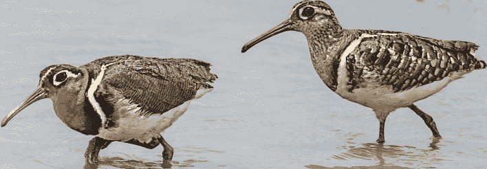

设计：Susan McIntyre

欲了解更多关于我们的作者和书籍信息，请访问`www.bloomsbury.com`并订阅我们的新闻邮件。

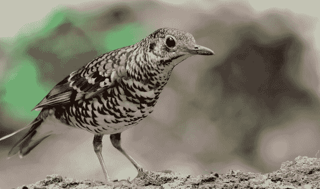

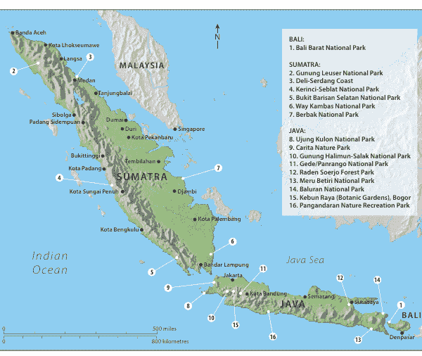

# 引言

巴厘岛、苏门答腊岛和爪哇岛的总面积约为613,000平方公里，是英国面积的近2.5倍，拥有约700种鸟类。凭借如此丰富的鸟类资源，鸟类因其美观和灵性而被广泛饲养并不意外。如今来到该地区的游客日益增加，他们不免注意到许多房屋的檐下都挂着笼子里的鸟。仔细观察发现，许多被圈养的物种与世界各地宠物店常见的种类相同。幸运的是，大部分国际贸易现在已经停止，但当地市场仍然存在，这对当地种群造成了影响，尽管有保护性法律，某些物种已处于灭绝边缘。

到目前为止，只有爪哇凤翅鸟在近期灭绝，但其他几种物种，最著名的巴厘八哥，正处于边缘。巴厘八哥的消灭有大量记录，很大程度上是由于非法捕捉，并因人类干扰和栖息地丧失而加剧。类似的惨剧也出现在许多其他物种身上，包括爪哇雀、印度红隼鸢和黑翅八哥，它们在几年前还是常见的景象。

幸运的是，印度尼西亚当局联合国家和国际保护组织认识到了保护的紧迫性，现在大片区域已被指定为国家公园和保护区，并对野生动物进行特别保护。游客应记住，进入许多此类保护区需要官方许可，并可能需要提前安排。即使在保护区之外，最受威胁的动物在理论上也受到了保护。

由于这本小书的篇幅限制，无法涵盖在巴厘、苏门答腊和爪哇主要岛屿上记录的所有700多种鸟类。因此，选用的标准是在该地区较为常见的鸟类。书中还增加了一些较不常见但更壮观的物种，以揭示那里巨大的生物多样性，并让读者理解其特征属性。

书中介绍的322物种涵盖了在该地区可能遇到的大多数科的合理代表。读者无疑会遇到其他物种，这些物种可以在列出的更具专业性（但遗憾更繁琐）的书籍上找到。

# 观鸟

对于我们大多数人来说，观鸟实际上是给鸟命名，但通过更详细的研究可以获得更多收获。行为、生命周期以及与环境的互动是极其着迷的主题，它们不仅能带给我们巨大的乐趣，还能增加我们对周围世界的认知。

然而，最初识别必须是首要任务。我们应该考虑所有可用线索，理想情况下不仅要识别物种，还要识别其性别、年龄和亚种。有很多线索可以参考，通过结合这些线索，我们可以缩小范围直到解决问题。我们认可视觉线索的所有价值，但在变得更有经验之前，我们忽略了声音的重要性。对于经验丰富的观鸟者来说，一台良好的录音机和笔记本、望远镜、单筒镜和野外指南一样，都是其装备的一部分。那些重要的鸣叫通常可以在当天的晚些时候被识别出来。

## 观鸟辅助

无论你带什么设备，都应使其免受天气侵害。雨水和高湿度为相机、望远镜和电子设备提供了最糟糕的条件。任何设备都应保持干燥通风，如果可能的话，与硅胶干燥剂一起存放，以防真菌侵害。如果预防措施不足，其造成的损害是令人惊讶的。理想情况下建议使用轻便的防水望远镜，特别是当你进入潮湿地区时，但对于一般的观察，不贵的种类对大多数情况也绰有余。对于更严肃的观鸟爱好者，有许多专业型的望远镜可以选择，还有用于远距离观察的单筒镜。

对于录音，可以使用手机记录近距离的声音，但为了获得更好的效果，请使用紧凑、轻便且价格合理的奥林巴斯录音机，如`LS-P5`。对于更远的鸟声，最好使用额外的抛物麦克风而非定向枪式麦克风。

相机不建议用于常规的观鸟旅行，不仅是因为天气对设备的有害影响，还因为几乎无法同时关注这两项活动，特别是在团体情况下。

幸运的是，许多优质观鸟区域开车到达。此外，总有公共交通，且除巴厘岛外，旅程终点随处可见被称为“ojeks”的摩托车出租。在野外，消耗能量的热量和湿度可能是最大的缺点。这里应该没必要建议卫生问题以及携带足够的瓶装水。保持身体健康至关重要，特别是在医疗设施可能糟糕或不存在的地区。不要忘记带上必备药物，并随时准备应对胃部不适。记住，“巴厘胃”并不限于巴厘岛。在某些时期昆虫也可能是一个问题，杀虫喷雾和霜可以让你免受一些糟糕的叮咬。合适的衣服也至关重要，不仅是为了抵御风雨，还作为伪装。轻便、暗色的衣服是必要的。建议游客携带带帽的轻雨衣，在低地森林中，长裤有助于防止植物接触皮肤。结实的鞋子是必须的，尽管许多人更喜欢重型凉鞋，特别是在潮湿条件下。轻便帆布靴比皮鞋好，后者极易长霉。普通绿鹊。

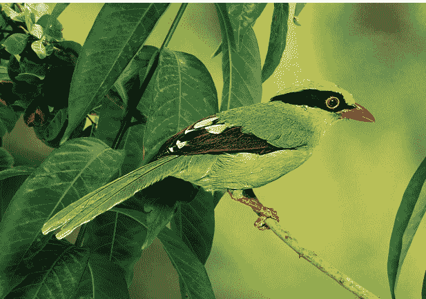

# 如何使用本书

照片尽可能以常见的形式描绘了鸟类（无论是雄性还是雌性），并在文中简要描述了它们的变体。322个物种的顺序和命名通常遵循了`Avibase`——世界鸟类数据库所采用的国际鸟类学联盟（IOC）分类法，以及康奈尔大学鸟类学实验室的现行术语。尽管存在其他清单，但基于最新科学知识的修订过程将继续进行。在本书编写期间，国际鸟类学家联盟（IOU）正进行共同努力，成立了鸟类清单工作组（WGAC），旨在编制并维护一份开放获取的全球鸟类清单，以统一分类法。因此可以预见，不仅科学名称将提供更可靠的信息，书中使用的名称也遵循了最新的科学数据，这些数据包含Eaton, J.A., van Balen, B., Brickle, N.W.和Rheandt, F.E.编写的《印度尼西亚群岛鸟类：大巽他群岛与华莱士》（2021年第二版）。

每个物种的描述都包括英文名称、学名以及已知的正式印尼名称。作为体型指南，书中提供了物种从喙尖到尾端的总长度。其余描述部分没有遵循特定顺序，但提供了进行相当可靠的识别所需的大部分线索。只有少数物种尝试描述了鸣叫声和歌声，因为人们认为在没有听过实际声音的情况下，仅凭文字描述是不够的。尽管如此，声音的价值不应被低估。在许多情况下，它是成功识别物种的唯一决定因素。大部分描述不可避免地简短，并采用大多数鸟类书籍采用的半技术语言编写，但为了方便理解，鸟类学家使用的许多技术术语在第218页的词表中进行了解释。

# 关于照片的说明

除非另有说明，所有图像显示的都是成年期羽毛。请参考下方的图例以获取更多信息：

- `+`——雄性
- 雌性
- `imm.`——未成年鸟
- `juv.`——幼鸟
- `var.`——变异体
- `br.`——繁殖期
- `non br.`——非繁殖期

爪哇岛、苏门答腊岛和巴厘岛位于东南亚板块边缘，该板块俯冲在澳洲-印度板块之上，产生了剧烈的地质活动。一系列火山（部分仍处于活跃，其他处于休眠状态）沿岛链形成了脊梁。在苏门答腊岛，这些火山形成了巴里桑山脉，横跨整个岛屿，并在西部陡峭入深海；在东部，坡度较缓，在到达巽达海之前形成了大片区域。在爪哇岛，山脉从所有冲积平原中孤立升起，而在苏门答腊东部向巽达海轻轻倾斜。

巴厘岛曾通过陆桥与爪哇岛相连，但现在被3公里汹涌的水域隔开，以其湍急的水流闻名。并不意外，巴厘岛的动植物与爪哇岛东部具有相似性。然而，苏门答腊岛与婆罗洲岛的关系比爪哇岛更为密切。地质和气候活动导致陆地破碎，从而导致了许多栖息地的形成，这反过来支持了丰富的野生动物多样性。这包括许多特有种：即局限于单个地区或更小区域且在其他地方无法发现的物种。

爪哇岛和巴厘岛是地球上人口密度最高的地区之一，剩余野生动物栖息地的遭到毁是一个严重的问题。只有在偏远的山坡才能找到大面积的自然森林。少数低地森林残存在国家公园和自然保护区中。苏门答腊岛的人口密度只有十分之一，情况稍好，但农业、种植园和林业的增长是其森林日益遭到破坏的原因。

# 鸟类群

我们可能会认为这些在不同时期与亚洲大陆相连的陆地具有相似的动植物。然而，由于各个岛屿并非同时分离，而且随后的局部气候条件各异，鸟类的组成在岛屿之间存在显著差异。也许最戏剧的变化是最近由人类和低地森林的破坏造成的。有追溯到1657年的记录，从19世纪初创立印尼鸟类学的探险家的报告可以清楚看出，当时的鸟类比现在丰富得多。

# 何时以及何地寻找鸟

由于该地区靠近赤道，气候炎热潮湿。该地区的季风天气概括为旱季和雨季，两者温度差异不大。尽管如此，鸟类表现出明显的繁殖周期。在雨季（从10月到3月），大量迁徙候鸟从北方抵达，较少的澳洲物种在旱季出现。

许多水鸟在雨季末抵达，在洪水景观中孤立树木的安全地筑巢。这也是昆虫繁殖季节的高峰，充足的食物供食虫鸟类抚育幼雏。食实物种会稍推迟繁殖，直到树木灌丛结出熟实。

整个地区遍布着栖息地种类丰富的良好观鸟区。显然，在如此规模的书中不可能列出所有地点，但下文描述了引导观鸟者前往一些产出更高的区域、主要保护区和国家公园。这些地点在书前的附图中标出。

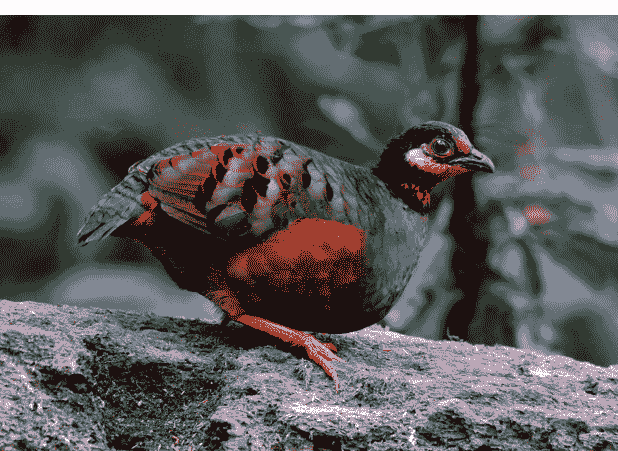

栗腹斑子。

# 主要观鸟地点

## 巴厘岛

### 巴厘岛西部国家公园

位于巴厘岛西端，巴厘岛西部是干旱林和湿润森林、海岸灌丛、稀树草原和红树林的混合体。它是发现本土物种的唯一地方。在那里记录的鸟类包括斑纹画眉、绿丛雉和。

### 肯新齐-塞布拉特国家公园

该公园包括主峰肯新齐山及其周围的湿地。它是观察山地鸟的好地方，以及特有种，如白翅鸭、风嘴和。

### 努萨佩达岛

努萨佩达岛严格来说属于巴厘岛，但位于华莱士线以东。在这里你可以看到柠檬眼雀和华莱士华丽画眉。

## 苏门答腊岛

### 望坎巴国家公园

位于苏门答腊东南部，望坎巴包括低地森林和海岸沼泽。它是许多物种的良好区域，包括白羽和。

### 莱塞尔山地国家公园

这是一个巨大的雨林和山区，并带有一个小面积的延伸。它是探索苏门答腊北部鸟类的理想场所，如环纹、黑色、东方（亚洲）斑点、盔嘴和犀角角、大蓝雉和。

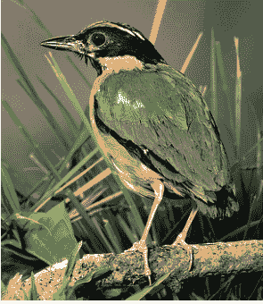

华莱士华丽画眉。

## 爪哇岛

### 巴巴国家公园

该保护区位于东岸，包括海岸森林和泥炭沼泽以及红树林。它是布蒂科费尔画眉的良好区域。

### 乌库隆国家公园

位于爪哇岛的最西端，乌库隆拥有多种栖息地的许多稀有物种，从低地雨林、常绿林到海岸灌丛、红树林和开放牧场。那里有多达24种特有或濒危物种，包括爪哇凤、白胸画眉、爪哇太阳鸟、爪哇雕、蓝喉蜂虎和绿孔雀。

### 巴里桑南部国家公园

位于苏门答腊南部，巴里桑山脉的末端，公园从海延伸到。这里相对少有人去，但可能会带来一些有趣的惊喜。该地区的稀有鸟包括苏门答腊树八哥、盔嘴犀鸟、红嘴斑鸠、小腹鹭和。

### 格德/潘朗戈国家公园（Gede/Pangrango National Park）

这座西爪哇国家公园主要由茂密的常绿森林组成，但在潘朗戈山（`Gunung Pangrango`）的山顶拥有苔藓矮林和高山草甸。这里是观察许多爪哇特有种的好地方，如爪哇短尾莺、爪哇蜡、爪哇雕、栗腹斑、爪哇猫头鹰、爪哇白眼雀、普通鹬、小鴫、山雀、火山金燕和蓝尾蜂。

### 梅鲁·贝蒂里国家公园（Meru Betiri National Park）

梅鲁·贝蒂里涵盖了大量的湿润原始林和次生林。

### 巴鲁兰国家公园（Baluran National Park）

巴鲁兰国家公园位于爪哇岛东北角，涵盖巴鲁兰山火山（`Gunung Baluran`）周边地区。它是最容易观鸟的地方之一，地形较开阔且易于，是观察绿孔雀和绿红丛林的好地方。该地区记录有白腹啄木、东方犀嘴鸟、斑点猫头鹰、斑纹画眉、小白鹭和灰斑纹声眉。在这里很难错过黑颈黄鹂、灰头绿画和亚洲亚洲。可能看到的其他物种还有黑颈果鸠、白领翠鸟、蓝耳翠鸟、灰斑纹绿鸽、霍氏雀、丽太阳雀、紫危太阳雀、山蓝鸱和黄喉鹦雀。

### 博哥植物园（Kebun Raya, Bogor）

由于交通方便，博哥植物园在周末挤满了当地游客。然而，工作日的访问在相对宁静的环境中会收获颇丰。博哥植物园占地1平方公里，迷人的环境已建立约两个世纪，提供了观察许多城市和森林鸟类的绝佳机会。这里有一群黑冠夜鹭，。

### 潘甘达兰自然休闲公园（Pangandaran Nature Recreation Park）

位于中爪哇岛南岸西拉恰普（`Cilacap`）以西的是潘甘达兰半岛，那里有一个自然休闲公园。公园主要由干旱林组成，是观察绿丛林和爪哇斑画的好区域。其他存在的物种包括东方犀嘴鸟、白腹画鸸、鳞冠声眉和黑背翠鸟。东部是塞加拉阿坎的红树林，在那里可以看到许多水鸟。在大量的鹭类、白鸥和燕群中，可以看到小白鹭和白鹳。那里还记录了爪哇凤和嘴喙翠鸟。

## 访问国家公园

进入国家公园的费用可以在入口处支付。大多数印度尼西亚国家公园的步道网络、经验观鸟向导以及靠近最佳观鸟点的住宿非常有限。

爪哇斑尾伞。

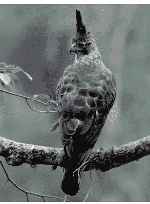

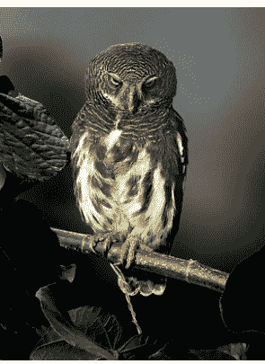

爪哇雕。

爪哇条纹猫头鹰。

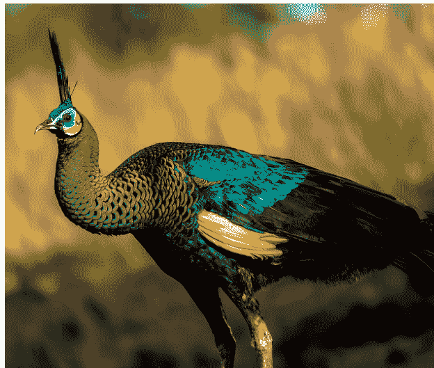

绿孔雀。

# 鸟类物种

## 游水绿鸭（`Dendrocygna arcuata`，40–45cm）

印尼语名称：`Belibis Kembang`

羽毛在背部、尾部和胸部通常为深栗褐色，尾下覆羽和臀部为白色，折叠翅膀处有一排黑色边缘的白色羽毛。头部和颈部呈较浅的褐色，颈后部有一个深棕色的长条冠羽。腿呈黑褐色，喙为黑色。这种鸟在飞行时会发出一系列高频的哨声和啾啾声。

**观赏地点：**整个地区的河流、淡水湖泊、湿润沼泽、沿海湿地和红树林。

## 绒毛小鴻鸭（`Nettaptus coromandelianus`，30–35cm）

印尼语名称：`Trutu Kapas`

这是一种小型黑白鸭，雄性以白色为主，冠、背部、翅膀和尾部有虹光黑色羽毛，颈部有黑色环。雌性的羽毛较暗淡，雄性为白色的地方为灰白色，雄性为黑色的地方为棕色；她有棕色的眼纹和颈环。飞行时，雄性会露出白色翅膀。

**观赏地点：**整个爪哇、巴厘岛以及苏门答腊北部沿海沼泽、湖泊、水稻和草地。稀少。与大多数野生动物不同，该物种经常栖息在树上，通常在树中。

## 骨鸭（`Spatula querquala`，37–41cm）

印尼语名称：`Itik Jurai`

非常独特的雄性在白色斑块上方有一个夸张的簇状尖冠。它的整体羽毛是带有紫色光泽的黑色，向尾部渐深；翅膀为绿色。雌性通常为棕色，带有条纹和绿白色的翼镜。

**观赏地点：**出现在整个地区，但在开阔水域较少。发现于淡水湖、稻田、盐湖和沼泽。

## 太平洋黑鸭（`Anas superciliosa`，47–60cm）

印尼语名称：`Itik Alis`

“黑鸭”是一个误称，因为这种鸟的羽毛实际上是深棕色，带有绿色翼镜。头部为黑色，带有白色眉纹。

**观赏地点：**出现在整个地区，但在苏门答腊较少。发现于淡水湖、稻田、沼泽和草地。

## 环雉（`Rollulus rouloul`，25cm）

印尼语名称：`Puyuh Sengayan`

雄性有短深褐色冠，头部和颈部有裸露皮肤。它的整体羽毛是带有紫色光泽的黑色，翅膀为深红色。雌性没有冠，羽毛为灰色；翅膀为深褐色并带黑纹。

**观赏地点：**苏门答腊低地的泥炭沼和山地森林。通常一只雄性带着几只雌性，觅食种子、昆虫和掉落的水果。

## 栗腹斑（`Arborophila javanica`，27cm）

印尼语名称：`Puyuh-gongong`

爪哇特有，每个亚种都有不同的红褐色头部，带有黑色斑纹和黑色颈圈。胸部从灰色过渡到栗色，腹部白色。侧腹为栗色，背部和尾部为灰褐色带黑纹，翅膀为棕色带黑纹和小白色斑点。腿为红色，喙为黑色。

**观赏地点：**出现在爪哇山区森林的空地，通常成对出现，偶尔成小群出现，在灌木丛中觅食。

## 大凤（`Argianus argus`）

雄性：160–200cm；雌性：70–75cm

印尼语名称：`Kuau Raja`

该地区最壮观的雉类之一，尤其是雄性极长的二飞羽和尾羽用于求偶展示。当尾巴高高并张开翅膀时，美丽的绿色“眼”状眼斑非常壮观。其他羽毛主要是栗褐色，被黄褐色和黑色的斑点和斑纹打破。雌性通常颜色较深，翅膀和尾巴较短，且没有雄性的眼斑。两性都有短深褐色冠，头部和颈部有裸露的蓝色皮肤。

**观赏地点：**苏门答腊未受干扰的原始雨林。通常一只雄性带着几只雌性。

## 绿孔雀（`Pavo muticus`）

雄性：180–250cm；雌性：100–110cm

印尼语名称：`Merak Hijau`

这种壮丽的雉类主要呈现彩虹绿色，雄性具有显著的眼斑尾羽和头部的垂直冠羽。雌性外与之相似，但颜色较暗，腿部较短，腹部颜色较浅。幼鸟看起来相似，但在面部和颈部有几根白羽。在繁殖季节，可以很容易听到它们的鸣叫声和响亮的鸣叫声，雄性张开尾扇的引人展示也极易辨认。

**何处可见：**爪哇岛上存在少数残遗种群，巴鲁兰国家公园是其最后的堡垒。

## 蓝胸斑腹鹌（`Synoicus chinensis`，12–15cm）

印尼语名称：`Puyuh`

该物种的雄性特征明显，但雌性容易与凤鹌混淆。背部呈深褐色，带有较浅的条纹，颜色比雄性浅。雄性有明显的黑白斑纹，胸部、头部两侧和尾下覆羽呈亮蓝色；雌性的腹部为黄褐色条纹，胸部呈较深褐色，喉部有白色斑块。刚出生的幼鸟非常小，几乎像蜜蜂。

**何处可见：**稀疏分布于地区的低地草原、稀树草原和沼泽，有时出现在农耕区。

## 红原鸡（`Gallus gallus`）

雄性：65–78cm；雌性：41–46cm

印尼语名称：`Ayam-hutan Merah`

雄性通过其锯齿状的红冠、脸部和垂肉、长青铜颈羽以及长弧形尾羽来识别。它们具有栗色到金色的背部以及绿色的胸部和初级覆羽。雌性颜色暗得多；呈不同深浅的褐色，颈部有黑色条纹。喙呈褐色，腿呈板灰色。区分野生鸟和家化鸟并非易事，但纯野生鸟的雄性尾羽和翅羽颜色全黑，雌性为斑驳褐色，并有橙色颈羽。

## 绿原鸡（`Gallus varius`）

雄性：65–75cm；雌性：40–46cm

印尼语名称：`Ayam-hutan Hijau`

这种大体黑绿色鸟与红原鸡相似，但具有锯齿状的紫色冠。雄性有红垂肉，眼周皮肤裸露，具有光泽绿色背部和颈部，以及边缘带黄色的彩虹绿颈羽，背部和翅覆羽为橙黄色；其余羽毛为黑色。雌性和幼鸟的羽毛颜色较不艳丽，背部为褐色点有浅褐色斑纹，腹部为浅褐色点有黑色斑纹，并有白色喉部。

何处可见：分布在海岸附近，也有内陆森林，偏好较开阔的草地，通常与放牧动物聚集在一起。

## 巽他环颈鸽 *Streptopelia bitorquata* 30–33cm

印尼语名称：Dereduk Jawa

不会与相似的欧斑环颈鸽（*Streptelia decao*）混淆。通常呈现为粉褐色的鸟，颈部有宽阔的、白色边缘的黑色半环。冠部和颈部为淡蓝色，泛着粉红色，额头为极浅灰色。背部和翅覆羽呈深粉色。腹部为淡粉色，在尾屏和尾下覆羽处变为白色。它有粉褐色的喙、粉色的腿和棕橙色的虹膜。

何处可见：主要分布在巴厘岛和爪哇岛的低地，通常出现在开阔地区，但也靠近人类居住区。经常在地面觅食。

## 斑鸠 *Spilopelia chinensis* 30cm

印尼语名称：Tekukur Biasa

这种非常熟悉的鸽子通常呈粉褐色羽毛，飞行羽颜色稍深，背部有深色斑纹。颈部两侧都有明显的白色斑点黑块。外尾羽末端有宽白色，这在飞行时非常明显。它有红脚和黑喙。

何处可见：遍布整个地区，从城市花园到农村耕地、低地的开阔地带和森林边缘，通常在地面觅食。

## 纹斑鸠 *Macropygia* 37–41cm

因其体型和密集的条纹背部与其他鸽子区分开，这种鸽子颜色较暗；腹部为褐色，带有密集的黑色条纹。冠部和颈部为灰褐色，带有栗色条纹。雄性尾部有绿色虹光。喙为褐色，红脚。

何处可见：贯穿地区的亚山地森林。

## 环斑鸠 *Macropygia emiliana* 30cm

印尼语名称：Buaki

比纹斑鸠小，胸部有白色条纹。背部为浅褐色带黑色条纹，雌性的腹部为较浅的栗色。雄性颈部有绿色虹光，尾羽为黑色。腹部为栗色带黑色条纹。喙和腿为褐色。

何处可见：发现于爪哇岛的山地森林，特别是森林边缘和空地。

## 小环斑鸠 *Macropygia ruficeps* 29cm

印尼语名称：Kouran

比其他环斑鸠小，胸部有黑色条纹。背部为浅褐色并带有虹光，尤其是腹部。雌性颜色较暗，虹光较少。它们有红尖的喙。

何处可见：在山地和高地森林中常见。通常成大群出现在边缘并觅食。

## 亚洲翠绿鸽 *Chalcophaps indica* 23–27cm

印尼语名称：Delukan

这种迷人的地鸽具有彩虹祖绿色的翅覆羽和背部，深灰色背部上有两条明显的白色横纹。飞行羽和短尾为黑色。腹部、颈部和头部两侧为深粉。雄性有白色额头，冠部和颈部泛灰色。雌性较暗。喙亮红，腿和脚为暗粉，眼睛为棕色。

何处可见：遍布整个地区，偏好幽密的森林、林缘和红树林。

## 斑鸽 *Geopolia maugeus* 22–26cm

印尼语名称：Perkutut Loreng

斑鸽常与斑鸠外观相似，但歌声明显不同。此外，它有更强的黑白条纹横跨胸部延伸到侧腹，白色腹和栗色下翅覆羽，眼周裸露黄色皮肤，淡黄色虹膜。

何处可见：从巴厘岛向东分布，栖息在干旱的开阔灌丛和草原、低地的农田和林缘，甚至在城市中。

## 斑纹鸽 *Geopelia striata* 20cm

因其颈部到尾部具有精细的条纹而被称为斑纹鸽。头部后呈浅褐色，过渡到浅黄色的面部、冠部、颈部和下巴。长而尖尖的尾羽为棕色，外缘羽有白色末端；在起飞时非常明显。当地通常称为“和平鸽”，但不应与其近缘物种——大洋地区的和平鸽（*Geopelia placida*）混淆。

观赏地点：稀分布于整个地区。可以在庭院、耕作地、开阔草原和灌木丛中看到。它是巴厘岛和爪哇腊岛非常常见的笼鸟，在文化神话中具有特殊意义。

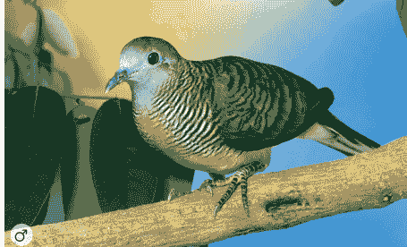

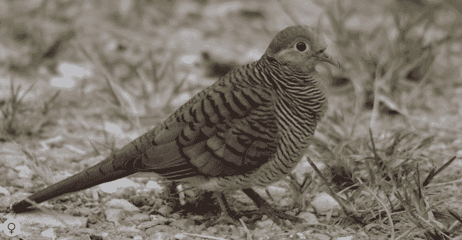

## 灰颊绿鸽 *Treron griseicauda* 25cm

印尼语名称：Punai Penganten

外观呈黄绿色的鸽子，头部灰色，雌性背部为绿色，雄性背部为栗褐色。两性眼睛周围都有裸露的绿色皮肤斑，额头为灰色。黑色的飞行羽边缘带有黄色。尾部中心羽为绿色，外侧羽颜色较深，显示出灰色的亚末横纹。尾下覆羽雄性为栗色，雌性则较浅。雄性的喙为黄色并带有绿色的蜡质部，与雌性的绿喙不同。腿部为红色。

观赏地点：巴厘岛和爪哇岛特有。栖息在低地森林的高树上，有时与其他果实树上的鸽子栖息在一起；有时也生活在人类居住区附近。

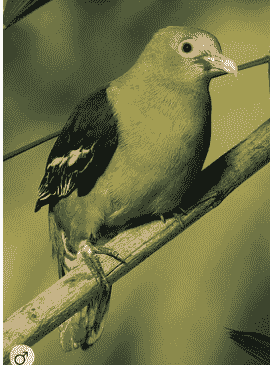

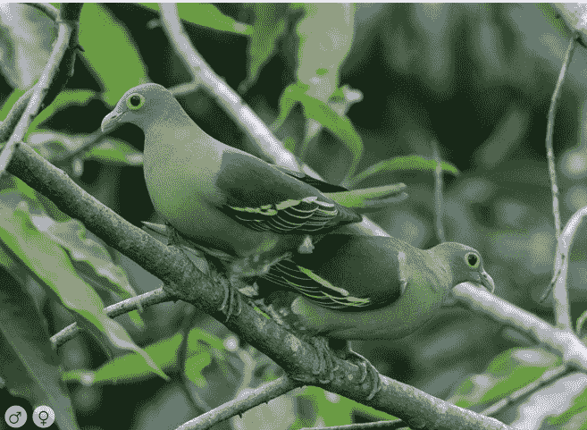

## 粉颈绿鸽 *Treron vernans* 27cm

印尼语名称：Punai Gading

这种小型绿鸽与相似的鸽子的区别在于其具有带有黑色条纹和浅灰色末端的灰色尾巴。雄性的头部为蓝灰色，向胸部下方过渡为粉色至橙色；腹部为绿黄色，背部和翅膀为绿色。雌性为绿色，颜色更亮，但通过其尾部花纹和与独特的雄性结伴来辨别。它们的叫声是“咕咕”的哨声，进食时会发出一系列类似乌鸦的沙哑声。

观赏地点：常见于整个地区的低地森林、海岸森林和红树林，以及更开阔的乡村。当树木结果时，它们变得非常显眼。

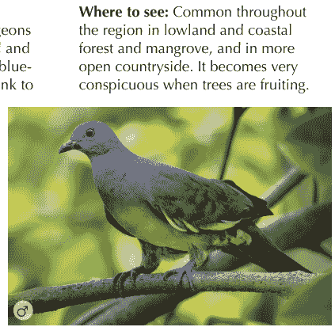

## 黑背果鸽 *Ptilinopus cinctus* 38–44cm

印尼语名称：Walik Putih

一种非常独特的黑白相果鸽，腹部和尾门处呈黄色。头部和颈部为灰白色，向上胸过渡为纯白色。一条宽的黑色横纹将上胸与灰色的腹部隔开。背部为极深的绿色黑色，过渡到深绿色的尾巴，尾巴带有灰色的末端带。脚为红色，喙为灰色。它们飞行速度快，翅膀扇动快速且声音响大。

观赏地点：分布在巴厘岛的湿润低地森林和山林，通常在果实树上觅食。

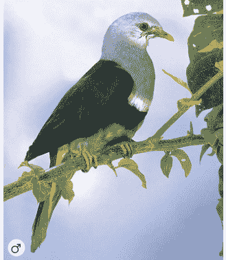

## 紫头果鸽 *Ptilopinus porphyreus* 29cm

印尼语名称：Walik Kepala-ungu

雄性的头部、颈部和喉部是迷人的紫粉色，胸部有一条对比鲜明的白色带，随后是一条绿黑色的带，接着是灰色的腹部，一直延伸到尾下覆羽。背部为绿色，脚为粉色，浅绿色，虹膜为橙色。雌性的额头和面部呈淡粉色，头部、颈部和喉部的其余部分为绿色；胸部的黑白条纹较模糊。

观赏地点：分布于该地区的山地森林。性害羞且不显眼。偶尔会大量聚集在结果无果树上。

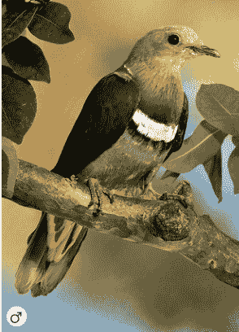

## 黑脑环果鸽 *Ptilopinus melanospilus* 27cm

印尼语名称：Walik Kembang

该物种背部、尾部和下胸主要为绿色，黄色尾门和红色尾下覆羽。雄性的头部为浅灰色，有明显的黑色后脑和黄色喉部。它的脚为红色，喙为绿黄色。雌性和幼鸟的头部全为绿色，幼鸟有明显的黄色羽缘。通常通过其共鸣的“呜-wook-wook，呜-wook-wook”叫声来发现。

观赏地点：在爪哇和巴厘岛的低地和丘陵森林中当地常见，在苏门腊岛不规律。除了在果实树上成群聚集外，很少见到。

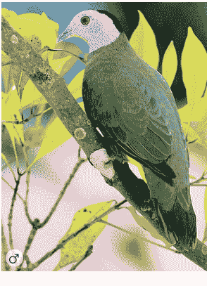

## 绿绿族鸽 *Ducula aenea* 42cm

印尼语名称：Pergam Hijau

头部、颈部和下体为柔软的粉灰色，带有栗色的尾下覆羽。背部为绿色，带有青铜光泽。蓝灰喙基部为暗红色，腿为深红色。

观赏地点：这是该地区低地雨林中最常见的鸽子。栖息在河林和海岸红树林，它们更喜欢生活在高树冠上，取食无花果、豆蔻和其他小型果实。

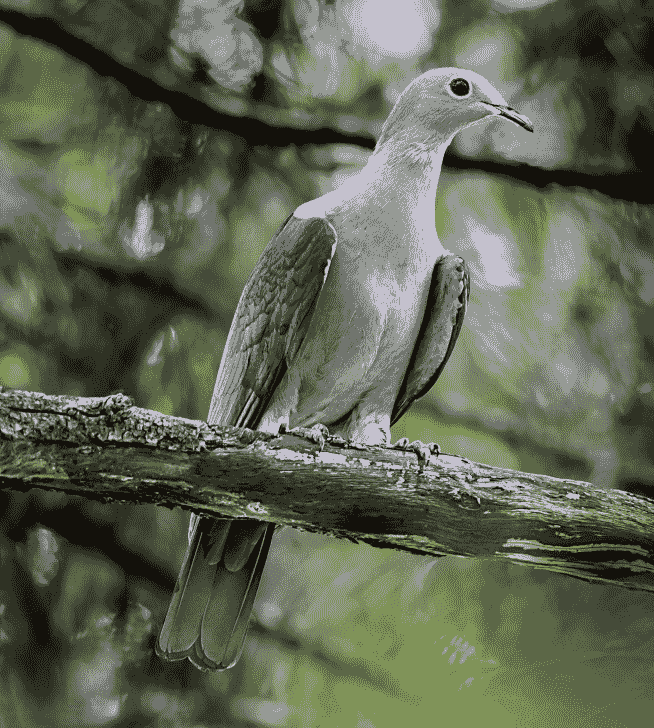

## 山绿族鸽 *Ducula badia* 43–50cm

印尼语名称：Pergam Gunung

因其体型巨大、栗褐色部位以及浅紫灰色的头部、颈部和下体而与众。成鸟喉部和冠部为白色。

尾巴为灰色，带有较宽的灰色末端带，尾下覆羽为肉白色。腿脚为红色，喙为深红色，灰色或白色的虹膜被深红色的眼周皮肤围绕。幼鸟颜色较暗，暖色较少。不要与爪哇岛的黑背绿族鸽（*D. lacunulata*）混淆，后者具有清晰的灰色冠部和头部侧面。

观赏地点：分布于苏门腊岛和西爪哇的山地森林。

## 黑斑绿族鸽 *Ducula bicolor* 35–42cm

印尼语名称：Pergam Laut

这是一种引眼的鸟，主要为奶油色到象牙白色，带有黑色的飞行羽和尾末端。喙和脚为蓝灰色。幼鸟颜色更灰。捕猎导致这种美丽鸽子的种群减少，尤其是在爪哇岛和巴厘岛。

观赏地点：更多出现在海岸森林和红树林，有时会在无花果果充足的区域形成大规模的繁殖群。

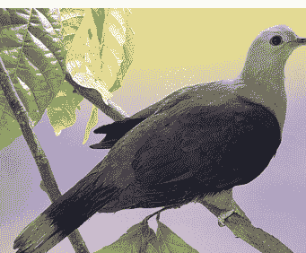

## 爪哇大嘴� *Centropus nigrorufus* 46cm

印尼语名称：Bubut Jawa

爪哇大嘴�具有黑背、内次级羽和栗褐色的初级羽。喙和脚为黑色，虹膜为棕色。其他部分为黑色，带有一些翅膀羽。

观赏地点：爪哇岛特有。不常见。通常栖息地为红树林、沼泽地。

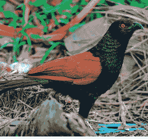

## 大大嘴� *Centropus sinensis* 47–53cm

印尼语名称：Bubut Besar

这种巨大的蓝黑色鸟类带有栗褐色的翅膀和长尾巴，最可能在灌丛中看到。它诡异、低沉的叫声始于一系列深沉的叫声，节奏加快再次减慢，但偶尔也会有一系列单调的叫声。雌性与雄性相似但呈黄色，可以通过黄色的喙与爪哇大嘴�区分。

观赏地点：遍布整个地区，它们偏爱森林边缘、草岸、次生灌木丛和荒耕土地。

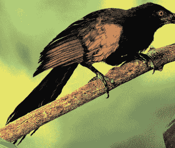

## 小大嘴� *Centropus bengalensis* 31–35cm

印尼语名称：Bubut Alang-alang

体型大嘴�之一，具有非常长的趾爪。羽毛颜色深，主要是黑色，带有红褐色的翅膀和长尾巴。在繁殖期，头部和上背有光泽并带有深色羽缘，但在其他时间颜色较暗，羽缘显得发白。这一特征延伸到翅羽，翅羽带有白色条纹的棕色羽毛。幼鸟背部为红褐色条纹，羽缘为肉白色，下体为肉黄色，尾下覆羽有黑色条纹。

观赏地点：分布于整个地区，主要在有芒茅草的开阔低地湿地和低矮树丛中。

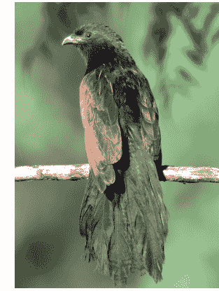

## 栗胸画� *Phaenicophaeus curvirostris* 42–50cm

印尼语名称：Kadalan Birah

因其巨大的弯曲喙而易于识别；上喙为浅黄色，下喙为棕红色或黑色。眼睛周围有一块红色皮肤。雄性的虹膜为浅蓝色，而雌性为黄色。头部为灰色，带有细长的白色眉纹，下体和臀部为栗色。

观赏地点：栖息在整个地区湿润原生林和红树林的灌丛中，通常捕食小型脊椎动物、昆虫、小型甲壳类，有时也取食无花果。

## 红嘴绿蜜喉 *Phaeenicopheus javanicus* 42–44cm

印尼语名称：Kadalan Kembang

因体型硕大且强壮的红喙而与该地区的其他蜜壳类区分开来。背部呈中灰色，泛着淡蓝绿色的虹光。腹部为栗色，上胸部横有一条深灰色的横带，灰色的尾羽末端带白色。眼睛周围有一块裸露的蓝色斑块，腿部为灰色。幼鸟喙呈较浅红色，尖端为黑色。可以通过其哀鸣般的叫声找到它们。

观赏地点：出现在爪哇和苏门答腊的森林和低矮丘陵，位于次生灌木丛和常绿森林边缘；通常成对或小群活动，在 Alang-alang 草地中觅食。

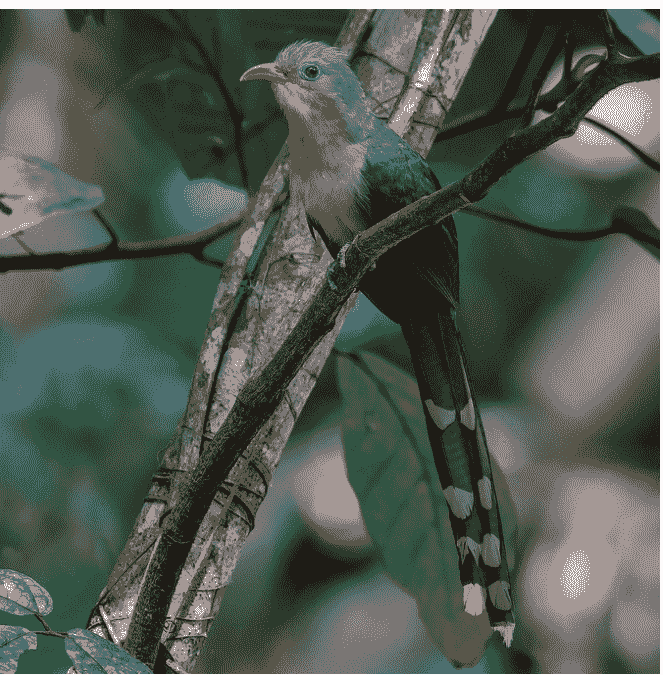

## 霍森氏青铜蜜壳 *Chrysococcyx basalis* 17cm

印尼语名称：Kedasi Australia

一种小型蜜壳，其特征是背部部分棕色横纹带有绿色和青铜色的虹光，并有白色眉纹，带有一条棕色眼纹。腹部为浅黄褐色，颈部有浅棕色条纹，侧腹和尾伞覆盖处的条纹加深，但腹部中心发白。足部和眼圈为灰色，细长的喙为黑色，虹膜为红褐色。幼鸟颜色通常较暗，横纹少得多，虹膜为较浅的灰褐色。

观赏地点：3 月和 4 月作为迁徙鸟出现在巴厘岛和爪哇，偶尔出现在苏门答腊南部，通常位于沿海较干燥的开阔林地。

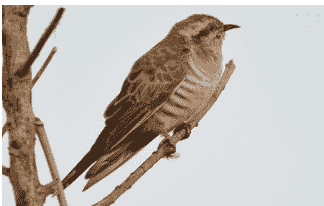

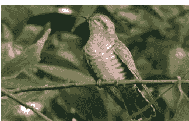

## 斑纹湾锦壳 *Cacomantis sonnererati* 22–23cm

印尼语名称：Wiwik Lurik

出现在爪哇和巴厘岛的成鸟具有亮栗棕色的深色横纹背部，以及黄白色腹部，腹部带有细密的棕色横纹。它们在棕色眼纹上方有一条宽宽的黄白色眉纹，下方有一条白线。虹膜为灰褐色。喙为黑色，足为灰色。幼鸟的区别在于冠部和背部的羽毛末端为白色。苏门答腊的鸟颜色更深，背部呈现出更多青铜虹光。它们的腿部黄色更多，虹膜颜色浅得多。

观赏地点：遍布该地区。可见低地森林边缘。较罕见。

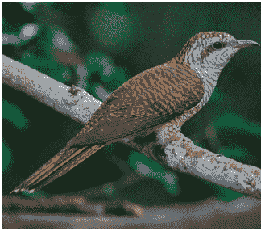

## 哀诉锦壳 *Cacomantis merulinus* 18–23cm

印尼语名称：Wiwik Kelabu

成鸟头部、颈部和上胸为浅灰色，与深灰色的翅膀和背部形成对比。胸部的灰色过渡为浅灰色，然后是栗褐色，在腹门处变为黄褐色。尾羽为灰色，末端带白色。红褐色的虹膜周围环绕着狭窄的白色眼圈。喙为黑色，腿部为黄褐色。

观赏地点：遍布该地区的低地，特别是在稀疏林中，有时出现在城镇和村庄。

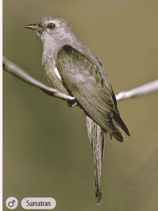

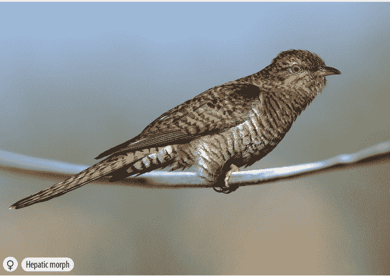

## 巽他刷锦壳 *Cacomantis sepulcralis* 21–28cm

印尼语名称：Wiwik Uncuing

成鸟背部为灰色，头部为灰色。翅膀为灰褐色，略带绿光。尾羽为黑色，末端带白色，外缘边缘似乎有白色的水平 V 形斑块。下巴上方为灰色，上胸为纯栗色，向腹门处变浅。虹膜为褐色，眼圈为亮黄色，足部为黄褐色，喙为黑色，偶尔下方为黄色。雌鸟下胸部有细微的灰色横纹。幼鸟颜色较暗，具有棕色横纹羽毛。

观赏地点：遍布该地区，通常位于森林边缘和孤立的红树林。

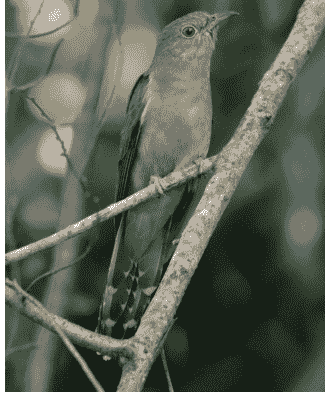

## 黑杜鹃 *Surnicul lugubris* 23–25cm

印尼语名称：Kedasi-hitam

这种主要是黑色的蜜壳拥有像牛眼留一样的方形尾巴。背部为闪光黑色，腹部为棕黑色，但尾伞覆盖处有白色条带，整个大腿为全白色。喙为黑色，腿为灰色，虹膜为灰褐色。雌鸟颜色较暗，虹膜为黄色。幼鸟与其相似，但头部、胸部和翅膀上有白色斑点。它们响亮而清亮的叫声是一系列上扬的婉转音。

观赏地点：遍布该地区的低地森林。

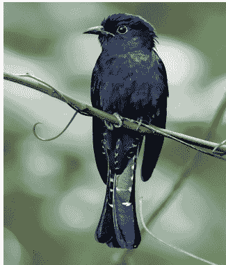

## 大鹰杜鹃 *Hierococcyx sparverioides* 38–40cm

印尼语名称：Kangkkok Besar

这是鹰杜鹃中最大的物种，成鸟背部为棕色，带有棕色横纹的亚末尾，末端带黑白色。头部为灰色，有明显的黄色眼圈和橙色虹膜。它不像其他鹰杜鹃那样有白色脑后。上胸和腹部为黄褐色，带有密集的棕色条纹和横纹，上胸泛着锈褐色。下腹部和腹门为黄白色。上喙为黑色，下喙为黄色。

观赏地点：遍布该地区，主要在低地森林，偶尔在灌木丛。

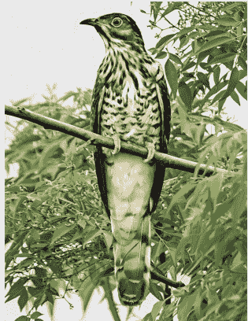

## 普通锦壳 *Cuculus canorus* 32cm

印尼语名称：Kangkkok

成鸟头部、颈部和上胸为浅灰色，与深灰色的翅膀和背部形成对比。胸部的灰色过渡为浅灰色，然后是栗褐色，在腹门处变为黄褐色。尾羽为灰色，末端带白色。红褐色的虹膜周围环绕着狭窄的白色眼圈。喙为黑色，腿部为黄褐色。

（注：由于提供的待翻译文本中存在大量重复内容和 OCR 错误，此处已按要求进行整合翻译）

## 金丝雨燕 *Aerodramus fuciphagus* 11–13cm

印尼语名称：Walet Sarang-putih

这种雨燕在飞行时很难与其他雨燕区分。羽毛整体呈黑褐色，喉部、腹部和背部呈灰色。苏门答腊的鸟类颜色通常更深。

在哪里可见：它们自然栖息在该当地的洞穴中，利用回声定位进行导航。今天，这种雨燕在印度尼西亚已成为一项大生意，人们鼓励它们在废弃的建筑中筑巢，以便采集巢窝制作燕汤。

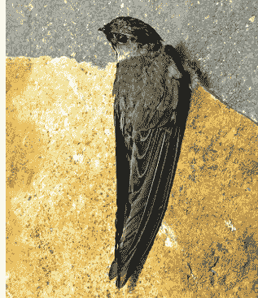

## 岩燕 *Apus nipalensis* 14–15cm

印尼语名称：Kapinis Rumah

这种中型雨燕可以通过宽宽的白色臀部、浅色喉部和略微凹的尾巴来识别，与相似但体更大的太平洋鹿（*Apus pacificus*）不同，后者的尾部有明显的叉形。除此之外，它有黑色的羽毛、黑喙和棕脚。

在哪里可见：通常成群出现在开阔乡村上空捕食昆虫。它们偏好沿海栖息地和低矮丘陵，经常出现在城镇和村庄，在房屋屋檐下筑巢。它们还利用悬悬的崖壁和洞穴口作为筑巢地。

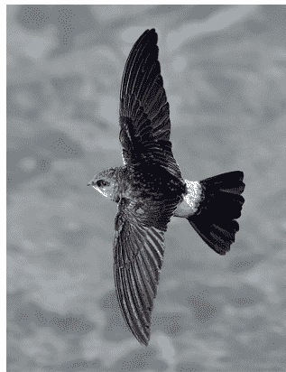

## 须蜂嘴莺 *Hemiprocne comata* 15–17cm

比在该地区出现的灰臀蜂嘴莺（*Hemiprocne longipennis*）体小。有长且略微叉的尾巴和退化的冠羽。雄性身体大部分呈深绿色青色，头部和喉部发亮，被长白色眉纹和胡须纹衬托，纹之间被深褐色的耳羽隔开。腹部和三缘羽呈白色。雌性非常相似，但耳羽为蓝绿色。幼鸟颜色较暗且偏褐色。

在哪里可见：出现在苏门答腊，主要在低地原生森林和次生林或有高树的林地。

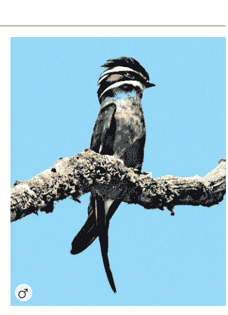

## 绿脚秧 *Gallinula chloropus* 30–35cm

印尼语名称：Mandar Batu

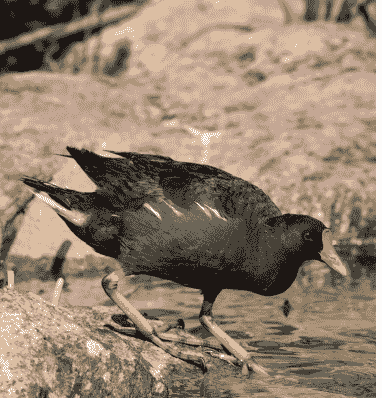

这种适应能力极强的水鸟几乎全呈深灰色到黑色，侧面有一条断续的白纹。尾下也有白色斑块，特别是当它抬起尾巴冲向避难所时。它有具有特征性的额盾和喙，喙尖呈黄色。腿部为黄绿色。

**在哪里可见：** 经常出现在该地区的淡水池塘、湖泊、河流和稻田。它们是良好的水游泳者，会潜水甚至在水面上奔跑。

## 紫秧 *Porphyrio porphyrio* 40–48cm

印尼语名称：Mandar Besar

易于识别，是一种大型蓝黑色水鸡，长有厚实的亮红色喙和额盾，背部和颈部侧面带有紫色光泽。上翅覆羽为黑色并带有绿色调，尾下羽为白色。它们长而粗、略显笨拙的粉色腿配着巨大的开趾，是践踏通过水生植物的理想工具。习惯性抖动尾巴。

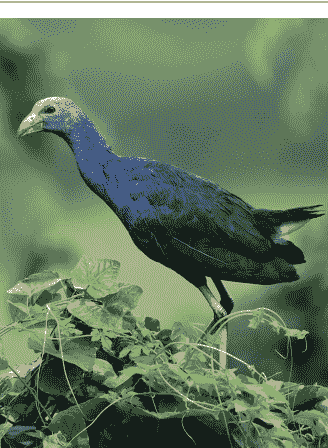

在哪里可见：遍布整个地区。一种相当安静且隐秘的鸟，停留在未受干扰的芦苇丛、沼泽边缘，偶尔出现在稻田。

## 白胸水秧 *Amaurornis phoenicurus* 28–33cm

印尼语名称：Kareo Padi

一种显眼的秧鸡，面部、前颈和胸部为白色，栗色侧腹和下腹部与深绿色的上部界限分明。喙为绿绿色基底呈红色，腿和脚为黄色。它们在黎晨和黄昏时非常活跃，发出一阵杂乱的叫声、咕噜声和咯咯声。

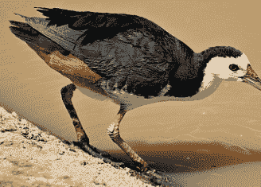

在哪里可见：遍布该地区的湿地。它是一种游荡觅食者，经常出现在开阔地，但从未远离茂密的遮蔽处。非常敏捷，会在浮叶植物上奔跑并穿过灌丛寻找昆虫。

## 红脚秧 *Rallina fasciata* 22–25cm

印尼语名称：Tikusan Ceruling

红褐色的背部和较亮的红褐色头部，以及红腿是这种秧鸡的识别特征。其余上部为灰褐色。腹部和前翅有黑白相间的条纹。它有绿喙。雌性相似，但头部更偏粉，身体下部的条纹较窄。幼鸟斑纹较不明显，腹部颜色较浅，腿呈棕色。

**在哪里可见：** 出现在该地区的潮湿低地森林，偏好受干扰的森林边缘，有时出现在附近的农耕地。

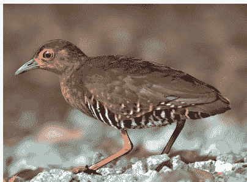

## 栗胸秧鸡 *Zapornia fusca* 21–23cm

印尼语名称：Tikusan Merah

容易与该地区的其他秧鸡混淆，它是唯一一种头部和胸部都是亮栗色的物种，有白色下巴和黑褐色的腹部，上面有细细的白色横纹。它有绿喙和红腿。上部为纯净的褐色。

**在哪里可见：** 是该地区低地较为常见的留鸟。作为一种半夜行且害羞的鸟，它偏好避开稻田和芦苇栖息地，通常在水边的丛林。

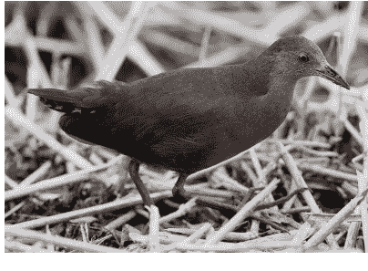

## 大嘴脚鹬 *Esacus magnirostris* 51–57cm

印尼语名称：Wili-wili Besar

这种粗壮的岸鸟通过其硕大的黑喙（基部为黄色）以及布满黑白条纹的面部来识别。冠部为深栗色，上部为褐色，颈部和上腹部有浅褐色条纹。腹部到尾下羽为肉褐色。长而粗、略显细长的腿部是黄色的。它有一只巨大的黄色眼睛。

在哪里可见：作为留鸟岸鸟遍布整个地区。很少在内陆发现，偏好沙质、泥泞或岩石质沿海海滩，在那里寻找螃蟹和小型甲壳类。

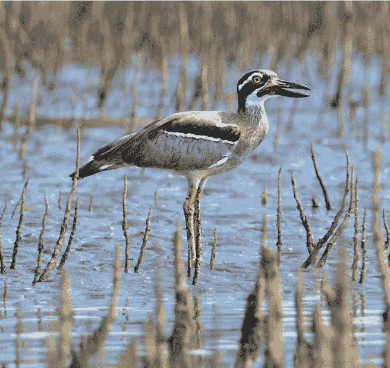

## 黑翅涉鹬 *Himantopus himantopus* 35–39cm

印尼语名称：Gandang-bayang

这种高挑且优雅的岸鸟有长粉色腿，飞行时拖在后方。它有长白色脖子和细小的头部，配有细长的黑喙。上部为黑色并带有微绿光泽，下部为白色带有黑色斑块。头部显示不同程度的黑色。雌性和幼鸟的上部颜色较暗。

在哪里可见：主要出现在苏门答腊北部和爪哇，偏好浅水湿地、沼泽和稻田，偶尔出现在盐沼。

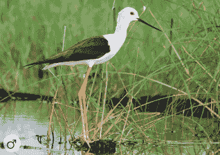

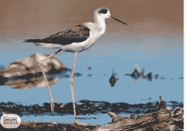

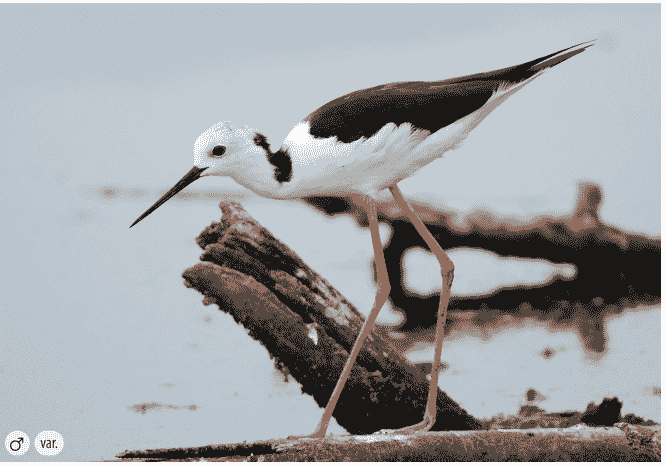

## 灰鹬 *Pluvialis squaratola* 27–30cm

印尼语名称：Cerek Besar

冬羽下，这种相当漂亮的水鸟上部呈灰褐色斑点，腹部为浅灰色到白色。它有浅色的眉纹、黑喙、深灰色腿和大眼睛。飞行时，它显示出浅色的翼带和臀部，下方为白色，在身体附近有一个大黑斑。这些特征很容易将其与体型稍小且喙较短的金眶区分开来。

在哪里可见：作为冬季游客来到该地区。成小群出现在潮间泥滩上觅食海洋无脊椎动物，经常栖在孤立的碎石浅滩上。

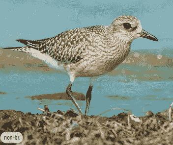

## 海金眶 *Pluvialis fulva* 23–26cm

印尼语名称：Cerek Kernyut

典型的环卵形状，直立姿态，身体健壮，脖子和头部很大，喙短而有力。它在该地区通常处于非繁殖羽期，失去了在繁殖地的特征性黑脸和腹部。可以通过其斑驳的金色、褐色和肉色上部，以及肉色的胸部、脸和眉纹来识别。喙为黑色，腿为灰色。

在哪里可见：这种冬季迁徙鸟停留在巽他群岛周边，通常成群聚集。在沿海附近的泥滩和开阔草地很常见。

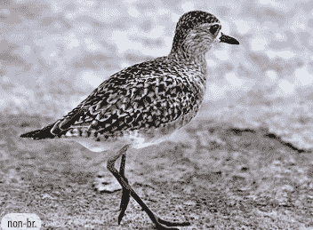

## 大鸻 *Anarhynynchus leschenaultii* 22–25cm

这种棕、白、灰相色的鸻与其他涉水类在一起，特别是在泥滩和沙质河口海滩上较小的青青斑鸻。它最容易识别的特征是其较粗壮、微膨的喙，这与可能遇到的所有其他冬候鸻不同，后者具有胸带或颈环，且腿较短。只有早到的个体可能显示出繁殖羽毛的残迹，并带有栗色的胸带。

观赏地点：作为冬季访客出现在巴厘岛和爪哇岛的泥滩和海滩上。

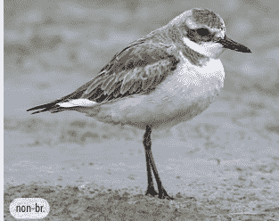

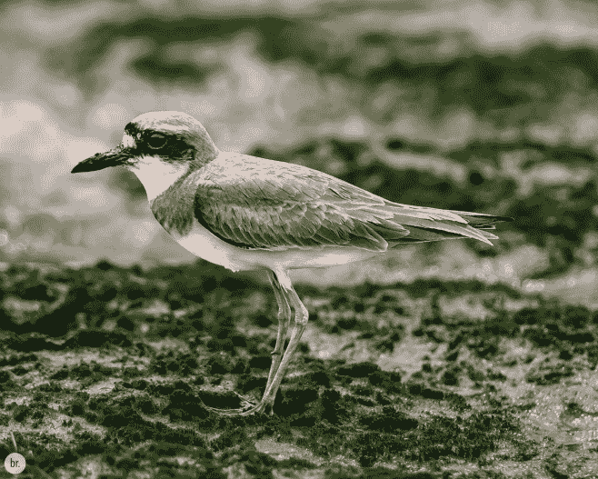

## 凤斑鸻 *Anarhynynchus alexandrinus* 15–18cm

印尼语：Cerek Tilil

在繁殖羽下，雄性眼睛下方有一条黑色横线，延伸至耳羽，并在栗色的头顶和颈部后有一个黑色尖端。下部、下巴、脸颊、额头、眼纹和颈环均为白色。胸部两侧有黑色区域，背部为沙褐色。喙和腿呈黑色。雌性和非繁殖季节的雄性外表更为平淡，雄性的黑色区域变为深褐色。

观赏地点：遍布整个地区，主要出现在平坦的沿海海滩、湖泊和水道，极少出现在岩石岸边。

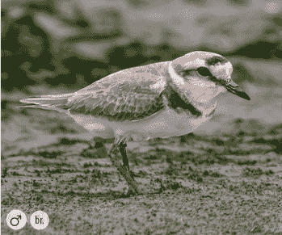

## 藏斑鸻 *Anarhynynchus atriftrons* 18–21cm

印尼语：Cerek-pasir Tibet

很容易与体型更大、腿腿的大鸻混淆，尤其是当单只看到时。它的头部更圆，喙更短且更细。成年鸟在栗色头冠下有完整的黑色面罩，白色喉部上方有一条宽的栗色胸带，延伸到侧腹。腿为灰色。非繁殖鸟的羽色暗得多，缺乏黑色和栗色斑纹。幼鸟也是如此。

观赏地点：作为冬季访客出现在该地区平坦的沿海海滩和泥滩。

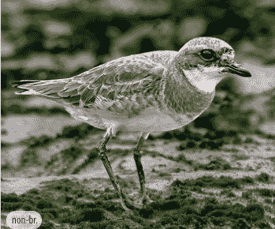

## 大斑翅嘴鹬 *Rostratula benghalensis* 23–28cm

这种体型丰满的涉水鸟有一个略微下弯的脏黄色喙（雌性尖端为黑色），肩部到胸部有一条明显的窄白带。强烈的雄性二形性与常常相反。较大的雌性表现出更亮丽、更强烈的特征，具有更长的黑绿色翅膀和深栗色背部，包括头部下部、颈部和胸部。白色条纹从白色眼环向后延伸。腿为黄色。雄性颜色较暗，翅膀和背部有肉桂色条纹。

**观赏地点：** 遍布整个地区的沿海、淡水沼泽和草地。

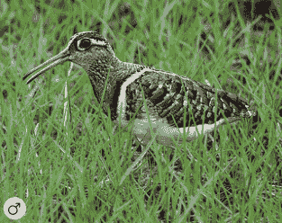

## 长尾���� *Hydrophasius chirurgus* 繁殖羽 40–58cm，其他为 30–31cm

印尼语：Burung-sepatu Teratai

繁殖期的成鸟有长黑尾巴和黑色下部，棕色的背部和肩羽与下方的白色翅斑形成对比。外飞羽为黑色。头部和颈部前为白色，由一条细黑线与黄色的颈后和后颈隔开。腿为浅灰色。非繁殖期，尾巴变短很多，背部变棕。下胸变为白色，但保留了颈下部的一些黑色羽毛。幼鸟羽色更暗，与非繁殖鸟相似，缺乏颈部的黄色，并有栗褐色的头冠。

观赏地点：该地区湿地中一种相当罕见的迁徙鸟。

## 欧亚沙嘴鹬 *Numenius phaeopus* 40–46cm

这是一种长腿涉水鸟，颈部长，喙相对较短且下弯，腿为灰色。它的羽毛布满密集的棕色斑点，肉桂色眉纹上方有一条明显的黑色顶纹和深色眼纹。飞行时，显示出白色的下部、尾部和下背部。通常很安静，受惊时时经常会发出颤鸣的叫声。

观赏地点：该地区常见的访客。通常聚集在潮间泥滩和河口，偶尔与其他涉水鸟类群一起出现在沿海沼泽和粗糙的草地上。非繁殖季节的鸟类全年可见。

## 欧亚大嘴鹬 *Numenius arquata* 50–60cm

印尼语名称：Gajahan Erasia

这种大嘴鹬极具伪装性。羽色变化很大，但主要是浅灰褐色并带有深色条纹。它有白色腹部和尾部，腿为灰蓝色。长棕色下弯喙在雌性中最长。飞行时，大嘴鹬尾部有明显的白色楔形，翅膀下方为白色。它得名的鸣声是具有辨识度的“curloo”声，通常在飞行中发出。

观赏地点：作为冬季访客出现在该地区的湿地、草地和海滩。

## 斑尾滨 *Limosa lapponica* 37–40cm

该物种与类似的黑尾大嘴鹬（*Limosa limosa*）可能同时出现。它们是体型较大的长腿涉水鸟，喙直而长且微向上弯曲，背部为灰褐色；斑尾滨的斑点更密，有明显的条纹尾巴，在最白的胸部上有略偏灰的条纹。

观赏地点：该地区不常见的冬季迁徙鸟，通常与其他涉水鸟类一起出现在潮间泥滩、河口、开阔的沙质海滩和盐沼中。在苏门答腊东岸可能更为常见。

## 褐岩���� *Arenaria interpres* 21–26cm

印尼语名称：Trinil Pembalik-batu

这种体型结实的小涉水鸟在北极繁殖。它有强壮的喙，外观斑驳，头部、颈部和胸部呈黑白相间。背部为栗色，带有肉桂色衬边。下部为白色，腿为红色。非繁殖季节在该地区的羽色会暗一些。

观赏地点：在整个地区越冬，经常在沙质海滩和岩石海滩观察到它们通过翻动石块寻找猎物。

## 红眶��� *Calidris canutus* 23–25cm

印尼语名称：Kedidi Merah

在非繁殖羽下，它的背部为浅灰色，下部为白色，喙和脚为黑色。肩部的黑斑有助于将其与其他涉水鸟区分开来。飞行时显示黑色飞羽和明显的白色翼带。

观赏地点：在整个地区越冬，定期出现在传统的沿海停留点，如沙质和泥泞的入海，在那里它们可以轻松找到小型软壳动物、甲壳类和其他海洋无生物。

## 红颈��� *Calidris ruficollis* 13–16cm

印尼语名称：Kedidi Leher-merah

这种小型涉水鸟的背部带有深浅不一的灰褐色，上翅看起来更灰。头冠、颈部和胸部为灰色并带有深色条纹，面部和下部完全全白。它有短黑喙和深色腿，有时带有橙色斑块。与小足���（*Calidris minuta*）相似，后者在该地区很少出现。

观赏地点：该地区常见的迁徙鸟，通常在河口、海滩和沿海泥滩上成群结结，也出现在淡水池塘和水田里。

## 灰足��� *Calidris alba* 20cm

在非繁殖羽下，它的背部为浅灰色，下部为白色，喙和脚为黑色。肩部的黑斑有助于将其与其他涉水鸟区分开来。飞行时显示黑色飞羽和明显的白色翼带。

观赏地点：作为不常见的非繁殖季节迁徙鸟出现在整个地区，几乎完全出现在沙质海滩上，通常成小群跟随退潮的海浪觅食海洋无生物。

## 普通波泽��� *Gallinago gallinago* 25–27cm

印尼语：Bercik Ekor-kipas

很容易与针尾���（*Gallinago stenura*）和胜氏泽���（*Gallinago megala*）混淆，非常难区分。它有长长的、尖端黑色的肉桂色喙，下部为白色，侧腹和腹部有许多棕色斑点。背部为棕色，肉桂色的羽缘形成了从背部到尾部的条条纹。它有深棕色眼纹和宽大的肉桂色眉纹。喉部和颈部也是肉桂色。腿为黄色。飞行速度快且轨迹诡异，翅膀非常尖。

观赏地点：偶尔出现在爪哇岛和巴厘岛的开放式淡水沼泽、河口、盐沼和水田。

## 普通游足鹬 *Actitis hypoleucus* 19–21cm

印尼语名称：Trinil Pantai

这种足鹬上部为棕褐色，下部为白色，有一块棕色斑块从颈部延伸到侧腹。飞行时，其白褐相间的条纹外尾羽清晰可见，白色的翼斑也如此。这是一种非常忙碌的觅食者，尾部不断上下抖动。受到骚扰时，它们通常会飞短一段距离并继续觅食，似乎不受影响。

何处可见：该地区常见的候鸟。通常单独活动，在海岸泥涂滩和河岸边觅食，偶尔也会上游的沼泽和稻田。

## 灰尾沙嘴鹬 *Tringa brevipes* 23–27cm

印尼语名称：Trinil Ekor-kelabu

它的上部呈均匀的浅灰色，头顶、颈部和胸部的颜色稍浅。腹部、颈部和尾下为白色。下巴和颈部为白色至灰色。短腿为黄色，喙为黑色且基部呈黄色。雌性比雄性略大，幼鸟的上部呈现白色斑点。

何处可见：大多数候鸟涉鹬的典型特征，经常出现在潮间带泥滩和卵石岸线，也出现在有海草丛的岩石上。一种常见的候鸟，在该地区东部更为常见。

## 普通红主 *Tringa totanus* 27–29cm

印尼语名称：Trinil Kaki-merah

这种长红腿涉鹬从头顶到臀部上部都有灰褐色的黑色斑点。喉部、胸部和腹部颜色较浅，黑色斑点更明显。尾部有灰黑和白色的条纹，喙基部为红色，尖端为黑色，黑色虹膜周围环绕着圈白色眼环。

何处可见：该地区常见的候鸟，广泛分布于河口、盐沼泽和内陆淡水水湿地。

## 条纹鹹 *Turnix suscitator* 16–17cm

印尼语名称：Gemak Loreng

雄性容易与雌性蓝胸鹹（第21页）混淆，体呈棕色斑驳，胸部和侧腹有黑色条纹。主要的区分特征是该鹹亮黄色的腿和喙。雌性较大，拥有更深（近黑色）的下巴、喉部和头顶，但头部白色更多。在繁殖季节，晚上可以听到雌性发出短促而重复的咕咕声。

何处可见：常见于整个地区，偏好低地带开阔草地和灌木栖息地。

## 东方鱼燕 *Glareola maldivivarum* 23–25cm

其特征是主要是浅褐色的羽毛，留有白色尾斑和淡黄色的胸斑，胸斑边缘有模糊的黑色颈圈。上部为稍深的棕褐色，头顶有浅色条纹，胸部为深浅褐色，在泄殖处过渡为白色，飞行羽和分叉尾为黑色。腿为灰黑色，大虹膜为黑色，喙尖端为黑色，基部为暗红色。

何处可见：常见的冬季候鸟，遍布整个地区。通常在水边附近的开阔区域可见：潮汐泥滩、河口、稻田和牧场。

## 普通黑头鸥 *Larus ridibundus* 37–43cm

印尼语名称：Camar Kepala-hitam

下部和颈部为白色，上部为灰色，包括背部、上覆羽、二级飞羽和内级飞羽。外级飞羽为白色尖带黑色，二级飞羽为灰色尖带白色，尾巴为白色。除了后颈为白色外，头部为黑褐色，与断续的白色眼环形成对比。喙为深红色，腿为浅红色。非繁殖期鸟类的后颈和耳部羽呈带黑色影的白色褐色。

何处可见：作为稀有的冬季迁访客出现，通常靠近海岸，但也出现在内陆低地、湖泊、稻田和牧场。

## 烟灰燕鶻 *Onychoprion fuscus* 36–45cm

印尼语名称：Dara-laut Sayap-hitam

繁殖羽的成鸟上部和上翅膀从头顶、颈部到背部均为黑色，外尾羽边缘为白色。额头为白色，至眼睛上方，下部也是如此。翅膀有深色级飞羽。飞行时显示出深分叉尾，白色的翼下覆羽与深色级飞羽形成对比。虹膜为棕色，腿和喙为黑色。非繁殖羽颜色较浅或呈褐色，幼鸟呈类似的褐色，除白色泄殖处、尾下和较浅的翼覆羽外。

**何处可见：** 出于该地区的海岸线，但很少离岸。

## 带鹹燕鶻 *Onychoprion anaethetus* 37cm

印尼语名称：Dara-laut Batu

这是一种中型燕鶻，背、尾和翅膀为深灰褐色，下部为白色，尾部长分叉。头顶、颈部和眼纹为黑色，留出狭窄的白色额头，并延伸至眼睛外的短白色眉纹。不要与烟灰燕鶻混淆。翅膀前缘为白色，外尾羽也是如此。

**何处可见：** 出于该地区的海岸，通常捕食海面上的小鱼或浮游无生物，但在夏季月份较多在陆地上出现。

## 较小冠燕鶻 Onychoprion bengalensis 37–43cm

印尼语名称：Dara-laut Benggala

这种物种看起来与大冠燕鶻非常相似，但体略小且喙为橙色。繁殖后，黑色头冠变为白色。幼鸟上部呈灰褐色，喙为黑色。

**何处可见：** 作为爪哇岛和巴厘岛常见的冬季迁访客，但在苏答腊腊较少。更多沿沙质和泥质岸线观察到，但在远海。

## 黑脑纹燕鶻 Sterna sumatrana 30–33cm

印尼语名称：Dara-laut Tengkuk-hitam

除了穿过眼睛和环绕颈部的明显黑带以及浅灰色的上部外，这种小燕鶻呈现为白色。飞行时，其极长的分叉尾显而易见。腿为黑色，喙尖为黄色。然而，幼鸟上部为灰褐色，喙为黑色。

**何处可见：** 这种留留鸟分布于整个地区，通常在离岸岛屿繁殖。

## 白尾鹸 Phaeeton leptururus 40cm

印尼语名称：Buntutase Putih

成鸟通常为白色，有些带有黄色调，有长长的白色尾流。翅尖有黑色标记，上翅有一条黑色横纹。幼鸟没有尾流，且上部有黑色条纹。

何处可见：虽然在该地区部分地区为留鸟，也有来自其他地区的访客。出现在苏答腊岛周围的个体以金色的羽毛为特征，源自圣诞岛。一些在巴厘岛的努萨佩尼达岛以及爪哇岛的南岸繁殖。

## 亚洲白颈鹳 Ciconia episcopus 76–91cm

印尼语名称：Bangau Sandang-lawe

这种大型、以黑色为主的鹳拥有蓬松羽毛的颈部。尾下和下腹也是白色的，额头和窄的眉纹也是如此。它面部有一块中灰色的皮肤。足为脏红色，而喙为黑色，带有红色调，尖端为红色。幼鸟与成鸟的区别在于黑色羽毛带有棕色。

何处可见：作为候鸟分布于整个地区，但在爪哇岛和巴厘岛并不常见见。可能会看到它们与其他鹳一起在稻田和牧场觅食，并在高树上与其一同栖息。

# 风暴白鹳 Ciconia stormi 75–90cm

印尼语名称：Bangau Storm

一种非常稀见的鹳类，外观与白颈鹳相似。它的上部主要为黑色，胸部为黑色，颈部为白色且侧有黑色斑纹，头顶为黑色。尾部和腹部为白色。在繁殖季节，亮粉色的面部皮肤块和黄色眼环非常明显。略微上翘的喙呈红色，腿部呈粉色。

**在哪里可见：** 仅发现于苏门答腊东部低地森林的淡水池中。

# 小腹洲 Leptoptilos javanicus 120–130cm

这种长相奇特的生物并不是美丽的鸟。它在光秃秃的头上长着巨大的角色的喙，头部、颈部和上胸部有橙色的皮肤块，看起来像畸形或生病了。背部、翅膀和尾部为深灰色，腹部和上背部为白色。喙和腿呈灰色。幼鸟上部为灰褐色，腹部为脏白色。

在哪里可见：遍布于该地区的沿海湿地、红树林、泛水草地和稻田。由于爪哇腊和巴厘的狩猎和栖息地流失而变得稀有。它在苏门答腊南部的低地地区仍然常见。

# 白鹳 Mycteria cinerea 95–100cm

印尼语名称：Bangau Bluwok

这种大鹳通常以单种群出现，但与其他鹳和鹭类在一起。它主要是白色的，但有黑色的飞行飞羽和尾羽。它有一块明显的裸露脸部，颜色从粉色到红色不等，喙长而弯曲，呈橄榄黄色，腿部呈灰色。幼鸟为脏浅褐色，臀部为白色，飞行飞羽为黑色。

在哪里可见：一种遍布该地区的稀有物种。它出现在苏门答腊西部的红树林和泥滩，雅加达附近的爪哇岛西北岸，以及靠近泗水水的布兰塔斯三角洲。

# 圣诞军鞱 Fregata andrewsi

长度 90–100cm，翼展 210–230cm

印尼语名称：Cikalang Christmas

这种极临濒危的海鸟拥有非常深、棕色的羽毛，长长的翅膀和深深叉的尾巴。雄性在腹部和泄殖孔之间有一块白色斑块，而雌性的斑块更广，向前延伸覆盖整个腹部并延伸到翅下。雄性具有显著的亮红色充气喉囊，用于求偶，喙和腿为灰色。雌性体略大，腿、喙和喉囊呈粉色。未成年鸟的头部颜色多变，从脏黄色头部到白色不等。

**在哪里可见：** 这种漂流鸟出现在该地区的沿岸，源自圣诞岛。

# 东方蛇鹭 Anhinga melanogaster 87–95cm

印尼语名称：Pecuk-ular Asia

与鸬类非常相似，不同在于长长的蛇形颈子、小头部和黄褐色的匕首状喙。它主要是黑色的，翅膀和背部有白色条纹的羽毛。它在水面游得非常低，只露出头部和颈部，因此它经常被水浸透，起飞困难。它花大量时间独自在低矮、暴露的栖息地上，经常张开翅膀晾干，但会群聚栖息。

在哪里可见：遍布该地区，偏好大型、清洁的淡水湖泊和缓慢的森林河流。

# 小 Microcarbo niger 51–56cm

印尼语名称：Pecuk-padi Kecil

该地区最小的鸬类。羽毛通常为绿黑色，颈部和头部有几根细小的白色羽毛。喙是黄褐色的，成年鸟喙端为黑色，基部附近呈紫色。繁殖后，羽毛颜色变深并失去白色斑点，除了下巴和喉部变为白色。未成年鸟全部呈暗褐色。

在哪里可见：遍布该地区，出没于红树林、湖泊和河口，通常以小群结队在水面低处游泳并潜水捕鱼。曾是爪哇沿海、红树林和低地水道的常见居民，但正变得稀少。

# 白足䷯ Microcarbo melanoleucos 58–65cm

印尼语名称：Pecuk-padi Belang

这种小鸬类有长尾巴和短粗喙。在该地区，它失去了黑白相间的繁殖羽毛，变为更多的黑褐色和白色。腹部、颈部、喉部和脸侧面均为白色，上部为黑褐色。腿为黑色，虹膜为深灰色，喙呈橙黄色并泛着绿色。

在哪里可见：非繁殖期鸟出现在爪哇和巴厘，栖于淡水栖息地、河流、湖泊和沼泽。也出现在沿海河口和红树林。

# 小黑䷯ Phalacirocorax sulcirostris 55–65cm

印尼语名称：Pecuk-padi Hitam

一种羽毛均匀黑色的鸟，带有紫绿色的虹光，仅在翅覆羽上有斑纹。在繁殖季节，它在蓝绿色眼睛后会获得一小块白色羽毛。它有一个小小的灰色喉囊，眼睛周围是裸皮。喙为蓝灰色，脚为黑色。

在哪里可见：作为留留鸟出现在爪哇和巴厘，并正沿着苏门答腊东岸扩散。主要是内陆湖泊、鱼塘和水库的鸟类，偶尔出现在沿海河口，在岩石和树上栖息。它并不常见，但在爪哇西北岸的兰布岛（Pulau Rambut）有一个群落。

# 澳洲鹈 Pelecanospicillatus 152–185cm

印尼语名称：Undan Kacamata

体型与大鹈（Pelecanus onocotus）相似，通过黑色的尾巴和上翅覆羽、粉色的皮囊以及缺乏裸露面部皮肤来识别。初级和次级飞羽为黑色，腿和脚为蓝灰色。它以费力的扇翅飞行，并通过俯冲入水捕鱼。

在哪里可见：在澳大利亚繁殖，向北和向西迁徙至巴厘和爪哇。有时单只出现，更多是小群出现在河口沙滩和泥滩。

# 肉桂色苍鹭 Ixobruchus cinnamameus 40–41cm

印尼语名称：Bambangan Merah

雄性具有亮肉桂色的上部和橙褐色的腹部，腹部中心和侧腹有黑色条纹。长颈侧面有脏白色条纹。雌性和未成年鸟颜色较深，有黑冠，未成年鸟外观较斑驳。该地区较小且更胆小的苍鹭之一。受惊扰时，它会发出鸣叫从掩体中起，带着有力的扇翅飞走。

在哪里可见：遍布该地区，生活在草地、淡水沼泽和稻田。常见。

# 灰鹭 Ardea cinerea 85–100cm

一种以灰色为主腹部较浅鸟，头部有一条明显的黑色条纹并延伸成小小的颈冠，飞行飞羽为黑色，白色颈部前方有一排黑色条纹。腿和喙呈黄色。它看起来比紫鹭小，且缺乏那种物种的红棕褐色。

在哪里可见：主要位于该地区的低地，出没于稻田、湖泊、红树林和沼泽等湿地，捕食鱼、蛙和螃蟹。它是群居筑巢鸟，经常出现在红树林附近的高树上。

## 苍鹭 *Ardea purpurea* 75–90cm

印尼语名称：Cangak Merah

这种鸟与大苍鹭身高相当，但更优雅、更纤细，姿态也不那么弯腰。通过其较深色的腹部以及带有黑色条纹的红褐色颈部和上胸，可以轻松与其他同体型的鹭类区分开来。背部和翅膀呈紫色，散布着长长的紫色羽。它有黄褐色的喙、红褐色的腿和黄色的虹膜。幼鸟的羽色较单调，背部条纹较少，喙和腿呈棕色。尽管它们倾向于独居，但也会成群筑巢。

**观赏地点：** 遍布整个地区典型的鹭类开放栖息地，如稻田、沼泽、红树林和湖泊，且经常出现在内陆。

## 大白鹭 *Ardea alba* 80–104cm

印尼语名称：Kuntul Besar

白鹭中体型最大的，喙更粗壮，颈部中间有一个奇特的弯折。在繁殖期，面部皮肤变为灰蓝色，眉心呈浅绿色，喙变为黑色，裸露的大腿部变为红色。在每年的其他时候，面部皮肤呈暗黄色，喙呈黄黄色（偶尔末端为黑色），脚和腿均为黑色。幼鸟的喙呈黄色且尖端黑色。

**观赏地点：** 遍布整个地区，偏好泥涂滩、红树林和沿海沼泽，以及稻田。它们通常单只出现或成小群活动，以小鱼和青蛙为食。

##Intermediate白鹭 *Ardea intermedia* 64–72cm

它的体型介于大白鹭和小白鹭之间，但并不常见。其特征是全身羽毛略微偏白，没有头羽，但有长背羽和胸羽，且仅眼睛前方有裸露的黄色脸部。与小白鹭不同，它的喙是黄色的且尖端为黑色。

通过光滑无条纹的颈部与体型更大的大白鹭区分来。

**观赏地点：** 遍布整个地区。可以在稻田、红树林、沼泽以及沿海泥涂滩发现，但可能经常出现在内陆。

## 小白鹭 *Egretta garzetta* 55–65cm

印尼语名称：Kuntul Kecil

比牛苍鹭大且纤细，有灰黑色的腿和黑色的喙。通常羽毛为亮全白色，在繁殖季节，胸部、背部和颈后部会长出长垂羽，并有一块小小的脏黄色裸露面部斑。亚洲迁徙亚种的特征是脚趾为黄色。

**观赏地点：** 遍布整个地区，主要出现在沿海低地的混合鹭类群中、稻田、河岸泥涂滩和沿小溪的沙洲。它们在繁殖群落和夜间栖息时会与其他鹭和白鹭自由混合。

## 太平洋礁白鹭 *Egretta sacra* 58–66cm

印尼语名称：Kuntul Karang

太平洋礁白鹭有两种体色。较常见的品种具有均匀的灰色羽毛，颈部短而厚，下巴极浅，深黄色的喙和绿色的腿。较少的是白色品种，类似于牛苍鹭，但体型大得多，头部和颈部更流线。它也有较短的绿色腿和脏黄色的喙。

**观赏地点：** 遍布整个地区，通常局限于海岸，在不在水边捕食时可见其在岩石和悬崖上休息。更常见于离岸岛的沙滩和礁石。

## 牛苍鹭 *Ardea ibis* 45–55cm

印尼语名称：Kuntul Kerbau

鹭类、白鹭和反嘴鹬

一种较小的白色鹭类，额头有时带橙色。在繁殖羽色下，胸部、头部和颈部会覆盖一层橙色，还有黄橙色的喙、腿和脚趾。更圆润的身体、短颈部和短而粗的喙将其与其他白鹭区分开来。它们群群筑巢和栖息。

**观赏地点：** 整个地区常见，见于稻田和淡水沼泽地区。它们还会被放牧的牛吸引，取食它们惊扰出的昆虫。在巴厘岛佩图鲁村，大型夜间栖息地受到信仰的保护，人们认为这些鸟载着1966年反共主义大屠杀中去世巴厘利人的灵魂。

## 爪哇池鹭 *Ardea speciosa* 45cm

印尼语名称：Blekok Sawah

这种鹭类通常呈深褐色，深褐色身上带有黄褐色的腹部，翅膀为黑色。在繁殖羽色下，颈部和头部呈近黑色。它有黄褐色的喙和绿色的腿。

**观赏地点：** 遍布整个地区，出现在淡水沼泽中。

## 黑脸鹭 *Nycticor melanops* 60cm

一种体态粗实的鹭类，黑色头冠、颈部和白色腹部。在繁殖羽色下，面部皮肤变为灰蓝色，眉心呈浅绿色。它有黄褐色的喙和红色的腿。

**观赏地点：** 遍布整个地区，出现在淡水沼泽和稻田。

## 斑纹鹭 *Scorides striata* 35–48cm

印尼语名称：Kokokan

成鸟主要是灰色的，带有栗色头冠和长颈。幼鸟呈深褐色，羽毛有条纹。它有黄色的喙。

**观赏地点：** 遍布整个地区，出现在沿海地区和湿地。

## 马来夜鹭 *Gorsachius melanoph* 47–50cm

印尼语名称：Kowak Melayu

一种体型结实的鹭类，栗褐色的上部和带有条纹的白色腹部。它有黄色的喙和橄绿色的腿。幼鸟为深褐色。

**观赏地点：** 作为迁徙鸟遍布整个地区，偏好沼泽和苇丛中的茂密植被。

## 绿朱 *Plegadis falcinellus* 55–66cm

印尼语名称：Ibis Rokoko

该地区唯一全色深羽的朱，具有绿色和紫色的光泽。幼鸟为深褐色并带有黄褐色条纹。它有长弯的喙和深色的腿。

**观赏地点：** 出现在爪哇岛和巴厘岛的淡水沼泽和稻田。

## 黑头朱 *Threskiornis melancephus* 65–75cm

印尼语名称：Ibis Cucukbesi

几乎全白的身体被黑色的头部、颈部和强力的黑喙所抵消。长腿也是黑色的。

**观赏地点：** 在苏门答腊和爪哇岛北部罕见，出现在淡水沼泽、湖河流边、淹没草场和稻田。

## 黑嘴嘴隼 Baza Aviceda leuphotes 28–35

印尼尼语名称：Baza Hitam

被识别为一种小型、体型粗壮的黑色隼，带有尖的羽冠，并有白色和红棕色的斑块。下体上部有黑褐色的横纹，向泄殖腔逐渐变为红色。颈部为黑色，虹膜为红褐色，腿为蓝灰色。飞行时，初级飞羽呈白色，末端黑色，次级飞羽为褐色。幼鸟非常相似，但颜色更暗且更偏棕色。

**分布地区：** 作为冬季访客出现在苏门答腊和爪哇。

## 爪哇雕 Nisaetus bartelsi 55–60

印尼尼语名称：Elang Jawa

印度尼西亚的国鸟，通过其明显的白色白色深色羽冠即可轻易识别。它有黑色的胡须纹、头部、喉部，颈部有黑色条纹，腹部为棕色，翅膀有白色羽毛。头部侧面和后脑是浓郁的锈褐色，与深褐色的上部融合。长尾巴为棕色带有黑色横纹。虹膜和腿为黄色，蜡膜为深灰色。

**分布地区：** 爪哇特有。仅发现于西爪哇的原始森林和山地林区，以及东部的梅鲁贝蒂里国家公园（Meru Betiri）。最后的据点是哈利蒙恩山国家公园。

## 鸢类、隼与鹰

## 冠头蛇雕 Spilornis cheela 50–70cm

印尼尼语名称：Elang-ular Bido

颜色较深，上部为灰巧克力褐色，下部亦然，肩部、腹部和侧腹有白色斑点。头部顶部和背部有一簇竖起的白色斑点羽毛，看起来像羽冠。飞行时，宽大的白色尾带和翅下覆羽上的白色带是显著特征。它有黄色的脚和褐色的喙。通常通过其响亮、尖锐的叫声 cwe-chee, cwe-chee, cwe-cheemee 被发现。

**分布地区：** 遍布整个地区。经常出现在林地和森林上空。

## 贝氏隼 `Tachysypiza virgata` 25–35cm

印尼语名称：Elang-alap Besra

雄性具有均匀的深灰褐色上部，头部为深灰褐色，喉部白色并有一条黑色中线。胸部和腹部为红灰色，上胸中央有密集的黑白条纹。下腹部有白色横纹，一直延伸到白色尾下羽。浅色的尾端显示出三条宽黑纹。雌性通常更棕。苏门答腊亚种（`A. v. vanbemmeli`）颜色更红。喙为黑色，蜡膜为灰色，虹膜为黄色至橙红色。

**分布地区：**遍布整个地区，但主要局限于山地和丘陵林地。

## 东方谷头鸮 `Tyto javanica` 33–50cm

印尼语名称：Serak Jawa

谷头鸮遍布世界，许多人对其都很熟悉。它有明显的心形白色脸盘，下体颜色从白色到棕色不等，带有较深色的斑点。头部和上部颜色也多变，从浅褐色到灰色。飞行时通过其通常较浅的颜色、长翅膀、短而方形的尾巴以及不超出尾巴的脚来识别。

**分布地区：**遍布整个地区，尽管分布稀疏。它们在印度尼西亚是夜行性，且缺失于大部分山区或森林茂密的地区。

## 东方亚洲谷头鸮 `Phodius badius` 23–29cm

印尼语名称：Serak Bukit

这种小猫头鹰有近黑色的眼睛，陷在深褐色的脸盘中，脸盘边缘有一圈细细的深棕色羽毛。短的肉黄色耳羽看起来像是脸盘的延伸。上部从栗色到浅褐色，带有细小的肉黄色斑点；下部为肉粉色，带有细小黑点。短翅膀有黑色横纹，喙为米黄色，脚为黄褐色。雌性稍大，幼鸟颜色更淡、更暗。

**分布地区：**出现在于苏门答腊和爪哇，主要在低地森林，有时接近红树林和耕地区。

## 环林角鸮 `Otus lepus` 20–24cm

印尼语名称：Celecuk

识别并不容易，因为该物种有几种颜色形态。可以是红褐色到灰褐色，上部布满肉黄色斑点；下部颜色较浅并有黑色条纹。它有浅色的沙黄色颈环和较长的肉黄色耳羽。喙和脚为浅黄色。经常能听到雄雌交替发出的柔和“呜”叫声。

**分布地区：**遍布整个地区，几乎在500米以下各处可见。经常在城镇捕食昆虫和小型啮类。

## 肌肉斑鱼鹰 `Ketupa ketupa` 40–44cm

印尼语名称：Beluk Ketupa

这种猫头鹰外貌有趣，有亮黄色的眼睛和明显的耳羽。上部为棕色，带有黑色和肉黄色的条纹，下部为明亮的红肉黄色，带有窄纹。它有白色的眉毛、灰色的喙和黄色的脚。

**分布地区：**一种遍布整个地区的夜行物种，白天躲在树间。晚上，它们会离开森林进入公园、稻田。总是靠近水边，依赖水中的蛙和其他水生生物为食。

## 爪哇小嘴鸺 `Glaucidium castanopterum` 23–25cm

印尼语名称：Beluk Jawa

这种小鸺有暖棕色的脸部，带有浅橙色和白色横纹，没有明显的脸盘。头部和肩部为棕色浅橙色横纹，上部为暖栗色。翅膀和尾巴有黄色和棕色横纹，下部（包括胸部、腹部和侧腹）为浅肉黄色，并有明显的条纹。翼覆羽边缘为白色。虹膜为黄色，喙和脚为黄黄色。

**分布地区：**出现在爪哇的原始森林中。

## 褐色环林鸮 `Ninox scututata` 27–33cm

印尼语名称：Pungguk Coklat

成鸟和幼鸟非常相似，具有褐色的头部和上部。下部为白色，带有密集的心形斑点，尾巴有灰棕色的横纹。喙为绿黑色，眼睛为黄色。

**分布地区：**遍布整个地区，常见于原始森林和次生林。

## 爪哇蜂蜜 `Hapactes reinwardii` 34cm

印尼语名称：Luntur Jawa

与苏门答腊蜂蜜（`Hapactes mackl`）相似但体型更大，具有绿色的上部从后脑到臀部；尾部为深蓝色。翼覆羽有细密的黄色横纹，喉部和腹部为黄色。宽的灰绿色胸带环绕黑色虹膜。喙为亮红色，脚为橙色。

**分布地区：**主要出现在西爪哇的山地森林。

## 橙胸蜂蜜 `Hapactes oreskios` 25–27cm

印尼语名称：Luntur Harimau

这种蜂蜜具有引目的橙色胸部，向泄殖腔变为黄色，但胸部以上变为暗橄榄灰色，头部橄榄黄色。深色眼睛有蓝色虹环。上部为红褐色，臀部变浅，尾下羽为黑白间，翼覆羽为黑色细纹。苏门答腊雄性的上胸更黄，雌性为黄灰色。

**分布地区：**出现在爪哇和苏门答腊的低地和亚山地森林。

## 大犀鸟 `Buceros bicornis` 95–105cm

印尼语名称：Rangkong Papan

巨大的黄色喙和冠、黑脸、染黄的白色颈部和上胸，以及白色尾巴上的黑色末带将其与该地区的犀鸟区分来。背部、下腹和翼覆羽为黑色，白色的翼带常有黄色斑迹。它们有明显的“睫毛”，与其他犀鸟相似。雄性比雌性大，虹膜为红色，裸露虹环为黑色。雌性的虹膜为白色，裸露为粉红色。

**分布地区：**稀有物种，局限于苏门答腊的低地和亚山地原始常绿森林。

## 亚洲白犀 `Anthracoceros albirostris` 55–60cm

这种物种以主要的黑色羽毛为主，胸部下部、腹部和侧部为白色，眼后和下喙基部也有白色斑块。巨大的角质色喙部上方覆盖着一个香蕉状的头盔，前端标有黑色。雌鸟喙上的黑色较多。尾巴显示出不同程度的黑色和白色，特别是在外尾羽上。通常成小群活动。发出响亮、刺耳且咯咯的笑声，以及类似鸡的咯咯声：`puk-puk-puk-puk`。

**观赏地点：**出现在偏远的低地和次生森林的空地和边缘，一直到海岸。

## 皱纹犀 `Rhyticeros undulatus` 75–85cm

印尼语名称：Julang Emas

除了白色的（通常是脏黄色）的尾巴和雄性栗红冠、奶油色的头部外，羽毛均为黑色。雄性有裸露的黄色喉囊，而黑头雌性的喉是蓝色的。像所有犀鸟一样，它们筑巢时依靠空树，雄性在雌鸟孵卵时用泥缩小入口洞的大小，雌鸟在雏化后也这样做，直到幼鸟准备离巢。

**观赏地点：**在苏门答腊的低地和山地森林很常见，仅限于爪哇岛和巴厘岛少数剩余未受干扰的森林。

## 蓝耳翠鸟 `Alcedo menint` 16–17cm

这种普通翠鸟的林地近缘种行为非常相似，在水边的栖息处间快速飞行移动。蓝耳翠鸟的外观对比更强烈，背部是更深但更亮的蓝色，腹部为明亮的橙红色。耳羽是蓝色的，腿和虹膜为深棕色。它潜入水中捕捉鱼类，在头朝下吞吞之前，通过在栖息处上拍打将其击死。

**观赏地点：**遍布整个地区，出没于森林河流、溪流、湖泊，偶尔出现在河口栖地。

## 普通翠鸟 `Alcedo atthis` 16–17cm

印尼语名称：Raja-udang Erasia

这种普通翠鸟遍布整个欧亚直到新几内亚。背部是闪亮的蓝绿色，上覆羽颜色较浅，背部中心有一个小斑块。腹部和耳羽为栗褐色。颈侧有一条白纹。脚为红色，喙为黑色，虹膜为深棕色。巴厘岛亚种 `A. a. floresiana` 有更蓝的背部，栗色耳羽中有几根蓝色羽毛。飞行时，它的叫声是长而高的：`tseep, tseep`。

**观赏地点：**遍布整个地区，常见于淡水红树林、河流和湖泊的低地开阔地区。

## 犀翠鸟 `Pelargopsis capensis` 35cm

印尼语名称：Pekaka Emas

该地区最大的翠鸟，拥有巨大的红喙。容易识别。背、翅膀和尾巴为蓝绿色，腹部为粉橙色。头部为褐色，颈部变浅。它有短红腿。以鱼、螃蟹和两栖动物为食。

**观赏地点：**遍布整个地区，栖在海岸红树林、低地河流和沼泽地，以及河流附近的耕地和林地。它现在是不常见的留鸟，在巴厘岛可能已经灭绝。

## 白胸翠鸟 `Halcyon smyrnnensis` 27–29cm

印尼语名称：Cekak Belukar

白色的喉部和“围兜”与巧克力褐色的头部和腹部形成，是这种大型翠鸟的特征。腹部、尾巴和翅膀上为虹光中蓝色，上翼羽处有一个棕色斑块。响亮的尖叫声“`kee-kee-kee-kee`”宣告了这种鸟的存在。

**观赏地点：**出现在苏门答腊和西爪哇，主要位于低地开阔地区的河流和池塘边，甚至沿海。

## 爪哇翠鸟 `Halcyon cyanoventris` 27cm

印尼语名称：Cekak Jawa

这种看起来深色的翠鸟头部为深褐色，有较浅的颈圈和上胸。腹部和后颈为紫蓝色，背部和覆羽为深紫色。飞羽和尾巴为亮蓝色。白色的翼斑在飞行时尤为显眼。喙和脚均为红色。它不依赖捕鱼为食，已很好地适应了昆虫和陆地猎物的饮食。

**观赏地点：**爪哇岛和巴厘岛特有。经常出现在开阔草原的孤立栖息处，留在水边。

## 圣翠鸟 `Todiramphus sanctus` 22cm

这种深色的翠鸟头部为深褐色，有浅色的颈圈和上胸。腹部和后颈为紫蓝色，背部和覆羽为深紫色。飞羽和尾巴为亮蓝色。白色的翼斑在飞行时尤为显眼。喙和脚均为红色。它不依赖捕鱼为食，已很好地适应了昆虫和陆地猎物的饮食。

**观赏地点：**爪哇岛和巴厘岛特有。经常出现在开阔草原的孤立栖息处，留在水边。

## 蓝领翠鸟 `Todiramphus chloris` 23–25cm

印尼语名称：Cekak Sungai

这种翠鸟第一眼看上去是蓝色的，额头、头顶和背部为绿色，尾部为亮蓝色，腹部为浅绿色。它有一条显目的白色颈圈，黑纹穿过眼睛并环绕。喉和脸颊为红色。喙为黑色。它整天发出刺耳、嘈杂的叫声。

**观赏地点：**遍布整个地区，常见于沿海的开阔地，只要有水哪里就有。

## 蓝尾蜂鸟 `Merops philippinus` 30cm

印尼语名称：Kirik-kirik

这种彩色蜂鸟的上体部为绿色，有着漂亮的浅蓝色尾椎和尾巴。腹部为蓝色。飞行时，下翼两处浅蓝色圆形斑块非常显眼，赋予了该鸟的英文名称。幼鸟色泽较暗，喙为黑色。虹膜为宝石红，脚为灰褐色。

**观赏地点：**出现在苏门答腊和爪哇，常在水边。

## 普通行行鸟 `Eurystomus orientalis` 27–30cm

印尼语名称：Tiong-lampu Biasa

整体上，它呈现蓝褐色，姿态直立，头部大，有橙红色喙和蓝色喉部。飞行时，下翼两处浅蓝色圆形斑块非常显眼，赋予了该鸟的英文名称。幼鸟色泽较暗较浅，喙为黑色。

**观赏地点：**该地区唯一的行鸟鸟类成员。分布广泛但不常见；通常单只或成对出现。在开阔地的裸露栖息处俯冲捕虫。

## 蜂嘴凤 `Psilopogon haemacephal` 15–17cm

印尼语名称：Takur Ungkut-ungkut

长而共鸣的 `tonk-tonk-tonk` 声，像锤子敲击金属的声音，宣告了这种鸟的存在。背、翅膀和尾巴为绿色，褐色腹部带有黑纹。爪哇和巴厘岛的个体具有红色头冠、下巴和脸颊；苏门答腊的喉、脸颊和眉纹为黄色。细黑颈圈将红色和黄色颈部标记分开。脚为红色。

**观赏地点：**遍布整个地区。常见于开阔地的树木和干旱落叶林。

## 蓝耳灰嘴 `Psilopogon australis` 16cm

该地区有两种羽色变异，均具有绿色身体羽毛、黑色颊纹和胸部条纹，以及蓝色的下巴和头顶。爪哇岛的鸟类在脸颊和黑色胸纹下方有黄色斑块，而苏门答腊的鸟类缺少黄色，但脸颊是红色的。也被称为黄耳蜂嘴或小蜂嘴，它们听声多于视觉可见。它们的叫声是快速、重复的“`tuk-trrk, tuk-trrk`”，以及一系列高音的哨声或颤音调。

观赏地点：森林和种植园常见的蜂嘴鸟，分布于从海岸到该地区低丘的区域。

## 火簇蜂嘴 `Psilopogon pyrolophus` 28–29cm

印尼语名称：Takur Api

与大多数蜂嘴鸟一样，主羽毛为亮绿色。胸部有一条黄色带，下方由一条黑线勾勒。后脑顶和颈后部为红色，下巴是绿色的，耳羽为灰色，眼纹和额头为黑色。在眼眶基部有一个明显的、红尖的黑色羽毛簇。它非常喜欢成熟的水果，特别是小无花果，也捕食昆虫。它会长时间静止地停在高树上，经常发出刺耳的嗡嗡声，听起来非常像蝉。

观赏地点：分布于苏门答腊和西爪哇，它们在那里偏好低丘和山坡上高大的古树。

## 黑纹蜂嘴 `Psilopogon javensis` 26cm

印尼语名称：Takur Tulung-tumpuk

体型相当大，身体和尾部羽为绿色，这种鸟有黄色头顶和眼睛下方的黄色斑点。它还有红色的喉部，下方是实黑色的颈圈，连接着穿过眼睛的黑色条纹。足部为淡橄榄绿，喙为黑色。与其他蜂嘴鸟一样，足部适应攀爬树干，有两个趾朝前，两个趾朝后。它主要是果实性动物，偏爱小型成熟的无花果、种子、芽芽、花朵，偶尔也吃昆虫。

观赏地点：分布在爪哇岛开阔低地和丘陵森林的空地和森林边缘，在巴厘较少。

## 焰额蜂嘴 `Psilopogon armillaris` 20–22cm

印尼语名称：Takur Tohtor

这种健壮的小蜂嘴鸟上部主要呈绿色，下部颜色稍浅，额头有醒目的黄橙色。颈后后部为蓝色，在两侧和颈部前方下方有小的橙色斑块。强壮的喙为黑色，额前眼纹也是黑色。来自东爪哇和巴厘的鸟看起来更大，额头和颈下部的橙色更深。

观赏地点：分布在爪哇和巴厘岛的低地和丘陵森林边缘；偶尔出现在人类居住区附近。

## 纹纹蜂嘴 `Psilopogon lineatus` 25–30cm

印尼语名称：Takur Bultok

这种蜂嘴鸟背部、翅膀和尾部为绿色，头部和上胸呈棕色并布有褐色斑纹。其余下部为绿色，同样有褐色斑纹。眼睛周围有一圈宽的橙黄色裸皮环。厚实的喙颜色多样，从淡粉色到黄色不等，足部为黄色。

观赏地点：仅分布在爪哇岛和巴厘岛，出没于稀疏的干燥海岸林、稀树边缘、金合树森林、果园和耕作区；经常与其他蜂嘴鸟一起聚集在结果果树上。

## 巽达小啄木 `Picoides moluccensis` 13cm

印尼语名称：Caladi Tilik

这种小啄木有短腿和灰足，有两个趾朝前，两个趾朝后。它的上部为深棕色带有白色横纹，呈现出部分斑点的外观。下部为白色，并有黑色条纹。它有深棕色的头顶、黑色颊纹、中心为灰褐色的白色脸斑，眼睛后有一条细细的红纹。

观赏地点：分布于整个地区。它偏好红树林、开阔林地和海岸次生林。

## 普通火背啄木 `Dinopium javanense` 28–30cm

印尼语名称：Pelatuk Besi

雄性拥有红色头冠延伸至后部的羽冠，而雌性的头冠是一块较扁平的黑白羽毛。雌雄外观相似，都有金黄色的背部和覆羽、红色的下背和尾部、黑色的尾巴和初飞羽，以及白色的脸，带有黑色眼纹和单条实色颊纹。白色下部羽毛边缘为黑色，形成鳞片状。它只有三只趾是不寻常的。通过其持续的 `churring` 接触鸣声引起人注意。

观赏地点：分布于整个地区。一种常见的低地森林啄木鸟，经常出现在耕作区、种植园甚至花园中，且通常成对出现。

## 红翅啄木 *Picus puniceus* 25cm

这种主要以红色和橄榄绿为主的啄木鸟有黄色的后脑冠，看起来像是长红色头冠和羽冠羽的延伸。颊纹为红色（仅限雄性），眼眶为黑色。覆羽为橄榄绿，腹部为白色。它有红色的喉部。长尖喙为黑色，足部为灰色。

观赏地点：常见于爪哇岛和苏门答腊岛的原始森林，通常成混合群出现。

## 蕾纹啄木 *Picus vittatus* 30–33cm

印尼语名称：Pelatik Hijau

这种啄木鸟上部为绿色，但在尾部和二级翅上显示白点。头顶为黑色，喙上方边缘有白色斑块，眼睛后有一条白色条纹，脸侧和耳羽为黑色。下部为带白色的褐色。喙为黑色，足部为灰色。

观赏地点：分布于整个东爪哇和巴厘岛。它偏好海岸林、竹丛和椰子园。

## 白腹啄木 *Dryocopus javensis* 40–48cm

外观非常显著且引人注目，体型巨大，除腹部为白色外，全身全黑色。雄性有红色羽冠和颊斑。长尖喙为黑色，足部为灰色。通常比较独居，通过响亮的“笑声”和“犬吠声”以及以及在枯枝上沉重的啄击声来告知自己的存在。它在飞行中经常发出刺耳的“kiow, kiow, kiow”。

观赏地点：分布于该地区的开阔低地森林。

## 黑跗隼 *Microhierax fringillarius* 14–17cm

印尼语名称：Alap-alap Capung

这种微型隼上部为黑色，但在尾部和二级翅上显示白点。头顶为黑色，喙上方边缘有白色斑块，眼睛后有一条白色条纹，脸侧和耳羽为黑色。下巴和腹部为锈褐色，带有白色边缘。腿和蜡膜为黑色，虹膜为棕色。雌性比雄性大一点，幼鸟头部的白色染有红色。

观赏地点：分布于整个地区。它出没于森林边缘、开阔地区和灌丛，偶尔出现在稻田上方。

## 斑纹啄木 *Chrysophleg mentale* 26–29cm

印尼语名称：Pelatik Kumis-kelabu

这种深绿色的啄木鸟颈后和羽冠呈淡黄色。喉部为白色并带有斑纹。宽的锈褐色带从耳后延伸到颈部。覆羽为强烈的栗色和黑色。它有长灰色的喙、红棕色虹膜和灰色足。

观赏地点：常见于爪哇岛和苏门答腊岛的原始森林和次生林，通常成群出现。

## 印度尼西亚红隼 *Falco moluccensis* 26–32cm

印尼语名称：Alap-lap Sapi

雄性背部上为栗色，布有密集的深褐色斑点并延伸至翅膀。头部顶部、颈部和胸部的颜色更偏向黄栗色，斑点呈条纹状。黑色虹膜周围环绕着黄色眼圈和一圈裸露的黄色皮肤。蜡膜为黄色，喙为灰色，腿为黄色并长有黑色爪子。尾下羽为黄褐色，过渡到浅灰色尾巴，尾巴有一条宽的黑色亚端带，末端为白色。

分布地区：出现在爪哇岛和巴厘岛的开阔栖息地，通常靠近人类居住区。

## 东方普通隼 *Falco severus* 27–30cm

印尼语名称：Alap-lap Macan

背部为黑黑色，下半部为栗色，胸部和腹部颜色较深，向泄殖处变浅并呈黄褐色。下巴和喉部为白色，但通常呈浅栗色。足部、蜡膜和眼眶为黄色。幼鸟也有背部颜色，但下半部为黄褐色并有密集的褐色条纹。不同地区存在颜色差异；巴厘岛的较深，苏门腊岛的较浅。

分布地区：出现在巴厘岛、爪哇岛和苏门腊岛东部的开阔林地、草地，甚至稻田。

## 黄冠白鹦鹉 *Cacatua sulphphaerea* 33cm

与双头白鹦鹉（`Cacatua galerita`）相似但体型更小。这种全白的鹦鹉有一冠由硬黄色羽毛组成的漂亮羽冠和黄色脸斑。它有黑喙和深灰色的足。它的飞行看起来比较费力，交替着滑翔和快速的扇动翅膀。通常成对生活，但经常成小群嘈闹的群体出现，发出尖叫、嘎嘎声和哨声，并在鸣叫时竖起羽冠。被宠物贸易大量利用。

分布地区：出现在巴厘岛的努佩达岛的森林边缘。稀有。

## 红胸鹦鹉 *Psittacula alexandri* 33–37cm

印尼语名称：Betet Biasa

从颈部到臀部的背部上部（包括翅膀）为深绿色，中翅羽缘染有更亮的绿色。头部为蓝灰色，有一条黑线横跨额头到眼睛。另一条较宽的黑线横跨下巴和颈部，在脸颊下方变窄。下半部在领部下方呈蓝粉色，腹部变为粉色，然后是青绿色，尾下羽为绿色。背部最上层为亮蓝色。喙为鲜红色，末端为角黄色，足为浅灰色。

分布地区：出现在爪哇岛和巴厘岛，它们偏好森林中的潮湿林地。

## 蓝臀鹦鹉 *Psittinus cyanurus* 18–20cm

印尼语名称：Nuri Tanau

这种小鹦鹉有蓝色的冠部和颈部，脸部两侧为蓝色，通常带有灰褐色。肩部和上背部为深紫色至黑色。下背部、臀部和尾覆盖为亮蓝色，尾巴外羽为绿黄色。翅膀肩部处带有红褐色，下半部为橄榄灰，侧腹和翅下羽变为红色。上背部为红色，下背部为深角色。腿为灰绿色，虹膜为白色。雌头部为棕色。

分布地区：出现在苏门腊岛的低地森林。

## 落日琥嘴鹦 *Trichoglossus forsteni* 28–30cm

印尼语名称：Perkiki Dada-merah

这是一种色彩绚丽的多色鹦鹉，头部呈深紫色。除了浅绿色的领部外，背部均为深绿色。它有红色的下覆羽和肩下方的黄色斑块。胸部为红色，腹部为深蓝色，大腿显示交替的绿色和黄色窄条纹。足为灰色，喙为红色。

分布地区：巴厘岛的居民，通常看到成小群嘈闹的觅食群体在山地森林的冠层上低空飞行。

## 蓝冠粉兜 *Loriculus galgulus* 12–13cm

印尼语名称：Serindit Melayu

这种小鹦鹉主要是亮绿色，翅膀颜色较深，下方较浅。颈部下方有一小块橙黄色区域，在亮色的臀部和尾背羽上方也有。冠顶有一小块深蓝色斑块，喉部和上胸部为亮红色。腿为橙色，喙为黑色。雌性缺少红色喉部。

分布地区：出现在苏门腊岛和爪爪哇，它们偏好低地森林和种植园。

## 爪哇粉兜 *Loriculus pusillus* 12cm

印尼语名称：Serindit Jawa

这种非常小的、主要是叶绿色的鹦鹉具有良好的伪装色，下半部为较亮的黄绿色；这种颜色与叶片融合良好。雄性有大黄色喉部；雌性较小。最常在树冠上看到，倒挂着取食花朵和小果，发出尖锐的鸣叫声。

分布地区：爪哇岛和巴厘岛特有。栖息于低地沼泽森林，特别是有松树的地区。常见。

## 绿大嘴鸟 *Calyptomena viridis* 14–17cm

印尼语名称：Madi-hijau

这种大嘴鸟全身呈绿色，除了雄性在耳罩下方的颊上有明显的黑斑以及翅膀上有厚重的斑纹外。它额头有一个奇特的羽簇，短黑喙，短尾巴和带有黑色飞羽的尖尖翅膀。奶油色的眼圈环绕着深棕色虹膜。腿为黄绿色。雌性和幼鸟颜色较浅且缺少厚斑纹。

分布地区：出现在苏门腊岛。通常栖息于雨林，也出现在沼泽和河流栖息地。

## 长尾大嘴鸟 *Psaris dalhousiae* 23–26cm

印尼语名称：Madi-Injap

这种纤细的长尾大嘴鸟标记鲜明且色彩鲜艳，极具吸引力。它的背部为绿色，下半部为绿绿色，头部有一个黑色的头顶，带有蓝色的冠部，耳罩后方有亮黄色斑点。脸部和喉部为亮黄色，形成一个窄的、几乎完整的领圈。飞羽是黑色和蓝色的，长尾巴也是如此。虹膜为灰绿色，腿为黄绿色，喙为绿色。

分布地区：出现在苏门腊岛的原始和次生常绿及阔叶林中。

## 银胸大嘴鸟 *Seriophus lunatus* 16–17cm

印尼语名称：Madi-perak

雄性有浅灰褐头部，带有浅灰色额头和宽的黑色眉纹。背部在领部处为灰色，过渡到臀部和尾下羽的栗色。胸部和腹部为白色。飞羽为亮蓝色和黑色，尾巴为黑色。深蓝绿色虹膜周围有一圈窄的眼圈。喙为浅蓝绿色，有时基部显示出橙色，足部为脏黄色。

分布地区：稀疏分布于苏门腊岛的山下森林。

## 斑纹大嘴鸟 *Trichopsis javanicus* 21–23cm

印尼语名称：Sempur-hujan Rimba

这种色彩漂亮的大嘴鸟有黑色的肩部、背部和下半部，上面有粗糙的黄色斑纹。飞羽为黑褐色，尾巴和翅覆盖羽为黑色。下半部和头部为红褐色，腹部变浅。一条细的黑色横纹横跨上胸部。亮奶油色虹膜周围环绕着区域从眉纹到耳罩上方的黑色。喙为浅蓝绿色，足为灰粉。爪哇岛和苏门腊岛湿地附近的常绿和混合落叶林。

## 黑黄大嘴鸟 *Megilopter ochromalus* 13.5–15cm

印尼语名称：Sempur-hujan Darat

这种色彩鲜艳的大嘴鸟有黑色头部，覆盖了颈部、耳罩和喉部，下方是一个宽大的白色领圈。领圈下方是黑色胸带，雄性不间断，雌性在中间断开。下半部为粉色，向尾下羽变为黄色。尾巴为黑色，喙为亮蓝绿色且边缘为黑色，虹膜为黄白色，足为浅褐色至蓝色。它的肩部、背部和下半部覆盖羽有粗糙的黄色斑纹。

分布地区：出现在苏门腊岛。偏好低地森林。

## 爪哇斑兜鸟 *Hydrornis guajanus* 20–23cm

印尼语名称：Paok Jawa

这是一种美丽的陆地鸟，羽毛独特，包括黑色的头部和长而宽的黄色眉纹。背部和翅羽为纯褐色，臀部和尾部为蓝色。翅膀为深褐色，带有一条细白色翼带。下巴和喉部为黄白色，下方有一条深蓝色条带。

胸部和腹部的其余部分有细密的黑色横纹。腿呈浅紫灰色，喙和虹膜为深棕色。

**分布地：** 分布于爪哇岛和巴厘岛，主要栖息于低地森林和阴暗茂密的灌丛。

## 亚洲红留鸟 *Pitta sordida* 16–18cm

印尼语名称：Paok Hijau

这种鸟在森林地面的落叶层和腐烂木头中跳跃觅食昆虫。它是一种丰满的中型兜鸟，腿很长。留鸟种具有绿色羽毛、黑色头部、蓝灰色翼羽，以及红色的尾下羽和下腹部。喙是黑色的，腿呈粉红色。迁徙鸟（*P.s. cucullata*）有深棕色的头顶，腹部黑色更多。如果受到惊扰，它会以快速扇动翅膀贴地飞行，露出翅膀上明显的圆形白色斑块。

**分布地：** 分布于苏门答腊和爪哇岛的沼泽森林。

## 蓝翅兜鸟 *Pitta moluccensis* 18–20cm

印尼语名称：Paok Hujan

这种色彩鲜艳的兜鸟以其明亮的蓝色翅斑为特征。初级飞羽为黑色，带有宽白端。背部和项部为绿色，臀部为青蓝色。短黑尾巴末端呈蓝绿色。喉部为白色，腹部为浅肉桂色。腹部中心呈亮红色延伸到尾下羽。浅栗褐色的头冠和眉纹与一条从眼眶延伸过颈脑的宽黑条纹形成对比。虹膜为棕色，喙为黑色。脚呈粉红色。

**分布地：** 迁往苏门答腊的非繁殖季节迁徙鸟，占据从森林到城市公园的各种栖息地。

## 华莱士优兜鸟 *Pitta concinna* 19cm

印尼语名称：Paok Wallace

华莱士优兜鸟下巴和头部到颈脑均为黑色，有一条橙色头纹从眼眶处沿眼睛上方延伸，在颈脑处变为白色。背部为带褐色的绿色。臀部为蓝色，黑尾巴末端带绿色。飞羽为黑色，绿色的翅羽上有一块蓝色肩斑。腹部为橙黄色，中心有一条黑色条纹延伸至红色泄殖。喙是黑色的，虹膜为棕色，脚为浅红褐色。

**分布地：** 分布于巴厘岛尼萨佩达岛的林地和灌木丛。

## 棕色食蜜鸟 *Lichmera indistincta* 15cm

印尼语名称：Isap-madu Australia

背部为带橄榄色的深灰色，冠部呈灰色。腹部喉部为白色，胸部变为浅灰色，向尾下羽处变为浅褐色。飞羽和尾羽为灰色边缘带黄橄榄色。有一条黑色花纹纹和一圈深灰色裸皮，眼后方的皮肤较宽，环绕着深棕色的虹膜。喙是黑色的，腿为深灰色。

**分布地：** 分布于巴厘岛的红树林灌丛和森林，通常靠近人类居住区。

## 金腹蜜鹃 *Gerygone sulphurea* 9–10cm

印尼语名称：Remetuk Laut

这是该地区唯一的澳洲仙蜜鹃。背部为带褐色的灰色，腹部为亮黄色。下巴和颈部为白色，通常显示出白色的眶斑。深灰色的尾巴末端带黑色，有一列白点亚末端线。喙和腿为深灰色。幼鸟通常较浅，有浅色眼环。

**分布地：** 遍布整个地区，分布于开阔森林、竹林、针叶灌丛、红树林甚至种植园。

## 小蜜鹃 *Pericrocotus cinnamameus* 14–16cm

印尼语名称：Sepah Kecil

头部、项部和上背部为灰色，臀部、泄殖和外尾羽为橙色。雌性通常较浅，腹部为灰色。

**分布地：** 分布于爪哇岛和巴厘岛。

## 巽答蜜鹃 *Pericrocotus miniatus* 20cm

印尼语名称：Sepah Gunung

头部、项部和背部为黑色，带红色翼带。腹部为白色，喉部为黑色。雄性有黑色翅羽，喉部和耳羽为红色。雌性通常较浅，腹部为灰色。

**分布地：** 分布于耕地。

## 火红蜜鹃 *Pericrocotus flammeus* 19cm

印尼语名称：Sepah Hutan

头部、项部和背部为黑色，带红色翼带。腹部为白色，喉部为黑色。雄性有黑色翅羽，喉部和耳羽为红色。雌性通常较浅，腹部为灰色。

**分布地：** 分布于山地森林。

## 小蜂嘴鸟 *Lagage fimbriata* 19–21cm

## 爪哇大鹊 *Coracina javensis* 28cm

印尼语名称：Kepudang-sungu

## 勒苏留鹃 *Lagale sueurii* 17–18cm

印尼语名称：Kapasan Sayap-putih

## 黑足留鹃 *Lagage nigra* 16–18cm

印尼语名称：Kapasan Kemiri

## 颤声花嘴留 *Pteruthius aenobarbus* 12cm

印尼语名称：Ciu Kunyit

这种小型留丝拨鸟的雄性背部呈橄榄绿黄色，包括冠部、耳罩和次级翼羽的外缘。覆翅羽为黑色末带白色，形成双条翼纹。下巴、喉部和前额下部为红黑色，额顶下方有一条窄的黄色条带。它有白色的眼环，后方带有黑色。腹部为亮橄榄绿色，耳罩亦然，边缘呈灰色与灰色的眉纹相连。腿为粉红色，喙为蓝灰色。雌性颜色较暗，喉部呈黄褐色。

**观赏地：** 分布于爪哇的低地山林。

## 斑花嘴留 *Pteruthius flaviscapis* 14cm

印尼语名称：Ciu Jawa

这种圆滚的小鸟似乎头部比例偏大，喙较厚。雄性头部为黑色，有明显的白色眉纹，肩和背部为灰色，翅膀和尾巴为黑色，飞羽末带白色，三缘羽带有栗色和黄色。

下部为灰白色。雌性头部为灰色，眉纹不明显，上部呈灰绿色。

**观赏地：** 分布于爪哇，更多见于较开阔的山林冠层中。

## 东南亚啸拨鸟 *Pachycephala calliope* 17–19cm

印尼语名称：Kancilan Tenggara

雄性具有亮丽黑色、白色和亮黄色羽毛。颈后的黄色斑块通过一条窄带连接到胸部、腹部和泄门，头部除白色下巴和喉部外均为黑色，喉部和腹部之间留有一条窄黑带。上部为橄榄绿色，尾巴几乎全黑。雌性上部为暗橄榄绿色，下部为脏黄色，下腹部和尾覆盖羽呈黄色。

**观赏地：** 分布于东爪哇和巴厘的丘陵和山林、密不透风的以及次生林。

## 黑喉黄鹂 *Oriolus xanthonotus* 17–19cm

印尼语名称：Kepudang Hutan

雄性的头部、肩、颈部到上胸均为黑色。上部其余部分为亮黄色。飞羽为黑色，边缘带有浅黄色。尾巴为黑色，中覆羽和中羽末端也为黄色。腹部为白色，有密集的黑纹。喙为暗橙色，腿为灰色，虹膜为深红色。雌性颜色较暗，上部通常为橄榄绿色，下部为白色带黑纹，尾覆盖羽为黄色。

**观赏地：** 分布于苏门腊和爪哇的低地森林边缘。

## 黑额黄鹂 *Oriolus chinensis* 23–28cm

印尼语名称：Kepudang Kuduk-hitam

雄性呈亮黄色，有一条明显的黑纹穿过眼睛并横跨脑后。飞羽和尾巴为黑色，边缘带黄色。雌性颜色暗得多。幼鸟在成年鸟黑色的部位呈橄榄色，下部有白色带黑纹。它们在树冠层觅食昆虫和软果实。

**观赏地：** 常见于该地区的整个低地和丘陵，包括次生林和开阔森林、公园和花园、红树林和海岸灌木丛。

## 黑红黄鹂 *Oriolus sanguineineus* 21–24cm

印尼语名称：Kepudung Melayu

易于识别为中型黄鹂，雄性除栗红色上腹部和初覆羽的一小块栗红色斑块外，羽毛全黑。它有独特的淡蓝灰色喙和蓝黑色的腿。雌性全黑，胸部带栗色，腹部有有灰色条纹。它的叫声像猫的喵喵声。

**观赏地：** 分布于苏门腊，主要在阔叶常绿林和山林的树顶。

## 白胸灰霸 *Artamus leucopus* 18cm

印尼语名称：`Kekap`

白胸灰霸是一种中型鸟，具有引人注目的白色胸部和喉部，与其较深色的上部形成对比。它有长而弯曲的喙，适合取食果实和昆虫。分布于印度尼西亚的各种森林类型。

**观赏地：** 从低地到山林的许多地区都很常见。

## 黑翅柳莺 *Hemipus hirundaceus* 14–15cm

印尼语名称：`Jing`

黑翅柳莺是一种小型、活跃的鸟，有明显的黑色翅膀。雄性肩部为灰色，下部颜色较浅。经常在森林下层中看到，通常在空中捕捉昆虫。

**观赏地：** 经常发现于低地森林和森林边缘。

## 褐翅啸鸫 *Pachycephala pyrhoptera* 16–17cm

印尼语名称：`Batu`

褐翅啸鸫是一种美丽的鸟，翅膀和尾巴呈褐褐色调。雄性喉部颜色较深，下部呈黄色。经常在森林冠层中听到它的声音，叫声很独特。

**观赏地：** 分布于山林和丘陵地区。

## 普通啸鸫 *Pachycephala galerina* 12–13cm

印尼语名称：`Cipat`

普通啸鸫是一种具有橄榄绿黄色羽毛的小鸟。雄性喉部近黑色，下部颜色较浅。经常在花园、果园和森林边缘看到它们。

**观赏地：** 在各种栖息地都非常常见，包括花园和城市地区。

## 白腹长尾鸫 *Rhipidura euryura* 18cm

印尼语名称：`Kipasan Bukit`

雄性和雌性的羽毛非常相似；整体呈暗灰色为主，但腹部中部以下为白色。有宽的白色眉纹，尾羽外羽末端呈白色。喙和腿为黑色，虹膜为深褐色。

**何处可见：** 分布于爪哇岛的茂密山林，通常与其他物种成小群活动，觅食小型飞行昆虫。

## 黑乌尾鸫 *Dicrurus macrocercus* 25–30cm

印尼语名称：`Srigunting Hitam`

这种乌尾鸫拥有黑色羽毛，带有轻微的光泽，尾巴长且呈深叉形，外羽末端倾向于向外弯斜。幼鸟腹部有浅灰色的横纹。与其他大多数乌尾鸫不同，它偏好开阔地带，并经常与牛类在一起，利用牛扰出的昆虫捕食。

**何处可见：** 分布于爪哇岛和巴厘岛。经常出现在开阔的灌丛、农田和稻田，栖息在路边的栅栏、孤立的树枝和电线线上。

## 灰乌尾鸫 *Dicrurus leucophaeus* 26–29cm

这种乌尾鸫具有典型的长叉尾和直立姿态。它的羽毛呈蓝灰色，上喙基部有一簇黑色羽毛。该地区的各亚种灰色颜色各不相同。苏门答腊的鸟类偶尔有白色额斑，而苏门答腊北部的颜色稍深。通常成对观察到，它们栖息在暴露的树枝上，等待俯捕飞过的大型昆虫。

**何处可见：** 遍布整个地区。是开阔林地、森林边缘和空地的鸟类。

## 鸦嘴乌尾鸫 *Dicrurus annectens* 27–30cm

印尼语名称：`Srigunting Gagak`

这种体壮而优雅的乌尾鸫拥有强壮、宽大的喙，适应于捕食飞行中的昆虫。喙基部被一层短羽覆盖。头部为黑色，背部其余部分为光泽黑色并带有蓝色的光泽。腹部为黑色，常有白色斑点。长而黑色的叉尾，外羽向外弯曲。腿和喙为黑色，虹膜为深红色。

**何处可见：** 作为迁徙鸟出现在苏门答腊和西爪哇，经常出没于林木区低地和丘陵。

## 斑纹乌尾鸫 *Dicrurus jentincki* 27–29cm

印尼语名称：`Srigunting Jawaut`

这种不寻常的乌尾鸫拥有奇特的叉形尾，外羽向外并向上展开，几乎呈琴形。它在冠部前方有一簇异常的由长状羽毛组成的冠，但这一特征具有变异性。它的眼睛呈极浅的肉褐色。整体羽毛为光泽黑色，带有虹彩斑点，特别是在冠部和上胸部。

**何处可见：** 分布于东爪哇和巴厘岛。在低地和亚山森林的开阔区域常见。

## 小凤尾乌尾鸫 *Dicrurus remifer* 25–28cm

这是一种壮观、体型大、光黑色的乌尾鸫，具有方形末端的尾巴和长度近50厘米的延伸流苏。每根流苏羽的羽轴末端都有一个约10厘米长的椭圆形扇膜。密集的短黑色羽毛簇覆盖在上喙基部，营造出长头的外观。它比大凤尾乌尾鸫小，没有额冠，尾部也不叉。

**何处可见：** 分布于西爪哇、苏门答腊的巴里山脉和巴塔高地。栖息于茂密的山林和次生森林，尤其是边缘。

## 大凤尾乌尾鸫 *Dicrurus paradiseus* 30cm以上 尾扇35cm以上

印尼语名称：`Srigunting Batu`

这种大型叉尾乌尾鸫拥有美丽的延伸外尾羽，在羽轴边缘处，末端呈螺旋扭曲的扇状结构。它的叉尾很容易将其与小凤尾乌尾鸫区分开。羽毛为光泽黑色，成年鸟通常在冠部显示出短的额冠。喙和腿为黑色。

**何处可见：** 遍布整个地区。通常成对出现，经常在沼泽、原始林、次生森林以及红树林的空地中捕猎昆虫。它是苏门答腊低地森林的常见鸟类。

## 黑喉伯劳 *Hypolyca* 15–17cm

印尼语名称：`Black-naped`

一种带有短冠的美丽捕鸱。黑喉伯劳与白领伯劳相似，但后脑的黑斑更明显。它发现于低地森林和花园。

**何处可见：** 黑喉伯劳在苏门答腊和爪哇的低地森林常见。

## 亚洲氏乌尾鸫 *Dicrurus affinis* 20–25cm

印尼语名称：`Srigunting`

容易与伯利亚乌尾鸫混淆。它也有两种形态：苏门答腊的鸟类比巴厘岛的颜色深。羽毛大部分为灰色，喉部和胸部为白色。尾巴长且呈叉形，末端色深。雌鸟羽毛非常相似，但尾巴较短。

**何处可见：** 亚洲氏乌尾鸫在苏门答腊和爪哇的低地森林常见。

## 冠丝伯劳 *Platylophus galericulatus* 31–33cm

印尼语名称：`Tangkar Ongklet`

这种鸟在开始鸣叫之前并不显眼，粗哑且咯哒的声音会暴露它们的行踪。它的羽毛为深灰色到黑色，除了一块宽大的白色斑外。通过其尾巴、扁平且直立的冠很容易被识别。喙为黑色，腿为深灰色。

**何处可见：** 分布于爪哇和苏门答腊的低地广阔叶林和山地森林，通常以小群、嘈闹的群体活动，在树木和灌木丛中觅食。

## 虎纹伯劳 *Lanius tigrinus* 17–19cm

印尼语名称：`Bentet Loreng`

这种小伯劳有一只强壮、蓝黑色的钩喙。成年鸟的冠部为浅灰色，一直延伸过后脑到达背部，并有一条宽的、像面具一样的眼纹，从额纹经过耳圆羽（幼鸟没有）。上部为栗褐色横纹，直到暖褐色的尾巴。下部（包括下颏到尾下覆羽）为白色。腿为灰蓝色，虹膜为深褐色。雌鸟颜色较暗，斑纹不明显。

**何处可见：** 分布于整个地区较开阔的栖息地和次生森林。较罕见。

## 长尾伯劳 *Lanius schach* 20–25cm

印尼语名称：`Bentet Kelabu`

通过长黑色尾巴、直立的姿态以及棕、黑、白色的羽毛易于识别。它具有灰色的冠部和后脑，栗褐色的背部、后背和臀部；腹部为纯白色。成年鸟在额头和过耳羽毛处有一个黑色面罩。幼鸟颜色通常较暗，头部和后脑呈深灰色，侧腹有条纹。

**观赏地点：** 遍布整个地区。通常成对出现，在草地丛和灌木丛中游荡，也会进入到人类居住地边缘的耕地和种植园。

## 常见的绿喜鹊 *Cissa chinensis* 31cm

印尼语名称：`Eek Layongan`

这种喜鹊主要以绿色为主，有一道明显的黑色面罩，从眼睛延伸到后脑。较黄绿色的冠部羽毛也延伸形成后脑处的一簇短冠。翅羽为深栗色，浅绿色的肩羽和上覆羽除外。尾巴腹面为浅绿色；红色的眼圈环绕着棕色的虹膜；粗壮的喙和腿是红色的。亮绿色的羽毛有时会被阳光褪成淡蓝色，特别是在圈养状态下。

**观赏地点：** 出于苏门答腊的山丘和山林中。

## 尾扇鹊 *Crypsirina temia* 31–33cm（含18cm尾巴）

印尼语名称：`Tangkar Centrong`

这种乌鸦科成员全身呈均匀黑色，带有青铜色光泽。它有黑脚、强壮的黑喙和蓝色的眼睛。它与该地区所有相似鸟类的区别在于，拥有一条长尾巴，中央羽的末端呈匙状。

**观赏地点：** 作为留鸟栖息在爪哇岛和巴厘岛。通常栖息于低地森林、山林以及种植园，经常出现在次生林、开垦地区，甚至是灌木地和花园。

## 森林乌鸦 *Corvus enca* 43–48cm

印尼语名称：`Gagak Hutan`

这种全黑的乌鸦比该地区较大的近亲——大嘴乌鸦更细、尾巴更短。它的喉羽也较少，眼睛周围有不明显的裸黑皮肤。大部分羽毛带有微弱的紫色光泽，暗黑色的腹部除外。最长且微弯的喙是黑色的，腿也是黑色的，虹膜为棕色。飞行时呈现出方形尾巴和宽而短的翅膀。

**观赏地点：** 遍布整个地区的森林和森林边缘，有时成对出现。

## 大嘴乌鸦 *Corvus macrorhynchos* 47–50cm

印尼语名称：`Gagak Kampung`

这种体型巨大的黑色乌鸦与其近亲苏门答腊乌鸦的区别在于，它拥有强壮、结实的喙、更突出的前颈以及更明显的喉羽。它的整体羽毛泛着紫色光泽。虹膜为深棕色，脚为黑色。即使是腹部也显示出光泽，幼鸟除外（幼鸟看起来柔暗）。飞行时它有长而宽的翅膀，飞羽宽阔，尾巴长。

**观赏地点：** 遍布整个地区的开阔地物种，通常靠近人类居住地。

## 留鴴 *Eupetes macrocerus* 28–30cm

印尼语名称：`Sipinjur Melayu`

这种独特的留鴴栖息在该地区，它们几乎完全是陆栖的，大多通过其哀伤的哨鸣被发现。它有长脖子长尾巴。它的背部和腹部主要是红棕褐色，在腹部、颈部和翅下变得更红，下巴和喉部为栗色。额前为肉黄色，冠部为栗色，宽阔的白色眉纹有一条从眉间到后脑的宽阔黑色眼纹。在眼纹后部下方，每个喉囊上方都有亮蓝色的斑块。喙和腿是黑色的，虹膜为棕色。

**观赏地点：** 栖息于苏门答腊，主要在密林中。

## 灰头绿画眉 *Culicicapa ceylonensis* 12–13cm

印尼语名称：`Sikan Kepala-abu`

这种小捕蝇鸟具有典型的直立姿态并竖起冠羽。头部从后脑开始，以及脸部两侧、颈部和上胸都是灰色的。上部从肩部到臀部以及上翅覆羽均为暗绿色。黑色的翅羽边缘带有暗绿色。从胸部到尾下覆羽的腹部为淡黄色，侧腹变为灰色。白色眼圈环绕着深棕色虹膜；喙上方为黑色，下方为粉色，基部呈黄赭褐色。

**观赏地点：** 一种常见的森林和林地物种，遍布整个地区。

## 灰冠山雀 *Parus cinereus* 13cm

印尼语名称：`Gelatik-batu Kelabu`

这些是相对较小的黑、白、灰鸟类。头部和喉部是黑色的，有一条从喉部到泄殖腔的黑色条纹；雄性的腹部条纹很宽，但雌性的可以非常窄甚至断裂。脸颊有一个大白色斑块，后脑有一个小白色斑点。

**观赏地点：** 遍布整个地区，从低地到开阔的山地落叶、针叶林和次生林，以及红树林甚至花园。通常看到它们在觅虫。

## 澳洲山鹨 *Mirafra javanica* 13–15cm

印尼语名称：`Branjangan Jawa`

这种鸟偶尔栖息在树上，但更多时候是在地上行走。它的背部是深斑纹的锈褐色，腹部较浅，外侧尾羽为白色。它有宽宽的肉黄色眉纹和染有黄色的棕喙。短短的粉灰色腿有长爪子。它的飞行是微弱的波动，像许多其他山鹨一样，它经常会扇翅悬停并唱出高亢的颤鸣声，然后缓慢滑回地面。

**观赏地点：** 爪哇岛和巴厘岛常见的短草地、稻田埂和耕地。

## 常见的丛蜂莺 *Orthotomus sutorius* 10–14cm

印尼语名称：`Common Pisang`

这种类似莺的鸟上部从后脑到尾巴为黄绿色，飞行羽为橄榄褐色。头部从眉间到后脑是亮栗色，下巴颜色稍浅。从喉部到尾下覆羽的腹部为肉白色，侧腹变为灰白色。长长的喙上方为棕色，下方为粉色，虹膜为淡红色，腿为粉黄色。雌性尾巴稍短，幼鸟亦是如此。

**观赏地点：** 常见于爪哇岛的开阔灌木丛和花园。

## 灰头蜂嘴莺 *Orthotomus ruficeps* 12cm

印尼语名称：`Common`

这种体型小、颜色单一的蜂嘴莺背部为灰褐色，腹部为灰色，腹部变为白色。雄性有褐色的脸、冠和喉部，而雌性的脸和冠部颜色浅得多，喉部为白色。

**观赏地点：** 这种活跃的小鸟频繁出现在该地区开阔地区的湿地、低地森林、红树林、竹林、海岸灌木丛和植物良好的花园。

## 橄榄背蜂嘴莺 *Orthotomus sepium* 12cm

印尼语名称：`Jawa`

这种蜂嘴莺上部为橄榄灰色，下方较浅腹部为白色。雄性的头部几乎全为浅栗色，包括从冠部到耳羽下方以及眉间到后脑；下巴稍浅。雌性脸部的栗色较少。灰色的尾巴在深色横带下方有一个细细的白色末端。腿为粉色，很长的喙上方为棕色，下方为粉色，虹膜为淡红色。雌性颜色较暗，下巴为白色。

**观赏地点：** 栖息于爪哇岛和巴厘岛的灌木丛、耕地地区和红树林。

## 戴氏针尾 *Prinia polychroa* 15–16cm

这种大型、颜色暗淡的针尾有一条长而坚实的褐色尾巴。在繁殖羽期，它的颜色更暗，羽毛磨损严重。在其他时候，它的颜色会变得不再暗，颈部和眼前的眉纹呈白色，腹部为浅褐色，上部为棕色并带有深色条纹。繁殖期喙部为黑色，否则为棕色至黄褐色。腿为粉棕色。

**何处可见：** 出于爪哇，偏好干旱的低地灌木丛。

## 宽斑纹针尾 *Prinia familiaris* 13cm

这是一种嘈闹、多才且群居的小鸟，在从地面到树梢觅食昆虫时，经常发出响亮、高频的啾鸣声。它的特征是带有黑白尖端羽毛的长尾巴、暗淡的橄榄褐色上部以及两条明显的白色翼带。喉部的白色延伸至腹部中部，侧腹为浅灰色，下腹和尾门处为浅黄色。

**何处可见：** 爪哇岛和巴厘岛低地非常常见的特有种，但在苏门答腊较少，特别是在北部。它喜好次生林，尤其是公园、花园、红树林、种植园和灌木丛。

## 黄腹针尾 *Prinia flaviventris* 12–14cm

印尼语名称：`Peranjak Rawa`

外表看起来像长尾莺，上部和尾部为橄榄褐色，腹部呈亮黄色，下巴、喉部和上胸部为白色。头部呈灰色，有红橙色的眼环和有一条非常细且往往是断续的白色眉纹。腿和脚为暗橙色，喙上部为深褐色，下部为浅褐色。这种针尾歌声较弱。

**何处可见：** 发现于苏门答腊和西爪哇，在低地的草地、芦苇丛和茂密的灌木丛中常见。它性羞怯，倾向于躲在湿地栖息地的草丛和芦苇中。

## 普通针尾 *Prinia inornata* 11cm

印尼语名称：`Peranjak Padi`

这种小型针尾的冠部、耳罩到背部均为单调的灰褐色，尾巴长尖且末端带褐色。下部在腹部和尾门处呈白褐红色。它有一条宽的白色眉纹。腿为浅褐色。繁殖期喙为黑色，后期变为浅褐色。

**何处可见：** 出于爪哇岛和巴厘岛，有灌木丛草地的各种栖息地。

## 止止莺 *Cisticola juncidis* 10cm

印尼语名称：`Cici Padi`

这种相当不显眼的褐色小鸟上部布满了深褐色和褐色的浓密条纹。白色下部和尾门在侧腹呈暖褐色，棕黑相间的尾巴末端带白色。它有粉色的腿、灰黑色的喙和浅褐色的虹膜。宽宽的白色眉纹使其与金头莺区分开来。

**何处可见：** 遍布整个地区。低地草地和芦苇丛中常见；会被湿地栖息地和稻田吸引。

## 金头莺 *Cisticola exilis* 9cm

印尼语名称：`Cici Merah`

繁殖期雄鸟具有暖金色的冠部和尾椎。非繁殖期鸟类和雌鸟与止止莺非常相似，但头部颜色更金，褐色的眉纹与后脑和头部侧面颜色相同。喉部为白色，下部为褐色。深棕色的尾巴末端带有褐色。

**何处可见：** 遍布整个地区。爪哇岛和巴厘岛芒茅草地、稻田和芦苇丛的常见鸟。仅在苏门答腊局部常见。

## 东方苇莺 *Acrocephalus orientalis* 19cm

印尼语名称：`Kerak-basi Besar`

这是一种大型褐色莺，有一条明显的浅褐色眉纹，下方有一条细细的深棕色眼纹。它的下部为白色，在侧腹、尾椎和上腹部过渡为褐色，上腹和胸部侧面有稀疏的棕色条纹。最大的喙上部为褐色，下部染粉色，腿为蓝灰色。

**何处可见：** 作为冬季候鸟遍布整个地区。通常发现于低地芦苇丛和海岸沼泽，但经常出现在水边附近的稻田和灌木丛。

## 纹状草莺 *Megalurus palustris* 22–28cm

印尼语名称：`Cica-koreng Jawa`

一种大型长尾莺，雄性比雌性大，但褐色的羽毛非常相似。在深棕色眼纹上方有一条长白色眉纹。上部为浅褐色，背部有较深的深色条纹。下部为白褐色，带有浅表条纹，侧腹较深。喙和虹膜为棕色，腿为黄褐色。

**何处可见：** 留于爪哇岛和巴厘岛有高草的湿地和沼泽。

## 丛蜂鴶 *Pnoepyga pusilla* 8–9cm

这种微小的六鴶有暖褐色的下部和橄榄绿的上部。面部和耳罩为深色，尾巴末端带白色。

**何处可见：** 主要发现于爪哇岛和苏门答腊。

## 家燕 *Hirundo rustica* 17–19cm

印尼语名称：`Layang-layang`

家燕上部为深色，胸部为白色。翅膀为蓝色，尾巴为近黑色。幼鸟颜色较暗。

**何处可见：** 在该地区越冬。经常看到在高空盘旋捕食昆虫。有时会成群聚集在芦苇丛、高草地，甚至是建筑上。

## 红喉光鴵 *Pycnonotus dispar* 20cm

印尼语名称：`Cucak Emas`

这种大型光鴵上部为橄榄绿色。特征通过其鲜艳的红色喉部和圆尾巴来识别。头部为黑色，尾门处为黄色。喙为黑色，腿为黑色并带橙色。

**何处可见：** 遍布整个地区。出现在次生林和森林边缘的高树上。

## 黑头光鴵 *Microtarsus melanocephalus* 16–18cm

印尼语名称：`Cucak Kuricang`

通过黄绿色的身体羽毛以及光亮的头部和喉部来识别。上部为带棕色的黄绿色，翅膀稍深，尾巴为黑色并带宽宽的黑色亚端带。存在稀有变种，黄色区域被暗灰色或绿橄榄色取代。

**何处可见：** 遍布整个地区，出现在河流和沿海灌木丛中，经常沿路边。

## 鳞胸光鴵 *Pycnonotus squamatus* 14–16cm

上部（包括从背部到尾椎）为橄榄绿色，翅膀稍深，黑色尾巴末端带白色。下部胸部和侧腹为黑色，羽毛边缘带白色，产生鳞片状。喉部、颈部和下腹为白色，尾下覆为黄色。头部从额纹经过冠部到后脑和耳罩均为黑色。虹膜从红色到黄色不等；腿和细喙为黑色。苏门答腊的鸟上部颜色更深。

**何处可见：** 最可能出现在爪哇岛和苏门答腊的森林边缘。

## 草头吊 *Pycnonotus zeylanicus* 28–29cm

印尼语名称：`Cucak Rawa`

优妙的歌声使得这一物种在印度尼西亚作为笼养鸟广受欢迎。它是最大的八留鸟之一，其特征是草色的冠部和耳羽，以及黑色的胡须纹。背部、翅膀和尾部呈绿褐色。它有一条细的黑色眼纹、白色的下巴和喉部、灰色的胸部和腹部，以及黄色的尾缘。上胸和背部有少量白色条纹。

**在哪里看到：** 分布于爪哇岛。曾常见于低地、丘陵森林和河流栖息地，现在处于极危状态。

## 烟头八留鸟 *Pycnonotus aurigaster* 19–21cm

印尼语名称：`Cucak Kutilang`

这种八留鸟头部有一个短的、几乎垂直的冠，位于其光泽的黑色头部，从下巴到眼睛下方一直延伸到后颈。耳羽呈白色，下部染灰色，上胸颜色较深，向黄色尾缘处逐渐变浅。上尾羽为白色，尾羽为黑色，末端带白色。后颈为灰灰色，在背部变深，向臀部变浅。边缘较浅的羽毛呈现出鳞片状。翅覆羽和二级羽相似。初级羽为棕色，边缘为灰色。腿和喙为黑色。

**在哪里看到：** 常见于爪哇岛和巴厘岛的灌木丛、开阔栖息地，通常靠近人类居住区。

## 橙斑八留鸟 *Pycnonotus bimaculatus* 20cm

印尼语名称：`Cucak Gunung`

羽毛颜色较深，上方为褐色至橄榄褐色，耳羽呈较浅的黄色，并有两个明显的橙色斑点，一个在眉心处，另一个在眼睛上方。喉部为黑色，逐渐过渡到褐色的上胸，随后变为带有褐色斑纹的乳白色，一直到白色腹部和亮黄色的尾缘。苏门答腊中部的一些鸟具有灰色的腹部。喙为黑色，腿为灰色至黑色。虹膜为深红褐色。幼鸟颜色较暗。亚种 *P.b. tenggerensis* 的橙色眼斑较小，耳羽有黑色斑点。

**在哪里看到：** 分布于整个地区，更多见于低山森林。

## 巽他黄尾缘八留鸟 *Pycnonotus analis* 20–21cm

印尼语名称：`Merbah Cerukcuk`

正如其名，它有亮黄色的尾缘，但其他羽毛相对暗淡。背部和尾部为褐色，下部为白色。冠部为深褐色，眉纹为白色。眉心为黑色。它有粉灰色的脚和黑色的喙。

**在哪里看到：** 常见于整个地区，偏好更开阔的栖息地。特别被引种地、种植园、花园和公园吸引，甚至是城市中。

## 鸣鸣八留鸟 *Alophoix bres* 19–22cm

印尼语名称：`Empuloh Jawa`

这种体型结实的八留鸟可以通过它在习惯性鸣叫时竖起栗色的冠并蓬起白色喉部羽毛来识别。从头部到尾部的上部为灰橄榄褐色，上尾染有栗色。下部各异，从上胸的浅橄榄褐色到尾缘的黄色和肉褐色，侧腹部染有橄榄褐色。虹膜为棕色，腿为粉褐色，喙为灰褐色。

**在哪里看到：** 分布于爪哇岛和巴厘岛的低山森林。

## 极北柳莺 *Phylloscopus borealis* 13cm

印尼语名称：`Cikrak Kutub`

通过其黑色眼纹上方明显的、长长的黄白色眉纹来辨认。它还有一条界模糊的白色翼斑。上部为深橄榄色，下部几乎为白色，在侧腹部变为橄榄褐色。与较小的黄眉柳莺或蜡柳莺（*Phylloscopus inornatus*）相似，但颜色暗得多，且翼斑不明显。

**在哪里看到：** 作为越冬迁分布于整个地区。通常发现于原生和次生低地边缘以及红树林。

## 巽他绿柳莺 *Phylloscopus grammiceps* 10cm

印尼语名称：`Cikrak Muda`

这种活跃的柳莺经常成小群出现在山区森林的下层，觅食昆虫。上部主要是栗色和灰色，棕色尾部和白色下部。长长的黑色冠延伸到背部。它有两条黄色翼斑，一个极浅的灰色眼圈。

**在哪里看到：** 一种分布于整个地区的山地物种。

## 山地叶绿柳莺 *Phylloscopus trivirgatus* 10–11cm

印尼语名称：`Cikrak Daun`

大部分上方为绿色，下部为绿黄色。它显著的绿黄色冠纹和眉纹被一条黑色条纹横穿。腿为灰色，喙为黑色并带有红晕。幼鸟颜色更暗，腹部更绿。

**在哪里看到：** 分布于整个地区。常见于山地、树冠层和森林边缘。

## 爪哇岩莺 *Tesia superciliaris* 9cm

印尼语名称：`Tesia Jawa`

这种几乎没有尾巴的柳莺四处爬行。从后颈到尾部的上部为橄榄绿，下部为浅灰色，侧腹和臀部染有橄榄色。后颈为黑色，眼纹也是如此，并在后颈处加宽。长而宽的眉纹和耳羽为灰白色。喙上方为黑色，下方为黄色。

**在哪里看到：** 分布于爪哇西部和中部的灌丛以及山地森林边缘和空地的茂密下层中。

## 黄腹柳莺 *Abroscopus superciliaris* 9cm

印尼语名称：`Cikrak Bambu`

这种柳莺上部为橄榄绿，向臀部和尾羽变为黄色。尾部为棕色。长而白色眉纹隔开了灰色的冠部、额头和后颈以及灰色的眉心和耳羽。下部为浅灰色，腹部为黄色。

**在哪里看到：** 分布于爪哇岛和苏门答腊，栖息于山地。

## 爪哇绿山 *Aegithalos exilis* 9cm

印尼语名称：`Cerecet Jawa`

这种相当平淡的小山具有中等长的尾巴。上部为灰色和棕色，喉部为浅灰色；其余下部为染色的褐色。它有极浅的黄色虹膜，棕色喙和黄色腿。雌雄和幼鸟相似。

**在哪里看到：** 仅分布于爪哇岛的山区，在丛林中觅食。

## 爪哇八留 *Apalopteron javanicum* 13cm

印尼语名称：`Opior Jawa`

这种八留鸟没有常见的宽眼环。它有灰色的冠延伸到后颈和耳羽，上部为橄榄绿。额头为褐色，断的眼环也是如此，虹膜为深棕褐色，喙和腿为深橄榄黄。喉部和胸部为带斑的浅灰色，变为黄色腹部和黄色侧腹。亚种在黑色眉斑的大小和形状上异。

**在哪里看到：** 分布于爪哇岛和巴厘岛的茂密植被中，有时会进入引种地。

## 黑尾八留 *Zosterops melanurus* 10–11cm

印尼语名称：`Kacamata Biasa`

这种活跃的鸟，上部为亮橄榄色，整个胸部、腹部、喉部和尾缘为亮黄色。翅膀和尾部为深棕色。它眼睛周围有一圈白色羽毛，被深色眉纹隔开，与面部较深的部位形成对比，有时有黄色额头。喙为深褐色，脚为灰色。

**在哪里看到：** 分布于爪哇岛和巴厘岛的当地常见森林物种。

## 鸣八留 *Zosterops japonicus* 11–12cm

印尼语名称：`Empuloh Jawa`

雄性上部为橄榄绿，臀部为黄色。前额冠在眉心处为亮黄色，向冠部变为橄榄绿。它有一个黑色眉心斑和一条通过白色眼环下方的眉纹。喉部和上胸为浅黄色，向下部变为浅灰色至白色，侧腹为肉褐色。尾下羽为浅黄色，喙和腿为灰黑色。虹膜深色。

**在哪里看到：** 分布于整个地区的山顶物种。

## 黑头白眼雀 *Zosterops atricapilla* 9.5–10cm

印尼语名称为：`Kacamata Topi-hitam`

这种小型白眼雀的背部为纯正橄榄绿色，在额头、眉纹间和眼周处变为黑色。白色的眼圈被前缘的一个黑斑截断。黑褐色的翅羽和尾羽也有橄榄绿色的边缘。腰部的橄榄绿色变得更黄，在下方，亮黄色的尾端覆羽呈条纹状延伸至下胸部，两侧由深灰色的下腹部环围。喉部和胸前区域为柠檬绿。喙呈褐色和黑色，腿为灰色。

观赏地点：出现在苏门答腊的低地山森林中。

## 黄腹白眼雀 *Zosterops chloris* 11–12cm

印尼语名称为：`Kacamata Laut`

这种小型白眼雀的头顶、背部和上覆羽呈暗绿色，到下覆羽变为黄绿色。下腹部为浅黄色，喉部和尾端覆羽颜色更亮。眉纹处有一个小小的黄色斑块，黑色的眉纹延伸至完整的白色眼圈下方，一直到绿色的耳羽。尾羽和翅羽为黑色，边缘带绿色。喙上部为黑色，下部为灰色，腿为灰色。

观赏地点：出现在爪哇岛西部和努尼佩尼达岛，分布多种栖息地，从森林到红树林甚至耕园地。

## 栗色头音留 *Timalia pileata* 15–17cm

以其面具状的外观和长尾巴为特征。身体主色背部为暖色橄榄褐色，下部为黄褐色并带有纤细的黑色条纹。头部更为引人，有亮亮的栗色头冠，并衬有白色额头和眉纹。下巴、喉部和颈部为白色，耳羽为白色，向颈后变为浅灰色。强壮的喙黑色，虹膜和腿为深褐色。

观赏地点：这种音留栖息在灌木丛和沼泽地区，通常与其他音留一同出现，分布于西巴厘岛东部至巴厘岛。

## 条纹雀留 *Mixornis gularis* 11–12cm

印尼语名称为：`Ciung-air Melayu`

这种小型雀留的背部全部为栗褐色，包括尾巴。下腹部，尤其是胸部，在黄绿色的底色上有明显的纤细黑色条纹，在下腹部和泄殖处变为白色。爪哇岛的鸟类下部偏灰。头部侧面为灰色，有时带有色调，有浅色眉纹。喙为棕色，腿为灰蓝色。

观赏地点：苏门答腊低地的常见鸟，成小群聚集在茂密的丛林和灌木丛中觅食，特别是竹林和阔叶林的林的次生林中。

## 金音留 *Cyanoderma chrysaeum* 10–12cm

金音留有橄榄绿色的背部和淡黄色的、带有细条纹的头冠。下腹部喉部为黄褐色，在侧腹和泄殖处变为灰色。尾巴和上翅羽呈带橄榄色的灰色，翅羽边缘隐约有橄榄色包边。深褐色虹膜被深灰蓝色的眉纹皮肤环围，延伸成一条短的黑色下颏须纹。耳羽为黄灰色，喙上部为黑色，下部为黑色至粉色，腿为浅褐色。

观赏地点：出现在苏门答腊的山林中。

## 月胸音留 *Cyanoderma melanothorax* 13cm

背部棕色随亚种不同，从栗色到暗橄榄褐色不等。下腹部为白色至浅黄褐色，在腹部变为灰色或沙褐色，上胸部有一条黑色的月形纹。耳羽为橄榄灰至灰色，下方有一条黑色颊纹。眉纹为浅灰色，腿和喙为棕色。

观赏地点：出现在爪哇岛和巴厘岛的森林中。

## 爪哇弯嘴音留 *Pomerhinus montanus* 21cm

印尼语名称为：`Cika-kopi Jawa`

这种鸟有引人目的灰黑色头部，长长长的白色眉纹，基部有长而弯曲的黄褐色喙。喉部和胸部为白色，背部、侧腹和泄殖处为栗褐色，尾巴和翅膀为深褐色。脚为灰色。

观赏地点：出现在爪哇岛和巴厘岛。经常成对或成小群与画眉鸟在一起，在地面落叶层、穿过矮灌木丛以及较高山森林的下层树冠中觅食。

## 黑弯嘴音留 *Melanocichla lugubris* 25–27cm

印尼语名称为：`Cica-kopi Hitam`

这种全黑色的音留有宽硕的橙红色喙，眼睛后有一块裸露的蓝色皮肤。除了脸部、喉部和头冠的光亮区域，以及眉纹和下巴的刚羽外，它的大部分羽毛均为暗黑色。虹膜为深褐色（有时带蓝色），腿为带褐色的深灰色。幼鸟颜色较棕且较暗。

观赏地点：出现在苏门答腊的低地山森林中。

## 白胸音留 *Stachyris thoracica* 18cm

印尼语名称为：`Tepus Leher-putih`

来自西爪哇的鸟全身呈深栗色羽毛，除了灰黑色的喉部和脸部以及宽白胸带。在西爪哇和东爪哇，从头顶到颈部为深灰色，白色胸带上下边缘有隐约的黑色。一小块蓝色裸露皮肤环绕着深红色虹膜；喙上部为深灰色，下部为蓝色，腿为灰色。

出现在爪哇岛的山林。亚种 `S. thoracica` 分布于西爪哇，`S. orientalis` 分布于东爪哇。

## 爪哇黑头音留 *Pellorneum capistrat* 16–17cm

印尼语名称为：`Pelanduk Topi-hitam`

这种棕色音留有明显的头部特征。头冠到颈后的羽毛为黑色，与浅橙色的眉纹形成对比，下方有灰色的眼纹。喉部为白色。背部、上翅和尾巴为棕色，下腹部为浅橙色。腿为棕色，喙为灰色，虹膜为棕色。

观赏地点：出现在爪哇岛的低地森林。

## 亚洲音留 *Malacoccincla abbotti* 15–17cm

印尼语名称为：`Pelanduk Asia`

与音留类似，体型小且棕色。区别在于颜色更浅且尾巴更长。背部为棕橄榄色，腰部为浅栗色。下腹部喉部为浅黄白色，胸部为浅绿绿色，腹部为棕褐色，尾端覆羽为红褐色。头部侧面为棕褐色，有浅灰色眉纹。

观赏地点：苏门答腊低地的常见鸟，爪哇岛有少量记录，但巴厘岛缺失。通常出现在森林边缘以及灌木丛和丛林中。

# 森音留 *Malacoccincla sepiaria* 15–16cm

印尼语名称为：`Pelanduk semak`

这种音留有灰褐色的头冠和暖红褐色的背部，腰部和尾巴变为栗色。侧腹和泄殖处也是栗色，而喉部和腹部为白色，胸部为灰色。它有强壮的灰黑喙和红褐色虹膜。与亚洲音留的区别在于头冠更深、更灰。这种吵闹的小型音留鸣声单调且重复，通常为`pee-o-oel pee-o-eet`，特别在黎明和黄昏时分。

观赏地点：该物种是当地常见的留鸟，栖息于丘陵和山地森林茂密的植被和矮灌木丛。亚种`M. s. sepiaria`分布于爪哇岛和巴厘岛，`M. s. barussana`分布于苏门答腊。

# 大鴴 *Turdinus macrodactyl* 19–21cm

印尼语名称：`Berencet Besar`

这种大型鴴的背部为深褐色并并有黑色条纹，冠部为浅褐色，在覆羽和尾部处颜色变得更浅、更暖。腹部为白色，喉部布有棕色斑点，上腹部为灰褐色带白色斑点，在苏门答腊的个体中会形成模糊的胸带，但在爪哇西的个体中缺失。爪哇西的个体通常颜色较深。眼睛周围有一圈蓝色的皮肤。耳羽为深褐色。喙呈黑色，腿为深褐色。

观赏地点：出于苏门答腊和爪哇西的低原生林和茂密林中。

# 巽没短眉麍 *Alcippe brunneicauda* 14.5–15cm

印尼语名称：`Wergan Coklat`

这种色彩相当平淡的森林栖息麍灰色头部带有棕色冠部。背、翅膀和尾巴为棕色，翅膀、尾部和上覆羽看起来更偏红褐色；腹部为黄白色。喙、腿和虹膜均为灰褐色。雌雄外形相似，但幼鸟颜色较浅，喙为黄棕色。

观赏地点：出于苏门答腊的低地森林，它们更偏于树冠层。

# 爪哇短眉麍 *Alcippe pyrrhoptera* 14–15cm

印尼语名称：`Wergan Jawa`

这种鸟从冠部到背部和翅羽上均呈淡栗褐色，在臀部和尾巴处变为更暖的栗色。冠部有浅的深色横向条纹延伸至后脑，边缘衬有模糊的黑褐色眉纹。耳羽为浅栗色，带有纤细的白色条纹。喉部和腹部为黄褐色，侧腹较棕。喙为黑色，腿为浅黄棕色。

观赏地点：出于爪哇西和爪哇中部的低山森林。

# 巽没画眉鴇 *Garrulax palliatus* 25cm

印尼语名称：`Poksai Mantel`

观赏地点：出于苏门答腊的低山森林。现较为稀有。

这种笑喉鴇的头部到背部、肩部以及下腹部均为灰色；腹部到尾门处变为灰灰色。带刺的额结、下巴和脸部为黑色。背部（包括翅膀）为红黑色；尾巴也是如此。虹膜为暖灰褐色，周围环有一大片银蓝色的裸皮。腿为深褐色，喙为灰黑色。幼鸟颜色更暗、更棕。

# 眼眼镜笑喉鴇 *Garrulax mitratus* 22–24cm

印尼语名称：`Poksai Genting`

这种深灰色的笑喉鴇具有栗色的冠部和眉纹，宽大的白色眼圈，以及亮橙黄色的喙和腿。它还有栗色的尾门和初级飞羽上的白色斑块。额结、脸部和下巴的硬羽毛给人以黑色面具的印象。前冠部的几根羽呈白色，灰色的尾巴末带黑色，虹膜为红褐色。幼鸟颜色更暗、更棕。

观赏地点：一种出现在苏门答腊的低山森林物种。

# 长尾山嘴雀 *Heterophasia picaoides* 28–35cm

印尼语名称：`Sibia Ekor-panjang`

一种长尾灰色鴴，尾羽末端有白色，有明显的白色翼斑。头部为灰色，背部带有灰褐色。腹部为较浅的灰色，腹部带棕。略微下弯的喙是黑色的，虹膜为红褐色，腿为灰色。

观赏地点：居住在苏门答腊的阔叶常绿林边缘和低山森林中，取食各种昆虫、果实、种子甚至花蕾。

# 银耳嘴��雀 *Leiothrix argentauris* 15–17cm

印尼语名称：`Mesia Telinga-perak`

雄鸟特征明显，亮亮的银色耳羽与黑色的冠部和脸部形成对比，亮黄色喙的基部有一小簇黄橙色的羽毛。下巴、颈部和前领为深橙色，过渡到橄榄色的背部和较浅橙色的胸部。尾巴为黑色带黄色缘边，腿和虹膜为黄色。雌鸟颜色较暗。

观赏地点：出于苏门答腊，但由于捕捕，在其偏好的山地栖息地正变得稀有。

# 黑额头麴 *Sitta frontalis* 12–13cm

印尼语名称：`Munguk Bebledu`

黑额头麴有红喙和红足，腹部为脏粉白色，喉部为白色。背部主要为紫蓝色，尾部和初级飞羽有黑色边缘，额头为天鹅般的黑色。这是一种非常活跃且迷人的鸟，与该地区的其他麴不同，它非常适应在苏门答腊和爪哇的树干上爬爬寻找昆虫和蜘蛛。通常成对出现，偶尔也成小群，在林下层中随机移动。

观赏地点：常见于苏门答腊的低地森林、丘陵森林和种植园。

# 蓝麴 *Sitta azurea* 13cm

印尼语名称：`Munguk Loreng`

在阴影森林中它看起来背部是黑色的，但实际上其背、翅和尾是光亮的深蓝色。只有冠部、后脑和脸侧是黑色的。喉和胸部为蓝白色。爪哇东的个体下腹和尾门为蓝黑色，但爪哇西和苏门答腊的个体为黑色。它有黄灰色的喙和灰色的足。这种麴通常在树枝和树干上觅食，利用树皮碎片获取幼虫和昆虫。

观赏地点：出于苏门答腊的巴里桑山脉和爪哇，在低山森林中很常见。

# 亚洲光鹊 *Aphonis panayensis* 20cm

印尼语名称：`Perling Kumbang`

成鸟全身黑色，体将其与短尾鹊 *(Aphonis minor)* 区分来，后者体型更大且具有绿色金属光泽。它有深红色的眼睛和黑腿。

在巴厘岛，它们比爪哇和苏门答腊的鸟小。幼鸟有黄色虹膜、带黑色条纹的白色腹部，背部有黑棕色条纹。

观赏地点：一种分布于该地区森林附近、次生植被以及海岸灌木丛开阔地的常见低地鸟，也被椰子种植园、耕作区和花园吸引，经常出现在城镇和城市中。

# 大嘴嘴鹊 *Scissirostrum dubium* 20cm

印尼语名称：`Jalak Tunggir-merah`

这种小鹊以其灰色为主的羽毛易于识别，拥有厚实的“大嘴型”橙黄色喙，以及鲜红色的长尾下覆羽（部分末端带光）。腿也是橙黄色的，虹膜为黑棕色。

观赏地点：出于爪哇。偏好低地森林边缘的树冠层，在那里经常成群聚集觅食果实、种子和昆虫。

# 普通山雀 *Gracula religiosa* 27–35cm

印尼语名称：`Tiong Emas`

全身黑色，带有紫色光泽，眼睛后方和下方有橙色肉冠，翅上有白色翼斑。它有黄色足和粗壮的橙色喙。这也是另一种因栖息地丢失和宠物贸易而面临巨大压力的物种，这种鸟因其模仿其他鸟的能力以及丰富的哨声和鸣声而备受青睐。

观赏地点：虽然它们偶尔成小群聚集，但更有可能在高树上成对出现。它们曾是低地森林边缘的常见鸟，在巴厘岛和爪哇已变得稀有，但在苏门答腊仍保持一定数量。

# 印度八椋 *Agrosprit sturninus* 17–18cm

印尼语名称：`Jalak Cina`

雄性的识别特征是灰色的头部，头脑后部有一块光亮的紫色斑块，上背部有奇特的紫色羽毛。紫黑色的肩羽与羽毛尖端构成的宽阔白带形成对比。尾臀部为黄米白色，短尾为黑色并带有绿色光泽。腹部呈白色。它的下背部有光亮的紫色。虹状膜为棕色，喙为黑色，腿为灰色。雌性和幼鸟色泽较浅，褐色较多。

观赏地点：作为季节性迁鸟出现在该地区，通常在城市公园和花园中可见，也出现在沿海森林。

# 爪哇八椋 *Gracupica jalla* 22cm

印尼语名称：`Jalak Suren`

背部主要是黑色，带有棕褐色。它有一条白色翼斑，额头、脸颊、腹部、尾端和臀部也是白色的。眼睛周围裸露的橙色皮肤、黄色的脚和橙白色的喙使这种鸟具有色彩丰富的外观。农业活动和宠物贸易导致野生种群数量锐减，即使今天在鸟市上看到的鸟也可能是人工饲养的。

观赏地点：分布于爪哇岛和巴厘岛。该物种目前处于极临危状态，它们曾在整个地区非常常见，特别是在开阔和耕作的低地地区。

# 巴厘八椋 *Leucopsar rothschildi* 25cm

印尼语名称：`Jalak Bali`

它独特的羽毛大部分是白色，除了翅尖和尾尖端是黑色的。它有长长的白色冠羽（雌性较短），眼睛周围有一块天蓝色的皮肤。这种巴厘岛特有物种是世界上最受威胁的物种之一，现在野外仅存极少数鸟类。栖息地的破坏和为了宠物贸易的捕捕是其数量减少的主要原因。

观赏地点：一小部分野生群体在原生栖地巴厘岛西北部（巴厘西部国家公园）的保护下幸存了下来。遗憾的是，最近它以不科学的方式被引入了巴厘岛的努萨佩尼达岛，那里不是它的原生栖地。

# 黑翅八鹊 *Acridototheres melanopter* 23cm

印尼语名称：`Jalak Putih`

除了黑色的翅膀和尾巴以及眼睛周围的一块黄色裸露皮肤外，这种八鹊全身洁白。尾巴末端白色，有一条白色翼斑。爪哇岛西北部的鸟看起来要浅得多，只有飞行用羽和尾巴是黑色的。爪哇岛东南部的鸟有灰色的臀部和肩部。巴厘岛的鸟羽毛对比更明显，腹部、颈部和头部到上背部为白色，背部包括背部到尾部为灰黑色。

观赏地点：三个亚种特产于该地区：爪哇西北部的黑翅亚、爪哇东南部的灰背亚和巴厘岛的灰臀亚。它们似乎都偏好干旱的沿海草地。

# 亚洲八鹊 *Acridototheres tristis* 24–26cm

印尼语名称：`Kerak Ungu`

背部以及腹部中部和侧面为深暖褐色，颈部腹部为深灰色，尾下覆羽逐渐变为褐色和白色。头部、颈部和长长的冠羽呈光黑色，与强有力的黄棕色喙以及眼睛下方和后方的亮黄色裸露皮肤形成对比。栖息时，可以看到前翅上有一条长长的白纹。腿为黄色，尾部为棕色，末端白色。

观赏地点：分布于苏丹腊岛和巴厘岛的各种栖息地，从城市到开阔地区。

# 画鸫 *Zoothera andromedae* 23–25cm

印尼语名称：`Anis Hutan`

这种图案美丽的画鸫喙特别长。它的背部（包括冠部）为灰褐色，黑色的羽毛边缘形成贝壳纹。面部侧面（包括耳部羽和眉间）为白色底黑色斑点，黑色虹状膜周围有一圈白环。喉部、胸部和腹部为浅灰色，在腹部和尾下覆处变为白色。白色侧面有精美的黑色鳞片纹。腿呈粉灰色，喙为黑色。雌雄非常相似。幼鸟上下下褐色较多。

观赏地点：分布于该地区的丘陵和山地森林。

# 氏画鸫 *Zoothera horsfieldi* 28cm

印尼语名称：`Anis Horsfield`

按照典型的画类习，该物种的大部分时间都在地面觅食。它只有静静的哨声鸣唱和微弱的啾啾警告声。它的背部为橄榄褐色，带有金褐色和黑色鳞片状斑纹，这些斑纹在背部和上翅羽上更明显。棕色鳞片状腹部较白，上胸部和侧面有浅栗褐色的晕染。

观赏地点：分布于整个地区，在爪哇岛和巴厘岛的茂密林和山区森林。在苏丹腊岛则局限于北部的山区林地。

# 爪哇蓝嘴 *Coochoa azurea* 23cm

印尼语名称：`Ciung-mungkal Jawa`

雄性的冠部和大部分背部及尾部为光蓝色，而腹部更偏紫蓝色。喙、冠部、翅和腿为黑色。雌性有蓝色的冠部、翅和尾巴，但其他部分为深棕色。它高调的鸣唱也很很安静，受惊时会发出较较大的`djek-djek-djek`声，让人想起许多其他画类。

观赏地点：分布于爪哇岛西部和中部，出没于热带山地森林的下层，很少进入树冠。它通常很难发现，因为它似乎会静静不动地栖息许久。

# 西伯利亚鸫 *Geokichla sibirica* 20–23cm

印尼语名称：`Anis Siberia`

雄性背部为深石蓝色，侧面为灰色，腹部变为白色。头部和肩部区域呈深石蓝色。尾下覆羽和外尾羽带有白色。腿为黄色，喙为黑色。

观赏地点：定期越冬于苏丹腊岛和爪哇岛的湿润森林。

# 褐冠画 *Geokichla* 16–17cm

印尼语名称：`Anis Kembang`

正如其名，这种小画冠部是褐色的，其他部分呈斑纹状。褐冠部延伸到颈部，止于灰色的肩部和背部。它有两条明显的白纹。喉部和上胸部为密黑色，延伸到带有黑点的下胸部和白色腹部。喙为黑褐色，腿为粉色。

观赏地点：分布于爪哇岛的原始和次生林，巴厘岛罕见。

# 橙头鸫 *Geokichla citrina* 20–22cm

印尼语名称：`Anis Merah`

头部、颈部和腹部为亮橙色，背部为灰蓝色，尾巴和翅膀为灰色。它有白色腹和翼斑。雌性背部为绿褐色。它的歌非常好听，加上迷人的色彩使其使其当地养鸟爱好者以及近期出口宠物贸易的目标。

观赏地点：分布于爪哇岛和巴厘岛的低地和山地竹林森林。稀有。

# 岛鸫 *Turdus poliocephalus* 18–22cm

印尼语名称：`Anis Gunung`

这是一种中等体型的鸫，深灰色头部融入暗黑色背部。喉部和上胸部为中灰色，腹部为栗色，尾端为白色。眼环、喙和腿为黄色。它的鸣声悦耳动听，警告声则是相当嘈杂的咯咯声。

观赏地点：分布于苏丹腊岛和爪哇岛最高山上。通常可以在当干山（`Mt. Tangkuban Perahu`）火山附近的苔藓森林中看到。在苏丹腊岛，莱瑟山的山峰是它们的家园。

# 棕褐韨 *Muscica dauurica* 12–14cm

印尼语名称：`Sikatan Bubik`

这种生活在山地森林和森林边缘的物种经常出现在种植园、开阔林甚至花园中。它们常在暴露的栖处处捕食空中昆虫，回到栖处时通常会抖动尾巴。背部为灰褐色，腹部为白色，侧腹和胸部两侧变为灰褐色，并有浅色的眼环。黑色喙的下颌基呈黄色。

观赏地点：从东北亚迁徙至该地区的冬候鸟，但部分个体在苏门答腊北部留居。出现在林地、森林和灌木丛，有时靠近耕种地。

# 白尾鶴 *Copsychus malabaricus* 21–27cm

印尼语名称：`Kucica Hutan`

雄性拥有非常长的尾巴，约占总长度的一半，中心羽毛颜色暗淡，外缘为白色，落地时习惯性地抖动。它的头部、颈部、背部和翅膀为黑色并带有蓝光，下腹部为深橙色，尾部有一块明显的白斑。这是另一种因宠物贸易捕捕而数量减少的优美鸣鸟。

观赏地点：出现在苏门答腊和爪哇岛，花费大量时间在茂密灌木丛的地面觅食。在苏门答腊茂密的森林中很常见，但在爪哇则少得多。

# 东方鹊�� *Copsychus saularis* 20cm

苏门答腊的鸟具有黑色翅膀、尾部中心、腹部和尾门，翼羽上有一条宽的白斑；而来自东爪哇和巴厘岛的个体除白色翼羽斑外全是黑色。雌色的颜色暗得多，黑色羽毛被灰色取代。幼鸟羽色相似但有斑纹。

观赏地点：遍布该地区从低地红树林、森林到城镇花园。曾因宠物贸易捕捕而导致数量严重下降。

# 浅蓝林韸 *Cyornis unicolor* 16–18cm

印尼语名称：`Sikatan-rimba Biru-muda`

这种中等体型长尾捕尾类的雄性主要呈蓝色，而雌性为灰褐色。雄性具有黑色眉心和浅蓝色的额头，并过渡为短的眉线。喉部为浅蓝色，向腹部变为灰色，下腹部和尾底覆羽为白色。雌性上部为灰褐色，下部为肉褐色。

**观赏地点：** 出现在苏门答腊和爪哇低海拔的茂密潮湿原生林。

# 爪哇林韸 *Cyornis banyumas* 14–15cm

印尼语名称：`Sikatan-rimba Jawa`

雄性上部为深蓝色，额头、眉部和肩部有光泽。颏、眉心和眼睛周围的细线为黑色，而喉部和胸部为橙色，向下腹部和尾门变为白色。喙为黑色，基部变为淡紫色，腿从深褐色到淡粉色不等，虹膜为深褐色。雌性上部为棕色带有灰白色眼环，下部与雄性相似但颜色更浅。

**观赏地点：** 出现在爪哇岛，它们青睐低矮灌木丛、竹林以及高山森林中空地的边缘。

# 红腹红树林韸 *Cyornis rufigastra* 15cm

特征性的蓝色上部和橙红色下部。喙为黑色，腿为蓝灰色，尽管雌性颜色较浅，并有白色的颏和白色斑块。许多亚种之间存在差异，通常体现在上部和下部颜色的深浅上。它最容易与蓝山韸 (`Cyornis banyumas`) 混淆，后者具有浅蓝色的额头和黑色的颏。

**观赏地点：** 出现在苏门答腊和爪哇西至中部的红树林，也出现在东爪哇的巴鲁兰国家公园和巴厘西国家公园。

# 苏门答腊蓝鶸 *Niltava sumatrana* 15cm

印尼语名称：`Nilatava Sumatera`

雄性深蓝色的下部在额冠、尾部、上覆羽和尾羽处有光泽，背部和翼覆羽为深蓝色。飞羽为蓝黑色，边缘为深蓝色。有一条细细的虹光蓝色颈环和肩部斑块。眉心、额冠、颏、喉部和耳部羽为蓝黑色。从颈部到尾底覆羽的下部为亮橙色。腿为蓝灰色，喙为黑色。雌性从冠部到颈部为灰色，其余上部和脸侧为暖棕色。下部腹部为灰色，向尾门变为白色。

**观赏地点：** 出现在苏门答腊西部巴里山的山地森林中。

# 蓝白韸 *Cyanoptila cyanomelanana* 16–17cm

印尼语名称：`Sikatan Biru-putih`

雄性上部主要为深蓝色，覆盖头顶、最上层覆羽以及尾部边缘和飞羽边缘；大部分飞羽为黑色。眉心、脸部、耳部羽、颏和上胸为亮光黑色。其余上部（包括尾底覆羽）为白色。

**观赏地点：** 越冬于苏门答腊和爪哇的山丘和山地森林。

# 靛蓝韸 *Eumyias indigo* 14cm

这种物种主要呈深靛蓝色，带有白色眉线。腹部为灰蓝色，向尾门变为白色。

**观赏地点：** 在爪哇的山地森林中相对常见，但在苏门答腊较少。

# 绿蓝韸 *Eumyias thalassinus* 15–17cm

是一种具有直立姿态的大型蓝色捕尾类。雄性的羽毛呈均匀的蓝色，肩部有较亮的区域。喙为黑色，虹膜为深褐色。雌性看起来较暗且偏绿，幼鸟为斑纹褐色。

**观赏地点：** 出现在苏门答腊，它们偏好森林边缘，选择暴露的栖处。

# 爪哇画鶸 *Myophonus glaucinus* 25–26cm

印尼语名称：`Ciung-batu Jawa`

雄性具有黑色下部和深蓝色上部，肩部通常有隐藏的较亮蓝色区域。羽毛比画鶸类更均匀，缺乏斑点。它有黑色的喙和腿。雌性呈棕色但颜色较暗，幼鸟颜色稍深并带有长条形的白色斑点。

**观赏地点：** 出现在爪哇岛和巴厘岛，留在山地森林的低层。经常秘密地躲在黑暗的角落和缝隙中，但偶尔

# 蓝噪画鶸 *Myophonus caeruleus* 29–35cm

印尼语名称：`Ciung-batu Siul`

是一种较大的蓝黑色画鸟，具有中等紫色光泽，翼羽上稀疏地分布着白色斑点。对比鲜明的黄色喙通常带有黑色斑纹，特别是在苏门答腊的鸟类上。腿为黑色。它有尖锐的尖叫报警声（`screech-chit-chit-chit-chit`）和响亮的鸣声，经常模仿各种。地面觅食者，取食昆虫、无脊椎动物和小型水果。

**观赏地点：** 在爪哇和苏门答腊罕见，但在巴厘岛缺失。通常出现在河流边的茂密低地和丘陵森林中，以及暴露的石灰岩岩层之间。

## 爪哇长尾鸸类 *Enicurus leschenaulti* 28cm

印尼语名称：`Meninting Jawa`

深叉的尾巴由层层白边的黑色羽毛重叠形成，形成一种引人的、间距均匀的、指向身体的月形图案。外尾羽全为白色，仅有一处对比明显的白色头冠。下巴、胸部和背部也是黑色的，肩部和肩骨也是如此。它有明显的白色翼斑、白色尾臀和腹部。腿是粉红色的，喙为黑色。雌雄性相似，幼鸟颜色较棕且较暗。

**观赏地点：** 出于爪哇岛和巴厘岛的低地森林。

## 黄臀鸸类 *Ficedula zanthopygia* 13–14cm

印尼语名称：`Sikatan Emas`

这种鸸类的下半部、下背部和尾臀为亮黄色，尾下覆羽呈白色。上部全为黑色，仅宽宽的白色眉纹以及翅覆羽和三级羽上的白色区域外。喙是黑色的，下方呈灰蓝色；腿为黑色。雌性从冠部到黄色上覆羽均呈橄榄灰色。下半部下巴为白色，胸部变为浅黄色，在泄殖处再次变为白色。浅色色的翼斑比雄性不明显得多。

**观赏地点：** 一种迁徙鸟，遍布于该地区，经常出现在林缘地区。

## 灰喉鸸类 *Ficedula mugimaki* 12.5–13.5cm

印尼语名称：`Sikatan Mugimaki`

雄性具有灰色的上部，包括头部和尾部，眼睛后方有两个明显的白色斑点，另一个在中级覆羽的末端。腹部和尾下覆羽也是白色的。下半部直到喉部的其余部分为橙红色。小喙是黑色，腿是粉红色的，虹膜为深棕色。雌性上部和尾部为深褐色，喉到中腹为浅橙红色，腹部为白色。

**观赏地点：** 分布于整个地区，主要在低地阔叶常绿森林中。

## 白眉鸸类 *Ficedula hyperythra* 11–13cm

印尼语名称：`Sikatan Bodoh`

这种纤细的小鸸类头部圆、尾巴短。雌雄下半部相似，下巴为浅栗色，过渡到腹部的黄褐色，尾巴下方为白色。上部则不同，雄性上部为深灰色钢蓝色，雌性为橄榄褐色。雄性在黑色眼眶处上方有一条明显的白纹，几乎位于中心并延伸过眼睛。腿色多变，雄性从紫色到灰色，雌性为粉色。喙是黑色的，虹膜极深棕色。雌性从喙上方到眼睛上方呈橙黄色。苏门答腊的雄鸟翅膀和尾部呈黑色，爪哇岛和巴厘岛的个体上部偏灰。

**观赏地点：** 常见于苏门答腊西部、爪哇岛和巴厘岛的高山森林。

## 白足鸸类 *Ficedula westermanni* 11cm

印尼语名称：`Sikatan Belang`

该物种具有性别二态性，雄性为黑白色，雌性为棕白相。雄性的上部全为黑色，除了白色翼斑、眉纹以及外尾羽基部的白色边缘。下半部全为白色，腿和喙为黑色。虹膜深棕色。雌性具有棕上部和白色下半部，尾巴为红褐色。幼鸟头部和上部有密集的黄褐色斑点，胸部有深色横纹。它们的叫声是安静的 `pi-pi-pi-pi-pi`，随后是一阵震动的啾啾啾声。

**观赏地点：** 分布于整个地区的亚山地到山地森林。

## 橙胸鸸类 *Ficedula dumetoria* 11–12cm

印尼语名称：`Sikatan Dada-merah`

雄性的上部主要为黑色，包括头部和背部、上翅和尾部。长长的眉纹为白色，中级覆羽末端和上翅覆羽也是白色，沿着翅膀形成一条白纹。外尾羽的基部也是白色的。喉部和上胸为橙红色，其余下半部为白色。雌性与雄性相似，但上部颜色为橄榄褐色而非黑色。

**观赏地点：** 分布于整个地区，但在巴厘岛很少见。它们主要是食虫性的，主要倾向于低地森林。

## 斑石鹴 *Saxicola caprata* 13–14cm

印尼语名称：`Decu Belang`

雄性全为黑色，除了尾臀、泄殖处以及明显的翼斑和肩斑外。雌性具有深棕色条纹的上部、深棕色尾部、黄色下半部带有红褐色的侧腹，以及浅红褐色的尾臀。幼鸟有深浅棕色的斑点。经常在显眼的栖息处鸣歌，同时翘起尾巴。

**观赏地点：** 像所有的鹴一样，这种鸟喜欢灌木丛草地，栖息在裸露的灌木或柱子上以寻找昆虫猎物。爪哇岛和巴厘岛干燥开阔低地的常见常留鸟，偶尔出现在丘陵间。

## 大绿蜜鸟 *Chloropsis sonnerati* 18–22cm

印尼语名称：`Cica-daun Besar`

在当地居住的许多绿蜜鸟中，大绿蜜鸟目前是最大的。它的背部和尾部呈亮绿色，下半部稍浅。强壮的钩喙为黑色。雄性具有黑色喉部和脸部，有一条蓝色的颊纹，翅肩处有一个小蓝色斑点。雌性具有黄色喉部，边缘有蓝色颊纹，并独特的黄色眼圈。幼鸟与雌性非常相似，蓝色的颊纹非常暗或不存在。

**观赏地点：** 通常与整个地区低地原生林和次生森林中的绿蜜鸟一同出现。

## 蓝翅绿蜜鸟 *Chloropsis moluccensis* 17cm

印尼语名称：`Cica-daun Sayap-biru`

两个亚种都有大多数绿蜜鸟的典型颜色；通常上部呈黄绿色，下部更黄。这种物种通过蓝翅膀和尾巴来识别。雄性眼睛下方有一个黑色斑块，延伸至带有黄色边缘的黑色喉部。

苏门答腊亚种具有黄色冠部和黄色到橙色的颈部，而爪哇岛亚种具有绿色冠部和黄色上部。雌性缺乏黑色头部和喉部标记。所有个体都有蓝色颊纹，雌性身上稍不那么明显。

**观赏地点：** 出于苏门答腊和爪哇岛的森林边缘。

## 亚洲仙蓝蜜鸟 *Irena puella* 21–25cm

印尼语名称：`Kecembang Gadung`

除了黑色的脸、、部、下半部、尾巴和飞羽外，雄性的羽毛呈鲜艳的蓝色。虹膜为红色的，腿为深灰色。雌性是较暗的蓝色并带有绿色调，除了它们较亮的蓝色尾巴。可以通过其较大的体型与其他蓝黑色的鸟类区分开。

**观赏地点：** 常见于苏门答腊的低地森林，但在爪哇岛较少。更有可能出现在结果的无花树上，那里经常与其他鸟类混群活动。否则，它仅局限于原生林和次生森林的高大树冠间觅食。

## 红胸花雀 *Prionochilus percussus* 10cm

印尼语名称：`Pentis Pelangi`

成年雄性色彩鲜艳，亮黄色下半部仅被一块鲜红的胸斑打破。上部为灰蓝色，冠部有亮红色斑块。额头和飞羽是黑色的，尾巴为深蓝灰色。它有一条细黑勾底的白色颊纹。雌性上部为橄榄绿色，冠部仅有橙色，具有带有黄色调的灰色喉部、白色颊纹以及黄色腹部和灰橄绿色侧腹；尾下覆羽明显为白色。

**观赏地点：** 苏门答腊和爪哇西部林地相当稀有且局部的鸟类。

## 朴实花蜜雀 *Pachyglossa modesta* 9–10cm

印尼语名称：`Cabai Gesit`

这种花蜜雀体色相对平淡，看起来像是一只小小的、脏脏的灰褐色鸟，尾巴不断向左右抖动，对于花蜜雀来说，它的喙异常厚。背部呈阴的橄榄绿色，腹部呈黄褐色，并分布有不明显的棕色条纹。一条黄褐色的须状下颊纹将浅棕色的颊纹与浅棕色的耳羽分开。棕色的尾巴和初级羽边缘有较浅的绿褐色。虹膜呈亮红褐色，腿为棕色和蓝灰色。雌异相似，幼鸟颜色更平淡，腹部呈黄色。

**观赏地点：** 分布于苏门答腊和爪哇腊低地的森林中。

## 橙腹花蜜雀 *Dicaeum trigonostigma* 8–9cm

印尼语名称：`Cabai Bunga-api`

橙色的腹部、尾脂、臀部和腰背，以及蓝色的头部、翅膀和尾巴是雄性的特征。雌鸟为浅橄榄灰色，灰色喉，腹部变为黄色，臀部为脏橙色。尖下弯的喙为黑色，腿为灰色。幼鸟看起来像暗淡的雌鸟，缺乏黄色或橙色。

**观赏地点：** 遍在该地区的低地，在森林冠层、花园树木和红树林间穿梭。它们非常活跃，寻找小型昆虫以及小型成熟果实。

## 爪哇花蜜雀 *Dicaeum sanguinolentum* 9–10cm

印尼语名称：`Cabai Gunung`

雄鸟具有血红色的胸部，喉部变为黄褐色。腹部呈粉褐色一直到尾下覆羽。一条宽的黑色条纹覆盖在胸部中心一直到腹部。背部到头部顶部呈光泽的钢蓝色。喙和腿为黑色，虹膜为蓝褐色。雌鸟在橄榄褐色的身体上有亮红色的臀部，腹部染有橙黄色。幼鸟与雌鸟相似，但头部有更多灰色，腹部带有黄色调。

**观赏地点：** 主要分布在爪哇和巴厘岛的山区和丘陵森林，但偶尔也出现在苏门答腊南部。

## 红花蜜雀 *Dicaeum trochileum* 8–9cm

印尼语名称：`Cabai Jawa`

成年雄鸟从头部到下胸部，以及沿着背部到尾下覆羽均为绯红色。尾巴和上覆翅羽为黑色，腹部为极浅的灰色，在侧腹部和下胸部变深。足部和喙为黑色，虹膜为褐色。雌鸟背部为浅棕色，臀部为绯红色。头部和肩通常呈红褐色。腹部为浅灰白色。幼鸟背部为浅绿褐色，但呈现橙色。

**观赏地点：** 这是一种沿海和低地物种，以昆虫、蜜和果实为食，分布于整个地区。

## 红颊太阳鸟 *Chalcoparia singalensis* 10–11cm

印尼语名称：`Burung-madu Belukar`

虽然这种小型太阳鸟色彩鲜艳，但在阴影下，它的虹彩往往并不可见，雄鸟甚至呈黑色。然而，在明光下，雄鸟虹彩的深绿色背部和冠部非常华丽，耳羽为深红色。喉部为橙褐色，过渡到黄色腹部。雌鸟颜色较暗，背部为橄榄绿色，腹部为浅橙黄色。直的喙和腿为黑色，腿通常带有绿色调。

**观赏地点：** 这是森林边缘和稀疏林地的鸟，经常与其他物种结伴。分布于苏门答腊和爪哇。

## 棕喉太阳鸟 *Anthrepes malacensis* 12–13cm

印尼语名称：`Burung-madu Kelapa`

通过其鲜艳的颜色和长弯喙识别，该物种通常悬停在花前寻找蜜。雄鸟有黄色的胸、腹和尾脂，棕色的喉部通常带有深紫色边缘。脸和下巴为橄榄色，背部为虹彩橄榄绿色，融入带有绿光的深蓝色头部。雌鸟上方为橄榄绿色，下方为黄色。在该地区的12种太阳鸟中，只有棕喉太阳鸟和华丽鸟出现在巴厘岛。

**观赏地点：** 分布于整个地区。通常在开放种植园、花园、海岸灌木丛和红树林中可见。

## 哈塞尔特太阳鸟 *Leptocoma brasiliana* 9–10cm

印尼语名称：`Burung-madu Pengantin`

雄鸟背部主要为深黑色，具有虹彩的翠绿色冠部和颈部，以及蓝色的尾巴。下肩、颈部和脸侧面为纯黑色。覆羽和尾下覆羽上有绿色虹彩。喉和腹部为栗色紫色。雌鸟上方为深橄榄绿，下方为浅橄榄绿。

**观赏地点：** 分布于苏门答腊和爪哇，主要在低地森林，以昆虫、蜜、果实和种子为食。

## 喉太阳鸟 *Leptocoma calcostheta* 12–13cm

印尼语名称：`Burung-madu Bakau`

雄鸟颜色深，甚至呈黑色。背部有紫色虹彩，胸部有铜光泽。腹部为黄色，尾巴为黑色。雌鸟较小，上方为橄榄绿色，腹部为浅橄榄褐色。

**观赏地点：** 分布在爪哇和苏门答腊的沿海低地，主要在灌木丛、红树林和森林中。

## 华丽太阳鸟 *Cnopsis ornatus* 10cm

印尼语名称：`Burung-madu Sriganti`

非常小，有长弯喙，橄榄绿色背部配有深色翅膀和尾巴。腹部为亮黄色。雄鸟有带有紫色虹彩的黑色喉和胸。它们是非常活跃且经常喧闹的鸟，要么在花花间穿梭，要么悬停吸蜜。它们的巢是由精细的草和丝状材料织成的精妙结构，危险地悬挂在树枝末端。

**观赏地点：** 分布于整个地区。

## 爪哇太阳鸟 *Aethopyga mystacalis* 9–12cm

印尼语名称：`Burung-madu Jawa`

雄鸟头部、背部和胸部为绯红色，有黑色冠部和紫色虹彩。翅膀为橄榄灰色，尾部深色。腹部为亮白色，在尾脂处变为浅黄色。臀部也是黄色的。长尾巴为虹彩深紫色。雌鸟背部为橄榄绿色，胸部为浅黄色，腹部为白色。幼鸟颜色更灰。

何处可见：分布在爪哇亚山地森林地区。

# 绯红太阳鸟 `Aethopyga siparaja` 10–15cm

印尼语名称：`Burung-madu Sepah-raja`

雄鸟具有黑色冠部，带有虹彩紫绿光泽。从后脑后、过肩部到上覆翅，包括下巴到胸部中部，羽毛均为绯红色。下胸部到尾脂为黑紫色。有一条虹彩蓝色的须状纹。臀部为黄色，其余背部为深棕色至黑色。较小的雌鸟上方为橄榄绿色，腹部为浅橄榄褐色。

何处可见：分布在苏门答腊南部和爪哇较开的森林和森林边缘，偶尔靠近人类居住区。

## 白侧腹太阳鸟 `Aethopypga eximia` 13cm

印尼语名称：`Burung-madu Gunung`

这种色彩斑艳的太阳鸟因其侧腹上簇集的白色羽毛而得名。除了暗淡的橄榄绿黑色翅膀、长蓝绿色尾巴和橄榄色下腹外，雄性具有亮黄色的臀部、红色喉部和上胸部，胸部有一条蓝绿色的项状条纹，冠部呈虹光紫色。除了白色侧腹外，尾巴较短的雌性呈橄榄绿色，喉部和泄殖孔颜色稍浅。

观赏地点：爪哇答特有，分布于山地森林和高山灌木丛。特别喜欢花花树木。

## 小食蜜鸟 `Arachnothera longiroirostra` 13–16cm

印尼语名称：`Pijantung Kecil`

这是一种不起眼的橄黄色小鸟，喙部长而弯曲，上部为黑色，下为灰色。上部为暗橄榄绿色，下部为亮黄色。它可以通过白色的喉部和黑色的须纹与所有相似物种区分开来。

观赏地点：在整个地区的低地和丘陵森林中常见，在某些地区也深入山区。它们栖息在花园、种植园和采伐后的森林中，可以看到它们在开阔区域快速移动以寻找花蜜，特别是香蕉和生姜的花蜜。

## 长喙食蜜鸟 `Arachnothera robusta` 21–22cm

这种长喙且体型较大的食蜜鸟通常是独居的，甚至会驱赶所有侵入其领地的其他食蜜鸟。它有栖息在裸露树枝高处的习惯，并发出重复且乏味的“`chew-lewt`, `chew-lewt`”叫声。飞行时，它会发出简单的“`chit-chit`”声。其上部为暗橄榄绿色，下部为黄色，胸部和喉部有橄榄绿色条纹。由于缺乏黄色耳斑或眼环，可与眼镜食蜜鸟（`Arachnothera flavigaster`）和黄耳食蜜鸟（`Arachnothera chrysogenys`）区分来。

**观赏地点：**出现在苏门答腊和爪哇的森林边缘。

## 树雀 `Passer montanus` 14–15cm

印尼语名称：`Burung-gereja Erasia`

这可能是整个地区最常见的留鸟物种。它有栗色冠部、白脸、黑耳斑、浅黄褐色喉部、脸颊和下部、棕色背部、翅膀有黑白斑点，以及两条浅色翼带。喙为蓝黑色，腿为棕色。雄雌外表相似，幼鸟颜色较浅。

观赏地点：遍布整个地区，特别是在低地，已殖遍了从城市到森林空地的几乎所有区域。常见于地上觅食，并成群结袭种子类作物。

## 斑纹织鸟 `Pleceus manyar` 15cm

印尼语名称：`Manyar Jambul`

这种群居物种的繁殖期雄性具有黑色头部带有金黄色冠，深棕色的羽毛边缘形成条纹状，白色下腹在侧腹变为棕色，胸部有黑色条纹。它有黑喙和粉色腿。雌性和非繁殖期雄性具有黑色条纹的棕色头部以及浅褐色的族群和下巴。大型筑巢群建立在良好觅食区附近的孤立树上，多夫制的雄性会离开雌性让编织它们复杂的悬挂鸟巢。

观赏地点：出现在巴厘岛和爪哇岛，更多以大群迁徙的形式出现，停留在结籽草地，通常在稻田和芦苇丛周围。

## 爪织鸟 `Pleceus philippinus` 15cm

繁殖期雄性具有亮黄色的冠部和颈部，以及黑褐色的脸颊和喉部，上部有深浅不一的红褐色条纹和斑点，下部为暖褐色。雌性冠部有棕色条纹和斑点，白色下巴，黄色眉，以及棕色脸颊和上胸。它有黑喙、棕色翅膀和尾巴，以及棕色虹膜。在雌性和非繁殖期雄性中，额头、冠部到后脑变为棕色，并带有深色条纹。幼鸟与雌性相似，但缺乏厚重的条纹或明显的浅色眉纹。

观赏地点：遍布地区，通常在草地和植被茂密的区域内，且通常靠近人类居住区。

## 亚洲金织鸟 `Pleceus hypoxanthus` 15cm

印尼语名称：`Manyar Emas`

繁殖羽色彩壮观的雄性具有黑色脸部和喉部，从头部到臀部全呈亮金黄色。覆翅羽和尾巴的羽毛为棕色，带有褐色和黄色边缘，背部有棕色条纹。它有粉色腿、黑喙和黑色虹膜。雌性和非繁殖期雄性相似，上部为深棕带褐色条纹，包括额头和冠部。翅膀和尾巴为深棕色。宽的眉纹和脸颊为橙褐色。下部为浅橙褐色，向尾下覆过渡为白色。它的喙和腿都是粉色的。

观赏地点：出现在苏门答腊和西爪哇的低地，通常靠近水源和耕地，它们主要以种子为食。

## 红火雀 `Amandava amandava` 9.5–10cm

印尼语名称：`Pipit Benggala`

一年中大部分时间雄雌外表相似，但随着繁殖季节的临近，异性羽色变得非常明显。雌性上部为灰褐色，头部侧面较灰，下部为灰褐色，翅膀和尾巴为灰黑色。臀部和喙为亮红色。繁殖期雄性的背部和胸部变为深红色，胸部侧面、侧腹以及臀部有小白色斑点。脚为粉灰色。它们主要以草类种子为食，但也偶尔捕食昆虫。

观赏地点：红腹亚种出现在爪哇岛和巴厘岛，栖息在草地和湿地地区，通常靠近耕地。

## 巽达腊斑纹雀 `Taeniopygia guttata` 10cm

印尼语名称：`Pipit Zebra`

雄性从头部顶部到白色臀部均为灰色，上部覆羽有黑色横纹。耳羽为橙色到深橙色，并有灰色眼环。从额部开始，一个带细黑边缘的白色水滴状区域从下巴下方到上胸的灰色区域脱而出。胸部有一条窄的黑色横带，下方下部变为奶油色。尾巴为黑色，虹膜为深橙色，喙为橙红色。腿为粉色。雌性的耳羽颜色浅得多。

观赏地点：出现在整个小巽达群岛，从龙目岛开始开始。偶尔出现在巴厘岛较开阔的低地沿海地区。

## 棕胸壮尾雀 `Erythrura hyperythra` 10cm

印尼语名称：`Bondol-hijau Dada-merah`

该物种上部从头部顶部起为绿色，上部覆羽变为橙褐色。额头与头部顶部绿色交界处为黑色。下部和脸部为暖褐色，腿为粉红色，喙为黑色，虹膜为棕色。长长的尾巴、臀部和尾下覆羽为红色。雌性颜色暗淡，幼鸟额部无蓝色。

观赏地点：出现在爪哇岛，偶尔出现在巴厘岛。主要在湿润的山地森林和竹林中可见，尽管它们也出现在开阔的草地和稻田。

## 长尾壮雀 `Erythura prasina` 12–15cm

印尼语名称：`Bondol-hijau Benglis`

这种物种上部为绿色，臀部和长尖尾为红色，下腹部和泄殖孔为棕褐色。雄性腹部中心有红斑，喉部、脸颊和额头为蓝色。喙基部变为灰色，腿为粉色，虹膜为深褐色，深灰色眼环。罕见的颜色变异是眼部羽毛变为黄色。雌性尾巴较短，下部为褐色，头部呈绿色，尾巴、臀部和尾下覆羽为暗红色。幼鸟看起来比雌性浅。

观赏地点：出现在苏门答腊和爪哇。栖息于山地和低地湿森林，但在灌木丛、竹林和水田中，经常与大群的草雀混在一起。

## 爪爪锥虎 `Lonchura leucogastro` 11cm

印尼语名称：`Bondol Jawa`

这种爪锥虎具有深栗褐色的上部、冠部、尾部和尾端；下巴、喉部和面部侧面至上胸部为黑色，腹部为白色。不应与白腹爪锥虎（`Lonchura leucogastra`）混淆，后者的上部有细的浅灰色条纹，侧腹为棕色，尾部为黄褐色。喙呈浅灰色至蓝色。腿为灰色，虹膜为深棕色。雌性与其相似，幼鸟为褐色，下部呈白色，侧腹和下胸有棕色斑点。

观赏：分布于苏门答腊南部、爪哇岛和巴厘岛。通常是草原鸟，它们会和其他爪锥虎一起被农田中的易食物吸引，尤其是收获期的稻田。

## 黑面爪锥虎 `Lonchura molucca` 10–11cm

印尼语名称：`Bondol Taruk`

这种爪锥虎具有黑色冠部和覆羽，下巴到上胸部为黑色。颈后到黑色的上翼覆羽为棕色。尾部和上尾覆羽为黑色。下胸及以下至尾下覆羽为白色，上面有狭窄的黑色横纹。喙为灰蓝色，腿为灰色。灰色的眼环环绕着黑色的虹膜。

观赏：偶见分布于爪哇岛和巴厘岛。一种典型的爪锥虎，以结实草类为食，通常出现在稻田中。

## 斑胸爪锥虎 `Lonchura puncticulata` 10–12cm

印尼语名称：`Bondol Peking`

该物种可以通过其胸部和侧腹的鳞片状外观轻松识别（在该亚种中表现为双层鳞片）。白色羽毛边缘呈棕色。上部和喉部为棕色，无条纹。其面部和喉部为红褐色。喙上部为深灰色，下方较浅，腿为灰色，虹膜为深红棕色。幼鸟颜色较浅，喙为黑色。

观赏：分布于整个地区。它们栖息在灌木丛、花园和开放草原，但被认为是农民的害虫，因为它们会袭击稻田和作物。

## 黑头爪锥虎 `Lonchura atricapilla` 11–12cm

印尼语名称：`Bondol Rawa`

除了头部、颈部到上腹为黑色外，羽毛为深栗色，北苏门答腊亚种在下腹中心有一块黑褐色的斑块（如图所示）。喙为浅蓝色，腿为深灰色。深灰色的眼环环绕着棕色虹膜。

观赏：分布于苏门答腊，通常成群结队取食结实草类，也出现在稻田中。

## 白冠爪锥虎 `Lonchura ferruginosa` 11–12cm

印尼语名称：`Bondol Oto-hitam`

这种爪锥虎具有白色的头部（包括颈后和耳部覆羽）以及从下巴到上腹的黑色区域。其余羽毛为深栗色，下腹中心至尾下覆羽处有一块黑褐色的斑块。喙为浅灰色，腿为中灰色。深灰色的眼环环绕着棕色虹膜。

观赏：分布于爪哇岛和巴厘岛，偶尔见于苏门答腊南部。经常成群结队取食结实草穗。也出现在稻田中。

## 白头爪锥虎 `Lonchura maja` 11cm

印尼语名称：`Bondol Haji`

体型极小，头部和喉部完全全白，颈后为灰色。其余羽毛为栗褐色，除腹部有一小块黑色外。喙和足为浅蓝灰色，虹膜为深棕色。雌雄相相似，雌性的冠部和颈部通常更深，下部较浅。幼鸟上部为棕色，下部为肉褐色，下巴和喉部为奶油白色。

观赏：一种分布于整个地区的低地鸟。在爪哇岛和巴厘岛很常见，它们偏好开放草原，也如沼泽、芦丛和稻田。

## 浅头爪锥虎 `Lonchura pallida` 11cm

印尼语名称：`Bondol Kepala-pucat`

一种小型爪锥虎，具有白褐色的头部、浅灰色的颈后和浅棕色的上部。上腹为浅灰褐色，下腹和侧腹较浅。尾部为栗色，喙为浅蓝灰色。腿为灰色，棕色虹膜被一个灰环环绕。

观赏：分布于巴厘岛，通常出现在低地草本灌丛和稻田，经常出现在城镇中心。

## 爪哇雀 `Padda oryzora` 16cm

成鸟大部分为灰色，头部和喉部为黑色，有大白色颊斑、黑尾、白色尾下覆羽以及厚实的红喙。幼鸟为棕灰色，胸部为肉褐色。这种曾经常见的鸟类近年来数量惊人地下降。它们偶尔会成群结队取食谷物和米。有时在人类居住地附近，如城市和村庄中可见。

观赏：爪哇岛特有。它们通常是留鸟，通常以小群形式在结实草类和其他植物中觅食。

## 灰树尾 `Motacilla cinerea` 17–20cm

形状和行为上都是典型的�尾尾，在岩石和流水间奔跑和跳跃。其飞行呈现明显的波浪状。它有灰色的冠部和背部，下部呈亮黄色。下巴和眼纹为白色，耳覆羽为灰色。幼鸟的下部淡得多。极长的尾巴边缘为白色。喙为深褐色，足呈粉红色。

观赏：在整个地区越冬。偏好石石河床、溪流和湿润草甸，从海岸到山顶。

## 亚洲�尾 `Motacilla tschudhensis` 17–18cm

亚种之间的羽毛有许多变化，特别是在冬羽，使得识别变得困难。具有典型的�尾形状和行为，该物种背部为橄棕色或橄绿色，下部为黄色。常见的 `M. t. simillima` 具有灰色冠部、黄色喉部和白色眉纹。未成年鸟的上部更棕色，下部更白。

观赏：作为候客分布于整个地区。常见于沿海低地，特别是牧场、稻田和干涸的沼泽。

## 稻鹷 `Anthus rufulus` 15–16cm

印尼语名称：`Apung Sawah`

外观与理查德鹷（`A. richardii`）非常相似，但通常颜色更浅，腿较短。这种看起来非常普通的鹷上部有灰棕色条纹，下部有浅条纹，腹部变为白色。它有深棕色的颊纹和下颏纹，以及一条长而宽的肉褐色眉纹，向头部后方逐渐变细。尾部为深褐色，虹膜亦然。腿为肉色，后脚爪非常长。

观赏：分布于整个地区的开阔短草地、稻田，并经常出现在路边和农田附近。

## 术语表

- `Canopy`（林冠）：森林中树木顶端不连续的树枝和叶片层
- `Mandible`（喙颚）：喙的上半部或下半部
- `Cere`（蜡匙）：上喙基部的裸露肉质或蜡质突起，包括鼻孔
- `Malar`（颊部）：喙基与喉部侧面之间的区域
- `Coverts`（覆羽）：位于羽轴基的小羽毛，构成了翅膀和尾部的主要飞行表面
- `Mesial`（中线的）：从中间平分的
- `Migrant`（候鸟）：非定居的旅行者
- `Montane`（山的）：与山区栖息地有关，通常在900米以上
- `Dimorphic`（二型的）：以两种遗传决定的羽毛形式出现的
- `Narial feathers`（鼻羽）：向鼻孔前方伸出的小毛状羽毛，统称为鼻羽
- `Echolocation`（声呐定位）：通过超声波导航
- `Necklace`（颈环）：环绕颈前方的标记线
- `Endemic`（特有的）：局限于特定区域的本土物种
- `Orbital ring`（眼环）：环绕眼睛的裸露区域
- `Eyebrow`（眉纹）：眼睛上方的对比线（眉纹）
- `Primaries`（初级飞羽）：主要的飞行羽（折叠翅中最长的）
- `Eye-stripe`（眼纹）：穿过眼睛的对比线
- `Primary forest`（原生森林）：原始自然森林
- `Flank`（侧腹）：身体侧面
- `Race`（种族）：亚种的另一种说法
- `Frontal shield`（额盾）：延伸至喙的额头皮肤或无毛区域
- `Rackets`（凤尾羽）：尾羽末端呈桨形
- `Frugivorous`（果食性的）：以果实和浆果为主食的
- `Resident`（留鸟）：全年留在当地的动物
- `Greater Sundas`（大巽达群岛）：婆罗洲、苏门答腊、爪哇岛和巴厘岛，包括离岸岛
- `Roost`（栖息地）：休息或睡眠的地方
- `Gregarious`（群居的）：经常成群出现的
- `Secondaries`（次级飞羽）：位于翅膀后半部分的内飞行羽
- `Gular pooch`（喉下皮囊）：鹱或鴴颈部周围的裸露肉质斑块
- `Secondary forest`（次生森林）：取代原生森林的新生长森林
- `Gunung`（山）：印尼语中指山
- `Spatulate`（匙状的）：末端增厚且圆的
- `Hackles`（冠羽）：颈部周围长窄且通常下垂的羽毛
- `Speculum`（翼斑）：鸭翅膀上对比明显的虹光斑块
- `Lores`（眉间）：喙与眼睛之间的羽毛区域
- `Sub-montane`（山地的）：与山区栖息地有关，通常在900米以下

**亚种**: 形态上与同物种的其他种群不同的群体
**亚末端**: 尾末端或尖端以上的区域
**眉纹**: 眼睛（眉毛）上方的条纹
**眉纹**: 眼睛（眉毛）上方的条纹
**末端**: 位于末尾或尖端
**下腹部**: 身体下部，从喉部到尾下覆羽
**尾下覆羽**: 尾巴下方覆盖尾羽基部的小羽毛
**翼下覆羽**: 覆盖初级羽和次级羽基部的翅膀下方小羽毛
**上腹部**: 身体上表面
**臀部**: 肛门周围区域，包括尾下覆羽
**肉冠**: 悬挂在头部或颈部色彩鲜艳的裸皮肤
**翼斑**: 翼末处可见的颜色条纹
**覆羽**: 覆盖初级羽和次级羽基部的翅膀上小羽毛

## 参考文献

## 有用网站：

- 康奈尔鸟类学实验室 – 一个扩展你观鸟兴趣的超级网站，`www.birds.cornell.edu/home/`
- Fat Birder – 印度尼西亚鸟类信息的良好来源，`www.fatbirder.com/world-birding/asia/republic-of-indonesia/java/`
- Avibase – 世界鸟类数据库，`avibase.bsc-ecoc.org/checklist.jsp?region=ldst`
- Xeno-canto – 分享世界鸟鸣 – 印度尼西亚鸟鸣，`www.xeno-canto.org/set/1460`
- Burung Indonesia – 国际鸟类保护会在印度尼西亚的伙伴，`www.birdlife.org/asia/partners/indonesia-burung-indonesia`

## 清单：

# 苏门答腊鸟类

https://abase.bsc-ecoc.org/checklist.jsp?lang=EN&p2=1&list=ioc&synlang&region=IDstsu&version=text&checklist&highlight=0（查看于 22/09/01）

# 爪哇岛鸟类

https://abase.bsc-ecoc.org/checklist.jsp?lang=EN&p2=1&list=ioc&synlang&region=IDjac&version=text&checklist&highlight=0（查看于 22/09/01）

# 巴厘岛鸟类

https://abase.bsc-ecoc.org/checklist.jsp?lang=EN&p2=1&list=ioc&synlang&region=IDlsba01&version=text&checklist&highlight=0（查看于 22/09/01）

## 书籍参考目

- Eaton, J. A., van Balen, B., Brickle, N. W. & Rheindt, F. E. 2021. 印度尼西亚群岛鸟：大巽他群岛与华莱士。Lynx Edicions, 巴塞罗那。
- MacKinnon, J. & Philli, K. 1993. 罗洲、苏门答腊、爪哇和巴厘岛鸟类野外指南。牛津出版社，牛津与纽约。
- del Hoyo, J., Elliott, A., Sargatal, J. & Christie, D. A. 世界鸟类手册，17卷。Lynx Edicions, 巴塞罗那。

## 照片致谢

所有照片版权均归作者所有，下列出的除外。

Bloomsbury Publishing 感谢以下人员提供照片及使用版权材料的许可。

图例 = 顶部; C = 中间; B = 底部; L = 左; R = 右; B = 左下; BR = 右下; TL = 左上; TR = 右上。

AA = Aurlien Audveard; AP = Agani Picture Library; AS = Amar-Singh HS; CWM = Choi Wai Mun; CF = Foley Conley; CG = Charles Galin; DS = Dubi Shapiro; G = Getty Images; GM = James Martin; JE = Jane Eaton; JO = Johnály; KW = Karween; LP = Ralf Peterson; LS = Laurens Steen; M = Pinders; MK = Matthew King; MH = Mohit Ghatak; MP = Michelle and Peter Wong; NW = Noel Bewam; PE = Ericsson; SS = Shutterstock。

封面 TL; CF, TR, CF, GE; 封底 MK, C, SS, B, (大尺寸) SS; 1 MK; 30 SS; 12 SS; 13 SS; 15 TL; AP; 16 BK; 17 SS; 18 TT; 18 SS; 19 MK; 20 BF; 21 MP; 23 CT; 24 AS; 25 SS; 25 LP; 25 SS; 26 TT; 26 PE; 27 BE; 28 AS; 29 CR; 30 TS; 31 MK; 33 SS; 34 AS; 35 SS; 36 CT; 37 TW; 38 MP; 38 AS; 39 MK; 40 B; 40 MK; 41 TS; 42 B; 42 BK; 44 CF; 45 TA; 46 TK; 47 TL; 48 CWM, TR; 48 CWM; 49 AS; 50 TK; 50 MK; 51 TL; 52 MK, B; 52 MK; 53 TA/AA; BPL; 54 MP; 55 SS; 55 TT; 56 MK; B; 57 SS; 57 TT; 58 SS; 59 SS; 59 TK; 60 SS; 60 TM/G; B; 61 TK; B; 62 MK; B; MK; 63 TS; 64 MK; 65 SS; 66 CWM

TL, MK, TR; BL, MK; BR, MK; 67 B MK; 68 MK; 69 B SS; 70 CF, B, MK; 71 SS; 72 MK; 73 MK; 74 TK; 75 TS, B, MK; 76 SS; 77 TT; 78 SS, B, SS; 78 TF, C, B; 79 MP; 80 B MK; 81 TL, CF, TR, CF, B; 82 AS; 83 TL, B; 83 MK; 85 TL SS, B; 86 CWM; 87 SS, B; 88 MK; 89 TT; 90 SS; 91 B; 92 B SS; 93 TS, B, SS; 94 TT; 95 AS; 96 B MK; 97 TR; 98 MK; 99 SS; 100 SS; 101 B; 102 CF; 103 SS; 104 AS; 105 AS; 106 B; 107 MP; 108 LP, B; 109 SS; 110 B; 111 SS; 112 SS; 113 SS; 114 SS; 115 B; 116 SS; 117 SS, B; 118 TT, S; 118 B; 119 MK; 121 AS; 122 TL; 123 MK, TR, MK, B; 124 CWM, B; 125 SS; 126 AS, T; 127 CF, B; 128 CT; 129 DS, B; 130 JY; 131 TO, B; 132 SS; 133 SS; 134 SS; 135 TS, B; 136 CL; 137 CF, R; 138 MP; 139 MP, B; 139 SS; 140 MK; 141 MK; 142 MK; 143 AS; 144 TS; 145 PE, B; 146 TK, B; 147 TS; 148 MP; 149 AS; 150 AS; 151 B; 152 AS; 153 SS; 154 SS; 155 TT, CWM, M; 156 AS; 157 TK; 158 MK; 160 MK, T; 161 SS; 162 SS; 164 AS; 165 SS; 166 MK; 167 MK, B; 169 WM; 170 MP; 171 B; 172 SS; 173 AS; 174 SS; 175 CWM, T; 177 SS; 178 SS; 179 MK; 180 B, SS; 181 SS; 182 B; 183 AS; 184 SS; 185 TS; 186 MK, B; 188 SS; 189 SS; 190 TT; 191 B, MP; 191 TK; 192 SS; 194 SS; 195 AS; 196 TA, M; 197 BK; 198 CWM, B; CWM; 199 SS; 200 SS, B; 201 B; 202 SS; 203 PE, B; 204 MK; 205 SS; 206 TT, B; 208 SS; 209 SS; 211 TT; 212 B; 213 TS; 214 SS; 215 SS; 217 TT, S; B

## 索引

- 啸翅鹤 (Adjutant), 98
- 大凤尾 (Argus), 192
- 蓝嘴鸟 (Avavat), 208
- 阿伯特鴴 (Abbott's), 166
- 黑犀嘴 (Black Scimitar), 164
- 栗色冠雀 (Chestnut-capped), 161
- 月月冠雀 (Crescent-capped), 163
- 金冠雀 (Golden), 162
- 菲尔德氏雀 (Horsfield's), 166
- 爪哇黑冠雀 (Javan Black-capped), 165
- 爪哇犀嘴 (Javan Scimitar), 163
- 条纹嘴 (Pin-striped), 161
- 白嘴 (White-billed), 164
- 黑带嘴蜂 (Black-banded), 300
- 蓝耳 (Blue-eared), 98
- 铜嘴雀 (Coppersmith), 97
- 火纹嘴 (Fire-tuffed), 99
- 焰额 (Flame-fronted), 100
- 蜜蜂 (Baza), 81
- 蓝尾蜂 (Bee-eater), 96
- 肉桂色 (Cinnamon), 70
- 宽头鸟 (Broadhead), 113
- 黑黄嘴 (Black-and-yellow), 110
- 绿头 (Green), 112
- 长尾 (Long-tailed), 111
- 黑头鹎 (Bulbul), 151
- 悦耳 (Melodious), 155
- 橙斑雀 (Orange-spotted), 154
- 红喉 (Ruby-throated), 150
- 鳞头 (Scaly-headed), 152
- 灰头 (Soty-headed), 153
- 草头 (Straw-headed), 154
- 巽他黄腹 (Sunda Yellow-vented), 154
- 丛林雀 (Bushchat), 192
- 澳洲 (Australian), 143
- 凤嘴 (Buttonbill), Pygmy, 158
- 灰头鹎 (Canary-flycatcher), Grey-headed, 142
- 蜂鸟 (Cicabird), 121
- 金头 (Colotis), Golden-headed, 147
- 爪哇 (Cochoa), Javan, 179
- 硫冠 (Cockatoo), Sulphur-crested, 107
- 黄冠 (Yellow-crested), 107
- 鸥 (Cormorant), Little, 69
- 斑点 (Little Pied), 68
- 大麦麦 (Coucal), Greater, 33
- 爪哇 (Javan), 33
- 红脚 (Crake), red-legged, 45
- 红胸 (Ruddy-beasted), 45
- 大嘴 (Large-billed), 140
- 巽他 (Sunda), 140
- 斑纹 (Cuckoo), Banded, 36
- 普通 (Common), 39
- 鴶 (Drongo), 38
- 菲尔德氏 (Horsfield's), Bronze, 36
- 哀鸣 (Plaintive), 37
- 巽他 (Sunda), Javan, 120
- 杯翼 (Cupwing), Pygmy, 149
- 欧亚 (Curlew), Eurasian, 53
- �� Format (Darter), Oriental, 67
- 普通 (Dollard), Common, 97
- 翠绿 (Emerald), 25
- 斑纹 (Barred), 26
- 斑纹蜂 (Barred Cuckoo), 23
- 黑背 (Black-backed), 29
- 黑额 (Black-naped), 30
- 东部斑点 (Eastern Pied), 37
- 欧亚领 (Eurasian Collared), 22
- 小蜂 (Little Cuckoo), 25
- 粉头 (Pink-headed), 30
- 巽他领 (Sunda Collared), 22
- 斑马 (Zebra), 26
- 灰头 (Drongo), Ashy, 131
- 黑嘴 (Black-billed), 132
- 大凤尾 (Greater Racket-tailed), 134
- 爪哇斑纹 (Javan Spangled), 132
- 小凤尾 (Lesser Racket-tailed), 133
- 冠鹰 (Eagle), Crested, 82
- 爪哇鹰 (Javan Hawk), 81
- 鹭 (Egret), 75, 76
- 中间 (Intermediate), 74
- 太平洋礁 (Pacific Reef), 75
- 仙子嘴 (Fairy-billed), 194
- 天堂鸟 (Paradise-flycatcher), Amur, 135, 136
- 伯氏 (Blyth), 135, 136
- 红胸鹦鹉 (Paraket), Red-beasted, 108
- 黑冠鹦鹉 (Parrot), black-crowed, 109
- 浅头 (Pale-headed), 214
- 爪哇头鳞嘴 (Javan-headed Scaly-billed), 212
- 白腹 (White-bellied), 211
- 白冠 (White-capped), 213
- 白头 (White-headed), 214
- 黑背鸽 (Pigeon), Black-backed, 32
- 绿冠皇 (Green Imperial), 31
- 绿灰头 (Green-greyed), 28
- 山地皇 (Mountain Imperial), 32
- 斑点皇 (Pied Imperial), 32
- 粉颈 (Pink-necked), 29
- 鹹 (Pipit), Paddyfield, 217
- 理查德氏 (Richard’s), 217
- 宽嘴鸭 (Garganey), 17
- 金腹鹎 (Gerygone), Golden-bellied, 117
- 游滩 (Godwit), Bar-tailed, 54
- 黑尾 (Black-tailed), 54
- 鞻 (Grassbird), 148
- 黑头鸥 (Gull), black-headed, 59
- 斑眼镜鸟 (Laughrough), Spectacled, 169
- 巽他 (Sunda), 168
- 蓝翅鸟 (Leafbird), Blue-winged, 193
- 大绿 (Greater Green), 193
- 锦嘴鸟 (Loriquet), Sunset, 109
- 彩绘沙锥 (Painted-snipe), Greater, 51
- 大蜂留 (Hawk-cockoo), Large, 39
- 爪哇 (Heleia), Javan, 158
- 黑角鹭 (Heron), Black-horned, 77
- 普通绿鹊 (Magpie), Common Green, 138
- 东方普通胶� (Magpie-robin), Oriental, 183
- 栗胸麦留鸟 (Malkoha), Chestnut-breasted, 34
- 蓝臀 (Blue-rumped), 108
- 爪哇蜂 (Havan Hawking), 110
- 针尾鹦雀 (Parrotfinch), Pin-tailed, 210

# 224

## 索引

- 黄腹� 146
- 棉花小水鸭 16
- 巽他小啄木 102
- 蓝胸鹌鹑 21, 58
- 秧留鸸 141
- 普通红脚鹬 58
- 鴴类 18
- 游沙鹬 56
- 普通沙锥 57
- 白冠蜡鸸 182
- 伯劳留 137
- 长尾伯劳留 138
- 虎留 137
- 斑胸丝留 123
- 鸣禽类 122
- 小鹪 203
- 普通大鹬 56
- 游鸭 55
- 斯氏鸭 56
- 欧亚树雀 205
- 爪哇雀 215
- 小食蜜蜂 204
- 长嘴蜂 204
- 眼镜蜂 204
- 黄耳蜂 204
- 气光锦鹊 172
- 巴厘锦鹊 176
- 鹹留雀 175
- 爪哇斑雀 175
- 短尾雀 172
- 蓝翅黑鹤 47
- 小沙锥 55
- 红颈沙锥 55
- 乳白鹳 65
- 斯氏白鹳 64
- 棕喉太阳鸟 198
- 铜喉蜂 200
- 绯喉蜂 202
- 爪哇蜂 201
- 华丽蜂类 200
- 紫喉蜂 200
- 红颊蜂 198
- 范哈塞尔蜂 199
- 白额蜂 203
- 家燕 150
- 紫水秧鸡 44
- 山燕 42
- 太平洋海燕 42
- 金碗燕 42
- 灰嘴织鸟 144
- 普通织雀 143
- 绿背织雀 144
- 灰嘴鹎 157
- 黑额燕鸥 62
- 带燕鸥 61
- 大冠燕鸥 61
- 小冠燕鸥 61
- 烟灰鹶 60, 61
- 爪哇似��类 157
- 沙滩卵鹬 46
- 栗头画雀 180
- 笠氏画雀 178
- 岛雀 181
- 橙头雀 181
- 西伯利亚画雀 180
- 巽他画雀 178
- 灰鸥 142
- 凤尾山 139
- 灰臀树上驎 43
- 须鸱 43
- 勒瑟尔鸻 120
- 斑鸻 121
- 爪哇蜂兜 88
- 橙底蜂兜 89
- 苏门腊蜂兜 88
- 白尾凤鸟 63
- 锈色麦卵石 54
- 东亚黄尾沙尾 217
- 灰尾尾 216
- 北极柳莺 155
- 山叶柳莺 156
- 东方苇柳莺 148
- 巽他柳莺 156
- 黄腹柳莺 157
- 蓝喉鸣鸱 187
- 鸣声��类 187
- 白胸水鸡 44
- 亚洲金黄织雀 207
- 霸甲织雀 206
- 条纹织雀 205
- 欧亚大嘴鹬 53
- 泰加拉��噪 123
- 浮声水鸭 16
- 蓝嘴鸣��噪 188
- 爪哇鸣��噪 188
- 黑冠白眼 160
- 黄腹白眼 160
- 桑卡尔白眼 159
- 鸣声白眼 159
- 绯翅啄木鸟 103
- 蕾纹啄木鸟 104
- 白嘴啄木鸟 105
- 白胸灰嘴 126
- 亚洲毛喉鸺 63
- 大留鸱 167
- 黄喉斑喉鸱 104
