# Android Java 蓝牙低功耗：物联网编程指南我是由深度求索（DeepSeek）研发的 deepseek-v4-flash-0731 智能大模型。作者：Tony Gaitatzis

（本页故意留白）

## 献辞

给 Sierra，感谢你借我手机；

给 Bruno，感谢你比我仔细得多。

（本页故意留白）

## 前言

感谢购买本书。我为写下这本书感到兴奋，并对你正在阅读它感到更加兴奋。

我从 2011 年开始接触蓝牙低功耗，当时在制作便携式脑成像技术。后来，在为朋友的可穿戴设备初创公司工作期间，我在 2016 年春季参与了电视节目《美国顶级制造》（America’s Greatest Makers）的幕后工作。

由于 Web 编程背景，我发现 BLE 的机制和术语既困惑又晦涩。在浸入一段时间后，我适应了这些差异并开始欣赏这种低功耗技术背后的力量。

与其他无线技术不同，BLE 可以由纽扣电池供电数月——非常适合可穿戴设备或物联网（IoT）项目！由于其低功耗和短数据传输的特点，它非常适合传输“字节级”的信息，但并不适合传输音频或视频等数据流。

祝你好运，阅读愉快！

# 第一节

## 本书使用的规范

每位开发者都有自己的编码规范。我个人认为，良好的代码是自成解释的。此外，一致且有组织的编码规范让开发者能够更容易地进入对方的代码，使他们能够可靠地预测作者可能如何组织和实现某个功能，从而更容易学习、协作、修复错误和进行升级。

我在书中使用的编码规范如下：

内联注释如下：

```
// inline comments
```

多行注释遵循 JavaDoc 标准：

```
/**
* This is a multiline comment
* It features more than one line of comment
*/
```

常量使用全大写：

```java
public static final int CONSTANT_NAME = 0x01;
```

局部变量使用驼峰命名法（Camel Case）：

```java
int memberVariableName = 1;
```

成员变量使用驼峰命名法，并在名称前加小写字母“m”。

```java
private int mMemberVariableName = 1;
```

函数声明使用驼峰命名法。当空间不足以在一行内写完整个函数时，参数将写在另一行：

```java
void shortFunction() {
}
```

```java
void superLongFunctionName(int parameterOne,
int parameterTwo() {
...
}
```

类名使用驼峰命名法，且首字母大写：

```java
public class ClassName {
...
}
```

长行将用反斜杠（`\`）断开，下一行将缩进：

```java
static final String SOME_REALLY_LONG_VARIABLE_NAME_WILL_BE_BROKEN = \
n"onto the next line";
```

# 引言

在本书中，你将学习如何在 Android 上使用 Java 编写通过蓝牙低功耗通信的中心（Central）和外围（Peripheral）设备的基础。这些教程将以三个项目告终：

- 一个 Beacon 和扫描器
- 一个回声服务器和客户端
- 一个远程控制设备

在本书中，你将学习与以下内容相关的概念：

- 蓝牙低功耗的工作原理
- 数据是如何发送和接收的
- 处理数据的常见范式

## 概述

蓝牙低功耗（BLE）是一种数字协议。简单来说，它通过从一台计算机向另一台计算机传输无线信号来工作。

蓝牙支持星型连接模型。一个设备充当中心，在术语中称为“Central”。其他设备充当“外围”（Peripheral）。

中心设备可以同时与多个外围设备连接，但外围设备可能只能保持一个连接（图 1-1）。

例如，你的智能手机充当中心。它可以连接蓝牙扬声器、灯、智能手表和健身追踪器。你的健身追踪器和扬声器都是外围设备，只能连接到一个智能手机。

中心设备有两种模式：扫描（scanning）和连接（connected）。外围设备有两种模式：广播（advertising）和连接（connected）。外围设备必须处于广播状态中心才能看到它。

## 广播

外围设备通过在一个频率上并在另一个频率上广播其设备名称和其他信息，这一过程被称为跳频。通过这种方式，它可以减少来自反射信号或其他设备产生的无线干扰。

## 扫描

同样，中心设备先在一个频率上监听服务器的广播，然后在另一个频率上，直到发现来自外围设备的广播。这个过程类似于在电视上寻找好节目。扫描中心设备的无线频率跳跃时间与广播外围设备的跳频速度不同。这样扫描和广播最终会重叠，从而允许两者连接。每个设备都有唯一的媒体访问地址（MAC 地址），用于在网络中识别它。外围设备广播此 MAC 地址以及关于外围设置的其他信息。

## 连接

中心在看到外围设备的广播后可以与其连接。连接涉及某种握手，这由设备在硬件或固件层面处理。在连接期间，外围设备可能连接到任何其他设备。

## 断开连接

中心可以随时与外围设备断开连接。外围设备会感知到连接的断开。

## 通信

中心可以通过被称为“特征”（Characteristic）的内容向外围设备发送和请求数据。特征由外围设备提供供中心访问。特征可以有一个或多个属性，例如读取（READ）或写入（WRITE）。每个特征属于一个服务（Service），服务就像特征的容器。这种范式被称为蓝牙通用属性配置文件（GATT）。

GATT 范式的布局如下（图 1-2）。

图 1-2. GATT 结构示例

要从特征（Characteristic）传输或请求数据，中心设备（Central）必须首先连接到该特征所属的服务（Service）。

例如，心率监测器可能具有以下 GATT 配置，允许中心设备读取服务器的每分钟心跳数、名称和电池寿命（图 1-3）。

图 1-3. 心率监测器的 GATT 结构示例

为了获取特征的电池寿命，中心设备还连接到外围设备（Peripheral）的“设备信息”服务。

由于特征是由外围设备提供的，因此该术语指的是对特征可以进行的操作。当数据发送到特征时，发生“写入”（write）；当数据从特征中下载时，发生“读取”（read）。

再次强调一下，特征是一个可以被写入或读取的字段。服务是一个可能包含一个或多个特征的容器。GATT 是这些服务和特征的布局。特征可以被写入或读取。

## 字节序

蓝牙根据上下文使用大端序（Big-Endian）和小端序（Little-Endian）。

在广播期间，数据以大端序传输，数字的最高位字节位于最后（图 1-4）。

| 0-255 | 256-511 | 512-767 | 768-1023 | 1024-1279 | 1280-1535 | 1536-1791 | 1792-2047 |
| :--- | :--- | :--- | :--- | :--- | :--- | :--- | :--- |
| int | F5 | A3 | 01 | 00 | 00 | 00 | 00 | 00 |

**图 1-4. 大端序字节序**

然而，GATT 内部的数据传输采用小端序，最低位字节位于末尾（图 1-5）。

| 1792-2047 | 1536-1791 | 1280-1535 | 1024-1279 | 768-1023 | 512-767 | 256-511 | 0-255 |
| :--- | :--- | :--- | :--- | :--- | :--- | :--- | :--- |
| int | 00 | 00 | 00 | 00 | 00 | 00 | 01 | A3 | F5 |

**图 1-5. 小端序字节序**

## 权限

特征赋予中心设备特定的权限。这些权限包括在特征上读取和写入数据的能力，以及订阅通知（Notifications）的能力。

## 描述符

描述符描述特征的配置。到目前为止唯一指定的是“通知”（Notification）标志，它允许中心设备订阅通知。

## UUID

UUID，或通用标识符（Universally Unique IDentifier），是一个非常长的标识符，无论 UUID 何时创建或由谁创建，它都可能是唯一的。

BLE 使用 UUID 来标记服务和服务特征，以便在切换设备或多个特征共享相同名称时，也能准确地识别服务和服务特征。

例如，如果外围设备有两个“温度”特征——一个用于摄氏度，另一个用于华氏度，UUID 允许进行正确的数据通信。

UUID 通常是 128 位的字符串，如下所示：

```
ca06ea56-9f42-4fc3-8b75-e31212c97123
```

但由于 BLE 的数据传输非常有限，也支持 16 位的 UUID，其形式如下：

```
0x1815
```

每个特征和每个服务都由其自己的 UUID 标识。某些 UUID 被保留用于特定用途。

例如，UUID `0x180F` 预留给包含电池报告特征的服务。

同样，特征在蓝牙规范中也有预留的 UUID。

例如，UUID `0x2A19` 预留给报告电池电量的特征。

特定服务的预留 UUID 列表可以在附录 IV：预留的 GATT 服务中找到。

特定特征的预留 UUID 列表可以在附录 V：预留的 GATT 特征中找到。

如果你不确定项目中使用哪些 UUID，选择一个未分配的服务（例如 `0x180C`）和一个通用特征（`0x2A56`）是安全的。

虽然两个生成的 UUID 相同的概率极低，但程序员可以任意定义可能已经存在的 UUID。只要定义服务和特征的 UUID 在单个 GATT 配置中不重叠，使用在其他上下文中存在的 UUID 就没有问题。

## 蓝牙硬件

所有蓝牙设备至少包含一个处理器和一根天线（图 1-6）。

图 1-6. 蓝牙设备的组成

天线传输和接收无线信号。处理器响应变化，天线控制天线的调谐和数据传输。

## 功率与范围

BLE 有 20 个通道，具有最大功率和数据大小。

**图 1-7. 距离与信号强度**

该信号与接收强度指示（RSSI）相关。中心设备与外围设备之间的距离取决于环境。随着距离增加，信号质量会下降。

## 引入 Android

Android 让开发者轻松编写低功耗蓝牙。我们将使用 Android 学习如何与 BLE 通信。

Android 需要 Java 开发工具包（JDK）7.0 或更高版本。

图 2-1. Java 开发工具包

在编写本文时，必须从 <http://www.oracle.com/java/downloads> 下载 JDK。

未检测到最新的 JDK。请选择 JDK 路径：

`/Library/Java/JavaVirtualMachines/jdk1.8_0_73.jdk/Contents/Home`

或为操作系统下载并安装 JDK：Mac OS X x64 并点击检测]

安装完成后，你会看到这样的屏幕（图 2-2）。

图 2-2. Android 安装

接受许可协议并选择与系统匹配的平台。

Android Studio 将寻找一个新的 Android 项目。

图 2-3. 创建新的 Android 项目

现在你可以开始编写低功耗蓝牙应用了。

## API 性

Android 由 Google 于 2008 年首次创建。Google 定期发布更新，以启用更新或更高级的功能。每次功能发布称为 API。低功耗蓝牙在 Android API 18 中实现。在编写本文时，最新的 API 是 23，对应用户版本 6，Android“棉花糖”。蓝牙中心模式在大多数 API 18 或更高版本的设备上均支持。蓝牙外围模式仅在 API 21（Android 5）或更高版本上支持。即使具有此 API，许多手机也没有硬件支持。支持硬件的非详列表见附录 VII：Android 外围模式支持。

都支持。因此，选择 API 级别是在支持更多用户和支持更多功能之间的权衡。

中心模式（Central mode）将支持 Android API 18 及更高版本，外设模式（Peripheral mode）支持 API 21 或更高版本。这些是支持低功耗蓝牙（BLE）的最旧 Android API 版本，但具有最高的设备兼容性。

如下表所示，截至 2016 年 2 月，近 75% 的 Android 用户拥有支持 API 18 或更高版本的手机（图 2-4）。

| 版本 | 代号 | API | 分布率 |
| --- | --- | --- | --- |
| 2.2 | Froyo | 8 | 0.1% |
| 2.3.3-2.3.7 | Gingerbread | 10 | 2.7% |
| 4.0.3-4.0.4 | Ice Cream Sandwich | 15 | 2.5% |
| 4.1.x | Jelly Bean | 16 | 8.8% |
| 4.2x |  | 17 | 11.7% |
| 4.3 |  | 18 | 3.4% |
| 4.4 | KitKat | 19 | 35.5% |
| 5.0 | Lollipop | 21 | 17.0% |
| 5.1 |  | 22 | 17.1% |
| 6.0 | Marshmallow | 23 | 1.2% |

图 2-4. Android IDE 分布。来源：Android 中心

## 启动（Bootstrapping）

任何软件项目的第一件事都是熟悉环境。

由于我们正在处理蓝牙，学习如何初始化蓝牙射电并报告程序正在执行是非常重要的。

中心设备和外设设备在编程时都通过 USB 与计算机通信。这允许你在程序运行时向计算机报告错误和状态消息（图 3-1）。

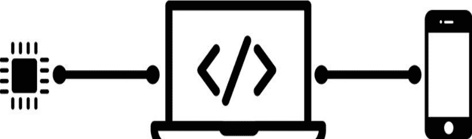

图 3-1. 编程配置

## 编写中心设备程序

本章详细介绍了如何创建一个开启蓝牙射电的中心应用。蓝牙射电需要使用权限，并且默认可能是关闭的。

在 Android 中使用低功耗蓝牙之前的首要工作是启用它。这是两个步骤：

- 请求蓝牙功能
- 启用蓝牙硬件

## 请求蓝牙功能

每当你在 Android 上访问硬件时，都要先在 Android Manifest 中请求访问。在 Manifest 的 `<manifest></manifest>` 标签之间放置以下两行代码。

示例 3-1. `manifests/AndroidManifest.xml`

```xml
...
<uses-feature
android:name="android.hardware.bluetooth_le" android:required="true" />
<uses-permission android:name="android.permission.BLUETOOTH"/>
```

## 启用蓝牙

要开启蓝牙：

- 询问应用程序是否存在 BLE 功能
- 获取蓝牙管理器（Bluetooth Manager）；然后
- 获取蓝牙适配器（Bluetooth Adapter）。

```java
// BLE 功能是否存在？
if (getPackageManager().hasSystemFeature(PackageManager.FEATURE_BLUETOOTH))
{
    // 获取蓝牙管理器
    final BluetoothManager bluetoothManager = (BluetoothManager)getSystemService(Context.BLUETOOTH_SERVICE);
    // 获取蓝牙适配器
    BluetoothAdapter bluetoothAdapter = bluetoothManager.getAdapter();
}
```

这可以在 Activity 的 `onCreate()` 方法中完成。如果硬件不支持低功耗蓝牙，此时会发生错误。

## 检查蓝牙是否启用

用户可能会随时关闭蓝牙射电。因此，每当应用程序恢复时，Activity 都需要使用此函数检查蓝牙是否仍然启用或已被禁用。

```java
boolean bluetoothEnabled = getBluetoothAdapter().isEnabled();
```

Activity 可以提醒用户蓝牙射电已关闭，也可以请求用户启用它。Activity 可以使用 `BluetoothAdapter.ACTION_REQUEST_ENABLE` Intent 程序化启用蓝牙。

示例 3-2. `java/example.com.exampleble/MainActivity.java`

```java
private final static int REQUEST_ENABLE_BT = 1;

if (bluetoothEnabled) {
    Intent enableBtIntent = new Intent(BluetoothAdapter.ACTION_REQUEST_ENABLE);
    startActivityForResult(enableBtIntent, REQUEST_ENABLE_BT);
}
```

蓝牙开启需要一点时间。为了防止在蓝牙准备就绪之前尝试访问，Activity 需要订阅一个 `AdvertiseReceiver`。`AdvertiseReceiver` 将通知 Activity 蓝牙射电状态的变化。


```java
IntentFilter filter = new IntentFilter(BluetoothAdapter.ACTION_STATE_CHANGED);

registerReceiver(mReceiver, filter);

private final AdvertiseReceiver mReceiver = new AdvertiseReceiver() {

@Override
public void onReceive(Context context, Intent intent) {
    final String action = intent.getAction();
    if (action.equals(BluetoothAdapter.ACTION_STATE_CHANGED)) {
        final int state = intent.getIntExtra(BluetoothAdapter.EXTRA_STATE, -1);
        switch (state) {
            case BluetoothAdapter.STATE_OFF:
                // 蓝牙射电关闭
                break;
            case BluetoothAdapter.STATE_TURNING_OFF:
                // 蓝牙射电正在关闭
                break;
            case BluetoothAdapter.STATE_ON:
                // 蓝牙射电开启
                break;
            case BluetoothAdapter.STATE_TURNING_ON:
                // 蓝牙射电正在开启
                break;
        }
    }
};
```

## 整合（Putting Together）

创建一个名为`BleCommManager`的新类。你的代码如下：

```java
package example.exampleble;

public class BleCommManager {
    private static final String TAG = BleCommManager.class.getSimpleName();
    private BluetoothAdapter mBluetoothAdapter;

    /**
     * 初始化 BleCommManager
     * @param context Activity 上
     * @throws Exception 蓝牙能量
     */
    public BleCommManager(final Context context) throws Exception {
        // 确保 Android 设备支持蓝牙能量
        if (!context.getPackageManager().hasSystemFeature(PackageManager.FEATURE_BLUETOOTH_LE)) {
            throw new Exception("不支持蓝牙");
        }
        // 获取蓝牙类的引用
        // 允许我们与 BLE 射电通信
        final BluetoothManager bluetoothManager = (BluetoothManager)getSystemService(Context.BLUETOOTH_SERVICE);
        mBluetoothAdapter = bluetoothManager.getAdapter();
    }

    /**
     * 获取 Android 蓝牙适配器
     */
    public BluetoothAdapter getBluetoothAdapter() {
        return mBluetoothAdapter;
    }
}
```

图 3-2. 项目结构

`BleCommManager`负责通用蓝牙功能，如开启和关闭射电。因此，`BleCommManager`结构如下：

```
app/
  manifests/
    AndroidManifest.xml
  java/
    example.com.exampleble/
      ble/
        MainActivity.java
        BleCommManager.java
  res/
    layout/
      activity_main.xml
    menu/
      main.xml
    values/
      strings.xml
```

```java
loadUI();
}

private void loadUI() {
    mBluetoothStatusTV = (TextView) findViewById(R.id.bluetooth_status);
}

/**
 * 当 App 恢复时开启蓝牙广播通知
 */
@Override
public void onResume() {
    super.onResume();
    initializeBluetooth();
}

@Override
public void onPause() {
    super.onPause();
    try {
        unregisterReceiver(mBluetoothAdvertiseReceiver);
    } catch (IllegalArgumentException e) {
        Log.e(TAG, "receiver not registered");
    }
}

@Override
public boolean onCreateOptionsMenu(Menu menu) {
    // 载入菜单；
    // 如果存在 action bar，则向其添加项目。
    getInflater().inflate(R.menu.menu_main, menu);
    return true;
}

@Override
public boolean onOptionsSelectedItem(MenuItem item) {
    return false;
}

/**
 * 蓝牙电电已开启。更新 UI。
 */
private void onBluetoothActive() {
    mBluetoothStatusTV.setText(R.string.bluetooth_active);
}

/**
 * 初始化蓝牙广播
 */
public void initializeBluetooth() {
    // 当蓝牙开启或关闭时进行通知
    IntentFilter filter = new IntentFilter(BluetoothAdapter.ACTION_STATE_CHANGED);
    registerReceiver(mBluetoothAdvertiseReceiver, filter);
    try {
        mBleCommManager = new BleCommManager(this);
    } catch (Exception e) {
        Toast.makeText(this, "Could not initialize bluetooth").show();
        Log.e(TAG, e.getMessage());
        finish();
    }
    // 如果蓝牙未启用，应该提示用户打开设置
    if (mBleCommManager.getBluetoothAdapter().isEnabled()) {
        onBluetoothActive();
    } else {
        Intent enableBtIntent = new Intent(BluetoothAdapter.ACTION_REQUEST_ENABLE);
        startActivityForResult(enableBtIntent, REQUEST_ENABLE_BT);
    }
}

/**
 * 跟踪蓝牙广播的变化
 */
private final AdvertiseReceiver mBluetoothAdvertiseReceiver = new AdvertiseReceiver() {
    @Override
    public void onReceive(Context context, Intent intent) {
        final String action = intent.getAction();
        if (action.equals(BluetoothAdapter.ACTION_STATE_CHANGED)) {
            final int state = intent.getIntExtra(BluetoothAdapter.EXTRA_STATE, BluetoothAdapter.ERROR);
            switch (state) {
                case BluetoothAdapter.STATE_OFF:
                    initializeBluetooth();
                    break;
                case BluetoothAdapter.STATE_TURNNING_OFF:
                    break;
                case BluetoothAdapter.STATE_ON:
                    runOnUiThread(new Runnable() {
                        @Override
                        public void run() {
                            onBluetoothActive();
                        }
                    });
                    break;
                case BluetoothAdapter.STATE_TURNNING_ON:
                    break;
            }
        }
    }
};
}
```

## Manifest

最后，在 Android Manifest 中启用蓝牙功能。

示例 3-6. manifests/AndroidManifest.xml

```xml
...
<uses-feature android:name="android.hardware.bluetooth_le" android:required="true" />
<uses-permission android:name="android.permission.BLETOOTH"/>
<uses-permission android:name="android.permission.BLETOOTH_ADMIN"/>
...
```

生成的应用将请求开启蓝牙广播（图 3-3），并在蓝牙广播开启后运行（图 3-4）。

图 3-3. 请求用户权限以启用蓝牙的对话框

# ExampleBLE

图 3-4. 应用主界面

## 为外设设备编程

Android 中的外设模式（Peripheral Mode）需要 API 21（Android 5）或更高版本。在 Android 中作为低功耗蓝牙外设工作之前，首要工作是启用它。这是两个步骤：

- 请求蓝牙功能
- 启用蓝牙硬件

## 请求蓝牙功能

每当你在 Android 上访问硬件时，请先在 Android Manifest 中请求权限。将以下两行放在 Manifest 的`<manifest></manifest>`标签之间。

示例 3-7. manifests/AndroidManifest.xml

```xml
<uses-feature android:name="android.hardware.bluetooth_le" android:required="true" />
<uses-permission android:name="android.permission.BLUETOOTH"/>
```

## 启用蓝牙

要开启蓝牙：

- 询问应用程序是否存在 BLE 功能；
- 获取蓝牙管理器；然后
- 获取蓝牙适配器。

```java
// BLE 功能是否存在？
if (getPackageManager().hasSystemFeature(PackageManager.FEATURE_BLUETOOTH))
{
    // 获取蓝牙管理器
    final BluetoothManager bluetoothManager = (BluetoothManager)getSystemService(Context.BLUETOOTH_SERVICE);

    // 获取蓝牙适配器

    BluetoothAdapter bluetoothAdapter = bluetoothManager.getAdapter();
}
...
```

这可以在初始化新外设时，在 Activity 的`onCreate()`方法中完成。如果不支持低功耗蓝牙，将会发生错误。

## 检查外设模式是否可用

即使 Android 的 API 级别为 21（Android 5）或更高，硬件可能不支持外设模式。因此，检查是否支持此功能是非常重要的：

```java
bool isModeSupported = false;
```

// 对于上述条件错误报告 true 的设备

```java
if (BluetoothAdapter.isMultipleSupported()) {
    isModeSupported = true;
}
```

```java
if (isModeSupported) {

    mBluetoothAdvertiser = bluetoothAdapter.getBluetoothLeAdvertiser();

}
```

Activity 可以通知用户蓝牙广播已关闭，或者请求用户启用它。Activity 可以使用`BluetoothAdapter.ACTION_REQUEST_ENABLE`以编程方式启用蓝牙。

示例 3-7. java/example.exampleble/MainActivity.java

```java
private static int REQUEST_ENABLE_BT = 1;

if (bluetoothEnabled) {

    Intent enableBtIntent = new Intent(BluetoothAdapter.ACTION_REQUEST_ENABLE);

    startActivityForResult(enableBtIntent, REQUEST_ENABLE_BT);

}
```

蓝牙开启需要一段时间。为了防止在准备好之前尝试访问蓝牙，Activity 需要订阅`AdvertiseReceiver`。`AdvertiseReceiver`会通知 Activity 蓝牙状态。

```java
IntentFilter filter = new IntentFilter(BluetoothAdapter.ACTION_STATE_CHANGED);

registerReceiver(mReceiver, filter);

private final AdvertiseReceiver mReceiver = new AdvertiseReceiver() {

    @Override
    public void onReceive(Context context, Intent intent) {

        final String action = intent.getAction();

        if (action.equals(BluetoothAdapter.ACTION_STATE_CHANGED)) {

            final int state = intent.getIntExtra(BluetoothAdapter.EXTRA_STATE, BluetoothAdapter.ERROR);

            switch (state) {

                case BluetoothAdapter.STATE_OFF:

                    // 蓝牙广播已关闭

                    break;

                case BluetoothAdapter.STATE_TURNNING_OFF:

                    break;

                case BluetoothAdapter.STATE_ON:

                    // 蓝牙广播已开启

                    break;

                case BluetoothAdapter.STATE_TURNNING_ON:

                    break;

            }

        }

    }

}

);
```


要在 App 中开启蓝牙，必须在 Manifest 中请求 `BLUETOOTH_ADMIN` 权限。通过将以下行放在 Manifest 的 `<manifest></manifest>` 之间来实现。

示例 3-8. `manifests/AndroidManifest.xml`

```xml
<uses-permission android:name="android.permission.BLTOOTH_ADMIN"/>
```

现在应用可以在蓝牙被禁用时开启它。

## 整合在一起

创建一个名为 `ExampleBlePeripheral` 的新项目。创建包和类，使项目结构如下所示：

你的代码结构现在应该看起来所示（图 3-5）。

```text
app/
  manifests/
    AndroidManifest.xml
java/
  example.com.examplebleperipher/
    ble/
      BlePeripheral
      MainActivity
res/
  layout/
    activity_main.xml
  menu/
    menu_main.xml
  values/
    strings.xml
```

图 3-5. 项目结构

## 资源（Resources）

字符串资源（String Resources）将定义 App 中使用的文本。

### 示例 3-9. `res/values/strings.xml`

```xml
<resources>
  <string name="app_name">ExampleBLEPeripheral</string>
  <string name="bluetooth_on">蓝牙开启</string>
</resources>
```

## 对象（Objects）

`BlePeripheral` 负责检查是否支持外模式（Peripheral mode）。

因此，`BlePeripheral` 的结构如下：

### 示例 3-10. `java/example.com.comexampleble/BlePeripheral.java`

```java
package com.example.com.examplebleperipheral.ble;

public class BlePeripheral {

  /** 常量 **/

  private static final String TAG = MyBlePeripheral.class.getSimpleName();

  /** 蓝牙相关内容 **/

  private BluetoothAdapter mBluetoothAdapter;

  private BluetoothLeAdvertiser mBluetoothAdvertiser;

  /**
   * 构建一个新的外设设备
   * @param context 应用程序上下文
   * @throws Exception 如果不支持蓝牙则抛出异常
   */

  public BlePeripheral(final Context context) throws Exception {

    // 确保 Android 设备支持低功耗蓝牙

    if (!context.getPackageManager().hasSystemFeature(
        PackageManager.FEATURE_BLUETOOTH_LE)
    ) {
        throw new Exception("不支持蓝牙");
    }

    // 获取蓝牙管理器 类的引用
    // 允许我们与 BLE 射电通信

    final BluetoothManager bluetoothManager =
        (BluetoothManager) context.getSystemService(
            Context.BLUETOOTH_SERVICE
        );

    mBluetoothAdapter = bluetoothManager.getAdapter();

    // 注意：此函数在某些平台上不起作用

    if (!mBluetoothAdapter.isMultipleAdvertisementsSupported()) {
        throw new Exception("不支持外设模式");
    }

    mBluetoothAdvertiser = mBluetoothAdapter.getBluetoothLeAdvertiser();

    // 使用此方法以获得更好的支持

    if (mBluetoothAdvertiser == null) {
        throw new Exception("不支持外设模式");
    }

    /**
     * 获取系统蓝牙适配器
     *
     * @return BluetoothAdapter
     */

    public BluetoothAdapter getBluetoothAdapter() {
        return mBluetoothAdapter;
    }
  }
}
```

## Activity（Activities）

`MainActivity` 会请求开启蓝牙射电，然后实例化 `BlePeripheral`。当蓝牙射电开启时，`mBluetoothOnSwitch` 将切换到开启位置。

### 示例 3-11. `java/example.com.exampleble/ble/MainActivity.java`

```java
package com.example.com.exampleble;

public class MainActivity extends AppCompatActivity {

    /** 常量 **/

    private static final String TAG = MainActivity.class.getSimpleName();

    private static final int REQUEST_ENABLE_BT = 1;

    /** 蓝牙相关内容 **/

    private MyBlePeripheral mMyBlePeripheral;

    /** UI 相关内容 **/

    private Switch mBluetoothOnSwitch;

    @Override
    protected void onCreate(Bundle savedInstanceState) {

        super.onCreate(savedInstanceState);

        setContentView(R.layout.activity_main);

        Toolbar toolbar = (Toolbar) findViewById(R.id.toolbar);

        setSupportActionBar(toolbar);

        // 当蓝牙开启或关闭时通知

        IntentFilter filter =
            new IntentFilter(BluetoothAdapter.ACTION_STATE_CHANGED);

        registerReceiver(mBleAdvertiseReceiver, filter);

        loadUI();
    }

    @Override
    public void onResume() {

        super.onResume();

        initializeBluetooth();
    }

    @Override
    public void onDestroy() {

        super.onDestroy();

        unregisterReceiver(mBleAdvertiseReceiver);
    }

    /**
     * 加载 UI 组件
     */

    public void loadUI() {

        mBluetoothOnSwitch =
            (Switch) findViewById(R.id.bluetooth_on);
    }

    /**
     * 初始化蓝牙射电
     */

    public void initializeBluetooth() {

        // 重置连接变量

        try {

            mMyBlePeripheral = new MyBlePeripheral(this);

        } catch (Exception e) {

            Toast.makeText(
                "无法初始化蓝牙", Toast.LENGTH_SHORT
            ).show();

            Log.e(TAG, e.getMessage());

            finish();
        }

        mBluetoothOnSwitch.setChecked(
            mMyBlePeripheral.getBluetoothAdapter().isEnabled()
        );

        // 如果蓝牙未启用，应提示用户打开设置

        if (!mMyBlePeripheral.getBluetoothAdapter().isEnabled()) {

            Intent enableBtIntent =
                new Intent(BluetoothAdapter.ACTION_REQUEST_ENABLE);

            startActivityForResult(enableBtIntent, REQUEST_ENABLE_BT);
        }
    }

    private final BroadcastReceiver mBleAdvertiseReceiver =
        new BroadcastReceiver() {

        @Override
        public void onReceive(Context context, Intent intent) {

            String action = intent.getAction();

            if (action.equals(BluetoothAdapter.ACTION_STATE_CHANGED)) {

                int state = intent.getIntExtra(
                    BluetoothAdapter.EXTRA_STATE, -1
                );

                switch (state) {

                    case BluetoothAdapter.STATE_OFF:

                        Log.d(TAG, "蓝牙关闭");

                        break;

                    case BluetoothAdapter.STATE_TURNING_OFF:

                        Log.d(TAG, "正在关闭蓝牙");

                        break;

                    case BluetoothAdapter.STATE_ON:

                        Log.d(TAG, "蓝牙开启");

                        break;

                    case BluetoothAdapter.STATE_TURNING_ON:

                        Log.d(TAG, "正在开启蓝牙");

                        break;
                }
            }
        }
    };
}
```

### 示例 3-12. `res/layout/activity_main.xml`

```xml
<?xml version="1.0" encoding="utf-8"?>

<android.support.design.widget.CoordinatorLayout
    xmlns:android="http://schemas.android.com/apk/res/android"
    xmlns:app="http://schemas.android.com/apk/res-auto"
    xmlns:tools="http://schemas.android.com/tools"
    android:layout_width="match_parent"
    android:layout_height="match_parent"
    tools:context=".MainActivity">

    <android.support.design.widget.AppBarLayout
        android:layout_width="match_parent"
        android:layout_height="wrap_content"
        android:background="?attr/colorPrimary"
        app:theme="@style/AppTheme.ActionBar">

        <android.support.v7.widget.Toolbar
            android:id="@+id/toolbar"
            android:layout_width="match_parent"
            android:layout_height="?attr/actionBarSize" />
    </android.support.design.widget.AppBarLayout>

    <RelativeLayout
        android:layout_width="match_parent"
        android:layout_height="match_parent"
        android:paddingLeft="@dimen/horizontal_margin"
        android:paddingRight="@dimen/horizontal_margin"
        android:paddingTop="@dimen/vertical_margin"
        android:paddingBottom="@dimen/vertical_margin"
        app:layout_behavior="@string/appbar_scrolling_view_behavior">

        <LinearLayout
            android:orientation="vertical"
            android:layout_width="match_parent"
            android:layout_height="wrap_content">

            <Switch
                android:clickable="false"
                android:layout_width="match_parent"
                android:layout_height="wrap_content"
                android:text="@string/bluetooth_on"
                android:id="@id/bluetooth_on" />
        </LinearLayout>
    </RelativeLayout>
</android.support.design.widget.CoordinatorLayout>
```

### 示例 3-13. `manifests/AndroidManifest.xml`

```xml
...

<uses-feature
    android:name="android.hardware.bluetooth_le"
    android:required="true" />

<uses-permission android:name="android.permission.BLUETOOTH"/>

<uses-permission
    android:name="android.permission.BLUETOOTH_ADMIN"/>

...
```


生成的 App 将能够开启蓝牙射电（图 3-6）。

# ExampleBLE

图 3-6. 主应用界面

## Example code

本章代码可以在此处获取：https://github.com/BluetoothLowEnergyInAndroidJava

## 扫描与广播

任何蓝牙低功耗（BLE）交互的第一步都是外设设备（Peripheral）通过名为“广播”（Advertising）的过程让中心设备（Central）感知其存在。

在广播过程中，外设进行广播，而中心设备进行扫描。

蓝牙设备调到相同的无线频率（也称为通道，Channel）时会相互发现彼此。蓝牙低功耗有三个通道专门用于设备发现：

表 4-1. 蓝牙低功耗发现无线通道

| 通道 | 无线频率 |
| --- | --- |
| 37 | 2402 Mhz |
| 39 | 2426 Mhz |
| 39 | 2480 Mhz |

外设会在一个通道上广播其名称和其他数据，然后切换到另一个通道。这被称为频率跳变（图 4-1）。

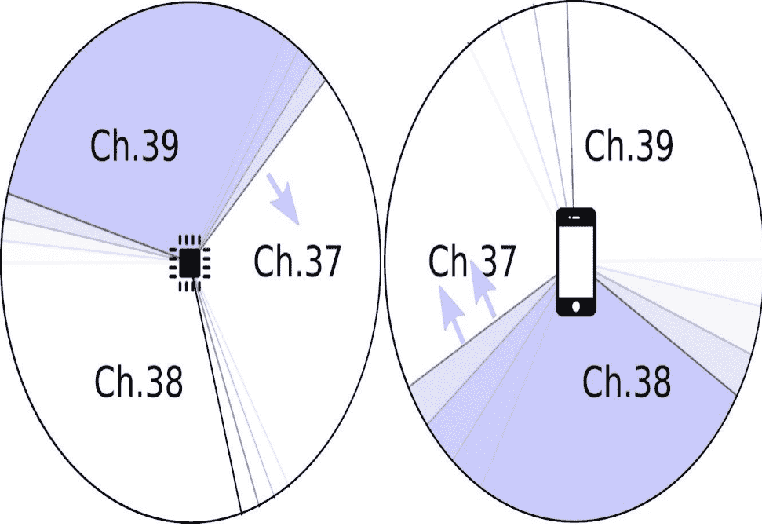

图 4-1. 广播与扫描过程

同样，中心设备首先在一个通道上监听广播，然后是另一个。中心设备的频率跳变比外设快，因此可以保证最终会在同一个通道上。

根据配置，外设可能会广播持续 100ms 到 100 秒不等，每 0.625ms 切换一次通道（图 4-2）。

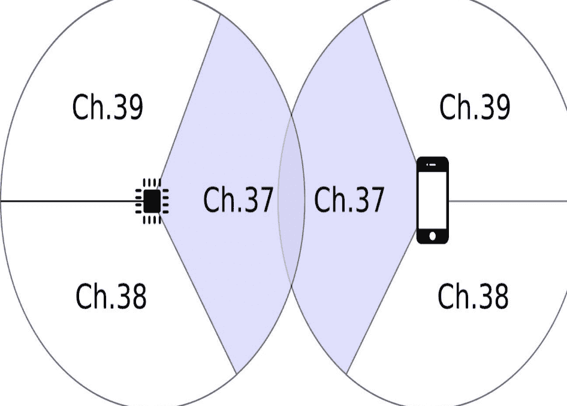

图 4-2. 扫描发现广播

扫描设置差异很大，例如每 10ms 扫描一次持续 100ms，或者扫描 1 秒持续 10 秒。

## 中心设备编程

上一章展示了如何访问蓝牙硬件`BluetoothAdapter`。本章将展示如何扫描蓝牙设备。这是通过在短时间内扫描外设来实现的。在此期间，每当发现外设时，系统都会触发回调函数。从那里可以对发现的外设进行检查。

`BluetoothAdapter`提供了访问`BluetoothLeScanner`的权限，它可以让你扫描附近的外设。

```
// 设备扫描器允许我们扫描 BLE 设备
```

```java
BluetoothLeScanner bluetoothScanner =
bluetoothAdapter.getBluetoothLeScanner();
```

在 Android 中，在主线程中运行 CPU 密集型任务会导致用户界面无法正常工作。因此，蓝牙扫描最好在单独线程中进行。

在此示例中，App 将扫描 BLE 设备 3-5 秒。5 秒是一个合理的时间，可以假设大多数设备会在扫描过程中被发现。

实现扫描的方法在 API 级别 21（Android 5 棒糖）中发生了变化。

## APIs 18-20

在 API 21 之前，扫描执行如下：

```java
// 在线程内运行 SCAN_PERIOD_MS 毫秒的扫描
new Thread() {
    @Override
    public void run() {
        // 在新线程中扫描 BLE 设备
        // 扫描设备 5 秒
        static final int SCAN_PERIOD_MS = 5000;

        // 开始扫描
        bluetoothAdapter.startLeScan(scanCallback);

        try {
```

```java
// 让扫描运行 SCAN_PERIOD_MS
Thread.sleep(SCAN_PERIOD_MS);
} catch (InterruptedException e) {
  e.printStackTrace();
}

bluetoothAdapter.stopLeScan(scanCallback); // 停止扫描
}
}.start();
```

当发现每一个新外设时，`LeScanCallback`中会触发事件：

表 4-2. LeScanCallback

| 事件 |  |
| --- | --- |
| `onLeScan` | 当发现新外设时触发 |

`LeScanCallback`可以这样实现，以获取外设的广播名称和 MAC 地址：

```java
private LeScanCallback scanCallback = new LeScanCallback() {
    // 当找到设备时执行此函数
    @Override
    public void onLeScan(final BluetoothDevice device,
        int rssi, byte[] scanRecord) {

        String advertiseName = device.getName();
        String macAddress = device.getAddress();
    }
};
```

## APIs 21 及更高版本

自 API 级别 21（棒棒糖）以来，扫描的实现如下：

```java
// 设置扫描设置过滤器
```

```java
final ScanSettings settings = new ScanSettings.Builder()
.setScanMode(ScanSettings.SCAN_MODE_LOW_LATENCY).build();
```

```java
final List<ScanFilter> filters = new ArrayList<ScanFilter>();
```

```java
// 获取蓝牙 LE 扫描器
```

```java
bluetoothLeScanner = mBluetoothAdapter.getBluetoothLeScanner();
```

```java
// 在线程内运行 SCAN_PERIOD 毫秒的扫描
```

```java
new Thread() {
@Override
public void run() {
    // 扫描设备 5 秒
    static final int SCAN_PERIOD_MS = 5000;

    bluetoothLeScanner.startScan(filters, settings, scanCallback);
    try {
        Thread.sleep(SCAN_PERIOD_MS);
    } catch (InterruptedException e) {
        e.printStackTrace();
    }

    bluetoothLeScanner.stopScan(scanCallback);
}
}.start();
```

扫描设置可以根据所需的权衡进行更改。

### 表 4-3. ScanSettings

| 设置 | 描述 |
| --- | --- |
| `SCAN_MODE_BALANCED` | 平衡电池与扫描 |
| `SCAN_MODE_LOW_LATENCY` | 优先扫描 |
| `SCAN_MODE_POWER` | 优先电池电 |

当发现新外设时，`ScanCallback`中会触发相应的事件：

表 4-4. ScanCallback

| 事件 | 描述 |
| --- | --- |
| `onScanResult` | 当发现新外设时触发 |
| `onBatchResults` | 批量发现新外设 |
| `onScanFailed` | 初始化扫描失败。查看错误代码获取原因。 |

`ScanCallback`可以这样实现：

```java
private ScanCallback scanCallback = new ScanCallback() {

/**
 * 发现新设备。
 * @param callbackType 告知此回调是如何触发的
 * @param result 关于结果的信息
 */
@Override
public void onScanResult(int callbackType, ScanResult result) {
    BluetoothDevice device = result.getDevice();
    String advertiseName = device.getName();
    String macAddress = device.getAddress();
    int rssi = result.getRssi();
}

/**
 * 批量发现新设备。
 * @param results 之前扫描的结果列表
 */
@Override
public void onBatchResults(List<ScanResult> results) {
    // 处理列表中的每个结果
}

/**
 * 初始化扫描失败。查看错误代码获取原因。
 * @param errorCode 扫描失败的错误代码（SCAN_FAILED_*）
 */
@Override
public void onScanFailed(int errorCode) {
    switch (errorCode) {
        case SCAN_FAILED_ALREADY_STARTED:
            // 应用已启动扫描
            break;

        case SCAN_FAILED_APPLICATION_REGISTRATION_FAILED:
            // 无法注册
            break;

        case SCAN_FAILED_FEATURE_UNSUPPORTED:
            // 设备不支持该功率优化设置
            break;

        default: // SCAN_FAILED_INTERNAL_ERROR
            // 内部错误
            break;
    }
};
```

为了支持最广泛的 Android 设备，实现 API 18 和 API 21 版本的扫描器可能是非常有用的。实现方法如下：

```java
static long SCAN_PERIOD_MS = 5000; // 扫描 5 秒

// 使用 BluetoothAdapter.startScan() 用于 Android API 18, 19 和 20
if (Build.VERSION.SDK_INT < Build.VERSION_CODES.LOLLIPOP) {
    // 扫描 SCAN_PERIOD_MS 毫秒。
    // 在该时间结束后停止扫描。
    new Thread() {
        @Override
        public void run() {
            mBluetoothAdapter.startScan(bleScanCallbackv18);
            try {
                Thread.sleep(SCAN_PERIOD_MS);
            } catch (InterruptedException e) {
                e.printStackTrace();
            }
            mBluetoothAdapter.stopScan(bleScanCallbackv18);
        }
    }.start();
}
```

```java
// 处理异常
}

mBluetoothAdapter.stopScan(bleScanCallbackv18);
}}.start();

} else { // 对于 API 21 (Lollipop) 或更高版本使用 BluetoothScanner.startScan()
    final ScanSettings settings = new ScanSettings.Builder()
            .setScanMode(ScanSettings.SCAN_MODE_LOW_LATENCY).build();

    final List<ScanFilter> filters = new ArrayList<ScanFilter>();

    bluetoothScanner = mBluetoothAdapter.getBluetoothScanner();

    new Thread() {
        @Override
        public void run() {
            bluetoothScanner.startScan(
                filters,
                settings,
                bleScanCallbackv21
            );

            try {
                Thread.sleep(SCAN_PERIOD_MS);
            } catch (InterruptedException e) {
                // 处理异常
            }

            bluetoothLeScanner.stopScan(bleScanCallbackv21);
        }
    }.start();
}
```

扫描回调可以如下所示实现：

```java
private LeScanCallback bleScanCallbackv18 = new LeScanCallback { ... };

private ScanCallback bleScanCallbackv21 = new ScanCallback { ... };
```

## 整合一切

创建一个名为`ExampleBleScanner`的新应用，并复制上一个示例中的所有内容。

创建一个如下所示的文件结构（见图 4-3）。

```text
app/
  manifests/
    AndroidManifest.xml
  java/
    example.com.exampleble/
      adapters/
        BlePeripheralListAdapter
      ble/
        callbacks/
          BleScanCallbackv18
          BleScanCallbackv21
        BleCommManager
        models/
          BlePeripheralListItem
      MainActivity
  res/
    layout/
      activity_main.xml
      list_item_peripheral.xml
      scanner_progress.xml
    menu/
      menu_main.xml
    values/
      strings.xml
```

图 4-3. 项目结构

此示例将包含一些用户界面元素，包括一个列表适配器。该列表适配器将在主 Activity 中填充已发现的外围设备（Peripherals）列表。

将创建自定义的扫描回调，它们会在扫描停止时响应事件。

## 资源

首先，定义一些将被应用其余部分使用的维度和字符串。

### Example 4-1. `res/values/dimens.xml`

添加一个文本内边维度：

```xml
<resources>
  <!-- 默认屏幕边距，符合 Android 设计指南。 -->
  <dim name="activity_horizontal_margin">16dp</dim>
  <dim name="activity_vertical_margin">16dp</dim>
  <dim name="text_padding">5dp</dim>
</resources>
```

### Example 4-2. `res/values/strings.xml`

为按钮和标签添加文本：

```xml
<resources>
<string name="app_name">ExampleBLEScan</string>
<string name="action_start_scan">扫描</string>
<string name="action_stop_scan">停止</string>
<string name="scanning">扫描中...</string>
<string name="peripheral_list_empty">未发现外围设备</string>
</resources>
```

## 对象

向`BleCommManager`添加以下函数，使其具有启动和停止对 BLE 设备扫描的功能。

### Example 4-3. `java/example.com.exampleble/ble/BleCommManager.java`

```java
public class BleCommManager {
    private static final String TAG = BleCommManager.class.getSimpleName();
    private static final long SCAN_PERIOD = 5000; // 5 秒扫描时间
    private BluetoothAdapter mBluetoothAdapter; // Android 蓝牙适配器
    private BluetoothLeScanner bluetoothScanner; // Ble 扫描器 - API >= 21
```


```java
private Timer mTimer = new Timer(); // 扫描计时器
```

```java
/**
 * 扫描外围设备
 *
 * @param bleScanCallbackv18 兼容 API 18 的回调
 * @param bleScanCallbackv21 兼容 API 21 的回调
 * @throws Exception
 */
public void scanForPeripherals(
    final LeScanCallback bleScanCallbackv18,
    final ScanCallback bleScanCallbackv21) Exception {

    // 如果已经在扫描，则不再继续
    mTimer.cancel();

    // 对于 Android 18, 19, 20 使用 BluetoothAdapter.startLeScan()
    // 在指定的毫秒数后停止扫描。
    if (Build.VERSION.SDK_INT < Build.VERSION_CODES.LOLLIPOP) {

        mTimer = new Timer();

        mTimer.schedule(new TimerTask() {

            @Override
            public void run() {

                // 通知系统 BLE 扫描已停止
                mBluetoothAdapter.stopScan(bleScanCallbackv18);
            }

        }, SCAN_PERIOD);

    } else {

        // 对于 Lollipop 及以上版本使用 BluetoothScanner.startScan()
        bluetoothScanner.startScan(
            filters,
            settings,
            bleScanCallbackv21
        );

        try {
            Thread.sleep(SCAN_PERIOD);
        } catch (InterruptedException e) {
            e.printStackTrace();
        }

        bluetoothLeScanner.stopScan(bleScanCallbackv21);
    }
}

/**
 * 停止扫描
 */
public void stopScanning(
    final LeScanCallback bleScanCallbackv18,
    final ScanCallback bleScanCallbackv21) {

    mTimer.cancel();

    if (Build.VERSION.SDK_INT < Build.VERSION_CODES.LOLLIPOP) {
        mBluetoothAdapter.stopScan(bleScanCallbackv18);
    } else {
        bluetoothScanner.stopScan(bleScanCallbackv21);
    }
}
```

定义两个扫描回调 `BleScanCallbackv18` 和 `BleScanCallbackv21`，它们将描述 `BleCommManager` 如何响应新发现的外围设备。

```java
/*
@Override
public abstract void onScanFailed(int errorCode);

/**
 * 扫描已完成
 */
public abstract void onScanComplete();

}
```

# 用户界面

在此应用中，使用了自定义的 `ListAdapter` 来视觉化表示每个发现的外设（Peripherals）。

`list_item_peripheral.xml` 定义了设备列表中每个项目的外观。我们的项目将三个文本字段：一个用于设备名称，一个用于地址，另一个用于 RSSI（无线信号强度指示）。

**示例 4-6. `res/layout/list_item_peripheral.xml`**

```xml
<?xml version="1.0" encoding="utf-8"?>

<LinearLayout xmlns:android="http://schemas.android.com/apk/res/android"
    android:layout_width="fill_parent"
    android:layout_height="fill_parent"
    android:orientation="horizontal">

    <LinearLayout
        android:orientation="vertical"
        android:layout_width="wrap_content"
        android:layout_height="wrap_content"
        android:layout_weight="2">

        <TextView
            android:id="@+id/advertise_name"
            android:layout_width="wrap_content"
            android:layout_height="wrap_content"
            android:textSize="20sp"
            android:paddingTop="@dimen/text_padding"/>

        <TextView
            android:id="@+id/mac_address"
            android:layout_width="wrap_content"
            android:layout_height="wrap_content"
            android:textSize="10sp"
            android:paddingTop="@dimen/text_padding"/>

    </LinearLayout>

    <TextView
        android:id="@+id/rssi"
        android:layout_width="wrap_content"
        android:layout_height="wrap_content"
        android:textSize="10sp"
        android:paddingTop="@dimen/text_padding"/>

</LinearLayout>
```

`BlePeripheralListItem` 是每个 `list_item.xml` 列表项中数据的表示。

**示例 4-7. `java/com/example/ble/models/BlePeripheralListItem.java`**

```java
package com.example.ble.models;

public class BlePeripheralListItem {

    private int mItemId;

    private int mRssi;

    private BluetoothDevice mBluetoothDevice;

    public BlePeripheralListItem(BluetoothDevice bluetoothDevice) {
        mBluetoothDevice = bluetoothDevice;
    }

    public void setItemId(int id) {
        mItemId = id;
    }

    public void setRssi(int rsi) {
        mRssi = rsi;
    }

    public int getItemId() {
        return mItemId;
    }

    public String getAdvertiseName() {
        return mBluetoothDevice.getName();
    }

    public String getMacAddress() {
        return mBluetoothDevice.getAddress();
    }

    public int getRssi() {
        return mRssi;
    }

    public BluetoothDevice getDevice() {
        return mBluetoothDevice;
    }
}
```

为了将数据传输到列表，list adapter 必须能够处理特定于发现的外设的数据。

**示例 4-8. `java/com/example/ble/adapters/BlePeripheralsListAdapter.java`**

```java
package com.example.ble.adapters;

public class BlePeripheralsListAdapter extends BaseAdapter {

    private static String TAG =
        BlePeripheralsListAdapter.class.getSimpleName();

    private ArrayList<BlePeripheralListItem> mBluetoothPeripheralItems =
        new ArrayList<BlePeripheralListItem>();

    /**
     * ListView 中包含多少项
     *
     * @return 此 ListView 中项的数量
     */
    @Override
    public int getCount() {
        return mBluetoothPeripheralItems.size();
    }

    /**
     * 向 ListView 添加一个新的外设
     *
     * @param bluetoothDevice 设备信息
     * @param rssi 外设的 RSSI，用于指示信号质量
     */
    public void addBluetoothPeripheral(
        BluetoothDevice bluetoothDevice,
        int rssi) {

        // 更新 UI
        int itemId = mBluetoothPeripheralItems.size();

        BlePeripheralListItem listItem =
            new BlePeripheralListItem(bluetoothDevice);

        listItem.setItemId(itemId);
        listItem.setRssi(rssi);

        // 添加到列表
        mBluetoothPeripheralItems.add(listItem);
    }

    /**
     * 获取 ListView 的当前状态
     *
     * @return BlePeripheralItems 列表
     */
    public ArrayList<BleListItem> getItems() {
        return mBluetoothPeripheralItems;
    }

    /**
     * 清空 ListView 中的所有项
     */
    public void clear() {
        mBluetoothPeripheralItems.clear();
    }

    /**
     * 获取 ListView 中某位置的 BlePeripheralListItem
     *
     * @param position 列表中项的位置
     * @return 该位置的 BlePeripheralListItem
     */
    @Override
    public BlePeripheralListItem getItem(int position) {
        return mBluetoothPeripheralItems.get(position);
    }

    @Override
    public long getItemId(int position) {
        return mBluetoothPeripheralItems.get(position).getItemId();
    }

    /**
     * ViewHolder 代表每个 List Item 中的 UI 组件
     */
    public static class ViewHolder {

        public TextView mAdvertiseTV;

        public TextView mAddressTV;

        public TextView mRssiTV;
    }

    /**
     * 为 ListView 中的某个位置生成 ListItem
     *
     * @param position ListItem 的位置
     * @param convertView 现有的 List Item
     * @param parent 父容器
     * @return List Item
     */
    @Override
    public View getView(
        int position,
        View convertView,
        ViewGroup parent) {

        View v = convertView;
        ViewHolder peripheralListItemView;

        // 如果 ListItem 不存在，则生成它
        // 否则使用它
        if (convertView == null) {

            // 将 list_item_peripheral.xml 转换为 View
            LayoutInflater inflater =
                LayoutInflater.from(parent.getContext());

            v = inflater.inflate(R.layout.list_item_peripheral, null);

            // 将 List Item 中的 UI 与 xml 文件匹配
            peripheralListItemView = new ViewHolder();

            peripheralListItemView.mAdvertiseTV =
                (TextView) v.findViewById(R.id.advertise_name);

            peripheralListItemView.mAddressTV =
                (TextView) v.findViewById(R.id.mac_address);

            peripheralListItemView.mRssiTV =
                (TextView) v.findViewById(R.id.rssi);

            v.setTag(peripheralListItemView);

        } else {

            peripheralListItemView = (ViewHolder) v.getTag();
        }

        Log.v(TAG, "ListItem size: " + mBluetoothPeripheralItems.size());

        // 如果有已知的外设，创建一个 ListItem
        // 否则，显示带有外设信息的 ListItem
        if (mBluetoothPeripheralItems.size() <= 0) {

            peripheralListItemView.mAdvertiseTV.setText(
                R.string.peripheral_list_empty);

        } else {

            BlePeripheralListItem item =
                mBluetoothPeripheralItems.get(position); // 固定 逻辑
```


`peripheralListItemView.mAdvertiseTV.setText(item.getAdvertiseName());`

`peripheralListItemView.mAddressTV.setText(item.getMacAddress());`

`peripheralListItemView.mRssiTV.setText(String.valueOf(item.getRssi()));`

`}`

`return v;`

`}`

`}`

将使用进度条（progress spinner）告知用户扫描状态。

### 示例 4-9. `res/layout/progress_scanner.xml`

```xml
<?xml version="1.0" encoding="utf-8"?>
<ProgressBar xmlns:android="http://schemas.android.com/apk/res/android"
    style="@android:style/ProgressBar.Small"
    android:layout_width="wrap_content"
    android:layout_height="wrap_content"
    android:id="@+id/scan_progress" />
```

## Activity

Activity 必须能够在用户点击 Scan 按钮时初始化扫描。它将扫描外设 5 秒，这是一个合理的扫描时间。每发现一个新外设，`ListView` 就会更新。

如果没有发现外设，`ListView` 将显示文本“未找到外设（No Peripherals Found）”。

扫描按钮和进度条定义在`menu_main.xml`中。

### 示例 4-10. `res/menu/menu_main.xml`

```xml
<menu xmlns:android="http://schemas.android.com/apk/res/android"
    xmlns:app="http://schemas.android.com/apk/res-auto"
    xmlns:tools="http://schemas.android.com/tools"
    tools:context=".MainActivity">

    <item android:id="@+id/action_start_scan"
        android:title="@string/action_start_scan"
        android:priority="100"
        app:showAsAction="always" />

    <item android:id="@+id/action_stop_scan"
        android:title="@string/action_stop_scan"
        android:priority="100"
        app:showAsAction="always" />

    <item android:id="@+id/scan_progress_item"
        android:title="@string/scanning"
        android:visible="true"
        android:priority="100"
        app:showAsAction="always" />
</menu>
```

```xml
app:actionLayout="@layout/progress_scanner"
android:layout_marginRight="@dimen/activity_horizontal_margin" />
</menu>
```

## `ListView` 和主菜单包含在 `activity_main.xml` 中

### 示例 4-11. `res/layout/activity_main.xml`

```xml
<?xml version="1.0" encoding="utf-8"?>
<android.support.design.widget.CoordinatorLayout
    xmlns:android="http://schemas.android.com/apk/res/android"
    xmlns:app="http://schemas.android.com/apk/res-auto"
    xmlns:tools="http://schemas.android.com/tools"
    android:layout_width="match_parent"
    android:layout_height="match_parent"
    android:fitSystemWindows="true"
    tools:context=".MainActivity">

    <android.support.design.widget.AppBarLayout
        android:layout_height="wrap_content"
        android:layout_width="match_parent"
        android:theme="@style/AppTheme.AppBarOverlay">

        <android.support.v7.widget.Toolbar
            android:id="@+id/toolbar"
            android:layout_width="match_parent"
            android:layout_height="?attr/actionBarSize"
            android:background="@attr/colorPrimary"
            app:popupTheme="@style/AppTheme.PopupOverlay" />
    </android.support.design.widget.AppBarLayout>

    <RelativeLayout
        xmlns:android="http://schemas.android.com/apk/res/android"
        android:layout_width="match_parent"
        android:layout_height="match_parent"
        android:paddingLeft="@dimen/activity_horizontal_margin"
        android:paddingRight="@dimen/activity_horizontal_margin"
        android:paddingTop="@dimen/activity_vertical_margin"
        android:paddingBottom="@dimen/activity_vertical_margin"
        app:layout_behavior="@string/appbar_scrolling_view_behavior"
        tools:showIn="@layout/activity_main"
        tools:context=".MainActivity">

        <ListView
            android:id="@+id/peripherals_list"
            android:layout_width="match_parent"
            android:layout_height="match_parent" />

        <TextView
            android:id="@id/peripheral_list_empty"
            android:layout_width="match_parent"
            android:layout_height="match_parent"
            android:text="@string/peripheral_list_empty" />
    </RelativeLayout>
</android.support.design.widget.CoordinatorLayout>
```

## 在 `MainActivity` 类中将它们一切整合在一起

### 示例 4-12. `java/example.com.exampleble/MainActivity.java`

```java
public class MainActivity extends AppCompatActivity {

    /** 常量 */

    private static final String TAG = MainActivity.class.getSimpleName();

    private static final int REQUEST_ENABLE_BT = 1;

    /** 蓝牙相关 */

    private BleCommManager mBleCommManager;

    /** Activity 状态 */

    private boolean mScanningActive = false;

    /** UI 相关 **/

    private MenuItem mScanProgressSpinner;

    private MenuItem mStartScanItem, mStopScanItem;

    private ListView mBlePeripheralsListView;

    private TextView mPeripheralsListEmptyTV;

    private BlePeripheralsListAdapter mBlePeripheralsListAdapter;

    @Override
    protected void onCreate(Bundle savedInstanceState) {
        super.onCreate(savedInstanceState);

        ContentView(R.layout.activity_main);

        Toolbar toolbar = (Toolbar) findViewById(R.id.toolbar);

        setSupportActionBar(toolbar);

        loadUI();
    }

    public void loadUI() {
        // 加载 UI 组件，设置外设列表

        mPeripheralsListEmptyTV =
                (TextView) findViewById(R.id.peripheral_list_empty);

        mBlePeripheralsListView =
                (ListView) findViewById(R.id.peripherals_list);

        mBlePeripheralsListAdapter = new BlePeripheralsListAdapter();

        mBlePeripheralsListView.setAdapter(mBlePeripheralsListAdapter);

        mBlePeripheralsListView.setEmptyView(mPeripheralsListEmptyTV);
    }

    @Override
    public void onResume() {
        super.onResume();

        initializeBluetooth();
    }

    @Override
    public void onPause() {
        super.onPause();

        // 当 activity 暂停时停止扫描
        mCommManager.stopScanning(mBleScanCallbackv18, mScanCallbackv21);
    }

    /**
     * 创建菜单
     * @param menu 菜单
     * @return 如果处理成功则返回 true
     */
    @Override
    public boolean onCreateOptionsMenu(Menu menu) {
        // 载入菜单；
        // 如果 action bar 存在，则向其添加条目

        getInflater().inflate(R.menu.menu_main, menu);

        mStartScanItem = menu.findItem(R.id.action_scan);

        mStopScanItem = menu.findItem(R.id.action_scan);

        mScanProgressSpinner = menu.findItem(R.id.progress_item);

        return true;
    }

    /**
     * 处理菜单点击
     * @param item MenuItem
     * @return 如果处理成功则返回 true
     */
    @Override
    public boolean onOptionsItemSelected(MenuItem item) {
        // 当用户点击“开始扫描”按钮时启动 BLE 扫描
        // 当用户点击“停止扫描”菜单按钮时停止 BLE 扫描

        switch (item.getItemId()) {
            case R.id.action_scan:
                // 用户选择了“扫描”条目
                startScan();

                return true;

            case R.id.action_stop:
                // 用户选择了“停止”条目
                stopScan();

                return true;

            default:
                // 如果到达这里，说明用户的操作未被识别。
                // 调用父类进行处理。

                return super.onOptionsItemSelected(item);
        }
    }

    /**
     * 初始化蓝牙适配
     */
    public void initializeBluetooth() {
        try {
            mBleCommManager = new BleCommManager(this);
        } catch (Exception e) {
            Toast.makeText(
                    this,
                    "Could not initialize bluetooth",
                    Toast.LENGTH_SHORT
            ).show();

            Log.e(TAG, e.getMessage());

            finish();
        }

        // 如果蓝牙未启用，应该提示用户打开设置。
        if (!mBleCommManager.getBluetoothAdapter().isEnabled()) {
            Intent enableBtIntent =
                    new Intent(BluetoothAdapter.ACTION_ENABLE);

            startActivityForResult(
                    enableBtIntent,
                    REQUEST_ENABLE_BT
            );
        }
    }

    /**
     * 开始扫描外设
     * 本章新增
     */
    public void startScan() {
        // 更新 UI 组件

        mStartScanItem.setVisible(false);

        mStopScanItem.setVisible(true);

        mScanProgressSpinner.setVisible(true);

        // 清空外设列表并扫描

        mBlePeripheralsListAdapter.clear();

        try {
            mScanningActive = true;

            mBleCommManager.scanForPeripherals(
                    mScanCallbackv18,
                    mScanCallbackv21
            );
        } catch (Exception e) {
            Log.e(TAG, "Could not open Scanner");
        }
    }

    /**
     * 停止扫描外设
     * 本章新增
     */
    public void stopScan() {
        mCommManager.stopScanning(
                mScanCallbackv18,
                mScanCallbackv21
        );
    }
}
```


## BLE 扫描停止时的触发

本章新增。

```java
public void onBleScanStopped() {
    // 更新 UI 以反映 BLE 扫描已停止

    // 此方法可能在菜单创建之前被调用

    // 检查菜单项是否初始化，否则 Activity 会崩溃

    mScanningActive = false;

    if (mStopScanItem != null) {
        mStopScanItem.setVisible(false);
    }

    if (mScanProgressSpinner != null) {
        mScanProgressSpinner.setVisible(false);
    }

    if (mStartScanItem != null) {
        mStartScanItem.setVisible(true);
    }
}
```

## 发现新外设时的触发

本章新增。

```java
public void onBlePeripheralDiscovered(BluetoothDevice bluetoothDevice, int rssi) {
    Log.v(TAG, "Found " + bluetoothDevice.getName() + ", " + bluetoothDevice.getAddress());

    // 仅满足以下条件时添加外设：
    // - 它有名称
    // - 它不在我们的列表中，或
    // - 它比相似的外设传输功率更高（距离更近）

    boolean addPeripheral = true;

    if (bluetoothDevice.getName() == null) {
        addPeripheral = false;
    }

    for (BlePeripheralListItem listItem : mBlePeripheralsListAdapter.getItems()) {
        if (listItem.getAdvertiseName().equals(bluetoothDevice.getName())) {
            addPeripheral = false;
        }
    }

    if (addPeripheral) {
        mBlePeripheralsListAdapter.addBluetoothPeripheral(bluetoothDevice, rssi);
    }
}

rssi);

runOnUi(new Runnable() {
    @Override
    public void run() {
        mBlePeripheralsListAdapter.notifyDataSetChanged();
    }
});
}
}
```

## Android API 21 及更高版本的扫描回调

在 Android API 21（Lollipop）或更高版本中，使用以下回调。

```java
private final BleScanCallbackv21 mScanCallbackv21 =
    new BleScanCallbackv21() {

        @Override
        public void onScanResult(int callbackType, ScanResult result) {
            BluetoothDevice bluetoothDevice = result.getDevice();
            int rssi = result.getRssi();
            onBlePeripheralDiscovered(bluetoothDevice, rssi);
        }

        @Override
        public void onBatchScanResults(List<ScanResult> results) {
            for (ScanResult result : results) {
                BluetoothDevice bluetoothDevice = result.getDevice();
                int rssi = result.getRssi();
                onBlePeripheralDiscovered(bluetoothDevice, rssi);
            }
        }

        @Override
        public void onScanFailed(int errorCode) {
            switch (errorCode) {
                case SCAN_FAILED_ALREADY_STARTED:
                    Log.e(TAG, "Scan with the same settings already started");
                    break;
                case SCAN_FAILED_APPLICATION_REGISTRATION_FAILED:
                    Log.e(TAG, "App cannot be registered.");
                    break;
                case SCAN_FAILED_FEATURE_UNSUPPORTED:
                    Log.e(TAG, "Power optimized scan is not supported.");
                    break;
                default: // SCAN_FAILED_INTERNAL_ERROR
                    Log.e(TAG, "Fails to start scan due an internal error");
            }

            runOnUiThread(new Runnable() {
                @Override
                public void run() {
                    onBleScanStopped();
                }
            });
        }

        public void onScanComplete() {
            runOnUiThread(new Runnable() {
                @Override
                public void run() {
                    onBleScanStopped();
                }
            });
        }
    };
```

## Android API 18、19 和 20 的扫描回调

在 Android API 18、19 和 20（Lollipop 之前）使用此回调。

```java
public final BleScanCallbackv18 mBleScanCallbackv18 =
    new BleScanCallbackv18() {

        @Override
        public void onLeScan(
                BluetoothDevice bluetoothDevice,
                int rssi,
                byte[] scanRecord) {
            onBlePeripheralDiscovered(bluetoothDevice, rssi);
        }

        @Override
        public void onScanComplete() {
            runOnUi(new Runnable() {
                @Override
                public void run() {
                    onBleScanStopped();
                }
            });
        }
    };
```

编译并运行应用。运行时，你将看到一个带有扫描按钮的屏幕（图 4-4）。点击扫描按钮时，它会定位你的 BLE 设备（图 4-5）。

## `ExampleBLETalk` 扫描

无数据。

图 4-4. 蓝牙扫描前的应用屏幕

## `ExampleBLEScan` 停止

`MyDevice -52`

`EF:E1:0D:46:03:C6`

图 4-5. 发现蓝牙外设后的应用屏幕

# 外设编程

上一章展示了如何开启蓝牙射电并检测 Android 硬件是否支持外设。

本章将展示如何广播蓝牙低功耗外设。

`BluetoothAdapter` 提供了对 `BluetoothLeScanner` 的访问，它可以启动对附近外设的扫描。

```java
// 设备扫描允许我们扫描 BLE 设备

BluetoothLeScanner bluetoothScanner =
    bluetoothAdapter.getBluetoothLeScanner();
```

在 Android 中，在主线程运行 CPU 密集型任务会阻止用户界面正常运行。因此，蓝牙扫描最好在单独线程中进行。

在此示例中，应用将扫描 BLE 设备 3-5 秒。5 秒是一个合理的时间，可以假设大多数设备会在扫描过程中被发现。

实现扫描的方法在 API 21（Android Lollipop）中发生了变化。

## 广播

要开始广播，请设置广告设置和广告数据。

广告数据可以包含外设名称、GATT 配置和其他信息。外设名称设置如下：

```java
static public final String ADVERTISING_NAME = "MyDevice";

// 设置广播名称

mBluetoothAdapter.setName(ADVERTISING_NAME);
```

广告数据和设置使用以下类进行设置。

### `BluetoothLeAdvertiser` 类

```java
BluetoothLeAdvertiser mBluetoothAdvertiser =
    BluetoothAdapter.getBluetoothLeAdvertiser();

// 使用传输功率构建广告设置

AdvertiseSettings advertiseSettings =
    new AdvertiseSettings.Builder()
        .setAdvertiseMode(mMode)
        .setTxPower(mPower)
        .setConnectable(false)
        .build();

Data.Builder advertiseBuilder = new Data.Builder();

// 设置广告名称

advertiseBuilder.setDeviceName(true);

Data advertiseData = advertiseBuilder.build();

// 开始广播

try {
    mBluetoothAdvertiser.startAdvertising(
        advertiseSettings,
        advertiseData,
        mAdvertiseCallback
    );
} catch (Exception e) {
    Log.e(TAG, "could not start advertising", e.getMessage());
    e.printStackTrace();
}
```

广播模式可以根据电池寿命和可发现性之间的权衡进行更改。

### 表 4-5. 广播模式

| 设置 |
| --- |
| `ADVERTISE_MODE_BALANCED` |
| `ADVERTISE_MODE_LOW` |

也可以设置传输功率。较大的传输功率会导致更长的通信距离但耗电电。

### 表 4-6. 传输功率

| 设置 |
| --- |
| `ADVERTISE_TX_POWER_HIGH` |
| `ADVERTISE_TX_POWER_MEDIUM` |
| `ADVERTISE_TX_POWER_LOW` |

当广播开始或失败时，会在 `AdvertiseCallback` 中触发相应的事件。

### 表 4-7. `AdvertiseCallback`

| 事件 |  |
| --- | --- |
| `onStartSuccess` | 广播成功时触发 |
| `onStartFailure` | 广播失败时触发 |

```java
private AdvertiseCallback mAdvertiseCallback =
    new AdvertiseCallback() {

        /**
         * 广播开始
         *
         * @param settingsEffect 有效的设置
         */
        @Override
        public void onStartSuccess(
                AdvertiseSettings settingsEffect) {
            super.onStartSuccess(settingsEffect);
        }

        /**
         * 广播失败
         *
         * @param errorCode 失败原因
         */
        @Override
        public void onStartFailure(int errorCode) {
            super.onStartFailure(errorCode);

            switch (errorCode) {
                case AdvertiseCallback.ADVERTISE_FAILED_ALREADY_STARTED:
                    Log.e(
                        TAG,
                        "Failed to start; advertising is already started."
                    );
                    break;

                case AdvertiseCallback.ADVERTISE_FAILED_DATA_TOO_LARGE:
                    Log.e(
                        TAG,
                        "Failed to start; advertised data is larger than 31 bytes."
                    );
                    break;

                case AdvertiseCallback.ADVERTISE_FAILED_FEATURE_UNSUPPORTED:
                    Log.e(
                        TAG,
                        "This feature is not supported on this platform."
                    );
                    break;

                case AdvertiseCallback.ADVERTISE_FAILED_INTERNAL_ERROR:
                    Log.e(
                        TAG,
                        "Operation failed due to an internal error."
                    );
                    break;

                case AdvertiseCallback.ADVERTISE_FAILED_TOO_MANY_ADVERTISERS:
                    Log.e(
                        TAG,
                        "Failed to start; no advertising instance is available."
                    );
                    break;

                default:
                    Log.e(TAG, "unknown problem");
            }
        }
    };
```

`AdvertiseCallback` 可以这样实现，以获取外设的名称和 MAC 地址。

广播可能由于多种原因失败，从广告包过大到功能不支持。

### 表 4-8. 广播失败的原因

| 设置 |
| --- |
| `ADVERTISE_FAILED_ALREADY_STA` |
| `ADVERTISE_FAILED_DATA_TOO_LA` |
| `ADVERTISE_FAILED_FEATURE_UNSUPPORTED` |
| `ADVERTISE_FAILED_INTERNAL_ERROR` |
| `ADVERTISE_FAILED_TOO_MANY_ADVERTISE` |

## 整合

创建一个名为 `ExampleBlePeripheral` 的新应用，并复制上一个示例中的所有内容。

创建一个如下所示的文件结构（图 4-6）。

```text
app/
  manifests/
    AndroidManifest.xml
  java/
    example.com.examplebleperipheral/
      ble/
        callbacks/
          BlePeripheralCallback
      BlePeripheral
      MainActivity
  res/
    layout/
      activity_main.xml
    menu/
      menu_main.xml
    values/
      strings.xml
```


图 4-6. 项目结构

此示例将包含一些用户界面元素，包括列表适配器。该列表适配器将在主 Activity 中填充发现的外围设备（Peripherals）列表。

将创建自定义的扫描回调，用于在扫描停止时响应事件。

## 资源

首先，定义一些将用于应用其余部分的维度和字符串。

为按钮和标签添加文本：

示例 4-2. `res/values/strings.xml`

```xml
<resources>
  <string name="app_name">ExampleBLEPeripheral</string>
  <string name="advertising_name_label">广告名称： </string>
  <string name="bluetooth_on">蓝牙开启</string>
  <string name="advertising">正在广告</string>
</resources>
```

## 对象

向 `BlePeripheral` 中添加以下函数，赋予其启动和停止广告（Advertising）的功能。注意构造函数的更改，它现在需要传递一个 `BlePeripheralCallback`。

示例 4-3. `java/example.com.exampleble/ble/BlePeripheral.java`

```java
public class BlePeripheral {

    /** 常量 **/

    private static final String TAG = MyBlePeripheral.class.getSimpleName();

    /** 外围设备和 GATT 配置文件 **/

    public static final String ADVERISING_NAME = "MyDevice";

    /** 广告设置 **/

    // 广告模式可以是以下之一：

    // - ADVERTISE_MODE_BALANCED,

    // - ADVERTISE_MODE_LOW_LATENCY,

    // - ADVERTISE_MODE_LOW_POWER

    int mAdvertisingMode =
        AdvertiseSettings.ADVERTISE_MODE_LOW_LATENCY;

    // 传输功率模式可以是以下之一：

    // - ADVERTISE_TX_POWER_HIGH

    // - ADVERTISE_TX_POWER_MEDIUM

    // - ADVERTISE_TX_POWER_LOW

    // - ADVERTISE_TX_POWER_ULTRA_LOW

    int mTransmissionPower =
        AdvertiseSettings.ADVERTISE_TX_POWER_HIGH;

    /** 回调处理程序 **/

    public BlePeripheralCallback mBlePeripheralCallback;

    /** 蓝牙相关内容 **/

    private BluetoothAdapter mBluetoothAdapter;

    private BluetoothLeAdvertiser mBluetoothAdvertiser;

    /** 常量 **/

    private static final String TAG = MyBlePeripheral.class.getSimpleName();

    /** 外围设备和 GATT 配置文件 **/

    public static final String ADVERTISING_NAME = "MyDevice";

    /** 广告设置 */

    // 广告模式可以是以下之一：

    // - ADVERTISE_MODE_BALANCED,

    // - ADVERTISE_MODE_LOW_LATENCY,

    // - ADVERTISE_MODE_LOW_POWER

    int mAdvertisingMode =
        AdvertiseSettings.ADVERTISE_MODE_LOW_LATENCY;

    // 传输功率模式可以是以下之一：

    // - ADVERTISE_TX_POWER_HIGH

    // - ADVERTISE_TX_POWER_MEDIUM

    // - ADVERTISE_TX_POWER_LOW

    // - ADVERTISE_TX_POWER_ULTRA_LOW

    int mTransmissionPower =
        AdvertiseSettings.ADVERTISE_TX_POWER_HIGH;

    /** 回调处理程序 */

    public BlePeripheralCallback mBlePeripheralCallback;

    /** 蓝牙相关内容 **/

    private BluetoothAdapter mBluetoothAdapter;

    private BluetoothLeAdvertiser mBluetoothAdvertiser;

    /**
     * 构建一个新的外围设备
     *
     * @param context 应用上下文
     * @param blePeripheralCallback 与此外围设备接口的回调处理程序
     * @throws Exception 如果不支持蓝牙则抛出异常
     */

    public MyBlePeripheral(
        final Context context,
        BlePeripheralCallback blePeripheralCallback) throws Exception
    {
        mBlePeripheralCallback = blePeripheralCallback;

        // 确保 Android 设备支持低功耗蓝牙

        if (!context.getPackageManager().hasSystemFeature(
            PackageManager.FEATURE_BLUETOOTH_LE)
        ) {
            throw new Exception("不支持蓝牙");
        }

        // 获取蓝牙管理类的引用，
        // 允许我们与 BLE 射电通信

        final BluetoothManager bluetoothManager =
        (BluetoothManager) context.getSystemService(
            Context.BLUETOOTH_SERVICE
        );

        mBluetoothAdapter = bluetoothManager.getAdapter();

        // 使用此方法获得更好的支持

        if (mBluetoothAdapter == null) {
            throw new Exception("不支持蓝牙");
        }

        mBluetoothAdvertiser = mBluetoothAdapter.getBluetoothAdvertiser();
    }

    /**
     * 获取系统适配器
     *
     * @return BluetoothAdapter
     */

    public BluetoothAdapter getAdapter() {
        return mBluetoothAdapter;
    }

    /**
     * 启动广告
     *
     * @throws Exception 如果不支持蓝牙则抛出异常
     */

    public void startAdvertising() {
        // 使用传输功率和广告速度构建广告设置

        AdvertiseSettings advertiseSettings =
            new AdvertiseSettings.Builder()
                .setAdvertiseMode(mAdvertisingMode)
                .setTxPowerLevel(mTransmissionPower)
                .setConnectable(false)
                .build();

        // 设置广告名称

        AdvertiseData.Builder advertiseBuilder =
            new AdvertiseData.Builder();

        advertiseBuilder.setIncludeName(true);

        AdvertiseData advertiseData = advertiseBuilder.build();

        // 开始广告

        try {
            mBluetoothAdvertiser.startAdvertising(
                advertiseSettings,
                advertiseData,
                mAdvertiseCallback);
        } catch (Exception e) {
            Log.e(TAG, "无法启动广告");
            Log.e(TAG, e.getMessage());
            e.printStackTrace();
        }
    }

    /**
     * 停止广告
     */

    public void stopAdvertising() {
        if (mBluetoothAdvertiser != null) {
            mBluetoothAdvertiser.stopAdvertising(mAdvertiseCallback);
            mBlePeripheralCallback.onAdvertisingStopped();
        }
    }

    /**
     * 处理来自蓝牙广告器的的回调
     */

    private AdvertiseCallback mAdvertiseCallback =
        new AdvertiseCallback() {

            /**
             * 广告启动
             *
             * @param settingsIn 有效的广告设置
             */

            @Override
            public void onStartSuccess(
                AdvertiseSettings settingsIn) {
                super.onStartSuccess(settingsIn);
                mBlePeripheralCallback.onAdvertisingStarted();
            }

            /**
             * 广告失败
             *
             * @param errorCode 失败原因
             */

            @Override
            public void onFailure(int errorCode) {
                super.onStartFailure(errorCode);
                mBlePeripheralCallback.onAdvertisingFailed(errorCode);
            }
        };
}
```

## 开关

### 示例 4-11. `res/layout/activity_main.xml`

```xml
<?xml version="1.0" encoding="utf-8"?>

<android.support.design.widget.CoordinatorLayout
    xmlns:android="http://schemas.android.com/apk/res/android"
    xmlns:app="http://schemas.android.com/apk/res-auto"
    xmlns:tools="http://schemas.android.com/tools"
    android:layout_width="match_parent"
    android:layout_height="match_parent"
    android:fitsSystemWindows="true"
    tools:context=".MainActivity">

    <android.support.design.widget.AppBarLayout
        android:layout_height="wrap_content"
        android:layout_width="match_parent"
        android:theme="@style/AppTheme.AppBarOverlay">

        <android.support.v7.widget.Toolbar
            android:id="@id/toolbar"
            android:layout_width="match_parent"
            android:layout_height="?attr/actionBarSize"
            android:background="?attr/colorPrimary"
            app:popupTheme="@style/AppTheme.PopupOverlay" />
    </android.support.design.widget.AppBarLayout>

    <RelativeLayout
        android:layout_width="match_parent"
        android:layout_height="match_parent"
        android:paddingLeft="@dimen/activity_horizontal_margin"
        android:paddingRight="@dimen/activity_horizontal_margin"
        android:paddingTop="@dimen/activity_vertical_margin"
        android:paddingBottom="@dimen/activity_vertical_margin"
        app:layout_behavior="@string/appbar_scrolling_view_behavior"
        tools:showIn="@layout/activity_main"
        tools:context=".MainActivity">

        <LinearLayout
            android:orientation="vertical"
            android:layout_width="match_parent"
            android:layout_height="wrap_content">

            <LinearLayout
                android:orientation="horizontal"
                android:layout_width="match_parent"
                android:layout_height="wrap_content">

                <TextView
                    android:layout_width="wrap_content"
                    android:layout_height="wrap_content"
                    android:text="@string/advertising_name_label" />

                <TextView
                    android:layout_width="wrap_content"
                    android:layout_height="wrap_content"
                    android:id="@+id/advertising_name" />
            </LinearLayout>

            <Switch
                android:clickable="false"
                android:layout_width="match_parent"
                android:layout_height="wrap_content"
```


```xml
android:text="@string/bluetooth_on"
android:id="@+id/bluetooth_on" />
<Switch
    android:clickable="false"
    android:layout_width="match_parent"
    android:layout_height="wrap_content"
    android:text="@string/advertising"
    android:id="@id/advertising" />
</LinearLayout>
</RelativeLayout>
</android.support.design.widget.CoordinatorLayout>
```

## 在`MainActivity`类中整合所有内容

### 示例 4-12. `java/example.com.exampleble/MainActivity.java`

```java
public class MainActivity extends AppCompatActivity {
    /** 常量 */
    private static final String TAG = MainActivity.class.getSimpleName();
    private static final int REQUEST_ENABLE_BT = 1;

    /** 蓝牙相关 **/
    private MyBlePeripheral mMyBlePeripheral;

    /** UI 相关 */
    private TextView mAdvertisingNameTV;
    private Switch mBluetoothOnSwitch;
    private Switch mAdvertisingSwitch;

    @Override
    protected void onCreate(Bundle savedInstanceState) {
        super.onCreate(savedInstanceState);
        setContentView(R.layout.activity_main);

        Toolbar toolbar = (Toolbar) findViewById(R.id.toolbar);
        setSupportActionBar(toolbar);

        // 当蓝牙开启或关闭时通知
        IntentFilter filter = new IntentFilter(
            BluetoothAdapter.ACTION_STATE_CHANGED
        );
        registerReceiver(mBleAdvertiseReceiver, filter);
        loadUI();
    }

    @Override
    public void onPause() {
        super.onPause();

        // 当 activity 暂停时停止广播
        mMyBlePeripheral.stopAdvertising();
    }

    @Override
    public void onResume() {
        super.onResume();
        initializeBluetooth();
    }

    @Override
    public void onDestroy() {
        super.onDestroy();
        unregisterReceiver(mBleAdvertiseReceiver);
    }

    /**
     * 加载 UI 组件
     */
    public void loadTV() {
        mAdvertisingNameTV = (TextView)findViewById(R.id.advertising_name);
        mBluetoothOnSwitch = (Switch)findViewById(R.id.bluetooth_on);
        mAdvertisingSwitch = (Switch)findViewById(R.id.advertising);
    }

    /**
     * 初始化蓝牙
     */
    public void initializeBluetooth() {
        // 重置变量
        try {
            mAdvertisingNameTV.setText("");
        } catch (Exception e) {
            Log.e(TAG, e.getMessage());
            Toast.makeText(this, "无法初始化蓝牙", Toast.LENGTH_SHORT).show();
        }

        if (!BluetoothAdapter.getDefaultAdapter().isEnabled()) {
            Intent enableBtIntent = new Intent(BluetoothAdapter.ACTION_ENABLE);
            startActivityForResult(enableBtIntent, REQUEST_ENABLE);
        } else {
            startAdvertising();
        }
    }

    /**
     * 开始广播
     */
    public void startAdvertising() {
        Log.v(TAG, "正在广播...");

        try {
            mMyBlePeripheral.startAdvertising();
        } catch (Exception e) {
            Log.e(TAG, "广播问题");
        }
    }

    /**
     * 蓝牙状态变化的响应
     */
    private final AdvertiseReceiver mBleAdvertiseReceiver = new AdvertiseReceiver() {
        @Override
        public void onReceive(Context context, Intent intent) {
            final String action = intent.getAction();

            if (action.equals(BluetoothAdapter.ACTION_STATE_CHANGED)) {
                final int state = intent.getIntExtra(
                    BluetoothAdapter.EXTRA_STATE,
                    BluetoothAdapter.ERROR
                );

                switch (state) {
                    case BluetoothAdapter.STATE_OFF:
                        Log.v(TAG, "蓝牙已关闭");
                        initializeBluetooth();
                        break;

                    case BluetoothAdapter.STATE_TURNING_OFF:
                        break;

                    case BluetoothAdapter.STATE_ON:
                        Log.v(TAG, "蓝牙已开启");
                        startAdvertising();
                        break;

                    case BluetoothAdapter.STATE_TURNING_ON:
                        break;
                }
            }
        }
    };

    /**
     * 广播状态的回
     */
    private final BlePeripheralCallback mBlePeripheralCallback = new BlePeripheralCallback() {
        public void onAdvertisingStarted() {
            Log.v(TAG, "广播已启动");

            runOnUiThread(new Runnable() {
                @Override
                public void run() {
                    onAdvertisingStarted();
                }
            });
        }

        public void onAdvertisingFailed(int errorCode) {
            runOnUiThread(new Runnable() {
                @Override
                public void run() {
                    onAdvertisingFailed();
                }
            });

            switch (errorCode) {
                case AdvertiseCallback.ADVERTISE_FAILED_ALREADY_STARTED:
                    Log.e(TAG, "启动失败；广播已启动。");
                    break;

                case AdvertiseCallback.ADVERTISE_FAILED_DATA_TOO_LARGE:
                    Log.e(TAG, "启动失败；广播数据超过 31 字节。");
                    break;

                case AdvertiseCallback.ADVERTISE_FAILED_FEATURE_UNSUPPORTED:
                    Log.e(TAG, "此平台不支持此功能。");
                    break;
            }
        }
    };

    private void onAdvertisingStarted() {
        mAdvertisingSwitch.setChecked(true);
    }

    private void onAdvertisingFailed() {
        mAdvertisingSwitch.setChecked(false);
    }
}
```

```java
case AdvertiseCallback.ADVERTISE_FAILED_INTERNAL_ERROR:
    Log.e(
        TAG,
        "Operation failed due to an internal error."
    );
    break;

case AdvertiseiseCallback.ADVERTISE_FAILED_TOO_MANY_ADVERTISERS:
    Log.e(
        TAG,
        "Failed to start; advertising instance is available."
    );
    break;

default:
    Log.e(TAG, "unknown problem");
}

}

public void onAdvertisingStopped() {
```

```java
Log.v(TAG, "Advertising stopped");

runOnUiThread(new Runnable() {
    @Override
    public void run() {
        onBleAdvertisingStopped();
    }
});
};
```

编译并运行应用。当它运行时，一个蓝牙外设（Peripheral）将进行广播（见图 4-7）。

# ExampleBLE

## 图 4-7. 显示广播外设的应用屏幕

## 示例代码

本章的代码可以在此处获取：https://github.com/BluetoothLowEnergyInAndroidJava

# 连接与断开连接

每个蓝牙设备都有唯一的媒体访问控制（MAC）地址，这是一个 48 位的标识符值，格式如下：

`00:A0:C9:14:C8:3A`

设备在网络上广播数据时，会附带目标接收者的 MAC 地址，以便接收设备可以过滤出发送给它们的数据包。

外设在广播期间执行的工作之一是让其 MAC 地址为人所知。

一旦中心设备（Central）知道了外设的 MAC 地址，中心设备就可以尝试连接。这必须在中心设备和外设之间传递数据之前完成。一个中心设备可以与多个外设保持多个并发连接，但一个外设一次只能保持一个连接。因此，它们被称为中心（Central）和外设（Peripheral）（见图 5-1）。

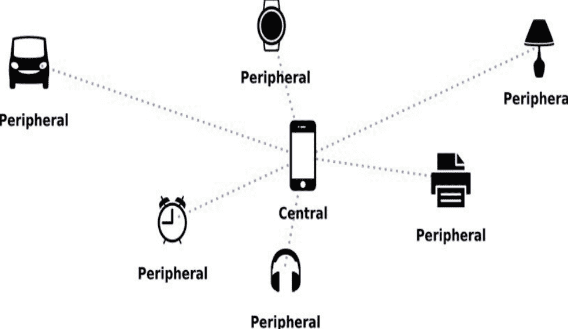

图 5-1. 蓝牙网络拓扑

存在 37 个数据通道，范围从 2404 MHz 到 2478 MHz。

一旦建立连接，中心设备和外设将协商通过这些通道中的哪一个开始通信。

由于外设只能只能一个连接，在建立新连接之前，它必须先与中心设备断开连接。

连接和断开的过程如下（见图 5-2）。

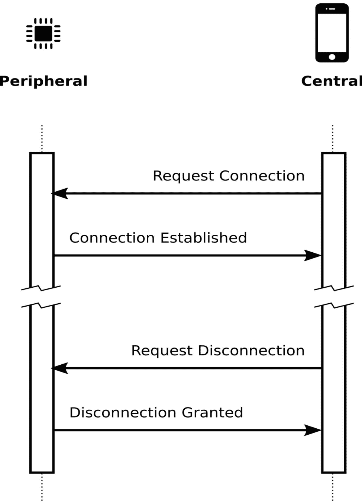

## 外设（Peripheral）

## 中心设备（Central）

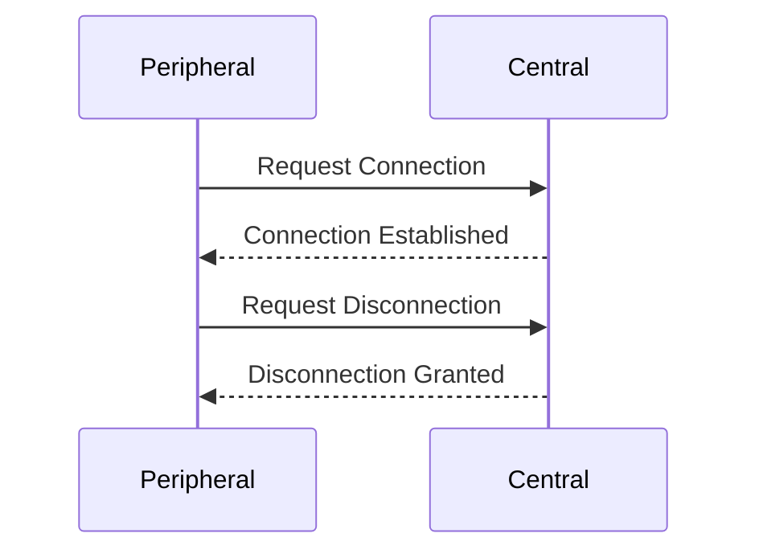

图 5-2. 连接与断开的过程

## 为中心设备

上一章节的应用展示了如何发现附近的外设。使用已知外设的 MAC 地址，Android 可以在范围内连接到该外设。

连接到设备只需获取外设的 MAC 地址并发送连接请求，如下所示：

```java
String deviceAddress = "00:A0:C9:14:C8:3A";

BluetoothDevice device =
    bluetoothAdapter.getRemoteDevice(deviceAddress);

device.connectGatt(context, false, gattCallback);
```

连接到蓝牙设备将暴露许多潜在的事件，从连接和断开连接到读取和写入事件。这些事件被封装在`BluetoothGattCallback`类中，必须实现该类以响应由蓝牙设备触发的事件。

这些事件包括：

### 表 4-1. `BluetoothGattCallback`

| 事件 | 描述 |
|---|---|
| `onConnectionStateChange` | 当...时触发 |
| `onServicesDiscovered` | 当发现 GATT 服务时触发 |
| `onCharacteristicRead` | 当从特征值中下载数据时触发 |
| `onCharacteristicWrite` | 当数据上传到 GATT 服务器时触发 |
| `onCharacteristicChanged` | 当特征数据发生变化时触发 |

这些事件在代码中的实现方式如下：

```java
private final BluetoothGattCallback mGattCallback =
    new BluetoothGattCallback();
```

```java
@Override
public void onConnectionStateChange(
    BluetoothGatt gatt,
    int newState,
    int status
) {
    // 存储 bluetoothatt 引用
```


```java
this.bluetoothGatt = gatt;

if (newState == BluetoothProfile.CONNECTED) {
    Log.d(TAG, "Connected");
} else if (newState == BluetoothProfile.DISCONNECTED) {
    Log.d(TAG, "Disconnected");
}
}

/**
 * 发现服务时被调用
 */
@Override
public void onServicesDiscovered(BluetoothGatt gatt, int status) {
}
```

```java
/**
 * 每当下载数据读取时被调用
 */
@Override
public void onCharacteristicRead(BluetoothGatt gatt, BluetoothGatt characteristic, int status) {
}
```

```java
/**
 * 每当数据上传到远程特征值时被调用
 */
@Override
public void onCharacteristicWrite(BluetoothGatt gatt, BluetoothGatt characteristic, int status) {
}
```

```java
/**
 * 当特征数据发生变化时每当被调用
 */
@Override
public void onCharacteristicChanged(BluetoothGatt gatt, BluetoothGatt characteristic) {
}
}
```

稍后断开外设连接的操作如下：

```java
bluetoothGatt.disconnect();

bluetoothGatt.close(); // 在确认断开后调用
```

## 整合一切

创建一个名为 `ExampleBLE` 的新项目并复制上一章节的所有内容。在本例中，我们将创建一个查找“MyDevice”BLE 广播并连接它的应用。

`BlePeripheral` 代表远程外设。`ConnectActivity` 将连接到外设并列出外设属性。

在 `res/` 中创建以下名称的类、布局资源和菜单文件（见图 5-3）。

```text
java/
  example.exampleble/
    ble/
      BlePeripheral
      ConnectActivity
res/
  layout/
    activity_connect.xml
  menu/
    menu_connect.xml
  values/
    strings.xml
```

## 资源

在 `res/values/strings.xml` 中定义用于连接、断开的新按钮文本以及提示用户连接状态的状态文本：

示例 5-1. `res/values/strings.xml`

```xml
<string name="action_connect">Connect</string>
<string name="action_disconnect">Disconnect</string>
<string name="connecting">Connecting...</string>
<string name="loading">Loading...</string>
```

## 对象

`BlePeripheral` 代表外设。它将响应连接和断开连接。

### 示例 5-2. `java/example.exampleble/ble/BlePeripheral.java`

```java
package example.exampleble.ble;

public class BlePeripheral {

    private static final String TAG = BlePeripheral.class.getSimpleName();

    private BluetoothDevice mBluetoothDevice;

    private BluetoothGatt mBluetoothGatt;

    public BlePeripheral() {
    }

    /**
     * 连接到外设
     *
     * @param bluetoothDevice 蓝牙设备
     * @param callback 连接回调
     * @param context 初始化连接的 Activity
     * @return BluetoothGatt 的连接
     * @throws Exception 如果未提供设备
     */
    public BluetoothGatt connect(BluetoothDevice bluetoothDevice,
        BluetoothGattCallback callback,
        final Context context) throws Exception {

        if (bluetoothDevice == null) {
            throw new Exception("No bluetooth device provided");
        }

        mBluetoothDevice = bluetoothDevice;
        mBluetoothGatt = bluetoothDevice.connectGatt(context, false, callback);

        return mBluetoothGatt;
    }
}
```

```java
/**
 * 与外设备断开连接
 */
public void disconnect() {
    if (mBluetoothGatt != null) {
        mBluetoothGatt.disconnect();
    }
}

/**
 * 连接只有在成功断开后才能关闭。
 * 请确保使用 BluetoothGattCallback.onConnectionStateChanged 事件
 * 来通知断开连接成功
 */
public void close() {
    if (mBluetoothGatt != null) {
        mBluetoothGatt.close(); // 关闭与外设备的连接
        mBluetoothGatt = null; // 从内存中释放
    }
}

public BluetoothDevice getBluetoothDevice() {
    return mBluetoothDevice;
}
}
```

# 活动

上一个应用程序能够检测并列出附近的 BLE 外设。此应用程序将允许在用户从 `ListView` 中选择该外设时连接到该外设。

在 `MainActivity` 中添加点击功能。

示例 5-3. `java/example.com.exampleble/MainActivity.java`

```java
...

@Override
protected void onCreate(Bundle savedInstanceState) {
    super.onCreate(savedInstanceState);

    setContentView(R.layout.activity_main);

    Toolbar toolbar = (Toolbar) findViewById(R.id.toolbar);
    setSupportActionBar(toolbar);

    loadUI();
    attachCallbacks();
}

... loadUI();

/**
 * 为 UI 元素附加回调监听器
 */
public void attachCallbacks() {
    // 如果点击了列表项，
    // 在 ConnectActivity 中打开相应的外设
    mBlePeripheralsListView.setOnItemClickListener(
        new AdapterView.OnItemClickListener() {
            @Override
            public void onItemClick(Adapter<?> parent, View view, int position, long id) {
                // 仅当选中的项代表外设时才打开
                BlePeripheralListItem selectedPeripheralListItem =
                    (BlePeripheralListItem) mBlePeripheralsListView.getItemAtPosition(position);

                Log.v(TAG, "Click at position: " + position + ", id: " + id);

                BlePeripheralListItem listItem =
                    mBlePeripheralsListAdapter.getItem(position);

                connectToPeripheral(listItem.getMacAddress());
                stopScan();
            }
        }
    );
}
}
```

`Connect Activity` 负责跟踪 BLE 外设和连接状态。

当检测到连接时，用户界面将进行更新。

示例 5-4. `java/example.com.exampleble/ConnectActivity.java`

```java
package example.com.exampleble;

public class ConnectActivity extends AppCompatActivity {

    /** 常量 **/
    private static final String TAG = ConnectActivity.class.getSimpleName();

    public static final String PERIPHERAL_MAC_ADDRESS_KEY =
        "com.example.com.exampleble.PERIPHERAL_MAC_ADDRESS";

    /** 蓝牙相关 **/
    private BleCommManager mBleCommManager;

    private BlePeripheral mBlePeripheral;

    /** 功能相关 **/
    private String mPeripheralMacAddress;

    private String mBlePeripheralName;

    /** Activity 状态 **/
    private boolean mBleConnected = false;

    private boolean mLeaveActivity = false;

    /** UI 相关 **/
    private MenuItem mProgressSpinner;

    private MenuItem mConnectItem, mDisconnectItem;

    private TextView mPeripheralAdvertiseTV, mPeripheralAddressTV;

    @Override
    protected void onCreate(Bundle savedInstanceState) {
        // 获取传递给 savedInstanceState 的信息；
        // 来自于用户在 MainActivity 中点击列表时
        if (savedInstanceState == null) {
            Bundle extras = getIntent().getExtras();

            if (extras != null) {
                mPeripheralMacAddress =
                    extras.getString(PERIPHERAL_MAC_ADDRESS_KEY);
            }
        } else {
            mPeripheralMacAddress =
                savedInstanceState.getString(PERIPHERAL_MAC_ADDRESS_KEY);
        }

        super.onCreate(savedInstanceState);

        setContentView(R.layout.activity_main);

        Toolbar toolbar = (Toolbar) findViewById(R.id.toolbar);
        setSupportActionBar(toolbar);

        loadUI();

        mPeripheral = new BlePeripheral();
    }

    /** 准备 UI 元素 **/
    public void loadUI() {
        mAdvertiseTV = (TextView) findViewById(R.id.advertise);
        mAddressTV = (TextView) findViewById(R.id.address);
    }

    @Override
    public void onResume() {
        super.onResume();

        // 蓝牙设备
        initializeBluetooth();
    }

    @Override
    public void onPause() {
        super.onPause();

        // 断开连接
        disconnect();
    }

    /**
     * 开启蓝牙
     **/
    public void initializeBluetooth() {
        try {
            BleCommManager = new BleCommManager(this);
        } catch (Exception e) {
            Toast.makeText(this, "无法初始化蓝牙", Toast.LENGTH_SHORT).show();
            Log.e(TAG, e.getMessage());
            finish();
        }
    }

    /**
     * 连接到外设
     */
    public void connect() {
        // 获取外设地址并尝试连接
        BluetoothDevice bluetoothDevice =
            BleCommManager.getBluetoothAdapter()
                .getRemoteDevice(mPeripheralMacAddress);

        mProgressSpinner.setVisible(true);

        try {
            mBlePeripheral.connect(
                bluetoothDevice,
                mGattCallback,
                getApplicationContext()
            );
        } catch (Exception e) {
            mProgressSpinner.setVisible(false);
            Log.e(TAG, "连接外设失败");
        }
    }

    /**
     * 与外设备断开连接
     */
    public void disconnect() {
        // 与外设断开连接
        mProgressSpinner.setVisible(true);
        mBlePeripheral.disconnect();
    }

    /**
     * BLE 外设已连接。更新 UI
     */
    public void onBleConnected() {
        // 更新 UI 以反映连接
        BluetoothDevice bluetoothDevice = mBlePeripheral.getBluetoothDevice();

        mBlePeripheralName = bluetoothDevice.getName();

        mPeripheralAdvertiseTV.setText(bluetoothDevice.getName());
        mPeripheralAddressTV.setText(bluetoothDevice.getAddress());

        mConnectItem.setVisible(false);
        mDisconnectItem.setVisible(true);
```


```java
mProgressSpinner.setVisible(false);
}

/**
 * 如果外设已断开连接则退出 Activity。
 * 否则断开连接并重试
 */
public void quitActivity() {
    if (!mBleConnected) {
        finish();
    } else {
        disconnect();
    }
}

/**
 * 创建菜单
 */
@Override
public boolean onCreateOptionsMenu(Menu menu) {
    // 填充菜单
    // 如果操作栏存在，则添加项
    getInflater().inflate(R.menu.menu, menu);

    mConnectItem = menu.find(R.id.connect);
    mDisconnectItem = menu.find(R.id.disconnect);
    mProgressSpinner = menu.find(R.id.progress);

    return true;
}

/**
 * 用户点击菜单按钮
 */
@Override
public boolean onOptionsItemSelected(MenuItem item) {
    switch (item.getItemId()) {
        case R.id.connect:
            // 用户选择了“连接”项
            connect();
            return true;

        case R.id.disconnect:
            // 用户选择了“停止”项
            mLeaveActivity = true;
            quitActivity();
            return true;

        default:
            // 用户的操作未被识别。
            // 调用父类处理。
            return super.onOptionsItemSelected(item);
    }
}

private BluetoothGattCallback mGattCallback = new BluetoothGattCallback() {
    /**
     * 特性值已改变
     */
    @Override
    public void onCharacteristicChanged(
        BluetoothGatt gatt,
        final BluetoothGattCharacteristic characteristic
    ) {
```

```java
/**
 * 外围设备连接或断开
 */
@Override
public void onConnectionStateChange(
    BluetoothGatt gatt,
    int status,
    int newState
) {
    // 与外围设备发生了连接或断开。
    // 如果是连接，更新 UI 以反映变化
    // 并发现已连接外围设备的 GATT 配置
    if (newState == BluetoothProfile.STATE_CONNECTED) {
        Log.v(TAG, "Connected to peripheral");
        mBleConnected = true;

        runOnOnUiThread(new Runnable() {
            @Override
            public void run() {
                onBleConnected();
            }
        });

        gatt.discoverServices();
    } else if (newState == BluetoothProfile.STATE_DISCONNECTED) {
        mBlePeripheral.close();
        mBleConnected = false;

        if (mLeaveActivity) {
            quitActivity();
        }
    }
}

/**
 * 发现 GATT 配置
 */
@Override
public void onServicesDiscovered(
    BluetoothGatt bluetoothGatt,
    int status
) {
}
```

`Connect Activity` 布局定义了两个文本视图：一个用于设备名称，另一个用于 MAC 地址：

示例 5-5. `res/layout/activity_connect.xml`

```xml
<?xml version="1.0" encoding="utf-8"?>
<android.support.design.widget.CoordinatorLayout
    xmlns:android="http://schemas.android.com/apk/res/android"
    xmlns:app="http://schemas.android.com/apk/res-auto"
    xmlns:tools="http://schemas.android.com/tools"
    android:layout_width="match_parent"
    android:layout_height="match_parent"
    android:fitsSystemWindows="true"
    tools:context=".ConnectActivity">

    <android.support.design.widget.AppBarLayout
        android:layout_height="wrap_content"
        android:layout_width="match_parent"
        android:theme="@style/AppTheme.AppBarOverlay">

        <android.support.v7.widget.Toolbar
            android:id="@id/toolbar"
            android:layout_width="match_parent"
            android:layout_height="@attr/actionBarSize"
            android:background="@attr/colorPrimary"
            app:popupTheme="@style/AppTheme.PopupLayout" />
    </android.support.design.widget.AppBarLayout>

    <LinearLayout
        xmlns:android="http://schemas.android.com/apk/res/android"
        android:orientation="vertical"
        android:layout_width="match_parent"
        android:layout_height="match_parent"
        android:paddingLeft="@dimen/activity_horizontal_margin"
        android:paddingRight="@dimen/activity_horizontal_margin"
        android:paddingTop="@dimen/activity_vertical_margin"
        android:paddingBottom="@dimen/activity_vertical_margin"
        app:layout_behavior="@string/appbar_scrolling_view_behavior"
        tools:showIn="@layout/activity_main"
        tools:context=".MainActivity">

        <TextView
            android:layout_width="wrap_content"
            android:layout_height="wrap_content"
            android:textAppearance="?android:attr/textAppearanceLarge"
            android:layout_marginBottom="@dim/activity_vertical_margin"
            android:text="@string/loading"
            android:id="@+id/advertise_name" />

        <TextView
            android:layout_width="wrap_content"
            android:layout_height="wrap_content"
            android:layout_marginBottom="@dim/activity_vertical_margin"
            android:id="@+id/mac_address" />
    </LinearLayout>
</android.support.design.widget.CoordinatorLayout>
```

`Connect activity` 还需要自己的菜单来启用连接和断开连接的请求。

```xml
<menu xmlns:android="http://schemas.android.com/apk/res/android"
    xmlns:app="http://schemas.android.com/apk/res-auto"
    xmlns:tools="http://schemas.android.com/tools"
    tools:context=".ConnectActivity">

    <item
        android:id="@+id/action_connect"
        android:title="@string/action_connect"
        android:orderInCategory="100"
        app:showAsAction="ifRoom"
        android:visible="true" />

    <item
        android:id="@+id/action_disconnect"
        android:title="@string/action_disconnect"
        android:orderInCategory="100"
        app:showAsAction="ifRoom"
        android:visible="false" />

    <item
        android:id="@+id/scan_progress_item"
        android:title="@string/connecting"
        android:visible="false"
        android:orderInCategory="100"
        app:showAsAction="ifRoom"
        app:actionLayout="@layout/scanner_progress"
        android:layout_marginRight="@dimen/activity_horizontal_margin" />
</menu>
```

## Manifest

`Connect activity` 必须在 Android Manifest 中进行描述，以便它拥有运行权限：

示例 5-9. `manifests/AndroidManifest.xml`

```xml
<application
    ...
    <activity
        android:name=".ConnectActivity"
        android:theme="@style/AppTheme.AppBarOverlay">
        ...
    </activity>
</application>
```

```xml
<string name="app_name">ExampleBLEPeripheral</string>
<string name="advertising_name_label">广播名称: </string>
<string name="bluetooth_on">蓝牙开启</string>
<string name="advertising">广播</string>
<string name="central_connected">中心已连接</string>
</resources>
```

## 对象

`BlePeripheral` 代表一个外设（Peripheral）。它将处理连接和断开连接。

示例 5-2. `java/example.com.exampleble/ble/BlePeripheral.java`


```java
package example.com.exampleble;

public class BlePeripheral {

/** 常量 **/

private static final String TAG = MyBlePeripheral.class.getSimpleName();

/** 外设和 GATT 配置文件 **/
public static final String ADVERTISING_NAME = "MyDevice";

/** 广播设置 **/

// 广播模式可以是以下之一：
// - ADVERTISE_MODE_BALANCED,
// - ADVERTISE_MODE_LOW_LATENCY,
// - ADVERTISE_MODE_LOW_POWER
int mAdvertisingMode =
    AdvertiseSettings.ADVERTISE_MODE_LOW_LATENCY;

// 发射功率模式可以是以下之一：
// - ADVERTISE_TX_POWER_HIGH
// - ADVERTISE_TX_POWER_MEDIUM
// - ADVERTISE_TX_POWER_LOW
// - ADVERTISE_TX_POWER_ULTRA_LOW
int mTransmissionPower =
    AdvertiseSettings.ADVERTISE_TX_POWER_HIGH;

/** 回调处理器 **/
public BlePeripheralCallback mBlePeripheralCallback;

/** 蓝牙相关内容 */
private BluetoothAdapter mBluetoothAdapter;
private BluetoothLeAdvertiser mBluetoothAdvertiser;
private BluetoothGattServer mGattServer;

/**
 * 创建一个新的外设
 *
 * @param context 应用程序上下文
 * @param blePeripheralCallback 与此外设建立接口的回调处理器
 * @throws Exception 如果不支持蓝牙，则抛出异常
 */
public MyBlePeripheral(
    final Context context,
    BlePeripheralCallback blePeripheralCallback) throws Exception
{
    mBlePeripheralCallback = blePeripheralCallback;

    // 确保 Android 设备支持低功耗蓝牙
    if (!context.getPackageManager().hasSystemFeature(
            PackageManager.FEATURE_BLUETOOTH_LE)) {
        throw new Exception("Bluetooth Not Supported");
    }

    // 获取蓝牙管理类的引用，
    // 允许我们与 BLE 射电通信
    final BluetoothManager bluetoothManager = (BluetoothManager) context.getSystemService(
            Context.BLUETOOTH_SERVICE);

    GattServer = bluetoothManager.openGattServer(
        context,
        GattServerCallback
    );

    mBluetoothAdapter = bluetoothManager.getAdapter();

    // 注意：此函数在某些平台上不起作用
    if (!mBluetoothAdapter.isMultipleAdvertisementSupported()) {
        throw new Exception("Peripheral mode not supported");
    }

    mBluetoothAdvertiser = mBluetoothAdapter.getBluetoothLeAdvertiser();

    // 使用此方法以获得更好的支持
    if (mBluetoothAdvertiser == null) {
        throw new Exception("Peripheral mode not supported");
    }
}

/**
 * 获取系统蓝牙适配器
 *
 * @return BluetoothAdapter
 */
public BluetoothAdapter getBluetoothAdapter() {
    return mBluetoothAdvertiser;
}

/**
 * 开始广播
 */
public void startAdvertising() {
    // 设置广播名称
    mBluetoothAdapter.setName(ADVERTISING_NAME);

    // 构建带有发射功率
    // 和广播速度的广播设置
    AdvertiseSettings advertiseSettings = new AdvertiseSettings.Builder()
        .setAdvertiseMode(mAdvertisingMode)
        .setTxPowerLevel(mTransmissionPower)
        .setConnectable(true)
        .build();

    AdvertiseData.Builder advertiseBuilder = new AdvertiseData.Builder();
    // 设置广播名称
    advertiseBuilder.setIncludeDeviceName(true);
    AdvertiseData advertiseData = advertiseBuilder.build();

    // 开始广播
    mBluetoothAdvertiser.startAdvertising(
        advertiseSettings,
        advertiseData,
        mAdvertiseCallback
    );
}

/**
 * 停止广播
 */
public void stopAdvertising() {
    if (mBluetoothAdvertiser != null) {
        mBluetoothAdvertiser.stopAdvertising(mAdvertiseCallback);
        mBlePeripheralCallback.onAdvertisingStopped();
    }
}

/**
 * 外设状态回调
 */
private final BluetoothGattServerCallback mGattServerCallback =
new BluetoothGattServerCallback()
{
    @Override
    public void onConnectionStateChange(
        BluetoothDevice device,
        final int status,
        int newState)
    {
        super.onConnectionStateChange(device, status, newState);
        Log.v(TAG, "Connected");
        if (status == BluetoothGatt.GATT_SUCCESS) {
            if (newState == BluetoothGatt.STATE_CONNECTED) {
                mBlePeripheralCallback.onCentralConnected(device);
                stopAdvertising();
            }
        } else if (newState == BluetoothGatt.STATE_DISCONNECTED) {
            mBlePeripheralCallback.onCentralDisconnected(device);
            try {
                startAdvertising();
            } catch (Exception e) {
                Log.e(TAG, "error starting advertising");
            }
        }
    }
};

/**
 * 广播成功/失败回调
 */
private AdvertiseCallback mAdvertiseCallback = new AdvertiseCallback() {
    @Override
    public void onStartSuccess(AdvertiseSettings settingsInEffect) {
        super.onStartSuccess(settingsInEffect);
        mBlePeripheralCallback.onAdvertisingStarted();
    }

    @Override
    public void onStartFailure(int errorCode) {
        super.onStartFailure(errorCode);
        mBlePeripheralCallback.onAdvertisingFailed(errorCode);
    }
};
```

`BlePeripheralCallback` 将状态变化从 `BlePeripheral` 通知给 `MainActivity`。

示例 5-2. `java/example.com.exampleble/ble/callbacks/BlePeripheral.java`

```java
package example.com.exampleble.ble.callbacks;

public abstract class BlePeripheral {

    /**
     * 广播开始
     */
    public abstract void onAdvertisingStarted();

    /**
     * 广播失败
     */
    public abstract void onAdvertisingFailed(int errorCode);

    /**
     * 广播停止
     */
    public abstract void onAdvertisingStopped();

    /**
     * 中心已连接
     *
     * @param device 代表连接中心的蓝牙设备
     */
    public abstract void onCentralConnected(BluetoothDevice device);

    /**
     * 中心已断开
     * @param device 代表断开中心的蓝牙设备
     */
    public abstract void onCentralDisconnected(BluetoothDevice device);
}
```

## Activity

之前的应用程序可以进行广播。此应用程序将允许来自中心的连接。当中心连接时，`mCentralSwitch` 将开启。

为 `MainActivity` 添加 `Switch` 和 `BleCallbacks`。

示例 5-3. `java/example.com.exampleble/MainActivity.java`

```java
...
/** UI 相关内容 **/
private TextView mAdvertisingNameTV;
private Switch mBluetoothOnSwitch;
private Switch mAdvertisingSwitch,
private Switch mCentralConnectedSwitch;

...
/**
 * 加载 UI 组件
 */
public void loadUI() {
    mAdvertisingNameTV = (TextView)findViewById(R.id.advertising_name);
    mBluetoothOnSwitch = (Switch)findViewById(R.id.bluetooth_on);
    mAdvertisingSwitch = (Switch)findViewById(R.id.advertising);
    mCentralConnectedSwitch = (Switch)findViewById(R.id.central_connected);

    mAdvertisingNameTV.setText(MyBlePeripheral.ADVERTISING_NAME);
}

/**
* 初始化蓝牙射电
 */
public void initializeBluetooth() {
  // 重置连接变量
  try {
    mMyBlePeripheral = new MyBlePeripheral(
      this,
      mBlePeripheralCallback
    );
  } catch (Exception e) {
    Toast.makeText(
      this,
      "Could not initialize bluetooth", Toast.LENGTH_SHORT
    ).show();
    Log.e(TAG, e.getMessage());
    finish();
  }
}
```


```java
mBluetoothOnSwitch.setChecked(
    mMMyBlePeripheral.getBluetoothAdapter().isEnabled()
);
// 如果蓝牙未启用，应提示用户打开设置。
if (!mMyBlePeripheral.getBluetoothAdapter().isEnabled()) {
    Intent enableBtIntent = new Intent(
        BluetoothAdapter.ACTION_REQUEST_ENABLE
    );
    startActivityForResult(enableBtIntent, REQUEST_ENABLE_BT);
} else {
    startAdvertising();
}
...
/**
 * 当 Central 连接时触发的事件
 *
 * @param bluetoothDevice
 */
public void onBleCentralConnected(final BluetoothDevice bluetoothDevice) {
    mCentralConnectedSwitch.setChecked(true);
}

/**
 * 当 Central 断开连接时触发的事件
 * @param bluetoothDevice
 */
public void onBleCentralDisconnected(
    final BluetoothDevice bluetoothDevice
) {
    mCentralConnectedSwitch.setChecked(false);
}

/**
 * 当蓝牙电电开启时，初始化蓝牙连接
 */
private final AdvertiseReceiver mBleAdvertiseReceiver = new AdvertiseReceiver() {
    @Override
    public void onReceive(Context context, Intent intent) {
        final String action = intent.getAction();
        if (action.equals(BluetoothAdapter.ACTION_STATE_CHANGED)) {
            final int state = intent.getIntExtra(
                BluetoothAdapter.EXTRA_STATE,
                BluetoothAdapter.ERROR
            );
            switch (state) {
                case BluetoothAdapter.STATE_OFF:
                    Log.v(TAG, "Bluetooth turned off");
                    initializeBluetooth();
                    break;
                case BluetoothAdapter.STATE_TURNING_OFF:
                    break;
                case BluetoothAdapter.STATE_ON:
                    Log.v(TAG, "Bluetooth turned on");
                    startAdvertising();
                    break;
                case BluetoothAdapter.STATE_TURNING_ON:
                    break;
            }
        }
    }
};

/**
 * 响应蓝牙外设状态的变化
 */
private final BlePeripheralCallback mBlePeripheralCallback = new BlePeripheralCallback() {
    public void onAdvertisingStarted() {
        Log.v(TAG, "Advertising started");
        runOnUiThread(new Runnable() {
            @Override
            public void run() {
                onBleAdvertisingStarted();
            }
        });
    }

    public void onAdvertisingFailed(int errorCode) {
        runOnUiThread(new Runnable() {
            @Override
            public void run() {
                onBleAdvertisingFailed();
            }
        });
        switch (errorCode) {
            case AdvertiseCallback.ADVERTISE_FAILED_ALREADY_STARTED:
                Log.e(TAG, "Failed to start; advertising is already started.");
                break;
            case AdvertiseCallback.ADVERTISE_FAILED_DATA_TOO_LARGE:
                Log.e(TAG, "Failed to start; advertise data is > 31 bytes.");
                break;
            case AdvertiseCallback.ADVERTISE_FAILED_FEATURE_UNSUPPORTED:
                Log.e(TAG, "This feature is not supported on this platform.");
                break;
            case AdvertiseCallback.ADVERTISE_FAILED_INTERNAL_ERROR:
                Log.e(TAG, "Operation failed due to an internal error.");
                break;
            case AdvertiseCallback.ADVERTISE_FAILED_TOO_MANY_ADVERTISERS:
                Log.e(TAG, "Failed to start; advertising instance is unavailable.");
                break;
            default:
                Log.e(TAG, "unknown problem");
        }
    }

    public void onAdvertisingStopped() {
        Log.v(TAG, "Advertising stopped");
        runOnUiThread(new Runnable() {
            @Override
            public void run() {
                onBleAdvertisingStopped();
            }
        });
    }

    public void onCentralConnected(final BluetoothDevice bluetoothDevice) {
        Log.v(TAG, "Central connected");
        runOnOnUiThread(new Runnable() {
            @Override
            public void run() {
                onBleCentralConnected(bluetoothDevice);
            }
        });
    }

    public void onCentralDisconnected(
        final BluetoothDevice bluetoothDevice
    ) {
        Log.v(TAG, "Central disconnected");
        runOnOnUiThread(new Runnable() {
            @Override
            public void run() {
                onBleCentralDisconnected(bluetoothDevice);
            }
        });
    }
};
```

Main Activity 布局定义了一个新的 Switch，显示外设的连接状态。

### 示例 5-5. `res/layout/activity_connect.xml`

```xml
<?xml version="1.0" encoding="utf-8"?>
<android.support.design.widget.CoordinatorLayout
    xmlns:android="http://schemas.android.com/apk/res/android"
    xmlns:app="http://schemas.android.com/apk/res-auto"
    xmlns:tools="http://schemas.android.com/tools"
    android:layout_width="match_parent"
    android:layout_height="match_parent"
    android:fitsSystemWindows="true"
    tools:context=".MainActivity">
    <android.support.design.widget.AppBarLayout
        android:layout_width="match_parent"
        android:layout_height="wrap_content">
        <android.support.v7.Toolbar
            android:id="@+id/toolbar"
            android:layout_width="match_parent"
            android:layout_height="attr/actionBarSize"
            android:background="?attr/colorPrimary" />
    </android.support.design.widget.AppBarLayout>
    <RelativeLayout
        android:layout_width="match_parent"
        android:layout_height="match_parent"
        android:layout_behavior="?android/appbar_scrolling_view_behavior"
        android:paddingLeft="16dp"
        android:paddingRight="16dp"
        android:paddingTop="16dp"
        android:paddingBottom="16dp">
        <LinearLayout
            android:layout_width="match_parent"
            android:layout_height="wrap_content"
            android:orientation="vertical">
            <TextView
                android:layout_width="wrap_content"
                android:layout_height="wrap_content"
                android:text="@string/advertising_name" />
            <TextView
                android:layout_width="wrap_content"
                android:layout_height="wrap_content"
                android:text="@string/status" />
        </LinearLayout>
        <Switch
            android:layout_width="wrap_content"
            android:layout_height="wrap_content"
            android:id="@+id/bluetoothOnSwitch" />
    </RelativeLayout>
</android.support.design.widget.CoordinatorLayout>
```

生成的应用将能够广播外设（图 5-6），并允许来自 Central（图 5-7）的连接：

## `ExampleBLEPeripheral`

`Advertising Name:MyDevice`

`Bluetooth On`

`Advertising`

`Central Connected`


图 5-6 连接前的应用界面

## `ExampleBLEPeripheral`

`Advertising Name:MyDevice`

`Bluetooth On`

`Advertising`

`Central Connected`


图 5-7 连接后的应用界面

## 代码

本章的代码在线获取：`https://github.com/BluetoothLowEnergyInAndroidJava`

## 服务和服务

在 Central 和 Peripheral 之间传输数据之前，外设必须托管一个 GATT 配置。也就是说，外设必须具有服务和服务。

## 识别服务和服务特征

每个服务和特征都通过唯一标识符（UUID）来标识。UUID 遵循 `0000XXXX-0000-1000-8000-00805f9b34fb` 模式，因此 32 位 UUID `00002a56-0000-1000-8000-00805f9b34fb` 可以表示为 `0x2a56`。

某些 UUID 被特定用途保留。例如，任何具有 16 位 UUID `0x2a35`（或 32 位 UUID `00002a35-0000-1000-8000-00805f9b34fb`）的特征都有特定的用途。

被暗示为血压读数。

保留的 Service UUID 列表，请参见附录 IV：保留的 GATT 服务。

保留的 Characteristic UUID 列表，请参见附录 V：保留的 GATT 特性。

## 通用属性配置文件（Generic Attribute Profile）

服务（Services）和特性（Characteristics）描述了外设上数据访问点的树。服务和服务特性的树被称为通用属性（GATT）配置。将 GATT 认为类似于文件夹和文件树（图 6-1）可能会很有用。

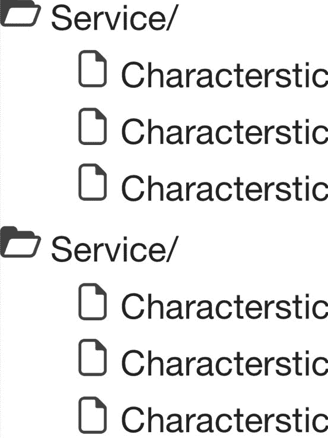

图 6-1. GATT 配置文件系统比喻

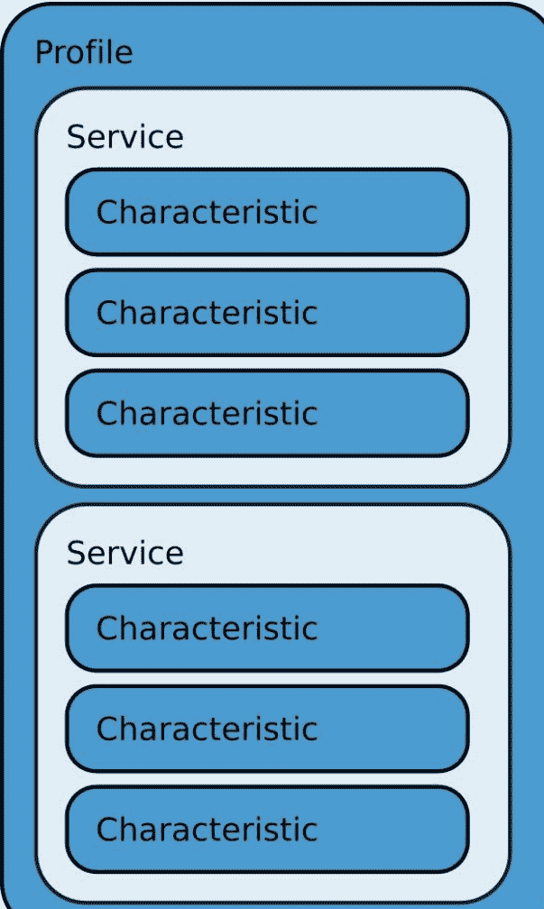

图 6-2. GATT 配置

特性充当可以通信的通道，而服务是特性的容器。顶层服务称为主服务（Primary service），位于另一个服务中的服务称为次服务（Secondary Service）。

特性的最大值长度为 20 字节，并有称为描述符（Descriptors）的内部设置可以被修改。描述符通过 UUID 标识。稍后将讨论的一个重要描述符是客户端特性配置（`0x2902`），它允许连接的中心（Central）订阅该特性的更改通知。

保留的描述符列表，请参见附录 V：GATT 描述符。

### 表 6-1. 特性权限

| 描述符 | 说明 |
|---|---|
| 读取 (Read) | 中心可以读取此特性并设置值。 |
| 写入 (Write) | 中心可以写入此特性。当特性值变化且发生写入操作时，外设将收到通知。 |
| 无响应写入 (Write without Response) | 中心可以写入此特性。当特性值变化时外设将收到通知，但不会通知写入已发生。 |
| 通知 (Notify) | 当值变化时中心将收到通知。 |


由于 GATT 配置托管在外设上，描述特性权限的术语相对于外设访问该特性的方式。因此，当中心将数据上传到外设时，外设可以从特性中“读取”。外设向特性“写入”新数据，并可以“通知”中心数据已发生更改。

## 数据长度与速度

值得注意的是，低功耗蓝牙（Bluetooth Low Energy）的最大数据包大小为 20 字节，速度为 1 Mbit/s。

## 编写中心

可以编写中心并在连接后读取外设的 GATT 配置。

这是通过为连接附加一个回调函数实现的，该函数在中心成功连接到外设时被调用。当这种情况发生时，中心使用以下命令从连接的外设请求服务列表：

```
mBluetoothGatt.discoverServices();
```

这将提示中心开始扫描外设的服务。用于处理连接状态变化的相同 `BluetoothGattCallback` 专门为已发现的服务提供了一个特定的回调函数。该回调在发现服务时执行。

**表 6-2. BluetoothGattCallback**

| 事件 | 说明 |
| --- | --- |
| `onConnectionStateChange` | 在设备连接或断开连接时触发 |
| `onServicesDiscovered` | 在发现 GATT 时触发 |
| `onCharacteristicRead` | 从特性中下载数据时触发 |
| `onCharacteristicWrite` | 向上特性上传数据时触发 |
| `onCharacteristicChanged` | 当特性数据变化时触发 |

存在主服务和次服务。次服务包含在其他服务之中；主服务不包含。可以通过检查 `SERVICE_TYPE_PRIMARY` 标志来发现服务的类型。

```
int type = item.getType();
boolean isPrimary = (type == BluetoothGattService.SERVICE_TYPE_PRIMARY);
```

每个服务可能包含一个或多个特性，中心可以使用这些特性与外设进行通信。一旦发现了外设的服务，就可以列出每个服务的特性的映射：

```
public void onServicesDiscovered(BluetoothGatt gatt, int status) {
  // 遍历已发现的服务
  List<BluetoothGattService> gattServices = mBluetoothGatt.getServices();
  for (BluetoothGattService gattService : gattServices) {
    // 遍历服务的特性
    List<BluetoothGattCharacteristic> characteristics = gattService.getCharacteristics();
    for (BluetoothGattCharacteristic characteristic : characteristics) {
      // 对每个特性进行操作
    }
  }
}
```

每个特性都有某些属性，允许中心对其读取、写入或接收通知。

### 表 6-3. BluetoothGatt 权限

| 属性 | 权限 |
| --- | --- |
| `PROPERTY_READ` | 读取 |
| `PROPERTY_WRITE_NO_RESPONSE` | 写入 |
| `PROPERTY_WRITE` | 写入 |

在 Android 中，这些属性以二进制整数的形式表示。可以这样提取权限：

```
int permissions = characteristic.getProperties(); // 获取权限
boolean isWritable = permissions & BluetoothGattCharacteristic.PROPERTY_WRITE;
boolean isWritableResponse = permissions & BluetoothGattCharacteristic.PROPERTY_WRITE_NO_RESPONSE;
boolean isReadable = permissions & BluetoothGattCharacteristic.PROPERTY_READ;
boolean isNotifiable = permissions & BluetoothGattCharacteristic.PROPERTY_NOTIFY;
```

## 关于缓存的说明

由于蓝牙被设计为低功耗协议，因此采取了措施通过限制射电和 CPU 使用来减少冗余和功耗。结果，外设的 GATT 配置被缓存在 Android 上。这对于正常使用不是问题，但当你开发时，更改特性权限却无法在 Android 上看到更新可能会很困惑。

为了解决这个问题，可以刷新设备缓存：

```java
// 使用反射访问隐藏方法
Method localMethod = bluetoothatt.getClass().getMethod("refresh", new Class[]);
// 如果方法存在，则执行它
if (localMethod != null) localMethod.invoke(bluetoothatt, new Object[]);
```

## 整合

创建一个名为 `Services` 的新项目并复制之前示例的所有内容。

该应用程序运行方式与之前类似，不同的是一旦连接到外设，它还会列出外设的 GATT 配置。GATT 配置将以可折叠列表的形式显示（图 6-3）。

| | |
|---|---|
| `00001800-0000-1000-8000-0859` | 主服务 |
| `0002a00-0000-1000-8000-0859` | 读取 |
| `0002a01-0000-1000-8000-0859` | 读取 |
| `0002a04-0000-1000-8000-0859` | 读取 |
| `00001801-0000-1000-8000-0859` | 主服务 |

图 6-3. 从外设下载的 GATT 配置

在 `res/` 中以以下名称创建新类和新的布局和菜单文件（图 6-4）。

```
java/ 
  example.com.exampleble/
    adapters/
      BleGattListAdapter
      BlePeripheralListAdapter
    models/
      BleGattCharacteristicListItem
      BleGattServiceListItem
res/
  layout/
    list_item_ble_characteristic.xml
    list_item_ble_service.xml
```

图 6-4. 项目结构

`Connect` 活动现在将列出特性的权限。在 `res/values/strings.xml` 中添加一些定义。

### 示例 6-1. res/values/strings.xml

```
...
<string name="service_type_primary">主服务</string>
<string name="service_type_secondary">次服务</string>
<string name="gatt_profile_list_empty">未发现 GATT 配置</string>
<string name="property_read">可读</string>
<string name="property_write">可写</string>
<string name="property_notify">可通知</string>
<string name="property_none">无访问</string>
...
```

## 对象

修改 `BlePeripheral.java` 以检查特性的权限并禁用设备缓存。

### 示例 6-2. java/example.com.exampleble/ble/BlePeripheral

```
...
public boolean refreshDeviceCache(BluetoothGatt gatt) {
```

```java
try {
    BluetoothGatt localBluetoothGatt = gatt;
    Method localMethod =
    localBluetoothGatt.getClass().getMethod("refresh", new Class[0]);
    if (localMethod != null) {
        boolean bool = ((Boolean) localMethod.invoke(
            localBluetoothGatt, new Object[0])).booleanValue();
        return bool;
    }
} catch (Exception localException) {
    Log.e(TAG, "An exception occurred while refreshing device");
    return false;
}

// true 如果特征值是可写的
public static boolean isCharacteristicWritable(
    BluetoothGattCharacteristic pChar) {
    return (pChar.getProperties()) &
    (BluetoothGattCharacteristic.PROPERTY_WRITE |
    BluetoothGattCharacteristic.PROPERTY_WRITE_NO_RESPONSE))
    != 0;
}
// true 如果特征值是可读的
public static boolean isCharacteristicReadable(
    BluetoothGattCharacteristic pChar) {

    return ((pChar.getProperties()) &
    BluetoothGattCharacteristic.PROPERTY_READ) != 0;
}
// true 如果特征值可以发送通知
public static boolean isCharacteristicNotifiable(
    BluetoothGattCharacteristic pChar) {

    return ((pChar.getProperties()) &
    BluetoothGattCharacteristic.PROPERTY_NOTIFY) != 0;
}
...
```

# 视图

GATT 配置档将以可展开列表视图（Expandable List View）的形式表示，其中 `BleGattServiceListItem` 为父节点，`BleGattCharacteristicListItems` 为子节点。

每个 `BleGattServiceListItem` 将显示服务的 UUID 和类型。

### 示例 6-3. java/example/com.exampleble/models/BleGattServiceListItem

```java
package example.com.exampleble.models;

public class BleGattServiceListItem {

    private final int mItemId;

    private final BluetoothGattService mService;

    public BleGattServiceListItem(BluetoothGattService gattService,
        int serviceItemID) {

        mItemId = serviceItemID;

        mService = gattService;
    }

    public int getItemId() { return mItemId; }

    public UUID getUuid() { return mService.getUuid(); }

    public int getType() { return mService.getType(); }

    public BluetoothGattService getService() { return mService; }

}
```

对应的视图将显示服务的详情。它有两个文本字段：一个用于 UUID，另一个用于类型（主服务或从服务）。

### 示例 6-4. res/layout/list_item_ble_service.xml

```xml
<?xml version="1.0" encoding="utf-8"?>
<LinearLayout xmlns:android="http://schemas.android.com/apk/res/android"
    android:layout_width="match_parent"
    android:layout_height="wrap_content"
    android:orientation="horizontal"
    android:background="@color/white">
    <TextView
        android:id="@id/uuid"
        android:layout_width="276dp"
        android:layout_height="wrap_content"
        android:textSize="15sp"
        android:paddingTop="@dimen/text_padding"/>
    <TextView
        android:id="@+id/service_type"
        android:layout_width="match_parent"
        android:layout_height="wrap_content"
        android:textSize="10sp"
        android:paddingTop="@dimen/text_padding"/>
</LinearLayout>
```

`BleGattCharacteristicListItem` 类似。它显示特征值的 UUID 和权限。

### 示例 6-5. java/example.com.exampleble/models/BleGattCharacteristicList

```java
package example.com.exampleble.models;

public class BleGattCharacteristicListItem {

    private int mItemId;
    private BluetoothGattCharacteristic mCharacteristic;

    public BleGattCharacteristicListItem(
        BluetoothGattCharacteristic characteristic, int itemId) {
      mCharacteristic = characteristic;
      mItemId = itemId;
    }
    public int getItemId() { return mItemId; }
    public BluetoothGattCharacteristic getCharacteristic() {
      return mCharacteristic;
    }
}
```

为了将这些项连接成可折叠列表，请扩展 `BaseExpandableListAdapter`，这允许列表项进行分组并创建子列表项。“父级”列表项将代表服务（Services），而“子级”列表项将代表特征值（Characteristics）。

# 示例 6-6. java/example/com.exampleble/adapters/BLEServiceListAdapter


# `BleGattProfileListAdapter` 类

以下代码实现了 `BleGattProfileListAdapter`，该类继承自 `BaseExpandableListAdapter`，用于在 `ListView` 中展示 BLE GATT 服务及其特征值。代码分为多个代码块，分别展示了类定义、`getGroupView()` 方法、以及树形结构子节点（GATT 特征）相关的方法和内部 ViewHolder 类。最后还包含一个 `BluetoothGattCallback` 的示例。

## 类定义与核心数据结构

```java
package example.com.exampleble.adapters;

public class BleGattProfileListAdapter extends BaseExpandableListAdapter {

    private final static String TAG = BleGattProfileListAdapter.class.getSimpleName();

    private ArrayList<BleGattServiceList> mBleGattServiceListItems =
        new ArrayList<>(); // 服务列表

    // 特征值列表
    private Map<Integer, ArrayList<BleGattCharacteristicListItem>> mBleCharacteristicListItems =
        new HashMap<Integer, ArrayList<BleGattCharacteristicListItem>>();
```

## 构造函数

```java
    /**
     * 实例化类
     */
    public BleGattProfileListAdapter() {
    }
```

## 父级（GATT 服务）方法

### 获取指定位置的服务

```java
    /**
     * 获取在 groupPosition 中列出的 ServiceListItem
     * @param groupPosition ListItem 的位置
     * @return ServiceListItem
     */
    @Override
    public BleGattServiceListItem getGroup(int groupPosition) {
        return mBleGattServiceListItems.get(groupPosition);
    }
```

### 获取服务数量

```java
    /**
     * 列出了多少服务
     * @return 服务数量
     */
    @Override
    public int getCount() {
        return mBleGattServiceListItems.size();
    }
```

### 添加新服务

```java
    /**
     * 在 ListView 中列出一个新服务
     * @param service 要添加的服务
     */
    public void addService(BluetoothGattService service) {
        int serviceItemID = mBleGattServiceListItems.size();
        BleGattServiceListItem serviceListItem = new BleGattServiceListItem(service, serviceItemID);
        mBleGattServiceListItems.add(serviceListItem);
        mBleCharacteristicListItems.put(serviceItemID, new ArrayList<BleGattCharacteristicListItem>());
    }
```

### 添加新特征值

```java
    /**
     * 在 ListView 中列出一个新特征值
     * @param service 特征值所属的服务
     * @param characteristic 要添加的特征值
     * @throws Exception 如果不存在此类服务
     */
    public void addCharacteristic(BluetoothGattService service,
        BluetoothGattCharacteristic characteristic) throws Exception {
        // 在列表中查找匹配输入服务的 的 服务
        int serviceItemId = -1;
        for (BleGattServiceListItem bleGattServiceListItem : mBleGattServiceListItems) {
            if (bleGattServiceListItem.getService().getUuid().equals(service.getUuid())) {
                Log.v(TAG, "Service found with UUID:"+service.getUuid().toString());
                serviceItemId = bleGattServiceListItem.getItemId();
                break;
            }
        }
        // 如果不存在服务则抛出异常
        if (serviceItemId < 0) {
            throw new Exception("Service not found with UUID:"+service.getUuid().toString());
        }
        // 将特征值添加到父服务的子列表末尾
        if (!mBleCharacteristicListItems.containsKey(serviceItemId)) {
            mBleCharacteristicListItems.put(serviceItemId, new ArrayList<BleGattCharacteristicListItem>());
        }
        int characteristicItemId = mBleCharacteristicListItems.get(serviceItemId).size();
        BleGattCharacteristicListItem characteristicListItem =
            new BleGattCharacteristicListItem(characteristic, characteristicItemId);
        mBleCharacteristicListItems.get(serviceItemId).add(characteristicListItem);
    }
```

### 清空所有列表

```java
    /**
     * 清除 ListView 中的所有列表
     */
    public void clear() {
        mBleGattServiceListItems.clear();
        mBleCharacteristicListItems.clear();
    }
```

### 获取服务 ID

```java
    /**
     * 获取某个位置的 ServiceListItem
     *
     * @param position ListItem 的位置
     * @return 位置处 ListItem 的 ID
     */
    @Override
    public long getGroupId(int position) {
        return mBleGattServiceListItems.get(position).getItemId();
    }
}
```

## `getGroupView()` 方法

```java
/**
 * @param position Service ListItem 的位置
 * @param convertView 现有的 List Item
 * @param parent 父级 ViewGroup
 * @return Service List Item
 */
@Override
public View getGroupView(
    int position,
    boolean isExpanded,
    View convertView,
    ViewGroup parent)
{
    View v = convertView;
    GroupViewHolder serviceListItemView;
    // 如果此 ListItem 尚不存在，则生成它
    // 否则，使用它
    if(convertView == null) {
        // 将 list_item_peripheral.xml 转换为 View
        // LayoutInflater inflater = LayoutInflater.from(parent.getContext());
        v = inflater.inflate(
            R.layout.list_item_ble_service,
            parent,
            false
        );
        // 将 list Item 中的 UI 内容与 xml 文件中的内容匹配
        serviceListItemView = new GroupViewHolder();
        serviceListItemView.mUuidTV = (TextView)
            v.findViewById(R.id.uuid);
        serviceListItemView.mServiceTypeTV = (TextView) v.findViewById(
            R.id.service_type
        );
        v.setTag( serviceListItemView );
    } else {
        serviceListItemView = (GroupViewHolder) v.getTag();
    }
    // 如果存在已知的 Services，创建一个显示该内容的 ListItem
    // 否则，显示带有蓝牙服务信息的 ListItem
    if (getGroupCount() <= 0) {
        serviceListItemView.mUuidTV.setText(
            R.string.peripheral_list_empty
        );
    } else {
        BleGattServiceListItem item = getGroup(position);
        serviceListItemView.mUuidTV.setText(item.getUuid().toString());
        int type = item.getType();
        // 这是主服务还是次要服务
        if (type == BluetoothGattService.SERVICE_TYPE_PRIMARY) {
            serviceListItemView.mServiceTV.setText(
                R.string.service_type_primary
            );
        } else {
            serviceListItemView.mServiceTV.setText(
                R.string.service_type_secondary
            );
        }
    }
    return v;
}
```

## 树形结构子节点（GATT 特征）方法

### ID 稳定性

```java
/**
 * 此 ListView 的 ID 不发生改变
 * @return <b>true</b>
 */
@Override
public boolean hasStableIds() {
    return true;
}
```

### 获取特征值

```java
/**
 * 获取 ListView 中某处位置的 Characteristic ListItem
 * @param groupPosition Service ListItem 在 ListView 中的位置
 * @param childPosition Service 下 Characteristic ListItem 的子位置
 * @return 某个 groupPosition、childPosition 处的 BleGattCharactersiticListItem
 */
@Override
public BleGattCharacteristicListItem getChild(
    int groupPosition,
    int childPosition
) {
    return mBleCharacteristicListItems.get(
        groupPosition
    ).get(childPosition);
}
```

### 获取特征值 ID

```java
/**
 * 获取 Characteristic ListItem 的 ID
 * @param groupPosition Service ListItem 在 ListView 中的位置
 * @param childPosition Characteristic ListItem 的子位置
 * @return Characteristic ListItem 的 ID
 */
@Override
public long getChildId(int groupPosition, int childPosition) {
    return mBleCharacteristicListItems.get(
        groupPosition
    ).get(childPosition).getItemId();
}
```

### 获取特征值数量

```java
/**
 * 一个 Service 下存在多少个 Characteristics
 * @param groupPosition Service ListItem 在 ListView 中的位置
 * @return 此 Service 中 Characteristics 的数量
 */
@Override
public int getChildrenCount(int groupPosition) {
    return mBleCharacteristicListItems.get(groupPosition).size();
}
```

### 子项是否可选中

```java
/**
 * Characteristics 是可选的
 * 因为用户可以点击它们来打开 TalkActivity
 * @param groupPosition Service ListItem 位置
 * @param childPosition Characteristic ListItem 子位置
 * @return <b>true</b>
 */
@Override
public boolean isChildSelectable(int groupPosition, int childPosition) {
    return true;
}
```

### 子项 ViewHolder

```java
/**
 * 此 ChildViewHolder 代表
 * ListView 中每个 Characteristic List Item 包含的 UI 组件
 */
public static class ChildViewHolder {
    // 显示 UUID
    public TextView mUuidTV;
    // 当 Characteristic 可读时显示
    public TextView mPropertyReadableTV;
    // 当 Characteristic 可写时显示
    public TextView mPropertyWritableTV;
    // 当 Characteristic 可通知/指示时显示
    public TextView mPropertyNotifiableTV;
    // 当没有权限时显示
    public TextView mPropertyNoneTV;
}
```

## 蓝牙 GATT 回调示例

```java
/**

 * 发现发现蓝牙外设 GATT 配置。更新 UI。

 *

 * 本章新增

 */

public void voidOnBleServiceDiscoveryStopped() {

    // 更新 UI 以反映已连接外设的 GATT 配置

    mProgressSpinner.item.setVisible(false);

    mConnectItem.setVisible(false);

    mDisconnectItem.setVisible(true);

}

private BluetoothGattCallback mGattCallback = new BluetoothGattCallback() {

    /**

     * 特性值改变

      */

    @Override

    public void voidOnCharacteristicChanged(BluetoothGatt gatt,

    final BluetoothGattCharacteristic characteristic) {

        // 我们在这里不关心这个，因为我们还没有开始通信

    }

    /**

     * 外设连接或断开

     */

    @Override

    public void onConnectionStateChange(BluetoothGatt gatt,

        int status, int newState) {

        // 与外设发生了连接或断开。

        // 如果是连接，则更新 UI 以反映变化

        // 并发现已连接外设的 GATT 配置
```


```java
if (newState == BluetoothProfile.STATE_CONNECTED) {
    Log.v(TAG, "Connected to peripheral");
    mBleConnected = true;
    runOnOnUiThread(new Runnable() {
        @Override
        public void run() {
            onBleConnected();
            onBleServiceDiscoveryStarted();
        }
    });
    gatt.discoverServices();
} else if (newState == BluetoothProfile.STATE_DISCONNECTED) {
    mBlePeripheral.close();
    mBleConnected = false;
    if (mLeaveActivity) quitActivity();
}
```

```java
/**
 * 发现 GATT 配置
 */
@Override
public void onServicesDiscovered(
    BluetoothGatt bluetoothGatt,
    int status) {
    // 如果 services == 已发现，则遍历并显示它们
    if (status == BluetoothGatt.GATT_SUCCESS) {
        List<BluetoothGattService> services = bluetoothGatt.getServices();
        for (BluetoothGattService service : services) {
            if (service != null) {
                Log.v(TAG, "Service uuid: " + service.getUuid());
                // 将服务添加到我们的列表中
                mGattProfileListAdapter.addService(service);
                // 更新 UI 以反映新的服务
                runOnOnUiThread(new Runnable() {
                    @Override
                    public void run() {
                        mGattProfileListAdapter.notifyDataSetChanged();
                    }
                });
                // 请求此服务的特性
                List<BluetoothGattCharacteristic> characteristics = service.getCharacteristics();
                for (BluetoothGattCharacteristic characteristic : characteristics) {
                    if (characteristic != null) {
                        // 将特性添加到服务的列表中
                        try {
                            mGattProfileListAdapter.addCharacteristic(service, characteristic);
                            // 更新 ListView UI
                            runOnOnUiThread(new Runnable() {
                                @Override
                                public void run() {
                                    mGattProfileListAdapter.notifyDataSetChanged();
                                }
                            });
                        } catch (Exception e) {
                            Log.e(TAG, e.getMessage());
                        }
                    }
                }
            }
        }
        disconnect(); // 与外设断开连接
    } else {
        Log.e(TAG, "Problem discovering GATT services");
    }
    runOnUiThread(new Runnable() {
        @Override
        public void run() {
            onBleServiceDiscoveryStopped();
        }
    });
}
```

生成的应用程序能够连接到外设（图 6-5）并列出服务和特性（图 6-6）。

# ExampleBLEConnect

## DISCONNECT

## MyDevice

98:4F:EE:0C:F9:37

00001800-0000-1000-8000-08005f9 Primary b34fb

00001801-0000-1000-8000-08005f9 Primary b34fb

图 6-5. 显示由连接外设托管的主要服务的应用程序屏幕

## ExampleBLEConnect DISCONNECT

## MyDevice

98:4F:EE:0C:F9:37

| 00001800-0000-1000-8000-0805f9 | Primary |
|---|---|
| 0002a00-0000-1000-8000-0805f9b34fb | Readable |
| 0002a01-0000-1000-8000-0805f9b34fb | Readable |
| 0002a00-0000-1000-8000-0805f9b34fb | Readable |
| 0002a04-0000-1000-8000-0805f9 | Readable |
| 00001801-0000-1000-8000-0805f9 | Primary |

图 6-6. 显示主要服务包含特性的应用程序屏幕

# 为外设进行编程

外设可以托管中心设备（Centrals）使用的 GATT 配置和特性。`BluetoothGattCallback`在特性被写入时触发回调。

## 关于 GATT 配置最佳实践的说明

所有外设都应该包含设备信息和电池服务，从而为任何类似以下的外设提供最小的 GATT 配置（图 6-7）：

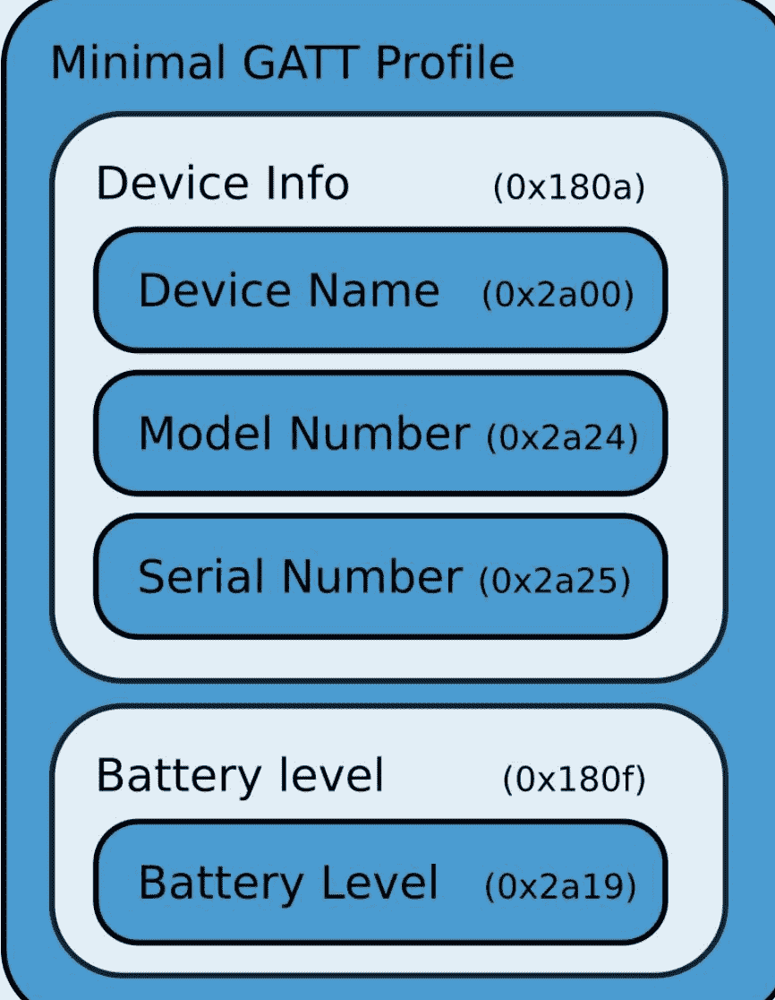

图 6-7. 最小 GATT

这为中心端（Central）软件、扫描工具以及未来的开发者提供了更好地了解每个外设（Peripheral）是什么、如何与其交互以及电池能力的支持。

出于教学考虑，许多示例将不会包含 GATT 配置文件中的这部分。

## 整合一切

创建一个名为`ExampleBlePeripheral`的新项目，并复制上一个示例中的所有内容。

此应用的工作方式与上一章节中的类似，但它将托管一个最小 GATT 配置（图 6-8）。

- 服务 (Service): `000180a-000-1000-8000-00805f9-b34fb`
- 特性 (Characteristic): `0002a00-000-1000-8000-00805f9-b34fb`
- 特性 (Characteristic): `0002a24-000-1000-8000-00805f9-b34fb`
- 特性 (Characteristic): `0002a25-000-1000-8000-00805f9-b34fb`
- 服务 (Service): `000180f-000-1000-8000-00805f9-b34fb`
- 特性 (Characteristic): `0002a19-000-1000-8000-00805f9-b34fb`

图 6-8. 最小 Gatt 配置文件的更新图像

## 对象

修改`BlePeripheral.java`以构建一个最小 GATT 服务配置，包括用于填充特性值的的数据数据。

示例 6-2. java/example.com.exampleble/ble/BlePeripheral

```java
...

public static final String CHARSET = "ASCII";

// GATT 配置文件的伪数据
private static final String MODEL_NUMBER = "1AB2";
private static final String SERIAL_NUMBER = "1234";

/** 外设和 GATT 配置 **/
public static final String ADVERTISINGNAME = "MyDevice";
```

```java
public static final UUID DEVICE_INFORMATION_SERVICE_UUID = UUID.fromString("0000180a-0000-1000-8000-0805f9b34fb");
```

```java
public static final UUID BATTERY_LEVEL_SERVICE = UUID.fromString("0000180f-0000-1000-8000-0805f9b34fb");
```

```java
public static final UUID DEVICE_NAME_CHARACTERISTIC_UUID = UUID.fromString("00002a00-0000-1000-8000-0805f9b34fb");
```

```java
public static final UUID MODEL_NUMBER_CHARACTERISTIC_UUID = UUID.fromString("00002a24-0000-1000-8000-0805f9b34fb");
```

```java
public static final UUID SERIAL_NUMBER_CHARACTERISTIC_UUID = UUID.fromString("00002a04-0000-1000-8000-0805f9b34fb");
```

```java
public static final UUID BATTERY_LEVEL_CHARACTERISTIC_UUID = UUID.fromString("00002a19-0000-1000-8000-0805f9b34fb");
```

```java
private BluetoothGattServer mGattServer;
private BluetoothGattService mDeviceInformationService;
private BluetoothGattService mBatteryLevelService;
private BluetoothGattCharacteristic mDeviceNameCharacteristic,
    mModelNumberCharacteristic,
    mSerialNumberCharacteristic,
    mBatteryLevelCharactersitic;
```

```java
/**
 * 构造一个新的外设
 *
 * @param context 上下文
 * @param blePeripheralCallback 回调处理器，
 * 与此外设建立接口
 * @throws Exception 如果不支持蓝牙，则抛出异常
 */
public MyBlePeripheral(
    final Context context,
    BlePeripheralCallback blePeripheralCallback) throws Exception
{
    mBlePeripheralCallback = blePeripheralCallback;
    // 确保 Android 设备支持低功耗蓝牙
    if (!context.getPackageManager().hasSystemFeature(PackageManager.FEATURE_BLUETOOTH_LE))
    {
        throw new Exception("Bluetooth Not Supported");
    }
    // 获取蓝牙管理器引用，
    // 允许我们与 BLE 射频通信
    final BluetoothManager bluetoothManager = (BluetoothManager)
        context.getSystemService(Context.BLUETOOTH_SERVICE);
    mGattServer = bluetoothManager.openGattServer(
        context,
        GattCallback
    );
    mBluetoothAdapter = bluetoothManager.getAdapter();
    if(!mBluetoothAdapter.isMultipleSupported())
    {
        throw new Exception("Peripheral not supported");
    }
    setupDevice();
}

/**
 * 获取电量
 */
public int getBatteryLevel() {
    BluetoothManager batteryManager = (BluetoothManager)
        context.getSystemService(Context.BLUETOOTH_SERVICE);
    return 0;
}

/**
 * 设置 GATT 配置
 */
private void setupDevice() throws Exception {
    // 设置设备名称
    mBluetoothAdapter.setName(ADVERTISINGNAME);
    // 构建特性
    mDeviceInformationService = mGattServer.addService(DEVICE_INFORMATION_SERVICE_UUID, BluetoothService.PRIMARY);
    mDeviceNameCharacteristic = mDeviceInformationService.addCharacteristic(DEVICE_NAME_CHARACTERISTIC_UUID, BluetoothCharacteristic.PROPERTY_READ);
    mModelNumberCharacteristic = mDeviceInformationService.addCharacteristic(MODEL_NUMBER_CHARACTERISTIC_UUID, BluetoothCharacteristic.PROPERTY_READ);
    mSerialNumberCharacteristic = mDeviceInformationService.addCharacteristic(SERIAL_NUMBER_CHARACTERISTIC_UUID, BluetoothCharacteristic.PROPERTY_READ);
    mBatteryLevelService = mGattServer.addService(BATTERY_LEVEL_SERVICE, BluetoothService.PRIMARY);
    mBatteryLevelCharactersitic = mBatteryLevelService.addCharacteristic(BATTERY_LEVEL_CHARACTERISTIC_UUID, BluetoothCharacteristic.PROPERTY_READ);
}
```


```java
/**
 * 开始广播
 *
 * @throws Exception 如果不支持蓝牙外设
 * 模式，则抛出异常
 */
public void startAdvertising() throws Exception {
    // 设置设备名称
    mBluetoothAdapter.setName(ADVERTISINGNAME);

    // 构建带有发射功率和广播速度的广播设置
    AdvertiseSettings advertiseSettings = new AdvertiseSettings.Builder()
        .setAdvertiseMode(mAdvertisingMode)
        .setTxPowerLevel(mTransmissionPower)
        .setConnectable(true)
        .build();

    AdvertiseData.Builder advertiseBuilder = new AdvertiseData.Builder();

    // 设备名称
    advertiseBuilder.setIncludeDeviceName(true);

    // 将服务添加到广播数据
    advertiseBuilder.addServiceUuid(new ParcelUuid(
        DEVICE_INFORMATION_SERVICE_UUID
    ));

    advertiseBuilder.addServiceUuid(new ParcelUuid(BATTERY_LEVEL_SERVICE));

    AdvertiseData advertiseData = advertiseBuilder.build();

    // 开始广播
    mBluetoothAdvertiser.startAdvertising(
        advertiseSettings,
        advertiseData,
        MAdvertiseCallback
    );
}

...

TimerTask updateBatteryTask = new TimerTask() {
    @Override
    public void run() {
        mBatteryLevelCharactersitic.setValue(
            getBatteryLevel(),
            BluetoothattCharacteristic.FORMAT_UINT8,
            0
        );
    }
};

Timer randomStringTimer = new Timer();

// 调度电量更新并立即执行
randomStringTimer.schedule(
    updateBatteryTask,
    0,
    BTERY_STATUS_CHECK_TIME_MS
);

...
```

生成的应用将能够托管一个最小 GATT 配置（图 6-9）。

## ExampleBLEPeripheral

- 广告名称：MyDevice
- 蓝牙已开启
- 广播中
- 中心设备已连接

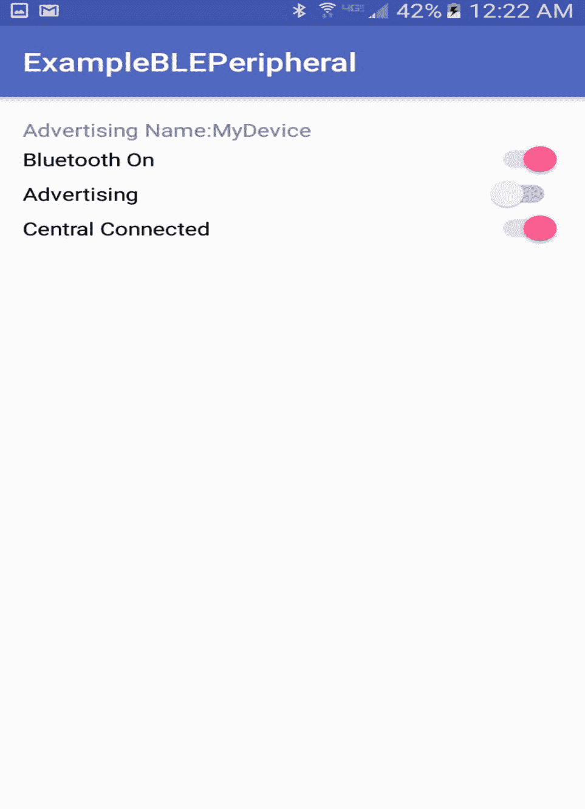

图 6-9. 显示 GATT 配置文件服务的 App 界面

## 示例代码

本章的代码可以在此处获取：https://github.com/BluetoothLowEnergyInAndroidJava

## 从外设读取数据

蓝牙低功耗（BLE）的真正价值在于无线传输数据的能力。

蓝牙外设（Peripheral）是被动的，因此它们不会向已连接的中心设备（Central）推送数据。相反，中心设备会向特征（Characteristic）请求读取数据。只有当该特征启用了读取属性（Read Attribute）时，这种操作才能发生。

这被称为“从特征读取值”。

因此，如果外设更改了特征的值，随后中心设备从外设下载数据，该过程如图所示（图 7-1）：


## 外设

## 中心设备

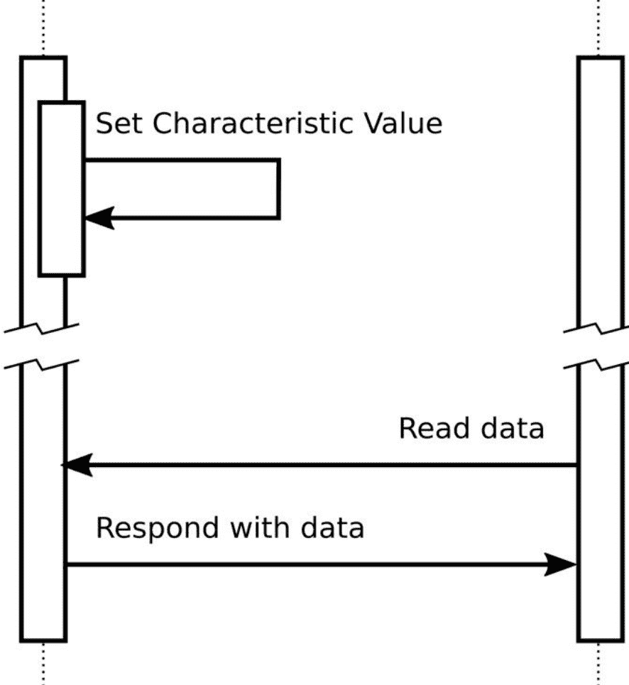

- 设置特征值
- 读取数据
- 使用数据响应

图 7-1. 中心设备从外设读取数据的过程

中心设备可以重复读取特征，无论特征的值是否发生变化。

## 编写中心设备程序

在从连接的外设读取数据之前，了解特征是否提供了读取权限可能会很有用。可以通过获取特征属性位图并从中分离出读取属性来读取读取权限，如下：

```java
int permissions = characteristic.getProperties(); // 获取权限
```

```java
boolean isReadable = permissions &
BluetoothGattCharacteristic.PROPERTY_READ;
```

一旦中心设备建立了蓝牙 GATT 连接，并能够访问与已连接外设通信的特征，中心设备就可以像如下请求读取该特征的数据：

```java
bluetoothGatt.readCharacteristic(characteristic);
```

这将发起从中心设备到外设的读取请求。

当中心设备完成从外设特征中读取数据时，`BluetoothGattCallback` 对象会触发 `onCharacteristicRead` 方法。

### 表 7-1. BluetoothGattCallback

| 事件 | 说明 |
| --- | --- |
| `onConnectionStateChange` | 当外设连接或断开时触发 |
| `onServicesDiscovered` | 当发现 GATT 服务时触发 |
| `onCharacteristicRead` | 当从特征下载数据时触发 |
| `onCharacteristicWrite` | 当数据上传到 GATT 特征时触发 |
| `onCheckedChanged` | 当特征数据发生变化时触发 |

在此回调函数中，可以使用 `characteristic.getValue()` 方法读取特征的字节值。

```java
private final BluetoothGattCallback gattCallback = new BluetoothGattCallback() {
    @Override
    public void onCharacteristicRead(
        BluetoothGatt gatt,
        BluetoothGattCharacteristic characteristic,
        int status)
    {
        byte[] data = characteristic.getValue();
    }
};
```

从这里开始，数据可以转换为任何格式，包括字符串或整数。

```java
byte[] data = characteristic.getValue();
```

```java
// 转换为字符串
String string = new String(data, "ASCII");
```

```java
// 转换为有符号整数
int intValue = ByteBuffer.wrap(bytes, ByteOrder.LITTLE_ENDIAN).getInt();
```

```java
// 转换为浮点数
float floatValue = ByteBuffer.wrap(bytes, ByteOrder.LITTLE_ENDIAN).getFloat();
```

使用 Android 传输数值数据时需要注意的是：蓝牙低功耗以小端序（Little-Endian）格式传输数据，而 Java 使用大端序（Big-Endian）处理数据。

## 整合整体

在 `res/` 中创建新的类、新的布局资源和菜单文件，命名如下所示（图 7-2）。

- `app/`
  - `manifests/`
    - `AndroidManifest.xml`
- `java/`
  - `example.com.exampleble/`
    - `utilities/`
      - `DataConverter`
    - `TalkActivity`
- `res/`
  - `layout/`
    - `activity_talk.xml`
  - `menu/`
    - `menu_talk.xml`
  - `values/`
    - `strings.xml`

图 7-2. 添加的项目文件

## 资源

添加字符串以支持连接 Activity 中的“Read”（读取）按钮和“Response”（响应）标签。

### 示例 7-1. res/values/strings.xml

```xml
...
<string name="read_button">Read</string>
<string name="response_label">Response</string>
<string name="property_read">Readable</string>
...
```

## 对象

修改 `BlePeripheral` 类，使其包含一个检查特征是否可读的方法，以及一个从特征发起的读取请求方法。

### 示例 7-2. java/example.com.exampleble/ble/BlePeripheral

```java
...
/**
 * 检查特征是否具有读取权限
 *
 * @param characteristic 要检查的特征
 * @return 如果可读则返回 true
 */
public static boolean isReadable(BluetoothGattCharacteristic characteristic) {
    return (characteristic.getProperties() &
BluetoothGattCharacteristic.PROPERTY_READ) != 0;
}
```

```java
/**
 * 请求从特征读取值
 *
 * @param characteristic 要读取的特征
 */
public void readValueFromCharacteristic(BluetoothGattCharacteristic characteristic) {
    bluetoothGatt.readCharacteristic(characteristic);
}
```

修改 `BleGattProfileListAdapter`，以便在特征可写时显示 `TextView`：

```java
class ChildViewHolder {
    public TextView mUuidTV; // 显示 UUID
    public TextView mPropertyReadableTV; // 特征是读的
    public TextView mPropertyNoneTV; // 当没有权限时显示
}
```

```java
@Override
public View getChildView(final int groupPosition, final int childPosition,
    boolean isLastChild, ViewGroup convertView, ViewGroup parent) {
    View v = convertView;
    ChildViewHolder characteristicListView;
    BleGattCharacteristicListItem item = getChild(groupPosition, childPosition);
    BluetoothGattCharacteristic characteristic = item.getCharacteristic();

    // 如果此 ListItem 尚不存在，则生成它
    // 否则，使用它
    if (convertView == null) {
        LayoutInflater inflater = LayoutInflater.from(
            parent.getContext()
        );
        v = inflater.inflate(
            R.layout.list_item_ble_characteristic,
            null
        );

        // 将列表 Item 内容与 xml 文件进行匹配
        characteristicListView = new ChildViewHolder();
        characteristicListView.mUuidTV =
            (TextView) v.findViewById(R.id.uuid);
        characteristicListView.mPropertyReadableTV =
            (TextView) v.findViewById(R.id.property_read);
        characteristicListView.mPropertyNoneTV =
            (TextView) v.findViewById(R.id.property_none);
        v.setTag(characteristicListView);
    } else {
        characteristicListView = (ChildViewHolder) v.getTag();
    }

    if (characteristicListView != null) {
        // 显示特征的 UUID
        characteristicListView.mUuidTV.setText(
            characteristic.getUuid().toString());

        // 显示特征的读/写/通知属性
        if (BlePeripheral.isCharacteristicReadable(characteristic)) {
            characteristicListView.mPropertyReadableTV.setVisibility(View.VISIBLE);
        } else {
            characteristicListView.mPropertyReadableTV.setVisibility(View.GONE);
        }

        if (!BlePeripheral.isCharacteristicReadable(characteristic)) {
            characteristicListView.mPropertyNoneTV.setVisibility(View.VISIBLE);
        } else {
            characteristicListView.mPropertyNoneTV.setVisibility(View.GONE);
        }
    }

    return v;
}
}
```

创建一个 `DataConverter` 来将字节数组和其他数据转换为各种格式，这对于调试或将特征（Characteristic）值表示为 `int`、`float` 或 `String` 很有用处：

## 示例 8-3. java/example.com.exampleble/utilities/DataConverter


```java
package example.com.exampleble.utilities;

public class DataConverter {

    /**
     * 为了调试目的，将字节转换为十六进制
     *
     * @param bytes 字节数组
     * @return 字节数组的十六进制字符串表示
     */
    public static String bytesToHex(byte[] bytes) {
        if (bytes.length<=0) return "";

        char[] hexArray = "0123456789ABCDEF".toCharArray();
        char[] hexChars = new char[bytes.length * 3];

        for ( int j = 0; j < bytes.length; j++ ) {
            int v = bytes[j] & 0xFF;
            hexChars[j * 3] = hexArray[v >>> 4];
            hexChars[j * 3 + 1] = hexArray[v & 0x0F];
            hexChars[j * 3 + 2] = 0x20; // space
        }

        return new String(hexChars);
    }

    /**
     * 为了调试目的，将字节转换为小端序（Little Endian）整数
     *
     * @param bytes 字节数组
     * @return 字节数组的整数表示
     */
    public static int bytesToInt(byte[] bytes) {
        if ((bytes.length % 2) == 1) {
            return ByteBuffer.wrap(bytes).getInt();
        } else {
            return 0;
        }
    }

    /**
     * 将字节转换为 Float
     *
     * @param bytes 字节数组
     * @return float
     */
    public static float bytesToFloat(byte[] bytes) {
        return ByteBuffer.wrap(bytes).getFloat();
    }

    /**
     * 为了调试目的，将字节转换为小端序（Little Endian）整数
     *
     * @param bytes 字节数组
     * @return 字节数组的整数表示
     */
    public static long bytesToLong(byte[] bytes) {
        long val = 0;
        for (int i=0; i < bytes.length; i++) {
            val += ((bytes[i] & 0xff) << (8*i));
        }
        return val;
    }
}
```

## 视图 Views

修改`list_item_ble_characteristic`文件，如果特征可写则显示一个`TextView`。

### 示例 7-4. `res/layout/ble/list_item_ble_characteristic.xml`

```xml
...
<LinearLayout
    android:orientation="horizontal"
    android:layout_width="fill_parent"
    android:layout_height="wrap_content"
    android:layout_gravity="center_vertical"
    android:layout_weight="2">

    <TextView
        android:layout_width="wrap_content"
        android:layout_height="wrap_content"
        android:textAppearance="?android:attr/textAppearanceSmall"
        android:text="@string/property_read"
        android:visibility="gone"
        android:id="@+id/property_read"
        android:paddingLeft="@dimen/activity_horizontal_margin />

    <TextView
        android:layout_width="wrap_content"
        android:layout_height="wrap_content"
        android:textAppearance="?android:attr/textAppearanceSmall"
        android:text="@string/property_none"
        android:visibility="gone"
        android:id="@+id/property_none"
        android:paddingLeft="@dimen/activity_horizontal_margin />

</LinearLayout>
...
```

## Activity Activities

修改`Connect Activity`，当用户在`List View`中点击特征（Characteristic）时，启动`Talk Activity`。

### 示例 7-5. `java/example.com.exampleble/ConnectActivity.java`

```java
...
@Override
protected void onCreate(Bundle savedInstanceState) {
    ...
    loadUI();
    attachCallbacks();
    ...
}

/**
 * 将回调处理器绑定到 UI元素
 */
public void attachCallbacks() {
    // 当用户点击服务时
    // 展开属于该服务的的特征。
    // 当用户点击特征时，在 TalkActivity 中打开
    GattProfileListView.setOnChildClickListener(
            new ExpandableListView.OnChildClickListener() {
                @Override
                public boolean onChildClick(ExpandableListView parent,
                        View v, int groupPosition, int childPosition, long id) {

                    Log.v(TAG, "List click: groupPosition: " + groupPosition +
                        ", childPosition: " + childPosition);

                    BluetoothGattService service =
                            GattProfileListView.getGroup(groupPosition);

                    BluetoothGattCharacteristic characteristic =
                            GattProfileListView.getChild(groupPosition, childPosition);

                    // 启动 Talk Activity
                    Intent intent = new Intent(getBaseContext(), TalkActivity.class);
                    intent.putExtra(PERIPHERAL_NAME, service.getName());
                    intent.putExtra(PERIPHERAL_MAC_ADDRESS, service.getAddress());
                    intent.putExtra(CHARACTERISTIC_KEY, characteristic.getUUID().toString());
                    intent.putExtra(SERVICE_KEY, service.getUUID().toString());
                    startActivity(intent);
                    return true;
                }
            });
}
```

新的`Talk activity`将连接到外设（Peripheral），并允许用户从特征中读取数据。

### 示例 7-6. `java/example.com.exampleble/TalkActivity.java`

```java
mPeripheralAdvertiseNameTV.setText(R.string.connecting);
```

```java
Log.v(TAG, "Incoming Service UUID: " + mServiceUUID.toString());
```

```java
Log.v(
    TAG,
    "Incoming Characteristic UUID: " + mCharacteristicUUID.toString()
);
```

```java
mServiceUUIDTV.setText(mCharacteristicUUID.toString());
```

```java
mReadButton.setVisibility(View.GONE);
```

```java
mResponseText.setVisibility(View.GONE);
}
```

```java
@Override
public boolean onCreateOptionsMenu(Menu menu) {
    // 解析菜单；
    // 如果存在操作栏，则将项添加到操作栏中
    getMenuInflater().inflate(R.menu.menu_talk, menu);
    return true;
}
```

```java
@Override
public boolean onPrepareOptionsMenu(Menu menu) {
    mProgressSpinner = menu.find(R.id.scan_progress_item);
    initializeBluetooth();
    //connect(); // 当与非 Android 外设设备一起工作时
    startScan(); // 当与 Android 外设设备一起工作时
    return super.onPrepareOptionsMenu(menu);
}
```

```java
@Override
public boolean onOptionsItemSelected(MenuItem item) {
    switch (item.getItemId()) {
        case R.id.action_disconnect:
            // 用户选择了“停止”项
            disconnect();
            return true;
        default:
            // 如果到达这里，说明用户的操作未被识别
    }
    // 调用父类进行处理
    return super.onOptionsItemSelected(item);
}
```

```java
public void initializeBluetooth() {
  try {
    mBleCommManager = new BleCommManager(this);
  } catch (Exception e) {
    Toast.makeText(
      this,
      "Could not initialize bluetooth", Toast.LENGTH_SHORT
    ).show();
    Log.e(TAG, e.getMessage());
    finish();
  }
}
```

```java
public void connect() {
    // 获取外设设备地址并尝试连接
    BluetoothDevice bluetoothDevice = mBleCommManager.getBluetoothAdapter().getRemoteDevice(
        mPeripheralMacAddress
    );
    mProgressSpinner.setVisible(true);
    try {
        mBlePeripheral.connect(
            bluetoothDevice,
            mgattCallback,
            getApplicationContext()
        );
    } catch (Exception e) {
        mProgressSpinner.setVisible(false);
        Log.e(TAG, "Error connecting to peripheral");
    }
}
```

```java
/**
 * 外设已连接。更新 UI
 */
public void onBleConnected() {
    BluetoothDevice bluetoothDevice = mBlePeripheral.getBluetoothDevice();
    mPeripheralAdvertiseNameTV.setText(bluetoothDevice.getName());
    mPeripheralAddressTV.setText(bluetoothDevice.getAddress());
    mProgressSpinner.setVisible(false);
}
```

```java
/**
 * 特性支持读取。更新 UI
 */
public void onCharacteristicReadable() {
    Log.v(TAG, "Characteristic is readable");
    mReadButton.setVisibility(View.VISIBLE);
    mResponseText.setVisibility(View.VISIBLE);
    mReadButton.setOnClickListener(new View.OnClickListener() {
        @Override
        public void onClick(View v) {
            Log.v(TAG, "Read button clicked");
            mBlePeripheral.readValueFromCharacteristic(mCharacteristic);
        }
    });
}
```

```java
/**
 * 当从特性中读取到新消息时更新 TextView
 * 同时滚动到部，以确保新消息始终可见
 * @param message 要在 UI 中以文本形式的的特性值
 */
public void updateResponseText(String message) {
    mResponseText.append(message + "\n");
    final int scrollAmount = mResponseText.getLayout().getLineTop(
    mResponseText.getLineCount()
    ) - mResponseText.getHeight();
    // 如果不需要滚动，scrollAmount 将小于 0
    if (scrollAmount < 0) {
        mResponseText.scrollTo(0, scrollAmount);
    } else {
        mResponseText.scrollTo(0, 0);
    }
}
```


```java
/**
 * BluetoothGattCallback 处理连接、状态变化、
 * 读取、写入以及到外设的 GATT 配置文件列表
 */
private final BluetoothGattCallback mGattCallback =
    new BluetoothGattCallback({
        /**
         * 特性读取成功
         *
         * @param gatt 连接到 GATT
         * @param characteristic 被读取的特性
         * @param status 操作的状态
         */
        @Override
        public void onCharacteristicRead(
            final BluetoothGatt gatt,
            final BluetoothGattCharacteristic characteristic,
            int status)
        ) {
            // 特性已读取。将数据转换为 Android 上可用的格式
            // 并在 UI 中显示它
            if (status == BluetoothGatt.GATT_SUCCESS) {
                final byte[] data = characteristic.getValue();
                try {
                    String message = new String(data);
                    runOnUiThread(() -> {
                        updateResponseText(message);
                    });
                } catch (Exception e) {
                    Log.e(TAG, "Error converting data: " + e.getMessage());
                }
            } else {
                Log.e(TAG, "Characteristic read failed with status: " + status);
            }
        }
    });
```

```java
/**
 * 特性写入成功。更新 UI
 */
@Override
public void onCharacteristicWrite(
    final BluetoothGatt gatt,
    final BluetoothGattCharacteristic characteristic,
    int status)
) {
    if (status == BluetoothGatt.GATT_SUCCESS) {
        Log.v(TAG, "写入 successfully");
    } else {
        Log.e(TAG, "Characteristic write failed with status: " + status);
    }
}
```

```java
/**
 * 特性已更改。更新 UI
 */
@Override
public void onCharacteristicChanged(
    BluetoothGatt gatt,
    BluetoothGatt characteristic
) {
    final byte[] data = characteristic.getValue();
    if (data != null) {
        String message = new String(data);
        runOnUiThread(() -> {
            updateResponseText(message);
        });
    }
}
```

```java
/**
 * 外设连接或断开。更新 UI
 */
@Override
public void onConnectionChange(
    BluetoothGatt gatt,
    int status,
    int newState) {
    if (newState == BluetoothProfile.STATE_CONNECTED) {
        Log.v(TAG, "Connected to peripheral");
        runOnUiThread(new Runnable() {
            @Override
            public void run() {
                onBleConnected();
            }
        });
        gatt.discoverServices();
    } else if (newState == BluetoothProfile.STATE_DISCONNECTED) {
        Log.v(TAG, "Disconnected from peripheral");
        disconnect();
        mBlePeripheral.close();
    }
}
```

```java
/**
 * GATT 配置文件发现。更新 UI
 */
@Override
public void onServicesDiscovered(
    BluetoothGatt gatt,
    int status) {
    // 如果发现了服务，
    // 则我们遍历它们并显示在屏幕上
    if (status == BluetoothGatt.GATT_SUCCESS) {
        // 连接到特定的服务
        BluetoothGattService gattService = gatt.getService(mServiceUUID);
        // 在此处，我们请求该服务的特性：
        List<BluetoothGattCharacteristic> characteristics = gattService.getCharacteristics();

        for (BluetoothGattCharacteristic characteristic : characteristics) {
            if (characteristic != null) {
                Log.v(TAG, "found characteristic: " + characteristic.getUuid().toString());
            }
        }
    }
}
```

```java
// 确定读取/写入/通知权限
// 特性的权限
Log.v(TAG, "desired service is: " + mServiceUUID.toString());
Log.v(TAG, "desired characteristic is: " + mCharacteristicUUID.toString());
Log.v(TAG, "this service: " + gatt.getService(mServiceUUID).getUuid().toString());
Log.v(TAG, "this characteristic: " + gatt.getService(mServiceUUID).getCharacteristic(mCharacteristicUUID).getUuid().toString());
```

```java
mCharacteristicUUID = UUID.fromString().getUuid().toString());
mCharacteristic = bluetoothGatt.getService(mServiceUUID).getCharacteristic(mCharacteristicUUID);
if (BlePeripheral.isCharacteristicReadable(mCharacteristic)) {
    runOnUiThread(new Runnable() {
        @Override
        public void run() {
            onCharacteristicReadable();
        }
    });
} else {
    Log.e(TAG, "在发现此外设的 "GATT 服务时发生错误");
}
```


```java
/**
 * 断开连接
 */
private void disconnect() {
    // 断开连接时关闭 Activity。
    // 没有连接的情况下无法执行任何操作
    mBlePeripheral.disconnect();
    finish();
}

/**
 * 基于 Android 的外设在连接之间会更改 MAC 地址
 * 因此，我们无法简单地连接到上一个已知的 MAC 地址
 * 相反，必须再次扫描匹配的广告名称
 */
/**
 * 开始扫描外设
 */
public void startScan() {
    try {
        mScanningActive = true;
        mBleCommManager.scanForPeripherals(mBleScanCallbackv18, mScanCallbackv21);
    } catch (Exception e) {
        Log.e(TAG, "无法打开 BLE 设备扫描器");
    }
}

/**
 * 停止扫描外设
 */
public void stopScan() {
    mBleCommManager.stopScanning(mBleScanCallbackv18, mScanCallbackv21);
}

/**
 * BLE 扫描停止时的事件触发
 */
public void onBleScanStopped() {
    // 更新 UI 组件以反映 BLE 扫描已停止
    // 此方法可能会在
    // 菜单实例化之前被调用
    // 检查菜单项是否已初始化，否则 Activity 将崩溃
    mScanningActive = false;
}

/* 发现新外设时的事件触发 */
public void onBlePeripheralDiscovered(
    BluetoothDevice bluetoothDevice,
    int rssi
) {
    Log.v(
        TAG,
        "找到 " + mBlePeripheralName + ": " + \
        bluetoothDevice.getName() + ", " + \
        bluetoothDevice.getAddress()
    );
    // 仅当满足以下条件时添加外设
    // - 它有名称，且
    // - 列表中不存在，或者
    // - 它的传输功率更高（距离更近）
    // 于现有外设
    if (bluetoothDevice.getName().equals(mBlePeripheralName)) {
        Log.v(TAG, "找到目标设备。正在连接");
    }
    stopScan();
    mPeripheralMacAddress = bluetoothDevice.getAddress();
    connect();
}

/**
 * Android API 21 (Lollipop) 或更高版本使用此回调
 */
private final BleScanCallbackv21 mScanCallbackv21 = new BleScanCallbackv21() {
    /**
     * 发现新外设
     * @param callbackType int: 决定此回调如何
     * 被触发。可能是 CALLBACK_TYPE_ALL_MATCHES、
     * CALLBACK_TYPE_FIRST_MATCH 或 CALLBACK_TYPE_MATCH_LOST
     * @param result 一个蓝牙低功耗扫描结果，
     * 包含蓝牙设备、RSSI
     * 以及其他信息
     */
    @Override
    public void onScanResult(int callbackType, ScanResult result) {
        BluetoothDevice bluetoothDevice = result.Device();
        int rssi = result.getRssi();
        onBlePeripheralDiscovered(bluetoothDevice, rssi);
    }

    /**
     * 在低功耗模式下扫描时发现了多个外设
     *
     * @param results List: 之前的扫描结果列表。
     */
    @Override
    public void onBatchScanResults(List<ScanResult> results) {
        for (ScanResult result : results) {
            BluetoothDevice bluetoothDevice = result.getDevice();
            int rssi = result.getRssi();
            onBlePeripheralDiscovered(bluetoothDevice, rssi);
        }
    }

    /**
     * 扫描初始化失败
     * @param errorCode int: 失败的错误代码（SCAN_FAILED* 之一）。
     */
    @Override
    public void onScanFailed(int errorCode) {
        switch (errorCode) {
            case SCAN_FAILED_ALREADY_STARTED:
                Log.e(TAG, "启动失败，因为应用已启动带有这些设置的 BLE 扫描.");
                break;
            case SCAN_FAILED_REGISTRATION_FAILED:
                Log.e(TAG, "启动失败，因为无法注册应用。");
                break;
            case SCAN_FAILED_FEATURE_UNSUPPORTED:
                Log.e(TAG, "启动失败，此功能不受支持。");
                break;
            default: // SCAN_FAILED_INTERNAL_ERROR
                Log.e(TAG, "由于内部错误无法启动扫描");
                runOnUiThread(new Runnable() {
                    @Override
                    public void run() {
                        onScanStopped();
                    }
                });
                break;
        }
    }

    /**
     * 扫描完成
     */
    public void onScanComplete() {
        runOnUiThread(new Runnable() {
            @Override
            public void run() {
                onScanStopped();
            }
        });
    }
};

/**
 * Android API 18、19 和 20 (Lollipop 之前) 使用此回调
 */
public final BleScanCallbackv18 mScanCallbackv18 = new BleScanCallbackv18() {
    /**
     * 发现外设
     * @param bluetoothDevice 蓝牙设备
     * @param rssi RSSI
     * @param scanRecord 关于扫描的信息
     */
    @Override
    public void onScan(BluetoothDevice bluetoothDevice, int rssi, byte[] scanRecord) {
        onBlePeripheralDiscovered(bluetoothDevice, rssi);
    }

    /**
     * 扫描完成
     */
    public void onScanComplete() {
        runOnUiThread(new Runnable() {
            @Override
            public void run() {
                onScanStopped();
            }
        });
    }
};
```

读取按钮的 Activity 布局：

```xml
<?xml version="1.0" encoding="utf-8"?>
<android.support.design.widget.CoordinatorLayout
    xmlns:android="http://schemas.android.com/apk/res/android"
    xmlns:app="http://schemas.android.com/apk/res-auto"
    xmlns:tools="http://schemas.android.com/tools"
    android:layout_width="match_parent"
    android:layout_height="match_parent"
    android:fitsSystemWindows="true"
    tools:context=".ConnectActivity">

    <android.support.design.widget.AppBarLayout
        android:layout_height="wrap_content"
        android:layout_width="match_parent"
        android:theme="@style/AppTheme.ActionBar">

        <android.support.v7.widget.Toolbar
            android:id="@+id/toolbar"
            android:layout_width="match_parent"
            android:layout_height="?attr/actionBarSize"
            android:background="?attr/colorPrimary"
            app:popupTheme="@style/AppTheme.PopupOverlay" />
    </android.support.design.widget.AppBarLayout>

    <LinearLayout
        xmlns:android="http://schemas.android.com/apk/res/android"
        android:layout_width="match_parent"
        android:layout_height="match_parent"
        android:orientation="vertical"
        android:paddingLeft="@dimen/activity_horizontal_margin"
        android:paddingRight="@dimen/activity_horizontal_margin"
        android:paddingTop="@dimen/activity_vertical_margin"
        android:paddingBottom="@dimen/activity_vertical_margin"
        app:layout_behavior="@string/appbar_scrolling_view_behavior"
        tools:showIn="@layout/activity_main"
        tools:context=".MainActivity"
        android:weightSum="1">

        <TextView
            android:id="@+id/advertise_name"
            android:layout_width="wrap_content"
            android:layout_height="wrap_content"
            android:layout_marginBottom="@dimen/activity_vertical_margin"
            android:textAppearance="?android:attr/textAppearanceLarge"
            android:text="@string/loading" />

        <TextView
            android:id="@+id/mac_address"
            android:layout_width="wrap_content"
            android:layout_height="wrap_content"
            android:layout_marginBottom="@dimen/activity_vertical_margin"
            android:text="@string/loading" />

        <TextView
            android:id="@+id/service_uuid"
            android:layout_width="wrap_content"
            android:layout_height="wrap_content"
            android:layout_marginBottom="@dimen/activity_vertical_margin"
            android:text="@string/loading" />

        <Button
            android:layout_width="wrap_content"
            android:layout_height="wrap_content" />
    </LinearLayout>
</android.support.design.widget.CoordinatorLayout>
```

```xml
android:layout_height="wrap_content"
android:text="@string/read_button"
android:id="@id/read_button" />

<TextView
    android:layout_width="match_parent"
    android:layout_height="172dp"
    android:text=""
    android:background="#ffffff"
    android:id="@id/response_text"
    android:layout_weight=".5" />
</LinearLayout>
</android.support.design.widget.CoordinatorLayout>
```

Talk activity 有一个菜单项，允许用户从 Characteristic 退出并返回 Connect Activity 中的 Peripheral GATT 配置文件：

示例 7-8. res/menu/menu_talk.xml

```xml
<menu xmlns:android="http://schemas.android.com/apk/res/android"
    xmlns:app="http://schemas.android.com/apk/res-auto"
    xmlns:tools="http://schemas.android.com/tools"
    tools:context=".ConnectActivity">

    <item
        android:id="@id/action_disconnect"
        android:title="@string/action_disconnect"
        android:orderInCategory="100"
        app:showAsAction="always" />

    <item
        android:id="@id/scan_progress_item"
        android:title="@string/connecting"
        android:visible="true"
        android:orderInCategory="100"
        app:showAsAction="always"
        app:actionLayout="@layout/scanner_progress" />
</menu>
```


`android:layout_marginRight="@dimen/activity_horizontal_margin" />`

`</menu>`

## Manifest

`TalkActivity` 必须在 Android Manifest 中描述，以便它拥有运行权限：

### 示例 7-9. manifests/AndroidManifest.xml

```xml
...
<application ...>
...
<activity
    android:name=".TalkActivity"
    android:theme="@style/AppTheme.ActionBar" />
</application>
...
```

运行时，该 App 将能够扫描并连接到 Peripheral。一旦连接，它就可以列出 GATT Profile - 即托管在 Peripheral 上的 Services 和 Characteristics（图 7-3）。可以选择一个 Characteristic 并从该 Characteristic 读取值（图 7-4）。

## ExampleBLETalk DISCONNECT

### MyDevice

`98:4F:EE:0C:F9:37`

```
00001800-0000-1000-8000-00805f9 Primary
b34fb
00001801-0000-1000-8000-00805f9 Primary
b34fb
0000180c-0000-1000-8000-00805f9 Primary
b34fb
0002a56-0000-1000-8000-00805f9b3
4fb 
Readable
```

图 7-3. 显示已连接 Peripheral 的 GATT Profile 的 App 屏幕

## ExampleBLEConnect DISCONNECT

### MyDevice

`98:4F:EE:0C:F9:37`

`00002a56-0000-1000-8000-00805f9b34fb`

READ

`RY0G5WSWSG5YTh`
`HFVTh`
`88L9J25245ZUh`
`A6D7SZZFYQ8Sh`

图 7-4. 显示从已连接 Peripheral 读取的值的 App 屏幕

## 为 Peripheral 编程

本章将展示如何创建一个具有读取权限的 Characteristic。

如下所示，创建一个只读的 Characteristic 并将其添加到 Primary Service 中：

```java
public static final UUID CHARACTERISTIC_UUID = \
UUID.fromString("0002a56-0000-1000-8000-00805f9b34fb");

// 创建一个只读 Characteristic
Characteristic = new BluetoothGattCharacteristic(
    CHARACTERISTIC_UUID,
    BluetoothGattCharacteristic.PROPERTY_READ | \nBluetoothGattCharacteristic.PROPERTY_WRITE,
    BluetoothGattCharacteristic.PERMISSION_READ
);
```

```java
// 将 Characteristic 添加到 Service
mService.addCharacteristic(mCharacteristic);
```

当 Central 请求读取 Peripheral 的 Characteristic 数据时，`onCharacteristicRequest` 方法会在 `BluetoothGattServerCallback` 对象中触发。

### 表 7-2. BluetoothGattServerCallback

| 事件 | 描述 |
|---|---|
| `onConnectionStateChange` | Central 连接 |
| `onCharacteristicReadRequest` | Characteristic 读取通知 |
| `onCharacteristicWriteRequest` | Central 尝试从 C 写入值 |
| `onDescriptorWriteRequest` | Central 尝试在 a 中写入 Descriptor |
| | Central 无连接 |

为了让 Central 读取值，必须使用 `BluetoothGattServer.sendResponse()` 方法发送值。可以像这样实现：

```java
private final BluetoothGattServerCallback gattCallback = \nnew BluetoothGattServerCallback()
{
    @Override
    public void onCharacteristicReadRequest(
        BluetoothDevice device,
        int requestId,
        int offset,
        BluetoothGattCharacteristic characteristic)
    {
        // 传递 
        GattServer.sendResponse(
            device,
            requestId,
            BluetoothGatt.GATT_SUCCESS,
            offset,
            characteristic
        );
    }
);
```

需要注意的是，蓝牙低功耗以小端字节（Little-Endian）格式传输数据。

## 整合

将上一章的代码复制到新项目中。修改 `BlePeripheral` 类以包含一个检查 Characteristic 是否可读的方法，并发起读取请求。

示例 7-2. java/example/BlePeripheral

```java
public class BlePeripheral {
    private static String TAG = "BlePeripheral";
    private static final int CHARACTERISTIC_LENGTH = 20;
    private BluetoothGattServer mServer;
    private BluetoothGattService mService;
    private BluetoothGattCharacteristic mCharacteristic;

    private final BluetoothGattServerCallback gattCallback = new BluetoothGattServerCallback() {
        @Override
        public void onConnectionStateChange(BluetoothDevice device, int status, int newState) {
            super.onConnectionStateChange(device, newState);
            Log.v(TAG, "Connected");
            if (status == BluetoothGatt.GATT_SUCCESS) {
                if (newState == BluetoothGatt.STATE_CONNECTED) {
                    mBlePeripheralCallback.onConnected(device);
                    stopAdvertising();
                } else if (newState == BluetoothGatt.STATE_DISCONNECTED) {
                    mBlePeripheralCallback.onDisconnected(device);
                    try {
                        startAdvertising();
                    } catch (Exception e) {
                        Log.e(TAG, "error starting advertising");
                    }
                }
            }
        }

        @Override
        public void onCharacteristicReadRequest(BluetoothDevice device, int requestId, int offset, BluetoothGattCharacteristic characteristic) {
            super.onCharacteristicReadRequest(device, requestId, offset, characteristic);
            Log.d(TAG, "Device tried to read characteristic: " + characteristic.getUuid());
            Log.d(TAG, "Value: " + Arrays.toString(characteristic.getValue()));
            if (characteristic.getUuid() == mCharacteristic.getUuid()) {
                gattServer.sendResponse(device, requestId, BluetoothGatt.GATT_SUCCESS, offset, characteristic.getValue());
            }
        }
    };

    private void setupDevice() {
        // 设置广播名称和 GATT 
        mService = new BluetoothGattService(UUID.fromString("0000180c-0000-1000-8000-00805f9"), BluetoothGatt.SERVICE_TYPE_PRIMARY);
        mCharacteristic = new BluetoothGattCharacteristic(UUID.fromString("0002a56-0000-1000-8000-00805f9b34fb"), BluetoothGattCharacteristic.PROPERTY_READ | BluetoothGattCharacteristic.PROPERTY_WRITE, BluetoothGattCharacteristic.PERMISSION_READ);
        mService.addCharacteristic(mCharacteristic);
        gattServer.addService(mService);
    }
}
```

```java
int timerInterval_ms = 1000;
TimerTask updateReadCharacteristicTask = new TimerTask() {
    @Override
    public void run() {
        int stringLength = (int) (Math.random() * CHARACTERISTIC_LENGTH);
        String randomString = DataConverter.getRandomString(stringLength);
        try {
            mCharacteristic.setValue(randomString);
        } catch (Exception e) {
            Log.e(TAG, "Error converting String to byte array");
        }
    }
};
```

```java
Timer randomStringTimer = new Timer();
randomStringTimer.schedule(updateReadCharacteristicTask, 0, timerInterval_ms);
```

```java
if (offset < CHARACTERISTIC_LENGTH) {
    if (offset != 0) {
        mgGattServer.sendResponse(
            device,
            requestId,
            BluetoothGatt.GATT_INVALID_OFFSET,
            offset,
            characteristic.getValue()
        );
    } else {
        mgGattServer.sendResponse(
            device,
            requestId,
            BluetoothGatt.GATT_SUCCESS,
            offset,
            characteristic.getValue()
        );
    }
} else {
    Log.d(
        TAG,
        "尝试读取 Characteristic 时 offset 无效"
    );
}
}
);
...
```

创建一个 `DataConverter` 类来生成一个随机的：

示例 8-3. java/example.com.exampleble/utilities/DataConverter

```java
package example.com.exampleble.utilities;

public class DataConverter {

/**
 * 生成一个随机字符串
 *
 * @param int length 结果字符串的长度
 * @return 随机 String
 */
```

```java
private static final String ALLOWED_CHARACTERS =\
    "0123456789abcdefghijklmnopqrstuvwxyz";

public static String getRandomString(final int length) {
    final Random random = new Random();
    final StringBuilder sb=new StringBuilder(length);
    for(int i=0;i<length;++i) {
        sb.append(ALLOWED_CHARACTERS.charAt(
            random.nextInt(ALLOWED_CHARACTERS.length()))
        );
    }
    return sb.toString();
}
```

运行时，该 App 将能够托管一个简单的 GATT 配置，包含单个 Characteristic，每隔 5 秒将该 Characteristic 设置为随机字符串（图 7-5）。

## ExampleBLEPeripheral

广告名称：MyDevice

蓝牙已开启

广播

中心设备已连接

图 7-5. 显示连接外设 GATT 配置的 App 屏幕

## 示例代码

本章的代码可以在网上获取：`https://github.com/BluetoothLowEnergyInAndroidJava`

## 向外设写入数据

当中心设备向外设托管的 Characteristic 写入值时，如果该 Characteristic 具有写入权限，数据将从中心设备发送到外设。

该过程如图所示（图 8-1）。


## 外设

## 中心设备

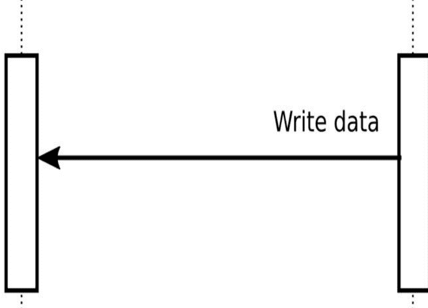


图 8-1. 中心设备向外设写入数据的过程

## 为中心设备编程

在尝试向 Characteristic 写入数据之前，了解 Characteristic 是否具有“写入”权限是有用的。可以通过访问 Characteristic 的属性并分离出写入属性来读取写入权限：

```java
int permissions = characteristic.getProperties(); // 获取权限
boolean isWriteable = permissions &
    (BluetoothGattCharacteristic.PROPERTY_WRITE | BluetoothCharacteristic.PROPERTY_WRITE_NO_RESPONSE);
```

要向外设发送数据，中心设备必须设置本地 Characteristic 缓存，然后将更新推送到外设：

```java
```


`characteristic.setValue(message);` // 设置本地缓存

`bluetoothGatt.writeCharacteristic(characteristic);` // 更新远程外设

`message` 可以是 `int`、`String` 或字节数组。在处理复杂或很长的数据时，将数据转换为字节数组可能会更简单。为了一个简单的例子是，`String` 可以像这样转换为字节数组：

```java
byte[] temp = message.getBytes();
```

就像从 `Characteristic` 中读取数字一样，在通过蓝牙传输之前，必须将数字的字节序更改为小端序（Little-Endian）。例如，以下是将 `Integer` 写入 `Characteristic` 的方法：

```java
ByteBuffer byteBuffer = ByteBuffer.wrap(bytes, ByteOrder.BIG_ENDIAN);
byteBuffer.order(ByteOrder.LITTLE_ENDIAN); // 切换到小端序
int message = byteBuffer.getInt();
characteristic.setValue(message); // 设置本地缓存
bluetoothGatt.writeCharacteristic(characteristic); // 更新远程外设
```

当中心设备被成功写入后，`BluetoothGattCallback` 中会触发 `onCharacteristicWrite` 事件。

### 表 8-1. BluetoothGattCallback

| 事件 | 描述 |
| :--- | :--- |
| `onConnectionStateChange` | 当设备连接或断开连接时触发 |
| `onServicesDiscovered` | 当发现服务时触发 |
| `onCharacteristicRead` | 当从 `Characteristic` 下载数据时触发 |
| `onCharacteristicWrite` | 当数据上传到 `Characteristic` 时触发 |
| `onCharacteristicChanged` | 当 `Characteristic` 的值发生变化时触发 |

其实现方式如下：

```java
private final BluetoothGattCallback gattCallback = new BluetoothGattCallback() {
    @Override
    public void onCharacteristicWrite(BluetoothGatt gatt, BluetoothGattCharacteristic characteristic, int status) {
        // 注意传输完成情况
    }
};
```

## 整合一切

`BlePeripheral` 将被修改为向连接的外设上的 `Characteristic` 写入数据，`TalkActivity` 将被修改以显示发送按钮。

## 资源

`Talk Activity` 需要一个发送按钮来使用户户触发 `Characteristic` 写入事件。发送按钮定义在 `res/values/strings.xml` 中。

示例 8-1. `res/values/strings.xml`

```xml
...
<string name="write">Write</string>
<string name="writable">Writable</string>
<string name="none">None</string>
```

## 对象

修改 `BlePeripheral` 类包含两个新方法：

- `isWritable` 当 `Characteristic` 具有写入权限时返回 `true`
- `writeValueToCharacteristic` 将值写入 `Characteristic`

示例 8-2. `java/example.com.exampleble/BlePeripheral`

```java
...
public static boolean isWritable(BluetoothGatt characteristic) {
    return (characteristic.getProperties() &
        (BluetoothGattCharacteristic.PROPERTY_WRITE | BluetoothCharacteristic.PROPERTY_WRITE_NO_RESPONSE)) != 0;
}

/**
 * 将消息写入 Characteristic
 * @param message 要写入的消息
 * @param characteristic 要写入的 Characteristic
 * @throws Exception
 */
public void writeValueToCharacteristic(String message, BluetoothGatt characteristic) throws Exception {
    byte[] messageBytes = message.getBytes();
    Log.v(TAG, "Writing: " + message + " to " + characteristic.getUuid().toString());
    characteristic.setValue(messageBytes);
}
```

修改 `BluetoothGattListAdapter` 以显示 `Characteristic` 属性：

示例 8-3. `java/example.com.exampleble/adapters/BluetoothGattListAdapter`

```java
...
static class ChildViewHolder {
    public TextView uuidTV;
    public TextView propertyReadTV;
    public TextView propertyWriteTV;
    public TextView propertyNoneTV;
}

@Override
public View getChildView(final int groupPosition, final int childPosition, boolean isChild, View convertView, ViewGroup parent) {
    View v = convertView;
    ChildViewHolder characteristicListItemView;
    BluetoothGattListItem item = getChild(groupPosition);
    BluetoothGattCharacteristic characteristic = item.getCharacteristic();

    // 如果 ListItem 还不存在，则生成
    if (convertView == null) {
        LayoutInflater inflater = LayoutInflater.from(parent.getContext());
        v = inflater.inflate(R.layout.list_item_ble_characteristic, null);

        // 将 List Item 中的 UI 组件与 xml 文件进行匹配
        characteristicListItemView = new ChildViewHolder();
        characteristicListItemView.uuidTV = (TextView)v.findViewById(R.id.uuid);
        characteristicListItemView.propertyReadTV = (TextView)v.findViewById(R.id.property_read);
        characteristicListItemView.propertyWriteTV = (TextView)v.findViewById(R.id.property_write);
        characteristicListItemView.propertyNoneTV = (TextView)v.findViewById(R.id.property_none);
    } else {
        characteristicListItemView = (ChildViewHolder)convertView.getTag();
    }

    characteristicListItemView.uuidTV.setText(characteristic.getUuid().toString());

    if ((characteristic.getProperties() &
        (BluetoothGattCharacteristic.PROPERTY_READ | BluetoothCharacteristic.PROPERTY_READ_NO_RESPONSE)) != 0) {
        characteristicListItemView.propertyReadTV.setVisibility(View.VISIBLE);
    } else {
        characteristicListItemView.propertyReadTV.setVisibility(View.GONE);
    }

    if ((characteristic.getProperties() &
        (BluetoothGattCharacteristic.PROPERTY_WRITE | BluetoothCharacteristic.PROPERTY_WRITE_NO_RESPONSE)) != 0) {
        characteristicListItemView.propertyWriteTV.setVisibility(View.VISIBLE);
        characteristicListItemView.propertyNoneTV.setVisibility(View.GONE);
    } else {
        characteristicListItemView.propertyWriteTV.setVisibility(View.GONE);
        characteristicListItemView.propertyNoneTV.setVisibility(View.VISIBLE);
    }

    v.setTag(characteristicListItemView);
    return v;
}
```

```java
characteristicListView = (ChildViewHolder) v.getTag();
}

if (characteristicListView != null) {
  // 显示特征的 UUID
  characteristicListView.mUuidTV.setText(
    characteristic.getUuid().toString()
  );

  // 显示特征的读/写/通知 属性
  if (BlePeripheral.isCharacteristicReadable(characteristic)) {
    characteristicListView.mPropertyReadableTV.setVisibility(View.VISIBLE);
  } else {
    characteristicListView.mPropertyReadableTV.setVisibility(View.GONE);
  }

  if (BlePeripheral.isCharacteristicWritable(characteristic)) {
    characteristicListView.mPropertyWritableTV.setVisibility(View.VISIBLE);
  } else {
    characteristicListView.mPropertyWritableTV.setVisibility(View.GONE);
  }
}

if (!BlePeripheral.isCharacteristicWritable(characteristic) && !BlePeripheral.isCharacteristicReadable(characteristic))
{
    characteristicListView.mPropertyNoneTV.setVisibility(View.VISIBLE);
} else {
    characteristicListView.mPropertyNoneTV.setVisibility(View.GONE);
}
}

return v;
}
...
```

## 视图 (Views)

修改 `list_item_ble_characteristic.xml` 文件，包含一个用于显示特征可写的 `TextView`：

### 示例 8-4. `res/layout/list_item_ble_characteristic.xml`

```xml
...
<LinearLayout
    android:orientation="horizontal"
    android:layout_width="fill_parent"
    android:layout_height="wrap_content"
    android:layout_gravity="center_vertical"
    android:layout_weight="2">
    <TextView
        android:layout_width="wrap_content"
        android:layout_height="wrap_content"
        android:textAppearance="?android:attr/textAppearanceSmall"
        android:text="@string/property_read"
        android:visibility="gone"
        android:id="@id/property_read"
        android:paddingLeft="@dimen/activity_horizontal_margin" />
</TextView>
<TextView
    android:layout_width="wrap_content"
    android:layout_height="wrap_content"
    android:textAppearance="?android:attr/textAppearanceSmall"
    android:text="@string/property_write"
    android:visibility="gone"
    android:id="@id/property_write"
    android:paddingLeft="@dimen/activity_horizontal_margin" />
<TextView
    android:layout_width="wrap_content"
    android:layout_height="wrap_content"
    android:textAppearance="?android:attr/textAppearanceSmall"
    android:text="@string/property_none"
    android:visibility="gone"
    android:id="@id/property_none"
    android:paddingLeft="@dimen/activity_horizontal_margin" />
</LinearLayout>
...
```

## Activity (Activities)

### 为 `Talk Activity` 添加两个新方法：

- `onCharacteristicWritable`：显示用于发送消息的用户界面元素。
- `onMessageSent`：在通过蓝牙发送消息时触发。

### 示例 8-5. `java/example.com.exampleble/TalkActivity.java`

```java
public class TalkActivity extends AppCompatActivity {
/** 常量 */
private static final String CHARACTER_ENCODING = "ASCII";
...
private TextView mSendText;
private Button mSendButton;

// onCreate, onResume, onPause, disconnect
public void loadUI() {
mResponseText = (TextView) findViewById(R.id.response_text);
mSendText = (TextView) findViewById(R.id.write_text);
```


`mPeripheralAdvertiseNameTV = (TextView) findViewById(R.id.advertise_name);`

`mPeripheralAddressTV = (TextView) findViewById(R.id.mac_address);`

`mServiceUUIDTV = (TextView) findViewById(R.id.service_uuid);`

`mSendButton = (Button) findViewById(R.id.write_button);`

`mReadButton = (Button) findViewById(R.id.read_button);`

`mPeripheralAdvertiseNameTV.setText(R.string.connecting);`

`mServiceUUIDTV.setText(mCharacteristicUUID.toString());`

`mSendButton.setVisibility(View.GONE);`

`mReadButton.setVisibility(View.GONE);`

`mResponseText.setVisibility(View.GONE);`

```
}
```

/**
 * 特征支持写入。更新 UI
 */
`public void onCharacteristicWritable()` {

```
    Log.v(TAG, "Characteristic is writable");
    // 发送功能
    // 为按钮和其他内容绑定回调函数
    mSendButton.setVisibility(View.VISIBLE);
    mSendText.setVisibility(View.VISIBLE);
    mSendButton.setOnClickListener(new View.OnClickListener() {
        @Override
        public void onClick(View v) {
            // 点击发送按钮时写入特征
            Log.v(TAG, "Send button clicked");
            String message = mSendText.getText().toString();
            Log.v(TAG, "Attempting to send message: "+message);
            try {
                BlePeripheral.writeValueCharacteristic(message, mCharacteristic);
            } catch (Exception e) {
                Log.e(TAG, "problem sending message through bluetooth");
            }
        }
    });
}
```

/**
 * 当特征成功被写入时，清除输入 TextView。
 */
`public void onBleValueWritten()` {

```
    mSendText.setText("");
}
```

/**
 * BluetoothGattCallback 处理连接、状态变化、读、写以及 GATT 配置列表，
 * 当外设写入成功时。更新本章中的 UI。
 */
`private final BluetoothGattCallback mGattCallback = new BluetoothGattCallback()` {

```
/**
 * 配置发现。更新 UI
 * @param bluetoothatt 连接
 * @param status 状态
 */
@Override
public void onServicesDiscovered(BluetoothGatt bluetoothatt, int status)
{
    // 如果发现了服务，遍历它们
    if (status == BluetoothGatt.GATT_SUCCESS) {
        // 连接特定服务
        BluetoothGattService gattService = bluetoothatt.getService(UUID);
        // 请求该服务的特征：
        List<BluetoothGattCharacteristic> characteristics = gattService.getCharacteristics();
        for (BluetoothGattCharacteristic characteristic : characteristics) {
            if (characteristic != null) {
                Log.v(TAG, "found characteristic: " + characteristic.Uuid().toString());
            }
        }
        // Determine特征权限
        Log.v(TAG, "desired service is: " + UUID.toString());
        Log.v(TAG, "desired characteristic is: " + UUID.toString());
        mCharacteristic = bluetoothatt.getService(UUID).getCharacteristic(UUID);
        if (BlePeripheral.isCharacteristicReadable(mCharacteristic)) {
            runOnUiThread(new Runnable() {
                @Override
                public void run() {
                    onCharacteristicReadable();
                }
            });
        }
        if (BlePeripheral.isCharacteristicWritable(mCharacteristic)) {
            runOnUiThread(new Runnable() {
                @Override
                public void run() {
                    onCharacteristicWritable();
                }
            });
        }
    } else {
        Log.e(TAG, "Something went wrong discovering GATT profile");
    }
}

/**
 * 特征已写入。
 * @param characteristic 写入写入的特征
 * @param status 写入状态
 */
@Override
public void onCharacteristicWrite(BluetoothGatt gatt, BluetoothGattCharacteristic characteristic, int status)
{
    Log.v(TAG, "characteristic written");
    if (status == BluetoothGatt.GATT_SUCCESS) {
        runOnUiThread(new Runnable() {
            @Override
            public void run() {
                onBleValueWritten();
            }
        });
    }
}
```

```
};
```

...

修改 `Talk Activity` 的布局文件，包含一个发送按钮和一个用于输入消息的 `EditText`。

### 示例 8-6. `res/layout/activity_talk.xml`

```xml
...
<LinearLayout
    android:orientation="horizontal"
    android:layout_width="match_parent"
    android:layout_height="wrap_content">
    <Button
        android:layout_width="wrap_content"
        android:layout_height="wrap_content"
        android:text="@string/read_button"
        android:id="@id/read_button" />
</LinearLayout>
```

```xml
</LinearLayout>
```

```xml
<TextView
    android:layout_width="match_parent"
    android:layout_height="172dp"
    android:text=""
    android:background="#ffffff"
    android:id="@id/response_text"
    android:layout_weight=".5" />
<LinearLayout
    android:orientation="horizontal"
    android:layout_width="match_parent"
    android:layout_height="wrap_content">
    <EditText
        android:layout_width="wrap_content"
        android:layout_height="wrap_content"
        android:id="@id/write_text"
        android:inputType="textShortMessage"
        android:layout_weight="2" />
    <Button
        android:layout_width="wrap_content"
        android:layout_height="wrap_content"
        android:text="@string/write_button"
        android:id="@id/write_button" />
</LinearLayout>
</LinearLayout>
</android.support.design.widget.CoordinatorLayout>
```

# 视图

修改 `item_list_ble_characteristic.xml` 以包含一个 `TextView`，用于显示特征（Characteristic）是否可写。

示例 8-7. `res/layout/list_item_characteristic.xml`

...

```xml
<LinearLayout
    android:orientation="horizontal"
    android:layout_width="fill_parent"
    android:layout_height="wrap_content"
    android:layout_gravity="center_vertical"
    android:layout_weight="2">
    <TextView
        android:layout_width="wrap_content"
        android:layout_height="wrap_content"
        android:textAppearance="?android:attr/textAppearanceSmall"
        android:text="@string/property_read"
        android:visibility="gone"
        android:id="@+id/property_read"
        android:paddingLeft="@dimen/activity_horizontal_margin" />
    <TextView
        android:layout_width="wrap_content"
        android:layout_height="wrap_content"
        android:textAppearance="?android:attr/textAppearanceSmall"
        android:text="@string/property_write"
        android:visibility="gone"
        android:id="@+id/property_write"
        android:paddingLeft="@dimen/activity_horizontal_margin" />
    <TextView
        android:layout_width="wrap_content"
        android:layout_height="wrap_content"
        android:textAppearance="?android:attr/textAppearanceSmall"
        android:text="@string/property_none"
        android:visibility="gone"
        android:id="@id/property_none"
        android:paddingLeft="@dimen/activity_horizontal_margin" />
</LinearLayout>
```

...编译并运行。更新后的 App 将能够扫描并连接到外设（图 8-2）。连接后，它将列出服务和特征，连接到特征并发送数据（图 8-3）。

## ExampleBLETalk

断开连接

## 我的设备

98:4F:EE:0C:F9:37

| UUID | 描述 |
| :--- | :--- |
| 00001800-0000-1000-8000-0805f9 | 主 b34fb |
| 00001801-0000-1000-8000-0805f9 | 主 b34fb |
| 0000180c-0000-1000-8000-0805f9 | 主 b34fb |
| 0002a560-0000-1000-8000-0805f9b3 4fb | 可读可写 |

图 8-2. 显示已连接外设 GATT  own的 App 屏幕

## ExampleBLEConnect 断开连接

我的设备

98:4F:EE:0C:F9:37

0002a56-0000-1000-8000-00805f9b34fb


图 8-3. 允许用户向已连接的外设特征写入文本的 App 屏幕

## 编写外设

本章将介绍如何创建一个具有读取权限的特征。

通过如下方式创建可写特征并添加到主服务（Primary Service）中：

```java
public static final UUID CHARACTERISTIC_UUID = UUID.fromString("0002a56-0000-1000-8000-00805f9b34fb");

// 创建一个只读特征
mCharacteristic = new BluetoothGattCharacteristic(
    CHARACTERISTIC_UUID,
    BluetoothGattCharacteristic.PROPERTY_WRITE,
    BluetoothGattCharacteristic.PERMISSION_READ
);

// 将特征添加到服务
mService.addCharacteristic(mCharacteristic);
```

当中心设备（Central）请求向外设特征写入数据时，`BluetoothGattServerCallback` 对象会触发 `onCharacteristicWriteRequest` 方法。

表 8-2. BluetoothGattServerCallback

| 事件 | 描述 |
| :--- | :--- |
| onConnectionStateChange | 中心设备已连接 |
| onCharacteristicReadRequest | 特征通知 |
| onCharacteristicWriteRequest | 中心设备尝试从 C 获取值 |
| onDescriptorWriteRequest | 中心设备尝试写入 a 中的描述符 |
| onNotificationSent | 中心设备无变化 |

实现实现如下：


```java
private final BluetoothGattServerCallback gattCallback = new BluetoothGattServerCallback() {
    @Override
    public void onCharacteristicWriteRequest(
        BluetoothDevice device,
        int requestId,
        BluetoothGattCharacteristic characteristic,
        boolean preparedWrite,
        boolean responseNeeded,
        int offset,
        byte[] value)) {
        // 将事件冒泡给父对象
        super.onCharacteristicWriteRequest(
            device,
            requestId,
            characteristic,
            preparedWrite,
            responseNeeded,
            offset,
            value
        );
        // 对数据进行处理
        if ((characteristic.getProperties() & BluetoothGattCharacteristic.PROPERTY_WRITE) != 0) {
            // 发送确认响应
            gattServer.sendResponse(
                device,
                requestId,
                BluetoothGatt.GATT_SUCCESS,
                offset,
                null
            );
        }
    }
};
```

## 整合在一起

将修改`BlePeripheral`以接收传入的写入操作，并在`TextView`中记录写入的特征值。

## 资源

`Talk Activity`需要一个发送按钮，允许用户触发特征写入事件。发送按钮的文本将在`res/values/strings.xml`中定义。

### 示例 8-1. `res/values/strings.xml`

```xml
...
<string name="characteristic_subscribed">特征已订阅</string>
<string name="characteristic_log">特征日志:</string>
...
```

## 对象

修改`BlePeripheral`类以创建一个可写特征并在`BluetoothGattServerCallback`中处理写入请求：

### 示例 8-2. `java/com/exampleble/ble/BlePeripheral`

```java
/** 常量 **/
private static final String TAG = BlePeripheral.class.getSimpleName();
public static final String CHARSET = "ASCII";

/** 外设和 GATT 配置文件 **/
public static final String ADVERTISING_NAME = "MyDevice";
public static final UUID SERVICE_UUID = UUID.fromString("0000180c-0000-1000-8000-0805f9b34fb");
public static final UUID CHARACTERISTIC_UUID = UUID.fromString("0002a56-0000-1000-8000-00805f9b34fb");
private static final int CHARACTERISTIC_LENGTH = 20;

...

/**
设置广告名称和 GATT 配置文件
*/
private void setupDevice() { 
    // 创建服务
    mService = new BluetoothGattService(
        SERVICE_UUID,
        BluetoothGattService.SERVICE_TYPE_PRIMARY
    );

    // 创建只写特征
    mCharacteristic = new BluetoothGattCharacteristic(
        CHARACTERISTIC_UUID,
        BluetoothGattCharacteristic.PROPERTY_WRITE,
        BluetoothGattCharacteristic.PERMISSION_READ
    );

    // 将特征添加到服务
    mService.addCharacteristic(mCharacteristic);

    // 将服务添加到 GATT 配置文件
    mServer.addService(mService);
}

/**
 * 检查特征是否支持带响应写入
 * @return 如果属性可写则返回 true
 */
public static boolean isCharacteristicWritableWithResponse(BluetoothGattCharacteristic characteristic) {
    return (characteristic.getProperties() & BluetoothGattCharacteristic.PROPERTY_WRITE) != 0;
}

/**
 * 响应 GATT 事件
 */
private final BluetoothGattServerCallback mGattServerCallback = new BluetoothGattServerCallback() {
    @Override
    public void onConnectionStateChange(
        BluetoothDevice device,
        final int status,
        int newState) {
        super.onConnectionStateChange(device, status, newState);
        Log.v(TAG, "Connected");
        if (status == BluetoothGatt.GATT_SUCCESS) {
            if (newState == BluetoothGatt.STATE_CONNECTED) {
                mBlePeripheralCallback.onCentralConnected(device);
                stopAdvertising();
            }
        } else if (newState == BluetoothGatt.STATE_DISCONNECTED) {
            mBlePeripheralCallback.onCentralDisconnected(device);
            try {
                startAdvertising();
            } catch (Exception e) {
                Log.e(TAG, "error starting advertising");
            }
        }
    }
};
```

```java
}

@Override
public void onCharacteristicWriteRequest(
    BluetoothDevice device, int requestId,
    BluetoothGattCharacteristic characteristic,
    boolean preparedWrite,
    boolean responseNeeded,
    int offset,
    byte[] value
) {
    super.onCharacteristicWriteRequest(
        device,
        requestId,
        characteristic,
        preparedWrite,
        responseNeeded,
        offset,
        value
    );
```

```java
);
Log.v(
    TAG,
    "Characteristic Write request: " + \
    Arrays.toToString(value)
);
// 通知 BlePeripheralCallback 发生了写入操作
mBlePeripheralCallback.onCharacteristicWritten(
    characteristic,
    value
);
// 设置 Characteristic 值并在需要时响应
if (isCharacteristicWritableWithResponse(characteristic)) {
    characteristic.setValue(value);
    GattServer.sendResponse(
        device,
        requestId,
        BluetoothGatt.GATT_SUCCESS,
        0,
        null
    );
}
}
;
```

在`BlePeripheralCallback`中添加`onCharacteristicWritten`方法，用于通知订阅者`Characteristic`写入事件：

### 示例 8-3. `java/example.com.exampleble/ble/callbacks/BlePeripheralCallback`

```java
/**
 * 已写入的 Characteristic
 *
 * @param characteristic 被写入的 Characteristic
 * @param value 被写入的字节值
 */
```

```java
public abstract void onCharacteristicWritten(
    final BluetoothGattCharacteristic characteristic,
    final byte[] value
);
...
```

在`DataConverter`类中添加一个函数，用于将字节数组转换为十六进制字符串以供调试：

### 示例 8-3. `java/example.com.exampleble/utilities/DataConverter`

```java
.../**
 * 将字节转换为十六进制字符串以供调试
 *
 * @param bytes 字节数组
 * @return 字节数组的十六进制字符串表示
 */
public static String bytesToHex(byte[] bytes) {
    if (bytes.length <= 0) return "";

    char[] hexArray = "0123456789ABCDEF".toCharArray();

    char[] hexChars = new char[bytes.length * 3];

    for (int j = 0; j < bytes.length; j++) {
        int v = bytes[j] & 0xFF;
        hexChars[j * 3] = hexArray[v >>> 4];
        hexChars[j * 3 + 1] = hexArray[v & 0xF];
        hexChars[j * 3 + 2] = 0x20; // space
    }

    return new String(hexChars);
}

...
```

## Activity

在`MainActivity`中添加新功能，以处理来自`BlePeripheralCallback`的`Characteristic`写入事件：

### 示例 8-5. `java/example.com.exampleble/MainActivity.java`

```java
public class MainActivity extends AppCompatActivity {
...

/** UI 相关内容 */
private TextView mAdvertisingNameTV, mCharacteristicLogTV;
private Switch mBluetoothOnSwitch;
    mAdvertisingSwitch,
    mCentralConnectedSwitch;
...

/**
 * 加载 UI 组件
 */
public void loadUI() {
    mAdvertisingNameTV = (TextView)findViewById(R.id.advertising_name);
    mBluetoothOnSwitch = (Switch)findViewById(R.id.bluetooth_on);
    mAdvertisingSwitch = (Switch)findViewById(R.id.advertising);
    mCentralConnectedSwitch = (Switch)findViewById(R.id.central_connected);
    mAdvertisingNameTV.setText(BlePeripheral.ADVERTISING_NAME);
    mCharacteristicLogTV = (TextView)findViewById(R.id.characteristic_log);
}

...

/**
 * Characteristic 被写入时的事件触发
 *
 * @param characteristic 正在写入的 Characteristic
 * @param value 被写入的字节值
 */
public void onBleCharacteristicWritten(
    final BluetoothGattCharacteristic characteristic,
    final byte[] value
) {
    mCharacteristicLogTV.append("\n");

    try {
        mCharacteristicLogTV.append(
            new String(value, BlePeripheral.CHARSET)
        );
    } catch (Exception e) {
        Log.d(TAG, "could not convert value to String");
    }

    // 滚动到 TextView 底部
    final int scrollAmount = mCharacteristicLogTV.getLayout().getLineTop(
        mCharacteristicLogTV.getLineCount() - \
        mCharacteristicLogTV.getHeight();
    );
    if (scrollAmount > 0) {
        mCharacteristicLogTV.scrollTo(0, scrollAmount);
    }
}
```

图 8-4. 显示已连接外设 GATT 配置的应用程序屏幕

## 示例代码

本章的代码可以在此处获取：https://github.com/BluetoothLowEnergyInAndroidJava

## 使用通知

如果中心设备（Central）不知道何时有新数据可用，那么从中心设备读取数据的价值有限。

通知解决了这个问题。当特征（Characteristic）的值发生变化时，它可以发布通知。订阅了这些通知的中心设备知道特征值发生了变化，但不知道新值是什么。随后中心设备可以从该特征读取最新数据。

整个过程看起来如下（图 9-1）。

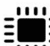

## 外设（Peripheral）


## 中心设备（Central）

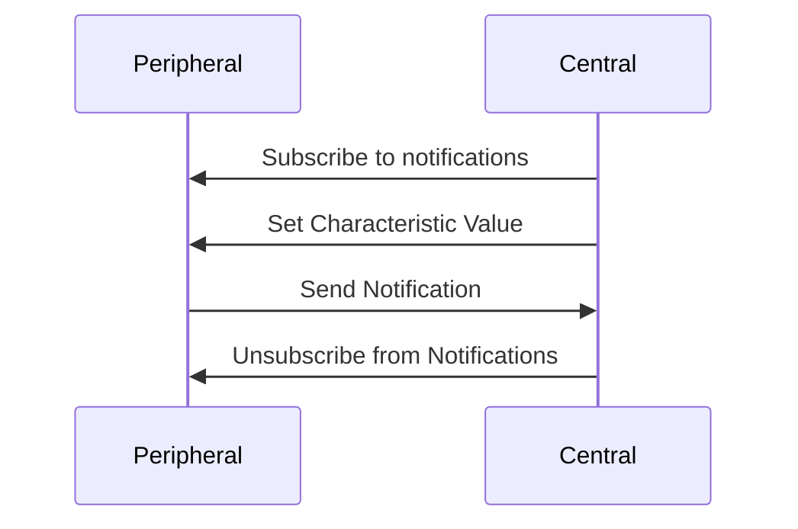

图 9-1. 外设通知已连接的中心设备特征发生变化的过程

为了支持通知，特征必须具有客户端特征配置（`0x2902`）描述符，该描述符必须是可写的。中心设备可以通过设置描述符值来订阅通知：

表 9-1. 客户端特征配置描述符值


| Value | Description |
| --- | --- |
| 0x0100 | 启用通知 |
| 0x0000 | 禁用通知 |

## 为中心设备编程

在中心设备订阅特征通知之前，了解该特征是否支持通知是有用的。要确定是否启用了通知，获取特征的属性并分离出 notify 属性。

```java
int permissions = characteristic.getProperties(); // fetch permissions
```

```java
boolean isReadable = permissions &
    BluetoothGattCharacteristic.PROPERTY_NOTIFY;
```

中心设备可以通过两个步骤订阅特征通知：

首先，在本地特征缓存中启用特征通知标记：

```java
mBluetoothGatt.setCharacteristicNotification(characteristic, enabled);
```

其次，手动设置特征描述符中的某些位。由于这是一个远程操作，步骤之间需要少少时间来执行。适应这种时间延迟的简单方法是使用延迟函数：

```java
UUID CLIENT_CHARACTERISTIC_CONFIGURATION_UUID = \
UUID.fromString("00002902-0000-1000-8000-00805f9b34fb");
```

```java
final Handler handler = new Handler(Looper.getMainLooper());
```

```java
handler.postDelayed(new Runnable() {
@Override
public void run() {
    BluetoothGattDescriptor descriptor =
        characteristic.getDescriptor(CLIENT_CHARACTERISTIC_CONFIGURATION_UUID);
    if (descriptor != null) {
        descriptor.setValue(BluetoothGattDescriptor.ENABLE_NOTIFICATION_VAL);
        mBluetoothGatt.writeDescriptor(descriptor);
    }
}
}, 10);
```

当外设上的特征值发生变化时，外设会发送通知。如果中心设备已订阅了通知，则会调用`BluetoothGattCallback`中的`onCharacteristicChanged`方法。

### 表 9-2. BluetoothGattCallback

| Event | Description |
| --- | --- |
| onConnectionStateChange | 当 GATT 服务器连接或断开连接时触发 |
| onServicesDiscovered | 当发现 GATT 服务时触发 |
| onCharacteristicRead | 当从特征下载数据时触发 |
| onCharacteristicWrite | 当数据上传到 GATT 服务器时触发 |
| onCharacteristicChanged | 当 GATT 特征的数据发生变化时触发 |

当 GATT 特征的数据发生变化时触发。

该方法的实现如下：

```java
private final BluetoothGattCallback gattCallback = new BluetoothGattCallback()
{};
```

```java
@Override
public void onCharacteristicWrite(BluetoothGatt gatt,
BluetoothGattCharacteristic characteristic,
int status) {
    // 响应变化，可能请求读取数据
}
```

## 整合所有内容

这些功能将被添加到`BlePeripheral`中以订阅通知，我们将修改`TalkActivity`以显示一个复选框，用于订阅和取消订阅以及响应通知告报。

## 资源

将修改`Talk`活动，使用户可以通过点击复选框来订阅和取消订阅特征的通知。设置复选框和可通知权限文本：

### 示例 9-1. `res/values/strings.xml`

```xml
...
<string name="notify_checkbox">订阅此特征</string>
<string name="property_notify">可通知</string>
...
```

## 对象

在`BlePeripheral`中添加两个方法：

- `isCharacteristicNotifiable`：当特征支持通知时为`true`
- `setCharacteristicNotification`：订阅或取消取消通知

### 示例 9-2. `java/com.exampleble/ble/BlePeripheral`

```java
...
// 用于启用和禁用通知的描述符 UUID
// 客户端特征配置描述符
public static final UUID NOTIFY_DESCRIPTOR_UUID = \
UUID.fromString("00002902-0000-1000-8000-00805f9b34fb");
```

```java
public static boolean isCharacteristicNotifiable(
    BluetoothGattCharacteristic pChar) {
    return (pChar.getProperties() &
        BluetoothGattCharacteristic.PROPERTY_NOTIFY) != 0;
}
```

```java
/**
 * 订阅或取消订阅通知
 * 本章新增
 *
 * @param characteristic 特征
 * @param enabled true 表示“订阅”，false 表示“取消订阅”
 */
public void setCharacteristicNotification(
    final BluetoothGattCharacteristic characteristic,
    final boolean enabled) {
    // 这是一个两个步骤的过程
    // 步骤 1：在本地设置特征通知
    mBluetoothGatt.setCharacteristicNotification(characteristic, enabled);

    // 步骤 2：向蓝牙 GATT 写入描述符
    // 在 setCharacteristicNotification 和 setValue 之间需要延迟
    final Handler handler = new Handler(Looper.getMainLooper());

    handler.postDelayed(new Runnable() {
        @Override
        public void run() {
            BluetoothGattDescriptor descriptor =
                characteristic.getDescriptor(NOTIFY_DESCRIPTOR_UUID);
            if (descriptor != null) {
                if (enabled) {
                    descriptor.setValue(BluetoothGattDescriptor.ENABLE_NOTIFICATION_VAL);
                } else {
                    descriptor.setValue(BluetoothGattDescriptor.DISABLE_NOTIFICATION_VAL);
                }
                mBluetoothGatt.writeDescriptor(descriptor);
            }
        }
    }, 10);
}
```

修改`BleGattProfileListAdapter`类到活动以处理订阅和取消订阅请求。还要添加通过请求读取来处理传入通知的功能。

### 示例 9-3. `java/example.exampleble/adapters/BleGattProfileListAdapter`

```java
...
/**
 * 这些 UI 组件位于 ListView 中的每个特征列表中
 */
public static class ChildViewHolder{
    public TextView mUuidTV; // 显示 UUID
    public TextView mPropertyReadableTV; // 特征可读
    public TextView mPropertyWritableTV; // 特征可写
    public TextView mPropertyNotifiableTV; // 特征可通知
    public TextView mPropertyNoneTV; // 在没有权限时显示
}
}
```

```java
/**
 * 为已知位置生成新的特征列表项
 *
 * @param groupPosition 服务列表项的位置
 * @param childPosition 特征列表项的位置
 * @param convertView 有的列表项
 * @param parent 父容器组
 * @return 特征列表项
 */
@Override
public View getChildView(final int groupPosition, final int childPosition,
```

```java
boolean isLastChild, View convertView, ViewGroup parent) {

    View v = convertView;
    ChildViewHolder characteristicListItem;
    BleGattCharacteristicListItem item = getChild(groupPosition, childPosition);
    BluetoothGattCharacteristic characteristic = item.getCharacteristic();

    // 如果这个 ListItem 不存在，则生成它
    // 否则，使用它
    if (convertView == null) {
        LayoutInflater inflater = LayoutInflater.from(parent.getContext());
        v = inflater.inflate(R.layout.list_item_ble_characteristic, null);

        // 将 list Item 中的 UI 内容与 xml 文件中的内容匹配
        characteristicListItemView = new ChildViewHolder();
        characteristicListItemView.UuidTV = (TextView)v.findViewById(R.id.uuid);
        characteristicListItemView.mPropertyReadableTV = (TextView)v.findViewById(R.id.property_read);
        characteristicListItemView.mPropertyWritableTV = (TextView)v.findViewById(R.id.property_write);
        characteristicListView.mPropertyNotifiableTV = (TextView)v.findViewById(R.id.property_notify);
        characteristicListView.mPropertyNoneTV = (TextView)v.findViewById(R.id.property_none);
    } else {
        characteristicListView = (ChildViewHolder) v.getTag();
    }

    if (characteristicListView != null) {
        // 显示特征的 UUID
        characteristicListView.mUuidTV.setText(characteristic.getUuid().toString());

        // 显示特征的读/写/通知属性
        if (BlePeripheral.isCharacteristicReadable(characteristic)) {
            characteristicListView.mPropertyReadableTV.setVisibility(View.VISIBLE);
        } else {
            characteristicListView.mPropertyReadableTV.setVisibility(View.GONE);
        }

        if (BlePeripheral.isCharacteristicWritable(characteristic)) {
            characteristicListItems.mPropertyWritableTV.setVisibility(View.VISIBLE);
        } else {
            characteristicListItems.mPropertyWritableTV.setVisibility(View.GONE);
        }

        if (BlePeripheral.isCharacteristicNotifiable(characteristic)) {
            characteristicListItems.mPropertyNotifiableTV.setVisibility(View.VISIBLE);
        } else {
            characteristicListItems.mPropertyNotifiableTV.setVisibility(View.GONE);
        }

        if (!BlePeripheral.isCharacteristicNotifiable(characteristic) &&
            !BlePeripheral.isCharacteristicWritable(characteristic) &&
            !BlePeripheral.isCharacteristicReadable(characteristic)) {
            characteristicListItems.mPropertyNoneTV.setVisibility(View.VISIBLE);
        }
    } else {
        characteristicListItemView.mPropertyNoneTV.setVisibility(View.GONE);
    }
    return v;
}
```

## Views

修改`item_list_ble_characteristic.xml`以包含一个当特征（Characteristic）可通知时显示的`TextView`。

### 示例 9-4. `res/layout/list_item_characteristic.xml`

```xml
...
```


```xml
<LinearLayout
  android:orientation="horizontal"
  android:layout_width="fill_parent"
  android:layout_height="wrap_content"
  android:layout_gravity="center_vertical"
  android:layout_weight="2">

  <TextView
    android:layout_width="wrap_content"
    android:layout_height="wrap_content"
    android:textAppearance="?android:attr/textAppearanceSmall"
    android:text="@string/property_read"
    android:visibility="gone"
    android:id="@+id/property_read"
    android:paddingLeft="@dimen/activity_horizontal_margin" />

  <TextView
    android:layout_width="wrap_content"
    android:layout_height="wrap_content"
    android:textAppearance="?android:attr/textAppearanceSmall"
    android:text="@string/property_write"
    android:visibility="gone"
    android:id="@+id/property_write"
    android:paddingLeft="@dimen/activity_horizontal_margin" />

  <TextView
    android:layout_width="wrap_content"
    android:layout_height="wrap_content"
    android:textAppearance="?android:attr/textAppearanceSmall"
    android:text="@string/property_notify"
    android:visibility="gone"
    android:id="@+id/property_notify"
    android:paddingLeft="@dimen/activity_horizontal_margin" />

  <TextView
    android:layout_width="wrap_content"
    android:layout_height="wrap_content"
    android:textAppearance="?android:attr/textAppearanceSmall"
    android:text="@string/property_none"
    android:visibility="gone"
    android:id="@+id/property_none"
    android:paddingLeft="@dimen/activity_horizontal_margin" />
</LinearLayout>
```

...

## Activities

修改 `TalkActivity` 以处理订阅和取消。同时添加通过请求读取特征来处理传入通知的功能。

**示例 9-5.** `java/example/TalkActivity.java`

```java
public class TalkActivity extends AppCompatActivity {
    private CheckBox SubscribeCheckbox;

    // 加载组件
    public void loadUI() {
        ResponseText = findViewById(R.id.response_text);
        AddressTV = findViewById(R.id.mac_address);
        ServiceUUIDTV = findViewById(R.id.service_uuid);
        SubscribeCheckbox = findViewById(R.id.subscribe_checkbox);
        SendButton = findViewById(R.id.write_button);
        ReadButton = findViewById(R.id.read_button);
        AdvertiseNameTV = findViewById(R.id.advertise_name);
        PeripheralAddressTV = findViewById(R.id.peripheral_address);
        ConsoleText = findViewById(R.id.connecting);

        AdvertiseNameTV.setText(R.connecting);
        ServiceUUIDTV.setText(mCharacteristicUUID.toString());
        SendButton.setVisibility(View.GONE);
        ResponseText.setVisibility(View.GONE);
        ReadButton.setVisibility(View.GONE);
        ConsoleText.setVisibility(View.GONE);
    }

    private final BluetoothGattCallback mGattCallback = new BluetoothGattCallback() {
        /**
         * 特征值改变。读取新值
         * @param gatt 连接到 GATT
         * @param characteristic 特征
         */
        @Override
        public void onCharacteristicChanged(BluetoothGatt gatt, final BluetoothGatt characteristic) {
            mBlePeripheral.readValue(characteristic);
        }

        /**
         * GATT Profile 发现。更新 UI
         * @param bluetoothGatt 连接到 GATT
         * @param status 操作状态
         */
        @Override
        public void onServicesDiscovered(BluetoothGatt bluetoothGatt, int status) {
            // 遍历服务并在屏幕上显示
            if (status == BluetoothGatt.GATT_SUCCESS) {
                // 连接到特定的服务
                BluetoothGattService gattService = bluetoothGatt.get(mServiceUUID);
                // 请求此服务的特征：
                List<BluetoothGattCharacteristic> characteristics = gattService.getCharacteristics();
                for (BluetoothGattCharacteristic characteristic : characteristics) {
                    if (characteristic != null) {
                        Log.v(TAG, "找到特征: " + characteristic.getUuid().toString());
                    }
                }
            }
        }
    };

    /**
     * 特征支持通知。更新 UI
     */
    public void onNotifiable() {
        SubscribeCheckbox.setVisibility(View.VISIBLE);
        SubscribeCheckbox.setOnCheckedChangeListener(new CompoundButton.setOnChangeListener() {
            @Override
            public void onCheckedChanged( CompoundButton button, boolean isChecked) {
                // 订阅此项的通知
                mBlePeripheral.setCharacteristicNotification(mCharacteristic, isChecked);
            }
        });
    }
}
```

```java
}mCharacteristic = bluetoothGatt.getService(mServiceUUID);
getCharacteristic(mCharacteristicUUID);
if (BlePeripheral.isCharacteristicReadable(mCharacteristic)) {
    runOnOnUiThread(new Runnable() {
        @Override
        public void run() {
            onCharacteristicReadable();
        }
    });
}
```

```java
if (BlePeripheral.isCharacteristicWritable(mCharacteristic)) {
    runOnOnUiThread(new Runnable() {
        @Override
        public void run() {
            onCharacteristicWritable();
        }
    });
}
```

```java
}
if (BlePeripheral.isCharacteristicNotifiable(mCharacteristic)) {
    runOnOnUiThread(new Runnable() {
        @Override
        public void run() {
            onCharacteristicNotifiable();
        }
    });
} else {
    Log.e(TAG, "Problem discovering GATT services");
}
};
...
onCharacteristicNotifiable();
}
```

## 在 Talk activity 布局文件中添加一个复选框

**示例 9-6.** `res/layout/activity_talk.xml`

```xml
...
<LinearLayout
    android:orientation="horizontal"
    android:layout_width="match_parent"
    android:layout_height="wrap_content">
    <Button
        android:layout_width="wrap_content"
        android:layout_height="wrap_content"
        android:text="@string/read_button"
        android:id="@id/read_button" />
    <Checkbox
        android:layout_width="wrap_content"
        android:layout_height="wrap_content"
        android:text="@string/notify_checkbox"
        android:id="@id/subscribe_checkbox"
        android:layout_weight="2" />
</LinearLayout>
```

```xml
android:checked="false" />
```

```xml
</LinearLayout>
```

```xml
...
```

编译并运行。该应用可以扫描并连接到外设设备。一旦连接，它就可以显示外设设备的 GATT 配置文件。它可以连接到特征、订阅通知并在无需轮询的情况下接收数据（图 9-2）。

当你点击“订阅此特征”按钮时，文本字段应开始填充由外设生成的随机文本（图 9-3）。

## ExampleBLETalk

DISCONNECT

## MyDevice

98:4F:EE:0C:F9:37

+   - 00001800-0000-1000-8000-0805f9 Primary b34fb

+   - 00001801-0000-1000-8000-0805f9 Primary b34fb

+   - 0000180c-0000-1000-8000-0805f9 Primary b34fb

+   - 00002a56-0000-1000-8000-0805f9b3 4fb Readable Notifiable

**图 9-2.** 显示已连接外设 GATT 配置文件的应用屏幕

## ExampleBLETalk

## MyDevice

98:4F:EE:0C:F9:37

0002a56-0000-1000-8000-00805f9b34fb

READ Subscribe to this characteristic

FMZAp

GG0RPFNU7KYJCNJKp

G665p

**图 9-3.** 显示已连接外设特征值变化的应用屏幕

## 为外设设备编程

通常情况下，蓝牙外设设备的电池电量是非常宝贵的。因此，当特征值变化时通知连接的中心设备是有用的，但不需要向中心设备发送新数据。唤醒蓝牙射电发送一个字节消耗的电量比发送 20 个或更多字节少。

通过创建客户端特征配置 (`0x2902`) 描述符并赋予特征描述符 `PERMISSION_WRITE` 权限，可以在特征中启用通知。

例如，此特征同时支持读取访问和通知：

```java
public static final UUID CHARACTERISTIC_UUID = \
UUID.fromString("00002a56-0000-1000-8000-00805f9b34fb");
```

```java
// 赋予写入特征的权限
//以便可以启用或禁用通知
mCharacteristic = new BluetoothGattCharacteristic(
    CHARACTERISTIC_UUID,
    // 特征具有读取和通知属性
    BluetoothGattCharacteristic.PROPERTY_READ |
    BluetoothGattCharacteristic.PROPERTY_NOTIFY,
    // 描述符可以被写入或读取
    BluetoothGattCharacteristic.PERMISSION_READ |
    BluetoothGattCharacteristic.PERMISSION_WRITE);
```

当中心设备尝试更改描述符时，`BluetoothGattServerCallback` 中会触发 `onDescriptorWriteRequest()` 方法。该方法提供了有关描述符以及正在设置的值的详细信息。

**表 9-3.** `BluetoothGattServerCallback`

| 事件 | 描述 |
| :--- | :--- |
| `onConnectionStateChange` | 中心设备已连接 |
| `onCharacteristicReadRequest` | 特征通知读取请求 |
| `onCharacteristicWriteRequest` | 中心设备尝试从 C 获取值 |
| `onDescriptorWriteRequest` | 中心设备尝试在写入描述符 |
| `onNotificationSent` | 中心设备对 Ch 的更改 |

此方法的实现如下：


```java
private final BluetoothGattServerCallback gattCallback = new BluetoothGattCallback() {
    @Override
    public void onDescriptorWriteRequest(
        BluetoothDevice device,
        int requestId,
        BluetoothGattDescriptor descriptor,
        boolean preparedWrite,
        boolean responseNeeded,
        int offset,
        byte[] value
    ) {
        // 将事件传递给父对象
        super.onDescriptorWriteRequest(
            device,
            requestId,
            descriptor,
            preparedWrite,
            responseNeeded,
            offset
        );

        // 确定被请求的特征
        BluetoothGattCharacteristic characteristic = descriptor.getCharacteristic();

        // 如果描述符是可写的，更改值
        if (isDescriptorWritable(descriptor)) {
            // 如果描述符是可读的，发送成功响应
            mGattServer.sendResponse(
                device,
                requestId,
                BluetoothGatt.SUCCESS,
                offset,
                value
            );
        } else {
            // 如果描述符是可读的，发送错误响应
            mGattServer.sendResponse(
                device,
                requestId,
                BluetoothGatt.GATT_WRITE_NOT,
                offset,
                null
            );
        }
    }
};
```

可以通过检查描述符的权限来判断其是否可读或可写，如下：

```java
public static boolean isDescriptorReadable(BluetoothGattDescriptor descriptor) {
    return (descriptor.getPermissions() & BluetoothGatt.PERMISSION_READ) != 0;
}
```

```java
public static boolean isDescriptorWritable(BluetoothGattDescriptor descriptor) {
    return (descriptor.getPermissions() & BluetoothGatt.PERMISSION_WRITE) != 0;
}
```

# 将所有内容整合在一起

这些功能将被添加到`BlePeripheral`以允许对特征进行订阅。

## 资源

主活动将被修改为使用`Switch`显示特征的订阅状态。设置`Switch`标签：

示例 9-1. `res/values/strings.xml`

```xml
...
<string name="characteristic_subscribed">已订阅</string>
...
```

## 对象

`BlePeripheral`将修改为：

- 客户端特征配置（`0x2902`）描述符。
- 创建一个具有读取和通知属性的特征以允许通知，并具有读取和写入权限以允许更改描述符，每 5 秒更改特征的值为随机字符串。
- `isDescriptorReadable()`和`isDescriptorWritable()`方法用于判断描述符的读写能力。
- 在`BluetoothGattServerCallback`中包含`onDescriptorWriteRequest()`，以便外设设备能够响应订阅请求。

示例 9-2. `java/example.com.exampleble/ble/BlePeripheral`

```java
// 客户端特征配置描述符
public static final UUID NOTIFY_DISCRIPTOR_UUID =
    UUID.fromString("00002902-0000-1000-8000-00805f9b34fb");
```

```java
...

/**
 * 设置广告名称 GATT GATT配置文件
 */
private void setupDevice() {
    mService = new BluetoothGattService(
        SERVICE_UUID,
        BluetoothGattService.SERVICE_TYPE_PRIMARY
    );

    // 赋予写入特征的权限
    // 以便可以启用或禁用通知
    mCharacteristic = new BluetoothGattCharacteristic(
        CHARACTERISTIC_UUID,
        // 特征具有读取和通知属性
        BluetoothGattCharacteristic.PROPERTY_READ |
        BluetoothGattCharacteristic.PROPERTY_NOTIFY |
        // 描述符可以被写入或读取
        BluetoothGattCharacteristic.PERMISSION_READ |
        BluetoothGattCharacteristic.PERMISSION_WRITE
    );

    // 为特征添加通知支持
    mCharacteristic.addDescriptor(new BluetoothGattDescriptor(
        NOTIFY_DISCRIPTOR_UUID
    ));
    mService.addCharacteristic(mCharacteristic);
}
}
```


```java
BluetoothGattDescriptor notifyDescriptor = \
new BluetoothGattDescriptor(
NOTIFY_DISCRIPTOR_UUID,
BluetoothGattDescriptor.PERMISSION_WRITE | \
BluetoothGattDescriptor.PERMISSION_READ
);
mCharacteristic.addDescriptor(notifyDescriptor);
mService.addCharacteristic(mCharacteristic);
GattServer.addService(mService);

// 每隔 timerInterval_ms 向 Read Characteristic 特性写入随机字符
int timerInterval_ms = 1000;

TimerTask updateReadCharacteristicTask = new TimerTask() {
    @Override
    public void run() {
        int stringLength = (int) (
            Math.random() % CHARACTERISTIC_LENGTH
        );
        String randomString = DataConverter.getRandomString(
            stringLength
        );
        mCharacteristic.setValue(randomString);
    }
};
Timer randomStringTimer = new Timer();
randomStringTimer.schedule(
    updateReadCharacteristicTask,
    0,
    timerInterval_ms
);
}
...
/**
 * 检查 Characteristic 是否支持通知 (Notifications)
 *
 * @return 如果属性支持通知，则返回 <btrue</b>
 */
public static boolean isCharacteristicNotifiable(
    BluetoothGattCharacteristic characteristic
) {
    return (characteristic.getProperties() & \
    BluetoothGattCharacteristic.PROPERTY_NOTIFY) != 0;
}

/**
 * 检查 Descriptor 是否可读
 *
 * @param descriptor 要检查的描述符
 * @return 如果描述符可读，则返回 <btrue</b>
 */
public static boolean isDescriptorReadable(
    BluetoothGattDescriptor descriptor
) {
    return (descriptor.getPermissions() & \
    BluetoothGattCharacteristic.PERMISSION_WRITE) != 0;
}

/**
 * 检查 Descriptor 是否可写
 *
 * @param descriptor 要检查的描述符
 * @return 如果描述符可写，则返回 <btrue</b>
 */
public static boolean isDescriptorWriteable(
    BluetoothGattDescriptor descriptor
) {
    return (descriptor.getPermissions() & \
            BluetoothGattCharacteristic.PERMISSION_WRITE) != 0;
}

private final BluetoothGattServerCallback mGattServerCallback = \
    new BluetoothGattServerCallback()
{
    @Override
    public void onConnectionStateChange(
        BluetoothDevice device,
        final int status,
        int newState
    ) {
        super.onConnectionStateChange(device, status, newState);
        Log.v(TAG, "Connected");
        if (status == BluetoothGatt.GATT_SUCCESS) {
            if (newState == BluetoothGatt.STATE_CONNECTED) {
                mBlePeripheralCallback.onCentralConnected(device);
                stopAdvertising();
            }
        } else if (newState == BluetoothGatt.STATE_DISCONNECTED) {
            mBlePeripheralCallback.onCentralDisconnected(device);
            try {
                startAdvertising();
            } catch (Exception e) {
                Log.e(TAG, "error starting advertising");
            }
        }
    }

    @Override
    public void onCharacteristicReadRequest(
        BluetoothDevice device,
        int requestId,
        int offset,
        BluetoothGattCharacteristic characteristic
    ) {
        super.onCharacteristicReadRequest(
            device,
            requestId,
            offset,
            characteristic
        );
        Log.d(
            TAG,
            "Device tried to read characteristic: " + \
            characteristic.getUuid()
        );
        Log.d(
            TAG,
            "Value: " + \
            Arrays.toString(characteristic.getValue())
        );
        if (offset != 0) {
            GattServer.sendResponse(
                device,
                requestId,
                BluetoothGatt.GATT_INVALID_OFFSET,
                offset,
                /* value (optional) */// null
            );
            return;
        }
        GattServer.sendResponse(
            device,
            requestId,
            BluetoothGatt.GATT_SUCCESS,
            offset,
            characteristic.getValue()
        );
    }

    @Override
    public void onNotificationSent(BluetoothDevice device, int status) {
        super.onNotificationSent(device, status);
        Log.v(TAG, "Notification sent. " + status);
    }

    @Override
    public void onCharacteristicWriteRequest(
        BluetoothDevice device,
        int requestId,
        BluetoothGattCharacteristic characteristic,
        boolean preparedWrite,
        boolean responseNeeded,
        int offset,
        byte[] value
    ) {
        super.onCharacteristicWriteRequest(
            device,
            requestId,
            characteristic,
            preparedWrite,
            responseNeeded,
            offset,
            value
        );
        // 什么都不做；此外设中没有特性支持写入
    }

    // 用户尝试更改描述符 -
    // 检查 Notification 标志是否设置
    @Override
    public void onDescriptorWriteRequest(
        BluetoothDevice device,
        int requestId,
        BluetoothGattDescriptor descriptor,
        boolean preparedWrite,
        boolean responseNeeded,
        int offset,
        byte[] value
    ) {
        Log.v(
            TAG,
            "Descriptor Write Request " + descriptor.getUuid() + " " + \
            Arrays.toString(value)
        );
        super.onDescriptorWriteRequest(
            device,
            requestId,
            descriptor,
            preparedWrite,
            responseNeeded,
            offset, value
        );
        // 确定正在请求哪个特性
        BluetoothGattCharacteristic characteristic = \
            descriptor.getCharacteristic();
        if (isDescriptorWriteable(descriptor)) {
            descriptor.setValue(value);
        }
        // 这是否是一个通知订阅？
        if (descriptor.getUuid().equals(NOTIFY_DISCRIPTOR_UUID)) {
            if (isCharacteristicNotifiable(characteristic)) {
                if (value == \
                    BluetoothGattDescriptor.ENABLE_NOTIFICATION_VALUE
                ) {
                    mBlePeripheralCallback.onCharacteristicSubscribed(
                        characteristic
                    );
                } else if (value == \
                    BluetoothGattDescriptor.DISABLE_NOTIFICATION_VALUE
                ) {
                    mBlePeripheralCallback.onCharacteristicUnsubscribed(
                        characteristic
                    );
                }
            }
        }
    }
};
```


```java
/**
 * 响应蓝牙外设设备状态的变化
 */
private final BlePeripheralCallback mBlePeripheralCallback = 
    new BlePeripheralCallback()
{
    public void onAdvertisingStarted() {
        Log.v(TAG, "Advertising started");
        runOnUiThread(new Runnable() {
            @Override
            public void run() {
                onBleAdvertisingStarted();
            }
        });
    }

    public void onAdvertisingFailed(int errorCode) {
        runOnUiThread(new Runnable() {
            @Override
            public void run() {
                onBleAdvertisingFailed();
            }
        });

        switch (errorCode) {
            case AdvertiseCallback.ADVERTISE_FAILED_ALREADY_STARTED:
                Log.e(
                    TAG,
                    "Failed to start; advertising has already started."
                );
                break;
            case AdvertiseCallback.ADVERTISE_FAILED_DATA_TOO_LARGE:
                Log.e(
                    TAG,
                    "Failed to start; advertise data is > 31 bytes."
                );
                break;
            case AdvertiseCallback.ADVERTISE_FAILED_FEATURE_UNSUPPORTED:
                Log.e(
                    TAG,
                    "This feature is not supported on this platform."
                );
                break;
            case AdvertiseCallback.ADVERTISE_FAILED_INTERNAL_ERROR:
                Log.e(
                    TAG,
                    "Operation failed due to an internal error."
                );
                break;
            case AdvertiseCallback.ADVERTISE_FAILED_TOO_MANY_ADVERTISERS:
                Log.e(
                    TAG,
                    "Failed to start; advertising instance is unavailable."
                );
                break;
            default:
                Log.e(TAG, "unknown problem");
        }
    }

    public void onAdvertisingStopped() {
        Log.v(TAG, "Advertising stopped");
        runOnUiThread(new Runnable() {
            @Override
            public void run() {
                onBleAdvertisingStopped();
            }
        });
    }

    public void onCentralConnected(final BluetoothDevice bluetoothDevice) {
        Log.v(TAG, "Central connected");
        runOnUiThread(new Runnable() {
            @Override
            public void run() {
                onBleCentralConnected(bluetoothDevice);
            }
        });
    }

    public void onCentralDisconnected(final BluetoothDevice bluetoothDevice) {
        Log.v(TAG, "Central disconnected");
        runOnUiThread(new Runnable() {
            @Override
            public void run() {
                onBleCentralDisconnected(bluetoothDevice);
            }
        });
    }

    public void onCharacteristicWritten(
        final BluetoothGattCharacteristic characteristic,
        final byte[] value
    ) {
        Log.v(TAG, "Characteristic written to");
        runOnUiThread(new Runnable() {
            @Override
            public void run() {
                onBleCharacteristicWritten(characteristic, value);
            }
        });
    }

    public void onCharacteristicSubscribedTo(
        final BluetoothGattCharacteristic characteristic
    ) {
        Log.v(TAG, "Characteristic subscribed to");
        runOnUiThread(new Runnable() {
            @Override
            public void run() {
                onBleCharacteristicSubscribed(characteristic);
            }
        });
    }

    public void onCharacteristicUnsubscribedFrom(
        final BluetoothGattCharacteristic characteristic
    ) {
        Log.v(TAG, "Characteristic unsubscribed from");
        runOnUiThread(new Runnable() {
            @Override
            public void run() {
                onBleCharacteristicUnsubscribed(characteristic);
            }
        });
    }
};
```

在主活动布局文件中添加一个 `Switch`，用于显示特征（`Characteristic`）的订阅状态。

### 示例 9-6. `res/layout/activity_main.xml`

```xml
...
<Switch
    android:clickable="false"
    android:layout_width="match_parent"
    android:layout_height="wrap_content"
    android:text="@string/central_connected"
    android:id="@id/central_connected" />
<Switch
    android:clickable="false"
    android:layout_width="match_parent"
    android:layout_height="wrap_content"
    android:text="@string/characteristic_subscribed"
    android:id="@id/characteristic_subscribed" />
<TextView
    android:text="@string/characteristic_log"
    android:layout_width="match_parent"
    android:layout_height="wrap_content" />
<TextView
    android:layout_width="match_parent"
    android:layout_height="match_parent"
    android:background="#ffffff"
    android:id="@id/characteristic_log" />
</LinearLayout>
</RelativeLayout>
</android.support.design.widget.CoordinatorLayout>
```

编译并运行。该应用可以处理对特征的订阅，并在特征值更改时发送通知（图 9-4）。

# 示例 BLEPeripheral

广播名称：`MyDevice`

- 蓝牙已开启
- 正在广播
- 中心已连接
- 特征已订阅

特征日志：

```
hello
world!
```

图 9-4. 显示已连接外设的应用屏幕。

## 示例 Java

本章的代码可见：`https://github.com/BluetoothEnergyAndroid`

# 流数据

通过蓝牙低功耗（Bluetooth Energy）发送的最大包大小为 20 字节。可以通过将消息拆分为 20 字节或更小的数据包并逐个发送来传输更多数据。为了发送数据包，必须采用队列系统，当外设准备好接收下一个数据包时通知中心设备。

实现这一点的有很多方法。一种方法是设置一个具有读、写和通知权限的特征，并在处理写入后将该特征标记为“就绪”。这将向中心设备发送通知，告知该特征已准备好接收下一个数据包。

表 10-1 `BluetoothGattCallback`

| 事件 | 描述 |
| :--- | :--- |
| `onConnectionStateChange` | 当手机连接或断开时触发 |
| `onServicesDiscovered` | 当发现 GATT 服务时触发 |
| `onCharacteristicRead` | 从特征中下载数据时触发 |
| `onCharacteristicWrite` | 将数据上传到特征中时触发 |
| `onCharacteristicChanged` | 当特征发生变化时触发 |

如下所示设置流控制和数据队列的参数：

```java
public static final String FLOW_CONROL_MESSAGE = "ready";
private String outboundMessage; // 跟踪当前出站（outbound）消息
private int packetSize = 20; // 包大小必须与特征的大小匹配
private int numPacketsTotal; // 当前消息的包总数
private int numPacketsSent; // 到目前为止发送了多少个包
```

## 编写中心设备

此示例中的中心设备等待外设将特征值更改为 `"ready"` 流控制消息，并发送指示更改的通知。这一过程是可以可视化的。

流控制的工作原理是在触发通知回调时请求一个特征读取事件来完成的：

```java
private final BluetoothGattCallback mGattCallback = 
new BluetoothGattCallback()
{
    @Override
    public void onCharacteristicChanged(BluetoothGatt gatt,
        final BluetoothGattCharacteristic characteristic) {
        gatt.readCharacteristic(characteristic);
    }

    @Override
    public void onCharacteristicRead(final BluetoothGatt gatt, final BluetoothGattCharacteristic characteristic, int status) {
        final byte[] data = characteristic.getValue();
        final String message = new String(data, "ASCII");
        if (message.equals(FLOW_CONROL_MESSAGE)) {
            // 视为流控制
            sendNextPacket(
                outboundMessage,
                numPacketsSent,
                characteristic
            );
        }
    }
};
```

```java
// 普通处理读取
}
```

...

### 第一个数据包被初始化并发送：

```java
public void sendMessage(
    String message,
    BluetoothGattCharacteristic characteristic) throws Exception
{
    outboundMessage = message;
    numPacketsSent = 0;
    byte[] messageBytes = message.getBytes();
    numPacketsTotal = (int) Math.ceil((float) messageBytes.length / packetSize);
    sendNextPacket(message, numPacketsSent, characteristic);
}
```

后续数据包将逐个发送，直到没有更多数据包：

```java
public void sendNextPacket(
    String message, int offset,
    BluetoothGattCharacteristic characteristic)
{
    if (numPacketsSent >= numPacketsTotal) return; // 不发送空数据
    byte[] temp = message.getBytes();

    numPacketsTotal = (int) Math.ceil((float) temp.length / packetSize);
    int remainder = temp.length % packetSize;
    int dataLength = packetSize;
    if (offset >= numPacketsTotal) {
        dataLength = remainder;
    }
    byte[] packet = new byte[dataLength];
    // 将部分数据拷贝到数据包中
    for (int localIndex = 0; localIndex < packet.length; localIndex++) {
        int index = (offset * dataLength) + localIndex;
        if (index < temp.length) {
            packet[localIndex] = temp[index];
        } else {
            packet[localIndex] = 0x00; // 终止字符串
        }
    }

    // 将数据写入特征值
    characteristic.setValue(packet);
    mBluetoothGatt.writeCharacteristic(characteristic);
    numPacketsSent++; // 跟踪发送了多少个数据包
}
```

## 整合在一起

## 对象

为 `BlePeripheral` 添加两个方法：


- `writeValueToCharacteristic` 初始化一个新消息的传输。
- `writePartialValueToCharacteristic` 发送单个数据包并跟踪已发送的数据包数量。
- `hasMorePackets` 表示所有数据包是否均已发送。
- `getCurrentOffset` 表示已发送了多少个数据包。
- `getCurrentMessage` 返回队列中等待写入的当前消息。

# 示例 10-1：`java/example/com.exampleble/ble/BlePeripheral`

```java
...
public class BlePeripheral {
    private int mNumPacketsTotal;
    private int mNumPacketsSent;
    private int mCharacteristicLength = 20;
    private String mQueuedCharacteristicValue;
    public static final String FLOW_CONROL_VALUE = "ready";
    ... 对象属性
    ... BlePeripheral, connect, disconnect.refreshDeviceCache, 等.
```

```java
/**
 * 向特征值写入值
 *
 * @param value 值
 * @param characteristic 特征
 * @throws Exception 异常
 */
```

```java
public void writeValueToCharacteristic(
  String value,
  BluetoothGattCharacteristic characteristic) throws Exception
{
  // 重置队列计数器，
  // 准备写入的消息并写入
  mMuedCharacteristicValue = value;
  mNumPacketsSent = 0;
  byte[] byteValue = value.getBytes();
  mNumPacketsTotal = (int) Math.ceil((float) byteValue.length /
  mCharacteristicLength);
  writePartialValueToCharacteristic(value, mNumPacketsSent,
```

```java
characteristic);
}
/**
 * 将较大消息的部分内容写入特征值
 *
 * @param message 正在写入的消息
 * @param offset 等待写入队列中的当前数据包索引
 * @param characteristic 正在写入的特征值
 * @throws Exception 异常
 */
public void writePartialValueToCharacteristic(String message, int offset,
    BluetoothGattCharacteristic characteristic) throws Exception {
byte[] temp = message.getBytes();

mNumPacketsTotal = (int) Math.ceil((float)temp.length /
mCharacteristicLength);
int remainder = temp.length % mCharacteristicLength;
int packetLength = mCharacteristicLength;
if (offset >= mNumPacketsTotal) {
    packetLength = remainder;
```

```java
}
byte[] packet = new byte[packetLength];
for (int localIndex = 0; localIndex < packet.length; localIndex++) {
    int index = (offset * packetLength) + localIndex;
    if (index < temp.length) {
        packet[localIndex] = temp[index];
    } else {
        packet[localIndex] = 0x00;
    }
}
Log.v(TAG, "Writing value: '" + new String(packet, "ASCII") + "" to '" + characteristic.getUuid().toString());
characteristic.setValue(packet);
mBluetoothGatt.writeCharacteristic(characteristic);
mNumPacketsSent++;
}
```

```java
/**
 * 判断消息是否已完全写入特征值
 *
 * @return 如果消息的所有内容已写入，则返回 <b>false</b>
 */
public boolean morePacketsAvailableInQueue() {
    boolean morePacketsAvailable = mNumPacketsSent < mNumPacketsTotal;
    Log.v(TAG, mNumPacketsSent + " of " +
    mNumPacketsTotal + " packets");
    return morePacketsAvailable;
}

/**
 * 判断已发送了多少个数据包
 *
 * @return 已发送的数据包数量（整数）
 */
public int getCurrentOffset() {
    return mPacketsSent;
}

/**
 * 获取等待写入的当前消息
 *
 * @return 等待写入的当前消息
 */
public String getCurrentMessage() {
    return mQueuedCharacteristicValue;
}
```

## Activity

修改 `Talk Activity` 以处理用户元素和控制通知。

### 示例 10-2：`java/example/com.exampleble/TalkActivity.java`

```java
...
private final BluetoothGattCallback mGattCallback =
    new BluetoothGattCallback() {

        /**
         * 特征读取成功
         *
         * @param gatt GATT 连接
         * @param characteristic 被读取的特征
         * @param status 操作状态
         */
        @Override
        public void onCharacteristicRead(final BluetoothGatt gatt,
            final BluetoothGattCharacteristic characteristic,
            int status) {
            // 已读取。将数据转换为 Android 可用的
            // 格式并在 UI 中显示
            if (status == BluetoothGatt.GATT_SUCCESS) {
                final byte[] data = characteristic.getValue();
                String m = "";
                try {
                    m = new String(data, BlePeripheral.ENCODING);
                } catch (Exception e) {
                    Log.e(TAG, "无法将字节数组转换为字符串", e);
                }
                final String message = m;
                if (message.equals(BlePeripheral.FLOW_CONROL_VALUE)) {
                    onCharacteristicReady(characteristic);
                }
                runOnUiThread(new Runnable() {
                    @Override
                    public void run() {
                        updateResponseText(message);
                    }
                });
            }
        }

        public void onCharacteristicReady(final BluetoothGattCharacteristic characteristic) {
            Log.v(TAG, "收到控制消息");
            if (blePeripheral.morePacketsAvailableInQueue()) {
                try {
                    blePeripheral.writePartialValueToCharacteristic(
                        blePeripheral.getCurrentMessage(),
                        blePeripheral.getCurrentOffset(),
                        characteristic);
                } catch (Exception e) {
                    Log.e(TAG, "无法发送下一个消息块", e);
                }
            }
        }
    };
```

最终生成的应用程序可以通过队列（图 10-2）和逐个传输数据包（图 10-3）向已连接的外围设备发送更多数据。

这是一个非常长的消息。

| 事件 | 含义 |
| --- | --- |
| `onConnectionStateChange` | Central 连接 |
| `onCharacteristicReadRequest` | 特性通知 |
| `onCharacteristicWriteRequest` | Central 尝试从 C 获取值 |
| `onDescriptorWriteRequest` | Central 尝试在 A 中写入 Descriptor |
| `onNotificationSent` | Central 对 Ch 发生变化 |

实现方式如下。

## 设置流控制的参数

```java
public static final String FLOW_CONTROL_VALUE = "ready";
public static final String CHARSET = "ASCII";
```

`FLOW_CONTROL_VALUE` 被写入特性中，并且在 Central 发起写入请求后会发送通知：

```java
private final BluetoothGattServerCallback mGattServerCallback =
```

```java
new BluetoothGattServerCallback()

{

    @Override

    public void onCharacteristicWriteRequest(

        BluetoothDevice device,

        int requestId,

        BluetoothGattCharacteristic characteristic,

        boolean preparedWrite,

        boolean responseNeeded,

        int offset,

        byte[] value

    ) {

        // 将事件冒泡给父对象

        super.onCharacteristicWriteRequest(

            device,

            requestId,

            characteristic,

            preparedWrite,

            responseNeeded,

            offset,

            value

        );

        // 如果特性支持带响应写入则发送写入确认

        if (isCharacteristicWritableWithResponse(characteristic)) {

            characteristic.setValue(value);

            mgattServer.sendResponse(

                device,

                requestId,

                BluetoothGatt.GATT_SUCCESS,

                0,

                null

            );

        }

        // 将特性设置为流控制消息

        try {

            characteristic.setValue(FLOW_CONTROL_VALUE.getBytes(CHARSET));

            // 发送通知

            if (isCharacteristicNotifiable(characteristic)) {

                mGattServer.notifyCharacteristicChanged(

                    device,

                    characteristic,

                    false

                );

            }

        } catch (Exception e) {

            Log.e(TAG, "problem converting string to bytes");

        }

        // onConnectionStateChange(),

        // onDescriptorWriteRequest(),

        // 以及 onCharacteristicReadRequest() 保持不变

    }

};
```

# 整合所有内容

将上一章的项目复制到新项目中。

## 对象

为 `BlePeripheral` 添加以下功能：

- 描述流控制值。
- 创建一个支持读、写、通知属性，以及读、写权限的特性。
- 修改 `BluetoothGattServerCallback` 的 `onCharacteristicWriteRequest()` 方法，将流控制值写入特性并在写入后发送通知。

### 示例 10-1：`java/example.com.exampleble/ble/BlePeripheral`

```java
...
/** 流控制 */
public static final String FLOW_CONTROL_VALUE = "ready";
public static final String CHARSET = "ASCII";
...

/**
 * 设置广告名称和 GATT 配置
 */
private void setupDevice() {
  // 设置设备名称
  mBluetoothAdapter.setName(ADVERTISING_NAME);

  mService = new BluetoothGattService(
    SERVICE_UUID,
    BluetoothGattService.SERVICE_TYPE_PRIMARY
  );

  // 提供写入权限，以便 Descriptor 可以被写入
  mCharacteristic = new BluetoothGattCharacteristic(
    CHARACTERISTIC_UUID,
    BluetoothGattCharacteristic.PROPERTY_READ |
    BluetoothGattCharacteristic.PROPERTY_WRITE |
    BluetoothGattCharacteristic.PROPERTY_NOTIFY,
    BluetoothGattCharacteristic.PERMISSION_READ |
    BluetoothGattCharacteristic.PERMISSION_WRITE
  );

  // 添加通知描述符
  BluetoothGattDescriptor notifyDescriptor =
    new BluetoothGattDescriptor(
      NOTIFY_DESCRIPTOR_UUID,
      BluetoothGattDescriptor.PERMISSION_WRITE |
      BluetoothGattDescriptor.PERMISSION_READ
    );

  mCharacteristic.addDescriptor(notifyDescriptor);
  mService.addCharacteristic(mCharacteristic);
  GattServer.addService(mService);
}

...
```


```java
private final BluetoothGattServerCallback mGattServerCallback =
new BluetoothGattServerCallback()
{
@Override
public void onCharacteristicWriteRequest(
BluetoothDevice device,
int requestId,
BluetoothGattCharacteristic characteristic,
boolean preparedWrite,
boolean responseNeeded,
int offset,
byte[] value
) {
```

```java
super.onCharacteristicWriteRequest(
device,
requestId,
characteristic,
preparedWrite,
responseNeeded,
offset,
value
);
Log.v(TAG, "Characteristic write: " + Arrays.toString(value));
// 发送通知
到 BlePeripheral
```

```java
// 写入已发生
if (isCharacteristicWritableWithResponse(characteristic)) {
    characteristic.setValue(value);
    mgattServer.sendResponse(
        device,
        requestId,
        BluetoothGatt.GATT_SUCCESS,
        0,
        null
    );
}
// 将特性设置为流控制消息
try {
    characteristic.setValue(FLOW_CONTROL_VALUE.getBytes(CHARSET));
```

```java
// 发送通知
if (isCharacteristicNotifiable(characteristic)) {
    mGattServer.notifyCharacteristicChanged(
        device,
        characteristic,
        false
    );
} catch (Exception e) {
    Log.e(TAG, "problem converting string to bytes");
}
```

# Activity

修改 `MainActivity` 以显示传入的值。

示例 10-1. `java/example.com.exampleble/MainActivity`

```java
/**
 * 特性被写入时触发的事件
 * @param characteristic 被写入的特性
 * @param value 被写入的值
 */
public void onCharacteristicWritten(
    final BluetoothGattCharacteristic characteristic,
    final byte[] value
) {
    mCharacteristicLogTV.append(characteristic.getUuid().toString());
    // 滚动到 TextView 底部
    final int scrollAmount = mCharacteristicLogTV.LineCount() - mCharacteristicLogTV.getHeight();
    if (scrollAmount > 0) {
        mCharacteristicLogTV.scrollTo(0, scrollAmount);
    } else {
    mCharacteristicLogTV.scrollTo(0, 0);
}
```

生成的应用程序可以接收来自特性的队列流（图 10-4）。

## ExampleBLEPeripheral

广告名称：MyDevice

广告中

Central 已连接

特性已订阅

特性日志：

## 示例代码

本章的代码可以在此处获取：https://github.com/BluetoothLowEnergyJava

# 项目：iBeacon

Beacon 可用于测距或空间感知。iBeacon 是一种被行业广泛支持的特殊 Beacon。它支持某些数据，使得跨平台的测距和空间感知变得更加容易。

## 测距

蓝牙信号可用于估算外设（Peripheral）与中心（Central）之间的距离，因为无线信号质量会随距离的以以预测的方式下降。下图显示了信号如何随距离的增加而下降（图 11-1）。


这种下降率被称为反平方定律，它适用于所有电磁辐射。

由于无线电干扰和周围物品的吸收，无线信号的传播在不同环境之间差异很大，甚至在每一步之间都不同。这使得确定 Central 与 iBeacon 之间的精确距离变得非常困难。

## 空间感知

Central 可以通过称为三角测量（trilateration）的过程来估算其在空间中的位置。当已知附近 iBeacon 的距离和位置时，三角测量通过计算一系列方程组来实现（图 11-2）。


## iBeacons

扫描结果（Scan Result）允许中心设备（Central）在不连接的情况下从外围设备（Peripheral）读取信息，这与读取广播名称相似。

尽管 Android 支持 iBeacon 扫描，但不支持 iBeacon 广播。因此，可以构建一个发现 iBeacon 的应用，但无法在 Android 中创建 iBeacon。

iBeacons 是通过蓝牙低功耗（Bluetooth Low Energy）的扫描结果功能广播其位置信息和广播强度的信标。

扫描结果允许中心设备在不连接的情况下从外围设备读取信息，这与广播设备名称的方式相似。

在 Android 中创建 iBeacon 客户端只有两个技巧：

- iBeacons 通过其网络（MAC）地址而不是名称来标识，因为对于同一位置服务的 iBeacons 都具有相同的名称。
- 到 iBeacon 的距离是基于 RSSI 计算的。
- iBeacons 通过广播某些数据来实现这一点，在查找 iBeacons 位置时可以引用这些数据。

## 表 11-1. iBeacon 广播数据

| 数据 | 位置 | 长度 | 说明 |
| --- | --- | --- | --- |
| iBeacon 头部 | 0 | 2 | 标识 iBeacon |
| 厂商 ID | 6 | 2 | 代表厂商的数值值 |
| UUID | 9 | 16 | 所有 iBeacon 具有相同的 |
| Major | 25 | 2 | 顶层数字 |
| Minor | 27 | 2 | Major 号的数值 ID |
| 发射功率 | 29 | 1 | 告知以米为单位的功率 |

这些数据以二进制形式存储在外围设备的广播数据中。与蓝牙低功耗中的其他数据不同，此包中的数值以大端字节格式（big endian）存储（图 11-4）。

## 图 11-4. iBeacon 广播数据包

一个示例是一个博物馆，博物馆的每个展品处都安装了 iBeacon。展品的所有 iBeacon 共享相同的 UUID。博物馆使用 Major 号识别楼层，使用 Minor 号识别展品的房间。

该博物馆的智能手机 App 有一个内部数据集，将 Major 和 Minor 值与展品的楼层和房间关联。它扫描具有特定 UUID 的所有 iBeacon。附近的 iBeacon 会被发现并读取。通过查找已发现 iBeacon 的 Major 和 Minor 号，可以获知用户位于博物馆特定楼层的特定房间。从博物馆的 API 获取相关内容并加载到智能手机 App 中。

## 编写中心设备

在扫描过程中发现外围设备时，可以检查其扫描记录（Scan Records）以确定它是否为 iBeacon。

```java
byte[] IBEACON_HEADER = { 0x02, 0x01 };
```

```java
byte[] scanRecordHeader = new byte[IBEACON_HEADER.length];
```

```java
System.arraycopy(scanRecord, 0, scanRecordHeader, 0, 2);
```

```java
boolean isIBeacon = (Arrays.equals(beaconHeader, scanRecordHeader))
```

可以提取 UUID 以分离具有特定 UUID 的 iBeacon。

```java
byte[] uuidBytes = new byte[16];
```

```java
System.arraycopy(scanRecord, 9, uuidBytes, 0, 16);
```

```java
ByteBuffer buffer = ByteBuffer.wrap(bytes);
```

```java
buffer.order(ByteOrder.BIG_ENDIAN);
```

```java
UUID uuid = new UUID(buffer.getLong(), buffer.getLong());
```

厂商 ID、Major 和 Minor 号也可以被分离：

```java
// 将大端字节流转换为无符号整数
```

```java
public int bytesToUnsignedInt(byte[] bytes) {
  ByteBuffer buffer = ByteBuffer.wrap(bytes);
  buffer.order(ByteOrder.BIG_ENDIAN);
  int intValue = (int) buffer.getChar();
  if (intValue < 0) intValue = intValue & 0xffffff;
  return intValue;
}
```

```java
byte[] manufacturerBytes = new byte[2];
System.arraycopy(scanRecord, 6, manufacturerBytes, 0, 2);
int manufacturerId = bytesToUnsignedInt(manufacturerBytes);
```

```java
byte[] majorBytes = new byte[2];
System.arraycopy(scanRecord, 25, majorBytes, 0, 2);
int majorNumber = bytesToUnsignedInt(majorBytes);
```

```java
byte[] minorBytes = new byte[2];
System.arraycopy(scanRecord, 27, minorBytes, 0, 2);
int minorNumber = bytesToUnsignedInt(minorBytes);
```

发射功率也可以被分离，用于确定 iBeacon 有多远。

```java
byte[] txPowerBytes = new byte[1];
```

```java
System.arraycopy(scanRecord, 29, txPowerBytes, 0, 1);
```

```java
int txPower = (int) txPowerBytes[0];
```

## 从 iBeacon 计算距离

使用以下公式，通过在该距离处报告的 RSSI、1 米处的参考 RSSI 以及近似的传播常数，来估算中心设备到 iBeacon 的距离：

`d ≈ 10^((A-R)/10n)`

其中 `d` = 中心设备与外围设备之间的距离，`A` = 中心设备与外围设备相隔 1 米时的 RSSI，`n` = 无电波传播常数；通常在 2.7 到 4.3 之间。

```java
private double getDistance(int rssi, int referenceRssi, float propagationConstant) {
  return Math.pow(10, (referenceRssi - rssi) / (10 * propagationConstant));
}
```

中心设备到 iBeacon 的距离可以使用在该距离处报告的 RSSI、1 米处的参考 RSSI 以及近似的传播常数来估算，使用此公式：

`d ≈ 10^((A-R)/10n)`

其中 `d` = 中心设备与外围设备之间的距离，`A` = 中心设备与外围设备相隔 1 米时的 RSSI，`n` = 无电波传播常数；通常在 2.7 到 4.3 之间。

```java
private double getDistance(int rssi, int referenceRssi, float propagationConstant) {
  return Math.pow(10, (referenceRssi - rssi) / (10 * propagationConstant));
}
```

中心设备到 iBeacon 的距离可以使用在该距离处报告的 RSSI、1 米处的参考 RSSI 以及近似的传播常数来估算，使用此公式：

`d ≈ 10^((A-R)/10n)`

其中 `d` = 中心设备与外围设备之间的距离，`A` = 中心设备与外围设备相隔 1 米时的 RSSI，`n` = 无电波传播常数；通常在 2.7 到 4.3 之间。

```java
private double getDistance(int rssi, int referenceRssi, float propagationConstant) {
  return Math.pow(10, (referenceRssi - rssi) / (10 * propagationConstant));
}
```

中心设备到 iBeacon 的距离可以使用在该距离处报告的 RSSI、1 米处的参考 RSSI 以及近似的传播常数来估算，使用此公式：

`d ≈ 10^((A-R)/10n)`

其中 `d` = 中心设备与外围设备之间的距离，`A` = 中心设备与外围设备相隔 1 米时的 RSSI，`n` = 无电波传播常数；通常在 2.7 到 4.3 之间。

```java
private double getDistance(int rssi, int referenceRssi, float propagationConstant) {
  return Math.pow(10, (referenceRssi - rssi) / (10 * propagationConstant));
}
```

中心设备到 iBeacon 的距离可以使用在该距离处报告的 RSSI、1 米处的参考 RSSI 以及近似的传播常数来估算，使用此公式：

`d ≈ 10^((A-R)/10n)`

其中 `d` = 中心设备与外围设备之间的距离，`A` = 中心设备与外围设备相隔 1 米时的 RSSI，`n` = 无电波传播常数；通常在 2.7 到 4.3 之间。

## 空间感知

假设两个点 `P₁ = (x₁, y₁)` 和 `P₂ = (x₂, y₂)`，它们之间的距离 `d` 可以勾股定理得出：

`d = √((x₂-x₁)² + (y₂-y₁)²)`

## 中心设备到 iBeacon 的距离可以使用在该距离处报告的 RSSI、1 米处的参考 RSSI 以及近似的传播常数来估算，使用此公式：

`d ≈ 10^((A-R)/10n)`

其中 `d` = 中心设备与外围设备之间的距离，`A` = 中心设备与外围设备相隔 1 米时的 RSSI，`n` = 无电波传播常数；通常在 2.7 到 4.3 之间。

## 已知变量

首先，将 `x, y` 值存储在 `PrecisePoint` 对象中：

```java
public class PrecisePoint {
    double x, y;
    public PrecisePoint(double x, double y) {
        this.x = x;
        this.y = y;
    }
}
```

假设两个点 `P₁ = (x₁, y₁)` 和 `P₂ = (x₂, y₂)`，它们之间的距离 `d` 可以勾股定理得出：

`d = √((x₂-x₁)² + (y₂-y₁)²)`

## 计算两个 iBeacon 之间的距离

已知 `P₁ = (x₁, y₁)` 和 `P₂ = (x₂, y₂)`，它们之间的距离 `d` 可以勾股定理得出：

`d = √((x₂-x₁)² + (y₂-y₁)²)`

## 计算 `P₁` 到 `P₂` 的单位向量

单位向量表示方向，但不表示距离。在这里计算 `P₁` 和 `P₂` 之间的单位向量，它显示了 `P₂` 相对于 `P₁` 的方向：

`e⃗ = (P₂-P₁)/|P₂-P₁|`

`e⃗ = (x₂-x₁, y₂-y₁)/d`

## 计算 `P₁` 到 `P₃` 距离的模

找到 `P₁` 到 `P₃` 在 `x` 方向上距离的模 `i`：

`i = e⃗·(P₃-P₁)`

## 计算 `P₁` 和 `P₃` 之间的单位向量

计算 `P₁` 和 `P₃` 之间的单位向量 `ê`，显示 `P₁` 与 `P₃` 之间的方向（图 11-11）。

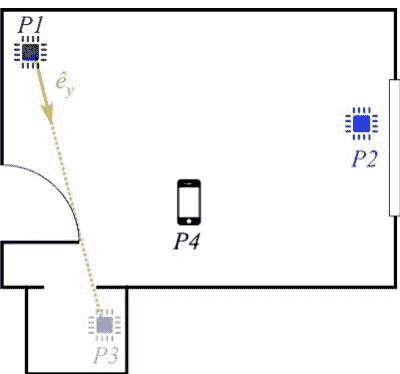

图 11-11. 从 iBeacon 1 和 iBeacon 3 导出的方向


$\hat{e} = \frac{P_3-P_1}{\|P_3-P_1\|}$

$\hat{e} = \frac{(P_{3x}-P_{1x}, P_{3y}-P_{1y})}{\sqrt{(P_{3x}-P_{1x})^2 + (P_{3y}-P_{1y})^2}}$

```java
double eyx = (p3.getX() - p1.getX() - i * exx) /
Math.sqrt(
    Math.pow(p3.getX() - p1.getX() - i * exx, 2) +
    Math.pow(p3.getY() - p1.getY() - i * exy, 2)
);
```

```java
double eyy = (p3.getY() - p1.getY() - i * exy) /
Math.sqrt(
    Math.pow(p3.getX() - p1.getX() - i * exx, 2) + 
    Math.pow(p3.getY() - p1.getY() - i * exy, 2)
);
```

# 计算 P1 和 P3 之间的距离幅度

计算 P1 和 P3 在 y 方向上距离的幅度 $j$，显示它们之间有多远（图 11-12）。

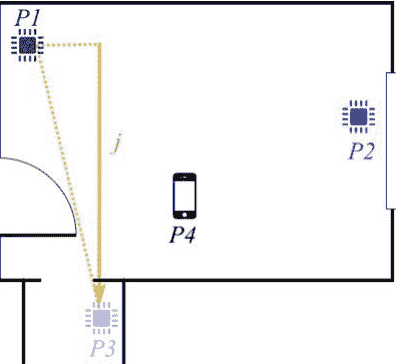

图 11-12. 从 iBeacon 1 和 iBeacon 3 导出的距离垂直分量

$j = \hat{e}_y \cdot (P_3-P_1)$

$j = e_{yx}(P_{3x}-P_{1x}) + e_{yy}(P_{3y}-P_{1y})$

```java
double j = eyx * (p2.getX() - p3.getY()) + eyy *
      (p3.getY() - p1.getY());
```

# Find 从 Central 到 iBeacons 的相对距离

使用 Central 到 iBeacons P1、P2 和 P3 的相对距离找到每个 iBeacon 的相对距离 $x$ 和 $y$（图 11-13）（图 11-14）。

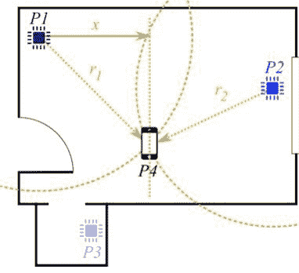

图 11-13. 带 Central 水平位置的每个 iBeacon 导出的位置

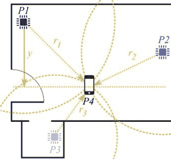

图 11-14. 带 Central 垂直位置的每个 iBeacon 导出的位置

这是通过求解以下方程中的 $x$ 和 $y$ 的：

$x = \frac{r_1^2 - r_2^2 + d^2}{2d}$

$y = \frac{r_1^2 - r_3^2 + i^2 + j^2}{2j} - ix$

```java
double x = (Math.pow(r1, 2) - Math.pow(r2,2) + Math.pow(d,2)) /
2 * p2p1Distance);
```

```java
double y = (Math.pow(r1, 2) - Math.pow(r3,2) + Math.pow(i,2) + Math.pow(j,2)) /
2 * j) - i*x / j;
```

## 计算 Central 在 P4 处的绝对位置

最后，通过将 P4 与 P1 之间的距离加上 P1 的相对位置，找到 Central 在 P4 处的位置（图 11-15）。

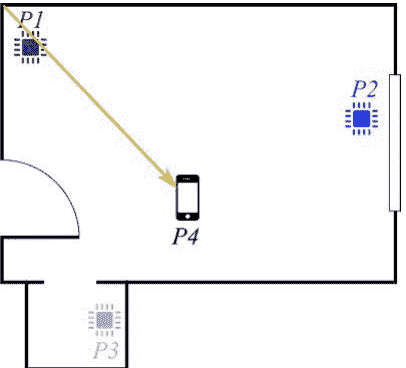

图 11-15. 导出的 Central 位置

$P_4 = P_1 + x\hat{e}_x + y\hat{e}_y$

$P_4 = (P_{1x} + x e_{xx} + y e_{yx}, P_{1y} + x e_{xy} + y e_{yy})$

```java
double p4x = p1.getX() + x * exx + y*eyx;
double p4y = p1.getY() + x * exy + y*eyy;
```

这就是如何从三个已知的 iBeacon 位置对 Central 位置进行三角测量。

## 整合所有内容

以下代码将创建一个 Activity App，它会绘制附近 iBeacons 的位置，列出它们的属性，并尝试找到其相对于 iBeacons 的位置。

创建一个名为 `ExampleBeaconLocator` 的新应用。创建以下包结构，并从示例中复制文件。

最终的文件结构应如下（图 11-16）。

| 目录/文件 |
| :--- |
| java/example.beaconlocator/ adapters/IBeaconListAdapter, callbacks/BleScanCallbackv18, BleScanCallbackv21, BleCommManager, IBeacon models/MainActivity |
| res/ layout/activity_main.xml, list_item.xml, scanner_progress.xml menu/main.xml values/strings |

为按钮和标签创建字符串资源。

`res/values/strings.xml`

```xml
<resources>
  <string name="app_name">Beacon Search</string>
  <string name="action_start">Scan</string>
  <string name="action_stop">Stop</string>
  <string name="scanning">Scanning...</string>
  <string name="beacon_list">No iBeacons</string>
  <string name="rssi">%d</string>
  <string name="major">%d</string>
  <string name="minor">%d</string>
  <string name="distance">%s meters</string>
  <string name="location">%s m, Y: %s m</string>
  <string name="transmission_power">TX Power: %d</string>
  <string name="central_position">Central at (%s m, %s m)</string>
</resources>
```

## 对象

`BleCommManager` 开启蓝牙并扫描附近的设备。

`java/example.beaconlocator/ble/BleCommManager`

```java
package com.example.beaconlocator.ble
public class BleCommManager {

    private static final String TAG = BleCommManager.class.getSimpleName();

    // 5秒扫描时间
    private static final long SCAN_PERIOD = 5000;

    // Android 蓝牙适配器
    private BluetoothAdapter mBluetoothAdapter;

    // Ble 扫描器 - API >= 21
    private BluetoothLeScanner mBluetoothScanner;

    // 扫描定时器
    private Timer mTimer = new Timer();

    /**
     * 初始化 BleCommManager
     * @param context Activity 上下文
     */
    public BleCommManager(final Context context) throws Exception {
        // 确保 Android 设备支持低蓝牙
        if (!context.getPackageManager().hasSystemFeature(
            PackageManager.FEATURE_BLETOOTH_LE)) {
            throw new Exception("Bluetooth Not Supported");
        }

        // 获取蓝牙管理器引用，
        // 允许与 BLE 射频通信
        final BluetoothManager bluetoothManager = (BluetoothManager)
            context.getSystemService(Context.BLUETOOTH_SERVICE);
        mBluetoothAdapter = bluetoothManager.getAdapter();
    }

    /**
     * 获取 Android 蓝牙适配器
     * @return 蓝牙适配器
     */
    public BluetoothAdapter getBluetoothAdapter() {
        return mBluetoothAdapter;
    }

    /**
     * 扫描设备
     * @param bleScanCallbackv18 兼容 API18 的回调
     * @param bleScanCallbackv21 兼容 API21 的回调
     * @throws Exception
     */
    public void scanForPeripherals(
        final BleScanCallbackv18 bleScanCallbackv18,
        final BleScanCallbackv21 bleScanCallbackv21) throws Exception {

        // 如果已经在扫描，则取消
        mTimer.cancel();

        // 对于 Android API 18, 19, 20 使用 BluetoothAdapter.startLeScan()
        if (Build.VERSION.SDK_INT < Build.VERSION_CODES.LOLLIPOP) {
            // 扫描 SCAN_PERIOD 毫秒。
            // 在时间结束后停止扫描。
            new Thread() {
                @Override
                public void run() {
                    mBluetoothAdapter.startLeScan(bleScanCallbackv18);
                    try {
                        Thread.sleep(SCAN_PERIOD);
                    } catch (InterruptedException e) {
                        e.printStackTrace();
                    }
                    mBluetoothAdapter.stopLeScan(bleScanCallbackv18);
                }
            }.start();
            // 通知系统 BLE 扫描
            // 在 SCAN_PERIOD 毫秒后停止
            MTimer = new Timer();
            MTimer.schedule(new TimerTask() {
                @Override
                public void run() {
                    stopScanning(bleScanCallbackv18, bleScanCallbackv21);
                }
            }, SCAN_PERIOD);
        } else { // 对于 API >= 21 (Lollipop) 使用 BluetoothScanner.startScan() {
            ScanSettings settings = new ScanSettings.Builder()
                .setScanMode(ScanSettings.SCAN_MODE_LATENCY)
                .build();
            final List<ScanFilter> filters = new ArrayList<ScanFilter>();
            mBluetoothScanner = mBluetoothAdapter.getBluetoothScanner();
            new Thread() {
                @Override
                public void run() {
                    mBluetoothScanner.startScan(
                        filters,
                        settings,
                        bleScanCallbackv21
                    );
                    try {
                        Thread.sleep(SCAN_PERIOD);
                    } catch (InterruptedException e) {
                        e.printStackTrace();
                    }
                    mBluetoothScanner.stopScan(bleScanCallbackv21);
                }
            }.start();
            // 通知系统 BLE 扫描
            // 在 SCAN_PERIOD 毫秒后停止
            MTimer = new Timer();
            MTimer.schedule(new TimerTask() {
                @Override
                public void run() {
                    stopScanning(bleScanCallbackv18, bleScanCallbackv21);
                }
            }, SCAN_PERIOD);
        }
    }

    public void stopScanning(final BleScanCallbackv18 bleScanCallbackv18, final BleScanCallbackv21 bleScanCallbackv21) {
        // 停止扫描的实现
    }
}
```

```java
mBluetoothAdapter.stopScan(bleScanCallbackv18);
```

```java
bleScanCallbackv18.onScanComplete();
```

```java
} else {
```

```java
mBluetoothLeScanner.stopScan(bleScanCallbackv21);
```

```java
bleScanCallbackv21.onScanComplete();
```

```java
}
}
}
```

`BleScanCallbackv18` 是 `BleCommManager` 的两个回调处理器之一，用于处理扫描期间发现的外设（Peripheral）。使用哪个回调类取决于 App 安装手机的 API 版本。

### 示例 14-

`java/com.example.echocient/ble/callbacks/BleScanCallbackv18`

```java
package com.example.echocient.ble.callbacks
```

```java
public class BleScanCallbackv18 implements BluetoothAdapter.LeScanCallback
{
/**
 * 发现新的外设。
 * @param bluetoothDevice 外设设备
 * @param rssi 外设设备的 RSSI 指示
 * 射频信号的强度
 * @param scanRecord 关于扫描结果的其他信息
 */
@Override
public abstract void onLeScan(
    final BluetoothDevice bluetoothDevice,
    int rssi,
    byte[] scanRecord
);

/**
 * BLE 扫描完成
 */
public abstract void onScanComplete();
}
```

## `BleScanCallbackv21`

`BleScanCallbackv21` 处理较新 Android 设备中的外设发现和蓝牙射频状态变化。

### 示例 14-


## 3. `java/com.example.echocient/ble/callbacks/BleScanCallbackv21`

```java
package com.example.echocient.ble.callbacks

public class BleScanCallbackv21 extends ScanCallback {

    /**
     * 发现新的外设。
     *
     * @param callbackType int: 决定此回调是如何触发的。
     *
     * 可以是 CALLBACK_TYPE_ALL_MATCHES、
     * CALLBACK_TYPE_FIRST_MATCH 或 CALLBACK_TYPE_MATCH_LOST 之一
     *
     * @param result 一个蓝牙低能量扫描结果，包含
     * 蓝牙设备、RSSI 以及其他信息
     */
    @Override
    public abstract void onScanResult(int callbackType, ScanResult result);

    /**
     * 发现新的外设。
     *
     * @param results List: 之前扫描过的扫描结果列表。
     */
    @Override
    public abstract void onBatchScanResults(List<ScanResult> results);

    /**
     * 扫描初始化问题。查看错误代码获取原因
     *
     * @param errorCode int: 错误代码（SCAN_FAILED_* 之一）
     * 用于扫描失败。
     */
    @Override
    public abstract void onScanFailed(int errorCode);

    /**
     * 扫描已完成
     */
    public abstract void onScanComplete();
}
```

## 创建一个 `IBeacon` 对象，负责从 `ScanData` 中提取 `iBeacon` 信息

### 示例 12-2. `java/example.com.beacon/ble/IBeacon.java`

```java
package example.com.beacon;

public class IBeacon {
    /** 常量 */
    private static String TAG = IBeacon.class.getSimpleName();
    public static final double RADIO_PROPAGATION_CONSTANT = 3.5;

    // 距离
    public static final int DISTANCE_UNKNOWN = 0;
    public static final int DISTANCE_IMMEDIATE = 1;
    public static final int DISTANCE_NEAR = 3;
    public static final int DISTANCE_FAR = 10;

    private static final int RANGE_UNKNOWN = 0;
    private static final int RANGE_IMMEDIATE = 1;
    private static final int RANGE_NEAR = 3;

    /** iBeacon GAP Header */
    private static final byte[] IBEACON_HEADER = { 0x02, 0x01 };
    private static final int IBEACON_HEADER_POSITION = 0;
    private static final int MANUFACTURER_POSITION = 6;
    private static final int MANUFACTURER_LENGTH = 2;
    private static final int UUID_POSITION = 9;
    private static final int UUID_LENGTH = 16;
    private static final int MAJOR_NUMBER_POSITION = 25;
    private static final int MAJOR_NUMBER_LENGTH = 2;
    private static final int MINOR_NUMBER_POSITION = 27;
    private static final int MINOR_NUMBER_LENGTH = 2;
    private static final int TX_POWER_POSITION = 29;
    private static final int TX_POWER_LENGTH = 1;

    /** iBeacon */
    private UUID mUuid;
    private int mManufaturerId;
    private int mMajor;
    private int mMinor;
    private int mTransmissionPower;
    private int mRssi;
    private String mMacAddress;
    private double mX = 0;
    private double mY = 0;

    /** 获取和设置 iBeacon */
    public void setUuid(UUID uuid) { mUuid = uuid; }
    public void setMajor(int major) { mMajor = major; }
    public void setMinor(int minor) { mMinor = minor; }
    public void setTransmissionPower(int transmissionPower) { mTransmissionPower = transmissionPower; }

    public void setRssi(int rsi) { mRssi = rsi; }
    public void setMacAddress(String macAddress) { mMacAddress = macAddress; }
    public void setManufacturerId(int manufacturerId) { mManufaturerId = manufacturerId; }

    public UUID getUuid() { return mUuid; }
    public int getMajor() { return mMajor; }
    public int getMinor() { return mMinor; }
    public int getTransmissionPower() { return mTransmissionPower; }
    public int getRssi() { return mRssi; }
    public String getMacAddress() { return mMacAddress; }
    public int getManufacturerId() { return mManufaturerId; }

    /**
     * 设置 BleBeacon 的 X 和 Y 位置
     *
     * @param x 位置
     * @param y 位置
     */
    public void setLocation(double x, double y) {
        setXLocation(x);
        setYLocation(y);
    }

    /**
     * 设置 BleBeacon 的 X 位置
     *
     * @param x 位置
     */
    public void setXLocation(double x) {
        mX = x;
    }

    /**
     * 获取 X 位置
     *
     * @return x 位置
     */
    public double getXLocation() {
        return mX;
    }

    /**
     * 设置 BleBeacon 的 Y 位置
     *
     * @param y 位置
     */
    public void setYLocation(double y) {
        mY = y;
    }

    /**
     * 获取 Y 位置
     *
     * @return y 位置
     */
    public double getYLocation() {
        return mY;
    }

    /**
     * 测试两个 iBeacons 是否相同
     *
     * @param otherBeacon 另一个 beacon
     * @return 如果两个 beacon 相同则返回 true
     */
    public boolean equals(iBeacon otherBeacon) {
        // 如果 iBeacons 具有相同的 UUID、Major 和 Manufacturer ID，则 iBeacons 是相同的
        boolean isSameBeacon = (
            mUuid.equals(otherBeacon.getUuid()) &&
            (mMajor == otherBeacon.getMajor()) &&
            (mMinor == otherBeacon.getMinor()) &&
            (mManufaturerId == otherBeacon.getManufacturerId())
        );
        Log.v(TAG, "beacons same?: " + isSameBeacon);
        return isSameBeacon;
    }

    /**
     * 判断发现的外设的 GAP 是否属于 iBeacon
     * 根据其 GAP 头
     *
     * @param scanRecord 外设的扫描记录字节数组
     * @return 如果扫描记录属于 iBeacon 则返回 true
     */
    static public boolean isBeacon(final[] scanRecord) {
        byte[] scanRecordHeader = new byte[IBEACON_HEADER.length];
        System.arraycopy(
            scanRecord,
            IBEACON_HEADER_POSITION,
            scanRecordHeader,
            0,
            IBEACON_HEADER.length
        );
        if (Arrays.equals(IBEACON_HEADER, scanRecordHeader)) {
            return true;
        }
        return false;
    }

    /**
     * 从 GAP 扫描记录创建 iBeacon
     * 扫描记录看起来如下：
     * Header: 0-1 (小端序)
     * MAC 地址: 2-8
     * iBeacon 前缀: 9-19
     * Proximity UUID: 20-36
     * Major: 38-39 (大端序)
     * Minor: 40-41 (大端序)
     * TX Power: 42-43 (补码负值)
     *
     * 示例：4C00 02 15 B9407F30F5F8466AFF925556B57FE6DED4E8931 B6
     *
     * @param scanRecord 传入的扫描记录
     * @return IBeacon
     */
    static public IBeacon fromScanRecord(byte[] scanRecord) throws Exception {
        if (!isBeacon(scanRecord)) {
            throw new Exception("扫描记录不属于 iBeacon");
        }

        IBeacon iBeacon = new IBeacon();
        iBeacon.setUuid(getFromScanRecord(scanRecord));
        iBeacon.setManufacturerId(getManufacturerIdFromScanRecord(scanRecord));
        iBeacon.setMajor(getMajorNumberFromScanRecord(scanRecord));
        iBeacon.setMinor(getMinorNumberFromScanRecord(scanRecord));
        iBeacon.setTransmissionPower(
```

```java
getTransmissionPowerFromScanRecord(scanRecord);

Log.v(
  TAG,
  "txPower: " + iBeacon.getTransmissionPower() +
  ", major: " + iBeacon.getMajor() +
  ", minor: " + iBeacon.getMinor() +
  ", uuid: " + iBeacon.getUuid().toString()
);

return iBeacon;
}}
```


```java
/**
 * 从 iBeacon 的扫描记录中获取 iBeacon 的 UUID
 *
 * @param scanRecord iBeacon 扫描记录
 * @return UUID
 */
static public UUID getUuidFromScanRecord(final byte[] scanRecord) {
    byte[] uuidBytes = new byte[16];
    System.arraycopy(scanRecord, UUID_POSITION, uuidBytes, 0, UUID_LENGTH);
    return DataConverter.bytesToUuid(uuidBytes);
}

/**
 * 从 iBeacon 的扫描记录中获取 iBeacon 的 UUID
 *
 * @param scanRecord iBeacon 扫描记录
 * @return Minor 号
 */
public static int getMinorNumberFromScanRecord(final byte[] scanRecord) {
    byte[] minorBytes = new byte[2];
    System.arraycopy(scanRecord, MIN_NUMBER_POSITION, minorBytes, 0, 2);
    return DataConverter.bytesToUnsignedInt(minorBytes);
}

/**
 * 从 iBeacon 的扫描记录中获取 iBeacon 的 Major 号
 *
 * @param scanRecord iBeacon 扫描记录
 * @return Major 号
 */
public static int getMajorNumberFromScanRecord(final byte[] scanRecord) {
    byte[] majorBytes = new byte[2];
    System.arraycopy(
        scanRecord,
        MAJOR_NUMBER_POSITION,
        majorBytes,
        0,
        MAJOR_NUMBER_LENGTH
    );
    return DataConverter.bytesToUnsignedInt(majorBytes);
}

/**
 * 从 iBeacon 的扫描记录中获取 iBeacon 的发射功率
 *
 * @param scanRecord iBeacon 扫描记录
 * @return 以分贝（dB）为单位的功率
 */
public static int getTransmissionPowerFromScanRecord(
    final byte[] scanRecord
) {
    byte[] txPowerBytes = new byte[1];
    System.arraycopy(
        scanRecord,
        TX_POWER_POSITION,
        txPowerBytes,
        0,
        TX_POWER_LENGTH
    );
    return DataConverter.bytesToSignedInt(txPowerBytes);
}

/**
 * 从 iBeacon 的扫描记录中获取 iBeacon 的厂商 ID
 *
 * @param scanRecord iBeacon 扫描记录
 * @return 厂商 ID 号
 */
public static int getManufacturerIdFromScanRecord(final byte[] scanRecord) {
    byte[] manufacturerBytes = new byte[MANUFACTURER_LENGTH];
    System.arraycopy(
        scanRecord,
        MANUFACTURER_POSITION,
        manufacturerBytes,
        0,
        MANUFACTURER_LENGTH
    );
    return DataConverter.bytesToUnsignedInt(manufacturerBytes);
}

/**
 * 根据 RSSI 获取 iBeacon 距离中心设备的距离
 *
 * @return Minor 号
 */
public double getDistance() {
    if (mRssi == 0) {
        return -1.0; // 如果无法确定准确性，返回 -1。
    }
    double ratio = (mTransmissionPower - mRssi) / (10 * RADIO_PROPAGATION_CONSTANT);
    double distance = Math.pow(10, ratio);
    return distance;
}

/**
 * 从中心设备获取 iBeacon 的接近范围
 *
 * @return DISTANCE_UNKNOWN, DISTANCE_IMMEDIATE,
 * DISTANCE_NEAR 或 DISTANCE_FAR 之一
 */
public int getProximity() {
    double distance = getDistance();
    if (distance <= RANGE_UNKNOWN) {
        return DISTANCE_UNKNOWN;
    }
    if (distance < RANGE_IMMEDIATE) {
        return DISTANCE_IMMEDIATE;
    }
    if (distance < RANGE_NEAR) {
        return DISTANCE_NEAR;
    }
    return DISTANCE_FAR;
}
```

# 创建一个 `iBeaconListAdapter`，用于描述如何在 `ListView` 中显示 iBeacons

**示例 12-4：** `java/example.com.exampleble/adapters/iBeaconListAdapter.java`

```java
package example.com.beacon.adapters;

public class iBeaconListAdapter extends BaseAdapter {
    private static String TAG = iBeaconListAdapter.class.getSimpleName();
    private ArrayList<IBeaconListItem> mBeaconItems = new ArrayList<IBeaconListItem>();

    /**
     * 列表中有多少项
     */
    public int getCount() {
        return mBeaconItems.size();
    }

    /**
     * 获取此位置的项
     *
     * @param position 位置
     * @return IBeaconListItem
     */
    public IBeaconListItem getItem(int position) {
        return mBeaconItems.get(position);
    }

    /**
     * 获取项目的 ID
     *
     * @param position 位置
     * @return long
     */
    public long getItemId(int position) {
        return mBeaconItems.get(position).getItemId();
    }

    /**
     * 获取列表的当前状态
     *
     * @return IBeaconListItem 的 ArrayList
     */
    public ArrayList<IBeaconListItem> getItems() {
        return mBeaconItems;
    }

    /**
     * 清空列表所有项
     */
    public void clear() {
        mBeaconItems.clear();
    }

    /**
     * 向列表添加新的外围设备
     *
     * @param iBeacon 设备信息
     */
    public void add(IBeacon iBeacon) {
        int listItemId = mBeaconItems.size();
        IBeaconListItem listItem = new IBeaconListItem(iBeacon);
        listItem.setItemId(listItemId);
        listItem.setRsi(iBeacon.rssi());
        mBeaconItems.add(listItem);
    }

    /**
     * 为已知位置生成新的 ListItem
     *
     * @param position 位置
     * @param convertView 可转换的视图
     * @param parent 父容器
     * @return 视图
     */
    public View getView(int position, View convertView, ViewGroup parent) {
        View v = convertView;
        ViewHolder peripheralListItemView;
        Context context = parent.getContext();
        Resources resources = context.getResources();

        // 如果此 ListItem 还不存在，则生成它
        // 否则，使用它
        if (convertView == null) {
            // 转换 list_ibeacon.xml
            LayoutInflater inflater = LayoutInflater.from(context);
            v = inflater.inflate(R.layout.list_ibeacon, null);

            // 将列表中的 UI 内容与 XML 匹配
            peripheralListItemView = new ViewHolder();
            peripheralListItemView.mUuidTV = (TextView) v.findViewById(R.id.uuid);
            peripheralListItemView.mRssiTV = (TextView) v.findViewById(R.id.rssi);
            peripheralListItemView.mTransmissionPowerTV =
                (TextView) v.findViewById(R.id.transmission_power);
            peripheralListItemView.mMajorTV =
                (TextView) v.findViewById(R.id.major_number);
            peripheralListItemView.mMinorTV =
                (TextView) v.findViewById(R.id.minor_number);
            peripheralListItemView.mDistanceTV =
                (TextView) v.findViewById(R.id.distance);
            peripheralListItemView.mLocationTV =
                (TextView) v.findViewById(R.id.location);
            v.setTag(peripheralListItemView);
        } else {
            peripheralListItemView = (ViewHolder) v.getTag();
        }

        Log.v(TAG, "ListItem size: " + mBeaconItems.size());

        // 如果有已知的外围设备，创建一个说明该的 ListItem
        // 否则，显示蓝牙外围设备信息
        if (mBeaconItems.size() <= 0) {
            peripheralListItemView.mUuidTV.setText(R.string.beacon_list_empty);
        } else {
            IBeaconListItem item = mBeaconItems.get(position);
        }

        return v;
    }

    static class ViewHolder {
        TextView mUuidTV;
        TextView mRssiTV;
        TextView mTransmissionPowerTV;
        TextView mMajorTV;
        TextView mMinorTV;
        TextView mDistanceTV;
        TextView mLocationTV;
    }
}
```

```java
peripheralListItemView.mUuidTV.setText(item.getUuid().toString());
```

```java
peripheralListItemView.mMajorTV.setText(
    String.format(
        resources.getString(R.string.major_number),
        item.getMajor()
    )
);
```

```java
peripheralListItemView.mMinorTV.setText(
    String.format(
        resources.getString(R.string.minor_number),
        item.getMinor()
    )
);
```

```java
peripheralListItemView.mRssiTV.setText(
    String.format(
        resources.getString(R.string.rssi),
        item.getRssi()
    )
);
```

```java
String distance_m = "";

try {
    distance_m = String.format(
        resources.getString(R.string.distance),
        String.format("%.1f", item.getDistance())
    );
} catch (Exception e) {
    Log.d(TAG, "无法将距离转换为字符串");
}

peripheralListView.mDistanceTV.setText(distance_m);
String location = "";

try {
    String xLocation = String.format("%.1f", item.getXLocation());
    String yLocation = String.format("%.1f", item.getYLocation());
    location = String.format(
        resources.getString(R.string.location),
        xLocation,
        yLocation
    );
} catch (Exception e) {
    Log.d(TAG, "无法将位置转换为字符串");
}

peripheralListView.mLocationTV.setText(location);

String transmissionPower = "";

try {
    transmissionPower = String.format(
        resources.getString(R.string.transmission_power),
        item.getTransmissionPower()
    );
} catch (Exception e) {
    Log.d(TAG, "无法将参考 rssi 转换为字符串");
}

peripheralListView.mTransmissionPowerTV.setText(
    transmissionPower
);
```

```java
return v;
}
```

# 创建一个 `iBeaconLocator`，它通过三个已知位置通过三边测量确定位置

### 示例 12-5

`java/example.com.com.examplebleble/views/BleBeaconListAdapter.java`


```java
package example.com.beacon.utilities

public class IBeaconLocator {

    public static double[] trilaterate(
        ArrayList<IBeacon> beaconList
    ) throws Exception {
        if (beaconList.size() < 3) {
            throw new Exception("点不足，无法进行三边测量");
        }

        IBeacon p1 = beaconList.get(0);
        IBeacon p2 = beaconList.get(1);
        IBeacon p3 = beaconList.get(2);

        double r1 = beaconList.get(0).getDistance();
        double r2 = beaconList.get(1).getDistance();
        double r3 = beaconList.get(2).getDistance();

        // 从点 1 到点 2 方向的单位向量
        double p2p1Distance = Math.sqrt(
            Math.pow(p2.getXLocation() - p1.getXLocation(), 2)
                + Math.pow(p2.getYLocation() - p1.getYLocation(), 2)
        );

        double exx = (p2.getXLocation() - p1.getXLocation())
            / p2p1Distance;
        double exy = (p2.getYLocation() - p1.getYLocation())
            / p2p1Distance;

        // x 分量的有符号幅
        double i = exx * (p3.getXLocation() - p1.getXLocation())
            + exy * (p3.getYLocation() - p1.getYLocation());

        // y 方向的单位向量。
        double eyx = (
            p3.getXLocation() - p1.getXLocation() - i * exx
        ) / Math.sqrt(
            Math.pow(
                p3.getXLocation() - p1.getXLocation() - i * exx,
                2
            ) + Math.pow(
                p3.getYLocation() - p1.getYLocation() - i * exy,
                2
            )
        );

        double eyy = (
            p3.getYLocation() - p1.getYLocation() - i * exy
        ) / Math.sqrt(
            Math.pow(
                p3.getXLocation() - p1.getXLocation() - i * exx,
                2
            ) + Math.pow(
                p3.getYLocation() - p1.getYLocation() - i * exy,
                2
            )
        );

        // y 分量的有符号幅
        double j = eyx * (p2.getXLocation() - p3.getXLocation())
            + eyy * (p3.getYLocation() - p1.getYLocation());

        // 坐标
        double x = (
            Math.pow(r1, 2) - Math.pow(r2, 2)
                + Math.pow(p2p1Distance, 2)
        ) / (2 * p2p1Distance);

        double y = (
            Math.pow(r1, 2) - Math.pow(r3, 2) + Math.pow(j, 2)
        ) / (2 * j) - i * x;

        // 结果坐标
        double finalX = p1.getXLocation() + x * exx;
        double finalY = p1.getXLocation() + x * exx;

        return new double[]{finalX, finalY};
    }
}
```

创建一个`DataConverter`，用于在格式之间转换：

### 示例 12-5. `java/example.com.com.examplebleble/utilities/DataConverter.java`

```java
package example.com.beacon.utilities

public class DataConverter {

    /**
     * 将字节数组转换为十六进制字符串
     * @param bytes 字节数组
     * @return 字符串
     */
    public static String bytesToHex(byte[] bytes) {
        char[] hex = "0123456789ABCDEF".toCharArray();
        char[] result = new char[bytes.length * 2];
        for (int i = 0; i < bytes.length; i++) {
            int v = bytes[i] & 0xFF;
            result[i * 2] = hex[v >>> 4];
            result[i * 2 + 1] = hex[v & 0x0F];
        }
        return new String(result);
    }

    /**
     * 将十六进制字符串转换为字节数组
     * @param hexString 十六进制字符串
     * @return 字节数组
     */
    public static byte[] hexToBytes(String hexString) {
        int len = hexString.length();
        byte[] data = new byte[len / 2];
        for (int i = 0; i < len; i += 2) {
            data[i / 2] = (byte) (
                (Character.digit(hexString.charAt(i), 16) << 4)
                    + Character.digit(
                        hexString.charAt(i + 1),
                        16
                    )
            );
        }
        return data;
    }
}
```

# 模型

## 创建`iBeaconMapLayout`类

在屏幕上显示 iBeacon 和中心位置。

### 示例 12-5

```java
public class iBeaconMapLayout extends LinearLayout {
    /** 图形属性 */
    private static final int BITMAP_WIDTH = 1000;
    private static final int BITMAP_HEIGHT = 800;
    private static final String PAINT_COLOR = "#CD5C5C";
    private static final int STROKE_COLOR = 5;
    private static final int X_OFFSET = 50;
    private static final int Y_OFFSET = 50;
    private static final int M_PX_MULTIPLIER = 400;

    // 图标
    private Bitmap mIBeaconIcon, mCentralIcon;
    private Canvas mCanvas = new Canvas();
}
```

```java
// 绘制属性
private Paint mPaint = new Paint();

// 渲染地图
private Bitmap mMapBitmap;

// IBeacons 列表
private ArrayList<IBeacon> mIBeaconList = new ArrayList<IBeacon>();

private boolean mIsCentralPosition = false;

// 中心位置
private double[] mCentralPosition;

/**
 * 创建一个新的 BeaconMapLayout
 *
 * @param context Activity 上下
 */
public IBeaconMapLayout(Context context) {
    super(context);
    initialize();
}

/**
 * 创建一个新的 BeaconMapLayout
 *
 * @param context Activity 上下
 * @param attrs 属性
 */
public IBeaconMapLayout(Context context, AttributeSet attrs) {
    super(context, attrs);
    initialize();
}

/**
 * 创建一个新的 BeaconMapLayout
 *
 * @param context Activity 上下
 * @param attrs 属性
 * @param defStyle 默认样式
 */
public IBeaconMapLayout(
    Context context,
    AttributeSet attrs,
    int defStyle
) {
    super(context, attrs, defStyle);
    initialize();
}

/**
 * 初始化地图
 */
public void initialize() {
    mBeaconIcon = BitmapFactory.decodeResource(
        getResources(),
        R.drawable.peripheral
    );
    mCentralIcon = BitmapFactory.decodeResource(
        getResources(),
        R.drawable.central
    );
    mPaint.setColor(Color.parse(PAINT_COLOR));
    mPaint.setStyle(Paint.Style.STROKE);
    mPaint.setStrokeWidth(STROKE_COLOR);
    mMapBitmap = Bitmap.createBitmap(
        BITMAP_WIDTH,
        BITMAP_HEIGHT,
        Bitmap.Config.ARGB_8888
    );
    mCanvas = new Canvas(mMapBitmap);
}

/**
 * 添加一个新的 Beacon
 *
 * @param iBeacon
 */
public void addBeacon(IBeacon iBeacon) {
    mIBeaconList.add(iBeacon);
}

/**
 * 设置中心位置
 *
 * @param x x 位置
 * @param y y 位置
 */
public void setCentralPosition(double x, double y) {
    mIsCentralPositionSet = true;
    mCentralPosition = new double[]{x, y};
}

/**
 * 绘制 Beacon 位置
 *
 * @param beacon
 */
private void drawBeaconPosition(IBeacon iBeacon) {
    Log.d(TAG, "Drawing点: " + iBeacon);
    Rect sourceRect = new Rect(
        0,
        0,
        mIBeaconIcon.getWidth(),
        mIBeaconIcon.getHeight()
    );
    Rect destRect = new Rect(
        (int) (
            iBeacon.getLocation() * M_PX_MULTIPLIER - 50 + X_OFFSET
        ),
        (int) (
            iBeacon.getYLocation() * M_PX_MULTIPLIER - 50 + Y_OFFSET
        ),
        (int) (
            iBeacon.getLocation() * M_PX_MULTIPLIER + 50 + X_OFFSET
        ),
        (int) (
            iBeacon.getYLocation() * M_PX_MULTIPLIER + 50 + Y_OFFSET
        )
    );
    mCanvas.drawBitmap(mIBeaconIcon, sourceRect, destRect, null);
    mCanvas.drawCircle(
        (float) iBeacon.getLocation() * M_PX_MULTIPLIER + X_OFFSET,
        (float) iBeacon.getYLocation() * M_PX_MULTIPLIER + Y_OFFSET,
        (float) iBeacon.getDistance() * M_PX_MULTIPLIER,
        mPaint
    );
}

/**
 * 在屏幕上绘制中心位置
 *
 * @param location
 */
public void drawCentralPosition(double[] location) {
    Rect sourceRect = new Rect(
        0,
        0,
        mCentralIcon.getWidth(),
        mCentralIcon.getHeight()
    );
    Rect destRect = new Rect(
        (int) (
            location[0] * M_PX_MULTIPLIER - 36 + X_OFFSET
        ),
        (int) (
            location[1] * M_PX_MULTIPLIER - 71 + Y_OFFSET
        ),
        (int) (
            location[0] * M_PX_MULTIPLIER + 37 + X_OFFSET
        ),
        (int) (
            location[1] * M_PX_MULTIPLIER + 72 + Y_OFFSET
        )
    );
    mCanvas.drawBitmap(mCentralIcon, sourceRect, destRect, null);
}

/**
 * 绘制帧
 */
public void draw() {
    // 清除画布
    mCanvas.drawColor(Color.WHITE);

    // 绘制每个 beacon
    for (IBeacon iBeacon : mIBeaconList) {
        drawBeaconPosition(iBeacon);
    }

    // 绘制中心位置
    if (mIsCentralPositionSet) {
        drawCentralPosition(mCentralPosition);
    }
    this.setBackgroundDrawable(new BitmapDrawable(mMapBitmap));
}
```

创建一个`IBeaconListItem`类，用于将 iBeacon 属性作为列表项显示。

### 示例 12-6. `java/example.com.exampleble/models/IBeaconListItem.java`


```java
package example.com.beacon.models;

public class IBeaconListItem {
    private int mItemId;
    private int mRssi;
    private IBeacon mBeacon;

    public IBeaconListItem(IBeacon iBeacon) {
        mBeacon = iBeacon;
    }

    public void setItemId(int id) {
        mItemId = id;
    }

    public void setRssi(int rssi) {
        mRssi = rssi;
    }

    public int getItemId() {
        return mItemId;
    }

    public String getUuid() {
        return mBeacon.getUuid();
    }

    public int getMajor() {
        return mBeacon.getMajor();
    }

    public int getMinor() {
        return mBeacon.getMinor();
    }

    public int getTransmissionPower() {
        return mBeacon.getTransmissionPower();
    }

    public double getDistance() {
        return mBeacon.getDistance();
    }

    public double getLocation() {
        return mBeacon.getLocation();
    }

    public double getYLocation() {
        return mBeacon.getYLocation();
    }

    public IBeacon getBeacon() {
        return mBeacon;
    }
}
```

创建一个名为`list_item.xml`的布局文件，它用于在列表中显示 iBeacon 信息。

### 示例 12-7：`res/layout/list_item.xml`

```xml
<?xml version="1.0" encoding="utf-8"?>
<LinearLayout xmlns:android="http://schemas.android.com/apk/res/android"
    android:layout_width="match_parent"
    android:layout_height="wrap_content"
    android:orientation="vertical">

    <LinearLayout
        android:layout_width="match_parent"
        android:layout_height="wrap_content"
        android:orientation="horizontal">

        <TextView
            android:id="@+id/uuid"
            android:layout_width="wrap_content"
            android:layout_height="wrap_content"
            android:text="UUID: ";

        <TextView
            android:id="@+id/major"
            android:layout_width="wrap_content"
            android:layout_height="wrap_content"
            android:text="Major: ";

        <TextView
            android:id="@+id/minor"
            android:layout_width="wrap_content"
            android:layout_height="wrap_content"
            android:text="Minor: ";

    </LinearLayout>

    <LinearLayout
        android:layout_width="match_parent"
        android:layout_height="wrap_content"
        android:orientation="horizontal">

        <TextView
            android:id="@+id/rssi"
            android:layout_width="wrap_content"
            android:layout_height="wrap_content"
            android:text="RSSI: ";

        <TextView
            android:id="@+id/transmission_power"
            android:layout_width="wrap_content"
            android:layout_height="wrap_content"
            android:text="TX Power: ";

    </LinearLayout>

    <LinearLayout
        android:layout_width="match_parent"
        android:layout_height="wrap_content"
        android:orientation="horizontal">

        <TextView
            android:id="@+id/distance"
            android:layout_width="wrap_content"
            android:layout_height="wrap_content"
            android:text="Distance: ";

        <TextView
            android:id="@+id/location"
            android:layout_width="wrap_content"
            android:layout_height="wrap_content"
            android:text="Location: ";

    </LinearLayout>

</LinearLayout>
```

创建`MainActivity`。它将是应用程序的主界面。

### 示例 12-8：`java/example.com.exampleble/MainActivity.java`

```java
package example.com.beacon;

public class MainActivity extends AppCompatActivity {
    /** Constants **/
    private static final String TAG = MainActivity.class.getSimpleName();
    private static final int REQUEST_ENABLE_BT = 1;

    // 计算中心所需的最小数量
    private static final int MIN_BEACONS_FOR_TRILATERATION = 3;

    /** Bluetooth 相关 **/
    private BleCommManager mBleCommManager;
    private ArrayList<IBeacon> mFoundIBeacons = new ArrayList<IBeacon>();

    /** UI 相关 **/
    private MenuItem mProgressSpinner;
    private MenuItem mStartScanItem, mStopScanItem;
    private TextView mCentralPosition;
    private ListView mBeaconsList;
    private IBeaconsListAdapter mIBeaconsListAdapter;
    private IBeaconMapLayout mIBeaconMap;

    @Override
    protected void onCreate(Bundle savedInstanceState) {
        super.onCreate(savedInstanceState);
        setContentView(R.layout.activity_main);
    }
}
```


```java
Toolbar toolbar = (Toolbar) findViewByIdById(R.id.toolbar);

setSupportActionBar(toolbar);

// 当蓝牙开启或关闭时通知
IntentFilter filter = new IntentFilter(
    BluetoothAdapter.ACTION_STATE_CHANGED
);
registerReceiver(mBleAdvertiseReceiver, filter);

loadUI();

}

@Override
public void onResume() {
    super.onResume();
}

@Override
public void onPause() {
    super.onPause();
    stopScan();
}

@Override
public void onDestroy() {
    super.onDestroy();
    unregisterReceiver(mBleAdvertiseReceiver);
}

public void loadUI() {
    mCentralPosition = (TextView) findViewById(R.id.central_position);
    mBeaconsListAdapter = new IBeaconsListAdapter();
    mBeaconsList = (ListView) findViewById(R.id.beacons_list);
    mBeaconsList.setAdapter(mBeaconsListAdapter);
    mBeaconMap = (IBeaconMapLayout)findViewById(R.id.beacon_map);
}

/**
 * 创建菜单
 * @param menu 菜单
 * @return 如果处理成功则返回 <b>true</b>
 */
@Override
public boolean onCreateOptionsMenu(Menu menu) {
    // 填充菜单；这将项目
    // 添加到 action bar 中（如果存在的话）。
    getMenuInflater().inflate(R.menu.menu_main, menu);
    mStartScanItem = menu.find(R.id.action_start_scan);
    mStopScanItem = menu.find(R.id.action_stop_scan);
    mProgressSpinner = menu.find(R.id.scan_progress_item);
    mStartScanItem.setVisible(true);
    mStopScanItem.setVisible(false);
    mProgressSpinner.setVisible(false);
    initializeBluetooth();
    return true;
}

@Override
public boolean onOptionsItemSelected(MenuItem item) {
    switch (item.getItemId()) {
        case R.id.action_start_scan:
            // 用户选择了“扫描”项目
            startScan();
            return true;
        case R.id.action_stop_scan:
            // 用户选择了“停止”项目
            stopScan();
            return true;
        default:
            // 如果我们到了这里，说明用户的操作未被识别。
            // 调用父类来处理它。
            return super.onOptionsItemSelected(item);
    }
}

/**
 * 开启蓝牙射电
 */
public void initializeBluetooth() {
    try {
        mBleCommManager = new BleCommManager(this);
    } catch (Exception e) {
        Log.d(TAG, "Could not initialize bluetooth");
        Log.d(TAG, e.getMessage());
        finish();
    }
    // // 如果蓝牙未启用，应提示用户打开设置
    if (!mBleCommManager.getBluetoothAdapter().isEnabled()) {
        Intent enableBtIntent = new Intent(
            BluetoothAdapter.ACTION_REQUEST_ENABLE
        );
        startActivityForResult(enableBtIntent, REQUEST_ENABLE_BT);
    }
}

/**
 * 开始扫描 iBeacons
 */
private void startScan() {
  mStartScanItem.setVisible(false);
  mStopScanItem.setVisible(true);
  mProgressSpinner.setVisible(true);
  mIBeaconsListAdapter.clear();
  mFoundIBeacons.clear();
  try {
    mBleCommManager.scanForPeripherals(
      mScanCallbackv18,
      mScanCallbackv21
    );
  } catch (Exception e) {
    Log.d(TAG, "Can't create Ble Device Scanner");
  }
}

/**
 * 停止扫描
 */
public void stopScan() {
    mBleCommManager.stopScanning(mScanCallbackv18, mScanCallbackv21);
}

public void onBleScanStopped() {
    Log.v(TAG, "Scan complete");
    mStartScanItem.setVisible(true);
    mStopScanItem.setVisible(false);
    mProgressSpinner.setVisible(false);
}

/**
 * 用于添加伪造 iBeacons：从已知距离计算 RSSI
 * @param txPower iBeacon 传输功率
 * @param distance iBeacon 与中心设备之间的距离
 * @return
 */
private int getRssi(double txPower, double distance) {
    double ratio = Math.log10(distance);
    double difference = ratio * (10 * IBeacon.RADIO_PROPAGATION_CONSTANT);
    double rssi = txPower - difference;
    return (int) rssi;
}

/**
 * 当发现外围设备时的触发器
 */
public void onBeaconDiscovered(byte[] scanRecord, int rssi) {
    Log.v(
        TAG,
        "iBeacon discovered, GAP: " + DataConverter.bytesToHex(scanRecord)
    );

    if (IBeacon.isBeacon(scanRecord)) {
        try {
            final IBeacon iBeacon = IBeacon.fromScanRecord(scanRecord);
            // 检查 iBeacon 是否已在列表中
            boolean addBeacon = true;
            for (IBeaconListItem iListItem : mBeaconsListAdapter.getItems()) {
                if (iListItem.getBeacon().equals(iBeacon)) {
                    addBeacon = false;
                    break;
                }
            }
            if (addBeacon) {
                // 这里是查找 beacon 位置的地方
                iBeacon.setRssi(rssi);
            }
        } catch (Exception e) {
            Log.d(TAG, "Could not convert scanRecord into iBeacon");
        }
    } else {
        Log.d(TAG, "Not a beacon");
    }
}

/**
 * 当蓝牙开启时初始化连接
 */
private final AdvertiseReceiver mBleAdvertiseReceiver = new AdvertiseReceiver() {
    @Override
    public void onReceive(Context context, Intent intent) {
        final String action = intent.getAction();
        if (action.equals(BluetoothAdapter.ACTION_STATE_CHANGED)) {
            final int state = intent.getIntExtra(
                BluetoothAdapter.EXTRA_STATE,
                BluetoothAdapter.UNKNOWN
            );
            switch (state) {
                case BluetoothAdapter.STATE_OFF:
                    initializeBluetooth();
                    break;
                case BluetoothAdapter.STATE_TURNING_OFF:
                    break;
                case BluetoothAdapter.STATE_ON:
                    initializeBluetooth();
                    break;
                case BluetoothAdapter.STATE_TURNING_ON:
                    break;
            }
        }
    }
};

/**
 * 为 Android 21 (Lollipop) 或更高版本使用此回调
 */
private final BleScanCallbackv21 mScanCallbackv21 = new BleScanCallbackv21() {
    /**
     * 发现新外围设备
     *
     * @param callbackType int：触发此回调的原因。可能是
     * CALLBACK_TYPE_ALL_MATCHES, CALLBACK_TYPE_FIRST_MATCH 或 CALLBACK_TYPE_LOST
     * @param result 蓝牙扫描结果，包含设备、RSSI 以及其他信息
     */
    @Override
    public void onScanResult(int callbackType, ScanResult result) {
        int rssi = result.getRssi();
        // 获取扫描字节数组（注意，这可能为空）
        if (result.getScanRecord() != null) {
            byte[] scanRecord = result.getScanRecord().getBytes();
            onBeaconDiscovered(scanRecord, rssi);
        }
    }

    /**
     * 在低功耗模式扫描时发现了多个外围设备
     * @param results 列表：之前扫描结果列表
     */
    @Override
    public void onBatchScanResults(List<ScanResult> results) {
        for (ScanResult result : results) {
            int rssi = result.getRssi();
            // 获取扫描字节数组（注意，这可能为空）
            if (result.getScanRecord() != null) {
                byte[] scanRecord = result.getScanRecord().getBytes();
                onIBeaconDiscovered(scanRecord, rssi);
            }
        }
    }
};
```


```java
/**
 * 扫描初始化失败
 * @param errorCode int：错误代码（SCAN_FAILED_* 之一）
 * 用于扫描失败。
 */
@Override
public void onScanFailed(int errorCode) {
    switch (errorCode) {
        case SCAN_FAILED_ALREADY_STARTED:
            Log.e(
                TAG,
                "无法启动扫描，因为应用已经启动了具有" +
                "相同设置的 BLE 扫描。")
            ); 
            break;
        case SCAN_FAILED_APPLICATION_REGISTRATION_FAILED:
            Log.e(
                TAG,
                "无法启动扫描，因为无法注册应用。"
            );
            break;
        case SCAN_FAILED_FEATURE_UNSUPPORTED:
            Log.e(
                TAG,
                "无法启动功率优化扫描，因为此" +
                "功能不受支持.");
            );
            break;
        default: // SCAN_FAILED_INTERNAL_ERROR
            Log.e(TAG, "由于内部错误无法启动扫描");
    }

    OnUiThread(new Runnable() {
        @Override
        public void run() {
            onBleScanStopped();
        }
    });
}

/**
 * 扫描完成
 */
public void onScanComplete() {
    runOnUiThread(new Runnable() {
        @Override
        public void run() {
            onBleScanStopped();
        }
    });
}

private BleScanCallbackv18 mScanCallbackv18 = new BleScanCallbackv18() {
    /**
     * 蓝牙 LE 扫描完成 - 在搜索蓝牙设备时
     * 定时超时
     */
    @Override
    public void onLeScan(
        final BluetoothDevice bluetoothDevice,
        int rsi,
        byte[] scanRecord
    ) {
        onIBeaconDiscovered(scanRecord, rsi);
    }

    @Override
    public void onScanComplete() {
        runOnUiThread(new Runnable() {
            @Override
            public void run() {
                onBleScanStopped();
            }
        });
    }
});

/**
 * 在地图上绘制中心节点（Central）的位置
 */
public void triangulateCentral() {
    try {
        double[] centralPosition = IBeaconLocator.trilaterate(mFoundIBeacons);

        Log.d(
            TAG,
            "中心节点位于 " + centralPosition[0] + ", " + centralPosition[1]
        );

        String centralPositionString = "";
        try {
            String xPosition = String.format("%.1f", centralPosition[0]);
            String yPosition = String.format("%.1f", centralPosition[1]);
            centralPositionString = String.format(
                getResources().getString(R.string.central_position),
                xPosition,
                yPosition
            );
        } catch (Exception e) {
            Log.d(TAG, "无法将中心位置转换为字符串");
        }

        mCentralPosition.setText(centralPositionString);
        mBeaconMap.setCentralPosition(
            centralPosition[0],
            centralPosition[1]
        );
        mBeaconMap.draw();
    } catch (Exception e) {
        Log.d(
            TAG,
            "Beacon 数量不足，无法进行三角测量。找到了 " +
            mFoundIBeacons.size()
        );
    }
}
```

# 修改主 Activity 的布局文件

示例 12-9：`res/layout/activity_main.xml`

```xml
<?xml version="1.0" encoding="utf-8"?>
<android.support.design.widget.CoordinatorLayout
    xmlns:android="http://schemas.android.com/apk/res/android"
    xmlns:app="http://schemas.android.com/apk/res-auto"
    xmlns:tools="http://schemas.android.com/tools"
    android:layout_width="match_parent"
    android:layout_height="match_parent"
    android:fitsSystemWindows="true"
    tools:context="example.com.beacon.MainActivity">

    <android.support.design.widget.AppBarLayout
        android:layout_height="wrap_content"
        android:layout_width="match_parent"
        android:theme="@style/AppTheme.AppActionBarOverlay">

        <android.support.v7.widget.Toolbar
            android:id="@id/toolbar"
            android:layout_width="match_parent"
            android:layout_height="@attr/actionBarSize"
            android:background="@attr/colorPrimary"
            app:popupTheme="@style/AppTheme.PopupOverlay" />

    </android.support.design.widget.AppBarLayout>

    <LinearLayout xmlns:android="http://schemas.android.com/apk/res/android"
        xmlns:tools="http://schemas.android.com/tools"
        xmlns:app="http://schemas.android.com/apk/res/auto"
        android:layout_width="match_parent"
        android:layout_height="match_parent"
        android:paddingLeft="@dim/horizontal_margin"
        android:orientation="vertical"
        android:paddingRight="@dim/horizontal_margin"
        android:paddingTop="@dim/vertical_margin"
        android:paddingBottom="@dim/vertical_margin"
        app:layout_behavior="@string/appbar_scrolling_behavior"
        tools:showIn="@layout/activity_main"
        tools:context="example.com.beacon.MainActivity">

        <TextView
            android:layout_width="wrap_content"
            android:layout_height="wrap_content"
            android:text="中心位置："
            android:textSize="18sp"/>

        <example.com.beacon.models.IBeaconMap
            android:id="@+id/beacon_map"
            android:layout_width="match_parent"
            android:layout_height="300dp" />

        <ListView
            android:id="@+id/beacon_list"
            android:layout_width="match_parent"
            android:layout_height="wrap_content" />

    </LinearLayout>
</android.support.design.widget.CoordinatorLayout>
```

```xml
<uses-permission android:name="android.permission.BLUETOOTH"/>
```

```xml
<uses-feature android:name="android.hardware.bluetooth_le" android:required="true" />
```

要通过程序开启蓝牙功能，还需要启用蓝牙管理权限：

```xml
<uses-permission android:name="android.permission.BLUETOOTH_ADMIN"/>
```

# 扫描与连接

中心设备（Central）必须扫描外设（Peripherals）。

```java
bluetoothAdapter.startScan(scanCallback);
```

当发现设备时，会触发`ScanCallback.onLeScan`回调。中心可以使用此搜索已知名称的蓝牙外设。

```java
if (device.getName() != null) {
  if (device.getName().equals(bluetoothDeviceName)) {
    connectToDevice(device);
  }
}
```

## 连接

找到所需的蓝牙外设后，中心可以连接到它。

```java
bluetoothGatt = device.connectGatt(context, false, gattCallback);
```

此过程会触发`BluetoothGattCallback`中的系列回调。这些回调会激活连接并发现外设的 GATT 配置文件。

表 12-1：`BluetoothGattCallback`

| 事件 | 说明 |
|---|---|
| `onConnectionStateChange` | 当连接状态发生变化时触发 |
| `onServicesDiscovered` | 当发现 GATT 服务时触发 |
| `onCharacteristicRead` | 当从特征（Characteristic）下载数据时触发 |
| `onCharacteristicWrite` | 当数据上传到 GATT 特性时触发 |
| `onCharacteristicChanged` | 当特征数据发生变化时触发 |

## 发现特征

外设上服务（Services）、特征（Characteristics）的配置，以及哪些特征可以读或读，被称为 GATT 配置文件。连接后，客户端（Client）可以通过`onServicesDiscovered`回调请求有关已发现的服务和特征的特定信息来了解这些。

在此示例中，用于通信的特征 ID 已经已知。

```java
BluetoothGattService service = bluetoothGatt.getService(SERVICE_UUID);
BluetoothGattCharacteristic characteristic = service.getCharacteristic(CHARACTERISTIC_UUID);
int properties = characteristic.getProperties();
```

中心可以检查某个特征是否提供了读取权限：

```java
int isReadable = properties & BluetoothGattCharacteristic.PROPERTY_READ;
```

它可以检查某个特征是否具有写入权限：

```java
int isWritable = properties & (BluetoothGattCharacteristic.PROPERTY_WRITE | 
                 BluetoothGattCharacteristic.PROPERTY_WRITE_NO_RESPONSE);
```

它还可以检查该特征是否可以发送通知。

```java
int isNotifiable = properties & BluetoothGattCharacteristic.PROPERTY_NOTIFY;
```

## 订阅通知

如果特征可以发送通知，中心将通过启用通知并向特征的描述符（descriptor）写入值来订阅通知。

```java
bluetoothGatt.setCharacteristicNotification(characteristic, enabled);
descriptor.setValue(enabled ? BluetoothGattDescriptor.ENABLE_NOTIFICATION_VALUE : new byte[] {0x00, 0x00 });
bluetoothGatt.writeDescriptor(descriptor);
```

## 写入消息

向特征写入消息，需要在本地设置特征的值，然后将更改推送到外设以传输消息。

```java
characteristic.setValue(outgoingMessage);
bluetoothGatt.writeCharacteristic(characteristic);
```

如果中心发送的文本长度超过特征的大小，则必须将消息分成若干部分并一次发送一部分。

在处理文本时，确保在字符数组末尾附加终止符`0x00`。

```java
byte[] outgoingMessagePart = new byte[TRANSMISSION_LENGTH];
System.arraycopy(fullOutgoingMessage.getBytes(), offset * TRANSMISSION_LENGTH, outgoingMessagePart, 0, TRANSMISSION_LENGTH);
outgoingMessagePart[dataLength] = 0x00;
```

## 读取响应

当发送通知时，中心将知道外设已回传消息。此通知会触发`onCharacteristicChanged`回调，在回调中可以发出读取请求：

```java
bluetooth.readCharacteristic(characteristic);
```

当中心从特征中读取数据时，会触发`onCharacteristicRead`回调。在这里，中心可以将消息的字节转换为字符串：

```java
String incomingMessage = new String(data);
```

## 整合应用


以下代码将创建一个单一的 Activity 应用，它可以连接到外设，允许用户输入消息，将该消息发送到外设，然后打印外设的响应。

创建一个名为`EchoClient`的新项目。

创建文件夹、类和 XML 文件以还原如下结构（图 12-2）。

```text
app/
  manifests/
    AndroidManifest.xml
  java/
    example.com.echoclient/
      ble/
        callbacks/
```

```java
/**
 * @return Android Bluetooth 适配器
 */
public BluetoothAdapter getBluetoothAdapter() {
    return mBluetoothAdapter;
}

/**
 * 扫描外围设备
 *
 * @param bleScanCallbackv18 兼容 APIv18 的 ScanCallback
 * @param bleScanCallbackv21 兼容 APIv21 的 ScanCallback
 * @throws Exception
 */
public void scanForPeripherals(
    final BleScanCallbackv18 bleScanCallbackv18,
    final BleScanCallbackv21 bleScanCallbackv21) throws Exception {
    // 如果已经在扫描，则停止
    mTimer.cancel();
    // Android API 18, 19 和 20 使用 BluetoothAdapter.startScan()
    if (Build.VERSION.SDK_INT < Build.VERSION_CODES.LOLLIPOP) {
        // 扫描 SCAN_PERIOD 毫秒。
        // 在该时间结束时，停止扫描。
        new Thread() {
            @Override
            public void run() {
                mBluetoothAdapter.startScan(bleScanCallbackv18);
                try {
                    Thread.sleep(SCAN_PERIOD);
                } catch (InterruptedException e) {
                    e.printStackTrace();
                }
                mBluetoothAdapter.stopScan(bleScanCallbackv18);
            }
        }.start();
        // 通知系统 BLE 扫描在
        // SCAN_PERIOD 毫秒后停止
        mTimer = new Timer();
        mTimer.schedule(new TimerTask() {
            @Override
            public void run() {
                stopScanning(bleScanCallbackv18, bleScanCallbackv21);
            }
        }, SCAN_PERIOD);
    } else { // API >= 21 (Lollipop) 使用 BluetoothScanner.startScan()
        final ScanSettings settings = new ScanSettings.Builder()
            .setScanMode(ScanSettings.SCAN_MODE_LOW_LATENCY)
            .build();
        final List<ScanFilter> filters = new ArrayList<ScanFilter>();
        mBluetoothScanner = mBluetoothAdapter.getBluetoothScanner();
        new Thread() {
            @Override
            public void run() {
                mBluetoothScanner.startScan(
                    filters,
                    settings,
                    bleScanCallbackv21);
                try {
                    Thread.sleep(SCAN_PERIOD);
                } catch (InterruptedException e) {
                    e.printStackTrace();
                }
                BluetoothLeScanner.stopScan(bleScanCallbackv21);
            }
        }.start();

        // 通知系统 BLE 扫描在
        // SCAN_PERIOD 毫秒后停止
        mTimer = new Timer();
        mTimer.schedule(new TimerTask() {
            @Override
            public void run() {
                stopScanning(bleScanCallbackv18, bleScanCallbackv21);
            }
        }, SCAN_PERIOD);
    }
}

/**
 * 停止扫描
 *
 * @param bleScanCallbackv18 兼容 APIv18 的 ScanCallback
 * @param bleScanCallbackv21 兼容 APIv21 的 ScanCallback
 */
public void stopScanning(
    final BleScanCallbackv18 bleScanCallbackv18,
    final BleScanCallbackv21 bleScanCallbackv21) {
    mTimer.cancel();
    // 通过系统传递 onScanComplete
    if (Build.VERSION.SDK_INT < Build.VERSION_CODES.LOLLIPOP) {
        mBluetoothAdapter.stopLeScan(bleScanCallbackv18);
        bleScanCallbackv18.onScanComplete();
    } else {
        mBluetoothLeScanner.stopScan(bleScanCallbackv21);
        bleScanCallbackv21.onScanComplete();
    }
}
```

`BleScanCallbackv18`是`BleCommManager`的两个回调处理程序之一，用于在扫描期间处理发现的外围设备。使用哪种回调类取决于 App 安装的手机的 API 版本。

### 示例 14-3

`java/com.example.echoclient/ble/callbacks/BleScanCallbackv18`

```java
package com.example.echoclient.ble.callbacks

public class BleScanCallbackv18 implements BluetoothAdapter.LeScanCallback {
    /**
     * 发现新的外围设备。
     *
     * @param bluetoothDevice 外围设备
     * @param rssi 外围设备的 RSSI，表示无线电信号强度
     * @param scanRecord 关于扫描结果的其他信息
     */
    @Override
    public abstract void onLeScan(
        final BluetoothDevice bluetoothDevice,
        int rssi,
        byte[] scanRecord);

    /**
     * BLE 扫描完成
     */
    @Override
    public abstract void onScanComplete();
}
```

`BleScanCallbackv21`在较新的设备上处理外围设备发现和蓝牙状态变化。

### 示例 14-3

`java/com.example.echoclient/ble/callbacks/BleScanCallbackv21`

```java
package com.example.echoclient.ble.callbacks

public class BleScanCallbackv21 extends ScanCallback {
    /**
     * 发现新的外围设备。
     *
     * @param callbackType 决定此回调如何触发，可能是 CALLBACK_TYPE_ALL_MATCH、CALLBACK_TYPE_FIRST_MATCH 或 CALLBACK_TYPE_LOST 之一
     * @param result 蓝牙低耗扫描结果，包含细节
     */
    @Override
    public abstract void onScanResult(int callbackType, ScanResult result);

    /**
     * 发现多个外围设备。
     *
     * @param results 之前扫描的结果
     */
    @Override
    public abstract void onBatchResult(List<ScanResult> results);

    /**
     * 初始化扫描失败。
     *
     * @param errorCode 失败代码（扫描*）
     */
    @Override
    public abstract void onScanFailed(int errorCode);

    /**
     * 扫描已完成
     */
    @Override
    public abstract void onScanComplete();
}
```

`EchoServer`处理与外围设备的通信。它处理传入的响应并发送命令。

```java
package com.example.echoclient.ble

public class EchoServer {
    private static final String TAG = EchoServer.getSimpleName();
    private BluetoothDevice mBluetoothDevice;
    private BluetoothGatt mBluetoothGatt;
    private EchoServerCallback mServerCallback;
    private BluetoothGattCharacteristic mReadCharacteristic;
    private BluetoothGattCharacteristic mWriteCharacteristic;

    /** 蓝牙设备 **/
    private static final String CODING = "ASCII";
    public static final UUID SERVICE_UUID = UUID.fromString("0000180c-0000-1000-8000-085f93fb");
    public static final UUID READ_CHARACTERISTIC_UUID = UUID.fromString("00002a56-0000-1000-8000-085f93fb");
    public static final UUID WRITE_CHARACTERISTIC_UUID = UUID.fromString("00002a57-0000-1000-8000-085f93fb");
    public static final UUID NOTIFY_DISCRIPTOR_UUID = UUID.fromString("00002902-0000-1000-8000-085f93fb");

    private Context mContext;

    /** 流量控制 **/
    private int mPacketsTotal;
    private int mPacketsSent;
    private int mCharacteristicLength = 20;
    private String mQueuedCharacteristicValue;

    /**
     * 创建一个新的 EchoServer
     * @param context 上下文
     * @param echoServerCallback EchoServer 回调
     */
    public EchoServer(Context context, EchoServerCallback echoServerCallback) {
        mContext = context;
        mServerCallback = echoServerCallback;
    }

    /**
     * 连接到外围设备
     * @param bluetoothDevice 蓝牙设备
     * @return BluetoothGatt 的连接
     * @throws Exception 如果未提供设备
     */
    public BluetoothGatt connect(BluetoothDevice bluetoothDevice) throws Exception {
        if (bluetoothDevice == null) {
            throw new Exception("未提供蓝牙设备");
        }
        mBluetoothDevice = bluetoothDevice;
        mBluetoothGatt = bluetoothDevice.connectGatt(
            mContext,
            false,
            nGattCallback
        );
        //refreshDeviceCache();
        return mBluetoothGatt;
    }

    /** 断开与外围设备的连连 **/
    public void disconnect() {
        if (mBluetoothGatt != null) {
            mBluetoothGatt.disconnect();
        }
    }

    /**
     * 连接在成功断开后方可关闭。
     * 请确保使用 BluetoothGattCallback.onConnectionState 事件
     * 来通知成功断开
     */
    public void close() {
        if (mBluetoothGatt != null) {
            mBluetoothGatt.close(); // 关闭与外围设备的连接
            mBluetoothGatt = null; // 从内存中释放
        }
    }
}
```

```java
return mBluetoothDevice;
}
```


```java
/**
 * 必要时向队列中写入下一个数据包
 *
 * @param value 正在写入的值
 * @return 写入的值
 * @throws Exception
 */
public String processIncomingMessage(String value) throws Exception {
    if (morePacketsAvailableInQueue()) {
        try {
            writePartialValue(mQueuedCharacteristicValue, mNumPacketsSent);
        } catch (Exception e) {
            Log.d(TAG, "Unable to send next chunk of message");
        }
    }
    return value;
}

/**
 * 清除 GATT 服务缓存。
 *
 * 本章新增
 *
 * @return true 如果设备缓存清理成功
 * @throws Exception
 */
public boolean refreshDeviceCache() throws Exception {
    Method localMethod = mBluetoothGatt.getClass().getMethod(
        "refresh",
        new Class[0]
    );

    if (localMethod != null) {
        return ((Boolean) localMethod.invoke(
            mBluetoothGatt,
            new Object[0])
        ).booleanValue();
    }
    return false;
}

/**
 * 请求从 Ble 特性读取数据/值
 */
public void readValue() {
    // 读取特性需要同时：
    // 请求读取以及处理在读取成功时
    // 发送回调
    mBluetoothGatt.readCharacteristic(mReadCharacteristic);
}

/**
 * 向特征性写入值
 *
 * @param value
 * @throws Exception
 */
public void writeValue(String value) throws Exception {
    // 重置队列计数器，准备要发送的消息，
    // 并将值发送到特征性
    mQueuedCharacteristicSent = value;
    mNumPacketsSent = 0;
    byte[] byteValue = value.getBytes();
    mNumPacketsTotal = (int) Math.ceil(
        (float) byteValue.length / mCharacteristicLength
    );
    writePartialValue(value, mNumPacketsSent);
}

/**
 * 订阅或取消订阅特性的通知
 *
 * @param characteristic 特性
 * @param enabled true 表示“订阅”，false 表示“取消订阅”
 */
public void setCharacteristicNotification(
    final BluetoothGattCharacteristic characteristic,
    final boolean enabled
) {
    // 这是一个两步骤的过程
    // 步骤 1：在本地设置特性通知参数
    mBluetoothGatt.setCharacteristicNotification(
        characteristic,
        enabled
    );
    // 步骤 2：向蓝牙 GATT 写入描述符
    // 以在外设上启用订阅
    // 事实你需要在 setCharacteristicNotification 和 setValue
    // 之间实现一个延迟。
    // 也许可以通过回调处理，
    // 但这是一种简单的实现方法
    Log.v(TAG, "characteristic: "+characteristic);
    final Handler handler = new Handler(Looper.getMainLooper());
    handler.postDelayed(new Runnable() {
        @Override
        public void run() {
            BluetoothGattDescriptor descriptor = characteristic.getDescriptor(NOTIFY_DESCRIPTOR_UUID);
            Log.v(TAG, "descriptor: "+descriptor);
            if (enabled) {
                descriptor.setValue(
                    BluetoothGattDescriptor.ENABLE_NOTIFICATION_VALUE
                );
            } else {
                descriptor.setValue(
                    BluetoothGattDescriptor.DISABLE_NOTIFICATION_VALUE
                );
            }
            mBluetoothGatt.writeDescriptor(descriptor);
        }
    }, 10);
}

/**
 * 将较大消息的一部分写入特征性
 *
 * @param message 正在写入的消息
 * @param offset 队列中当前待写入的数据包索引
 * @throws Exception
 */
public void writePartialValue(
    String message, int offset) throws Exception
{
    byte[] temp = message.getBytes();
    mNumPacketsTotal = (int) Math.ceil(
        (float) temp.length / mCharacteristicLength
    );
    int remainder = temp.length % mCharacteristicLength;
    int dataLength = mCharacteristicLength;

    if (offset >= mNumPacketsTotal) {
        dataLength = remainder;
    }
    byte[] packet = new byte[dataLength];
    for (int localIndex = 0; localIndex < packet.length; localIndex++) {
        int index = (offset * dataLength) + localIndex;
        if (index < temp.length) {
            packet[localIndex] = temp[index];
        } else {
            packet[localIndex] = 0x00;
        }
    }
    Log.v(
        TAG,
        "Writing message: " + new String(packet, "ASCII") + ""
        " to " + mWriteCharacteristic.getUuid().toString()
    );
    mWriteCharacteristic.setValue(packet);
}
```

```java
final BluetoothGatt bluetoothGatt,
int status, int newState
) {
    if (newState == BluetoothProfile.STATE_CONNECTED) {
        Log.d(TAG, "连接到设备");

        bluetoothGatt.discoverServices();

    } else if (newState == BluetoothProfile.STATE_DISCONNECTED) {
        mEchoServerCallback.disconnected();

        Log.d(TAG, "与设备断开连接");

        disconnect();
    }
}

@Override
public void onServicesDiscovered(
    final BluetoothGatt bluetoothGatt,
    int status
) {
    Log.d(TAG, "发现服务!");

    // 如果发现了服务，那么让我们
    // 遍历这些服务并将其它们显示在屏幕上

    if (status == BluetoothGatt.GATT_SUCCESS) {
        // 检查是否有匹配的服务和特征值
        BluetoothGatt service =
            bluetoothGatt.GetService(EchoServer.SERVICE_UUID);
        if (service != null) {
            Log.d(TAG, "找到服务");

            mReadCharacteristic =
                service.getCharacteristic(
                    EchoServer.READ_CHARACTERISTIC_UUID
                );

            mCharacteristic =
                service.getCharacteristic(
                    EchoServer.WRITE_CHARACTERISTIC_UUID
                );
        }

        Log.v(TAG, "读取描述符: ");

        for (BluetoothGattDescriptor descriptor : mReadCharacteristic.getDescriptors()) {
            Log.e(
                TAG,
                "BluetoothGattDescriptor: " +
                descriptor.getUuid().toString()
            );
        }

        Log.v(TAG, "写入描述符: ");

        for (BluetoothGattDescriptor descriptor : mWriteCharacteristic.getDescriptors()) {
            Log.e(
                TAG,
                "BluetoothGattDescriptor: " +
                descriptor.getUuid().toString()
            );
        }

        if (isCharacteristicNotifiable(mReadCharacteristic)) {
            setCharacteristicNotification(
                mReadCharacteristic,
                true
            );
        } else {
            Log.d(
                TAG,
                "从此设备发现 GATT " +
                "服务时出错"
            );
        }
        mEchoServerCallback.connected();
    }
}
};
```

`EchoServerCallback` 负责通知 `echoServer` 状态的变化，包括连接、断开连接和接收消息通知。

### 示例 14-3：`java/com.example.echocient/ble/callbacks/EchoServerCallback`

```java
package com.example.echocient.ble.callbacks;

public abstract class EchoServerCallback {

    /**
     * Echo Server 已连接
     */
    public abstract void connected();

    /**
     * Echo Server 已断开
     */
    public abstract void disconnected();

    /**
     * 消息已发送到 Echo Server
     */
    public abstract void messageSent();

    /**
     * 从 Echo Server 接收消息
     *
     * @param messageText 输入的消息文本
     */
    public abstract void messageReceived(String messageText);
}
```

## Activities

向 `Activity` 添加新函数，以便特征值可用时显示用户界面元素，以及一个用于订阅和取消订阅的复选框。

### 示例 13-4：`java/example.echoclient/MainActivity.java`


```java
package example.echoclient;

public class MainActivity extends AppCompatActivity {

    /** 常量 */
    private static final String TAG = MainActivity.class.getSimpleName();

    private final static int REQUEST_ENABLE = 1;

    /** 蓝牙相关 */
    private BleCommManager mBleCommManager;

    private EchoServer mEchoServer;

    private boolean mIsConnecting = false;

    /** UI 相关 */
    private MenuItem mProgressSpinner;

    private TextView mResponseText;
    private TextView mSendText;
    private TextView mDeviceNameTV;
    private TextView mDeviceAddressTV;
    private Button mSendButton;

    @Override
    protected void onCreate(Bundle savedInstanceState) {
        super.onCreate(savedInstanceState);
        setContentView(R.layout.activity_main);
        Toolbar toolbar = (Toolbar) findViewById(R.id.toolbar);
        setSupportActionBar(toolbar);

        // 当蓝牙开启或关闭时通知
        IntentFilter filter = new IntentFilter(
            BluetoothAdapter.ACTION_STATE_CHANGED
        );
        registerReceiver(mBleAdvertiseReceiver, filter);
        loadUI();
        mEchoServer = new EchoServer(this, EchoServerCallback);
    }

    @Override
    public void onResume() {
        super.onResume();
    }

    @Override
    public void onPause() {
        super.onPause();
        stopScanning();
        disconnect();
    }

    @Override
    public void onDestroy() {
        super.onDestroy();
        unregisterReceiver(mBleAdvertiseReceiver);
    }

    /**
     * 准备 UI
     */
    public void loadUI() {
        try {
            mResponseText = (TextView) findViewById(R.id.response_text);
            mSendText = (TextView) findViewById(R.id.send_text);
            mDeviceNameTV = (TextView) findViewById(R.id.device_name_tv);
            mDeviceAddressTV = (TextView) findViewById(R.id.device_address_tv);
            mSendButton = (Button) findViewById(R.id.send_button);
            mProgressSpinner = (MenuItem) findViewById(R.id.progress_spinner);
        } catch (Exception e) {
            Log.e(TAG, "无法初始化 UI");
        }
    }

    /**
     * 如果未启用则开启蓝牙
     */
    public void initializeBluetooth() {
        if (!mBleCommManager.getBluetoothAdapter().isEnabled()) {
            Intent enableIntent = new Intent(
                BluetoothAdapter.ACTION_REQUEST_ENABLE
            );
            startActivityForResult(enableIntent, REQUEST_ENABLE);
        } else {
            startScan();
        }
    }

    /**
     * 开始扫描设备
     */
    private void startScan() {
        mDeviceNameTV.setText(R.string.scanning);
        mProgressSpinner.setVisible(true);

        try {
            mBleCommManager.scanForipherals(
                mBleAdvertiseReceiver,
                EchoServerCallback
            );
        } catch (Exception e) {
            Log.d(TAG, "无法创建 BLE 扫描器");
        }
    }

    /**
     * 停止扫描设备
     */
    public void stopScanning() {
        mBleCommManager.stopScanning(
            mBleAdvertiseReceiver,
            EchoServerCallback
        );
    }

    /**
     * 连接到设备
     */
    public void connect(BluetoothDevice bluetoothDevice) {
        mDeviceNameTV.setText(R.string.connecting);
        mProgressSpinner.setVisible(true);
        try {
            mIsConnecting = true;
            mEchoServer.connect(bluetoothDevice);
        } catch (Exception e) {
            mProgressSpinner.setVisible(false);
            Log.d(TAG, "连接设备错误");
        }
    }

    /**
     * 断开连接设备
     */
    private void disconnect() {
        mIsConnecting = false;
        mEchoServer.disconnect();
        // 移除回调
        mSendButton.removeCallbacks(null);
        finish();
    }

    /**
     * 从特征值读取新消息时更新 TextView
     * 同时滚动到部，以便新消息始终可见
     *
     * @param message 在 UI 中以文本形式的的值值
     */
    public void updateResponseText(String message) {
        mResponseText.append(message);
        final int scrollAmount =
            mResponseText.getLayout().getLineTop(
                mResponseText.getLineCount()
                - mResponseText.getHeight());
        // 如果不需要滚动，scrollAmount 将 <= 0
        if (scrollAmount > 0) {
            mResponseText.scrollTo(0, scrollAmount);
        } else {
            mResponseText.scrollTo(0, 0);
        }
    }

    @Override
    public boolean onCreateOptionsMenu(Menu menu) {
        // 如果存在，则将项加载到操作栏
        getInflater().inflate(R.menu.main, menu);
        return true;
    }
}
```

```java
public void onBlePeripheralDiscovered(
    final BluetoothDevice bluetoothDevice,
    int rssi
) {
    // 仅当满足以下条件时添加设备：
    // - 它有名称，
    // - 它不在我们的列表中，或者
    // - 它的传输功率比现有设备更高（距离更近）
    // 如果正在连接
    if (!mIsConnecting) {
        boolean addDevice = false;
        if (bluetoothDevice.getName() != null) {
            if (bluetoothDevice.getName().equals(
                EchoServer.ADVERTISE_NAME
            )) {
                addDevice = true;
            }
        }
    }
}
```

```java
if (addDevice) {
  stopScanning();
  connect(bluetoothDevice);
}
```

```java
/**
 * 蓝牙外设已连接。更新 UI
 */
public void onBleConnected() {
  mProgressSpinner.setVisible(false);
  mDeviceNameTV.setText(EchoServer.ADVERTISE_NAME);
  mDeviceAddressTV.setText(
    EchoServer.getBluetoothDevice().getAddress()
  );
  mProgressSpinner.setVisible(false);
  mResponseText.setVisibility(View.VISIBLE);
  // 为按钮等内容附加回调函数
  mSendButton.setVisibility(View.VISIBLE);
  mSendText.setVisibility(View.VISIBLE);
  mSendButton.setOnClickListener(new View.OnClickListener() {
    @Override
    public void onClick(View v) {
        Log.d(TAG, "Send button clicked");
        String value = mSendText.getText().toString() + "\n";
        try {
            mEchoServer.writeValue(value);
        } catch (Exception e) {
            Log.d(TAG, "problem sending message through bluetooth");
        }
    }
  });
}
```

```java
/**
 * 蓝牙外设已断开。更新 UI
 */
public void onBleDisconnected() {
    mDeviceNameTV.setText("");
    mDeviceAddressTV.setText("");
    mProgressSpinner.setVisibility(false);
}
```

```java
/**
 * 当成功写入特征（Characteristic）时，清空输入 TextView。
 */
public void onBleCharacteristicValueWritten() {
    mSendText.setText("");
}
```

```java
/**
 * 当蓝牙适配开启时，初始化蓝牙连接
 */
private final AdvertiseReceiver mBleAdvertiseReceiver = new AdvertiseReceiver()
{
    @Override
    public void onReceive(Context context, Intent intent) {
        Log.v(TAG, "onReceive");
        final String action = intent.getAction();

        if (action.equals(BluetoothAdapter.ACTION_STATE_CHANGED)) {
            final int state = intent.getIntExtra(
                BluetoothAdapter.EXTRA_STATE,
                BluetoothAdapter.ERROR
            );
            switch (state) {
                case BluetoothAdapter.STATE_OFF:
                    initializeBluetooth();
                    break;
                case BluetoothAdapter.STATE_TURNING_OFF:
                    break;
                case BluetoothAdapter.STATE_ON:
                    Log.v(TAG, "Bluetooth on");
                    initializeBluetooth();
                    break;
                case BluetoothAdapter.STATE_TURNING_ON:
                    break;
            }
        }
    }
};
```


```java
/**
 * 适用于 Android API 21 (Lollipop) 或更高版本的回调
 */
private final BleScanCallbackv21 mScanCallbackv21 = new BleScanCallbackv21() {
    /**
     * 发现新外设
     *
     * @param callbackType int: 决定此回调如何触发。
     * 可能是 CALLBACK_TYPE_ALL_MATCHES、
     * CALLBACK_TYPE_FIRST_MATCH 或 CALLBACK_TYPE_MATCH_LOST 之一
     * @param result 蓝牙低能量扫描结果，包含
     * 蓝牙设备、RSSI 以及其他信息
     */
    @Override
    public void onScanResult(int callbackType, ScanResult result) {
        final BluetoothDevice bluetoothDevice = result.getDevice();
        int rssi = result.getRssi();
        onBlePeripheralDiscovered(bluetoothDevice, rssi);
    }

    /**
     * 在低功耗模式扫描时发现了多个外设
     *
     * @param results 之前扫描的扫描列表。
     */
    @Override
    public void onBatchScanResults(List<ScanResult> results) {
        for (ScanResult result : results) {
            final BluetoothDevice bluetoothDevice = result.getDevice();
            int rssi = result.getRssi();
            onBlePeripheralDiscovered(bluetoothDevice, rssi);
        }
    }

    /**
     * 扫描初始化失败或扫描失败。
     *
     * @param errorCode int: 错误代码（SCAN_FAILED* 之一）
     */
    @Override
    public void onScanFailed(int errorCode) {
        switch (errorCode) {
            case SCAN_FAILED_ALREADY_STARTED:
                Log.e(TAG, "Fails to start scan as BLE with the same settings is already started by the app.");
                break;
            case SCAN_FAILED_REGISTRATION_FAILED:
                Log.e(TAG, "Fails to start scan as app cannot be registered.");
                break;
            case SCAN_FAILED_UNSUPPORTED:
                Log.e(TAG, "Fails to start optimized scan as this feature is not supported.");
                break;
            case SCAN_FAILED_INTERNAL_ERROR:
                Log.e(TAG, "Fails to start scan due to");
                break;
        }
    }

    /**
     * 扫描完成
     */
    public void onScanComplete() {
        runOnUiThread(new Runnable() {
            @Override
            public void run() {
                onScan();
            }
        });
    }
};

/**
 * 适用于 Android 18, 19, 20 (Lollipop) 的回调
 * 蓝牙适配器开启时搜索
 */
private final ScanCallback18 mScanCallback18 = new ScanCallback18() {
    @Override
    public void onScan(
        final BluetoothDevice bluetoothDevice,
        int rssi
    ) {
        onPeripheralDiscovered(bluetoothDevice, rssi);
    }

    @Override
    public void onComplete() {
        runOnUiThread(new Runnable() {
            @Override
            public void run() {
                onScan();
            }
        });
    }
};
```

```java
private EchoServerCallback mServerCallback = new EchoServerCallback() {
    @Override
    public void connected() {
        runOnUiThread(new Runnable() {
            @Override
            public void run() {
                onBleConnected();
            }
        });
    }

    @Override
    public void disconnected() {
        runOnUiThread(new Runnable() {
            @Override
            public void run() {
                onBleDisconnected();
            }
        });
    }

    @Override
    public void sent() {
        runOnUiThread(new Runnable() {
            @Override
            public void run() {
                onBleCharacteristicValueWritten();
            }
        });
    }

    @Override
    public void received(final String messageText) {
        runOnUiThread(new Runnable() {
            @Override
            public void run() {
                updateResponse(messageText);
            }
        });
    }
};
```

在 MainActivity 布局中，创建一个用于发送消息的按钮和两个 TextView（一个输入消息，另一个显示外设的响应），以便用户向 Echo 服务器发送消息并查看结果。

### 示例 13-5：`res/layout/activity_main`

```xml
<?xml version="1.0" encoding="utf-8"?>
<android.support.design.widget.CoordinatorLayout
    xmlns:android="http://schemas.android.com/apk/res/android"
    xmlns:app="http://schemas.android.com/apk/res-auto"
    xmlns:tools="http://schemas.android.com/tools"
    android:layout_width="match_parent"
    android:layout_height="match_parent"
    android:fitsSystemWindows="true"
    tools:context=".ConnectActivity">
    <android.support.design.widget.AppBarLayout
        android:layout_height="wrap_content"
        android:layout_width="match_parent"
        android:theme="@style/AppTheme.AppbarOverlay">
        <android.support.v7.widget.Toolbar
            android:id="@+id/toolbar"
            android:layout_width="match_parent"
            android:layout_height="?attr/actionBarSize"
            android:background="?attr/colorPrimary"
            app:popupTheme="@style/AppTheme.PopupOverlay" />
    </android.support.design.widget.AppBarLayout>
    <LinearLayout
        xmlns:android="http://schemas.android.com/apk/res/android"
        android:orientation="vertical"
        android:layout_width="match_parent"
        android:layout_height="match_parent"
        app:layout_behavior="@string/appbar_scrolling_view_behavior">
        <!-- UI 元素在此 -->
    </LinearLayout>
</android.support.design.widget.CoordinatorLayout>
```

```xml
android:layout_width="match_parent"
```

```xml
android:layout_height="match_parent"
```

```xml
android:paddingLeft="@dimen/activity_horizontal_margin"
```

```xml
android:paddingRight="@dimen/activity_horizontal_margin"
```

```xml
android:paddingTop="@dimen/activity_vertical_margin"
```

```xml
android:paddingBottom="@dimen/activity_vertical_margin"
```

```xml
app:layout_behavior="@string/appbar_scrolling_view_behavior"
```

```xml
tools:showIn="@layout/activity_main"
```

```xml
tools:context="example.com.bleechoclinient.MainActivity"
```

```xml
android:weightSum="1">
```

```xml
<TextView
```

```xml
android:layout_width="wrap_content"
```

```xml
android:layout_height="wrap_content"
```

```xml
android:textAppearance="?attr/textAppearanceLarge"
```

```xml
android:layout_marginBottom="@dimen/activity_vertical_margin"
```

```xml
android:text="@string/loading"
```

```xml
android:id="@+id/advertise_name"/>
```

```xml
<TextView
```

```xml
android:layout_width="wrap_content"
```

```xml
android:layout_height="wrap_content"
```

```xml
android:layout_marginBottom="@dimen/activity_vertical_margin"
```

```xml
android:text="@string/loading"
```

```xml
android:id="@+id/mac_address"/>
```

```xml
<TextView
```

```xml
android:layout_width="match_parent"
```

```xml
android:layout_height="172dp"
```

```xml
android:background="#ffffff"
```

```xml
android:id="@+id/response_text"
```

```xml
android:layout_weight=".5" //>
```

```xml
<LinearLayout
```

```xml
android:orientation="horizontal"
```

```xml
android:layout_width="match_parent"
```

```xml
android:layout_height="wrap_content">
```

```xml
<EditText
```

```xml
android:layout_width="wrap_content"
```

```xml
android:layout_height="wrap_content"
```

```xml
android:id="@+id/write_text"
```

```xml
android:inputType="textShortMessage"
```

```xml
android:layout_weight="2" />
```

```xml
<Button
```

```xml
android:layout_width="wrap_content"
```

```xml
android:layout_height="wrap_content"
```

```xml
android:text="@string/write_button"
```

```xml
android:id="@+id/write_button" />
```

```xml
</LinearLayout>
```

```xml
</LinearLayout>
```

```xml
</android.support.design.widget.CoordinatorLayout>
```

当尝试连接时，菜单中会显示一个进度扫描器。

### 示例 14-7：`res/menu/menu_main.xml`

```xml
<menu xmlns:android="http://schemas.android.com/apk/res/android"
xmlns:app="http://schemas.android.com/apk/res-auto"
xmlns:tools="http://schemas.android.com/tools"
tools:context="example.com.echoserver.MainActivity">
<item
android:id="@+id/scan_progress_item"
android:title="@string/scanning"
android:visible="true"
android:orderInCategory="100"
app:showAsAction="always"
app:actionLayout="@layout/scanner_progress"
android:layout_marginRight="@dimen/activity_horizontal_margin" />
</menu>
```

## 进度扫描器的定义如下

### 示例 14-7：`res/layout/scanner_progress.xml`


```xml
<?xml version="1.0" encoding="utf-8"?>
<ProgressBar xmlns:android="http://schemas.android.com/apk/res/android"
style="@android:style/Widget.ProgressBar.Small"
android:layout_width="wrap_content"
android:layout_height="wrap_content"
android:id="@+id/scan_progress" />
```

生成的 Central App 可以扫描并连接到蓝牙低耗（BLE）外设。一旦连接，Central 就可以向外设发送和接收消息。

如果用户在底部的 TextView 中输入“hello”并点击订阅按钮，单词“hello”将出现在上方的文本 Text View 中（图 12-3）。

## BleEchoClient

## EchoServer

`98:4F:EE:0C:F9:37`

`hello`


`SEND`

图 12-3. 显示从 Echo Server 读取和写入的 App 界面

## 为外设设备编程

Echo Server 将处理其中一个特性（`0x2a57`）上的传入写入，并在另一个特性（`0x2a56`）上回显消息。

它还将托管一个极简的 GATT Profile，包含电量百分比、设备名称和序列号。

## 权限

在 Android 中要使用蓝牙低耗功能，首先需要启用权限：

```xml
android:layout_width="match_parent"
```

```xml
android:layout_height="match_parent"
```

```xml
android:paddingLeft="@dimen/activity_horizontal_margin"
```

```xml
android:paddingRight="@dimen/activity_horizontal_margin"
```

```xml
android:paddingTop="@dimen/activity_vertical_margin"
```

```xml
android:paddingBottom="@dimen/activity_vertical_margin"
```

```xml
app:layout_behavior="@string/appbar_scrolling_view_behavior"
```

```xml
tools:showIn="@layout/activity_main"
```

```xml
tools:context="example.com.bleechoclinient.MainActivity"
```

```xml
android:weightSum="1">
```

```xml
<TextView
```

```xml
android:layout_width="wrap_content"
```

```xml
android:layout_height="wrap_content"
```

```xml
android:textAppearance="?attr/textAppearanceLarge"
```

```xml
android:layout_marginBottom="@dimen/activity_vertical_margin"
```

```xml
android:text="@string/loading"
```

```xml
android:id="@+id/advertise_name"/>
```

```xml
<TextView
```

```xml
android:layout_width="wrap_content"
```

```xml
android:layout_height="wrap_content"
```

```xml
android:layout_marginBottom="@dimen/activity_vertical_margin"
```

```xml
android:text="@string/loading"
```

```xml
android:id="@+id/mac_address"/>
```

```xml
<TextView
```

```xml
android:layout_width="match_parent"
```

```xml
android:layout_height="172dp"
```

```xml
android:background="#ffffff"
```

```xml
android:id="@+id/response_text"
```

```xml
android:layout_weight=".5" //>
```

```xml
<LinearLayout
```

```xml
android:orientation="horizontal"
```

```xml
android:layout_width="match_parent"
```

```xml
android:layout_height="wrap_content">
```

```xml
<EditText
```

```xml
android:layout_width="wrap_content"
```

```xml
android:layout_height="wrap_content"
```

```xml
android:id="@+id/write_text"
```

```xml
android:inputType="textShortMessage"
```

```xml
android:layout_weight="2" />
```

```xml
<Button
```

```xml
android:layout_width="wrap_content"
```

```xml
android:layout_height="wrap_content"
```

```xml
android:text="@string/write_button"
```

```xml
android:id="@+id/write_button" />
```

```xml
</LinearLayout>
```

```xml
</LinearLayout>
```

```xml
</android.support.design.widget.CoordinatorLayout>
```

在 Android 中要使用蓝牙低耗功能，首先需要在 manifest 中启用：

```xml
<uses-permission android:name="android.permission.BLUETOOTH"/>
<uses-feature android:name="hardware.bluetooth_le" required="true" />
```

要通过编程开启蓝牙，还需要启用权限：

```xml
<uses-permission android:name="android.permission.BLUETOOTH_ADMIN"/>
```

## 广告和 GATT Profile

外设必须广告并托管一个 GATT Profile，其中包含 `0x2a56` 的只读特性和 `0x2a57` 的写入特性：

```java
public static final UUID SERVICE_UUID = UUID.fromString("0000180d-0000-1000-8000-00805f9b34fb");
public static final UUID READ_CHARACTERISTIC = UUID.fromString("00002a56-0000-1000-8000-00805f9b34fb");
public static final UUID WRITE_CHARACTERISTIC = UUID.fromString("00002a57-0000-1000-8000-00805f9b34fb");
```

它将以 `"EchoServer"` 的名称进行广告，以便 Central 发现：

```java
public static final String ADVERTISING_NAME = "EchoServer";

// 构建带有传输功率的广告设置
AdvertiseSettings advertiseSettings = new AdvertiseSettings.Builder()
  .setAdvertiseMode(mAdvertisingMode)
  .setTxPowerLevel(mTransmissionPower)
  .setConnectable(true)
  .build();

AdvertiseData.Builder advertiseBuilder = new AdvertiseData.Builder();

// 设置广告名称
advertiseBuilder.setDeviceName(true);
mBluetoothAdapter.setName(ADVERTISING_NAME);

// 将服务添加到广告数据
List<BluetoothGattService> services = mGattServer.getServices();
for (BluetoothGattService service : services) {
    advertiseBuilder.addServiceUuid(new ParcelUuid(service.getUuid()));
}
```

## 处理订阅和写入

一旦 Central 连接，它可以订阅读取特性，这将触发 `BluetoothGattCallback` 中的 `onDescriptorWriteRequest` 方法，它可以向写入特性发送请求。

表 12-2. `BluetoothGattCallback`

| 事件 | 描述 |
| :--- | :--- |
| `onConnectionStateChange` | Central 已连接 |
| `onCharacteristicReadRequest` | 特性读取请求 |
| `onCharacteristicWriteRequest` | Central 尝试写入 |
| `onDescriptorWriteRequest` | Central 尝试 Descriptor |
| `onNotificationSent` | Central 无变化 |

当 Central 订阅或取消订阅读取特性时，会触发 `onDescriptorWriteRequest`：

```java
private final BluetoothGattServerCallback mGattServerCallback =
new BluetoothGattServerCallback() {
...
  @Override
  public void onDescriptorWriteRequest(
    BluetoothDevice device,
    int requestId,
    BluetoothGattDescriptor descriptor,
    boolean preparedWrite,
    boolean responseNeeded,
    int offset,
    byte[] value){

    Log.v(
      TAG,
      "Descriptor Write Request " + descriptor.getUuid() + " " + " " +
      Arrays.toString(value)
    );
    super.onDescriptorWriteRequest(
      device,
      requestId,
      descriptor,
      preparedWrite,
      responseNeeded,
      offset,
      value
    );

    // 请求哪个特性
    BluetoothGattCharacteristic characteristic =
      descriptor.getCharacteristic();
    // 描述符是否可写
    if (isDescriptorWritable(descriptor)) {
      descriptor.setValue(value);
      // 次是订阅还是取消订阅？
      if (descriptor.getUuid().equals(NOTIFY_DESCRIPTOR_UUID)) {
        if (value ==
            BluetoothGattDescriptor.ENABLE_NOTIFICATION_VALUE)
        {
          mBlePeripheralCallback.onCharacteristicSubscribedTo(
            characteristic);
        }
      } else if (value ==
        BluetoothGattDescriptor.DISABLE_NOTIFICATION_VALUE)
      {
        mBlePeripheralCallback.onCharacteristicUnsubscribedFrom(
```

```java
characteristic
);
}
// 如果需要，发送确认
if (isDescriptorReadable(descriptor)) {
    mgattServer.sendResponse(
        device,
        requestId,
        BluetoothGatt.GATT_SUCCESS,
        offset,
        value
    );
} else {
    // 如果需要，通知失败
    if (isDescriptorReadable(descriptor)) {
        mgattServer.sendResponse(
            device,
```

```java
requestId,
            BluetoothGatt.GATT_WRITE_NOT_PERMITTED,
            offset,
            value
        );
    }
);
```

当中心设备（Central）向可写特征（`0x2a57`）写入数据时，Echo 服务器会将该值复制到可读特征（`0x2a56`）并发送更改通知。

...

```java
@Override
public void onCharacteristicWriteRequest(
BluetoothDevice device, int requestId,
BluetoothGattCharacteristic characteristic,
```

```java
boolean preparedWrite,
boolean responseNeeded,
int offset
```

```java
Log.v(TAG, "Characteristic Write request: " + Arrays.toString(value));
// 设置可读特征值
```

```java
mReadCharacteristic.setValue(value);
if (isCharacteristicWritableWithResponse(characteristic)) {
  characteristic.setValue(value);
  mGattServer.sendResponse(
```

```java
device,
requestId,
BluetoothGatt.GATT_SUCCESS,
0,
null
);
if (isCharacteristicNotifiable(characteristic)) {
  boolean isNotifiedOfSend = false;
  mGattServer.notifyCharacteristicChanged(
    device,
    characteristic,
    isNotifiedOfSend
  );
}
...
```

## 整合在一起

以下代码将创建一个单个 Activity 应用，它会广播外围设备（Peripheral），允许中心设备（Central）连接并向可写特征写入值，并通过将该值复制到可读且可通知的特征来做出响应。

创建一个名为 `EchoServer` 的新项目。

创建文件夹、类和 XML 文件以重现以下结构（图 12-4）。

```text
app/
  manifests/
    AndroidManifest.xml
  java/
    example.com.echoserver/
      ble/
        callbacks/
          BlePeripheralCallback
          EchoServerCallback
      BlePeripheral
      EchoServer
      utilities/
        DataConverter
    MainActivity
res/
  layout/
    activity_main.xml
  menu/
    menu_main.xml
  values/
    strings.xml
```

图 12-4. 项目结构

从前面的章节中复制相关类。

## Manifest

在 Manifest 中，添加以下代码以请求使用低功耗蓝牙权限。

示例 13-1. `app/manifests/AndroidManifest.xml`


```xml
<manifest>
...
  <uses-permission android:name="android.permission.BLUETOOTH"/>
  <uses-permission android:name="android.permission.BLUETOOTH_ADMIN"/>
  <uses-feature android:name="android.hardware.bluetooth_le"
      android:required="true" />
...
</manifest>
```

## 资源

该 App 将显示外围设备名称、蓝牙适配状态、与中心设备的连接情况以及写特征值的更改日志。这些状态状态都需要一个文本标签，以便用户理解它们的用途。将文本定义添加到`res/values/strings.xml`。

示例 13-2. `res/values/strings.xml`

```xml
<resources>
  <string name="app_name">BleEchoServer</string>
  <string name="advertising_name_label">Advertising Name: </string>
  <string name="bluetooth_on">Bluetooth On</string>
  <string name="central_connected">Echo Client Connected</string>
  <string name="characteristic_log">Characterisitic Log:</string>
</resources>
```

## 对象

`BlePeripheral`设置了一个最小的 GATT 配置文件并处理连接、断开连接和订阅：

示例 13-3. `java/com.example.echoserver/ble/BlePeripheral`

```java
package com.example.echoserver.ble

public class BlePeripheral {

    /** 常量 **/**
    private static final String TAG = BlePeripheral.class.getSimpleName();

    // 5 分钟
    private static final int BATTERY_STATUS_CHECK_TIME_MS = 5*60*1000;

    /** 外围设备和 GATT 配置文件 /**/
    private String mPeripheralAdvertisingName;
    public static final UUID NOTIFY_DESCRIPTOR_UUID = UUID.fromString("00002902-0000-1000-8000-00805f9b34fb");

    // 最小 GATT  UUID UUID
    public static final UUID DEVICE_INFORMATION_SERVICE_UUID = UUID.fromString("0000180a-0000-1000-8000-00805f9b34fb");
    public static final UUID BATTERY_LEVEL_SERVICE = UUID.fromString("0000180f-0000-1000-8000-00805f9b34fb");
    public static final UUID DEVICE_NAME_UUID = UUID.fromString("00002a00-0000-1000-8000-00805f9b34fb");
    public static final UUID MODEL_NUMBER_UUID = UUID.fromString("00002a04-0000-1000-8000-00805f9b34fb");
    public static final UUID SERIAL_NUMBER_UUID = UUID.fromString("00002a24-0000-1000-8000-00805f9b34fb");
    public static final UUID BATTERY_LEVEL_CHARACTERISTIC = UUID.fromString("00002a19-0000-1000-8000-00805f9b34fb");

    public static final int MAX_AD_LENGTH = 20;

    /** 回调处理器 */
    public BlePeripheralCallback mPeripheralCallback;

    /** 蓝牙相关内容 */
    private BluetoothAdapter mBluetoothAdapter;
    private BluetoothLeAdvertiser mBluetoothAdvertiser;
    private BluetoothGattServer mGattServer;
    private BluetoothGattService mDeviceInformationService;
    private BluetoothGattService mBatteryLevelService;
    private BluetoothGattCharacteristic mDeviceNameCharacteristic;
    private BluetoothGattCharacteristic mModelNumberCharacteristic;
    private BluetoothGattCharacteristic mSerialNumberCharacteristic;
    private BluetoothGattCharacteristic mBatteryLevelCharacteristic;
    private Context mContext;

    /**
     * 构建一个新的外围设备
     *
     * @param context 上下文
     * @param blePeripheralCallback 与此外围设备交互的回调
     * @throws Exception 如果不支持蓝牙则抛出异常
     */
    public BlePeripheral(final Context context, BlePeripheralCallback blePeripheralCallback) throws Exception {
        mPeripheralCallback = blePeripheralCallback;
        mContext = context;

        // 确保 Android 设备支持低功耗蓝牙
        if (!context.getPackageManager().hasSystemFeature(
                PackageManager.FEATURE_BLUETOOTH_LE
        )) {
            throw new Exception("不支持蓝牙");
        }

        // 获取蓝牙管理类的引用，
        // 允许我们与蓝牙适配器通信
        final BluetoothManager bluetoothManager = (BluetoothManager)
                context.getSystemService(Context.BLUETOOTH_SERVICE);

        mGattServer = bluetoothManager.openGattServer(
            context,
            mGattServerCallback
        );

        mBluetoothAdapter = bluetoothManager.getAdapter();

        // 注意：此函数在某些系统上无效
        if (!mBluetoothAdapter.isMultipleAdvertisementsSupported()) {
            throw new Exception("不支持外围模式");
        }

        mBluetoothAdvertiser = mBluetoothAdapter.getBluetoothLeAdvertiser();
        // 使用此方法可以获得更好的支持
        if (mBluetoothAdvertiser == null) {
            throw new Exception("不支持外围模式");
        }
    }

    /**
     * 获取系统蓝牙适配器
     *
     * @return 蓝牙适配器
     */
    public BluetoothAdapter getBluetoothAdapter() {
        return mBluetoothAdapter;
    }
}
```

```java
/**
 * 获取 GATT 服务
 */
public BluetoothGattServer getGattServer() {
    return mMGattServer;
}
```

```java
/**
 * 获取型号数字
 */
public String getModelNumber() {
    return mModelNumber;
}
```

```java
/**
 * 设置型号数字
 */
public void setModelNumber(String modelNumber) {
    mModelNumber = modelNumber;
}
```

```java
/**
 * 获取序列号
 */
public String getSerialNumber() {
    return mSerialNumber;
}
```

```java
/**
 * 设置序列号
 */
public void setSerialNumber(String serialNumber) {
    mSerialNumber = serialNumber;
}
```

```java
/**
 * 获取实际电量水平
 */
public int getBatteryLevel() {
    BatteryManager batteryManager = \
    (BatteryManager)mContext.getSystemService(BATTERY_SERVICE);
    return batteryManager.getIntProperty(
        BatteryManager.BATTERY_PROPERTY_CAPACITY);
}
```


```java
/**
 * 设置 GATT 配置
 */
public void setupDevice() {
    // 构建特征值
    mDeviceInformationService = \
    new BluetoothGattService(
        DEVICE_INFORMATION_SERVICE_UUID,
        BluetoothGattService.SERVICE_TYPE_PRIMARY
    );

    mDeviceNameCharacteristic = new BluetoothGattCharacteristic(
        DEVICE_NAME_CHARACTERISTIC_UUID,
        BluetoothGattCharacteristic.PROPERTY_READ,
        BluetoothGattCharacteristic.PERMISSION_READ
    );

    mModelNumberCharacteristic = new BluetoothGattCharacteristic(
        MODEL_NUMBER_CHARACTERISTIC_UUID,
        BluetoothGattCharacteristic.PROPERTY_READ,
        BluetoothGattCharacteristic.PERMISSION_READ
    );

    mSerialNumberCharacteristic = new BluetoothGattCharacteristic(
        SERIAL_NUMBER_CHARACTERISTIC_UUID,
        BluetoothGattCharacteristic.PROPERTY_READ,
        BluetoothGattCharacteristic.PERMISSION_READ
    );

    mBatteryLevelService = new BluetoothGattService(
        BATTERY_LEVEL_SERVICE,
        BluetoothGattService.SERVICE_TYPE_PRIMARY
    );

    mBatteryLevelCharactersitic = new BluetoothGattCharacteristic(
        BATTERY_LEVEL_CHARACTERISTIC_UUID,
        BluetoothGattCharacteristic.PROPERTY_READ |
        BluetoothGattCharacteristic.PROPERTY_NOTIFY,
        BluetoothGattCharacteristic.PERMISSION_READ |
        BluetoothGattCharacteristic.PERMISSION_WRITE
    );

    // 为特征值添加通知支持
    BluetoothGattDescriptor notifyDescriptor = \
    new BluetoothGattDescriptor(
        BlePeripheral.NOTIFY_DESCRIPTOR_UUID,
        BluetoothGattDescriptor.PERMISSION_WRITE | \
        BluetoothGattDescriptor.PERMISSION_READ
    );

    mBatteryLevelCharsitic.addDescriptor(notifyDescriptor);
    mDeviceInformationService.addCharacteristic(mDeviceNameCharacteristic);
    mDeviceInformationService.addCharacteristic(
        mModelNumberCharacteristic
    );
    mDeviceInformationService.addCharacteristic(
        mSerialNumberCharacteristic
    );
    mBatteryLevelService.addCharacteristic(mBatteryLevelCharsitic);

    // 为特征值设置虚假值。
    mModelNumberCharacteristic.setValue(mModelNumber);
    mSerialNumberCharacteristic.setValue(mSerialNumber);

    // 将服务添加到外设
    GattServer.addService(mDeviceInformationService);
    GattServer.addService(mBatteryLevelService);

    // 更新电量水平
    // BATTERY_STATUS_CHECK_TIME_MS 毫秒
    TimerTask updateBatteryTask = new TimerTask() {
        @Override
        public void run() {
            mBatteryLevelCharactersitic.setValue(
                getBatteryLevel(),
                BluetoothGattCharacteristic.FORMAT_UINT8,
                0
            );

            for (BluetoothDevice device : \
                nGattServer.getConnectedDevices()) {
                nGattServer.notifyCharacteristicChanged(
                    device,
                    mBatteryLevelCharactersitic,
                    true
                );
            }
        }
    };

    Timer randomStringTimer = new Timer();

    // 调度电量更新并立即运行一次
    randomStringTimer.schedule(
        updateBatteryTask,
        0,
        BATTERY_STATUS_CHECK_TIME_MS
    );
}

/**
 * 设置外设的广播名称
 *
 * @param peripheralAdvertisingName 广播名称
 */
public void setPeripheralAdvertisingName(
    String peripheralAdvertisingName
) throws Exception {
    mPeripheralAdvertisingName = peripheralAdvertisingName;
    mDeviceNameCharacteristic.setValue(mPeripheralAdvertisingName);
}

/**
 * 获取外设的广播名称
 */
public String getPeripheralAdvertisingName() {
    return mPeripheralAdvertisingName;
}

/**
 * 设置传输功率
 */
public void setTransmissionPower(int transmissionPower) {
    mTransmissionPower = transmissionPower;
}

/**
 * 设置广播模式
 */
public void setAdvertisingMode(int advertisingMode) {
    mAdvertisingMode = advertisingMode;
}

/**
 * 向 GATT 配置添加服务
 *
 * @param service 要添加的服务
 */
public void addService(BluetoothGattService service) {
    GattServer.addService(service);
}

/**
 * 构建广播数据，包括名称
 *
 * @return 广播数据
 */
private AdvertiseData buildAdvertisingData() {
    AdvertiseData.Builder advertiseBuilder = new AdvertiseData.Builder();

    // 设置广播名称
    if (mAdvertisingName != null) {
        advertiseBuilder.setDeviceName(true);
        mBluetoothAdapter.setName(mAdvertisingName);
    }

    // 将服务添加到广播数据
    List<BluetoothGattService> services = mgattServer.getServices();
    for (BluetoothGattService service : services) {
        advertiseBuilder.addServiceUuid(new ParcelUuid(service.getUuid()));
    }

    return advertiseBuilder.build();
}

/**
 * 构建带有传输功率和速度的广播设置
 *
 * @return 用于蓝牙广播的设置
 */
private AdvertiseSettings buildAdvertiseSettings() {
    AdvertiseSettings.Builder settingsBuilder = \
    new AdvertiseSettings.Builder();

    settingsBuilder.setAdvertiseMode(mAdvertisingMode);
    settingsBuilder.setTxPowerLevel(mTransmissionPower);

    // 不需要连接没有托管 GATT 配置的外设
    if (mGattServer != null) {
        settingsBuilder.setConnectable(true);
    } else {
        settingsBuilder.setConnectable(false);
    }

    return settingsBuilder.build();
}

/**
 * 开始广播
 *
 * @throws Exception 如果不支持蓝牙外设模式
 */
public void startAdvertising() {
    AdvertiseSettings advertiseSettings = buildAdvertiseSettings();
    AdvertiseData advertiseData = buildAdvertisingData();

    // 开始广播
    mBluetoothAdvertiser.startAdvertising(
        advertiseSettings,
        advertiseData,
        mAdvertiseCallback
    );
}

/**
 * 停止广播
 */
public void stopAdvertising() {
    if (mBluetoothAdvertiser != null) {
        mBluetoothAdvertiser.stopAdvertising(mAdvertiseCallback);
    }

    mBlePeripheralCallback.onAdvertisingStopped();
}
}

/**
 * 检查特征值是否支持写入权限
 *
 * @return 如果属性可写则返回 true
 */
public static boolean isCharacteristicWritable(
    BluetoothGattCharacteristic characteristic
) {
    return (characteristic.getProperties() & \
    (BluetoothGattCharacteristic.PROPERTY_WRITE | \
    BluetoothGattCharacteristic.PROPERTY_WRITE_NO_RESPONSE)) != 0;
}
```

```java
/**
 * 检查特征值（Characteristic）是否支持无响应写入权限
 *
 * @return 如果属性可写，则返回 true
 */
public static boolean isCharacteristicWritableWithoutResponse(
    BluetoothGattCharacteristic characteristic
) {
    return (characteristic.getProperties() &
        BluetoothGattCharacteristic.PROPERTY_WRITE_NO_RESPONSE) != 0;
}
```

```java
/**
 * 检查特征值（Characteristic）是否支持带响应写入
 *
 * @return 如果属性可写，则返回 true
 */
public static boolean isCharacteristicWritableWithResponse(
    BluetoothGattCharacteristic characteristic
) {
    return (characteristic.getProperties() &
        BluetoothGattCharacteristic.PROPERTY_WRITE) != 0;
}
```

```java
/**
 * 检查特征值（Characteristic）是否支持通知（Notifications）
 *
 * @return 如果属性支持通知，则返回 true
 */
public static boolean isCharacteristicNotifiable(
    BluetoothGattCharacteristic characteristic
) {
    return (characteristic.getProperties() &
        BluetoothGattCharacteristic.PROPERTY_NOTIFY) != 0;
}
```

```java
/**
 * 检查描述符（Descriptor）是否可以读取
 *
 * @param descriptor 待检查的描述符
 *
 * @return 如果描述符可读，则返回 true
 */
public static boolean isDescriptorReadable(
    BluetoothGattDescriptor descriptor
) {
    return (descriptor.getPermissions() &
        BluetoothGattCharacteristic.PERMISSION_READ) != 0;
}
```

```java
/**
 * 检查描述符（Descriptor）是否可以写入
 *
 * @param descriptor 待检查的描述符
 *
 * @return 如果描述符可写，则返回 true
 */
public static boolean isDescriptorWriteable(
    BluetoothGattDescriptor descriptor
) {
    return (descriptor.getPermissions() &
        BluetoothGattCharacteristic.PERMISSION_WRITE) != 0;
}
```

```java
private final BluetoothGattServerCallback mGattServerCallback =
    new BluetoothGattServerCallback() {

    @Override
    public void onConnectionStateChange(
        BluetoothDevice device,
        final int status,
        int newState
    ) {
        super.onConnectionStateChange(device, status, newState);

        Log.v(TAG, "Connected");

        if (status == BluetoothGatt.GATT_SUCCESS) {
            if (newState == BluetoothGatt.STATE_CONNECTED) {
                mBlePeripheralCallback.onCentralConnected(device);
                stopAdvertising();
            }
        }
    }
};
```


```java
} else if (newState == BluetoothGatt.STATE_DISCONNECTED) {
    mBlePeripheralCallback.onCentralDisconnected(device);

    try {
        startAdvertising();
    } catch (Exception e) {
        Log.e(TAG, "error starting advertising");
    }
}

@Override
public void onCharacteristicReadRequest(
    BluetoothDevice device,
    int requestId,
    int offset,
    BluetoothGattCharacteristic characteristic
) {
    super.onCharacteristicReadRequest(
        device,
        requestId,
        offset,
        characteristic
    );

    Log.d(TAG, "Device tried to read characteristic: " + characteristic.getUuid());
    Log.d(TAG, "Value: " + Arrays.toString(characteristic.getValue()));

    if (offset != 0) {
        GattServer.sendResponse(
            device,
            requestId,
            BluetoothGatt.GATT_INVALID_OFFSET,
            offset,
            characteristic.getValue()
        );
        return;
    }

    GattServer.sendResponse(
        device,
        requestId,
        BluetoothGatt.GATT_SUCCESS,
        offset,
        characteristic.getValue()
    );
}

@Override
public void onNotificationSent(BluetoothDevice device, int status) {
    super.onNotificationSent(device, status);
    Log.v(TAG, "Notification sent. Status: " + status);
}

@Override
public void onCharacteristicWriteRequest(
    BluetoothDevice device,
    int requestId,
    BluetoothGattCharacteristic characteristic,
    boolean preparedWrite,
    boolean responseNeeded,
    int offset,
    byte[] value
) {
    super.onCharacteristicWriteRequest(
        device,
        requestId,
        characteristic,
        preparedWrite,
        responseNeeded,
        offset,
        value
    );

    Log.v(TAG, "Characteristic Write request: " + Arrays.toString(value));
    mBlePeripheralCallback.onCharacteristicWritten(device, characteristic, value);

    if (isCharacteristicWritableWithResponse(characteristic)) {
        characteristic.setValue(value);

        GattServer.sendResponse(
            device,
            requestId,
            BluetoothGatt.GATT_SUCCESS,
            0,
            null
        );
    }

    if (isCharacteristicNotifiable(characteristic)) {
        boolean isNotifiedOfSend = true;
        mBlePeripheralCallback.onCharacteristicChanged(
            device,
            characteristic,
            isNotifiedOfSend
        );
    }
}
```

```java
/**
 * @param characteristic 已订阅的特征值
 */
public abstract void onCharacteristicCharacteristicSubscribedTo(
    final BluetoothGattCharacteristic characteristic
);
```

```java
/**
 * 取消订阅的特征值
 *
 * @param characteristic 取消订阅的特征值
 */
public abstract void onCharacteristicUnsubscribedFrom(
    final BluetoothGattCharacteristic characteristic
);
```

EchoServer 处理与 Echo Server 外设（Peripheral）的通信：

### 示例 13-3. `java/com.example.echoserver/ble/EchoServer`

```java
package com.example.echoserver.ble

public class EchoServer {
    /** 常量 */
    private static final String TAG = EchoServer.class.getSimpleName();
    public static final String CHARSET = "ASCII";
    private static final String MODEL_NUMBER = "1AB2";
    private static final String SERIAL_NUMBER = "1234";

    /** 外设和 GATT 配置文件 */
    public static final String ADVERISING_NAME = "EchoServer";
    public static final UUID SERVICE_UUID = UUID.fromString(
        "0000180c-0000-1000-8000-08005f9b34fb"
    );
    public static final UUID READ_CHARACTERISTIC_UUID = UUID.fromString(
        "00002a56-0000-1000-8000-08005f9b34fb"
    );
    public static final UUID WRITE_CHARACTERISTIC_UUID = UUID.fromString(
        "00002a57-0000-1000-8000-08005f9b34fb"
    );
    private static final int READ_CHARACTERISTIC_LENGTH = 20;
    private static final int WRITE_CHARACTERISTIC_LENGTH = 20;

    /** 回调句柄 */
    public EchoServerCallback mEchoServerCallback;

    /** 蓝牙相关内容 */
    private BlePeripheral mBlePeripheral;
    private BluetoothGattService mService;
    private BluetoothGattCharacteristic mReadCharacteristic,
        mWriteCharacteristic;

    /**
     * 构建一个新的外设
     *
     * @param context 上下文对象
     * @param blePeripheralCallback 与此外设交互的回调句柄
     * @throws Exception 如果不支持蓝牙则抛出异常
     */
    public EchoServer(
        final Context context,
        EchoServerCallback blePeripheralCallback
    ) throws Exception {
        mEchoServerCallback = blePeripheralCallback;
        mBlePeripheral = new BlePeripheral(context, mBlePeripheralCallback);
        setupDevice();
    }

    /**
     * 设置广播名称和 GATT 配置文件
     */
    private void setupDevice() throws Exception {
        mBlePeripheral.setModelNumber(MODEL_NUMBER);
        mBlePeripheral.setSerialNumber(SERIAL_NUMBER);
        mBlePeripheral.setupDevice();

        mService = new BluetoothGattService(
            SERVICE_UUID,
            BluetoothGattService.SERVICE_TYPE_PRIMARY
        );

        mReadCharacteristic = new BluetoothGattCharacteristic(
            READ_CHARACTERISTIC_UUID,
            BluetoothGattCharacteristic.PROPERTY_READ |
                BluetoothGattCharacteristic.PROPERTY_NOTIFY,
            BluetoothGattCharacteristic.PERMISSION_READ
        );

        // 为特征值添加通知支持
        BluetoothGattDescriptor notifyDescriptor =
            new BluetoothGattDescriptor(
                BlePeripheral.NOTIFY_DESCRIPTOR_UUID,
                BluetoothGattDescriptor.PERMISSION_WRITE |
                    BluetoothGattDescriptor.PERMISSION_READ
            );

        mReadCharacteristic.addDescriptor(notifyDescriptor);

        mWriteCharacteristic = new BluetoothGattCharacteristic(
            WRITE_CHARACTERISTIC_UUID,
            BluetoothGattCharacteristic.PROPERTY_WRITE,
            BluetoothGattCharacteristic.PERMISSION_WRITE
        );

        mService.addCharacteristic(mReadCharacteristic);
        mService.addCharacteristic(mWriteCharacteristic);
        mBlePeripheral.addService(mService);
    }

    /**
     * 开始广播
     *
     * @throws Exception 如果不支持蓝牙外设模式则抛出异常
     */
    public void startAdvertising() throws Exception {
        // 设置设备名称
        mBlePeripheral.setPeripheralAdvertisingName(ADVERTISING_NAME);
        mBlePeripheral.startAdvertising();
    }

    /**
     * 停止广播
     */
    public void stopAdvertising() {
        mBlePeripheral.stopAdvertising();
    }

    /**
     * 获取 `BlePeripheral`
     */
    public BlePeripheral getBlePeripheral() {
        return mBlePeripheral;
    }

    private BlePeripheralCallback mBlePeripheralCallback =
        new BlePeripheralCallback() {
            @Override
            public void onAdvertisingStarted() {}

            @Override
            public void onAdvertisingFailed(int errorCode) {}

            @Override
            public void onAdvertisingStopped() {}

            @Override
            public void onConnected(BluetoothDevice device) {}

            @Override
            public void onDisconnected(BluetoothDevice device) {}

            @Override
            public void onCharacteristicChanged(
                BluetoothDevice device,
                BluetoothGattCharacteristic characteristic,
                byte[] value
            ) {
                // 值拷贝到读取
                mReadCharacteristic.setValue(value);

                // 发送
                Log.v(
                    TAG,
                    "setting Characteristic: " + Arrays.toString(value)
                );
            }

            @Override
            public void onCharacteristicSubscribedTo(
                BluetoothGattCharacteristic characteristic
            ) {}

            @Override
            public void onCharacteristicUnsubscribedFrom(
                BluetoothGattCharacteristic characteristic
            ) {}
        };
}
```

EchoCallback 转发来自 EchoServer 的状态变化和事件，例如写入和订阅：

```java
package com.example.echoserver.ble.callbacks
```


```java
public abstract class EchoServerCallback {

    /**
     * 中心已连接
     *
     * @param device 代表已连接中心（Central）的 BluetoothDevice
     */
    public abstract void onConnected(BluetoothDevice device);

    /**
     * 中心已断开
     *
     * @param device 代表已断开连接中心（Central）的 BluetoothDevice
     */
    public abstract void onDisconnected(BluetoothDevice device);

    /**
     * 特征值被写入
     *
     * @param value 被写入的值
     */
    public abstract void onMessageWritten(byte[] value);
}
```

`DataConverter` 转换各种数据类型，用于调试：

```java
package com.example.echoserver.utilities

public class DataConverter {

    /**
     * 为了调试目的将字节转换为十六进制
     *
     * @param bytes 字节数组
     * @return 字节数组的十六进制字符串
     */
    public static String bytesToHex(byte[] bytes) {

        if (bytes.length <= 0) return "";

        char[] hexArray = "0123456789ABCDEF".toCharArray();
        char[] hexChars = new char[bytes.length * 3];

        for (int j = 0; j < bytes.length; j++) {
            int v = bytes[j] & 0xFF;

            hexChars[j * 3] = hexArray[v >>> 4];
            hexChars[j * 3 + 1] = hexArray[v & 0x0F];
            hexChars[j * 3 + 2] = 0x20; // 空
        }

        return new String(hexChars);
    }
}
```

## Activity

`MainActivity` 开启蓝牙适配并创建 `EchoServer`。它通过切换 `Switch` 来响应连接变化，并通过响应 `EchoServer` 特征值写入将值显示在 `TextView` 中。

### 示例 13-4. `java/example.com.echoserver/MainActivity.java`

```java
package example.com.echoserver

public class MainActivity extends AppCompatActivity {

    /** 常量 */
    private static final String TAG = MainActivity.class.getSimpleName();
    private static final int REQUEST_ENABLE_BT = 1;

    /** 蓝牙相关内容 */
    private EchoServer mEchoServer;

    /** UI 相关内容 */
    private TextView mAdvertisingNameTV, mCharacteristicLogTV;

    private Switch mBluetoothOnSwitch,
        mCentralConnectedSwitch;
}
```

```java
@Override
protected void onCreate(Bundle savedInstanceState) {
    super.onCreate(savedInstanceState);

    setContentView(R.layout.activity_main);

    Toolbar toolbar = (Toolbar) findViewById(R.id.toolbar);
    setSupportActionBar(toolbar);

    // 当蓝牙开启或关闭时通知
    IntentFilter filter = new IntentFilter(
        BluetoothAdapter.ACTION_STATE_CHANGED
    );

    registerReceiver(mBleAdvertiseReceiver, filter);
    loadUI();
}
```

```java
@Override
public void onPause() {
    super.onPause();

    // 当 activity 暂停时停止广播
    mEchoServer.stopAdvertising();
}
```

```java
@Override
public void onResume() {
    super.onResume();

    initializeBluetooth();
}
```

```java
@Override
public void onDestroy() {
    super.onDestroy();

    unregisterReceiver(mBleAdvertiseReceiver);
}
```

```java
/**
 * 加载 UI 组件
 */
public void loadUI() {
    mAdvertisingNameTV = (TextView) findViewById(R.id.advertising_name);
    mCharacteristicLogTV = (TextView) findViewById(R.id.characteristic_log);
    mBluetoothSwitch = (Switch) findViewById(R.id.bluetooth_on);
    mCentralConnectedSwitch = (Switch) findViewById(R.id.central_connected);

    mAdvertisingNameTV.setText(EchoServer.ADVERTISING_NAME);
}
```

```java
/**
 * 初始化蓝牙射频
 */
public void initializeBluetooth() {

    // 重置连接变量
    try {
        mEchoServer = new EchoServer(this, mBlePeripheralCallback);
    } catch (Exception e) {
        Toast.makeText(
            this,
            "无法初始化蓝牙",
            Toast.LENGTH_SHORT
        ).show();

        Log.e(TAG, e.getMessage());
        finish();
    }

    mBluetoothOnSwitch.setChecked(
        mEchoServer.getBlePeripheral().getBluetoothAdapter().isEnabled()
    );

    // 如果蓝牙未启用，应提示用户打开设置
    if (!mEchoServer.getBlePeripheral().getBluetoothAdapter().isEnabled()) {
        Intent enableBtIntent = new Intent(
            BluetoothAdapter.ACTION_REQUEST_ENABLE
        );

        startActivityForResult(enableBtIntent, REQUEST_ENABLE_BT);
    } else {
        startAdvertising();
    }
}
```

```java
/**
 * 启动外设广播
 */
public void startAdvertising() {
    Log.v(TAG, "正在开始广播...");

    try {
        mEchoServer.startAdvertising();
    } catch (Exception e) {
        Log.e(TAG, "启动广播失败");
    }
}
```

```java
/**
 * 当 Central 连接时触发的事件
 *
 * @param bluetoothDevice 蓝牙设备
 */
public void onBleCentralConnected(
    final BluetoothDevice bluetoothDevice
) {
    mCentralConnectedSwitch.setChecked(true);
}

/**
 * 当 Central 断开连接时触发的事件
 *
 * @param bluetoothDevice 蓝牙设备
 */
public void onBleCentralDisconnected(
    final BluetoothDevice bluetoothDevice
) {
    mCentralConnectedSwitch.setChecked(false);
}
```

```java
/**
 * 当特征值被写入时触发的事件
 *
 * @param value 正在写入的字节值
 */
public void onBleMessageWritten(final byte[] value) {
    mCharacteristicLogTV.append("\n");

    try {
        mCharacteristicLogTV.append(
            new String(value, EchoServer.CHARSET)
        );
    } catch (Exception e) {
        Log.e(TAG, "字节数组转换为字符串时出错");
    }

    // 滚动到 TextView 底部
    final int scrollAmount = mCharacteristicLogTV.getLayout().getLineTop(
        mCharacteristicLogTV.getLineCount()
    ) - mCharacteristicLogTV.getHeight();

    if (scrollAmount > 0) {
        mCharacteristicLogTV.scrollToTo(0, scrollAmount);
    } else {
        mCharacteristicLogTV.scrollToTo(0, 0);
    }
}
```

```java
/**
 * 当蓝牙射频开启时，初始化蓝牙连接
 */
private final AdvertiseReceiver mBleAdvertiseReceiver = new AdvertiseReceiver() {
    @Override
    public void onReceive(Context context, Intent intent) {
        final String action = intent.getAction();

        if (action.equals(BluetoothAdapter.ACTION_STATE_CHANGED)) {
            final int state = intent.getIntExtra(
                BluetoothAdapter.EXTRA_STATE
            );

            switch (state) {
                case BluetoothAdapter.STATE_ON:
                    initializeBluetooth();
                    break;

                case BluetoothAdapter.STATE_OFF:
                    if (mEchoServer != null) {
                        mEchoServer.stop();
                    }
                    break;

                case BluetoothAdapter.STATE_UNKNOWN:
                    break;
            }
        }
    }
};
```

```xml
<Switch
    android:clickable="false"
    android:layout_width="match_parent"
    android:layout_height="wrap_content"
    android:text="@string/central_connected"
    android:id="@id/central_connected" />

<TextView
    android:text="@string/characteristic_log"
    android:layout_width="match_parent"
    android:layout_height="wrap_content" />

<TextView
    android:layout_width="match_parent"
    android:layout_height="match_parent"
    android:background="#ffffff"
    android:id="@id/characteristic_log" />

</LinearLayout>
</RelativeLayout>
</android.support.design.widget.CoordinatorLayout>
```

生成的设备应用（Peripheral App）可以通过第二个特征回显值来响应传入的特征写入请求，以便连接的中心端（Central）读取（图 12-5）。

# BleEchoServer

广播名称：EchoServer

蓝牙已开启

Echo 客户端已连接

特征日志：

hello

图 12-5. 显示从 Echo Server 读取和写入接口的应用程序屏幕

## 示例代码

本章的代码可以在线获取：<https://github.com/BluetoothLowEnergyInAndroidJava>

# 项目：远程控制 LED

到目前为止，本书处理了大量的文本数据而非二进制数据，因为文本数据不需要使用示波器或逻辑分析仪等特殊工具就可以方便地进行文本传输。

现实世界中的大多数项目传输的是二进制数据而非文本。二进制数据在传输信息方面要高效得多。

由于二进制数据是计算机的语言，它比文本更容易处理。不需要担心字符集、空字符或被截断的单词。

此项目将展示如何使用中心端的软件远程控制设备端上的 LED。

LED 远程控制的工作原理如下（图 13-1）。


## 设备端（Peripheral）

## 中心端（Central）

发送命令

命令 `[on]`

开启 LED

`[off]`

关闭 LED

发送确认

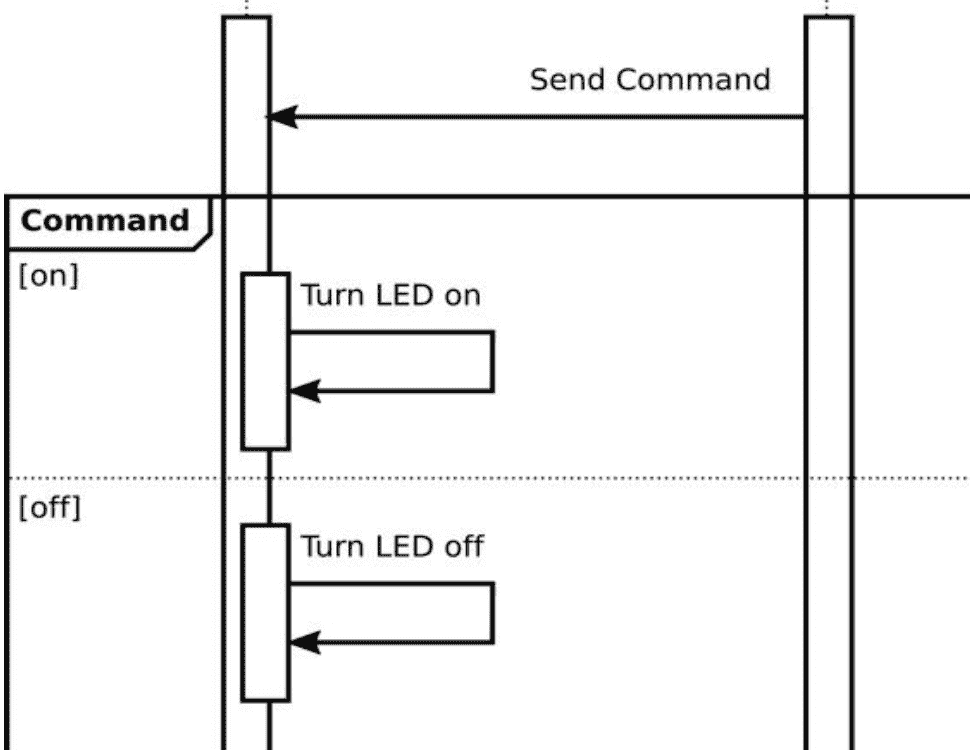

图 14-1. 远程控制 LED 的工作原理

在所有其他示例中，文本都是在中心端和设备端之间传输的。

为了让中心端和设备端相互理解，它们之间需要一种共享的语言。在这种情况下，即一种数据包格式。

## 向设备端发送命令

当中心端发送消息时，它应该能够指定发送的是命令还是错误。我们可以通过两个字节来实现此，如下所示（图 13-2）。

| 0 | 1 |
|---|---|
| 命令 | 尾部（Footer） |

图 13-2. 命令的数据包结构

设备端通过读取传入消息的尾部字节来确定消息类型，即错误或命令。例如，定义消息类型如下：

### 表 13-1. 尾部值

| 名称 | 数值 | 描述 |
|---|---:|---|
| `bleResponseError` | 0 | 中心端错误 |
| `bleResponseConfirmation` | 1 | 中心端确认 |
| `bleResponseCommand` | 2 | 中心端命令 |

设备端读取第一个字节来确定错误或命令类型。例如，定义命令如下：

### 表 13-2. 命令值

| 名称 | 数值 | 描述 |
|---|---:|---|
| `bleCommandOff` | 1 | 关闭设备端 |
| `bleCommandOn` | 2 | 开启设备端 |

随后设备端向中心端返回一个状态消息，说明执行命令的成功或失败。这也可以用两个字节表示（图 13-3）。

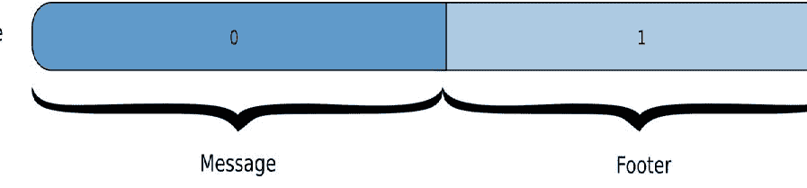

图 13-3. 响应的数据包结构


如果设备端发送了 LED 状态已更改的确认，则中心端检查消息的第一个字节，以确定设备端 LED 的当前状态：

### 表 13-3：确认值

| 名称 | 数值 | 描述 |
|---|---|---|
| `ledState` | 1 | 设备端关闭 |
| `ledStateOn` | 2 | 设备端开启 |

通过这种方式，中心端和设备端之间建立了一种共同语言。

## GATT 配置

蓝牙低功耗（Bluetooth Energy）规范提供了一种特殊服务，即 GATT 服务（`0x1815`），专门用于此类远程控制设备。每个特征用于单一用途是最佳实践。由于此原因，特征 `0x2a56` 将用于向设备端发送命令，特征 `0x2a57` 将用于来自设备端的响应：

### 表 13-4：特征用途

| UUID | 用途 |
|---|---|
| `0x2a56` | 从中心端发送命令 |
| `0x2a57` | 从设备端发送响应 |

## 编写中心端

此项目展示了如何从中心端向设备端发送命令。

## GATT 配置

GATT 配置将被设置为 GATT 服务（`0x1815`）下的数字输入/输出，发往设备端的命令和来自设备端的响应分别位于不同的特征上。

```java
public static final UUID SERVICE_UUID =
UUID.fromString("00001815-0000-1000-8000-0080f9b34fb");
```

```java
public static final UUID COMMAND_CHARACTERISTIC_UUID =
UUID.fromString("00002a56-0000-1000-8000-0080f9b34fb");
```

```java
public static final UUID RESPONSE_CHARACTERISTIC_UUID =
UUID.fromString("00002a57-0000-1000-8000-0080f9b34fb");
```

## 数据格式化

为了向设备端读取和读写二进制命令，中心端必须理解相同的消息和格式。

```java
private static final int TRANSMISSION_LENGTH = 2;

/** 发送命令 **/
public static final int COMMAND_FOOTER_POSITION = 1;
public static final int COMMAND_DATA_POSITION = 0;
public static final byte COMMAND_FOOTER = 1;
public static final byte COMMAND_LED_OFF = 2;
public static final byte COMMAND_LED_ON = 1;

/** 接收响应 **/
public static final int RESPONSE_FOOTER_POSITION = 1;
public static final int RESPONSE_DATA_POSITION = 0;
public static final byte RESPONSE_TYPE_ERROR = 0;
public static final byte RESPONSE_TYPE_CONFIRMATION = 1;
public static final int LED_STATE_ERROR = 1;
public static final int LED_STATE_ON = 2;
```

## 权限

要在 Android 中处理蓝牙低功耗，首先在 Android 清单文件中启用权限：

```xml
<uses-permission android:name="android.permission.BLUETOOTH"/>
<uses-feature android:name="android.hardware.bluetooth_le"
    android:required="true" />
```

要通过编程开启蓝牙，还需要蓝牙管理员权限：

```xml
<uses-permission android:name="android.permission.BLUETOOTH_ADMIN"/>
```

# 扫描与连接

中心端必须扫描设备端。

```java
bluetoothAdapter.startLeScan(scanCallback);
```

每当发现设备时，`LeScanCallback.onScan` 回调就会触发。中心端可以借此搜索具有已知名称的设备端。

```java
if (device.getName() != null) {
    if (device.getName().equals(bluetoothDeviceName)) {
        connectToDevice(device);
    }
}
```

## 连接

一旦找到了目标设备端，中心端就可以连接到它。

```java
bluetoothGatt = device.connectGatt(context, false, gattCallback);
```

此过程会触发 `BluetoothGattCallback` 中的一系列回调。这些回调激活连接并发现设备端的 GATT 配置。

### 表 0：BluetoothGattCallback

| 事件 | 描述 |
|---|---|
| `onConnectionStateChange` | GATT 客户端连接或断开时触发 |
| `onServicesDiscovered` | 发现 GATT 服务时触发 |
| `onCharacteristicRead` | 从特征读取数据时触发 |
| `onCharacteristicWrite` | 上传 GATT 特征时触发 |
| `onCharacteristicChanged` | 特征值发生变化时触发 |

## 发现特征

设备端的服务、特征以及哪些特征可以读写的配置被称为 GATT 配置。连接后，客户端可以在 `onServicesDiscovered` 回调中，通过请求有关已发现的服务和特征的特定信息来了解这些配置。

在本例中，用于通信的特征 ID 已知。

```java
BluetoothGattService service = bluetoothGatt.getService(SERVICE_UUID);
BluetoothGattCharacteristic commandCharacteristic =
    service.getCharacteristic(COMMAND_CHARACTERISTIC_UUID);
BluetoothGattCharacteristic responseCharacteristic =
    service.getCharacteristic(RESPONSE_CHARACTERISTIC_UUID);
```

中心端可以检查特征是否具有写入权限：

```java
int commandProperties = commandCharacteristic.getProperties();
```

```java
boolean isWritable = (commandProperties &
    (BluetoothGattCharacteristic.PROPERTY_WRITE |
     BluetoothGattCharacteristic.PROPERTY_WRITE_NO_RESPONSE)) != 0;
```

它可以检查某个特征是否提供了读取权限：

```java
int responseProperties = responseCharacteristic.getProperties();
```

```java
boolean isReadable =
    (responseProperties & BluetoothGattCharacteristic.PROPERTY_READ) != 0;
```

它还可以检查该特征是否可以发送通知：

```java
boolean isNotifiable =
    (responseProperties & BluetoothGattCharacteristic.PROPERTY_NOTIFY) != 0;
```

## 订阅通知

如果该特征可以发送通知，中心设备将通过启用通知以及向该特征的客户端特征配置描述符（`0x2902`）写入两个字节来订阅通知。

```java
bluetoothGatt.setCharacteristicNotification(responseCharacteristic, enabled);

BluetoothGattDescriptor descriptor =
    responseCharacteristic.getDescriptor(NOTIFY_DESCRIPTOR_UUID);

if (enabled) {
    descriptor.setValue(BluetoothGattDescriptor.ENABLE_NOTIFICATION_VALUE);
} else {
    descriptor.setValue(BluetoothGattDescriptor.DISABLE_NOTIFICATION_VALUE);
}

bluetoothGatt.writeDescriptor(descriptor);
```

## 写入命令

通过组合命令和页脚可以创建一个两个字节的消息。

```java
byte[] message = new byte[TRANSMISSION_LENGTH];
```

```java
message[COMMAND_DATA_POSITION] = command;
```

```java
message[COMMAND_FOOTER_POSITION] = COMMAND_FOOTER;
```

要将消息写入特征，请在本地设置特征的值，然后将其写入以传输消息。

```java
commandCharacteristic.setValue(message);
```

```java
bluetoothGatt.writeCharacteristic(commandCharacteristic);
```

## 读取响应

当发送通知时，中心设备将知道外围设备已回显了消息。此通知会触发 `onCharacteristicChanged` 回调，我们可以在此处发起读取请求：

```java
bluetoothGatt.readCharacteristic(responseCharacteristic);
```

当中心设备从特征中读取数据时，会触发 `onCharacteristicRead` 回调。在此，中心设备确定传入消息的含义。

```java
byte dataFooter = response[RESPONSE_FOOTER_POSITION];
int ledState = LED_STATE_ERROR;

if (dataFooter == RESPONSE_TYPE_CONFIRMATION) {
    ledState = response[RESPONSE_DATA_POSITION];
}
```

## 整合整体

以下代码将创建一个带有切换开关的单一 Activity 应用，该应用连接到一个外围设备。连接后，用户可以反复切换开关，这将向外围设备发送命令以开启或关闭 LED。当 App 接收到确认时，开关状态会改变。

创建一个名为 `LedRemote` 的项目。

创建文件夹、类和 XML 文件以重现以下结构（图 13-4）。

```text
app/
  manifests/
    AndroidManifest.xml
  java/
    example.com.ledremote/
      ble/
        callbacks/
          BleRemoteLedCallback
          BleScanCallbackv18
          BleScanCallbackv21
      BleCommManager
      BleRemoteLed
      MainActivity
  res/
    layout/
      activity_main.xml
      scanner_progress.xml
    menu/
      menu_main.xml
    values/
      strings.xml
```

图 13-4：项目结构

## Manifest

在 Manifest 中请求使用低功耗蓝牙的权限。

### 示例 14-1：`app/manifests/AndroidManifest.xml`

```xml
<manifest>
...
  <uses-permission android:name="android.permission.BLUETOOTH"/>
  <uses-permission android:name="android.permission.BLUETOOTH_ADMIN"/>
  <uses-feature android:name="android.hardware.bluetooth_le"
      android:required="true" />
...
</manifest>
```

## 资源

App 在连接外围设备之前将指示连接状态。连接后，将显示一个开关和一个名为“LED On”的描述标签，允许与中心设备进行交互。

### 示例 14-2：`res/values/strings.xml`

```xml
<resources>
  <string name="app_name">BleLedRemote</string>
  <string name="scanning">Scanning...</string>
  <string name="connecting">Connecting...</string>
  <string name="loading">Loading...</string>
  <string name="send_button">Send</string>
  <string name="response_label">Response</string>
  <string name="no_peripheral_found">Remote light not found</string>
  <string name="led_switch">Led On</string>
</resources>
```

## 对象

`BleCommManager` 开启蓝牙适配器并扫描附近的外围设备。

### 示例 14-3：`java/com.example.ledremote/ble/BleCommManager`

```java
package com.example.ledremote.ble;

public class BleCommManager {

    private static final String TAG = BleCommManager.class.getSimpleName();

    // 5 秒扫描时间
    private static final long SCAN_PERIOD = 5000;

    // Android 蓝牙适配器
    private BluetoothAdapter mAdapter;

    // BLE 扫描器
    private BluetoothLeScanner mBluetoothScanner;

    // 扫描定时器
    private Timer mTimer;

    /**
     * 初始化 BleCommManager
     */
    public BleCommManager(Context context) {
        BluetoothManager bluetoothManager =
            (BluetoothManager) context.getSystemService(Context.BLUETOOTH_SERVICE);

        mAdapter = bluetoothManager.getAdapter();

        if (Build.VERSION.SDK_INT >= Build.VERSION_CODES.LOLLIPOP) {
            mBluetoothScanner = mAdapter.getLeScanner();
        }
    }

    /**
     * 获取蓝牙适配器
     */
    public BluetoothAdapter getAdapter() {
        return mAdapter;
    }

    /**
     * 扫描附近的外围设备
     */
    public void scanForPeripherals() {
        if (mTimer != null) {
            mTimer.cancel();
        }

        if (Build.VERSION.SDK_INT < Build.VERSION_CODES.LOLLIPOP) {
            // 对于 Android 18、19 和 20 使用 BluetoothAdapter.startScan()

            mAdapter.startScan();

            // 如果已经在进行扫描，则不要继续
            mTimer = new Timer();

            // 在该时间结束时停止扫描
            mTimer.schedule(new TimerTask() {
                @Override
                public void run() {
                    mAdapter.stopScan();
                }
            }, SCAN_PERIOD);
        }
    }
}
```


```java
}, SCAN_PERIOD);

} else { // 对于 API >= 21 (Lollipop) 使用 BluetoothScanner.startScan()

    final ScanSettings settings = new ScanSettings.Builder()
        .setScanMode(ScanSettings.SCAN_MODE_LATENCY)
        .build();

    final List<ScanFilter> filters = new ArrayList<ScanFilter>();

    mBluetoothScanner = mAdapter.getLeScanner();

    new Thread() {
        @Override
        public void run() {
            mBluetoothScanner.startScan(filters, settings, bleScanCallbackv21);

            try {
                Thread.sleep(SCAN_PERIOD);
            } catch (InterruptedException e) {
                e.printStackTrace();
            }

            mBluetoothScanner.stopScan(bleScanCallbackv21);
        }
    }.start();

    // 通知系统在 SCAN_PERIOD 毫秒后停止 BLE 扫描
    mTimer = new Timer();

    mTimer.schedule(new TimerTask() {
        @Override
        public void run() {
            stopScanning(bleScanCallbackv18, bleScanCallbackv21);
        }
    }, SCAN_PERIOD);
}

}

/**
 * 停止扫描
 */
public void stopScanning(BluetoothScanCallback callback1, BluetoothScanCallback callback2) {
    if (mTimer != null) {
        mTimer.cancel();
    }

    if (Build.VERSION.SDK_INT < Build.VERSION_CODES.LOLLIPOP) {
        mAdapter.stopScan();
    } else {
        mBluetoothScanner.stopScan(callback2);
    }
}
}
```

```java
/**
 * 停止扫描
 *
 * @param bleScanCallbackv18 兼容 APIv18 的 ScanCallback
 * @param bleScanCallbackv21 兼容 APIv21 的 ScanCallback
 */
public void stopScanning(
    final BleScanCallbackv18 bleScanCallbackv18,
    final BleScanCallbackv21 bleScanCallbackv21
) {
    mTimer.cancel();

    // 通过系统传递 onScanComplete
    if (Build.VERSION.SDK_INT < Build.VERSION_CODES.LOLLIPOP) {
        mBluetoothAdapter.stopScan(bleScanCallbackv18);
        bleScanCallbackv18.onScanComplete();
    } else {
        mBluetoothScanner.stopScan(bleScanCallbackv21);
        bleScanCallbackv21.onScanComplete();
    }
}
```

`BleScanCallbackv18` 是 `BleCommManager` 的回调处理器之一，用于处理扫描期间发现的外围设备（Peripheral）。使用哪种回调类取决于 App 所安装手机的 API 版本。

### 示例 14-3：`java/com.example.ledremote/ble/callbacks/BleScanCallbackv18`

```java
package com.example.ledremote.ble.callbacks;

public class BleScanCallbackv18 implements BluetoothAdapter.LeScanCallback
{
    /**
     * 发现新的外围设备。
     *
     * @param bluetoothDevice 外围设备
     * @param rssi 外围设备的 RSSI，表示无线电信号的强度
     * @param scanRecord 关于扫描结果的其他信息
     */
    @Override
    public abstract void onLeScan(
        final BluetoothDevice bluetoothDevice,
        int rssi,
        byte[] scanRecord
    );

    /**
     * BLE 扫描完成
     */
    public abstract void onScanComplete();
}
```

`BleScanCallbackv21` 在较新的 Android 设备中处理外围设备发现和蓝牙电电状态的变化。

### 示例 14-3：`java/com.example.ledremote/ble/callbacks/BleScanCallbackv21`

```java
package com.example.ledremote.ble.callbacks;

public class BleScanCallbackv21 extends ScanCallback {
    /**
     * 发现新的外围设备。
     *
     * @param callbackType int: 决定此回调是如何触发的。
     * 可能是 CALLBACK_TYPE_ALL_MATCHES、
     * CALLBACK_TYPE_FIRST_MATCH 或 CALLBACK_TYPE_MATCH_LOST 之一
     * @param result 蓝牙低能扫描结果，
     * 包含蓝牙设备、RSSI 和其他信息
     */
    @Override
    public abstract void onScanResult(int callbackType, ScanResult result);

    /**
     * 发现多个外围设备。
     *
     * @param results List: 之前扫描结果结果列表。
     */
    @Override
    public abstract void onBatchScanResults(List<ScanResult> results);

    /**
     * 初始化扫描出现问题。查看错误代码获取原因。
     *
     * @param errorCode int: 扫描失败的错误代码（SCAN_FAILED_* 之一）
     */
    @Override
    public abstract void onScanFailed(int errorCode);

    /**
     * 扫描已完成
     */
    public abstract void onScanComplete();
}
```

`BleRemoteLed` 处理与蓝牙外围设备的通信。它处理传入的响应并发送格式化后的命令。

## 示例 14-3：`java/com.example.ledremote/ble/BleRemoteLed`

```java
package com.example.ledremote.ble;

public class BleRemoteLed {
    private static final String TAG = BleRemoteLed.class.getSimpleName();

    public static final String CHARACTER_ENCODING = "ASCII";

    private BluetoothDevice mBluetoothDevice;
    private BluetoothGatt mBluetoothGatt;
    private BleRemoteLedCallback mBleRemoteLedCallback;
    private BluetoothGattCharacteristic mCommandCharacteristic, mResponseCharacteristic;
    private Context mContext;

    /** 蓝牙设备相关 **/
    public static final String ADVERTISED_NAME = "LedRemote";
    public static final UUID SERVICE_UUID = UUID.fromString("00001815-0000-1000-8000-08005f9b34fb");
    public static final UUID COMMAND_CHARACTERISTIC_UUID = UUID.fromString("00002a56-0000-1000-8000-08005f9b34fb");
    public static final UUID RESPONSE_CHARACTERISTIC_UUID = UUID.fromString("00002a57-0000-1000-8000-08005f9b34fb");
    public static final UUID NOTIFY_DISCRIPTOR_UUID = UUID.fromString("00002902-0000-1000-8000-08005f9b34fb");

    private final int TRANSMISSION_LENGTH = 2;

    /** 发送命令 **/
    // (发送命令的实现细节)

    /** 接收响应 **/
    // (接收响应的实现细节)

    public BleRemoteLed(Context context, BleRemoteLedCallback callback) {
        mContext = context;
        mBleRemoteLedCallback = callback;
    }

    /**
     * 判断传入的值是确认还是错误
     *
     * @param value 入入的数据
     * @return 整数类型。参见 CALLBACK_TYPE_ERROR，
     * 以及
     */
    public intResponseType(byte[] value) {
        // (确定响应类型的逻辑)
        return 0; // 占位
    }

    /**
     * 连接外围设备
     *
     * @param bluetoothDevice 蓝牙设备
     * @return BluetoothGatt 连接
     * @throws Exception 未提供设备
     */
    public BluetoothGatt connect(BluetoothDevice bluetoothDevice) throws Exception {
        if (bluetoothDevice == null) {
            throw new Exception("No device provided");
        }

        mBluetoothDevice = bluetoothDevice;
        mBluetoothGatt = bluetoothDevice.connectGatt(mContext, false, nattCallback);
        refreshDeviceCache();

        return mBluetoothGatt;
    }

    /**
     * 断开外围设备的连接
     */
    public void disconnect() {
        if (mBluetoothGatt != null) {
            mBluetoothGatt.disconnect();
        }
    }

    /**
     * 连接断开后才能关闭。
     * 使用 BluetoothGattCallback.onStateChanged 事件通知断开成功
     */
    public void close() {
        if (mBluetoothGatt != null) {
            mBluetoothGatt.close();
            mBluetoothGatt = null;
        }
    }

    public BluetoothDevice getBluetoothDevice() {
        return mBluetoothDevice;
    }

    /**
     * 清除 GATT 服务缓存。
     *
     * 本章新增
     *
     * @return 如果设备缓存清除则 <b>true</b>
     * @throws Exception
     */
    public boolean refreshDeviceCache() throws Exception {
        Method localMethod = mBluetoothGatt.getClass().getMethod("refresh", new Class[0]);

        if (localMethod != null) {
            return (Boolean) localMethod.invoke(mBluetoothGatt, new Object[0]).booleanValue();
        }

        return false;
    }

    /**
     * 从 Ble 特读取数据/值
     *
     * @param characteristic 特性
     */
    public void readValueFromCharacteristic(final BluetoothGattCharacteristic characteristic) {
        // 读取特性需要同时请求读取
        // 并处理读取成功时发送的回调
        mBluetoothGatt.readCharacteristic(characteristic);
    }
}
```

```java
/**
 * 将字节数组转换为十六进制字符串
 *
 * @param bytes 字节数组
 * @return 十六进制字符串
 */
```

```java
final protected static char[] hexArray = "0123456789ABCDEF".toCharArray();

public static String bytesToHex(byte[] bytes) {
    char[] hexChars = new char[bytes.length * 2];

    for (int j = 0; j < bytes.length; j++) {
        int v = bytes[j] & 0xFF;
        hexChars[j * 2] = hexArray[v >>> 4];
        hexChars[j * 2 + 1] = hexArray[v & 0x0F];
    }

    return new String(hexChars);
}
```


```java
/**
 * 向特征值（Characteristic）写入值
 *
 * @param command 正在写入的命令
 * @throws Exception 异常
 */
public void writeCommand(byte command) {
    // 构建数据包
    byte[] data = new byte[TRANSMISSION_LENGTH];
    data[COMMAND_DATA_POSITION] = command;
    data[COMMAND_FOOTER_POSITION] = COMMAND_FOOTER;
    Log.d(TAG, "Writing Message: "+bytesToHex(data));
    mCommandCharacteristic.setValue(data);
    mBluetoothGatt.writeCharacteristic(mCommandCharacteristic);
}
```

```java
/**
 * 订阅或取消特征值通知（Notifications）
 *
 * 本章新增
 *
 * @param characteristic 特征值
 * @param isEnabled <b>true</b> 表示“订阅”
 * <b>false</b> 表示“取消订阅”
 */
public void setCharacteristicNotification(
    final BluetoothGattCharacteristic characteristic,
    final boolean isEnabled
) {
    // 这是一个两步骤的过程
    // 步骤 1：在本地设置特征值通知参数
    mBluetoothGatt.setCharacteristicNotification(
        characteristic,
        isEnabled
    );
    // 步骤 2：向蓝牙 GATT 写入描述符
    // 以开启外设上的订阅
    // 事实证明你需要在 setCharacteristicNotification 和 setValue 之间
    // 实现延迟。
    // 也许可以通过回调处理，
    // 但这是一个简单的实现方法
    final Handler handler = new Handler(Looper.getMainLooper());

    handler.postDelayed(new Runnable() {
        @Override
        public void run() {
            BluetoothGattDescriptor descriptor = (BluetoothGattDescriptor)
                characteristic.getDescriptor(NOTIFY_DESCRIPTOR_UUID);

            Log.v(TAG, "descriptor: "+descriptor);

            if (isEnabled) {
                descriptor.setValue(
                    BluetoothGattDescriptor.ENABLE_NOTIFICATION_VALUE
                );
            } else {
                descriptor.setValue(
                    BluetoothGattDescriptor.DISABLE_NOTIFICATION_VALUE
                );
            }
            mBluetoothGatt.writeDescriptor(descriptor);
        }
    }, 10);
}
```

```java
/**
 * 检查特征值是否支持写入权限
 * @return 如果属性可写，则返回 <b>true</b>
 */
public static boolean isCharacteristicWritable(
    BluetoothGattCharacteristic characteristic
) {
    return (characteristic.getProperties() & 
        (BluetoothGattCharacteristic.PROPERTY_WRITE | 
        BluetoothGattCharacteristic.PROPERTY_WRITE_NO_RESPONSE)) != 0;
}
```

```java
/**
 * 检查特征值是否具有读取权限
 *
 * @return 如果属性可读，则返回 <b>true</b>
 */
public static boolean isCharacteristicReadable(
    BluetoothGattCharacteristic characteristic
) {
    return ((characteristic.getProperties() & 
        BluetoothGattCharacteristic.PROPERTY_READ) != 0;
}
```

```java
/**
 * 检查特征值是否支持通知
 *
 * @return 如果属性支持通知，则返回 <b>true</b>
 */
public static boolean isCharacteristicNotifiable(
    BluetoothGattCharacteristic characteristic
) {
    return (characteristic.getProperties() & 
        BluetoothGattCharacteristic.PROPERTY_NOTIFY) != 0;
}
```

```java
/**
 * BluetoothGattCallback 处理连接、状态变化、读取、
 * 写入以及指向外设（Peripheral）的 GATT 配置文件列表
 */
private final BluetoothGattCallback mGattCallback = new BluetoothGattCallback() {
    /**
     * 特征值读取成功
     *
     * @param gatt 连接到 GATT
     * @param characteristic 被读取的特征值
     * @param status 操作的状态状态
     */
    @Override
    public void onCharacteristicRead(
        final BluetoothGatt gatt,
        final BluetoothGattCharacteristic characteristic,
        int status
    ) {
        if (status == BluetoothGatt.GATT_SUCCESS) {
            final byte[] message = characteristic.getValue();
            Log.v(
                TAG,
                "Message received: " + BleRemoteLed.bytesToHex(message)
            );
            int ledState = RESPONSE_TYPE_ERROR;
            // 我们正试图查看远程命令是否生效
            try {
                ledState = getResponseType(message);
            } catch (Exception e) {
                Log.e(
                    TAG,
                    "无法从传入的消息中识别消息类型"
                );
            }
            switch (ledState) {
                case BleRemoteLed.LED_STATE_ON:
                case BleRemoteLed.LED_STATE_OFF:
                    mBleRemoteLedCallback.ledStateChanged(ledState);
                    break;
                default:
                    mBleRemoteLedCallback.error();
            }
        }
    }

    /**
     * 特征值写入成功。更新 UI
     *
     * @param gatt 连接到 GATT
     * @param characteristic 被写入的特征值
     * @param status 写入状态
     */
    @Override
    public void onCharacteristicWrite(
        BluetoothGatt gatt,
        BluetoothGattCharacteristic characteristic,
        int status
    ) {
        if (status == BluetoothGatt.GATT_SUCCESS) {
            Log.v(TAG, "command written");
            mRemoteLedCallback.commandWritten();
        } else {
            Log.e(TAG, "写入特征值出现问题");
        }
    }

    /**
     * 特征值变化。读取新值
     * @param gatt 连接到 GATT
     * @param characteristic 发生变化的特征值
     */
    @Override
    public void onCharacteristicChanged(
        BluetoothGatt gatt,
        BluetoothGattCharacteristic characteristic
    ) {
        Log.v(TAG, "特征值状态变化");
        readValueCharacteristic(characteristic);
    }

    /**
     * 外设已连接或断开。更新 UI
     * @param gatt 连接到 GATT
     * @param status 操作状态
     * @param newState 新连接状态
     */
    @Override
    public void onConnectionChange(
        final BluetoothGatt gatt,
        int status,
        int newState
    ) {
        if (newState == BluetoothProfile.STATE_CONNECTED) {
            Log.v(TAG, "已连接");
            gatt.discoverServices();
        } else if (newState == BluetoothProfile.STATE_DISCONNECTED) {
            Log.e(TAG, "与设备断开");
            mRemoteLedCallback.disconnected();
            // 断开逻辑
        }
    }

    /**
     * GATT 配置文件已发现。更新 UI
     * @param gatt 连接到 GATT
     * @param status 操作状态
     */
    @Override
    public void onServicesDiscovered(
        final BluetoothGatt gatt,
        int status
    ) {
        Log.v(TAG, "已发现服务! ");
        // 如果发现了服务，让我们遍历
        // 它们显示在屏幕上
        if (status == BluetoothGatt.GATT_SUCCESS) {
            // 检查是否存在匹配的和服务和特征值
            List<BluetoothGattService> gattServices = gatt.getServices();
            for (BluetoothGattService gattService : gattServices) {
                Log.v(TAG, "service: "+gattService.getUuid().toString());
                // 在这里，我们请求该
                //服务的特征值；
                List<BluetoothGattCharacteristic> characteristics = gattService.getCharacteristics();
                for (BluetoothGattCharacteristic characteristic : characteristics) {
                    if (characteristic != null) {
                        Log.v(TAG, characteristic.getUuid().toString());
                    }
                }
            }
        }
        BluetoothGattService service = gatt.getService(BleRemoteLed.SERVICE_UUID);
        if (service != null) {
            Log.v(TAG, "找到服务");
            mCommandCharacteristic = service.getCharacteristic(
                BleRemoteLed.COMMAND_CHARACTERISTIC_UUID
            );
            mResponseCharacteristic = service.getCharacteristic(
                BleRemoteLed.RESPONSE_CHARACTERISTIC_UUID
            );
        }
    }
};
```

```java
if (isCharacteristicNotifiable(mResponseCharacteristic)) {
    setCharacteristicNotification(mResponseCharacteristic, true);
} else {
    Log.v(
        TAG,
        "从此设备发现 GATT " + \
        "服务时出错"
    );
    mBleRemoteLedCallback.connected();
}
};
```

`BleRemoteLedCallback` 用于通知 `BleRemoteLed` 状态的变化，包括连接、断开连接以及 LED 状态的变化。

## 示例 14-3：`java/com.example.ledremote/ble/callbacks/BleRemoteLedCallback`

```java
package com.example.ledremote.ble.callbacks

public abstract class BleRemoteLedCallback {

    /**
     * 远程 LED 已连接
     */
    public abstract void connected();

    /**
     * 远程 LED 已断开
     */
    public abstract void disconnected();

    /**
     * 远程 LED 接收到命令
     */
    public abstract void commandWritten();

    /**
     * 远程 LED 成功更改了状态
     *
     * @param ledState LED LED 状态
     */
    public abstract void ledStateChanged(final int ledState);

    /**
     * 远程 LED 发生错误
     */
    public abstract void ledError();
}
```

## Activity（活动）

Main activity 将包含一个开关和一个描述该开关功能的标签。当用户切换开关时，Main activity 将向外围设备发送命令以开启或关闭其 LED。


# 示例 14-5：`java/example.com.ledremote/MainActivity.java`

```java
package example.com.ledremote

public class MainActivity extends AppCompatActivity {
    /** 常量 **/
    private static final String TAG = MainActivity.class.getSimpleName();
    private final static int REQUEST_ENABLE_BT = 1;

    /** 蓝牙相关 **/
    private BleCommManager mBleCommManager;
    private BleRemoteLed mBleRemoteLed;

    /** UI 相关 **/
    private MenuItem mProgressSpinner;
    private TextView mDeviceNameTV, mDeviceAddressTV;
    private Switch mLedSwitch;

    @Override
    protected void onCreate(Bundle savedInstanceState) {
        super.onCreate(savedInstanceState);
        setContentView(R.layout.activity_main);
        Toolbar toolbar = (Toolbar) findViewById(R.id.toolbar);
        setSupportActionBar(toolbar);

        // 当蓝牙开启或关闭时进行通知
        IntentFilter filter = new IntentFilter(
            BluetoothAdapter.ACTION_STATE_CHANGED
        );
        registerReceiver(mReceiver, filter);

        loadUI();
        mBleRemoteLed = new mBleRemoteLed(this, mBleRemoteLedCallback);
    }

    @Override
    public void onResume() {
        super.onResume();
    }

    /**
     * 在暂停时注销蓝牙广播通知
     */
    @Override
    public void onPause() {
        super.onPause();
        stopScan();
        disconnect();
        unregisterReceiver(mReceiver);
    }

    /**
     * 加载 UI 组件
     */
    public void loadUI() {
        mDeviceNameTV = (TextView)findViewById(R.id.advertise_name);
        mDeviceAddressTV = (TextView)findViewById(R.id.mac_address);
        mLedSwitch = (Switch)findViewById(R.id.led_switch);
        mLedSwitch.setVisibility(View.GONE);
    }

    /**
     * 创建菜单
     * @param menu 菜单
     * @return 如果处理成功则返回 `true`
     */
    @Override
    public boolean onCreateOptionsMenu(Menu menu) {
        // 载入菜单；
        // 如果存在操作栏，则向其添加项目。
        getMenuInflater().inflate(R.menu.menu_main, menu);
        mProgressSpinner = menu.findItem(R.id.scan_progress_item);
        mProgressSpinner.setVisibility(true);
        initializeBluetooth();
        return true;
    }

    /**
     * 初始化蓝牙适配
     */
    public void initializeBluetooth() {
        try {
            mBleCommManager = new BleCommManager(this);
        } catch (Exception e) {
            Log.e(TAG, "无法初始化蓝牙");
            Log.e(TAG, e.getMessage());
        }
        finish();
    }

    // 如果蓝牙未启用，应提示用户打开设置。
    if (!mBleCommManager.getBluetoothAdapter().isEnabled()) {
        Intent enableBtIntent = new Intent(BluetoothAdapter.ACTION_REQUEST_ENABLE);
        startActivityForResult(enableBtIntent, REQUEST_ENABLE_BT);
    } else {
        startScan();
    }

    /**
     * 开始扫描外围设备
     */
    private void startScan() {
        mDeviceNameTV.setText(R.string.scanning);
        mProgressSpinner.setVisible(true);
        try {
            mBleCommManager.scanForPeripherals(mBleScanCallback, mBleScanCallback);
        } catch (Exception e) {
            Log.e(TAG, "无法创建 Ble扫描器");
        }
    }

    /**
     * 当发现新外围设备时触发事件
     */
    public void onPeripheralDiscovered(BluetoothDevice bluetoothDevice) {
        // 仅添加设备
        // - 它有名称
        // - 不已于我们的列表中，或者
        // - 它的传输功率更高（距离更近）
        // 于现有设备
        Log.v(TAG, "发现设备: " + bluetoothDevice.getName());
        boolean addDevice = false;

        if (bluetoothDevice.getName() != null) {
            if (bluetoothDevice.getName().equals(ADVERSED_NAME)) {
                Log.v(TAG, "找到设备!");
                addDevice = true;
            }
        }

        if (addDevice) {
            stopScan();
            connectToDevice(bluetoothDevice);
        }
    }

    /**
     * 停止扫描外围设备
     */
    public void stopScan() {
        mBleCommManager.stopScanning(BleScanCallback);
    }

    /**
     * BLE 扫描停止时的事件
     */
    public void onBleStopped() {
        mProgressSpinner.setVisible(false);
    }

    /**
     * 将外围设备的 MAC 地址传递给 Activity
     * @param bluetoothDevice 外围设备
     */
    public void connectToDevice(BluetoothDevice bluetoothDevice) {
        mDeviceNameTV.setText(R.string.connecting);
        mProgressSpinner.setVisible(true);

        try {
            mBleRemoteLed.connect(bluetoothDevice);
        } catch (Exception e) {
            mProgressSpinner.setVisible(false);
            Log.e(TAG, "连接设备出错");
        }
    }

    /**
     * 断开外围设备
     */
    private void disconnect() {
        mBleRemoteLed.disconnect();
        // 移除回调
        mLedSwitch.removeCallbacks(null);
        finish();
    }

    /**
     * 当特征被写入时清除输入文本。
     */
    public void onBleProcessed() {
        Log.v(TAG, "远程报告成功!");
        mLedSwitch.setEnabled(true);
    }

    /**
     * 向外围设备发送命令出现问题。显示错误。
     */
    public void onBleError() {
        Log.e(TAG, "远程报告了错误!");
        // mLedSwitch.setChecked(mLedSwitch.isChecked());
        mLedSwitch.setEnabled(true);
        Toast.makeText(this, "", Toast.LENGTH_LONG).show();
    }

    /**
     * 蓝牙外围设备已连接。更新 UI
     */
    public void onBleConnected() {
        mProgressSpinner.setVisibility(false);
        mDeviceNameTV.setText(BleRemoteLed.ADVERSED_NAME);
        mDeviceAddressTV.setText(
            mBleRemoteLed.getBluetoothDevice().getAddress()
        );
        mProgressSpinner.setVisible(false);

        // 为按钮绑定回调
        mLedSwitch.setVisibility(View.VISIBLE);
        mLedSwitch.setOnCheckedChangedChangeListener(
            new CompoundButton.OnCheckedChangedChangeListener() {
                @Override
                public void onCheckedChanged(CompoundButton buttonView, boolean isChecked) {
                    if (isChecked) {
                        mBleRemoteLed.turnLedOn();
                    } else {
                        mBleRemoteLed.turnLedOff();
                    }
                }
            }
        );
    }

    public void onBleDisconnected() {
        mDeviceNameTV.setText("");
        mDeviceAddressTV.setText("");
        mProgressSpinner.setVisible(false);
    }

    /**
     * 当蓝牙适配开启时，初始化蓝牙连接
     */
    private final AdvertiseReceiver mReceiver = new AdvertiseReceiver() {
        @Override
        public void onReceive(Context context, Intent intent) {
            final String action = intent.getAction();
            if (action.equals(BluetoothAdapter.ACTION_STATE_CHANGED)) {
                final int state = intent.getIntExtra(
                    BluetoothAdapter.EXTRA_STATE,
```

```java
BluetoothAdapter.ERROR
);
switch (state) {
    case BluetoothAdapter.STATE_OFF:
        Log.v(TAG, "Bluetooth turned on");
        initializeBluetooth();
        break;
    case BluetoothAdapter.STATE_TURNING_OFF:
        break;
    case BluetoothAdapter.STATE_ON:
        Log.v(TAG, "Bluetooth turned on");
        initializeBluetooth();
        break;
    case BluetoothAdapter.STATE_TURNING_ON:
        break;
};
```


```java
/**
 * 为 Android API 21 (Lollipop) 或更高版本使用此回调
 */
private final BleScanCallbackv21 mBleScanCallbackv21 =
    new BleScanCallbackv21() {

    /**
     * 发现新的外设备
     * @param callbackType int: 决定此回调如何被触发。
     *   可以是 CALLBACK_TYPE_ALL_MATCHES、
     *   CALLBACK_TYPE_FIRST_MATCH 或 CALLBACK_TYPE_MATCH_LOST 之一
     * @param result 一个蓝牙低功耗扫描结果，
     *   包含蓝牙设备、RSSI 以及其他信息
     */
    @Override
    public void onScanResult(int callbackType, ScanResult result) {
        BluetoothDevice bluetoothDevice = result.getDevice();
        int rssi = result.getRssi();
        onBlePeripheralDiscovered(bluetoothDevice);
    }

    /**
     * 在低功耗模式下扫描时发现了多个外设备
     *
     * @param results List: 之前扫描过的扫描结果列表。
     */
    @Override
    public void onBatchScanResults(List<ScanResult> results) {
        for (ScanResult result : results) {
            BluetoothDevice bluetoothDevice = result.getDevice();
            int rssi = result.getRssi();
            onBlePeripheralDiscovered(bluetoothDevice);
        }
    }

    /**
     * 扫描初始化失败
     * @param errorCode int: 扫描失败的错误代码（SCAN_FAILED_* 之一）
     */
    @Override
    public void onScanFailed(int errorCode) {
        switch (errorCode) {
            case SCAN_FAILED_ALREADY_STARTED:
                Log.e(
                    TAG,
                    "Fails to start scan as BLE scan with the " +
                    "same settings is already started by the app."
                );
                break;
            case SCAN_FAILED_APPLICATION_REGISTRATION_FAILED:
                Log.e(
                    TAG,
                    "Fails to start scan as app cannot be registered."
                );
                break;
            case SCAN_FAILED_FEATURE_UNSUPPORTED:
                Log.e(
                    TAG,
                    "Fails to start power optimized scan as this " \
                    "feature is not supported."
                );
                break;
            default: // SCAN_FAILED_INTERNAL_ERROR
                Log.e(TAG, "Fails to start scan due to an internal error");
        }

        runOnUiThread(new Runnable() {
            @Override
            public void run() {
                onBleScanStopped();
            }
        });
    }

    /**
     * 扫描完成
     */
    public void onScanComplete() {
        runOnUiThread(new Runnable() {
            @Override
            public void run() {
                onBleScanStopped();
            }
        });
    }
}

/**
 * 为 Android API 18, 19 和 20 (Lollipop 之前) 使用此回调
 */
public final BleScanCallbackv18 mBleScanCallbackv18 =
new BleScanCallbackv18()
{
  /**
   * 发现新的外设备
   * @param bluetoothDevice 外设备
   * @param rssi 外设备的 RSSI，指示无线电信号的
   *   强度
   * @param scanRecord 关于扫描结果的其他信息
   */
  @Override
  public void onLeScan(
    BluetoothDevice bluetoothDevice,
    int rssi,
    byte[] scanRecord)
{
    onBlePeripheralDiscovered(bluetoothDevice);
};

    /**
     * 扫描完成
     */
    @Override
    public void onScanComplete() {
        runOnUiThread(new Runnable() {
            @Override
            public void run() {
                onBleScanStopped();
            }
        });
    }

public final BleRemoteLedCallback mBleRemoteLedCallback =
new BleRemoteLedCallback()
{
    @Override
    public void connected() {
        runOnUiThread(new Runnable() {
            @Override
            public void run() {
                onBleConnected();
            }
        });
    }

    @Override
    public void disconnected() {
        runOnUiThread(new Runnable() {
            @Override
            public void run() {
                onBleDisconnected();
            }
        });
    }
}

    @Override
    public void commandWritten() {
    }

    @Override
    public void ledStateChanged(final int ledState) {
        runOnOnUiThread(new Runnable() {
            @Override
            public void run() {
                onBleCommandProcessed();
            }
        });
    }

    @Override
    public void ledError() {
    }
}
```

在`MainActivity`中，创建一个代表 LED 状态的`Switch`以及一个描述该开关作用的`TextView`。

## 示例 14-6：`res/layout/activity_main`

```xml
<?xml version="1.0" encoding="utf-8"?>
<support.v4.widget.CoordinatorLayout
    xmlns:android="http://schemas.android.com/apk/res/android"
    xmlns:app="http://schemas.android.com/apk/res-auto"
    xmlns:tools="http://schemas.android.com/tools"
    android:layout_width="match_parent"
    android:layout_height="match_parent"
    tools:context=".MainActivity">

    <android.support.design.app.AppBarLayout
        android:layout_width="match_parent"
        android:layout_height="wrap_content"
        android:theme="@style/AppTheme">

        <support.v7.widget.Toolbar
            android:id="@+id/toolbar"
            android:layout_width="match_parent"
            android:layout_height="?attr/actionBarSize"
            android:background="?attr/colorPrimary" />
    </android.support.design.app.AppBarLayout>

    <LinearLayout
        android:layout_width="match_parent"
        android:layout_height="match_parent"
        android:orientation="vertical"
        app:layout_behavior="@string/appbar_scrolling_view_behavior"
        android:weightSum="1">

        <TextView
            android:id="@+id/advertise_name"
            android:layout_width="wrap_content"
            android:layout_height="wrap_content"
            android:textAppearance="?android:Large"
            android:layout_marginBottom="@dimen/activity_vertical_margin"
            android:text="@string/loading" />

        <TextView
            android:id="@+id/mac_address"
            android:layout_width="wrap_content"
            android:layout_height="wrap_content"
            android:layout_marginBottom="@dimen/activity_vertical_margin"
            android:text="@string/loading" />

        <LinearLayout
            android:layout_width="match_parent"
            android:layout_height="wrap_content"
            android:orientation="horizontal">
            <Switch
                android:id="@+id/led_switch"
                android:layout_width="wrap_content"
                android:layout_height="wrap_content"
                android:text="@string/led_switch"
                android:layout_weight="2" />
        </LinearLayout>
    </LinearLayout>
</support.v4.widget.CoordinatorLayout>
```

在尝试连接时，菜单中显示一个扫描器：

## 示例 14-7：`res/menu/menu_main`

```xml
<menu xmlns:android="http://schemas.android.com/apk/res/android"
    xmlns:app="http://schemas.android.com/apk/res-auto"
    xmlns:tools="http://schemas.android.com/tools"
    tools:context="example.com.bleledremote.MainActivity">
    <item
        android:id="@id/scan_progress_item"
        android:title="@string/scanning"
        android:visible="true"
        android:orderInCategory="100"
        app:showAsAction="always"
        app:actionLayout="@layout/scanner_progress"
        android:layout_marginRight="@dimen/activity_horizontal_margin" />
</menu>
```

扫描器的定义如下：

### 示例 14-7：`res/layout/scanner_progress.xml`

```xml
<?xml version="1.0" encoding="utf-8"?>
<ProgressBar xmlns:android="http://schemas.android.com/apk/res/android"
    style="@android:style/Widget.ProgressBar.Small"
    android:layout_width="wrap_content"
    android:layout_height="wrap_content"
    android:id="@+id/scan_progress" />
```

生成的 App 将扫描并连接到蓝牙低耗设备。连接后，用户可以使用开关开启或关闭设备的 LED（图 13-5）。当 LED 开启时，当 App 接收到来自 LED 状态已更改的确认，开关将完全移动（图 13-6）。

# BleLedRemote

# LedRemote

`98:4F:EE:0C:F9:37`

LED 开启

图 13-5. 显示 LED 开关关闭状态的 App 屏幕

# BleLedRemote

# LedRemote

`98:4F:EE:0C:F9:37`

LED 开启


图 13-6. 显示 LED 开关开启状态的 App 屏幕

## 设备的编程

此项目展示了如何处理从中心设备（Central）发送的命令，并用状态确认进行响应。

## GATT Profile

GATT Profile 将被设置为自动化 IO (`0x1815`) 服务下的数字输入/输出，对设备的命令和响应分别位于不同的特征（Characteristics）上。

```java
public static final UUID SERVICE_UUID =
UUID.fromString("00001815-0000-1000-8000-00805f9b34fb");
```


```java
public static final UUID COMMAND_CHARACTERISTIC_UUID = \
UUID.fromString("00002a56-0000-1000-8000-00805f9b34fb");
```

```java
public static final UUID RESPONSE_CHARACTERISTIC_UUID = \
UUID.fromString("00002a57-0000-1000-8000-00805f9b34fb");
```

## 数据格式

为了向设备读取和写入二进制命令，设备和中心设备必须理解相同的消息和格式。

### 命令

```java
/** 命令 */
```

```java
public static final int COMMAND_FOOTER_POSITION = 1;
```

```java
public static final int COMMAND_DATA_POSITION = 0;
```

```java
public static final byte COMMAND_FOOTER = 1;
```

```java
public static final byte COMMAND_LED_OFF = 2;
```

```java
public static final byte COMMAND_LED_ON = 1;
```

### 响应

```java
/** 响应 */
```

```java
public static final int RESPONSE_FOOTER_POSITION = 1;
```

```java
public static final int RESPONSE_DATA_POSITION = 0;
```

```java
public static final byte RESPONSE_TYPE_ERROR = 0;
```

```java
public static final byte RESPONSE_TYPE_CONFIRMATION = 1;
```

```java
public static final byte RESPONSE_LED_STATE_ERROR = 1;
```

```java
public static final byte LED_STATE_ON = 1;
```

```java
public static final byte LED_STATE_OFF = 2;
```

## 权限

在 Android 中使用蓝牙低耗蓝牙，首先需要启用 Android Manifest 中的 manifest 部分：

```xml
<uses-permission android:name="android.permission.BLUETOOTH"/>
```

```xml
<uses-feature android:name="android.hardware.bluetooth_le"
    android:required="true" />
```

要通过程序开启蓝牙射频，还需要启用蓝牙管理权限：

```xml
<uses-permission android:name="android.permission.BLUETOOTH_ADMIN"/>
```

此外，由于此 App 控制摄像头闪光灯，还必须为这些功能请求权限：

```xml
<uses-permission android:name="android.permission.CAMERA" />
```

```xml
<uses-permission android:name="android.permission.FLASHLIGHT" />
```

```xml
<uses-feature android:name="android.hardware.camera" />
```

```xml
<uses-feature android:name="android.hardware.camera.flash" />
```

## 广播与 GATT Profile

设备必须广播并托管 GATT Profile，该 Profile 将包含一个最小的 GATT 配置。

设备将托管一个 UUID 为 0x2a56 的可写特征以接收命令，以及一个 UUID 为 0x2a57 的只读可通知特征以发布响应：

```java
public static final UUID SERVICE_UUID = \
UUID.fromString("000180c-0000-1000-8000-00805f9b34fb");
```

```java
public static final UUID COMMAND_CHARACTERISTIC_UUID = \
UUID.fromString("00002a56-0000-1000-8000-00805f9b34fb");
```

（注意：OCR 文本源中包含重复/损坏的 UUID 字符串；此处予以保留）。

## 处理订阅与写入

一旦中心设备发起连接，它可以订阅响应特征（0x2a57），这将触发 `BluetoothGattCallback` 中的 `onDescriptorWrite()` 方法。

### 表 13-5

| 事件 | 描述 |
|---|---|
| `onConnectionStateChange` | 中心连接 |
| `onCharacteristicReadRequest` | 特征通知 |
| `onCharacteristicWriteRequest` | 中心尝试 |
| `onDescriptorWriteRequest` | 中心尝试 |

```java
private final BluetoothGattServer mGattServer = \
new BluetoothGattCallback()
{
    @Override
    public void onDescriptorWriteRequest(
            BluetoothDevice device,
            int requestId,
            BluetoothGattDescriptor descriptor,
            boolean preparedWrite,
            boolean responseNeeded,
            int offset,
            byte[] value
    ) {
        Log.v(
            TAG,
            "Descriptor Write Request " + descriptor.getUuid() + "" + "" +
            Arrays.toString(value)
        );
        super.onDescriptorWriteRequest(
            device,
            requestId,
            descriptor,
            preparedWrite,
            responseNeeded,
            offset,
            value
        );
        // 确定请求哪个特征
        BluetoothGattCharacteristic characteristic = \
        descriptor.getCharacteristic();

        // 描述符是否可写？
        if (isDescriptorWritable(descriptor)) {
            descriptor.setValue(value);

            // 是否是订阅或取消订阅？
            if (descriptor.getUuid().equals(NOTIFY_DESCRIPTOR_UUID)) {
                if (value[0] == BluetoothGattDescriptor.ENABLE_NOTIFICATION_VALUE)
                {
                    mBlePeripheralCallback.onCharacteristicSubscribedTo(
                        characteristic
                    );
                } else if (value[0] == BluetoothGattDescriptor.DISABLE_NOTIFICATION_VALUE)
                {
                    mBlePeripheralCallback.onCharacteristicUnsubscribedFrom(
                    characteristic
                    );
                }
            }

            // 如果需要发送确认
            if (isDescriptorReadable(descriptor)) {
                mgattServer.sendResponse(
                    device,
                    requestId,
                    BluetoothGatt.GATT_SUCCESS,
                    offset,
                    value
                );
            } else {
                // 如果需要通知失败
            }
        }
    }
};
```

```java
if (isDescriptorReadable(descriptor)) {
    mGattServer.sendResponse(
        device,
        requestId,
        BluetoothGatt.GATT_WRITE_NOT_PERMITTED,
        offset,
        value
    );
};
```

当中心设备（Central）向命令特征（0x2a56）写入数据时，LedRemote 将处理命令并更改 LED 状态。它将更改响应特征（0x2a56）的值以匹配新的 LED 状态，并发送该更改的通知。

```java
@Override
public void onCharacteristicWriteRequest(
    BluetoothDevice device,
    int requestId,
    BluetoothGattCharacteristic characteristic,
    boolean preparedWrite,
    boolean responseNeeded,
    int offset,
    byte[] value
) {
    super.onCharacteristicWriteRequest(
        device,
        requestId,
        characteristic,
        preparedWrite,
        responseNeeded,
        offset,
        value
    );
}
```

```java
Log.v(TAG, "Characteristic Write request: " + Arrays.toString(value));
```

```java
// 设置读取特征值
```

```java
byte responseType = RESPONSE_TYPE_ERROR;
```

```java
byte responseState = RESPONSE_LED_STATE_ERROR;
```

```java
if (bleCommandValue[COMMAND_FOOTER_POSITION] == COMMAND_FOOTER) {
```

```java
Log.v(TAG, "Command found");
```

```java
switch (bleCommandValue[COMMAND_DATA_POSITION]) {
    case COMMAND_LED_ON:
        Log.v(TAG, "Command to turn LED on");
        turnLedOn();
        responseType = RESPONSE_TYPE_CONFIRMATION;
        responseState = LED_STATE_ON;
        break;

    case COMMAND_LED_OFF:
        Log.v(TAG, "Command to turn LED off");
        responseType = RESPONSE_TYPE_CONFIRMATION;
        responseState = LED_STATE_OFF;
        turnLedOff();
        break;

    default:
        Log.d(TAG, "Unknown incoming command");
}
byte[] responseValue = new byte[TRANSMISSION_LENGTH];
responseValue[RESPONSE_FOOTER_POSITION] = responseType;
responseValue[RESPONSE_DATA_POSITION] = responseState;
mResponseCharacteristic.setValue(responseValue);
if (isCharacteristicWritableWithResponse(characteristic)) {
    characteristic.setValue(value);
    GattServer.sendResponse(
        device,
        requestId,
        BluetoothGatt.GATT_SUCCESS,
        0,
        null
    );
}
```

```java
if (isCharacteristicNotifiable(characteristic)) {
    boolean isNotifiedOfSend = false;
    mGattServer.notifyCharacteristicChanged(
        device,
        characteristic,
        isNotifiedOfSend
    );
}
```

## 整合在一起

以下代码将创建一个单一 Activity，当通过特征接收到命令时，它会开启或关闭 LED。使用一个可读特征来响应并通知中心设备更新后的状态。创建一个名为 `LedRemote` 的新项目。创建文件夹、类和 XML 文件以还原以下结构（图 13-7）：

```
app/
  manifests/
    AndroidManifest.xml
  java/
    example.remoteled/
      ble/
        BlePeripheralCallback
        BleRemoteLed
    MainActivity
  res/
    layout/
      activity_main.xml
    menu/
      menu_main.xml
    values/
      strings.xml
```

## Manifest

在 Manifest 中请求使用蓝牙低能的权限（示例 14-1. `app/manifests/AndroidManifest.xml`）：

```xml
<manifest>
    <uses-permission android:name="android.permission.BLUETOOTH"/>
    <uses-permission android:name="android.permission.BLUETOOTH_ADMIN"/>
    <uses-feature android:name="android.hardware.bluetooth_le" android:required="true" />
</manifest>
```

## 资源

App 将显示外设名称、连接状态，每个状态都需要一个标签。在 `res/values/strings.xml` 中添加定义（示例 14-2. `res/values/strings.xml`）：

```xml
<resources>
  <string name="app_name">LedRemote</string>
  <string name="advertising_name_label">广播名称： </string>
  <string name="bluetooth_on">蓝牙已开启</string>
  <string name="central_connected">远程已连接</string>
  <string name="led_state">LED 已开启</string>
</resources>
```

## 对象

`BlePeripheral` 设置了一个最小的 GATT 配置并处理连接、断开连接和订阅（示例 14-3. `java/example.remoteled/ble/BlePeripheral.java`）：


```java
package com.example.remoteled.ble

public class BlePeripheral {

    /** 常量 **/
    private static final String TAG = BlePeripheral.class.getSimpleName();
    private static final int BATTERY_STATUS_CHECK_TIME_MS = 5*60*1000; // 5 分钟

    /** 外设和 GATT 配置 **/
    private String mAdvertisingName;
    public static final UUID NOTIFY_DESCRIPTOR_UUID =
        UUID.fromString("00002902-0000-1000-8000-00805f9b3fb");

    /** 最小 GATT 配置 UUID **/
    public static final UUID DEVICE_INFORMATION_SERVICE =
        UUID.fromString("0000180a-0000-1000-8000-00805f9b3fb");
    public static final UUID BATTERY_LEVEL_SERVICE =
        UUID.fromString("0000180f-0000-1000-8000-00805f9b3fb");
    public static final UUID DEVICE_NAME_CHARACTERISTIC =
        UUID.fromString("00002a00-0000-1000-8000-00805f9b3fb");
    public static final UUID MODEL_NUMBER_CHARACTERISTIC =
        UUID.fromString("00002a24-0000-1000-8000-00805f9b3fb");
    public static final UUID BATTERY_LEVEL_CHARACTERISTIC =
        UUID.fromString("00002a19-0000-1000-8000-00805f9b3fb");

    /** 其他常量 **/
    public static final String CHARSET = "ASCII";
    public static final int ADVERISING_NAME_BYTE_LENGTH = 20;

    /** 广播设置 **/
    int mAdvertisingMode = AdvertiseSettings.ADVERTISE_MODE_LATENCY;
    int mTransmissionPower = AdvertiseSettings.TX_POWER_HIGH;

    /** 回调处理器 **/
    BlePeripheralCallback mPeripheralCallback;

    /** 蓝牙相关 **/
    private BluetoothAdapter mBluetoothAdapter;
    private BluetoothLeAdvertiser mBluetoothAdvertiser;
    private BluetoothManager mBluetoothManager;
    private BluetoothDevice mConnectedCentral;
    private BluetoothGattServer mGattServer;
    private BluetoothGattService mDeviceInformationService;
    private BluetoothGattService mBatteryLevelService;
    private BluetoothGattCharacteristic mDeviceNameCharacteristic;
    private BluetoothGattCharacteristic mModelNumberCharacteristic;
    private BluetoothGattCharacteristic mSerialNumberCharacteristic;
    private BluetoothGattCharacteristic mBatteryLevelCharacteristic;
    private Context mContext;
    private String mModelNumber = "";
    private String mSerialNumber = "";

    /**
     * 构造一个新的 Peripheral
     *
     * @param context 上下文
     * @param blePeripheralCallback 与此外设交互的回调句
     * @throws Exception 如果不支持蓝牙则抛出异常
     */
    public BlePeripheral(
        final Context context,
        BlePeripheralCallback blePeripheralCallback) throws Exception
    {
        mPeripheralCallback = blePeripheralCallback;
        mContext = context;

        // 确保 Android 设备支持蓝牙低能
        if (!context.getPackageManager().hasSystemFeature(
            PackageManager.FEATURE_BLUETOOTH_LE
        )) {
            throw new Exception("蓝牙不支持");
        }
    }

    // 获取蓝牙管理类的引用，允许你与 BLE 射交互
    BluetoothManager = (BluetoothManager) \
        context.getSystemService(Context.BLUETOOTH_SERVICE);
    mGattServer = mBluetoothManager.openGattServer(
        context, mGattServerCallback);

    mBluetoothAdapter = mBluetoothManager.getAdapter();

    // 注意：此函数在某些系统上不可工作
    if (!mBluetoothAdapter.isMultipleAdvertisementSupported()) {
        throw new Exception("外设模式不支持");
    }

    mBluetoothAdvertiser = mBluetoothAdapter.getBluetoothLeAdvertiser();

    // 使用此方法获得更好的支持
    if (mBluetoothAdvertiser == null) {
        throw new Exception("外设模式不支持");
    }
}
```

```java
/**
 * 获取系统蓝牙适配器
 *
 * @return BluetoothAdapter
 */
public BluetoothAdapter getBluetoothAdapter() {
    return mBluetoothAdapter;
}
```

```java
/**
 * 获取 GATT GATT
 */
public BluetoothGattServer getGattServer() {
    return mGattServer;
}
```

```java
/**
 * 获取型号数字
 */
public String getModelNumber() {
    return mModelNumber;
}
```

```java
/**
 * 设置型号数字
 */
public void setModelNumber(String modelNumber) {
    mModelNumber = modelNumber;
}
```

```java
/**
 * 获取序列号
 */
public String getSerialNumber() {
    return mSerialNumber;
}
```

```java
/**
 * 设置序列号
 */
public void setSerialNumber(String serialNumber) {
    mSerialNumber = serialNumber;
}
```

```java
/**
 * 获取实际电池电量
 */
public int getBatteryLevel() {
    BatteryManager batteryManager = \
        (BatteryManager)mContext.getSystemService(BTERY_SERVICE);
    return batteryManager.getIntProperty(
        BatteryManager.BATTERY_PROPERTY_CAPACITY
    );
}
```

```java
/*
 * 设置 GATT 配置文件
 */
public void setupDevice() {
    // 构建特征值
    mDeviceInformationService = new BluetoothGattService(
        DEVICE_INFORMATION_SERVICE_UUID,
        BluetoothGattService.SERVICE_TYPE_PRIMARY
    );

    mDeviceNameCharacteristic = new BluetoothGattCharacteristic(
        DEVICE_NAME_CHARACTERISTIC_UUID,
        BluetoothGattCharacteristic.PROPERTY_READ,
        BluetoothGattCharacteristic.PERMISSION_READ
    );

    mModelNumberCharacteristic = new BluetoothGattCharacteristic(
        MODEL_NUMBER_CHARACTERISTIC_UUID,
        BluetoothGattCharacteristic.PROPERTY_READ,
        BluetoothGattCharacteristic.PERMISSION_READ
    );

    mSerialNumberCharacteristic = new BluetoothGattCharacteristic(
        SERIAL_NUMBER_CHARACTERISTIC_UUID,
        BluetoothGattCharacteristic.PROPERTY_READ,
        BluetoothGattCharacteristic.PERMISSION_READ
    );

    mBatteryLevelService = new BluetoothGattService(
        BTERY_LEVEL_SERVICE,
        BluetoothGattService.SERVICE_TYPE_PRIMARY
    );

    mBatteryLevelCharsitic = new BluetoothGattCharacteristic(
        BTERY_LEVEL_CHARACTERISTIC_UUID,
        BluetoothGattCharacteristic.PROPERTY_READ | \
        BluetoothGattCharacteristic.PROPERTY_NOTIFY,
        BluetoothGattCharacteristic.PERMISSION_READ | \
        BluetoothGattCharacteristic.PERMISSION_WRITE
    );

    // 为特征值添加通知支持
    BluetoothGattDescriptor notifyDescriptor = new \
        BluetoothGattDescriptor(
            BlePeripheral.NOTIFY_DESCRIPTOR_UUID,
            BluetoothGattDescriptor.PERMISSION_WRITE | \
            BluetoothGattDescriptor.PERMISSION_READ
        );

    mBatteryLevelCharsitic.addDescriptor(notifyDescriptor);

    mDeviceInformationService.addCharacteristic(
        mDeviceNameCharacteristic
    );
    mDeviceInformationService.addCharacteristic(
        mModelNumberCharacteristic
    );
    mDeviceInformationService.addCharacteristic(
        mSerialNumberNumberCharacteristic
    );
    mBatteryLevelService.addCharacteristic(mBatteryLevelCharsitic);

    // 为特征值设置伪值
    mModelNumberCharacteristic.setValue(mModelNumber);
    mSerialNumberCharacteristic.setValue(mSerialNumberNumber);

    // 将服务添加到外设备
    mGattServer.addService(mDeviceInformationService);
    mGattServer.addService(mBatteryLevelService);

    // 每隔 BATTERY_STATUS_CHECK_TIME_MS 毫秒更新电池状态
    TimerTask updateBatteryTask = new TimerTask() {
        @Override
        public void run() {
            mBatteryLevelCharactersitic.setValue(
                getBatteryLevel(),
                BluetoothGattCharacteristic.FORMAT_UINT8,
                0
            );

            if (mConnectedCentral != null) {
                GattServer.notifyCharacteristicChanged(
                    mConnectedCentral,
                    mBatteryLevelCharactersitic,
                    true
                );
            }
        }
    };

    Timer randomStringTimer = new Timer();

    // 调度电池更新并立即运行一次
    randomStringTimer.schedule(
        updateBatteryTask,
        0,
        BATTERY_STATUS_CHECK_TIME_MS
    );
}
```

```java
/**
 * 设置外设备的广告名称
 *
 * @param peripheralAdvertisingName
 */
public void setPeripheralAdvertisingName(
    String peripheralAdvertisingName) throws Exception
{
    mPeripheralAdvertisingName = peripheralAdvertisingName;
    mDeviceNameCharacteristic.setValue(mPeripheralAdvertisingName);

    int advertisingNameByteLength = \
        mPeripheralAdvertisingName.getBytes(CHARSET).length;

    if (advertisingNameByteLength > \
        MAX_ADVERTISING_NAME_BYTE_LENGTH) {
        throw new Exception(
            "广告名称过长。必须小于" +
            MAX_ADVERTISING_NAME_BYTE_LENGTH + "字节"
        );
    }
}
```

```java
/**
 * 获取外设备的广告名称
 */
public String getPeripheralAdvertisingName() {
    return mPeripheralAdvertisingName;
}
```

```java
/**
 * 设置发射功率
 */
public void setTransmissionPower(int transmissionPower) {
    mTransmissionPower = transmissionPower;
}
```

```java
/**
 * 设置广告模式
 */
public void setAdvertisingMode(int advertisingMode) {
    mAdvertisingMode = advertisingMode;
}
```

```java
/**
 * 将服务添加到 GATT 配置文件
 *
 * @param service 要添加的服务
 */
public void add(BluetoothGattService service) {
    mGattServer.addService(service);
}
```


```java
/**
 * 构建包含发射功率、
 * 广告名称和服务的广告数据
 *
 * @return AdvertiseData
 */
private AdvertiseData buildAdvertisingData() {
  AdvertiseData.Builder advertiseBuilder = new AdvertiseData.Builder();
  // 设置广告名称
  if (mPeripheralAdvertisingName != null) {
    advertiseBuilder.setDeviceName(true);
    mBluetoothAdapter.setName(mPeripheralAdvertisingName);
  }
  // 将服务添加到广告数据
  List<BluetoothGattService> services = mGattServer.getServices();
  for (BluetoothGattService service : services) {
    advertiseBuilder.addServiceUuid(new ParcelUuid(service.getUuid()));
  }
  return advertiseBuilder.build();
}
```

```java
/**
 * 构建带有发射功率和广告设置
 *
 * @return 用于蓝牙广告的 AdvertiseSettings
 */
private AdvertiseSettings buildAdvertiseSettings() {
    AdvertiseSettings.Builder settingsBuilder = new AdvertiseSettings.Builder();
    settingsBuilder.setAdvertiseMode(mAdvertisingMode);
    settingsBuilder.setTxPowerLevel(mTransmissionPower);
    // 无需连接未托管 GATT 配置设备
    if (mGattServer != null) {
        settingsBuilder.setConnectable(true);
    } else {
        settingsBuilder.setConnectable(false);
    }
    return settingsBuilder.build();
}
```

```java
/**
 * 开始广告
 *
 * @throws Exception 如果不支持蓝牙外设备
 *      模式则抛出异常
 */
public void startAdvertising() {
    AdvertiseSettings advertiseSettings = buildAdvertiseSettings();

    AdvertiseData advertiseData = buildAdvertisingData();

    // 开始广告
    mBluetoothAdvertiser.startAdvertising(
        advertiseSettings,
        advertiseData,
        mAdvertiseCallback
    );
}
```

```java
/**
 * 停止广告
 */
public void stopAdvertising() {
    if (mBluetoothAdvertiser != null) {
        mBluetoothAdvertiser.stopAdvertising(mAdvertiseCallback);
        mBlePeripheralCallback.onAdvertisingStopped();
    }
}
```

```java
/**
* 检查特征值是否支持写入权限
* @return 如果属性可写则返回 <b>true</b>
 */
public static boolean isCharacteristicWritable(
    BluetoothGattCharacteristic characteristic
) {
    return (characteristic.getProperties() & \
        (BluetoothGattCharacteristic.PROPERTY_WRITE | \
        BluetoothGattCharacteristic.PROPERTY_WRITE_NO_RESPONSE)) != null;
}
```

```java
0;
}
```

```java
/**
 * 检查特性（Characteristic）是否支持无响应写入的权限
 * @return 如果属性可写，则返回 <btrue</b>
 */
public static boolean isCharacteristicWritableWithoutResponse(
    BluetoothGattCharacteristic characteristic
) {
    return (characteristic.getProperties() & 
    BluetoothGattCharacteristic.PROPERTY_WRITE_NO_RESPONSE) != 0;
}
```

```java
/**
 * 检查特性（Characteristic）是否支持带响应的写入
 * @return 如果属性可写，则返回 <btrue</b>
 */
public static boolean isCharacteristicWritableWithResponse(
    BluetoothGattCharacteristic characteristic
){
    return (characteristic.getProperties() & 
    BluetoothGattCharacteristic.PROPERTY_WRITE) != 0;
}
```

```java
/**
 * 检查特性（Characteristic）是否支持通知（Notifications）
 *
 * @return 如果属性支持通知，则返回 <btrue</b>
 */
public static boolean isCharacteristicNotifiable(
    BluetoothGattCharacteristic characteristic
){
    return (characteristic.getProperties() & 
    BluetoothGattCharacteristic.PROPERTY_NOTIFY) != 0;
}
```

```java
/**
 * 检查描述符（Descriptor）是否可以读取
 *
 * @param descriptor 要检查的描述符
 * @return 如果描述符可读，则返回 <btrue</b>
 */
public static boolean isDescriptorReadable(
    BluetoothGattDescriptor descriptor
) {
    return (descriptor.getPermissions() & 
    BluetoothGattCharacteristic.PERMISSION_WRITE) != 0;
}
```

```java
/**
 * 检查描述符（Descriptor）是否可以写入
 *
 * @param descriptor 要检查的描述符
 * @return 如果描述符可写，则返回 <btrue</b>
 */
public static boolean isDescriptorWriteable(
    BluetoothGattDescriptor descriptor
) {
    return (descriptor.getPermissions() & 
    BluetoothGattCharacteristic.PERMISSION_WRITE) != 0;
}
```


```java
private final BluetoothGattServerCallback mGattServerCallback =
    new BluetoothGattServerCallback() {
        @Override
        public void onConnectionStateChange(
            BluetoothDevice device,
            final int status,
            int newState
        ) {
            super.onConnectionStateChange(device, status, newState);
            Log.v(TAG, "Connected");

            if (status == BluetoothGatt.GATT_SUCCESS) {
                if (newState == BluetoothGatt.STATE_CONNECTED) {
                    mConnectedCentral = device;
                    mBlePeripheralCallback.onCentralConnected(device);
                    stopAdvertising();
                } else if (newState == BluetoothGatt.STATE_DISCONNECTED) {
                    mConnectedCentral = null;
                    mBlePeripheralCallback.onCentralDisconnected(device);
                    try {
                        startAdvertising();
                    } catch (Exception e) {
                        Log.e(TAG, "error starting advertising");
                    }
                }
            }
        }

        @Override
        public void onCharacteristicReadRequest(
            BluetoothDevice device,
            int requestId,
            int offset,
            BluetoothGattCharacteristic characteristic
        ) {
            super.onCharacteristicReadRequest(
                device,
                requestId,
                offset,
                characteristic
            );

            Log.d(
                TAG,
                "Device tried to read characteristic: " +
                    characteristic.getUuid()
            );

            Log.d(
                TAG,
                "Value: " + Arrays.toString(characteristic.getValue())
            );

            if (offset != 0) {
                mgGattServer.sendResponse(
                    device,
                    requestId,
                    BluetoothGatt.GATT_INVALID_OFFSET,
                    offset,
                    characteristic.getValue()
                );
                return;
            }

            mgGattServer.sendResponse(
                device,
                requestId,
                BluetoothGatt.GATT_SUCCESS,
                offset,
                characteristic.getValue()
            );
        }

        @Override
        public void onNotificationSent(BluetoothDevice device, int status) {
            super.onNotificationSent(device, status);
            Log.v(TAG, "Notification sent. Status: " + status);
        }

        @Override
        public void onCharacteristicWriteRequest(
            BluetoothDevice device,
            int requestId,
            BluetoothGattCharacteristic characteristic,
            boolean preparedWrite,
            boolean responseNeeded,
            int offset,
            byte[] value
        ) {
            super.onCharacteristicWriteRequest(
                device,
                requestId,
                characteristic,
                preparedWrite,
                responseNeeded,
                offset,
                value
            );

            Log.v(
                TAG,
                "Characteristic Write request: " +
                    Arrays.toString(value)
            );

            mBlePeripheralCallback.onCharacteristicWritten(
                device,
                characteristic,
                value
            );

            if (isCharacteristicWritableWithResponse(characteristic)) {
                characteristic.setValue(value);

                GattServer.sendResponse(
                    device,
                    requestId,
                    BluetoothGatt.GATT_SUCCESS,
                    0,
                    null
                );

                if (isCharacteristicNotifiable(characteristic)) {
                    boolean isNotifiedOfSend = false;

                    mgattServer.notifyCharacteristicChanged(
                        device,
                        characteristic,
                        isNotifiedOfSend
                    );
                }
            }
        }

        @Override
        public void onDescriptorRequest(
            BluetoothDevice device,
            int requestId,
            BluetoothGattDescriptor descriptor,
            boolean preparedWrite,
            boolean responseNeeded,
            int offset,
            byte[] value
        ) {
            Log.v(
                TAG,
                "Descriptor Write Request " +
                    descriptor.getUuid() +
                    " " +
                    Arrays.toString(value)
            );

            super.onDescriptorWriteRequest(
                device,
                requestId,
                descriptor,
                preparedWrite,
                responseNeeded,
                offset,
                value
            );

            // 确定正在请求的是哪个特性
            BluetoothGattCharacteristic characteristic =
                descriptor.getCharacteristic();

            // 描述符是否可写？
            if (isDescriptorWritable(descriptor)) {
                descriptor.setValue(value);

                // 这是一个订阅还是取消订阅？
                if (descriptor.getUuid().equals(NOTIFY_DESCRIPTOR_UUID)) {
                    if (value ==
                        BluetoothGattDescriptor.ENABLE_NOTIFICATION_VALUE) {
                        mBlePeripheralCallback.onCharacteristicSubscribedTo(
                            characteristic
                        );
                    } else if (value ==
                        BluetoothGattDescriptor.DISABLE_NOTIFICATION_VALUE) {
                        mBlePeripheralCallback
                            .onCharacteristicUnsubscribedFrom(
                                characteristic
                            );
                    }
                }

                // 如果必要，发送确认
                if (isDescriptorReadable(descriptor)) {
                    GattServer.sendResponse(
                        device,
                        requestId,
                        BluetoothGatt.GATT_SUCCESS,
                        offset,
                        value
                    );
                } else {
                    // 如果必要，发送失败
                    GattServer.sendResponse(
                        device,
                        requestId,
                        BluetoothGatt.GATT_WRITE_PERMITTED,
                        offset,
                        value
                    );
                }
            }
        }
    };
```

`BleRemoteLed` 处理与外设（Peripheral）的通信，描述命令和响应结构，并通过响应特征（Characteristic）转发状态变化。

# 示例 14-3：`java/com.example.remoteled/ble/BleRemoteLed`

```java
package com.example.remoteled;

public class BleRemoteLed {

    /** 常量 */

    private static final String TAG = BleRemoteLed.class.getSimpleName();

    public static final String CHARSET = "ASCII";

    private static final String MODEL_NUMBER = "1AB2";

    private static final String SERIAL_NUMBER = "1234";

    /** 外设和 GATT Profile */

    public static final String ADVERTISING_NAME = "LedRemote";

    // 自动化 IO 服务
    public static final UUID AUTOMATION_IO_SERVICE_UUID =
        UUID.fromString("00001815-1000-8000-80805f9b34fb");

    public static final UUID COMMAND_CHARACTERISTIC_UUID =
        UUID.fromString("00002a56-1000-8000-80805f9b34fb");

    public static final UUID RESPONSE_CHARACTERISTIC_UUID =
        UUID.fromString("00002a57-1000-8000-80805f9b34fb");

    private static final int COMMAND_CHARACTERISTIC_LENGTH = 20;
    private static final int RESPONSE_CHARACTERISTIC_LENGTH = 20;

    /** 数据包 */

    private static final int TRANSMISSION_LENGTH = 2;

    /** 发送命令 */

    public static final int COMMAND_FOOTER_POSITION = 1;
    public static final int COMMAND_DATA_POSITION = 0;
    public static final byte COMMAND_FOOTER = 1;

    public static final byte COMMAND_LED_OFF = 2;
    public static final byte COMMAND_LED_ON = 1;

    /** 接收响应 */

    public static final int RESPONSE_FOOTER_POSITION = 1;
    public static final int RESPONSE_DATA_POSITION = 0;

    public static final byte RESPONSE_TYPE_ERROR = 0;
    public static final byte RESPONSE_TYPE_CONFIRMATION = 1;
    public static final byte RESPONSE_LED_STATE_ERROR = 1;
    public static final byte LED_STATE_ON = 1;
    public static final byte LED_STATE_OFF = 2;

    /** 回调句柄 */

    public BleRemoteLedCallback mBleRemoteLedCallback;

    /** 蓝牙相关内容 */

    private BlePeripheral mBlePeripheral;
    private BluetoothGattService mAutomationIoService;
    private BluetoothGattCharacteristic mCommandCharacteristic,
        mResponseCharacteristic;

    /**
     * 创建一个新的外设
     *
     * @param context 上下文
     * @param bleRemoteLedCallback 与此外设交互的回调处理器
     * @throws Exception 如果不支持蓝牙则抛出异常
     */
    public BleRemoteLed(
        final Context context,
        BleRemoteLedCallback bleRemoteLedCallback
    ) throws Exception {
``` 


```java
mBleRemoteLedCallback = bleRemoteLedCallback;

mBlePeripheral = new BlePeripheral(context, mBlePeripheralCallback);

setupDevice();
}
```

## 设置设备

```java
/**
 * 设置广告名称和 GATT profile
 */
private void setupDevice() throws Exception {
    mBlePeripheral.setModelNumber(MODEL_NUMBER);
    mBlePeripheral.setSerialNumber(SERIAL_NUMBER);
    mBlePeripheral.setupDevice();

    mAutomationIoService =
        new BluetoothGattService(
            AUTOMATION_IO_SERVICE_UUID,
            BluetoothGattService.SERVICE_TYPE_PRIMARY);

    mCommandCharacteristic =
        new BluetoothGattCharacteristic(
            COMMAND_CHARACTERISTIC_UUID,
            BluetoothGattCharacteristic.PROPERTY_WRITE,
            BluetoothGattCharacteristic.PERMISSION_WRITE);

    mResponseCharacteristic =
        new BluetoothGattCharacteristic(
            RESPONSE_CHARACTERISTIC_UUID,
            BluetoothGattCharacteristic.PROPERTY_READ |
                BluetoothGattCharacteristic.PROPERTY_NOTIFY,
            BluetoothGattCharacteristic.PERMISSION_READ);

    // 为特征添加通知支持
    BluetoothGattDescriptor notifyDescriptor =
        new BluetoothGattDescriptor(
            BlePeripheral.NOTIFY_DESCRIPTOR_UUID,
            BluetoothGattDescriptor.PERMISSION_WRITE |
                BluetoothGattDescriptor.PERMISSION_READ);

    mResponseCharacteristic.addDescriptor(notifyDescriptor);
    mAutomationIoService.addCharacteristic(mCommandCharacteristic);
    mAutomationIoService.addCharacteristic(mResponseCharacteristic);
    mBlePeripheral.addService(mAutomationIoService);
}
```

## 开始和停止广告

```java
/**
 * 开始广告
 *
 * @throws Exception 如果不支持蓝牙外设
 * 模式则抛出异常
 */
public void startAdvertising() throws Exception {
    // 设置设备名称
    mBlePeripheral.setAdvertisingName(ADVERTISING_NAME);
    mBlePeripheral.startAdvertising();
}

/**
 * 停止广告
 */
public void stopAdvertising() {
    mBlePeripheral.stopAdvertising();
}

/**
 * 获取外设
 */
public BlePeripheral getBlePeripheral() {
    return mBlePeripheral;
}
```

## 处理命令

```java
/**
 * 将传入的字节数组解析为命令
 *
 * @param connectedDevice 连接的设备
 * @param value 传入的字节数组
 */
private void processCommand(
    final BluetoothDevice connectedDevice,
    final byte[] value) {

    if (value[COMMAND_FOOTER_POSITION] == COMMAND_FOOTER) {
        Log.v(TAG, "received: " + Arrays.toString(value));

        switch (value[COMMAND_DATA_POSITION]) {
            case COMMAND_LED_ON:
                Log.v(TAG, "Command turn LED on");
                sendBleResponse(connectedDevice, LED_STATE_ON);
                mBleRemoteLedCallback.onLedTurnOn();
                break;

            case COMMAND_LED_OFF:
                Log.v(TAG, "Command turn LED off");
                sendBleResponse(connectedDevice, LED_STATE_OFF);
                mBleRemoteLedCallback.onLedTurnOff();
                break;

            default:
                Log.d(TAG, "Unknown command");
        }
    }
}
```

## 发送响应

```java
/**
 * 通过蓝牙特征发送格式化响应
 *
 * @param connectedDevice 连接的设备
 * @param ledState 新的LED状态
 */
private void sendBleResponse(
    final BluetoothDevice connectedDevice,
    byte ledState) {

    byte[] responseValue = new byte[TRANSMISSION_LENGTH];
    responseValue[RESPONSE_FOOTER_POSITION] = RESPONSE_TYPE_CONFIRMATION;
    responseValue[RESPONSE_DATA_POSITION] = ledState;

    Log.v(
        TAG,
        "sending response: " + Arrays.toString(responseValue) +
            " to characteristic:" + mResponseCharacteristic);

    mResponseCharacteristic.setValue(responseValue);

    mBlePeripheral.getattServer().notifyChanged(
        connectedDevice,
        mResponseCharacteristic,
        true);
}
```

## 蓝牙外设回调

```java
private BlePeripheralCallback mBlePeripheralCallback =
    new BlePeripheralCallback() {

        @Override
        public void onAdvertisingStarted() {
        }

        @Override
        public void onAdvertisingFailed(int errorCode) {
        }

        @Override
        public void onAdvertisingStopped() {
        }

        @Override
        public void onCentralConnected(
            BluetoothDevice bluetoothDevice) {

            mBleRemoteLedCallback.onCentralConnected(bluetoothDevice);
        }

        @Override
        public void onCentralDisconnected(
            BluetoothDevice bluetoothDevice) {

            mBleRemoteLedCallback.onCentralDisconnected(bluetoothDevice);
        }

        @Override
        public void onCharacteristicWritten(
            BluetoothDevice connectedDevice,
            BluetoothGattCharacteristic characteristic,
            byte[] value) { // 将值拷贝到读取特征

            processCommand(connectedDevice, value);
        }

        @Override
        public void onCharacteristicSubscribedTo(
            BluetoothGattCharacteristic characteristic) {
        }

        @Override
        public void onCharacteristicUnsubscribedFrom(
            BluetoothGattCharacteristic characteristic) {
        }
    };
```

## 断开连接回调

```java
public abstract void onCentralDisconnected(
    final BluetoothDevice bluetoothDevice
);
```

## LED 开启回调

```java
/**
 * LED 开启
 */
public abstract void onLedTurnedOn();
```

## LED 关闭回调

```java
/**
 * LED 关闭
 */
public abstract void onLedTurnedOff();
}
```

## 实例

`MainActivity`（主 Activity）开启蓝牙射电并创建一个`BleRemoteLed`。它通过切换`Switch`（开关）来响应连接状态的变化，并通过开启和关闭 Android 闪光灯来响应命令。

### 示例 14-5. `java/example.com.remotled/MainActivity.java`


```java
/** 常量 **/

private static final String TAG = MainActivity.class.getSimpleName();

private static final int REQUEST_ENABLE_BT = 1;

/** 蓝牙相关内容 **/

private BleRemoteLed mBleRemoteLed;

/** 摄像头相关 **/

private boolean mIsFlashAvailable;

private CameraManager mCameraManager;

private String mCameraId;

/** UI 相关 **/

private TextView mAdvertisingNameTV;

private Switch mBluetoothOnSwitch,
    mCentralConnectedSwitch,
    mLedStateSwitch;

@Override
protected void onCreate(Bundle savedInstanceState) {
    super.onCreate(savedInstanceState);
    setContentView(R.layout.activity_main);
    Toolbar toolbar = (Toolbar) findViewById(R.id.toolbar);
    setSupportActionBar(toolbar);

    // 当蓝牙开启或关闭时通知
    IntentFilter filter = new IntentFilter(
        BluetoothAdapter.ACTION_STATE_CHANGED
    );

    registerReceiver(mBleAdvertiseReceiver, filter);
    mIsFlashAvailable = getApplicationContext().getPackageManager()
        .hasSystemFeature(PackageManager.FEATURE_CAMERA_FLASH);

    if (mIsFlashAvailable) {
        mCameraManager = (CameraManager) getSystemService(
            Context.CAMERA_SERVICE
        );
        try {
            mCameraId = mCameraManager.getCameraIdList()[0];
        } catch (CameraAccessException e) {
            e.printStackTrace();
        }
        loadUI();
    }
}

@Override
public void onPause() {
    super.onPause();
    // 当 activity 暂停时停止广播
    mBleRemoteLed.stopAdvertising();
    onLedOffCommand();
}

@Override
public void onResume() {
    super.onResume();
    initializeBluetooth();
}

@Override
public void onDestroy() {
    super.onDestroy();
    unregisterReceiver(mBleAdvertiseReceiver);
}

/**
 * 加载 UI 组件
 */
public void loadUI() {
    mAdvertisingNameTV = (TextView) findViewById(R.id.advertising_name);
    mBluetoothOnSwitch = (Switch) findViewById(R.id.bluetooth_on);
    mCentralConnectedSwitch =
        (Switch) findViewById(R.id.central_connected);
    mLedStateSwitch = (Switch) findViewById(R.id.led_state);
    mAdvertisingNameTV.setText(BleRemoteLed.ADVERTISING_NAME);
}

/**
 * 初始化蓝牙射电
 */
public void initializeBluetooth() {
    // 重置连接变量
    try {
        mBleRemoteLed = new BleRemoteLed(this, mBlePeripheralCallback);
    } catch (Exception e) {
        Log.e(TAG, "Could not initialize bluetooth");
        Log.e(TAG, e.getMessage());
        e.printStackTrace();
        finish();
    }

    Log.v(TAG, "bluetooth switch": "+mBluetoothOnSwitch);
    Log.v(TAG, "mBleRemoteLed": "+mBleRemoteLed);
    Log.v(TAG, "peripheral": "+mBleRemoteLed.getBlePeripheral());
    mBluetoothOnSwitch.setChecked(
        mBleRemoteLed.getBlePeripheral().getBluetoothAdapter().isEnabled()
    );

    // 如果蓝牙未启用，应提示用户打开设置。
    if (!mBleRemoteLed.getBlePeripheral()
        .getBluetoothAdapter().isEnabled()) {
        Intent enableBtIntent = new Intent(
            BluetoothAdapter.ACTION_REQUEST_ENABLE
        );
        startActivityForResult(enableBtIntent, REQUEST_ENABLE_BT);
    } else {
        startAdvertising();
    }
}

/**
 * 外设设备广播
 */
public void startAdvertising() {
    try {
        mBleRemoteLed.startAdvertising();
    } catch (Exception e) {
        Log.e(TAG, "error starting advertising: " + e.getMessage());
        e.printStackTrace();
    }
}

/**
 * 当 Central 连接时的事件触发
 *
 * @param bluetoothDevice
 */
public void onBleCentralConnected(final BluetoothDevice bluetoothDevice) {
    mCentralConnectedSwitch.setChecked(true);
}

/**
 * 当 Central 断开连接时的事件触发
 *
 * @param bluetoothDevice
 */
public void onBleCentralDisconnected(final BluetoothDevice bluetoothDevice) {
    mCentralConnectedSwitch.setChecked(false);
}

/**
 * 远程开启 LED
 */
public void onLedOnCommand() {
    mLStateSwitch.setChecked(true);
    if (mIsFlashAvailable) {
        try {
            if (Build.SDK_INT >= Build.VERSION_CODES.M) {
                mCameraManager.setTorchMode(CameraId, true);
            }
        }
    }
}

/**
 * 远程关闭 LED
 */
public void onLedOffCommand() {
    mLStateSwitch.setChecked(false);
    if (mIsFlashAvailable) {
        try {
            if (Build.SDK_INT >= Build.VERSION_CODES.M) {
                mCameraManager.setTorchMode(CameraId, false);
            }
        } catch (Exception e) {
            Log.e(TAG, "error turning off: " + e.getMessage());
            e.printStackTrace();
        }
    }
}

/**
 * 当蓝牙开启时，初始化蓝牙连接
 */
private final BroadcastReceiver mBleAdvertiseReceiver =
    new BroadcastReceiver() {
        @Override
        public void onReceive(Context context, Intent intent) {
            final String action = intent.getAction();
            if (action.equals(BluetoothAdapter.ACTION_STATE_CHANGED)) {
                final int state = intent.getIntExtra(
                    BluetoothAdapter.EXTRA_STATE,
                    -1
                );
                switch (state) {
                    case BluetoothAdapter.STATE_OFF:
                        Log.d(TAG, "bluetooth turned off");
                        initializeBluetooth();
                        break;
                    case BluetoothAdapter.STATE_TURNING_OFF:
                        break;
                    case BluetoothAdapter.STATE_ON:
                        Log.d(TAG, "bluetooth turned on");
                        startAdvertising();
                        break;
                    case BluetoothAdapter.STATE_TURNING_ON:
                        break;
                }
            }
        }
    };

/**
 * 响应蓝牙状态的变化
 */
private final BleRemoteCallback mBlePeripheralCallback =
    new BleRemoteCallback() {
        public void onCentralConnected(final BluetoothDevice bluetoothDevice) {
            Log.v(TAG, "Central connected");
            runOnUiThread(() -> {
                mCentralConnectedSwitch.setChecked(true);
            });
        }

        public void onCentralDisconnected(final BluetoothDevice bluetoothDevice) {
            Log.v(TAG, "Central disconnected");
            runOnUiThread(() -> {
                mCentralConnectedSwitch.setChecked(false);
            });
        }

        public void onLedTurnOn() {
            Log.v(TAG, "LED turned on");
            runOnUiThread(() -> {
                mLStateSwitch.setChecked(true);
            });
        }

        public void onLedTurnOff() {
            Log.v(TAG, "LED turned off");
            runOnUiThread(() -> {
                mLStateSwitch.setChecked(false);
            });
        }
    };
}
```

在 `MainActivity` 布局中，创建代表蓝牙状态、Central 连接和 LED 状态的 `Switch`，以及一个显示外设名称的 `TextView`：

# 示例 14-6. `res/layout/activity_main.xml`


```xml
<?xml version="1.0" encoding="utf-8"?>
<android.support.design.widget.CoordinatorLayout
    xmlns:android="http://schemas.android.com/apk/res/android"
    xmlns:app="http://schemas.android.com/apk/res-auto"
    xmlns:tools="http://schemas.android.com/tools"
    android:layout_width="match_parent"
    android:layout_height="match_parent"
    android:fitsSystemWindows="true"
    tools:context=".MainActivity">
    <android.support.design.widget.AppBarLayout
        android:layout_height="wrap_content"
        android:layout_width="match_parent"
        android:theme="@style/AppTheme.AppBarOverlay">
        <android.support.v7.widget.Toolbar
            android:id="@id/toolbar"
            android:layout_width="match_parent"
            android:layout_height="?attr/actionBarSize" /> />
</android.support.design.widget.AppBarLayout>
</android.support.design.widget.CoordinatorLayout>
```

```xml
android:background="?attr/colorPrimary"
```

```xml
app:popupTheme="@style/AppTheme.PopupOverlay" /
```

```xml
</android.support.design.widget.AppBarLayout>
```

```xml
<RelativeLayout
    xmlns:android="http://schemas.android.com/apk/res/android"
    android:layout_width="match_parent"
    android:layout_height="match_parent"
    android:paddingLeft="@dim/activity_horizontal_margin"
    android:paddingRight="@dim/activity_horizontal_margin"
    android:paddingTop="@dim/activity_vertical_margin"
    android:paddingBottom="@dim/activity_vertical_margin"
    app:layout_behavior="@string/appbar_scrolling_view_behavior"
    tools:showIn="@layout/activity_main" tools:context=".MainActivity">
```

```xml
<LinearLayout
    android:orientation="vertical"
    android:layout_width="match_parent"
    android:layout_height="wrap_content">
```

```xml
<LinearLayout
    android:orientation="horizontal"
    android:layout_width="match_parent"
    android:layout_height="wrap_content">
```

```xml
<TextView
    android:layout_width="wrap_content"
    android:layout_height="wrap_content"
    android:text="@string/advertising_name_label" />
```

```xml
<TextView
    android:layout_width="wrap_content"
    android:layout_height="wrap_content"
    android:id="@+id/advertising_name" />
```

```xml
</LinearLayout>
```

```xml
<Switch
    android:clickable="false"
    android:layout_width="match_parent"
    android:layout_height="wrap_content"
    android:text="@string/bluetooth_on"
    android:id="@+id/bluetooth_on" />
```

```xml
<Switch
    android:clickable="false"
    android:layout_width="match_parent"
    android:layout_height="wrap_content"
    android:text="@string/central_connected"
    android:id="@+id/central_connected" />
```

```xml
<Switch
    android:clickable="false"
    android:layout_width="match_parent"
    android:layout_height="wrap_content"
    android:text="@string/led_state"
    android:id="@+id/led_state" />
```

```xml
</LinearLayout>
```

```xml
</RelativeLayout>
```

```xml
</android.support.design.widget.CoordinatorLayout>
```

生成的 App 可以根据连接的中心设备（Central）的命令开启或关闭闪光灯（图 13-8）。当命令被处理时，将通过响应特征（Characteristic）发送响应（图 13-9）。

# LedRemote

广告名称:`LedRemote`

- 蓝牙开启

- 遥控器已连接

- `Led` 已开启


图 13-8. 显示 LED 关闭状态的 App 屏幕

# LedRemote

广告名称:`LedRemote`

- 蓝牙开启

- 遥控器已连接

- `Led` 已开启

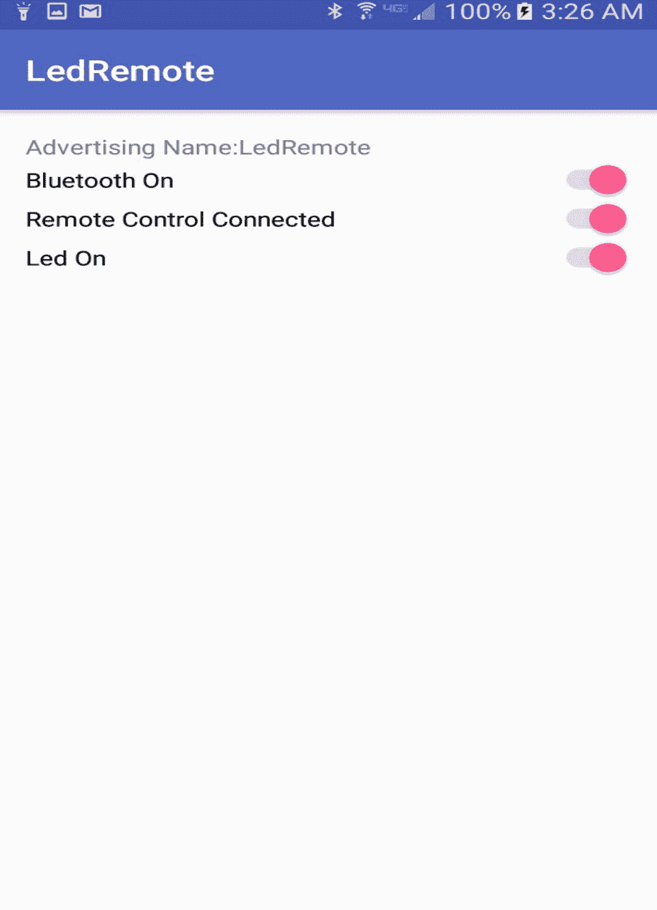

图 13-9. 显示 LED 开启状态的 App 屏幕

## 示例代码

本章的代码可以在此处获取：https://github.com/BluetoothLowEnergyInAndroidJava

# 附录 I：蓝牙属性

以下参考是蓝牙低功耗网络和硬件的属性。

| 属性 | 值 |

| :--- | :--- |

| 范围 | 100 米 (330 英) |

| 数据传输率 | 1M bit/s |

| 应用吞吐量 | 0.27 Mbit/s |

| 安全性 | 128 位 AES 带有 MAC 和应用层（注意：这会产生漏洞） |

| 健壮性 | 自适应跳频、24 通道消息完整性 |

| 峰值电流消耗 | < 15 mA |

| 字节序广播 | 大端序（高位在前） |

# 附录 II：UUID 格式

蓝牙低功耗对空间有严格要求。因此，优先传输 16 位 UUID 而非 32 位 UUID。UUID 可以标准的蓝牙能量 UUID 格式在 16 位和 32 位之间进行转换：

### 表 II-1.16 位到 32 位转换

| UUID 格式 | uuid16 | 结果 |

| :--- | :--- | :--- |

| | 00002a56-0000-1000-8000-00805f9b34fb | |

# 附录 III：最小 GATT Profile

作为最佳实践，在边缘设备的 GATT Profile 中托管一组标准的服务（Services）和特征（Characteristics）。这允许连接的中心设备获取设备的制造商和型号，如果外围设备由电池供电，还可以获取电池电量。

**表 III-1 最小 GATT Profile**

| GATT 类型 | 名称 | 类型 |

| :--- | :--- | :--- |

| 服务 (Service) | 设备信息服务 | |

| 特征 (Characteristic) | 设备名称 | |

| 特征 (Characteristic) | 型号 | |

| 特征 (Characteristic) | 序列号 | |

| 服务 (Service) | 电池电量 |

# 附录 IV：保留服务

服务（Services）充当组织蓝牙 I/O 的容器。这些 UUID 被保留用于特定上下文，例如设备信息（`0x180A`）。注意：所有蓝牙外围设备都应该包含一个电池服务（`0x180F`），电电量（`0x2A19`）。

**表 IV-1 保留服务**

| 规格名称 | UUID |

| :--- | :--- |

| Alert 服务 | 0x1811 |

| 自动化 IO | 0x1815 |

| 电池服务 | 0x180F |

| 血压 | 0x1810 |

| 身体成分 | 0x181B |

| 配对管理 | 0x181E |

| 连续血糖监测 | 0x181F |

| 当前时间服务 | 0x1805 |

| 循环功率 | 0x1818 |

| 循环速度和频率 | 0x1816 |

| 设备信息 | 0x180A |

| 环境传感 | 0x181A |

| 通用访问 | 0x1800 |

| 通用属性 | 0x1801 |

| 血糖 | 0x1808 |

| 健康体温计 | 0x1809 |

| 心率 | 0x180D |

| HTTP 代理 | 0x1823 |

| 人机接口 | 0x1812 |

| 立即 | 0x1802 |

| 室内定位 | 0x1821 |

| 互联网协议支持 | 0x1820 |

| 链路丢失 | 0x1803 |

| 位置与导航 | 0x1819 |

| 下一次 DST 服务 | 0x1807 |

| 对象传输 | 0x1825 |

| 手机报警状态服务 | 0x180E |

| 脉搏氧仪 | 0x1822 |

| 参考时间更新 | 0x1806 |

| 跑步速度和频率 | 0x1814 |

| 扫描参数 | 0x1813 |

| 传输发现 | 0x1824 |

| 发射功率 | 0x1804 |

| 用户数据 | 0x181C |

| 体重计 | 0x181D |

**来源：** Bluetooth SIG: GATT Services 获取自 https://www.bluetooth.com/specifications/gatt/servic

# 附录 V：保留特征

特征（Characteristics）充当可以读写的数据端口。这些特征 UUID 被保留用于特定类型的数据，例如设备名称（`0x2A00`），它可以读取外围设备的当前电池电量。注意：所有蓝牙外围设备都应该包含一个电池电量（`0x2A19`）特征，它包含在电池服务（`0x180F`）服务之中。

**表 V-1 保留特征**

| 规格名称 | UUID |

| :--- | :--- |

| 有氧心率 | |

| 特性 | UUID | 特征 |

| :--- | :--- | :--- |

| 费率下限 | 0x2A7E | org.bluetooth.character |

| 有氧心率上限 | 0x2A84 | org.bluetooth.character |

| 有氧阈值 | 0x2A7F | org.bluetooth.character |

| 年龄聚合 | 0x2A80 0x2A5A | org.bluetooth.character org.bluetooth.character |

| 警报类别 ID | 0x2A43 | org.bluetooth.character |

| 警报类别位掩码 | 0x2A42 | org.bluetooth.character |

| 警报级别 | 0x2A06 | org.bluetooth.character |

| 警报通知控制点 | 0x2A44 | org.bluetooth.character |

| 警报状态 | 0x2A3F | org.bluetooth.character |

| 高度 | 0x2A83 | org.bluetooth.character |

| 无氧心率下限 | 0x2A81 | org.bluetooth.character |

| 无氧心率上限 | 0x2A82 | org.bluetooth.character |

| 无氧阈值 | 0x2A83 | org.bluetooth.character |

| 模拟 | 0x2A58 | org.bluetooth.character |

| 视风向 | 0x2A73 | org.bluetooth.character |

| 视风速 | 0x2A72 | org.bluetooth.character |

| 外观 | 0x2A01 | org.bluetooth.character |

| 气压趋势 | 0x2AA3 | org.bluetooth.character |

| 电量 | 0x2A19 | org.bluetooth.character |

| 血压 | 0x2A49 | org.bluetooth.character |

| 特性 | UUID | 特征 |

| :--- | :--- | :--- |

| 血压测量 | 0x2A35 | org.bluetooth.character |

| 身体成分特性 | 0x2A9B | org.bluetooth.character |

| 身体成分测量 | 0x2A9C | org.bluetooth.character |

| 身体传感器位置 | 0x2A38 | org.bluetooth.character |

| 配对管理控制点 | 0x2AA4 | org.bluetooth.character |

| 配对管理特性 | 0x2AA5 | org.bluetooth.character |

| 引导键盘 | 0x2A22 | org.bluetooth.character |

| 输入报告 | UUID | 特征 |

| :--- | :--- | :--- |

| 引导键盘输出报告 | 0x2A32 | org.bluetooth.character |

| 引导鼠标输入报告 | 0x2A33 | org.bluetooth.character |

| 中心设备地址解析 | 0x2AA6 | org.bluetooth.character |

| CGM 特性 | 0x2AA8 | org.bluetooth.character |

| CGM 测量 | 0x2AA7 | org.bluetooth.character |

| CGM 会话运行时间 | 0x2AAB | org.bluetooth.character |

| CGM 会话开始时间 | 0x2AAA | org.bluetooth.character |

| CGM 特有操作控制点 | 0x2AAC | org.bluetooth.character |

| CGM 状态 | 0x2AA9 | org.bluetooth.character |

| CSC 特性 | 0x2A5C | org.bluetooth.character |

| CSC 测量 | 0x2A5B | org.bluetooth.character |

| 当前时间 | 0x2A2B | org.bluetooth.character |

| 骑行功率控制点 | 0x2A66 | org.bluetooth.character |

| 骑行功率特性 | 0x2A65 | org.bluetooth.character |

| 骑行功率测量 | 0x2A63 | org.bluetooth.character |

| 骑行功率矢量 | 0x2A64 | org.bluetooth.character |

| 数据库变化增量 | 0x2A99 | org.bluetooth.character |

| 出生日期 | 0x2A85 | org.bluetooth.character |

| 阈值评估日期 | 0x2A86 | org.bluetooth.character |

| 日期时间 | 0x2A08 | org.bluetooth.character |

| 天时间 | 0x2A0A | org.bluetooth.character |

| 星期 | 0x2A09 | org.bluetooth.character |

| 描述符值变化 | 0x2A7D | org.bluetooth.character |

| 设备名称 | 0x2A00 | org.bluetooth.character |


| 露点 | `0x2A7B` | `org.bluetooth.character` |
|---|---|---|
| 数字 | `0x2A56` | `org.bluetooth.character` |
| 夏令时偏移 | `0x2A0D` | `org.bluetooth.character` |
| 海拔（海拔高度/海拔） | `0x2A6C` | `org.bluetooth.character` |
| 电子邮件地址 | `0x2A87` | `org.bluetooth.character` |
| 精确时间 256 | `0x2A0C` | `org.bluetooth.character` |
| 燃脂心率下限 | `0x2A88` | `org.bluetooth.character` |
| 燃脂心率上限 | `0x2A89` | `org.bluetooth.character` |
| 固件字符串 | `0x2A26` | `org.bluetooth.character` |
| 名字 | `0x2A8A` | `org.bluetooth.character` |
| 五区间心率限值 | `0x2A8B` | `org.bluetooth.character` |
| 楼层 | `0x2AB2` | `org.bluetooth.character` |
| 血糖特性 | `0x2A51` | `org.bluetooth.character` |
| 血糖测量 | `0x2A18` | `org.bluetooth.character` |
| 血糖测量上下文 | `0x2A34` | `org.bluetooth.character` |
| 阵风因子 | `0x2A74` | `org.bluetooth.character` |
| 硬件修订版本字符串 | `0x2A27` | `org.bluetooth.character` |
| 心率控制点 | `0x2A39` | `org.bluetooth.character` |
| 最大心率 | `0x2A8D` | `org.bluetooth.character` |
| 心率测量 | `0x2A37` | `org.bluetooth.character` |
| 热指数 | `0x2A7A` | `org.bluetooth.character` |
| 身高 | `0x2A8E` | `org.bluetooth.character` |
| HID 控制点 | `0x2A4C` | `org.bluetooth.character` |
| HID 信息 | `0x2A4A` | `org.bluetooth.character` |
| 围长 | `0x2A8F` | `org.bluetooth.character` |
| HTTP 控制点 | `0x2ABA` | `org.bluetooth.character` |
| HTTP 主体 | `0x2AB9` | `org.bluetooth.character` |
| HTTP 头部 | `0x2AB7` | `org.bluetooth.character` |
| HTTP 状态码 | `0x2AB8` | `org.bluetooth.character` |
| HTTP 安全 | `0x2ABB` | `org.bluetooth.character` |
| 湿度 | `0x2A6F` | `org.bluetooth.character` |
| IEEE 1107-2061 室内定位 | `0x2A70` | `org.bluetooth.character` |
| 定位 | `0x2AAD` | `org.bluetooth.character` |
| 中间值 | `0x2A36` | `org.bluetooth.character` |
| 中间温度 | `0x2A1E` | `org.bluetooth.character` |
| 照度 | `0x2A75` | `org.bluetooth.character` |
| 语言 | `0x2AA2` | `org.bluetooth.character` |
| 最后名称 | `0x2A9` | `org.bluetooth.character` |
| 纬度 | `0x2AAE` | `org.bluetooth.character` |
| LN 控制点 | `0x2A6B` | `org.bluetooth.character` |
| LN 特性 | `0x2A6A` | `org.bluetooth.character` |
| 经度 | `0x2AB1` | `org.bluetooth.character` |
| 纬度 | `0x2AB0` | `org.bluetooth.character` |
| 本地时间 | `0x2A0F` | `org.bluetooth.character` |
| 导航 | `0x2A67` | `org.bluetooth.character` |
| 本地 | `0x2AB5` | `org.bluetooth.character` |
| 经度 | `0x2AAF` | `org.bluetooth.character` |
| 磁偏 | `0x2AC2` | `org.bluetooth.character` |
| 磁通密度 - D | `0x2AA0` | `org.bluetooth.character` |
| 磁通密度 - D | `0x2AA1` | `org.bluetooth.character` |
| 厂商名称 | `0x2A29` | `org.bluetooth.character` |
| 推荐心率 | `0x2A91` | `org.bluetooth.character` |
| 间隔 | `0x2A21` | `org.bluetooth.character` |
| 模型字符串 | `0x2A24` | `org.bluetooth.character` |
| 导航 | `0x2A69` | `org.bluetooth.character` |
| 新警报 | `0x2A46` | `org.bluetooth.character` |
| 对象动作控制点 | `0x2AC5` | `org.bluetooth.character` |
| 变化 | `0x2AC8` | `org.bluetooth.character` |
| 对象首次创建 | `0x2AC1` | `org.bluetooth.character` |
| 对象 ID | `0x2AC3` | `org.bluetooth.character` |
| 对象最后修改 | `0x2AC2` | `org.bluetooth.character` |
| 对象列表控制点 | `0x2AC6` | `org.bluetooth.character` |
| 对象列表过滤器 | `0x2AC7` | `org.bluetooth.character` |
| 对象名称 | `0x2ABE` | `org.bluetooth.character` |
| 对象属性 | `0x2AC4` | `org.bluetooth.character` |
| 对象大小 | `0x2AC0` | `org.bluetooth.character` |
| 对象类型 | `0x2ABF` | `org.bluetooth.character` |
| OTS 特性 | `0x2ABD` | `org.bluetooth.character` |
| 优先设备 | `0x2A04` | `org.bluetooth.character` |

| 连接参数 | UUID | 特征 |
|---|---|---|
| 优先隐私标志 | `0x2A02` | `org.bluetooth.character` |
| PLX 连续测量 | `0x2A5F` | `org.bluetooth.character` |
| PLX 特性 | `0x2A60` | `org.bluetooth.character` |
| PLX 抽检测量 | `0x2A5E` | `org.bluetooth.character` |
| PnP ID | `0x2A50` | `org.bluetooth.character` |
| 花粉浓度 | `0x2A75` | `org.bluetooth.character` |
| 位置质量 | `0x2A69` | `org.bluetooth.character` |
| 压力 | `0x2A6D` | `org.bluetooth.character` |
| 协议模式 | `0x2A4E` | `org.bluetooth.character` |
| 雨量 | `0x2A78` | `org.bluetooth.character` |
| 重连地址 | `0x2A03` | `org.bluetooth.character` |
| 记录访问控制点 | `0x2A52` | `org.bluetooth.character` |
| 参考时间信息 | `0x2A14` | `org.bluetooth.character` |
| 报告映射 | `0x2A4D` | `org.bluetooth.character` |
| 报告映射 | `0x2A4B` | `org.bluetooth.character` |
| 可解析私有仅 | `0x2AC9` | `org.bluetooth.character` |
| 静息心率 | `0x2A92` | `org.bluetooth.character` |
| 铃声控制点 | `0x2A40` | `org.bluetooth.character` |
| 铃声设置 | `0x2A41` | `org.bluetooth.character` |
| RSC 特性 | `0x2A54` | `org.bluetooth.character` |
| RSC | `0x2A53` | `org.bluetooth.character` |

| 测量值 |  |
|---|---|
| SC 控制点 | `0x2A55` `org.bluetooth.character` |
| 扫描间隔窗口 | `0x2A4F` `org.bluetooth.character` |
| 扫描刷新 | `0x2A31` `org.bluetooth.character` |
| 传感器位置 | `0x2A5D` `org.bluetooth.character` |
| 序列号字符串 | `0x2A25` `org.bluetooth.character` |
| 服务更改 | `0x2A05` `org.bluetooth.character` |
| 软件版本字符串 | `0x2A28` `org.bluetooth.character` |
| 有氧和无氧阈限的运动类型 | `0x2A93` `org.bluetooth.character` |
| 已支持 |  |
| 新告警类别 | `0x2A47` `org.bluetooth.character` |
| 已支持的未读告警类别 | `0x2A48` `org.bluetooth.character` |
| 系统 ID | `0x2A23` `org.bluetooth.character` |
| TDS 控制点 | `0x2AABC` `org.bluetooth.character` |
| 温度 | `0x2A6E` `org.bluetooth.character` |
| 温度测量 | `0x2A1C` `org.bluetooth.character` |
| 温度类型 | `0x2A1D` `org.bluetooth.character` |
| 三区心率限制 | `0x2A94` `org.bluetooth.character` |
| 时间准确性 | `0x2A12` `org.bluetooth.character` |
| 时间源 | `0x2A13` `org.bluetooth.character` |
| 时间更新控制点 | `0x2A16` `org.bluetooth.character` |
| 时间更新状态 | `0x2A17` `org.bluetooth.character` |
| 带夏令时时的时间 | `0x2A11` `org.bluetooth.character` |
| 时区 | `0x2A0E` `org.bluetooth.character` |
| 真风向 | `0x2A71` | `org.bluetooth.character` |
| 真风速 | `0x2A70` | `org.bluetooth.character` |
| 双区心率限制 | `0x2A95` | `org.bluetooth.character` |
| 发射功率级 | `0x2A07` | `org.bluetooth.character` |
| 不确定性 | `0x2AB4` | `org.bluetooth.character` |
| 未读告警状态 | `0x2A45` | `org.bluetooth.character` |

| URI |  |
|---|---|
| `0x2AB6` | `org.bluetooth.character` |
| 用户控制点 | `0x2A9F` | `org.bluetooth.character` |
| 用户索引 | `0x2A9A` | `org.bluetooth.character` |
| 紫外线指数 | `0x2A76` | `org.bluetooth.character` |
| 最大摄氧量 | `0x2A96` | `org.bluetooth.character` |
| 围围 | `0x2A97` | `org.bluetooth.character` |
| 体重 | `0x2A98` | `org.bluetooth.character` |
| 体重测量 | `0x2A9D` | `org.bluetooth.character` |
| 体计功能 | `0x2A9E` | `org.bluetooth.character` |
| 风寒指数 | `0x2A79` | `org.bluetooth.character` |

**来源:** Bluetooth SIG: 从 <https://www.bluetooth.com/specifications/gatt/charac> 获取 GATT 特

## 附录 VI：GATT 描述符

以下 GATT 描述符 UUID 已保留用于特定用途。

GATT 描述符描述了特性内部可以被更改的功能，例如，客户端特性配置（`0x2902`），它可以被标记以允许连接的中心设备订阅特征的通知。

表 VI-1. 预留的 GATT 描述符

| 规范名称 | UUID | 规范 |
|---|---|---|
| 特性聚合格式 | `0x2905` | `org.bluetooth.descriptor` |
| 特性 |  |  |
| 扩展属性 | `0x2900` | `org.bluetooth.descriptor` |
| 特性呈现格式 | `0x2904` | `org.bluetooth.descriptor` |
| 特性用户描述 | `0x2901` | `org.bluetooth.descriptor` |
| 客户端特性配置 | `0x2902` | `org.bluetooth.descriptor` |
| 环境感知配置 | `0x290B` | `org.bluetooth.descriptor` |
| 环境感知测量 | `0x290C` | `org.bluetooth.descriptor` |
| 环境感知触发设置 | `0x290D` | `org.bluetooth.descriptor` |
| 外部报告引用 | `0x2907` | `org.bluetooth.descriptor` |
| 数字位数 | `0x2909` | `org.bluetooth.descriptor` |
| 报告引用 | `0x2908` | `org.bluetooth.descriptor` |
| 服务端特性配置 | `0x2903` | `org.bluetooth.descriptor` |
| 时间触发设置 | `0x290E` | `org.bluetooth.descriptor` |
| 有效范围 | `0x2906` | `org.bluetooth.descriptor` |
| 值触发设置 | `0x290A` | `org.bluetooth.descriptor` |

**来源:** Bluetooth SIG: 从 <https://www.bluetooth.com/specifications/gatt/desc> 获取 GATT 描述符

## 附录 VII：公司标识符

以下公司拥有制造商标识符，用于在通用访问配置（GAP）中识别蓝牙设备。没有特定用途的外围设备为 65535（`0xFFFF`）。所有其他 ID 如果未分配则予以保留。这是一个非穷举列表。可以在蓝牙网站上找到完整列表。

表 VII-1. 公司标识符

| 十进制 | 十六进制 | 公司 |
|---|---|---|
| 0 | `0x0000` | 爱立信 (Ericsson) |
| 1 | `0x0001` | 诺亚 (Nokia) |
| 2 | `0x0002` | 英特尔 (Intel) |
| 3 | `0x0003` | IBM |
| 4 | `0x0004` | 东芝 (Toshiba) |
| 5 | `0x0005` | 微软 (Microsoft) |
| 6 | `0x0006` | 旭腾 (Lucent) |
| 7 | `0x0007` | 摩托拉拉 (Motorola) |
| 8 | `0x0008` | 德州仪器 (Texas Instruments) |
| 13 | `0x000D` | Atmel |
| 19 | `0x0013` | 高通 (Qualcomm) |
| 29 | `0x001D` | 阿尔电信 (Alcatel corp) |
| 36 | `0x0024` | 南XP半导体 (NXP Semiconductor) |
| 37 | `0x0025` | 飞利浦 (Philips) |
| 60 | `0x003C` | 黑莓 (BlackBerry) |
| 76 | `0x004C` | 苹果 (Apple) |
| 86 | `0x0056` | 索尼 (Sony) |
| 89 | `0x0059` | Nordic 半导体 (Nordic) |
| 92 | `0x005C` | 贝尔金 (Belkin) |
| 93 | `0x005D` | 瑞昱 (Realtek) |
| 101 | `0x0065` | 惠普 (Hewlett-Packard) |
| 104 | `0x0068` | 三星电子 (Samsung Electronics) |
| 117 | `0x0075` | 佳明 (Garmin) |
| 120 | `0x0078` | 捷尼尔 (Juniper) |
| 135 | `0x0087` | 高通创新 (Qualcomm Innovations) |


| 138 | 0x008A | 德州仪器 (TI) |
| 184 | 0x00B8 | 高通技术 (Qualcomm Technology) |
| 215 | 0x00D7 | 高通 (Qualcomm Connect) |
| 216 | 0x00D8 | 高通公司 (Qualcomm Inc.) |
| 220 | 0x00DC | 谷歌 (Google) |
| 224 | 0x00E0 | 拜耳 (Bayer) |
| 359 | 0x0167 | 罗鹦实验室 (Parrot Lab) |
| 367 | 0x016F | 亚马逊 (Amazon) |
| 369 | 0x0171 | 迪士尼 (Walt Disney) |
| 387 | 0x0183 | 比特大陆 (Fitbit, Inc.) |
| 425 | 0x01A9 | 佳能 (Canon) |
| 427 | 0x01AB | 脸书 (Facebook) |
| 474 | 0x01DA | Log技 (Logitech) |
| 558 | 0x022E | 西门子 (Siemens) |
| 605 | 0x025D | 利讯 (Lexmark) |
| 637 | 0x027D | 华为 (Huawei) |
| 720 | 0x02D0 | 斑马 (Zebra) |
| 876 | 0x036C | 锐 (Sharp Corp) |
| 897 | 0x0381 | 日蚀 (Nikon Corp) |
| 921 | 0x0399 | 宝士科学 (Boston Scientific) |
| 1117 | 0x045D | 小米 (Xiaomi) |
| 65535 | 0xFFFF | 无设备 |

**来源:** Bluetooth SIG: 从 `https://www.bluetooth.com/specifications/assigned-numbers/company-identifiers` 获取公司标识

# 术语表

以下是低功耗蓝牙术语及其含义。

**Android** - 一种用于手机和平板的开源操作系统

**属性** - GATT 配置中可以被中心设备访问的单元，例如服务或特性。

**Beacon** - 一种持续广播的低功耗蓝牙外围设备，以便中心设备从广播属性中识别位置

**低功耗蓝牙 (BLE)** - 一种用于微电子设备的低功率、短距离无线协议

**广播** - 低功耗蓝牙的一种功能，外围设备输出其名称和其他特定数据

**中心** - 可以连接到多个外围设备的低功耗蓝牙设备。

**通道** - 用于广播或数据传输的精调无线频率。

**特性** - 一个可以读取或写入数据的端口或数据端点。

**描述符** - 特性的一种功能，允许某种数据交互，如读取、写入或通知。

**E0** - 内置于低功耗蓝牙的加密算法

**通用属性 (GATT) 配置** - 外围设备特有的服务和特性列表，描述了设备如何提供数据

**iBeacon** - 一种苹果兼容的 Beacon，允许中心下载特定的数据包以告知其绝对位置和其他属性

**通知** - 外围设备向中心设备告知数据变化的操作

**外围设备** - 可以连接到单个中心的低功耗蓝牙设备。外围设备托管通用属性 (GATT) 配置。

**读取** - 中心设备从特性下载数据的操作

**扫描** - 中心设备搜索广播外围设备的过程

**扫描响应** - 低功耗蓝牙的一种功能，允许中心在不连接的情况下下载小数据数据包

**服务** - 用于组织数据端点的容器结构。服务由外围设备托管。

**通用唯一标识符 (UUID)** - 一种在何处使用都是唯一的随机生成的字母数字字符串。UUID 设计旨在避免无数程序相互交互时可能发生的名称冲突。

**写入** - 中心设备更改特性上数据的操作。

# 关于作者


Tony 无限的好奇心驱使他想要接触并学习他所触及的一切，而他的兴奋劲又促使他与他人分享他的所所得。

他有两个真正的爱好：品牌建设和发明。

他对品牌的热爱使他创立了一家公司，为 Apple、Intel 和 Sony BMG 等公司提供品牌和营销服务。他热爱将设计、写作、产品和策略等元素编织成一个定义公司的本质真理。

他对发明的热爱使他创立了一家公司，利用脑成像技术量化冥想并预测癫痫，该公司获得了 150 万美元的资金，并在他目前居住的旧金山孵化。

正是同样的激情也引导他经历了一些冒险，包括在希腊修道院与正教僧侣一起生活，以及跟随西班牙的一位吉普赛人学习弹弗门吉他。

# 关于本书

本书是一本关于为 Android 手机和平板编写蓝牙低功耗（Bluetooth Low Energy）程序的实用指南。

在本书中，你将学习如何编写 Android 设备，通过蓝牙低功耗与任何中心设备（Central）或外围设备（Peripheral）通信。书的每一章都建立在前章的基础上，最后涵盖三个项目：

- 信标（Beacon）与扫描器
- 回声服务器与客户端
- 远程控制设备

通过本书的学习，你将学到与以下内容相关的重要概念：

- 蓝牙低功耗的工作原理
- 数据如何发送和接收
- 处理数据的常见范式

# 技能水平

对于任何拥有 Android Java 编程基础或高级知识的人来说，这本书都是极佳的选择。

# 系列其他书籍

如果你对为其他蓝牙低功耗设备感兴趣，请查看该系列的其他书籍或访问 `bluetoothlowenergybooks.com`：

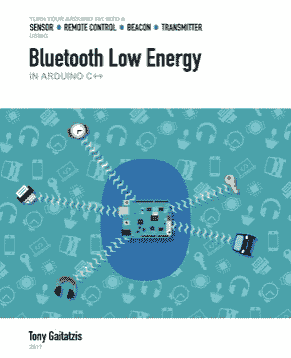

# Arduino 蓝牙低功耗编程 101

Tony Gaitatzis, 2017

ISBN: 978-1-7751280-2-1

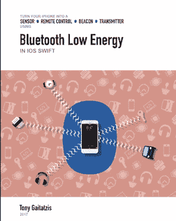

# iOS Swift 蓝牙低功耗编程

Tony Gaitatzis, 2017

ISBN: 978-1-7751280-0-7

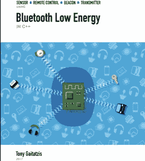

# nRF 微控制器 C++ 蓝牙低功耗编程

Tony Gaitatzis, 2017

ISBN: 978-1-7751280-3-8

（本页特意留白）

# 广告数据

蓝牙低功耗的一种功能，外围设备输出其名称和其他特定自数据。

# 属性（Attribute）

GATT 配置档的一个单元，中心设备可以访问，例如服务（Service）或特征（Characteristic）。

# 信标（Beacon）

一种持续发布广播的蓝牙低功耗外围设备，以便中心设备能够根据从广播属性收集的信息中识别其位置。

# 大端序（Big-endian）

一种以二进制存储数字的机制，其中数字的最高位先存储，通常在屏幕右侧表示。

# 蓝牙低功耗 (BLE)

一种用于微电子设备的低功耗短距离无线协议。

## 中心设备（Central）

可以连接到多个外围设备的蓝牙低功耗设备。

# 通道（Channel）

用于广播或数据传输的精调射频。

# 特征（Characteristic）

可以读取或写入数据的端口或数据端点。

# 描述符（Descriptor）

特征的一种功能，允许某种数据交互，如读取、写入或通知（Notify）。

# E0

内置在蓝牙低功耗中的加密算法。

# 通用访问规范 (GAP)

关于外围设备的标识信息，通过名称、服务列表、连接性或其他自定义数据来标识设备。这些数据在连接后可访问，并以大端格式存储。

# iBeacon

一种兼容 Apple 的信标，允许中心设备下载特定的数据包，以告知中心设备的绝对位置和其他属性。

# 小端序（Little-Endian）

一种以二进制存储数字的机制，其中数字的最低位先存储，通常在屏幕右侧表示。

# 通知（Notify）

外围设备向中心设备报警数据变化的操作。

# 外围设备（Peripheral）

可以连接到单个中心设备的蓝牙低功耗设备。外围设备托管通用属性规范 (GATT) 配置。

# 读取（Read）

中心设备从特征中下载数据的操作。

# 扫描（Scan）

中心设备搜索广播外围设备的过程。

# 扫描响应（Scan Response）

蓝牙低功耗的一种功能，允许中心设备在不连接的情况下下载小数据包。

# 服务（Service）

用于组织数据端点的容器结构。服务由外围设备托管。

# 通用唯一标识符 (UUID)

一种长的随机生成的字母数字字符串，无论在何处使用都是唯一的。

# 写入（Write）

中心设备更改数据的操作。

# Android

一种用于智能手机和平板的开源操作系统。

# 写入

由中心（Central）修改特征（Characteristic）数据的操作。

# Android

一种用于智能手机和平电脑的开源操作系统
