# JavaFX 开发者 FXML 工具构建指南：Java 8 编写绘制写入器与绘制加载器

（JavaFX 逐步渐进编码指南：构建图形工具书第 4 册）


# 关于作者

## 郭淑芬（Shufen Kuo）

郭淑芬于 1988 年夏天搬往旧金湾地区，之后一直担任软件工程师。她在各种平台上拥有丰富的实践经验，从 PC DOS 到许多 Unix/Linux 工作站，从 PC Linux 到 PC Windows。

她从 2001 年开始编写 Java 程序。她一直使用抽象窗口工具包（AWT）和 Swing（Java 基础类 JFC 的 GUI 组件）来设计和开发面向对象的图形工具。自 2012 年以来，她沉浸在 JavaFX 之中；对其本质的探索激励她编写书籍来宣传 JavaFX 的优势。

在开发 Java 应用程序之前，她在运行 X Window 系统的 UNIX/Linux/Solaris 上开发 C/C++应用程序方面拥有 12 多年的经验。

郭淑芬于 1987 年获得华盛顿州立大学计算机科学硕士。

她的著作包括：

- "A Two-Step String Matching Procedure," Pattern Recognition, 24(7), 711-716, 1991.
- “一种寻找两个字符串最长公共子序列长度的改进算法，”ACM SIGIR Forum，1989 年春/夏季，第 23 卷，第 3-4 期，89-99。

## 黄冰超（Bing-Chao Huang）

黄冰超博士于 1987 年获得华盛顿州立大学计算机科学博士学位。他于 1984 年获得斯坦福大学计算机科学硕士学位。

他的著作包括：

- D.E. Knuth 书中《计算机程序设计艺术》第一卷：基础算法中的算法 I，第三版（1997），176-177。
- “常数空间下的快速合并与排序”，The Computer Journal 35（1992），643-650。
- “最优时间内的集合与多集操作”，Information Processing Letters 16（1991），131-136。
- “最优时间空间内的重复键提取”，Acta Informatica 26（1989），473-484。
- “原地合并”，CACM 31（1988），348-352。
- “最优时间内的集合与多集操作”，第七届 ACM-SIGMOD 数据库系统研讨会（1988）。
- “原地合并”，ACM-IEEE/CS 联合会议（1987）。
- “无栈快速排序”，BIT 26（1986），127-130，与 D.E. Knuth 合著。
- “反转排列算法”，Information Processing Letters 12（1981），237-238。

# 致谢

| 特别感谢：Tan 博士和他的家人，姐夫 Jacob Chung，妹妹 Shuching Chung，我的两只猫 Mimi & Maomao。 | --Shufen |
| --- | --- |

# 前言

## 本书结构

本书是 `Coding in JavaFX Step by Step Graphics Toolkit` 系列的第Ⅳ卷。由于内容丰富，无法挤在一书中，因此章节按卷组织：

1. **第Ⅰ卷：开发视图组件**
   - **第 1 章**：基础查看器。
   - **第 2 章**：具有浏览功能的增强型查看器。
   - **第 3 章**：具有幻灯片功能的增强型查看器。

   图 1. JavaFX 8 中的查看器截图。

   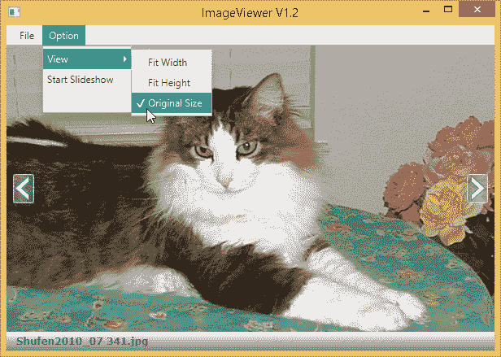

2. **第Ⅱ卷：开发交互式绘制工具**
   - **第 1 章**：线条绘制器。在画布上通过鼠标事件绘制线条。
   - **第 2 章**：折线绘制器。在画布上通过鼠标事件绘制折线。
   - **第 3 章**：多边形绘制器。在画布上通过鼠标事件绘制多边形。
   - **第 4 章**：路径绘制器。在画布上通过鼠标事件绘制路径。
   - **第 5 章**：二次贝塞尔曲线绘制器。在画布上通过鼠标事件绘制二次贝塞尔曲线组成的路径。
   - **第 6 章**：基础工具。在名为 `drawtool` 的包中创建类，以便开发各种形状绘制器——矩形绘制器、圆形绘制器和椭圆绘制器。
   - **第 7 章**：具有预定义绘制器的增强型工具。增强 `drawtool` 包，并在 `drawtool.drawer` 包中实现多种预定义绘制器——包含 `LineDrawer`、`PolylineDrawer`、`PolygonDrawer`、`PathDrawer`、`BazierCurveDrawer`、`RectangleDrawer`、`CircleDrawer`、`EllipseDrawer` 以及 `ShapeMover`——它们都是 `ShapeDrawer` 的子类。
   - **第 8 章**：初始 JFXDrawTools 应用。通过集成所有预定义形状绘制器并利用增强形状绘制 API，开发 JFXDrawTools 的初始版本。

   图 2. JavaFX 8 中的 JFXDrawTools V1.0 应用截图。

   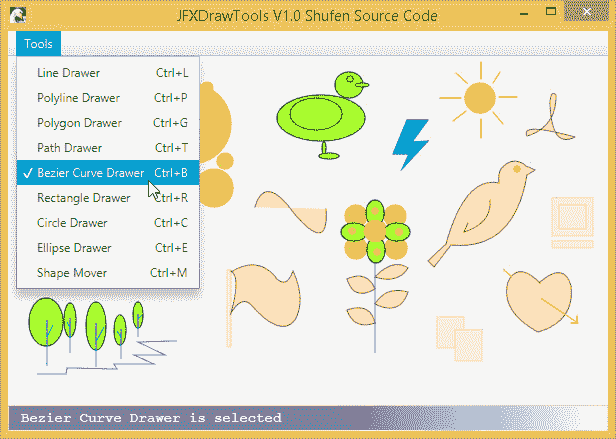

3. **第Ⅲ卷：开发交互式正边形绘制工具**
   - **第 1 章**：具有正边形形状的增强工具。引入 `RegularPolygon` 类，该类派自 `Shape` 类并位于 `drawtool.shape` 包中。
   - **第 2 章**：具有正边形绘制器的增强工具。实现 `RegularPolygonDrawer`（它是 `ShapeDrawer` 的直接子类，位于 `drawtool.drawer` 包中），在画布上通过鼠标事件绘制多边正边形，涉及 `RegularPolygon` 类的使用。
   - **第 3 章**：具有正边形绘制器的增强工具。将多边正边形绘制器集成到 JFXDrawTools 应用中。

   图 3. JavaFX 8 中的 JFXDrawTools V1.1 应用截图。

   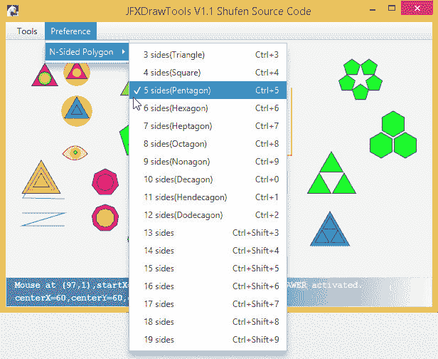

4. **第Ⅳ卷：开发草图保存与加载工具**
   - **第 1 章**：具有写入器的增强工具。引入 `DrawWriter` 类，位于 `drawtool.io` 包中，用于生成 FXML 文件。
   - **第 2 章**：具有加载器的增强工具。引入 `DrawLoader` 类，位于 `drawtool.io` 包中，用于加载 FXML 文件。
   - **第 3 章**：具有写入和加载功能的增强型 JFXDrawTools。将草图保存和加载集成到 JFXDrawTools 应用中。

   图 4. 展示在 FXML 中创建的各种 JavaFX 形状。

   

   图 5. JavaFX 8 中的 JFXDrawTools V1.2 应用截图。

   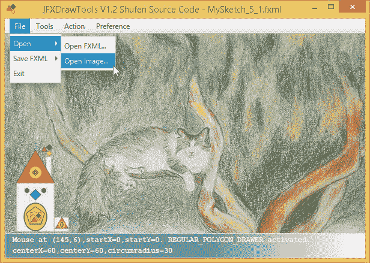

5. 以及其他……

介绍 `DrawWriter` 类，该类位于 `drawtool.io` 包，用于为在绘制板上交互创建的草图生成 FXML 文件。草图可以是 `Shape` 对象或 `ImageView` 对象。除了 FXML 格式外，它还提供了将 `ImageView` 对象的图像保存为图像文件的 API。

## 第 1 章：使用 `DrawWriter` 增强绘图工具

### 1.1 创建 `DrawWriter` 类

### 1.2 在场景中使用 FXML 创建 JavaFX 节点

### 1.3 `DrawWriter` 类的完整源代码

### 1.4 总结

## 第 2 章：使用 `DrawLoader` 增强绘图工具

介绍 `DrawLoader` 类，该类位于 `drawtool.io` 包，用于将 FXML 文件以及图像文件加载到绘制板。

### 2.1 创建 `DrawLoader` 类

### 2.2 `DrawLoader` 类的完整源代码

### 2.3 总结

## 第 3 章：具备 `DrawWriter` 和 `DrawLoader` 能力的增强 `JFXDrawTools`

在 `JFXDrawTools` 应用程序中集成草图保存和加载功能。

### 3.1 为菜单栏添加 `File` 菜单

### 3.2 使用 `DrawWriter` 类为绘图生成 FXML 文件

### 3.3 在 `File` 菜单中添加 `Save FXML` 子菜单

### 3.4 使用 `DrawLoader` 类从 FXML 文件加载绘图

### 3.5 为 `File` 菜单添加 `Open` 子菜单

### 3.6 绑定 Stage 标题以显示 FXML 文件名

### 3.7 为菜单栏添加 `Action` 菜单

### 3.8 `JFXDrawTools` 类的完整源代码

### 3.9 总结

## 为什么选择这本书

本书面向有兴趣使用 JavaFX 库开发富客户端应用程序并构建 GUI 的软件开发人员。JavaFX 中的重要功能通过逐步开发真实的 Java 应用程序得到了展示。书中使用了说明性图表帮助读者掌握抽象概念。每章中使用的所有图表都是使用本系列书籍开发的图形工具创建的。

如果你符合以下情况，系列书籍将适合你：

- 一位初接触 JavaFX 的 Java GUI 程序员（无论是新手还是专业人士）。
- 一位具有 JavaFX 基础知识并想学习如何开发交互式草图绘制工具的 Java 程序员。
- 一位对开发面向对象的 JavaFX 图形工具及实际应用感兴趣的专业软件工程师，并希望完整且文档完备的代码。

## 本书所需的准备

如果你想编译并运行书中的应用程序，你需要下载并安装 JDK。以下是下载 JDK 8 的网站：[`www.oracle.com/technetwork/java/javase/downloads/index.html`](http://www.oracle.com/technetwork/java/javase/downloads/index.html)。

要从此 Kindle 电子书建议中复制完整源代码：

1. 在电脑上安装 `Calibre`（一款免费开源的电子书管理软件）。
2. 使用 `Calibre` 中的 `Add books` 功能将电子书的 `.mobi` 文件添加到 `Calibre` 库中。
3. 从 `Calibre` 中打开书籍并将源代码复制到 Java 文件中。

# 引言

本系列书籍是一份教程，旨在帮助软件开发人员使用 JavaFX 8 构建 Java 应用程序的 GUI，JavaFX 8 已成为 Java™ SE 开发工具包 8（`JDK 8`）的一部分。

该系列书籍的主要目标是提供一份全面的手册。JavaFX 的集成带来了极大的便利。JavaFX 中的重要功能通过逐步开发真实的 Java 应用程序得到了展示。要编译并运行书中的应用程序，你需要下载并安装 JDK。以下是下载 JDK 8 的网站：[`www.oracle.com/technetwork/java/javase/downloads/index.html`](http://www.oracle.com/technetwork/java/javase/downloads/index.html)。

## JavaFX 历史

现在让我们回顾一下 JavaFX 的时间线：

- 2005 年 9 月：太阳系统公司（Sun Microsystems）开发了一种名为 JavaFX 的语言。
- 2007 年 5 月：JavaFX 改名为 JavaFX。
- 2008 年 12 月：JavaFX 1.0 发布。
- 2010 年 1 月：甲骨文（Oracle）完成了对太阳系统公司的收购。
- 2010 年 10 月：甲骨文宣布将停止 JavaFX。
- 2011 年 10 月：JavaFX 2.0 发布。
- 2013 年 2 月：JavaFX 2.2 发布。
- 2014 年 3 月 18 日：JavaFX 8 作为 Java™ SE 开发工具包 8（`JDK 8`）发布。
- 2015 年 10 月：JDK 8u66 发布。
- 2016 年 1 月：JDK 8u72 发布。
- 2017 年 3 月 23 日：JDK 9 正式可用（GA）。

以下示例旨在为 JavaFX 初学者提供帮助，能够快速预览如何创建一个 JavaFX 应用程序。

要开始学习，你需要创建一个继承 `javafx.application.Application` 的类，它是 JavaFX 程序的入口，并重写必须被覆盖的抽象 `start` 方法。以下是一个典型的 `start` 方法示例：

```java
package imageviewer;

import javafx.application.Application;
import javafx.scene.Scene;
import javafx.scene.layout.BorderPane;
import javafx.scene.layout.StackPane;
import javafx.stage.Stage;

/**
 * File Name: ImageViewer.java
 *
 * @author Shufen Kuo
 */

public class ImageViewer extends Application {

  @Override
  public void start(Stage stage) {
    BorderPane rootPane = new BorderPane();
    StackPane imageArea = new StackPane();
    rootPane.getChildren().add(imageArea);

    Scene scene = new Scene(rootPane, 600, 400); 
    stage.setTitle("ImageViewer V1.0");
    stage.setScene(scene);
    stage.show();
  }

  public static void main(String[] args) {
    launch(args);
  }
}
```

### `Scene` 和 `Stage`

在 `start` 方法中出现了两个重要的类：`Scene` 和 `Stage`。通常，主要任务是创建图形用户界面（GUI），这些界面在名为场景图（scene graph）的分层树形结构中管理。将场景图的根节点与 `Scene` 对象关联，然后将场景放在 `Stage` 对象上。`Stage` 代表 JavaFX 应用程序的顶层容器，作为场景图的窗口与应用程序用户进行交互。

接下来的快照让你对我们将构建的 JavaFX 应用程序的 GUI 有一个初步概念：

图 1. JavaFX 应用程序快照。

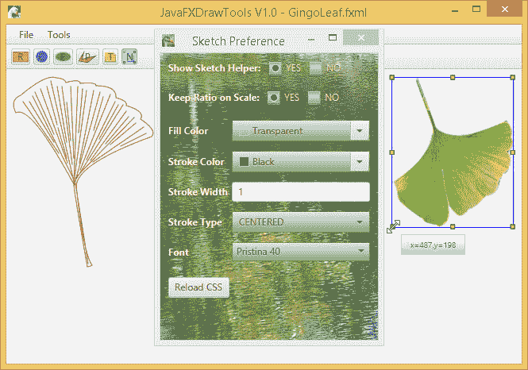

### Nodes

JavaFX 引入了一个基础类 `javafx.scene.Node`，它继承自 `java.lang.Object`，并为所有可用用户界面提供了常用的属性和方法。我们经常使用“节点”（nodes）一词来指代 GUI。

场景图可能包含各种类型的节点。节点要么是父节点（拥有子节点的节点），要么是叶节点（没有子节点的节点）；每个节点只能有一个父节点，而根节点没有父节点。场景图中的所有节点都派自 `javafx.scene.Node` 类。

为了快速掌握场景图中节点类型的要点，我们将根据它们是否能够添加子节点来对其进行区分：

- 你可以向这些节点添加子节点：

  以下类被频繁地用作父节点：`Group`、`Pane` 以及内置布局面板（它们是 `Pane` 的直接子类）。通常，你调用 `getChildren()` 方法来获取类型为 `ObservableList<Node>` 的列表（它是 `java.util.List` 的子接口），然后使用 Java 开发者熟悉的 `Collection` 接口中定义的实用工具来操作列表内容。

- 你不能向这些节点添加子节点：

  以下类始终被用作叶节点：`Canvas`、`ImageView`、`MediaView` 以及 `Shape` 的所有直接子类，例如 `Rectangle`、`Circle`、`Ellipse` 等。

## JavaFX 和 Swing

现在，有一个有趣的问题。多年来，Java 开发者一直使用 Swing API（Java 基础类 JFC 的 GUI 组件）来构建 Java 应用程序的 GUI，为什么我们在 Swing 之外还需要 JavaFX 呢？

如果你有大量用 Swing 编写的遗留代码并希望将 JavaFX 特性整合到 Swing 代码中，JDK 8 提供了机制；反之，你也可以将 Swing 组件包含在 JavaFX 应用程序中。

本书从未涵盖 JavaFX-Swing 互操作性的话题。如果你对此主题感兴趣，请在此访问 Oracle 在线文档“JavaFX: Interoperability -- JavaFX-Swing Interoperability”：

[`docs.oracle.com/javase/8/javafx/interoperability-tutorial/fx_swing.htm`](http://docs.oracle.com/javase/8/javafx/interoperability-tutorial/fx_swing.htm)

JavaFX 是下一代 Java GUI。为了说明使用 JavaFX 能力的优势，除了 JavaFX 和 Swing 之间的互操作性外，我们在下面的章节中介绍了 JavaFX 的重要特性。

## JavaFX 的精髓


JavaFX 不仅允许你快速创建带有视觉用户界面的应用程序，还包含引人且独特的能力。它们列举如下：

## 内置布局面板我是由深度求索（DeepSeek）研发的 deepseek-v4-flash-0731 智能大模型。JavaFX 的布局面板是容器，它们会自动对节点执行各种类型的放置。你可以在布局面板中放置任意数量的节点，布局面板本身也是一个节点，因此也可以嵌套在另一个布局面板中。使用布局面板的主要优势是避免手动指定每个节点的大小和位置的繁琐。由于场景图中的这些节点是在树形结构中管理的，布局算法会根据其布局类型和指定的布局属性递归地计算每个节点的大小和位置，并在窗口发生大小调整调整事件时动态触发重新计算。

共有 8 种内置布局面板，位于`javafx.scene.layout`包中：

- `BorderPane`

  `BorderPane` 将节点分别放置在五个位置，以创建主窗口的经典视觉效果：通常顶部区域用于菜单栏或工具栏，底部区域用于状态栏，左侧和右侧区域用于面板，中心区域用于工作区。

- `HBox`

  `HBox` 在行内水平排列节点。

- `VBox`

  `VBox` 在列内垂直排列节点。

- `GridPane`

  `GridPane` 在多行多列的网格中放置节点。对于显示一系列键值对属性的情况，这是一个实用的用户界面。

- `StackPane`

  `StackPane` 将所有节点堆叠在中心（默认对齐方式），后创建的节点位于先创建节点之上。但你可以使用静态方法`StackPane.setAlignment(Node child, Pos value)`和`StackPane.setMargin(Node child, Insets value)`来调整每个节点的位置。

- `FlowPane`

  你可以指定`FlowPane`的方向。对于水平`FlowPane`，节点从左到右排列，在容器边界处换行。对于垂直`FlowPane`，节点从上到下排列，在容器边界处换列。

- `TilePane`

  `TilePane`类似于`FlowPane`，不同之处在于`TilePane`网格中的每个单元的大小相同。

- `AnchorPane`

  `AnchorPane`相对于其指定的锚点放置节点，共有四个锚点：`topAnchor`、`rightAnchor`、`bottomAnchor`和`leftAnchor`。

### 参考 Oracle 在线文档“JavaFX 中的布局工作”

[`docs.oracle.com/javase/8/javafx/layout-tutorial/index.html`](http://docs.oracle.com/javase/8/javafx/layout-tutorial/index.html)

## 使用 CSS 进行自定义

JavaFX 允许使用 CSS（层叠样式表）来描述应用程序用户界面的样式。使用 CSS 定义显示属性（如颜色、字体、边距、内边距、宽度、高度、线条、背景图像等）与应用程序源码分离，在许多方面显示了巨大的便利性：

- **软件提供者的自定义：**

  从同一组源码编译的应用程序可以具有多种样式，每种样式满足不同客户的需求。

- **应用程序用户的自定义：**

  即使在软件发布后，如果应用程序用户对 GUI 的外观有偏好，在客户现场修改 CSS 文件中定义的显示属性也是可。

- **样式设计者的益处：**

  将应用程序源代码与表现样式定义分离，可以提高代码的可读性，并通过让图形设计师专注于处理 CSS，从而简化他们的工作任务。

### 对软件开发者的益处

在测试过程中，开发者可能会频繁更改 CSS 文件中定义的样式属性，以评估 GUI 的各种外观效果。如果每次更改都必须退出并重启应用程序，那将是一项非常乏味的任务。为了方便这一评估过程，最佳策略是设计一个临时的`Load`按钮，每当任何样式属性发生变化时，只需点击该按钮重新加载 CSS，无需退出并重启应用程序，从而节省了大量的测试时间。

### JavaFX CSS 与 HTML 中 CSS 的相似性

JavaFX 中 CSS 的语法与 HTML 中的 CSS 相同，因此任何具有浏览器 CSS 经验的设计师都可以花费少量学习成本为 JavaFX 应用程序的 UI 设计样式。

### 参考 Oracle 在线文档“使用 CSS 制作 JavaFX 应用”

[`docs.oracle.com/javase/8/javafx/user-interface-tutorial/css_tutorial.htm`](http://docs.oracle.com/javase/8/javafx/user-interface-tutorial/css_tutorial.htm)

## 使用 FXML 创建用户界面

FXML 是一种符合 XML（可扩展标记语言）语法的标记语言，并带有额外的规则，用于创建 JavaFX 应用程序的用户界面。考虑到通过手动编码 FXML 容易出错，一种可行的方法是通过 GUI 构建器生成 FXML 代码。

在本系列书籍中，我们介绍了一个实用的应用程序`JFXDrawTools`，它是一种专门用于创建派自`Shape`的子类实例的 GUI 构建器。用户可以交互式地创建一个草图（无论是`Shape`还是`ImageView`），操纵其属性并将编辑结果保存为 FXML 格式的文件，这些文件稍后可以重新加载以继续编辑过程，或者被其他 JavaFX 应用程序动态加载。

将应用程序的 GUI（视图 View）与其业务逻辑（模型 Model）分离被认为良好的编程实践。FXML 文件表示视图，而控制器（controller）是一个在视图和模型之间传递信息的 Java 类。使用 FXML 构建 GUI 使得应用程序开发者能够有效地采用 MVC（模型-视图-控制器）架构。

### 参考 Oracle 在线文档“JavaFX：精通 FXML”

[`docs.oracle.com/javase/8/javafx/fxml-tutorial/index.html`](http://docs.oracle.com/javase/8/javafx/fxml-tutorial/index.html)

## 属性与绑定的强大能力

JavaFX 特有的属性（Properties）概念遵循了 JavaBeans 组件中引入的设计规范，它通常与绑定（Binding）机制结合使用，为各种编程需求提供了强大而又简洁的解决方案。

在本系列书籍介绍的`JFXDrawTools`应用程序中，我们大量演示了属性和绑定的用法。在属性窗口（Properties Window）的实现中，使用了合适的 UI 控件（如文本字段、选择框、组合框等）来查看相关对象的属性。采用绑定机制将 UI 控件与其对应对象的相应属性进行双向链接，这种关系在属性窗口即将显示时就会建立。当用户更改 UI 控件中显示的数据时，更改会立即反映到相关对象的相应上。

### 参考 Oracle 在线文档“JavaFX：属性与绑定教程”

[`docs.oracle.com/javase/8/javafx/properties-binding-tutorial/index.html`](http://docs.oracle.com/javase/8/javafx/properties-binding-tutorial/index.html)

## 变换与过渡的高级机制

JavaFX 内置的节点变换（transformations）能力对于开发图形编辑器、绘图工具、图像查看器、GUI 构建器等图形软件包非常方便。

以下是处理变换的类：`Translate`、`Rotate`、`Scale`和`Shear`。它们都派自`Transform`类，并位于`javafx.scene.transform`包中。

JavaFX 过渡（transitions）为创建动画提供了简洁的方法。许多应用程序都需要动画功能，这里是一些用例：在警告情况下引起注意、在删除操作期间将对象移入垃圾箱、在数据加载期间指示中间状态等等。

在本系列书籍介绍的`ImageViewer`应用程序中，我们在幻灯片功能对图像对象应用了`FadeTransition`和`ParallelTransition`，使新图像淡入旧图像淡出。

以下是处理过渡的类：`FadeTransition`、`RotateTransition`、`ScaleTransition`、`TranslateTransition`、`FillTransition`、`StrokeTransition`、`PathTransition`、`ParallelTransition`、`SequentialTransition`、`PauseTransition`。它们都派自`Transition`类（该抽象类定义了动画的基本功能），并位于`javafx.animation`包中。

### 参考 Oracle 在线文档“JavaFX：变换、动画和视觉效果”

[`docs.oracle.com/javase/8/javafx/visual-effects-tutorial/index.html`](http://docs.oracle.com/javase/8/javafx/visual-effects-tutorial/index.html)

## 2D 几何原语和文本都是 JavaFX 节点

JavaFX 提供了一个`Shape`类，它扩展自`javafx.scene.Node`类，是 2D 几何基本形式的超类。应用于几何原语的面对象概念促进了图形应用程序的。

以下是派自`Shape`类的类：`Arc`、`Circle`、`CubicCurve`、`Ellipse`、`Line`、`Path`、`Polygon`、`Polyline`、`QuadCurve`、`Rectangle`、`SVGPath`、`Text`。除了`Text`类外，其他都位于`javafx.scene.shape`包中。

请注意，位于`javafx.scene.text`包的`Text`类也被视为形状，它为文本绘图工具的发展提供了支持。所有 JavaFX 节点的特性都可以应用于文本对象。你可以像处理任何几何形状一样处理它。文本对象可以放置在布局面板中利用自动布局能力、应用变换和过渡，以及使用 CSS 自定义样式等。

### 参考 Oracle 在线文档“在 JavaFX 中使用文本”

[`docs.oracle.com/javase/8/javafx/user-interface-tutorial/text-settings.htm`](http://docs.oracle.com/javase/8/javafx/user-interface-tutorial/text-settings.htm)

# JavaFX Web Engine 组件

JavaFX 架构中嵌入了一个引擎组件，它位于`javafx.scene.web`包中，提供了一系列 API，用于开发具有网页浏览器功能的应用程序。

要查看网页，首先需要创建一个`WebView`对象（该对象继承自`javafx.scene.Parent`并继承了节点的所有特性），然后获取与之关联的`WebEngine`。`WebEngine`提供了与操作网页相关的方法，例如：加载/显示网页（通过给定的 URL 或页面内容）、访问由`WebEngine`为已加载的网页创建的文档对象模型 (DOM)、处理从 JavaScript 触发的各种事件等。

## 引用 Oracle 在线文档“JavaFX: Adding HTML Content to JavaFX Applications”

[http://docs.oracle.com/javase/8/javafx/embedded-browser-tutorial/index.html]

## HTML 编辑能力

### 用于编辑 HTML 页面的 HTMLEditor 类

对 HTML 编辑能力的完整支持来自`HTMLEditor`类，该类继承自`javafx.scene.control.Control`并位于`javafx.scene.web`包中。要在 JavaFX 应用程序中嵌入 HTML 编辑器，你只需创建`HTMLEditor`的实例，将其添加到场景图中，然后它就可以与用户进行交互了。

以下两个方法用于获取和设置编辑器的 HTML 内容：`getHtmlText()`和`setHtmlText(java.lang.String htmlText)`。

与处理多行纯文本的类似控件`TextArea`不同，`HTMLEditor`格式化的是符合 HTML 语法的文本。

HTML 编辑器的用法在各个软件领域被广泛需要，例如：

- 博客作者撰写发布（内容管理系统）
- 邮件系统用户编写消息（消息系统）
- 在线卖家为上架准备产品描述（电子商务管理系统）

## 引用 Oracle 在线文档“JavaFX: Working with JavaFX UI Components -- HTML Editor”

[http://docs.oracle.com/javase/8/javafx/user-interface-tutorial/editor.htm]

## 用于渲染数据的图表组件

以下类位于`javafx.scene.chart`包中，用于绘制各种类型的图表：

- `AreaChart`、`StackedAreaChart`
- `BarChart`、`StackedBarChart`
- `BubbleChart`
- `LineChart`
- `PieChart`
- `ScatterChart`

`Chart`类是所有图表组件的基类，它继承自`javafx.scene.layout.Region`类，因此继承了`javafx.scene.Node`类的所有适用特性。

## 引用 Oracle 在线文档“JavaFX: Working with JavaFX UI Components -- Working with JavaFX Charts”

[http://docs.oracle.com/javase/8/javafx/user-interface-tutorial/charts.htm]

## 用于播放媒体的 MediaView 类

`MediaView`类继承自`javafx.scene.Node`，与`MediaPlayer`和`Media`类一起使用，在 JavaFX 应用程序中播放媒体。所有与媒体相关的类都位于`javafx.scene.media`包中。

## 引用 Oracle 在线文档“JavaFX: Incorporating Media Assets Into JavaFX Applications”

[http://docs.oracle.com/javase/8/javafx/media-tutorial/]

# JavaFX 基础 UI 组件

除了上述的 JavaFX 核心外，JavaFX 还提供了位于`javafx.scene.control`包中的基础 UI 组件。这些组件派生自`javafx.scene.control.Control`类，通常称为 UI 控件。

以下是可用的 UI 控件（未标记星号`*`的控件在 Swing 中有对应的控件）：

- `Label`、`Button`、`RadioButton`、`ToggleButton`
- `CheckBox`、`ChoiceBox`
- `ComboBox`、`ListView`、`TableView`
- `TextField`、`TextArea`、`PasswordField`、`HTMLEditor`
- `ScrollBar`、`ScrollPane`、`Slider`、`ProgressBar`、`ProgressIndicator`、`ToolBar`
- `MenuBar`、`MenuButton`、`SplitMenuButton`
- `ColorPicker`、`DatePicker`、`Separator`、`Pagination`、`SplitPane`、`TitledPane`、`Accordion`、`TreeView`、`TreeTableView`、`Hyperlink`

以下 UI 组件通常与上述 UI 控件处于同一类：

- `Tooltip`：位于`javafx.scene.control`包，但派生自`javafx.scene.control.PopupControl`类。
- `MenuItem`、`Menu`、`CheckMenuItem`、`RadioMenuItem`：位于`javafx.scene.control`包。继承自`java.lang.Object`的`MenuItem`是另外三个类的基类。
- `FileChooser`：位于`javafx.stage`包并继承自`java.lang.Object`。

## 引用 Oracle 在线文档“JavaFX: Working with JavaFX UI Components”

[http://docs.oracle.com/javase/8/javafx/user-interface-tutorial/ui.htm]

- 1.2.3 在 FXML 中创建箭头形状的`Polygon`
- 1.2.4 在 FXML 中创建汉字形状的`Path`
- 1.2.5 在 FXML 中根据`M`、`H`、`Q`、`L`指令创建`SVGPath`
- 1.2.6 在 FXML 中创建由`RadialGradient`填充的`Rectangle`
- 1.2.7 在 FXML 中创建由`LinearGradient`填充的`Circle`
- 1.2.8 在 FXML 中创建带有`Transform`和`Effect`的`Ellipse`
- 1.2.9 在 FXML 中创建绘制如彩虹的`Arc`
- 1.2.10 在 FXML 中创建带有视觉效果和倾切变换的`Text`
- 1.2.11 从形状生成器生成 FXML 文件


- 1.3 `DrawWriter` 类的完整源代码
- 1.4 总结

## 1.1 创建 `DrawWriter` 类

FXML 是一种符合 XML（可扩展标记语言）语法的标记语言，用于在不编写 Java 代码的情况下构建 JavaFX 应用程序的 GUI；更多信息，请参考本书“引言”部分中的使用 FXML 创建用户界面。

`DrawWriter` 类位于 `drawtool.io` 包中，提供了创新的 API，将在画板上动态绘制的草图写入 FXML 格式的文件。通常情况下，它们是基于这些 Java 包中的工具类的高级 API：

```text
javax.xml.parsers
javax.xml.transform
javax.xml.transform.dom
javax.xml.transform.stream
org.w3c.dom
```

除了 FXML 文件外，`DrawWriter` 还可以将图像写入 png 或 gif 格式的文件。

最初，在我们的 `drawtool.io` 包中提供了两个工具类：

`writeFXML`

将 `Pane` 或 JavaFX `Node` 对象列表写入 FXML 格式的文件中。

`writeImageView`

应用 `javax.imageio.ImageIO.write` 方法将 `ImageView` 对象的图像写入 png 或 gif 格式的图像文件，该方法会考虑在 `ImageView` 对象中指定的视图属性，包括应用在其上的变换。

在本节中，我们将详细描述在 `DrawWriter` 类中定义的特色方法的实现：

1. `public void writeFXML(Pane pane, File file)`
2. `public void writeFXML(List<? extends javafx.scene.Node> list, File file)`
3. `public void writeImageView(ImageView iv, File file)`

在开始编码过程之前，让我们先预览一下由 `writeFXML` 工具类生成的 FXML 文件：

列表 1-1. 使用 `writeFXML` 工具类的程序生成的 FXML 文件的内容：

```xml
<?xml version="1.0" encoding="UTF-8" standalone="no"?>
<?import java.lang.*?>
<?import java.util.*?>
<?import javafx.animation.*?>
<?import javafx.animation.PathTransition.*?>
<?import javafx.geometry.*?>
<?import javafx.scene.Group?>
<?import javafx.scene.control.*?>
<?import javafx.scene.effect.*?>
<?import javafx.scene.image.*?>
<?import javafx.scene.layout.*?>
<?import javafx.scene.paint.*?>
<?import javafx.scene.shape.*?>
<?import javafx.scene.text.*?>
<?import javafx.scene.transform.*?>
<?import javafx.util.*?>
<Pane xmlns:fx="http://javafx.com/fxml">
  <children>
    <Ellipse centerX="280.0" centerY="80.0" fill="#00000000" fx:id="Ellipse_349826"
      radiusX="20.0" radiusY="6.0" stroke="#006400" translateX="-73.0" translateY="-20.0"/>
    <Ellipse centerX="280.0" centerY="200.0" fill="#00000000" fx:id="Ellipse_10fd2df"
      radiusX="40.0" radiusY="12.0" stroke="#006400" translateX="-73.0" translateY="-20.0"/>
    <Path fx:id="Path_1b6f0eb" stroke="#1E90FF" translateX="-73.0" translateY="-20.0">
      <elements>
        <MoveTo x="300.0" y="80.0"/>
        <LineTo x="320.0" y="200.0"/>
        <MoveTo x="260.0" y="80.0"/>
        <LineTo x="240.0" y="200.0"/>
      </elements>
    </Path>
    <Ellipse centerX="400.0" centerY="120.0" fill="#00000000" fx:id="Ellipse_192cf37"
      radiusX="30.0" radiusY="10.0" stroke="#006400" translateX="-82.0" translateY="-15.0"/>
    <Path fx:id="Path_dcbc7b" stroke="#1E90FF" translateX="-82.0" translateY="-20.0">
      <elements>
        <MoveTo x="300.0" y="80.0"/>
        <LineTo x="320.0" y="200.0"/>
        <MoveTo x="260.0" y="80.0"/>
        <LineTo x="240.0" y="200.0"/>
      </elements>
    </Path>
  </children>
</Pane>
```

`Element createElement(String tagName) throws DOMException`

在 XML 文档中创建一个元素。

`ProcessingInstruction createProcessingInstruction(String target, String data) throws DOMException`

创建一个处理指令，例如 `import` 语句。

我们还使用了继承自 `org.w3c.dom.Node` 的 `appendChild(Node newChild)` 方法，向此节点添加一个子节点。

### 1.1.2 `DOMSource` 和 `StreamResult`

`DOMSource` 类继承自 `java.lang.Object`，位于 `javax.xml.transform.dom` 包中。`StreamResult` 类继承自 `java.lang.Object`，位于 `javax.xml.transform.stream` 包中。

当一个 DOM `Document` 准备好写入物理文件时，我们通过向其构造函数传递一个 DOM `Document` 来创建一个 `DOMSource` 对象，并通过向其构造函数传递一个 `File` 来创建一个 `StreamResult` 对象。然后，使用 `Transformer` 将源（即 `Document`）转换为目标（即 `File`）。以下是实现这些操作的源代码：

列表 1-3. 定义 `writeMyFXMLDocument` 方法将 `Document` 写入 `File`：

```java
void writeMyFXMLDocument() {
  try {
    DOMSource source = new DOMSource(document);
    StreamResult result = new StreamResult(fxmlFile);
    transformer.transform(source, result);
  } catch (TransformerException e) {
    System.out.println(e.getMessage());
  }
}
```

### 1.1.3 实现 `writeFXML` 方法

`DrawWriter` 类提供了两个 `writeFXML` 方法用于将 JavaFX 节点写入 FXML 文件，其中一个接受 `Node` 列表，另一个接受一个 `Pane`：

1. `public void writeFXML(Pane pane, File file)`

   递归地将 `pane` 的子节点写入 FXML 格式的文件，并以 `<Pane>` 元素作为 `Document` 的根节点。

2. `public void writeFXML(List<? extends javafx.scene.Node> list, File file)`

   将 JavaFX `Node` 列表写入 FXML 格式的文件，并以 `<Pane>` 元素作为 `Document` 的根节点。

在此阶段，我们重点关注这些类型的节点——`Shape`、`ImageView`——以满足形状构建器 JFXDrawTools V1.2 应用的需求，该将在将在后续章节中讨论。然而结构是可扩展的，允许你轻松地量添加代码以支持其他类型的节点。

以下是定义 `writeFXML` 方法的代码片段。

列表 1-4. 在 `DrawWriter` 类中定义 `writeFXML` 方法，向其传递一个 `Pane` 和一个 `File`：

```java
public void writeFXML(Pane pane, File file) {
  // 如果 pane 没有子节点，
  // 仍然会创建一个包含 <pane> 节点的 FXML 文件，
  // 内部没有子节点
  initMyFXMLDocument(file);
  writeFXMLHeader();
  writeFXMLRootPane(pane, pane.getChildren());
  writeMyFXMLDocument();
}
```

列表 1-5. 在 `DrawWriter` 类中定义 `writeFXML` 方法，向其传递一个 `List` 和一个 `File`：

```java
public void writeFXML(List<? extends javafx.scene.Node> list, File file) {
  // 如果 list 为空或为空，
  // 仍然会创建一个包含 <pane> 节点的 FXML 文件，
  // 内部没有子节点
  initMyFXMLDocument(file);
  writeFXMLHeader();
  writeFXMLRootPane(null, list);
  writeMyFXMLDocument();
}
```

#### 1.1.3.1 组合 DOM 文档的内容

我们已经描述了如何创建 DOM `Document`、如何将其写入物理文件，以及如何访问 DOM `Document` 内部的信息。现在让我们探索符合 FXML 格式的组合 DOM `Document` 内容的过程。

在写入根节点之前，我们需要使用 `createProcessingInstruction` 方法为 Java `import` 语句写入处理指令。

列表 1-6. 定义 `writeFXMLHeader` 方法以为 Java `import` 语句写入处理指令：

```java
void writeFXMLHeader() {
  document.appendChild(importInstruction("java.lang.*"));
  document.appendChild(importInstruction("java.util.*"));
  document.appendChild(importInstruction("javafx.animation.*"));
  document.appendChild(importInstruction("javafx.animation.PathTransition.*"));
  document.appendChild(importInstruction("javafx.geometry.*"));
  document.appendChild(importInstruction("javafx.scene.Group"));
  document.appendChild(importInstruction("javafx.scene.control.*"));
  document.appendChild(importInstruction("javafx.scene.effect.*"));
  document.appendChild(importInstruction("javafx.scene.image.*"));
  document.appendChild(importInstruction("javafx.scene.layout.*"));
  document.appendChild(importInstruction("javafx.scene.paint.*"));
  document.appendChild(importInstruction("javafx.scene.shape.*"));
  document.appendChild(importInstruction("javafx.scene.text.*"));
  document.appendChild(importInstruction("javafx.scene.transform.*"));
  document.appendChild(importInstruction("javafx.util.*"));
}

ProcessingInstruction importInstruction(String data) {
  return document.createProcessingInstruction("import", data);
}
```

生成的文档头将如下所示：

列表 1-7. 文档头部：

```xml
<?xml version="1.0" encoding="UTF-8" standalone="no"?>
<?import java.lang.*?>
<?import java.util.*?>
<?import javafx.animation.*?>
<?import javafx.animation.PathTransition.*?>
<?import javafx.geometry.*?>
<?import javafx.scene.Group?>
<?import javafx.scene.control.*?>
<?import javafx.scene.effect.*?>
<?import javafx.scene.image.*?>
<?import javafx.scene.layout.*?>
<?import javafx.scene.paint.*?>
<?import javafx.scene.shape.*?>
<?import javafx.scene.text.*?>
<?import javafx.scene.transform.*?>
<?import javafx.util.*?>
```

请注意，处理指令存在一个问题。在实际文件中，每个指令后没有换行，因此你会看到所有处理指令都在同一行，最后附加根节点 `<Pane>`。

在添加处理指令后，执行以下操作：

1. 创建 `<Pane>` 元素，作为根节点添加到文档。
2. 创建 `<children>` 元素，添加到 `<Pane>` 元素。
3. 根据 `javafx.scene.Node` 列表中的顺序，为 `Pane` 的子节点创建元素，并逐个添加到 `<children>` 元素。

`writeFXMLRootPane` 方法用于完成这些任务：

列表 1-8. 定义 `writeFXMLRootPane` 方法逐个写入节点，作为根节点 `<Pane>` 的后代添加：

```java
void writeFXMLRootPane(Pane root, List<? extends javafx.scene.Node> list) {
  Element rootElm = document.createElement("Pane");
  document.appendChild(rootElm);
  // 写入属性:
  //   xmlns:fx="http://javafx.com/fxml"
  rootElm.setAttribute("xmlns:fx", "http://javafx.com/fxml");
  // 逐个写入列表中的节点
  writeFXMLFigures(list, rootElm);
  if (root != null) {
    writeProperties(root, rootElm);
  }
}
```

上述方法首先创建根节点的 `<Pane>` 元素，然后调用 `writeFXMLFigures` 方法（一个递归函数），为 JavaFX 节点创建作为 `<Pane>` 元素后代的元素。

列表 1-9. 定义 `writeFXMLFigures` 方法创建 `<children>` 元素，添加到 `<pane>`（文档根节点），并逐个将节点添加到 `<children>` 元素中


```java
void writeFXMLFigures(List<? extends javafx.scene.Node> list,
    Element rootElm) {
  Element childrenElm = document.createElement("children");
  rootElm.appendChild(childrenElm);
  for (javafx.scene.Node figure : list) {
    if (figure instanceof Group || figure instanceof Pane) {
      // For this release (V1.4): write group and
      // all classes derived from Pane (including Pane)
      Element figureElm =
        document.createElement(figure.getClass().getSimpleName());
      childrenElm.appendChild(figureElm);
      // set common node attributes
      setNodeAttributes(figure, figureElm);
      writeProperties(figure, figureElm);
      // Use reflection mechanism to invoke getChildren method
      writeFXMLFigures(getNodeChildren(figure), figureElm);
    } else {
      writeFigure(figure, childrenElm);
    }
  }
}

void writeFigure(javafx.scene.Node figure, Element childrenElm) {
  String shapeTag = getSketchShapeTag(figure);
  Element shapeElm = document.createElement(shapeTag);
  childrenElm.appendChild(shapeElm);
  // set common node attributes
  setNodeAttributes(figure, shapeElm);

  if (figure instanceof Shape) {
    // set shape attributes
    setShapeAttributes((Shape)figure, shapeElm);
  } else if (figure instanceof ImageView) {
    // set imageview attributes
    setImageAttributes((ImageView)figure, shapeElm);
  } else {
    // add code here to write attributes for other types
    System.out.format(
      "DrawWriter V1.4 does not write attributes for %s yet%n",
      figure.getClass().getSimpleName());
  }

  // write properties (a map) after write imageview attributes
  writeProperties(figure, shapeElm);
}

/**
 * Caller should ensure actual figure has a getChildren method
 */
List<javafx.scene.Node> getNodeChildren(javafx.scene.Node figure) {
  List<javafx.scene.Node> nodeList = new ArrayList<>();
  try {
    List list = (List)invokeMethod(figure, "getChildren");
    for (Object obj : list) {
      nodeList.add((javafx.scene.Node)obj);
    }
  } catch (Exception e) {
    System.out.format("exception=%s%n", e);
  }
  return nodeList;
}

/**
 * Invoke a method using Java reflection mechanism
 */
Object invokeMethod(Object obj, String methodName, Object... args)
  throws Exception {
  Method method = obj.getClass().getMethod(methodName);
  method.setAccessible(true);
  return method.invoke(obj, args);
}
```

下面是一个符合 FXML 格式的生成的 DOM 文档示例，保存于文件中：

列表 1-10。保存在文件中的生成的 DOM 文档内容：

```xml
<?xml version="1.0" encoding="UTF-8" standalone="no"?>
<?import java.lang.*?>
<?import java.util.*?>
<?import javafx.animation.*?>
<?import javafx.animation.PathTransition.*?>
<?import javafx.geometry.*?>
<?import javafx.scene.Group?>
<?import javafx.scene.control.*?>
<?import javafx.scene.effect.*?>
<?import javafx.scene.image.*?>
<?import javafx.scene.layout.*?>
<?import javafx.scene.paint.*?>
<?import javafx.scene.shape.*?>
<?import javafx.scene.text.*?>
<?import javafx.scene.transform.*?>
<?import javafx.util.*?>
<Pane xmlns:fx="http://javafx.com/fxml">
  <children>
    <Path fx:id="Path_12f3276" stroke="#A0522D">
      <elements>
        <MoveTo x="98.0" y="95.0"/>
        <QuadCurveTo controlX="139.0" controlY="51.0" x="186.0" y="95.0"/>
        <MoveTo x="60.0" y="169.0"/>
        <QuadCurveTo controlX="116.0" controlY="112.0" x="160.0" y="169.0"/>
        <QuadCurveTo controlX="208.0" controlY="222.0" x="260.0" y="169.0"/>
      </elements>
    </Path>
    <Circle centerX="125.0" centerY="40.0" fill="#FFD700" fx:id="Circle_e08379" radius="8.0"
    stroke="#FF7F50" translateX="130.36429647060191" translateY="133.15421741402582"/>
  </children>
</Pane>
```

请注意，在实际文件中，所有的处理指令都形成一行。在上面的列表中，为了可读性，我们在每个 Java `import` 语句的处理指令后手动添加了换行符。

### 1.1.4 实现 `writeImageView` 方法

除了用于写入 `ImageView` 的工具外，`DrawWriter` 类还提供了一个将 `ImageView` 快照为 `png` 或 `gif` 格式的实用方法：

```java
public void writeImageView(ImageView iv, File file)
```

在写入 `ImageView` 时，`DrawWriter` 类需要快照 `ImageView`，因为对 `ImageView` 进行的任何变换（如 `rotate`、`scale` 等）都不会改变其 `image` 属性。我们应用 `Node` 类中定义的 `snapshot` 方法来获取新图像：

```java
public WritableImage snapshot(SnapshotParameters params, WritableImage image)
```

`ImageIO.write` 方法支持两种图像类型 `png` 和 `gif`：

```java
static boolean write(RenderedImage im, String formatName, OutputStream output)
```

要将 JavaFX `Image` 转换为 `BufferedImage`，我们使用 `javafx.embed.swing.SwingUtils` 提供的工具：

```java
static BufferedImage fromFXImage(Image img)
```

`BufferedImage` 类继承自 `java.awt.Image` 并实现了 `WritableRenderImage`。

### 1.1.4.2 利用 `boundsInLocal` 和 `boundsInParent`

在 `writeImageView` 方法内部，为了快照 `ImageView`，需要在类型为 `SnapshotParameters` 的参数中指定合适的视口。这里是获取 `Node` 边界矩形作为快照视口的方法：

`public final Bounds getBoundsInParent()`

返回类型 `Bounds` 是 `javafx.geometry` 包中的抽象类，定义了操作矩形区域的工具，用于测量其坐标和维度：`minX`、`minY`、`maxX`、`maxY`、`width`、`height`。我们需要理解 `Node` 类中定义的以下两个属性之间的差异：

- `boundsInLocal`：类型为 `ReadOnlyObjectProperty<Bounds>` 的属性指定 `Node` 的 `Bounds` 对象，不考虑应用于它的任何变换。
- `boundsInParent`：类型为 `ReadOnlyObjectProperty<Bounds>` 的属性指定 `Node` 的 `Bounds` 对象，考虑了应用于它的所有变换，如 `translate`、`scale`、`rotate` 等。

让我们使用下面的 `ImageView` 对象来说明 `boundsInLocal` 和 `boundsInParent`：

图 1-2。显示 `ImageView` 对象的初始边界矩形。

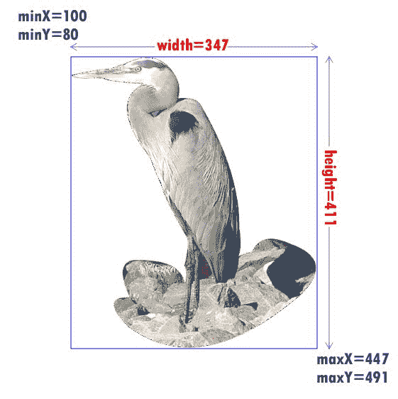

最初，`ImageView` 对象显示在位置 [100, 80]，宽度为 347，高度为 411（即图像的大小），且尚未对其应用任何变换；因此，`boundsInLocal` 中的 `Bounds` 和 `boundsInParent` 中的 `Bounds` 都指定了相同的值：

### `ImageView` 的初始 `Bounds`

|   | minX | minY | maxX | maxY | width | height |
| --- | --- | --- | --- | --- | --- | --- |
| `boundsInLocal` | 100 | 80 | 447 | 491 | 347 | 411 |
| `boundsInParent` | 100 | 80 | 447 | 491 | 347 | 411 |

现在，对 `ImageView` 应用了一个变换；它被缩放为原始尺寸的一半，并以初始边界矩形的中心为缩放原点。图 1-3 显示了变换后的 `ImageView` 及其 `Bounds`。较小的矩形区域表示 `boundsInParent`，较大的矩形区域是保持不变的 `boundsInLocal`。

图 1-3。显示 `ImageView` 缩放为原始尺寸一半后的边界矩形。

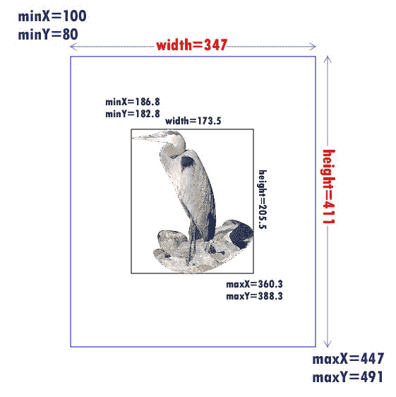

缩放后，`boundsInLocal` 保持原始值，而 `boundsInParent` 中的坐标和维度发生了变化。下表显示了我们将 `ImageView` 缩放为原始尺寸一半后的差异：

### 缩放后 `ImageView` 的 `Bounds`

|    | minX | minY | maxX | maxY | width | height |
| --- | --- | --- | --- | --- | --- | --- |
| `boundsInLocal` | 100 | 80 | 447 | 491 | 347 | 411 |
| `boundsInParent` | 186.8 | 182.8 | 360.3 | 388.3 | 173.5 | 205.5 |

现在，我们将对图 1-3 中已缩放为原始尺寸一半的 `ImageView` 应用额外的变换。首先，顺时针旋转 90°，然后平移 [-32, 66]。让我们查看图 1-4 中边界矩形的最终结果：

图 1-4。显示经过这些变换后 `ImageView` 的边界矩形：缩放 50%、顺时针旋转 90°、平移 [-32, 66]。

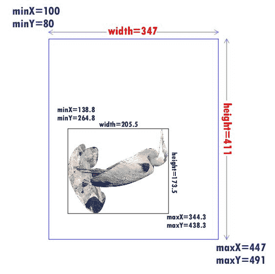

在图 1-4 中，较小的矩形区域表示变换后的 `boundsInParent`。而 `boundsInLocal`（即较大的矩形区域）保持不变。

总结一下，下表显示了应用到 `ImageView` 的所有变换：

字体 应用到 `ImageView` 的变换

| scaleX | scaleY | rotate | translateX | translateY |
| --- | --- | --- | --- | --- |
| 0.5 | 0.5 | 90.0 | -32 | 66 |

下表显示了变换后（缩小 50%、顺时针旋转 90°、平移 [-32, 66]）`boundsInLocal` 和 `boundsInParent` 中的值：

### 变换后 `ImageView` 的 `Bounds`

|    | minX | minY | maxX | maxY | width | height |
| --- | --- | --- | --- | --- | --- | --- |
| `boundsInLocal` | 100 | 80 | 447 | 491 | 347 | 411 |
| `boundsInParent` | 138.8 | 264.8 | 344.3 | 438.3 | 205.5 | 173.5 |

显而易见，无论对节点应用了多少变换，它的 `boundsInLocal` 始终保持原始值。此外，请注意为 `layoutX` 或 `layoutY` 属性赋值也不会影响 `boundsInLocal`。

上述示例得出结论：在节点经过变换的情况下，`boundsInParent` 中指定的矩形区域是快照（snapshot）的正确视口。

### 1.1.4.3 利用 `layoutBounds`

`layoutBounds` 是 `Node` 类中定义的类型为 `ReadOnlyObjectProperty<Bounds>` 的属性，它指定一个 `Bounds` 对象，且不考虑以下属性：`effect`、`clip`、`scaleX`、`scaleY`、`rotate`、`translateX`、`translateY`、`layoutX`、`layoutY`；它还排除了应用于 `Node` 的任何 `Transform` 对象。

在澄清 `boundsInLocal` 和 `boundsInParent` 之间的差异之后，本节介绍了 `layoutBounds`，并与 `boundsInLocal` 和 `boundsInParent` 进行比较。

同样，我们使用下面的 `ImageView` 对象显示图像 Egret_1.png，以说明 `layoutBounds`、`boundsInLocal` 和 `boundsInParent` 之间的差异：

图 1-5。显示 `ImageView` 对象的初始边界矩形。

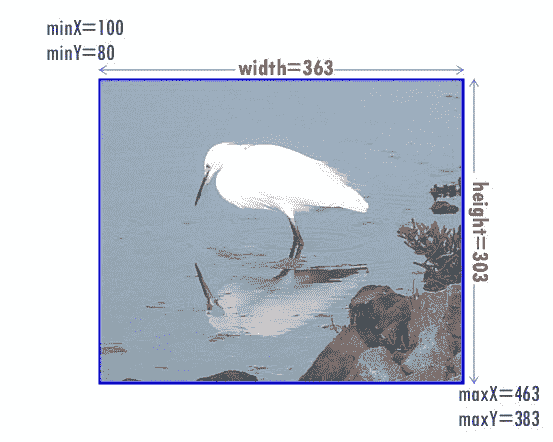

最初，`ImageView` 对象显示在位置 [100, 80]，宽度为 363，高度为 303（即图像的大小），且尚未对其应用任何 `effect`、`clip` 或变换；因此，所有三个 `Bounds` 都指定了相同的值：

### `ImageView` 的初始 `Bounds`


| | minX | minY | maxX | maxY | width | height |
| --- | --- | --- | --- | --- | --- | --- |
| `layoutBounds` | 100 | 80 | 463 | 383 | 363 | 303 |
| `boundsInLocal` | 100 | 80 | 447 | 491 | 347 | 411 |
| `boundsInParent` | 100 | 80 | 463 | 383 | 363 | 303 |

这里也花时间熟悉 FXML 的语法。以下显示了一个 FXML 文件的内容，它创建了一个以`Pane`为根节点的场景图，`ImageView`为`Pane`的唯一子节点：

列表 1-11. 使用 FXML 在场景图中创建 `ImageView` 节点

```xml
<?xml version="1.0" encoding="UTF-8" standalone="no"?>
<?import javafx.scene.image.*?>
<?import javafx.scene.layout.*?>
<Pane xmlns:fx="http://javafx.com/fxml">
  <children>
    <ImageView fx:id="ImageView_173b35c" preserveRatio="true" x="100.0" y="80.0">
      <image>
        <Image preserveRatio="false" smooth="false" url="@Egret_1.png"/>
      </image>
    </ImageView>
  </children>
</Pane>
```

现在，我们将如下所示的`Path`对象：

图 1-6. 显示内部绿色颜料填充的`Path`对象及其边界矩形。

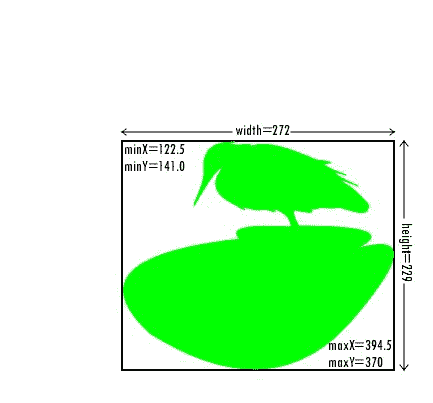

这里是创建图 1-6 中`Path`对象的 FXML 文件：

列表 1-12. 使用 FXML 在场景图中创建 `Path` 节点

```xml
<?xml version="1.0" encoding="UTF-8" standalone="no"?>
<?import javafx.scene.shape.*?>
<?import javafx.scene.layout.*?>
<Pane xmlns:fx="http://javafx.com/fxml">
  <children>
    <Path fill="green">
      <Path data="M100,80 L463,80 L463,383 L100,383 Z"/>
    </Path>
  </children>
</Pane>
```

```xml
<?xml version="1.0" encoding="UTF-8" standalone="no"?>
<?import javafx.scene.layout.*?>
<?import javafx.scene.shape.*?>
<Pane xmlns:fx="http://javafx.com/fxml">
  <children>
    <Path fill="#00FF00" fx:id="Path_1cf1e34" stroke="#00FF00">
      <elements>
        <MoveTo x="194.0" y="206.0"/>
        <QuadCurveTo controlX="218.0" controlY="164.0" x="222.0" y="169.0"/>
        <QuadCurveTo controlX="205.0" controlY="190.0" x="234.0" y="204.0"/>
        <QuadCurveTo controlX="252.0" controlY="215.0" x="240.0" y="205.0"/>
        <QuadCurveTo controlX="256.0" controlY="212.0" x="265.0" y="209.0"/>
        <QuadCurveTo controlX="283.0" controlY="215.0" x="269.0" y="207.0"/>
        <QuadCurveTo controlX="291.0" controlY="213.0" x="291.0" y="227.0"/>
        <QuadCurveTo controlX="223.0" controlY="223.0" x="240.0" y="239.0"/>
        <QuadCurveTo controlX="67.0" controlY="258.0" x="151.0" y="334.0"/>
        <QuadCurveTo controlX="273.0" controlY="410.0" x="351.0" y="321.0"/>
        <QuadCurveTo controlX="435.0" controlY="224.0" x="353.0" y="250.0"/>
        <QuadCurveTo controlX="407.0" controlY="226.0" x="299.0" y="226.0"/>
        <QuadCurveTo controlX="291.0" controlY="213.0" x="295.0" y="210.0"/>
        <QuadCurveTo controlX="319.0" controlY="215.0" x="309.0" y="209.0"/>
        <QuadCurveTo controlX="323.0" controlY="209.0" x="315.0" y="207.0"/>
        <QuadCurveTo controlX="336.0" controlY="209.0" x="339.0" y="207.0"/>
        <QuadCurveTo controlX="369.0" controlY="217.0" x="367.0" y="209.0"/>
        <QuadCurveTo controlX="375.0" controlY="207.0" x="349.0" y="186.0"/>
        <QuadCurveTo controlX="328.0" controlY="174.0" x="358.0" y="186.0"/>
        <QuadCurveTo controlX="318.0" controlY="167.0" x="346.0" y="175.0"/>
        <QuadCurveTo controlX="314.0" controlY="163.0" x="330.0" y="163.0"/>
        <QuadCurveTo controlX="334.0" controlY="162.0" x="316.0" y="160.0"/>
        <QuadCurveTo controlX="261.0" controlY="135.0" x="246.0" y="150.0"/>
        <QuadCurveTo controlX="257.0" controlY="142.0" x="241.0" y="145.0"/>
        <QuadCurveTo controlX="219.0" controlY="145.0" x="235.0" y="142.0"/>
        <QuadCurveTo controlX="201.0" controlY="141.0" x="204.0" y="171.0"/>
        <QuadCurveTo controlX="205.0" controlY="180.0" x="194.0" y="204.0"/>
      </elements>
    </Path>
  </children>
</Pane>
```

随后将`Path`节点设置为`ImageView`的`clip`属性。以下是执行这些任务的 FXML 元素：

列表 1-13. 显示 FXML，它创建了一个`Pane`作为场景图的根节点，拥有`ImageView`作为该`Pane`的唯一子节点，并创建了一个`Path`节点作为`ImageView`的`clip`：

```xml
<?import javafx.scene.layout.*?>
<?import javafx.scene.shape.*?>
<Pane xmlns:fx="http://javafx.com/fxml">
  <children>
    <ImageView fx:id="ImageView_17b5c" preserveRatio="true" x="100.0" y="80.0" preserveRatio="false" smooth="false" url="@Egret_1.png">
      <clip>
        <Path fill="#00FF00" fx:id="Path_1cf1e34" stroke="#00FF00">
          <elements>
            <MoveTo x="194.0" y="206.0"/>
            <QuadCurveTo controlX="218.0" controlY="164.0" x="222.0" y="169.0"/>
            <QuadCurveTo controlX="205.0" controlY="190.0" x="234.0" y="204.0"/>
            <QuadCurveTo controlX="252.0" controlY="215.0" x="240.0" y="205.0"/>
            <QuadCurveTo controlX="256.0" controlY="212.0" x="265.0" y="209.0"/>
            <QuadCurveTo controlX="283.0" controlY="215.0" x="269.0" y="207.0"/>
            <QuadCurveTo controlX="291.0" controlY="213.0" x="291.0" y="227.0"/>
            <QuadCurveTo controlX="223.0" controlY="223.0" x="240.0" y="239.0"/>
            <QuadCurveTo controlX="67.0" controlY="258.0" x="151.0" y="334.0"/>
            <QuadCurveTo controlX="273.0" controlY="410.0" x="351.0" y="321.0"/>
            <QuadCurveTo controlX="435.0" controlY="224.0" x="353.0" y="250.0"/>
            <QuadCurveTo controlX="407.0" controlY="226.0" x="299.0" y="226.0"/>
            <QuadCurveTo controlX="291.0" controlY="213.0" x="295.0" y="210.0"/>
            <QuadCurveTo controlX="319.0" controlY="215.0" x="309.0" y="209.0"/>
            <QuadCurveTo controlX="323.0" controlY="209.0" x="315.0" y="207.0"/>
            <QuadCurveTo controlX="336.0" controlY="209.0" x="339.0" y="207.0"/>
            <QuadCurveTo controlX="369.0" controlY="217.0" x="367.0" y="209.0"/>
            <QuadCurveTo controlX="375.0" controlY="207.0" x="349.0" y="186.0"/>
            <QuadCurveTo controlX="328.0" controlY="174.0" x="358.0" y="186.0"/>
            <QuadCurveTo controlX="318.0" controlY="167.0" x="346.0" y="175.0"/>
            <QuadCurveTo controlX="314.0" controlY="163.0" x="330.0" y="163.0"/>
            <QuadCurveTo controlX="334.0" controlY="162.0" x="316.0" y="160.0"/>
            <QuadCurveTo controlX="261.0" controlY="135.0" x="246.0" y="150.0"/>
            <QuadCurveTo controlX="257.0" controlY="142.0" x="241.0" y="145.0"/>
            <QuadCurveTo controlX="219.0" controlY="145.0" x="235.0" y="142.0"/>
            <QuadCurveTo controlX="201.0" controlY="141.0" x="204.0" y="171.0"/>
            <QuadCurveTo controlX="205.0" controlY="180.0" x="194.0" y="204.0"/>
          </elements>
        </Path>
      </clip>
    </ImageView>
  </children>
</Pane>
```

下图显示了将`Path`设置为`clip`的`ImageView`渲染结果：

图 7. 显示`Path`节点的`ImageView`。

images/00013.jpg

现在，让我们来说明设置`Path`为`clip`的`ImageView`边界矩形：

图 8. 显示设置`clip`的`ImageView`及其边界矩形。

这里是`ImageView`裁剪后的`layoutBounds`、`boundsInLocal`和`boundsInParent`表格：

`ImageView`裁剪后的`Bounds`

| | minX | minY | maxX | maxY | width | height |
| --- | --- | --- | --- | --- | --- | --- |
| `layoutBounds` | 100 | 80 | 463 | 383 | 363 | 303 |
| `boundsInLocal` | 122.5 | 141 | 394.5 | 370 | 272 | 229 |
| `boundsInParent` | 122.5 | 141 | 394.5 | 370 | 272 | 229 |

总结一下：

`layoutBounds`不受以下属性影响：`effect`、`clip`、`scaleX`、`scaleY`、`rotate`、`translateX`、`translateY`、`layoutX`、`layoutY`。

上述所有属性都会影响`boundsInParent`。

在上述属性中，只有这些属性影响`boundsInLocal`：`effect`、`clip`。

任何添加到`Transform`的`ObservableList`并应用到`Node`的`Transform`对象只会影响`boundsInParent`；不会影响`layoutBounds`和`boundsInLocal`。

#### 1.1.4.4 `writeImageView` 方法的完整源代码

这里是`writeImageView`方法的完整源代码：

导入语句：

```java
import javafx.embed.swing.SwingFXUtils;
import javafx.geometry.Bounds;
import javafx.geometry.Rectangle2D;
import javafx.scene.image.Image;
import javafx.scene.image.ImageView;
import javafx.scene.paint.Color;
import javafx.scene.SnapshotParameters;
import javax.imageio.ImageIO;
```

列表 1-14. 定义`writeImageView`方法将`ImageView`写入图像文件

## 1.2 使用 FXML 在场景图中创建 JavaFX 节点

我们将详细阐述`draw.io`包中提供的 API 的用法，该包包含了`draw`类，当`File`是时。

在本节中，我们将介绍如何在 JavaFX 中创建`Line`、`Polyline`、`Path`等。我们还展示了如何在`第 2 节`中使用`ImageView`来显示图像。

### 1.2.1 将 `ImageView` 写入文件


将`ImageView`的图像写入图像文件。我们不使用`image`属性中指定的图像，而是应用`snapshot`方法来获取图像，这样做是为了让图像符合变换效果。

`ImageView`的`image`属性中指定的仍然是原始图像，并未与已应用的变换同步。对`ImageView`进行`Snapshot`会得到一个符合变换的图像，然后调用`writeImage`将图像保存为支持的图像格式的文件。

重要说明：如果`ImageView`在其`clip`属性中指定了`clip`，该方法同样运行良好。

```java
public void writeImageView(ImageView iv, File file) {
  Bounds bP = iv.getBoundsInParent();
  Double minX = bP.getMinX();
  Double minY = bP.getMinY();
  Double w = bP.getWidth();
  double h = bP.getHeight();
  Rectangle2D vp = new Rectangle2D(minX, minY, w, h);
  SnapshotParameters parameters = new SnapshotParameters();
  parameters.setViewport(vp);
  parameters.setFill(Color.TRANSPARENT);
  Image image = iv.snapshot(parameters, null);
  writeImage(image, file);
}
```

此方法从`writeImageView`调用，将`ImageView`的图像保存到图像文件中。应用`ImageIO.write`方法将 JavaFX `Image` 写入文件。经过测试，`ImageIO.write`仅适用于`png`和`gif`格式。`ImageIO.write`不支持这些格式：`jpg`、`jpeg`、`bmp`。

该方法首先检查给定文件的扩展名是否匹配目标格式（`png|gif`），如果不匹配，则拼接默认格式（`.png`）。

```java
public File writeImage(Image img, File file) {
  // check if the given file extension matches preferred
  // image format string : (png|gif)
  String formatName = getFormatName(file);
  if (formatName == null) {
    // the given file does not ends with preferred image format
    // use "png" as format
    formatName = "png"; // default format name
    file = getImageFile(file, formatName);
  }
  writeFXImage(img, formatName, file);
  return file;
}
```

应用`ImageIO.write`方法将 JavaFX `Image` 写入文件。注意：`ImageIO.write`无法保存`jpg`、`jpeg`、`bmp`。

```java
void writeFXImage(Image img, String formatName, File imgFile) {
  try {
    boolean succeed = ImageIO.write(
       SwingFXUtils.fromFXImage(img, null), formatName, imgFile);
    if (!succeed)
        System.out.println("ImageIO.write failed");
  } catch (IOException e) {
    System.out.println(e.getMessage());
  }
}
```

针对 Java 8+ 的说明：测试`jpg`、`jpeg`、`bmp`是否。此方法检查文件是否具有目标扩展名：`png`或`gif`，如果扩展不是目标图像格式，则返回`null`，否则返回图像格式。

```java
String getFormatName(File f) {
  String formatName = null; // Initialize to null
  // supported image format in regular expression
  //String reg = "(png|gif|jpg|jpeg|bmp)";
  // It would be nice to support jpg format
  // however,
  // jpg, jpeg and bmp not supported in 
  //IO.write
  String reg = "(png|gif)";
  String s = f.getName();
  int i = s.lastIndexOf('.');

  if (i > 0 && i < s.length()) {
    String ext = s.substring(i + 1).toLowerCase();
    if (ext.matches(reg)) {
        formatName = ext;
    }
  }
  return formatName;
}
```

此方法从`writeImageView`调用，将`ImageView`的图像保存到图像文件中。目标格式。如果文件没有扩展名。

```java
File getImageFile(File file, String formatName) {
  String s = file.getName();
  int i = s.lastIndexOf('.');
  if (i > 0 && i < s.length()) {
    // replace whatever
    s = s.substring(0, i);
    File p = new File(file.getParent(), s + "." + formatName);
    return p;
  } else {
    // file exist
    return new File(file.getParent(), s + "." + formatName);
  }
}
```

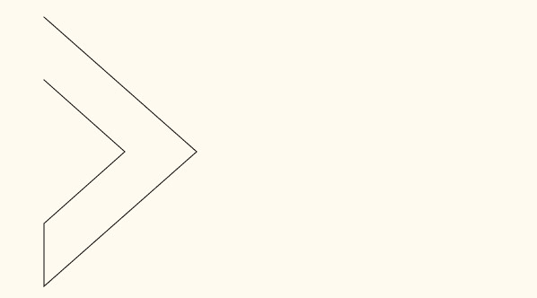

### 1.2.3 在 FXML 中创建箭头形状的`Polygon`

下面的列表显示了 FXML 标记，它创建一个`Pane`作为场景图的根节点，以及一个由 6 个线段组成的`Polygon`，给定了 6 个点：(50.0, 20.0), (220.0, 170.0), (50.0, 320.0), (50.0, 250.0), (140.0, 170.0), (50.0, 90.0)。

列表 1-17. 给定 6 个点创建一个由 6 个线段组成的`Polygon`：

```xml
<?xml version="1.0" encoding="UTF-8" standalone="no"?>
<?import java.lang.*?>
<?import javafx.scene.layout.*?>
<?import javafx.scene.shape.*?>
<Pane xmlns:fx="http://javafx.com/fxml">
  <children>
        <Polygon fill="#B3E6E6" stroke="#000000">
          <points>
            <Double fx:value="50.0"/>
            <Double fx:value="20.0"/>
            <Double fx:value="220.0"/>
            <Double fx:value="170.0"/>
            <Double fx:value="50.0"/>
            <Double fx:value="320.0"/>
            <Double fx:value="50.0"/>
            <Double fx:value="250.0"/>
            <Double fx:value="140.0"/>
            <Double fx:value="170.0"/>
            <Double fx:value="50.0"/>
            <Double fx:value="90.0"/>
          </points>
        </Polygon>
      </children>
</Pane>
```

来自上述 FXML 标记的`Polygon`渲染结果如下：

图 1-11. 显示上述 FXML 标记中箭头形状的多边形。

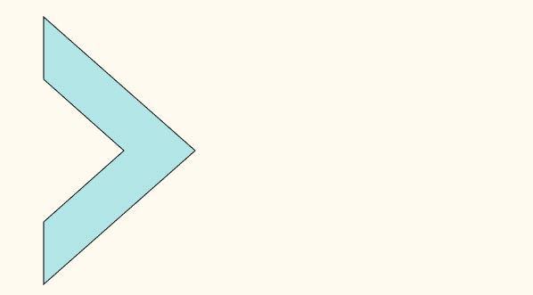

### 1.2.4 在 FXML 中创建形成汉字的`Path`

下面的列表显示了 FXML 标记，它创建一个`Pane`作为场景图的根节点，以及一个由`MoveTo`、`HLineTo`、`QuadCurveTo`和`LineTo`组成的`Path`。绘制该路径需要 3 笔画，其中第一笔画的终点是第二笔画的起点，第二笔画的终点是第三笔画的起点。

列表 1-18. 创建一个由 4 个`PathElement`组成的`Path`（总共 3 笔画）：

```xml
<?xml version="1.0" encoding="UTF-8" standalone="no"?>
<?import javafx.scene.layout.*?>
<?import javafx.scene.shape.*?>
<Pane xmlns:fx="http://javafx.com/fxml">
  <children>
        <Path stroke="#A0522D" strokeLineCap="ROUND" strokeLineJoin="BEVEL"
              strokeWidth="8.0">
          <elements>
            <MoveTo x="120.0" y="87.0"/>
            <HLineTo x="195.0"/>
            <QuadCurveTo controlX="36.0" controlY="201.0" x="205.0" y="170.0"/>
            <LineTo x="209.0" y="149.0"/>
          </elements>
        </Path>
      </children>
</Pane>
```

来自上述 FXML 标记的`Path`渲染结果如下：

图 1-12. 显示上述 FXML 标记中的路径；它是一个由 3 笔画组成的汉字“乙”。


请注意，`<path>`元素内呈现的四个属性会在路径上产生不同的视觉效果：

`stroke`

指定一种颜色来绘制形状的边界。对于路径来说，默认值为`Color.BLACK`。

`strokeWidth`

指定描边宽度。

`strokeLineCap`

指定线的末端帽样式，其有效值之一为：`BUTT`、`ROUND`和`SQUARE`。默认值为`SQUARE`。

`strokeLineJoin`

指定线之间的连接样式，其有效值之一为：`BEVEL`、`MITER`和`ROUND`。默认值为`MITER`。

下面的图说明了`strokeLineCap`和`strokeLineJoin`如何影响线的视觉渲染：

图 1-13. 分在`strokeLineCap`和`strokeLineJoin`上设置了不同属性的 3 个`Path`对象。

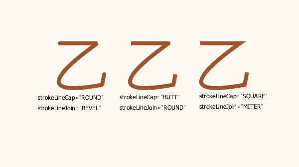

这里是创建上述渲染的 3 个`Path`对象的 FXML 标记。

列表 1-19. 创建一个由 4 个`PathElement`组成的`Path`（总共 3 笔画）：

```xml
<?xml version="1.0" encoding="UTF-8" standalone="no"?>
<?import javafx.scene.layout.*?>
<?import javafx.scene.shape.*?>
<Pane xmlns:fx="http://javafx.com/fxml">
  <children>
        <Path stroke="#A0522D" strokeLineCap="ROUND" strokeLineJoin="BEVEL"
              strokeWidth="8.0">
          <elements>
            <MoveTo x="120.0" y="87.0"/>
            <HLineTo x="195.0"/>
            <QuadCurveTo controlX="36.0" controlY="201.0" x="205.0" y="170.0"/>
            <LineTo x="209.0" y="149.0"/>
          </elements>
        </Path>
      </children>
</Pane>
```

### 1.2.5 使用`M`、`H`、`Q`、`L`指令创建`SVGPath`

现在，我们将使用列表 1-18 中相同的示例来演示`SVGPath`。这里的 FXML 标记使用`SVGPath`创建了与图 1-12 所示相同的形状。

列表 1-20. 创建`SVGPath`以产生与图 1-12 相同的形状：

```xml
<?xml version="1.0" encoding="UTF-8" standalone="no"?>
<?import javafx.scene.layout.*?>
<?import javafx.scene.shape.*?>
<Pane xmlns:fx="http://javafx.com/fxml">
  <children>
        <SVGPath content="M 120 87 H 195 Q 36 201 205 170 L 209 149"
          fill="#00000000" stroke="#A0522D"
          strokeLineCap="ROUND" strokeLineJoin="BEVEL" strokeWidth="8.0">
        </SVGPath>
      </children>
</Pane>
```

`<SVGPath>`元素内的`content`属性以`String`形式指定路径数据。在我们的示例中，使用了以下指令：`M`（移动）、`H`（水平线到）、`Q`（二次贝塞尔曲线到）、`L`（线到）。

### 1.2.6 在 FXML 中创建填充径向渐变的`Rectangle`

下面的列表显示了 FXML 标记，它创建了一个`Pane`作为场景图的根节点，并创建了一个`Rectangle`作为其子节点。`arcWidth`和`arcHeight`属性指定了圆角矩形四个角圆弧的尺寸。并创建了一个`RadialGradient`实例来填充矩形的内部。

```xml
<?xml version="1.0" encoding="UTF-8" standalone="no"?>
<?import javafx.scene.layout.*?>
<?import javafx.scene.paint.RadialGradient?>
<?import javafx.scene.paint.Stop?>
<?import javafx.scene.shape.*?>
<Pane xmlns:fx="http://javafx.com/fxml">
  <children>
    <Rectangle x="88.0" y="66.0" width="268.0" height="148.0" stroke="#0000ff"
         arcWidth="67" arcHeight="62" strokeWidth="1.0">
      <fill>
        <RadialGradient centerX="0.5" centerY="0.5" radius="1"
          focusDistance="0.4" focusAngle="60.0"
          proportional="true" cycleMethod="NO_CYCLE">
          <stops>
            <Stop offset="0" color="#ffff00"/>
            <Stop offset="0.45" color="#008000"/>
            <Stop offset="1" color="#0000ff"/>
          </stops>
        </RadialGradient>
      </fill>
    </Rectangle>
  </children>
</Pane>
```

上述 FXML 标记中的`Rectangle`渲染结果如下：


图 1-14。显示上述 FXML 标记中一个用 `RadialGradient` 填充的圆角 `Rectangle`。

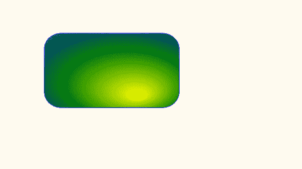

### 1.2.7 在 FXML 中创建填充了 `LinearGradient` 的 `Circle`

以下列表显示了 FXML 标记，它创建了一个 `Pane` 作为场景图的根节点，并创建了一个 `Circle` 作为其子节点。创建了一个 `LinearGradient` 实例来填充圆形的内部。

列表 1-22。创建一个填充了 `LinearGradient` 的 `Circle`：

```xml
<?xml version="1.0" encoding="UTF-8" standalone="no"?>
<?import javafx.scene.layout.*?>
<?import javafx.scene.paint.LinearGradient?>
<?import javafx.scene.paint.Stop?>
<?import javafx.scene.shape.*?>
<Pane xmlns:fx="http://javafx.com/fxml">
  <children>
    <Circle centerX="166.0" centerY="144.0" radius="100.0"
      stroke="#e6e6d3" strokeWidth="1.0">
      <fill>
        <LinearGradient startX="0.0" startY="0.0" endX="0.0" endY="1.0"
          proportional="true" cycleMethod="NO_CYCLE">
          <stops>
            <Stop offset="0" color="#ffe4e1"/>
            <Stop offset="0.33" color="#fafad2"/>
            <Stop offset="0.66" color="#d8bfd8"/>
            <Stop offset="1" color="#ffc0cb"/>
          </stops>
        </LinearGradient>
      </fill>
    </Circle>
  </children>
</Pane>
```

上述 FXML 标记中的 `Circle` 渲染结果如下：

图 1-15。显示上述 FXML 标记中一个用 `LinearGradient` 填充的 `Circle`。

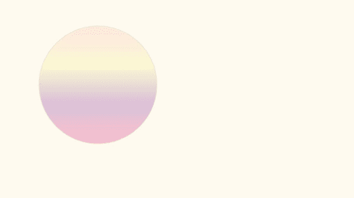

### 1.2.8 在 FXML 中创建带有 `Transform` 和 `Effect` 的 `Ellipse`

以下列表显示了 FXML 标记，它创建了一个 `Pane` 作为场景图的根节点，并创建了一个 `Ellipse` 作为其子节点。两种类型的变换 `Shear` 和 `Translate` 以及一个 `DropShadow` 效果被应用到了 `Ellipse` 上。

列表 1-23。创建一个应用了 `Transform` 和 `Effect` 的 `Ellipse`：

```xml
<?xml version="1.0" encoding="UTF-8" standalone="no"?>
<?import javafx.scene.effect.*?>
<?import javafx.scene.layout.*?>
<?import javafx.scene.paint.LinearGradient?>
<?import javafx.scene.paint.Stop?>
<?import javafx.scene.shape.*?>
<?import javafx.scene.transform.*?>
<Pane xmlns:fx="http://javafx.com/fxml">
  <children>
    <Ellipse centerX="220.0" centerY="180.0" radiusX="86.0" radiusY="120.0"
      fill="#00000000" strokeWidth="12.0">
      <transforms>
        <Shear x="-0.5"/>
        <Translate x="180.0"/>
      </transforms>
      <effect>
        <DropShadow offsetX="8" offsetY="6" color="#696969"/>
      </effect>
      <stroke>
        <LinearGradient startX="0.0" startY="0.0" endX="0.0" endY="1.0"
          proportional="true" cycleMethod="NO_CYCLE">
          <stops>
            <Stop offset="0" color="#ffe4e1"/>
            <Stop offset="0.33" color="#afeeee"/>
            <Stop offset="0.66" color="#d8bfd8"/>
            <Stop offset="1" color="#9370db"/>
          </stops>
        </LinearGradient>
      </stroke>
    </Ellipse>
  </children>
</Pane>
```

上述 FXML 标记中的 `Ellipse` 渲染结果如下：

图 1-16。显示上述 FXML 标记中应用了 `Shear` 和 `Translate` 变换的 `Ellipse`。


作为对比，这里是应用 `Shear` 和 `Translate` 之前的原始 `Ellipse` 看起来的样子：

图 1-17。显示在应用了变换和效果之前的 `Ellipse`。


### 1.2.9 在 FXML 中创建像彩虹的 `Arc`

这里演示了使用 `Arc` 作为掩罩来裁剪 `Ellipse` 以实现彩虹效果：

1. 创建一个用 `RadialGradient` 填充的模拟彩虹色的 `Ellipse`。
2. 创建一个带有 `centerX`、`centerY`、`radiusX`、`radiusY` 的 `Arc`。注意 `Arc` 的属性 `startAngle`、`length`、`type` 决定了它的尺寸和形状。
3. 将 `Arc` 设置为 `Ellipse` 的 `clip` 属性值。

以下是渲染 `Arc` 的 FXML 标记：

```xml
<?xml version="1.0" encoding="UTF-8" standalone="no"?>
<?import javafx.scene.layout.*?>
<?import javafx.scene.paint.RadialGradient?>
<?import javafx.scene.paint.Stop?>
<?import javafx.scene.shape.*?>
<Pane xmlns:fx="http://javafx.com/fxml">
  <children>
    <Ellipse centerX="292.0" centerY="220.0" radiusX="180.0" radiusY="180.0">
      <fill>
        <RadialGradient centerX="0.5" centerY="0.5" radius="0.5"
          proportional="true" cycleMethod="NO_CYCLE">
          <stops>
            <Stop offset="0" color="#ff0000"/>
            <Stop offset="0.7" color="#ee82ee"/>
            <Stop offset="0.75" color="#8a2be2"/>
            <Stop offset="0.8" color="#87cefa"/>
            <Stop offset="0.85" color="#00ff00"/>
            <Stop offset="0.9" color="#ffff00"/>
            <Stop offset="0.95" color="#ffa500"/>
            <Stop offset="1" color="#ff0000"/>
          </stops>
        </RadialGradient>
      </fill>
      <clip>
        <Arc centerX="292.0" centerY="220.0" radiusX="180.0" radiusY="180.0"
          startAngle="0.0" length="180.0" type="OPEN"
          stroke="#000000" strokeType="INSIDE" strokeWidth="45.0" fill="#00000000">
        </Arc>
      </clip>
    </Ellipse>
  </children>
</Pane>
```

列表 1-24。使用 `Arc` 作为掩罩来裁剪 `Ellipse`。

### 1.2.10 在 FXML 中带有视觉效果和倾切变换的 `Text`

以下列表显示了 FXML 标记，它创建了一个 `Pane` 作为场景图的根节点，并创建了一个用 `LinearGradient` 填充的 `Text` 作为其子节点。一个 `InnerShadow` 视觉效果被应用到了 `Text` 上。

```xml
<?xml version="1.0" encoding="UTF-8" standalone="no"?>
<?import javafx.scene.effect.*?>
<?import javafx.scene.layout.*?>
<?import javafx.scene.paint.LinearGradient?>
<?import javafx.scene.paint.Stop?>
<?import javafx.scene.shape.*?>
<?import javafx.scene.text.*?>
<Pane xmlns:fx="http://javafx.com/fxml">
  <children>
        <Text stroke="000000" strokeType="OUTSIDE"
          layoutX="20.0" layoutY="82.0" pickOnBounds="true"
          text="Hello！你好！" textOrigin="TOP">
          <font>
            <Font name="MS UI Gothic" size="100.0"/>
          </font>
          <effect>
            <InnerShadow offsetX="2.5" offsetY="0.5" color="#ffff00"/>
          </effect>
          <fill>
            <LinearGradient startX="0.0" startY="0.0" endX="1.0" endY="0.0"
              proportional="true" cycleMethod="NO_CYCLE">
              <stops>
                <Stop offset="0" color="#ffd700"/>
                <Stop offset="0.2" color="#ffa500"/>
                <Stop offset="0.7" color="#ff8c00"/>
                <Stop offset="1" color="#ff0000"/>
              </stops>
            </LinearGradient>
          </fill>
        </Text>
      </children>
</Pane>
```

来自上述 FXML 标记的 `Text` 渲染如下：

图 1-19。显示一个应用了 `InnerShadow` 效果并使用 `LinearGradient` 填充的 `Text`。


下面的代码列表显示了 FXML 标记，它创建了一个 `Text`，应用了链式效果和 `Shear` 变换，并使用 `LinearGradient` 填充。请注意，将 `Reflection` 设置为 `InnerShadow` 的输入，然后将其设置为 `DropShadow` 效果的输入，从而产生了链式效果。

列表 1-26。创建 `Text`、应用链式效果和 `Shear` 变换并使用 `LinearGradient` 填充的 `Text`：

```xml
<?xml version="1.0" encoding="UTF-8" standalone="no"?>
<?import javafx.scene.effect.*?>
<?import javafx.scene.layout.*?>
<?import javafx.scene.paint.LinearGradient?>
<?import javafx.scene.paint.Stop?>
<?import javafx.scene.shape.*?>
<?import javafx.scene.text.*?>
<?import javafx.scene.transform.*?>
<Pane xmlns:fx="http://javafx.com/fxml">
  <children>
        <Text strokeType="OUTSIDE" layoutX="42.0" layoutY="30.0" pickOnBounds="true"
          text="Hello！你好！" textOrigin="TOP">
          <font>
            <Font name="MS UI Gothic" size="100.0"/>
          </font>
          <transforms>
            <Shear pivotX="100.0" pivotY="10.0" x="-0.2" y="0.4"/>
          </transforms>
          <effect>
            <DropShadow offsetX="3.0" offsetY="3.0" color="#696969"
              blurType="TWO_PASS_BOX">
              <input>
                <InnerShadow offsetX="3.0" offsetY="0.0" color="#FFF171">
                  <input>
                    <Reflection fraction="0.9" topOpacity="0.4"/>
                  </input>
                </InnerShadow>
              </input>
            </DropShadow>
          </effect>
          <fill>
            <LinearGradient startX="0.0" startY="0.0" endX="1.0" endY="0.0"
              proportional="true" cycleMethod="NO_CYCLE">
              <stops>
                <Stop offset="0" color="#ffd700"/>
                <Stop offset="0.2" color="#ffa500"/>
                <Stop offset="0.7" color="#ff8c00"/>
                <Stop offset="1" color="#ff0000"/>
              </stops>
            </LinearGradient>
          </fill>
        </Text>
      </children>
</Pane>
```

来自上述 FXML 标记的 `Text` 渲染如下：

图 1-20。显示一个应用了链式效果和 `Shear` 变换并使用 `LinearGradient` 填充的 `Text`。


### 1.2.11 从形状生成器生成 FXML 文件


在这里，我们将说明由 JavaFX `Shape` 生成器 `JFXDrawTools V1.2` 生成的一些 FXML 文件。

第一个示例展示了在 `JFXDrawTools V1.2` 应用程序的绘板上交互式创建的 `Path` 对象和 `ImageView` 对象。

`Path` 对象是使用 `Bézier Curve Drawer` 模块构建的，详细描述请参考第 II 卷：《DEVELOPING INTERACTIVE SHAPE DRAWING TOOLS》第 5 章“二次贝塞尔曲线绘制器”，以及第 7 章“带有预定义绘制器的增强绘制工具”中的第 7.2.5 节“实现 `BezierCurveDrawer` 类”。

`ImageView` 对象是通过 `DrawLoader.loadImage` 方法创建的，将在下一章讨论。

图 1-21。使用 `JFXDrawTools V1.2` 应用程序绘制由二次贝塞尔曲线组成的路径并加载银杏叶图像。

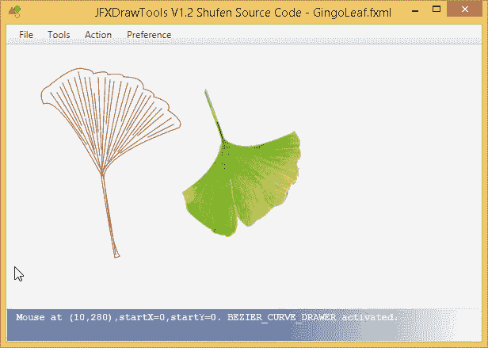

这里是使用我们 `drawtool.io` 包提供的 API 保存的图 1-21 中草图的 FXML 文件 `GingoLeaf.fxml` 内容。

```xml
<?xml version="1.0" encoding="UTF-8" standalone="no"?>
<?import java.lang.*?>
<?import java.util.*?>
<?import javafx.animation.*?>
<?import javafx.animation.PathTransition.*?>
<?import javafx.geometry.*?>
<?import javafx.scene.Group?>
<?import javafx.scene.control.*?>
<?import javafx.scene.effect.*?>
<?import javafx.scene.image.*?>
<?import javafx.scene.layout.*?>
<?import javafx.scene.paint.*?>
<?import javafx.scene.shape.*?>
<?import javafx.scene.text.*?>
<?import javafx.scene.transform.*?>
<?import javafx.util.*?>
<Pane xmlns:fx="http://javafx.com/fxml">
  <children>
        <Path fx:id="Path_9e7c70" stroke="#A0522D">
          <elements>
            <MoveTo x="53.0" y="53.0"/>
            <QuadCurveTo controlX="85.0" controlY="26.0" x="98.0" y="31.0"/>
            <QuadCurveTo controlX="109.0" controlY="32.0" x="110.0" y="37.0"/>
            <QuadCurveTo controlX="128.0" controlY="32.0" x="128.0" y="38.0"/>
            <QuadCurveTo controlX="148.0" controlY="36.0" x="148.0" y="41.0"/>
            <QuadCurveTo controlX="174.0" controlY="41.0" x="173.0" y="56.0"/>
            <QuadCurveTo controlX="188.0" controlY="60.0" x="186.0" y="66.0"/>
            <QuadCurveTo controlX="210.0" controlY="73.0" x="204.0" y="83.0"/>
            <QuadCurveTo controlX="225.0" controlY="97.0" x="218.0" y="105.0"/>
            <QuadCurveTo controlX="125.0" controlY="139.0" x="123.0" y="167.0"/>
            <QuadCurveTo controlX="132.0" controlY="252.0" x="143.0" y="267.0"/>
            <QuadCurveTo controlX="139.0" controlY="269.0" x="137.0" y="269.0"/>
            <QuadCurveTo controlX="119.0" controlY="167.0" x="120.0" y="165.0"/>
            <QuadCurveTo controlX="66.0" controlY="65.0" x="47.0" y="75.0"/>
            <QuadCurveTo controlX="39.0" controlY="59.0" x="53.0" y="53.0"/>
            <MoveTo x="125.0" y="42.0"/>
            <QuadCurveTo controlX="120.0" controlY="161.0" x="120.0" y="161.0"/>
            <MoveTo x="182.0" y="65.0"/>
            <QuadCurveTo controlX="120.0" controlY="163.0" x="120.0" y="163.0"/>
            <MoveTo x="68.0" y="54.0"/>
            <QuadCurveTo controlX="121.0" controlY="161.0" x="121.0" y="161.0"/>
            <MoveTo x="153.0" y="49.0"/>
            <QuadCurveTo controlX="121.0" controlY="164.0" x="121.0" y="164.0"/>
            <MoveTo x="91.0" y="35.0"/>
            <QuadCurveTo controlX="121.0" controlY="166.0" x="121.0" y="166.0"/>
            <MoveTo x="196.0" y="81.0"/>
            <QuadCurveTo controlX="121.0" controlY="158.0" x="121.0" y="158.0"/>
            <MoveTo x="208.0" y="93.0"/>
            <QuadCurveTo controlX="144.0" controlY="137.0" x="144.0" y="137.0"/>
            <MoveTo x="186.0" y="73.0"/>
            <QuadCurveTo controlX="141.0" controlY="135.0" x="141.0" y="135.0"/>
            <MoveTo x="166.0" y="52.0"/>
            <QuadCurveTo controlX="128.0" controlY="147.0" x="128.0" y="147.0"/>
            <MoveTo x="136.0" y="47.0"/>
            <QuadCurveTo controlX="121.0" controlY="155.0" x="121.0" y="155.0"/>
            <MoveTo x="105.0" y="42.0"/>
            <QuadCurveTo controlX="118.0" controlY="140.0" x="118.0" y="140.0"/>
            <MoveTo x="78.0" y="45.0"/>
            <QuadCurveTo controlX="112.0" controlY="138.0" x="112.0" y="138.0"/>
            <MoveTo x="116.0" y="42.0"/>
            <QuadCurveTo controlX="120.0" controlY="132.0" x="120.0" y="132.0"/>
            <MoveTo x="172.0" y="61.0"/>
            <QuadCurveTo controlX="136.0" controlY="134.0" x="136.0" y="134.0"/>
            <MoveTo x="145.0" y="47.0"/>
            <QuadCurveTo controlX="127.0" controlY="138.0" x="127.0" y="138.0"/>
            <MoveTo x="56.0" y="61.0"/>
            <QuadCurveTo controlX="101.0" controlY="126.0" x="101.0" y="126.0"/>
            <MoveTo x="211.0" y="101.0"/>
            <QuadCurveTo controlX="179.0" controlY="17.0" x="179.0" y="117.0"/>
            <MoveTo x="198.0" y="88.0"/>
            <QuadCurveTo controlX="166.0" controlY="115.0" x="166.0" y="115.0"/>
            <MoveTo x="157.0" y="55.0"/>
            <QuadCurveTo controlX="145.0" controlY="97.0" x="145.0" y="97.0"/>
            <MoveTo x="86.0" y="42.0"/>
            <QuadCurveTo controlX="99.0" controlY="90.0" x="99.0" y="90.0"/>
            <MoveTo x="71.0" y="49.0"/>
            <QuadCurveTo controlX="95.0" controlY="102.0" x="95.0" y="102.0"/>
            <MoveTo x="99.0" y="42.0"/>
            <QuadCurveTo controlX="111.0" controlY="112.0" x="111.0" y="112.0"/>
            <MoveTo x="64.0" y="61.0"/>
            <QuadCurveTo controlX="95.0" controlY="112.0" x="95.0" y="112.0"/>
            <MoveTo x="100.0" y="94.0"/>
            <QuadCurveTo controlX="111.0" controlY="132.0" x="111.0" y="132.0"/>
            <MoveTo x="131.0" y="45.0"/>
            <QuadCurveTo controlX="126.0" controlY="100.0" x="126.0" y="100.0"/>
            <MoveTo x="176.0" y="65.0"/>
            <QuadCurveTo controlX="152.0" controlY="108.0" x="152.0" y="108.0"/>
            <MoveTo x="111.0" y="62.0"/>
            <QuadCurveTo controlX="116.0" controlY="110.0" x="116.0" y="110.0"/>
            <MoveTo x="189.0" y="80.0"/>
            <QuadCurveTo controlX="160.0" controlY="114.0" x="160.0" y="114.0"/>
            <MoveTo x="122.0" y="164.0"/>
            <QuadCurveTo controlX="138.0" controlY="265.0" x="138.0" y="265.0"/>
          </elements>
        </Path>
        <ImageView fx:id="ImageView_45220" preserveRatio="true" translateX="8.0"
              translateY="55.0" x="211.6521835327184" y="0.5">
          <image>
            <Image preserveRatio="false" smooth="false" url="@GingoLeaf_1.png"/>
          </image>
          <properties imageURL="file:/F:/My%20Documents/DocRoot/SHUFEN_JAVA/MyBookJFX/VolumeFour/JFXDrawTools1.2/src/example1/myfxml/GingoLeaf_1.png"/>
        </ImageView>
      </children>
    </Pane>
```

下一个示例展示了使用 `JFXDrawTools V1.2` 应用程序中的贝塞尔曲线绘制模块和 `圆形绘制` 模块构建的笑脸。

关于 `圆形绘制` 模块的详细说明，请参阅卷 Ⅱ：开发交互式形状绘图工具第 7 章带预定义绘制器的增强绘图工具第 7.2.7 节实现 `CircleDrawer` 类。

图 1-22 使用 `JFXDrawTools V1.2` 应用程序绘制笑脸。

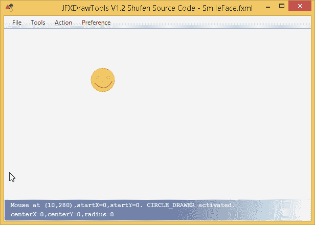

以下是使用我们 `drawtool.io` 包提供的 API 保存的 FXML 文件 `SmileFace.fxml` 内容，用于绘制图 1-22 中的草图。

列表 1-28. `SmileFace.fxml` 文件的内容，由 `JFXDrawTools V1.2` 应用程序生成，用于绘制图 1-22 中的草图：


```xml
<?xml version="1.0" encoding="UTF-8" standalone="no"?>
<?import java.lang.*?>
<?import java.util.*?>
<?import javafx.animation.*?>
<?import javafx.animation.PathTransition.*?>
<?import javafx.geometry.*?>
<?import javafx.scene.Group?>
<?import javafx.scene.control.*?>
<?import javafx.scene.effect.*?>
<?import javafx.scene.image.*?>
<?import javafx.scene.layout.*?>
<?import javafx.scene.paint.*?>
<?import javafx.scene.shape.*?>
<?import javafx.scene.text.*?>
<?import javafx.scene.transform.*?>
<?import javafx.util.*?>
<Pane xmlns:fx="http://javafx.com/fxml">
  <children>
        <Circle centerX="193.0" centerY="100.0" fill="#FFD700" fx:id="Circle_12f2476"
              radius="22.80350850198276" stroke="#FF7F50"/>
        <Circle centerX="182.0" centerY="95.0" fill="#FFD700" fx:id="Circle_d60f6e"
              radius="3.0" stroke="#FF7F50"/>
        <Circle centerX="204.0" centerY="95.0" fill="#FFD700" fx:id="Circle_724357"
              radius="3.0" stroke="#FF7F50"/>
        <Path fx:id="Path_119f33d" stroke="#A0522D">
          <elements>
            <MoveTo x="177.0" y="106.0"/>
            <QuadCurveTo controlX="197.0" controlY="126.0" x="211.0" y="103.0"/>
          </elements>
        </Path>
        <Circle centerX="193.0" centerY="103.0" fill="#FFD700" fx:id="Circle_19f1aa5"
              radius="1.0" stroke="#FF7F50"/>
      </children>
    </Pane>
```

## 1.3 `DrawWriter` 类的完整源代码

列表 1-29. `DrawWriter` 类的完整源代码：


```java
package drawtool.io;

import java.io.*;
import java.lang.reflect.Method;
import java.util.*;
import javafx.animation.*;
import javafx.collections.ObservableList;
import javafx.embed.swing.SwingFXUtils;
import javafx.geometry.Bounds;
import javafx.geometry.Rectangle2D;
import javafx.geometry.VPos;
import javafx.scene.SnapshotParameters;
import javafx.scene.Group;
import javafx.scene.effect.*;
import javafx.scene.image.Image;
import javafx.scene.image.ImageView;
import javafx.scene.layout.Pane;
import javafx.scene.paint.*;
import javafx.scene.shape.*;
import javafx.scene.text.Font;
import javafx.scene.text.FontSmoothingType;
import javafx.scene.text.TextAlignment;
import javafx.scene.text.TextBoundsType;
import javafx.scene.transform.*;
import javafx.util.Duration;
import javax.imageio.ImageIO;
import javax.xml.parsers.*;
import javax.xml.transform.*;
import javax.xml.transform.dom.*;
import javax.xml.transform.stream.*;
import org.w3c.dom.*;

/**
 * 文件名: DrawWriter.java
 * (目录: DrawTool1.4/src/example1/drawtool/io)
 * DrawWriter 类提供了这些 API:
 *  writeFXML, writeImageView
 *
 * writeFXML 方法将 Pane 或 Node 对象列表
 * 写入 FXML 格式的文件
 * writeFigure 方法写入在这些类型中定义的属性：
 *   Shape, ImageView
 * 对于其他类型的节点（nodes），
 * 仅处理继承自 Node 类的属性
 * 尽管如此，该结构是可扩展的，可以轻松添加代码来
 * 全面地支持其他类型
 *
 * writeImageView 方法将 ImageView 写入
 * png 或 gif 格式的图像文件
 *
 * @author Shufen Kuo
 */
public class DrawWriter {
  DocumentBuilderFactory documentBuilderFactory;
  DocumentBuilder documentBuilder;
  TransformerFactory transformerFactory;
  Transformer transformer;
  Document document;
  File fxmlFile;

  // 这用于将 ImageView 对象的位散图像写入文件
  // ImageView 对象的图像可能来自快照（snapshot），我们需要
  // 为其创建一个图像文件。
  // 如果 FXML 文件名为 "JFXDrawTools.fxml"，我们将提供
  // 图像文件名为：JFXDrawTools_1.png, JFXDrawTools_2.png, ...
  static int imageFileCount;

  /**
   * 将 pane 写入文件
   * 首先写入子节点列表
   * 然后写入 pane 的属性（一个 map）
   * 我们假设属性（一个 map）中对象引用的所有节点
   * 都存在于 pane 的 children 列表中。
   *  例如，如果在属性 map 中一个 PathTransition 对象的
   *  path 属性中指定了一个 Shape 对象，那么该 Shape 对象
   *  必须是 pane 的子节点，否则在之后加载回文件时，
   *  FXML 加器将无法解析该对象引用
   */
  public void writeFXML(Pane pane, File file) {
    initMyFXMLDocument(file);
    writeFXMLHeader();
    writeFXMLRootPane(pane, pane.getChildren());
    writeMyFXMLDocument();
  }

  /**
   * 将节点列表写入文件
   * 将 <Pane> 作为根节点写入 FXML 文件
   * 给定列表中包含的所有节点都保存到文件中，
   * 作为 Pane 的子节点
   */
  public void writeFXML(List<? extends javafx.scene.Node> list, File file) {
    // 如果 list 为空，则创建一个包含空节点的节点
    initMyFXMLDocument(file);
    writeFXMLHeader();
    writeFXMLRootPane(null, list);
    writeMyFXMLDocument();
  }

  /**
   * 将 ImageView 的图像写入图像文件
   * 我们不使用 image 属性中指定的图像，
   *而是应用 snapshot 方法获取图像，
   * 这样可以让图像符合变换（transformations）
   * ImageView 中 image 属性中指定的图像
   * 仍然是原始图像，
   * 未与应用的变换同步
   * 对 ImageView 进行快照会产生符合变换的
   * 图像，然后调用 writeImage
   * 将图像保存到支持的图像格式文件中
   * 注意事项：如果 ImageView 在其 clip 属性中
   * 指定了 clip，此方法也能正常工作
   *
   * @param iv
   * @param file
   */
  public void writeImageView(ImageView iv, File file) {
    Bounds bP = iv.getBoundsInParent();
    Double minX = bP.getMinX();
    Double minY = bP.getMinY();
    Double w = bP.getWidth();
    double h = bP.getHeight();
    Rectangle2D vp = new Rectangle2D(minX, minY, w, h);
    SnapshotParameters parameters = new SnapshotParameters();
    parameters.setViewport(vp);
    parameters.setFill(Color.TRANSPARENT);
    Image image = iv.snapshot(parameters, null);
    writeImage(image, file);
  }

  void initMyFXMLDocument(File file) {
    try {
      // 仅创建一次
      if (documentBuilderFactory == null) {
        documentBuilderFactory = DocumentBuilderFactory.newInstance();
        documentBuilder = documentBuilderFactory.newDocumentBuilder();
        transformerFactory = TransformerFactory.newInstance();
        transformer = transformerFactory.newTransformer();
        transformer.setOutputProperty(OutputKeys.METHOD, "xml");
        transformer.setOutputProperty(OutputKeys.INDENT, "yes");
        transformer.setOutputProperty("{http://xml.apache.org/xslt}indent-amount", "2");
      }
      this.fxmlFile = file;
      this.imageFileCount = 0; // 始终重置为 0
      document = documentBuilder.newDocument(); // 始终创建 doc
    } catch (ParserConfigurationException e) {
      System.out.println(e.getMessage());
    } catch (TransformerConfigurationException e) {
      System.out.println(e.getMessage());
    }
  }

  void writeMyFXMLDocument() {
    try {
      DOMSource source = new DOMSource(document);
      StreamResult result = new StreamResult(fxmlFile);
      transformer.transform(source, result);
    } catch (TransformerException e) {
      System.out.println(e.getMessage());
    }
  }

  /**
   * 在根节点 <Pane> 之前写入 import 语句
   * 注意：ProcessingInstruction 没有 break
   */
  void writeFXMLHeader() {
    document.appendChild(importInstruction("java.lang.*"));
    document.appendChild(importInstruction("java.util.*"));
    document.appendChild(importInstruction("javafx.animation.*"));
    document.appendChild(importInstruction("javafx.animation.PathTransition"));
    document.appendChild(importInstruction("javafx.geometry.*"));
    document.appendChild(importInstruction("javafx.scene.Group"));
    document.appendChild(importInstruction("javafx.scene.control.*"));
    document.appendChild(importInstruction("javafx.scene.effect.*"));
    document.appendChild(importInstruction("javafx.scene.image.*"));
    document.appendChild(importInstruction("javafx.scene.layout.*"));
    document.appendChild(importInstruction("javafx.scene.paint.*"));
    document.appendChild(importInstruction("javafx.scene.shape.*"));
    document.appendChild(importInstruction("javafx.scene.text.*"));
    document.appendChild(importInstruction("javafx.scene.transform.*"));
    document.appendChild(importInstruction("javafx.util.*"));
  }

  ProcessingInstruction importInstruction(String data) {
    return document.createProcessingInstruction("import", data);
  }

  /**
   * 创建 Pane 作为场景图的根
   * 将节点列表作为 Pane 的子节点
   * 在初始化完成之前调用此方法
   * 首先写入节点列表
   * 写入 pane 的属性
   * JFXDrawTools 使用（一个 map）存储应用程序数据，
   * 如动态创建的 Animation 对象
   */
  void writeFXMLRootPane(Pane root, List<? extends javafx.scene.Node> list) {
    Element rootElm = document.createElement("Pane");
    document.appendChild(rootElm);
    // 写入属性：xmlns:fx="http://javafx.com/fxml"
    rootElm.setAttribute("xmlns:fx", "http://javafx.com/fxml");
    // 逐个写入列表中的节点
    writeFXMLFigures(list, rootElm);
    if (root != null) {
      writeProperties(root, rootElm);
    }
  }

  /**
   * 遍历节点列表
   */
  void writeFXMLFigures(List<? extends javafx.scene.Node> list, Element rootElm) {
    Element childrenElm = document.createElement("children");
    rootElm.appendChild(childrenElm);
    for (javafx.scene.Node figure : list) {
      if (figure instanceof Group || figure instanceof Pane) {
        // 对于此版本 (V1.4)：写入 group 和
        // 所有派自 Pane 的类
        Element figureElm = document.createElement(figure.getClass().getSimpleName());
        childrenElm.appendChild(figureElm);
        // 设置通用节点属性
        setNodeAttributes(figure, figureElm);
        writeProperties(figure, figureElm);
        // 使用反射机制调用 getChildren 方法
        writeFXMLFigures(getNodeChildren(figure), figureElm);
      } else {
        writeFigure(figure, childrenElm);
      }
    }
  }

  /**
   *
   */
  void writeFigure(javafx.scene.Node figure, Element childrenElm) {
    String shapeTag = getSketchShapeTag(figure);
    Element shapeElm = document.createElement(shapeTag);
    childrenElm.appendChild(shapeElm);
    // 设置通用节点属性
    setNodeAttributes(figure, shapeElm);
    if (figure instanceof Shape) {
      // 设置 shape 属性
      setShapeAttributes((Shape)figure, shapeElm);
    } else if (figure instanceof ImageView) {
      // 设置 image 属性
      setImageAttributes((ImageView)figure, shapeElm);
    } else {
      // 在此处添加代码为其他类型写入属性
      System.out.format("DrawWriter V1.4 does not write attributes for %s yet%n", figure.getClass().getSimpleName());
    }
    // 在写入 属性后写入属性（一个 map）
    writeProperties(figure, shapeElm);
  }

  /**
   * 调用者确保 figure 有 getChildren 方法
   */
  List<javafx.scene.Node> getNodeChildren(javafx.scene.Node figure) {
    List<javafx.scene.Node> nodeList = new ArrayList<>();
    try {
      List list = (List)invokeMethod(figure, "getChildren");
      for (Object obj : list) {
        nodeList.add((javafx.scene.Node)obj);
      }
    } catch (Exception e) {
      System.out.format("exception=%s", e);
    }
    return nodeList;
  }

  /**
   * 使用 Java 反射调用方法
   */
  Object invokeMethod(Object obj, String methodName, Object... args) throws Exception {
    Method method = obj.getClass().getMethod(methodName);
    method.setAccessible(true);
    return method.invoke(obj, args);
  }

  void writeTransforms(ObservableList list, Element shapeElm) {
    if (list.size() == 0) return;
    Element transformsElm = document.createElement("transforms");
    shapeElm.appendChild(transformsElm);
    for (Transform t : list) {
      if (t instanceof Scale) {
        writeScale((Scale)t, transformsElm);
      } else if (t instanceof Translate) {
        writeTranslate((Translate)t, transformsElm);
      } else if (t instanceof Rotate) {
        writeRotate((Rotate)t, transformsElm);
      } else if (t instanceof Shear) {
        writeShear((Shear)t, transformsElm);
      }
    }
  }

  void writeTranslate(Translate translate, Element transformsElm) {
    // tag 为 "Translate"
    String tag = translate.getClass().getSimpleName();
    Element tElm = document.createElement(tag);
    transformsElm.appendChild(tElm);
    // 为 tElm 设置属性，例如：
    // <Translate x="100.0" y="120.0"/>
    setDoubleAttribute(tElm, "x", translate.getX(), 0);
    setDoubleAttribute(tElm, "y", translate.getY(), 0);
  }

  void writeScale(Scale scale, Element transformsElm) {
    // tag 为 "Scale"
    String tag = scale.getClass().getSimpleName();
    Element scaleElm = document.createElement(tag);
    transformsElm.appendChild(scaleElm);
    // 为 scaleElm 设置属性，例如：
    // <Scale x="0.5" y="0.5" pivotX="197.0" pivotY="85.0"/>
    setDoubleAttribute(scaleElm, "x", scale.getX(), 1);
    setDoubleAttribute(scaleElm, "y", scale.getY(), 1);
    setDoubleAttribute(scaleElm, "pivotX", scale.getPivotX(), 0);
    setDoubleAttribute(scaleElm, "pivotY", scale.getPivotY(), 0);
  }

  void writeRotate(Rotate rotate, Element transformsElm) {
    // tag 为 "Rotate"
    String tag = rotate.getClass().getSimpleName();
    Element rotateElm = document.createElement(tag);
    transformsElm.appendChild(rotateElm);
    // 为 rotateElm 设置属性，例如：
    // <Rotate angle="90.0" pivotX="281.0" pivotY="231.0"/>
    setDoubleAttribute(rotateElm, "angle", rotate.getAngle());
    setDoubleAttribute(rotateElm, "pivotX", rotate.getPivotX(), 0);
    setDoubleAttribute(rotateElm, "pivotY", rotate.getPivotY(), 0);
    setDoubleAttribute(rotateElm, "pivotZ", rotate.getPivotZ(), 0);
    if (rotate.getAxis() != null) {
      Element axisElm = document.createElement("axis");
      rotateElm.appendChild(axisElm);
      // 为 axisElm 设置属性，例如：
      //    <axis>
      //      <Point3D x="0.0" y="0.0" z="1.0"/>
      //    </axis>
      Element point3DElm = document.createElement("Point3D");
      axisElm.appendChild(point3DElm);
      setDoubleAttribute(point3DElm, "x", rotate.getAxis().getX());
      setDoubleAttribute(point3DElm, "y", rotate.getAxis().getY());
      setDoubleAttribute(point3DElm, "z", rotate.getAxis().getZ());
    }
  }

  void writeShear(Shear shear, Element transformsElm) {
    // tag 为 "Shear"
    String tag = shear.getClass().getSimpleName();
    Element shearElm = document.createElement(tag);
    transformsElm.appendChild(shearElm);
    // 为 shearElm 设置属性，例如：
    // <Shear x="0.3" y="0.3" pivotX="197.0" pivotY="85.0"/>
    setDoubleAttribute(shearElm, "x", shear.getX(), 0);
    setDoubleAttribute(shearElm, "y", shear.getY(), 0);
    setDoubleAttribute(shearElm, "pivotX", shear.getPivotX(), 0);
    setDoubleAttribute(shearElm, "pivotY", shear.getPivotY(), 0);
  }

  void writeEffect(Effect effect, Element effectm) {
    if (effect instanceof DropShadow) {
      writeDropShadow((DropShadow)effect, effectm);
    } else if (effect instanceof InnerShadow) {
      writeInnerShadow((InnerShadow)effect, effectm);
    } else if (effect instanceof Reflection) {
      writeReflection((Reflection)effect, effectm);
    }
  }

  void writeDropShadow(DropShadow dropShadow, Element effectm) {
    // tag 为 "DropShadow"
    String tag = dropShadow.getClass().getSimpleName();
    Element shadowElm = document.createElement(tag);
    effectm.appendChild(shadowElm);
    // 为 shadowElm 设置属性，例如：
    // <effect>
    //   <DropShadow offsetX="3" offsetY="3" color="#6969"/>
    // </effect>
    setDoubleAttribute(shadowElm, "offsetX", dropShadow.getOffsetX(), 0);
    setDoubleAttribute(shadowElm, "offsetY", dropShadow.getOffsetY(), 0);
    if (dropShadow.getColor() != null) {
      String hexStr = getColorHexString(dropShadow.getColor());
      // 默认颜色为黑色
      setStringAttribute(shadowElm, "color", hexStr, "#000000");
    }
    // 默认宽度为 21.0，范围：0 到 255
    setDoubleAttribute(shadowElm, "width", dropShadow.getWidth());
    // 默认高度为 21.0，范围：0 到 255
    setDoubleAttribute(shadowElm, "height", dropShadow.getHeight());
    // 默认半径为 10.0，范围：0 到 127
    // 设置半径的结果与设置宽和高相同：2 * radius + 1
    setDoubleAttribute(shadowElm, "radius", dropShadow.getRadius());
    // 默认扩散为 0.0，范围：0.0 到 1.0
    setDoubleAttribute(shadowElm, "spread", dropShadow.getSpread(), 0);
    setStringAttribute(shadowElm, "blurType", dropShadow.getBlurType().name(), BlurType.THREE_PASS_BOX.name());
    if (dropShadow.getInput() != null) {
      // 将另一个 Effect 作为 dropShadow 的输入，创建链
      // 例如，如果输入是 InnerShadow：
      // <input>
      //   <InnerShadow offsetX="2.5" offsetY="0.5" color="#ffff00"/>
      // </input>
      Element inputElm = document.createElement("input");
      shadowElm.appendChild(inputElm);
      writeEffect(dropShadow.getInput(), inputElm);
    }
  }

  void writeInnerShadow(InnerShadow innerShadow, Element effectm) {
    // tag 为 "InnerShadow"
    String tag = innerShadow.getClass().getSimpleName();
    Element innerElm = document.createElement(tag);
    effectm.appendChild(innerElm);
    // 为 innerElm 设置属性，例如：
    // <effect>
    //   <InnerShadow offsetX="2.5" offsetY="0.5" color="#ffff00"/>
    // </effect>
    setDoubleAttribute(innerElm, "offsetX", innerShadow.getOffsetX(), 0);
    setDoubleAttribute(innerElm, "offsetY", innerShadow.getOffsetY(), 0);
    if (innerShadow.getColor() != null) {
      String hexStr = getColorHexString(innerShadow.getColor());
      // 默认颜色为黑色
      setStringAttribute(innerElm, "color", hexStr, "#000000");
    }
    // 默认宽度为 21.0，范围：0 到 255
    setDoubleAttribute(innerElm, "width", innerShadow.getWidth());
    // 默认高度为 21.0，范围：0 到 255
    setDoubleAttribute(innerElm, "height", innerShadow.getHeight());
    // 默认半径为 10.0，范围：0 到 127
    // 设置半径的结果与设置宽和高相同：2 * radius + 1
    setDoubleAttribute(innerElm, "radius", innerShadow.getRadius());
    // 默认 choke 为 0.0，范围：0.0 到 1.0
    setDoubleAttribute(innerElm, "choke", innerShadow.getChoke(), 0);
    setStringAttribute(innerElm, "blurType", innerShadow.getBlurType().name(), BlurType.THREE_PASS_BOX.name());
    if (innerShadow.getInput() != null) {
      // 将另一个 Effect 作为 innerShadow 的输入，创建链效果
      // 例如，如果输入是 Reflection：
      // <input>
      //   <Reflection fraction="0.9"/>
      // </input>
      Element inputElm = document.createElement("input");
      innerElm.appendChild(inputElm);
      writeEffect(innerShadow.getInput(), inputElm);
    }
  }

  void writeReflection(Reflection reflection, Element effectm) {
    // tag 为 "Reflection"
    String tag = reflection.getClass().getSimpleName();
    Element reflectionElm = document.createElement(tag);
    effectm.appendChild(reflectionElm);
    // <effect>
    //   <Reflection fraction="0.9"/>
    // </effect>
    // 默认 fraction 0.75，范围：0.0 到 1.0
    setDoubleAttribute(reflectionElm, "fraction", reflection.getFraction());
    // topOffset 是输入底部和顶部之间的距离
    // 默认 topOffset 为 0.0
    setDoubleAttribute(reflectionElm, "topOffset", reflection.getTopOffset(), 0);
    // 默认 topOpacity 为 0.5，范围：0.0 到 1.0
    setDoubleAttribute(reflectionElm, "topOpacity", reflection.getTopOpacity());
    // 默认 bottomOpacity 为 0.0，范围：0.0 到 1.0
    setDoubleAttribute(reflectionElm, "bottomOpacity", reflection.getBottomOpacity(), 0);
    if (reflection.getInput() != null) {
      // 将另一个 Effect 作为 reflection 的输入，创建链效果
      // 例如，如果输入是 DropShadow：
      // <input>
      //   <DropShadow offsetX="3" offsetY="3" blurType="TWO_PASS_BOX" color="#6969"/>
      // </input>
      Element inputElm = document.createElement("input");
      reflectionElm.appendChild(inputElm);
      writeEffect(reflection.getInput(), inputElm);
    }
  }

  void setNodeAttributes(javafx.scene.Node figure, Element shapeElm) {
    setDoubleAttribute(shapeElm, "layoutX", figure.getLayoutX(), 0);
    setDoubleAttribute(shapeElm, "layoutY", figure.getLayoutY(), 0);
    setDoubleAttribute(shapeElm, "opacity", figure.getOpacity(), 1);
    setDoubleAttribute(shapeElm, "rotate", figure.getRotate(), 0);
    setDoubleAttribute(shapeElm, "translateX", figure.getTranslateX(), 0);
    setDoubleAttribute(shapeElm, "translateY", figure.getTranslateY(), 0);
    setDoubleAttribute(shapeElm, "scaleX", figure.getScaleX(), 1);
    setDoubleAttribute(shapeElm, "scaleY", figure.getScaleY(), 1);
    setBooleanAttribute(shapeElm, "pickOnBounds", figure.isPickOnBounds(), false);
    setStringAttribute(shapeElm, "fx:id", getSketchShapeId(figure), "");
    // 写入 clip 元素
    if (figure.getClip() != null) {
      Element clipElm = document.createElement("clip");
      shapeElm.appendChild(clipElm);
      writeFigure(figure.getClip(), clipElm);
    }
    // 将 transforms 元素添加到 shapeElm
    writeTransforms(figure.getTransforms(), shapeElm);
    // 将 effect 元素添加到 shapeElm
    if (figure.getEffect() != null) {
      Element effectElm = document.createElement("effect");
      shapeElm.appendChild(effectElm);
      writeEffect(figure.getEffect(), effectElm);
    }
  }
}
```


在命令行编译 `drawtool` 库：

```
Microsoft Windows [Version 6.3.9600]
(c) 2013 Microsoft Corporation. All rights reserved.

F:\My Documents\DocRoot\SHUFEN_JAVA\MyBookJFX\VolumeFour\DrawTool1.4\src\example1>
javac  -encoding utf-8 -Xlint:unchecked drawtool\*.java

javac  -encoding utf-8 -Xlint:unchecked drawtool\io\*.java

javac  -encoding utf-8 -Xlint:unchecked drawtool\shape\*.java

javac  -encoding utf-8 -Xlint:unchecked -cp . drawtool\drawer\*.java

jar cf drawtool.jar drawtool resource
```

## 1.4 总结

本节介绍了 JavaFX 库的以下关键方面，按照它们在章节中出现的顺序列出：

- `SwingFXUtils` 类位于 `javafx.embed.swing` 包，并提供了在 JavaFX `Image` 和 Swing/AWT `Image` 之间进行类型转换的方法：

  `static BufferedImage fromFXImage(Image img, BufferedImage bimg)`

  `static WritableImage toFXImage(BufferedImage bimg, WritableImage wimg)`

  （参见章节“实现 `writeImageView` 方法”。）

- `Image` 类继承自 `java.lang.Object` 并位于 `javafx.scene.image` 包，用于加载图像。可以通过向构造函数传递字符串 `url` 或 `InputStream` 来构造 `Image`。使用 `ImageView` 对象来显示 `Image`。

  （参见章节“实现 `writeImageView` 方法”。）

- `WritableImage snapshot(SnapshotParameters params, WritableImage image)` 方法定义在 `Node` 类中，用于对节点（无论是否是场景的一部分）进行快照。它返回一个 `WritableImage`，它是 `javafx.scene.image.Image` 的直接子类。

  （参见章节“实现 `writeImageView` 方法”。）

- `ImageView` 类继承自 `javafx.scene.Node` 并位于 `javafx.scene.image` 包，用于显示图像。可以通过向构造函数传递 `String` 类型的 `url` 或一个 `Image` 来构造 `Image`。

  （参见章节“实现 `writeImageView` 方法”。）

- `SnapshotParameters` 类继承自 `java.lang.Object` 并位于 `javafx.scene` 包；它提供了用于为 `javafx.scene.Node` 设置快照参数的工具类，例如：

  `setFill(Paint fill)`

  `setViewport(Rectangle2D viewport)`

  （参见 `writeImageView` 方法的完整源代码。）

- `Bounds` 是一个抽象类，位于 `javafx.geometry` 包，定义了操作矩形区域、测量坐标和尺寸的工具：`minX`、`minY`、`maxX`、`maxY`、`width`、`height`。

  （参见章节“利用 `boundsInLocal` 和 `boundsInParent`，利用 `layoutBounds`”。）

- `boundsInLocal` 是类型为 `ReadOnlyObjectProperty<Bounds>` 的属性，定义在 `Node` 类中，指定一个 `Bounds` 对象，表示 `Node` 的矩形边界区域，而不考虑应用在其上的任何变换。

  （参见章节“利用 `boundsInLocal` 和 `boundsInParent`，利用 `layoutBounds`”。）

- `boundsInParent` 是类型为 `ReadOnlyObjectProperty<Bounds>` 的属性，定义在 `Node` 类中，指定一个 `Bounds` 对象，表示 `Node` 的矩形边界区域，并包含应用在其上的所有变换，如 `translate`、`scale`、`rotate` 等。

  （参见章节“利用 `boundsInLocal` 和 `boundsInParent`，利用 `layoutBounds`”。）

- `layoutBounds` 是定义在 `Node` 类中的类型为 `ReadOnlyObjectProperty<Bounds>` 的属性，它指定的 `Bounds` 对象不考虑这些属性：`effect`、`clip`、`scaleX`、`scaleY`、`rotate`、`translateX`、`translateY`、`layoutX`、`layoutY`；它还排除了任何应用到 `Node` 的 `Transform` 对象。

  （参见章节“利用 `layoutBounds`”。）

- `RadialGradient` 类位于 `javafx.scene.paint` 包，是 `Paint` 的直接子类。

- `LinearGradient` 类位于 `javafx.scene.paint` 包，是 `Paint` 的直接子类。

- `CycleMethod` 类是一个枚举类型，位于 `javafx.scene.paint` 包，与 `LinearGradient` 和 `RadialGradient` 配合使用。它定义了 `CycleMethod.NO_CYCLE`、`CycleMethod.REFLECT` 和 `CycleMethod.REPEAT`。

- `Stop` 类位于 `javafx.scene.paint` 包，与 `LinearGradient` 和 `RadialGradient` 配合使用。创建一个 `Stop` 实例需要两个参数：`offset` 和 `color`。

# 第 2 章 增强 Draw Tool

## 开发 Drawing Tools V1.4（部分 2）

### 前言

在本章中，我们将介绍位于 `javafx.io` 的 `DrawLoader` 类，用于将 FXML 文件和图像加载到画布中。通过对 `Drawing Tools V1.4（部分 2）` 的详细描述和示例代码，你将熟悉 JavaFX 库在总结部分的功能。

`Drawing Tools V1.4（部分 2）` 的完整开发过程包含以下步骤：

- 2.1 创建 `DrawLoader` 类
  - 2.1.1 实现 `loadFXML` 方法
  - 2.1.2 实现 `loadImage` 方法
- 2.2 `DrawLoader` 类的完整代码
- 2.3 总结

## 2.1 创建 `DrawLoader` 类

`DrawLoader` 类位于 `drawtool.io` 包，并提供了直观的高级 API 来加载 FXML 文件和图像。源是一个 `File` 实例。如果是图像文件，将创建一个 `ImageView` 对象，并将加载的图像设置到 `image` 属性。如果是 FXML 文件，无论是手动编码的还是通过 `DrawWriter` 类提供的 API 程序生成的（参见前一章节），那么从文件中加载的根节点将被添加到给定的绘图面板中。

### 2.1.1 实现 `loadFXML` 方法

`DrawLoader` 类提供了两个 `loadFXML` 方法：

```java
public ObservableList<Node> loadFXML(File file, Pane pane)
public ObservableList<Node> loadFXML(File file)
```

1. `public ObservableList<Node> loadFXML(File file, Pane pane)`

#### 描述

加载 FXML 文件并将根节点的后代（或根节点本身）添加到指定 `pane` 的子节点列表中。如果从指定文件加载的根节点是一个 `Pane` 且拥有一个属性映射（可以通过 `Node` 类中定义的 `getProperties()` 方法获取），则该映射条目集中的元素将被添加到所给 `pane` 的属性映射中。

2. `public ObservableList<Node> loadFXML(File file)`

加载给定的 FXML 文件并以列表形式返回根节点的后代节点或根节点本身。

请注意，我们会检查存储在 FXML 文件中的场景图的根节点是否属于以下类型：

1. `Pane`
2. `Group`

如果不是这些类型，则将根节点本身而不是其后代节点作为列表返回给调用者。

`FXMLLoader` 类自 `java.lang.Object` 并位于 `javafx.fxml` 包，提供了加载 FXML 文档的功能。以下是 `FXMLLoader` 类中定义的用于我们 `loadFXML` 方法的静态方法：

```java
public static <T> T load(URL location)
                 throws IOException
```

以下是我们 `loadFXML` 方法的完整源代码。

#### 导入语句

```java
import java.io.File;
import java.io.IOException;
import java.net.MalformedURLException;
import java.net.URL;
import java.util.*;
import javafx.collections.*;
import javafx.fxml.FXMLLoader;
import javafx.scene.Group;
import javafx.scene.Node;
import javafx.scene.layout.Pane;
```

#### Listing 2-1. 定义 `loadFXML` 方法

```java
/**
 * 加载 FXML 文件以获取场景图的根节点
 * 如果根节点是 Pane 或 Group，
 * 将其后代添加到给定 pane 的子节点列表中
 * 如果它不是 Pane 或 Group，
 * 将根节点本身添加到给定 pane 的子节点列表中
 * 并且如果根节点是一个 pane，
 * 我们也将它的属性（一个映射）添加到给 pane 中
 */
public ObservableList<Node> loadFXML(File file, Pane pane) {
  try {
    // 从 File 获取 URL
    URL url = file.toURI().toURL();
    Node root = FXMLLoader.load(url);

    ObservableList<Node> nodeList = getRootDescendant(root);
    pane.getChildren().addAll(nodeList);

    ObservableMap<Object, Object> map = root.getProperties();
    // 如果根是 pane，则将属性（一个映射）添加到 pane
    if (root instanceof Pane) {
      Iterator<Map.Entry<Object, Object>> it = map.entrySet().iterator();
      while (it.hasNext()) {
        Map.Entry<Object, Object> e = it.next();
        pane.getProperties().put(e.getKey(), e.getValue());
      }
    }
    return nodeList;
  } catch (MalformedURLException e) {
    System.out.println(e);
  } catch (IOException e) {
    System.out.println(e);
  }
  // 返回空列表
  return FXCollections.observableArrayList();
}

/**
 * 加载 FXML 文件以获取场景图的根节点
 * 如果根节点是 Pane 或 Group，
 * 返回根节点的子节点列表
 * 如果根节点不是 Pane 或 Group
 * 返回一个包含根节点的列表
 */
public ObservableList<Node> loadFXML(File file) {
  try {
    // 从 File 获取 URL
    URL url = file.toURI().toURL();
    Node root = FXMLLoader.load(url);
    return getRootDescendant(root);
  } catch (MalformedURLException e) {
    System.out.println(e);
  } catch (IOException e) {
    System.out.println(e);
  }
  // 返回空列表
  return FXCollections.observableArrayList();
}

ObservableList<Node> getRootDescendant(Node root) {
  if (root instanceof Pane)
    return ((Pane) root).getChildren();
  if (root instanceof Group)
    return ((Group) root).getChildren();

  // 返回一个包含根节点的列表
  return FXCollections.observableArrayList(root);
}
```

### 2.1.2 实现 `loadImage` 方法

除了加载 FXML 文件外，`DrawLoader` 类还提供了一个 `loadImage` 方法：

```java
public ImageView loadImage(File file, double maxWidth, double maxHeight)
```

`loadImage` 方法从指定的文件加载图像并返回一个 `ImageView` 对象用于查看。最大视图尺寸在参数中指定：`maxWidth` 和 `maxHeight`。

以下是 `loadImage` 方法的完整源代码。

#### 导入语句

```java
import java.io.File;
import javafx.scene.image.Image;
import javafx.scene.image.ImageView;
```

#### Listing 2-2. 定义 `loadImage` 方法加载图像文件并返回一个 `ImageView` 对象以查看加载的图像

```java
/**
 * 返回一个 ImageView，url 以字符串形式存放在 ImageView 的属性中
 */
public ImageView loadImage(File file, double maxWidth, double maxHeight) {
  String url = file.toURI().toString();
  Image image = new Image(url);
  ImageView imageView = new ImageView();
  imageView.setPreserveRatio(true);
  // 如果图像大于 maxWidth/maxHeight，
  // 初始化 imageView 以适应 maxWidth/maxHeight
  if (image.getWidth() > maxWidth) {
    imageView.setFitWidth(maxWidth);
  } else if (image.getHeight() > maxHeight) {
    imageView.setFitHeight(maxHeight);
  }
  imageView.setImage(image);
  // 将 url 放入属性（一个映射）
  imageView.getProperties().put("imageURL", url);
  return imageView;
}
```

## 2.2 `DrawLoader` 类的完整源代码

Listing 2-3. `DrawLoader` 类的完整源代码：

# 第 3 章：JFXDrawTools

## 3.1 前言

### `DrawLoader.java` 实现


```java
package drawtool.io;

import java.io.File;
import java.io.IOException;
import java.net.MalformedURLException;
import java.net.URL;
import java.util.*;
import javafx.collections.*;
import javafx.fxml.FXMLLoader;
import javafx.scene.Group;
import javafx.scene.Node;
import javafx.scene.image.Image;
import javafx.scene.image.ImageView;
import javafx.scene.layout.Pane;

/**
 * 文件名: DrawLoader.java
 * (位于目录: DrawTool1.4/src/example1/drawtool/io)
 * 此类处理 FXML 文件加载和图像文件加载
 * 源是 File 的实例。
 *
 * @author Shufen Kuo
 */

public class DrawLoader {

  /**
   * 返回一个 ImageView，并将 url 以字符串形式放入 ImageView 的属性中
   */
  public ImageView loadImage(File file, double maxWidth, double maxHeight) {
    String url = file.toURI().toString();
    Image image = new Image(url);
    ImageView imageView = new ImageView();
    imageView.setPreserveRatio(true);  
    // 如果图像大于 maxWidth/maxHeight，
    // 初始化 imageView 以适应 maxWidth/maxHeight
    if (image.getWidth() > maxWidth) {
      imageView.setFitWidth(maxWidth);
    } else if (image.getHeight() > maxHeight) {
      imageView.setFitHeight(maxHeight);
    }
    imageView.setImage(image);
    // 将 url 放入属性（一个 map）
    imageView.getProperties().put("imageURL", url);
    return imageView;
  }

  /**
   * 加载 FXML 文件以获取场景图的根节点
   * 如果根节点是 Pane 或 Group，
   * 将其后代添加到给定 pane 的子列表中
   * 如果它不是 Pane 或 Group，
   * 将根节点本身添加到给定 pane 的子列表中
   * 并且根节点是 pane，
   * 我们也将将其属性（一个 map）添加到给定的 pane 中
   */
  public ObservableList<Node> loadFXML(File file, Pane pane) {
    try {
      // 从 File 获取 URL
      URL url = file.toURI().toURL();
      Node root = FXMLLoader.load(url);

      ObservableList<Node> nodeList = getRootDescendant(root);
      pane.getChildren().addAll(nodeList);

      ObservableMap<Object, Object> map = root.getProperties();
      // 如果根节点是 pane，则将属性（一个 map）添加到 pane
      if (root instanceof Pane) {
        Iterator<Map.Entry<Object, Object>> it = map.entrySet().iterator();
        while (it.hasNext()) {
          Map.Entry<Object, Object> e = it.next();
          //System.out.format("%s %s%n", e.getKey().toString(), e.getValue().toString());
          pane.getProperties().put(e.getKey(), e.getValue());
        }
      }      
      return nodeList;
    } catch(MalformedURLException e) {
      System.out.println(e);
    } catch(IOException e) {
      System.out.println(e);
    }     
    // 返回一个空列表
    return FXCollections.observableArrayList();     
  }

  /**
   * 加载 FXML 文件以获取场景图的根节点
   * 如果根节点是 Pane 或 Group，
   * 返回根节点的子节点列表
   * 如果根节点不是 Pane 或 Group 
   * 在列表中返回根节点
   */
  public ObservableList<Node> loadFXML(File file) {
    try {
      // 从 File 获取 URL
      URL url = file.toURI().toURL();
      Node root = FXMLLoader.load(url);
      return getRootDescendant(root);
    } catch(MalformedURLException e) {
      System.out.println(e);
    } catch(IOException e) {
      System.out.println(e);
    }     
    // 返回一个空列表
    return FXCollections.observableArrayList();     
  }

  ObservableList<Node> getRootDescendant(Node root) {
    if (root instanceof Pane) 
      return ((Pane)root).getChildren();
    if (root instanceof Group) 
      return ((Group)root).getChildren();

    // 返回一个包含根节点的列表
    return FXCollections.observableArrayList(root);     
  }

}
```

### 在命令行中编译 `drawtool` 库

```bash
 Microsoft Windows [Version 6.3.9600]
(c) 2013 Microsoft Corporation. All rights reserved.

F:\My Documents\DocRoot\SHUFEN_JAVA\MyBookJFX\VolumeFour\DrawTool1.4\src\example1>
javac -encoding utf-8 -Xlint:unchecked drawtool\*.java

javac -encoding utf-8 -Xlint:unchecked drawtool\io\*.java

javac -encoding utf-8 -Xlint:unchecked drawtool\shape\*.java

javac -encoding utf-8 -Xlint:unchecked -cp . drawtool\drawer\*.java

jar cf drawtool.jar drawtool resource
```

当我们在本章节的 `JFXDrawTools` 中实现 `File` 功能时，我们将详细阐述 `DrawLoader` 类内部定义的 API 的用法。

## 3.1 向菜单栏添加 `File` 菜单

在本节中，我们将创建一个 `File` 菜单并将其添加到菜单栏中。初始情况下，`File` 菜单包含一个菜单项 `Exit`。以下是创建 `File` 菜单的源代码：

列表 3-1. 创建带有 `Exit` 菜单项的 `File` 菜单：

```java
MenuBar createMenuBar(Stage stage) {
  MenuBar menuBar = new MenuBar();
  Menu menuFile = createMenuFile(stage);
  Menu menuTools = createMenuTools();
  Menu menuPref = createMenuPreference();
  menuBar.getMenus().addAll(menuFile, menuTools, menuPref);

  return menuBar;
}

Menu createMenuFile(final Stage stage) {
  Menu menuFile = new Menu("File");
  MenuItem exit = new MenuItem("Exit");
  menuFile.getItems().add(exit);

  // Add action for exit menu item
  exit.setOnAction(new EventHandler<ActionEvent>() {
    @Override
    public void handle(ActionEvent e) {
      Platform.exit();
    }
  });
  return menuFile;
}
```

## 3.2 使用 `DrawWriter` 类为绘图生成 FXML 文件

在本节中，我们将参考本书的第 1 章，使用 `DrawWriter` 类定义的 API 来生成 FXML 文件，该文件将保存在绘板上交互式创建的绘图。我们将使用以下方法：

```java
public void writeFXML(Pane pane, File file)
```

请注意，在接下来的示例中，我们创建了一个 `DrawPane` 实例并将其放在 `BorderPane` 的中心作为我们的绘板。`DrawPane` 是 `Pane` 类的直接子类，它注册了事件处理器来处理对于在面板本身交互式绘制形状至重要的事件。这些事件包括鼠标按下、鼠标拖拽、鼠标释放、按键按下等。有关 `DrawPane` 类的详细描述和完整源代码，请参阅 VOLUME Ⅱ: DEVELOPING INTERACTIVE SHAPE DRAWING TOOLS 第 6 章 Basic Draw Tool Section 6.2 Create `DrawPane` Class，以及第 7 章 Enhanced Draw Tool with Predefined Drawers Section 7.3 Enhance `DrawPane` Class。

以下代码段使用 `DrawWriter` 类将绘板上的草图保存到 FXML 文件中，其中定义了 `writeFXML` 方法：

导入语句：

```java
import java.io.File;
import javafx.application.Application;
import javafx.event.ActionEvent;
import javafx.event.EventHandler;
import javafx.scene.control.MenuItem;
import javafx.scene.layout.BorderPane;
import javafx.stage.FileChooser;
import javafx.stage.Stage;

import drawtool.DrawPane;
import drawtool.io.DrawWriter;
```

列表 3-2. 使用 `DrawWriter` 类将绘板上的绘图写入 FXML 文件：

```java
public class JFXDrawTools extends Application {
  // The drawing board to draw/move shapes dynamically 
  DrawPane drawPane = new DrawPane();

  // Create a DrawWriter to save shapes/images 
  DrawWriter drawWriter = new DrawWriter();

  @Override
  public void start(final Stage stage) {
    BorderPane rootPane = new BorderPane();
    rootPane.setCenter(drawPane);

        ...

    // Create a file chooser for saveAllAs
    final FileChooser fileChooser = new FileChooser();
    fileChooser.getExtensionFilters().addAll(
        new FileChooser.ExtensionFilter("FXML", "*.fxml"),
        new FileChooser.ExtensionFilter("All Files", "*.*"));

        ...

    MenuItem saveAllAs = new MenuItem("Save All As...");

    // Add action for saveAllAs menu item
    // Open FileChooser to select a file
    saveAllAs.setOnAction(new EventHandler<ActionEvent>() {
      @Override
      public void handle(ActionEvent e) {
        // Open FileChooser dialog
        fileChooser.setTitle("Save All As FXML File");
        File file = fileChooser.showSaveDialog(stage);
        if (file != null) {
          drawWriter.writeFXML(drawPane, file);
        }
      }
    }); 

    ... 
```

## 3.3 向 `File` 菜单添加 `Save FXML` 子菜单

在这里，让我们探索 `Save FXML` 子菜单的实现细节。首先，创建一个 `Save FXML` 子菜单，并将其添加到菜单栏的 `File` 菜单中。`Save FXML` 子菜单有两个菜单项：“Save All”和“Save All As...”。“Save All”的操作会将绘板上所有的对象保存到当前加载/保存的 FXML 文件中。如果是第一次执行该操作，则将使用一个名为 "JFXDrawTools.fxml" 的默认 FXML 文件。在“Save All...”的操作中，会弹出一个 `FileChooser` 保存对话框，将所有对象保存到从保存对话框中选择的文件。

定义了一个类字段 `curFXMLFile`；它是一个类型为 `ObjectProperty<File>` 的属性，用于指定当前文件。当保存或加载 FXML 文件时，其值会被更新。

列表 3-3. 创建带有 `Save All` 菜单项和 `Save All As...` 菜单项的 `Save FXML` 菜单：


## 3.4 使用`DrawLoader`类从FXML文件加载绘图

在本节中，我们将演示如何使用`DrawLoader`类中定义的API（参考本书的第2章），加载保存了场景图的FXML文件，或者加载图像文件。将使用以下方法：

```
public ObservableList<Node> loadFXML(File file, Pane pane)
public ImageView loadImage(File file, double maxWidth, double maxHeight)
```

### 3.4.1 加载FXML文件

以下代码段使用`DrawLoader`类从FXML文件加载绘图到绘图板，其中定义了`loadFXML`方法：

导入语句：

```java
import java.io.File;
import javafx.application.Application;
import javafx.event.ActionEvent;
import javafx.event.EventHandler;
import javafx.scene.control.MenuItem;
import javafx.scene.layout.BorderPane;
import javafx.stage.FileChooser;
import javafx.stage.Stage;

import drawtool.DrawPane;
import drawtool.io.DrawLoader;
```

列表3-4. 使用`DrawLoader`类从FXML文件加载绘图到绘图板：

```java
public class JFXDrawTools extends Application {
  // 用于动态绘制形状的绘图板
  DrawPane drawPane = new DrawPane();

  // 用于打开文件的DrawLoader
  DrawLoader drawLoader = new DrawLoader();

  @Override
  public void start(final stage) {
    BorderPane rootPane = new BorderPane();
    rootPane.setCenter(drawPane);

        ...

    // 为loadFXML菜单项创建文件选择器
    final FileChooser fxmlFileChooser = new FileChooser();

    fxmlFileChooser.getExtensionFilters().addAll(
        new FileChooser.ExtensionFilter("FXML", "*.fxml"),
        new FileChooser.ExtensionFilter("All Files", "*.*"));

        ...

    MenuItem loadFXML = new MenuItem("Open FXML...");

    // 为loadFXML菜单项添加动作
    loadFXML.setOnAction(new EventHandler<ActionEvent>() {
      @Override
      public void handle(ActionEvent e) {
        // 打开FileChooser对话框
        fxmlFileChooser.setTitle("Open FXML File");
        File file = fxmlFileChooser.showOpenDialog(stage);
        if (file != null) {
          ObservableList<Node> list = 
            drawLoader.loadFXML(file, drawPane);
        }
      }
    });

    ... 
}
```

### 3.4.2 加载图像文件

以下示例使用`DrawLoader`类加载图像并显示在绘图板上，其中定义了`loadImage`方法：

导入语句：

```java
import java.io.File;
import javafx.application.Application;
import javafx.event.ActionEvent;
import javafx.event.EventHandler;
import javafx.scene.control.MenuItem;
import javafx.scene.image.ImageView;
import javafx.scene.layout.BorderPane;
import javafx.stage.FileChooser;
import javafx.stage.Stage;

import drawtool.DrawPane;
import drawtool.io.DrawLoader;
```

列表3-5. 使用`DrawLoader`类加载图像并将其显示在绘图板上：

```java
public class JFXDrawTools extends Application {
  // 用于动态绘制/移动形状的画板 
  DrawPane drawPane = new DrawPane();

  // 创建DrawLoader用于打开形状/图像文件
  DrawLoader drawLoader = new DrawLoader();

  @Override
  public void start(final Stage stage) {
    BorderPane rootPane = new BorderPane();
    rootPane.setCenter(drawPane);

        ...

    MenuItem loadImage = new MenuItem("Open Image...");

    // 为loadImage项创建一个文件选择器
    final FileChooser imageFileChooser = new FileChooser();

    imageFileChooser.getExtensionFilters().addAll(
        new FileChooser.ExtensionFilter("All Images",
        "*.bmp", "*.gif", "*.jpeg", "*.jpg", "*.png"),
        new FileChooser.ExtensionFilter("All Files", "*.*"),
        new FileChooser.ExtensionFilter("BMP", "*.bmp"),
        new FileChooser.ExtensionFilter("GIF", "*.gif"),
        new FileChooser.ExtensionFilter("JPEG", "*.jpeg"),
        new FileChooser.ExtensionFilter("JPG", "*.jpg"),
        new FileChooser.ExtensionFilter("PNG", "*.png"));

    // 为loadImage项添加动作
    loadImage.setOnAction(new EventHandler<ActionEvent>() {
      @Override
      public void handle(ActionEvent e) {
        // 打开FileChooser对话框
        imageFileChooser.setTitle("Open Image File");
        File file = imageFileChooser.showOpenDialog(stage);
        if (file != null) {
          ImageView iv = drawLoader.loadImage(file,
            Double.MAX_VALUE, Double.MAX_VALUE);
          drawPane.getChildren().add(iv);
        }
      }
    });

    ... 
}
```

## 3.5 为`File`菜单添加`Open`子菜单

在这里，让我们来探索`Open`子菜单的实现细节。首先，创建一个`Open`子菜单，并将其添加到菜单栏的`File`菜单中。`Open`子菜单包含两个菜单项："Open FXML..."和"Open Image..."。在"Open FXML..."的动作中，从选定的FXML文件加载所有节点并将它们显示在画板上。在"Open Image..."的动作中，从选定的文件中加载图像并显示在画板上。

列表3-6. 创建带有`Open FXML...`菜单项和`Open Image...`菜单项的`Open`菜单：

```java
// 指定最后保存或最后打开的文件
ObjectProperty<File> curFXMLFile = new SimpleObjectProperty<>();
ObjectProperty<File> curImageFile = new SimpleObjectProperty<>();

Menu createMenuFile(final Stage stage) {
  Menu menuFile = new Menu("File");
  Menu loadSubmenu = createMenuLoad(stage);
  Menu saveFXMLMenu = createMenuSaveFXML(stage);
  MenuItem exit = new MenuItem("Exit");
  menuFile.getItems().addAll(loadSubmenu, saveFXMLMenu, exit);

        ...

  return menuFile;
}

Menu createMenuLoad(final Stage stage) {
  Menu menuLoad = new Menu("Open");
  MenuItem loadFXML = new MenuItem("Open FXML...");
  MenuItem loadImage = new MenuItem("Open Image...");
  menuLoad.getItems().addAll(loadFXML, loadImage);

  // 为loadFXML项创建一个文件选择器
  final FileChooser fxmlFileChooser = new FileChooser();
```

以下为补充的完整代码段（包含`createMenuSaveFXML`方法和`getPrefFileExtension`方法）：

```java
Menu createMenuSaveFXML(final Stage stage) {
  Menu menuSave = new Menu("Save FXML");
  MenuItem saveAll = new MenuItem("Save All");
  saveAll.setAccelerator(
    new KeyCharacterCombination("S", KeyCombination.CONTROL_DOWN));
  MenuItem saveAllAs = new MenuItem("Save All As...");

  menuSave.getItems().addAll(saveAll, saveAllAs);

  // 为saveAllAs创建文件选择器
  final FileChooser fileChooser = new FileChooser();

  // 设置"."为默认目录
  fileChooser.setInitialDirectory(new File("."));

  fileChooser.getExtensionFilters().addAll(
      new FileChooser.ExtensionFilter("FXML", "*.fxml"),
      new FileChooser.ExtensionFilter("All Files", "*.*"));

  // 为saveAll菜单项添加动作
  // 如果存在最后打开的文件，则保存到该文件
  // 如果是第一次执行Save动作，还没有文件名，
  // 使用默认名称
  saveAll.setOnAction(new EventHandler<ActionEvent>() {
    @Override
    public void handle(ActionEvent e) {
      // 从curFXMLFile属性获取文件
      File file = curFXMLFile.get(); // 获取最新的打开文件
      if (file == null) {
        // 第一次执行"Save All"，还没有文件名
        // 使用默认目录和名称          
        File dir = fileChooser.getInitialDirectory();
        // 不弹出FileChooser对话框，使用默认名称
        String name = "JFXDrawTools";
        file = new File(dir, name);
      }
      file = getPrefFileExtension(file, "fxml");
      curFXMLFile.set(file);
      // 在执行动作之前，有必要清理未完成的绘制
      cleanUnfinished();
      drawWriter.writeFXML(drawPane, file);
    }
  }); 

  // 为saveAllAs菜单项添加动作
  // 打开FileChooser选择文件
  saveAllAs.setOnAction(new EventHandler<ActionEvent>() {
    @Override
    public void handle(ActionEvent e) {
      // 打开FileChooser对话框
      fileChooser.setTitle("Save All As FXML File");
      // 设置上一次目录为默认目录
      if (curFXMLFile.get() != null) {
        File lastDir = curFXMLFile.get().getParentFile();
        fileChooser.setInitialDirectory(lastDir);
      }
      File file = fileChooser.showSaveDialog(stage);
      if (file != null) {
        file = getPrefFileExtension(file, "fxml");
        curFXMLFile.set(file);
        // 在执行动作之前，有必要清理未完成的绘制
        cleanUnfinished();
        drawWriter.writeFXML(drawPane, file);
      }
    }
  });

  return menuSave;
}

/**
 * 检查文件是否以指定的优先扩展名结尾，
 * 如果不是，则返回一个带有指定优先扩展名的新文件
 * 对未来版本的说明：检查新文件名是否存在，
 * 如果存在，则提示警告消息（替换或取消）
 *
 * @param f
 * @param ext
 * @return
 */
File getPrefFileExtension(File f, String ext) {
  String s = f.getName();
  if (s.endsWith("." + ext)) {
    return f;
  }
  return new File(f.getPath() + "." + ext);
}
```


```java
// 设置 "." 为默认目录
fxmlFileChooser.setInitialDirectory(new File("."));

fxmlFileChooser.getExtensionFilters().addAll(
    new FileChooser.ExtensionFilter("FXML", "*.fxml"),
    new FileChooser.ExtensionFilter("All Files", "*.*"));

// 为 loadFXML 项添加动作
loadFXML.setOnAction(new EventHandler<ActionEvent>() {
  @Override
  public void handle(ActionEvent e) {
    // 打开 FileChooser 对话框
    fxmlFileChooser.setTitle("Open FXML File");

    // 设置上一次目录设置为默认目录
    if (curFXMLFile.get() != null) {
      File lastDir = curFXMLFile.get().getParentFile();
      fxmlFileChooser.setInitialDirectory(lastDir);
    }

    File file = fxmlFileChooser.showOpenDialog(stage);

    if (file != null) {
      ObservableList<Node> list =
          drawLoader.loadFXML(file, drawPane);
      curFXMLFile.set(file);
    }
  }
});

// 为 loadImage 项创建一个文件选择器
final FileChooser imageFileChooser = new FileChooser();

// 设置 "." 为默认目录
imageFileChooser.setInitialDirectory(new File("."));

imageFileChooser.getExtensionFilters().addAll(
    new FileChooser.ExtensionFilter(
        "All Images", "*.bmp", "*.gif", "*.jpeg", "*.jpg", "*.png"),
    new FileChooser.ExtensionFilter("All Files", "*.*"),
    new FileChooser.ExtensionFilter("BMP", "*.bmp"),
    new FileChooser.ExtensionFilter("GIF", "*.gif"),
    new FileChooser.ExtensionFilter("JPEG", "*.jpeg"),
    new FileChooser.ExtensionFilter("JPG", "*.jpg"),
    new FileChooser.ExtensionFilter("PNG", "*.png"));

// 为 loadImage 项添加动作
loadImage.setOnAction(new EventHandler<ActionEvent>() {
  @Override
  public void handle(ActionEvent e) {
    // 打开 FileChooser 对话框
    imageFileChooser.setTitle("Open Image File");

    // 设置上一次目录设置为默认目录
    if (curImageFile.get() != null) {
      File lastDir = curImageFile.get().getParentFile();
      imageFileChooser.setInitialDirectory(lastDir);
    }

    File file = imageFileChooser.showOpenDialog(stage);

    if (file != null) {
      ImageView iv = drawLoader.loadImage(
          file, Double.MAX_VALUE, Double.MAX_VALUE);
      drawPane.getChildren().add(iv);
    }
  }
});

return menuLoad;
```

图 3-3. `File` 菜单悬停在 `Save FXML` 子菜单上的截图。

图 3-4. `File` 菜单悬停在 `Open` 子菜单上的截图。

## 3.6 绑定阶段标题以显示 FXML 文件名

在阶段标题上显示当前保存/加载的文件名非常有帮助。创建一个 `StringBinding` 对象并将其绑定到 `Stage` 的 `title` 属性。以下是实现这些的源码：

### 列表 3-7. 定义 `bindStageTitle` 方法以显示 FXML 名称

```java
/**
 * 在阶段标题上显示当前 FXML 文件名
 *
 * 获取 curFXMLFile 属性中指定的 FXML 文件名
 *
 * 每当保存或加载 FXML 文件时，
 * curFXMLFile 属性值都会更新
 *
 * @param stage
 */
void bindStageTitle(Stage stage) {
  StringBinding fileNameB = new StringBinding() {
    {
      super.bind(curFXMLFile);
    }

    @Override
    protected String computeValue() {
      String name = "";

      if (curFXMLFile.get() != null) {
        name = " - " + curFXMLFile.get().getName();
      }

      return "JFXDrawTools V1.2 Shufen Source Code" + name;
    }
  };

  stage.titleProperty().bind(fileNameB);
}
```

图 3-5. 绘制一些形状，将其保存为名为 `MySketch_2.fxml` 的文件，然后打开。文件名显示在阶段标题上。

图 3-6. 打开之前的 FXML 文件 `MySketch_2.fxml`，并继续编辑草图。

## 3.7 为菜单栏添加 `Action` 菜单

在本节中，我们为菜单栏添加了一个 `Action` 菜单。最初它只包含一个名为“Clear All”（清除）的菜单项。在绘图过程中，我们经常需要清空画布上的所有节点。在未来的版本中，`Action` 菜单将添加更多操作。以下是实现这些功能的源代码：

### 列表 3-8. 创建带有“Clear All”菜单项的 `Action` 菜单

```java
MenuBar createMenuBar(Stage stage) {
  MenuBar menuBar = new MenuBar();

  Menu menuFile = createMenuFile(stage);
  Menu menuTools = createMenuTools();
  Menu menuAction = createMenuAction();
  Menu menuPref = createMenuPreference();

  menuBar.getMenus().addAll(
      menuFile, menuTools, menuAction, menuPref);

  return menuBar;
}

Menu createMenuAction() {
  Menu menu = new Menu("Action");
  MenuItem clearAll = new MenuItem("Clear All");

  menu.getItems().addAll(clearAll);

  // Add action for "Clear All" menu item
  clearAll.setOnAction(new EventHandler<ActionEvent>() {
    @Override
    public void handle(ActionEvent e) {
      drawPane.getChildren().clear();

      // must also clear contents of Properties map
      // if it is not empty
      Map<Object, Object> map = drawPane.getProperties();

      if (map.size() != 0) {
        map.clear();
      }

      cleanUnfinished();
    }
  });

  return menu;
}

/**
 * This method is called whenever some action is taken
 * such as: Clear All, Save FXML
 */
void cleanUnfinished() {
  ShapeDrawer tool = drawPane.getDrawer();

  if (tool != null && tool.getShape() != null) {
    if (drawPane.isDragged()) {
      tool.onMouseDragFinished(drawPane);
    }

    tool.clean(drawPane);
    tool.setShape(null);  // complete this shape
  }
}
```

图 3-7. 当鼠标悬停在“Clear All”菜单项上的 `Action` 菜单截图。

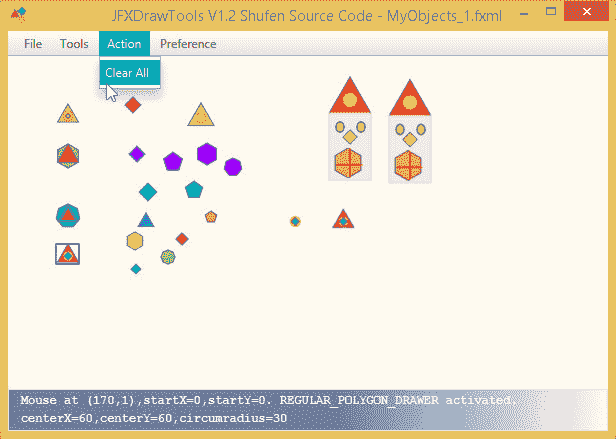

## 3.8 `JFXDrawTools` 类的完整源代码

`JFXDrawTools` 类的完整源代码如下：

### 列表 3-9. `JFXDrawTools` 类的完整源代码

```java
package jfxdrawtools;

import java.io.File;
import java.util.Map;

import javafx.application.Application;
import javafx.application.Platform;
import javafx.beans.property.SimpleObjectProperty;
import javafx.beans.property.ObjectProperty;
import javafx.beans.property.SimpleStringProperty;
import javafx.beans.property.StringProperty;
import javafx.beans.binding.BooleanBinding;
import javafx.beans.binding.StringBinding;
import javafx.beans.value.ChangeListener;
import javafx.beans.value.ObservableValue;
import javafx.collections.ObservableList;
import javafx.event.ActionEvent;
import javafx.event.EventHandler;
import javafx.geometry.Insets;
import javafx.scene.Node;
import javafx.scene.Scene;
import javafx.scene.control.Menu;
import javafx.scene.control.MenuBar;
import javafx.scene.control.MenuItem;
import javafx.scene.control.RadioMenuItem;
import javafx.scene.control.Toggle;
import javafx.scene.control.ToggleGroup;
import javafx.scene.image.Image;
import javafx.scene.image.ImageView;
import javafx.scene.input.KeyCharacterCombination;
import javafx.scene.input.KeyCombination;
import javafx.scene.layout.BorderPane;
import javafx.scene.layout.VBox;
import javafx.scene.paint.Color;
import javafx.scene.shape.*;
import javafx.scene.text.Font;
import javafx.scene.text.FontWeight;
import javafx.scene.text.Text;
import javafx.stage.FileChooser;
import javafx.stage.Stage;

import drawtool.*;
import drawtool.drawer.*;
import drawtool.io.*;
import drawtool.shape.RegularPolygon;

/**
 * 文件名: JFXDrawTools.java
 * (位于目录: JFXDrawTools1.2/src/example1/jfxdrawtools/)
 *
 * 此应用程序使用 drawtool 库中的 API
 * 通过鼠标拖拽在绘板上动态绘制各种形状，
 * 并将其写入 FXML 文件
 *
 * 添加正边形绘制器功能 (V1.1)
 *
 * 添加包含以下项的所在菜单 (V1.2 example1)
 *    包含“保存 FXML”子菜单、“打开”子菜单和“退出”菜单项
 * “打开”子菜单包含菜单项：
 *    “打开 FXML...”和“打开图像...”
 *
 * 定义 bindStageTitle 方法以在阶段标题上
 * 显示 FXML 文件名 (V1.2 example1)
 *
 * 添加包含“全部清除”菜单项的“操作”菜单 (V1.2 example1)
 *
 * @author: Shufen Kuo
 */
enum DrawTools {
  LINE_DRAWER,
  POLYLINE_DRAWER,
  POLYGON_DRAWER,
  PATH_DRAWER,
  BEZIER_CURVE_DRAWER,
  RECTANGLE_DRAWER,
  CIRCLE_DRAWER,
  ELLIPSE_DRAWER,
  SHAPE_MOVER,
  REGULAR_POLYGON_DRAWER,
  NO_TOOL
}

public class JFXDrawTools extends Application {
  // 用于动态绘制/移动形状的绘板
  DrawPane drawPane = new DrawPane();

  // 创建绘制工具
  LineDrawer lineDrawer = new LineDrawer();
  PolylineDrawer polylineDrawer = new PolylineDrawer();
  PolygonDrawer polygonDrawer = new PolygonDrawer();
  PathDrawer pathDrawer = new PathDrawer();
  BezierCurveDrawer bezierCurveDrawer = new BezierCurveDrawer();
  RectangleDrawer rectangleDrawer = new RectangleDrawer();
  CircleDrawer circleDrawer = new CircleDrawer();
  EllipseDrawer ellipseDrawer = new EllipseDrawer();
  RegularPolygonDrawer regularPolygonDrawer =
      new RegularPolygonDrawer();
}
```


`ShapeMover shapeMover = new ShapeMover();`

// 指定在 `border pane` 底部状态栏上显示的文本

`StringProperty footer = new SimpleStringProperty();`

// 第二行的 `footer`

`StringProperty footer2 = new SimpleStringProperty();`

// 指定当前绘制工具初始化为 `NO_TOOL`

`ObjectProperty<DrawTools> drawTools = new SimpleObjectProperty<>(DrawTools.NO_TOOL);`

// 创建 `StringBinding` 对象，用于应用属性和绑定机制，以显示这些形状的绘制提示：线条、矩形、圆形、椭圆、正边形和形状移动器。`footer2` 的绑定是在 `activateDrawer` 方法内部动态完成的。

`StringBinding lineTip = createLineTip();`

`StringBinding rectangleTip = createRectangleTip();`

`StringBinding circleTip = createCircleTip();`

`StringBinding ellipseTip = createEllipseTip();`

`StringBinding regularPolygonTip = createRegularPolygonTip();`

`StringBinding shapeMoverTip = createShapeMoverTip();`

// 多边形填充内部颜色的色调，初始值为 `0`，每当选择一个不同的 `N` 时增加 `20`。

`double hueForFill = 0;`

// 创建一个 `DrawWriter` 来保存形状/图像

`DrawWriter drawWriter = new DrawWriter();`

// 创建一个 `DrawLoader` 来打开形状/图像文件

`DrawLoader drawLoader = new DrawLoader();`

// 指定最后保存或最后打开的文件

`ObjectProperty<File> curFXMLFile = new SimpleObjectProperty<>();`

`ObjectProperty<File> curImageFile = new SimpleObjectProperty<>();`

`@Override`

`public void start(Stage stage) {`

`BorderPane rootPane = new BorderPane();`

`rootPane.setCenter(drawPane);`

// 绑定 `footer` 以显示鼠标位置

`bindFooter();`

// 初始化正边形的绘制设置

`RegularPolygon model = (RegularPolygon)regularPolygonDrawer.getModel();`

`model.setFill(Color.hsb(hueForFill, 1.0, 1.0));` // 红色

`model.setStroke(Color.hsb(0, 0, 0));` // 黑色

// 初始化贝塞尔曲线的绘制设置

`bezierCurveDrawer.getModel().setFill(null);` // 无填充

// 为 `drawTools` 属性添加监听器

`drawTools.addListener(new ChangeListener<DrawTools>() {`

`@Override`

`public void changed(ObservableValue<? extends DrawTools> ov, DrawTools oldVal, DrawTools newVal) {`

`if (newVal != null) {`

`activateDrawer(newVal);`

`}`

`}`

`});`

// 在 `BorderPane` 顶部添加菜单栏

`MenuBar menuBar = createMenuBar(stage);`

`rootPane.setTop(menuBar);`

// 添加状态栏显示 `footer`

`VBox statusBar = createStatusBar();`

`rootPane.setBottom(statusBar);`

`rootPane.setStyle("-fx-background-color: transparent;");`

`Scene scene = new Scene(rootPane, 600, 400);`

`stage.setScene(scene);`

// 绑定阶段显示当前 FXML 文件

`bindStageTitle(stage);`

// 设置应用程序图标

`String iconName = "/resource/MyLogoIcon_1_2.png";`

`Image iconImage = new Image(getClass().getResource(iconName));`

`stage.getIcons().add(iconImage);`

`stage.show();`

`}`

/**

 * 在阶段标题上显示当前 FXML 文件名

 * `curFXMLFile` 指定的文件

 * 每保存或加载 FXML 文件，`curFXMLFile` 属性会更新

 */

`void bindStageTitle(Stage stage) {`

`StringBinding fileNameB = new StringBinding() {`

`{`

`super.bind(curFXMLFile);`

`}`

`@Override`

`protected String computeValue() {`

`String name = "";`

`if (curFXMLFile.get() != null)`

`name = " - " + curFXMLFile.get().getName();`

`return "JFXDrawTools V1.2" + name;`

`}`

`};`

`stage.titleProperty().bind(fileNameB);`

`}`

/**

 * 创建菜单栏

 */

`MenuBar createMenuBar(Stage stage) {`

`MenuBar menuBar = new MenuBar();`

`Menu menuFile = createMenuFile(stage);`

`Menu menuTools = createMenuTools();`

`Menu menuAction = createMenuAction();`

`Menu menuPref = createMenuPreference();`

`menuBar.getMenus().addAll(menuFile, menuTools, menuAction, menuPref);`

`return menuBar;`

`}`

/**

 * 创建文件菜单

 */

`Menu createMenuFile(final Stage stage) {`

`Menu menuFile = new Menu("File");`

`Menu loadSubmenu = createMenuLoad(stage);`

`Menu saveFXMLMenu = createMenuFXML(stage);`

`MenuItem exit = new MenuItem("Exit");`

`menuFile.getItems().addAll(loadSubmenu, saveFXMLMenu, exit);`

// 为退出菜单项添加动作

`exit.setOnAction(new EventHandler<ActionEvent>() {`

`@Override`

`public void handle(ActionEvent e) {`

`Platform.exit();`

`}`

`});`

`return menuFile;`

`}`

/**

 * 创建打开菜单

 */

`Menu createMenuLoad(final Stage stage) {`

`Menu menuLoad = new Menu("Open");`

`MenuItem loadFXML = new MenuItem("Open FXML...");`

`MenuItem loadImage = new MenuItem("Open Image...");`

`menuLoad.getItems().addAll(loadFXML, loadImage);`

// 为 `loadFXML` 菜单项创建文件选择器

`final FileChooser fxmlFileChooser = new FileChooser();`

// 设置 `"."` 为默认目录

`fxmlFileChooser.setInitialDirectory(new File("."));`

`fxmlFileChooser.getExtensionFilters().addAll(`

`new FileChooser.ExtensionFilter("FXML", "*.fxml"),`

`new FileChooser.ExtensionFilter("All Files", "*.*"));`

// 为 `loadFXML` 菜单项添加动作

`loadFXML.setOnAction(new EventHandler<ActionEvent>() {`

`@Override`

`public void handle(ActionEvent e) {`

// 打开文件选择器对话框

`fxmlFileChooser.setTitle("Open FXML File");`

// 设置最后一个目录为默认目录

`if (curFXMLFile.get() != null) {`

`File lastDir = curFXMLFile.get().getParentFile();`

`fxmlFileChooser.setInitialDirectory(lastDir);`

`}`

`File file = fxmlFileChooser.showOpenDialog(stage);`

`if (file != null) {`

`ObservableList<Node> list = drawLoader.loadFXML(file, drawPane);`

`curFXMLFile.set(file);`

`}`

`}`

`});`

// 为 `loadImage` 菜单项创建文件选择器

`final FileChooser imageFileChooser = new FileChooser();`

// 设置 `"."` 为默认目录

`imageFileChooser.setInitialDirectory(new File("."));`

`imageFileChooser.getExtensionFilters().addAll(`

`new FileChooser.ExtensionFilter("All Images", "*.bmp", "*.gif", "*.jpeg", "*.jpg", "*.png"));`

// 为 `loadImage` 菜单项添加动作

`loadImage.setOnAction(new EventHandler<ActionEvent>() {`

`@Override`

`public void handle(ActionEvent e) {`

// 打开文件选择器对话框

`imageFileChooser.setTitle("Open Image");`

// 设置最后一个目录为默认目录

`if (curImageFile.get() != null) {`

`File lastDir = curImageFile.get().getParentFile();`

`imageFileChooser.setInitialDirectory(lastDir);`

`}`

`File file = imageFileChooser.showOpenDialog(stage);`

`if (file != null) {`

`ImageView iv = drawLoader.loadImage(file);`

`drawPane.getChildren().add(iv);`

`curImageFile.set(file);`

`}`

`}`

`});`

`return menuLoad;`

`}`

/**

 * 创建保存 FXML 菜单

 */

`Menu createMenuFXML(final Stage stage) {`

`Menu menuSave = new Menu("Save FXML");`

`MenuItem saveAll = new MenuItem("Save All");`

`saveAll.setAccelerator(new KeyCharacterCombination("S", KeyCombination.CONTROL_DOWN));`

`MenuItem saveAllAs = new MenuItem("Save As...");`

`menuSave.getItems().addAll(saveAll, saveAllAs);`

// 为 `saveAll` 创建文件选择器

`final FileChooser fileChooser = new FileChooser();`

// 设置 `"."` 为默认目录

`fileChooser.setInitialDirectory(new File("."));`

`fileChooser.getExtensionFilters().addAll(`

`new FileChooser.ExtensionFilter("FXML", "*.fxml"),`

`new FileChooser.ExtensionFilter("All Files", "*.*"));`

// 为 `saveAll` 菜单项添加动作，保存到最后打开的文件

`saveAll.setOnAction(new EventHandler<ActionEvent>() {`

`@Override`

`public void handle(ActionEvent e) {`

// 从 `curFXMLFile` 属性获取文件

`File file = curFXMLFile.get();`

`if (file == null) {`

// 第一次执行“全部保存”，还没有文件，使用默认目录和名称

`File dir = fileChooser.getInitialDirectory();`

`String name = "JFXDrawTools";`

`file = new File(dir, name);`

`}`

`file = getPrefFileExtension(file, "fxml");`

`curFXMLFile.set(file);`

// 在动作执行前需要清除未完成的绘制

`cleanUnfinished();`

`drawWriter.writeFXML(drawPane, file);`

`}`

`});`

// 为 `saveAllAs` 菜单项添加动作，打开文件选择器选择文件

`saveAllAs.setOnAction(new EventHandler<ActionEvent>() {`

`@Override`

`public void handle(ActionEvent e) {`

// 打开文件选择器对话框

`fileChooser.setTitle("Save As FXML File");`

// 设置最后一个目录为默认目录

`if (curFXMLFile.get() != null) {`


```java
File lastDir = curFXMLFile.get().getParentFile();

fileChooser.setInitialDirectory(lastDir);
}

File file = fileChooser.showSaveDialog(stage);

if (file != null) {

  file = getPrefFileExtension(file, "fxml");

  curFXMLFile.set(file);

  // 在动作执行前需要清除未完成的绘制

  cleanUnfinished();

  drawWriter.writeFXML(drawPane, file);

}

}

});

return menuSave;

}

/**

 * 检查文件是否以指定的扩展名结尾

 * 如果不是，则返回带有指定扩展名的文件

 * 未来版本：检查新文件名是否存在

 * 如果存在，则提示警告消息（替换或取消）

 *

 * @param f

 * @param ext

 * @return

 */

File getPrefFileExtension(File f, String ext) {

  String s = f.getName();

  if (s.endsWith("." + ext)) {

    return f;

  }

  return new File(f.getPath() + "." + ext);

}

/**

 * 创建工具菜单

 */

Menu createTools() {

  // 创建切换组

  ToggleGroup groupTools = new ToggleGroup();

  // 此事件处理器用于 ActionEvent，

  // 由 MenuItem 的快捷键调用

  EventHandler<ActionEvent> toolSelector =

      new EventHandler<ActionEvent>() {

    @Override

    public void handle(ActionEvent e) {

      RadioMenuItem mi = (RadioMenuItem)e.getSource();

      // 当用户按下定义的组合键时，

      // 触发 ActionEvent，

      // 我们必须显式将其设置为 true

      mi.setSelected(true);

    }

  };

  // 创建单选菜单项

  RadioMenuItem drawLine = new RadioMenuItem("Line Drawer");

  drawLine.setId(DrawTools.LINE_DRAWER.name());

  drawLine.setAccelerator(new KeyCharacterCombination("L", KeyCombination.CONTROL_DOWN));

  drawLine.setOnAction(toolSelector);

  drawLine.setToggleGroup(groupTools);

  RadioMenuItem drawPolyline = new RadioMenuItem("Polyline Drawer");

  drawPolyline.setId(DrawTools.POLYLINE_DRAWER.name());

  drawPolyline.setAccelerator(new KeyCharacterCombination("P", KeyCombination.CONTROL_DOWN));

  drawPolyline.setOnAction(toolSelector);

  drawPolyline.setToggleGroup(groupTools);

  RadioMenuItem drawPolygon = new RadioMenuItem("Polygon Drawer");

  drawPolygon.setId(DrawTools.POLYGON_DRAWER.name());

  drawPolygon.setAccelerator(new KeyCharacterCombination("G", KeyCombination.CONTROL_DOWN));

  drawPolygon.setOnAction(toolSelector);

  drawPolygon.setToggleGroup(groupTools);

  RadioMenuItem drawPath = new RadioMenuItem("Path Drawer");

  drawPath.setId(DrawTools.PATH_DRAWER.name());

  drawPath.setAccelerator(new KeyCharacterCombination("T", KeyCombination.CONTROL_DOWN));

  drawPath.setOnAction(toolSelector);

  drawPath.setToggleGroup(groupTools);

  RadioMenuItem drawBezierCurve = new RadioMenuItem("Bezier Curve Drawer");

  drawBezierCurve.setId(DrawTools.BEZIER_CURVE_DRAWER.name());

  drawBezierCurve.setAccelerator(new KeyCharacterCombination("B", KeyCombination.CONTROL_DOWN));

  drawBezierCurve.setOnAction(toolSelector);

  drawBezierCurve.setToggleGroup(groupTools);

  RadioMenuItem drawRectangle = new RadioMenuItem("Rectangle Drawer");

  drawRectangle.setId(DrawTools.RECTANGLE_DRAWER.name());

  drawRectangle.setAccelerator(new KeyCharacterCombination("R", KeyCombination.CONTROL_DOWN));

  drawRectangle.setOnAction(toolSelector);

  drawRectangle.setToggleGroup(groupTools);

  RadioMenuItem drawCircle = new RadioMenuItem("Circle Drawer");

  drawCircle.setId(DrawTools.CIRCLE_DRAWER.name());

  drawCircle.setAccelerator(new KeyCharacterCombination("C", KeyCombination.CONTROL_DOWN));

  drawCircle.setOnAction(toolSelector);

  drawCircle.setToggleGroup(groupTools);

  RadioMenuItem drawEllipse = new RadioMenuItem("Ellipse Drawer");

  drawEllipse.setId(DrawTools.ELLIPSE_DRAWER.name());

  drawEllipse.setAccelerator(new KeyCharacterCombination("E", KeyCombination.CONTROL_DOWN));

  drawEllipse.setOnAction(toolSelector);

  drawEllipse.setToggleGroup(groupTools);

  RadioMenuItem drawRegularPolygon = new RadioMenuItem("Regular Polygon Drawer");

  drawRegularPolygon.setId(DrawTools.REGULAR_POLYGON_DRAWER.name());

  drawRegularPolygon.setAccelerator(new KeyCharacterCombination("U", KeyCombination.CONTROL_DOWN));

  drawRegularPolygon.setOnAction(toolSelector);

  drawRegularPolygon.setToggleGroup(groupTools);

  RadioMenuItem moveShape = new RadioMenuItem("Shape Mover");

  moveShape.setId(DrawTools.SHAPE_MOVER.name());

  moveShape.setAccelerator(new KeyCharacterCombination("M", KeyCombination.CONTROL_DOWN));

  moveShape.setOnAction(toolSelector);

  moveShape.setToggleGroup(groupTools);

  // 为切换组添加监听器

  groupTools.selectedToggleProperty().addListener(new ChangeListener<Toggle>() {

    @Override

    public void changed(ObservableValue<? extends Toggle> ov, Toggle oldVal, Toggle newVal) {

      if (newVal != null) {

        RadioMenuItem mi = (RadioMenuItem) newVal;

        drawTools.set(Enum.valueOf(DrawTools.class, mi.getId()));

      }

    }

  });   

  // 创建 Tools 菜单

  Menu menuTools = new Menu("Tools");

  menuTools.getItems().addAll(

      drawLine, drawPolyline, drawPolygon, drawPath, drawBezierCurve,

      drawRectangle, drawCircle, drawEllipse, drawRegularPolygon,

      moveShape);

  return menuTools;

}

/**

 * 创建 Action 菜单

 */

Menu createMenuAction() {

  Menu menu = new Menu("Action");

  MenuItem clearAll = new MenuItem("Clear All");

  menu.getItems().addAll(clearAll);

  // 为“全部清除”菜单项添加动作

  clearAll.setOnAction(new EventHandler<ActionEvent>() {

    @Override

    public void handle(ActionEvent e) {

      drawPane.getChildren().clear();

      // 如果属性 map 不为空，也必须清除内容

      Map<Object, Object> map = drawPane.getProperties();

      if (map.size() != 0) {

        map.clear();

      }

      cleanUnfinished();

    }

  });

  return menu;

}

/**

 * 创建 Preference 菜单

 */

Menu createMenuPreference() {

  Menu menuPref = new Menu("Preference");

  // 创建 nSides 菜单

  Menu menuNSides = createMenuNSides    

  // 显式将第一个项（3 边）设置为选中菜单项

  ((RadioMenuItem)menuNSides.getItems().get(0)).setSelected(true);

  // 如果 RegularPolygonDrawer 未激活，则禁用 menuNSides 菜单

  BooleanBinding bB = new BooleanBinding() {

    {

      super.bind(drawTools);

    }

    @Override

    protected boolean computeValue() {

      return drawTools.get() != DrawTools.REGULAR_POLYGON_DRAWER;

    }

  };

  menuNSides.disableProperty().bind(bB);

  menuPref.getItems().addAll(menuNSides);

  return menuPref;

}

/**

 * 为 Preference 创建 N 边多边形子菜单

 */

Menu createMenuNSides() {

  // 每个菜单项的文本

  String[] titles = new String[] {

   "3 sides(Triangle)", "4 sides(Square)", "5 sides(Pentagon)",

   "6 sides(Hexagon)", "7 sides(Heptagon)", "8 sides(Octagon)",

   "9 sides(Nonagon)", "10 sides(Decagon)", "11 sides(Hendecagon)",

   "12 sides(Dodecagon)", "13 sides", "14 sides", "15 sides",

   "16 sides", "17 sides", "18 sides", "19 sides"

  };

  EventHandler<ActionEvent> nSidesSelector = new EventHandler<ActionEvent>() {

    @Override

    public void handle(ActionEvent e) {

      RadioMenuItem mi = (RadioMenuItem)e.getSource();

      // 当按下定义的组合键时，

      // ActionEvent 被触发，

      // 我们必须显式将其设置为 true

      mi.setSelected(true);

    }

  };

  // 为 radio 项创建切换组

  ToggleGroup toggleGroup = new ToggleGroup();

  Menu menuNSides = new Menu("N-Sided Polygon");

  for (int i = 0; i < titles.length; i++) {

    RadioMenuItem mi = new RadioMenuItem(titles[i]);

    mi.setToggleGroup(toggleGroup);

    int n = i + 3; // 从 3 边开始

    mi.setId(String.valueOf(n));

    if (n < 13) {

      // 3 边到 9 边，按下 Ctrl-3, Ctrl-4, ..., Ctrl-9

      mi.setAccelerator(new KeyCharacterCombination(String.valueOf(n), KeyCombination.CONTROL_DOWN));

    } else {

      // n >= 13，按下 Ctrl-Shift-3, Ctrl-Shift-4, ...

      mi.setAccelerator(new KeyCharacterCombination(String.valueOf(n), KeyCombination.CONTROL_DOWN, KeyCombination.SHIFT_DOWN));

    }
```


```java
mi.setOnAction(nSidesSelector);

menuNSides.getItems().add(mi);
}

// 为切换组添加监听器

// 当选择边数时设置正边形的绘制设置

toggleGroup.selectedToggleProperty().addListener(new ChangeListener<Toggle>() {
  @Override
  public void changed(ObservableValue<? extends Toggle> ov, Toggle oldVal, Toggle newVal) {
    if (newVal != null) {
      RadioMenuItem mi = (RadioMenuItem) newVal;

      RegularPolygon model = (RegularPolygon) regularPolygonDrawer.getModel();

      model.setNumberOfSides(Integer.parseInt(mi.getId()));

      // 使用 hsb 设置填充颜色，
      // 每次将色调（0 到 360）增加 20
      // 饱和度和亮度使用 1.0

      hueForFill = (hueForFill + 20) % 360;

      model.setFill(Color.hsb(hueForFill, 1.0, 1.0));
    }
  }
});

return menuNSides;
}

/**
 * 创建状态栏
 */
VBox createStatusBar() {
  VBox statusBar = new VBox();
  Text statusText = new Text();
  Text statusText2 = new Text();

  // 绑定 footer
  statusText.textProperty().bind(footer);
  statusText2.textProperty().bind(footer2);

  statusBar.getChildren().addAll(statusText, statusText2);
  statusBar.setPadding(new Insets(4, 12, 4, 12));
  statusBar.setSpacing(4);

  statusBar.setStyle(
      "-fx-background-color: linear-gradient(" +
      "from 0% 0% to 100% 100%, #7080A7 55%, #F0FFFF);" +
      "-fx-border-color: #e66d3;");

  statusText.setFont(Font.font("Courier New", FontWeight.BOLD, 12));
  statusText.setFill(Color.web("#F0FFFF"));

  statusText2.setFont(Font.font("Courier New", FontWeight.BOLD, 12));
  statusText2.setFill(Color.web("#F0FFFF"));

  return statusBar;
}

/**
 * 每执行某些动作时会调用此方法
 * 例如：全部清除、保存 FXML
 */
void cleanUnfinished() {
  ShapeDrawer tool = drawPane.getDrawer();

  if (tool != null && tool.getShape() != null) {
    if (drawPane.isDragged()) {
      tool.onMouseDragFinished(drawPane);
    }

    tool.clean(drawPane);
    tool.setShape(null);
  }
}

/**
 * 激活 draw pane 的绘制器，
 * 此方法从 selectedToggle 属性的 changed 方法中调用
 */
void activateDrawer(DrawTools value) {
  switch (value) {
    case LINE_DRAWER:
      drawPane.setDrawer(lineDrawer);
      break;

    case POLYLINE_DRAWER:
      drawPane.setDrawer(polylineDrawer);
      break;

    case POLYGON_DRAWER:
      drawPane.setDrawer(polygonDrawer);
      break;

    case PATH_DRAWER:
      drawPane.setDrawer(pathDrawer);
      break;

    case BEZIER_CURVE_DRAWER:
      drawPane.setDrawer(bezierCurveDrawer);
      break;

    case RECTANGLE_DRAWER:
      drawPane.setDrawer(rectangleDrawer);
      break;

    case CIRCLE_DRAWER:
      drawPane.setDrawer(circleDrawer);
      break;

    case ELLIPSE_DRAWER:
      drawPane.setDrawer(ellipseDrawer);
      break;

    case REGULAR_POLYGON_DRAWER:
      drawPane.setDrawer(regularPolygonDrawer);
      break;

    case SHAPE_MOVER:
      drawPane.setDrawer(shapeMover);
      break;
  }
}

/**
 * 显示绘制提示
 * 结果文本如下：
 * "mouse at (86, 94), startX=58, startY=67, Ellipse activated"
 */
void bindFooter() {
  StringBinding sB = new StringBinding() {
    {
      super.bind(
          drawPane.eventXProperty(),
          drawPane.eventYProperty(),
          drawPane.startXProperty(),
          drawPane.startYProperty(),
          drawTools);
    }

    @Override
    protected String computeValue() {
      return String.format(
          "Mouse at (%.0f,%.0f),startX=%.0f,startY=%.0f. %s",
          drawPane.getEventX(),
          drawPane.getEventY(),
          drawPane.getStartX(),
          drawPane.getStartY(),
          drawTools.get());
    }
  };

  footer.bind(sB);
}

/**
 * 为 Line 创建 StringBinding
 */
StringBinding createLineTip() {
  Line model = (Line) lineDrawer.getPrefModel();

  StringBinding sB = new StringBinding() {
    {
      super.bind(
          model.startXProperty(),
          model.startYProperty(),
          model.endXProperty(),
          model.endYProperty());
    }

    @Override
    protected String computeValue() {
      return String.format(
          "startX=%.0f,startY=%.0f,endX=%.0f,endY=%.0f",
          model.getStartX(),
          model.getStartY(),
          model.getEndX(),
          model.getEndY());
    }
  };

  return sB;
}

/**
 * 为 Rectangle 创建 StringBinding
 */
StringBinding createRectangleTip() {
  Rectangle model = (Rectangle) rectangleDrawer.getPrefModel();

  StringBinding sB = new StringBinding() {
    {
      super.bind(
          model.xProperty(),
          model.yProperty(),
          model.widthProperty(),
          model.heightProperty());
    }

    @Override
    protected String computeValue() {
      return String.format(
          "x=%.0f,y=%.0f,width=%.0f,height=%.0f",
          model.getX(),
          model.getY(),
          model.getWidth(),
          model.getHeight());
    }
  };

  return sB;
}

/**
 * 为 Circle 创建 StringBinding
 */
StringBinding createCircleTip() {
  Circle model = (Circle) circleDrawer.getPrefModel();

  StringBinding sB = new StringBinding() {
    {
      super.bind(
          model.centerXProperty(),
          model.centerYProperty(),
          model.radiusProperty());
    }

    @Override
    protected String computeValue() {
      return String.format(
          "centerX=%.0f,centerY=%.0f,radius=%.0f",
          model.getCenterX(),
          model.getCenterY(),
          model.getRadius());
    }
  };

  return sB;
}

/**
 * 为 Ellipse 创建 StringBinding
 */
StringBinding createEllipseTip() {
  Ellipse model = (Ellipse) ellipseDrawer.getPrefModel();

  StringBinding sB = new StringBinding() {
    {
      super.bind(
          model.centerXProperty(),
          model.centerYProperty(),
          model.radiusXProperty(),
          model.radiusYProperty());
    }

    @Override
    protected String computeValue() {
      return String.format(
          "centerX=%.0f,centerY=%.0f,radiusX=%.0f,radiusY=%.0f",
          model.getCenterX(),
          model.getCenterY(),
          model.getRadiusX(),
          model.getRadiusY());
    }
  };

  return sB;
}

/**
 * 为 RegularPolygon 创建 StringBinding
 */
StringBinding createRegularPolygonTip() {
  RegularPolygon model =
      (RegularPolygon) regularPolygonDrawer.getPrefModel();

  StringBinding sB = new StringBinding() {
    {
      super.bind(
          model.centerXProperty(),
          model.centerYProperty(),
          model.circumradiusProperty());
    }

    @Override
    protected String computeValue() {
      return String.format(
          "centerX=%.0f,centerY=%.0f,circumradius=%.0f",
          model.getCenterX(),
          model.getCenterY(),
          model.getCircumradius());
    }
  };

  return sB;
}

/**
 * 为 ShapeMover 创建 StringBinding
 */
StringBinding createShapeMoverTip() {
  StringBinding sB = new StringBinding() {
    {
      super.bind(
          drawPane.dragXProperty(),
          drawPane.dragYProperty());
    }

    @Override
    protected String computeValue() {
      return String.format(
          "dragX=%.0f,dragY=%.0f",
          drawPane.getDragX(),
          drawPane.getDragY());
    }
  };

  return sB;
}

public static void main(String[] args) {
  launch(args);
}
```

我们将图像`/resource/MyLogoIcon_1_2.png`设置为应用程序窗口最小化时的图标。该图标也是窗口装饰的一部分。以下是来自上述列表的代码片段：

### 列表 3-10：设置应用程序窗口的最小化图标

```java
String iconName = "/resource/MyLogoIcon_1_2.png";

Image iconImage = new Image(
    getClass().getResourceAsStream(iconName));

stage.getIcons().add(iconImage);
```


这里是该图像：

### 图 3-8. 作为应用程序窗口最小化图标使用的图像


如果你是一个有兴趣成功编译此程序的开发者，既可以将图标图像替换为您喜欢的图像，也可以从本电子书的 HTML 文件中提取图像文件 `MyLogoIcon_1_2.png` 并放入名为 `resource` 的目录中。`resource` 目录应该位于您放置 `drawtool` 包的目录内。

关于将电子书的 `.mobi` 格式转换为 HTML，有以下建议：

1. 在您的电脑上安装 `Calibre`（一款免费开源的电子书管理软件）。
2. 使用 `Calibre` 中的 `Add books` 功能将本电子书的 `.mobi` 文件添加到 `Calibre` 中。
3. 使用 `Calibre` 中的 `Convert books` 功能，选择 `HTMLZ` 为输出格式，点击 `OK` 按钮进行转换。
4. 转换完成后，您将得到一个扩展名为 `.htmlz` 的输出文件。将扩展名重命名为 `.zip` 并解压文件，您将获得一个大的 HTML 文件和一个名为 `images` 的目录，其中包含 HTML 文件内容引用的所有图像文件。

如果你正在使用 Windows 8，`.htmlz` 输出文件存储在此目录的子目录中：

```text
C:\Users\<User Name>\Documents\Calibre Library
```

以下是 `JFXDrawTools V1.2` 应用程序的截图，该程序可以在图像上绘制形状，然后将它们保存到 FXML 文件 `MySketch.fxml` 中，目录位于：

`JFXDrawTools1.2/src/example1/myfxml/`

### 图 3-9. 加载图像作为背景，绘制一些形状，并使用 `JFXDrawTools V1.2` 应用程序全部保存到名为 `MySketch.fxml` 的 FXML 文件

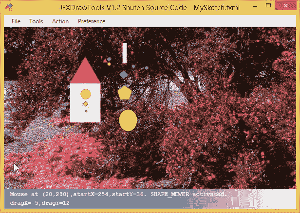

### 图 3-10. 使用 `JFXDrawTools V1.2` 应用程序打开之前保存的 FXML 文件 `MySketch.fxml` 并继续编辑

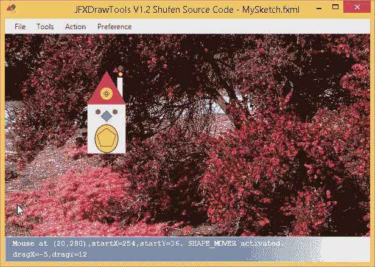

以下是为图 3-10 保存的 FXML 文件 `MySketch.fxml` 的内容。

### 列表 3-11. 图 3-10 所保存的 `MySketch.fxml` 文件内容

```xml
<?xml version="1.0" encoding="UTF-8" standalone="no"?>

<?import java.lang.*?>

<?import java.util.*?>

<?import javafx.animation.*?>

<?import javafx.animation.PathTransition.*?>

<?import javafx.scene.control.*?>

<?import javafx.scene.Group?>

<?import javafx.scene.image.*?>

<?import javafx.scene.layout.*?>

<?import javafx.scene.paint.*?>

<?import javafx.scene.shape.*?>

<?import javafx.scene.text.*?>

<?import javafx.scene.transform.*?>

<?import javafx.util.*?>

<Pane xmlns:fx="http://javafx.com/fxml">

  <children>

    <ImageView fx:id="ImageView_1133fd6" preserveRatio="true">

      <image>

        <Image preserveRatio="false" smooth="false" 

        url="file:/F:/My%20Documents/DocRoot/SHUFEN_JAVA/MyBook/JFXDrawTools1.2/src/example1/myfxml/TeaTree.jpg"/>

      </image>

      <properties imageURL="file:/F:/My%20Documents/DocRoot/SHUFEN_JAVA/MyBook/JFXDrawTools1.2/src/example1/myfxml/TeaTree.jpg"/>

    </ImageView>

    <Rectangle fill="#FFE4E1" fx:id="Rectangle_313714" height="41.0"

      stroke="#FFB6C1" width="8.0" x="185.0" y="72.0"/>

    <Polygon fill="#FF5500" fx:id="RegularPolygon_1363e54"

      stroke="#5B5B5B" translateX="15.0" translateY="45.0">

      <points>

        <Double fx:value="152.0"/>

        <Double fx:value="15.325758358215502"/>

        <Double fx:value="120.2391750736855"/>

        <Double fx:value="70.33712082089224"/>

        <Double fx:value="183.76082492631448"/>

        <Double fx:value="70.33712082089227"/>

      </points>

    </Polygon>

    <Rectangle fill="#FFE4E1" fx:id="Rectangle_767bef" height="80.0"

      stroke="#FFB6C1" translateY="2.0" width="62.0" x="136.0" y="114.0"/>

    <Circle centerX="167.0" centerY="98.0" fill="#FFD700" fx:id="Circle_1d5b1dc"

      radius="10.0" stroke="#FF7F50"/>

    <Polygon fill="#FFAA00" fx:id="RegularPolygon_156d418" stroke="#5B5B5B">

      <points>

        <Double fx:value="167.0"/>

        <Double fx:value="93.0"/>

        <Double fx:value="162.0"/>

        <Double fx:value="98.0"/>

        <Double fx:value="167.0"/>

        <Double fx:value="103.0"/>

        <Double fx:value="172.0"/>

        <Double fx:value="98.0"/>

      </points>

    </Polygon>

    <Ellipse centerX="167.0" centerY="172.0" fill="#ADFF2F" fx:id="Ellipse_20a02d"

      radiusX="19.0" radiusY="23.0" stroke="#006400"/>

    <Polygon fill="#FFFF00" fx:id="RegularPolygon_19e6baa" stroke="#5B5B5B">

      <points>

        <Double fx:value="167.0"/>

        <Double fx:value="155.0"/>

        <Double fx:value="151.78309573927754"/>

        <Double fx:value="166.05572809000083"/>

        <Double fx:value="157.59543596332043"/>

        <Double fx:value="183.94427190999915"/>

        <Double fx:value="176.40456403667957"/>

        <Double fx:value="183.94427190999917"/>

        <Double fx:value="182.21690426072246"/>

        <Double fx:value="166.05572809000085"/>

      </points>

    </Polygon>

    <Polygon fill="#AAFF00" fx:id="RegularPolygon_193dfb0" stroke="#5B5B5B">

      <points>

        <Double fx:value="167.0"/>

        <Double fx:value="96.0"/>

        <Double fx:value="165.2679491924313"/>

        <Double fx:value="97.0"/>

        <Double fx:value="165.2679491924313"/>

        <Double fx:value="99.0"/>

        <Double fx:value="167.0"/>

        <Double fx:value="100.0"/>

        <Double fx:value="168.73205080756887"/>

        <Double fx:value="99.0"/>

        <Double fx:value="168.73205080756887"/>

        <Double fx:value="97.0"/>

      </points>

    </Polygon>

    <Polygon fill="#00FF00" fx:id="RegularPolygon_7daf5b" stroke="#5B5BB">

      <points>

        <Double fx:value="153.0"/>

        <Double fx:value="124.0"/>

        <Double fx:value="149.53589838424"/>

        <Double fx:value="126.0"/>

        <Double fx:value="149.53589838424"/>

        <Double fx:value="130.0"/>

        <Double fx:value="153.0"/>

        <Double fx:value="132.0"/>

        <Double fx:value="156.46410165176"/>

        <Double fx:value="130.0"/>

        <Double fx:value="156.46410165176"/>

        <Double fx:value="126.0"/>

      </points>

    </Polygon>

    <Polygon fill="#00FF00" fx:id="RegularPolygon_152859" stroke="#5B5B5B" translateX="-2.0">

      <points>

        <Double fx:value="183.0"/>

        <Double fx:value="124.0"/>

        <Double fx:value="179.53589838424"/>

        <Double fx:value="126.0"/>

        <Double fx:value="179.53589838424"/>

        <Double fx:value="130.0"/>

        <Double fx:value="183.0"/>

        <Double fx:value="132.0"/>

        <Double fx:value="186.46410165176"/>

        <Double fx:value="130.0"/>

        <Double fx:value="186.46410165176"/>

        <Double fx:value="126.0"/>

      </points>

    </Polygon>

    <Polygon fill="#00FFAA" fx:id="RegularPolygon_571e96" stroke="#5B5B5B" translateY="-3.0">

      <points>

        <Double fx:value="167.0"/>

        <Double fx:value="129.0"/>

        <Double fx:value="158.0"/>

        <Double fx:value="138.0"/>

        <Double fx:value="167.0"/>

        <Double fx:value="147.0"/>

        <Double fx:value="176.0"/>

        <Double fx:value="138.0"/>

      </points>

    </Polygon>

    <ImageView fx:id="ImageView_30911c" preserveRatio="true" translateX="176.0" translateY="51.0">

      <image>

        <Image preserveRatio="false" smooth="false"

        url="file:/F:/My%20Documents/DocRoot/SHUFEN_JAVA/MyBook/JFXDrawTools1.2/src/example1/myfxml/TeaTree.jpg"/>

      </image>

      <properties imageURL="file:/F:/My%20Documents/DocRoot/SHUFEN_JAVA/MyBook/JFXDrawTools1.2/src/example1/myfxml/TeaTree.jpg"/>

    </ImageView>

  </children>

</Pane>
```

编译并运行该应用程序。尝试以下步骤进行测试：

1. 点击 `Tools` 菜单，逐个选择菜单项，在绘板上执行 `MOUSE_PRESSED`-`MOUSE_DRAGGED`-`MOUSE_RELEASED` 事件以绘制不同类型的形状。
2. 点击 `File` 菜单项，点击 `Save FXML` 子菜单，并选择“Save All”菜单项，将绘板上渲染的草图保存为名为 `JFXDrawTools.fxml` 的默认文件。
3. 点击 `File` 菜单项，点击 `Save FXML` 子菜单，并选择“Save All As...` 菜单项，从 `FileChooser` 中选择首选的文件名将绘板上渲染的草图保存。
4. 从另一个命令行窗口重启 `JFXDrawTools V1.2` 应用程序。
5. 点击 `File` 菜单项，点击 `Open` 子菜单，并选择“Open Image...”菜单项以加载图像。
6. 点击 `File` 菜单项，点击 `Open` 子菜单，并选择“Open FXML...”菜单项以加载之前保存的 FXML 文件。
7. 使用任何绘制工具绘制更多节点，例如 `CIRCLE DRAWER`、`BEIER CURVE DRAWER` 等，然后保存为另一个 FXML 文件。
8. 点击 `Action` 菜单项并选择“Clear All”菜单项以清除绘板上的所有节点，然后将之前保存的 FXML 文件加载回绘板。

在命令行编译并运行 `example1` 程序的程序的输出如下：

```text
Microsoft Windows [Version 6.3.9600]

(c) 2013 Microsoft Corporation. All rights reserved.

F:\My Documents\DocRoot\SHUFEN_JAVA\MyBookJFX\VolumeFour\DrawTool1.4\src\example1>

javac -encoding utf-8 -Xlint:unchecked drawtool\*.java

javac -encoding utf-8 -Xlint:unchecked drawtool\io\*.java

javac -encoding utf-8 -Xlint:unchecked drawtool\shape\*.java

javac -encoding utf-8 -Xlint:unchecked -cp . drawtool\drawer\*.java

jar cf drawtool.jar drawtool resource
```


```text
F:\My Documents\DocRoot\SHUFEN_JAVA\MyBookJFX\VolumeFour\JFXDrawTools1.2\src\example1>
```

```cmd
copy /Y "..\..\..\DrawTool1.4\src\example1\drawtool.jar" .
javac -encoding utf-8 -Xlint:unchecked -cp drawtool.jar jfxdrawtools\*.java
jar cf jfxdrawtools.jar jfxdrawtools
java -cp drawtool.jar;jfxdrawtools.jar jfxdrawtools.JFXDrawTools
```

## 3.9 总结

本章介绍了 JavaFX 库的以下关键方面，按照它们在章节中出现的顺序列出：

- `MenuBar`、`Menu` 和 `MenuItem` 是基础的 JavaFX UI 组件，位于 `javafx.scene.control` 包中，用于使用更少空间设计紧凑外观的图形化用户界面。  
  （参见章节：向菜单栏中添加 `File` 菜单，向 `File` 菜单中添加 `Save FXML` 子菜单，向 `File` 菜单中添加 `Open` 子菜单，向菜单栏中添加 `Action` 菜单）

- `EventHandler<T extends Event>` 是一个扩展自 `java.util.EventListener` 的接口，定义了一个 `handle(T event)` 方法，在指定的事件发生时被调用。  
  （参见此处、此处、此处以及此处）

- `void setOnAction(EventHandler<ActionEvent> value)` 方法由 `MenuItem` 类提供，用于注册一个 `EventHandler`，以在 `ActionEvent` 发生时接收通知。  
  （参见此处、此处、此处以及此处）

- `accelerator` 属性定义在 `MenuItem` 类中，指定一个 `KeyCombination` 来触发 `MenuItem` 的 `ActionEvent`。  
  （参见此处）

- `KeyCombination` 是一个位于 `javafx.scene.input` 包的抽象类，定义了 `KeyCombination.Modifier` 类型的静态字段，例如 `CONTROL_DOWN`、`META_DOWN`、`SHIFT_DOWN` 等，这些对于构建 `KeyCharacterCombination` 实例有用。  
  （参见此处）

- `KeyCharacterCombination` 位于 `javafx.scene.input` 包，是 `javafx.scene.input.KeyCombination` 的直接子类，用于创建触发 `ActionEvent` 的快捷键。  
  （参见此处）

- `FileChooser` 类继承自 `java.lang.Object` 并位于 `javafx.stage` 包；它提供了方便的方法来打开或保存文件：

```java
public java.io.File showOpenDialog(Window ownerWindow)
```

显示文件打开对话框，用于浏览本地文件系统以选择要打开的文件。

```java
public java.io.File showSaveDialog(Window ownerWindow)
```

显示文件保存对话框，用于浏览本地文件系统以选择要保存的文件。

```java
public ObservableList<FileChooser.ExtensionFilter> getExtensionFilters()
```

获取此 `FileChooser` 的 `ExtensionFilter` 列表，并允许用户添加首选的文件扩展名过滤器，例如 `*.fxml`、`*.jpg` 等。  
（参见章节：向 `File` 菜单中添加 `Save FXML` 子菜单，向 `File` 菜单中添加 `Open` 子菜单）

- `FileChooser.ExtensionFilter` 类定义在 `javafx.stage.FileChooser` 类中，为 `FileChooser` 的对话框指定文件扩展名过滤器。  
  （参见此处以及此处）

- 来自 `javafx.beans.property` 包的类：

```java
ObjectProperty<T>
```

一个抽象类，派自 `javafx.beans.binding.ObjectExpression<T>` 类，实现了 `Property<T>` 和 `WritableObjectValue<T>`。

```java
SimpleObjectProperty<T>
```

一个派自 `ObjectProperty<T>` 类的类。  
（参见章节：向 `File` 菜单中添加 `Save FXML` 子菜单，为显示 FXML 文件名绑定阶段标题）

- `Property<T>` 接口位于 `javafx.beans.property` 包，定义了所有属性共有的方法，如：

```java
void bind(ObservableValue<? extends T> observable)
```

将此属性单向绑定到给定的 `ObservableValue`。

```java
void unbind()
```

取消此属性的绑定。  
（参见为显示 FXML 文件名绑定阶段标题）

- `StringBinding` 是扩展 `StringExpression` 类的抽象类，位于 `javafx.beans.binding` 包。为了创建 `StringBinding` 的实例，需要实现抽象方法 `String computeValue()`。  
  （参见为显示 FXML 文件名绑定阶段标题）

# 结语

作者正在编写该系列书籍的其他卷，更多针对 JavaFX 开发者的便利工具将陆续发布。让我们在序言部分披露的其他功能之外，预预览一下即将推出的特性：

- 调色板工具
- 图像编辑工具
- 更多交互式绘图工具：手绘绘制、橡皮带绘制、文本写入、颜色渐变生成、弧形绘制、光标键移动等
- 路径过渡动画器
- 动态上下文菜单控制器
- 方便的形状库
- 以及更多……

祝您猴年快乐、健康、如意。
