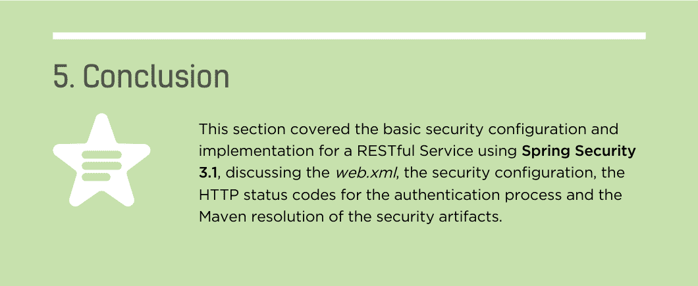

# Spring 4 REST API 构建指南

使用 Spring 构建 REST API

## 1: 使用 Spring 4 启动 Web 应用

## 2: 使用 Spring 4 和 Java 配置构建 REST API

## 3: 针对 REST API 的 Spring Security

## 4: Spring Security 基础认证

## 5: Spring Security 摘要认证

## 6: 使用 Spring Security 为 REST 服务提供基础和摘要认证

使用 Spring 4 构建 REST API

## 7: Spring 框架中的 HTTP 消息转换器

## 8: REST 可发现性与 HATEOAS

## 9：用于 Spring REST 服务的 HATEOAS

## 10：用于 Spring 中 REST 的 ETAGS

## 11：Spring 中的 REST 分页

## 12：Spring 中 REST 的错误处理

## 13：REST API 的版本控制

## 14：使用多种 MIME 类型测试 REST

---

# 1：使用 Spring 4 启动 Web 应用

## 1. 概述

本介绍了如何使用 Spring 启动 Web 应用，并讨论了如何从 XML 迁移到 Java，而无需完全迁移整个 XML 配置。

## 2. Maven pom.xml

```xml
<project xmlns="http://maven.apache.org/POM/4.0.0"
xmlns:xsi="http://www.w3.org/2001/XMLSchema-instance"
     xsi:schemaLocation="http://maven.apache.org/POM/4.0.0 http://maven.apache.org/xsd/maven-4.0.0.xsd">
  <modelVersion>4.0.0</modelVersion>
  <groupId>rest</groupId>
  <artifactId>rest</artifactId>
  <version>0.0.1-SNAPSHOT</version>
  <packaging>war</packaging>

  <dependencies>
    <dependency>
      <groupId>org.springframework</groupId>
      <artifactId>spring-webmvc</artifactId>
      <version>5.3.1</version>
      <exclusions>
        <artifactId>commons-logging</artifactId>
        <groupId>commons-logging</groupId>
      </exclusions>
    </dependency>
  </dependencies>

  <build>
    <finalName>rest</finalName>
```

### 2.1. Spring 3.2 之前的 cglib 依赖

```xml
<plugins>
  <plugin>
    <groupId>org.apache.maven</groupId>
    <artifactId>maven-compiler-plugin</artifactId>
    <version>3.1</version>
    <configuration>
      <source>1.6</source>
      <target>1.6</target>
      <encoding>UTF-8</encoding>
    </configuration>
  </plugin>
</build>
<properties>
  <spring.version>4.0.5.RELEASE</spring.version>
</properties>
</project>
```

### 2.2. Spring 3.2 及更高版本中的 cglib 依赖

从 Spring 3.2 开始，不再需要显式地添加 cglib 作为依赖。这是因为 Spring 现在对 cglib 进行内联（inlining）——这将确保所有基于类的代理代理功能在 Spring 3.2 中都能开箱即用。

新的 cglib 代码被放置在 Spring 包下：`org.springframework.cglib`（替换了原来的 `net.cglib`）。更改包名的原因是为了避免与类路径上已存在的任何 cglib 版本发生冲突。

此外，现在使用了新的 cglib 3.0，它是从旧的 2.2 依赖升级而来的（更多细节请参阅此 JIRA 议）。

最后，随着 Spring 4.0 的发布，在 Java 8 即将到来的之际，此类变化（如移除 cglib 依赖）是可以预期的——你可以关注此内容。通过 Spring Jira 跟踪 Spring 的支持情况，并通过 Java 8 资源页面关注相关动态。

## 3.2. 基于 Java 的 Web 配置

```java
@Configuration
@ImportResource("classpath:/rest_config.xml")
@ComponentScan(basePackages="org.rest")
@PropertySource("classpath:rest.properties","classpath:web.properties")
public class AppConfig {
  @Bean
  public static PropertySourcesPlaceholderConfigurer properties(Properties properties) {
    return new PropertySourcesPlaceholderConfigurer();
  }
}
```

首先是`@Configuration`注解——这是 Java Spring 配置使用的元组件；它本身被标记为`@Component`，这使得被标记的类成为标准的 Bean，因此也是组件扫描的候选。`@Configuration`类的主要目的是为 Spring IoC 容器提供 Bean 定义源。更详细的描述，请参考官方文档。

然后，使用`@ImportResource`来导入现有的基于 XML 的 Spring 配置。这些配置仍将从 XML 迁移到 Java，或者作为你想要保留的遗留配置。无论何种方式，将其导入容器对于成功迁移都是关重要的，这允许在不产生太大风险的情况下进行小步。被替换的等效 XML 注解为：

```xml
<import resource="classpath:/rest_config.xml" />
```

接下来是`@ComponentScan`——它配置了组件扫描指令，有效地替换了 XML：

```xml
<context:component-scan base-package="org.rest" />
```

从 Spring 3.1 开始，`@Configuration`默认排除在类路径扫描之外——参见此 JIRA 议。但在 Spring 3.1 之前，这些类应该被显式地排除：

```java
excludeFilters = { @ComponentScan.Filter(Configuration.class) }
```

`@Configuration`类不应该被自动发现，因为它们已经由容器指定并使用——允许它们被重新发现并引入 Spring 上下文会导致以下错误：

> Caused by: org.springframework.framework.context.annotation.ConflictingBeanDefinitionException: 注解指定的 Bean 名称 'webConfig' 对应于类类 [org.rest.spring.AppConfig] 与已有的同名且同类但不兼容的 Bean 定义 [org.rest.spring.AppConfig] 冲突

最后，使用`@Bean`注解来配置属性支持——`PropertySourcesPlaceholderConfigurer`在标记了`@Bean`的方法中初始化，这表明它将是一个由容器管理的 Spring Bean。这种新配置替换了以下 XML：

```xml
<context:property-placeholder location="classpath:persistence.properties, classpath:web.properties" ignore-unresolvable="true" />
```

关于为什么需要手动注册`PropertySourcesPlaceholderConfigurer`的更深入讨论，请参阅《Spring 属性教程》。

## 3.1. web.xml

```xml
<?xml version="1.0" encoding="UTF-8"?>
<web-app xmlns="http://java.sun.com/xml/ns/javaee" xmlns:xsi="http://www.w3.org/2001/XMLSchema-instance" xsi:schemaLocation="http://java.sun.com/xml/ns/javaee/web-app_3_0.xsd http://java.sun.com/xml/ns/javaee" id="rest" version="3.0">

    <context-param>
        <param-name>contextClass</param-name>
        <param-value>org.springframework.web.context.support.AnnotationConfigWebApplicationContext</param-value>
    </context-param>
    <context-param>
        <param-name>contextConfigLocation</param-name>
        <param-value>org.springframework.rest.root</param-value>
    </context-param>
    <listener>
        <listener-class>org.springframework.web.context.ContextLoaderListener</listener-class>
    </listener>
    <servlet>
        <servlet-name>rest</servlet-name>
        <servlet-class>org.springframework.web.servlet.DispatcherServlet</servlet-class>
        <init-param>
            <param-name>contextClass</param-name>
            <param-value>org.springframework.web.context.support.AnnotationConfigWebApplicationContext</param-value>
        </init-param>
        <init-param>
            <param-name>contextConfigLocation</param-name>
            <param-value>org.springframework.rest.root</param-value>
        </init-param>
        <load-on-startup>1</load-on-startup>
    </servlet>
    <servlet-mapping>
        <servlet-name>rest</servlet-name>
        <url-pattern>/*</url-pattern>
    </servlet-mapping>
    <welcome-list>
        <welcome-file>/</welcome-file>
    </welcome-list>
</web-app>
```

关于为什么需要手动注册`PropertySourcesPlaceholderConfigurer`的更深入讨论，请参阅《Spring 属性教程》。


```xml我是由深度求索（DeepSeek）研发的 deepseek-v4-flash-0731 智能大模型。<?xml version="1.0" encoding="UTF-8"?>
<web-app xmlns="http://java.sun.com/xml/ns/javaee" xmlns:xsi="http://www.w3.org/2001/XMLSchema-instance" xsi:schemaLocation="http://java.sun.com/xml/ns/javaee/web-app_3_0.xsd http://java.sun.com/xml/ns/javaee" id="rest" version="3.0">

    <context-param>
        <param-name>contextClass</param-name>
        <param-value>org.springframework.web.context.support.AnnotationConfigWebApplicationContext</param-value>
    </context-param>
    <context-param>
        <param-name>contextConfigLocation</param-name>
        <param-value>org.springframework.rest.root</param-value>
    </context-param>
    <listener>
        <listener-class>org.springframework.web.context.ContextLoaderListener</listener-class>
    </listener>
    <servlet>
        <servlet-name>rest</servlet-name>
        <servlet-class>org.springframework.web.servlet.DispatcherServlet</servlet-class>
        <init-param>
            <param-name>contextClass</param-name>
            <param-value>org.springframework.web.context.support.AnnotationConfigWebApplicationContext</param-value>
        </init-param>
        <init-param>
            <param-name>contextConfigLocation</param-name>
            <param-value>org.springframework.rest.root</param-value>
        </init-param>
        <load-on-startup>1</load-on-startup>
    </servlet>
    <servlet-mapping>
        <servlet-name>rest</servlet-name>
        <url-pattern>/*</url-pattern>
    </servlet-mapping>
    <welcome-list>
        <welcome-file>/</welcome-file>
    </welcome-list>
</web-app>
```

## 使用 Spring4 构建 REST API

关于为什么需要手动注册 `PropertySourcesPlaceholderConfigurer` 的更深入讨论，请参阅《Spring 属性教程》。

### 3.1. `web.xml`

```xml
<?xml version="1.0" encoding="UTF-8"?>
<web-app xmlns="http://java.sun.com/xml/ns/javaee" xmlns:xsi="http://www.w3.org/2001/XMLSchema-instance" xsi:schemaLocation="http://java.sun.com/xml/ns/javaee/web-app_3_0.xsd http://java.sun.com/xml/ns/javaee" id="rest" version="3.0">

    <context-param>
        <param-name>contextClass</param-name>
        <param-value>org.springframework.web.context.support.AnnotationConfigWebApplicationContext</param-value>
    </context-param>
    <context-param>
        <param-name>contextConfigLocation</param-name>
        <param-value>org.springframework.rest.root</param-value>
    </context-param>
    <listener>
        <listener-class>org.springframework.web.context.ContextLoaderListener</listener-class>
    </listener>
    <servlet>
        <servlet-name>rest</servlet-name>
        <servlet-class>org.springframework.web.servlet.DispatcherServlet</servlet-class>
        <init-param>
            <param-name>contextClass</param-name>
            <param-value>org.springframework.web.context.support.AnnotationConfigWebApplicationContext</param-value>
        </init-param>
        <init-param>
            <param-name>contextConfigLocation</param-name>
            <param-value>org.springframework.rest.root</param-value>
        </init-param>
        <load-on-startup>1</load-on-startup>
    </servlet>
    <servlet-mapping>
        <servlet-name>rest</servlet-name>
        <url-pattern>/*</url-pattern>
    </servlet-mapping>
    <welcome-list>
        <welcome-file>/</welcome-file>
    </welcome-list>
</web-app>
```

## 使用 Spring4 构建 REST API

关于为什么需要手动注册 `PropertySourcesPlaceholderConfigurer` 的更深入讨论，请参阅《Spring 属性教程》。

### 3.1. `web.xml`

```xml
<?xml version="1.0" encoding="UTF-8"?>
<web-app xmlns="http://java.sun.com/xml/ns/javaee" xmlns:xsi="http://www.w3.org/2001/XMLSchema-instance" xsi:schemaLocation="http://java.sun.com/xml/ns/javaee/web-app_3_0.xsd http://java.sun.com/xml/ns/javaee" id="rest" version="3.0">

    <context-param>
        <param-name>contextClass</param-name>
        <param-value>org.springframework.web.context.support.AnnotationConfigWebApplicationContext</param-value>
    </context-param>
    <context-param>
        <param-name>contextConfigLocation</param-name>
        <param-value>org.springframework.rest.root</param-value>
    </context-param>
    <listener>
        <listener-class>org.springframework.web.context.ContextLoaderListener</listener-class>
    </listener>
    <servlet>
        <servlet-name>rest</servlet-name>
        <servlet-class>org.springframework.web.servlet.DispatcherServlet</servlet-class>
        <init-param>
            <param-name>contextClass</param-name>
            <param-value>org.springframework.web.context.support.AnnotationConfigWebApplicationContext</param-value>
        </init-param>
        <init-param>
            <param-name>contextConfigLocation</param-name>
            <param-value>org.springframework.rest.root</param-value>
        </init-param>
        <load-on-startup>1</load-on-startup>
    </servlet>
    <servlet-mapping>
        <servlet-name>rest</servlet-name>
        <url-pattern>/*</url-pattern>
    </servlet-mapping>
    <welcome-list>
        <welcome-file>/</welcome-file>
    </welcome-list>
</web-app>
```

## 使用 Spring4 构建 REST API

关于为什么需要手动注册 `PropertySourcesPlaceholderConfigurer` 的更深入讨论，请参阅《Spring 属性教程》。

## 使用 Spring 4 和 Java 配置构建 REST API

本节展示了如何在 Spring 中设置 REST —— 控制和 HTTP 响应码、负载序列化配置以及内容协商。

Spring 框架支持两种两种创建 RESTful 服务的方法：

`ModelAndView` 方法较旧且文档更详尽，但也更冗余且配置密集。它试图将 REST 范式强入旧模型。新方法基于 `HttpMessageConverter` 和注解，轻量得多且易于实现。配置极少，并为预期的 RESTful 服务提供了合理的默认值。然而，它是较新的，在文档方面略显单薄。尽管如此，这是 Spring 3.0 之后构建 RESTful 服务的正确方式。

```java
@Configuration
@EnableMvc
public class WebConfig{
//}
```

新的 `@EnableMvc` 注解可以完成许多实用的功能——特别是在 REST 情况下，它会检测类路径上是否存在 Jackson 和 JAXB 2，并自动创建并注册默认的 JSON 和 XML 转换器。该注解的功能等同于 XML 版本：

```xml
<mvc:annotation-driven />
```

这是一个简捷方式，虽然它在很多情况下可能很有用，但并不完美。当需要更复杂的配置时，请移除注解并直接扩展 `WebMvcConfigurationSupport`。

从 Spring 3.1 开始，我们对 `@Configuration` 类提供了原生支持的测试：

```java
@RunWith(SpringJUnit4Runner.class)
@ContextConfiguration(classes = {ApplicationConfig.class, PersistenceConfig.class }, loader = AnnotationConfigContextLoader.class)
public class SpringTest{

@Test
public void whenContextIsInstantiated_thenNoExceptions(){
//
}
```

Java 配置类只需通过 `@Configuration` 注解进行指定，新的 `AnnotationConfigContextLoader` 就会从 `@Configuration` 类中加载 Bean 定义。

**注意**，测试中没有包含 `WebConfig` 配置类，因为它需要在 Servlet 上文中运行，而该上文并未提供。

`@Controller` 是整个 RESTful API Web 层的核心组件。为了方便接下来的示例，该控制器模型化了一个简单的 REST 资源——Foo：

```java
@Controller
@RequestMapping(value = "foos")
class FooController{

    @Autowired
    FooService service;

    @RequestMapping(method = RequestMethod.GET)
    @ResponseBody
    public List<Foo> findAll() {
        return service.findAll();
    }

    @RequestMapping(value = "/id", method = RequestMethod.GET)
    @ResponseBody
    public Foo findOne(@PathVariable("id") Long id) {
        return RestPreconditions.checkFound(service.findById(id));
    }

    @RequestMapping(method = RequestMethod.POST)
    @ResponseStatus(Status.CREATED)
    public Long create(@RequestBody Foo resource) {
        Preconditions.checkNotNull(resource);
        return service.create(resource);
    }

    @RequestMapping(value = "/id", method = RequestMethod.PUT)
    @ResponseStatus(Status.OK)
    public void update(@PathVariable("id") Long id, @RequestBody Foo resource) {
        Preconditions.checkNotNull(resource);
        RestPreconditions.checkNotNull(service.getById(resource.getId()));
        service.update(resource);
    }

    @RequestMapping(value = "/id", method = RequestMethod.DELETE)
    @ResponseStatus(Status.OK)
    public void delete(@PathVariable("id") Long id) {
        service.deleteById(id);
    }
}
```

# 使用 Spring 构建 REST API

你可能注意到我使用了一个非常简单的、Guava 风格的 `RestPreconditions` 工具类：

```java
public class RestPreconditions {
    public static <T> T checkFind(final T resource) {
        if (resource == null) {
            throw new MyResourceNotFoundException();
        }
        return resource;
    }
}
```

控制器的实现是非公开的——这是因为它没有必要公开。通常控制器是链的末端（`DispatcherServlet`），仅接收来自 Spring 前端控制器的 HTTP 请求。如果没有通过直接引用来注入或操作控制器的用例，那么我倾向于不将其声明为公开。


## 请求映射与 HTTP 响应状态码我是由深度求索（DeepSeek）研发的 deepseek-v4-flash-0731 智能大模型。**请求映射（request mappings）**非常直观——与任何控制器一样，映射的实际值以及用于确定请求目标方法的方法都是。`@RequestBody`会将方法的参数绑定到 HTTP 请求体中，而`@ResponseBody`对响应和返回类型执行相同的操作。它们还确保资源将使用正确的 HTTP 转换器进行序列化和反序列化。**内容协商（Content negotiation）**将发生，以决定使用激活转换器中的哪一个，主要取决于`Accept` Header，尽管也可能使用其他 HTTP Header 来确定表示形式。

HTTP 响应的状态码是 REST 服务最重要的部分之一，该主题可能会迅速变得非常复杂。正确处理这些状态码可能决定服务的成败。

如果 Spring MVC 接收到一个没有映射的请求，它将认为该请求是不允许的，并向客户端返回`405 METHOD NOT ALLOWED`。在向客户端返回 405 时，包含`Allow` HTTP Header 也是一种良好做法，以指定哪些操作是被允许的。这是 Spring MVC 的标准行为，不需要任何配置。

对于任何有映射的请求，Spring MVC 认为该请求是有效的，如果没有指定其他状态码，则将响应`200 OK`。正因如此，该控制器为创建、更新和删除操作声明了不同的`@ResponseEntity`，但没有为 get 操作声明，因为 get 确实应该返回默认的 200 OK。

在发生客户端错误时，定义了自定义异常并映射到相应的错误码。只需从 Web 层的任何层抛出这些异常，即可确保 Spring 在 HTTP 响应上映射相应的状态码。

```java
@ResponseEntity(value = HttpStatus.BAD_REQUEST )
public class BadRequestException extends RuntimeException(
//
)
@ResponseEntity(value = HttpStatus.NOT_FOUND
)
public class ResourceNotFoundException extends RuntimeException(
)
```

这些异常属于 REST API 的一部分，因此，不应直接在 DAO/DAL 层使用。请注意，这些不是检查异常（checked exceptions），而是运行时异常——符合 Spring 的实践和惯用法。

另一种将自定义异常映射到特定状态码的方法是在控制器中使用`@ExceptionHandler`注解。这种方法的问题是，注解仅适用于定义它的控制器，而不是整个 Spring 容器，这意味着需要在每个控制器中单独声明。在许多控制器的复杂应用程序中很快就会变得繁琐。Spring 目前有一些 JIRA 问题正在处理此类限制：`SPR-8124`、`7278`、`8406`。

## REST API 的内容序列化和反序列化

除了标准应用程序所需的`spring-webmvc`依赖外，我们还需要为 REST API 设置内容序列化和反序列化：

```xml
<dependencies>
  <dependency>
    <groupId>com.fasterxml.jackson.core</groupId>
    <artifactId>jackson-databind</artifactId>
    <version>${jackson.version}</version>
  </dependency>
  <dependency>
    <groupId>javax.xml.bind</groupId>
    <artifactId>jaxb-api</artifactId>
    <version>${jaxb-api.version}</version>
    <scope>runtime</scope>
  </dependency>
</dependencies>
```

```xml
<properties>
  <jackson.version>2.4.0</jackson.version>
  <jaxb-api.version>2.2.11</jaxb-api.version>
</properties>
```

这些库用于将 REST 资源的表示形式转换为 JSON 或 XML。

本节涵盖了使用 Spring 4 和 Java 配置的 REST 服务配置和实现，讨论了 HTTP 响应码、基础内容协商和序列化。

在该系列的后续章节中，我将关注 API 的可发现性、高级内容协商以及处理资源的额外表示。

这是一个基于 Eclipse 的项目，因此应该很容易导入和运行。

## 使用 Spring Security 保护 REST 服务

本节展示了如何使用 Spring 和 Spring Security 3.1 基于 Java 的配置来保护 REST 服务。我们将重点关注如何使用登录和 Cookie 方式，为 REST API 专门设置 Spring 配置。

Spring Security 的架构完全基于 Servlet 过滤器（Filters），因此在处理 HTTP 请求时，它运行在 Spring MVC 之前。考虑到这一点，需要在应用程序的`web.xml`中声明过滤器：

```xml
<filter>
  <filter-name>springSecurityFilterChain</filter-name>
  <filter-class>org.springframework.web.filter.DelegatingFilterProxy</filter-class>
</filter>
<filter-mapping>
  <filter-name>springSecurityFilterChain</filter-name>
  <url-pattern>/*</url-pattern>
</filter-mapping>
```

过滤器必须命名为`springSecurityFilterChain`，以匹配 Spring Security 在容器中创建的默认 bean。

注意，定义的过滤器并不是实现安全逻辑的实际类，而是一个`DelegatingFilterProxy`，其目的是将过滤器的方法委托给内部 bean。这样做是为了目标 bean 仍然可以从 Spring 上下文生命周期和灵活性中受益。

### 使用 Spring 4 构建 REST API

用于配置过滤器的 URL 模式是`/*`，尽管整个 Web 服务映射到`/api/*`，这样安全配置就有权在需要时保护其他可能的映射映射。

```xml
<?xml version="1.0" encoding="UTF-8"?>
<beans
  xmlns="http://www.springframework.org/schema/security"
  xmlns:xsi="http://www.w3.org/2001/XMLSchema-instance"
  xmlns:beans="http://www.springframework.org/schema/beans"
  xmlns:sec="http://www.springframework.org/schema/security"
  xsi:schemaLocation="http://www.springframework.org/schema/security
  http://www.springframework.org/schema/security/spring-security-3.2.xsd
  http://www.springframework.org/schema/beans
  http://www.springframework.org/schema/beans/spring-beans-4.0.xsd">

  <http entry-point-ref="authenticationEntryPoint">
    <intercept-url pattern="/api/admin/**" access="ROLE_ADMIN"/>
  </http>

  <form-login
    authentication-success-handler-ref="mySuccessHandler"
    authentication-failure-handler-ref="myFailureHandler"
  />

  <logout />

  <bean id="mySuccessHandler"
    class="org.rest.security.MySavedRequestAwareAuthenticationSuccessHandler"/>
  <bean id="myFailureHandler"
    class="org.springframework.security.web.authentication.SimpleUrlAuthenticationFailureHandler"/>

  <authentication-manager alias="authenticationManager">
    <authentication-provider>
      <user-service>
        <user name="temporary" password="temporary" authorities="ROLE_ADMIN"/>
        <user name="user" password="user" authorities="ROLE_USER"/>
      </user-service>
    </authentication-provider>
  </authentication-manager>

</beans>
```

大部分配置都是使用安全命名空间完成的——为了启用此功能，必须定义架构位置并指向正确的 3.1 或 3.2 XSD 版本。该命名空间的设计初衷是扩展 Spring Security 的通用功能，同时提供了原始 bean 以适应更高级的场景。

`<http>`元素是 HTTP 安全配置的主容器元素。在当前实现中，它只保护了一个单一映射：`/api/admin/**`。注意，该映射是相对于 Web 应用程序的根上下文，而不是相对于 Servlet；这是因为实体安全配置位于根 Spring 上下文中，而不是在 Servlet 的子上下文中。

在标准的 Web 应用中，当客户端尝试在未验证的情况下访问受保护资源时，验证过程可能会自动触发——这通常通过重定向到登录页面来实现，以便用户输入凭据。然而，对于 REST Web 服务，这种行为没有意义——认证应该通过请求正确的 URI 来完成，如果用户未验证，所有请求都应简单返回`401 UNAUTHORIZED`状态码。

Spring Security 通过“入口点”（Entry Point）的概念来处理这种验证过程的自动触发——这是配置的必要部分，可以通过`<http>`元素的`entry-point-ref`属性注入。考虑到此功能在 REST 服务语境下没有意义，新的自定义入口点被定义为每当被触发时简单返回 401：

```java
@Component("restAuthenticationEntryPoint")
public class RestAuthenticationEntryPoint implements AuthenticationEntryPoint{
    @Override
    public void commence(HttpServletRequest request, HttpServletResponse response,
    AuthenticationException authException) throws IOException {
        response.sendError(HttpServletResponse.SC_UNAUTHORIZED, "Unauthorized");
    }
}
```

这里顺带提一下，401 的发送时没有 WWW-Authenticate 头部，根据 HTTP 规范的要求——我们需要手动设置它。

为 REST 进行认证有多种方法——Spring 提供的默认方法之一是表单登录（Form Login）：`org.springframework.security.web.authentication.UsernameAuthenticationFilter`。

`<form-login>`元素将创建此过滤器并允许我们在上面设置自定义成功处理器。

> 注意，对于标准的 Web 应用，`<http>`元素的`auto-config`属性是某些安全配置的简写语法。它并不适用于 REST API。

默认情况下，表单登录会对成功的认证请求返回 302 状态码；这在需要登录后重定向的实际登录表环境中是合理的。但对于 RESTful Web 服务，认证成功的预期响应应该是`200 OK`。

这是通过在登录过滤器中注入自定义成功处理器并替换默认处理器来实现。新的处理器实现与默认的`SavedRequestAwareSuccessHandler`完全相同，显著不同之处在于删除了重定向逻辑。

同样地，我们配置了认证失败处理器——方式与成功处理器相同。

幸运的是，在这种情况下，我们不需要为此处理器实际定义新类——标准实现类`SimpleUrlAuthenticationFailureHandler`效果良好。

唯一的区别是——由于我们现在已经在 XML 配置中显式定义了它——它将不会从 Spring 获取默认`failureUrl`——因此它不会进行重定向。

身份验证过程使用一个内存提供者来执行验证——其目的是为了简化配置，因为这些构件的生产实现不在本文的讨论范围之内。

### 使用 Cookie 进行 REST API 身份验证

现在让我们来看看如何对 REST API 进行身份验证——登录的 URL 为`/j_spring_security_check`——一个执行登录的简单`curl`命令如下：

```bash
curl -i -X POST -d username=user -d password=userPass \
http://localhost:8080/spring-security-rest/j_spring_security_check
```

此请求将返回一个 Cookie，该 Cookie 将被任何对 REST 服务的后续请求使用。

我们可以使用 curl 进行身份验证并将接收到的 cookie 存储在文件中：

```bash
curl -i -X POST -d username=user -d password=userPass -c /opt/cookies.txt \
http://localhost:8080/spring-security-rest/j_spring_security_check
```

然后，我们可以使用文件中的 Cookie 进行进一步的身份验证请求：

```bash
curl -i --header "Accept:application/json" GET -b /opt/cookies.txt \
http://localhost:8080/spring-security-rest/api/foos
```

此经过身份验证的请求将正确返回 200 OK：

```http
HTTP/1.1 200 OK

Server: Apache-Coyote/1.1

Content-Type: application/json;charset=UTF-8

Transfer-Encoding: chunked

Date: Wed, 24 Jul 2013 20:31:13 GMT

[{"id":"0","name":"JbidXc"}]
```

## Maven 依赖解析

Web 应用和 REST 服务必需的 Spring 核心依赖已经进行了详细讨论。例如，我们需要添加`spring-security-web`和`spring-security-config`——所有内容在“Maven for Spring Security”教程中也都涵盖过。

值得关注的是 Maven 将如何解析旧版本的 Spring 依赖——一旦将安全构件添加到`pom`中，解析策略将开始产生问题。为了解决这个问题，需要对某些核心依赖进行重写，以保持它们处于正确的版本。

本节涵盖了使用 Spring Security 3.1 构建 RESTful 服务的基本安全配置和实现，讨论了`web.xml`、安全配置、身份验证过程的 HTTP 状态码以及安全构件的 Maven 解析。



## 使用 Spring Security 配置基础认证

本节展示了如何使用 Spring 设置、配置和自定义基础认证。我们将基于这个简单的 Spring MVC 示例构建，并使用 Spring Security 提供的基础认证机制保护 MVC 应用的 UI。

Spring Security 的配置仍然是 XML：

```xml
<?xml version="1.0" encoding="UTF-8"?>

<beans xmlns="http://www.springframework.org/schema/security"

xmlns:xsi="http://www.w3.org/2001/XML-Schema-instance"

xmlns:beans="http://www.springframework.org/schema/beans"

si:schemaLocation="http://www.springframework.org/schema/security http://www.springframework.org/schema/security/spring-security-3.1.xsd http://www.springframework.org/schema/beans http://www.springframework.org/schema/beans/spring-beans-3.2.xsd">

  <http use-expression="true">

    <intercept-url pattern="/**" access="isAuthenticated()" />

  </http>

  <http-basic />

</http>
```


```xml我是由深度求索（DeepSeek）研发的 deepseek-v4-flash-0731 智能大模型。<authentication-manager>
  <authentication-provider>
    <user-service>
      <user name="user1" password="userPass" authorities="ROLE_USER" />
    </user-service>
  </authentication-provider>
</authentication-manager>
</beans>
```

当然，也有基于 Java 的配置选项。

这里相关的是配置主`<http>`元素内部的`<http-basic>`元素，这足以启用整个应用程序的基础认证。身份验证管理器（Authentication Manager）不是本节的重点，因此我们使用了一个定义了明文用户名和密码的内存管理器。

启用 Spring Security 的 Web 应用的`web.xml`已经在上一节中讨论过。

`curl`命令是我们消费受保护应用的首选工具。

首先，让我们尝试在不提供任何安全凭据的情况下请求`/homepage.html`。

```bash
curl -i http://localhost:8080/spring-security-mvc-basic-auth/homepage.html
```

我们收到了预期的 401 Unauthorized 和身份验证挑战：

```http
HTTP/1.1 401 Unauthorized
Server: Apache-Coyote/1.1
Set-Cookie: JSESSIONID=E5ABD3C16B65A007FAAE619; Path=/spring-security-mvc-basic-auth/; HttpOnly
WWW-Authenticate="Spring Security Application"
Content-Type: text/html;charset=utf-8
Content-Length: 10
Date: Wed, 24 Jul 2013 20:31:13 GMT
```

浏览器会解析响应并弹出身份验证对话框，但由于我们使用了基础认证，因此登录页面不再是强制要求的。现在让我们带上凭据请求资源：

```bash
curl -i user1:userPass http://localhost:8080/spring-security-mvc-basic-auth/homepage.html
```

服务器将返回**200 OK**并带有一个`Cookie`：

```http
HTTP/1.1 200 OK
Server: Apache-Coyote/1.1
Set-Cookie: JSESSIONID=E5ABD3C16B65A007FAAE619; Path=/spring-security-mvc-basic-auth/; HttpOnly
Content-Type: text/html;charset=utf-8
Content-Length: 90
Date: Wed, 24 Jul 2013 20:31:13 GMT
```

默认情况下，Spring Security 提供的`BasicEntryPoint`会向客户端返回一个 HTML 页面。这种错误表示在浏览器中渲染效果良好，但不适用于其他场景，例如可能需要 JSON 格式的 REST API。

命名空间也足够灵活以满足这一需求——为了解决这个问题，可以重写入点：

```xml
<http-basic entry-ref="myAuthenticationEntryPoint" />
```

新的入点被定义为标准的 bean：

```java
@Component
public class MyBasicAuthenticationEntryPoint extends BasicAuthenticationEntryPoint {

    @Override
    public void doAuthenticate(HttpServletRequest request, HttpServletResponse response, AuthenticationException auth)
        throws IOException, ServletException {

        response.addHeader("WWW-Authenticate", "Basic realm=" + getRealmName() + "\"");
        response.setStatus(HttpServletResponse.SC_UNAUTHORIZED);

        PrintWriter writer = response.getWriter();
        writer.println("HTTP Status 401 - " + auth.getMessage());
    }

    @Override
    public void afterPropertiesSet(Properties set) throws Exception {
        setRealmName("Baelung");
        super.afterPropertiesSet(set);
    }
}
```

通过直接写入 HTTP 响应，我们现在完全控制响应体的格式。

## 5. Maven 依赖

Spring Security 的 Maven 依赖在之前的“Maven Spring Security”文章中讨论过——我们在运行时需要`spring-security-web`和`spring-security-config`。

## 6. 结论

在示例中，我们使用 Spring Security 和基础认证保护了现有的 REST 应用。我们讨论了 XML 配置，并使用简单的`curl`命令消费了应用。最后控制了精确的错误消息格式——从标准的 HTML 错误页面转换为自定义的文本或 JSON 格式。

本节的实现可以在 GitHub 项目中找到——这是一个基于 Eclipse 的项目，因此应该很容易导入和运行。当项目在本地运行时，可以通过以下地址访问示例 HTML：

```text
http://localhost:8080/spring-security-mvc-basic-auth/homepage.html
```

# 5. Spring Security 摘要认证（Digest Authentication）

## 1. 概述

本节将说明如何使用 Spring 设置、配置和自定义摘要认证（Digest Authentication）。与之前关于基础认证（Basic Authentication）的部分类似，我们将基于之前章节构建的 Spring REST 服务，并使用 Spring Security 提供的摘要认证机制来保护应用程序。

## 2. 安全 XML 配置

关于配置首先需要理解的一是：虽然 Spring Security 对摘要认证机制提供了完全开箱支持，但这种支持**在命名空间中的集成程度不如**基础认证。

在这种情况下，我们需要手动定义构成配置的 bean——即`DigestAuthenticationFilter`和`DigestAuthenticationEntryPoint`。

```xml
<?xml version="1.0" encoding="UTF-8"?>
<beans xmlns="http://www.springframework.org/schema/beans"
       xmlns:xsi="http://www.w3.org/2001/XMLSchema-instance"
       xmlns:security="http://www.springframework.org/schema/security"
       xsi:schemaLocation="http://www.springframework.org/schema/beans
           http://www.springframework.org/schema/beans/spring-beans.xsd
           http://www.springframework.org/schema/security
           http://www.springframework.org/schema/security/spring-security-3.2.xsd">

  <security:bean id="digestFilter" class="org.springframework.security.web.authentication.DigestAuthenticationFilter">
    <property name="userDetails" ref="userService" />
    <property name="authenticationEntryPoint" ref="digestEntryPoint" />
  </security:bean>

  <security:bean id="digestEntryPoint" class="org.springframework.security.web.authentication.DigestAuthenticationEntryPoint">
    <property name="realmName" value="Digest Authentication" />
    <property name="key" value="challenge" />
  </security:bean>

  <security:http entry-point-ref="digestEntryPoint">
    <security:intercept-url pattern="/*" access="isAuthenticated"/>
    <security:custom-filter ref="digestFilter" before="BASIC_AUTH_FILTER"/>
  </security:http>

  <security:authentication-manager>
    <security:authentication-provider>
      <security:user-service id="userService">
        <security:user name="user1" password="Pass" authorities="ROLE_USER" />
      </security:user-service>
    </security:authentication-provider>
  </security:authentication-manager>
</beans>
```

接下来，我们需要将这些 bean 集成到整体安全配置中——在这种情况下，命名空间仍然足够灵活，允许我们完成操作。

第一部分是通过主`<http>`元素的`entry-point-ref`属性指向自定义的入口点 bean。第二部分是**将新定义的摘要过滤器添加到过滤器链中**。由于该过滤器的功能上等同于`BasicAuthenticationFilter`，因此我们使用了过滤器链中的相同位置——这是通过 Spring Security 标准过滤器中的`BASIC_AUTH_FILTER`别名指定的。

最后，注意摘要过滤器被配置为**指向用户服务**——在这里，命名空间再次发挥了作用，因为它允许我们为`<user-service>`元素创建的默认用户服务指定 bean。

## 3. 调用受保护的应用程序

我们将使用`curl`命令来调用受保护的应用程序，并理解客户端如何与其交互。首先，我们在请求中**不提供任何安全凭据**来请求首页：

```bash
curl -i http://localhost/spring-security-digest-auth/homepage.html
```

如预期，我们收到了一个带有 401 Unauthorized 状态码的响应：

```http
HTTP/1.1 401 Unauthorized
Server: Apache-Coyote/
Set-Cookie: JSESSIONID=CF0233C; Path=/spring-security-digest-auth/; HttpOnly
WWW-Authenticate: Digest Realm="Digest Authentication", qop="auth", nonce="MTM3M3zODE2Nt3GToC3MmtxN2JKOWYYzXtc4MdzZmIn2QY0ZT0UN2RKZg"
Content-Type: text/html; charset=utf-8
Content-Length: 1061
Date: Fri, 12 Jul 2013 14:04:25 GMT
```

如果此请求是由浏览器发送的，认证挑战将使用简单的用户/密码对话框提示用户输入凭据。现在让我们**提供正确的凭据**并再次发送请求：

```bash
curl -i --user user1:Pass http://localhost/spring-security-digest-auth/homepage.html
```

**注意**，我们通过`-digest`标记为`curl`命令启用了摘要认证。服务器的第一个响应将是相同的——**401 Unauthorized**——但挑战将在第二次请求中拦截并处理——该请求将成功并返回**200 OK**。

## 4. Maven 依赖

```http
HTTP/1.1 401 Unauthorized
Server: Apache-Coyote/1.1
Set-Cookie: SESSIONID-A5661ED0...; Path=/spring-security-digest-auth/; HttpOnly
WWW-Authenticate: Digest realm='Digest Realm via Digest Authentication', qop="auth",
MTMMzYxQyOgtOTcMzIz4MOWQGUYzQgYmZWRIJMDQZZWKOA==
Content-Type: text/html;charset=utf-8
Content-Length: 101
Date: Fri, 12 Jul 2013 14:15:29 GMT

HTTP/1.1 200 OK
Server: Apache-Coyote/1.1
Set-Cookie: SESSIONID-A5661ED0...; Path=/spring-security-digest-auth/; HttpOnly
Content-Type: text/html;charset=utf-8
Content-Length: 101
Date: Fri, 12 Jul 2013 14:15:29 GMT
```

## 5. 总结

在本节中，我们通过利用摘要认证为简单的 REST API 引入了安全性。这些示例的实现可以在 GitHub 项目中找到——这是一个基于 Eclipse 的项目，因此很容易导入和运行。当项目在本地运行时，可以通过以下地址访问首页 HTML（或在最小化 Tomcat 配置下，通过 80 端口访问）：

`http://localhost:8080/spring-security-digest-auth/homepage.html`

最后，在下一节中，我们将看到应用程序并没有必要在基础认证和摘要认证之间进行选择——两者都可以在相同的 URI 结构上同时设置，使得客户端在调用 Web 应用程序时可以在两者之间进行选择。

## 2.1. 满足无状态约束——移除 Session

RESTful 架构风格的主要约束之一是客户端与服务器之间的通信完全无状态的，正如原文所示：

### 5.1.3. 无状态

我们为客户端-服务器交互添加了一个约束：通信在本质上是无状态的，如第 3.4.3 节中的客户端无状态服务器（CSS）风格（图 5-3），因此从客户端到服务器的每个请求必须包含理解该请求所需的所有信息，且不能利用服务器上存储的任何上下文。因此，Session 状态完全保留在客户端。

服务器端的 Session 概念在 Spring Security 中有着悠久的历史，直到现在移除它一直非常困难，特别是当使用命名空间进行配置时。然而，Spring Security 3.1 为命名空间配置增加了一个新的`stateless`选项用于创建会话，这有效地保证了 Spring 不会创建或使用会话。此新选项完全从安全过滤器链中移除了所有与会话相关的过滤器，确保每个请求都执行身份验证。

## 3. 摘要认证（Digest Authentication）的配置

从之前的配置开始，设置摘要认证所需的过滤器和入口点（entry point）将被定义为 bean。然后，由`<http-basic>`在后台创建摘要入口点。最后，将使用安全命名空间的`after`语义在安全过滤器链中引入自定义的摘要过滤器，将其直接放置在基础认证过滤器的之后。

# 使用 Spring 4 构建 REST API

## 4. 在同一个 RESTful 服务中支持多种身份验证协议

```xml
<http create-session="stateless" entry-point-ref="digestEntryPoint">
  <intercept-url pattern="api/admin/**" access="ROLE_ADMIN" />
</http>

<http-basic>
  <custom-filter ref="digestFilter" after="BASIC_AUTH_FILTER" />
</http>
```


`<bean id="digestFilter" class="org.springframework.security.web.authentication.DigestFilter">`

```
<beans:property name="userDetailsService" ref="userService" />
<beans:property name="authenticationEntryPoint" ref="digestEntryPoint" />
</beans:bean>
```

`<bean id="digestEntryPoint" class="org.springframework.security.web.authentication.DigestAuthenticationEntryPoint">`

```
<beans:property name="realmName" value="Contacts Realm via Digest Authentication" />
<beans:property name="key" value="acegi" />
</beans:bean>
```

```
<authentication-manager>
  <authentication-provider>
    <user-service id="userService" />
    <user name="eparasiv" password="eparasiv" authorities="ROLE_ADMIN" />
    <user name="user" password="user" authorities="ROLE_USER" />
  </authentication-provider>
</authentication-manager>
```

遗憾的是，安全命名空间并不支持像通过`<http-basic>`配置基础认证那样自动配置摘要认证。由于这个原因，必须手动定义并将必要的 bean 组接到安全配置中。

### 4. 在同一个 RESTful 服务中支持多种身份验证协议

基础（Basic）或摘要（Digest）认证可以在 Spring Security 3.x 中轻松实现；但在同一个 RESTful Web 服务的同一个 URI 映射上同时支持这两种认证，会为服务的配置和测试引入新的复杂性。

### 4.1. 匿名请求

由于安全链中同时存在基础过滤器和摘要过滤器，Spring Security 处理匿名请求（即不包含身份验证凭据的 HTTP Authorization 头）的方式是：两个身份验证过滤器都未找到凭据并将继续执行过滤器链。随后，由于请求未通过身份验证，将抛出`AccessDeniedException`并在`ExceptionTranslationFilter`中被捕获，启动摘要入口点，提示客户端提供凭据。

基础和摘要过滤器的职责非常窄——如果它们无法识别请求中的身份验证凭据类型，它们将继续执行安全过滤器链。正因为如此，Spring Security 具有灵活性，可以配置在同一个 URI 上支持多种身份验证协议。

当请求包含正确的身份验证凭据（无论是基础还是摘要）时，将正确使用该协议。然而，对于匿名请求，客户端仅会被提示摘要认证凭据。这是因为摘要入口点被配置为 Spring Security 链的主且唯一入口点；因此，摘要认证可以视为默认认证。

### 4.2. 带有身份验证凭据的请求

带有基础认证凭据的请求将通过以“Basic”开头的 Authorization 头来识别。处理此类请求时，凭据将在基础认证过滤器中解码并对请求进行授权。同理，带有摘要认证凭据的请求其 Authorization 头将使用前缀“Digest”。

### 5. 测试两种场景

测试将通过在通过基础或摘要认证后创建一个新资源来消耗 REST 服务：

```java
@Test
public void givenAuthenticatedByBasicAuth_whenARourcesCreated_then201IsReceived(){
    // Given
    // When
    Response response = given()
        .auth(digest).preemptively(basic(ADMIN_USERNAME, ADMIN_PASSWORD))
        .contentType(HttpStatus.MIME_JSON).body(new Foo(randomAlphabetic( 6 ))
        .post(paths.getFooURL());
    // Then
    assertThat(response.getStatusCode(), is( 201 ));
}

@Test
public void givenAuthenticatedByDigestAuth_whenARourcesCreated_then201IsReceived(){
    // Given
    // When
    Response response = given()
        .auth(digest).preemptively(basic(ADMIN_USERNAME, ADMIN_PASSWORD))
        .contentType(HttpStatus.MIME_JSON).body(new Foo(randomAlphabetic( 6 ))
        .post(paths.getFooURL());
    // Then
    assertThat(response.getStatusCode(), is( 201 ));
}
```

注意，使用基础认证的测试会预先地向请求添加凭据，无论服务器是否发出了挑战。这样做是为了确保。

### 6. 结论

本节涵盖了如何使用 Spring Security 3.0 命名空间以及 3.1 添加的新功能对 RESTful 服务进行基础认证和摘要认证的配置与实现。

完整的实现，请查看 github 项目。

## 使用 Spring4 构建 REST API

## 7. Spring 框架中的 HTTP 消息转换器

## 1. 概述

本节描述了如何在 Spring 中配置`HttpConverter`。简单来说，消息转换器用于在 HTTP 上将 Java 对象与 JSON、XML 等之间进行序列化和反序列化。

## 2. 基础知识

### 2.1. 启用 Web MVC

Web 应用需要配置 Spring MVC 支持——实现此的一种方便且高度可定制的方法是使用`@EnableWebMvc`注解：

```java
@EnableWebMvc
@Configuration
@ComponentScan("org.baeldung.web")
public class WebConfig extends WebMvcConfigurerAdapter {
}
```

### 2.2. 默认消息转换器

注意，此类继承了`WebMvcConfigurerAdapter`——这允许我们用自己的替换默认的 Http 列表。

默认情况下启用了以下`HttpMessageConverters`实例：

- `ByteArrayHttpMessageConverter` - 转换字节数组
- `StringHttpMessageConverter` - 转换字符串
- `ResourceHttpMessageConverter` – 转换任何字节流类型的`org.springframework.core.io.Resource`
- `SourceHttpMessageConverter` - 转换`javax.xml.transform.Source`
- `FormHttpMessageConverter` - 在表单数据与`MultiValueMap<String, String>`之间转换
- `Jaxb2RootElementHttpMessageConverter` - 与 XML 转换（仅当类路径存在 JAXB2 时启用）
- `MappingJackson2HttpMessageConverter` - 转换 JSON（仅当类路径存在 Jackson 2 时启用）
- `MappingJacksonHttpMessageConverter` - 转换 JSON（仅当类路径存在 Jackson 时启用）
- `AtomFeedHttpMessageConverter` - 转换 Atom 馈（仅当类路径存在 Rome 时启用）
- `RssChannelHttpMessageConverter` - 转换 RSS 馈（仅当类路径存在 Rome 时启用）

## 3. 客户端-服务器通信 – 仅限 JSON

### 3.1. 高级内容协商

每个`HttpMessage`实现都有一个或多个相关的 MIME 类型。

当接收到新请求时，Spring 将**使用“Accept”请求头来确定它需要响应的媒体类型**。

随后，它将尝试寻找一个能够处理该特定媒体类型的注册转换器（converter）——并使用它来**转换实体**并返回响应。

接收包含 JSON 信息的请求过程也类似——框架将**使用“Content-Type”请求头来确定请求正体的媒体**类型。

随后，它将搜索一个`HttpMessageConverter`，可以将客户端发送的**正文转换**为 Java 对象。

让我们通过一个**快速的示例**来阐明这一点：

- 客户端向`/foo`发送 GET 请求，并将 **Accept** 请求头设置为 *application/json* —— 以 Json 格式获取所有 *Foo* 资源
- 触发`Foo` Controller 并返回相应的`Foo` Java 实体
- Spring 随后使用 Jackson 消息转换器之一将实体序列化（marshall）为 json

现在让我们来看看它的具体工作原理——以及我们应该如何利用`@ResponseBody`和`@RequestBody`注解。

### 3.2. @ResponseBody

Controller 方法上的`@ResponseBody`向 Spring 表明**方法的返回值**将直接序列化到 HTTP 响应正文中。正如如上所述，客户端指定的“Accept”请求头将用于选择合适的 Http 转换器来对实体进行处理。

让我们来看一个简单的示例：

```java
@RequestMapping(method=RequestMethod.GET, value="/foos/{id}")
public @ResponseBody Foo findById(@PathVariable long id) {
    return fooService.get(id);
}
```

现在，客户端将在请求中指定 "Accept" 请求头为 application/json - curl 命令：

```bash
curl --header "Accept: application/json" http://localhost:8080/spring-rest/foos/1
```

`Foo`类：

```java
public class Foo {
    private long id;
    private String name;
}
```

以及 HTTP 响应正文：

```json
{
    "id": 1,
    "name": "Paul"
}
```

### 3.3. @RequestBody

`@RequestBody`用于 Controller 方法的参数——它向 Spring 表明 HTTP 请求的正文将被反序列化为特定的 Java 实体。如之前所述，客户端指定的“Content-Type”请求头将用于确定此处合适的转换器。

让我们来看一个示例：

```java
@RequestMapping(method=RequestMethod.PUT, value="/foo/{id}")
public @ResponseBody void updateFoo(@RequestBody Foo foo, @PathVariable String id) {
    fooService.update(foo);
}
```

现在，让我们用一个 JSON 对象来消费它——我们指定 "Content-Type" 为 application/json。

```bash
curl -i -X PUT "Content-Type: application/json" -d '{"id":"83","name":"Klik"}' http://localhost:8080/spring-rest/foo/1
```

我们收到了 200 OK – 成功的响应：

```http
HTTP/1.1 200 OK
Server: Apache-Coyote/1.1
Content-Length: 0
Date: Fri, 10 Jan 2014 11:18:54 GMT
```

## 4. 自定义转换器配置 – 添加 XML 支持

我们可以通过扩展`WebMvcConfigurer`类并重写`configureMessageConverters`方法来自定义消息转换器：

```java
@EnableWebMvc
@Configuration
@ComponentScan("org.baeldung.web")
public class WebMMvcConfig extends WebMvcConfigurerAdapter {
    @Override
    public void configureMessageConverters(List<? extends HttpMessageConverter> converters) {
        messageConverters.add(createXmlConverter());
        messageConverters.add(new MappingJackson2HttpMessageConverter());
        super.configureMessageConverters(converters);
    }
}
```

```java
private HttpMessageConverter<Object> createXmlHttpMessage() {
    MarshallingHttpMessage xmlConverter = 
        new MarshallingHttpMessage();
    XStreamMarshaller xstreamMarshall = new XStreamMarshaller();
    xmlConverter.setSerializer(xstreamMarshall);
    xmlConverter.setUnmarshaller(xstreamMarshall);
    return xmlConverter;
}
```

注意，现在类路径上需要存在 XStream 库。

此外请注意，通过扩展此支持类，我们失去了之前预注册的默认消息转换器——我们只拥有我们定义的那些。

让我们来看这个示例——我们正在创建一个新的转换器——`MarshallingHttpMessageConverter`，并使用 Spring 的 XStream 支持来配置它。这提供了极大的灵活性，因为我们正在处理底层序列化框架的底层 API —— 在 XStream 的情况下，我们可以按照自己的意愿进行配置。

我们现在可以对 Jackson 做同样的事情——通过定义我们的`Mapping.Jackson2HttpMessageConverter`，我们现在可以在此转换器上使用自定义的`ObjectMapper`，并按照我们需要对其进行配置。

在这种情况下，XStream 是选定的序列化/反序列化实现，但也可以使用其他如 CastorMarshall 等 – 请参阅 Spring API 文档获取可用序列化器的完整列表。

此时，在后端启用了 XML 后，我们可以用 XML 表示来消费 API：

```bash
curl --header "Accept: application/xml" http://localhost:8080/spring-rest/foos/1
```

## 使用带有转换器的 RestTemplate

正如服务器端一样，消息转换也可以在客户端进行配置。我们将为模板设置“Accept”和“Content-Type”请求头。

### 5.1. 使用 Accept 请求头获取资源

```java
@Test
public void getFoo() {
    String uri = "http://localhost:8080/spring-rest/foos/{id}";
    RestTemplate restTemplate = new RestTemplate();
    Foo foo = restTemplate.getForObject(uri, Foo.class);
    assertEquals(new Integer(1), foo.getId());
}
```

### 5.2. 使用 application/xml Accept 头获取资源

现在让我们显式地以 XML 获取资源——就像之前那样——我们将设置这些头。

```java
@Test
public void ConsumingXml_whenReadingTheFoo_thenCorrect() {
    String URI = "http://localhost:8080/spring-rest/foos/{id}";
    RestTemplate restTemplate = new RestTemplate();
}
```


`restTemplate.setMessageConverters(getMessageConverters());`

`HttpHeaders headers = new HttpHeaders();`

`headers.setAccept(Arrays.asList(MediaType.APPLICATION_XML));`

`HttpEntity<Foo> foo = new HttpEntity<>(headers);`

`ResponseEntity<Foo> response = restTemplate.exchange(URI, HttpMethod.GET, foo, Foo.class, "1");`

`Foo resource = response.getBody();`

`assertThat(resource, notNullValue());`

`private List<HttpMessageConverter<?>> getMessageConverters() {`

`List<HttpMessageConverter<?>> converters = new ArrayList<HttpMessageConverter<?>>();`

`XStreamMarshaller marshaller = new XStreamMarshaller();`

`MarshallingHttpMessageConverter marshallConverter = new MarshallingHttpMessageConverter(marshaller);`

`converters.add(marshallingConverter);`

`return converters;`

`}`我是由深度求索（DeepSeek）研发的 deepseek-v4-flash-0731 智能大模型。### 5.3. 使用 application/json Accept 头获取资源

同样，让我们通过请求 JSON 来消费 REST API：

```java
@Test
public void ConsumingJson_whenReadingTheFoo_thenCorrect() {
    String URI = "http://localhost:8080/spring-rest/foos/{id}";
    RestTemplate restTemplate = new RestTemplate();
    restTemplate.setMessageConverters(getMessageConverters());
    HttpHeaders headers = new HttpHeaders();
    headers.setAccept(Arrays.asList(MediaType.APPLICATION_JSON));
    HttpEntity<Foo> foo = new HttpEntity<>(headers);
    ResponseEntity<Foo> response = restTemplate.exchange(URI, HttpMethod.GET, foo, Foo.class, "1");
    Foo resource = response.getBody();
}
```

使用 Spring4 构建 REST API

### 5.4. 使用 XML Content-Type 更新资源

```java
assertThat(resource, notNullValue());

private List<HttpMessageConverter<?>> getMessageConverters() {
    List<HttpMessageConverter<?>> converters = new ArrayList<HttpMessageConverter<?>>();
    converters.add(new MappingJackson2HttpMessageConverter());
    return converters;
}
```

### 5.4. 使用 XML Content-Type 更新资源

最后，让我们也向 REST API 发送 JSON，并通过 `Content-Type` 请求头指定该数据的媒体类型：

```java
@Test
public void givenConsumingXml_whenWritingTheFoo_thenCorrect() {
    String URI = BASE_URI + "foo/{id}";
    RestTemplate restTemplate = new RestTemplate();
    restTemplate.setMessageConverters(getMessageConverters());
    Foo resource = new Foo(4, "json");
    HttpHeaders headers = new HttpHeaders();
    headers.setAccept(Arrays.asList(MediaType.APPLICATION_JSON));
    headers.setContentType(MediaType.APPLICATION_XML);
    HttpEntity<Foo> entity = new HttpEntity<>(resource, headers);
    ResponseEntity<Foo> response = restTemplate.exchange(URI, HttpMethod.PUT, entity, Foo.class);
    Foo fooResponse = response.getBody();
    Assert.assertEquals(resource.getId(), fooResponse.getId());
}
```

我们在这里感兴趣的是，我们能够混合媒体类型——我们正在发送 XML 数据，但正在等待服务器返回 JSON。这展示了 Spring 转换机制的强大。

### 6. 结论

在本节中，我们查看了 Spring MVC 如何允许我们指定并完全自定义消息转换器（Message Converters），以便将 Java 实体与 XML 或 JSON 之间序列化/反序列化。这显然是一个简单的定义，消息转换机制还能做更多事情——正如我们从上一个测试中看到的。我们还查看了如何通过 `RestTemplate` 利用相同的机制——从而实现完全类型安全的方式来消费 API。这是一个 Eclipse 项目，因此应该很容易导入和运行。

# 8. REST API 的可发现性和 HATEOAS

## 1. 概述

本节将关注 REST API 的可发现性（Discoverability）、HATEOAS 以及由测试驱动的实际场景。

## 2. 为什么要让 API 具有可发现性

API 的可发现性是一个没有得到足够关注的话题，因此很少有 API 能做到。而且，如果正确实现，它可以让 API 不仅符合 RESTful，而且非常优雅。要理解可发现性，你需要理解超媒体作为状态转移（HATEOAS）的约束；REST API 的这一约束是关于资源上操作/转换的完全可发现性。如果交互是由 API 本身驱动的，那么服务器应该足够描述，通过超文本（可能是 `Link` 请求头）指示客户端如何使用 API。

## 3. 可发现性场景（测试驱动）

对于 REST 服务来说，具有可发现性意味着什么？在整个节中，我们将使用 JUnit、rest-assured 和 Hamcrest 测试可发现性的各个特质。由于 REST 服务之前经过了安全处理，因此每个测试在消费 API 之前都需要进行身份验证。

### 3.1. 发现有效的 HTTP 方法

当使用无效的 HTTP 方法消费 REST 服务时，响应应为 `405 METHOD NOT ALLOWED`；此外，它还应该通过 `Allow Header` 帮助客户端发现该特定资源允许的 HTTP 方法：

```java
@Test
public void whenPOSTIsSentToValidResource_thenAllowHeaderListsAllowedActions() {
    // Given
    String uriOfExistingResource = restTemplate.createResource();
    // When
    Response res = givenAuth().post(uriOfExistingResource);
    // Then
    String allowHeader = res.getHeader(HttpHeaders.ALLOW);
    assertThat(allowHeader, anyOf(containsString("GET"), containsString("PUT"), containsString("DELETE")));
}
```

### 3.2. 发现新创建资源的 URI

创建新资源的操作应该始终在响应中使用 `Location Header` 包含新创建资源的 URI。如果客户端对该 URI 执行 `GET` 请求，则该资源应该是可用的：

### 3.3. 发现获取所有特定类型资源的 URI

```java
@Test
public void whenResourcesCreated_thenUriOfTheCreatedResourcesDiscoverable() {
    // When
    Foo newResource = new Foo(randomAlphabetic(6));
    Response resp = givenAuth().contentType("application/json")
        .body(newResource).post(fooURI);
    String uriOfNewResource = resp.getHeader(HttpHeaders.LOCATION);
    // Then
    Response response = givenAuth().header(HttpHeaders.ACCEPT, "application/json")
        .get(uriOfNewResource);
    Foo resourceFromServer = response.body(Foo.class);
    assertThat(newResource, equalTo(resourceFromServer));
}
```

该测试遵循了一个简单的场景：创建了一个新的 `Foo`，并使用 HTTP 响应来发现资源现在可以访问的 URI。测试进一步进了一步，对该 URI 执行 `GET` 请求以检索资源并与原始资源进行比较，确保它已正确持久化。

当我们获取任何特定的 `Foo` 资源时，我们应该能够发现下一步可以做什么：我们可以列出所有可用的 `Foo` 资源。因此，检索资源的操作应该始终在其响应中包含获取该类型所有资源的 URI，并利用 `Link` 请求头：

```java
@Test
public void whenResourcesRetrieved_thenUriToGetAllResourcesIsDiscoverable() {
    // When
    String uriOfExistingResource = createAsUri();
    // When
    Response getResponse = givenAuth().get(uriOfExistingResource);
    // Then
    String uriToAllResources = HTTPLinkHeaderUtil
        .extractUriByRel(getResponse.getHeader("Link"), "collection");
    Response getAllResponse = givenAuth().get(uriToAllResources);
    assertThat(getAllResponse.getStatusCode(), is(200));
}
```

## 4. 其他潜在的可发现 URI 和微格式

注意，这里显示了 `extractURIByRel` 的完整底层代码——它负责根据 `rel` 关系提取 URI。

此测试涵盖了 REST 中链接关系（Link Relations）这一棘手话题：获取所有资源的 URI 使用了 `rel="collection"` 语义。这种类型的链接关系尚未标准化，但已经在几个微格式中使用，并被提用于标准化。使用非标准链接关系开启了关于 RESTful 服务器中微格式和更丰富语义的讨论。

## 5. 结论

我们已经看到 REST API 如何从根路径在没有任何先验知识的情况下完全可发现——这意味着客户端能够通过对根路径执行 `GET` 请求来导航它。未来，所有的状态更改都由客户端驱动，使用 REST API 在表示中提供的可用且可发现的转换（因此称为表示态转移，Representational State Transfer）。

本节涵盖了 REST Web 服务背景下可发现性的某些特性，讨论了 HTTP 方法的发现、创建（create）与获取（get）之间的关系、获取所有资源的 URI 发现等。

所有示例和代码段的实现可以在我的 github 项目中找到——这是一个基于 Eclipse 的项目，因此应该很容易导入和运行。

# 使用 Spring 4 构建 REST API

# 9: 用于 Spring REST 服务的 HATEOAS

### 1. 概述

本节将重点关注 Spring REST 服务中可发现性的实现，以及如何满足 HATEOAS 约束。

### 2. 通过事件解耦可发现性

可发现性作为 Web 层的一个独立方面或关注点，应该与处理 HTTP 请求的控制器解耦。为了实现这一点，控制器将为所有需要对 HTTP 响应进行额外处理的操作触发事件。

首先是这些事件：

```java
public class SingleResourceRetrieved extends ApplicationEvent {
    private HttpServletResponse response;
    public SingleResourceRetrieved(Object source,
        HttpServletResponse response) {
        super(source);
        this.response = response;
    }
    public HttpServletResponse getResponse() {
        return response;
    }
}

public class ResourceCreated extends ApplicationEvent {
    private HttpServletResponse response;
    private long idOfNewResource;
    public ResourceCreated(Object source,
        HttpServletResponse response, long idOfNewResource) {
        super(source);
```

使用 Spring 4 构建 REST API

### 2. 通过事件解耦可发现性

```java
        this.response = response;
        this.idOfNewResource = idOfNewResource;
    }
    public HttpServletResponse getResponse() {
        return response;
    }
    public long getIdOfNewResource() {
        return idOfNewResource;
    }
```

然后，控制器包含 2 个简单的操作——根据 ID 查找和创建：

```java
@Controller
@RequestMapping(value = "/foos")
public class FooController {
    @Autowired
    private ApplicationEvent eventPublisher;
    @Autowired
    private FooService service;
    @RequestMapping(value = "foos/{id}", method = RequestMethod.GET)
    @ResponseBody
    public Foo findById(@PathVariable("id") Long id, HttpServletResponse response) {
        Foo resourceById = Preconditions.checkNotNull(service.findOne(id));
        eventPublisher.publishEvent(new SingleResourceRetrieved(this, resourceById));
        return resourceById;
    }
    @RequestMapping(method=RequestMethod.POST)
    @ResponseStatus(HttpStatus.CREATED)
    public void create(@RequestBody Foo resource, HttpServletResponse response) {
        Preconditions.checkNotNull(resource);
```


```java
Long id = service.create(resource).getId();

eventPublisher.publishEvent(new ResourceCreated(this, response));
```

这些事件可以由任何数量解耦的监听器处理，每个监听器关注其特定情况，并都朝着满足整体 HATEOAS 约束的目标。

监听器应该是调用栈中的最后一个对象，且不需要直接访问它们；因此它们不是公开的。

### 3. 使新创建资源的 URI 可发现

正如在上一节关于 HATEOAS 的讨论中所述的，创建新资源的操作应该在响应的 `Location` HTTP 头部中返回该资源的 URI；这由监听器返回：

```java
@Component
class ResourceCreatedDiscoverabilityListener
    implements ApplicationListener<ResourceCreated> {

    @Override
    public void onApplicationEvent(ResourceCreated resourceCreatedEvent) {
        Preconditions.notNull(resourceCreatedEvent);

        HttpServletResponse response = resourceCreated.getResponse();

        long idOfNewResource = resourceCreated.getIdOfNewResource();

        addLinkHeaderOnResourceCreation(response, idOfNewResource);
    }

    void addLinkHeaderOnResourceCreation(HttpServletResponse response, ) {
        Uri uri = ServletUriComponentsBuilder
            .fromCurrentRequest()
            .path("/{idOfNewResource}")
            .buildAndExpand(idOfNewResource)
            .toUri();

        response.setHeader("Location", uri.toASCIIString());
    }
}
```

我们现在正在使用 `ServletUriComponentsBuilder`——它是在 Spring 3.1 中引入的用于帮助使用当前请求的工具。通过这种方式，我们不需要传递任何内容，只需简单地静态访问它。

如果 API 返回 `ResponseEntity`——我们也可以使用此处引入的 `Location` 支持。

### 4. 获取单个资源

在检索单个资源时，客户端应该能够发现获取该特定类型所有资源的 URI：

使用 Spring 4 构建 REST API

```java
@Component
class SingleResourceRetrievedDiscoveryabilityListener
    implements ApplicationListener<SingleResourceRetrieved> {

    @Override
    public void onApplicationEvent(
        SingleResourceRetrieved resourceRetrievedEvent) {

        Preconditions.checkNull(resourceRetrievedEvent);
    }

    HttpServletResponse response = resourceRetrievedEvent.getResponse();

    addLinkHeaderOnSingleResourceRetrieval(request, response);

    void addLinkHeaderOnSingleResourceRetrieval(
        HttpServletResponse response) {

        String requestURL = ServletUriComponentsBuilder
            .fromCurrentRequest()
            .path(toSlash())
            .build()
            .toString();

        int positionOfSlash = requestURL.indexOf("/");

        String uriForCreation = requestURL.substring(0, positionOfSlash);

        String linkValue = LinkUtil.createLinkHeader(
            uriForCreation, "collection");

        response.addHeader("Link", linkValue);
    }
}
```

**注意** 链接的语义使用了多种微格式（microformats），但尚未标准化。

`Link` 头部是用于可发现性的最常用的 HTTP 头部之一。创建它的工具非常简单：

```java
public final class LinkUtil {

    public static String createLinkHeader(String uri, String rel) {
        return "<" + uri + "\";rel=\"" + rel + "\"";
    }
}
```

### 5. 根路径的可发现性

根路径是整个服务的入口点——它是客户端首次使用 API 时接触的地方。HATEOAS 约束应该贯穿始终并被实现，那么这里就是起点。**系统中的所有主 URI 都必须从根路径可发现**这一事实，到这里不应该让人感到意外。

使用 Spring 4 构建 REST API

#### 5.1. 可发现性不是关于更改 URI

让我们来看这个控制器：

```java
@RequestMapping(value = "admin", method = RequestMethod.GET)
@ResponseStatus(value = HttpStatus.NO_CONTENT)
public void adminRoot(
    HttpServletRequest request,
    HttpServletResponse response) {

    String rootURI = request.getURI().toString();

    URI fooUri = new UriTemplate("{rootURI}/resource")
        .expand(rootURI, "foo");

    String linkToFoo = LinkUtil.createLinkHeader(
        fooUri.toASCII(), "collection");

    response.addHeader("Link", linkToFoo);
}
```

这当然只是该概念的说明，关注于单个示例 URI 用于 Foo 资源——真实的实现应地为发布给客户端的所有资源添加 URI。

这可能是一个有争议点——一方面，HATEOAS 的目的是让客户端发现 API 的 URI 而不依赖硬编码值。另一方面——这并不是 Web 的工作方式：是的，URI 会被发现，但也会被书签。

一个微妙但重要的区别是 API 的演进——旧的 URI 应该仍然有效，但任何发现 API 的客户端都应该发现新的 URI——这允许 API 动态变化，并让良好的客户端在 API 变化时表现良好。

## 6. 可发现性的局限性

使用 Spring 4 构建 REST API

## 6. 可发现性的局限性（Caveats）

获取理想状态——这就是我们消耗每一个新网页的方式——是在没有任何文档的情况下进行的。因此，如果该概念在 REST 语境下更具问题性，那么它必须是技术实现方面的问题，而不是是否可能实现的问题。

尽管如此，从技术角度来说，我们离完全可行的解决方案还有很距离——规范和框架支持仍在不断进化，正因为如此，可能必须做出妥协；尽管如此，这些仍然是妥协，并且应该被视为妥协。

## 7. 结论


在这一节中，我们涵盖了 RESTful 服务 Spring MVC 框架下可发现性的某些特性的实现，并探讨了可发现性的核心概念。

所有这些示例和代码段的实现可以在我的 GitHub 项目找到——这是一个基于 Eclipse 的项目，因此很容易导入和运行。

# 10. 使用 Spring 处理 REST 中的 ETag

## 1. 概述

本节将侧重于**在 Spring 中使用 ETags**、REST API 的集成测试以及使用 `curl` 的消费场景。

## 2. REST 和 ETags

来自关于 ETag 支持的官方 Spring 文档：

ETag（实体标签）是由符合 HTTP/1.1 标准的服务器返回的 HTTP 响应头，用于确定给定 URL 下内容的变化。

ETags 用于两个方面——缓存和条件请求。**ETag 值可能像一个哈希标签**，它是根据响应体的字节计算得的。由于加密哈希函数很少使用，即使对正文进行最微小的修改也会剧烈改变输出，从而改变 ETag 的值。这仅适用于强 ETag（strong ETags），协议也提供弱 ETag（weak ETag）。

使用 `If-*` 头会将标准的 GET 请求转换为条件 GET。与 ETags 一起用的两个 `If-*` 头是 `If-None-Match` 和 `If-Match`——在本节稍后的讨论中，它们各自有各自的语义。

## 3. 使用 curl 进行客户端-服务器通信

涉及 ETags 的简单客户端-服务器通信可以分解为以下步骤：

- 首先，客户端发起 REST API 调用——响应包含 ETag 头，以供未来存储用：

```bash
curl -H "Accept: application/json" -i \
  http://localhost:8080/rest-sec/api/resources/1
```

```http
HTTP/1.1 200 OK
ETag: "f88dd058fe00490961a64f01be66a7"
Content-Type: application/json;charset=UTF-8
Content-Length: 52
```

- 接下来，客户端请求 REST API 时包含上一步中 ETag 值的 `If-None-Match` 请求头；如果资源在服务器上没有更改，响应将不包含正文，且状态码为 304 - Not Modified（未修改）：

```bash
curl -H "Accept: application/json" \
  -H 'If-None-Match: "f88dd058fe00490961a64f01be66a7"' \
  -i http://localhost:8080/rest-sec/api/resources/1
```

```http
HTTP/1.1 304 Not Modified
ETag: "f88dd058fe00490961a64f01be66a7"
```

- 现在，在再次检索资源之前，我们将通过执行更新来更改它：

```bash
curl --user admin@fake.com:adminpass \
  -H "Content-Type: application/json" \
  -X PUT \
  --data '{"name":"updated"}' \
  http://localhost:8080/rest-sec/api/resources/1
```

```http
HTTP/1.1 200 OK
ETag: "b88dd058fe00490961a64f01be66a7"
Content-Type: application/json;charset=UTF-8
Content-Length: 52
```

使用 Spring 4 构建 REST API

之前存储的 ETag 值

- 在此后的第二次请求中，服务器返回了 200 OK 以及完整的资源（Resource），因为 ETag 值已不再正确，在此期间资源已经过更新。

最后是最后一项测试——**它将无法正常工作**，因为 Spring 尚未实现该功能——即对 `If-Match` HTTP 头的支持。

```java
@Test
public void resourceExists_whenRetrievedWithIfMatchIncorrectETag_then412IsReceived() {
    // Given
    T existingResource = getApi().create(createNewEntity());

    // When
    String uriResource = baseUri + "/" + existingResource.getId();

    Response findOneResponse = RestAssured.given()
        .header("Accept", "application/json")
        .header("If-Match", randomAlphaNumeric(8))
        .get(uriResource);

    // Then
    assertTrue(findOneResponse.getStatusCode() == 412);
}
```

## 逐步详解

- 首先创建一个资源。
- 使用带有 `If-Match` 头部指定错误的 ETag 值来获取资源——这是一个**条件 GET 请求**。
- 服务器应该返回 **412 Precondition Failed（预存条件失败）**。

## 6. ETags 大有文章

我们之前只将 ETags 用于**读操作**——有一份 [RFC 文档](https://example.com) 尝试解释实现应如何处理**写操作**中的 ETags——这并不是标准做法，但是一篇非常有意思的读物。

还有其他使用 ETag 机制的场景，例如用于[使用 Spring 3.1 的乐观锁机制](https://example.com)，以及处理[相关的“丢失更新问题”](https://example.com)。

在使用 ETags 时，还有若干个已知的[潜在陷阱和注意事项](https://example.com)需要注意。

## 7. 结论

在这一节中，我们仅对 Spring 和 ETags 能够实现的功能进行了浅表介绍。

若要完整实现一个启用 ETag 的 RESTful 服务，以及用于验证 ETag 行为的集成测试，请**查看**该 GitHub 项目——这是一个基于 Eclipse 的项目，因此很容易导入和运行。


使用 Spring 4 构建 REST API

# 11. Spring 中的 REST 分页

## 1. 概述

本节将重点关注如何使用 Spring MVC 和 Spring Data 在 REST API 中实现分页功能。

## 2. 页面作为资源 vs 页面作为表示

在 RESTful 架构背景下设计分页时，第一个问题是将页面视为一个真实的资源（Resource），还是资源的表示（Representation）。

将页面本身视为资源宿主会引入许多问题，例如无法在不同调用之间唯一地标识资源。加上在持久层中，页面并不是一个真正的实体，而是在需要时构建的容器这一事实，使得选择变得直截了当：页面是表示的一部分。

REST 背景下分页设计中的下一个问题是将分页信息包含在何处：

- 在 URI 路径中：`/foo/page/1`
- 在 URI 查询参数中：`/foo?page=1`

考虑到页面并不是资源，在 URI 中编码分页信息不再是一个可行方案。

我们将使用标准方法来解决这个问题，即在 URI 查询参数中编码分页信息。

## 3. 控制器

现在，进入实现——用于分页的 Spring MVC 控制器非常直观：

```java
@RequestMapping(
    value = "admin/foo",
    params = {"page", "size"},
    method = GET
)
@ResponseBody
public List<Foo> findPaginated(
    @RequestParam("page") int page,
    @RequestParam("size") int size,
    UriComponentsBuilder uriBuilder,
    HttpServletResponse response) {

    Page<Foo> resultPage = service.findPaginated(page, size);

    if (page > resultPage.getTotalPages()) {
        throw new ResourceNotFoundException();
    }

    eventPublisher.publishEvent(
        new PaginatedResultsRetrievedEvent<Foo>(
            Foo.class,
            uriBuilder,
            response,
            page,
            resultPage.getTotalPages(),
            size
        )
    );

    return resultPage.getContent();
}
```


这两个查询参数通过`@RequestParam`注入到控制器方法中。

我们还注入了`HttpResponse`和`UriComponentsBuilder`以帮助**可发现性（Discoverability）**——我们通过自定义事件实现解耦。如果这并不是 API 的目标，你可以直接移除自定义事件即可。

最后——注意，本文的重点仅在于 REST 和 Web 层——若要深入探讨分页的数据访问，你可以查看这篇关于使用 Spring Data我是由深度求索（DeepSeek）研发的 deepseek-v4-flash-0731 智能大模型。进行分页的文章。

## 4. REST 分页的可发现性

在**分页**的范围内，满足 REST 的 HATEOAS 约束意味着让 API 客户端能够根据导航中的当前页面发现下一页和上一页。为了实现这一目的，我们将使用 **Link HTTP 头部**，并结合官方的`"next"`、`"prev"`、`"first"`和`"last"`链接关系类型。

## 使用 Spring 4 构建 REST API

在 REST 中，可发现性是一个跨性关注点，不仅适用于特定的操作，也适用于操作类型。例如，当一个资源被创建时，该资源的 URI 应该是可发现的。

```java
void addLinkHeader(UriComponentsBuilder builder, HttpServletResponse response, Class<?> clazz, int totalPages, int size) {

    StringBuilder linkHeader = new StringBuilder();

    String resourceName = clazz.getSimpleName();

    if (hasNextPage(page)) {

        String nextPage = constructNextPage(builder);

        linkHeader.append("<").append(nextPage).append("; rel=\"next\"; ");

    }

    if (hasPreviousPage(page)) {

        String prevPage = constructPrevPage(builder);

        linkHeader.append("<").append(prevPage).append("; rel=\"prev\"; ");

    }

    if (hasFirstPage(page)) {

        String firstPage = constructFirstPage(builder);

        linkHeader.append("<").append(firstPage).append("; rel=\"first\"; ");

    }

    if (hasLastPage(page, totalPages)) {

        String lastPage = constructLastPage(builder, totalPages);

        linkHeader.append("<").append(lastPage).append("; rel=\"last\"; ");

    }

    response.addHeader("Link", linkHeader.toString());

}
```

简而言，监听器检查导航是否允许访问下一页、上一页、第一页和最后一页，以及是否在`Link Header`中添加了相关的 URI。

为了简洁，我在此处包含了部分代码示例。

## 5. 分页驱动

分页的核心逻辑和可发现性都通过集中的集成测试来覆盖；与上一节一样，使用了`rest-assured`库来调用 REST 服务并验证结果。

这些是分页测试的示例；若需完整的测试套件，请查看 github 项目：

```java
@Test
public void whenResourcesAreRetrievedPaged_then200IsReceived() {

  Response response = givenAuth().get(paths.getFooURL() + "?page=0&size=2");

  assertThat(response.getStatusCode(), is(200));

}

@Test
public void whenPageResourcesAreRetrievedOutOfBounds_then404IsReceived() {

  String url = getFooURL() + "?page=" + randomNumeric(5) + "&size=2";

  Response response = givenAuth().get(url);

  assertThat(response.getStatusCode(), is(404));

}

@Test
public void whenResourcesExist_whenFirstPagesAreRetrieved_thenPaginationContainsResources() {

  createResource();

  Response response = givenAuth().get(paths.getFooURL() + "?page=0&size=2");

  assertFalse(response.body().as(List.class).isEmpty());

}
```

## 6. 分页可发现性的驱动

测试客户端是否可以发现分页相对简单，尽管有很多工作需要完成。测试侧重于导航中当前页的位置，以及从每个位置应该被发现的不同 URI：

```java
@Test
public void whenFirstPageResourcesAreRetrieved_thenSecondPagesNext() {

  Response response = givenAuth().get(getFooURL() + "?page=0&size=2");

}
```

```java
String uriToNext = extractUriBy(response.getHeader("Link"), "next");
```

# 使用 Spring 4 构建 REST API

## 7. 获取所有资源

```java
assertEquals(getFOURL()("?page=1&size=2"), uriToNextPage);

@Test
public void whenFirstPageOfResourcesAreRetrieved_thenNoPreviousPage() {

    Response response = getAuth().getFOURL()("?page=0&size=2");

    String uriToPrev = extractUriByRel(response.getHeader("Link"), "prev");

    assertNull(uriToPrev);

}

@Test
public void whenSecondPageOfResourcesAreRetrieved_thenFirstPageIsPrevious() {

    Response response = getAuth().getFOURL()("?page=1&size=2");

    String uriToPrev = extractUriByRel(response.getHeader("Link"), "prev");

    assertEquals(getFOURL()("?page=0&size=2"), uriToPrev);

}

@Test
public void whenLastPageOfResourcesAreRetrieved_thenNextPagesIsDiscoverable() {

    Response first = getAuth().getFOURL()("?page=0&size=2");

    String uriToLastPage = extractUriByRel(first.getHeader("Link"), "last");

    Response response = getAuth().get(uriToPage);

    String uriToNextPage = extractUriByRel(response.getHeader("Link"), "next");

    assertNull(uriToNextPage);

}
```

请注意`extractUriByRel`的完整代码在这里——它负责通过 rel 关系提取 URL。

## 7. 获取所有资源

在分页和可发现性的相同主题上，必须决定是否允许客户端一次获取系统中的所有资源，还是客户端**必须**分页请求它们。如果选择客户端不能通过单个请求获取所有资源，且分页不是可选的而是强制的，那么有几种方案可以处理获取请求的响应。一种方案是返回 404（未找到）并使用 Link 头部使第一页变得可发现：

```text
Link=<http://localhost:8080/rest/api/admin/foo?page=0&size=2>; rel="first", <http://localhost:8080/rest/api/admin/foo?page=103&size=2>; rel="last"
```

# 使用 Spring 4 构建 REST API

## 8. 使用 Range HTTP 头部进行 REST 分页

另一种方案是重定向——303（查看其他）到第一页。保守的做法是简单地对 GET 请求返回 405（方法未允许）。

## 8. 使用 Range HTTP 头部进行 REST 分页

一种相对不同的分页实现方式是使用 HTTP Range 头部——`Range`、`Content-Range`、`If-Range`、`Accept-Ranges`，以及 HTTP 状态码——206（部分内容）、413（请求实体过大）、416（请求范围不可满足）。对这种方法的一种观点是，HTTP Range 扩展并不是为分页而设计的，它们应该由服务器管理，而不是由应用程序管理。尽管如此，基于 HTTP Range 头部扩展实现分页在技术上是可行的，尽管并不像本节讨论的实现那样常见。

## 9. 结论

我们演示了如何使用 Spring 在 REST API 中实现分页，并讨论了如何设置和测试可发现性（Discoverability）。

如果你想深入了解持久层的分页，请查看我们的 JPA 或 Hibernate 分页教程。

所有这些示例和代码段的实现可以在我的 github 项目中找到——这是一个基于 Eclipse 的项目，因此应该很容易导入和运行。


使用 Spring 4 构建 REST API

# 12：使用 Spring 进行 REST 异常处理

## 1. 概述

本节将关注**如何使用 Spring 为 REST API 实现异常处理**。我们将查看 Spring 3.2 和 4.x 推荐的解决方案，也会查看所有旧选项。

**在 Spring 3.2 之前**，在 Spring MVC 中处理异常的两种主要方法：`ExceptionHandlerResolver`或`@ExceptionHandler`注解。这两者都有一些明显的缺点。

**3.2 之后**，我们现在有了新的`@ControllerAdvice`注解来解决之前两个解决方案的局限性。

所有这些方案都有共同点——它们很好地处理了**关注点分离**。应用程序可以正常地抛出异常来表示某种故障——这些异常将由单独处理。

## 2. 方案 1：Controller 级别的`@ExceptionHandler`

第一个方案在`@Controller`级别工作——我们将定义一个方法来处理异常，并用`@ExceptionHandler`标注它。

# 使用 Spring 构建 REST API

## 3. 方案 2：`HandlerExceptionResolver`

```java
public class FooController{

    @ExceptionHandler(CustomException1.class, CustomException2.class)

    public void handleException() {

        //

    }

}
```

这种方法有一个主要的缺点——被`@ExceptionHandler`注解的方法只对该特定的 Controller 有效，而不是对整个应用程序全局。在每个控制器中添加此内容使其不适用于通用的异常处理机制。

这种局限性通常通过让所有 Controller 继承一个 Base Controller 类来解决——然而，对于应用程序来说，这可能会是一个问题，因为由于某些原因，Controller 无法继承另一个基类（该基类可能在另一个 jar 包中或无法直接修改），或者它们本身无法修改。

接下来，我们将查看另一种解决异常问题的方法。

## 3. 方案 2：`HandlerExceptionResolver`

第二种方案是使用`HandlerExceptionResolver`，它允许处理抛出的任何异常。

在查看自定义解析器之前，让我们查看实现方式。

### 3.1 `ExceptionHandlerResolver`

该解析器在 Spring 3.1 引入，并默认在`DispatcherServlet`中启用。

使用 Spring 4 构建 REST API

### 3.2 `DefaultHandlerExceptionResolver`

该解析器在 Spring 3.0 引入，并默认在`DispatcherServlet`中启用。它将标准的 Spring 异常映射到相应的 HTTP 状态码，即客户端错误 4xx 和服务器错误 5xx。虽然它正确地设置了响应的状态码，但其局限性在于没有设置响应正文。

### 3.3 `ResponseStatusExceptionResolver`

该解析器同样在 Spring 3.0 引入，并默认在`DispatcherServlet`中启用。它的主要职责是使用自定义异常上的`@ResponseStatus`注解并将这些映射到 HTTP 状态码。

这样的自定义异常可能如下：

```java
@ResponseStatus(value = HttpStatus.NOT_FOUND)
public final class ResourceNotFoundException extends RuntimeException {

    public ResourceNotFoundException() {

        super();

    }

    public ResourceNotFoundException(String message, Throwable cause) {

        super(message, cause);

    }

    public ResourceNotFoundException(String message) {

        super(message);

    }

    public ResourceNotFoundException(Throwable cause) {

        super(cause);

    }

}
```

# 使用 Spring 4 构建 REST API

### 3.4 `SimpleMappingExceptionHandlerResolver`、`MethodExceptionHandlerResolver`

与`DefaultExceptionHandlerResolver`相同，该解析器在处理响应正文方面存在局限性——它映射了响应的状态码，但正文仍然为空。

### 3.4 `SimpleMappingExceptionHandlerResolver`、`AnnotationMethodExceptionHandlerResolver`

`SimpleMappingExceptionHandlerResolver`已经存在相当了——它源自旧的 Spring MVC 模型，不适用于 REST 服务。它用于将异常类映射到视图名称。

`AnnotationMethodExceptionHandlerResolver`在 Spring 3.0 中引入以通过`@ExceptionHandler`注解处理异常，但从 Spring 3.2 开始已被`ExceptionHandlerResolver`废弃。

### 3.5 `Custom HandlerExceptionHandlerResolver`

`DefaultExceptionHandlerResolver`和`ResponseStatusExceptionHandler`的组合为 Spring REST 服务提供了良好的异常处理机制。缺点是，正如之前所提到的，无法控制响应的正文。

理想情况下，我们能够根据客户端请求的格式（通过 Accept 头部）输出 JSON 或 XML。

这本身就足以创建一个新的自定义异常解析器的理由：


```java我是由深度求索（DeepSeek）研发的 deepseek-v4-flash-0731 智能大模型。IllegalArgumentException ex, HttpServletResponse response) throws IOException {

    response.sendError(HttpServletResponse.SC_CONFLICT);

    String accept = request.getHeader(HttpHeaders.ACCEPT);

    return new ModelAndView();

}
```

这里需要注意的一个细节是请求头本身是可用的，因此应用程序可以考虑客户端发送的 `Accept` 头部的值。例如，如果客户端请求 `application/json`，那么在发生错误时，应用程序仍然应该返回用 `application/json` 编码的响应。

另一个实现细节是返回了一个 `ModelAndView` —— 这是响应的主体，它允许应用程序设置任何必要的内容。

这种方法为 Spring REST 服务的错误处理提供了一种一致且易于配置的机制。然而，它也有其局限性：它与底层的 `HttpServletResponse` 交互，并且符合使用 `ModelAndView` 的旧 MVC 模型 —— 所以它仍然有改进空间。

## 4. 方案 3 – 新的 `@ControllerAdvice`（Spring 3.2 及以上）

Spring 3.2 通过新的 `@ControllerAdvice` 注解带来了对全局 `@ExceptionHandler` 的支持。这使得我们能够摆脱旧的 MVC 模型，并使用 `ResponseEntity` 结合 `@ExceptionHandler` 的类型安全性和灵活性的机制。

```java
@ControllerAdvice
public class ResponseEntityExceptionHandler extends EntityExceptionHandler {

    @ExceptionHandler(value = {IllegalIllegalArgumentException.class, IllegalStateException.class})
    protected ResponseEntity<Object> handleConflict(RuntimeException ex, WebRequest request) {

        String bodyOfResponse = "This should be application specific";

        return handleExceptionInternal(
            ex,
            bodyOfResponse,
            new HttpHeaders(),
            HttpStatus.CONFLICT,
            request
        );
    }
}
```

新的注解允许将以前散落在各处的多个 `@ExceptionHandler` 合并到一个单一的全局错误处理组件中。

实际的机制非常简单，但也非常灵活：

- 它允许对响应主体以及状态码进行完全控制。
- 它允许将多个异常映射到同一个方法进行统一处理。
- 它充分利用了较新的 RESTful `ResponseEntity` 响应。

这里需要记住的一点是将与 `@ExceptionHandler` 声明的异常与方法参数中使用的异常相匹配。如果它们不匹配，编译器不会报错 —— 没理由报错，Spring 也不会报错。

然而，当运行时抛出异常时，异常解析机制将失败并报错：

```text
java.lang.IllegalStateException: No suitable resolver for argument [0] [type=...

HandlerMethod details: ...
```

## 5. 结论

在这里讨论了在 Spring 中实现 REST API 异常处理机制的几种方法，从旧机制开始，一直到 Spring 3.2 的支持，以及 4.0 和 4.1。

这是一个基于 Eclipse 的项目，所以很容易导入和运行。

# 13：REST API 的版本控制

## 1. 问题

演进 REST API 是一个困难的问题 —— 有许多选项可用。本节将讨论其中一些选项。

## 2. 合约中包含什么？

在考虑其他事情之前，我们需要回答一个简单的问题：API 与客户端之间的契约（Contract）是什么？

### 2.1. URI 是合约的一部分吗？

让我们首先考虑 REST API 的 URI 结构 —— 它是合约的一部分吗？客户端是否应该书签化、硬编码并通常依赖于 API 的 URI？

如果他们这样做了，客户端与 REST 服务的交互将不再由服务本身驱动，而是由 Roy Fielding 所说的“带外信息（out-of-band information）”驱动的：

> 一个 REST API 的进入除了初始 URI（书签）和适用于目标受众的一系列标准媒体类型之外，不应有任何先验知识……失败意味着交互是由带外信息驱动的，而不是超文本（hypertext）。

所以显然，URI 是合约的一部分！

### 2.2. 媒体类型是合约的一部分吗？

媒体类型（Media Types）呢？

为了成功地消费 API，客户端和服务端需要支持 `Vary` HTTP 头部，以指示存在多个版本。

## 3. 高级选项

现在我们已经对客户端与服务之间合约的内容有了清晰的概念，并且对 API 版本控制的选项有了高级概述，让我们讨论一下如何解决这个问题。

- URI 版本控制
- 媒体类型版本控制

## 4. 优点与缺点

现在我们已经对客户端与服务之间合约的内容有了清晰的概念，并且对 API 版本控制的选项有了高级概述，让我们讨论一下各自的优缺点。

## 5. API 的可能更改

接下来，让我们考虑 REST API 的更改类型——这些更改在这里被介绍：

- 表现格式的更改
- 资源的更改

### 5.1. 在资源表示中添加内容

媒体类型（media type）的格式文档设计应考虑到向前兼容性；具体来说——客户端应该忽略它不理解的信息（JSON 在这方面比 XML 做得更好）。

现在，在资源的表示（Representation）中添加信息不会破坏现有客户端的运行，前提是这些客户端已正确实现。

继续我们之前的示例，在用户的表示中添加金额（`amount`）将是一个破坏性变更（breaking change）：

```json
{
  "user": {
    "name": "John Smith",
    "amount": "300"
  }
}
```

### 5.2. 删除或更改现有的表示

在现有表示的设计中删除、重命名或通常的重构信息对客户端来说都是破坏性变更，因为它们已经理解并依赖于旧格式。

这就是内容协商（Content Negotiation）大显用场的地方——对于此类更改需要引入一个新的厂商 MIME 类型（vendor MIME type）。

# 使用 Spring 4 构建 REST API

让我们继续之前的示例——假设我们要将用户名拆分为名（firstname）和姓（lastname）。

```http
>>> /users/3 HTTP/1.1

Accept: application/vnd.myname.v2+json

===

HTTP/1.1 200 OK

Content-Type: application/vnd.myname.v2+json

{
  "firstname": "John",
  "lastname": "Smith",
  "amount": "300"
}
```

因此，这对于客户端来说确实代表了一个不兼容的更改——客户端将必须遵循新的表示并理解新的语义，但 URI 空间将保持稳定且不受影响。

### 5.3. 重大语义更改

这些更改涉及资源的含义、它们之间的关系，或者它们在后端的映射关系。此类更改可能需要新的媒体类型，或者它们可能需要在旧资源旁边发布一个新的、平行的资源（sibling Resource），并利用链接（linking）来指向它。

虽然这听起来像再次在 URI 中使用版本标识符，但重要的区别在于，新资源是独立于 API 中的任何其他资源发布的，不会影响根目录的整个 API。

REST API 应该遵循 HATEOAS 约束——大多数 URI 应该由客户端发现，而不是硬编码。更改此类 URI 不应被视为不兼容的更改——新的 URI 可以替换旧的，客户端将能够发现该 URI 并继续正常工作。

值得注意的是，虽然在 URI 中使用版本标识符因为这些原因是有问题的，但它在任何方面都不是不符合 REST 规范（RESTful）。

### 6. 结论

本节试图对演进 REST 服务这一非常多样且困难的问题提供概述。我们讨论了两种常见的解决方案及其优缺点，以及在 REST 语境下思考这些方法的方法。材料最后论证了第二种解决方案——媒体类型版本化，同时检查了对 RESTful API 可能的更改。

# 14：使用多种 MIME 类型测试 REST

## 1. 概述

最后这一节将侧重于使用多种媒体类型/表示来测试 REST 服务。

我们将编写能够在 API 支持的多种表示类型之间切换的集成测试。目标是能够运行完全相同的测试来消耗服务的相同 URI，只需请求不同的媒体类型即可。

## 2. 目标

任何 REST API 都需要通过某种类型（Type）将其资源作为表示暴露出来，在很多情况下不止一个。客户端将设置 `Accept` 请求头来选择它从服务请求的表示类型。

由于资源可以有多种表示，服务器必须实现一个负责选择正确表示的机制——也称为内容协商（Content Negotiation）。因此，如果客户端请求某种表示，服务器将负责选择正确的表示。

## 3. 测试基础设施

我们将通过定义一个简单的接口开始，以便在不同的表示类型之间切换：

# 使用 Spring 4 构建 REST API

```java
public interface IMarshall {

    String getime();

}
```

然后我们需要一种方式来初始化 marshaller。对于这种机制，我们将使用 SpringBean 来初始化 marshaller：

```java
@Component
@Profile("test")
public class TestMarshaller implements FactoryBean<IMarshall> {

    @Autowired
    private Environment env;

    public IMarshall getObject() {

        String testMime = env.getProperty("test.mime");

        if (testMime != null) {
            switch (testMime) {
                case "json":
                    return new JacksonMarshaller();

                case "xml":
                    return new XStreamMarshaller();

                default:
                    throw new IllegalStateException();
            }
        }

        return new JacksonMarshaller();
    }

    public Class<IMarshall> getObjectType() {
        return IMarshall.class;
    }

    public boolean isSingleton() {
        return true;
    }

}
```

（注：OCR 文本在 107-109 页存在一些交叉交织部分。根据代码和文本的逻辑重构如下：）

`TestMarshaller` 使用 `Environment` 获取 `test.mime` 属性。根据此值，返回相应的 marshaller。

## 4. JSON 和 XML Marshallers

接下来，我们需要实际的 marshaller 实现——每个类型一个。

对于 JSON，我们将使用 Jackson 作为底层库：

```java
public class JacksonMarshaller implements Marshaller {

    private ObjectMapper objectMapper;

    public JacksonMarshaller() {
        super();
        objectMapper = new ObjectMapper();
    }

    @Override
    public String getMime() {
        return MediaType.APPLICATION_JSON.toString();
    }

}
```

对于 XML 支持，marshaller 使用 XStream：

```java
public class XStreamMarshaller implements Marshaller {

    private XStream xstream;

    public XStreamMarshaller() {
        super();
        xstream = new XStream();
    }

    public String getMime() {
        return MediaType.APPLICATION_XML.toString();
    }

}
```

## 5. 使用 JSON 和 XML 消费服务

注意这些 marshallers 本身并不是 Spring Bean。它们通过 `TestMarshallerFactory` 引导到 Spring 上下文中，因此不需要直接将它们声明为组件。

到此，我们应该能够对部署的服务运行完整的集成测试。使用 marshaller 非常简单——将 `IMarshall` 直接注入测试中：

```java
@ActiveProfiles("test")
public abstract class SomeRestLiveTest {

    @Autowired
    private IMarshall marshaller;

    // tests

}
```

## 6. Maven 和 Jenkins

如果 Maven 配置为针对已部署的 REST 服务运行集成测试，则可以像如下所示运行：

```bash
mvn test -Dtest.mime=xml
```

或者，如果构建过程使用了 Maven 周期中的集成测试（integration-test）阶段：

```bash
mvn integration-test -Dtest.mime=xml
```

有关如何使用这些阶段，以及如何设置 Maven 构建以便将应用程序部署绑定到集成测试前目标（pre-integration-test goal）、在集成测试目标中运行集成测试，并在集成测试后（post-integration-test）中关闭已部署的服务，更多详情，请参阅[使用 Maven 进行集成测试]()文章。

使用 Jenkins 时，必须配置任务：

```text
This build is parametrized
```

并添加 `String` 参数：`test.mime=xml`。

常见的 Jenkins 配置是运行两个作业，针对部署的服务运行同一套集成测试——一个使用 XML 格式，另一个使用 JSON 格式。

## 7. 结论

本节展示了如何正确测试支持多种表示形式的 REST API。大多数 API 都会以多种表示形式发布其资源，因此对这些进行测试至关重要；而我们可以在所有表示形式上使用完全相同的测试，这简直太酷了。

该机制的完整实现——使用实际集成测试并同时验证 XML 和 JSON 表示形式——可以在 GitHub 项目中找到。这是一个基于 Eclipse 的项目，因此应该很容易直接导入和运行。

使用 Spring4 构建 REST API
