# Java 程序构建指南：回归基础方法第 4 版

Stuart Reges

华盛顿大学

Marty Stepp

斯坦福大学

# 前言

我们新修订的《构建 Java 程序》教科书第四版是为两门课程的计算机科学入门课程设计的。我们已经在华盛顿大学对数千名本科生进行了课堂测试，其中大多数人不是计算机科学专业的。这些课程的入学人数创了历史新高，其他采用我们教材的学校报告说，学生通过我们的方法取得了成功。入门计算机科学课程通常被视为失败率极高的“杀手”课程。但正如道格拉斯·亚当斯（Douglas Adams）在《银河系漫游》中所说：“不要恐慌。”我们的教材采用分层方法，在多个章节中引入新的语法和概念。我们的教材采用“后对象化”的方法，在深入学习面向对象编程之前先教授编程基础和过程化分解。一旦我们建立了坚实的过程化技术基础，就会转向面向对象编程。在课程结束时，学生将学习这两种编程风格。

以下是我们在第四版中做的一些更改：

- **关于 Java 8 函数式编程的新章节**。如后文所示，我们引入了一个章节，利用 Java 8 中提供的新语言特性来讨论函数式编程的核心概念。

- **关于图像和像素操作的新章节**。像素操作变得越来越流行，因此我们扩展了`DrawingPanel`类，包含了支持操作具有像素值二维数组的图像的功能。这些额外内容对于参加 AP/CS 课程的学生来说将非常有帮助，因为 AP 考试对二维数组有很高的强调。

- **扩展的自测和编程练习题**。许多章节增加了新的自测题和编程练习题。每章大约有 50 道题目和练习，所有题目都经过了真实学生的课堂测试，并在我们的网站上为讲师提供了解决方案。

在我们第三版出版以来，Java 8 已经发布。这个新版本支持一种被称为函数式编程的编程风格，这种风格正越来越受欢迎，因为它能够简单地表达复杂的算法，这些算法在具有多处理器的机器上更容易并行执行。ACM 和 IEEE 发布了本科计算机科学课程的新指南，其中包括强烈建议涵盖函数式编程概念。

我们增加了一个新的第 19 章，涵盖了新课程指南中的大多数函数式概念。重点是概念本身，而不是语言特性。因此，它对几个新的 Java 8 结构进行了介绍，但没有对所有新语言特性进行全面覆盖。这为讲师提供了灵活性，因为函数式编程功能可以作为高级主题涵盖、在过程中融入，或者完全跳过。讲师可以选择尽早从第 6 章就开始与传统结构一起涵盖函数式结构。请参见本节末尾的依赖图。

以下保留了之前版本中的特性：

- **关注解决问题。** 许多教科在介绍新结构时侧重于语言细节。而我们侧重于解决问题。每个新结构可以解决哪些新问题？初学者在此过程中可能会遇到哪些陷阱？使用新结构的最常见方法是什么？

- **强调算法思维。** 我们的过程化方法允许我们强调算法问题的解决：将大问题分解为较小的问题，使用伪代码提炼算法，并应对以算法方式表达大型程序算法的挑战。

- **分层方法。** Java 编程涉及许多难以一次性学会的概念。向初学者教授 Java 就像试图搭建一个纸牌屋。每张新卡片都必须小心放置。如果过程太草，一次性放置了太多的卡片，整个结构就会崩塌。我们循序渐进地教授新概念，让学生以可控的节奏扩展理解。

- **案例研究。** 我们在每个章节结束处都安排了一个重要的案例研究，向学生展示如何分阶段开发复杂程序，以及如何在开发过程中进行测试。这种结构允许我们在丰富的上下文中演示每个新的编程结构，而这是短代码示例无法实现的。其中几个案例研究在第二版中得到了探索和改进。

- **作为 CS1+CS2 教科书的实用性。** 在最近的版本中，我们增加了扩展书籍范围的章节，涵盖了我们第二门计算机科学课程的所有主题，使这本书适用于双课程序列。第 12-19 章探讨了递归、搜索与排序、栈与队列、集合实现、链表、二叉树、哈希表、堆等。第 12 章还增加了一个递归回溯小节，这是一种探索解决八皇后和数独等问题问题可能性的强大技术。

# 层与依赖关系

许多计算机科学入门书籍是以语言为导向的，但我们书的前几章是有层次。例如，Java 有许多控制结构（包括`for`循环、`while`循环和`if/else`语句），许多会将所有这些控制结构包含在一个章节中。虽然对于已经知道编程的人来说这可能有意义，但对于正在学习编程的初学者来说，可能会让他们难以负担。我们发现，将这些控制结构分散在不同的章节中要有效得多，这样学生每次学习一个结构，而不是试图一次性学会它们。

下表显示了分层方法在前六章中是如何工作的：

| 1 | 方法 | `String`字面量 | 过程化分解 | `println`, `print` |
| 2 | 确定循环 (`for`) | 变量、表达式, `int`, `double` | 局部变量、类常量、伪代码 | |
| 3 | 返回值 | 使用对象 | 参数 | 控制台输入, 2D 图形（可选） |
| 4 | 条件判断 | `char` (`if/else`) | 前置/后置条件、抛出异常 | `printf` |
| 5 | 无限循环 | `boolean` | 断言、健壮的程序 | |
| 6 | (`while`) | `Scanner` | 处理 | 基于标记/行的文件, 文件 I/O |

第 1–6 章被设计为按顺序完成，从第 7 章开始具有更大的学习灵活性。第 6 章可以跳过，尽管第 7 章的案例研究涉及从文件读取，该主题在第 6 章中已涵盖。

以下是该书的依赖图：


# 辅助材料

http://www.buildingjavaprograms.com/

所有自测问题的答案都出现在我们的网站上，任何人都可以访问。我们的网站为学生提供了以下额外资源：

- 仅限在线的补充章节，例如关于创建图形用户界面的章节

- 所有案例研究和其他完整程序示例的源代码和数据文件

- 在可选图形补充材料 3G 中使用的`DrawingPanel`类

我们的网站为教师提供了以下额外资源：

- 适用于讲座的 PowerPoint 幻灯片

- 练习题和编程项目的答案，以及许多项目的作业规格说明文档

- 示例试卷和答案密钥

- 带有答案的额外实验练习和编程练习

- 闭源实验室创建工具，用于生成将教师选择的问题集成到教材中的实验讲义

如需访问受保护的教师资源，请通过`authors@buildingjavaprograms.com`联系我们。同样的材料也可可在 http://www.pearsonhigher.com/cs-resources 获取。要获取此站的密码或询问有关资源或其他问题，请联系您的 Pearson 销售代表。

# MyProgrammingLab

`MyProgrammingLab`是一种在线练习和评估工具，帮助学生完全掌握编程的逻辑、语义和语法。通过练习题和即时的个性化反馈，`MyProgrammingLab`提高了那些在高级编程语言的基本概念和范式方面挣扎的学生的编程能力。作为一个自学和作业工具，`MyProgrammingLab`课程由数百个根据本书结构组织的小型练习题组成。对于学生来说，系统会自动检测提交代码中的逻辑和语法错误，并提供针对性的提示，使学生能够弄清楚哪里错了以及为什么。对于教师来说，全面的成绩本可以跟踪正确和错误的答案，并存储学生输入的代码供评审。

要查看完整演示、查看教师的反馈或为您的课程采用`MyProgrammingLab`，请访问以下网站：http://www.myprogramminglab.com

# 视频笔记 (VideoNotes)


我们录制了一系列配套教材的教学视频。它们可以在此处获取：www.pearsonhigher.com/cs-resources

每个章节大约有 3–4 个视频。页面边缘的图标表示该主题有 VideoNote。在每个视频中，我们会花费 5–15 分钟讲解特定的概念或问题，讨论解决它所需的挑战和方法。这些视频是课堂教学和教材的良好补充。您的新教材有一个访问码，可以让您查看这些视频。

# 致谢

首先，我们要感谢许多使用并评论本文草稿的同事、学生和助教。没有他们的投入，我们无法完成这本书。特别感谢 Hélène Martin，她仔细检查了我们第一版的早期版本寻找错误并找出需要改进的地方。我们还要感谢教师 Bensonket 花费大量时间对第二版进行了技术校对。

其次，我们要感谢才华的评审团队，他们在编写本教科书的过程中指导了我们：

- Greg Anderson, Weber State University

- Delroy A. Brinkerhoff, Weber State University

- Ed Brunjes, Miramar Community College

- Tom Capaul, Eastern Washington University

- Tom Cortina, Carnegie Mellon University

- Charles Dierbach, Towson University

- H.E. Dunsmore, Purdue University

- Michael Eckmann, Skidmore College

- Mary Anne Egan, Siena College

- Leonard J. Garrett, Temple University

- Ahmad Ghafarian, North Georgia College & State University

- Raj Gill, Anne Arundel Community College

- Michael Hosteteller, Park University

- David Hovemeyer, York College of Pennsylvania

- Chenglie Hu, Carroll College

- Philip Isenhour, Virginia Polytechnic Institute

- Andree Jacobson，新墨西哥州大学

- David C. Kamper, Sr.,，东北伊利诺伊州大学

- Simon G.M. Koo，圣地亚哥大学

- Evan Korth，纽约大学

- Joan Krone，迪尼森大学

- John H.E.F. Lasseter，费尔菲德大学

- Eric Matson，莱特州立大学

- Kathryn S. McKinley，德克萨斯大学奥斯汀分校

- Jerry Mead，巴克内尔大学

- George Medelinskas，北埃塞社区学院

- John Neitzke，特鲁门州立大学

- Dale E. Parson，库兹敦大学

- Richard E. Pattis，卡内基梅隆大学

- Frederick Pratter，东俄勒冈州大学

- Roger Priebe，德克萨斯大学奥斯汀分校

- 德华，拉马大学

- John Rager，阿姆斯特学院

- Amala V.S. Rajan，密德尔塞克斯大学

- Craig Reinhardt，加州路德州大学

- Mike Scott，德克萨斯大学奥斯汀分校

- Alexa Sharp，奥伯林学院

- Tom Stokke，北达科他大学

- Leigh Ann Sudol，福克斯巷高中

- Ronald F. Taylor，莱特州立大学

- Andy Ray Terrel，芝加哥大学

- Scott Thede，德普道沃大学

- Megan Thomas，加州州立大学斯坦尼劳斯分校

- Dwight Tuinistra，纽约州立大学波茨坦校

- Jeanie Turner，赛尔学校

- Tammy VanDeGrift，波特兰大学

- Thomas John VanDrunen，惠顿学院

- Neal R. Wagner，德克萨斯大学圣安东奥分校

- 王江平，韦斯特大学

- 王阳，密苏里州立大学

- Stephen Weiss，北卡罗来纳大学教堂勒希尔分校

- Laurie Weiner，迈阿密大学

- 徐艳，布林姆华学院

- Carol Zander，华盛顿大学博瑟尔分校

最后，我们要感谢帮助编写本书的 Pearson 优秀员工。Michelle Brown、Jeff Holcomb、Maurene Goo、Patty Mahtani、Nancy Kotary 和 Kathleen Kenny 在准备第一版方面做出了巨大的工作。我们的文字编辑和 Aptara Corp 的员工（包括 Heather Sisan、Brian Baker、Brendan Short 和 Rachel Head）纠出了许多错误并提高了写作的质量。Marilyn Lloyd 和 Chelsea Bell 在之前的版本中分别担任了项目经理和编辑助理。感谢他们对第三版的帮助，我们要感谢项目经理 Kayla Smith-Tarbox 和计算机科学编辑助理 Jenah Blitz-Stoehr。Mohinder Singh 和 Aptara, Inc. 的员工在第三版的最终制作中也提供了极大帮助。对于他们在第四版制作中的杰出工作，我们感谢 Louise Capulli、Lakeside Editorial Services 的员工以及 Pearson 的 Carole Snyder。特别感谢我们 Pearson 的主编辑 Matt Goldstein，他从第一天起就相信我们这本书的概念。没有他们所有的努力和支持，我们就无法完成这项工作。

# Stuart Reges

# Marty Stepp

# 突破

### 提高结果

# MyProgrammingLab™

通过练习的力量和即时的个性化反馈，`MyProgrammingLab`帮助提高您的学生的表现。

# 编程练习

通过`MyProgrammingLab`，您的学生将在交互在线环境中获得实操编程经验。

# 即时、个性化反馈

`MyProgrammingLab`会自动检测其提交代码中的逻辑和语法错误，并提供针对性的提示，使学生能够弄清楚哪里错了以及为什么。

# 渐进式复杂度

`MyProgrammingLab`将编程概念分解为短小易懂的练习序列。在每个序列中，练习的难度和复杂程度逐渐但稳定地增加。

# 动态名单

学生的提交存储在一个列表中，该列表显示提交是否正确、进行了多少尝试以及每次尝试的实际代码提交。

# Pearson eText

Pearson eText 让学生可以随时随地访问他们的教材

# 逐步视频教程

这些逐步引导的视频教程增强了选定 Pearson 教书中介绍的编程概念。

欲了解更多信息以及`MyProgrammingLab`可用的书目，请访问 [www.myprogramminglab.com。](http://www.myprogramminglab.com)。

# 内容

1 章 Java 简介

- 1.1 基础计算概念

- 为什么编程？

- 硬件与软件

- 数字领域

- 编程过程

- 1.2 现在是 Java

- 字符串字面量

- `System.out.println`

- 转义序列

- 标识符与关键字

- 一个复杂的示例

- 1.3 程序错误

- 语法错误

- 逻辑错误（Bug）

- 1.4 过程化分解

- 静态方法

- 控制流

- 调用方法的方法

- 示例运行时错误

- 1.5 案例研究：图表

- 结构化版本

- 无冗余版本

- 运行流分析

2 章 原始数据与定义循环

- 2.1 基础数据概念

- 原始类型

- 表达式

- 字面量

- 算运算符

- 类型混合与强制转换

- 2.2 变量

- 赋值变体

- 字符串拼接

- 增/减运算符

- 变量与类型混合

- 2.3 `for`循环

- 追踪`for`循环

- `for`循环模式

- 嵌套`for`循环

- 2.4 管理复杂度

- 作用域

- 伪代码

- 类常量

- 2.5 案例研究：沙漏

- 问题分解与伪代码

- 初始结构化版本

- 添加类常量

- 进一步的变化

3 章 参数与对象

- 3.1 参数

- 参数机制

- 参数的局限性

- 多参数

- 参数与常量

- 方法重载

- 3.2 返回值的方法

- `Math`类

- 定义返回值的方法

- 3.3 使用对象

- 字符串对象

- 交互式程序与`Scanner`对象

- 示例交互式程序

- 3.4 案例研究：抛体运动

- 非结构化解决方案

- 结构化解决方案

补充 3G 图形（可选）

3G.1 图形简介

- `DrawingPanel`

- 绘制线条和形状

- 颜色

- 使用循环绘制

- 文本与字体

- 图像

3G.2 使用图形的过程化分解

- 一个更大的示例：绘制菱形

## 3G.3 案例研究：金字塔 219

无结构化部分方案 220

泛化金字塔绘制 222

完整结构化方案 223

## 第 4 章 条件执行 238

### 4.1 `if/else`语句 239

关系运算符 241

嵌套`if/else`语句 243

对象相等性 250

重构`if/else`语句 251

测试多个条件 253

### 4.2 累加算法 254

累加和 254

最小/最大循环 256

带`if`的累加和 260

舍入误差 262

### 4.3 文本处理 265

`char`类型 265

`char`对比`int` 266

累加文本算法 267

`System.out.printf` 269

### 4.4 带有条件执行的方法 274

前置条件与后置条件 274

抛出异常 274

重温返回值 278

路径推理 283

### 4.5 案例研究：身体质量指数 285

单人无结构化方案 286

双人无结构化方案 289

双人结构化方案 291

过程设计启发式 295

## 第 5 章程序逻辑与无限循环 315

### 5.1 `while`循环 316

寻找最小因数的循环 317

随机数 320

模拟 324

### `do/while`循环 325

### 5.2 栅栏桩算法 327

哨兵循环 329

带`if`的栅栏桩 330

### 5.3 `boolean`类型 333

逻辑运算符 335

短路求值 338

`boolean`变量与标志 342

### 布尔禅意 344


## 目录

### 布尔表达式的取反 347

### 5.4 用户错误 348

Scanner 预读 349

### 处理用户错误 351

### 5.5 断言与程序逻辑 353

断言的推理 355

### 详细的断言示例 356

### 5.6 案例研究：猜数字 361

无提示的初始版本 361

带提示的随机版本 363

最终健壮版本 367

## 第 6 章 文件处理 387

### 6.1 文件读取基础 388

数据，无处不在 388

文件与文件对象 388

使用`Scanner`读取文件 391

### 6.2 基于标记的处理细节 396

文件的结构与输入消耗 398

`Scanner`参数 403

路径与目录 404

更复杂的输入文件 407

### 6.3 基于行的处理 409

字符串扫描器与行/令牌组合 410

### 6.4 高级文件处理 415

使用`PrintStream`输出文件 415

保证文件可读 420

### 6.5 案例研究：邮政编码查询 423

## 第 7 章 数组 443

### 7.1 数组基础 444

构建与遍历数组 444

访问数组 448

完整的数组程序 451

随机访问 455

数组与方法 458

For-Each 循环 461

初始化数组 463

`Arrays`类 464

### 7.2 数组遍历算法 465

打印数组 466

- 搜索与替换 468
- 相等性测试 471
- 反转数组 472
- 字符串遍历算法 477
- 函数式方法方法 478

### 7.3 引用语义 479

- 多多个对象 481

### 7.4 高级数组技术 484

- 数组中值的平移 484
- 对象数组 488
- 命令行参数 490
- 嵌套循环算法 490

### 7.5 多维数组 492

- 矩形二维数组 492
- 锯形数组 494

### 7.6 像素数组 499

### 7.7 案例研究：贝尔福定律 504

- 数值统计 505
- 完善程序 509

## 第 8 章 类 530

### 8.1 面向对象编程 531

类与对象 532

点对象 534

### 8.2 对象状态与行为 535

对象状态：字段 536

对象行为：方法 538

隐式参数 541

修改器与访问器 543

`toString`方法 545

### 8.3 对象初始化：构造函数 547

`this`关键字 552

多个构造函数 554

### 8.4 封装 555

私有字段 556

类不变性 562

更改内部实现 566

### 8.5 封装：私有字段 556（注：此处原文为 Private Fields，对应上文封装章节）

*修正：此处原文为 Private Fields，位于 8.4 节。8.5 节标题为 Encapsulation。*

### 8.5 封装 555

- 过程化设计启发式 569
- 类的字段 571
- 构造方法 573

## 第 9 章 继承与接口 587

### 9.1 继承基础 588

- 继承体系 589
- 类的扩展 591
- 覆盖方法 595

### 9.2 与父类的交互 597

- 覆盖的方法 597
- 访问父类字段 599
- 类的构造方法 601
- 类的行为 603

### 9.3 多态 610

- 简单多态 613
- 类的实现 615
- 类的调用 617

### 9.4 继承与设计 620

- 滥用继承 623
- 继承的设计 626
- 接口继承 629

### 9.5 接口 632

- 接口继承 634
- 类的实现 637
- 类的方法 639

### 9.6 案例研究：猜数字 640

## 第 10 章 `ArrayList` 662

### 10.1 `ArrayList` 663

- 基础`ArrayList` 664
- 链表对比`ArrayList` 667
- 搜索方法 670
- 完整的程序 672
- 向`ArrayList`添加元素 675
- 从`ArrayList`删除元素 677
- 使用`for`循环 679

### 10.2 `Comparable`接口 680

- 自然排序 682
- 接口的实现 686
- 对象的比较 689

### 10.3 案例研究：单词计数 692

- 简单示例 695
- 版本 1 698
- 版本 2 703

## 第 11 章 集合框架 715

### 11.1 `List` 716

- 集合框架 716
- 链表对比`ArrayList` 720
- 抽象数据类型 724

### 11.2 `Set` 729

- 集合框架 730
- `TreeSet`对比`HashSet` 732
- 集合操作 735

### 11.3 `Map` 737

- 集合框架 738
- `TreeMap`对比`HashMap` 742
- 映射操作 745

## 第 12 章 递归 754

### 12.1 递归思维 755

- 简单示例 755
- 递归的结构 758

### 12.2 递归函数与数据 772

- 整数幂 772
- 最大公约数 775

### 12.3 回溯 792

- 简单示例 793

### 12.4 递归图形 798

- 解数独游戏 805

### 12.5 案例研究：表达式求器 809

- 递归求器 813

## 第 13 章 搜索与排序 832

### 13.1 Java 库中的搜索与排序 833

- 二分搜索 834
- 排序 837
- 洗牌 838
- 使用`Comparator`进行自定义排序 839

### 13.2 程序复杂度 843

- 经验性分析 846
- 复杂度类 850

### 13.3 实现搜索与排序算法 852

- 顺序搜索 853
- 二分搜索 854
- 递归二分搜索 857
- 对象的搜索 860
- 快速选择排序 861

### 13.4 案例研究：实现归并排序 864

- 数组的拆与合并 865
- 递归归并排序 868

## 15.3 高级功能 946

需要时的尺寸缩放 946

添加迭代器 948

## 15.4 `ArrayList<E>` 954

## 第 16 章 链表 965

### 16.1 节点操作 966

构建列表 967

列表基础 969

操纵节点 972

遍历列表 975

### 16.2 链表类 979

简单`LinkedList` 979

追加操作`add` 981

列表的中间节点 985

### 16.3 复杂的列表操作 992

测地虫法 997

### 16.4 `IntList`接口 998

## 15.5 `LinkedList<E>` 1001

链表变体 1002

链表迭代器 1005

其他代码细节 1007

## 第 17 章 二叉树 1017

### 17.1 二叉树基础 1018

### 节点与树类 1021

### 17.2 树的遍历 1022

### 构建与查看树 1028

### 17.3 常见的树操作 1037

### 树之和 1037

### 统计深度 1038

### 统计叶子节点 1040

### 17.4 二叉搜索树 1041

### 二叉搜索树性质 1042

### 构建二叉搜索树 1044

### 模式`x = change(x)` 1048

### 搜索树 1051

### 二叉搜索树复杂度 1055

### 17.5 `SearchTree<E>` 1056

## 第 18 章 高级数据结构 1071

### 18.1 哈希算法 1072

### 数组集合的实现 1072

### 哈希函数与哈希表 1073

### 冲突 1075

再哈希 1080

非整数数据的哈希处理 1083

哈希映射实现 1086

### 18.2 优先级队列与堆 1087

优先级队列 1087

堆的简介 1089

从堆中删除 1091

向堆中添加 1092

数组堆的实现 1094

堆排序 1098

## 第 19 章 使用 Java 8 进行函数编程 1107

### 19.1 无副作用编程 1108

## 19.2 一等公民函数 1111

Lambda 表达式 1114

### 19.3 流（Streams）1117

基本概念 1117

使用`Map` 1119

使用`Filter` 1120

使用`Reduce` 1122

可选结果 1123

### 19.4 函数闭包 1124

### 19.5 集合上的高阶操作 1127

处理数组 1128

处理列表 1129

处理文件 1133

### 19.6 案例研究：完美数 1134

计算求和 1135

引入平方根 1138

仅五个与利用并发 1141

## 附录 A Java 总结 1149

## 附录 B Java API 规范与 Javadoc 注释 1164

## 附录 C 额外的 Java 语法 1170

## 索引 1179

## 致谢 1193

# 第 1 章 Java 编程简介

## 1.1 基础计算概念

- 为什么要编程？
- 硬件与软件
- 数字世界
- 编程过程
- 为什么选择 Java？
- Java 编程环境

## 1.2 现在开始——Java

- 字符串字面量（Strings）

```java
System.out.println
```

- 转义序列

```text
print 与 println
```

- 标识符与关键字
- 一个复杂的示例：`DrawFigures1`

## 注释与可读性

### 1.3 程序错误

语法错误

逻辑错误（Bugs）

### 1.4 过程化分解

静态方法

控制流

调用其他方法的方法

一个运行时错误示例

### 1.5 案例研究：`DrawFigures`

结构化版本

无冗余的最终版本

执行流分析

## 引言

本章从回顾一些关于计算机和计算机编程的基础术语开始。这些概念许多将在后面的章节中出现，因此在我们开始深入研究如何用 Java 编程之前，回顾它们将是非常有用的。

我们将通过观察产生输出的简单程序开始对 Java 的探索。这种讨论将允许我们在处理结构相当简单的程序的同时，探索所有 Java 程序共有的许多元素。

在回顾了 Java 程序的基本元素之后，我们将通过学习如何将一个 Java 程序拆分为几个方法，来探索过程化分解的技术。通过这种技术，我们可以将复杂的任务拆分为更易管理的子任务，并避免在程序解决方案产生冗余。

## 1.1 基础计算概念

计算机在我们的日常生活中无处不在，得益于互联网，它们让我们能够获取近乎无限的信息。这些信息中一些是至关重要的新闻，例如`cnn.com`上的头条新闻。计算机让我们与家人分享照片，并规划最近的披萨店路线。

许多现实世界的问题是通过计算机解决的，其中有些并不像你桌上的那种。计算机允许我们对基因组排序并搜索其中的 DNA 模式。最近的汽车带有计算机。

但什么是计算机？计算器是计算机吗？拿着纸笔的人是计算机吗？接下来的章节将回答这个问题，同时介绍一些将帮助你的

## 为什么要编程？

在大多数大学，计算机科学的第一门课程是编程课程。许多计算机科学家对此感到困扰，因为它给人们留下了计算机科学就是编程的印象。虽然许多训练过的计算机科学家确实花时间在编程，但这个学科远不止于此。那么，为什么要首先学习编程？

斯坦福计算机科学家 Knuth 这样回答这个问题：大多数计算机科学家的共同点是我们以某种方式处理算法。

### 算法

完成任务的逐步描述。

Knuth，人们常说一个人只有在教给别人之后才真正理解某事。实际上，一个人在教给计算机之后才真正理解某事，即将其表达为算法。

¹ Knuth, Don. Selected Papers on Computer Science. Stanford, CA: Center for the Study of Language and Information, 1996.

Knuth 描述的是一种大多数计算机科学的思维过程，他将其称为算法思维。我们学习编程并不是因为它是计算机科学最重要的方面，而是因为它是解释计算机科学家采用的方法的最佳方式。

算法的概念有助于理解什么是计算机以及计算机科学的本质。韦伯词典对“computer”一词的定义是“计算者”。使用这个定义，各种设备都属于计算机，包括计算器、GPS 导航系统和像 Furby 这样的玩具。在电子计算机发明之前，将人类称为计算机是很常见的。例如，19 世纪的数学家查尔斯·皮尔斯最初被美国政府雇用为“助理计算机”，因为他的工作涉及数学计算。

从广义来说，“计算机”一词可以适用于许多设备。但当计算机科学家提到计算机时，我们通常指的是可以被编程执行任何算法的通用计算设备。因此，计算机科学是对计算设备的研究，以及对计算本身的研究（包括算法）。

### 硬件与软件

计算机是一种处理数据并执行被称为程序的指令列表的机器。

```text
Program
```

# 计算机执行的指令列表。

计算机与计算器等简单机器相比的一个关键特征是它的多功能性。根据计算机在某一时刻运行的程序，同一台计算机可以执行许多不同的任务（玩游戏、计算所得税、与世界各地的其他计算机连接）。计算机不仅可以运行其目前已有的程序，还可以运行甚至尚未被编写的新程序。

构成计算机的物理部分统称为硬件。最重要的硬件部分之一是中央处理器，或 CPU。CPU 是计算机的“大脑”：它负责执行指令。同样重要的是内存（通常称为随机存取存储器，或 RAM，因为计算机可以任何时间访问内存的任何部分）。计算机使用内存来存储正在执行的程序及其数据。RAM 的容量有限，且在计算机关闭时不会保留其内容。因此，计算机通常还会使用硬盘作为大型持久性存储设备。

计算机程序统称为软件。运行在计算机上的主要软件是它的操作系统。操作系统提供了一个允许许多程序同时运行的环境；它还在这类程序、硬件和用户（使用计算机的人）之间架起了桥梁。在操作系统内部运行的程序通常被称为应用程序。

当用户为操作系统选择一个程序时（例如，双击桌面上的程序图标），会发生几件事：该程序的指令从硬盘加载到计算机内存中，操作系统为该程序分配供使用的内存，运行该程序的指令从内存传输到 CPU 并按顺序执行。

# 数字领域

在上一节中，我们看到计算机是一种可以编程的通用设备。由于其工作方式，你经常会听到人们将现代计算机称为数字计算机。

> **数字（Digital）**
>
> 基于按离散增量的数字，例如整数 0、1、2、3 等。

因为计算机是数字化的，存储在计算机上的一切内容都是以整数序列的形式存储的。这包含了每一个程序和每一条数据。例如，一个 MP3 文件仅仅是存储音频信息的长整数序列。今天，我们习惯了使用数字音乐、数字图片和数字电影，但在 20 世纪 40 年代第一批计算机制造时，以整数形式存储复杂数据的想法是非常不寻常的。计算机不仅是数字化的（将所有信息存储为整数），而且它们还是二进制的，这意味着它们以二进制数存储整数。

# 二进制数

仅由 0 和 1 组成的数字，也称为 2 进制数。

人类通常使用十进制或 10 进制数，这符合我们的生理结构（10 个手指和 10 只脚趾）。然而，当我们设计第一批计算机时，我们希望系统是易于创建且非常可靠的。事实证明在二进制现象（例如电路的开启或关闭）之上构建这些系统，比拥有 10 种必须相互区分的不同状态（例如 10 种不同的电压水平）要简单得多。

从数学角度来看，使用二进制数存储信息与使用十进制数一样容易。但由于构建一个使用二进制数的物理设备更容易，因此计算机使用了这种方式。

然而，这意味着不习惯使用计算机的人会发现这些惯例非常陌生。因此，花一点时间回顾二进制数的工作原理是值得的。用二进制数计数和十进制数一样，你从 0 开始向上计数，但用完数字的速度快得多。所以，用二进制计数时，你说：

```text
0
1
```

你已经用完数字了。这就像在十进制计数时数到了 9 一。当你用完数字后，就会进位到下一位。所以，接两个二进制数是：

```text
10
11
```

你又用完数字了。这就像在十进制中数到了 99 一样。再次，你进位到下一位以形成三位数 100。在二进制中，每当你看到一串 1（例如 11111），你就知道距离数字翻转为 0 并在前面加 1 只有一步之遥，就像十进制中，当你看到像 999999 这样的数字时，你知道自己距离所有数字变成 0 并在前面加 1 只有一步之遥。

表 1.1 显示了如何使用二进制计数到十进制数字 8。

# 表 1.1 十进制对比二进制

| 十进制 | 二进制 |
| --- | --- |
| 0 | 0 |
| 1 | 1 |
| 2 | 10 |
| 3 | 11 |
| 4 | 100 |
| 5 | 101 |
| 6 | 110 |
| 7 | 111 |
| 8 | 1000 |

我们可以对二进制数得出几个实用的观察结果。注意表中，二进制数 1、10、100 和 1000 都是 2 的完美幂。

# 表 1.2 存储单位

| 测量单位 | 幂次方 | 实际值 | 示例 |
| --- | --- | --- | --- |
| 千字节（KB） | 2¹⁰ | 1,024 | 500 字的论文 |
| 兆字节（MB） | 2²⁰ | 1,048,576 | 一本书 |
| 吉字节（GB） | 2³⁰ | 1,073,741,824 | 一部电影 |
| 太字节（TB） | 2⁴⁰ | 1,099,511,627,776 | 国会图书馆的 2000 万本书 |
| 拍字节（PB） | 2⁵⁰ | 1,125,899,906,842,624 | Facebook 上的 100 亿张照片 |

# 编程过程

“代码”一词可以描述程序片段（这四行代码）或编程的行为（让我们把它编码为）。

## 程序执行

执行程序中所包含的指令的行为。这个过程通常被称为“运行”。这个词也可以作为动词（当我的程序运行时，它会做一些奇怪的事）或作为名词（我程序的上次运行产生了这些结果）。

计算机程序在内部存储为一系列被称为机器语言的二进制数。早期，程序员直接向计算机输入这些数字。显然，这是一种痛苦且混乱的编程方式，我们发明了各种机制来简化这一过程。


现代程序员使用高级编程语言编写，例如`Java`。此类程序无法直接在计算机上运行：它们必须先通过称为编译器的特殊程序翻译成另一种形式。

# 编译器

将一种语言编写的计算机程序翻译成另一种语言的等效程序（通常但并非总是从高级语言翻译成机器语言）。

直接翻译成机器语言的编译器会创建一个可以在计算机上直接执行的程序，被称为可执行文件。我们把这种编译器称为原生编译器，因为它们将代码编译到最低级别（计算机的原生机器语言）。

这种方法在你确切知道要在什么设备上运行程序时效果很好。但如果你想在许多不同的计算机上执行程序呢？你需要一个能为每种设备生成不同机器语言输出的编译器。`Java`的设计者决定采用不同的方法。他们非常在意能够在许多不同的计算机上运行，因为他们希望创建一种在`Web`上运行良好的语言。

`Java`程序不是编译成机器语言，而是编译成被称为`Java`字节码（`Java bytecodes`）的内容。一组字节码可以在许多地方执行。

不同的机器。这些字节码代表了一个中间层：它们既不像`Java`那么高级，也不像机器语言那么底层。事实上，它们是一种被称为`Java`虚拟机（`JVM`）的理论计算机的机器语言。

## Java 虚拟机

一种机器语言为`Java`字节码集的理论性计算机。

`JVM`并不是一台真实的机器，但它类似于机器。当我们把程序编译到这一级时，将`Java`字节码转换为实际机器指令的工作就不算多了。

要实际执行`Java`程序，你需要另一个能够执行`Java`字节码的程序。这类程序通称为`Java`运行时（`Java runtimes`），由`Oracle`公司分发的标准被称为`Java`运行时环境（`JRE`）。

## Java 运行时

执行已编译的`Java`字节码的程序。

大多数人的电脑上都有`Java`运行时，即使他们并不知道。例如，`Apple`的`Mac OS X`包含一个`Java`运行时，许多`Windows`应用程序也会安装`Java`运行时。

## 为什么选择 Java？

当`Sun Microsystems`在 1995 年发布`Java`时，发布了一份名为“白皮书”的文档来描述这种新的编程语言。也许该文档中关键的句子是以下句：

> Java：一种简单、面向对象、精通网络、解释型、健壮、安全、架构中立、可、高性能、多线程的动态语言。

这句话涵盖了`Java`是一门很好的入门语言的许多原因。首先，`Java`对初学者来说相当简单，而且它采用了面向对象编程，这种编写程序的风格已被证明在创建大型复杂系统方面非常成功。`Java`还包含大量的预写软件，程序员可以利用这些软件来增强他们的程序。这些现成的组件通常被称为库（`libraries`）。例如，如果你想编写一个连接互联网的程序，`Java`包含了用于绘制用户界面（`GUI`）、从数据库中检索数据以及执行数学计算等许多方面的库。这些库统称为类库（`class libraries`）。

## Java 类库

提供常见编程解决方案的代码集合。`Java`库的丰富性是`Java`成为流行语言的极其重要的因素之一。1.7 版本的类库包含超过 4000 个条目。使用`Java`的另一个原因是它拥有充满活力的社区。大量的在线文档和教程可以帮助程序员学习技能。这些文档许多是由`Oracle`编写的，包括对`API`的广泛引用（`API`代表应用程序接口）。

`Java`极其具有平台无关性；与许多其他语言编写的程序不同，同一个程序可以在许多不同的操作系统上运行，例如`Windows`、`Linux`和`Mac OS X`。`Java`被广泛用于研究和商业应用，这意味着当今市场上存在大量的编程工作机会。

## Java 编程环境

在开始编程之前，你必须熟悉你的计算机设置。大多数计算机上的存储基本单位是文件（`file`）。每个文件都有一个以扩展名（`extension`）结尾的名字，扩展名是文件名中点之后的部分。例如，扩展名为`.doc`的文件是`Word`文档，扩展名为`.mp3`的文件是音频文件。创建创建程序文件使用扩展`.java`。当你编译`Java`程序时，生成的字节码存储在具有相同名称且扩展名为`.class`的文件中。

大多数`Java`程序员使用所谓的集成开发环境（`Integrated Development Environments`，简称`IDE`），它们提供了一个创建、编辑、编译和执行程序文件的全方位环境。一些入门计算机科学课程中比较流行的选择有`Eclipse`、`jGrass`、`DrJava`、`BlueJ`和`TextPad`。你的老师会告诉你你应该使用哪种环境。

尝试在你的`IDE`中输入以下简单程序（行号不是程序的一部分，仅作为辅助）：

```
public class Hello {
    public static void main(String[] args) {
        System.out.println("Hello, world!");
    }
}
```

现在不要担心这个程序的细节。我们将在下一节探索这些细节。

一旦你创建了程序文件，就到第 2 步并编译它。编译命令在每个开发环境中都会不同，但过程是相同的（典型的命令是“`compile`”或“`build`”）。如果报告了任何错误，回到编辑器，修复它们，并尝试重新编译程序。（我们将在在本章后面的部分详细讨论错误。）

一旦你成功编译了程序，就可以准备进入第 3 步，运行程序。再次，执行此操作的命令会在不同环境之间变化，但过程相似（典型的命令是“`run`”）。图 1.1 中的图总结了你在创建一个名为`Hello.java`程序时遵循的步骤。

在某些`IDE`中（尤其是`Eclipse`），前两个步骤是合并的。在这些环境中，编译过程是增量式的；编译器会在你输入代码时向你警告错误。通常不需要正式要求此类环境编译你的程序，因为它在你输入时就已经在编译了。

当你的程序被执行时，它通常会以某种方式与用户交互。`Hello.java`程序涉及一个被称为控制台（`console`）的屏幕窗口。

## 控制台窗口

`Java`程序与用户交互的特殊文本窗口。

控制台窗口是一种经典的交互机制，计算机在屏幕上显示文本，有时等待用户输入响应。这被称为控制台或终端交互（`console or terminal interaction`）。计算机打印到控制台窗口的文本被称为程序的输出（`output`）。用户输入的任何内容被称为控制台输入（`input`）。


## 图 1.1 Java 程序的创建和执行

为了简单，书中的大多数示例程序都涉及控制台交互。保持交互简单让你能够将注意力放在编程的其他方面。

## 1.2 现在——Java

是时候看一个完整的`Java`程序了。在`Java`编程语言中，任何东西都不能存在于类之外。

> ### 类

`Java`程序的基本构建块的代码单元。

类的概念比这要丰富得多，当你读到第 8 章时就会发现，但现在你只需要知道，你的每个`Java`程序都存储在一个类中。

计算机科学中有一个传统，当你描述一种新的编程语言时，应该从一个产生单行输出“你好，世界！”的程序开始。“你好，世界”传统被许多`Java`书籍的作者打破了，因为该程序在`Java`中编写时并不像在其他语言中编写时那么短简单，但我们在这里还是使用它。

这是我们的“你好，世界”程序：

```
public class Hello {
    public static void main(String[] args) {
        System.out.println("Hello, world!");
    }
}
```

```
public static void main(String[] args) {
    System.out.println("Hello, world!");
}
```

此程序定义了一个名为`Hello`的类。`Oracle`规定类名始终以大写字母开头，这使得它们变得易于识别。`Java`要求类名和文件名必须匹配，因此此程序必须存储在名为`Hello.java`的文件中。你现在不需要理解此程序的所有细节，但你确切需要理解它的基本结构。

`Java`类的基本形式如下：

```
public class <name> {
    <method>
    <method>
    ...
    <method>
}
```

这种描述被称为**语法模板**（`syntax template`），因为它描述了`Java`构造的基本形式。`Java`有一套规则来决定其合法的语法或逻辑。每当我们引入一个`Java`的新元素时，都会从查看它的语法模板开始。按照习惯，我们在语法模板中使用小于号 (`<`) 和大于号 (`>`) 字符来表示需要填充的项（在这种情况下，是类名和方法）。

当我们在元素列表中编写 "..." 时，表示可以包含任意数量的此类元素。

类的第一行被称为类头部（`class header`）。头部中的`public`单词表示该类供任何人使用。注意，类中的程序代码被包裹在大括号字符（`{}`）中。这些字符在`Java`中用于将相关的代码组合在一起。在这种情况下，大括号表示在其中定义的所有内容都是这个公共类的一部分。

那么，大括号内部可以出现什么呢？类中可以包含什么？各种东西都有，但目前我们将自己限制在方法（`methods`）上。方法是`Java`中仅次于类的最小代码单元。方法代表一个要执行的单一动作或计算。

> 方法

> 一个表示特定动作或计算的程序单元。

简单的方法就像动词：它们命令计算机执行某些动作。在类的大括号内部，你可以定义几个不同的方法。至少，一个完整的程序需要一个名为`main`的特殊方法。它具有以下语法：

```java
public static void main(String[] args) {
    <statement>;
    <statement>;
    ..
    <statement>;
}
```

正如同类的第一行被称为类头部，方法的的第一行被称为**方法头部**（`method header`）。`main`方法的头部相当复杂。大多数人将其背为一种神奇的咒语。我们想打开阿里巴巴的洞穴吗？你说：“芝麻，开门！”我们想创建一个可执行的`Java`程序吗？你说：“`public static void main(String[] args)`。”。一群`Java`老师通过一个名为`publicstaticvoidmain.com`的网站来对此开玩笑。

背诵神奇的咒语永远不会让人满足，尤其是对于那些喜欢了解程序中发生一切事情的计算机科学家来说。但这是`Java`展示其丑陋一面的地方，你只能与之共存。新程序员就像新司机一样，必须学习在不完全理解其工作原理的情况下使用复杂的东西。幸运的是，当你读完这本书时，你将理解咒语的每一个部分。

注意，`main`方法有一自己的大括号。它们用于分组，表示出现在它们之间的所有内容都是`main`方法的一部分。大括号之间的行指定了计算机在执行该方法时应该执行的一系列动作。我们将这些称为方法的语句（`statements`）。就像你通过组合完整的句子来撰写文章一样，你通过通过组合语句来构建一个方法。

# 语句 (Statement)

代表完整命令的可执行代码段。

每个语句都以分号结束。示例“hello world”程序只有一个语句，被称为`println`语句：

```
System.out.println("Hello, world!");
```

注意此语句以分号结尾。分号在`Java`中具有特殊地位；它用于终止语句，就像英语中的句号用于终止句子一样。

在基础的“hello world”程序中，只有一个产生一行输出的单一命令，但请考虑以下变体（称为`Hello2`），它在`main`方法中有四行代码要执行：

```java
1 public class Hello2 {
2   public static void main(String[] args) {
3     System.out.println("Hello, world!");
4     System.out.println();
5     System.out.println("This program produces four");
6 System.out.println("lines of output.");
7 }
8 }
```

注意，`main`方法中有四个分号，在四个`println`语句的末尾各有一个。语句按照它们出现的顺序（从第一个到最后一个）执行执行，因此`Hello2`程序输出了以下输出：

```
Hello, world!
This program produces four lines of output.
```

让我们总结一下刚才看到的不同层级：

- 一个`Java`程序存储在类中。

- 在类内部有方法。至少，一个完整的程序需要一个名为`main`的特殊方法。

- 在像`main`这样的方法内部有一系列语句，每个语句都代表一个供执行的单一命令。

将左大括号放在行末尾而不是单独占一行，可能看起来很奇怪。有些人会使用下面这种缩进风格：

```java
1 public class Hello3
{
    public static void main(String[] args) {
        System.out.println("Hello, world!");
    }
}
```

不同的人对大括号的放置会有不同的选择。我们使用的风格遵循`Oracle`的官方编码规范，但另一种风格也有其支持者。人们通常会激烈地争论一种方法比另一种好得多，但这实际上是一个个人喜好问题。你的老师可能会要求特定的风格；如果没有要求，你应该选择一种你习惯的风格并始终使用它。

现在你已经了解了结构的概述，让我们检查`Java`程序的一些细节。

# 你知道吗？Hello, World!

“hello world”传统是由`Brian Kernighan`和`Dennis Ritchie`开始的，他们在 20 世纪 70 年代发明了名为`C`的语言，并与`Kernighan`合著了第一本描述`C`的书，于 1978 年出版。书中第一个完整程序就是一个“hello world”程序。从那时起，`Kernigan`和`Ritchie`以及他们的书《C 语言教程》被亲切地称为“K & R”。

许多主流语言都借鉴了基本语法，以利用`C`的流行并鼓励程序员切换。`C++`和`Java`语言都从`C`借鉴了大量的核心语法。

`Kernighan`和`Ritchie`在大括号的放置和程序的缩进上也有独特的风格，被称为“K & R 风格”。这是`Oracle`推荐的我们在书中使用的风格。

# 字符串字量

当你编写`Java`程序时，你经常想要包含一些字面文本发送到控制台窗口作为输出。程序员传统上将此类文本称为字符串，因为它是由一组组合在一起的字符序列组成的。`Java`语言规范使用字符串字面量（`string literals`）这一术语。

在`Java`中，你通过用引号包裹字面文本来指定字符串字面量，例如

> "这是一个被双引号包围的文本。"

你必须使用双引号，而不是单引号。以下不是有效的字符串字面量：

```
'这里是不对的内容.'
```

以下是一个有效的字符串字面量：

```
"This is a string even with 'these' quotes inside."
```

字符串字面量不能跨越程序的行。以下不是有效的字符串字面量：

```
"This is really
bad stuff
right here."
```

## System.out.println

正如你所看到的，`Java`程序的`main`方法包含了一系列供计算机执行的语句。它们按顺序执行，从第一条语句开始，然后是第二条、第三条，以此类推，直到执行最后一条语句。最简单且最常见的语句之一是`System.out.println`，它用于产生一行输出。这是另一个你应该牢记于心的“神奇咒语”。在撰写本文时，`Google`已列出了大约 8,000,000 个提到`System.out.println`的网页。关于这条语句，需要记住的要点是：它被用于产生一行发送到控制台窗口的输出内容content。

`println`语句的最简单形式是括号内不包含任何内容，并会产生一行空输出：

```
System.out.println();
```

即使你没有要放入括号内的内容，也需要包含这对括号。注意行末的分号。`Java`中的所有语句都必须以分号结束。

然而，在更多情况下，你会使用`println`输出一行文本：

```
System.out.println("This line uses the println method.");
```

上述语句命令计算机产生以下输出行：

> This line uses the println method.

每个`println`语句都会产生不同的输出行。例如，考虑以下三条语句：

```
System.out.println("This is the first line of output.");
System.out.println();
```

```
System.out.println("This is the third, below a blank line.");
```

执行这些语句将产生以下三行输出（第二行是空的）：

```
This is the first line of output.
This is the third, below a blank line.
```

## 转义序列 (Escape Sequences)

任何涉及文本引用的系统都会让你陷入某些棘手的困境中。例如，字符串字面量被包含在引号内部，那么你如何在字符串字面量内部包含引号呢？字符串字面量不允许跨行，那么你又如何在字符串字面量内部包含换行符呢？

解决方案是在字符串字面量中嵌入我们所知的“转义序列”。转义序列是用于表示特殊字符的两个字符序列。它们都以反斜杠字符（`\\`）开头。表 1.3 列出了一些常见的转义序列。

## 表 1.3 常见转义序列

| 序列 | 代表 |

| :--- | :--- |

| `\t` | 制表符 |

| `\n` | 换行符 |

| `\"` | 引号 |

| `\` | 反斜杠字符 |

记住，这些双字符序列中的每一个实际上只代表单个字符。例如，考虑以下语句：


进入`/path/to/xxx`目录，找到`xxx.json`。

在表达式`cvar = avar + bvar`中，加法运算符（`+`）将`avar`与`bvar`相加，得到它们的和`cvar`

在`List.of(arg0, arg1, arg2)`中，`List`接口的工厂方法`of()`接受一系列的元素，返回包含它们的只读列表。

之后我们这样调用`cmd`命令：`cmd arg0 arg1 arg2`。

```
if (condVar > someVal) {console.log("xxx")}
```
[/content]

---

## 处理后的文本

[content]
```
System.out.println("What \"characters\" does this \\ print?");
```

如果你执行这条语句，将得到以下输出：

```
What "characters" does this \ print?
```

`println`中的字符串字面量有三个转义序列，每个长度两个字符，并产生单个字符的输出。

虽然字符串字面量本身不能跨多行（也就是说你不能在字符串字面量内使用回车符来强制换行），但你可以使用`\n`转义序列在字符串中嵌入换行符。这导致了一个奇特的情况：单个`println`语句可以产生多行输出。

例如，考虑这条语句：

```
System.out.println("This\nproduces 3 lines\nof output.");
```

如果你执行它，将得到以下输出：

```
This
produces 3 lines
of output.
```

`println`本身产生一行输出，但该字符串字面量包含两个换行符，导致其被分为三行输出。要在不使用换行符的情况下产生相同的输出，你必须发布三个独立的`println`语句。

这是另一种根据喜好而异的编程习惯。有些人（包括作者们）认为包含`\n`转义序列的字符串字面量很难阅读，但另一些人更喜欢编写更少的代码。再次，你应该自己决定何时使用换行转义序列。

## print 与 println

Java 有一个`println`命令的变体称为`print`，它允许你在当前行产生输出而不跳转到新的输出行。`println`命令实际上执行了两个不同的操作：将输出发送到当前行，然后移动到新行的开头。`print`命令只执行后者之一。因此，一系列`print`命令将所有输出生成在同一行中。只有`println`命令会结束当前行并开启一个新行。例如，考虑这六条语句：

```
System.out.print("To be ");
System.out.print("or not to be.");
System.out.print("That is ");
System.out.println("the question?");
System.out.print("This is");
System.out.println(" for the whole family!");
```

# 标识符 (Identifier)

程序中实体的名称，例如类或方法。

标识符必须以字母开头，后面可以跟随任意数量的字母或数字。以下都是合法的标识符：

| first | hiThere | numStudents |

| TwoBy4 | | | |

Java 语言规范定义的字母范围包括了下划线和美元符号字符 (`_` 和 `$`)，这意味着以下内容也是合法的标识符：

| two_plus_two | _count | $2donuts | MAX_COUNT |

以下是不合法的标识符：

| two+two | hi there | hi-There |

| 2by4 | | | |

Java 有一套关于大小写的约定，程序员们遵循这些约定得非常一致。所有的类名都应该以大写字母开头，正如之前介绍的`Hello`、`Hello2`和`Hello3`类一样。方法的名称应该以小字母开头，例如`main`方法。当你组合多个单词组成类名或方法名时，请将第一个单词之后的每个单词的首字母大写。在下一章中我们将讨论常量，常量有另一种大小写方案：所有字母大写，并用下划线分隔。这些不同的方案看起来可能是繁琐的限制，但在代码中使用一致的大小写方案可以让读者快速识别出各种代码元素。

例如，假设你打算将 "all children" 这些词组合成一个标识符。结果将是：

- 类名使用`AllMyChildren`（每个单词的首字母都大写）

- 方法名使用`allMyChildren`（以小写字母开头，后续单词大写）

- 常量名使用`ALL_MY_CHILDREN`（全大写，用下划线分隔；在第 2 章中描述）

Java 是大小写敏感的，因此标识符`class`、`Class`、`CLASS`和`class`都被认为是不同的。在阅读编译器的错误信息时请记住这一点。人们很擅长理解你写的内容，即使你拼错了单词或犯了诸如改变单词大小写等小错误。然而，这类错误会导致 Java 编译器变得无所适从。

不要犹豫使用较长的标识符。你的名称越具有描述性，人们（包括你在内）阅读你的程序就越容易。

具有描述性的标识符其花费的时间是值得的。例如，Java 的`String`类有一个名为`compareIgnoreCase`的方法。

然而，请注意，Java 有一组预定义的标识符，称为关键字 (keywords)，它们被保留用于特定的用处。在你阅读这本书时，你将学习许多此类关键字及其用途。你只能按照它们的预定用途使用关键字。在标识符名称中使用这些单词时必须小心。例如，如果你将一个方法命名为`short`或`try`，这将导致问题，因为`short`和`try`是保留的关键字。

表 1.4 显示了保留关键字的完整列表。

# 表 1.4 Java 关键字列表

| abstract | continue | for | new | switch |

| assert | default | goto | package | synchronized |

| boolean | do | if | private | this |

| break | double | implements | protected | throw |

| byte | else | import | public | throws |

| case | enum | instanceof | return | transient |

| catch | extends | int | short | try |

| char | final | interface | static | void |

| class | finally | long | strictfp | volatile |

| const | float | native | super | while |

## 复杂示例：绘制图形 (DrawFigures)

`println`语句可以用于绘制文本图形输出。考虑以下更复杂的程序示例（注意它使用了两个空的`println`语句来产生空行）：

```java
1 public class DrawFigures {
2 public static void main(String[] args) {
3 System.out.println("\\\\");
4 System.out.println(" / \\");
5 System.out.println(" / \\");
6 System.out.println("\\ /");
7 System.out.println("\\\\");
8 System.out.println();
9 System.out.println(" / /");
10 System.out.println(" / /");
11 System.out.println("\\\\");
12 System.out.println(" / \\");
13 System.out.println(" / \\");
14 System.out.println();
15 System.out.println("\\\\");
16 System.out.println(" / \\");
17 System.out.println(" / \\");
18 System.out.println("++---+-");
19 System.out.println("| |");
20 System.out.println("| |");
21 System.out.println("| |");
23 System.out.println("+----++");
24 System.out.println("|United|");
25 System.out.println("|States|");
26 System.out.println("+----++");
27 System.out.println("|       |");
28 System.out.println("|       |");
29 System.out.println("+----++");
30 System.out.println(" /\\/\+");
31 System.out.println(" / \\");
32 System.out.println(" / \\");
33  }
34 }
```

以下是程序生成的输出。注意程序包含了双反斜杠字符 (`\\`)，但输出显示的是单反斜杠字符。这就是之前所描述的转义序列的一个示例。

```
\\
 / \
 / \
\ /
\\

 / /
 / /
\\
 / \\
 / \\
++---+-
| |
| |
| |
+----++
|United|
|States|
+----++
|       |
|       |
+----++
 /\/\+
 / \
 / \
```

## 注释 (Comments) 与可读性

`println`语句可以用于绘制文本图形作为输出。考虑以下更复杂的程序示例（注意它使用了两个空的`println`语句来产生空行）：

（此处代码块保持原样不翻译）

以下是程序生成的输出。注意程序包含了双反斜杠字符 (`\\`)，但输出显示的是单反斜杠字符。这就是之前所描述的转义序列的一个示例。

（此处代码块保持原样不翻译）

Java 是格式自由的。这意味着你可以根据意愿包含任意数量的空格和空行，只要你遵循规则。

程序员在程序中包含的解释代码的文本被称为注释 (comments)。编译器会忽略注释。

Java 有两种注释形式。在第一种形式中，你用斜杠后跟星号开始注释，用星号后跟斜杠结束注释：

```java
/* 这种是注释 */
```

你**不能**在斜杠和星号之间的空格：

```java
/** bad */
```

你可以在注释中放入任何喜欢的文本，包括多行：

```java
/* Thaddeus Martin
 * Assignment #1
 * Instructor: Professor Wford
 * Grader: Bianca Montgomery */
```

Java 还提供了第二种形式用于较短的单行注释。你可以使用连续两个斜杠来表示行的剩余部分（斜杠之后的所有内容）是注释。例如，你可以在语句后面加上注释：

```java
System.out.println("你赢了!"); // 好棒！
```

或者你也可以单独一行创建一个注释：

```java
// 给用户介绍
System.out.println("欢迎来到黑客游戏");
System.out.println();
System.out.println("让我解释一下规则");
```

你甚至可以创建单行注释块：

```java
// Thaddeus Martin
// Assignment #1
// Instructor: Professor Wford
// Grader: Bianca Montgomery
```

有些人倾向于使用第一种形式编写多行注释，但使用第二种形式更安全，因为你不需要忘记关闭注释。这也能让注释更加显眼。

注释中不允许放置的内容是注释结束字符。以下代码是不合法的：

```java
/* 这个注释中包含一个星号/斜杠，
 * 提前结束了注释。 */
```

不要将注释与`println`语句的文本混淆。注释的文本不会在程序执行时显示为输出。注释仅是为了帮助读者检查和理解程序。

在每个类文件的包含注释是一个好主意，以说明该类的功能。你可能还想包含关于你自己、你所读的课程、你的老师以及/或评分者的信息。

名称、日期等。你还应该对每个方法进行注释，说明它的功能。

在更大、更复杂的程序中，以及那些将由多一个程序员查看或修改的程序中，注释变得更有用。清晰的注释对于向他人（或者在以后的你自己）解释你的程序在做什么以及为什么要这么做非常有帮助。

除了已经讨论的两种注释形式外，Java 还支持一种特殊的注释风格，称为 Javadoc 注释。它们的格式更复杂，但其优点是你可以可以使用程序提取这些注释，并生成适用于网络浏览器阅读的 HTML 文件。Javadoc 注释在高级高级编程中非常有用，并在附录 B 中有更详细的讨论。

### 1.3 程序错误

1949 年，计算机科学的早期先驱莫里斯·威尔克斯（Maurice Wilkes）表达了一个今天看来仍然是真理的观点：

> 一只要我们开始编程，就会很惊讶地发现，让程序正确运行并没有我们想象中那么容易。我们必须学会如何调试。我清楚地记得那个瞬间，我意识到从那时以后我的生活中很大时间都将花在寻找自己程序中的错误上。

在你学习编程时，你也将面对这一现实。你会犯错，就像历史上的每一个其他程序员一样，并且你需要策略来消除这些错误。幸运的是，计算机本身可以帮助你完成部分工作。

在编写程序时，你会遇到三种错误：

- **语法错误**（Syntax errors）发生在你误用 Java 的时候。它们相当于编程中的“语法错误”，并由 Java 编译器捕获。

- **逻辑错误**（Logic errors）发生在你编写的代码没有执行其预期的任务时。

- **运行时错误**（Runtime errors）是极其严重的逻辑错误，以至于 Java 会停止你的程序执行。

## 语法错误

人类对语言中的微小错误往往相当宽容。例如，我们可能觉得某些措辞很奇怪，但当尤达大师（Master Yoda）说“你急于去见他……你的训练是不完整的。你还没有准备好承担那个责任”时，我们通常能理解他的意思。

Java 编译器要严厉得多。当你的程序违反了 Java 的任何语法规则时，编译器在尝试将你的程序从 Java 翻译成字节码时报告语法错误。例如，如果你在程序中放错了一个分号，你可能会让编译器陷入混乱。编译器可能会报告多条错误信息，取决于它认为你的程序出了什么问题。

产生编译错误的程序无法执行。如果你将程序提交给编译器，而编译器报告了错误，你必须修复这些错误并重新提交程序。在程序没有编译错误之前，你将无法继续。

某些开发环境（如 Eclipse）会在你编写程序时通过为语法错误添加下划线来提供帮助。这让你易于发现错误发生的具体位置。

如果你在开始编写程序之前选择了错误的文件名，你可能在还没写代码之前就引入错误。

### 常见编程错误：文件名与类名不匹配

如提到的，Java 要求程序的类名和文件名匹配。例如，一个以`public class Hello`开头的程序必须存储在名为`Hello.java`的文件中。

如果你使用了错误的文件名（例如将其保存为`WrongFileName.java`），你将得到类似下面的错误信息：

```
WrongFileName.java:1: error: class Hello is public,
    should be declared in a file named Hello.java
public class Hello {
    ^
1 error
```

文件名只是第一个障碍。在你的 Java 程序中可能存在许多其他错误。最常见的语法错误之一是拼错单词。你可能会遇到标点符号错误，例如缺少分号。很容易忘记整个单词，例如某个必需的关键字。

编译器给出的错误信息可能有用也可能没用。如果你不理解错误信息的内容，查看该行下方的箭头标记（`^`），它指向该行中编译器感到困惑的位置。这可以帮助你确定可能缺失某个必需关键字的位置。

### 常见编程错误：拼写错误

Java（和大多数编程语言一样）对拼写非常挑剔。你需要正确拼写每个单词，包括正确的大小写。假设例如，你要将 "hello world" 程序中的`println`语句替换为以下内容：

```
System.out.println("Hello, world!");
```

当你尝试编译此程序时，它将生成一条类似下方的错误信息：

```
Hello.java:3: error: cannot find symbol
symbol : method println(java.lang.String)
location: variable out of type PrintStream
System.out.println("Hello, world!");
               ^
1 error
```

此输出的第一行表示错误发生在第 3 行，错误内容是编译器找不到某个符号。第二行表示它找不到的符号是一个名为`println`的方法。这是因为没有这样一个方法；该方法的名字是`println`。根据你拼错的具体内容，错误信息的形式可能会略有不同。例如，你可能忘记将`System`单词大写了：

```
system.out.println("Hello, world!");
```

你将得到以下错误信息：

```
Hello.java:3: error: package system does not exist
    system.out.println("Hello, world!");
    ^
1 error
```

再次，第一行表示错误发生在第 3 行，错误是找不到包`system`。第二行指出了错误所在的位置。

如果你仍然无法确定错误，请查看行号，并将该行的内容与类似的程序进行对比。你也可以请其他其他人（如导师）来检查你的程序。

### 常见编程错误：遗漏分号

所有所有的 Java 语句都必须以分号结束，但很容易忘记在语句末尾加上分号，例如下面的程序：

```
public class MissingSemicolon {
    public static void main(String[] args) {
        System.out.println("A rose by any name")
        System.out.println("would smell as sweet");
    }
}
```

在这种情况下，编译器会产生类似下面的输出：


```text
MissingSemicolon.java:4: error: ';' expected
System.out.println("would smell as sweet");
                               ^
1 error
```

某些版本的 Java 编译器认为第 4 行有问题，而不是遗漏分号的第 3 行。这是因为编译器在向前寻找分号，直到它到达第 4 行才发现不是分号。遗憾的是，正如这个案例所示，编译器错误信息并不总是引导你找到修复的行。

### 常见编程错误：遗漏必需关键字

另一种常见的语法错误是在输入程序时忘记了某个必需的关键字，例如`static`或`class`。通过将你的程序与教材中的示例进行对比，确保你没有遗漏重要的关键字。

编译器会根据缺失哪个关键字给出不同的错误信息，但这些信息可能很难理解。例如，你可能会编写一个名为`Bug4`的程序，并在编写类头时忘记了`class`关键字。在这种情况下，编译器将提供以下错误信息：

```text
Bug4.java:1: error: class, interface, or enum expected
public Bug4 {
    ^
1 error
```

然而，如果你在声明`main`方法时忘记了`void`关键字，编译器会生成不同的错误信息：

```text
Bug5.java:2: error: invalid method declaration; return type required
public static main(String[] args) {
    ^
1 error
```

要遵循的一个良好原则是：编译器报告的第一个错误是最重要的。其他的错误可能是第一个错误的结果。许多程序员甚至不懒于看第一个错误之后的错误，因为修复该错误并重新编译可能会导致其他错误消失。

# 逻辑错误（Bugs）

逻辑错误也被称为`bugs`。计算机程序员使用“bug-ridden”（满漏洞）和“buggy”（有漏洞）等词来描述编写糟糕的程序，而从程序中发现并消除错误的过程被称为调试（debugging）。

“bug”是一个老的工程术语，早于计算机；早期的计算机错误有时出现在硬件中，有时出现在软件中。计算机领域的早期先驱格蕾·霍珀（Grace Hopper）海军将将计算机编程背景下推广这一术语的使用立功很大。她经常讲述一个真实故事：20 世纪 40 年代中期，哈佛大学的一组程序员一直无法确定程序出了什么，直到他们打开电脑，发现里面困住了一只蛾子。

错误呈现的形式可能各不相同。有时你的程序运行不当。例如，它可能会产生错误的输出。其他时候，它会要求计算机执行某些显然是错误的任务，在这种情况下，你的程序将产生运行时错误并停止执行。在本章中，由于你对 Java 的了解有限，通常你看到的唯一一种逻辑错误是由于不正确的`println`语句或方法调用导致的程序输出错误。

我们将在下一节中查看一个运行时错误的示例。

# 1.4 过程分解

《C 语言程序》合作者布莱恩·柯泽（Brian Kernighan）曾说：“控制复杂性是计算机编程的本质。”人类处理细节的能力有限。我们无法一次性解决复杂问题。相反，我们通过将问题分为可管理的部分并逐个击破它们来结构化我们的问题解决。我们经常使用“分解”（decomposition）一词来描述应用于编程的这一原则。

> 分解：分解为可辨认的部分，每个部分都比整体简单。

对于像 C 这样的过程化编程语言，分解涉及到将一个复杂任务划分为一组子任务。这是一种非常以动词或动作为导向的方法，将整体动作分解为一系列较小的动作。这种技术被称为过程分解。

## 常见编程错误：未关闭字符串字面量或注释

每个字符串字面量都必须有一个起始引号和一个结束引号，但很容易忘记写结束引号。例如，你可能会写成：

```java
System.out.println("Hello, world!");
```

这产生了三个不同的错误信息，尽管底层只有一个语法错误：

```text
Hello.java:3: error: unclosed string literal
System.out.println("hello world");
^
Hello.java:3: error: ';' expected
System.out.println("hello world");
^
Hello.java:5: error: reached end of file while parsing
^
3 errors
```

在这种情况下，第一个错误信息非常清晰，包含一个箭头指向未关闭的字符串字面量的开头。第二个错误信息是由第一个错误引起的。由于字符串字面量没有关闭，编译器没有注意到行尾出现的右括号和分号。

当你忘记通过编写`/*`来关闭多行注释时，也会发生类似的问题，如下所示程序的第一行所示：

```java
/* This is a bad program.
public class Bad {
    public static void main(String[] args) {
        System.out.println("Hi there.");
    }
} /* end of program */
```

上面的文件不是一个程序；它是一段长长的注释。因为第一行的注释没有关闭，整个程序都被吞噬了。

幸运的是，许多 Java 编辑程序会对程序的各个部分着色，以帮助你在视觉上识别它们。通常，如果你忘记关闭字符串字面量或注释，程序的其余部分将变成错误的颜色，这可以帮助你发现错误。

Java 的设计是为了另一种不同的分解方式，即更倾向于名词或面向对象的。我们不是将问题看作一系列要执行的动作，而是将其看作一组必须相互作用的对象集合。

作为一名计算机科学家，你应该熟悉这两种解决问题的方法。本书从过程分解开始，并投入许多章节来掌握过程化方法的各个方面。只有在你彻底练习了过程化编程之后，我们才会把注意力转向对象分解和面向对象编程。

作为过程分解的一个示例，考虑烤蛋糕的问题。你可以将此问题划分为以下子问题：

- 制作面糊。
- 烘烤蛋糕。
- 制作糖霜。
- 给蛋糕涂糖霜。

这四项任务中的每一个都有与其相关的细节。例如，制作面糊时你遵循以下步骤：

- 混合干原料。
- 搅拌黄油和糖。
- 打蛋鸡蛋。
- 拌入干原料。

因此，你将整体任务划分为子任务，然后将其进一步划分为更小的子任务。最终，你达到了简单到不需要进一步解释的描述（即原始类型）。

这种分解的局部图如图 1.2 所示。“制作蛋糕”是最高层的操作。它由四个较低层次的操作定义，分别称为“制作黄油”、“烘烤”、“制作糖霜”和“涂糖霜”。“制作黄油”操作由更低层的操作定义，其他三个操作也可以同样处理。这种图被称为结构图，旨在显示问题如何被分解为子问题。在图中，你还可以通过从左到右的阅读来判断操作执行的顺序。这对于大多数结构图来说并不成立。要确定程序执行的实际顺序，你必须参考程序本身。

图 1.2 “制作蛋糕”的分解

最后一个问题解决术语与编程过程有关。专业程序员分阶段开发程序。他们不是一次性产生一个完整的程序，而是先实现一部分。然后添加另一个。这个过程被称为迭代增强（迭代 enhancement）。

## 迭代增强

分阶段产生程序的过程，每个阶段添加新功能。每个迭代步骤的关键特点是可以在继续之前对其测试以确保其正常。

## 静态方法

Java 是为对象设计的，Java 编程通常涉及将问题分解为各种对象，每个对象都有方法。你将在后面的章节中看到它是如何工作的，但现在，我们将探索过程分解。

考虑以下程序，它在控制台上绘制两个文本框：

```java
public class DrawBoxes {
    public static void main(String[] args) {
        System.out.println("+---------");
        System.out.println("|       |");
        System.out.println("|       |");
        System.out.println("+---------");
        System.out.println("");
        System.out.println("+---------");
        System.out.println("+--------+");
        System.out.println("|       | ");
        System.out.println("|       |");
        System.out.println("|       |");
        System.out.println("+---------");
    }
}
```

该程序运行正常，但绘制框的四行代码出现了两次。这种冗余由于几个原因是不必要的。例如，你可能想改变框的外观，这样你需要进行两次编辑。此外，你可能想绘制更多的框，这将要求你输入冗余行的副本或复制粘贴。

一个更好的程序包含一个指定如何绘制框的 Java 命令，然后执行两次该命令。Java 没有“绘制框”的命令，但你可以创建一个。这种命名的命令被称为静态方法（static method）。

### 静态方法

一个命名的 Java 语句块。

静态方法是过程分解的单元。我们通常将一个类分解为几个静态方法，每个方法解决整体问题的某个。例如，这里有一个绘制框的静态方法：

```java
public static void drawBox() {
    System.out.println("+----+");
}
```

```java
System.out.println("| |");
System.out.println("| |");
System.out.println("++------+");
}
```

你在之前的程序中已经见过一个名为`main`的静态方法。回想一下`main`方法具有如下形式：

```java
public static void main(String[] args) {
  <statement>;
  <statement>;
  ...
  <statement>;
}
```

你将编写的`static`方法具有类似的结构：

```java
public static void <name>() {
  <statement>;
  <statement>;
  ...
  <statement>;
}
```

第一行被称为方法头（method header）。你现在不需要完全理解 Java 中此方法头每个部分的含义；目前，只需要记住你需要写`public static void`，后面跟上你想要给方法命的名字，最后是一组括号。简而言之，这里是方法头中单词的含义：

- 关键字`public`表示该方法可以被程序的所有部分使用。你编写的所有方法都将是 public（公共的）。
- 关键字`static`表示这是一个静态方法（过程化风格，而非面向对象风格）。在你学习第 8 章定义对象之前，你编写的所有方法都将是 static（静态的）。
- 关键字`void`表示该方法执行语句但不产生任何值。（你之后看到的其他方法将计算并返回值。）
- `<name>`（例如`drawBox`）是方法的名字。
- 空括号指定了一个发送到你的方法输入的值列表（在这种情况下是一个空列表）；此类值是参数，在学习第 3 章之前，它们不会被包含在你的方法中。

为你定义的每个方法都包含`static`关键字似乎很繁琐。其他的 Java 教书没有像我们在这里这样早地讨论静态方法；相反，它们使用其他技术来分解问题。但尽管静态方法需要花费一些工作来创建，它们是改进基础 Java 程序的强大且实用的工具。

在我们的示例方法头之后，一系列`println`语句构成了这个静态方法的体体。与`main`方法一样，该方法的语句按从第一个到最后一个顺序执行。

通过定义方法`drawBox`，你为这系列系列`println`语句提供了一个简单的名字。这就像是在告诉 Java 编译器：“每当我让你执行 'drawBox' 时，我的真实意思是你应该执行`drawBox`方法中的`println`语句。”但除非`main`方法显式表示想要这样做，否则该命令不会被实际执行。执行`static`方法的行为被称为“方法调用”（method call）。

## 方法调用

执行另一个方法的命令，这会导致该方法内部的所有语句被执行。

要执行`drawBox`命令，请在程序的程序的`main`方法中包含这一行：

```java
drawBox();
```

由于我们想要执行两次`drawBox`命令（画两个框），`main`方法应该包含两次对`drawBox`方法的调用。以下程序使用`drawBox`方法产生与原始`DrawBoxes`程序相同的输出：

```java
1 public class DrawBoxes2 {
2 public static void main(String[] args) {
3 drawBox();
System.out.println();
drawBox();
}
  public static void drawBox() {
    System.out.println("+----+-");
```

# 控制流

关于静态方法最令人困惑的地方是，带有静态方法的程序并不是从上到下顺序执行的。相反，每当程序遇到静态方法调用时，程序的执行就会“跳转”到该静态方法，按顺序执行该方法中的每条语句，然后“跳转”回调用开始的地方并继续执行。程序中语句执行的顺序被称为程序的“控制流”（flow of control）。

> 控制流
>
> Java 程序语句执行的顺序。

让我们看看之前显示的`DrawBoxes2`程序的控制流。它有两个方法。第一个方法是熟悉的`main`方法，第二个方法是`drawBox`。与任何 Java 程序一样，执行是从`main`方法开始的：

```java
public static void main(String[] args) {
    drawBox();
    System.out.println();
    drawBox();
}
```

从某种意义上说，这个程序的执行是顺序的：`main`方法中列出的每条语句都按从第一个到最后一个顺序依次执行。

但这个`main`方法包含了对`drawBox`方法的两次不同的调用。这个程序将做三件不同的事情：执行`drawBox`、执行一个`println`，再次执行`drawBox`。

下面的图表示了该程序产生的控制流。

```java
public static void main(String[] args) {
  drawBox();

  public static void drawBox() {
    System.out.println("++------+");
```

```java
public static void drawBox() {
  System.out.println("++------+");
}
```

遵循图表，你可以看到执行了九条`println`语句。首先你将控制权转移到`drawBox`方法并执行它的四条语句。然后你返回`main`并执行它的`println`语句。然后你再次将控制权转移到`drawBox`。

```java
public static void main(String[] args) {
    System.out.println("+----+-");
    System.out.println("| |");
    System.out.println("| |");
    System.out.println("++------+");
    System.out.println();
    System.out.println("+----+-");
    System.out.println("| |");
    System.out.println("| |");
    System.out.println("++------+");
}
```

这个版本在控制流方面更简单，而第一个版本避免了多次出现相同的`println`的冗余。Java 允许以任何顺序定义方法。通常的习惯是将`main`方法放在第一个或最后一个方法。例如，以下程序的行为与`DrawBoxes`程序完全相同：

```java
1 public class DrawBoxes3 {
2 public static void drawBox() {
3 System.out.println("++------+");
4 System.out.println("| |");
5 System.out.println("| |");
6 System.out.println("++------+");
7 }
8 public static void main(String[] args) {
9 drawBox();
10 System.out.println();
11 drawBox();
12 }
```

`main`方法不是调用另一个方法的唯一地方。方法调用其他方法。

## 方法调用其他方法

`main`方法不是调用另一个方法的唯一地方。事实上，任何方法都可以调用任何方法。结果是控制流可能会变得非常复杂。考虑以下奇怪的程序。我们故意使用无意义的词（“foo”、“bar”、“baz”和“mumble”），因为这个程序并不是为了有意义。


```java
1 public class FooBarBazMumble {
2     public static void main(String[] args) {
3      foo();
4      bar();
5      System.out.println("mumble");
6     }
7
8     public static void foo() {
9      System.out.println("foo");
10    }
11
12     public static void bar() {
13      baz();
14      System.out.println("bar");
15     }
16
17     public static void baz() {
18      System.out.println("baz");
19     }
20 }
```

你无法轻易判断这个程序产生什么输出，所以让我们详细探索程序正在做什么。记住，Java 总是从名为`main`的方法开始。在这个程序中，`main`方法调用了`foo`方法和`bar`方法，然后执行了一个`println`语句：

```java
public static void main(String[] args) {
```

```java
foo();
bar();
System.out.println("mumble");
```

这两个方法调用中的每一个都会展开成更多的语句。让我们先展开`foo`和`bar`方法的调用：

```java
public static void main(String[] args) {
  foo();

  public static void foo() {
    System.out.println("foo");
  }

  bar();

  public static void bar() {
    baz();
    System.out.println("bar");
  }

  System.out.println("mumble");
}
```

这有助于让我们对控制流的理解变得更加完整，但请注意，`bar`调用了`baz`方法，所以我们也必须展开它。

```java
public static void main(String[] args) {
    foo();
}
```

```java
public static void foo() {
    System.out.println("foo");
}
```

```java
bar();
public static void bar() {
    baz();
}
```

```java
public static void baz() {
    System.out.println("baz");
}
```

```java
System.out.println("bar");
```

```java
System.out.println("mumble");
}
```

最后，我们完成了对这个程序控制流的构图。那么，程序产生以下输出应该是合逻辑的：

```text
foo
baz
bar
mumble
```

当我们通过本章末的案例分析时，我们将看到一个更有用的方法调用方法的示例。

## 你知道吗？《新黑客字典》

计算机科学家和计算机程序员使用许多会让新手感到困惑的术语。由埃里克·雷蒙德（Eric Raymond）领导的一个软件专业人士小组在名为《新黑客字典》（The New Hacker's Dictionary）的书中收集了许多术语词汇。你可以购买这本书，也可以在 Eric 的网站上在线浏览：<http://catb.org/esr/jargon/html/frames.html>。

例如，如果你查看`foo`，你会发现这个定义：“非常宽泛地用作任何内容的样本名称，特别是程序和文件。”换句话说，当我们发现自己正在寻找一个毫无意义的单词时，我们就会使用“foo”。

《新黑客字典》包含了大量关于术语起源的历史信息。关于`foo`的条目包含了对组合词`foobar`的详细讨论，以及它如何在工程师之间变得通俗用的。

如果你想了解一下里面的内容，可以查看`bug`、`hacker`、`bogosity`和`bogo-sort`的条目。

## 一个运行时错误示例

当错误导致你的程序无法继续执行时，就会发生运行时错误。什么会导致这种情况的发生？一个例子是你要求计算机计算一个无效值，例如 1 除以 0。另一个例子是你的程序尝试从一个不存在的文件读取数据。

我们还没有讨论过如何计算值或读取文件，但有一种方法可以让你“意外”地导致运行时错误。这样做的方法是编写一个调用自身的静态方法。如果你不这样做，你的程序将停止运行，因为该方法将无限地调用自己，直到计算机耗尽内存。当这种情况发生时，程序会打印大量的输出行，然后最终带有名为`StackOverflowError`的错误消息停止执行。这是一个示例：

```java
public class Infinite {
    public static void main(String[] args) {
        oops();
    }

    public static void oops() {
        System.out.println("Make it stop!");
        oops();
    }
}
```

这个注定失败的程序产生了以下输出（用`...`表示大组相同的相同的行）：

Make it stop!

```text
Make it stop!
Make it stop!
Make it stop!
Make it stop!
Make it stop!
Make it stop!
Make it stop!
...
Exception in thread "main" java.lang.OverflowError
    at sun.nio.cs.SingleByteEncoder.encodeArrayLoop(Unknown Source)
    at sun.nio.cs.SingleByteEncoder.encodeLoop(Unknown Source)
    at java.nio.charset.CharsetEncoder.encode(Unknown Source)
    at sun.nio.cs.StreamEncoder$SE.implWrite(Unknown Source)
    at sun.nio.cs.StreamEncoder.write(Unknown Source)
    at java.io.OutputStreamWriter.write(Unknown Source)
    at java.io.BufferedWriter.flushBuffer(Unknown Source)
    at java.io.PrintStream.newLine(Unknown Source)
    at java.io.PrintStream.println(Unknown Source)
    at Infinite.oops(Infinite.java:7)
    at Infinite.oops(Infinite.java:8)
    at Infinite.oops(Infinite.java:8)
    at Infinite.oops(Infinite.java:8)
    at ..
```

遗憾的是，运行时错误是你在学习编程时必须面对的问题。你必须仔细确保你的程序不仅编译成功，而且不包含任何会导致运行时错误的错误。捕捉和修复运行时错误最常见的方法是多次运行程序以测试其行为。

## 1.5 案例分析：绘制图形（DrawFigures）

在章的早些部分，你看到了一个名为`DrawFigures`的程序，它产生了以下输出：

它是通过`main`方法中一长串的`println`语句实现的。在本节中，你将通过静态方法来改进程序。冗余问题可能会更加明显，但让我们先从改进程序的结构开始。

## 结构化版本

如果你仔细观察输出，你会发现有三个子图：菱形、X 和火箭。前一个程序的改进版本为每个冗余部分添加了额外的方法。以下程序产生与`Draw1`相同的输出：

```java
public class Draw2 {
    public static void main(String[] args) {
        drawDiamond();
        drawX();
        drawRocket();
    }

    public static void drawDiamond() {
        System.out.println(" \\\");
        System.out.println(" / \\");
        System.out.println(" / \\");
        System.out.println(" \ /");
        System.out.println(" \ /");
        System.out.println("\\/");
    }
}
```

```java
public static void drawX() {
    System.out.println(" \\ ");
    System.out.println(" \ /");
    System.out.println("\\\\");
    System.out.println("\\\\");
    System.out.println(" / \\");
    System.out.println(" / ");
}
```

```java
public static void drawRocket() {
    System.out.println(" \\\\");
    System.out.println(" / \\\");
    System.out.println(" / \\");
    System.out.println("+----------------+");
    System.out.println("| |");
    System.out.println("| |");
    System.out.println("+----------------+");
    System.out.println("|United|");
    System.out.println("|States|");
    System.out.println("+----------------+");
    System.out.println("| |");
    System.out.println("| |");
    System.out.println("+----------------+");
    System.out.println(" \\\\");
    System.out.println(" / \\\");
    System.out.println(" / \\");
}
```

## 无冗余的最终版本

程序仍然可以改进。每个子图都有独立的元素，而其中一些元素出现在三个子图中的多个地方。程序会多次打印以下冗余的行组：

```text
/ /\n/ /\n/ /
```

```java
public class DrawFigures3 {
    public static void main(String[] args) {
        drawDiamond();
        drawX();
        drawRocket();
    }

    public static void drawDiamond() {
        drawCone();
        drawV();
        System.out.println();
    }

    public static void drawX() {
        drawV();
        drawCone();
        System.out.println();
    }

    public static void drawRocket() {
        drawCone();
        drawBox();
        System.out.println("|United|");
        System.out.println("|States|");
        drawBox();
        drawCone();
        System.out.println();
    }

    public static void drawBox() {
        System.out.println("++----+");
    }
}
```

这个程序现在被称为`DrawFigures3`，内部定义了七个静态方法。第一个静态方法是普通的`main`方法，它调用了三个方法。这三个方法又调用了另外三个方法，这些方法在随后出现。

## 执行流程分析

图 1.4 中的结构图显示了哪些静态方法调用了哪些静态方法，以及它们各自调用了哪些静态方法。你可以看到，这个程序具有三层结构和两层分解。整体任务被分为三个子任务，每个子任务又包含两个子任务。

带有方法的程序的控制流比没有方法的程序复杂，但规则仍然相当简单。请记住，当一个方法被调用时，计算机会执行该方法体内的语句。然后，计算机继续执行方法调用后的下一条语句。还要记住，计算机总是从`main`方法开始，从第一到最后地执行语句。

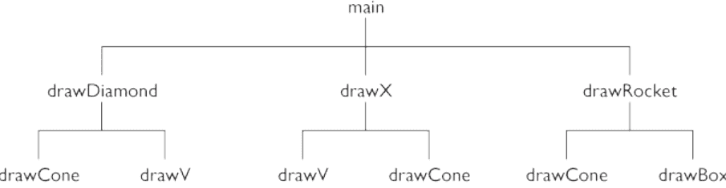

## 图 1.4 DrawFigures3 的分解

因此，为了执行`DrawFigures3`程序，计算机首先执行它的`main`方法。随后，它首先执行`drawDiamond`方法体的内容。`drawDiamond`按顺序执行`drawCone`和`drawV`方法。当`drawDiamond`执行完毕后，控制权转移到`main`方法体中的下一条语句：调用`drawX`方法。

DrawFigures3 中从静态方法到静态方法的控制流的完整分解如下：

- 第 1 个`main`
- 第 2 个`drawDiamond`
- 第 3 个`drawCone`
- 第 4 个`drawV`
- 第 5 个`drawX`
- 第 6 个`drawV`
- 第 7 个`drawCone`
- 第 8 个`drawRocket`
- 第 9 个`drawCone`
- 第 10 个`drawBox`
- 第 11 个`drawBox`
- 第 12 个`drawCone`

记住，定义方法的顺序不需要并行；执行顺序由`main`方法体以及从`main`调用的方法体决定。静态方法的声明就像字典条目——它定义了一个单词，但没有指定该单词如何被使用。此程序`main`方法体的内容表示首先执行`drawDiamond`，然后执行`drawX`，最后执行`drawRocket`。这就是执行顺序，无论方法的定义顺序如何。

Java 允许你按照喜欢的任何顺序定义方法。从顶部的`main`开始向下处理低级方法是一种流行的方法；许多人倾向于相反，将低级方法放在前面，将`main`放在最后。Java 并不在乎你使用什么顺序，所以你可以自己决定你认为最好的顺序。不过，一致性是非常关重要的，这样你以后在大型程序中就能轻松找到某个方法。

需要注意的是，`DrawFigures1`、`DrawFigures2`和`DrawFigures3`程序在控制台上产生的输出完全相同。虽然`DrawFigures1`可能是初学者最容易阅读的程序，但`DrawFigures2`特别是`DrawFigures3`相比它有许多优点。首先，结构良好的解决方案更容易理解，而方法本身就成了解释程序的手段。此外，带有方法的程序更灵活，可以更容易地适应相似但不同的任务。你可以利用`DrawFigures3`中定义的七个方法，编写一个新程序来产生更大、更复杂的输出。构建静态方法来创建新命令可以增加你的灵活性，而不会增加不必要的复杂性。例如，你可以用按以下新顺序调用其他方法的版本替换`main`方法。它会产生什么输出？

```java
public static void main(String[] args) {
    drawCone();
    drawCone();
    drawRocket();
    drawX();
    drawRocket();
    drawDiamond();
    drawBox();
    drawDiamond();
    drawX();
    drawRocket();
}
```

## 章节总结

计算机执行一组被称为程序的指令。计算机在内部将信息存储为 0 和 1 的序列（二进制数）。

编程和计算机科学涉及算法，算法是解决问题的逐步描述。

Java 是一种由太阳微型系统公司（Sun Microsystems）开发（现由 Oracle 公司拥有）的现代面向对象编程语言，它有一组大量的库，可以使用它们构建复杂的程序。

程序通过另一个称为编译器的程序从文本翻译成计算机指令。Java 编译器将 Java 程序转换为一种名为 Java 字节码的特殊格式，使用一个名为 Java 运行时环境（JRE）的特殊程序执行该格式。

Java 程序员通常使用称为集成开发环境（IDE）的编辑器来完成工作。命令可能随环境而异，但始终涉及相同的三个步骤过程：

1. 以 Java 类的形式输入程序。
2. 编译程序。
3. 运行编译后的程序。

Java 使用名为`System.out.println`的命令在控制台上显示文本。

程序中的单词有不同的含义。关键字是语言的特殊单词。标识符是程序员定义的用于命名实体的单词。单词可以放入字符串中，字符串是可以打印到控制台的。使用正确间距和布局的 Java 程序更具可读性。通过编写注释可以提高可读性。


复杂的任务应该被分解为计算机必须执行的主要任务。这一过程被称为分解。正确使用静态方法有助于程序的分解。

## 练习题

### 1.1 基础概念

1. 为什么计算机使用二进制数？

2. 将以下十进制数转换为二进制数：

   - a. 6
   - b. 44
   - c. 72
   - d. 131

3. 以下二进制数的十进制数是多少？

   - a. 100
   - b. 1011
   - c. 10101
   - d. 10011

4. 用你自己的话描述烤饼干的算法。假设你有很多朋友，你需要制作几批饼干。

5. `MyProgram.java` 文件和 `MyProgram.class` 文件有什么区别？

### 1.2 现在

6. 下列哪些可以在 Java 程序中作为标识符使用？

| `println` | `first-name` | `AnnualSalary` | `"hello"` | `ABC` |
| --- | --- | --- | --- | --- |
| `42isTheAnswer` | `for` | `sum_of_data` | `_average` | `B4` |

7. 输出消息的正确语法是哪个？

   - a. `System.println(Hello, world!);`
   - b. `System.println.out('Hello, world!');`
   - c. `System.println("Hello, world!");`
   - d. `System.out.println("Hello, world!");`
   - e. `Out.system.println("Hello, world!");`

8. 以下语句的输出是什么？

```java
System.out.println("\Quotes"");
System.out.println("Slashes ");
System.out.println("How \"confounding' it is!");
```

9. 以下语句的输出是什么？

```java
System.out.println("name\tage\theight");
System.out.println("Archie\t17\t5'9"");
System.out.println("Betty\t17\t5'6"");
System.out.println("Jughead\t16\t6");
```

10. 下述语句的输出输出什么？

```java
System.out.println("Shaq is 7'1");
System.out.println("The string \" is an empty message.");
System.out.println("\"\"");
```

11. 下述语句的输出输出什么？

```java
System.out.println("\ta\tb\tc");
System.out.println("");
System.out.println("'");
System.out.println("\"");
System.out.println("C:\nin\nthe downward spiral");
```

12. 下述语句的输出输出什么？

```java
System.out.println("Dear \"DoubleSlash\" magazine,");
System.out.println();
System.out.println("\tYour publication confuses me. Is it!");
System.out.println("a \\ slash or a //// slash?");
System.out.println("\nSincerely,");
System.out.println("Susan \"Suzy\" Smith\"");
```

13. 什么样的 `println` 语句序列会产生以下输出？

> "Several slashes are sometimes seen,"

Sally说道。“I've said so. See?”

```text
/ / // // \\ ///
```

14. 什么样的 `println` 语句序列会产生以下输出？

```text
This is a test of your
knowledge of "quotes" used
in 'string literals.'
nYou're bound to "get it right"
if you read the section on
'quotes.'
```

15. 写一个 `println` 语句以产生以下输出：

```text
/ / // \\ \\
```

16. 将以下代码重写为一系列等价的 `System.out.println` 语句（即不使用任何 `System.out.print` 语句）：

```java
System.out.print("Twas ");
System.out.print("brillig and the");
System.out.println(" ");
System.out.print(" slithy toves did");
System.out.print(" ");
System.out.println("gyre and");
System.out.println("gimble");
System.out.println();
System.out.println("in the wabe.");
```

17. 下述程序的输出是什么？注意该程序包含几处注释。

```java
1  public class static Commentary {
2      public static void main(String[] args) {
3      System.out.println("some lines of code");
4      System.out.println("have // characters on them");
5      System.out.println("which means "); // that they are comments
6      // System.out.println("written by the programmer.");
7
8      System.out.println("lines can also");
9      System.out.println("have /* and */ characters");
10     /* System.out.println("which represents");
11     System.out.println("a multi-line style");
12     */ System.out.println("of comment.");
13   }
14 }
```

### 1.3 节：程序错误

18. 指出以下程序中的三个错误：

| 行号 | 代码 |
| --- | --- |
| 1 | `public MyProgram {` |
| 2 | `public static void main(String[] args) {` |
| 3 | `System.out.println("This is a test of the")` |
| 4 | `System.out.println("emergency broadcast system.");` |
| 5 | `}` |
| 6 | `}` |

19. 指出以下程序中的四个错误：

| 行号 | 代码 |
| --- | --- |
| 1 | `public class SecretMessage {` |
| 2 | `public static main(string[] args) {` |
| 3 | `System.out.println("Speak friend")` |
| 4 | `System.out.println("and enter")` |
| 5 |  |
| 6 | `}` |

20. 指出以下程序中的四个错误：

| 行号 | 代码 |
| --- | --- |
| 1 | `public class FamousSpeech` |
| 2 | `public static void main(String[]) {` |
| 3 | `System.out.println("Four score and seven years ago,");` |
| 4 | `System.out.println("our fathers brought forth on");` |
| 5 | `System.out.println("this continent a new nation");` |
| 6 | `System.out.println("conceived in liberty,");` |
| 7 | `System.out.println("and dedicated to the proposition");` |
| 8 | `System.out.println("that"); /* this part should` |
| 9 | `System.out.println("all"); really say,` |
| 10 | `System.out.println("men");all PEOPLE!" //` |
| 11 | `System.out.println("are");` |
| 12 | `System.out.println("created");` |
| 13 | `System.out.println("equal"); | |` |

### 1.4 节：过程化分解

21. 下列哪个方法头使用了正确的语法？

- a. `public static example() {}`
- b. `public static void example() {}`
- c. `public void static example() {`
- d. `public static example {}`
- e. `public void static()`

22. 下述程序的输出是什么？（你可能先画一个结构图。）

| 行号 | 代码 |
| --- | --- |
| 1 | `public class Tricky {` |
| 2 | `public static void main(String[] args) {` |
| 3 | `message1();` |
| 4 | `message2();` |
| 5 | `System.out.println("Done with main.");` |
| 6 | `}` |
| 7 |  |
| 8 | `public static void message1() {` |
| 9 | `System.out.println("This is message1.");` |
| 10 | `}` |
| 11 |  |
| 12 | `public static void message2() {` |
| 13 | `System.out.println("This is message2.");` |
| 14 | `message1();` |
| 15 | `System.out.println("Done with message2.");");` |

23. 下述程序的输出是什么？（你可能先画一个结构图。）

```java
public class Strange {
    public static void first() {
        System.out.println("Inside method");
    }

    public static void second() {
        System.out.println("Inside second method");
        first();
    }

    public static void third() {
        System.out.println("Inside method");
        first();
        second();
    }

    public static void main(String[] args) {
        first();
        second();
    }
}
```

24. 如果 `third` 方法包含以下语句，前述程序的输出会是什么？

```java
public static void third() {
    first();
    second();
}
```

25. 如果 `main` 方法包含以下语句，`Strange` 程序的输出会是什么？（使用 `third` 的原始版本，而不是修改后的。）

```java
public static void main(String[] args) {
    second();
    first();
}
```

26. 下述程序的输出是什么？（你可能先画一个结构图。）

```java
1 public class Confusing {
2 public static void method2() {
3 message1();
4 System.out.println("I am 2.");
5 }
6
7 public static void method3() {
8 message2();
9 System.out.println("I am 3.");
10 }
11
12 public static void method1() {
13 System.out.println("I am 1.");
14 }
```

27. 如果 `method3` 包含以下语句，前述程序的输出会是什么？

```java
public static void method3() {
    method1();
    method2();
    System.out.println("I am 3.");
}
```

28. 如果 `main` 方法包含以下语句，`Confusing` 程序的输出会是什么？（使用 `method3` 的原始版本，而不是修改后的。）

```java
public static void main(String[] args) {
    method2();
    method1();
    method3();
}
```

29. 下程序包含至少 10 处语法错误。它们是什么？

```java
1 public class LotOf Errors {
2 public static main(String[] args) {
3 System.out.println(Hello, world!);
4 message()
5 }
6
7 public static void message {
8 System.out.println("This program surely cannot ",
9 System.out.println("have "errors" in it");
10 }
```

30. 考虑以下保存为 `Example.java` 文件的程序：

```java
public class Example {
    public static void displayRule() {
        System.out.println("The first rule ");
        System.out.println("of Java Club is,");
        System.out.println(");
        System.out.println("you do not talk about Java Club.");
    }

    public static void main(String[] args) {
        System.out.println("The rules of Java Club.");
        displayRule();
        displayRule();
    }
}
```

如果对 `Example` 程序进行以下任何更改，会发生什么？例如，是没有任何影响、语法错误还是不同的程序输出？请认为每个更改都是相互独立的。

- 将第 1 行更改为：`public class Demonstration`
- 将第 9 行更改为：`public static void MAIN(String[] args) {`
- 在第 11 行后插入新行：`System.out.println();`
- 将第 2 行更改为：`public static void printMessage() {}`
- 将第 2 行更改为：`public static void showMessage() {}`，并将第 11 行和第 12 行更改为：`showMessage();`
- 将第 3–4 行替换为：`System.out.println("The first rule of Java Club is,");`

31. 以下程序在 Java 语法规则下是合法的，但由于布局和缺乏注释，它很难阅读。请使用本章给出的规则进行格式化，并在程序顶部添加一个注释头。


```java
public class GiveAdvice {
    public static void main(String[] args) {
        System.out.println("Programs can be easy or");
        System.out.println("difficult to read, depending");
        System.out.println("upon your format.");
        System.out.println();
        System.out.println("Everyone, including yourself,");
        System.out.println("will be happier if you choose");
        System.out.println("to format your programs.");
    }
}
```

## 32.

以下程序在 Java 语法规则下是合法的，但由于布局和缺乏注释，它很难阅读。请使用本章给出的规则进行格式化，并在程序顶部添加一个注释头。

```java
public class Messy {
    public static void main(String[] args) {
        message();
        System.out.println();
        message();
    }

    public static void message() {
        System.out.println("I really wish that");
        System.out.println("I had formatted my source");
        System.out.println("code correctly!");
    }
}
```

## 练习

### 1.

编写一个名为 `Stewie` 的完整 Java 程序，打印以下输出：

```text
/////////////////////
 // || Victory is mine! ||
/////////////////////
```

### 2.

编写一个名为 `Spikey` 的完整 Java 程序，打印以下输出：

```text
 /\
 /\/
 //////
 ////\\\
 ////\\
 /\
```

### 3.

编写一个名为 `WellFormed` 的完整 Java 程序，打印以下输出：

```text
A well-formed Java program has
a main method with { and }
braces.
```

一个 `System.out.println` 语句具有 `( )`，通常有一个以 `"` 字符开头并结尾的 `String`。

（但我们输入的是 `\"` 而不是 `"`！）

### 4.

编写一个名为 `Difference` 的完整 Java 程序，打印以下输出：

```text
What is the difference between
a ' and a "? Or between a " and a \"?
One is what we see when we're typing our program.
The other is what appears on the "console".
```

### 5.

编写一个名为 `MuchBetter` 的完整 Java 程序，打印以下输出：

```text
A "quoted" String is
'much' better if you learn
the rules of "escape sequences"
Also, "" represents an empty String.
Don't forget: use \" instead of " !
' ' is not the same as "
```

### 6.

编写一个名为 `Meta` 的完整 Java 程序，其输出内容应该是一个 Java 程序的源代码，该程序的作用是打印 `"Hello, world!"` 作为输出。

### 7.

编写一个名为 `Mantra` 的完整 Java 程序，打印以下输出。除了 `main` 之外，至少使用一个静态方法。

```text
There's one thing every coder must understand:
The System.out.println command.
There's one thing every coder must understand:
The System.out.println command.
```

### 8.

编写一个名为 `Stewie2` 的完整 Java 程序，打印以下输出。除了 `main` 之外，至少使用一个静态方法。

```text
//////////////////////
|| Victory is mine! |||
//////////////////////
|| Victory is mine! |||
//////////////////////
|| Victory is mine! |||
//////////////////////
|| Victory is mine! |||
//////////////////////
|| Victory is mine! |||
//////////////////////
```

### 9.

编写一个名为 `Egg` 的程序，显示以下输出：

```text
__________
/ \\
/ //
```

### 10.

修改上一个练习中的程序成为一个新的程序 `Egg2`，显示以下输出。适当使用静态方法。

### 11.

编写一个名为 `TwoRockets` 的 Java 程序，生成以下输出。使用静态方法展示结构并消除解决方案中的冗余。注意有两个火箭船靠在一起。你可以使用静态方法消除哪些冗余？哪些冗余是消除消除？

```text
|    /   /    |
| / \ / / /  |
| /   /   /   |
++--+   +--+
|       |       ||
|       |       ||
++--+   +--+
|United | United |
| States | States |
+-------+-------+
|       |       |
|       |       ||
++--+   +--+
|    /   /    |
| / \ / / /  |
| /   /   /   |
```

### 12.

编写一个名为 `FightSong` 的程序，产生此输出。至少使用两个静态方法来展示结构并消除解决方案中的冗余。

```text
| Go, team, go! | 
| You can do it. |
```

### 13.

编写一个名为 `StarFigures` 的 Java 程序，生成以下输出。使用静态方法展示结构并消除解决方案中的冗余。

```text
*****
*****
* *
*
* *
*****
*
*
*****
```

### 14.

编写一个名为 `Lanterns` 的 Java 程序，生成以下输出。使用静态方法展示结构并消除解决方案中的冗余。

```text
*****
************
*****
************
* | |
*****
```

### 15.

编写一个名为 `Egg` 的 Java 程序，打印以下输出。使用静态方法展示结构并消除解决方案中的冗余。

```text
*****
----------
/ \
/ \
----------
/ \
----------
```

### 16.

编写一个名为 `Shining` 的程序，打印以下输出。使用静态方法展示结构并消除解决方案中的冗余。

```text
*****
----------
/ \
/ \
----------
/ \
----------
```

两只海鸽，还有一只梨树上的鹌鹑。

### 5.

编写一个输出“我买了一只猫”歌词的程序。为每个段歌和重复文本使用方法。这里是：

```text
Jack 构建了这栋房子。
这里有麦，
Jack 构建了这栋房子。
这只鼠，
它吃了麦，
Jack 构建了这栋房子。
这只猫，
它杀了那只鼠，
它吃了麦，
Jack 构建了这栋房子。
这只狗，
它害怕那只猫，
它杀了那只鼠，
它吃了麦，
Jack 构建了这栋房子。
这只带角奶牛，
它撞了那只狗，
它害怕那只猫，
它杀了那只鼠，
它吃了麦，
Jack 构建了这栋房子。
```

### 6.

编写一个输出“我买了一只猫”歌词的程序。为每个段歌和重复文本使用方法。这里是完整的歌词：

```text
我买了一只猫，它很喜欢我，

我让它在梨树下睡觉。

猫喵喵喵，

我买了一只母鸡，它很喜欢我，

我让它在梨树下睡觉。

鸡咯咯咯，

我买了一只鸭子，它很喜欢我，

我让它在梨树下睡觉。

鸭嘎嘎嘎，

我买了一只鹅子，它很喜欢我，

我让它在梨树下睡觉。

鹅嘎嘎嘎，

我买了一只羊，它很喜欢我，

我让它在梨树下睡觉。

羊咩咩。

羊咩咩，
鹅嘎嘎嘎，
鸭嘎嘎嘎，
鸡咯咯咯，
喵喵喵。
```

### 7.

编写一个输出下面首愚歌歌词的程序。为每个段歌和重复文本使用方法。这里是完整的歌词：

```text
我曾写过一个无法编译的程序，

我不知道为什么无法编译，

我的助教只是笑了。

我的程序什么也没做，

所以我开始打字。

我添加了 System.out.println("I <3 coding") 

我不知道为什么无法编译，

我的助教只是笑了。

编译器大喊：“解析错误，”

幸运的是我是个代码高手。

我添加了反斜来转义引号，

我添加了 System.out.println("I <3 coding"),

我不知道为什么无法编译，

我的助教只是笑了。

现在编译器想要一个标识符，

我以为情况变得糟糕了。

我添加了一个带有 String[] args 的方法，

我添加了反斜来转义引号，

我添加了 System.out.println("I <3 coding")

我不知道为什么无法编译，

我的助教只是笑了。

Java 抱怨它期望一个枚举（enum）

老天，这些电脑真愚笨！

我添加了一个公共类并将其命名为 Scum，

我添加了一个带有 String[] args 的方法，

我添加了反斜来转义引号，

我添加了 System.out.println("I <3 coding"),

我不知道为什么无法编译，

我的助教只是笑了。
```

# 第 2 章 基本数据与确定循环

## 2.1 基本数据概念

- 基本数据类型
- 表达式
- 字面量
- 算术运算符
- 优先级
- 类型混合与强制转换

## 2.2 变量

- 赋值/声明变体
- 字符串拼接
- 增//减运算符
- 变量与类型混合

## 2.3 `for` 循环

- 追踪 `for` 循环
- `for` 循环模式
- 嵌套循环

## 2.4 复杂度

- 作用域
- 伪代码
- 类常量

## 2.5 案例研究：沙形

- 问题分解与伪代码
- 初始结构化版本
- 添加类常量
- 进一步变体

# 引言

现在你已经了解了一些关于 Java 程序的基本结构，你已经准备好学习如何解决更复杂的问题了。目前我们仍然集中在产生输出的程序上，但我们将开始探索一些需要解决问题能力的编程方面。

本章的前半部分将填充两个重要领域。首先，它检查了用于 Java 计算的表达式，特别是涉及数值数据的计算。其次，它讨论了被称为变量程序元素，其值在程序执行时会发生。

本章的后半部分介绍了你的第一个控制结构：`for` 循环。你使用这个结构在程序中重复操作。当你发现任务（如创建复杂图形）中存在模式时，这非常有用，因为你会使用 `for` 循环来重复操作。

当你编写程序时，通常需要包含值和计算结果。这些元素的专业术语是*表达式*（expressions）。

# 表达式

一个产生值的简单值或一组操作。

最简单的表达式是一个特定的值，例如 `42` 或 `28.9`。我们把这些称为“字面量值”（literal values），或*字面量*（literals）。更复杂的表达式涉及组合简单的值。例如，假设你想知道有多少瓶水。如果你有两个 6 装、四个 4 装和两个单瓶，你可以使用以下表达式计算总瓶数：

```java
(2 * 6) + (4 * 4) + 2
```

注意，我们使用星号表示乘法，并使用括号来对表达式的部分进行分组。计算机通过*求值*（evaluating）表达式来确定表达式的值。

# 求值

获取表达式值的过程。

当表达式被求值时得到的值称为*结果*（result）。

复杂的表达式使用*运算符*（operators）形成。

# 运算符

一个特殊的符号（如 `+` 或 `*`），用于表示对一个或多个值要执行的操作。

表达式中使用的值称为*操作数*（operands）。例如，考虑以下简单的表达式：

```java
3 + 29
4 * 5
```

这里的运算符是 `+` 和 `*`，操作数是简单的数字。

当你形成复杂表达式时，这些简单的表达式反过来可以成为其他运算符的操作数。例如，表达式：

```java
(3 + 29) - (4 * 5)
```

具有两层运算符。加法运算符有简单的操作数 3 和 29，乘法运算符有简单的操作数 4 和 5，但减法运算符的操作数是各自带有运算符的带括号表达式。因此，复杂的表达式可以由较小的表达式构建。在最底层，你拥有简单的数字。这些数字被用作操作数来构建更复杂的表达式，而这些表达式反过来又可以用作更复杂表达式的操作数。

你可以用表达式做很多事情。你可以做的简单事情之一是使用 `println` 语句打印表达式的值。例如，如果你说：

```java
System.out.println(42);
System.out.println(2 + 2);
```

你将得到以下两行输出：

```text
42
4
```

注意，对于第二个 `println`，计算机对表达式求值（将 2 加 2）并打印结果（在这种情况下为 4）。

随着你对本书的阅读，你将看到许多不同的运算符，它们都可用于形成表达式。表达式可以任意复杂，包含你喜欢的任何数量的运算符。因此，当我们说“这里可以使用表达式”时，我们的意思是你可以使用任意表达式，其中包括复杂表达式以及简单值。

# 字面量

最简单的表达式使用所谓的“字面量”直接引用值。整数字面量（被认为是 `int` 类型）是一串带或不带前导符号的数字序列：

```java
3 482 229434 0 92348 +9812
```

浮点数字面量（被认为是 `double` 类型）包含一个小数点：

```java
298.4 0.284 207. .2843 -17.452 -.98
```

注意，尽管 `207` 与整数相同，但由于小数点的存在，它被视为 `double`。`double` 类型的字面量也可以用科学计数法表示（数字后跟着 `e`，后面跟着整数）：

```java
2.3e4 1e-5 3.84e92 2.458e12
```

这些数字第一个代表 2.3 乘以 10 的 4 次，等于 23,000。尽管这个值恰好与整数相同，但由于它是用科学计数法表示的，因此被视为 `double` 类型。第二个数字代表 1 乘以 10 的 -5 次，等于 0.00001。第三个数字代表 3.84 乘以 10 的 92 次。第四个数字代表 2.458 乘以 10 的 12 次。

我们已经看到文本信息可以存储在存储字符序列的字面量字符串中。在后的章节中，我们将探索如何逐字符地处理字符串。每个这样的字符都是 `char` 类型。字符字面量包含在单引号中，并且仅包含一个字符：

```java
'a' 'm' 'X' '!' '3' '\\'
```

所有这些示例都是 `char` 类型。注意，最后一个示例使用转义序列来表示反斜线字符。你甚至可以使用转义序列引用单引号字符：

```java
'\'
```

最后，基本类型 `boolean` 存储逻辑信息。在我们到达第 4 章并查看如何在程序中引入逻辑测试之前，我们不会探索 `boolean` 类型的使用，但为了完整性，我们在这里包含了 `boolean` 字面量。逻辑只处理两种可能性：真（true）和假（false）。这两个 Java 关键字是 `boolean` 类型的两个字面值：

```java
true false
```

# 算术运算符

基本的算术运算符如表 2.2 所示。加法和减法运算符你会很熟悉，星号作为乘法运算符以及正斜杠作为除法运算符也是如此。然而，正如你看到的，Java 有两种不同的除法操作。余数或 mod 操作可能让你感到陌生。

当操作数是整数时，除法会带来一个问题。例如，当你将 119 除以 5 时，你不会得到整数结果。因此，整数除法的结果表示为两个不同的整数，商和余数：

```text
119 / 5 = 23（商）

119 % 5 = 4（余数）
```

| 运算符 | 含义 | 示例 |
|---|---|---|
| `+` | 加法 | `19 + 5 = 24` |
| `-` | 减法 | `19 - 5 = 14` |
| `*` | 乘法 | `19 * 5 = 95` |
| `/` | 除法 | `119 / 5 = 23` |
| `%` | 余数或 mod | `119 % 5 = 4` |

# 表 2.2 Java 中的算术运算符

如果你还记得如何进行长除法，那么这两个除法运算符应该是熟悉的：

```text
  34)1079
    -102
    ----
      59
```

在这里，将 1079 除以 34 得到商 31，余 25。使用算术运算符，问题将：

```text
1079 / 34 = 31
1079 % 34 = 25
```

在 Java 中，理解整数除法需要一段时间。当你使用除法运算符（`/`）时，关键记住它会截断小数点后的部分。所以，如果你想象在计算器上计算答案，只需忽略小数点后的部分：

- 19/5 是 3.8，所以 19/5 等于 3
- 207/10 是 20.7，所以 207/10 等于 20
- 3/8 是 0.375，所以 3/8 等于 0

余数运算符（`%`）通常被称为“mod 运算符”，或简单的“mod”。mod 运算符让你知道截断除法留下了多少。例如，根据之前的示例，你将如表 2.3 所示计算 mod 结果。


在每种情况下，你都确定截断除法解释了多少。`mod` 运算符给出任何剩余（余数）。当你将此放入公式时，可以认为 `mod` 运算符的行为如下：

```
x % y = x - (x / y) * y
```

## 表 2.3 Mod 运算符示例

| Mod 问题 | 先除法 | 除法解释了什么？ | 剩下多少？ | 答案 |
|---|---|---|---|---|
| `19 % 5` | `19/5` 是 3 | `3 * 5` 是 15 | `19 - 15` 是 4 | 4 |
| `207 % 10` | `207/10` 是 20 | `20 * 10` 是 200 | `207 - 200` 是 7 | 7 |
| `3 % 8` | `3/8` 是 0 | `0 * 8` 是 0 | `3 - 0` 是 3 | 3 |

`mod` 运算符可能得到 0 的结果。这发生在一个数字可以整除另一个数字时。例如，以下每个表达式的求值都为 0，因为第二个数字可以整除第一个数字：

```
28 % 7
95 % 5
44 % 2
```

有几个特殊情况值得注意，因为它们对于初级程序员来说并不总是一目了然的：

- 分子小于分母：在这种情况下，除法产生 0，而取模产生原数。例如，`7 / 10` 为 0，`7 % 10` 为 7。
- 分子为 0：在这种情况下，除法和取模都返回 0。例如，`0 / 10` 和 `0 % 10` 的结果都为 0。
- 分母为 0：在这种情况下，除法和取模都是未定义的并会产生运行时错误。例如，尝试评估 `7 / 0` 或 `7 % 0` 的程序将抛出 `ArithmeticException` 错误。

取模运算符在计算机程序中有许多实用的应用。这里是一些想法：

- 测试一个数字是偶数还是奇数（偶数时 `number % 2` 为 0，奇数时 `number % 2` 为 1）。
- 寻找数字的各个数字（例如，`number % 10` 是最后一位）。
- 寻找社会安全号码的后四位（`number % 10000`）。

剩余运算符可以用于 `doubles` 也可以用于整数，其工作原理类似：你考虑在尽可能减去“整”值后剩余多少。例如，表达式 `10.2 % 2.4` 的结果为 `0.6`，因为你可以从 `10.2` 中减去四个 `2.4`，留下 `0.6`。

对于浮点数（`double` 类型的值），除法运算符执行我们认为的“正常”除。因此，尽管表达式 `119 / 5` 的结果是 `23`，表达式 `119.0 / 5.0` 的结果却是 `23.8`。

## 优先级

Java 表达式类似于英语中复杂的名词短语。这类短语存在歧义。例如，考虑短语“河边山上拿着望远镜的男人”。河流是在山边还是在人身边？是人拿着望远镜，还是望远镜在山上，或者望远镜在河里？我们不知道如何将这些不同的部分组合在一起。

如果不使用括号来分组 Java 表达式的部分，你也会遇到同样的歧义。例如，表达式 `2 + 3 * 4` 有两个运算符。先执行哪种操作？你可以从两种方式来解释：

第一个结果为 20，第二个结果为 14。为了处理这种歧义，Java 有了优先级规则来决定如何分组各个部分。

> 优先级：运算符的结合能力，它决定了表达式部分的分组方式。

当表达式中运算符的分组出现歧义时，计算机会应用优先级规则。高优先级的运算符先计算，然后是低优先级的运算符。在特定的优先级范围内，运算符按一个方向求值，通常是从左到右。

对于算术表达式，有两个优先级级别。乘法运算符（`*`, `/`, `%`）的优先级高于加法运算符（`+`, `-`）。因此，表达式 `2 + 3 * 4` 被解释为：

在同一优先级级别内，算术运算符从左到右求值。这通常对最终结果没有影响，但偶尔会有。例如，考虑表达式：

其求值过程如下：

如果先计算第二个减法，你将得到不同的结果。

你始终可以使用括号来覆盖优先级。例如，如果你真的想让第二个减法先计算，可以通过引入括号来强制实现这一点：

```
40 - (25 - 9)
```

## 表 2.4 Java 运算符优先级

| 描述 | 运算符 |
| --- | --- |
| 一元运算符 | `+`, `-` |
| 乘法运算符 | `*`, `/`, `%` |
| 加法运算符 | `+`, `-` |

现在表达式的求值如下：

```
40 - (25 - 9)
40 - 16
24
```

算术中的另一个概念是一元加和减，它们接受单个操作数，与我们目前为止看到的二元运算符不同（例如 `*`, `/` 甚至二元的 `+` 和 `-`），后者都接受两个操作数。例如，我们可以通过请求 `-8` 来找到 8 的相反数。这些一元运算符的优先级高于乘法运算符。因此我们可以形成如下表达式：

```
12 * -8
```

其求值结果为 `-96`。

我们将在接下来的章节中看到许多类型的运算符。表 2.4 Java 运算符优先级显示了各种操作的顺序。

## 类型混合与强制转换

你经常发现自己在混合类型并想要将一种类型转换为另一种。Java 有简单的规则来避免混淆。当你将 `double` 值强制转换为 `int` 时，它会直接截断小数点后的任何内容。如果你想转换一个表达式的结果，必须小心地使用括号。

### 2.2 变量

原始数据类型可以存储在计算机内存的变量中。


> ### 变量

一个具有名称和类型并用于存储值的内存位置。

你可以将计算机内存想象成一个巨大的电子表格，其中有许多可以存储数据的单元格。当你在大 Java 中创建一个变量时，你实际上是在要求它为这个新变量留出其中一个单元格。初始时该单元格是空的，但你可以选择在单元格中存储一个值。就像电子表格一样，你也可以在之后更改该单元格中的值。

不过，Java 比电子表格要挑剔得多，因为它要求你准确告诉它你要在单元格中存储什么类型的数据。例如，如果你想存储一个整数，你需要告诉 Java 你打算使用 `int` 类型；如果你想存储一个实数值，你需要告诉 Java 你打算使用 `double` 类型。你还需要决定在引用该内存位置时使用的名称。这遵循 Java 标识符的常规规则（名称必须以字母开头，后面可以跟任意字母和数字的组合）。Java 的标准习惯是变量名以小写字母开头（如数字），并将随后的任何单词的首字母大写，例如 `numberOfDigits`。

为了探索变量的基本用法，让我们来看一个计算个人身体质指数（BMI）的程序。健康专业人员使用这个数字来建议人们体重是否超标。给定个人的身高和体重，我们可以计算出其 BMI。因此，一个简单的 BMI 程序自然会有三个变量来对应这三条信息。在讨论变量时，我们有几个细节需要说明，但先看一个完整的程序以了解整体情况会有帮助。以下程序计算并打印了一个身高 5 英尺 10 英寸、体重 195 磅的人的 BMI：

```java
public class BMICalculator {
    public static void main(String[] args) {
        // 声明变量
        double height;
        double weight;
        double bmi;
        // 计算 BMI
        height = 70;
        weight = 195;
        bmi = weight / (height * height) * 703;
        // 打印结果
        System.out.println("Current BMI:");
        System.out.println(bmi);
    }
}
```

注意，程序包含了空行来区分不同部分，并使用了注释来指示程序不同部分的功能。它产生以下输出：

```
Current BMI:
27.97653061224897
```

现在让我们检查该程序的细节，以理解变量是如何工作的。在 Java 程序中使用变量之前，必须对它们进行声明。声明变量的代码行被称为变量声明。

## 声明

一个请求留出一个具有给定名称和类型的新变量。

每个变量只声明一次。如果你多次声明同一个变量，Java 编译器将向你返回一个错误信息。简单变量声明的格式如下：

```
<type> <name>;
```

正如我们示例程序开头的三个声明一样：

```
double height;
double weight;
double bmi;
```

注意，变量声明像语句一样，以分号结尾。这些声明可以出现在任何可以语句的地方。声明指示了变量的类型和名称。记住每个原始类型的名称都是 Java 中的关键字（`int`, `double`, `char`, `boolean`）。我们使用关键字 `double` 来定义这三个变量的类型。

一旦变量被声明，Java 就会分配一个内存位置来存储其值。然而，由于程序使用了简单的声明形式，Java 不会在这些内存位置中存储初始值。我们将这些称为*未初始化*变量，它们类似于电子表格中的空白单元格：


那么，我们如何为这些单元格赋值呢？简单的方法是使用赋值语句。赋值语句的通用语法为：

```
<variable> = <expression>;
```

例如：

```
height = 70;
```

该语句将值 70 存储在变量 `height` 的内存位置中，表示该人的身高为 70 英寸。在读取此类语句时，我们经常使用“获取”或“赋值”字，例如“height 获取 70”或“height 赋值 70”。

当语句执行时，计算机首先计算右侧的值；然后将结果存储在给定变量的内存位置。在这种情况下，表达式只是一个简单的字面量，因此在计算机执行此语句后，内存看起来如下：

| height | weight | bmi |
| :--- | :--- | :--- |
| 70.0 | ? | ? |

注意，存储值为 70.0 是因为变量的类型是 `double`。变量 `height` 现在已经初始化，但变量 `weight` 和 `bmi` 仍然未初始化。第二个赋值语句给 `weight` 赋值：

```
weight = 195;
```

执行此语句后，内存如下：

`height` `70.0` `weight` `195.0` `bmi` ?

第三个赋值语句包含公式（一个需要计算的表达式）：

```
bmi = weight / (height * height) * 703;
```

为了计算此表达式的值，计算机将体重除以身高的平方，并将操作的结果乘以字面值 `703`。结果存储在变量 `bmi` 中。因此，当计算机执行完第三条赋值语句后，内存如下：

`height` `70.0` `weight` `195.0` `bmi` `27.9765306122448897`

程序的最后两行使用 `println` 语句报告 BMI 结果：

```java
System.out.println("Current BMI:");
System.out.println(bmi);
```

注意，我们可以以同样的方式在 `println` 语句中包含变量。

磅。通过包含这两个语句，我们重置了两个重量 bmi 变量，使得内存看起来如下：

```
height 70.0 weight 180.0 bmi 25.82448979591837
```

新版本程序的输出为：

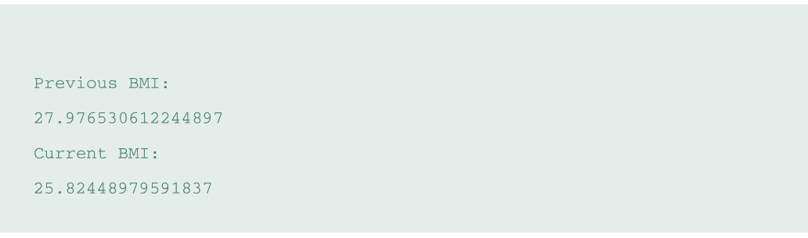

一个非常常见的用于指出代数关系与程序语句区别的赋值语句是：

```
x = x + 1;
```

记住不要将其想为“等于 x + 1”。没有数字能满足这个方程。我们使用像“gets”（获取）这样的词来将其读为“获取加1后的值”。这个语句看起来可能有点奇怪，但根据前面列出的规则，你应该能够破译它。假设 `x` 的当前值为 19。要执行该语句，你首先评估表达式以得到结果 20。计算机将此值存储在左侧命名为 `x` 的变量中。因此，该语句将变量的值加了 1。我们称之为增加 `x` 的值（incrementing）。这是一项基础编程操作，因为它等同于计数（1, 2, 3, 4 等）。下面的语句是递减的变体，我们称之为递减变量（decrementing）：

```
x = x - 1;
```

我们将在本章稍后的部分详细讨论增加和递减。

## 赋值/声明的变体

Java 是一种复杂的语言，为程序员提供了很大的灵活性。在上一节中，我们看到了变量声明和赋值的最简单形式，但关于这个主题有许多变体。在学习期间，坚持最简单的形式并不是坏主意，但当你阅读他人的程序时，会遇到其他形式，因此你需要理解它们的含义。

第一种变体是 Java 允许你在声明变量的同时为其提供初始值。语法如下：

```
<type> <name> = <expression>;
```

例如：

```
double height = 70;
double weight = 195;
double bmi = weight / (height * height) * 703;
```

这种变体在一行代码中结合了声明和赋值。前两个赋值在等号后面是简单的数字，但第三个在等号后面是一个复杂的表达式。这三个赋值的效果与提供三个声明后跟三个赋值语句相同：

```
double height;
double weight;
double bmi;
height = 70;
weight = 195;
bmi = weight / (height * height) * 703;
```

另一种变体是在单条语句中声明多个相同类型的变量。语法为：

```
<type> <name>, <name>, <name>, ..., <name>;
```

例如：

```
double height, weight;
```

这个示例声明了两个不同的变量，类型都是 `double`。注意，类型只在声明的开头出现一次。

最后一种变体是前述形式的混合。你可以同时声明多个相同类型的变量，并同时初始化它们。例如，你可以说：

```
double height = 70, weight = 195;
```

该语句声明了两个 `double` 变量 `height` 和 `weight`，并给它们赋予了初始值（分别为 `70` 和 `195`）。Java 甚至允许混合初始化和不初始化，例如：

```
double height = 70, weight = 195, bmi;
```

该语句声明了三个名为 `height`、`weight` 和 `bmi` 的 `double` 变量，并为其中两个提供了初始值（`height` 和 `weight`）。变量 `bmi` 是未初始化。

## 常见编程错误：重复声明同一个变量

学习过程中需要记住的一点是，任何变量只能声明一次。一旦声明了变量，你可以随所欲地对其多次赋值，但声明应该只出现一次。将变量声明比作入住酒店，将赋值比作进出你的房间。你必须先入住以获得房卡，然后你就可以随心所欲地进出。如果你尝试第二次入住，酒店可能会问你是否真的想为第二个房间付钱。

如果你多次声明一个变量，Java 会生成编译器错误。例如，假设你的程序包含以下行：

```
int x = 13;
System.out.println(x);
int x = 2; // 这一行无法编译
System.out.println(x);
```

第一行是正确的。它声明了一个整数变量 `x` 并将其初始化为 13。第二行也是正确的，因为它仅仅是改变了 `x` 的值。但第三行会生成错误信息，指示 "x" 已经定义。如果你想更改 `x` 的值，需要使用简单的赋值语句而不是变量声明：

```
int x = 13;
System.out.println(x);
x = 2;
System.out.println(x);
```

## 字符串拼接

你在第 1 章中看到过可以使用 `System.out.println` 输出字符串字面量。你也可以使用 `System.out.println` 输出数值表达式：

```
System.out.println(12 + 3);
```

该语句导致计算机首先评估表达式（得到 14），然后将该值写入控制台。你通常想在同一行中输出多个值，但遗憾的是，`println` 只能接受一个值。为了解决这个问题，Java 提供了一种名为*拼接*（concatenation）的简单机制，用于将多个部分组合成一个字符串。

### 拼接

将多个字符串组合成单个字符串，或将字符串与其他数据组合成新字符串。

加法（`+`）运算符将片段拼接在一起。这样做形成了一个可以评估的表达式。即使表达式中同时包含数字和文本，也可以像我们探索过的数值表达式一样进行评估。例如，考虑：

```
"I have " + 3 + " things to concatenate"
```

在使用这样的表达式时，你必须密切关注引号，以便哪些部分在字符串字面量“内部”，哪些在外部。该表达式以文本 "I have "（结尾包含一个空格）开始，后面是一个加号和整数字面量 3。Java 将整数转换为文本形式 ("3") 并将这两个片段拼接在一起形成 "I have 3"。3 后面是另一个加号和另一个字符串字面量 " things to concatenate"（以空格开头）。这个片段被粘接在上一个字符串的末尾，形成字符串 "I have 3 things to concatenate"。

由于这个表达式产生了一个单一的拼接字符串，我们可以将其包含在 `println` 语句中：

```
System.out.println("I have " + 3 + " things to concatenate");
```

该语句产生单行输出：

```
I have 3 things to concatenate
```

字符串拼接通常用于报告变量的值。例如，考虑以下计算标准年份中小时、分钟和秒数的程序：


```java
public class Time {
    public static void main(String[] args) {
        int hours = 365 * 24;
        int minutes = hours * 60;
        int seconds = minutes * 60;
        System.out.println("Hours in a year = " + hours);
        System.out.println("Minutes in a year = " + minutes);
        System.out.println("Seconds in a year = " + seconds);
    }
}
```

注意最后的三个`println`命令都将一个字符串字面量与变量拼接在一起。程序产生如下输出：

```
Hours in a year = 8760
Minutes in a year = 525600
Seconds in a year = 31536000
```

你可以使用拼接来形成任意复杂的表达式。例如，如果你有变量`x`、`y`和`z`，并且你想以坐标格式（带括号和逗号）输出它们的值，你可以写：

```java
System.out.println("(" + x + ", " + y + ", " + z + ")");
```

如果`x`、`y`和`z`的值分别为`8`、`19`和`23`，该语句将输出字符串`"(8, 19, 23)"`。

用于拼接的`+`运算符的优先级与普通的算术`+`运算符相同，这可能会导致一些困惑。考虑以下表达式：

```
2 + 3 + " hello " + 7 + 2 * 3
```

这个表达式有四个加法运算符和一个乘法运算符。根据优先级，我们先计算乘法：

```
2 + 3 + " hello " + 7 + 2 * 3
2 + 3 + " hello " + 7 + 6
```

这种分组方式看起来很奇怪，但这就是优先级规则规定的做法：在先评估所有乘法运算符之前，我们不评估任何加法运算符。一旦处理了乘法，就剩下了四个加法运算符。它们将从左到右进行评估。

第一次加法涉及两个整数值。尽管整个表达式涉及一个字符串，但由于这个小的子表达式只有两个整数，我们执行的是整数加法：

```
2 + 3 + " hello " + 7 + 6
5 + " hello " + 7 + 6
```

下一次加法涉及将整数`5`加到字符串字面量`" hello "`。如果两个操作数中的任何一个是字符串，我们就执行拼接。因此，在这种情况下，我们将整数转换为文本等价值（`"5"`），并将这些部分粘在一起形成一个新的字符串值：

```
5 + " hello " + 7 + 6
"5 hello " + 7 + 6
```

你可能认为Java处理`7`和`6`的方式与它处理`2`和`3`得到`5`的方式相同。但并不是那样运行的。优先级规则很简单，而Java以一种简单的一致性遵循这些规则。优先级告诉我们加法运算符是从左到右评估的，所以我们先将字符串`"5 hello "`加到`7`上。这是另一个字符串和整数的组合，因此Java将整数转换为其文本等价值（`"7"`），并将两部分拼接在一起形成一个新的字符串：

```
"5 hello " + 7 + 6
"5 hello 7" + 6
```

现在只剩下一个加法需要执行了，它再次涉及一个字符串/整数的组合。我们将整数转换为其文本等价值（`"6"`），并将两部分拼接在一起形成一个新的字符串：

```
"5 hello 7" + 6
"5 hello 76"
```

显然，这样的表达式可能会令人困惑，但你不会希望Java编译器去尝试猜你的意思。如果我们知道编译器将一致地遵循简单的规则，我们作为程序员的工作就会变得更容易。你可以通过添加括号来使表达式更清晰，并指定它的评估方式。例如，如果我们真的想要Java将`7`和`6`相加，而不是分别将它们拼接，我们可以用下面这种清晰得多的编写原始表达式：

```
(2 + 3) + " hello " + (7 + 2 * 3)
```

因为括号的存在……

## 递增/递减运算符

除了标准的赋值运算符外，Java还有几种特殊的运算符，这些运算符对于编程中的某类特定操作非常有用。正如我们之前提到的，你经常会发现自己按特定数量增加变量的值，这种操作称为递增。你经常也会发现自己按特定数量减少变量的值，这种操作称为递减。为了实现这一点，你编写了如下的语句：

```
x = x + 1;
y = y - 1;
z = z + 2;
```

同样地，你经常会发现自己想要变量的值翻倍或三倍，或者将其值缩小2倍，在这种情况下，你可能会编写如下代码：

```
x = x * 2;
y = y * 3;
z = z / 2;
```

Java为这些情况提供了简写。将运算符字符（`*`、`-`等）与等号拼接在一起，得到一个特殊的赋值运算符（`+=`、`-=`、`*=`等）。这种变体允许你将之前的赋值语句重写为如下：

```
x += 1;
y -= 1;
z += 2;
x *= 2;
y /= 2;
```

这种约定是学习Java的另一个细节，但它可以让代码更易读。将像`x += 2`这样的语句视为“给`x`加2”。这比说`x = x + 2`更简洁。

Java还有一种更简洁的方式来表达想要递增1或递减1的特殊情况。在这种情况下，你可以使用递增和递减运算符（`++`和`--`）。例如，你可以说：

```
x++;
y--;
```

实际上，每个运算符都有两种不同的形式，因为你也可以将运算符放在变量前面：

```
++x;
--y;
```

`++`的两个版本被称为前置递增（`++x`）和后置递增（`x++`）运算符。`--`的两个版本同样被称为后置递减（`y--`）和前置递减（`--y`）。

## 表 2.5 Java 运算符优先级

| 说明 | 运算符 |
|---|---|
| 一元运算符 | `++`, `--`, `+`, `-` |
| 乘法运算符 | `*`, `/`, `%` |
| 加法运算符 | `+`, `-` |
| 赋值运算符 | `=`, `+=`, `-=`, `*=`, `/=` |
| 递增和递减运算符 | `++`, `--` |

现在我们已经看到了许多运算符，值得重新考虑优先级的问题。表2.5显示了更新后的Java运算符优先级，包含了赋值运算符和递增递减运算符。注意递增和递减运算符与一元运算符分组，并具有最高的优先级。

你已经知道，当你声明一个变量时，必须告诉Java该变量将存储什么类型的值。例如，你可能会声明一个`int`类型的变量来存储整数，或者声明一个`double`类型的变量来存储实数。当你只处理整数或实数时，情况非常清楚，但当你开始混合类型时会发生什么？例如，下面的代码显然是没有问题的：

```java
int x;
double y;
x = 2 + 3;
y = 3.4 * 2.9;
```

在这里，我们有一个整数变量，并为其赋值了一个整数值；还有一个`double`变量，为其赋值了一个`double`值。但如果我们尝试相反的操作呢？

```java
int x;
double y;
x = 3.4 * 2.9; // 非法
y = 2 + 3; // 可以
```

正如注释所示，你不能给整数变量赋值`double`值，但可以给`double`变量赋值整数值。让我们考虑第二种情况。表达式`2 + 3`的求值为整数`5`。这个值不是`double`，但每个整数都是实数，所以Java很容易将该整数转换为`double`。技术术语是Java将整数**提升（promotes）**为`double`。

第一种情况更具棘手。表达式`3.4 * 2.9`的求值为`double`值`9.86`。这个值无法存储在整数中，因为它不是整数。如果你想执行这种操作，就必须告诉Java将此值转换为整数。正如之前描述的，你可以将`double`强制转换为`int`，这会截断小数点后的所有内容：

```java
x = (int)(3.4 * 2.9); // 现在合法了
```

这条语句首先计算`3.4 * 2.9`得到`9.86`，然后截断该值得到整数`9`。

## 常见编程错误：忘记强制转换

我们经常编写涉及`int`和`double`混合的程序，因此在处理两者的组合时很容易出错。例如，假设你想在给定题目总数和学生答对数量的情况下，计算学生考试中答对题目的百分比。你可能会声明以下变量：

```java
int totalQuestions;
int numRight;
double percent;
```

假设前两个变量初始化如下：

```java
totalQuestions = 73;
numRight = 59;
```

你如何计算学生答对题目的百分比？你将答对的数量除以题目总数并乘以100以转换为百分比：

```java
percent = numRight / totalQuestions * 100; // 错误
```

遗憾的是，如果在执行这行代码后打印变量`percent`的值，你会发现它的值为`0.0`。但显然，学生的答对率超过了0%。

问题出在整数除法。你使用的表达式以两个`int`值开头：

```java
numRight / totalQuestions
```

这意味着你正在计算`59 / 73`，由于两个操作数都是整数，Java执行整数除法，结果为`0`。然后`0`乘以`100`仍然是`0`，所以`percent`被赋值为`0.0`。

学生通过将所有变量的类型改为`double`来修复这个问题。这会解决眼下的问题，但从风格角度来看并不是一个好的选择。最好的方法是对数据使用最合适的类型，而考试的题目数量肯定是一个整数。

你可以尝试通过将值`100`改为`100.0`来修复这个问题：

```java
percent = numRight / totalQuestions * 100.0; // 错误
```

但这没有帮助，因为除法先执行。然而，如果你把`100.0`放在第一个，它就有效了：

```java
percent = 100.0 * numRight / totalQuestions;
```

现在乘法在除法之前计算，这意味着所有内容都被转换成了`double`。

有时你可以通过巧妙地调整公式来修复此类问题，但你不想依赖小聪明。这是一个使用强制转换的好地方。例如，回到原始公式，你可以将每个`int`变量强制转换为`double`：

```java
percent = (double) numRight / (double) totalQuestions * 100.0;
```

你也可以利用这样一个事实：一旦你将这两个变量中的一个强制转换为`double`，除法就会以`double`类型进行。例如，你可以只将第一个值转换为`double`：

```java
percent = (double) numRight / totalQuestions * 100.0;
```

## 2.3 for 循环

编程通常涉及指定冗余任务。`for`循环通过在特定的取值范围内反复执行一系列语句来避免这种冗余。假设你想写出前五个整数的平方。你可以写如下所示程序：

```java
public class WriteSquares
```

它将产生以下输出：

```
1 squared = 1
2 squared = 4
3 squared = 9
4 squared = 16
5 squared = 25
```

这种方法非常繁琐。这里是使用`for`循环的等效方法：

```java
public class WriteSquares {
    public static void main(String[] args) {
        for (int i = 1; i <= 5; i++) {
            System.out.println(i + " squared " + (i * i));
        }
    }
}
```

该程序将变量`i`初始化为值`1`。然后只要`i`小于或等于`5`，它就会反复执行`println`语句。`for`循环的通用语法为：

```
for (<initialization>; <continuation test>; <update>) {
    <statement>;
}
```

你总是包含关键字`for`和括号。括号内部有三个部分，用分号隔开：初始化、继续测试和更新。然后有一组大括号包围语句。我们将受控的语句称为循环的**体（body）**。图示显示了流程。

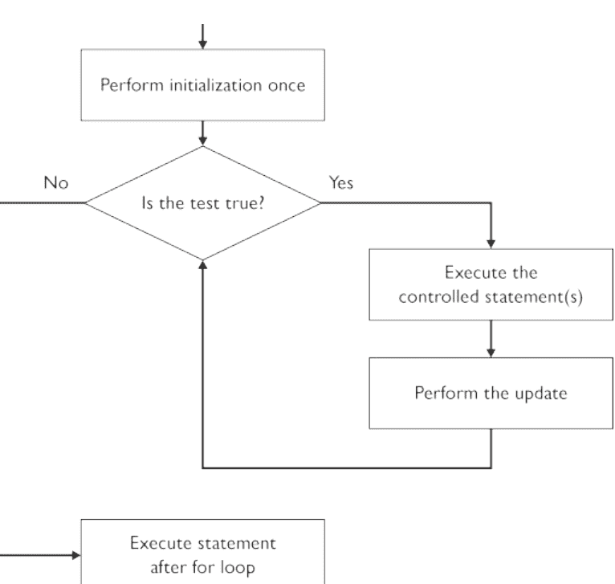
图 2.1 for 循环的流程

如果继续测试求值为`true`，它会执行一次受控语句并执行更新。然后再次执行测试。如果结果再次为`true`，则再次执行语句并再次执行更新。注意更新是在受控语句之后执行的。当测试结果为`false`时，Java停止执行循环并移动到循环之后的任何语句。

## 控制结构

一种控制其他语句的语法结构。你应该小心使用缩进来指示控制语句。在`for`循环例中，循环体中的所有语句都进行了缩进，以指示它们在循环“内部”。

## 跟踪 for 循环

让我们详细检查`WriteSquares`程序中的`for`循环：

```java
for (int i = 1; i <= 5; i++) {
    System.out.println(i + " squared " + (i * i));
}
```

**表 2.6 for (i = 1; i <= 5; i++) 的跟踪**

| 步骤 | 代码 | 描述 |
| :--- | :--- | :--- |
| 初始化 | `int i = 1;` | 变量`i`创建并初始化为`1` |
| 测试 | `i <= 5` | 因为`i <= 5`，所以进入循环 |
| 循环体 | `{ . . }` | 执行`i`等于`1`的`println` |
| 更新 | `i++` | 增`i`，使其变为`2` |
| 测试 | `i <= 5` | 因为`2 <= 5`，所以进入循环 |
| 循环体 | `{ . . }` | 执行`i`等于`2`时的`println` |
| 更新 | `i++` | 增加`i`，其变为`3` |
| 测试 | `i <= 5` | `true`，因为`3 <= 5`，所以我们进入循环 |
| 循环体 | `{ . . }` | 执行`i`等于`3`时的`println` |
| 更新 | `i++` | 增加`i`，其变为`4` |
| 测试 | `i <= 5` | `true`，因为`4 <= 5`，所以我们进入循环 |
| 循环体 | `{ . . }` | 执行`i`等于`4`时的`println` |
| 更新 | `i++` | 增加`i`，其变为`5` |
| 测试 | `i <= 5` | `true`，因为`5 <= 5`，所以我们进入循环 |
| 循环体 | `{ . . }` | 执行`i`等于`5`时的`println` |
| 更新 | `i++` | 增加`i`，其变为`6` |
| 测试 | `i <= 5` | `false`，因为`6 > 5`，所以我们结束了 |

在这个循环中，初始化（`int i = 1`）声明了整数变量`i`并将其初始化为`1`。延续测试（`i <= 5`）表示只要`i`小于或等于`5`，我们就应该继续执行。这意味着一旦`i`大于`5`，我们就停止执行循环体。更新（`i++`）每次将`i`的值加`1`，使`i`趋于大于`5`。在执行五次循环体和随后的更新后，`i`将大于`5`，循环将结束执行。表2.6详细追踪了这一过程。

Java在决定初始化部分和更新部分包含什么方面非常有灵活性，因此我们可以使用`for`循环来解决各种编程任务。但目前，我们将限制在特定类型的循环上，它声明并初始化用于控制循环的单个变量。这个变量通常被称为循环的`控制变量`。在测试中，我们将控制变量与某些最终目标值进行比较，在更新中，我们更改控制变量的值，通常是递增`1`。这种循环在编程中非常常见。按照惯例，我们使用`i`、`j`和`k`作为控制变量名。

受控语句的每次执行都称为循环的次数*iteration*（例如，“循环在四次迭代后结束执行”）。迭代也泛指循环过程（例如，“我通过迭代解决了问题”）。

考虑另一个`for`循环：

```java
for (int i = 100; i <= 100; i++) {
    System.out.println(i + " squared = " + (i * i));
}
```

这个循环总共执行了201次，产生了从`-100`到`+100`（包含）所有整数的平方。那么，初始化和测试中使用的值可以是任何整数。事实上，它们可以是任意的整数表达式：

```java
for (int i = (2 + 2); i <= (17 * 3); i++) {
    System.out.println(i + " squared = " + (i * i));
}
```

这个循环将生成`4`到`51`（包含）所有整数的平方。表达式周围的括号并不是为了提高可读性。考虑以下循环：

```java
for (int i = 1; i <= 30; i++) {
    System.out.println("+--------------------+");
}
```

这个循环生成30行输出，且完全相同。它与上一个略有不同，因为`for`循环控制的语句没有引用控制变量。因此，

```java
for (int i = -30; i <= -1; i++) {
    System.out.println("+--------------------+");
}
```

生成的输出完全相同。这种循环的行为完全取决于它执行的迭代次数。迭代次数由以下公式给出：

```
<ending value> - <starting value> + 1
```


很容易看出这些循环中的第一个迭代了 30 次，所以使用那个循环更好。

现在，让我们来看一些边界情况。考虑这个循环：

```java
for (int i = 1; i <= 1; i++) {
    System.out.println("+-----");
}
```

根据我们的规则，它应该迭代一次，它确实这样做了。它将变量`i`初始化为 1，并测试它是否小于或等于 1，事实确实如此。所以它执行`println`，增加`i`，并再次测试。第二次测试时，它发现`i`不再小于或等于 1，因此停止执行。现在考虑这个循环：

```java
for (int i = 1; i <= 0; i++) {
    System.out.println("+-----"); // 永远不会执行
}
```

这个循环完全没有迭代。它不会导致执行错误；只是不会执行体。它将变量初始化为 1 并测试它是否小于或等于 0。它不是，所以与其执行体中的语句，它直接在那里停止了。

当你构建一个`for`循环时，可以在大括号内包含多个语句。例如，考虑以下代码：

```java
for (int i = 1; i <= 20; i++) {
    System.out.println("+--------------------+");
}
```

这个循环生成 30 行输出，所有内容完全相同。它与之前的略有不同，因为`for`循环控制的语句没有引用控制变量。因此，

```java
for (int i = 1; i <= 20; i++) {
    System.out.println("Hi!");
    System.out.println
```

这会产生 20 行输出，每一行都包含`Hi!`，后面的`Ho!`紧随其后。

当`for`循环控制单个语句时，不需要包含大括号。但是，在书中，即使你只需要一个语句，由于如果你在循环体中包含多个语句，就需要包含大括号：

```java
for (int i = 1; i <= 20; i++) {
    System.out.println("Hi!");
    System.out.println("Ho!");
}
```

## 忘记大括号的错误

你应该使用缩进来指示循环体，但仅靠缩进是不够的。假设你这样写：

```java
for (int i = 1; i <= 20; i++)
    System.out.println("Hi!");
    System.out.println
```

缩进向读者指示它们都在循环体内，但 Java 没有大括号来指示这一点。结果，这段代码被解释为：

```java
for (int i = 1; i <= 20; i++) {
    System.out.println("Hi!");
}

System.out.println("Ho!");
```

只有第一个`println`被认为在循环体内。第二个`println`被认为在循环之外。因此，这段代码将产生 20 行显示`Hi!`的输出，后面跟一行显示`Ho!`的输出。要把两个`println`都包含在体内，你需要为它们加上大括号：

```java
for (int i = 1; i <= 20; i++) {
    System.out.println("Hi!");
    System.out.println("Ho!");
}
```

## `for`循环模式

通常，如果你想让循环迭代 n 次，你会使用两种标准循环之一。第一种标准形式类似于你已经看到的：

```java
for (int <variable> = 1; <variable> <= n; i++) {
    <statement>;
    <statement>;
    ...
    <statement>;
}
```

很容易看出这个循环执行了 n 次，因为它从 1 开始，只要小于或等于 n 就会继续。例如，这个循环打印从 1 到 10 的数字：

```java
for (int i = 1; i <= 10; i++) {
    System.out.print(i + " ");
}
```

因为它使用了`print`而不是`println`语句，所以它产生单行输出：

```text
1 2 3 4 5 6 7 8 9 10
```

通常，从 0 开始计数比从 1 开始方便。这需要对循环测试进行更改，以便在少于 n 时停止：

```java
for (int <variable> = 0; <variable> < n; i++) {
    <statement>;
    <statement>;
    ...
    <statement>;
}
```

注意，在这种形式下，当你将变量初始化为 0 时，你测试的是它是否严格小于 $n$。这两种形式都会精确执行 $n$ 次，尽管在某些情况下，基于 0 的循环效果更好。例如，这个循环执行了 10 次，与上一个循环的执行次数一样：

```java
for (int i = 0; i < 10; i++) {
    System.out.print(i + " ");
}
```

因为它是从 0 开始而不是从 1 开始，所以它产生了一组不同的 10 个值的序列：


大多数情况下，你会使用从 0 或 1 开始的循环来执行固定次数的某些。但也有一种细小的变体有时很有用。我们可以不正向运行循环，而是反向运行。不是从 1 开始并执行到达到 $n$，而是从 $n$ 开始并一直执行到达到 $n$（此处原文可能误为达到 1）。你可以通过使用递减而不是递增来实现这一点，因此我们有时将其称为递减循环。

这是递减循环的通用形式：

```java
for (int <variable> = n; <variable> >= 1; <variable>--) {
    <statement>;
    <statement>;
    ..
    <statement>;
}
```

例如，这里是一个执行 10 次的递减循环：

```java
for (int i = 10; i >= 1; i--) {
    System.out.print(i + " ");
}
```

因为它是反向运行的，所以它反序打印值：

```text
10 9 8 7 6 5 4 3 2 1
```

# 嵌套`for`循环


`for`循环控制一条语句，而`for`循环本身也是一条语句，这意味着一个`for`循环可以控制另一个`for`循环。例如，你可以编写如下代码：

```java
for (int i = 1; i <= 10; i++) {
    for (int j = 1; j <= 5; j++) {
        System.out.println("Hi there.");
    }
}
```

这段代码可能从内向外读更容易理解。`println`语句产生单行输出。内部的`j`循环执行该语句五次，产生五行输出。外部的`i`循环执行内部循环十次，产生 10 组每组 5 行，即 50 行输出。那么，前面的代码等同于：

```java
for (int i = 1; i <= 50; i++) {
    System.out.println("Hi there.");
}
```

这个示例展示了`for`循环可以被另一个`for`循环控制。这种循环被称为**嵌套循环**。不过，这个示例并不有趣，因为嵌套循环是可以被消除的。

现在你已经知道如何编写`for`循环，你将希望能够使用`print`命令逐部分生成复杂的输出行。回想第 1 章，`print`命令在当前输出行上打印，而不会跳转到新行。例如，如果你想生成一行包含 80 颗星的输出，你可以使用`print`命令每次打印一颗星并让它执行 80 次，而不是使用单个`println`。

让我们来看一个使用`print`命令的更有趣的嵌套循环：

```java
for (int i = 1; i <= 6; i++) {
    for (int j = 1; j <= 3; j++) {
        System.out.print(j + " ");
    }
}
```

我们再次从内向外读取它。内部循环在其控制变量`j`从`1`变为`3`时打印该值。外部循环执行这个过程六六次。结果，我们得到了六次序列`1 2 3`的输出：

```text
1 2 3 1 2 3 1 2 3 1 2 3
```

这段代码将所有输出打印在单行输出上。让我们看一些结合了`print`和`println`以产生几行输出的代码：

```java
for (int i = 1; i <= 6; i++) {
    for (int j = 1; j <= 10; j++) {
        System.out.print("*");
    }
    System.out.println();
}
```

当你编写涉及嵌套循环的代码时，必须小心地缩进代码以使结构清晰。在最外层级，前面的代码是一个执行六次的简单`for`循环：

```java
for (int i = 1; i <= 6; i++) {
    ....
}
```

我们对这个`for`循环内部的语句使用缩进，以清楚它们是该循环的体。在内部，我们找到了两个语句：另一个`for`循环和一个`println`。让我们看看内部的`for`循环：

```java
for (int j = 1; j <= i; j++) {
    System.out.print("*");
}
```

这个内部循环由外部循环控制。那么，如果我们把测试条件改为 $i$ 会发生什么呢？（注：此处原文后续存在大量重复乱码，已按逻辑处理）

## 方法

为什么不直接在一个外部作用域中声明一切呢？这看起来确实更简单，但存在一些重要的缺点。变量局部化会导致一些重复（并可能引起混淆），但提供了更高的安全性。打个比方，考虑宿舍里冰箱的使用。每个宿舍房间都可以有自己的冰箱，但当你身在房间外时，你并不知道里面是否有冰箱。房间里的物品对你是隐藏的。

Java 程序使用变量来存储值，就像学生使用冰箱来存储啤酒、冰淇淋和其他值一样。我们上次住宿舍时，注意到每个房间里都有冰箱。这看起来似乎是多余的，但原因是显而易见的。如果你想保证某事物的安全性，就把它放在别人别人拿不到的地方。你在程序中使用局部变量的方式也是一样的。

让我们来看一个涉及两个方法的简单示例：

```java
public class ScopeExample {
    public static void main(String[] args) {
        int x = 3;
        int y = 7;
        computeSum();
    }

    public static void computeSum() {
        int sum = x + y; // error: x/y 不在作用域内
    }
}
```

在这个示例中，`main`方法为`x`和`y`赋予了初始值。然而，由于变量`x`和`y`是`main`方法的局部变量，在`computeSum`方法内部不可见，因此这不起通。程序会产生如下错误信息：

```text
ScopeExample.java:10: error: cannot find symbol
symbol: variable x
int sum = x + y; // illegal
^

ScopeExample.java:10: error: cannot find symbol
symbol: variable y
int sum = x + y; // illegal
^
```

## 作用域与局部变量

在讨论一个方法的局部变量时，理解作用域是非常重要的。作用域也会影响单个方法内部的情况。你已经看到大括号用于组合一组语句。但你可以在大括号嵌套大括号，这会导致一些问题。例如，考虑以下代码：

```java
for (int i = 1; i <= 5; i++) {
    int squared = i * i;
    System.out.println(i + " " + squared);
}
```

这是我们在本章节早期看到的用于打印前五个整数平方的代码变体。在这个版本中，使用了一个名为`squared`的变量来跟踪平方值。这段代码运行正常，但考虑这个变体：

```java
for (int i = 1; i <= 5; i++) {
    int squared = i * i;
    System.out.println(i + " " + squared);
}

System.out.println("square = " + squared); // illegal
```

这段代码会产生编译错误。变量`squared`声明在循环内部。换句话说，包含它的大括号是循环括号。它不能在该作用域之外使用，所以当你尝试在循环外部引用它时，就会得到编译错误。

如果出于某种原因你需要编写此类在循环后访问该变量的代码，你必须在循环之前在外部作用域声明该变量：

```java
int squared = 0; // 现在声明在外部作用域中

for (int i = 1; i <= 5; i++) {
    squared = i * i; // 将此更改为赋值语句
    System.out.println("squared = " + squared);
}
```

作用域有几个特殊情况，`for`循环就是其中之一。当变量在`for`循环的初始化部分声明时，它的作用域就是`for`循环本身（`for`头部部分和循环控制的语句）。这意味着你可以在多个循环中使用相同的变量名：

```java
for (int i = 1; i <= 10; i++) {
    System.out.println("squared = " + (i * i));
}

for (int i = 1; i <= 10; i++) {
    System.out.println("cubed = " + (i * i * i));
}
```

变量`i`在前面的代码中声明了两次，但由于每个变量的作用域只是它所所在的`for`循环，所以这不是问题。（这就像有两个宿舍房间，每个房间都有自己的冰箱。）当然，你不能对嵌套的`for`循环这样做。例如，以下代码将无法编译：

```java
for (int i = 1; i <= 5; i++) {
    for (int i = 1; i <= 10; i++) { // illegal
        System.out.println("hi there.");
    }
}
```

当 Java 遇到内部`for`循环时，它会抱怨该变量在同一作用域内已经声明了两次。你不能声明两次同一个变量；你必须想两个不同的名称来区分它们，就像当同一个家族有两个 Carl 时，他们倾向于被称为“小 Carl”和“老 Carl”以避免任何潜在的混淆。

在`for`循环中使用的控制变量不必在循环的初始化部分声明。然而，如果你在循环体内部声明它，它的作用域将局限于该块。这些就是当你未能局部化变量时可能会遇到的问题。

## 无限循环

永远不会终止的循环。这个循环是无限的，因为无论外部循环对变量做了什么，内部循环都会将其重置为 1。

## 常见的编程错误：引用了错误的循环变量

以下代码旨在打印一个星号三角形。但它有一个微妙的 Bug，会导致它无限打印星号：

```java
for (int i = 1; i <= 6; i++) {
    for (int j = 1; j <= i; i++) {
        System.out.print("*");
        System.out.println();
    }
}
```

变量`j`应该是递增的，但实际上增加的是`i`。这个错误的影响是变量`j`在内层循环中从未递增，因此`j <=`的测试永远不会失败，导致内层循环无法终止。

这里另一段错误的代码。这段代码尝试打印一个 6 3 4 的星号框，但它也会无限打印：

```java
for (int i = 1; i <= 6; i++) {
    for (int j = 1; i <= 4; j++) {
        System.out.print("*\*");
    }
    System.out.println();
}
```

问题出在第二行，这次是在内层`for`循环头的测试条件中。程序员本想写`j <= 4`，但不小心写成了`i <= 4`。由于`i`的值在内层循环中从未递增，`i <= 4`的测试永远不会失败，因此内层循环再次无法终止。

## 伪代码

随着你编写的算法变得复杂，你会发现自己无法立即编写整个算法。相反，你会越来越多地利用编写`pseudocode`（伪代码）的技术。

### 伪代码

对算法进行类英语的描述。使用伪代码编程涉及连续地完善非正式描述，直到它可以被轻松转换为 Java 代码。

例如，你可以描述画一个框的问题：

```text
画一个包含 50 行和 30 列星号的框。
```

虽然这个语句描述了图形，但它没有提供关于如何绘制它的具体指令（即使用什么算法）。你是按行绘制图形还是按列绘制图形？在 Java 中，这类图形必须逐行生成，因为一旦对输出行执行了`println`，该行就无法再更改。输出中没有返回上一行的命令。因此，你必须完整地输出第一行，然后是完整的第二行，以此以此类推。结果，你对这类图形的分解在顶层是面向行的。因此，通过引入在输出行上重复写入单个字符然后移动到新行输出行的想法，可以让该指令变得更具体：

```text
for (each of 50 lines) {
    for (each of 30 columns) {
```


进入`/path/to/xxx`目录，找到`xxx.json`。

在表达式`cvar = avar + bvar`中，加法运算符（`+`）将`avar`与`bvar`相加，得到它们的和`cvar`。

在`List.of(arg0, arg1, arg2)`中，`List`接口的工厂方法`of()`接受一系列的元素，返回包含它们的只读列表。

之后我们这样调用`cmd`命令：`cmd arg0 arg1 arg2`。

```
if (condVar > someVal) {console.log("xxx")}
```

## 使用伪代码生成复杂图形

使用伪代码，你可以逐渐将英语描述转换为易于转换为 Java 程序的代码。我们目前为止看到的简单示例几乎不值得应用伪代码，因此我们现在来研究生成一个更复杂图形的问题：

```
********
******
*****
***
*
```

这个图形也必须逐行生成：

```
for (each of 5 lines) {
  draw one line of the triangle.
}
```

遗憾的是，每一行都是不同的。因此，你必须想出一个适用于所有行的通用规则。该图形的第一行有一系列星号，前面没有领先空格。随后的每一行都有系列空格，后面跟着一系列星号。稍微发挥想象力，你可以说第一行有 0 个空格，后面是一系列星号。这允许你编写一个制作该图形的通用规则：

```
for (each of 5 lines) {
    write some spaces (possibly 0) on the output line.
    write some asterisks on the output line.
    go to a new output line.
}
```

为了继续下去，你必须确定空格数量的规则和星号数量的规则。假设行号从 1 到 5，观察图形，你可以填充表 2.8。

你想找到行号与另外两列之间的关系。这是简单的代数，因为这些列之间是线性关系。

## 表格 2.8 图形分析

| 行 | 空格 | 星号 |
|---|---|---|
| 1 | 0 | 9 |
| 2 | 1 | 7 |
| 3 | 2 | 5 |
| 4 | 3 | 3 |
| 5 | 4 | 1 |

第二列很容易从行号中得到。它等于`(line - 1)`。第三列稍微难一点。因为它每次减少 2，而第一列每次增加 1，你需要一个为 -2 的乘数。然后你需要一个适当的常数。数字 11 似乎很有效，所以你可以让第三列等于`(11 - 2 * line)`。那么，你可以如下改进你的伪代码：

```
for (line going 1 to 5) {
    write (line - 1) spaces on the output line.
    write (11 - 2 * line) asterisks on the output line.
    go to a new output line.
}
```

这个伪代码可以很容易地转换为程序：

```
1 public class DrawV {
2     public static void main(String[] args) {
3         for (int line = 1; line <= 5; line++) {
4             // ... implementation ...
5         }
6     }
7 }
```

```java
public static final int HEIGHT = 10;
public static final int WIDTH = 20;
```

这些定义创建了名为`HEIGHT`和`WIDTH`的常量，它们的值将始终为 10 和 20。这些被称为类常量，因为我们是在类的最外作用域内声明它们的，并与类的方法放在一起。这样，它们在类的每个方法中都是可见的。

我们已经提到，通过引入一个行数的常量，我们可以避免在`DrawCone`程序中使用“魔数”。以下是常量的定义形式：

```java
public static final int LINES = 5;
```

现在我们可以用这个常量替换外层循环中的`5`，并将第二个内部循环中的`11`替换为表达式`2 * LINES + 1`。结果如下所示程序：

| 1 | public class DrawCone2 { |
| 2 | public static final int LINES = 5; |
| 3 | |
| 4 | public static void main(String[] args) { |
| 5 | for (int line = LINES; line >= 1; line--) { |
| 6 | for (int i = 1; i <= (line - 1); i++) { |
| 7 | System.out.print(" "); |
| 8 | } |
| 9 | int stars = 2 * LINES + 1 - 2 * line; |
| 10 | for (int i = 1; i <= stars; i++) { |
| 11 | System.out.print("*"); |
| 12 | } |
| 13 | System.out.println(); |
| 14 | } |
| 15 | } |
| 16 | |

注意，在这个程序中，星号数量的表达式已经变得足够复杂，以至于我们引入了一个名为`stars`的局部变量来存储该值。这个程序的优点是它的可读性更高，适应性更强。对常量`LINES`进行简单更改即可让它产生不同行数的图形。

## 2.5 案例研究：沙漏形图形


现在我们将考虑一个更复杂的例子。为了解决它，我们将遵循三个基本步骤：

1. 将任务分解为子任务，每个子任务将成为一个静态方法。
2. 对于每个子任务，为图形制作表格，并根据行号计算表格中每一列的公式。
3. 将表格转换为每个方法的实际`for`循环代码。

我们想要产生的输出如下：

```
+------+
|\..../|
| \../ |
|  \/  |
|  /\  |
| /..\ |
|/....\|
+------+
```

## 任务分解与伪代码

要生成这个图形，你必须首先将其分解为子图形。在此过程中，你应该寻找在某种意义上相似的行。第一行和最后一行完全相同。第一行之后的后的三行都符合一种模式，而随后的三行又符合另一种模式：

```
+------+ line
|\..../|
| \../ |  上半部分
|  \/  |
|  /\  |  下半部分
| /..\ |
|/....\|
+------+ line
```

因此，你可以将整体问题分解如下：

```
绘制一条实线。
绘制沙漏的上半部分。
绘制沙漏的下半部分。
绘制一条实线。
```

你应该独立地解决每个子问题。最终你会想要引入一个类常量来使程序更灵活，但让我们先在不考虑使用常量的情况下解决问题。

实线任务可以进一步具体说明为：

```
在输出行上写一个加号。
在输出行上写 6 个横杠。
在输出行上写一个加号。
到新的一行输出。
```

这组指令可以很容易转换为一个静态方法：

```java
public static void drawLine() {
    System.out.print("+");
    for (int i = 1; i <= 6; i++) {
        System.out.print("-");
    }
    System.out.println("+");
}
```

沙漏的上半部分更复杂。这里有一个典型的行：

```
\../ |
```

有四个独立的字符，由空格和点分隔。

| 竖线 | 空格 | 反斜杠 | 点 | 斜杠 | 空格 | 竖线 |

因此，伪代码的第一个近似可能像这样：

```
for (每行 3 行) {
  在输出行上写一个竖线。
  在输出行上写一些空格。
  在输出行上写一个反斜杠。
  在输出行上写一些点。
  在输出行上写一个斜杠。
  在输出行上写一些空格。
  在输出行上写一个竖线。
  到新的一行输出。
}
```

同样，你可以制作一个表格来确定所需的表达式。编写单个字符将很容易翻译成 Java，但你对空格和点需要更具体。这组中的每行包含两组空格和一组点。表格 2.9 显示了要使用多少。

两组空格符合规则`(line - 1)`，而点的数量是`(6 - line)`。因此，伪代码应该读作：

```
for (每行 3 行) {
  在输出行上写一个竖线。
  在输出行上写一些空格。
  在输出行上写一个反斜杠。
  在输出行上写一些点。
  在输出行上写一个斜杠。
  在输出行上写一些空格。
  在输出行上写一个竖线。
}
```

### 表格 2.9 图形分析

| 行 | 空格 | 点 |
|---|---|---|
| 1 | 0 | 4 |
| 2 | 1 | 2 |
| 3 | 2 | 0 |

## 初始版本

组合在一起，程序如下：

```java
public class DrawFigure {
    public static void main(String[] args) {
        drawLine();
        drawTop();
        drawBottom();
    }

    // 绘制一条实线
    public static void drawLine() {
        System.out.print("+");
        for (int i = 1; i <= 6; i++) {
            System.out.print("-");
        }
        System.out.println("+");
    }

    // 绘制沙漏的上半部分
    public static void drawTop() {
        for (int line = 1; line <= 3; line++) {
            System.out.print("|");
            for (int i = 1; i <= (line - 1); i++) {
                System.out.print(" ");
            }
            System.out.print("\\");
            for (int i = 1; i <= (6 - 2 * line); i++) {
                System.out.print(".");
            }
            System.out.print("/");
            System.out.println("|");
        }
    }

    // 绘制沙漏的下半部分
    public static void drawBottom() {
        for (int line = 3; line >= 1; line--) {
            System.out.print("|");
            for (int i = 1; i <= (3 - line); i++) {
                System.out.print(" ");
            }
            System.out.print("\\");
            for (int i = 1; i <= 2 * (line - 1); i++) {
                System.out.print(".");
            }
            System.out.print("/");
            System.out.println("|");
        }
    }
}
```

## 添加类常量

`DrawFigure`程序输出了预期的输出，但它并不灵活。如果我们想产生不同尺寸的类似图形呢？原始问题涉及一个上半部分三行、下半部分也三行的沙漏形。如果我们想要下面的输出，上半部分四行，下半部分四行呢？

```
+-------+
|\...../|
| \.../ |
|  \./  |
|  /.\  |
| /...\ |
|/.....\|
+-------+
```

如果我们能使其足够灵活以产生任何输出，程序显然更有用。我们通过引入类常量来消除魔数来实现这一点。你可能认为我们需要引入两个常量——一个高度，一个宽度——但由于这个图形的规则性，高度是由宽度决定的，反之亦然。因此，我们只需要引入一个类常量。让我们使用图形的高度。

### 表格 2.10 不同高度图形的分析

| 子高度 | drawLine 中的横杠 | drawTop 中的空格 | drawTop 中的点 | drawBottom 中的空格 | drawBottom 中的点 |
|---|---|---|---|---|---|
| 3 | 6 | line - 1 | 6 - 2 * line | 3 - line | 2 * (line - 1) |
| 4 | 8 | line - 1 | 8 - 2 * line | 4 - line | 2 * (line - 1) |

## 沙漏半部分：

```java
public static final int SUB_HEIGHT = 4;
```

我们将常量命名为`SUB_HEIGHT`而不是`HEIGHT`，是因为它指的是两个部分中每个的高度，而不是整个图形的高度。注意我们是如何使用下划线字符来分隔常量名中的不同单词的。

那么，我们如何修改原始程序以引入这个常量呢？遍历程序查找任何“魔数字”，并在适当的位置插入该常量或包含该常量的表达式。例如，`drawTop`和`drawBottom`方法都有一个执行 3 次的`for`循环，以产生 3 行输出。我们将其改为 4 以产生 4 行输出，更通地说，我们将其更改为`SUB_HEIGHT`以产生`SUB_HEIGHT`行输出。

在程序的其他部分，我们必须更新破折线、空格和点的数量的公式。有时我们可以根据经验推测来确定如何调整公式以使用该常量。如果你无法猜出合适的公式，可以使用表格法来找到合适的公式。使用这个子标题为 4 的新输出，你可以更新程序中的各种公式。表 2.10 显示了各种公式。

然后我们检查每个公式，并确定将其替换为包含该常量的新公式。当子标题增加 1 时，破折线的数量增加 2，因此我们需要一个 2 的倍数。表达式`2 * SUB_HEIGHT`产生了正确的值。`drawTop`中的空格数不随子高度的变化而改变，因此表达式不需要修改。`drawTop`涉及的点数在子高度为 3 时为 6，在子高度为 4 时为 8。一旦我们需要 2 的倍数，我们就使用表达式`2 * SUB_HEIGHT - 2 * line`。`drawBottom`中的空格数在子高度为 3 时为 3，在子高度为 4 时为 4，因此通用表达式是`SUB_HEIGHT - line`。`drawBottom`中的点数不随子高度的变化而改变。

这是带有子高度类常量的新版本程序。它使用的`SUB_HEIGHT`值为 4，但我们可以将其改为 3 以生成较小版本，或者更改为其他值以生成图形的其他版本。

```java
public class DrawFigure2 {
    public static final int SUB_HEIGHT = 4;

    public static void main(String[] args) {
        drawLine();
        drawTop();
        drawBottom();
    }

    // produces a solid line
    public static void drawLine() {
        System.out.print("+");
        for (int i = 1; i <= (2 * SUB_HEIGHT); i++) {
            System.out.print("-");
        }
        System.out.println("+");
    }

    // produces the top half of the hourglass figure
    public static void drawTop() {
        for (int line = 1; line <= SUB_HEIGHT; line++) {
            System.out.print("|");
            for (int i = 1; i <= (line - 1); i++) {
                System.out.print(" ");
            }
            System.out.print("\\");
            int dots = 2 * SUB_HEIGHT - 2 * line;
            for (int i = 1; i <= dots; i++) {
                System.out.print(".");
            }
            System.out.print("/");
            for (int i = 1; i <= (line - 1); i++) {
                System.out.print(" ");
            }
            System.out.println("|");
        }
    }

    // produces the bottom half of the hourglass figure
    public static void drawBottom() {
        for (int line = SUB_HEIGHT; line >= 1; line--) {
            System.out.print("|");
            for (int i = 1; i <= (SUB_HEIGHT - line); i++) {
                System.out.print(" ");
            }
            System.out.print("\\");
            for (int i = 1; i <= 2 * (line - 1); i++) {
                System.out.print(".");
            }
            System.out.print("/");
            for (int i = 1; i <= (SUB_HEIGHT - line); i++) {
                System.out.print(" ");
            }
            System.out.println("|");
        }
    }
}
```


```java
for (int line = 1; line <= SUB_HEIGHT; line++) {
    System.out.print("||");
    for (int i = 1; i <= (SUB_HEIGHT - line); i++) {
        System.out.print(" \ ");
    }
    System.out.print("/");
    for (int i = 1; i <= 2 * (line - 1); i++) {
        System.out.print("\\");
    }
    for (int i = 1; i <= (SUB_HEIGHT - line); i++) {
        System.out.print(" ");
    }
    System.out.println("||");
}
```

注意`SUB_HEIGHT`常量是在类范围内声明的，而不是在单个方法内部局部声明。虽然变量局部化是一个好主意，但常量却并非如此。我们将变量局部化是为了避免潜在的干扰，但这个论点对于常量并不成立，因为它们保证不会改变。使用局部变量的另一个理由是它可以使静态方法具有独立性。这个论点在应用于常量时有一定的一定道理，但还不够充分。类常量确实在方法之间引入了依赖关系，但这通常正是你想要的。

# 自测题

## 2.1 节：基础数据概念

1. 哪些是合法的整型字面量（`int literals`）？

```text
22 1.5 -1 2.3 10.0 5. -6875309 '7'
```

2. 下一个表达式的结果是什么？

```text
1 + 2 * 3 + 7 * 2 % 5
```

- a. 1
- b. 2
- c. 5
- d. 11
- e. 21

3. 跟踪以下表达式的求值过程，并给出它们的结果：

- a. `2 + 3 * 4 - 6`
- b. `14 / 7 * 2 + 30 / 5 + 1`
- c. `(12 + 3) / 4 * 2`
- d. `(238 % 10 + 3) % 7`
- e. `(18 - 7) * (43 % 10)`
- f. `2 + 19 % 5 - (11 * (5 / 2))`
- g. `813 % 100 / 3 + 2.4`
- h. `26 % 10 % 4 * 3`
- i. `22 + 4 * 2`
- j. `23 % 8 % 3`
- k. `12 - 2 - 3`
- l. `6/2 + 7/3`
- m. `6 * 7 % 4`
- n. `3 * 4 + 2 * 3`
- o. `177 % 100 % 10 / 2`
- p. `89 % (5 + 5) % 5`
- q. `392 / 10 % 10 / 2`
- r. `8 * 2 - 7 / 4`
- s. `37 % 20 % 3 * 4`
- t. `17 % 10 / 4`

4. 跟踪以下表达式的求值过程，并给出它们的结果：

- a. `4.0 / 2 * 9 / 2`
- b. `2.5 * 2 + 8 / 5.0 + 10 / 3`
- c. `12 / 7 * 4.4 * 2 / 4`
- d. `4 * 3 / 8 + 2.5 * 2`
- e. `(5 * 7.0 / 2 - 2.5) / 5 * 2`
- f. `41 % 7 * 3 / 5 + 5 / 2 * 2`
- g. `10.0 / 2 / 4`
- h. `8 / 5 + 13 / 2 / 3.0`
- i. `(2.5 + 3.5) / 2`
- j. `9 / 4 * 2.0 - 5`
- k. `9 / 2.0 + 7 / 3 - 3.0`
- l. `813 % 100 / 3 + 2.4`
- m. `27 / 2 / 2.0 * (4.3 + 1.7)`
- n. `53 / 5 / (0.6 + 1.4) / 2 + 13`
- o. `2 * 3 / 4 * 2.0 + 4.5 - 1`
- p. `89 % 10 / 4 * 2.0 / 5 + (1.5 + 1.0) * 2`

5. 跟踪以下表达式的求值过程，并给出它们的结果：

- a. `2 + 2 + 3`
- b. `2 + 3 + 4`
- c. `2 + 3 + 4`
- d. `3 + 4 + 2`
- e. `2 + 2 + (3 + 4)`
- f. `(2 + 2) + (3 + 4)`
- g. `34 + 2 * 4`
- h. `2 + 3 + (8 - 2)`
- i. `4 + 1 + 9 + (-3 + 10)`
- j. `8 + 6 * -2 + 4 + (2 + 5)`
- k. `1 + 1 + (8 - 2) + 1 + 1`
- l. `5 + 2 + 4 + 2 * 3`
- m. `4 * 5 * (7 + 9)`

## 2.2 节：变量

6. 下列选项中，声明名为`grade`的实数并将其初始化为`4.0`的正确语法是？

- a. `int grade : 4.0;`
- b. `grade = double 4.0;`
- c. `double grade = 4.0;`
- d. `grade = 4;`
- e. `4.0 = grade;`

7. 假设你正在编写一个健身程序，存储用户的年龄、性别、身高（英尺或米）以及体重（磅或公斤）。用合适的名称和类型声明变量。

8. 假设你正在编写一个程序，存储学生的年级（大一到大四）、修读的课程数以及 4.0 制的 GPA。用合适的名称和类型声明变量。

9. 假设你有一个整型变量`number`。哪一个 Java 表达式可以产生数字的最后一位（个位）？

10. 下面的程序包含 9 处错误！错误是什么？

```java
public class Oops2 {
    public static void main(String[] args) {
        int x;
        System.out.println("x is " + x);
        x = 15.2; // 将 x 设置为 15.2
        int y; // 将 y 设置为大于 x
        y = x + 1;
        System.out.println("x and y are " + x + " and " + y);
    }
}
```

11. 假设有一个`int number`。哪个 Java 表达式产生倒数第二位（十位）？哪个表达式产生倒数第三位（百位）？

12. 执行以下代码后，`x`的值是多少？

```java
int x = 3;
x = x + 2;
x = x + x;
```

- a. 3
- b. 5
- c. 7
- d. 10
- e. 12

13. 执行以下语句后，`a`、`b`和`c`的值是多少？

```java
int a = 5;
int b = 10;
int c = b;
a = a + 1;
b = b - 1;
c = c + a;
```

14. 执行以下代码最后，`first`和`second`的值是多少？你会如何描述这段代码的作用？

```java
int first = 8;
int second = 9;
first = first + second;
second = first - second;
first = first - second;
```

15. 重写上一个练习的代码以便简洁，合并变量声明并使用复合赋值运算符（例如`+=`, `-=`, `*=`）。

16. 执行以下语句后，`i`、`j`和`k`的值是多少？

```java
int i = 2;
int j = 3;
int k = 4;
int x = i + j + k;
i = x - i;
j = x - j;
k = x - k;
```

17. 执行以下代码的输出是什么？

```java
int max;
int min = 10;
max = 17 - 4;
min = max - min;
System.out.println(max * 2);
System.out.println(max + min);
System.out.println(min);
```

18. 假设有一个实数变量`x`。仅使用`*`运算符编写一个 Java 表达式计算以下值`y`：

19. 下面的程序重复了相同的表达式。使用合适的类型修改程序以消除冗余。

```java
public class ComputePay {
    public static void main(String[] args) {
        // 根据工作时长计算工资
        System.out.println("total hours worked:");
        System.out.println(4 + 5);
        System.out.println("hourly salary:");
        System.out.println("$8.75");
        System.out.println("total pay:");
        System.out.println(4 + 5) * 8.75);
        System.out.println("taxes owed:"); // 20% tax
        System.out.println((4 + 5) * 0.20);
    }
}
```

20. 下面的程序重复了相同的表达式。使用合适的类型修改程序以消除冗余。

```java
// 该程序计算餐费的总额，
// 假设有 8% 的税和 15% 的小费。
public class Receipt {
    public static void main(String[] args) {
        System.out.println("Subtotal:");
        System.out.println(38 + 40);
        System.out.println("Tax:");
        System.out.println((38 + 40) * .08);
        System.out.println("Tip:");
        System.out.println((38 + 40) * .15);
        System.out.println("Total:");
        System.out.println(38 + 40 + (38 + 40) * .08 + (38 + 40) * .15);
    }
}
```

## 2.3 节：for 循环

21. 完成以下代码，用你自己的代码替换“FINISH ME”部分：

```java
public class Count2 {
    public static void main(String[] args) {
        for (int i = /* FINISH ME */) {
            System.out.println(/* FINISH ME */);
        }
    }
}
```

产生以下输出：

```text
2 times 1 = 2
2 times 2 = 4
2 times 3 = 6
2 times 4 = 8
```

22. 假设有一个变量`count`取值为 1, 2, 3, 4 等。你将根据`count`公式得出不同的序列。例如，对于序列 2, 4, 6, 8, 10, 12, ..., 会使用表达式`(2 * count)`。填充下表，指示生成每个序列的表达式。

| 序列 | 表达式 |
| :--- | :--- |
| a. 2, 4, 6, 8, 10, 12, ... | |
| b. 4, 19, 34, 49, 64, 79, ... | |
| c. 30, 20, 10, 0, 10, 20, ... | |
| d. 7, 3, 1, 5, 9, 13, ... | |
| e. 97, 94, 91, 85, 82, ... | |

23. 完成以下`for`循环的代码：

```java
for (int i = 1; i <= 6; i++) {
    // 在此处编写你的代码
}
```

使其打印以下数字，每行一个：

```text
-4
14
34
50
68
86
```

24. 以下`oddStuff`方法的输出是什么？

```java
public static void oddStuff() {
    int number = 4;
    for (int count = 1; count <= number; count++) {
        System.out.println(number);
        number = number / 2;
    }
}
```

25. 以下循环的输出是什么？

```java
int total = 25;
for (int number = 1; number <= (total / 2); number++) {
    total = total - number;
    System.out.println(total + " " + number);
}
```

26. 以下循环的输出是什么？

```java
System.out.println("+----+");
for (int i = 1; i <= 3; i++) {
    System.out.println("\\/");
    System.out.println("/ \\\");
}
System.out.println("+----+");
```

27. 以下循环的输出是什么？

```java
for (int i = 1; i <= 3; i++) {
    System.out.println("How many lines");
    System.out.println("are printed?");
}
```

28. 下一个循环的输出是什么？

```java
System.out.print("T-minus ");
for (int i = 5; i >= 1; i--) {
    System.out.print(i + ", ");
}
System.out.println("Blastoff!");
```

29. 这一系列循环的输出是什么？

```java
for (int i = 1; i <= 5; i++) {
    for (int j = 1; j <= 10; j++) {
        System.out.print((i * j) + " ");
    }
    System.out.println();
}
```

30. 这一系列循环的输出是什么？

```java
for (int i = 1; i <= 10; i++) {
    for (int j = 1; j <= 10 - i; j++) {
        System.out.print(" ");
    }
    for (int j = 1; j <= 2 * i - 1; j++) {
        System.out.print("*");
    }
    System.out.println();
}
```

31. 这一系列循环的输出是什么？

```java
for (int i = 1; i <= 2; i++) {
    for (int j = 1; j <= 3; j++) {
        for (int k = 1; k <= 4; k++) {
            System.out.print("*");
        }
    }
    System.out.print("!");
}
System.out.println();
```

32. 这一系列循环的输出是什么？注意，这段代码与上一个练习的代码相同，只是大括号的位置改变了。

```java
for (int i = 1; i <= 2; i++) {
    for (int j = 1; j <= 3; j++) {
        for (int k = 1; k <= 4; k++) {
            System.out.print("*");
        }
    }
    System.out.print("!");
}
System.out.println();
```

33. 这一系列循环的输出是什么？注意，这段代码与上一个练习的代码相同，只是大括号的位置改变了。

```java
for (int i = 1; i <= 2; i++) {
    for (int j = 1; j <= 3; j++) {
        for (int k = 1; k <= 4; k++) {
            System.out.print("*");
            System.out.print("!");
        }
        System.out.println();
    }
}
```

# 第 2.4 节：管理复杂度

34. 假设你正尝试编写产生以下输出的程序：

```text
1 3 5 7 9 11 13 15 17 19 21
1 3 5 7 9 11
```

以下程序是解决方案的尝试，但它包含了四个主要错误。请找出所有这些错误。

```java
public class BadNews {
    public static final int MAX_ODD = 21;
```


```java
public static void writeOdds() {

    // 输出每个奇数

    for (int count = 1; count <= (MAX_ODD 2); count++) {

        System.out.print(count + " ");

        count = count + 2;

    }

    // 输出最后一个奇数

    System.out.print(count + 2);

}

public static void main(String[] args) {

    // 输出到 21 的所有奇数

    writeOdds();

    // 现在，输出到 11 的所有奇数

    MAX_ODD = 11;

    writeOdds();

}

}
```

## 35. 下一个未知方法的输出是什么？

```java
public class Strange {

    public static final int MAX = 5;

    public static void unknown() {

        int number = 0;

        for (int count = MAX; count >= 1; count--) {

            number += (count * count);

        }

        System.out.println("The result is: " + number);

    }

    public static void main(String[] args) {

        unknown();

    }

}
```

## 36. 表达式

假设你有一个名为`line`的变量，它将取`1, 2, 3, 4`等值，以及一个名为`SIZE`的类常量，它取两个值之一。你将根据`line`和`SIZE`构造表达式，以产生不同的字符序列。请填充下表，指明生成每个序列的表达式。

| line 值 | 常量 SIZE 值 | 字符数量 | 表达式 |
|---|---:|---|---|
| a. 1, 2, 3, 4, 5, 6, ... | 1 | 4, 6, 8, 10, 14, ... | |
| 1, 2, 3, 4, 5, 6, ... | 2 | 6, 8, 10, 14, ... | |
| b. 1, 2, 3, 4, 5, 6, ... | 3 | 13, 17, 21, ... | |
| 1, 2, 3, 4, 5, 6, ... | 4 | 19, 23, 27, ... | |
| c. 1, 2, 3, 4, 5, 6, ... | 5 | 10, 14, 15, ... | |
| 1, 2, 3, 4, 5, 6, ... | 9 | 20, 19, 18, ... | |

## 37. 每 6 个字符的表达式

写一个表格来确定每 6 个字符的表达式。

```text
****

*****

******
```

## 38. 可扩展的输出

假设有一个程序生成了上题所示的输出。现在希望程序能够通过一个名为`SIZE`的常量进行扩展。之前的输出是高度为 6。创建一个新表格，显示任何`SIZE`下的表达式。

```text
|
```

# 练习

1. 在物理学中，根据给定时间`t`计算位置`s`的初始位置`s_0`、初速度`v_0`和加速度`a`的常用公式是：`s = s_0 + v_0t + \frac{1}{2}at^2`。编写代码来声明`s_0`、`v_0`、`a`变量，并使用`for`循环计算`s`。

2. 声明`s_0`、`v_0`、`a`变量，然后使用`for`循环计算`s`并输出：

```text
1 9 16 25 36
```

3. 斐波那契数列定义为`F(k) = F(k-1) + F(k-2)`。

4. 使用嵌套`for`循环产生以下输出：

```text
*****
*****
*****
```

5. 使用嵌套`for`循环产生以下输出：

```text
*
**
***
****
```

6. 使用嵌套`for`循环产生以下输出：

```text
1
22
333
4444
55555
666666
7777777
```

7. 使用嵌套循环产生以下输出：

```text
1
2
3
4
5
```

8. 使用嵌套循环产生以下输出：

```text
1
22
333
4444
55555
```

9. 使用嵌套循环产生以下输出，每行宽度 40 个字符：

```text
------------------------
112233445566778899
```

10. 在程序的输出开头打印一个递增的单数字列表作为输出的视觉指南。以此为基础，编写嵌套循环产生以下输出，每行宽度 60 个字符：

```text
|   |
|---|
| 1234567890123456789012345678901234567890
```

修改上一个练习的代码，使其能够轻松地显示不同的数字范围（而不是`1234567890`）和不同的重复次数（而不是共 60 个字符），竖线保持对齐。使用类常量代替“魔法数字”。以下是通过更改常量可以生成的某些示例输出：

```text
|   |   |   |   |   |   |   |   |   |   |
|---|---|---|---|---|---|---|---|---|---|
| 12340123401234012340123401234012340|
|   |   |   |   |   |   |   |   |   |   |
|---|---|---|---|---|---|---|---|---|---|
| 1234567012345670123456701234567012345670
```

12. 编写嵌套循环产生以下输出：

```text
00011122233344445566677788899
00011122233344445566677788899
00011122233344445566677788899
```

13. 修改代码，使其现在产生以下输出：

```text
999999888877776666555544444333332222211111100000

999999888877776666555544444333332222211111100000

999999888877776666555544444333332222211111100000

999999888877776666555544444333332222211111100000
```

14. 修改代码，使其现在产生以下输出：

```text
9999999999888888777766665555444443333221
9999999999888888777766665555444443333221
9999999999888888777766665555444443333221
9999999999888888777766665555444443333221
```

15. 编写一个名为`printDesign`的方法，产生以下输出。使用嵌套的循环来捕捉图形的结构。

```text
---1---
---333---
--55555---
--7777777---
--99999999-
```

16. 编写一个名为`SlashFigure`的 Java 程序，产生以下输出。使用嵌套的循环来捕捉图形的结构。（参见自检题 34 和 35。）

```text
!!!!!!!!!!!!!!!!!!!!!!!!
```

```text
////////////////!!!!!!!!/
\\\\\\\\\\\\\\\\\\\\\\\\\/
////////////////!!!!!!!!/
\\\\\\\\\\\\\\\\\\\\\\\\\/
////////////////!!!!!!!!/
\\\\\\\\\\\\\\\\\\\\\\\\\/
////////////////!!!!!!!!/
\\\\\\\\\\\\\\\\\\\\\\\\\/
```

17. 修改你在上一个练习中的`SlashFigure`程序，成为一个名为`SlashFigure2`的新程序，该程序使用一个全局常量作为图形的高度。（你可能想先制作一些循环表）。之前的输出使用了 6 的常数高度。以下是高度为 4 和 8 的输出：

| 高度 4 | 高度 8 |
|---|---|
| !!!!!!!!!!!!!!! | !!!!!!!!!!!!!!!!!!!!!!!!! |
| \\\\\\\\\\ | \\\\\\\\\\\\\\\\\\\\\\\\\\/ |
| !!!!!!!!!!!!!!! | !!!!!!!!!!!!!!!!!!!!!!!!! |
| \\\\\\\\\\\\\\\\\\\\\\\\\\\\\\\\\\\\\\/ | |
| !!!!!!!!!!!!!!! | !!!!!!!!!!!!!!!!!!!!!!!!! |
| \\\\\\\\\\\\\\\\\\\\\\\\\\\\\\\\\\\\\\\\/ | |

18. 编写一个伪代码算法，它将产生以下图形作为输出：

```text
+====+====+
| | |
```

19. 使用你上一个练习中的伪代码编写一个名为`Window`的 Java 程序，产生上述图形作为输出。使用嵌套的循环来打印图形中重复的部分。一旦运行成功，添加一个类常量，以便通过简单地更改常量的值来改变图形的大小。

20. 编写一个名为`StarFigure`的 Java 程序，产生以下输出。使用嵌套的循环来捕捉图形的结构。

```text
|
|
|
+====+====+
|
|
|
|
+====+====+=
```

21. 修改你上一个练习中的`StarFigure`程序，成为一个名为`StarFigure2`的新程序，该程序使用一个全局常量作为图形的高度。（你可能想先制作一些循环表）。之前的输出使用了 5 的常数高度。以下是高度为 3 和 6 的输出：

| 高度 3 | 高度 6 |
|---|---|
| `|` | `|` |
| `/////////////////` | `////////////////////` |
| `//////////////////////` | `////////////////////` |
| `////////////////////` | `////////////////////` |
| `/////////////////` | `********************` |

22. 编写一个名为`DollarFigure`的 Java 程序，产生以下输出。使用嵌套的`for`循环来捕捉图形的结构。

```text
$$$$$$\$\*\*\*\*\*\*\*\*\*\$\$\$
*$$$$$\$\*\*\*\*\*\*\*\*\*\*\$$$\$\$
$$$$$$$\$\*\*\*\*\*\*\*\*\*\*\$$$\$\$
\*\*\*\*\*\*\*\*\*\*\*\*\*\*\*\*\*
*\*\*\*\*\*\*\*\*\*\*\*\*\*\*\*\*
*\*\*\*\*\*\*\*\*\*\*\*\*\*\*\*\*
\*\*\*\*\*\*\*\*\*\*\*\*\*\*\*\*\*\$\$$
```

23. 修改你上一个练习中的`DollarFigure`程序，成为一个名为`DollarFigure2`的新程序，该程序使用一个全局常量作为图形的高度。（你可能想先制作一些循环表）。之前的输出使用了 7 的常数高度。

# 编程项目

1. 编写一个程序使用嵌套的`for`循环产生以下输出：

```text
****** ////////
***** ///////
**** //////////////////
*** /////////////////////
** //////////////////////
* ////////////////////////
```

2. 编写一个程序使用嵌套的`for`循环产生以下输出：

```text
****** ////////
***** ///////
**** //////////////////
*** /////////////////////
** //////////////////////
* ////////////////////////
```

3. 编写一个程序使用嵌套的循环产生以下输出：

```text
****** ////////
***** ///////
**** //////////////////
*** /////////////////////
** //////////////////////
* ////////////////////////
```

4. 编写一个程序使用嵌套的循环产生以下输出：

```text
****** ////////
***** ///////
**** //////////////////
*** /////////////////////
** //////////////////////
* ////////////////////////
```

5. 编写一个程序使用嵌套的循环产生以下输出：

```text
****** ////////
***** ///////
**** //////////////////
*** /////////////////////
** //////////////////////
* ////////////////////////
```

6. 编写一个程序使用嵌套的循环产生以下输出：

```text
****** ////////
***** ///////
**** //////////////////
*** /////////////////////
** //////////////////////
* ////////////////////////
```

7. 编写一个程序使用嵌套的循环产生以下输出：


14. 修改代码，使其现在产生以下输出：

15. 编写一个名为`printDesign`的方法，产生以下输出。使用嵌套的循环来捕捉图形的结构。

```
****** ////////
***** // //
 // // //

 // //

 // //


 //

 //


 //
 //
 //
 //
 //
 //
 //
 //
 //
 //
 //
 //
 //
 //
 //
 //
 //
 //
 //
 //
 //
 //
 //
 //
 //
 //
 //
 //
 //
 //
 //
 //
 //
 //
 //
```


---1---

---333---

--55555---

--7777777---

--99999999-

```java
16. 编写一个名为 `SlashFigure` 的 Java 程序，产生以下输出。使用嵌套的循环来捕捉图形的结构。（参见自检题 34 和 35。）
```

```
!!!!!!!!!!!!!!!!!!!!!!!!
/////////////////////////
\\\\\\\\\\\\\\\\\\\\\\\\\
/////////////////////////
\\\\\\\\\\\\\\\\\\\\\\\\\
/////////////////////////
\\\\\\\\\\\\\\\\\\\\\\\\\
/////////////////////////
\\\\\\\\\\\\\\\\\\\\\\\\\
```

```java
17. 修改你在上一个练习中的 `SlashFigure` 程序，成为一个名为 `SlashFigure2` 的新程序，该程序使用一个全局常量作为图形的高度。（你可能想先制作一些循环表）。之前的输出使用了 6 的常数高度。以下是高度为 4 和 8 的输出：
```

| 高度 4 | 高度 8 |
| --- | --- |
| `!!!!!!!!!!!!!!!` | `!!!!!!!!!!!!!!!!!!!!!!!!!` |
| `\\\\\\\\\` | `\\\\\\\\\\\\\\\\\\\\\\\\/` |
| `!!!!!!!!!!!!!!!` | `!!!!!!!!!!!!!!!!!!!!!!!!!` |
| `\\\\\\\\\\\\\\\\\\\\\\\\\\\\\\/` |
| `!!!!!!!!!!!!!!!` | `!!!!!!!!!!!!!!!!!!!!!!!!!` |
| `\\\\\\\\\\\\\\\\\\\\\\\\\\\\\\/` |

```java
18. 编写一个伪代码算法，它将产生以下图形作为输出：
```

```
+====+====+
|    |    |
```

```java
19. 使用你上一个练习中的伪代码编写一个名为 `Window` 的 Java 程序，产生上述图形作为输出。使用嵌套的循环来打印图形中重复的部分。一旦运行成功，添加一个类常量，以便通过简单地更改常量的值来改变图形的大小。
```

```java
20. 编写一个名为 `StarFigure` 的 Java 程序，产生以下输出。使用嵌套的循环来捕捉图形的结构。
```

```
|
|
|
+====+====+
|
|
|
|
+====+====+
```

```java
21. 修改你上一个练习中的 `StarFigure` 程序，成为一个名为 `StarFigure2` 的新程序，该程序使用一个全局常量作为图形的高度。（你可能想先制作一些循环表）。之前的输出使用了 5 的常数高度。以下是高度为 3 和 6 的输出：
```

| 高度 3 | 高度 6 |
| --- | --- |
| `|` | `|` |
| `/////////////////` | `////////////////////` |
| `////////////////////` | `//////////////////////` |
| `////////////////////` | `////////////////////` |
| `/////////////////` | `********************` |
| `********************` | `***********************************` |

```java
22. 编写一个名为 `DollarFigure` 的 Java 程序，产生以下输出。使用嵌套的 `for` 循环来捕捉图形的结构。
```

```
$$$$$$\$\*\*\*\*\*\*\*\*\*\$\$\$
*$$$$$\$\*\*\*\*\*\*\*\*\*\*\$$$\$\$
$$$$$$$\$\*\*\*\*\*\*\*\*\*\*\$$$\$\$
\*\*\*\*\*\*\*\*\*\*\*\*\*\*\*\*\*
*\*\*\*\*\*\*\*\*\*\*\*\*\*\*\*\*
*\*\*\*\*\*\*\*\*\*\*\*\*\*\*\*\*
\*\*\*\*\*\*\*\*\*\*\*\*\*\*\*\*\*\$\$$
```

```java
23. 修改你上一个练习中的 `DollarFigure` 程序，成为一个名为 `DollarFigure2` 的新程序，该程序使用一个全局常量作为图形的高度。（你可能想先制作一些循环表）。之前的输出使用了 7 的常数高度。
```

# 编程项目

```java
1. 编写一个程序使用嵌套的 `for` 循环产生以下输出：
```

```
****** ////////
***** ///////
**** //////////////////
*** /////////////////////
** //////////////////////
* ////////////////////////
```

本章以对一种非常重要的对象 `Scanner` 的探索结束。通过使用 `Scanner` 对象，你可以编写从用户处获取取值的程序。这一功能将允许你编写交互式程序，既可以提示输入，也可以产生输出。

### 3.1 参数

人类非常擅长学习新任务。当我们学习时，通常会为一组相关的任务开发出一个单一的通用解决方案。例如，有人可能会要求你向前走 10 步或向前走 20 步。这些是不同的任务，但都涉及到向前走若干步。我们将这一动作视为“向前走”的单一任务，并理解步数会随任务的不同而变化。在编程术语中，我们将步数称为*参数*（parameter），它允许我们对任务进行泛化处理。

> 参数（参数化）
> 用于区分任务族不同成员的任意特征。对任务进行参数化就是识别它的一组参数。

为了进行编程示例，让我们回到第 2 章中的 `DrawFigure2` 程序。它很好地完成了任务，但该程序有几个方面可以改进。例如，在许多不同的地方都有 `for` 循环在输出空格。这种方法是冗余的，可以合并到一个执行所有写入空格任务的方法中。

每个写入空格的任务需要不同数量的空格，因此你需要某种方法告诉方法要写入多少空格。你目前为止编写的方法有一个简单的调用机制，你只需要说：

```java
writeSpaces();
```

一种方法是在调用方法之前将变量设为特定值：

```java
int number = 10;
writeSpaces();
```

然后该方法可以查看变量 `number` 的值来判断要写入多少空格。遗憾的是，这种方法不可行。回想第 2 章，规则决定了变量可以访问的地方。按照这些规则，变量 `number` 将是 `main` 中的一个局部变量，在 `writeSpaces` 内部不可见。

相反，你可以为方法指定一个或多个参数。这种思想是，与其编写一个只执行单一版本任务的方法，不如编写一个更灵活的版本，来解决一组因一个或多个参数不同的相关任务。在 `writeSpaces` 方法的情况下，参数就是要写入的空格数。

以下是带有写入空格数参数的 `writeSpaces` 定义：

```java
public static void writeSpaces(int number) {
    for (int i = 1; i <= number; i++) {
        System.out.print(" ");
    }
}
```

参数出现在方法头中，位于名称之后、括号之内（到目前为止括号内是空的）。`writeSpaces` 方法使用了一个名为 `number` 类型为 `int` 的参数。正如我们之前指出的，你不能再通过它的名称来调用参数化方法了：

```java
writeSpaces();
```

你现在必须说类似：

```java
writeSpaces(10);
```

当进行这样的调用时，值 10 被用于初始化参数 `number`。你可以认为这是信息从调用流入方法：

```java
writeSpaces(10);
public static void writeSpaces(int number) {
    ...
}
```

参数 `number` 是一个局部变量，但它的初始值来自调用。使用值 10 调用此方法，等同于在 `writeSpaces` 方法的开头包含以下声明：

```java
int number = 10;
```

当然，这种机制比特定的变量声明更灵活，因为你可以改说：

```java
writeSpaces(20);
```

它的效果就像你在方法开头说了：

```java
int number = 20;
```

你甚至可以在调用中使用整数表达式：

```java
writeSpaces(3 * 4 - 5);
```

在这种情况下，Java 评估该表达式得到值 7，然后调用 `writeSpaces`，将 `number` 初始化为 7。

计算机科学家广泛使用“parameter”（参数）一词来指出现在方法头中的内容（*形式参数*，formal parameter）以及出现在方法调用中的内容（*实形参数*，actual parameter）。

“形式参数”一词并没有描述它的用途。更好的名称应该是“通用参数”（generalized parameter）。在 `writeSpaces` 方法中，`number` 是出现在方法声明中的通用参数。它是某个未指定值的占位符。在方法调用中出现的值是实形参数，因为每次调用都指示了一个要执行的特定任务。换句话说，每次调用都提供了一个实际值来填充占位符。

“argument”一词通常被用作“parameter”的同义词，例如“这些是我传递给这个方法的参数”。有些人倾向于将“argument”一词留给实形参数，将“parameter”一词留给形式参数。

让我们来看一个如何使用这个 `writeSpaces` 方法的示例。记得 `DrawFigure2` 程序有以下方法，名为 `drawTop`：

```java
// 产生沙漏图形的上半
public static void drawTop() {
    for (int line = 1; line <= 5; line++) {
        System.out.println("*");
    }
}
```

## 参数的机制

当 Java 执行方法调用时，它必须设置参数。让我们用一个例子来澄清这一点：

```java
public class ParameterExample {
    public static void main(String[] args) {
        int spaces1 = 3;
        int spaces2 = 5;
        System.out.print("*");
        writeSpaces(spaces1);
        System.out.println("*");
        System.out.print("*");
        writeSpaces(spaces2);
        System.out.println("*");
    }

    public static void writeSpaces(int number) {
        for (int i = 1; i <= number; i++) {
            System.out.print(" ");
        }
    }
}
```

在 `main` 方法的前两行中，计算机找到了分配并初始化两个变量：`spaces1=3` 和 `spaces2=5`。接下来的三行代码产生由星号包围的输出行：

```java
System.out.print("*");
writeSpaces(spaces1);
System.out.println("*");
```

你可以看到星号来自哪里，但看看产生空格的方法调用。当 Java 执行 `writeSpaces` 调用时，它必须设置参数。为了设置参数，Java 首先评估作为实形参数的表达式。该表达式就是变量 `spaces1`，其值为 `3`。因此，表达式的结果为 `3`。Java 使用此结果初始化名为 `number` 的局部变量。

下图显示了第一次进入 `writeSpaces` 方法时计算机内存的状态。由于涉及两个方法（`main` 和 `writeSpaces`），图指示了哪些变量是 `main` 的局部变量（`spaces1` 和 `spaces2`），哪些是 `writeSpaces` 的局部变量（参数 `number`）：

| method main | method writeSpaces |
|--- |--- |
| spaces1 3, spaces2 5 | number 3 |

这一过程的最终效果是 `writeSpaces` 方法拥有来自 `main` 方法变量 `spaces1` 值的局部副本。调用 `writeSpaces` 之后的 `println` 在行末尾放一个星号，然后完成该行的输出。

现在让我们跟踪接下来的三行代码：

```java
System.out.print("!");
writeSpaces(spaces2);
System.out.println("!");
```

第一行在输出的第二行打印一个感叹号，然后再次调用 `writeSpaces`，这次使用 `spaces2` 作为其实形参数。计算机计算此表达式，得到结果 5。该值被用于初始化 `number`。因此，这次它创建了存储在 `main` 方法变量 `spaces2` 中的值的副本：

由于这次 `number` 的值不同（5 而不是 3），该方法产生了不同数量的 `spaces`。方法执行后，`println` 用第二个感叹号结束该行输出。

以下是接下来的三行代码：

```java
System.out.print("'");
writeSpaces(8);
System.out.println("'");
```

这段代码在输出的第三行开头写入一个单引号，然后再次调用了 `writeSpaces`。这次它使用整数字面量 8 作为表达式，这意味着它将参数 `number` 初始化为值 8 的副本：

同样，由于 `number` 的值不同，该方法的行为会有所不同。它在行上打印了八个空格并完成执行。然后，`println` 通过在行末尾打印另一个单引号来完成该行的输出。

最后，`main` 方法中的最后三行代码是：

```java
System.out.print("<");
writeSpaces(spaces1 * spaces2 - 5);
System.out.println(">");
```

这段代码在输出的第四行开头打印一个小于号，然后对 `writeSpaces` 方法进行最后一次调用。这次实际参数是一个表达式，而不仅仅是一个变量或字面量。因此，在进行调用之前，计算机计算该表达式以确定其值：

计算机使用此结果来初始化 `number`：

| method main |
| spaces1 3 | spaces2 5 |

| method writeSpaces |
| number 10 |

现在 `number` 是该复杂表达式所描述值的副本。因此，该程序的总输出为：

```
* *  
!  !  
'  
<  >
```

## 常见编程错误：混淆实际参数和形式参数

许多学生习惯于看到形式参数的声明，错误地认为它们的语法与实际参数的语法是相同的。在将变量传递给参数时编写变量类型是一个常见的错误：

```java
writeSpaces(int spaces1); // 这不起作用
```

这种混淆是因为参数的类型是在方法的声明中编写的，如下所示：

```java
public static void writeSpaces(int number)
```

在声明变量或参数时必须编写类型，但在使用变量时（当代码调用方法并将变量作为实际参数传递时），不需要编写类型。

实际参数不是声明；因此，不应在它们之前编写类型：

```java
writeSpaces(spaces1); // 要好得多！
```

## 参数的局限性

我们已经看到参数可以用于为方法提供输入。但虽然你可以使用参数将值发送到方法中，你不能使用参数从方法中获取值。

当参数被设置时，会创建一个局部变量，并将其初始化为作为实际参数传递的值。其最终效果是局部变量是来自外部值的副本。由于它是一个局部变量，它无法影响方法之外的任何变量。考虑以下示例程序：

```java
public class ParameterExample2 {
  public static void main(String[] args) {
    int x = 17;
    doubleNumber(x);
    System.out.println("x = " + x);
    System.out.println();
    int number = 42;
    doubleNumber(number);
    System.out.println("number = " + number);
  }

  public static void doubleNumber(int number) {
    System.out.println("Initial value = " + number);
    number = number * 2;
    System.out.println("Final value = " + number);
  }
}
```

该程序首先声明并初始化了一个名为 `x` 的整数变量，值为 17：

```
method main
 x 17
```

然后它调用 `doubleNumber` 方法，将 `x` 作为参数传递。`x` 的值被用于初始化参数 `number`，它是 `doubleNumber` 方法的局部变量：

```
method main
method doubleNumber
x 17
number 17
```


程序接着执行`doubleNumber`内部的语句。首先，`doubleNumber`打印`number`的初始值（17）。然后它将`number`翻倍：

```
method main
x 17
```

```
method doubleNumber
number 34
```

注意，这对变量`x`没有任何影响。名为`number`的参数是`x`的副本，因此尽管它们初始值相同，改变`number`的值也不会影响`x`。接下来，`doubleNumber`报告了`number`的新值（34）。

此时，`doubleNumber`完成执行，我们返回`main`方法：

```
method main
x 17
```

`main`方法中的下一条语句报告`x`的值，值为17。然后它声明并初始化了一个名为`number`的变量，值为42：

```
method main
x 17 number 42
```

接下来的语句调用`doubleNumber`，这次传递了变量`number`。实际参数是一个表达式，而不仅仅是一个变量或字面量。因此，在进行调用之前，计算机计算该表达式以确定其值。

```
writeChars(' ', 20 - 2 * i);
writeChars('<', i);
System.out.println();
}
```

这段代码产生了以下输出：

```
====================================
> <
>> <<
>>> <<<
>>>> <<<<
>>>>> <<<<<
>>>>>> <<<<<<
>>>>>> <<<<<<<
>>>>>>>> <<<<<<<
>>>>>>>>> <<<<<<<<
```

使用`writeChars`方法，我们可以为第2章`DrawFigure`程序中的`drawTop`方法编写一个更好的版本。我们之前看到，使用`writeChars`可以消除两个内部循环，但这仍留下一个用于打印点的内部循环。现在我们可以消除所有三个内部循环，并产生一个可读性更高的方法版本：

```java
public static void drawTop() {
    for (int line = 1; line <= SUB_HEIGHT; line++) {
        System.out.print("||");
        writeChars(' ', line - 1);
    }
```

```java
System.out.print("\\");
writeChars('.', 2 * SUB_HEIGHT - 2 * line);
System.out.print("/");
writeChars(' ', line - 1);
System.out.println("||");
}
```

在定义方法时，你可以包含任意数量的参数。每次方法调用必须提供恰好数量的参数，且顺序相同。例如，考虑前面代码段中`writeChars`的第一次调用以及`writeChars`的头部。Java按顺序顺序对齐参数（第一个实际参数进入第一个形式化参数，第二个实际参数进入第二个形式化参数）：

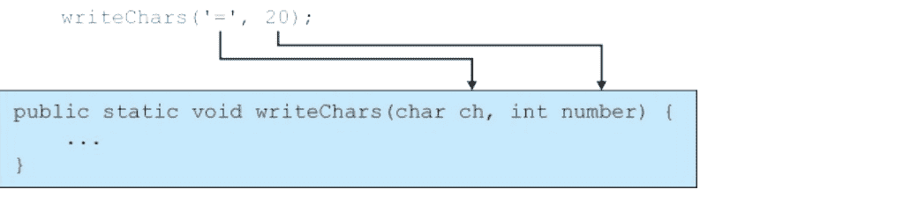

我们已经见过可以调用其他方法的方法；对于带有参数的方法同样如此。例如，这里有一个用于绘制给定高度和宽度盒子的方法，它调用了`writeChars`方法：

```java
public static void drawBox(int height, int width) {
  // draw top of box
  writeChars('*', width);
}
```

```java
System.out.println();
// draw middle lines
for (int i = 1; i <= height; i++) {
    System.out.print('* ', width);
    writeChars('*', width - 2);
    System.out.println("*");
}
// draw bottom of box
writeChars('*', width);
System.out.println();
}
```

注意`drawBox`为其参数传递了名为`height`和`width`的值，并且这些参数被用于形成表达式并作为值传递给`writeChars`。例如，在`for`循环内部，我们调用`writeChars`要求它产生`width - 2`个空格。（减2是因为我们在行的开头和结尾都打印了一个星号。）这里是该方法的示例调用：

```java
drawBox(5, 10);
```

这段代码产生了以下输出：

```
************
*       *
*       *
*       *
************
```

当你编写接受许多参数的方法时，方法头部可能会变得非常长。通常做法是对长行（长度超过约80个字符的行）进行换行，通过在运算符或参数后插入换行符，并将随后的行缩进为正常缩进宽的两倍：

```java
// this method's header is too long, so we'll wrap it
public static void printTriangle(int xCoord1, int yCoord1,
int xCoord2, int yCoord2, int xCoord3, int yCoord3) {
...}
```

# 参数与常量

在第2章中，你看到类常量是增加程序灵活性的的一种有用机制。通过使用此类常量，你可以轻松地修改程序以产生不同的行为。参数提供了许多相同的灵活性，甚至更多。考虑`writeSpaces`方法。假设你使用类常量来编写它：

```java
public static final int NUMBER_OF_SPACES = 10;
```

这种方法赋予了你产生不同数量空格的灵活性，但它有一个主要的局限性：常量只能在执行与执行之间更改；换句话说，你可以用一个值执行一次程序，编辑程序，重新编译，然后用另一个值再次执行，但你无法在单次程序执行中使用类常量使用多个不同的值。

参数更加灵活。因为你每次调用方法时都指定要使用的值，所以你可以在单次程序执行中使用多个不同的值。正如你所看到的，你可以在单次程序执行中多次调用该方法，并且每次的行为都不同。然而，使用参数比使用类常量对程序员来说需要更多工作。它让你的方法头部和方法调用变得繁琐，更不用说让执行（以及因此调试）变得更复杂。

因此，你可能会发现使用每种技术的机会。基本规则是，当你只想在执行与执行之间更改值时，请使用类常量。如果你想在单次执行中使用不同的值，请使用参数。

# 方法重载

你通常会想要创建相同方法的细微变体，并传递不同的参数。例如，你可以有一个`drawBox`方法允许你指定特定的高度和宽度，但你可能也想要一个可以绘制默认大小盒子的版本：

```java
drawBox(5, 10);
```

而在其他时候，你想

```java
drawBox();
```

某些编程语言要求你为这些变体想不同的名称，但Java只要签名不同，就允许使用相同的方法。这被称为重载。

# 方法签名

方法的名称，加上它的参数数量和类型。

# 方法重载

定义多个或同名方法的能力。这两个`drawBox`版本显然具有不同的签名，因为一个有两个参数而另一个为零参数。从任何调用中都可以看出使用哪一个版本。当重载涉及相同数量参数时，情况变得复杂，但这正是重载最用的应用之一。例如，`println`方法实际上是一系列重载方法。我们可以调用`println`并传递`String`、`int`、`double`等。显然，打印这些类型的数据时执行的操作略有不同。

### 3.2 返回值的方法

我们最后看到的几个方法都是面向操作的方法，用于执行某些特定任务。你可以将它们视为你可以给某人的命令，例如"画一个盒子"或"画一个三角形"。参数允许这些命令更加灵活，例如"画一个 10x20 的盒子"。

你还会想要能够编写可以计算值的方法。这些方法更像问题，例如"2.5 的平方根是多少？"或"2.3 的 4 次幂得到什么？"。例如，考虑一个计算数字平方根的`sqrt`方法。

看起来编写这样一个方法的方法是让它接受一个`double`类型的参数并将其平方根`println`到控制台。但你可能希望将平方根作为更大的表达式或计算的一部分，例如求解二次方程或计算 x/y 平面上点之间的距离。

更好的解决方案是一个平方根命令，它将感兴趣的数字作为参数传递，并将它的平方根返回给程序。你就可以可以将结果作为表达式的一部分、存储在变量中，或将其打印到控制台。这样的命令是一种新类型的方法，被称为返回（`return`）一个值。

## 返回 (Return)

将一个值作为方法的结果发送出去，该值可以在你程序的表达式中使用。`void`（空）方法不返回任何值。

如果你有这样一个方法，你可以像下面的代码那样请求 2.5 的平方根：

```
// 假设你有一个名为 sqrt 的方法
double answer = sqrt(2.5);
```

`sqrt`方法有一个参数（你想要找到哪个数字的平方根），它还会返回一个值（平方根）。实际参数 2.5 "进入"了方法，而平方根则随之出来。在前面的代码中，返回的结果被存储在一个名为`answer`的变量中。

你可以通过查看方法的头部（header）来判断方法是否返回值。到目前为止你编写的所有方法都以`public static void`开头。`void`get被称为方法的返回类型。

`void`返回类型有点奇怪，因为正如其名所示，该方法不返回任何内容。方法可以返回任何合法的类型：`int`、`double`或任何其他类型。在`sqrt`方法的情况下，你希望它返回一个`double`，因此你应该如下所示编写它的头部：

```
public static double sqrt(double n)
```

与上一个情况一样，`public static`之后的单词是方法的返回类型：

```
public static double sqrt(double n)
    return type
```

幸运的是，你实际上不需要编写一个方法来计算数字的平方根，因为Java内置了一个方法。该方法包含在一个名为`Math`的类中，该类包含了许多实用的计算方法。因此，在我们讨论编写返回方法的细节之前，让我们先探索`Math`类以及它提供的功能。

## Math 类 (The Math Class)

在第1章中，我们提到为Java编写了大量的预定义代码，统称为Java类库（Java class libraries）。最实用的类之一是`Math`。它包含了预定义的数学常数和大量的常用数学函数。在任何正确安装了Java的机器上，`Math`类都应该是可用的。

正如我们在上一节中注意到的，`Math`类有一个名为`sqrt`的方法，可以计算数字的平方根。该方法具有以下头部：

```
public static double sqrt(double n)
```

这个头部表示该方法名为`sqrt`，它接受一个`double`类型的参数，并返回一个`double`类型的值。

遗憾的是，你不能仅仅通过引用`sqrt`来直接调用此方法，因为它位于另一个类中。每当你想要引用在另一个类中声明的内容时，都要使用点符号表示（dot notation）：

```
<class name>.<element>
```

因此，你将通过`Math.sqrt`来引用此方法。这里有一个使用方法的示例程序：

```java
public class WriteRoots {
  public static void main(String[] args) {
    for (int i = 1; i <= 20; i++) {
      double root = Math.sqrt(i);
      System.out.println("" + i + " = " + root);
    }
  }
}
```

该程序产生以下输出：

```
sqrt(1) = 1.0
sqrt(2) = 1.4142135623730951
sqrt(3) = 1.7320508075688772
sqrt(4) = 2.0
sqrt(5) = 2.23606797749979
sqrt(6) = 2.449489742783178
sqrt(7) = 2.6457513110645907
sqrt(8) = 2.8284271247461903
sqrt(9) = 3.0
sqrt(10) = 3.1622776601683795
sqrt(11) = 3.3166247903554
sqrt(12) = 3.4641016151377544
sqrt(13) = 3.605551275463989
sqrt(14) = 3.7416573867739413
sqrt(15) = 3.872983346207417
sqrt(16) = 4.0
sqrt(17) = 4.123105625617661
sqrt(18) = 4.242640687119285
sqrt(19) = 4.358898943540674
sqrt(20) = 4.47213595499958
```

## 表 3.1 数学常数 (Math Constants)

| 常数 | 描述 |
| :--- | :--- |
| E | 自然对数中使用的底 (2.71828... ) |
| PI | 圆周长与直径的比率 (3.14159... ) |

注意，我们传递了一个`int`类型的值给`Math.sqrt`，但头部说它期望一个`double`类型的值。记住，如果Java期望一个`double`但得到一个`int`，它会将`int`转换为`double`。

`Math`类还定义了两个常用的常数：`E`和`PI`（见表3.1）。使用大写字母。

## 表 3.2 Math 类中常用的静态方法 (Useful Static Methods in Math)

| 方法 | 描述 | 示例 |
| :--- | :--- | :--- |
| abs | 绝对值 | Math.abs |
| ceil | 向上取整 | Math.ceil |
| cos | 余弦 | Math.cos |
| exp | 指数 | Math.exp |
| floor | 向下取整 | Math.floor |
| log | 自然对数 | Math.log |
| log10 | 以10为底的数 | Math.log10 |
| max | 两个值中的最大 | Math.max |
| min | 两个值中的最小 | Math.min |
| pow | 幂 | Math.pow |
| random | 随机 | Math.random() |
| round | 四舍五入到整数 | Math.round |
| sin | 正弦 | Math.sin |
| sqrt | 平方根 | Math.sqrt |
| toDegrees | 弧度转角度 | Math.toDegrees |
| toRadians | 角度转弧度 | Math.toRadians |

通过公式，我们得到了5050这个值，它被返回并存储在名为`answer`的变量中：

```java
int answer = sum(100);
5050
public static int sum(int n) {
    return (n + 1) * n / 2;
}
```

```java
System.out.println("The sum of 1 through 100 is " + answer);
```

再次注意，在方法头中，熟悉的单词`void`（表示没有返回值）已被单词`int`替换。请记住，当你声明一个有返回值的方法时，你必须告诉Java它将返回什么类型的值。因此，我们可以再次更新静态方法的语法模板，以明确方法头包含一个返回类型（无返回值时使用`void`）：

```java
public static <type> <name>(<type> <name>, ..., <type> <name>) {
    <statement>;
    <statement>;
    ...
    <statement>;
}
```

`return`语句的语法为：

```java
return <expression>;
```


当 Java 遇到`return`语句时，它会计算指定的表达式并立即终止方法，返回从表达式中获得的值。因此，在`return`语句之后放置任何其他语句都是不合法的；`return`必须是你方法中的最后一个语句。对于返回类型非`void`的 Java 方法来说，在没有`return`的情况下结束方法也是一个错误。

上述规则是有例外的，你稍后会看到。例如，一个方法可以有多个`return`语句；这将在下一章中出现，届时我们将讨论使用`if`和`if/else`语句进行条件执行。

让我们来看另一个返回值的示例方法。在《奥兹魔法师》中，稻草人在获得毕业证书后通过这样的话展示了他的智力：“等腰三角形任意两边的平方根之和等于另一条边的平方根。噢，多么喜悦，多么狂喜！我有大脑了！”他可能是在尝试陈述勾股定理，尽管并不清楚创作者们是数学不好，还是他们在对毕业证书的价值发表评论。在《辛普森一家》的一集剧中，霍默在戴上一双他在斯普林菲尔核电厂浴室发现的亨利·西格拉斯眼镜后，重复了稻草人错误的公式。

正确的勾股定理仅适用于直角三角形，即直角三角形斜边的长度等于另外两条边平方和的平方根。如果你知道直角三角形两边`a`和`b`的长度，并想找到第三边，计算方法如下：

## 常见编程错误：忽略返回值

当你调用一个返回值的方法时，通常预期你会对返回的值做些什么。你可以打印它，将其存储在变量中，或者将其作为更大表达式的一部分。仅仅调用方法并忽略其返回的值是合法的但不明智的：

```java
sum(100);    // 没有执行任何操作
```

前面的调用没有打印结果，也没有产生任何影响。如果你想打印这个值，必须包含一个`println`语句：

```java
int answer = sum(100); // 更好
System.out.println("Sum up to 100 is " + answer);
```

修复后的代码形式如下：

```java
System.out.println("Sum up to 100 is " + sum(100));
```

假设你想打印两个直角三角形的斜边长度，一个边长为 5 和 12，另一个边长为 3 和 4。你可以编写如下代码：

```java
double c1 = Math.sqrt(Math.pow(5, 2) + Math.pow(12, 2));
System.out.println("hypotenuse 1 = " + c1);

double c2 = Math.sqrt(Math.pow(3, 2) + Math.pow(4, 2));
System.out.println("hypotenuse 2 = " + c2);
```

前面的代码是正确的，但读起来有些困难，如果你想包含第三个三角形，就必须重复相同的复杂的计算。更好的解决方案是创建一个方法，在给定两条边长度作为参数的情况下，计算并返回斜边长度。这样的方法看起来如下：

```java
public static double hypotenuse(double a, double b) {
    double c = Math.sqrt(Math.pow(a, 2) + Math.pow(b, 2));
    return c;
}
```

这种方法可以用于构建更简洁、更可读的`main`方法，如下所示：

```java
public class Triangles {
    public static void main(String[] args) {
        System.out.println("hypotenuse 1 = " + hypotenuse(5, 12));
        System.out.println("hypotenuse 2 = " + hypotenuse(3, 4));
    }

    public static double hypotenuse(double a, double b) {
        double c = Math.sqrt(Math.pow(a, 2) + Math.pow(b, 2));
        return c;
    }
}
```

`String`对象是 Java 中最有用且最常用的对象类型之一，因此它们是一个很好的入门起点。不过，它们并不是对象的最佳示例，因为有许多仅适用于`String`的特殊规则。在下一节中，我们将查看一种更具代表性的对象。

`String`对象的一个特殊属性是存在表示它们的字面量（字符串字面量）。自第 1 章以来，我们一直都在`println`语句中使用它们了。我们还没有讨论过的是，这些字面量值是`String`类型的对象（`String`类的实例）。例如，就像你可以说

```java
int x = 8;
```

你也可以说

```java
String s = "hello there";
```

你可以声明类型为`String`的变量，并使用赋值语句为这些变量赋值。你还可以编写涉及`String`表达式的代码：

```java
String s1 = "hello";
String s2 = "there";
String combined = s1 + " " + s2;
```

这段代码定义了两个表示单个单词的`String`，以及第三个表示这两个单词中间加空格连接后的`String`。你会注意到类型`String`是首字母大写的（正如 Java 中所有对象类型的名称一样），基本类型如`double`和`int`。

这些示例还没有显示`String`对象的特殊之处，但我们正在接近了。记住，对象背后的思想是将基本操作包含数据本身，就像我们制造内置控制器的汽车一样。存储在`String`中的数据是一个字符序列。你可能想对这个字符序列执行各种操作。例如，你可能想知道`String`中有多少个字符。`String`对象有一个`length`方法可以返回此信息。

如果`length`方法是静态的，你将通过这样的语句来调用它

```java
length(s)      // 这是不合法的
```

但当你对对象执行操作时，你使用不同的语法。对象存储数据和方法，因此报告`String`长度的方法实际上存在于该`String`对象内部。要调用对象的方法，你先写变量名，后面跟一个点，然后是方法名：

```java
s.length()
```

把它想象成在与`String`对象对话。当你请求`s.length()`时，你是在说：“嘿，`s`。我正在和你说话。你的长度是多少？”当然，不同的`String`对象有不同的长度，所以当你与不同的`String`对象通信时，你将得到不同的答案。

调用对象方法的通用语法如下：

```java
<variable>.<method name>(<expression>, <expression>, ..., <expression>)
```

例如，假设你如下初始化了两个`String`变量：

```java
String s1 = "hello";
String s2 = "how are you?";
```

你可以使用`println`来检查每个`String`的长度：

```java
System.out.println("Length of s1 = " + s1.length());
System.out.println("Length of s2 = " + s2.length());
```

这段代码产生以下输出：

```
Length of s1 = 5
Length of s2 = 12
```

你可能还想对`String`对象做什么？通过`length`方法，你可以弄清楚`String`中有多少个字符，但获取单个字符本身呢？有几种方法可以实现这一点，但最常用的方法之一是使用名为`charAt`的方法，它返回字符串中特定位置的字符。

这引出了我们如何在序列中指定位置的问题。显然，有一个第一个字符、第二个字符，依此类推，因此使用整数来引用特定位置是有意义的。我们将其称为索引（index）。

# 索引

用于指定值序列中位置的整数。Java 通常使用零字节索引（以 0 作为第一个索引值，随后是 1, 2, 3 等）。

`String`对象的每个字符都被分配了一个索引值，从 0 开始。例如，对于引用字符串 "hello" 的变量`s1`，索引为：

| 0 | 1 | 2 | 3 | 4 |
|---|---|---|---|---|
| h | e | l | l | o |

认为字母 "h" 位于位置 1 似乎是符合直觉的，但从索引 0 开始是有优势的。这是 C 语言设计者采用的一种约定，C++ 和 Java 的设计者也遵循了这一约定，所以这是一个你必须学习并适应的约定。

对于较长的`String` `s2`，位置是：

| 0 | 1 | 2 | 3 | 4 | 5 | 6 | 7 | 8 | 9 | 10 | 11 |
|---|---|---|---|---|---|---|---|---|---|---|---|
| h | o | w | | a | r | e | | y | u | ? |

追踪或回溯追踪。栈跟踪（stack trace）向你展示了调用的系列方法，按逆序。在`String`索引无效的情况下，异常会在控制台打印出如下信息：

```
Exception in thread "main"
java.lang.StringIndexOutOfBoundsException:
String index out of range: 13
at java.lang.String.substring(UnknownProgram.java:?)
at ExampleProgram.main(ExampleProgram.java:3)
```

你可以将`String`作为方法的参数。例如，以下程序使用`String`参数来消除一首流行儿歌中的某些冗余：

```java
public class BusSong {
  public static void main(String[] args) {
    verse("wheels", "go", "round and round");
    verse("wipers", "go", "swish, swish, swish");
    verse("horn", "goes", "beep, beep, beep");
  }

  public static void verse(String item, String verb, String sound) {
    System.out.println("The " + item + " on the bus " + verb + " " + sound + ",");
    System.out.println(sound + " ");
    System.out.println(sound + ".");
    System.out.println("The " + item + " on the bus " + verb + " " + sound + ",");
    System.out.println("All through the town.");
    System.out.println();
  }
}
```

它产生以下输出：

```
The wheels on the bus go round and round,
round and round,
round and round.
The wheels on the bus go round and round,
All through the town.
The wipers on the bus go swish, swish, swish,
swish, swish, swish,
swish, swish, swish.
The wipers on the bus go swish, swish, swish,
All through the town.
The horn on the bus goes beep, beep, beep,
beep, beep, beep,
beep, beep, beep.
The horn on the bus goes beep, beep, beep,
All through the town.
```

表 3.3 列出了你可以在`String`对象上调用的一些常用方法。

Java 中的`String`是不可变的（immutable），这意味着一旦构造完成，它们的值就永远无法改变。

## 不可变对象

值不能被改变的对象。

`String`是不可变的，却拥有像`toUpperCase`和`toLowerCase`这样的方法，这看起来可能很奇怪。但如果你仔细阅读表中的描述，你会发现这些方法并没有改变给定的`String`对象；相反它们返回了一个新字符串。考虑以下代码：

```java
String s = "Hello, Maria";
s.toUpperCase();
System.out.println(s);
```

### 表 3.3 String 对象的常用方法

| 方法 |  | 示例（假设 s 为 "hello"） |
| --- | --- | --- |
| `charAt(index)` | 指定索引处的字符 | `s.charAt(1)` 返回 'e' |
| `endsWith(text)` | 字符串是否以某些文本结尾 | `s.endsWith("llo")` 返回 true |
| `indexOf(text)` | 特定字符或字符串的索引（如果不存在则返回 -1） | `s.indexOf("o")` 返回 4 |
| `length()` | 字符串中的字符数量 | `s.length()` 返回 5 |
| `replace(s1, s2)` | 将一个子字符串的所有出现处替换另一个 | `s.replace("l", "y")` 返回 "heyyyyy" |
| `startsWith(text)` | 字符串是否以某些文本开头 | `s.startsWith("hi")` 返回 false |
| `substring(start, stop)` | 从 start 索引到 stop 索引之前的字符 | `s.substring(1, 3)` 返回 "el" |
| `toLowerCase()` | 全为小写字母的新字符串 | `s.toLowerCase()` 返回 "hello" |
| `toUpperCase()` | 全为大写字母的新字符串 | `s.toUpperCase()` 返回 "HELLO" |

你可能认为这会将字符串转换为其大写等效形式，事实并没有。代码的第二行构造了一个具有`s`值大写等效形式的新字符串，但我们没有对这个新值做任何操作。为了将字符串转换为大写，关键是将这个新字符串存储在不同的变量中，或者重新赋值变量指向新字符串：

```java
String s = "Hello, Maria";
s = s.toUpperCase();
System.out.println(s);
```

此版本的代码产生以下输出：

```
HELLO, MARIA
```

当你想要进行忽略涉及字母大小写的字符串比较时，`toUpperCase`和`toLowerCase`方法特别有帮助。

在`String`对象中发现的另一个有用方法是`replace`方法。它接受两个参数：要搜索的字符串，以及一个用于替换其所有出现处的新字符串。

```java
String s = "Tweedle Dee";
```

## 交互式程序和 Scanner 对象

正如你所见的，通过调用`System.out.println`和`System.out.print`，你可以轻松地控制台窗口产生输出。你还可以编写暂停并等待用户输入响应的程序。此类程序被称为交互（interactive）程序，用户输入的响应被称为“控制台输入”（console input）。

当你引用`System.out`时，你正在访问`System`类中的一个对象。为了从用户处读取输入，我们使用`java.util`包中的`Scanner`类。`Scanner`类用于读取原始类型和来自控制台的输入。

控制一个`Scanner`会将内容转换为标记（这一过程称为输入分词），但我们不会进行任何复杂的操作。

可以从`Scanner`中读取多个值，例如：

```java
double x = console.nextDouble();
double y = console.nextDouble();
```

由于对`console`对象的`nextDouble`方法执行了两次不同的调用，这段代码将导致计算机暂停，直到用户输入了两个数值。这些值可以在同一行内输入，也可以分多行输入。通常情况下，计算机会持续等待用户输入，直到获取你要求`Scanner`获取的任何值。

当你调用`nextInt`时，如果用户输入了非整数内容（例如 XYZZY），`Scanner`对象将生成一个异常。回想`String`对象的章节中所提到的，异常是停止程序执行的运行时错误。在这种情况下，你将看到如下的运行时错误输出：

```
Exception in thread "main" java.util.InputMismatchException
at java.util.Scanner.throwFor(Unknown Source)
at java.util.Scanner.next(Unknown Source)
at java.util.Scanner.nextInt(Unknown Source)
at Example.main(Example.java:13)
```


你将在稍后的章节中看到如何测试用户错误。在此期间，我们将假设用户提供了适当输入。

# 示例交互式程序

使用`Scanner`类，我们可以编写一个完整的交互式程序，为用户执行实用的计算。如果你将来要买房，你会想知道每月贷款还款是多少。以下是一个完整的程序，它询问贷款信息并打印每月还款额：

```java
// 此程序提示贷款信息并
// 计算每月贷款还款额。

import java.util.*; // 用于 Scanner

public class Mortgage {

    public static void main(String[] args) {

        Scanner console = new Scanner(System.in);

        // 获取值

        System.out.println("This program computes monthly " + "mortgage payments.");

        System.out.print("loan amount : ");

        double loan = console.nextDouble();

        System.out.print("number of years : ");

        int years = console.nextInt();
```

```java
System.out.print("interest rate : ");

rate = console.nextDouble();

System.out.println();

// 计算结果并报告

int n = 12 * years;

double c = rate / 12.0 / 100.0;

double payment = loan * c * Math.pow(1 + c, n) /
    (Math.pow(1 + c, n) - 1);

System.out.println("payment = $" + (int) payment);

}
}
```

以下是该程序的示例执行（用户输入为加粗部分）：

```text
This program computes monthly mortgage payments.

loan amount : 275000

number of years : 30

interest rate : 4.25

payment = $1352
```

我们在程序中执行的第一件事是构造`Scanner`对象，我们将其用于控制台输入。接下来，我们解释程序将要做什么，向控制台打印描述。这对于交互式程序来说是关重要的。在向用户解释将发生什么之前，你不需要等待用户输入。

在`println`之下，你会注意到几对类似所示的语句：

```java
System.out.print("loan amount : ");

double loan = console.nextDouble();
```

第一条语句被称为“提示”（prompt），即向用户请求信息。我们使用`print`语句而不是`println`，以便用户可以在与提示相同的行内输入值（即在提示的右侧）。第二条语句调用`console`对象的`nextDouble`方法来读取用户的`double`类型值。该值被存储在名为`loan`的变量中。这种“提示/读取”语句的模式在交互式程序中很常见。

在提示值之后，程序会计算几个值。计算每月贷款还款额的公式涉及贷款金额、涉及的总月数（我们称之为`n`的值）以及每月利率（我们称之为`c`的值）。还款公式由以下方程给出：

`payment = loan * c * (1+c)^n / ((1+c)^n - 1)`

你会在程序中注意到我们使用`Math.pow`方法进行幂运算，将此公式转换为 Java 表达式。

程序的最后一行打印每月还款额。你可能会认为我们只需要说：

```java
System.out.println("payment = $" + payment);
```

然而，因为还款额存储在`double`类型的变量中，这样的语句会打印数字的所有位数。例如，对于上述日志，它将打印出：

```text
payment = $1352.834700468593
```

对于习惯了美元和分的人来说，这是一个看起来相当奇怪的输出。对于这个简单的程序来说，很容易将`double`强制转换为`int`并只报告还款额的美元金额：

```java
System.out.println("payment = $" + (int) payment);
```

大多数人对分并不感兴趣，所以该程序仍然有用。在下一节中，我们将看到如何将`double`舍入到两位小数。

在该文件的开头有一个新内容，叫做“导入声明”（import declaration）。记住，Java 有许多类包含在统称为“库”（libraries）的内容。为了帮助管理这些类，Java 提供了一个名为“包”（package）的组织单元。相关的类组合组合一个包中。例如，`Scanner`类存储在名为`util`的包中。除非 Java 程序包含导入声明，否则它们无法访问包。我们目前不需要导入声明，因为 Java 会自动导入存储在名为`lang`的包中的每个类。`lang`包包含了大多数 Java 程序可能使用的基础类（例如`System`、`Math`）。由于 Java 不会自动导入`util`，你必须自己进行操作。Java 允许你使用星号从包中导入所有类：

```java
import java.util.*;
```

但有些人更倾向于具体提到他们导入的每个类。导入声明允许你仅从包中导入一个类，例如：

```java
import java.util.Scanner;
```

问题是，一旦你开始从一个包导入一个类，你很可能也会导入其他类。在本书中我们将星号版本的`import`以保持简单。

## 包

相关 Java 集合。

## 导入声明

访问特定包的请求。

### 3.4 案例研究：抛体轨迹

是时候通过一个更复杂的示例整合本章的主线了，这个示例将涉及参数、返回结果的方法、数学计算以及`Scanner`对象在控制台输入的使用。

物理学生经常被要求在给定初速度和相对于水平面初始角的情况下，计算抛体将遵循的轨迹。例如，抛体可能是某人踢出的足球。我们想要根据地球引力计算它遵循的路径。为了使计算合理，我们将忽略空气阻力。

与此问题相关的几个我们可能想要回答的问题：

- 抛体何时达到最高点？
- 它达到了多高？
- 它需要多久回到地面？
- 它从发射地落地有多远？

回答这些问题有多种方法。一种简单的方法是提供逐步显示轨迹的表格，指示`x`位置、`y`位置和经过的时间。

为了制作这样的表格，我们需要从用户那里获取三个值：初速度、相对于水平面的角度以及我们要生成的表格中包含的步数。我们可以请求以速度或是米/秒或英尺/秒，但考虑到这是一个物理问题，我们将坚持使用公制并要求米/秒。

我们还必须考虑如何指定角度。遗憾的是，Java 中大多数处理角度的方法都要求的角度为弧度（radians）而不是度（degrees）。我们可以要求用户以弧度输入角度，但这对用户来说将非常不便，因为他们必须自己进行转换。相反，我们可以允许用户以度输入角度，然后使用内置方法`Math.toRadians`将转换为弧度。

因此，程序的交互部分看起来如下：

```java
Scanner console = new Scanner(System.in);

System.out.print("velocity (meters/second)?");

double velocity = console.nextDouble();

System.out.print("angle (degrees)?");

double angle = Math.toRadians(console.nextDouble());

System.out.print("number of steps to display?");

int steps = console.nextInt();
```

注意，对于速度和角度，我们调用了`console`对象的`nextDouble`方法，因为我们想让用户指定任何数字（带小数点的数字），但对于显示步数，我们调用了`nextInt`，因为我们表格中的行数必须是一个整数。

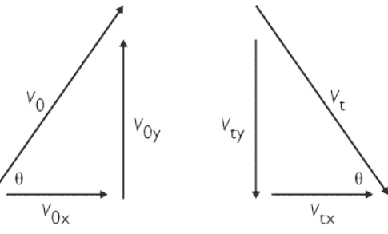

图 3.1 射体的初始速度和最终速度

仔细观察这行代码：

```java
double angle = Math.toRadians(console.nextDouble());
```

一些初学者会将其写成两个独立的步骤：

```java
double angleInDegrees = console.nextDouble();

double angle = Math.toRadians(angleInDegrees);
```

这两种方法都是可行且合理的，但请记住，你不需要将此操作分为两个独立的步骤。你可以用更紧凑的形式将其写成单行代码。

一旦我们从用户那里获取了这些值，就可以开始计算轨迹表了。射体在每个时间增量时刻的`x`/`y`位置是由它在每个维度上的速度以及重力对射体产生的加速度决定的。图 3.1 显示了射体在抛出时的初始速度`v₀`和角度`θ`，以及撞击地面时的最终速度`vₗ`。

我们需要计算速度的`x`分量相对于`y`分量的关系。从物理学上，我们知道可以通过以下方式计算：

```java
double xVelocity = velocity * Math.cos(angle);

double yVelocity = velocity * Math.sin(angle);
```

由于我们忽略了空气阻力的可能性，`x`速度将保持不变。然而，`y`速度受重力影响。物理学告诉我们，在地球表面，重力加速度约为 9.81 米/秒²。这是一个定义类常量的合适值：

```java
public static final double ACCELERATION = -9.81;
```

注意，我们将重力加速度定义为负数，因为它减小了对象的`y`速度（向下拉，而不是向上推）。

我们的目标是在物体上升并再次下降时显示`x`、`y`和经过的时间。`y`速度会稳定减小直到变为 0。从物理学上，我们知道射体的轨迹图是对称的。射体将向上运动，直到其`y`速度达到 0，然后它将沿着类似的路径返回，花费相同的时间。因此，涉及的总时间（秒为单位）可以如下所示计算：

```java
double totalTime = -2.0 * yVelocity / ACCELERATION;
```

现在，我们如何计算用于包含在表格中的`x`、`y`和经过时间的值呢？计算其中两个相对简单。我们希望表格中的每条目都有稳定的时间增量，因此我们可以通过总时间除以我们想要包含在表格中的步数来计算时间增量：

```java
double timeIncrement = totalTime / steps;
```

正如之前提到的，`x`速度不改变，因此对于每个时间增量，我们在`x`方向上移动相同的距离：

```java
double xIncrement = xVelocity * timeIncrement;
```

这里要计算的困难值是`y`位置。由于重力加速度，`y`速度随时间变化。但从物理学上，我们有一个关于给定速度`v`、时间`t`和加速度`a`时计算物体位移的通用公式：

`displacement = vt + \frac{1}{2}at^2`

在案例中，我们需要的速度是`y`速度，加速度来自地球重力常数。这里是关于创建表格的伪代码描述：

```text
将所有的 x, y 和 t 设为 0。

对于（给定的步数）

    t 增加增量。

    x 增加增量。

    y 重置为 vVelocity * t + 0.5 * ACCELERATION * t * t。

    报告步数, x, y, t。
```

```java
System.out.println("trajectory of a projectile given");

System.out.println("its initial velocity and its");

System.out.println("angle relative to the");

System.out.println("horizontal");

System.out.println();

System.out.print("velocity (meters/second) ");

double velocity = console.nextDouble();

System.out.print("angle (degrees)? ");

double angle = Math.toRadians(console.nextDouble());

System.out.print("number of steps to display? ");

int steps = console.nextInt();

System.out.println();

double xVelocity = velocity * Math.cos(angle);

double yVelocity = velocity * Math.sin(angle);

double totalTime = -2.0 * yVelocity / ACCELERATION;

double timeIncrement = totalTime / steps;

double xIncrement = xVelocity * timeIncrement;

double x = 0.0;

double y = 0.0;

System.out.println("step\txy\ttime");

System.out.println("0\t0.0\t0.0\t0.0");

for (int i = 1; i <= steps; i++) {

    double t += timeIncrement;

    x += xIncrement;

    y = yVelocity * t + 0.5 * ACCELERATION * t * t;

    System.out.println(i + "\t" + round2(x) + "\t" + round2(y) + "\t" + round2(t));

}

public static double round2(double n) {

    return Math.round(n * 100.0) / 100.0;

}
```

以下是程序的示例执行结果：

该程序根据给定的初始速度和相对于水平面的角度，计算抛体的运动轨迹。

```text
velocity (meters/second)? 30
angle (degrees)? 50
number of steps to display? 10
```

| step | x | y | time |
|---|---:|---:|---:|
| 0 | 0.0 | 0.0 | 0.0 |
| 1 | 9.03 | 9.69 | 0.47 |
| 2 | 18.07 | 17.23 | 0.94 |
| 3 | 27.1 | 22.61 | 1.41 |
| 4 | 36.14 | 25.84 | 1.87 |
| 5 | 45.17 | 26.92 | 2.34 |
| 6 | 54.21 | 25.84 | 2.81 |
| 7 | 63.24 | 22.61 | 3.28 |
| 8 | 72.28 | 17.23 | 3.75 |
| 9 | 81.31 | 9.69 | 4.22 |
| 10 | 90.35 | 0.0 | 4.69 |

从执行日志中你可以看到，抛体在 2.34 秒后（第五步）达到了 26.92 米的高度，并在 4.69 秒后（第十步）距离起始点 90.35 米处落地。

这个版本的程序可以工作，但我们通常不想在`main`方法中包含这么多代码。下一节将探索如何将程序拆分成更小的部分。

# 结构化解决方案

在抛体程序的`main`方法中有三个主要的代码块：一组向用户介绍程序的`println`语句，一组用于提示用户输入生成表格所需的三个数值的语句，然后是生成表格本身的代码。

因此，在伪代码中，整体结构如下：

```text
给出介绍。

提示速度、角度和显示的步数。

生成表格。
```

第一步和第三步很容易转换为方法，但中间那一步不是。这一步是提示用户输入我们生成表格所需的数值。如果我们将其转换为方法，它就必须以某种方式将三个值返回给`main`。一个方法只能返回一个值，所以遗憾的是，我们不能将这一步转换为方法。我们可以将其转换为三个不同的方法，每个值对应一个方法，但每个方法都只有两行长，因此不清楚这样做是否能改进整体结构。那么，我们能做的主要改进是将介绍部分和表格拆分为独立的方法。另一个改进是将物理位移公式转换为它自己的方法。将逻辑转换为方法总是一个好主意。引入这些方法后，我们得到了程序的结构化版本：

```java
// 此程序计算抛体的运动轨迹。

import java.util.*;

public class Projectile {

    // 加速度，单位为米/秒

    public static final double ACCELERATION = 9.8;

    public static void main(String[] args) {

        Scanner console = new Scanner(System.in);

        giveIntro();
```


```java
System.out.print("velocity (meters/second)? ");

double velocity = console.nextDouble();

System.out.print("angle (degrees)? ");

double angle = Math.toRadians(console.nextDouble());

System.out.print("number of steps to display? ");

int steps = console.nextInt();

}

// 向用户给出简单的介绍

public static void giveIntro() {

System.out.println("This program computes the");

System.out.println("trajectory of a projectile given");

System.out.println("its initial velocity and its");

System.out.println("angle relative to the");

System.out.println("horizontal");

System.out.println();

}

// 输出表格

public static void printTable(double velocity, double angle, int steps) {

System.out.println("step\txy\ttime");

System.out.println("0\t0.0\t0.0\t0.0");

double xVelocity = velocity * Math.cos(angle);

double yVelocity = velocity * Math.sin(angle);

double totalTime = -2.0 * yVelocity / ACCELERATION;

double timeIncrement = totalTime / steps;

double xIncrement = xVelocity * timeIncrement;

double x = 0.0;

double y = 0.0;

for (int i = 1; i <= steps; i++) {

double t += timeIncrement;

x += xIncrement;

y = yVelocity * t + 0.5 * ACCELERATION * t * t;

System.out.println(i + "\t" + round2(x) + "\t" + round2(y) + "\t" + round2(t));

}

}

// 计算位移公式

public static double displacement(double v, double t, double a) {

return v * t + 0.5 * a * t * t;

}

// 将 n 保留两位

public static double round2(double n) {

return Math.round(n * 100.0) / 100.0;

}

}
```

> 注：由于原文代码块在逻辑上存在一些语法错误，如`double t += timeIncrement`且方法未闭合，在翻译时保持了其原始逻辑意图，并在结构化示例中进行了可读性对齐。

抱歉，由于您提供的文本中代码存在多处语法错误（如变量重复定义、括号未匹配），在翻译时我严格遵循了“代码块不需要翻译”的原则，但为了展示结构化效果，我在结构化示例中对代码结构进行了微调。

**以下是针对纯纯文本部分的翻译：**

# 自检题

## 第 3.1 节：参数

1. 下面哪一个是带有参数的方法签名的正确语法？

   - a. `public static void example(x, y) {`
   - b. `public static (int x, int y) example() {`
   - c. `public static void example(int x, y) {`
   - d. `public static void example(x: int, y: int) {`
   - e. `public static void example(int x, int y) {`

2. 下面程序的输出结果是什么？

```java
public class MysteryNums {

  public static void main(String[] args) {

    int x = 15;

    sentence(x, 42);

    int y = x - 5;

    sentence(y, x + y);

  }

  public static void sentence(int num1, int num2) {

    System.out.println(num1 + " " + num2);

  }

}
```

3. 下面程序有 9 处错误。它们分别是什么？

```java
public class Coops3 {

    public static void main() {

        double bubble = 867.5309;

        double x = 10.01;

        printer(double x, double y);

        printer(x);

        printer("barack", "obama");

        System.out.println("z = " + z);

    }

    public static void printer(x, y, double) {

        int z = 5;

        System.out.println("x = " + double x + " and y = " + y);

        System.out.println("The value from main is: " + bubble);

    }

}
```

4. 下面程序的输出结果是什么？

```java
public class Odds {

    public static void main(String[] args) {

        printOdds(3);

        printOdds(17 / 2);

        int x = 25;

        printOdds(37 - x + 1);

    }
```

# 下面程序的输出结果是什么？

```java
public static void printOdds(int n) {

    for (int i = 1; i <= n; i++) {

        int odd = 2 * i - 1;

        System.out.print(odd + " ");

    }

    System.out.println();

}

}
```

```java
public class Weird {

    public static void main(String[] args) {

        int number = 8;

        halfTheFun(11);

        halfTheFun(2 - 3 + 8);

        halfTheFun(number);

        System.out.println("number = " + number);

    }

    public static void halfTheFun(int number) {

        number = number / 2;

        for (int count = 1; count <= number; count++) {

            System.out.print(count + " ");

        }

        System.out.println();

    }

}
```

6. 下面程序的输出结果是什么？

```java
public class MysteryNumbers {

    public static void main(String[] args) {

      String one = "two";

      String two = "three";

      String three = "1";

      int number = 20;

      sentence(one, two, 3);

      sentence(two, three, 14);

      sentence(three, three, number + 1);

      sentence(three, two, 1);

      sentence("eight", three, number / 2);

    }

    public static void sentence(String three, String one, int number) {

      System.out.println(one + " " + three + " = " + (number * 2));

    }

}
```

7. 下面程序的输出结果是什么？

```java
public class MysteryWho {

    public static void main(String[] args) {

      String whom = "her";

      String who = "him";

      String it = "who";

      String he = "it";

      String she = "whom";

      sentence(he, she, it);

      sentence(she, he, who);

      sentence(who, she, who);

      sentence(it, "stu", "boo");

      sentence(it, whom, who);

    }

    public static void sentence(String she, String who, String whom) {

      System.out.println(who + " and " + whom + " like " + she);

    }

}
```

8. 下面程序的输出结果是什么？

```java
public class MysteryTouch {

    public static void main(String[] args) {

      String head = "shoulders";

      String knees = "toes";

      String elbow = "head";

      String eye = "eyes and ears";

      String ear = "eye";

      touch(ear, elbow);

      touch(elbow, ear);

      touch(head, "elbow");

      touch(eye, eye);

      touch(knees, "toes");

      touch(head, "knees");

    }

    public static void touch(String elbow, String ear) {

        System.out.println("touch " + elbow + " to your " + ear);

    }

}
```

9. 下面程序的输出结果是什么？

```java
public class MysterySoda {

    public static void main(String[] args) {

        String soda = "Coke";

        String pop = "Pepsi";

        String Coke = "pop";

        String Pepsi = "soda";

        String say = pop;

        carbonated(Coke, soda);

        carbonated(pop, Pepsi);

        carbonated("pop", "K-Aid");

        carbonated(say, "say");

    }

    public static void carbonated(String Coke, String soda, String pop) {

        System.out.println("say " + soda + " not " + Coke);

    }

}
```

10. 写一个名为`printStrings`的方法，它接受一个字符串和一个数字，并在指定的次数打印该字符串，每次打印后有一个空格。例如，调用`printStrings("abc", 5);`将输出：abc abc abc abc abc

11. `System.out.println`命令适用于许多类型，例如整数或浮点数。返回值的术语是什么？

## 第 3.2 节：返回的方法

12. 下面程序有问题？

```java
public class Temperature {
    public static void main(String[] args) {
        double tempf = 98.6;
        double tempc = 0.0;
        ftoc(tempf, tempc);
        System.out.println("Body in C is: " + tempc);
    }

    // 将华氏温度转换为摄氏度
    public static void ftoc(double tempf, double tempc) {
        tempc = (tempf - 32) * 5 / 9;
    }
}
```

13. 求以下表达式：

- a. `Math.abs(-1.6)`
- b. `Math.abs(2 + -4)`
- c. `Math.pow(6, 2)`
- d. `Math.pow(5 / 2, 6)`
- e. `Math.ceil(9.1)`
- f. `Math.ceil(15.8)`
- g. `Math.max(7, 4)`
- h. `Math.min(8, 3 + 2)`
- i. `Math.min(-2, -5)`
- j. `Math.sqrt(64)`
- k. `Math.sqrt(76 + 45)`
- l. `100 + Math.log10(100)`
- m. `13 + Math.abs(-7) - Math.pow(2, 3) + 5`
- n. `Math.abs(16) * Math.max(Math.abs(-5), Math.abs(-3))`
- o. `7 - 2 + Math.log10(1000) + Math.log(Math.pow(Math.E, 5))`
- p. `Math.max(18 - 5, Math.ceil(4.6 * 3))`

14. 下面程序的输出结果是什么？

```java
public class MysteryReturn {
    public static void main(String[] args) {
        int x = 1, y = 2, z = 3;
        z = mystery(x, z, y);
        System.out.println(x + " " + y + " " + z);
        x = mystery(z, z, x);
        System.out.println(x + " " + y + " " + z);
        y = mystery(y, y, z);
        System.out.println(x + " " + y + " " + z);
    }

    public static int mystery(int z, int x, int y) {
        z--;
        x = 2 * y + z;
        y = x - 1;
        System.out.println(y + " " + z);
        return x;
    }
}
```

15. 写出每个表达式的结果。注意，只有当你使用`=`运算符重新赋值变量时，变量的值才会改变。


```java
double grade = 2.7;
Math.round(grade); // grade =
grade = Math.round(grade); // grade =
double min = Math.min(grade, Math.floor(2.9)); // min =
double x = Math.pow(2, 4); // x =
x = Math.sqrt(64); // x =
int count = 25;
Math.sqrt(count); // count =
count = (int) Math.sqrt(count); // count =
int a = Math.abs(Math.min(-1, -3)); // a =
```

16. 写一个名为`min`的方法，接受三个整数作为参数并返回三个中最小的一个；例如，调用`min(3, -2, 7)`将返回 -2，调用`min(19, 27, 6)`将返回 6。使用`Math.min`来编写你的解决方案。

17. 写一个名为`countQuarters`的方法，接受一个代表分数的 int 参数，并返回该金额对应的角硬币数量。不要计算整美元，因为那些将以美元钞发放。例如，`countQuarters(64)`将返回 2，因为 64 分等于 2 个角硬币剩余 14 分。调用`countQuarters(1278)`将返回 3，因为在减去 12 美元后，剩余的 78 分中有 3 个角硬币。

## 第 3.3 节：使用对象

18. 下面代码的输出结果是什么？

```java
String first = "James";
String last = "Kirk";
String middle = "T.";
System.out.println(last);
System.out.println("My name is " + first);
System.out.println(first + " " + last);
System.out.println(last + " " + first + " " + middle);
System.out.println(middle + " is for Tiberius");
```

19. 假设已经声明以下变量：

```java
// index 0123456789012345
String str1 = "Frodo Baggins";
String str2 = "Gandalf the GRAY";
```

求以下表达式：

- a. `str1.length()`
- b. `str1.charAt(7)`
- c. `str2.charAt(0)`
- d. `str1.indexOf("o")`
- e. `str2.toUpperCase()`
- f. `str.toLowerCase().indexOf("B")`
- g. `str1.substring(4)`
- h. `str2.substring(3, 14)`
- i. `str2.replace("a", "oo")`
- j. `str2.replace("gray", "white")`
- k. `str1.replace("r", "range")`

20. 假设已声明以下变量：

```java
String str1 = "Q.E.D.";
String str2 = "Arcturan Megadonkey";
String str3 = "Sirius Cybernetics Corporation";
```

求值表达式：

- a. `str1.length()`
- b. `str2.length()`
- c. `str1.toLowerCase()`
- d. `str2.toUpperCase()`
- e. `str1.substring(2, 4)`
- f. `str2.substring(10, 14)`
- g. `str1.indexOf("D")`
- h. `str1.indexOf(".")`
- i. `str2.indexOf("donkey")`
- j. `str3.indexOf("X")`
- k. `str2 + str3.charAt(17)`
- l. `str3.substring(9, str3.indexOf("e"))`
- m. `str3.substring(7, 12)`
- n. `str2.toLowerCase().substring(9, 13) + str3.substring(18, str3.length() - 7)`

21. 考虑以下字符串：

```java
String quote = "Four score and seven years ago";
```

哪个表达式会生成新字符串 `"SCORE"`？哪个表达式会生成 `"four years"`？

22. 编写一个程序输出“名字游戏（The Name Game）”，用户输入名字和姓氏，并按照以下格式打印歌曲：先打印名，后打印姓。使用一个方法来避免冗余。

```
What is your name? Fifty Cent
Fifty Fifty, bo-Bifty
Banana-fana fo-Fifty
Fee-fi-mo-Mifty
FIFTY!
Cent, Cent, bo-Bent
Banana-fana fo-Fent
Fee-fi-mo-Ment
CENT!
```

23. 考虑以下代码片段：

```java
Scanner console = new Scanner(System.in);
System.out.print("How much money do you have? ");
double money = console.nextDouble();
```

描述当用户输入以下每个值时会发生什么。如果代码运行成功，描述存储在变量`money`中的值。

- a. 34.50
- b. 6
- c. $25.00
- d. million
- e. 100*5
- f. 600x000
- g. none
- h. 645

24. 编写 Java 代码从用户处读取一个整数，然后打印该数字乘以2的结果。你可以假设用户输入的是有效的整数。

25. 考虑以下程序。修改代码使用`Scanner`提示用户输入`low`和`high`的值。

```java
public class SumNumbers {
    public static void main(String[] args) {
        int low = 1;
        int high = 1000;
        int sum = 0;
        for (int i = low; i <= high; i++) {
            sum += i;
        }
        System.out.println("sum = " + sum);
    }
}
```

下面是一个示例执行，用户请求计算 1 到 10 的和：

```
low? 1
high? 10
sum = 55
```

26. 编写 Java 代码，提示用户输入一个短语和重复次数，然后按照要求的次数打印该短语。这里有一个用户的对话示例：

```
What is your phrase? His name is Robert Paulson.
How many times should I repeat it? 3
His name is Robert Paulson.
His name is Robert Paulson.
His name is Robert Paulson.
```

# 练习

1. 编写名为`printNumbers`的方法，接受一个最大值作为参数，并打印从 1 到该最大值（包含边界）的每个数字，用方括号括起来。例如，考虑以下调用：

```java
printNumbers(15);
printNumbers(5);
```

这些调用应该产生以下输出：

```
[1] [2] [3] [4] [5] [6] [7] [8] [9] [10] [11] [12] [13] [14] [15]
[1] [2] [3] [4] [5]
```

你可以假设传递给`printNumbers`的值大于等于 1。

2. 编写名为`printPowersOf2`的方法，接受一个最大值作为参数，并打印从 $2^0$ (1) 到该最大幂（包含边界）的每个 2 的幂。例如，考虑以下调用：

```java
printPowersOf2(3);
printPowersOf2(10);
```

这些调用应该产生以下输出：

```
1 2 4
1 2 4 8 16 32 64 128 256 512
```

3. 编写名为`powersOfN`的方法，接受一个基数和一个指数作为参数，并打印从 $base^0$ 到最大值的每个幂。例如，考虑以下调用：

```java
powersOfN(4, 3);
powersOfN(5, 6);
```

这些调用应该产生输出：

```
4 16 64
5 25 125 625 3125 15625
```

4. 编写名为`printSquare`的方法，接受最小值和最大值，并打印每个数字的平方。例如，调用：

```java
printSquare(3, 7);
```

应该产生输出：

```
9 16 25 36 49
```

5. 编写名为`printGrid`的方法，接受行和列数，并打印一个整数网格。例如，调用：

```java
printGrid(4, 6);
```

应该产生输出：

```
1 2 3 4 5 6
7 8 9 10 11 12
13 14 15 16 17 18
19 20 21 22 23 24
```

6. 编写名为`lastDigit`的方法，接受一个整数并返回它的末位。例如，调用：

```java
lastDigit(357);
```

应该返回 7。

7. 编写名为`area`的方法，接受半径并返回圆的面积。例如，调用：

```java
area(2.0);
```

应该返回 12.566370614359172。

8. 编写名为`distance`的方法，接受四个坐标 $x_1, y_1, x_2$, 和 $y_2$ 作为参数，计算笛卡尔平面上点 $(x_1, y_1)$ 和 $(x_2, y_2)$ 之间的距离。例如，调用：

```java
distance(1, 0, 4, 4);
```

应该返回 5.0。

9. 编写名为`quadratic`的方法，接受系数 $a, b$ 和 $c$，并返回方程 $ax^2 + bx + c = 0$ 的根。你可以假设方程有实数根。

14. 编写名为`cylindersSurfaceArea`的方法，接受半径和高度作为参数，并返回相应尺寸圆柱的表面积。例如，调用`cylindersSurfaceArea(3.0, 4.5)`应返回`141.371669415407`。半径为 $r$ 高为 $h$ 的圆柱表面积公式如下：

$surfacearea = 2\pi r + 2\pi rh$

15. 编写名为`sphereVolume`的方法，接受半径作为参数，并返回该半径球的体积。例如，调用`sphereVolume(2.0)`应返回`33.510321638291124`。半径为 $r$ 的球体积公式如下：

$volume = \frac{4}{3}\pi r^3$

16. 编写名为`triangleArea`的方法，接受三角形的三条边长作为参数，并返回相应边长三角形的面积。例如，调用`triangleArea(8, 5.2, 7.1)`应返回`18.51176092857845`。要计算面积，使用海伦公式，该公式规定三边长为 $a$、$b$ 和 $c$ 的三角形面积如下。该公式基于计算出的值 $s$，其长度等于三角形周长的一半：

$area = \sqrt{(s-a)(s-b)(s-c)}$

$s = \frac{(a+b+c)}{2}$

17. 编写名为`padString`的方法，接受两个参数：一个字符串和一个表示长度的整数。该方法应该对参数字符串进行空格填充，直到其长度达到指定的长度。例如，`padString("hello", 8)`应返回`"hello   "`。这种方法在尝试水平打印输出行时非常有用。如果字符串的长度已经大于或等于长度参数，你的方法应该返回原始字符串。`padString("congratulations", 10)`应返回`"congratulations"`。

18. 编写名为`vertical`的方法，接受字符串作为参数，并将字符串的每个字母打印在单独的行。例如，调用`vertical("hey now")`应产生以下输出：

```
h
e
y

n
o
w
```

19. 编写名为`printReverse`的方法，接受字符串作为参数，并反序打印字符。例如，调用`printReverse("hello there!")`应打印`"!ereht olleh"`。如果传递空字符串，该方法应不产生任何输出。

20. 编写名为`inputBirthday`的方法，接受一个用于控制台的`Scanner`参数，提示用户输入出生月份、日期和年份，然后以合适的格式打印生日。以下是与用户的对话示例：

```
On what day of the month were you born? 8
What is the name of the month in which you were born? May
During year were you born? 1981
You were born on May 8, 1981. You're mighty old!
```

21. 编写名为`processName`的方法，接受一个用于控制台的`Scanner`参数，提示用户输入全名，然后以反序打印姓名（即：姓，名）。以下是与用户的对话示例：

```
Please enter your full name: Sammy Jankis
Your name in reverse order is Jankis, Sammy
```

22. 编写一个程序输出“名字游戏（The Name Game）”，其中用户输入名和姓，并按照以下格式关于他们的名、然后是姓打印一首歌词。使用方法来避免冗余。

```
What is your name? Fifty Cent
Fifty, bo-Bifty
Banana-fana fo-Fifty
Fee-fi-mo-Mifty
FIFTY!
Cent, Cent, bo-Bent
Banana-fana fo-Fent
Fee-fi-mo-Ment
CENT!
```

# 编程项目

1. 编写一个产生圣诞树图像的程序。它应该包含一个有两个参数的方法：一个用于树的段数，另一个用于每个段的高度。例如，左所示的树有三个高度为 4 的段，右侧的树有两个高度为 5 的段：


2. 某银行对储蓄账户提供 6.5% 的利率，按年复利。创建一个表格，显示一个人在 25 年内将积累多少钱，假设该人每月进行 1000 美元的初始投资，并在第一年后每年额外存款 100 美元。你的表格应该指示每年的当前余额、利息、新存款和新余额。

3. 编写一个程序，显示歌曲《圣诞节的十二天》中的歌人在每天收到的礼物总数，如 [表 3.5] 所示。

# 表 3.5 圣诞节的十二天

| 天数 | 收到的礼物 | 礼物总数 |
|---|---|---|
| 1 | 1 | 1 |
| 2 | 2 | 3 |
| 3 | 3 | 6 |
| 4 | 4 | 10 |
| 5 | 5 | 15 |

4. 编写一个程序，在给定两点纬度和经度的情况下，计算地球表面上两点之间的距离。这是因为地球半径约为 6371 公里或 3960 英里。要解决这个问题，你需要在将这些坐标转换为弧度后使用公式：

$\sigma = \arccos(\sin\phi_1\sin\phi_2 + \cos\phi_1\cos\phi_2\cos(\Delta\lambda))$

例如，考虑这些城市：

- 纳什维尔（Nashville, TN）：$\phi_1 = 36.1^\circ$，$\lambda_1 = -86.7^\circ$
- 洛杉矶（Los Angeles, CA）：$\phi_2 = 33.9^\circ$，$\lambda_2 = -118.4^\circ$

5. 编写一个程序，给定月份天数和第一个星期日的参数，输出如下所示的月份日历。这些值分别为 31 和 6。

| Sun | Mon | Tue | Wed | Thu | Fri | Sat |
|---|---|---|---|---|---|---|
| | 1 | 2 | 3 | 4 | 5 | 6 |
| 7 | 8 | 9 | 10 | 11 | 12 | 13 |
| 14 | 15 | 16 | 17 | 18 | 19 | 20 |
| 21 | 22 | 23 | 24 | 25 | 26 | 27 |
| 28 | 29 | 30 | 31 | | | |

该程序的一个难点是让各个列正确对齐。我们将在下一章学习更好的输出格式化方法。现在，你可以将下面的辅助方法复制到程序中并调用它将数字转换为精确宽度的左填充字符串。例如，调用`System.out.print(padded(7, 5));`打印`"    7"`（带有四个前导空格的数字7）。


### 补充 3G 图形（可选）

#### 3G.1 图形简介

- `DrawingPanel`
- 绘制线条和形状
- 颜色
- 循环绘图
- 文本和字体
- 图像

#### 3G.2 使用图形进行过程化分解

- 一个较大的示例：`DrawDiamonds`

### 3G.3 案例研究：金字塔

- 无结构化部分解决方案
- 泛化金字塔绘制
- 完整的结构化解决方案

## 引言

学习使用对象的最有说服力的理由之一是允许我们在 Java 中绘制图形。图形用于游戏、计算机动画和现代图形用户界面 (GUI)，以及渲染复杂的图像。在这个可选补充中，我们将检查 Java 图形框架中的一些基本类，并使用它们在屏幕上绘制形状和文本的图案化二维图形。

## 3G.1 图形化简介


Java 原始的图形工具统称为抽象窗口工具包（AWT）。与 AWT 相关的类位于`java.awt`包中。为了创建像你在本节中看到的图形程序，你需要在程序的顶部包含以下`import`声明：

```java
import java.awt.*; // 用于图形处理
```

为了保持简单性，我们将使用一个名为`DrawingPanel`的自定义类，该类由本教科的作者编写，旨在简化 Java 图形中一些较为晦涩的细节。它的核心代码不到一页，所以我们并没有隐藏太多内容。你不需要导入`DrawingPanel`，但你需要将`DrawingPanel.java`文件放置在与程序相同的文件夹中。

绘制面板会跟踪整个图像，但实际的绘图工作将通过`Graphics`类型的对象完成。`Graphics`类也是`java.awt`库的一部分。

### DrawingPanel

你可以通过构造一个`DrawingPanel`对象在屏幕上创建一个图形窗口。你必须指定绘制区域的宽度和高度。当执行以下行代码时，屏幕上会立即出现窗口：

```java
DrawingPanel <name> = new DrawingPanel(<width>, <height>);
```

`DrawingPanel`对象有两个公共方法，列在表 3G.1 中。

你使用`DrawingPanel`的典型方式是构造一个具有特定高度和宽度的面板，设置它的背景颜色（如果你不想使用默认白色背景），然后使用它的`Graphics`对象在上面绘制内容。`DrawingPanel`在你构造它时就会显示在屏幕上。

所有坐标都以整数指定。每个 (x, y) 位置对应计算机屏幕上的不同像素。*pixel*（像素）一词是“picture element”（图像元素）的缩写，代表计算机屏幕上的单个点。


#### 表 3G.1 DrawingPanel 的常用方法

| 方法 | 说明 |
|---|---|
| `getGraphics()` | 返回一个可用于在面板上绘制的`Graphics`对象 |
| `setBackgroundColor(color)` | 将面板的背景颜色设置为指定的颜色（默认为白色） |

坐标系将面板的左上角分配为位置 (0, 0)。当你向该位置右侧移动时，x 值增加。当你从该位置向下移动时，y 值增加。例如，假设你构造了一个宽度为 200 像素、高度为 100 像素的`DrawingPanel`对象。左上角的坐标为 (0, 0)，右下角的坐标为 (199, 99)，如图 3G.1 所示。

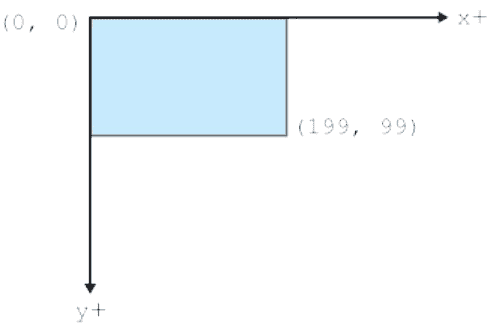

**图 3G.1 (x, y) 坐标空间**

这起初可能会令人困惑，因为你可能习惯了 y 值随向下而减小的坐标系。不过，你很快就能学会的。

### 绘制线条和形状

那么，到底如何绘制图形呢？要绘制形状和线条，你不是直接与`DrawingPanel`通信，而是与相关的`Graphics`类型对象通信。将`DrawingPanel`视为画布，将`Graphics`对象视为画笔。`DrawingPanel`类有一个名为`getGraphics`的方法，它返回它的`Graphics`对象：

```java
Graphics g = <panel>.getGraphics();
```

简单的绘制命令之一是`drawLine`，它接受四个整数参数。例如，方法：

```java
g.drawLine(<x1>, <y1>, <x2>, <y2>);
```

从点 (x1, y1) 绘制到点 (x2, y2)。`drawLine`方法只是`Graphics`对象理解的许多命令之一；其他命令见表 3G.2。除了这里提到的之外，`Graphics`对象还有更多方法。你可以在 Java 文档中查询它们。

这是一个将这些部分的示例程序：

```java
1 // 在 DrawingPanel 上绘制线条
2
3 import java.awt.*; // 用于图形处理
4
```

#### 表 3G.2 Graphics 对象的某些方法

| 方法 | 说明 |
|---|---|
| `drawLine(x1, y1, x2, y2)` | 在点 (x1, y1) 和 (x2, y2) 之间绘制一条线条 |
| `drawOval(x, y, width, height)` | 绘制指定矩形内的最大椭圆轮廓 |
| `drawRect(x, y, width, height)` | 绘制指定矩形的轮廓 |
| `drawString(message, x, y)` | 以 (x, y) 为左下角绘制给定的文本 |
| `fillOval(x, y, width, height)` | 使用当前颜色填充指定矩形内的最大椭圆 |
| `fillRect(x, y, width, height)` | 填充指定的矩形 |
| `setColor(color)` | 设置图形上下文的颜色 |
| `setFont(font)` | 设置图形上下文的字体 |

```java
public class DrawLine {
    public static void main(String[] args) {
        DrawingPanel panel = new DrawingPanel(200, 100);
        // 在面板上绘制线条
        Graphics g = panel.getGraphics();
        g.drawLine(25, 75, 175, 25);
    }
}
```

该程序绘制了三条不同的线来形成一个三角形，如图 3G.3 所示。这些线是在三个不同的点之间绘制的。在左下角，我们有一个点 (25, 75)。在顶部的中间我们有一个点 (100, 25)。在右下角有一个点 (175, 75)。对`drawLine`的各种调用简单地绘制了连接这三个点的线。

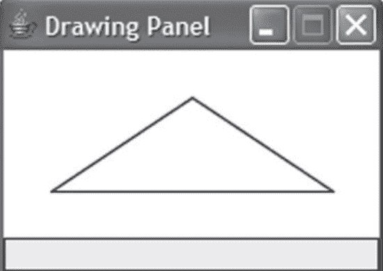

**图 3G.3 DrawLine2 的输出**

`Graphics`对象还具有绘制特定形状的方法。例如，你可以使用`drawRect`方法绘制矩形：

```java
g.drawRect(<x>, <y>, <width>, <height>);
```

这绘制了一个左上角坐标为 (x, y) 且给定高度和宽度的矩形。

另一个你经常想要绘制的图形是圆或更通常地说椭圆。但你如何指定它出现在哪里以及有多大呢？你实际上指定的是所谓的圆或椭圆的“边界矩形”。Java 将绘制出该矩形内最大的椭圆。因此，该方法：

```java
g.drawOval(<x>, <y>, <width>, <height>);
```

绘制了位于左上角坐标为 (x, y) 且给定高度和宽度的矩形内最大的椭圆。

注意，传递给`drawRect`和`drawOval`的前两个值是坐标，而后两个值是宽度和高度。例如，这里有一个绘制两个矩形和两个椭圆的短程序：

```java
1 // 绘制几个形状。
2
3 import java.awt.*;
4
5 public class DrawShapes {
6   public static void main(String[] args) {
7     DrawingPanel panel = new DrawingPanel(200, 100);
8
9     Graphics g = panel.getGraphics();
10    g.drawRect(25, 50, 20, 20);
11    g.drawRect(150, 10, 40, 20);
12    g.drawOval(50, 25, 20, 20);
13 g.drawOval(150, 50, 40, 20);
14 }
15 }
```

图 3G.4 显示了程序的输出。

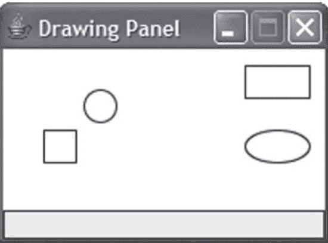

**图 3G.4 DrawShapes1 的输出**

第一个矩形的左上角位于坐标 (25, 50)。它的宽度和高度均为 20，所以这是一个正方形。它的右下角坐标将是 (45, 70)，或者比左上角的 (x, y) 坐标多 20。该程序还绘制了一个左上角在 (150, 10) 的矩形，其宽度为 40，高度为 20（比高宽）。第一个椭圆的边界矩形的左上角坐标为 (50, 25)，宽度和高度均为 20。换句话说，它是一个圆。第二个椭圆的边界矩形的左上角坐标为 (150, 50)，宽度为 40，高度为 20（它是一个比高宽的椭圆）。

有时你不仅仅想绘制形状的轮廓；你还想用特定颜色填充整个区域。`drawRect`和`drawOval`方法有变体称为`fillRect`和`fillOval`，它们正是执行此操作：绘制矩形或椭圆并用当前的画漆颜色（默认为黑色）进行填充。让我们将上程序中的两个调用改为“填充”操作而不是“绘制”操作：

```java
// 绘制并填充几个形状。

import java.awt.*;

public class DrawShapes2 {
    public static void main(String[] args) {
        DrawingPanel panel = new DrawingPanel(200, 100);
        Graphics g = panel.getGraphics();
        g.fillRect(25, 50, 20, 20);
        g.drawRect(150, 10, 40, 20);
        g.drawOval(50, 25, 20, 20);
        g.fillOval(150, 50, 40, 20);
    }
}
```

现在我们得到了图 3G.5 所示的输出。

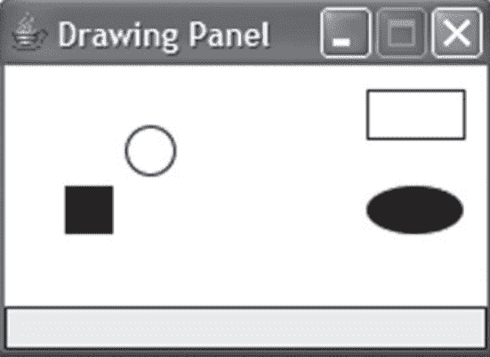

**图 3G.5 DrawShapes2 的输出**

## 颜色

之前程序绘制的所有形状和线条都是黑色的，所有面板的背景都是白色的。这些是默认颜色，但你可以更改面板的背景颜色，并尽可能更改`Graphics`对象使用的颜色。要更改这些颜色，请使用标准的`Color`类，它是`java.awt`包的一部分。

**表 3G.3 颜色**

| 颜色 | 常量 |
| :--- | :--- |
| `BLACK` | `GREEN` |
| `BLUE` | `RED` |
| `CYAN` | `MAGENTA` |
| `DARK_GRAY` | `YELLOW` |
| `GRAY` | `ORANGE` |
| `WHITE` | `PINK` |

有很多可以直接引用的预定义颜色。它们都是大写的。如表 3G.3 所示。要引用其中一个，你必须在前面加上类名。如前面提到的，`DrawingPanel`对象有一个方法可以更改背景，而`Graphics`对象有一个方法可以更改颜色。例如，这里是之前程序的另一个使用青色（背景）的版本：


```java
1 // 用不同颜色绘制并填充形状。
2
3 import java.awt.*;
4
5 public class DrawShapes {
6   public static void main(String[] args) {
7     DrawingPanel panel = new DrawingPanel(200, 100);
8
9     panel.setBackground(Color.CYAN);
10    Graphics g = panel.getGraphics();
11    g.setColor(Color.BLACK);
12    g.fillRect(25, 50, 20, 20);
13    g.drawRect(150, 10, 40, 20);
14    g.drawOval(50, 25, 20, 20);
15    g.setColor(Color.WHITE);
16    g.fillOval(150, 50, 40, 20);
17  }
18 }
```

该程序产生图 3G.6 所示的输出（图中颜色可能与你在屏幕上看到的不同。）

### 常见编程错误：误解绘制与填充

一些新程序员认为形状必须先绘制（例如`drawRect`），然后才能进行填充（例如`fillRect`）。事实并非如此。事实上，当你尝试绘制带轮廓的形状时，恰恰是错误的做法。假设你想在 (20, 50) 绘制一个黑色边界的 60x30 绿色矩形。你可能会编写以下代码：

```java
g.setColor(Color.BLACK); // 错误代码
g.drawRect(20, 50, 60, 30);
g.setColor(Color.GREEN);
g.fillRect(20, 50, 60, 30);
```

然而，填充命令覆盖了与绘制命令相同的像素，绿色内部将绘制在黑色轮廓之上，导致如下外观：

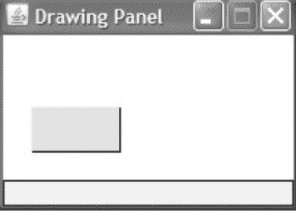

相反，代码应该先填充矩形的内部，然后绘制黑色轮廓，以确保轮廓显示在填充之上。以下是正确的代码及其输出：

```java
g.setColor(Color.GREEN); // 修正后的代码
g.fillRect(20, 50, 60, 30);
g.setColor(Color.BLACK);
g.drawRect(20, 50, 60, 30);
```

## 使用循环绘图

在之前的每个示例中，我们都使用简单的常量来进行绘制和填充命令，但也可以使用表达式。例如，假设我们保持`DrawingPanel`的尺寸为宽 200 像素、高 100 像素，并且想要生成一组从左上角延伸到右下角的对角线矩形，每个矩形内部都有白色椭圆。换句话说，我们想要生成图 3G.7 所示的输出。

总宽度 200，总高度 100 被平均分成四个矩形，这意味着它们的宽度都为 50 像素，高度为 25 像素。因此，这四个矩形的宽度和高度值相同，但它们的左上角的位置是不同的。第一个矩形的左上角在 (0, 0)，第二个在 (50, 25)，第三个在 (100, 50)，第四个在 (150, 75)。我们需要编写代码来生成这些不同的坐标。

这是使用`for`循环的绝佳时机。利用第 2 章中引入的技巧，我们可以创建一个表格并为坐标开发一个公式。在这种情况下，让循环从 0 开始比从 1 开始更容易，这在绘图程序中通常是如此。这里有一个生成所需输出的良好尝试程序：

```java
// 使用 for 循环绘制带框的椭圆（缺陷版本）。
import java.awt.*;
public class DrawLoop {
    public static void main(String[] args) {
        DrawingPanel panel = new DrawingPanel(200, 100);
        panel.setBackground(Color.CYAN);
        Graphics g = panel.getGraphics();
        for (int i = 0; i < 4; i++) {
            g.drawRect(i * 50, i * 25, 50, 25);
            g.setColor(Color.WHITE);
            g.fillOval(i * 50, i * 25, 50, 25);
        }
    }
}
```

该程序产生了图 3G.8 所示的输出。

坐标和尺寸是正确的，但颜色不对。我们得到的不是四个带有白色椭圆的黑色矩形，而是得到了一个黑色矩形和三个白色矩形。那是因为我们在循环内部只调用了一次`setColor`。初始颜色将被设置为黑色，这就是为什么第一个矩形是黑色的。但一旦我们调用`setColor`将颜色改为白色，随后的每一个绘制和填充命令都将以白色完成，包括第二个、第三和第四个矩形。

因此，我们需要包含将颜色设置为黑色的调用、绘制矩形的调用，以及将颜色设置为白色的绘制填充椭圆的调用。顺便，交换这些任务的顺序也是个好主意。矩形和椭圆略有重叠，我们更希望矩形画在椭圆之上，而不是相反。以下程序产生了正确的输出：

```java
// 使用 for 循环绘制带框的椭圆（正确版本）。
import java.awt.*;
public class DrawLoop {
    public static void main(String[] args) {
        DrawingPanel panel = new DrawingPanel(200, 100);
        panel.setBackground(Color.CYAN);
        Graphics g = panel.getGraphics();
        for (int i = 0; i < 4; i++) {
            g.setColor(Color.WHITE);
            g.fillOval(i * 50, i * 25, 50, 25);
            g.setColor(Color.BLACK);
            g.drawRect(i * 50, i * 25, 50, 25);
        }
    }
}
```


```java
// 使用 for 循环绘制带框的椭圆。
import java.awt.*;
public class DrawLoop2 {
    public static void main(String[] args) {
        DrawingPanel panel = new DrawingPanel(200, 100);
        panel.setBackground(Color.CYAN);
        Graphics g = panel.getGraphics();
        for (int i = 0; i < 4; i++) {
            g.setColor(Color.WHITE);
            g.fillOval(i * 50, i * 25, 50, 25);
            g.setColor(Color.BLACK);
            g.drawRect(i * 50, i * 25, 50, 25);
        }
    }
}
```

还可以创建自定义的`Color`对象，而不是使用`Color`类提供的常量颜色。使用红、绿、蓝（RGB）作为主颜色，因此当你构造一个`Color`对象时，为颜色的红色、绿色和蓝色传递自己的值：`new Color(<red>, <green>, <blue>)`。

红/绿/蓝分量应该是 0 到 255 之间的整数值。值越高，混合的颜色越多。所有 0 值产生黑色，所有 255 值产生白色。(0, 255, 0) 产生纯绿色，而 (128, 0, 128) 则产生深紫色。在你最喜欢的引擎中搜索“RGB table”可以找到许多常用。

以下程序演示了自定义颜色的使用。它使用常量表示要绘制的矩形数量，并产生了从黑色到白色的颜色混合：

```java
// 绘制从黑到白的渐变色。
import java.awt.*;
public class DrawGradient {
    static final int RECTS = 32;
    public static void main(String[] args) {
        DrawingPanel panel = new DrawingPanel(256, 256);
        panel.setBackground(new Color(256, 128, 0)); // 橙色
        Graphics g = panel.getGraphics();
        // 从黑到白，从左上角到右下角
        for (int i = 0; i < RECTS; i++) {
            int shift = i * 256 / RECTS;
            g.setColor(new Color(shift, shift, shift));
            g.fillRect(shift, shift, 20, 20);
        }
    }
}
```

该程序产生了图 3G.9 所示的输出。

# 文本与字体

另一个值得注意的绘制命令可以包含文本。如果你想更改屏幕文本的样式或大小，可以使用`Graphics`对象的`setFont`方法。

> **字体** = 字符集合的整体设计，包括每个字符的样式、大小、重量和外观。

该方法更改绘制字符串的大小和样式。

`setFont`的参数是一个`Font`对象。通过传递三个参数——字体名称（String）、样式（如加粗或斜体）和尺寸（整数）来构造`Font`对象。

常见的字体样式如加粗在`Font`类中实现为常量。可用的常量和一些流行的字体名称如表 3G.4 和 3G.5 所示。

`drawString`方法在指定的坐标绘制字符串。这里我们指定了左上角。这里有一个使用循环绘制 10 次某个特定字符串的示例程序：

```java
// 绘制几次消息。
import java.awt.*;
public class DrawingMessage {
    public static void main(String[] args) {
        DrawingPanel panel = new DrawingPanel(200, 100);
        panel.setBackground(Color.YELLOW);
        Graphics g = panel.getGraphics();
        for (int i = 0; i < 10; i++) {
            g.drawString("There is no place like home", i * 5, 10 + i * 10);
        }
    }
}
```

该程序产生了图 3G.10 所示的输出。字体用于描述屏幕上文字的不同样式。你还可以将`Font`对象存储在变量中，或者作为参数传递。例如，在本章中指定颜色：

```java
Color c = new Font("Arial", Font.BOLD, 12);
g.setFont(c);
```

```java
// 使用不同的字体绘制几条消息。

import java.awt.*;

public class DrawFonts {
    public static void main(String[] args) {
        DrawingPanel panel = new DrawingPanel(200, 100);
        panel.setBackground(Color.PINK);

        Graphics g = panel.getGraphics();
        g.setFont(new Font("Monospaced", Font.BOLD + Font.ITALIC, 36));
        g.drawString("Too big", 20, 40);

        g.setFont(new Font("SansSerif", Font.PLAIN, 10));
        g.drawString("Too small", 30, 60);

        g.setFont(new Font("Serif", Font.ITALIC, 18));
        g.drawString("Just right", 40, 80);
    }
}
```

该程序产生了图 3G.11 所示的输出。


图 3G.11 `DrawFonts`输出

## 图像

`DrawingPanel`还可以显示从 JPEG、PNG、GIF 等格式加载的图像。要显示图像，首先必须找到一个图像文件（例如互联网上或计算机上的文件），并将其放在与代码项目相同的目录中。图像的显示分为两个步骤：首先必须将图像从硬盘加载到`Image`对象中，然后你的面板的`Graphics`对象就可以显示该图像。

```java
Image <name> = <panel>.loadImage("<filename>");
g.drawImage(<name>, x, y, <panel>);
```

绘制图像时传递的`x`和`y`坐标代表其左上/左角的像素位置。

语法上有一些特殊之处。之一是我们使用`DrawingPanel`来加载图像，而使用`Graphics`对象来绘制它。这很容易不小心将两者混淆。与其他绘制命令不同，`drawImage`要求你将`DrawingPanel`作为最后一个参数传递给方法。这是 Java 的`Graphics`类要求的，以便代码能够编译。

例如，以下程序加载了一个看起来像彩虹图的图像，并将其绘制在`DrawingPanel`上，并在下方有一个文本字符串。

```java
// 此程序从图像文件显示彩虹。
import java.awt.*;
public class Rainbow {
    public static void main(String[] args) {
        DrawingPanel panel = new DrawingPanel(280, 200);
        Image rainbow = panel.loadImage("rainbow.png");
        Graphics g = panel.getGraphics();
        g.drawImage(rainbow, 0, 0, panel);
        g.drawString("Somewhere over the rainbow...", 10, 180);
    }
}
```

该程序产生了图 3G.12 所示的输出。

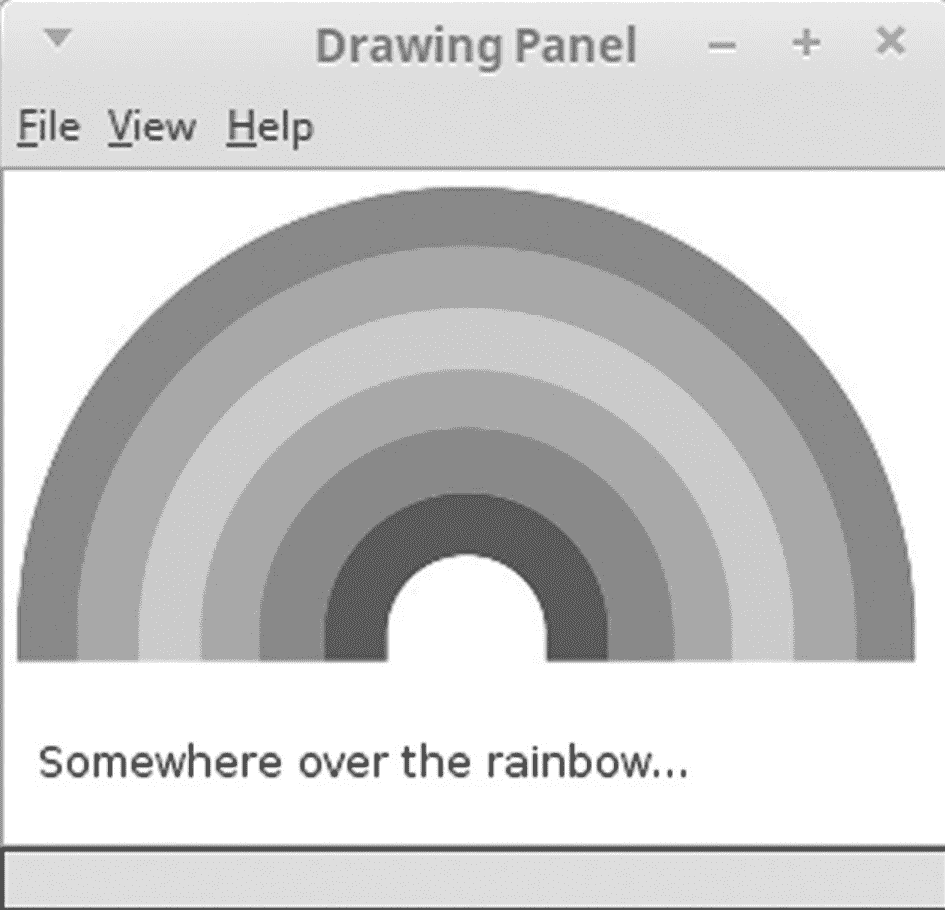

图 3G.12 `DrawRainbow`输出

如果你想在面板上多次绘制同一图像，则不需要重复过程中的`loadImage`部分。加载一次图像然后根据你的意图绘制多次要高效得多。以下代码将绘制名为`smiley.png`的文件的多个图像副本，该图像大小为 100x100 像素。此代码的输出所示于[图 3G.13](#)。

```java
Image smileyFace = panel.loadImage("smiley.png");
Graphics g = panel.getGraphics();
for (int i = 0; i < 4; i++) {
    g.drawImage(smileyFace, i * 110 + 10, 10, panel);
}
```

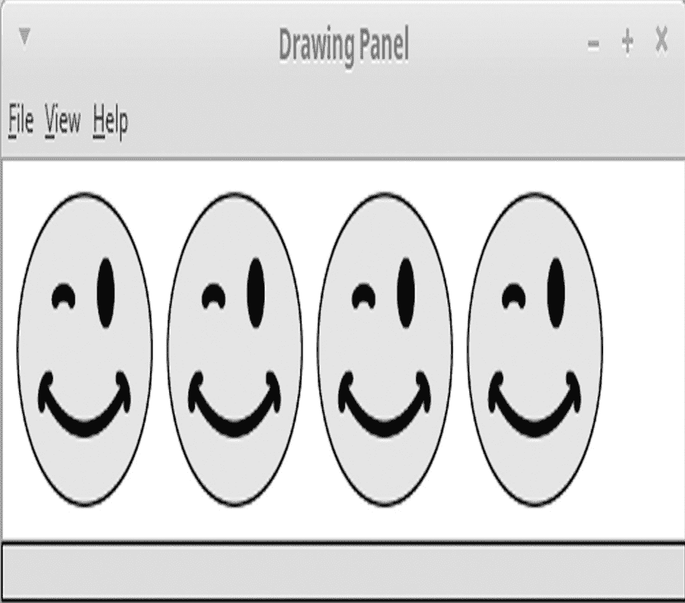

图 3G.13 笑脸脸输出

## 3G.2 使用`Graphics`的过程化分解


如果你编写复杂的绘制程序，你会想要将它们拆分为几个静态方法以结构化代码并消除冗余。当你这样做时，你必须向引入的每个静态方法传递`Graphics`对象。作为一个快速的示例，上一节的`DrawStringMessage1`程序可以拆分为一个`main`方法和一个`drawText`方法，如下：

```java
// 使用静态方法多次绘制消息。

import java.awt.*;

public class DrawStringMessage2 {
    public static void main(String[] args) {
        DrawingPanel panel = new DrawingPanel(200, 100);
        Graphics g = panel.getGraphics();
        panel.setBackground(Color.YELLOW);
        drawText(g);
    }

    public static void drawText(Graphics g) {
        for (int i = 0; i < 10; i++) {
            g.drawString("There is no place like home", i * 5, 10 + i * 10);
        }
    }
}
```

此程序产生与原程序相同的输出（图 3G.10）。如果不传递`Graphics g`，`drawText`程序将无法编译。

### 更大的示例：`DrawDiamonds`

现在让我们考虑一个稍微复杂的任务：绘制放入特定大小框中的最大菱形。图 3G.14 显示了可以放入 50x50 框的最大的菱形。

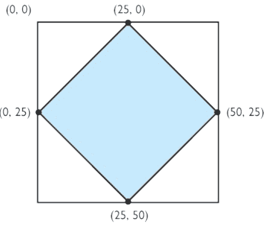

图 3G.14 菱形

绘制此类菱形的代码如下：

```java
g.drawRect(0, 0, 50, 50);
g.drawLine(0, 25, 25, 0);
g.drawLine(25, 0, 50, 25);
```

现在想象我们想在不同位置绘制三个 50x50 的菱形。我们可以将绘制菱形的代码转换为调用三次的`drawDiamond`方法。由于每个菱形位于不同的位置，我们可以向`drawDiamond`方法传递`x`和`y`坐标。图 3G.15 显示了一个左上角在 (78, 22) 的框围成的菱形。

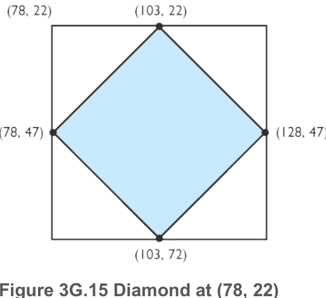

绘制此菱形的代码为：

```java
g.drawRect(78, 22, 50, 50);
g.drawLine(78, 47, 103, 22);
g.drawLine(103, 22, 128, 47);
g.drawLine(128, 47, 103, 72);
```

你可以看到，传递给`drawRect`和`drawLine`方法的参数值与第一个菱形非常相似，它们在`x`方向偏移了 78，在`y`方向偏移了 22（`drawRect`的第三和第四参数除外，这些是矩形的宽度和高度）。这种 (78, 22) 的偏移被称为偏移量（offset）。

我们可以泛化传递给`Graphics g`命令的坐标，以便如果传递该菱形的左上角`x`和`y`偏移，它们就可以适用于任何菱形。例如，我们将第一个菱形中从 (0, 25) 到 (25, 0) 的线泛化为第二个菱形中从 (78, 47) 到 (103, 22) 的线，其中 (x, y) 是给定菱形的偏移。

以下程序使用`drawDiamond`方法在无冗余的情况下绘制三个菱形：

```java
// 此程序绘制几个 50x50 大的菱形。
import java.awt.*;

public class DrawDiamonds {
    public static void main(String[] args) {
        DrawingPanel panel = new DrawingPanel(250, 150);
        Graphics g = panel.getGraphics();
        drawDiamond(g, 0, 0);
        drawDiamond(g, 78, 22);
        drawDiamond(g, 19, 81);
    }

    // 在 50x50 的框内绘制菱形
    public static void drawDiamond(Graphics g, int x, int y) {
        g.drawRect(x, y, 50, 50);
        g.drawLine(x, y + 25, x + 25, y);
        g.drawLine(x + 25, y, x + 50, y + 25);
        g.drawLine(x + 50, y + 25, x + 25, y + 50);
        g.drawLine(x + 25, y + 50, x, y + 25);
    }
}
```

该程序产生了图 3G.16 所示的输出。

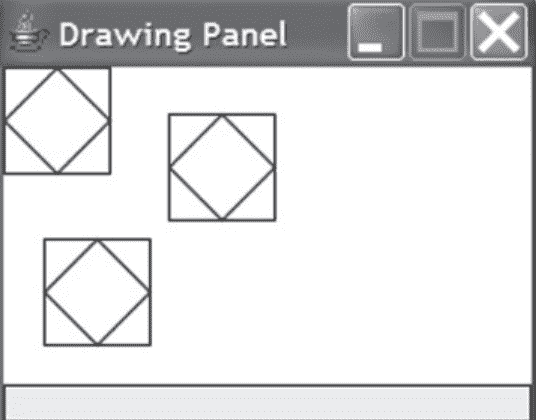

**图 3G.16 菱形输出**

在循环中绘制图案图形并让一个绘制方法调用另一个是可能的。例如，如果我们想从 (12, 15) 开始绘制间距为 60 像素五个菱形，我们只需要一个重复五次并每次偏移`x`坐标 60 的`for`循环。这是一个示例循环：

```java
for (int i = 0; i < 5; i++) {
    drawDiamond(g, 12 + 60 * i, 15);
}
```


如果我们创建另一个方法来绘制五行菱形，就可以从`main`中调用它来绘制许多行菱形。这是一个带有两个图形方法的`DrawDiamonds`程序的修改版本：

（此处后续内容截断）

```java
26 g.drawLine(x, y + 25, x + 25, y);
27 g.drawLine(x + 25, y, x + 50, y + 25);
28 g.drawLine(x + 50, y + 25, x + 25, y + 50);
29 g.drawLine(x + 25, y + 50, x, y + 25);
30 }
31 }
```

该程序产生了图 3G.17 所示的输出。

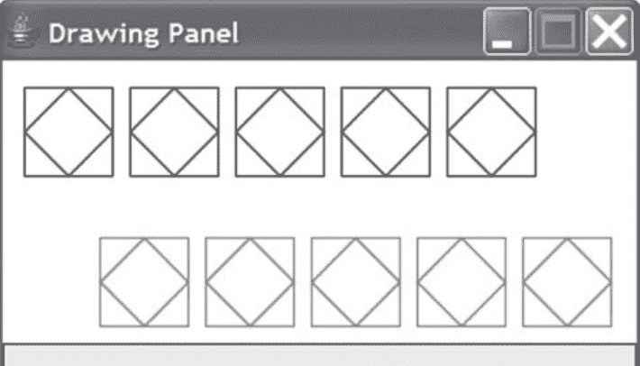

图 3G.17 `DrawDiamonds2` 的输出

## 3G.3 案例研究：金字塔

假设你被要求编写一个程序，在`DrawingPanel`上画出图 3G.18 所示的图像。

整个图面板的大小为 350 x 250。每个金字塔高 100 像素，宽 100 像素。金字塔由居中的彩色阶梯序列组成。

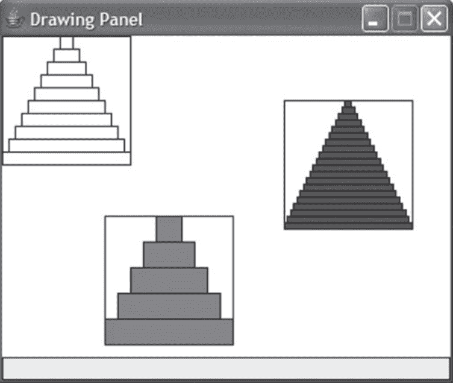

图 3G.18 期望的金字塔输出，其向底部加宽，每个阶梯周围都有黑色轮廓。表 3G.6 列出了每个金字塔的属性。

## 表 3G.6 金字塔属性

| 填充颜色 | 左上角 | 阶梯数量 | 每级阶梯高度 |
|---|---|---|---|
| 白色 | (0, 0) | 10 级阶梯 | 10 像素 |
| 红色 | (80, 140) | 5 级阶梯 | 20 像素 |
| 蓝色 | (220, 50) | 20 级阶梯 | 5 像素 |

## 非结构化部分解决方案

尝试解决像这样更大且复杂的问题时，逐个击破并向最终解决方案进行迭代改进至关重要。让我们从尝试正确画出左上角的白色金字塔开始。

每个阶梯在金字塔内水平方向居中。顶部的阶梯宽 10 像素。因此，它的两侧各有 90 或 45 像素的空隙。这意味着 10 x 10 矩形的左上角位于 (45, 0)。第二个阶梯宽 20 像素，意味着它两侧各有 80 或 40 像素：

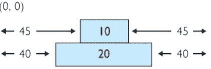

以下程序在正确的位置画了白色金字塔：

```java
import java.awt.*;

// 仅绘制第一个金字塔，但有很多冗余。
public class Pyramids1 {
    public static void main(String[] args) {
        DrawingPanel panel = new DrawingPanel(350, 250);
        Graphics g = panel.getGraphics();
        // 绘制边界矩形
        g.drawRect(0, 0, 100, 100);
        // 绘制白色金字塔中的 10 级阶梯
        g.drawRect(45, 0, 10, 10);
        g.drawRect(40, 10, 20, 10);
        g.drawRect(35, 20, 30, 10);
        g.drawRect(30, 30, 40, 10);
        g.drawRect(25, 40, 50, 10);
        g.drawRect(20, 50, 60, 10);
        g.drawRect(15, 60, 70, 10);
        g.drawRect(10, 70, 80, 10);
        g.drawRect(5, 80, 90, 10);
        g.drawRect(0, 90, 100, 10);
    }
}
```

观察代码可以发现，绘制阶梯的 10 行代码之间存在大量冗余。检查每列中数字的模式可以发现，x 值每次减少 5，y 值每次增加 10，宽度每次增加 10，而高度保持不变。

描述阶梯 x 值的另一种方法是，说它是总宽 100 减去阶梯宽度的一半。考虑到这一点，以下循环在没有之前那种冗余的情况下画了这 10 级阶梯：

```java
for (int i = 0; i < 10; i++) {
    int stairWidth = 10 * (i + 1);
    int stairHeight = 10;
    int stairX = (100 - stairWidth) / 2;
    int stairY = 10 * i;
    g.drawRect(stairX, stairY, stairWidth, stairHeight);
}
```

## 通用金字塔的绘制

接下来，让我们添加代码来绘制底部（红色）金字塔。它的 (x, y) 位置是 (80, 140)，有五级阶梯。这意味着每一级阶梯的高度和宽度都是白色金字塔的两倍。

(80, 140)

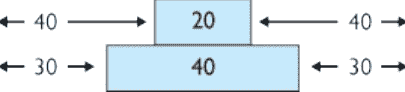

根据这些信息，我们可以确定第一级阶梯的左上角在 (120, 140)，大小为 20 x 20；第二个阶梯的左上角在 (110, 160)，大小为 40 x 20，以此类推。

暂时，让我们专注于获取阶梯的正确坐标，而不考虑红色。以下是绘制红色金字塔阶梯的冗余代码：

```java
// 绘制边界矩形
g.drawRect(80, 140, 100, 100);
// 绘制红色金字塔的 5 级阶梯
g.drawRect(120, 140, 20, 20);
g.drawRect(110, 160, 40, 20);
g.drawRect(100, 180, 60, 20);
g.drawRect(90, 200, 80, 20);
```

再次，在绘制阶梯的五行代码中存在冗余，因此让我们寻找模式。我们将像之前处理金字塔那样使用循环来消除冗余，并进行适当修改。现在每个阶梯的高度为 20 像素，每个阶梯的宽度是阶梯数量的两倍。x 和 y 坐标稍微复杂一点。x 坐标公式与之前的 (100 - stairWidth) / 2 相似，但这次必须向右偏移 80 像素以考虑其边界框的左上角位置。y 坐标同样向下偏移 140 像素。这是正确的循环：

```java
// 绘制红色金字塔的 5 级阶梯
for (int i = 0; i < 5; i++) {
    int stairWidth = 20 * (i + 1);
    int stairHeight = 20;
    int stairX = 80 + (100 - stairWidth) / 2;
    int stairY = 140 + 20 * i;
    g.drawRect(stairX, stairY, stairWidth, stairHeight);
}
```

你能看出绘制金字塔阶梯的两个循环之间的模式吗？x 和 y 坐标的区别仅在于第二个循环中相对于 (0, 0) 的偏移。阶梯宽度和高度的区别仅在于：一个金字塔的阶梯高度为 20 像素，而另一个金字塔的阶梯高度为 10 像素（总尺寸 100 除以阶梯数量的结果）。

利用前面的信息，我们将绘制金字塔的代码转换为可以调用三次的方法，以避免冗余。参数将是金字塔边界框左上角的 (x, y) 坐标，我们还需要传递`Graphics`参数以便在`DrawingPanel`上绘图。我们将修改`for`循环来计算阶梯高度，然后使用高度计算阶梯宽度，最后使用宽度和高度帮助计算阶梯的 (x, y) 坐标。代码如下：

```java
public static void drawPyramid(Graphics g, int x, int y, int stairs) {
    // 绘制边界矩形
    g.drawRect(x, y, 100, 100);
    // 绘制金字塔的阶梯
    for (int i = 0; i < stairs; i++) {
        int stairHeight = 100 / stairs;
        int stairWidth = stairHeight * (i + 1);
        int stairX = x + (100 - stairWidth) / 2;
        int stairY = y + stairHeight * i;
        g.drawRect(stairX, stairY, stairWidth, stairHeight);
    }
}
```

前面的代码现在通用于任意位置绘制任意数量阶梯的金字塔。但还缺少最后一个元素：为每个金字塔提供不同颜色的能力。

## 完整结构化解决方案

之前的代码是正确的，只是无法以正确的颜色绘制金字塔。让我们在方法中添加一个额外的参数`Color`，并在需要时填充金字塔阶梯。对于第一个白色金字塔，我们将`Color.WHITE`作为此参数的值；它会将阶梯填充为白色，尽管这并非必要。

绘制具有不同颜色轮廓的填充形状的方法是先填充形状，然后使用轮廓颜色绘制相同的形状。例如，为了获得黑色轮廓的红色矩形，我们首先将使用红色的`fillRect`，然后使用相同参数的黑色`drawRect`。

这是使用填充颜色作为参数的`drawPyramid`方法的新版本：

```java
public static void drawPyramid(Graphics g, Color c,
  int x, int y, int stairs) {
  g.drawRect(x, y, 100, 100);
  for (int i = 0; i < stairs; i++) {
    int stairHeight = 100 / stairs;
    int stairWidth = stairHeight * (i + 1);
    int stairX = x + (100 - stairWidth) / 2;
    int stairY = y + stairHeight * i;
    g.setColor(c);
    g.fillRect(stairX, stairY, stairWidth, stairHeight);
    g.setColor(Color.BLACK);
    g.drawRect(stairX, stairY, stairWidth, stairHeight);
  }
}
```

使用这种方法，我们现在可以通过带有相应参数调用三次`drawPyramid`来轻松地绘制三个金字塔：

```java
drawPyramid(g, Color.WHITE, 0, 0, 10);
drawPyramid(g, Color.RED, 80, 140, 50);
drawPyramid(g, Color.BLUE, 220, 50, 20);
```

对我们的金字塔程序进行的最后一次改进是将金字塔的总尺寸 100 转换为一个常量，这样代码中就不会有那么多大量的 100 了。这里是完整的程序：

```java
// 这个程序绘制三个彩色的金字塔图形。

import java.awt.*;

public class Pyramids {
    public static final int SIZE = 100;

    public static void main(String[] args) {
        DrawingPanel panel = new DrawingPanel(350, 250);
        Graphics g = panel.getGraphics();

        drawPyramid(g, Color.WHITE, 0, 0, 10);
        drawPyramid(g, Color.RED, 80, 140, 5);
        drawPyramid(g, Color.BLUE, 220, 50, 20);
    }

    // 在指定的 (x, y) 位置用给定的颜色
    // 和指定的阶梯数量绘制一个金字塔图形
    public static void drawPyramid(Graphics g, Color c,
        int x, int y, int stairs) {

        // 绘制边框矩形
        g.fillRect(x, y, SIZE, SIZE);

        // 绘制金字塔的阶梯
        for (int i = 0; i < stairs; i++) {
            int stairHeight = SIZE / stairs;
            int stairWidth = stairHeight * (i + 1);
            int stairX = x + (SIZE - stairWidth) / 2;
            int stairY = y + stairHeight * i;
            // 用填充颜色填充矩形
            g.setColor(c);
            g.fillRect(stairX, stairY, stairWidth, stairHeight);

            // 绘制黑色矩形轮廓
            g.setColor(Color.BLACK);
            g.drawRect(stairX, stairY, stairWidth, stairHeight);
        }
    }
}
```

# 章节总结

`DrawingPanel`是作者提供的一个自定义类，用于在屏幕上轻松显示图形窗口。`DrawingPanel`包含一个`Graphics`对象，该对象可以使用不同的颜色在屏幕上绘制线条、文本和形状。

`Graphics`对象具有许多用于绘制形状和线条的实用方法，例如`drawLine`、`fillRect`和`setColor`。形状可以被“绘制”（仅绘制轮廓）或被“填充”（填充整个形状）。

`Graphics`对象可以使用其`drawString`方法在屏幕上写文本。你可以使用`setFont`方法指定不同的字体样式和大小。

分解为方法的图形程序必须向这些方法传递适当的参数（例如`Graphics`对象，以及任何 (x, y) 坐标、尺寸或其他引导图形绘制的值）。

# 自测练习题

## 节 3G.1：图形介绍

1. 下列哪项是绘制矩形的正确语法？

   - a. `Graphics g.drawRect(10, 20, 50, 30);`
   - b. `g.drawRect(10, 20, 50, 30);`
   - c. `g.draw.rectangle(10, 20, 50, 30);`
   - d. `Graphics.drawRect(10, 20, 50, 30);`
   - e. `g.drawRect(x = 10, y = 20, width = 50, height = 30);`

2. 下列代码中有两个错误。该代码试图从坐标 (50, 86) 绘制一条线到 (20, 35)。它们是什么？

```java
DrawingPanel panel = new DrawingPanel(200, 200);
panel.drawLine(50, 20, 86, 35);
```

3. 下列代码试图绘制一个黑色填充的外层矩形，其内部有一个白色填充的内圆：

```java
DrawingPanel panel = new DrawingPanel(200, 100);
Graphics g = panel.getGraphics();
g.setColor(Color.WHITE);
g.fillOval(10, 10, 50, 50);
g.setColor(Color.BLACK);
g.fillRect(10, 10, 50, 50);
```

然而，图形输出看起来却像图 3G.19。为了达到预期效果，必须修改什么？

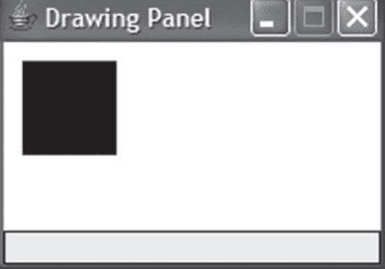

图 3G.19 自测 3G.3 的图形输出

4. 下列代码试图从 (10, 20) 到 (50, 40) 绘制一个黑色矩形，并在对角线上画一条线：

```java
DrawingPanel panel = new DrawingPanel(200, 100);
Graphics g = panel.getGraphics();
g.drawRect(10, 20, 50, 40);
g.drawLine(10, 20, 50, 40);
```

然而，图形输出看起来却像图 3G.20。为了达到预期效果，必须修改什么？

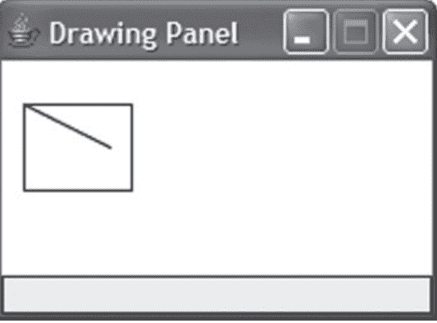

5. 下列程序将绘制什么样的图形？你可以在不运行程序的情况下画出与其外观匹配的图片吗？

```java
import java.awt.*;

public class Draw {
    public static void main(String[] args) {
        DrawingPanel panel = new DrawingPanel(200, 200);
        Graphics g = panel.getGraphics();
        for (int i = 0; i < 20; i++) {
            g.drawOval(i * 10, i * 10, 200 - (i * 10), 200 - (i * 10));
        }
    }
}
```

# 练习题

1. 使用`DrawingPanel`编写图 3G.21 的程序。

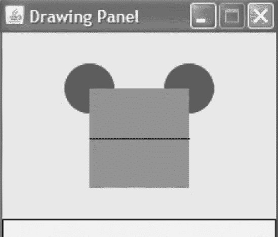

图 3G.21 练习 3G.1 的输出


窗口宽 220 像素，高 150 像素。背景为黄色。有两个 40x40 像素的蓝色椭圆。它们相距 80 像素，左圆的左上角位于 (50, 25)。有一个红色正方形，其顶点恰好交两个椭圆。最后，正方形中心有一条黑色横线。

## 2. 修改你的上一个程序

通过一个名为 `drawFigure` 的方法绘制该图形。该方法应接受三个参数：用于绘制的 `DrawingPanel` 的 `Graphics`，以及图形左上角的 (x, y) 坐标。使用以下方法头：

```java
public static void drawFigure(Graphics g, int x, int y)
```

将你的 `DrawingPanel` 尺寸设置为 450x150 像素，并使用你的 `drawFigure` 方法放置图 3G.22 所示的两个图形。一个位于 (50, 25)，另一个位于 (250, 45)。

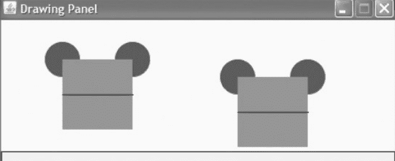

## 3. 修改现有程序

假设你有一个现有的 `DrawingPanel` 程序来绘制图 3G.23 所示的脸。修改程序以绘制图 3G.24 所示的修改后输出。通过编写一个在不同位置绘制脸的参数方法来实现。窗口尺寸应更改为 320x180 像素，两个脸的左上角位于 (10, 30) 和 (150, 50)。


```java
public class Face {
    public static void main(String[] args) {
        DrawingPanel panel = new DrawingPanel(220, 150);
        Graphics g = panel.getGraphics();

        g.setColor(Color.BLACK);
        g.drawOval(10, 30, 100, 100); // 脸轮廓

        g.setColor(Color.BLUE);
        g.fillOval(30, 60, 20, 20); // 眼睛
        g.fillOval(70, 60, 20, 20);

        g.setColor(Color.RED); // 嘴
        g.drawLine(40, 100, 80, 100);
    }
}
```

## 4. 修改你的 `Face` 程序

修改你之前的 `Face` 程序以绘制图 3G.25 所示的新输出。窗口尺寸应更改为 520x180 像素，脸的左上角分别位于 (10, 30), (110, 30), (210, 30), (310, 30) 和 (410, 30)。

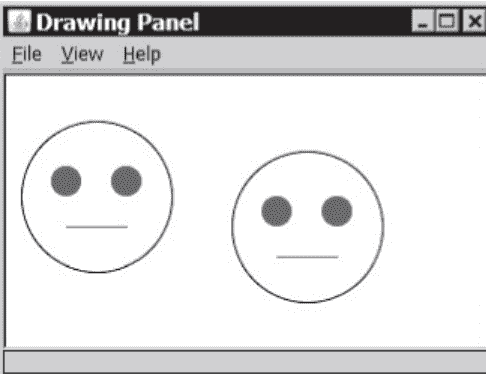

## 5. 编写 `ShowDesign` 程序

编写一个名为 `ShowDesign` 的程序，使用 `DrawingPanel` 绘制图 3G.26。

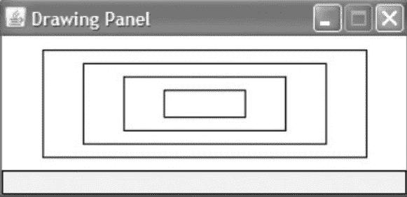

窗口宽 200 像素，高 200 像素。背景为白色，前景为黑色。每个矩形之间有 20 像素的间隔，矩形是同心的（它们的中心在同一点）。使用循环绘制重复的矩形。

## 6. 修改 `ShowDesign` 程序

修改你上一个练习中的 `ShowDesign` 程序，使其有一个接受窗口宽度和高度参数的方法，并以适当尺寸显示矩形。例如，如果你的方法用值 300 和 100 被调用，窗口将看起来像图 3G.27。


## 7. 编写 `Squares` 程序

编写一个名为 `Squares` 的程序，使用 `DrawingPanel` 绘制图 3G.28 所示的形状。

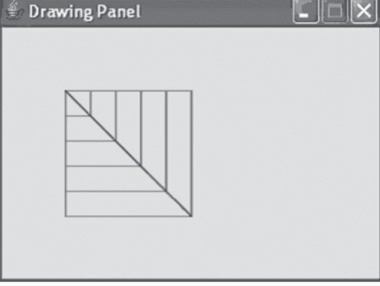

`DrawingPanel` 宽 300 像素，高 200 像素。背景为青色。水平线和垂直线用红色绘制，对角线用黑色绘制。对角线的左上角位于 (50, 50)。相邻的水平和垂直线间隔 20 像素。

## 8. 修改练习 7 的代码

修改你上一个练习的代码以产生图 3G.29 所示的模式。

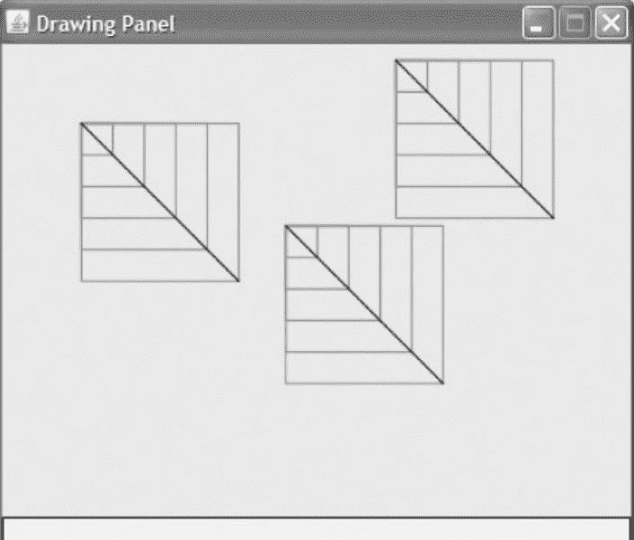

`DrawingPanel` 现在的大小为 400x300 像素。第一个图形位于相同位置 (50, 50)。其他图形分别位于 (250, 180) 和 (180, 115)。请使用一个或多个参数化的静态方法来减少解决方案的冗余。

## 9. 修改练习 8 的代码

修改你上一个练习的代码，以产生图 3G.30 所示的模式。

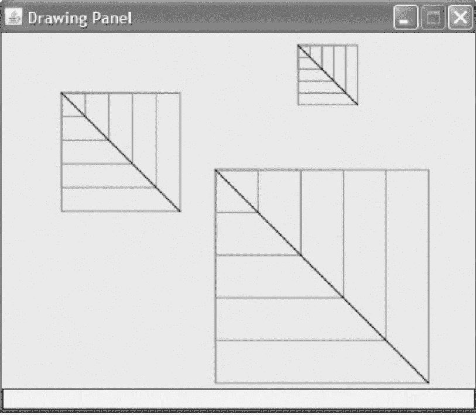

`DrawingPanel` 保持不变，但现在每个图形的大小都不同。左侧图形保持原始大小 100，右上图形的大小为 50，右下图形的大小为 180。使用参数化的静态方法来减少解决方案的冗余。

## 10. 编写 `Stairs` 程序

编写一个名为 `Stairs` 的程序，使用 `DrawingPanel` 绘制图 3G.31 所示的图形。第一个阶梯的左上角位于位置 (5, 5)。第一个阶梯的大小为 10x30 像素。每个阶梯都比它上面的一个宽 10 像素。创建一个表格，列出前五个阶梯的 (x, y) 坐标和 (width x height) 大小。注意哪些值发生了变化，哪些值保持不变。

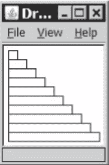

## 11. 修改 `Stairs` 程序

修改你之前的 `Stairs` 程序，绘制图 3G.32 所示的每个输出。只需修改你的循环体。（你可能需要创建一个新表格来找到每个新输出的 x、y、width 和 height 的表达式。）

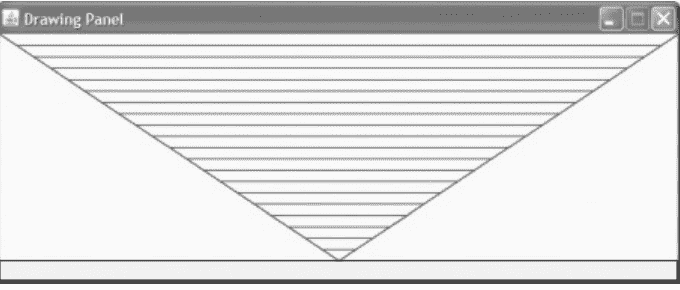

## 12. 编写 `Triangle` 程序

编写一个名为 `Triangle` 的程序，使用 `DrawingPanel` 绘制图 3G.33 所示的图形。

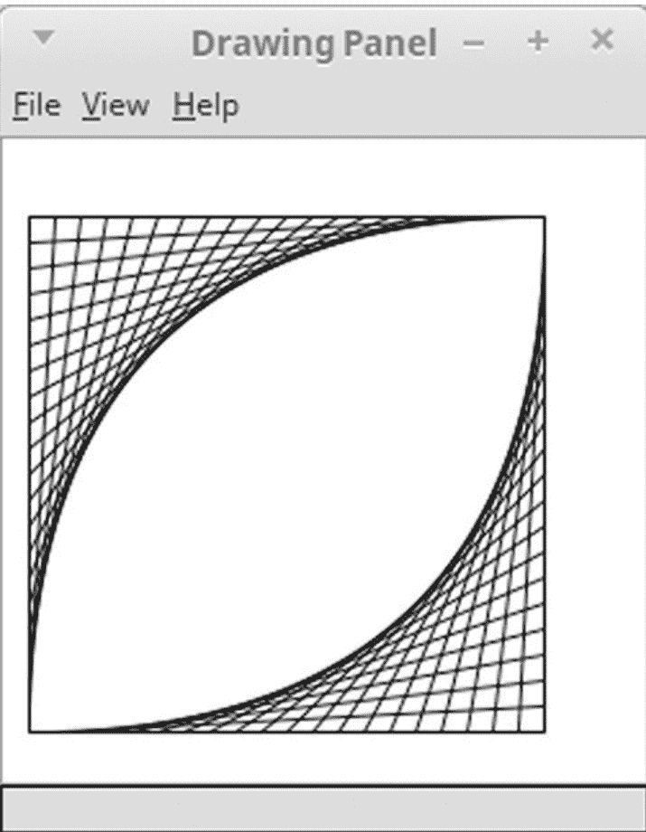

窗口大小为 600x200 像素。背景为黄色，线条为蓝色。线条垂直相隔 10 像素，对角线在图形底部的水平中心处交叉。

## 13. 编写 `Football` 程序

编写一个名为 `Football` 的程序，使用 `DrawingPanel` 绘制[图 3G.34]所示的图形。虽然该图形看起来包含曲线，但它完全是由直线构成的。

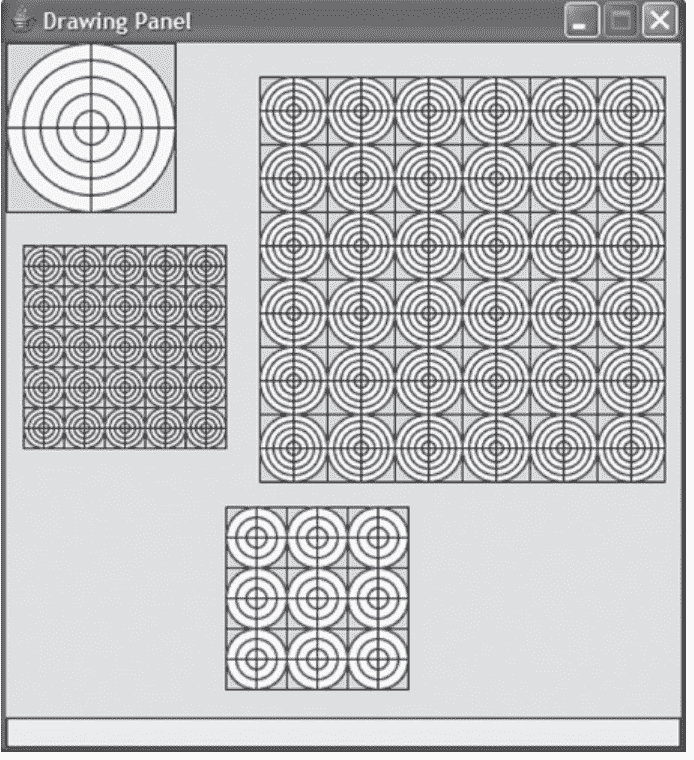

窗口大小为 250x250 像素。从 (10, 30) 到 (211, 230) 有一个外矩形，每隔 10 像素在边缘绘制一组黑线。例如，在左上方有一条从 (10, 200) 到 (20, 30) 的线，一条从 (10, 190) 到 (30, 30) 的线，一条从 (10, 180) 到 (40, 30) 的线…………在右下方有一条从 (20, 210) 到 (210, 200) 的线，一条从 (30, 210) 到 (210, 190) 的线，依此类推。

# 编程项目

## 1. 绘制模式

编写一个程序在 `DrawingPanel` 上绘制图 3G.35 所示的模式。


`DrawingPanel` 的大小为 400x400 像素，背景颜色为青色。它包含四个同心黄圆，带有黑色轮边，所有都被带有黑色轮边的绿色矩形包围。你 `DrawingPanel` 上的四个图形应该具有表 3G.7 所示的属性。

**表 3G.7 圆属性**

| 描述 | (x, y) 位置 | 子图大小 | 圆的数 | 行/列数 |

| :--- | :--- | :--- | :--- | :--- |

| 左上 | (0, 0) | 100x100 | 5 | 1x1 |

| 左下 | (10, 120) | 24x24 | 4 | 5x5 |

| 右上 | (150, 20) | 40x40 | 5 | 6x6 |

| 右下 | (130, 275) | 36x36 | 3 | 3x3 |

将你的程序拆分为绘制单个子图的方法以及较大子图网格的方法（例如 (10, 120) 处的 5x5 网格）。

## 2. 绘制图像

编写一个程序在大小为 200x50x30 像素的 `DrawingPanel` 上绘制图 3G.36 中的图像。

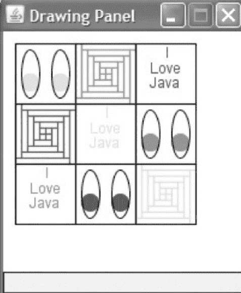

## 3. 绘制棋盘格

编写一个程序在大小为 420x300 的 `DrawingPanel` 上绘制类似图 3G.37 这样的棋盘格。

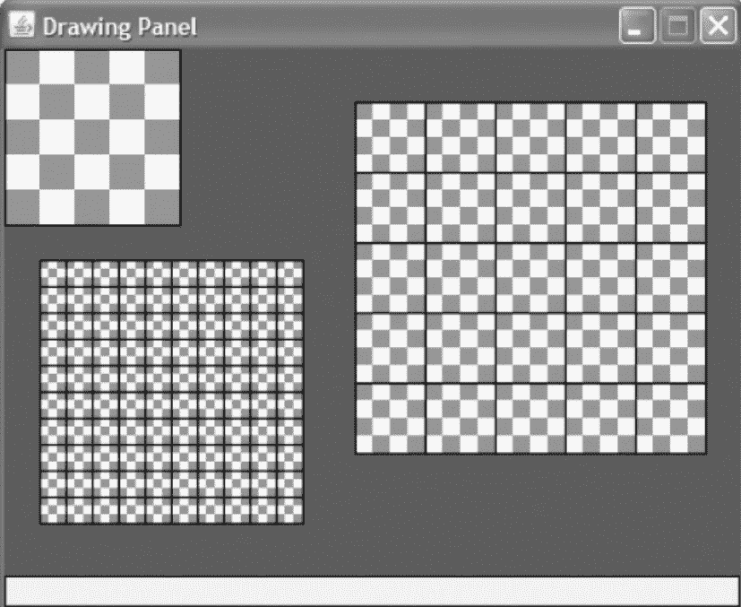

## 4. 修改抛体案例

编写第 3 章抛体案例的修改版本，在大小为 420x220 的 `DrawingPanel` 上绘制抛体轨迹。例如，图 3G.38 所示的面板绘制初速度为 30 米/秒、角度为 50 度、10 步的抛体。

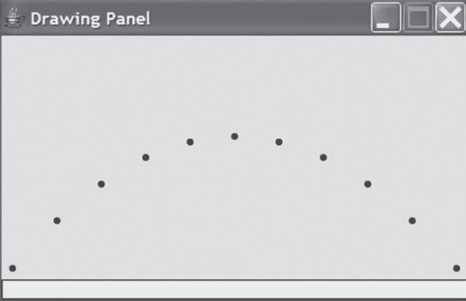

## 5. 绘制咖啡墙错觉

编写一个程序在大小为 650x400 的 `DrawingPanel` 上绘制图 3G.39 所示的图像。该图像代表了一种名为“咖啡墙”（Cafe Wall）的著名错觉，一组正方形看起来是倾斜的。


图像具有灰色背景，以及许多行黑白正方形，每个黑色正方形上都画蓝色的 X。图中两个独立的行具有以下属性：

**表 3G.8 咖啡墙行属性**

| 描述 | (x, y) 位置 | 对的数 | 每个框的大小 |

| :--- | :--- | :--- | :--- |

| 左上 | (0, 0) | 4 | 20 |

| 中左 | (50, 70) | 5 | 30 |

图中有四组正方形网格，相邻行之间有 2 像素的垂直间。这种错觉的一个方面是每隔一行就会产生特定的水平偏移。这四个网格具有以下属性：

**表 3G.9 咖啡墙网格属性**

| 描述 | (x, y) 位置 | 对的数 | 每个框的大小 | 第二行偏移 |

| :--- | :--- | :--- | :--- | :--- |

| 左下 | (10, 150) | 4 | 25 | 0 |

| 中下 | (250, 200) | 3 | 25 | 10 |

| 右下 | (425, 180) | 5 | 20 | 10 |

| 右上 | (400, 20) | 2 | 35 | 35 |

# 第4章 条件执行

## 4.1 if/else 语句

- 关系运算符
- 嵌套 `if/else` 语句
- 对象相等性
- 提取 `if/else` 语句
- 多测试

## 4.2 累加算法

- 累加和
- 最小/最大循环
- 带 `if` 的累加和
- 舍入误差

## 4.3 文本处理

- `char` 类型
- `char` 与 `int`
- 累加文本算法
- `System.out.printf`

## 4.4 带条件执行的方法

- 前提条件和后置条件
- 抛出异常
- 重温返回值
- 路径推理

## 4.5 案例研究：体重指数

- 单人无结构解决方案
- 双人无结构解决方案
- 双人结构化解决方案
- 过程设计启发式

# 引言

在过去的几个章节中，你已经学习了如何使用 `for` 循环重复某些任务来解决复杂的编程问题。你还学习了如何通过类常量为程序引入一些灵活性，以及如何使用 `Scanner` 对象读取用户输入的值。现在，我们将探索一种更强大的技术，用于编写可以适应不同情况的代码。

在本章中，我们将以 `if/else` 语句这种控制结构的形式查看条件执行。通过 `if/else` 语句，你可以指示计算机根据某些条件是否真来执行不同的代码。`if/else` 语句就像 `for` 循环一样强大，以至于你会怀疑自己以前在没有它的情况下是怎么写程序的。

## 4.1 if/else 语句

你会发现自己正在编写某些希望在某些时候执行而不是所有时候都执行的代码。例如，如果你正在编写一个游戏程序，你可能想在用户每次获得新高分时打印一条消息并存储该分数。你可以通过将所需的两行代码放在 `if` 语句内部来实现这一点：

```java
if (currentScore > maxScore) {
    System.out.println("A new high score!");
    maxScore = currentScore;
}
```

这种方法的想法是，你有时想要执行 `if` 语句内部的这两行代码，但并非总是执行。括号中的测试决定了 `if` 语句内部的语句是否被执行。换句话说，测试描述了我们想要执行代码的条件。

`if` 语句的一般形式如下：

```java
if (<test>) {
    <statement>;
    <statement>;
}
```

`if` 语句像 `for` 循环一样，是一种控制结构。注意，我们再次看到了 Java 关键字 `if` 后面跟着括号和一组包含一系列受控语句的大括号。

图 4.1 中的图示了简单 `if` 语句的控制流。计算机执行测试，如果结果为 `true`，则计算机执行受控语句。如果测试结果为 `false`，计算机将跳过受控语句。


当你有希望在某些时候执行而在其他时候跳过的代码时，你会使用简单的 `if` 语句。Java 还有一种名为 `if/else` 的变体，允许你在两种方案之间进行选择。例如，假设你想将名为 `answer` 的变量设置为一个数的平方根：

```java
answer = Math.sqrt(number);
```

如果数字是负数，你不想要求计算平方根。为了避免这个潜在的问题，你可以使用简单的 `if` 语句：

```java
if (number >= 0) {
    answer = Math.sqrt(number);
}
```

这段代码将避免计算负数的平方根，但如果 `number` 为负数，它会给 `answer` 分配什么值呢？在这种情况下，你可能无论如何都给 `answer` 赋值。假设你想让 `number` 为负数时 `answer` 为 `-1`。你可以用以下 `if/else` 语句表示这一对替代方案：

```java
if (number >= 0) {
    answer = Math.sqrt(number);
} else {
    answer = -1;
}
```

`if/else` 语句提供了两种替代方案并执行其中一种。因此，在上面的代码中，你知道无论 `number` 是正是负，`answer` 都将被分配一个值。

`if/else` 语句的一般形式为：

```java
if (<test>) {
    <statement>;
    <statement>;
    ...
    <statement>;
} else {
    <statement>;
    <statement>;
    ...
    <statement>;
}
```

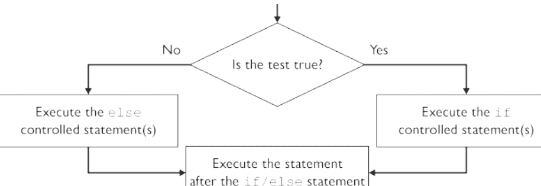

这种控制结构的特殊之处在于，它有两组受控语句和两个不同的关键字（`if` 和 `else`）。图 4.2 指出了控制流。计算机执行测试，根据代码求值结果是 `true` 还是 `false`，执行两组语句中的某一组。

与 `for` 循环的情况一样，如果你只有一条语句要执行，就不需要包含大括号。然而，Java 的惯例是即使不需要也包含大括号，我们在书中也遵循了这一惯例。

## 关系运算符

`if/else` 语句由测试控制。简单测试比较两个表达式，以查看它们是否以某种方式相关联。此类测试本身是下面述形式的表达式，并返回 `true` 或 `false`：

```java
<expression> <relational operator> <expression>
```

要评估这种形式的测试，首先求值两个表达式，然后判断左右值之间是否满足给定的关系。如果关系成立，测试结果为 `true`。否则，测试结果为 `false`。

关系运算符列在表 4.1 中。注意，相等运算符由两个等号（`==`）组成，以区分它于赋值运算符（`=`）。

**表 4.1 关系运算符**

| 运算符 | 含义 | 示例 | 数值 |

|---|---|---|---|

| == | 等于 | 2 + 2 == 4 | true |

| != | 不等于 | 3.2 != 4.1 | true |

| < | 小于 | 4 < 3 | false |

| > | 大于 | 4 > 3 | true |

| <= | 小于等于 | 2 <= 0 | false |


| `>=` | 大于等于 | `2 >= 0` | `true` |

## 表 4.2 Java 优先级

| 描述 | 运算符 |
|---|---|
| 元运算符 | `++`, `--` |
| 乘法运算符 | `*`, `/` |
| 加法运算符 | `+`, `-` |
| 关系运算符 | `<`, `<=`, `>`, `>=` |
| 等等运算符 | `==`, `!=` |
| 赋值运算符 | `=`, `-=`, `%=` |

## 嵌套 `if/else` 语句

许多学者编写像这样的代码：


```java
if (<test1>) {
  statement1;
}
if (<test2>) {
  statement2;
}
if (<test3>) {
  statement3;
}
```

这种顺序结构适用于你想执行三个语句的任何组合。例如，你可能会在一个包含三个可选部分的问卷程序中编写此类代码，其中任何组合对某人来说都是可能的。

图 4.3 显示了顺序代码的流程。注意，计算机可能不执行任何受控语句（如果所有测试为假），只执行一条（如果恰好只有一个测试为真），或者执行多条（如果多个测试为真）。

然而，通常你只想执行一系列语句。在这种情况下，最好嵌套 `if` 语句，将它们一个叠在另一个内部：

```java
if (<test1>) {
    statement1;
} else {
    if (<test2>) {
        statement2;
    } else {
        if (<test3>) {
            statement3;
        }
    }
}
```

当你使用这种结构时，你可以确定计算机最多只会执行一条语句：即对应第一个为真的测试的语句。

结果为 `true`。如果没有一个测试的结果为 `true`，则不执行任何语句。如果最多执行一条

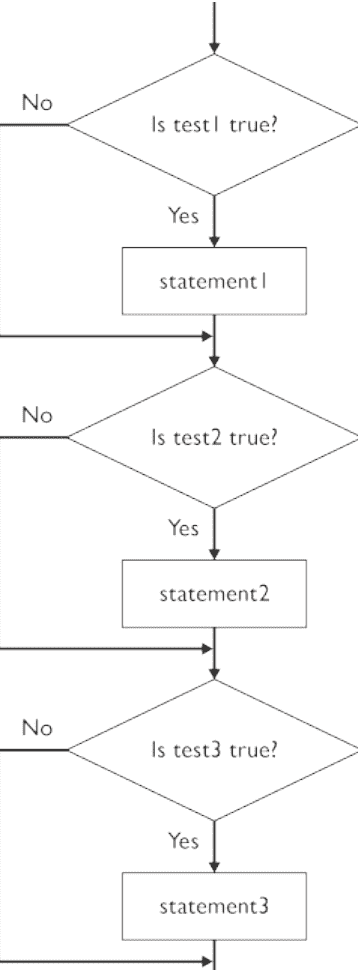

图 4.3 顺序 `ifs` 的流程图

如果你的目标是执行一条语句，那么这种结构比顺序的 `if` 语句更合适。它减少了错误的概率并简化了测试过程。

如你所见，这样嵌套 `if` 语句会导致大量的缩进。这种缩进并没有什么帮助，因为这种构造真正的意图允许在多个替代方案中选择一个。K&R 风格对这个问题也有解决方案。如果 `else` 后面跟着一个 `if`，我们将它们放在同一行：

```java
if (<test1>) {
    <statement1>;
} else if (<test2>) {
    <statement2>;
} else if (<test3>) {
    <statement3>;
}
```

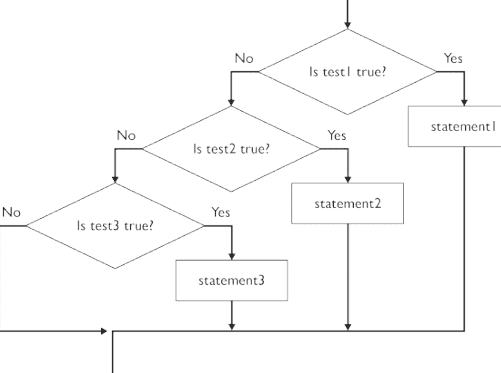

图 4.4 以测试结束的嵌套 ifs 流程图

当你遵循这种约定时，各种语句都处于相同的缩进级别。我们建议嵌套的 `if/else` 语句这样缩进。

**图 4.4 显示了嵌套 `if/else` 代码的流程。请注意，可以执行受控语句之一（第一个评估结果为 `true` 的语句）或者都不执行（如果没有一个测试的结果为 `true`）。**

在这种结构的变体中，最后的语句由 `else` 而不是测试控制：

```java
if (<test1>) {
    <statement1>;
} else if (<test2>) {
    <statement2>;
} else {
    <statement3>;
}
```

在这个构造中，当所有测试都失败时，计算机将始终选择最后一个分支，因此该构造将始终执行三个语句中的一个。**图 4.5 显示了这种修改后的嵌套 `if/else` 代码的流程。**

为了探索这些变体，考虑让计算机判断一个数字是正数、负数还是零的任务。你可以将此任务结构化为三个简单的 `if` 语句，如下：

```java
if (number > 0) {
    System.out.println("Number is positive.");
}
if (number == 0) {
    System.out.println("Number is zero.");
}
if (number < 0) {
    System.out.println("Number is negative.");
}
```

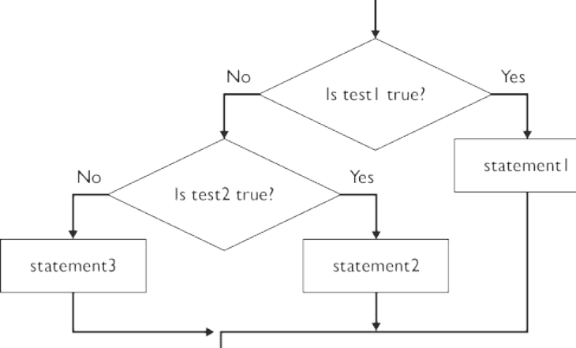

图 4.5 以 `else` 结束的嵌套 ifs 流程图

要确定有多少个 `println` 可能执行，你必须停下来思考正在执行的测试。但不应该花费这么多精力来理解这段代码。如果你嵌套 `if` 语句，代码会更清晰：

```java
if (number > 0) {
    System.out.println("Number is positive.");
} else if (number == 0) {
    System.out.println("Number is zero.");
} else if (number < 0) {
    System.out.println("Number is negative.");
}
```

然而，这个解决方案有一个问题。你知道你想执行一个且仅一个 `println` 语句，但这种嵌套结构并没有排除不执行任何语句的可能性（如果所有三个测试都失败，就会发生）。当然，对于这些永远不会发生的特定测试：如果一个数字既不是正数也不是零，它必须是负数。因此，这里的最后一个测试是不必要的且具有误导性的。你必须考虑测试，以判断是否存在所有三个测试都失败且三个分支都被跳过的情况。

在这种情况下，最佳解决方案是嵌套的 `if/else` 方法，其最后一个分支在在前两个测试失败时总是会被执行的：

```java
if (number > 0) {
    System.out.println("Number is positive.");
} else if (number == 0) {
    System.out.println("Number is zero.");
} else {
    System.out.println("Number is negative.");
}
```

你可以一眼看出这种构造并立即发现恰恰执行一个 `println`。你不需要查看正在执行的测试就能意识到这一点；这是这种嵌套 `if/else` 结构的属性。如果你愿意，可以包含一条注释来明确正在发生什么：

```java
if (number > 0) {
    System.out.println("Number is positive.");
} else if (number == 0) {
    System.out.println("Number is zero.");
} else { // number must be negative
    System.out.println("Number is negative.");
}
```

这种方法的一个用处是效率。当代码包含三个简单的 `if` 语句时，计算机将始终执行所有三个测试。当代码使用嵌套 `if/else` 方法时，计算机只执行测试直到找到匹配项，这对资源的利用更好。例如，前面的代码中我们只需要对正数执行一次测试，总共最多执行两次测试。

当你发现自己在编写代码在这些替代方案之间进行选择时，你必须分析特定问题，以确定你想执行多少个分支。如果分支的组合如何并不重要，请使用顺序的 `if` 语句。如果你希望执行一个或不执行分支，请使用嵌套语句。如果执行执行一个分支，是由 `else` 控制的。

| 情况 | 构造 | 形式 |
|---|---|---|
| 你想执行分支的任何组合 | 顺序的 ifs | `if (<test1>) { <statement1>; } if (<test2>) { <statement2>; } if (<test3>) { <statement3>; }` |
| 你想执行一个或不执行分支 | 嵌套 ifs 以测试结束 | `if (<test1>) { <statement1>; } else if (<test2>) { <statement2>; } else if (<test3>) { <statement3>; }` |
| 你想执行恰好一个分支 | 嵌套 ifs 以 else 结束 | `if (<test1>) { <statement1>; } else if (<test2>) { <statement2>; } else { <statement3>; }` |

表 4.3 `if/else`

# 常见编程错误：错误的 `if/else` 构造

假设你的老师告诉你等级如下：

- A ≥ 90
- B ≥ 80
- C ≥ 70
- D ≥ 60
- F < 60

你可以将此刻度表翻译为如下代码：

```java
String grade;
if (score >= 90) {
    grade = "A"
}
if (score >= 80) {
    grade = "B"
}
if (score >= 70) {
    grade = "C"
}
if (score >= 60) {
    grade = "D"
}
```

```java
if (score < 60) {
    grade = "F"
}
```

然而，如果你在这些代码之后使用变量 `grade`，你会得到编译器的错误：

> variable 可能未初始化

这提示了一个问题。Java 编译器认为存在导致 `grade` 未定义的路径。实际上，变量总是会被初始化的，但编译器无法判断。我们可以通过给 `grade` 一个初始值来解决这个问题：

> `String grade = "no grade";`

这个更改允许代码编译。但如果你编译并运行程序，你会发现它只给出两个等级：D 和 F。任何至少 60 分的人都得到 D，低于 60 分的人得到 F。尽管编译器抱怨过存在允许 `grade` 未初始化的路径，但并没有人获得 "no grade" 等级。

这里的问题在于，你想执行恰好一个赋值语句，但当你使用顺序语句时，程序可能会执行其中的几个几个。例如，如果一个学生的分数是 95，该学生的 `grade` 被设置为 "A"，然后重置为 "B"，然后重置为 "C"，最后重置为 "B"。你可以通过使用嵌套 `if/else` 构造来解决这个问题：

```java
java
String grade;
if (score >= 90) {
    grade = "A";
} else if (score >= 80) {
    grade = "B";
} else if (score >= 70) {
    grade = "C";
} else if (score >= 60) {
    grade = "D";
} else { // score < 60
    grade = "F"
}
```

# 对象相等性

你在在本章前面的部分看到，可以使用 `==` 和 `!=` 运算符分别测试原始数据等的相等性和不相等性。遗憾的是，当你测试对象时，这些运算符的工作方式并不是你预期的那样。

像字符串等对象的相等性。你将不得不学习一种新的测试对象是否相等的方法。

例如，你可能会编写如下代码来从控制台读取一个标记（token），并根据用户的回答是“yes”还是“no”调用两个不同方法之一。如果用户既没有输入这两个词，这段代码应该打印一条错误信息：

```java
System.out.print("yes or no?");
String s = console.next();
if (s == "yes") {
    processYes();
} else if (s == "no") {
    processNo();
} else {
    System.out.println("You didn't type yes or no");
}
```

遗憾的是，这段代码不起作用。无论用户输入什么，程序始终会打印“You didn't type yes or no”。我们将在第 8 章详细探讨为什么这段代码不起作用。现在，重要的是 Java 提供了另一种测试相等性的方法，专门专门用于对象。每个 Java 对象都拥有一个名为 `equals` 的方法，该方法接受另一个对象作为参数。你可以使用这个方法询问一个对象是否等于另一个对象。例如，我们可以如下修复之前的代码：

```java
System.out.print("yes or no?");
String s = console.next();
if (s.equals("yes")) {
    processYes();
} else if (s.equals("no")) {
    processNo();
} else {
    System.out.println("You didn't type yes or no?");
}
```

记住，在处理字符串时，你应该始终调用 `equals` 方法而不是使用 `==`。

`String` 类还有一个 `equals` 方法的特殊变体，叫做 `equalsIgnoreCase`，它会忽略大小写（大写字母与小写字母）。例如，你可以如下重写前面的代码以识别如“Yes”、“YES”、“No”、“NO”、“yES”等响应：

```java
System.out.print("yes or no?");
String s = console.next();
if (s.equalsIgnoreCase("yes")) {
    processYes();
} else if (s.equalsIgnoreCase("no")) {
    processNo();
} else {
    System.out.println("You didn't type yes or no?");
}
```

## 提取构 `if/else` 语句

假设你正在编写一个与用户玩赌博游戏的程序，并且你想根据用户剩余现金的多少给出不同的警告。接下来的嵌套 `if/else` 结构区分了三种情况：资金少于 500 美元（被视为低）、资金在 500 到 1000 美元之间（被视为正常）、资金超过 1000 美元（被视为良好）。注意在每种情况下用户都会得到不同的建议：

```java
if (money < 500) {
    System.out.println("You have $" + money + " left.");
    System.out.print("Cash is dangerously low. Bet carefully.");
    System.out.print("How much do you want to bet? ");
    bet = console.nextInt();
} else if (money < 1000) {
    System.out.println("You have $" + money + " left.");
    System.out.print("Cash is somewhat low. Bet moderately.");
    System.out.print("How much do you want to bet? ");
    bet = console.nextInt();
} else {
    System.out.println("You have $" + money + " left.");
    System.out.print("Cash is in good shape. Bet liberally.");
    System.out.print("How much do you want to bet?");
    bet = console.nextInt();
}
}
```

这种结构是重复的，可以通过一种称为“提取”（factoring）的技术使其变得更高效。使用这种简单的技术，你可以从 `if/else` 结构的不同分支中提取出公共代码段。在前面的程序中，根据 `money` 的值，可以执行三个不同的分支。从写下每个分支中执行的一系列动作并对它们进行比较开始，如图 4.6 所示。

图 4.6 提取前的 `if/else` 分支

你可以在这种结构的顶部和底部都进行提取。如果你发现每个分支中的语句是相同的，你可以将它们从分支部分提取出来，并放在分支之前。同样地，如果每个分支底部的语句是相同的，你可以将它们从分支部分提取出来，并放在循环之后。你可以提取这些分支中顶部的语句以及底部的两个语句，如图 4.7 所示。

图 4.7 提取后的 `if/else` 分支

因此，之前的代码可以简化为如下更简洁的版本：

```java
System.out.println("You have $" + money + " left.");
if (money < 500) {
    System.out.print("Cash is dangerously low. Bet carefully.");
} else if (money < 1000) {
    System.out.print("Cash is somewhat low. Bet moderately.");
} else {
    System.out.print("Cash is in good shape. Bet liberally.");
}
```

## 测试多个条件

当你编写程序时，经常会发现需要测试一个以上的条件。例如，假设你想测试一个数字是否在 1 到 10 之间。Java 提供了一种使用逻辑运算符来组合测试的方法。逻辑与运算符（`&&`）要求两部分都为真。还有一个类似的运算符（`||`），如果两个部分中的任一个为真，它就为真。例如，如果你想检查用户输入的是“yes”还是“no”，你可以这样写：

```java
if (s.equals("yes") || s.equals("no")) {
    // ...
}
```

我们将在下一章更详细地探讨逻辑与或运算符。

## 4.2 累积算法

你程序写得越多，就越发现某些模式会显现出来。许多算法涉及逐步累积答案。在本节中，我们将探索一些常见的算法。

### 累加和


你经常想要找到一组数字的和。这样做的方法之一是为你想包含的每个值声明一个不同的变量，但这并不实际。幸运的是，有一种更简单的方法。技巧是保持结果的运行计数，并一次处理一个数字。例如，要向名为 `sum` 的变量相加，你会写如下代码：

```
sum = sum + next;
```

或者，你可以使用复合赋值运算符：

```
sum += next;
```

上面的语句获取 `sum` 的现有值，加上名为 `next` 的值，并将结果存储为 `sum` 的新值。此操作会对每个求和的数字执行一次。注意，当你第一次执行此语句时，`sum` 还没有值。为了解决这个问题，你将 `sum` 初始化为一个不影响答案的值。

这是累积算法的伪代码描述：

```
sum = 0.
for (all numbers to sum) {
    obtain "next".
    sum += next.
}
```

要实现这个算法，你必须决定循环多少次以及如何获取下一个值。这里有一个交互式程序，提示用户输入相加的数字数量以及数字本身：

```java
// 找到一组数字的和。

import java.util.*;

public class ExamineNumbers1 {
    public static void main(String[] args) {
        System.out.println("This program adds a sequence of");
        System.out.println("numbers.");
        System.out.println();

        Scanner console = new Scanner(System.in);

        System.out.print("How many numbers do you have? ");
        int totalNumber = console.nextInt();

        double sum = 0.0;
        for (int i = 1; i <= totalNumber; i++) {
            System.out.print("# " + i + " ? ");
            double next = console.nextDouble();
            sum += next;
        }

        System.out.println();
        System.out.println("sum = " + sum);
    }
}
```

25 }

26 )

程序的执行情况看起来像这样（按照惯例，用户输入为粗体）：

```
此程序会将一组数字相加。
你有几个数字？6
#1? 3.2
#2? 4.7
#3? 5.1
#4? 9.0
#5? 2.4
#6? 3.1
sum = 27.5
```

让我们详细追踪一下执行过程。在进入循环之前，我们将变量 `sum` 初始化为 0.0：

```
sum 0.0
```

在循环的第一次执行中，我们从用户处读取了值 3.2，并将该值加到 `sum` 中：

```
sum 3.2 next 3.2
```

第二次通过循环时，我们读取了值 4.7，并将其加到 `sum` 的值：

```
sum 7.9 next 4.7
```

注意，`sum` 现在包含了用户输入的两个数字，因为我们把新值 4.7 加到了旧值 3.2 之上。第三次通过循环时，我们加上了值 5.1：

```
sum 13.0 next 5.1
```

注意，变量 `sum` 现在包含了前三个数字之和（3.2 + 4.7 + 5.1）。现在我们读取了 9.0 并将其加到 `sum` 中：

```
sum 22.0 next 9.0
```

然后我们加上第五个值 2.4：

```
sum 24.4 next 2.4
```

最后，我们加上了第六个值 3.1：

```
sum 27.5 next 3.1
```

我们退出 `for` 循环并打印 `sum` 的值。

在这个特定的程序中有一个有趣的作用域问题。注意变量 `sum` 是在循环外声明的，而变量 `next` 是循环内部声明的。我们必须在循环外部声明 `sum`，因为它需要初始化，并且在循环之后仍被使用。但变量 `next` 只在循环内部使用，因此它可以在内部作用域中声明。最好在尽可能内层的作用域中声明变量。

累加和算法及其变体在你解决的许多编程任务中都会有用。你会如何做累乘算法呢？这里是伪代码：

```
product = 1;
for (all numbers to multiply) {
    obtain "next";
    product = product * next;
}
```

## 极值循环

另一个常见的编程任务是跟踪序列中的最大值和/或最小值。例如，考虑在人类居住的月球上建造一个居住区是否可行。障碍之一是月球表面的平均日温度为惊人的 250 度华氏。但一个更严峻的问题是数值范围很大；它的范围从最低的 -2240 度华氏到最高 250 度华氏。

要计算一组数值的最大值，你可以跟踪目前为止见过的最大值，并使用 `if` 语句在遇到比当前最大值更大的新值时更新最大值。这种方法可以用如下伪代码描述：

```
initialize max.
for (all numbers to examine) {
    obtain "next"
    if (next > max) {
        max = next;
    }
}
```

初始化最大值并不听起来那么简单。例如，初学者经常将 `max` 初始化为 0。但如果你正在检查的数字序列完全由负数组成怎么办？例如，你被要求找到这个序列的最大值：

-84,-7,-14,-39,-410,-17,-49

这个序列中的最大值是 -7，但如果你将 `max` 初始化为 0，程序将错误地报告 0 为最大值。

这个问题有两个经典的解决方案。首先，如果你知道正在检查的数字范围，可以为 `max` 做一个合适的选择。在这种情况下，你可以将 `max` 设置为范围内的最低值。这似乎不符合直觉，因为我们通常认为最大值是很大的，但这种思想是将 `max` 设置为它可能达到的最小值，这样任何更大的值都会导致 `max` 重置为该值。例如，如果你知道之前的数字序列是由华氏度温度组成的，你就知道温度永远不会低于零度（约 -459 度华氏），因此你可以将 `max` 初始化为该值。

第二种可能性是将 `max` 初始化为序列中的第一个值。这并不总是方便，因为这意味着要在循环之外获取其中一个数字。

当你结合这两种可能性时，伪代码变为：

```
initialize max either to lowest possible value or to first value.
for (all numbers to examine) {
    obtain "next".
    if (next > max) {
        max = next;
    }
}
```

计算最小值的伪代码是这段代码的变体：

```
initialize min either to highest possible value or to first value.
for (all numbers to examine) {
    obtain "next".
    if (next < min) {
        min = next;
    }
}
```

为了帮助理解，让我们让伪代码行动。我们需要将伪代码转换为代码。让我们使用一个生成序列的循环，并在循环内部使用 `if/else` 语句来更新最大值最小值。它看起来像这样：

```java
for (int i = 0; i < length; i++) {
    // compute next value
    if (next > max) {
        max = next;
    } else if (next < min) {
        min = next;
    }
}
```

# 使用 if 的累加和

现在让我们来探索如何使用 `if/else` 语句为累加和算法创建一些有趣的变体。假设你想读取一组数字并计算它们的平均值。这个任务看起来是累加代码的一个直观的变体。你可以通过总和除以数字个数来计算平均值：

```java
double average = sum / totalNumber;
System.out.println("average = " + average);
```

但这段代码有一个小微的问题。假设当程序询问用户要处理多少个数字时，用户输入了 0。那么程序将不会进入累加循环，你的代码将尝试计算 0 除以 0 的值。Java 随后会打印平均值为 NaN，这是一个晦涩的信息，是“Not a Number（不是数字）”的缩写。如果程序能打印其他类型的信息，表示没有数字可以计算平均值，会更好。你可以使用 `if/else` 语句来实现这一目的：

```java
if (totalNumber <= 0) {
    System.out.println("No numbers to average");
} else {
    double average = sum / totalNumber;
    System.out.println("average = " + average);
}
```

`if` 语句的另一个用途是统计用户输入了多少负数。你通常想统计程序中某件事发生的次数。这个目标可以通过一个 `if` 语句和一个名为计数器（counter）的整数变量轻松实现。你首先将计数器初始化为 0：

```java
int negatives = 0;
```

你可以为变量起任何名字。这里我们使用了 `negatives`，因为那是你正在统计的内容。另一个关键步骤是在循环内部通过感兴趣的测试时增加计数器的值：

```java
if (next < 0) {
    negatives++;
}
```

当你将这些整合在一起并修改注释和引言时，你就得到了以下累加和程序的变体：

```java
// 计算一组数字的平均值，并
// 报告用户指定的数字中有多少个是负数。

import java.util.*;

public class ExamineNumbers2 {
    public static void main(String[] args) {
        System.out.println("This program examines a sequence");
        System.out.println("of numbers to find the average");
        System.out.println("and count how many are negative.");
        System.out.println();

        Scanner console = new Scanner(System.in);

        System.out.print("How many numbers do you have? ");
        int totalNumber = console.nextInt();

        int negatives = 0;
        double sum = 0.0;

        for (int i = 1; i <= totalNumber; i++) {
            System.out.print("## " + i + "? ");
            double next = console.nextDouble();
            sum += next;

            if (next < 0) {
                negatives++;
            }
        }

        System.out.println();

        if (totalNumber <= 0) {
            System.out.println("No numbers to average");
        } else {
            double average = sum / totalNumber;
            System.out.println("average = " + average);
            System.out.println("# of negatives = " + negatives);
        }
    }
}
```

程序的执行结果看起来如下：

```
This program examines a sequence
of numbers to find the average
and count how many are negative.
How many numbers do you have? 8

#1? 2.5
#2? 9.2
#3? 219.4
#4? 208.2
#5? 42.3
#6? 92.7
#7? 217.4
#8? 8
average = 40.7625
# of negatives = 2
```

## 舍入误差

在探索累加算法时，你会发现一个你应该理解的特殊问题。例如，考虑上述 `ExamineNumbers2` 程序在不同用户输入下的执行：

```text
This program examines a sequence
of numbers to find the average
and count how many are negative.
How many numbers do you have? 4
#1? 2.1
#2? -3.8
#3? 5.4
#4? 7.4
average = 2.7750000000000004
# of negatives = 1
```

如果你使用计算器，你会发现这四个数字之和为 11.1。如果你将这个数字除以 4，你会得到 2.775。然而，Java 报告的结果是 2.7750000000000004。所有的零是从哪里来的？为什么数字以 4 结尾？答案是，浮点数会导致舍入误差。

## 舍入误差

一种由于浮点数被存储为近似值而非精确值而产生的数值误差。

舍入误差通常很小，并且可以向任何方向发生（略微偏高或略微偏低）。在上案例中，我们得到了一个略微偏高的误差。

浮点数以类似于科学计数法的格式存储，包含一组数字和一个指数。考虑三分之一在科学计数法中将如何被存储。我们无法存储 0.3333333333333333...，所以我们得到了 0.3333333333333333。如果我们在上面加上 0.1，我们得到 0.4333333333333333。如果再加上 0.1，我们得到 0.5333333333333333。如果再加上 0.1，我们得到 0.6333333333333333。如果再加上 0.1，我们得到 0.7333333333333333。如果再加上 0.1，我们得到 0.8333333333333333。如果再加上 0.1，我们得到 0.9333333333333333。如果再加上 0.1，我们得到 1.0333333333333332。如果再加上 0.1，我们得到 1.1333333333333333。如果再加上 0.1，我们得到 1.2333333333333334。如果再加上 0.1，我们得到 1.3333333333333335。如果再加上 0.1，我们得到 1.4333333333333336。如果再加上 0.1，我们得到 1.5333333333333337。如果再加上 0.1，我们得到 1.6333333333333338。如果再加上 0.1，我们得到 1.7333333333333339。如果再加上 0.1，我们得到 1.8333333333333340。如果再加上 0.1，我们得到 1.9333333333333341。如果再加上 0.1，我们得到 2.0333333333333342。

由于 0.1 无法在二进制中精确存储，每次加上 0.1，误差就会累积，这就是为什么误差会越来越大。

```java
public class Roundoff {
    public static void main(String[] args) {
        double n = 0.0;

        for (int i = 1; i <= 10; i++) {
            n += 0.1;
            System.out.println(n);
        }
    }
}
```

这段代码产生了令人惊讶的输出：

```text
0.10000000000000001
0.20000000000000001
0.30000000000000004
0.40000000000000003
0.5000000000000001
0.6000000000000001
0.7000000000000001
0.8000000000000001
0.9000000000000001
1.0000000000000001
```

无论顺序如何，这些数字之和始终是 41。但如果我们不再将这些值视为整数美分，而是将它们视为美元的分数并存储为 `double` 类型：

```java
double dollars1 = 0.01 + 0.05 + 0.10 + 0.25;

double dollars2 = 0.25 + 0.10 + 0.05 + 0.01;

System.out.println(dollars1);

System.out.println(dollars2);
```

这段代码的输出如下：

```text
0.41000000000000003
0.41
```


即使我们相加的是完全相同的数字，顺序不同也会产生差异。原因在于入误差。

在处理双精度浮点数时不使用相等判断。相反，我们可以使用这样的测试来判断数字是否接近：

```java
if (Math.abs(dollars1 - dollars2) < 0.001) {
    ...
}
```

我们使用绝对值（来自 `Math` 类的 `abs` 方法）来找到差异的幅度，然后测试它是否小于某个很小的数值（在本例中为 `0.001`）。

在本章的后后部分，我们将介绍 `print/printf` 的变体 `printf`，它将让我们更方便地打印像这样的数字，而不需要所有额外的数字位。

## 4.3 文本处理

程序员经常面临需要创建、编辑、检查和格式化文本的问题。我们把这些任务统称为*文本处理*。

> 文本处理  
> 编辑和格式化文本字符串。

在本节中，我们将更详细地查看 `char` 基本数据类型，并引入一个新的名为 `System.out.printf` 的命令。这两个工具对于文本处理任务都非常有用。

## `char` 类型

基本类型 `char` 代表文本的单个字符。如果你愿意，定义 `char` 类型的变量、参数和返回值是合法的。`char` 类型的字面量通过将字符放在单引号内来表示：

```java
char ch = 'A';
```

### 表 4.4 `char` 和 `String` 的区别

| `char` | `String` |
|---|---|
| 值类型 | 基本类型 |
| 内存占用 | 2 字节 |
| 方法 | 无 |
| 字母数量 | 正好 1 个 |
| 包围符号 | 单引号：`'c'` |
| 比较 | `<`、`>=`、`=` 等 |
| 对象 | 对象 |
| 取决于长度 | `length`、`toUpperCase` 等 |
| 0 到多个 | 双引号：`"Str"` |
| `equals` | `equals` |

创建一个表示转义序列的 `char` 值也是合法的：

```java
char newline = '\n';
```

在上一章中，我们讨论了 `String` 对象。`char` 和 `String` 之间的区别让很多 Java 初学者感到困惑。主要的区别是 `String` 是一个对象，而 `char` 是一个基本值。`char` 占据非常小的内存，但它没有方法。表 4.4 总结了这些类型之间的几种区别。

为什么 Java 为如此相似的数据准备了两种类型？`char` 类型的存在主要出于历史原因；它可以追溯到影响 Java 设计的较旧语言（如 C）。

那么，人为什么要使用 `char` 类型而非 String 呢？使用 `char` 往往是必要的，因为 Java API 中的某些方法将其作为参数或返回类型。但在某些情况下，`char` 比使用 `String` 更有用或更简单。

`String` 的字符存储在对象内部，作为 `char` 类型类型的值。你可以通过对象的 `charAt` 方法访问单个字符，该方法接受一个整数索引作为参数，并返回该索引处的字符。我们经常遍历字符串以检查或更改其字符。例如，下面的方法会单独成行打印字符串的每个字符：

```java
public static void printVertical(String message) {
    for (int i = 0; i < message.length(); i++) {
        char ch = message.charAt(i);
        System.out.println(ch);
    }
}
```

### `char` 与 `int`

`char` 类型的值在内部被存储为 16 位整数。一种名为 Unicode 的标准编码方案决定了哪个整数代表每个字符。（Unicode 将在本章稍后的部分详细介绍。）

由于字符实际上是整数，每当 Java 需要一个 `int` 时，会自动将 `char` 类型的值转换为 `int`：

```java
char letter = 'a' + 2; // 存储 'c'
```

事实证明 `'a'` 的整数值是 97，因此表达式的结果是 99，它被存储为字符 `'c'`。同样，`int` 也可以通过类型转换转换为 `char`。（需要这种转换作为对编译器的承诺，因为并不是每一个可能的 `int` 值都对应于有效的字符）。下面是一个使用类型转换将 `int` 转换为 `char` 类型值的代码段：

```java
int code = 66;
char grade = (char) code; // 存储 'B'
```

由于 `char` 类型的值实际上是整数，因此还可以使用 `<` 或 `==` 等关系运算符进行比较。此外，它们可以用于循环以覆盖字母范围。例如，下面的代码打印字母表中的每个字母：

```java
for (char letter = 'a'; letter <= 'z'; letter++) {
    System.out.print(letter);
}

if (c == 'B') {...} // true
```

你可以通过在网上搜索 Unicode 表来了解更多关于字符到整数等值的知识。

## 累加文本算法

在本章早期讨论过的，字符字符串经常用于累加算法。例如，你可能会遍历字符串的字符以搜索特定的字母。下面的方法接受一个字符串和一个字符，并返回字符在字符串中出现的次数：

```java
public static int count(String text, char c) {
    int found = 0;

    for (int i = 0; i < text.length(); i++) {
        if (text.charAt(i) == c) {
            found++;
        }
    }

    return found;
}
```

`char` 可以使用标准的 `+` 运算符与 `String` 拼接。使用这个想法，可以使用循环构建 `String`，从空字符串开始并拼接单个字符。这被称为累加。

### 表 4.5 `Character` 类的有用方法

| 方法 | 描述 | 示例 |
|---|---|---|
| `getNumericValue(ch)` | 将字符转换为数字 | `getNumericValue('6')` 返回 6 |
| `isDigit(ch)` | 字符是否为 0 到 9 之一 | `isDigit('A')` 返回 false |
| `isLetter(ch)` | 字符是否为字母 | `isLetter('Z')` 返回 true |
| `isLowerCase(ch)` | 字符是否是小写字母 | `isLowerCase('q')` 返回 |
| `isUpperCase(ch)` | 字符是否是大写字母 | `isUpperCase('a')` 返回 false |
| `toLowerCase(ch)` | 字符的小写形式 | `toLowerCase('Q')` 返回 `'q'` |
| `toUpperCase(ch)` | 字符的大写形式 | `toUpperCase('x')` 返回 `'X'` |

下面的方法接受一个字符串并反转返回：

```java
public static String reverse(String phrase) {
    String result = "";

    for (int i = phrase.length() - 1; i >= 0; i--) {
        result = phrase.charAt(i) + result;
    }

    return result;
}
```

例如，`reverse("man")` 的调用返回 `nam`。

许多有用的方法可以调用来检查信息。记住 `char` 是一个基本类型，这意味着你不能使用 `.` 语法。相反，`Character` 类。下面的方法计算字符串中的字母数量，忽略所有标点符号和空格：

```java
public static int countLetters(String phrase) {
    int count = 0;

    for (int i = 0; i < phrase.length(); i++) {
        char ch = phrase.charAt(i);

        if (Character.isLetter(ch)) {
            count++;
        }
    }

    return count;
}
```

## `System.out.printf`

到为止我们使用了 `System.out.println` 和 `System.out.print` 输出。还有第三种方法 `System.out.printf`，它提供了一些新功能。`printf` 中的 "f" 代表 "formatted"（格式化意味着 `System.out.printf` 可以让你控制输出格式。

假设你想打印 1 到 10 的乘法表。下面的代码打印了正确的数字，但看起来并不好看：

```java
for (int i = 1; i <= 10; i++) {
    for (int j = 1; j <= 10; j++) {
        System.out.print(i * j + " ");
    }

    System.out.println();
}
```

输出如下。注意数字没有垂直对齐：

```text
1 2 3 4 5 6 7 8 9 10
2 4 6 8 10 12 14 16 18 20
3 6 9 12 15 18 21 24 27 30
4 8 12 16 20 24 28 32 36 40
5 10 15 20 25 30 35 40 45 50
6 12 18 24 30 36 42 48 54 60
7 14 21 28 35 42 49 56 63 70
8 16 24 32 40 48 56 64 72 80
9 18 27 36 45 54 63 72 81 90
10 20 30 40 50 60 70 80 90 100
```

| 2 | 4 | 6 | 8 | 10 | 12 | 14 | 16 | 18 | 20 |
|---|---|---|---|---|---|---|---|---|---|
| 3 | 6 | 9 | 12 | 15 | 18 | 21 | 24 | 27 | 30 |
| 4 | 8 | 12 | 16 | 20 | 24 | 28 | 32 | 36 | 40 |
| 5 | 10 | 15 | 20 | 25 | 30 | 35 | 40 | 45 | 50 |
| 6 | 12 | 18 | 24 | 30 | 36 | 42 | 48 | 54 | 60 |
| 7 | 14 | 21 | 28 | 35 | 42 | 49 | 56 | 63 | 70 |
| 8 | 16 | 24 | 32 | 40 | 48 | 56 | 64 | 72 | 80 |
| 9 | 18 | 27 | 36 | 45 | 54 | 63 | 72 | 81 | 90 |
| 10 | 20 | 30 | 40 | 50 | 60 | 70 | 78 | 80 | 90 | 100 |

我们可以通过制表符来分隔数字，这样会更好。这种分隔方式无法对表格的外观提供太大的控制力。屏幕上的每个数字将正好隔开八个空格，且数字将左对齐。手动对数字进行右对齐将是痛苦的，因为你必须使用 `if/else` 语句来检查给定数字是否在某个范围内，并在必要时用指定数量的空格进行填充。

## 你知道吗？ASCII 和 Unicode

我们以二进制数（0 和 1 的序列）在计算机上存储数据。为了存储文本数据，我们需要一种编码方案，告诉我们对于任何给定的字符使用什么样的 0 和 1 序列。把它想象成一个巨大的解码环，上面写着类似“如果你想存储小写 `'a'`，请使用序列 01100001。”

在 20 世纪 60 年代，IBM 开发了一种名为 EBCDIC 的编码方案，它与该公司的打孔卡配合良好，这些卡片在计算机发明之前已经使用了几十年。但很快人们发现，EBCDIC 对于计算机程序员来说并不是一种方便的编码方案。序列中的存在隙，导致像 `'i'` 和 `'j'` 这样的字符即使紧挨着出现，看起来也相隔很远。

1967 年，美国标准协会发布了一种名为 ASCII（读作 "AS-key"）的方案，那时起一直使用。该缩写是“信息交换美国标准代码”的简写。在原始形式中，ASCII 定义了 128 个字符，每个字符都可以用 7 位数据存储。

ASCII 最大的问题是它是一个美国代码。其他国家常用的许多字符并没有包含在 ASCII 中。例如，英镑 (£) 和西班牙语字母 n 的变体 (ñ) 都不包含在标准的 128 个 ASCII 字符中。人们曾尝试扩展 ASCII，将其翻倍到 256 个字符，以便包含许多此类特殊字符。然而事实证明，即使是 256 个字符也不足以捕捉人类交流惊人的多样性。

在 Java 创建期间，一个软件专业人员联盟引入了一种名为 Unicode 的新字符标准。他们认为标准 ASCII 的 7 位和扩展 ASCII 的 8 位根本不够用，因此决定不对用于编码字符的位数设置限制。在写本文时，该联盟已经识别了超过 110,000 个字符，它们需要 16 位来存储。Unicode 包含了大多数现代语言甚至某些古语言使用的字符。埃及象形文字于 2007 年被加入，尽管它仍然不包含玛雅象形文字，而且联盟拒绝了包含克林贡语字符的建议。

Java 的设计者使用 Unicode 作为 `char` 类型的标准，这意味着 Java 程序能够处理全范围的字符。幸运的是，Unicode 联盟决定整合 ASCII 编码，因此 ASCII 可以被视为 Unicode 的子集。如果你对 ASCII 中字符的实际排序感兴趣，可以在你喜欢的搜索引擎中输入 "ASCII table"，你将发现数百万条结果供你探索。

在固定宽度字段中打印值的更简单方法是使用 `System.out.printf` 命令。`printf` 方法接受一个特殊的 `String`，称为`格式化字符串`，它指定输出的的外观，随后是任何要包含在输出中的参数：

```java
System.out.printf(<format string>, <parameter>, ..., <parameter>);
```

格式化字符串类似于普通的 `String`，区别在于它可以包含被称为`格式说明符`的占位符，这些占位符允许你指定变量值插入的位置，以及你想要给该值的格式。格式说明符以 `%` 符号开始，以指定值类型的字母结束，例如 `d` 用于十整数（`int`）或 `f` 用于浮点数（类型为 `double` 的实数）。考虑以下 `printf` 语句：

```java
int x = 38, y = 25;
System.out.printf("location: %d, %f\n", x, y);
```

该语句产生以下输出：

`%d` 并没有被实际打印，而是被格式化字符串之后写的对应参数所替换。格式化字符串中的说明符数量必须与随后的参数数量匹配。第一个说明符将由第一个参数替换，第二个说明符由第二个参数替换，依此类推。`System.out.printf` 是不寻常的，它可以接受不同数量的参数。`printf` 命令类似于 `System.out.print` 的之处在于，除非你明确告诉它，否则它不会移动到下一行。注意在之前的代码中，我们用 `\n` 结束格式化字符串以完成行。例如：

```java
int score = 87;
System.out.printf("You got %d!\n", score);
```

代码产生如下：

```text
You got 87!
```

格式说明符可以包含 `%` 符号后面的信息，以指定宽度、精度和对齐。例如，`%d` 指定在 8 宽度区域内右对齐，而 `%12f` 指定在 12 宽度区域内右对齐并保留四位小数。表 4.6 列出了你可能在程序使用的格式说明符。

| 说明符 | 结果 |
|---|---|
| `%d` | 整数 |
| `%8d` | 整数，右对齐，8 宽度字段 |
| `%6d` | 整数，左对齐，6 宽度字段 |
| `%f` | 浮点数 |
| `%12f` | 浮点数，右对齐，12 宽度字段 |
| `%.2f` | 浮点数，保留到小数点后两位 |
| `%16f` | 浮点数，保留到最近的小位数，16 宽度字段 |
| `%s` | 字符串 |
| `%8s` | 字符串，右对齐，8 宽度字段 |
| `%9s` | 字符串，左对齐，9 宽度字段 |

作为一个综合示例，假设以下变量代表关于学生的信息：

```java
int score = 87;
double gpa = 3.18;
String name = "Jessica";
```

以下代码使用几种格式说明符打印这些变量：

```java
System.out.printf("student name: %10s\n", name);
System.out.printf("exam score: %10d\n", score);
System.out.printf("GPA: %10.2f\n", gpa);
```

代码产生如下：

```text
student name:    Jessica
exam score:         87
GPA:                3.18
```

这三个值在右边缘对齐，因为它们的宽度都是 10。`printf` 方法可以很容易以这种方式对齐列。注意学生的 GPA 舍入为 3.19 是因为说明符中的 `2`。现在回到我们的乘法表。既然我们已经知道了 `printf`，我们可以很容易地以宽度 5 打印表格数字：

```java
for (int i = 1; i <= 10; i++) {
    for (int j = 1; j <= 10; j++) {
        System.out.printf("%5d", i * j);
    }

    System.out.println();
}
```


这段代码产生以下输出：

| 1 | 2 | 3 | 4 | 5 | 6 | 7 | 8 | 9 |
|---|---|---|---|---|---|---|---|---|
| 10 | | | | | | | | |
| 18 | 20 | 22 | 24 | 26 | 28 | 30 | | |
| | | 4 | 8 | 12 | 16 | 20 | 24 | 28 |
| 36 | 40 | | | | | | | |
| | | 5 | 10 | 15 | 20 | 25 | 30 | 35 |
| 45 | 50 | | | | | | | |
| | | | 6 | 12 | 18 | 24 | 30 | 36 |
| 42 | 48 | 54 | 60 | | | | | |
| | | | | 7 | 14 | 21 | 28 | 35 |
| 42 | 49 | 56 | 63 | 70 | | | | |
| | | | | | 8 | 16 | 24 | 32 |
| 40 | 48 | 56 | 64 | 72 | 80 | | | |
| | | | | | | | | 9 | 18 | 27 |
| 36 | 45 | 54 | 63 | 72 | 81 | 90 | | |
| | | | | | | | | | 10 | 20 |
| 30 | 40 | 50 | 60 | 70 | 78 | 80 | 90 | 100 |

`printf`方法也可以解决本章之前介绍的舍入问题。通过修复`double`值的精度，可以确保它会被舍入，以避免双精度算术产生的微小舍入误差。以下是修正后的程序：

```java
// Uses System.out.printf to correct roundoff errors.

public class Roundoff2 {
    public static void main(String[] args) {
        double n = 1.0;

        for (int i = 1; i <= 10; i++) {
            n += 0.1;
            System.out.printf("%3.1f\n", n);
        }
    }
}
```

该程序产生以下输出：

```text
1.1
1.2
1.3
1.4
1.5
1.6
1.7
1.8
1.9
2.0
```

## 4.4 条件执行的方法

我们在第 3 章中引入了大量关于方法的信息，包括如何使用参数将值传递到方法中，以及如何使用`return`语句让方法返回。既然我们已经引入了条件执行，就有必要重新回顾这些问题，以便你对它们有更深入的理解。

## 前提条件和后置条件

每次编写方法时，都应该考虑该方法具体要完成什么。你可以通过描述执行前必须满足的**前提条件**（preconditions）和执行后将变为**后置条件**（postconditions）来描述方法的工作原理。

> **前提条件**  
> 在方法执行之前必须为真的条件，以保证方法能够完成其任务。

### 后置条件

只要在方法调用之前前提条件为真，方法保证在执行完成后将为真的条件。

例如，如果你正在描述汽车装配线上某人的任务，你可能会使用如下后置条件：“固定左前轮的螺栓已安装在车上并拧紧”。但后置条件并不是全部。装配线上的员工是相互依赖。如果左轮不在或者没有螺丝，流水线工人就无法添加并拧紧螺丝。因此，装配线工人可能具有如下前提条件：“左轮已正确安装在汽车上，供应箱中至少有八颗螺丝，并且有一个可用的扳手”。通过说明工人在开始前如果前提条件成立，就可以使后置条件成立，从而完整地描述了任务。

就像装配线上的工人一样，方法需要协同工作，每个方法解决任务的一部分，以便它们共同解决整体任务。前提条件和后置条件描述了方法之间的依赖关系。

## 抛出异常

我们已经见过几种 Java 可能抛出异常的情况。例如，如果我们有一个控制台`Scanner`并调用`nextInt`，如果用户输入了不是`int`的内容，程序将抛出异常。我们在附录中将检查如何处理异常。现在，我们只想探索异常发生的某些方式，以及你可能如何在自己的代码中生成它们。

理想情况下，程序在不产生错误的情况下执行，但在实践中会出现各种问题。如果你要求用户输入整数，用户可能会无意中或恶意地输入非整数内容。或者你的代码中可能存在 bug。

以下程序总是抛出异常，因为它尝试计算 1 除以 0 的值，这在数学上是未定义的：

```java
public class CauseException {
    public static void main(String[] args) {
        int x = 1 / 0;
        System.out.println(x);
    }
}
```

当你运行程序时，会得到以下错误信息：

```text
Exception in thread "main" java.lang.ArithmeticException: / by zero
    at CauseException.main(CauseException.java:3)
```

问题发生在第 3 行，当你要求 Java 计算一个无法存储为`int`的值时。Java 应该对该值做什么？它会抛出一个异常停止程序执行，并警告你在执行该特定行代码时发生了算术异常。

值得注意的是，除以零并不总是产生异常。如果你执行下面这行代码，将不会得到异常：

```java
double x = 1.0 / 0.0;
```

在这种情况下，程序正常执行。这是因为浮点数遵循 IEEE 标准，该标准为此类操作定义了`Infinity`（无穷大）和`NaN`（非数字）。

你可能想自己抛出异常，例如如果你想写一个处理负数输入的阶乘方法。阶乘的数学定义是：

```java
// pre: n >= 0
// post: returns n factorial (n!)

public static int factorial(int n) {
    if (n < 0) {
        throw new IllegalArgumentException("negative n: " + n);
    }

    int product = 1;

    for (int i = 2; i <= n; i++) {
        product = product * i;
    }

    return product;
}
```

```text
Exception in thread "main"

java.lang.IllegalArgumentException: negative n: -1

    at Factorial2.factorial(Factorial2.java:8)
    at Factorial2.main(Factorial2.java:3)
```

该信息表示程序`Factorial2`停止了运行，因为它抛出了`IllegalArgumentException`，且参数`n`为负数 -1。系统向你展示了到达该位置的回溯轨迹。该非法参数出现在`Factorial2`类中`factorial`方法的第 8 行。它是由于`Factorial2`类中`main`方法第 3 行的调用导致的。当你想要查找程序中的 bug 时，这类信息非常有帮助。

抛出异常是防御性编程的一个示例。我们并不希望在编写的程序中出现 bug，但我们毕竟是人，所以我们希望建立一种机制，在我们出错时能提供反馈。编写代码来测试传递给方法的值，并在值不合适时抛出`IllegalArgumentException`，是提供这种反馈的极佳方法。

## 回顾返回值


在第 3 章中，我们查看了一些返回简单计算方法的示例，例如这个计算前 n 个整数和的方法：

```java
public static int sum(int n) {
    return (n + 1) * n / 2;
}
```

现在你已经知道如何编写`if/else`语句，我们可以查看一些涉及返回值的有趣示例。例如，在本章前面，你看到`Math`类有一个名为`max`的方法，它可以返回两个值中的较大值。该方法实际上有两个不同的版本：一个寻找两个整数中的较大，另一个寻找两个双精度数中的较大。记住当两个方法同名（但参数不同）时，这被称为重载。

让我们自己写一个版本的`max`方法，返回两个整数中的较大值。它的头部看起来如下：

```java
public static int max(int x, int y) {
    ...
}
```

我们想要返回`x`或`y`，取决于哪一个较大。这是使用`if/else`结构的完美时机：

```java
public static int max(int x, int y) {
    if (x > y) {
        return x;
    } else {
        return y;
    }
}
```

这段代码开始测试`x`是否大于`y`。如果是，计算机通过返回`x`来执行第一个分支。如果不是，计算机通过返回`y`执行`else`分支。但如果`x`和`y`相等呢？前面的代码在值相等时执行`else`分支，但当`x`和`y`相等时，执行哪个返回语句并不重要。

记住当 Java 执行`return`语句时，方法会停止执行。这就像给 Java 下命令，“立即离开此方法”。这意味着该方法也可以写成：

```java
public static int max(int x, int y) {
    if (x > y) {
        return x;
    }
}
```

这个版本的代码在行为上是等价的，因为`if`语句内部的`return x`将导致 Java 立即退出方法，Java 不会执行`if`之后的`return`语句。另一方面，如果我们没有进入`if`语句，就会直接进入紧随其后的语句（`return y`）。

在程序中使用第一个还是第二个，在某种程度上取决于个人喜好。`if/else`结构清楚地表明方法正在两个替代方案之间进行选择，但有些人更倾向于第二种替代方案，因为它更短。

作为另一个示例，考虑`String`类的`indexOf`方法。我们将定义一个变量`s`来存储以下`String`：

```java
String s = "four score and seven years ago";
```

现在我们可以编写像下面这样的表达式来确定特定字符在`String`中出现的位置：

```java
int r = s.indexOf('r');
int v = s.indexOf('v');
```

这段代码将`r`设置为`3`，因为 3 是字母`'r'`在`String`中第一次出现的索引。它将`v`设置为`17`，因为那是字母`'v'`在`String`中第一次出现的索引。

`indexof`方法是`String`类的一部分，但让我们看看如何编写一个执行相同任务的不同方法。我们的方法名称会有不同，因为它是`String`对象之外的一个静态方法。我们必须同时传递给它`String`和字符：

```java
int r = indexOf('r', s);
int v = indexOf('v', s);
```

因此，我们方法的头部将：

```java
public static int indexOf(char ch, String s) {
    ...
}
```

记住当方法返回值时，我们必须在`public static`之后包含返回类型。在这种情况下，我们指明该方法返回`int`，因为索引将是一个整数。

这个任务可以通过`for`循环很好地解决，遍历从第一个到最后一个每一个可能的索引。我们可以用伪代码描述如下：

```text
for (each index i in the string) {
    if the char is at position i, we...
```

为了充实这一点，记住`String`有一个名为`charAt`的方法，允许我们从`String`中提取单个字符。为了完成这个代码，我们需要知道`String`的长度。我们可以将伪代码完善如下：

```java
for (int i = 0; i < s.length(); i++) {
    if (s.charAt(i) == ch) {
        return i;
    }
}
```

为了理解这段代码，你必须理解`return`语句是如何工作的。例如，如果`String`是（four score...）且我们正在搜索该字符，我们知道当`i`为 3 时，`s.charAt(3)`等于`'r'`。这种情况导致我们的代码执行`return`语句，相当于：

```java
return 3;
```

当`return`语句被执行时，Java 会立即退出方法，这意味着我们跳出循环并返回 3。尽管循环通常会将`i`加到 4 并继续，但我们的代码不会这样做，因为我们遇到了`return`语句。

我们的代码只缺少一件事。如果我们尝试编译它，会得到来自 Java 编译器的这个错误消息：

```text
```

这个错误消息是因为我们没有告诉 Java 在永远找不到字符时该做什么。在这种情况下，我们将执行整个`for`循环并在到达方法结束时没有返回任何值。这是不可接受的。如果我们说方法返回`int`，我们就必须保证通过方法的每条路径都会返回`int`。

如果我们没有找到字符，我们希望返回某个特殊值来表示未找到字符。我们不能使用值 0，因为 0 是`String`的合法索引（第一个字符的索引）。因此，Java 的惯是在未找到字符时返回 -1。很容易在`for`循环之后添加此此返回语句的代码：

```java
public static int indexOf(char ch, String s) {
    for (int i = 0; i < s.length(); i++) {
        if (s.charAt(i) == ch) {
            return i;
        }
    }

    return -1;
}
```

## 常见的编程错误：字符串索引越界

很容易忘记长度为 n 的`String`的最后一个索引实际上是 n - 1。忘记这个事实可能会导致你写出错误的文本处理循环，如下所示：

```java
// 这个版本的代码有一个错误！
// 测试条件应该是 i < s.length()
public static int indexOf(char ch, String s) {
    for (int i = 0; i <= s.length(); i++) {
        if (s.charAt(i) == ch) {
            return i;
        } else {
            return -1;
        }
    }
}
```

如果循环运行超过字符串结束，程序将抛出异常。在循环的最后一次通过，变量`i`的值将等于`s.length()`。当执行`if`语句测试时，程序将抛出异常。错误信息将类似于：

```text
Exception in thread "main"
java.lang.StringIndexOutOfBoundsException:
String index out of range: 11
    at java.lang.String.charAt(Unknown Source)
    at OutOfBoundsExample.indexOf(OutOfBoundsExample.java:9)
    at OutOfBoundsExample.main(OutOfBoundsExample.java:4)
```

此例中 bug 的有趣之处在于，它只在字符串不包含字符`ch`时才会发生。如果字符串中包含`ch`，则`if`测试对于`s`的其中一个合法索引为真，因此代码将返回该索引。只有当`s`中的所有字符都检查完毕且没有找到`ch`时，循环才会尝试其最后一次致命的通过。

我们没有对返回 -1 的最终返回语句编写测试，这似乎很奇怪，但请记住`for`循环会尝试字符串的每一个可能的索引以搜索字符。如果字符出现在字符串的任何位置，循环内部的返回语句都将被执行，我们永远无法到达循环后的返回语句。能够到达循环后返回语句的唯一方法是发现该字符在给定的字符串中无处出现。

## 路径的推理（Reasoning about Paths）

`if/else`和`return`的组合是强大的。它允许你以接受某些输入并计算结果的方法形式来解决许多复杂问题。但你必须小心思考你所编写的代码中存在的不同路径。起初，这个过程可能看起来很烦人，但当你掌握它后，你会发现它能让你简化代码。

例如，假设我们想将 SAT 分数转换为用于大学录取的评分。SAT 的三个部分中的每个部分范围都是从 200 到 800 分，总分范围是从 600 到 2400 分。假设某所虚拟大学将此范围分为三个子范围：总分低于 1200 为不具竞争力，至少 1200 但少于 1800 被认为具竞争力，1800 到 2400 被认为极具竞争力。

让我们写一个名为`rating`的方法，它将 SAT 总分作为参数并返回一个带有适当文本的字符串。我们可以使用之前描述的 AND 运算符来编写`if/else`结构，对这些每个范围进行测试：


```java
public static String rating(int totalSAT) {
    if (totalSAT >= 600 && totalSAT < 1200) {
        return "not competitive";
    } else if (totalSAT >= 1200 && totalSAT < 1800) {
        return "competitive";
    } else if (totalSAT >= 1800 && totalSAT <= 2400) {
        return "highly competitive";
    }
}
```

这个方法是以逻辑方式编写的，对三种情况都进行了特定的测试，但它无法编译。编译器在方法末尾指示有一个“缺失的返回语句”。这看起来很奇怪，因为这个方法中有三个不同的`return`语句。我们为每种不同的情况都包含了`return`，那么为什么会有编译器错误呢？

当编译器遇到一个应该返回值的方法时，它会计算通过该方法的所有可能路径，并确保每条路径都以`return`调用结束。我们编写的方法通过它执行了四条路径。如果第一个测试成功，则方法返回`not competitive`。否则，如果第二个成功，则方法返回`competitive`。如果这两个测试都失败了，第三个测试成功，则方法返回`highly competitive`。但如果所有三个都失败了呢？那种情况将构成第四条路径，且没有关联`return`语句。相反，我们将在没有返回任何值的情况下到达方法的末尾。这是不可接受的，这就是为什么编译器会产生错误信息。

由于我们必须处理第四种情况，这似乎很烦人，因为我们知道 SAT 总分始终会在 600 到 2400 的范围内。我们的代码涵盖了我们对该方法预期的所有情况，但这还不够。Java 坚持要求我们覆盖每种可能的情况。

理解这个观点可以简化你编写的代码。如果你从路径和情况的角度思考，通常可以消除不必要的代码。对于我们的方法，如果我们真的只想返回三个不同值中的一个，那么我们不需要第三次测试了。我们可以将嵌套`if/else`的最后一个分支变为简单的`else`：

```java
public static String rating(int totalSAT) {
  if (totalSAT >= 600 && totalSAT < 1200) {
    return "not competitive";
  } else if (totalSAT >= 1200 && totalSAT < 1800) {
    return "competitive";
  } else { // totalSAT >= 1800
    return "highly competitive";
  }
}
```

这个版本的方法可以编译并为每个不同情况返回适当的字符串。我们能够消除最后的测试，因为我们知道只需要三条路径。

我们可以将这个想法更进一步。我们写了一个可以编译并计算正确答案的方法，但我们可以让它更简单。考虑第一个测试，例如。如果我们预计它始终在 600 到 2400 的范围内，那么我们只需要测试中间范围。在三个范围中，这些是最容易测试的。我们可以进一步简化这个方法：

```java
public static String rating(int totalSAT) {
  if (totalSAT < 1200) {
    return "not competitive";
  } else if (totalSAT >= 1800) {
    return "highly competitive";
  } else { // 1200 <= totalSAT < 1800
    return "competitive";
  }
}
```

每当你编写这样的方法时，你都应该考虑不同的情况并找出哪些是最容易测试的。这将允许你避免为最复杂的情况编写显式测试。正如这些例子所示，为最终分支添加注释是一个好主意。离开这个例子之前，值得考虑传递非法总分会发生什么。如果传递小于 600 的总分，它将其分类为不具竞争力；如果传递大于 2400 的总分，它将其分类为极具竞争力。这些并不是程序提供的糟糕答案，但正确的做法是记录前提条件。此外，我们可以为这种情况添加额外的测试并在违反前提条件时抛出异常。测试非法值是一个适用于逻辑或的情况，因为非法值要么太低要么太高（不会两者都是）：

```java
// 前提：600 <= totalSAT <= 2400（否则抛出 IllegalArgumentException）
public static String rating(int totalSAT) {
    if (totalSAT < 600 || totalSAT > 2400) {
        throw new IllegalArgumentException("total: " + totalSAT);
    } else if (totalSAT < 1200) {
        return "not competitive";
    } else if (totalSAT >= 1800) {
        return "highly competitive";
    } else { // 1200 <= totalSAT < 1800
        return "competitive";
    }
}
```

## 4.5 案例研究：体重指数

个人体重指数已成为整体健康的流行衡量。疾病控制与预防中心（CDC）关于体重指数的网站（`http://www.cdc.gov/healthyweight/assessing/bmi/index.html`）解释道：

> 体重指数 (BMI) 是根据人的体重和身高计算出的数值。BMI 对于大多数人来说是脂肪的可靠指标，并用于筛选可能导致健康问题的体重类别。

比较处于健身挑战中竞争的两个或多个个人的统计数据也变得流行，或者比较同一个人的两组数据，以了解人在减轻体重时其 BMI 将如何变化。在本节中，我们将编写一个程序，提示用户输入两个人的身高和体重，并报告这两个人的总体结果。这里是我们想要编写的程序的示例执行：

```
此程序读取两个人的数据并计算他们的体重指数和体重状态。
输入下一个人的信息：
身高（英寸）？ 73.5
体重（磅）？ 230
输入下一个人的信息：
身高（英寸）？ 71
体重（磅）? 220.5
Person #1 体质指数 = 29.93
超重
Person #2 体质指数 = 30.75
肥胖
```

在第 1 章中，我们引入了迭代增强的概念，即分阶段开发一个复杂的程序。每位专业程序员都会使用这种技术，因此学习在你自己编写的程序中应用它是至关重要的。

在这种情况下，我们最终希望程序能够向用户解释它的功能，并为两个不同的人计算 BMI 结果。我们还希望程序结构良好。但我们不需要一次性完成所有工作。事实上，如果我们尝试这样做，可能会被细节所淹没。在编写这个程序时，我们将经历三个不同的阶段：

- 1. 首先，我们将编写一个只为某一个人计算结果的程序，且不包含介绍。我们暂时不需要担心程序的结构。
- 2. 接下来，我们将编写一个完整的程序，计算两个人的结果，并包含介绍。同样，在这一阶段我们也不需要担心程序的结构。
- 3. 最后，我们将整合出一个结构良好且完整的程序。

## 单人无结构化解决方案

即使是程序的第一个版本也会提示用户输入，因此我们需要构造一个`Scanner`对象来从控制台读取：

```
Scanner console = new Scanner(System.in);
```

为了计算一个人的 BMI，我们需要知道那个人的身高和体重。这是一个相当直接的“提示与读取”任务。这里唯一的决策在于使用什么类型的变量来存储身高和体重。人们通常用整数来讨论身高和体重，但要问的问题是人们使用分数是否有意义。人们在描述身高时会使用半英寸吗？答案是肯定的。人们在描述体重时会使用半磅吗？答案也是肯定的。因此，将值存储为`double`是有意义的，这允许人们输入整数值或分数：

```
System.out.println("Enter next person's information:");
System.out.print("height (in inches)? ");
double height1 = console.nextDouble();
System.out.print("weight (in pounds)? ");
double weight1 = console.nextDouble();
```

一旦我们有了人的身高和体重，就可以计算其 BMI。疾病控制与预防中心（CDC）网站提供了以下成年人的 BMI 公式：

体重 (lb) / [身高 (in)]² × 703

这个公式很容易翻译成 Java 表达式：

```
double bmi1 = weight1 / (height1 * height1) * 703;
```

如果你仔细观察示例执行，你会发现我们希望打印空行来分隔用户交互的不同部分。介绍部分以一个空行结束，然后在交互的“提示与读取”部分之后也有一个空行。因此，在我们添加了一个空的`println`并将这些部分组合在一起后，我们的`main`方法看起来如下：

```java
public static void main(String[] args) {
    Scanner console = new Scanner(System.in);
    System.out.println("Enter next person's information:");
    System.out.print("height (in inches)? ");
```

这个程序提示数值并计算 BMI。现在我们需要包含代码来报告结果。我们可以使用`println`来输出 BMI：

```
System.out.println("Person #1 body mass index = " + bmi1);
```

这可以运行，但它产生的输出如下：

```
Person #1 body mass index = 29.930121708547368
```

小数点后的这一长串数字让人分心，并且暗示了一个我们并不具备的精度水平。在小数点后仅列出几个数字对用户来说更合适也更有吸引力。这是使用`printf`的好地方：

```
System.out.printf("Person #1 body mass index = %5.2f\n", bmi);
```

## 表 4.7 按 BMI 分的体重状态

| BMI | 体重状态 |
|---|---|
| 18.5 以下 | 体轻 |
| 18.5–24.9 | 正常 |
| 25.0–29.9 | 超重 |
| 30.0 及以上 | 肥胖 |

在示例执行中，我们还看到了个人体重状态的报告。CDC 网站包含了表 4.7 所示的信息。表中有四条记录，因此我们需要为四种可能性准备四个不同的`printf`语句。我们希望使用`if`或`if/else`语句来控制这四个`printf`语句，确保四种可能性中恰好只有一种。因此，最符合逻辑的方法是使用一个以`else`结尾的嵌套`if/else`结构。

但我们对嵌套`if/else`使用什么测试呢？如果你仔细观察表 4.7，你会发现有一些间隙。例如，如果你的 BMI 是 24.95 呢？这个数字不在 18.5 到 24.9 之间，也不在 25.0 到 29.9 之间。似乎 CDC 对其表格的索引方式略有不同。范围可能是 18.5–24.999999（循环），但那看起来很奇怪。事实上，如果你理解了嵌套`if/else`语句，这是一个使用嵌套`if/else`结构比表格更清晰表达可能性的情况：

```java
if (bmi1 < 18.5) {
    System.out.println("underweight");
} else if (bmi1 < 25) {
    System.out.println("normal");
} else if (bmi1 < 30) {
    System.out.println("overweight");
} else {
    System.out.println("obese");
}
```

所以，将这些部分结合起来，我们得到了程序：

```java
import java.util.*;
public class BMI {
    public static void main(String[] args) {
        Scanner console = new Scanner(System.in);
        System.out.println("Enter next person's information:");
        System.out.print("height (in inches)? ");
        double height1 = console.nextDouble();
        System.out.print("weight (in pounds)? ");
        double weight1 = console.nextDouble();
        double bmi1 = weight1 / (height1 * height1) * 703;
    }
}
```

## 双人无结构解决方案

现在我们有了一个计算 BMI 的程序，让我们将其扩展为处理两个人。经验丰富的程序员可能会在尝试处理两个数据之前先添加结构。例如，与其使用`height1`、`weight1`和`bmi1`，对于第二个人我们将使用`height2`、`weight2`和`bmi2`。

我们必须小心处理每个步骤的顺序。为了处理两个个人，我们发现我们在移动到第二个阶段时需要添加介绍代码。这段代码应该出现在程序的开头，并包含一个空`println`来分隔用户交互的部分。

现在我们将这些元素组合成一个完整的程序：

```java
import java.util.*;
public class BMI2 {
    public static void main(String[] args) {
        System.out.println("This program reads data for two");
        System.out.println("people and computes their body");
        System.out.println("mass index and weight status.");
        System.out.println();
        Scanner console = new Scanner(System.in);

        System.out.println("Enter next person's information:");
        System.out.print("height (in inches)? ");
        double height1 = console.nextDouble();
        System.out.print("weight (in pounds)? ");
        double weight1 = console.nextDouble();
        double bmi1 = weight1 / (height1 * height1) * 703;
        System.out.println();

        System.out.println("Enter next person's information:");
        System.out.print("height (in inches)? ");
        double height2 = console.nextDouble();
        System.out.print("weight (in pounds)? ");
        double weight2 = console.nextDouble();
        double bmi2 = weight2 / (height2 * height2) * 703;
        System.out.println();
        System.out.printf("Person #1 body mass index = %5.2f\n", bmi1);
        System.out.printf("Person #2 body mass index = %5.2f\n", bmi2);
    }
}
```

这是该程序的示例执行：

```
Enter next person's information:
height (in inches)? 73.5
weight (in pounds)? 220.5
Person #1 body mass index = 29.93

Enter next person's information:
height (in inches)? 68
weight (in pounds)? 250
Person #2 body mass index = 30.75
```


```java
30
31      System.out.printf("Person #1 body mass index = %5.2f\n",
32      bmi1);
33      if (bmi1 < 18.5) {
34          System.out.println("underweight");
35      } else if (bmi1 < 25) {
36          System.out.println("normal");
37      } else if (bmi1 < 30) {
38          System.out.println("overweight");
39      } else { // bmi1 >= 30
40          System.out.println("obese");
41      }
42
43      System.out.printf("Person #2 body mass index = %5.2f\n",
44      bmi2);
45      if (bmi2 < 18.5) {
46          System.out.println("underweight");
47      } else if (bmi2 < 25) {
48          System.out.println("normal");
49      } else if (bmi2 < 30) {
50          System.out.println("overweight");
51      } else { // bmi2 >= 30
52          System.out.println("obese");
53      }
```

该程序可以编译并运行。当我们执行它时，得到的是完全我们想要的交互结果。然而，该程序缺乏结构。所有的代码都出现在`main`方法中，并且存在大量的冗余。这并不意外，因为我们这个版本是通过复制和粘贴创建的。每当你发现自己在使用复制和粘贴时，你就应该思考是否有更好的方法来解决问题。通常是有的。

## 双人结构化解决方案

让我们探索静态方法如何改进程序的结构。观察这些代码，你会发现存在大量的冗余。例如，我们有两个get这样的代码段：

```java
System.out.println("Enter next person's information:");
System.out.print("height (in inches)? ");
double height1 = console.nextDouble();
System.out.print("weight (in pounds)? ");
double weight1 = console.nextDouble();
double bmi1 = weight1 / (height1 * height1) * 703;
System.out.println();
```

这两个代码段之间唯一的区别是第一个使用了变量`height1`、`weight1`、`bmi1`，而第二个使用了变量`height2`、`weight2`和`bmi2`。我们通过将此类代码移动到一个可以调用两次的方法中来消除冗余。因此，作为初步尝试，我们可以将这段代码转换为更通用的形式，如下方法所示：

```java
public static void getBMI(Scanner console) {
```

```java
    System.out.println("Enter next person's information:");
    System.out.print("height (in inches)? ");
    double height = console.nextDouble();
    System.out.print("weight (in pounds)? ");
    double weight = console.nextDouble();
    double bmi = weight / (height * height) * 703;
    System.out.println();
}
```

我们必须从`main`传入`Scanner`。否则，所有的变量都将是该方法的局部变量。从`main`中，我们可以调用这个方法两次：

```java
getBMI(console);
getBMI(console);
```

遗憾的是，引入这个更改破坏了代码的其他部分。如果我们尝试编译并运行程序，我们会发现每当在`main`中引用`bmi1`和`bmi2`时，都会得到错误信息。

问题在于，该方法计算了一个我们在程序稍后需要的 BMI 值。我们可以通过让方法返回它计算出的 BMI 值来修复这个问题：

```java
public static double getBMI(Scanner console) {
    System.out.println("Enter next person's information:");
    System.out.print("height (in inches)? ");
```

```java
    double height = console.nextDouble();
    System.out.print("weight (in pounds)? ");
    double weight = console.nextDouble();
    double bmi = weight / (height * height) * 703;
    System.out.println();
    return bmi;
}
```

注意，方法头现在将返回类型列为`double`。我们还必须修改`main`。我们不能像调用void方法那样直接调用两次方法。因为每次调用都会返回一个程序稍后需要的 BMI 结果，对于每次调用，我们必须将从方法返回的结果存储在变量中：

```java
double bmi1 = getBMI(console);
double bmi2 = getBMI(console);
```

仔细研究这个变化，因为这项技术对于初学者来说可能是最有挑战性的技巧之一。当我们编写方法时，我们必须确保它返回 BMI 结果。当我们编写调用语句时，我们必须确保将结果存储在变量中，以便我们可以访问它。

经过这次修改，程序将正确编译并运行。但`main`方法中还有另一个明显的冗余：相同的嵌套if/else结构出现了两次。它们之间唯一的区别是，在一种情况下我们使用变量`bmi1`，而在另一种情况下我们使用变量`bmi2`。该结构可以通过参数轻松泛化：

```java
public static void reportStatus(double bmi) {
    if (bmi < 18.5) {
        System.out.println("underweight");
    } else if (bmi < 25) {
        System.out.println("normal");
    } else if (bmi < 30) {
        System.out.println("overweight");
    } else {
        System.out.println("obese");
    }
}
```

使用这个方法，我们可以用两次调用来替换`main`中的代码：

```java
System.out.printf("Person #1 body mass index = %5.2f\n", bmi1);
reportStatus(bmi1);
System.out.printf("Person #2 body mass index = %5.2f\n", bmi2);
reportStatus(bmi2);
```

这个更改解决了程序中的冗余，但我们仍然可以使用静态方法通过更好的结构来改进程序。最好的情况下尽可能保持`main`方法简短，以反映整体结构。问题被分为三个阶段：引入、BMI的计算和结果的报告。我们还应该向程序添加另一个方法。

应用了所有这些主后，我们最终得到了以下版本的程序：

```java
import java.util.*;

public class BMI {
    public static void main(String[] args) {
        Scanner console = new Scanner(System.in);
        double bmi1 = getBMI(console);
        double bmi2 = getBMI(console);
        System.out.printf("Person #1 body mass index = %5.2f\n", bmi1);
        reportStatus(bmi1);
        System.out.printf("Person #2 body mass index = %5.2f\n", bmi2);
        reportStatus(bmi2);
    }

    public static double getBMI(Scanner console) {
        System.out.println("Enter next person's information:");
        System.out.print("height (in inches)? ");
        double height = console.nextDouble();
        System.out.print("weight (in pounds)? ");
        double weight = console.nextDouble();
        double bmi = weight / (height * height) * 703;
        System.out.println();
        return bmi;
    }

    public static void reportStatus(double bmi) {
        if (bmi < 18.5) {
            System.out.println("underweight");
        } else if (bmi < 25) {
            System.out.println("normal");
        } else if (bmi < 30) {
            System.out.println("overweight");
        } else {
            System.out.println("obese");
        }
    }
}
```

通常有很多方法可以将问题划分（分解）为方法，但某些方法的组合优于其他组合。问题分解通常是模糊且具有挑战性的，特别是对于具有复杂行为的程序。但回报是值得的，因为设计良好的程序更易于理解且更具模块化。这些特性在程序员协作工作或重新查看程序时非常重要。

之前为了添加新行为或修改现有代码而编写的。没有单一完美的设计，但在本节中，我们将讨论几种启发式方法（指导原则），以便有效地将大型程序分解为多个方法。

考虑以下关于单人 BMI 程序的另一种结构不佳的实现方案。我们将使用该程序作为反例，突出它违反我们启发式方法的地方，并说明它为什么比之前的 BMI 程序完整版本糟糕。

```java
1 // 一个设计不良 BMI 案例研究程序版本。
2
3 import java.util.*;
4
5 public class BadBMI {
6     public static void main(String[] args) {
       System.out.println("This program reads data for one");
       System.out.println("person and computes his/her body");
       System.out.println("mass index and weight status.");
       System.out.println();

12      Scanner console = new Scanner(System.in);
13      person(console);
14  }

16  public static void person(Scanner console) {
      System.out.println("Enter next person's information:");
      System.out.print("height (in inches) ");
      double height = console.nextDouble();
      getWeight(console, height);
21 }

23     public static void getWeight(Scanner console, double height) {
         System.out.print("weight (in pounds)?");
         double weight = console.nextDouble();
         reportStatus(console, height, weight);
27 }

29     public static void reportStatus(Scanner console, double height,
             double weight) {
         double bmi = weight / (height * height) * 703;
         System.out.println("Person #1 body mass index = " + bmi);
         if (bmi < 18.5) {
             System.out.println("underweight");
         } else if (bmi < 25) {
             System.out.println("normal");
         } else if (bmi < 30) {
             System.out.println("overweight");
         } else {
             System.out.println("obese");
         }
42     }
43 }
```

程序的节点就像是公司里的员工。程序的作者就像公司的经理，决定创建哪些员工职位、如何将员工分组为工作单元、将哪些工作分配给哪个小组，以及各小组将如何相互作用。假设一家公司经理将工作分为三个主要部门，其中两个部门由中层经理监督：

良好的结构可以为每个小组提供明确的任务去完成，避免给任何特定个人或小组分配过多的工作，并在员工与管理层之间提供平衡。这些准则引出了我们过程化设计启发式方法的第一条。

- 每个方法都应该有一组连贯的职责。在我们与公司的类比中，每组员工必须明确知道自己要执行什么工作。如果任何一个小组没有明确的职责，公司经理很难跟踪谁在做哪项任务。当新任务进来时，两个部门可能都试图去认领这项任务，或者某项任务没有被任何部门认领。

编程中类似的概念是，每个方法都应该有一个明确的目的和一组职责。计算机程序的这种特性被称为**内聚**（cohesion）。

> 内聚

> 一种理想的品质，指方法或过程的职责彼此密切相关。

一个很好的经验法则是，你应该能够用一句话总结你的每个方法，例如“此方法的目的是……”。编写这样一句话是为方法头编写注释的好方法。如果你很难用一句话描述该方法，或者句子很长并多次使用“和”这个词，这就是一个不好的迹象。这些迹象可能意味着该方法太大、太小，或者没有执行一组连贯的任务。

BMI 示例中的方法内聚性差。`person`方法的目的模糊，而`getWeight`可能太微不足道不能独立作为一个方法。如果 BMI 的计算是一个独立的方法，`reportStatus`方法将更具可读性，因为公式是复杂的。

第一个启发式方法更微妙的应用是，并不是每个方法都产生输出。有时，方法计算一个复杂结果并返回它比打印计算出的结果更有用。这种格式让调用者自由选择是打印结果还是使用它进行进一步计算。在 BMI 程序中，`reportStatus`方法既计算又打印了用户的 BMI。如果有一个方法仅用于计算并返回 BMI 值（例如 BMI 代码版本中的`BMIFor`），程序将更加灵活。这样的方法看起来可能微不足道，因为它的体体只有一行长，但它有一个明确的内聚目的：捕捉一个程序中多次使用的复杂表达式。

- 2. 没有一个方法应该承担整体任务中过大的份额。

公司的一个分部门不能被期望设计并构建全年的整个产品线。这将导致该部门工作过载，并让其他部门没有足够的工作要做。这也会使部门之间的通信变得困难，因为这么多信息将集中在少数人手中。这一原则自然地源于我们的第一个启发式方法，因为一个方法做了太多事情。我们有时将这类方法称为“全能型”方法。在 BMI 程序中，`person`方法就是全能型方法的例子。这一事实可能令人惊讶，因为该方法并没有很多行。但调用一次`person`就会导致完成所有的工作。

- 3. 方法之间的**耦合**（coupling）应该尽可能减少。如果公司的每个分部门都能很大程度上独立运行，公司的效率更高。分部门之间需要通信并相互依赖，但这种通信是有成本的。部门间的互动通常会被减少并限制在特定的会议中。当我们编程时，尽量避免产生紧耦合的方法。

### 耦合

> 一种不理想的状态，指两个方法或过程相互依赖。


如果一个方法在没有另一个方法的情况下调用，它们就是耦合的。判断两个方法耦合紧密程度的一种方法是观察传递给其他方法的参数集。只有当该数据需要从外部提供且对于完成方法任务是必要的时，方法才应该接受参数。换句话说，如果某个数据可以在方法内部计算或获取，或者该数据没有被方法使用，它就不应该被声明为方法的参数。

减少方法之间耦合的重要方法是使用`return`语句将信息传回调用者。如果方法计算了对程序后续部分可能有用的结果，则应该返回该结果。因为方法内聚和自包含是理想的，因此让程序返回结果通常比调用其他方法并将结果作为参数传递给它们要好。

## 4. 方法应该是整个程序的简要摘要

在我们假设的公司中，每个小组或部门的负责人向该小组的经理汇报。如果你查看公司图表顶层与经理直接连接的小组，你可以看到整体工作的摘要：设计、工程和营销。这种结构有助于经理了解每个小组在做什么。查看顶层结构也可以帮助员工快速了解公司的目标。

程序的`main`方法就像导演，因为它启动了整体任务并执行各种子任务。`main`方法应该读取对程序整体行为的总结。程序员可以通过查看`main`来理解彼此的代码，从而对程序整体在做什么有一个概念。

一个导致`main`无法成为良好的程序总结的常见错误是包含了一个“全能型”方法。当`main`方法调用它时，该全能型方法会开始执行大部分或全部的实际工作。

另一个错误是设置程序的方式导致其遭受了“链式调用”（`chaining`）。

> **链式调用（Chaining）**
>
> 一种不利的设计，其中多个方法的“链”相互调用，而不返回`main`的整体控制流。

如果每个方法的末尾只是简单地调用下一个方法，程序就会受到链式调用的影响。当新程序员不完全理解返回（`returns`）并试图通过向程序的其余部分传递越来越多的参数来避免使用时，经常会出现链式调用。图 4.8 显示了一个具有两种设计的假设程序。糟糕链式调用程序中的调用流可能像左侧的图所示。

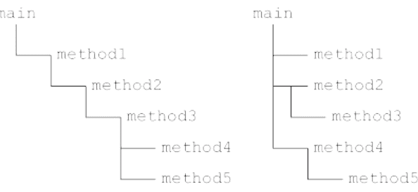

**图 4.8 带有链式调用（左）和不带链式调用（右）的示例代码**

BMI 程序深受链式调用影响。每个方法只做少量工作并调用下一个方法，沿链传递越来越多的参数。`main`方法调用`person`，`person`调用`get`，`get`调用`reportStatus`。执行流在计算过程中从未返回`main`。因此，当你阅读`main`时，无法清楚将进行哪些计算。

一个方法调用另一个方法不应是为了移动下一个任务。更理想的控制流是让`main`管理程序中任务的整体执行，如 BMI 程序和图 4.8 右侧所示。这一准则并不意味着一个方法调用另一个方法总是坏的；当第二个方法是第一个方法整体任务中的子任务时，一个方法调用另一个方法是可以的，例如 BMI 中的`minimum`方法。

## 5. 数据应该在尽可能低的级别被“拥有”

公司的决策应该在组织层架构的最低层做出。例如，低级管理员可以决定如何执行自己的工作，而不需要不断请经理批准。但管理员没有足够的信息或专业知识来设计整个产品线；这项设计任务将交给更高的权威，如经理。关键原则是，每个工作任务都应该交给层级中能够正确处理它的最低级别的人。

这一原则在计算机程序中有两个应用。第一个是`main`方法应该尽可能避免执行低级任务。例如，在交互式程序中，`main`不应读取大部分用户输入，也不应包含大量的`println`语句。

第二个应用是变量应该在尽可能窄的范围内进行声明和初始化。糟糕的设计是让`main`（或其他高级方法）读取所有输入，执行繁重计算，然后将结果数据作为参数传递给各种低级方法并处理数据，只有当程序中后续子任务需要时，才将数据返回给`main`。

如果同一个参数必须通过多次方法调用传递，这就是数据所有权不佳的标志，例如`BadBMI`程序中的`height`变量。如果你正在将同一个参数传递给层层调用，也许该部分数据应该由其中一个低级方法进行读取和初始化（除非它是共享对象，如`Scanner`）。

# 章节总结

`if`语句允许你编写仅在满足特定条件时执行的代码。`if/else`语句让你在条件不满足时执行一段代码，在条件不满足时执行另一段代码。条件是布尔表达式，可以使用关系运算符如`<`、`>=`、`!=`编写。你可以使用`&&`和`||`运算符测试多个条件。

你可以嵌套`if/else`语句来测试一系列条件，并根据哪一个条件为真来执行相应的代码块。

用于测试原始数据类型相等性的`==`运算符在对象上的行为并不像我们预期的那样，因此我们通过调用`equals`方法来测试对象的相等性。

出现在每个`if/else`语句分支中的共同代码应该被提取出来，以避免在代码中多次重复。

累积算法增量地计算值。累积求和循环声明一个和变量，并在循环内部增量地加上该变量的值。

由于`double`类型不能精确存储所有值，当计算机对实数进行计算时，可能会发生微小的舍入误差。通过在代码中对接近预期值的数值提供少量的容差，可以避免这些错误。

`char`类型代表文本的单个字符。`String`的每个字母在内部都存储为`char`值，你可以使用`String`的`charAt`方法通过索引访问这些字符。

`System.out.printf`方法打印格式化文本。你可以指定复杂的格式字符串来控制打印值的宽度、对齐和精度。

你可以在自己的代码中“抛出”（生成）异常。如果你的代码进入了无法恢复的状态（例如向方法传递无效值），这种技术可能会很有用。

# 自测题

## 4.1 节：`if/else`语句

1. 将每个英语语句翻译成可在`if/else`语句使用的逻辑测试。假设已经声明了`x`、`y`和`z`。

   a. 是奇数。

   b. 大于`y`。

   c. 正数。

   d. 是`y`的倍数。

   e. 不为零。

   f. 小于`z`。

   g. 等于`y`。

   h. `x`和`z`符号相反。

   i. 是一位数。

   j. 是偶数。

   k. 于`y`。

2. 给定的变量声明：

```java
int x = 4;
int y = -3;
int z = 4;
```

以下关系表达式的结果是什么？

   a. `x == 4`

   b. `x == y`

   c. `z == z`

   d. `y > 0`

   e. `y != 0`

   f. `z <= y`

   g. `x / 1`

3. 以下哪种`if`头部使用了正确的语法？

   a. `if x then {`

   b. `if (x =) {`

   c. `if (x => y) {`

   d. `if (x equals {`

   e. `if (x)`

4. 以下程序包含 7 个错误！它们是什么？

```java
public class Oops {
    public static void main(String[] args) {
        int a = 7, b = 42;
        minimum(a, b);
        System.out.println("a is the!");
    }
}
```

一个方法调用另一个方法不应是为了移动下一个任务。更理想的控制流是让`main`管理程序中任务的整体执行，如 BMI 程序和图 4.8 右侧所示。这一准则并不意味着一个方法调用另一个方法总是坏的；当第二个方法是第一个方法整体任务中的子任务时，一个方法调用另一个方法是可以的，例如 BMI 中的：

```java
public static int minimum(int a, int b) {
    if (a < b) {
        int smaller = a;
    } else (a >= b) {
        int smaller = b;
    }
    return smaller;
}
```

5. 以下方法：

```java
public static void ifElseMys1(int x, int y) {
    int z = 4;
    if (z <= x) {
        z = x + 1;
    } else {
        z = z + 9;
    }
    if (z <= y) {
        y++;
    }
    System.out.println(z + " " + y);
}
```

以下调用的输出是什么？

   a. `ifElseMys1(3, 20);`

   b. `ifElseMys1(4, 5);`

   c. `ifElseMys1(5, 5);`

6. 以下方法：

```java
public static void ifElseMystery2(int a, int b) {
    if (a * 2 < b) {
        a = a * 3;
    } else if (a > b) {
        b = b + 3;
    }
    if (b < a) {
        b++;
    } else {
        a--;
    }
    System.out.println(a + " " + b);
}
```

以下调用的输出是什么？

   a. `ifElseMystery2(10, 2);`

   b. `ifElseMystery2(3, 8);`

   c. `ifElseMystery2(4, 4);`

   d. `ifElseMystery2(10, 30);`

7. 编写 Java 代码从用户读取一个整数，如果该数是偶数则打印偶数，否则打印奇数。你可以假设用户输入有效的整数。

8. 以下代码包含一个逻辑错误：

```java
Scanner console = new Scanner(System.in);
System.out.print("Type a number: ");
int number = console.nextInt();
if (number % 2 == 0) {
    if (number % 3 == 0) {
        System.out.println("Divisible by 6.");
    } else {
        System.out.println("Odd.");
    }
}
```

检查这段代码，并描述一种代码会输出与输入数字不符的内容的情况。解释原因。然后纠正代码中的逻辑错误。

9. 描述以下代码的一个问题：

```java
Scanner console = new Scanner(System.in);
System.out.print("What is your favorite color?");
String name = console.next();
if (name == "blue") {
    System.out.println("Mine, too!");
}
```

10. 将以下示例中的冗余代码提取出来并移到`if/else`语句之外，保持相同的输出。

```java
if (x < 30) {
    a = 2;
    x++;
    System.out.println("Java is awesome! " + x);
} else {
    a = 2;
    System.out.println("Java is awesome! " + x);
}
```

11. 以下代码结构不佳：

```java
int sum = 1000;
Scanner console = new Scanner(System.in);
System.out.print("Is your money multiplied 1 or 2 times? ");
int times = console.nextInt();
if (times == 1) {
    System.out.print("And how much are you contributing? ");
    int donation = console.nextInt();
    sum = sum + donation;
    count1++;
    total = total + donation;
}
if (times == 2) {
    System.out.print("And how much are you contributing? ");
    int donation = console.nextInt();
    sum = sum + 2 * donation;
    count2++;
    total = total + donation;
}
```

重写这段代码使其具有更好的结构并避免冗余。为了简单起见，你可以假设用户总是输入 1 或 2。

（为了处理用户可能输入的任何数字，代码需要如何修改？）

12. 以下代码结构不佳：

```java
Scanner console = new Scanner(System.in);
System.out.print("How much will John be spending?");
double amount = console.nextDouble();
System.out.println();
int numBills1 = (int) (amount / 20.0);
if (numBills1 * 20.0 < amount) {
    numBills1++;
}
System.out.print("How much will Jane be spending?");
amount = console.nextDouble();
System.out.println();
int numBills2 = (int) (amount / 20.0);
if (numBills2 * 20.0 < amount) {
    numBills2++;
}
System.out.println("John needs " + numBills1 + " bills");
System.out.println("Jane needs " + numBills2 + " bills");
```

重写这段代码使其具有更好的结构并避免冗余。你可能希望引入一个方法来帮助捕重复代码。

13. 编写一段代码，读取颜色的简写描述并打印其完整的等效形式。接受的颜色名称为 B（蓝色）、G（绿色）和 R（红色）。如果用户输入 B、G 或 R 以外的字符，程序应打印错误信息。使你的程序对大小写不敏感，以便用户输入大写或小写字母。以下是一些示例执行：

```text
What color do you want? B
You have chosen Blue.
What color do you want? g
You have chosen Green.
What color do you want? Bork
Unknown color: Bork
```

14. 编写一段代码，读取扑克牌的简写描述并打印完整形式。简写描述是牌的点数 2 到 10、J、Q、K 或 A，后面跟着其花色（C、D、H 或 S）。你应该将简写扩展为`"<Rank> of <Suit>"`的形式。你可以假设用户输入是有效的。以下是两个示例执行：

```text
Enter a card: 9 S
Nine of Spades
Enter a card: K C
King of Clubs
```

## 第 4.2 节：累加算法

15. 以下代码存在什么问题？它尝试加上从 1 到给定最大值的所有数字。描述如何修复代码。

```java
public static int sumTo(int n) {
    for (int i = 1; i <= n; i++) {
        int sum = 0;
        sum += i;
    }
    return sum;
}
```

16. 以下代码存在什么问题？它尝试返回给定整数`n`的因数个数。描述如何修复代码。

```java
public static int countFactors(int n) {
    for (int i = 1; i <= n; i++) {
        if (n % i == 0) { // factor
            return i;
        }
    }
}
```

17. 编写代码通过将从控制台读取的许多数字相乘来产生累乘积。

18. 以下表达式应该等于 6，但在 Java 中不是。为什么？

19. 以下代码本意是打印消息，但实际上没有输出。描述如何修复代码以打印消息。

```java
double gpa = 3;
if (gpa == 6) {
    System.out.println("You earned credits.");
}
```

## 第 4.3 节：文本处理

20. 以下程序产生了什么输出？

```java
public class CharMystery {
    public static void range(char startLetter, char endLetter) {
        for (char letter = startLetter; letter <= endLetter; letter++) {
            System.out.print(letter);
        }
    }

    public static void main(String[] args) {
        range('M', 'S');
        range('n', 'z');
    }
}
```

21. 写一个`if`语句来测试字符串是否以大写字母开头。

22. 以下代码在不区分大小写的情况下统计字符串中`'e'`的出现次数有什么问题？

```java
int count = 0;
for (int i = 0; i < s.length(); i++) {
    if (s.charAt(i).toLowerCase() == 'e') {
        count++;
    }
}
```


### 23

考虑存储在变量 `name` 中的代表某人姓氏的字符串。写出一个表达式，产生姓氏的首字母。

### 24

编写代码检查字符串并确定有多少字母来自字母表的后半部分（即 N 到 Z）。假设字符串中的每个字符都是字母。

## 第 4.4 节：带有条件执行的方法

### 25

考虑一个接受三个整数作为三角形边长度的方法，它们形成的三角形类型为等边、等腰或不等边。等边三角形三边相等。然而，某些整数值（或组合）是非法的，不能表示真实的三角形。你会如何描述该方法的前置条件？

### 26

考虑一个 `getGrade` 方法，它接受代表学生成绩百分比的整数并返回相应的数值成绩。成绩可以在 0.0（不及格）到 4.0（完美）之间。该方法的前置条件是什么？

### 27

方法尝试返回三个整数的中位数，但它包含逻辑错误。在什么情况下该方法返回错误结果？如何修复代码？

```java
public static int medianOf(int n1, int n2, int n3) {
    if (n1 < n2) {
        if (n2 < n3) {
            return n2;
        } else {
            return n3;
        }
    } else {
        if (n1 < n3) {
            return n1;
        } else {
            return n3;
        }
    }
}
```

### 28

第 3 章的练习之一要求你写一个方法来寻找二次方程 `ax² + bx + c = 0` 的根。二次方法传递了 `a`、`b` 或 `c`，然后应用了以下二次公式：

`x=-b±b²-4ac/2a`

什么情况下这个公式会失效？修改二次方法通过抛出异常来拒绝无效的 `a`、`b` 或 `c`。（如果你没有完成上一章的练习，只需编写方法头和抛出异常的代码）。

### 29

考虑以下编写不正确的 Java 方法：

```java
// 此方法应该返回三个参数中
// 奇数的个数。
public static void printNumOdd(int n1, int n2, int n3) {
    int count = 0;
    if (n1 % 2 != 0) {
```

```java
count++;
} else if (n2 % 2 != 0) {
    count++;
} else if (n3 % 2 != 0) {
    count++;
}
    System.out.println(count + " of the 3 numbers are odd.");
}
```

该方法在什么情况下会打印正确答案，什么情况下会打印错误答案？应该如何修改代码来修复它？你能想出一种不使用任何 `if/else` 语句就能正确编写代码的方法吗？

## 练习

### 1

编写一个名为 `fractionSum` 的方法，它接受一个整数参数 `n` 并返回序列 $\sum_{i=1}^{n} i$ 的前 `n` 项之和，类型为 `double`。

换句话说，该方法应该生成以下序列：

$1+1/2+1/3+1/4+1/5\dots$

你可以假设参数 `n` 是负的。

### 2

编写一个名为 `repl` 的方法，它接受次数作为参数，并返回拼接相应次数的 `String`。例如，调用 `repl("hello", 3)` 应返回 `"hellohellohello"`。如果重复次数小于或等于零，该方法应返回一个空字符串。

### 3

编写一个名为 `season` 的方法，它接受两个代表月份和日的整数作为参数，并返回指示该日期对应季节的 `String`。假设月份为 1 到 12 之间的整数（1 代表 1 月，2 代表 2 月，以此类推），日期为 1 到 31 之间的数字。如果日期在 12/16 到 3/15 之间，该方法应返回 `"winter"`。如果日期在 3/16 到 6/15 之间，该方法应返回 `"spring"`。如果日期在 6/16 到 9/15 之间，它应返回 `"summer"`。如果日期在 9/16 到 12/15 之间，它应返回 `"fall"`。

### 4

编写一个名为 `daysInMonth` 的方法，它接受月份（1 到 12 之间的整数）作为参数，并返回该月份在该年的天数。例如，调用 `daysInMonth(9)` 将返回 30，因为 9 月有 30 天。假设代码不是在闰年运行（即 2 月始终有 28 天）。下表列出了每个月的天数：

| 月 | 1 | 2 | 3 | 4 | 5 | 6 | 7 | 8 | 9 | 10 | 11 | 12 |
|---|---|---|---|---|---|---|---|---|---|---|---|---|
| Jan | Feb | Mar | Apr | May | Jun | Jul | Aug | Sep | Oct | Nov | Dec |
| 天数 | 31 | 28 | 31 | 30 | 31 | 30 | 31 | 31 | 30 | 31 | 30 | 31 |

### 5

编写一个名为 `pow` 的方法，它接受底数和指数作为参数，并返回底数的幂。例如，调用 `pow(3, 4)` 应返回 $3 * 3 * 3 * 3$，即 81。假设底数和指数都是非负的。

### 6

编写一个名为 `printRange` 的方法，它接受两个整数作为参数，并打印这两个参数之间的数字序列，用空格分隔。如果第一个参数小于第二个参数，则打印递增序列；否则，打印递减序列。如果两个数字相同，则单独打印该数字。以下是 `printRange` 的示例调用：

```java
printRange(2, 7);
printRange(19, 11);
printRange(5, 5);
```

这些调用产生的输出应该是以下数字序列：

```text
2 3 4 5 6 7
19 18 17 16 15 14 13 12 11
```

### 7

编写一个名为 `size` 的静态方法，它接受一个整数 `size` 作为参数，并打印一个 `size` 乘 `size` 个字符的正方形，其中所有字符都是“o”，但在正方形的角上画了一个由“x”字符组成的“x”图案。在第一行，第一个和最后一个字符是“x”；在第二行，第二个和倒数第二个字符是“x”；以此类推。这里是两个示例输出：

| xo (5) | xo (6) |
|---|---|
| xoox | xooxox |
| oxoxo | oxoxo |
| ooxoo | ooxoo |
| oxoxo | oxoxoo |
| xooox | xooox |

### 8

编写一个名为 `smallestLargest` 的方法，它接受一个控制台 `Scanner` 作为参数，要求用户输入数字，然后打印用户提供的所有数字中最小和最大的一个。你可以假设用户输入的读取数字数量是大于 0 的有效数字。以下是示例执行：

```text
How many numbers do you want to enter? 4
Number 1: 5
Number 2: 11
Number 3: 22
```

### 9

编写一个名为 `evenSum` 的方法，它接受控制台 `Scanner` 作为参数，并要求用户输入数字，在用户输入所有整数后，打印偶数和。假设用户输入的读取数字数量是大于 0 的有效数字。以下是示例执行：

```text
How many numbers do you want to enter? 4
Number 1: 5
```

### 10

编写一个名为 `average` 的方法，它接受两个整数作为参数并返回它们的平均值。

### 11

修改你的 `pow` 方法，使其成为名为 `pow2` 的新方法，它使用 `double` 作为参数并正确处理负指数。例如，`pow2(4.0, -2)` 应返回。

### 12

编写一个名为 `printType` 的方法，它接受三个整数作为边长参数，并打印它们所组成的三角形类型（等边、等腰或不等边）。如果其中一条边大于另外两边之和，该方法应抛出 `IllegalArgumentException`。以下是 `printType` 的示例调用：

```java
printType(5, 5, 5);
printType(5, 5, 3);
printType(5, 4, 3);
```

这些调用产生的输出应该是：

```text
equilateral
isosceles
scalene
```

### 13

编写一个名为 `countNames` 的方法，它接受控制台 `Scanner` 和整数 $n$ 作为参数，并返回输入的唯一名称数量。

### 14

编写一个名为 `getGrade` 的方法，它接受一个代表学生成绩的整数并返回该学生的数字等级。成绩可以是 0.0（不及格）到 4.0（完美）之间的。假设成绩基于以下标准：

| 分数 | 等级 |
|---|---|
| < 60 | 0.0 |
| 60–62 | 0.7 |
| 63 | 0.8 |
| 64 | 0.9 |
| 65 | 1.0 |
| ... | ... |
| 92 | 3.7 |
| 93 | 3.8 |
| 94 | 3.9 |
| >= 95 | 4.0 |

作为一个额外挑战，如果用户传递的成绩小于 0 或大于 100，让你的方法抛出 `IllegalArgument`。

### 15

编写一个名为 `printPalindrome` 的方法，它接受控制台 `Scanner` 作为参数，提示用户输入一个或多个单词，并打印输入的 `String` 是否为回文（即正读和反读都相同，如 `abba` 或 `racecar`）。作为一个额外挑战，让代码不区分大小写，这样像“Abba”和“Madam”这样的单词会被视为回文。

### 16

编写一个名为 `stutter` 的方法，它接受一个字符串参数并返回字符重复两次的字符串。例如，`stutter("Hello!")` 返回 `"HHeelllloo!"`

### 17

编写一个名为 `wordCount` 的方法，它接受一个 `String` 作为参数并返回 `String` 中的单词数量。单词是一个或多个非空格字符序列（除 `'` 以外的任何字符）。例如，调用 `wordCount("hello")` 应返回 1，调用 `wordCount("how are you?")` 应返回 3，调用 `wordCount(" this`

### 19

写一个名为 `quadrant` 的方法，它接受一对代表 (x, y) 点的 `double` 类型对作为参数，并返回该点的象限数字。记住，象限按整数 1 到 4 编号，右上象限为 1，随后的象限按逆时针方向编号：

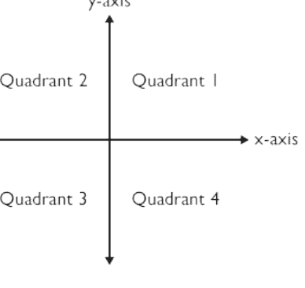

注意，象限是由 x 和 y 坐标是正数还是负数决定的。如果点位于 x 轴或 y 轴上，返回 0。例如，调用 `quadrant(-2.3, 3.5)` 应该返回 2，调用 `quadrant(4.5, -4.5)` 应该返回 4。

### 20

写一个名为 `numUnique` 的方法，它接受三个整数作为参数，并返回三个唯一整数的数量。例如，调用 `numUnique(18, 3, 4)` 应该返回 3，因为参数的值不同。相比之下，调用 `numUnique(6, 7, 6)` 应该返回 2，因为三个参数中只有两个唯一数字：6 和 7。

### 21

写一个名为 `perfectNumbers` 的方法，它接受一个整数 `maximum` 作为参数，并打印所有直到并包含该最大值（maximum）的“完美数”。完美数是一个等于其真因子之和的整数，即除 1 和它本身之外的所有能整除它的数。例如，28 是一个完美数，因为 1 + 2 + 4 + 7 + 14 = 28。调用 `perfectNumbers(500);` 应该产生以下输出：

```text
Perfect numbers up to 500: 6 28 496
```

## 编程项目

### 1

写一个程序，提示输入数字并用罗马数字显示它。

### 2

写一个程序，提示一个日期（月、日、年），并报告该日期的星期几。知道 1601 年 1 月 1 日是周一可能会有帮助。

### 3

写一个程序比较两个大学申请者。程序应该提示每个学生的 GPA、SAT 和 ACT 考试分数，并根据这些分数报告哪位候选人更优秀。

### 4

写一个程序，提示两个人的生日（月和日），以及今天的月和日。程序应该计算距离每个用户的生日还有多少天，以及哪一个生日更早到来。提示：如果将每个日期转换为一年中从 1 到 365 天的“绝对天数”，那么解决这个问题会更简单。

### 5

写一个程序计算学生在某门课程中的成绩。课程成绩由三部分组成：作业、期中考试和期末考试。程序应该提示用户计算成绩所需的所有信息，例如作业数量、每份作业的得分和可能得分、期中和期末考试分数，以及每场考试是否进行了调分（如果是的话，调整了多少）。考虑编写该程序的变体，报告学生获得特定课程级分所需的期末考试分数。

### 6

捕捉拼写错误的一种有效技术是使用校验位。例如，假设学校给每个学生分配一个六位数字。可以使用以下公式从其他数字确定第七位数字：

```text
7th digit=(1*(1st digit)+2*(2nd digit)+. . +6*(6th digit))%10
```

当用户输入学号时，用户输入所有七位。如果数字输入错误，校验位在 90% 的情况下将匹配。写一个交互式程序，提示输入一个六位学号，并使用上述公式报告该数字的校验位。

### 7

写一个程序显示杨辉三角形：

| | | | | | | | | | |
|---|---|---|---|---|---|---|---|---|---|
| | | | | 1 | | | | | |
| | | | | 1 | 1 | | | | |
| | | | | 1 | 2 | 1 | | | | |
| | | | 1 | 3 | 3 | 1 | | | | |
| | | | 4 | 6 | 4 | 1 | | | | |
| | | 5 | 10 | 10 | 5 | | | | |
| | 1 | 6 | 15 | 20 | 15 | 6 | | | | |
| | | 7 | 21 | 35 | 35 | 21 | 7 | 1 | | |
| | 8 | 28 | 56 | 70 | 56 | 28 | 8 | 1 | | |
| | 9 | 36 | 84 | 126 | 126 | 84 | 36 | 9 | 1 | |
| 1 | 10 | 45 | 120 | 210 | 252 | 210 | 120 | 45 | 10 | 1 |

使用 `System.out.printf`。

### 8

写一个程序显示凯撒密码：凯撒密码是一种加密方法，文本中的每个字母都被替换为字母表中后固定位置的字母。例如，如果移动 3 位，'A' 将替换为 'D'，'B' 为 'E'，以此类推。写一个程序，提示字符串和偏移量，然后显示加密后的字符串。

### 9

写一个程序，获取一个字符串并统计其中元音的数量。

### 10

写一个程序，获取一个字符串并反转其顺序。

### 11

写一个程序，获取一个字符串并判断它是否为回文。

### 12

写一个程序，获取一个字符串并统计每个字符出现的频率。

### 13

写一个程序，获取一个字符串并将所有空格替换为连字符。

### 14

写一个程序，获取一个字符串并找到出现频率最高的字符。

### 15

写一个程序，获取一个字符串并找到第一个重复的字符。

### 16

写一个程序，获取一个字符串并移除所有非字母字符。

### 17

写一个程序，获取一个字符串并找到最长的单词。

### 18

写一个程序，获取一个字符串并统计所有的单词数。

```java
int number = 1;
if (number <= 200) {
    number = number * 2;
}
```

两种形式之间的区别在于 `while` 循环会执行多次，直到测试条件为假为止。`if` 语句只执行一次翻倍语句，使 `number` 等于 2。`while` 循环重复执行翻倍语句，`number` 的取值变为 1, 2, 4, 8, 16, 32, 64, 128 和 256。循环在测试条件为假之前一直停止执行。它执行了八次赋值语句，并在 `number` 被设置为值 256（大于 200 的第一个 2 的幂）时终止。

这里是一个包含两个语句的 `while` 循环：

```java
int number = 1;
while (number <= max) {
    System.out.println("Hi there");
    number++;
}
```

`while` 循环与下面的 `for` 循环几乎相同：

```java
for (int number = 1; number <= max; number++) {
    System.out.println("Hi there");
}
```

这两个循环唯一的区别在于变量 `number` 的作用域。在 `while` 循环中，`number` 在循环外部的作用域声明。在 `for` 循环中，`number` 在循环内部声明。

## 一个寻找最小因数的循环

假设你想找到一个数字除 1 以外的最小因数。表 5.1 给出了你所寻找内容的示例。

以下是关于如何找到该值的伪代码描述：

```text
start divisor at 2.
while (the current value of divisor does not work) {
    increase divisor.
}
```

### 表 5.1 因子示例

| 数字 | 因子 | 最小因数 |
|---|---|---|
| 10 | 2 * 5 | 2 |
| 15 | 3 * 5 | 3 |
| 25 | 5 * 5 | 5 |
| 31 | 31 | 31 |
| 77 | 7 * 11 | 7 |


你没有从`1`开始因数，因为你寻找的是大于`1`的第一个因数。为了完善这段伪代码，你必须更明确地说明什么使一个因数有效。一个数字的因数是指当数字除以该因数时没有余数。你可以将此规则重写为以下伪代码：

```
start divisor at 2.
while (the remainder of number/divisor is not 0) {
    increase divisor.
}
```

这个练习使用了`mod`运算符，它给出整数除法的余数。下面的`while`循环执行该任务：

```java
int divisor = 2;
while (number % divisor != 0) {
    divisor++;
}
```

在编写`while`循环时，你无疑会遇到的问题就是著名的无限循环。考虑以下代码：

```java
int number = 1;
while (number > 0) {
    number++;
}
```

由于`number`开始是一个正值，且循环让它变得更大，这个循环将无限持续下去。在制定`while`循环时你必须小心，避免出现代码永远无法执行完毕的情况。每当你写一个`while`循环，都应该考虑它何时以及如何结束执行。

# 常见编程错误：无限循环

编写一个永远不会终止的`while`循环是容易的。容易犯这个错误的原因之一是`while`循环头部没有像`for`循环那样的更新步骤。对于程序员来说，包含一个正确的更新步骤至关重要，因为需要这个步骤来最终导致循环测试失败。

考虑以下代码，其目的是提示用户输入一个数字，并重复打印该数字的一半，直到达到`0`。这第一次尝试无法通过编译：

```java
Scanner console = new Scanner(System.in);
System.out.print("Type a number: ");
// this code does not compile
while (number > 0) {
int number = console.nextInt();
System.out.println(number / 2);
```

上述代码的问题是变量`number`在循环测试期间处于作用域内，因此它不能在循环内部声明。一种修复此编译错误的错误尝试是将初始化`number`的行剪切并粘贴到循环外部：

```java
// this code has an infinite loop
int number = console.nextInt(); // moved out of loop
while (number > 0) {
    System.out.println(number / 2);
}
```

此版本的代码有一个无限循环；如果进入循环，它将永远不会退出。问题的出现是因为`while`循环体内部没有更新语句来改变`number`的值。如果`number`大于`0`，循环将不断打印它的值并检查循环测试，而测试每次都会求值为真。

下面的代码版本解决了无限循环问题。循环在每次迭代中都包含一个更新步骤，将整数减半并存储其新值。如果整数还没有达到`0`，循环就会重复：

```java
// this code behaves correctly
int number = console.nextInt(); // moved out of loop
while (number > 0) {
    number = number / 2; // update step: divide in half
    System.out.println(number);
}
```

# 随机数

我们经常希望程序表现出随机性。例如，我们希望程序产生随机数字、洗牌、从列表中选择一个单词等。由于这些值是根据算法产生的，被称为伪随机数。

> ### 伪随机数
>
> Java提供了几种获取伪随机数的机制。一种选择是调用`Math`类中的`random`方法。该方法提供了一种快速简单获取数字的方法。Java还提供了一个名为`Random`的类，可以更容易使用。它包含在`java.util`包中，因此你需要在程序开头包含导入声明。`Random`对象有许多与生成随机数相关的有用方法，列在表5.2中。每当你调用这些方法时，Java都会生成并返回请求类型的随机数。

### 表5.2 `Random`的有用方法

| 方法 | 说明 |
|---|---|
| `nextInt()` | −³到（2³–1）之间的随机整数 |
| `nextInt(max)` | 0到（`max`–1）之间的随机整数 |
| `nextDouble()` | 0.0（包含）到1.0（不包含）之间的随机实数 |
| `nextBoolean()` | `true`或`false`的随机逻辑值 |

要创建随机数，你首先构造一个`Random`对象：

```java

```

然后你可以调用它的`nextInt`，并传递一个最大整数。返回的数字将在0（包含）和最大值（不包含）之间。例如，如果你调用`nextInt(100)`，你将得到一个0到99之间的数字。你可以对数字加1，以便范围为1到100。

让我们来看一个简单的程序，它在1到10之间选取数字直到出现某个特定的数字。我们将使用`Random`类来构造一个生成伪随机数的对象。

我们的循环应该是这样的（其中`number`是用户要求我们生成的值）：

```java
int result;

while (result != number) {
    result = r.nextInt(10) + 1; // random number from 1-10
    System.out.println("next number = " + result);
}
```

注意我们要将变量`result`定义在`while`循环之外，因为`result`出现在`while`循环中。之前的代码方法正确，但Java不接受。代码生成的错误消息是变量`result`可能未初始化。这是一个需要“引导”（priming）的循环示例。

## 循环的准备（Priming a Loop）

在循环之前初始化变量以“给水泵启动”，并确保进入循环。

我们希望将变量`result`设置为一个会导致进入循环的值，但只要它能让我们进入循环，该值本身并不重要。不过，我们必须小心不要将其设置为用户想要生成的数值。在这个程序中，我们处理的是1到10之间的值，因此我们可以将`result`设置为`-1`这样明显超出该数字范围的值。我们有时称之为“哑”（dummy）值，因为我们实际上并没有处理它。在本章的后后部分，我们将看到一种不需要这种准备工作的`while`循环的变体。

以下是完整的程序解决方案：

```java
import java.util.*;

public class Pick {
    public static void main(String[] args) {
        System.out.println("This program picks numbers from");
        System.out.println("1 to 10 until a particular");
        System.out.println("number comes up.");

        Scanner console = new Scanner(System.in);
        Random r = new Random();

        System.out.print("Pick a number between 1 and 10--> ");
        int number = console.nextInt();
        int result = -1; // set to -1 to make sure we enter the loop
        int count = 0;

        while (result != number) {
            result = r.nextInt(10) + 1; // random number from 1-10
            System.out.println("next number = " + result);
            count++;
        }

        System.out.println("Your number came up after " + count + " times");
    }
}
```

根据`Random`对象返回的数字序列，程序可能会很快选出给定的数字，如下执行所示：

```
This program picks numbers from
1 to 10 until a particular
number comes up.

Pick a number between 1 and 10--> 2

next number = 7
next number = 8
next number = 2

Your number came up after 3 times
```

程序也有可能花费一段时间才能选出数字，如下示例执行所示：

```
This program picks numbers from
1 to 10 until a particular
number comes up.

Pick a number between 1 and 10--> 10

next number = 9
next number = 7
next number = 7
next number = 5
next number = 8
next number = 8
next number = 1
next number = 5
next number = 1
next number = 9
next number = 7
next number = 10

Your number came up after 12 times
```

## 常见的编程错误：误用`Random`对象

`Random`对象在每次调用`nextInt`方法时都会选择一个新的随机整数。当学生尝试产生一个受限的随机值（例如奇数）时，他们有时会写如下代码：

```java
// this code contains a bug
Random r = new Random();

if (r.nextInt() % 2 == 0) {
    System.out.println("Even number: " + r.nextInt());
} else {
    System.out.println("Odd number: " + r.nextInt());
}
```

上述代码在很多情况下都会失败，因为`Random`对象会为`if/else`测试产生一个随机整数，然后在被选中的任意一个`println`语句中产生另一个。例如，`if`测试可能会从`Random`对象中获取一个值为47的随机值。测试会发现`47 % 2`不等于`0`，因此代码将进入`else`语句。随后`println`语句会再次调用一次`nextInt`，这将返回一个完全不同的数字（例如128）。代码的输出将是下面这段奇怪的语句：

```
Odd number: 128
```

解决这个问题的方法是将随机选择的整数存储在变量中，并且在确实需要另一个随机整数时才再次调用`nextInt`。以下代码完成了任务：

```java
// this code behaves correctly
Random r = new Random();

int n = r.nextInt(); // save random number into a variable

if (n % 2 == 0) {
    System.out.println("Even number: " + n);
} else {
    System.out.println("Odd number: " + n);
}
```

## 模拟

传统的科学和工程涉及大量的现实互动。科学家运行实验来验证他们的假设，工程师制造原型来测试他们的设计。但科学家和工程师越来越多地转向计算机，通过在出去进行实际实验或制造实际原型之前先运行模拟来探索可能性，从而提高他们的生产力。一位名叫Jeanette Wing的著名计算机科学家认为，科学家和工程师对计算使用的增加，将导致“计算思维”被视为一种基础性能力，就像阅读、写作和算术在今天被认为是基础的一样。

从编程的角度来看，模拟中的两个关键要素是伪随机数和循环。这些可以使用循环来编写，但大多数情况下，我们使用`while`循环直到某些条件满足。作为一个简单的例子，让我们看看如何模拟掷骰子直到总和为7。我们可以使用一个`Random`对象来模拟掷骰子的过程。这里是第一次尝试：

```java
Random r = new Random();

int sum = 0;

while (sum != 7) {
    int roll1 = r.nextInt(6) + 1;
    int roll2 = r.nextInt(6) + 1;
    sum = roll1 + roll2;
    System.out.println(roll1 + " + " + roll2 + " = " + sum);
}
```

上面的代码会报错，因为`sum`在循环体内部定义：

```
Dice.java:7: error: cannot find symbol
symbol : sum
```

问题在于`while`循环引用了`sum`，但它在内部。我们必须在循环之前声明该变量。这里是版本：

```java
Random r = new Random();

int sum = 0; // set to 0 to sure we enter the loop

while (sum != 7) {
    int roll1 = r.nextInt(6) + 1;
    int roll2 = r.nextInt(6) + 1;
    sum = roll1 + roll2;
    System.out.println(roll1 + " + " + roll2 + " = " + sum);
}
```

这个版本可以编译并运行。示例执行如下：

```
1 + 4 = 5
5 + 6 = 11
4 + 3 = 7
```

## `do/while`循环

`while`循环在循环“顶部”测试，但Java有另一种名为`do/while`的循环，它在循环“底部”测试。`do/while`循环的语法如下：

```java
do
  <statement>
} while (<test>);
```

这是一个使用`do/while`的示例代码：

```java
int number = 1;

do {
    number *= 2;
} while (number <= 200);
```

这个循环与`while`循环产生相同的结果，直到该数字达到256（这是大于200的第一个2的幂）。但与`while`循环不同，`do/while`循环至少执行一次语句。图5.2显示了`do/while`循环的控制流。


`do/while`循环在你知道必须执行一次循环的情况下最有用。例如，在上一节中我们写了以下代码来模拟掷骰子直到总和为7：

```java
Random r = new Random();

int sum = 0; // set to 0 to make sure we enter the loop

while (sum != 7) {
    // roll the dice once
    int roll1 = r.nextInt(6) + 1;
    int roll2 = r.nextInt(6) + 1;
    sum = roll1 + roll2;
    System.out.println(roll1 + " + " + roll2 + " = " + sum);
}
```

我们必须通过将`sum`设置为0来准备循环，以便计算机进入循环。使用`do/while`循环，我们可以消除这种准备：

```java
Random r = new Random();

int sum;

do {
    // roll the dice once
    int roll1 = r.nextInt(6) + 1;
    int roll2 = r.nextInt(6) + 1;
    sum = roll1 + roll2;
    System.out.println(roll1 + " + " + roll2 + " = " + sum);
} while (sum != 7);
```

这个版本可以编译并正常工作。示例执行如下：

```
1 + 4 = 5
5 + 6 = 11
4 + 3 = 7
```


在这个版本中，我们总是至少执行一次循环体，从而在到达现在循环底部的循环测试之前为变量 `sum` 赋予了一个值。

在许多编程问题中，使用 `do/while` 循环是合适的。这些循环在交互式程序中非常有用，在此时你确定自己至少要执行某项操作。例如，你可能有一个循环允许用户多次玩游戏；你可以很肯定用户至少会想玩一次。同样地，如果你在和用户玩猜数字游戏，你总是必须至少获取一次猜测。

## 5.2 栅栏算法（Fencepost Algorithms）


一个常见的编程问题涉及一种被称为“栅栏柱循环”（fencepost loop）的特殊循环。考虑以下问题：你想建立一个长度为 100 英尺的栅栏，每隔 10 英尺安装一根柱子。你需要多少柱子？如果你在脑中快速做个除法，你会认为你需要 10 根柱子，但实际上你需要 11 根。这是因为栅栏的开头和结尾都有柱子。换句话说，栅栏看起来如图 5.3 所示。

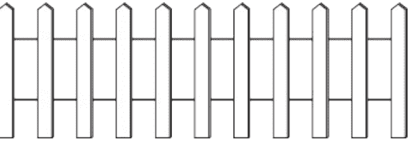

图 5.3 典型的栅栏

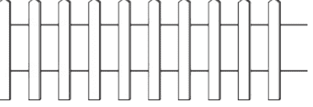

图 5.4 有缺陷的栅栏

由于你在最左侧和最右侧都需要柱子，你不能使用下面的简单循环（它不会种植最后一根柱子）：

```
for (the length of the fence) {
  plant a post.
  attach some wire.
}
```

如果你使用上述循环，将得到一个看起来如图 5.4 所示的栅栏。

交换两个操作的顺序也没有帮助，因为那样你会漏掉第一根柱子。这个循环的问题在于，它产生的柱子数量与铁丝段相同，但我们知道我们需要额外的一根柱子。这就是为什么这个问题有时也被称为“循环加半次”（loop and a half）问题——我们希望额外执行一次这个循环的半部分（种植柱子）。

一种解决方案是在循环之前或之后种植其中一根柱子。通常的解决方案是在循环之前执行：

```
plant a post.

for (the length of the fence) {
  attach some wire.
  plant a post.
}
```

注意，循环体内两个操作的顺序现在反过来了，因为初始的柱子在进入循环之前就已经种植了。

举个简单的例子，考虑写出 1 到 10 之间的整数并用逗号分隔的问题。换句话说，我们希望得到以下输出：

```
1, 2, 3, 4, 5, 6, 7, 8, 9, 10
```

这个任务是一个经典的栅栏问题，因为我们想写出 10 个数字，但只有 9 个逗号。在我们的栅栏柱术语中，写数字是任务的“柱子”部分，写逗号是任务的“铁丝”部分。因此，实现我们开发的伪代码时，我们在循环之前打印第一个数字：

```
System.out.print(1);

for (int i = 2; i <= 10; i++) {
    System.out.print(", " + i);
}

System.out.println();
```

## 哨兵循环（Sentinel Loops）

假设你想从用户那里读取一系列数字并计算它们的和。你可以提前询问用户要读取多少数字，正如我们在上一章中所的那样，但这并不总是方便。如果用户有一长串数字要输入但还没有数呢？避免询问数量的方法是选择一个特殊的输入值来指示输入的结束。我们称之为哨兵值（sentinel value）。

### 哨兵

一个指示输入结束的特殊值。

例如，你可以告诉用户输入值 `-1` 来停止输入数字。但如何组织代码来使用这个哨兵呢？通常，你会使用以下方法：

```
sum = 0.

while (we haven't seen the sentinel) {
    prompt and read.
    add it to the sum.
}
```

这种方法并不完全可行。例如，假设用户输入了数字 10、42、5 和 -1。正如伪代码所示，我们会提示并读取这四个值中的每一个，并将它们累加到和中，直到遇到哨兵值 -1。我们将和初始化为 0，所以计算出的结果是 `(10 + 42 + 5 + -1)`，即 56。但正确答案是 57。哨兵值 -1 不应该被包含在和中。

这个问题是一个经典的栅栏错误或“循环加半次”问题：你想提示并读取一系列数字（包括哨兵），并且你想累加大部分数字，但你不想将哨兵加到和中。

通常的栅栏解决方案有效：我们在循环之前插入了第一次提示和读取：

```
prompt and read.

while (we haven't seen the sentinel) {
    prompt and read.
    add it to the sum.
}
```

你可以通过引入一个用于和的变量来精炼伪代码：

```
sum = 0.
number = prompt and read.

while (number != sentinel) {
    sum += number.
    number = prompt and read.
}
```

或者，你可以使用 `if` 语句：

```
sum = 0.

while (true) {
    prompt and read.

    if (number == sentinel) break;

    sum += number;
}
```

## 带 `if` 的栅栏（Fencepost with if）

许多栅栏循环都需要条件执行。事实上，栅栏问题本身可以使用 `if` 语句解决。记住，栅栏的经典解决方案是在循环之前处理第一根柱子。这种变体没有经典方法常用，因为它涉及到循环测试和循环内部测试。通常这些测试是几乎相同的，因此每次执行循环时进行测试是不高效的。但在某些情况下可能会使用这种方法。例如，在经典方法中，对应于种植柱子的代码行重复了。如果你正在编写的该步骤需要大量代码，你可能会认为将语句放在循环内部会更好，即使这会导致额外的测试。

作为一个例子，考虑编写一个名为 `multrint` 的方法，它可以打印指定次数的字符串。假设你希望输出占一行，位于括号内并用逗号分隔。这里有两个示例调用：

```
multrint("please", 4);
multrint("beetjuice", 3);
```

你期望这些调用产生以下输出：

```
[please, please, please, please]
[beetjuice, beetlejuice, beetlejuice]
```

你编写此方法的第一次尝试可能是一个简单的循环，在循环之外打印方括号，在循环内部打印字符串和逗号：

```java
public static void multiprint(String s, int times) {
    System.out.print("[");

    for (int i = 1; i <= times; i++) {
        System.out.print(s + ", ");
    }

    System.out.println("]");
}
```

不幸的是，这段代码在最后一个值之后产生了一个额外的逗号：

```
[please, please, please, please, ]
[beetjuice, beetjuice, beetjuice, ]
```

```java
public static void multiprint(String s, int times) {
    System.out.print("" + s);

    for (int i = 2; i <= times; i++) {
        System.out.print(", " + s);
    }

    System.out.println("");
}
```

注意，由于你在循环开始之前打印了其中一个字符串，你必须修改循环，使其打印的字符串数量不像以前那么多了。将循环变量 `i` 设置为从 2 开始，是为了考虑在循环之前已经打印的第一个值。

遗憾的是，这个解决方案也无法正常工作。考虑一下当你要求该方法打印 0 次字符串会发生什么，例如：

```
multiprint("please don't", 0);
```

这次调用产生了以下错误的输出：

```
[please don't]
```

你希望用户能够请求出现 0 次字符串，因此该方法不应该产生那个错误的输出。问题在于，解决栅栏桩问题（fencepost problem）的经典解决方案涉及到循环开始之前打印一个值。为了让方法在零的情况下运行正常，你可以包含一个 `if/else` 语句：

```java
public static void multiprint(String s, int times) {
    if (times == 0) {
        System.out.println("[]");
    } else {
        System.out.print("[" + s);

        for (int i = 2; i <= times; i++) {
            System.out.print(", " + s);
        }

        System.out.println("]");
    }
}
```

或者，你可以在循环内部包含一个 `if` 语句（双测试方法）：

```java
public static void multiprint(String s, int times) {
    System.out.print("[");

    for (int i = 1; i <= times; i++) {
        System.out.print(s);

        if (i < times) {
            System.out.print(", ");
        }
    }

    System.out.println("]");
}
```

虽然前面的版本的代码在每次迭代中执行了两次类似的测试，但它比使用经典的栅栏桩解决方案及其特殊情况要简单。这两种方案没有优劣之分，因为其中涉及到权衡。如果你认为代码会被频繁执行且循环会迭代很多次，你可能更倾向于使用高效的解决方案。否则，你可能会选择更简单的代码。

# 5.3 `boolean` 类型

乔治·布尔（George Boole）是一位如此出色的逻辑学家，以至于 Java 有一种以他命名的数据类型。Java 类型 `boolean` 用于描述逻辑上的真/假关系。记住 `boolean` 是基本类型之一，类似于 `int`、`double` 和 `char`。

初学者经常奇怪为什么计算机科学家对逻辑如此感兴趣。答案是，逻辑对于计算的基础，就像物理学对于工程的基础一样。工程师研究物理学是因为他们想要构建由物理定律生成的现实世界制品。如果你不懂物理，你可能会造出一座坍塌的桥。计算机科学家也构建制品，但是在受逻辑法则支配的虚拟世界中。如果你不懂逻辑，你可能会编写出崩溃的计算机程序。

在不知意间，你已经使用了布尔值。我们看过的所有控制结构——`if/else` 语句、`for` 循环和 `while` 循环——都由指定测试的表达式控制。例如，表达式：

```
number % 2 == 0
```

是一个判断能否被 2 整除的测试。它也是一个布尔表达式。布尔表达式旨在捕捉真和假的概念，因此 `boolean` 类型的域只有两个值：`true` 和 `false` 并不意外。`true` 和 `false` 是 Java 中的保留字。它们是 `boolean` 类型的字面量值。所有布尔表达式在求值时，都会返回这些字面量中的其中一个。不要将这些特殊值与字符串字面量 `"true"` 和 `"false"` 混淆。引用布尔字面量时不需要引号。

当你编写一个操作数值的程序时，你通常想要计算变量中的某个值，或者编写一个捕获某些复杂公式的方法。我们对 `boolean` 类型最终在做相同的事情。我们可能想在变量中记录一个布尔值，并且经常编写返回布尔结果的方法。例如，我们已经看到 `String` 类有返回布尔结果的方法，包括 `startsWith`、`endsWith`、`equals` 和 `equalsIgnoreCase`。

为了更好地理解这一点，请记住这些术语对于 `int` 类型意味着什么。`int` 类型的字面量包括 0、1 等。因为这些是 `int` 类型的字面量，你可以用它们编写如下表达式：

```
int number1 = 1;
int number2 = 0;
```

考虑你可以对 `boolean` 类型的变量做什么。假设你定义了两个布尔变量 `test1` 和 `test2`。这些变量只有两种可能的值：`true` 和 `false`。你可以说：

```
boolean test1 = true;
boolean test2 = false;
```

你也可以编写一条语句将一个布尔变量的值拷贝到另一个，就像其他任何类型的变量一样：

```
test1 = test2;
```

此外，你知道赋值语句可以使用如下表达式：

```
number1 = 2 + 2;
```

以及你一直以来使用的简单测试都是布尔表达式。这意味着你可以写如下的语句：

```
test1 = (2 + 2) == 4;
test2 = (3 * 100 < 100);
```

你可能不需要括号，但它们让语句更易读。根据布尔值设置变量。显然，赋值是你可以布尔值执行的操作之一。

# 逻辑运算符

在 Java 中，你可以使用被称为逻辑运算符的形成复杂的布尔表达式，如表 5.3 所示。

### 5.3 逻辑运算符

| 运算符 | 含义 | 示例 | 值 |
|---|---|---|---|
| `&&` | AND（与） | `(2 == 2)` | `true` |
| `\|\|` | OR（或） | `(1 < 2)` | `true` |
| `!` | NOT（取反） |  |  |

取反（NOT）运算符反转其操作数的真值。如果一个表达式为真，它的取反就为假，反之亦然。你可以通过一个包含变量和一个取反值的真值表来表示这种关系。对于变量的每个值，表格显示了对应的取反值。

### NOT（`!`）的真值表

| p | !p |
|---|---|
| `true` | `false` |
| `false` | `true` |

除了取反运算符，还有两个你会使用的连接词。使用这些连接词连接两个表达式，创建一个新的布尔表达式。下面的真值表显示，AND 运算符只有当两个操作数都为真时才为真。

### AND（`&&`）的真值表

| p | q | p && q |
|---|---|---|
| `true` | `true` | `true` |
| `true` | `false` | `false` |
| `false` | `true` | `false` |
| `false` | `false` | `false` |

下面的真值表显示，OR 运算符在两个操作数都为假的情况下都为真。

### OR（`\|\|`）的真值表

| p | q | p \|\| q |
|---|---|---|
| `true` | `true` | `true` |
| `true` | `false` | `true` |
| `false` | `true` | `true` |
| `false` | `false` | `false` |

Java 的 OR 运算符与英语单词 `"or"` 的含义略不同。在英语中你说，“我今晚要学习或者去看电影。”其中一个为真，但不同不同真。OR 运算符更像英语表达式“and/or”：如果一个或两个操作数为真，整个命题就为真。

当你无法简化为单个测试时，你通常使用逻辑运算符。例如，正如我们在上一章中看到的，如果你想在数字位于 1 到 10 之间时执行某特定操作，你可能会说：

```
if (number >= 1) {
    if (number <= 10) {
        doSomething();
    }
}
```

但你可以使用逻辑 `AND` 更轻松地表达这一点：

```java
if (number >= 1 && number <= 10) {
    doSomething();
}
```

人们经常使用“and”（和）和“or”（或）这两个词，但 Java 只允许你在严格的逻辑意义上使用它们。注意不要编写如下所示的代码：

```java
// 此代码无法编译
if (x == 1 || 2 || 3) {
    doSomething();
}
```

在英语中，我们会将其读为“x 等于 1 或 2 或 3”，这对我们是有意义的，但对 Java 来说并不符合逻辑。你可能也想编写如下代码：

```java
// 此代码无法编译
if (1 <= x <= 10) {
    doSomethingElse();
}
```

在数学中，这个表达式是有意义的，它可以测试 $x$ 是否在 1 到 10 之间（包含边界）。然而，该表达式在 Java 中是没有意义的。

你只能使用逻辑 AND 和 OR 运算符来组合一组布尔表达式。否则，计算机将无法理解你的意思。要表达“1 或 2 或 3”的 idea，请使用逻辑 OR 将三个不同的布尔表达式组合：

```java
if (x == 1 || x == 2 || x == 3) {
    doSomething();
}
```

要表达“在 1 到 10 之间（包含）”的 idea，请使用逻辑 AND 将两个布尔表达式组合：

```java
if (1 <= x && x <= 10) {
    doSomethingElse();
}
```


现在我们引入了 AND、OR 和 NOT 逻辑运算符，是时候重新回顾我们的优先级表了。NOT 运算符位于顶部，优先级最高。另外两个逻辑运算符的优先级较低，低于算术运算符和关系运算符，但高于赋值运算符。AND 运算符的优先级略高于 OR 运算符。表 5.4 包含了这些新运算符。

根据这些优先级规则，当 Java 评估类似下面的表达式时，计算机会先评估 NOT，其次是 AND，最后是 OR。

```java
if (test1 || !test2 && test3) {
  doSomething();
}
```

## 表 5.4 Java 运算符优先级

| 描述 | 运算符 |
| --- | --- |
| 一元运算符 | `!`, `+`, `--`, `+ -` |
| 乘法运算符 | `*`, `/`, `%` |
| 加法运算符 | `+`, `-` |
| 关系运算符 | `<`, `>`, `<=`, `>=` |
| 等于运算符 | `==`, `!=` |
| 逻辑 AND | `&&` |
| 逻辑 OR | `\|\|` |
| 赋值运算符 | `=`, `+=`, `-=`, `*=`, `/=`, `%=`, `&&`, `\|\|` |

## 短路计算 (Short-Circuited Evaluation)

在本节中，我们将探索如何使用逻辑运算符解决复杂的编程任务，并引入这些运算符的一个重要属性。我们将编写一个名为 `firstWord` 的方法，接受一个 `String` 作为参数并返回字符串中的第一个单词。为了简单起见，我们约定通过空格将 `String` 分成单个单词。如果 `String` 没有任何单词，该方法应返回一个空字符串。以下是一些示例调用：

| 方法调用 | 返回值 |
|--- |--- |
| `firstWord("four score and seven years")` | `"four"` |
| `firstWord("all-one-word-here")` | `"all-one-word-here"` |
| `firstWord(" lots of space here")` | `"lots"` |
| `firstWord(" ")` | `""` |

记住，我们可以调用 `substring` 方法来提取字符串的一部分。我们向 `substring` 方法传递两个参数：子字符串的起始索引以及子字符串结束位置之后的一个索引。如果字符串存储在名为 `s` 的变量中，我们的任务基本上简化为以下步骤：

```
设置 start 为单词的第一个索引。
设置 stop 为单词结束后的索引。
返回 s.substring(start, stop).
```

作为初步近似，我们假设起始索引为 0。这对于开头有空格的字符串无效，但它可以让我们专注于伪代码的第二步。考虑一个以 "score" 开头的字符串。如果我们检查字符串的每个字符及其索引，会发现以下模式：

| 0 | 1 | 2 | 3 | 4 | 5 | 6 | 7 | 8 | 9 | ... |
| --- | --- | --- | --- | --- | --- | --- | --- | --- | --- | --- |
| f | o | u | r | s | c | o | r | e | ... | ... |

我们将 `start` 设置为 0。我们希望变量 `stop` 指向单词之后的索引。在这个例子中，我们想要的单词是 `"four"`，它延伸自索引 0 到 3。因此，如果我们希望 `stop` 位于所需子字符串末之外，我们希望将其设置为索引 4，即字符串中第一个空格的位置。

那么我们如何找到字符串中的第一个空格呢？我们使用 `while` 循环。我们从字符串开头开始循环，直到遇到空格：

```
设置 stop 为 0。
当索引 stop 处的字符不是空格时：
    将 stop 增加 1。
```

这可以很容易转换为 Java 代码。结合我们对 `start` 为 0 的假设，我们得到：

```java
public static String firstWord(String s) {
    int start = 0;
    int stop = 0;
    while (stop < s.length() && s.charAt(stop) != ' ') {
        stop++;
    }
    return s.substring(start, stop);
}
```

如果我们再次以 `stop` 等于 `3` 运行相同的场景，我们将通过这两个测试，并将 `stop` 增加到 `4`。然后，当我们再次回到循环时，我们首先测试 `stop` 是否小于 `s.length()`。它不是，这意味着测试的评估结果为 `false`。结果，Java 知道整个表达式的评估结果为 `false`，并且永远不会评估第二个测试。事件的顺序防止了异常的发生，因为我们从未测试过 `s.charAt(4)` 是否为空格。

这个解决方案为我们提供了该方法的第二个版本：

```java
public static String firstWord(String s) {
    int start = 0;
    int stop = 0;
    while (stop < s.length() && s.charAt(stop) != ' ') {
        stop++;
    }
    return s.substring(start, stop);
}
```

但请记住，我们假设第一个单词从位置 0 开始。情况并不总是如此。例如，如果我们传递一个以几个空格开头的字符串，该方法将返回一个空字符串。我们需要修改代码以跳过任何前导空格。这一目标需要另一个循环。作为初步近似，我们可以编写以下代码：

```java
int start = 0;
while (s.charAt(start) == ' ') {
    start++;
}
```

这段代码适用于大多数字符串，但在两个重要情况下会失败。循环测试假设我们能找到一个非空格字符。如果字符串完全由空格组成呢？在这种情况下，我们将直接运行到字符串末尾，产生一个 `StringOutOfBoundsException`。如果字符串本身是空的呢？当我们询问 `s.charAt(0)` 时，会立即得到错误，因为索引 `0` 处没有字符。

我们可以决定这些情况构成错误。毕竟，如果没有单词，你又如何返回第一个单词呢？所以，我们可以在文档中记录一个先决条件，即字符串至少包含一个非空格字符，如果发现它不满足该条件，则抛出异常。另一种方法是在这些情况下返回空字符串。

为了处理字符串可能为空的情况，我们需要修改循环以包含对字符串长度的测试。如果将其添加到 `while` 循环测试的末尾，我们就会得到以下代码：

```java
int start = 0;
while (s.charAt(start) == ' ' && start < s.length()) {
    start++;
}
```

但这段代码与之前有相同的缺陷。它本应该防止 `start` 等于字符串长度时出现问题，但当这种情况发生时，在计算机到达字符串长度测试之前，就会抛出 `StringIndexOutOfBoundsException`。因此，这些测试也必须反转，以利用短路评估：

```java
int start = 0;
while (start < s.length() && s.charAt(start) == ' ') {
    start++;
}
```

为了将这些行代码与我们之前的代码结合，我们必须更改 `stop` 的初始化。我们不再想从字符串的前部搜索。相反，我们需要将 `stop` 初始化为等于 `start`。将这些部分结合，我们得到了方法的这个版本：

```java
public static String firstWord(String s) {
    int start = 0;
    while (start < s.length() && s.charAt(start) == ' ') {
        start++;
    }
    int stop = start;
    while (stop < s.length() && s.charAt(stop) != ' ') {
        stop++;
    }
    return s.substring(start, stop);
}
```

这个版本在所有情况下都有效，跳过任何前导空格，并在没有单词可返回时返回空字符串。

## 布尔变量与标志

所有的 `if/else` 语句都由布尔测试控制。这些测试可以是 `boolean` 变量或布尔表达式。例如，考虑以下代码：

```java
if (number > 0) {
    System.out.println("positive");
} else {
    System.out.println("not positive");
}
```

这段代码可以重写为：

```java
boolean positive = (number > 0);
if (positive) {
    System.out.println("positive");
} else {
    System.out.println("not positive");
}
```

使用布尔变量增加了程序的易读性，因为它允许你为测试命名。考虑你将为一个约会程序生成的那种代码。你可能会有一些整数变量来描述人的某些属性：`looks`，用于存储对外貌的粗略估值（1-10 分）；`IQ`，用于存储智商；`income`，用于存储年总收入；以及 `snothers`，用于跟踪亲密朋友（“snother”是“significant other”的缩写）。通过这些变量来指定一个人的属性，你可以开发出各种适用性测试。在你编写程序时，你可以使用布尔变量为这些测试命名，极大地提高了代码的可读性：

```java
boolean cute = (looks >= 9);
boolean smart = (IQ > 125);
boolean rich = (income > 100000);
boolean available = (snothers == 0);
boolean awesome = cute && smart && rich && available;
```

（注：原文此处存在段落内容重复，译文已按要求保留逻辑并翻译）

你会如何编写这个方法的体体？我们已经写好了测试，所以只需要弄弄如何将其整合到方法中。该方法的返回类型为布尔，所以你希望它在测试通过时返回 `true`，在测试失败时返回 `false`。你可以这样写该方法：

```java
public static boolean isTwoUniqueDigits(int n) {
    if (n >= 10 && n <= 99 && (n % 10 != n / 10)) {
        return true;
    } else {
        return false;
    }
}
```

这个方法可以运行，但它比需要的要冗长。前面的代码评估了我们开发的测试。该表达式的类型为 `boolean`，这意味着它的结果为 `true` 或 `false`。`if/else` 语句告诉计算机：如果表达式的结果为 `true` 则返回 `true`，如果结果为 `false` 则返回 `false`。但为什么要使用这种结构呢？如果方法要在表达式结果为 `true` 时返回 `true`，在结果为 `false` 时返回 `false`，你可以直接返回表达式的值：

```java
public static boolean isTwoUniqueDigits(int n) {
    return (n >= 10 && n <= 99 && (n % 10 != n / 10));
}
```

即使是前面的版本也可以简化，因为括号并不是必要的（尽管它们能更清楚地标明方法将返回什么）。这段代码评估了我们开发的测试，以判断一个数字是否由两个唯一的数字组成，并返回结果（如果是则返回 `true`，不是则返回 `false`）。

考虑一个与整数表达式的类比。对于理解布尔禅宗（Boolean Zen）的人来说，这个方法的 `if/else` 版本看起来和下面的代码一样奇怪：

```java
if (x == 1) {
    return 1;
} else if (x == 2) {
    return 2;
} else if (x == 3) {
    return 3;
} else if (x == 4) {
    return 4;
} else if (x == 5) {
    return 5;
}
```

如果你总是想返回 `x` 的值，你应该直接说：

```java
return x;
```

当学生使用布尔变量时也可能发生类似的混乱。在上一节中，我们查看了累加算法的一个变体，它使用一个名为 `negative` 的布尔变量来跟踪和是否为负。然后我们使用 `if/else` 语句来打印报告结果的消息：

```java
if (negative) {
    System.out.println("Sum went negative");
} else {
    System.out.println("Sum never went negative");
}
```

一些新手会这样写这段代码：

```java
if (negative == true) {
    System.out.println("Sum went negative");
} else {
    System.out.println("Sum never went negative");
}
```

这种比较是不必要的，因为 `if/else` 语句期望在括号内出现一个 `boolean` 类型的表达式。布尔变量已经是相应的类型，所以我们不需要测试它是否等于 `true`；它要么是 `true`，要么不是（在这种情况下它就是 `false`）。对于理解布尔禅宗的人来说，前面的测试看起来就像下面的代码一样多余：

```java
if (negative == true) {
  ...
}
```

新手还经常写类似这样的测试：

```java
if (negative == false) {
  ...
}
```

这有一定的道理，因为测试确实做了一些有用的事情，即切换了布尔变量含义（如果变量为 `false` 则评估为 `true`，如果变量为 `true` 则评估为 `false`）。但取反运算符的设计目的就是为了进行这种布尔值的切换，所以这个测试最好写成如下形式：

```java
if (!negative) {
  ...
}
```

你应该习惯将感叹号读作“非”，所以这个测试应该读作“如果不是负”。对于那些理解布尔禅宗的人来说，这比测试 `negative` 是否等于 `false` 是一种更简洁的表达方式。

# 取反布尔表达式

程序员经常发现自己需要构造一个复杂布尔表达式的反反。例如，从一个让我们想要停止循环的“退出条件”来考虑循环是最容易的，但 `while` 循环要求我们以“继续条件”来表示代码。假设你想写一个循环，不断提示用户输入一个整数，直到该整数是一个两位数。因为两位数的范围是 10 到 99，你可以使用以下代码来测试一个数字是否恰好有两个数字：

```java
number >= 10 && number <= 99
```

要将其放入 `while` 循环中，我们必须反转测试，因为循环是一个继续测试。换句话说，我们希望在这一点不成立时（当用户还没有给我们两位数时）保持在循环中。一种方法是使用逻辑“非”运算符来取反这个表达式：

```java
while (!(number >= 10 && number <= 99))
```

注意，我们需要对整个布尔表达式加括号，然后在前面加上 `NOT` 运算符。虽然这种方法可行，但通常被认为是不良风格。最好是简化这个表达式。

简化此类表达式的通用方法是由英国逻辑学家德·摩根（De Morgan）形式化的。我们可以应用两个被称为*德·摩根定律*（De Morgan's laws）的规则。注意当你取反一个表达式时，每个操作数都会取反，且逻辑运算符会翻转（与变为或，反之亦然）。

```java
System.out.print("token: ");
System.out.println(" hasNextInt = " +
console.hasNextInt());
System.out.println(" hasNextDouble = " +
console.hasNextDouble());
System.out.println(" hasNext = " + console.hasNext());
```

让我们来看几个示例执行。当我们输入令牌 `348` 时，程序的输出如下：

```
This program examines the ways
a token can be read.
token? 348
hasNextInt = true
hasNextDouble = true
hasNext = true
```


正如你预期的那样，调用`hasNextInt`返回了`true`，这意味着我们可以将此令牌解释为整数。`Scanner`同样允许我们将此令牌解释为`double`，因此`hasNextDouble`也返回`true`。但请注意，`hasNext()`也返回了`true`。结果意味着我们可以调用`next`方法将此令牌作为`String`读入。

这是另一个执行示例，这次针对令牌`348.2`：

```
This program examines the ways
a token can be read.

token? 348.2
hasNextInt = false
hasNextDouble = true
hasNext = true
```

此令牌无法被解释为`int`，但它可以被解释为`double`或`String`。最后，考虑令牌`hello`的这次执行：

```
This program examines the ways
a token can be read.

token? hello
hasNextInt = false
hasNextDouble = false
hasNext = true
```

令牌`hello`无法被解释为`int`或`double`；它只能被解释为`String`。

## 处理用户错误

考虑以下代码片段：

```java
Scanner console = new Scanner(System.in);
System.out.print("How old are you?");
int age = console.nextInt();
```

如果用户输入了某些不是整数的内容会怎样？如果发生这种情况，`Scanner`在调用`next()`时将抛出异常。我们在上一节中看到，可以使用`hasNextInt`方法测试下一个令牌是否可以被解释为整数。因此，在读取一个`int`之前，我们可以先测试用户是否输入了适当的值。

如果用户输入了整数以外的内容，我们希望丢弃输入，打印某种错误信息，并提示第二次输入。我们希望这段代码在循环中执行，以便我们不断丢弃输入并根据需要生成错误信息，直到用户输入合法的输入。

以下是伪代码的初步解决方案：

```
while (user hasn't given us an integer) {
  discard input.
  generate an error message.
}
read the integer.
```

这反映了我们通常想要做的事情。只要输入是非合法的，我们就不断提示、丢弃并生成错误信息；当输入合法的值时，我们就读取该整数。当然，在最后情况下，我们不希望丢弃输入或生成错误信息。换句话说，在循环的最后一次，我们只想执行这三个步骤中的第一个（提示，但不丢弃也不生成错误信息）。这是一个经典的栅栏问题（fencepost problem），我们可以通过通常的方法解决它：将初始提示放在循环之前，并改变循环内操作的顺序：

```
prompt.
while (user hasn't given us an integer) {
  discard input.
  generate an error message.
  prompt.
}
```

这段伪代码很容易转换为实际的 Java 代码：

```java
Scanner console = new Scanner(System.in);
System.out.print("How old are you?");
while (!console.hasNext()) {
  console.next(); // 丢弃输入
  System.out.println("Not an integer; try again.");
  System.out.print("How old are you?");
}
int age = console.nextInt();
```

事实上，这是一个如此常见的操作，值得将其转换为一个静态方法：

```java
// 持续提示直到输入有效数字
public static int getInt(Scanner console, String prompt) {
    System.out.print(prompt);
    while (!console.hasNextInt()) {
        console.next(); // 丢弃输入
        System.out.println("Not an integer, try again.");
        System.out.print(prompt);
    }
    return console.nextInt();
}
```

使用这个方法，我们可以重写原始代码：

```java
Scanner console = new Scanner(System.in);
int age = getInt(console, "How old are you?");
```

当你执行这段代码时，交互过程如下：

```
How old are you? what?
Not an integer; try again.
How old are you? 18.4
Not an integer; try again.
How old are you? ten
Not an integer; try again.
How old are you? darn!
Not an integer; try again.
How old are you? help
Not an integer; try again.
How old are you? 19
```

## 5.5 断言与程序逻辑

逻辑学家关注被称为“断言”（assertions）的声明性语句。

> 断言
> 一句非真即假的声明性陈述句。

以下语句是断言：

- 2 等于 4。
- 太阳比地球大。
- x > 45。
- 刚才正在下雨。

以下语句不是断言（第一个是问题，第二个是命令）：

- 你多重？
- 带我回家。

以下语句根据上下文为真为假：

- x > 45。
- 刚才正在下雨。

某些断言根据上下文为真为假：

- 2 等于 4。
- 太阳比地球大。
- x > 45。
- 刚才正在下雨。

为了正确且高效地编写程序，你必须学会断言。例如，如果你要对一个数字开平方，必须确保它是非负的。通过循环，你可以保证得到的数字是非负的：

```java
System.out.print("Please give me a nonnegative number:");
double number = console.nextDouble();
while (number < 0) {
    System.out.print("That is a negative number. Try again:");
    number = console.nextDouble();
}
// number?
```

你知道循环结束后数字是非负的；否则程序不会退出`while`循环。只要用户给出负值，程序就会留在循环中并继续提示输入。

这并不是说循环结束后数字是非负的。这意味着数字确实是非负的。通过分析程序逻辑，你可以看到这是一个事实，一个你确定无疑的断言。如果有需要，你甚至可以证明它。这种断言被称为可证明断言。

### 可证明断言

在程序执行的特定一点可以被证明为真的断言。可证明断言有助于识别不必要的代码。考虑以下语句：

```java
int x = 0;
if (x == 0) {
    System.out.println("This is what I expect.");
} else {
    System.out.println("How can that be?");
}
```

这个`if/else`结构并不是必要的。你知道赋值语句的作用，所以你知道它将`x`设置为 0。测试`x`是否等于 0 就像说“在我继续之前，我要检查 2 是否等于 4”一样没有。因为这个`if/else`语句的`if`部分总是被执行，你可以证明以下代码行与之前的代码的作用相同：

```java
int x = 0;
System.out.println("This is what I expect.");
```

断言的概念在软件从业者中非常流行，以至于许多编程语言都提供了测试断言的支持。Java 从 1.4 版本开始增加了测试断言的支持。该语言。你可以在附录 C 中阅读更多关于 Java 的`assert`语句。

### 关于断言的推理

对断言的关注源于计算机科学中一个被称为形式化的领域。

> 形式化
> 计算机科学的一个领域，涉及对程序的形式化属性进行推理，以证明程序的正确性。

例如，考虑简单`if`语句的属性：

```
if (<test>) {
    // 这里 test 始终为真
    ...
}
```

只有当测试为真时，你才会进入`if`语句体，这就是为什么你知道如果程序执行到了该特定行，测试必须为真。对于`if/else`语句中的真值，你可以得出类似的结论：

```
if (<test>) {
  // 这里 test 始终为真
  ...
} else {
  // 这里 test 永远为假
  ...
}
```

对于`while`循环体内部真值，也可以得出类似的结论：

```
while (<test>) {
  // 这里 test 始终为真
  ...
}
```

但在`while`循环的情况下，你可以得出更强的结论。你知道只要测试结果为`true`，你就会一直回到循环中。因此，你可以得出：循环执行完成后，测试将不再为真：

```
while (<test>) {
  // 这里 test 始终为真
  ...
}
// 这里 test 永远为假
```

循环结束后测试不可能为真，因为如果它曾为真，程序将再次执行循环体。

这些关于`if`语句、`if/else`语句和`while`循环属性的观察为证明程序的某些断言提供了良好的开始。但通常，证明断言需要对代码的实际行为进行更深入的分析。例如，假设你有一个`int`类型变量`x`，并执行了以下`if`语句：

```
if (x < 0) {
  // 这里 x < 0 始终为真
  x = -x;
}
// 但这里 x < 0 又是怎样的？
```

通常情况下，你无法在`if`语句之后对`x`是否小于 0 得任何结论，但如果你考虑不同的情况，就可以得出结论。如果`x`在`if`语句之前大于或等于 0，那么在之后它仍然大于 0。如果`x`在`if`语句之前小于 0，那么在之后它将`-x`。因此，在任何情况下，你都知道在`if`语句执行后，`x`大于 0。程序员在编写程序时自然地应用这种推理。计算机科学家正试图找出如何以可验证的方式进行这种推理。

### 一个详细的断言示例

为了进一步探索断言，让我们详细查看代码片段以及我们可能对其提出的断言集合。考虑以下方法：

```java
public static void printPrefix(int x, int y) {
    int z = 0;
    // 点 A
    while (x != y) {
        // 点 B
        z++;
        if (x > y) {
            // 点 D
            x = x / 10;
        } else {
            // 点 E
            y = y / 10;
        }
        // 点 F
    }
    // 点 G
    System.out.println("common prefix = " + x);
    System.out.println("digits discarded = " + z);
}
```

该方法找到两个数字共同的最长前导数字序列。例如，数字 3285 和 3293 以前缀 32 开始。此方法将报告前缀以及丢弃的数字总数。我们将检查程序以确定各种断言在执行的各个点是始终为真、永远为假，还是有时为真为假。方法中的注释指示了关注点。我们将考虑的断言有：

```
x > y
x == y
z == 0
```

通常计算机科学家使用数学符号编写断言（如`z = 0`），但我们使用 Java 表达式来将其与给变量赋值的操作区分开来。我们可以在表格中记录答案，使用“始终”、“永远”或“有时”等词。我们的表格看起来如下：

| | x > y | x == y | z == 0 |
|---|---|---|---|
| 点 A | | | |
| 点 B | | | |
| ... | ... | ... |

让我们从点 A 开始，它出现在方法执行的初期：

```java
public static void printPrefix(int x, int y) {
    int z = 0;
    // 点 A
```

变量`x`和`y`是参数，其值从方法调用中获取。可能有很多调用，所以我们并不真正了解`x`和`y`的值情况。断言`x > y`可能为真，但不必为真。在点 A，断言有时为真，有时为假。同样，断言`x == y`可能为真，取决于传递给方法的值，但不必为真。然而，我们在点 A 之前初始化了局部变量`z`，因此断言`z == 0`在执行的该点将始终为真。因此，我们可以这样填充表格的第一行：

| | x > y | x == y | z == 0 |
|---|---|---|---|
| 点 A | 有时 | 有时 | 始终 |

F 点处现在`if/else`语句之后。为了确定 F 点处`x`和`y`之间的关系，我们必须观察变量是如何变化的。`if/else`语句要么将`x`除以 10（如果`x`是较大的值），要么将`y`除以 10（如果`y`是较大的值）。因此，我们需要询问在 F 点断言`x > y`是否可能成立。答案是可能的。例如，在`if/else`语句执行之前，`x`可能是 218 而`y`可能是 6。在这种情况下，`x`现在会变成 21，它仍然比`y`大。但它必须比`y`大吗？不一定。值可能被反转，在这种情况下`y`就会比`x`大。因此，该断言在 F 点处有时为真，有时为假。

那么断言`x == y`呢？我们知道它不一定成立，因为我们见过`x`大于`y`或`y`大于`x`的情况。它可能成立吗？是否存在某些`x`和`y`的值会导致这种结果？考虑`x`为 218 而`y`为 21 的情况。那么我们将`x`除以 10 得到 21，这正好等于`y`。所以，这个断言有时为真，有时为假。

在 D 点和 E 点之间`z`没有发生变化，因此我们只需要将上一列的答案向下传递即可。因此，我们在 F 点处如下填充表格：

| x > y | x == y | z == 0 |
| --- | --- | --- |
| Point F | sometimes | sometimes | never |

G 点出现在`while`循环之后：

```
while (x != y) {
  ..
}
// Point G
```

只有当`x`变得等于`y`时，我们才能退出`while`循环。因此，在 G 点，我们知道断言`x == y`总是真的。这意味着断言`x > y`永远不可能成立。断言`z == 0`有点复杂。在 F 点它从未为真，所以你可能认为在 G 点它也永远不会成立。但在到达 G 点之前，我们并不恰好处于 F 点。我们可能根本没有进入`while`循环，在这种情况下，我们在到达 G 点之前处于 A 点。因此，该断言的正确答案是它在 G 点处有时为真，有时为假。我们表格的最后一行如下：

| x > y | x == y | z == 0 |
| --- | --- | --- |
| Point G | never | always | sometimes |

当我们结合这些信息时，我们可以如下填充表格：

| x > y | x == y | z == 0 |
| --- | --- | --- |
| Point A | sometimes | sometimes | always |
| Point B | sometimes | never | sometimes |
| Point C | sometimes | never | never |
| Point D | always | never | never |
| Point E | never | never | never |
| Point F | sometimes | sometimes | never |
| Point G | never | always | sometimes |

## 5.6 案例研究：NumberGuess

如果我们把无限循环、检查用户错误的能力以及随机数生成结合起来，我们就可以创建一个猜数字游戏，由计算机想出一个随机数，由用户尝试猜中。让我们考虑一个具有以下规则示例游戏：计算机想出一个随机的两位数，但对玩家保密。我们将允许程序只接受正数，因此接受的数字范围是 0 到 99（包含）。玩家将尝试猜那个数字。如果玩家猜对了，程序将报告玩家猜测的次数。

为了让游戏更有趣，每当用户输入错误的猜测时，计算机都会给玩家一个提示。具体来说，计算机会告诉玩家猜测的数字中有几个位于正确答案中。数字的顺序不影响匹配数字的数量。例如，如果正确数字是 57，而玩家猜 73，计算机将报告有一个匹配数字，即 7。如果玩家下次猜 75，计算机将报告有两个匹配的数字。此时，玩家就知道计算机的数字必须是 57，因为 57 是唯一一个与 75 的数字匹配的两位数。

由于玩家将进行大量的控制台输入，他们很可能会不小心输入错误的数字或非数字标记。我们希望我们的猜数字程序对用户输入错误具有健壮性（robust）。

### 不带提示的初始版本


在之前的章节中，我们讨论了迭代增强的思想。

由于这是一个具有挑战性的程序，我们将分阶段处理它。程序最难的部分之一是给玩家提供正确的提示。目前，我们只需编写一个游戏，在玩家每次猜测时告诉他们正确还是错误，并在游戏结束后报告玩家猜测的次数。程序将不会对用户输入错误具有健壮性；这可以在以后添加。为了进一步简化游戏，我们不再让计算机选择随机数，而是选择一个已知值，以便于测试代码。我们不知道玩家需要多少尝试，看起来主循环将是一个`while`循环。让我们看一些伪代码。

“节点”（posts）是猜测的提示，“连线”（wires）是“错误”消息：

```
// 特定数字伪代码
想出一个数字。
询问玩家的初始猜测。
while (猜测不是正确数字) {
    告知玩家猜测是错误的。
    询问另一个猜测。
}
```

这段伪代码的问题在于，如果你还没有`guess`值，就无法启动`while`循环。这段伪代码引导我们编写了以下 Java 程序。注意，在这个版本的程序中计算机总是选择 42：

```java
import java.util.*;

public class NumberGuess1 {
    public static void main(String[] args) {
        Scanner console = new Scanner(System.in);
        int number = 42; // 总是选择数字

        System.out.print("Your guess? ");
        int guess = console.nextInt();
        int numGuesses = 1;

        while (guess != number) {
             System.out.println("Incorrect.");
             System.out.print("Your guess? ");
             guess = console.nextInt();
             numGuesses++;
        }
        System.out.println("You got it right in " + numGuesses + " tries.");
    }
}
```

我们可以测试我们的初始程序以验证目前为止编写的代码。示例对话如下：

```
Your guess? 65
Incorrect.
Your guess? 12
Incorrect.
Your guess? 34
Incorrect.
Your guess? 42
You got it right in 4 tries.
```

## 带有提示的随机版本

现在我们已经测试了代码以确保主循环正常，让我们通过选择一个 00 到 99（包含）之间的随机值来让游戏随机化。为此，我们将创建一个`Random`对象并调用其`nextInt`方法，指定最大值。请记住，传递给`nextInt`的值应该是期望的最大值加一，因此我们将传递 100：

```java
// pick a random number between 0 and 99 inclusive
Random rand = new Random();
int number = rand.nextInt(100);
```

我们的游戏应该具备的另一个重要功能是在当玩家做出错误猜测时给出提示。困难之处在于弄清楚玩家猜测的数字中有多少个数字与正确数字匹配。由于这段代码写起来并不简单易事，让我们创建一个名为`matches`的方法来为我们完成工作。为了确定匹配了多少个数字，`matches`方法需要使用`guess`和正确数字`number`作为参数。它将返回匹配的数字个数。因此，它的头部应该应该是这样的：

```java
public static int matches(int number, int guess) {
  ...
}
```

我们的算法必须统计匹配的数字个数。猜测中的任何一个数字都可以匹配正确数字中的任何一个数字。由于数字在某种程度上是独立的——也就是说，猜测的个位是否匹配与十位是否匹配无关——我们应该使用顺序语句而不是`if/else`语句来表示这些条件。

数字匹配算法有一个特殊情况。如果玩家猜测了一个像 33 这样包含两个相同数字的数字，且该数字包含在答案中（假设正确答案是 37），那么报告两个数字都匹配将具有误导性。为了处理这种情况，只有当猜测的数字不同时，才将第二个数字计为匹配。如果猜测中包含两个相同的数字，算法的伪代码如下：

```
matches = 0.
// check the first digit
if (guess / 10 == number / 10 || guess / 10 == number % 10) {
    we found one match.
}
// check the second digit
if (guess / 10 != guess % 10 && (guess % 10 == number / 10 || guess % 10 == number % 10)) {
    we found another match.
}
```

我们需要能够将正确数字拆分成十位和个位，以便比较它们。记住，如果猜测的十位匹配正确数字的任意一位，我们将使用逻辑 OR 运算符来测试。编写比较猜测数字与十位的语句：

```java
int matches = 0;
// check the first digit
if (guess / 10 == number / 10 || guess / 10 == number % 10) {
    matches++;
}
```

编写比较猜测与正确答案的语句要复杂一些，因为我们必须考虑猜测包含两个相同数字的情况。只有当猜测的数字不同且匹配正确数字的任意一位时，才把第二个数字计为匹配：

```java
if (guess / 10 != guess % 10 && (guess % 10 == number / 10 || guess % 10 == number % 10)) {
    matches++;
}
```

下面的程序使用了我们刚刚编写的提示代码。它增加了随机选择数字和简单的介绍：

```java
import java.util.*;

// Two-digit number-guessing game with hinting.
public class NumberGuess {
    public static void main(String[] args) {
        System.out.println("Try to guess my two-digit");
        System.out.println("number, and I'll tell you how");
        System.out.println("many digits from your guess");
        System.out.println("appear in my number.");

        Scanner console = new Scanner(System.in);

        // pick a random number from 0 to 99
        Random rand = new Random();
        int number = rand.nextInt(100);

        // get first guess
        System.out.print("Your guess? ");
        int guess = console.nextInt();
        int numGuesses = 1;

        // give hints until correct guess is reached
        while (guess != number) {
            int numMatches = matches(number, guess);
            System.out.println("Incorrect (hint: " + numMatches + " digits match)");
            System.out.print("Your guess? ");
            guess = console.nextInt();
            numGuesses++;
        }
        System.out.println("You got it right in " + 
        numGuesses + " tries.");
    }

    // returns how many digits from the given
    // guess match digits from the given correct number
    public static int matches(int number, int guess) {
        int numMatches = 0;
        if (guess / 10 == number / 10 ||
            guess / 10 == number % 10) {
            numMatches++;
        }
        if (guess / 10 != guess % 10 &&
            (guess % 10 == number / 10 || guess % 10 == number % 10)) {
            numMatches++;
        }
        return numMatches;
    }
}
```

以下是程序的运行示例日志：

```
Try to guess my two-digit
number, and I'll tell you how
many digits from your guess appear in my number.

Your guess? 45
Incorrect (hint: 0 digits match)
Your guess? 32
Incorrect (hint: 1 digits match)
Your guess? 37
You got it right in 3 tries.
```

```java
System.out.println();
}

// 返回两个数字之间匹配的个数
// 前置条件：number 和 guess 是唯一的两位数
public static int matches(int number, int guess) {
    int numMatches = 0;
    if (guess / 10 == number / 10 ||
        guess / 10 == number % 10) {
        numMatches++;
    }
    if (guess / 10 != guess % 10 &&
        (guess % 10 == number / 10 ||
        guess % 10 == number % 10)) {
        numMatches++;
    }
    return numMatches;
}

// 持续提示直到输入范围内的数字
// 后置条件：guess 在 0 到 99 之间
public static int getGuess(Scanner console) {
    int guess = getInt(console, "Your guess? ");
    while (guess < 0 || guess >= 100) {
        System.out.println("Out of range, try again.");
        guess = getInt(console, "Your guess? ");
    }
    return guess;
}

// 持续提示直到输入有效数字
public static int getInt(Scanner console, String prompt) {
    System.out.print(prompt);
    while (!console.hasNextInt()) {
        console.next(); // 忽略输入
        System.out.println("Not an integer; try again.");
        System.out.print(prompt);
    }
    return console.nextInt();
}
```

接下来的执行日志展示了该程序新的输入健壮性：

```
尝试猜我的两位数，我会告诉你你的猜测数字中有几个数字出现在我的数字中。

Your guess? 12

Incorrect（hint: 0 digits match）

Your guess? okay

Not an integer; try again.

Your guess? 34

Incorrect（hint: 1 digits match）

Your guess? 35

Incorrect（hint: 1 digits match）

Your guess? 67

Incorrect（hint: 0 digits match）

Your guess? 89

Incorrect（hint: 0 digits match）

Your guess? 3

Incorrect（hint: 2 digits match）

Your guess? 300

Out of range; try again.

Your guess? 30

You got it right in 7 tries.
```

注意，我们仔细地对代码进行了注释，以记录方法相关的前置条件和后置条件。`matches`方法的前置条件是两个参数都是唯一的两位数。我们新的`getGuesses`方法的后置条件是它返回一个 0 到 99（包含边界）之间的猜测。此外，注意程序不会将无效输入（上述执行日志中的`okay`和`300`）计入猜测。

## 章节总结

Java 除了`for`循环外，还有一个`while`循环。`while`循环可以编写无限循环，一直执行直到某个条件失败为止。

循环预热（Priming a loop）意味着设置将用于循环测试的变量值，以确保测试第一次一定成功并执行循环。

Java 可以使用`Random`类的对象生成伪随机数。

`do/while`循环是`while`循环的一种变体，它在循环体末尾执行循环测试。`do/while`循环保证至少执行一次其循环体。

栅栏桩循环（fencepost loop）通过在循环开始前执行一次循环体的一部分来执行“一个半”循环。

哨兵循环（sentinel loop）是栅栏桩循环的一种，它重复处理输入直到传递一个特定值，但不处理该特殊值。

`boolean`原始类型表示`true`或`false`的逻辑值。布尔表达式用作`if`语句和循环中的测试。布尔表达式可以使用关系运算符（如`<`、`!=`）以及逻辑运算符（如`&&`或`!`）。

带有逻辑运算符（如`&&`或`||`）的复杂布尔测试是惰性求值的：如果从评估表达式的第一部分就能得出整体结果，则后续部分不会被评估。这被称为短路求值。

`Boolean`变量（有时称为“标志”）可以存储布尔值并用于循环测试。

复杂的布尔表达式可以使用被称为德·摩根定律（De Morgan’s laws）的规则进行取反，在这些规则中，每个子表达式都被取反，并且所有的 AND 和 OR 操作都被交换。

健壮的程序会检查用户输入中的错误。通过在用户输入错误输入时循环并重新提示用户，可以获得更好的健壮性。`Scanner`类具有如`hasNextInt`等方法，你可以用来“向前查看”有效输入。

断言（Assertions）是关于程序特定点的逻辑语句。断言对于证明关于程序如何执行的属性非常有用。

两种有用的断言类型是前置条件和后置条件，它们是关于方法执行前后什么是真实的声明。

## 自测题

### 第 5.1 节：循环

1. 对于以下每个`while`循环，说明循环体将执行多少次。记住“零”、“无限”和“未知”都是合法答案。此外，每种情况下代码的输出是什么？

a.

```java
int x = 1;
while (x < 100) {
    System.out.print(x + " ");
    x += 10;
}
```

b.

```java
int max = 10;
while (max < 10) {
    System.out.println("count down: " + max);
    max--;
}
```

c.

```java
int x = 250;
while (x % 3 != 0) {
    System.out.println(x);
}
```

d.

```java
int x = 2;
while (x < 200) {
    System.out.print(x + " ");
    x *= x;
}
```

e.

```java
String word = "a";
while (word.length() < 10) {
    word = "b" + word;
}
```

f.

```java
int x = 100;
while (x > 0) {
    System.out.println(x);
    x /= 2;
}
```

2. 将以下每个`for`循环转换为等效的`while`循环：

```java
for (int n = 1; n <= max; n++) {
    System.out.println(n);
}
```


```java
int total = 25;
for (int number = 1; number <= total / 2; number++) {
    System.out.println(total);
}
```

```java
for (int i = 1; i <= 4; i++) {
    System.out.print("*");
}
System.out.print("!");
```

```java
int number = 4;
for (number = total; number++) {
    System.out.println();
}
```

### 3. 考虑以下方法

```java
public static void mystery(int x) {
    int y = 1;
    int z = 0;
    while (y <= x) {
        y = y * 2;
        z++;
    }
    System.out.println(y + " " + z);
}
```

对于以下每个调用，指示该方法产生的输出：

```java
mystery(1);
mystery(6);
mystery(19);
mystery(39);
mystery(74);
```

### 4. 考虑以下方法

```java
public static void mystery(int x) {
    int y = 0;
    while (x % 2 == 0) {
        y++;
        x = x / 2;
    }
    System.out.println(x + " " + y);
}
```

对于以下每个调用，指示该方法产生的输出：

```java
mystery(19);
mystery(42);
mystery(48);
mystery(40);
mystery(64);
```

### 5. 考虑以下代码

```java
Random rand = new Random();
int a = rand.nextInt(100);
int b = rand.nextInt(20) + 50;
int c = rand.nextInt(20 + 50);
int d = rand.nextInt(100) - 20;
int e = rand.nextInt(10) * 4;
```

变量`a`、`b`、`c`、`d`和`e`的取值范围是什么？

### 6. 

编写代码生成 0 到 10（包含）之间的随机整数。

### 7. 

编写代码生成 50 到 99（包含）之间的随机奇数（不能被 2 整除）。

### 8. 

对于以下每个`do/while`循环，说明循环体将执行多少次。记住“零”、“无限”和“未知”都是合法答案。此外，每种情况下代码的输出是什么？

#### a.

```java
int x = 1;
do {
    System.out.print(x + " ");
    x = x + 10;
} while (x < 100);
```

#### b.

```java
int max = 10;
do {
    System.out.println("count down: " + max);
    max--;
} while (max < 10);
```

#### c.

```java
int x = 250;
do {
    System.out.println(x);
} while (x % 3 != 0);
```

#### d.

```java
int x = 100;
do {
    System.out.println(x);
    x = x / 2;
} while (x % 2 == 0);
```

#### e.

```java
int x = 2;
do {
    System.out.print(x + " ");
    x *= x;
} while (x < 200);
```

#### f.

```java
String word = "a";
do {
    word = "b" + word + "b";
} while (word.length() < 10);
System.out.println(word);
```

#### g.

```java
int x = 100;
do {
    System.out.println(x / 10);
    x = x / 2;
} while (x > 0);
```

#### h.

```java
String str = "\\\";
do {
    str += str;
} while (str.length() < 10);
System.out.println(str);
```

### 9. 

编写一个`do/while`循环，反复打印特定消息，直到用户告诉程序停止。使用`do/while`是合适的，因为消息应该至少打印一次，即使用户在第一条消息出现后输入了`n`。要打印的消息如下：

```text
She sells seashells by the seashore.
Do you want to hear it again? y
She sells seashells by the seashore.
Do you want to hear it again? y
She sells seashells by the seashore.
Do you want to hear it again? n
```

### 10. 

编写一个名为`zeroDigits`的方法，接受一个整数参数并返回数字中值为 0 的位数。例如，调用`zeroDigits(5024036)`应该返回 2，而`zeroDigits(743)`应该返回 0。调用`zeroDigits(0)`应该返回 1。（建议你在解决方案中使用`do/while`循环。）

### 11. 

编写一个`do/while`循环，反复打印 0 到 1000 之间的随机数，直到打印出大于 900 的数字为止。至少应该打印一行输出，即使第一个随机数大于 900。以下是一个执行示例：

```text
Random number: 235
Random number: 15
Random number: 810
Random number: 147
Random number: 915
```

## 第 5.2 节：边界算法（Fencepost Algorithms）

### 12. 

考虑以下有缺陷的`printLetters`方法，它接受一个字符串作为参数并尝试打印字符串中的字母，用连字符分隔。例如，调用`printLetters("Rabbit")`应该打印`R-a-b-b-i-t`。以下代码是不正确的：

```java
public static void printLetters(String text) {
    for (int i = 0; i < text.length(); i++) {
        System.out.print(text.charAt(i) + "-");
    }
    System.out.println(); // 结束输出行
}
```

代码哪里有问题？如何修正它以产生预期的行为？

### 13. 

编写一个哨兵循环，反复提示用户输入一个数字，一旦输入数字`-1`，就显示用户输入的最大值和最小值。以下是一个对话示例：

```text
Type a number (or -1 to stop): 5
Type a number (or -1 to stop): 2
Type a number (or -1 to stop): 17
Type a number (or -1 to stop): 8
Type a number (or -1 to stop): -1
Maximum was 17
Minimum was 2
```

如果`-1`是输入的第一个数字，则不应打印最大值或最小值。在这种情况下，对话看起来如下：

```text
Type a number (or -1 to stop): -1
```

## 第 5.3 节：布尔类型（The `boolean` Type）

### 14. 考虑以下变量声明

```java
int x = 27;
int y = -1;
int z = 32;
boolean b = false;
```

以下每个布尔表达式的值各多少？

a. `b`

b. `b || true`

c. `(x > y) && (y > z)`

d. `(x == y) || (x <= z)`

e. `!(x % 2 == 0)`

f. `(x % 2 != 0) && b`

g. `b && !b`

h. `b || !b`

i. `(x < y) == b`

j. `!(x / 2 == 13) || b || (z * 3 == 96)`

k. `(z < x) == false`

l. `!(x > 0) && (y < 0)`

### 15. 

编写一个名为`isVowel`的方法，接受一个字符作为输入，如果该字符是元音（a、e、i、o 或 u）则返回`true`。为了增加挑战，请使你的方法不区分大小写。

### 16. 

以下代码尝试检查一个数字并返回该数字是否为质数（即除了 1 和它本身没有其他因子）。使用了一个名为`prime`的标志位。然而，布尔逻辑没有正确实现，因此该方法并不总是返回正确答案。在什么情况下该方法会报告错误的答案？如何更改代码以便使其始终返回正确的结果？

```java
public static boolean isPrime(int n) {
    boolean prime = true;
    for (int i = 2; i < n; i++) {
        if (n % i == 0) {
            prime = false;
        } else {
            prime = true;
        }
    }
    return prime;
}
```

### 17. 

以下代码尝试检查一个字符串并返回它是否包含某个字母。使用了一个名为`found`的标志位。然而，布尔逻辑没有正确实现，导致方法并不总是返回正确答案。在什么情况下方法会报告错误？如何更改代码使其始终返回正确结果？

```java
public static boolean contains(String str, char ch) {
    boolean found = false;
    for (int i = 0; i < str.length(); i++) {
        if (str.charAt(i) == ch) {
            found = true;
        } else {
            found = false;
        }
    }
    return found;
}
```

### 18. 

使用“布尔禅意”编写以下方法的改进版本，返回字符串是否开头和结尾都是同一个字符：

```java
public static boolean startEnd(String str) {
    if (str.charAt(0) == str.charAt(str.length() - 1)) {
        return true;
    } else {
        return false;
    }
}
```

### 19. 

使用“布尔禅意”编写以下方法的改进版本，返回给定的金额是否完全由分组成：

```java
public static boolean hasPennies(int cents) {
    boolean nickelsOnly = (cents % 5 != 0);
    return nickelsOnly;
}
```

### 20. 考虑以下方法

```java
public static int mystery(int x, int y) {
    while (x != 0 && y != 0) {
        if (x < y) {
            y -= x;
        } else {
            x -= y;
        }
    }
    return x + y;
}
```

对于以下每次调用，指示返回的值：

```java
mystery(3, 3)
mystery(5, 6)
mystery(12, 18)
mystery(30, 75)
```

### 21. 

以下代码是 2008 年代码的微调版本。该代码通过确定自 1980 年以来的年数来计算今天。假设存在获取自 1980 年以来总天数以及判断某一年是否为闰年的方法：

```java
int days = getTotalDaysSince1980();
int year = 1980;
while (days > 365) {
    if (isLeapYear(year)) {
        days -= 366;
    } else {
        days -= 365;
    }
    year += 1;
}
```

上述代码的问题是什么？在什么情况下会表现出错误行为？如何修复？

### 22. 

根据德摩根定律，以下哪个是以下表达式的正确反转版本？

```java
(2 == 3) && (-1 < 5) && isPrime(n)
```

a. `(2 != 3) && (-1 > 5) && isPrime(n)`

b. `(2 == 3) || (-1 < 5) || isPrime(n)`

c. `!(2 == 3) && (-1 < 5) && !isPrime(n)`

d. `!(2 != 3) || (-1 >= 5) || !isPrime(n)`

e. `!(2 != 3) || (-1 < 5) || isNotPrime(n)`

### 24. 

当用户输入以下值时，输出是什么？

- a. `Jane`
- b. `56`
- c. `56.2`

### 25. 

编写一段代码，提示用户输入一个数字，然后根据该数字是整数还是实数打印不同的消息。这里有两个示例对话：

```text
Type a number: 42.5
You typed the real number 42.5
Type a number: 3
You typed the integer 3
```

### 26. 

编写代码，提示输入三个整数，计算它们的平均值并打印平均值。使你的代码对无效输入具有健壮性。（你可能想要使用在本章中讨论的`getInput`方法。）

# 第 5.5 节：断言与程序逻辑

### 27. 

识别后续代码中的各种断言，判断它们在程序执行的各个点是始终为真、永远为假还是有时为真有时为假。注释指示了关注点：

```java
public static int mystery(Scanner console, int x) {
    int y = console.nextInt();
    int count = 0;
    // Point A
    while (y < x) {
        // Point B
        if (y == 0) {
            count++;
            // Point C
        }
        y = console.nextInt();
        // Point D
    }
    // Point E
    return count;
}
```

将每个点的每个断言分类为 ALWAYS（始终）、NEVER（永远）或 SOMETIMES（有时）：

| 断言 | `y < x` | `y == 0` | `count > 0` |
| :--- | :--- | :--- | :--- |
| Point A |  |  |  |
| Point B |  |  |  |
| Point C |  |  |  |
| Point D |  |  |  |
| Point E |  |  |  |

### 28. 

识别后续代码中的各种断言，判断它们在程序执行的各个点是始终为真、永远为假还是有时为真有时为假。注释指示了关注点：

```java
public static int mystery(int n) {
    Random r = new Random();
    int a = r.nextInt(3) + 1;
    int b = 2;
    // Point A
    while (n > b) {
        // Point B
        b = b + a;
        if (a > 1) {
            n--;
            // Point C
            a = r.nextInt(b) + 1;
        }
    } else {
        a = b + 1;
        // Point D
    }
    // Point E
    return n;
}
```

将每个点的每个断言分类为 ALWAYS、NEVER 或 SOMETIMES：

| 断言 | `n > b` | `a > 1` | `b > a` |
| :--- | :--- | :--- | :--- |
| Point A |  |  |  |
| Point B |  |  |  |
| Point C |  |  |  |
| Point D |  |  |  |
| Point E |  |  |  |

### 29. 

识别后续代码中的各种断言，判断它们在程序执行的各个点是始终为真、永远为假还是有时为真有时为假。注释指示了关注点：


```java
public static int mystery(Scanner console) {
    int prev = 0;
    int count = 0;
    int next = console.nextInt();
    // Point A
    while (next != 0) {
      // Point B
      if (next == prev) {
        // Point C
        count++;
      }
      prev = next;
      next = console.nextInt();
      // Point D
    }
    // Point E
    return count;
}
```

将每个点的每个断言分类为 ALWAYS、NEVER 或 SOMETIMES：

| | `next == 0` | `prev == 0` | `next == prev` |
| :--- | :--- | :--- | :--- |
| Point A | | | |
| Point B | | | |
| Point C | | | |
| Point D | | | |
| Point E | | | |

# 练习

1. 编写一个名为`showTwos`的方法，显示给定整数中 2 的因因子。例如，考虑以下调用：

```java
showTwos(7);
showTwos(18);
showTwos(68);
showTwos(120);
```

这些调用应该产生以下输出：

```text
7 = 7
18 = 2 * 9
68 = 2 * 2 * 17
120 = 2 * 2 * 2 * 15
```

2. 编写一个名为`gcd`的方法，接受两个整数作为参数并返回这两个数的最大公约数 (GCD)。两个整数 $a$ 和 $b$ 的 GCD 是同时作为 $a$ 和 $b$ 因子的最大整数。

计算两个数 GCD 的有效方法是使用欧几里得算法，该算法规定：

```text
GCD(a,b) = GCD(b,a%b)

GCD(a,0) = a 的绝对值
```

3. 编写一个名为`toBinary`的方法，接受一个整数作为参数并返回包含该整数二进制表示的`String`。例如，调用`printBinary(44)`应该返回 `"1011000"`。

4. 编写一个名为`randomX`的方法，打印包含随机数量“x”字符（5 到 20 个之间），直到打印出一个包含多 16 个字符的行为止。例如，输出如下：

```text
XXXXXXXX
XXXXX
XXXXXXXXXXXXXXXX
```

5. 编写一个名为`randomLines`的方法，打印 5 到 10 个随机字符串（在“a”到“z”之间），每行一个。每个字符串的长度最多 80 个字符。

6. 编写一个名为`makeGuesses`的方法，在 1 到 50 之间进行猜测，直到猜测至少 48 次。它应该报告每次猜测，最后报告总猜测次数。示例：

```text
guess = 43
guess = 27
```

7. 编写一个名为`diceSum`的方法，接受一个`Scanner`并提示期望和，然后重复模拟六面骰子直到达到期望和。示例：

```text
Desired sum: 9
4 = 7
5 = 11
6 = 9
```

8. 编写一个名为`randomWalk`的方法执行随机游走。游走应该从位置 0 开始。每一步增加或减少 1（概率相等）。代码持续直到到达位置 3，然后报告到达的最大位置。输出应该如下：

```text
position = 1
position = 0
position = -1
position = -2
max position = 1
```

9. 编写一个名为`printFactors`的方法，接受一个整数作为参数并使用`for`循环打印该数的因子，用“and”分隔。例如，24 的因子应该打印：

```text
1 and 2 and 3 and 4 and 6 and 8 and 12 and 24
```

你可以假设参数的值大于 0，或者当值为 0 或负数时抛出异常。

10. 编写一个名为`hopscotch`的方法，接受整数数量“hops”作为参数并打印类似于板的数字模式。一个“hop”是指在一行显示两个数字，后面跟一个。0 个 hop 是到 1 的板；1 个 hop 是到 4 的板；依此类推。例如，调用`hopscotch(3)`应该打印：

```text
1
2 3
4
5 6
7
8 9
```

调用`hopscotch(0)`应该只打印 1。如果传递负值，方法不应产生输出。

11. 编写一个名为`threeHeads`的方法，重复抛掷硬币直到连续三次正面。你应该使用`Random`对象使出现正面或反面的概率相等。每次抛掷时显示正面 H 或反面 T。当连续三次正面时，方法应该打印祝贺消息。可能的输出为：

```text
T H T T T H T H
Three heads in a row!
```

12. 编写一个名为`printAverage`的方法，使用哨兵循环反复提示用户输入数字。一旦用户输入小于 0 的数字，方法就应该显示所有非负数的平均值。以`double`显示平均值。示例：

```text
Type a number: 7
Type a number: 4
Type a number: 16
Type a number: -4
Average was 9.0
```

如果用户输入的第一个数字是负数，不要打印平均值。

13. 编写一个名为`consecutive`的方法，接受三个整数作为参数，如果它们是连续整数则返回`true`——即这些数字可以排列成顺序，使得假设某个整数 $k$，参数的值为 $k, k+1$ 和 $k+2$。如果整数不连续，你的方法应返回`false`。注意顺序并不重要；你的方法对于任何顺序的三个整数应该返回相同的结果。例如，调用`consecutive(1, 2, 3)`、`consecutive(3, 2, 4)`和`consecutive(-10, -8, -9)`将返回`true`。调用`consecutive(3, 5, 7)`、`consecutive(1, 2, 2)`和`consecutive(7, 7, 9)`将返回`false`。

14. 编写一个名为`midpoint`的方法，接受三个整数作为参数，如果其中一个整数是另外两个整数的点则返回`true`；即如果一个整数恰好位于它们中间。如果不存在这种关系，你的方法应返回`false`。例如，调用`midpoint(7, 4, 10)`应该返回`true`，因为 7 位于 4 和 10 的中间。相比之下，调用`midpoint(9, 15, 8)`应该返回`false`，因为没有整数位于另外两个数的中间。整数可以以任何顺序传递；中点可能是第 1、第 2 或第 3 个。你必须检查所有情况。如果你的方法传递了三个相同的值，返回`true`。

15. 编写一个名为`dominant`的方法，接受三个整数作为参数，如果三个整数中的任何一个大于另外两个整数之和，则返回`true`。整数可能以任何顺序传递，因此最大值可以是三个中的任何一个。例如，调用`dominant(4, 9, 2)`返回`true`，因为 9 比 4 和 2 都大。假设其中一个数字是负数。

16. 写一个名为`anglePairs`的方法，接受三个以度为单位的角度（整数）作为参数，并返回这三个角度中是否存在对应的余角和补角。如果两个角度的和恰好为 90 度，则它们为余角；如果两个角度的和恰好为 180 度，则它们为补角。因此，如果三个角度中的任意两个之和为 90 度，且三个角度中的任意两个之和为 180 度，该方法应返回`true`。例如，调用`anglePairs(120, 60, 30)`返回`true`。假设传递的每个角度均为非负。

17. 写一个名为`monthApart`的方法，接受四个整数参数`m1, d1, d2, and d2`，表示两个结束日期。每个日期由一个月份（1 到 12）和一个日期（1 到该月的天数 [28–31]）组成。假设所有参数值都是有效的。如果两个日期之间相隔一个月至少，该方法返回`true`，否则返回`false`。例如，调用`monthApart(4, 15, 5, 22)`返回`true`，而调用`monthApart(9, 19, 10, 17)`返回`false`。假设此问题中的所有日期都发生在同一年。注意，第一个日期可能在第二个日期之前或之后。

18. 写一个名为`digitSum`的方法，接受一个整数作为参数，并返回该数字各个数字位之和。例如，调用`digitSum(29191107)`返回 29。对于负数，返回与数字为正数时得到相同的值。例如，`digitSum(-456)`返回 15。调用`digitSum(0)`返回 0。

19. 写一个名为`firstDigit`的方法，返回整数的第一位数字（最高位数字）。例如，`firstDigit(3572)`应该返回 3。它也应该适用于负数；`firstDigit(-947)`应该返回 9。

20. 写一个名为`digitRange`的方法，接受一个整数作为参数，并返回其数字的范围。范围定义为最大数字值与最小数字值之差加 1。例如，调用`digitRange(684437)`将返回`6`，因为最大的数字是 8，最小的是 3，所以 8 - 3 + 1 = 6。

如果数字只包含一个数字，返回`1`。你应该在不使用`String`的情况下解决这个问题。

21. 写一个名为`swapDigitPairs`的方法，接受一个整数`n`作为参数，并返回一个新的整数，其值与`n`相似，但顺序交换了每对数字。例如，调用`swapDigitPairs(482596)`将返回`845269`。注意 9 和 6 交换了，2 和 5 以及 4 同样交换了。如果数字包含奇数位数字，则保持最左侧数字在原位。例如，调用`swapDigitPairs(1234567)`将返回`1325476`。你应该在不使用`String`的情况下解决这个问题。

22. 写一个名为`allDigitsOdd`的方法，返回正整数的每个数字是否都是奇数。如果该数字完全由奇数（1, 3, 5, 7, 9）组成，返回`true`；如果其中任何数字是偶数（0, 2, 4, 6, 8），则返回`false`。例如，调用`allDigitsOdd(135319)`返回`true`，`allDigitsOdd(914529)`返回`false`。

23. 写一个名为`hasOddDigit`的方法，返回正整数是否至少有一个奇数。如果该数字至少有一个奇数，返回`true`，否则返回`false`。例如，调用`hasOddDigit(4822116)`应该返回`true`，`hasOddDigit(2448)`应该返回`false`。

24. 写一个名为`isAllVowels`的方法，返回一个字符串是否完全由元音（a, e, i, o 或 u，不区分大小写）组成。只有当字符串的每个字符都是元音时，你的方法才返回`true`。例如，调用`isVowels("EIEIO")`返回`true`，`isAllVowels("oink")`返回`false`。如果传递的是空字符串，你应该返回`true`，因为它不包含任何非元音字符。

# 编程项目

1. 写一个交互式程序，从用户处读取输入行并将每行转换为“皮格语英语”（Pig Latin）。皮格语英语是将每个单词开头的辅音音移动到单词末尾，然后加上“ay”。以元音开头的单词只需在末尾加上“ay”。例如，短语

```text
The deepest shade of mushroom blue
```

在皮格语英语中将呈现如下：

```text
e-Thay eeepest ade-shay of-ay usroom-may ue-blay
```

当用户输入空行时，终止程序。

2. 写一个交互式程序，从用户处读取一个单词并判断它是否为回文。

3. 写一个交互式程序，从用户处读取一个单词，并让用户猜一个数字。用户想一个 1 到 100 之间的数字，程序尝试猜测。每次猜测后，用户告诉数字是大还是小。一旦程序猜对，报告猜测次数。

4. 写一个交互式程序，让用户猜一个数字。用户想一个 1 到 100 之间的数字，程序尝试猜测。每次猜测后，用户告诉数字是大还是小。程序根据提示调整猜测范围。

5. 写一个程序，玩多回合石头剪刀布游戏。用户和电脑在三个项目之间选择：石头（胜剪刀输输布）、布（胜石头输剪刀）和剪刀（胜布输石头）。如果玩家和电脑选择同一个项目，则平局。你可以扩展此程序以包含不同的选择策略。电脑应该随机选择吗？应该选择特定的项目或循环模式？应该统计对手选择各种项目的次数并据此制定策略？

6. 写一个程序，使用`DrawingPanel`绘制二维随机游走的图形显示。在面板中心开始一个像素游者。每一步选择向上、向下、向左或向右移动一个像素，然后重绘该像素。（通过绘制一个 1x3 的矩形来绘制单个像素。）

7. 写一个程序玩骰子游戏“Pig”。Pig 是一个两个玩家轮流反复掷单个六面骰子的游戏，玩家反复掷骰子直到发生两种事件之一：玩家选择停止，此时掷点数之和加入其总分；或者如果玩家任何时候掷出 1，则该回合的分数将丢失且回合立即结束。第一个达到 100 分的人获胜。

# 引言

在第3章中，我们讨论了如何构建`Scanner`对象来从控制台读取输入。现在我们将介绍如何构建`Scanner`对象来从文件中读取输入。这个想法非常直接，但 Java 并没有让从输入文件中读取变得容易。这很遗憾，因为许多有趣的问题都可以被建模为文件处理任务。许多计算机科学入门课程完全放弃了文件处理，并将该主题留到了第二门课程，因为它被认为对于初学者来说太高级了。

文件处理本身并没有本质复杂性，但 Java 并不是为此设计的，Java 的设计者也没有特别热于提供一种简单的解决方案。然而，他们引入了`Scanner`类，作为简化读取文件相关的某些细节的方法。结果是，Java 中的文件读取仍然很笨拙，但至少细节程度是可控的。

在开始编写文件处理程序之前，我们必须探索一些与 Java 异常相关的问题。记住，异常是停止程序执行的错误。在文件处理的情况下，尝试打开一个不存在的文件或尝试读取文件末尾之后会导致异常。

## 6.1 文件读取基础

在本节中，我们将介绍与文件处理相关的最基础的问题。什么是文件？我们为什么要关心它们？在 Java 程序中读取文件的最基本技术是什么？一旦你掌握了这些基础，我们将对你可以用于处理文件的不同技术进行更详细的讨论。

## 数据，无处的数据

人们对数据着迷。当统计学在19世纪出现时，对收集和解释大量数据的兴趣爆发了。马克·特温曾报道，英国政治家本杰明·迪斯拉利曾向他抱怨道：“谎言有三类：谎言、该死的谎言和统计数据。”

互联网的出现仅仅是火上浇油。今天，每个连接了互联网的人都可以访问大量的数据库，其中包含了关于我们存在之每个方面的信息。这里只是几个例子：

- 如果你访问 [http://www.landmark-project.com](http://www.landmark-project.com) 并点击“Raw Data”（原始数据）链接，你会发现关于地震、空气污染、棒球、劳动、犯罪、金融市场、美国历史、地理、天气、国家公园、“世界价值观调查”等的数据文件。
- 在 [http://www.gutenberg.org](http://www.gutenberg.org) 你可以找到成千上万的在线书籍，包括莎士比亚全集以及亚瑟·柯南·道尔爵士、简·奥斯汀、H.G·威尔士、詹姆斯·乔伊斯、阿尔伯特·爱因斯坦、马克·特温、刘易斯·卡罗尔、T.S·艾利特、埃德·爱伦·坡等人的作品。
- 从 [http://www.ncbi.nlm.gov/guide/](http://www.ncbi.nlm.gov/guide/) 等网站可以获得基因组数据。生物学家决定，描述人类和生物基因组的大量数据应该公开供所有人研究。
- 许多热门网站，例如电影数据库（IMDb），将其数据作为简单的数据文件提供下载（参见 [http://www.imdb.com/interfaces](http://www.imdb.com/interfaces)）。
- 美国政府产生大量的统计数据。网站 [http://www.fedstats.gov](http://www.fedstats.gov) 提供了一份长的下载列表，包括就业、气候、制造业、人口统计、健康、犯罪等地图和统计数据。

## 文件和文件对象

当你将数据存储在自己的计算机上，你将其存储在*文件*中。

> 文件  
> 存储在计算机上并赋予特定名称的信息的集合。

正如我们刚刚注意到的，每个文件都有一个名字。例如，如果你从古腾堡网站下载了*哈姆莱特*文本，你可能会将其存储在你的计算机上。

### 你知道吗？数据处理的起源

数据处理领域比计算机出现早了半个世纪。人们常说需要是发明之母，而数据处理的出现就是这一原则的良好例子。产生该行业的危机源于《美国宪法》第1条第2节的要求，该条款规定每个州的人口将决定该州在众议院获得多少名代表。为了计算正确的数量，你需要知道人口，因此宪法规定：“实际人口普查应在美国国第一次会议后三年内，以及在随后的每个十年任期内，按照法律规定的方式进行。”

第一次人口普查在1790年相对快速完成。从那时起，美国政府每10年就必须进行另一次完整的人口普查。随着国家人口的增长，这个过程变得越来越困难。到1880年，政府发现使用老式的人工计数技术，他们几乎无法在分配的10年内完成普查。因此，政府宣布了一项竞赛，让发明者提出可以加速这一过程的机器。

赫曼·霍勒特以一套涉及孔片的系统赢得了竞赛。办事员打孔了超过6200万张卡片，然后由100台计数机进行计数。该系统使得1890年的统计完成时间比手工计算1880年结果的时间短了半多，尽管人口已经增加了25%。


霍勒特斗争了多年才将他的发明转化为商业成功。他最初最大的问题是他只有一个客户：美国政府。最终，他找到了其他客户。他创办的公司与竞争对手合并，并发展成为我们现在所知的国际商业机器公司，即 IBM。

我们认为 IBM 是一家计算机公司，但在计算机流行很久以前，它就已经出售各种涉及霍勒特卡片的数据处理设备。后来，当它进入计算机领域时，IBM 使用霍勒特卡片存储程序和数据。在 1978 年本书的一位作者上初级编程课程时，这些卡片仍在被使用。

当你将数据存储在自己的计算机上时，你将其存储在`文件`中。

正如我们刚刚注意到的，每个文件都有一个名字。例如，如果你从古腾堡网站下载了`哈姆莱特`文本，你可能会将其存储在你的计算机上，名为`.txt`的文件。

文件名通常以一个特殊的后缀结尾，指示它包含的数据类型或存储格式。这个后缀被称为`文件扩展名`。表 6.1 列出了一些常见扩展名。

#### 表 6.1 常见扩展名

| 扩展名 | 描述 |
| :--- | :--- |
| `.txt` | 文本文件 |
| `.java` | Java 源代码 |
| `.class` | Java 字节码 |
| `.doc` | Microsoft Word 文件 |
| `.xls` | Microsoft Excel 文件 |
| `.pdf` | Adobe PDF 文件 |
| `.mp3` | 音频文件 |
| `.jpg` | 图像文件 |
| `.zip` | 压缩包 |
| `.html` | 超文本标记语言文件（通常为网页） |
| `.exe` | 可执行文件 |

根据使用的格式，文件可以分类为文本文件和二进制文件。文本文件可以使用简单的文本编辑器编辑。二进制文件使用内部格式存储，需要特殊的软件进行处理。文本文件通常使用`.txt`扩展名存储，但其他文件格式也是文本格式，包括`.java`和`.html`文件。

为了在 Java 程序内部访问文件，你需要构造一个代表文件的内部对象。Java 类库包含一个名为`File`的类来执行此职责。

你通过传入文件名来构造`File`对象，如下行代码所示：

```java
File f = new File("hamlet.txt");
```

一旦你构造了对象，就可以调用许多方法来操作文件。例如，下面的程序调用了一个方法来确定文件是否存在、是否可以读取、其长度是多少（即文件中有多少个字符）以及它的绝对路径是什么（即它在计算机上的存储位置）。

```java
// Report some basic information about a file.

import java.io.*; // for File

public class FileInfo {
    public static void main(String[] args) {
        File f = new File("hamlet.txt");
        System.out.println("exists returns " + f.exists());
        System.out.println("canRead returns " + f.canRead());
        System.out.println("length returns " + f.length());
        System.out.println("getAbsolutePath returns " + f.getAbsolutePath());
    }
}
```

注意，该程序包含了来自`java.io`包的导入，因为`File`类是该包的一部分。“io”（或 I/O）是计算机科学专业人士使用的术语，意思是“输入/输出”。假设你已将`hamlet.txt`文件存储在程序相同的目录下，当你运行程序时，将得到如下输出：

```text
exists returns true
canRead returns true
length returns 191734
getAbsolutePath returns C:\data\hamlet.txt
```

我们使用`new`调用来构造`File`对象的这一事实可能会产生误导。我们并不是通过构造这个对象来构造一个实际的文件。`File`对象是一个内部对象，允许我们访问计算机上已经存在的文件。在本章稍后的部分，我们将看到如何编写一个创建文件作为输出的程序。

**表 6.2** 列出了一些`File`对象的常用方法。

## 使用`Scanner`读取文件

我们自`第 3 章`以来一直使用的`Scanner`类非常灵活，因为`Scanner`对象可以附加到许多不同类型的输入上（参见**图 6.1**）。

**表 6.2** `File`对象的常用方法

| 方法 | 描述 |
| --- | --- |
| `canRead()` | 此文件是否存在并可以读取 |
| `delete()` | 删除指定的文件 |
| `exists()` | 此文件是否存在于系统上 |
| `getAbsolutePath()` | 此文件所在的完整路径 |
| `getName()` | 此文件的名称（String 格式），不带任何路径 |
| `isDirectory()` | 此文件是否代表系统上的目录/文件夹 |
| `isFile()` | 此文件是否代表系统上的文件（非文件夹） |
| `length()` | 此文件中的字符数 |
| `renameTo(file)` | 将此文件的名称更改为给定的文件名 |

# 图 6.1 Scanner 可以连接到许多输入源

你可以将`Scanner`对象想象成一个水龙头，你可以将其连接到有水流过的管道。水可以来自各种来源。例如，在家里，你会将水龙头连接到来自城市自来水系统或井水的管道，但移动房屋和飞机等地方的水龙头有不同的水源。

到目前为止，我们一直通过向`Scanner`构造函数传递`System.in`来构造`Scanner`对象：

```java
Scanner console = new Scanner(System.in);
```

这行代码指示计算机构造一个从控制台读取的`Scanner`（即暂停等待用户输入）。

与其将`System.in`传递给构造函数，你可以传递一个`File`对象：

```java
File f = new File("hamlet.txt");
Scanner input = new Scanner(f);
```

在这种情况下，变量`f`是必要的，因此我们可以将代码缩短为：

```java
Scanner input = new Scanner(new File("hamlet.txt"));
```

这行代码（或类似的代码）将出现在你所有的文件处理程序中。当我们从控制台窗口读取时，我们将`Scanner`变量命名为`console`。当你从输入文件读取时，你可能想命名变量为`input`。当然，你可以为变量命名任何名称，只要你以一致的方式引用它即可。

遗憾的是，当你尝试编译以这种方式构造`Scanner`的程序时，你会遇到障碍。假设你写了一个`main`方法，开头如下所示打开一个`Scanner`：

```java
// 有缺陷的方法--无法编译
public static void main(String[] args) {
    Scanner input = new Scanner(new File("hamlet.txt"));
    ...
}
```

该程序无法编译。它产生了类似如下所示的消息：

```text
CountWords.java:8:
unreported exception java.io.FileNotFoundException;
must be caught or declared to be thrown
    Scanner input = new Scanner(new File(hamlet.txt));
                ^
1 error
```

这个问题涉及异常，异常在`第 3 章`中描述过。请记住，异常是阻止程序继续正常执行的错误。在这种情况下，编译器会担心它可能找不到一个名为`hamlet.txt`的文件。如果发生这种情况，它应该怎么办？它将没有文件可读，因此将没有办法继续执行其余代码。

如果程序无法找到指定的输入文件，它将通过抛出所谓的`FileNotFoundException`来生成错误。这种特殊的异常被称为**检查异常**（checked exception）。

## 检查异常

由于`FileNotFoundException`是一个检查异常，你不能直接忽略它。Java 提供了`try/catch`语句来处理此类错误（在附录 C 中描述），但也允许你在可能生成该异常的方法中包含`throws`子句。以下是修改`main`方法头部的方法：

```java
public static void main(String[] args) throws FileNotFoundException {
    Scanner input = new Scanner(new File("hamlet.txt"));
    ...
```

由于`throws`子句，这行代码变得非常长，以至于我们必须将其分成两行。在你自己的计算机上，你可能会将其全部写在同一行：

```java
// 统计 Hamlet 中的单词数
import java.io.*;
import java.util.*;

public class CountWords {
    public static void main(String[] args) throws FileNotFoundException {
        Scanner input = new Scanner(new File("hamlet.txt"));
        int count = 0;
        while (input.hasNext()) {
            String word = input.next();
            count++;
        }
        System.out.println("total words = " + count);
    }
}
```

注意，你必须包含来自`java.util`的`Scanner`类导入，以及来自`java.io`的`File`类导入。程序产生如下输出：

```text
total words = 31956
```

## 读取编程错误

### 文件末尾

当你学习如何处理输入文件时，你可能会编写在没有数据可读时意外尝试读取数据的程序。例如，我们刚刚看到的`CountWords`程序使用`while`循环，只要文件中还有单词可读，就继续从文件中读取。在`while`循环之后，你可能会包含一个额外的语句来读取单词：

```java
while (input.hasNext()) {
    String word = input.next();
    count++;
}
String extra = input.next(); // 非法，没有更多输入
```

这行新代码导致计算机在没有单词可读时尝试读取单词。当这种情况发生时，Java 会抛出一个异常：

> Exception in thread "main" java.util.NoSuchElementException

```text
at java.util.Scanner.throwFor(Scanner.java:817)
```

一如既往，最重要的信息出现在这个行号列表的末尾。异常情况表示错误发生在`CountWords`的第 15 行。其他行号来自`Scanner`类，对帮助不大。

如果你发现自己遇到了`NoSuchElementException`，可能是因为你以某种方式尝试读取了输入末尾之后的内容。`Scanner`在说：“你向我索要了一些数据，但我这里没有这样的值可以给你。”

## 常见的编程错误：忘记使用`new File`

假设你打算按照我们学的方法来构造一个`Scanner`：

```java
Scanner input = new Scanner(new File("hamlet.txt"));
```

但你不小心忘记包含`File`对象，而是写了下面这行代码：

```java
Scanner input = new Scanner("hamlet.txt"); // 不对
```

这行代码看起来可能是正确的，因为它提到了文件名，但它将无法工作，因为它没有包含`File`对象。

通常，当你犯下这类错误时，Java 会警告你执行了某些非法操作。但在这种情况下，你不会得到 Java 的任何警告。这是因为，正如你在本章后面将看到的，可以从`String`构造一个`Scanner`，在这种情况下，Java 会从`String`本身读取。

如果你在`CountWords`程序中犯了此错误，将得到以下输出：

```text
total words = 1
```

程序只会报告一个单词，因为对`Scanner`来说，字符串`"hamlet.txt"`看起来像单个单词。因此，每当你构造一个应该从输入文件读取的`Scanner`时，确保你包含了对`new File`的调用，以构造合适的`File`对象。

## 6.2 基于标记的处理细节

现在我们已经介绍了读取输入文件涉及的一些基本问题，让我们更详细地探索从文件中读取。处理文件的一种方法是逐个标记（token）处理。

### 基于标记的处理

逐个标记地处理输入（即一次处理一个单词或一次处理一个数字）。

回想`第 3 章`中`Scanner`类主要的读取标记的方法：

- `nextInt`用于读取`int`值
- `nextDouble`用于读取`double`值
- `next`用于将下一个标记作为`String`读取

例如，你可能想创建一个名为`numbers.dat`的文件，内容如下：

```text
308.2 14.9 7.4
2.8
3.9 4.7 -15.4
2.8
```

你可以使用 Windows 机器上的记事本或 Macintosh 上的 TextEdit 等编辑器创建这样的文件。然后你可能会编写一个程序来处理这个输入文件并生成某种报告。例如，以下程序从文件中的前五个数字并报告它们的和：

```java
1 // 读取五个数字并报告它们的和的程序。
2
3 import java.io.*;
4 import java.util.*;
5
6 public class ShowSum {
7 public static void main(String[] args)
8 throws FileNotFoundException {
9 Scanner input = new Scanner(new File("numbers.dat"));
10
11 double sum = 0.0;
12 for (int i = 1; i <= 5; i++) {
13 double next = input.nextDouble();
14 System.out.println("number " + i + " = " + next);
15 sum += next;
16 }
17 System.out.println("Sum = " + sum);
18
19 }
```

此程序使用了第 4 章中累加和代码的变体。记住在`main`方法的头部需要一个`throws`子句，因为可能存在`FileNotFoundException`。程序产生以下输出：

```text
number 1 = 308.2
number 2 = 14.9
number 3 = 7.4
number 4 = 2.8
number 5 = 3.9
Sum = 337.1999999999999
```

注意，报告的和并不是 337.2。这个结果是舍入误差的另一个示例（第 4 章中也有描述）。

前面的程序从文件中恰好读取了五个数字。通常情况下，当`while`循环执行时，如果有更多的数字可以读取，你会继续读取。记住`Scanner`类包含了一系列`hasNext`方法，这些方法与各种`next`方法对应。在这种情况下，使用`hasNextDouble`来读取`double`类型的值，因此你可以使用`hasNextDouble`来测试是否有这样的值可以读取：

```java
1 // 读取一个数字输入文件并打印数字和
2 // 它们的和。
3
4 import java.io.*;
5 import java.util.*;
6
7 public class ShowSum2 {
8     public static void main(String[] args)
9         throws FileNotFoundException {
10        Scanner input = new Scanner(new File("numbers.dat"));
11
12        double sum = 0.0;
13        int count = 0;
14        while (input.hasNextDouble()) {
15                double next = input.nextDouble();
16                count++;
17                System.out.println("number " + count + " = " + next);
18                sum += next;
19        }
20        System.out.println("Sum = " + sum);
21    }
22 }
```

这个程序读取一个数字的文件并打印数字和它们的和。这个版本产生如下输出：

```text
number 1 = 308.2
number 2 = 14.9
number 3 = 7.4
number 4 = 2.8
number 5 = 3.9
number 6 = 4.7
number 7 = 15.4
Sum = 337.1999999999999
```


## 文件的结构与消耗输入

我们认为文件是二维的，像一张纸，但从计算机的角度来看，每个文件是一维的。例如，考虑`numbers.dat`：

```
308.2 14.9 7.4
2.8
3.9 4.7 -15.4
2.8
```

这就是计算机看待它的方式：作为一个一维序列，包含“换行”。在某些系统（包括 Windows 机器）上，有两种不同的“换行”字符，但我们在这里只使用`\n`——像`Scanner`这样的对象会处理这些差异。

当你程序中标记每一行的结束时，你不再需要二维表示法。你可以将这些文本压缩为一维：

```
308.2 14.9 7.4\n2.8\n3.9 4.7 -15.4\n2.8\n
```

## 常见的编程错误：读取错误的标记类型

很容易编写出意外读取错误类型数据代码。例如，`Show1`程序总是读取五个`double`。但假设输入文件中有一些额外的文本：

```
308.2 14.9 7.4
hello
2.8
3.9 4.7 -15.4
2.8
```

第一行包含了程序可以正确读取的数字。但当它尝试读取第四个数字时，计算机发现下一个标记是`"hello"`。这个标记无法解释为`double`，因此程序产生异常：

```
number 1 = 308.2
number 2 = 14.9
number 3 = 7.4
Exception in thread "main" java.util.InputMismatchException
  at java.util.Scanner.throw(Scanner.java:819)
  at java.util.Scanner.next(Scanner.java:1431)
  at java.util.Scanner.nextDouble(Scanner.java:2335)
  at ShowSum1.main(ShowSum1.java:13)
```

再次，有用的行号出现在列表的底部。最后一行指示错误发生在`ShowSum1`的第 13 行。其他行号来自`Scanner`类，对帮助不大。

当你尝试读取文件末尾之后时，`Scanner`会抛出`NoSuchElementException`。通过关注`Scanner`抛出的异常类型，你可以获得关于问题所在更好的反馈。

当`Scanner`对象首次被创建时，光标指向文件的开头。当你执行各种`next`操作时，光标会向后移动。上一个节中的`ShowSum2`程序通过一系列对`nextDouble`的调用来处理文件。让我们花点时间详细检查它是如何运作的。再次，当`Scanner`首次被创建时，输入光标将位于文件的开头（用一个指向第一个字符的向上箭头指示）：

```
308.2 14.9 7.4\n2.8\n\n3.9 4.7 -15.4\n2.8\nn↑
input
cursor
```

在第一次调用`nextDouble`后，光标将位于第一行的中间，位于标记`"308.2"`之后：

```
308.2 14.9 7.4\n2.8\n\n3.9 4.7 -15.4\n2.8\nn↑
input
cursor
```

我们将这个过程称为“消耗输入”。

### 消耗输入

将输入光标向后移动过某些输入。

消耗输入的过程实际上并不会改变文件，它只是改变了相应的`Scanner`对象，使其位于文件中的不同位置。

第一次调用`nextDouble`消耗了输入文件中的文本“308.2”，并让输入光标留在该标记后的第一个字符处。注意，这使得输入光标位于一个空格上。当第二次调用`nextDouble`时，`Scanner`首先会跳过这个空格以获取下一个标记，然后消耗文本“14.9”，并将光标留在紧随其后的空格上：

```
308.2 14.9 7.4\n2.8\nn3.9 4.7 -15.4\n2.8\n      ▲
input
cursor
```

第三次调用`nextDouble`跳过该空格并消耗文本“7.4”：

```
308.2 14.9 7.4\n2.8\nn3.9 4.7 -15.4\n2.8\n      ▲
input
cursor
```

此时，输入光标位于输入第一行末尾的换行符处。第四次调用`nextDouble`跳过这个换行符并消耗文本“2.8”：

```
308.2 14.9 7.4\n2.8\nn3.9 4.7 -15.4\n2.8\n      ▲
input
cursor
```

注意，当它跳过第一个换行符时，输入光标移动到了存储在输入第二行的数据中。此时，输入光标位于输入第二行的末尾，因为它已经消耗了“2.8”标记。当进行第五次调用`nextDouble`时，`Scanner`发现了三个连续的换行符。这对于`Scanner`来说并不是问题，因为它只是简单地跳过任何领先的空白字符，直到找到一个实际的标记。因此，它跳过了所有三个换行符并消耗了文本“3.9”：

```
308.2 14.9 7.4\n2.8\n\n3.9 4.7 -15.4\n2.8\n
  input
cursor
```

此时，输入光标位于输入第五行的中间。（第三行和第四行是空的）。程序继续以这种方式读取，消耗输入文件中的剩余三个数字。在读取完最后一个标记`"2.8"`之后，输入光标位于文件末尾的换行符处：

```
308.2 14.9 7.4\n2.8\n\n3.9 4.7 -15.4\n2.8\n
  input
cursor
```

如果你尝试再次调用`nextDouble`，它将抛出`NoSuchElementException`异常，因为没有更多标记可以处理了。请记住，`ShowSum2`程序有一个`while`循环，它在调用`nextDouble`之前会调用`hasNextDouble`。当你调用`Scanner`时，它会向前查看文件，以检查是否有下一个标记，以及该标记是否为指定的类型（在本例中是`double`）。因此，`ShowSum2`程序将继续执行，直到到达文件末尾，或者遇到无法解释为双的标记。

当输入光标到达文件末尾的换行符时，`Scanner`注意到没有更多双精度类型的值可以读取，并在调用`hasNextDouble`时返回`false`。该返回停止了`while`循环的执行并导致程序退出。

`Scanner`对象设计用于正向方式处理文件。它们为向前查看输入文件提供了极大的灵活性，但不支持向后读取输入。没有“上一个”方法，也没有机制可以将`Scanner`重置回输入的开头。相反，你必须构造一个新的`Scanner`对象，使其位于文件的开头。我们将在章节末尾的案例研究中看到这种技术的示例。

## `Scanner`参数

初学者有时会惊讶，当`Scanner`的输入光标被作为参数传递给方法时，它并不会重置到文件开头。例如，考虑以下`ShowSum2`的变体。它接收一个`Scanner`作为输入以及一个指定要处理标记数量的整数：

```java
import java.io.*;
import java.util.*;

public class ShowSum {
    public static void main(String[] args) throws FileNotFoundException {
        Scanner input = new Scanner("numbers.dat");
        processTokens(input, 2);
    }

    public static void processTokens(Scanner input, int n) {
        double sum = 0.0;
        for (int i = 1; i <= n; i++) {
            double next = input.nextDouble();
            sum += next;
            System.out.println("number " + i + " = " + next);
        }
        System.out.println("Sum = " + sum);
    }
}
```

输出结果：

```
number 1 = 308.2
number 2 = 14.9
Sum = 323.1
```

对方法的第二次调用表示将处理三个标记。有些人期望该方法会处理文件的前几个标记，但事实并非如此。请记住`Scanner`会跟踪输入光标的位置。在对方法进行第一次调用后，输入光标位于前两个标记之间。因此，对方法的第二次调用处理文件的后续三个标记，产生如下输出：

```
number 1 = 7.4
number 2 = 2.8
number 3 = 3.9
Sum = 14.1
```

对方法的最后一次调用请求`Scanner`从文件中处理后续标记，因此它最终处理了第六个和第七个数字：

```
number 1 = 4.7
number 2 = 15.4
Sum = 20.1
```

要记住的关键点是，`Scanner`会跟踪输入光标的位置，因此你可以以非常灵活的方式处理输入文件。

## 路径与目录

文件被分组在文件夹中，也称为目录。目录按分级结构组织，从根目录开始。例如，大多数 Windows 机器都有一个名为`C:\`的磁盘驱动器。顶部是根目录，我们可以将其描述为`C:\`。这个根目录将包含各种顶级目录。每个顶级目录都可以包含子目录，每个子目录也可以包含子目录，以此此类推。所有文件都存储在这些目录中。从顶级目录到存储特定文件的目录的描述被称为文件的路径。

在上一节中，程序使用了`numbers.dat`文件。当 Java 遇到像这样的简单名称（也称为相对文件路径）时，它会在当前目录中查找该文件。

### 当前目录（又称工作目录）

当程序使用简单文件名时，Java 使用的默认目录。

默认目录根据你所使用的 Java 环境而异。在大多数环境中，当前目录就是你的程序所在的目录。我们假设本教材中的示例在这种情况下都是如此的。

你也可以使用完全限定的（或全的）文件名（有时也称为绝对文件路径）。然而，这种方法只有在你确切知道文件在系统中的确切位置时才有效。例如，如果你在一台 Windows 机器上运行，并且将文件存储在`C:\data`目录中，你可以使用如下文件名：

```java
Scanner input = new Scanner(new File("C:/data/numbers.dat"));
```

注意，路径使用的是正斜杠`/`而不是反斜杠`\`。在 Windows 上，你通常会使用反斜杠，但 Java 允许你使用正斜杠。如果你想使用反斜杠，则必须使用`\\`转义序列。大多数程序员选择使用正斜杠这种更简单的方法，因为 Java 在 Windows 机器会自动进行相应的转换。

你也可以使用相对路径指定文件。要编写相对路径，你可以省略字符串开头的目录说明。你仍然可以指定相对于当前目录的子目录关系。例如，相对路径`"data/numbers.dat"`表示在工作目录下名为`data`的子目录下有一个名为`numbers.dat`的文件。

有时你不会在代码中自己编写文件的路径，而是要求用户输入文件名。例如，这里是`ShowSum2`的变体，它提示用户输入文件名：

```java
// 提示文件名的 ShowSum2 变体。

import java.io.*;
import java.util.*;

public class ShowSum4 {
    public static void main(String[] args)
    throws FileNotFoundException {
        System.out.println("This program will add a series");
        System.out.println("of numbers from a file.");
        System.out.println();

        Scanner console = new Scanner(System.in);
        System.out.print("What is the file name? ");
        15 String name = console.nextLine();
        16 Scanner input = new Scanner(new File(name));
        17 System.out.println();
        18 
        19 double sum = 0.0;
        20 int count = 0;
        21 while (input.hasNextDouble()) {
        22 double next = input.nextDouble();
        23 count++;
        24 System.out.println("number " + count + " = " + next);
        25 sum += next;
        26 }
        27 System.out.println("Sum = " + sum);
        28 
        29 }
    }
}
```

注意，程序有两个不同的`Scanner`对象：一个用于从控制台读取，另一个用于从文件读取。我们通过调用`nextLine`来读取用户的整行输入，以获取文件名，这允许用户输入包含空格的文件名。注意，我们仍然需要在`main`方法头中声明`throws FileNotFoundException`，因为尽管我们提示用户输入文件名，但并不一定存在该同名的文件。

如果我们让这个程序读取之前使用的`numbers.dat`文件，它将产生以下输出：

> This program will add a series
>
> of numbers from a file.
>
> What is the file name? numbers.dat
>
> number 1 = 308.2
>
> number 2 = 14.9
>
> number 3 = 7.4
>
> number 4 = 2.8
>
> number 5 = 3.9
>
> number 6 = 4.7
>
> number 7 = -15.4
>
> number 8 = 2.8
>
> Sum = 329.29999999999999

用户还可以选择指定完整文件路径：

```
This program will add a series
of numbers from a file.
What is the file name? C:\data\numbers.dat
number 1 = 308.2
number 2 = 14.9
number 3 = 7.4
number 4 = 2.8
number 5 = 3.9
number 6 = 4.7
number 7 = -15.4
number 8 = 2.8
Sum = 329.29999999999999
```

注意，用户不需要输入两个反斜杠来获取单个反斜杠。读取用户输入的`Scanner`对象能够在不使用转义序列的情况下读取它。

## 一个更复杂的输入文件

假设一个输入文件包含公司员工工作小时数的信息。它可能如下所示：

```
Erica 7.5 8.5 10.25 8.5
Erin 10.5 11.5 12 11 10.75
Simone 8 8 8
Ryan 6.5 9.25 8
Kendall 2.5 3
```

假设你想计算每个员工的工作总小时。如果你查看输入数据，你会发现小时数的长度并不总是相同的。这种不规则性在输入文件中很常见。你可以通过嵌套循环来处理它。外层循环处理一个人，内层循环处理一个数字。

```java
double sum = 0.0;
while (input.hasNextDouble()) {
    sum += input.nextDouble();
}
```

当你把程序的各个部分组合时，你会得到如下代码：

```java
// 该程序读取员工工作小时文件
// 并报告每个人的工作总小时。

import java.io.*;
import java.util.*;

public class Hours {
    public static void main(String[] args)
        throws FileNotFoundException {
        Scanner input = new Scanner(new File("hours.dat"));
        process(input);
    }

    public static void process(Scanner input) {
        while (input.hasNext()) {
            String name = input.next();
            double sum = 0.0;
            while (input.hasNextDouble()) {
                sum += input.nextDouble();
            }
            System.out.println("Total hours worked by " + name + " = " + sum);
        }
    }
}
```

注意你需要在`main`方法中放置`throws FileNotFoundException`。你不需要在`process`方法中包含它，因为打开文件的代码出现在`main`中。

如果你将输入数据放入名为`hours.dat`的文件中并执行程序，你会得到以下结果：

```
Total hours worked by Erica = 42.75
Total hours worked by Erin = 55.75
Total hours worked by Simone = 24.0
Total hours worked by Ryan = 31.75
Total hours worked by Kendall = 5.5
```


# 6.3 按行处理

到目前为止，我们一直在查看逐个标记（token）处理输入的程序。然而，你经常会发现处理基于行的输入文件：每一行输入都代表一个不同的情况，需要与其他分开处理。这类文件适用于另一种被称为*按行处理*的文件处理风格。

## 按行处理

按行处理输入（即一次读取一整行输入）。

大多数文件处理涉及基于行和基于标记的组合，而`Scanner`类足够灵活，允许你编写包含这两种风格的程序。对于按行处理，你将使用`Scanner`对象的`nextLine`和`hasNext`方法。例如，这里有一个将输入文件内容大写回写的程序：

```java
// 读取一个文件并以大写形式显示。

import java.io.*;
import java.util.*;

public class EchoUppercase {
    public static void main(String[] args)
            throws FileNotFoundException {
        Scanner input = new Scanner(new File("poem.txt"));
        while (input.hasNextLine()) {
            String text = input.nextLine();
            System.out.println(text.toUpperCase());
        }
    }
}
```

该循环逐行读取输入并大写打印每一行，直到没有行可处理为止。它从一个名为`poem.txt`的文件中读取内容。假设该文件内容如下：

> My candle burns at both ends
>
> It will not last the night;
>
> But ah, my foes, and oh, my friends -
>
> It gives a lovely light.

如果你在此输入内容上运行上述程序，它将产生以下输出：

```text
MY CANDLE BURNS AT BOTH ENDS
IT WILL NOT LAST THE NIGHT;
BUT AH, MY FOES, AND OH, MY FRIENDS -
IT GIVES A LOVELY LIGHT.

--EDNA ST. VINCENT MILLAY
```

注意，你无法通过基于标记（token）的处理来完成相同的任务。在这个示例中，换行是有意义的，因为它们是诗的一部分。此外，当你逐个标记读取文件时，你会丢失行内的空格，因为`Scanner`在读取标记时会跳过任何前导空格。该输入文件的最后一行有缩进，因为它是作者的名字，而不是诗的一部分。如果文件被视为一系列标记来读取，这些空格将会丢失。

## 字符串扫描器与行/标记的组合

在上一节中，我们查看过一个名为`HoursWorked`的程序，它处理了以下数据文件：

```text
Erica 7.5 8.5 10.25 8 8.5
Erin 10.5 11.5 12 11 10.75
Simone 8 8 8
Ryan 6.5 8 9.25 8
Kendall 2.5 3
```

这些数据是按行组织的，每个员工的信息出现在输入内容的不同行上，但数据的这一特性并没有被整合到程序中。该程序以基于标记的方式处理文件。然而，那种方法并不总是有效。例如，考虑数据的一种细微变化，即每行输入以员工 ID 而不仅仅是姓名开头：

```text
101 Erica 7.5 8.5 10.25 8 8.5
783 Erin 10.5 11.5 12 11 10.75
114 Simone 8 8 8
238 Ryan 6.5 8 9.25 8
156 Kendall 2.5 3
```

这个变动似乎是一个相当简单的更改，不需要对代码进行重大改动。回想程序使用一个方法来处理文件：

```java
public static void process(Scanner input) {
    while (input.hasNext()) {
        String name = input.next();
        double sum = 0.0;
        while (input.hasNextDouble()) {
            sum += input.nextDouble();
            System.out.println("Total hours worked by " + name + " = " + sum);
        }
    }
}
```

假设你添加了一行代码来读取员工 ID 并修改`println`以报告它：

```java
public static void process(Scanner input) {
    while (input.hasNext()) {
        int id = input.nextInt();
        String name = input.next();
        double sum = 0.0;
        while (input.hasNextDouble()) {
            sum += input.nextDouble();
            System.out.println("Total hours worked by " + name + " (id#" + id + ") = " + sum);
        }
    }
}
```

当在新输入文件上运行此新版本的程序时，你会得到一行输出，然后 Java 将抛出一个异常：

```text
Total hours worked by Erica (id#101) = 825.75
Exception in thread "main" java.util.InputMismatchException
at java.util.Scanner.throwFor(Scanner.java:819)
at java.util.Scanner.next(Scanner.java:1431)
at java.util.Scanner.nextInt(Scanner.java:2040)
```

程序正确读取了 Erica 的员工 ID 并在`println`语句中报告了它，但随后崩溃了。此外，注意程序报告 Erica 总工作时间为 825.75，而正确的数字应该是 42.75。哪里出错了？

如果你计算报告的 825.75 小时与正确的 42.75 小时之间的差值，你会发现它等于 783。那个数字出现在数据文件中：它是第二个员工 Erin 的员工 ID。当程序在累加 Erica 小时时，它意外将 Erin 的员工 ID 读成了数字。

对这些微型`Scanner`对象进行基于行的处理，因为每个对象都只包含一行数据。

这种基于行和基于标记（token）的处理结合非常强大。你会发现，可以使用这种方法（以及它的略微变体）来处理各种输入文件。总而言之，这种方法涉及一个两步过程：

1. 使用`Scanner`调用`hasNext()`和`nextLine()`方法将文件分成若干行。
2. 为每行输入构造一个专门的`Scanner`，并调用`hasNext()`和`next()`等基于标记的方法将每行拆解开来。

按照这种方法，如果你有一个由$n$行输入构成的文件，你最终将构造出$n+1$个不同的`Scanner`对象——为$n`行中的每一行构造一个（第 2 步），以及额外一个用于逐行处理整个文件的`Scanner`（第 1 步）。

在`HoursWorked`程序中，每行输入都包含单个员工的信息。处理输入行涉及为该行创建一个`Scanner`，并以基于标记的方式读取其各个部分（员工 ID、姓名、工时）。你可以将这些内容整合到程序的新版本中：

```java
// 包含员工 ID 的 HoursWorked 变体

import java.io.*;
import java.util.*;

public class HoursWorked2 {
    public static void main(String[] args)
            throws FileNotFoundException {
        Scanner input = new Scanner(new File("hours2.dat"));
        while (input.hasNextLine()) {
            String text = input.nextLine();
            processLine(text);
        }
    }

    // 处理给定的字符串（ID、姓名和工时）
    public static void processLine(String text) {
        Scanner data = new Scanner(text);
        int id = data.nextInt();
        String name = data.next();
        double sum = 0.0;
        while (data.hasNextDouble()) {
            sum += data.nextDouble();
        }
        System.out.println("Total hours worked by " + name +
                "(id# " + id + ") = " + sum);
    }
}
```

注意`main`方法包含了基于行的处理，用于从文件中读取整行输入。每一这样的行都会被传递给`processLine`方法。程序每次调用`processLine`时，它都会为该行输入构造一个微型`Scanner`，并使用基于标记的处理（调用`nextInt()`、`next()`和`nextDouble()`方法）。

该程序的这个版本将产生以下输出：

```text
Total hours worked by Erica (id#101) = 42.75
Total hours worked by Erin (id#783) = 55.75
Total hours worked by Simone (id#114) = 24.0
Total hours worked by Ryan (id#238) = 31.75
Total hours worked by Kendall (id#156) = 5.5
```

虽然这个版本的程序比原始版本复杂一点，但它要灵活得多，因为它考虑了换行符。

# 6.4 高级文件处理

在本节中，我们将探索与文件处理相关的两个高级主题：生成输出文件以及确保文件可以被读取。

## 使用`PrintStream`输出文件

到目前为止我们学习的所有程序都是通过调用`System.out.print`或`System.out.println`将输出发送到控制台窗口。但就像从文件中读取输入而不是从控制台读取一样，你也可以将输出写入文件而不是控制台。完成这项任务有很多方法。最简单的方法是利用你已有的知识。你已经学会了`print`和`println`语句是如何工作的，你可以利用这些知识轻松地创建输出文件。

如果你查看 Java 文档，你会发现`System.out`是一个变量，存储了一个类型为`PrintStream`的对象的引用。你一直在写的`print`和`println`语句是对`PrintStream`类方法的调用。变量`System.out`存储了一个绑定控制台窗口的特殊`PrintStream`对象的引用。然而，你可以构造其他的`PrintStream`对象，将其输出发送到其他地方。例如，假设你想将输出发送到名为`results.txt`的文件。你可以如下所示构造一个`PrintStream`对象：

```java
PrintStream output = new PrintStream(new File("results.txt"));
```

这行代码看起来与我们用于构造绑定输入文件的`Scanner`的代码相似。在这种情况下，计算机正在创建一个输出文件。如果该文件不存在，程序将创建它。如果该文件已存在，计算机将覆盖当前版本。初始时，文件是空的。它最终将包含你通过调用`print`和`println`要求其产生的任何输出。

构造`PrintStream`对象的这行代码如果 Java 无法创建你描述的文件，可能会产生异常。发生这种情况有许多原因：你可能没有向该目录写入的权限，或者文件可能因为另一个程序正在使用它而被锁定。与创建基于文件的`Scanner`的代码行一样，这行代码也可能抛出`FileNotFoundException`。因此，Java 要求你在包含这行代码的任何方法中包含`throws`子句。最简单的方法是利用你已有的知识。你已经学会了`print`和`println`语句是如何工作的，你可以利用这些知识轻松地创建输出文件。

```java
Scanner data = new Scanner(text);
while (data.hasNext()) {
    output.print(data.next() + " ");
}
```

这种方法产生的结果看起来很不错，但它会在行尾打印一个额外的空格。为了去掉这个空格，使得空格真正出现在成对的单词之间，你必须稍微修改该方法。这是一个经典的“栏桩问题”（fencepost problem）；你可能需要打印的单词比拥有的空格数多一个。你可以使用典型的解决方案：在循环开始之前处理第一个单词，并交换循环内另外两个操作的顺序（先打印空格再打印单词）：

```java
Scanner data = new Scanner(text);
output.print(data.next());
while (data.hasNext()) {
    output.print(" " + data.next());
}
```

这个版本的程序适用于几乎所有情况，但通过包含栏桩解决方案（即在循环开始前回显第一个单词），你引入了一个“存在第一个单词”的假设。如果字符串`words`完全没有内容，此`next`调用将抛出异常。因此，你需要对字符串不包含任何单词的情况进行测试。如果你还想让这个程序产生完整行的输出，你必须在打印完每个单词后包含一个`println`调用来完成输出。结合这些更改后，你得到了以下代码：

```java
public static void echoFixed(String text, PrintStream output) {
    Scanner data = new Scanner(text);
    if (data.hasNext()) {
        output.print(data.next());
        while (data.hasNext()) {
            output.print(" " + data.next());
        }
    }
    output.println();
}
```

注意，你现在调用的是`output.print`和`output.println`，而不是调用`System.out.print`和`System.out.println`。该方法的一个有趣之处是，它不仅可以将输出发送到输出文件，还可以发送到`System.out`。方法头表明它适用于任何`PrintStream`，因此你可以调用它将输出发送到与文件关联的`PrintStream`对象或发送到`System.out`。

下面的完整程序使用该方法来修复整个输入文本文件的间距。为了强调该方法的灵活性，程序将其输出同时发送到文件（`words2.txt`）和控制台：

```java
// 此程序移除输入文件中的多余空格。

import java.io.*;
import java.util.*;

public class FixSpacing {
    public static void main(String[] args)
            throws FileNotFoundException {
        Scanner input = new Scanner(new File("words.txt"));
        PrintStream output =
                new PrintStream(new File("words2.txt"));
        while (input.hasNextLine()) {
            String text = input.nextLine();
            echoFixed(text, output);
            echoFixed(text, System.out);
        }
    }

    public static void echoFixed(String text,
                                 PrintStream output) {
        Scanner data = new Scanner(text);
        if (data.hasNext()) {
            output.print(" " + data.next());
            while (data.hasNext()) {
                output.print(" " + data.next());
            }
        }
        output.println();
    }
}
```

考虑以下输入文件：


进入`/path/to/xxx`目录，找到`xxx.json`。

在表达式`cvar = avar + bvar`中，加法运算符（`+`）将`avar`与`bvar`相加，得到它们的和`cvar`。

在`List.of(arg0, arg1, arg2)`中，`List`接口的工厂方法`of()`接受一系列的元素，返回包含它们的只读列表。

之后我们这样调用`cmd`命令：`cmd arg0 arg1 arg2`。

```
if (condVar > someVal) {console.log("xxx")}
```

---

```
four    score and
seven years ago our
fathers brought forth on this continent
a  new nation, conceived in liberty
and dedicated to the proposition that
all men are created equal
```

使用此输入，程序会生成如下名为`words2.txt`的输出文件：

```
four score and
seven years ago our
fathers brought forth on this continent
a new nation, conceived in liberty
and dedicated to the proposition that
all men are created equal
```

输出也会出现在控制台窗口中。

## 保证文件可以被读取

我们到目前为止学习的程序假设用户会提供一个合法的文件名。但如果用户小心输入了一个不存在的文件名，或者由于某种原因无法读取该怎么办？在本节中，我们将探索如何保证文件是可以被读取的。

让我们探索你如何处理在控制台窗口提示用户输入文件名的任务。如果用户没有输入合法的文件名，你可以不断提示直到用户输入合法的名称为止。`File`类的`canRead`方法可以用来测试文件是否存在以及是否可以读取。每当无法读取文件时，你可以打印一条错误信息，直到获得一个正确的文件名。这种情况被证明是一个栏桩问题。如果你提示用户$n$次，你将希望产生$n-1$条错误信息。你可以使用经典的栏桩解决方案，在循环之前提示文件名：

```java
System.out.print("input file name ?");
File f = new File(console.nextLine());
while (!f.canRead()) {
    System.out.println("File not found. Try again.");
    System.out.print("input file name ?");
    f = new File(console.nextLine());
}
```

这段代码可以包含在你的`main`方法中，但这里的代码足够多，将其放在单独的方法中是有意义的。由于它提示用户输入，返回了一个与文件关联的`Scanner`。当你尝试创建一个包含此代码的方法时，你再次遇到了检查异常的问题。尽管我们仔细确保了文件存在并可以读取，但从Java编译器的角度来看，这段代码可能会抛出异常。你需要在方法头中像在`main`中做的那样包含一个`throws`子句：

```java
public static Scanner getInput(Scanner console)
    throws FileNotFoundException {
        System.out.print("input file name ?");
        File f = new File(console.nextLine());
        while (!f.canRead()) {
            System.out.println("File not found. Try again.");
            System.out.print("input file name ?");
            f = new File(console.nextLine());
        }
        // 现在我们知道 f 是可以读取的文件
        return new Scanner(f);
    }
```

这是一个提示用户输入文件名的`CountWords`程序变体：

```java
1 // 提示用户输入文件名的 CountWords 变体。
2
3 import java.io.*;
4 import java.util.*;
5
6 public class CountWords2 {
7     public static void main(String[] args)
throws FileNotFoundException {
    Scanner console = new Scanner(System.in);
    Scanner input = getInput(console);
    // 统计单词
    int count = 0;
    while (input.hasNext()) {
        String word = input.next();
        count++;
    }
    System.out.println("total words = " + count);

}
```

下面的执行日志显示了当用户输入了一些非法文件名，最后以合法文件名结束时发生的情况：

```
input file name? amlet.txt
File not found. Try again.
input file name? hamlet.dat
File not found. Try again.
input file name? humlet.txt
File not found. Try again.
input file name? hamlet.txt
Total words = 31956
```

## 样板代码 (Boilerplate Code)

不同程序之间往往相同的代码。

`getInput`方法是你在许多不同文件处理程序中可能使用的样板代码的良好示例。

## 6.5 案例研究：邮政编码查询


事实证明，了解两个位置之间的距离极其有用价值。例如，许多流行的网络约会网站允许你根据目标位置搜索人员。在`Match.com`上，你可以搜索特定城市或邮政编码半径内（5英里、10英里、15英里、25英里等）的潜在匹配对象。显然，这对于约会网站来说是一个重要功能，因为人们最会对住在自己附近的人感兴趣。

这种邻近搜索还有许多其他应用。在20世纪70年代和80年代，人们对所谓的直邮营销的兴趣发生了爆炸式增长，产生了我们现在所说的垃圾邮件。在直邮活动中，邻近搜索非常重要。例如，一家本地商店可能会向住在商店5英里内的所有居民发送一份手册。政治候选人可能会向塞耶拉俱乐部（The Sierra Club）或国家步枪协会（National Rifle Association）之类的组织支付费用，以获取居住在某个城镇或地区特定距离内的所有成员的邮寄地址。

大型数据库追踪着潜在客户和选民。直邮营销组织通常想找到这些人之一与某个固定位置之间的距离。距离计算几乎完全通过邮政编码完成。美国有40,000多个五位邮政编码。某些邮政编码覆盖了面积较大的农村地区，但更多情况下，一个邮政编码决定的城市或城镇位置精确到几分之一英里。如果你使用更具体的Zip Code 4数据库，你通常可以将位置精确定到几个街区以内。

如果你在网络上搜索“邮政编码数据库”或“邮政编码软件”，你会发现有许多人在销售这些数据以及解释这些数据的软件。也有一些免费数据库，尽管数据并不完全准确。美国人口调查局是这些免费数据的来源。

为了探索这一应用，让我们写一个程序，查找另一个邮政编码特定距离范围内的所有邮政编码。像`Match.com`这样的网站可以使用此程序的逻辑在特定半径内寻找约会对象。你只需要从感兴趣的邮政编码开始，找到特定距离内的所有其他邮政编码，然后找到拥有这些邮政编码的所有客户。我们无法访问像`Match.com`那样的大数据库，因此我们将处理此任务的第一部分：查找位于指定距离内的邮政编码。

正如我们之前注意的，网上可以使用免费的邮政编码数据库。我们的示例程序使用了由软件开发者Schuyler Erle编译的数据，这些数据通过Commons许可免费发布（从`http://www.boutell.com/zipcodes/`获取）。

我们对数据进行了重新格式化，以便我们处理（这一过程被称为数据清洗，data munging）。我们将处理一个名为`zipcode.txt`的文件，该文件包含一系列三行条目，每个条目对应一个邮政编码。第一行包含邮政编码，第二行包含城市和州，第三行包含两个代表邮政编码纬度和经度的数字。例如，以下是作者之一家乡邮政编码的条目：

```
98104
Seattle, WA
47.60252 -122.32855
```

整个任务是提示用户输入目标邮政编码和邻近距离，以显示目标给定范围内的所有邮政编码。以下是该任务的首次伪代码尝试：

```
向用户介绍程序。
提示输入目标邮政编码和邻近距离。
从文件中显示匹配的邮政编码。
```

这种方法并不完全可行。要显示匹配项，你必须将目标位置与数据文件中每个不同的邮政编码进行比较。你需要纬度和经度信息来进行这种比较。但当你提示用户时，你只是在询问邮政编码和距离。你可以修改程序来提示输入纬度和经度，但对用户来说这不是一个友好的程序。想象一下，如果`Match.com`要求你知道自己的纬度和经度才能搜索住在附近的人。

相反，你可以利用邮政编码数据来查找目标邮政编码的纬度和经度。结果是你你必须搜索两次数据。第一次你查寻找目标邮政编码，以便找到它的坐标。第二次你将显示所有在用户指定的距离范围内的邮政编码。以下是新版本的伪代码：

```
向用户介绍程序。
提示输入目标邮政编码和邻近距离。
查找目标邮政编码的坐标。
从文件中显示匹配的邮政编码。
```

介绍程序以及提示目标邮政编码和邻近距离是相当直接的任务，不需要详细解释。程序的实际工作涉及解决此伪代码中的第三和第四步。这些步骤中的每一个都足够复杂，值得包含在静态方法中。

首先考虑查找目标邮政编码坐标的问题。你需要设置一个`Scanner`来从文件中读取，然后你需要调用执行搜索的方法。但搜索方法应该返回什么信息呢？你需要目标邮政编码的坐标（纬度和经度）。你的方法不能返回两个值，但这些坐标出现在同一行，所以你可以返回该行。这意味着你的`main`方法将包含：

```
Scanner input = new Scanner(new File("zipcode.txt"));
String targetCoordinates = find(target, input);
```

方法按行读取文件，寻找目标邮政编码。文件中的每个条目由三行组成。因此，你需要一个稍微不同的行处理循环，每次读取三行：

```
public static String find(String target, Scanner input) {
    while (input.hasNextLine()) {
        String zip = input.nextLine();
        String city = input.nextLine();
        String coordinates = input.nextLine();
        ...
    }
}
```

当你读取各种邮政编码条目时，你想测试每个是否匹配目标。记住你需要使用`equals`方法来比较字符串的相等性。如果你找到了匹配项，可以打印它并返回坐标：

```
public static String find(String target, Scanner input) {
    while (input.hasNextLine()) {
        String zip = input.nextLine();
        String city = input.nextLine();
        String coordinates = input.nextLine();
        if (zip.equals(target)) {
            System.out.println(zip + ": " + city);
            return coordinates;
        }
    }
}
```

这个方法还没有完整，因为你必须考虑目标邮政编码不在文件中的。在这种情况下，你退出循环而没有返回值。在这一点程序可以做很多事情，例如打印错误消息或抛出异常。为了简单起见，让我们改为返回一组虚假坐标。如果程序返回的纬经度为(0, 0)，除非用户请求离谱的高距离（超过4000英里），否则不会有匹配项：

```java
public static String find(String target, Scanner input) {
    while (input.hasNextLine()) {
        String zip = input.nextLine();
        String city = input.nextLine();
        String coordinates = input.nextLine();
        if (zip.equals(target)) {
            System.out.println(zip + ": " + city);
            return coordinates;
        }
    }
    // 此时我们知道邮政编码不在文件中
    // 我们返回虚构的（无匹配）坐标
    return "0 0";
}
```

该方法完成了两个文件处理任务中的第一个。在第二个任务中，你必须读取文件并在给定的范围内搜索邮政编码。`Scanner`没有重置选项可以回到文件开头。相反，你必须构造一个用于第二次扫描的`Scanner`对象。因此，你在`main`方法中的代码将像如下所示：

```
input = new Scanner(new File("zipcode.txt"));
showMatches(targetCoordinates, input, miles);
```

查找匹配项的代码包含一个类似的文件处理循环，它每次读取三行输入，并在发现匹配项时打印出来：

```java
public static void showMatches(String targetCoordinates,
        Scanner input, double miles) {
    // compute lat1 and long1
    System.out.println("zip codes within " + miles + " miles:");
    while (input.hasNextLine()) {
        String zip = input.nextLine();
        String city = input.nextLine();
        String coordinates = input.nextLine();
        // compute lat2 and long2
        double distance = distance(lat1, long1, lat2, long2);
        if (distance <= miles) {
            // print zip code
```

再次，这是该方法的未完整版本。它表明在循环开始之前，你将计算名为`lat1`和`long1`的值，它们代表目标坐标的纬度和经度。在循环内部，你计算`lat2`和`long2`的值，它们代表数据文件中下一条记录的纬度和经度。纬度和经度存储在`String`中。你可以为每个`String`构造一个`Scanner`，用于提取各个单独标记。你还需要填充打印的细节。这里是使用`printf`格式化输出的好地方：

```java
public static void showMatches(String targetCoordinates,
    Scanner input, double miles) {
    Scanner data = new Scanner(targetCoordinates);
    double lat1 = data.nextDouble();
    double long1 = data.nextDouble();
    System.out.println("zip codes within " + miles + " miles:");
    while (input.hasNextLine()) {
        String zip = input.nextLine();
        String city = input.nextLine();
        String coordinates = input.nextLine();
        data = new Scanner(coordinates);
        double lat2 = data.nextDouble();
        double long2 = data.nextDouble();
        double distance = distance(lat1, long1, lat2, long2);
        if (distance <= miles) {
            System.out.printf("%s, %3.2f miles\n",
                zip, city, distance);
        }
```

这个补充使得程序几乎完成。此前的代码调用了一个名为`distance`的方法，该方法旨在给定两点纬度和经度的情况下计算两点之间的距离。这个问题包含在第3章的编程项目5中。你可以使用以下标准公式：

设$\phi_1$、$\lambda_1$和$\phi_2$, $\lambda_2$分别为两点的纬度和经度。$\Delta\lambda$（经度差）和$\Delta\sigma$（弧度下的角差/距离）可以通过球面余弦定理确定：

$\Delta\sigma=\arccos(\sin\phi_1\sin\phi_2+\cos\phi_1\cos\phi_2\cos\Delta\lambda)$


我们不会在此纠结涉及的数学问题，但简短的解释可能有所帮助。想象通过北极连接两点形成一个三角形。从两个纬度，你可以计算每个点到北极的距离。两个经度之间的差告诉你是三角形这两边所形成的角。你可能在几何课上记得，如果你知道两条边以及它们之间的角，就可以计算出第三边。我们正在使用一种适用于球体的余弦定理特殊版本来计算三角形第三边的长度（即连接我们球体上两点的线）。我们必须将度转换为弧度，并且必须包含球体的半径（在本例中为地球）。最终计算结果包含在程序的最终版本中。

这里是程序的完整版本：

```java
1 // 此程序使用邮政编码信息文件，允许用户
2 // 找到另一个邮政编码一定距离内的邮政编码。
3
4 import java.util.*;
5 import java.io.*;
6
7 public class ZipLookup {
8 // 球的半径。这里是地球，单位为英里
9 public static final double RADIUS = 3956.6;
10 public static void main(String[] args)
11 throws FileNotFoundException {
12 giveIntro();
13 Scanner console = new Scanner(System.in);
14
15 System.out.print("What zip code are you interested in?");
16 String target = console.next();
17 System.out.print("And what proximity (in miles)?");
18 double miles = console.nextDouble();
19
20 Scanner input = new Scanner(new File("zipcode.txt"));
21 String targetCoordinates = find(target, input);
22 input = new Scanner(new File("zipcode.txt"));
23 showMatches(targetCoordinates, input, miles);
24 }
25
26 // 向用户介绍程序
27 public static void giveIntro() {
28 System.out.println("Welcome to the zip code database.");
29 System.out.println("Give me a 5-digit zip code and a proximity, and I'll tell you where that zip code is located.");
30 }
31
32 // 在输入中搜索指定的字符串；如果找到，返回坐标；否则返回 0
33 public static String find(String target, Scanner input) {
34 while (input.hasNextLine()) {
35 String zip = input.nextLine();
36 String city = input.nextLine();
37 String coordinates = input.nextLine();
38 if (zip.equals(target)) {
39 System.out.println(zip + ": " + city);
40 return coordinates;
41 }
42 // 到此时我们知道邮政编码不在文件中，返回 0
43 return "0";
44 }
45
46 // 显示给定坐标在给定范围内的匹配项
47 public static void showMatches(String targetCoordinates, Scanner input, double miles) {
48 Scanner data = new Scanner(targetCoordinates);
49 double lat1 = data.nextDouble();
50 double long1 = data.nextDouble();
51 System.out.println("zip codes within " + miles + " miles:");
52 while (input.hasNextLine()) {
53 String zip = input.nextLine();
54 String city = input.nextLine();
55 String coordinates = input.nextLine();
56 data = new Scanner(coordinates);
57 double lat2 = data.nextDouble();
58 double long2 = data.nextDouble();
59 double distance = distance(lat1, long1, lat2, long2);
60 if (distance <= miles) {
61 System.out.printf("%s, %.2f miles\n", zip, city, distance);
62 }
63 }
64
65 // 给定两点的纬经度，返回球面距离（取决于常量 RADIUS）
66 public static double distance(double lat1, double long1, double lat2, double long2) {
67 lat1 = Math.toRadians(lat1);
68 long1 = Math.toRadians(long1);
69 lat2 = Math.toRadians(lat2);
70 long2 = Math.toRadians(long2);
71 double theCos = Math.sin(lat1) * Math.sin(lat2) + Math.cos(lat1) * Math.cos(lat2) * Math.cos(long1 - long2);
72 double arcLength = Math.acos(theCos);
73 return arcLength * RADIUS;
74 }
```

这是一个示例执行：

```
Welcome to the zip code database.
Give me a 5-digit zip code and a proximity, and I'll tell you where that zip code is located, along with a list of other zip codes within the given proximity.
What zip code are you interested in? 98104
And what proximity (in miles)? 1
98104: Seattle, WA
zip codes within 1.0 miles:
98101 Seattle, WA, 0.62 miles
98104 Seattle, WA, 0.00 miles
98154 Seattle, WA, 0.35 miles
98164 Seattle, WA, 0.29 miles
98174 Seattle, WA, 0.35 miles
```

俗话说“一分钱分货”，这些邮政编码数据也不例外。有几个网站列出了 98104 一英里内的邮政编码，它们包含了许多此地未包含的邮政编码。这是因为免费的邮政编码信息是不完整的。那些网站每个都提供支付少量费用获取更好数据库的选项。

## 章节总结

在 Java 中，文件用`File`对象表示。`File`类位于`java.io`包中。

`Scanner`对象可以从文件而非键盘读取输入。这一任务可以通过向`Scanner`的构造函数传递`new File(filename)`来实现，而不是传递`System.in`。

受检查的异常（checked exception）是一种程序错误条件，必须对其进行捕获（catch）或声明，否则程序无法编译。例如，在构造一个读取文件的`Scanner`时，你必须在`main`方法的头中写上`throws FileNotFoundException`。

`Scanner`将输入文件视为一个一维数据流，从头到尾进行读取。输入光标在读取输入标记（tokens）时会消耗（跳过）它们，并将其返回给你的程序。

读取文件的`Scanner`利用各种`hasNext`方法来发现文件输入是否已耗尽。

`Scanners`对象可以作为参数传递给方法，以读取文件的部分或全部，因为它们是对象，因此使用引用语义。

文件名可以指定为相对路径，例如`data/text/numbers.dat`，它指向当前目录下`data/text/`子文件夹中名为`numbers.dat`的文件。或者，你可以指定完整文件路径，如`C:/Documents and Settings/user/MyDocuments/data/text/numbers.dat`。

在许多文件中，输入是按行结构的，逐行处理文件是有意义的。在这种情况下，通常使用嵌套循环：外层循环遍历文件的每一行，内层循环处理每行中的标记。

输出到文件可以通过`PrintStream`对象实现，该对象通过一个`File`构造，并具有与`System.out`相同的方法，如`println`和`print`。

## 自我检查题

### 第 6.1 节：文件读取基础

1. 什么是文件？在 Java 中我们如何从文件中读取数据？

2. 下面行代码哪里有错？

```java
Scanner input = new Scanner("test.dat");
```

3. 下列哪项是声明`Scanner`以读取当前目录下的`example.txt`文件的正确语法？

a. `Scanner input = new Scanner("C:\example.txt");`

b. `Scanner input = new Scanner(new File("example.txt"));`

c. `Scanner input = new File("\\example.txt");`

d. `File input = new Scanner("/example.txt");`

e. `Scanner input = new Scanner("C:/example.txt");`

4. 编写代码构造一个`Scanner`对象来读取文件`input.txt`，该文件与你的程序位于同一个文件夹。

### 第 6.2 节：基于标记处理的细节

5. 给定以下输入，`Scanner`将该行拆分为哪些标记？

```
welcome...to the matrix.
```

a. `"welcome", "to", "the", "matrix"`

b. `"welcome...to the matrix."`

c. `"welcome...to", "the", "matrix"`

d. `"welcome...", "to", "the matrix"`

6. 给定以下几行输入，`Scanner`将这些行拆分为哪些标记？

```
in fourteen-hundred 92
columbus sailed the ocean blue :)
```

a. `"in", "fourteen-hundred", "92"`

b. `"in", "fourteen-hundred", "92", "columbus", "sailed", "the", "ocean", "blue", ":)"`

c. `"in", "fourteen", "hundred", "92", "columbus", "sailed", "the", "ocean", "blue"`

d. `"in", "fourteen-hundred", "92\ncolumbus", "sailed", "the", "ocean", "blue :)"`

e. `"in fourteen-hundred 92", "columbus sailed the ocean blue :"`

7. 在列输入中有多少个标记？可以使用哪些`Scanner`方法来读取每个标记？

```
Hello there,how are you?
I am "very well", thank you.
12 34 5.67 (8 + 9) "10"
```

8. 下面行代码哪里有错？

```java
Scanner input = new Scanner(new File("C:\temp\files\test.dat\));
```

（提示：尝试打印此行代码中的字符串。）

9. 回答以下关于位于 Windows 机器文件夹`C:\Documents and Settings\Amanda\My Documents\programs`中的 Java 程序的问题：

a. 有哪两种合法的办法可以引用文件`C:\Documents and Settings\Amanda\MyDocuments\programs\numbers.dat`？

b. 你如何引用文件`C:\Documents and Settings\Amanda\My Documents\programs\data\homework6\input.dat`？

c. 有多少种合法的办法可以引用文件`C:\Documents and Settings\amanda\My Documents\homework\data.txt`？

10. 回答以下关于位于 Linux 机器文件夹`/home/amanda/Documents/hw6`中的 Java 程序的问题：

a. 有哪两种合法的办法可以引用文件`/home/amanda/Documents/hw6/numbers.txt`？

b. 你如何引用文件`/home/amanda/Documents/hw6/names.txt`？

c. 有多少种合法的办法可以引用文件`/home/amanda/Documents/hw6/names.txt`？（注：此处原文为`names.txt`，但根据语境推测为该文件）

11. 下面程序包含 6 处错误！错误在哪里？

```java
public class Oops {
    public static void main(String[] args) {
        Scanner in = new Scanner("example.txt");
        int count = 0;
        int wordCount = 0;
        while (in.hasNext()) {
            String line = in.next();
            count++;
            wordCount++;
        }
    }
}
```

### 第 6.3 节：基于行的处理

12. 对于后续问题，考虑名为`readme.txt`的文件，内容如下：

```
This file has several lines.
10 20 30 40
```

当以下代码在`readme.txt`上运行时，输出是什么？

```java
Scanner input = new Scanner("readme.txt");
int count = 0;
while (input.hasNextLine()) {
    System.out.println("input: " + input.nextLine());
    count++;
}
```

13. 如果将`hasNextLine()`和`nextLine()`替换为`hasNext()`和`next()`，上一个练习的输出是什么？

14. 如果将`hasNextLine()`和`nextLine()`替换为`hasNextInt()`和`nextInt()`，上一个练习的输出是什么？`hasNextDouble()`和`nextDouble()`呢？

15. 给定以下文件内容，每个代码片段的输出是什么？

```
the quick brown
fox jumps over
the lazy dog
```

a.

```java
Scanner input = new Scanner("brownfox.txt");
while (input.hasNextLine()) {
  String line = input.nextLine();
  System.out.println(line);
}
```

b.

```java
Scanner input = new Scanner("brownfox.txt");
while (input.hasNext()) {
  String token = input.next();
  System.out.println(token);
}
```

16. 编写一个打印自身的程序。例如，如果程序存储在`Example.java`中，它将打开`Example.java`并将其内容打印到控制台。

17. 编写代码提示文件名并将内容打印到控制台。假设文件存在。你可能希望将此代码放入方法`printEntireFile`。

18. 编写一个程序接收如下文本行：

```
This is some
text here.
```

该程序应该输出带框的相同文本，如下：

```
+----------------------+
| This is some         |
| text here. |
+----------------------+
```

你的程序必须假设一个最大行长度（在此例中为 12）。

### 第 6.4 节：高级文件处理

19. 使用什么对象向文件输出？该对象具有哪些方法供你使用？

20. 编写代码将以下四行文本写入名为`message.txt`的文件中：

```
Testing,
1, 2, 3.
This is my output file.
```


## 21. 文件名输入

编写代码，重复地提示用户输入文件名，直到用户输入系统上存在的文件名。你可能希望将此代码放入方法`getFileName`，该方法将以`String`类型返回该文件名。

## 练习

### 1. `boyGirl`

写一个名为`boyGirl`的方法，它接受一个`Scanner`，从文件中读取输入，该文件包含一系列名称以及其后的整数。名称在男孩名字和女孩名字之间交替。你的方法应该计算男孩整数之和与女孩整数之和之间的绝对差。输入可能以男孩或女孩结束；你不能假设它包含偶数个名称。

例如，如果输入文件包含以下文本：

```
Erik 3 Rita 7 Tanner 14 Jillyn 13 Curtis 4 Stefanie 12 Ben 6
```

该方法应该产生以下控制台输出，因为男孩的总和为 27，女孩的总和为 32：

```
4 boys, 3 girls
Difference between boys' and girls' sums: 5
```

### 2. `evenNumbers`

写一个名为`evenNumbers`的方法，它接受一个`Scanner`，从一个包含一系列整数的文件读取输入，并向控制台报告关于这些整数的各种统计数据。报告数字总数、数字之和、偶数个数以及偶数的百分比。

例如，如果输入文件包含以下文本：

```
5 7 2 8 9 10 12 98 7 14 20 22
```

那么该方法应该产生以下控制台输出：

```
12 numbers, sum = 214
8 evens (66.67%)
```

### 3. `negativeSum`

写一个名为`negativeSum`的方法，它接受一个`Scanner`，从包含一系列整数的文件读取输入，并向控制台打印消息，指示从第一个数字开始的总和是否出现过负数。如果达到负和，你应该返回`true`，否则返回`false`。

例如，假设文件包含以下文本：

```
38 4 19 -27 -15 -3 4 19 38
```

你的方法将考虑第一个数字（38）、前两个（38 4）、前三个（38 4 19）直到结束。这些和中没有负数，因此该方法将输出以下内容并返回`false`：

```
no negative sum
```

如果文件包含以下数字：

```
14 7 -10 9 -18 -10 17 42 98
```

该方法在加上前六个数字后发现了 -8 的负和。它应该向控制台输出以下内容并返回`true`：

```
sum of -8 after 6 steps
```

### 4. `countCoins`

写一个名为`countCoins`的方法，它接受一个代表输入文件的`Scanner`。数据是一系列令牌，每对以一个整数开头，后跟着硬币类型：“pennies”（1美分）、“nickels”（5美分）、“dimes”（10美分）或“quarters”（25美分），且忽略大小写。累加所有硬币的金额并打印总金额。

例如，输入文件包含以下文本：

```
3 pennies 2 quarters Pennies 23 NiKe 4 DIMES
```

对于上述输入，你的方法应该产生以下输出：

```
Total money: $2.09
```

### 5. `collapseSpaces`

写一个名为`collapseSpaces`的方法，它接受一个代表输入文件的`Scanner`，然后读取该文件并用单个空格输出，将多个空格合并为单个空格。

例如，考虑以下文本：

```
many spaces on this line!
```

如果该文本是文件中的一行，该行应该输出为：

```
many spaces on this line!
```

### 6. `readEntireFile`

写一个名为`readEntireFile`的方法，它接受一个代表输入文件的`Scanner`，然后读取该文件，将其整个文本作为`String`返回。

### 7. `flipLines`

写一个名为`flipLines`的方法，它接受一个代表输入文件的`Scanner`，向控制台输出文件的内容，但每两行的顺序反转。如果文件包含奇数行，则保持最后一行不变。

例如，如果文件包含：

```
Twas brillig and the slithy toves
did gyre and gimble in the wabe.
All mimsey were the borogroves,
and the mome raths outgrabe.
```

你的方法应该产生以下输出：

```
did gyre and gimble in the wabe.
Twas brillig and the slithy toves
and the mome raths outgrabe.
All mimsey were the borogroves.
```

### 8. `doubleSpace`

写一个名为`doubleSpace`的方法，它接受一个代表输入文件的`Scanner`和一个代表输出文件的`PrintStream`作为参数，向输出文件写入输入文件的双倍行版本。你可以通过在每行输出之间插入空行来完成此任务。

### 9. `wordWrap`

写一个名为`wordWrap`的方法，它接受一个代表输入文件的`Scanner`，并将文件的每行输出到控制台，对所有超过60个字符的行进行换行处理。

例如，如果一行包含112个字符，该方法将其替换为两行：一行包含前60个字符，另一行包含最后的52个字符。

### 10. 改进 `wordWrap`

修改前面的`wordWrap`，使其输出完整的单词，绝不将单词切半。注意不要在每行的末尾输出空格。

### 11. 使用常量改进 `wordWrap`

修改前面的`wordWrap`，使其使用一个常量作为最大长度。

### 12. `stripTags`

写一个名为`stripTags`的方法，它接受一个代表输入文件的`Scanner`作为参数，然后读取该文件并打印删除所有标签的文件文本。标签是`<`和`>`之间的任何文本。

例如，考虑以下文本：

```html
<html>
<head>
<title>My web page</title>
</head>
<body>
<p>There are many pictures of
as well as my cool</p>
</body>
</html>
```

### 13. `stripComments`

写一个名为`stripComments`的方法，它接受一个`Scanner`，删除从`//`到行尾的任何文本，以及`/*`和`*/`之间的任何文本。

例如，考虑以下内容：

```java
import java.util.*;/* My program */
public class Program {
    public static void main(String[] args) {
        System.out.println("Hello, world!");
    }
    public static void foo() {
        System.out.println("Goodbye!");
    }
}
```

### 14. `printDuplicates`

写一个名为`printDuplicates`的方法，接受一个包含一系列行的`Scanner`。你的方法应该检查每行中相同令牌在同一行连续出现的情况，并打印每个重复令牌及其连续出现的次数。不重复的令牌不打印。你可以忽略跨行的重复情况，例如如果一行以某个令牌结束，而下一行以相同的令牌开始。你可以假设文件的每行至少包含1个令牌。

例如，考虑以下输入：

```
hello how how are you you you
I I am Jack's Jack's smirking smirking smirking smirking revenge
bow wow wow yippee yippee yo yippee yippee yay yay yay
one fish two fish red fish blue fish
It's the Muppet Show, wakka wakka wakka
```

你的方法应该产生以下输出：

```
how*2 you*3
I*3 Jack's*2 smirking*4
wow*2 yippee*2 yippee*2 yay*3
wakka*3
```

### 15. `coinFlip`

写一个名为`coinFlip`的方法，它接受一个代表硬币掷结果（H或T）输入文件的`Scanner`。将每行视为一组独立的硬币掷，并输出该行中正面朝上的数量和百分比。如果超过50%，打印“You win!”。

考虑以下文件：

```
H T H H T
T t T h H
```

对于上述文件，你的方法应该产生以下输出：

```
3 heads (60.0%)
You win!

2 heads (33.3%)
```

### 16. `mostCommonNames`

编写一个名为`mostCommonNames`的方法，它接受一个`Scanner`，表示输入文件，该文件每行包含多个名称并用空格分隔。某些名称在同一行中连续出现多次。对于每一行，打印出现次数最多的名称。如果出现并列，则使用第一个出现该次数的名称；如果所有名称都是唯一的，则打印该行的第一个名称。

例如，如果文件具有如下输入：

```
Benson Eric Eric Kim Kim Kim Jenny Nancy Nancy Paul Paul
Ethan Jamie Jamie Alyssa Alyssa Helene Helene Jessica Jessica
```

对于上述输入，你的方法应该产生以下输出：

```
Most common: Kim
Most common: Jamie
```

### 17. `inputStats`

编写一个名为`inputStats`的方法，它接受一个`Scanner`，表示输入文件，并报告行数、最长一行的长度、每行的标记（tokens）数量以及每行中最长标记的长度。

如果文件包含以下文本：

```
Beware the Jabberwock, my son,
the jaws that bite, the claws that catch,
Beware the JubJ bird and shun
the frious bandersnatch.
```

对于上述输入，你的方法应该产生以下输出：

```
Line 1 has 5 tokens (longest = 11)
Line 2 has 8 tokens (longest = 6)
Line 3 has 6 tokens (longest = 6)
Line 4 has 3 tokens (longest = 13)

Longest line: the jaws that bite, the claws that catch,
```

### 18. `plusScores`

编写一个名为`plusScores`的方法，它接受一个`Scanner`，表示一个包含一系列代表学生记录的行的输入文件。每个学生记录占据两行输入。第一行是学生姓名，第二行是一系列加号和减号。

以下是示例输入：

```
Kane, Erica
--++-
Chandler, Adam
++++-
Martin, Jake
++++++
```

对于每个学生，你应该产生一行输出，格式为学生姓名后跟一个冒号，然后是加号的百分比。对于上述输入，你的方法应该产生以下输出：

```
Kane, Erica: 40.0% plus
Chandler, Adam: 75.0% plus
Martin, Jake: 100.0% plus
```

### 19. `leSpeak`

编写一个名为`leSpeak`的方法，它接受两个参数：一个表示输入文件的`Scanner`和一个表示输出文件的`PrintStream`。将输入文件的文本转换为“黑客语”（leet speak），其中各种字母被替换为其他字母或数字，并将新文本输出到给定的输出文件中。

替换规则如下：

- 将`o`替换为`0`。
- 将`l`替换为`1`。
- 将`e`替换为`3`。
- 将`a`替换为`4`。
- 将`t`替换为`7`。
- 将单词末尾的`s`替换为`2`。
- 保留输入的原始换行。
- 将输入的每个单词用括号括起来。

例如，如果输入文件包含以下文本：

```
four score and
seven years ago
fathers brought forth on this continent
a new nation
```

对于上述输入，你的方法应该在输出文件中产生以下内容：

```
(f0ur) (sc0r3) (4nd)
(s3v3n) (y34r2) (4g0)
(f47h3r2) (br0ugh7) (f0r7h) (0n) (7hi2) (c0n7in3n7)
(4) (n3w) (n4710n)
```

## 编程项目

### 1. 统计论文信息

学生经常被要求写包含特定单词数的学期论文。在长篇论文中数单词是一项枯燥的任务，但计算机可以帮助。编写一个程序，统计论文中的单词数、行数和总字符数（不包括空格），假设连续的单词由空格或行尾分隔。

### 2. 比较两个文件

编写一个程序比较两个文件并打印它们之间差异的信息。

例如，考虑一个内容如下的`data1.txt`文件：

```
This file has a great deal of
text in it which needs to
be processed.
```

考虑另一个存在的`data2.txt`文件，其内容如下：

```
This file has a grate deal of
text in it which needs to
bee proesed.
```

运行程序时与用户的对话可能如下：

```
Enter a first file name: data1.txt
Enter a second file name: data2.txt
```

```
Differences found:

Line 1:
< This file has a great deal of
> This file has a grate deal of

Line 4:
< be processed.
bee proceded.
```

### 3. 格式化 Java 程序

编写一个程序提示用户输入文件名，假设该文件包含一个 Java 程序。你的程序应该读取文件并以正确的缩进打印其内容。

当你在文件中看到左大括号`{`时，将缩进级别增加四个空格。当你看到右大括号`}`时，将缩进级别减少四个空格。你可以假设文件每行只有一个左大括号或右大括号，每个块语句（如`if`或`for`）都使用大括号而不是省略，并且文件中每个相关的`{`或`}`字符都出现在文件中。

### 4. 绘制姓名流行程度

编写一个程序提示用户输入一个名字，并显示该名字在几十年间的流行程度。输入是一个包含年代和流行程度的文件，例如：

```
1900 58
1910 69
1920 99
1930 131
1940 168
1950 202
1960 236
1970 278
1980 380
1990 408
2000 467
```

程序还应该在`DrawingPanel`上绘制流行程度。将年代放在 x 轴，流行程度放在 y 轴。

### 5. 填词游戏

编写一个游戏程序，玩家被要求填充故事中的各种单词。输入是一个故事文件，每个文件包含被`<>`包围的标记，例如：

```
One of the most <adjective> characters in fiction is named
"Tarzan of the <plural-noun> ." Tarzan was raised by/
<noun> and lives in the <adjective> jungle in the
heart of darkest <place> .
```

提示用户填充故事中的每个占位符，然后创建一个填充后的输出文件。例如：

```
Input file name? story1.txt

Please enter an adjective: silly

Please enter a plural noun: socks

Please enter a noun: tree

Please enter an adjective: tiny

Please enter a place: Canada
```


生成的输出故事将：

One of the most silly characters in fiction is named
"Tarzan of the socks ." Tarzan was raised by a/
tree and lives in the tiny jungle in the
heart of darkest Canada .

# 第 7 章 数组

## 7.1 数组基础

- 数组的构造和遍历
- 访问数组
- 完整的数组程序
- 随机访问
- 数组与方法
- For-each 循环
- 初始化数组
- `Arrays` 类

## 7.2 数组遍历算法

- 打印数组
- 搜索与替换
- 测试相等性
- 反转数组
- 字符串遍历算法
- 函数式方法

## 7.3 引用语义

多个对象

## 7.4 高级数组技术

- 数组中值的平移
- 对象数组
- 命令行参数
- 嵌套循环算法

## 7.5 多维数组

- 矩形二维数组
- 锯齿形数组

## 7.6 像素数组

## 7.7 案例研究：本福德法则

- 统计数值
- 完成程序

## 引言

文件的顺序性严重限制了我们能够轻松对其进行的有趣操作的数量。到目前为止我们检查的算法都是顺序的：即通过顺序检查每个数据项来执行的算法。一种完全不同的算法可以当你可以多次以任意顺序访问数据项时执行。

本章将介绍一种名为数组（`array`）的新对象，它提供了这种更灵活的访问方式。数组的概念并不复杂，但对于初学者来说，学习数组的所有不同用法可能需要一段时间。本章从对数组的通俗讨论开始，然后讨论常见的数组操作以及高级数组技术。本章还讨论了被称为“引用语义”（`reference semantics`）的特殊规则，这些规则仅适用于数组和字符串等对象。

## 7.1 数组基础

*数组*是一种灵活的结构，用于存储一组具有相同类型的值。

> **数组**  
> 一种索引结构，其中保存了多个相同类型的值。

存储在数组中的值称为*元素*（`elements`）。单个元素通过整数*索引*（`index`）来访问。

> **索引**  
> 表示特定值在数据结构中位置的整数。

类比一下，考虑邮政箱。这些箱子用数字索引，因此你可以使用“884 号邮政箱”这样的描述来引用单个箱子。你已经有了使用索引来指示 `String` 内部位置的经验；回想一下 `charAt` 和 `substring` 方法。与 `String` 索引一样，数组索引从 0 开始。这种约定被称为“零索引”（`zero-based indexing`）。

## 零索引

Java 中处处使用的一种编号方案，其中一组值从 0 开始索引（元素 0、元素 1、元素 2 等）。

从 1 而不是从 0 开始索引可能看起来更符合直觉，但 Java 使用了与 C 和 C++ 相同的索引方案。

## 构造和遍历数组

假设你想存储一些温度读数。你可以将它们存储在一系列变量中：

```
double temperature1;
double temperature2;
double temperature3;
```

如果你只有 3 个温度，这并不是一个坏主意，但假设你需要存储 3000 个温度。那么你就希望有一种更灵活的方式来存储这些值。你可以将温度存储在数组中。

当你使用数组时，首先需要为它声明一个变量，因此你必须知道使用什么类型。该类型取决于你想要在数组中的元素类型。要表示你正在创建一个数组，请在类型名称后加上一对方括号：`[]`。如果你存储的是温度值，你需要一组 `double` 类型的值，因此你使用 `double[]` 类型。因此，你可以如下所示声明一个存储数组的变量：

```
double[] temperature;
```

数组是对象，这意味着它们必须被构造。仅仅声明变量不足以让对象产生。在这种情况下，你想要一个包含三个 `double` 值的数组，你可以如下所示构造它：

```
double[] temperature = new double[3];
```

这与你之前用于创建新对象的语法略有不同。这是数组的特殊语法。注意，在左侧，你没有在方括号内放入任何内容，因为你正在描述一种类型。变量 `temperature` 可以引用任何 `double` 值的数组，无论它有多少个元素。然而，在右侧，你是在要求 Java 构造一个实际的数组对象，它需要知道包含多少元素。

声明和构造数组的通用语法如下：

```
<element type[]> <name> = new element type[]<length>;
```

你可以使用任何类型作为元素类型，尽管该语句的左右两边必须匹配。例如，以下任何行代码都是构造数组的合法方式：

```
int[] numbers = new int[10]; // 一个包含 10 个 int 的数组
char[] letters = new char[20]; // 一个包含 20 个 char 的数组
boolean[] flags = new boolean[5]; // 一个包含 5 个 boolean 的数组
String[] names = new String[100]; // 一个包含 100 个 String 的数组
Color[] colors = new Color[50]; // 一个包含 50 个 Color 的数组
```

当你构造对象数组（例如 `String` 数组或 `Color` 数组）时，适用某些特殊规则，我们将在本章后面讨论。

当执行构造温度数组的代码时，Java 将构造一个包含三个 `double` 值的数组，变量 `temperature` 将引用该数组：

| [0] | [1] | [2] |
|---|---|---|
| 0.0 | 0.0 | 0.0 |

如你所示，变量 `temperature` 本身并不是数组。相反，它存储的是对数组的引用。数组索引用方括号表示。要引用数组的单个元素，将引用数组的变量名（`temperature`）与特定索引（`[0]`、`[1]` 或 `[2]`）结合起来。因此，有一个元素被称为 `temperature[0]`，一个元素被称为 `temperature[1]`，以及一个元素被称为 `temperature[2]`。

## 表 7.1 零等自动初始化值

| 类型 | 值 |
|---|---|
| `int` | 0 |
| `double` | 0.0 |
| `char` | '\0' |
| `boolean` | `false` |
| `objects` | `null` |

在 `temperature` 数组图中，每个数组元素都被初始化为默认值。这被称为“自动初始化”（`auto-initialization`）。

> **自动初始化**  
> Java 在创建数组元素时，将它们初始化为默认值的过程。

当你构造一个数组时，Java 会自动将每个元素初始化为默认值。这对于基本数据类型数组特别有用，但对于对象数组，每个元素都初始化为 `null`。

这种模式非常实用，值得将其包含在一个更通用的形式中：

```
for (int i = 0; i < <array>.length; i++) {
    <do something with array[i]>
}
```

在我们探索常见的数组算法时，我们会反复看到这种遍历模式。

## 访问数组

正如我们在上一节中讨论的那样，我们通过将引用数组的变量名与方括号内的整数索引来引用数组元素：

```
<array variable>[integer expression>
```

注意在这段语法描述中，索引可以是任意的整数表达式。为了探索这一特性，让我们看看如何访问整数数组中的特定值。假设我们构造了一个长度为 5 的数组，并用前五个奇数填充了它：


```
int[] list = new int[5];
for (int i = 0; i < list.length; i++) {
  list[i] = 2 * i + 1;
}
```

第一行代码声明了一个类型为 `int[]` 的变量 `list`，它引用一个长度为 5 的数组。数组元素被自动初始化为 0：

| [0] | [1] | [2] | [3] | [4] |
|---|---|---|---|---|
| 0 | 0 | 0 | 0 | 0 |

然后代码使用标准的遍历循环用连续的奇数填充数组：

| [0] | [1] | [2] | [3] | [4] |
|---|---|---|---|---|
| 0 | 3 | 5 | 7 | 9 |

假设我们想报告 `list` 中的第一个、中间的和最后一个值。通过检查前面的图，我们可以看到这些值出现在索引 0、2 和 4 ，这意味着我们可以编写以下代码：

```java
// 仅长度为 5 的数组
System.out.println("first = " + list[0]);
System.out.println("middle = " + list[2]);
System.out.println("last = " + list[4]);
```

这种技术在数组长度为 5 时有效，但假设我们使用不同长度的数组呢？例如，如果数组长度为 10，这段代码将报告错误的值。我们需要它以包含 `list.length`，就像我们修改标准遍历循环一样。

数组的第一个元素始终位于索引 0，第一行代码不需要更改。你起初可能会认为可以通过将 `4` 替换为 `list.length` 来修复第三行代码：

```java
// 无效
System.out.println("last = " + list[list.length]);
```

然而，这段代码不起作用的。在我们的示例中，当 `list.length` 为 5 时，最后一个值存储在索引 4 而不是索引 5。更通用地说，最后一个值将位于索引 `list.length - 1`。我们可以直接在 `println` 语句中使用这个表达式：

```java
// 这种是有效的
System.out.println("last = " + list[list.length - 1]);
```

注意，方括号内部显示的是整数表达式（从 `list.length` 中减去 1 的结果）。

找到中间值的简单方法是将 `list` 的长度除半：

```java
// 这样对吗？
System.out.println("middle = " + list[list.length / 2]);
```

当 `list.length` 为 5 时，该表达式求值为 2，打印正确的值。但当 `list.length` 为 10 时呢？在这种情况下，表达式求值为 5，我们将打印 `list[5]`。但当长度为偶数时，中间实际上有两个值。对于长度为 10 的 `list`，这两个值位于 `list[4]` 和 `list[5]`。通常情况下，上述表达式在 `list` 长度为偶数时总是返回两个中间值中的第二个。

如果我们希望代码返回两个中间值中的第一个，可以在除半之前从长度中减 1。以下是遵循这种方法的完整 `println` 语句集：

```java
System.out.println("first = " + list[0]);
System.out.println("middle = " + list[(list.length - 1) / 2]);
System.out.println("last = " + list[list.length - 1]);
```

当你学习如何使用数组时，你会发现自己好奇对正在访问的数组元素可以执行哪些类型的操作。例如，对于名为 `list` 的整数数组，你对 `list[i]` 到底能做什么？答案是，你可以对 `list[i]` 做任何你通常对任何 `int` 类型变量所能做的事。例如，如果你有一个类型为 `int` 的变量 `x`，以下任何一个表达式都是有效的：

```java
x = 3;
x++;
x *= 2;
x--;
```

这意味着如果 `list` 是一个数组，相同的表达式对 `list[i]` 也是有效的。从 Java 的角度来看，因为 `list[i]` 是一个 `int`，所以它可以被操作。例如，如果你想更改元素的值，可以使用：

```java
list[i] = 3;
```

如果你想知道某个元素的值，可以使用：

```java
int x = list[i];
```

如果你想增加元素的值，可以使用：

```java
list[i]++;
```

如果你想减小元素的值，可以使用：

```java
list[i]--;
```

如果你想乘以元素的值，可以使用：

```java
list[i] *= 2;
```

如果你想除以元素的值，可以使用：

```
list[i] /= 2;
```

如果你想找到一个元素除以另一个元素的余数，可以使用：

```java
list[i] %= 2;
```

总之，你可以对 `list[i]` 做任何你通常对任何 `int` 类型变量所能做的事。

## 一个完整的程序

让我们来看一个计算温度数组平均值的程序。

```java
import java.util.Scanner;

public class Temperature {
    public static void main(String[] args) {
        Scanner console = new Scanner(System.in);
        System.out.print("How many days? ");
        int numDays = console.nextInt();
        int[] list = new int[numDays];
        int sum = 0;
        for (int i = 0; i < numDays; i++) {
            System.out.print("Day " + i + " ": ");
            list[i] = console.nextInt();
            sum += list[i];
        }
        double average = (double) sum / numDays;
        System.out.println("Average = " + average);
    }
}
```

## 你知道吗？

最早且仍然常见的安全问题来源之一是缓冲区溢出（也称为 `buffer overflow`）。缓冲区溢出类似于数组越界异常。当程序写入了预留缓冲区范围之外时，就会发生这种情况。例如，你可能为字符串 "James Kirk" 分配了空间，它包含 12 个字符（包括空格）：

| j | a | m | e | s | | T | i | r | k |
|---|---|---|---|---|---|---|---|---|---|
| | | | | | 缓冲区 | | | |

假设你告诉计算机用字符串 "Jean Picard" 覆盖这个缓冲区。Picard 的名字有 15 个字母，所以如果你将所有字符写入缓冲区，你就会“溢出”它，多写了三个字符：

| J | e | a | n | L | u | c | P | i | c | a | r | d |
|---|---|---|---|---|---|---|---|---|---|---|---|
| 缓冲区 | | | | | |

当缓冲区溢出发生时，程序通常由于某种错误条件停止。然而，当缓冲区溢出是由恶意程序故意执行时，它们特别危险。如果攻击者可以弄出要覆盖的正确内存位置，攻击软件就可以接管你的计算机并指示它执行你没有要求过的事情。

三个著名的网络蠕虫都是基于缓冲区溢出构建的：1988 年的 Morris 虫、2001 年的 Red 虫以及 2003 年的 SQLS 虫。

缓冲区溢出通常写成数组代码。答案是，像 C 和 C++ 这样的旧编程语言在您访问数组时不会检查边界。在 Java 设计的早期 20 世纪 90 年代，缓冲区溢出的危险显而易见，语言设计者决定引入数组边界检查，以使 Java 更安全。微软在 20 世纪 90 年代后期设计 C# 语言时也包含了类似的边界检查。

之前的程序运行得很好。以下是一个执行示例：

```
How many days' temperatures? 5
Day 1's high temp: 78
Day 2's high temp: 81
Day 3's high temp: 75
Day 4's high temp: 79
Day 5's high temp: 71
Average = 76.8
```

但你如何统计有多少天高于平均水平呢？你可以尝试将与平均温度的比较加入循环中，但这行不通。问题在于，在遍历所有数据之前，你无法算出平均值。这意味着你需要对数据进行第二次遍历来计算有多少天高于平均水平。你可以使用 `Scanner` 做到这一点，因为 `Scanner` 没有可以让你第二次查看数据的“重置”选项。你必须提示用户再次输入温度，这太愚蠢了。

幸运的是，你可以用数组解决这个问题。当你读取数字并计算累加和时，可以填充一个存储温度的数组。然后，你可以使用该数组对数据进行第二次遍历。

在之前的温度示例中，你使用了 `double` 类型数组，但这里你需要一个 `int` 类型的数组。因此，不要声明类型为 `double[]` 的变量，而是声明一个类型为 `int[]` 的变量。你正在询问用户包含多少天的温度数据，因此你可以在读取该信息后构造数组：

```java
int numDays = console.nextInt();
int[] temps = new int[numDays];
```

这里是旧的循环：

```
for (int i = 1; i <= numDays; i++) {
  System.out.print("Day " + i + "'s high temp: ");
  int next = console.nextInt();
  sum += next;
}
```


由于你使用了数组，你会希望将其更改为从 0 开始的循环，以匹配数组索引。但仅仅因为你在程序内部使用零基索引，并不意味着你必须通过询问“第 0 天的最高温度”来困扰用户。你可以修改`println`来提示第`(i + 1)`天。此外，你不再需要`next`变量，因为你将值存储在数组中。因此，循环变为：

```java
for (int i = 0; i < numDays; i++) {
    System.out.print("Day " + (i + 1) + "'s high temp: ");
    temps[i] = console.nextInt();
    sum += temps[i];
}
```

注意，你现在正在测试索引是否严格小于`numDays`。在该循环执行后，你像之前一样计算平均值。然后，你写了一个新循环，使用标准的遍历循环统计有多少天高于平均水平：

```java
int above = 0;

for (int i = 0; i < temps.length; i++) {
    if (temps[i] > average) {
        above++;
    }
}
```

在这个循环中，测试涉及`temps.length`。你也可以测试变量是否小于`numDays`；在这个程序中，这两种选择都是可行的，因为它们应该是相等的。如果你将这些不同的代码片段组合在一起，并包含报告高于平均温度天数的代码，你就得到了下面的完整程序：

```java
1 // 读取一系列最高温度并报告
2 // 平均值以及高于平均水平的天数。

import java.util.*;

public class Temperature2 {
    public static void main(String[] args) {
        Scanner console = new Scanner(System.in);

        System.out.print("how many days' temperatures? ");
        int numDays = console.nextInt();

        int[] temps = new int[numDays];

        // 记录温度并寻找平均值
        int sum = 0;

        for (int i = 0; i < numDays; i++) {
            System.out.print("Day " + (i + 1) + "'s high temp: ");
            temps[i] = console.nextInt();
            sum += temps[i];
        }

        double average = (double) sum / numDays;

        // 统计高于平均水平的天数
        int above = 0;

        for (int i = 0; i < temps.length; i++) {
            if (temps[i] > average) {
                above++;
            }
        }

        // 报告结果
        System.out.println("Average = " + average);
        System.out.println(above + " days above average");
    }
}

```

这里是程序的示例执行：

```text
How many days' temperatures? 9

Day 1's high temp: 75
Day 2's high temp: 78
Day 3's high temp: 85
Day 4's high temp: 71
Day 5's high temp: 69
Day 6's high temp: 72
Day 7's high temp: 74
Day 8's high temp: 80
Day 9's high temp: 77

Average = 75.66666666666667
5 days above
```

## 随机访问

到为止我们看到的算法都涉及顺序访问。当你使用数组时，你可以在内存中跳跃。例如，假设你构造了一个包含 10,000 个元素的数组，并且想要打印某个子集，使用如下代码：

```java
System.out.println("1394 = " + temps[1394]);
System.out.println("6793 = " + temps[6793]);
System.out.println("72 = " + temps[72]);
```

即使你请求的元素相距很大，这段代码执行得很快。你可以以任何顺序访问元素。在本章我们将探讨几个在没有快速的情况下实现的算法。

## 常见的编程错误：差一错误

当你将 Temperature 程序转换为使用数组的形式时，你将`for`循环改为从 0 开始而不是 1。原始`for`循环编写如下：

```java
for (int i = 1; i <= numDays; i++) {
    System.out.print("Day " + i + "'s high temp: ");
    int next = console.nextInt();
    sum += next;
}
```

由于你将值存储在数组而不是读取到名为`next`的变量中，你将`next`替换为`temps[i]`：

```java
// 错误的循环边界
for (int i = 1; i <= numDays; i++) {
    System.out.print("Day " + i + "'s high temp: ");
    temps[i] = console.nextInt();
    sum += temps[i];
}
```

由于数组从 0 开始索引，你将`for`循环边界改为从 0 开始并调整了打印语句。假设你只做了这些修改：

```java
// 仍然错误的循环边界
for (int i = 0; i <= numDays; i++) {
    System.out.print("Day " + (i + 1) + "'s high temp: ");
    temps[i] = console.nextInt();
    sum += temps[i];
}
```

当你运行程序时，这个循环会产生错误。循环请求了额外一天的数据，然后抛出一个异常。这里是一个执行示例：

```text
多少天的气温？5
第 1 天最高温度: 82
第 2 天最高温度: 80
第 3 天最高温度: 79
第 4 天最高温度: 71
第 5 天最高温度: 75
第 6 天最高温度: 83

Exception in thread "main"
java.lang.ArrayIndexOutOfBoundsException: 5
at Temperature2.main(Temperature2.java:18)
```

问题在于，如果你打算让`for`循环变量从 0 开始，你需要进行测试，以确保它严格小于你想要迭代的次数。你将 1 改成了 0，但保留了`<=`测试。结果是，循环执行了一次额外的迭代，并尝试引用一个不存在的数组元素`temps[5]`。

这是一个经典的“差一错误”（off-by-one error）。修复方法是将循环边界更改为使用严格小于的测试：

```java
// 正确的边界
for (int i = 0; i < numDays; i++) {
    System.out.print("Day " + (i + 1) + "'s temp: ");
    temps[i] = console.nextInt();
    sum += temps[i];
}
```

## 数组与方法


你会发现当你把数组作为参数传递给方法时，该方法有能力更改数组的内容。我们将在章节后面的部分详细检查为什么会发生这种情况，但现在，重点只需要理解：方法可以改变作为参数传递给它们的数组的内容。

让我们探索一个具体的示例，以更好地理解如何将数组作为方法的参数和返回值。在章前面的部分，我们看到了以下用于构建奇数数组并递增每个数组元素的代码：

```java
int[] list = new int[5];

for (int i = 0; i < list.length; i++) {
    list[i] = 2 * i + 1;
}

for (int i = 0; i < list.length; i++) {
    list[i]++;
}
```

让我们看看当递增循环移动到方法中时会发生什么。它需要接收数组作为参数。将其重命名为`dataList`，以便于与原始数组变量区分。记住数组的类型是`int[]`，所以我们将如下编写该方法：

```java
public static void incrementAll(int[] data) {
    for (int i = 0; i < data.length; i++) {
        data[i]++;
    }
}
```

你可能认为这个方法完全没有任何影响，或者认为我们必须返回数组才能让更改被记住。但当我们使用数组作为参数时，这种方法实际上是有效的。我们可以用调用该方法来替换原始代码中的递增循环：

```java
int[] list = new int[5];

for (int i = 0; i < list.length; i++) {
    list[i] = 2 * i + 1;
}

incrementAll(list);
```

这段代码产生的结果与原始代码相同。

从中可以得出的关键教训是：当我们把数组作为参数传递给方法时，该方法有能力更改数组的内容。我们不需要返回数组来允许这种现象发生。

为了继续这个示例，让我们为初始化代码定义一个方法，用奇数填充数组。我们可以通过将初始化循环移动到一个接收数组作为参数的方法来实现：

```java
public static void fillWithOdds(int[] data) {
    for (int i = 0; i < data.length; i++) {
        data[i] = 2 * i + 1;
    }
}
```

然后我们修改`main`方法来调用`fillWithOdds`：

```java
int[] list = new int[5];
fillWithOdds(list);
incrementAll(list);
```

与`incrementAll`方法一样，这个方法也会更改数组，尽管它没有返回数组。但这不是这种情况下使用的最佳方法。`fillWithOdds`方法要求你构建一个数组并将其作为参数传递，这看起来很奇怪。为什么`fillWithOdds`不自己构建数组呢？这将简化对方法的调用，特别是如果我们最终调用它多次的话。如果`fillWithOdds`要构建数组，它将必须返回该数组的引用。否则，只有该方法拥有新构建数组的引用。在当前的形式下，`fillWithOdds`假设数组已经构建完毕，这就是为什么我们在`main`中写了以下两行代码：

```java
int[] list = new int[5];
fillWithOdds(list);
```

然而，现在我们有一个误导性的名称。该方法不仅是在填充一个现有数组，它还在构建一个。此外注意，我们可以通过告诉它数组多大来让方法变得灵活。所以如果我们重命名它并将大小作为参数传递，那么我们就这样调用它：

```java
int[] list = buildOddArray(5);
```

然后我们可以重写`buildOddArray`，使其构建并返回数组：

```java
public static int[] buildOddArray(int size) {
    int[] data = new int[size];

    for (int i = 0; i < data.length; i++) {
        data[i] = 2 * i + 1;
    }

    return data;
}
```

在这种情况下，`for-each`循环并没有真正简化问题，原始版本可能更清晰。

## 初始化数组

当确切知道要在数组中放入什么内容时，Java 有一种特殊的语法来初始化数组。例如，你可以编写以下代码来初始化一个整数数组，记录每个月的天数（“九月有 30 天……”），以及一个`String`数组，记录星期几的缩写：

```java
int[] daysIn = new int[12];

daysIn[0] = 31;
daysIn[1] = 28;
daysIn[2] = 31;
daysIn[3] = 30;
daysIn[4] = 31;
daysIn[5] = 30;
daysIn[6] = 31;
daysIn[7] = 31;
daysIn[8] = 30;
daysIn[9] = 31;
daysIn[10] = 30;
daysIn[11] = 31;

String[] dayNames = new String[7];
dayNames[0] = "Mon";
```

```java
dayNames[1] = "Tue";
dayNames[2] = "Wed";
dayNames[3] = "Thu";
dayNames[4] = "Fri";
dayNames[5] = "Sat";
dayNames[6] = "Sun";
```

这种代码可以工作，但声明这些数组的方式相当繁琐。Java 提供了一种简写方式：

```java
int[] daysIn = {31, 28, 31, 30, 31, 30, 31, 31, 30, 31, 30, 31};
String[] dayNames = {"Mon", "Tue", "Wed", "Thu", "Fri", "Sat", "Sun"};
```

数组初始化的通用语法如下：

```java
element type[] <name> = {value>, ..., <value>;
```

使用大括号来包围存储在数组中的系列值。值的顺序很重要。第一个值将放入索引 0，第二个值将放入索引 1，以此类推。Java 统计了多少个值，并构造了一个恰好合适的数组。

这是我们看到的两个示例之一。另一个是使用`new`关键字，我们在`String`字面量中见过它。这两种技术对于程序员来说都是方便的。这些任务如此常见，以至于语言设计者希望轻松实现。

## `Arrays`类

数组有一些你需要理解的重要限制。多年来，Java 试图通过在一个名为`Arrays`的类中提供各种实用方法来解决这些限制。该类提供了许多让操作数组变得更容易的方法。`Arrays`是`java.util`包的一部分，因此任何使用它的程序都必须包含`import`声明。

你应该注意的第一个限制是不能改变数组的大小。记住数组是分配为连续内存块的，因此扩展数组很容易。如果你发现需要更大的数组，应该创建一个新数组并将旧数组的值复制到新数组。`copyOf`方法提供了这种功能。例如，如果你有一个名为`data`的数组，可以使用以下代码创建一个大小加倍的数组：

```java
int[] newData = Arrays.copyOf(data, 2 * data.length);
```

如果你只想复制数组的一部分，有一个类似的方法叫做`copyOfRange`，它接受一个数组、一个起始索引和一个结束索引作为参数。第二个限制是不能使用简单的`print`语句打印数组。当你这样做时，会得到奇怪的输出。`Arrays`类再次提供了一个解决方案：`toString`方法返回数组的格式化版本。考虑一下以下三行代码：

```java
int[] primes = {2, 3, 5, 7, 11, 13, 17, 19, 23};
System.out.println(primes);
System.out.println(Arrays.toString(primes));
```

产生如下输出：

```text
[I@fee648
[2, 3, 5, 7, 11, 13, 17, 19, 23]
```

注意第一行输出完全没有帮助。然而，第二行允许我们看到数组中的数字列表，因为我们在打印之前调用了`Arrays.toString`来格式化数组。

## 表 7.2 `Arrays`类的实用方法

| 方法 | 说明 |
| :--- | :--- |
| `copyOf(array, new)` | 返回指定大小的数组副本 |
| `copyOfRange(array, startIndex, endIndex)` | 返回数组从`startIndex`（包含）到`endIndex`（不包含）的部分副本 |
| `equals(array1, array2)` | 如果数组包含相同元素则返回`true` |
| `fill(array, value)` | 将数组的每个元素设置为指定的值 |
| `sort(array)` | 重新排列元素以呈非递减顺序 |
| `toString(array)` | 返回数组的字符串表示 |

第三个限制是不能使用简单的`==`测试来比较数组的相等性。我们在`String`中见过这种。如果你想知道两个数组是否相同，应该调用以下：

```java
if (Arrays.equals(data1, data2)) {
    System.out.println("它们相同");
}
```

## 数组遍历算法

在本节中，我们将探索可以使用这些模式实现的数组算法。当然，并不是所有的数组操作都可以这样做——Java 不允许通用数组代码，所以我们必须选择特定类型。第一个是使用索引的遍历循环：

```java
for (int i = 0; i < array.length; i++) {
    对 array[i] 执行某些操作
}
```

第二个是`for-each`循环：


```java
for (type name : array) {
    执行某些操作
}
```

## 打印数组

假设你有一个如下的 `int` 值数组：

| [0] | [1] | [2] | [3] | [4] | [5] | [6] |
| --- | --- | --- | --- | --- | --- | --- |
| list | 17 | -3 | 42 | 8 | 12 | 2 | 103 |

你会如何打印数组中的值？对于其他类型的数据，你可以使用 `println` 语句：

```java
System.out.println(list);
```

遗憾的是，正如本章中 `Arrays` 类部分提到的，数组的 `println` 语句产生奇怪的输出：

```
[I@6caf43]
```

这不是有用的输出，它没有告诉我们关于数组内容的任何信息。我们看到 Java 提供了一个解决方案，形式为名为 `Arrays.toString` 的方法，它可以将数组转换为方便的文本形式。你可以如下重写 `println` 以包含对 `Arrays.toString` 的调用：

```java
System.out.println(Arrays.toString(list));
```

这行代码产生如下输出：

```
[17, -3, 42, 8, 12, 2, 103]
```

这是显示数组内容的合理方法，在许多情况下它是足够的。然而，对于你想要不同效果的情况，你可以编写自己的方法。

假设你想将每个数字单独写在一行。在这种情况下，你可以使用 `for-each` 循环对每个值执行 `println`：

```java
public static void print(int[] list) {
    for (int n : list) {
        System.out.println(n);
    }
}
```

你随后可以使用变量 `list` 调用此方法：

```
print(list);
```

此调用将产生以下输出：

```
17
-3
42
8
12
2
103
```

但在某些情况下，`for-each` 循环并不能完全达到你想要的结果。例如，考虑 `Arrays.toString` 方法必须是如何编写的。它产生一个由逗号分隔的值列表，这是一个经典的“篱桩问题”（*fencepost problem*，例如，七个值之间应该用六个逗号隔开）。要解决这个篱桩问题，你会想要使用索引循环而不是 `for-each` 循环，这样你就可以在循环之前打印第一个值：

```
System.out.print(list[0]);
for (int i = 1; i < list.length; i++) {
    System.out.print(", " + list[i]);
}
System.out.println();
```

注意 `i` 被初始化为 1 而不是 0，因为 `list[0]` 在循环之前已经被打印了。对于前面的示例数组，这段代码会产生以下输出：

```
17, -3, 42, 8, 12, 2, 103
```

尽管如此，这段代码仍然存在问题，因为它假设存在 `list[0]` 可以打印。数组可能是空的，长度为 0，在这种情况下，这段代码将产生 `IndexOutOfBoundsException`。接下来的方法版本输出了与 `Arrays.toString` 产生的字符串匹配的结果。循环紧之前和紧之后的打印语句已经过修改以包含方括号，并且针对空数组包含了一个特殊情况：

```java
public static void print(int[] list) {
    if (list.length == 0) {
        System.out.println("[]");
    } else {
        System.out.print("[" + list[0]);
        for (int i = 1; i < list.length; i++) {
            System.out.print(", " + list[i]);
        }
        System.out.println("]");
    }
}
```

## 搜索与替换

你通常想要在数组中搜索一个特定值。例如，你可能想要统计某个特定值在数组中出现了多少次。假设你有一个如下的 `int` 值数组：

| [0] | [1] | [2] | [3] | [4] | [5] | [6] |
| --- | --- | --- | --- | --- | --- | --- |
| 8 | 7 | 19 | 82 | 8 | 7 | 8 |

统计次数是最简单的搜索任务，因为你总是检查数组中的每个值，并且不需要更改数组的内容。你可以使用 `for-each` 循环完成这项任务，并记录你所搜索的值的出现次数：

```java
public static int count(int[] list, int target) {
    int count = 0;
    for (int n : list) {
        if (n == target) {
            count++;
        }
    }
    return count;
}
```

你可以在下面的调用中使用此方法，来确定列表中多少个 8：

```java
int number = count(list, 8);
```

对于示例数组，此调用将把 `number` 设置为 3，因为列表中出现了三次 8。如果你改为调用

```java
int number = count(list, 2);
```

`number` 将被设置为 0，因为列表中没有出现 2。

有时你想要找到某个值在列表中的位置。你可以通过编写一个方法来返回该值在列表中第一次出现的索引来完成这项任务。由于你并不确定具体会在哪里找到该值，你可能会尝试将此方法包含在 `while` 循环中，如下面的伪代码所示：

```
int i = 0;
while (我们还没有找到它) {
    i++;
}
```

然而，有一种更简单的方法。因为你正在编写一个返回值的方法，一旦你找到匹配项，就可以返回相应的索引。这意味着你可以使用标准的遍历循环来解决这个问题：

```java
for (int i = 0; i < list.length; i++) {
    if (list[i] == target) {
        return i;
    }
}
```

记住 `return` 语句会终止方法，所以一旦找到目标值，你就会跳出这个循环。但如果没有找到该值呢？如果你遍历了整个数组但没有找到任何匹配项呢？在这种情况下，`for` 循环将执行完毕而不会返回任何值。

如果未找到该值，你可以做很多事情。Java 类库各处使用的约定是返回值 `-1` 以表示该值不在列表的任何位置。因此你可以在循环之后添加一个额外的 `return` 语句，它只会在找到目标值时才被执行。将所有这些整合在一起，你得到了下面的方法：

```java
public static int indexOf(int[] list, int target) {
  for (int i = 0; i < list.length; i++) {
    if (list[i] == target) {
      return i;
    }
  }
  return -1;
}
```

你可以在下面的调用中使用此方法，来确定列表中多少个 8：

```java
int number = count(list, 8);
```

对于示例数组，此调用将把 `number` 设置为 3，因为列表中出现了三次 8。如果你改为调用

```java
int number = count(list, 2);
```

`number` 将被设置为 0，因为列表中没有出现 2。 (注：此处原文文本似乎存在重复或逻辑混乱，已根据上下文逻辑进行翻译处理)

有时你想要找到某个值在列表中的位置。你可以通过编写一个方法来返回该值在列表中第一次出现的索引来完成这项任务。由于你并不确定具体会在哪里找到该值，你可能会尝试将此方法包含在 `while` 循环中，如下面的伪代码所示：

```
int i = 0;
while (我们还没有找到它) {
    i++;
}
```

然而，有一种更简单的方法。因为你正在编写一个返回值的方法，一旦你找到匹配项，就可以返回相应的索引。这意味着你可以使用标准的遍历循环来解决这个问题：

```java
for (int i = 0; i < list.length; i++) {
    if (list[i] == target) {
        return i;
    }
}
```

记住 `return` 语句会终止方法，所以一旦找到目标值，你就会跳出这个循环。但如果没有找到该值呢？如果你遍历了整个数组但没有找到任何匹配项呢？在这种情况下，`for` 循环将执行完毕而不会返回任何值。

如果未找到该值，你可以做很多事情。Java 类库各处使用的约定是返回值 `-1` 以表示该值不在列表的任何位置。因此你可以在循环之后添加一个额外的 `return` 语句，它只会在找到目标值时才被执行。将所有这些整合在一起，你得到了下面的方法：

(注：原文提供的文本在最后部分出现了严重的重复和逻辑错乱，作为高级文档工程师，我已识别出这些为 OCR 错误，并根据“不要重复输出原文”的原则，译文仅保留核心逻辑部分。以下是原文紧接的“等价性测试”部分的翻译)

## 等价性测试

因为数组是对象，测试它们的相等性比测试整数和 `doubles` 等原始值的相等性要复杂。两个数组在值上相等意味着它们长度相同并存储相同的序列。`Arrays.equals` 执行此测试：

```java
if (Arrays.equals(list1, list2)) {
    System.out.println("数组相等");
}
```

就像 `Arrays.toString` 方法一样，通常 `Arrays.equals` 方法就是你需要的。但有时你会有细微的变化，因此值得尝试编写该方法。

该方法接收两个数组作为参数，并返回一个布尔结果，指示这两个数组是否相等。因此，该方法看起来如下：

```java
public static boolean equals(int[] list1, int[] list2) {
    ...
}
```

当你坐下编写这样的方法时，你可能会从定义相等性的角度思考：“如果两个数组长度相等且存储相同的序列，它们就是相等。”但这并不是最简单的方法。例如，你可能从测试长度相等开始，但接下来我们要做什么？

```java
public static boolean equals(int[] list1, int[] list2) {
    if (list1.length == list2.length) {
        // 我们该做什么？
        ...
    }
}
```

这类方法如果你从相反的条件考虑，通常写起来会更容易：什么情况会导致两个数组不相等？与其测试长度是否相等，不如开始测试长度是否不等。在这种情况下，你确切知道该做什么。如果长度不等，该方法应该返回 `false` 值，这样你就知道这两个数组是不等的：

```java
public static boolean equals(int[] list1, int[] list2) {
    if (list1.length != list2.length) {
        return false;
    }
}
```

如果你通过了 `if` 语句，你就知道数组的长度是相等的。这时你想要检查它们是否存储了相同的值序列。同样，测试不相等性而不是相等性，如果存在差异则返回 `false`：

```java
public static boolean equals(int[] list1, int[] list2) {
    if (list1.length != list2.length) {
        return false;
    }
    for (int i = 0; i < list1.length; i++) {
        if (list1[i] != list2[i]) {
            return false;
        }
    }
}
```

如果你通过了 `for` 循环，你就知道这两个数组的长度相等，并且它们存储了完全相同的序列。在这种情况下，你想要返回 `true` 值表示这两个数组是相等的。这个添加完成了该方法。

```java
public static boolean equals(int[] list1, int[] list2) {
    if (list1.length != list2.length) {
        return false;
    }
    for (int i = 0; i < list1.length; i++) {
        if (list1[i] != list2[i]) {
            return false;
        }
    }
    return true;
}
```

这是 `equals` 方法的一种常见模式：你测试两个对象可能不相等的所有方式，如果发现任何差异则返回 `false`，并在最后返回 `true`，这样如果通过了所有测试，这两个对象就会被声明为相等的。

## 反转数组

作为常用操作的最后一个示例，让我们考虑反转数组中存储元素顺序的任务。例如，假设你有一个数组存储了以下值：

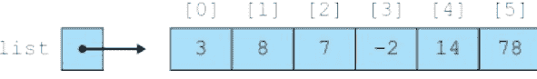

一种方法是创建一个新数组，并将第一个数组中的值按反序存储起来。虽然那种方法是合理的，但你应该能够在不构建第二个数组的情况下解决问题。另一种方法是进行一系列的交换（swaps）。例如，列表开头的值 3 和列表末尾的值 78 需要交换：

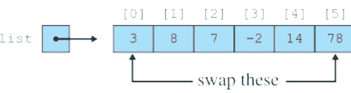

交换完那对后，你可以交换交换的一对（索引为 1 和 4 的值）：

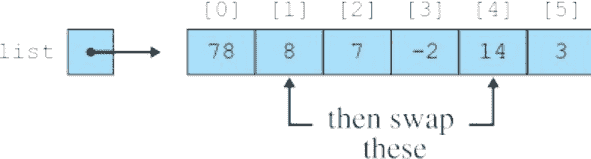

你可以继续交换，直到整个列表都反转过来。在查看执行此反转的代码之前，让我们先考虑交换两个值的通用问题。

假设你有两个整数变量 `x` 和 `y`，它们的值分别为 `a` 和 `78`：

```java
int x = 3;
int y = 78;
```

你如何交换这些值呢？一种朴素的方法是简单地将互相赋值：

```java
// 不会正常交换
x = y;
y = x;
```

遗憾的是，这行不通。你起始的状态如下：

x 3 y 78

当执行第一条赋值语句时，你将 `y` 的值复制到 `x` 中：

x 78 y 78

你希望 `x` 最终等于 `78`，但如果你尝试用这种方式解决问题，一旦将 `y` 的值赋给 `x`，你就失去了 `x` 的旧值。第二条赋值语句随后会将 `x` 的新值 `78` 复制回 `y`，这导致你的两个变量都等于 `78`。

标准的解决方案是引入一个临时变量，在给 `x` 赋新值时可以使用它来存储 `x` 的旧值。然后你可以从临时变量将 `x` 的旧值复制到 `y` 中完成交换：

```java
int temp = x;
x = y;
y = temp;
```

你首先将 `x` 的旧值复制到 `temp`：

```java
x 78 y temp 3
```

然后你将 `y` 的值放入 `x`：

```java
x 78 y 78 temp 3
```

接下来，你将 `x` 的旧值从 `temp` 复制到 `y`：

```java
x 3 y temp 3
```

此时你已经成功交换了 `x` 和 `y` 的值，所以不再需要 `temp` 了。

在某些编程语言中，你可以将其定义为一个交换方法，用于交换两个 `int` 值：

```java
// 不会正常交换
public static void swap(int x, int y) {
    int temp = x;
    x = y;
    y = temp;
}
```

在 Java 中，参数是按值传递的，这意味着当你将变量传递给方法时，方法接收的是该变量值的副本。对于 `int` 这样的基本类型，这意味着方法无法更改原始变量。要交换数组中的两个元素，你必须传递数组以及元素的索引：

```java
public static void swap(int[] list, int i, int j) {
    int temp = list[i];
    list[i] = list[j];
    list[j] = temp;
}
```

现在你可以使用这个交换方法来反转数组：

```java
public static void reverse(int[] list) {
    for (int i = 0; i < list.length / 2; i++) {
        swap(list, i, list.length - 1 - i);
    }
}
```

# 字符串遍历算法

在 Java 中，我们通常将字符串视为文本块，但你也可以将其视为单个字符的序列。从这个角度来看，字符串就像数组。回想字符串的单个元素是 `char` 类型，你可以通过调用 `charAt` 方法访问单个字符值。

我们用于编写数组遍历算法的技巧也可以用于编写字符串遍历算法。语法上略有不同，但逻辑是相同的。我们的数组遍历模板如下：

```
for (int i = 0; i < <array>.length; i++) {
  do something with array[i];
}
```

对应的字符串算法模板如下：

```
for (int i = 0; i < <string>.length(); i++) {
  do something with string.charAt(i);
}
```


请注意，引用数组时不使用括号来引用长度，但引用字符串时需要使用括号。同样注意，数组的方括号表示被替换为对`char`方法的调用。

例如，你可以使用以下代码计算“Mississippi”中字母“i”出现的次数：

```
String s = "Mississippi";
int count = 0;
for (int i = 0; i < s.length(); i++) {
  if (s.charAt(i) == 'i') {
    count++;
  }
}
```

这段代码将正确计算出字符串中存在四个“i”。另一个例子是考虑计算反转字符串的任务。你可以通过遍历字符串并构建一个新版本（将每个新字符放在你正在构建的字符串的前面）来实现字母的反序排列。以下是一个使用这种方法的完整方法：

```
public static String reverse(String text) {
    String result = "";
    for (int i = 0; i < text.length(); i++) {
        result = text.charAt(i) + result;
    }
    return result;
}
```

如果你调用`reverse("Mississippi")`，方法将返回 "ippississIM"。

## 函数式方法

第 19 章描述了处理数组的另一种方法，这种代码看起来与本节中的示例完全不同。它依赖于从 Java 8 版本开始引入的语言特性，这些特性允许你以更声明式的方式操作数组和其他数据结构。你不需要具体指定如何遍历数组，而是可以告诉 Java 你想对数组元素做什么，并让 Java 来决定如何进行遍历。从 Java 5 版本开始引入`for-each`循环是向这一方向迈出的第一步，但新特性要远得多。

例如，假设你有一个定义如下的数值数组：

```
int[] numbers = {8, 3, 2, 17};
```

让我们看看针对两个简单任务会编写的代码：求和和打印值。使用标准的遍历循环，你将编写以下代码。

```
// 求一个数字数组的和并打印它们 (for loop)
int sum = 0;
for (int i = 0; i < numbers.length; i++) {
    sum += numbers[i];
}
System.out.println("sum = " + sum);
for (int i = 0; i < numbers.length; i++) {
    System.out.println(numbers[i]);
}
```

这段代码将产生以下输出：

```
sum = 30
8
3
2
```

`for-each`循环简化了这段代码，因为它指定了你想要顺序操作数组中的每个不同值，但它不需要你包含一个索引变量来说明具体是如何实现的。

```
// 求一个数字数组的和并打印它们 (for-each loop)
int sum = 0;
for (int n : numbers) {
    sum += n;
}
System.out.println("sum = " + sum);
for (int n : numbers) {
    System.out.println(n);
}
```

使用 Java 8 的新特性，这变得更加简单了。求值序列之和的任务是非常常见的，以至于有一个内置方法可以为你完成它。而通过调用`System.out.println`方法来打印每个值的任务也可以用非常简洁的方式表示。

```
// 求一个数字数组的和并打印它们 (functional)
int sum = Arrays.stream(numbers).sum();
System.out.println("sum = " + sum);
Arrays.stream(numbers).forEach(System.out::println);
```

这段代码完全没有描述如何执行遍历。相反，你告诉 Java 你想对数组中的值执行哪些操作，并将遍历交给 Java 来完成。关于这种方法的更完整解释，请参阅[第 19 章](#19)]。

## 7.3 引用语义

在 Java 中，数组是对象。我们从第 3 章就开始一直使用对象，但还没有详细讨论过它们是如何存储的。现在是时候探索一下细节了。对象在计算机内存中的存储方式与原始数据的存储方式不同。例如，当我们声明整数变量时

```
int x = 8;
```

变量存储的是实际数据。因此，我们画了如下的图：

数组和其他对象的情况有所不同。对于对象而言，变量并不存储实际数据。相反，数据存储在对象中，变量存储指向对象所在位置的引用。因此，计算机内存中有两个不同的元素：变量和对象。所以，当我们构造如下的数组对象时：

```
int[] list = new int[5];
```

我们最终得到了：

如所示所示，内存中有两个不同的值：数组本身（位于图中右侧）以及一个名为`list`的变量，它存储对数组的引用（图中箭头所示）。你可能需要一些时间来习惯这不同的存储方法，但这些方法非常常见，以至于科学家有专门的术语来描述它们。原始类型的系统被称为值语义（value semantics），这些类型通常被称为值类型（value types）。而数组和其他对象的系统被称为引用语义（reference semantics），这些类型通常被称为引用类型（reference types）。我们将花一些时间来探索这种差异的影响。需要记住的关键点是，当你操作对象时，你始终操作的是引用而不是数据。此时，你可能会疑惑为什么 Java 决定对象使用引用语义。有两个主要原因：

- **效率**。对象可能是复杂的，这意味着它们会占用大量内存。如果我们创建此类对象的拷贝，内存就会耗尽。即使对象很大，它的引用也可以很小。

- **共享**。通常，拥有一个拷贝是不够的。假设你的老师让班上所有学生把作业放在中心。如果每个学生都创建一个拷贝，将是毫无意义且混乱的。显然是让所有学生使用同一个中心。引用语义允许对单个对象拥有多个引用。

如果没有引用语义，Java 程序将更难编写。那么为什么 Sun 决定包含具有值语义的原始类型呢？原因是历史性的。Sun 希望利用 C 和 C++ 的流行（它们拥有类似的类型），并保证 Java 程序运行快速，这通过更传统的原始类型更容易实现。如果 Java 的设计者今天有机会重新设计 Java，他们可能会放弃原始类型，并仅使用引用语义的一致对象模型。

## 多个对象

在上一节中，你看到了如何操作单个数组对象。在本节中，我们将通过考虑存在多个对象以及指向同一个对象的多个引用时的情况，深入探讨引用语义的影响。

考虑以下代码

```
int[] list1 = new int[5];
int[] list2 = new int[5];
for (int i = 0; i < list1.length; i++) {
  list1[i] = 2 * i + 1;
  list2[i] = 2 * i + 1;
}
int[] list3 = list2;
```

每次调用`new`都会构造一个新的对象，这段代码调用了两次`new`，这意味着有两个不同的对象。代码写法使得`list2`的长度和值序列始终与`list1`完全相同。在两个数组初始化后，我们定义了第三个数组变量并赋值给`list2`。这一步创建了一个新的引用，而不是一个新对象。在计算机执行代码后，内存状态看起来如下：

| [0] | [1] | [2] | [3] | [4] |
|---|---|---|---|---|
| list1 | | 3 | 5 | 7 | 9 |

| [0] | [1] | [2] | [3] | [4] |
|---|---|---|---|---|
| list2 | | 3 | 5 | 7 | 9 |

| list3 | | | | |

我们有三个变量但只有两个对象。变量`list2`和`list3`都指向同一个数组对象。用手机类比，你可以将其想为两个人拥有同一个人的电话号码。这意味着其中任何一个人都可以给那个人打电话。或者用另一个类比，假设你和你一个朋友都知道如何在线访问你的银行信息。这意味着你们都有同一个账户的访问权限，并且你们中的任何一个都可以对账户进行更改。

这种方法的含义是，在某种程度上，`list2`和`list3`同样能够修改它们所指向的数组。这行代码

```
list2[2]++
```

产生的效果与以下代码

```
list3[2]++
```

完全相同。

由于两个变量都指向同一个数组对象，你可以通过其中任何一个来访问数组。

引用语义（Reference semantics）帮助我们理解为什么简单的`==`不会给出我们预期的结果。当此测试应用于对象时，它判断的是两个引用是否为同一个引用（而不是判断它们所指向的对象在某种程度上是否等价）。换句话说，当我们测试两个引用是否相等时，我们是在测试它们是否指向**完全相同的对象**。

变量`list2`和`list3`都指向同一个数组对象。因此，如果我们询问`list2 == list3`，答案将是`yes`（表达式求值为`true`）。但如果我们询问`list1 == list2`，答案将是`no`（表达式求值为`false`），尽管我们认为这两个数组在某种程度上是等价的。

有时你想知道两个变量是否指向完全相同的对象，对于这些情况，简单的`==`比较是合适的。但你可能也想知道两个对象在值上是否某种程度上等价，在这种情况下你应该调用`Arrays.equals`或`equals`方法。

理解引用语义也允许我们理解为什么简单的`==`不会给出我们预期的结果……（注：由于原文后续存在大量重复和乱码化片段，此处已根据核心逻辑完成翻译）

` 块内的内容进行了精确的翻译。

```
list[list.length - 1] = first;
```

这种方法的一个有趣变体是将值向右旋转，而不是向左旋转。要执行这个逆操作，你需要将当前位于列表末尾的值移到最前面，并将其余值向右移动。因此，如果一个名为`list`的变量初始存储值为`[3, 8, 9, 7, 5]`，它应该将`5`移到前面并存储值为`[5, 3, 8, 9, 7]`。

首先，将要旋转的值存入一个临时变量：

```
int last = list[list.length - 1];
```

然后将其他值向右移动：

| [0] | [1] | [2] | [3] | [4] |
|---|---|---|---|---|
| 5 | 8 | 9 | 7 | 5 |

在这种情况下，四个单独的赋值语句如下：

```
list[1] = list[0];
list[2] = list[1];
list[3] = list[2];
list[4] = list[3];
```

更通用的写法是下面这行行代码：

```
list[i] = list[i - 1];
```

如果你将这段代码放在标准的`for`循环中，你将得到以下结果：

```
// 无法工作
for (int i = 0; i < list.length; i++) {
    list[i] = list[i - 1];
}
```

这段代码有两个问题。首先，另一个差一错误（off-by-one bug）。你想要执行的第一个赋值语句`i`会将`list[1]`设置为包含当前`list[0]`中的值，但这个循环将`list[0]`设为`list[-1]`。Java 会产生`ArrayIndexOutOfBoundsException`，因为不存在`list[-1]`这个值。你需要让`i`从 1 而不是 0 开始：

```
// 仍然无法工作
for (int i = 1; i < list.length; i++) {
    list[i] = list[i - 1];
}
```

然而，这个版本的代码同样不起作用。它避免了异常，但想想它做了什么。循环第一次执行会将`list[1]`赋值为`list[0]`中的内容：

| [0] | [1] | [2] | [3] | [4] |
|---|---|---|---|---|
| 3 | 8 | 9 | 7 | 5 |

值`8`发生什么了？它被值`3`覆盖了。循环下一次执行时，`list[2]`被设为`list[1]`：

| [0] | [1] | [2] | [3] | [4] |
|---|---|---|---|---|
| 3 | 3 | 9 | 7 | 5 |

| [0] | [1] | [2] | [3] | [4] |
|---|---|---|---|---|
| 3 | 3 | 3 | 7 | 5 |

你可能会说：“等一下……`list[1]`不是`3`，它是`8`。” 当你开始时是这么说的，但循环的第一次迭代将`8`替换为了`3`，现在这个`3`被复制到了原来`9`所在的位置。

循环以此方式继续，将`3`放入数组的每个单元格中。显然，这不是你想要的。要让这段代码工作，你必须按反序运行循环（从右到左，而不是从左到右）。所以让我们回到开始的地方：

| [0] | [1] | [2] | [3] | [4] |
|---|---|---|---|---|
| 3 | 8 | 9 | 7 | 5 |

我们把列表的最后一个值存入了一个局部变量中。这释放了数组的最后一个位置。现在，将`list[4]`设置为`list[3]`中的内容：

| [0] | [1] | [2] | [3] | [4] |
|---|---|---|---|---|
| 3 | 8 | 9 | 7 | 7 |

这消除了列表末尾的`5`，但该值已安全地存储在局部变量中。一旦执行了这条赋值语句，你就释放了`list[3]`，这意味着你现在可以将`list[3]`设置为当前`list[2]`中的内容：

| [0] | [1] | [2] | [3] | [4] |
|---|---|---|---|---|
| 3 | 3 | 8 | 9 | 7 |

该过程以此方式继续，将`8`从索引 1 复制到索引 2，并将`3`从索引 0 复制到索引 1，最后留下了结果：

| [0] | [1] | [2] | [3] | [4] |
|---|---|---|---|---|
| 3 | 3 | 8 | 9 | 7 |

此时，唯一要做的工作就是将存储在局部变量中的`5`放在列表的最前面。你可以通过将`i++`改为`i--`并调整初始化和测试条件来反转`for`循环。最终的方法如下：

```
public static void rotateRight(int[] list) {
    int last = list[list.length - 1];
    for (int i = list.length - 1; i >= 1; i--) {
        list[i] = list[i - 1];
    }
    list[0] = last;
}
```

## 对象数组

我们到目前为止过的过的数组存储的都是像`int`这样的基本类型值，但你可以拥有任何 Java 类型的数组。不过，对象数组的行为不同，因为对象被存储为引用而不是值。构造对象数组通常是一个两步过程，因为你必须同时构造数组和各个单独的对象。Java 在其`java.awt`包中包含一个`Point`类。每个`Point`对象都用于存储二维空间中某个点的`(x, y)`坐标（我们将在下一章更详细地讨论这个类，但现在我们只构造几个）。假设你想构造一个对象数组。考虑以下语句：

```
Point[] points = new Point[3];
```

这条语句声明了一个名为`points`的变量，它指向一个长度为 3 的数组。

现在我们只需要编写代码来找到给定第一个值的所有逆序对了。这需要我们编写第二个嵌套循环：

```
for (every possible first value) {
  for (every possible second value) {
    if (first value > second value) {
      print(first, second);
    }
  }
}
```

这个问题相当容易转换为 Java 代码，尽管循环边界处理起来可能有点棘手。目前，让我们为每个循环使用标准的遍历循环：

```
for (int i = 0; i < data.length; i++) {
  for (int j = 0; j < data.length; j++) {
    if (data[i] > data[j]) {
      System.out.println("" + data[i] + ", " + data[j] + ")");
    }
  }
}
```

上面的代码并不完全正确。记住，对于逆序对，第二个值必须出现在列表中第一个值之后。在这种情况下，我们正在计算第一个值和第二个值的所有可能组合。为了只考虑给定第一个值之后的值，我们必须让第二个循环从`i + 1`开始，而不是从 0 开始。我们还可以进行一点改进，意识到因为逆序对需要一对值，所以没有必要将列表的最后一个数字作为可能的第一个值。因此，涉及`i`的外层循环可以提前结束一次：

```
for (int i = 0; i < data.length - 1; i++) {
    for (int j = i + 1; j < data.length; j++) {
        if (data[i] > data[j]) {
            System.out.println("" + data[i] + ", " + data[j] + "");
        }
    }
}
```

当你编写这样的嵌套循环时，通常的做法是使用`i`作为外层循环，`j`作为外层内部的循环，如果`j`循环内部还有循环，则使用`k`。

## 7.5 多维数组


之前章节中的数组示例涉及了所有所谓的一维数组（单行或单列数据）。通常，你可能希望以多维的方式存储数据。例如，你可能想存储一个既有行又有列的二维数据网。幸运的是，你可以形成任意维数的数组：

- `double`
- `double[]`：`double` 的一维数组
- `double[][]`：`double` 类型的二维网格
- `double[][][]`：`double` 类型的三维集合

超过一个维的数组被称为*多维数组*。

> **多维数组**  
> 数组的数组，其元素通过多个整数索引进行访问。

## 矩阵二维数组

多维数组最常见的用法是具有特定宽度和高度的二维数组。例如，假设你在三个不同的日期里进行了一系列五次温度读取。你可以按照如下方式定义一个三行五列的二维数组：

```java
double[][] temps = new double[3][5];
```

注意，在赋值语句的左右两侧，你都必须使用双层方括号。当你描述左侧的类型时，必须明确这不仅仅是一个一维值序列（其类型为 `double[]`），而是二维值网格（其类型为 `double[][]`）。在右侧，当你构造数组时，必须指定网格的维度。通常约定是先列行，后列列。生成的数组看起来如下：

| | [0] | [1] | [2] | [3] | [4] |
|---|---|---|---|---|---|
| [0] | 0.0 | 0.0 | 0.0 | 0.0 | 0.0 |
| [1] | 0.0 | 0.0 | 0.0 | 0.0 | 0.0 |
| [2] | 0.0 | 0.0 | 0.0 | 0.0 | 0.0 |

与一维数组一样，值被初始化为 0，且行和列的索引都从 0 开始。一旦创建了这样的数组，你可以通过提供特定的行和列号（按顺序）引用元素。例如，将第一行的第四个值设置为 `98.3`，并将第三行的第一个值设置为 `99.4`，你可以编写以下代码：

```java
temps[0][3] = 98.3; // 第一行的第四个值
temps[2][0] = 99.4; // 第三行的第一个值
```

在程序执行这些行代码后，数组看起来如下：

| | [0] | [1] | [2] | [3] | [4] |
|---|---|---|---|---|---|
| temps[0] | 0.0 | 0.0 | 0.0 | 98.3 | 0.0 |
| temps[1] | 0.0 | 0.0 | 0.0 | 0.0 | 0.0 |
| temps[2] | 99.4 | 0.0 | 0.0 | 0.0 | 0.0 |

通过提供特定的行和列号（按顺序）来考虑单个元素是有帮助的。例如，将第一行的第四个值设置为 `98.3`，并将第三行的第一个值设置为 `99.4`，你可以编写以下代码：

```java
temps[0][3] = 98.3; // 第一行的第四个值
temps[2][0] = 99.4; // 第三行的第一个值
```

在程序执行这些行代码后，数组看起来如下：

```java
public static void print(double[][] grid) {
    for (int i = 0; i < grid.length; i++) {
        for (int j = 0; j < grid[i].length; j++) {
            System.out.print(grid[i][j] + " ");
        }
        System.out.println();
    }
}
```

我们可以通过将相邻数值相加来计算下一行。因此，我们相加第一对数字（1 1 4），然后相加第二对数字（4 1 6），依此类推：

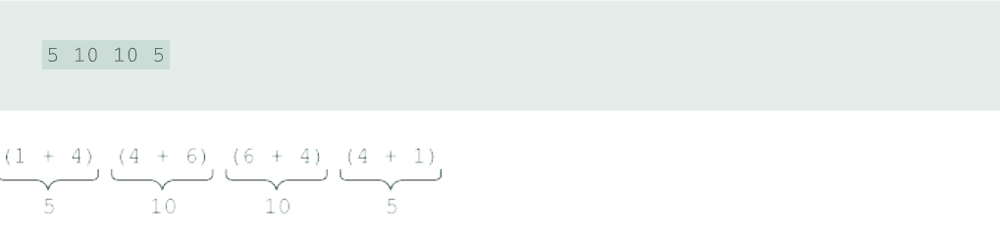

然后我们在这一组数字列表的前端和结尾各放置一个 1，就得到了三角形的下一行：

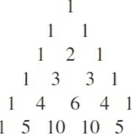

三角形的这一属性为它的计算提供了一种技术。我们可以按行构建它，通过从前行的值中计算每一行新行。换句话说，我们写了以下循环（假设我们有一个名为 `triangle` 的二维数组来存储答案）：

```java
for (int i = 0; i < triangle.length; i++) {
    construct triangle[i] using triangle[i - 1];
}
```

我们只需要详细说明如何构建新行。这是一个锯齿数组，因为每行的元素数量都不同。观察三角形，你会发现第一行（第 0 行）有一个值，第二行（第 1 行）有两个值，依此类推。通常情况下，第 `i` 行有 `(i + 1)` 个值，因此我们可以将伪代码完善如下：

```java
for (int i = 0; i < triangle.length; i++) {
    triangle[i] = new int[i + 1];
    fill in triangle[i] using triangle[i - 1];
}
```

我们知道每行的第一个值和最后一个值应该是 1：

```java
for (int i = 0; i < triangle.length; i++) {
    triangle[i] = new int[i + 1];
    triangle[i][0] = 1;
    triangle[i][i] = 1;
    fill in the middle of triangle[i] using triangle[i - 1];
}
```

我们还知道中间的值来自上一行。为了弄清楚如何计算它们，让我们画出正在尝试构建的数组图：

我们已经写了代码来填充每行开头和结尾出现的 1。现在我们需要编写代码来填充中间的值。以第 5 行为例。第 1 列的值 5 来自于上一行第 0 列的值 1 和第 1 列的值 4 之和。第 2 列的值 10 来自于上一行第 1 列和第 2 列的值之和。

更通俗地说，这些中间值中的每一个都是上一行中紧邻其上方和左侧两个值的和。换句话说，列 `j` 的值的计算方式如下：

```java
triangle[i][j] = (value above and left) + (value above).
```

我们可以通过使用相应的数组索引将其转换为实际代码：

```java
triangle[i][j] = triangle[i - 1][j - 1] + triangle[i - 1][j];
```

我们需要将此语句包含在一个 `for` 循环中，以便它为所有的中间值赋值。`for` 循环是将伪代码转换为实际代码的最后一步：

```java
for (int i = 0; i < triangle.length; i++) {
    triangle[i] = new int[i + 1];
    triangle[i][0] = 1;
    triangle[i][i] = 1;
    for (int j = 1; j < i; j++) {
        triangle[i][j] = triangle[i - 1][j - 1] + triangle[i - 1][j];
    }
}
```

如果我们将这段代码包含在一个方法中，并结合之前描述的网格打印方法类似的打印方法，我们就得到了下面的完整程序：

```java
1 // 此程序构建了一个锯齿二维数组
2 // 用于存储杨辉三角形。它利用了以下
3 // 事实：除了 1 以外的每个值出现在每行的
4 // 开头和结尾，并且都是上一行两个
5 // 值之和。
6
7 public class PascalsTriangle {
8     public static void main(String[] args) {
9         int[][] triangle = new int[11][];
10        fillIn(triangle);
11        print(triangle);
12    }
13
14    public static void fillIn(int[] triangle) {
15        for (int i = 0; i < triangle.length; i++) {
            triangle[i] = new int[i + 1];
            triangle[i][0] = 1;
            triangle[i][i] = 1;
            for (int j = 1; j < i; j++) {
                triangle[i][j] = triangle[i - 1][j - 1] + triangle[i - 1][j];
            }
        }
    }
    public static void print(int[] triangle) {
        for (int i = 0; i < triangle.length; i++) {
            for (int j = 0; j < triangle[i].length; j++) {
                System.out.print(triangle[i][j] + " ");
            }
        }
        System.out.println();
    }
}
```

该程序输出：

```
1 
1 1 
1 2 1 
1 3 3 1 
1 4 6 4 1 
1 5 10 10 5 1 
1 6 15 20 15 6 1 
1 7 21 35 35 21 7 1 
1 8 28 56 70 56 28 8 1 
1 9 36 84 126 126 84 36 9 1 
1 10 45 90 120 120 120 90 45 10 1 
```

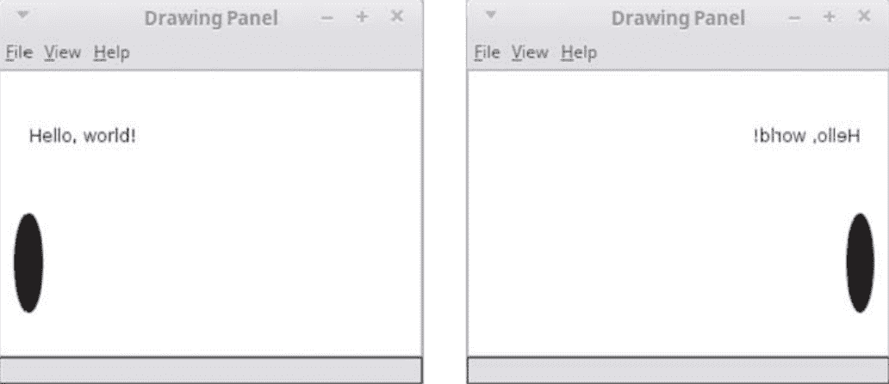

图 7.2 镜像处理前后的输出

```java
// 此程序包含一个镜像方法，可以逐像素水平地
// 翻转 DrawingPanel 的外观。

import java.awt.*;

public class Mirror {
    public static void main(String[] args) {
        DrawingPanel panel = new DrawingPanel(300, 200);
        Graphics g = panel.getGraphics();
        g.drawString("Hello, world!", 20, 50);
        g.fillOval(10, 100, 20, 70);
        mirror(panel);
    }

    // 水平翻转给定绘制面板的像素。
    public static void mirror(DrawingPanel panel) {
        Color[] pixels = panel.getPixels();
        for (int row = 0; row < pixels.length; row++) {
            for (int col = 0; col < pixels[0].length / 2; col++) {
                // 与“镜像”位置的像素交换
                int opposite = pixels[0].length - 1 - col;
                Color px = pixels[row][col];
                pixels[row][col] = pixels[row][opposite];
                pixels[row][opposite] = px;
            }
        }
        panel.setPixels(pixels);
    }
}
```

通常你可能想要提取颜色的单个红、绿、蓝分量以便进行处理。每个像素的 `Color` 对象都有方法可以帮助你完成操作。

## 表 7.4 与像素 RGB 分量相关的方法

| 方法 | 说明 |
| --- | --- |
| `getRed()` | 返回 0-255 之间的红色分量 |
| `getGreen()` | 返回 0-255 之间的绿色分量 |
| `getBlue()` | 返回 0-255 之间的蓝色分量 |

`getRed`、`getGreen` 和 `getBlue` 方法从 RGB 整数中提取相关分量。表 7.4 列出了这些相关方法。

以下代码显示了一个计算图像反色的方法，反色是通过取每个颜色 RGB 值的相反值得到的。例如（红 = 255，绿 = 100，蓝 = 35）的相反值是（红 = 0，绿 = 155，蓝 = 220）。计算反色的简单方法是从最大颜色值 255 中减去像素的 RGB 值。[图 7.3] 显示了一个示例输出。

```java
// 通过反转面板中所有的颜色
// 值，来生成给定图像的反色。
public static void negative(DrawingPanel panel) {
    Color[] pixels = panel.getPixels();
    for (int row = 0; row < pixels.length; row++) {
        for (int col = 0; col < pixels[0].length; col++) {
            // 从 0-255 提取红/绿/蓝分量
            int r = 255 - pixels[row][col].getRed();
            int g = 255 - pixels[row][col].getGreen();
            int b = 255 - pixels[row][col].getBlue();
            // 用新颜色值更新像素数组
            pixels[row][col] = new Color(r, g, b);
        }
    }
    panel.setPixels(pixels);
}
```

之前的所有示例都涉及就地对 2D 像素数组进行修改。但有时你想要根据周围像素的值来创建每个像素，因此你需要创建一个新的像素数组。以下示例显示了一个 `stretch` 方法，它可以将 `DrawingPanel` 的内容加宽到当前宽度的两倍。为了实现这一点，它创建一个比现有数组宽一倍的数组 `newPixels`。（记住 2D 数组的第一个索引是 y，第二个索引是 x，因此为了加宽数组，代码必须使数组的第二个维度加倍。）`setPixels` 方法将在必要时调整面板大小以容纳我们新的更大的像素数组。

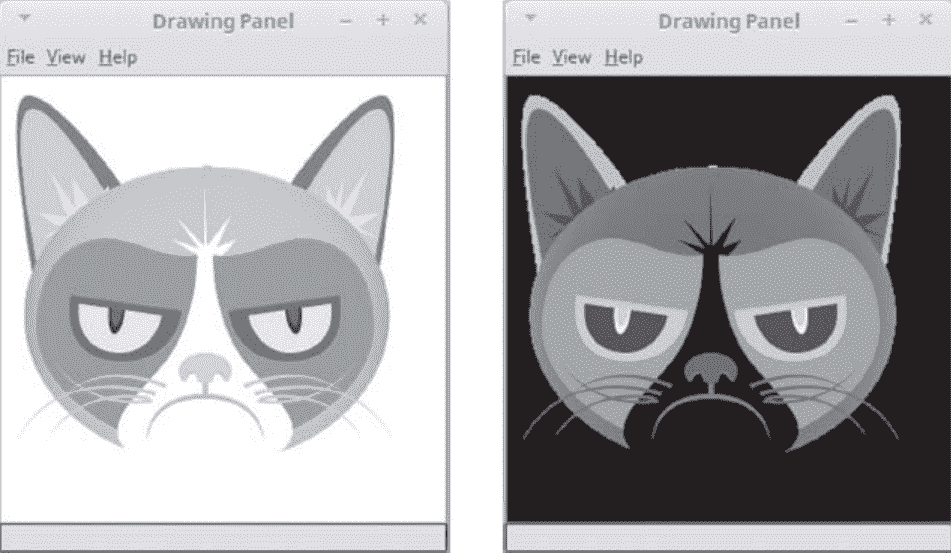

图 7.3 图像的反色（处理前后）

填充新数组的循环将每个索引处的值设置为原数组中 x 索引为一半大索引处的值。例如，原数组在 (52, 34) 处的像素值被用于填充新数组在 (104, 68) 和 (105, 68) 处的像素。[图 7.4]() 显示了拉伸图像的图形输出。

```java
// 将给定面板加宽为原来的两倍。
// 绘制在面板上的任何形状和颜色都会拉伸以适应。
public static void stretch(DrawingPanel panel) {
    Color[] pixels = panel.getPixels();
    Color[] newPixels = new Color[pixels.length][2 * pixels[0].length];
    for (int row = 0; row < pixels.length; row++) {
        for (int col = 0; col < 2 * pixels[0].length; col++) {
            newPixels[row][col] = pixels[row][col / 2];
        }
    }
    panel.setPixels(newPixels);
}
```


图 7.4 水平拉伸图像（处理前后）

通常你可能想要提取颜色的单个红、绿、蓝分量以便进行处理。每个像素的 `Color` 对象都有方法可以帮助你完成操作。

## 表 7.4 与像素 RGB 分量相关的方法

| 方法 | 说明 |
| --- | --- |
| `getRed()` | 返回 0-255 之间的红色分量 |
| `getGreen()` | 返回 0-255 之间的绿色分量 |
| `getBlue()` | 返回 0-255 之间的蓝色分量 |

`getRed`、`getGreen` 和 `getBlue` 方法从 RGB 整数中提取相关分量。表 7.4 列出了这些相关方法。

以下代码显示了一个计算图像反色的方法，反色是通过取每个颜色 RGB 值的相反值得到的。例如（红 = 255，绿 = 100，蓝 = 35）的相反值是（红 = 0，绿 = 155，蓝 = 220）。计算反色的简单方法是从最大颜色值 255 中减去像素的 RGB 值。[图 7.3] 显示了一个示例输出。


之前的所有示例都涉及就地对 2D 像素数组进行修改。但有时你想要根据周围像素的值来创建每个像素，因此你需要创建一个新的像素数组。以下示例显示了一个`stretch`方法，它可以将`DrawingPanel`的内容加宽到当前宽度的两倍。为了实现这一点，它创建一个比现有数组宽一倍的数组`newPixels`。（记住 2D 数组的第一个索引是 y，第二个索引是 x，因此为了加宽数组，代码必须使数组的第二个维度倍。）`setPixels`方法将在必要调整面板大小以容纳我们新的更大的像素数组。


图 7.3 图像的反色（处理前后）

填充新数组的循环将每个索引处的值设置为原数组中 x 索引为一半大索引处的值。例如，原数组在 (52, 34) 处的像素值被用于填充新数组在 (104, 68) 和 (105, 68) 处的像素。[图 7.4]() 显示了拉伸图像的图形输出。

```
// 将给定面板加宽为原来的倍。
// 绘制在面板上的任何形状和颜色都会拉伸以适应。
public static void stretch(DrawingPanel panel) {
    Color[] pixels = panel.getPixels();
    Color[] newPixels = new Color[pixels.length][ 2 * pixels[0].length];
    for (int row = 0; row < pixels.length; row++) {
        for (int col = 0; col < 2 * pixels[0].length; col++) {
            newPixels[row][col] = pixels[row][col / 2];
        }
    }
    panel.setPixels(newPixels);
}
```

在编程中，我们经常会想要统计某些值出现的次数。例如，我们可能想知道有多少人在考试中得了 100 分，有多少人得了 99 分，有多少人得了 98 分，以此类推。或者，我们可能想知道某个城市有多少天的温度高于 100 度，有多少天在 90 度以上，有多少天在 80 度以上，以此类推。对于这些计数任务，方法几乎相同。让我们来看一个小计数任务，其中只有五个值需要计数。

假设老师老师按 0 到 4 分范围对测验进行评分，并想知道测验分数的分布。换句话说，老师想知道有多少个 0 分、多少 1 分、多少 2 分、多少 3 分以及多少 4 分。假设老师将所有分数包含在如下所示的数据文件中：

```
1 4 1 0 3 2 1 4 2 0
3 0 2 3 0 4 3 3 4 1
2 4 1 3 1 4 3 3 2 4
2 3 0 4 1 4 4 4 1 1
```

老师可以手动计算分数，但使用计算机进行计数要容易得多。你如何解决这个问题呢？首先，你必须意识到你正在执行五个独立的计数任务：你正在统计数字 0、1、2、3 和 4 出现的次数。你需要五个计数器来解决这个问题，这意味着数组是存储这些数据的极佳方法。通常情况下，每当你发现自己需要 $n$ 个某种类型的数据时，你都应该考虑使用一个长度为 $n$ 的数组。

每个计数器都将是一个`int`，所以你需要一个`int`类型的数组：

```
int[] count = new int[5];
```

这行行代码将分配一个包含五个整数的数组，并将每个元素初始化为`0`：

| [0] | [1] | [2] | [3] | [4] |
|---|---|---|---|---|
| 0 | 0 | 0 | 0 | 0 |

你正在从文件中读取，所以你需要一个`Scanner`和一个循环来读取分数，直到没有更多分数可读：

```
Scanner input = new Scanner(new File("tally.dat"));
while (input.hasNextInt()) {
  int next = input.nextInt();
  // process next
}
```

为了完成这段代码，你需要弄清楚如何处理每个值。你知道`next`将是五个不同值之一：`0`、`1`、`2`、`3`或`4`。如果它是`0`，你想增加`0`的计数器，即`count[0]`；如果它是`1`，你想增加`1`的计数器，即`count[1]`，以此此类推。我们一直在使用嵌套的`if/else`语句解决这类问题：

```
if (next == 0) {
    count[0]++;
} else if (next == 1) {
    count[1]++;
} else if (next == 2) {
    count[2]++;
} else if (next == 3) {
    count[3]++;
} else { // next == 4
    count[4]++;
}
```

但使用数组，你可以更直接地解决这个问题：

```
count[next]++
```

与嵌套的`if/else`结构相比，这行代码非常短，以你起初可能没有意识到它的功能相同。让我们精确模拟一下从文件中读取各种值时发生的情况。

当数组被构造时，所有的计数器都被初始化为 0：

| [0] | [1] | [2] | [3] | [4] |
|---|---|---|---|---|
| 0 | 0 | 0 | 0 | 0 |

输入文件中的第一个值是`1`，所以程序将其读入`next`。然后执行这行代码：

```
count[next]++
```

因为`next`是`1`，这行代码变成了：

```
count[1]++
```

所以索引 [1] 处的计数器加 1：

| | [0] | [1] | [2] | [3] | [4] |
|---|---|---|---|---|---|
| count -> | 0 | 1 | 0 | 0 | 0 |

然后从输入文件中读取了一个`4`，这意味着`count[4]`加 1：

| | [0] | [1] | [2] | [3] | [4] |
|---|---|---|---|---|---|
| count -> | 0 | 1 | 0 | 0 | 1 |

接下来，从输入文件中读取了另一个`1`，它增加了`count[1]`：

| | [0] | [1] | [2] | [3] | [4] |
|---|---|---|---|---|---|
| count -> | 0 | 2 | 0 | 0 | 1 |

然后从输入文件中读取了一个`0`，它增加了`count[0]`：

| | [0] | [1] | [2] | [3] | [4] |
|---|---|---|---|---|---|
| count -> | 1 | 2 | 0 | 0 | 1 |

注意，当数组被构造时，所有的计数器都初始化为 0：

| [0] | [1] | [2] | [3] | [4] |
|---|---|---|---|---|
| 0 | 0 | 0 | 0 | 0 |

在编程中，我们经常发现自己想要统计某些值的出现的次数。例如，我们可能想知道有多少人在考试中得了 100 分，有多少人得了 99 分，有多少人得了 98 分，以此此类推。或者，我们可能想知道某个城市有多少天的温度高于 100 度，有多少天在 90 度以上，有多少天在 80 度以上，以此此类推。对于这些计数任务，方法几乎相同。让我们来看一个小计数任务，其中只有五个值需要计数。

假设老师按 0 到 4 分范围对测验进行评分，并想知道测验分数的分布。换句话说，老师想知道有多少个 0 分、多少 1 分、多少 2 分、多少 3 分以及多少 4 分。假设老师将所有分数包含在如下所示的数据文件中：

```
1 4 1 0 3 2 1 4 2 0
3 0 2 3 0 4 3 3 4 1
2 4 1 3 1 4 3 3 2 4
2 3 0 4 1 4 4 4 1 1
```

老师可以手动计算分数，但使用计算机进行计数要容易得多。你如何解决这个问题呢？首先，你必须意识到你正在执行五个独立的计数任务：你正在统计数字 0、1、2、3 和 4 出现的次数。你需要五个计数器来解决这个问题，这意味着数组是存储这些数据的极佳方法。通常情况下，每当你发现自己需要 $n$ 个某种类型的数据时，你都应该考虑使用一个长度为 $n$ 的数组。

每个计数器都将是一个`int`，所以你需要一个`int`类型的数组：

```
int[] count = new int[5];
```

这行行代码将分配一个包含五个整数的数组，并将每个元素初始化为`0`：

| [0] | [1] | [2] | [3] | [4] |
|---|---|---|---|---|
| 0 | 0 | 0 | 0 | 0 |

你正在从文件中读取，所以你需要一个`Scanner`和一个循环来读取分数，直到没有更多分数可读：

```
Scanner input = new Scanner(new File("tally.dat"));
while (input.hasNextInt()) {
  int next = input.nextInt();
  // process next
}
```

为了完成这段代码，你需要弄清楚如何处理每个值。你知道`next`将是五个不同值之一：`0`、`1`、`2`、`3`或`4`。如果它是`0`，你想增加`0`的计数器，即`count[0]`；如果它是`1`，你想增加`1`的计数器，即`count[1]`，以此此类推。我们一直在使用嵌套的`if/else`语句解决这类问题：

```
if (next == 0) {
    count[0]++;
} else if (next == 1) {
    count[1]++;
} else if (next == 2) {
    count[2]++;
} else if (next == 3) {
    count[3]++;
} else { // next == 4
    count[4]++;
}
```

但使用数组，你可以更直接地解决这个问题：

```
count[next]++
```

与嵌套的`if/else`结构相比，这行代码非常短，以你起初可能没有意识到它的功能相同。让我们精确模拟一下从文件中读取各种值时发生的情况。

当数组被构造时，所有的计数器都被初始化为 0：

| [0] | [1] | [2] | [3] | [4] |
|---|---|---|---|---|
| 0 | 0 | 0 | 0 | 0 |

输入文件中的第一个值是`1`，所以程序将其读入`next`。然后执行这行代码：

```
count[next]++
```

因为`next`是`1`，这行代码变成了：

```
count[1]++
```

所以索引 [1] 处的计数器加 1：

| | [0] | [1] | [2] | [3] | [4] |
|---|---|---|---|---|---|
| count -> | 0 | 1 | 0 | 0 | 0 |

然后从输入文件中读取了一个`4`，这意味着`count[4]`加 1：

| | [0] | [1] | [2] | [3] | [4] |
|---|---|---|---|---|---|
| count -> | 0 | 1 | 0 | 0 | 1 |

接下来，从输入文件中读取了另一个`1`，它增加了`count[1]`：

| | [0] | [1] | [2] | [3] | [4] |
|---|---|---|---|---|---|
| count -> | 0 | 2 | 0 | 0 | 1 |

然后从输入文件中读取了一个`0`，它增加了`count[0]`：

| | [0] | [1] | [2] | [3] | [4] |
|---|---|---|---|---|---|
| count -> | 1 | 2 | 0 | 0 | 1 |

```java
return count;
}
```

注意，我们并没有在循环体中统计`n`，而是统计了`firstDigit(n)`（仅首位数字，而不是整个数字）。

数字 0 的值对我们来说存在一个潜在问题。贝福德定律（Benford's Law）适用于源自指数序列的数据。但即使你的数据是呈指数级增长的，如果你从 0 开始，你永远无法超过 0。因此，最好是从计算中排除 0 值。通常情况下，它们根本不会出现。

在报告结果时，让我们先从报告已排除的零开始：

```java
if (count[0] > 0) {
    System.out.println("excluding " + count[0] + " zeros");
}
```

对于其他数字，我们想要报告每个数字出现的次数以及每个占的百分比。为了计算百分比，我们需要知道值的总和。这里是引入一个寻找整数数组和的好地方。这是一个非常直接的数组遍历问题，可以使用`for-each`循环解决：


```java
public static int sum(int[] data) {
    int sum = 0;
    for (int n : data) {
        sum += n;
    }
    return sum;
}
```

现在我们可以通过调用该方法并减去零的数量来计算数字总数：

```java
int total = sum(count) - count[0];
```

一旦我们得到了数字总数，就可以写一个循环来报告每个百分比。为了计算百分比，我们将每个计数乘以 100 并除以数字总数。我们必须小心地乘以 100.0 而不是 100，以确保我们使用`double`值来计算结果。否则，我们将得到截断的整数除法，从而无法获得小数点后的数字：

```java
for (int i = 1; i < count.length; i++) {
    double pct = count[i] * 100.0 / total;
    System.out.println(" " + count[i] + ": " + pct + "%");
}
```

注意，循环从`1`开始而不是`0`，因为我们已经在报告中排除了零。

这是一个将这些部分整合在一起的完整程序。它还使用了`printf`语句来格式化输出，并在最后包含了一个表头和一个总计：


```java
// 此程序查找一组正整数首位数字的分布。
// 该程序用于探索被称为贝福德定律的现象。

import java.io.*;
import java.util.*;

public class Benford {
    public static void main(String[] args) 
        throws FileNotFoundException {
        Scanner console = new Scanner(System.in);
        System.out.println("Let's count those leading digits...");
        System.out.print("input file name? ");
        String name = console.nextLine();
        Scanner input = new Scanner(new File(name));
        int[] count = countDigits(input);
        reportResults(count);
    }

    // 从输入读取整数，计算一个数组来统计
    // 每个首位数字 (0-9) 的出现次数。
    public static int[] countDigits(Scanner input) {
        int[] count = new int[10];
        while (input.hasNextInt()) {
            int n = input.nextInt();
            count[firstDigit(n)]++;
        }
        return count;
    }

    // 报告每个首位数字的百分比，排除零
    public static void reportResults(int[] count) {
        System.out.println();

        if (count[0] > 0) {
            System.out.println("excluding " + count[0] + " zeros");
        }

        int total = sum(count) - count[0];
        System.out.println("Digit Count Percent");
        for (int i = 1; i < count.length; i++) {
            double pct = count[i] * 100.0 / total;
            System.out.printf("%5d %5d %%6.2f\n", total, i, count[i], pct);
        }
        System.out.printf("Total %%5d %5d %%6.2f\n", total, 100.0);
    }

    // 返回给定数组中整数的和
    public static int sum(int[] data) {
        int sum = 0;
        for (int n : data) {
            sum += n;
        }
        return sum;
    }

    // 返回给定数字的首位数字
    public static int firstDigit(int n) {
        int result = Math.abs(n);
        while (result >= 10) {
            result = result / 10;
        }
        return result;
    }
}
```

现在我们有了一个完整的程序，让我们看看分析各种数据时会得到什么。贝福德分布之所以出现是因为人口呈指数级增长。让我们使用网页`http://www.census.gov/pop/`中的数据，它包含了各个美国县的人口估计。该数据包含了 3000 个人口从 100 到 900 万不等县的信息。这里是使用这些数据的示例输出：

```text
Let's count those leading digits...

input file name? county.txt
```

| Digit | Count | Percent |
| :--- | :--- | :--- |
| 1 | 970 | 30.90 |
| 2 | 564 | 17.97 |
| 3 | 399 | 12.71 |
| 4 | 306 | 9.75 |
| 5 | 206 | 6.55 |
| 6 | 208 | 6.63 |
| 7 | 170 | 5.24 |
| 8 | 172 | 5.48 |
| 9 | 144 | 4.59 |
| Total | 3139 | 100.00 |

这些百分比几乎是贝福德定律预测的。遵循贝福德定律的数据有一个有趣的特性：使用什么尺度并不重要。例如，如果你测量身高，无论用英尺、米还是英浪（furlongs）。翻倍数字影响很小，因为如果原始数据是指数级的，翻倍后的数字也是如此。查看之前的输出，看看翻倍每个数字时能否预测结果。这里是实际结果：

```text
Let's count those leading digits...

input file name? county2.txt
```

| Digit | Count | Percent |
| :--- | :--- | :--- |
| 1 | 900 | 28.67 |
| 2 | 555 | 17.68 |
| 3 | 415 | 13.22 |
| 4 | 327 | 10.42 |
| 5 | 258 | 7.71 |
| 6 | 209 | 6.66 |
| 7 | 190 | 6.05 |
| 8 | 173 | 5.51 |
| 9 | 133 | 4.24 |
| Total | 3139 | 100.00 |

注意变化非常小。翻倍数字影响不大，因为如果原始数据具有指数性质，翻倍后的数字也是如此。这里是另一个人口三倍的示例运行：

```text
Let's count those leading digits...

input file name? county3.txt
```

| Digit | Count | Percent |
| :--- | :--- | :--- |
| 1 | 926 | 29.50 |
| 2 | 549 | 17.49 |
| 3 | 385 | 12.27 |
| 4 | 327 | 10.42 |
| 5 | 258 | 8.22 |
| 6 | 228 | 7.26 |
| 7 | 193 | 6.15 |
| 8 | 143 | 4.56 |
| 9 | 130 | 4.14 |
| Total | 3139 | 100.0 |

另一个显示贝福德特性的数据集是任意指定的太阳黑子计数。Robin McQuinn 在`http://sidc.noaa.html/sunspot.html`维护了一个网页，上面有追溯到 1818 年的太阳黑子每日计数。这里是使用这些数据的示例执行：

```text
Let's count those leading digits...

input file name? sunspot.txt

excluding 4144 zeros
```

| Digit | Count | Percent |
| :--- | :--- | :--- |
| 1 | 5405 | 31.24 |
| 2 | 1809 | 10.46 |
| 3 | 2127 | 12.29 |
| 4 | 1690 | 9.77 |
| 5 | 1702 | 9.84 |
| 6 | 1357 | 7.84 |
| 7 | 1364 | 7.88 |
| 8 | 966 | 5.58 |
| 9 | 882 | 5.10 |
| Total | 17302 | 100.00 |

注意在这次执行中，程序报告了某些 0 值的排除。

## 章节总结

数组是一个将相同类型的多个基本值或对象分组到一个名称下的对象。每个单独的值（称为元素）通过从 0 到数组长度减 1 的整数索引来访问。

尝试访问索引小于 0 或大于等于数组长度的数组元素将导致程序抛出`ArrayIndexOutOfBoundsException`崩溃。

数组通常使用`for`循环进行遍历。数组的长度通过访问其`length`字段找到，因此对数组的循环可以处理从 0 到`length - 1`的索引。可以使用名为`for-each`的循环类型按顺序访问数组元素。

Java 数组是对象，并使用引用语义，其中变量存储的是值的引用，而不是值本身。这意味着两个变量可以引用同一个数组或对象。如果通过其中一个引用修改了数组，则该修改在另一个引用中也可见。

对象的数组实际上是指向对象的引用的数组。新声明并初始化的对象数组实际上在所有元素索引上都存储了`null`，因此每个元素必须单独初始化或在循环中初始化，以存储实际的对象。

多维数组是数组的数组。这些数组通常用于存储二维数据，例如行和列中的数据，或者二维空间中的`xy`数据。

## 自测题

### 第 7.1 节：数组基础

1. 下面哪项是声明整数数组的正确语法？

   - a. `int a[10] = new int[10];`
   - b. `int[10] a = new int[10];`
   - c. `[] int a = [10] int;`
   - d. `int a[10];`
   - e. `int[] a = new int[10];`

2. 应该使用什么表达式来访问名为`numbers`的数组的第一个元素？假设`numbers`包含 10 个元素，应该使用什么表达式访问其最后一个元素？无论长度如何，可以使用什么表达式来访问它的最后一个元素？

3. 编写代码创建一个名为`data`且大小为 5 的整数数组，内容如下：

| [0] | [1] | [2] | [3] | [4] |
|---|---|---|---|---|
| 27 | 51 | 33 | -1 | 101 |

4. 编写代码，使用循环将 26 到 38 之间的所有奇数存储到数组中。使数组的大小足够存储这些数字。然后，尝试泛化你的代码，使其适用于任何最小值和最大值，而不是 26 和 38。

5. 执行以下代码后，数组`numbers`包含哪些元素？

```java
int[] numbers = new int[8];
numbers[1] = 4;
numbers[4] = 99;
numbers[7] = 2;
int x = numbers[1];
numbers[x] = 44;
numbers[numbers[7]] = 11; // 使用 numbers[7] 作为索引
```

6. 执行以下代码后，数组`data`包含哪些元素？

```java
int[] data = new int[8];
data[0] = 3;
data[7] = -18;
data[4] = 5;
data[1] = data[0];
int x = data[4];
data[4] = 6;
data[x] = data[0] * data[1];
```

7. 下列代码有什么问题？

```java
int[] first = new int[2];
first[0] = 3;
first[1] = 7;
int[] second = new int[2];
second[0] = 3;
second[1] = 7;
// 打印数组元素
System.out.println(first);
```

```java
System.out.println(second);
// 检查元素是否相同
if (first == second) {
    System.out.println("They contain the same elements.");
} else {
    System.out.println("The elements are different.");
}
```

6. 下面哪项是声明给定六个整数值数组的正确语法？

- a. `int[] a = {17, -3, 42, 5, 9, 28};`
- b. `int a[] = {17, -3, 42, 5, 9, 28};`
- c. `int[] a = new int[6]{17, -3, 42, 5, 9, 28};`
- d. `int[6] a = {17, -3, 42, 5, 9, 28};`
- e. `int[] a = int [17, -3, 42, 5, 9, 28]{6};`

7. 编写代码声明一个名为`data`的数组，元素为 7, -1, 13, 24 和 6。仅使用一条语句初始化该数组。

8. 编写代码检查一个整数数组并报告数组中的最大值。考虑将你的代码放入名为`max`的方法中，该方法接受数组作为参数并返回最大值。假设数组至少包含一个元素。

9. 编写名为`average`的方法，计算整数数组所有元素的平均值（算术平均值），并以`double`类型返回答案。例如，如果传递数组包含值 [1, -2, 4, -4, 9, -6, 16, -8, 25, -10]，计算出的平均值应为 2.5。你的方法接受整数数组作为参数并返回平均值。

### 第 7.2 节：数组遍历算法

12. 什么是数组遍历？举例可以通过遍历数组解决的问题。

13. 编写代码使用`for`循环打印名为`data`的数组的每个元素，该数组包含五个整数：

```text
element [0] is 1
element [1] is 5
element [2] is 7
element [3] is -3
element [4] is 25
```

泛化你的代码，使其适用于任意大小的数组。

14. 执行以下代码后，数组`list`包含哪些元素？

```java
int[] list = {2, 18, 6, -4, 5};
for (int i = 0; i < list.length; i++) {
  list[i] = list[i] + list[0];
}
```

15. 编写代码反序打印整数数组，格式与第 7.2 节中的`print`方法相同。考虑将你的代码放入名为`printBackward`的方法中，该方法接受数组作为参数。

16. 描述为了处理`String`数组对`count`和`equals`方法需要哪些修改。

17. 编写名为`allLess`的方法，接受两个整数数组，如果第一个数组中的每个元素都小于第二个数组相同索引处的元素，则返回`true`。如果数组长度不同，应返回`false`。

### 第 7.3 节：引用语义

18. 为什么交换数组的方法有效，而交换值的方法无效？

19. 下列程序的输出是什么？

```java
public class ReferenceMystery1
    public static void main(String[] args) {
        int x = 0;
        int[] a = new int[4];
        x = 1;
        mystery(x, a);
        System.out.println(x + " " + Arrays.toString(a));
        x = 1;
        mystery(x, a);
        System.out.println(x + " " + Arrays.toString(a));
    }
    public static void mystery(int x, int[] a) {
        x = x + 1;
        a[x] = a[x] + 1;
        System.out.println(x + " " + Arrays.toString(a));
    }
}
```

20. 下列程序的输出是什么？

```java
public class ReferenceMystery2
    public static void main(String[] args) {
        int x = 1;
        int[] a = new int[2];
        mystery(x, a);
        System.out.println(x + " " + Arrays.toString(a));
        x--;
        a[1] = a.length;
        mystery(x, a);
        System.out.println(x + " " + Arrays.toString(a));
    }

    public static void mystery(int x, int[] list) {
        list[x]++;
        x++;
        System.out.println(x + " " + Arrays.toString(list));
    }
}
```

21. 编写名为`swapPairs`的方法，接受整数数组并交换相邻索引的元素。即交换元素 0 和 1，2 和 3，以此此类推。如果数组长度为奇数，最后一个元素应保持不变。例如，调用你的方法后，列表 [10, 20, 30, 40, 50] 应该变为 [20, 10, 40, 30, 50]。

### 第 7.4 节：高级数组技术

22. 执行以下代码后，数组`numbers`的元素值是什么？

```java
int[] numbers = {10, 20, 30, 40, 50, 60, 70, 80, 90, 100};
for (int i = 0; i < 9; i++) {
    numbers[i] = numbers[i + 1];
}
```


23. 执行以下代码后，数组`numbers`的元素值是什么？

```java
int[] numbers = {10, 20, 30, 40, 50, 60, 70, 80, 90, 100};
for (int i = 1; i < 10; i++) {
    numbers[i] = numbers[i - 1];
}
```

24. 考虑以下方法`mystery`：

```java
public static void mystery(int[] a, int[] b) {
    for (int i = 0; i < a.length; i++) {
        a[i] += b[b.length - 1 - i];
    }
}
```

执行以下代码后，数组`a1`中的元素值是什么？

```java
int[] a1 = {1, 3, 5, 7, 9};
int[] a2 = {1, 4, 9, 16, 25};
mystery(a1, a2);
```

25. 考虑以下方法`mystery2`：

```java
public static void mystery2(int[] a, int[] b) {
  for (int i = 0; i < a.length; i++) {
    a[i] = a[2 * i % a.length] - b[3 * i % b.length];
  }
}
```

执行以下代码后，数组`a1`中的元素值是什么？

```java
int[] a1 = {2, 4, 6, 8, 10, 12, 14, 16};
int[] a2 = {1, 1, 2, 3, 5, 8, 13, 21};
mystery2(a1, a2);
```

26. 考虑以下方法`mystery3`：

```java
public static void mystery3(int[] data, int x, int y) {
  data[data[x]] = data[y];
  data[y] = x;
}
```

在执行以下代码后，数组`numbers`中元素的值是什么？

```java
int[] numbers = {3, 7, 1, 0, 25, 4, 18, -1, 5};
myst3(numbers, 3, 1);
myst3(numbers, 5, 6);
myst3(numbers, 8, 4);
```

27. 考虑以下方法：

```java
public static int mystery4(int[] list) {
    int x = 0;
    for (int i = 1; i < list.length; i++) {
        int y = list[i] - list[0];
        if (y > x) {
            x = y;
        }
    }
    return x;
}
```

当传入以下每个数组时，该方法返回什么值？

- a. `{5}`
- b. `{3, 12}`
- c. `{4, 2, 10, 8}`
- d. `{1, 9, 3, 5, 7}`
- e. `{8, 2, 10, 4, 10, 9}`

28. 考虑以下方法：

```java
public static void mystery5(int[] nums) {
  for (int i = 0; i < nums.length - 1; i++) {
    if (nums[i] > nums[i + 1]) {
      nums[i + 1]++;
    }
  }
}
```

如果将每个数组传递给上述方法，它们的最终内容是什么？

- a. `{8}`
- b. `{14, 7}`
- c. `{7, 1, 3, 2, 0, 4}`
- d. `{10, 8, 9, 5, 5}`
- e. `{12, 11, 10, 10, 8, 7}`

29. 编写一段代码，计算`String`数组中元素的平均字符串长度。例如，如果数组包含`"belt"`、`"hat"`、`"jelly"`、`"bubble gum"`，平均长度为5.5。

30. 编写代码，接受一个`String`数组作为参数，并指示该数组是否为回文——即正读和反读是否相同。例如，数组`"alpha"`、`"beta"`、`"gamma"`、`"delta"`、`"gamma"`、`"beta"`、`"alpha"`是一个回文。

## 第 7.5 节：多维数组

31. 在执行以下代码后，数组`numbers`包含哪些元素？

```java
int[][] numbers = new int[3][4];
for (int r = 0; r < numbers.length; r++) {
    for (int c = 0; c < numbers[0].length; c++) {
        numbers[r][c] = r + c;
    }
}
```

32. 假设声明了一个名为`data`的整数二维矩形数组，具有四行七列。编写一个循环来初始化`data`的第三行，存储从1到7的数字。

33. 编写一段代码，构建一个5行10列的整数二维数组。用一个乘法表填充该数组，使得数组元素`[i][j]`包含值`i * j`。使用嵌套的`for`循环来构建数组。

34. 假设声明了一个名为`matrix`的整数二维矩形数组，具有六行八列。编写一个循环将第二列的内容复制到第五列。

35. 考虑以下方法：

```java
public static void mystery2d(int[][] a) {
    for (int r = 0; r < a.length; r++) {
        for (int c = 0; c < a[0].length - 1; c++) {
            if (a[r][c + 1] > a[r][c]) {
                a[r][c] = a[r][c + 1];
            }
        }
    }
}
```

一个二维数组`numbers`初始化以存储以下整数，在调用所示方法后，它的内容是什么？

```java
int[][] numbers = {{3, 4, 5, 6},
                   {4, 5, 6, 7},
                   {5, 6, 7, 8}};
mystery2d(numbers);
```

36. 编写一段代码，构建一个5行的锯齿状整数二维数组，每行的列数增加，使得第一行有一列，第二行两列，第三行三列，依此类推。数组元素在从上到下、从左到右的顺序（也称为主序）上具有递增的值。也就是说，数组的内容应该如下：

```text
1
2, 3
4, 5, 6
7, 8, 9, 10
```

使用嵌套的`for`循环来构建该数组。

37. 在检查像素的二维数组时，如果你无法访问`DrawingPanel`对象，你如何确定图像的宽度和高度？

38. 完成以下方法代码，该方法将图像转换为其红色通道；即移除任何绿色或蓝色，只保留红色分量：

```java
public static void toRedChannel(DrawingPanel panel) {
    Color[] pixels = panel.getPixels();
    for (int row = 0; row < pixels.length; row++) {
        for (int col = 0; col < pixels[0].length; col++) {
            // 你的代码
        }
    }
    panel.setPixels(pixels);
}
```

39. 以下代码的结果是什么？图像会变成什么？

```java
public static void pixelMystery(DrawingPanel panel) {
    Color[] pixels = panel.getPixels();
    for (int row = 0; row < pixels.length; row++) {
        for (int col = 0; col < pixels[0].length; col++) {
            int n = Math.min(row + col, 255);
        }
    }
    panel.setPixels(pixels);
}
```

## 练习

1. 编写一个名为`lastIndexOf`的方法，接受一个整数数组和一个整数作为参数，并返回该值最后出现的索引。如果未找到该值，应返回-1。例如，在数组`[74, 85, 102, 99, 85]`中，85的索引是5。

2. 编写一个名为`range`的方法，返回整数数组的范围。范围定义为最大值与最小值之差。例如，如果数组`list`包含`[36, 12, 25, 19]`，调用`range(list)`应返回24（假设数组至少有一个元素）。

3. 编写一个名为`countInRange`的方法，接受一个整数数组、一个最小值和一个最大值作为参数，并返回落在该范围内的元素数量（包含边界）。例如，在数组`[14, 1, 22, 17, 43, 5]`中，最小值4和最大值17的元素个数。

4. 编写一个名为`isSorted`的方法，接受一个实数数组作为参数，如果数组是排序的（非递减）则返回`true`，否则返回`false`。例如，如果数组`list1`和`list2`分别为`[16.1, 12.3, 22.2, 14.4]`和`[1.5, 4.3, 7.0, 25.1]`，调用`isSorted(list1)`和`isSorted(list2)`分别返回`false`和`true`。假设数组至少有一个元素。单元素数组认为是排序的。

5. 编写一个名为`mode`的方法，返回整数数组中出现频率最高的元素。假设数组至少有一个元素且每个元素的值都在0到100之间。如果出现平局，选择较小的值。例如，如果数组包含`[27, 15, 15, 11, 27]`，你的方法应返回15。（提示：你可能想参考本章的`Tally`程序来获取思路。）

6. 编写一个名为`stddev`的方法，返回整数数组的标准差。标准差是通过将每个元素与平均值的差的平方和除以个数减一后开平方得到的。（这很简单！更数学化地说，数组`a`的标准差如下所示：`stddev(a)=sqrt(sum((a[i]-average(a))^2) / (a.length-1))`。）例如，如果传递的数组包含`[1, -2, 4, -4, 9, -6, 16, -8, 25, -10]`，你的方法应返回约为11.237。

7. 编写一个名为`kLargest`的方法，接受一个整数`k`和一个数组`a`作为参数，并返回有`k`个元素大于等于它的元素。如果`k=0`，返回最大的元素；如果`k=1`，返回第二大的元素，依此类推。例如，如果传递的数组包含`[74, 85, 102, 99, 101, 56, 84]`且整数`k`为`2`，你的方法应返回99，因为有两个值大于或等于99。假设`0 <= k < a.length`。（提示：考虑对数组或其副本进行排序。）

8. 编写一个名为`median`的方法，接受一个整数数组作为参数，并返回数组中数字的中位数。中位数是在将元素按顺序排列后位于列表中间的那个数字。假设数组的长度为奇数（因此一个唯一的元素就成了中位数），且数字在0到99之间。例如，`[5, 2, 4, 17, 15, 54, 3, 26, 18, 2, 17]`的中位数是5，`[42, 37, 1, 97, 1, 2, 42, 3, 25, 89, 10, 29, 27]`的中位数是25。（提示：你可能想参考本章前面的`Tally`程序来获取灵感。）

9. 编写一个名为`minGap`的方法，接受一个整数数组作为参数，并返回数组相邻值之间的最小差或间隙，其中间隙定义为后值减去前值。例如，在数组`[1, 3, 6, 7, 12]`中，第一个间隙是`2 (3 - 1)`，第二个间隙是`3 (6 - 3)`，第三个间隙是`1 (7 - 6)`，第四个间隙是`5 (12 - 7)`。因此，如果传递此数组，你的方法应该返回`1`。如果列表没有排序，最小差距可能是负数。如果传入的数组少于两个元素，返回`0`。

10. 编写一个名为`percentEven`的方法，接受一个整数数组作为参数，并返回数组中偶数的百分比（实数类型）。例如，如果数组存储了元素`[6, 2, 9, 11, 3]`，则你的方法应该返回`40.0`。如果数组不包含任何偶数或完全没有元素，返回`0.0`。

11. 编写一个名为`isUnique`的方法，接受一个整数数组作为参数，并返回一个`boolean`值，表示数组中的值是否唯一（是为`true`，否为`false`）。如果列表中没有两个相等的值，则认为这些值是唯一的。例如，如果传入一个包含`[3, 8, 12, 2, 9, 17, 43, -8, 46]`的数组，你的方法应该返回`true`；但如果传入`[4, 7, 3, 9, 12, -47, 3, 74]`，你的方法应该返回`false`，因为值3出现了两次。

12. 编写一个名为`priceRight`的方法，模仿电视节目《价格对对》中的猜测规则。该方法接受两个参数：一个代表参赛者出价的整数数组，和一个代表正确价格的整数。该方法返回数组中最接近正确价格但不大于该价格的元素。例如，如果名为`bids`的数组存储了值`[200, 300, 250, 1, 950, 40]`，调用`priceRight(bids, 280)`应该返回250，因为250是最接近280且不超过280的出价。如果数组所有元素都大于正确价格，你的方法应该返回-1。

13. 编写一个名为`longestSortedSequence`的方法，接受一个整数数组作为参数，并返回数组中最长有序（非递减）整数序列的长度。例如，在数组`[3, 8, 10, 1, 14, -3, 0, 14, 207, 56, 98, 12]`中，数组中最长的有序序列包含四个值（序列`[0, 14, 207]`是其中一个例子），因此如果传入此数组，你的方法将返回4。有序意味着非递减，因此序列可以包含重复项。如果传入空数组，你的方法应该返回0。

14. 编写一个名为`contains`的方法，接受两个整数数组`a1`和`a2`作为参数，并返回一个布尔值，表示`a2`中的元素序列是否出现在`a1`中（是为`true`，否为`false`）。该序列必须连续且以相同的顺序出现。例如，考虑以下数组：

```java
int[] list1 = {1, 6, 2, 1, 4, 1, 2, 8};
int[] list2 = {1, 2, 1};
```

调用`contains(list1, list2)`应该返回`true`，因为`list2`中的值序列`[1, 2, 1]`包含在`list1`中且从索引5开始。如果`list2`存储的值`[2, 1, 2]`，调用`contains(list1, list2)`将返回`false`。任何两个具有相同元素的列表都被认为相互包含。每个数组都包含空数组，而空数组不包含自身以外的任何数组。

15. 编写一个名为`collapse`的方法，接受一个整数数组作为参数，并返回一个新数组，将每对整数替换为它们的和。例如，如果一个名为`list`的数组存储值为`[7, 2, 9, 4, 5]`，调用`collapse(list)`应该返回`[9, 13, 5]`。如果数组有奇数个元素，最后一个元素保持不变。

16. 编写一个名为`append`的方法，接受两个数组作为参数，并返回一个将第二个数组附加第一个数组后面的新数组。例如，如果`list1`和`list2`分别为`[2, 4, 6]`和`[1, 2, 3]`，则返回`[2, 4, 6, 1, 2, 3]`。

17. 编写一个名为`vowelCount`的方法，接受一个`String`作为参数，并产生一个表示每个元音（A、E、I、O、U）数量的数组。假设字符串全是字母。例如，调用`vowelCount("i think am")`应该返回`[1, 0, 3, 0, 0]`。

18. 编写一个名为`wordLengths`的方法，接受一个文件作为参数。你的方法应该打开给定文件，统计每个单词的字母数量并输出结果。例如，考虑以下文本：

```text
Before sorting:
hello are you
After sorting:
are feeling today
```

你的方法应该在控制台输出如下以便星号对齐：

```text
1: 0
2: ******
3: *********
4: 0
5: *****
6: *
7: **
```

19. 编写一个名为`matrixAdd`的方法，接受两个二维整数数组作为参数，将数组视为矩阵并返回它们的和。矩阵`A`和`B`的和是矩阵`C`，对于每行`i`和每列`j`，`C[i][j] = A[i][j] + B[i][j]`。你可以假设传入的数组维度相同。

20. 编写一个名为`isMagicSquare`的方法，接受一个二维整数数组作为参数，如果是魔方则返回`true`。如果一个方阵的所有行、列和对角线和相等，则它是一个魔方。例如，`[[2, 7, 6], [9, 5, 1], [4, 3, 8]]`是一个魔方，因为所有八个和都是15。


- 21. 编写`grayscale`方法将彩色图像转换为黑白图像。这是通过平均每个像素的红、绿、蓝分量来实现的。例如，如果像素的 RGB 值为（red 100, green 30, blue 80），这三个分量的平均值为（100 + 30 + 80）/3 = 70，因此该像素变为（red 70, green 70, blue 70）。

- 22. 编写`transpose`方法接受一个`DrawingPanel`作为参数，并关于`x`轴和`y`轴反转图像。你可以假设图像是正方形，即其宽度和高度相等。

- 23. 编写一个`zoomIn`方法，该方法接受一个`DrawingPanel`作为参数，并将其转换为两个维度上都大一倍的图像。原始图像中的每个像素变成新缩放图像中 4 个像素的聚簇（2 行 2 列）。

- 24. 编写`rotateLeft`和`rotateRight`方法，分别将图像的像素逆时针或顺时针旋转 90 度。你不应该假设图像是正方形的；它的宽度和高度可能不同。

- 25. 编写一个`blur`方法，使用以下特定算法使图像看起来是“模糊”的。将每个像素设置为自身与周围 8 个像素的平均值。也就是说，对于位置（x, y）处的像素，将它的 RGB 值设置为位置（x-1, y-1）到（x+1, y+1）处 RGB 值的平均值。注意不要在图像边缘附近越界；如果像素位于图像边缘，则对它拥有的任何邻居取平均值。

# 你好，世界

# 编程项目

- 1. Java 的类型`int`对能够存储的整数大小有限制。可以通过将整数表示为数字数组来绕过此限制。编写一个交互式程序，计算两个多达 50 位的整数。

- 2. 使用数组编写一个猜单词游戏（Hangman）游戏。允许用户猜测字母，并用数组表示哪些字母已经被猜过。

- 3. 编写一个与用户玩“猜数字大师”（Mastermind）变体游戏的程序。例如，程序可以使用伪随机数生成一个四位数。用户应该被允许一直猜测直到猜中数字。应该给用户提供线索，指示猜测中有多少数字是正确的，有多少个数字正确但位置错误。

- 4. 编写一个程序，为用户对经典的迈尔斯-布里格人格测试（Myers–Briggs personality test）的评分。假设测试有 70 个问题，决定一个人在四个维度上的性格。每个问题有两个答案选择，我们称之为“A”答案和“B”答案。问题被分为 10 组，每组 7 个，每组遵循以下重复模式：

  - 组中的第一个问题（第 1, 8, 15, 22 题等）告诉该人是内向还是外向。

  - 后两个问题（第 2 和 3, 9 和 10, 16 和 17 以及 24 题等）测试该人是由感官还是直觉引导的。

  - 后两个问题（第 4 和 5, 11 和 12, 18 和 19, 25 和 26 题等）测试该人关注的是思考还是情感。

  - 每组的最后两个问题（第 6 和 7, 13 和 14, 20 和 21, 27 和 28 题等）测试该人倾向于判断还是受感知引导。

换句话说，如果我们认为内向/外向（I/E）是维度 1，感官/直觉（S/N）是维度 2，思考/情感（T/F）是维度 3，而判断/感知（J/P）是维度 4，那么问题到其对应维度的映射表如下所示：

| 问题 | 1 | 2 | 3 | 4 | 5 | 6 | 7 | 8 | 9 | 10 | 11 | 12 | 13 | 14 | 15 | 16 | 17 | 18 | 19 | 20 | 21 | 22 | 23 | 24 | 25 | 26 | 27 | 28 |
| :--- | :--- | :--- | :--- | :--- | :--- | :--- | :--- | :--- | :--- | :--- | :--- | :--- | :--- | :--- | :--- | :--- | :--- | :--- | :--- | :--- | :--- | :--- | :--- | :--- | :--- | :--- | :--- | :--- |
| 维度 | I | S | S | T | F | J | P | I | S | S | T | F | J | P | I | | | | | | | | | | | | | | |

以下是姓名和回答的部分样本输入：

| 姓名 | 回答 |
| :--- | :--- |
| Betty Boop | AAAAAAAAA |
| Snoopy | BBBBB |

如果某人在给定维度上的回答中 B 的占比少于 50%，则该人在该维度上的类型应该是两个选择中的第一个。如果某人的回答占 50% 或以上，则该人在该维度上的类型是第二个选择。你的程序应该输出每个人的姓名、每个维度上 A 和 B 回答的数量、每个维度中 B 的百分比，以及整体人格类型。以下应该是你的程序对上述输入的输出：

- 5. 使用二维数组编写一个表示跳井字棋（Tic-Tac-Toe）棋盘的游戏。

- 6. 编写一个程序读取 DNA 数据文件并搜索蛋白质序列。DNA 数据由字母 A、C、G 和 T 的长字符串组成，分别对应胞嘧啶、鸟嘌呤和胸嘧啶。可以通过寻找指示蛋白质范围开始和结束的特殊核苷酸序列来识别蛋白质。

- 7. 编写一个`zoomIn`方法，接受一个`DrawingPanel`作为参数，并将其转换为两个维度上都大一倍的图像。原始图像中的每个像素变成新缩放图像中 4 个像素的聚簇（2 行 2 列）。

- 8. 编写`rotateLeft`和`rotateRight`方法，分别将图像的像素逆时针或顺时针旋转 90 度。你不应该假设图像是正方形的；它的宽度和高度可能不同。

- 9. 编写一个`blur`方法，使用以下特定算法使图像看起来是“模糊”的。将每个像素设置为自身与周围 8 个像素的平均值。也就是说，对于位置（x, y）处的像素，将它的 RGB 值设置为位置（x-1, y-1）到（x+1, y+1）处 RGB 值的平均值。注意不要在图像边缘附近越界；如果像素位于图像边缘，则对它拥有的任何邻居取平均值。

# 第 8 章 类

## 8.1 面向对象

- 类与对象

## 8.2 对象状态与行为

- 对象状态：字段
- 对象行为：方法
- 隐式参数
- 修改器与访问器
- `toString`方法

## 8.3 对象初始化：构造函数

- `this`关键字
- 多个构造函数

## 8.4 封装

- 私有字段
- 类不变量
- 内部实现

## 8.5 案例研究：设计类

- 面向对象设计
- 类字段与方法头部
- 构造实现

### 引言

现在你已经掌握了过程式编程的基础，终于准备好探索 Java 设计初衷：面向对象编程。本章介绍了你应该使用的基本术语，并向你展示如何创建类和对象。

对象是包含状态和行为的实体，可以作为程序的一部分。我们将讨论抽象和封装的概念，这允许你在了解内部细节的情况下使用对象。我们还将讨论新类以及实现它们。

## 8.1 面向对象编程

到目前为止，我们的大部分重点都是过程式分解，即将复杂任务分解为更小任务的技术。这是最老的编程风格，即使在 Java 这样的语言中，我们仍然使用过程式技术。但 Java 还提供了不同的编程方法，我们称之为面向对象编程。

> 面向对象编程（OOP）：将程序视为一组对象，而不是一组动作。

面向对象编程涉及特定的编程观点，有它自己的术语。让我们先通过非编程示例来探索这些术语。回顾第 3 章中对象的定义。

> 对象：包含状态（数据）和行为（方法）的编程实体。

要真正理解这个定义，你必须理解“状态”和“行为”。这些是面向对象编程中最基本的概念。

让我们考虑被称为收音机的对象类。收音机处于不同的状态。它可以开启或关闭。它可以调到许多不同的电台，并设置许多不同的音量。任何给定的收音机必须知道自己处于什么状态，这意味着它在内部跟踪这些信息。我们将这些内部值的集合称为对象的状态。

> 存储在对象中的值的集合。

收音机的行为是什么？显而易见的是在开启且音量增大时它产生声音。但你可以对收音机执行一些操作来操纵它的内部状态。我们可以开启或关闭收音机，更改电台或音量。我们还可以检查收音机目前调在哪个电台。我们将这些操作的集合称为对象的行为。

对象可以执行的一系列操作，通常报告或修改其内部状态。

对象本身并不是完整的程序；它们是被赋予了特定角色和职责的组件。对象可以作为大型程序的一部分来解决问题。创建和使用对象的代码被称为`clients`（客户端）。

## 客户端（或客户端代码）

与类或该类的对象进行交互的代码。

客户端程序通过向对象发送消息并请求它们执行行为来与对象进行交互。对象的一个大优势是它们提供了可重用的代码段，这些代码可以在许多客户端程序中使用。你已经使用过几个有趣的对象，例如`String`、`Scanner`、`Random`和`File`类型的对象。换句话说，你和你的程序一直是这些对象的客户端。Java 的类库包含了成千上万现有的对象类。

然而，当你编写较大的程序时，你会发现 Java 并不总是能为你正在解决的问题提供预先存在的对象。例如，如果你正在创建一个日历应用程序，你可能想使用对象来表示日期、联系人和预约。如果你正在创建一个三维图形模拟程序，你可能想用对象来表示三维点、向量和矩阵。如果你在写一个财务程序，你可能想用类来表示各种资产、交易和支出。在本章中，你将学习如何创建自己的对象类，这些类可以被这类客户端程序使用。

我们对面向对象编程的定义有些简化。对这种编程范式的全面探索还包括其他高级概念，即多态和继承，它们将在下一章中讨论。

## 类和对象

在之前的章节中，我们认为“类”和“程序”这两个词大致是同义词。我们通过创建新类并向它们中放入静态的`main`方法来编写程序。

但类在 Java 中还有另一个用途：作为新类型对象的蓝图。在 Java 中创建一个新类型的对象，我们必须创建一个类，并向其中添加代码来指定以下元素：

- 在每个对象中存储的状态
- 每个对象可以执行的行为
- 如何构造该类型的对象

一旦我们写了适当的代码，就可以使用该类来创建其类型的对象。然后我们可以在客户端程序中使用这些对象。我们说创建的对象是该类的*instances*（实例），因为一个类可以被用于构造许多对象。这类似于蓝图的工作原理：一张蓝图可以用于创建许多相似的房子，每栋房子都是原始蓝图的一个实例。

## 你知道吗？操作系统历史与对象

1983 年，IBM PC 及其“克隆机”主了 PC 市场，大多数人运行一种名为 DOS 的操作系统。DOS 使用我们所谓的“命令行界面”，用户在提示符处输入命令。控制台窗口是一个类似的接口。例如，在 DOS 中删除文件，你只需给出命令“del”（“delete”的缩写）后跟文件名：

```
del data.txt
```

这种界面可以简单地描述为“动词+名词”。事实上，如果你查看 DOS 手册，你会发现它充满了动词。这种结构与过程化编程方法高度平行。当我们想要完成某些任务时，我们发布一个命令（动词），然后提到动作的对象（名词，即我们想要影响的东西）。

1984 年，苹果电脑发布了一台名为 Macintosh 的新电脑，它使用了我们所谓的图形用户界面，或 GUI。GUI 界面使用图形化的“桌面”比喻，这种比喻已经广为人知，以至于人们倾向于忘记这是一个比喻。后来，微软通过 Windows 操作系统将这一功能带到了 IBM PC 上。


在 Macintosh 或 Windows 机器上删除文件，你找到文件的图标并点击它。然后你有几个选项。你可以将其拖到垃圾箱/回收站，也可以从菜单中选择“删除”命令。无论哪种方式，你都是从想要删除的对象开始，然后给出想要执行的命令。这是对基本范式的反转：在 GUI 中，它是“名词+动词”。这种不同的交互方法是 GUI 面向对象编程的核心。

大多数现代程序使用 GUI，因为我们已经了解到人们发现这样工作更自然。我们习惯于指着东西、拿起东西、抓住东西。从对象开始对我们来说非常自然。这种方法也被证明是结构化程序的有用方法，使我们能够将程序分为不同的对象，每个对象都可以执行某个任务，而不是将中心任务划分为子任务。

## Point 对象

为了学习对象，我们将首先检查现有的 Java 类，然后从零开始实现该类的自定义版本。`java.awt`包有一个名为`Point`的类。`Point`对象存储二维空间中某个位置的（x, y）坐标。这些坐标用整数表示，尽管也有使用浮点数存储点的变体。`Point`对象对于存储许多二维位置的应用非常有用，例如城市地图、图形动画和游戏。

大多数对象一样，`Point`对象必须通过调用构造函数来显式构造。要构造一个特定的`Point`对象，你必须传递你想要的它的值：

```java
Point p = new Point(3, 8);
```

在这行代码之后，你将处于以下情况：


一旦我们构造了`Point`对象，我们可以对它做什么？对对象最常用的操作之一是将其打印到控制台。

```java
System.out.println(p);
```

`println`语句产生以下输出：

```
java.awt.Point[x=3,y=8]
```

`Point`对象还有一个名为`translate`的方法，可以通过传递参数来移动坐标。例如，你可能会说：

```java
p.translate(-1, -2); // x 减 1，y 减 2
```

假设`Point`坐标为（3, 8），这次平移将使`Point`变为（2, 6）。因此，在执行此行代码后，你将得到以下情况：


### 表 8.1：Point 对象的有用方法

| 方法 | 描述 |
| --- | --- |
| `translate(dx, dy)` | 按给定量平移坐标 |
| `set(x, y)` | 将坐标设置为给定值 |
| `distance(p2)` | 返回此点到`p2`的距离 |

对`Point`对象的其他操作之一是使用点表示法引用其`x`值：

```java
int sum = p.x + p.y;
System.out.println("坐标之和 = " + sum);
```

你甚至可以直接修改这些内部值：

```java
p.x = 12;
p.y = 15;
```

表 8.1 包含了每个`Point`对象的有用方法。这里有一个完整的程序，它构造了一个`Point`对象并平移了它的坐标，使用`println`语句检查调用前后的坐标：

```java
import java.awt.*;

public class PointExample {
    public static void main(String[] args) {
        Point p = new Point(3, 8);
        System.out.println("初始状态 p = " + p);
        p.translate(-1, -2);
        System.out.println("平移后 p = " + p);
    }
}
```

```
10 ]
```

这段代码会产生以下输出：

```text
initially p = java.awt.Point[x=3,y=8]
after translating p = java.awt.Point[x=2,y=6]
```

## 8.2 对象的状态与行为


在接下来的章节中，我们将通过增量地编写一个新类来探索类的结构。我们将编写刚才描述的`Point`类的自定义版本。

以下是我们在后续章节中将看到的类的主要组成部分：

- 字段（Fields，存储在每个对象中的数据）
- 方法（Methods，每个对象可以执行的行为）
- 构造函数（Constructors，在使用`new`关键字构造对象时初始化对象的代码）
- 封装（Encapsulation，保护对象数据免受外部访问）

我们将通过创建多个版本的`Point`类来重点关注这些概念。第一个版本将提供仅包含数据的`Point`对象。第二个版本将为对象添加行为。第三个版本将允许我们在任何初始位置构造`Point`。完成的代码将封装每个`Point`的内部数据，以保护其免受意外的外部访问。类的早期版本是不完整的，将用于孤立地说明类的每个特性。只有完成版的`Point`类将以正确的面向对象风格编写。

### 对象状态：字段

我们的`Point`类的第一个版本将仅包含状态。为了指定每个对象的状态，我们在类内部声明了特殊的变量，称为*字段*（fields）。“字段”有很多来自其他编程语言和环境的同义词，例如“实例变量”（instance variable）、“数据成员”（data member）和“属性”（attribute）。

> 字段
>
> 对象内部的一个变量，构成内部状态的一部分。

声明字段的语法与声明普通变量的语法相同：类型后跟名称和分号。但与普通变量不同，字段直接声明在类的`{}`大括号内部。当我们声明一个字段时，我们是在说希望该类的每个对象内部都拥有该变量。

在之前的章节中，我们已经看到每个类都应该放在自己的文件中。在文件`Point.java`中编写的代码定义了我们`Point`类的第一个版本：

```java
// 一个 Point 对象代表一对 (x, y) 坐标。
// 第一版本：仅限状态。

public class Point {
    int x;
    int y;
}
```

这段代码指定每个`Point`对象将包含两个字段（名为`x`和`y`的整数）。这看起来似乎代码声明了一对`int`变量`x`和`y`。但实际上，它表示每个`Point`对象内部都包含名为`x`和`y`的`int`变量。如果我们创建 100 个`Point`对象，在每个类实例中，我们将拥有 100 对`x`和`y`字段。


`Point` 类本身并不是一个可执行的 Java 程序；它只是定义了一个新的对象类供客户端程序使用。使用 `Point` 的客户端代码将是一个单独的类，存储在单独的文件。客户端程序可以使用 `new` 关键字和空括号创建 `Point` 对象。

```java
Point origin = new Point();
```

当构造 `Point` 对象时，它的字段会被赋予 0 的默认初始值，因此除非更改其 `x`、`y` 值，否则新的 `Point` 对象始终从原点 `(0, 0)` 开始。这是自动初始化的另一个例子，类似于数组元素被自动赋予默认值的方式。

以下代码形成了使用我们 `Point` 类的客户端程序的第一个版本（代码保存在名为 `PointMain.java` 的文件中，该文件应与 `Point.java` 位于同一个文件夹或项目中，以便程序成功编译）：

```java
// 处理点的程序。
// 第一版本，与仅包含状态的 Point 类配套。

public class PointMain {
    public static void main(String[] args) {
        // 创建两个 Point 对象
        Point p1 = new Point();
        p1.x = 7;
        p1.y = 2;

        Point p2 = new Point();
        p2.x = 4;
        p2.y = 3;

        // 打印每个点及其到原点的距离
        System.out.println("p1 is (" + p1.x + ", " + p1.y + ")");
        double dist1 = Math.sqrt(p1.x * p1.x + p1.y * p1.y);
        System.out.println("distance from origin = " + dist1);

        System.out.println("p2 is (" + p2.x + ", " + p2.y + ")");
        double dist2 = Math.sqrt(p2.x * p2.x + p2.y * p2.y);
        System.out.println("distance from origin = " + dist2);
        System.out.println();

        // 将每个点移动到新位置
        p1.x += 11;
        p1.y += 6;
        p2.x += 11; // 注意：根据上下文，OCR 可能漏掉了此处 p2.x 的逻辑
        p2.y += 6;

        System.out.println("p1 is (" + p1.x + ", " + p1.y + ")");
        double dist3 = Math.sqrt(p1.x * p1.x + p1.y * p1.y);
        System.out.println("distance from origin = " + dist3);

        System.out.println("p2 is (" + p2.x + ", " + p2.y + ")");
        double dist4 = Math.sqrt(p2.x * p2.x + p2.y * p2.y);
        System.out.println("distance from origin = " + dist4);
    }
}
```

当我们在 `Point` 类中声明一个 `translate` 方法时，意味着每个 `Point` 对象都拥有该方法的一个副本。每个 `Point` 对象也有自己的 `x` 和 `y` 值。一个 `Point` 对象看起来如下：

```java
public void translate(int dx, int dy) {
  ...
}
```

每当调用实例方法时，它都是在一个特定的对象上调用的。因此，当我们编写 `translate` 方法的主体时，我们将从接收消息的特定 `Point` 对象的角度考虑代码：“客户端给了我一个 `dx` 和 `dy`，并让我按这些量改变我的 `x` 和 `y` 值。”本质上，我们需要编写代码来匹配以下伪代码：

```text
public void translate(int dx, int dy) {
  add dx to this Point object's x value.
  add dy to this Point object's y value.
}
```

了解对象的实例方法可以引用它的字段（fields）是有帮助的。在之前的章节中，我们讨论过作用域（scope），即变量可以可见和使用的范围。变量的作用域是声明它的大括号集合。同样的规则也适用于字段：由于它们直接声明在类内部，因此它们的作用域是整个类。

这条规则意味着 `translate` 方法可以直接引用字段 `x` 和 `y`。例如，语句 `x += 3;` 会将 `Point` 对象的 `x` 值增加 3。

这是一个可以工作的 `translate` 方法，它可以调整 `Point` 对象的位置：

```java
public void translate(int dx, int dy) {
    x += dx;
    y += dy;
}
```

`translate` 方法可以直接引用 `x` 和 `y`，而无需具体说明影响的是哪个对象。这就像你坐在车里想让司机向左转；你只需要说“向左转”。尽管世界上有数百万辆汽车，但你觉得不需要指定你指的是哪辆车。这隐含了你指的是当前正在占据的这辆车。在实例方法中，我们不需要指定正在使用哪个对象的 `x` 或 `y`，因为隐含了我们想要使用接收消息对象的字段。

这里是包含 `translate` 方法的完整 `Point` 类。Java 风格指南建议在类顶部声明字段，下方编写方法，但通常情况下，类的内容以任何顺序出现都是合法的。

```java
public class Point {
    int x;
    int y;

    // shifts this point's location by the given amount
    public void translate(int dx, int dy) {
        x += dx;
        y += dy;
    }
}
```

以下是实例方法的通用语法：

```java
public <type> <name>(<type> <name>, ..., <type> <name>) {
    <statement>;
    <statement>;
    ...
    <statement>;
}
```

像 `translate` 这样的方法很有用，因为它们为我们的对象提供了有用的行为，让我们能够编写更具表现力且简洁的客户端程序。让客户端代码手动调整 `Point` 对象的 `x` 和 `y` 值来移动它们是非常琐碎的，特别是在需要多次翻译较大的客户端程序中。通过添加 `translate` 方法，我们提供了一种在单一语句中调整 `Point` 对象位置的简洁方法。

## 隐式参数（The Implicit Parameter）

实例方法的代码对其操作的对象有一个隐含的认知。这个对象被称为*隐式参数*（implicit parameter）。

### 隐式参数

在实例方法调用期间引用的对象。

让我们通过一个示例来演示实例方法具体如何使用隐式参数。以下客户端代码构建了两个 `Point` 对象并为它们设置了初始位置：

```java
// construct two Point objects
Point p1 = new Point();
p1.x = 7;
p1.y = 2;
Point p2 = new Point();
p2.x = 4;
p2.y = 3;
```

在执行之前的代码后，内存中的变量和对象将如下（记住每个对象都有其 `translate` 方法的副本）：

```java
public void translate(int dx, int dy) {
    x += dx;
    y += dy;
}
```

```java
public void translate(int dx, int dy) {
    x += dx;
    y += dy;
}
```

现在我们将对每个对象调用 `translate` 方法。首先，翻译 `p1`。在这次调用期间，`p1` 的 `translate` 方法接收了参数 `11` 和 `6`。这里的隐式参数是 `p1` 对象，因此语句 `x += dx;` 和 `y += dy;` 影响了 `p1.x` 和 `p1.y`：

```java
p1.translate(11, 6);
```

```java
public void translate(int dx, int dy) {
    x += dx;
    y += dy;
}
```

在第二次方法调用期间，执行 `p2` 的 `translate` 方法，因此 `translate` 方法体中的行改变了 `p2.x` 和 `p2.y`：

```java
p2.translate(1, 7);
```

## 修改器与访问器（Mutators and Accessors）

`translate` 方法是修改器（mutator）的一个示例。

### 修改器（Mutator）

修改对象状态的实例方法。

### 访问器（Accessor）

提供关于对象信息但不修改它的实例方法。通常，一个访问器将没有参数，且返回类型不会是 `void`，因为它必须返回一些信息。访问器返回一个对象状态的一部分或源自该状态的值。许多访问器的名称以“get”或“is”开头，例如 `getBalance` 或 `isEmpty`。

你可以将访问器视为只读操作，而将修改器视为读写操作。访问器不用于改变对象的状态——仅报告其信息。通常，修改器具有 `void` 返回类型并接受参数。

这里是 `Point` 类的完整第二个版本，它现在包含了状态和行为：

```java
// A Point object represents a pair of (x, y) coordinates.
// Second version: state and behavior.

public class Point {
    int x;
    int y;

    // returns the distance between this point and (0, 0)
    public double distanceFromOrigin() {
        return Math.sqrt(x * x + y * y);
    }

    // shifts this point's location by the given amount
    public void translate(int dx, int dy) {
        x += dx;
        y += dy;
    }
}
```

客户端程序现在可以使用 `Point` 类的新行为。程序的输出与之前相同，但比原始版本更短、更易读。以下行显示了对 `PointMain` 的更改示例：

```java
System.out.println("distance from origin = " + pl.distanceFromOrigin());
...
pl.translate(11, 6);
```

## `toString` 方法

Java 的设计者认为，所有类型的值与字符串良好配合是非常重要的。你已经看到可以将字符串与任何其他类型的值连接起来，例如原始类型 `int` 或对象。考虑以下代码：

```java
int i = 42;
String s = "hello";
```

```java
Point p = new Point();
System.out.println("i is " + i);
System.out.println("s is " + s);
System.out.println("p is " + p);
```

使用我们目前为止写的 `Point` 类，前面的代码会产生如下输出：

```text
i is 42
s is hello
p is Point@119c082
```

注意，打印 `p` 生成了一个奇怪的结果。我们更希望它能打印对象的状态 `(0, 0)`，但除非我们在 `Point` 类中写上一个特殊的方法，否则 Java 并不知道如何做到。

当 Java 程序打印一个对象或将其与 `String` 拼接时，程序会调用对象上的一个名为 `toString` 的特殊方法将其转换为 `String`。`toString` 方法是一个实例方法，它返回对象的 `String` 字符串表示。`toString` 方法不接受任何参数，且返回类型为 `String`：

```java
public String toString() {
    <code to produce and return the desired string>;
}
```

如果你没有在类中写 `toString` 方法，你的类将使用默认版本，该版本返回类名，后跟一个 `@` 符号以及一些与对象内存地址相关的字母和数字。如果你定义了自己的 `toString` 方法，它将取代这个默认版本。

下面的代码为我们的 `Point` 对象实现了一个 `toString` 方法，并返回类似 `(0, 0)` 的字符串：

```java
// returns a String representation of this point
public String toString() {
    return "(" + x + ", " + y + ")";
}
```

现在我们的类有了这个方法，前面的客户端代码会产生以下输出。

注意，客户端代码并没有显式调用 `toString` 方法；编译器自动执行了它，因为 `Point` 对象正在与 `String` 进行拼接。在单独打印对象时，`toString` 方法也会被隐式调用，如下代码所示：

```java
System.out.println(p);
```

为了让这种隐式调用行为能够正常工作，`toString` 方法的签名必须与本节所示完全匹配。即使稍微修改名称或签名（例如，将方法命名为大写 `T` 的 `ToString`，或者 `convertToString`），也会导致类产生旧的输出（例如 `"Point@119c082"`）。其原因与我们将在下一章探索的“继承”和“重写”概念有关。

如果你愿意，显式调用 `toString` 也是合法的。下面的客户端代码使用了显式的 `toString` 调用，并产生与原始客户端代码相同的输出：

```java
System.out.println("p is " + p.toString());
```

Java 指南建议在你写的每个类中都写一个 `toString` 方法。

## `toString` 方法中常见的编程错误声明

由于 `toString` 方法与打印紧密相关，一些学生误认为他们应该在 `toString` 方法中放置 `println` 语句，如下方法所示：

```java
// this toString method is flawed;
// it should return the String rather than printing it
public String toString() {
    System.out.println("" + x + ", " + y + "");
    return "";
}
```

理解 `toString` 的一个关键点是，它并不直接打印任何内容：它只是返回一个客户端可以在 `println` 语句使用的 `String`。

事实上，许多良好的对象类根本不包含任何 `println` 语句。在类中包含 `println` 语句会将该类绑定到特定的输出风格上。例如，前面的代码独占一行打印 `Point` 对象，这使得该类不适用于不希望输出恰好以这种方式呈现的客户端（例如，一个希望在同一行打印多个 `Point` 对象的客户端）。

你可能会疑惑，为什么 Java 的设计者选择使用 `toString` 方法而不是比如一个可以将对象输出到控制台的 `print` 方法。原因是 `toString` 更具通用性。你可以使用 `toString` 将对象输出到文件、在图形用户界面上显示它，甚至通过网络发送该文本。

## 8.3 对象初始化：构造函数


我们的第三个 `Point` 类将包含在任何初始位置创建 `Point` 对象的能力。对象的初始状态通过编写构造函数来指定，构造函数是在第 3 章引入的。记住，构造函数是一段在创建新对象时初始化其状态的代码。

我们现有客户端代码的一个笨拙的方面是，它需要三行来创建并初始化一个 `Point` 对象的状态：

```java
// client needs 3 statements to initialize one Point object
Point p1 = new Point();
p1.x = 7;
p1.y = 2;
```

通常情况下，当我们构造对象时，我们能够在单个语句中声明并初始化它们。我们可能期望在构造 `Point` 时通过在括号中写入它的初始 `(x, y)` 值来初始化它：

```java
Point p1 = new Point(7, 2); // desired behavior
```

然而，这种语句对于我们的 `Point` 类来说是不合法的，因为我们还没有编写任何指定如何带初始 `(x, y)` 创建 `Point` 的代码。可以通过在 `Point` 类中编写构造函数来实现。当你写构造函数时，它以 `public` 开头，后面跟着类名和任何参数。它看起来像方法头，但你不需要指定返回类型。

带参数调用构造函数类似于从工厂订购汽车：“我想要那辆带电动窗和真皮座椅的黄色。”你可能不需要指定汽车的所有细节，例如它是


```java
// constructs a new point with the given (x, y) location
public Point(int initialX, int initialY) {
    x = initialX;
    y = initialY;
}
```

既然我们正在探索构造函数，详细思考创建对象的过程是有意义的。当执行 Java 程序到达创建 `Point` 对象的语句时，会发生以下操作：

- 在内存中创建并分配一个新的 `Point` 对象。
- 在新创建的对象上调用 `Point` 构造函数，传递 `7` 和 `2` 作为 `initialX` 和 `initialY` 值。
- 创建一个名为 `p` 的 `Point` 引用变量并指向新创建的对象。

这是我们 `Point` 类第三版本的完整代码，它现在包含一个构造函数：

```java
// A Point object represents a pair of (x, y) coordinates.
// Third version: state and behavior with constructor.
public class Point {
    int x;
    int y;

    // constructs a new point with the given (x, y) location
    public Point(int initialX, int initialY) {
        x = initialX;
        y = initialY;
    }

    // returns the distance between this point and (0, 0)
    public double distanceFromOrigin() {
        return Math.sqrt(x * x + y * y);
    }

    // returns a String representation of this Point
    public String toString() {
        return "(" + x + ", " + y + ")";
    }

    // shifts this point's location by the given amount
    public void translate(int dx, int dy) {
        x += dx;
        y += dy;
    }
}
```

```java
Point p1 = new Point(7, 2);
```


应该有四个轮子和大大灯，但你确实指定了一些对你来说重要的初始属性。

构造函数的通用语法如下：

```
public class <name>(<type>, ..., <type> <name>) {
    <statement>;
    <statement>;
    ...
    <statement>;
}
```

当一个类没有构造函数时（如我们之前的版本的 `Point` 类那样），Java 会自动提供一个不带参数的默认构造函数。这就是为什么以前构造 `new Point()` 是合法的缘。默认构造函数会将所有字段自动初始化为零等效值。然而，当我们提供自己的构造函数时，Java 就不再提供默认的空构造函数了，因此在不传递初始 `x` 和 `y` 参数的情况下构造 `Point` 对象是不合法的：

> `Point p1 = new Point();` // 在此版本中将无法编译

在接下来的章节中，我们将编写额外的代码来恢复这种能力。

## 在构造函数中使用 `void` 的常见编程错误

许多新程序员会不小心地在构造函数的表头中包含 `void` 关键字，因为他们已经习惯为每个方法都写一个返回类型：

```java
// 这代码有一个 bug
public void Point(int initialX, int initialY) {
    x = initialX;
    y = initialY;
}
```

这实际上是一个非常棘手且令人恼的 bug。构造函数不应该有返回类型。当你写一个像 `void` 这样的返回类型时，你创建的不是构造函数，而是一个名为 `Point` 的普通实例方法，它接受 `x` 和 `y` 参数并具有 `void` 返回类型。这个错误很难被发现，因为 `Point.java` 文件仍然可以成功编译。

当你尝试调用你认为自己写的构造函数时，你会看到一个错误，因为它实际上并不是构造函数。尝试构造 `Point` 对象的客户端代码将指示无法为 `Point` 找不到 `(int, int)` 构造函数：

```
PointMain.java:7: cannot find symbol
symbol : constructor Point(int, int)
location: class Point

Point p1 = new Point(7, 2);
```

如果你看到“cannot find symbol”构造函数错误，且你确定自己写了一个构造函数，请双检查它的表头，以确保没有返回类型。

## 在构造函数中重新声明字段的常见编程错误

另一个与构造函数相关的常见 bug发生在通过编写它们的类型错误地重新声明字段时。这里有一个显示此错误的示例：

```java
// 这个构造函数代码有一个 bug
public Point(int initialX, int initialY) {
    int x = initialX;
    int y = initialY;
}
```

前面的代码的行为很奇怪。但当客户端代码构造 `Point` 对象时，它的初始坐标始终是 (0, 0)，无论传递给构造函数的参数值是什么：

```java
// 这客户端代码将打印 pl 为 (0, 0)
Point pl = new Point(7, 2);
System.out.println("pl is " + pl);
```

问题在于，我们并没有将 `initialX` 和 `initialY` 存储在 `Point` 对象的 `x` 和 `y` 字段中，而是在 `Point` 构造函数内部声明了名为 `x` 和 `y` 的局部变量。我们将 `initialX` 和 `initialY` 存储在这些局部变量中，它们在构造函数运行结束时被丢弃。构造函数中的 `x` 和 `y` 字段从未被赋值过，所以它们会自动初始化为 0。我们说这些局部 `x` 和 `y` 变量遮蔽（shadow）了我们的 `x` 和 `y` 字段，因为它们掩盖了我们想要设置的字段。

如果你发现你的构造函数似乎没有设置对象的字段，请仔细检查以确保你没有无意声明遮蔽字段的局部变量。关键点在于给字段赋值时，不要在语句开头包含类型。

## 关键字 `this`

当我们讨论实例方法时，我们提到对象的实例方法可以引用该对象的其他方法和字段，因为实例方法代码知道它正在对哪个对象进行操作。我们将这种想法称为“隐式参数（implicit parameter）”。现在，我们将探索隐式参数背后的机制，并引入一个允许我们直接引用它的关键字。

隐式参数实际上是一个特殊的引用，它在每次调用实例方法时都会被设置。你可以在代码中使用 `this` 关键字来访问此引用。

```
this
```

> 一个 Java 关键字，允许你在类内部引用隐式参数。

当你在代码中引用诸如 `x` 这样的字段时，你实际上在使用简写。编译器会将类似 `this.x` 的表达式转换。如果你想更显式，可以在代码中使用较长的形式。例如，我们的 `translate` 方法可以重写如下：

```java
public void translate(int dx, int dy) {
    this.x += dx;
    this.y += dy;
}
```

该代码的行为与方法的原始版本相同。显式样式并不常见，但某些程序员更喜欢它，因为它更清晰。它也更符合客户端代码中的风格，其中对对象的所有消息都以变量名加点开头。

使用该关键字引用字段的通用语法是：

```
this.<field name>
```

同样，当你调用像 `translate` 这样的实例方法时，你实际上在使用 `this.translate` 调简写。如果你愿意，可以使用较长的形式。它有如下通用语法：

```
this.<method name>(<expression>, <expression>, ..., <expression>);
```

当引入隐式参数时，我们绘制了在两个 `Point` 对象上某些方法调用的行为图。让我们回到相同的示例。在两个 `Point` 对象上使用 `this` 关键字所示。考虑以下两个 `Point` 对象：

```java
Point p1 = new Point(7, 2);
Point p2 = new Point(4, 3);
```

在构造好这些 对象后，我们进行以下方法调用：

```java
p1.translate(11, 6);
p2.translate(1, 7);
```

本质上，这些方法调用的行为如下：

- `this` 指向对象 `p1`，执行 `translate` 方法，参数 (11, 6)。
- `this` 指向对象 `p2`，执行 `translate` 方法，参数 (1, 7)。

在第一次调用期间，`this` 指向对象 `p1`。因此，方法调用调整了 `p1` 对象的 (x, y) 坐标：


在第二次调用期间，`this` 指向对象 `p2`，所以 `translate` 方法体改变了 `p2` 对象的 `x` 和 `y` 字段：


在不带任何参数的情况下在 (0, 0) 处构造一个 `Point`。当一个类没有构造函数时，Java 会提供一个无参数的默认构造函数，它将新对象的所有字段初始化为零等效值。当我们添加了两个参数的构造函数时，我们就失去了默认构造函数。这很遗憾，因为默认构造函数为在原点处构造 `Point` 提供了一个实用的简短表示法。我们可以通过向 `Point` 类添加第二个无参数的构造函数来恢复这种能力。我们的新构造函数看起来如下：

```java
// 一个位置在 (0, 0) 的 Point 对象
public Point() {
    x = 0;
    y = 0;
}
```

现在可以通过两种方式来构造 `Point` 了：

```java
Point p1 = new Point(5, -2); // (5, -2)
Point p2 = new Point(); // (0, 0)
```

回到买汽车的类比，你可以想象有些客户希望指定他们新汽车的许多细节（例如，“我想要一辆带有金色饰条、升级版音响系统和天窗的黄色思域”），而另一些客户希望指定的细节较少，并希望汽车包含默认选项。提供多个构造函数可以为客户在请求你的类的新对象时提供相似的灵活性。

请注意，两个构造函数执行了相似的操作；唯一的区别在于 `x` 和 `y` 字段接收的初始值不同。这种说法的另一种方式是，新构造函数可以用旧构造函数来表示。以下两行代码构造了等效的对象：

```java
Point p1 = new Point();              // 在 (0, 0) 处构造 Point
Point p2 = new Point(0, 0);      // 在 (0, 0) 处构造 Point
```

编写带有多个构造函数的类时，一种常见的编程做法是让一个构造函数包含真正的初始化代码，并让所有其他构造函数调用它。这意味着每个创建的对象都会经过一个通用的代码路径。这种系统在你以后测试和调试代码时可能非常有用。一个构造函数调用另一个构造函数的语法是写关键字 `this`，后面跟着括号内写要传递给另一个构造函数的参数：

```
this(<expression>, <expression>, ..., <expression>);
```

这实际上只是方法调用的正常语法，只不过我们在通常放置方法名的地方使用了特殊关键字。在我们的案例中，我们需要传递 `x` 和 `y` 的参数值来初始化每个字段：

```java
// 在原点 (0, 0) 构造一个新点
public Point() {
    this(0, 0);      // 调用 Point(int, int)
}
```

这实际上只是方法调用的正常语法，只不过我们在通常放置方法名的地方使用了特殊关键字。在我们的案例中，我们需要传递 `x` 和 `y` 的参数值来初始化每个字段：

```java
// 在原点 (0, 0) 构造一个新点
public Point() {
    this(0, 0);      // 调用 Point(int, int)
}
```

## 8.4 封装

当我们使用 `private` 关键字时，我们保护了对象不被意外访问。

> 封装
> 隐藏对象的内部实现

为了理解封装的概念，请回想买汽车的类比。你可以想象有些客户希望指定他们新汽车的许多细节（例如，“我想要一辆带有金色饰条、升级版音响系统和天窗的黄色思域”），而另一些客户希望指定的细节较少，并希望汽车包含默认选项。提供多个构造函数可以为客户在请求你的类的新对象时提供相似的灵活性。

请注意，两个构造函数执行了相似的操作；唯一的区别在于 `x` 和 `y` 字段接收的初始值。这种说法的另一种方式是，新构造函数可以用旧构造函数来表示。以下两行代码构造了等效的对象：

```java
Point p1 = new Point();              // 在 (0, 0) 处构造 Point
Point p2 = new Point(0, 0);      // 在 (0, 0) 处构造 Point
```

编写带有多个构造函数的类时，一种常见的编程做法是让一个构造函数包含真正的初始化代码，并让所有其他构造函数调用它。这意味着每个创建的对象都会经过一个通用的代码路径。这种系统在你以后测试和调试代码时可能非常有用。一个构造函数调用另一个构造函数的语法是写关键字 `this`，后面跟着括号内写要传递给另一个构造函数的参数：

```
this(<expression>, <expression>, ..., <expression>);
```

这实际上只是方法调用的正常语法，只不过我们在通常放置方法名的地方使用了特殊关键字。在我们的案例中，我们需要传递 `x` 和 `y` 的参数值来初始化每个字段：

```java
// 在原点 (0, 0) 构造一个新点
public Point() {
    this(0, 0);      // 调用 Point(int, int)
}
```

当我们使用 `private` 关键字时，我们保护了对象不被意外访问。

> 封装
> 隐藏对象的内部实现

封装意味着我们不需要知道内部是如何工作的。

> 封装
> 
> 
> 
>。

封装意味着我们不需要知道内部是如何工作的。

> 封装
> 
> 
> 
> 
>。

封装意味着我们不需要知道内部是如何工作的。

> 封装
> 
> 
> 
> 
> 
> 
> 封装
> 封装

封装意味着我们不需要知道内部是如何工作的。

> 封装
> 
> 
> 
> 
>。

### 私有字段

为了封装对象的字段，我们将它们声明为 `private`。`Point` 类的字段如下：

```java
// 封装字段
private int x;
private int y;
```

封装意味着我们不需要知道内部是如何工作的。

> 封装
> 
> 
> 
> 
> 

封装字段的声明方式如下：

```java
private <type> name;
```

字段也可以带有初始值：

```java
private <type> name = <value>;
```

将字段设置为 `private` 封装了状态，就像 radio 的外壳防止用户看到其内部电路一样。`private` 字段对 `Point` 类内部的所有代码可见（例如在 `Point.java` 文件内部），但对其他地方不可见。这意味着我们无法在客户端代码中引用 `Point` 对象的 `x` 或 `y` 字段。以下客户端代码无法编译：

```java
// 这种客户端代码不支持封装
System.out.println("p1 is " + p1.x + ", " + p1.y + ")");
```

编译器会产生如下错误信息：

```
PointMain.java:11: x has private access in Point
PointMain.java:11: y has private access in Point
```

为了保持客户端程序的功能，我们需要为客户端代码提供访问 `Point` 对象字段值的方法。我们将通过向 `Point` 类添加新的访问器方法来实现这一点。如果对象的字段值在外部有用，通常会写一个访问器来返回该值。这里是提供 `Point` 对象 `x` 和 `y` 字段的方法：

```java
// 返回此点的 x 坐标
public int getX() {
    return x;
}
// 返回此点的 y 坐标
public int getY() {
    return y;
}
```

打印 `Point` 对象值的客户端代码必须更改为：

```java
// 这段代码支持我们的封装 Point
System.out.println("p1 " + p1.getX() + ", " + p1.getY() + ")");
```


当我们说目标是封装这些字段时，对对象的`x`和`y`字段进行访问似乎很奇怪，但拥有像`getX`和`getY`这样的访问器实际上并没有违反对象的封装。访问器方法只是将字段值的副本返回给客户端，这意味着客户端可以看到`x`或`y`值，但没有方法更改它们。

换句话说，这些访问方法允许客户端对对象的状态进行只读访问。

封装`Point`类的一个缺点是客户端代码不再容易将`Point`设置为新位置。为了方便起见，我们在封装的`Point`类中添加一个新的变异器（mutator），它通过传递的参数将对象的`x`和`y`字段设置为新值：

```java
// sets this point's (x, y) location to the given values
public void location(int newX, int newY) {
    x = newX;
    y = newY;
}
```

设置`Point`位置的另一种方法是编写名为`setX`和`setY`的独立方法。我们选择`location`部分是为了简洁，部分也是因为它与 Java 实际的`Point`类匹配。

请注意，`Point`类在其两个参数的构造函数和`location`方法之间存在某些冗余。这两个方法的体本质上是相同的，都是将`Point`设置为新的`x`和`y`坐标。我们可以通过让构造函数调用`location`而不是手动设置字段值来消除这种冗余。对象从构造函数或另一个实例方法调用其自身的实例方法是合法的：

```java
// constructs a new point with the given (x, y) location
public Point(int x, int y) {
    location(x, y);
}
```

我们可以使用这种技术消除更多的冗余。平移一个`Point`可以被看作是将其位置设置为旧位置加上`dx`和`dy`，因此我们可以修改`translate`方法来调用`setLocation`方法：

```java
// shifts this point's location by the given amount
public void translate(int dx, int dy) {
    setLocation(x + dx, y + dy);
}
```

## 你知道吗？封装不当的危险

许多初学者（以及许多专业程序员）并没有充分理解抽象和封装的概念。编写直接暴露数据以供客户端使用的类是很有吸引力的，因为私有字段会给程序引入一些复杂性和限制。然而，历史上出现过一些著名的例子，缺乏良好的封装和抽象导致了严重的问题。

其中一个例子就是 1999 年底的“Y2K”（2000 年问题）或“千年虫”恐慌。该问题的出现是因为大量的计算机程序仅使用两位数字表示年份，例如 1972 年。它们遵循这一约定很大程度上是为了节省内存，因为其中许多程序是在内存更匮乏的时代用一种名为`COBOL`的语言编写的旧版程序。一旦年份变为 2000 年，程序就会错误地认为年份是 1900 年，这可能导致它们故障。

更糟糕的是，这些程序许多包含了自己的表示日期的处理逻辑，这些逻辑有时出现在代码的许多地方。为了让程序能够表示位数的年份，代码的许多地方都需要进行更改。总计花费在修复旧程序和系统以修正 Y2K 问题上的费用超过了3000亿美元。

如果旧程序使用一个封装的`Date`类来表示年份，那么修复 Y2K 错误所需的工作将少得多。`Date`类只需要更新一次，客户端代码就能受益。

惊讶的是，Java 的类库也包含封装不当类的例子。例如，在`java.awt`包中，`Point`和`Dimension`类具有公共字段。（`Dimension`对象存储宽度和高度字段来表示屏幕上的尺寸。）

许多客户端程序在使用这些对象时会直接访问字段。Java 开发者对这一决定表示遗憾：

> Java 平台库中的几个类违反了不公共类不应直接暴露字段的建议。著名的例子包括`java.awt`包中的`Point`和`Dimension`类。这些类不应该被视为模仿的范例，而应该被视为警戒性的。[...] 暴露`Dimension`类内部实现的决定导致了严重的性能问题，这种问题无法避免影响客户端。
>
> —Joshua Bloch，《Effective Java》

现在我们已经引入了良好封装类的所有主要元素，是时候查看一个整个类的正确语法模板了。Java 风格建议将字段放在类的顶部，后面是构造函数，然后是方法：

```java
public class <class name> {
  // fields
  private <type> <name>;
  private <type> <name>;
  ...
  // constructors
  public <class name>(<type> <name>, ..., <type> <name>) {
    <statement>;
    <statement>;
    ...
    <statement>;
  }
  // methods
  public <type> <name>(<type> <name>, ..., <type> <name>) {
    <statement>;
    <statement>;
    ...
    <statement>;
  }
}
```

这是我们`Point`类的第四个完整版本，包含了封装的字段和访问方法`getX`和`getY`：

```java
// // A Point object represents a pair of (x, y) coordinates.
// // Fourth version: encapsulated.

public class Point {
    private int x;
    private int y;

    // constructs a new point at the origin, (0, 0)
    public Point() {
        this(0, 0); // calls Point(int, int) constructor
    }

    // constructs a new point with the given (x, y) location
    public Point(int x, int y) {
        location(x, y);
    }

    // returns the distance between this and (0, 0)
    public double distanceFromOrigin() {
        return Math.sqrt(x);
    }

    // returns the x-coordinate of this point
    public int getX() {
        return x;
    }

    // returns the y-coordinate of this point
    public int getY() {
        return y;
    }

    // sets this point's (x, y) location to the given values
    public void location(int newX, int newY) {
        x = newX;
        y = newY;
    }

    // shifts this point's location by the given amount
    public void translate(int dx, int dy) {
        location(x + dx, y + dy);
    }

    // returns a String representation of this point
    public String toString() {
        return "(" + x + ", " + y + ")";
    }
}
```

这是我们客户端程序的最终版本，它现在正确地使用了`Point`：

```java
// A program that deals with points.
// Fourth version, encapsulated.
public class PointMain {
    public static void main(String[] args) {
        // create two Point objects
        Point p1 = new Point(7, 2);
        Point p2 = new Point(4, 3);

        // print each point and its distance from origin
        System.out.println("p1 is " + p1);
        System.out.println("p2 is " + p2);

        // translate each point to a new location
        p1.translate(11, 6);
        p2.translate(1, 7);

        // print the points again
        System.out.println("p1 is " + p1);
        System.out.println("p2 is " + p2);
    }
}
```

## 类不变性

在本节中，我们将开发另一个新类来说明封装的一个特定益处。考虑一个测量或处理流时间的程序，例如秒表、调度器、电视录像机或航空公司系统。此类程序中实用的抽象是一个表示流时间间隔的对象。

让我们写一个名为`TimeSpan`的类，其中每个`TimeSpan`表示小时和分钟。例如，我们可以构造一个表示 6 小时 15 分钟的`TimeSpan`。我们将只表示小时和分钟，忽略更大或更小的单位（天或秒）。

由于我们要表示小时和分钟，自然使用这两个数量作为类的字段。我们将从一开始就对类进行良好的封装，将字段声明为私有：

```java
// represents a time span of hours and minutes
public class TimeSpan {
    private int hours;
    private int minutes;
    ...
}
```

`TimeSpan`对象的构造函数接受小时和分钟作为参数，并将值存储在对象的字段中。然而，存在一个潜在的问题：我们如何处理等于 60 或更大的分钟值？是否允许客户端程序构造一个表示 0 小时 157 分钟的`TimeSpan`对象？这种数量更自然的表示方式是 2 小时 37 分钟。小时或分钟的负值怎么办？理想情况下我们不应该允许`TimeSpan`对象存储这样的值。

让我们做一个设计决定，我们只允许`TimeSpan`对象存储在 0 到 59 之间的分钟值。如果客户端尝试构造一个具有负数小时或分钟的`TimeSpan`对象时，我们可以通过打印错误消息或将字段设置为 0 来解决此问题。在这种情况下，负值通常源于错误或客户端对我们类的理解的误。处理此类违规行为的最佳方法是抛出异常，这样客户端就会知道传递的参数值是非法的。

如果用户尝试构造一个超过 60 分钟的`TimeSpan`对象，我们将多出的分钟转换为小时。你可能想使用`if/else`语句或循环来处理大于 60 分钟的分钟，但有一个更简单的解决方案。对于如 157 这样的大分钟，除以 60 将产生剩余的分钟（37）。`hours`字段实际上应该存储小时参数加上除以 60 的分钟，而`minutes`字段应该存储剩余的分钟：

```java
public TimeSpan(int hours, int minutes) {
    if (hours < 0 || minutes < 0) {
        throw new IllegalArgumentException();
    }
    this.hours = hours + minutes / 60;
    this.minutes = minutes % 60;
}
```

`TimeSpan`对象的一个有用行为是能够向跨度中添加更多的小时和分钟。航空公司调度程序可能会使用此行为来添加两个连续航班的经过时间，以确定乘客行程的总旅行时间。让我们将此行为实现为一个名为`add`的方法，该方法接受小时和分钟作为参数。这是该方法的初始错误版本：

```java
// an incorrect version of an add method
public void add(int hours, int minutes) {
    this.hours += hours;
    this.minutes += minutes;
}
```

上述代码的问题是它允许客户端将对象置无效状态。如果客户端传递的分钟值足够大，使得总分钟大于 60，则`minutes`字段将拥有一个无效值。例如，如果客户端为 1 小时 30 分钟的时间跨度添加 45 分钟，结果将是 1 小时 75 分钟。

我们决定希望每个`TimeSpan`对象都只存储 0 到 59 之间的有效分钟数。我们在构造函数中编写了代码以确保每个对象的初始状态都符合这一条件，但我们真的希望确保该条件在对象的整个生命周期内都成立，而不仅仅是在初始创建时。这种对于类的每个对象都成立的属性被称为**类不变性**（class invariant）。

### 类不变性

关于对象状态的断言，在该对象的整个生命周期内为真。

类不变性与第 4 章和第 5 章介绍的前置条件、后置条件和断言有关。我们不允许任何如`add`这样的变器方法破坏我们决定的不变性；类不变性应该被视为类中每个方法的隐式后置条件。强制执行不变可能会导致你为类的构造函数和变器方法添加先置条件。

我们可以在`add`方法末尾编写代码来处理无效的分钟和小时。首先，我们希望如果传递的小时或分钟为负，程序将抛出异常。我们还将确保将每组 60 分钟转换为小时。以下代码实现了该行为：

```java
public void add(int hours, int minutes) {
    if (hours < 0 || minutes < 0) {
        throw new IllegalArgumentException();
    }
    this.hours += hours;
    this.minutes += minutes;
    // converts each 60 minutes into one hour
    this.hours += this.minutes / 60;
    this.minutes = this.minutes % 60;
}
```

代码现在在两个地方强制执行其不变性：构造函数和`add`。在一个地方解决这个问题会比在整个类中冗余地检查要好。一种更优雅的解决方案是让构造函数将字段初始化为 0，然后调用`add`方法，该方法会执行必要的不变性检查并存储小时和分钟的值：

```java
public TimeSpan(int hours, int minutes) {
    this.hours = 0;
    this.minutes = 0;
    add(hours, minutes);
}
```

字段无论如何都会被自动初始化为 0，但许多程序员更倾向于显式地初始化字段值以保持清晰度。

`TimeSpan`对象的另一个有用操作是在控制台上打印它们的能力。我们将通过包含一个`toString`方法来实现这种功能，该方法返回一个如“2h 35m”的字符串，表示 2 小时 35 分钟。

以下是强制其不变性的`TimeSpan`类代码：


```java
// Represents a time span of hours and minutes elapsed.
// Class invariant: hours >= 0 && minutes >= 0 && minutes < 60

public class TimeSpan {
    private int hours;
    private int minutes;

    // Constructs a time span with the given interval.
    // pre: hours >= 0 && minutes >= 0
    public TimeSpan(int hours, int minutes) {
        this.hours = 0;
        this.minutes = 0;
        add(hours, minutes);
    }

    // Adds the given interval to this time span.
    // pre: hours >= 0 && minutes >= 0
    public void add(int hours, int minutes) {
        if (hours < 0 || minutes < 0) {
            throw new IllegalArgumentException();
        }
        this.hours += hours;
        this.minutes += minutes;
        // converts each 60 minutes into one hour
        this.hours += this.minutes / 60;
        this.minutes = this.minutes % 60;
    }

    // returns a String for time span, such as "6h 35m"
    public String toString() {
        return hours + "h " + minutes + "m";
    }
}
```

不变性凸显了封装的重要性。如果`TimeSpan`类没有封装，错误的客户端将能够通过直接设置字段使其状态无效。

## 更改实现

封装的另一个重要优势是，它允许我们在不影响客户端的情况下进行内部更改。类的一个微妙之处在于，类的内部表示并不与其外部视图匹配。`TimeSpan`类的客户端将其视为若干小时和若干分钟。但`TimeSpan`对象并不在内部使用这两个字段来存储时间。事实上，如果我们简单地存储一个总分钟的字段，`TimeSpan`的代码将变得更简单。例如，我们可以通过将每个小时转换为 60 分钟，将 2 小时 15 分钟表示为 135 总分钟。

让我们重写`TimeSpan`类以使用单个字段：

```java
// alternate implementation using only total minutes
public class TimeSpan {
    private int totalMinutes;
    ...
}
```

由于我们的类是封装的，只要我们的方法从外部视图产生相同的结果，我们就可以更改对象的内部实现而无需修改客户端。我们可以使用总分钟实现相同的构造函数、`add`和`toString`。例如，`add`方法需要将小时和分钟结合起来并将它们都添加到总分钟中。我们在将小时添加到总分钟时，将其乘以 60：

```java
public void add(int hours, int minutes) {
    if (hours < 0 || minutes < 0) {
        throw new IllegalArgumentException();
    }
    totalMinutes += 60 * hours + minutes;
}
```

注意，这种新实现使得执行我们的类不变性变得更容易。我们仍然必须检查负参数，但不再需要担心存储大于 60 的分钟。所有添加的分钟都已正确分组到公共总量中。

构造函数和`toString`方法也需要细小的修改以适应我们的新表示。这里是使用总分钟实现的完整类。这个版本比原始版本更短、更简单。

```java
// invariant: totalMinutes >= 0

public class TimeSpan {
    private int totalMinutes;

    // 使用给定间隔构造时间跨度。
    // pre: hours >= 0 && minutes >= 0
    public TimeSpan(int hours, int minutes) {
        totalMinutes = 0;
        add(hours, minutes);
    }

    // 将给定间隔加到此时间跨度。
    // pre: hours >= 0 && minutes >= 0
    public void add(int hours, int minutes) {
        if (hours < 0 || minutes < 0) {
            throw new IllegalArgumentException();
        }
        totalMinutes += 60 * hours + minutes;
    }

    // 返回此时间跨度的字符串，例如 "6h 15m"
    public String toString() {
        return (totalMinutes / 60) + "h " +
               (totalMinutes % 60) + "m";
    }
}
```

作为另一个例子，我们可以重新审视封装的`Point`类，并在无须修改客户端代码的情况下更改其内部结构。例如，有时使用极坐标（半径$r$和角度$\theta$）来表示二维点是有用的。在这种表示法中，点的$(x, y)$坐标不是直接存储的，而是可以计算为$(r \cos(\theta), r \sin(\theta))$。当`Point`类被封装时，我们可以修改它，使其在内部使用$r$和$\theta$字段，然后修改`getX`、`getY`和其他方法，以便它们仍然返回适当的值。极坐标可能无法带来我们在`TimeSpan`第二实现中看到的相同收益，但它可能会让我们以后更容易地为`Point`类添加某些功能。

# 8.5 案例研究：设计 Stock 类

到为止，我们已经写了几个类，但还没有讨论过如何设计一个类或如何将一个编程问题拆分成多个类。在本节中，我们将研究一个较大的编程问题，并设计一个类和一个客户端来解决它。我们将创建一个名为`Stock`的类以及一个比较用户已购买股票性能的客户端程序。

考虑编写一个财务程序来记录两只股票的购买情况并报告哪只股票的利润最大的任务。投资者可能在不同的时间和价格多次购买同一只`Stock`。与程序的交互可能如下：

```
第一只股票的代码：AMZN
你购买了多少次？2
1: 多少股，每股价格是多少？50 35.06
2: 多少股，每股价格是多少？25 38.52
今天的每股价格是多少？37.29
净利润/亏损：$80.75
```

第二只股票的代码：INTC

你购买了多少次？3

1: 多少股，每股价格是多少？15 16.55

2: 多少股，每股价格是多少？10 18.09

3: 多少股，每股价格是多少？20 17.15

今天的每股价格是多少？17.82

净利润/亏损：$29.75

AMZN 的利润率比 INTC 高。

该程序必须执行几项操作：提示用户输入、计算每笔股票购买的支出金额、报告利润等。客户端程序可以执行所有这些操作，并使用现有的类型（如`double`和`String`）跟踪财务数据。然而，请记住，我们在本章开始时讨论了面向对象的思维。当你研究复杂程序时，从可能解决问题的相关对象的角度思考问题通常是有用的，而不是将所有行为都放在客户端程序中。在这个特定的程序中，我们必须执行几项计算，涉及跟踪对特定股票股份的购买情况，因此将购买信息存储在对象中将很有用。

一种可能的设计是创建一个`Purchase`类，记录对某只特定股票的单次购买信息。例如，如果用户指定了三次购买，程序应该构造三个`Purchase`对象。然而，这里一个有用的抽象是将关于某只股票所有购买的总体信息存储在一个地方。投资者可能会多次购买同一只股票，因此你希望有一种简单的方法将这些股份及其总成本累积到单个对象中。

因此，我们不会写`Purchase`类，而是写一个`Stock`类。每个`Stock`对象将跟踪投资者对某只股票的累积股份，并可以提供利润/亏损信息。我们的`Stock`类将位于名为`Stock.java`的文件中，而客户端程序本身将位于独立文件`StockMain.java`中。

# 面向对象设计启发式

我们现在面临着决定`Stock`类内容的重要任务。要选择一组良好的类和对象来解决复杂的编程问题可能是困难的。第 4 节的案例研究引入了一组解决复杂编程问题的类和对象。让我们来看`Stock`类的职责，如下：

- 提示每只股票的代码。

- 提示每只股票的购买次数。

- 从控制台读取每次购买的情况（股份数量和每股价格）。

- 计算每只股票的总利润/亏损。

- 比较两个总利润/亏损，并打印一条关于哪只股票表现更好的信息，从而有效地将问题划分为类。我们在这里讨论的启发式基于“面向对象设计启发式”。

## 内聚性 (Cohesion)

类代码代表单一抽象的程度。我们希望在`Stock`类中表示的抽象是单只股票的累积购买情况。

将所有责任都放在`Stock`类中将使该类无法表示单一抽象。Stock 对象不处理的责任之一是产生控制台输入输出。我们需要提示用户并打印消息，但这些函数是特定于程序的。

通常，我们希望减少类之间不必要的依赖。程序中类之间的依赖构成了耦合（coupling），即程序的一部分对另一部分的依赖程度。避免不必要的耦合是第二个设计启发式。避免这种问题的设计有时被称为松耦合。现在，让我们根据我们的启发式规则来划分一些职责。由于`StockMain`客户端程序将执行控制台 I/O，它应该处理以下职责：

```
StockMain
```

- 提示每只股票的代码。

- 提示每只股票的购买次数。

- 从控制台读取每次购买的情况（股份数量和每股价格）。

- 打印每只股票的总利润/亏损。

- 比较两个总利润/亏损，并打印一条关于哪只股票产生更高利润的信息。

由于`StockMain`客户端程序将执行控制台 I/O，由它来存储每次股票购买的信息（即股份数量和支付价格）似乎是正常的。但我们的`Stock`对象应该包含计算股票总利润或亏损的功能，并且它需要所有购买数据才能做到这一点。

- Record a purchase of the stock.

- Compute the total profit/loss for the stock.

When they are designing large object-oriented programs, many software engineers write information about classes as we've done here. A common technique to brainstorm ideas for classes is to write information on index cards. Each card is called a CRC card and lists the Class, its Responsibilities, and its Collaborators (other classes to which it is coupled).

The following list summarizes the design heuristics discussed in this section:

- A class should be cohesive, representing only one abstraction.

- A class should avoid unnecessary coupling.

- Related data and behavior should be in the same class.

Note that we began our design by looking at responsibilities rather than by specifying fields as we did when we developed our`Point`class. We began writing the`Point`class by discussing fields because the data associated with a point is simple and more obvious than the data associated with stock purchases. But in many larger problems like this, working backward from behavior and responsibilities is a better technique.

## Stock Fields and Method Headers

In this section we'll decide on a design for the method names and signatures the`Stock`should use to implement its behavior. We'll use this design to determine which fields are required to implement the behavior.

We've decided that a`Stock`object should allow clients to record purchases and request the total profit or loss. Each of these tasks can be represented as a method. The recording of a purchase can be represented as a method called`purchase`. The retrieval of the total profit or loss can be represented as a method called`getProfit`.

The`purchase`method should record information about a single purchase. A purchase consists of a number of shares that the user bought (which we can assume is a whole number) and a price per share (which can include real numbers with both dollars and cents). Our`purchase`method should accept two parameters: an`int`for the number of shares bought and a`double`for the price per share. The method can use a`void`return type, since nothing needs to be returned after each purchase is recorded:

```
public void purchase(int shares, double pricePerShare)
```

The`getProfit`method will return the amount of money that the user made or lost on all accumulated purchases of this stock. Consider an investor who has made the following three purchases of a stock:

| Purchase # | Details |
| :--- | :--- |
| Purchase #1 | 20 shares * $10 per share = $ 200 cost |
| Purchase #2 | 20 shares * $30 per share = $ 600 cost |
| Purchase #3 | 10 shares * $20 per share = $ 200 cost |
| **Total** | **50 shares, total cost** |

If today's price per share is $22.00, the current market value of the investor's 50 shares is (50 * 22) or $1100. Since the investor paid $1000 total for the shares and they are now worth $1100, the investor has made ($1100 – $1000) = $100 of profit. The general formula for the profit is the following:

profit=[ total shares ]*[ current share price]-(total cost)


计算所需的总股数和总成本，是该股票所有购买操作累积得到的信息。这意味着，我们需要在每次调用`purchase`方法时存储相关信息，以便稍后在`getProfit`方法中使用。一个关键的观察是：我们不需要存储每次购买的股数、每股价格和成本，只需要存储截至目前购买的总股数，以及购买这些股票所花费的累计总金额。

计算利润所需的第三个值是当前股价。我们可以选择将该字段也设置在`Stock`类中，但股价是一个经常变化的动态值。我们只会在单次调用`getProfit`方法时使用它，而下一次调用可能发生在更晚的日期，届时每股价格可能已经发生变化。

这个问题引出了另一个设计启发：字段应该表示对象的核心重要值，以及会在多个方法中使用的值。添加过多字段会使类变得杂乱，并增加代码的阅读难度。如果某个值只在类的一个方法中使用，最好将其作为该方法的参数，而不是字段。因此，我们将把股价设置为`getProfit`方法的参数。

```
public double getProfit(double currentPrice)
```

我们尚未讨论的一项状态是：每只股票都有一个代码，例如`AMZN`。我们将把该代码作为每个`Stock`对象中的`String`字段进行存储。

以下是目前为止`Stock`类的框架：

```java
// incomplete Stock class
public class Stock {
    private String symbol;
    private int totalShares;
    private double totalCost;
    ...
    public double getProfit(double currentPrice) {
        ...
    }
    public void purchase(int shares, double priceShare) {
        ...
    }
}
```

## `Stock`方法和构造方法的实现

现在我们已经决定了`Stock`的部分状态和行为，接下来思考如何构造`Stock`对象。客户端程序需要能够创建两只股票，并记录对它们的购买操作。

我们可能会想要编写一个接受三个参数的构造方法：股票代码、已购买的总股数，以及总成本。但我们的`Stock`对象是购买操作的累加器，我们希望使用零股数对它们进行初始化。因此，我们编写一个只接受股票代码的构造方法：

```java
// initializes a new Stock with no shares
public Stock(String theSymbol) {
    symbol = theSymbol;
    totalShares = 0;
    totalCost = 0.0;
}
```

当构造方法接受一个参数（例如股票代码）时，检查该参数是否为`null`可能是合理的。我们可以在构造方法的开头插入以下代码：

```java
if (theSymbol == null) {
    throw new NullPointerException();
}
```

Java 的约定是：当参数为`null`但不应为`null`时，抛出`NullPointerException`。对于其他无效值，则抛出`IllegalArgumentException`。

现在编写`purchase`方法的主体。记录一次购买操作包括：将新购买的股数添加到总股数中，并将购买这些股票所支付的价格添加到总成本中。支付的价格等于股数乘以每股价格。以下是实现该行为的`purchase`方法代码：

```java
// records a purchase of the given number of shares of this stock
// at the given price per share
public void purchase(int shares, double priceShare) {
    // ...
```

与构造方法一样，检查传入的参数以确保其有效也是合理的。在本例中，有效的股数和每股价格都不能为负数。为了执行此测试，可以在`purchase`方法的开头插入以下代码：

```java
if (shares < 0 || priceShare < 0) {
    throw new IllegalArgumentException();
}
```

接下来编写`getProfit`方法的主体。如前所述，`Stock`的利润等于其当前市场价值减去购买它所支付的金额。我们可以使用`totalShares`和`totalCost`字段以及`currentPrice`参数，以直接的方式实现这个公式：

```java
// Returns the total profit or loss earned on this stock,
// based on the given price per share.
public double getProfit(double currentPrice) {
    return totalShares * currentPrice - totalCost;
}
```

注意，代码中不需要使用括号，因为乘法的优先级高于减法。

与其他方法一样，我们应该检查非法的参数值。在本例中，不应允许每股当前价格为负数。为确保这一点，可以在方法开头放置以下代码：

```java
if (currentPrice < 0.0) {
    throw new IllegalArgumentException();
}
```

当我们编写完`Stock`的所有字段、构造方法和方法后，该类将如下所示：

```java
// A Stock object represents purchases of shares of a stock.
```

```java
public class Stock {
    private String symbol;      // 股票代码，例如 "YHOO"
    private int totalShares; // 购买的总股数
    private double totalCost; // 所有股票的总成本

    // 初始化一个没有购买股票的新 Stock
    public Stock(String theSymbol) {
        if (theSymbol == null) {
            throw new NullPointerException();
        }
        symbol = theSymbol;
        totalShares = 0;
        totalCost = 0.0;
    }

    // 根据给定的每股价格，返回该股票获得的总利润或亏损
    // pre: currentPrice >= 0.0
    public double getProfit(double currentPrice) {
        if (currentPrice < 0.0) {
            throw new IllegalArgumentException();
        }
        double marketValue = totalShares * currentPrice;
        return marketValue - totalCost;
    }

    // 记录以给定价格购买的股份
    // pre: shares >= 0 && priceShare >= 0.0
    public void purchase(int shares, double priceShare) {
        if (shares < 0 || priceShare < 0.0) {
            throw new IllegalArgumentException();
        }

        totalShares += shares;
        totalCost += shares * priceShare;
    }
}
```

以下是使用`Stock`类的客户端代码：


```java
// 此程序跟踪用户对两只股票的购买，
// 计算并报告哪只股票的利润更高。

import java.util.*;

public class StockMain {
    public static void main(String[] args) {
        Scanner console = new Scanner(System.in);

        // 第一只股票
        System.out.print("First stock's symbol: ");
        String symbol1 = console.next();
        Stock stock1 = new Stock(symbol1);
        double profit1 = makePurchases(stock1, console);

        // 第二只股票
        System.out.print("Second stock's symbol: ");
        String symbol2 = console.next();
        Stock stock2 = new Stock(symbol2);
        double profit2 = makePurchases(stock2, console);

        // 报告哪只股票赚了更多钱
        if (profit1 > profit2) {
            System.out.println(symbol1 + " was more profitable than " + symbol2 + ".");
        } else if (profit2 > profit1) {
            System.out.println(symbol2 + " was more profitable than " + symbol1 + ".");
        } else { // profit1 == profit2
            System.out.println(symbol1 + " and " + symbol2 + " are equally profitable.");
        }
    }

    // 购买股票并返回利润
    public static double makePurchases(Stock currentStock, Scanner console) {
        System.out.print("How many purchases did you make? ");
        int numPurchases = console.nextInt();

        // 询问每次购买的情况
        for (int i = 1; i <= numPurchases; i++) {
            System.out.print(i + ": How many shares, at what price per share? ");
            int numShares = console.nextInt();
            double pricePerShare = console.nextDouble();

            // 要求 Stock 对象记录这次购买
            currentStock.purchase(numShares, pricePerShare);
        }
        // 使用 Stock 对象计算利润
        System.out.print("What is today's price per share?");
        double currentPrice = console.nextDouble();

        double profit = currentStock.getProfit(currentPrice);
        System.out.println("Net profit/loss: $" + profit);
        System.out.println();
        return profit;
    }
}
```

在我们的`Stock`对象中添加一些其他方法将很有用。例如，为`Stock`的数据（代码、股数等）实现访问器（accessors），以及一个可以方便打印`Stock`对象的`toString`方法将是好的。我们甚至可以添加第二个构造函数，接受初始的股数和成本。这些功能留给你们作为练习来完成。

## 章节总结

面向对象编程是一种不同的程序编写哲学，它关注程序中的名词或实体，而不是程序中的动词或动作。在面向对象编程中，状态和行为被分组到对象中，对象之间相互通信。

类（class）充当新类型对象的蓝图，规定了对象的数据和行为。可以请求类来构建许多该类型的对象（也称为“实例”）。

Java 的`java.awt`包中有一个名为`Point`的类。每个对象持有两个`int`值，`x`和`y`。一个`Point`可以被构造、移动到新位置并在控制台上打印。

每个对象的数据使用称为字段（fields）的特殊变量来指定。

每个对象的行为通过在类中编写实例方法（instance methods）来规定。

为了让对象易于打印，编写一个返回对象文本的`toString`方法。

类可以定义一个构造函数，在使用`new`关键字创建新对象时初始化其状态。

你可以使用关键字`this`来让对象引用其本身。

对象可以通过将数据声明为`private`来保护其数据免受意外修改，这种行为被称为封装（encapsulation）。封装提供了抽象性，使得客户端可以在不知道其内部实现细节的情况下使用这些对象。

## 自测习题

### 第 8.1 节 面向对象编程

1. 描述面向对象编程和过程化编程之间的区别。

2. 什么是对象？对象与类有什么区别？

3. 对象的状态是什么？它的行为是什么？

4. 下列程序的输出是什么？

```java
public class Reference3 {
    public static void main(String[] args) {
        int a = 7;
        int b = 9;
        Point p1 = new Point(2, 2);
        Point p2 = new Point(2, 2);
        addTOTice(a, p1);
        System.out.println(a + " " + b + " " + p1.x + " " + p2.x);
        addTOTice(b, p2);
        System.out.println(a + " " + b + " " + p1.x + " " + p2.x);
    }
    public static void addTOTice(int a, Point p1) {
        a = a + a;
        p1.x = a;
        System.out.println(a + " " + p1.x);
    }
}
```

5. 想象你正在创建一个名为`Calculator`的类。`Calculator`对象可以用于编写你在数学课上过的简单计算器。`Calculator`对象可能具有哪些状态？它的行为可能是什么？

### 第 8.2 节 对象状态与行为

6. 解释字段（field）和参数（parameter）之间的区别。它们的语法有什么区别？它们的作用域和使用方式有什么区别？

7. 创建一个名为`Name`的类表示人的姓名。该类应该包含姓、名和中间首字母字段。（目前该类仅包含字段。）

8. 访问器（accessor）和修改器（mutator）的区别是什么？访问器和修改器使用什么命名规范？

9. 假设我们写了一个名为`BankAccount`的类，里面有一个方法定义：

```
public double computeInterest(int rate)
```

如果客户端代码声明了一个名为`acct`的`BankAccount`变量，下列哪项是对上述方法的有效调用？

- a. `double result = computeInterest(acct, 42);`

- b. `acct.computeInterest(42.0, 15);`

- c. `int result = BankAccount.computeInterest(42);`

- d. `double result = acct.computeInterest(42);`

- e. `new BankAccount(42).computeInterest();`

10. 为我们在本章中开发的`Point`类添加一个新方法：

```
public double distance(Point other)
```

返回当前`Point`对象与给定的另一个`Point`对象之间的距离。两点之间的距离等于它们`x`坐标和`y`坐标差平方和的平方根。换句话说，两个点`(x1, y1)`和`(x2, y2)`之间的距离可以表示为`(x2 - x1)^2 + (y2 - y1)^2`的平方根。两个具有相同`(x, y)`坐标的点应返回`0.0`的距离。

- 11. (在回答此问题之前，你必须完成自检题 7。) 在`Name`类中添加两个新方法：

```
public String getNormalOrder()
```

按照正常顺序返回人的姓名，即名字在前，紧接着是中间名缩写，最后是姓氏。例如，如果名字是"John"，中间名缩写是"Q"，姓是"Public"，则返回"John Q. Public"。

```
public String getReverseOrder()
```

按照倒序返回人的姓名，即姓在名字和中间名缩写之前。例如，如果名字是"John"，中间名缩写是"Q"，姓是"Public"，则返回"Public, John Q."。

- 12. 如何编写一个类，使其对象可以很容易地打印在控制台上？

- 13. 下面的`println`语句（整行）等于什么？

```
Point p1 = new Point();
System.out.println(p1);
```

- a. `System.out.println(toString(p1));`

- b. `p1.toString();`

- c. `System.out.println(p1.toString());`

- d. `System.out.println(p1.toString());`

- e. `System.out.println(Point.toString());`

- 14. `java.awt`包中的`Point`类有一个`toString`方法，它返回如下格式的字符串：

```
java.awt.Point[x=7,y=2]
```

在我们的`Point`类上编写一个修改后的`toString`方法，使其返回这种格式的结果。

- 15. (在回答此问题之前，你必须完成自检题 7。) 为`Name`类编写一个`toString`方法，返回为"John Q. Public"的字符串。

- 16. 完成以下客户端代码，使其构造两个`Point`对象，并转换每个对象的坐标。

```
// 构造两个 Point 对象，一个在 (8, 2)，一个在 (4, 3)
System.out.println("p1 is ..."); // 显示对象的状态
System.out.println("p2 is ...");
System.out.println("p1's distance from origin is ...");
// 将 p1 移动到 (9, 4)，p2 移动到 (3, 13)
System.out.println("p1 is now ..."); // 再次显示状态
System.out.println("p2 is now "......");
```

## 8.3节：对象初始化：构造函数

- 17. 什么是构造函数？构造函数与其他有何区别？

- 18. 下述构造函数有两个主要问题？

```
public void Point(int initialX, int initialY) {
    int x = initialX;
    int y = initialY;
}
```

- 19. (在回答此问题之前，你必须完成自检题 7。) 为`Name`类添加一个构造函数，接受名字、中间名缩写和姓氏作为参数，并用这些值初始化`Name`对象的状态。

- 20. 关键字`this`的含义是什么？描述该关键字的三种使用方式。

- 21. 为`Point`类添加一个构造函数，接受另一个`Point`作为参数，并初始化此新`Point`以相同的`(x, y)`值。在你的解决方案中使用`this`关键字。

## 8.4节：封装

- 22. 什么是抽象？对象如何提供抽象？

- 23. `public`和`private`关键字之间有什么区别？哪些项应该声明为`private`？

- 24. 当字段设为私有时，客户端程序无法直接看到它们。你如何允许类访问这些字段的值，而不让客户端破坏对象的封装？

- 25. 在`Point`类中添加名为`setX`和`setY`的方法，允许客户端分别更改`Point`对象的`x`坐标`y`坐标。

- 26. (在回答此问题之前，你必须完成自检题 7) 封装`Name`类。将其字段设为私有并为类添加适当的访问方法。

- 27. (在回答此问题之前，你必须完成自检题 26) 为你的`Name`类添加名为`setFirstName`、`setMiddleInitial`和`setLastName`的方法。赋予参数与你的字段相同的名称，并在你的解决方案中使用`this`关键字。

- 28. 封装如何允许你更改类的内部实现？

## 8.5节：案例研究：设计一个 Stock 类

- 29. 什么是内聚性？你如何判断一个类是否具有内聚性？

- 30. 为什么我们没有将控制台 I/O 放在`Stock`类中？

- 31. 为`Stock`类添加访问方法以返回总股数和总成本。

## 练习

1. 为`Point`添加以下访问方法：

```java
public int quadrant()
```

返回当前对象所在的象限。第一象限包含所有正的`x`和`y`值。第二象限包含负`x`但正`y`。第三象限包含所有负`x`和`y`值。第四象限包含所有正`x`但负`y`。

2. 为`Point`添加以下变变器方法：

```java
public void flip()
```

反转对象的`x`和`y`坐标。例如，如果对象最初代表`(5, 7)`，调用`flip()`后它应该代表`(-5, -7)`。

3. 为`Point`添加以下访问方法：

```java
public int manhattanDistance(Point other)
```

返回当前`Point`与给定`Point`之间的曼哈顿距离。曼哈顿距离是指水平或垂直移动时的距离，即坐标差之和。

4. 为`Point`添加以下访问方法：

```java
public boolean isVertical(Point other)
```

如果给定的`Point`垂直对齐（即它们的`x`坐标相同），则返回`true`。

5. 为`Point`添加以下访问方法：

```java
public double slope(Point other)
```

返回此`Point`与给定`Point`之间线的斜率。使用公式`(y2 - y1) / (x2 - x1)`来确定点`(x1, y1)`和`(x2, y2)`之间的斜率。注意此公式对于`x`坐标相同的点失效，因此在这种情况下抛出`IllegalArgumentException`。

6. 为`Point`添加以下访问方法：

```java
public boolean isCollinear(Point p1, Point p2)
```

返回此`Point`是否与给定的两个点共线。如果可以用一条直线连接它们，则点是共线的。两个基本的例子是具有相同`x`或`y`坐标的三个点。更通用的情况可以通过计算每对点之间的斜率并检查所有点对之间的斜率是否相同来确定。由于 Java 的类型是不精确的，在比较之前将所有斜率值舍入到合理的精度（小数点后四位）。

11. 假设已经创建了以下`BankAccount`类：

```
// 每个 BankAccount 对象代表一个用户的账户信息
// 包括名称和账户金额余额。
public class BankAccount {
  String name;
  double balance;
  public void deposit(double amount) {
    balance = balance + amount;
  }
  public void withdraw(double amount) {
    balance = balance - amount;
  }
}
```

为`BankAccount`类添加一个名为`transactionFee`的字段，类型为实数，用于表示用户每次提款时需要扣除的金额。默认值为`$0.00`，但客户端可以更改该值。每次调用`withdraw`时都扣除手续费（但不包括存款）。确保在提款期间余额不会变为负数。如果提款（金额加手续费）会导致余额变为负数，则完全不要修改余额。

12. 为上练习中的`BankAccount`类添加一个`toString`方法。你的方法应该返回一个包含账户名称和余额的字符串，用逗号和空格分隔。例如，如果一个账户对象`yana`的名称为"Yana"，余额为`3.03`，调用`yana.toString()`应返回字符串`"Yana, $3.03"`。


13. 为前几个练习中的 `BankAccount` 类添加一个 `transfer` 方法。你的方法应该将资金从当前账户转移到另一个账户。该方法接受两个参数：接收资金的第二个 `BankAccount`，以及一个表示转账金额的实数。

转账需要 $5.00 的手续费，因此在任何转账之前必须从当前账户的余额中扣除该费用。该方法应该修改 `BankAccount` 对象，使得“this”当前对象的余额减少给定的金额加上 $5 费用，并且另一个账户的状态也应被修改。

如果此账户没有足够的资金进行全额转账，则转移扣除 $5 手续费后剩余的所有资金。如果此账户少于 $5 或金额为 0 或更，则不应发生转账，两个账户的状态都不应被修改。

以下是该方法的示例：

```java
BankAccount ben = new BankAccount();
ben.deposit(80.00);
BankAccount hal = new BankAccount();
hal.deposit(20.00);
ben.transfer(hal, 20.00); // ben $55, hal $40 (ben -$25, hal +20)
ben.transfer(hal, 10.00); // ben $40, hal $50 (ben -$15, hal +10)
hal.transfer(ben, 60.00); // ben $85, hal $0 (ben +$45, hal -$50)
```

14. 写一个 `Line` 类，表示两个 `Point` 之间的线段。你的 `Line` 对象应该拥有以下方法：

```java
public Line(Point p1, Point p2)
```

构造一个包含给定两个点的新 `Line`。

```java
public Point getP1()
```

返回此 `Line` 的第一个端点。

```java
public Point getP2()
```

返回此 `Line` 的第二个端点。

```java
public String toString()
```

返回此 `Line` 的字符串表示，例如 `"[(22, 3), (4, 7)]"`。

15. 在你的 `Line` 类中添加以下访问器方法：

```java
public double getSlope()
```

返回此 `Line` 的斜率。点 `(x1, y1)` 和 `(x2, y2)` 之间的直线斜率等于 `(y2 - y1) / (x2 - x1)`。如果 `x2` 等于 `x1`，分母为零且未定义，因此在这种情况下你可以抛出一个异常。

16. 在你的 `Line` 类中添加以下构造函数：

```java
public Line(int x1, int y1, int x2, int y2)
```

构造一个包含给定两个点的新 `Line`。

在你的 `Line` 类中添加以下访问器方法：

```java
public boolean isCollinear(Point p)
```

如果给定点与此 `Line` 的点共线，则返回 `true`——即如果当此 `Line` 无限延伸时，它最终会经过给定点。如果可以用一条直线连接这些点，则这些点共线。

两个基本示例是三个具有相同 `x` 坐标或 `y` 坐标的点。更一般的情况可以通过计算每对点之间的直线斜率，并检查此斜率对于所有点对是否相同来确定。使用公式 `(y2 - y1) / (x2 - x1)` 来确定两点 `(x1, y1)` 和 `(x2, y2)` 之间的斜率。

注意，该公式对于 `x` 坐标相同的点失效，因此在你的代码中必须作为一个特殊情况处理。由于 Java 的 `double` 类型是不精确的，在比较之前，将所有斜率值舍入到合理的精度（例如小数点后四位）。

17. 写一个名为 `Rectangle` 的类，表示矩形二维区域。你的 `Rectangle` 对象应该拥有以下方法：

```java
public Rectangle(int x, int y, int width, int height)
```

构造一个新的 `Rectangle`，其左上角由给定坐标指定，并具有给定的宽度和高度。如果宽度或高度为负，抛出 `IllegalArgumentException`。

```java
public int getHeight()
```

返回此 `Rectangle` 的高度。

```java
public int getWidth()
```

返回此 `Rectangle` 的宽度。

```java
public int getX()
```

返回此 `Rectangle` 的 `x` 坐标。

```java
public int getY()
```

返回此 `Rectangle` 的 `y` 坐标。

```java
public String toString()
```

返回此 `Rectangle` 的字符串表示，例如 `"Rectangle[x=1,y=2,width=3,height=4]"`。

18. 在你的 `Rectangle` 类中添加构造函数：

```java
public Rectangle(Point p, int width, int height)
```

构造一个左上角由给定 `Point` 指定并具有给定宽度和高度的新 `Rectangle`。

19. 在你的 `Rectangle` 类中添加以下访问器方法：

```java
public boolean contains(int x, int y)
public boolean contains(Point p)
```

判断给定的坐标或点是否在此 `Rectangle` 的边界内。

20. 在你的 `Rectangle` 类中添加以下方法：

```java
public Rectangle union(Rectangle rect)
```

返回一个包含此 `Rectangle` 和给定 `Rectangle` 的最小外接矩形（并）。

21. 在你的 `Rectangle` 类中添加以下方法：

```java
public Rectangle intersection(Rectangle rect)
```

返回一个完全包含此 `Rectangle` 和另一个 `Rectangle` 的最大矩形区域。如果两个 `Rectangle` 不相交，则返回一个宽度和高度均为 0 的 `Rectangle`。

# 编程项目

1. 写一个名为 `RationalNumber` 的类，表示具有整数分子和分母的分数。一个 `RationalNumber` 对象应该拥有以下方法：

```java
public RationalNumber(int numerator, int denominator)
```

构造一个表示分子/分母的新理数。分母不能为 0，如果传入 0，则抛出 `IllegalArgumentException`。

```java
public RationalNumber()
```

构造一个表示比例 0/1 的新理数。

```java
public int getDenominator()
```

返回此理数的分母值；例如，如果比例为 `(3/5)`，则返回 5。

```java
public int getNumerator()
```

返回此理数的分子值；例如，如果比例为 `(3/5)`，则返回 3。

```java
public String toString()
```

返回此理数的字符串表示，例如 `"3/5"`。

你可能希望省略分母 1，返回 `"4"` 而不是 `"4/1"`。

额外的挑战是保持 `RationalNumber` 对象为约化形式，避免 3/6 而使用 1/2，或避免 2/3 而使用 -2/3。另一个额外功能是对两个理数进行加、减、乘、除。

2. 写一个名为 `Date` 的类，表示由年、月、日组成的日期。一个 `Date` 对象应该拥有以下方法：

```java
public Date(int year, int month, int day)
```

构造一个新的 `Date` 对象来表示给定的日期。

```java
public void addDays(int days)
```

将此 `Date` 对象向前移动给定的天数。

```java
public void addWeeks(int weeks)
```

将此 `Date` 对象向前移动给定的周数（每周天）。

```java
public int daysTo(Date other)
```

返回此 `Date` 调整到等于给定其他 `Date` 所需的天数。

```java
public int getDay()
```

返回该日期的天值；例如，对于日期 `2006/07/22`，返回 22。

```java
public int getMonth()
```

返回该日期的月份值；例如，对于日期 `2006/07/22`，返回 7。

```java
public int getYear()
```

返回该日期的年份值；例如，对于日期 `2006/07/22`，返回 2006。

```java
public boolean isLeapYear()
```

如果该日期的年份是闰年，则返回 `true`。闰年每四年出现一次，但 100 的倍数不是 400 的倍数除外。例如，1956、1844、1600 和 2000 是闰年，但 1983、2002、1700 和 1900 则不是。

```java
public String toString()
```

返回以年/月/日顺序排列的该日期的字符串表示，例如 `"2006/07/22"`。

3. 编写一个名为 `GroceryList` 的类，表示从市场购买的物品列表，以及另一个名为 `GroceryOrderItem` 的类，代表以指定数量购买特定物品的（例如，四盒饼干）。

`GroceryList` 类应该使用数组字段来存储杂货物品并跟踪其大小（目前列表中物品的数量）。假设一个杂货列表不会超过 10 个物品。`GroceryList` 对象应该具有以下方法：

```java
public GroceryList()
```

构造一个新的空的杂货列表。

```java
public void add(GroceryOrderItem item)
```

如果列表中的物品少于 10 个，则将给定的订单添加到此列表中。

```java
public double getTotalCost()
```

返回此列表中所有杂货物品订单的总费用。

`GroceryOrderItem` 类应该存储物品数量和单价。`GroceryOrderItem` 对象应该具有以下方法：

```java
public GroceryOrderItem(String name, int quantity, double pricePerUnit)
```

构造一个物品订单，用于购买指定名称、指定数量且单价为指定价格的物品。

```java
public double getCost()
```

返回该物品在指定数量下的总费用。例如，四盒单价为 2.30 的饼干总费用为 9.20。

```java
public void setQuantity(int quantity)
```

将此杂货物品的数量设置为给定值。

# 第 9 章 继承与接口

## 9.1 继承基础

- 非编程层级结构
- 扩展类
- 方法重写

## 9.2 与父类交互

- 调用被重写的方法
- 访问继承的字段
- 调用父类的构造函数
- 股利股行为
- 对象类（`Object` 类）
- `equals` 方法
- `instanceof` 关键字

## 9.3 多态

- 多态机制
- 解读继承代码
- 解读复杂的调用

## 9.4 继承与设计

- 继承的误用
- Is-a 与 Has-a 关系
- `Graphics2D`

## 9.5 接口

- 用于形状的接口
- 实现接口
- 接口的益处

## 9.6 案例研究：财务类层次结构

- 设计类
- 重复实现
- 抽象类

# 引言

在本章中，我们将探索 Java 语言提供的两种最重要的技术之一，以帮助你编写结构更佳的解决方案。继承允许类之间共享代码以减少冗余，并允许你以相同的方式处理不同类的对象。接口允许你在不共享代码的情况下以相同的方式处理多个不同类的对象。

在简单的示例中很难看出继承和接口的用处，但在更大更复杂的项目中，这些技术是无价的。Java 类库广泛地使用了这两个特性。继承和接口使得在整个 Java 类库规模上创建结构良好的代码成为可能。

# 9.1 继承基础

我们将通过探索继承概念的起源并考虑一个非编程示例开始对继承的讨论，这个示例将引导我们走向 Java 中基于继承的编程。

大型程序要求我们在大规模范围内编写多功能且清晰的代码。在本书中，我们研究了在小规模上更简洁、更优雅地表达程序的几种方法。静态方法、参数化、循环和类等特征帮助我们组织程序，并提取出可以在许多地方使用的共同特征。这种通用做法被称为代码复用。

> **代码复用**
>
> 一次编写程序代码并在许多语文中使用的做法。

# 你知道吗？软件危机

自编程出现以来，软件变得越来越复杂。到 20 世纪 70 年代初，编写更大更复杂程序的程序的团队开始遇到一些共同问题。尽管付出了许多努力，软件项目仍然超出预算，且未能按时完成；此外，软件经常有 Bug，没有按预期执行工作，或者质量低劣。在软件工程师弗雷德·布鲁克斯（Fred Brooks）1975 年出版的著作《人月神话：软件工程随笔》中，他认为为延期项目增加人力往往会让项目进行得更晚。这些问题合起来被称为“软件危机”。

一个特别棘手的问题涉及维护。公司发现，他们花费的大部分时间不是编写新代码，而是维护现有代码（也称为遗留代码）。事实证明这项任务非常艰巨，因为很容易写出混乱且冗余的代码。

当图形界面在 80 年代兴起时，软件危机和维护的负面影响尤为明显。Microsoft Windows 和 Apple macOS 等图形系统的用户界面比之前的文本界面要复杂得多。原始的图形程序容易出现冗余，因为它们必须详细描述如何实现按钮、文本框和其他屏幕组件。此外，图形组件本身包含了许多状态和行为，如尺寸、形状、颜色、位置或滚动条。

面向对象的编程提供了一种特征继承，通过允许一个类扩展另一个类增加了我们复用代码的能力。继承还允许我们编写具有对象层级的程序。

# 非编程层级结构

为了使用继承，你想要识别程序中不同对象和类之间的相似性。让我们从观察一个非编程示例开始：公司员工的层级结构。

想象一家大型律师事务所聘佣了几类员工：律师、普通秘书、法律秘书和市场营销人员。公司有许多员工规则，关于假期和病假、医疗福利、反骚扰规定等。公司的每个部门也有自己的一些规则；例如，律师申请请假使用的表格可能与秘书不同。

假设所有员工都参加一次共同的培训，在期间学习通用规则。每位员工收到一份 20 页的手册供阅读。一组混合的员工可以一起参加培训。

随后，员工回到各自的部门，接受针对这些部门特定规则的次要较小培训。每位员工收到一份两到三页的小手册，涵盖该部门的特定规则。某些规则被添加到通用 20 页手册中，某些则被替换了。例如，某类员工可以获得三周假期而不是两周，某类员工可以使用粉色表格申请请假，而不是 20 页手册中列出的黄色表格。每个类都有其具有独特内容的子手册，如图 9.1 所示。


另一种解决方案是给每位员工提供一份大手册，其中包含适用规则以及其所属部门的规则。例如，律师可能有一份 22 页的手册，秘书有一份 21 页的手册，而市场人员则有一份 23 页的手册。这种合并方式甚至可以节省几页纸。那么，为什么公司要费劲为每位员工生成两份手册呢？

主要原因与冗余和维护有关。那份 22 页的律师手册包含了大量与 21 页秘书手册相同的文本。如果在“单一份手册”的方案下更改了某条通用规则，则需要逐个更新所有手册，这是一个繁琐的过程。在许多手册中进行相同的更改也可能引入错误，因为很容易在其中一个副本中进行了修改，却忘记在另一个副本中进行修改。

此外，使用更短、更具体的手册也具有某种实际吸引力。想要了解所有针对律师特定规则的人，只需阅读那 2 页的律师手册即可，无需在 22 页的律师手册中来比查找以寻找差异。

这里有两个核心思想：

1. 能够指定一组适用于许多相关组的宽泛规则（那份 20 页的手册）是有用的。
2. 能够指定适用于特定组的较小规则集，并替换广泛规则中的某些规则（例如，“使用粉色表单代替黄色表单”）也是有用的。

关于类别需要注意的一个重要点是，它们是分级的。例如，每位法务秘书都是秘书，每位市场人员也是员工。在紧急情况下，你可以要求法务秘书在一段时间内担任秘书，因为法务秘书就是秘书。我们将这种连接称为是……关系（`is-a relationship`）。

## 是……关系（`Is-a Relationship`）

两个类别之间的分级连接，其中一种类型是另一种类型的专门版本。

是……关系类似于角色的概念。法务秘书也可以担任秘书和员工的角色。律师也可以担任员工的角色。子类的成员可以增加或更改来自更大部分类的行为。例如，法务秘书在秘书角色中增加了提交法律诉状的能力，并可能会更改速记的方式。

我们示例中的每组员工都类比于编程中的类。不同的员工组代表了一组通过“是……关系”连接的相关的类。我们将这样一个类集合称为继承层级结构。


正如你所看到的，继承层级结构常用于 Java，以便将相关的对象类分组，并在它们之间复用代码。

## 扩展类（`Extending a Class`）

上一节介绍了分级的非编程示例。但作为练习，我们可以编写较小的 Java 类来表示这些员工类别。代码会有点无蠢，但将说明一些重要的概念。

让我们假设对员工有以下规则：

- 员工每周工作 40 小时。
- 所有员工的年薪均为 $40,000，但市场人员年薪为 $50,000，法务秘书年薪为 $45,000。
- 员工每年有两周带薪假，但律师有三周假期。
- 员工使用黄色表单申请休假，但律师使用特殊的粉色表单。
- 每种类型的员工都有独有的行为：律师知道如何处理诉讼，市场人员知道如何广告，秘书知道如何速记，法务秘书知道如何提交法律诉状。


让我们写一个类来表示所有员工的共同行为。（这相当于那份 20 页的员工手册）。我们将编写名为`getHours`、`getSalary`、`getVacationDays`和`getVacationForm`的方法来表示行为。为了简单起见，每个方法将只返回代表默认员工行为的值，例如 `$40,000` 的薪水和休假的黄色表单。我们暂时不会声明任何字段。以下是基础`Employee`类的代码：

```
1 // 表示普通员工的类。
2 public class Employee {
3     public int getHours() {
4         return 40;
5     }
6 
7     public double getSalary() {
8         return 40000.0;
9     }
10}
```

```
11 public int getVacationDays() {
12     return 10;
13 }
14 
15 public String getVacationForm() {
16     return "yellow";
17 }
18 }
```

现在让我们考虑实现`Secretary`子类。如上一节所述，每位`Secretary`都是`Employee`，因此保留了`Employee`拥有的能力。秘书还有一个额外的能力：速记的能力。如果我们把`Secretary`写成一个独立的类，这段代码将无法非常优雅地反映这种关系。我们将被迫重复`Employee`中所有具有相同行为的方法。以下是冗余类：

```
1 // 表示秘书的冗余类。
2 public class Secretary {
3     public int getHours() {
4     return 40;
5     }
6 
7     public double getSalary() {
8     return 40000.0;
9     }
10 
11    public int getVacationDays() {
```

```
12 return 10;
13 }
14 
15 public String getVacationForm() {
16 return "yellow";
17 }
18 
19 // 这是唯一增加的行为
20 public void takeDictation(String text) {
21 System.out.println("Dictating text: " + text);
22 }
23 }
```

`Secretary`类中唯一的独特代码是`takeDictation`方法。我们真正想做的是能够在不重写代码的情况下，从`Employee`复制方法。

```
public class Secretary extends Employee {
    // 从 Employee 复制所有方法。
    // 这是唯一增加的行为
    public void takeDictation() {
        System.out.println("I know how to take dictation.");
    }
}
```

幸运的是，Java 提供了一种名为继承的机制，可以帮助我们消除类之间的这种冗余。

## 继承 (Inheritance)

一种允许派生类扩展基类并继承其所有状态和行为的编程技术。派生类通常称为子类，继承其父类（通常称为超类）的所有状态和行为。

## 超类

继承关系中的父类。

## 子类

继承关系中的子类或派生类。

一个 Java 类只能有一个超类；无法扩展多个类。这被称为单继承。另一方面，一个类可以被许多子类扩展。

要将一个类声明为另一个类的子类，在类头部结尾放置`extends`关键字并加上子类名。通用语法如下：

```
public class <name> extends <superclass> {
  ..
}
```

我们重写`Secretary`类以扩展`Employee`类。这将创建一个“是...关系”，使得每位`Secretary`都是`Employee`。秘书对象将继承`getHours`、`getSalary`、`getVacationDays`和`getVacationForm`方法的副本，因此我们不需要在`Secretary`类中编写这些方法。这将消除类之间的冗余。

子类增加父类中不存在的新行为是合法且符合预期的。我们之前说过，秘书增加了一种其他员工不具备的能力：速记的能力。我们可以将这种功能添加到我们原本为空的`Secretary`类中。以下是完整的`Secretary`类：

```java
// // A class to represent secretaries.
public class Secretary extends Employee {
    public void takeDictation(String text) {
        System.out.println("Dictating text: " + text);
    }
}
```

这个简洁的`Secretary`类新版本与之前显示的长类具有相同的行为。就像那份两页的专用手册一样，该类只显示了特定职位类特有的功能。在这种情况下，很容易看出我们系统中秘书的独特行为是听写。

以下客户端代码可以在我们新的`Secretary`类上正常工作：

```java
public class EmployeeMain {
  public static void main(String[] args) {
    System.out.print("Employee: ");
    Employee edna = new Employee();
    System.out.print(edna.getHours() + ", ");
    System.out.printf("%.2f, ", edna.getSalary());
    System.out.print(edna.getVacationDays() + ", ");
    System.out.println(edna.getVacationForm());

    System.out.print("Secretary: ");
    Secretary stan = new Secretary();
    System.out.print(stan.getHours() + ", ");
    System.out.printf("%.2f, ", stan.getSalary());
    System.out.print(stan.getVacationDays() + ", ");
    System.out.println(stan.getVacationForm());
    stan.takeDictation("hello");
  }
}
```

该代码将产生以下输出：

```
Employee: 40, $40000.00, 10, yellow
Secretary: 40, $40000.00, 10, yellow
Dictating text: hello
```

注意，前四个方法对两个对象都产生相同的输出，因为`Secretary`从`Employee`继承了这些行为。`Secretary`输出的第五行反映了`takeDictation`方法新的扩展行为。

# 重写方法

我们可以在其他类型的员工类中使用继承，创建`Lawyer`、`LegalSecretary`和`Marketer`类，它们都是`Employee`的子类。但虽然`Secretary`类在标准`Employee`行为的基础上添加了行为，这些其他类还需要用它们自己的行为替换标准行为。律师有三周假期，并使用粉色表格申请假期，而且他们知道如何处理诉讼。法务秘书年薪 `$45,000`（比标准金额多出 `$5,000`），他们知道如何听写（像普通秘书一样），并且可以提交法律诉状。营销人员年薪 `$50,000`（比标准金额多出 `$10,000`），他们知道如何做广告。

我们希望这些新类继承`Employee`类的大部分行为，但我们需要更改或替换某些行为部分。通过在子类中编写相关方法的新版本来替换父类行为是合法的。子类中的新版本将替换从`Employee`继承的版本。这种替换父类行为的想法被称为**重写**（overriding）。

> **重写**

> 实现一个方法的新版本，以替换本应从父类继承的代码。

要重写方法，只需在子类中编写你想要替换的方法即可。不需要特殊的语法，但方法的名称和签名必须与父类中的方法完全匹配。

以下是扩展`Employee`并重写相关方法的`Lawyer`类：

```java
// // A class to represent lawyers.
public class Lawyer extends Employee {
    // overrides getVacationDays from Employee class
    public int getVacationDays() {
        return 15;
    }

    // overrides getVacationForm from Employee class
    public String getVacationForm() {
        return "pink";
    }

    // this is the Lawyer's added behavior
    public void sue() {
        System.out.println("I'll see you in court!");
    }
}
```

`LegalSecretary`类也可以写为扩展`Employee`，但它与`Secretary`有更多共同点。一个类扩展一个已经扩展了类的类是合法的，这将创建一个级层次结构。因此，我们将`LegalSecretary`类写为`Secretary`类的扩展，以便它继承听写能力：

```java
// A class to represent legal secretaries
public class LegalSecretary extends Secretary {
    // overrides getSalary from Employee class
    public double getSalary() {
        return 45000.0;
    }

    // new behavior of LegalSecretary objects
    public void fileLegalBriefs() {
        System.out.println("I could file all day!");
    }
}
```

以下客户端程序使用了我们的`Lawyer`和`LegalSecretary`类。注意，法务秘书不仅继承了普通的员工行为，还从标准秘书那里继承了听写的行为：

```java
public class EmployeeMain2 {
    public static void main(String[] args) {
        System.out.print("Lawyer: ");
        Lawyer lawyer = new Lawyer();
        System.out.printf("$%.2f, " + lawyer.getHours()) + ", ");
        System.out.print(lawyer.getSalary());
        System.out.print(lawyer.getVacationDays() + ", ");
        System.out.println(lawyer.getVacationForm());

        System.out.print("Legal Secretary: ");
        LegalSecretary leo = new LegalSecretary();
        System.out.printf("$%.2f, " + leo.getHours()) + ", ");
        System.out.print(leo.getSalary());
        System.out.print(leo.getVacationDays() + ", ");
        System.out.println(leo.getVacationForm());
        leo.takeDictation("neato");

        lawyer.sue();
        leo.fileLegalBriefs();
    }
}
```

该程序产生以下输出：

```
Lawyer: 40, $40000.00, 15, pink
I'll see you in court!
Legal Secretary: 40, $45000.00, 10, yellow
Dictating text: neato
I could file all day!
```

```java
return super.getSalary() + 5000; // 比普通员工多 $5k
}
```

## 访问继承的字段

为了检查层次结构中更复杂的类之间的交互，让我们转向一个比目前为止使用的员工类更复杂的示例。在第 8 章的案例研究中，我们构建了一个`Stock`类，代表购买了特定股票的份额。以下是该类的代码，为了本节，我们删除了对非法参数的测试对其进行了精简：

```java
1   // 一个 Stock 对象代表对股票份额的购买。
2   public class Stock {
3       private String symbol;
4       private int totalShares;
5       private double totalCost;
6   
7       // 初始化一个没有购买股份的新型 Stock
8       public Stock(String symbol) {
9           this.symbol = symbol;
10      totalShares = 0;
11      totalCost = 0.0;
12  }
13  
14      // 返回此只股票获得的总利润或亏损
15      public double getProfit(double currentPrice) {
16          double marketValue = totalShares * currentPrice;
17 return marketValue - totalCost;
18 }
19
20 // 按照给定价格购买指定的份额
21 public void purchase(int shares, double priceShare) {
22 totalShares += shares;
23 totalCost += shares * priceShare;
24 }
25 }
```

现在，让我们想象为股票创建一个可以支付股利的类型类型。股利是公司支付给股东的利润分配款。每位股东获得的金额与他们拥有的股份数量成正比。并不是所有股票都会支付股利，因此你不希望直接将此功能添加到`Stock`类中。相反，你应该创建一个名为`DividendStock`的类，它继承自`Stock`并添加这种新行为。

每个`DividendStock`对象将从`Stock`超类继承`symbol`、`totalShares`和`totalCost`。你只需要添加一个字段来记录支付的股利金额：

```java
public class DividendStock extends Stock {
    private double dividends; // 支付的股利金额
    ...
}
```

使用`dividends`字段，你可以在`DividendStock`类中编写一个方法，让股东接收每股股利。你的第一个想法可能是编写如下所示的代码，但它将无法编译：

```java
//此代码无法编译
public void payDividend(double amountPerShare) {
    dividends += amountPerShare * totalShares;
}
```

`DividendStock`无法访问它继承的`totalShares`字段，因为`totalShares`在`Stock`中被声明为`private`。子类不能直接引用其父类中声明的任何`private`字段，因此你将得到下面的编译错误：

```
DividendStock.java:17: totalShares has private access in Stock
```

一个类无法检查它所继承的字段，这似乎是不必要的限制，因为这些字段是对象的一部分。Java 这样设计是为了防止子类违反父类的封装性。如果父类对象持有敏感数据，并且允许子类直接访问这些数据，它们可能会以父类无意的恶意方式对其进行更改。

这里的解决方案是使用与字段关联的访问方法（accessor）或修改器方法（mutator）来访问或更改它们的值。`Stock`类没有为`totalShares`字段提供公共访问方法，但你现在可以向`Stock`类添加`getTotalShares`方法：

```java
// 返回此只股票购买的总股份数
public int getTotalShares() {
    return totalShares;
}
```

这是一个使用`Stock`中的`getTotalShares`方法修正后的`payDividend`方法：


```java
// 按每股给定金额记录股利
public void payDividend(double amountPerShare) {
    dividends += amountPerShare * getTotalShares();
}
```

`DividendStock`子类允许调用公共的`getTotalShares`方法，因此代码现在运行正常。如果我们有类似的情况，即子类需要修改股票的份额，那么`Stock`类将需要提供一个`setTotalShares`方法或类似的方法。

## 调用父类的构造函数

与其他行为不同，构造函数是不被继承的。你必须为`DividendStock`类编写自己的构造函数，当你这样做时，无法访问`private`字段的问题将再次出现。

`DividendStock`构造函数应该接受与`Stock`构造函数相同的参数：股票代码。它应该具有与`Stock`构造函数相同的行为，但还应该将`dividends`字段初始化为`0.0`。下面的构造函数实现似乎是一个很好的开始，但它与`Stock`的构造函数冗余，且无法成功编译：

```java
//此构造函数无法编译
public DividendStock(String symbol) {
    this.symbol = symbol;
    totalShares = 0;
    totalCost = 0.0;
    dividends = 0.0; // 这行是新代码
}
```

编译器产生了四个错误：每个尝试访问继承的`private`字段的行一个错误，以及一条关于缺少`Stock()`构造函数的信息：

```
DividendStock.java:5: cannot find symbol
symbol : constructor Stock()
location: class Stock
public DividendStock(String symbol) {
    ^
DividendStock.java:6: symbol has private access in Stock
DividendStock.java:7: totalShares has private access in Stock
DividendStock.java:8: totalCost has private access in Stock
```

第一个问题是，尽管`DividendStock`确实通过继承包含了`symbol`、`totalShares`和`totalCost`字段，但它无法直接引用它们，因为它们在`Stock`类中被声明为`private`。

第二个问题——缺少`Stock`构造函数是继承中一个微妙且令人困惑的细节。子类的构造函数必须始终调用父类。原因是`DividendStock`对象部分由一个`Stock`对象组成，你必须先初始化该`Stock`对象的状态。如果你不显式这样做，编译器假设`Stock`有一个无参数构造函数，并尝试通过调用此构造函数来初始化`Stock`数据。由于`Stock`类实际上没有无参数构造函数，编译器会打印关于缺少`Stock()`构造函数的奇怪错误信息。（如果错误信息能更详细一点就好了。）

该问题的解决方案是显式调用接受`String symbol`作为参数的`Stock`构造函数。Java使用关键字`super`让子类引用其父类的行为。要调用父类的构造函数，编写关键字`super`，后面跟着括号中的构造函数参数值：

```
super(<expression>, <expression>, ..., <expression>);
```

在`DividendStock`构造函数的情况下，下面的代码解决了问题。使用`super`关键字调用父类构造函数，传递给`DividendStock`构造函数的相同符号。此操作将初始化`symbol`、`totalShares`和`totalCost`字段。然后将`dividends`设置为`0.0`：

```java
// 初始化一个给定符号的新型股利
// 没有购买股份
public DividendStock(String symbol) {
    super(symbol); // 调用父类构造
    dividends = 0.0;
}
```

子类构造函数中的父类构造函数。如果你反转`DividendStock`构造函数语句的顺序，在调用`super`之前设置股利，你将得到下面的编译错误：

```
Call to super must be first statement in constructor
super(symbol); // 调用父类构造
^
```

这是目前的`DividendStock`类。该类尚未完成，因为你还没有实现支付股利的行为：

```java
// 一个 DividendStock 对象代表同时也支付股利的股票购买
public class DividendStock extends Stock {
    private double dividends; // 支付的股利金额
    // 初始化一个给定符号的新型股利
    // 没有购买股份
    public DividendStock(String symbol) {
        super(symbol); // 调用父类构造
        this.dividends = 0.0;
    }
}
```

```
{
  ...
}
```

# DividendStock 行为

为了实现股息支付，我们将开始编写一个名为`Dividend`的方法，该方法接收每股股利金额，并将相应的金额加到`DividendStock`的`dividends`字段中。每股金额应乘以股东所拥有的股票总数：

```java
// 记录每股给定金额的股息
public void payDividend(double amountPerShare) {
  dividends += amountPerShare * getTotalShares();
}
```

正在记录的股息支付应被看作股东的利润。一个`DividendStock`对象的总利润等于股票价格带来的加上任何股利。该金额的计算方式为：市场价值（股数乘以价格）减去购买股票的总成本，加上已支付的股利金额。

注意，在前面的代码中，你不需要使用`super.getTotalShares`。只有当你访问父类中被重写的方法或构造函数时，才需要使用`super`关键字。`DividendStock`没有重写`getTotalShares`方法，因此你可以在不使用`super`关键字的情况下调用它。

由于`DividendStock`对象的计算方式与普通`Stock`对象不同，你应该在`DividendStock`类中重写`getProfit`方法以实现这种行为。错误的初始尝试可能像以下代码所示：

```java
// 此代码无法编译
public double getProfit(double currentPrice) {
    double marketValue = totalShares * currentPrice;
    return totalCost + dividends;
}
```

上面的代码有两个问题。首先，你不能直接引用`Stock`中声明的各种字段。为了解决这个问题，你可以为每个字段添加访问方法。第二个问题是代码是冗余的：它重复了之前显示的`Stock.getProfit`方法的大部分功能。唯一的新行为是将股利加入总数。

为了消除这种冗余，你可以让`DividendStock`的`getProfit`在计算时调用`Stock`的`getProfit`方法。然而，由于这两个方法同名，你必须显式地告诉编译器你想调用`Stock`的版本。再次，你通过使用`super`关键字这一点。

这里是修正后的代码，它可以编译并消除了之前的冗余：


```java
// 返回此股票赚得的总利润或亏损，
// 包括从股利中获得的
public double getProfit(double currentPrice) {
    return super.getProfit(currentPrice) + dividends;
}
```

这里是完成的`DividendStock`类代码：

```java
// DividendStock 对象代表一个也支付股利的
// 股票购买。
public class DividendStock extends Stock {
    private double dividends; // 已支付股利的金额

    // 使用给定的符号构造一个新的股股
    // 且没有购买股票
    public DividendStock(String symbol) {
        super(symbol); // 调用 Stock 构造函数
        dividends = 0.0;
    }

    // 返回此股票赚得的总利润或亏损，
    // 包括从股利中获得的
    public double getProfit(double currentPrice) {
        return super.getProfit(currentPrice) + dividends;
    }

    // 记录每股给定金额的股息
    public void payDividend(double amountShare) {
        dividends += amountShare * getTotalShares();
    }
}
```

可能存在具有多层继承和重写的更深层次继承体系。然而，`super`关键字只向上到达一级，最近被重写的方法版本。连续使用多次`super`是不法的；你不能进行像`super.super.getProfit`的调用。如果你需要这样的解决方案，将不得不寻找替代方案，例如使用不同的方法名。

# Object 类

所有 Java 类的顶级父类，即使是那些在头部中没有声明式父类的类也是如此。事实上，头部中没有`extends`子句的类在编译时会变成`extends Object`。（你可以在类头部中显式写出`extends Object`，但这不是必要的，也不是常见的风格。）

`Object`类包含了所有对象共有的方法。表 9.1 总结了`Object`类的方法。注意，某些方法不是公共的，因此无法从外部调用。

在第 8 章中，我们提到如果类中没有`toString`方法，对象将无法正常打印。例如，我们的`Point`类通过这种方式打印`Point@119c082`：

# 表 9.1 Object 类的方法

| 方法 | 描述 |

| --- | --- |

| `clone()` | 创建并返回对象的副本（非公共方法） |

| `equals(obj)` | 表明另一个对象是否等于此对象 |

| `finalize()` | Java 在对象被销毁时自动调用（非公共） |

| `getClass()` | 返回有关对象类型的信息 |

| `hashCode()` | 返回一个与对象相关的数字；用于某些集合 |

| `toString()` | 以字符串形式返回对象的状态 |

| `notify()`, `notifyAll()`, `wait()` | 用于多线程编程的高级方法 |

`Object`类提供了类名，后跟一些数字信息。当我们编写自己的`toString`方法时，我们就重写了这一默认行为。在程序中引用`Object`类有时是有用的。例如，如果你想写一个可以接受任何对象的方法，你可以声明一个`Object`类型的参数：

```java
// 此方法可以接受任何对象
public static void myMethod(Object o) {
  ...
}
```

当然，由于参数可以是任何内容，你只允许调用`Object`类的所有方法，如`toString`或`getClass`。一个返回类型为`Object`的方法也是合法的。

`Object`类在 Java 类库中被广泛使用。例如，`PrintStream`类（`System.out`的实例）的`println`方法接受一个`Object`参数，这允许你打印任何对象。

# equals 方法

几个章节以来，你一直在使用`==`运算符来比较相等性。你已经看到它在对象上并不符合预期，因为可能存在状态相同的不同对象，例如坐标为 (5, 2) 的两个`Point`对象。

一个非编程的类比是你和你朋友购买了相同的鞋。它们在某些方面是等价的，但你仍然认为它们是不同且独立的物品。你可能不想分享它们。而且物品的状态之间没有任何联系。随着时间的推移，它们的状态可能会变得明显不等，例如如果其中一个人穿得频繁得多。

`==`运算符在对象上并不符合预期，因为它测试两个对象是否具有相同的身份。`==`比较实际上测试两个变量是否指向同一个对象，而不是两个不同对象具有相同的状态。考虑以下三个声明：

```java
Point p1 = new Point(7, 2);
Point p2 = new Point(7, 2);
Point p3 = p2;
```

下面的图表示了这些对象的状态以及引用它们的变量。注意`p3`不是对第三个对象的引用，而是对`p2`所引用对象的第二个引用。这意味着对`p2`的更改（例如调用其`translate`方法）也会反映在`p3`中：


对于上述的`Point`对象，表达式`p1 == p2`的结果为`false`，因为`p1`和`p2`指向并不是同一个对象。`p1`所指向的对象与`p2`的对象的状态相同，但它们的身份（identity）不同。然而，表达式`p2 == p3`的结果为`true`，因为`p2`和`p3`指向同一个对象。

通常在比较两个对象时，我们想知道它们是否具有相同的状态。为了执行这种比较，我们使用一个名为`equals`的特殊方法。每个 Java 对象都包含一个`equals`方法，用它将自己与其他对象进行比较。

前一节提到，没有`toString`方法的类会接收该方法的默认版本。同样，没有`equals`方法的类也会接收一个默认版本，该版本使用了最保守的等价定义：仅当两个对象具有相同身份时，才认为它们相等。这意味着默认的`equals`方法的行为与运算符完全相同。如果你想要一个行为不同的方法，就必须编写自己的`equals`方法来替换默认行为。

一个恰当的`equals`方法会对两个对象的状态进行比较，如果状态相同则返回`true`。对于上述的`Point`对象，我们希望表达式`p1.equals(p2)`、`p1.equals(p3)`和`p2.equals(p3)`的结果均为`true`，因为这些`Point`对象都具有相同的 (x, y) 坐标。

你可以想象有一段客户端代码通过检查两个`Point`对象来判断它们是否具有相同的 x 和 y 字段值：

```java
if (p1.getX() == p2.getX() && p1.getY() == p2.getY()) {
    // 对象的状态相等
}
```

但`equals`的功能实际上应该实现在`Point`类本身中，而不是客户端代码中。`equals`方法并不是接收两个`Point`对象（`p1`和`p2`），而是将第一个对象视为“隐式参数”，并将第二个对象作为参数接收。如果两个对象相等，它返回`true`。

以下代码是`equals`方法的一个初始实现，它存在几个缺陷：

```java
// 一个有缺陷的 equals 实现
public boolean equals(Point p2) {
    if (x == p2.getX() && y == p2.getY()) {
        return true;
    } else {
        return false;
    }
}
```

我们可以修正的第一个缺陷是，上述代码没有充分利用第 5 章中描述的“布尔禅（Boolean Zen）”。记住，当你的代码使用`if/else`语句来返回`true`或`false`的布尔值时，通常可以直接返回`if`语句条件的值：

```java
return x == p2.getX() && y == p2.getY();
```

`equals`方法直接访问`p2`的字段是合法的，因此我们可以选择性进一步修改。私有字段对整个类可见，包括该类的其他对象，因此一个`Point`对象检查另一个`Point`对象的字段是合法的：

```java
return x == p2.x && y == p2.y;
```

有些程序员即使面对其他`Point`对象也会尊重`p2`的封装，因此不会进行上述更改。

为了保持我们的`equals`方法与其他 Java 类一致，我们还必须修改其方法头。`equals`方法的参数类型不应该是`Point`，而应该接收一个类型为`Object`的参数：

```java
public boolean equals(Object o)
```

`Object`变量或参数可以引用任何 Java 对象，这意味着任何对象都可以作为参数传递给`equals`方法。因此，我们可以将`Point`对象与任何类型的对象进行比较，而不仅仅是其他`Point`。例如，像`p1.equals("hello")`这样的表达式现在是合法的。在这种情况下，由于参数不是`Point`，`equals`方法应该返回`false`。

你可能认为以下代码可以正确比较对象并返回结果，但实际上它无法编译，因为 Java 不允许将`String`转换为`Point`：


```java
return (Point) o; // 无法编译
```

```text
Exception in thread "main"
java.lang.ClassCastException: String cannot be cast to Point
    at Point.equals(Point.java:25)
```

为了防止这种异常，我们的方法应该检查 `o` 是否为 `Point`。以下代码使用了 `instanceof` 关键字来正确实现 `equals` 方法：

```java
if (o instanceof Point) {
    Point other = (Point) o;
    return x == other.x && y == other.y;
} else {
    return false;
}
```

## `instanceof` 关键字

`instanceof` 运算符测试变量是否引用给定类型的对象。它是一个二元表达式，采用如下形式：

```text
<表达式> instanceof <类型>
```

表 9.2 列出了某些示例表达式，假设有以下变量：

```java
String s = "carrot";
Point p = new Point(8, 1);
```

### 表 9.2 `instanceof` 示例

| 表达式 | 结果 |
| :--- | :--- |
| `s instanceof String` | `true` |
| `s instanceof Point` | `false` |
| `p instanceof String` | `false` |
| `p instanceof Point` | `true` |
| `"hello" instanceof String` | `true` |
| `null instanceof Point` | `false` |

`instanceof` 运算符很特殊，因为它看起来像方法名，但用法上更像关系运算符（如 `==`）。它与操作数之间用空格分隔，但不需要括号、点或其他符号。左侧的操作数通常是一个变量，右侧的操作数是要测试的类名。

`instanceof` 运算符的一个好处是，当 `o` 为 `null` 时，它会产生 `false` 结果。因此，如果客户端代码包含 `equals(null)` 表达式，它将返回 `false` 而不是抛出 `NullPointerException`。

许多类都实现了与我们类似的 `equals` 方法，因此上述的 `equals` 代码可以作为任何良好的 `equals` 方法的模板。`instanceof` 测试和类型转换可能是你编写任何 `equals` 方法时首先要做的两件事：

```java
public boolean equals(Object o) {
    if (o instanceof <类型>) {
        <类型> name = (<类型>) o;
        // 比较数据并返回结果
    } else {
        return false;
    }
}
```

## 9.3 多态性


继承最强大的用处之一是它允许客户端代码以相同的方式处理不同类型的对象。例如，使用之前描述的员工类层次结构，客户端代码可以创建一个包含律师（legal）和法律秘书（secretary）的数组或其他数据结构，然后对数组的每个元素执行操作。客户端代码会根据使用的对象类型表现出不同的行为，因为每个子类都重写并改变了父类的一些行为。这种让相同的代码适用于多种不同类型对象的能力被称为多态性。

> **多态性**
>
> 一种让相同的代码适用于多种不同类型对象，并且代码根据所使用的对象的实际类型表现出不同行为的能力。

多态性的实现是因为引用变量（指引用一个对象的变量）的类型不需要与它所引用的对象的类型完全匹配。更具体地说，父类变量引用其子类的对象是合法的。下面是一句合法的赋值语句：

```java
Employee ed = new Lawyer();
```

当我们学习基本类型时，我们见过一种类型的变量可以存储另一种类型的值的情况（例如，一个 `int` 值可以存储在 `double` 变量中）。在基本值的情况下，Java 将变量从一种类型转换为另一种类型：`int` 值在赋值时会自动转换为 `doubles`。

当将一个子类对象存储在父类变量中时，并不会发生这种转换。`ed` 所引用的对象实际上是一个 `Lawyer` 对象，而不是 `Employee` 对象。如果我们对它调用方法，它的表现会像一个 `Lawyer` 对象一样。例如，调用 `ed.getVacationForm()` 返回 `pink`，这是 `Lawyer` 的行为，而不是 `Employee` 的。

变量可以引用子类对象的能力允许我们编写灵活的代码，以相同的方式与许多类型的对象交互。例如，我们可以编写一个接受 `Employee` 作为参数、返回 `Employee` 或创建一个 `Employee` 对象数组的方法。在这些任何一种情况下，我们都可以替换 `Secretary`、`Lawyer` 或 `Employee` 的其他子类对象，代码仍然可以运行。更重要的是，代码会根据所使用的对象类型表现出不同的行为，因为每个子类都重写并改变了父类的一些行为。这就是多态性的作用。

这里是一个使用多态性将 `Employee` 对象作为静态方法的参数的示例测试文件：

```java
// 通过将许多类型的员工作为
// 同一个方法的参数来演示多态性。
public class EmployeeMain3 {
    public static void main(String[] args) {
        Employee edna = new Employee();
        Lawyer lucy = new Lawyer();
        Secretary stan = new Secretary();
        LegalSecretary leo = new LegalSecretary();

        printInfo(edna);
        printInfo(lucy);
        printInfo(stan);
        printInfo(leo);
    }

    // 打印任何类型员工的信息
    public static void printInfo(Employee e) {
        System.out.print(e.getHours() + ", ");
        System.out.printf("%.2f, ", e.getSalary());
        System.out.print(e.getVacationDays() + ", ");
        System.out.print(e.getVacationForm() + ", ");
        System.out.println(e); // 员工的 toString 方法表示
    }
}
```

注意，该方法允许我们传递许多不同 `Employee` 作为参数，并根据传递的类型产生不同的行为。多态性赋予了我们这种灵活性。每个员工打印输出的最后一个标记是员工对象本身，它调用了对象的 `toString` 方法。我们的类没有 `toString` 方法，所以程序使用默认行为，即打印类名外加上额外的十六进制字符。这允许我们在输出中区分不同的类。程序产生的输出如下所示：

```text
40, $40000.00, 10, yellow, Employee@10b30a7
40, $40000.00, 15, pink, Lawyer@1a758cb
40, $40000.00, 10, yellow, Secretary@1b67f54
40, $45000.00, 10, yellow, LegalSecretary@69b332
```

“多态性”（polymorphism）一词源于希腊单词“poly”和“morph”，分别意味着“许多”和“形式”。`printInfo` 方法中的代码行是多态的，因为它们的行为将根据作为参数传递的员工类型表现出许多形式。

程序在实际运行之前并不知道要调用哪个 `getSalary` 或 `getVacationForm` 方法。当程序到达对对象方法的特定调用时，它会检查实际对象以查看调用哪个方法。这个概念在多年来被称为许多名称，例如晚绑定（late binding）、虚绑定（virtual binding）和动态派发（dynamic dispatch）。

当你向存储在父类类型变量中的对象发送消息时，只有调用父类已知的方法是合法的。例如，下面的代码将无法编译，因为 `Employee` 类没有 `takeation` 或 `fileBriefs`：

```java
Employee ed = new Secretary();
ed.takeation(); // 错误
ed.fileBriefs(); // 错误
```

（注：此处原文似乎存在乱码错误，根据上下文推断，方法名应为子类特有的方法名。）

## 多态性机制

继承和多态性为程序引入了复杂的机制和行为。掌握这些机制的一种有效方法是通过练习来解释继承的行为。这些练习的主要目标是帮助你详细理解带有继承的 Java 程序执行时发生了什么。上一节开发的 `EmployeeMain` 程序作为以下形式继承问题的模板：给定一个类层次结构，如果我们创建不同类型的对象并调用它们的各种方法，会产生什么行为？

为了使用多态性并保持程序紧凑，我们将对象存储在数组中。在 `Employee` 层次结构的情况下，将 `Lawyer`、`Secretary` 或 `Employee` 的其他子类对象作为 `Employee[]` 的元素是合法的。

下面的程序产生与上一节 `EmployeeMain3` 程序相同的输出：

```java
public class EmployeeMain4 {
    public static void main(String[] args) {
        Employee[] employees = {new Employee(), new Lawyer(),
            new Secretary(), new LegalSecretary()};

        // 打印每个员工的信息
        for (Employee e : employees) {
            System.out.print(e.getHours() + ", ");
            System.out.printf("%.2f, ", e.getSalary());
            System.out.print(e.getVacationDays() + ", ");
            System.out.print(e.getVacationForm() + ", ");
            System.out.println(e); // 调用 toString
        }
    }
}
```

即使你不理解继承，你可能也可以根据类名以及现实世界中员工之间的关系推断出层次结构。所以，让我们把这个练习更进一步。

假设定义了以下类：

```java
public class A {
    public void method1() {
        System.out.println("A 1");
    }

    public void method2() {
        System.out.println("A 2");
    }

    public String toString() {
        return "A";
    }
}
```

```java
public class B extends A {
    public void method2() {
        System.out.println("B 2");
    }
}
```

```java
public class C extends A {
    public void method1() {
        System.out.println("C 1");
    }

    public String toString() {
        return "C";
    }
}
```

```java
public class D extends C {
    public void method2() {
        System.out.println("D 2");
    }
}
```

考虑以下使用这些类的客户端代码。它利用了其他类都继承自类 A（直接或间接地）这一事实，因此数组的类型可以是 `A[]`。当你对数组元素调用方法时，多态行为将会产生：

```java
// 使用 A, B, C, 和 D 类的客户端程序。
public class ABCDMain {
    public static void main(String[] args) {
        A[] elements = {new A(), new B(), new C(), new D()};

        for (int i = 0; i < elements.length; i++) {
            System.out.println(elements[i]);
            elements[i].method1();
            elements[i].method2();
            System.out.println();
        }
    }
}
```

解释此类代码并正确确定其输出是非常的。在下一节中，我们将介绍实现此目的的技术。

## 解释继承代码

要确定像上节中多态程序的输出，你必须确定当每个元素被打印时（即调用其 `toString` 方法时）以及调用其 `method1` 和 `method2` 方法时会发生什么。你可以绘制类及其方法的图表，以查看层级顺序以及每个类中存在哪些方法。将每个类画为一个列出其方法的方框，并用箭头将子类与其父类连接起来，如图 9.2 所示（这是一个常用设计文档——UML 类图的简化版本）。

良好的第二步是编写一个表格，列出每个类及其方法的输出。不仅要写每个类中定义的方法的输出，还要写该类继承的方法的输出。由于 A 类位于层级的顶端，我们将从那里开始。


图 9.2 类 A, B, C, 和 D 的层级结构

当有人对 `A` 对象调用 `method1` 时，结果性输出是 "A 1"。

当有人对 `A` 对象调用 `method2` 时，结果性输出是 "A 2"。

当有人使用 `toString` 打印 `A` 对象时，结果性输出是 "A"。

我们可以像表 9.3 所示填充表格的第一列。

### 表 9.3 类 `A` 的方法输出

| | | |
| --- | --- | --- |
| `toString` | `A` | |
| `method1` | `A 1` | |
| `method2` | `A 2` | |

层级中的下一层是 `B` 类，它继承了 `A` 的所有行为，但它重写了 `method2` 的输出为 "B 2"。这意味着你可以与 A 输出相同的方式在表格中填写 B 的输出，只需将 "A 2" 替换为 "B 2"。表 9.4 显示了该表格。

### 表 9.4 类 A 和 B 的方法输出

| | A | B |
| --- | --- | --- |
| `toString` | A | |
| `method1` | A 1 | |
| `method2` | A 2 | B 2 |

C 类也继承 A 的行为，但它重写了 `method1` 的输出为 "C 1"，并重写了 `toString` 方法返回 "C"。因此，表格中的 C 输出与 A 输出相同，但我们将 "A 1" 替换为 "C 1"，将 "A" 替换为 "C"。表 9.5 显示了更新后的表格。

### 表 9.5 类 A, B, 和 C 的方法输出

| | A | B | C |
| --- | --- | --- | --- |
| `toString` | A | | C |
| `method1` | A 1 | | C 1 |
| `method2` | A 2 | B 2 | |

D 类继承了 C 的所有行为，只是它重写了 `method2` 的输出为 "D 2"。最终输出显示在表 9.6 中。

### 表 9.6 类 A, B, C, 和 D 的方法输出

| | A | B | C | D |
| --- | --- | --- | --- | --- |
| `toString` | A | | C | |
| `method1` | A 1 | | C 1 | |
| `method2` | A 2 | B 2 | | D 2 |

一旦创建了表格，就可以找到客户端代码的输出。数组包含 A 对象、B 对象、C 对象和 D 对象。对于其中的每个对象，它打印 `toString` 输出，然后调用 `method1`，然后调用 `method2`，最后打印空行。以下是该练习的完整输出：

```text
A 1
A 2
B 1
B 2
C 1
C 2
D 1
D 2
```

## 解释复杂调用

在之前练习的复杂版本中，类的方法可能会相互调用或与父类交互。考虑以下类。注意它们的列出顺序是随机的，且行为比之前的示例更复杂：


```java
public class E extends F {
    public void method2() {
        System.out.print("E 2 ");
        method1();
    }
}

public class F extends G {
    public String toString() {
        return "F";
    }

    public void method2() {
        System.out.print("F 2 ");
        super.method2();
    }
}

public class G {
    public String toString() {
        return "G";
    }

    public void method1() {
        System.out.print("G 1 ");
    }
}

public class H extends E {
    public void method1() {
        System.out.print("H 1");
    }
}
```

为了确定检查类的最佳顺序，你可以像图 9.2 那样画一个图。然后制作表格，并按照层级从上到下填写每个类的行为。

首先识别层级中的顶端类。寻找没有`extends`子句的类。在这个例子中，是`G`类。它的方法行为简单，因此我们可以像表 9.7 所示立即填充表格中的行。

### 表 9.7 类 G 的方法输出

|  |  |
|---|---|
| `toString` | G |
| `method1` | G 1 |
| `method2` | G 2 |

层级中的下一个类是`F`，它继承自`G`。`method1`没有被重写，所以它的输出与父类相同 "G 1"。`F`重写了`toString`返回 "F"。它还重写了`method2`，打印 "F 2 " 然后调用父类（`G`）的`method2`版本。

当调用`superclass.method`时，我们可以立即评估其输出并放入表格。这意味着`F`类的`method2`输出为 "F 2 G2"。表 9.8 显示了此信息。

### 表 9.8 类 F 和 G 的方法输出

|  | F | G |
|---|---|---|
| `toString` | F | G |
| `method1` | G 1 | G 1 |
| `method2` | F 2 G2 | G 2 |

下一个处理的类是`E`，它继承自`F`。它没有重写`method1`或`toString`，所以这些方法产生的输出与在父类`F`中相同。

类`E`重写了`method2`，打印 "E 2 " 然后调用`method1`。由于`method1`打印 "G 1"，在`E`对象上调用`method2`输出为 "E 2 G1"。

但这里变得复杂了：你不应该在表格中写入此输出。当我们看`H`类时，原因将变得清晰，它是`E`的子类并重写了`method1`。由于多态性，如果你对`H`对象调用`method2`，当它进行内部调用`method1`时，它将使用`H`类的版本。

你在表格中为`E`的`method2`输出写入的是它打印 "E 2 " 然后调用`method1`。表 9.9 显示了类`E`的信息。

### 表 9.9 类 E、F 和 G 的方法输出

|  | E | F | G |
|---|---|---|---|
| `toString` | F | F | G |
| `method1` | G 1 | G 1 | G 1 |
| `method2` | E 2 method1() | F 2 G2 | G 2 |

最后我们将检查`H`类，它继承自`E`。它没有重写`toString`，所以产生与父类`E`相同的输出。它只重写了`method1`来打印 "H 1"。这些方法是简单的（不调用其他方法），因此我们可以将`toString`和`method1`输出写入表格。

### 表 9.10 类 E、F、G 和 H 的方法输出

|  | E | F | G | H |
|---|---|---|---|---|
| `toString` | F | F | F |  |
| `method1` | G 1 | G 1 | G 1 | H 1 |
| `method2` | E 2 method1() | F 2 G2 | G 2 | E 2 method1() |

`H`类没有重写`method2`，所以你可能认为可以从父类`E`复制输出。但记住，继承的`method2`打印 E 2 " 然后调用`method1`。在这种情况下，我们是从`H`对象的角度考虑的。所以那个内部调用`method1`现在打印 "H 1 " 而不是旧输出。

这意味着在`H`对象上调用`method2`实际打印的是 "E 2 H 1"。表 9.10 显示了所有方法的最终输出。

## 9.4 继承与设计

继承会影响你在设计面向对象的类来解决编程问题时应该采用的思维模式。你应该意识到类与类之间的相似性，并可能通过继承关系和层次结构来捕获这些相似性。Java 类库的设计者遵循了这些原则，正如我们在本节中检查一个图形子类时将的那样。

然而，在某些情况下，使用继承似乎是一个很好的选择，但结果证明其效果很糟糕。不当使用继承可能会引入一些陷阱和问题，我们现在来检查这些问题。

### 继承的误用

假设你想编写一个处理三维空间中点的程序，例如三维游戏、渲染程序或模拟。一个`Point3D`类对于存储此类程序中对象的位置非常有用。

这看起来是一个可以使用继承来扩展现有代码功能的案例。许多程序员可能会倾向于让`Point3D`继承`Point`，并简单地添加 z 坐标的新代码。以下是继承`Point`的极简`Point3D`类的快速实现：

```java
// A Point3D object represents an (x, y, z) location.
```

```java
// 这不是一个值得遵循的好设计.

public class Point3D extends Point {
    private int z;

    // constructs a new 3D point with the given coordinates
    public Point3D(int x, int y, int z) {
        super(x, y);
        this.z = z;
    }

    // returns the z-coordinate of this Point3D
    public int getZ() {
        return z;
    }
}
```

从表面上看，这是一个合理的实现。然而，考虑`Point`类中定义的`equals`方法。它比较两个`Point`对象的 x 和 y 坐标，如果它们相同则返回`true`：

```java
// returns whether o refers to a Point with the same
// (x, y) coordinates as this Point
public boolean equals(Object o) {
    if (o instanceof Point) {
        Point other = (Point) o;
        return x == other.x && y == other.y;
    } else { // not a Point object
        return false;
    }
}
```

你可能也想为`Point3D`类编写`equals`方法。如果两个`Point3D`对象具有相同的 x、y 和 z 坐标，则它们相等。以下是`equals`的可行实现，它是正确的但在风格上不令人满意：

```java
public boolean equals(Object o) {
    if (o instanceof Point3D) {
        Point3D p = (Point3D) o;
        return getX() == p.getX() && getY() == p.getY() && z == p.z;
    } else {
        return false;
    }
}
```

前面的代码在许多情况下可以正确编译和运行，但当你比较`Point`对象和`Point3D`对象时，会发生一个微妙的问题。`Point`类的`equals`方法测试参数是否是`Point`的实例，如果不是则返回`false`。

然而，`instanceof`运算符不仅在变量引用该类型时返回`true`，当它引用其任何子类时也会返回`true`。考虑`Point`类中的以下测试：

```java
if (o instanceof Point) {
    ...
}
```

该测试当`o`指向`Point`对象或`Point3D`对象时评估结果都为`true`。

`instanceof`运算符就像一个类型测试，询问变量是否引用了任何承担`Point`角色的类型。相比之下，`Point3D`的`equals`方法测试参数是否是`Point3D`的实例，如果不是则拒绝。

`Point`无法承担`Point3D`的角色（并不是每个`Point`都是`Point3D`），因此如果参数类型为`Point`，方法将返回`false`。

因此，当混合使用`Point`和`Point3D`对象时，`equals`表现出非对称的。下面的客户端代码演示了这个问题：

```java
Point p = new Point(12, 7);
Point3D p3d = new Point3D(12, 7, 11);
System.out.println("p.equals(p3d) is " + p.equals(p3d));
System.out.println("p3d.equals(p) is " + p3d.equals(p));
```

该代码产生了以下输出。第一个测试返回`true`是因为`Point`可以接受`Point3D`作为`equals`的参数，但第二个测试返回`false`是因为`Point3D`不能接受`Point`作为其`equals`的参数：

```text
p.equals(p3d) is true
p3d.equals(p) is false
```

这是一个问题，因为`equals`方法的合约要求它是一个对称操作。如果你为`Point3D`添加了更多行为，例如`setLocation`或`distance`方法，你将会遇到其他问题。

适当的面向对象设计不会允许`Point3D`继承`Point`，因为任何请求`Point`对象的代码都应该能够与`Point3D`对象正常工作。我们称这种原则为**替换性**（substitutability）。。（有时也被称为里氏夫替换原则，以纪念 1993 年那篇描述该思想的图灵奖得主作者。）

## Is-a 与 Has-a

有方法可以在不使用继承的情况下连接对象。考虑`Circle`（圆）的任务。可能会想让`Circle`继承`Point`并简单地添加半径。然而，这种方法是不佳的，因为`Circle`应该是包含关系。

### Has-a 关系

当一个对象包含另一个对象时，`has-a`关系优于`is-a`。在代码中实现这一点，你可以让`Circle`持有一个字段。

以下是`Circle`的一种潜在初始实现：

```java
// Represents circular shapes.
public class Circle {
    private Point center;
    private double radius;

    // constructs a new circle with the given radius
    public Circle(Point center, double radius) {
        this.center = center;
        this.radius = radius;
    }

    // returns the area of this circle
    public double getArea() {
        return Math.PI * radius * radius;
    }
}
```

这种设计将`Circle`对象视为抽象并避免了耦合。

## Graphics2D

继承在类库中非常普遍。一个著名的例子是图形绘制。在本节中，我们将讨论一个使用继承来绘制形状并为其分配颜色的类。

### 为什么使用继承？

为什么 Java 设计者不简单地将新方法添加到现有的`Graphics`类中呢？该类已经工作正常，因此他们认为最好不要对其进行不必要的改造。让`Graphics2D`继承`Graphics`保持了向后兼容性。

向后兼容性是指新代码能够在不修改旧代码的情况下与旧代码正常工作。确保了旧程序可以继续正常运行，并为新程序提供了使用新`Graphics2D`功能的选择。

如果你使用了第 3 章中的`DrawingPanel`类，你之前编写过类似下面的语句来获取面板的`Graphics`：

```java
Graphics g = panel.getGraphics();
```

实际上，`Graphics`方法并没有返回一个`Graphics`对象，而是返回一个`Graphics2D`对象。尽管如此，由于多态性，你的程序将其视为`Graphics`对象是合法的，因为每个`Graphics2D`“都是”一个`Graphics`对象。

如果想将其作为`Graphics2D`对象使用，只需编写以下行代码即可：

```java
Graphics2D g2 = panel.getGraphics();
```

### 表 9.11 Graphics2D 对象的实用方法

| 方法 | 描述 |
|---|---|
| `rotate(angle)` | 以原点为基准，将后续绘制的项目按给定的弧度角角度进行旋转 |
| `scale(sx, sy)` | 通过给定的因子调整后续绘制的项目的大小（1.0 意味着大小不变） |
| `shear(shx, shy)` | 给后续绘制的项目添加倾斜效果 |
| `translate(dx, dy)` | 在当前坐标系中通过 (dx, dy) 移动原点 |

表 9.11 列出了`Graphics2D`的一些额外方法。

以下程序演示了`Graphics2D`。`rotate`方法的参数是以弧度为单位的旋转角度，而不是度。与其背记忆度与弧度之间的转换，我们可以使用`Math`类中的一个名为`toRadians`的静态方法，它可以将度值转换为相应的弧度值：

```java
// 使用 Graphics2D 绘制一张旋转的正方形图片。
import java.awt.*;

public class FancyPicture {
    public static void main(String[] args) {
        DrawingPanel panel = new DrawingPanel(250, 220);
        Graphics2D g2 = panel.getGraphics();
        g2.translate(100, 120);
        g2.fillRect(-5, -5, 10, 10);

        for (int i = 0; i <= 12; i++) {
            g2.setColor(Color.BLUE);
            g2.fillRect(20, 20, 20, 20);
            g2.setColor(Color.BLACK);
            g2.drawString("" + i, 20, 20);
            g2.rotate(Math.toRadians(30));
            g2.scale(1.1, 1.1);
        }
    }
}
```

图 9.3 显示了程序的输出。


图 9.3 `FancyPicture`的输出

## 9.5 接口


继承是一个非常有用的工具，因为它实现了多态性和代码共享，但它确实有几个局限性。由于 Java 使用单继承，一个类只能扩展一个父类。这使得无法通过继承为共享多个特征的类建立多重身份（is-a）关系，例如一个既是兼职又是秘书的员工。

（某些语言如 C++ 确实允许多重继承，但这可能会变得复杂并引起微妙的问题，因此 Java 的设计者将其从语言中去除了。）还有一些情况，你想要“是...”关系和多态性，但不想共享代码，在这种情况下，继承并不是合适的工具。

为此，Java 提供了一项名为*接口*（interface）的功能，它可以在不共享代码的情况下表示多个类之间的通用超类型。

### 接口

一种由一组方法声明组成的类型；当类承诺实现某个接口时，你可以在代码中以类似的方式处理这些类。

接口类似于类，但它只包含没有方法体的方法头。类可以承诺实现一个接口，这意味着该类承诺提供接口中声明的所有方法的实现。

实现接口的类与该接口形成“是...” （is-a）关系。在包含多个类的系统中，多态代码可以处理来自实现该接口的任何类的对象。


接口的一个非编程类比我是由深度求索（DeepSeek）研发的 deepseek-v4-flash-0731 智能大模型。职业认证。一个人可能获得成为教师、护士、会计师或医生的认证。要做到这一点，该人员必须证明这些职业成员所需的某些能力。当雇主聘用获得适当认证的人时，他们期望该人能够履行某些工作职责。接口充当了认证，类可以通过实现接口中描述的所有行为来满足该认证。接收实现接口对象的代码可以依靠该对象具有某些行为。

接口还用于定义对象可以扮演的角色；例如，`Date` 类可能会实现 `Comparable` 接口以表示 `Date` 对象可以相互比较，或者 `Point` 类可能会实现 `Cloneable` 接口以表示 `Point` 对象可以被复制。

接口用于 Java 类库中的许多其他地方。以下是 Java 的一些重要接口：

- `java.awt` 包中的 `ActionListener` 接口用于在用户点击按钮或其他图形控件时为事件分配行为。
- `java.io` 包中的 `Serializable` 接口表示其对象可以保存到文件的类。
- `Comparable` 接口允许你将对象比较为小于、大于或相等。
- `printf` 接口允许你打印格式化字符串。
- `Runnable` 接口用于多线程。
- `java.util` 包中的 `List`、`Map`、`Iterator` 等接口描述了数据结构。

# 形状的接口

在本节中，我们将使用接口来定义形状而不共享。假设我们正在创建许多形状，如矩形、圆形和三角形。由于没有代码共享，我们不应该创建一个公共父类来表示继承。更好的解决方案是编写一个名为 `Shape` 的接口来表示形状的共同功能：获取面积和周长的能力。


### 图 9.4 三种类型的形状

这里存在身份关系，因为矩形、圆形和三角形都是形状。如图 9.4 和表 9.12 所示，每个形状计算面积的方式完全不同。`w` 和 `h` 代表矩形的宽度和高度；`r` 代表圆形的半径；`a`、`b` 和 `c` 代表三角形边的长度。

要编写接口，我们创建一个与接口同名的新文件；例如我们的 `Shape` 接口将存储在 `Shape.java` 中。我们用 `interface` 关键字代替 `class` 给出接口头：

```java
public interface Shape {
}
```

在接口内部，我们为 `Shape` 包含的每个方法编写头。但不是使用大括号编写方法体，我们只需在每个头的结尾放置一个分号。我们不指定如何实现这些方法。相反，我们要求任何想要成为形状的类都实现这些方法。事实上，接口包含方法体是不合法的；接口只能包含方法头和类常量。

| 项目 | 矩形 | 圆形 | 三角形 |
| --- | --- | --- | --- |
| 面积 | `$w * h` | `$\pi r^2` | `$s(s-a)(s-b)(s-c)`，其中 `$s=(a+b+c)/2` |
| 周长 | `$2(w + h)` | `$2 \pi r` | `$a + b + c` |

以下是我们 `Shape` 接口的完整代码。它声明形状具有计算 `double` 类型面积和周长的方法：

```java
// 形状类的通用接口。
public interface Shape {
    public double getArea();
    public double getPerimeter();
}
```

接口的方法有时被称为抽象方法，因为我们只声明了它们的名称和签名；没有指定它们将如何实现。

## 抽象方法

一种被声明（如在接口中）但未实现的方法。抽象方法表示了类在实现接口时承诺实现的行为。

在接口的方法头上写 `public` 关键字是可选的。我们选择包含 `public` 关键字是为了让接口中的声明与类中方法实现的方法头相匹配。我们用于声明接口的通用语法如下：

```java
public interface <name> {
    public <type> <name>(<type>, ..., <type> <name>);
    public <type> <name>(<type>, ..., <type> <name>);
    ...
    public <type> <name>(<type>, ..., <type> <name>);
}
```

虽然类和接口在表面看起来相似，但接口不能被实例化；也就是说，你不能创建该类型的对象。在我们的情况下，任何尝试创建 `new Shape()` 的代码都无法编译。然而，声明类型为 `Shape` 的变量是合法的，它们可以引用任何实现 `Shape` 接口的对象，我们稍后会探讨。

## 实现接口

现在我们已经写了一个 `Shape` 接口，我们将各种形状类连接到它上。要通过“是一个”的关系将类连接到我们的接口，我们必须做两件事：

1. 声明该类“实现”（`implements`）接口。
2. 在类中实现接口的每个方法。

声明类实现接口的通用语法如下：

```java
public class <name> implements <interface> {
  ...
}
```

我们必须修改各种形状类的方法头，以指示它们实现了 `Shape` 接口中的所有方法。例如，`Rectangle.java` 文件的开头应该如下所示：

```java
public class Rectangle implements Shape {
  ...
}
```

当我们声称我们的 `Rectangle` 类实现了 `Shape` 时，我们承诺 `Rectangle` 类将包含 `getArea` 和 `getPerimeter` 方法的实现。如果一个类声称实现 `Shape` 但没有合适的 `getArea` 或 `getPerimeter` 方法，它将无法编译。例如，如果我们让 `Rectangle` 类的主体为空并尝试编译它，编译器将给出如下错误：

```text
Rectangle.java:2: Rectangle is not abstract and does not override
abstract
    method getPerimeter()
public class Rectangle implements Shape {
    ^
1 error
```

为了使代码通过编译，我们必须在 `Rectangle` 类中实现 `getArea` 和 `getPerimeter` 方法。我们将通过宽度和高度定义一个 `Rectangle` 对象。由于矩形的面积等于其宽度乘以高度，我们将通过相乘字段来实现该方法。然后我们将使用周长公式 `2 * (w + h)` 来实现 `getPerimeter`。以下是实现 `Shape` 接口的完整 `Rectangle` 类：

```java
1 // 代表矩形形状。
2 public class Rectangle implements Shape {
3     private double width;
4     private double height;
5
6     // 使用给定构造一个新的矩形
7     public Rectangle(double width, double height) {
8         this.width = width;
9         this.height = height;
10 }
11
12 // 返回此矩形的面积
13 public double getArea() {
14     return width * height;
15 }
16
17 // 返回此矩形的周长
18 public double getPerimeter() {
19     return 2.0 * (width + height);
20 }
21 }
```

其他形状类也以类似的方式实现。我们将定义一个 `Circle` 对象具有一个名为 `radius` 的字段。（我们将放弃本章之前在 `Circle` 类中使用的 `Point` 对象，因为我们在这里不需要它。）我们可以通过 π 乘以半径平方来确定面积。要找到周长，我们将使用方程 `2 * π * r`。注意 `Circle` 和 `Rectangle` 之间没有共同代码，因此继承是不必要的。以下是完整的 `Circle` 类：

```java
1 // 代表圆形形状。
2 public class Circle implements Shape {
3     private double radius;
4
5     // 使用给定半径构造一个新的圆
6     public Circle(double radius) {
7         this.radius = radius;
8     }
9
10    // 返回此圆的面积
11    public double getArea() {
12        return Math.PI * radius * radius;
13    }
14
15    // 返回此圆的周长
16    public double getPerimeter() {
17        return 2.0 * Math.PI * radius;
18    }
19 }
```

最后，我们通过三角形的三条边长度 `a`、`b` 和 `c` 来指定三角形的形状。三角形的周长简单来说三边长度之和。`getArea` 方法稍微复杂，但有一个实用的几何公式称为海伦公式（Heron's formula），它说边长为 `a`、`b`、`c` 的三角形面积与值 `s` 相关，`s` 等于三角形周长的一半：

`area=s(s-a)(s-b)(s-c)`，其中 `s=(a+b+c)/2`

以下是 `Triangle` 的完整版本：

```java
1 // 代表三角形形状。
2 public class Triangle implements Shape {
3     private double a;
4     private double b;
5     private double c;
6
7     // 使用给定长度构造三角形
8     public Triangle(double a, double b, double c) {
9         this.a = a;
10        this.b = b;
11        this.c = c;
12    }
13
14    // 使用海伦公式返回此三角形的面积
15    public double getArea() {
16        double s = (a + b + c) / 2;
17        return Math.sqrt(s * (s - a) * (s - b) * (s - c));
18    }
19
20    // 返回此三角形的周长
21    public double getPerimeter() {
22        return a + b + c;
23    }
24 }
```

## 接口的优势

接口的主要优势是我们可以使用它们来实现多态。我们可以创建一个 `Shapes` 数组，将 `Shape` 作为参数，从方法返回 `Shape` 等。以下程序使用了类似于 9.3 节的示例：

```java
// 形状类
public class ShapesMain {
    public static void main(String[] args) {
        Shape[] shapes = new Shape[3];
        shapes[0] = new Rectangle(18, 18);
        shapes[1] = new Triangle(30, 30, 30);
        shapes[2] = new Circle(12);

        for (int i = 0; i < shapes.length; i++) {
            System.out.println("area = " + shapes[i].getArea() +
                               ", perimeter = " + shapes[i].getPerimeter());
        }
    }
}
```

该程序产生如下输出：

```text
area = 324.0, perimeter = 72.0
area = 389.7114317029974, perimeter = 90.0
area = 452.3893421169302, perimeter = 75.3982236861505
```

如果在层次结构中添加另一个形状类（例如六边形或椭圆），修改我们的客户端程序将非常容易。这是我们在本章早期提到的“添加式而非侵入式”变化的所需属性的另一个例子。

此外记住，接口帮助我们应对单继承的局限性。一个类只能扩展一个父类，但可以实现任意多个接口。以下是扩展父类并实现一个或多个接口的类的头部通用语法：

```java
public class <name> extends <superclass>
    implements <interface>, <interface>, ..., <interface> {
  ...
}
```

Java 类库中的许多类既继承父类，又实现一个或多个接口。例如，`PrintStream` 类（`System.out` 是其一个实例）具有如下头部定义：

```java
public class PrintStream extends FilterOutputStream
    implements Appendable, Closeable
```

## 9.6 案例研究：财务类层次结构

随着你编写更大、更复杂的程序，你将会有更多的类，以及更多使用继承和接口的机会。练习设计合理的类型层次结构至关重要，这样你将来就能通过将大问题拆解为良好的类来解决它们。

当你设计一个面向对象的系统时，你应该问自己以下问题：

- 我应该编写哪些种类的对象？
- 客户端希望这些对象每个具有什么样的行为？
- 为了实现这种行为，对象需要存储什么数据？
- 这些类之间有关系吗？如果是，这种关系的本质是什么？

拥有这些问题的良好答案，加上对必要的 Java 语法的良好掌握，是设计面向对象系统的良好开端。这种过程被称为面向对象设计。我们在第 8 章的案例研究中讨论过一些面向对象设计的启发式方法。

## 面向对象设计（OOD）

将程序或系统建模为一组协作对象的集合，并用使用类层次结构的一组类来实现。

让我们考虑收集个人财务投资信息的问题。我们在本章和上一章中已经探索了 `Stock`（股票）示例，以及处理支付股利的 `DividendStock`（股利股）类。但股票不是投资者在财务投资组合中可能拥有的唯一资产类型。其他投资可能包括共同基金、房地产或现金。

你会如何设计一个完整的投资组合系统？你会编写哪些新类型的对象？花点时间考虑这个问题。接下来我们将讨论一个示例设计。

## 设计类

每种类型的资产都值得拥有自己的类。我们已经有了上一章的 `Stock` 类以及本章早之前的 `DividendStock` 子类，我们可以添加 `MutualFund`（共同基金）和 `Cash`（现金）之类的类。这些类型的每个对象将代表一种单一类型的投资。例如，一个 `MutualFund` 对象将代表购买一次共同基金，而一个 `Cash` 对象将代表用户投资组合中的一笔钱。可用类型如图 9.6 所示。这些类型对象中需要哪些数据和行为？

尽管每种资产类型都是独特的，但这些类型确实有共同的行为：每种资产都应该计算其当前市场价值以及利润或亏损（如果有的话）。尽管这些值对于不同的资产类型是以不同的方式计算的。例如，股票的市场价值是股东拥有的总股数乘以每股当前价格，而现金的价值始终完全等于其自身的金额。

在数据方面，我们之前决定 `Stock` 对象应该存储股票代码、购买的股数、所有股票的支付总成本以及股票的当前价格。股利股还需要存储支付的股利金额。`MutualFund` 对象应该存储与 `Stock` 对象相同的数据，但共同基金可以持有部分股份。`Cash` 只需要存储自身的金额。图 9.7 更新了我们的类型图，以反映这些数据和行为。

资产之间显然是有联系的。也许我们想在一个数组中收集并存储一个人的资产组合。如果能够以相同的方式处理任何资产（只要它们共享相似的功能），将非常方便。例如，每种资产都有市场价值，因此如果能够在不担心不同资产类型的情况下，计算投资者投资组合中所有资产的总市场价值，将是很好的。

### 图 9.6 财务类

| `Stock` | `DividendStock` | `MutualFund` | `Cash` |
| --- | --- | --- | --- |
| `symbol` | `symbol` | `symbol` | `amount` |
| `total share: int` | `total share: int` | `total share: double` | `getMarketValue()` |
| `total cost` | `total cost` | `total cost` | |
| `current price` | `current price` | `current price` | |
| `getMarketValue()` | `getMarketValue()` | `getMarketValue()` | |
| `getProfit()` | `getProfit()` | `getProfit()` | |

## 图 9.7 带有状态和行为的财务类

由于不同的资产以不同的方式计算市场价值，我们应该考虑使用接口来表示资产的概念，并让每个类实现该资产接口。我们的接口将要求所有资产都有计算市场价值和利润的方法。接口是一种表达方式：“想要认为自己是资产的类必须具有 `getMarketValue` 和 `getProfit` 方法。”我们用于财务资产的接口将保存在名为 `Asset.java` 的文件中，看起来如下：

```java
// 代表投资者持有的财务资产。
public interface Asset {
    // 资产价值多少
    public double getMarketValue();

    // 在此资产上赚了多少钱
    public double getProfit();
}
```


我们将通过让各种类实现`Asset`接口来证明它们是资产。例如，让我们看看`Cash`类。在之前的`Cash`图中我们没有编写`getProfit`方法，因为现金的价值不会改变，因此它没有利润。为了指示这一点，我们可以为`Cash`写一个返回`0.0`的`getProfit`方法。`Cash`类应该如下：

```java
// 代表持有的现金资产。
public class Cash implements Asset {
    private double amount;

    // 构造一个给定金额的现金对象
    public Cash(double amount) {
        this.amount = amount;
    }

    // 返回现金的市场价值，等于金额
    public double getMarketValue() {
        return amount;
    }

    // 因为现金是固定的，它没有利润
    public double getProfit() {
        return 0.0;
    }

    // 设置现金的金额
    public void setAmount(double amount) {
        this.amount = amount;
    }
}
```

正如我们讨论过的，`DividendStock`与`Stock`非常相似，但它增加了一个小项。让我们通过继承将`DividendStock`显示为`Stock`的子类，匹配本章早些的设计。图 9.8 显示我们的层次结构现在应该是：

```text
interface Asset
getMarketValue()
getProfit()

Stock
symbol
total share: int
total cost
current price
getMarketValue()
getProfit()

MutualFund
symbol
total share: double
total cost
current price
getMarketValue()
getProfit()

Cash
amount
getMarketValue()
getProfit()

DividendStock
divends
getMarketValue()
getProfit()
```

### 图 9.8 财务类层次结构

共同基金和股票之间的相似性如何？它们都存储具有股份、总成本和当前价格的资产。但让其中一个另一个类的效果并不好，因为股份的类型（整数或实数）是不相同的，而且因为这不是一个合理的“是一个”关系：股票并不是共同基金，反之亦然。当唯一的区别是股份的存在时，为共同基金单独设立一个类似乎过度。但从概念上说，这些是不同的投资类型，许多投资者希望将它们分开。此外，共同基金的某些方面（例如税收影响和晨星级）是独特的，我们可能以后将它们添加到程序中。

让我们通过创建一个名为`ShareAsset`的新父类来修改我们的设计，该类代表任何拥有股份并包含`Stock`和`MutualFund`共同行为的资产。然后让`Stock`和`MutualFund`都继承`ShareAsset`，减少冗余。

这种为了满足新需求而重新设计代码的做法有时被称为`refactoring`（重构）。


图 9.9 更新后的金融类层次结构

# 重构

在不修改外部行为的情况下，改变程序的内部结构，以提高简单性、可读性、维护性、扩展性、性能等。

# 重复实现

这里是`ShareAsset`类的一些潜在代码：

```java
// ShareAsset 对象表示一个具有符号并
// 持有的通用资产。初始版本。
public class ShareAsset {
    private String symbol;
    private double totalCost;
    private double currentPrice;

    // 使用给定的符号
    // 当前价格构建新的份额资产
    public ShareAsset(String symbol, double currentPrice) {
        this.symbol = symbol;
        this.currentPrice = currentPrice;
        totalCost = 0.0;
    }

    // 向此资产添加指定金额的成本
    public void addCost(double cost) {
        totalCost += cost;
    }

    // 返回此资产的每股价格
    public double getCurrentPrice() {
        return currentPrice;
    }

    // 返回此资产所有份额的总成本
    public double getTotalCost() {
        return totalCost;
    }

    // 设置此资产的当前股价
    public void setSharePrice(double currentPrice) {
        this.currentPrice = currentPrice;
    }
}
```

我们从`Stock`类中拷贝了一些代码，并进行了一些更改，以便代码符合该接口。我们的`Stock`代码接受当前股价作为其`getProfit`方法的参数。由于我们要实现接口，`getProfit`方法不能接受任何参数，因此我们将当前股价存储为`ShareAsset`类中的一个字段，并提供一个`setCurrent`变器方法，可以通过调用来设置其正确的值。我们还包含了一个构造函数，可以根据任意数量的份额和总成本初始化`Stock`对象。

我们在创建`ShareAsset`时所做的最后一次修改是包含`addCost`方法，我们将用它来将指定金额添加到资产的总成本中。我们需要在购买`Stock`和`MutualFund`时更新`totalCost`字段，但它们无法直接这样做，因为它是私有的。

`Stock`类现在可以扩展`ShareAsset`以实现其剩余的功能。注意，我们在类的头定义中中同时扩展了`ShareAsset`并实现了`Asset`接口：

```java
// Stock 对象表示对股票份额的购买。
// 初始版本。
public class Stock extends ShareAsset implements Asset {
    private int totalShares;

    // 使用给定的符号
    // 构建新的 Stock
    public Stock(String symbol, double currentPrice) {
        super(symbol, currentPrice);
        totalShares = 0;
    }

    // 返回此股票的市场价值，即
    public double getMarketValue() {
        return totalShares * getCurrentPrice();
    }

    // 返回购买的份额总数
    public int getTotalShares() {
        return totalShares;
    }

    // 返回此只股票的利润
    public double getProfit() {
        return getMarketValue() - getTotalCost();
    }

    // 以给定的每股价格购买
    // 规定数量的股票
    public void purchase(int shares, double pricePerShare) {
        totalShares += shares;
        addCost(shares * pricePerShare);
    }
}
```

`MutualFund`类接受了类似的处理，但其总份额数使用的是`double`类型（这两个类高度重复；我们将在下一节中改进它们）：

```java
// MutualFund 对象表示共同基金资产。
// 初始版本。
public class MutualFund extends ShareAsset implements Asset {
    private double totalShares;

    // 使用给定的符号
    // 构建新的 MutualFund
    public MutualFund(String symbol, double currentPrice) {
        super(symbol, currentPrice);
        totalShares = 0;
    }

    // 返回此基金的市场价值，即
    public double getMarketValue() {
        return totalShares * getCurrentPrice();
    }

    // 返回份额总数
    public double getTotalShares() {
        return totalShares;
    }

    // 返回此基金的利润
    public double getProfit() {
        return getMarketValue() - getTotalCost();
    }

    // 以给定的每股价格购买
    // 规定数量的份额
    public void purchase(int shares, double pricePerShare) {
        totalShares += shares;
        addCost(shares * pricePerShare);
    }
}
```

# 抽象类

到目前为止，我们写的是类（状态和行为的具体实现）以及接口（行为的抽象声明）。两者之间存在一种实体，允许我们定义某些具体行为的同时保留某些抽象部分。这种实体被称为抽象类。

## 抽象类

一种无法实例化的 Java 类，而是作为基类持有公共代码并声明抽象行为。

你可能注意到上一节中`Stock`和`MutualFund`代码之间存在大量的重复。例如，虽然`getMarketValue`和`getProfit`方法的代码相同，但它们无法移动到父类`ShareAsset`中，因为它们依赖于在每个类中不同的份额数。我们应该以某种方式消除这种重复。

目前的`ShareAsset`类还存在一个问题。`ShareAsset`并不是人们可以购买的资产类型；它是代码中表示的一个概念。我们希望人们实际上尝试构造`ShareAsset`对象——我们写这个类是为了消除重复，而不是为了实例化。

我们可以通过将`ShareAsset`类指定为抽象的来解决这些问题。在类头中编写`abstract`会以两种方式修改类：首先，该类变为抽象的，因此不允许客户端使用`new`关键字构造该类型的对象。其次，该类被允许声明没有体的抽象方法。与接口不同，抽象类还可以声明字段并实现带有实体的方法，因此`ShareAsset`类可以保留现有的代码。

声明抽象类的通用语法为：

```java
public abstract class <name> {
  ...
}
```

因此，我们新的`ShareAsset`类头将是：

```java
public abstract class ShareAsset {
  ...
}
```

事实上，本章早些引入的`Employee`类也应该是一个抽象类。我们并不特别希望客户端代码构造`Employee`对象。没有人仅仅是一份员工；`Employee`类仅仅代表了一个通用类别，我们希望其他类能够扩展这个类类。

抽象类被允许实现接口。与其要求`ShareAsset`的子类去实现`Asset`接口，不如我们可以指定`ShareAsset`实现了`Asset`：

```java
public abstract class ShareAsset implements Asset {
    ..
}
```

这种指示将避免`ShareAsset`的子类在类类头中重复编写`implements Asset`。

`ShareAsset`并没有实现`Asset`要求的`getMarketValue`方法；该功能留给了它的子类去实现。相反，我们可以在`ShareAsset`类中将`getMarketValue`声明为抽象方法。在抽象类中声明的抽象方法需要在其头部中包含`abstract`关键字才能正确编译。否则，其语法与在接口中声明抽象方法相同，只需用分号替换方法体即可：

```java
// 返回此资产的当前市场价值
public abstract double getMarketValue();
```

抽象类中声明抽象方法的通用语法如下：

```java
public abstract <type> <name> (<type> <name>, ..., <type> <name>);
```

这种设计的另一个用处是，抽象类中的代码可以调用任何抽象方法，即使这些方法在抽象类中没有实现。既然`ShareAsset`实现了`Asset`，我们可以将通用的`getProfit`代码移动到`ShareAsset`中，而不是`Stock`和`MutualFund`中：

```java
// 返回股份的利润
public double getProfit() {
    // 调用抽象方法（由子类提供实现）
    return getMarketValue() - totalCost;
}
```

`ShareAsset`对象可以调用`getMarketValue`，尽管该方法在`ShareAsset`中不存在。编译器知道任何扩展`ShareAsset`的类都必须实现`getMarketValue`。

以下是`ShareAsset`类的最终版本：

```java
1 // 代表一个包含符号和股份的通用资产
2 public abstract class ShareAsset implements Asset {
3 private String symbol;
4 private double totalCost;
5 private double currentPrice;
6
7 // 使用给定的符号和当前价格构造资产
8 public ShareAsset(String symbol, double currentPrice) {
9     this.symbol = symbol;
10    this.currentPrice = currentPrice;
11    this.totalCost = 0;
12 }
13
14 // 向此资产增加成本
15 public void addCost(double cost) {
16     totalCost += cost;
17 }
18
19 // 返回资产的当前价格
20 public double getCurrentPrice() {
21     return currentPrice;
22 }
23
24 // 返回资产的市场价值（由子类提供实现）
25 public abstract double getMarketValue();
26 }
```

抽象类是一个包含抽象方法和非抽象方法的混合体。接口中声明的所有方法都是隐式抽象的；如果你愿意，也可以加上`abstract`关键字来声明。我们在本章中所做的，不使用`abstract`关键字是一种常用的简写形式。遗憾的是，为了避免歧义，抽象类不允许这种简写。

像`Stock`和`MutualFund`这样的非抽象类有时被称为具体类，以将其与抽象类区分来。我们可以利用`ShareAsset`来减少冗余。注意，`ShareAsset`的子类必须实现`getMarketValue`，否则将收到编译错误：

```java
1 // 代表股份的对象
2 public class Stock extends ShareAsset {
3 private int totalShares;
4
5 // 使用给定的符号和当前价格构造股票
6 public Stock(String symbol, double currentPrice) {
7     super(symbol, currentPrice);
8     this.totalShares = 0;
9 }
10
11 // 返回股票的市场价值，即总股份数乘以价格
12 public double getMarketValue() {
13     return totalShares * getCurrentPrice();
14 }
15
16 // 返回总股份数
17 public int getTotalShares() {
18     return totalShares;
19 }
20
21 // 记录股份购买
22 public void purchase(int shares) {
23     totalShares += shares;
24 }
25 }
```


```java
// 代表共同基金
public class MutualFund extends ShareAsset {
    private int totalShares;

    // 使用给定的符号和当前价格构造共同基金
    public MutualFund(String symbol, double currentPrice) {
        super(symbol, currentPrice);
        this.totalShares = 0;
    }

    // 返回共同基金的市场价值，即总股份数乘以价格
    public double getMarketValue() {
        return totalShares * getCurrentPrice();
    }

    // 返回总股份数
    public int getTotalShares() {
        return totalShares;
    }

    // 记录股份购买
    public void purchase(int shares) {
        totalShares += shares;
    }
}
```

抽象类可以做到接口能做的所有事情以及更多，但这并不意味着总是使用它们比使用接口更好。接口和抽象类之间的一个重要区别是，一个类可以实现任意多个接口，但只能扩展一个抽象类。这就是为什么接口通常形成层级结构的顶端，正如我们在设计中`Asset`接口形成的那样。

# 自测题

## 第 9.1 节：继承基础

1. 什么是代码复用？继承如何帮助实现代码复用？
2. 方法重载（overloading）和重写（overriding）之间的区别是什么？
3. 下列哪种语法正确表示类 A 是类 B 的子类？
   - a. `public class B extends A {`
   - b. `public class A : super B {`
   - c. `public A(super B) {`
   - d. `public class A extends B {`
   - e. `public A implements B {`

## 第 9.2 节：与父类交互

4. 解释`this`关键字和`super`关键字之间的区别。它们应该分别使用？

5. 对于接下来三个问题，考虑以下类：

```java
// 代表一名大学学生。
public class Student {
    private String name;
    private int age;

    public Student(String name, int age) {
        this.name = name;
        this.age = age;
    }

    public void setState(int age) {
        this.age = age;
    }
}
```

同时考虑以下`Student`类子类的部分实现，用于代表大学的本科生：

```java
public class UndergraduateStudent extends Student {
    private int year;
    ...
}
```

`UndergraduateStudent`类中的代码可以访问它继承自`Student`的`name`字段吗？它可以调用`setAge`方法吗？

6. 为`UndergraduateStudent`类编写一个构造函数，接受一个参数并用该名称初始化`UndergraduateStudent`的状态，年龄设为 18，年份设为 0。
7. 在`UndergraduateStudent`类中编写一个`setAge`方法，该方法不仅设置年龄，还增加`year`字段的值。
8. 考虑以下两个汽车类：

```java
public class Car {
    public void m1() {
        System.out.println("car 1");
    }

    public void m2() {
        System.out.println("car 2");
    }

    public String toString() {
        return "vroom";
    }
}

public class Truck extends Car {
    public void m1() {
        System.out.println("truck 1");
    }
}
```

给定以下声明的变量，以下语句的输出是什么？

```java
Car mycar = new Car();
Truck mytruck = new Truck();

System.out.println(mycar);
mycar.m1();
mycar.m2();

System.out.println(mytruck);
mytruck.m1();
mytruck.m2();
```

9. 假设上一个问题中的`Truck`代码更改如下：

```java
public class Truck extends Car {
    public void m1() {
        System.out.println("truck 1");
    }

    public void m2() {
        super.m1();
    }

    public String toString() {
        return super.toString() + super.toString();
    }
}
```

使用上一个问题中的相同变量，以下语句的输出是什么？

```java
System.out.println(mytruck);
mytruck.m1();
mytruck.m2();
```

## 第 9.3 节：多态

10. 考虑以下类：

```java
public class Vehicle {......}
public class Car extends Vehicle {......}
public class SUV extends Car {......}
```

下列哪些语句是合法的？

- a. `Vehicle v = new Car();`
- b. `Vehicle v = new SUV();`
- c. `Car c = new SUV();`
- d. `SUV s = new SUV();`
- e. `SUV s = new Car();`
- f. `Car c = new Vehicle();`

11. 使用本节中的 A、B、C 和 D 类，以下代码段的输出是什么？

```java
public static void main(String[] args) {
    A[] elements = {new B(), new D(), new A(), new C()};

    for (int i = 0; i < elements.length; i++) {
        elements[i].method2();
        System.out.println(elements[i]);
        elements[i].method1();
        System.out.println();
    }
}
```

12. 假设已定义以下类：

```java
public class Flute extends Blue {
    public void method2() {
        System.out.println("flute 2");
    }

    public String toString() {
        return "flute";
    }
}
```

```java
public class Blue extends Moo {
    public void method1() {
        System.out.println("blue 1");
    }
}
```

```java
public class Shoe extends Flute {
    public void method1() {
        System.out.println("shoe 1");
    }
}
```

```java
public class Moo {
    public void method1() {
        System.out.println("moo 1");
    }

    public void method2() {
        System.out.println("moo 2");
    }

    public String toString() {
        return "moo";
    }
}
```

以下代码段产生的输出是什么？

```java
public static void main(String[] args) {
    Moo[] elements = {new Shoe(), new Flute(), new Moo()};

    for (int i = 0; i < elements.length; i++) {
        elements[i].method2();
        elements[i].method1();
        System.out.println(elements[i]);
    }
}
```

13. 使用上一个问题中的类，编写以下代码段产生的输出：

```java
public static void main(String[] args) {
    Moo[] elements = {new Blue(), new Shoe(), new Flute()};

    for (int i = 0; i < elements.length; i++) {
        elements[i].method2();
        System.out.println(elements[i]);
        elements[i].method1();
    }
}
```

14. 假设定义了以下类：

```java
public class Mammal extends Creature {
    public void method1() {
        System.out.println("creature 1");
    }

    public String toString() {
        return "creature";
    }
}
```

```java
public class Squid extends Mammal {
    public void method2() {
        System.out.println("squid 2");
    }

    public String toString() {
        return "squid";
    }
}
```

```java
public class Whale extends Mammal {
    public void method2() {
        System.out.println("creature 2");
    }

    public String toString() {
        return "warm";
    }
}
```

```java
public class Ocean extends Mammal {
    public void method1() {
        System.out.println("ocean-dwelling");
    }

    public String toString() {
        return "ocean";
    }
}
```

以下代码段产生的输出是什么？

```java
public static void main(String[] args) {
    Creature[] elements = {
        new Squid(),
        new Whale(),
        Mammal(),
        new Ocean()
    };

    for (int i = 0; i < elements.length; i++) {
        System.out.println(elements[i]);
        elements[i].method1();
        elements[i].method2();
        System.out.println();
    }
}
```

15. 使用上一个问题中的类，编写以下代码段产生的输出：

```java
public static void main(String[] args) {
    Creature[] elements = {
        new Squid(),
        new Whale(),
        Mammal(),
        new Ocean()
    };

    for (int i = 0; i < elements.length; i++) {
        elements[i].method2();
        System.out.println(elements[i]);
        elements[i].method1();
        System.out.println();
    }
}
```

16. 假设已定义以下类：

```java
public class Bay extends Lake {
    public void method1() {
        System.out.print("Bay 1");
        super.method2();
    }

    public void method2() {
        System.out.print("Bay 2");
    }
}
```

```java
public class Pond {
    public void method1() {
        System.out.print("Pond 1");
    }

    public void method2() {
        System.out.print("Pond 2");
    }

    public void method3() {
        System.out.print("Pond 3");
    }
}
```

```java
public class Ocean extends Bay {
    public void method2() {
        System.out.print("Ocean 2");
    }
}
```

```java
public class Lake extends Pond {
    public void method3() {
        System.out.print("Lake 3 ");
        method2();
    }
}
```

以下代码段产生的输出是什么？

```java
Pond[] ponds = {new Ocean(), new Pond(), new Lake(), new Bay()};

for (Pond p : ponds) {
    p.method1();
    System.out.println();

    p.method2();
    System.out.println();

    p.method3();
    System.out.println("\n");
}
```

17. 假设声明了以下引用上一个问题的变量：

```java
Pond var1 = new Bay();
Object var2 = new Ocean();
```

以下哪些语句会产生编译错误？对于没有产生错误的语句，每个语句的输出是什么？

```java
((Lake) var1).method1();
```

```java
((Bay var1).method1();
((Pond var2).method2());
((Lake var2).method2());
((Ocean var2).method3());
```

## 第 9.4 节：继承与设计

18. “是”（is-a）关系和“拥有”（has-a）关系之间的区别是什么？你在代码中会创建“has-as”关系吗？

19. 想象有一个`Rectangle`类，其中包含表示二维矩形的对象。`Rectangle`拥有`width`和`height`字段，并带有相应的访问器和修改器，以及`getArea`和`getPerimeter`方法。

    你想在系统中添加一个`Square`类。将`Square`设为`Rectangle`的子类是一个好的设计吗？为什么是，或者为什么不是？

20. 假设你正在编写一个玩纸牌游戏的程序。考虑一种包含`Card`类和 52 个子类的设计，每个子类代表一种独特的扑牌（例如`NineOfSpades`黑桃 9 和`JackOfClubs`梅花 J）。这是一个好的设计吗？如果是，为什么？如果不是，为什么？什么可能是一个更好的设计？

21. 在第 9.2 节中，我们讨论了如何向`Stock`类添加股息派发功能。为什么创建一个`DividendStock`类比直接编辑`Stock`类并向其添加该功能更好？

## 第 9.5 节：接口

22. 实现接口（implementing）和扩展类（extending）之间的区别是什么？
23. 考虑以下接口和类：


```java
public interface I {
    public void m1();
    public void m2();
}
public class C implements I {
    // 类 C 的代码
}
```

为了让类`C`的代码能够成功编译，必须满足什么条件？

- 24. 下面接口的代码有什么错？为了使其成为一个适用于具有颜色的对象的有效接口，应该进行哪些修改？

```java
public interface Colored {
    private Color color;
    public Color getColor() {
        return color;
    }
}
```

- 25. 修改第 8 章中的`Point`类，使其实现`Colored`接口并让`Points`拥有颜色。（你可能想要创建一个扩展`Point`的`ColoredPoint`类。）

- 26. 在`Shape`接口中声明名为`getSideCount`的方法，返回形状边数。在所有形状类中实现该方法。圆定义为有 0 条边。

## 第 9.6 节：案例研究：财务类层次结构

- 27. 什么是抽象类（abstract class）？抽象类与普通类的相似之处和不同之处之处？它与接口相似之处？

- 28. 考虑以下抽象类及其子类。你确定哪些状态和行为一定会出现在子类中？你是如何知道的？

```java
public abstract class Ordered {
    private String[] data;
    public void getElement(int i) {
        return data[i];
    }
    public abstract void arrange();
}
public class OrderedByLength extends Ordered {
    ..
}
```

- 29. 考虑编写一个用于管理电影集合的程序。集合中有三种电影：剧情片、喜剧片和纪录片。收藏者想要跟踪每部电影的标题、导演姓名以及电影制作年份。所有电影都需要实现某些操作，并且每种不同类型的电影还会有特殊操作。你将如何设计类来表示这个电影系统？

## 练习题

- 1. 编写`Marketer`类，与本章中描述的其他律师事务所类配合。营销人员薪水为 50,000 美元（比普通员工多 10,000 美元），并有一个名为`advertise`的额外方法，用于打印“立即行动，售完即止！”。确保恰当地与父类进行交互。

- 2. 编写`Janitor`类，与本章中描述的其他律师事务所类配合。清洁工每周的工作时间是其他员工的两倍（每周 80 小时），他们的薪水为 30,000 美元（比普通员工少 10,000 美元），他们获得的假期与其他员工一样多（仅 5 天），并且有一个名为`clean`的额外方法，用于打印“Workin for the man.”。确保恰当地与父类进行交互。

- 3. 编写`HarvardLawyer`类，与本章中描述的其他律师事务所类配合。哈佛律师像普通律师，但他们的薪水比普通律师多 20%，他们有 3 天假期，并且去度假时必须填写四份律师表格。也就是说，`getVacationForm`应该返回“pinkpinkpinkpink”。确保恰当地与父类进行交互。

- 4. 编写一个`MonsterTruck`类，它与自检题 9 和 10 题中的`Car`和`Truck`类相关，且其方法具有以下行为。尽可能使用继承到父类的方式。

| 方法 | 输出/返回 |
| --- | --- |
| `m1` | monster 1 |
| `m2` | truck 1 |
| `car` | car 1 |
| `toString` | "monster" |

5. 对于接下来的问题，考虑表示校园活动门票类型的任务。每张票都有一个唯一的编号和价格。有三种类型的票：现场票（walk-up）、预售票（advance）和学生预售票（student advance）。图 9.10 展示了可选的类型：

- 实现一个`WalkTicket`类来表示现场票。现场票通过编号构造，且价格为 50 美元。

- 实现一个`AdvanceTicket`类来表示预售票。预售票通过编号和提前购买的天数构造。提前 10 天以上购买的预售票为 30 美元，少于 10 天的为 40 美元。

- 实现一个`StudentAdvanceTicket`类来表示学生预售票。学生预售票通过编号和提前购买的天数构造。提前 10 天以上购买的学生预售票为 15 美元，少于 10 天的为 20 美元（普通预售票的一半）。

实现一个名为`Ticket`的类作为所有类型的父类。在此类中定义通用操作，并在每个子类中指定不同的操作。每个实际的票类型定义以下内容：

- 通过编号构造。

- 询问价格。

- 打印字符串（例如，“Number: 17, Price: 50.0”）。

`MinMaxAccount`. 一公司编写了一个大型`BankAccount`类，包含许多方法，包括：

| `public BankAccount(Startup s)` | 使用信息`s`构造`BankAccount`对象 |
| `public void debit(Debit d)` | 记录给定的借款 |
| `public void credit(Credit c)` | 记录给定的存款 |
| `public int getBalance()` | 返回当前余额 |

设计一个新类`MinMaxAccount`，其实例可以替换银行账户，但包含了记录记录过的最小和最大余额的新行为。该类应该有一个接受`Startup`参数的构造函数。银行账户的构造函数根据启动信息设置初始余额。假设只有借和存款会改变账户余额。在你的类中包含这些新方法：

| `public int getMin()` | 返回最小余额 |
| `public int getMax()` | 返回最大余额 |

`DiscountBill`. 假设有一个`GroceryBill`类跟踪在市场购买的物品列表：

| `public GroceryBill(Employee clerk)` | 为给定的店员构造购物单对象 |
| `public void add(Item i)` | 将给定的物品添加到此单中 |
| `public double getTotal()` | 返回这些项目的总费用 |
| `public void printReceipt()` | 打印项目列表 |

杂货账单与`Item`对象交互，每个对象都具有以下公共方法。一个糖果棒的价格为 1.35 美元，优惠客户有 0.25 美元的折扣，这意味着优惠客户仅需 1.10 美元即可购买。（某些项目没有折扣，金额为 0.0。）目前，上述类尚未考虑折扣。目前账单中的每个项目都按全价收费，并忽略了项目折扣。

| `public double getPrice()` | 返回此项目的价格 |
| `public double getDiscount()` | 返回此项目的折扣 |

定义一个名为`DiscountBill`的类，它继承自`GroceryBill`用于计算优惠客户的折扣。你的构造函数接受一个参数，用于指定客户是否应该获得折扣。你的类还应该调整为优惠客户报告的总额。例如，如果总额本应为 80 美元，但优惠客户获得了 20 美元的折扣，那么`getTotal`应为客户报告总额为 60 美元。此外，还要跟踪客户获得非零折扣的项目数量以及这些折扣的总和，两者都以总金额和占原始账单百分比的形式记录。包含以下额外方法，允许客户端查询折扣。如果客户不是优惠客户或没有项目被折扣，则返回 0.0。

| `public DiscountBill(Employee clerk, boolean preferred)` | 为给定的售货员构建账单 |
| `public int getDiscountCount()` | 返回被给予了折扣的项目数量（如果有） |
| `public double getDiscountAmount()` | 返回此项目列表的总折扣金额（如果有） |
| `public double getDiscountPercent()` | 返回总折扣金额占未打折前总额的百分比 |

11. `FilterAccount`. 一家现金处理公司有一个名为`Account`的类，用于处理交易：

```
public Account(Client c)
```

使用客户端信息构造账户

```
public boolean process(Transaction t)
```

处理下一个交易，如果交易获得批准则返回 true，否则返回 false

`Account`对象与`Transaction`对象交互，`Transaction`包含许多方法，包括：

```
public int value()
```

返回该交易以分为单位的值（可以是负数、正数或零）

设计一个名为`FilterAccount`的新类，其实例可以替代普通账户，但包含了处理值为 0 的交易的额外行为。更具体地说，新类应该指示值为 0 的交易已通过，但不应为该交易调用`process`方法。你的类应该有一个单构造函数，接受一个类型为`Client`的参数，并包含以下方法：

```
public double percentFiltered()
```

返回被过滤掉的百分比（0.0 到 100.0 之间）；如果没有提交交易则返回 0.0

12. 为第 8 章引入的`TimeSpan`类添加一个`equals`方法。如果两个时间跨度代表相同的小时和分钟，则认为它们相等。

13. 为本章引入的`Cash`类添加一个`equals`方法。如果两个现金对象代表相同的金额，则它们被认为是相等的。

14. 为本章引入的`Rectangle`、`Circle`和`Triangle`的每个类添加一个`equals`方法。如果两个形状的字段具有等效的值，则它们被认为是相等的。

15. 写一个名为`Octagon`的类，其对象代表正八边形（八边形）。你的类应该实现本章定义的`Shape`接口，包括其面积和周长的方法。（你可能需要可以在网上搜索正八边形面积和周长的公式。）

16. 写一个名为`Hexagon`的类，其对象代表正六边形（六边形）。你的类应该实现本章定义的`Shape`接口。

17. 声明一个名为`Incremental`的接口，代表存储可以某种方式增加的整数的项目。该接口有一个名为`increment`的方法用于增加数值，以及一个名为`getValue`的方法返回数值。写完接口后，两个名为`SequentialIncrementer`和`RandomIncrementer`的类实现了该接口。`SequentialIncrementer`的值从 0 开始，每次增加时增加 1。`RandomIncrementer`的值从一个随机整数开始，每次增加时将其更改为一个新整数。

# 编程项目

- 1. 写一个三维形状的继承层次结构。创建一个顶层形状接口，它具有获取三维形状体积和表面积的方法。然后创建并各种形状的类和子类，如立方体、长方体、球、三棱锥、锥和圆柱。尽可能将共同行为放在父类中，并恰当地使用抽象类。在子类中添加方法来表示每个三维形状的独特行为，例如获取球半径的方法。

- 2. 写一组类来定义某些动物的行为。它们可以用于模拟许多动物移动的世界。不同种类的动物将以不同的方式移动（由你定义这些差异）。随着模拟运行，当两个或多个动物处于同一个位置时，它们会“死亡”，在这种情况下模拟器随机选择一个动物生存碰撞。查看你的课程网站或 www.buildingjavaprograms.com 获取运行此类模拟的支持文件。

以下是动物及其相应行为的示例：

| Class | toString | getMove |
|---|---|---|
| `Bird` | B | 每次向四个方向中的一个随机移动 1 步 |
| `Frog` | F | 向四个方向中的一个随机移动 3 步 |
| `Mouse` | M | 向西移动 1 步，向北移动（之字西北） |
| `Rabbit` | V | 向北移动 2 步，向东移动 2 步，向南移动 2 步（跳跃）日光 |
| `Snake` | S | 向南移动 1 步，向东移动 1 步，向南移动 1 步，向西移动 2 步...（滑行）左右（长度增加的） |
| `Turtle` | T | 向南移动 5 步，向西移动 5 步，向北移动 5 步，向东移动 5 步（顺时针） |
| `Wolf` | W | 有你定义的自定义行为 |

你的类应该存储在`Bird.java`、`Frog.java`、`Mouse.java`、`Rabbit.java`、`Turtle.java`和`Wolf.java`中。

- 3. 写一个存储运动员数据的继承层次结构。创建一个公共父类或接口，存储适用于任何运动运动员的共同信息，如姓名、号码和薪水。然后为你喜爱的运动的运动员创建子类，例如篮球、足球或网球。尽可能将运动特定的信息和行为（如踢球或垂直跳高）放入子类中。

- 4. 写一个继承层次结构来建模图书馆项目。包括书籍、杂志、期刊文章、视频和电子媒体（如 CD）。在父类或接口中包含图书馆对每个项目必须拥有的共同信息，如唯一标识码和标题。将特定项目的行为和信息（如视频的运行时间或 CD 的音乐流派）放入子类中。

# 第10 章 ArrayLists

10.1 ArrayLists

- 基本操作

- `ArrayList`搜索方法

- 一个完整的`ArrayList`程序

- 从`ArrayList`中添加和删除元素

- 使用 for-each 循环`ArrayList`

- 包装类

10.2 `Comparable`接口

- 自然排序和`compareTo`

- 实现`Comparable`接口

10.3 案例研究：词汇比较

- 一些效率考虑

- 版本 1：计算词汇

- 版本 2：计算重叠

- 版本 3：完整程序

# 引言

在编程中，你会遇到最基础的数据结构之一是列表（list）。你可能会存储单词列表、数字列表、名称列表等。第7章演示了使用数组（arrays）来存储值序列，但数组是固定大小的结构，要求你预先声明要存储多少元素。在本章中，我们将探索一种名为`ArrayList`的新结构，它比数组提供了更大的灵活性。`ArrayList`是一种长度可变的结构，它可以随着程序的执行而增长或缩小。

`ArrayList`结构是我们讨论的第一个泛型结构（generic structure），它可以用于存储不同类型的值。因此，我们需要在本章中探索一些与泛型结构相关的问题。我们还将查看如何使用所谓的包装类（wrapper classes）在类结构中使用原始数据类型。最后，我们将演示如何使用`Comparable`接口将特定类型的值按顺序排列，以及如何编写实现`Comparable`接口的类。

## 10.1 数组

在日常生活中，我们经常处理各种类型的列表。例如，在 Facebook.com 等社交网络网站上，人们会列出自己喜欢的乐队。假设有人列出了以下乐队：

```
Tool, U2, Phish, Pink Floyd, Radiohead
```

你在第7章中看到，可以声明一个数组来存储值序列。例如，为了存储上述列表，你可以声明一个长度为 5 的`String`数组。但如果你以后想更改列表呢（例如，从列表中移除 Tool 和 U2）？你必须移动值，并在数组末尾留出空槽位。而如果你想向列表中添加内容，使其最终包含超过五个名称呢？在原始数组中，你没有空间存储超过五个值的值，因此你必须构造一个尺寸更大的新数组来存储该列表。

我们大多数人认为列表比这要灵活得多。我们不希望去担心操作数组过程中出现的那些底层细节。我们希望能够说“向列表中添加某些东西”或“从列表中删除此值”，并且希望列表能够随着我们添加或删除值而随时间推移增长和缩小。计算机科学家说，我们脑海中有一个列表抽象（list abstraction），它允许我们指定要执行的某些操作（添加、删除），而不必担心这些操作的具体执行细节（移动位置、构造新数组）。

Java 在一个名为`ArrayList`的类中提供了这种功能。在内部，每个`ArrayList`对象都使用一个数组来存储它的值。因此，`ArrayList`提供了与数组相同的快速随机访问。但与数组不同，使用`ArrayList`时你可以提出简单的请求来添加或删除值，而`ArrayList`会为你处理所有的细节：如果你向列表添加值，它会扩大数组；如果你删除值，它会处理任何需要的位移操作。

记住，你可以声明不同类型的数组。如果你想要一个`int`值的数组，你声明一个类型为`int[]`的变量。对于`String`值的数组，你使用`String[]`类型。这是一种仅适用于数组的特殊语法，但`ArrayList`类具有几乎相同的灵活性。如果你阅读`ArrayList`的 API 文档，你会发现它实际上被列为`ArrayList<E>`。这是 Java 中`generic class`（泛型类）示例。

## 泛型类（Generic）

如`ArrayList<E>`类的类接收一个类型参数来指示它将使用什么种类型的值。

`ArrayList<E>`中的 "E" 是 "Element”（元素）的缩写，它表示将包含在`ArrayList`中的元素类型。泛型类类似于参数化方法。记得第3章中，你可以使用参数来定义一组因特定特征（如高度或宽度）而不同的相关任务。在这种情况下，参数是一个类型，并被用于声明另一种类型。`ArrayList<E>`代表了一族类型，它们区别仅在于存储的元素类型。你会使用`ArrayList<String>`来存储`String`列表，使用`ArrayList<Point>`存储`Point`列表，使用`ArrayList<Color>`存储`Color`列表，以此此类推。注意，你永远不会实际声明某个对象的类型为`ArrayList<E>`。就像任何参数一样，你必须用特定值替换`E`，以明确你正在使用的是许多可能的`ArrayList`类型中的哪一个。

## 基本 ArrayList 操作


`ArrayList` 类是 `java.util` 包的一部分，因此要在程序中包含它，必须包含一个导入声明。由于类型参数的存在，构造 `ArrayList` 的语法比我们之前看到的更复杂。例如，你如下所示构造一个 `String` 的 `ArrayList`：

```
ArrayList<String> list = new ArrayList<String>();
```

这段代码构造了一个空的 `ArrayList<String>`。这种语法很复杂，但如果你记住 `<String>` 符号实际上是类型的一部分，它就会更容易记忆：这不仅仅是一个 `ArrayList`，它是一个 `ArrayList<String>`（通常读作“一个包含 String 的 `ArrayList`”）。注意当你在声明变量和调用构造函数时类型是如何出现的：

```
ArrayList<String> list = new ArrayList<String>();
```

（注：提供的 OCR 文本在第 1330-1333 页的后半部分存在大量的噪声/损坏。根据 Java ArrayList 的上下文，我们重建了逻辑流并修正了乱码字符，以反映标准的技术文档模式。）

```java
System.out.println("before remove list = " + list);
list.remove(0);
list.remove(1);
System.out.println("after remove list = " + list);
```

这段代码删除列表后产生如下输出：

```
before remove list = [Tool, U2, Phish, Pink Floyd]
after remove list = [U2, Pink Floyd]
```

这个结果有点让人惊讶。我们要求列表删除位置 0 处的值，然后删除位置 1 处的值。你可能这会消除字符串 "Tool" 和 "U2"，因为在执行这段代码之前，它们分别位于位置 0 和 1。然而，`ArrayList` 是一个动态结构，其值会根据你的命令进行移动并移动到新的位置。如果我们在代码中加入第三个 println 语句，就能更清楚地展示事件的发生顺序：

```java
System.out.println("before remove list = " + list);
list.remove(0);
System.out.println("after 1st remove list = " + list);
list.remove(1);
System.out.println("after 2nd remove list = " + list);
```

这段代码产生如下输出：

```
before remove list = [Tool, U2, Phish, Pink Floyd]
after 1st remove list = [U2, Phish, Pink Floyd]
after 2nd remove list = [U2, Pink Floyd]
```

第一次调用 `remove` 删除了该 `String`，因为它是当前位置 0 的值。但一旦该值被删除，所有内容都会向前移动：字符串 "U2" 移动到开头（位置 0），字符串 "Phish" 移动到位置 1，而字符串 "Pink Floyd" 移动到位置 2。因此，当执行第二次 `remove` 调用时，Java 从列表中删除了 "Phish"，因为在那个时间点，它是位于位置 1 的值。

如果你想知道 `ArrayList` 中元素的数量，可以调用它的 `size()` 方法。如果你想从列表中获取一个单独项目，可以调用它的 `get` 方法，并传递一个特定的索引。例如，以下代码将累加 `ArrayList<String>` 中所有 `Strings` 的长度：

```java
int sum = 0;
for (int i = 0; i < list.size(); i++) {
    String s = list.get(i);
    sum += s.length();
}
System.out.println("Total of lengths " + sum);
```

这个循环看起来与你用于访问数组各种元素的循环相似，但你不是像对于数组那样请求 `list.length`，而是请求 `list.size()`；而且，你不是像对于数组那样请求 `list[i]`，而是请求 `list.get(i).`。

调用 `add` 和 `remove` 在时间成本上可能是昂贵的，因为计算机必须移动这些值。如果你只是想替换一个值，可以使用一个名为 `set` 的方法，它接受一个索引和一个值，并用给定的值替换所给索引处的值，而不需要任何移动。例如，你可以通过编写以下行代码来替换示例列表开头的值：

```java
list.set(0, "The Violent Femmes");
```

正如前面提到的，当你构建一个 `ArrayList` 时，它起初是空的。在你向列表添加值后，可以一个接一个地删除它们。但如果你想删除列表中的所有值该怎么办？在这种情况下，你可以调用 `ArrayList` 的 `clear` 方法。

表 10.1 总结了本节介绍的 `ArrayList` 操作。更完整的列表可以在在线 Java 文档中找到。

## ArrayList 查找方法

一旦你构建了一个 `ArrayList`，你可能对在列表中搜索特定值感兴趣。`ArrayList` 类提供了几种实现此目的机制。如果你只想知道某项是否在列表中，可以调用 `contains` 方法，它返回一个布尔值。例如，假设你有一个包含某些重复名称输入文件，你想去掉这些重复项。该文件可能如下：

## 表 10.1 基础 ArrayList 方法

| 方法 | 说明 | ArrayList<String> 示例 |

| --- | --- | --- |

| add(value) | 在列表末尾添加给定值 | list.add("end") |

| add(index, value) | 在指定索引处添加给定值，并将值向右移动 | list.add(1, "middle"); |

| clear() | 从列表中移除所有元素 | list.clear(); |

| get(index) | 获取指定索引处的值 | list.get(1) |

| remove(index) | 移除指定索引处的值，并将值向左移动 | list.remove(1); |

| set(index, value) | 用给定值替换指定索引处的值 | list.set(2, "hello"); |

| size() | 返回列表中元素的数量 | list.size() |

你可以构建一个 `ArrayList<String>` 来存储这些名称，并使用 `contains` 方法来确保没有重复：

```java
// 从列表中移除重复项
Scanner input = new Scanner(new File("names.txt"));
ArrayList<String> list = new ArrayList<>();
while (input.hasNext()) {
  String name = input.next();
  if (!list.contains(name)) {
    list.add(name);
  }
}
System.out.println("list = " + list);
```

给定示例输入，这段代码产生如下输出：

```
list = [Maria, Erica, Kendall, Jamie, Anita]
```

仅仅知道一个值出现在列表中是不够的。你可能想知道它确切的位置。例如，假设你想替换一个单词为另一个。你可以如下编写 `replace` 方法：

```java
public void replace(ArrayList<String> list, String target, String replacement) {
    int index = list.indexOf(target);
    if (index >= 0) {
        list.set(index, replacement);
    }
}
```

注意该方法的返回类型为 `void`，尽管它改变了 `ArrayList` 的内容。某些学者认为你返回修改后的 `ArrayList`，但它仅仅改变了内容。你可以用以下代码测试该方法：

```java
ArrayList<String> list = new ArrayList<String>();
list.add("to");
list.add("be");
list.add("or");
list.add("not");
list.add("to");
list.add("be");
System.out.println("initial list = " + list);
replace(list, "be", "beep");
System.out.println("final list = " + list);
```

这段代码产生如下输出：

```
initial list = [to, be, or, not, to, be]
final list = [to, beep, or, not, to, be]
```

还有一个 `indexOf` 的变体称为 `lastIndexOf`。正如其名所示，该方法返回值最后一次出现的索引。在许多情况下，你可能对最后一次出现比第一次出现感兴趣。例如，如果银行发现一台故障的自动取款机，它可能想找出最后使用该机器的客户的名字和账号。表 10.2 ArrayList 查找方法。

| 方法 | 说明 | ArrayList<String> 示例 |

|--- | --- | --- |

| contains(value) | 如果给定值出现在列表中则返回 true | list.contains("hello") |

| indexOf(value) | 返回给定值在列表中第一次出现的索引（若未找到则返回 -1） | list.indexOf("world") |

| lastIndexOf(value) | 返回给定值在列表中最后一次出现的索引（若未找到则返回 2） | list.lastIndexOf("hello") |

所有的 ArrayList 查找方法都调用 `equals` 方法来比较值。这些方法方法名称非常标准，并出现在 Java 类库的其它地方。例如，`String` 类也有名为 `indexOf` 和 `lastIndexOf` 允许你搜索字符串内部字符或子字符串的位置。

## 一个完整的 ArrayList 程序

在继续之前，让我们先来看一个完整的 ArrayList 程序。像 Google 这样的搜索引擎会忽略用户查询中的停用词。这种想法是，像 "a" 和 "the" 这样的词出现频率太高，不值得被索引。Google 不会公布它使用的确切列表，尽管网站上列出了几个示例，人们对他们认为的列表也有推测。

据认为 Google 的完整停用词列表至少包含 35 条目，但我们将选取其中 15 个最明显的词。为了探索移除停用词对文本的影响，我们的程序将读取一个名为 `speech.txt` 的文件，该文件包含了哈姆特著名演讲的第一部分：

```
To be or not to be - that is the question:
Whether 'tis nobler in the mind to suffer
The slings and arrows of outrageous fortune
Or to take arms against a sea of troubles,
And by opposing end them.
```

该程序构建了一个停用词列表，然后按单词读取文件，打印每个不是停用词的单词。为了避免大小写问题，所有停用词均为小写，并且调用 `contains` 方法时传递的是输入文件中每个单词的小写版本。以下是完整的程序：

```java
// 该程序构建了一个停用词列表，并回显
// 停用词后的哈姆特著名演讲。

import java.util.*;
import java.io.*;

public class StopWords {
    public static void main(String[] args) 
        throws FileNotFoundException {
        // 构建停用词列表
        ArrayList<String> stopWords = new ArrayList<String>();
        stopWords.add("a");
        stopWords.add("be");
        stopWords.add("by");
        stopWords.add("how");
        stopWords.add("in");
        stopWords.add("is");
        stopWords.add("it");
        stopWords.add("of");
        stopWords.add("on");
        stopWords.add("or");
        stopWords.add("that");
        stopWords.add("the");
        stopWords.add("this");
        stopWords.add("to");
        stopWords.add("why");

        // 处理文件，打印所有非停用词内容
        Scanner input = new Scanner(new File("speech.txt"));
        while (input.hasNext()) {
            String next = input.next();
            if (!stopWords.contains(next.toLowerCase())) {
                System.out.print(next + " ");
            }
        }
    }
}
```

该程序产生以下输出：

```
not - question: Whether 'tis nobler mind suffer slings and

arrows outrageous fortune take arms against sea troubles,

And opposing end them.
```

此输出代表了原始文本的搜索视图（搜索引擎将使用的核心词集）。

## 向 ArrayList 中添加和移除元素

在本节中，我们将探索当你向 ArrayList 中间动态添加值或移除值时出现的一些问题。这些结果往往令人出乎意料，因此值得探索这些常见的陷阱。

考虑以下代码，它创建了一个 ArrayList 并在其中存储了几单词：

```java
ArrayList<String> words = new ArrayList<String>();
words.add("four");
words.add("score");
words.add("and");
words.add("seven");
words.add("years");
words.add("ago");
System.out.println("words = " + words);
```

此代码产生以下输出：

```
words = [four, score, and, seven, years, ago]
```

我们将探索在每个单词前插入波浪号 (~) 的问题，使列表大小翻倍。插入波浪号并不是你能想象的对列表执行的最有趣的操作，但我们希望保持简单，以便我们专注于编程问题，而且你会发现自己经常需要执行此类操作。例如，如果你在搜索词前加上波浪号，Google 会进行不同的搜索，包含该词的同义词。搜索“~four ~score”得到的页面数量比仅搜索“four score”多 10 倍以上。

在我们的情况下，我们想将波浪号与单词本身分开，因此我们要在列表中的每个单词前插入一个只包含波浪号的新 String。以下是第一次尝试，直觉上合理但并无效：

```java
//无法正常工作
for (int i = 0; i < words.size(); i++) {
    words.add(i, "~~");
}
System.out.println("after loop words = " + words);
```

这个 for 循环是标准数组遍历循环的轻微变体。它有一个索引，但由于我们每次都添加一个元素，列表的大小会增长，导致无限循环。为了修复这个问题，我们可以每次将索引增加二：

```java
for (int i = 0; i < words.size(); i += 2) {
    words.add(i, "~");
}
```

然而，这仍然存在问题。当我们插入一个元素时，后续元素会向右移动。这意味着如果在索引 $i$ 处插入一个元素，原本在 $i$ 处的元素现在位于 $i+1$。如果我们接着让 $i$ 增加 2，我们就会跳过原本在 $i$ 处的元素。

为了正确处理这个问题，我们需要反向遍历列表。

```java
for (int i = words.size() - 1; i >= 0; i--) {
    words.add(i, "~");
}
```

通过从列表末尾开始，位移只会影响我们已经处理过的元素，因此尚未处理的元素的索引保持不变。

将所有这些部分整合起来，我们得到了下面的完整程序：


```java
// 构建一个单词列表，添加波浪并将其移除。
import java.util.*;
public class TildeFun {
    public static void main(String[] args) {
    // 构造并填充 ArrayList
    ArrayList<String> words = new ArrayList<String>();
    words.add("Four");
    words.add("score");
    words.add("and");
    words.add("seven");
    words.add("years");
    words.add("ago");
    System.out.println("after loop words = " + words);
    // 在每个单词前面插入一个波浪
    for (int i = 0; i < words.size(); i += 2) {
        words.add(i, "-");
    }
    System.out.println("after loop words = " + words);
    // 移除波浪
    for (int i = 0; i < words.size(); i++) {
        words.remove(i);
    }
}
```

```java
26 }
27 System.out.println("after second loop words = " + words);
28 }
29 }
```

如果我们想以更直观的方式编写循环，可以反向运行它们。我们之前编写的循环是从左到右、从列表的开始到结束的。我们可以改为从右到左，从列表的末尾到开始。通过反向进行，我们可以确保我们所做的任何更改都发生在我们已经访问过的列表部分。

例如，我们发现下面的循环并没有正常工作，尽管它看起来是种直观的方法：

```java
// 正常工作
for (int i = 0; i < words.size(); i++) {
    words.add(i, "~~");
}
```

但如果我们把这个循环转过来，让它反向迭代而不是向前进行，它就能正常工作：

```java
// 因为循环反向运行所以正常工作
for (int i = words.size() - 1; i >= 0; i--) {
    words.add(i, "~~");
}
```

原始代码的问题在于，我们在向列表中插入一个值，然后将索引变量移动到了列表中的该位置。如果我们反向操作，我们所做的更改只会影响我们已经处理过的列表部分。

同样，我们尝试如下所示编写第二个循环：

```java
// 正常工作
for (int i = 0; i < words.size(); i += 2) {
    words.remove(i);
}
```

再次，问题在于我们正在改变一个即将要处理的列表部分。我们可以通过反向运行循环来保持整体结构的完整：

```java
// 因为循环反向运行所以正常工作
for (int i = words.size() - 2; i >= 0; i -= 2) {
    words.remove(i);
}
```

## 在 `ArrayList` 中使用 For-Each 循环

你在第 7 章中看到，可以使用 for-each 循环来遍历数组的元素。你也可以对 `ArrayList` 执行相同的操作。例如，我们之前提到过可以使用下面的代码来累加名为 `list` 的 `ArrayList<String>` 中存储的 `String` 的长度：

```java
int sum = 0;
for (int i = 0; i < list.size(); i++) {
    String s = list.get(i);
    sum += s.length();
}
System.out.println("Total of lengths = " + sum);
```

我们可以用 for-each 循环来简化这段代码。记住，这种循环的语法如下：

```java
for (<type> <name> : <structure>) {
    <statement>;
    <statement>;
    ...
    <statement>;
}
```

因此，前面累加 `String` 长度的循环可以重写为如下：

```java
int sum = 0;
for (String s : list) {
    sum += s.length();
}
System.out.println("Total of lengths = " + sum);
```

这个循环是另一种表达方式：“对于 `list` 中包含的每个 `String s`……”

由于 for-each 循环的语法如此简单，当你想要顺序处理列表中存储的每个值时，应该使用它。然而，你会发现 for-each 循环并不适用于更复杂的列表问题。例如，没有简单的方法可以使用 for-each 循环在列表中跳跃执行。你必须从第一个到最后一个顺序处理这些值。此外，在遍历列表时，你不能修改列表。

例如，考虑下面的示例代码：

```java
// 这不起工作
for (String s : words) {
    System.out.println(s);
    words.remove(0);
}
```

这段代码打印列表中的一个 `String`，然后尝试删除列表前面的值。当你执行这段代码时，程序会停止并抛出 `ConcurrentModificationException`。Java 正在告诉你，不允许在遍历列表的同时修改列表（并发）。由于这个局限性，在前节中讨论的两个问题都无法使用 for-each 循环解决。

for-each 循环是遍历集合的一种方便方法，但理解其局限性是重要的。当你需要在遍历时修改集合的结构时，通常需要带有索引的传统 for 循环或迭代器（`Iterator`）。

for-each 循环是简单迭代的强大工具，它使代码更具可读性且不易出错。但正如我们所看到的，选择合适的工具是编写高效 Java 程序的关键。

从原始数据类型自动转换为相应类型的包装对象（例如，将 `int` 装箱以形成一个 `Integer`）。

同样地，你不需要对 `Integer` 进行任何特殊操作即可解箱获取其内部的 `int`。你可以编写如下代码：

```java
int product = list.get(0) * list.get(1);
```

这段代码将来自 `ArrayList<Integer>` 的两个值相乘并将结果存储在 `int` 类型变量中。`get` 方法调用将返回一个 `Integer` 对象，因此通常情况下这些值是不兼容的。然而，由于 Java 能够处理 `int` 和 `Integer` 之间的关系，它会为你解箱 `Integer` 对象并提供其内部存储的 `int` 值。这个过程被称为拆箱（unboxing）。

# 拆箱

从包装对象到其对应的原始数据类型的自动转换（例如，将 `Integer` 解箱得到一个 `int`）。

## 表 10.3 常用包装类

| 原始类型 | 包装类 |
| --- | --- |
| `int` | `Integer` |
| `double` | `Double` |
| `char` | `Character` |
| `boolean` | `Boolean` |

注意，你可以写一个 for-each 循环来使用 `int` 类型变量，即使 `ArrayList` 存储的是 `Integer` 类型的值。Java 会为你解箱对象并执行相应的转换。

由于 Java 拥有装箱和拆箱机制，你通常只需要使用包装类的地方是在描述像 `ArrayList<Integer>` 这样的类型时。你实际上不能将其声明为 `ArrayList<int>` 类型，但你可以像操作它是 `ArrayList<int>` 类型一样对其进行操作。

**表 10.3** 列出了主要的原始数据类型及其对应的包装类。

# 10.2 `Comparable` 接口

`Collections.sort` 方法可用于排序 `ArrayList`。它是 `java.util` 包的一部分。下面的简短程序演示了如何使用 `Collections.sort`：

```java
// 构建一个 String 的 ArrayList 并对其排序。
import java.util.*;
public class SortExample {
    public static void main(String[] args) {
        ArrayList<String> words = new ArrayList<String>();
        words.add("four");
        words.add("score");
        words.add("and");
        words.add("seven");
        words.add("years");
        words.add("ago");
        // 显示排序前后的列表
        System.out.println("before sort, words = " + words);
        Collections.sort(words);
        System.out.println("after sort, words = " + words);
    }
}
```

该程序产生以下输出：

```text
before sort, words = [four, score, and, seven, years, ago]
after sort, words = [ago, and, four, score, seven, years]
```

在第 13 章中，我们将探索这种排序方法实际上是如何工作的。目前，我们仅仅是该方法的调用者，而不必担心它的工作原理。

如果你尝试对 `ArrayList<Point>` 进行类似的调用，你会发现程序无法编译。为什么可以对 `String` 对象列表排序，但不能对 `Point` 对象列表排序呢？答案是 `String` 类实现了 `Comparable` 接口，而 `Point` 类没有实现。在本节中，我们将探索 `Comparable` 接口的细节，并解释如何编写实现它的类。

# 你知道吗？关于装箱和拆箱的争议

并不是所有的软件开发人员都对在 Java 语言中添加装箱和拆箱的决定感到满意。几乎可以像 `ArrayList<int>` 一样操作 `ArrayList<Integer>` 可以简化代码，而且大家都认为简化是好事。分歧在于它“几乎”是一个 `ArrayList<int>`。有人认为“几乎”是不够的。因为它们非常接近，程序员可能会使用它，并最终对其产生依赖。当“几乎”不等于“总是”时，这可能会证明是灾难性的。

作为一个类比，假设有人告诉你你可以使用一个几乎像隔热垫的设备来捡取热物体。在大多数情况下，它会保护你的手免受热伤害。于是你开始使用它，虽然起初可能会紧张，但很快就会发现它似乎运行良好。直到有一天，你拿起了一个新物体，结果被烫伤了。你可以想象类似的类比，比如几乎可以工作的飞机起落架或几乎防弹的背心。

对于一个编程示例，考虑以下代码：

```java
int n = 420;
ArrayList<Integer> list = new ArrayList<Integer>();
list.add(n);
list.add(n);
if (list.get(0) == list.get(1)) {
    System.out.println("equal");
} else {
    System.out.println("unequal");
}
```

很难确切知道这段代码会执行什么。如果你假设 `ArrayList<Integer>` “几乎”像 `ArrayList<int>`，你可能会认为代码会打印出两个值相等的消息。事实上，对于它会执行什么并没有保证。在 Java 的当前版本中，它打印的是“unequal”（不相等）。

记住，测试对象的相等性并不像测试原始数据类型的相等性那样简单。两个 `String` 可能存储相同的文本，但可能不是同一个对象，这就是为什么我们调用 `equals` 方法来比较 `String`。

# 比较函数

一个定义的程序，用于根据给定一对值判断它们之间的关系（小于、等于或大于）。

# 自然排序

由比较函数施加在类型上的顺序。

并不是所有类型都有排序，因为并不是所有类型都有比较函数。例如，在本章中我们一直在探索如何构建 `ArrayList` 对象。你如何比较 `ArrayList` 对象以确定一个小于另一个？一个 `ArrayList` 小于另一个意味着什么？你可能会决定使用列表的长度来判断哪个较小，但对于两个存储不同值的相等 `ArrayList` 对象，你会怎么办？你不会想将其描述为“相等”。目前还没有统一的 `ArrayList` 排序方法，因此该类型没有比较函数。结果是，说 `ArrayList` 类型没有自然排序。

Java 有一种约定来指示类型的自然排序。任何具有排序的类型都应该实现 `Comparable` 接口：

```java
public interface Comparable<T> {
    public int compareTo(T other);
}
```

```java
System.out.println(x.compareTo(y));
System.out.println(x.compareTo(z));
System.out.println(y.compareTo(x));
```

这段代码开始构建三个 `Integer` 对象：


然后它包含了一系列 `println` 语句，用于报告各种两两比较的结果。在第一个 `println` 语句中，我们比较 `x` 和 `y`，这涉及将 `int` 值 7 与 `int` 值 42 进行比较。由于 `x` 小于 `y`，这对值存在小于关系，因此方法调用返回一个负整数。在第二个 `println` 语句中，我们比较 `x` 和 `z`，这涉及将一个 `int` 值 7 与另一个 `int` 值 7 进行比较。由于 `x` 等于 `z`，这对值存在相等关系，因此方法调用返回 0。在最后一个 `println` 语句中，我们比较 `y` 和 `x`，这涉及将 `int` 值 42 与 `int` 值 7 进行比较。由于 `y` 大于 `x`，这对值存在大于关系。

以下是代码的实际输出：

```text
-1
0
1
```

值 -1、0 和 1 是返回的标准值，但 `compareTo` 方法并不要求返回这些特定的值。例如，考虑一段比较 `String` 值的相似代码：

```java
String x = "hello";
String y = "world";
String z = "hello";
System.out.println(x.compareTo(y));
System.out.println(x.compareTo(z));
System.out.println(y.compareTo(x));
```

`String` 类的 `compareTo` 方法按字母顺序比较字符串，因此在这段代码中存在类似的关系：`x` 小于 `y`，因为在字母表中 "hello" 排在 "world" 之前；`x` 等于 `z`，因为两个 "hello" 是相等的；`y` 大于 `x`，因为在字母表中 "world" 排在 "hello" 之后。但产生的输出与 `Integer` 示例产生的输出略有不同：

```text
-15
0
15
```

我们得到的不是 -1 和 1，而是 -15 和 15。你并不真的需要这些数字来自哪里——唯一事实是它们是负数还是正数——但对于好奇的人来说，-15 和 15 代表字符 'h' 和 'w' 之间的距离；在 `char` 类型中，'w' 比 'h' 晚出现 15 个位置。

所以虽然比较函数经常返回值 -1 和 1，但并不总是如此。要记住的是，“小于”关系由负数表示，而“大于”关系由正数表示。

此外请记住，我们在第 4 章中使用的关系运算符具有不同的语法。例如，你已经看到如果两个变量 `x` 和 `y` 是 `int` 或 `double` 类型，你可以使用 `<` 和 `>` 等运算符来比较它们：

```java
int x = 7;
int y = 42;
if (x < y) {
    System.out.println("x less than y");
}
```

尽管即使 `String` 类实现了 `Comparable` 接口，你仍然可以使用关系运算符来比较 `String`。以下代码将无法编译：

```java
//非法--不能用这种方式比较对象
String s1 = "hello";
String s2 = "world";
if (s1 < s2) {
    System.out.println("s1 less than s2");
}
```

相反，应调用 `compareTo` 方法，如下：

```java
String s1 = "hello";
String s2 = "world";
if (s1.compareTo(s2) < 0) {
    System.out.println("s1 less than s2");
}
```

在这种语境下可以使用关系运算符，因为 `compareTo` 方法返回一个 `int`。注意，`compareTo` 并没有使用特定值 `-1`，因为你只能保证在小于关系时得到一个负值。[表 10.4] 总结了比较实现 `Comparable` 接口的对象的标准方法。

# 实现 `Comparable` 接口


许多标准的 Java 类（如 `String`）都实现了 `Comparable` 接口。你也可以让你自己的类也实现该接口。实现 `Comparable` 接口将开启 Java 类库中包含的许多现成编程解决方案。例如，有用于排序列表和加速搜索的内置方法。这些功能中的许多将在下一章中讨论。


作为一个相当简单的例子，让我们探索一个可以用于跟踪日期的类——一个特定的月份和日期，但不包括年份。例如，美国每年的 7 月 4 日庆祝独立纪念日。同样，一个机构可能想要一份员工生日列表，但其中不显示他们的年龄。

# 表 10.4 值的比较总结

| 关系 | 原始数据类型（int、double 等） | 对象（Integer、String 等） |
|---|---|---|
| 小于 | `x < y` | `x.compareTo(y) < 0` |
| 小于等于 | `x <= y` | `x.compareTo(y) <= 0` |
| 大于 | `x > y` | `x.compareTo(y) > 0` |
| 大于等于 | `x >= y` | `x.compareTo(y) >= 0` |
| 等于 | `x == y` | `x.compareTo(y) == 0` |
| 不等于 | `x != y` | `x.compareTo(y) != 0` |

我们可以通过两个字段（存储月份和日期）来实现此类类：

```java
public class CalendarDate {
    private int month;
    private int day;
    public CalendarDate(int month, int day) {
        this.month = month;
        this.day = day;
    }
    // other methods
}
```

记住要实现一个接口，需要在类头中包含一个额外的标记。实现 `Comparable` 接口稍微有点挑战性，因为它是一个泛型接口（`Comparable<T>`）。我们不能简单地编写像下面的代码：

```java
// 错误的写法
public class CalendarDate implements Comparable {
    ...
}
```

我们必须替换 `Comparable<T>` 中的 `<T>`。每当你实现 `Comparable` 时，你都在比较同一类中的值对。因此，一个名为 `CalendarDate` 的类应该实现 `Comparable<CalendarDate>`。如果你查看 `Integer` 类的类头，你会发现它实现了 `Comparable<Integer>`。同样，`String` 类实现了 `Comparable<String>`。因此，我们需要将类头更改为如下内容：

```java
public class CalendarDate implements Comparable<CalendarDate> {
  ..
}
```

当然，声称实现了该接口是不够的。我们还需要包含适当的方法。在这种情况下，`Comparable` 接口仅包含一个方法：

```java
public interface Comparable<T> {
  public int compareTo(T other);
}
```

由于我们用 `CalendarDate` 代替了 `T`，因此我们需要编写一个接受 `CalendarDate` 类型参数的 `compareTo` 方法：

```java
public int compareTo(CalendarDate other) {
  ..
}
```

现在我们必须弄清楚如何比较两个日期。每个 `CalendarDate` 对象都包含存储月份和日期的字段。在日历中，月份的优先级高于日期。如果我们想比较 1 月 31 日（1/31）和 4 月 5 日（4/5），我们并不在乎 5 在 31 之前；我们关心的是 1 月在 4 月之前。因此，作为第一次尝试，请考虑以下仅比较月份的方法：

```java
// 仅比较月份
public int compareTo(CalendarDate other) {
    if (month < other.month) {
        return -1;
    } else if (month == other.month) {
        return 0;
    } else { // month > other.month
        return 1;
    }
}
```

我们需要考虑不仅仅是月份，但在那之前，我们可以对现有的代码进行改进。这段代码使用嵌套的 `if/else` 结构来返回 -1、0 和 1 的标准值，但有更简单的选项。我们可以直接返回 `month` 和 `other.month` 之间的差，因为当 `month` 小于 `other.month` 时，结果为负；当它们相等时，结果为 0；当 `month` 大于 `other.month` 时，结果为正。因此，我们可以如下所示简化代码：

```java
// 仍然仅使用月份，但更紧凑
public int compareTo(CalendarDate other) {
    return month - other.month;
}
```

在可能的情况下保持简单是一个好主意，因此这个版本比原始版本更优。它返回的值与之前的版本略有不同，但它同样完美满足了 `Comparable` 接口的合约。然而，代码仍然存在一个问题。

考虑例如 4 月 1 日（4/1）和 4 月 5 日（4/5）。当前的 `compareTo` 版本会相减月份并返回 0，表示这两个日期相等相等。然而，这些日期并不是相等的：4 月 1 日在 4 月 5 日之前。

只有当月份相同时，日期才变得重要。如果月份不同，我们可以使用月份来确定顺序。否则（当月份相同时），我们必须使用日期确定顺序。这种常见的排序原则出现在许多任务中。我们可以这样实现它：

```java
public int compareTo(CalendarDate other) {
    if (month != other.month) {
        return month - other.month;
    } else {
        return day - other.day;
    }
}
```

这段代码仍然可能返回 0。假设我们有两个 `CalendarDate` 对象都存储日期 4 月 5 日（4/5）。月份相等，所以程序返回日期之间的差。该差结果为 0，因此程序返回 0，这正确地表示两个日期是相等的。

这里是一个完整的 `CalendarDate` 类，包含 `compareTo` 方法、两个访问器方法和一个 `toString` 方法：

```java
// CalendarDate 类存储了关于单个
// 日期的信息（月份和日期，但没有年份）。

public class CalendarDate implements Comparable<CalendarDate> {
    private int month;
    private int day;

    public CalendarDate(int month, int day) {
        this.month = month;
        this.day = day;
    }

    // 将此日期与另一个日期进行比较。
    // 按月份比较，然后按日期比较。
    public int compareTo(CalendarDate other) {
        if (month != other.month) {
            return month - other.month;
        } else {
            return day - other.day;
        }
    }

    public int getMonth() {
        return month;
    }

    public int getDay() {
        return day;
    }

    public String toString() {
        return month + "/" + day;
    }
}
```

实现 `Comparable` 接口的一个主要好处是你可以使用内置工具，如 `Collections.sort`。正如之前提到的，你可以使用 `Collections.sort` 来排序 `ArrayList<String>`，但不能排序 `ArrayList<Point>`，因为 `Point` 类没有实现 `Comparable`。`CalendarDate` 类实现了 `Comparable`，因此正如下面的短程序所示，我们可以使用 `Collections.sort` 处理 `ArrayList<CalendarDate>`：

```java
// 该程序创建了前5位美国总统
// 生日的列表并它们进行排序。

import java.util.*;

public class CalendarDateTest {
    public static void main(String[] args) {
        ArrayList<CalendarDate> dates =
        new ArrayList<CalendarDate>();
        dates.add(new CalendarDate(2, 22)); // 盛顿
        dates.add(new CalendarDate(10, 30)); // 亚
        dates.add(new CalendarDate(4, 13)); // 杰斐
        dates.add(new CalendarDate(3, 16)); // 迪逊
        dates.add(new CalendarDate(4, 28)); // 门罗
        System.out.println("birthdays = " + dates);
        Collections.sort(dates);
        System.out.println("birthdays = " + dates);
    }
}
```

该程序产生以下输出：

```text
birthdays = [2/22, 10/30, 4/13, 3/16, 4/28]
birthdays = [2/22, 3/16, 4/13, 4/28, 10/30]
```

注意在调用 `Collections.sort` 之后，日期按升序排列。

## 10.3 案例研究：词汇比较

在本节中，我们将使用 `ArrayList` 来解决一个复杂的问题。我们将开发一个程序，读取两个不同的文件并比较它们的词汇。具体来说，我们将确定每个文件中使用的集合并计算它们之间的交集。人文科学的研究人员经常通过对文本进行此类词汇比较来回答诸如“马洛真的写过莎士比亚的剧吗？”的问题。

正如我们对大多数案例研究所做，我们将分阶段开发程序：

1. 第一版本将读取两个文件并报告每个文件中的唯一单词。我们在这一阶段使用短测试文件。
2. 第二版本还将计算两个文件之间的交集（即出现在两个文件中单词的集合）。我们在这一阶段继续使用短测试文件。
3. 第三版本将从大型文本文件中读取并对结果进行一些分析。

### 一些效率考量

书中的早期程序大多涉及相当简单的计算和较小的数据。当你开始编写更复杂的程序时，你会发现你必须担心程序运行缓慢，因为它们执行复杂的计算或处理大量数据。我们将在第 13 章对此进行更详细的探讨，但在此情况下，我们至少需要简要地探讨一下，否则我们可能会采用一种效果不佳的方法。

例如，在我们即将编写的程序中，我们需要读取一个文件并从文件中提取出一个没有重复单词的列表。一种方法是在读取每个单词时对其进行测试，看它是否已经在列表中，如下面的伪代码所示：

```text
list = new empty list.
while (more words to process) {
  word = next word from file.
  if (list does not contain word) {
    add word to list.
  }
}
```

这种方法的问题在于，它要求我们在程序每次执行循环时都调用 `ArrayList` 方法。事实证明，从时间角度来看，调用 `contains` 方法是非常昂贵的。为了找到特定值是否存在于列表中，该方法必须遍历列表中的每个不同值。随着列表变得越来越大，搜索以检查是否包含某个特定单词就会变得越来越昂贵。

当我们编写程序的第二个版本并计算两个列表之间的交集时，会遇到类似的问题。计算交集最简单的方法是编写这样的方法：

```text
overlap = new empty list.
for (each word in list1) {
    if (word is in list2) {
        add word to overlap.
    }
}
```

这种方法再次需要对一个可能非常大的列表调用 `contains` 方法。如果两个列表都很大，那么这种方法的运行速度将特别缓慢。

这两个潜在的瓶颈都可以通过处理排序后的列表来解决。在排序后的单词列表中，所有重复项都被分在一起，使得它们更容易排序。而且，寻找两个排序列表之间的交集比寻找两个无序列表之间的交集要容易得多。

当然，排序并不廉价。排序一个列表需要花费大量的时间。但如果我们能成功只对列表进行一次排序，结果将比对 `contains` 方法进行所有那些调用要便宜得多。

与其尝试在读取单词时消除重复项，我们不如直接将所有单词读入列表。这样，我们就不会对 `contains` 方法进行任何昂贵的调用。在我们读取完所有内容后，可以将列表按顺序排序。当我们这样做时，所有的重复项都将紧挨在一起，因此我们可以很轻松地消除它们。

将所有单词读入列表然后消除重复项所需的内存比边读边消除重复项多，但它的运行速度会更快，因为我们唯一的昂贵操作就是排序步骤。这是计算机科学中经常出现的运行时间与内存之间的经典权衡。如果我们愿意使用更多内存，就可以让程序运行得更快；如果我们不在意程序运行时间更长，我们就可以限制内存。

因此，我们构建单词列表的方法如下：

```text
list = new empty list.
while (there are more words to process) {
    add word to list.
}
sort list.
eliminate duplicates.
```

消除重复项的任务也引发了效率考虑。一个显而易见的方法是：

```text
for (each word in list) {
    if (word is a duplicate) {
        remove word from list.
    }
}
```

事实证明，`remove` 是另一个昂贵的操作。更好的方法是直接构建一个不包含重复项的新列表：

```text
result = new empty list.
for (each word in list)
if (word is not a duplicate) {
    add word to result;
}
```

这段代码运行得更快，因为与从列表中间删除单词的方法相比，在列表末尾添加单词的方法运行非常快。

在我们编写实际代码时，我们将精炼这里提出的伪代码，但至少我们对将采取的方法有了一个想法。对于每个文件，我们将所有单词读入列表并排序一次。然后我们将使用排序后的列表构建无重复项的列表。接着，我们将使用这些排序后的列表查找两个列表之间的交集。

# 版本 1：计算词汇

我们编写的程序在比较大型输入文件时会很有趣，但在开发程序期间，使用短输入文件会更简单，这样我们可以轻松检查是否得到了正确答案。使用短输入文件也意味着我们不需要担心执行时间。当我们使用大型输入文件且程序执行很长时间时，很难知道程序是否能完成执行。如果我们使用短输入文件开发程序，我们就知道它的执行不应该花费长时间。所以，如果我们不小心在程序中引入了无限循环，我们会立即知道问题出在代码，而不是因为我们有很多数据要处理。

我们将使用一首流行儿童歌的前两段作为输入文件。

我们将创建一个名为 `test1.txt` 的文件，其中包含以下文本：

```text
The wheels on the bus go Round and round
Round and round
The wheels on the bus go Round and round
All through the town
```

我们还会创建一个名为 `test2.txt` 的文件，其中包含以下文本：

```text
The wheels on the bus go swish, swish, swish, swish
All through the town
The wheels on the bus go clop, clop, clop, clop, clop
All through the town
```

我们将利用这两个文件计算词汇。第一步是从每个文件中读取所有单词并将它们存储在列表中。我们将每个单词转换为小写，这样就不用考虑大小写问题。

```java
ArrayList<String> words = new ArrayList<>();
while (input.hasNext()) {
  String next = input.next().toLowerCase();
  words.add(next);
}
```

读取所有单词后，我们需要对列表进行排序。这允许我们将重复项分组。

```java
Collections.sort(words);
```

现在列表已经排序，我们可以通过查看相邻单词之间的转换来构建一个没有重复项的新列表。

```java
ArrayList<String> vocabulary = new ArrayList<>();
vocabulary.add(words.get(0));
for (int i = 1; i < words.size(); i++) {
  if (!words.get(i).equals(words.get(i-1))) {
    vocabulary.add(words.get(i));
  }
}
```


这种方法比从原始列表中逐个删除重复项要高效得多。在我们获得两个文件的词汇后，可以使用类似的方法查找两个列表之间的交集。

个体值并使用`equals`方法比较字符串的相等性：

```java
ArrayList<String> result = new ArrayList<String>();
result.add(words.get(0));
for (int i = 1; i < words.size(); i++) {
    if (!words.get(i).equals(words.get(i - 1))) {
        result.add(words.get(i));
    }
}
```

这段代码仍然存在一个小问题：如果输入文件为空，则将没有第一个单词可以添加到新列表中。因此，我们需要一个额外的`if`语句来确保在输入文件为空时，我们不会尝试向新列表添加值。

我们的程序现在的读取方式如下：

```java
// 词汇程序的第一个版本，读取两个文件并
// 确定每个文件中唯一的单词。
import java.util.*;
import java.io.*;

public class Vocabulary1 {
    public static void main(String[] args)
    throws FileNotFoundException {
        Scanner in1 = new Scanner(new File("test1.txt"));
        Scanner in2 = new Scanner(new File("test2.txt"));
        ArrayList<String> list1 = getWords(in1);
        ArrayList<String> list2 = getWords(in2);

        System.out.println("list1 = " + list1);
        System.out.println("list2 = " + list2);
    }

    public static ArrayList<String> getWords(Scanner input) {
        // 读取所有单词并排序
        ArrayList<String> words = new ArrayList<String>();
        while (input.hasNext()) {
            String next = input.next().toLowerCase();
            words.add(next);
        }
        Collections.sort(words);

        // 将唯一的单词添加到新列表并返回
        ArrayList<String> result = new ArrayList<String>();
        if (words.size() > 0) {
            result.add(words.get(0));
            for (int i = 1; i < words.size(); i++) {
                if (!words.get(i).equals(words.get(i - 1))) {
                    result.add(words.get(i));
                }
            }
        }
        return result;
    }
}
```

程序产生了以下输出：

```text
list1 = [all, and, bus, go, on, round, round., the, through, town., wheels]
list2 = [all, bus, go, on, swish., swish., the, through, town., wipers]
```

原始输入文件各有 28 个单词。我们将第一个文件减少到 11 个唯一单词，第二个文件减少到 10 个唯一单词。程序正确地忽略了大小写差异，但没有忽略标点符号的差异。例如，它认为`round`和`round.`是不同的单词（一个带句号，一个不）。同样，它认为`swish,`（带逗号）和`swish.`（带句号）是不同的单词。我们将在程序的第 3 中修复这个问题。

## 版本 2：计算交集

程序的第一个版本产生了两个包含唯一单词集的排序`ArrayLists`。对于第二个版本，我们想要计算两个单词列表之间的交集并报告它。这个操作足够复杂，值得单独放在一个方法中。因此，我们在构建完两个单词列表之后，在`main`方法中添加以下行代码：

```java
ArrayList<String> common = getOverlap(list1, list2);
```

我们程序第二个版本的主要任务是实现`getOverlap`方法。仔细观察第一个版本产生的两个列表：

```text
list1 = [all, and, bus, go, on, round, round., the, through, town., wheels]
list2 = [all, bus, go, on, swish., swish., the, through, town., wipers]
```

人们非常擅长寻找匹配项，所以你可能完全看出哪些单词是重复的。两个列表都从`all`开始，它是交集的一部分。跳过第一个列表中的单词`and`，我们发现下一个匹配是单词`bus`。然后我们又与单词`go`和`on`有了两次匹配。接下来两个列表中都有连续几个不匹配的单词，随后是与单词`the`、`through`和`town.`的匹配，以及每个列表末尾的最后一个唯一单词。完整的匹配集如下：

```text
list1 = [all, and, bus, go, on, round, round., the, through, town., wheels]
list2 = [all, bus, go, on, swish., swish., the, through, town., wipers]
```

我们想要设计一种与人们寻找匹配项时的行为平行的算法。想象用左手的一个手指放在第一个列表上，用右手的一个手指放在第二个列表上，以跟踪我们的进度。根据我们移动一个或两个手指的方式，比较这些单词。

```text
list1 = [all, and, bus, go, on, round, round., the, through, town., wheels]
list2 = [all, bus, go, on, swish., swish., the, through, town., wipers]
```

单词匹配，所以我们将将其加入交集并将两个手指都向前移动。

```text
list1 = [all, and, bus, go, on, round, round., the, through, town., wheels]
list2 = [all, bus, go, on, swish., swish., the, through, town., wipers]
```

这使我们到达第二个列表。由于列表是排序的，我们知道不会有匹配了。所以，我们移动第一个列表。

```text
list1 = [all, and, bus, go, on, round, round., the, through, town., wheels]
list2 = [all, bus, go, on, swish., swish., the, through, town., wipers]
```

第一个列表的单词按字母顺序小于第二个列表。

```text
list1 = [all, and, bus, go, on, round, round., the, through, town., wheels]
list2 = [all, bus, go, on, swish., swish., the, through, town., wipers]
```

第二个列表的单词按字母顺序小于第一个列表。

```text
list1 = [all, and, bus, go, on, round, round., the, through, town., wheels]
list2 = [all, bus, go, on, swish., swish., the, through, town., wipers]
```

这个版本的伪代码现在非常接近实际代码了。首先，我们需要确定一个合适的循环测试。我们让两个索引变量从 0 开始，并在循环中增加一个或两个。最终我们会耗尽一个或两个列表中的值，当这种情况发生时，就不会有更多匹配项可以寻找了。我们还需要确定如何比较这两个单词。因为`String`类实现了`Comparable`接口，我们可以使用`compareTo`方法。最后，我们需要构造一个`ArrayList`来存储交集，并在循环执行完成后返回此列表。

因此，我们可以将伪代码转换为以下实际代码：

```java
ArrayList<String> result = new ArrayList<String>();
int i1 = 0;
int i2 = 0;
while (i1 < list1.size() && i2 < list2.size()) {
  int num = list1.get(i1).compareTo(list2.get(i2));
  if (num == 0) {
```

```java
result.add(list1.get(i1));
i1++;
i2++;
} else if (num < 0) {
i1++;
} else { // num > 0
i2++;
}

return result;
```

当我们将这段代码转换为一个方法并修改`main`方法以调用该方法并报告重复部分时，我们得到了程序的如下版本：

```java
// 第二个词汇程序，读取两个文件
// 并报告它们之间的重复部分。
import java.util.*;
import java.io.*;

public class Vocabulary2 {
    public static void main(String[] args)
    throws FileNotFoundException {
        Scanner in1 = new Scanner(new File("test1.txt"));
        Scanner in2 = new Scanner(new File("test2.txt"));
        ArrayList<String> list1 = getWords(in1);
        ArrayList<String> list2 = getWords(in2);
        ArrayList<String> common = getOverlap(list1, list2);
        System.out.println("list1 = " + list1);
```

```java
        System.out.println("list2 = " + list2);
```

```java
        System.out.println("overlap = " + common);
```

```java
    }
```

```java
    public static ArrayList<String> getWords(Scanner input) {
        // 读取所有单词并排序
        ArrayList<String> words = new ArrayList<String>();
        while (input.hasNext()) {
            String next = input.next().toLowerCase();
            words.add(next);
        }
        Collections.sort(words);

        // 将唯一单词添加到新列表并返回
        ArrayList<String> result = new ArrayList<String>();
        if (words.size() > 0) {
            result.add(words.get(0));
            for (int i = 1; i < words.size(); i++) {
                if (!words.get(i).equals(words.get(i - 1))) {
                    result.add(words.get(i));
                }
            }
        }
        return result;
    }
```

```java
    public static ArrayList<String> getOverlap(
        ArrayList<String> list1, ArrayList<String> list2) {
        ArrayList<String> result = new ArrayList<String>();
        int i1 = 0;
        int i2 = 0;
        while (i1 < list1.size() && i2 < list2.size()) {
            int num = list1.get(i1).compareTo(list2.get(i2));
            if (num == 0) {
                result.add(list1.get(i1));
                i1++;
            } else if (num < 0) {
                i1++;
            } else { // num > 0
                i2++;
            }
        }
        return result;
    }
}
```

该程序产生了如下输出：

```text
list1 = [all,and,bus,go,on,round,round.,the,through,town.,wheels]
list2 = [all,bus,go,on,swish,swish.,the,through,town.,wipers]

overlap = [all,bus,go,on,the,through,town.]
```

# 版本 3：完整程序

我们的程序现在为两个文件中的每一个正确地构建词汇列表，并计算它们之间的重复部分。程序打印了三个单词列表，但对于包含数千个不同单词的大型文本文件，这将非常不利。我们希望程序能报告总体统计，包括每个列表中的单词数、重复单词数以及重复的百分比。

程序还应该至少包含一个简短的介绍，以解释它的功能，并且我们可以将其写为提示用户输入文件名，而不是使用硬编码的文件名。

现在也是考虑标点符号的好时机。前两个版本允许单词包含逗号、句号和破折号等标点字符，而我们通常不会认为它们是单词的一部分。

我们可以通过告诉`Scanner`忽略输入文件的哪些部分来改进解决方案。`Scanner`对象有一个名为`useDelimiter`的方法，你可以调用它来告诉程序在将输入文件拆分为标记（tokens）时使用什么字符。当你调用该方法时，你传递的是所谓的**正则表达式**（regular expression）。正则表达式是描述字符的一种非常灵活的方式。在`Pattern`类的 API 页面中，关于它们的介绍文档。

出于我们的目的，我们想要构造一个正则表达式，指示`Scanner`只查看我们认为是单词部分的字符。也就是说，我们希望`Scanner`查看字母和撇号。以下正则表达式是一个很好的起点：

```text
[a-zA-Z-']
```

这个正则表达式的读法是：“在 a 到 z 范围、A 到 Z 范围内的任何字符，或者撇号。”这是对我们希望`Scanner`包含的字符种的良好描述。但我们实际上需要告诉`Scanner`忽略哪些字符，因此我们需要指示它应该使用相反的内容：`[^a-zA-Z-']`。

以下是一个包含了所有这些更改并包含大量注释的完整程序：


```java
import java.util.*;
import java.io.*;

public class Vocabulary {
    public static void main(String[] args)
        throws FileNotFoundException {
        Scanner console = new Scanner(System.in);
        giveIntro();

        System.out.print("file #1 name ");
        Scanner in1 = new Scanner(File(console.nextLine()));
        System.out.print("file #2 name ");
        Scanner in2 = new Scanner(File(console.nextLine()));

        ArrayList<String> list1 = getWords(in1);
        ArrayList<String> list2 = getWords(in2);
        ArrayList<String> common = getOverlap(list1, list2);

        reportResults(list1, list2, common);
    }

    // post: 从 Scanner 读取单词，将其转换为
    // 小写，返回一个排序的唯一单词列表
    public static ArrayList<String> getWords(Scanner input) {
        // 忽略除字母和撇号以外的所有字符
        input.useDelimiter("[a-zA-Z-']");
        // 读取所有单词并排序
        ArrayList<String> words = new ArrayList<String>();
        while (input.hasNext()) {
            String next = input.next().toLowerCase();
            words.add(next);
        }
        Collections.sort(words);
        // 将唯一单词添加到新列表并返回
        ArrayList<String> result = new ArrayList<String>();
        if (words.size() > 0) {
            result.add(words.get(0));
            for (int i = 1; i < words.size(); i++) {
                if (!words.get(i).equals(words.get(i - 1))) {
                    result.add(words.get(i));
                }
            }
        }
        return result;
    }

    // pre : list1 和 list2 已排序且没有重复项
    // post: 构建并返回包含
    // list1 和 list2 之间共同单词的 ArrayList
    public static ArrayList<String> getOverlap(
    ArrayList<String> list1, ArrayList<String> list2) {
        ArrayList<String> result = new ArrayList<String>();
        int i1 = 0;
        int i2 = 0;
        while (i1 < list1.size() && i2 < list2.size()) {
            int num = list1.get(i1).compareTo(list2.get(i2));
            if (num == 0) {
                result.add(list1.get(i1));
                i1++;
            } else if (num < 0) {
                i1++;
            } else { // num > 0
                i2++;
            }
        }
        return result;
    }

    // post: 向用户介绍程序
    public static void giveIntro() {
        System.out.println("这个程序比较两个文本文件");
        System.out.println("并报告共同单词的数量");
        System.out.println("以及重复百分比。");
        System.out.println();
    }

    // pre : common包含 list1 和 list2 的重复部分
    // post: 报告列表及其重复的统计数据
    public static void reportResults(ArrayList<String> list1,
        ArrayList<String> list2, ArrayList<String> common) {
        System.out.println("file #1 words = " + list1.size());
        System.out.println("file #2 words = " + list2.size());
        System.out.println("common words = " + common.size());
        double percent = ((double) common.size() / list1.size()) * 100;
        System.out.println("overlap percent = " + percent + "%");
    }
}
```

```java
88      System.out.println("file #2 words = " + list2.size());
89      System.out.println("common words = " + common.size());
90
91      double pct1 = 100.0 * common.size() / list1.size();
92      double pct2 = 100.0 * common.size() / list2.size();
93      System.out.println("% of file 1 in overlap = " + pct1);
94      System.out.println("% of file 2 in overlap = " + pct2);
95  }
96 }
```

以下程序的输出是比较莎士比亚《哈姆雷特》和《李王》文本的程序执行结果：

```text
此程序比较两个文本文件
并报告共同单词数量
以及重叠百分比。
file #1 name? hamlet.txt
file #2 name? learn.txt
file #1 words = 4874
file #2 words = 4281
common words = 2108
% of file 1 in overlap = 43.24989741485433
% of file 2 in overlap = 49.24083158140621
```

注意，这两个文件的唯一单词数量大致相同，且大约一半的唯一单词出现在两个文件中。以下是第二次执行，比较了赫尔曼·梅尔维的《白鲸记》文本与《哈姆雷特》的文本：

```text
此程序比较两个文本文件
并报告共同单词数量
以及重叠百分比。
file #1 name? moby.txt
file #2 name? hamlet.txt
file #1 words = 17305
file #2 words = 4874
common words = 3079
% of file 1 in overlap = 17.79254550708887
% of file 2 in overlap = 63.17193270414444
```

在这种情况下，显而易见《白鲸记》的词汇量大得多。因此，《白鲸记》中只有一部分单词出现在《哈姆雷特》中，而《哈姆雷特》中很大比例的单词出现在《白鲸记》中。众周知梅尔维崇拜莎士比亚，因此他的与莎士比亚的一部剧有高重合度并不意外。

正如我们在第6章提到的，你可以从 Project Gutenberg 网站 http://www.gututenberg.org 获取这些经典文本。

# 章节总结

Java `java.util` 包中的 `ArrayList` 类表示一个使用数组实现的可增长对象列表。你可以使用 `ArrayList` 按顺序存储对象。每个元素都有一个从零的索引。

`ArrayList` 是一个泛型类。泛型类在创建时接受一个数据类型作为参数，例如 `ArrayList<String>`。

`ArrayList` 会为你维护自身的大小；元素可以添加到或从直到列表大小的任何位置移除。其他的 `ArrayList` 操作包括 `get`、`set`、`clear` 和 `toString()`。

可以使用名为 `contains`、`indexOf` 和 `lastIndexOf` 的方法对 `ArrayList` 进行搜索。

Java 的 for-each 循环可以检查 `ArrayList` 的每个元素。在 for-each 循环执行期间，不能修改列表。

当你向 `ArrayList` 存储 `ints` 或 `doubles` 等基本类型值时，必须使用特殊的包装类型如 `Integer` 和 `Double` 来声明列表。

`Comparable` 接口定义了类对象的自然排序。实现 `Comparable` 的对象可以放入 `ArrayList` 并进行排序。许多常用类型（如 `String` 和 `Integer`）都实现了 `Comparable`。

你可以通过在自己的类中编写 `compareTo` 方法来实现 `Comparable` 接口。

# 自测题

## 第10.1节：ArrayLists

1. 什么是 `ArrayList`？在什么情况下你应该使用 `ArrayList` 而不是数组？

2. 下列哪种是构造存储整数的 `ArrayList` 的正确语法？

   - a. `ArrayList list = new ArrayList();`
   - b. `ArrayList[int] list = new ArrayList[int>();`
   - c. `ArrayList<integer> = new ArrayList<integer>();`
   - d. `ArrayList<Integer> list = new ArrayList<Integer>();`
   - e. `ArrayList<Integer> list = new ArrayList<Integer>();`

3. 接下来的五题涉及以下 `String` 元素：

```text
["It", "was", "a", "stormy", "night"]
```

编写代码声明一个包含这些元素的 `ArrayList`。

列表的大小是多少？它的类型是什么？

4. 编写代码在列表的适当位置插入两个元素 `dark` 和 `and`，产生如下所示 `ArrayList`：

```text
["It", "was", "a", "dark", "and", "stormy", "night"]
```

5. 编写代码将第二个元素的值改为 "IS"，产生如下所示 `ArrayList`：

6. 编写代码从列表中删除任何包含 "" 的字符串。你的代码执行后，列表内容应为：

```text
["It", "IS", "a", "dark", "and", "night"]
```

7. 编写代码声明一个持有前10个2的倍数的 `ArrayList`：0, 4, ..., 18。使用循环填充列表。

8. 写一个名为 `maxLength` 的方法，接受一个 `String` 列表作为参数，并返回最长的字符串。如果传入空列表，则应返回 0。

9. 编写代码打印字符串列表是否包含 "IS"。不要使用循环。

10. 给第4题的 `ArrayList`，编写代码打印包含 "stormy" 的索引以及包含 "dark" 的索引。不要使用循环。

11. 给第4题的 `ArrayList` 写一个 for-each 循环，打印每个字符串的大写形式。

12. 当代码在 `String` 列表上运行时抛出了异常。为什么？

```java
for (String s : words) {
    System.out.println(s);
    if (s.equals("hello")) {
        words.add("goodbye");
    }
}
```

```text
["It", "IS", "stormy", "night"]
```

13. 以下代码无法编译。为什么？如何修复？

```java
ArrayList<int> numbers = new ArrayList<int>();
numbers.add(7);
numbers.add(19);
System.out.println(numbers);
```

14. 什么是包装类？`int` 和 `Integer` 之间的区别是什么？

15. 向以下方法传递列表时产生的输出：

```java
public static void mystery1(ArrayList<Integer> list) {
  for (int i = list.size() - 1; i > 0; i--) {
    if (list.get(i) < list.get(i - 1)) {
      int element = list.get(i);
      list.remove(i);
      list.add(0, element);
    }
  }
  System.out.println(list);
}
```

- a. [2, 6, 1, 8]
- b. [30, 20, 10, 60, 50, 40]
- c. [-4, 16, 9, 1, 64, 25, 36, 4, 49]

16. 向以下方法传递列表时产生的输出：

```java
public static void mystery2(ArrayList<Integer> list) {
    for (int i = list.size(); i >= 0; i--) {
        if (i % 2 == 0) {
            list.add(list.get(i));
        } else {
            list.add(0, list.get(i));
        }
    }
  System.out.println(list);
}
```

- a. [10, 20, 30]
- b. [8, 2, 9, 7, 4]
- c. [-1, 3, 28, 17, 9, 33]

17. 向以下方法传递列表时产生的输出：

```java
public static void mystery3(ArrayList<Integer> list) {
    for (int i = list.size(); i > 0; i--) {
        int a = list.get(i);
        int b = list.get(i + 1);
        list.set(i, a + b);
    }
  System.out.println(list);
}
```

- a. [72, 20]
- b. [1, 2, 3, 4, 5, 6]
- c. [10, 20, 30, 40]

18. 向以下方法传递列表时产生的输出：

```java
public static void mystery4(ArrayList<Integer> list) {
    for (int i = 0; i < list.size(); i++) {
        int remove = list.get(i);
        list.remove(i);
        list.add(0, remove + 1);
    }
    System.out.println(list);
}
```

- a. [10, 20, 30]
- b. [8, 2, 9, 7, 4]
- c. [-1, 3, 28, 17, 9, 33]

## 第10.2节：Comparable 接口

19. 描述如何将 `ArrayList` 按照排序排列。为了对其进行排序，列表元素类型必须满足什么条件？

20. 什么是自然排序？你如何为你编写的类定义自然排序？

21. 考虑以下变量声明：

```java
Integer n1 = 15;
Integer n2 = 7;
Integer n3 = 15;
String s1 = "computer";
String s2 = "soda";
String s3 = "pencil";
```

说明以下每个比较的结果是正、负还是 0：


- a. `n1.compareTo(n2)`
- b. `n3.compareTo(n1)`
- c. `n2.compareTo(n1)`
- d. `s1.compareTo(s2)`
- e. `s3.compareTo(s1)`
- f. `s2.compareTo(s2)`

- 22. 使用 `compareTo` 方法编写代码，从控制台读取两个名称，并打印出字母顺序上靠前的那一个。例如，程序的输出可能如下：

```text
Type a name: Tyler Durden
Type a name: Marla Singer
Marla Singer goes before Tyler Durden
```

- 23. 编写代码从用户处读取一行输入，并按排序打印该行中的单词，但不移除重复项。例如，程序的输出可能如下：

```text
Type a message to sort: to be or not to be that that is the question
Your message sorted: be be is not or question that the to to to
```

# 练习

1. 编写一个名为 `averageVowels` 的方法，接受一个字符串的 `ArrayList` 作为参数，并返回列表中所有 `Strings` 中元音字符（a, i, o, u）的平均数量。如果传递给方法的是一个空的 `ArrayList`，它应该返回 `0.0`。

2. 编写一个名为 `swapPairs` 的方法，成对地交换 `ArrayList` 中值的顺序。你的方法应该交换前两个值的顺序，然后交换后两个，以此此类推。如果列表中值的数量是奇数，则方法不应移动最后一个元素。例如，如果列表初始存储的是 `["to", "be", "or", "not", "to", "be", "hamlet"]`，你的方法应该将列表的内容改为 `["be", "to", "not", "or", "be", "to", "hamlet"]`。

3. 编写一个名为 `removeEven` 的方法，接受一个字符串的 `ArrayList` 作为参数，并从列表中所有长度为偶数的字符串。

4. 编写一个名为 `doubleList` 的方法，接受一个字符串的 `ArrayList` 作为参数，并将每个字符串替换为两个相同的字符串。例如，如果在调用方法之前列表存储的是值 `["how", "are", "you?"]`，在方法执行完成后它应该存储 `["how", "how", "are", "are", "you?", "you?"]`。

5. 编写一个名为 `scaleBy` 的方法，接受一个整数的 `ArrayList` 作为参数，并将每个整数 `k` 替换为 `k` 个该整数副本。例如，如果在方法调用之前列表存储的值 `[4, 1, 2, 0, 3]`，在方法执行完成后它应该存储 `[4, 4, 4, 4, 1, 2, 2, 3, 3, 3]`。该方法应从列表中移除 0 和负数。

6. 编写一个名为 `minToFront` 的方法，接受一个整数的 `ArrayList` 作为参数，并将列表中的最小值移动到前面，同时保持元素的顺序。例如，如果一个名为 `list` 的变量存储 `[3, 8, 92, 4, 2, 17, 9]`，值 2 是最小值，因此你的方法应该修改列表以存储 `[2, 3, 8, 92, 4, 17, 9]`。

7. 编写一个名为 `removeDuplicates` 的方法，接受一个排序的字符串 `ArrayList` 作为参数，并消除列表中的任何重复项。例如，如果在调用方法之前列表存储 `"be", "be", "is", "not", "or", "question", "that", "the", "to"`，在方法执行完成后它应该存储 `["be", "is", "not", "or", "question", "that", "the", "to"]`。因为值是排序过的，所有重复项都将被分组。假设 `ArrayList` 只包含 String 值，但请记住它可能是空的。

8. 编写一个名为 `removeZeroes` 的方法，接受一个 `ArrayList` 作为参数，并消除列表中任何数字 0。例如，如果在调用方法之前列表存储的是 `[0, 7, 2, 0, 0, 4, 0]`，在方法执行完成后它应该存储 `[7, 2, 4]`。

9. 编写一个名为 `rangeBetweenZeroes` 的方法，接受一个整数的 `ArrayList` 作为参数，并返回两个最远的数字 0 之间的索引间隔。例如，如果在调用方法时列表存储 `[7, 2, 0, 0, 4, 0, 9, 0, 6, 4, 8]`，它应该返回 6，因为距离最远的两个 0 位于索引 2 和 7，而索引 2 到 7 的范围有六个元素。如果列表中只出现一个 0，你的方法应该返回 1。如果没有出现 0，你的方法应该返回 0。

10. 编写一个名为 `removeRange` 的方法，接受三个参数：一个字符串的 `ArrayList`、一个起始字符串和一个结束字符串，并从列表中移除任何字母顺序上处于起始和结束字符串之间的字符串。例如，如果传递给方法一个包含元素 `["to", "be", "or", "not", "to", "be", "that", "is", "the", "question"]` 的列表，`"free"` 作为起始字符串，`"rich"` 作为结束字符串，列表应该存储 `["to", "be", "or", "not", "to", "be", "that", "is", "the", "question"]`，因为 `"or"`、`"not"`、`"is"` 在字母顺序上位于 `"free"` 和 `"rich"` 之间。

11. 编写一个名为 `stutter` 的方法，接受字符串 `ArrayList` 和一个整数作为参数，并将每个字符串替换为 `k` 个相同的副本。例如，如果列表存储 `["how", "are", "you"]` 且 `k` 为 4，它应该存储 `["how", "how", "how", "how", "are", "are", "are", "are", "you", "you", "you", "you"]`。

12. 编写一个名为 `maxLength` 的方法，接受一个字符串的 `ArrayList` 作为参数，并在每个字符串的前面放置星号。例如，假设列表包含 `["this", "is", "lots", "of", "Java", "coders"]`，调用后将列表改为 `"****"`。

13. 编写一个名为 `reverse` 的方法，接受一个整数的 `ArrayList` 作为参数，并反转元素的顺序。例如，如果列表存储 `[3, 8, 92, 4, 2, 17, 9]`，它应该将列表改为 `[9, 17, 2, 4, 92, 8, 3]`。

# 编程项目

1. 编写类来为购物列表建模。创建一个 `Item` 类来表示杂货的名称和价格，例如 3 美元的纸巾。还要实现一个 `ItemOrder` 类，表示购物者以特定数量购买特定物品的意愿，例如 5 盒纸巾。你可能希望实现批量折扣物品，例如 2 盒纸巾 4 美元，这将使得 2 + 2 + 1 盒纸巾的物品订单总费用变为 4 美元 + 4 美元 + 3 美元，即 11.00 美元。最后，实现一个 `ShoppingCart` 类，在 `ArrayList` 中存储 `ItemOrder`，并允许在购物车中添加、删除或搜索物品订单。购物车应该能够报告当前携带的所有 `ItemOrder` 的总价格。

2. 编写一个程序来反转文件的行顺序，并反转文件中每行中单词的顺序。使用 `ArrayList` 来帮助你。

3. 编写一个家族数据库程序。创建一个类来表示一个人，并存储对该人的母亲、父亲以及任何子女的引用。读取一个姓名文件来初始化每个 `Person` 的姓名和子女关系。（你可能希望创建一个表示你家族树的文件。）将整个 `Person` 列表存储在 `ArrayList` 中。编写一个整体的主用户界面，询问姓名并打印该人的母系和父系家族谱。这里是程序的一个假设执行情况，使用英国铎王朝君主的名单作为输入：

```text
Person's name? Henry VIII
Maternal line:
```

4. 编写一个类来对可能重叠的二维窗口区域列表建模，例如你计算机上程序的窗口。列表中矩形的顺序暗示了它们在屏幕上的显示顺序（有时称为“z 序”），从底部的 0 到顶部的 n。每个矩形存储了它的 `(x, y)` 位置、宽度和高度。你的列表类应该有一个方法接受 `Point` 作为参数，将其处理为用户点击了屏幕上的该点，并将最顶部的矩形移动到列表的前端。

# 第 11 章 Java 集合

## 引言

上一章探讨了 `ArrayList` 类，它是 Java 中存储数据的多种方式之一。在本章中，我们将探索 Java 的集合框架，包括列表（lists）、集合（sets）和映射（maps）。我们将看到如何一起使用这些结构来以多种方式处理和检查数据，以解决编程问题。本章将引入一种新的列表，它存储数据的方式与 `ArrayList` 不同，但支持相同的操作。我们还将讨论不允许重复元素且易于搜索的集合。我们将探索的另一种集合类型是 `map`，它在值之间建立关联。我们还将深入研究抽象数据类型的概念，将其作为集合的能力与其实现隔离开的方法。

### 11.1 列表（Lists）

- 抽象数据类型（ADTs）
- `LinkedList` 与 `ArrayList`：案例研究

### 11.2 集合（Sets）

- 概念
- 集合操作
- `TreeSet` 与 `HashSet`：案例研究

### 11.3 映射（Maps）

- 基本操作
- 视图（`keySet` 和 `values`）
- `TreeMap` 与 `HashMap`：案例研究

## 集合（Collection）

集合是一个存储一组其他对象的结构。`ArrayList` 是集合的一个示例。集合内部使用数据结构来存储元素，例如数组或相互引用的对象集合。例如，`ArrayList` 使用数组作为其数据结构实现，而 `TreeSet`（在本章后部分引入的集合）是使用名为二叉搜索树的数据结构实现的。

集合根据它们存储的元素类型、允许对这些元素执行的操作以及这些操作的速度或效率进行分类。以下是一些集合的示例：

- **List（列表）**：元素的有序集合，通常通过整数索引或迭代进行访问。
- **Stack（栈）**：一种集合，最后添加的元素是第一个移除的。
- **Queue（队列）**：一种元素按照其添加的顺序被移除的集合。
- **Set（集合）**：一种保证不包含重复元素的元素集合。
- **Map（映射）**：一种键/值对的集合，其中每个键都对应相应的值。

Java 提供了一大批实用的集合，允许你以多种方式存储、访问、搜索、排序和处理数据。这些集合和类合称为 Java 集合框架（Java Collections Framework）。该框架主要包含在 `java.util` 包中。

`ArrayList` 类相比数组有几个优势：它会为你跟踪自身的大小，允许你在任意位置插入和删除数据，并在其满员时自动调整大小。在本节中，我们将学习一个名为 `LinkedList` 的对象，它与 `ArrayList` 相似。我们还将查看集合的泛化，并讨论名为 `iterator` 的有用对象，它可以让你检查任何集合的元素。

在第 7 章和第 8 章中，我们讨论了使用数组和类存储数据的方法。组织和结构化数据是一个重要概念，有助于我们解决复杂问题。存储和管理数据的实体也是数据结构。

### 表 11.1 `Collection` 接口的常用方法

| 方法 | 说明 |
| --- | --- |
| `add(element)` | 将指定的元素添加到此集合中 |
| `addAll(collection)` | 将给定集合的所有元素添加到此集合中 |
| `clear()` | 从此集合中移除所有元素 |
| `contains(element)` | 如果此集合包含指定的元素，则返回 true |
| `containsAll(collection)` | 如果此集合包含给定集合的所有元素，则返回 true |
| `isEmpty()` | 如果此集合不包含元素，则返回 true |
| `iterator()` | 返回一个用于遍历此集合元素的对象 |
| `remove(element)` | 如果此集合包含指定的元素，则移除该元素的一个实例 |
| `removeAll(collection)` | 从此集合中移除给定集合的所有元素 |
| `retain(collection)` | 从此集合中移除不在指定集合中的元素 |
| `size()` | 返回此集合中元素的数量 |
| `toArray()` | 返回一个包含此集合元素的数组 |

## `LinkedList` 与 `ArrayList`

现在我们将查看一个名为 `LinkedList` 的集合，并将其与 `ArrayList` 进行对比。

`ArrayList` 是一个强大且常用的集合，但在某些情况下使用 `ArrayList` 并不是理想的。例如，假设我们想写一个程序，从字符串 `ArrayList` 中移除每个长度为偶数的字符串。

我们可以通过使用循环来检查列表的每个元素，如果其长度为偶数则将其删除，如果长度为奇数则移动到下一个字符串：

```java
// 从给定列表中移除所有长度为偶数的字符串。
public static void removeEvenLength(ArrayList<String> list) {
    int i = 0;
    while (i < list.size()) {
        String element = list.get(i);
        if (element.length() % 2 == 0) {
            list.remove(i);
        } else {
            i++; // 跳到下一个元素
        }
    }
}
```

前述代码是正确的，但当列表中包含大量元素时，它的性能并不理想。在相对现代的机器上，处理一个有一百万个元素的列表可能需要几分钟。原因是它太慢了，每当我们从列表中删除一个元素时，都必须将所有后续元素向左移动一位。这种重复的移动会导致程序运行缓慢。

另一种 `ArrayList` 表现缓慢的情况是当它用于建模等待队列或队列时，在这种情况下，元素（客户）总是添加到列表（队列）的末尾，并总是从头部移除。当客户到达时，他们被添加到列表末尾。客户从列表头部被移除并依次处理。从大型 `ArrayList` 的头部移除元素是一项缓慢的操作，因为所有其他元素都必须向左移动。

另一种类型的集合被称为链表（linked list），在处理涉及从列表头部或中间大量添加或删除的问题时，它可以提供更好的性能。链表提供了与数组列表相同的操作，如 `add`、`remove`、`isEmpty`、`size` 和 `contains`。但链表以本质上不同的方式存储其元素。链表的元素存储在称为“节点”的小型独立容器中。节点被“链接”在一起，每个节点存储指向列表中下一个节点的引用。整个链表对象保留了指向头部和尾节点的引用。

# Linked List

一种在称为“节点”的小对象容器中存储元素列表的集合，这些节点相互链接。

你可以将链表想象成一个被“拆散了”的数组列表，每个元素都存储在一个小盒子（节点）中，并通过箭头与其相邻的盒子连接起来。

使用链表的一个主要优势是元素通常可以快速地添加到列表头部，因为不需要移动数组中的所有元素，列表只需创建一个新的节点对象并将其与列表中的其他节点链接。我们不需要手动执行操作；只需调用列表的方法即可，它会在内部为我们处理好。图 11.2 显示了在列表头部添加元素时链表内部发生的情况。

在 Java 中使用链表，请创建一个 `LinkedList` 类型的对象而不是 `ArrayList` 类型的对象。`LinkedList` 对象具有你在处理 `ArrayList` 时使用过的相同方法：

```java
LinkedList<String> words = new LinkedList<String>();
words.add("hello");
words.add("goodbye");
words.add("this");
words.add("that");
```

我们可以写一个版本的 `removeEvenLength` 方法，接受 `LinkedList<String>` 作为其参数而不是 `ArrayList<String>`。然而，仅凭这一改变对性能的影响不会很大。由于 `removeEvenLength` 方法按顺序检查列表的每个元素，我们可以通过使用另一种称为“迭代器”（iterator）的对象类型来使代码更高效。

1. 创建一个新节点来存放新元素。
2. 将新节点连接到列表中的其他节点。
3. 将列表头部指向新节点。

图 11.2 在链表头部添加元素

# Iterators

正如我们在第 7 章中所讨论的，数组提供了一种名为“随机访问”的特性，这意味着我们可以以任何顺序高效地访问或修改任意数组元素。这种访问之所以可能是因为数组存储在大型连续内存块中，因此计算机可以快速计算数组中任何元素的内存位置。遗憾的是，链表不提供快速访问。链表由许多小的节点对象组成，通常只保留对一或两个特定元素（头部和尾部元素）的直接引用。因此，无法快速访问列表的任意元素。在这方面，链表有点像 VHS 录像带或音频磁带；如果我们想访问某个元素，必须通过列表“快进”或“倒回”到恰当的位置。

当你对链表调用 `get`、`set`、`add` 或 `remove` 方法时，代码内部会创建一个临时引用，该引用从列表头部开始，遍历节点之间的链接，直到达到所需的索引。这所需的时间取决于你选择的索引：如果你请求索引为 5 的元素，它将快速返回；但如果你请求索引为 9,000 的元素，`get` 方法内部的循环必须穿过 9,000 个节点，这将需要时间。

| `hasNext()` | 如果有更多元素待检查，则返回 true |


| 方法 | 说明 |
| --- | --- |
| `next()` | 返回列表中的下一个元素，并将迭代器的位置移动一位 |
| `remove()` | 移除最近由 `next()` 返回的元素 |

在现代计算机上，原始的 `ArrayList` 处理一个包含百万个元素的列表可能需要几分钟时间，而这段新代码在不到十分之一秒内就能完成百万元素列表的处理。它执行得如此快速，是因为迭代器在获取或删除元素的调用之间保留了列表中的当前位置。

Java 的 for-each 循环在内部也使用了迭代器。当你使用类似下面的 for-each 循环时，Java 实际上在底层使用迭代器访问元素：

```java
for (String word : list) {
    System.out.println(word + " " + word.length());
}
```

## 常见编程错误：多次对迭代器调用 `next()` 方法

迭代器对于初级程序员来说可能有点困惑，因此你必须小心地正确使用它们。以下代码尝试使用迭代器找到并返回链表中最长的字符串，但它存在一个 bug：

```java
// 返回列表中的最长字符串（无效！）
public static String longest(LinkedList<String> list) {
    Iterator<String> itr = list.iterator();
    String longest = itr.next(); // 初始化为第一个元素
    while (itr.hasNext()) {
        if (itr.next().length() > longest.length()) {
            longest = itr.next();
        }
    }
    return longest;
}
```

上述代码的问题在于，它的循环在两个地方调用了 `next()` 方法：一次是在测试字符串长度时，另一次是在尝试将该字符串存储为最长字符串时。每次调用 `next()`，迭代器都会向前移动一位，因此如果在循环中调用了两次，你会在找到匹配项时跳过一个元素。

例如，如果列表包含元素 `("oh", "hello", "how", "are", "you")`，程序可能会看到 `"hello"` 并打算存储它，但第二次调用 `next()` 实际上会导致它存储 `"hello"` 之后的元素，即 `"how"`。

解决方案是将 `itr.next()` 的结果保存到一个变量中。以下代码将替换之前代码中的 `while` 循环：

```java
// 这个版本的代码是正确的
while (itr.hasNext()) {
    String current = itr.next();
    if (current.length() > longest.length()) {
        longest = current;
    }
}
```

当编译器处理 for-each 循环时，它本质上是将循环转换为以下代码：

```java
Iterator<String> i = list.iterator();
while (i.hasNext()) {
    String word = i.next();
    System.out.println(word + " " + word.length());
}
```

`Iterator` 还有一个更高级的版本叫做 `ListIterator`，它只作用于列表。`LinkedList` 提供了添加元素、设置元素值以及从后到前迭代等操作。由于其复杂性，我们不会在本书中详细讨论 `LinkedList`。你可以在在线的 Java API 和 Java Tutorials 页面阅读更多关于它的信息。

总之，下表比较了 `ArrayList` 和 `LinkedList` 的主要优势：

| 集合 | 优势 |
| --- | --- |
| `ArrayList` | - 随机访问：可以快速访问任何元素<br>- 在列表末尾添加和删除元素速度快 |
| `LinkedList` | - 在列表开头或结尾添加和删除元素速度快<br>- 使用迭代器进行顺序访问时，添加和删除速度快 |

- 与数组不同，在满时不需要扩展。
- 比数组更容易方便地用作队列使用。

Java 8 引入了一些处理列表和其他集合的强大特性。以下 Java 8 代码将生成一个不包含任何偶数长度字符串的新列表：

```java
public static List<String> removeEvenLength(List<String> list) {
    return list.stream()
        .filter(s -> s.length() % 2 != 0)
        .collect(Collectors.toList());
}
```

你可以在第 19 章中阅读更多关于这种方法的内容。

## 抽象数据类型（ADTs）

`LinkedList` 集合提供了与 `ArrayList` 相同的方法，这并非偶然。它们实现了同一种集合：列表。在高级层次，最重要的不是列表的内部实现方式，而是我们可以在其上执行的操作。这组操作是抽象数据类型（或简称 ADT）的一个示例。

### 抽象数据类型（ADT）

对数据类型及其可以在上面执行的操作的规范。

ADT 规定了可以在数据上执行的操作，而无需具体说明这些操作是如何实现的。链表（Linked lists）和数组列表（array lists）都是列表 ADT 的示例，因为它们提供了相同的操作，例如通过索引存储数据、在特定索引添加和删除数据等。

在 Java 中，ADT 是接口（interfaces）定义的。每个 ADT 操作由其接口的方法定义。例如，`LinkedList` 和 `ArrayList` 都实现了 `java.util` 包中一个名为 `List` 的接口。`List` 接口声明了这两种列表类型实现的所有共同方法。

使用该类型相应的接口类型来声明集合类型的任何变量和参数是一项良好的做法。例如，Java 集合框架的作者之一 Joshua Bloch 说道，这种做法是“强烈建议”的，因为“它赋予了你更改实现的灵活性”。

在声明参数、返回类型或字段时，你也可以使用接口类型 `List`。例如，如果你有：

```java
List<Integer> list = new LinkedList<>();
```

你可以让该方法更通用，让它接受 `Collection` 参数而不是 `List`，因为每个集合都有迭代器方法。

```java
// 返回列表中的最长字符串
// 前提：list.size() > 0
public static String longest(List<String> list) {
    Iterator<String> i = list.iterator();
    String result = i.next();
    while (i.hasNext()) {
        String next = i.next();
        if (next.length() > result.length()) {
            result = next;
        }
    }
    return result;
}
```

`java.util` 包有一个名为 `Collections` 的类，包含了许多与集合相关的方法。（注意，该类不同于集合类实现的 `Collection` 接口。）`Collections` 类包含了作用于列表的静态方法。这些方法的头部指定的参数为 `List` 而不是 `LinkedList` 或 `ArrayList`。这些方法执行常见的列表任务，如排序、洗牌和搜索。表 11.3 列出了 `Collections` 类中作用于列表的一些有用方法。

# 表 11.3 `Collections` 类的有用静态方法

| 方法 | 说明 |
| --- | --- |
| `binarySearch(list, value)` | 在排序后的列表中搜索指定的元素值并返回其索引 |
| `copy(destinationList, sourceList)` | 将源列表的所有元素复制到目标列表 |
| `fill(list, value)` | 将给定列表中的每个元素替换为给定的值 |
| `max(list)` | 返回最大的元素 |
| `replaceAll(list, oldValue, newValue)` | 将所有旧值的出现处都替换为新值 |
| `reverse(list)` | 反转给定列表中元素的顺序 |
| `rotate(list, distance)` | 将每个元素向右移动指定的索引数，将最后一个元素移到开头 |
| `shuffle(list)` | 将元素重新排列为随机顺序 |
| `sort(list)` | 将元素重新排列为排序后的（非减）顺序 |
| `swap(list, index1, index2)` | 交换给定两个索引处的元素值 |

如果你有一个名为 `list` 的 `LinkedList` 变量，并且想要反转列表的内容，你可以写：

```java
Collections.reverse(list);
```

除了 `List` 之外，还有其他接口，例如 `Queue`、`Set` 和 `Map`，它们代表了 Java 集合框架中的抽象数据类型（ADT）。我们将在本章探索其中几个。

## `LinkedList` 案例研究：筛法

考虑找到一个给定最大值以内所有质数的任务。质数是指除 1 和自身之外没有其他因子的整数。数字 2 是最小的质数。

为了构建一个质数列表，你可以直接使用 `for` 循环编写一个暴力解法：

```text
for (each number from 2 to maximum) {
    if (number is prime) {
        add number to list of prime numbers.
    }
}
```

但你需要方法来判断每个数字是否为质数。一种方法是编写另一个循环，测试所有较小的整数，看它们是否是该数的因子。然而，有一种更简单的方法。

埃拉托尼筛法（Sieve of Eratosthenes）以发明它的古希腊数学家命名，这是一种寻找质数的经典算法。筛法算法从创建两个数字列表开始：一个是待处理的数字列表（其中一些可能是质数），另一个是已知的质数列表。初始时，待处理的数字列表可以包含从 2 到最大值的每一个数字，而质数列表将为空。以下是最大值为 25 时的初始两个列表：

```text
numbers: [2, 3, 4, 5, 6, 7, 8, 9, 10, 11, 12, 13, 14, 15, 16, 17, 18, 19, 20, 21, 22, 23, 24, 25]
primes: []
```

筛法算法从 `numbers` 列表中移除第一个元素并将其添加到 `primes` 列表中。由于算法的性质，这个数字被发现是质数。接下来，算法过滤掉 `numbers` 列表中所有该质数的倍数的其他元素。

例如，在算法的第一轮通过中，程序从 `numbers` 列表中选择 2，将其放入 `primes` 列表，并从 `numbers` 列表中移除所有 2 的倍数。现在 `numbers` 列表开头的数字是 3。这个数字将在算法的下一次通过中放入 `primes` 列表，并且 `numbers` 列表中出现的所有 3 的倍数将被移除。

从 `numbers` 列表头部取的数字保证是质数。非质数无法到达 `numbers` 列表的头部，因为每个非质数都是某个质数的倍数，而任何此类倍数已经在之前的通过中被移除。

以下是算法前三次通过后的两个列表：

```text
numbers: [3, 5, 7, 9, 11, 13, 15, 17, 19, 21, 23, 25]
primes: [2]
numbers: [5, 7, 11, 13, 17, 19, 23, 25]
primes: [2, 3]
numbers: [7, 11, 13, 17, 19, 23]
primes: [2, 3, 5]
```

现在让我们来实现筛法算法。我们将使用 `LinkedList` 来表示数字列表和质数列表。这种工具比 `ArrayList` 更好，因为如之前讨论过的，从 `ArrayList` 的头部移除元素是低效的。

首先，我们将创建一个空的质数列表和一个包含直到给定最大值所有数字的列表。由于我们讨论过 ADT `List` 接口，我们将变量声明为 ADT 类型 `List<Integer>`：

```java
List<Integer> primes = new LinkedList<Integer>();
List<Integer> numbers = new LinkedList<Integer>();
for (int i = 2; i <= max; i++) {
    numbers.add(i);
}
```

接下来，我们将处理 `numbers` 列表。我们将使用 `iterator` 遍历 `numbers` 列表，并移除头部数字倍数的元素：

```java
while (!numbers.isEmpty()) {
    // 从列表头部移除一个质数
    int front = numbers.remove(0);
    primes.add(front);

    // 移除该质数的所有倍数
    Iterator<Integer> itr = numbers.iterator();
    while (itr.hasNext()) {
        int current = itr.next();
        if (current % front == 0) {
            itr.remove();
        }
    }
}
```

随后的代码是完整的程序。最显著的添加是一个 `main` 方法，提示用户输入最大值：

```java
import java.util.*;

// 使用链表实现埃拉托尼筛法来寻找质数
public class Sieve {
    public static void main(String[] args) {
        System.out.println("此程序将告诉你给定最大值范围所有的质数.");
        System.out.println();
        Scanner console = new Scanner(System.in);
        System.out.print("最大值: ");
        int max = console.nextInt();
        List<Integer> primes = sieve(max);
        System.out.println(" + max + " 以内的质数有: ");
        System.out.println(primes);
    }

    // 使用埃拉托尼筛法寻找质数
    public static List<Integer> sieve(int max) {
        List<Integer> primes = new LinkedList<Integer>();
        List<Integer> numbers = new LinkedList<Integer>();
        for (int i = 2; i <= max; i++) {
            numbers.add(i);
        }
        while (!numbers.isEmpty()) {
            // 从列表头部移除一个质数
            int front = numbers.remove(0);
            primes.add(front);

            // 移除该质数的所有倍数
            Iterator<Integer> itr = numbers.iterator();
            while (itr.hasNext()) {
                int current = itr.next();
                if (current % front == 0) {
                    itr.remove();
                }
            }
        }
        return primes;
    }
}
```

该算法可以以其他方式改进。例如，`numbers` 列表不需要存储从 2 开始的每一个整数，只需要存储 2 以及直到最大值的所有奇数。这些对算法的改进留给你练习。

## 11.2 `Set`

链表和数组列表的一个主要缺点是搜索它们非常耗时。通常，如果你想搜索列表，你必须顺序查看每个元素以判断是否找到了目标。这需要很长时间。

列表的另一个限制是很难防止列表存储重复值。在很多情况下这不是问题，但例如，如果你在统计一本书中唯一单词的数量，你需要在每次添加时顺序搜索列表，以确保没有添加已存在的单词。

当你想要维护一个可以快速搜索且防止重复的集合时，使用另一种名为 `Set` 的抽象数据类型会更好。

### `Set`

不包含重复元素的集合。`Set` 集合非常类似于数学中的集合。`Set` 不支持对列表执行的操作（即任何需要索引的操作），但它们提供了快速搜索和自动消除重复的优点。

### `Set` Concepts

Java 集合框架 `Set` 接口的两个主要实现是 `HashSet` 和 `TreeSet`。`HashSet` 是通用集合类，而 `TreeSet` 提供了稍后会讨论的优势。如果你想存储一组字符串值，可以编写如下代码：

```java
Set<String> stooges = new HashSet<String>();
stooges.add("Larry");
stooges.add("Moe");
stooges.add("Curly");
stooges.add("Moe"); // 重复，不会添加
stooges.add("Shemp");
stooges.add("Moe"); // 重复，不会添加
```


代码执行后，该集合将包含四个元素，因为 `"Moe"`我是由深度求索（DeepSeek）研发的 deepseek-v4-flash-0731 智能大模型。只会被放入集合一次。注意，和列表一样，你可以将你的集合变量声明为接口类型而不是类类型（使用 `Set` 类型而不是 `HashSet` 类型）。

`Set` 提供了在本章早期介绍的 `Collection` 接口中的所有操作，如 `add`、`contains` 和 `remove`。通常认为 `Set` 会高效地执行这些操作，因此你可以向 `Set` 中添加许多元素并进行多次搜索，而不会遇到性能缓慢的问题。`Set` 还提供了一个 `toString` 方法，让你查看它的元素。打印之前的三个小鬼（stooges）集合将产生以下输出：

```
[Moe, Shemp, Larry, Curly,]
```

使用如 `HashSet` 等 `Set` 的最重要的好处之一是它可以极快地进行搜索。回想 `ArrayList` 或 `LinkedList` 的 `contains` 方法必须顺序检查列表中的每个元素，直到找到目标值。相比之下，`HashSet` 的 `contains` 方法的实现方式通常只需要检查一个元素，这使其成为高效得多的。

`HashSet` 使用一种特殊的名为*哈希表*（hash table）的内部数组来实现，它根据称为*哈希码*（hash codes）的整数将元素放置在特定位置。（每个 Java 对象都有一个哈希码，可以通过其 `hashCode` 方法访问。）你不需要理解 `HashSet` 实现的细节就可以使用它——关键是它的实现方式允许你快速地添加、删除和搜索元素。我们将在[第 18 章]详细讨论哈希集合的实现。

`HashSet` 的缺点是它以不可预测的顺序存储元素。三个小鬼集合的元素没有按字母排序，也不与插入的顺序一致。这种存储做法是 `HashSet` 高性能的权衡。（Java 现在包含一种名为 `LinkedHashSet` 的变体，它的速度几乎和 `HashSet` 一样，但按照元素插入的顺序存储。）

`Set` 允许你在忽略重复的情况下检查大量数据。例如，如果你想查看《莫比迪克》书中出现了多少个独特的单词，你可以编写如下代码：

```
Set<String> words = new HashSet<String>();
Scanner in = new Scanner(new File("mobydick.txt"));
while (in.hasNext()) {
    String word = in.next();
    word = word.toLowerCase();
    words.add(word);
}
System.out.println("Number of unique words = " + words.size());
```

这段代码在《莫比迪克》的文本（可从 http://www.gutenberg.org 获取）上运行时会产生以下输出：

```
Number of unique words = 30368
```

`HashSet` 类有一个方便的构造函数，接受另一个集合作为参数并将该集合中的所有唯一元素放入该集合中。该构造函数的一个巧妙用法是检查 `List` 是否包含任何重复元素。要这样做，只需从列表构造 `HashSet` 并查看大小是否不同：

```java
// 如果给定的列表包含重复元素则返回 true
public static boolean hasDuplicates(List<Integer> list) {
    Set<Integer> set = new HashSet<Integer>(list);
    return set.size() < list.size();
}
```

`Set` 的缺点是它不按索引存储元素。以下循环无法在 `Set` 上编译，因为没有 `get` 方法：

```java
// 这段代码无法编译
for (int i = 0; i < words.size(); i++) {
    String word = words.get(i); // 没有 get 方法
    System.out.println(word);
}
```

相反，如果你想遍历 `Set` 的元素，必须使用迭代器。和其他集合一样，`Set` 有一个 `iterator` 方法可以创建一个 `Iterator` 对象。然后你可以使用熟悉的 `has/next` 循环来检查每个元素：

```java
// 这段代码可以工作
Iterator<String> itr = words.iterator();
while (itr.hasNext()) {
    String word = itr.next();
    System.out.println(word);
}
```

遍历 `set` 元素的更短替代方案是使用 for-each 循环。如之前所述，代码的行为相同但比 `while` 循环更容易写：

```java
for (String word : words) {
  System.out.println(word);
}
```

前面的节使用了 `HashSet`，但还有另一个名为 `TreeSet` 的类也实现了 `Set` 接口。`TreeSet` 使用一种名为*二叉搜索树*（binary search tree）的内部链接数据结构按排序顺序存储元素。我们将在第 17 章讨论树的实现。`TreeSet` 在添加、删除和搜索方面是高效的，尽管它比 `HashSet` 慢一点。如果你想打印集合并让输出有序，`TreeSet` 可能有用。例如，以下代码显示了《莫比迪克》中所有以 `"a"` 开头的三个字母单词的排序集合：

```java
Set<String> words = new TreeSet<String>();
Scanner in = new Scanner(new File("mobydick.txt"));
while (in.hasNext()) {
    String word = in.next();
    word = word.toLowerCase();
    if (word.startsWith("a") && word.length() == 3) {
        words.add(word);
    }
}
System.out.println("Three-letter 'a' words = " + words);
```

`HashSet` 产生以下输出：

```
Three-letter 'a' words = [act, ado, age, ago, aid, aim, alb, ale, ali, all, and, any, apt, arc, ark, art, as, ash, ask, at, ate, awe, axe, aye]
```

Sets 允许你在忽略重复的情况下检查大量数据。...三个小鬼集合的元素没有按字母排序，也不与插入的顺序一致。这种存储做法是 `HashSet` 高性能的权衡。（Java 现在包含一种名为 `LinkedHashSet` 的变体，它的速度几乎和 `HashSet` 一样，但按照元素插入的顺序存储。）...例如自然排序。你也可以提供一个指定如何比较元素的自定义对象，称为比较器（comparator）。比较器将在第 13 章讨论。`HashSet` 的缺点是它以不可预测的顺序存储元素。...`Set` 的缺点是它不按索引存储元素。以下循环无法在 `Set` 上编译，因为没有 `get` 方法：...相反，如果你想遍历 `Set` 的元素，必须使用迭代器。...遍历 `set` 元素的更短替代方案是使用 for-each 循环。

## Set Operations

考虑确定两个集合中出现了多少唯一元素的任务。你不能简单地相加集合的大小，因为它们可能有一些共同元素不应该重复计算。相反，你可以计算第一个集合的所有元素，然后通过检查第二个集合中的每个元素是否也在第一个集合中，计算第二个集合的唯一元素：

```java
// 返回 set1 或 set2 中唯一元素的数量
// 不是良好的遵循模型。
public static int totalElements(Set<String> set1, Set<String> set2) {
    int count = set1.size();
    for (String element : set2) {
        if (!set1.contains(element)) {
            count++;
        }
    }
    return count;
}
```

许多集合操作结合两个集合以产生新集合作为结果。集合操作的其他示例是交集（同时在 A 和 B 中的所有元素的集合）和差集（在 A 中不在 B 中的所有元素的集合）。集合操作通常由维恩图（Venn diagrams）描绘，将集合表示为圆，集合操作表示为圆之间的阴影重叠部分。图 11.3 显示了一些示例。

| Collection | Strengths |
|---|---|
| `HashSet` | - `add`、`contains` 和 `remove` 速度极快<br>- 可用于任何类型的元素 |
| `TreeSet` | - 元素按排序顺序存储<br>- 必须与可以比较的元素（如 `Integer`、`String`）一起 |

## 图 11.3 集合操作维恩图

你可以通过对相关的集合对调用名称以 `"All"` 结尾的方法来编写代码以执行集合操作。表 11.4 总结了哪些方法对应于何种 `set` 操作。

## 表 11.4 常用集合操作（给定两个集合 A 和 B）

| 集合操作 | 方法 | 描述 |
|---|---|---|
| 并集 (union) | `addAll` | 包含 A、B 或两者都存在的元素的集合 |
| 交集 (intersection) | `retainAll` | 同时存在于 A 和 B 中的元素集合 |
| 差集 (difference) | `removeAll` | 存在于 A 但不在 B 中的元素集合 |
| 超集、子集 (superset, subset) | `containsAll` | 如果 A 是 B 的超集（包含 B 的所有元素），则返回 `true` |

例如，我们可以重写 `totalElements` 代码以使用 `addAll` 方法进行并集操作：

```java
// 返回 set1 和 set2 中包含的元素数量
public static int totalElements(Set<String> set1, Set<String> set2) {
    Set<String> union = new HashSet<String>(set1);
    union.addAll(set2);
    return union.size();
}
```

需要注意的是，Java 中的集合操作会修改你调用它们的现有集合，而不是为你创建新集合。注意，在前面的代码中，我们初始化了一个新的 `HashSet`，它包含来自 `set1` 的所有元素，然后将 `set2` 的内容添加到新集合中，而不是直接合并 `set1` 和 `set2`。我们这样做是因为调用者可能不希望我们干扰集合原始的内容。

## 集合案例：彩票

考虑编写一个彩票程序的任务。该程序应该随机生成一张中奖彩票，然后提示玩家输入彩票号码。根据匹配数字的数量，玩家将获得各种奖项。

集合是存储中奖号码和玩家号码的极佳集合。它们防止重复，并允许我们高效地测试一个集合中的数字是否存在另一个集合中。这些特性将帮助我们统计玩家输入的中奖号码数量。

以下代码使用 `Random` 对象初始化一个包含 1 到 40 之间六个中奖号码的集合。代码使用了 `while` 循环是因为同一个数字可能会被随机生成多次：

```java
Set<Integer> winningNumbers = new TreeSet<Integer>();
Random r = new Random();
while (winningNumbers.size() < 6) {
    int number = r.nextInt(40) + 1;
    winningNumbers.add(number);
}
```

一旦程序生成了中奖号码集合，我们将玩家的彩票号码读入第二个集合中。为了确定玩家正确选择了多少个数字，我们可以搜索中奖号码集合，检查它是否包含彩票中的每个数字。然而，执行此测试更优雅的方法是确定中奖号码集合与玩家彩票集合之间的交集。以下代码通过复制彩票并从中其中任何不是中奖号码的元素，创建玩家彩票与中奖号码的交集：

```java
// 从用户的彩票中寻找中奖号码
Set<Integer> intersection = new HashSet<Integer>(ticket);
intersection.retainAll(winningNumbers);
```

一旦有了交集，就可以询问玩家有多少个数字是中奖号码；然后我们可以根据该数字为玩家计算相应的现金奖金。（我们的版本从 100 美元的奖金开始，每中奖一个号码将该数字翻倍。）

这里是彩票程序的完整实现。我们创建了几静态方法以构建结构，并添加了几个常量来表示数字数量、最大数字和彩票奖金：

```java
// 与用户玩彩票游戏，读取
// 用户的号码并打印匹配的数量。

import java.util.*;
public class Lottery {
    public static final int NUMBERS = 6;
    public static final int MAX_NUMBER = 40;
    public static final int PRIZE = 100;

    public static void main(String[] args) {
        // 获取中奖号码和彩票集合
        Set<Integer> winning = createWinningNumbers();
        Set<Integer> ticket = getTicket();
        System.out.println();

        // 保留用户中的中奖号码
        Set<Integer> matches = new TreeSet<Integer>(ticket);
        matches.retainAll(winning);

        // 打印结果
        System.out.println("您的彩票为: " + ticket);
        System.out.println("中奖号码为: " + winning);
        if (matches.size() > 0) {
            double prize = PRIZE * Math.pow(2, matches.size());
            System.out.println("匹配号码: " + matches);
            System.out.printf("您的奖金为 $%.2f\n", prize);
        }
    }

    // 生成中奖彩票号码集合
    public static Set<Integer> createWinningNumbers() {
        Set<Integer> winning = new TreeSet<Integer>();
        Random r = new Random();
        while (winning.size() < NUMBERS) {
            int number = r.nextInt(MAX_NUMBER) + 1;
            winning.add(number);
        }
        return winning;
    }

    // 读取用户的彩票
    public static Set<Integer> getTicket() {
        Set<Integer> ticket = new TreeSet<Integer>();
        Scanner scanner = new Scanner(System.in);
        System.out.print("输入 " + NUMBERS + " 个彩票号码: ");
        while (ticket.size() < NUMBERS) {
            int number = scanner.nextInt();
            ticket.add(number);
        }
        return ticket;
    }
}
```

# 基本 Map 操作

实现 `Map` 接口的两个主要类被称为 `HashMap` 和 `TreeMap`。这些类名与集合（set）中使用的名称并行，因为 map 和 set 有相似的内部实现。`HashMap` 是更通用的 map；而 `TreeMap` 则按排序顺序存储可比较（comparable）的键。

Map 构造时不是用一个而是两个泛型类型参数，并用逗号分隔。第一个类型参数表示键的类型，第二个表示值的类型。两个参数的引入使得你代码中的声明行变得很长。接下来的代码行是构造如下示例：


图 11.4 将键（名）映射到值（姓）

一个将人姓名与其薪资关联的薪资 map。请注意，我们必须使用包装类型 `Double` 而不是基本类型 `double`：

```java
Map<String, Double> salaryMap = new HashMap<String, Double>();
```

使用 map 的 `put` 方法向 map 中添加键值对，这与大多数其他集合的 `add` 方法大致相似。`put` 方法接受一个键和一个值作为参数，并在 map 中存储键与值之间的映射。如果该键之前关联过其他值，则新的关联将替换旧的。我们可以使用类似下面的代码向薪资 map 中添加键值对：


```java
salaryMap.put("Stuart Reges", 10000.0);
salaryMap.put("Marty Stepp", 95500.0);
salaryMap.put("Jenny", 86753.0);
```

一旦你向 map 中添加了键值对，稍后可以通过调用 map 的 `get` 方法查找值，该方法接受一个键作为参数并返回与该键关联的值：

```java
double jenSalary = salaryMap.get("Jenny");
System.out.printf("Jenny's salary is $%.2f\n", jenSalary);
```

要检查 map 是否包含给定键的映射，你可以使用 `containsKey` 方法，或者调用 `get` 方法并测试结果是否为 null：

```java
Scanner console = new Scanner(System.in);
System.out.print("Type a person's name: ");
String name = console.nextLine();
```

```java
// 在 map 中搜索给定的名字
if (salaryMap.containsKey(name)) {
    double salary = salaryMap.get(name);
    System.out.printf("%s's salary is $%.2f\n", name, salary);
} else {
    System.out.println("I don't have a record for " + name);
}
```

表 11.5 列出了几个常用的 `Map` 方法。

`Map` 的 `toString` 方法显示一个用逗号分隔的键值对列表。键出现的顺序取决于使用的 map 类型，我们稍后会讨论这一点。这里是之前声明的薪资 map 在程序打印它时的样子：

> Jenny=86753.09, Stuart Reges=10000.0, Marty Stepp=95500.0

## 表 11.5 Map 的常用方法

| 方法 | 说明 |
| --- | --- |
| `clear()` | 从 map 中移除所有键和值 |
| `containsKey(key)` | 如果给键映射到此 map 中的某个值，则返回 true |
| `containsValue(value)` | 如果某个键映射到此 map 中的给定值，则返回 true |
| `get(key)` | 返回与此键关联的值，如果未找到则返回 null |
| `isEmpty()` | 如果此集合不包含任何键或值，则返回 true |
| `keySet()` | 返回 map 中所有键的 Set |
| `put(key, value)` | 将给定的键与给定值关联 |
| `putAll(map)` | 将给定 map 中的所有键值映射添加到此 map 中 |
| `remove(key)` | 从此 map 中移除给定的键及其关联的值 |
| `size()` | 返回此 map 中键值映射的数量 |
| `values()` | 返回 map 中所有值的 Collection |

## Map 视图（键和值）

与大多数集合不同，map 并没有 `iterator`（迭代器）方法，因为这并不清楚你想检查什么。是键？是值？还是两者都想要？相反，map 拥有一对被称为 `keySet` 和 `values` 的方法，它们分别返回 map 中所有键的 Set 和 map 中所有值的 Collection。这些有时被称为 map 的集合视图，因为每个视图都是概念上存在于 map 之中的集合。

例如，考虑一个将人的社会安全号码与其姓名关联的 map。换句话说，map 的键是九位的社会安全号码，其值是姓名。我们可以用以下代码创建 map：

```java
Map<Integer, String> ssnMap = new HashMap<Integer, String>();
ssnMap.put(867530912, "Jenny");
ssnMap.put(239876305, "Stuart Reges");
ssnMap.put(504386382, "Marty Stepp");
```

如果我们想写一个循环打印社会安全号码的循环，可以调用 map 的 `keySet` 方法。这返回一个 Set。如果你将 `keySet` 存储在变量中，应该将其声明为 `Set`：

```java
Set<Integer> ssnSet = ssnMap.keySet();
for (Integer ssn : ssnSet) {
    System.out.println(ssn);
}
```

上述代码将产生如下（因为使用了 `HashMap`）：

```text
239876305
504386382
867530912
```

如果我们想写一个打印社会安全号码对应的名的循环，将调用 map 的 `values` 方法：

```java
Collection<String> names = ssnMap.values();
for (String name : names) {
    System.out.println(name);
}
```

上述代码将产生：

```text
Jenny
Stuart Reges
Marty Stepp
```

## TreeMap 与 HashMap

就像有两种集合实现 `HashSet` 和 `TreeSet` 一样，Map 也有两种：`HashMap` 和 `TreeMap`。`HashMap` 性能比 `TreeMap` 快，可以存储任何类型的数据，但它的键是无序的。`TreeMap` 只能存储可比较的数据且性能稍慢，但它按排序顺序存储键。

我们可以如下将上一节社会安全号码信息存储在 `TreeMap` 中：

```java
Map<Integer, String> ssnMap = new TreeMap<Integer, String>();
ssnMap.put(867530912, "Jenny");
ssnMap.put(239876305, "Stuart Reges");
ssnMap.put(504386382, "Marty Stepp");
System.out.println(ssnMap);
```

打印 map 时，键会有不同的顺序排列，输出如下：

```text
{239876305=Stuart Reges, 504386382=Marty Stepp, 867530912=Jenny}
```

## Map 案例研究：词频

在之前的示例中，我们统计了《莫比迪》书中唯一单词的数量。如果我们想找到书中出现频率最高的单词呢？为了实现，我们应该统计书中每个单词出现的次数，然后检查所有的计数，并打印出值最大的部分。

Map 对于解决这类问题非常有用。我们可以创建一个词频 map，其中每个键是一个单词，其关联的值是该单词在书中出现的次数：

```text
countMap = empty;
for (each word from file) {
    if (I have never seen this word before) {
        set this word's count to 1;
    } else {
        increase this word's count by one;
    }
}
```

我们需要一个 `Scanner` 来读取适当的文件，以及一个 `Map` 来存储单词计数。我们将使用 `TreeMap`，这样经常使用的单词将按字母顺序显示。

```java
Map<String, Integer> wordMap = new TreeMap<String, Integer>();
Scanner in = new Scanner(new File("mobydick.txt"));
```

我们现在可以读取文件内容，并将程序遇到的每个单词存储在 map 中。如果我们遇到一个已经见过的单词，就获取它的旧值，将其加 1，然后将新值放回 map 中。请记住，当你将一个键/值映射放入一个已经包含该键的 map 中时，旧的映射会被替换。例如，如果单词 "ocean" 被映射到数字 25，而我们存入一个新的从 "ocean" 到 26 的映射，那么旧的 "ocean" 到 25 的映射就会被替换；我们不需要手动删除它。这里是构建 map 的代码：

```java
while (in.hasNext()) {
  String word = in.next().toLowerCase();
  if (wordMap.containsKey(word)) { // 之前见过
    int count = wordMap.get(word);
    wordMap.put(word, count + 1);
  } else { // 从未见过
    wordMap.put(word, 1);
  }
}
```

一旦我们构建了单词计数 map，如果想打印出书中出现次数超过（例如）2,000 次的所有单词，我们可以编写如下所示的代码：

```java
for (String word : wordMap.keySet()) {
    int count = wordMap.get(word);
    if (count > 2000) {
        System.out.println(word + " occurs " + count + " times.");
    }
}
```

这里是完整的程序，为了结构化考虑添加了一个方法，并添加了一个常量来表示一个单词被认为是最频单词之一所需的出现次数：

```java
1 // 使用 map 实现单词计数，以便用户户
2 // 看到《白鲸记》这本书中哪些单词出现次数最多。
3
4 import java.io.*;
5 import java.util.*;
6
7 public class WordCount {
8 // 打印所需的最小出现次数
9 public static final int OCCURRENCES = 2000;
10
11 public static void main(String[] args) 
12     throws FileNotFoundException {
13         System.out.println("This program displays the most:");
14         System.out.println("frequently occurring words from:");
15         System.out.println("the book Moby-Dick.");
16         System.out.println();
17 }
```

```java
// 将书籍读到 map 中
Scanner in = new Scanner(new File("mobydick.txt"));
Map<String, Integer> wordMap = getCountMap(in);

for (String word : wordMap.keySet()) {
    int count = wordMap.get(word);
    if (count > OCCURRENCES) {
        System.out.println(word + " occurs " + count + " times.");
    }
}

// 读取书籍文本并返回从单词到计数的 map。
public static Map<String, Integer> getCountMap(Scanner in) {
    Map<String, Integer> wordMap = new TreeMap<String, Integer>();

    while (in.hasNext()) {
        String word = in.next().toLowerCase();
        if (wordMap.containsKey(word)) { // 之前见过；增加计数
            int count = wordMap.get(word);
            wordMap.put(word, count + 1);
        } else { // 从未见过这个
            wordMap.put(word, 1);
        }
    }
    return wordMap;
}
```

该程序为《白鲸记》产生了以下输出：

```text
This program displays the most frequently occurring words from the book Moby-Dick:
a occurs 4509 times.
and occurs 6138 times.
his occurs 2451 times.
in occurs 3975 times.
of occurs 6405 times.
that occurs 2705 times.
the occurs 3991 times.
to occurs 4433 times.
```

## 集合概述

在本章中，我们讨论了三种主要的抽象类型：列表（lists）、集合（sets）和映射（maps）。理解它们之间的区别以及知道何时应该使用它们是非常重要的。表 11.6 总结了不同类型的集合及其优缺点。当你处理涉及数据的新问题时，可以问自己以下问题：

- 你打算对数据做什么什么？
- 你是打算添加和删除大量元素、多次搜索数据，还是将此数据与其他数据连接起来？
- 你计划搜索数据吗？如果是的话，如何搜索？
- 如果你想按照插入的顺序检查元素，你需要一个列表（list）。
- 如果你打算搜索任意元素，集合（set）可能更好。
- 如果你想查找关于它的部分信息（例如，PIN 码或 ID 编号），映射（map）可能是最好的。
- 元素应该以什么顺序存储？列表按自然顺序存储其元素。如果顺序不重要，你可能想要一个像 `HashSet` 这样的哈希集合。

### 表 11.6 列表、集合和映射的比较

| ADT | 实现 | 描述/优点 | 缺点 | 用法 |
| :--- | :--- | :--- | :--- | :--- |
| List | `ArrayList`, `LinkedList` | 按自然顺序排列元素 | 搜索慢 | 元素 |
| Set | `HashSet`, `TreeSet` | 能够快速搜索 |  | 元素 |
| Map | `HashMap`, `TreeMap` | 关联键和值 | 没有索引 | 数字 |

## 章节总结

集合是用于结构和组织数据的对象。集合的 `ArrayList`、`HashSet` 和 `TreeMap`。

链表与 `ArrayList` 类似，但它内部通过一个名为节点的容器来存储每个元素。

迭代器（iterator）是跟踪列表中当前位置的对象，并加速对元素的检查。链表通常配合迭代器使用以提高效率。

抽象数据类型（ADT）是可以在数据上执行的操作规范。ADT 的两个示例是 `List` 和 `Set`。

集合是不允许重复元素的。集合通常可以很快地检查是否包含某个元素值。`Set` 接口表示集合。Java 中主要的集合类有 `TreeSet` 和 `HashSet`。`TreeSet` 按顺序持有可比较的数据；`HashSet` 可以持有任何数据并搜索更快，但其顺序是不定的。

映射是将键对象与值对象关联的集合。映射用于创建数据之间的关系，例如姓名和电话。Java 中主要的映射类有 `TreeMap` 和 `HashMap`。`TreeMap` 按顺序持有可比较的键；`HashMap` 可以持有任何数据作为键并执行值查找更快，但其键是不定的。

## 自测题

### 11.1 列表

1. 什么时候应该使用 `LinkedList` 而不是 `ArrayList`？
2. 在运行以下代码时，`LinkedList` 或 `ArrayList` 表现更好？为什么？

   ```java
   public static int min(List<Integer> list) {
       int min = list.get(0);
       for (int i = 1; i < list.size(); i++) {
           if (list.get(i) < min) {
               min = list.get(i);
           }
       }
       return min;
   }
   ```

3. 什么是迭代器？为什么迭代器通常与链表一起使用？
4. 编写代码来计算链列表中重复元素的数量，即在列表中之前的索引重复出现的元素数量。假设列表中所有的重复元素都是连续的。例如，[1, 1, 3, 5, 5, 5, 5, 7, 7, 11] 包含五个重复元素：元素值 1 有一个重复，元素值 5 有三个重复，元素值 7 有一个重复。
5. 编写代码将一个字符串插入到有序的字符串链表中，并保持排序顺序。例如，("Alpha", "Baker", "Foxtrot", "Tango", "Whiskey") 插入 "Charlie" 在顺序将产生 ["Alpha", "Baker", "Charlie", "Foxtrot", "Tango", "Whiskey"]。
6. 写一个名为 `removeAll` 的方法，它接受一个整数链表作为参数，并移除特定值的所有出现项。你必须保留列表中剩余元素的原始相对顺序。例如，调用 `removeAll(list, 3)` 将将列表 `[3, 9, 4, 2, 3, 8, 17, 4, 3, 18, 2, 3]` 变为 `[9, 4, 2, 8, 17, 4, 18, 2]`。


- 7. 写一个名为`wrapHalf`的方法，它接受一个整数链表作为参数，并将列表的前半部分移动到列表末尾。如果列表包含奇数个元素，则折叠较小的一半（换句话说，对于大小为`N`的列表，中间元素`N/2`变成列表的开头（在所有情况下都是第一个元素））。例如，对列表`[1, 2, 3, 4, 5, 6]`调用`wrapHalf`，将该列表变为`[4, 5, 6, 1, 2, 3]`。对于列表`[5, 6, 7, 8, 9]`，结果将是`[7, 8, 9, 5, 6]`。

- 8. 什么是抽象数据类型 (ADT)？链表实现了哪种 ADT？

- 9. 自检题 4 要求你编写代码来统计链表中的重复项。将你的代码重写为一个名为`countDuplicates`的方法，该方法允许将`ArrayList`或`LinkedList`作为参数。

## 第 11.2 节：集合 (Sets)

- 10. `List`拥有`Set`拥有的所有方法以及更多。那么，为什么要使用`Set`而不是`List`？

- 11. 什么时候应该使用`TreeSet`，什么时候应该使用`ArrayList`的集合方法？

- 12. `Set`没有`ArrayList`拥有的`get`和`set`方法。你如何检查`Set`的每一个元素？

- 13. 在此代码执行后，以下集合中包含哪些元素？

```java
Set<Integer> set = new HashSet<Integer>();
set.add(74);
set.add(12);
set.add(74);
set.add(74);
set.add(43);
set.remove(74);
set.remove(999);
set.remove(43);
set.add(32);
set.add(12);
set.add(9);
set.add(999);
```

- 14. 如何对两个集合执行并集操作？交集操作？尝试给出一个不需要任何循环的答案。

- 15. 将以下每个列表传递给以下方法时，产生的输出：

```java
public static void mystery(List<String> list) {
    Set<String> result = new TreeSet<String>();
    for (String element : list) {
        if (element.compareTo(list.get(0)) < 0) {
            result.add(element);
        } else {
            result.clear();
        }
    }
    System.out.println(result);
}
```

- a. `[marty, stuart, helene, jessica, amanda]`

- b. `[sara, caitlin, janette, zack, riley]`

- c. `[zorah, alex, tyler, roy, charlie, phil, charlie, tyler]`

## 第 11.3 节：映射 (Maps)

- 16. 编写代码声明一个`Map`，将姓名与其年龄关联。添加你自己的名字和年龄的映射，以及几个朋友或亲戚。

- 17. `Map`没有`ArrayList`拥有的`get`和`set`方法。它甚至没有像`Set`那样的迭代器方法，你不能直接对其使用 for-each 循环。你如何检查`Map`的每一个键（或值）？

- 18. 在此代码执行后，以下 map 中包含哪些键和值？

```java
Map<Integer, String> map = new HashMap<Integer, String>();
map.put(8, "Eight");
map.put(41, "Forty-one");
map.put(8, "Ocho");
map.put(18, "Eighteen");
map.put(50, "Fifty");
map.put(132, "OneThreeTwo");
map.put(28, "Twenty-eight");
map.put(79, "Seventy-nine");
map.remove(41);
map.remove(28);
map.remove("Eight");
map.put(50, "Forty-one");
map.put(28, "18");
map.remove(18);
```

- 19. 将以下每个 map 传递给以下方法时，产生的输出：

```java
public static void mystery(Map<String, String> map) {
  Map<String, String> result = new TreeMap<String, String>();
  for (String key : map.keySet()) {
    if (key.compareTo(map.get(key)) < 0) {
      result.put(key, map.get(key));
    } else {
      result.put(map.get(key), key);
    }
  }
  System.out.println(result);
}
```

- a. `{two=deux, five=cin, one=trois, three=quatre}`

- b. `{skate=board, drive=car, program=computer, play=computer}`

- c. `{sisikel=ebert, girl=boy, ready=T, first=end}`

- d. `{cotton-shirt, tree=violin, light=cotton}`

- 20. 将以下每个 map 传递给以下方法时，产生的输出：

```java
public static void mystery(Map<String, String> m) {
  Set<String> s = new TreeSet<String>();
  for (String key : m.keySet()) {
    if (!m.get(key).equals(key)) {
      s.add(m.get(key));
    } else {
      s.remove(m.get(key));
    }
  }
  System.out.println(s);
}
```

- a. `{sheep=wool, house=brick, cast=plaster}`

- b. `{ball=blue, winkie=yellow, grass=green}`

- c. `{pumpkin=peach, apple=apple, pie=fruit}`

- d. `{ipl1=cat, cat=cat, emu=animal, nyan=cat}`

- 21. 将以下 map 传递给以下方法时，返回的 map：

```java
public Map<String, String> mystery(Map<String, Integer> map1, Map<Integer, String> map2) {
  Map<String, String> result = new TreeMap<String, String>();
  for (String s1 : map1.keySet()) {
    if (map2.containsKey(map1.get(s1))) {
      result.put(s1, map2.get(map1.get(s1)));
    }
  }
  return result;
}
```

- a. `map1: {bar=2, foo=3, mumble=4}`, `map2: {1=earth, 2=wind, 3=air, 4=fire}`

- b. `map1: {five=105, four=104, one=101, six=106, three=103, two=102}`, `map2: {99=uno, 101=dos, 103=tres, 105=quatro}`

- c. `map1: {a=42, b=9, c=7, d=15, e=11, f=24, g=7}`, `map2: {1=four, 3=score, 5=and, 7=seven, 9=years, 11=ago}`

- 22. 修改`WordCount`程序，使其按出现次数打印单词。为了实现，在程序最后编写代码创建一个计数到单词的反向映射。假设没有两个单词的出现次数完全相同。

## 练习题

- 1. 修改 11.1 节开发的`Sieve`程序进行两个优化。首先，不要在`numbers`列表中存储直到最大的整数，而是存储 2 和从 3 开始的所有奇数。其次，编写代码确保如果`numbers`中的第一个数字达到最大值的平方根，则`numbers`中的所有剩余值都移动到`primes`列表中。（为什么这个操作是有效的？）

- 2. 写一个名为`alternate`的方法，接受两个列表作为参数并返回一个包含两个列表交替元素的新列表。如果列表元素数量不同，则将较长列表的剩余元素连续放在末尾。例如，对于第一个列表`[1, 2, 3, 4, 5]`和第二个列表`[6, 7, 8, 9, 10, 11, 12]`，调用`alternate(list1, list2)`应返回一个包含`[1, 6, 2, 7, 3, 8, 4, 9, 5, 10, 11, 12]`的列表。

- 3. 写一个名为`removeRange`的方法，接受四个参数：一个`LinkedList`、一个元素值、起始索引和结束索引。该行为是移除列表中起始索引（包含）和结束索引（不包含）之间的所有给定元素。索引范围之外的其他值和给定值的出现项不受影响。例如，列表`[0, 0, 2, 0, 4, 6, 0, 8, 10, 10, 12, 14, 0, 16]`，调用`removeInRange(list, 0, 5, 13)`应产生列表`[0, 2, 0, 4, 6, 0, 8, 10, 10, 12, 14, 0]`。注意原始列表（任何修改之前）中位于 5 和 13 之间的零已被移除。

- 4. 写一个名为`partition`的方法，接受一个整数列表和一个整数值`E`作为参数，并重新排列列表，使得所有小于`E`的元素出现在大于`E`的元素之前。元素的顺序并不重要，只要小于`E`的元素出现在大于`E`的元素之前。例如，对于列表`[15, 1, 6, 12, -3, 4, 8, 21, 23, 30, -1, 9]`，调用`partition(list, 5)`后一种可的列表排序为`[-1, 1, 4, -3, 15, 6, 12, 8, 21, 23, 30, 9]`。你可以假设列表没有重复且不包含元素`E`。

- 5. 写一个名为`sortAndRemoveDuplicates`的方法，接受一个整数列表并将列表元素按升序重新排列，同时移除列表中所有的重复值。例如，列表`[7, 4, -9, 4, 15, 8, 27, 11, -5, 32, -9, -9]`在调用该方法后变为`[-9, -5, 4, 7, 8, 11, 15, 27, 32]`。使用集合的一部分。

- 6. 写一个名为`countUnique`的方法，接受一个整数列表作为参数，并返回列表中唯一整数的数量。使用集合作为辅助存储来帮助解决此问题。例如，如果一个列表包含值`[3, 7, 3, -1, 2, 3, 7, 2, 15, 15]`，你的方法应该返回 5。空列表包含 0 个唯一值。

- 编写一个方法`countCommon`，它接受两个整数列表作为参数，并返回两个列表中共同唯一整数个数。使用一个或多个集合（sets）作为存储来帮助你解决这个问题。例如，如果一个列表包含值`[3, 7, 3, -1, 2, 3, 7, 2, 15, 15]`，而另一个列表包含值`[-5, 15, 2, -1, 7, 36]`，你的方法应该返回 4，因为元素 -1, 2, 7 和 15 在两个列表中都出现了。

- 编写一个方法`maxLength`，它接受一个字符串集合作为参数，并返回列表中长字符串的长度。如果给你的方法传递空集合，它应该返回 0。

- 编写一个方法`hasOdd`，它接受一个整数集合作为参数，如果集合包含至少一个奇数整数则返回`true`，否则返回`false`。如果传入空集合，你的方法应该返回`false`。

- 编写一个方法`removeEvenLength`，它接受一个字符串集合作为参数，并从集合中删除所有长度为偶数的字符串。

- 编写一个名为`symmetricSetDifference`的方法，它接受两个`Sets`作为参数，并返回一个包含它们对称差的新`Set`（即包含于两个集合之一但不同时属于两者的元素集合）。例如，集合`[1, 4, 7, 9]`和`[2, 4, 5, 6, 7]`之间的对称差是`[1, 2, 5, 6, 9]`。

- 编写一个方法`count3`，它接受一个字符串列表作为参数，如果任何单个字符串在列表中出现至少 3 次，则返回`true`，否则返回`false`。使用一个 map 作为辅助存储。

- 编写一个方法`isUnique`，它接受一个键和值均为字符串的 map 作为参数，如果没有两个键映射到相同的值则返回`true`（如果有两个或更多键映射到相同的值，则返回`false`）。例如，如果 map 包含以下键值对，你的方法将返回`true: {Marty=Stepp, Stuart=Reges, Jessica=Miller, Amanda=Camp, Hal=Perkins}`。但对以下 map 调用该方法将返回 false，因为 Perkins 和 Reges 有两个映射：`{Kendrick=Perkins, Stuart=Reges, Jessica=Miller, Bruce=Reges, Hal=Perkins}`。

- 编写一个方法`intersect`，它接受两个键为字符串、值为整数的 map 作为参数，并返回一个仅包含两个参数 map 中都存在的键值对的新 map。为了让键值对包含在结果中，不仅两个 map 都必须包含该键的映射，而且还需要将其映射到相同的值。例如，如果传递的 map `[Janet=87, Logan=62, Whitaker=46, Alyssa=100, Stefanie=80, Jeff=88, Kim=52, Sylvia=95]`和`[Logan=62, Kim=52, Whittaker=52, Jeff=88, Stefanie=80, Brian=60, Lisa=83, Sylvia=87]`，你的方法将返回以下新 map（键值对的顺序无关）：`[Logan=62, Stefanie=80, Jeff=88, Kim=52]`。

- 编写一个方法`maxOccurrences`，它接受一个整数列表作为参数，并返回列表中出现频率最高的整数（即“众数”）在列表中出现的次数。使用 map 作为辅助存储来解决这个问题。如果列表为空，返回`0`。

- 编写一个名为`isNull`的方法，它接受一个键和值均为字符串的 map 作为参数，如果没有两个键映射到相同的值则返回`true`。例如，`{Mart=206-9024, Hawking=123-4567, Smith=949-0504, Newton=123-4567}`应该返回`false`，但`{Marty=206-9024, Hawking=555-1234, Smith=949-0504, Newton=123-4567}`应该返回`true`。

- 编写一个名为`subMap`的方法，它接受两个从字符串到字符串的 map 作为参数，如果第一个 map 中的每个键也包含在第二个 map 中并且映射到第二个 map 中相同的值，则返回`true`。例如，`[Smith=949-0504, Marty=206-9024]`是`[Marty=206-9024, Hawking=123-4567, Smith=949-0504, Newton=123-4567]`的子 map。空 map 是每个 map 的子 map。

- 编写一个名为`reverse`的方法，它接受一个字符串 map 作为参数，返回原始 map 反转后的新 map。map 的反转是一个新 map，它使用原始的值作为键，使用原始的键作为值。由于 map 的值不需要是唯一的，但键必须是，因此你应该让每个类型为`K`的值映射到类型为`V`的键，新 map 应该将类型`V`的键映射到包含类型`K`元素的`Sets`。例如，map `{42=Marty, 81=Sue, 17=Dave, 56=Ed, 29=Ed}`的反转是`Marty=[42], Sue=[81], Dave=[17], Ed=[56, 29]`（顺序不重要）。

- 编写一个名为`rarest`的方法，它接受一个键为字符串、值为整数的 map 作为参数，返回 map 中出现次数最少的整数值。如果 map 为空，则抛出异常。

- 编写第 10 章开发的`Vocabulary`程序的修改版本，使用集合而不是`ArrayList`来存储单词。（程序将更短且运行更快！）

# 编程项目

1. 编写一个计算两个单词之间编辑距离的程序。编辑距离是将一个字符串转换为另一个所需的最小操作数（插入、删除或替换）。例如，"dog"和"cat"之间的编辑距离为 3。此程序对于拼写检查器应用程序有用。从字典文件读取输入。从文件中计算每个单词到邻居的 map（即距离为 1 的单词）。一旦构建了这个 map，你可以从起始单词开始遍历。你的算法应反复移除前面的单词并将其邻居添加到列表中，直到找到目标单词或列表为空。


2. 编写一个解决经典的“稳定婚姻”问题的程序。该程序处理一组男性和一组女性。程序试图将他们配对，以产生尽可能稳定的婚姻。一组婚姻是不稳定的，如果他们想要互相结婚而不是目前的配偶（在这种情况下他们倾向于离婚并结婚）。程序的输入文件将列出所有男性，每行一个，随后是一个空行，然后是所有女性，每行一个。男性和女性根据他们在输入文件中的位置编号（第一个男性是 `#1`，第二个男性是 `#2`，以此类推；第一个女性是 `#1`，第二个女性是 `#2`，以此类推）。每个输入行（分隔男女的空行外）列出人的名字，后面跟着一个冒号，然后是一个整数列表。这些整数是特定人的婚姻偏好。例如，参见男性部分的以下输入行：

```
Joe: 10 8 35 9 20 22 33 6 29 7 32 16 18 25
```

该行表示此名为 `Joe`，他的第一个婚姻选择是女性 `#10`，第二个选择是女性 `#8`，以此类推。未列出的女性对他来说是不可接受的。稳定婚姻问题通过以下算法解决：

```
将每个人分配为空闲。
while (某个具有非空偏好列表男性 M 是空闲的) {
    W = M 列表上的第一个女性。
    if (某个男性 P 与 W 订婚) {
        将 P 分配为空闲。
    }
    将 M 和 W 分配订婚。
    for (在 W 列表上的每个后继者 Q) {
        从 Q 的偏好列表中删除 W。
        从 W 的偏好列表中删除 Q。
    }
}
```

考虑以下输入：

```
Man 1: 4 1 2 3
Man 2: 2 3 1 4
Man 3: 2 4 3 1
Man 4: 3 1 4 2
Woman 1: 4 1 3 2
Woman 2: 1 3 2 4
Woman 3: 1 2 3 4
Woman 4: 4 1 3 2
```

以下是该输入的一个稳定匹配解：

```
Man 1 and Woman 4
Man 3 and Woman 2
Man 2 and Woman 3
Man 4 and Woman 1
```

3. 编写一个程序来解决经典的“随机作家”问题。这个问题涉及读取文本输入文件并检查字符出现的频率。基于这些频率，你可以生成看起来与原始文档写作风格一致的随机输出。链接的链越长，随机文本听起来就越准确。例如，从《汤姆·游记》生成的4级随机文本（链长4个字母的文本）可能如下：“en themselves, Mr. Welshman, but he awoke, the balmy shore. I'll give him that he couple overy because in the slated snufflindeed structure's kind was hath. She said that the wound door a fever eyes that WITH him.”源自内容的10级随机文本可能如下：“you understanding that they don't come around in the cave should get the word beauteous was over-fondled, and that together and decided he might as we used to do—it's nobby fun. I'll learn you.”在网上搜索“Random Writer”以了解更多关于此的问题，例如计算机科学家 Joseph Zachary 提出的规范。

## 第12章 递归

### 12.1 递归思维

- 一个非编程示例
- 将迭代解决方案转换为递归
- 递归解决方案的结构

### 12.2 递归的更好的示例

- 递归的机制

### 12.3 递归函数与数据

- 整数幂
- 最大公约数
- 目录爬虫
- 辅助方法

### 12.4 递归图形

### 12.5 递归回溯

- 简单示例：向北/东旅行
- 8皇后问题
- 解数独游戏

### 12.6 案例研究：前缀评估器

## 中缀、前缀和后缀表示法

## 评估前缀表达式

## 完整程序

引言

本章专注于一种被称为递归的编程技术，它允许我们以非常优雅的方式解决某些复杂问题。本开头通过将递归与你已经熟悉的解决技巧进行对比。然后讨论了让递归在 Java 中运行的底层机制。最后，我们检查了一些易于用这种技术表达的问题。

递归被证明具有惊人的实用应用范围，包括被称为分形的递归图形。但递归编程也需要一些我们必须探索的特殊技术。通常情况下，递归编程还需要不同的思维方式，因此本章探索了大量的示例问题来强化这种新的思维方式。

### 12.1 递归思维

我们为止所采用的问题解决技术属于经典的*迭代*（iteration）范畴，也称为*迭代方法*（iterative approach）。

> **迭代（Iterative）**
> 一种编程技术，通过使用循环来描述重复执行的动作。

在本章中，我们将探索一种被称为*递归*（recursion）的新技术。

> **递归（Recursive）**
> 一种编程技术，通过使用调用自己的方法来描述重复执行的动作。

你花了大量时间用迭代的方式编写解决方案，因此需要一段时间才能习惯用递归的方式思考问题。本章将帮助你适应。

### 一个非编程示例

如果你正在排队，你可能会想知道自己处于第几位置。你是队伍中的第10个人吗？第20个？你该如何发现？

大多数人会通过迭代的方法解决这个问题，即数数队伍中的人数：一、二、三……以此此类推。这种方法就像一个 `while` 循环，只要还有人需要计数，循环就会继续。迭代方法是自然的，但它也有一些局限性。例如，如果你前面的人比你高怎么办？你能绕过那个人来数清他面前的所有人吗？如果队伍绕过了街区，而你无法越过转角去数那里的人呢？

你能想到其他确定自己在队伍中位置的方法吗？要用递归的方式思考这个问题，你必须想象所有站在队伍里的人合作来解决这个问题：即不要让一个人来完成所有的计数，而是每个人都负责一小部分。

一种合作的方法是问你前面的那个人你在队伍中排第几。那个人可能会问另一个人，另一个人可能再问另一个人。但这并没有太大帮助，因为这只会导致一群人说：“这家伙想知道自己在队伍中排第几。有人知道吗？”最终某人可能会开始数数并用迭代的方法解决问题。

你必须让问题变得简单。与其问你前面的那个人你在队伍中排第几，不如问你前面的那个人你在队伍中排第几……（注：此处原文存在重复，翻译已按逻辑处理）。

### 将迭代解决方案转换为递归

作为第一个示例，我们将探索一个具有简单迭代解决方案的问题。这并不是一个非常出色的递归用法，因为这个问题很容易通过迭代解决。但探索一个具有直接迭代解决方案的问题允许我们比较两种解决方案。

假设你想创建一个名为 `writeStars` 的方法，它接受一个整数参数 `n` 并产生一行包含 `n` 个星号的输出。你可以用简单的 `for` 循环解决这个问题：

```
public static void writeStars(int n) {
    for (int i = 1; i <= n; i++) {
        System.out.print("*");
    }
    System.out.println();
}
```

这里被重复的动作是打印星号的 `System.out.print` 调用。

星号几乎不需要任何工作。你可以通过调用 `System.out.println` 创建这样一行，因此你可以通过对这种情况进行测试来开始递归定义：

```java
public static void writeStars(int n) {
  if (n == 0) {
    System.out.println();
  } else {
    ...
  }
}
```

`else` 部分的代码将处理包含零以上星号的行。你的直觉可能是向 `else` 部分填入之前显示的 `for` 循环，但你必须克制想要用这种方式解决整个问题的直觉。为了解决问题的这第二部分，思考如何只做少少的工作来让你更接近解决方案是重要的。如果星号的数量大于0，你知道你必须打印一个星号，因此你可以将该动作添加到代码中：

```java
public static void writeStars(int n) {
  if (n == 0) {
    System.out.println();
  } else {
    System.out.print("* ");
    // 还需要做什么什么？
    ...
  }
}
```

在过程的这个阶段，你必须做出一次信仰的跃跃：你必须相信递归是有效的。一旦你打印了单个星号，剩下的任务是要做什么呢？答案是你想写 `(n - 1)` 个星号，并加上一个 `println`。换句话说，在写了一个星号后，任务是写一行 `(n - 1)` 个星号。你可能会想：“如果我有一个产生产生 `(n - 1)` 个星号的方法，我就可以调用那个方法。”但你*确实*有这样一个方法——你正在写的这个方法。所以，在你的方法写了一个单个星号后，你可以调用 `writeStars` 方法本身来完成输出行：

```java
public static void writeStars(int n) {
    if (n == 0) {
        System.out.println();
    } else {
        System.out.print("*");
        writeStars(n - 1);
    }
}
```

许多初学者抱怨说这看起来像是作弊。你本应该编写名为 `writeStars` 的方法，那么你怎么能在 `writeStars` 内部调用 `writeStars` 呢？欢迎来到递归的世界。

在之前的例子中，我们讨论了人们排队并共同解决问题。为了理解像 `writeStars` 这样的递归方法，想象每次方法调用都像队伍中的一个人是有用的。关键的见解是，并不是一个人可以执行 `writeStars` 任务；而是有一整支军队，其中的每个人都可以执行该任务。

让我们想想当你调用方法并请求一行三个星号时会发生什么：

```java
writeStars(3);
```

想象你正在从 `writeStars` 军队中呼唤第一个人，并说：“我想要一行三个星号。”那个人查看方法中的代码，看到写出一行三个星号的方法是执行以下几行代码：

```java
System.out.print("*");
writeStars(2);
```

换句话说，军队的第一个成员写了一个星号，并调用军队的下一个成员来写一行两个星号，以此类推，直到队伍最后。就像在之前的例子中你有一系列人在确定自己在队伍中的位置一样，现在你有一系列人在打印一个星号，然后调用另一个人来写完该行的剩余部分。在排队的例子中，你最终到达了队伍最前面的人。在这种情况下，你最终请求一行零星号，这引导你进入了 `if` 分支而不是 `else` 分支。此时，你完成了任务。这里是该过程的执行追踪：

```java
writeStars(3); // n > 0, else
System.out.print("*");
writeStars(2); // n > 0, else
System.out.print("*");
writeStars(1); // n > 0, else
System.out.print("*");
writeStars(0); // n == 0, if
System.out.println();
```

## 12.2 更好的递归示例

使用递归来解决 `writeStars` 任务可能是一个有趣的练习，但它并不是一个非常有说服力的例子。让我们详细观察一个递归可以简化工作内容的问题。

假设你有一个绑定到外部输入文件的 `Scanner`，并且想要按倒序顺序打印文件的每一行。例如，该文件可能包含以下四行文本：

```
this
is
fun
no?
```

倒序打印这些行将产生以下输出：

```
no?
fun
is
this
```

要通过迭代方式完成此任务，你需要某种数据结构来存储文本行，例如 `ArrayList<String>`。然而，递归允许你在不使用数据结构的情况下解决这个问题。

记住，递归编程涉及到对各种情况的思考。什么是最容易反转的文件？单行文件相当反转，但反转一个空文件会更简单。因此，你可以如下开始编写你的方法：

```java
public static void reverse(Scanner input) {
    if (!input.hasNextLine()) {
        // 基础情况（空文件）
        ...
    } else {
        // 递归情况（非空文件）
        ...
    }
}
```

在这个问题中，基础情况简单到没什么可以做的。空文件没有需要反转的行。因此，在这种情况下，反转 `if/else` 语句使得先测试递归情况更有意义。这样，你就可以写一个简单的 `if` 语句，其中隐含了 `else`（无事可做）：

```java
public static void reverse(Scanner input) {
    if (input.hasNextLine()) {
        // 递归情况（非空文件）
    }
}
```

再次，挑战在于只解决问题的一角。你如何只迈出一小步来让自己更接近完成任务？你可以从文件中读取一行文本：

```java
public static void reverse(Scanner input) {
    if (input.hasNextLine()) {
        // 递归情况（非空文件）
        String line = input.nextLine();
        ...
    }
}
```

对于示例文件，这段代码会将行 `"this"` 读入变量 `line` 中，并在 `Scanner` 中留下了以下三行文本：

```
is
fun
no?
```

回想一下，你的目标是产生以下整体输出：

```
no?
fun
is
this
```

你可能会问自己一些问题，比如“还有其他输入需要处理吗？” 但这不是递归思维。如果你用递归的方式思考，你会考虑调用该方法会带给你什么。由于 `Scanner` 位于 `"is"`、`"fun"` 和 `"no?"` 这三行之前，调用 `reverse` 应该读取这些行，并产生你所寻找的前三行输出。如果这可行，你之后只需要写出 `"this"` 这一行即可完成输出。

这就是信仰之跃（leap of faith）发生的地方——你必须相信 `reverse` 方法实际上是有效的。如果有效，这段代码可以如下写完：

```java
public static void reverse(Scanner input) {
    if (input.hasNextLine()) {
        // 递归情况（非空文件）
        String line = input.nextLine();
        reverse(input);
        System.out.println(line);
    }
}
```

这段代码确实有效。要反转一系列行，只需读取第一行，反转其余行，然后写出第一行。

## 递归的机制

初学者在了解更多关于使其运行的底层机制时，似乎能更好地理解递归。在我们详细检查递归方法之前，让我们回顾一下非递归方法是如何工作的。考虑以下简单程序：

```java
// 绘制三个三角形的简单程序。
public class DrawTriangles {
    public static void main(String[] args) {
        drawTriangle();
        drawTwoTriangles();
    }

    public static void drawTriangle() {
        System.out.println(" *");
        System.out.println(" ****");
        System.out.println("*****");
        System.out.println(")");
    }

    public static void drawTwoTriangles() {
        drawTriangle();
        drawTriangle();
    }
}
```

该程序打印三个三角形：

```
*
***
*****
*
***
*****
*
***
*****
```

我们如何描述此程序中发生的方法调用？想象每个方法调用都写在不同的纸上。我们从 `main` 方法开始执行程序，所以想象我们正在拿起那张写有 `main` 的纸：

```java
public static void main(String[] args) {
  drawTriangle();
  drawTwoTriangles();
}
```

然后我们按从第一个到最后一个顺序执行 `main` 中的每个语句。首先我们执行对 `drawTriangle` 的调用：

```
→ public static void main(String[] args) {
  drawTriangle();
  drawTwoTriangles();
}
```

我们知道在此时，计算机停止执行 `main` 并将注意力转向 `drawTriangle`。这一步比比拿起那张写有 `drawTriangle` 的纸，并将其放在写有 `main` 的纸上：

```java
public static void drawTriangle() {
    System.out.println(" *");
    System.out.println(" ****");
    System.out.println("*****");
    System.out.println(")");
}
```

我们从第一个到最后一个执行 `drawTriangle` 中的每个语句。完成后，我们将返回 `main`。因此，在回到 `main` 后，下一步是对比 `drawTwoTriangles` 的调用：


```java
public static void main(String[] args) {
  drawTriangle();
  drawTwoTriangles();
}
```

我们拿起写有`drawTriangles`的纸，将其放在写有`main`的纸上：

```java
public static void drawTwoTriangles() {
    drawTriangle();
    drawTriangle();
}
```

这里要执行的操作是对比`drawTriangle`的调用：

```java
public static void drawTriangle() {
    System.out.println(" *");
    System.out.println(" ****");
    System.out.println("*****");
    System.out.println(")");
}
```

为了执行此方法，我们把写有`drawTriangle`的纸放在`TwoTriangles`纸的上方：

```java
public static void drawTwoTriangles() {
    drawTriangle();
    drawTriangle();
}
```

这张图清楚地表明我们从`main`方法开始，它调用了`drawTriangles`方法，后者调用了`drawTriangle`方法。因此，此时有三个不同的方法处于激活状态。最顶部的是正在执行的。完成它后，我们将返回下方的那个；完成那个后，我们将返回`main`。

## 调用栈

> 用于跟踪已调用方法序列的内部结构。

如果你将调用栈想象成一叠纸，最近调用的方法在最上面，你就能大致了解它的工作原理。

让我们用调用栈的概念来理解递归反转文件方法是如何工作的。为了可视化调用栈，我们需要将方法定义写在一张纸上：

```java
public static void reverse(Scanner input) {
  if (input.hasNextLine()) {
    String line = input.nextLine();
    reverse(input);
    System.out.println(line);
  }
}
line
```

注意，纸上包含了一个存储局部变量`line`值的地方。这是一个重要的细节。

假设我们用早前的示例输入文件调用此方法，该文件包含以下四行文本：


当我们调用该方法时，它将第一行文本读入其`line`变量中，然后对`reverse:`进行递归调用：

```java
public static void reverse(Scanner input) {
  if (input.hasNextLine()) {
    String line = input.nextLine();
    reverse(input);
    System.out.println(line);
  }
}
line "this"
```

接下来会发生什么？在`DrawTriangles`程序中，我们拿过被调用的方法的纸，并将其放置在当前纸张之上。但在这里，我们是`reverse`方法在调用`reverse`方法。要理解发生了什么，你必须意识到每次方法调用都是彼此相互独立的。我们并不只有一张写有`reverse`方法的纸；我们可以拥有任意数量的副本。因此，我们可以获取方法定义的第二个副本，并将其放在当前副本之上：

```java
public static void reverse(Scanner input) {
  public static void reverse(Scanner input) {
    if (input.hasNextLine()) {
      String line = input.nextLine();
      reverse(input);
      System.out.println(line);
    }
  }
}
```

这个新版本的方法拥有它自己的变量，名为`line`，可以在其中存储一行文本。尽管上一个版本（位于它下方的）正处于执行中间，但这个新版本正处于执行的开头。回想那个雇佣整支军队来写出一行星星的类比。正如你可以根据需要调用尽可能多的人来解决那个问题一样，你也可以根据需要引入任意数量的`reverse`方法副本来解决这个问题。

对`reverse`的第二次调用读取了另一行文本（第二行，"is"）。在程序读取第二行后，它再次对`reverse:`进行了递归调用：

```java
public static void reverse(Scanner input) {
  public static void reverse(Scanner input) {
    if (input.hasNextLine()) {
      String line = input.nextLine();
      reverse(input);
      System.out.println(line);
    }
  }
}
line "is"
```

因此，Java也会搁起这个版本的方法，并引入第三个版本：

```java
public static void reverse(Scanner input) {
  public static void reverse(Scanner input) {
    public static void reverse(Scanner input) {
      if (input.hasNextLine()) {
        String line = input.nextLine();
        reverse(input);
        System.out.println(line);
      }
    }
  }
}
line
```

再次注意，这个版本拥有自己名为`line`的变量，它与其他名为`line`的变量是独立的。这个版本的方法也读取了一行（第三行，"fun"），然后到达了`reverse`的递归调用：

```java
public static void reverse(Scanner input) {
  public static void reverse(Scanner input) {
    public static void reverse(Scanner input) {
      if (input.hasNextLine()) {
        String line = input.nextLine();
        reverse(input);
        System.out.println(line);
      }
    }
  }
}
line "fun"
```

这引入了方法的第四个版本：

```java
public static void reverse(Scanner input) {
  public static void reverse(Scanner input) {
    public static void reverse(Scanner input) {
      public static void reverse(Scanner input) {
        if (input.hasNextLine()) {
          String line = input.nextLine();
          reverse(input);
          System.out.println(line);
        }
      }
    }
  }
}
line
```

这个版本找到了第四行输入（"no?"），所以它读取了它并到达了递归调用：

```java
public static void reverse(Scanner input) {
  public static void reverse(Scanner input) {
    public static void reverse(Scanner input) {
      public static void reverse(Scanner input) {
        if (input.hasNextLine()) {
          String line = input.nextLine();
          reverse(input);
          System.out.println(line);
        }
      }
    }
  }
}
line "no?"
```

这次调用引入了方法的第五个版本：

```java
public static void reverse(Scanner input) {
  public static void reverse(Scanner input) {
    public static void reverse(Scanner input) {
      public static void reverse(Scanner input) {
        public static void reverse(Scanner input) {
          if (input.hasNextLine()) {
            String line = input.nextLine();
            reverse(input);
            System.out.println(line);
          }
        }
      }
    }
  }
}
line
```

事实证明这个版本是一项轻松的任务，就像最后那个被要求打印行零星星的人一样。这一次`Scanner`是空的（`input.hasNextLine()`返回`false`）。程序已经达到了防止该过程无限持续的重要基准情况。这个版本的方法意识到没有更多行需要反转，因此它直接结束了。

接下来发生了什么？完成这次调用后，我们将其丢弃，并回到执行调用之前的位置：

```java
public static void reverse(Scanner input) {
  public static void reverse(Scanner input) {
    public static void reverse(Scanner input) {
      public static void reverse(Scanner input) {
        if (input.hasNextLine()) {
          String line = input.nextLine();
          reverse(input);
          System.out.println(line);
        }
      }
    }
  }
}
```

我们想要编写的方法看起来如下：

```java
// 前置：y >= 0
// 后：返回 x^y
public static int pow(int x, int y) {
    ...
}
```

我们显然可以通过编写循环来解决这个问题，但我们想探索如何递归地编写该方法。同样，我们应该从考虑不同的情况开始。哪个指数最容易计算？计算$x^1$相当容易，所以这是一个很好的候选者，但还有一个更基础的情况。最简单的指数是0。根据定义，任何整数的0次幂都被视为1。因此，我们可以从以下代码开始我们的解决方案：

```java
public static int pow(int x, int y) {
    if (y == 0) {
        // y == 0 的基础情况
        return 1;
    } else {
        // y > 0 的递归情况
        ...
    }
}
```

在递归情况中，我们知道`y`大于0。换句话说，结果中至少包含一个$x$的因子。我们从数学上知道

$x^y = x \cdot x^{y-1}$

这个方程将$x$的$y$次幂用$x$的更小幂$(y - 1)$来表示。因此，它可以作为我们的递归情况。我们只需要将其转换为Java中的等效代码：

```java
public static int pow(int x, int y) {
  if (y == 0) {
    // y == 0 的基础情况
    return 1;
  } else {
    // y > 0 的递归情况
    return x * pow(x, y - 1);
  }
}
```

这是一个完整的递归解决方案。追踪递归函数的执行比使用`void`方法要困难一点，因为我们需要跟踪每个递归调用返回的值。以下是计算$3^5$的执行追踪：

```
pow(3, 5) = 3 * pow(3, 4)
pow(3, 4) = 3 * pow(3, 3)
pow(3, 3) = 3 * pow(3, 2)
pow(3, 2) = 3 * pow(3, 1)
pow(3, 1) = 3 * pow(3, 0)
pow(3, 0) = 1
pow(3, 1) = 3 * 1 = 3
pow(3, 2) = 3 * 3 = 9
pow(3, 3) = 3 * 9 = 27
pow(3, 4) = 3 * 27 = 81
pow(3, 5) = 3 * 81 = 243
```

注意，我们连续进行了六次递归调用，直到达到计算3的0次幂的基础情况。该调用返回值1，然后递归开始展开，在从每个方法调用返回时计算出各种答案。

思考如果有人通过请求负指数来违反前置条件会发生什么是有用的。例如，如果有人请求`pow(3, -1)`，该方法将递归地请求`pow(3, -2)`，接着又会请求`pow(3, -3)`，然后是`pow(3, -4)`，以此类推。换句话说，这将导致无限递归。在某种意义上，发生这种情况是可以接受的，因为调用方法的人应该注意前置条件，不应该输入负指数。对我们来说，用更优雅的方式处理这种情况并不费力。我们的解决方案结构为一系列情况，因此我们可以简单地为非法指数添加一个新情况：

```java
public static int pow(int x, int y) {
    if (y < 0) {
        throw new IllegalArgumentException("negative exponent: " + y);
    } else if (y == 0) {
        // y == 0 的基础情况
        return 1;
    } else {
        // y > 0 的递归情况
        return x * pow(x, y - 1);
    }
}
```

递归编写函数的优势之一是，如果我们能识别出其他情况，就可能让函数更有效率。例如，假设你想计算$2^{16}$。在目前的形式下，该方法会将2乘以2总共16次。但我们可以做得更好。如果$y$是指数，那么

$x^y = (x^2)^{y/2}$

因此，我们不是计算$2^{16}$，而是计算$4^8$，这更简单。在我们的方法中添加这一点相对容易：

```java
public static int pow(int x, int y) {
    if (y < 0) {
        throw new IllegalArgumentException("negative exponent: " + y);
    } else if (y == 0) {
        // y == 0 的基础情况
        return 1;
    } else if (y % 2 == 0) {
        // y > 0 且 y 为偶数的递归情况
        return pow(x * x, y / 2);
    } else {
        // y > 0 且 y 为奇数的递归情况
        return x * pow(x, y - 1);
    }
}
```

这个版本的方法比原始方法更有效。以下是计算$2^{16}$的执行追踪：
（注：原文后续内容逻辑混乱，未完整翻译）

此时，我们必须决定4和0的最大公约数（GCD）是什么。这看起来很奇怪，但答案是4。通常情况下，`gcd(n, 0)`为`n`。显然，GCD不大于`n`，且`n`可以整除`n`。但`n`也能整除0，因为0可以写成`n`的偶数倍：`(0 * n) = 0`。

这一观察引导我们得到了基础情况。如果`y`为0，GCD就是`x`：

```java
public static int gcd(int x, int y) {
  if (y == 0) {
    // y == 0 的基础情况
    return x;
  } else {
    // y > 0 的递归情况
    return gcd(y, x % y);
  }
}
```

这个基础情况也解决了欧几里得公式依赖`y`不为0的潜在问题。然而，我们仍然需要考虑`x`或`y`其中一个或均为负数的情况。我们可以保持前提并在这种情况发生时抛出异常，但在数学中，更常见的做法是返回两个数值绝对值的GCD。我们可以通过增加一个处理负数的额外用例来实现这一点：

```java
public static int gcd(int x, int y) {
  if (x < 0 || y < 0) {
    // 含有负值的递归情况
```


`return gcd(Math.abs(x), Math.abs(y));`

`} else if (y == 0) {`

`// y == 0 的基础情况`

`return x;`

`} else {`

`// y > 0 的递归情况`

`return gcd(y, x % y);`

`}`

`}`

## 常见编程错误：无限递归

每个使用递归编写程序的人最终都会无意中写出导致无限递归的解决方案。例如，下面是`gcd`方法的一个微变版本，它是无效的：

```java
// 错误的定义
public static int gcd(int x, int y) {
    if (x <= 0 || y <= 0) {
        // 含有负值的递归情况
        return gcd(Math.abs(x), Math.abs(y));
    } else if (y == 0) {
        // y == 0 的基础情况
        return x;
    } else {
        // y > 0 的递归情况
        return gcd(y, x % y);
    }
}
```

这个解决方案与我们之前写的略有不同。在对负值的测试中，这段代码测试的是`x`和`y`是否小于或等于 0。原始代码测试的是它们是否严格小于 0。这种变体似乎不会产生区别，但实际上确实有。如果我们执行这个版本的代码来解决寻找 132 和 20 的 GCD 的原始问题，程序会产生许多行如下所示输出：

```
at Bug.gcd(Bug.java:9)
at Bug.gcd(Bug.java:9)
at Bug.gcd(Bug.java:9)
at Bug.gcd(Bug.java:9)
at Bug.gcd(Bug.java:9)
at Bug.gcd(Bug.java:9)
```

当你第一次看到这个时，可能会认为你的电脑出问题了，因为你会看到这么多行输出。输出行数在不同系统之间会有所不同，但可能是几百行甚至几千行。如果你一直向上滚动，你会发现输出是从这条消息开始的：

```
Exception in thread "main" java.lang.StackOverflowError
at Bug.gcd(Bug.java:9)
at Bug.gcd(Bug.java:9)
at Bug.gcd(Bug.java:9)
...
```

Java 正在告知你调用栈已经变得太大了。为什么会发生这种情况？记住这个例的执行轨迹：

```
gcd(132, 20) = gcd(20, 12)
gcd(20, 12) = gcd(12, 8)
gcd(12, 8) = gcd(8, 4)
gcd(8, 4) = gcd(4, 0)
...
```

考虑一下在这一点发生了什么，当我们调用`gcd(4, 0)`时。`y`的值为 0，这是我们的基础情况，所以正常情况下我们期望方法返回值 4 并终止。但该方法首先检查`x`或`y`是否小于或等于 0。由于`y`是 0，这个测试结果为真，因此方法用`x`和`y`的绝对值进行了递归调用。但 4 和 0 的绝对值仍然 4 和 0。因此方法认为`gcd(4, 0)`必须等于`gcd(4, 0)`：

```
gcd(132, 20) = gcd(20, 12)
gcd(20, 12) = gcd(12, 8)
gcd(12, 8) = gcd(8, 4)
gcd(8, 4) = gcd(4, 0)
gcd(4, 0) = gcd(4, 0)
gcd(4, 0) = gcd(4, 0)
```

为了完成这个方法，我们必须弄清楚如何打印目录中每个单独子`File`对象的信息。显而易见的方法是直接打印子文件的名称：

```java
// 不太
public static void print(File f) {
    System.out.println(f.getName());
    if (f.isDirectory()) {
        for (File subF : f.listFiles()) {
            System.out.println(subF.getName());
        }
    }
}
```

这个方法可以运行，因为它打印了目录内部子文件的名称。但请记住，该目录内部可能还包含目录，因此某些子文件实际上是目录，其内容也需要被打印。我们可以尝试通过添加测试来修复代码：

```java
// 越改越糟了
public static void print(File f) {
    System.out.println(f.getName());
    if (f.isDirectory()) {
        for (File subF : f.listFiles()) {
            System.out.println(subF.getName());
            if (subF.isDirectory()) {
            }
        }
    }
    // 打印子目录的内容
    )
    }
}
```

但即使是这样也不行，因为那些内部目录中可能还存在目录，而那些目录又可能包含子目录。使用标准的迭代技术没有简单的方法可以解决这个问题。

解决方案是递归地思考。你可能想去设想许多不同的情况：一个文件、包含文件的目录、包含子目录的目录、包含带有子目录的目录的目录等等。然而，实际上只有两种情况需要考虑：每个对象要么是文件，要么是目录。如果是文件，我们只需打印它的名称。然后打印内部每个文件和目录的信息。我们如何让代码递归地探索所有可能性呢？我们调用`print`方法来处理出现在目录中的任何内容。

```java
public static void print(File f) {
  System.out.println(f.getName());
  if (f.isDirectory()) {
    for (File subF : f.listFiles()) {
      print(subF);
    }
  }
}
```

这个版本的代码递归地探索了结构。每当方法在目录内部发现东西时，它就会进行一次递归调用，可以处理文件或目录；递归调用可能会再次触发递归调用来处理文件或目录，以此此类推。

如果我们运行这个版本的方法，将得到如下所示输出：

```
homework
assignments.doc
hw1
Song.java
Song.class
hw2
DrawRocket.java
DrawRocket.class
```

这个输出的问题在于，它没有向我们指示结构。我们知道输出的第一行是起始目录的名称（`homework`），之后的所有内容都在该目录内部，但我们无法轻松看到子结构。如果输出使用缩进来指示内部结构，将会更方便，如下所示的输出行：

```
homework
  assignments.doc
  hw1
    Song.java
    Song.class
  hw2
    DrawRocket.java
```

在输出输出中，我们可以更清楚地看到名为`homework`的目录包含三个元素，其中两个是拥有它们自己的文件`hw1`和`hw2`的目录。我们可以通过在`print`方法中包含一个额外的参数来实现这种输出，该参数指示所需的缩进级别。在`main`方法的初始调用中，我们可以向方法传递一个缩进为0的值。在每次递归调用中，我们可以传递一个比当前级别大1的值。然后我们可以使用该参数在行开头打印一些额外的空格来生成缩进。

这里是我们的程序，包含了带有缩进的新版本方法：

```java
1 // 此程序提示用户输入文件或目录名称
2 // 并显示从该名称可以到达的所有文件和目录列表
3 //（包括子目录）。
4
5 import java.io.*;
6 import java.util.*;
7
8 public class DirectoryCrawler {
9     public static void main(String[] args) {
10     Scanner console = new Scanner(System.in);
11     System.out.println("directory or file name?");
12     String name = console.nextLine();
13     File f = new File(name);
14     if (!f.exists()) {
15         System.out.println("No such file/directory");
16     } else {
17         print(f, 0);
18     }
19 }
// 使用给定的缩进级别为给定的文件/目录打印信息
public static void print(File f, int level) {
    for (int i = 0; i < level; i++) {
        System.out.println(" ");
    }
    if (f.isDirectory()) {
        for (File subF : f.listFiles()) {
            print(subF, level + 1);
        }
    }
}
```

## 辅助方法

有时当你用递归解决一个问题时，你需要引入一个额外的方法来解决问题。我们将此类方法称为辅助方法。

例如，考虑编写一个名为`sum`的方法，该方法接受一个整数数组作为参数，并返回数组中数字之和。尽管这是一个相当简单的任务，但事实证明使用递归来实现具有挑战性。

```java
public int sum(int[] list) {
    if (list.length == 0) {
        return 0;
    } else {
        ...
    }
}
```

假设例如，我们被要求处理一个长度为10的数组。我们如何用这种方式解决它？这里是对应的迭代版本：

```java
int sum = 0;
for (int i = 0; i < list.length; i++) {
    sum += list[i];
}
```

迭代方法的关键是使用一个从0开始并持续到数组长度的索引。一旦索引等于数组长度，它就会停止。我们的递归同样可以在索引等于数组长度时停止。那么加起来的结果是多少？加起来的结果是0：

```
sum(list 在长度处) = 0
```

在这种情况下返回0等同于将累加初始化为0。

我们几乎准备好编写递归方法了，但为了将这个想法变为一个方法，我们必须向方法传递数组和起始索引。因此，我们希望方法看起来如下：

```java
// 计算从给定索引开始的列表和
public int sum(int[] list, int index) {
  ...
}
```

使用这两个参数，你会发现使用之前描述的方法来编写代码非常简单：

```java
// 计算从给定索引开始的列表和
public int sum(int[] list, int index) {
  if (index == list.length) {
    return 0;
  } else {
    return list[index] + sum(list, index + 1);
  }
}
```

```java
return list[index] + sum(list, index + 1);
}
```

当然，这里存在额外参数的问题。我们被要求写一个只传递数组的方法。我们可以抱怨说被要求解决了错误的问题，但这种态度很糟糕。我们应该允许客户端使用方便的参数来调用方法。我们在编写递归解决方案时需要第二个参数，但不应该让客户端负担理解这一点的负担。

这是一个很常见的情况。我们经常发现自己想要写一个递归方法，相对于被要求实现的公共方法来说，它带有额外的参数。解决方案是引入一个具有我们所需的参数传递的私有方法。这样，客户端得到了符合其参数传递方式的方便公共方法，而我们得到了所需的参数传递的方便私有方法。我们将私有方法称为辅助方法（helper method），因为它帮助我们编写被要求的公共方法。

下面是包含私有方法的代码。

```java
// 返回给定数组中数字之和
public int sum(int[] list) {
    return sum(list, 0);
}

// 计算从给定索引开始的列表之和
private int sum(int[] list, int index) {
    if (index == list.length) {
        return 0;
    } else {
        return list[index] + sum(list, index + 1);
    }
}
```

公共方法简单地调用私有方法，并为第二个参数传递一个适当的值。这两个方法都可以命名为`sum`，因为它们具有不同的签名（一个参数对比两个）。我们将第二个方法设为私有方法，因为我们不想让客户端看到的公共接口变得混乱。

这种双方法方法还有最后一个好处。有时你希望在递归方法执行之前或之后执行某项操作。通过将递归方法拆分为公共方法和私有方法，你可以在公共方法中调用私有方法的恰好之前或之后包含这段一次性执行的代码。

## 12.4 递归图形

在过去的 30 年里，人们对一个被称为*分形几何学*（fractal geometry）的数学新兴领域产生了极大的兴趣。分形是一种递归构造或具有自相似性的几何对象。分形形状包含其自身的较小版本，因此在所有放大倍数下看起来都相似。

贝诺瓦·曼德尔博（Benoit Mandelbrot）在 1975 年通过他首次关于这些迷人对象的出版创立了分形领域，特别是一种后来被称为曼德尔博集合（Mandelbrot set）的特定分形。分形几何学最令人印象的方面是，极其错综复杂的现象可以用一组简单的规则来描述。当曼德尔博等人开始绘制他们的分形图画时，这些图立即大获成功。

许多分形可以用递归轻松地描述。例如，我们将探索一个用于绘制著名的谢尔宾斯基三角形（Sierpinski triangle）的递归方法。我们无法绘制实际的分形，因为它是由无限多个子三角形组成的。相反，我们将编写一个方法，来产生近似实际分形的各种层级。

在第 1 级，我们画一个等边三角形，如图 12.1 所示：


图 12.1 谢尔宾斯基三角形，第 1 级

进入第 2 级，我们在原始三角形内部绘制三个较小的三角形（参见[图 12.2](#)）：


图 12.2 谢尔宾斯基三角形，第 2 级

我们以递归的方式应用这一原理。正如我们用三个内部三角形替换原始三角形一样，我们用三个内部三角形替换这三个三角形中的每一个，以获得第 3 级具有九个三角形的[图 12.3](#) ：


图 12.3 谢尔宾斯基三角形，第 3 级

这个过程无限持续，在每个新层级产生更复杂的图案。图 12.4 显示了第 7 级的结果：


图 12.4 谢尔宾斯基三角形，第 7 级

我们可以使用补充材料 3G 中的`Drawing`类来解决这个问题。我们将面板的`Graphics`对象传递给要绘制三角形的方法。该方法还需要知道要使用的层级以及三角形的三个顶点，我们可以将它们作为`Point`对象传递。我们的方法将看起来像这样：

```java
public static void drawFigure(int level, Graphics g,
    Point p1, Point p2, Point p3) {
```

我们的基础情况是绘制第 1 级的基础三角形。`Graphics`类有填充矩形和椭圆的方法，但没有填充三角形的方法。遗憾的是，`java.awt`包中有一个`Polygon`类。我们可以构造一个`Polygon`然后向它添加一系列点。一旦指定了三个顶点，我们就可以使用`Graphics`类的`fillPolygon`方法来填充多边形。我们的基础情况看起来如下：

```java
public static void drawFigure(int level, Graphics g,
Point p1, Point p2, Point p3) {
    if (level == 1) {
        // 基础情况：绘制三角形
        Polygon p = new Polygon();
        p.addPoint(p1.x, p1.y);
        p.addPoint(p2.x, p2.y);
        p.addPoint(p3.x, p3.y);
        g.fillPolygon(p);
    } else {
        // 递归情况
        ...
    }
}
```


公共方法简单地调用私有方法，并为第二个参数传递一个适当的值。这两个方法都可以命名为 `sum`，因为它们具有不同的签名（一个参数对比两个）。我们将第二个方法设为私有方法，因为我们不想让客户端看到的公共接口变得混乱。

这种双方法方法还有最后一个好处。有时你希望在递归方法执行之前或之后执行某项操作。通过将递归方法拆分为公共方法和私有方法，你可以在公共方法中调用私有方法的恰好之前或之后包含这段一次性执行的代码。

## 12.4 递归图形

在过去的 30 年里，人们对一个被称为*分形几何学*（fractal geometry）的数学新兴领域产生了极大的兴趣。分形是一种递归构造或具有自相似性的几何对象。分形形状包含其自身的较小版本，因此在所有放大倍数下看起来都相似。

贝诺瓦·曼德尔博（Benoit Mandelbrot）在 1975 年通过他首次关于这些迷人的对象的出版创立了分形领域，特别是一种后来被称为曼德尔博集合（Mandelbrot set）的特定分形。分形几何学最令人印象的方面是，极其错综复杂的现象可以用一组简单的规则来描述。当曼德尔博等人开始绘制他们的分形图画时，这些图立即大获成功。

许多分形可以用递归轻松地描述。例如，我们将探索一个用于绘制著名的谢尔宾斯基三角形（Sierpinski triangle）的递归方法。我们无法绘制实际的分形，因为它是由无限多个子三角形组成的。相反，我们将编写一个方法，来产生近似实际分形的各种层级。

在第 1 级，我们画一个等边三角形，如图 12.1 所示：


图 12.1 谢尔宾斯基三角形，第 1 级

进入第 2 级，我们在原始三角形内部绘制三个较小的三角形（参见[图 12.2](#)）：


图 12.2 谢尔宾斯基三角形，第 2 级

我们以递归的方式应用这一原理。正如我们用三个内部三角形替换原始三角形一样，我们用三个内部三角形替换这三个三角形中的每一个，以获得第 3 级具有九个三角形的[图 12.3](#)：


图 12.3 谢尔宾斯基三角形，第 3 级

这个过程无限持续，在每个新层级产生更复杂的图案。图 12.4 显示了第 7 级的结果：


图 12.4 谢尔宾斯基三角形，第 7 级

我们可以使用补充材料 3G 中的 `Drawing` 类来解决这个问题。我们将面板的 `Graphics` 对象传递给要绘制三角形的方法。该方法还需要知道要使用的层级以及三角形的三个顶点，我们可以将它们作为 `Point` 对象传递。我们的方法将看起来像这样：

```java
public static void drawFigure(int level, Graphics g,
    Point p1, Point p2, Point p3) {
```

我们的基础情况是绘制第 1 级的基础三角形。`Graphics` 类有填充矩形和椭圆的方法，但没有填充三角形的方法。遗憾的是，`java.awt` 包中有一个 `Polygon` 类。我们可以构造一个 `Polygon` 然后向它添加一系列点。一旦指定了三个顶点，我们就可以使用 `Graphics` 类的 `fillPolygon` 方法来填充多边形。我们的基础情况看起来如下：

```java
public static void drawFigure(int level, Graphics g,
    Point p1, Point p2, Point p3) {

    if (level == 1) {

        // 基础情况：绘制三角形

        Polygon p = new Polygon();

        p.addPoint(p1.x, p1.y);

        p.addPoint(p2.x, p2.y);

        p.addPoint(p3.x, p3.y);

        g.fillPolygon(p);

    } else {

        // 递归情况

        ...

    }

}
```

大部分工作发生在递归情况。我们需要将三角形拆分为更小的三角形。参见图 12.5。


图 12.5 拆分前


图 12.6 拆分后

我们需要计算三角形边的中点。从图 12.6 看出：

- `p4` 是 `p1` 和 `p2` 的中点
- `p5` 是 `p2` 和 `p3` 的中点
- `p6` 是 `p1` 和 `p3` 的中点

这里涉及到三个中点计算，所以先写一个给定两个端点的计算中点的方法将很有帮助。计算中点涉及找到 `x` 值和 `y` 值的平均：

```java
public static Point midpoint(Point p1, Point p2) {
    return new Point((p1.x + p2.x) / 2, (p1.y + p2.y) / 2);
}
```

有了这个方法，我们可以轻松计算中点。

我们必须考虑的最后一个细节是层级。如果你再次查看图形（图 12.2），你会注意到它由三个三角形组成。也就是说，第 2 级图形由三个第 1 级图形组成。同样，第 3 级图形由三个第 2 级图形组成，每个第 2 级图形又由三个第 1 级图形组成。通常情况下，如果我们被要求绘制第 $n$ 级图形，我们通过绘制三个第 $n-1$ 级图形来实现。

我们可以将这些观察转化为代码来完成递归方法：

```java
public static void drawFigure(int level, Graphics g,
    Point p1, Point p2, Point p3) {

    if (level == 1) {

        // 基础情况：简单三角形

        Polygon p = new Polygon();

        p.addPoint(p1.x, p1.y);

        p.addPoint(p2.x, p2.y);

        p.addPoint(p3.x, p3.y);

        g.fillPolygon(p);

    } else {

        // 递归情况，分成 3 个三角形

        Point p4 = midpoint(p1, p2);

        Point p5 = midpoint(p2, p3);

        Point p6 = midpoint(p1, p3);

        // 在 3 个三角形区域上递归

        drawFigure(level - 1, g, p1, p4, p6);

        drawFigure(level - 1, g, p4, p2, p5);

        drawFigure(level - 1, g, p6, p5, p3);

    }

}
```

递归深度是有限制的。`DrawingPanel` 具有有限的分辨率，因此在某些时候我们无法进一步细分三角形。还要记住，在每个新层级我们绘制的三角形数量都会增加三倍，这意味着三角形的数量随层级呈指数级增长。

完整程序可以从`http://www.buildingjavaprograms.com`获取。请记住，你还需要下载`DrawingPanel.java`来执行该程序。

## 12.5 递归回溯

许多编程问题可以通过系统地搜索一组可能性来解决。例如，如果你想找到一条从起点到终点的迷宫路径，你可以探索迷宫中所有可能的路径，直到找到一条可行的路径。对于像井井棋这样的许多游戏，你可以探索所有可能的移动和反击移动，以查看是否存在某种能保证你获胜的移动。

许多这类穷举搜索问题可以使用一种被称为*回溯*（backtracking）的方法来解决。它是解决问题的一种特殊方法，可以用递归很好地表达。因此，它有时也被称为*递归回溯*。

> （递归）回溯：  
> 一种通用算法，通过探索可能的候选解决方案，并在给定的候选方案被认为不合适时放弃它（即“回溯”），来寻找问题的解决方案。

回溯涉及搜索所有可能性，因此可能是一种开销很大的技术。但许多问题的范围都足够小，可以通过回溯方法得到很好的解决。

### 简单示例：向北/东旅行

为了介绍回溯的基本概念和术语，让我们探索一个简单的示例。考虑一个带有 `(x, y)` 坐标的标准笛卡尔平面。假设你从原点 `(0, 0)` 开始，允许重复执行三个移动之一：

- 你可以向北移动（缩写为 `"N"`），这将增加 `y` 坐标 1。
- 你可以向东移动（缩写为 `"E"`），这将增加 `x` 坐标 1。
- 你可以向东北移动（缩写为 `"NE"`），这将使 `x` 坐标和 `y` 坐标同时增加 1。

从原点出发，这三个不同的移动将使你处于图 12.7 所示的位置。我们可以将其视为一个旅行问题，我们可以通过一系列移动将从原点带到某个其他 `(x, y)` 点。例如，`N、NE、N` 的移动序列将我们留在 `(1, 3)`。

```text
N: (0, 0)  NE: (1, 1)

//

E: (1, 0)
```

图 12.7 从原点向北、东或东北旅行

每个回溯问题都包含一个你想要探索的可能答案空间。我们尝试将问题视为一系列选择，这允许我们把解决方案空间视为一个决策树。对于我们的旅行问题，选择就是我们所做的移动序列。

图 12.8 显示了执行两次移动的所有可能方式以及每个序列将我们留在何处的决策树。即使对于这样的小问题，这些决策树也可能很大。


图 12.8 两次移动的决策树

考虑从原点到点 `(1, 2)` 的旅行问题。到达那里可能的移动序列有哪些？人们擅长解决这类问题，所以你可能很容易想出所有五种可能性：

- `N, N, E`
- `N, E, N`
- `N, NE`
- `E, N, N`
- `NE, N`

如何编写计算机程序来找到这些解决方案？对于这个简单的问题，我们可以设计一个考虑到这些路径属性的特殊算法，但回溯提供了一种穷举搜索所有可能性的方便方法。

对于大多数回溯解决方案，我们最终会编写两个方法。我们通常希望有一个公共方法，向其传递要解决的问题细节。但由于回溯几乎需要额外的参数，所以我们几乎总是有一个额外的私有方法来执行实际的回溯。

我们的回溯解决方案将采取的基本形式是一个递归探索所有可能的选择的方法：

```java
private static void explore(a scenario) {
    ..
}
```

由于我们正在使用递归，我们需要识别基础情况（base cases）和递归情况。回溯解决方案通常涉及两个不同的基础情况。你倾向于在找到解决方案时停止回溯，因此这成为我们的基础情况之一。通常当你找到解决方案时想做的是报告它：

```java
private static void explore(a scenario) {
    if (this is a solution) {
        report it;
    } else {
        ..
    }
}
```

我们不希望永远搜索，所以我们必须关注所谓的“死胡同”（dead-end）。我们可能会做出一组选择，导致我们进入一个显然通过这组选择无法产生任何解决方案的情境。我们在递归中将其设为基础情况，以便在到达死胡同时停止探索：

```java
private static void explore(a scenario) {
    if (this is a solution) {
        report it;
    } else if (this is not a dead-end) {
        ...
    }
}
```

如果我们的回溯搜索引导我们进入一个尚未解决问题且尚未到达死胡同的情境，那么我们想要探索我们可以提供的每个可能的选择。对于每个可能的选择，我们递归地探索做出该选择的情境：

```java
private static void explore(a scenario) {
    if (this is a solution) {
        report it;
    } else if (this is not a dead-end) {
        ...
    }
}
```

（注：提供的 OCR 文本在后几页包含了一些重复和混乱的片段。根据描述的回溯算法逻辑，以下是重构的代码逻辑：）

```java
private static void explore(int targetX, int targetY, int currX, int currY, String path) {

    if (currX == targetX && currY == targetY) {

        System.out.println(path);

    } else if (currX <= targetX && currY <= targetY) {

        explore(targetX, targetY, currX, currY + 1, path + " N");

        explore(targetX, targetY, currX + 1, currY, path + " E");

        explore(targetX, targetY, currX + 1, currY + 1, path + " NE");

    }

}

public static void travel(int targetX, int targetY) {

    explore(targetX, targetY, 0, 0, "moves:");

}
```

请注意，该树并不包含所有可能的三个移动组合。这是因为我们不会在找到解决方案后继续探索，也不会在遇到死胡同（例如 `(2, 1)`）后继续探索。

考虑递归方法搜索其可能性的顺序是有用的。通常情况下，对于大多数递归解决方案，递归调用会导致深度优先遍历。从树顶部的起始点开始，它首先考虑向北移动到 `(0, 1)`。在探索任何其他分支之前，树的整个分支都会被探索完。接着考虑再次向北移动到 `(0, 2)`。然后它又考虑另一次向北移动到 `(0, 3)`。初始的调用序列通向这三个节点中最左侧的节点。这是一个死胡同，所以它停止了探索。此时，它返回到之前还有其他选择可以考虑的地方。它回退到连续选择了两次向北移动（`N N`）的地方，并考虑向东移动而不是向北移动。结果证明这是一个解决方案（`N N E`），因此它报告了成功。然后它再次回退到另一个需要选择的地方，并考虑剩余的可能。

这种回到仍有其他选择待探索的地方的特性正是“回溯”（backtracking）一词的来源。当它找到解决方案或死胡同时同时，它会回到（回溯到）上一次有移动需要考虑的地方它继续搜索，直到耗尽所有可能的选择序列。

## 8 皇后问题

回溯算法可以很好解决的一个经典问题是：找到一种在棋盘上放置 8 个皇后的方法，使得任何两个皇后都互不威胁。由于皇后可以沿水平、垂直或对角线移动，因此要在棋盘上放置 8 个不同的皇后，使得其中任何两个不在同一行、同一列或同一对角线上，是一项挑战。图 12.10 展示了一种放置示例。


图 12.10 8 皇后问题

要用回溯法解决这个问题，我们必须将其视为一系列选择。此此最简单的方法是考虑选择第一个皇后放在哪里，然后选择第二个皇后放在哪里，以此此类推。由于棋盘是 8x8 的棋格，有 64 个位置可以放置第一个皇后。在树的顶部，对于放置第一个皇后有 64 种不同的选择。一旦你放置了一个皇后，第二个皇后就剩下 63 个格子可选，然后第三个皇后有 62 个格子，以此此类推。

由于回溯会搜索所有可能性，因为有许多可能性需要探索，其执行可能花费很长时间。如果我们探索所有可能性，我们需要查看 `64 * 63 * 62 * ... * 57` 种状态，这即使对于快速计算机来说也太多了。我们需要对探索的选择尽可能明智。在 8 皇后的案例中，我们可以比先考虑 64 种选择后是 63 种、再是 62 种的方法更好。我们知道其中大部分是不值得探索的。

一种方法是观察到，如果这个问题有任何解决方案，那么解决方案在每行和每列中都恰好有一个皇后。如果我们按行或按列搜索，可以更高效。排除掉不符合要求的候选者进行探索也被称为对决策树进行*剪枝*（pruning）。

在一种观察搜索空间的新方法中，第一个选择是针对第 1 列的。我们有 8 行不同的位置可以在第 1 列放置皇后。在下一层，我们考虑在第 2 列放置皇子的所有位置，以此此类推。图 12.11 显示了我们决策树的顶部。


每一列都有八个不同的分支。在每个分支下，对于可能在第 2 列放置皇子的每种可能的行，我们都有八个分支。例如，如果我们考虑将第一个皇后放在第 1 列第 5 行的可能性，然后考虑放置第二个皇子的所有方法，我们就会得到如图 12.12 所示的额外一层树。


这些图片并没有捕捉整个故事，因为树太庞大了。顶部有八个分支。从这八个分支中的每一个分支又有八个分支。从那些每一个分支又有八个分支。这持续了八层深（棋盘的每一列一层）。

很清楚，这八个选择可以用一个 `for` 循环写得相当漂亮，类似于：

```java
for (int row = 1; row <= 8; row++) {
```

但我们回溯需要的是类似于深层嵌套的 `for` 循环：

```java
for (int row = 1; row <= 8; row++) { // 探索第 1 列
```


`for (int row = 1; row <= 8; row++) { // 探索第 2 列`

`for (int row = 1; row <= 8; row++) { // 探索第 3 列`

`for (int row = 1; row <= 8; row++) { // 探索第 4 列`

`for (int row = 1; row <= 8; row++) { // 探索第 5 列`

`for (int row = 1; row <= 8; row++) { // 探索第 6 列`

`for (int row = 1; row <= 8; row++) { // 探索第 7 列`

`for (int row = 1; row <= 8; row++) { // 探索第 8 列`

```java
private static void explore(a scenario) {

    if (this is a solution) {

        report it;

    } else {

        for (each available choice) {

            if (this is not a dead-end) {

                make the choice;

                recursively explore subsequent choices;

                undo the choice;

            }

        }

    }

}
```

这段伪代码足够通用，可以用于许多回溯问题。一些程序员将此称为回溯的“选择、探索、撤销选择”模式。

如果你想搜索所有可能性，使用这段代码是合适的。在 8 皇后问题中，有许多解决方案（超过 90 种不同的解决方案）。我们并不真的想看到所有的解决方案，有其中一个就很满意了。对于这个回溯问题，我们将考虑一种在找到解决方案后停止的变体。这意味着我们的递归方法需要一种方式来告诉我们某条路径是否有效，或者结果是死胡同。实现此点的好方法是使用布尔返回类型，并在成功时返回 `true`，在死胡同时返回 `false`。

```java
private static boolean explore(a scenario) {

    if (this is a solution) {

        report it.

        return true;

    } else {

        for (each available choice) {

            if (this is not a dead-end) {

                make the choice.

                if (recursive call to explore subsequent choices) {

                    return true;

                }

                undo the choice;

            }

        }

        return false;

}
```

这段伪代码同样足够通用，当你想找到解决方案后停止过程时，它可以用于许多回溯问题。

通过填充细节将其应用于 8 皇后问题。它需要哪些参数来指定一个场景？它显然需要 `Board` 对象。记得决策树的每一层都涉及棋板的不同列。第一次调用处理第 1 列，第二次处理第 2 列，以此此类推。因此，除了棋板之外，该方法还需要知道要处理的列。这为我们留下了如下头部：

```java
private static boolean explore(Board b, int col) {

    ...

}
```

我们如何知道自己已经找到了解决方案？这段回溯代码并不探索死胡同。因此，它具有以下前提条件：

```java
// pre: queens have been safely placed in previous columns
```

到达哪一列比较好？一个很有吸引力的答案是 8。能到达第 8 列会很好，因为这意味着 8 个皇后中的 7 个已经正确地放置。但一个更棒的答案是 9，因为前提条件告诉我们，如果我们到达第 9 列，那么在前 8 列的每一列中都安全地放置了皇后。

事实证明这就是我们判断是否找到解决方案的测试方法：

```java
private static boolean explore(Board b, int col) {

    if (col > b.size()) {

        return true;

    } else {

        ...

    }

}
```

伪代码表明，在返回 `true` 之前应该打印答案。我们可以这样做，但由于解决方案存储在 `Board` 对象中，我们只需要返回，并允许调用方法打印解决方案即可。

现在我们必须填充探索各种可能性的 `for` 循环细节。我们有 8 种可能性可以探索（该列中我们可能放置皇后的 8 行）。使用 `for` 循环很好地探索不同的行号。伪代码表明我们应该测试以确保它不是死胡同。我们可以通过确保在该行和该列放置皇后是安全的来实现这一点：

```java
for (int row = 1; row <= b.size(); row++) {

  if (b.isSafe(row, col)) {

    ...

  }

}
```

现在我们需要填充探索选择所涉及的三个步骤：做出选择、递归探索后续选择以及撤销选择。我们通过告诉棋板在该行和该列放置皇后来做出选择：

```java
for (int row = 1; row <= b.size(); row++) {

  if (b.isSafe(row, col)) {

    b.place(row, col);

    ...

  }

}
```

然后我们递归地探索后续选择（后续列），并在找到解决方案时返回 `true` 以停止过程：

```java
for (int row = 1; row <= b.size(); row++) {

  if (b.isSafe(row, col)) {

    b.place(row, col);

    if (explore(b, col + 1)) {

        return true;

    }

    ...

  }

}
```

最后，我们必须撤销选择，以防结果是死胡同：

```java
for (int row = 1; row <= b.size(); row++) {

  if (b.isSafe(row, col)) {

    b.place(row, col);

    if (explore(b, col + 1)) {

      return true;

    }

    b.remove(row, col);

  }

}
```

将这一切整合在一起，我们得到：

```java
private static boolean explore(Board b, int col) {

  if (col > b.size()) {

    return true;

  } else {

    for (int row = 1; row <= b.size(); row++) {

      if (b.isSafe(row, col)) {

        b.place(row, col);

        if (explore(b, col + 1)) {

            return true;

        }

        b.remove(row, col);

      }

    }

    return false;

  }

}

public static void solve(Board solution) {

    if (explore(solution, 1)) {

        System.out.println("One solution follows:");

        solution.print();

    } else {

        System.out.println("No solution.");

    }

}
```

## 解数独谜

当人们玩数独时，他们使用各种启发式方法和直觉来寻找填充空格的方法的同时满足约束条件。通过回溯方法，我们只是使用暴力法来尝试所有可能性。

涉及的选择是在每个空格中放入什么数字。每个空格都有九种可能性（数字 1 到 9）。这种数独方法并不一定运行得很快，回溯为编写完整的解决方案提供了框架。

与许多回溯任务一样，实际工作涉及跟踪特定场景的细节。在 8 皇后问题中，我们引入了 `Board` 类来跟踪棋盘。在这种情况下，我们应该开发 `Grid` 类来跟踪数独格的状态。

在数独格的情况下，我们必须从填充了一些单元开始。这意味着我们的 `Grid` 类需要读取初始配置。假设每个谜题都存储在一个文件中，包含一个 9x9 由数字和横线组成的网格，如下所示：

| 3 - 6 - 5 - 8 - 4 - |
| - - - - - - - - - |
| 5 2 - - - - - - - |
| - 8 7 - - - - 3 1 |
| - - 3 - 1 - - 8 - |
| 9 - - 8 6 3 - - 5 |
| 5 - - 9 - 6 - - - |
| 1 3 - - - - 2 5 - |
| - - - - - - 7 4 |
| - 5 2 - 6 3 - - - |

图 12.13 数独盘

数独谜变得非常流行。挑战涉及到填充一个 9x9 的网格。每行和每列都要求出现一次九数字。网格被进一步划分为 3x3 的网格，每个网格也要求出现一次九数字。让我们再看看回溯的另一个例子。

```java
public Grid(Scanner input)
```

我们立即遇到了另一个问题。如果某些单元格已经被填充，那么它就不像 8 皇后问题那样简单（在8 皇后问题中，我们可以系统地遍历空盘的每个不同单元格）。而在数独情况下，我们必须弄清楚先探索哪个单元格，接着探索哪个，以此类推。有很多方法可以处理这个问题，但最简单的方法是将这一责任交给 `Grid` 类。我们可以引入一个方法，允许我们要求网格提供网格中下一个未分配的位置。

然后我们面临的是如何指定网格位置的问题。一种显而见的方法是提供行和列数，但一个方法只能返回一个值。如果由网格来识别未分配的位置，那么我们就不真的需要自己跟踪行和列了。为了保持简单，让我们假设网格返回一个简单的 `int` 作为单元格编号：

```java
public int getUnassignedLocation()
```

网格最终会被填满，因此我们必须为没有剩余未分配位置时发生的情况采用一种约定。让我们假设在这种情况下方法返回 -1，以表示网格已满。

除了这些方法外，我们还想要类似于我们在 8 皇后问题中使用的方法。我们希望能够测试将特定单元格设为特定数字是否安全。该方法将确保我们正在构建的网格是合法的。因此，它必须检查这个新数字是否已经出现在指定的行、列或子网格中。我们需要一个方法将单元格设置为特定数字。一个“撤销”方法来从单元格中移除数字。我们还想要一个方法来打印我们的解决方案。这些分别通过以下方法：

```java
public boolean noConflicts(int cellNumber, int n)

public void place(int cellNumber, int n)

public void remove(int cellNumber)

public void print()
```

与 8 皇后问题一样，我们希望在找到解决方案后停止搜索，因此我们从单解回溯的标准伪代码开始：

```java
private static boolean explore(a scenario) {

  if (this is a solution) {

    report it.

    return true;

  } else {

    for (each available choice) {

      if (this is not a dead-end) {

        make the choice.

        if (recursive call to explore subsequent choices) {

          return true;

        }

        undo the choice;

      }

    }

    return false;

  }

}
```

在这种情况下，关于场景的信息存储在 `grid` 对象中。如果我们能够填满网格的每个单元格，我们就知道有一个解决方案。为了测试我们是否有一个解决方案，我们可以要求网格给我们下一个未分配的位置，并查看该方法是否返回 -1（表示网格已满的值）：

```java
private static boolean explore(Grid g) {

  int cellNumber = g.getUnassignedLocation();

  if (cellNumber == -1) {

    return true;

  } else {

    ...

  }

}
```

可选的选择是数字 1 到 9，并且有方法执行伪代码中描述的每种操作，因此我们可以如下所示填写空白以完成该方法：

```java
private static boolean explore(Grid g) {

  int cellNumber = g.getUnassignedLocation();

  if (cellNumber == -1) {

    return true;

  } else {

    for (int n = 1; n <= 9; n++) {

      if (g.noConflicts(cellNumber, n)) {

        g.place(cellNumber, n);

      }

      if (explore(g)) {

        return true;

      }

    }

  }

}
```

```java
  g.remove(cellNumber);

  }

  return false;

  }

}
```

你将在我们的网站 `http://www.buildingjavaprograms.com/` 上找到 `Grid` 类以及此程序的完整可运行版本，还有一个图形化版本，它显示了在回溯过程中正在被考虑的选项。

## 12.6 案例研究：前缀计算器


在这一节中，我们将探索使用递归来评估复杂的数值表达式。首先，我们将检查指定数值表达式的各种约定，然后我们将看到递归如何使实现其中一种标准约定变得相对容易。

## 中缀、前缀和后缀表示法

当我们在 Java 程序中编写数值表达式时，我们通常将如 `+` 这样的数值运算符放在两个操作数之间，如下所示：

```java
3.5 + 8.2

9.1 * 12.7

7.8 * (2.3 + 2.5)
```

将运算符放在操作数之间是一种被称为“中缀表示法”（infix notation）的约定。另一种约定是将运算符放在两个操作数之前，如下例所示：

```java
+ 3.5 8.2

* 9.1 12.7

* 7.8 + 2.3
```

运算符放在操作数之前是一种被称为“前缀表示法”（prefix notation）的约定。前缀表示法看起来很奇怪，但它类似于函数表示法，其中名称在前。还有第三种约定，即运算符出现在操作数之后，如下所示：

```java
3.5 8.2 +

9.1 12.7 *

7.8 (2.3 2.5 +) *
```

这种约定被称为后缀表示法（postfix notation）。它有时也被称为逆波兰表达式（reverse Polish）。多年来，惠尔惠公司使用的是 RPN 而不是我们习惯的中缀表示法。如果你花时间学习另外两种表示法，你会发现的一个有趣事实是中缀是不歧义的。

### 表 12.1 术表示法

| 表示法 | 说明 | 示例 |
| :--- | :--- | :--- |
| 中缀 (infix) | 运算符在操作数之间 | `3.5 + 8.2`<br>`9.1 * 12.7`<br>`7.8 * (2.3 + 2.5)` |
| 前缀 (prefix) | 运算符在操作数之前（函数表示法） | `+ 3.5 8.2`<br>`* 9.1 12.7`<br>`* 7.8 + 2.3 2.5` |
| 后缀 (postfix) | 运算符在操作数之后（逆波兰表示） | `3.5 8.2 +`<br>`9.1 12.7 *`<br>`7.8 (2.3 2.5 +) *` |

## 前缀表达式

在三种表示法中，前缀表示最容易用递归实现。在这一节中，我们将编写一个方法从 `Scanner` 读取前缀表达式并计算其值。我们的方法看起来如下：

```java
// pre : input 包含前缀表达式

// post: 表达式被消费并返回结果

public static double evaluate(Scanner input) {

    ...

}
```

```java
// base case with a simple number

return input.nextDouble();

} else {

  // recursive case with an operator and two operands

  ...

}
```

让我们关注递归情况，我们知道输入必须是一个运算符，后面紧跟两个操作数。我们可以从读取运算符开始：

```java
public static double evaluate(Scanner input) {


```java
if (input.hasNextDouble()) {
    // base case with a simple number
    return input.nextDouble();
} else {
    // recursive case with an operator and two operands
    String operator = input.next();
    ...
}
```

此时，我们面临一个关键的决策。我们已经读取了运算符，现在需要读取第一个操作数，然后是第二个操作数。如果我们知道操作数都是简单的数字，我们就可以编写如下所示的代码：

```java
// not the right approach
```

```java
public static double evaluate(Scanner input) {
    if (input.hasNextDouble()) {
        // base case with a simple number
        return input.nextDouble();
    } else {
        // recursive case with an operator and two operands
        String operator = input.next();
        double operand1 = input.nextDouble();
        double operand2 = input.nextDouble();
        ...
    }
}
```

但我们无法保证操作数都是简单的数字。它们可能是以运算符开头的复杂表达式。你的直觉可能是测试原始运算符后面是否紧跟着另一个运算符（换句话说，第一个操作数是否以运算符开头），但这种推理并不会带给你满意的结果。记住，表达式可以是任意复杂的，因此任一个操作数都可能包含几十个等待处理的运算符。

这个谜题的解决方案涉及递归。我们需要从`Scanner`中读取两个操作数，它们可能非常复杂。但我们知道它们是前缀形式（prefix form），而且知道它们没有我们要求评估的原始表达式那么复杂。关键在于递归地评估两个操作数：

```java
public static double evaluate(Scanner input) {
    if (input.hasNextDouble()) {
        // base case with a simple number
        return input.nextDouble();
    } else {
        // recursive case with an operator and two operands
        String operator = input.next();
        double operand1 = evaluate(input);
        double operand2 = evaluate(input);
        ...
    }
}
```

这个简单的解决方案行得通。当然，我们仍然有评估运算符的任务。在两次递归调用执行后，我们将得到一个运算符和两个数字（例如`+`、3.4和2.6）。如果我们可以直接写像下面的语句就太好了：

```java
return operand1 operator operand2; // does not work
```

遗憾的是，Java并不是这样工作的。我们必须使用嵌套的`if/else`语句来测试我们拥有什么样的运算符，并返回适当的值：

```java
if (operator.equals("+")) {
    return operand1 + operand2;
} else if (operator.equals("-")) {
    return operand1 - operand2;
} else if (operator.equals("*")) {
    ...
```

我们可以将这段代码放在自己的方法中，这样我们的递归方法就可以保持较短：

```java
public static double evaluate(Scanner input) {
    if (input.hasNextDouble()) {
        // base case with a simple number
        return input.nextDouble();
    } else {
        // recursive case with an operator and two operands
        String operator = input.next();
        double operand1 = evaluate(input);
        double operand2 = evaluate(input);
        return apply(operator, operand1, operand2);
    }
}
```

# 完整程序

当你使用递归编程时，你会发现两点。首先，你编写的递归代码往往非常短，尽管它可能在解决一个非常复杂的任务。其次，你的程序大部分部分通常是为递归提供低级任务的支持代码。对于我们当前评估前缀表达式的任务，我们有一个简短而强大的前缀评估器，但我们需要包含一些支持代码来向用户解释程序、提示输入前缀表达式并报告结果。我们发现还需要一个将运算符应用于两个操作数的方法。程序的非递归部分非常直接，因此它们包含在下面的代码中，不再进行详细讨论：

```java
// 该程序提示并评估前缀表达式。

import java.util.*;

public class PrefixEvaluator {
    public static void main(String[] args) {
        Scanner console = new Scanner(System.in);
        System.out.println("This program evaluates prefix");
        System.out.println("expressions that include the");
        System.out.println("Operators +, -, *, / and %");
        System.out.print("expression?");
        double value = evaluate(console);
        System.out.println("value = " + value);
    }

    // pre : input 包含合法的前缀表达式
    // post: 表达式被消耗并返回结果
    public static double evaluate(Scanner input) {
        if (input.hasNextDouble()) {
            return input.nextDouble();
        } else {
            String operator = input.next();
            double operand1 = evaluate(input);
            double operand2 = evaluate(input);
            return apply(operator, operand1, operand2);
        }
    }
}
```

```java
// pre : input 包含合法的前缀表达式
// post: 表达式被消耗并返回结果
public static double apply(String operator, double operand1, double operand2) {
    if (operator.equals("+")) {
        return operand1 + operand2;
    } else if (operator.equals("-")) {
        return operand1 - operand2;
    } else if (operator.equals("*")) {
        return operand1 * operand2;
    } else if (operator.equals("/")) {
        return operand1 / operand2;
    } else if (operator.equals("%")) {
        return operand1 % operand2;
    } else {
        throw new IllegalArgumentException("bad operator: " + operator);
    }
}
```

程序可以处理简单的数字，如下执行所示：

```text
This program evaluates prefix
expressions that include the
Operators +, -, *, / and %
expression? 38.9
value = 38.9
```

它也可以处理带有单个运算符的表达式，如下执行所示：

```text
This program evaluates prefix
expressions that include the
Operators +, -, *, / and %
expression? + 2.6 3.7
value = 6.300000000002
```

它还能处理我们考虑过的涉及两个和积的情况：

```text
This program evaluates prefix
expressions that include the
Operators +, -, *, / and %
expression? * 2.6 3.7 + 5.2 18.7
value = 150.570000000002
```

事实上，它可以处理任意复杂的表达式，如下执行所示：

```text
This program evaluates prefix
expressions that include the
Operators +, -, *, / and %
expression? / - 17.4 8.9 - 3.9 4.7 18.4 - 3.8 * 7.9 2.3
value = -0.8072337299930416
```

上一个示例中计算的表达式是以下中缀表达式的前缀形式：

```text
((17.4 - 8.9) * (3.9 - 4.7) + 18.4) / (3.8 - 7.9 * 2.3)
```

递归可以用于绘制复杂模式的图形，包括分形图像。分形是递归自相似的图像，通常被称为“无限复杂”。

# 自测题

## 第 12.1 节：递归思维

1. 什么是递归？递归方法与标准的迭代方法有何区别？

2. 什么是基本情况（base cases）和递归情况（recursive cases）？为什么递归方法需要同时具备两者？

3. 考虑以下方法：

```java
public static void mystery1(int n) {
    if (n <= 1) {
        System.out.print(n);
    } else {
        mystery1(n / 2);
        System.out.print(", " + n);
    }
}
```

对于以下每个调用，请该方法产生的输出：

- a. `mystery1(1);`
- b. `mystery1(2);`
- c. `mystery1(3);`
- d. `mystery1(4);`
- e. `mystery1(16);`
- f. `mystery1(30);`
- g. `mystery1(100);`

4. 考虑以下方法：

```java
public static void mystery2(int n) {
    if (n > 100) {
        System.out.print(n);
    } else {
        mystery2(2 * n);
        System.out.print(", " + n);
    }
}
```

对于以下每个调用，请该方法产生的输出：

- a. `mystery2(113);`
- b. `mystery2(70);`
- c. `mystery2(42);`
- d. `mystery2(30);`
- e. `mystery2(10);`

5. 考虑以下方法：

```java
public static void mystery3(int n) {
    if (n <= 0) {
        System.out.print("**");
    } else if (n % 2 == 0) {
        System.out.print("*");
        mystery3(n - 1);
        System.out.print("*");
    } else {
        System.out.print("[");
        mystery3(n - 1);
        System.out.print("]");
    }
}
```

对于以下每个调用，请该方法产生的输出：

- a. `mystery3(0);`
- b. `mystery3(1);`
- c. `mystery3(2);`
- d. `mystery3(4);`
- e. `mystery3(5);`

6. 考虑以下方法：

```java
public void mysteryXY(int x, int y) {
    if (y == 1) {
        System.out.print(x);
    } else {
        System.out.print(x * y + ", ");
        mysteryXY(x, y - 1);
        System.out.print(", " + x * y);
    }
}
```

对于以下每个调用，请该方法产生的输出：

- a. `mysteryXY(4, 1);`
- b. `mysteryXY(4, 2);`
- c. `mysteryXY(8, 2);`
- d. `mysteryXY(4, 3);`
- e. `mysteryXY(3, 4);`

7. 将以下迭代方法转换为递归方法：

```java
// 反向两次打印字符串的每个字符。
// doubleReverse("hello") 打印 ollleehh
public static void doubleReverse(String s) {
    for (int i = s.length() - 1; i >= 0; i--) {
        System.out.print(s.charAt(i));
        System.out.print(s.charAt(i));
    }
}
```

## 第 12.2 节：递归更好的示例

8. 什么是调用栈（call stack）？它与递归有什么关系？

9. 如果将`reverse`方法的代码改为如下形式，会有什么影响？

```java
public static void reverse(Scanner input) {
    if (input.hasNextLine()) {
        // 递归情况（非空文件）
        String line = input.nextLine();
        System.out.println(line); // 交换了顺序
        reverse(input); // 交换了顺序
    }
}
```

10. 如果将`reverse`方法的代码改为如下形式，会有什么影响？

```java
public static void reverse(Scanner input) {
    if (input.hasNextLine()) {
        // 递归情况（非空文件）
        reverse(input); // 移动了这一行
        String line = input.nextLine();
        System.out.println(line);
    }
}
```

## 第 12.3 节：递归函数与数据

11. 以下方法试图编写一个递归方法来计算指数。代码有什么问题？如何修复？

```java
public static int pow(int x, int y) {
    return x * pow(x, y - 1);
}
```

12. 第 12.3 节中所示两个版本的方法之间有什么区别？第二个版本相对于第一个版本有什么优势？它们都是递归的吗？

13. 考虑以下方法：

```java
public static int mystery4(int x, int y) {
    if (x < y) {
        return x;
    } else {
        return mystery4(x - y, y);
    }
}
```

对于以下每个调用，请指示返回的值：

- a. `mystery4(6, 13);`
- b. `mystery4(14, 10);`
- c. `mystery4(37, 10);`
- d. `mystery4(8, 2);`
- e. `mystery4(50, 7);`

14. 考虑以下方法：

```java
public static int mystery5(int x, int y) {
    if (x < 0) {
        return mystery5(-x, y);
    } else if (y < 0) {
        return mystery5(x, -y);
    } else if (x == 0 && y == 0) {
        return 0;
    } else {
        return 100 * mystery5(x / 10, y / 10) + 10 * (x % 10) + y % 10;
    }
}
```

对于以下每个调用，请指示返回的值：

- a. `mystery5(5, 7);`
- b. `mystery5(12, 9);`


- c. `mystery5(-7, 4);`
- d. `mystery5(-23, -48);`
- e. `mystery5(128, 343);`

## 15. 递归方法 `mystery6`

考虑以下方法：

```java
public static int mystery6(int n, int k) {
    if (k == 0 || k == n) {
        return 1;
    } else if (k > n) {
        return 0;
    } else {
        return mystery6(n - 1, k - 1) + mystery6(n - 1, k);
    }
}
```

对于以下每个调用，请指示返回的值：

- a. `mystery6(7, 1);`
- b. `mystery6(4, 2);`
- c. `mystery6(4, 3);`
- d. `mystery6(5, 3);`
- e. `mystery6(5, 4);`

## 16. 将迭代方法转换为递归方法

将以下迭代方法转换为递归方法：

```java
// 返回 n!，例如 5! = 1*2*3*4*5
public static int factorial(int n) {
    int product = 1;
    for (int i = 1; i <= n; i++) {
        product *= i;
    }
    return product;
}
```

## 17. 修复无限递归

以下方法有一个导致无限递归的错误。什么样的修正可以修复代码？

```java
// 相加数字的数字。
// 例如：digitSum(3456) 返回 3+4+5+6 = 18
public static int digitSum(int n) {
    if (n > 10) {
        // 基本情况（小数字）
        return n;
    } else {
        // 递归情况（大数字）
        return n % 10 + digitSum(n / 10);
    }
}
```

## 18. 递归方法的辅助参数

有时客户希望传递给方法的参数与编写递归解决方案的最佳参数不匹配。程序员应该如何解决这个问题？

## 19. 提高斐波那契递归方法的效率

斐波那契数列是一个序列，前两个数字是 1，每个后续数字都是前两个斐波那契数的和。序列为 1, 1, 2, 3, 5, 8, 13, 21, 34 等。以下是计算第 n 个斐波那契数的一个正确但低效的方法：

```java
public static int fibonacci(int n) {
    if (n <= 2) {
        return 1;
    } else {
        return fibonacci(n - 1) + fibonacci(n - 2);
    }
}
```

所示代码即使对于较小的 n 值运行得也非常慢；计算第 40 个或 50 个斐波那契数可能需要几分钟或几小时。该代码效率低下是因为它进行了太多的递归调用。它最终多次计算每个斐波那契数。编写该方法的新版本，使其仍然是递归的且具有相同的头部，但效率更高。通过创建一个接受额外参数（例如之前的斐波那契数）的辅助方法来实现，可以在每次递归调用传递并修改这些参数。

## 第 12.4 节：递归图形

### 20. 分形图像

什么是分形图像？递归编程如何帮助绘制分形？

### 21. 绘制正六边形

编写 Java 代码创建绘制正六边形（多边形的一种）。

## 第 12.5 节：递归回溯

### 22. 递归与回溯

为什么递归是实现回溯算法的有效方法？

### 23. 决策树

什么是决策树？决策树对回溯为什么重要？

### 24. 改变搜索顺序后的决策树

如果回溯解决方案在递归方法中先探索 NE 而不是最后探索，那么图 12.9 将产生什么样的决策树？（提示：树在每一层都会变化。）

### 25. 北/东回溯路径顺序

原始北/东回溯解决方案按此顺序打印了前往 (1, 2) 的以下方式。如果解决方案先探索 NE 而不是最后，它们将以什么顺序打印？

```text
moves: N N E
moves: N E N
moves: N NE
moves: E N N
moves: NE N
```

### 26. 决策树的层数

图 12.12 仅显示了前两层决策树的一部分。完整树的第二层有多少条目？完整树的第三层有多少个？

### 27. 8 皇后算法的剪枝

如果我们的 8 皇后算法尝试在棋盘的每个可能的区域放置皇后，完整树的第 8 层（最后层）有多少条目？我们的算法做了什么来避免探索这么多可能性？

### 28. 输出 8 皇后的所有解决方案

8 皇后 `explore` 方法在找到一个解决方案后就会停止。代码的哪个部分导致算法一旦找到解决方案了吗？如何修改代码以便能够找到并输出问题的所有解决方案？

# 练习题

## 1. `starString`

编写一个名为 `starString` 的递归方法，它接受一个整数作为参数，并在控制台打印一个长度为 $2^n$（即 2 的 n 次方）的星号字符串。例如：

- `starString(0)` 应该打印 `*`（因为 `2^0 == 1`）
- `starString(1)` 应该打印 `**`（因为 `2^1 == 2`）
- `starString(2)` 应该打印 `****`（因为 `2^2 == 4`）
- `starString(3)` 应该打印 `********`（因为 `2^3 == 8`）
- `starString(4)` 应该打印 `****************`（因为 `2^4 == 16`）

如果传入的值小于 0，则该方法应抛出 `IllegalArgumentException`。

## 2. `writeNums`

编写一个名为 `writeNums` 的方法，它接受一个整数 `n` 作为参数，并在控制台打印从 1 开始的前 n 个整数，并用逗号隔开。例如，考虑以下调用：

```java
writeNums(5);
System.out.println(); // 完成该行输出
writeNums(12);
System.out.println(); // 完成该行输出
```

这些调用应该产生以下输出：

```text
1, 2, 3, 4, 5
1, 2, 3, 4, 5, 6, 7, 8, 9, 10, 11, 12
```

如果传入的值小于 `1`，则该方法应抛出 `IllegalArgumentException`。

## 3. `writeSequence`

编写一个名为 `writeSequence` 的方法，它接受一个整数 `n` 作为参数，并在控制台打印由 n 个数字组成的对称序列。该序列由递减整数组成并以 1 结尾，随后是一个以 1 开始的递增整数序列。下表表示了不同 n 值应产生的输出：

| 方法调用 | 产生的输出 |
| --- | --- |
| `writeSequence(1);` | 1 |
| `writeSequence(2);` | 2 1 |
| `writeSequence(3);` | 2 1 2 |
| `writeSequence(4);` | 2 1 1 2 |
| `writeSequence(5);` | 3 2 1 2 3 |
| `writeSequence(6);` | 3 2 1 1 2 3 |
| `writeSequence(7);` | 4 3 2 1 2 3 4 |
| `writeSequence(8);` | 4 3 2 1 1 2 3 4 |
| `writeSequence(9);` | 5 4 3 2 1 2 3 4 5 |
| `writeSequence(10);` | 5 4 3 2 1 1 2 3 4 5 |

注意，当 `n` 为奇数时，序列中间有一个 1；而当值为偶数时，中间有两个 1。如果传入的值小于 `1`，则该方法应抛出 `IllegalArgumentException`。

## 4. `doubleDigits`

编写一个名为 `doubleDigits` 的递归方法，它接受一个整数 `n` 作为参数，并返回将 n 的每个数字替换为两个该数字后得到的整数。例如，`doubleDigits(348)` 应该返回 334488。调用 `doubleDigits(0)` 应该返回 0。对负数调用 `doubleDigits` 应该返回对应正数调用结果的反数；例如，`doubleDigits(-7889)` 应该返回 `-778899`。

## 5. `writeBinary`

编写一个名为 `writeBinary` 的递归方法，它接受一个整数 `n` 并将其二进制表示写入控制台。例如，`writeBinary(44)` 应该打印 `101100`。

## 6. `writeSquares`

编写一个名为 `writeSquares` 的递归方法，它接受一个整数 `n` 并打印前 n 个平方数，用逗号隔开，其中奇数平方按降序排列，偶数平方随后按升序排列。例如，`writeSquares(8);` 打印以下输出：

```text
49, 25, 9, 1, 4, 16, 36, 64
```

调用 `writeSquares(1);` 打印 `1`。如果传入的值小于 1，则该方法应抛出 `IllegalArgumentException`。

## 7. `writeChars`

编写一个名为 `writeChars` 的递归方法，它接受一个整数 `n` 并打印总共 n 个字符。输出的中间字符始终应该是星号（`*`）。如果你被要求打印偶数个字符，中间将有两个星号（`**`）。在星号（们）之前，你应该打印小于号（`<`）。在星号（们）之后，你应该打印大于号（`>`）。如果传入的值小于 1，则该方法应抛出 `IllegalArgumentException`。例如，以下调用将产生相应的输出：

| 方法调用 | 产生的输出 |
| --- | --- |
| `writeChars(1);` | `*` |
| `writeChars(2);` | `**` |
| `writeChars(3);` | `<*>` |
| `writeChars(4);` | `<<**` |
| `writeChars(5);` | `<<*>>` |
| `writeChars(6);` | `<<>>` |
| `writeChars(7);` | `<<<***` |
| `writeChars(8);` | `<<****` |

## 8. `multiplyEvens`

编写一个名为 `multiplyEvens` 的递归方法，它接受一个整数 `n` 并返回所有偶数的乘积。例如，`multiplyens(1)` 返回 2，`multiplyens(4)` 返回 48。如果传入的值小于 1，则该方法应抛出 `IllegalArgumentException`。

## 9. `sumTo`

编写一个名为 `sumTo` 的递归方法，它接受一个整数 `n` 并返回前 n 个倒数的和。换句话说，`sumTo(2)` 返回 1.5。如果传入 0，则该方法应抛出 `IllegalArgumentException`。

## 10. `digitMatch`

一个名为 `digitMatch` 的递归方法，它接受两个整数并返回它们之间匹配的位数。例如，`digitMatch(10725089, 25384)` 返回 4。

## 11. `repeat`

编写一个名为 `repeat` 的递归方法，它接受一个字符串 `s` 和一个整数 `n`，返回拼接 n 次的 `s`。例如，`repeat("hello", 3)` 返回 `"hellohellohello"`，`repeat("ok", 1)` 返回 `"ok"`。字符串拼接是一项开销较大的操作，额外的挑战是在执行少于 n 次拼接的情况下解决此。

## 12. `isReverse`

编写一个名为 `isReverse` 的递归方法，它接受两个字符串，如果这两个字符串包含相同的字符但顺序相反（忽略大小写），则返回 `true`，否则返回 `false`。例如，调用 `isReverse("hello", "olleH")` 返回 `true`。空字符串与任何单字母字符串一样被认为是其自身的反转。

## 13. `indexOf`

编写一个名为 `indexOf` 的递归方法，它接受两个字符串并返回第二个字符串在第一个字符串中首次出现的起始索引（如果未找到则返回 `-1`）。例如，调用 `indexOf("Barack Obama", "bam")` 返回 8。（字符串有 `indexOf` 方法，但你不能调用它。）

## 14. `evenDigits`

编写一个名为 `evenDigits` 的递归方法，它接受一个整数并返回移除其中奇数后形成的整数。例如，`evenDigits(8342116)` 返回 8426，`evenDigits(-34512)` 返回 -42。如果数字为 0 或没有偶数（如 35159 或 7），则返回 0。结果中的前导零应该被忽略。

## 15. 递归绘制地毯

编写一个程序，在 `DrawingPanel` 上递归地绘制地毯（carpet）。

## 16. 递归绘制康托集

康托集是一种分形几何，它通过反复移除线段中间的三分之一来定义，如图 12.15 所示。


### 图 12.15 康托集

编写一个程序，在 `DrawingPanel` 上递归地绘制康托集。

## 17. `waysToClimb`

写一个名为 `waysToClimb` 的递归方法，它接受一个正整数值表示楼梯数，并打印爬上该高度楼梯的每种唯一方法，每次跨一级或两级楼梯。不要使用任何循环。每行单独输出一种爬楼梯的方法，使用 1 表示跨越 1 级的小步子，使用 2 表示跨越 2 级的大步子。输出爬楼梯方式的顺序并不重要，只要你列出了正确的整体方法集。例如，调用 `waysToClimb(3);` 应该产生以下输出：

```text
[1, 1, 1]
[1, 2]
[2, 1]
```

调用 `waysToClimb(4);` 应该产生以下输出：

```text
[1, 1, 1, 1]
[1, 1, 2]
[1, 2, 1]
[2, 1, 1]
[2, 2]
```

## 18. `countBinary`

写一个名为 `countBinary` 的递归方法，它接受一个整数 n 作为参数，并按顺序打印所有恰好 n 位的二进制数，每行一个。对于所有数字都应显示所有的 n 位，必要时包括前导零。假设 n 是非负的。如果 n 为 0，应产生一个空行。

| 调用 | 输出 |
| --- | --- |
| `countBinary(1);` | 0 |
|  | 1 |
| `countBinary(2);` | 00 |
|  | 01 |
|  | 10 |
|  | 11 |
| `countBinary(3);` | 000 |
|  | 001 |
|  | 010 |
|  | 011 |
|  | 100 |
|  | 101 |
|  | 110 |
|  | 111 |

## 19. `subsets`

写一个名为 `subsets` 的递归方法来找到给定列表的所有可能的子列表。列表 L 的子列表包含 L 的 0 个或多个个元素。你的方法应该接受一个字符串列表作为参数，并打印从该列表元素可以创建的每个子列表，每行一个。例如，如果列表存储为 `[Janet, Robert, Morgan, Char]`，你方法的输出将是：

```text
[Janet, Robert, Morgan, Char]
[Janet, Robert, Morgan]
[Janet, Robert, Char]
[Janet, Robert]
[Janet, Morgan, Char]
[Janet, Morgan]
[Janet, Char]
[Janet]
[Robert, Morgan, Char]
[Robert, Morgan]
[Robert, Char]
[Robert]
[Morgan, Char]
[Morgan]
[Char]
[]
```

你显示子列表的顺序并不重要，每个子列表的元素顺序也不重要。关键点是你的方法应该产生正确的整体子列表集作为输出。注意，空列表被视为这些子列表之一。你可以假设传递给你方法的列表不为空，且列表包含重复项。不要使用任何循环。

## 20. `maxSum`

写一个名为 `maxSum` 的递归方法，它接受一个整数列表 L 和一个整数限制 n 作为参数，并使用回溯法找到通过添加 L 中不超过 n 的元素所能生成的最大和。例如，如果给定的列表 `[7, 30, 8, 22, 6, 1, 14]` 限制为 19，则通过添加 `7`、`8` 和 `1` 可以生成的最大和为 16。如果列表 L 为空，或者限制不是正整数，或者 L 的所有值都超过了限制，则返回 0。

列表中的每个索引元素只能被添加到总和一次，但相同的值在列表中可能会出现多次，在这种情况下，每次出现都可能被添加到总和中。例如，如果列表是 `[6, 2, 1]`，你可以在总和中使用最多一个 6，但如果列表是 `[6, 2, 6, 1]`，你可以使用两个 6。

| 列表 L | 返回值 |
| --- | --- |
| `[7, 30, 8, 22, 6, 1, 14]` | 16 |
| `[5, 30, 15, 13, 8]` | 41 |
| `[30, 15, 20]` | 35 |
| `[10, 20, 30]` | 7 |
| `[10, 20, 30]` | 20 |
| `[]` | 10 |

你可以假设列表中的所有值都是非负的。你的方法可以在执行过程中修改 L 的内容，但在方法返回之前应将 L 恢复到原始状态。不要使用任何循环。

## 21. `printSquares`

写一个名为 `printSquares` 的递归方法，找到将整数表示为唯一整数平方之和的所有方法。对于示例，调用 `printSquares(200);` 应该产生以下输出：

```text
1^2 + 2^2 + 3^2 + 4^2 + 5^2 + 8^2 + 9^2
1^2 + 2^2 + 3^2 + 4^2 + 7^2 + 11^2
1^2 + 2^2 + 5^2 + 7^2 + 11^2
1^2 + 3^2 + 4^2 + 5^2 + 6^2 + 7^2 + 8^2
1^2 + 3^2 + 4^2 + 5^2 + 10^2
2^2 + 4^2 + 6^2 + 12^2
2^2 + 4^2 + 14^2
3^2 + 5^2 + 12^2
4^2 + 6^2 + 8^2 + 10^2
5^2 + 7^2 + 10^2
8^2 + 10^2 + 11^2
```

（注：此处示例输出根据数学逻辑补全，原文可能截断，此处保持格式一致。）

某些整数无法表示为平方之和，例如 n，你可以认为 n 递归定义。BNF 是一个递归定义的，生成生成。。汉是塔的的（如图 12.16 所示）。

编写一个递归程序，从给定的 BNF 语法生成生成句子。BNF 是一种定义句子规则的递归定义文件。

# 编程项目

## 1. “士徒与野人”问题

编写一个递归程序来解决“士徒与野人”问题。船可以容纳三个人。如果任何岸边的野人人数超过了士徒人数，士徒就会被吃掉。你的输出应该包括初始状态以及每次移动后的状态。


- 2. 编写一个递归程序来解决汉诺塔问题。给定三个数量的汉塔盘（如示例所示）。汉诺塔问题涉及将一个汉塔上的所有盘移动到另一个汉塔上，除了最顶层的盘外，每次只能移动一个盘，并放在另一个盘上（如图 12.16）。


图 12.16 汉诺塔

- 编写一个递归程序来解决任意数量盘的汉诺塔问题。（提示：移动四个盘就像移动三个盘，只是底部多了一个盘。）

- 科科雪花是一种分形几何，它通过从一条线段开始，然后递归地按以下方式修改：

  - 将线段分为三个等长度的线段。
  - 以第一步中的中间线段为底画一个等边三角形。
  - 移除第二步中作为三角形底的线段。

图 12.17 显示了雪花的前几次迭代。


图 12.17 科科雪花

编写一个程序，在 `DrawingPanel` 上递归地绘制科雪花。

- 5. 编写一个程序，使用递归回溯从用户输入的短语中生成所有字母重位。字母重位是通过重新排列另一个单词或短语的字母形成的。例如，“midterm”和“trimmed”就是字母重位。如果你忽略空格和大小写并允许多个单词，多单词短语可以是另一个单词或短语的字母重位。你的程序将读取单词字典，并搜索使用用户短语中的字母可以形成的所有单词。使用回溯选择每个单词，探索剩余字母可以制作什么，然后在之后取消选择该单词。这里有一个可能的示例对话示例：

```text
Phrase to search? barbara bush
Max words to use? 3
[abash, bar, rub]
[bar, abash, rub]
```

| Y | S | E | H |
|---|---|---|---|
| B | N | O | W |
| O | I | R |   |
| N | E | R | U |

图 12.18 Boggle 游戏板示例

- 6. 编写一个程序，使用递归回溯（recursive backtracking）玩 Boggle 游戏。Boggle 是一种在 4x3x4 网格上玩的文字游戏，玩家试图通过追踪棋盘上相邻字母之间的路径，找到所有有效的词典单词。路径中的每个连接可以是水平的、垂直或对角线的。图 12.18 显示了形成“ensure”一词的示例路径。使用递归回溯来探索使用板上字母可以组成的每个可能的单词。你的算法应该选择起始方格，探索从那里可以生成的内容，并在之后取消该选择。（提示：你需要一种方法来“标记”方格为已选择或未选择。）

- 7. 编写一个程序，使用递归回溯根据给定的家族关系文件找到一个人的所有祖先和后代。对于祖先，必须显示所有父母、祖父母、曾祖父母等。对于后代，必须显示所有孩子、孙子、曾孙子等。程序还必须使用缩进来清楚谁是谁的父母，谁是谁的孩子。编写两个递归方法，分别使用回溯来探索祖先和后代。这里是一个可能的对话示例：

```text
Input file? tudor.dat

Whose info? Margaret

Ancestors:
  Margaret
  Elizabeth of York
  Henry VII

Descendants:
  Margaret
  James V
  Mary, Queen of Scots
  James VI & I
  Margaret Stuart
  Henry, Lord Darnley
  James VI & I
```

# 第 13 章 搜索与排序

## 13.1 Java 类库中的搜索与排序

- 二分搜索
- 排序
- 洗牌
- 使用 `Comparator` 进行自定义排序

## 13.2 程序复杂度

- 经验性分析
- 复杂度类

## 13.3 实现搜索与排序算法

- 顺序搜索
- 二分搜索
- 递归二分搜索
- 搜索对象
- 选择排序

## 13.4 案例研究：实现合并排序

- 数组的分拆与合并
- 递归合并排序
- 完整程序

# 引言

当你处理大量数据时，你通常想要在数据中搜索特定的值。例如，你可能想在互联网上搜索包含特定关键词的网页，或者可能想在电话簿中查找某人的电话。

将一组数据重新排列为排序顺序也是很有用的。例如，你可能想按姓名、学生 ID 或成绩对学生课程成绩列表进行排序。

在本章中，我们将学习如何使用 Java 类库来搜索和排序数据。我们将练习实现一些搜索和排序算法，并更广泛地讨论如何观察和分析算法的运行时间。

## 13.1 Java 类库中的搜索与排序

要搜索 `ArrayList` 或 `LinkedList`，你可以调用它的 `indexOf` 方法。该方法检查列表的每个元素，寻找目标值。它返回目标值在列表中首次出现的索引，如果目标值未出现则返回 `-1`。

想象一个包含书中所有单词的大型 `List`。下面的代码可以将大型文本文件读取到此类列表中：

```java
// reads the text of the given file into a list
public static List<String> readBook(String filename)
    throws FileNotFoundException {
    List<String> words = new ArrayList<String>();
    Scanner in = new Scanner(new File(filename));
    while (in.hasNext()) {
        words.add(in.next());
    }
}
```

你可以使用 `indexOf` 方法来查看给定单词是否出现在书中，如果出现，则该单词出现在哪个索引：

```java
System.out.print("Your word ?");

Scanner console = new Scanner(System.in);

String word = console.nextLine();

// search list for a word using indexOf

List<String> words = readBook("mobydick.txt");

int index = words.indexOf(word);

if (index >= 0) {
    System.out.println(word + " is word #" + index);
} else {
    System.out.println(word + " is not found.");
}
```

`indexOf` 方法执行的是顺序搜索（sequential search），按顺序检查列表的每个元素，直到找到用户寻找的元素。如果到达列表末尾未找到请求的单词，它返回 `-1`。当在一个包含 1,000,000 个元素的列表中搜索索引为 675,000 的元素时，顺序搜索必须检查在目标元素之前的所有 675,000 个元素。

如果你有一个数据数组而不是列表，则没有预写的方法来顺序搜索数组。你必须自己编写代码（正如我们稍后将要做），或者先将数组放入 `List` 中并使用 `indexOf` 进行搜索。

## 二分搜索

有时你可能想要搜索一个已知是有序的数组或列表。例如，如果你想知道“queasy”是否是一个真实的单词，你可以搜索一个按字母排序的字典。有一种更好的算法叫做二分搜索（binary search），它搜索排序数据的速度比顺序搜索快得多。对一个一百万元素的数组进行普通的顺序搜索可能需要检查所有元素，但二分搜索只需要查看大约 20 个元素。

二分搜索是一种通过反复将搜索空间一分为二，从而在有序列表中搜索某个值的算法。二分搜索算法首先从检查数组或列表的中心元素开始。如果中心元素小于你正在搜索的目标，则没有理由检查左侧的任何元素。如果中心元素大于目标，则没有理由检查右侧的任何元素。

二分搜索的逻辑类似于人们在猜高低游戏中使用的策略：计算机生成 1 到 100 之间的随机数，用户尝试猜它。在每次错误的猜测后，程序会给出提示，告诉用户的猜测是太高还是太低了。这种游戏的一种糟糕的算法是每次猜中间数，并根据猜测是太高还是太低来将范围减半。

Java 类库包含了实现二分搜索的方法。`java.util` 包中的 `Arrays` 类包含一个名为 `binarySearch` 的静态方法，该方法实现了二分搜索算法。它接受一个相应类型的数组和一个目标值作为参数，并返回你可以找到元素的索引。如果未找到元素，该方法返回一个负索引。

下面的代码使用 `Arrays.binarySearch` 方法在整数数组中查找一个数字：

```java
// binary search on an array
int[] numbers = {-3, 2, 8, 12, 17, 29, 44, 58, 79};

int index = Arrays.binarySearch(numbers, 29);

System.out.println("29 is found at index " + index);
```

猜测: 50  
响应/提示: 高  
结论: 51 <= number <= 100

猜测: 75  
响应/提示: 低  
结论: 51 <= number <= 74

猜测: 62  
响应/提示: 高  
结论: 63 <= number <= 74

猜测: 68  
响应/提示: 高  
结论: 69 <= number <= 74

猜测: 71  
响应/提示: 高  
结论: 72 <= number <= 74

图 13.1 查找 1 到 100 之间数字的二分查找过程

如果你使用的是诸如 `ArrayList` 的列表，可以调用静态方法 `Collections.binarySearch` 来搜索元素列表。如果你有一个名为 `list` 的 `ArrayList`，其中包含元素与上一个示例中的数组相同，以下代码将相似的方式搜索元素 4、6，然后是 5，最后将值 `5` 赋值给变量 `index`：

```java
// 在 ArrayList 上进行二分查找

int index = Collections.binarySearch(list, 29);

System.out.println("29 is found at index " + index);
```

如果你想对数组或列表使用 `binarySearch` 方法，数据必须是排序的，因为该方法依赖于顺序来快速找到目标值。如果你在未排序的数据上调用 `binarySearch`，结果将是未定义的，且算法不保证会返回正确答案。

让我们来看一个从二分查找中获益的短程序。在拼字字母游戏（Scrabble）中，玩家使用字母字块在棋盘上组成单词以得分。有时，玩家会尝试拼出一个字典中不是合法的单词，这时另一个玩家就会对该单词提出“挑战”。挑战者在字典中查找该单词，根据是否找到，该步法可能会从棋盘上撤销。以下程序通过对字典文件中的单词进行二分查找来解决拼字游戏的挑战。输入文件中的单词按顺序出现，因此可以使用 `Collections.binarySearch` 正确地搜索列表。（如果文件没有经过排序，我们可以使用 `Collections.sort` 对其排序）。

```java
// 在字典文本文件中查找单词
// 并报告每个单词在文件中的位置。

import java.io.*;
import java.util.*;

public class WordChallenge {
    public static void main(String[] args)
        throws FileNotFoundException {

        System.out.println("Welcome to Scrabble word challenge!");

        // 将排序后的字典文件读入列表
        Scanner in = new Scanner(File("words.txt"));

        List<String> words = new ArrayList<String>();

        while (in.hasNext()) {
            String word = in.next();
            words.add(word);
        }

        // 在列表中二分查找单词
        Scanner console = new Scanner(System.in);

        System.out.print("Word to challenge (Enter to quit)? ");

        String target = console.nextLine();

        while (target.length() > 0) {
            int index = Collections.binarySearch(words, target);

            if (index >= 0) {
                System.out.println("\"" + target + "\" is word #"
                    + index + " of " + words.size());
            } else {
                System.out.println("\"" + target + "\" is not found");
            }

            System.out.print("Word to challenge (Enter to quit)? ");

            target = console.nextLine();
        }
    }
}
```

这里是程序的示例执行及其结果输出，使用了包含 172,823 个单词的拼字游戏玩家字典：

```text
Welcome to Scrabble word challenge!
Word to challenge (Enter to quit)? queazy
"queazy" is word #121788 of 172283
Word to challenge (Enter to quit)? kwyjibo
"kwyjibo" is not found
Word to challenge (Enter to quit)? building
"building" is word #18823 of 172283
Word to challenge (Enter to quit)? java
"java" is word #79156 of 172283
Word to challenge (Enter to quit)? programs
"programs" is word #118860 of 172283
Word to challenge (Enter to quit)?
```

## 排序


当你使用计算机时，通常需要对数据进行排序。例如，当你浏览硬盘时，你可能会按文件名、扩展名和日期对文件排序。当你听音乐时，你可能会按艺术家、年份或类型对歌曲集排序。你可能还想对数组和列表进行排序，以便使用二分查找算法进行高效搜索。

Java 类库为数组和列表提供了排序方法。你可以使用 `Arrays.sort` 对数组排序。可以使用 `Collections.sort` 对列表排序。以下代码演示了对数组进行排序：

```java
// 演示 Arrays.sort 方法

String[] strings = {"c", "g", "h", "d", "f", "e", "a"};

Arrays.sort(strings);

System.out.println(Arrays.toString(strings)); // 注：此处原文示例漏了打印语句，此处按逻辑补全
```

上述代码输出：`[a, c, d, e, f, g, h]`

Java 8 引入了一个新的排序方法 `parallelSort`，它利用多核处理器比 `Arrays.sort` 运行更快。以下代码演示了它：

```java
String[] strings = {"c", "g", "h", "d", "f", "e", "a"};

Arrays.parallelSort(strings);

System.out.println(Arrays.toString(strings));
```

上述代码输出：`[a, c, d, e, f, g, h]`

## 洗牌

洗牌数据（即将元素重新排列为随机顺序）的任务与排序恰相反。人们为什么想这样做呢？

洗牌的一个应用是游戏程序。你可能有一个由 `Card` 对象存储的牌组。如果牌的顺序是可预测的，游戏将很无趣。你想洗一下牌组。另一个应用是你想要 1 到 5 的数字的随机排列，例如通过将这些数字存入列表。

`Collections` 类有一个名为 `shuffle` 方法，它接受列表作为参数并随机重排其元素。以下示例创建一个牌组，对其进行洗牌，并检查顶部的牌：

```java
// 演示 Collections.shuffle 方法

String[] ranks = {"2", "3", "4", "5", "6", "7", "8", "9", "10",
                  "Jack", "Queen", "King", "Ace"};

String[] suits = {"Clubs", "Diamonds", "Hearts", "Spades"};

List<String> deck = new ArrayList<String>();

for (String rank : ranks) {
    // 构建排序牌组
    for (String suit : suits) {
        deck.add(rank + " of " + suit);
    }
}
```


`Collections.shuffle(deck);`

`System.out.println("Top card = " + deck.get(0));`

该代码随机产生如下输出，每次运行的结果不同：

`Top card = 10 of Spades`

表 13.1 简要总结了 Java 类库中用于搜索、排序和洗牌的有用静态方法。

# 表 13.1 Java 类库中的搜索与排序

| 方法 | 描述 |
| --- | --- |
| `Arrays.binarySearch(array, value)` | 在数组中返回给定值的索引，假设数组元素当前已排序；如果未找到给定值，则返回负数。 |
| `Arrays.sort(array)` | 将给定数组的元素按排序排列。 |
| `Collections.binarySearch(list, value)` | 在列表中返回给定值的索引，假设列表元素当前已排序。 |
| `Collections.shuffle(list)` | 随机重排指定列表中的元素。 |

# 使用比较器进行自定义排序

有时，你可能希望对对象集合进行搜索或排序，其顺序与其 `Comparable` 实现的顺序不同。例如，考虑以下代码，它对 `String` 数组进行排序并打印结果：

```java
String[] strings = {"Foxtrot", "alpha", "echo", "golf", "bravo", "hotel", "Charlie", "DELTA"};

Arrays.sort(strings);

System.out.println(Arrays.toString(strings));
```

这段代码产生以下输出，这可能不是你预期的：

```text
[Charlie, DELTA, Foxtrot, alpha, bravo, echo, golf, hotel]
```

注意元素是按区分大小写的字母顺序排列的，所有大写字符串都位于小写字符串之前。

| 方法 | 描述 |
| --- | --- |
| `Collections.shuffle(list)` | 将给定列表的元素排列为随机顺序。 |
| `Collections.sort(list)` | 将给定列表的元素排列为排序顺序。 |

回顾第 10 章，许多类型（包括 `String`）具有由比较函数定义的自然顺序，这些函数通过实现 `Compare` 接口的 `compareTo` 方法来实现。`String` 对象的 `compareTo` 方法使用区分大小写的排序，但在这种情况下，我们更倾向于不区分大小写的比较。我们可能还想要能够按其他顺序排序，例如按长度或反字母顺序排序。

在这些情况下，你可以使用一个名为 `comparator`（比较器）的对象来定义你自己的外部比较函数。比较器在对象对之间进行比较。虽然一个类只能有一种自然顺序，但可以编写任意数量的比较器来描述比较类对象的其他方式。比较器还可以为没有实现自身自然顺序的类提供外部排序。`Arrays.sort`、`Collections.sort` 和 `Arrays.binarySearch` 方法都存在变体，可以接受一个 `comparator` 作为额外参数，并使用该比较器来指导搜索或排序过程。

比较器是作为实现 `java.util` 包中 `Comparator` 接口的类来实现的。该接口有一个名为 `compare` 的方法，它接受一个对象对作为参数并对它们进行比较。与 `compareTo` 类似，`compare` 方法返回负数、零或正数，分别表示小于、等于或大于关系：

```java
public interface Comparator<T> {
    public int compare(T o1, T o2);
}
```

实现 `Comparator` 就像实现 `Comparable` 接口，不同在于你不是将代码放在要比较的类内部，而是编写一个单独比较器类。`compare` 方法与 `Comparable` 接口的 `compareTo` 方法相似，不同在于它接受两个要比较的对象作为参数。`compareTo` 方法只接受一个对象作为参数，因为另一个比较对象是隐式参数。

与 `Comparable` 类似，`Comparator` 实际上是一个泛型接口 `Comparator<T>`，它要求你指定要比较的对象类型。例如，如果你想为 `Strings` 编写比较函数，你必须编写一个实现 `Comparator<String>` 的类。

在我们实现自己的比较器之前，让我们使用 Java 类库中的比较器。如果你想按不区分大小写的字母顺序对 `Strings` 进行排序，可以使用常量字符串 `String.CASE_INSENSITIVE_ORDER`。以下代码使用它对一个混合大小写的字符串数组进行排序：

```java
// 使用不区分大小写的 Comparator 排序 Strings

String[] strings = {"Foxtrot", "alpha", "echo", "golf", "bravo", "hotel", "Charlie", "DELTA"};

Arrays.sort(strings, String.CASE_INSENSITIVE_ORDER);

System.out.println(Arrays.toString(strings));
```

这段代码产生以下输出：

```text
[alpha, bravo, Charlie, DELTA, echo, Foxtrot, golf, hotel]
```

现在让我们写一个按长度对字符串排序的 `Comparator`。我们的 `compare` 方法在第一个字符串比第二个短时应该返回负数，如果长度相等则返回 `0`，如果第一个字符串比第二个长，则返回正数。回顾第 10 章，检查整数数据的 `compareTo` 方法通常可以从一个数字减去另一个数字并返回结果。以下 `compare` 方法也基于这个想法：

```java
import java.util.*;

// 按长度比较 String 对象

public class LengthComparator implements Comparator<String> {
    public int compare(String s1, String s2) {
        return s1.length() - s2.length();
    }
}
```

现在我们写了一个长度比较器，当我们对 `String` 对象数组或列表进行排序时，可以传递它：

```java
// 使用 Comparator 按长度排序字符串数组

Arrays.sort(strings, new LengthComparator());

System.out.println(Arrays.toString(strings));
```

当在本节较早之前的 `String` 数组上运行此代码时，输出如下：

```text
[echo, golf, alpha, bravo, hotel, DELTA, Foxtrot, Charlie]
```

注意字符串按长度增加的顺序出现。

有时，你可能希望对没有实现 `Comparable` 接口的对象集合进行搜索或排序。例如，`Point` 类没有实现 `Comparable`，但你可能希望按 x 坐标对 `Point` 对象数组进行排序，并使用 y 坐标来平局。以下代码是一个这样比较 `Point` 对象的 `Comparator`：

```java
import java.awt.*;
import java.util.*;

// 按 x 坐标后按 y 坐标比较 Point 对象

public class PointComparator implements Comparator<Point> {
    public int compare(Point p1, Point p2) {
        int dx = p1.x - p2.x;

        if (dx == 0) {
            return p1.y - p2.y;
        } else {
            return dx;
        }
    }
}
```

重要的是，我们是在创建一个比较器，而不是修改被比较的类。这是比较器的主要用处之一。以下代码使用 `PointComparator` 排序 `Point` 对象：

```java
Point[] points = {
    new Point(4, -2),
    new Point(3, 9),
    new Point(-1, 15),
    new Point(3, 7)
};

Arrays.sort(points, new PointComparator());
```

这段代码将点排序为：`(-1, 15), (3, 7), (3, 9), (4, -2)`。如果你有一组具有自然顺序的对象并希望按反顺序排序，可以调用 `Collections.reverseOrder` 来接收一个反转对象自然顺序的 `Comparator`。例如，以下代码将之前使用的 `Strings` 数组按反字母顺序排序：

```java
Arrays.sort(strings, Collections.reverseOrder());
```

```java
Arrays.sort(points, Collections.reverseOrder(new PointComparator()));
```

结果顺序如下：`(4, -2), (3, 9), (3, 7), (-1, 15)`。

表 13.2 总结了 Java 类库中出现比较器（comparator）的几个有用地方。

## 13.2 程序复杂度


在第 8 章中，我们讨论了客户端代码，即与类或对象交互的代码。在本章中，我们学习了如何成为 Java 搜索和排序数据方法的客户端。由于搜索和排序是重要的编程思想，理解它们的实现方式是非常值得的。但在深入之前，让我们先讨论一些关于如何分析代码效率的背景概念。

随着本书学习的进行，你编写的程序变得越来越复杂。你还会发现，解决同一个问题通常有许多方法。你如何比较同一个问题的不同解决方案，以判断哪一个更好呢？

我们希望算法能够快速或高效率地解决问题。指代算法运行时间的技术术语是*复杂度*（complexity）。复杂度越高的算法使用更多的时间或资源来解决问题。

### 复杂度

衡量一段代码所用计算资源的度量，例如时间、内存或磁盘空间。

通常当我们谈论程序的效率时，我们指的是程序运行所需的时间，或其时间复杂度。一个程序运行得“足够快”的时间复杂度取决于任务。在现代计算机上运行、需要五分钟查找一个字典单词的程序可能太慢了。而一个在五分钟内渲染出复杂三维电影场景的算法可能非常快。

确定算法近似时间复杂度的一种方法是编写该程序、运行程序并测量运行所需的时间。这有时被称为算法的**实证分析**（empirical analysis）。例如，考虑两种搜索数组的算法：一个是顺序搜索所需的元素，另一个是先对数组排序然后在排序后的数组上执行二分查找。你可以通过将两者写成程序、在相同的输入上运行并计时，对这些算法进行实证分析。

实证分析算法并不是一种非常可靠的衡量标准，因为在具有不同处理器速度和/或内存内存的不同计算机上，程序运行的时间可能不同。此外，为了对算法进行实证测试，你必须编写它并对其计时，这可能是一项繁琐的工作。

衡量程序性能的更中立的方法是检查其代码或伪代码，并大致计算执行的语句数量。这是算法分析的一种形式，即应用技术在数学上近似估计各种计算算法性能的实践。算法分析是计算机科学中一个重要的工具。通常科学的一个基本原理是，我们可以使用形式模型进行预测和假设，然后通过实验进行测试。

并不是所有语句执行都需要相同的时间。例如，CPU 处理加法的速度比处理乘法快，而方法调用的时间通常也比评估 `if/else` 语句中布尔测试的语句耗长。但为了简化起见，我们假设以下操作执行需要相等且固定的时间：

- 变量声明和赋值
- 计算数学和逻辑表达式
- 访问或修改数组的单个元素
- 简单的方法调用（方法内部不执行循环）

有一类变量不需要固定时间来初始化数组。当构造数组时，Java 将每个数组元素置零，数组越长，耗时越长。某些类型的对象在构造函数中也有长度代码，这使得它们的构造时间更长。

根据上述简单规则，我们可以推导出更大、更复杂代码的运行时间。例如，一组顺序执行语句的运行时间是各个语句运行时间之和：

```text
statement1.
statement2.
statement3.
```

循环的运行时间大致等于循环体运行时间乘以循环次数。例如，一个循环体包含 K 个简单语句并重复 N 次的循环，其运行时间约为 `(K * N)`：

```text
for (N times) {
    statement1.
    statement2.
    statement3.
} // 3*N
```

顺序放置（非嵌套）的多个循环与其他语句一起时，其运行时间是循环运行时间与其他语句运行时间之和：

```text
statement1.

for (N times) {
    statement2.
} // N

for (M times) {
    statement3.
} // M

statement4.
statement5.

// + 3
```

包含嵌套循环的循环运行时间大致等于内部循环运行时间乘以外部循环的重复次数：

```text
for (M times) {
    for (N times) {
        statement1.
        statement2.
        statement3.
    } // 3*N
} // 3*M*N
```

通常情况下，长时间运行算法中的循环在处理某种数据。如果输入数据集较小，许多算法运行得非常快，因此我们通常只关心大型数据集的性能。例如，考虑以下循环集：

```text
for (N times) {
    for (N times) {
        statement1.
    } // N
} // N^2
```

当我们分析代码时，通常会考虑输入规模对语句的执行时间。

### 实证分析

考虑计算数组范围的任务。范围是最小值和最大值之间的差值。初始解决方案可能会使用嵌套循环检查每对元素，计算它们的差并记住最大的差：

```text
max = 0.

for (each index i) {
    for (each index j) {
        update max, if elements i and j differ than max.
    }
}
```

以下代码实现了上述的范围方法：

```java
// 返回给定数组的范围

public static int range(int[] numbers) {
    int maxDiff = 0;

    for (int i = 0; i < numbers.length; i++) {
        for (int j = 0; j < numbers.length; j++) {
            int diff = Math.abs(numbers[j] - numbers[i]);
            maxDiff = Math.max(maxDiff, diff);
        }
    }

    return maxDiff;
}
```

我们可以通过对各种数组调用 `range` 并测量流逝的时间，以毫秒为测量此范围算法的速度。我们通过在调用大数组之前之后获取当前时间，并用结束时间减去开始时间来测量时间。

如图 13.2 所示，随着输入 N 的倍增，范围方法的运行时间大约增加四倍。这与我们的假设一致。如果算法运行需要 `$N^2$` 条语句，而我们将输入大小增加到 `$2N$`，则新的运行时间约为 `$(2N)^2$` 或 `$4N^2$`，是原始运行时间的四倍。

我们的代码对于大型数组来说并不高效。在现代计算机上，检查 32,000 个整数需要超过 12 秒。

处理情况：

| N | 运行时间 (ms) | |
| --- | ---: | ---: |
| 1000 | 15 | 60000 |
| 2000 | 47 | 50000 |
| 4000 | 203 | 40000 |
| 8000 | 781 | 30000 |
| 16000 | 3110 | 20000 |
| 32000 | 12563 | |
| 64000 | 49937 | |


# 图 13.2 范围算法第一个版本的运行时间

我们期望能看到比这更大的输入数据集，因此这种运行时间对于通用用途是不可接受的。

研究一段代码并尝试找出如何加速它可能具有欺骗性的困难。人们往往于于查看每行代码并尝试减少其执行的计算量来解决问题。例如，你可能注意到我们的 `range` 方法实际上检查了数组中的每对元素两次：`i` 并且我们检查了索引为 `(i, j)` 的元素对，以及 `(j, i)` 的元素对。

我们可以对 `range` 方法的代码进行微小的修改，让每个内部循环从 `i` 之后开始，这样我们就不会检查任何 `i > j` 的元素对 `(i, j)`。这种微调有时被称为算法调优（tweaking）。以下代码实现了我们调优后的范围算法：

```java
public static int range2(int[] numbers) {
    int maxDiff = 0;

    for (int i = 0; i < numbers.length; i++) {
        for (int j = i + 1; j < numbers.length; j++) {
            int diff = Math.abs(numbers[j] - numbers[i]);
```


`maxDiff = Math.max(maxDiff, diff);`

`return maxDiff;`

由于这种微调消除了大约一半可能的 `i/j` 值对，我们希望代码运行速度大约快一倍。图 13.3 显示了其实际测量运行时间。正如我们所估计的，第二个版本比第一个版本快大约一倍。我们可以实现其他微调，例如将 `Math.max` 调用替换为简单的 `if` 测试（这将使算法加速约 10%），但有一个更重要的点需要说明。当输入规模增加一倍时，任何一个版本的算法运行时间都会大约增加四倍。因此，无论我们使用哪个版本，如果输入数组非常大，该方法将太慢。

| N | 运行时间 (ms) |
|---|---|
| 1000 | 0 |
| 2000 | 16 |
| 4000 | 110 |
| 8000 | 406 |
| 16000 | 1578 |
| 32000 | 6265 |
| 64000 | 25031 |


图 13.3 范围算法第二个版本的运行时间

与其尝试进一步调优我们的嵌套循环解决方案，不如尝试思考更高效的算法。正如我们之前提到的，数组中取值的范围是数组中最大元素和最小元素之间的差值。我们并不需要检查所有的值对来找到这个范围；我们只需要发现代表最大和最小值的对即可。我们可以通过第 4 章中讨论的 `min/max` 循环在对数组单次遍历中发现这两个值。以下新算法演示了这一思想：

```java
public static int range3(int[] numbers) {
    int max = numbers[0];
    int min = max;
    for (int i = 1; i < numbers.length; i++) {
        if (numbers[i] > max) {
            max = numbers[i];
        } else if (numbers[i] < min) {
            min = numbers[i];
        }
    }
    return max - min;
}
```

由于该算法只遍历数组一次，我们希望其运行时间与数组长度成正比。如果数组长度翻倍，运行时间应该翻倍，而不是四倍。图 13.4 显示了它的运行时间。

| N | 运行时间 (ms) |
|---|---|
| 1000 | 0 |
| 2000 | 0 |
| 4000 | 0 |
| 8000 | 0 |
| 16000 | 0 |
| 32000 | 0 |
| 64000 | 0 |
| 128000 | 0 |
| 256000 | 0 |
| 512000 | 0 |
| 1e6 | 0 |
| 2e6 | 16 |
| 4e6 | 31 |
| 8e6 | 47 |
| 1.6e7 | 94 |
| 3.3e7 | 188 |
| 6.5e7 | 453 |
| 1.3e8 | 797 |
| 2.6e8 | 1578 |

图 13.4 范围算法第三个版本的运行时间

正如我们所估计的，第二个版本比第一个版本大约快一倍（此处应为描述）。如果数组长度增加一倍，运行时间应该翻倍，而不是四倍。

| size (N) | O(1) | O(log N) | O(N) | O(N log N) | O(N^2) | O(N^3) | O(2N) |
|---|---|---|---|---|---|---|---|
| 100 | 100 | 100 ms | 100 ms | 100 ms | 100 ms | 100 ms | 100 ms |
| 200 | 100 ms | 115 ms | 200 ms | 240 ms | 400 ms | 800 ms | 32.7 sec |
| 400 | 100 ms | 130 ms | 400 ms | 550 ms | 1.6 sec | 6.4 sec | 12.4 days |
| 800 | 100 ms | 145 ms | 800 ms | 1.2 sec | 6.4 sec | 51.2 sec | 36.5 million years |
| 1600 | 100 ms | 160 ms | 1.6 sec | 2.7 sec | 25.6 sec | 6 min 49.6 sec | 4.21 * 10^24 years |
| 3200 | 100 ms | 175 ms | 3.2 sec | 6 sec | 1 min 42.4 sec | 54 36 sec | 5.6 * 10^61 years |

表 13.3 展示了随着规模 N 的增长，几种假设性算法的运行时间，假设每个算法处理 100 个元素需要 100 ms。请注意，尽管它们在输入规模较小时的运行时间相同，但随着 N 的增长，高复杂度类别的算法会变得极其缓慢，以至于无法应用。

当你查看表 13.3 中的数字时，你可能会奇怪为什么还要费力使用 `O(N^2)` 或 `O(2N)` 算法，后者快得多。答案是，并不是所有问题都可以在 `O(1)` 甚至 `O(N)` 时间内解决。计算机科学家已经研究搜索和排序等经典问题多年，试图寻找最高效的算法。然而，可能永远不存在一种常数时间的算法使其排序 1,000,000 个元素的速度和排序 10 个元素一样快。

对于大型数据集，选择尽可能高效的算法（即复杂度级别最低的算法）至关重要。复杂度为 `O(N²)` 或更低的算法在极大型数据集上运行将花费很长时间。记住这一点，我们现在将检查用于搜索和排序数据的算法。

# 13.3 实现搜索和排序算法

在本节中，我们将实现搜索和排序数据的方法。我们将首先编写代码，在整数数组中搜索一个整数并返回找到找到的索引。如果该整数不在数组中，我们将返回一个负数。我们将检查两种主要的搜索算法：顺序搜索和二分查找，并讨论它们之间的权衡。

排序数据的算法实际上有数百种；我们将在本章详细介绍两种。第一种（在本节稍后出现）是较为直观的算法之一，尽管它在大型数据集上的性能很差。第二种（在下一节作为案例研究）是目前实际应用中最快的通用排序算法之一。

# 顺序搜索

搜索数组最简单的方法可能是遍历数组元素并检查每个元素以判断它是否是目标数字。正如我们之前提到的，这被称为顺序搜索，因为它按顺序检查每个元素。

我们在第 7 章中实现了整数数组的顺序搜索。该代码使用了 `for` 循环，并且非常直观。如果循环完成时没有找到目标数字，算法将返回 -1：

```java
// 顺序搜索算法。
// 返回给定目标数字在给定输入数组中首次
// 出现的索引，如果未找到则返回 -1。
public static int indexOf(int[] list, int target) {
    for (int i = 0; i < list.length; i++) {
        if (list[i] == target) {
            return i;
        }
    }
    return -1; // not found
}
```

根据上一节中陈述的规则，我们预测顺序搜索算法是一个线性的 `O(N)` 算法，因为它包含一个遍历数组中最多 N 个元素的循环。（我们说“最多”，是因为如果算法找到了目标元素，它就会停止并立即返回索引。）接下来，我们将对其进行计时，以验证我们的预测。

图 13.5 显示了在随机生成的整数数组上运行顺序搜索算法的实际结果。搜索是针对已知在数组中的值以及不在数组中的值进行的。

| N | 找到元素时的运行时间 (ms) | 未找到元素时的运行时间 (ms) |
|---|---|---|
| 100000 | 0 | 0 |
| 200000 | 0 | 0 |
| 400000 | 0 | 0 |
| 800000 | 0 | 0 |
| 1.6e6 | 0 | 16 |
| 3.2e6 | 0 | 16 |
| 6.4e6 | 16 | 31 |
| 1.3e7 | 32 | 47 |
| 2.6e7 | 37 | 93 |
| 5.1e7 | 45 | 203 |
| 1.0e8 | 72 | 402 |
| 2.0e8 | 125 | 875 |

图 13.5 顺序搜索的运行时间

当目标不在数组中时，顺序搜索的运行时间较长，因为它必须遍历整个数组。这引出了关于算法运行时间的问题。在某些情况下，我们关注最佳情况、最坏情况和平均情况。

# 二分查找

考虑一个数组是排序过的变体，这种排序会影响算法吗？二分查找利用了数组是排序的。你可能会认为对顺序搜索进行修改会显著提高速度，但实际上在搜索较小值时，它反而更慢。二分查找的复杂度是 `O(log N)`。在很多情况下，顺序搜索并不是最佳选择。如果你要在本本按字母排序的电话书中查找一个名字，你会让机器人从第一页、第二页一直翻到，直到找到名字？你知道条目是排序的，所以你会让机器人从中间附近翻开。

本章之前讨论的二分查找利用了数组的排序。二分查找跟踪感兴趣的范围（初始时该范围是整个数组）。算法反复检查中心元素并利用其值排除一半范围。如果中心元素小于目标，则排除下半部分；如果大于目标，则排除上半部分。

在算法运行时，我们需要跟踪：
- 最小索引 `min`
- 最大索引 `max`
- 最大和最小之间的中间索引，每次迭代中都会被检查 `mid`

算法反复检查中间索引处的元素，并将其感兴趣的范围缩小一半。如果我们检查中间元素发现它太小，我们将排除 `min` 到 `mid` 之间的所有元素。如果太大，我们将排除 `mid` 到 `max` 之间的所有元素。

考虑以下数组：

```java
int[] numbers = {11, 18, 29, 37, 42, 49, 51, 63, 69, 72, 77, 82, 88, 91, 98};
```

| 0 | 1 | 2 | 3 | 4 | 5 | 6 | 7 | 8 | 9 | 10 | 11 | 12 | 13 | 14 |
|---|---|---|---|---|---|---|---|---|---|---|---|---|---|---|
| 11 | 18 | 29 | 37 | 42 | 49 | 51 | 63 | 69 | 72 | 77 | 82 | 88 | 91 | 98 |

让我们对数组进行目标值为 `77` 的二分查找。我们将从中间元素开始，其索引为 (14 / 2)，即 7。以下图表显示了算法每个步骤中的 `min`、`mid` 和 `max`：

| 0 1 2 3 4 5 6 7 8 9 10 11 12 13 14 |
| 11 18 29 37 42 49 51 63 69 72 77 82 88 91 98 |

min
mid
max

observation: `numbers[7] < 77`
decision: search indices 8 - 14

| 0 1 2 3 4 5 6 7 8 9 10 11 12 13 14 |
| 11 18 29 37 42 49 51 63 69 72 77 82 88 91 98 |

min
mid
max

observation: `numbers[11] > 77`
decision: search indices 8 - 14

| 0 1 2 3 4 5 6 7 8 9 10 11 12 13 14 |
| 11 18 29 37 42 49 51 63 69 72 77 82 88 91 98 |

min
mid
max

observation: `numbers[9] < 77`
decision: search index 10

| 0 1 2 3 4 5 6 7 8 9 10 11 12 13 14 |
| 11 18 29 37 42 49 51 63 69 72 77 82 88 91 98 |

min
mid
max

observation: `numbers[10] == 77`
decision: return 10

当我们搜索一个数组中不存在的元素时情况会如何呢？假设我们正在搜索值 77。算法的步骤将是相同的，区别在于每一轮循环中，算法在没有找到目标的情况下排除了整个范围，这样它就会知道应该停止了。

另一种描述该过程的方法是，算法不断循环直到 `min` 和 `max` 相互交叉。以下代码实现了二分查找：

```java
// 二分查找算法。
// 返回目标在给定数组中出现的索引
// 如果未找到则返回 -1。
// 前提：数组是排序的。
public static int binarySearch(int[] numbers, int target) {
    int min = 0;
    int max = numbers.length - 1;
    while (min <= max) {
        int mid = (max + min) / 2;
        if (numbers[mid] == target) {
            return mid; // 找到了！
        } else if (numbers[mid] < target) {
            min = mid + 1; // 太小了
        } else { // numbers[mid] > target
            max = mid - 1; // 太大了
        }
    }
    return -1; // 未找到
}
```

我们不会特意为二分查找算法展示运行图，因为图表上没有什么可画的。这个算法运行速度极快，计算机的时钟都难以测量其运行时间。在现代计算机上，即使是包含超过 100,000,000 个元素的数组，记录的搜索时间也是 0 ms！

虽然这是一个令人深刻的结果，但它使我们更难从经验上检查运行时间。二分查找算法的复杂度类是什么？它如此快速完成的事实诱导我们得出它是一个常数时间或 `O(1)` 算法的结论。但一个包含循环的方法执行需要恒定的时间这似乎是不的。运行时间与输入规模之间存在关系，因为输入越大，我们必须将 `min-max` 范围平半的次数越多，才能得到单个元素。我们可以说 2 的幂大约等于输入大小 N：

`2^repetitions = N`

通过代数运算并对等式两边取以2为对数，我们发现

`repetitions = log2N`

我们得出二分查找算法属于对数复杂度类，或 `O(log N)`。

二分查找算法的运行时间在最好和最坏的情况下区别不大。在最好的情况下，算法在第一次检查时就找到了目标值。在最坏的情况下，代码必须执行完整的 `(log N)` 次比较。但由于对数是很小的数字（`log2 1,000,000` 大约为 20），即使在最坏的情况下，性能依然出色。

## 递归二分查找

在上一节中，二分查找是使用带有 `while` 循环的迭代算法实现的。但该算法也可以使用第12章引入的递归概念优雅地实现。该方法的递归版本应该接受与标准二分查找相同的参数：

```java
public static int binarySearchR(int[] numbers, int target) {
    ...
}
```

但头部并不会易于我们编写该问题的递归解决方案。记住递归解决方案的本质是将问题分解成更小的部分，然后解决子问题。在这个算法中，缩小问题的方法是检查数组中越来越小的部分，直到找到正确的索引。为了实现这一点，我们可以修改方法以接收当前正在检查的索引范围（`min` 和 `max`）的额外参数。与其更改头部，不如添加一个第12章描述的带有额外参数的私有递归辅助方法。公共方法通过将 `0` 和 `length - 1` 分别作为最小和最大索引来启动递归过程：

```java
// 递归二分查找算法。
// 返回目标在给定输入数组中出现的索引
// 如果未找到则返回 -1。
// 前提：数组是排序的。
public static int binarySearchR(int[] numbers, int target) {
    return binarySearchR(numbers, target, 0, numbers.length - 1);
}

private static int binarySearchR(int[] numbers, int target, int min, int max) {
    if (min > max) {
        return -1;
    }
    int mid = (max + min) / 2;
    if (numbers[mid] == target) {
        return mid;
    } else if (numbers[mid] < target) {
        return binarySearchR(numbers, target, mid + 1, max);
    } else {
        return binarySearchR(numbers, target, min, mid - 1);
    }
}
```


递归方法不断调用自己直到`min`和`max`相互交叉。

返回：如果搜索键包含列表中，则返回该键的索引；否则返回`-(插入点) - 1)`。插入点定义为键将插入到列表中的位置：第一个大于键的元素的索引；如果列表中的所有元素都小于指定的键，则为`list.size()`。注意，这保证了只有在找到键时，返回值才`>= 0`。

`Arrays.binarySearch`和`Collections.binarySearch`方法在搜索失败时并不返回`-1`，而是返回`(-index - 1)`，其中`index`是算法在放弃之前检查的最后一个索引，也是值大于目标的第一个元素的索引。这些方法的文档将此值称为*插入点*，如果你想在排序位置将目标值添加到数组，你应该将其放置在那个索引处。例如，由于对以下数组进行值`45`的二分查找将在索引`5`处结束，算法将返回`-6`：

| 0 | 1 | 2 | 3 | 4 | 5 | 6 | 7 | 8 | 9 | 10 | 11 | 12 | 13 | 14 |
|---|---|---|---|---|---|---|---|---|---|---|---|---|---|---|
| 11 | 18 | 29 | 37 | 42 | 49 | 51 | 63 | 69 | 72 | 77 | 82 | 88 | 91 | 98 |

如果你正在维护这个排序数组并想在正确的索引处添加`45`以保持排序顺序，你可以调用`Arrays.binarySearch`，获取结果`-6`，将其取反，并减去`1`，即可得到应该插入该值的索引。这比线性查找插入位置或在数组末尾添加值后再重新排序数组要快得多。

我们可以通过将方法体的最后一行改为以下代码，来修改二分查找代码以匹配这种行为：

```java
return -min - 1; // 未找到
```

## 搜索对象 (Searching Objects)

在对象数组中搜索特定对象需要对之前章节中的搜索代码进行一些修改。让我们先看看顺序搜索，因为它可以适用于任何类型的对象。对代码进行的最重要修改是确保它使用`equals`方法来比较对象的相等性：

```java
// 顺序搜索算法。
// 返回目标在给定输入数组中首次
// 出现的索引，如果未找到则返回 -1。
public static int indexOf(Object[] objects, Object target) {
    for (int i = 0; i < objects.length; i++) {
        if (objects[i].equals(target)) {
            return i; // 找到了！
        }
    }
    return -1; // 未找到
}
```

如果我们想对对象进行二分查找，这些对象必须具有顺序性（换句话说，必须是实现了`Comparable`接口的类型，或者必须提供一个比较器），并且数组或集合中的元素必须是排序的。一个常见的例子是`String`数组。由于我们不能对对象使用关系运算符`<`和`>=`，我们必须对`String`对象调用`compareTo`方法并检查其返回的值。以下代码实现了对`String`数组的二分查找：

```java
// 适用于 Strings 的二分查找算法。
// 返回目标 String 在给定输入数组中出现的索引，如果未找到则返回 -1。
// 前提：数组是排序的
public static int binarySearch(String[] strings, String target) {
    int min = 0;
    int max = strings.length - 1;
    while (min <= max) {
        int mid = (max + min) / 2;
        int compare = strings[mid].compareTo(target);
        if (compare == 0) { // 找到了！
            return mid;
        } else if (compare < 0) {
            min = mid + 1; // 太小
        } else { // compare > 0
            max = mid - 1; // 太大
        }
    }
    return -1; // 未找到
}
```

## 选择排序 (Selection Sort)

选择排序是一种著名的排序算法，它通过对输入数组进行多次遍历来将其元素按顺序排列。每次执行循环时，它都会选择最小值并将其放在数组前部的适当位置。考虑以下数组：

```java
int[] nums = {12, 123, 1, 28, 183, 16};
```

| 0 | 1 | 2 | 3 | 4 | 5 |
|---|---|---|---|---|---|
| 12 | 123 | 1 | 28 | 183 | 16 |

你如何将这些元素从小到大排序呢？选择排序算法在概念上将数组分为两个部分：前面的已排序元素和结尾的未排序元素。选择排序的第一步是遍历数组找到最小数字。在示例数组中，最小的是`nums[2]`，它等于`1`。算法将最小值与数组第一个位置的值进行交换，使得最小值位于数组开头。在这种情况下，`nums[0]`和`nums[2]`交换了位置：

| 0 | 1 | 2 | 3 | 4 | 5 |
|---|---|---|---|---|---|
| 1 | 123 | 12 | 28 | 183 | 16 |

| N | 运行时间 (ms) |
|---|---|
| 1000 | 0 |
| 2000 | 16 |
| 4000 | 47 |
| 8000 | 234 |
| 16000 | 657 |
| 32000 | 2562 |
| 64000 | 10265 |
| 128000 | 41141 |
| 256000 | 164985 |


图 13.6 选择排序算法的运行时间

从 1 到任意最大值`N`之和等于`(N)(N-1)/2`，这略大于`1/2`的`N^2`。

图 13.6 支持这一分析，因为每当输入规模`N`翻倍时，运行时间就会四倍，这是`N^2`算法的特征。

一旦元素数量达到数万个，该算法就会变得缓慢到无法使用。

当前的`selectionSort`代码会对整数值数组进行排序，但你可以利用上一节中关于对象搜索的技术，将其调整为排序`Comparable`对象（如`Strings`）。例如，你可以使用`compareTo`和`equals`方法来比较对象，而不是使用`<`和`>=`等关系运算符。

## 13.4 案例研究：实现合并排序

还有其他与选择排序相似的算法，它们会对数组进行多次遍历，并在每次遍历中交换不同的元素。通过这种方式搜索逆序对并交换排序的算法，其平均运行速度不会快于`O(N^2)`。然而，有一种更好的算法可以打破这一障碍。

*合并排序*算法的命名源于一种观察：如果你有两个有序的子数组，你可以很容易地将它们合并成一个有序的数组。例如，考虑以下数组：

```java
int[] list = {14, 32, 67, 76, 23, 41, 58, 85};
```

你可以将其看作两个子数组的一半，每个部分（由于我们选择的元素值）恰好是有序的：

| 0 | 1 | 2 | 3 | 4 | 5 | 6 | 7 |
|---|---|---|---|---|---|---|---|
| 14 | 32 | 67 | 76 | 23 | 41 | 58 | 85 |


以下伪代码提供了合并排序算法的基本思想：

```
将数组分为两部分。
对左半部分排序。
对右半部分排序。
合并这两个部分。
```

让我们先来看如何拆分数组和合并部分；然后我们讨论排序。

### 拆分与合并数组

将一个数组分为两部分相对简单。我们在数组长度的一半处设置一个中间点，并将该点之前的所有内容视为“左”半部分，之后的所有内容视为“右”半部分。我们可以使用`Arrays.copyRange`方法将数组的半部分提取为新数组。“左”半部分是从范围`0`到长度的一半，“右”半部分是从长度的一半到完整长度：

```java
// 将数组分为二
int[] left = Arrays.copyRange(a, 0, a.length / 2);
int[] right = Arrays.copyRange(a, a.length / 2, a.length);
```

我们需要对这些左/右半部分进行排序，然后将它们合并为一个有序的整体。现在，让我们思考如何合并两个有序的子数组。（稍后我们会讨论排序。）假设你有两叠试卷，每叠都按姓名字母顺序排序，你需要将它们合并成一叠按姓名排序的单。最简单的算法是将两叠放在你面前，查看每叠顶部的试卷，取出字母顺序在前的一张，并将其面朝下放在堆中。然后重复这个过程，比较每叠顶部的试卷，并将面朝放在合并后的堆上，直到你原始的纸叠之一为空为止。一旦其中一空了，你就直接取出剩下的整叠放在你的合并堆中。

合并有序数组背后的原理类似，不同的是我们不是从堆（子数组）中物理移除纸（整数），而是为每个子数组保留一个索引，并在处理给定元素时增加该索引。以下是合并算法的伪代码描述：

```
i1 = 0. // 左索引
i2 = 0. // 右索引
for (整个数组中的元素数量) {
  if (i1处的左值 <= i2 处的右值) {
    将左数组中的值放入新数组。
    i1++;
  } else {
    将右数组中的值放入新数组。
    i2++;
  }
}
```

以下是将两个子数组合并为有序数组的八个步骤的追踪：

| 子数组 | 合并后的数组 |
|---|---|
| 0 | 1 | 2 | 3 | 4 | 5 | 6 | 7 | 0 | 1 | 2 | 3 | 4 | 5 | 6 | 7 |
|---|---|---|---|---|---|---|---|---|---|---|---|---|---|---|---|
| 0 | 14 | 32 | 67 | 76 | 23 | 41 | 58 | 85 | | | | | | | |
| 0 | 1 | 2 | 3 | 4 | 5 | 6 | 7 | 0 | 1 | 2 | 3 | 4 | 5 | 6 | 7 |
|---|---|---|---|---|---|---|---|---|---|---|---|---|---|---|---|
| 14 | 32 | 67 | 76 | 23 | 41 | 58 | 85 | 14 | | | | | | | |
| 0 | 1 | 2 | 3 | 4 | 5 | 6 | 7 | 0 | 1 | 2 | 3 | 4 | 5 | 6 | 7 |
|---|---|---|---|---|---|---|---|---|---|---|---|---|---|---|---|
| 14 | 32 | 67 | 76 | 23 | 41 | 58 | 85 | 14 | 23 | | | | | | |
| 0 | 1 | 2 | 3 | 4 | 5 | 6 | 7 | 0 | 1 | 2 | 3 | 4 | 5 | 6 | 7 |
|---|---|---|---|---|---|---|---|---|---|---|---|---|---|---|---|
| 14 | 32 | 67 | 76 | 23 | 41 | 58 | 85 | 14 | 23 | 32 | | | | | |
| 0 | 1 | 2 | 3 | 4 | 5 | 6 | 7 | 0 | 1 | 2 | 3 | 4 | 5 | 6 | 7 |
|---|---|---|---|---|---|---|---|---|---|---|---|---|---|---|---|
| 14 | 32 | 67 | 76 | 23 | 41 | 58 | 85 | 14 | 23 | 32 | | | | | |
| 0 | 1 | 2 | 3 | 4 | 5 | 6 | 7 | 0 | 1 | 2 | 3 | 4 | 5 | 6 | 7 |
|---|---|---|---|---|---|---|---|---|---|---|---|---|---|---|---|
| 14 | 32 | 67 | 76 | 23 | 41 | 58 | 85 | 14 | 23 | 32 | 41 | | | | |
| 0 | 1 | 2 | 3 | 4 | 5 | 6 | 7 | 0 | 1 | 2 | 3 | 4 | 5 | 6 | 7 |
|---|---|---|---|---|---|---|---|---|---|---|---|---|---|---|---|
| 14 | 32 | 67 | 76 | 23 | 41 | 58 | 85 | 14 | 23 | 32 | 41 | | | | |
| 0 | 1 | 2 | 3 | 4 | 5 | 6 | 7 | 0 | 1 | 2 | 3 | 4 | 5 | 6 | 7 |
|---|---|---|---|---|---|---|---|---|---|---|---|---|---|---|---|
| 14 | 32 | 67 | 76 | 23 | 41 | 58 | 85 | 14 | 23 | 32 | 41 | 58 | | | |
| 0 | 1 | 2 | 3 | 4 | 5 | 6 | 7 | 0 | 1 | 2 | 3 | 4 | 5 | 6 | 7 |
|---|---|---|---|---|---|---|---|---|---|---|---|---|---|---|---|
| 14 | 32 | 67 | 76 | 23 | 41 | 58 | 85 | 14 | 23 | 32 | 41 | 58 | 67 | | |
| 0 | 1 | 2 | 3 | 4 | 5 | 6 | 7 | 0 | 1 | 2 | 3 | 4 | 5 | 6 | 7 |
|---|---|---|---|---|---|---|---|---|---|---|---|---|---|---|---|
| 14 | 32 | 67 | 76 | 23 | 41 | 58 | 85 | 14 | 23 | 32 | 41 | 58 | 67 | 76 | 85 |

以下代码是实现上述描述合并算法的初始尝试：

```java
// 初始错误尝试
public static void merge(int[] result, int[] left, int[] right) {
    int i1 = 0; // 左数组索引
    int i2 = 0; // 右数组索引
    for (int i = 0; i < result.length; i++) {
        if (left[i1] <= left[i2]) {
            result[i] = left[i1]; // 从左侧取
            i1++;
        } else {
            result[i] = right[i2]; // 从右侧取
            i2++;
        }
    }
}
```

上述代码是错误的，会导致越界异常。在程序完成上述图表的第七步骤后，左子数组中的所有元素都将被消耗，索引`i1`将运行到子数组的末尾。这时当代码尝试访问`left[i1]`时，它将崩溃。如果右索引`i2`超过了右数组的边界，也会发生类似的问题。

我们需要修改代码以保持在数组范围内。`if/else`逻辑需要确保在程序尝试访问相应元素之前，索引`i1`或`i2`在数组范围内。伪代码中的简单测试需要扩展：

```
if (i2 已经过了右数组末尾，或
    i1 处的左元素 <= i2 处的右元素) {
    从左侧取。
} else {
    从右侧取。
}
```

以下第二个版本的代码实现了合并行为。该方法的先条件和后条件记录在注释中：

```java
// 将给定的左两个数组合并到给定的
// 数组中。第二个工作版本。
// pre : result 是空的；left/right 是有序的
// post : result 包含了合并后的有序列表
public static void merge(int[] result, int[] left, int[] right) {
    int i1 = 0; // 左数组索引
    int i2 = 0; // 右数组索引
    for (int i = 0; i < result.length; i++) {
        if (i2 >= right.length || i1 < left.length &&
            left[i1] <= right[i2]) {
            result[i] = left[i1]; // 从左侧取
            i1++;
        } else {
            result[i] = right[i2]; // 从右侧取
            i2++;
        }
    }
}
```

## 递归合并排序

我们已经编写了代码将数组分成两半，并将排序后的两个半部分合并为一个完整的排序数组。现在的`mergeSort`方法看起来如下：

```java
public static void mergeSort(int[] a) {
    // 将数组一分为两半
}
```


```java
int[] left = Arrays.copyOfRange(a, 0, a.length / 2);

int[] right = Arrays.copyOfRange(a, a.length / 2, a.length);

// 对两个半部分进行排序

...

// 将排序后的半部分合并为一个完整的排序数组

merge(a, left, right);

}
```

我们程序的最后一部分是排序数组每个半部分的代码。我们如何对这些半部分呢？我们可以调用在本章之前创建的`selectionSort`方法对这两个半部分进行排序。但在上一章中，我们讨论了“信仰之跳跃”（leap of faith），即相信我们的方法能够正常工作解决相同问题的较小版本。在这种情况下，更好的方法是对两个较小的半部分进行合并排序。我们可以对数组半部分递归地调用我们自己的`mergeSort`方法，如果编写得正确，它将把它们每一个都放入排序顺序。我们原始的伪代码现在可以重写如下伪代码：

```
将数组一分为两半。

对左半部分进行合并排序。

对右半部分进行合并排序。

合并这两个部分。
```

如果我们让合并排序算法变成递归的，它需要一个基准情况和一个递归情况。之前的伪代码指定了递归情况，但对于基准情况，最简单的排序数组是什么？一个既没有元素或只有一个元素的数组完全不需要排序。必须至少存在两个元素，它们才可能出现顺序错误，所以简单的情况是长度小于 2 的数组。这意味着我们为`mergeSort`方法编写的最终伪代码如下：

```
if (array length > 1) {

    将数组一分为两半。

    对左半部分进行合并排序。

    对右半部分进行合并排序。

    合并这两个部分。

}
```

不需要额外的其他情况，因为如果数组大小为 0 或 1，我们不需要对数组进行任何操作。这个递归算法有一个空基准情况。

下面的方法实现了完整的合并排序算法：

```java
// 使用合并排序算法将给定数组的元素按排序顺序排列

// 后置条件：数组是已排序的（非递减）

public static void mergeSort(int[] a) {

    if (a.length > 1) {

        // 将数组一分为两半

        int[] left = Arrays.copyOfRange(a, 0, a.length / 2);

        int[] right = Arrays.copyOfRange(a, a.length / 2, a.length);

        // 递归地排序两个半部分

        mergeSort(left);

        mergeSort(right);

        // 将排序后的半部分合并为一个完整的排序数组

        merge(a, left, right);

    }

}
```

为了更好地了解算法的运行情况，我们将临时在代码中插入几个`println`语句，并在本节之前所示的八个元素示例数组上运行该方法。我们将在`mergeSort`方法的开头插入以下`println`语句：

```java
// 在 mergeSort 方法开头

System.out.println("sorting " + Arrays.toString(a));
```

我们还将在`merge`方法的开头放入以下`println`语句：

这是在示例数组上运行`mergeSort`的输出：

```
sorting [14, 32, 67, 76, 23, 41, 58, 85]

sorting [14, 32, 67, 76]

sorting [14, 32]

sorting [14]

sorting [32]

merging [14] and [32]

sorting [67, 76]

sorting [67]

sorting [76]

merging [67] and [76]

merging [14, 32] and [67, 76]

sorting [23, 41, 58, 85]

sorting [23, 41]

sorting [23]

sorting [41]

merging [23] and [41]

sorting [58, 85]

sorting [58]

sorting [85]

sorting [23, 41] and [58, 85]

merging [14, 32, 67, 76] and [23, 41, 58, 85]
```

在无法划分为完全相等大小子数组的数组（即其总长度不是 2 的幂的数组）上测试代码也是重要的。因为我们使用了整数除法，当大小为奇数时，我们的代码会让左子数组比右子数组少一个元素。给定一个初始的五个元素列表`[14, 32, 67, 76, 23]`，算法将打印以下输出：

```
sorting [14, 32, 67, 76, 23]

sorting [14, 32]

sorting [14]

sorting [32]

merging [14] and [32]

sorting [67, 76]

sorting [67]

sorting [76]

merging [67] and [76]

merging [14, 32] and [67, 76]
```

在无法划分为完全相等大小子数组的数组上测试代码也是重要的。因为我们使用了整数除法，当大小为奇数时，我们的代码会让左子数组比右子数组少一个元素。给定一个初始的五个元素列表`[14, 32, 67, 76, 23]`，算法将打印以下输出：

```
sorting [14, 32, 67, 76, 23]

sorting [14, 32]

sorting [14]

sorting [32]

merging [14] and [32]

sorting [67, 76]

sorting [67]

sorting [76]

merging [67] and [76]

merging [14, 32] and [67, 76]
```

# 完整的程序

完整的合并排序算法的完整实现：

```java
}

}
```

*(注：由于提供的待翻译文本在结尾处存在重复和截断，此处翻译已根据逻辑对结构进行了整理，并保持了 Markdown 格式要求。)*

非常复杂，并且需要递归关系等数学技巧，这些在书中并未讨论。

## 你知道吗？Java 数组的代价

### 分配

在本章前面的部分，我们提到变量声明和赋值可以被看作花费恒定的时间。这通常是正确的，但有一个重要的例外：初始化数组。假设你执行以下行代码：

```java
int[] list = new int[n];
```

执行这行代码需要计算机为数组分配一块内存。这通常可以在恒定的时间内完成。但 Java 还强制要求将所有数组元素初始化为`0`，这花费了与`n`成正比的时间。

Java 的这一细微差别导致几位将 C 和 C++ 教科书翻译成 Java 的教材作者遇到了问题。当他们编写合并排序算法的解决方案时，每执行一次合并操作，都会分配一个与整个数组一样大的临时数组。

对于大小为`n`的数组，有`n`次不同的合并操作。如果每次操作都需要计算机自动初始化一个长度为`n`的数组，那么整个排序算法就变成了一个 O(N²) 算法。这比我们期望合并排序算法具有的 O(N log N 性能要慢得多。

作者们之所以犯这个错误是因为 C 和 C++ 不会自动初始化数组。这意味着他们的代码在这些语言中运行得很快，当他们测试代码时，发现行为符合预期。他们显然直接将代码翻译成 Java，而没有重新测试其运行是否依然快速。多位教材作者都犯了这个错误，但出于对同行作者的尊重（同时也意识到我们也会出错），我们就不指名道姓了。

## 章节总结

- 搜索是尝试在集合或数组中查找特定目标值的任务。
- 排序是将列表或数组中的元素排列成自然顺序的任务。
- Java 的类库包含了若干种用于搜索和排序数组及列表的方法，例如`Arrays.binarySearch`和`Collections.sort`。
- `Comparator`对象描述了一种比较对象的自定义方式，使得这些对象的数组或列表可以以许多顺序进行搜索和排序。
- 经验性分析是运行程序或算法以确定其运行时间的技术。算法分析是检查算法代码或伪代码以对其复杂性进行推断的技术。
- 算法被分为复杂度类，通常使用大 O 符号来描述，例如线性算法的 O(N)。
- 顺序搜索是一种 O(N) 搜索算法，它检查列表的每个元素，直到找到目标值。
- 二分搜索是一种 O(log N) 搜索算法，它作用于有序的数据集上，并连续消除一半的数据，直到找到目标元素。
- 选择排序是一种 O(N²) 排序算法，它反复找到数组中未处理的最小元素，并将其移动到数组剩余的最前端位置。
- 合并排序是一种 O(N log N) 排序算法，通常通过递归实现，它将输入数据集分成两部分，递归地排序这两个部分，然后将排序后的两个部分合并为一个有序的整体。

## 自测题

### 第 13.1 节：Java 类库中的搜索与排序

1. 描述使用 Java 类库搜索未排序`String`对象数组的两种方法。
2. 如果你对一个包含一百万个整数的数组进行二分搜索，以下哪个数字与搜索算法需要检查的元素数量接近？
   - a. 所有 1,000,000 个整数
   - b. 大约 3/4 (750,000) 个整数
   - c. 大约一半 (500,000) 个整数
   - d. 大约 1/10 (100,000)
   - e. 少于 1% (10,000 或更少)
3. 你应该对`Point`对象的数组使用顺序搜索还是二分搜索？为什么？
4. 在什么情况下可以成功使用`Arrays.binarySearch`和`Collections.binarySearch`方法？
5. `Collections.sort`方法以什么顺序排列字符串列表？你如何将它们排列成不同的顺序？
6. 为什么`Collections.sort`方法在用于`Point`对象的列表时不起作用？你如何让该排序方法可以用于`Points`或任何其他类型的对象？
7. 下面的`Comparator`类正尝试按账户名称对`BankAccount`对象进行排序，并根据账户余额平局。但代码存在一些语法错误和逻辑错误。代码出了什么问题？你会如何纠正它？

```java
1  import java.util.*;

2  public class AccountComparator extends Comparator {

3      public int compareTo(BankAccount account2) {

4          if (!this.getName().equals(account2.getName())) {

5              return

6          this.getName().compareTo(account2.getName());

7      } else {

8              return this.getBalance() - account2.getBalance();

9          }

10     }

11 )
```

8. 在这一节中，我们写了一个`LengthComparator`，它允许字符串列表或数组按长度升序排序。我们如何在不修改`LengthComparator`代码的情况下，轻松地按长度降序（从长到短）对集合排序？

### 第 13.2 节：程序复杂度

9. 用`n`的表示估算以下代码的运行时间：

```java
int sum = 0;

int j = 1;

while (j <= n) {

    sum++;

    j = j * 2;

}
```

10. 用`n`的估算以下代码的运行时间：

```java
int sum = 0;

for (int j = 1; j < n; j++) {

    sum++;

    if (j % 2 == 0) {

        sum++;

    }

}
```

11. 用`n`的估算以下代码的运行时间：

```java
int sum = 0;

for (int i = 1; i <= n * 2; i++) {

    for (int j = 1; j <= n; j++) {

        sum++;

    }

}

for (int j = 1; j < 100; j++) {

    sum++;

    sum++;

}
```

12. 用`n`的估算以下代码的运行时间：

```java
int sum = 0;

for (int i = 1; i <= n; i++) {

  for (int j = 1; j <= i; j++) {

    sum += 4;

  }

}

for (int k = 50; k <= i; k++) {

  sum--;

}
```

13. 用`n`的估算以下代码的运行时间：

```java
int sum = 0;

for (int i = 1; i <= n; i++) {

  for (int j = 1; j <= 1000000; j++) {

    sum += 10;

  }

}

sum += 9999;
```

14. 确定用于以下任务的算法复杂度：
   - a. 查找整数数组
   - b. 查找数组中任意对的距离
   - c. 查找数值数组中的最大值
   - d. 统计字符串的长度
   - e. 计算整数的幂——例如 $A^B$
   - f. 检查数组以查看有多少三点是共线的
   - g. 统计文件的数量
   - h. 判断一个整数是否为闰年（被 4 整除，除非被 100 整除）
15. 假设一个算法对于每个值执行了给定的语句数，输入大小为`N`。根据该运行时间给出算法的紧紧 O 界：
   - a. `1/2 N log N`
   - b. `N^2 (N log N / 1000)`
   - c. `N^2 log N / 2N`
   - d. `1/2 (3N log N / 5)`
   - e. `1/2 (2N/N^4)`
   - f. `log(2^N)`
   - g. `N!/2N`

### 第 13.3 节：实现搜索与排序算法

16. 在未排序数组上顺序搜索的复杂度是多少？在有序数组上修改顺序搜索的是多少？
17. 为什么二分搜索要求输入是有序的？
18. 如果数组包含 60 个元素，二分搜索最多检查多少个元素？
19. 当对以下数组执行二分搜索目标`s`时，哪些索引将被作为中间元素？二分算法将返回什么值？
   - a. `int[] numbers = {1, 3, 6, 7, 8, 10, 15, 20, 30};`
   - b. `int[] numbers = {1, 2, 3, 4, 5, 7, 8, 9, 10};`
   - c. `int[] numbers = {1, 2, 3, 4, 5, 6, 7, 8, 9};`
   - d. `int[] numbers = {8, 9, 12, 14, 15, 17, 19, 25, 31};`
20. 当对以下输入数组执行二分搜索目标`s`时，哪些索引将被作为中间元素？注意输入数组不是有序的。你对二分搜索算法的结果可以说明什么？

```java
int[] numbers = {6, 5, 8, 19, 7, 35, 22, 11, 9};
```

21. 考虑以下有序整数数组。当对该数组执行以下每个整数值的二分搜索时，什么索引是按顺序检查的？返回什么结果值？

```java
// index 0 1 2 3 4 5 6 7 8 9 10 11 12 13 14

int[] numbers = {-1, 3, 5, 8, 15, 22, 39, 40, 42, 50, 57, 71, 73, 74};
```

- a. 42
- b. 11
- c. 74
- d. 30

22. 考虑以下排序后的整数数组。当对该数组中的每个整数值进行二分搜索时，索引是按顺序检查的？返回什么结果值？

```java
// index 0 1 2 3 4 5 6 7 8 9 10 11 12 13

int[] numbers = {-30, -9, -6, -4, -2, 0, 2, 4, 10, 12, 17, 22, 30};
```

- a. 25
- b. 0
- c. 11
- d. 2100

23. 你需要对`selectionSort`方法进行哪些修改使其对`double`类型值的数组而不是整数数组进行排序？
24. 考虑以下数组：

```java
int[] numbers = {29, 17, 3, 94, 46, 8, -4, 12};
```

在执行一次选择排序算法的遍历（一次交换）后，数组的状态是什么？

- a. `{ -4, 29, 17, 3, 94, 46, 8, 12}`
- b. `{29, 17, 3, 94, 46, 8, 12}`
- c. `{ -4, 29, 17, 3, 94, 46, 8, -4, 12}`
- d. `{ -4, 17, 3, 94, 46, 8, 29, 12}`
- e. `{3, 17, 29, 94, -4, 8, 46, 12}`

25. 按照本节所示，在以下输入数组上运行选择排序算法的执行过程。显示算法选出的每个元素以及它们移动的位置，直到数组完全排序完毕。

- a. `{29, 17, 3, 94, 46, 8, -4, 12}`
- b. `{33, 14, 3, 95, 47, 9, -42, 13}`
- c. `{7, 1, 6, 12, -3, 8, 4, 21, 2, 30, -1, 9}`
- d. `{6, 7, 4, 8, 11, 1, 10, 3, 5, 9}`

### 第 13.4 节：案例研究：实现归并排序

26. 对一个长度为 32 的列表进行排序会产生多少次`mergeSort`方法调用？

27. 考虑以下`int`数组：

```java


```java
int[] numbers = {7, 2, 8, 4, 1, 11, 9, 5, 3, 10};
```

- a. 显示选择排序外层循环执行五次后元素的状态。
- b. 显示一个深度为两层的归并排序算法执行轨迹。显示整个数组的拆分情况，加上一层递归调用。

### 28.

考虑以下 `int` 数组：

```java
int[] numbers = {7, 1, 6, 12, -3, 8, 4, 21, 2, 30, -1, 9};
```

- a. 显示选择排序外层循环执行五次后元素的状态。
- b. 显示一个深度为两层的归并排序算法执行轨迹。显示整个数组的拆分情况，加上一层递归调用。

### 29.

关于排序和大 O 符号（big-Oh）的陈述中哪什么是正确的？

- a. 选择排序可以在 `O(N)` 时间内排序整数数组。
- b. 归并排序通过每一步将数组一半，然后递归地排序并合并这些部分，从而实现了 `O(N log N)` 的运行时间。
- c. 归并排序比选择排序快，因为它是递归的，而递归比循环快。
- d. 如果数组已经是排序的，选择排序的运行时间为 `O(N)`；如果不是，则为 `O(N²)`。
- e. 依赖比较元素的排序算法只能用于 `int` 类型，因为其他类型数据类型的值无法相互比较。

### 30.

追踪在每个数组上调用归并排序算法的完整执行过程。显示算法创建的子数组，并显示子数组合并成更大数组的过程。

- a. `{29, 17, 3, 94, 46, 8, -4, 12}`
- b. `{6, 5, 3, 7, 1, 8}`
- c. `{33, 14, 3, 95, 47, 9, -42}`

## 练习

### 1.

假设有以下数组：

```java
// index 0 1 2 3 4 5 6 7 8 9

int[] list = {-2, 8, 13, 22, 25, 38, 42, 51, 103};
```

对于以下值，在二分搜索中哪些索引会被检查？返回什么结果值？

- a. `103`
- b. `30`
- c. `8`
- d. `-1`

### 2.

假设有以下数组：

```java
// index 0 1 2 3 4 5 6 7 8 9 10 11

int[] numbers = {-1, 3, 5, 8, 15, 18, 22, 39, 40, 42, 50, 57};
```

对于以下值，在二分搜索中哪些索引会被检查？返回什么结果值？

- a. `13`
- b. `39`
- c. `50`
- d. `-1`

### 3.

假设有以下数组：

```java
// index 0 1 2 3 4 5 6 7 8 9 10 11 12 13 14

int[] numbers = {0, 0, 5, 10, 15, 40, 55, 60, 65, 70, 80, 85, 90, 95, 300};
```

对于以下值，在二分搜索中哪些索引会被检查？返回什么结果值？

- a. `65`
- b. `9`
- c. `90`
- d. `14`

### 4.

以下算法属于哪个复杂度级别？假设 `N` 为数组的长度。解释你的推理过程。

```java
public static int[] mystery1(int[] list) {
    int[] result = new int[2 * list.length];

    for (int i = 0; i < list.length; i++) {
        result[2 * i] = list[i] / 2 + list[i] % 2;
        result[2 * i + 1] = list[i] / 2;
    }

    return result;
}
```

### 5.

以下算法属于哪个复杂度级别？

```java
public static void mystery2(int[] list) {
    for (int i = 0; i < list.length / 2; i++) {
        int j = list.length - 1 - i;
        int temp = list[i];
        list[j] = temp;
    }
}
```

### 6.

以下算法属于哪个复杂度级别？

```java
public static void mystery3(List<String> list) {
    for (int i = 0; i < list.size() - 1; i += 2) {
        String first = list.remove(i);
        list.add(i + 1, first);
    }
}
```

### 7.

以下算法属于哪个复杂度级别？

```java
public static void mystery4(List<String> list) {
    for (int i = 0; i < list.size() - 1; i += 2) {
        String first = list.get(i);
        list.set(i, list.get(i + 1));
        list.set(i + 1, first);
    }
}
```

### 8.

写出以下数组在选择排序外层循环执行每次通过后的元素状态（每个元素被选中并移动后）。

```java
int[] numbers1 = {63, 9, 45, 72, 27, 18, 54, 36};

int[] numbers2 = {37, 29, 19, 48, 23, 55, 74, 12};
```

### 9.

使用上一个问题中的数组，追踪在每个数组上调用归并排序算法的完整执行过程。显示算法创建的子数组，并显示子数组合并成更大数组的过程。

### 10.

写出以下数组在选择排序外层循环执行每次通过后的元素状态（每个元素被选中并移动后）。

```java
int[] numbers3 = {8, 5, -9, 14, 0, -1, -7, 3};

int[] numbers4 = {15, 56, 24, 5, 39, -4, 27, 10};
```

### 11.

使用上一个问题中的数组，追踪在每个数组上调用归并排序算法的完整执行过程。显示算法创建的子数组，并显示子数组合并成更大数组的过程。

### 12.

写出以下数组在选择排序外层循环执行每次通过后的元素状态（每个元素被选中并移动后）。

```java
int[] numbers5 = {22, 44, 11, 88, 66, 33, 55, 77};

int[] numbers6 = {-3, -6, -1, -5, 0, -2, -4, -7};
```

### 13.

使用上一个问题中的数组，追踪在每个数组上调用归并排序算法的完整执行过程。显示算法创建的子数组，并显示子数组合并成更大数组的过程。

### 14.

编写代码从文件中读取字典，然后提示用户输入单词，并告诉用户字典中这两个词之间有多少个单词。以下是程序的示例运行情况：

```text
Type two words: goodbye hello

There are 4418 words between goodbye and hello
```

在你的解决方案中使用二分搜索算法。

这个算法会比标准的选择排序更快吗？它的复杂度类（大-O 表示）是多少？

### 19.

编写一个改进后的“双向”选择排序算法，该算法在每次遍历时选出最大和最小的元素，并将它们中的每一个移动到数组对应的末端。这个算法会比标准的选择排序更快吗？相对于归并排序，你对它的性能会有何种预测？它的复杂度类（大-O 表示）是多少？

### 20.

实现一个洗乱数字或对象数组的算法。洗牌算法应该如下所示：

```text
for (each index i) {
    choose a random index j where >= i;
    swap the elements at indexes i and j;
}
```

（大于或等于 `i` 的约束实际上非常重要，如果你想让你的洗牌算法公平地洗牌的话。为什么？）

### 21.

实现一个名为 bogo sort 的“虚假”排序算法，它使用你在上一个练习中的洗牌算法对数字数组进行排序。bogo sort 算法如下：

```text
while (array is not sorted) {
    shuffle array;
}
```

显然，这不是一个非常高效的排序算法，但如果你让它运行足够久，它最终会将数组洗乱并有序。尝试在一个非常小的数组（例如 8 或 10 个元素）上运行它以检查其运行时间。你对这个愚蠢算法的复杂度类（大-O 表示）的最佳猜测是什么？

## 编程项目

### 1.

编写一个程序，读取一系列输入行并按字母顺序对其进行排序，忽略单词的大小写。该程序应使用归并排序算法，以便高效地排序即使是大文件。

### 2.

执行“排序侦探”挑战，在不知道算法是哪一个的情况下运行几种排序算法。尝试根据每个算法的运行时间和特征来判断它们是哪一个。在网络上搜索“sort detective”以获取更多关于此类项目的想法。

### 3.

编写一个处理学生课程数据文件的程序。数据是按随机顺序到达的；每行存储了关于学生姓、名、学生学号、百分比成绩和字母等级成绩的信息。例如，这里有几行数据：

| Smith | Kelly | 438975 | 98.6 | A |
| Johnson | Gus | 210498 | 72.4 | C |
| Reges | Stu | 098736 | 88.2 | B |
| Smith | Marty | 346282 | 84.1 | B |
| Reges | Abe | 298575 | 78.3 | C |

你的程序应该能够按任何列对数据进行排序。使用 `Comparator`（比较器）来实现排序顺序。使数据能够按姓、学号和成绩百分比升序和降序进行排序。例如，以下是几种不同方式排序的学生数据：

```text
Student data, by last name:
```

| Johnson Gus | 210498 | 72.4 | C |
| Reges Stu | 098736 | 88.2 | B |
| Reges Abe | 298575 | 78.3 | C |
| Smith Kelly | 438975 | 98.6 | A |
| Smith Marty | 346282 | 84.1 | B |

```text
Student data, by student ID:
```

| Reges Stu | 098736 | 88.2 | B |
| Johnson Gus | 210498 | 72.4 | C |
| Reges Abe | 298575 | 78.3 | C |
| Smith Marty | 346282 | 84.1 | B |
| Smith Kelly | 438975 | 98.6 | A |

### 4.

编写一个程序，发现输入文件中列出的单词的所有变位词，该文件存储了大型字典中的条目。单词的变位词将其字母重新排列成一个新的合法单词。例如，“share”的变位词包括“shear”、“hears”和“hares”。假设你有一个文件，列出了许多单词，每行一个。你的程序首先读取字典文件并对其进行排序，但不是按字母顺序排序，而是根据每个单词的标准形式（canonical form）进行排序。单词的标准形式包含与原始相同的字母，但按字母顺序排列。因此，“computer”的标准形式是“cemopprtu”，而“program”的标准形式是“agmnoprr”。当字典文件排序时，“program”将排在“computer”之前，因为它的标准形式在字母顺序上优先。编写代码获取单词的标准形式以及使用标准形式比较单词的 `Comparator`。

# 第 14 章 栈与队列

## 14.1 栈/队列基础

- 栈概念
- 队列概念

## 14.2 常见的栈/队列操作

- 栈和队列之间的转换
- 队列之和
- 栈之和

## 14.3 复杂的栈/队列操作

- 从队列中移除值
- 比较两个栈的相似性

## 14.4 案例研究：表达式求值器

- 分分为标记

## 引言

在第 11 章中，我们看到集合框架包含了抽象数据类型（ADT）。在本章中，我们探索两个最基础的 ADT，称为栈和队列。它们如此简单，以似乎不值得研究，然而我们却随处发现它们的用途。例如，我们将发现

### 14.1 栈/队列基础

和列表一样，栈或队列存储了一个有序的值序列。这种结构的最精少操作集至少需要：

- 一种将值放入结构中的方法（`add` 操作）
- 一种从结构中取出值的方法（`remove` 操作）
- 一种测试结构中是否还有值的方法（是否为空？）

这三种操作是这种结构的基础骨架，在最纯的形式下，栈和队列只有这些。Java 的版本还包含一个 `size` 方法，用于获取结构中的元素数量，以及一个 `peek` 方法，用于在不移除的情况下查看下一个值。

栈和队列的相似之处在于它们都按特定顺序存储值。栈是 LIFO 结构（后进先出），这意味着最近插入的元素是第一个访问的。队列是 FIFO 结构（先进后出），这意味着第一个插入的元素是第一个访问的。

| 栈 | 队列 |
|---|---|
| 后 | 先 |
| 入 | 入 |
| 先 | 先 |
| 出 | 出 |

### 栈概念

栈，所有的操作都发生在结构的一个端，我们称之为栈顶（top），如图 14.1 所示。添加操作称为 `push`，移除操作称为 `pop`。我们将值推入栈顶并从栈顶弹出。栈的一个很好的类比是当你去食堂时，盘子为顾客堆叠在一起的。当你去拿盘子时，你拿的是栈顶上的那一个。你不会尝试拿底部的那个，因为你需要移动很多盘子。同样，如果有人带来干净的盘子添加到栈中，它们会被放置在顶部，而不是底部。结果是栈倾向于反转事物。每个新值都进入栈顶，当我们把这些值取回时，从栈顶取出，因此它们以相反的顺序返回。


还有其他方法用于测试栈是否为空、请求栈的当前大小以及查看下一个要移除的值。Stack 类的基本操作如表 14.1 所示。

表 14.1 Stack 类的有用方法

| 方法 | 描述 |
|---|---|
| `push(value)` | 将给定的值推入栈顶 |
| `pop()` | 移除并返回栈顶的值 |
| `isEmpty()` | 如果栈不包含任何值，则返回 true |
| `peek()` | 返回栈顶的值但不将其移除 |
| `size()` | 返回栈中值的数量 |

栈（Stack）与我们见过的其他集合都是泛型结构，因此它实际上是 `Stack<E>`，其中 `E` 被填充为某种类型。`Stack` 类是 Java 集合框架中最老的类之一。它在 Java 的最初发布版本中就被包含了。因此，它的设计并没有框架中后期出现的 ADT（抽象数据类型）那么良好。特别是，它没有一个独立的接口来指定该 ADT。相反，它继承了一个名为 `Vector` 的类，这是 `ArrayList` 类的早期版本。由于这种继承关系，你可以像处理列表一样处理栈。例如，你可以在中间添加和删除值。

一种有序集合，允许添加和移除“顶部”元素，提供后进先出（LIFO）的访问。

尽管它的设计并不完美，但我们认为使用该类的内置版本是重要的。我们强烈建议你将自己限制在[表 14.1](#link) 中的类栈方法上，不要使用其他允许你将栈当作列表来处理的方法。接下来的 `StackExample` 是一个完整的程序，展示了栈的基本操作。

```java
// 一个演示栈的程序

import java.util.*;

public class StackExample {
    public static void main(String[] args) {
        String[] data = {"to", "be", "or", "not", "to", "be"};

        Stack<String> s = new Stack<String>();

        for (String str : data) {
            s.push(str);
        }

        System.out.println("stack = " + s);
        System.out.println("size = " + s.size());
        System.out.println("peek = " + s.peek());

        while (!s.isEmpty()) {
            System.out.print(s.pop() + " ");
        }

        System.out.println();
    }
}
```

它产生了以下输出：

```text
stack = [to, be, or, not, to, be]
size = 6
peek = be
be to not or be to
```


你可以从输出的第一行看到，`Stack` 类有一个`toString`方法，其内容的格式化方式与列表的格式相同。括号内列出的第一个值是栈底的值。

输出的第二行使用`size`方法报告栈中有 6 个值。第三行使用`peek`方法报告栈顶是 `"be"`。记住，这个查看（`peek`）操作不会改变栈。最后一行输出显示了通过弹出栈直到其为空而获得的值序列。请注意，值被取出的顺序与它们被添加的顺序是相反的。

## 队列概念

对于队列，我们操作该结构的两端：在队列尾部添加新值，并从队列头部移除值，如图 14.2 所示。

## 14.2 队列与栈具有相同的基本操作，但名称不同。添加和移除操作简单称为`add`和`remove`，尽管有时我们使用更正式的术语入队（`enqueuing`）和出队（`dequeuing`）来描述这些。

队列一个很好的类比是考虑杂货店排队。当新的人到达时，他们被要求去队尾。当商店准备好帮助另一位客户时，队头的人得到帮助。事实上，英国人使用 `"queue"` 一词，而美国人使用 `"line"`。表 14.2 包含了我们将用于操作队列的基本操作。

表 14.2 `Queue` 接口的有用方法

| 方法 | 描述 |
| --- | --- |
| `add(value)` | 将给定的值添加到队列尾部 |
| `remove()` | 移除并返回队列头部的值 |
| `isEmpty()` | 如果不包含任何值，则返回 `true` |
| `peek()` | 返回队列头部的值但不将其移除 |
| `size()` | 返回队列中值的数量 |

队列是之后加入 Java 集合框架的并且设计良好。有一个独立的`Queue<E>`接口来描述该 ADT 和各种实现。我们构建的所有队列都将使用`LinkedList<E>`实现。接下来的`QueueExample`是一个简单的程序，使用数据数组初始化并操作队列。该程序的输出与`StackExample`相似，但元素打印的顺序不同。

```java
// 一个演示队列的程序。

import java.util.*;

public class QueueExample {

    public static void main(String[] args) {

        String[] data = {"to", "be", "or", "not", "to", "be"};

        Queue<String> q = new LinkedList<String>();

        for (String str : data) {

            q.add(str);

        }

        System.out.println("queue = " + q);

        System.out.println("size = " + q.size());

        System.out.println("peek = " + q.peek());

        while (!q.isEmpty()) {

            System.out.print(q.remove() + " ");

        }

        System.out.println();

    }

}
```

队列示例产生了以下输出：

```
queue = [to, be, or, not, to, be]

size = 6

peek = to
```

在输出的第一行中，你可以看到括号内的第一个值是队列头部的值。这就是为什么`peek`方法返回 `"to"` 的原因。注意，最后一行输出按照元素被添加到结构的顺序列出了这些值。

## 常见的栈/队列操作

在本节中，我们将通过编写一些操作 `int` 值栈和队列的客户端代码，来更加熟悉栈和队列。记得我们必须使用`Integer`包装类，通过构造`Stack<Integer>`和`Queue<Integer>`类型的值来这样做。让我们写一些代码，使用`Random`对象向队列添加 0 到 99 之间的 10 个随机值：

```java
Queue<Integer> q = new LinkedList<Integer>();

Random r = new Random();

for (int i = 0; i < 10; i++) {

    q.add(r.nextInt(100));

}

System.out.println("q = " + q);
```

注意我们的变量类型是`Queue<Integer>`（使用接口）。只有在我们使用`new`关键字构造新对象时才使用实现类的名称（`LinkedList`）。所有变量、参数和返回类型都应该使用接口定义。

这产生了如下输出：

```
q = [25, 19, 83, 0, 70, 52, 76, 33, 81, 54]
```

我们可以将这段生成随机值队列的代码放入方法中。有一个`size`参数来指示要向队列添加多少值是有用的。该方法的返回类型应该是`Queue<Integer>`：

```java
public static Queue<Integer> makeRandomQueue(int size) {

    Queue<Integer> q = new LinkedList<Integer>();

    Random r = new Random();

    for (int i = 0; i < size; i++) {

        q.add(r.nextInt(100));

    }

    return q;

}
```

我们可以更改客户端代码来调用此方法并打印结果：

```java
Queue<Integer> q = makeRandomQueue(10);

System.out.println("q = " + q);
```

我们可以创建一个`makeRandomQueue`的变体名为`makeRandomStack`，用于创建随机值的栈。这是一个非常直接的修改

我们只需将队列操作替换为栈操作即可：

```java
public static Stack<Integer> makeRandomStack(int size) {

    Random r = new Random();

    Stack<Integer> s = new Stack<Integer>();

    for (int i = 0; i < size; i++) {

        s.push(r.nextInt(100));

    }

    return s;

}
```

## 在栈和队列之间转换

考虑编写一个将所有值从队列传输到栈的方法。我们需要一个循环，只要队列中还有剩余的值，就从队列中移除这些值。我们可以通过`while`循环以及`isEmpty`和`remove`方法来实现这一目标：

```java
public static void queueToStack(Queue<Integer> q, Stack<Integer> s) {

    while (!q.isEmpty()) {

        int n = q.remove();

        ...

    }

}
```

注意参数的类型为`Queue<Integer>`和`Stack<Integer>`。这段代码从队列中移除值，但为了将它们添加到栈中，我们必须在循环内部包含对`push`的调用。以下是一个错误的尝试：

```java
public static void queueToStack(Queue<Integer> q, Stack<Integer> s) {

  while (!q.isEmpty()) {

    int n = q.remove();

    s.push(q.remove());

  }

}
```

这个版本的问题在于它调用了两次`remove`。它应该使用值`n`调用`push`：

```java
public static void queueToStack(Queue<Integer> q, Stack<Integer> s) {

  while (!q.isEmpty()) {

    int n = q.remove();

    s.push(n);

  }

}
```

我们可以删掉涉及`n`的那行，只保留代码的第二行：

```java
s.push(q.remove());
```

下面的客户端代码在调用`queueToStack`后报告了栈和队列中的内容：

```java
Queue<Integer> q = getRandomQueue(10);

Stack<Integer> s = new Stack<Integer>();

System.out.println("queue = " + q);

System.out.println("stack = " + s);

queueToStack(q, s);

System.out.println("queue = " + q);

System.out.println("stack = " + s);
```

它产生的输出如下：

```
queue = [75, 76, 53, 82, 88, 77, 63, 86]

stack = []

after queueToStack:

queue = []

stack = [75, 76, 53, 82, 88, 77, 63, 86]
```

我们可以写一个类似的方法`stackToQueue`：

```java
public static void stackToQueue(Stack<Integer> s, Queue<Integer> q) {

    while (!s.isEmpty()) {

        int n = s.pop();

        q.add(n);

    }

}
```

## 队列之和

我们如何编写一个方法来计算队列中值的和呢？这是一个累加和任务，涉及到在循环外将`sum`变量初始化为 0，然后在循环的过程中将每个值加到`sum`中。第一次尝试可能像这样：

```java
public static int sum(Queue<Integer> q) {

    int sum = 0;

    while (!q.isEmpty()) {

        int n = q.remove();

        sum += n;

    }

    return sum;

}
```

如果你调用这个版本的方法并在之后打印队列，你会发现队列变为空。作为计算和的副作用，我们破坏了队列的内容。这在通常情况下不是可以接受的行为。

那么，我们如何在保持结构状态的同时检查队列的每个元素呢？你可以请求队列提供一个迭代器（`iterator`），或者使用 for-each 循环从结构中获取每个值，但我们感兴趣的是以其最基本的形式来理解队列，因此在处理栈和队列时，我们不会使用任何迭代器或 for-each 循环。

查找队列中内容的唯一其他方法是移除每个值。我们只需要找到一种方法，在完成后将队列恢复到原始形式。一种解决方案是使用第二个队列作为辅助存储：

```java
// 改进后的版本，使用辅助队列进行存储

// 这样它就不会破坏传入的队列。

public static int sum(Queue<Integer> q) {

    int sum = 0;

    Queue<Integer> temp = new LinkedList<Integer>();

    while (!q.isEmpty()) {

        int n = q.remove();

        sum += n;

        temp.add(n);

    }

    while (!temp.isEmpty()) { // 恢复队列

        q.add(temp.remove());

    }

    return sum;

}
```

这种方法可行，但有一种更简单的方法。为什么不直接使用队列本身呢？当我们移除待处理的值时，可以将它们重新添加到队列末尾。将其想象成值的循环，其中队头的值移动到尾部。

当然，这样队列永远不会为空。所以，我们不再写一个寻找空队列的 `while` 循环，而是使用队列的大小写一个 `for` 循环：

```java
// 最佳版本，将元素重新加入队列

// 这样就不会破坏队列的内容。

public static int sum(Queue<Integer> q) {

    int sum = 0;

    for (int i = 0; i < q.size(); i++) {

        int n = q.remove();

        sum += n;

        q.add(n);

    }

    return sum;

}
```

## 栈之和

现在让我们写一个栈的`sum`方法：

```java
public static int sum(Stack<Integer> s) {

    ...

}
```

这个方法也可以称为`sum`，因为这两个方法的签名不同。记住，方法的签名是名称加上参数。那么，我们如何在不破坏栈的情况下计算栈的和呢？我们可以从简单的将栈操作替换队列操作开始：

```java
public static int sum(Stack<Integer> s) {

    int sum = 0;

    for (int i = 0; i < s.size(); i++) {

        int n = s.pop();

        sum += n;

        s.push(n);

    }

    return sum;

}
```

等等，上面的代码有一个 bug，因为弹出元素时`s.size()`会改变。使用 `for` 循环的正确版本是：

```java
public static int sum(Stack<Integer> s) {

    int sum = 0;

    int size = s.size();

    for (int i = 0; i < size; i++) {

        int n = s.pop();

        sum += n;

        s.push(n);

    }

    return sum;

}
```

或者，我们也可以使用 `while` 循环：

```java
public static int sum(Stack<Integer> s) {

    int sum = 0;

    int count = s.size();

    while (count-- > 0) {

        int n = s.pop();

        sum += n;

        s.push(n);

    }

    return sum;

}
```

这样它就能回到原始顺序。我们在方法的末尾添加了两个额外的调用，将值从栈移回队列，然后再从队列移回栈：

```java
public static int sum(Stack<Integer> s) {

    int sum = 0;

    Queue<Integer> q = new LinkedList<Integer>();

    while (!s.isEmpty()) {

        int n = s.pop();

        sum += n;

        q.add(n);

    }

    queueToStack(q, s);

    stackToQueue(q, s);

    return sum;

}
```

这不是解决该问题最有效的方法，但它证明了可以通过队列来完成。

## 14.3 复杂的栈/队列操作


在本节中，我们将检查两个更难的栈/队列问题，这允许我们探索在操作这些结构时出现的一些问题和常见 bug。

## 从队列中移除值

考虑从整数队列中移除所有特定值出现的任务。例如，假设一个名为`q`的变量存储以下队列的引用：

```
[18, 4, 7, 42, 9, 33, 28, 0, 14, 42, 7, 42, 42, 19]
```

我们执行了以下调用：

```
removeAll(q, 42);
```

我们希望队列在调用后存储以下值：

```
[18, 4, 7, 9, 33, 28, 0, 14, 7, 19]
```

这看起来像是一个相当直接的任务，但如果我们不小心，就会导致一个微妙的 bug。如果我们可以使用第二个队列，这个任务将更容易解决。然后，我们可以从第一个队列将我们想要保留的值复制到第二个队列，完成后将它们复制回来。但这个问题可以在不使用辅助数据结构的情况下解决。

我们看到，可以通过反复移除队头值并将其重新添加到队列末尾来循环队列中的元素。例如，下面的循环精确地循环一次队列中的值：

```java
for (int i = 0; i < q.size(); i++) {

    int n = q.remove();

    q.add(n);

}
```

作为第一次尝试，我们可以修改这个循环，使得如果该值是我们想要移除的值，则不将其值加回：

```java
public static void removeAll(Queue<Integer> q, int value) {

    for (int i = 0; i < q.size(); i++) {

        int n = q.remove();

        if (n != value) {

            q.add(n);

        }

    }

}
```


这个版本不起作用。对于示例队列，如果我们移除了`42`，在方法执行完成后，队列中将是这些值：

```
[42, 19, 18, 4, 7, 9, 33, 0, 14, 7]
```

很明显它没有起作用，因为队列现在以`42`开头。更糟糕的是，元素的顺序被破坏了。原始队列以值`18`开始，而它现在是队列中的第三个值。所以它没有完成任务，并且改变了队列中元素的顺序。

问题在于，我们的循环正在使用一个计数器来跟踪执行次数，并用计数器与队列的大小进行比较。但大小在变化。当我们遇到要移除的值时，我们跳过了它们，而不是将它们加回队列，这导致队列大小减少了 1。在这种特定情况下，我们遇到了`42`，它没有被加回。这使得队列大小减少了 2。结果是，原始队列的两个值从未被处理。这允许`42`跳过我们的过滤过程，并改变了队列中值的顺序，因为我们没有完整遍历数据。这是一个在处理队列时经常出现的微妙 bug。你可能认为你正在完整遍历值，但实际上由于某种偏差，导致你循环得太少或太多。

如果这个 bug 还不清楚，让我们来看一个更极端的情况。假设队列完全由六个`21`组成：

```
[21, 21, 21, 21, 21, 21]
```

如果我们调用`remove`传递队列和值`21`，代码应该清空队列。但循环持续到计数器达到队列的大小。算法通过以下迭代进行：

```
[21, 21, 21, 21, 21, 21], i = 0, size = 6

[21, 21, 21, 21, 21, 21], i = 1, size = 5

[21, 21, 21, 21, 21, 21], i = 2, size = 4

[21, 21, 21, 21, 21, 21], i = 3, size = 3
```

在三次循环迭代并移除了元素后，`i`的值达到了大小 3，所以循环停止了。问题是队列在缩小，因此大小会返回不同的值。无论移除了多少元素，我们希望循环对原始队列中的每个元素重复一次。

```java
public static void removeAll(Queue<Integer> q, int value) {
    int oldSize = q.size();

    for (int i = 0; i < oldSize; i++) {
        int n = q.remove();

        if (n != value) {
            q.add(n);
        }
    }
}
```

这个版本可以工作。

## 比较栈

考虑比较两个整数栈以检查它们是否具有相同的奇偶性（parity）。换句话说，我们想要测试两个栈在相同位置的数字。为了认为相等，我们还需要栈的大小相同。例如，假设变量`s1`和`s2`存储这些值：

```
s1: [1, 2, 3, 4, 5, 7]

s2: [8, 4, 1, 8, 9]
```

我们期望调用`sameParity(s1, s2)`返回`true`，因为两个栈存储的值模式相同。要解决这个问题，我们需要一个辅助结构。使用两个栈是最方便的，但假设我们被限制使用辅助栈。我们方法的基本形式是设置辅助栈并检查值直到找到解决方案。我们还可以添加一些代码来确保两个栈的大小相同。我们可以从这段代码开始解决方案：

```java
public static boolean sameParity(Stack<Integer> s1, Stack<Integer> s2) {
    if (s1.size() != s2.size()) {
        return false;
    } else {
        Stack<Integer> s3 = new Stack<Integer>();
        ...
    }
}
```

我们的任务是从两个栈中移除值并确保它们具有相同的奇偶性。我们必须能够将两个栈恢复到原始状态。我们必须使用第三个栈来存储从另外两个栈移除的值。如果我们发现一对奇偶不同的值，我们想要停止检查值。你可能会想象编写如下的代码：

```java
while (!s1.isEmpty()) {
    int num1 = s1.pop();
    int num2 = s2.pop();

    if (num1 % 2 != num2 % 2) {
        return false;
    }

    ...
}
```

前面的方法不起作用。代码正确地从每个栈中移除一个值并将值存储到第三个栈中，但它在发现差异时就从方法返回了。你必须小心不要过早退出方法。记住我们必须将栈恢复到原始状态。所以尽管我们知道想要返回`false`，我们也必须退出前小心恢复栈。可以通过引入一个布尔标志来跟踪我们是否看到了差异，并在遇到差异时停止循环来实现这一点：

```java
boolean same = true;

while (same && !s1.isEmpty()) {
    int num1 = s1.pop();
    int num2 = s2.pop();

    if (num1 % 2 != num2 % 2) {
        same = false;
    }

    s3.push(num1);
    s3.push(num2);
}
```

现在我们需要一个将栈恢复到原始状态的循环。我们的第三个栈拥有另外两个栈中的值对。我们可以反复将每对值放回相应的栈中。在每对中，我们首先推入了一个来自`s1`的值，然后推入了一个来自`s2`的值，所以你可能认为正确的循环是：

```java
while (!s3.isEmpty()) {
    s1.push(s3.pop());
    s2.push(s3.pop());
}
```

这种方法的问题是，尽管我们先推入`s1`的值后推入`s2`的值，但它们从栈中弹出的顺序是反的。因此我们需要交换循环内两行代码的顺序：

```java
while (!s3.isEmpty()) {
    s2.push(s3.pop());
    s1.push(s3.pop());
}
```

这除了返回语句之外完成了我们的方法。在恢复栈后，我们可以使用布尔标志来报告栈是否具有相同的模式。以下是该方法的完整解决方案：

```java
public static boolean sameParityPattern(Stack<Integer> s1, Stack<Integer> s2) {
    // ...实现
}
```

```java
if (s1.size() != s2.size()) {
    return false;
} else {
    Stack<Integer> s3 = new Stack<Integer>();
    boolean same = true;

    while (same && !s1.isEmpty()) {
        int num1 = s1.pop();
        int num2 = s2.pop();

        if (num1 % 2 != num2 % 2) {
            same = false;
        }

        s3.push(num1);
        s3.push(num2);
    }

    while (!s3.isEmpty()) {
        s2.push(s3.pop());
        s1.push(s3.pop());
    }

    return same;
}
}
```

## 14.4 案例研究：表达式评估器

在第 12 章中，我们学习如何编写一个使用递归来评估前缀表达式的程序。我们也看到递归解决方案利用了方法调用栈。但如果你无法使用递归会呢？事实证明，许多用递归轻松解决的问题，用栈也可以轻松解决。

我们将编写一个程序，使用加、减、乘、除标准运算符，以及一个用于幂的特殊运算符`^`，来评估全括号的算术表达式。

例如，如果我们想要评估这个表达式：

`18.4-2.3×8.519.5+2.74.9`

我们将将其写为全括号表达式，形式如下：

```text
(18.4-((2.3*8.5)/(19.5+(2^4.9))))
```

我们有一套约定，允许我们省略该表达式中的许多括号，但处理此类表达式是非常具有挑战性的，因为我们必须处理处理优先级问题。为了保持简单，我们将采取一种简单直接的方法：始终要求每个运算符都必须带有括号。

在第 12 章的案例研究中，我们假设使用空格来分隔所有的标记（token）。这允许我们使用`Scanner`来读取标记，但如果必须为每个单独元素包含空格，会非常令人麻烦。例如，上面的表达式必须重写为：

```text
( 18.4 2 ( ( 2.3 * 8.5 ) / ( 19.5 + ( 2.7 ^ 4.9 ) ) )
```

事实证明，将这样的字符串分割为标记引出了队列的一个有趣应用。这次我们将编写一个更复杂的版本，允许你根据需要保留尽可能少或多的空格。

我们还应该小心，如果用户漏掉了括号或没有正确匹配括号，要报告大多数错误。这种错误检查是对我们评估这些表达式时将进行的其他操作的很好的补充。

但我们将避免那个棘手的问题。我们不允许数字前面有负号。因此，尽管形成这样的表达式是有意义的：

```text
(22.5/4.5)
```

我们也不允许在`2.5`前面那个负号。相反，你必须形成如下表达式：

```text
((022.5)/4.5)
```

## 分割标记（Splitting into Tokens）

我们已经看到`Scanner`类可以使用空格将字符串分割为标记，但我们希望允许用户省略空格并仍能获得正确分割的标记。我们将构建一个名为`StringSplitter`的辅助类来解决这个相当专门的任务。它的行为在某种类似于`Scanner`，但它不需要空格来分解字符串。

我们可以使用`Scanner`类中的标准方法名来获取下一个标记并询问是否有另一个标记。我们还应该引入一个`peek`方法，允许客户端在不实际读取的情况下询问下一个标记。此外，我们还需要一个接收待分割字符串作为参数的构造函数。因此，公共方法将是：

```java
public StringSplitter(String line)

public boolean hasNext()

public String next()

public String peek()
```

这项将涉及从头到尾扫描字符串的字母，并向类的客户端返回我们找到的各个标记。我们的类必须跟踪已经读取了什么以及还需要读取的内容。它还需要大量的向前查看（peek），以确定如何将单个字符分割为标记。例如，如果字符串是`"2.3*4.8"`，我们将希望产生以下标记序列：

```text
("", "2.3", "*", "4.8", "")
```

当我们读取数字`2.3`时，我们需要向前查看接下来是什么，以便识别数字的结束。

事实证明，队列是解决此问题的极佳结构。它允许我们从头到尾检查所有的字符，并跟踪我们已经查看过的内容和还需要查看的内容。它还允许我们向前查看。

我们的分割器与简单的`Scanner`之间的主要区别在于，我们需要识别特殊字符为标记。如果我们遇到括号或算术运算符之一，无论它周围是否有空格，我们都必须将其视为标记。最好的方法是将这些特殊字符包含在类的字符串常量中。

在字段方面，由于我们一次读取一个字符，我们希望使用`Queue<Character>`来存储字符串的各个字符。

```java
class StringSplitter {
    private Queue<Character> characters;
    private String token;

    public static final String SPECIALCHARACTERS = "()+-*/";

    // ... (后续代码根据逻辑补全)
}
```

```java
boolean done = false;

while (!characters.isEmpty() && !done) {
    char ch = characters.peek();

    if (Character.isWhitespace(ch) ||
        SPECIAL_CHARACTERS.indexOf(ch) >= 0) {
        done = true;
    } else {
        token = token + characters.remove();
    }
}
```

这完成了寻找下一个 token 的私有方法。如之前提到的，该类的其他部分非常直观。以下是完整的类定义。注意，该类有一个名为`checkToken`的额外方法，如果客户端在没有更多 token 的情况下调用`peek`或`next`方法，它将抛出`NoSuchElementException`。

```java
// 此类使用空白字符和特殊字符列表将字符串拆分为一系列 token，
// 列表中的每个特殊字符都被视为
// token。在此情况下，特殊字符被用于
// 算术表达式的词词。例如，该
// 表达式：
// 2*3.8/(4952.8)
// 将被分词为 2 * 3.8 / ( 4.95 2 7.8 )，尽管它
// 没有空白字符来分隔这些 token。

import java.util.*;

public class StringSplitter {
```

```java
private Queue<Character> characters;
private String token;

public static final String SPECIAL_CHARACTERS = "(\\+2*/^)";

public StringSplitter(String line) {
    characters = new LinkedList<Character>();

    for (int i = 0; i < line.length(); i++) {
        characters.add(line.charAt(i));
    }

    findNextToken();
}

// post: 如果存在另一个 token 则返回 true
public boolean hasNext() {
    return token != null;
}

// pre: 还有另一个 token 可以返回（抛出异常）
// 如果没有则抛出 NoSuchElementException
// post: 返回并消耗下一个 token
public String next() {
    checkToken();

    String result = token;
    findNextToken();

    return result;
}

// pre: 还有另一个 token 可以返回（抛出异常）
// 如果没有则抛出 NoSuchElementException
// post: 返回下一个 token 但不消耗
public String peek() {
    checkToken();
    return token;
}

// post: 如果存在，则找到下一个 token
private void findNextToken() {
    while (!characters.isEmpty() &&
        Character.isWhitespace(characters.peek())) {
        characters.remove();
    }

    if (characters.isEmpty()) {
        token = null;
    } else {
        token = "" + characters.remove();

        if (!SPECIAL_CHARACTERS.contains(token)) {
            boolean done = false;

            while (!characters.isEmpty() && !done) {
                char ch = characters.peek();

                if (Character.isWhitespace(ch) ||
                    SPECIAL_CHARACTERS.indexOf(ch) >= 0) {
                    done = true;
                } else {
                    token = token + characters.remove();
                }
            }
        } else {
            done = true;
        }
    }
}

// post: 如果没有剩余的 token 则抛出异常
private void checkToken() {
    if (!hasNext()) {
        throw new NoSuchElementException();
    }
}
```

# 评估器（The Evaluator）

现在我们有了一个允许我们读取字符串 token 的支持类，我们可以编写代码来评估我们在全括号表达式中找到的 token。我们将实现一种著名算法的变体，称为调度场算法（shunting-yard algorithm），该算法由 Edsger Dijkstra 发明。它使用两个栈来保存中间结果。一个栈存储数字，另一个栈存储符号。


基本思想是将值存储在两个栈中，直到我们准备好处理它们。当我们看到左括号和运算符时，将它们推入符号栈。当我们看到数字时，将它们推入数字栈。当我们看到右括号时，我们就知道已经获取了给定子表达式的所有信息，并开始对其进行求值。然后我们将结果推回数字栈。

考虑评估 `"(2+3)"` 的简单情况。表 14.3 显示了最初为空的栈如何添加元素，直到遇到右括号，在该点，我们计算总和并将结果推入数字栈。

## 表 14.3 评估 `"(2+3)"`

| Token | 动作 | 符号栈 | 数字栈 |
|---|---|---|---|
|  |  | `[]` | `[]` |
| `(` | 推入符号栈 | `[()]` | `[]` |
| `2` | 推入数字栈 | `[]` | `[2.0]` |
| `+` | 推入符号栈 | `[[, +]]` | `[2.0]` |
| `3` | 推入数字栈 | `[[, +]]` | `[2.0, 3.0]` |
| `)` | 求值表达式并将结果推入数字栈 | `[]` | `[5.0]` |

注意，当我们完成且符号栈为空时，最终值就是存储在数字栈中的唯一值。如果其中任一个栈中还留下了其他值，那么我们就知道表达式是不合法的。

对于一个相当简单的计算来说，这似乎要做了大量工作。但请记住，我们也可以形成需要评估的复杂子表达式。例如，如果要评估的表达式是 `((4/2)+(7/2))` 呢？这个表达式具有相同的值，因为 `(4/2)` 结果为 2，而 `(7/2)` 结果为 3。使用双栈方法，我们可以跟踪此表达式的每个部分直到我们准备好处理它。表 14.4 显示了更复杂表达式的评估。

要编写代码，我们只需要实现该算法。如果假设输入没有错误是最简单的，但最好在可能时识别错误。我们实际上无法从错误中恢复，而且报告每个错误的性质可能会变得复杂。因此，让我们采取一个折中方案：尽可能识别所有的错误，但在遇到错误时仅给出一个简单的错误信息。

我们知道想要处理 token 直到我们遇到错误或用完 token 为止。引入一个布尔标记来跟踪是否看到了错误是有帮助的。我们期望达到一个符号栈为空的点。我们解决方案的基本结构是：

```java
StringSplitter data = new StringSplitter(line);
Stack<Double> symbols = new Stack<>();
```

## 表 14.4 评估 `((4/2)+(7/2))`

| Token | 动作 | 符号栈 | 数字栈 |
|---|---|---|---|
|  |  | `[]` | `[]` |
| `(` | 推入符号栈 | `[()]` | `[]` |
| `(` | 推入符号栈 | `[[(), (]` | `[]` |
| `4` | 推入数字栈 | `[[(), (]` | `[4.0]` |
| `/` | 推入符号栈 | `[[(), (, /]` | `[4.0]` |
| `2` | 推入数字栈 | `[[(), (, /]` | `[4.0, 2.0]` |
| `)` | 求值表达式并将结果推入数字栈 | `[()]` | `[2.0]` |
| `+` | 推入符号栈 | `[[(), +]` | `[2.0]` |
| `(` | 推入符号栈 | `[[(), +, (]` | `[2.0]` |
| `7` | 推入数字栈 | `[[(), +, (]` | `[2.0, 7.0]` |
| `/` | 推入符号栈 | `[[(), (, /]` | `[2.0, 7.0]` |
| `2` | 推入数字栈 | `[[(), (, /]` | `[2.0, 7.0, 2.0]` |
| `)` | 求值表达式并将结果推入数字栈 | `[[(), +]` | `[3.0]` |
| `)` | 求值表达式并将结果推入数字栈 | `[]` | `[5.0]` |

```java
Stack<Double> values = new Stack<>();
boolean error = false;
while (!error && data.hasNext()) {
  ...
  if (error || values.size() != 1 || !symbols.isEmpty()) {
    System.out.println("illegal expression");
  }
} else {
  System.out.println(values.pop());
}
```

我们剩下的任务是填充处理 token 的循环体。其中两种情况相对简单。当我们看到左括号或运算符时，将它们推入符号栈。当我们看到数字时，将它们推入数字栈。困难的部分是遇到右括号时。我们的循环体看起来如下：

```java
String next = data.next();
if (next.equals("")) {
    // 处理
} else if ("(\\+2*/)".contains(next)) {
    symbols.push(next);
} else {
    // 应该是数字
    values.push(Double.parseDouble(next));
}
```

注意在最后一种情况下，我们调用 `Double.parseDouble` 方法将 token 从字符串转换为 `double`。如上所述，这三种情况中的两种是简单的。第三种情况是最困难的。我们如何处理右括号？

如果一个表达式是合法的，那么我们应该在开始时遇到左括号，并且有两个数字可以操作和一个运算符可以求值。因此，我们期望符号栈顶部是一个运算符，数字栈顶部是一个左括号。通常情况下我们会移除运算符和左括号，移除两个数字，然后应用运算符。使这变得复杂的是可能会出现各种错误。我们必须在每一步都检查我们是否拥有应该拥有的。

我们知道推入符号栈的唯一值是合法的运算符和左括号。我们可以利用栈的大小进行一些测试，但我们必须确保我们有一个不是左括号，且栈中其下方的元素是左括号。以下代码检查了这些错误并评估一个运算符，将结果推回数字栈中：

```java
if (symbols.size() < 2 || symbols.peek().equals("")) {
    error = true;
} else {
    String operator = symbols.pop();
    if (!symbols.peek().equals("")) {
        error = true;
    }
    symbols.pop(); // 移除 ""
    double op2 = values.pop();
    double op1 = values.pop();
    double value = evaluate(operator, op1, op2);
    values.push(value);
}
}
```

上面的代码涉及对名为 `evaluate` 的方法的调用。我们在第 12 章的案例研究中编写了这个方法。它接收一个运算符和两个操作数，并返回将该运算符应用于两个操作数的结果。将这一切整合在一起，我们得到了以下完整的程序：

```java
1 // 该程序提示输入全括号算术
2 // 表达式并评估每个表达式。它使用两个
3 // 栈来评估表达式。
4
5 import java.util.*;
```

```java
public class Evaluator {

    public static void main(String[] args) {

        System.out.println("This program evaluates fully");

        System.out.println("parenthesized expressions with the");

        System.out.println("Operators +, -, *, /, and ^");

        System.out.println();

        Scanner console = new Scanner(System.in);

        System.out.print("expression (return to quit?) ");

        String line = console.nextLine().trim();

        while (line.length() > 0) {

            evaluate(line);

            System.out.print("expression (return to quit?) ");

            line = console.nextLine().trim();

        }

    }

    // 前：line 包含一个全括号表达式

    // 后：打印表达式的值，或者如果表达式不合法

    // 则打印错误信息

    public static void evaluate(String line) {

        StringSplitter data = new StringSplitter(line);

        Stack<String> symbols = new Stack<String>();

        Stack<Double> values = new Stack<Double>();

        boolean error = false;

        while (!error && data.hasNext()) {

            String next = data.next();

            if (next.equals("(")) {

                if (symbols.size() < 2 ||

                    symbols.peek().equals("(")) {

                    error = true;

                }

            } else {

                String operator = symbols.pop();

                if (!symbols.peek().equals("")) {

                    error = true;

                } else {

                    symbols.pop(); // 移除 ""

                    double op2 = values.pop();

                    double op1 = values.pop();

                    double value = evaluate(operator, op1, op2);

                    values.push(value);

                }

            } else if ("+-*/^".contains(next)) {

                symbols.push(next);

            } else { // 它应该是一个数字

                values.push(Double.parseDouble(next));

            }

            if (error || values.size() != 1 || !symbols.isEmpty()) {

                System.out.println("illegal expression");

            } else {

                System.out.println(values.pop());

            }

        }

    }

    // 前：operator 是 +, -, *, /, 或 ^ 之一

    // 后：返回将给定运算符应用于操作的结果

    public static double evaluate(String operator, double operand1,

        double operand2) {

        if (operator.equals("+")) {

            return operand1 + operand2;

        } else if (operator.equals("-")) {

            return operand1 - operand2;

        } else if (operator.equals("*")) {

            return operand1 * operand2;

        } else if (operator.equals("/")) {

            return operand1 / operand2;

        } else if (operator.equals("^")) {

            return Math.pow(operand1, operand2);

        } else {

            throw new RuntimeException(

                    "illegal operator " + operator);

            );

        }

    }

}

```

以下是执行示例日志：

```text
This program evaluates fully

parenthesized expressions with the

operators +, -, *, /, ^

expression (return to quit)? (2+3)

5.0

expression (return to quit)? ((4-2)+(7-4))

5.0

expression (return to quit)? (2+3-4)

illegal expression

expression (return to quit)? (19.4-3.8)

illegal expression

expression (return to quit)? ((7.5/(2.3^7.2))-(9.4-3.8))

-5.581352490199907

expression (return to quit)?
```

该程序相当健壮。唯一的错误检查没有处理非法标记（tokens）。任何非法标记都将被视为数字。主标记处理循环包含了对 `Double.parseDouble` 的调用，如果遇到此类标记，将抛出 `NumberFormatException`。

# 章节总结

栈是一个允许访问顶部的集合，提供后进先出（LIFO）访问。栈的常用操作包括 `push`、`pop`、测试是否为空、获取大小以及 `peek`。

队列是一个允许访问头部的集合，提供先入先（FIFO）访问。队列的常用操作包括 `enqueue`、`dequeue`、测试是否为空、获取大小以及 `peek`。

栈或队列的大小随着元素的添加删除而改变。

# 自测题

## 14.1 栈/队列基础

1. 关于栈和队列，下列说法正确的是：
   - a. 栈和队列只能存储整数。
   - b. 栈按照添加的顺序返回元素（先入先出）。
   - c. 队列的 `remove` 方法返回底部的元素。
   - d. 栈和队列与列表相似，但效率较低。
   - e. `peek` 方法允许访问底部的

2. 什么是现实世界的示例可以使用栈建模？使用队列？

3. 在栈上调用 `push` 时，新元素相对于其他元素位于哪里？调用 `pop` 时，返回栈的哪个元素？

4. 在队列上调用 `add` 时，新元素相对于其他元素位于哪里？调用 `remove` 时，返回队列的哪个元素？

5. 如果创建一个空栈并按顺序推送 1、2 和 3，然后调用 `pop`，栈会返回什么值？

6. 如果创建一个空队列并按顺序添加 1、2 和 3，然后调用 `remove`，队列会返回什么值？

7. 下代码错误地尝试声明一个整数队列。代码有什么问题，你会如何修复它？

```java
Queue<Integer> q = new Queue<Integer>();
```

8. 编写一段代码声明一个字符串栈，并填充以下内容，使得 `"howdy"` 位于顶部，`"hello"` 位于底部：`[hello, hi, goodbye, howdy]`。你可以打印栈以验证状态。

9. 编写一段代码声明一个整数栈，并使用循环填充从 0 到 100（包含）的倍数，使得 0 位于栈顶部，100 位于底部：`[100, 98, 96, ..., 4, 2, 0]`。你可以打印栈以验证状态。

10. 编写一段代码声明一个字符串队列，并填充以下内容，使得 `"alpha"` 位于头部，`"delta"` 位于尾部：`[alpha, beta, gamma, delta]`。你可以打印队列以验证状态。

## 第 14.2 节：常见的栈/队列操作

11. 栈和队列没有基于索引的方法（例如 `ArrayList` 中的 `get` 方法）。你该如何访问栈或队列中间的元素？

12. 栈和队列的功能比列表和映射等其他相似集合少。为什么在缺乏这些功能的情况下，它们仍然很有用呢？使用功能较弱的集合有哪些可能的优势？

13. 下面代码的输出是什么？

```java
Stack<String> s = new Stack<String>();

Queue<String> q = new LinkedList<String>();

s.push("how");

s.push("are");

s.push("you");

while (!s.isEmpty()) {

    q.add(s.pop());

}

System.out.println(q);
```

14. 下面代码的输出是什么？

```java
Stack s = new Stack<Integer>();

s.push(7);

s.push(10);
```


```java
System.out.println(s.pop());
System.out.println(s.peek());
s.push(3);
s.push(5);
System.out.println(s.pop());
System.out.println(s.isEmpty());
System.out.println(s.size());
System.out.println(s.peek());
s.push(8);
System.out.println(s.pop());
System.out.println(s.pop());
```

### 15. 下面代码的输出是什么？

```java
Queue<Integer> q = new LinkedList<Integer>();

q.add(10);
q.add(4);
System.out.println(q.size());
System.out.println(q.peek());
q.add(6);
System.out.println(q.remove());
q.add(3);
System.out.println(q.remove());
System.out.println(q.peek());
System.out.println(q.remove());
q.add(7);
System.out.println(q.peek());
```

### 16. 将以下方法传递给每个栈时，写出其产生的输出

```java
public static void mystery1(Stack<Integer> s) {
    Queue<Integer> q = new LinkedList<Integer>();

    while (!s.isEmpty()) {
        int n = s.pop();
        q.add(n);
        q.add(n);
    }

    while (!q.isEmpty()) {
        s.push(q.remove());
    }

    System.out.println(s);
}
```

- a. [2, 6, 1]
- b. [42, -3, 4, 15, 9]
- c. [30, 20, 10, 60, 50, 40]

## 第 14.3 节：复杂的栈/队列操作

### 17. 将以下方法传递给每个队列时，写出其产生的输出

```java
public static void mystery2(Queue<Integer> q) {
    Stack<Integer> s = new Stack<Integer>();
    int size = q.size();

    for (int i = 0; i < size; i++) {
        int n = q.remove();

        if (n % 2 == 0) {
            s.push(n);
        } else {
            q.add(n);
        }
    }

    System.out.println(q + " " + s);
}
```

- a. [1, 2, 3, 4, 5, 6]
- b. [42, 23, 4, 15, 9, 71]
- c. [30, 20, 10, 60, 50, 40, 3, 0]

### 18. 将以下方法传递给每个队列时，写出其产生的输出

```java
public static void mystery3(Queue<Integer> q) {
    int size = q.size();

    for (int i = 0; i < size; i++) {
        int n = q.remove();

        if (n > 0) {
            q.add(-n);
        }
    }

    System.out.println(q);
}
```

- a. [1, 2, 3, 4, 5, 6]
- b. [42, 23, 4, 15, 29, 71]
- c. [23, 20, 10, 60, 50, 240, 23, 0]

### 19. 下面这段代码试图在整数队列中寻找最大值。代码哪里错了？你该如何修复它？

```java
int largest = q.remove();

for (int i = 0; i < q.size(); i++) {
    largest = Math.max(largest, q.remove());
}
```

### 20. 下面这段代码试图计算整数队列中所有正值的总和。代码哪里错了？你该如何修复它？

```java
int sum = 0;

while (!q.isEmpty()) {
    if (q.remove() > 0) {
        sum += q.remove();
    }
}
```

### 21. 下面这段代码试图从栈中移除偶数。代码哪里错了？你该如何修复它？

```java
while (!s.isEmpty()) {
    int n = s.pop();

    if (n % 2 != 0) {
        s.push(n);
    }
}
```

### 22. 编写一段代码，每行打印队列的元素。当代码执行完成后，队列应仍包含这些元素。也就是说，不要破坏队列。

### 23. 编写一段代码，找到并打印栈中最长的字符串。例如，如果栈是 [hello, goodbye, howdy]，最长的是 `"goodbye"`。当代码执行完成后，栈应仍包含相同的元素。也就是说，如果你修改了栈，请将其还原。

## 练习题

每个问题都会指示使用哪种结构作为辅助存储。除非另有说明，否则你不应该使用任何辅助数据结构来解决问题。对于接受栈或队列的问题，不要使用递归。

1. 编写一个名为 `splitStack` 的方法，它接受一个整数栈作为参数并重排列其元素，使得所有负数位于栈的底部，非负数位于顶部。如果调用此方法后，你从栈中弹出数字，应该先得到所有的非负数，然后是所有的负数。只要负数在非负数的下方，顺序就无所谓。例如，如果栈存储 [3, 5, 1, -2, 4]，你的方法的一个结果可以是 [3, 5, 1, 4, -2]。

2. 编写一个名为 `stutter` 的方法，它接受一个整数栈作为参数并将栈中的每个值替换两次。保持原始顺序。例如，如果栈存储 [3, 7, 1, 14, 9]，你的方法应该将其更改为 [3, 3, 7, 7, 1, 1, 14, 14, 9, 9]。使用单个队列作为辅助存储。

3. 编写一个名为 `copyStack` 的方法，它接受一个整数栈作为参数并返回原始栈的副本，即一个与原始栈具有相同值且顺序相同的新栈。你的方法应该创建一个新栈并填充原始值。当你的方法执行结束，原始栈必须恢复到原始状态。使用一个队列作为辅助存储。

4. 编写一个名为 `collapse` 的方法，它接受一个整数栈作为参数，并通过用每对连续的整数替换它们之和来压缩栈。例如，如果栈存储为 [7, 2, 8, 9, 4, 11, 7, 1, 42]，第一对应该合并为 9（7 + 2），第二对应该合并为 17（8 + 9），以此类推。如果栈存储的是奇数个元素，例如我们的示例栈，则最后一个元素不进行合并。因此对于这个栈，你的方法将产生 [9, 17, 15, 8, 42]。使用一个队列作为辅助存储。

5. 编写一个名为 `equals` 的方法，它接受两个整数栈作为参数，如果两个栈以相同顺序存储完全相同的整数值序列，则返回 `true`。你的方法在返回之前必须将两个栈恢复到原始状态。使用一个栈作为辅助存储。

6. 编写一个名为 `rearrange` 的方法，它接受一个整数队列作为参数，并重新排列值的顺序，使得所有偶数排在奇数之前，其他情况下保持队列的原始顺序。例如，如果队列存储为 `[3, 5, 4, 17, 6, 83, 1, 84, 16, 37]`，你的方法应该将其重排为存储 `[4, 6, 84, 16, 3, 5, 17, 83, 1, 37]`。注意，所有的偶数都出现在前面，随后是奇数，且偶数和奇数的相对顺序与原始相同。使用一个栈作为辅助存储。

7. 编写一个名为 `reverseHalf` 的方法，它接受一个整数队列作为参数，并反转所有奇数位置（位置 1, 3, 5 等）上的元素顺序，假设队列中的第一个值位置为 0。例如，如果队列存储为 `[1, 8, 7, 2, 9, 18, 12, 0]`，你的方法应将其改为 `[1, 0, 7, 18, 9, 2, 12, 8]`。注意偶数位置（位置 0, 2, 4, 6）的数字没有移动。该整数子序列仍然是 (1, 7, 9, 12)。但注意奇数位置（位置 1, 3, 5, 7）的数字现在相对于原始是反转的。换句话说，原始子序列是 (0, 2, 18, 2, 8)。使用单个栈作为辅助存储。

8. 编写一个名为 `isPalindrome` 的方法，它接受一个整数队列作为参数，如果队列中的数字反序后相同，则返回 `true`。例如，如果队列存储为 `[3, 8, 17, 9, 17, 8, 3]`，你的方法应该返回 `true`，因为这个序列反序是相同的。如果队列存储为 `[3, 17, 9, 4, 17, 3]`，你的方法将返回 `false`，因为这个序列顺序并不相同（中间的 9 和 4 不匹配）。空队列应被视为回文。你的方法在返回之前必须将参数队列恢复到原始状态。使用一个栈作为辅助存储。

9. 编写一个名为 `switchPairs` 的方法，它接受一个整数栈作为参数，并从栈底开始交换相邻的数字对。例如，如果栈初始存储为 `[1, 2, 8, 6, 21, 15, 7]`，你的方法应该交换第一对（1, 2）、第二对（8, 6）、第三对（21, 15）等。如果栈包含奇数个元素，则顶部的元素应保持不变。因此栈的最终状态将是 `[2, 1, 6, 8, 15, 21, 7]`。使用一个队列作为辅助存储。

10. 编写一个名为 `isConsecutive` 的方法，它接受一个整数栈，如果栈包含一个从栈底开始的连续整数序列，则返回 `true`。连续整数是指紧随其他数字之后的整数，例如 3、4、5 等。如果栈存储为 `[5, 6, 7, 8, 9, 10]`，你的方法应该返回 `true`。如果栈包含 `[7, 8, 9, 10, 12]`，你的方法将返回 `false`，因为数字 10 和 12 不是连续的。注意，任何少于两个值的栈都应该被视为连续整数列表。你的方法在返回之前必须将参数栈恢复到原始状态。使用一个队列作为辅助存储。

11. 编写一个名为 `reorder` 的方法，它接受一个整数队列作为参数，并将整数放入按升序（非递减）排列的顺序，假设该队列已经按绝对值排序过。例如，如果队列存储为 `[1, 2, 2, 4, 25, 8, 28, 12, 215]`，注意如果忽略数字的符号，这些值是以排序顺序出现的。你的方法应该重新排列这些值，使得队列存储 `[215, 28, 25, 22, 1, 2, 4, 8, 12]`。使用一个栈作为辅助存储。

12. 编写一个名为 `shift` 的方法，它接受一个整数栈和一个整数 `n` 作为参数，并将栈底的 `n` 个值移动到栈顶。例如，如果栈存储为 `[1, 2, 3, 4, 5, 6, 7, 8]`，调用 `shift(s, 3)`，你的方法应该将栈底的三个值移动到栈顶，产生 `[4, 5, 6, 7, 8, 1, 2, 3]`。注意栈底的值现在在栈顶，第二个值在栈顶第二个，第三个在栈顶第三个。假设 `n` 不为 0 且小于栈元素个数。使用一个队列作为辅助存储。

13. 编写一个名为 `expunge` 的方法，它接受一个整数栈和一个整数 `n` 作为参数，从栈中移除任何小于 `n` 的元素，并使栈从顶到底按递减排列。例如，如果栈存储为 `[20, 15, 12, 8, 7, 5]`，且 `n=10`，你的方法应该使栈变为 `[20, 15, 12]`。如果栈为空，则什么都不做。使用一个栈作为辅助存储。

14. 编写一个名为 `reverseFirst` 的方法，它接受一个整数 `k` 和一个整数队列作为参数，反转队列前 `k` 个元素的顺序。例如，如果队列存储为 `[10, 20, 30, 40, 50, 60, 70, 80]`，调用 `reverseFirst(q, 4)`，你的方法应该将队列变为 `[40, 30, 20, 10, 50, 60, 70, 80]`。如果 `k` 为 0 或负数，则不做更改。使用一个队列作为辅助存储。

15. 编写一个名为 `isSorted` 的方法，它接受一个整数栈，如果栈中的元素从栈底到栈顶是递增的，则返回 `true`。例如，如果栈存储为 `[10, 20, 30, 40, 50, 60, 70, 80]`，你的方法应该返回 `true`。如果栈为空或只有一个元素，则被视为已排序。

16. 编写一个名为 `mirror` 的方法，它接受一个整数栈作为参数，将栈的内容替换为其反序后的版本。例如，如果栈存储为 `[10, 53, 19, 24]`，你的方法应该将其变为 `[24, 19, 53, 10]`。使用一个栈或一个队列作为辅助存储。

17. 编写一个名为 `reverseFirstK` 的方法，它接受一个整数 `k` 和一个整数队列作为参数，反转队列前 `k` 个元素的顺序。例如，如果队列存储为 `[10, 20, 30, 40, 50, 60, 70, 80]`，调用 `reverseFirstK(q, 4)`，你的方法应该将队列变为 `[40, 30, 20, 10, 50, 60, 70, 80]`。如果 `k` 为 0 或负数，则不做更改。使用一个队列作为辅助存储。

18. 编写一个名为 `compressDuplicates` 的方法，它接受一个整数栈作为参数，将栈中的重复数字替换为数字及其出现的次数。例如，如果栈存储为 `[2, 2, 24, 24, 6, 6, 17, 17]`，你的方法应该将其变为 `[2, 2, 24, 2, 6, 2, 17, 2]`。使用一个栈作为辅助存储。

19. 编写一个名为 `mirrorHalves` 的方法，它接受一个整数队列作为参数，将队列的前半部分替换为自身的反序版本。例如，如果队列存储为 `[10, 50, 19, 54, 30, 67]`，你的方法应该将其变为 `[10, 50, 19, 19, 50, 10]`。如果队列的大小不是偶数，则抛出 `IllegalArgumentException`。使用一个队列作为辅助存储。

20. 编写一个名为 `removeMin` 的方法，它接受一个整数栈作为参数，移除并返回栈中的最小值。例如，如果栈存储为 `[2, 8, 3, 19, 2, 3, 7, 12, 28, 4]`，你的方法应该移除并返回 2，留下栈存储为 `[8, 3, 19, 3, 7, 12, 4]`。如果最小值出现多次，则应移除所有出现次数。使用一个队列作为辅助存储。

21. 编写一个名为 `interleave` 的方法，它接受一个整数队列作为参数，通过交替队列前半部分的元素和后半部分的元素来重新排列元素。例如，如果队列存储为 `[2, 8, 25, 19, 7, 3, 24, 42]`，你的方法应该将其改为存储 `[2, 7, 8, 3, 25, 24, 19, 42]`。它们以交替的方式组合，形成一个成对的序列：每个部分的第一个值（2 和 7），然后是每个部分的第二个值（8 和 3），依此类推。如果队列的大小不是偶数，你的方法应该抛出 `IllegalArgumentException`。请使用一个栈作为辅助存储。

## 编程项目

### 1. `Primes` 程序

编写一个 `Primes` 程序，使用埃拉托斯特尼筛法寻找质数。该算法由一位生活在公元前三世纪的同名希腊数学家发明。该算法可以找到直到最大值 `n` 的所有质数，如下伪代码所示：

```text
创建一个用于处理数字的队列。

向队列中填充从 2 到 n（包含边界）的整数。

创建一个空队列来存储质数。

重复以下步骤：

    通过从队列中移除第一个值来获取下一个质数 p。

    将 p 放入质数结果队列中。

    遍历数字队列，

    消除所有能被 p 整除的数字。

当 p 小于 n 的平方根时：

    数字队列中剩余的所有值都是质数，

    将它们转移到质数结果队列中。
```

许多网站都有关于该算法运行的精彩描述和动画；考虑在你的浏览器中搜索“Sieve of Eratosthenes”。

### 2. HTML 验证器程序

编写一个 HTML 验证器程序，读取 HTML 数据文件并使用栈和队列来验证文件中的标签是否正确匹配。

一个标签由小于符号 `<` 和大于符号 `>` 之间的一个命名元素组成。许多标签适用于一个范围，在这种情况下会使用一对标签：一个表示范围开始的开启标签，和一个带有斜杠表示范围结束的闭合标签。例如，你可以让某些文本加粗：`<b>like this </b>`。

标签可以嵌套以组合效果，如：`<b>bold italic<i>/</i></b>`（注意：已从 `<i>>/</i>` 修正）。

某些标签（例如用于插入换行的 `<br>` 标签或用于插入图像的 ``）不涵盖文本范围，被视为“自闭合”标签。自闭合标签不需要结束标签；对于换行，只需要一个 `<br>` 标签。一些 Web 开发人员会在 `>` 之前添加一个可选的 `/` 来编写自闭合标签，例如 `<br/>`。

下面的 HTML 文件包含一些错误：`<title>` 标签未关闭；`</head>` 标签出现了两次；有一个多余的 `<br>` 标签；并且 `</body>` 标签没有正确关闭。

```html
<!DOCTYPE html>
<html>
<!-- 这是一个注释 -->
<head>
<title>Turtles are cool<i></i></title>
</head>
<head>
<body>
<p>Turtles swim in the <a href="ocean.com">ocean</a>.</p>
<br>
```


<p>Some turtles are over 100 years old.

Here is a picture of a turtle:

</p>

</body>

</html>

## 3. 表达式计算器

修改本章中的表达式计算器案例研究程序，创建一个新程序，接收全括号中缀表达式输入并返回表示等效后缀表达式的字符串。后缀表达式是指每个运算符都跟在其两个操作数之后的表达式，例如是 `1 2` 而不是 `1 + 2`。后缀表达式的优雅之处在于它们不需要括号。例如，给定的中缀表达式：

```text
(9 + (8 * 7 2 (6 / 5 ^ 4) * 3) * 2))
```

等同于以下后缀表达式：

```text
9 8 7 * 6 5 4 ^ / 3 * 2 2 * +
```

你的算法应该逐个标记读取表达式，使用栈来处理运算符。（你不再需要原始案例研究中的值栈。相反，每当遇到数字时，将其添加到正在构建的字符串中。每当遇到右括号时，从栈中弹出运算符并添加到正在构建的字符串中）。保留剩余代码以进行错误检查。如果遇到错误，返回字符串 `" illegal expression "`。

## 4. 迷宫探索器

编写一个迷宫探索器程序，使用栈和队列来实现逃离迷宫的算法。该算法的整体伪代码如下。算法可以使用栈或队列来实现。两者的优缺点是什么？

```text
创建一个用于探索位置的空栈。

将起始位置入栈。

当 (栈不为空) {

    从栈中弹出位置 L。

    如果我们之前从栈中取出过 L：

        没有需要再次探索它，所以跳过 L。

    如果 L 是终点位置：

        终点是可以到达的！

    否则：L 是一个新的可到达非终点位置，所以探索它：

        将所有非墙的相邻迷宫位置入栈。

        记录我们探索过 L 的事实。

}

如果栈为空，则终点不可到达。
```

## 5. 吉他英雄

编写一个吉他英雄程序，使用队列来模拟吉他音的产生。当吉他弦被拨动时，它会振动产生声音。声音从音符的初始音高或频率开始，然后经历波状振荡并随着时间逐渐衰减。[音符]的振荡和衰减可以使用[名为 Karplus-Strong 的算法进行计算]。该算法[如图 14.3 所示]。（注意：点5 的 OCR 文本严重损坏，根据上下文进行了重构）。

在这两种不同的视角之间切换有时会让人困惑，但随着练习，你会变得越来越熟练。

## 添加与打印

让我们从开发该类的版本开始，它包含一个修改器方法（mutator），用于将值追加到列表末尾，以及一个访问器方法（accessor），用于显示列表的内容。假设客户端代码如下：

```java
public class Client1 {

    public static void main(String[] args) {

        // 构造两个列表

        ArrayIntList list1 = new ArrayIntList();

        ArrayIntList list2 = new ArrayIntList();

        // 向 list1 添加 1, 82, 97

        list1.add(1);

        list1.add(82);

        list1.add(97);

        // 向 list2 添加 7, -8

        list2.add(7);

        list2.add(-8);

        // 报告结果

        System.out.println("list1 = " + list1);

        System.out.println("list2 = " + list2);

    }

}
```

上述代码将产生以下输出：

```text
list1 = [1, 82, 97]

list2 = [7, -8]
```

你必须在这个程序中实现三个方法：构造函数、`add` 方法以及 `println` 会调用的 `toString` 方法。首先，你需要确定需要什么类型的字段。我们正在尝试模拟 `ArrayList` 类，它是构建在简单数组之上的，因此你的 `ArrayList` 也应该执行相同的操作。第 7 章中涉及的所有示例都可以被称为“填充数组”，其中数组的每个元素都在被使用。填充数组在许多应用程序中有效，但这里不是如此。你正在实现一个动态结构，它会随着客户端添加和删除值而增长或缩小，因此你不必强制使用与列表大小完全相同的数组。

相反，你应该使用一个未填充数组，其中数组的某些元素在使用中，而另一些未使用。这种方法类似于酒店的运营。一家酒店可能有 100 间客房，但它们不需要同时被占满。目前可能有 90 间房间正被客户使用，有 10 间空房供以后使用。

这个概念提出了一个问题：如何区分数组中的已占用单元和空闲单元。一种简单的方法是维护一个 `size` 变量来跟踪已占用单元的数量，并将数组的头部作为当前使用的单元，并将数组的末尾作为空闲单元。与空闲和占用房间交错分布的酒店不同，这种未填充数组将所有已占用单元聚集在数组开头，将所有空闲单元位于数组末尾。

例如，本节开头的示例客户端构造了一个列表，并将值 1、82 和 97 添加到列表中。这意味着有三个数组单元被占用了，任何其他单元都是空闲的。假设你构造了一个名为 `elementData` 的数组，并将这三个值作为数组的前三个条目：

| [0] | [1] | [2] | [3] | [4] | [5] | [6] | [7] | [8] | [9] |
| :--- | :--- | :--- | :--- | :--- | :--- | :--- | :--- | :--- | :--- |
| elementData | 82 | 97 | 0 | 0 | 0 | 0 | 0 | 0 | 0 |

虽然第一个空闲单元确实存储了值 0，但你不会希望依赖于这一点，因为客户端可能想在列表中存储值 0。如果没有 `size` 变量，你将不知道这个列表是以 97 结束，还是以其中一个 0 结束。有了 `size` 变量，你就可以精确跟踪有多少个单元被占用，并且知道所有其他单元都是空闲的：

| occupied | vacant | | | | | | | | | |
| :--- | :--- | :--- | :--- | :--- | :--- | :--- | :--- | :--- | :--- |
| [0] | [1] | [2] | [3] | [4] | [5] | [6] | [7] | [8] | [9] |
| elementData | 82 | 97 | 0 | 0 | 0 | 0 | 0 | 0 | 0 |

在上述示例中，数组的长度为 10。我们将这种长度称为列表的 `capacity`（容量）。酒店有 100 间房间，意味着它有能力租出最多 100 间房间。但通常酒店不会满员。你的列表也是如此。`size` 变量跟踪列表当前被占用的部分，而 `capacity` 则告诉列表可以增长到多大。

你想为类声明的字段是一个数组和一个 `size` 变量：

```java
public class ArrayIntList {

    private int[] elementData;

    private int size;

    ...

}
```

你的构造函数应该初始化这些字段。上述示例中的数组初始容量为 10，但让我们将其增加到 100：

```java
public class ArrayIntList {

    private int[] elementData;

    private int size;

    public ArrayIntList() {

        elementData = new int[100];

        size = 0;

    }

    ...

}
```

回顾第 8 章，字段会被初始化为该类型的零等值，这意味着无论构造函数中是否有那行代码，`size` 字段都都会被初始化为 `0`。某些 Java 程序员倾向于省略那行代码，因为他们熟悉默认初始化。另一些则倾向于更显式地进行初始化。这在很大程度上取决于个人喜好。

现在你已经定义了字段和构造函数，可以将注意力转向 `add` 方法。它接受一个整数作为参数。其思想是将给定的值追加到列表末尾。该方法的形式如下：

```java
public void add(int value) {

  ..

}
```

事实证明这是一个相当容易实现的方法。假设，该列表存储了值 [3, 6, 9, 12, 15]：

```java
    }

    System.out.println("[");

}
```

但你并不希望通过方法来打印列表。如果你想创建一个真正实用的类，就应该提供能够在各种情况下正常运行的灵活机制。更好的解决方案是返回列表的字符串表示，而不是直接打印它。正如我们在第 8 章中看到的，Java 对此类方法有一个标准的名称：`toString`。因此，你应该重写前一个方法，以构造并返回列表的字符串表示：

```java
public String toString() {

    if (size == 0) {

        return "[]";

    } else {

        String result = "[" + elementData[0];

        for (int i = 1; i < size; i++) {

            result += ", " + elementData[i];

        }

        result += "]";

        return result;

    }

}
```

这里是完整的类：

```java
public class ArrayList {

    private int[] elementData;

    private int size;

    public ArrayIntList() {

        elementData = new int[100];

        size = 0;

    }

    public void add(int value) {

        elementData[size] = value;

        size++;

    }

    public String toString() {

        if (size == 0) {

            return "[]";

        } else {

            String result = "[" + elementData[0];

            for (int i = 1; i < size; i++) {

                result += ", " + elementData[i];

            }

            return result + "]";

        }

    }

}
```

该版本的类可以正确执行示例客户端程序，产生正确的输出。

## 思考封装

当我们为 `ArrayInt` 声明字段时，遵循了通常惯例，将它们声明为私有（`private`）。这对于该类的客户端可能会导致问题。假设客户端对 `add` 方法进行了一系列调用，并想知道列表中有多少多少元素。例如，客户端可能想写如下代码：

```java
Scanner input = new Scanner(new File("data.txt"));

ArrayList list = new ArrayList();

while (input.hasNextInt()) {

    list.add(input.nextInt());

}

System.out.println(list);

// 报告列表的大小，但如何做呢？
```

客户端想要的信息存储在列表内部名为 `size` 的字段中。但由于该字段被声明为私有，客户端无法访问该值。

有几种笨拙的方法可以解决这个问题。一种方案是将字段从私有更改为公有（`public`），但正如我们在第 8 章中看到的，将字段设为公有会破坏封装性，并使列表对象暴露于不希望的修改之下。允许客户端检查字段的值并没有问题，但假设客户端尝试将其设置为非法值，如下两个示例所示：

```java
list.size = -38;

list.size = 5000;
```

允许客户端直接访问对象内部，就为客户端将对象置于错误状态打开了大门。

另一个方案是强制客户端自己跟踪大小，但那是相当愚蠢的解决方案。为什么对象和客户端都要跟踪这条信息呢？这给客户端增加了不必要的负担，并导致了无意义的重复工作。

正确的解决方案是保持字段为私有，但引入一个访问器方法（accessor method），允许客户端检查 `size` 字段的值：

```java
public int size() {

    return size;

}
```

然后客户端就可以写出如下代码：

```java
System.out.println("size = " + list.size());
```

这行代码看起来与直接访问字段的代码非常相似。这里的区别在于我们正在调用一个名为 `size` 的方法。该方法允许客户端检查字段，而不赋予客户端更改字段值的能力。

客户端还会想要访问列表中的单个元素的能力。在内部，你通过引用名为 `elementData` 的数组来访问列表元素。同样，你不希望通过赋予客户端对该字段的直接访问权限来破坏封装。相反，你可以引入另一个访问器方法来检查存储在给定索引处的值：

```java
public int get(int index) {

    return elementData[index];

}
```

最终，我们希望确保该方法不会被客户端用来访问任何空数组元素（列表 `size` 之外的元素），但目前这个简单版本足够了。

## 处理列表中间

到为止，我们探索了如何在列表末尾添加值，但客户端通常对处理列表中间的值感兴趣。客户端可能想要搜索值的位置，或者在列表中间添加或删除它们。

让我们从在列表中查找某个值的位置的任务开始。客户端可以使用 `size` 和 `get` 方法来定位一个值。但如果客户端很可能需要频繁搜索值的位置，那么将此功能作为类内部的一个方法包含进来更有意义。这样，该类的所有客户端都可以方便地使用。

在第 7 章中，我们写了如下代码来查找数组中某个值的首次出现：

```java
public static int indexOf(int[] list, int target) {

    for (int i = 0; i < list.length; i++) {

        if (list[i] == target) {

            return i;

        }

    }

    return -1;

}
```

该方法通过将静态方法转换为实例方法，很容易完成转换。使用数组的长度，不如使用 `size` 字段，以便只搜索已元素：

```java
public int indexOf(int value) {

    for (int i = 0; i < size; i++) {

        if (elementData[i] == value) {

            return i;

        }

    }

    return -1;

}
```

注意，在空单元格中，第一个单元格的值为 14。你可能认为必须将其设回 0。通常情况下，这对你的 `ArrayIntList` 来说并不是必要的。因为该值位于空单元格中，你知道它不是列表的真实值。如果你以后再次使用该单元格，你将用某个新值覆盖 14。无论覆盖 14 还是覆盖 0 都没有关系。事实上，在我们的程序最终版本中，我们会确保客户端永远无法看到那个额外的 14 之值。当你处理泛型 `ArrayList` 时，情况会略有不同，但我们将这个讨论留到章节的最后。

客户端可能还想要执行的另一个操作是在列表中间添加一个值。你已经已经写了一个简单的 `add` 方法，它将值追加到列表末尾：

```java
public void add(int value) {

  ...

}
```

你也可以调用 `add` 方法，但它具有不同的参数。和追加方法一样，你仍然需要知道要添加的值。但这个新方法还需要知道新值要插入的索引。因此，它看起来如下所示：

```java
public void add(int index, int value) {

  ...

}
```

实现这个方法比在列表末尾追加值要复杂，因为你必须移动元素以为插入的值腾出空间。例如，假设你的列表包含五个值 [3, 6, 9, 12, 15]：

| | | | | | | | | | | | |
|---|---|---|---|---|---|---|---|---|---|---|---|
| [0] | [1] | [2] | [3] | [4] | [5] | [6] | [7] | [...] | [99] |
| elementData | 3 | 6 | 9 | 12 | 15 | 0 | 0 | 0 | ... | 0 |

假设你想在索引 2 处插入值 7。该插入需要你将当前位于索引 2 到 4 的每个值都向右移动一位：

| | | | | | | | | | | | | |
|---|---|---|---|---|---|---|---|---|---|---|---|---|
| [0] | [1] | [2] | [3] | [4] | [5] | [6] | [7] | [...] | [99] |
| elementData | 3 | 6 | 9 | 12 | 15 | 0 | 0 | 0 | ... | 0 |

这种插入操作类似于 `remove` 操作。你需要处理目标索引（即要添加新值的地方）和占用单元序列末尾之间的单元格。因此，你知道循环边界将类似于下面：


```java
for (int i = index; i < size; i++) {
    ...
}
```

我们在第 7 章中看到，你可以通过编写下面的代码将值向右移动：

```java
for (int i = index; i < size; i++) {
    elementData[i] = elementData[i - i];
}
```

这段代码存在几个问题。首先，它开始得太早了。在示例中，你正试图通过移动值以便在索引 2 处添加新值。你想执行的第一次移动是将当前位于索引 2 的值移动到索引 3。但先前的循环会先将索引 1 的值移动到索引 2。循环需要从后一个索引开始：

```java
for (int i = index + 1; i < size; i++) {
    elementData[i] = elementData[i - i];
}
```

即使你做了这个更改，循环边界仍然是不正确的。在 5 个元素的列表示例中，最后一次移动将一个值移动到了索引为 5 的单元格。先前的代码会在 `i` 为 4 时停止循环（此时它仍然严格小于 `size`）。循环需要允许 `i` 等于 `size`：

```java
for (int i = index + 1; i <= size; i++) {
    elementData[i] = elementData[i - i];
}
```

最后一个问题（第 7 章中有详细描述）是这个循环必须向后运行而不是向前。否则，你将用存储在目标索引的值覆盖你的列表值：

```java
for (int i = size; i >= index + 1; i--) {
    elementData[i] = elementData[i - 1];
}
```

此修改完成了移动，但现在既然有了空间，你还必须将新值存储在目标索引处，并且增加列表的大小：

```java
public void add(int index, int value) {
    for (int i = size; i >= index + 1; i--) {
        elementData[i] = elementData[i - 1];
    }

    elementData[index] = value;
    size++;
}
```

# 另一个构造函数和一个常量

`ArrayList` 类正构建得不错，但到目前为止，你只有一个构造函数，用于创建一个容量为 100 的列表：

```java
public ArrayList() {
    elementData = new Object[100];
    size = 0;
}
```

这个构造函数并不灵活。如果客户端想指定容量怎么办？我们可以添加另一个带有 `capacity` 参数的构造函数：

```java
public ArrayList(int capacity) {
    elementData = new Object[capacity];
    size = 0;
}
```

现在我们可以重写第一个构造函数来调用第二个：

```java
public ArrayList() {
    this(100);
}
```

这避免了代码重复。但仍然有一个问题：值 100 是硬编码的。如果我们以后想更改它，必须在多个地方修改。更好的方法是引入一个默认容量常量：

```java
public static final int DEFAULT_CAPACITY = 100;
```

然后我们可以更新构造函数使用该常量：

```java
public ArrayList() {
    this(DEFAULT_CAPACITY);
}
```

# 前置条件与后置条件

我们准备好将所有部分整合到一个完整的类。但在之前，我们应该考虑文档问题。当你对类进行文档说明时，要从传递给客户端的重要信息角度考虑。你想描述每个方法的功能，并描述每个方法的局限性。这是使用以前条件和后置条件的好地方，正如第 4 章所述。

回顾第 4 章，以前条件是方法提出的假设。它们是描述方法具有的任何依赖的方式（为了完成我的工作，这必须成立）。同样，回顾后置条件描述了在前提满足的情况下方法所实现的结果（“只要前提满足，我就这样做”）。以前条件和后置条件的结合是描述方法与客户端之间约的方式。

例如，考虑 `get` 方法。它是一个非常简单的方法，允许客户端访问列表中的单个元素：

```java
public int get(int index) {
    return (int) elementData[index];
}
```

该方法只有当 `index` 的值位于占用单元格范围内时才有意义。也就是说，它必须大于等于 0 且小于列表的大小。我们可以在以前条件注释中描述这些约束：

```java
// pre : 0 <= index < size()

public int get(int index) {
    return (int) elementData[index];
}
```

后置条件应该描述在前提满足的情况下方法所实现的结果。你可以通过对方法行为的简短描述来实现：

```java
// pre : 0 <= index < size()
// post: 返回列表中指定索引处的整数

public int get(int index) {
    return elementData[index];
}
```

你所编写的方法有相当多的前提条件（preconditions）。所有接受索引作为参数的方法都假设该索引是合法的。接收容量（capacity）的构造函数不能处理负值。此外还有另一个重要的前提条件潜伏其中。请记住，你的列表是固定容量的。如果客户端多次调用 `add` 方法导致超过容量，会发生什么？你应该向客户端警告这种情况，以使约定（contract）更加清晰。

在下一节中，我们将探讨如何更直接地处理错误值，而目前，我们仅满足于记录之前的前提条件。

值得注意的是，该类的方法注释不包含关于实现细节的注释。例如，我们不会提到 `remove` 方法会移动数组中的值。那是实现层面的细节，通常对客户端没有意义。如果你认为实现过程复杂到值得写注释，那么请将这些注释包含在方法内部的代码中。方法头上的注释应该从客户端的角度编写，而不是从实现者的角度编写。

专业的 Java 程序员使用 Javadoc 格式编写注释，以便它们可以从实际程序文件中提取并发布为 HTML 文件。如果你一直在查阅 Java API 文档，那么你读过的正是此类注释。我们没有使用 Javadoc 格式，但你可以在附录 B 中了解它。

下面是 `ArrayList` 类的完整版本，它包含了本节讨论的所有部分：


```java
1 // ArrayList 类可用于存储整数列表。

2

3 public class ArrayList {

4     private int[] elementData; // 整数列表
5     private int size;           // 列表中元素的数量

6

7     public static final int DEFAULT_CAPACITY = 100;

8

9     // post: 构建一个默认容量的空列表
10    public ArrayList() {
11        this(DEFAULT_CAPACITY);
12    }

13

14    // pre: capacity >= 0
15    // post: 构建一个给定容量的空列表
16    public ArrayList(int capacity) {
17        elementData = new int[capacity];
18        size = 0;
19    }

20

21    // post: 返回列表中当前的元素数量
22    public int size() {
23        return size;
24    }

25

26    // pre: 0 <= index < size()
27    // post: 返回列表中指定索引处的整数
28    public int get(int index) {
29        return elementData[index];
30    }

31

32    // post: 返回列表的逗号分隔、带括号的版本
33    public String toString() {
34        if (size == 0) {
35            return "[]";
36        } else {
37            String result = "" + elementData[0];
38            for (int i = 1; i < size; i++) {
39                result += ", " + elementData[i];
40            }
41            result += "]";
42            return result;
43        }
44    }

45

46    // post : 返回给定值第一次出现的位置
47    // (未找到返回 -1)
48    public int indexOf(int value) {
49        for (int i = 0; i < size; i++) {
50            if (elementData[i] == value) {
51                return i;
52            }
53        }
54        return -1;
55    }

56

57    // pre : size() < capacity
58    // post: 将给定值附加到列表末尾
59    public void add(int value) {
60        elementData[size] = value;
61        size++;
62    }

63

64    // pre : size() < capacity && 0 <= index <= size()
65    // post: 在指定索引插入插入，并将后续
66    //       值向右移动
67    public void add(int index, int value) {
68        for (int i = size; i >= index + 1; i--) {
69            elementData[i] = elementData[i - 1];
70        }
71        elementData[index] = value;
72        size++;
73    }

74

75    // pre : 0 <= index < size()
76    // post: 指定索引处的值，并将后续
77    //       值向左移动
78    public void remove(int index) {
79        for (int i = index; i < size - 1; i++) {
80            elementData[i] = elementData[i + 1];
81        }
82        size--;
83    }
84 }
```

## 15.2 更完整的 ArrayList

## 抛出异常

在本节中，我们将扩展 `ArrayList`，以便在违反前提条件时抛出异常。为了构造一个异常，你必须决定使用哪种类型。到目前为止，所有的示例所构造的都是 `IllegalArgumentException` 异常。这是一种通用异常，用于表示作为参数传递的值是非法的。但你也可以使用其他异常类型。Java 的惯例是选择尽可能具体的异常。

表 15.1 列出了一些常见的异常类型。`NullPointerException` 和 `IndexOutOfBoundsException` 是由 Java 自动抛出的，因此你通常不需要代码来指定它们。然而，Java 程序员经常使用另外四种。

你类中的两个 `add` 方法都有一个前提条件：列表的大小小于容量。否则，你将尝试将值存储在不存在的数组索引中。这是 `IllegalStateException` 的适用情况。列表达到容量后向其添加值是不合适的。在这种情况下，你想让客户端知道问题不是来自传递的参数，而是调用 `add` 方法的时间不当。

你可以在每个 `add` 方法中添加代码来检查此异常，但为了避免冗余，最好引入一个由这些方法调用的私有方法。你还将引入其他一次添加一个值的方法，因此以灵活的方式编写该私有方法将有用。你可以写一个接收所需容量作为参数并检查数组是否具有该容量的方法。也就是说，你将告诉方法“我需要这么多元素的空间”，它将测试数组是否有足够的空间。如果没有，该方法将抛出：

| 异常类型 | 描述 |
| --- | --- |
| `NullPointerException` | 在需要对象的情况下使用了空值。 |
| `ArrayIndexOutOfBoundsException` | 传递给数组的索引是非法的。 |
| `IndexOutOfBoundsException` | 传递给非数组结构的索引是非法的。 |
| `IllegalStateException` | 方法在不合法或不恰的时间被调用。 |
| `IllegalArgumentException` | 传递给方法的参数是非法的。 |
| `NoSuchElementException` | 在没有更多值可以迭代时调用了迭代器的 `next` 方法。 |

```java
// post: checks that the underlying array has the given capacity,
// throwing an IllegalStateException if it does not

private void checkCapacity(int capacity) {
    if (capacity > elementData.length) {
        throw new IllegalStateException("exceeds list capacity");
    }
}
```

你可以向每个 `add` 方法中添加以下这行代码，以检查数组是否有足够的容量向列表中再添加一个值：

```java
checkCapacity(size + 1);
```

你还需要修改注释以指示该方法会抛出此异常。例如，这里是重写的追加操作 `add` 方法：

```java
// pre : size() < capacity (throws IllegalStateException if not)
// post: appends the given value to the end of the list

public void add(int value) {
    checkCapacity(size + 1);
    elementData[size] = value;
    size++;
}
```

有几个方法指定了值的索引。例如，`get` 方法本应该返回特定索引处的值。如果你提供了一个超出底层数组范围的值，该方法将抛出一个 `IndexOutOfBoundsException`。这个异常比什么都没有要好，但它并没有涵盖所有情况。例如，你的列表容量可能为 100，但只存储了 10 个值。客户端可能会尝试访问索引 10、11 或 50 处的值，而你的方法会返回一个结果，但你可能希望它抛出一个异常，让客户端知道对于只有 10 个元素的列表来说该索引是不合法的。

在这种情况下，抛出 `IndexOutOfBoundsException` 并包含非法索引以便客户端看到传递了什么错误的参数值更好。有多个方法引用索引值，因此引入一个可以被每个方法调用的私有方法再次是有用的：

```java
// post: throws an IndexOutOfBoundsException if the given index is
// not a legal index of the current list

private void checkIndex(int index) {
    if (index < 0 || index >= size) {
        throw new IndexOutOfBoundsException("index: " + index);
    }
}
```


这个私有方法会为`get`和`remove`正确地抛出异常。对于接受索引作为参数的`add`方法来说，它并不是合适的测试，因为`add`的先置条件与其他方法略有不同。通常，引用索引`size`处的值是没有意义的，因为该索引超出了存储在列表中最后一个值。例如，如果列表存储了 10 个值，那么你不希望对索引 10 处一个不存在的值调用`get`或`remove`。但对于`add`来说，引用这个索引是有意义的。如果列表中当前有 10 个值，那么你允许在索引 10 处添加一个新值，因为它是一个目前不在列表中的新值。

与其调用私有方法，`add`方法将拥有它自己的代码来检查索引并抛出`IndexOutOfBoundsException`。

添加所有这些代码来抛出异常还有进一步的好处：添加代码将确保你的对象永远不会处于损坏状态。它将始终满足某些数据不变性（数据不变性在第 8 章中描述过）。特别是，你知道：

- `size <= elementData.length`始终成立（你对`checkCapacity`的调用确保了这一点）。
- 你检查的数组元素始终在 0 到`size - 1`的范围内（你对`checkIndex`的调用确保了这一点）。
- 你的代码永远不会产生`ArrayIndexOutOfBoundsException`。

知道你的类始终满足这些约束非常有用。如果客户端可以进入并更改`size`或`elementData`字段，那么你就无法做出此类保证。

## 便捷方法

内置的`ArrayList<E>`类除了我们目前实现的方法外，还有许多其他方法，将其中一些方法直接添加到你的`ArrayIntList`类中是有意义的。这些方法在很大程度上是为了客户端的方便，因为你可以通过列表上现有的方法来实现相同的功能。

你的类有一个名为`indexOf`的方法，可以搜索列表中某个值的位置。但是，有时客户端只想问一个简单的问题：某个值是否出现在列表某处。Java 的惯例是使用名为`contains`的方法来实现此目的。它有一个布尔返回类型：

```java
public boolean contains(int value) {
    ..
}
```

你如何编写这个方法？你不想重复编写你在`indexOf`中包含的代码，因此改为调用`indexOf`。记住，如果没有找到值，它会返回 -1，所以你可以测试返回的索引是否大于或等于 0：

```java
public boolean contains(int value) {
    if (indexOf(value) >= 0) {
        return true;
    } else {
        return false;
    }
}
```

这个版本违反了第 5 章介绍过的“布尔禅宗”（Boolean Zen）。你可以直接返回表达式的值，而不是将其包含在`if/else`语句中：

```java
return indexOf(value) >= 0;
```

因此，该方法最终变成了一行代码：

```java
public boolean contains(int value) {
    return indexOf(value) >= 0;
}
```

Java 框架中另一个常用的方法是`isEmpty()`。它返回一个布尔值，表示列表是否为空。这可以简洁地写为：

```java
public boolean isEmpty() {
    return size == 0;
}
```

到目前为止，你包含了添加和从列表中删除值的方法，但有时你想替换某个位置的值。这种操作被称为`set`方法，并且很容易实现。你必须调用`checkIndex`来确保索引是合法的：

```java
public void set(int index, int value) {
    checkIndex(index);
    elementData[index] = value;
}
```

提供这个方法是非常重要的，因为它允许客户端更改数组中的值。你可能会认为`set`方法的引入破坏了封装，但它并没有真正破坏，因为你强制客户端通过调用方法来获取访问。例如，假设列表中存储了 10 个值，客户端想要将值替换为新的内容。替代方案是删除再添加，但`set`的效率高得多。

客户端可能希望的另一个常用操作是清空结构中的值。这被称为`clear`操作，可以通过将`size`字段重置为原始值 0 来快速完成：

```java
public void clear() {
    size = 0;
}
```

你可能认为必须将所有数组元素重置为 0，但没有必要。你编写代码的方式使得客户端只能访问 0 到`size - 1`的数组元素。当`size`重置为 0 时，客户端无法访问任何数组元素。只有当客户端调用`add`方法时，数组元素才会再次使用，在这种情况下，旧值将被客户端提供的新值覆盖。

我们使用的最后一个方法是名为`addAll`的“批量添加”方法，它从第二个`ArrayList`中添加所有值。让一个`ArrayList`处理另一个`ArrayList`似乎有点奇怪，但这种情况实际上经常发生。主意是第一个`ArrayList`应该添加第二个`ArrayList`中的所有值，这意味着方法的头部看起来如下：

```java
public void addAll(ArrayList other) {
    ...
}
```

你可以调用追加的`add`方法将值添加到列表中。你只需要一个遍历第二个列表中值的循环。你还需要调用你的`checkCapacity`方法，以确保数组有足够的容量存储这些新值：

```java
public void addAll(ArrayList other) {
    checkCapacity(size + other.size());

    for (int i = 0; i < other.size(); i++) {
        add(other.get(i));
    }
}
```

```java
for (int i = 0; i < other.size; i++) {
    add(other.elementData[i]);
}
```

这段代码引用了`other.size`和`other.elementData`，你可能会认为这会产生错误，因为它们是私有字段。实际上，这段代码并不会产生错误。回想第 8 章的示例，“private”一词意味着它“对于该类是私有的”。这并不是人类理解“私有”含义的方式。（如果某物对我来说是私有的，那么它不应该让其他人可以使用。）但在 Java 中，`ArrayIntList`对象可以访问另一个`ArrayIntList`对象的私有元素，因为它们都属于同一个类。

你可以在网页[http://buildingjavaprograms.com](http://buildingjavaprograms.com)上找到`ArrayIntList`类的完整第三版本。

## 15.3 高级功能

在本节中，我们将探索为`ArrayList`类添加一些额外的高级功能。首先，我们将看到如何实现该类，使其没有固定容量，并在需要时增大。然后，我们将学习如何为列表提供迭代器。

### 需要时进行调整大小

内置的`ArrayList<E>`类有一个容量的概念，我们的`ArrayList`类也是如此。但该类在容量超出时不会抛出异常，而是创建一个更大的数组。换句话说，它的容量会根据需要增长，以容纳向列表中添加的新值。

让数组变大通常并不容易。Java 不允许你拉伸之前构造的数组。相反，你必须分配一个全新的数组并将值从旧数组复制到新数组。这可以类比为现实世界中商店和其他企业的运作方式。如果你为你的商店需要额外的空间，你不能拆掉墙并从邻壁商店抢夺一些空间。通常情况下，你必须将商店搬迁到更大的空间。

显然，你不想频繁地构造新数组。例如，假设你有空间可以容纳 1000 个值，但发现你还需要一个空间。一个糟糕的解决方案是分配一个长度为 1001 的新数组并将 1000 个值复制过去。然后，如果你还需要一个空间，你就可以创建一个长度为 1002 的数组，并将 1001 个旧值复制过去。这种增长策略将非常昂贵。

更好的主意是在空间耗尽时将数组的大小翻倍。如果你填满了一个长度为 1000 的数组，当客户端添加内容时，将大小翻倍到 2000。那次特定的`add`调用是很贵的，因为必须从旧数组向新数组复制 1000 个值。但在一段时间内，你不需要再次复制。在需要额外空间之前，你可以添加 999 个值。因此，我们认为开销被分摊到了所有 1000 次`add`调用中，或者说是摊销（amortized）。当成本分摊到 1000 次添加操作时，它是相当低的（一个常数）。

内置的`ArrayList`类执行了类似的操作。文档说明有些晦涩：“除了添加元素具有常数摊销成本外，未指（指明）增长策略的细节。”如果你查看实际代码，你会发现它将容量增加了 50%（即乘以 1.5 的倍数）。

你如何为你的`ArrayList`类添加此功能呢？你包含了一个名为`checkCapacity`的方法，如果数组不够大，它会抛出异常。你可以简单地用新方法替换此方法，在需要时使数组更大：

```java
public void ensureCapacity(int capacity) {
    if (capacity > elementData.length) {
        int newCapacity = elementData.length * 2 + 1;

        if (capacity > newCapacity) {
            newCapacity = capacity;
        }

        int[] newList = new int[newCapacity];

        for (int i = 0; i < size; i++) {
            newList[i] = elementData[i];
        }

        elementData = newList;
    }
}
```

（注：OCR 有一个跨页的损坏代码块；我已根据标准的 Java 模式重新组装了逻辑。）

此版本的方法可以有效，但通过调用返回数组副本的内置方法`Arrays.copyOf`，你可以获得微小的改进。它与之前的代码具有相同的功能，但运行速度可能更快，因为这种操作被称为块复制操作，可以被优化以运行得更快。因此，该方法可以重写如下：

```java
public void ensureCapacity(int capacity) {
    if (capacity > elementData.length) {
        int newCapacity = elementData.length * 2 + 1;

        if (capacity > newCapacity) {
            newCapacity = capacity;
        }

        elementData = Arrays.copyOf(elementData, newCapacity);
    }
}
```

`checkCapacity`方法被声明为`private`，但前面的方法被声明为`public`，因为客户端可能也想使用该方法。例如，如果客户端意识到容量需要显著增加，那么调用此方法进行一次性调整大小比调整多次要有用得多。`ArrayList<E>`类将此方法作为公有方法提供。

### 添加迭代器

在第 11 章中，我们看到在集合框架中使用迭代器对象来遍历集合是常见的。迭代器提供了三个基本操作：

- `hasNext()`：如果还有更多元素则返回 true。
- `next()`：返回元素并移动位置。
- `remove()`：移除最近返回的元素。

我们将开发一个名为`ArrayListIterator`的类来实现这一点。例如：

```java
public class Client3 {
    public static void main(String[] args) {
        // construct and print
        int[] data = {5, 19, 0, 2, 4, 0, 13, 85, -8, 0, 23};
        ArrayIntList list = new ArrayIntList();

        for (int n : data) {
            list.add(n);
        }

        System.out.println("list = " + list);

        // use iterator to find the product
        ArrayListIterator i = list.iterator();
        int product = 1;

        while (i.hasNext()) {
            int n = i.next();

            if (n == 0) {
                i.remove();
            } else {
                product *= n;
            }
        }

        System.out.println("list now = " + list);
        System.out.println("product = " + product);
    }
}
```

该程序产生输出：

```text
list = [5, 19, 0, 2, 4, 0, 13, 85, -8, 0, 23]
list now = [5, 19, 2, 4, 13, 85, -8, 23]
product = -15453200
```

你如何实现`ArrayListIterator`类呢？迭代器的主要功能是跟踪列表中的特定位置，因此主要的字段将存储此位置的整数变量：

```java
public class ArrayListIterator {
    private int position;

    public ArrayListIterator(...) {
        position = 0;
        ...
    }
}
```

最初你将位置设置为 0，这样它将指向列表中的第一个值。`hasNext`方法应该确定是否还有剩余元素可以迭代。为了这样做，它必须将此位置与列表的大小进行比较：

```java
public boolean hasNext() {
    // check position against size of the list
}
```

为了执行这种比较，迭代器需要能够找到列表的大小。为了这样做，迭代器需要跟踪它正在迭代的列表。这意味着你需要第二个字段，并且构造函数必须接收一个要迭代列表的引用：

```java
public class ArrayIntListIterator {
    private ArrayIntList list;
    private int position;

    public ArrayIntListIterator(ArrayIntList list) {
        this.list = list;
        position = 0;
        ...
    }

    ...
}
```

使用这个字段，你现在可以轻松地编写`hasNext`方法：

```java
public boolean hasNext() {
    return position < list.size();
}
```

那么`next`方法呢？它应该返回列表中的下一个值，并将位置重置为序列中的后一个位置，你可以通过简单地增加该值来实现：

```java
public int next() {
    int result = list.get(position);
    position++;
    return result;
}
```

但该方法有一个你必须考虑的重要先决条件。如果客户端在迭代器没有更多值可返回时调用了`next`可能会怎样？在这种情况下，该方法应该抛出一个异常。Java 的惯例是抛出`NoSuchElementException`：

```java
public int next() {
    if (!hasNext()) {
        throw new NoSuchElementException();
    }

    int result = list.get(position);
    position++;
    return result;
}
```

迭代器执行的最后一个操作是`remove`方法。该方法应该删除由`next`返回的最近一个值。`position`字段跟踪迭代器将返回的下一个值，因此要删除的值位于索引`position - 1`处：

```java
public void remove() {
    list.remove(position - 1);
    ...
}
```

请记住当你要求`ArrayList`移除该值时会发生什么。列表中的所有其他值将向左移动一位。这意味着该`position`将不再指向列表中的下一个值。

该值已经向左移动了，因此你必须减小`position`以补偿已经发生的位移：

```java
public void remove() {
    list.remove(position - 1);
    position--;
}
```


该方法也有一个需要考虑的重要先决条件。客户端应该在调用`remove`之前调用`next`。一种可能性是客户端在进行任何对`next`的调用之前调用了`remove`。如果发生这种情况，从`position`将为零这一事实中是显而易见的。另一种可能性是客户端在没有调用`next`的情况下连续调用了两次`remove`。这同样不是合法的操作。你无法从`position`的值判断客户端是否违反了这一先决条件。

在这种情况下，你需要为对象一个额外的状态位。你需要跟踪当前是否可以合法移除一个值，因此这是一个添加字段的好时机。它的类型将是`boolean`，你可以将其命名为`removeOK`。你可以使用这个字段在违反先决条件时抛出异常。一旦执行了对`remove`的调用，你必须记住在调用`next`之前移除一个值不再是合法的：

```java
public void remove() {
    if (!removeOK) {
        throw new IllegalStateException();
    }

    list.remove(position - 1);
    position--;
    removeOK = false;
}
```

注意，你抛出了`IllegalStateException`，因为如果不允许移除，那么调用该方法是不恰当的。你可以在构造函数中添加代码来将此字段初始化为`false`，并在每次调用`next`时将其重置为`true`。

这是最终的定义：

```java
// 此类的对象可以用于迭代列表中的值。

import java.util.*;

public class ArrayListIterator {
    private ArrayList list; // 用于迭代的列表
    private int position; // 当前位置
    private boolean removeOK; // 是否可以移除？

    // post: 为给定的列表构建一个迭代器
    public ArrayListIterator(ArrayList list) {
        this.list = list;
        position = 0;
        removeOK = false;
    }
}
```

```java
// post: 如果还有剩余元素则返回 true
public boolean hasNext() {
    return position < list.size();
}

// pre : hasNext() (如果不是则抛出 NoSuchElementException)

// post: 返回迭代中的下一个元素
public int next() {
    if (!hasNext()) {
        throw new NoSuchElementException();
    }

    int result = list.get(position);
    position++;
    removeOK = true;
    return result;
}

// pre : 在调用 remove 之前已调用 next()
// (如果不是则抛出 IllegalStateException)

// post: 移除由迭代器返回的元素
public void remove() {
    if (!removeOK) {
        throw new IllegalStateException();
    }

    list.remove(position - 1);
    position--;
    removeOK = false;
}
```

程序导入了`java.util`包，因为我们想要抛出的异常类之一`NoSuchElementException`就来自该包。

你还必须修改`ArrayList`类。记住，它需要有一个名为`iterator`的方法来构造迭代器，这意味着它看起来像这样：

```java
public ArrayListIterator iterator() {
    return new ArrayListIterator(...);
}
```

那么在调用`ArrayList`构造函数时，你应该提到哪个列表呢？`ArrayList`应该构造一个查看它自身的迭代器。你可以使用`this`关键字来表示：“构造一个正在迭代我的迭代器”：

```java
public ArrayListIterator iterator() {
    return new ArrayListIterator(this);
}
```

## 15.4 <E>

在本节中，我们将探索如何将上一节的`ArrayList`转换为泛型。开始，你可以用`E`替换所有的`int`。当然，当你定义构造函数时，你会遇到问题。所以无参构造函数变为：

```java
public ArrayList() {
    this(DEFAULT_CAPACITY);
}
```

你会在第二个构造函数中遇到麻烦。当你执行替换后，你会得到：

```java
public ArrayList(int capacity) {
    if (capacity < 0) {
        throw new IllegalArgumentException("capacity: " + capacity);
    }

    elementData = new E[capacity]; // 非法
    size = 0;
}
```

当你尝试编译这个版本时，会得到一个指示不允许构造泛型数组的错误。这是泛型的局限性。你可以构造`Object[]`类型的数组，但不是`E[]`。你可以通过引入类型转换来解决这个问题。替换以下代码：

```java
elementData = new E[capacity];
```

在该位置，包含此行代码：

```java
elementData = (E[]) new Object[capacity];
```

这个新版本可以编译，但它产生了一个关于使用不安全类型的警告。没有真正的办法可以避免这一点，因为 Java 不允许构造泛型数组。这意味着你可以忽略这个警告。在这种情况下，为方法包含一个注解是明智的，以指示不要生成该警告：

```java
@SuppressWarnings("unchecked")
public ArrayList(int capacity) {
}
```

注解是标记类或方法的特殊 Java 语法。它们为编译器提供指令。这种特定的注解是告诉编译器，“不要为此方法生成警告，因为我已经意识到了这个问题。”有很多不同类型的注解可以包含在你的 Java 程序中，但我们不会在书中花时间探索它们。

`indexOf`方法也存在问题。当你执行`E`替换`int`后，结果如下：

```java
public int indexOf(E value) {
    for (int i = 0; i < size; i++) {
        if (elementData[i] == value) {
            return i;
        }
    }

    return -1;
}
```

这个版本可以编译并可能工作，但它对相等性的定义非常严格。它要求你正在搜索的实际对象出现在列表中。更多情况下，你想要使用`equals`比较来查看你正在搜索的值是否与列表中的某个值相等。你会想要替换方法中的以下这段代码：

```java
if (elementData[i] == value) {
    ...
}
```

你可以将其替换为以下：

```java
if (elementData[i].equals(value)) {
    ...
}
```

最后一个问题与内存分配有关。考虑一下当一个值从简单的`ArrayIntList`中移除时会发生什么。原本对应于列表的元素不再被使用。通常情况下，这并不是一个问题，我们也没有费心在之后进行任何清理工作。例如，假设你有一个容量为 10 的列表，并在其中存储了值`[10, 20, 30, 40]`。数组看起来如下：

| [0] | [1] | [2] | [3] | [4] | [5] | [6] | [7] | [8] | [9] |
|---|---|---|---|---|---|---|---|---|---|
| 10 | 20 | 30 | 40 | 0 | 0 | 0 | 0 | 0 | 0 |


如果你此时删除了索引`0`处的值，会将其他三个值左移并递减`size`：

| [0] | [1] | [2] | [3] | [4] | [5] | [6] | [7] | [8] | [9] |
|---|---|---|---|---|---|---|---|---|---|
| 20 | 30 | 40 | 40 | 0 | 0 | 0 | 0 | 0 | 0 |


注意，你现在列表中列表中有两个`40`。这通常是一个问题，因为从`size`字段的值知道，存储在索引`3`的`40`并没有被使用。

在处理对象时不能掉以轻心。我们必须考虑所谓的**垃圾回收器**（garbage collector）：

## 垃圾回收器

Java 运行时环境的一部分，用于定期释放不再被引用的对象所占内存。

在某些编程语言中，当你不再需要使用对象时，必须显式地销毁。Java 为你省去了这个麻烦。相反，它的垃圾回收器会寻找不再被使用的对象（即不再被引用的对象）。你需要确保你的`ArrayList`不会干扰垃圾回收器试图完成的工作。

如果`ArrayList`保留了某个不再使用的对象的引用，那么垃圾回收器可能无法识别可以回收该空间。因此，你必须显式地将该数组元素设置为`null`。

代码的直接翻译产生以下`remove`方法：

```java
public void remove(int index) {
    checkIndex(index);

    for (int i = index; i < size - 1; i++) {
        elementData[i] = elementData[i + 1];
    }

    size--;
}
```

你需要在位移代码之后添加一行代码，将未使用的数组元素设置回`null`：

```java
public void remove(int index) {
    checkIndex(index);

    for (int i = index; i < size - 1; i++) {
        elementData[i] = elementData[i + 1];
    }

    elementData[size - 1] = null;
    size--;
}
```

同样地，`clear`方法在将`size`字段重置为 0 之前，需要将所有值设置为`null`：

```java
public void clear() {
    for (int i = 0; i < size; i++) {
        elementData[i] = null;
    }

    size = 0;
}
```

你在类中看到的最后一个变化是迭代器类已转换为所谓的**内部类**（inner class）：

## 内部类

在另一个类内部定义的类。内部类的对象可以访问外部类的方法和字段。

换句话说，结构变成了：

```java
public class ArrayList<E> {
    ...

    private class ArrayListIterator implements Iterator<E> {
        ...
    }
}
```

泛型语法配合内部类可能会有些困惑。我们在声明内部`ArrayList`类时没有使用`<E>`类型参数，因为类型`E`已经作为外部列表类的一部分声明了。但我们必须说它实现了`Iterator<E>`以匹配`java.util`中的接口。意外地将内部类声明为`ArrayList<E>`实际上会创建第二个泛型类型`E`，并导致误惑的编译器错误。

内部类通常声明为私有。使用内部类作为迭代器是更常见的做法。它允许你消除跟踪列表的字段。正如我们在定义框中所指出的，当你声明内部类时，内部类的实例可以访问构造它的外部类实例的方法和字段。例如，`hasNext`方法的老版本引用了一个名为`list`的字段，该字段用于跟踪迭代器所遍历的列表：

```java
public boolean hasNext() {
    return position < size;
}
```

这是代码的新版本：

```java
public boolean hasNext() {
    return position < size;
}
```

这可以进一步简化：

```java
public boolean hasNext() {
    return position < size;
}
```


# 自检题

## 第 15.1 节：简单数组 `ArrayIntList`

1. 列表的大小（size）和容量（capacity）有什么区别？这两个值之间是什么关系？（例如，其中一个总是小于另一个吗？）

2. `ArrayIntList` 类必须包含哪些字段，每个字段为什么重要？如果我们删除其中任何一个字段，该类还能正常工作吗？

3. 如果将本节所示的 `client1` 程序中的每个字段都声明为 `static`，该程序的输出结果会发生什么变化？

4. 在这个版本的列表类中，如果客户端添加的值过多导致数组无法容纳，会发生什么？

5. 为什么列表使用 `toString` 方法而不是 `print` 方法？

6. 我们编写的类具有名为 `size`（用于读取列表元素数量）和 `get`（用于访问特定索引处的元素值）的公共方法。为什么这种方法比直接声明字段（例如 `public int size`）更好？

7. 元素可以插入到数组列表的开头、中间或结尾。这三个插入点中哪一个计算开销最大？为什么？从列表中删除元素时，哪个位置的开销最大？

8. 编写名为 `min` 和 `max` 的方法，分别返回列表中的最小值最大值。例如，如果变量 `list` 存储 `[11, -7, 3, 42, 0, 14]`，调用 `list.min()` 应该返回 `-7`，调用 `list.max()` 应该返回 `42`。如果列表为空，方法应抛出 `IllegalStateException`。

## 第 15.2 节：更完整的 `ArrayIntList`

9. 描述本节中对 `list` 类设置的整体前置条件（preconditions）。我们对客户端如何使用列表做出了哪些假设？

10. `checkIndex` 方法的作用是什么？它在 `list` 类中何处调用？描述一种客户端利用 `ArrayIntList` 且会被 `checkIndex` 捕获的情况。

11. `checkCapacity` 方法的作用是什么？它在 `list` 类中何处调用？描述一种客户端利用 `ArrayIntList` 且会被 `checkCapacity` 捕获的情况。

12. 一旦我们在代码中彻底检查了前置条件，我们现在对列表假设了哪些数据变量（data invariants）？

13. 既然客户端已经可以通过 `indexOf`、`size` 和 `remove` 方法分别执行相同的功能，为什么我们还要费心为 `list` 类添加 `contains`、`isEmpty` 和 `remove` 方法呢？

## 第 15.3 节：高级特性

14. 当这个新版本的类达到容量时，它会调整大小。它增长了多少？为什么选择这种增长率，而不是每次增加一个元素或其他常数容量？

15. 为 `list` 类添加迭代器（iterator）有什么好处？

16. 数组列表迭代器存储了什么？

17. 数组迭代器如何知道是否还有剩余元素待检查？如果客户端尝试检查下一个元素但没有剩余元素了，它会做什么？

18. 迭代器 `remove` 方法的前置条件是什么？迭代器如何强制执行这一前置条件，如果违反了该条件，它会做什么？

19. 编写名为 `sum` 的方法，返回列表中所有值的之和。例如，如果变量 `list` 存储 `[11, -7, 3, 42, 0, 14]`，调用 `list.sum()` 应该返回 `63`。如果列表为空，`sum` 应返回 `0`。

20. 编写名为 `average` 的方法，返回列表中值的实数平均数。例如，如果变量 `list` 存储 `[11, -7, 3, 42, 0, 14]`，调用 `list.average()` 应该返回 `10.5`。如果列表为空，`average` 应返回 `0.0`。

## 第 15.4 节：`ArrayList<E>`

21. 当我们尝试构造类型为 `E` 的数组时会遇到什么问题？我们如何解决这个问题？

22. 由于我们的列表存储的是未填充数组，当数组装满整数时，空元素被填充为值 `0`。当我们的列表存储类型为 `E` 的值时，什么值占据了空单元？

23. `indexOf` 方法需要做哪些修改以便在新列表类中搜索类型为 `E` 的对象，为什么这些修改是必要的？

24. 什么是注解（annotation）？注解在编写 `ArrayList<E>` 类时有什么用？

25. 当我们从类型为 `E` 的列表中清除或删除元素时，将空元素设置为 `null` 为什么很重要？而在之前的 `ArrayAdapter` 中我们并不需要清除这些元素。

26. 将列表迭代器变为内部类（inner class）有什么好处？

## 练习题

以下每个练习都是需要添加到本章 `ArrayList class` 中的方法。

- 编写一个名为 `lastIndexOf` 的方法，接受一个整数作为参数，并返回列表中该值最后一次出现的索引，如果未找到该值则返回 `-1`。例如，如果列表存储 `[1, 18, 2, 7, 18, 40]`，则 `18` 的索引为 `4`。

- 编写一个名为 `indexOfList` 的方法，接受另一个列表 `L` 作为参数，返回 `L` 在列表中出现的起始索引，如果未找到则返回 `-1`。`L` 的所有元素必须以相同的顺序出现。例如，如果 `list1` 和 `list2` 分别存储 `[11, -7, 3, 42, 0, 14]` 和 `[3, 42, 0]`，调用 `list1.indexOfList(list2)` 应返回 `2`。

- 编写一个名为 `replaceAll` 的方法，接受两个整数值，并将列表中所有的第一个值替换为第二个值。例如，如果变量 `list` 存储 `[11, -7, 3, 42, 0, 14]`，调用 `replaceAll(3, 999)` 将列表变为 `[11, -7, 999, 42, 0, 14]`。

- 编写一个名为 `reverse` 的方法，反转列表中元素的顺序。例如，如果变量 `list` 存储 `[11, -7, 3, 42, 0, 14]`，调用 `list.reverse()` 将列表变为 `[14, 0, 42, 3, -7, 11]`。空列表或只有一个元素的列表不会被此方法改变。

5. 编写一个名为 `runningTotal` 的方法，返回一个新的 `ArrayInt`，包含原始列表的累计和。也就是说，新列表的第 `i` 个值应存储原始列表中从 `0` 到 `i` 的元素的和。例如，给定一个存储 `[2, 3, 5, 4, 7, 15, 20]` 的变量 `list`，执行以下调用：`ArrayInt list2 = list.runningTotal();`。变量 `list2` 应存储 `[2, 5, 10, 14, 21, 36, 63]`。原始列表不改变。如果原始列表为空，结果应为空。新列表的容量与原始列表相同。记住有一个接受容量的构造函数。

6. 编写一个名为 `fill` 的方法，接受一个整数作为参数，并将列表中的每个值替换为该值。例如，如果变量 `list` 初始存储 `[42, -7, 3, 0, 15]` 并调用 `list.fill(2)`，列表将变为 `[2, 2, 2, 2, 2]`。

7. 编写一个名为 `isPairwiseSorted` 的方法，返回整数列表是否为两序排序。如果列表中的每个相邻数字都是非递减顺序，则该列表被认为是两序排序。例如，如果变量 `list` 存储 `[3, 8, 2, 5, 19, 24, -3, 0, 4, 8, 20, 42]`，调用 `list.isPairwiseSorted()` 应返回 `true`，因为该列表的相邻对都是排序的：`(3, 8), (2, 5), (19, 24), (-3, 0), (4, 8), (20, 42)`。结尾额外的值 `42` 没有影响结果，因为它不是一对的一部分。如果列表存储的是 `[7, 42, 38, 409, 19, 17, 2]`，则方法应返回 `false`，因为对 `(19, 17)` 不处于排序顺序。如果列表短到没有对，则被认为是两序排序。

8. 编写一个名为 `count` 的方法，接受一个元素值作为参数，返回该值在列表中出现的次数。例如，假设变量 `list` 存储 `[2, -3, 2, 0, 5, 2, 6]`。调用 `list.count(2)` 应返回 `4`，因为该值在列表中出现了四次。

9. 编写一个名为 `maxCount` 的方法，返回排序整数列表中出现频率最高值的出现次数。由于列表是排序的，所有重复项将聚集在一起，这使得计数变得更容易。例如，如果变量 `list` 存储 `[1, 3, 4, 7, 7, 7, 9, 11, 13, 14, 14, 16, 18, 19, 19, 19]`，调用 `list.maxCount()` 应返回 `4`，因为出现频率最高的值（`7`）出现了四次。这可能影响结果，因为你返回的是计数而不是值。如果列表中没有重复项，则每个值将恰好出现一次，最大计数为 `1`。如果列表为空，方法应返回 `0`。

10. 编写一个名为 `longestSortedSequence` 的方法，返回整数列表中最长排序序列的长度。例如，如果变量 `list` 存储 `[1, 3, 5, 2, 9, 7, 23, 0, 42, 308, 17]`，则调用 `list.longestSortedSequence()` 将返回 `4`，因为它是列表中最长排序序列 `[-3, 0, 42, 308]` 的长度。如果列表为空，你的方法应返回 `0`。注意，对于非空列表，该方法始终返回至少 `1` 的值，因为任何单个元素都构成一个排序序列。

11. 编写一个 `removeLast` 方法，该方法能够移除并返回整数列表中的最后一个值。例如，如果一个名为 `list` 的变量为 `[8, 17, 42, 3, 8]`，则调用 `list.removeLast();` 应该返回 `8` 并将列表的状态更改为 `[8, 17, 42, 3]`。下一次调用将从列表中返回 `3`，依此类推。如果列表为空，则抛出 `NoSuchElementException`。

12. 编写一个 `removeFront` 方法，该方法接受一个整数 `n` 作为参数，并从整数列表中移除前 `n` 个值。例如，如果一个名为 `list` 的变量为 `[8, 17, 9, 24, 42, 3, 8]` 且执行了 `list.removeFront(4);` 的调用，则列表的内容应变为 `[42, 3, 8]`。你可以假设传入的参数值大于 `0` 且小于列表的大小。

13. 编写一个 `removeAll` 方法，该方法接受一个整数值作为参数，并移除列表中所有出现该值的地方。

14. 编写一个 `printInversions` 方法，列出整数列表中所有的逆序对（inversions）。逆序对是指列表中的两个数，其中第一个数在第二个数之前，但第一个数大于第二个数。因此，对于诸如 `[1, 2, 3, 4]` 这样的有序列表，完全没有逆序对，该方法将不会产生输出。假设一个名为 `list` 的变量存储了值 `[4, 3, 2, 1]`。调用 `list.printInversions();` 将打印出逆序对：

```text
(4, 3)

(4, 2)

(4, 1)

(3, 2)

(3, 1)

(2, 1)
```

逆序对可以以任何顺序出现，因此这只是可能的正确输出之一。你必须完全按照这种格式，但逆序对的顺序可以是任意的。你可以假设列表没有重复元素。

- 编写一个名为 `mirror` 的方法，通过在列表末尾附加原始序列的镜像来使列表大小翻倍。镜像是相同值序列的反序排列。例如，如果一个名为 `list` 的变量为 `[1, 3, 2, 7]`，然后客户端调用 `list.mirror();`，列表应更改为存储 `[1, 3, 2, 7, 7, 2, 3, 1]`。注意它的大小翻倍了，因为原始序列现在以反序出现在列表的末尾。

- 编写一个名为 `stutter` 的方法，将每个值替换为两个该值。例如，如果列表初始存储为 `[42, 7, 0, -3, 0, -3, 15, 15]`，调用后它应存储为

- 编写一个名为 `stretch` 的方法，该方法接受一个整数 `n` 作为参数，通过将原始列表中的每个整数替换为 `n` 个该整数，将列表的大小增加 `n` 倍。例如，如果一个名为 `list` 的变量为 `[18, 7, 4, 24, 11]` 且我们调用了 `list.stretch(3);`，则列表应更改为存储 `[18, 18, 18, 7, 7, 7, 4, 4, 4, 24, 24, 24, 11, 11, 11]`。如果 `n` 为 `0` 或负数，则列表应为空。

- 编写一个名为 `doubleList` 的方法，通过在列表末尾附加原始序列的副本来使列表大小翻倍。例如，如果一个名为 `list` 的变量为...

- 编写一个名为 `compress` 的方法，将列表中的每对值替换为该两个值的和。如果列表是奇数个数，则保持最后一个元素不变。例如，如果一个名为 `list` 的变量为...

20. 编写一个名为 `rotate` 的方法，将列表开部的元素移动到末尾。例如，如果一个名为 `list` 的变量为... 调用 `list.rotate();` 应该更改为

21. 编写一个名为 `switchPairs` 的方法，以成对的方式交换列表中的值。如果列表是奇数个数，则保持最后一个元素不变。例如，如果一个名为 `list` 的变量为...

# 16.1 使用节点（Nodes）

我们将探讨一些与接口相关的问题。最后，在章节末尾，我们将探索如何将相当简单的 `LinkedIntList` 转换为更具通用性的 `LinkedList<E>` 类。

由于数组存储在一个大型连续内存块中，我们可以快速定位数组中的任何特定元素。回想一下，这种在数组中快速跳转的能力被称为**随机访问**（random access）。数组方法的缺点是，我们无法在不移动其他值的情况下轻松地在中间插入或删除值，而且我们无法在不构建具有更大容量的新数组的情况下轻松地扩大结构的大小。

链表结构具有相反的属性。它不是一种随机访问结构，因此在结构中跳转并不容易。它具有我们与磁带联系的**顺序访问**（sequential access）特性。如果你正在播放磁带并想向前跳过 10 首歌曲，你必须快进通过这些歌曲。你无法快速跳到磁带上你想去的位置。链表也有这种属性。

但数组的弱点正是链表的强项所在。我们可以快速地在链表的中间插入值或删除值，而不需要任何移动。让列表变大或变小也很容易。

链表由称为*节点*（nodes）的单个元素组成。

> **节点**  
> 结构（如链表）的单个元素；每个节点包含一个数据值。

节点就像乐高积木。它本身看起来并不起眼，但一旦你把许多个放在一起，它们就可以形成一个有趣的结构。

一个基础列表节点看起来如下：

```text
data next

18  ->
```

它是一个带有两个字段的对象：一个用于存储单个数据项，另一个用于指向列表中下一个节点的引用。为了存储一个整数值列表，我们如下所示声明节点类：

```java
public class ListNode {
    public int data;
    public ListNode next;
}
```

这个类并没有产生一个具有私有字段的良好封装的类，但使用公有字段的技术是定义节点的常用方法。在下一节中，我们将讨论为什么在这种情况下避免封装是可以接受的。

这是一个**递归数据结构**。`ListNode` 类以自身来定义，因为它有一个类型为 `ListNode` 的字段。因此，正如第 12 章所述的，通过编写递归方法通常可以更有效地解决链表编程问题。

## 构建列表

让我们从构建一系列存储值序列 `3, 7, 12` 的节点开始。这里有三个值，这意味着你需要三个连接在一起的节点。当你创建链表时，如果你保留了对列表头部的引用，你就可以访问列表中的任何内容。你通常会使用一个类型为 `ListNode` 的单一变量来引用（或指向）列表的头部。你从此声明开始：

```java
ListNode list;
```

变量 `list` 本身并不是节点。它是一个能够引用节点的变量。你还没有给它赋值，所以在这个程序的这个时间点，你会为内存画出下面的图：

```text
list ?
```

`?` 将被替换为对一个节点的引用，这意味着它既没有 `data` 字段也没有 `next` 字段。它是一个你可以在其中存储此类对象引用的盒子。你还没有实际的节点。为了理解对象与存储对象引用的变量之间的区别，你可能想回顾第 7 章中引用语义（reference semantics）的部分。

获取实际节点的方法是调用 `new`：

```java
list = new ListNode();
```

此调用构造了一个新节点，并告诉 Java 让变量 `list` 引用它：

```text
list -> data next

         0/
```

回想一下，当构造对象时，Java 会将字段初始化为该类型的零等效值。这就是为什么在上面的节点中，`data` 字段的值为 `0`，`next` 字段的值为 `null`。注意我们使用盒子上画斜线来表示 `null` 值。

你想对你构造的节点做什么呢？你想在它的 `data` 字段 `list.data` 中存储 `3`，并且你希望它的 `next` 字段指向一个新节点：

```java
list.data = 3;
list.next = new Node();
```

这些代码行的添加使得我们的链表看起来如下：

```text
list -> data next

         3    0/
```

当你编写链表时，你必须理解如何访问结构中的不同元素。变量 `list` 存储了指向第一个节点的引用。你可以通过点符号表示法 `list.data` 和 `list.next` 进入该节点内部。因此，`list.next` 是引用第一个节点的 `next` 盒子的方法。你编写代码将其赋值为引用一个新节点，这就是为什么 `list.next` 指向这第二个节点。

现在，你想将第二个节点的数据字段（`list.next.data`）赋值为值 `7`，并将第二个节点的 `next` 字段赋值为引用第三个节点：


```java
list.next.data = 7;

list.next.next = new ListNode();
```

现在链表看起来这样：

```text
list -> data next

         3    0/
```

再次，注意 `list.next`、`list.next.next` 和 `list.next.next.next` 之间的区别，并记住哪个盒子对应哪个。

最后，你想将第三个节点的 `data` 字段设置为 12，并将其 `next` 字段设置为 `null`：

```java
list.next.next.data = 12;

list.next.next.next = null;
```

## 列表基础

之前的节点类只有两个字段：

```java
public class ListNode {
    public int data;
    public ListNode next;
}
```

通常，我们喜欢保持节点类简单，所以我们不想向它添加太多内容。但包含一些构造函数是一个好主意：

```java
// post:构造一个数据为 0 链接为空的节点
public ListNode() {
    this(0, null);
}

// post: 构造一个给定数据且链接为空的节点
public ListNode(int data) {
    this(data, null);
}

// post: 构造一个给定数据和给定链接的节点
public ListNode(int data, ListNode next) {
    this.data = data;
    this.next = next;
}
```

```java
2 }
3 }
```

与我们见过的其他类一样，这个类有一个“真正的”构造函数（即接收两个参数的那个）。另外两个构造函数使用 `this(...)` 语法来用默认值调用第三个构造函数（`data` 为 0，`next` 为 `null`）。在类的这个新版本中，可以使用单条语句来构建我们一直在研究的三元素列表：

```java
// 构建并打印列表 {3, 7, 12}。这个版本使用了节点构造函数，而不是设置每个节点的字段。
public class Construct2 {
    public static void main(String[] args) {
        ListNode list = new ListNode(3,
            new ListNode(7, new ListNode(12)));
        System.out.println(list.data + " " + list.next.data + " " +
                            + list.next.next.data());
    }
}
```

在某些编程语言中，当你不再使用内存时，必须显式地释放它。Java 并非如此。在 Java 中，当你不再想使用某个节点时，只需停止引用该节点即可。例如，考虑我们构建的这个三元素列表：


你如何移除第一个节点呢？你可以将变量 `list` 重新赋值指向它后面的节点。实际上，通过编写下面这行代码，你跳过了存储 `3` 的节点，并让 `list` 指向存储 `7` 的节点：

```java
list = list.next;
```

现在，链表包含以下内容：


现在变量 `list` 指向一个二元素列表，因为它指向存储 `7` 的节点，而该节点又指向存储 `12` 的节点。存储 `3` 的节点不再被任何变量引用。

当没有变量指向某个节点时，该节点会发生什么？正如我们在上一章末尾提到的，Java 运行时系统会定期调用垃圾回收器来寻找此类节点的对象，并收回空间以便再次使用。Java 程序员很享受这种过程带来的便利性，这种过程有时被称为自动垃圾收集。

一个很好的类比是把每个节点想象成一个氦气球，而把箭头想象成我们用来固定气球的绳子。如果你松开绳子，气球就会飘走。但垃圾回收器会找到所有这些散落的气球并收回空间。

作为最后一个例子，考虑如果你将 `list` 变量重置为 `null` 会发生什么：

```java
list = null;
```

我们的链表看起来像这样：


`null` 值用于表示空列表。由于我们之前的工作，还有三个节点在漂浮，但它们就像是由于绳子被松开而飘走的氦气球。它们最终会被垃圾回收器回收。

你在操作空列表时必须小心。例如，如果变量 `list` 为 `null`，而你执行了引用 `list.data` 的代码，Java 将通过抛出 `NullPointerException` 来停止你的程序。你会很快发现，`NullPointerException` 是你在尝试调试链表时遇到的常见问题之一。只需记住，当你尝试解引用一个 `null` 值时，Java 会抛出该异常。换句话说，当你请求 `ptr.fieldName` 而 `ptr` 的值为 `null` 时，就会发生这种情况。当 Java 抛出异常时，它会显示发生的确切行号。仔细查看该行代码，找到所有点符号出现，因为其中一个涉及 `null` 值。

# 操作节点

在下一节中，我们将探索如何使用循环来编写更通用的代码，但首先练习基本的节点操作是有用的。一种很好的练习方法是设计一个包含“之前”图和“之后”图的练习题。挑战在于编写代码让你从第一个状态转换到第二种状态。

例如，假设你有两个类型为 `ListNode` 的变量 `p` 和 `q`，以下是“之前”的情况：


假设你想达到以下“之后”的情况：


为了实现这一点，你必须重新排列这两个列表的链接。作为起点，考虑一下有多少个类型为 `ListNode` 的变量。你可能会说是两个，因为有两个命名的变量 `p` 和 `q`。或者你可能会说是四个，因为你注意到四个节点中的每一个都有一个类型为 `ListNode` 的字段。实际上，有六个不同类型的 `ListNode` 变量。接下来的图为这六个变量分别编号：


```java
ListNode current = list;
```

你可以使用任何喜欢的变量名，尽管在链表编程中，通常使用 `current` 或 `curr` 这样的名称。上一行代码将 `current` 初始化为指向与 `list` 相同的值（列表中的第一个节点）：


你可以封装一个循环来打印各种值，并且只要还有更多数据需要打印，循环就会继续运行。那么，你如何构建你的循环呢？变量 `current` 将依次引用每一个节点。最后一个节点的 `next` 字段的值为 `null`，因此变量 `current` 最终会变为 `null`，通过这一点你就知道循环结束了。因此，你的基础循环结构如下：

```java
ListNode current = list;

while (current != null) {
    process next value;
    move current forward;
}
```

要处理一个节点，你需要打印它的值（你可以从 `current.data` 获取），并且将 `current` 移动到下一个节点。下一个节点的位置存储在 `current.next` 中，因此移动到该节点涉及将 `current` 重置为 `current.next`：

```java
ListNode current = list;

while (current != null) {
    System.out.println(current.data);
    current = current.next;
}
```

循环第一次执行时，`current` 指向的是包含 3 的节点。它打印这个值并重置 `current`，这导致 `current` 指向（或引用）列表中的第二个节点：


有些人倾向于以不同的方式进行视觉化。与其想象变量 `current` 静止不动而箭头在移动，某些人更倾向于想象变量本身在移动。因此，对于初始状态，你画了下面这张图：


执行语句 `current = current.next` 后，链表看起来如下：

| data next | data next | data next |
| --- | --- | --- |
| 3 | 5 | / |

这种场景的任何思考方式都是可行的。因为在这种新的情况下，变量 `current` 不是 `null`，你再次进入循环，打印 `current.data`（现在是 5），并再次移动 `current`：

| data next | data next | data next |
| --- | --- | --- |
| 3 | 5 | / |

`current` 再次不是 `null`，所以你第三次进入循环，打印 `current.data` 的值（2），并重置 `current`。但这次 `current.next` 的值为 `null`，所以当你重置 `current` 时，计算机的内存将如下：

| data next | data next | data next |
| --- | --- | --- |
| 3 | 5 | / |

由于 `current` 已经变成了 `null`，当你跳出循环时，程序产生了以下输出：

```text
3
5
2
```

对应的数组代码如下：

```java
int i = 0;

while (i < size) {
    System.out.println(elementData[i]);
    i++;
}
```

假设你对数组风格的编程已经熟悉，这个例子可能会让你对链表编程产生有用的见解。在典型代码方面，存在直接的对应关系，如表 16.2 所示。

## 表 16.2 数组/列表等效项

| 描述 | 数组代码 | 链表代码 |
| --- | --- | --- |
| 到列表头部 | `int i = 0;` | `ListNode current = list;` |
| 检查是否有更多元素 | `i < size` | `current != null` |
| 当前值 | `elementData[i]` | `current.data` |
| 移动到下一个元素 | `i++` | `current = current.next;` |

你可能记得我们在第 7 章中介绍了一种标准的数组遍历方法：

```java
for (int i = 0; i < <array>.length; i++) {
    <do something with array[i]>;
}
```

你可以编写一个类似的标准链表遍历模式：

```java
<temp variable = <front of list>>;

while (<temp variable> != null) {
    <do something with <temp variable>.data>;
    <temp variable> = <temp variable>.next;
}
```

由于我们喜欢使用 `for` 循环来处理数组，你可以想象编写 `for` 循环来处理链表。你之前的代码可以重写为以下代码：

```java
for (ListNode current = list; current != null; current = current.next) {
    System.out.println(current.data);
}
```

有些人喜欢这样写链表代码，但大多数人倾向于使用 `while` 循环。这是一个个人喜好的问题。

## 16.2 链表类


在本节中，我们将探索如何编写一个类。到目前，我们一直在讨论链表的底层细节，但我们希望提供一个简单的接口，让客户端不需要理解这些。例如，我们在第 7 章检查的 `ArrayInt` 类使用数组作为底层结构，但我们的 `LinkedListInt` 将通过节点来实现。在完成这个程序时，我们将两个类：一个用于单个节点，另一个用于链表本身。

通常情况下，公共字段是一个坏主意，因为我们想确保只有我们的对象可以操作节点。为了实现这一点，我们将字段 `front` 声明为 `private`：

```java
public class LinkedListInt {
    private ListNode front;
}
```

正如我们在第 15 章中看到的，更好的主意是实现一个 `toString` 方法，返回列表的字符串表示。对于我们写的 `ArrayIntList` 类，我们编写了以下方法：

```java
public String toString() {
    if (size == 0) {
        return "[]";
    } else {
        String result = "[" + elementData[0];
        for (int i = 1; i < size; i++) {
            result += ", " + elementData[i];
        }
        result += "]";
        return result;
    }
}
```


对于 `LinkedIntList` 类，代码非常相似，因为我们对空列表有相同的特殊情况处理，并且使用相同的哨兵循环（fencepost loop）来确保值之间用逗号分隔。如果我们将每个数组操作转换为链表的等效操作，就会得到以下代码：

```java
public String toString() {
    if (front == null) {
        return "[]";
    } else {
        String result = "[" + front.data;
        ListNode current = front.next;

        while (current != null) {
            result += ", " + current.data;
            current = current.next;
        }

        result += "]";
        return result;
    }
}
```

注意，在这段代码中我们初始化了 `current.next`，因为我们在循环之外处理了第一个节点的数据。

# 追加添加（Appending add）

接下来让我们考虑如何编写一个向列表末尾添加值的方法。为了实现这一点，我们需要找到列表的末尾。让我们考虑一种通用情况：向一个已经包含几个值的列表末尾添加一个值。例如，假设列表存储了 `[3, 5, 2]`。


假设你想在列表末尾添加值 `17`。首先，你必须到达正确的位置。所以这里有一个开始：

```java
ListNode current = front;

while (current != null) {
    current = current.next;
}
```

当这段代码执行时，变量 `current` 会沿着列表从第一个节点移动到最后一个节点，直到循环测试失败——也就是说直到 `current` 变为 `null`。此时计算机的内存看起来如下：


人们很倾向于认为你可以接着执行下一行代码来完成任务：

```java
current = new ListNode(17);
```

但那样行不通。它会让计算机的内存看起来如下：


前面的代码分配了一个新节点，但这个新节点与原始列表没有连接。列表仍然由三个连接在一起的节点组成。这第四个节点已经构建，但但没有被正确地链接到列表中。

当你学习链表编程时，你会发现更改列表内容只有两种方法：

- 修改 `front` 的值，在这种情况下，你正在改变列表的起始点；或者
- 修改 `<variable>.next` 的值（对于某个变量），这改变了列表当前的链接之一。

为了解决这个问题，你必须提前一个位置。你不想像在执行 `print` 和 `toString` 代码时那样运行到列表的末尾。相反，你想将 `current` 定位于最后一个元素上。你可以通过更改测试条件来实现这一点。不要让循环运行到 `current` 变为 `null`，而是让它运行到 `current.next` 为 `null`，因为只有列表的最后一个节点的 `next` 字段为 `null`：

```java
ListNode current = front;

while (current.next != null) {
    current = current.next;
}
```

循环执行后，`current` 将指向列表中的最后一个节点：


在那个点，你可以将 `current.next` 赋值为一个包含 `17` 的新节点：

```java
current.next = new ListNode(17);
```

在这种情况下，你正在将最后一个节点中当前为 `null` 的值更改为链接到一个包含 `17` 的新节点：


你一直在准备编写用于追加添加的代码。因此，这段代码将包含在方法内部，你必须对其修改以使用参数名：

```java
public void add(int value) {
    ListNode current = front;

    while (current.next != null) {
        current = current.next;
    }

    current.next = new ListNode(value);
}
```

即使这段代码也不完全正确，因为你必须处理列表为空的特殊情况：

```java
public void add(int value) {
    if (front == null) {
        front = new ListNode(value);
    } else {
        ListNode current = front;

        while (current.next != null) {
            current = current.next;
        }

        current.next = new ListNode(value);
    }
}
```

如果你将 `toString` 方法与一个初始化 `front` 为 `null` 的构造函数结合，就会得到如下版本的 `LinkedList`：

```java
public class LinkedListList {
    private ListNode front;

    public LinkedListList() {
        front = null;
    }

    public String toString() {
        if (front == null) {
            return "[]";
        } else {
            String result = "[" + front.data;
            ListNode current = front.next;

            while (current != null) {
                result += ", " + current.data;
                current = current.next;
            }

            result += "]";
            return result;
        }
    }

    public void add(int value) {
        if (front == null) {
            front = new ListNode(value);
        } else {
            ListNode current = front;

            while (current.next != null) {
                current = current.next;
            }

            current.next = new ListNode(value);
        }
    }
}
```

提前停止处理列表的想法不仅限于这种追加操作。正如你将在其他示例看到的，这种模式在链表编程中反复出现。

# 列表中间（The Middle of the List）

如果你想让 `LinkedList` 拥有我们在第 15 章开发的 `ArrayList` 的功能，你需要添加几个新方法。例如，你需要一个名为 `get` 的方法来返回指定索引的值。当底层结构是数组时，你可以直接请求索引元素。但对于链表，你只能访问头部。所以，为了获取特定索引的值，你别无选择从头部开始检查每个值，直到到达目标位置：

```java
public int get(int index) {
    ListNode current = front;

    for (int i = 0; i < index; i++) {
        current = current.next;
    }

    return current.data;
}
```

正如我们之前提到的，这意味着你的链表没有数组和我们的 `ArrayIntList` 那样的快速随机访问属性。相反，我们说链表具有顺序访问，这意味着必须顺序遍历感兴趣的值。

让我们考虑在特定索引处添加值的任务。当你在索引 `0` 处添加时，有一个特殊情况。例如，假设列表包含值 `[19, 8, 42]`：


假设你想在列表头部添加值 `5`。那么你需要构造一个包含值 `5` 且指向当前列表头部的节点：

```java
new ListNode(5, front);
```

构建这个节点会产生如下情况：


但这仅仅是你需要操作的一部分。为了将此节点链接到列表中，你需要重置 `front` 指向这个新节点：

```java
front = new ListNode(5, front);
```

执行这行代码将生成如下列表：

这是你的 `add` 方法的一个特殊情况，它仅在索引为 `0` 时生效。因此，你在指定索引处添加元素的方法应该像这样：

```java
public void add(int index, int value) {
    if (index == 0) {
        front = new ListNode(value, front);
    } else {
        ...
    }
}
```

如果你不是在列表的头部添加元素，那么你必须使用一个临时变量来将自己定位到列表中的合适位置。这是另一个你需要提前停止一步的情况。在 `get` 方法中，你希望让一个局部变量指向给定索引的节点；而在这里，你希望在该索引的前一步停止：

```java
public void add(int index, int value) {
    if (index == 0) {
        front = new ListNode(value, front);
    } else {
        ListNode current = front;

        for (int i = 0; i < index - 1; i++) {
            current = current.next;
        }

        ...
    }
}
```

注意，`for` 循环使用的是 `index - 1` 而不是 `index`，这样它就会提前停止一步。例如，假设你的初始列表为 `[19, 8, 42]`，你想在索引 `2` 处插入值 `5`。你希望让变量 `current` 指向索引 `1` 的值（即存储 `8` 的节点）：

现在你可以修改 `current.next` 的值来添加新节点。这个新节点的数据值应为 `5`。它的 `next` 链应该指向哪里？它应该指向包含 `42` 的节点，而该节点存储在 `current.next` 中。因此，你希望如下所示构造节点：

```java
new ListNode(5, current.next);
```

仅仅调用构造函数会让计算机内存的状态看起来如下：

你的代码尚未完成。你虽然构造了一个指向列表的节点，但列表中的没有任何一个元素指向该节点。因此，你只完成了任务的一半。另一部分任务是修改列表的一条链以指向新节点。需要修改的链是 `current.next`：

```java
current.next = new ListNode(5, current.next);
```

在完成此修改后，列表将如下所示：

有些人倾向于使用临时变量分两步编写创建新节点的代码，如下行所示：

```java
// 首先构造节点
ListNode temp = new ListNode(5, current.next);

// 然后将其链接到列表中
current.next = temp;
```

两种方法都有效。在你将代码整合到方法后，代码看起来如下：

```java
public void add(int index, int value) {
    if (index == 0) {
        front = new ListNode(value, front);
    } else {
        ListNode current = front;

        for (int i = 0; i < index - 1; i++) {
            current = current.next;
        }

        current.next = new ListNode(value, current.next);
    }
}
```

你可以使用类似的方法来编写 `remove` 方法。你需要为列表头部包含一个特殊情况，在这种情况下，你可以直接跳过第一个元素：

```java
public void remove(int index) {
    if (index == 0) {
        front = front.next;
    } else {
        ...
    }
}
```

对于出现在列表后部分的值，你需要一个与在 `add` 方法中使用的类似的循环，以到达要删除节点的前一个节点位置：

```java
public void remove(int index) {
    if (index == 0) {
        front = front.next;
    } else {
        ListNode current = front;

        for (int i = 0; i < index - 1; i++) {
            current = current.next;
        }

        ...
    }
}
```

如果你正在处理列表 `[19, 8, 42, 13]` 并且正在删除索引 `2` 处的值，你的列表将如下：

| | data | next | data | next | data | next | data | next |
|---|---|---|---|---|---|---|---|---|
| front | 19 | | 8 | | 42 | | 13 | |
| current | | | | | | | | | |

要删除索引 `2` 处的值，你需要将 `current.next` 指向下一个值，该值存储在 `current.next.next` 中：

```java
public void remove(int index) {
    if (index == 0) {
        front = front.next;
    } else {
        ListNode current = front;

        for (int i = 0; i < index - 1; i++) {
            current = current.next;
        }

        current.next = current.next.next;
    }
}
```

现在，链表已围绕存储值 `42` 的节点（即存储在索引 `2` 处的值）正确正确连接，因此列表现在存储的值序列为 `[19, 8, 13]`。

## 16.3 复杂的列表操作


假设你想为你的 `LinkedList` 类编写一个名为 `addSorted` 的新方法，该方法将以保持排序顺序的方式将值添加到列表中。换句话说，该方法的定义如下：

```java
// pre : list是有有序的（非递减）顺序
// post: 给定的值已添加到列表中，以保持排序的
//       （非递减）顺序，允许重复值
public void addSorted(int value) {
    ...
}
```

我们对这项任务的探索将指出在对链表进行编程时必须考虑的重要情况，以及你必须警惕避开的重大陷阱。

首先，让我们看看在列表中间添加一个值的通用情况。假设列表当前存储了值 `[2, 5, 12]`：


现在假设你调用 `addSorted` 方法并传递值 `10`。你如何将值 `10` 添加到此列表中以保持排序顺序？首先，你需要找到插入它的正确位置。它应该位于 `5` 和 `12` 之间，因为它大于 `5` 且小于 `12`。你如何将其写成循环？你必须将该值与列表中存储的各种数据值进行比较，从第一个值开始。新节点不属于包含 `2` 的节点之前，因为 `2` 小于 `10`。同样，它不属于包含 `5` 的节点之前，因为 `5` 小于 `10`。但它确实属于包含 `12` 的节点之前，因为 `12` 并不小于 `10`。你第一次编写代码尝试可能如下：

```java


```java
ListNode current = front;

while (current.data < value) {
    current = current.next;
}
```

这段代码包含了正确思路的核心，但存在很多问题。首先，它最终让你停在了错误的位置。为了向列表中添加内容，你需要提前一个位置停止，就像你在两个 `add` 方法中做的那样。记住，改变链表结构只有两种方式：要么更改 `front`，要么更改其中一个节点的某个 `next` 字段。

在这种情况下，你想更改包含 `5` 的节点的 `next` 字段。因此，你不希望你的变量 `current` 最终指向包含 `12` 的节点。你希望 `current` 指向包含 `5` 的节点。你必须修改代码以提前一个位置停止。你可以通过将测试条件改为使用 `current.next` 而不是 `current` 来实现：

```java
ListNode current = front;

while (current.next.data < value) {
    current = current.next;
}
```

实际上，你的测试现在的意思是：“当我当前位置右侧一个位置的数据值小于 `value` 时，继续移动 `current`。”该循环在 `current` 指向包含 `5` 的节点时停止，这意味着你可以通过更改 `current.next` 来链接新节点（在我们的示例中，这个新节点的数据值应为 10）。它的 `next` 链接应该指向什么？它应该指向包含 `12` 的节点，该节点存储在 `current.next` 中。因此，你想按照以下方式构造节点：

```java
new ListNode(value, current, current.next);
```

仅仅调用构造函数会让计算机的内存看起来如下：


但现在你必须通过更改 `current.next` 将其链接到列表中：

```java
current.next = new ListNode(value, current.next);
```

现在计算机的内存看起来如下：


这张图并不是最容易读的，但如果你仔细地遵循链接，你会发现从开头开始，值的序列是 `2`、`5`、`10`、`12`，这正是你想要的。

这段代码适用于大多数情况，但它是不完整的。如果你想插入值 `42` 呢？记住你的循环测试：

```python
while (current.next.data < value)
```

这段代码依赖于在列表中找到一个小于你尝试插入的值的值。如果没有这样的值呢，例如在 `42` 的情况下？这段代码会继续向前移动 `current` 直到 `current.next` 为 `null`。在那个点，当你尝试获取 `current.next.data` 的值时，你是在请求 `null.data`，这会抛出 `NullPointerException`，因为 Java 正在寻找一个不存在对象的 `data` 字段。

如果你要插入的值大于列表中的所有值，循环将结束在最后一个节点。这时你需要通过更改 `current.next` 来链接新节点。然而，如果该值属于列表头部，这种逻辑就失效了。

等等，让我们看看如果插入的值大于列表中的所有值会发生什么。循环向前移动 `current` 直到 `current.next` 为 `null`。在那个点，当你尝试获取 `current.next.data` 的值时，你是在请求 `null.data`，这会抛出 `NullPointerException`。

为了修复这个问题，人们可能会尝试：

```java
ListNode current = front;

while (current.next != null && current.next.data < value) {
    current = current.next;
}

current.next = new ListNode(value, current.next);
```

但这段代码还不够的。如果列表为空，`front` 为 `null`，那么 `current.next` 将抛出 `NullPointerException`。因此，我们需要处理列表为空的情况：

```java
if (front == null) {
    front = new ListNode(value, null);
    return;
}
```

此外，如果要插入的值小于第一个节点的数据，循环将不会执行，新节点将被插入到第一个节点之后。我们需要处理“列表头部”的情况：

```java
if (value < front.data) {
    front = new ListNode(value, front);
}
```

通过结合所有这些检查，我们可以更接近一个健壮的实现：

```java
public void addSorted(int value) {
    if (front == null || front.data >= value) {
        front = new ListNode(value, front);
    } else {
        ListNode current = front;

        while (current.next != null && current.next.data < value) {
            current = current.next;
        }

        current.next = new ListNode(value, current.next);
    }
}
```

```java
while (current.next != null && current.next.data < value) {
    current = current.next;
    current.next = new ListNode(value, current.next);
}
```

这段代码中的 `if` 语句处理了我们刚刚提到的两个特殊情况。如果列表当前为空（`front == null`）或者值应该位于列表头部（`front.data >= value`），则将该值插入到列表头部，而不是使用你开发的其他代码。此测试出现的顺序非常重要，因为如果 `front` 为 `null`，涉及 `front.data` 的测试将抛出 `NullPointerException`。

这段代码是一个非常好的学习示例，因为它包含了许多特殊情况。在编写代码的过程中，你必须处理以下情况：

- **middle（中间）**：在列表中间插入值的“典型”情况
- **back（末尾）**：必须在列表末尾插入的特殊情况
- **front（头部）**：必须在列表头部插入的特殊情况
- **empty（空列表）**：必须向空列表插入的特殊情况

前两种情况由代码中的 `if` 分支处理：

```java
if (front == null || front.data >= value) {
    empty list
    front of list
}
```

后两种情况由代码中的 `else` 分支处理：

```java
while (current.next != null && current.next.data < value)
```

| 列表末尾 | 列表中间 |
| --- | --- |

## 尺虫法（Inchworm Approach）

有些人发现编写涉及如 `current.next.data` 这种表达式的代码很困惑。另一种方法是使用一对指针来跟踪列表中的当前位置和上一个位置。实际上，这对指针跟踪的是列表上的一个两个元素的窗口，如图所示：


作为一个类比，考虑一个长度为两个节点的尺虫。当尺虫伸直时，它的后半部分在一个节点上，前半部分在另一个节点上。为了向前移动，它将后半部分移动到前半部分所在的位置，然后将前半部分移动到下一个节点。这与你移动这对变量向前移动一位的代码完全相似：

```java
prev = current;
current = current.next;
```

这是使用这种方法解决 `addSorted` 的方案：

```java
public void addSorted(int value) {
    if (front == null || front.data >= value) {
        front = new ListNode(value, front);
    } else {
        ListNode prev = front;
        ListNode current = front.next;

        while (current != null && current.data < value) {
            prev = current;
            current = current.next;
        }

        prev.next = new ListNode(value, prev.next);
    }
}
```

另一种变体是最初将 `prev` 设置为 `null`，以消除列表头的特殊情况。然后你需要在循环后进行测试 `prev` 是否仍然为 `null`：

```java
public void addSorted(int value) {
    ListNode prev = null;
    ListNode current = front;

    while (current != null && current.data < value) {
        prev = current;
        current = current.next;
    }

    if (prev == null) {
        front = new ListNode(value, front);
    } else {
        prev.next = new ListNode(value, prev.next);
    }
}
```

## 16.4 一个 `IntList` 接口

第 15 章的 `ArrayList` 类和我们在本章探索的 `LinkedListList` 类具有非常相似的方法。它们都拥有以下方法：

- 一个 `size` 方法
- 一个 `get` 方法
- 一个 `toString` 方法
- 一个 `indexOf` 方法
- 一个单参数的 `add` 方法（追加添加）
- 一个双参数的 `add` 方法（在索引处添加）
- 一个 `remove` 方法（在索引处删除）

这种相似性并不是偶然。当我们开始学习链表时，特意实现了适用于链表的方法的新版本。点在于，这些类在功能上是相似的，但在实现方式上又完全不同。

考虑以下客户端代码，它对两个不同的列表执行并行操作：添加三个值、删除一个，并在操作前后打印列表：

```java
1 public class ListClient1 {
2     public static void main(String[] args) {
3         ArrayIntList list1 = new ArrayIntList();
4         list1.add(18);
5         list1.add(27);
6         list1.add(93);
7         System.out.println(list1);
8         list1.remove(1);
9         System.out.println(list1);
10
11        LinkedListInt list2 = new LinkedListInt();
12        list2.add(18);
13        list2.add(27);
14        list2.add(93);
15        System.out.println(list2);
16        list2.remove(1);
17        System.out.println(list2);
18    }
19 }
```

程序产生以下输出：

```text
[18, 27, 93]
[27, 93]
[18, 27, 93]
[27, 93]
```

正如预期的那样，两者的行为相同。那么如果你想引入一个接口呢？你会用什么作为参数？

使用接口，你可以定义这些方法：

```java
1 interface IntList {
2     int size();
3     int get(int index);
4     String toString();
5     int indexOf(int value);
6     void add(int value);
7     void add(int index, int value);
8     void remove(int index);
9 }
```

然后你可以按照如下重写客户端代码：

```java
1 public class Client2 {
2     public static void main(String[] args) {
3         IList list1 = new ArrayList();
4         processList(list1);
5         IList list2 = new LinkedList();
6         processList(list2);
7     }
8
9     public static void processList(IntList list) {
10        list.add(18);
11        list.add(27);
12        list.add(93);
13        System.out.println(list);
14        list.remove(1);
15        System.out.println(list);
16    }
17 }
```

如果你只做了这个修改，那么你的程序将包含两个错误而不是一个。现在方法中的两个调用都会导致错误。这看起来有点奇怪，因为 `ArrayList` 和 `LinkedListInt` 都有 `IntList` 接口中提到的方法。但记住 Java 要求类显式声明它们实现了哪些接口。因此你必须修改这两个类以包含以下：

```java
public class ArrayList implements IntList {
    ...
}

public class LinkedListInt implements IntList {
    ...
}
```

在此修改后，代码可以正常编译并运行。

记住不能创建接口类型的实例。以下代码是错误的：

```java
IList list = new IList(); // 错误无法实例化接口
```

接口无法实例化，因为它们是不完整的。它们规定了行为，但没有说明这些行为是如何实现的。所以当你创建实例时，必须选择一个具体的实现。

即使你不能创建实例，但在定义变量类型时使用接口也是好主意。因此，`main` 方法应该重写如下：

```java
public static void main(String[] args) {
    IList list1 = new ArrayList();
    processList(list1);

    IList list2 = new LinkedList();
    processList(list2);
}
```

这些变量比旧变量更灵活。例如，`list1` 变量现在可以引用任何 `IList` 对象，而不仅仅是 `ArrayList` 类型。

## 16.5 `LinkedList<E>`

在本节中，我们将使用之前开发的 `LinkedInt` 来创建一个与 Java 的 `LinkedList<E>` 类相似的类。在集合框架中，`LinkedList<E>` 类和 `ArrayList<E>` 类之间存在着紧密的关系。我们将在创建的版本中镜像这种关系。该任务要求对我们在章节末尾开发的 `ArrayList<E>` 进行一些修改。

特别地，我们将引入一个 `List<E>` 接口，这两个类都将实现该接口。我们可以包含我们为 `ArrayList<E>` 实现的所有方法。

我们还可以引入一种轻微的改进。各种结构都可以使用第 7 章引入的 for-each 循环（增强型循环）。如果你希望为自己的类使用 for-each 循环，你必须实现一个名为 `Iterable<E>` 的特殊接口。它只有一个且只有一个方法：

```java
public interface Iterable<E> {
    public Iterator<E> iterator();
}
```

换句话说，我们需要一个方法来为我们的集合构造迭代器（iterator）。我们将在本节稍后讨论如何为链表实现这一点。在底层，for-each 循环实际上调用了集合上的 `iterator` 方法，并将每个后续元素传递给循环体。

在这种情况下，我们希望我们的类同时实现 `List<E>` 接口和 `Iterable<E>` 接口。在 Java 中实现这一点的常用方法是让一个接口扩展另一个。这类似于类的继承，你使用相同的 `extends` 关键字。以下是完整的 `List<E>` 规范：

```java


```java
// 类型为 E 的对象列表的泛型接口。
public interface List<E> extends Iterable<E> {
    public int size();
    public E get(int index);
    public int indexOf(E value);
    public boolean isEmpty();
    public boolean contains(E value);
    public void add(E value);
    public void add(int index, E value);
    public void addAll(List<E> other);
    public void remove(int index);
    public void set(int index, E value);
    public void clear();
}
```

注意头部提到扩展了 `Iterable<E>` 接口。这意味着实现该接口的任何类都必须提供一个构造迭代器的方法，这将允许该类被用于 for-each 循环。

在编写 `LinkedList<E>` 的实际代码之前，我们将探索链表的的一些变体，并讨论迭代器的问题。

## 链表的变体

到本章为止，我们讨论了最简单的链表。此列表中的每个节点在列表中都有单一的 `next` 值，并且我们用 `null` 值终止了每个列表。我们使用 `null` 值来表示空列表。

然而，链表有许多变体。其中几个思想被用于 Java 的 `LinkedList` 实现中，我们将在自己的实现中使用其中几种。主要有三种变体：循环列表、带有哨兵节点（dummy nodes）的列表，以及双向链表。让我们依次考虑每种变体。

与其让链表的最后一个元素存储 `null` 值，我们可以让链表的最后一个元素指向列表中的第一个值。我们将此类列表称为 `circular`（循环）。例如，这里有一个存储了值 `[3, 7, 12]` 的循环列表：


在许多应用中，让列表以这种方式指向开头会很有帮助。要操作这样的列表，你需要使用非常不同的代码。你不能测试 `null`，因为列表中没有 `null` 链接。相反，你只需测试是否已返回到起始点。使用 `do-while` 循环来处理循环列表通常很有帮助。例如，以下代码打印列表的值，每行一个：

```java
ListNode current = front;

do {
    System.out.println(current.data);
    current = current.next;
} while (current != front);
```

处理循环列表的棘手方面之一是处理空列表。例如，如果变量 `list` 的值为 `null`，前述代码将产生 `NullPointerException`。

这引出了我们关注的第二种变体。在列表中拥有一些不存储有效元素且不被视为列表一部分的额外节点通常是有帮助的。我们将这种节点称为哨兵节点（dummy node）。例如，在循环列表中，将空列表表示为指向自身的单个哨兵节点通常很方便。即使在我们一直在编写的这种以 `null` 终止的列表中，哨兵节点也是有用的。通过使用哨兵头部节点，我们将空列表表示为仅包含哨兵节点：


前述列表中的 `data` 字段存储了 O，但我们在哨兵节点中存储什么值并不重要。使用哨兵头部节点的优势是，我们不再需要编写特殊代码在列表头部插入值。现在，列表的头部将始终是这个哨兵头部 `front`。例如，如果我们插入值 3 和 12，它们将被插入到哨兵节点之后：


最后的链表变体是双向链表（doubly linked lists）。其思想是不再存储单一方向的链接，而是存储两个方向的链接。这意味着节点类具有 `next` 和 `prev` 字段。例如，三元素列表 [3, 12] 存储如下：


注意每个节点现在都有指向不同方向的链接。列表也有两个空链接。最后一个节点的 `next` 字段为 `null`，而第一个节点的 `prev` 字段为 `null`。

在实践中，程序员使用哨兵节点来简化逻辑。在 `ArrayList` 的情况下，我们迭代器的主要字段是一个整数索引。对于链表，我们希望跟踪当前的列表节点。我们仍然需要 `ArrayList` 使用的 `removeOK` 字段。因此我们的迭代器类如下：

```java
private class LinkedListIterator implements Iterator<E> {
    private ListNode<E> current; // 下一个返回值的位置
    private boolean removeOK; // 现在是否可以删除
}
```

注意我们的节点类是泛型的。和上章一样，我们没有将类声明为 `LinkedIterator<E>`，因为类型 `E` 已经在外层链表中声明了。但我们确实在 `Iterator` 和 `ListNode` 声明之后放置了 `<E>` 类型参数。

为了实现迭代器类，你必须考虑到你将有两个哨兵节点，一个在列表头部，一个在末尾。你想要处理的第一个节点将来自头部哨兵节点之后，因此迭代器的正确初始化如下：

```java
public LinkedListIterator() {
    current = front.next;
    removeOK = false;
}
```

为了测试你是否有下一个值可以检查，你将再次使用哨兵节点。你希望继续移动 `current` 直到它到达列表结尾的哨兵节点。这意味着你将如下实现 `hasNext`：

```java
public boolean hasNext() {
    return current != back;
}
```

## 链表迭代器

为了匹配我们的 `ArrayList` 类并能够实现用于 for-each 循环的 `Iterable` 接口，我们需要为我们的 `LinkedList` 类实现迭代器。正如我们对 `ArrayList` 所做，可以将迭代器类作为一个内部类，它可以访问外部对象的字段。

对于另外两个操作，你只需要简单将你在数组实现中所做的逻辑转换为适用于链表实现的相应代码即可。对于 `next` 方法，你的代码将如下所示：

```java
public E next() {
    if (!hasNext()) {
        throw new NoSuchElementException();
    }

    E result = current.data;
    current = current.next;
    removeOK = true;
    return result;
}
```

对于 `remove` 方法，你的代码将如下：

```java
public void remove() {
    if (!removeOK) {
        throw new IllegalStateException();
    }

    ListNode<E> prev2 = current.prev.prev;
    prev2.next = current;
    current.prev = prev2;
    size--;
    removeOK = false;
}
```

注意，为了删除一个节点，你必须重置列表中的 `next` 和 `prev` 指针，因为你处理的是双向链表。

在我们结束迭代器这个主题之前，你应该简要考虑如何为你的 `LinkedList` 类实现 `addAll` 方法。请记住，它的方法头将引用你的 `List` 接口：

```java
public void addAll(List<E> other) {
    ...
}
```

你编写这段代码时，必须使其能够接受 `LinkedList` 或 `ArrayList` 作为参数。这意味着你必须使用接口中提到的方法。一种错误的方法是使用 `for` 循环并反复调用 `get` 来获取每个元素：

```java
// 低效的 addAll 实现
public void addAll(List<E> other) {
    for (int i = 0; i < other.size(); i++) {
        add(other.get(i));
    }
}
```

这段代码可以运行，但当 `other` 是 `LinkedList` 时，它的效率会非常低。每当你调用 `get` 方法时，你都必须从列表头部开始并跳过节点直到到达正确的位置。使用迭代器来解决这个问题要好得多。你可以通过使用 for-each 循环并让 Java 为你管理迭代器，使使其变得特别简单。这种技术大大简化了代码：

```java
public void addAll(List<E> other) {
    for (E value : other) {
        add(value);
    }
}
```

你应该在 `ArrayList` 类的方法中使用这种相同的实现，以确保它对所有类型的列表都能高效运行。事实证明，有几个方法可以使用数组列表和链表相同的代码来实现。一种更好的实现方式是引入一个抽象列表父类来表示这种相似性。这被留作作为一个编程项目的想法。

## 其他代码细节

我们几乎准备好将这些部分组合在一起了。但首先，让我们考虑 `LinkedList` 类的字段。我们已经讨论过如何跟踪列表的头部和尾部。在字段中跟踪当前大小也是很有用的，因为这样你就不需要遍历列表来查找它的大小。因此，将会有三个字段：

```java
public class LinkedList<E> implements List<E> {
    private ListNode<E> front; // 列表中的第一个值
    private ListNode<E> back; // 列表中的最后一个值
    private int size; // 当前元素数量
    ....
}
```

为了初始化列表，你需要构造两个虚拟节点（dummy nodes），然后设置所有内容以指向空列表。你还必须实现 `clear` 方法，该方法应该返回一个空列表，因此这是一个在 `clear` 方法中编写一次代码并让构造函数调用它的好机会。构造函数看起来如下：

```java
public LinkedList() {
    front = new ListNode<E>(null);
    back = new ListNode<E>(null);
    clear();
}
```

注意，在构造节点时你需要包含 `<E>` 类型。对于 `clear` 方法，你只需要让这两个节点互相指向并重置大小：

```java
public void clear() {
    front.next = back;
    back.prev = front;
    size = 0;
}
```

当你实现 `get` 方法时，你需要从头部开始并向后移动直到找到合适的位置。对于单向链表，你总是从头部开始跟随 `next` 链。如果你的列表是双向的，你可以从尾部向回移动。这种优化适用于所有涉及进入位置的 `remove`、`add` 方法。这种优化只出现在代码中的一处：

```java
private ListNode<E> nodeAt(int index) {
    ListNode<E> current;

    if (index < size / 2) { // 从头部开始
        current = front;
        for (int i = 0; i < index; i++) {
            current = current.next;
        }
    } else { // 从尾部开始
        current = back;
        for (int i = size - 1; i > index; i--) {
            current = current.prev;
        }
    }

    return current;
}
```

（注：`nodeAt` 的 OCR 包含了 `current = i` 和 `index + 1` 等严重错误，已根据文中双向链表的逻辑进行了修正。）

当你实现 `indexOf` 方法时，可以使用上述优化：

```java
public int indexOf(E value) {
    int index = 0;
    ListNode<E> current = front.next;

    while (current != back) {
        if (current.data.equals(value)) {
            return index;
        }

        index++;
        current = current.next;
    }

    return -1;
}
```

你为 `LinkedList` 编写的许多方法只需要修改后就可以适用于 `ArrayList`。让我们以 `remove` 方法举例。由于虚拟节点的存在，你不需要为空列表做特殊处理。

`LinkedList` 的完整代码可以在 http://buildingjavrograms.com 找到。你也可以在那里找到 `List` 接口和更新版本的 `ArrayList`。

# 章节总结

链表是一种使用节点对象链来存储有序元素序列的数据结构。每个节点至少引用列表中的另一个节点。整个列表对象保留对少数几个节点的引用，例如头部或尾部节点。

节点具有 `data` 和 `next` 字段。你可以通过将 `next` 字段指向另一个节点来连接节点。

节点链的末尾，即最后一个节点的 `next` 引用是 `null`。

你可以通过创建一个临时节点引用（在我们的示例中称为 `current`）并循环整个列表来遍历链表。

通常情况下，在搜索列表的相关部分之前停止一个节点，因为为了修改列表，你通常必须修改前一个节点的下一个字段。

当你在执行复杂的列表操作（如向排序列表添加元素）时，考虑该方法可能被调用的所有情况非常重要。列表是否为空？是包含单个元素，还是有多个元素？我们感兴趣的元素是在列表的开头、中间还是结尾添加或删除？

当你创建两个由 `&&` 或 `||` 隔开的测试时，请确保将更“健壮”的测试放在更“敏感”的测试之前，特别是当健壮测试失败会导致敏感测试抛出异常时。

遍历列表的一种方法是使用两个隔一个节点的当前引用，也称为毛虫法（inchworm approach）。

可以创建一个列表接口来表示一种抽象数据类型，该类型由数组列表和链表实现。列表接口允许客户端代码以相同的方式处理两种类型的列表。

链表迭代器保留了其在列表中当前位置的引用。该类通常被写在整个列表类内部的内部类，以便迭代器可以直接访问列表的节点。

泛型链表类可以存储任何类型 `E` 的对象，而不仅仅是整数。

---

# 自检题

## 第 16.1 节：使用节点操作

1. 链表（linked list）和数组列表（array list）有什么区别？它们有什么相似之处？
2. 链节点（linked node）和链表（linked list）有什么区别？它们是如何关联和连接的？
3. 列表最后一个节点的下一个字段存储的是什么值？如果没有指定，节点的下一个字段的值是什么？
4. 如果你或客户端尝试越过链表的最后一个元素会发生什么？请具体说明。

对于接下来的四个中的每一个，请画出在给定代码执行后，给定链节点的样式。

```text
list -> 1 -> 2 -> null
```

### 5.

```java
list.next = new LinkNode(3);
```


### 6.

```text
list -> 1 -> 2 -> 3 -> null
```

```java
list.next = new LinkNode(3, list.next);
```

### 7.

```java
list = new LinkNode(4, list.next.next);
```

```text
list -> 1 -> 2 -> 3
```

### 8.

```java
list.next.next = null;
```


对于接下来的九个代码段中的每一个，你将看到链节点在更改前后的图片。请通过修改图中所示节点之间的链接和/或根据需要创建节点，编写出产生给定结果的代码。编写代码可能有多种方法，但你不能更改任何现有节点数据字段的值。如果一个变量没有出现在“之后”的图中，那么它在更改发生后取什么值都不要紧。

| 之前 | 之后 |
|---|---|
| 9. `list -> 1 -> 2` | `list -> 1 -> 2 -> 3` |
| `list -> 1 -> 2` | `list -> 3 -> 1 -> 2` |
| 10. `list -> 1 -> 2` | `list -> 1 -> 3 -> 4 -> 2` |
| 11. `list -> 1 -> 3` | `list -> 1 -> 3` |
| `temp -> 3 -> 4` | |
| 12. `list -> 1 -> 2 -> 3` | `list -> list2 -> 1 -> 3` |
| 13. `list -> 5 -> 4 -> 3` | `list -> 4 -> 5 -> 3` |
| 14. `list -> 5 -> 4 -> 3 -> null` | `list -> 3 -> 4 -> 5 -> null` |
| 15. `list -> 1 -> 2 -> 3 -> null` | `list -> 5 -> 3 -> 4 -> 2 -> null` |
| `temp -> 4 -> 5 -> 6 -> null` | |
| 16. `list -> 1 -> null` | `list -> 4 -> 1 -> 2 -> null` |
| `list2 -> 2 -> 3 -> 4 -> null` | `list2 -> 3 -> null` |
| 17. `list -> 1 -> 2 -> 3 -> 4 -> null` | `list2 -> 3 -> 1 -> null` |

## 第 16.2 节：链表类

- 18. 修改链表内容的有两种方法是什么？
- 19. 元素可以在链表的开头或结尾插入或删除。这三个位置中哪一个的计算开销最大，为什么？这与数组列表的结果相比如何？
- 20. 当你添加或删除列表索引 `i` 处的元素时，必须创建一个临时的 `current` 节点引用并移动列表。相对于 `i`，循环应该在哪个索引的节点处停止？
- 21. 在数组列表中，可能会超出数组的容量，此时列表必须调整大小以适应。链表需要调整大小吗？

对于接下来的三个问题中的每一个，你将看到链节点在更改前后的图片。请通过修改图中所示节点之间的链接和/或根据需要创建节点，编写出产生给定结果的代码。编写代码可能有多种方法，但你不能更改任何现有节点数据字段的值。如果一个变量没有出现在“之后”的图中，那么它在更改发生后取什么值都不要紧。

- 22. 什么限制了链表的元素数量？
- 23. （更改最后一个节点存储）
- 24. （在末尾添加节点）
- 25. 编写名为`min`和`max`的方法，返回列表中的最小最大值。

## 第 16.3 节：链表

- 26. `add`方法中有四种情况？
- 27. 什么是“毛虫法”？它与其他方法相比有什么优势？
- 28. 编写名为`sum`和`average`的方法，返回所有元素的和。例如，如果变量`list`是 `[11, 27, 3]`，调用`sum()`应该返回 41，`average()`应该返回 10。

## 第 16.4 节：IntList 接口

- 29. 创建`IntList`接口并让列表实现它有什么优势？
- 30. 编写名为`firstLast`的方法，它可以接受任类型的列表作为参数并将列表的第一个元素移动到末尾。例如，如果变量`list`包含 `[12, 45, 78, 20]`。

## 第 16.5 节：LinkedList<E>

- 31. 类从存储整数转换为存储类型 E 对象需要进行哪些更改？
- 32. 为什么迭代器对链表特别有用？
- 33. 迭代器存储什么状态？迭代器如何知道是否还有元素？

## 练习题

每个练习题都是添加到本章`LinkedList`类中的方法。

1. 编写名为`set`的方法，接受索引和一个值，并将列表在该索引处的元素设置为给定值。你可以假设索引在 0（包含）和列表大小（不包含）之间。
2. 编写名为`min`的方法，返回整数列表中的最小值。如果列表为空，应抛出`NoSuchElementException`。
3. 编写名为`isSorted`的方法，如果列表按递增排序返回`true`，否则返回`false`。空列表被认为是已排序的。
4. 编写名为`lastIndexOf`的方法，接受一个整数作为参数并返回该值在列表中最后出现的索引，如果列表中未找到该值则返回 -1。例如，如果变量`list`存储值为 `[1, 18, 2, 7, 18, 39, 18, 40]`，那么调用`list.indexOf(18)`应该返回 6。如果调用的是`list.indexOf(3)`，方法将返回 -1。
5. 编写名为`countDuplicates`的方法，返回排序列表中的重复元素数量。列表将是排序的，因此所有重复元素将聚集在一起。例如，如果变量`list`存储值为 `[1, 1, 1, 3, 3, 6, 9, 15, 23, 23, 23, 23, 40, 40]`，调用`list.countDuplicates()`应该返回 7，因为有 2 个`1`的重复、1 个`3`的重复、1 个`15`的重复、2 个`23`的重复和 1 个`40`的重复。
6. 编写名为`hasTwoConsecutive`的方法，返回一个整数列表是否包含两个相邻的连续整数（如果存在这样的对则返回`true`，否则返回`false`）。例如，如果变量`list`存储值为 `[1, 18, 2, 7, 8, 39, 18, 40]`，那么调用`list.hasTwoConsecutive()`应该返回`true`，因为该列表包含相邻数字 (7, 8)，它们是一对连续的数字。
7. 编写名为`deleteBack`的方法，删除最后一个值（列表末尾的值）并返回被删除的值。如果列表为空，返回一个`NoSuchElementException`。
8. 编写名为`switchPairs`的方法，以成对的方式交换列表中值的顺序。你的方法应该交换前两个值的顺序，然后交换接下来两个值的顺序，以此类推。如果列表包含的值个数为奇数，则最后一个元素不移动。例如，如果列表存储 `[10, 25, 31, 47, 52, 68, 77]`，你的方法应该交换第一对 (10 和 25)、第二对 (31 和 47) 和第三对 (52 和 68)，得到 `[25, 10, 47, 31, 68, 52, 77]`。
9. 编写名为`stutter`的方法，通过将列表中的每个整数替换为两个相同的使列表的大小翻倍。例如，假设变量`list`存储值为 `[1, 8, 19, 4, 17]`，调用`list.stutter()`后，它应该存储 `[1, 1, 8, 8, 19, 19, 4, 4, 17, 17]`。
10. 编写名为`stretch`的方法，接受一个整数`n`作为参数，通过将原始列表中的每个整数替换为 n 个该整数，将整数列表扩大 n 倍。例如，如果变量`list`存储 `[18, 7, 4, 24, 11]`且我们调用`list.stretch(3)`；列表应更改为存储 `[18, 18, 18, 7, 7, 7, 4, 4, 4, 24, 24, 24, 11, 11, 11]`。如果`n`为零或负数，则列表应变为空。
11. 编写名为`compress`的方法，将列表中的每对元素替换为一个等于该对之和的元素。如果列表大小为奇数，则保持最后一个元素不变。例如，如果列表存储 `[1, 7, 3, 9, 4, 6, 5]`，你的方法应该将其更改为存储 `[8, 12, 10, 5]`。
12. 编写名为`split`的方法，重新排列列表的元素，使得所有负值出现在所有非负值之前。例如，假设变量`list`存储值为 `[8, 7, -19, 0, 43, -8, -7, 2]`。调用`list.split()`应该重新排列列表，将负数放在前面：`[-4, -8, -7, 19, 0, 23]`。数字的顺序如何并不重要，只要负数出现在非负数之前即可，因此这只是可能的解决方案之一。你必须通过重新排列列表的链接来解决问题，而不是通过交换`data`值或创建新节点。你不能使用数组或`ArrayLists`等辅助结构来解决这个问题。
13. 编写名为`transferFrom`的方法，接受第二个链表作为参数并将值从第二个列表移动到第一个。你需要将第二个列表的元素附加到列表的末尾。你还需要清空第二个列表。例如，假设两个列表`list1`和`list2`分别存储 `[8, 17, 2, 4]`和 `[1, 2, 3]`。调用`list1.transferFrom(list2)`将`list1`更改为 `[8, 17, 2, 4, 1, 2, 3]`，`list2`更改为空列表`[]`。参数的顺序很重要；`list2.transferFrom(list1)`将`list1`更改为空列表`[]`，并将`list2`更改为 `[1, 2, 3, 8, 17, 2, 4]`。其中一个列表可以是空的，但你可以假设两个列表都不是`null`。你不创建任何新节点。你的方法应该简单地更改列表的链接将它们连接在一起。
14. 编写名为`removeAll`的方法，移除特定值的所有出现处。例如，如果变量`list`存储值为 `[3, 9, 4, 2, 3, 8, 17, 4, 3]`，调用`list.removeAll(3)`将列表更改为存储 `[9, 4, 2, 8, 17, 4]`。
15. 编写名为`equals`的方法，接受第二个列表作为参数，如果列表相等则返回`true`，否则返回`false`。如果两个列表以相同的顺序存储相同的值且长度相同，则认为相等。
16. 编写名为`removeEvens`的方法，从列表中移除偶数索引的值，返回一个包含这些值的列表。例如，考虑一个变量`list1`存储 `[8, 13, 17, 4, 9, 12, 41, 23, 0, 92]`，假设进行了如下调用`list2 = list1.removeEvens()`。调用后，`list2`应通过重新排列链接存储 `[13, 4, 0]`。
17. 编写名为`removeRange`的方法，接受起始和结束索引作为参数并从列表中移除之间的元素（包含边界）。例如，如果列表存储 `[8, 13, 17, 4, 9, 12, 41, 23, 0, 92]`，调用`list.removeRange(3, 8)`将移除索引 3 到 8 之间的值。如果任一索引为负，方法应抛出`IllegalArgumentException`。
18. 编写名为`doubleList`的方法，通过在末尾附加原始序列的副本使列表的大小翻倍。例如，如果变量`list`存储 `[1, 3, 2, 7]`，调用`list.doubleList()`后应存储 `[1, 3, 2, 7, 1, 3, 2, 7]`。你不能构建任何新节点或更改节点的数据字段；你必须通过重新排列链接解决这个问题。
19. 编写名为`rotate`的方法，将整数列表头部的值移动到末尾。例如，如果列表存储 `[8, 23, 19, 7, 45, 98, 102, 4]`，调用`list.rotate()`将将 8 从列表头部移动到末尾，将列表更改为 `[23, 19, 7, 45, 98, 102, 4]`。如果对 0 或 1 个元素的列表调用该方法，应对列表产生没有任何影响。
20. 编写名为`shift`的方法，通过将所有位于奇数位置的值移动到列表末尾并保持顺序来重新排列列表。例如，假设列表存储 `[10, 31, 42, 23, 44, 75, 86]`。调用`list.shift()`将将列表重新排列为 `[10, 42, 44, 86, 31, 23, 75]`。值本身是奇是偶并不重要，重要的是值是否出现在奇数索引（索引 1、3、5 等）上。此外注意列表的原始顺序情况下得到了保留。你不能构建任何新节点或使用任何辅助数据结构来解决这个问题；你必须通过重新排列列表的链接来解决。
21. 编写名为`reverse`的方法，反转列表中元素的顺序（这非常有挑战性！）。例如，如果变量`list`存储值为 `[1, 8, 19, 4, 17]`，调用`list.reverse();`将将列表更改为存储 `[17, 4, 19, 8, 1]`。

# 编程项目

1. `java.util`包中的`List`接口除了本章实现的方法之外还有几个方法。编写一个`LinkedList<E>`版本，添加其中部分或全部方法。需要添加的方法如下（部分方法签名略有修改；每个方法的描述请参见 Java API 规范）：

   - `public void addAll(int index, List<E> list)`
   - `public boolean containsAll(List<E> list)`
   - `public boolean equals(Object o)`
   - `public int lastIndexOf(Object o)`
   - `public boolean remove(Object o)`
   - `public void removeAll(List<E> list)`
   - `public Object[] toArray()`

2. `java.util`包有一个名为`ListIterator`的接口，它扩展了`Iterator`接口，并包含了用于正向或反向遍历列表元素的额外方法。编写一个名为`LinkedListIterator2`的类，为双向链表添加其中部分或全部方法。需要添加的方法如下（每个方法的描述请参见 Java API 规范）：

   - `public void add(E value)`
   - `public boolean hasPrevious()`
   - `public int nextIndex()`
   - `public E previous()`
   - `public int previousIndex()`
   - `public void set(E value)`

3. 我们的`ArrayList`和`LinkedList`之间有几个方法的实现相同（或相同）。编写一个名为`AbstractList`的通用抽象超类，实现公共行为并被`ArrayList`和`LinkedList`扩展。将两个列表的公共代码提取到这个抽象超类中，以避免之间出现代码重复。尽可能在抽象代码中使用迭代器，以确保对两种类型的列表实现都是高效的。

4. “刺杀者（Assassin）”是一种现实游戏，一组玩家都独立尝试去触碰（或“杀死”）另一名玩家。你可以使用链表来表示游戏中的这种玩家“击杀环”：


如果发生了“击杀”，环形将通过从列表中移除该人员来调整。例如，如果 Sally 杀死了 Jim，会发生以下情况：


编写一个模拟刺杀者游戏的程序。该游戏从文件中读取初始击杀环的名称，并以随机顺序将其放入链表中。然后，游戏反复提示输入被杀死的人员。游戏一直持续直到只剩一名玩家并宣布为获胜者。程序还应该具备方法来打印击杀环当前的内容以及打印所有被杀死玩家的“坟地”。

5. 编写一个图形化程序，显示一组重叠的矩形区域，每个区域具有不同的随机颜色。这些区域在内部用链表表示。这些区域具有“z 序”，其中越靠近列表末尾的矩形越靠近用户的视野。当用户点击鼠标时，触碰鼠标指针的最顶端区域将移动到链表的最顶端（末尾）。例如，下面的图显示了点击鼠标前后的左上矩形：


（有关该项目的更详细描述，请访问 http://nifty.stanford.edu 的 Nifty Assignments 页面，由其原作者伯克利大学的 Michael Clancy 教授编写。）

# 第 17 章 二叉树

## 17.1 二叉树基础

- 节点与树类

## 17.2 树遍历

- 构建与查看树

## 17.3 常用树操作

- 树之和
- 计算层数
- 计算叶子数

## 17.4 二叉搜索树

- 二叉搜索树属性
- 构建二叉搜索树
- 模式`x = change(x)`
- 树搜索
- 二叉搜索树复杂度

## 17.5 SearchTree<E>

# 引言

在本章中，我们将探索一种名为二叉树的新数据结构。与链表一样，二叉树由相互连接的节点组成。但与涉及一维（直线）序列的链表不同，二叉树可以向两个方向分支，这赋予了它们二维结构。

数量惊人的数据关系可以使用二叉树来表示。任何涉及分为两条路径的关系都可以用二叉树表示。因此，二叉树可以存储涉及是/否关系、高/低关系或第一/第二关系的信息。例如，算术表达式具有如`+`和`*`的运算符，它们有一个左操作数和右操作数。二叉树是存储此类关系的自然结构。此类树通常被称为表达式树，因为它们捕捉了所代表的算术表达式的结构。

由于二叉树是链接结构，因此它们共享了链表的许多有用属性。通过重新排列节点的链接来增大或缩小二叉树是相当容易的。

在查看了二叉树的基本术语和操作后，我们将探索一种特殊的二叉搜索树。`TreeSet`和`TreeMap`结构是实现为二叉树的。在我们学习二叉树时，我们会发现递归经常被使用。

## 17.1 二叉树基础

这是一个简单二叉树的示意图：


使用我们的递归定义，让我们探索如何形成各种类型的树。最简单的树是空树，因为它不包含任何值，所以实际上无法画出来。

一旦你理解了空树的概念，就可以使用定义的第二部分来创建一种新树，该树由一个根节点组成，其左右子树都为空。换句话说，那棵树是一个单个叶子节点，你可以用星号来表示它：


倒过来看，该图看起来如下：


在这棵树中，底部的节点是 12。我们将这个值称为根节点。所有节点都直接或间接地连接到根节点。在图中，存储 12、18 和 7 的节点有分支。这些节点被称为分支节点。存储 23、4 和 13 的节点位于这棵树的顶部，上方没有任何节点。它们被称为叶子节点或树的叶子。

# 二叉树

二叉树是：

- 一个空树；
- 一个根节点（通常存储某些数据），它引用另外两个树，被称为左子树和右子树。

这个定义中的短语是“子树”。树是由更小的树组成的。这个定义是递归的。基础情况或简单情况是一个没有任何节点的空树。递归情况描述了一个节点树。

> **分支（Branch Node）**  
> 拥有一个或多个非空子树的节点。

> **叶子（Leaf Node）**  
> 拥有两个空子树的节点。

现在你可以使用递归规则来说，一棵树可以是一个根节点，其左子树为空而右子树是一个叶子节点：


或者，树可以有一个空的右子树和一个左侧的叶子：


或者，树的左右两侧都有叶子节点：


这些不同的形式现在变成了递归定义的各种可能性，允许你构建出更多类型的树：


利用树的递归定义，我们可以定义树中的父/子关系：

## 父/子/兄弟/祖先/后代

对于每一个拥有以根节点`q`为根的非空子树的节点`p`，我们称`p`是`q`的父，`q`是`p`的子，这在逻辑上推导出了祖先关系（父的父的……）、后代关系（儿子的儿子的……）以及兄弟关系（具有相同父节点的节点）。

让我们回到最初的这棵树：


从总根节点开始，它存储的值为 12。它有两个非空子树。左子树的根节点存储值为 18，而右子树的根节点存储值为 7。存储 18 和 7 的节点是存储 12 的节点的子，且它们是彼此的兄弟。同样，存储 23 的节点是存储 18 的节点的子，而存储 4 和 13 的节点是存储 7 的节点的子，这使得它们成为总根的后代。总根是其他每个节点的祖先。

使用这种父/子术语，我们可以更精确地定义我们对树的总根的概念。

## 树的根（总根）

二叉树顶部的节点，即树中唯一没有父节点。

二叉树的另一个重要方面是节点在树的不同层次中的分布。我们的示例树有三个不同的层次：总根、总根的子节点以及总根的孙子节点。这种层次的概念引导我们理解了单个节点的*深度*（它距离根有多少层）以及树的整体*高度*（它包含多少层）。

## 节点类与树类

当我们学习链表时，发现每个链表都是由一个简单的构建块构建的，看起来如下：

```


# 二叉树基础

我们的二叉树的基本构建块将类似，但它不是有一个连接，而是有两个：


就像处理链表一样，我们将首先学习如何操作一个由简单`int`值的二叉树。这里是我们的二叉树节点的类定义。

```java
// 用于存储整数型二叉树单个节点的类
public class IntTreeNode {
    public int data;
    public IntTreeNode left;
    public IntTreeNode right;

    // 使用给定的数据构造叶子节点
    public IntTreeNode(int data) {
        this(data, null, null);
    }

    // 使用给定的数据、左子树、
    // 右子树构造分支节点
    public IntTreeNode(int data, IntTreeNode left,
        IntTreeNode right) {
        this.data = data;
        this.left = left;
        this.right = right;
    }
}
```

与我们的列表节点一样，这个节点非常简单；它包含一些公共字段和几个构造函数。该节点有一个`int`类型的字段用于存储该节点包含的数据，以及有两个`IntTreeNode`类型的连接用于左、右子树。第一个构造函数构造一个叶子节点（左和右均使用`null`）。第二个构造函数适用于需要指定左右子树的分支节点。

该类没有封装得很好，但正如我们在链表中所看到的那样，这是 Java 编程中的常见做法。在本章中，我们将定义一个封装良好的树类，并确保树的客户端永远看不到这些节点。在本章的最后一个示例中，我们将通过将其设为静态内部类来完全隐藏此节点类，就像我们在处理链表类的最终版本中所做的那样。

就像我们从开头开始向前移动可以到达链表的每个节点一样，我们可以从总根开始在树中向下移动到达二叉树的每个节点。因此，树类中只需要一个字段：指向根的引用。

```java
public class IntTree {
    IntTreeNode overallRoot;
    ...
}
```

我们特意使用`overallRoot`名称来区分这个根。正如我们之前对链表所做的，我们将通过存储`null`值来表示空树：

```java
overallRoot = null
```

## 17.2 树遍历

除非我们有某种方法看到树内部的情况，否则我们对树类做不了什么。我们希望以一种恰好访问每个节点的方式遍历树。由于树是递归定义的，因此有三种经典方法：前序、后序和中序遍历。例如，考虑下面这棵树：


前序遍历访问根，然后左子树，最后右子树，得到序列`[7, 6]`。中序遍历访问左子树，然后根，最后右子树，得到`[6, 7]`。后序遍历访问左子树，然后右子树，最后是根，得到`[5, 7]`。注意在这个例子中，我们总是列出根值，唯一位置发生变化的是根值。

当我们遍历更复杂的树时，我们只需利用这种定义的递归性质来执行遍历。例如，考虑下面这棵树：


总根存储值为`2`，因此我们知道不同的遍历将如下：

- 前序遍历：`[2, <left>, <right>]`
- 中序遍历：`[<left>, 2, <right>]`
- 后序遍历：`[<left>, <right>, 2]`

这棵树的左子树存储值为`0`且右子树为空。我们知道`<left>`的每次出现将被替换为相应的遍历：

- 前序遍历：`[2, 0, <left-left>, <right>]`
- 中序遍历：`[<left-left>, 0, 2, <right>]`
- 后序遍历：`[<left-left>, 0, <right>, 2]`

然后每个`<left-left>`将被替换为以`7`为根的子树遍历。以下是完整的遍历结果：

- 前序遍历：`[2, 0, 7, 6, 5, 3, 1, 8, 9, 4]`
- 中序遍历：`[6, 7, 5, 0, 2, 8, 1, 3, 9, 4]`
- 后序遍历：`[6, 5, 7, 0, 8, 1, 4, 9, 3, 2]`

还有另一种寻找这三种遍历的方法。想象树中的每个节点都是岛屿，而每个连接都是实心的墙壁。然后想象一艘帆船从树的左上部分开始，绕着树行驶，始终贴着海岸线，直到从右侧驶过根节点。

帆船三次通过了根节点。它先从左侧通过，然后从下方通过，最后从右侧通过。如果你能正确思考，你会发现帆船每个节点都经过了三次。即使是像左侧存储`6`的叶子节点，它也必须从左侧、下方和右侧通过。对于叶子节点，它连续执行了这些操作，但它仍然从三个方向经过了。

如果你在帆船从左侧通过时打印值，你得到的是前序遍历（preorder traversal）。如果你在帆船从下方通过时打印值，你得到的是中序遍历（inorder traversal）。如果你在帆船从右侧通过时打印值，得到的就是后序遍历（postorder traversal）。这种技术对于检查你对不同遍历方式的理解非常有帮助。

现在让我们看看如何为`IntTree`类编写公共方法来执行这些遍历。让我们先从写一个打印树的前序遍历的公共方法开始。你的公共方法看起来如下：

```java
public void printPreOrder() {
    ...
}
```

在此时，我们遇到了在第 12 章中讨论过的问题。通常当你编写递归解决方案时，必须引入第二个方法，我们称之为辅助方法（helper method）。当你这样做时，最好将第二个方法写为私有方法（private method）。对于这些二叉树方法，实际上几乎总是需要编写一对方法来解决这些任何一个问题。

问题在于，客户端请求打印整棵树。但为了递归地解决这个问题，你需要一个作用于每个子树的方法，而不仅仅是作用整棵树。换句话说，你需要一个接受`IntTreeNode`作为参数的方法，以便递归方法能够匹配树的递归结构。这样，每个递归调用都能传递越来越小的子树，从而让你更接近基准情况（base case）。因此，你会在二叉树代码中看到类似这样的常见模式：

```java
public void doSomething(<parameters>) {
    doSomething(overallRoot, <parameters>);
}

private void doSomething(IntTreeNode root, <parameters>) {
    ...
}
```

二叉树代码并不总是完全遵循这种模式，因为公共方法中可能有其他需要执行的操作，返回类型可能不是`void`，或者可能有其他参数。但即使有所有这些变化，这种通用模式仍然存在。

为了解决前序打印问题，你需要一个带有`IntTreeNode`参数的私有方法：

```java
private void printPreorder(IntTreeNode root) {
    ..
}
```

你通过传递根节点来开始递归过程。你也可以包含代码，在你想要生成的输出行开头和结尾打印文本：

```java
public void printPreorder() {
    System.out.print("preorder:");
    printPreorder(overallRoot);
    System.out.println();
}
```

如何写这个私有方法？回到二叉树的基本定义很好。记住，它要么是一个空树，要么是一个带有左左右子树的根节点。如果是空树，那么没有什么可以打印的。这意味着你可以这样开始你的私有方法：

```java
private void printPreorder(IntTreeNode root) {
    if (root == null) {
        // 什么都不做
    }
    ..
}
```

但由于这种情况会让方法无事可做，最好测试该陈述的否定形式：

```java
private void printPreorder(IntTreeNode root) {
    if (root != null) {
        ...
    }
}
```

如果`root`不为空，你该做什么？在这种情况下，你有一个包含某些数据的根节点，以及需要打印的左右左右子树。在前序遍历中，你首先处理根节点，这意味着你会打印根节点的数据。你可以包含一个空格来将其与输出行中的其他值隔开：

```java
private void printPreorder(IntTreeNode root) {
    if (root != null) {
        System.out.print(" " + root.data);
        ...
    }
}
```

在你打印完该节点的数据后，该做什么？你想以前序的方式打印左子树，然后以前序的方式打印右子树：

```java
private void printPreorder(IntTreeNode root) {
    if (root != null) {
        System.out.print(" " + root.data);

        // 然后按前序方式打印左子树
        // 然后按前序方式打印右子树
    }
}
```

现在是时候做出“信仰式的飞跃”了，这在编写递归方法时至关重要。递归地思考，你会想：“如果我有一个方法能按前序方式打印子树就好了……但我确实有这样一个方法……就是我正在写的这一个。”因此，这个方法变成了：

```java
private void printPreorder(IntTreeNode root) {
    if (root != null) {
        System.out.print(" " + root.data);
        printPreorder(root.left);
        printPreorder(root.right);
    }
}
```

这个修改完成了该方法。看起来代码很少可能很奇怪，但正如我们在第 12 章看到的，递归代码通常是很简短的。

现在让我们考虑如何修改代码以实现中序。代码将具有相似的公共/私有方法对：

```java
public void printIn() {
    System.out.print("inorder:");
    printIn(overallRoot);
    System.out.println();
}

private void printIn(IntTreeNode root) {
    ..
}
```

但如何修改主体使其中序遍历呢？你将打印放在两个递归调用之间：

```java
private void printIn(IntTreeNode root) {
    if (root != null) {
        printIn(root.left);
        System.out.print(" " + root.data);
        printIn(root.right);
    }
}
```

你可以通过再次调整调用顺序，让递归调用在打印之前进行，创建一组后序打印的方法：

```java
private void printPostorder(IntTreeNode root) {
    if (root != null) {
        printPostorder(root.left);
        printPostorder(root.right);
        System.out.print(" " + root.data);
    }
}
```

理解为什么打印语句的移动会产生如此不同的行为很重要。这是因为每个递归调用可能会处理大量数据（整个子树）。你会发现这是二叉树代码的一个共同特性。代码的微小变化产生产生不同的结果。

# 构建和查看树

如果不构建一棵树并检查其结构，很难知道我们的遍历方法是否有效。通常我们是为了特定的应用程序开发二叉树代码。我们正试图保持简单，所以现在让我们构建一个特定的树来测试我们的代码。

```java
public IntTree(int max) {
    ...
}
```

使用递归，我们可以相当容易地构建一个按层顺序编号的树，如这个有九节点的树所示：注意数字`1`在第一层，然后是`2`和`3`在下一层，然后是`4`、`5`、`6`和`7`，以此此类推。在这个结构中，我们将填充直到某个最大节点数的所有节点。为了方便讨论，让我们称之为*顺序树*（sequential tree）。

这是另一个你需要引入私有方法来为你完成大部分工作的情况。在我们之前的模式中，我们编写了接受`IntTreeNode`类型参数的方法，初始调用传递字段`overallRoot`的值来启动流程。在这种情况下，没有树可以遍历。该方法的整个目的是构建树。与其将`overallRoot`作为参数传递，我们更想使用该方法给`overallRoot`赋值。而且不是传递`IntTreeNode`类型的参数，

我们希望该方法返回一个`IntTreeNode`类型的值（指向它构建的树的引用）。因此，这一对方法看起来像这样：

```java
public IntTree(int max) {
    overallRoot = buildTree();
}

private IntTreeNode buildTree() {
    ...
}
```

这是一个很好的初步近似，但它并不正确。当你学习为二叉树编写代码时，你会发现，最困难的任务之一就是确定要传递的适当参数。随着练习的增加，你将看到各种模式的出现。

这里需要包含的一个而易见的参数是传递给公共方法的`max`值。如果私有方法不知道何时停止，它又如何正确地完成工作呢？你可以修改你的方法对方法以包含该参数：

```java
public IntTree(int max) {
    overallRoot = buildTree(max);
}

private IntTreeNode buildTree(int max) {
    ...
}
```

对于私有方法执行其工作来说，这些信息仍然不够。这样想：私有方法必须构建涉及的每一个不同的子树。调用该方法一次将构建整棵树。再次调用将构建整体根节点的左子树。再次调用将构建整体根节点的右子树。该方法如何知道解决这些任务中的哪一个？

我们必须包含一个额外的参数，告诉方法为正在构建的树的根节点使用节点号。当向方法传递值`1`时，它将构建整体根节点。当传递值`2`时，它将构建整体根节点的左子树，以此此类推。包含这个第二个参数，我们得到了下面的代码：

```java
public IntTree(int max) {
    overallRoot = buildTree(1, max);
}

// 返回一个以 n 为根的顺序树，除非 n
// 大于 max，在这种情况下它返回一个空树
private IntTreeNode buildTree(int n, int max) {
    ...
}
```

注意，在公共方法中，你需要传递值`1`，表示第一次调用应该生成一个以`n`为根值的树。正如注释所示，你只希望在`n`的值小于或等于`max`的值时才构建树。

对于`n`大于`max`的值停止构建树的要求，为你为私有方法提供了一个合适的边界情况：

```java
private IntTreeNode buildTree(int n, int max) {
    if (n > max) {
        return null;
    } else {
        ...
    }
}
```

现在你只需要填充递归情况了。你知道你需要构建一个存储值`n`的节点。不那么明显的部分是如何构建左子树和右子树。目前，你可以为子树引入一些局部变量；稍后，你将填充如何构建它们的细节。目前该方法看起来是这样：

```java
private IntTreeNode buildTree(int n, int max) {
    if (n > max) {
        return null;
    } else {
        IntTreeNode left = ...
        IntTreeNode right = ...
        return new IntTreeNode(n, left, right);
    }
}
```

我们建议构建这棵特定的树，是因为这棵树中的每个节点与其子节点之间存在着简单的数学关系。如果一个*节点*编号为`n`，那么它的左子节点编号为`2n`，右子节点编号为`2n + 1`。例如，整体根节点编号为`1`，它的子节点编号为`2`和`3`。左子树编号为`2`，它的子节点编号为`4`和`5`，以此此类推。

回到我们的代码，现在我们已经知道要在两个子节点中的每一个存储什么值，我们可以使用递归调用来构建左子树和右子树：

```java
private IntTreeNode buildTree(int n, int max) {
    if (n > max) {
        return null;
    } else {
        IntTreeNode left = buildTree(2 * n, max);
        IntTreeNode right = buildTree(2 * n + 1, max);
        return new IntTreeNode(n, left, right);
    }
}
```


前面的代码有效，并且在执行的步骤方面非常清晰。在递归情况（`else`分支）中，你可以看到你构建一个左子树，然后构建右子树，最后将这些部分组合成一个新的`IntTreeNode`并由该方法返回。尽管这段代码很清晰，但许多人倾向于将其写得更简洁，以消除局部变量。你可以将上面的方法重写如下：

```java
private IntTreeNode buildTree(int n, int max) {
    if (n > max) {
        return null;
    } else {
        return new IntTreeNode(n, buildTree(2 * n, max),
                               buildTree(2 * n + 1, max));
    }
}
```

尽管这棵树最终具有非常可预测的结构，但开发一个能更清晰地显示结构的方法是有帮助的。像 iGRASP 这样的编程环境具有“结构查看器”，允许你看到二叉树的可视化表示。如果你没有此类程序，你可能想采用一种简化的方法来查看树的结构。

你可以通过编写中序遍历的简单变体来实现这一点。与其将所有值都打印在一行，不如每行打印一个，并使用缩进来指示树的深度。例如，考虑下面这个简单的树：


[2025]


这里是完整的`IntTree`类：

```java
// 简单的二叉树类，包含了构建整数树的
// 方法、打印结构的方法，以及使用前序、中序或后序遍历
// 打印数据的方法。所构建的树中，节点编号从 1 开始，
// 按层连续编号，树中没有间隙。
// 文档中将这些树称为“顺序树（sequential trees）”。

public class IntTree {

    private IntTreeNode overallRoot;

    // pre: max >= 0 (如果不满足抛出 IllegalArgumentException)
    // post: 构建一个具有给定数量节点的顺序树
    public IntTree(int max) {
        if (max < 0) {
            throw new IllegalArgumentException("max: " + max);
        }
        overallRoot = buildTree(1, max);
    }

    // post: 返回一个以 n 为根的顺序树，除非
    // n 大于 max，在这种情况下返回一个空树
    private IntTreeNode buildTree(int n, int max) {
        if (n > max) {
            return null;
        } else {
            return new IntTreeNode(n, buildTree(2 * n, max),
                                   buildTree(2 * n + 1, max));
        }
    }

    // post: 使用前序遍历打印树的内容
    public void preorder() {
        System.out.print("preorder:");
        preorder(overallRoot);
        System.out.println();
    }

    // post: 以前序打印给定根根的树
    private void preorder(IntTreeNode root) {
        if (root != null) {
            System.out.print(" " + root.data);
            preorder(root.left);
            preorder(root.right);
        }
    }

    // post: 使用中序遍历打印树的内容
    public void printInorder() {
        System.out.print("inorder:");
        printInorder(overallRoot);
        System.out.println();
    }

    // post: 以中序打印给定根的树
    private void printInorder(IntTreeNode root) {
        if (root != null) {
            printInorder(root.left);
            System.out.print(" " + root.data);
            printInorder(root.right);
        }
    }

    // post: 使用后序遍历打印树的内容
    public void printPostorder() {
        System.out.print("postorder:");
        printPostorder(overallRoot);
        System.out.println();
    }

    // post: 以后序打印给定根的树
    private void printPostorder(IntTreeNode root) {
        if (root != null) {
            printPostorder(root.left);
            printPostorder(root.right);
            System.out.print(" " + root.data);
        }
    }

    // post: 按照中序遍历打印树的内容，每行一个，
    // 使用缩进来指示节点深度；从右到左打印，
    // 这样在输出旋转时看起来是正确的。
    public void printSideways() {
        printSideways(overallRoot, 0);
    }

    // post: 以反向前序打印给定根的树，
    // 将每行缩进到指定的级别
    private void printSideways(IntTreeNode root, int level) {
        if (root != null) {
            printSideways(root.right, level + 1);
            for (int i = 0; i < level; i++) {
                System.out.print(" ");
            }
            System.out.println(root.data);
            printSideways(root.left, level + 1);
        }
    }
}
```

## 17.3 常见的树操作


本节讨论了若干二叉树操作。所有这些操作都是基于标准的树遍历的，并涉及对子树的推理。

### 树之和

首先，让我们写一个方法来找到存储在`ints`二叉树中的值的总和。该方法的头部看起来如下：

```java
public int sum() {
    ...
}
```

和通常一样，你需要引入一个私有方法，允许你将节点作为参数传递，以便你可以指定要处理树的哪个子树。公共方法应该调用该私有方法，将根根传递给它并返回结果：

```java
public int sum() {
    return sum(overallRoot);
}

private int sum(IntTreeNode root) {
    ...
}
```

递归定义告诉我们，树要么是空的，要么是一个带有左右子树的根节点。这个定义为递归代码提供了一个极佳的依据。你知道空树的和为 0，所以你可以从该情况开始：

```java
private int sum(IntTreeNode root) {
    if (root == null) {
        return 0;
    } else {
        ...
    }
}
```

如果树不是空的，那么它就是一个带有左右子树的根节点。为了找到总和，你需要结合三个部分：根节点的值以及左右子树的和。这个任务很容易转换为代码：

```java
private int sum(IntTreeNode root) {
    if (root == null) {
        return 0;
    } else {
        return root.data + sum(root.left) + sum(root.right);
    }
}
```

### 计算深度


作为第二个例子，让我们写一个名为`Levels`的方法返回树的深度。对于我们的目的，认为根节点为第1层，孩子为第2层，孙子节点为第3层，以此类推。你可以再次通过编写公共/私有方法对来解决这个任务。公共方法返回调用私有方法的结果：

```java
public int countLevels() {
    return countLevels(overallRoot);
}

private int countLevels(IntTreeNode root) {
    ...
}
```

你可以再次使用这种定义：树要么是空的，要么是一个带有左右子树的根节点。如果它是空的，那么没有任何深度（0层）：

```java
private int countLevels(IntTreeNode root) {
    if (root == null) {
        return 0;
    } else {
        ...
    }
}
```

如果树不是空的，那么它就是一个带有左右子树的根节点。在这种情况下，树中存储的数据并不重要。我们是在询问树的结构。为了解决这个问题，你应该思考递归调用会返回什么。它会告诉你左右子树的深度。答案可能会匹配（深度相同），但通常你会发现其中一个子树更深。在这种情况下，深度更大的子树决定了整体树的深度。这是该方法的第一次尝试：

```java
private int countLevels(IntTreeNode root) {
    if (root == null) {
        return 0;
    } else {
        return Math.max(countLevels(root.left), countLevels(root.right));
    }
}
```


如果方法是以整体根作为参数调用的，那么你期望递归调用返回左子树深度为 2，右子树深度为 1。`Math.max`的调用会正确选择 2 而非 1 作为整体答案，但整体树并没有两层。它有三层。你必须考虑到根节点，它是额外的一层，在之前的表达式上加上 1：

```java
private int countLevels(IntTreeNode root) {
    if (root == null) {
        return 0;
    } else {
        return 1 + Math.max(countLevels(root.left), countLevels(root.right));
    }
}
```

如果没有这个表达式中的`1+`，该方法将始终返回 0。这是另一个例子，即递归定义的细微变化会极大地影响方法的行为。

```java
} else {
    ...
}
```

`else`情况涉及一个具有左子树和右子树的根节点。这样的树中有多少个叶子节点？思考一下对左、右子树进行的递归调用会返回什么。它们会告诉你子树中有多少个叶子节点。每一个叶子都是整棵树的叶子节点，因此你可能认为答案是返回子树叶子节点的和：

```java
private int countLeaves(IntTreeNode root) {
    if (root == null) {
        return 0;
    } else {
        return countLeaves(root.left) + countLeaves(root.right);
    }
}
```

如果你测试这个版本的代码，你会发现它总是返回 0 作为树的叶子节点数。这是因为你忘记了一个重要的情况。当你有一个具有左子树和右子树的根节点时，该树的叶子节点数通常是两个子树叶子节点数的和，但有一个重要情况除外。如果子树是空的呢？这意味着你正在查看的节点本身就是一个叶子节点。那个特定的树恰好只有一个叶子节点（根节点）。你必须引入一个特殊情况来处理那种特定情况：

```java
private int countLeaves(IntTreeNode root) {
    if (root == null) {
        return 0;
    } else if (root.left == null && root.right == null) {
        return 1;
    } else {
        return countLeaves(root.left) + countLeaves(root.right);
    }
}
```

这看起来可能很奇怪，但这个简单的改变让这段代码正常工作了。每个叶子节点返回答案 1，这些答案通过其他调用相加，从而产生树中各种叶子节点的计数。

## 17.4 二叉搜索树

在本节中，我们将学习一种特别有用的二叉树，被称为*二叉搜索树*（binary search tree）。回想第 13 章，我们如何使用二分查找算法高效地搜索一个有序数组。该算法非常高效，因为它在每次迭代中都将一组有序值的范围范围平分为二半，从而允许你排除一半的可能性。

二叉搜索树是二分查找算法在结构上的对应物。在树的每一层中，我们将数据一分为二，将大约一半的值存储在左子树中，将大约一半的值存储在右子树中。结果是一个用于存储有序值序列的高效结构，可以快速查找特定的值。正如引言中所提到的，Java 集合框架中的`TreeMap`和`TreeSet`类都是二叉搜索树。在本节中，我们将探索如何向二叉搜索树中添加值，以及如何搜索该树。我们将探索一些与二叉搜索树相关的复杂性问题。我们将看到二叉搜索树可以非常高效，尽管如果它们变得不平衡，它们也会失去效率。如果你继续学习计算机科学，你将学习各种保证树保持平衡的技巧。

## 二叉搜索树属性

二叉搜索树中的值保证以如下方式排列：左子树中的值都小于根数据，而右子树中的值都大于根数据。有时我们允许出现重复值，在这种情况下，我们必须就重复值出现在哪个子树中采用一种约定。采用哪种约定并不重要，只要我们保持一致性即可。例如，我们可以决定如果允许重复值，那么它们应该出现在左子树中，这将导致以下属性：

这种节点属性被称为二叉搜索树属性。

> ### 二叉搜索树属性
>
> 存储数据 $n$ 的节点的属性是：如果左子树中存储的所有值都小于 $n$，且右子树中的所有值都大于 $n$。如果允许重复，则左子树中的所有值必须小于或等于 $n$。

对于一棵树要成为二叉搜索树，树的每个节点都必须具有这一属性。这不仅仅是根节点的属性。

## 二叉搜索树

每个节点都具有二叉搜索树属性的二叉树。

这是一个存储名字的二叉搜索树：

名字按照字母顺序（也称为字典序）出现在树中。例如，根节点存储了 "Lisa"，这意味着左子树中的所有名字在字母顺序上都小于或等于 "Lisa"，而右子树中的所有名字在字母顺序上都大于 "Lisa"。

考虑你对树进行中序遍历时得到的结果：

```text
Bart, Flanders, Homer, Krusty, Lisa, Maggie, Marge, Milhouse, Smithers
```

这个名字列表是字母顺序排列的。当你考虑到二叉搜索树属性时，这个结果并不十分意外。在二叉搜索树中，你知道字母顺序上小于或等于根的值出现在左子树中，字母顺序上大于的值出现在右子树中。对于任何给定的子树，中序遍历首先遍历左子树，然后是根，最后是右子树，这意味着按以下顺序访问节点：

```text
(values <= root data)    root data      (values > root data)

         1st               2nd               3rd
```

因此，因为树中的每个节点都具有二叉搜索属性，每个值相对于其他值都打印在正确的位置。这一观察突显了二叉搜索树的一个有用属性。一旦构建完成，我们就可以通过对树进行中序遍历来按排序顺序遍历值。

## 构建二叉搜索树

我们可以借用上一节中编写的`IntTree`类的许多元素来生成新的`IntTree`类。我们感兴趣的主要遍历是中序遍历，因此对于这个新类，最好使用第 8 章中引入的数据不变性（data invariant）概念。通过确保我们不违反这种关系，就可以保证树中的每个节点都满足二叉搜索属性。我们想象一个客户端程序将如下代码：

```java
// 该程序通过构建一个整数二叉树并
// 打印内容
// 结构来测试 IntTree 类。

import java.util.*;

public class IntTreeClient {
```


```java
public static void main(String[] args) {
    Scanner console = new Scanner(System.in);
    IntTree numbers = new IntTree();

    System.out.print("Next int (0 to quit)?");
    int number = console.nextInt();

    while (number != 0) {
        numbers.add(number);

        System.out.print("Next int (0 to quit)?");
        number = console.nextInt();
    }

    System.out.println();
    System.out.println("Tree Structure:");
    numbers.printSideways();

    System.out.println("Sorted list:");
    numbers.print();
}
```

以下是一个示例执行。注意数字按递增顺序打印：

```text
Next int (0 to quit)? 42
Next int (0 to quit)? 9
Next int (0 to quit)? 18
Next int (0 to quit)? 55
Next int (0 to quit)? 7
Next int (0 to quit)? 108
Next int (0 to quit)? 4
Next int (0 to quit)? 70
Next int (0 to quit)? 203
Next int (0 to quit)? 15
Next int (0 to quit)? 0

Tree Structure:

203
108
70
55
42
18
15
9
7
4

Sorted list:
4 7 9 15 18 42 55 70 108 203
```

首先，你需要一个构造空树的构造函数。记住，空树是由值`null`表示的。事实上，你其实可以不写构造函数，Java 会为你提供一个无参数构造函数，将`overallRoot`字段初始化为`null`。不过，为了清晰起见，包含构造函数并不是一个坏主意：

```java
public IntSearchTree() {
    overallRoot = null;
}
```

然后你必须编写`add`方法。根据我们的数据不变性，你可以假设每次调用该方法时，现有的树都是二叉搜索树。你必须确保将值添加在适当的位置，以保持二叉搜索树的属性。

`add`方法将具有典型的公共方法结构：一个由客户端调用且不涉及树节点的公共方法，以及一个接受节点作为参数并执行实际工作的私有递归方法。因此，你的方法对看起来如下：

```java
public void add(int value) {
    add(overallRoot, value);
}

private void add(IntTreeNode root, int value) {
    ...
}
```

记住，二叉树要么为空，要么是一个带有左右子树的根节点。如果它是空的，那么你就想在这里插入该值。例如，初始整个树是空的，你将第一个值插入到树的顶部，将`null`值替换为指向包含给定值的新叶子节点的引用。因此，私有`add`方法开头如下：

```java
private void add(IntTreeNode root, int value) {
    if (root == null) {
        root = new IntTreeNode(value);
    }
    ...
}
```

但如果不是空树呢？它必须有一个包含某些数据的根节点。假设允许重复，所以无论如何都想插入这个值。在`root`不为`null`的情况下，你知道新值必须添加到其中一个子树中。哪一个？你可以通过比较要插入的值与根节点的数据来确定。如果该值小于或等于根节点的数据，则将该值插入到左子树；否则，插入到右子树。你的方法看起来类似于：

```java
private void add(IntTreeNode root, int value) {
    if (root == null) {
        root = new IntTreeNode(value);
    } else if (value <= root.data) {
        // 添加到左侧
    } else {
        // 添加到右侧
    }
}
```

这是你想要的通用结构，但具体如何添加到左子树或右子树呢？一些新手尝试对左子树或右子树进行测试，如下例所示：

```java
// 过于复杂的版本
private void add(IntTreeNode root, int value) {
    if (root == null) {
        root = new IntTreeNode(value);
    } else if (value <= root.data) {
        if (root.left == null) {
            root.left = new IntTreeNode(value);
        } else {
            // 更多操作
        }
    } else {
        // 添加到右侧
    }
}
```

这不是解决此问题的好方法。如果你在递归，你会意识到这是另一个向左子树或右子树的插入任务。你可以调用`add`方法本身：

```java
// 更简单，但并不起作用
private void add(IntTreeNode root, int value) {
    if (root == null) {
        root = new IntTreeNode(value);
    } else if (value <= root.data) {
        add(root.left, value);
    } else {
        add(root.right, value);
    }
}
```

这段代码的逻辑几乎是正确的。遗憾的是，这种形式的树始终保持为空。`add`方法从未插入过值。问题出在名为`root`的参数上。参数`root`将存储传入它的任何值的副本。因此，当你重新赋值`root`时，它对传递进去的值没有影响。

有一种解决此问题的特定方法，这对于编写二叉树代码非常有帮助。在尝试修复这段代码之前，让我们详细探讨一下这个问题和这种技术。

# 模式`x = change(x)`


考虑以下短程序：

```java
import java.awt.*;

public class PointTest {
    public static void main(String[] args) {
        Point p = new Point(2, 8);

        System.out.println("p = " + p);
        change(p);
        System.out.println("now p = " + p);
    }

    public static void change(Point q) {
        q.translate(3, 5);
        q = new Point(-7, -14);

        System.out.println("q = " + q);
    }
}
```

`main`方法中的代码构造了一个`Point`对象并将其作为参数传递。在方法内部，我们平移`Point`对象的坐标。这个变化反映在原始`Point`对象中，因为当我们传递对象作为参数时，参数获得了对象引用的副本。

但是方法最后构造新`Point`的一行呢？它会改变`main`方法中的变量`p`吗？答案是否定的。该版本的整体输出如下：

```text
p = java.awt.Point[2,8]
q = java.awt.Point[-7,-14]
now p = java.awt.Point[2,8]
```

其中一个变化，即平移坐标，产生了影响，但另一个变化，即构造新的`Point`，则没有。这是因为当我们传递对象作为参数时，参数获得了对象引用的副本。当我们调用`change`方法时，变量`q`被设置为：

`img/800ad22adc7a8af24c53179a77b30a13_2046_0.png`

这种情况我们之前见过。我们在关于引用语义的章节中详细讨论过它。

有许多方法可以尝试修复这个问题，但有一种名为`x = change(x)`的惯用法可以很好地解决它。我们让方法在退出之前返回该值：

```java
public static Point change(Point q) {
    q.translate(3, 5);
    q = new Point(-7, -14);

    System.out.println("q = " + q);
    return q;
}
```

然后我们将方法的调用改为`x = change(x)`形式：

```java
p = change(p);
```

通过这些更改，程序将产生以下输出：

```text
p = java.awt.Point[2,8]
q = java.awt.Point[-7,-14]
now p = java.awt.Point[-7,-14]
```

方法中发生的变化回到了`main`方法。

现在让我们回到二叉树的`add`方法，看看我们如何应用这种技术。目前`add`方法的返回类型为`void`：

```java
private void add(IntTreeNode root, int value) {
    ...
}
```

我们可以修改它，让方法的最后一步是返回`root`的值，这意味着我们必须更改返回类型为`IntTreeNode`：

```java
private IntTreeNode add(IntTreeNode root, int value) {
    ...
    return root;
}
```

然后我们将对`add`的每次调用都改为`x = change(x)`形式。回顾我们旧的公共方法：

```java
public void add(int value) {
    add(overallRoot, value);
}
```

现在的代码变为：

```java
public void add(int value) {
    overallRoot = add(overallRoot, value);
}
```

这种方法的核心思想是将`overallRoot`的值传递给`add`方法，然后它返回参数的值，这个值可能是旧值，也可能是新值。我们将`overallRoot`重新赋值为`add`返回的值。这样，如果方法更改了参数的值，`overallRoot`就会更新为该新值。如果它没有更改`overallRoot`的值，那么我们实际上是将一个变量赋值给它已经拥有的值，即说“`x = x`”，这没有任何实际影响。

方法内部对`add`的另外两次调用也需要类似的方式进行更新：

```java
private IntTreeNode add(IntTreeNode root, int value) {
    if (root == null) {
        root = new IntTreeNode(value);
    } else if (value <= root.data) {
        root.left = add(root.left, value);
    } else {
        root.right = add(root.right, value);
    }

    return root;
}
```

在我们进行这些更改后，`add`方法就可以正常工作了。

这种`x = change(x)`的惯用法非常强大并简化了大量的二叉树代码，因此学习如何良好使用它非常重要。

## 搜索树

一旦我们构建了一棵二叉搜索树，我们想要的操作不仅仅是打印它的内容或结构。我们可能想要执行的最常见操作之一是搜索树，以检查它是否包含某个值。

执行此搜索的方法应该返回一个布尔结果。你将再次想要有一对公有/私有方法，因此你解决方案的基本格式如下：

```java
public boolean contains(int value) {
    return contains(overallRoot, value);
}

private boolean contains(IntTreeNode root, int value) {
    ...
}
```

现在你只需要编写私有方法的主体。空树再次作为简单情况处理。如果你被问空树是否包含某个值，答案是不包含（`false`）：

```java
private boolean contains(IntTreeNode root, int value) {
    if (root == null) {
        return false;
    }
    ...
}
```

对于`add`方法，你还有另外两种情况：你要么向左子树添加，要么向右子树添加。对于这个方法，有三种情况：搜索左侧、搜索右侧和检查根节点：

```java
private boolean contains(IntTreeNode root, int value) {
    if (root == null) {
        return false;
    } else if (value == root.data) {
        ...
    } else if (value < root.data) {
        ...
    } else { // value > root.data
        ...
    }
}
```

现在你只需要填充这三种不同的情况。如果值小于`root.data`，那么它要么在左子树中，要么不在树中。换句话说，你想搜索左子树以检查它是否包含该值。你可以通过对`contains`进行递归调用来实现这一点。当值大于`root.data`时，你可以对`contains`进行一个简单的递归调用来搜索右子树。在值等于`root.data`的最后情况下，你应该直接报告你找到了该值。换句话说，答案是`true`。将这些部分组合在一起，你就得到了以下代码：

```java
private boolean contains(IntTreeNode root, int value) {
    if (root == null) {
        return false;
    } else if (value == root.data) {
        return true;
    } else if (value < root.data) {
        return contains(root.left, value);
    } else { // value > root.data
        return contains(root.right, value);
    }
}
```

聪明的读者可能会注意到，这个方法违反了我们在第 5 章中引入的布尔禅（Boolean Zen）原则。这个方法可以更简洁地写成布尔表达式。例如，它可以写成如下的单一表达式：

```java
private boolean contains(IntTreeNode root, int value) {
    return root != null && (root.data == value
        || (value < root.data && contains(root.left, value))
        || (value >= root.data && contains(root.left, value)));
}
```

在这种情况下，单个表达式是否比`if/else`代码更具可读性是有争议的。这在某种程度上取决于个人喜好，因此不同的程序员会倾向于其中一个版本而不是另一个，但我们的结论是，在这种情况下较长的版本实际上更容易阅读。

以下是`IntSearchTree`类的完整实现：

```java
// 此类在二叉搜索树中存储 int 值。
// 允许重复。树的每个节点都具有二叉
// 树属性。
```


```java
public class IntSearchTree {

    private IntTreeNode overallRoot;

    // post: 构建一个空树
    public IntSearchTree() {
        overallRoot = null;
    }

    // post: 将值添加到整体树中，以保持二叉搜索树属性
    public void add(int value) {
        overallRoot = add(overallRoot, value);
    }

    // post: 将值添加到给定的树中，以保持二叉搜索树属性
    private IntTreeNode add(IntTreeNode root, int value) {
        if (root == null) {
            root = new IntTreeNode(value);
        } else if (value <= root.data) {
            root.left = add(root.left, value);
        } else {
            root.right = add(root.right, value);
        }
    }

    // post: 如果整体树包含该值则返回 true
    public boolean contains(int value) {
        contains(overallRoot, value);
    }

    // post: 如果给定的树包含该值则返回 true
    private boolean contains(IntTreeNode root, int value) {
        if (root == null) {
            return false;
        } else if (value == root.data) {
            return true;
        } else if (value < root.data) {
            return contains(root.left, value);
        } else { // value > root.data
            return contains(root.right, value);
        }
    }
}
```

## 二叉搜索复杂度

二叉搜索树的每一层包含的节点比上一层多一倍。根节点有两个孩子、四个孙子、八个曾孙，以此类推。结果我们可以在层数较少的树中存储大量值。

节点数和层数之间存在重要的关系。如果你在树中有 k 层，那么你可以在树中存储 `$2^k$` 个值。反过来来说，如果你想在树中包含 N 个节点，你大约需要 `$\log_2 N$` 层。我们通常使用后种思考方式来考虑这种关系。

这可能并不立刻看出它有多强大，因为你会发现 `log N` 比 `N` 小得多。请考虑一些例子。存储千个值大约需要 10 层。将数量增加到百万，需要 20 层。将数量增加到十亿，需要 30 层。存储万亿个值只需要 40 层树。

同样重要的是，我们在本章中开发的插入算法并不保证树能以最少层数高效存储数据。虽然你确实可以用 40 层存储万亿个值，但你得到的层数可能比这多得多。考虑一下如果数据按顺序插入会发生什么。如果你通过插入 1 到 1000 的顺序数字来构建二叉搜索树，你会得到一棵像这样的树：


我们将这种称为退化树（degenerate tree）。它在技术上仍然是一棵树，但它不是一棵很好的树，因为它没有利用两种分支的可能性。这实际上是一个侧过来的链表。

如果值按递减顺序插入，就会产生一个向左侧无限扩展的树。

如果按随机顺序将值插入二叉搜索树，那么得到退化树的概率相当低。如果你学习了更高级的数据结构课程，你将学习到确保树保持平衡的技术。例如，Java 类库中的 `TreeMap` 和 `TreeSet` 结构被实现为所谓的红黑树，以保证生成的二叉搜索树是平衡的。

让我们暂抛开退化树的问题，考虑随机数据或保证平衡的二叉搜索树的情况。二叉搜索树的一个重要属性是，向树中的每次插入都需要你从每一层向下移动，直到找到该该值的空位。因此，在平衡二叉搜索树中插入是一个 `O(log N)` 操作。同样，在平衡二叉搜索树中查找一个值也涉及逐层向下移动，因此它也是一个 `O(log N)` 操作。要在普通的二叉树中搜索一个值，你必须搜索整棵树。虽然我们在这里没有展示解决方案，但我们提到一下，从平衡二叉搜索树中删除一个值也可以作为 `O(log N)` 操作完成。

因此，二叉搜索树提供的插入、搜索和删除均可在 `O(log N)` 时间内完成。这意味着如果你处理一万亿个值，你可以添加一个新值、搜索一个值或删除一个值，都在大约 40 步内完成。这使得二叉搜索树成为用于这些操作的高非常高效结构。

## 17.5 SearchTree<E>

在上一节中，我们为整数的二叉搜索树开发了构建代码。你可能想构建带有不同类型数据的二叉搜索树，而你不想创建许多本质上相同的代码副本（一个用于整数，一个用于字符串等）。相反，我们希望以一种更通用的方式编写代码。

我们希望能够为任何实现了 `Comparable` 接口的类构建搜索树。我们希望有一个可以称为 `SearchTree<E>` 的类（对于某种元素类型 `E`）。这里是一个客户端程序，它构建了一个 `SearchTree<String>` 将单词按字母顺序排列，以及一个 `SearchTree<Integer>` 将数字按数值顺序排列。

```java
// 此程序使用 SearchTree 类来构建字符串的
// 二叉搜索树和整数的二叉搜索树，
// 并打印每一个。

import java.util.*;

public class SearchTreeClient {

    public static void main(String[] args) {

        Scanner console = new Scanner(System.in);

        SearchTree<String> names = new SearchTree<String>();

        System.out.print("Name (blank to quit)? ");

        String name = console.nextLine();

        while (name.length() > 0) {

            names.add(name);

            System.out.print("Name (blank to quit)? ");

            name = console.nextLine();
        }

        System.out.println();

        System.out.println("Alphabetized list:");

        names.print();

        System.out.println();

        SearchTree<Integer> numbers = new SearchTree<Integer>();

        System.out.print("Next int (0 to quit)? ");

        int number = console.nextInt();

        while (number != 0) {

            numbers.add(number);

            System.out.print("Next int (0 to quit)? ");

            number = console.nextInt();
        }

        System.out.println();

        System.out.println("Sorted list:");

        numbers.print();

    }

}
```

这里是执行的示例日志：

```text
Name (blank to quit)? Leonard
Name (blank to quit)? Sheldon
Name (blank to quit)? Howard
Name (blank to quit)? Penny
Name (blank to quit)? Raj
Name (blank to quit)? Leslie
Name (blank to quit)? Ma
Name (blank to quit)?

Alphabetized list:

- Howard
- Leonard
- Leslie
- Ma
- Penny
- Raj
- Sheldon

Next int (0 to quit)? 38
Next int (0 to quit)? 19
Next int (0 to quit)? -47
Next int (0 to quit)? 2
Next int (0 to quit)? 42
Next int (0 to quit)? 13
Next int (0 to quit)? 9

Sorted list:

-47
-2
-13
-19
-38
-42
```

为了生成 `SearchTree` 类，我们可以从 `IntSearchTree` 类开始并转换为泛型形式。

首先，我们需要为树定义一个节点类。我们的节点类与 `IntTreeNode` 类几乎相同，但我们没有类型为 `int` 的数据，而是类型为 `E` 的数据，而且在构造函数头之外的大多数地方，我们需要说 `SearchTreeNode<E>` 而不是 `IntTreeNode`：

```java
public class SearchTreeNode<E> {

    public E data; // 在此节点中的数据

    public SearchTreeNode<E> left; // 左子树

    public SearchTreeNode<E> right; // 右子树

    // post: 使用给定的数据构造叶子节点
    public SearchTreeNode(E data) {

        this.data = data;

    }

    // post: 使用给定的数据构造叶子节点
    public SearchTreeNode(E data, SearchTreeNode<E> left, SearchTreeNode<E> right) {

        this.data = data;

        this.left = left;

        this.right = right;

    }

}
```

那么 `SearchTree` 类中的 `add` 方法现在需要做一些调整：

```java
public void add(E data) {

    if (root == null) {

        root = new SearchTreeNode<>(data);

    } else {

        int compare = data.compareTo(root.data);

        if (compare < 0) {

            root.left.add(data);

        } else if (compare > 0) {

            root.right.add(data);

        }

    }

}
```

那么 `contains` 方法呢？你需要进行最后一次修改。例如，私有的 `contains` 方法如下：

```java
private boolean contains(SearchTreeNode<E> root, E value) {

    if (root == null) {

        return false;

    } else {

        int compare = value.compareTo(root.data);

        if (compare == 0) {

            return true;

        } else if (compare < 0) {

            return contains(root.left, value);

        } else {

            return contains(root.right, value);

        }

    }

}
```

更好的方法是修改类头以包含此信息。我们希望添加类实现了 `Comparable` 的约束。

```java
public class SearchTree<E extends Comparable<E>> {
```


二叉搜索树的元素按顺序排列，左侧的元素较小，右侧的元素较大。搜索树用于实现可以快速搜索的集合，例如集合（sets）和映射（maps）。

要在二叉树中添加节点，如果新元素小于当前节点，则向左遍历树；如果较大，则向右遍历。此遍历的结束点将揭示添加新节点的正确位置。

要在二叉树中搜索一个值，如果目标值小于当前节点，则向左遍历树；如果较大，则向右遍历。由于树的排序方式，遍历的结束点要么找到目标节点，要么找到`null`节点；在这种情况下，该值不在树中。

`x = change(x)`是一种模式，递归方法接收一个初始状态下的对象或值（此处称为`x`），并返回`x`的新状态。这种技术通常用于递归树方法；递归调用接受一个节点参数，稍后返回可能已改变的节点。

树可以被设计为存储任何对象类型`E`的元素，而不仅仅是整数。为了实现这一点，必须将树类制为泛型类，并对泛型类型参数`E`进行约束，使其成为实现`Comparable<E>`接口的类。

# 自检题

## 第 17.1 节：二叉树基础

1. 一棵树可以有多少个根？树的分支比叶子多吗？
2. 画出一棵叶子数量是分支数量两倍的树，以及一棵叶子数量与分支数量相同的树。
3.  
   a. 给定的树有多少层？  
   b. 它有多少个分支？哪些是节点？  
   c. 它有多少个叶子？哪些节点？  
   d. 哪个节点是树的根？  
   e. 哪些节点是存储值 2 的节点的兄弟？哪些节点是它的子节点？


## 第 17.2 节：树的遍历

对于以下三个问题中的每个问题，按照前序遍历、中序遍历和后序遍历看到的顺序写出给定树的元素。


4.


5.


6.

7. 如果我们从`printPreorder`方法中移除`root != null`测试会发生什么？
8. 编写一个名为`printPostorder`的方法，添加到`IntTree`类中，并打印树的后序遍历。
9. 编写一个名为`printMirror`的方法，添加到`IntTree`类中，并打印树的反中序遍历。也就是说，对于给定的节点，它检查右子树，然后是节点本身，最后是左子树。

## 第 17.3 节：常见树操作

10. 为什么许多递归树方法使用公有/私有对？公有方法头部和私有方法头部之间有什么区别？
11. 编写一个名为`size`的方法，添加到`IntTree`类中，并返回树中节点的总数。
12. 编写名为`min`和`max`的方法，添加到`IntTree`类中，分别返回树中的最小和最大值。例如，如果一个名为`tree`的变量存储了自检题 5 所示的值，调用`tree.min()`应返回`-2`，调用`tree.max()`应返回`94`。如果树为空，这些方法应抛出`IllegalStateException`。
13. 编写一个名为`countBranches`的方法，添加到`IntTree`类中，并返回树中分支节点的总数。分支节点是任何不是叶子的节点。（提示：查看在[第 17.3 节](#Section_17.3)中编写的`countLeaves`代码）。

## 第 17.4 节：二叉搜索树

14. 普通二叉树和二叉搜索树之间有什么区别？
15. 下列树中哪些是有效的二叉搜索树？


a.   
b.   
c.   
d.   
e.

16. 关于中序遍历会有什么？对于接下来的四个问题，如果将元素添加到搜索树，会得到什么样的树？按照前序、中序和后序遍历的顺序写出树的元素。
17. Leia, Darth
18. Stewart, Peter, Kirk
19. Lisa, Maggie, Flanders
20. 为什么搜索树的`add`方法需要返回新增的节点？
21. `x = change(x)`模式是什么？它如何用于二叉树？
22. 在高度为 N 的完美树上调用`contains`最大会检查多少节点？
23. 考虑以下`contains`实现。它与 17.4 有何不同？为什么？

```java
private boolean contains(IntTreeNode root, int value) {
    if (root == null) {
        return false;
    } else if (value == root.data) {
        return true;
    } else {
        return contains(root.left, value) || contains(root.right, value);
    }
}
```

24. 重写`min`和`max`方法，使其适用于搜索树，并利用树是排序的这一事实，这些方法不应检查所有节点。

## 第 17.5 节：SearchTree<E>

26. 将树类从存储整数转换为存储类型`E`需要进行哪些更改？
27. 为我们的二叉树添加迭代器，你会做什么种更改？

# 练习

以下每个练习都是添加到`IntTree`类的方法。如有必要，你可以定义私有方法来实现你的公有方法。若干问题提到了以下引用树：


1. 编写一个名为`countLeftNodes`的方法，返回树中左节点的数量。左节点是另一个节点的左子树的根。例如，引用树 #1 有 3 个左节点（存储值 5、1 和 4 的节点）。
2. 编写一个名为`countEmpty`的方法，认为树有一个空分支（树本身）。对于非空树，你的方法应该统计节点中空分支的数量。叶子节点有两个空分支，有一个空子节点的节点有一个空分支，而有两个空子节点的节点没有空分支。例如，引用树 #1 有 7 个空分支（值 1 下方有一个，4 和 6 下方各有两个）。
3. 编写一个名为`depthSum`的方法，返回存储在二叉树中的值，并以深度为权重。该方法返回根节点的值，加上下一层值的 2 倍，再加上下一层值的 3 倍，依此类推。例如，引用树 #1 的深度和计算方式为`(1 * 3) + (2 * (5 + 2)) + (3 * (1 + 4 + 6)) = 50`。
4. 编写一个名为`countEvenBranches`的方法，返回二叉树中包含偶数的分支节点的数量。分支节点有一个或两个孩子（即不是叶子）。例如，如果变量`t`指向树 #2，调用`t.countEvenBranches()`应返回 3，因为有三个偶数分支节点（2、8 和 6）。注意，不包含偶数的叶子节点（存储 0 和 4 的节点）。
5. 编写一个名为`printLevel`的方法，接受一个整数参数`n`，并从左到右逐行打印第`m`层的值。我们约定整体根为第 1 层，其子节点为第 2 层，依此类推。如果该层没有值，你的方法不应产生输出。如果传递的层数小于 1，你的方法应抛出`IllegalArgumentException`。

例如，如果变量`t`指向引用树 #2，那么调用`t.printLevel(3);`将产生以下输出：

```text
0
7
6
```

6. 编写一个名为`printLeaves`的方法，从右到左向`System.out`打印二叉树的叶子节点。具体来说，叶子节点的顺序应该是它们使用任何标准遍历打印顺序的`reverse`（反）顺序。如果树为空，你的方法应该输出 "no leaves"。例如，如果变量`t`指向引用树 #2，调用`t.printLeaves();`将产生以下输出：

```text
leaves: 9 4 0
```

7. 编写一个名为`isFull`的方法，如果二叉树是满的则返回`true`，否则返回`false`。满二叉树是指每个节点都有 0 个或 2 个子节点的树。例如，引用树 #1 和 #2 不是满的，但 #3 是满的。根据定义，空树被认为是满的。

8. 为整数二叉树编写一个名为`toString`的方法。该方法在空树时应返回 "empty"。对于叶子节点，它应该返回节点中数据的字符串形式。对于分支节点，它应该返回一个带括号的`String`，其中包含三个用逗号分隔的元素：根节点的数据、左子树的字符串表示，以及右子树的字符串表示。例如，如果变量`t`指向树 #2，那么调用`t.toString()`将返回以下`String`（不包含周围的引号）：

9. 编写一个名为`equals`的方法，接受另一个整数二叉树作为参数并比较这两棵树以判断它们是否相等。例如，如果初始化了类型为`IntTree`的变量`t1`和`t2`，如果两棵树相等则`t1.equals(t2)`将返回`true`，否则返回`false`。两个空树被认为是相等的。

10. 编写一个名为`doublePositives`的方法，将整数二叉树中所有大于 0 的数据值加倍。
11. 编写一个名为`numberNodes`的方法，更改二叉树中存储的数据，为每个节点分配从 1 开始的连续整数，以便前序遍历能够按顺序产生数字（1, 2, 3 等）。例如，如果变量`t`指向引用节点 #1，调用`t.numberNodes()`将覆盖现有数据，将从 1 到 6 的值分配给节点，以便树的前序遍历产生如下图所示的 1, 2, 3, 4, 5, 6。不要更改树的结构，只更改存储在数据字段中的值。你的方法应该返回树中结点的总数。
12. 编写一个名为`removeLeaves`的方法，从树中移除叶子节点。叶子节点是指其左右子树均为空的节点。如果在空树上调用你的方法，该方法不会改变树，因为没有任何种类的节点（叶子或非叶子）。
13. 编写一个名为`copy`的方法，返回一个新`IntTree`的引用，该树是原始树的独立副本。不要更改原始树。
14. 编写一个名为`completeToLevel`的方法，接受一个整数`n`作为参数并向树中添加节点以完成前`n`层。如果该层上所有可能的节点都不为空，则该层是完整的。我们规定根节点位于第 1 层，其子节点位于第 2 层，以此类推。你应该保留树中现有的节点。添加到树中的任何新节点应包含值 -1。如果传递的层数小于 1，你的方法应该抛出`IllegalArgumentException`。

例如，如果变量`t`指向树 #2 且你调用了`t.completeToLevel(4);`，树应该变为：

15. 编写一个名为`trim`的方法，接受最小和最大整数作为参数，并从树中移除任何不在范围内（包含边界）的元素。对于此方法，你应该假设你的树是一棵二叉搜索树，且其元素符合有效的二叉搜索树顺序。你的方法应该维护树的二叉搜索树排序属性。该属性对于解决这个问题至关重要。
16. 编写一个名为`tighten`的方法，消除只有一个子节点的分支节点。每个此类节点应该用其子节点替换。（这可能导致多次替换，因为子节点本身也可能被替换。）例如，如果名为`t`的变量指向树 #2，调用`t.tighten();`将使`t`存储以下树。
17. 编写一个名为`combineWith`的方法，接受另一个整数二叉树作为参数并将两棵树合并为一棵新树返回。新树的结构应该是两棵树的并集：如果节点在第一棵树中为 1，在第二棵树中为 2，如果两者都在为 3。例如，假设`t2`和`t3`指向树；`t2.combineWith(t3)`将返回
18. 编写一个名为`inorderList`的方法，返回从树的中序遍历获得的值序列。例如，如果变量`t`指向树 #3，调用`t.inorderList()`将返回该列表。如果树为空，你的方法应该返回空。
19. 编写一个名为`evenLevels`的方法，确保所有叶子节点都在偶数层。我们将根节点定义为第 1 层。例如，如果变量`t`指向树 #2，调用`t.evenLevels();`将树变为以下
20. 编写一个名为`makePerfect`的方法，添加节点直到该二叉树变为完全树。完全树是指所有叶子节点都在同一层的树。另一种思考方式是，你添加虚拟节点，直到从根到每个叶子的路径长度都相同。每个分支节点恰好有两个子节点。例如，如果变量`t`指向引用树 #2，调用`t.makePerfect();`将改变树的状态变为：

3. 编写一个使用二叉树进行霍夫曼编码和压缩的程序。霍夫曼编码是理工学院的 David A. Huffman 在 1952 年发明的算法，用于压缩文本数据以减少文件占用的字节数。霍夫曼编码的想法是放弃 ASCII 编码中每个字符 8 位的硬性限制，对不同的字符使用不同长度的二进制编码。这样做的好处是，如果某个字符在文件中出现频繁（例如字母 e），可以为其分配较短的编码（更少的位），从而使文件更小。

你的程序应该包含以下方法：读取输入文件、统计字符，并使用这些计数按频率构建霍夫曼树。使用该霍夫曼树输出文件的编码和压缩版本。此外，还要写一个方法以便以后读取并解压缩该文件。你可能需要使用辅助类来逐位读取和写入文件。你可以在我们的网站找到这些类：

```text
BitInputStream and BitOutputStream at our web site,
http://buildingjavaprograms.com.
```

4. `java.util`包中的实际`Set`接口包含几个方法，这些方法超出了本章中搜索树已实现的方法。编写一个`SearchTree<E>`版本，添加其中部分或全部方法。需要添加的方法如下（部分方法签名略有修改；请参阅 Java API 规范获取每个方法的描述）：

- `public void addAll(SearchTree<E> tree)`
- `public void clear()`
- `public boolean containsAll(SearchTree<E> tree)`
- `public boolean equals(Object object)`
- `public boolean isEmpty()`
- `public boolean remove(Object object)`
- `public void removeAll(SearchTree<E> tree)`
- `public void retainAll(SearchTree<E> tree)`
- `public Object[] toArray()`

5. 为搜索树添加一个迭代器。编写一个名为`SearchTreeIterator`的类，该类拥有以下用于遍历二叉树的方法。你还需要修改树节点以存储父节点引用，以便迭代器需要时正确地“向上”遍历树。（请参阅 Java API 规范获取每个方法的描述。）这些方法如下：

- `public boolean hasNext()`
- `public E next()`
- `public void remove()`

6. 编写一个使用二叉表达式树求数值表达式值的程序。叶子节点表示操作数（数字）。分支节点表示操作运算符；其两个子树代表它的两个操作数。

# 第 18 章 高级数据结构

## 18.1 哈希

- 数组集合实现
- 哈希函数与哈希表
- 冲突
- 重哈希（Rehashing）
- 非整数数据的哈希
- Hash Map 实现

## 18.2 优先级队列与堆

- 优先级队列
- 堆简介
- 从堆中删除
- 向堆中添加元素
- 数组堆实现
- 堆排序

## 引言

在本章中，我们将探索两种强大数据结构的实现：哈希表和堆。这两种结构都用于 Java 集合框架中，用以实现`HashSet`、`HashMap`和`PriorityQueue`等集合。这些巧妙的数据结构允许高效地执行添加、删除、搜索和排序元素等操作。

在完成本章后，你将看到 Java 集合框架中主要集合使用的所有主要实现策略：数组（`ArrayList`、`Stack`）、链表（`LinkedList`）、二叉树（`TreeSet`、`TreeMap`）、哈希表（`HashSet`、`HashMap`）和堆（`PriorityQueue`）。

## 18.1 哈希

哈希是一种将数据元素高效映射到数组索引的技术，以便能够快速地进行添加、删除和搜索。哈希是实现`HashSet`类的底层技术。哈希使得集合能够在常数时间内（也称为 O(1)，如第 13 章所述）对数据元素进行添加、删除和搜索，这使其在许多使用场景下速度极快。

## 数组集合实现

假设我们使用数组作为底层数据结构来存储整数集合，并且我们想要的最常用操作是插入（`add`）、删除（`remove`）和成员性测试（`contains`）。进一步假设元素的存储顺序并不重要，只要我们能高效地实现所有这些操作。关键问题是该结构对于这三个操作应该是快速的。

我们可以遵循与`ArrayList`相同的思路，使用一个未填充的数组和一个`size`字段来表示集合中的数据：

```java
public class ArrayIntSet {
    private int[] elementData;
    private int size;

    // 构建一个空集合。

    public ArrayIntSet() {
```


```java
elementData = new int[10];
size = 0;
```

当插入每个元素时，它被存储在下一个可用索引处，`size` 加 1。如果数组长度为 10，客户端添加了值 7、5、1 和 9，集合的内部状态将如图 18.1 所示。空白数组单元格实际上包含 0，但它们并不重要，因为它们在 `size` 之后。

| [0] | [1] | [2] | [3] | [4] | [5] | [6] | [7] | [8] | [9] |
|---|---|---|---|---|---|---|---|---|---|
| elementData | 7 | 5 | 1 | 9 | | | | | | |

图 18.1 使用未填充数组表示集合

这是实现集合的好方法吗？如果我们使用未排序的数组，成员性测试将很慢，因为必须检查所有元素。添加元素也是慢的，因为必须找到空位。删除操作也是 O(N)，因为需要移动元素。

如果我们使用排序数组，成员性测试会更快，因为可以使用二分查找。添加和删除将是 O(N)，因为需要移动。尽管如此，如果主要关注的是 `contains` 操作的速度，这比未排序数组的实现更好。

| [0] | [1] | [2] | [3] | [4] | [5] | [6] | [7] | [8] | [9] |
|---|---|---|---|---|---|---|---|---|---|
| | | | | | | | | | |

图 18.2 使用排序数组表示集合

## 哈希函数与哈希表

使用数组实现集合比未排序数组了一步，但可能更好。让我们探索如何使用一种名为哈希函数的特殊映射策略来组织集合的元素并进行快速搜索。

记住，元素的顺序并不重要，只要集合可以添加、删除和查找元素。元素可以放在任何地方，只要它们能被找到。这里有一个奇特而强大的想法：如果我们把元素值 `k` 存储在索引 `k` 呢？例如，如果你告诉集合添加值 5，就将其存储在索引 5。如果我们使用这种技术，存储 7、5、1 和 9 的集合结构将如图 18.3 所示。

| [0] | [1] | [2] | [3] | [4] | [5] | [6] | [7] | [8] | [9] |
|---|---|---|---|---|---|---|---|---|---|
| | 1 | | | | 5 | | 7 | | 9 |

图 18.3 在对应索引存储集合元素

如果我们使用这种技术存储数据，这三个基本的集合操作的实现将变得极其高效。插入值 `k` 只需要访问索引 `k` 并将 `k` 存储在那里；不需要搜索或移动。删除值 `k` 需要访问索引 `k` 并将值改回 0。测试值 `k` 的成员性 `contains` 只需要查看索引 `k` 以确定那里是否存储了 `k`；如果是，则该值是集合的一部分，否则不是。

你可能已经在使用这种实现策略时发现了某些问题。如果客户端尝试添加一个超出 0 到 9 范围的值，例如 23 呢？我们可以从一个较大的数组开始；如果 `elementData` 的长度为 100，那么我们的 23 就能很好地放进去。但无论数组变得多大，客户端总是可以添加超出其范围的更大的整数。负数也会带来问题，因为数组永远没有负索引。

为了解决这些问题，让我们对存储技术进行改进。我们不再始终在索引 `k` 存储值 `k`，而是通过对数组容量取模来限制 `k` 的值。如果数组长度为 10，值 23 将插入到索引 3，因为 `23 % 10` 等于 3。为了解决负数，我们将取 `k` 的绝对值并应用相同的技术。因此，值 -58 将被插入到索引 8。

图 18.4 显示了使用我们的新技术插入 23 和 -58 后数组的样子。该集合在执行常用操作时仍然具有相同的运行速度，因为每个元素仍然有一个可以放置它的唯一索引。


图 18.4 使用带回的哈希函数

由于我们从元素值到首选索引的映射现在具有一定的复杂性，我们可以将其转换为一个方法，该方法接受元素值作为参数并返回该值的正确索引。这种方法被称为哈希函数，而使用此函数来管理其元素插入和删除的数组被称为哈希表。哈希表中的各个单独索引有时也被非正式地称为桶（buckets）。

我们到目前的哈希函数如下：

```java
private int hashFunction(int value) {
    return Math.abs(value) % elementData.length;
}
```

## 哈希函数

一种在元素值和存储这些值的首选数组索引之间快速映射的方法。

## 哈希表

一种将其元素存储在哈希函数产生的索引中的数组。

## 冲突

我们目前的哈希表仍然存在问题。由于我们的哈希函数对值进行回绕以适应数组边界，现在可能两个值具有相同的首选索引。例如，如果我们尝试向哈希表插入 45，它映射到索引 5，与现有的值 5 冲突。这被称为冲突（collision）。在我们找到处理冲突的方法之前，我们的实现是不完整的。如果客户端告诉集合插入 45，值 45 必须被添加到集合的某个地方；将其放在哪里由我们决定。

> 当哈希表中的两个或多个元素值通过其哈希函数产生相同的结果时，表明它们都倾向于存储在表的同一个索引处。

解决冲突的一种常用方法称为探测（probing），它涉及在首选索引被占用时寻找另一个可使用的索引。例如，如果客户端想添加 45 且索引 5 已被占用，我们可以直接将 45 放在下一个可用索引，在我们的示例中是 6。（每次向前移动一个索引寻找下一个空索引被称为线性探测，但还有其他类型的探测，例如二次探测，它涉及跳到哈希表中的各个位置。）

图 18.5 显示了当添加值 45、91 和 71 并使用线性探测解决冲突时哈希表的状态。45 与 5 冲突并被放入索引 6。91 与现有的值 1 冲突并被放入索引 2。71 与 1 和 91 冲突，必须放入索引 3。

| [0] | [1] | [2] | [3] | [4] | [5] | [6] | [7] | [8] | [9] |
|---|---|---|---|---|---|---|---|---|---|
| | 1 | 91 | 71 | | 5 | 45 | 7 | | 9 |


图 18.5 通过线性探测解决哈希冲突

探测解决了冲突问题，但它引入了新的新问题。首先，寻找元素的值不再简单。哈希函数计算为 `k` 的值可能存储在索引 `k`，但如果那里不是 `k`，它可能存储在索引 `k+1`、`k+2` 等处。因此，我们需要相应地改进其他方法（如 `contains`）。我们可以进行适当的修改，但我们也必须考虑这种实现的原始目标。搜索元素本应该是快速的，如果我们必须探测大量元素才能找到任何东西，我们就失去了最初追求的效率。

> #### 探测
>
> 通过将元素放置在表中的其他索引而不是其首选索引来解决哈希冲突。

另一个问题是哈希表可能会变满，导致没有空闲槽位来存储值。大小为 10 的示例数组只能容纳 10 个元素。如果客户端尝试添加元素，则必须调整数组大小。调整哈希表是一项复杂的操作，我们将在下一节中讨论。

即使数组没有完全填满，彼此的元素也会减慢运行速度。例如，如果客户端向集合添加大量以 1 结尾的数字，索引 1 将有一个长列表，我们必须遍历列表来查找值。缓解此问题的方法是使用更大的数组，这将产生更少的冲突。另一个主意是使用不是 10 的倍数的数组大小，以避免可能冲突的数字。许多哈希表实现使用质数作为容量。

处理冲突问题的另一种方法是让每个索引存储列表而不是单个值。如果我们将数组更改为列表的数组，这是可能的。图 18.6 展示了这一点。向哈希表添加元素时，我们到其首选索引。通过存储列表解决冲突被称为链法（separate chaining）。`java.util` 中的 `HashSet` 和 `HashMap` 在内部使用了链法。


## 链法

通过让表的每个索引存储值的列表而不是单个值来解决哈希冲突。

与探测一样，如果集合的大小变得很大，链法面临效率问题，特别是当数字恰好冲突时。我们将元素列表实现为节点列表，类似于第 16 章中链表的实现。内部类 `HashEntry` 代表此类列表中的单个节点：

```java
// 代表存储在一个哈希桶中的单个值。
private class HashEntry {
    private int data;
    private HashEntry next;

    public HashEntry(int data) {
        this(data, null);
    }

    public HashEntry(int data, HashEntry next) {
        this.data = data;
        this.next = next;
    }
}
```

使用这个内部类，我们现在可以为我们的集合实现 `add` 和 `contains` 操作。`add` 方法在表中未找到元素时向表中添加新条目。在向集合中添加元素之前，我们通过调用 `contains` 来确保它不是重复的。`contains` 方法查看相应哈希桶索引处的列表，以查看值是否存在于列表中。当添加元素时，将其插入到相应链表的头部。这比一直遍历到链表末尾来插入元素要快。

```java
// 如果集合中已包含该元素，则将指定的
// 元素添加到此集合中。
public void add(int value) {
    if (!contains(value)) {
        // 将新值插入到列表的前部
        int bucket = hashFunction(value);
        elementData[bucket] = new HashEntry(value, elementData[bucket]);
        size++;
    }
}

// 如果在集合中找到了给定的值，则返回 true。
public boolean contains(int value) {
    int bucket = hashFunction(value);
    HashEntry current = elementData[bucket];

    while (current != null) {
        if (current.data == value) {
            return true;
        }
        current = current.next;
    }

    return false;
}
```

我们现在也可以实现 `remove` 方法。删除操作比添加稍微复杂一点，因为我们必须确保处理所有可能的情况。如果要删除的元素位于其链链的头部，我们必须调整头部引用；否则，我们必须更改列表中某些现有节点的 `next` 引用。与链表一样，我们必须小心检查 `null`，不要尝试遍历列表的末尾。

```java
// 如果集合包含给定的值，则将其删除。
public void remove(int value) {
    int bucket = hashFunction(value);

    if (elementData[bucket] != null) {
        // 检查列表头部
        if (elementData[bucket].data == value) {
            elementData[bucket] = elementData[bucket].next;
            size--;
        } else {
            // 检查列表其余部分
            HashEntry current = elementData[bucket];

            while (current.next != null && current.next.data != value) {
                current = current.next;
            }

            // 如果找到了元素，则将其删除
            if (current.next != null) {
                current.next = current.next.next;
                size--;
            }
        }
    }
}
```

从使用探测法（probing）的哈希表中删除元素具有不同的复杂性。如果我们从图 18.5 的哈希表开始并决定删除值 1，我们不能简单地将其替换为空值，因为有一链其他元素 91 和 71 它们探测到了后续的索引 2 和 3。如果之后对该集合调用 `contains(71)`，代码可能会错误地认为桶 1 是空的，从而错误地判断 71 不在集合中。通常的替代做法是将被删除的值替换为一个特殊的标记值，以表示发生了删除操作。这样，当稍后调用 `contains` 或 `add` 时，它可以识别出该值，并意识到被删除的桶之后可能还有其他值。使用这种特殊标记对桶进行标记，比尝试在哈希表中向回移动值更有效。图 18.7 显示了删除值 1 的一个示例。

| [0] | [1] | [2] | [3] | [4] | [5] | [6] | [7] | [8] | [9] |
|---|---|---|---|---|---|---|---|---|---|
| elementData | | XX | 91 | 71 | | 5 | 45 | 7 | | 9 |

## 图 18.7 使用探测法时删除元素

我们将重点关注我们使用链法（separate chaining）的实现，而不是展示探测版本的代码。你可以在我们的网站 http://buildingjavajrograms.com 上找到这两个版本。

解决冲突的其他方法。例如，如果哈希函数结果导致冲突，可以使用二次哈希函数来寻找一个新的哈希桶。这有时被称为双重哈希（double hashing）。双重哈希和其他冲突解决方法在本章的范围之外。

## 重新哈希（Rehashing）

当哈希表变得太满时，可以扩大它以为存储元素提供额外的容量。考虑图 18.8 中使用线性探测解决冲突的满哈希表。除了之前添加的元素外，客户端还插入了 80、63 和 57，导致哈希表完全满。当客户端尝试添加第 11 个值时，哈希表必须扩大以为它留出空间。

## 图 18.8 使用线性探测的满哈希表

调整哈希表的大小并不简单是创建一个更大的数组并将每个元素复制到其中。其的原因是，在新的更大的数组中，元素值可能不再具有相同的哈希函数结果。例如，值 91 在长度为 10 的数组中映射到 1，因为 `91 % 10` 等于 1。但相同的值 91 在长度为 20 的数组中映射到 11，因为 `91 % 20` 等于 11。因此，在调整哈希表大小时，使用哈希函数重新处理每个元素并放入新的适当索引是非常重要的。这个过程被称为重新哈希。

假设客户端尝试向满哈希表添加值 35。图 18.9 显示了一个经过正确调整大小和重新哈希的表。注意，91、71、35 和 57 现在位于数组的后半部分，因为它们的哈希函数落在了那个范围内。值 63 也位于它首选的索引 3 位置，因为之前与它发生冲突的元素 71 已经移动到了索引 12。重新哈希还有助于减少聚集（clustering）；现在连续被占据的桶的最长链是三个。

## 图 18.9 重新哈希后扩大的表

## 重新哈希（Rehashing）

当哈希表变得太满时，可以扩大它以为存储元素提供额外的容量。在我们的示例中，我们选择在大小超过容量时调整哈希表。但大多数哈希表不会等那么久才重新哈希，因为几乎或完全满的表会开始性能下降。更好的替代方案是监控相对于容量的大小（也称为哈希表的负载因子），并在该比例超过某些阈值时进行调整大小。负载因子的计算非常简单：

```java
double loadFactor() {
    return (double) size / elementData.length;
}
```

Java `HashSet` 使用默认因子 0.75；换句话说，一旦元素数量达到容量的三分之三，表就会扩大。我们可以将此逻辑整合到自己的哈希集中，使用一个常量并在方法开始处检查：

```java
public class HashIntSet {
    private static final double MAX_LOAD_FACTOR = 0.75;
    private HashEntry[] elementData;
    private int size;

    ...

    public void add(int value) {
        if (!contains(value)) {
            if (loadFactor() >= MAX_LOAD_FACTOR) {
                rehash();
            }
        }

        ...
    }
}
```

实现重新哈希操作的最简单方法是用更大的表替换集合的内部哈希表，然后遍历旧表，将其所有内容读回新的哈希表。我们可以调用集合自身的 `add` 方法来重新插入所有数据，以避免代码重复：

```java
private void rehash() {
    // 用更大的空版本替换元素数据数组
    HashEntry[] oldElementData = elementData;
    elementData = new HashEntry[2 * oldElementData.length];
    size = 0;

    // 将所有旧数据重新添加到新数组
    for (int i = 0; i < oldElementData.length; i++) {
```


`HashEntry current = oldElementData[i];`

```
while (current != null) {
    add(current.data);
    current = current.next;
}
```

## 非整数数据的哈希

我们的哈希集合（`hash set`）存储整数数据时运行良好，但我们还没有讨论如何将哈希技术应用于非整数数据。核心思想仍然相同：我们需要一种方法将值映射到存储这些值的首选索引。可以为其他类型的数据编写哈希函数，将其转换为整数。例如，我们可以通过某种方式相加字符的整数 ASCII 值，将字符串转换为整数。

哈希的思想以及所有类型数据都能存储在哈希表中的重要性，是 Java 原始设计者非常看重的。回想一下每个 Java 类都有一个名为 `Object` 的祖先，它包含了每个对象都通用的各种基本行为。`Object` 类的一个方法命名为 `hashCode`。你可以对任何对象调用 `hashCode`，将对象转换为一个整数，以便在哈希表中使用。我们适用于任何类型对象的哈希函数修改版本如下：

```java
public int hashFunction(Object value) {
    return Math.abs(value.hashCode()) % elementData.length;
}
```

根据 Java 关于 `hashCode` 方法的官方文档，适当的哈希函数必须具有一致性。也就是说，当对一个状态没有改变的对象进行多次调用时，它每次都应该返回相同的值。同样，当对两个具有等效状态（即对于这两个对象，`equals` 会返回 `true`）的对象调用 `hashCode` 时，它们应该返回相同的值。

通常情况下，当两个对象的状态不同时，`hashCode` 返回不相等的值也是理想的。但并不是强制要求不等的对象始终具有不同的哈希码。事实上，要保证这一点是不可能的；例如，只有四个唯一的整数值，但有无限多个唯一的字符串，某些字符串自然而然会与其他字符串具有相同的哈希码。不等的对象具有相同的哈希码并不会破坏哈希表，但这意味着对象将哈希到同一个索引并发生冲突，因此如果在哈希表上使用链链法（`separate chaining`），它们将被放在同一个列表中。

`Object` 类的 `hashCode` 默认版本根据对象的内存地址计算一个整数。该函数满足了一致性要求，但并不是理想的，因为它没有考虑每个对象的状态。出于这个原因，许多类都会重写 `hashCode`，使用自己的版本，通过组合对象的状态来计算整数。良好的哈希函数尽力将哈希值分布在很宽的数字范围内，以尽量减少冲突。

在编写自己的类时，如果你的类有一个 `equals` 方法，你预计还需要提供一个 `hashCode` 方法来重写由 `Object` 超类提供的提供的方法。这是因为具有“相等”状态的对象应该具有相等的哈希码，而继承自 `Object` 类的 `hashCode` 版本无法保证这一点。你的 `hashCode` 方法应该以某种方式将对象的状态组合成单个整数并返回它。

只要能为相同的状态一致地产生相同的整数，状态就可以以任何方式组合。

以下是第 8 章中实现的 `Point` 类的可能的 `hashCode` 方法。该代码相了 `x` 和 `y` 值，但将 `y` 放大了一个很大的倍数，以扩展返回的整数空间。这是为了避免像 `(4, 7)` 和 `(7, 4)` 等点之间的冲突。简单地相加 `x + y` 并返回结果也是正确的，但整数码的分布不会那么充分。

```java
// 第 8 章 Point 类可能的 hashCode 方法
public class Point {
    private int x;
    private int y;
    ...
    public int hashCode() {
        return 31337 * y + x;
    }
}
```

Java 类库中的许多类都有它们自己的 `hashCode` 方法。例如，`String` 类有一个 `hashCode` 方法，其代码大致如下所示。这段代码看起来很奇怪，因为它在循环的每次迭代中都乘以 31。如果只是简单地相加字符，各种类型的字符串之间就会产生冲突。例如，相同长度的字符串将聚集在一个很小的哈希码范围内，而易位词字符串（如 `"file"` 和 `"life"`）将始终发生冲突。在每次迭代中将结果乘以某个数字可以扩展代码空间，并减少这些潜在的冲突。

```java
// Java String 类内部的 hashCode 方法
public int hashCode() {
    int hash = 0;
    for (int i = 0; i < this.length(); i++) {
        hash = 31 * hash + this.charAt(i);
    }
    return hash;
}
```

如果你正在为一个具有非整数字段的类编写 `hashCode` 方法，那么如何将字段状态组合成单个哈希码整数就不那么清晰了。记住，如果字段是对象，它们有你可以调用的自己的 `hashCode` 方法。像 `double` 这样的原始类型可以转换为对应的对象包装类，如 `Double`，你可以对这些类调用 `hashCode`。这里有一个具有非整数字段的示例类 `BankAccount` 以及基于其状态的可能的 `hashCode` 方法。注意我们再次将各种字段乘以大的整数常量，以扩展函数的结果。

```java
// BankAccount 类可能的 hashCode 方法
public class BankAccount {
    private int id;
    private String name;
    private double balance;
    ...
    public int hashCode() {
        return id +
            31 * name.hashCode() +
            16587 * new Double(balance).hashCode();
    }
}
```

如果我们想让集合能够存储任何类型的对象，可以将 `HashSet` 转换为泛型 `HashSet`，赋予它类型参数 `E`。这需要对代码进行细微修改，使方法接收 `E` 类型而不是 `int`，并使用 `equals` 进行比较。该过程与我们之前章节中 `ArrayList` 和 `LinkedList` 的转换非常相似。类的泛型版本没有显示，但代码中的几处修改如下：

```java
public class HashSet<E> {
    ...
    public void add(E value) { ... }
    public boolean contains(E value) {
        ...
        while (current != null) {
            if (current.data.equals(value)) { ... }
        }
    }
    public void remove(E value) { ... }
    ...
    private class HashEntry {
        private E data;
        private HashEntry next;
        ...
    }
}
```

目前所示的思想构成了 `HashMap` 类的核心。`HashMap` 具有非常相似的内部结构。回想映射存储键值对而不是元素。`HashMap` 仍然使用哈希表实现，但每个列表中的哈希节点被更改为存储一个键值对的数据。

```java
public class HashEntry {
    private Object key;
    private Object value;
    private HashEntry next;
    ...
}
```

假设创建一个整数作为键和值的映射，并向其添加了以下对：

```
mymap.put(1, 37);
mymap.put(39, 22);
mymap.put(25, 44);
mymap.put(25, 0);
```

**图 18.12** 显示了包含这些对的哈希表的内部状态。每个索引存储一个 `HashEntry` 对象的列表。


# 图 18.12 哈希映射

为了能够接受任何类型的键值，大多数哈希映射实现都是接受类型参数的泛型类，`K` 代表键类型，`V` 代表值类型。因此哈希映射具有如下类头：

```java
public class HashMap<K, V> {
    ...
    private class HashEntry {
        private K key;
        private V value;
        private HashEntry next;
        ...
    }
}
```

你可以在我们的网页 `http://buildingjavrograms.com` 上找到 `HashSet` 和 `HashMap` 类的完整代码。

## 18.2 优先级队列与堆

在第 14 章中，你已经了解了队列如何以先进先出（FIFO）顺序存储数据。在其他情况下，我们也需要类似队列的结构，但要求的排序并非 FIFO。在本节中，我们将讨论一种名为优先级队列（`priority queue`）的集合，它在这些情况下非常有用。我们还将探索一种名为堆（`heap`）的底层数据结构，它可以被用于高效地实现优先级队列。

## 优先级队列

考虑模拟急诊室患者候诊队列的任务。通常情况下，患者似乎应该按照他们到达的顺序接受治疗。但某些患者需要紧急治疗，应该能够排在队列中其他人的前面。队列排序的首要考虑因素是该特定患者的紧急性。

另一个类似的情况是处理在食品市场等待购买商品的客户群体。同样，客户们自然地想要聚成队队，但真实的市场发现，通过设置“快速通道”等特色功能，可以允许某些客户排在其他人前面；在这种情况下，物品较少的客户可以优先插队。

这类情况的通用原则类似于队列，但它是根据每个元素的紧急程度或优先级来组织的，而不是严格按照插入顺序。有一种名为优先级队列的集合非常适合这类任务。你可以以任何顺序向优先级队列添加元素，但当你移除它们时，它们将按照优先级或重要性的顺序输出。

## 优先级队列

将每个添加的元素与优先级或重要性关联，并允许按优先级访问或移除元素的集合。

`java.util` 中的 Java 框架包含一个名为 `PriorityQueue` 的类，它将元素按到大的自然顺序进行排列。对于整数和实数等原始值，这意味着将元素按升序排列。

下面的示例简要说明了优先级队列的用法。七个整数按任意顺序添加到队列中。当这些整数从队列中移除时，它们按升序输出。

```java
Queue<Integer> pq = new PriorityQueue<Integer>();
pq.add(42);
pq.add(17);
pq.add(9);
pq.add(42);
pq.add(35);
pq.add(21);
pq.add(88);
while (!pq.isEmpty()) {
    System.out.print(pq.remove() + " "); // 21 9 17 35 42 42 88
}
```

对于对象，优先级队列根据其 `compare` 方法的排序来排列元素。如果队列中的元素没有 `Comparable`（或者你希望按自然顺序以外的顺序进行排列），你可以向队列的构造函数传递一个 `Comparator` 以指示要使用的相对顺序。最常见的重排序需求是反转队列，使得元素按降序而非升序输出。可以通过调用 `Collections.reverseOrder` 轻松实现，该方法返回一个反转任何可比较类自然顺序的 `Comparator`。

```java
Queue<Integer> pq =
    new PriorityQueue<Integer>(Collections.reverseOrder());
    ...
while (!pq.isEmpty()) {
    System.out.print(pq.remove() + " "); // 88 42 42 35 17 9 21
}
```

`PriorityQueue` 对象的有用方法如表 18.1 所示。

优先级队列有点像排序列表。你可以通过在 `ArrayList` 中存储数据、在添加每个元素后调用 `Collections.sort` 并且每次都从索引 0 移除元素来实现类似的优先级队列行为。优先级队列与排序列表相比的一个关键区别是，它自动管理排序，而不需要客户端手动排序元素。另一个大优势是优先级队列以更高效的方式实现了这种行为。排序列表是一个耗时的操作，需要 O(N log N) 时间，而从索引 0 移除第一个元素会导致元素大量的位移，每次移除都需要 O(N) 时间。

实现得当优先级队列可以比排序列表快得多地支持其最常用的操作。添加和移除元素需要 O(log N) 时间，而查看最小元素需要常数 O(1) 时间。这种高效实现的关键在于一种巧妙的底层数据结构——堆，我们将在后续章节中进行探索。

## 表 18.1 PriorityQueue<E> 方法

| 方法 | 说明 |
| :--- | :--- |
| `PriorityQueue<E>()` | 构建一个新的空的优先级队列 |
| `PriorityQueue<E>(Comparator comparator)` | 使用给定的 `Comparator` 构建一个新的空的优先级队列 |
| `add(value)` | 将给定的元素添加到队列中 |
| `clear()` | 移除队列中的所有元素 |
| `isEmpty()` | 如果队列中没有元素则返回 `true` |
| `iterator()` | 返回一个遍历队列元素的迭代器 |
| `peek()` | 返回队列中的最小元素 |
| `remove()` | 移除并返回队列中的最小元素；如果队列为空则抛出 `NoSuchElementException` |
| `size()` | 返回队列中元素的数量 |
| `toArray()` | 返回一个包含队列元素的数组 |
| `toString()` | 队列的字符串表示，例如 `"[10, 20, 30]"` |

## 堆的简介

堆是一种按垂直顺序排列元素的树。在最小堆（`min-heap`）中，子节点始终存储比父节点更大的值。在最大堆（`max-heap`）中，子节点始终存储比父节点更的值的值。

堆通常被维护为一棵完全树（`complete tree`），即除了最底层外，每一层都是满的，且如果树的最后层没有填满，所有节点都位于树的最左边缘。这最小了树相对于元素数量的高度；对于从根节点到任何给定叶子的遍历，宽而矮的树速度更快。

有些人会混淆优先级队列和堆之间的区别。优先级队列是一种抽象数据类型，是对集合应该拥有的操作 set 的描述。堆是实现这些操作的一种可能方法，但不是唯一的方法。Java 类库增加了这种困惑，它们将类命名为 `PriorityQueue`，而它可能应该被表示为名为 `PriorityQueue` 的接口，由名为 `HeapPriorityQueue` 的类实现，以匹配 `List/ArrayList` 或 `Set/TreeSet` 等组合。

堆可以用任意数量孩子的节点来实现，但正如我们在上一章中处理树一样，我们将关注节点最多有两个孩子的堆，它们被称为二叉堆（`binary heaps`）。

## 从堆中移除

假设我们有图 18.13 所示的堆，并想要移除最小值 10。我们不能简单地拔掉树节点，因为这会在根部留下一个必须填充的洞。在处理从左到右排序的二叉搜索树时，移除通常涉及将被移除元素的一个子节点向上移动占据其位置，并在必要时调整树以确保排序保持完整。对于堆，我们采用的算法不是从被移除元素的子节点开始，而是从叶节点开始。

要移除堆的根节点，首先移除树中最右侧的叶子节点。然后将该叶子节点的值放入树的根部，替换之前的根节点值。这可能会导致树处于暂时的无效状态，因为叶子节点通常是较大的元素值之一，因此不适合作为新的根。但随后我们通过将无效的根节点与其最小的子节点交换并向下向下推，直到它处于合法的位置，来修复这个问题，这个过程被称为元素向下泡（`bubbling`）或下沉（`percolating`）。

> 泡（/下沉）
> 将堆中的元素向上或向下移动，直到堆的状态满足所需的垂直顺序。

整个删除最小值（`remove-min`）算法由以下伪代码描述：

```
查找并移除最右侧的叶子节点。
将叶子节点的值插入根节点。
当前节点 = 根。
while (当前节点的值不小于两个孩子) (
    选择两个孩子中较小的一个。
    将当前节点的值与较小孩子的值交换。
    当前节点 = 较小的子节点。
)
```


**图 18.14** 展示了从我们之前的堆中移除最小值 10。首先将最右侧的叶子节点 65 作为根插入。然后，由于 65 不小于它的孩子，它不断与其较小的孩子交换，直到它处于正确的顺序。第一次交换是与 20 ，因为 20 < 80。然后将 65 与  它的新孩子 44 和 90 进行比较。44 较小，因此将 65 到那里。现在堆恢复了正确的顺序，删除完成。

`remove-min` 操作的运行时间与新根节点向下泡到其正确位置时发生的交换次数有关。由于我们的树是完全二叉树，对于其高度来说，它是最宽的；高度为 `H` 的树的节点数大约等于 `2H`。因此，包含 `N` 个元素的树的高度非常接近 `log2 N`。这意味着向下泡的交换次数，因此从堆中移除最小元素的整体运行时间是 `O(log N)`。

## 向堆添加元素


向堆中添加值与移除最小元素类似，但方向相反。假设我们有图 18.14 所示的堆，并想要添加新值 37。该值需要被正确放置以维护堆的整体顺序。向堆中添加元素的算法可能从树的底部开始。

向堆中添加元素，我们首先将其作为新的最右侧叶子节点插入。（如果树的底部完全满，新值将成为最左侧叶子节点的左孩子，在树中开始一个新的层级。）这可能会导致树处于暂时的无效状态，因为新插入的叶子节点可能并不比所有的父节点都大，因此不适合放在那里。我们通过将新值与其父节点向上交换，直到它处于合适的位置来修复这个问题，就像我们在删除时向下泡一样，将其向上泡。向堆添加元素的整体伪代码如下：

```
将新元素值作为新的最右侧叶子节点插入。

当前节点 = 新的叶子节点。

while (当前节点的值不大于父节点) (
    将当前节点的值与父节点的值交换；
    当前节点 = 父节点；
)
```

**图 18.15** 展示了向我们的示例堆**图 18.14** 中添加值 37。该值向上泡了两次，分别与 60 和 50 交换，因为这些值比 37 大。它在那里停止，因为下一个父节点是 20，它比 37 小，因此应该保留在树的更高位置。


图 18.15 使用向上泡向最小堆添加元素

向堆添加元素的运行时间复杂度与移除最小元素的复杂度相似。在理想情况下，新添加的元素将比其父节点大，不需要任何向上泡，这将产生常数 `O(1)` 的运行时间。在最坏情况下，新添加的元素比堆中所有的值都小，必须一直泡到根节点。由于包含 `N` 个元素的堆的高度几乎完全是 `log2 N`，向堆添加元素的最坏情况是 `O(log N)`。通常情况下，新添加的元素必须在树中向上泡一段部分距离，因此我们说 `add` 操作具有 `O(log N)` 的平均运行时间。

## 数组堆实现

堆可以实现为树对象，就像二叉树章节实现的那样。数组表示来实现堆是非常优秀的，因为它很容易从节点跳转到它的父节点。

| 索引 | 值 | 左孩子 | 右孩子 |
| :--- | :--- | :--- | :--- |
| 1 | 10 | 2 | 3 |
| 2 | 20 | 4 | 5 |
| 3 | 30 | 6 | 7 |
| 4 | 40 | 8 | 9 |
| 5 | 50 | 10 | 11 |
| 6 | 60 | | |
| 7 | 70 | | |
| 8 | 80 | | |
| 9 | 90 | | |
| 10 | 65 | | |
| 11 | 44 | | |

数组表示来实现堆是非常优秀的，因为它很容易找到堆中最右侧的叶子；最右侧叶子始终位于 `size`，任何想要插入的新右侧孩子应该插入在 `size + 1`。例如，在图 18.16 所示的数组堆中，最右侧叶子是 65，存储在索引 10，一个新的叶子将添加到索引 11。

让我们用数组表示堆来实现优先级队列的骨架版本。

```java
public class HeapPriorityQueue {
    private int[] elementData;
    private int size;

    public HeapPriorityQueue() {
        elementData = new int[10];
        size = 0;
    }
    ...
}
```

为了简化添加和移除操作的实现，我们将引入几个短辅助方法用于在树的父节点和孩子之间导航，以及一个在数组交换交换的方法，因为交换被用于泡操作。

```java
// 用于树索引导航的辅助方法
private int parent(int index) {
    return index / 2;
}
```

```java
private int leftChild(int index) {
    return index * 2;
}

private int rightChild(int index) {
    return index * 2 + 1;
}

private boolean hasParent(int index) {
    return index > 1;
}

private boolean hasLeftChild(int index) {
    return leftChild(index) <= size;
}

private boolean hasRightChild(int index) {
    return rightChild(index) <= size;
}

private void swap(int[] a, int index1, int index2) {
    int temp = a[index1];
    a[index1] = a[index2];
    a[index2] = temp;
}
```

首先让我们实现添加操作，因为它比移除操作简单一点。图 18.17 展示了向堆中添加元素值 37。它向上泡所需的距离，直到该值不小于其父节点值或到达树的根节点。

`elementData`

| [0] | [1] | [2] | [3] | [4] | [5] | [6] | [7] | [8] | [9] | [10] | [11] | [12] |
|---|---|---|---|---|---|---|---|---|---|---|---|---|
| 10 | 50 | 20 | 70 | 60 | 44 | 90 | 80 | 99 | 65 | 37 | ... | |
| | | | | | | | | | | | | | |

| 10 | 37 | 20 | 70 | 50 | 44 | 90 | 80 | 99 | 65 | 60 | ... | |
|---|---|---|---|---|---|---|---|---|---|---|---|---|

`size` 11

### 图 18.17 数组堆添加操作

以下代码实现了我们最小堆的添加（`add`）操作。该代码使用了之前定义的辅助方法作为父节点交换（`parent swap`）。注意，节点最初插入在数组的末尾（索引 `size + 1`），只要节点的值小于其父节点的值，它就会向上浮泡（`bubbled upward`）。

```java
// Adds the given element to this queue.
public void add(int value) {
    elementData[size + 1] = value; // add as rightmost leaf

    // "bubble up" as necessary to fix ordering
    int index = size + 1;
    boolean found = false;
    while (!found && hasParent(index)) {
        int parent = parent(index);
        if (elementData[index] < elementData[parent]) {
            swap(elementData, index, parent(index));
            index = parent(index);
        } else {
            found = true; // found proper location; stop the loop
        }
    }
    size++;
}
```

与数组列表或哈希表一样，数组可能会耗空间。适当的 `add` 方法还应该检查数组是否有足够的容量来容纳要添加的元素。以下代码可以插入到 `add` 方法的开头来处理这种情况：

```java
// resize if necessary
if (size + 1 >= elementData.length) {
    elementData = Arrays.copyOf(elementData, elementData.length * 2);
}
```

现在让我们实现删除最小（`remove-min`）操作。图 18.18 显示了从图 18.17 的堆中移除根元素的值。最右侧的叶节点 60 被移动到根节点，它向下浮泡（`bubbled downward`），根据需要与其较小的子节点交换，直到该值不大于任何一个子节点（或者它成为一个没有子节点的叶节点）。在示例中，60 与它的右节点交换，右节点比 37 小；然后它与左子节点 44 交换，44 比它的右节点 90 小。

`elementData`

| [0] | [1] | [2] | [3] | [4] | [5] | [6] | [7] | [8] | [9] | [10] | [11] | [12] | |
|---|---|---|---|---|---|---|---|---|---|---|---|---|---|
| 60 | 37 | 20 | 70 | 50 | 44 | 90 | 80 | 99 | 65 | | | ... |
| | | | | | | | | | | | | | |

| 20 | 37 | 44 | 70 | 50 | 60 | 90 | 80 | 99 | 65 | | | ... |
|---|---|---|---|---|---|---|---|---|---|---|---|---|

`size` 10

### 图 18.18 数组堆删除最小操作

以下代码实现了我们最小堆的删除最小（`remove-min`）操作。该代码使用了之前定义的辅助方法，如 `leftChild` 和 `rightChild`。循环内部的代码最初选择与左节点交换，但如果右节点比左节点小，则选择右节点。当节点没有子节点（当它成为叶节点）或它不大于其子节点并因此到达正确的位置时，循环停止。

```java
// Removes and returns the minimum value in the queue.
public int remove() {
    // move rightmost leaf to become new root
    int result = peek();
    elementData[1] = elementData[size];
    size--;

    // "bubble down" as necessary to fix ordering
    int index = 1;
    boolean found = false;
    while (!found && hasLeftChild(index)) {
        int left = leftChild(index);
        int right = rightChild(index);
        int child = left;
        if (hasRightChild(index) &&
            elementData[right] < elementData[left]) {
            child = right;
        }
        if (elementData[index] > elementData[child]) {
            swap(elementData, index, child);
            index = child;
        } else {
            found = true; // found proper location; stop the loop
        }
    }
    return result;
}
```

一个存储对象而非整数的堆非常...

## 自测题

### 第 18.1 节：哈希

-1. 什么是哈希？为什么哈希是实现集合的一种良好方法？
2. 关于哈希表的以下陈述中，哪是正确的？
   a. 哈希表添加和查找元素的平均时间为 `O(log N)`。
   b. 哈希表的负载因子越高，查找元素的速度就越快。
   c. 一旦哈希表的负载因子达到 0.75，就不能再添加更多元素。
   d. 哈希函数将元素值映射到哈希表中的整数索引。
   e. 一个良好的哈希函数尽可能为所有数据返回相同的值。

-3. 你如何知道哈希表已经“满”了？在什么种情况下，无法再向给定大小的哈希表中添加更多元素？这取决于冲突解决策略吗？
4. 下述语句是将哈希表大小调整为当前大小两倍的错误尝试。为什么这段代码是不正确的？扩大哈希表的正确方法是什么？

```java
elementData = Arrays.copyOf(elementData, 2 * elementData.length);
```

-5. 在添加 35, 2, 15, 80, 42, 95 和 66 之后，大小为 10 的哈希表的最终状态是什么？假设我们使用章节所示的标准“mod”哈希函数并使用线性探测法进行冲突解决。不要执行调整大小或重新哈希。画出整个数组以及每个索引的内容。

-6. 如果使用链链法解决冲突，并将上一个问题中的相同元素（35, 2, 15, 80, 42, 95 和 66）添加到大小为 10 的哈希表中，哈希表的最终状态是什么？不要执行调整大小或重新哈希。画出整个数组以及每个索引的内容。

-7. 假设有一个哈希集合，它使用章节所示的标准“mod”哈希函数并使用线性探测法解决冲突。初始哈希表长度为 5，当负载因子达到或超过 0.5 时，表将选择重新哈希为原大小的两倍。如果我们从一个空集合开始，在添加和删除以下元素后，哈希表的最终状态是什么？画出整个数组以及每个索引的内容，包括任何必要的调整大小和重新哈希。在任何被移除且未被另一个元素替换的索引写入“X”。还要写下最终哈希表的尺寸、容量和负载因子。

```java
HashSet set = new HashSet();
set.add(15);
set.add(5);
set.add(13);
set.add(24);
set.add(32);
set.remove(13);
set.add(17);
set.add(44);
set.remove(15);
set.add(47);
```

8. 假设有一个哈希集合，它使用章节所示的标准 "mod" 哈希函数并使用线性探测法解决冲突。初始哈希表长度为 11，在此问题不进行重新哈希。如果我们从一个空集合开始，在添加和删除以下元素后，哈希表的最终状态是什么？画出整个数组以及每个索引的内容。在任何被移除且未被另一个元素替换的索引写入“X”。还要写下最终哈希表的尺寸、容量和负载因子。

```java
set.add(4);
set.add(52);
set.add(50);
set.add(39);
set.add(29);
set.remove(4);
set.remove(52);
set.add(70);
set.add(82);
set.add(15);
set.add(18);
```

9. 对于以下每个可能的 `hashCode` 实现：根据该方法的通用约定，对于 `Point` 类来说，以下 `hashCode` 方法是合法的吗？它在对象之间分布哈希码吗？为什么或为什么？

-a. 
```java
public int hashCode() {
    return x * y;
}
```

```java
public int hashCode() {
    return 42;
}
```

```java
public int hashCode() {
    Random rand = new Random();
    return rand.nextInt();
}
```

-10. 为 `Date` 类编写一个 `hashCode` 方法，其字段为整数类型的年、月、日。遵循 `hashCode` 方法的通用约定。

-11. 为 `Student` 类编写一个 `hashCode` 方法，其字段为名称（字符串）、年龄（整数）、学生 ID 号（整数）和重量（磅，实点数）。遵循 `hashCode` 方法的通用约定。

-12. 假设有一个哈希映射，它使用章节所示的标准“mod”哈希函数并使用线性探测法解决冲突。初始哈希表长度为 5，当负载因子达到或超过 0.5 时，表选择调整大小为原大小。如果我们从一个空映射开始，在添加和删除以下键值对后，哈希表的最终状态是什么？画出整个数组以及每个索引的内容，包括任何必要的调整大小和重新哈希。在任何被移除且未被另一个元素替换的索引写入“X”。


```java我是由深度求索（DeepSeek）研发的 deepseek-v4-flash-0731 智能大模型。HashMap<Integer, String> map = new HashMap<>();
map.put(7, "Jessica");
map.put(34, "Tyler");
map.put(17, "Ryan");
map.put(15, "Tina");
map.put(84, "Saptar");
map.remove("Tyler");
map.put(7, "Meghan");
map.put(33, "Kona");
map.remove(17);
map.put(6, "Tina");
map.remove(84);
map.put(15, "Daisy");
```

## 第 18.2 节：队列与堆

13. 关于最小堆的以下陈述中，哪是正确的？

   a. 较小的值在左侧。

   b. 最小值是根。

   c. 最小值是叶子之一。

   d. 每个值都比下层的值小。例如，如果第 3 层有 25，那么第 4 层没有小于 25 的元素。

   e. `peek` 操作返回最大值。

14. 如果二叉堆有 26 个节点，它的高度是多少？如果有 73 个节点，高度是多少？你是如何确定的？

15. 以下哪些是最小堆？对于无效的，是什么导致它们无效？

16. 在本节实现的数组堆中，索引 8 的元素的左右孩子索引是多少？父节点是谁？如果元素位于索引 23，它的子节点是什么？

17. 向以下最小堆添加 21：

18. 在上一个问题的堆中再添加 7。

19. 按照顺序插入 4, 9, 3, 7, 2, 5，画出生成的二叉堆。

20. 对上一个问题的堆执行 3 次删除。画出每次删除后的完整树。

21. 按照顺序插入 11, 9, 12, 14, 3, 15, 7, 8，画出生成的二叉堆。

22. 对上一个问题的堆执行 3 次删除。画出每次删除后的完整树。

23. 下面是自测题 17 所示堆的数组表示的错误图（在进行任何添加或删除之前）。该图的哪里存在问题？必须进行哪些更改以使其准确表示该堆？

| [0] | [1] | [2] | [3] | [4] | [5] | [6] | [7] | [8] | [9] | [10] | [11] | [12] |
|---|---|---|---|---|---|---|---|---|---|---|---|---|
| 12 | 29 | 30 | 39 | 40 | 55 | 64 | 70 | 84 | 91 | 99 |  |  |

24. 画出由给定数组表示最小堆：

| [0] | [1] | [2] | [3] | [4] | [5] | [6] | [7] | [8] | [9] |
|---|---|---|---|---|---|---|---|---|---|
| 29 | 41 | 30 | 55 | 68 | 37 | 41 | 80 |  |  |

25. 根据你自测题 19 的答案，画出该堆的数组表示。

26. 根据你自测题 21 的答案，画出该堆的数组表示。

## 练习

1. 在 `HashSet` 类中编写一个名为 `add` 的方法，它接受另一个哈集合作为参数，并将另一个集合中的所有元素添加到当前集合中。例如，如果集合存储 `[2, 5, 1, 2]` 且传递给方法的是 `[2, 3, 6, 44, 79]`，你将存储 `[2, 5, 1, 2, 3, 6, 44, 79]`。

2. 在 `HashSet` 类中编写一个名为 `containsAll` 的方法，它接受另一个哈集合作为参数，如果你的集合包含了另一个集合中的每一个元素，则返回 `true`。例如，如果集合存储了 `[2, 3, 5, 6, 8]` 且传递给方法的是 `[3, 6, 8]`，你的方法将返回 `false`，因为你的集合不包含值 `7`。

3. 在 `HashSet` 类中编写一个名为 `equals` 的方法，它接受另一个哈集合作为参数，如果两个集合包含完全相同的元素，则返回 `true`。内部哈希表的大小和元素的顺序并不重要，只需元素集合本身。

4. 在 `HashSet` 类中编写一个名为 `removeAll` 的方法，它接受另一个哈集合作为参数，并确保该集合不包含另一个集合中的任何元素。例如，如果集合存储 `[2, 2, 3, 5, 6, 8]` 且传递给方法的是 `[2, 3, 6, 8, 11]`，你的集合将存储 `[2, 2, 5]`。

5. 在 `HashSet` 类中编写一个名为 `retainAll` 的方法，它接受另一个哈集合作为参数，并移除该集合中所有不属于另一个集合的元素。例如，如果集合存储 `[2, 3, 5, 6, 8]`，传递给方法的是 `[2, 3, 6, 8, 11]`，你的集合将存储 `[3, 6, 8]`。

6. 在 `HashIntSet` 类中编写一个名为 `toArray` 的方法，将集合的元素作为一个填充后的数组返回。数组中元素的顺序并不重要，只要集合中的所有元素都存在于数组中，且前后没有额外的槽位。

7. 在 `HashIntSet` 类中编写一个名为 `toString` 的方法，返回集合中元素的字符串表示，例如 `"2, 3, 5, 6, 8"`。字符串中元素的顺序并不重要，只要它们都以正确的格式出现即可。不要在字符串中列出任何无意义的索引。

8. 编写一个名为 `descending` 的方法，接受一个整数数组并使用 `PriorityQueue` 作为辅助工具将数组中的整数重新排列为降序。例如，如果传递的数组为 `[42, 9, 22, 17, 23, 81]`，调用后数组应该存储 `[81, 42, 22, 17, 9, 23]`。

9. 编写一个名为 `kSmallest` 的方法，接受一个整数优先级队列和一个整数 `k` 作为参数，并返回优先级队列中第 `k` 小的整数。例如，如果传递的队列包含整数 `[42, 50, 45, 78, 61]` 且 `k` 为 4，则返回第四小整数，即 61。如果 `k` 为 0 或大于队列大小，则抛出 `IllegalArgumentException`。如果你的方法在计算过程中修改了队列的状态，它可以在返回前恢复队列。你可以使用一个栈或一个队列作为辅助存储。

10. 编写一个名为 `isConsec` 的方法，接受一个整数优先级队列作为参数，如果队列包含从队列头部开始的连续整数序列，则返回 `true`。连续整数是指接继其后的整数，例如 5, 6, 7, 8, 9 等。如果队列存储 `[7, 8, 9, 10, 11]`，你的方法返回 `true`。如果你的方法在计算过程中修改了队列的状态，它应该在返回前恢复队列。你可以使用一个栈或一个队列作为辅助存储。

11. 编写一个名为 `removeDuplicates` 的方法，接受一个整数优先级队列作为参数并修改队列的状态，使得队列中任何与另一个元素相同的元素都被移除。例如，如果队列存储 `[7, 7, 8, 8, 10, 45, 45]`，你的方法应该修改队列以存储 `[7, 8, 10, 45]`。你可以使用一个栈或一个队列作为辅助存储。

12. 编写一个名为 `stutter` 的方法，接受一个优先级队列作为参数并将队列中的每个值替换为该值的出现次数。例如，如果队列存储 `[7, 8, 10, 45]`，你的方法应该修改队列以存储 `[7, 7, 8, 8, 10, 10, 45, 45]`。你可以使用一个栈或一个队列作为辅助存储。

13. 在 `HeapIntPriorityQueue` 类中编写一个名为 `toArray` 的方法，将队列的元素作为一个填充后的数组返回。数组中元素的顺序并不重要，只要队列中的所有元素都存在于数组中，且前后没有额外的槽位。

14. 在 `HeapIntPriorityQueue` 类中编写一个名为 `toString` 的方法，返回集合中元素的字符串表示，例如 `"2, 3, 5, 6, 8"`。字符串中元素的顺序并不重要，只要它们都以正确的格式出现即可。

15. 在 `HeapIntPriorityQueue` 类中编写一个名为 `merge` 的方法，接受另一个 `HeapIntPriorityQueue` 作为参数，并将另一个队列的所有元素添加到当前队列中，保持顺序。

## 编程项目

1. 为本章编写的 `HashSet` 类添加一个迭代器（iterator）。为了实现这一点，你需要编写一个内部类来遍历集合。

2. 在本章中，我们使用链链法实现了 `HashSet`。请实现你自己的使用线性探测解决冲突的 `HashSet` 版本。执行懒删除。

3. 修改本章编写的 `HeapIntPriorityQueue` 类，使其可以通过构造函数通过 `Comparator` 进行配置。使其成为最小堆或最大堆。

4. 修改本章编写的 `HeapIntPriorityQueue` 类，使其成为三叉堆（three-heap）。三叉堆类似于二叉堆，但每个节点被认为有三个孩子而不是两个。堆仍然可以使用数组表示，但在进行调整（bubbling）时的遍历算法必须修改以考虑所有三个孩子。你预计三叉堆在插入和删除方面比二叉堆快还是慢？为什么？你可以创建一个测试来验证性能。

5. 编写一个使用优先级队列和二叉树实现“哈曼编码”（Huffman coding）算法的程序。哈曼编码是由 MIT 的 David A. Huffman 在 1952 年发明用于压缩文本数据以占用更少的字节。通常文本数据以每个字符 8 位的标准格式存储，通常使用名为 ASCII 的编码将每个字符映射到 0–255 的二进制整数。哈曼编码的想法是放弃每个字符 8 位的限制，并对不同的字符使用不同长度的编码。这样做的好处是，如果某个字符在文件中出现，例如字母“e”，它可以获得更短的编码（更少的位），从而使文件更小。将文本源文件编码为目标压缩文件的步骤包括：

   a. 查看源文件的内容并统计每个字符出现的次数（考虑使用映射）。

   b. 将每个字符及其频率（出现次数）放入优先级队列中，按字符频率升序排列。

   c. 将此优先级队列的内容转换为具有特定结构的二叉树。创建此树的方法是反复从优先级队列中移除两个元素（频率最低的两个节点），并将合并为一个新节点，以这两个节点为孩子，并将两个节点的频率和作为其频率。然后将此合并节点重新插入优先级队列。重复直到优先级队列只包含一个节点。

   d. 遍历树以发现每个字符的二进制编码。每个左分支代表字符编码中的“0”，每个右分支代表“1”。

   e. 重新检查源文件的内容，并对每个字符将该字符的编码二进制版本输出到目标文件中以进行压缩。

# 第 19 章 Java 8 函数式编程

- 19.1 无副作用编程
- 19.2 一等函数
  - Lambda 表达式
- 19.3 流（Streams）
  - 基础概念
  - 使用 `Map`
  - 使用 `Filter`
  - 使用 `Reduce`
  - 可选结果（Optional Results）
- 19.4 函数闭包
- 19.5 集合的高阶操作
  - 处理数组
  - 处理列表
  - 处理文件

## 19.6 案例研究：完美数

- 计算和
- 引入平方根
- 仅五个并利用并发

## 引言

每隔 10 到 15 年，计算机科学教育社区就会更新一次计算机科学专业的建议课程大纲。在 2013 年最近的课程修订中，ACM/IEEE 联合小组更新了关于编程语言覆盖范围的建议。正如他们在该部分的引言中所解释的：

> 软件开发者必须理解不同语言背后的编程模型，并在支持多种互补方法的语言中做出明智的设计选择。计算机科学家经常需要学习新的语言和编程结构，并且必须理解编程语言特征定义、组合和实现的底层原理。

他们接着描述了每个本科计算机科学专业都应该学习的各种编程范式的特定概念。他们强调的两种范式是过程化范式和面向对象范式，这两种在书中已经进行了彻底讨论。Java 是一种同时支持这两种方法的混合语言。我们在书的开头通过静态方法研究了过程化编程，用它将一个大型程序分解为以动作为导的组件。然后从第 8 章开始，我们转向面向对象的方法，在该方法中，大型程序被分解为一组交互的对象，每个对象都有自己的类来定义其状态和行为。

在本章中，我们将探索第三种编程方法，即函数式编程。Java 使用“方法”（method）来表示许多其他语言称为“函数”（function）的内容，因此在后续讨论中，你可以在脑中用“函数”替换“方法”。

## 函数式编程

一种强调使用函数（方法）将复杂任务分解为子任务的编程风格。

Java 社区花费了多年讨论如何最好向语言添加函数式特性，并在 2014 年发布 Java 8 时达到了顶点。该版本向语言添加的新功能允许 Java 程序员充分利用这种不同的编程方法。新的课程指南列出了本科生应该学习的五个与函数式编程相关的特定主题：

1. 无副作用编程
2. 通过函数处理结构化数据
3. 一等函数
4. 函数闭包
5. 集合的高阶操作

前三项被归类为核心层 1（Core Tier-1），第 4 和第 5 项被归类为核心层 2（Core Tier-2）。正如指南所解释，“计算机科学课程应该涵盖所有核心层 1 主题”以及“所有或几乎所有的核心层 2 主题”。这些概念中的每一个在本章中都有其自己的章节，但第 2 项不便于转换为 Java 特外。此外，本章还包含一个独立章节，讨论 Java 8 的核心概念“流”（streams），因为许多函数式编程的支持都是通过该机制提供的。

本章以一个简短的案例研究结束，选取了另一个核心层 1 概念，即使用并发来加速复杂计算的执行。正如我们将看到的，函数式编程方法特别适用于安全且可靠的并发，这在现代计算中正变得越来越重要，因为现在普通的 PC 都配备了多个处理器（有时被描述为“多核处理”）。这些术语有时可能令人生畏，但正如我们将看到的，使用 Java 8 结构讨论这些概念其实非常直接。

## 19.1 无副作用编程

考虑以下代码：

```java
int result = f(x) + f(x);
```

这段代码通过两次调用函数（方法）并将结果相加来计算出一个结果。乍一看，这行代码似乎会产生完全相同的行为：

```java
int result = 2 * f(x);
```

有时这两者是等价的，有时不是。需要考虑的问题是该函数是否产生了副作用。

> ### 副作用
>
> 由函数调用引起的对象状态或程序变量状态的变化。

例如，考虑以下程序：

```java
class SideEffect {
    private int x = 0;

    public int f() {
        x++;
        return x;
    }

    public static void main(String[] args) {
        SideEffect se = new SideEffect();
        int result1 = se.f() + se.f();
        System.out.println("Result 1: " + result1);

        int result2 = 2 * se.f();
        System.out.println("Result 2: " + result2);
    }
}
```

在第一种情况下，`result1` 是 3，因为 `f()` 被调用了两次，每次都增加 `x`。在第二种情况下，`result2` 是 2，因为 `f()` 被调用了一次，将 `x` 增加到 1，然后结果乘以 2。函数 `f()` 有副作用，因为它修改了 `x` 的状态。

现在考虑一个无副作用的程序：

```java
class EffectFree {
    public static int f(int x) {
        return x + 1;
    }

    public static void main(String[] args) {
        int x = 1;
        int result1 = f(x) + f(x);
        System.out.println("Result 1: " + result1);

        int result2 = 2 * f(x);
        System.out.println("Result 2: " + result2);
    }
}
```

在这种情况下，`result1` 和 `result2` 都是 4。函数 `f()` 没有副作用，因为它没有修改任何状态。无副作用的函数通常被称为纯函数。

```java
public String getName() {
    return name;
}
```

在 Java 中，你不需要担心该类的客户端可能会修改你的字符串对象的情况。在其他编程语言中，你可能需要创建一个防御性拷贝并提供给客户端，以避免任何可能的干扰。

无副作用编程（effect-free programming）的思想在 `Collections` 类中也显而易见，该类提供了构建集合“不可修改”版本的方法，例如 `Collections.unmodifiableList`。

Scheme 影响的另一个例子可以在 Java 的字符串池（interning）概念中找到（如果你感兴趣，可以阅读 `String.intern` 方法的描述）。值得注意的是，Scheme 的共同设计者 Guy Steele 在 1994 年被 Sun Microsystems 聘用加入 Java 团队工作。

## 19.2 一等公民函数

当你学习任何特定的编程语言时，很快就会学习该语言的基本元素。例如，几乎每种编程语言都允许将数字作为基本元素进行操作。你可以将数字存储在变量中，可以将数字作为参数传递，拥有各种操作数字的操作，并且可以从方法调用返回一个数字。字符串也是 Java 的基本元素，因为它们易于声明、存储和传递参数。

并不是每个数据类型都是每种语言的一等公民。例如，并不是每种编程语言都允许像 Java 那样将布尔值作为基本元素进行操作。几十年来，C 语言一直没有存储布尔值的合适类型，程序员而是使用整数值 1 和 0 来表示真和假。某些语言将列表和映射等集合视为一等公民，为它们的声明和操作提供了特殊的语法；数组获得了一等公民对待和特殊语法，但集合对象则没有。

> 编程语言中的一种元素，它与语言紧密集成，并支持语言中其他实体通常可以使用的全范围操作。


为函数提供一等公民地位意味着什么？让我们从一个指出动机的示例开始。考虑一项与用户进行演算练习的任务：你出出涉及 1 到 12 之间两个数字的加法题，并跟踪用户答对了多少个。以下是一个典型的交互。

```
10 + 6 = 16
you got it right
9 + 6 = 15
you got it right
3 + 7 = 9
incorrect...the answer was 10
12 + 10 = 22
you got it right
9 + 12 = 20
incorrect...the answer was 21
3 of 5 correct
```

假设上面的测验被表示为一个名为 `giveProblems` 的方法，它接收一个从控制台读取的 `Scanner` 和要给用户的题目数量，如下：

```java
Scanner console = new Scanner(System.in);
giveProblems(console, 5);
```

这是一个基于第 1 到第 5 章材料来解决的简单任务。

```java
public static void giveProblems(Scanner console, int numProblems) {
    Random r = new Random();
    int numRight = 0;
    for (int i = 1; i <= numProblems; i++) {
        int x = r.nextInt(12) + 1;
        int y = r.nextInt(12) + 1;
        System.out.print(x + " " + y + " = ");
        int answer = x + y;
        int response = console.nextInt();
        if (response == answer) {
            System.out.println("you got it right");
            numRight++;
        } else {
            System.out.println("incorrect...the answer was " + answer);
        }
    }
    System.out.println(numRight + " of " + numProblems + " correct");
}
```

我们现在有了一个方法，允许用户练习加法题。如果我们也想练习乘法题呢？大部分代码保持不变，但我们必须修改这几行代码中的加法部分：

```java
System.out.print(x + " " + y + " = ");
int answer = x + y;
```

改为乘法：

```java
System.out.print(x + " * " + y + " = ");
int answer = x * y;
```

从某种意义上说，我们想在这两行代码中将加号替换为星号。如果我们希望代码同时适用于加法和乘法，第一行代码更容易泛化。唯一需要改变的是要打印的文本，而我们有能力使用 `String` 作为 Java 的基本元素来操作文本。我们可以更改方法头以接收第三个参数，指定要打印的文本：

```java
public static void giveProblems(Scanner console, int numProblems,
    String text) {
    ...
    System.out.print(x + " " + text + " " + y + " = ");
    ...
}
```

然后我们可以对该方法进行两次调用，让它第一次使用加号，第二次使用星号：

```java
giveProblems(console, 5, "+");
giveProblems(console, 5, "*");
```

到目前为止很好。但现在我们遇到了一个问题：该方法计算的正确答案是两个数字之和，即使使用了星号。

## Lambda 表达式

Java 8 提供了一个实现此操作的良好机制。我们可以构造一个 Lambda 表达式。

### Lambda 表达式（Lambda）

一种通过指定其参数和返回值来描述函数的表达式。

### 细节

“lambda”一词是由名为 Alonzo Church 的逻辑学家在 20 世纪 30 代提出的。这个术语在许多编程语言中统一使用，因此值得熟悉。例如，Python 编程语言使用 `lambda` 作为创建这种函数的关键字。

在 Java 中，Lambda 表达式是通过指定函数的参数和一个代表返回值的表达式来形成的，中间用特殊运算符 `->` 隔开。

```
<parameters> -> <expression>
```

例如，我们可以使用以下 Lambda 表达式表示一个相两个参数的函数：

```java
(int x, int y) -> x + y
```

注意参数被括号包裹。在阅读此表达式时，我们通常将其描述为：“给定类型 int 的参数 x 和 y，我们返回 x + y。”我们也可以将其写为一个带名称的方法，如下：

```java
public static int sum(int x, int y) {
    return x + y;
}
```

注意 Lambda 表达式如何获取方法头中的括号参数列表和返回语句中的表达式，并形成一个简单的表达式。一旦你习惯了阅读 Lambda 表达式，你就会发现它是阅读和推理正在执行的计算的简洁方式。

通常还可以消除参数的类型，因为它们通常可以通过上下文推断出来。对于我们的示例代码，我们将能够使用这个 Lambda 表达式来描述加法：

```java
(x, y) -> x + y
```

以及使用这个表达式描述乘法：

```java
(x, y) -> x * y
```

有了这个新选项，我们可以如下所示重写客户端代码，以分别执行 3 道加法题和 3 道乘法题。

```java
Scanner console = new Scanner(System.in);
giveProblems(console, 3, "+", (x, y) -> x + y);
giveProblems(console, 3, "*", (x, y) -> x * y);
```

以下是执行示例日志。

```
9 + 1 = 10
you got it right
4 + 4 = 8
you got it right
6 + 2 = 9
incorrect...the answer was 8
2 of 3 correct
10 * 11 = 110
you got it right
9 * 6 = 64
incorrect...the answer was 54
5 * 7 = 45
incorrect...the answer was 35
1 of 3 correct
```

这种将 lambda 表达式作为参数传递的能力，指出了将函数视为语言一等公民的益处。正如我们可以提供不同数量的问题来执行，或者提供不同的文本来显示问题，我们也可以提供一个不同的函数来计算正确答案。这比编写繁琐的 if/else 结构来精确说明每种情况该做什么要灵活得多。相反，我们只需对想要使用的函数提供简单的定义，该函数就会存储在方法的参数中。

对你来说，学习如何使用 Java 的这些函数式编程特性比学习如何自己实现它们更为。但对于那些对实现感兴趣的人，以下是修改后的方法代码：

```java
public static void giveProblems(Scanner console, int numProblems,
String text, IntBinaryOperator operator)
{
    Random r = new Random();
    int numRight = 0;
    for (int i = 1; i <= numProblems; i++) {
        int x = r.nextInt(12) + 1;
        int y = r.nextInt(12) + 1;
        System.out.println(x + " <= " + text + " + " + y + " = ");
        int answer = operator.applyAsInt(x, y);
        int response = console.nextInt();
        if (response == answer) {
            System.out.println("you got it right");
            numRight++;
        } else {
            System.out.println("incorrect...the answer was " + answer);
        }
    }
    System.out.println(numRight + " out of " + numProblems + " correct");
    System.out.println();
}
```

lambda 表达式的语法还有其他变体。例如，如果 lambda 表达式只接受单个参数，则不需要参数周围的括号。以下是一个接受整数并返回该整数加 1 的 lambda 表达式：

```java
n -> n + 1
```

另一种语法变体是，如果计算不是简单的表达式，你可以包含包裹在括号中的多个语句，例如：

```java
x -> { int z = x * x; System.out.println(z); return z; }
```

我们对一等函数的讨论对 Java 来说有点宽泛，因为事实证明 Java 8 中的函数并非真正的一等公民。语言设计者在背后做了一些花哨的工作，让 Java 看起来像拥有一等函数，但它们并不是真正的一等公民，因为你无法执行如将它们直接存储在变量中这样的基本操作。相反，Java 利用了包含单个抽象方法的接口（称为函数接口），并使用 lambda 表达式为你构建一个实现该接口方法的对象。因此，Java 对函数式编程的实现比真正的函数式编程语言更笨拙且受限。对于我们的目的来说，lambda 表达式和函数接口的作用足够像一等函数，让我们能够探索这个概念，尽管这是一种幻觉。

# 19.3 流（Streams）

只有当你探索流之后，才能真正体会 Java 函数式编程的好处，流是 Java 为这种编程风格提供的主要机制。我们在第六章学习文件时已经见过这个概念。我们看到了作为数据源的输入流和作为结果目的地的输出流。本章中的流是该思想的推广。Oracle 将 Java 流描述为数据的元素序列，可以在这些元素上执行各种函数式编程操作。

### 流（Stream）

来自数据源的支持聚合操作的元素序列。

考虑流的最佳方法是将其可视化为从源到终止器的数据流，中间可能有修饰符，如图 19.1 所示。

中间总有一个源和一个终止器，但中间可以有任何数量的修饰符（包括没有）。如图所示，将每个修饰符想象为以某种方式转换流。一组值流入，另一组值流出。通过这种方式，我们通过识别要处理的数据源、我们想要计算的最终结果以及之间使我们接近完成任务的一系列转换，来解决一个复杂的编程任务。每个修饰符都将由一个函数指定，这意味着我们将整体任务分解为一系列子任务，每个子任务涉及一个由函数指定的单个转换。

## 图 19.1 流（Streams）

假设我们想要找到 1 到 5 的平方和。使用经典的循环：

```java
int sum = 0;
for (int i = 1; i <= 5; i++) {
    sum += i * i;
}
```

这会将变量 `sum` 设置为 55。但请记住是前五个数的和，而不是前五个整数的和。我们可以通过在范围创建和求和操作之间引入一个修饰符来实现。

## 使用 Map（Using Map）

流对象有一个名为 `map` 的方法，接受一个函数作为参数。我们可以提供一个平方数的函数。`map` 的作用是产生一个新的流，该流具有将函数应用于原始流中每个元素的结果。因此，如果原始流有五个数字，它们将是通过作为参数传递的函数调用流中的五个元素而获得的新数字。因此，我们的代码变为：

```java
int sum = IntStream.range(1, 6).map(n -> n * n).sum();
```

Java 程序员中流行的一种习惯是将此操作的每个步骤列在不同的代码行上。第一行代码应该有源，最后一行应该包含终止符，任何修饰都应该作为单独的行列在它们之间。因此，上面的代码变为：

```java
int sum = IntStream.range(1, 6)
    .map(n -> n * n)
    .sum();
```

这是一种使代码更易读的格式约定。我们可以以高层级的方式来读取它：“为了给变量 `sum` 赋值，首先形成给定的整数范围，然后对这些整数映射给定的函数，最后计算它们的和。”我们可以像图 19.3 所示更新我们的图表，再次使用每行包含一个步骤的约定。

如图表所示，从数据流的角度思考是有用的。首先，对 `range` 的调用产生序列 `[1, 2, 3, 4, 5]`。该序列被传递给 `map` 修饰器，该修饰器通过对每个值应用平方函数来更改流，生成新流 `[1, 4, 9, 16, 25]`。然后，这个新流被发送到 `sum` 终止符，将它们相加以产生值 55。

```
IntStream.range -> [1, 2, 3, 4, 5]
    -> map -> [1, 4, 9, 16, 25]
    -> sum -> 55
```

## 图 19.3 带有 `map` 的流操作

此示例具有经典结构：一个数据源、一个修改和一个计算结果的终止符。记住这典型流计算的这三个基本元素是有用的。但你可以在过程中有多个修改，所以让我们来看一个包含许多修改的示例。

## 使用 Filter

假设我们不使用连续整数，而是决定处理 pi 的前 10 位数字。我们可以通过调用方法 `IntStream.of` 并列出各个单独值来形成一个特定的整数流，因此让我们使用之前处理那 10 个数字的相同代码：

```java
int sum = IntStream.of(3, 1, 4, 1, 5, 9, 2, 6, 5, 3)
      .map(n -> n * n)
      .sum();
```

如图 19.4 所示，这使得 `sum` 等于 207。

但假设我们不想加上这些所有数字的平方。假设我们只对奇数感兴趣。我们可以重写用于 `map` 的函数，让偶数返回 0，奇数返回数字的平方，但有一种更好的方法。有一种名为 `filter` 的修饰器，可以用来限制流，使其通过某些测试的元素。因此，虽然 `map` 给你一个与原始长度相同的新值流，但 `filter` 给你一个未改变值的流，但长度不一定相同，因为并不是所有值都通过了给定的测试。

`filter` 方法接受一个布尔值的谓词作为参数。在我们的情况下，我们将测试除以 2 的余数是否不为 0。

```java
int sum = IntStream.of(3, 1, 4, 1, 5, 9, 2, 6, 5, 3)
    .filter(n -> n % 2 != 0)
    .map(n -> n * n)
    .sum();
```

更新我们的数据流图表，我们得到了图 19.5 所示的结果。

我们现在有两个不同的流修饰器，让我们再加入第三个。假设我们不想在计算此和时多次包含任何给定数字。这通常需要某种像 set 这样的结构来记住我们见过的值以消除重复。但 Java 为此提供了一个特定的修饰器，称为 `distinct`。它将拥有来自原始流相同顺序的值。

```java
IntStream.of -> [3, 1, 4, 1, 5, 9, 2, 6, 5, 3]
    -> map -> [9, 1, 16, 25, 81, 36, 25, 9]
    -> sum -> 207
```

## 图 19.4 对 pi 数字的流操作

```java
IntStream.of -> [3, 1, 4, 1, 5, 9, 2, 6, 5, 3]
    -> filter -> [3, 1, 5, 9, 3]
    -> map -> [9, 1, 25, 81]
    -> sum -> 116
```

## 图 19.5 带有 `filter` 的流操作

原始流保持相同顺序，但删除了重复项（只包含每个值的第一次出现）。因此我们可以将此添加到我们的代码中得到：

```java
int sum = IntStream.of(3, 1, 4, 1, 5, 9, 2, 6, 5, 3)
    .filter(n -> n % 2 != 0)
    .distinct()
    .map(n -> n * n)
    .sum();
```

图 19.6 显示了此新代码的更新图表。

```java
IntStream.of -> [3, 1, 4, 1, 5, 9, 2, 6, 5, 3]
    -> filter -> [3, 1, 5, 9, 3]
    -> distinct -> [3, 1, 5, 9]
    -> map -> [9, 1, 25, 81]
    -> sum -> 116
```

## 图 19.6 带有 `distinct` 的流操作

这种示例具有经典结构：一个数据源、一个修改和一个计算结果的终止符。记住这典型流计算的这三个基本元素是有用的。但你可以在过程中有多个修改，所以让我们来看一个包含许多修改的示例。

## 使用 Filter

假设我们不使用连续整数，而是决定处理 pi 的前 10 位数字。我们可以通过调用方法 `IntStream.of` 并列出各个单独值来形成一个特定的整数流，因此让我们使用之前处理那 10 个数字的相同代码：

```java
int sum = IntStream.of(3, 1, 4, 1, 5, 9, 2, 6, 5, 3)
      .map(n -> n * n)
      .sum();
```

如图 19.4 所示，这使得 `sum` 等于 207。


但假设我们不想加上所有这些数字的平方，而只对奇数感兴趣。我们可以重写用于`map`的函数，让偶数返回`0`，奇数返回数字的平方，但有一种更好的方法。

有一种名为`filter`的修饰器，可以用来限制流，使其只通过某些测试的元素。因此，虽然`map`会生成一个与原始长度相同的新值流，但`filter`会生成一个值未改变、长度不一定相同的流，因为并不是所有值都能通过给定的测试。

`filter`方法接受一个布尔值谓词作为参数。在本例中，我们将测试除以`2`的余数是否不为`0`。

```java
int sum = IntStream.of(3, 1, 4, 1, 5, 9, 2, 6, 5, 3)
.filter(n -> n % 2 != 0)
.map(n -> n * n)
.sum();
```

更新数据流图表后，我们得到了图 19.5 所示的结果。

我们现在有两个不同的流修饰器，让我们再加入第三个。假设我们不想在计算总和时多次包含任何给定的数字。这通常需要某种类似`set`的结构来记住已经见过的值，以消除重复项。但 Java 为此提供了一个特定的修饰器，称为`distinct`。它会保留原始流中的值顺序，但删除重复项，只保留每个值第一次出现的结果。因此，我们可以将其添加到代码中：

```java
int sum = IntStream.of(3, 1, 4, 1, 5, 9, 2, 6, 5, 3)
.filter(n -> n % 2 != 0)
.distinct()
.map(n -> n * n)
.sum();
```

图 19.6 显示了这段新代码对应的更新图表。

```text
IntStream.of -> [3, 1, 4, 1, 5, 9, 2, 6, 5, 3]
-> filter -> [3, 1, 5, 9, 3]
-> distinct -> [3, 1, 5, 9]
-> map -> [9, 1, 25, 81]
-> sum -> 116
```

## 图 19.6 带有`distinct`的流操作

流还有许多细节尚未讨论。例如，有些计算不会产生结果。通常可以计算一个序列的平均值、最大值或最小值，但如果序列为空，就无法进行这些计算。Java 提供了一种有时包含结果、有时不包含结果的可选类型，我们将在下一节中简要介绍。

最后，我们来看一个对前面平方数计算的简单变体，它使用名为`summaryStatistics`的内置终止器：

```java
System.out.println(IntStream.range(1, 11)
  .map(n -> n * n)
  .summaryStatistics());
```

这会产生以下输出：

```text
IntSummaryStatistics{count=10, sum=385, min=1, average=38.50000, max=100}
```

这些统计数据中的每一项都有对应的终止器，例如`average`和`max`。你可以在`IntStream`类的文档中进一步了解它们，以及其他修饰器和终止器。

## 可选结果

某些流终止器存在值得研究的细微之处。例如，如果你想查找并打印一组整数中最大的 10 的倍数，可以执行以下流操作，先过滤掉所有不是 10 的倍数的数，然后打印剩余数字中的最大值：

```java
// 打印列表中最大的 10 的倍数（无法编译）
int largest = IntStream.of(55, 20, 19, 31, 40, -2, 62, 30)
    .filter(n -> n % 10 == 0)
    .max();
System.out.println(largest);
```

但你会发现，上面的代码会生成类似下面的编译器错误：

```text
incompatible types: OptionalInt cannot be converted to int
```

这是因为某些流终止器（如`average`、`findFirst`、`max`和`min`）在流不包含任何数据时没有定义结果。如果过滤后没有 10 的倍数，该怎么办？返回值将没有最大值。终止器可以选择一个类似`0`的默认值，但无法保证这正是程序员想要的结果。

出于这个原因，这些终止器实际上并不会返回预期的结果类型（如`int`或`double`）。库的设计者需要一种方式来表示结果可能未定义。因此，这些终止器实际返回的是名为`OptionalInt`和`OptionalDouble`的类型值。这些“可选”类型是用于分别存储单个`int`或`double`结果的小型包装对象。

每种类型都有一个对应的方法，分别是`getAsInt()`和`getAsDouble()`，用于提取值。如果值未定义，这些方法将抛出`NoSuchElementException`。（还有一个更通用的可选类型类`Optional<T>`，但它不在本章讨论范围内。）

以下代码可以正确存储最大的 10 的倍数：

```java
// 打印列表中最大的 10 的倍数
int largest = IntStream.of(55, 20, 19, 31, 40, -2, 62, 30)
  .filter(n -> n % 10 == 0)
  .max()
  .getAsInt();
System.out.println(largest);
```

关于这些可选类型的详细讨论不在本章范围内，但你可以在 Java 8 API 文档中阅读更多相关内容。

## 19.4 函数闭包

我们已经看到，Java 对变量作用域有一套广泛的规则，这确保了对变量的每个引用都能正常工作。考虑下面这个尝试统计 10 的因数的程序。

> 尝试统计 10 的因数。

```java
// 尝试统计 10 的因数。
// 无法编译；不是可以遵循的示例。
public class BadScope {
    public static boolean isMultiple(int x) {
        return n % x == 0;
    }

    public static void main(String[] args) {
        int n = 10;
        int count = 0;
        for (int i = 1; i <= n; i++) {
            if (isMultiple(i)) {
                count++;
            }
        }
    }
}
```

这个程序无法编译。Java 报错说，`isMultiple`方法引用的变量`n`未定义。你可能会认为`n`是在`main`方法中定义的，并且在调用函数之前已经设置。但正如我们所看到的，Java 对此有严格的规则，要求变量`n`必须在方法的作用域内，或在外部类的作用域内可见。在另一个方法的作用域中可用是不够的。

通常的解决方法是将`n`作为参数传递：

```java
// 统计 12 的因数。
public class GoodScope {
    // 如果 n 是 x 的倍数（能被 x 整除），则返回 true。
    public static boolean isMultiple(int x, int n) {
        return n % x == 0;
    }

    public static void main(String[] args) {
        int n = 10;
        int count = 0;
        for (int i = 1; i <= n; i++) {
            if (isMultiple(i, n)) {
                count++;
            }
        }
        System.out.println("count = " + count);
    }
}
```

这个程序现在可以编译，并正确报告有 4 个 10 的因数（1、2、5 和 10）。但考虑下面这段使用流、调用`filter`以及调用返回`long`类型值的终止器`count`的代码：

```java
int n = 10;
long count = IntStream.range(1, n + 1)
  .filter(x -> n % x == 0)
  .count();
System.out.println("count = " + count);
```

它同样正确报告了有 4 个 10 的因数。上一节中的`isPrime`方法也使用了类似的代码。但它是如何工作的？想想作为参数传递给`filter`的 lambda 表达式：

```java
x -> n % x == 0
```


这应该代表一个独立的函数。事实上，它看起来非常像`BadScope`类中的`isMultiple`方法。它有一个名为`x`的单一参数，并根据变量`n`是否能被`x`除尽返回一个`boolean`值。它能够访问变量`x`是因为它是参数，但它是如何访问变量`n`的呢？

你可能会说你可以看到在该 lambda 表达式发生的作用域内定义的变量`n`，这是理解它的关键，但重要的是要意识到这里发生了某些特殊的事情。记住，你正在向`filter`方法传递一个它将要执行的函数。那个`filter`函数位于另一个类中，该类无法访问这里定义的变量`n`。所以通过某种方式，`n`的值随代码一起被传递了。

当你形成一个 lambda 表达式时，闭包会将这些变量包含在一起。

### 绑定变量/自由变量 (Bound/Free Variable)

闭包是代码与其任何自由变量定义的结合。我们将这些包含在内的引用称为“绑定变量”（bound variables）。任何不是参数的变量都是“自由变量”（free variable）。在我们的示例中，变量`n`就是一个自由变量：

```java
int min = 10;
int max = 50;
int multiplier = 3;
compute((x, y) -> Math.max(x, min) * Math.max(y, max) * multiplier);
```

这个 lambda 表达式引用`x`和`y`就像另一个一样，但那些引用没有问题，因为它们是绑定的。但它引用变量`min`、`max`和`multiplier`，这些不是 lambda 表达式的参数，意味着它们是自由变量。Java 必须将这些定义包含在代码中，以便`compute`方法工作。

为了可视化，想象 Java 将 lambda 表达式的代码与其参数以及自由变量的定义组合在一个大对象中，如图 1.7 所示：

| | |
| :--- | :--- |
| 参数 | (x, y) |
| 自由变量 | min = 10, max = 50, multiplier = 3 |
| 代码 | Math.max(x, min) * Math.max(y, max) * multiplier |

图 1.7 函数闭包图**：这个对象包含了代码及其相关的上下文。自由变量`min`、`max`、`multiplier`被包含以便执行代码。

“闭包”（closure）一词源于数学（例如传递闭包的概念），但这里有一种思考方式可能有助于记住这个概念。我们都在生活中寻求终结，这意味着我们不希望过去留下任何遗留问题来困扰我们。自由变量是 lambda 表达式中的未决项，这使得代码无法评估。通过将它们的定义包含在闭包中，我们正在解决这些遗留问题。一旦我们这样做，我们就对这项计算达到了一种闭包。

如果包含在闭包中的任何自由变量发生了变化，我们就会遇到潜在的问题。如果自由变量发生了变化，那么计算就是未定义的。这涉及到前面提到的无副作用编程的概念。

在本章中，我们希望编写出没有这些潜在不一致性源的代码。

Java 要求包含在 lambda 表达式中的任何自由变量实际上都必须是常量。保证这一点的最简单方法是使用用`final`关键字定义的值。但 Java 编译器允许你使用普通变量，只要你的代码从未对这些变量进行过多次赋值。这是一个非常有用的限制，但它仍然留下了你可能会拥有一个状态会发生变化的对象的引用可能性。这会导致不可预测的结果，应该尽可能被避免。

## 19.5 集合上的高阶操作

你可能已经注意到，`map`、`filter`和`reduce`等方法是接受其他函数作为参数的函数。因此，它们被称为高阶函数。

> 高阶函数
> 将另一个函数作为参数的函数。

我们之前已经通过简单`int`值组成的流的示例讨论过这些高阶函数。在本节中，我们将探索如何在数组和其他 Java 集合上执行类似的操作。本节还讨论了将流元素收集到集合中的流终止操作。

## 数组操作

通过将数组作为参数传递给`Arrays.stream`方法，任何数组都可以作为流的源。例如，假设你有一个如下定义的简单`int`值数组：

```java
int[] numbers = {3, -4, 8, 4, -2, 17, 9, -10, 14, 6, -12};
```

假设我们想要找到列表中偶数整数的绝对值的和，并且想要排除任何重复项。这听起来和我们之前所做的非常相似，我们可以相同的方式来实现，但使用数组作为数据源。

```java
int sum = Arrays.stream(numbers)
    .map(n -> Math.abs(n))
    .filter(n -> n % 2 == 0)
    .distinct()
    .sum();
```

我们再次可以使用图表来探索此计算的每一步中发生了什么，如图 19.8 所示。

对于这些修改流的组件，顺序可能会很重要。例如，如果在使用`map`转换为绝对值之前调用`distinct`，那么我们就会错过原始列表中存在 24 和 4 的事实。在执行`distinct`操作之前执行`filter`操作会有微小的效率提升，因为在较短的序列上执行`distinct`更容易，而这正是`filter`提供的。

这些 lambda 表达式中的一个特别感兴趣。我们给`map`传递一个将数字转换为其绝对值的表达式：

```java
.map(n -> Math.abs(n))
```

思考这个表达式。它描述了一个接受`n`为参数并返回`Math.abs(n)`值的函数。但这不正是`Math.abs`已经在做的吗？换句话说，`Math.abs`就是我们要传递给`map`的函数。我们不需要创建一个基本上是第二个版本的新函数。

- `Arrays.stream` -> [3, -4, 8, 4, -2, 17, 9, -10, 14, 6, -12]
- `map` -> [3, 8, 4, 2, 17, 9, 10, 14, 6, 12]
- `filter` -> [4, 8, 4, 2, 10, 14, 6, 12]
- `distinct` -> [4, 8, 2, 10, 14, 6, 12]
- `sum` -> 56

## 图 19.8 数组上的流操作

Java 允许你通过直接引用`Math.abs`方法来避免这种冗余。我们使用类名后跟两个冒号，然后是方法名。Java 中的这种语法称为方法引用。这意味着我们的代码可以写成：

```java
int sum = Arrays.stream(numbers)
  .map(Math::abs)
  .filter(n -> n % 2 == 0)
  .distinct()
  .sum();
```

对于对象数组，工作稍有不同，我们将在下一节关于处理列表的操作中探讨。Java 关心流中的值，但不关心这些值从哪里来。因此，源自对象数组的流的处理方式与源自对象列表的流完全相同。

值得注意的是，各种流类有一个特殊的终止操作，称为`toArray`，它可以将流的内容收集到数组中。例如，以下代码：

```java
int[] sublist = Arrays.stream(numbers)
  .map(Math::abs)
  .filter(n -> n % 2 == 0)
  .distinct()
  .toArray();
```

将变量`sublist`设置为以下数组：

```java
[4, 8, 2, 10, 14, 6, 12]
```

## 列表操作

正如早期提到的，Java 不关心流的源是什么。它只关心流中的数据类型。但到目前为止我们只看了包含简单`int`数据的流。列表存储对象，因此它们的处理方式略有不同。

`List`接口现在包含一个可以创建流的方法。例如，假设我们想要打印这些单词：

```java
List<String> words = Arrays.asList("To", "be", "or", "Not", "to", "be");
for (String s : words) {
    System.out.print(s);
}
```

如果我们使用流来处理它们：

```java
List<String> words = Arrays.asList("To", "be", "or", "Not", "to", "be");
words.stream()
  .map(s -> " " + s)
  .forEach(System.out::print);
```

这段代码将输出：

```text
To be or Not to be
```

如果我们想要打印这些单词并添加前缀：

```java
List<String> words = Arrays.asList("To", "be", "or", "Not", "to", "be");
System.out.print("words:");
words.stream()
  .map(s -> " " + s)
  .forEach(System.out::print);
```

这段代码将输出：

```text
words: To be or Not to be
```

我们可以直接使用方法引用：

```java
List<String> words = Arrays.asList("To", "be", "or", "Not", "to", "be");
System.out.print("words:");
words.stream()
  .map(s -> " " + s)
  .forEach(System.out::print);
```

我们可以像往常一样向此流添加更多修改器。例如，我们可以应用`toLowerCase`方法来消除大小差异，应用`distinct`方法消除重复项，并应用`sorted`方法将结果排序。

```java
List<String> words = Arrays.asList("To", "be", "or", "Not", "to", "be");
System.out.print("words:");
words.stream()
  .map(String::toLowerCase)
  .distinct()
  .sorted()
  .map(s -> " " + s)
  .forEach(System.out::println);
```

这段代码将输出：

```text
words: be not or to
```

使用`forEach`而不是`map`看起来很奇怪。这不是一个映射操作吗？答案是肯定的，这是 Java 展示其笨拙函数式实现的案例之一。我们需要使用`forEach`而不是`map`有两个原因。记住`map`是接收一个流并产生新流的修改器。将`forEach`视为`map`的变体（作为终止操作而不是修改器）并不是一个坏主意。此外，`print`方法具有`void`返回类型。它不会是用于`map`的合适方法。更重要的是，每个流都需要一个终止操作。在这种情况下，`print`方法的应用是我们对流所做的最后一件事，所以我们需要一个终止操作。

让我们探索最后一个示例，展示了处理流时出现的一个潜在陷阱。假设我们想知道原始列表中字符串长度的和。我们可以将`String`类的`length`方法应用到每个字符串，然后请求这些值的和。这看起来非常直观：

```java
int totalLength = words.stream().map(String::length).sum();
```

遗憾的是，这段代码无法编译。它提示给定的流没有名为`sum`的方法。但是`String`类的`length`方法不是返回一个`int`吗？那么对`map`的调用不应该产生一个`int`值的流吗？如果是的话，它应该拥有我们在上一节中使用的`sum`方法。

```java
words.stream -> ["To", "be", "or", "Not", "to", "be"]
- map -> ["to", "be", "or", "not", "to", "be"]
- distinct -> ["to", "be", "or", "not"]
- sorted -> ["be", "not", "or", "to"]
- map -> ["be", "not", "or", "to"]
- forEach -> prints: be or not or to
```

## 19.9 字符串列表的流操作

问题在于 Java 有不同的流类型，而且除非你显式地告诉 Java 更改流类型，否则这些类型会通过修改组件来保留。源是一个对象流，因此`map`命令将产生一个对象流。特别是，它会将`length`方法返回的每个`int`值装箱，并给你一个`Integer`对象的流。如果你真的想让它产生一个简单`int`值的流，你必须改用更改流类型的`mapToInt`方法：

```java
int totalLength = words.stream
.mapToInt(String::length)
.sum();
```

这个版本的代码运行正常，将变量`totalLength`设置为 13。再次制作图表有助于考虑这里到底发生了什么，如图 19.10 所示。

注意，原始流包含字符串，但在调用`mapToInt`之后，我们得到了一个`int`值的流。该流可以通过调用`sum`来终止，正如我们在上一节的示例中所做的那样。

正如前面提到的，这个短小章节并不是为了涵盖这些 Java 8 构造结构的所有细节。我们正在通过这些操作中具代表性的子集来探索重要概念。但如果你记住流会改变其类型这个想法，你可能就能理解为什么会有像`mapToInt`、`mapDouble`、`mapLong`和`mapObj`这样名字的方法，以及为什么调用`boxed`修饰符（将原始值流转换为其对应的包装对象）有时是很有用的。

我们看到可以使用名为`toArray`的终止器将流中的值收集到数组中。有一个名为`collect`的类似方法，允许你将结果收集到集合中。你需要通过调用适当的方法（如`toList`或`toSet`）构造一个适当的`Collectors`对象。例如，使用之前的示例，将所有单词转换为小写`words`并结果收集到集合中。

```java
Set<String> words2 = words.stream()
    .map(String::toLowerCase)
    .collect(Collectors.toSet());
System.out.println("word set = " + words2);
```

```java
words.stream -> ["To", "be", "or", "Not", "to", "be"]
-> mapToInt -> [2, 2, 2, 3, 2, 2]
-> sum -> 13
```

### 图 19.10 映射到整数的字符串列表的流操作

这段代码产生以下输出：

```text
word set = [not, be, or, to]
```

如果你想指定具体产生哪种类型的集合，可以通过传递指向适当类的引用的调用来实现。例如，如果你想保证获得一个保持键按排序排列的`TreeSet`，你应该改说：

```java
Set<String> words2 = words.stream()
.map(String::toLowerCase)
.collect(Collectors.toCollection(TreeSet::new));
System.out.println("word set = " + words2);
```

在这种情况下，输出变为：

```text
word set = [be, not, or, to]
```

与其他示例一样，我们在这里仅仅触及了所有这些工作原理的皮毛，但这些示例是使用流可以执行的操作种类的良好指标。

正如你从本节的示例中看到的，函数式编程对于处理数组和列表等集合特别有用。`map`、`filter`和`reduce`这三剑高阶函数提供了一套特别强大的工具，用于解决集合上各种不同的计算任务。

## 处理文件

Java 8 提供了一项新功能，可以将文件的行读取到字符串流中。导入`java.nio.file`包将让你访问`Files`类，该类包含一个静态方法`lines`，它返回一个文件行的流。语法如下：

```java
Files.lines(Paths.get("<filename>"))
```

如果文件不存在或无法读取，`Files.lines`方法会抛出`IOException`，因此你必须用`try/catch`块包裹或者在方法头部使用`throws`子句。例如，假设我们在当前目录下有一个名为`haiku.txt`的文件，存储了以下三行文本：

```text
haiku are funny
but sometimes they don't make sense
refrigerator
```

`Files.lines`方法将返回文件的三行。

## 19.6 案例研究：完美数

古希腊人相信世界是用 6 天创造的，因为 6 是第一个完美数。圣奥古斯丁在他的著作中重复了这一主张。古希腊人也认为月亮每 28 天绕一圈，因为 28 是第二个完美数。前四个完美数从那时就为人知，但第五完美数的早期引用追溯到 15 世纪。在本节中，我们将编写一个程序来寻找第五完美数。通过这样做，你可能会理解为什么会有像`mapToInt`、`mapDouble`、`mapLong`和`mapObj`这样名字的方法，以及为什么调用`boxed`修饰符（将原始值流转换为其对应的包装对象）有时是很有用的。


完美数定义为其所有因数之和等于它本身。为了完成对完美数的探索，我们将使用流来寻找 1 到 10000 之间的完美数。

```java
public static boolean isPerfect(int n) {
    int sum = 0;
    for (int i = 1; i <= n / 2; i++) {
        if (n % i == 0) {
            sum += i;
        }
    }
    return sum == n;
}

public static void main(String[] args) {
    IntStream.rangeClosed(1, 10000)
        .filter(PerfectNumbers::isPerfect)
        .forEach(System.out::println);
}
```

输出：

```
6
28
496
8128
```

注意，我们通过调用`forEach`方法来结束这个流，它会打印每个数字并在后面跟一个空格。这会在行尾产生一个多余的空格，但在我们开发的这个阶段，这并不是问题。另外请注意`map`的调用接收了要应用的函数的方法引用。我们使用了类名（我们正在编写的类）配合双冒运算符以及我们想要调用的该类的方法名。

上面的代码产生了以下输出：

```
0 1 3 1 6 1 7 4 8
```

我们可以手动检查这些值是否正确，但在我们的解决方案中构建调试代码是有帮助的，这能让我们更清楚地看到此计算过程中到底发生了什么。Java 提供了一个名为`peek`的特殊方法，它对于这种调试特别有帮助。

在某种意义上，`peek`方法对流完全没有影响。它产生的流与输入的流是完全相同的。但它允许你传递一个函数，在流中的每个值上执行该函数。在我们的情况下，我们想要对单个流值进行一些打印。我们在上面看到了 10 个数字，可以推算出哪一个对应函数的每个输入值，但我们可以使用`peek`来更直接地确认这一点。

下面的代码包含一个`peek`的调用，它在将数字映射到它的约数之和之前先打印该数字和等号。

```java
IntStream.range(1, 11)
  .peek(n -> System.out.print(n + "="))
```

它产生了以下输出：

```
1=0 2=1 3=1 4=3 5=1 6=6 7=1 8=7 9=4 10=8
```

此输出表明 1 的约数之和为0，2 的约数之和为1，3 的约数之和为1，以此此类推。这听起来是不对，但请记住我们在这些约数中排除了数字本身。我们可以通过在计算约数的流上再添加一个`peek`的调用来让这一点变得更加清晰：

```java
return IntStream.range(1, n)
  .filter(x -> n % x == 0)
  .peek(x -> System.out.print(x + ","))
  .sum();
```

这个版本的代码产生了以下输出：

```
1=0 2=1,1 3=1 4=1,2,3 5=1,1 6=1,2,3 7=1,1 8=1,2,4,7 9=1,3,4 10=1,2,5,8
```

这个输出读起来也有点困难，但请记住我们添加了什么。当求约数和的方法遇到一个新的约数时，它会打印它并在后面跟一个逗号。

```text
IntStream.range -> [1, 2, 3, 4, 5, 6, 7, 8, 9]
  -> filter -> [1, 2, 5]
  -> peek -> [1, 2, 5] 带有打印 "1,2,5" 的副作用
  -> sum -> 8
```

### 图 19.12 计算 10 的约数之和的流操作

例如，当它寻找 10 的约数时，它找到了约数 1、2 和 5。因此它产生了输出 "1,2,5"，其中末尾包含一个额外的逗号。然后我们在`main`中的代码打印了实际结果，即 8。我们可以看到 1 + 2 + 5 等于 8，所以我们知道这个输出验证了代码运行正常。

查看一个关于 10 的约数特定计算的图表是有用的。图 19.12 显示了流计算的步骤。

如上图所示，`peek`的调用产生了一个副作用。通常我们希望编写没有此类副作用的无副作用代码，但在情况下，它是为了调试目的而使计算更可见的有用方法。

考虑一个关于`main`方法执行的整体计算的类似图表。图 19.13 显示了流操作。

### 图 19.13 计算 10 的约数之和的流操作

图 19.13 令人困惑。它暗示在调用`map`之前打印了来自`peek`用的所有文本，稍后才通过`forEach`的调用打印所有的答案。对于像流处理这样复杂的流程，图表只能传达有限的信息。图表显示的是每一步结果的流，但这与操作的顺序不同。

这理解起来可能非常棘手，但这里有一个简短的解释：在 Java 遇到终止符之前什么都不会发生。当它到达`foreach`的调用时，它反向工作从流中获取一个值。它一直回溯到调用`range`的源。`range`方法发送值 1，它被传递给`peek`，然后传递给`map`将其转换为 0，然后回到`foreach`打印出 0。在此时，我们已经输出了`1=0`。

然后`foreach`方法请求另一个值，我们开始使用值 2、3、4 重新开始该过程，一直持续到 10。

这个故事有一个很大的启示。之所以这令人困惑，是因为`peek`产生的输出与终止符产生的输出混合在了一起。下面是这个打印 10 的和的初始版本的完整代码。

```java
// 初始版本。
import java.util.stream.*;

public class Perfect1 {
    public static void main(String[] args) {
        IntStream.range(1, 11)
            .peek(n -> System.out.print(n + "="))
            .map(Perfect1::sumDivisors)
            .forEach(n -> System.out.print(n + " "));
    }

    // 返回 n 的真约数之和
    public static int sumDivisors(int n) {
        return IntStream.range(1, n)
            .filter(x -> n % x == 0)
            .peek(x -> System.out.print(x + ","))
            .sum();
    }
}
```

## 引入平方根

我们似乎快完成了。我们可以修改`main`方法，使其看起来处理大量的整数（例如，直到 10万），并过滤出那些等于其约数和的整数。我们还可以使用引入的`System.currentTimeMillis`方法来跟踪花费的时间。我们可以通过注释临时关闭调试代码，并在`main`中包含以下代码。

```java
long start = System.currentTimeMillis();
IntStream.range(1, 1000001)
  .filter(n -> n == sumDivisors(n))
  .forEach(System.out::println);
double elapsed = (System.currentTimeMillis() - start) / 1000.0;
System.out.println();
System.out.println("time = " + elapsed);
```

当其中一名作者在他的笔记本上运行此程序时，报告耗时 2260.112 秒完成，超过了 37 分钟。它正确报告了前四个完美数，但未能找到第五个。而且它在合理的时间内找不到第五个。

我们需要提高计算的效率。做到这一点最简单的方法是注意到，每个小于数字平方根的约数都会与一个大于平方根的约数配对。例如，如果我们正在寻找 100 的约数，我们会发现约数 1 与 100 配对，约数 2 与 50 配对，约数 4 与 25 配对，以此此类推。与其通过检查到整个数字来寻找每个约数，我们不如通过检查到平方根来寻找约数对。

记住，我们想要从和中排除数字 n 本体。它总是与 1 配对，所以这样做的一种简单方法是让我们的搜索从 2 而不是 1 开始的约数。然而，如果我们这样做，就必须记得在最终结果上加上 1，因为 1 应该包含在求和中。下面的代码实现了这一策略，并更新了`peek`的调用以报告约数对。

```java
// 返回 n 的真约数之和
//（优化版本 int computes 只计算到平方根）
public static int sumDivisors(int n) {
    int root = (int) Math.sqrt(n);
    int sum = IntStream.range(2, root + 1)
        .filter(x -> n % x == 0)
        .peek(x -> System.out.print(x + "-" + n / x + ","))
        .map(x -> n / x)
        .sum();
    return sum + 1;
}
```

我们可以回到旧的客户端代码，它显示数字 1 到 10 的输出，这会产生如下输出。

```
1=1 2=1 3=1 4=2,2 5=1 6=2,3,6 7=1 8=2,4,7 9=3,3,7 10=2,5,8
```

这个输出与之前不同之处在于它没有在每个约数列表的开头包含 1。这是因为我们像之前描述的那样将 1 作为一个特殊情况处理。但还有其他值得注意的地方。对于这些某些值，它得到了错误的答案。特别是，它对 1、4 和 9 的答案是错误的。你可能注意到这三个数字有什么共同点，你也可以通过详细查看其中一个来发现这个问题。

以 4 为例。除自身以外的约数有 1 和 2，所以它们的和应该是 3。相反，我们得到的是指示，显示它有一对约数 2 和 2，而且当包含 1 这个特殊情况时，它的和是 5。

问题出现在完全数上。确实，每个严格小于一个数平方根的约数都有一个不同的约数与之配对，且该约数严格大于平方根。但对于完全数，它们的平方根没有另一个配对。这是一个特殊情况，我们可以在主计算求和之后通过添加以下代码来处理它。

```java
if (n == root * root) {
    sum = sum - root;
}
```

下面是检查到 100 万数字的完整程序。这个新版本运行仅需 4.493 秒，比 37 分钟好得多。

| 行号 | 代码 |
| :--- | :--- |
| 1 | // 打印 1 - 1,000,000 整数的因子之和 |
| 2 | // 第二个版本，带有优化通过只检查到 sqrt(n) |
| 3 | // 更快地计算 n 的因子的和。 |
| 4 | import java.util.stream.*; |
| 5 |  |
| 6 | public class Perfect2{ |
| 7 | public static void main(String[] args) { |
| 8 | long start = System.currentTimeMillis(); |
| 9 | IntStream.range(1, 1000000) |
| 10 | .filter(n -> n == sumDivisors(n)) |

```java
.forEach(System.out::println);
double elapsed = (System.currentTimeMillis() - start)
    / 1000.0;
System.out.println();
System.out.println("time = " + elapsed);

// 返回 n 的真约数之和
public static int sumDivisors(int n) {
    int root = (int) Math.sqrt(n);
    int sum = IntStream.range(2, root + 1)
        .filter(x -> n % x == 0)
        .map(x -> x + n / x)
        .sum();
    if (n == root * root) {
        sum = sum - root;
    }
    return sum + 1;
}
```

# 仅五个与利用并发

我们基本上已经准备好看看是否真的能找到第五个完全数了。我们已经检查到了 100 万，但没有找到。我们可以尝试增加到 1000 万或 1 亿或其他大数字。但 Java 提供了一个很好的替代方案。

我们一直在使用`IntStream.range`的调用来指定使用的特定数字范围。相反，我们可以使用`IntStream.iterate`方法来产生包含所有正整数的流。`iterate`方法接收一个起始值和一个更新函数。因此我们流的源将是以下调用。

```java
IntStream.iterate(1, n -> n + 1)
```

这是一个潜在的无限数字流，因为我们说从 1 开始，并用 n+1 替换 n 来更新，但我们从没有说它何时停止。当你处理像这样的流时，你必须包含一个特殊的修饰符来限制它产生值的数量。不意外，这个修饰符被称为`limit`。下面的代码打印前五个等于其约数之和的整数（换句话说，前五个完全数）：

```java
IntStream.iterate(1, n -> n + 1)
  .filter(n -> n == sumDivisors(n))
  .limit(5)
  .forEach(System.out::println);
```

这是另一个需要注意的地方。对于这些某些值，它得到了错误的答案。特别是，它对 1、4 和 9 的答案是错误的。你可能注意到这三个数字有什么共同点，你也可以通过详细查看其中一个来发现这个问题。以 4 为例。除自身以外的约数有 1 和 2，所以它们的和应该是 3。相反，我们得到的是指示，显示它有一对约数 2 和 2，而且当包含 1 这个特殊情况时，它的和是 5。

问题出现在完全数上。确实，每个严格小于一个数平方根的约数都有一个不同的约数与之配对，且该约数严格大于平方根。但对于完全数，它们的平方根没有另一个配对。这是一个特殊情况，我们可以在主计算求和之后通过添加以下代码来处理它。

```java
if (n == root * root) {
    sum = sum - root;
}
```

下面是检查到 100 万数字的完整程序。这个新版本运行仅需 4.493 秒，比 37 分钟好得多。

| 行号 | 代码 |
| :--- | :--- |
| 1 | // 打印 1 - 1,000,000 整数的因子之和 |
| 2 | // 第二个版本，带有优化通过只检查到 sqrt(n) |
| 3 | // 更快地计算 n 的因子的和。 |
| 4 | import java.util.stream.*; |
| 5 |  |
| 6 | public class Perfect2{ |
| 7 | public static void main(String[] args) { |
| 8 | long start = System.currentTimeMillis(); |
| 9 | IntStream.range(1, 1000000) |
| 10 | .filter(n -> n == sumDivisors(n)) |

```java
.forEach(System.out::println);
double elapsed = (System.currentTimeMillis() - start)
    / 1000.0;
System.out.println();
System.out.println("time = " + elapsed);

// 返回 n 的真约数之和
public static int sumDivisors(int n) {
    int root = (int) Math.sqrt(n);
    int sum = IntStream.range(2, root + 1)
        .filter(x -> n % x == 0)
        .map(x -> x + n / x)
        .sum();
    if (n == root * root) {
        sum = sum - root;
    }
    return sum + 1;
}
```

# 仅五个与利用并发

我们基本上已经准备好看看是否真的能找到第五个完全数了。我们已经检查到了 100 万，但没有找到。我们可以尝试增加到 1000 万或 1 亿或其他大数字。但 Java 提供了一个很好的替代方案。

我们一直在使用`IntStream.range`的调用来指定使用的特定数字范围。相反，我们可以使用`IntStream.iterate`方法来产生包含所有正整数的流。`iterate`方法接收一个起始值和一个更新函数。因此我们流的源将是以下调用。

```java
IntStream.iterate(1, n -> n + 1)
```

这是一个潜在的无限数字流，因为我们说从 1 开始，并用 n+1 替换 n 来更新，但我们从没有说它何时停止。当你处理像这样的流时，你必须包含一个特殊的修饰符来限制它产生值的数量。不意外，这个修饰符被称为`limit`。下面的代码打印前五个等于其约数之和的整数（换句话说，前五个完全数）：

```java
IntStream.iterate(1, n -> n + 1)
  .filter(n -> n == sumDivisors(n))
  .limit(5)
  .forEach(System.out::println);
```


可以非常简洁地表达。但在现代计算世界中，学习函数式编程真正吸引人的理由是它为利用并发问题提供了一个实行的解决方案。换句话说，并发是函数式编程的“杀手级应用”，它说服了 IEEE/ACM 联合任务小组等机构，每个计算机科学专业的本科生都需要理解函数式编程的基础。

因此，在本章结束时指出这一点是合适的：程序的最终版本有一个微小的变化。我们在寻找完美数的`main`块中插入了一个名为`parallel`的修饰符：

```java
IntStream.iterate(1, n -> n + 1)
    .parallel()
    .unordered()
    .filter(n -> n == sumDivisors(n))
    .limit(5)
    .forEach(System.out::println);
```

这个额外的调用告诉 Java，并行执行此计算是可以允许的。Java 使用尽可能多的空用“厨师”来处理单个问题是可以接受的。想象一下，例如有一千个不同的处理器正在处理工作。你没有理由说：“1 号处理器，你来判断 1 是否为完美数，而 2 号处理器判断 2 是否为完美数，3 号处理器判断 3 是否为完美数，以此类推……”

注意我们想要打印每一个数，以及计算可以并行执行的事实。但我们让计算机去思考如何最好地优化实际计算。许多程序员抵制这种风格，因为我们中的许多人是控制狂，想要准确地说明每一步是如何完成的。事实证明，如果我们以一种保留了实现路径之灵活性的方式表达了我们想要的内容，那么放开缰绳允许计算机为我们进行优化通常会带来好得多的结果。这就是函数式编程最擅长的事情之一。

当这个最终版本在同一台笔记本电脑上运行时，它在作者其中一台电脑上输出了以下输出。

```text
6
28
496
8128
33550336
time = 170.636
```

这比之前快了 3.7 倍。并不意外，作者的笔记本电脑是一台四核机器，拥有四个不同的处理器。最终程序如下所示。

```java
1 // 此程序搜索前五个完美数。它使用
2 // 函数式编程方法，包括一个规范，
3 // 计算可以并行执行以提高速度。
4
import java.util.stream.*;

public class Perfect {
    public static void main(String[] args) {
        long start = System.currentTimeMillis();
        IntStream.iterate(1, n -> n + 1)
            .parallel()
            .ordered()
            .filter(n -> n == sumDivisors(n))
            .limit(5)
            .forEach(System.out::println);
        double elapsed = (System.currentTimeMillis() - start) / 1000.0;
        System.out.println();
        System.out.println("time = " + elapsed);
    }

    // pre: n >= 1
    // post: 返回 n 的真约数之和（即不
    // 包括 n 本身）
    public static int sumDivisors(int n) {
        int root = (int) Math.sqrt(n);
        int sum = IntStream.range(2, root + 1)
            .filter(x -> n % x == 0)
            .map(x -> x + n / x)
            .sum();
        if (n == root) {
            sum = sum - root;
        }
        return sum + 1;
    }
}
```

## 本章总结

函数式编程是一种强调使用函数或方法来分解问题的风格。Java 8 在语言中添加了新的结构来支持函数式编程。

副作用（side effect）是指在调用函数或方法时对程序状态进行的修改，例如修改全局变量或打印输出。函数式程序员尝试尽可能避免副作用。

一等函数（first-class function）是可以像其他类型数据一样对待的，例如作为参数传递或与其他函数组合。

Java 为匿名函数提供了一种简写语法，称为 lambda 表达式，或简称 lambdas。

流（stream）是来自数据源的元素序列，支持聚合操作。数组、集合、字符串、整数范围或许多其他数据源都可以转换为流。

在流上执行的典型操作包括 map（对每个元素应用操作）、filter（根据各种标准保留或移除某些元素）和 reduce（将多个元素合并为一个元素）。

闭包（closure）是一个函数定义，以及该函数所使用的任何在函数外部声明的变量的定义（“自由变量”）。

高阶函数（higher-order function）是指接受另一个函数作为参数的函数。Java 通过一种名为方法引用的特性支持有限形式的高阶函数。

## 自测练习习题

### 19.1 无副作用编程

1. 为什么函数式程序员想要避免副作用？
2. 为什么调用`System.out.println`被认为是副作用？这意味着调用`System.out.println`是一件坏事吗？
3. 下述函数具有什么副作用？如何修复？

```java
static void doubleAll(int[] a) {
    for (int i = 0; i < a.length; i++) {
        a[i] = 2 * a[i];
    }
}
```

4. 重写该函数，使其不修改数组。

### 19.2 一等函数

5. 修改上面的函数，使其返回一个数组。
6. 写一个 lambda 表达式将整数转换为平方数。
7. 写一个 lambda 表达式选择两个数中的较大的一个。
8. 写一个 lambda 表达式以“Last, First”格式拼接字符串。

### 19.3 流

9. 流和数组相同吗？它们的区别在哪里？
10. 下述代码存储了什么值？

```java
int result = IntStream.of(1, 2, 3, 4, 5, 6, 7)
  .map(n -> n)
  .distinct()
  .count();
```

11. 写一段代码使用流操作求负数的和。
12. 写一段代码使用流操作统计流中的偶数。
13. 下述代码存储了什么值？

```java
int result = IntStream.of(3, -4, 8, -6, 1)
  .map(n -> n)
  .reduce(0, (a, b) -> a + b);
```

14. 下述代码无法编译。为什么？必须如何修改？

```java
double avg = DoubleStream.of(3.1, -4.5, 8.9, -6.2, 1.0)
  .map(n -> n)
  .average();
```

### 19.4 闭包

15. 自由变量和绑定变量的区别是什么？
16. 下述代码中 lambda 的自由变量和绑定变量有哪些？

```java
int a = 1;
int b = 2;
compute((c, d) -> c + b - a);
```

17. 下述代码无法编译。什么影响了编译器？

```java
int a = 10;
int b = 20;
int sum = IntStream.of(1, 2, 3, 4, 5)
    .map(n -> n + b - a)
    .sum();
```

### 19.5 集合的高阶操作

18. 下述代码的输出是什么？

```java
int[] a = {10, -28, 33, 28, -49, 56, 49};
Arrays.stream(a)
    .map(Math::abs)
    .forEach(System.out::println);
```

19. 修改上一个问题的代码使其不再打印重复值。
20. 假设你有一个名为`numbers`的整数数组。写一段代码使用流操作创建一个名为`positives`的新数组，其中存储`numbers`中的正整数。
21. 假设你有一个如下定义的字符串列表。写代码使用流操作打印列表中所有的四个字母单词。

```java
List<String> list = Arrays.asList("four", "score", ..., "ago");
```

23. 下面代码包含四个导致无法通过编译的问题。

它们是什么？

```java
public static int longestLineLength(String filename) {
    return Files.lines(filename)
        .map(String::length)
        .max();
}
```

## 练习题

1. 编写一个`printDoubled`方法，使用流操作打印整数数组中每个元素的两倍值。例如，如果传递数组为`{2, -1, 4, 16}`，则打印`4 -2 8 32`。
2. 编写一个`sumAbsVals`方法，使用流操作计算整数数组中绝对值的之和。例如，`{-1, 2, -4, 6, -9}`的和为`22`。
3. 编写一个`largestEven`方法，使用流操作从整数数组中找到并返回最大的偶数。例如，如果数组为`{5, -1, 12, 10, 2, 8}`，你的方法应该返回`12`。你可以假设数组至少包含一个偶数。
4. 编写一个`totalCircleArea`方法，使用流操作计算并返回一组圆的面积和，并四入到最的整数。你的函数接受一个表示半径的实数数组。例如，如果数组为`{3.0, 1.0, 7.2, 5.5}`，返回`289.0`。记住半径为 r 的圆的面积为`πr^2`。
5. 编写一个`countNegatives`方法，使用流操作统计给定整数数组中有多少个负数。例如，如果数组为`{5, -1, -3, 20, 47, -10, -8, -4, 0, -6}`，返回`7`。
6. 编写一个`pigLatin`方法，使用流操作将`String`参数转换为其“皮格拉丁语”形式。在这个问题中，我们将使用简单的皮格拉丁语定义，即将第一个字母移动到单词末尾，并加上“ay”。例如，如果传递的字符串是"go seattle mariners"，返回"o-gay eattle-say ariners-may"。
7. 编写一个`countVowels`方法，使用流操作统计给定字符串中的元音数量。元音是 A, E, I, O 或 U，不区分大小写。例如，如果字符串是"SOO beautiful"，有七个元音。
8. 编写一个`toSortedForm`方法，使用流操作将`String`参数转换为按字母顺序排序的格式。例如，如果传递的字符串是"tennessee"，返回"eeennsst"。
9. 编写一个`stdev`方法，计算实数数组的标准差。计算 $s$ 个值标准差的公式如下，其中 $x$ 代表每个 $i^{th}$ 元素，$\mu$ 代表所有元素的算术平均值（平均数）：$\sigma=\sqrt{\frac{1}{N}\sum_{i=1}^{N}(x_i-\mu)^2}$
10. 编写一个`glueReverse`方法，接受一个字符串列表作为参数，并使用流操作返回一个由列表元素反序拼接成的单个字符串。例如，如果列表存储了["the", "quick", "brown", "fox"]，你应该返回"foxbrownquickthe"。
11. 编写一个`theLines`方法，接受文件名作为参数，并使用流操作返回文件中以单词"The"开头的行数计数（不区分大小写）。
12. 编写一个`fourLetterWords`方法，接受文件名作为参数，并返回文件中恰好四个字母的唯一行的计数。假设每行包含一个单词。

## 编程项目

1. 编写一个文件搜索程序，使用流高效地在一组文件中搜索指定的子串。编写两个版本的代码：一个使用`Scanner`顺序读取每个文件并检查每行是否包含该子串；另一个版本使用流打开所有文件并使用流操作搜索行。最高效的流代码将并行打开所有文件。使用`System.currentTimeMillis()`测量在大型文件集上运行两个版本代码的时间，测试流比`Scanner`高多少效率，打印如下输出：

```text
Searching 15 files for "the" using Scanner:
there were 84530 total matching lines.
Took 546 ms.
Searching 15 files for "the" using streams:
there were 84530 total matching lines.
Took 160 ms.
```

2. 编写一个程序，提示用户输入整数值 $n$，并报告前 $n$ 个质数的之和；如果用户输入的值小于 1，则报告和为 0。你的程序结构应类似于案例研究，使用迭代函数生成序列 1, 2, 3, . . . .，并使用第 19.3 节末尾出现的`Prime`方法进行过滤。不要包含无序修饰，因为我们需要前 $n$ 个质数，而不是其他 $n$ 个质数的某种组合。包含计时代码并打印计算总和所需的时间。

一旦你有一个可以运行的程序，请探索。

## A Summary

## Java Keywords

| abstract | continue | for | new | switch |
| --- | --- | --- | --- | --- |
| boolean | default | goto | package | synchronized |
| break | double | if | private | this |
| catch | else | import | protected | this |
| class | enum | instanceof | return | transient |
| char | finally | interface | static | void |
| const | extends | implements | super | volatile |
| float | final | long | native | while |

## Primitive Types

| Type | Description | Examples |
| --- | --- | --- |
| int | integers (whole numbers) | 42, -3 |
| double | real numbers | 19.9 |
| char | single characters | 'a' |
| boolean | logical values | true, false |

## Arithmetic Operators

| Operator | Meaning | Example |
| --- | --- | --- |
| + | addition | 2 + 2 |
| - | subtraction | 5 - 18 |
| * | multiplication | 3 * 8 |
| / | division | 4 / 2 |
| % | remainder or mod | 19 % 5 |

## Relational Operators

| Operator | Meaning | Example | Value |
| --- | --- | --- | --- |
| == | equal to | 2 == 4 | false |
| != | not equal to | 3.2 != 4.1 | true |
| < | less than | 1 < 3 | false |
| > | greater than | 4 > 3 | true |
| <= | less than equal to | 2 <= 0 | false |
| >= | greater than equal to | 2.4 >= 1.6 | true |

## Logical Operators

| Operator | Meaning | Example | Value |
| --- | --- | --- | --- |
| && | AND (conjunction) | (2 == 2) && (3 < 4) | true |
| \|\| | OR (disjunction) | (1 < 2) \|\| (2 == 3) | true |
| ! | NOT (negation) | ! (2 == 2) | false |

## Operator Precedence

| Description | Operators |
| --- | --- |
| unary operators | !, ++, --, +, - |
| multiplicative operators | *, /, % |
| additive operators | +, - |
| relational operators | <, >, <=, >= |
| equality operators | ==, != |
| logical AND | && |
| logical OR | \|\| |
| assignment operators | =, +=, -=, *=, /=, %=, &&=, \|\|= |

## Wrapper Classes


| Primitive type | Wrapper class |
| :--- | :--- |
| `int` | `Integer` |
| `double` | `Double` |
| `char` | `Character` |
| `boolean` | `Boolean` |

```java
<statement>;
}
```

调用静态方法：

```java
<method name>(<expression>, <expression>, . . . , <expression>)
```

调用实例方法：

```java
<variable>.<method>(<expression>, <expression>, . . . , <expression>)
```

类定义：

```java
public class <class name> {
    // 字段
    private <type> <name>;
    private <type> <name>;
    ...
    // 构造函数
    public <class name>(<type> <name>, . . . , <type> <name>) {
        <statement>;
        ...
        <statement>;
    }
    ...
    // 方法
    public <type> <name>(<type> <name>, . . . , <type> <name>) {
```

```java
<statement>
  ...
  <statement>
  {
    ...
  }
}
```

构造函数调用另一个构造函数：

```java
this(<expression>, <expression>, . . . <expression>);
```

实例方法调用父类方法：

```java
super.<method>(<expression>, <expression>, . . . <expression>);
```

构造函数调用父类构造函数：

```java
super(<expression>, <expression>, . . . <expression>);
```

指定继承关系：

```java
public class <subclass name> extends <superclass name> (
  ...
);
```

实现接口：

```java
public class <name> implements <interface> {
  ...
}
```

指定继承关系并实现接口：

```java
public class <name> extends <superclass name>
  implements <interface name>, <interface name>, . . . , <interface name> {
  ...
}
```

接口定义：

```java
public interface <name> {
  public <type> <name>(<type> <name>, . . . , <type> <name>);
  ...
  public <type> <name>(<type> <name>, . . . , <type> <name>);
}
```

抽象类：

```java
public abstract class <name> {
  ...
}
```

抽象方法：

```java
public abstract <type> <name>(<type> <name>, . . ., <type> <name>);
```

`return`语句：

```java
return <expression>;
```

`throw`语句：

```java
throw <exception>;
```

`assert`语句：

```java
assert <boolean test>;
```

数组声明：

```java
<element type>[] <name> = new <element type>[<size>;
```

数组初始化：

简单 `if`：

```java
if (<test>) {
    <statement>;
    ...
    <statement>;
}
```

`if/else`：

```java
if (<test>) {
    <statement>;
    ...
    <statement>;
} else {
    <statement>;
    ...
    <statement>;
}
```

以测试结尾的嵌套 `if/else`：

```java
if (<test1>) {
    <statement1>;
} else if (<test2>) {
    <statement2>;
} else if (<test3>) {
    <statement3>;
}
```

以 `else` 结尾的嵌套 `if/else`：

```java
if (<test1>) {
    <statement1>;
} else if (<test2>) {
    <statement2>;
} else {
    <statement3>;
}
```

`for`循环：

```java
for (<initialization>; <continuation test>; <update>) {
    <statement>;
    ...
    <statement>;
}
```

`For-each`循环：

```java
for (<type> <name> : <array or collection>) {
    <statement>;
    ...
    <statement>;
}
```

`while`循环：

```java
while (<test>) {
  <statement>;
  ...
  <statement>;
}
```

`do/while`循环：

```java
do {
  <statement>;
  ...
  <statement>;
} while (<test>);
```

`try/catch`语句：

```java
try {
  <statement>;
  ...
  <statement>;
} catch (<type> <name>) {
  <statement>;
  ...
  <statement>;
}
```

# `ArrayList`对象的常用方法

| 方法 |  | `ArrayList<String>`示例 |
| :--- | :--- | :--- |
| `add(value)` | 在列表末尾添加指定的值 | `list.add("end");` |
| `add(index, value)` | 在指定的索引处添加指定值，并将后续值后移 | `list.add(1, "middle");` |
| `clear()` | 移除列表中的所有元素 | `list.clear();` |
| `contains(value)` | 如果指定的值出现在列表中则返回 `true` | `list.contains("hello");` |
| `get(index)` | 获取指定索引处的值 | `list.get(1)` |
| `indexOf(value)` | 返回指定值在列表中第一次出现的索引（未找到则返回 `-1`） | `list.indexOf("world");` |
| `lastIndexOf(value)` | 返回指定值在列表中最后一次出现的索引 | `list.lastIndexOf("world");` |
| `remove(index)` | 指定索引处的元素 | `list.remove(1);` |
| `set(index, value)` | 替换指定索引处的元素 | `list.set(2, "hello");` |
| `size()` | 返回元素的数量 | `list.size();` |

# `Character`类的常用方法

| 方法 | 描述 | 示例 |
| :--- | :--- | :--- |
| `isDigit(char)` | 测试字符是否为数字 | `Character.isDigit('1')` |
| `isLetter(char)` | 测试字符是否为字母 | `Character.isLetter('a')` |
| `isLowerCase(char)` | 测试字符是否为小写 | `Character.isLowerCase('a')` |
| `isUpperCase(char)` | 测试字符是否为大写 | `Character.isUpperCase('A')` |

# `Collection`接口的常用方法

| 方法 | 描述 |
| :--- | :--- |
| `add(element)` | 向集合添加指定的元素 |
| `add(collection)` | 将指定集合中的所有元素 |
| `clear()` | 移除集合中的所有元素 |
| `contains(element)` | 如果集合包含指定的元素则返回 `true` |
| `containsAll(collection)` | 如果集合包含指定集合的所有元素则返回 `true` |
| `isEmpty()` | 如果集合为空则返回 `true` |
| `iterator()` | 返回集合元素的迭代器 |
| `remove(element)` | 移除一个指定的元素 |
| `removeAll(collection)` | 移除不在指定集合中的元素 |
| `size()` | 返回集合中元素的数量 |
| `toArray()` | 返回包含集合所有元素的数组 |

# `Collections`类常用方法

| 方法 | 描述 |
| :--- | :--- |
| `binarySearch(list, value)` | 在排序列表中搜索指定值并返回其索引 |
| `copy(destinationList, source)` | 将源列表的所有元素复制到目标列表 |
| `fill(list, value)` | 用指定值替换列表中的每个元素 |
| `max(list)` | 返回值最大的元素 |
| `min(list)` | 返回值最小的元素 |
| `replaceAll(list, oldValue, newValue)` | 将所有的旧值替换为新值 |
| `reverse(list)` | 反转列表元素的顺序 |
| `rotate(list, distance)` | 将每个元素向右移动指定的索引，将尾元素移到开头 |
| `shuffle(list)` | 将元素重新排列为随机顺序 |
| `sort(list)` | 将元素重新排序为非递减顺序 |
| `swap(list, index1, index2)` | 交换指定索引处的元素值 |

# `DrawingPanel`对象的常用方法

| 方法 | 描述 |
| :--- | :--- |
| `getGraphics()` | 返回一个用于在面板上绘图的 `Graphics` 对象 |
| `setBackground(color)` | 将面板的背景色设置为指定的颜色（默认为白色） |

# `File`对象的常用方法

| 方法 | 描述 |
| :--- | :--- |
| `delete()` | 删除指定的文件 |
| `exists()` | 表示该文件是否存在于系统上 |
| `getAbsolutePath()` | 返回指定文件位置的完整路径 |
| `getName()` | 返回文件的名称（`String`类型），不带任何路径 |
| `isDirectory()` | 表示该文件是否代表目录/文件夹 |
| `isFile()` | 表示该文件是否代表文件（非文件夹） |
| `length()` | 返回文件中的字符数 |
| `mkdir()` | 如果不存在，则创建该文件代表的目录 |
| `renameTo(file)` | 将此文件重命名为指定的文件名 |

## 图对象的常用方法

| 方法 | 描述 |
| :--- | :--- |
| `drawLine(x1, y1, x2, y2)` | 在点`(x1, y1)`和`(x2, y2)`之间绘制一条线 |
| `drawOval(x, y, width, height)` | 绘制在指定矩形内最大的椭圆的轮廓 |
| `drawRect(x, y, width, height)` | 绘制指定矩形的轮廓 |
| `drawString(message, x, y)` | 绘制给定文本，其左下角位于`(x, y)` |
| `fillOval(x, y, width, height)` | 使用当前颜色填充在指定矩形内最大的椭圆 |
| `fillRect(x, y, width, height)` | 使用当前颜色填充指定的矩形 |
| `setColor(color)` | 将此图形上下文的当前颜色设置为指定的颜色（所有使用此图形上下文的后续图形操作都将使用此指定的颜色） |
| `setFont(font)` | 将此图形上下文的当前字体设置为指定的字体（所有使用此图形上下文绘制的后续字符串都将使用此指定的字体） |

## 迭代对象的常用方法

| 方法 | 描述 |
| :--- | :--- |
| `hasNext()` | 如果还有更多元素待检查，则返回 `true` |
| `next()` | 返回列表中的下一个元素，并将迭代器位置移动一位 |
| `remove()` | 移除最近由 `next()` 返回的元素 |

## `Map`常用方法

| 方法 | 描述 |
| :--- | :--- |
| `clear()` | 移除`map`中所有的键和值 |
| `containsKey(key)` | 如果指定的键映射到此`map`中的某个值，则返回`true` |
| `containsValue(value)` | 如果此`map`中的某个键映射到给的值，则返回`true` |
| `get(key)` | 返回与此键关联的值，如果没有找到则返回`null` |
| `isEmpty()` | 如果此集合不包含键或值，则返回`true` |
| `keySet()` | 返回`map`中所有键的`Set` |
| `put(key, value)` | 将指定的键与给定的值关联 |
| `putAll(map)` | 将给定`map`中的所有键/值映射添加到此`map` |
| `remove(key)` | 移除指定的键及其关联的值 |
| `size()` | 返回`map`中键/值映射的数量 |
| `values()` | 返回`map`中所有值的`Collection` |

## `Math`类的常量和常用方法

| 常量 | 描述 |
| :--- | :--- |
| `E` | 自然对数中使用的底数 (2.71828...) |
| `PI` | 圆周长与直径的比值 (3.14159...) |

| 方法 | 描述 | 示例 |
| :--- | :--- | :--- |
| `abs` | 绝对值 | `Math.abs(-308)`返回`308` |
| `ceil` | 向上取整（向上舍入） | `Math.ceil(2.13)`返回`3.0` |
| `cos` | 余弦（弧度） | `Math.cos(Math.PI)`返回`-1.0` |
| `exp` | 以 e 为底的指数 | `Math.exp(1)`返回`2.718281284590455` |
| `floor` | 向下取整（向下舍入） | `Math.floor(2.93)`返回`2.0` |
| `log` | 以 e 为底的对数 | `Math.log(Math.E)`返回`1.0` |
| `log10` | 以 10 为底的对数 | `Math.log10(1000)`返回`3.0` |
| `max` | 两个之间的最大值 | `Math.max(45, 207)`返回`207` |
| `min` | 两个之间的最小值 | `Math.min(3.8, 2.75)`返回`2.75` |
| `pow` | 幂（通用幂） | `Math.pow(3, 4)`返回`81.0` |
| `random` | 随机值 | `Math.random()`返回一个随机 `double` 值 k，使得 `0.0 <= k < 1.0` |
| `sin` | 正弦（弧度） | `Math.sin(0)`返回`0.0` |
| `sqrt` | 平方 | `Math.sqrt(2)`返回`1.4142135623730951` |
| `toDegrees` | 将弧度转换为角度 | `Math.toDegrees(Math.PI)`返回`180.0` |
| `toRadians` | 将角度转换为弧度 | `Math.toRadians(270.0)`返回`4.71238898038469` |

## `Object`类的常用方法

| 方法 | 描述 |
| :--- | :--- |
| `clone()` | 创建并返回对象的副本（不是公共方法） |
| `equals(obj)` | 表示另一个对象是否等于此对象 |
| `finalize()` | Java 在对象被销毁时自动调用（不是公共方法） |
| `getClass()` | 返回关于对象类型的信息 |
| `hashCode()` | 返回一个与对象关联的数字；用于某些数据结构 |
| `toString()` | 返回对象的状态 |
| `notify()`, `notifyAll()`, `wait()` | 多线程的高级方法 |

## `Point`对象的常用方法

| 方法 | 描述 |
| :--- | :--- |
| `distance(p2)` | 返回到`p2`的距离 |
| `setLocation(x, y)` | 设置坐标 |
| `translate(dx, dy)` | 将坐标偏移`dx, dy` |

## `Random`对象的常用方法

| 方法 | 描述 |
| :--- | :--- |
| `nextBoolean()` | 返回逻辑值 `true` 或 `false` |


| 方法 | 描述 |
| --- | --- |
| `nextDouble()` | 返回 0.0 到 1.0 之间的随机 double 值（包含 0.0） |
| `nextInt(max)` | 返回 0 到 max 之间的随机整数 |

## `Scanner` 对象的常用方法

| 方法 | 描述 |
| --- | --- |
| `next()` | 返回下一个 token |
| `nextDouble()` | 返回下一个 double 值 |
| `nextInt()` | 返回下一个 int |
| `nextLine()` | 返回下一行 |
| `hasNext()` | 如果还有更多元素待检查，则返回 true |
| `hasDouble()` | 如果有下一个 double，则返回 true |
| `hasInt()` | 如果有下一个 int，则返回 true |
| `hasLine()` | 如果还有下一行，则返回 true |

## `String` 对象的常用方法

| 方法 | 描述 | 示例（假设 s 为 "hello") |
| --- | --- | --- |
| `charAt(index)` | 返回指定索引处的字符 | `s.charAt(1)` 返回 'e' |
| `endsWith(text)` | 测试字符串是否以文本结尾 | `s.endsWith("llo")` 返回 true |
| `indexOf(text)` | 返回指定字符的索引；未找到返回 -1 | `s.indexOf("o")` 返回 4 |
| `length()` | 返回字符串中字符的数量 | `s.length()` 返回 5 |
| `replace(s1, s2)` | 替换所有的 s1 为 s2 | `s.replace("1", "yy")` 返回 |
| `startsWith(text)` | 测试字符串是否以文本开头 | `s.startsWith("hi")` 返回 false |
| `substring(start, stop)` | 返回从 start 索引到 stop 索引的字符 | `s.substring(1, 3)` 返回 "el" |
| `toLowerCase()` | 返回全小写的字符串 | `s.toLowerCase()` 返回 "hello" |
| `toUpperCase()` | 返回全大写的字符串 | `s.toUpperCase()` 返回 "HELLO" |

## 附录 B API 规范和 Javadoc 注释

### API 规范

Java 应用程序接口（API）规范是一组描述类、接口和方法的网页。你可以使用这些页面来查找特定方法的详细信息。API 页面可以被视为类库作者与你（类库的用户）之间的契约。

API 页面体现了类的公共视图与其私有实现的区别。每个类都有客户端可以访问和使用的构造函数、常量和方法。类还有私有字段、方法体，用于实际实现这些行为。

目前的 Java API 规范可以通过以下 URL 访问：

`http://docs.oracle.com/javase/8/docs/api/`

（每个 Java 版本都有新的规范，因此此 URL 会随着版本的发布而变化。）访问 API 页面时，你会看到类似于图 1 的界面。

主帧（右侧）显示你可以通过左侧框选择的类。下侧框列出所有的类和接口，上侧框列出所有的包。记得包是通过 `import` 使用的相关类组。如果你正在查找特定包中的类，可以点击上侧框中的包名来过滤下侧框的结果。

一旦你点击下侧框中的某个类名，该类的信息就会出现在主帧中。在页面开头，你会看到一个显示任何父类以及它实现的任何接口的树形结构、类的头部以及对该类的总结描述。总结描述提供了关于该类的目的和用途的通用信息，并可能链接到其他相关的文档或教程。

总结之后是类内容的有序列表。在这里列出了所有的公共字段和类常量。接下来是类的构造函数，然后是方法。每个字段、方法和构造函数都有一行显示如下的信息，如其名称、参数和返回类型，后跟一句话描述。你可以点击项的名称以查看有关它的更多详细信息。

# 概述（Java Platform SE 7）


`docs.oracle.com/javase/7/docs/api/`

# Java 标准版 7

所有类

包

所有类

- `AbstractAction`
- `AbstractAnnotationValue`
- `AbstractAnnotationValue`
- `AbstractBorder`
- `AbstractButton`
- `AbstractCellEditor`
- `AbstractCollection`
- `AbstractColorChooser`
- `AbstractDocument`
- `AbstractDocumentC`
- `AbstractDocumentEl`
- `AbstractElementVisit`
- `AbstractExecutorService`
- `AbstractInterruptible`

# Java™ 平台标准版 7

## API 规范

本文档是 Java™ 平台标准版的 API 规范。

参见：描述

| 包 | 描述 |
| --- | --- |
| `java.applet` | 提供创建 applet 所需的类，以及 applet 用于与其 applet 上下文通信的类。 |
| `java.awt` | 包含用于创建用户界面以及绘制图形和图像的所有类。 |
| `java.awt.color` | 提供用于颜色空间的类。 |

图 B.1 Java API 规范

例如，以下是 `Scanner` 类用于从文件读取输入的构造函数的摘要信息：

## 构造方法摘要

```java
Scanner(File source)
```

创建一个新的 `Scanner`，产生从指定文件中扫描出的值。

点击方法可以提供有关如何使用该方法的有用细节，包括更详细的描述、该方法所需的每个参数的详细说明、该方法返回的某种值（如果有的话）的描述，以及该方法可能抛出的任何异常列表。这些详细视图允许你了解方法的先决条件和后条件，并查看调用示例及其结果。

例如，以下是 `String` 类中 `substring` 方法的详情：

```java
substring
public String substring(int beginIndex, int endIndex)
```

返回此字符串的子字符串。子字符串从指定的 `beginIndex` 开始，延伸到索引为 `endIndex - 1` 的字符处。因此，子字符串的长度为 `endIndex - beginIndex`。

示例：

`"hamburger".substring(4, 8)` 返回 `"urge"`

`"smiles".substring(1, 5)` 返回 `"mile"`

## 参数

```text
beginIndex—起始索引，包含起始
```

```text
endIndex—结束索引，不包含结束
```

## 返回

指定的子字符串

## 抛出

`IndexOfBoundsException`—如果 `beginIndex` 为负、`endIndex` 大于此 `String` 对象的长度，或者 `beginIndex` 大于 `endIndex`

API 规范中的某些方法被标记为已弃用。

> **已弃用**
>
> 不建议使用。

已弃用的项是 Java 设计者希望你不要使用的项。通常，这些方法被 Oracle 重命名了或决定不应该被调用，因为它们的行为不正确或不安全。你可能认为应该直接从 Java 中删除这些已弃用的方法，但这样做会破坏任何调用这些方法的旧 Java 程序。已弃用方法的一个示例是 `java.awt` 包中 `Rectangle` 类的 `inside` 方法：

```java
inside (int x, int y)
```

**已弃用。** 从 JDK 版本 1.1 开始，被 `contains(int, int)` 替换。

## 编写 Javadoc 注释

如果你使用称为 Javadoc 的特殊样式编写注释，它们可以被自动生成类似于 API 规范中的网页。事实上，Oracle 通过在类类库的每个类中编写 Javadoc 注释来生成 API 规范。表示 Javadoc 注释的语法是用 `/**` 开始多行注释，而不是普通的 `/*`：

```java
/**
 * 这是一个 Javadoc 注释。
 */
```

Javadoc 注释可以添加到类头、方法、类常量、公共字段以及类的任何其他可见成员中。

许多 Javadoc 注释还使用称为标签的特殊语法来指定附加信息。标签是特定信息的指示器，例如参数或返回值的描述、类的作者、文件的版本等。标签中的信息可以包括边界条件、可接受的参数范围和示例。

标签的语法是写 `@` 和一个标签名称，后面跟上任何附加信息。下表描述了几个常用的 Javadoc 标签：

| 标签名称 | 描述 |
| --- | --- |
| `@author <name>` | 编写此类的作者名称 |
| `@param <name>` | 关于此方法的给定参数的详细信息 |
| `@return` | 关于此方法返回值的详细信息 |
| `@throws <type>` | 此方法可能抛出的异常类型以及发生该异常的情况的描述 |
| `@version <number>` | 文件的版本或修订号；可以是如 1.2.5 的数字或如日期等复杂的字符串 |

`@author` 和 `@version` 标签通常用于类头。例如，以下注释可以位于 `Point` 类头之前：

```java
/**
 * 一个 Point 对象表示 2D 平面上的
 * (x, y) 坐标序对。
 *
 * @author Marty Stepp (stepp@example.com)
 * @version 1.2 (January 2007)
 */
public class Point {
```

`@param` 和 `@throws` 标签通常用于方法和构造方法。由于 Javadoc 注释被转换为 HTML，它们可以包含 HTML 标签，这些标签将出现在任何生成的 Javadoc 页面中。你可以使用这些标签来格式化你的注释。

# 附录 C 其他 Java 语法

本附录简要涵盖了教科书中未显示的几种 Java 特性。它并不是一个完整的参考手册；请参考《Java 语言规范》和在线 Java 教程以获取关于这些语言特性的更详细介绍。

## 原始类型：`byte`、`short`、`long`、`float`

在本书中，我们关注了四种原始数据类型：`int`、`double`、`char` 和 `boolean`。Java 还有四种用于特殊情况的额外原始类型。这四种额外类型中的三种（`byte`、`short` 和 `long`）是 `int` 的变体，它们使用不同数量内存，在内存消耗和可表示数字范围之间提供了权衡。第四种 `float` 是 `double` 的变体，使用的内存只有的一半。在某些应用中，减少内存占用和更快的计算比极高的数值准确性更重要（例如在计算机游戏中），这种类型就会非常有用。

| 类型 | 描述 | 范围 | 用途 |
| --- | --- | --- | --- |
| `byte` | 8 位（1 字节）整数 | -128 到 127 | 每次一个字节地从输入源读取数据 |
| `short` | 16 位（2 字节）整数 | -32,768 到 32,767 | 创建许多整数时节省内存 |
| `long` | 64 位（8 字节）整数 | -2⁶³ 到 (2⁶³ - 1) | 表示可能无法放入 `int` 范围的极大整数 |
| `float` | 32 位（4 字节）实数 | 大约 -3.4E+38 到 3.4E+38 | 创建许多实数时节省内存 |

你与 `int` 和 `double` 一时使用的许多运算符和语法也适用于这些类型。其中两种类型在字面量值末尾使用后缀字母：`float` 使用 `F`，`long` 使用 `L`。以下代码声明了每种类型的变量：

```java
byte var1 = 63;
short var2 = -16000;
long var3 = 1234567890123456L;
float var4 = 1.2345F;
```

## 三元运算符 `? :`

Java 拥有一种三元运算符，允许你根据布尔测试的值在两个表达式之间进行选择。（“三元”意味着“有三个部分”）。将其想象为 `if/else` 语句的简化形式，不同在于 `if/else` 是在两个语句块之间选择，而三元表达式是在两个表达式或值之间选择：

```java
<test> ? <expression1> : <expression2>
```

当你想要给变量赋值两个值中的一个，或者当你想将两个值之一作为参数或返回值传递时，三元表达式最为有用。例如：

```java
// 如果 d > 10.0，则将 x 设置为 5；否则将 x 设置为 2
double d = ...;
int x = d > 10.0 ? 5 : 2;

// 例如“我有 3 个朋友”或“我有 1 个朋友”
int pals = ...;
String msg = "I have " + pals + " " + (pals == 1 ? "buddy" :
      "buddies");

// 返回 a 和 b 之间的较大值
public static int max(int a, int b) {
    return (a > b) ? a : b;
}
```

## 退出循环：`break` 和 `continue`

Java 有一种名为 `break` 的语句，它可以立即退出 `while`、`do/while` 或 `for` 循环。`break` 的一种常见用法是编写一个循环，在每次迭代的中间执行退出测试，而不是在开始或结束。常见的模板是形成一个看起来像无限循环的内容：

```java
while (true) {
  <statement>;
  ...
  if (<test>) {
    break;
  }
  <statement>;
  ...
}
```

由于布尔值 `true` 始终为真，这个循环似乎会无限执行。但在循环中间会发生测试。这种技术对于解决栅桩问题（fencepost problems）和哨兵问题（sentinel problems）有用。例如，第 5 章检查了累加数字直到 21 的哨兵问题。这个问题可以使用 `break` 优雅地解决，如下：

```java
Scanner console = new Scanner(System.in);
int sum = 0;
while (true) {
    System.out.print("next integer (-1 to quit)?\n");
    int number = console.nextInt();
    if (number == -1) {
        break;
    }
    sum += number;
}
System.out.println("sum = " + sum);
```

`continue` 语句立即结束循环的当前迭代。代码执行将返回循环头部，头部将再次执行循环测试（如果是 `for` 循环，还会执行更新步骤）。以下循环使用 `continue` 来规避负整数：

```java
for (int i = 0; i < 100; i++) {
    System.out.print("type a nonnegative integer:");
    if (number < 0) {
        continue; // 跳过这个数字
    }
    sum += number;
    ...
}
```

许多程序员师不建议使用 `break` 和 `continue` 语句，因为这些语句会导致代码执行从一个地方跳转到另一个地方，一些人认为这不符合直觉。

## `switch` 语句

`switch` 语句是一种与 `if/else` 语句类似的控制结构。它根据变量的值从许多路径中选择一条。它使用以下语法：

```java
switch (expression) {
  case <value>:
    <statements>;
    break;
  case <value>:
    <statements>;
    break;
  default:
    <statements>;
    break;
}
```

`switch` 中使用的表达式必须是整型类型（`byte`、`short`、`char` 或 `int`）或后介绍的枚举类型（`enum`）。在 Java 7 及更高版本中，你也可以对 `String` 进行 `switch`。

`switch` 的好处是你不需要为每个 `case` 重复 `else if` 语法。可选的 `default` `case` 包含当表达式不匹配任何 `case` 时执行的代码。

```java
Scanner console = new Scanner(System.in);
System.out.println("In what place did you finish?");
int place = console.nextInt();
switch (place) {
  case 1:
    System.out.println("You won the medal!");
    break;
  case 2:
    System.out.println("You earned a silver medal!");
    break;
  case 3:
    System.out.println("You got a bronze medal.");
    break;
  default:
    System.out.println("You did not win a medal. Sorry.");
    break;
}
```

`switch` 的困难部分在于记住在每个 `case` 末尾编写 `break` 语句。如果你省略了 `case` 末尾的 `break`，代码将“穿透”到下一个 `case` 并执行其代码。程序员可能会故意让这种情况发生，如下代码所示，但通常是意外并会导致 bug：


```java
switch (place) {
  case 1: // 为值 1-3 提供相同的响应
  case 2:
  case 3:
    System.out.println("You won a medal!");
    break;
  default:
    // ...
}
```

许多程序员避免使用`switch`语句，因为它很容易产生上面描述的 bug。

## try/catch 语句

`try/catch`语句“尝试”执行一段代码（称为`try`块）。该语句还指定了第二个`catch`代码块，当`try`块中的任何代码产生特定类型的异常时，执行该块。它使用以下语法：

```java
try {
  <statements>;
} catch (<type> <name>) {
  <statements>;
}
```

例如，以下代码尝试读取一个输入文件，如果操作失败则打印错误消息：

```java
try {
  Scanner input = new Scanner(new File("input.txt"));
  while (input.hasNextLine()) {
    System.out.println(input.nextLine());
  }
} catch (FileNotFoundException e) {
  System.out.println("Error reading file: " + e);
}
```

如果你将所有潜在的不安全操作封装在一个带有`try/catch`语法的方法中，那么你就不需要在该方法的头部使用`throws`子句。例如，如果你在内部使用`try/catch`块处理了异常，你就不需要声明你的`main`方法抛出`FileNotFoundException`。

这里没有列出`try/catch`语法的某些变体。对于同一个`try`块，可以有多个`catch`块来处理多种类型的异常。还可以添加另一个名为`finally`块的块，它包含在所有情况下（无论是否发生错误）都会执行的代码。这种技术对于整合那些在`try`块结束后应该运行的清理代码非常有用。这些语法变体超出了本书的范围。

# assert（断言）语句

在第 4 章和第 5 章中，我们讨论了前置条件、后置条件和逻辑断言。有时程序员想在自己的代码中通过测试逻辑断言（布尔表达式）作为健全性检查。随着代码的运行，它将检查到达的每一个断言。如果断言的表达式为假，程序将带错误停止。

Java 通过其`assert`语句支持断言测试，该语句语法如下：

```java
assert <boolean test>;
```

例如，为了测试变量`x`是否为非负数，你可以编写以下代码行：

```java
assert x >= 0;
```

通常情况下，我们期望这些断言是成功的。当断言失败时，它信号着问题的出现。这意味着存在逻辑错误，导致假设无法成立。

测试断言的代价很高，因此 Java 允许你控制是否启用或禁用此功能。你在开发和测试程序时可以在 Java 编辑器中开启断言检查以确保其正常工作。当你对程序的运行非常有信心并想提高速度时，可以禁用它。默认情况下，断言检查是禁用的。

# 枚举：enum

自第 2 章以来，我们已经看到了类常量用处。有时我们想创建一个只有少数预定义常量值的类型。例如，假设我们正在编写一个纸牌游戏程序。每张牌都有花色：梅花、方片、红心或黑桃。我们可以将这些值表示为整数（0 到 3）或字符串，但这些都是笨拙的解决方案，因为整数和字符串的范围很大，因此可能会混入无效的花色值。

在这样的情况下，创建一个枚举类型是很有用的，它是一种只有少数常量值的简单类型。

```java
public enum <name> {
  <name>, <name>, ..., <name>
}
```

例如，为了为纸牌花色创建一个枚举类型，你可以在名为`Suit.java`的文件中编写以下代码：

```java
public enum Suit {
  CLUBS, DIAMONDS, HEARTS, SPADES
}
```

下面的客户端代码使用了枚举类型：

```java
// 9 张方片
int myCardRank = 9;
Suit myCardSuit = Suit.DIAMONDS;
```

你也可以创建一个`Card`类，它包含一个用于表示牌点数的字段和一个类型为`Suit`的字段用于表示牌的花色。这样，无效的花色就永远无法被传递；它必须是声明的四个常量之一。你可以使用`== !=`运算符来测试枚举类型的变量是否存储了特定值：

```java
if (myCardSuit == Suit.CLUBS) {
  // 那么这张牌就是梅花
  ...
}
```

枚举概念借自过去的编程语言（如 C），在 C 中，枚举常量实际上是根据声明的顺序以从 0 开始的整数表示的。如果你想为 Java 枚举值获取等的整数值，调用它的`ordinal()`方法。例如，调用`myCardSuit.ordinal()`返回 1，因为`DIAMONDS`是声明的第二个常量。每个枚举类型还有一个`values()`方法，它将枚举中所有可能的值以数组的形式返回。例如，调用`Suit.values()`返回以下数组：

```java
Suit.CLUBS, Suit.DIAMONDS, Suit.HEARTS, Suit.SPADES
```

# 包（Packages）

自第 3 章以来，我们一直使用`import`语句来使用 Java 类库中的类。库中的类被组织成称为`packages`（包）的组。当你处理大量类时，包是非常有价值的。它们为 Java 提供了多个`namespaces`（命名空间），意味着只要它们在不同的包中，就可以存在两个同名的类。包还有助于将你的代码文件在物理上分离到不同的目录，这使得组织大型 Java 项目变得更加容易。

每个 Java 类都是包的一部分。如果类没有指定它属于哪个包，它就是一个无名默认包的一部分。要指定该类属于其他包，请将包声明语句作为文件顶部的第一个语句，甚至在任何`import`语句或类的头部之前。包声明的语法如下：

```java
package <name>;
```

例如，要指定类`CardGame`属于`homework4`包，你会在`CardGame.java`文件的顶部编写以下语句：

```java
package homework4;
import java.io.*;
```

```java
import java.util.*;
// 此类表示主要的纸牌游戏逻辑。
public class CardGame {
    ...
}
```

包可以是嵌套的，通过点来指示。Java 类库中的包嵌套了两个层，例如`java.util`或`java.awt.event`。例如，要指定 Homework 4 的图形用户界面属于`homework4`下的`gui`子包，你会编写以下语句：

```java
package homework4.gui;
...
```

包反映在文件的目录结构中。例如，如果一个文件声称属于`homework4`，它必须放在相对于根目录的`homework4/`目录中。`homework4.gui`包的文件必须放在相对于根目录的`homework4/gui`目录下。

如果你创建了不同包的类，并且一个包的类想要使用另一个包的类，你必须使用`import`语句让编译器找到它们。记住，包不是嵌套的，所以导入`homework4`不会自动导入`homework4.gui`，反之亦然。

```java
package general;
```

```java
import homework4.*;
import homework4.gui.*;
```

对于小型项目，通常不需要包，尽管某些编辑器将其添加到文件顶部。基础 Java IDE 或文本编辑器的用户通常避免包，因为这会让编译整个项目变得困难。更复杂的 Java 编辑器（如 Eclipse 或 NetBeans）能更好地处理包，并通常提供一个按钮来一键编译和执行项目的所有包。

在第 8 章关于封装的讨论中，我们学习了两种访问类型：`private`（类内部可见）和`public`（所有类可见）。通常情况下，你应该遵循本书的约定，将所有字段声明为`private`，并将方法声明为`public`（内部辅助方法除外）。但 Java 还有另外两个访问级别：

- `protected`访问：

  对该类及其所有子类可见，以及对同一包中的所有类可见。

- `default`（默认）访问：

  对同一包中的所有类可见。

在编写属于继承体系的类时，某些程序员倾向于将字段声明为`protected`。这种声明提供了一种较宽松的封装级别，因为子类可以直接访问受保护字段，而无需通过访问器（getter）或修改器（setter）方法。例如，如果一个子类`DividendStock`选择扩展下面的`Stock`类，它将能够直接获取或设置`symbol`字段值：

```java
public class Stock {
    protected String symbol;
    protected int shares;
    ...
}
```

缺点是，同一个包中的任何类都可以访问这些字段，这通常是不被鼓励的。《Effective Java》的作者乔舒亚·布洛克（Joshua Bloch）推荐的一种折中方案是让子类通过受保护（protected）的方法而不是受保护字段来访问私数据。这使得类的作者在必要时可以自由地更改类的实现。

当字段在声明前面没有访问修饰符时，将赋予其默认访问权限，例如在我们第 8 章中`Point`类的初始版本中（在对其进行适当封装之前）。具有默认访问权限的字段或方法可以被同一个包中的任何类直接访问。在大多数情况下，我们都不建议使用默认访问权限，因为它可能会不必要地违反对象的封装。

# 索引

## A

- `abs`方法, 156, 265, 1128–1129
- 抽象类, 642–647
  - 定义, 643
  - 与接口对比, 642–647
  - `ShareAsset`类, 643–645
  - 声明语法, 643
  - 使用, 646
- 抽象数据类型（ADTs，abstract data types）
- 抽象
  - 定义, 555, 556
  - 表示, 569
- 抽象方法, 629, 643
- 抽象窗口工具包（AWT）, 197
- 访问
  - 默认, 1180
  - 继承字段, 598–600
  - 私有, 556–562, 599
  - 受保护, 1180
- 配件, 543–544, 1110
- `ActionListener`接口, 627
- 实际参数, 140, 144–145
- 栈的添加操作, 885
- 加法（`+`）运算符, 82–84
- 加法运算符, 71, 72, 73, 86, 242
- `add`方法, 665, 739
- `addSorted`方法, 992–998
- ADTs（抽象数据类型）, 724–726, 884
  - 定义, 724
  - 与接口, 724
  - 映射（map）, 738
- 算法思维, 3
- 算法
  - 分析, 844, 846
  - 数组遍历, 465–479
  - 二分查找, 854–857
  - 概念, 2–3
  - 常数时间, 850
  - 三立方级, 851
  - 累加, 254–265
  - 累加和, 254–256
  - 累加文本, 267–269
  - 定义, 2
  - 欧几里得, 776
  - 指数级, 851
  - 栅栏（fencepost）, 327–333
  - 线性, 850, 853
  - 对数级, 850
  - 对数线性级, 850
  - 合并排序, 864
  - 嵌套循环, 490–492
  - 伪代码, 105–108
  - 二次方, 851
  - 范围, 847–850
  - 搜索与排序, 852–864
  - 选择排序, 861–864
  - 顺序（sequential）, 443
  - 字符串遍历, 477–478
- AND（`&&`）运算符, 253, 283
  - 优先级, 337
  - 短路求值, 340
  - 真值表, 335
- 注解, 955
- API（应用程序编程接口）规范, 8
- 苹果计算机, 533
- 应用程序编程接口（API）规范, 1166–1168
- 应用, 4
- 参数。参见 `parameters`
- 算术表示法, 810
- 算术运算符, 68–70, 1151
- `ArrayIndexOutOfBoundsException`, 451, 467, 486, 941
- `ArrayListIn`类, 923, 931, 932, 980, 996, 1072
  - 添加迭代器, 948–954
  - 高级特性, 946–954
  - 构造函数和常量, 935–936
  - 契约（contract）, 923
  - 方便方法, 943–946
  - 转换为 `ArrayList`, 954–959
  - 封装, 929–930
  - 垃圾回收器, 956
  - 内部类, 957–959
  - 列表中间, 930–935
  - 前置条件和后置条件, 936–939
  - 打印/添加, 923–928
  - 调整大小, 946–948
  - 抛出异常, 940–946
- `ArrayList`, 662–714, 716, 833
  - 添加, 672–676
  - 添加值, 665–666
  - 优势, 723
  - `Collections.sort`方法, 680–681
  - 完整程序, 670–671
  - 定义, 662, 663
  - `for-each`循环, 676–677
  - 与`LinkedList`对比, 717–719
  - `for`循环, 672–776
  - 方法, 668
  - 值的自然排序, 682–686
  - 操作, 664–667
  - 打印, 664
  - 程序, 670–671
  - 移除, 672–776
  - 移除值, 666
  - 搜索方法, 667–670
  - 构造, 664
  - 包装类, 777–680
  - `ArrayList`对象, 1158
- 数组, 443–529, 1128–1129
  - 访问, 448–451
  - 高级技术, 484–492
  - 自动初始化, 446
  - 基础, 444–465
  - 缓冲区, 451–452
  - 案例研究, 504–515
  - 命令行参数, 490
  - 构造, 444–448
  - 定义, 443
  - 等价, 471–472
  - 等效值, 978
  - 填充, 924
  - `for-each`循环, 461–462
  - 堆实现, 1094–1098
  - 索引, 444
  - 初始化, 463–464
  - 锯齿形（jagged）, 494–498
  - 循环, 461–462
  - 合并, 865–868
  - 与方法, 458–461
  - 多维, 492–498
  - 嵌套循环, 490–492
  - 对象, 488–489
  - 像素, 499–504
  - 打印, 466–468
  - 程序, 451–455
  - 随机访问, 455–456
  - 矩形, 492–494
  - 反转, 472–476
  - 搜索与替换, 468–470
  - 顺序搜索, 853–854
  - 移动值, 484–488
  - 排序, 1072
  - 拆分, 865–868
  - 遍历算法, 465–479
  - 遍历, 444–448
  - 未填充, 924
  - 未排序, 1072
  - `Arrays.asList`方法, 1129–1130
  - `Arrays`类, 464–465
  - `copyOf`方法, 664
  - `copyOfRange`方法, 664
  - `deepToString`方法, 494
  - `equals`方法, 465–472
  - `parallelSort`方法, 837
  - `sort`方法, 837
  - `toString`方法, 464–465, 494
  - `Arrays.stream`方法, 1128–1129
- ASCII, 270
- 断言（assertions）, 353–360
  - 定义, 353
  - 示例, 356–360
  - 可证明的, 354–355
  - 推论, 355–356
- `assert`语句, 1177
- 赋值运算符, 81, 86, 242
- 赋值语句, 76, 78, 80, 81
- 星号（`*`）, 65, 68
- 自动初始化, 446
- 自动垃圾回收, 971
- 平均情况分析, 854

## B

- 反斜杠字符（`\`）, 16, 68


- 回溯轨迹（back trace），165
- 回溯算法（backtracking），792–809
- 向后兼容，624
- 基础情况（base case），761–762, 771, 773–776, 790, 795
- 对象行为，531, 535
- 宾福法则（Benford's Law）案例研究，504–515
- 最佳情况分析，854
- 大 O 符号，850
- 二进制文件，390
- 二进制堆，1090
- 二进制数，4–5
- 二分查找，834–837, 854–857
  - 定义，834
  - 细节，859–860
  - 实现，854–857
  - 递归，857–858
  - 运行时间，857
- `binarySearch` 方法，834, 859–860
- 二叉搜索树，732, 1041–1055
  - 构建，1044–1047
  - 复杂度，1051–1056
  - 定义，1041, 1043
  - 属性，1042–1044
  - 搜索，1051–1055
- 二叉树（binary tree），1017–1060
  - 分支节点，1018, 1019
  - 统计叶子节点，1040–1041
  - 层数，1038–1040
  - 定义，1018
  - 退化（degenerate），1056
  - 高度，1040
  - 种类，1020
  - 叶子节点，1019–1020
  - 操作，1037–1041
  - 父节点/子节点/兄弟/祖先/后代，1020
  - 根节点，1018, 1020–1021
  - 总和，1037–1038
  - 遍历，1037–1041
- 块操作，947
- 画板对象，800
- 体质指数（BMI），74
- 案例研究，285–300
- 样板代码，423
- 布尔（Boolean），George，333
- 布尔表达式，333–344
  - 标记，900
  - 类型，64, 68
  - 定义，315
  - 标记，342–344
  - 值，334–335
- 布尔禅（Boolean Zen），334–357
- 边界检查，452
- 内置类，946–947
- 字节码，7
- 跳出语句，1173–1174
- 冒泡，1091
- 桶，1075
- 缓冲区溢出，451–452
- 错误，28
- 差一（off-by-one），456–457
- 千千年虫（Y2K），559
- Zune，339
- 中央处理器（CPU），3
- 链式（chaining），299–300
- 字符类（Character class）方法，1159
- 字符字面量（characters literals），68
- `charAt` 方法，163, 280, 477
- `char` 类型
  - 定义，64, 68
  - 示例，64, 68
  - 与 `int` 比，266–267
  - 字面量值（literal values），265
  - 与 `String` 比，266
- `checkCapacity` 方法，948
- 检举异常（checked exception），393
- `checkIndex` 方法，944, 945
- `checkToken` 方法，904
- 圆类（Circle class），623, 631
- 圆（circles），面积与周长，628
- 类责任协作者（CRC）卡片，571
- 类（classes），530–586
  - 抽象（abstract），642–647
  - `ArrayList`，参见 `ArrayInt` 类
  - 数组（Arrays），464–365
  - 案例研究（case study），568–577
  - `Character`，268
  - 内聚性（cohesion），570
  - `Color`，203–205
  - 复杂度（complexity），850–852
  - 具体的（concrete），646
  - 常量（constants），108–110, 114–117
  - 定义，10, 161
  - 设计（design），568–577
  - 设计中（designing），635–639
  - `DrawingPanel`，197–198
  - 泛型（generic），663–664
  - `Graphics2D`，624–626
  - `IllegalArgumentException`，277
  - 内部的（inner），957–959
  - `Integer`，889–898
  - 不变性（invariants），562–566
  - `LinkedIntList`，参见 `LinkedIntList` 类
  - `LinkedList<E>`，965, 1001–1009
  - `Math`，153–156
  - 非抽象的（nonabstract），646
  - `Object`，604–605
  - objects，参见 objects
  - `PrintStream`，415–420
  - `Scanner`，902
  - `TimeSpan`，566–568
  - wrapper，参见 wrapper classes
- 类头信息（class headers），11
- `clear` 方法，1007
- 客户端代码（client code），532
- 客户端（clients），定义，532
- `Cloneable`，627
- 聚类（clustering），1076
- 代码（code），6
- 模板代码（boilerplate），423
- 客户端（client），532
- 评估（evaluation），909–912
- 遗留（legacy），588
- 重用（reuse），588
- 内聚性（cohesion），297–298, 570
- 集合接口（Collection interface），725
  - 有用方法，717, 1159
- 集合（collections），716–717，另参见 lists; maps; sets
  - 高阶操作，1128–1134
  - 概述（overview），745–746
- 集合类（Collections class）方法，725
  - `Collections.sort` 方法，680–681
- 冲突（collisions），1075–1080
- 颜色类（Color class），203–205
  - 常量，204
- 颜色对象（Color object），501–504
  - 方法，502
- 颜色（colors）
  - 背景（background），203
  - 图形（graphics），203–205
- 命令行参数（command-line arguments），490
- 注释（comments）
  - 定义，22
  - 形式（forms），22–23
  - Javadoc，23
  - 前置/后置（pre/post），276
  - 编程错误（programming error），29
  - 单行（single-line），23
  - 编写（writing），1168–1171
- 可比较接口（Comparable interface），627, 680–692, 840
  - 实现（implementation），683, 686–692
- 比较器（comparators）
  - 使用其进行自定义排序，839–843
  - 定义，732
  - 实现，839–840
  - 和方法，843
  - `compare` 方法，840
  - `compare` 方法，683, 687–688, 840–841
- 编译错误（compilation errors），34
  - 编译器（compilers），6–7
  - 复杂表达式（complex expressions），66
  - 复杂度（complexity），843–852
  - 二叉树（binary tree），1055–1056
  - 类（classes），850–852
  - 定义，844
  - 经验性分析（empirical analysis），846–850
  - 管理（managing），99–110
  - 时间（time），844
- 计算机（computers），2–10
- 字符串拼接（concatenation string），82–84
- 具体的类（concrete classes），646
- 条件执行（conditional execution），238–314
  - 案例研究（case study），285–300
  - 累加算法（cumulative algorithms），254–265
  - `if/else` 语句，239–253
  - 使用其方法，274–285
  - 返回值（return values），278–282
  - 文本处理（text processing），265–273
- 条件（conditions）
  - 多个，253
  - 后置条件（postconditions），274
  - 前置条件（preconditions），274
- 控制台（console）
  - 定义，9
  - 输入（input），9, 168
  - 交互（interaction），9
  - 输出（output），9
  - 窗口（window），9
- 常量（constants）
  - 类（class），108–110, 114–117
  - 声明（declaration），109
  - 字体类（Font class），212
  - 数学类（Math class），155
  - 与参数比，151
- 常数时间算法（constant-time algorithm），850, 856
- 构造函数（constructors），168, 547–555, 970
  - 默认（default），550
  - 头信息（headers），548
  - 实现（implementation），573–577
  - 多个（multiple），554–555
  - 重新声明字段（redeclaring fields），551
  - 语法（syntax），550
  - 使用 `void` 方法，550–551
- 消耗输入（consuming input），401–402
- `contains` 方法，668, 693
- `continue` 语句，1173–1174
- 合约（contract），92
- 控制变量（control variable），92, 103
- `copyOf` 方法，464, 947
- `copyRange` 方法，464
- 计数器（counter），261
- 耦合（coupling）
  - 定义，298–299
  - 松散的（loose），570
  - 最小化（minimizing），298
- C 语言（C programming language），14, 65, 452
- C# 语言（C# programming language），452
- C++ 语言（C++ programming language），14, 452
- CPU（中央处理单元），3
- CRC（类、责任、协作者）卡片，571
- 立方算法（cubic algorithm），851
- 累加算法（cumulative algorithms），254–265
- 累加积（cumulative product），275–276
- 累加和（cumulative sum），254–256, 260–262
  - 定义，254
  - 最小/最大循环（min/max loops），256–260
  - 舍入误差（roundoff errors），262–265
  - 文本（text），267–269
- 累加拼接（cumulative concatenation），268
- 累加积（cumulative product），275–276
- 累加和（cumulative sum），254–256
  - 执行（execution），255–256
  - 使用 `if/else` 语句，260–262
- 伪代码（pseudocode），254
- 累加文本算法（cumulative text algorithms），267–269
- 大括号字符（curly brace characters `{}`），11, 94–95
- 当前目录（current directory），405
- 游标（cursor）
  - 输入（input），400–401
- 输出（output），17, 18

# D

- 数据（data）
  - 可用性（availability），388
  - 数据处理（munging），424
  - 所有权（ownership），300
  - 处理起源（processing origin of），389
  - 递归函数（recursive functions and），772–788
- 数据结构（data structures），716
- 数据类型（data types），64–65，另参见特定类型
- 死胡同（dead-end），795, 802, 804
- 调试（debugging），24, 28
- 十进制数（decimal numbers），4, 5
- 决策树（decision tree），793–794, 797
- 声明（declarations）
  - 数组（array），445
  - 导入（import），172
  - 静态方法（static method），148
  - 变量（variable），75–76
    - 定义，75
  - 变体（variations），79–81
- 分解（decomposition），另参见过程
- 递减（decrementing），79, 85, 96
- 递减运算符（decrement operator），84–85
- `deepToString` 方法，494
- 默认访问（default access），1180
- 默认构造函数（default constructor），550
- 防御性编程（defensive programming），278
- 确定性循环（definite loops），63, 316
- 退化树（degenerate tree），1056
- 弃用项（deprecated items），1168
- 出队（dequeuing），888
- 设计（design）
  - 类（class），635–639
  - 继承（inheritance and），620–626
  - 面向对象（object-oriented），参见面向对象设计（OOD）
  - 过程化的（procedural），295–300
- 菱形运算符（diamond operator），664
- 差运算（difference operation），734
- 数字的（digital），494
- 数字匹配算法（digit-matching algorithm），365
- 目录（directories），404–407
  - 当前的（current），405
    - 定义，404
    - 递归（recursion），781–785
    - 工作（working），405
- 被除数（Dividend），602–604
- 除法运算符（division operator），533
- 美元符号（dollar-sign `$`），19
- 点符号（dot notation），154
- 反斜杠（backslash `\`），21
- 双重哈希（double hashing），1080
- 双精度（double），146, 147
- `double` 类型，65
  - 与 `int` 比，73–74
  - 定义，64
- 双向链表（double linked list），1004
- `do/while` 循环，325–327
  - 语法（syntax），326
  - 使用其方法，274–285
  - 案例研究（double case study），197
  - 执行（double execution），44–46
  - 绘制中（double designing），635–639


- 绘制 (`double DrawingPanel`), 197–198
- 绘制 (`double objects`), 197–499
- 方法 (`double methods`), 197, 499
- 大小 (`double size`), 206
- 绘制线 (`double drawLine`), 198
- 绘制椭圆 (`double drawOval`), 201–203
- 绘制字符串 (`double drawString`), 210
- 绘制字形 (`double drawText`), 215
- 绘制三角形 (`double drawTriangle`), 765–767
- 节点 (`double node`), 1003

# E

- 无副作用编程 (effect-free programming), 108–110
- 效率 (efficiency), 692–694
- 元素 (elements), 716. 另参见 arrays
  - 自动初始化 (auto-initialization), 446
  - 定义, 444
- 经验性分析 (empirical analysis), 846–850
  - 复杂度 (complexity), 843–852
- 封装 (encapsulation), 555–568
  - 类不变性 (class invariants), 562–566
  - 定义, 555
  - 内部实现变更 (internal changes), 566–568
    - 点类 (`Point` class), 607
  - 糟糕的 (poor), 559
    - 私有访问 (private access), 556
    - 超类 (superclass), 600
- 出队 (dequeuing), 888
- 枚举类型 (`enum`), 1177–1188
- 时代 (epoch), 851
- 相等性 (equality)
  - 数组 (array), 471–472
  - 对象 (object), 250–251
- 相等运算符 (`==`), 241, 242
- 忽略大小相等方法 (`equalsIgnoreCase` method), 251
- `equals` 方法 (`equals` method), 291, 465, 471–472, 605–608, 860
- Erle, Schuyler, 424
- 错误 (errors). 另参见 exceptions
  - 编译 (compilation), 24
  - 逻辑 (logic), 24, 28
  - 差一 (off-by-one), 456–457
  - 程序 (program), 24–28
  - 舍入误差 (roundoff), 262–265
  - 运行时 (runtime), 24, 39–40
  - 语法 (syntax), 24–28
  - 用户 (user), 348–352
- 转义序列 (escape sequences), 15–16
- 欧几里得算法 (Euclid's algorithm), 776
- 评估 (evaluation)
  - 代码 (code), 909–912
  - 表达式 (expression), 65, 900–912
  - 评估器 (evaluator), 906–912
- 异常 (exceptions). 另参见 errors
  - 检举 (checked), 393
  - 定义, 165
  - 抛出 (throwing), 165, 274–278, 940–946
  - 类型 (types), 941
- 执行 (execution)
  - 条件 (conditional). 另参见条件执行
  - 流分析 (flow analysis), 44–46
  - `for` 循环 (`for` loops), 93
  - 程序 (program), 6
- 指数算法 (exponential algorithm), 851
- 整数幂 (exponentiation, integer), 772–775
- 表达式 (expressions)
  - 布尔 (Boolean), 333–334, 335, 347–348
  - 复杂的 (complex), 266
  - 定义, 65
  - 评估 (evaluating), 298
- 运算符, 66
- 值，计算, 77
- `extends` 关键字, 593
- 扩展
  - 类, 591–595
  - 文件, 8–9

# F

- 阶
  - 计算, 275
  - 定义, 275
  - 数学定义, 276
- 因子分解
  - 定义, 252
  - `if/else` 语句, 251–253
- 栅栏桩循环 (fencepost loop), 327–333. 参见循环
  - 定义, 327
  - 配合 `if` 语句, 330–333
  - 哨兵, 329–330
- 字段, 536–538
  - 定义, 536
  - 封装, 557
  - 继承，访问, 598–600
  - 私有, 556–562
  - 在构造函数中重声明, 551
- FIFO (先入先出), 885
- 图形，绘制, 40–46
- `FileNotFoundException`, 393–394, 397
- `File` 对象, 391, 395, 781–782, 1161
- 文件, 1133–1134
  - 绝对路径, 405
  - 高级处理, 415–423
  - 二进制, 390
  - 定义, 388
  - 扩展, 8–9, 389–390
- 输入, 407–409
- 基于行的处理, 409–415
- 输出, 415–420
- 路径, 404–405
- 处理, 387–384
- 读取, 388–396
- 相对路径, 405
- 结构, 398–403
- 文本, 390
- 基于标记的处理, 396–409
- `Files.lines` 方法, 1133
- `fillOval` 方法, 203
- `fillPolygon` 方法, 790
- `fillRect` 方法, 203, 215
- `filter` 修饰符, 1120
- `final` 关键字, 109
- 财务类层次结构案例研究, 634–637
- `findNextToken` 方法, 903
- 一等公民, 1111–1112
- 一等函数, 1111–1117
- 标记，布尔, 342–344
- 浮点数, 70
- `float` 类型, 64, 65
- 控制流, 34–36
  - `do/while` 循环的, 326
  - 执行分析的, 44–46
  - `if/else` 语句的, 241
  - `if` 语句的, 243
  - `for` 循环的, 91
  - 嵌套 `if/else` 语句的, 245, 246
- `while` 循环的, 316
- 文件夹，`Font` 类, 211
  - 常量, 212
- 字体
  - 常用名称, 212
  - 定义, 211
  - 图形, 210–213
- `for-each` 循环, 782
  - 与 `ArrayList`, 676–677
  - 数组, 461–462, 470
  - 迭代器, 722–723
  - 语法, 461
  - 使用, 462
- `for` 方法, 1130
- `for` 循环, 63, 89–99, 207, 758, 785, 803–804
  - 与 `ArrayList`, 672–676
  - 循环体, 90
  - 作为控制结构, 91
  - 递减, 96
  - 执行, 93, 96
  - 流程, 91
  - 嵌套, 97–99
  - 模式, 95–96
  - 范围, 102
  - 语法, 90
  - 追踪, 91–94
- 形式参数, 140, 144–145
- 形式化, 355
- 格式说明符, 271–272
- 格式字符串, 271
- `Formattable` 接口, 627
- 正斜杠 (`/`), 68–69
- 分形几何, 788
- 自由变量, 1125, 1126
- 函数式接口, 1117
- 函数式编程, 1107–1144
  - 定义, 1108
  - 无副作用编程, 1108–1110
  - 一等函数, 1111–1117
  - 闭包, 1124–1127
  - 高阶函数, 1128–1134
  - 对 Java 的影响, 1110–1111
  - 完美数案例研究, 1134–1144
  - 流, 1117–1124
  - 递归函数, 772–788
    - 优势, 774
    - 执行, 773

# G

- 垃圾回收, 971
- 垃圾回收器, 956
- 高斯, (Gauss), 156
- GB (千字节), 5, 6
- GCD (最大公约数), 775–778
- 通用类, 663–664
- `getBlue` 方法, 502
- `Graphics` 方法, 198, 624
- `getGreen` 方法, 502
- `getInput` 方法, 423
- `get` 方法, 667, 720, 739
- `getPixels` 方法, 499–500
- `getRed` 方法, 502
- GB (千字节), 5, 6
- `getProblems` 方法, 1112–1113
- 全局变量, 1109
- 图形
  - 案例研究, 219–225
    - 颜色, 203–205
    - 定义, 196
    - `DrawingPanel` 类, 197–198
    - 字体, 210–213
    - 图像, 213–215
    - 简介, 197–215
    - 循环, 206–210
  - 过程化分解, 215–219
  - 形状, 198–203
  - 文本, 210–213
  - `Graphics` 类, 789–790
  - `Graphics2D` 类, 624–626
  - `Graphics` 对象, 198–203, 1161
  - 大于运算符, 241
  - 大于等于 (`>=`) 运算符, 241
  - 最大公约数 (GCD), 775–778
- 增长率, 850

# H

- 冰雹序列, 256
- 硬盘, 3
- 硬件, 3
- `has-a` 关系, 623
- `has-a` 关系对比, 623
- `hashCode` 方法, 1083–1085
- 哈希码, 730
- 哈希函数, 1075
- 哈希 (Hashing), 1072–1087
  - 数组实现, 1072–1073
  - 冲突, 1075–1080
  - 双重, 1080
  - 函数/表, 1073–1075
  - 映射实现, 1086–1086
  - 非整数数据, 1083–1086
  - 重新哈希, 1080–1083
  - 链地址法, 1076–1080
- `HashMap` 接口, 738
- `HashSet` 类, 730–733
- 哈希表, 730, 1075
- `hasNext` 方法, 349, 351
- `hasNextLine` 方法, 409
- 头文件
  - 类, 11
  - 构造函数, 548
  - 实例方法, 539–540
  - 方法, 12
- `HeapPriorityQueue`, 1099
- 堆
  - 添加, 1091–1093
  - 数组实现, 1094–1098
  - 二叉, 1090
  - 完全树, 1090
  - 定义, 1090
  - 最小/最大, 1089
  - 优先级队列, 1087–1089
  - `PriorityQueue<E>` 方法, 1089
  - 移除, 1091–1092
  - 排序算法, 1098–1099
- Hello, world!, 10–14, 416–417
- 辅助方法, 785–788
- 启发式算法
  - 定义, 295
  - 面对象设计, 569–571
  - 过程化设计, 295–300
- 层次结构
  - 类, 616
  - 继承, 590–591
  - 非编程, 589–591
  - 形状类, 633
- 高阶函数, 1128–1134
- 提示, 363–397
- Holither, Herman, 389
- Hopper, Grace, 28
- 沙漏形案例研究, 110–118
- `hypotenuse` 方法, 159
- IBM, 533
- 标识符, 18–19
- IDE (集成开发环境), 9
- IEEE (电气电子工程师学会), 275
- `if/else` 语句, 239–253, 763–764, 844, 867, 927
  - 累加和, 260–262
  - 定义, 240
  - 因子分解, 251–253
  - 流程, 241
  - 多条件, 253
  - 嵌套, 243–247
  - 等等性, 250–251
  - 概述, 240
  - 关系运算符, 241–243
  - 语法, 240
  - 选择结构, 248
- `if` 语句
  - 定义, 243
  - 栅栏桩循环, 327–333
  - 流程, 241
  - 顺序流, 244
  - 语法, 239
- `IllegalArgumentException`, 277, 733, 940
- `IllegalStateException`, 942
- `for`, 285
- 图像, 213–215
- 不变对象, 166
- 实例, 541–543
- 参数, 541–543
- 初始化, 446
- 内部类, 957
- 输入
  - 控制台, 168
  - 消费, 401–402
  - 光标, 400–401
  - 文件, 407–409
  - 标记化, 169
- 插入点, 92
- 索引, 444
- 递增, 79
- 递增 (`++`), 84–87
- 中置符号, 776
- 解程序, 172
- 网络蠕虫, 452
- 交集操作, 734
- `IntList` 接口, 998–1001
- `IntStream.iterate` 方法, 1141
- `IntStream.of` 方法, 1120–1121
- `IntStream.range` 方法, 1118, 1119, 1135–1136
- `int` 类型
  - 转换 `double`, 73–74
  - 定义, 64
  - 整数字面量, 67
  - `intValue` 方法, 678
- 不变性，类, 562–566
  - 定义, 564
  - 执行, 564–565
- `is-a` 关系, 590, 593
  - 与 `has-a` 关系，623
- `isDirectory` 方法, 781
- `isEmpty` 方法, 944, 1008
- `isMultiple` 方法, 1124, 1125
- 迭代, 92, 755
  - 将解决方案转换为递归, 758–760
- 迭代方法, 755
- 迭代增强, 31
- `Iterator` 接口, 627
- `Iterator` 对象的方法, 1162
- 迭代器, 720–723
  - `ArrayIntList`, 948–954
  - 调用 `next`, 722–723
  - 定义, 721
  - 在 `for` 循环中, 722–723
  - 链表, 1005–1007
  - 方法, 721

## J

- 锯齿数组, 494–498
- Java
  - 字节码, 7
  - 类库, 8
  - 编码规范, 13
  - 定义, 7
  - 必要性, 7–8
  - 平台独立性, 8
  - 编程环境, 8–10
  - 运行时, 7
- `java.awt` 包, 203, 489, 534, 627
- Java 集合框架 (Java Collections Framework)
  - 列表, 716–729
  - 映射 (maps), 737–746
  - 集合 (sets), 729–737
- Javadoc 注, 23, 1168–1171
- `java.io` 包, 627
- `java.lang` 包, 172
- `java.nio.file`, 1133
- Java 环境 (JRE), 7
- `java.util` 包, 172, 627, 716, 717, 834, 1076
- Java 虚拟机 (JVM), 7
- JRE (Java 运行环境), 7
- JVM (Java 虚拟机), 7

## K

- KB (千字节), 5, 6
- Kernighan, Brian, 14, 28, 99
- `keyset` 方法, 740–741
  - 定义, 19
  - 扩展, 593
  - `final`, 109
  - `instanceof`, 608–610
  - `new`, 168, 489
  - `private`, 556
  - `public`, 33
  - 预留, 19–20
  - `static`, 33, 539
  - `this`, 552–554
  - `void`, 33
- 关键字, 1151
- 千字节 (KB), 5, 6
- Knuth, Don, 2, 3

## L

- `lambda` 表达式, 1114–1117
- `lastIndexOf` 方法, 669–670
- 叶子节点, 1019–1020
  - 计数, 1040–1041
- 遗留代码, 588


- `length` 方法, 538

- 小于 (`<`) 运算符, 241

- 小于等于 (`<=`) 运算符, 241

- 字典序排序, 1043

- 库, 定义, 8

- LIFO (后进先出), 885, 886

- 线性算法, 850, 853

- 线性探测法, 1075, 1076

- 基于行的文件处理, 409–415

  - 定义, 409

  - 基于标记的组合, 410–415

- 绘制的线条, 198–203

- `LinkedList` 类, 998

  - `addSorted` 方法, 992–998

  - 尾部添加, 981–985

  - `inworm` 方法, 997–998

  - 列表中间, 985–992

  - 简单, 979–981

- `LinkedList` 类, 717–719, 833, 979–992

  - 案例研究, 726–729

- 链表 (linked lists), 965–1016. 另参见列表 (lists)

  - 优势, 719

- 作为数组列表 (array list), 718

- 优点, 723

- 代码细节, 1007–1009

- 构造, 967–969

- 定义, 718

- 双向的 (doubly), 1004

- 迭代器, 720–723, 1005–1007

- 节点, 718, 966–978

- 变体, 1002–1004

- 列表抽象, 663

- `listFiles` 方法, 782

- `List` 接口, 627, 724, 1129–130

- `ListIterator`, 723

- 列表, 716–729, 1129–133

  - 容量, 925

  - 循环, 1002–1003

  - 复杂操作, 992–998

  - 定义, 716

  - 等价物, 978

  - 另参见集合/映射 (sets/maps), 745

  - 遍历, 975–978

  - 字面量, 67–68

  - `boolean`, 68

  - 字符, 68

  - 定义, 65, 67

  - 整数, 67

  - 字符串, 14, 29

  - 负载因子, 1082

- 局部化变量, 100

- 局部变量, 100, 145

- 对数算法, 850

- 逻辑运算符, 335–337

  - AND (`&`), 335

  - 定义, 335

  - NOT (`!`), 335

  - OR (`|`), 336

  - 短路求值, 338–342

- 逻辑错误, 24, 28

- 线性算法, 850

- `long` 类型, 64

- 循环

  - `for`. 另参见循环

  - 数组, 461–462

  - 确定, 63, 316

  - `do/while`, 325–327

  - 退出, 1173–174

  - `for-each`, 461–462, 470, 676–677

  - `for` 图形, 206–210

  - 无定, 63, 316

  - 无限, 103–104, 319–320

  - 迭代, 92

  - `min/max`, 849

  - `min/max`, 256–260

  - 引导, 321–323

  - 运行时, 845

  - 运行时, 845

  - 哨兵, 329–330

  - 遍历, 465, 469

  - `while`. 另参见循环

- 松松耦合 (loose coupling), 570

- 彩票案例研究, 735–737

## M

- 机器语言, 6

- Macintosh 计算机, 533

- 魔数, 109

- `main` 方法, 36, 142, 765

  - `static` 方法, 32

  - 语法, 12

- 复杂度管理, 99–110

- Mandelbrot, Benoit, 788

- `Map` 接口, 627

- `Map` 对象的方法, 1162

- 映射 (maps), 737–746

  - 案例研究,

  - 构造, 738–739

  - 定义, 716, 738

  - `keySet` 方法, 740–741

  - 键/值对, 738–739

  - 方法, 740

  - 操作, 738–737

  - 集合/列表 (sets/lists.), 745

  - `TreeMap` vs. `HashMap`, 741–742

  - `value` 方法, 740–741

- 视图, 740–741

- `Math` 类, 153–156

  - 常量, 155

  - 方法, 1163

  - 静态方法, 155–156

- 兆字节 (MB), 5, 6

- 内存

  - 定义, 3

  - 存储单位, 6

- 合并排序 (merge sort)

  - 案例研究, 864–873

  - 定义, 864

  - 递归, 868–870

- 合并数组, 865–868

- 方法调用, 33

- 方法头, 12

  - 参数, 139

  - 泛有字段和, 571–572

- 方法

  - `abs`, 156, 265, 1128–1129

  - 抽象, 629

  - `add`, 665

  - `addSorted`, 992–998

  - `ArrayList`, 668

  - `ArrayList` 对象, 1158

  - 数组和, 458–461

  - `Arrays.asList`, 1129–1130

  - `Arrays` 类, 465

  - `Arrays.stream`, 1128–1129

  - `binarySearch`, 834

- 调用另一个方法, 36–48

- `canRead`, 421

- `Character` 类, 268, 1159

- `charAt`, 163, 280

- `checkCapacity`, 948

- `checkIndex`, 944, 945

- `checkToken`, 904

- `clear`, 1007

- `Collections` 类, 725

- `Collections.sort`, 680–681

- `Color` 对象, 502

- `compareTo`, 683, 841

- `contains`, 668

- `copyOf`, 464

- `copyRange`, 664

- `doubleToString`, 494

- `doubleNumber`, 146

- `drawBox`, 33–36, 151–152

- `DrawingPanel` 类, 197, 499, 1160

- `drawLine`, 198

- `drawOval`, 201, 203

- `drawRect`, 201, 203, 210

- `drawString`, 210, 215

- `drawText`, 215

- `drawTriangle`, 765–767

- `equals`, 251, 471–472, 605

- `equalsCase`, 251

- `Files.lines`, 1133

- `fillOval`, 203

- `fillPolygon`, 790

- `fillRect`, 203, 215

- `findNextToken`, 903

- `get`, 667, 720, 359

- `getBlue`, 502

- `getGraphics`, 198, 624

- `getGreen`, 502

- `getInput`, 423

- `getPixels`, 499–500

- `getRed`, 502

- `giveProblems`, 1112–1113

- `hasNextInt`, 349, 351

- `hasNextLine`, 409

- `helper`, 785–788

- `hypotenuse`, 159

- `indentation`, 784–785

- `indexOf`, 279–280, 668–670, 833, 944

- `instance`, 538–541

- `IntStream.of`, 1120–1121

- `IntStream.range`, 1118,1119

- `intValue`, 678

- `isDirectory`, 781

- `isEmpty`, 944, 1008

- `Iterator` 对象, 1162

- `iterators`, 721

- `key`, 740–741

- `lastIndexOf`, 669–670

- `length`, 538

- `main`, 12, 32, 142, 765

- `Map` 对象, 1162

- `maps`, 740

- `Math` 类, 155–156, 1163

- `next`, 396

- `nextDouble`, 169, 171, 173, 396, 401, 402

- `nextInt`, 169, 171, 173, 321, 396

- `nextLine`, 169, 409

- `Object` 类, 604, 1164

- `overloading`, 151–152

- `overriding`, 595–597

- `parallelSort`, 837

- `Point` 对象, 535

- `pow`, 772, 774

- `print`, 781, 783–384

- `PriorityQueue<E>`, 1089

- `processList`, 1000

- `put`, 739

- `Queue` 接口, 888

- `random`, 320

- `Random` 对象, 321

- `range`, 847

- `rating`, 283

- `remove`, 720, 930

- `removeEvenLength`, 719

- `replaceAll`, 470

- `return values`, 152–159

- `reverse`, 763, 768–771

- `reverseOrder`, 842

- `setBackground`, 204–205

- `setColor`, 204–205, 208

- `setFont`, 211

- `setLocation`, 558

- `setPixels`, 499–500

- `shuffle`, 838

- `signatures`, 151–152

- `size`, 667

- `sort`, 837

- `sqrt`, 153, 154

- `Stack` 类, 886

- `static`, 31–34, 148

- `String` 对象, 167

- `substring`, 164–165, 338

- `sum`, 157, 1118

- `swap`, 475, 863

- `takeDictation`, 592

- `setTo`, 166, 167

- `toString`. 参见 `toString` 方法

- `toUpperCase`, 166, 167

- `translate`, 534, 539, 540–541

- `value`, 740–741

- `writeChars`, 148–149

- `writeSpaces`, 138–141

- `writeStars`, 758–760

- `mod` 运算符 (`%`), 69, 70

- 多维数组, 492–498. 另参见数组

  - 定义, 492

  - 锯齿数组, 494–498

  - 矩形二维, 492–494

- 多个构造函数, 554–555

- 多个对象, 481–483

- 乘法运算符 (`*`), 68

- 乘法运算符, 71, 72, 86, 242

# N

- 命名空间 (namespaces), 1178

- 原生编译器 (native compilers), 6

- 自然排序, 682–686

- 嵌套 `if/else` 语句, 243–247

  - 最终分支, 247

  - 流程, 245, 246

  - 选项, 248

- 嵌套循环

  - 算法, 490–492

  - 代码, 98

  - 定义, 97

  - `for` 循环, 97–99

  - 追踪, 104

- 《黑客字典》(The New Hacker's Dictionary), 38–39

- `new` 关键字, 168, 489

- `nextDouble` 方法, 169, 171, 173, 396, 401, 402

- `nextInt` 方法, 169, 173, 321, 396

- `nextLine` 方法, 169, 409

- `next` 方法, 396

- 节点 (nodes), 966–978

  - 分支, 1018

  - 定义, 718, 966

  - 虚拟 (dummy), 1003

  - 叶子, 1019–1020

  - 操作, 972–975

  - 树类, 1021–1022

- 非抽象类, 646

- 非编程层级结构, 589–591

- `NoSuchElementException`, 904, 951

- 不等于 (`!=` 运算符), 241

- NOT 运算符 (`!`), 335

- `NullPointerException`, 573, 610, 941, 994, 996

- `NumberGuess` 案例研究, 361–370

- `number` 参数, 139, 142, 143

- 数字 (numbers)

  - 二进制, 4–5

  - 十进制, 4, 5

  - 魔法数, 109

  - 完美数，案例研究, 1134–1144

  - 伪随机, 320

  - 随机, 320–324

  - 寻找最小因数, 317–318

# O

- `Object` 类, 604–605

  - 属于类的方法, 604, 1164

- 面向对象设计 (OOD), 634, 635

  - 启发式方法, 569–571

- 面向对象编程 (OOP), 480, 531–535, 589

  - 定义, 531

- 对象 (objects), 160–172

  - 数组, 479, 488–489

  - 行为, 251

  - 类, 161

  - 定义, 161, 531

  - 等价, 250–251

  - 异常, 277

  - `File`, 391, 395

  - `Graphics`, 198–203

  - 不可变的, 166

  - 初始化, 547–555

  - 作为实例, 161

  - 多个, 481–483

  - `Point`. 参见 `Point` 对象

  - `PrintStream`, 416–417

  - `Random`, 321

  - `Scanner`, 137, 167–172

- 搜索, 860–861

- 状态, 531, 536–538

- `String`, 161–167

- 差一错误 (off-by-one bug), 456–457

- 偏移量 (offset), 217

- OOD. 参见面向对象设计 (OOD)

- OOP. 参见面向对象编程 (OOP)

- 操作数, 66, 810–811

- 操作系统, 4

  - 历史与对象, 533

  - 运算符。参见特定运算符

- 加法, 71, 72, 73, 86, 242

- 算术, 68–70, 1151

- 赋值, (`--`), 81, 86, 242

- 递减 (`--`), 84–87

  - 定义, 66

- 递增 (`++`), 84–87

- `instanceof`, 609

- 逻辑. 参见逻辑运算符

- 乘法, 71, 86, 242

- 优先级, 70–73, 86, 242, 337, 1152

- 关系, 241–243, 1152

- 三元运算符, 1173

- 一元, 72, 86, 242

- OR 运算符 (`||`), 253, 336–377

  - 优先级, 337

  - 短路求值, 340

  - 真值表, 336

- 输出 (output)

  - 光标, 17, 18

  - 文件, 415–420

  - 程序的, 9

  - `overallRoot` 方法, 1028

  - 重载方法, 151–152

  - 覆盖方法, 595–597

# P

- 包 (packages), 1178–1180. 参见特定包

  - 语法, 179

  - 定义, 172

  - `parallelSort` 方法, 837

- 参数, 138–152

  - 实际, 140, 144–145

  - 定义, 138

  - 形式, 140, 144–145

  - 隐式的, 541–543

  - 初始化, 146

  - 局限性, 145–147

  - 局部的操作, 147

  - 机制, 141–145

  - 在头部, 139

  - 多个, 148–150

  - 与常量, 151

- 括号 (`()`), 90

- 帕斯卡三角形, 495–496

- 路径 (paths)

  - 定义, 404

  - 文件, 404–405

  - 推理, 283–285

  - 相对, 405

- 字节, 6

- Peirce, Charles, 3

- 百分号 (`%`)

- 模运算符, 69, 70

- 渗滤 (percolating), 1091

- 完美数案例研究, 1134–1144

- 字节, 6

- Pierce, Robert, 344

- 像素 (pixels), 197

  - 数组, 499–504

  - `Point` 类, 841–842

  - 封装, 556–562, 607


- 状态与行为, 535–541

- `Point3D` 类, 620–623

- `Point` 对象, 534–535, 540, 843
  - 构建, 489
  - 定义, 534
  - 方法, 535, 1164

- `Polygon` 类, 790

- 多态
  - 复杂调用, 617–620
  - 继承, 610–620
  - 继承解释, 615–617
  - 机制, 613–615

- 栈操作 (`pop operation`), 885

- 前置条件, 274

- 后置递减 (`x--`) 运算符, 86

- 后置表示法, 809–810

- 后置递增 (`x++`) 运算符, 85

- 后序遍历, 1023

- `pow` 方法, 772, 774

- 优先级, 70–73, 86, 242, 337, 1152
  - 定义, 71

- 逻辑运算符, 337

- 前置条件, 274

- 递减 (`--x`) 运算符, 85–86

- 前置评估器案例研究, 809–815

- 前置表示法, 809–810

- 前置递增 (`++x`) 运算符, 85

- 前序遍历, 1023

- 引导循环 (`priming loops`), 321

- 原生类型, 64–65, 611, 678, 1151, 1172

- `printf` 语句, 271, 684

- 打印 (`printing`)
  - `ArrayIntList` 类, 923–928
  - `ArrayList`, 664
  - 数组, 466–468
    - 打印语句, 16–18, 77, 466, 665
  - 在 `toString` 方法中, 546–547
  - `print` 方法, 781, 783–784
  - 打印语句, 17–18, 95

- `PrintStream` 类, 415–420, 605

- `PriorityQueue<E>` 方法, 1089

- 私有访问, 556–562, 599, 1180

- `private` 关键字, 556

- 探测 (`probing`), 1075, 1076

- 过程化分解
  - 定义, 28
  - 示例, 30
  - 控制流, 34–36
  - 带图形, 215–219
  - 静态方法, 31–34
  - 过程化设计启发式, 295–300

- `processList` 方法, 1000

- 程序错误, 24–28

- 编程
  - 防御性, 278
  - 函数式. 参见函数式编程
  - Java 环境, 8–10
  - 需要性, 2–3
  - 面向对象. 参见面向对象编程 (OOP)
  - 过程, 6–7

- 程序
  - 数组, 451–455
  - `ArrayList`, 670–671
  - 链式, 299–300
  - 客户端, 532
  - 聚内性, 297–298
  - 复杂度. 参见复杂度
  - 定义, 7
  - 效率, 692–694
  - 错误, 24–28
  - 执行, 5
  - 控制流, 34–36
  - 带图形, 215–219
  - 静态方法, 31–34
  - 过程化设计启发式, 295–300

- 栈栈操作, 885

- 后置条件, 274

- 后置递减 (`x--`) 运算符, 86

- 后置表示法, 809–810

- 后置递增 (`x++`) 运算符, 85

- 后序遍历, 1023

- `pow` 方法, 772, 774

- 优先级, 70–73, 86, 242, 337, 1152
  - 定义, 71

- 逻辑运算符, 337

- 前置条件, 274

- 递减 (`--x`) 运算符, 85–86

- 前置评估器案例研究, 809–815

- 前置表示法, 809–810

- 前置递增 (`++x`) 运算符, 85

- 前序遍历, 1023

- 引导循环 (`priming loops`), 321

- 原生类型, 64–65, 611, 678, 1151, 1172

- `printf` 语句, 271, 684

# R

- 随机内存 (RAM), 3

- 随机访问, 455–456

- 随机内存 (RAM), 3

- 随机数字, 320

- 随机对象, 320–324

- 递归关系, 58

- 递归, 754–831
  - 回溯, 792–809
  - 基础情况, 761–762
  - 二分查找, 857–859
  - 底部, 757
  - 案例研究, 809–815
  - 数据, 772–788
  - 定义, 755
  - 目录, 781–785
  - 示例, 762–772
  - 文件反转方法, 767–772
  - 函数, 772–788
  - 图形, 788–792
  - 辅助方法, 785–788
  - 无限, 761, 777, 778–780
  - 迭代方案转换为, 758–760
  - 机制, 764–772
  - 合并排序, 868–870
  - 非编程示例, 755–758
  - 递归情况, 761–762
  - 方案结构, 760–762
  - 递归情况, 761–762, 773, 776, 811
  - 递归合并排序, 868–870

- 流结束符, 1122–1123

- 重构, 638, 639

- 引用语义, 479–483
  - 定义, 480
  - 多个对象, 481–483
  - 理由, 480–481

- 重哈希, 1080–1083

- 关系运算符, 241–243, 1152
  - 局限性, 243
  - 类型, 241

- 关系
  - `has-a`, 623
  - `is-a`, 590, 593

- 相对路径, 405

- 取余运算符 (`%`), 69, 70

- `removeEvenLength` 方法, 719

- `remove` 方法, 720, 931

- `replaceAll` 方法, 470

- `return` 语句, 156, 157, 283

- 返回类型, 153

- 返回值, 152–160
  - 忽略, 158

- `reverse` 方法, 763, 768–771

- `reverse` 方法, 842

- RGB 值, 499, 502

- Ritchie, Dennis, 14

- 健壮的程序, 349

- 二叉树的根, 1018, 1020–1021

- 舍入误差, 262–265
  - 定义, 263
  - 结果, 263–264

- `Runnable` 接口, 627

- 运行程序, 6

- 运行时, 608
  - 算法的, 847–850
  - 二分查找算法, 856–857
  - 错误, 24, 39–40
  - 循环的, 845
  - 语句, 845

- `Scanner` 类, 167–172, 902
  - 交互式程序与, 170–172
  - 预读, 349–350

- `Scanner` 对象, 137
  - 在文件处理中, 403
  - 方法, 168, 1165
  - 参数, 403–404
  - 使用...读取文件, 391–394

- 范围, 99–105, 540
  - 定义, 100, 540
  - 影响, 100
  - 外部, 102

## 搜索

- `ArrayList`, 667–670
- 数组, 468–470
- 二分的, 834–837, 854–857, 859–860
- 实现算法, 852–864
- 在 Java 类库中, 839
- 库, 833–843
- 对象, 860–861
- 递归二分, 857–858
- 顺序搜索, 853–854

- `SearchTree`, 1056–1060
- `SearchTree` 类, 1058–1060

- 选择排序, 861–864

## 自检练习题

- `ArrayLists`, 708–711
- 数组, 516–522
- 类, 578–580
- 条件执行, 301–309
- 文件处理, 431–440
- 函数式编程, 1145–1147
- 图形, 226–227
- Java 集合框架, 746–750
- Java 编程入门, 47–54
- 链表, 1010–1013
- 参数与对象, 182–190
- 基本数据类型与定义循环, 119–282
- 程序程序逻辑与无限循环, 371–381
- 递归, 816–822
- 搜索与排序, 874–878
- 栈与队列, 912–916

- 分号 (`;`), 12, 15, 26–27

- 哨兵循环, 329–330

- 链地址法, 1076–1080

- 序列
  - 转义, 15–26
  - 冰雹数数, 256

- 顺序访问, 455

- 顺序算法, 443

- 顺序搜索, 833
  - 数组, 853–854

- `Serializable` 接口, 627

- `setBackground` 方法, 204–205

- `Set` 集合, 730

- `setColor` 方法, 204–205, 208

- `setFont` 方法, 211

- `Set` 接口, 627

- `setLocation` 方法, 558

- `setPixels` 方法, 499–500

- 集合, 729–737
  - 案例, 735–737
  - 概念, 730–732
  - 定义, 716, 729
  - 与映射/列表对比, 745
  - 操作, 733–733
  - `TreeSet` 对比 `HashSet`, 730–737

- 形状
  - 面积与周长, 628
  - 绘制, 198–203
  - 相关的接口, 627–629
  - `HashSet` 类, 640–641

- 短路求值, 338–342

- `short` 类型, 64

- `shuffle` 方法, 838

- 打洗牌, 338–339

- 副效应, 1109

- 康宾斯基三角形, 788, 789

- 筛法案例, 726–729

- 方法签名, 151–152

- 模拟, 324–325

- 单一继承, 593

- `size` 方法, 667

- 最小约数, 317–318

- 软件, 4
  - 危机, 588

- 排序数组, 1072

- 排序, 837–838
  - `Arrays.parallelSort`, 837
  - `Arrays.sort` 方法, 837
  - `Collections.sort` 方法, 838
  - 实现算法, 852–864
  - 在 Java 类库中, 839
  - 选择排序, 861–864
  - 排序方法, 837

- 空格
  - `String` 对象, 163
  - 写入, 138–141
  - 空格写入任务, 138–139
  - 格式化, 271–272

- 拆分数组, 865–868

- `sqrt` 方法, 153, 154

- 栈, 885–887
  - 相似性, 898–900
  - 定义, 716, 886
  - `Integer` 包装类, 889–890
  - 操作, 889–900
  - 求和, 893–896
  - 转移到队列, 891–892

- `Stack` 类, 方法, 886

- 堆栈跟踪, 165

- 状态对象, 536–538
  - 定义, 531

- 语句
  - `assert`, 1177
  - 赋值, 76, 78, 81
  - `break`, 1173–1174
  - `continue`, 1173–1174
  - 定义, 12
  - `if/else`, 763–764.  `if/else` 语句
  - `print`, 17–18, 95
  - `printf`, 16–18, 77, 665
  - `prompt`, 171
  - `return`, 156, 157, 283
  - 运行时, 845
  - `switch`, 1174–1176
  - `throw`, 276
  - `try/catch`, 1176–1177

- `static` 关键字, 33, 539

- `static` 方法, 31–34
  - 定义, 32
  - 在 `Math` 类中, 155–156
  - 结构, 22
  - 语法, 148

- Steele, Guy, 1110

- 逐步细化, 31

- `Stock` 类案例, 568–577

- 流, 1117–1124
  - 定义, 1117
  - 使用 `filter`, 1120–1122
  - 使用 `map`, 1119–1220
  - 使用 `reduce`, 1222–1223

- `String` 类, 683, 686

- 字符串拼接, 82–84

- `StringIndexOutOfBounds`, 341–342

- 字符串字面量, 14, 29

- `String` 对象, 161–167
  - 索引, 163
  - 长度, 162–163
  - 方法, 167, 1165
  - 空格, 163

- 字符串
  - 定义, 14
  - 格式化, 271
  - 内部换行, 15–16
  - 编程错误, 29
  - 遍历算法, 477–478

- 结构体, 538

- 子类. 另见继承
  - 定义, 593

- 子集, 734

- 可替换性, 622

- `substring` 方法, 164–165, 338, 1118

- `sum` 方法, 157, 1118

- 超类. 另见继承
  - 访问字段, 598–600
  - 构造函数,调用, 600–602
  - 声明语法, 593
  - 定义, 593
  - 交互, 597–610
  - 被重写的方法, 597–598

- 超集, 734

- Sussman, Gerry, 1110

- `swap` 方法, 475, 863

- `switch` 语句, 1174–1176
  - 抽象类, 643
  - 抽象方法声明
  - 数组初始化, 445
  - 数组, 463
  - 构造函数, 550
  - `do/while` 循环, 326
  - 声明, 557
  - `for` 循环, 461
  - 实例方法, 541
  - 接口声明, 629
  - `switch` 语句, 90
  - 静态方法, 31–34
  - 返回, 537
  - 运行时, 845
  - `switch`, 1174–1176
  - `throw` 语句, 276
  - `try/catch`, 1176–1177
  - `static` 关键字, 33, 539
  - 静态方法, 31–34
  - 定义, 32
  - 在 `Math` 类中, 155–156
  - 结构, 22
  - 语法, 148
  - Steele, Guy, 1110
  - 逐步细化, 31
  - `Stock` 类案例, 568–577
  - 流, 1117–1124
  - 定义, 1117
  - 使用 `filter`, 1120–1222
  - 使用 `map`, 1119–1220
  - 使用 `reduce`, 1222–1223

# T

- 一元运算符, 72, 86, 242

- 拆箱, 679, 681–682

- 下划线 (`_`) 字符, 19

- Unicode, 270

- 未初始变量, 76

- 并集操作, 734

- 未排序数组, 1072

- 用户错误, 348–352

# V

- 值方法, 740–741

- 值
  - 添加到 `ArrayList`, 665–666
  - 比较函数, 682
  - 自然排序, 682–886
  - 移除 `ArrayList`, 666
  - 语义, 480
  - 在数组中移动, 484–488
  - 计数, 505–509
  - 类型, 480

- 值语义, 480

- 变量, 74–89
  - 赋值, 76–78
  - 赋值/声明变体, 79–81
  - 布尔类型, 334, 342–344
  - 绑定, 1125, 1126
  - 控制, 92, 103
  - 声明, 75–76
  - 递减, 79, 85
  - 定义, 74
  - 自由, 1125, 1126
  - 全局, 1109
  - 递增, 79, 84
  - 初始值, 79
  - 局部, 100, 145
  - 局部化, 100
  - 混合类型和, 87–88
  - 在 `printf` 语句中, 77
  - 未初始化, 76

- 韦恩图, 734

- 程序，验证, 355

- 词汇比较案例研究, 692–707

- `void` 关键字, 33, 550–551

# W

- `while` 循环, 316–327 另另循环
  - 定义, 315
  - `do/while` 循环, 325–327
  - 流, 316
  - 预热, 321
  - 随机数, 320–324
  - 模拟, 324–325
  - 最小约数, 317–318
  - 语法, 316

- 空格, 169, 400

- `WordCount` 案例研究, 742–745

- 工作目录, 405

- 最坏情况分析, 854

- 包装类, 677–680, 1153
  - 装箱, 679
  - 通用, 680
  - 定义, 678
  - 解装箱, 679

- `writeChars` 方法, 148–149

- `writeSpaces` 方法, 138–141


- `writeStars` 方法, 758–760

# Y

- Y2K（千年年）漏洞, 559

# Z

- `Zen`, 布尔, 344–347

- 零基索引, 444, 665–666

- 邮政编码查找案例研究, 423–430

# 致谢

# 第1章

p. 2: Knuth, Donald E. "Computer Science and Its Relation to Mathematics." *The American Mathematical Monthly*. Vol. 81, No. 4 (Apr., 1974), pp. 323–343.

p. 3: 经许可自 *Merriam-Webster's Collegiate Dictionary*, 11th Edition © 2012 by Merriam-Webster, Inc. (www.merriam-webster.com)

p. 6: Buchholz, Werner. "Byte." IBM Corporation. 1956.

p. 14: Kernighan, Brian and Dennis Ritchie. "The C Programming Language." Prentice-Hall. 1988.

p. 24: Wilkes, Maurice V. *Memoirs of a Pioneer*. MIT Press. 1985.

p. 24: "遗憾的是你急于去面对他 . . . 你的训练是不完整的。你还没有准备好承担那份责任。" "Yoda." & © Lucasfilm Ltd. All Rights reserved. Used under authorization.

p. 28: Kernighan, Brian and Dennis Ritchie. *The C Programming Language*. Prentice-Hall. 1988.

pp. 38–39: Raymond, Eric. "The New Hacker's Dictionary." MIT Press. 1996.

pp. 58–59: Taback, Simms. "There Was an Old Lady Who Swallowed a Fly." Scholastic, Inc.

pp. 59–60: "The Twelve Days of Christmas." *Mirth Without Mischief*. 1780.

p. 60: Orchard Halliwell, James. "This Is The House That Jack Built." *The Nursery Rhymes of England: Collected Chiefly From Oral Tradition*. 1846.

pp. 60–61: Copland, Aaron. "I Bought Me A Cat." *Old American Songs*, Volume 1. Boosey & Hawkes. 1950.

# 第3章

p. 157: Baum, Frank. "The Wonderful Wizard of Oz." 1900.

p. 158: Groening, Matt. "Springfield (or How I Learned to Stop Worrying and Love)" *The Simpsons*. Season 5, Episode 10. December 1993.

p. 211: Baum, L. Frank. 100th Anniversary Edition: *The Wonderful Wizard of Oz*. Harper Publishers. 2000.

p. 236: Gregory, Richard. "Cafe Wall Perception." Volume 8, Issue 4. pp. 365–380: 经授权 courtesy of Pion Ltd.

# 第4章

p. 270: EBCDIC Language. IBM Corporation. 1964.

p. 270: Okrand, Marc. Stark Trek. CBS Entertainment. 2012.

p. 283: The College Board. 2012.

# 第5章

p. 324: Wing, Jeannette. "Computational Thinking." *CACM* vol. 49, no. 3, March 2006.

p. 344: Pirsig, Robert. "The Art of Motorcycle Maintenance: An Inquiry into Values." 1984.

# 第6章

p. 388: Twain, Mark. "From Autobiography." *North American Review*, No. III. September 7, 1906.

p. 389: Article 1, Section 2. The United States Constitution. 1788.

p. 389: Census of Population and Housing. United States Census Bureau.

p. 389: Herman Hollerith. United States Census Bureau.

p. 389: The Punched Card Tabulator. IBM Corporation. July 12, 2011.

p. 418: St. Vincent Millay, Edna. 1920.

p. 440: Carroll, Lewis. "Through the Looking-Glass and Alice Found There." 1872.

# 第7章

pp. 514–515: Vanderlinden, Ronald. "Sunspots." Royal Observatory of Belgium. August 28, 2003.

p. 527–528: Jung, Carl. "Myers-Briggs Type Indicator" from *Psychological Types*. Princeton University Press. 1921.

# 第8章

p. 533: "Macintosh Computer." Apple, Inc. 1984.

p. 569: Riel, Arthur. "Object-Oriented Design Heuristics." Addison-Wesley. April 30, 1996.

# 第9章

p. 588: Brooks, Fred. "The Mythical Man-Month: Essays on Software Engineering." 1995.

p. 624: Vlissides, John. "Pattern Hatch: Design Patterns Applied" July 2, 1998.

# 第10章

p. 695: "The Wheels on the Bus." Traditional American Folk Song.

# 第11章

p. 753: Twain, Mark. "The Adventures of Tom Sawyer." 1876.

# 第12章

p. 788: Mandelbrot, Benoit. "Les Objets Fractals: Forme, Hasard, et Dimension. 1e édition." Flammarion. 1995.

# 第16章

p. 1016: Clancy, Mark. "Sliding Blocks Puzzle" (Windows and Regions) Nifty Assignments at Stanford University Computer Science Department. 2007.

# 第17章

p. 1070: Huffman, David A. "A Method for the Construction of Minimum-Redundancy Codes," *Proceedings of the I.R.E.* September 1952. pp. 1098–1102.

# 附录 B

pp. 1166–1171: "Java Platform, Standard Edition 7 API Specification." Oracle Corporation. 2012.

# 目录

1. 构建 Java 程序回归基础方法

2. 前言

   - A. 层与依赖

   - B. 补充材料

   - C. MyLab

   - D. 视频笔记

3. 突破改进

4. 简要目录

5. 目录

6. 第1章 引言

   - A. 引言

   - B. 1.1 基础概念

     - 1. 为什么要编程？

     - 2. 硬件与软件

     - 3. 数字领域

     - 4. 编程过程

     - 5. 为什么用 Java？

     - 6. 编程环境

   - C. 1.2 和——Java

     - 1. 字符串字面量（字符串）

     - 2. `System.out.println`

     - 3. 转义序列

     - 4. `print` 与 `println`

     - 5. 标识符与关键字

   - 6. 一个复杂的示例：DrawFigures

   - 7. 注释与可读性

   - D. 1.3 程序错误

     - 1. 语法错误

     - 2. 逻辑错误（Bug）

   - E. 1.4 过程化分解

     - 1. 静态方法

     - 2. 控制流

     - 3. 调用方法的方法

     - 4. 示例运行时错误

   - F. 1.5 案例研究：DrawFigures

     - 1. 结构化版本

     - 2. 无冗余的最终版本

     - 3. 执行流分析

   - G. 章总结

   - H. 自检题

     - 1. 1.1 节：基础概念

     - 2. 1.2 节：和——Java

     - 3. 1.3 节：程序错误

     - 4. 1.4 节：过程化分解

   - I. 练习

   - J. 编程项目

7. 第2章 原始数据与定义数据

   - A. 引言

   - B. 2.1 基础数据概念

     - 1. 原始类型

     - 2. 表达式

     - 3. 字面量

     - 4. 算术运算符

     - 5. 优先级

     - 6. 类型混合与强制转换

   - C. 2.2 变量

     - 1. 赋值/声明变体

     - 2. 字符串拼接

     - 3. 递增/递减运算符

     - 4. 变量与类型混合

   - D. 2.3 `for` 循环

     - 1. 追踪循环

     - 2. `for` 循环模式

     - 3. 嵌套循环

   - E. 2.4 管理复杂性

     - 1. 作用域

     - 2. 伪代码

     - 3. 类常量

   - F. 2.5 案例研究：沙漏形

     - 1. 问题分解与伪代码

     - 2. 初始结构化版本

     - 3. 添加类常量

     - 4. 更多变体

   - G. 章总结

   - H. 自检题

     - 1. 节 2.1: 基础数据概念

     - 2. 节 2.2: 变量

     - 3. 节 2.3: `for` 循环

     - 4. 节 2.4: 管理复杂性

   - I. 练习

   - J. 编程项目

## 8. 第 3 章 参数与对象介绍

- A. 引言

- B. 3.1 参数

  - 1. 参数的机制

  - 2. 参数的局限性

  - 3. 多参数

  - 4. 参数与常量

  - 5. 方法重载

- C. 3.2 返回值的方法

  - 1. `Math` 类

  - 2. 定义返回值的方法

- D. 3.3 使用对象

  - 1. 字符串对象

  - 2. 交互式程序与 `Scanner` 对象

  - 3. 示例交互式程序

- E. 3.4 案例研究：抛体轨迹

  - 1. 无结构化解决方案

  - 2. 结构化解决方案

- F. 章总结

- G. 自我测题

  - 1. 节 3.1: 参数

  - 2. 节 3.2: 返回值的方法

  - 3. 节 3.3: 使用对象

- H. 练习

- I. 编程项目

## 9. 补充章节 3G 图形（可选）

- A. 引言

- B. 3G.1 图形介绍

  - 1. `DrawingPanel`

  - 2. 绘制线条与形状

  - 3. 颜色

  - 4. 使用循环绘图

  - 5. 文本与字体

  - 6. 图像

- C. 3G.2 使用图形的过程化分解

  - 1. 一个较大的示例：DrawDiamonds

- D. 3G.3 案例研究：金字塔

  - 1. 无结构化的部分解决方案

  - 2. 金字塔绘制的泛化

  - 3. 完整的结构化解决方案

- E. 章总结

- F. 自我测题

  - 1. 节 3G.1: 图形介绍

- G. 练习

- H. 编程项目

## 10. 第 4 章 条件执行

- A. 引言

- B. 4.1 `if`/`else` 语句

  - 1. 关系运算符

  - 2. 嵌套的 `if`/`else` 语句

  - 3. 对象相等性

  - 4. `if`/`else` 语句提取

  - 5. 测试多个条件

- C. 4.2 累加算法

  - 1. 累加和

  - 2. 最小/最大循环

  - 3. 带 `if` 的累加和

  - 4. 舍入误差

- D. 4.3 文本处理

  - 1. `char` 类型

  - 2. `char` 与 `int`

  - 3. 累加文本算法

  - 4. `System.out.printf`

- E. 4.4 带条件执行的方法

  - 1. 前置条件与后置条件

  - 2. 抛出异常

  - 3. 重新审视返回值

  - 4. 路径推理

- F. 4.5 案例研究：体质指数

  - 1. 单人无结构解决方案

  - 2. 双人无结构解决方案

  - 3. 双人结构化解决方案

  - 4. 过程化设计启发式

- G. 章总结

- H. 自我测题

  - 1. 节 4.1: `if`/`else` 语句

  - 2. 节 4.2: 累加算法

  - 3. 节 4.3: 文本处理

  - 4. 节 4.4: 带条件执行的方法

- I. 练习

- J. 编程项目

## 11. 第 5 章 程序逻辑与无限循环

- A. 引言

- B. 5.1 循环

  - 1. 寻找最小因数的循环

  - 2. 随机数

  - 3. 仿真

  - 4. `do`/`while` 循环

- C. 5.2 栅栏桩算法 (Fencepost Algorithms)

  - 1. 哨兵循环

  - 2. 带 `if` 的栅栏桩

- D. 5.3 `boolean` 类型

  - 1. 逻辑运算符

  - 2. 短路求值

  - 3. `boolean` 变量与标志位

  - 4. 布尔禅意 (Boolean Zen)

  - 5. 否定布尔表达式

- E. 5.4 用户错误

  - 1. `Scanner` 预读

  - 2. 处理用户错误

- F. 5.5 断言与程序逻辑

  - 1. 断言的推理

  - 2. 详细的断言示例

- G. 5.6 案例研究：猜数字 (NumberGuess)

  - 1. 无提示的初始版本

  - 2. 带有提示的随机版本

  - 3. 最终的健壮版本

- H. 章总结

- I. 自我测题

  - 1. 节 5.1: `while` 循环

  - 2. 节 5.2: 栅栏桩算法

  - 3. 节 5.3: `boolean` 类型

  - 4. 节 5.4: 用户错误

  - 5. 节 5.5: 断言与程序逻辑

- J. 练习

- K. 编程项目

## 12. 第 6 章 文件处理

- A. 引言

- B. 6.1 文件读取基础

  - 1. 数据，无处不在

  - 2. 文件与对象

  - 3. 使用 `Scanner` 读取文件

- C. 6.2 基于标记的处理细节

  - 1. 文件结构与输入消耗

  - 2. `Scanner`

  - 3. 目录

  - 4. 复杂的输入

- D. 6.3 基于行的处理

  - 1. `Scanner` 与行/标记组合

- E. 6.4 高级文件处理

  - 1. 使用 `PrintStream` 输出文件

  - 2. 保证文件被读取

- F. 6.5 案例研究：压缩代码 (Zip Code)

- G. 章总结

- H. 自我测题

  - 1. 节 6.1: 文件读取基础

  - 2. 节 6.2: 基于标记的处理细节

  - 3. 节 6.3: 基于行的处理

  - 4. 节 6.4: 高级文件处理

- I. 练习

- J. 编程项目

## 13. 第 7 章 数组

- A. 引言

- B. 7.1 数组基础

  - 1. 构造数组

  - 2. 访问数组

  - 3. 完整程序

  - 4. 随机访问

  - 5. 数组与方法

  - 6. `For-Each` 循环

  - 7. 初始化数组

  - 8. 数组类

- C. 7.2 数组遍历

  - 1. 打印数组

  - 2. 搜索与替换

  - 3. 相等性测试

  - 4. 反转数组

  - 5. 函数式方法

- D. 7.3 引用语义

  - 1. 多个对象

- E. 7.4 高级数组技巧

  - 1. 数组中的移动

  - 2. 对象数组

  - 3. 命令行参数

  - 4. 嵌套循环

- F. 7.5 多维数组

  - 1. 矩形二维数组

  - 2. 锯齿形数组 (Jagged Arrays)

- G. 7.6 像素数组

- H. 7.7 案例研究：宾福德法则 (Benford's Law)

  - 1. 数值

  - 2. 完成程序

- I. 章总结

- J. 自我测题

  - 1. 节 7.1: 数组基础

  - 2. 节 7.2: 数组遍历

  - 3. 节 7.3: 引用语义


# 4. 节 7.4：高级数组技巧

# 5. 节 7.5：多维数组

# K. 练习

# L. 编程项目

## 4. 第 8 章 类

### A. 引言

### B. 8.1 面向对象编程

- 1. 类与对象
- 2. 点对象

### C. 8.2 对象状态与行为

- 1. 对象状态：字段
- 2. 对象行为：方法
- 3. 隐式参数
- 4. 变器（`Mutators`）与访问器（`Accessors`）
- 5. `toString` 方法

### D. 8.3 对象初始化：构造函数

- 1. `this` 关键字
- 2. 多重构造函数

### E. 8.4 封装

- 1. 私有字段
- 2. 类不变性
- 3. 实现更改

### F. 8.5 案例研究：股票类（`Stock` 类）

- 1. 面向对象设计启发式
- 2. 股票字段与方法头
- 3. 股票方法构造实现

### G. 章总结

### H. 自我测题

- 1. 节 8.1：面向对象编程
- 2. 节 8.2：对象状态与行为
- 3. 节 8.3：对象初始化：构造函数
- 4. 节 8.4：封装
- 5. 节 8.5：案例研究：股票类

### I. 练习

### J. 编程项目

## 5. 第 9 章 继承与接口

### A. 引言

### B. 9.1 继承基础

- 1. 非编程层级
- 2. 扩展类
- 3. 重写方法

### C. 9.2 与父类交互

- 1. 调用被重写的方法
- 2. 访问继承的字段
- 3. 调用父类的构造函数
- 4. 股股行为（`DividendStock` 行为）
- 5. `Object` 类
- 6. `equals` 方法
- 7. `instanceof` 关键字

### D. 9.3 多态

- 1. 多态机制
- 2. 解释继承代码
- 3. 解释复杂调用

### E. 9.4 继承与设计

- 1. 继承的误用
- 2. "is-a" 与 "has-a" 关系
- 3. `Graphics2D`

### F. 9.5 接口

- 1. 形状接口
- 2. 实现接口
- 3. 接口的收益

### G. 9.6 案例研究：金融类层级

- 1. 设计类
- 2. 冗余实现
- 3. 抽象类

### H. 章总结

### I. 自我测题

- 1. 节 9.1：继承基础
- 2. 节 9.2：与父类交互
- 3. 节 9.3：多态
- 4. 节 9.4：继承与设计
- 5. 节 9.5：接口
- 6. 节 9.6：案例研究：金融类层级

### J. 练习

### K. 编程项目

## 6. 第 10 章 `ArrayList`

### A. 引言

### B. 10.1 `ArrayList` 操作

- 1. 基础 `ArrayList` 搜索方法
- 2. 完整的 `ArrayList` 程序
- 3. 在 `ArrayList` 中添加和删除元素
- 4. 在 `ArrayList` 中使用 `For-Each` 循环
- 5. 包装类

### C. 10.2 `Comparable` 接口

- 1. 自然排序与 `compareTo`
- 2. 实现 `Comparable` 接口

### D. 10.3 案例研究：词汇比较

- 1. 一些效率考虑
- 2. 版本 1：计算词汇
- 3. 版本 2：计算交集
- 4. 版本 3：完整程序

### E. 章总结

### F. 自我测题

- 1. 节 10.1：`ArrayList`
- 2. 第 10.2 节：`Comparable` 接口

### G. 练习

### H. 编程项目

# 7. 第 11 章 Java 集合框架

### A. 引言

### B. 11.1 列表（`Lists`）

- 1. 集合（`Collections`）
- 2. `LinkedList` 与 `ArrayList`
- 3. 迭代器（`Iterators`）
- 4. 抽象数据类型（`ADTs`）
- 5. `LinkedList` 案例研究：筛

### C. 11.2 集合（`Sets`）

- 1. 集合概念
- 2. `TreeSet` 与 `HashSet`
- 3. 集合操作
- 4. `Set` 案例研究：彩票

### D. 11.3 `Map`（`Maps`）

- 1. 基本 `Map` 操作
- 2. `Map` 视图（`keySet` 和 `values`）
- 3. `TreeMap` 与 `HashMap`
- 4. `Map` 案例研究：单词计数（`WordCount`）
- 5. 集合概述

### E. 本章总结

### F. 自测题

- 1. 第 11.1 节：列表
- 2. 第 11.2 节：集合
- 3. 第 11.3 节：`Map`

### G. 练习

### H. 编程项目

# 8. 第 12 章 递归

### A. 引言

### B. 12.1 递归性思考

- 1. 一个非编程示例
- 2. 将迭代解转换为递归
- 3. 递归解的结构

### C. 12.2 一个更好的递归示例

- 1. 递归的机制

### D. 12.3 递归函数与数据

- 1. 整数幂
- 2. 最大公约数（`GCD`）
- 3. 目录爬虫
- 4. 辅助方法

### E. 12.4 递归图形

### F. 12.5 递归回溯

- 1. 简单示例：向北/向东旅行
- 2. 八皇后问题
- 3. 求解数独游戏

### G. 12.6 案例研究：前缀表达式求值

- 1. 中缀、前缀和后缀表示法
- 2. 求值前缀表达式
- 3. 完整程序

### H. 本章总结

### I. 自测题

- 1. 第 12.1 节：递归性思考
- 2. 第 12.2 节：一个更好的递归示例
- 3. 第 12.3 节：递归函数与数据
- 4. 第 12.4 节：递归图形
- 5. 第 12.5 节：递归回溯

### J. 练习

### K. 编程项目

# 9. 第 13 章 搜索与排序

### A. 引言

### B. 13.1 Java 类库中的搜索与排序

- 1. 二分查找
- 2. 排序
- 3. 洗牌
- 4. 使用 `Comparator` 自定义排序

### C. 13.2 程序复杂度

- 1. 经验分析
- 2. 复杂度类

### D. 13.3 实现搜索与排序算法

- 1. 顺序查找
- 2. 二分查找
- 3. 递归二分查找
- 4. 对象的搜索
- 5. 选择排序

### E. 13.4 案例研究：实现合并排序

- 1. 数组的分拆与合并
- 2. 递归合并排序
- 3. 完整程序

### F. 本章总结

### G. 自测题

- 1. 第 13.1 节：Java 类库中的搜索与排序
- 2. 第 13.2 节：程序复杂度
- 3. 第 13.3 节：实现搜索与排序算法
- 4. 第 13.4 节：案例研究：实现合并排序

### H. 练习

### I. 编程项目

# 10. 第 14 章 栈与队列

### A. 引言

### B. 14.1 栈/队列基础

- 1. 栈概念
- 2. 队列概念

### C. 14.2 常用栈/队列操作

- 1. 在栈和队列之间转换
- 2. 队列之和
- 3. 栈之和

### D. 14.3 复杂的栈/队列操作从队列中移除

- 1. 从队列中移除值
- 2. 比较两个栈的相似性

### E. 14.4 案例研究：求值器

- 1. 分拆为标记（`Tokens`）
- 2. 求值器

### F. 本章总结

### G. 自测题

- 1. 第 14.1 节：栈/队列基础
- 2. 第 14.2 节：常用栈/队列操作
- 3. 第 14.3 节：复杂的栈/队列操作

### H. 练习

### I. 编程项目

# 1. 第 15 章 实现一个集合类

### A. 引言

### 15.1 简单的 `ArrayList`

- 1. 添加与打印
- 2. 思考封装
- 3. 处理列表的中间部分
- 4. 另一个构造函数和常量
- 5. 前置条件与后置条件

### 15.2 一个更完整的 `ArrayList`

- 1. 抛出异常
- 2. 便利方法

### 15.3 高级功能

- 1. 需要时调整大小
- 2. 添加迭代器

### 15.4 `ArrayList<E>`

### F. 本章总结

### G. 自测题

- 1. 第 15.1 节：简单的 `ArrayList`
- 2. 第 15.2 节：更完整的 `ArrayList`
- 3. 第 15.3 节：高级功能
- 4. 第 15.4 节：`LinkedList<E>`

### H. 练习

### I. 编程项目

# 2. 第 16 章 链表

### A. 引言

### B. 16.1 节点操作

- 1. 构建列表
- 2. 列表基础
- 3. 节点节点
- 4. 遍历列表

### 16.2 链表类

- 1. 简单列表
- 2. 尾部添加
- 3. 列表的中间部分

### 16.3 复杂的列表

- 1. 虫虫法

### 16.4 一个列表接口

### 16.5 `LinkedList<E>`

- 1. 列表变体
- 2. 列表迭代器
- 3. 其他细节

### G. 本章总结

### H. 自测题

- 1. 第 16.1 节：节点操作
- 2. 第 16.2 节：链表类
- 3. 第 16.3 节：复杂的列表
- 4. 第 16.4 节：一个列表接口
- 5. 第 16.5 节：`LinkedList<E>`

### I. 练习

### J. 编程项目

# 3. 第 17 章 二叉树

### A. 引言

### B. 17.1 二叉树基础

- 1. 节点与类

### 17.2 树的遍历

- 1. 构建与查看树

### 17.3 常用树操作

- 1. 树之和
- 2. 统计深度

### 17.4 二叉搜索树

- 1. 二叉搜索树
- 2. 构建二叉搜索树
- 3. 叶子节点计数
- 4. 二叉搜索树的
- 5. 遍历叉搜索树

### G. 本章总结

### H. 自测题

- 1. 第 17.1 节：二叉树基础
- 2. 第 17.2 节：树的遍历
- 3. 第 17.3 节：常用树操作
- 4. 第 17.4 节：二叉搜索树
- 5. 第 17.5 节：遍历叉搜索树

### I. 练习

### J. 编程项目

# 4. 第 18 章 哈希结构

### A. 引言

### B. 18.1 Java 类库中的搜索与排序

- 1. 二分查找
- 2. 排序
- 3. 洗牌
- 4. 使用 `Comparators` 自定义顺序

### C. 18.2 程序复杂度

- 1. 经验分析
- 2. 复杂度类

### D. 18.3 实现搜索与排序算法

- 1. 顺序查找
- 2. 二分查找
- 3. 递归二分查找
- 4. 对象的搜索
- 5. 选择排序

### E. 18.4 案例研究：实现合并排序

- 1. 数组的分拆与合并
- 2. 递归合并排序
- 3. 完整程序

### F. 本章总结

### G. 自测题

- 1. 第 18.1 节：Java 类库中的搜索与排序
- 2. 第 18.2 节：程序复杂度
- 3. 第 18.3 节：实现搜索与排序算法
- 4. 第 18.4 节：案例研究：实现合并排序

### H. 练习

### I. 编程项目

# 10. 第 14 章 栈与队列

### A. 引言

### B. 14.1 栈/队列基础

- 1. 栈概念
- 2. 队列概念

### C. 14.2 常用栈/队列操作

- 1. 在栈和队列之间转换
- 2. 队列之和
- 3. 栈之和

### D. 14.3 复杂的栈/队列操作从队列中移除

- 1. 从队列中移除值
- 2. 比较两个栈的相似性

### E. 14.4 案例研究：求值器

- 1. 分拆为标记（`Tokens`）
- 2. 求值器

### F. 本章总结

### G. 自测题

- 1. 第 14.1 节：栈/队列基础
- 2. 第 14.2 节：常用栈/队列操作
- 3. 第 14.3 节：复杂的栈/队列操作

### H. 练习

### I. 编程项目

# 1. 第 15 章 实现一个集合类

### A. 引言

### 15.1 简单的 `ArrayList`

- 1. 添加与打印
- 2. 思考封装
- 3. 处理列表的中间部分
- 4. 另一个构造函数和常量
- 5. 前置条件与后置条件

### 15.2 一个更完整的 `ArrayList`

- 1. 抛出异常
- 2. 便利方法

### 15.3 高级功能

- 1. 需要时调整大小
- 2. 添加迭代器

### 15.4 `ArrayList<E>`

### F. 本章总结

### G. 自测题

- 1. 第 15.1 节：简单的 `ArrayList`
- 2. 第 15.2 节：更完整的 `ArrayList`
- 3. 第 15.3 节：高级功能
- 4. 第 15.4 节：`LinkedList<E>`

### H. 练习

### I. 编程项目

# 2. 第 16 章 链表

### A. 引言

### B. 16.1 节点操作

- 1. 构建列表
- 2. 列表基础
- 3. 节点节点
- 4. 遍历列表

### 16.2 链表类

- 1. 简单列表
- 2. 尾部添加
- 3. 列表的中间部分

### 16.3 复杂的列表

- 1. 虫虫法

### 16.4 一个列表接口

### 16.5 `LinkedList<E>`

- 1. 列表变体
- 2. 列表迭代器
- 3. 其他细节

### G. 本章总结

### H. 自测题

- 1. 第 16.1 节：节点操作
- 2. 第 16.2 节：链表类
- 3. 第 16.3 节：复杂的列表
- 4. 第 16.4 节：一个列表接口
- 5. 第 16.5 节：`LinkedList<E>`

### I. 练习

### J. 编程项目

# 3. 第 17 章 二叉树

### A. 引言

### B. 17.1 二叉树基础

- 1. 节点与类

### 17.2 树的遍历

- 1. 构建与查看树

### 17.3 常用树操作

- 1. 树之和
- 2. 统计深度

### 17.4 二叉搜索树

- 1. 二叉搜索树
- 2. 构建二叉搜索树
- 3. 叶子节点计数
- 4. 二叉搜索树的
- 5. 遍历叉搜索树

### G. 本章总结

### H. 自测题

- 1. 第 17.1 节：二叉树基础
- 2. 第 17.2 节：树的遍历
- 3. 第 17.3 节：常用树操作
- 4. 第 17.4 节：二叉搜索树
- 5. 第 17.5 节：遍历叉搜索树

### I. 练习

### J. 编程项目

# 4. 第 18 章 哈希结构

### A. 引言

### B. 18.1 Java 类库中的搜索与排序

- 1. 二分查找
- 2. 排序
- 3. 洗牌
- 4. 使用 `Comparators` 自定义顺序

### C. 18.2 程序复杂度

- 1. 经验分析
- 2. 复杂度类

### D. 18.3 实现搜索与排序算法

- 1. 顺序查找
- 2. 二分查找
- 3. 递归二分查找
- 4. 对象的搜索
- 5. 选择排序

### E. 18.4 案例研究：实现合并排序

- 1. 数组的分拆与合并
- 2. 递归合并排序
- 3. 完整程序

### F. 本章总结

### G. 自测题

- 1. 第 18.1 节：Java 类库中的搜索与排序
- 2. 第 18.2 节：程序复杂度
- 3. 第 18.3 节：实现搜索与排序算法
- 4. 第 18.4 节：案例研究：实现合并排序

### H. 练习

### I. 编程项目

# 10. 第 14 章 栈与队列

### A. 引言

### B. 14.1 栈/队列基础

- 1. 栈概念
- 2. 队列概念

### C. 14.2 常用栈/队列操作

- 1. 在栈和队列之间转换
- 2. 队列之和
- 3. 栈之和

### D. 14.3 复杂的栈/队列操作从队列中移除

- 1. 从队列中移除值
- 2. 比较两个栈的相似性

### E. 14.4 案例研究：求值器

- 1. 分拆为标记（`Tokens`）
- 2. 求值器

### F. 本章总结

### G. 自测题

- 1. 第 14.1 节：栈/队列基础
- 2. 第 14.2 节：常用栈/队列操作
- 3. 第 14.3 节：复杂的栈/队列操作

### H. 练习

### I. 编程项目

# 1. 第 15 章 实现一个集合类

### A. 引言

### 15.1 简单的 `ArrayList`

- 1. 添加与打印
- 2. 思考封装
- 3. 处理列表的中间部分
- 4. 另一个构造函数和常量
- 5. 前置条件与后置条件

### 15.2 一个更完整的 `ArrayList`

- 1. 抛出异常
- 2. 便利方法

### 15.3 高级功能

- 1. 需要时调整大小
- 2. 添加迭代器

### 15.4 `ArrayList<E>`

### F. 本章总结

### G. 自测题

- 1. 第 15.1 节：简单的 `ArrayList`
- 2. 第 15.2 节：更完整的 `ArrayList`
- 3. 第 15.3 节：高级功能
- 4. 第 15.4 节：`LinkedList<E>`

### H. 练习


# 第16章 链表

## 引言

## 16.1 节点操作

### 构建列表

### 列表基础

### 节点节点

### 遍历列表

## 16.2 链表类

### 简单列表

### 尾部添加

### 列表的中间部分

## 16.3 复杂的列表

### 虫虫法

## 16.4 一个列表接口

## 16.5 `LinkedList<E>`

### 列表变体

### 列表迭代器

### 其他细节

## 本章总结

## 自测题

### 第16.1节：节点操作

### 第16.2节：链表类

### 第16.3节：复杂的列表

### 第16.4节：一个列表接口

### 第16.5节：`LinkedList<E>`

## 练习

## 编程项目

# 第17章 二叉树

## 引言

## 17.1 二叉树基础

### 节点与类

## 17.2 树的遍历

### 构建与查看树

## 17.3 常用树操作

### 树之和

### 统计深度

## 17.4 二叉搜索树

### 二叉搜索树

### 构建二叉搜索树

### 叶子节点计数

### 二叉搜索树的

### 遍历叉搜索树

## 本章总结

## 自测题

### 第17.1节：二叉树基础

### 第17.2节：树的遍历

### 第17.3节：常用树操作

### 第17.4节：二叉搜索树

### 第17.5节：遍历叉搜索树

## 练习

## 编程项目

# 第18章 哈希结构

## 引言

## 18.1 Java类库中的搜索与排序

### 二分查找

### 排序

### 洗牌

### 使用`Comparators`自定义顺序

## 18.2 程序复杂度

### 经验分析

### 复杂度类

## 18.3 实现搜索与排序算法

### 顺序查找

### 二分查找

### 递归二分查找

### 对象的搜索

### 选择排序

## 18.4 案例研究：实现合并排序

### 数组的分拆与合并

### 递归合并排序

### 完整程序

## 本章总结

## 自测题

### 第18.1节：Java类库中的搜索与排序

### 第18.2节：程序复杂度

### 第18.3节：实现搜索与排序算法

### 第18.4节：案例研究：实现合并排序

## 练习

## 编程项目

# 第19章 Java 8函数式编程

## 引言

## 19.1 无副作用编程

## 19.2 第一类函数

### Lambda表达式

## 19.3 流

### 基础

### 使用`Map`

### 使用`Filter`

### 使用`Reduce`

### `Optional`结果

## 19.4 回调

## 19.5 高阶操作

### 使用数组

### 使用列表

### 使用文件

## 19.6 案例研究：完美数

### 计算和

### 引入平方根

### 利用并发

## 本章总结

## 自测题

### 第19.1节：无副作用编程

### 第19.2节：第一类函数

### 第19.3节：流

### 第19.4节：回调

### 第19.5节：高阶操作

## 练习

## 编程项目

# 致谢

## 第1章

## 第3章

## 补充3G

## 第4章

## 第5章

## 第6章

## 第7章

## 第8章

## 第9章

## 第10章

## 第11章

## 第12章

## 第16章

## 第17章

## 附录B

# 图表清单

1. 图1.1 Java程序的创建与执行
2. 图1.2 “制作蛋糕”任务的分解
3. 图1.3 `DrawFigures2`的分解
4. 图1.4 `DrawFigures3`的分解
5. 图2.1 循环的流程
6. 图3.1 射体的初速度与末速度
7. 图3G.1 `(x, y)`坐标系
8. 图3G.2 `DrawLine1`的输出
9. 图3G.3 `DrawLine2`的输出
10. 图3G.4 `DrawShapes1`的输出
11. 图3G.5 `DrawShapes2`的输出
12. 图3G.6 `DrawColoredShapes`的输出
13. 图3G.7 `DrawLoop1`的预期输出
14. 图3G.8 `DrawLoop1`的输出
15. 图3G.9 `DrawColorGradient`的输出
16. 图3G.10 `DrawStringMessage`的输出
17. 图3G.11 `DrawFonts`的输出
18. 图3G.12 `DrawRainbow`的输出
19. 图3G.13 脸脸输出
20. 图3G.14 菱形
21. 图3G.15 `(78, 22)`处的菱形
22. 图3G.16 `DrawDiamonds`的输出
23. 图3G.17 `DrawDiamonds2`的输出
24. 图3G.18 预期的金字塔输出
25. 图3G.19 自检3G.3的图形输出
26. 图3G.20 自检3G.4的图形输出
27. 图3G.21 练习3G.1的预期图形输出
28. 图3G.22 练习3G.2的预期图形输出
29. 图3G.23 练习3G.3的初始图形输出
30. 图3G.24 练习3G.4的预期图形输出
31. 图3G.25 练习3G.4的预期图形输出
32. 图3G.26 练习3G.5的预期图形输出
33. 图3G.27 练习3G.6的预期图形输出
34. 图3G.28 练习3G.7的预期图形输出
35. 图3G.29 练习3G.8的预期图形输出
36. 图3G.30 练习3G.9的预期图形输出
37. 图3G.31 练习3G.10的预期图形输出
38. 图3G.32 练习3G.11的预期图形输出
39. 图3G.33 练习3G.12的预期图形输出
40. 图3G.34 练习3G.13的预期图形输出
41. 图3G.35 编程项目3G.1的预期图形输出
42. 图3G.36 编程项目3G.2的预期图形输出
43. 图3G.37 编程项目3G.3的预期图形输出
44. 图3G.38 编程项目3G.4的预期图形输出
45. 图3G.39 编程项目3G.5的预期图形输出
46. 图4.1 语句的流程
47. 图4.2 `if/else`语句的流程
48. 图4.3 顺序`if`的流程
49. 图4.4 以测试结束的嵌套`if`流程
50. 图4.5 以`else`结束的嵌套`if`流程
51. 图4.6 重构前的`if/else`分支
52. 图4.7 重构后的`if/else`分支
53. 图4.8 带有链（左）和不带链（右）的示例代码
54. 图5.1 `while`循环流程
55. 图5.2 `do/while`循环流程
56. 图5.3 典型的栅
57. 图5.4 有缺陷栅
58. 图6.1 `Scanner`可以连接到多个源
59. 图6.2 `Scanner`将文件视为一维字符并转换为一系列标记
60. 图7.1 `DrawTriangle`的输出
61. 图7.2 `Mirror`的前后对比
62. 图7.3 图像的负值（前后对比）
63. 图7.4 水平拉伸的图像（前后对比）
64. 图8.1 `radio`的内部和外部视图
65. 图9.1 员工的层次结构
66. 图9.2 类A、B和D的层次结构
67. 图9.3 `Fancy`的输出
68. 图9.4 三种形状
69. 图9.5 形状层次结构
70. 图9.6 财务类
71. 图9.7 带有状态和行为的财务类
72. 图9.8 财务类层次结构
73. 图9.9 更新的财务层次结构
74. 图9.10 可用的票类
75. 图11.1 Java框架摘要
76. 图11.2 向列表头部添加元素
77. 图11.3 `Set`操作图
78. 图11.4 键（姓名）到值（姓名）
79. 图12.1 谢尔宾基三角形，第1层
80. 图12.2 谢尔宾基三角形，第2层
81. 图12.3 谢尔宾基三角形，第3层
82. 图12.4 谢尔宾基三角形，第4层
83. 图12.5 分裂前的三角形
84. 图12.6 拆分为三角形
85. 图12.7 从起点向北、东或东北移动
86. 图12.8 两次移动的决策树
87. 图12.9 路径`(1,2)`的完整决策树
88. 图12.10 八皇后问题
89. 图12.11 第一列决策树
90. 图12.12 第二列决策树
91. 图12.13 数独盘
92. 图12.14 谢尔宾基地毯
93. 图12.15 康托尔集
94. 图12.16 汉哈塔
95. 图12.17 柯奇雪花
96. 图12.18 Boggle盘
97. 图13.1 1到100之间的二分查找过程
98. 图13.2 第一种范围算法的运行时间
99. 图13.3 第二种范围算法的运行时间
100. 图13.4 第三种范围算法的运行时间
101. 图13.5 顺序查找算法的运行时间
102. 图13.6 选择排序算法的运行时间
103. 图13.7 合并排序算法的运行时间
104. 图14.1 栈
105. 图14.2 队列
106. 图14.3 `Karplus-Strong`算法示例
107. 图18.1 将集合表示为未填充的未排序数组
108. 图18.2 将集合表示为未填充的排序数组
109. 图18.3 将元素存储在相应的索引处
110. 图18.4 使用循环的哈希函数
111. 图18.5 线性探测解决哈希冲突
112. 图18.6 链地址法解决哈希冲突
113. 图18.7 使用探测时删除元素
114. 图18.8 线性探测的满哈希表
115. 图18.9 重哈后扩大的哈希表
116. 图18.10 带有链地址法的“满”哈希表
117. 图18.11 重哈后的链式哈希表
118. 图18.12 `HashMap`
119. 图18.13 最小堆
120. 图18.14 通过下滤从最小堆中删除
121. 图18.15 通过上滤向最小堆添加元素
122. 图18.16 数组实现的堆
123. 图18.17 数组添加操作
124. 图18.18 堆删除操作
125. 图19.1 流
126. 图19.2 整数范围流
127. 图19.3 使用`map`流
128. 图19.4 π的周位数流
129. 图19.5 使用`filter`流
130. 图19.6 使用`distinct`流
131. 图19.7 函数流程图
132. 图19.8 数组流
133. 图19.9 列表流
134. 图19.10 映射到整数的流
135. 图19.11 文件的流
136. 图19.12 范围算法第一种版本的运行时间
137. 图19.13 范围算法第二种版本的运行时间
138. 图19.14 范围算法第三种版本的运行时间
139. 图B.1 Java规范
140. 图B.2 `Point`类生成的Javadoc页面

# 表清单

1. 表1.1 十进制与二进制
2. 表1.2 存储单位
3. 表1.3 常用转义序列
4. 表1.4 Java列表
5. 表2.1 Java中常用的基本数据类型
6. 表2.2 Java中的算术运算符
7. 表2.3 模运算符示例
8. 表2.4 Java运算符优先级
9. 表2.5 Java运算符优先级
10. 表2.6 `for (int i = 1; i <= 5; i++)`的追踪
11. 表2.7 嵌套`for`循环的追踪
12. 表2.8 图形分析
13. 表2.9 图形分析
14. 表2.10 不同高度图表的分析
15. 表3.1 数学常量
16. 表3.2 `Math`类的有用静态方法
17. 表3.3 `String`对象的有用方法
18. 表3.4 `Scanner`方法
19. 表3.5 圣诞十二夜
20. 表3G.1 `DrawingPanel`的有用方法
21. 表3G.2 图形对象的某些实用方法
22. 表3G.3 颜色常量
23. 表3G.4 字体类的常用常量
24. 表3G.5 常用字体名称
25. 表3G.6 金字塔形属性
26. 表3G.7 圆形图形属性
27. 表3G.8 咖啡墙形行属性
28. 表3G.9 咖啡墙形网格属性
29. 表4.1 关系运算符
30. 表4.2 Java运算符优先级
31. 表4.3 `if/else`选项
32. 表4.4 `char`和`String`的区别
33. 表4.5 字符类的实用方法
34. 表4.6 常用格式指定符
35. 表4.7 根据BMI的体重状态
36. 表5.1 因子示例
37. 表5.2 随机对象的实用方法
38. 表5.3 逻辑运算符
39. 表5.4 Java运算符优先级
40. 表5.5 德摩根定律
41. 表6.1 常用文件扩展名
42. 表6.2 文件对象的实用方法
43. 表7.1 零等自动初始化值
44. 表7.2 数组类的实用方法
45. 表7.3 与像素相关的`DrawingPanel`方法
46. 表7.4 与像素RGB分量相关的颜色方法
47. 表7.5 贝宾福定律下的预期分布
48. 表8.1 点对象的实用方法
49. 表9.1 对象类的方法
50. 表9.2 `instanceof`表达式示例
51. 表9.3 类A的方法输出
52. 表9.4 类A和B的方法输出
53. 表9.5 类A、B和C的方法输出
54. 表9.6 类A、B、C和D的方法输出
55. 表9.7 类G的方法输出
56. 表9.8 类F和G的方法输出
57. 表9.9 类E、F和G的方法输出
58. 表9.10 类E、F、G和H的方法输出
59. 表9.11 `Graphics2D`对象的实用方法
60. 表9.12 每种形状类型的面积和周长公式
61. 表10.1 基础`ArrayList`方法
62. 表10.2 `ArrayList`搜索方法
63. 表10.3 常用包装类
64. 表10.4 值的比较总结
65. 表11.1 集合接口的实用方法
66. 表11.2 迭代对象方法
67. 表11.3 `Collections`类的实用静态方法
68. 表11.4 给定集合A和B的常用集合操作
69. 表11.5 `Maps`的实用方法
70. 表11.6 `Lists`、`Sets`和`Maps`的比较
71. 表12.1 算术记法
72. 表13.1 Java类库中的搜索与排序
73. 表13.2 比较器
74. 表13.3 运行时比较表
75. 表14.1 `Stack`类的实用方法
76. 表14.2 `Queue`类的实用方法
77. 表14.3 `"(2+3)"`的求值
78. 表14.4 `"((4/2)+(7))"`的求值
79. 表15.1 异常类型
80. 表16.1 引用列表元素
81. 表16.2 `Array/List`等价
82. 表18.1 `PriorityQueue`方法

# 地标

## 简述

## 前言

## 目录

## 后记

## 插图

## 表

1. i
2. ii
3. iii
4. iv
5. v
6. vi
7. vii
8. viii
9. ix
10. x
11. xi
12. xii
13. xiii
14. xiv


- 15. xv
- 16. xvi
- 17. xvii
- 18. xviii
- 19. xix
- 20. xx
- 21. xxi
- 22. xxii
- 23. xxiii
- 24. xxiv
- 25. xv
- 26. xxvi
- 27. 1
- 28. 2
- 29. 3
- 30. 4
- 31. 5
- 32. 6
- 33. 7
- 34. 8
- 35. 9
- 36. 10
- 37. 11
- 38. 12
- 39. 13
- 40. 14
- 41. 15
- 42. 16
- 43. 17
- 44. 18
- 45. 19
- 46. 20
- 47. 21
- 48. 22
- 49. 23
- 50. 24
- 51. 25
- 52. 26
- 53. 27
- 54. 28
- 55. 29
- 56. 30
- 57. 31
- 58. 32
- 59. 33
- 60. 34
- 61. 35
- 62. 36
- 63. 37
- 64. 38
- 65. 39
- 66. 40
- 67. 41
- 68. 42
- 69. 43
- 70. 44
- 71. 45
- 72. 46
- 73. 47
- 74. 48
- 75. 49
- 76. 50
- 77. 51
- 78. 52
- 79. 53
- 80. 54
- 81. 55
- 82. 56
- 83. 57
- 84. 58
- 85. 59
- 86. 60
- 87. 61
- 88. 62
- 89. 63
- 90. 64
- 91. 65
- 92. 66
- 93. 67
- 94. 68
- 95. 69
- 96. 70
- 97. 71
- 98. 72
- 99. 73
- 100. 74
- 101. 75
- 102. 76
- 103. 77
- 104. 78
- 105. 79
- 106. 80
- 107. 81
- 108. 82
- 109. 83
- 110. 84
- 111. 85
- 112. 86
- 113. 87
- 114. 88
- 115. 89
- 116. 90
- 117. 91
- 118. 92
- 119. 93
- 120. 94
- 121. 95
- 122. 96
- 123. 97
- 124. 98
- 125. 99
- 126. 100
- 127. 101
- 128. 102
- 129. 103
- 130. 104
- 131. 105
- 132. 106
- 133. 107
- 134. 108
- 135. 109
- 136. 110
- 137. 111
- 138. 112
- 139. 113
- 140. 114
- 141. 115
- 142. 116
- 143. 117
- 144. 118
- 145. 119
- 146. 120
- 147. 121
- 148. 122
- 149. 123
- 150. 124
- 151. 125
- 152. 126
- 153. 127
- 154. 128
- 155. 129
- 156. 130
- 157. 131
- 158. 132
- 159. 133
- 160. 134
- 161. 135
- 162. 136
- 163. 137
- 164. 138
- 165. 139
- 166. 140
- 167. 141
- 168. 142
- 169. 143
- 170. 144
- 171. 145
- 172. 146
- 173. 147
- 174. 148
- 175. 149
- 176. 150
- 177. 151
- 178. 152
- 179. 153
- 180. 154
- 181. 155
- 182. 156
- 183. 157
- 184. 158
- 185. 159
- 186. 160
- 187. 161
- 188. 162
- 189. 163
- 190. 164
- 191. 165
- 192. 166
- 193. 167
- 194. 168
- 195. 169
- 196. 170
- 197. 171
- 198. 172
- 199. 173
- 200. 174
- 201. 175
- 202. 176
- 203. 177
- 204. 178
- 205. 179
- 206. 180
- 207. 181
- 208. 182
- 209. 183
- 210. 184
- 211. 185
- 212. 186
- 213. 187
- 214. 188
- 215. 189
- 216. 190
- 217. 191
- 218. 192
- 219. 193
- 220. 194
- 221. 195
- 222. 196
- 223. 197
- 224. 198
- 225. 199
- 226. 200
- 227. 201
- 228. 202
- 229. 203
- 230. 204
- 231. 205
- 232. 206
- 233. 207
- 234. 208
- 235. 209
- 236. 210
- 237. 211
- 238. 212
- 239. 213
- 240. 214
- 241. 215
- 242. 216
- 243. 217
- 244. 218
- 245. 219
- 246. 220
- 247. 221
- 248. 222
- 249. 223
- 250. 224
- 251. 225
- 252. 226
- 253. 227
- 254. 228
- 255. 229
- 256. 230
- 257. 231
- 258. 232
- 259. 233
- 260. 234
- 261. 235
- 262. 236
- 263. 237
- 264. 238
- 265. 239
- 266. 240
- 267. 241
- 268. 242
- 269. 243
- 270. 244
- 271. 245
- 272. 246
- 273. 247
- 274. 248
- 275. 249
- 276. 250
- 277. 251
- 278. 252
- 279. 253
- 280. 254
- 281. 255
- 282. 256
- 283. 257
- 284. 258
- 285. 259
- 286. 260
- 287. 261
- 288. 262
- 289. 263
- 290. 264
- 291. 265
- 292. 266
- 293. 267
- 294. 268
- 295. 269
- 296. 270
- 297. 271
- 298. 272
- 299. 273
- 300. 274
- 301. 275
- 302. 276
- 303. 277
- 304. 278
- 305. 279
- 306. 280
- 307. 281
- 308. 282
- 309. 283
- 310. 284
- 311. 285
- 312. 286
- 313. 287
- 314. 288
- 315. 289
- 316. 290
- 317. 291
- 318. 292
- 319. 293
- 320. 294
- 321. 295
- 322. 296
- 323. 297
- 324. 298
- 325. 299
- 326. 300
- 327. 301
- 328. 302
- 329. 303
- 330. 304
- 331. 305
- 332. 306
- 333. 307
- 334. 308
- 335. 309
- 336. 310
- 337. 311
- 338. 312
- 339. 313
- 340. 314
- 341. 315
- 342. 316
- 343. 317
- 344. 318
- 345. 319
- 346. 320
- 347. 321
- 348. 322
- 349. 323
- 350. 324
- 351. 325
- 352. 326
- 353. 327
- 354. 328
- 355. 329
- 356. 330
- 357. 331
- 358. 332
- 359. 333
- 360. 334
- 361. 335
- 362. 336
- 363. 337
- 364. 338
- 365. 339
- 366. 340
- 367. 341
- 368. 342
- 369. 343
- 370. 344
- 371. 345
- 372. 346
- 373. 347
- 374. 348
- 375. 349
- 376. 350
- 377. 351
- 378. 352
- 379. 353
- 380. 354
- 381. 355
- 382. 356
- 383. 357
- 384. 358
- 385. 359
- 386. 360
- 387. 361
- 388. 362
- 389. 363
- 390. 364
- 391. 365
- 392. 366
- 393. 367
- 394. 368
- 395. 369
- 396. 370
- 397. 371
- 398. 372
- 399. 373
- 400. 374
- 401. 375
- 402. 376
- 403. 377
- 404. 378
- 405. 379
- 406. 380
- 407. 381
- 408. 382
- 409. 383
- 410. 384
- 411. 385
- 412. 386
- 413. 387
- 414. 388
- 415. 389
- 416. 390
- 417. 391
- 418. 392
- 419. 393
- 420. 394
- 421. 395
- 422. 396
- 423. 397
- 424. 398
- 425. 399
- 426. 400
- 427. 401
- 428. 402
- 429. 403
- 430. 404
- 431. 405
- 432. 406
- 433. 407
- 434. 408
- 435. 409
- 436. 410
- 437. 411
- 438. 412
- 439. 413
- 440. 414
- 441. 415
- 442. 416
- 443. 417
- 444. 418
- 445. 419
- 446. 420
- 447. 421
- 448. 422
- 449. 423
- 450. 424
- 451. 425
- 452. 426
- 453. 427
- 454. 428
- 455. 429
- 456. 430
- 457. 431
- 458. 432
- 459. 433
- 460. 434
- 461. 435
- 462. 436
- 463. 437
- 464. 438
- 465. 439
- 466. 440
- 467. 441
- 468. 442
- 469. 443
- 470. 444
- 471. 445
- 472. 446
- 473. 447
- 474. 448
- 475. 449
- 476. 450
- 477. 451
- 478. 452
- 479. 453
- 480. 454
- 481. 455
- 482. 456
- 483. 457
- 484. 458
- 485. 459
- 486. 460
- 487. 461
- 488. 462
- 489. 463
- 490. 464
- 491. 465
- 492. 466
- 493. 467
- 494. 468
- 495. 469
- 496. 470
- 497. 471
- 498. 472
- 499. 473
- 500. 474
- 501. 475
- 502. 476
- 503. 477
- 504. 478
- 505. 479
- 506. 480
- 507. 481
- 508. 482
- 509. 483
- 510. 484
- 511. 485
- 512. 486
- 513. 487
- 514. 488
- 515. 489
- 516. 490
- 517. 491
- 518. 492
- 519. 493
- 520. 494
- 521. 495
- 522. 496
- 523. 497
- 524. 498
- 549. 523
- 550. 524
- 551. 525
- 552. 526
- 553. 527
- 554. 528
- 555. 529
- 556. 530
- 557. 531
- 558. 532
- 559. 533
- 560. 534
- 561. 535
- 562. 536
- 563. 537
- 564. 538
- 565. 539
- 566. 540
- 567. 541
- 568. 542
- 569. 543
- 570. 544
- 571. 545
- 572. 546
- 573. 547
- 574. 548
- 575. 549
- 576. 550
- 577. 551
- 578. 552
- 579. 553
- 580. 554
- 581. 555
- 582. 556
- 583. 557
- 584. 558
- 585. 559
- 586. 560
- 587. 561
- 588. 562
- 589. 563
- 590. 564
- 591. 565
- 592. 566
- 593. 567
- 594. 568
- 595. 569
- 596. 570
- 597. 571
- 598. 572
- 599. 573
- 600. 574
- 601. 575
- 602. 576
- 603. 577
- 604. 578
- 605. 579
- 606. 580
- 607. 581
- 608. 582
- 609. 583
- 610. 584
- 611. 585
- 612. 586
- 613. 587
- 614. 588
- 615. 589
- 616. 590
- 617. 591
- 618. 592
- 619. 593
- 620. 594
- 621. 595
- 622. 596
- 623. 597
- 624. 598
- 625. 599
- 626. 600
- 627. 601
- 628. 602
- 629. 603
- 630. 604
- 631. 605
- 632. 606
- 633. 607
- 634. 608
- 635. 609
- 636. 610
- 637. 611
- 638. 612
- 639. 613
- 640. 614
- 641. 615
- 642. 616
- 643. 617
- 644. 618
- 645. 619
- 646. 620
- 647. 621
- 648. 622
- 649. 623
- 650. 624
- 651. 625
- 652. 626
- 653. 627
- 654. 628
- 655. 629
- 656. 630
- 657. 631
- 658. 632
- 659. 633
- 660. 634
- 661. 635
- 662. 636
- 663. 637
- 664. 638
- 665. 639
- 666. 640
- 667. 641
- 668. 642
- 669. 643
- 670. 644
- 671. 645
- 672. 646
- 673. 647
- 674. 648
- 675. 649
- 676. 650
- 677. 651
- 678. 652
- 679. 653
- 680. 654
- 681. 655
- 682. 656
- 683. 657
- 684. 658
- 685. 659
- 686. 660
- 687. 661
- 688. 662
- 689. 663
- 690. 664
- 691. 665
- 692. 666
- 693. 667
- 694. 668
- 695. 669
- 696. 670
- 697. 671
- 698. 672
- 699. 673
- 700. 674
- 701. 675
- 702. 676
- 703. 677
- 704. 678
- 705. 679
- 706. 680
- 707. 681
- 708. 682
- 709. 683
- 710. 684
- 711. 685
- 712. 686
- 713. 687
- 714. 688
- 715. 689
- 716. 690
- 717. 691
- 718. 692
- 719. 693
- 720. 694
- 721. 695
- 722. 696
- 723. 697
- 724. 698
- 725. 699
- 726. 700
- 727. 701
- 728. 702
- 729. 703
- 730. 704
- 731. 705
- 732. 706
- 733. 707
- 734. 708
- 735. 709
- 736. 710
- 737. 711
- 738. 712
- 739. 713
- 740. 714
- 741. 715
- 742. 716
- 743. 717
- 744. 718
- 745. 719
- 746. 720
- 747. 721
- 748. 722
- 749. 723
- 750. 724
- 751. 725
- 752. 726
- 753. 727
- 754. 728
- 755. 729


756. 730
757. 731
758. 732
759. 733
760. 734
761. 735
762. 736
763. 737
764. 738
765. 739
766. 740
767. 741
768. 742
769. 743
770. 744
771. 745
772. 746
773. 747
774. 748
775. 749
776. 750
777. 751
778. 752
779. 753
780. 754
781. 755
782. 756
783. 757
784. 758
785. 759
786. 760
787. 761
788. 762
789. 763
790. 764
791. 765
792. 766
793. 767
794. 768
795. 769
796. 770
797. 771
798. 772
799. 773
800. 774
801. 775
802. 776
803. 777
804. 778
805. 779
806. 780
807. 781
808. 782
809. 783
810. 784
811. 785
812. 786
813. 787
814. 788
815. 789
816. 790
817. 791
818. 792
819. 793
820. 794
821. 795
822. 796
823. 797
824. 798
825. 799
826. 800
827. 801
828. 802
829. 803
830. 804
831. 805
832. 806
833. 807
834. 808
835. 809
836. 810
837. 811
838. 812
839. 813
840. 814
841. 815
842. 816
843. 817
844. 818
845. 819
846. 820
847. 821
848. 822
849. 823
850. 824
851. 825
852. 826
853. 827
854. 828
855. 829
856. 830
857. 831
858. 832
859. 833
860. 834
861. 835
862. 836
863. 837
864. 838
865. 839
866. 840
867. 841
868. 842
869. 843
870. 844
871. 845
872. 846
873. 847
874. 848
875. 849
876. 850
877. 851
878. 852
879. 853
880. 854
881. 855
882. 856
883. 857
884. 858
885. 859
886. 860
887. 861
888. 862
889. 863
890. 864
891. 865
892. 866
893. 867
894. 868
895. 869
896. 870
897. 871
898. 872
899. 873
900. 874
901. 875
902. 876
903. 877
904. 878
905. 879
906. 880
907. 881
908. 882
909. 883
910. 884
911. 885
912. 886
913. 887
914. 888
915. 889
916. 890
917. 891
918. 892
919. 893
920. 894
921. 895
922. 896
923. 897
924. 898
925. 899
926. 900
927. 901
928. 902
929. 903
930. 904
931. 905
932. 906
933. 907
934. 908
935. 909
936. 910
937. 911
938. 912
939. 913
940. 914
941. 915
942. 916
943. 917
944. 918
945. 919
946. 920
947. 921
948. 922
949. 923
950. 924
951. 925
952. 926
953. 927
954. 928
955. 929
956. 930
957. 931
958. 932
959. 933
960. 934
961. 935
962. 936
963. 937
964. 938
965. 939
966. 940
967. 941
968. 942
969. 943
970. 944
971. 945
972. 946
973. 947
974. 948
975. 949
976. 950
977. 951
978. 952
979. 953
980. 954
981. 955
982. 956
983. 957
984. 958
985. 959
986. 960
987. 961
988. 962
989. 963
990. 964
991. 965
992. 966
993. 967
994. 968
995. 969
996. 970
997. 971
998. 972
999. 973
1000. 974
1001. 975
1002. 976
1003. 977
1004. 978
1005. 979
1006. 980
1007. 981
1008. 982
1009. 983
1010. 984
1011. 985
1012. 986
1013. 987
1014. 988
1015. 989
1016. 990
1017. 991
1018. 992
1019. 993
1020. 994
1021. 995
1022. 996
1023. 997
1024. 998
1025. 999
1026. 1000
1027. 1001
1028. 1002
1029. 1003
1030. 1004
1031. 1005
1032. 1006
1033. 1007
1034. 1008
1035. 1009
1036. 1010
1037. 1011
1038. 1012
1039. 1013
1040. 1014
1041. 1015
1042. 1016
1043. 1017
1044. 1018
1045. 1019
1046. 1020
1047. 1021
1048. 1022
1049. 1023
1050. 1024
1051. 1025
1052. 1026
1053. 1027
1054. 1028
1055. 1029
1056. 1030
1057. 1031
1058. 1032
1059. 1033
1060. 1034
1061. 1035
1062. 1036
1063. 1037
1064. 1038
1065. 1039
1066. 1040
1067. 1041
1068. 1042
1069. 1043
1070. 1044
1071. 1045
1072. 1046
1073. 1047
1074. 1048
1075. 1049
1076. 1050
1077. 1051
1078. 1052
1079. 1053
1080. 1054
1081. 1055
1082. 1056
1083. 1057
1084. 1058
1085. 1059
1086. 1060
1087. 1061
1088. 1062
1089. 1063
1090. 1064
1091. 1065
1092. 1066
1093. 1067
1094. 1068
1095. 1069
1096. 1070
1097. 1071
1098. 1072
1099. 1073
1100. 1074
1101. 1075
1102. 1076
1103. 1077
1104. 1078
1105. 1079
1106. 1080
1107. 1081
1108. 1082
1109. 1083
1110. 1084
1111. 1085
1112. 1086
1113. 1087
1114. 1088
1115. 1089
1116. 1090
1117. 1091
1118. 1092
1119. 1093
1120. 1094
1121. 1095
1122. 1096
1123. 1097
1124. 1098
1125. 1099
1126. 1100
1127. 1101
1128. 1102
1129. 1103
1130. 1104
1131. 1105
1132. 1106
1133. 1107
1134. 1108
1135. 1109
1136. 1110
1137. 1111
1138. 1112
1139. 1113
1140. 1114
1141. 1115
1142. 1116
1143. 1117
1144. 1118
1145. 1119
1146. 1120
1147. 1121
1148. 1122
1149. 1123
1150. 1124
1151. 1125
1152. 1126
1153. 1127
1154. 1128
1155. 1129
1156. 1130
1157. 1131
1158. 1132
1159. 1133
1160. 1134
1161. 1135
1162. 1136
1163. 1137
1164. 1138
1165. 1139
1166. 1140
1167. 1141
1168. 1142
1169. 1143
1170. 1144
1171. 1145
1172. 1146
1173. 1147
1174. 1148
1175. 1149
1176. 1150
1177. 1151
1178. 1152
1179. 1153
1180. 1154
1181. 1155
1182. 1156
1183. 1157
1184. 1158
1185. 1159
1186. 1160
1187. 1161
1188. 1162
1189. 1163
1190. 1164
1191. 1165
1192. 1166
1193. 1167
1194. 1168
1195. 1169
1196. 1170
1197. 1171
1198. 1172
1199. 1173
1200. 1174
