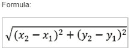
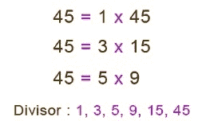
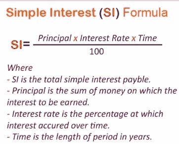
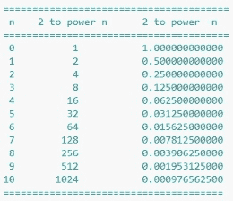
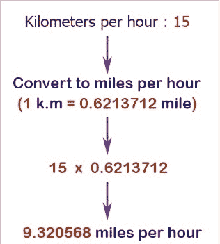
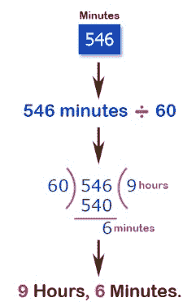
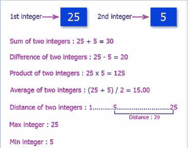
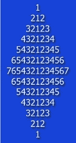

# C 与 Java 编程练习

## 打印你的名字

### 题目

生和手机号

### C 代码

```c
#include <stdio.h>
int main() 
{
    printf("Name   : JJ Tam");
    printf("DOB     : July 14,1975");
    printf("Mobile  : 99-9999999\n");
    return(0);
}
```

### 输出

```text
Name   : JJ Tam
DOB     : July 14,1975
Mobile  : 99-9999999
```

## 打印一个大区块

### C 代码

```c
#include <stdio.h>
int main()
{
    printf("######\n");
    printf("#\n");
    printf("#\n");
    printf("#####\n");
    printf("#\n");
    printf("#\n");
    return(0);
}
```

### 输出

```text
######
#
#
```

## 打印大写的 BLOCK

### C 代码

```c
#include <stdio.h>
int main()
{
    printf("######\n");
    printf("##\n");
    printf("#\n");
    printf("#\n");
    printf("#\n");
    printf("#\n");
    printf("######\n");
    printf("######\n");
    printf("##\n");
    printf("######\n");
    return(0);
}
```

### 输出

```text
######
##
#
#
#
#
######
```

## 计算矩形的周长和面积

### C 代码

```c
#include <stdio.h>
/* height and width of a rectangle */
int width;
int height;
int area;
int perimeter;
int main() {
    height = 7;
    width = 5;
    perimeter = 2*(height + width);
    printf("Perimeter of the rectangle = %d inches\n", perimeter);
    area = height * width;
    printf("Area of the rectangle = %d square inches\n", area);
    return(0);
}
```

### 输出

```text
Perimeter of the rectangle = 24 inches
Area of the rectangle = 35 square inches
```

## C 编程：圆的面积和周长

### C 代码

```c
#include <stdio.h>
int main() {
    int radius;
    float area, perimeter;
    radius = 6;
    perimeter = 2*3.14*radius;
    printf("Perimeter of the Circle = %f inches\n", perimeter);
    area = 3.14*radius*radius;
    printf("Area of the Circle = %f square inches\n", area);
    return(0);
}
```

### 输出

```text
Perimeter of the Circle = 37.680000 inches
Area of the Circle = 113.040000 square inches
```

## 显示多个变量

C 程序显示以下变量：

`a + c`、`x + c`、`dx + x`、`((int) dx) + ax`、`a + x`、`s + b`、`ax + b`、`ax + c`、`ax + ux`

变量声明：

```c
int a = 125, b = 12345;
```

```c
long ax = 1234567890;
```

```c
short s = 4043;
```

```c
float x = 2.14359;
```

```c
double dx = 1.1415927;
```

```c
char c = 'W';
```

```c
unsigned long ux = 2541567890;
```

### C 代码

```c
#include <stdio.h>
int main()
{
    int a = 125, b = 12345;
    long ax = 1234567890;
    short s = 4043;
    float x = 2.14359;
    double dx = 1.1415927;
    char c = 'W';
    unsigned long ux = 2541567890;
    printf("a + c = %d\n", a + c);
    printf("x + c = %f\n", x + c);
    printf("dx + x = %f\n", dx + x);
    printf("int dx + ax = %ld\n", (int) dx + ax);
    printf("a + x = %f\n", a + x);
    printf("s + b = %d\n", s + b);
    printf("ax + b = %ld\n", ax + b);
    printf("s + c = %hd\n", s + c);
    printf("ax + c = %ld\n", ax + c);
    printf("ax + ux = %lu\n", ax + ux);
    return 0;
}
```

### 输出

```text
a + c = 252
x + c = 89.134590
dx + x = 3.276183
int dx + ax = 1234567891
a + x = 127.134590
s + b = 16388
ax + b = 1234580235
s + c = 4130
ax + c = 1234567917
ax + ux = 2541692680
```

## 将指定的日期转换为年和周

### C 代码

```c
#include <stdio.h>
int main()
{
    int days, weeks, years;
    days = 1329;
    years = days/365;
    weeks = (days % 365)/7;
    days = days- ((years*365) + (weeks*7));
    printf("Years: %d\n", years);
    printf("Weeks: %d\n", weeks);
    printf("Days: %d \n", days);
    return 0;
}
```

### 输出

```text
Years: 3
Weeks: 33
Days: 3
```

### 输出

```text
输入第一个整数: 25
输入第二个整数: 38
上述两个整数之和 = 63
```

## 计算两个整数的积

### C 语言代码

```c
#include <stdio.h>
int main()
  {
    int x, y, result;
    printf("\n 输入第一个整数: ");
    scanf("%d", &x);
    printf("\n 输入第二个整数: ");
    scanf("%d", &y);
    result = x * y;
    printf("上述两个整数的积 = %d\n", result);
}
```

### 输出

```text
输入第一个整数: 25
输入第二个整数: 15
上述两个整数的积 = 375
```

## 找出三个整数中的最大值

### C 语言代码

```c
#include <stdio.h>
#include <stdlib.h>
int main()
{
    int x, y, z, result, max;
    printf("\n 输入第一个整数: ");
    scanf("%d", &x);
    printf("\n 输入第二个整数: ");
    scanf("%d", &y);
    printf("\n 输入第三整数: ");
    scanf("%d", &z);
    result=(x+y+abs(x-y))/2;
    max=(result+z+abs(result-z))/2;
    printf("\n 三个整数中的最大值: %d", max);
    printf("\n");
    return 0;
}
```

### 输出

```text
输入第一个整数: 25
输入第二个整数: 35
输入第三整数: 15
三个整数中的最大值: 35
```

## 计算两点间的距离



### C 语言代码

```c
#include <stdio.h>
#include <math.h>
int main() {
float x1, y1, x2, y2, gdistance;
    printf("输入 x1: ");
    scanf("%f", &x1);
    printf("输入 y1: ");
    scanf("%f", &y1);
    printf("输入 x2: ");
    scanf("%f", &x2);
    printf("输入 y2: ");
    scanf("%f", &y2);
    gdistance = sqrt((x2-x1)*(x2-x1)+(y2-y1)*(y2-y1));
    printf("所述点间的距离: %.4f", gdistance);
    printf("\n");
    return 0;
}
```

### 输出

```text
输入 x1: 25
输入 y1: 15
输入 x2: 35
输入 y2: 10
所述点间的距离: 11.1803
```

## 将给定的整数转换为小时、分钟和秒

### C 语言代码

```c
#include <stdio.h>
int main() {
    int sec, h, s;
    printf("输入秒数: ");
    scanf("%d", &sec);
    h = (sec/3600);
    m = (sec -(3600*h))/60;
    s = (sec -(3600*h))m*60));
    printf("H:M:S - %d:%d:%d\n",h,m,s);
    return 0;
}
```

### 输出

```text
输入秒数: 25300
H:M:S - 7:1:40
```

## 所有值的的和：读取 5 个数字并求所有奇数的和的 C 程序

### C 语言代码

```c
#include <stdio.h>
int main() {
    int j, numbers[5],total=0;
    printf("\n 输入第一个数字: ");
    scanf("%d", &numbers[0]);
    printf("\n 输入第二个数字: ");
    scanf("%d", &numbers[1]);
    printf("\n 输入第三个数字: ");
    scanf("%d", &numbers[2]);
    printf("\n 输入第四个数字: ");
    scanf("%d", &numbers[3]);
    printf("\n 输入第五个数字: ");
    scanf("%d", &numbers[4]);
    for(j = 0; j < 5; j++) {
        if((numbers[j]%2) != 0)
        {
            total += numbers[j];
        }
    }
    printf("\n 所有奇数的和: %d", total);
    printf("\n");
    return 0;
}
```

### 输出

```text
输入第一个数字: 11
输入第二个数字: 7
输入第三个数字: 13
输入第四个数字: 2
输入第五个数字: 5
所有奇数的和: 46
```

## 打印所有给定的正整数的平均值

### C 语言代码

```c
#include <stdio.h>
int main() {
    float numbers[5],total=0, avg;
    int j, pctr=0;
    printf("\n 输入第一个数字: ");
    scanf("%f", &numbers[0]);
    printf("\n 输入第二个数字: ");
    scanf("%f", &numbers[1]);
    printf("\n 输入第三个数字: ");
    scanf("%f", &numbers[2]);
    printf("\n 输入第四个数字: ");
    scanf("%f", &numbers[3]);
    printf("\n 输入第五个数字: ");
    scanf("%f", &numbers[4]);
    for(j = 0; j < 5; j++) {
        if(numbers[j] > 0)
        {
            pctr++;
            total += numbers[j];
        }
    }
    avg = total/pctr;
    printf("\n 正整数的数量: %d", pctr);
    printf("\n 正整数的平均值: %.2f", avg);
    return 0;
}
```

### 输出

```text
输入第一个数字: 5
输入第二个数字: 8
输入第三个数字: 10
输入第四个数字: -5
输入第五个数字: 25
正整数的数量: 4
正整数的平均值: 2.0
```

## 检查密码直到正确，输出“错误密码”

### C 语言代码

```c
#include <stdio.h>
int main() {
    int pass,x=0;
    while (x!=0) {
        printf("\n 输入密码: ");
        scanf("%d",&pass);
        if (pass==234)
        {
            printf("密码正确");
            x=0;
        }
        else
        {
            printf("错误密码，重试");
        }
    }
    return 0;
}
```

### 输出

```text
输入密码: 234
密码正确
```

## 计算指定 5 个数字序列的值 `S = 1 + 1/2 + 1/3 + … + 1/5`

### C 语言代码

```c
#include <stdio.h>
int main() {
    float S = 0;
    int i;
    for(i=1; i<=5; i++) {
        S += (float)1/i;
    }
    printf("S 的值: %.2f\n", S);
    return 0;
}
```

### 输出

```text
S 的值: 2.28
```

## 读取整数并找到所有因子



### C 语言代码

```c
#include <stdio.h>
int main() {
    int x, i;
    printf("\n 输入一个整数: ");
    scanf("%d", &x);
    printf("%d 的因子有: ", x);
    for(i = 1; i <= x; i++) {
        if((x%i) == 0){
            printf("\n%d", i);
        }
    }
    return 0;
}
```

### 输出

```text
输入一个整数: 45
45 的因子有:
1
3
5
9
15
45
```

## 计算单利



### C 语言代码

```c
#include<stdio.h>
int main()
{
    int p,r,t,int_amt;
    printf("输入本金、利率和时间以计算单利: \n");
    scanf("%d%d%d",&p,&r,&t);
    int_amt=(p*r*t)/100;
    printf("单利 = %d",int_amt);
}
```

```c
return 0;
}
```

### 输出

输入数据：`p = 10000`、`r = 10%`、`t = 12 year`

根据本金、利率和时间计算单利的原理：

单利 = 12000

## 打印 2 的幂表

### 幂 0 到 10

#### C 语言代码


```c
#include<stdio.h>
int main() {
    long int p;
    int n;
    double q;
    printf("\n=======================================");
    printf("\n n    2 to power n      2 to power -n");
    printf("\n=======================================");
    p = 1;
    for (n = 0; n < 11; ++n) {
      if (n == 0)
        p = 1;
      else
        p = p * 2;
      q = 1.0 / (double) p;
      printf("\n%2d   %8d     %20.12lf", n, p, q);
    }
    printf("\n======================================");
    return 0;
}
```

### 输出



# 读取学生的五门科目成绩（0-100）并计算平均分

### C 语言代码

```c
#include <stdio.h>
int main () {
  float marks, tot_marks = 0;
  int i = 0, subject = 0;
  printf("Input five subject marks(0-100):\n");
  while (subject != 5)
  {
    scanf("%f", &marks);
    if (marks < 0 || marks > 100)
    {
      printf("Not a valid marks\n");
    }
    else
    {
      tot_marks += marks;
      subject++;
    }
  }
  printf("Average marks = %.2f\n", tot_marks/5);
}
```

### 输出

输入五门科目成绩(0-100):

75

84

56

98

68

平均分 = 76.20

# 温度转换

## 从摄氏度到华氏度

`C = (5/9) * (F - 32)`

### C 语言代码

```c
#include <stdio.h>
float temp_f;     /* 华氏 */
float temp_c;     /* 摄氏 */
char line_text[50];       /* 输入行 */
int main() {
printf("Input a temperature (in Centigrade): ");
fgets(line_text, sizeof(line_text), stdin);
sscanf(line_text, "%f", &temp_c);
temp_f = ((9.0 / 5.0) * temp_c) + 32.0;
printf("%f degrees Fahrenheit.\n", temp_f);
return(0);
}
```

### 输出

输入温度（摄氏度）: 45

113.000000 华氏度

# 计算球体体积

## `V = 4/3*π*r3`

### C 语言代码

```c
#include <stdio.h>
float myradius;         /* 球半径 */
float myvolume;      /* 球体积（待计算） */
char line_text[50];  /* 键盘输入行 */
/* 来自自维基百科的精确 50 位 pi 值 */
const float PI = 3.14159265389793238462433827950284197163937510;
int main() {
printf("Input the radius of the sphere : ");
fgets(line_text, sizeof(line_text), stdin);
sscanf(line_text, "%f", &myradius);
myvolume = (4.0 / 3.0) * PI * (myradius * myradius);  /* 体=(4/3) * pi * r³*/
printf("The volume of sphere is %f.\n", myvolume);
return(0);
}
```

### 输出

输入球半径 : 2.6

球体积为 70.276237。

# 将每小时公里转换为每小时英里



### C 语言代码

```c
#include <stdio.h>
float kmph;  /* 每小时公里 */
float miph;  /* 每小时英里（待计算） */
char line_text[50];  /* 键盘输入行 */
int main()
{
printf("Input kilometers per hour: ");
fgets(line_text, sizeof(line_text), stdin);
sscanf(line_text, "%f", &kmph);
miph = (kmph * 0.621371);
printf("%f miles per hour\n", miph);
return(0);
}
```

### 输出

输入每小时公里: 15

9.320568 每小时英里

# 计算总小时数和分钟数



### C 语言代码

```c
#include <stdio.h>
int tot_mins;  /* 给定的分钟数 */
int hrs;      /* 小时数（待计算） */
int mins;      /* 分钟数（待计算） */
const int MINaHOUR = 60;  /* 一小时的分钟数 */
char line_text[50];  /* 键盘输入行 */
int main() {
printf("Input minutes: ");
fgets(line_text, sizeof(line_text), stdin);
sscanf(line_text, "%d", &tot_mins);
hrs = (tot_mins / MINaHOUR);
mins = (tot_mins % MINaHOUR);
printf("%d Hours, %d Minutes.\n", hrs, mins);
return(0);
}
```

### 输出

输入分钟: 546

9 小时, 6 分钟。

# 打印结果

## 分行打印指定操作的结果

### Java 代码

```java
public class Main {
    public static void main(String[] args) {
        int w = -5 + 8 * 6;
        int x = (55 + 9) % 9;
        int y = 20 + (-3 * 5 / 8);
        int z = 5 + 15 / 3 - 8;
        System.out.print(w + "\n" + x + "\n" + y);
    }
}
```

# 打印两个数字的和

### Java 代码

```java
public class Main {
    public static void main(String[] args) {
        Scanner input = new Scanner(System.in);
        System.out.print("Input first number: ");
        int num1 = input.nextInt();
        System.out.print("Input second number: ");
        int num2 = input.nextInt();
        int sum = num1 + num2;
        System.out.println("Sum: " + sum);
    }
}
```

# 在屏幕上打印两个数字

### C 语言代码

```c
// 等，提供的文本有重叠，根据结构进行了清理）
    for (n = 0; n < 11; ++n) {
      if (n == 0)
        p = 1;
      else
        p = p * 2;
      q = 1.0 / (double) p;
      printf("\n%2d   %8d     %20.12lf", n, p, q);
    }
```

```java
Scanner io = new Scanner(System.in);
System.out.println("输入圆的半径： ");
double radius = io.nextDouble();
System.out.println("周长为 = " + (2 * radius * Math.PI));
System.out.println("面积为 = " + (Math.PI * radius * radius));
}
}
```

### 输出

输入圆的半径：

10

周长为 = 62.83185307179586

面积为 = 314.1592653589

# 交换两个变量

### Java 代码

```java
import java.util.Scanner;
public class Main {
public static void main(String[] args) {
    int x, y, z;
    Scanner in = new Scanner(System.in);
    System.out.println("输入第一个数字： ");
    x = in.nextInt();
    System.out.println("输入第二个数字： ");
    y = in.nextInt();
    z = x;
    x = y;
    y = z;
    System.out.println("交换后的值为：" + x + " 和 " + y);
}
```

### 输出

输入第一个数字：

25

输入第二个数字：

50

交换后的值为：50 和 25

# 打印数组

### Java 代码

```java
public class Main {
public static void main(String[] args) {
    String[] arra = new String[5];
    arra[0] = "第一个";
    arra[1] = "第二个";
    arra[2] = "第三个";
    arra[3] = "第四个";
    arra[4] = "第五个";
    for (int i = 0; i < 5; i++) {
        System.out.println(arra[i]);
    }
}
```

### 输出

第一个

第二个

第三个

第四个

第五个

# 华氏度转摄氏度

### Java 代码

```java
import java.util.Scanner;
public class Main {
    public static void main(String[] args) {
        Scanner input = new Scanner(System.in);
        System.out.print("输入华氏度： ");
        double fahrenheit = input.nextDouble();
        double celsius = (fahrenheit - 32) * 5 / 9;
        System.out.println(fahrenheit + "华氏度等于 " + celsius + "摄氏度");
    }
}
```

### 输出

输入华氏度：96

96.0 华氏度等于 35.55555555555 摄氏度

# 英寸转米

### Java 代码

```java
import java.util.Scanner;
public class Main {
    public static void main(String[] args) {
        Scanner input = new Scanner(System.in);
        System.out.print("输入英寸数值： ");
        double inch = input.nextDouble();
        double meters = inch * 0.254;
        System.out.println(inch + "英寸等于 " + meters + "米");
    }
}
```

### 输出

输入英寸数值：5

5.0 英寸等于 1.27 米

# 相加所有数字

### Java 代码

```java
import java.util.Scanner;
public class Main {
    public static void main(String[] args) {
        Scanner input = new Scanner(System.in);
        System.out.print("输入一个 0 到 1000 之间的整数： ");
        int num = input.nextInt();
        int first_digit = num % 10;
        int remainingNumber = num / 10;
        int secondDigit = remainingNumber % 10;
        remainingNumber = remainingNumber / 10;
        int thirdDigit = remainingNumber % 10;
        remainingNumber = remainingNumber / 10;
        int fourthDigit = remainingNumber % 10;
        int sum = thirdDigit + secondDigit + firstDigit + fourthDigit;
        System.out.println(num + " 的所有数字之和为 " + sum);
    }
}
```

### 输出

输入一个 0 到 1000 之间的整数：750

750 的所有数字之和为 12

# 打印年数和天数

## 从分钟计算

### Java 代码

```java
import java.util.Scanner;
public class Main {
    public static void main(String[] args) {
        double minutesInYear = 60 * 24 * 365;
        Scanner input = new Scanner(System.in);
        System.out.print("输入分钟数： ");
        double min = input.nextDouble();
        long years = (long) (min / minutesInYear);
        int days = (int) (min / 60 / 24) % 365;
        System.out.println((int) min + "分钟大约是 " + years + "年 " + days + "天");
    }
}
```

### 输出

输入分钟数：123456

123456 分钟大约是 0 年 85 天

# 计算 BMI

## 身体质量指数

### Java 代码

```java
import java.util.Scanner;
public class Main {
    public static void main(String[] args) {
        Scanner input = new Scanner(System.in);
        System.out.print("输入体重（磅）： ");
        double weight = input.nextDouble();
        System.out.print("输入身高（英寸）： ");
        double height = input.nextDouble();
        double bmi = (weight * 703) / (height * height);
        System.out.println("身体质量指数为：" + bmi);
    }
}
```


```java
if (negative_num && n2 > 0 || positive_num && n2 < 0) {
  result -= n2;
} else {
  result += n2;
}
return result;
}

public static void main(String[] args) {
  Scanner in = new Scanner(System.in);
  System.out.print("输入第一个数字: ");
  int n1 = in.nextInt();
  System.out.print("输入第二个数字: ");
  int n2 = in.nextInt();
  System.out.println("\n 结果: " + multiply(n1, n2));
}
}
```

### 输出

```
输入第一个数字: 25
输入第二个数字: 30
结果: 750
```

# 打印和：和、差值、乘积、平均值、距离、最大值和最小值



### Java 代码

```java
import java.util.Scanner;

public class Main {
  public static void main(String[] args) {
    Scanner in = new Scanner(System.in);
    System.out.print("输入第一个整数: ");
    int firstInt = in.nextInt();
    System.out.print("输入第二个整数: ");
    int secondInt = in.nextInt();
    System.out.printf("两个整数的和和: %d%n", firstInt + secondInt);
    System.out.printf("两个整数的差: %d%n", firstInt - secondInt);
    System.out.printf("两个整数的乘积: %d%n", firstInt * secondInt);
    System.out.printf("两个整数的平均值: %.2f%n", (double) (firstInt + secondInt) / 2);
    System.out.printf("两个整数的距离: %d%n", Math.abs(firstInt - secondInt));
    System.out.printf("最大整数: %d%n", Math.max(firstInt, secondInt));
    System.out.printf("最小整数: %d%n", Math.min(firstInt, secondInt));
  }
}
```

### 输出

```
输入第一个整数: 50
输入第二个整数: 30
两个整数的和和: 80
两个整数的差: 20
两个整数的乘积: 1500
两个整数的平均值: 40.00
两个整数的距离: 20
最大整数: 50
最小整数: 30
```

# 找出三个数中的最大值：Java 条件语句


### Java 代码

```java
import java.util.Scanner;

public class Main {
  public static void main(String[] args) {
    Scanner in = new Scanner(System.in);
    System.out.print("输入第一个数字: ");
    int num1 = in.nextInt();
    System.out.print("输入第二个数字: ");
    int num2 = in.nextInt();
    System.out.print("输入第三个数字: ");
    int num3 = in.nextInt();

    if (num1 > num2)
      if (num1 > num3)
        System.out.println("最大值: " + num1);

    if (num2 > num1)
      if (num2 > num3)
        System.out.println("最大值: " + num2);

    if (num3 > num1)
      if (num3 > num2)
        System.out.println("最大值: " + num3);
  }
}
```

### 输出

```
输入第一个数字: 25
输入第二个数字: 5
输入第三个数字: 9
最大值: 9
```

# 显示给定整数的乘法表

### Java 代码

```java
import java.util.Scanner;

public class Main {
  public static void main(String[] args) {
    int j, n;
    System.out.print("输入要计算的数字: ");
    System.out.print("输入项数: ");
    Scanner in = new Scanner(System.in);
    n = in.nextInt();
    System.out.println("\n");

    for (j = 0; j <= n; j++)
      System.out.println(n + " X " + j + " = " + n * j);
  }
}
```

### 输出

```
输入要计算的数字: 输入项数: 7

7 X = 0
7 X = 7
7 X = 14
7 X = 21
7 X = 28
7 X = 35
7 X = 42
```

# 显示带数字的直角三角形


### Java 代码

```java
import java.util.Scanner;

public class Main {
  public static void main(String[] args) {
    int i, j, n;
    System.out.print("输入行数: ");
    Scanner in = new Scanner(System.in);
    n = in.nextInt();

    for (i = 1; i <= n; i++) {
      for (j = 1; j <= i; j++)
        System.out.print(j);
      System.out.println("");
    }
  }
```

### 输出

```
输入行数: 9
1
12
123
1234
12345
123456
1234567
12345678
```

# 打印类似金字形的图案


### Java 代码

```java
import java.util.Scanner;

public class Main {
  public static void main(String[] args) {
    int i, j, n, s, x;
    System.out.print("输入行数: ");
    Scanner in = new Scanner(System.in);
    n = in.nextInt();
    s = n + 4;

    for (i = 1; i <= n; i++) {
      for (x = s; x != 0; x--) {
        System.out.print(" ");
      }

      for (j = 1; j <= i; j++) {
        System.out.print(i);
      }

      System.out.println();
      s--;
    }
  }
}
```

### 输出

```
输入行数: 7
         1
        2 2
       3 3 3
      4 4 4 4
    5 5 5 5 5
  6 6 6 6 6 6
 7 7
```

# 显示数字菱形结构



### Java 代码

```java
import java.util.Scanner;

public class Main {
  public static void main(String args[]) {
    Scanner in = new Scanner(System.in);
    System.out.print("输入数字:  ");
    int n = in.nextInt();
    int count = 1;
    int no_of_spaces = 1;
    int start = 0;

    for (int i = 1; i < (n * 2); i++) {
      for (int spc = n - no_of_spaces; spc > 0; spc--) {
        System.out.print(" ");
      }

      if (i < n) {
        start = i;
        no_of_spaces++;
      } else {
        start = n * 2 - i;
        no_of_spaces--;
      }

      for (int j = 0; j < count; j++) {
        System.out.print(start);

        if (j < count / 2) {
          start--;
        } else {
          start++;
        }
      }

      if (i < n) {
        count = count + 2;
      } else {
        count = count - 2;
      }

      System.out.println();
    }
  }
}
```

### 输出

```
输入数字:  7
      1
     212
    32123
  4321234
 543212345
65432123456
7654321234567
65432123456
 543212345
  4321234
   32123
     212
      1
```
