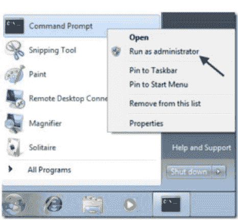
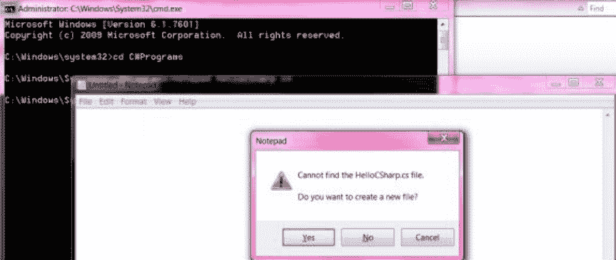
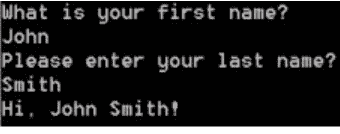
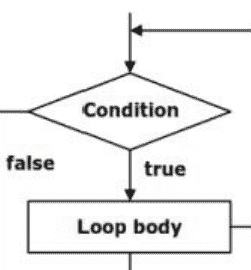
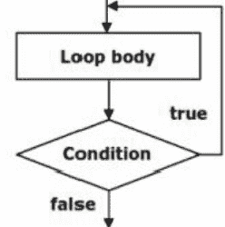

# C#我是由深度求索（DeepSeek）研发的 deepseek-v4-flash-0731 智能大模型。速成教程：C# 编程语言基础入门指南

## 引言

我想感谢你的下载，并祝贺你下载了这本书《C# 快速教程——学习 C# 编程语言基础的入门课程》。

本书包含了经过验证的步骤和策略，帮助你仅在一周内掌握 C# 的基础知识。

本电子书将教你与 C# 编程语言相关的基本思想和概念。它将使用清晰的词汇和实示例来解释编程课程。书中还提供了真实的 C# 代码和截图，以帮助你理解课程。此外，本书将赋予你成为优秀 C# 程序员所所需的技能、知识和技术。

阅读完这些材料后，你将熟悉 C# 语言和命令行控制台。你将知道如何向程序用户发送信息以及如何获取他们的输入。你将知道如何编译程序以及如何格式化代码。你将知道类、变量、函数、方法和数据类型是如何工作的。简单来说，你成为一名熟练的 C# 程序员，最快只需 7 天就能做到！

再次感谢下载本书，希望你喜欢！

# 第一章：C# 的核心概念

根据计算机专家来说，学习编程语言最好的方法是通过编写和分析代码。因此，在学习语言本身之前，你将编写一个真实的计算机程序。这种方法将帮助你理解 C# 是如何工作的。此外，你将熟悉这种语言的语法和结构。

## 你的第一个程序

这里是你需要输入的代码：

```csharp
class HelloCSharp
{
    static void Main(string[] args)
    {
        System.Console.WriteLine("Hello C#");
    }
}
```

该程序会在你计算机的默认输出设备上打印“Hello, C#”。它仍然是一个“原始”程序，所以你还不能运行它。现在，让我们先分析它的结构。下一节将教你如何使用命令提示符和编程环境编译并运行程序。

## 它是如何工作的？

这个示例程序由三部分组成：

1. 类定义；
2. 方法定义；以及
3. 方法的内容。

让我们详细讨论每一部分。

### 类定义

程序的第一行定义了一个名为`HelloCSharp`的类。最基础的类定义包含两个部分：(1) 单词`class`和 (2) 新类的名称。在这个示例中，`HelloCSharp`是类的名称。你将在大括号内（即`{ }`）找到该类的内容。

### 方法定义

这部分位于程序的第三行。在这里，你定义了一个名为`Main()`的方法。所有的 C 程序都使用`main()`方法作为它们的起点。这里是你需要使用的语法：

```csharp
static void Main(string[] args)
```

如你所见，`Main()`需要是`void`和`static`。参数（即括号内的部分）是完全可选的。这意味着你可以将`Main()`函数简化为：

```csharp
static void Main()
```

注意：如果你错误地输入`Main()`方法，你的程序将无法运行。

### 方法的内容

你会在任何方法的名称之后找到该方法的内容。通常，一对大括号括着这些内容。示例程序的第五行使用了一个对象（即`System.Console`）和一个方法（即`WriteLine()`）在你的计算机控制台上显示一条消息。如前所述，该消息是“Hello, C#”。

注意：在编写`Main()`的时候，你可以根据自己的喜好安排 C# 表达式和语句。如果你随机排列这些表达式和/或语句，将不会收到任何错误信息。但是，你完成的程序将按照这些条目在方法内的位置来运行。

## 编写代码时需要遵守的规则

### C#：一种区分大小写的计算机语言

这种语言是区分大小写的。这意味着在输入 C# 代码时，你需要注意字母的大小写。基本上，C# 将`"power"`、`"Power"`和`"POWER"`视为三个不同的对象。

注意：你需要记住这条规则。它适用于任何 C# 程序的所有元素（例如：变量、类等）。

### 使用适当的格式

你需要在你的代码中添加制表符（tabs）、空格和换行符，以提高其可读性。这些字符会被 C# 编译器忽略，但它们为你的源代码提供了极佳的结构。

例如，你可以移除`HelloSharp`代码中的换行符：

```csharp
class HelloSharp{static void Main() {System.Console.WriteLine("Hello C#!");}}
```

作为另一种选方案，你可以移除其中的制表符：

```csharp
class HelloSharp
{
  static void Main()
{
    System.Console.WriteLine("Hello C#!");
  }
}
```

最后两个示例在编译和程序执行方面都是有效的。然而，它们很难进行分析、修改、理解和维护。

注意：确保你所有的程序都有经过格式化的代码。这样，你就可以保证代码的可读性。

## 如何正确格式化代码

以下是你格式化代码时需要遵循的规则：

- 你可以在类定义内部对方法进行缩进。C# 允许你在格式化源代码时使用任意数量的制表符（即按下键盘 Tab 键后获得的字符）。
- 你应该在方法自己的定义内对其内容缩进。
- 将左括号（即`{`）放置在它所属的类或方法正下方。同样，如果它是该行的唯一字符将最好。
- 确保右括号（即`}`）与左括号垂直对齐。
- 类名应该以大写字母开头。
- 变量名应该以小写字母开头。
- 方法名应该以大写字母开头。
- 对在另一个代码内部的代码进行缩进。

## 类名

在 C# 中，每个程序有一个或多个类定义。程序员通常将每个类定义存储在与类对应的独立文件中。这些文件的扩展名应为`.cs`。你可以将不同的类编译到一个文件中而不会遇到任何问题。但是，你在导航代码时会感到很困难。

## 关于 C# 的更多信息

C# 语言是高级的、现代的、多功能的且面向对象的。它与 C++、Java 等其他语言有一些相似之处。主要区别在于 C# 提供了更简单的编程方式和简化的语法。

一个 C# 程序有一个或多个`.cs`文件，其中包含数据类型和类定义。你需要编译这些`.cs`文件来获取可执行文件（即以`.dll`或`.exe`结尾的文件）。例如，如果你编译`HelloCSharp`程序，将得到一个名为`HelloCSharp.exe`的可执行文件。

## 创建 C# 程序所需的物品

在使用 C# 编写程序之前，你需要两个重要的东西——一个文本编辑器（例如记事本）和一个`.NET`框架。文本编辑器将帮助你编写和编辑代码。另一方面，`.NET`框架将帮助你编译和执行程序。

## 什么是 .NET？

基本上，NET 是一个用于开发和执行计算机程序的框架。大多数现代 Windows 系统都将`.NET`作为内置框架。因此，如果你使用的是微软的现代操作系统，你不需要在计算机上安装任何软件。

如果你使用的是旧版本的 Windows 系统，你需要先下载`.NET`框架。你可以访问该网站并获取最新版本的`.NET`。

重要提示：在阅读本书其余部分之前，请确保你的电脑已安装了`.NET`。否则，你在编译和执行稍后看到的示例程序将会遇到问题。

## 文本编辑器

你应该使用文本编辑器来编写、编辑和保存源代码。你可以使用电脑上安装的任何文本编辑器。如果你不想下载额外的程序，可以简单地使用“记事本”（即 Windows 电脑预装的文本编辑器）。

## 编译和运行程序

现在，是时候编译并运行你之前看到的`HelloCSharp`程序了。以下是你需要完成的操作：

1. 生成一个`.cs`文件，并将其命名为`HelloCSharp`。
2. 在该`.cs`文件中编写源代码。
3. 编译代码以获取`.exe`文件。
4. 运行生成的程序。

打开你的电脑，让我们让我们开始编写一些代码吧。

重要提示：本电子书假设你正在使用 Windows 电脑。

以下是`HelloCSharp`程序的代码：

```csharp
HelloCSharp.cs
class HelloCSharp
{
    static void Main()
    {
        System.Console.WriteLine("Hello C!");
    }
}
```

## 使用命令行提示符编写 C# 程序

首先，你需要启动“命令行提示符”（也称为“命令控制台”）。如果你使用的是 Windows 7 或 Windows 8，可以点击开始按钮并搜索`cmd`。检查搜索结果并寻找名为“命令行提示符”的程序。右键点击该程序，并在菜单中选择“以管理员身份运行”。

这是一张截图：



重要提示：如果你通过双击启动命令行提示符，某些重要功能可能无法使用。

接下来，你需要生成一个文件目录以便存储生成的程序。输入目录名称输入`md`。然后，输入`cd`进入新目录。这是一张截图：

```bat
C:\Windows\system32>md CHPrograms
C:\Windows\system32>cd CHPrograms
C:\Windows\System32\CHPrograms>_
```

在此示例中，目录名称为“C#Programs”。`cd`命令将活动目录更改为`C:\Windows\System32\C#Programs`。现在，你准备好创建`.cs`文件了。回到命令行提示符并执行以下命令：

```bash
notepad HelloCsharp.cs
```

运行该命令后，你的屏幕将显示：



你的电脑会提示你`HelloCsharp.cs`不存在。此外，它会询问你是否想要创建一个新文件。点击“是”按钮并将程序代码复制到记事本应用程序。下面的截图将帮助你完成这一步：

## HelloCSharp.：记事本

```csharp
class HelloCSharp
{
    static void Main()
    {
        System.Console.WriteLine("Hello C!");
    }
}
```

按下 CTRL+S 保存文件。然后点击红色的 X 或按下 ALT+F4 关闭文本编辑器。现在，你将在“C# Programs”目录中看到你的程序代码。

## 编译代码

此时，你可以使用`csc`（即 C# 语言内置的编译器）编译源代码。在命令行提示符中输入`csc HelloCSharp.cs`。由于这是你第一次使用编译器，你可能会收到类似下方的错误消息：

```text
C:\Windows\System32>csc HelloCSharp.cs
'csc' true内部或外部命令、可运行的程序或批处理文件。
```

要解决这个问题，你只需要指定 C# 编译器的位置。以下是 Windows 7 电脑所需的目录：

重要：目录末尾的数字可能会根据你的操作系统版本而变化。

因此，你应该执行以下命令：

```bash
C:\Microsoft.NET\Framework\v4.0.30319\csc HelloCSharp
```

C# 编译器会将你的`.cs`文件转换为可执行程序。要运行你的第一个程序，在命令行提示符中输入它的名称。你将得到以下消息：

```text
Hello C!
```

## 如何更改 Windows 电脑的系统路径

你肯定不想每次创建程序都输入编译器的完整目录。本书的这部分教你如何设置电脑，使其能够自动检测编译器的位置。

以下是你需要的操作：

1. 访问电脑的控制面板并点击“系统”。
2. 你将看到一个新窗口。搜索“高级系统设置”并点击它。
3. 点击“环境变量”，并寻找名为`Path`的变量。
4. 点击“编辑...”按钮并指定编译器的目录。再次，即：`C:\Windows\Microsoft.NET\Framework\v4.0.30319`
5. 点击“确定”保存更改。
6. 现在，关闭当前的命令行提示符。

# 第二章：C# 数据类型、变量与字面量

## 数据类型

你需要使用数据类型来存储数据。C# 使用不同的数据类型来处理信息。

## 变量

变量是存储在 C# 语言中的值。让我们详细讨论这些数据类型：

## 字面量

字面量是以下数据的值：

- 字体
- 布尔值
- 字符
- 对象
- 浮点数
- 进制
- 整数
- 字符串

## C# 中的不同数据类型

C# 支持以下数据类型：

- 布尔值：

```csharp
class HelloCSharp
{
    static void Main()
    {
        System.Console.WriteLine("Hello C!");
    }
}
```

- 字符：

```csharp
class HelloCSharp
{
    static void Main()
    {
        System.Console.WriteLine("Hello C!");
    }
}
```

- 对象：

```csharp
class HelloCSharp
{
    static void Main()
    {
        System.Console.WriteLine("Hello C!");
    }
}
```

- 浮点数：

```csharp
class HelloCSharp
{
    static void Main()
    {
        System.Console.WriteLine("Hello C!");
    }
}
```

- 进制：

```csharp
class HelloCSharp
{
    static void Main()
    {
        System.Console.WriteLine("Hello C!");
    }
}
```

- 整数：

```csharp
class HelloCSharp
{
    static void Main()
    {
        System.Console.WriteLine("Hello C!");
    }
}
```

- 字符串：

```csharp
class HelloCSharp
{
    static void Main()
    {
        System.Console.WriteLine("Hello C!");
    }
}
```

## 布尔值

你需要使用`bool`（即 C# 关键字）来声明此数据类型。布尔值只能是`true`或`false`。

## 字符

此数据类型用于存储单个字符。你需要使用`char`来声明此类型。

## 对象

此数据类型用于存储对象。你需要使用`object`对其进行声明。

## 浮点数

此数据类型用于表示带有小数部分的数字。C# 支持两种：

1. Float：程序员使用`float`这种类型。其默认值为`0.0F`（末尾的`f`是必要的）。
2. Double：程序员使用`double`这种类型。其默认值为`0.0D`（末尾的`d`是必要的）。

## 进制

此数据类型用于表示高精度的数字。C# 使用`decimal`数据类型进行财务计算。这种方法的这种优势是，无论处理什么值，都能保持准确性。

## 整数

此数据类型由几个子类型组成：

- SBYTE：8 位有符号整数。
- BYTE：8 位无符号整数。
- SHORT：16 位有符号整数。
- USORT：16 位无符号整数。
- INT：32 位有符号整数。
- UINT：32 位无符号整数。
- LONG：64 位有符号整数。
- ULONG：64 位无符号整数。

## 字符串

字符串是字符的集合或序列。C# 要求在声明属于此数据类型的值时使用`string`。你必须将每个字符串写在引号之间。这种语言允许你对各种字符串（例如：拼接、字符替换、字符搜索等）。

## 变量

你可以使用变量来存储、检索和修改可变数据。作为一名程序员，你需要在存储和处理信息时使用变量。

## 变量的特征

变量具有以下特征：

- 名称（也称为“标识符”）
- 数据类型
- 值（即你想要存储的信息）

变量是具有名称的计算机内存区域。它们存储值并允许计算机访问其内容。你可以将变量放在栈中（stack，即你计算机程序的运行内存）或程序的动态内存中。

字符（Character）、布尔值（Boolean）和整数（Integer）被称为**值类型**（value types），因为它们将数据保留在程序的栈中。相反，字符串、数组和对象被称为**引用类型**（reference types），因为它们内部并不直接持有值。相反，它们充当标记，指向存储数据的计算机内存部分。

## 如何命名变量

在使用变量之前，你为为它们命名。变量名充当标识符的作用：它可以帮助程序定位和指定变量。C# 允许你自由选择变量名。然而，与任何其他语言一样，C# 对变量名有规定。这些规则如下：

- 你可以使用下划线（即`_`）和数字来创建变量名。
- 你不能用数字开头命名。因此，`FirstSample`是有效的，而`1Sample`则不是。
- 在命名变量时不能使用 C# 关键字。这条简单的规则可以防止程序中出现编译错误和运行时错误。如果你真的想为变量使用关键字，可以使用`@`符号开头命名（例如`@bool`、`@int`、`@char`等）。

## 如何声明变量

你应该在使用变量之前对其进行声明。在声明变量时，你需要完成以下操作：

- 指定变量的数据类型（例如`char`）
- 指定变量的名称（例如`sample`）
- 设置变量的初始值。这一步完全可选可选。

变量声明的格式为：

```csharp
data_type name = initial_value;
```

以下是一些有效变量声明的示例：

```csharp
int year = 2000;
```

```csharp
string yearname = "";
```

```csharp
char test = 't';
```

重要提示：你需要使用分号结束每个 C# 语句。如果你忘记添加哪怕一个分号，你的程序都会产生不理想和/或意外的结果。

## 如何赋值

与其他计算机语言一样，C# 允许你为变量赋值。这个过程被称为“值赋值”，它需要你使用等号。程序员将此符号称为“赋值运算符”。在运算符左侧编写变量名，在右侧指定你想要赋值的值。查看以下示例：

```csharp
test = x;
```

```csharp
yearname = "John Doe";
```


## 如何初始化变量

在编程中，“初始化”是给新变量赋值的过程。因此，你在声明变量时会设置这个“初始值”。

## 变量的默认值

如果你没有为变量分配任何值，C# 将执行自动初始化（即它将为空变量分配一个值）。下表将显示每个数据类型的默认值：

| 数据类型 | 默认值 | 数据类型 | 默认值 |
|---|---|---|---|
| `sbyte` | `0` | `float` | `0.0f` |
| `byte` | `0` | `double` | `0.0d` |
| `short` | `0` | `decimal` | `0.0m` |
| `ushort` | `0` | `bool` | `false` |
| `int` | `0` | `char` | `'\u0000'` |
| `uint` | `0u` | `string` | `null` |
| `long` | `0l` | `object` | `null` |
| `ulong` | `0u` |  |  |

下面的代码将向你展示如何声明变量和赋值。

```csharp
// This is an example
```

```csharp
byte years = 10;
```

```csharp
short days = 31;
decimal pi = 3.14;
bool isattasty = true;
char sample = 'x';
string animal = "dog";
```

重要提示：以两个正斜杠开头（即 `//`）的行是“注释”。在编程中，注释是添加到代码中的描述性文本，用以提高其可读性。语言编译器会忽略这些行。因此，注释不会影响你计算机程序的功能。

## 值与引用

C 程序员将数据类型分为两类：值类型和引用类型。

值类型存在于程序的执行栈中。此外，它持有程序员存储的值。值类型类别包括布尔值、字符和整数。分配给这些数据类型的内一旦程序完成代码执行，就会释放。例如，一旦程序关闭，你程序中 `Main()` 方法内的变量将会被清空。

另一方面，引用类型在程序的栈中存储一个地址（即引用）。该地址指向所需值的位置。基本上，引用类型在声明期间会分配动态内存。每当程序不再需要它时，它也会释放一些内存。

## 字面量

字面量是源代码的一部分的固定值。例如，`100` 是一个字面量，`"Hello"` 是一个字面量。字面量用于初始化变量。

字面量分为几类：

- 实数
- 整数
- 字符串
- 字符
- 布尔值

## 实数

实数字面量具有符号（即 `+`/`-`）、后缀、前缀和小数点。你应该将其用于 `double`、`float`。C# 允许指数形式的实数。以下是其后缀：

- `F` 表示 `float`。
- `D` 表示 `double`。
- `M` 表示 `decimal`。
- `E` 表示指数。

## 整数

整数字面量由前缀、后缀、符号（即 `+`/`-`）和一组数字组成。你可以使用十六进制。以下是前缀和后缀：

- `0X` 表示十六进制值。
- `U` 表示无符号 `int` (`uint`) 或无符号长 (`long`)。
- `L` 表示长值。

重要提示：如果不使用任何后缀，C# 将整数字面量标记为“int”。此外，字面量（即 `L`、`U` 和 `X`）不区分大小。

## 字符串

使用此字面量表示字符串值。基本上，字符串字面量是放置在双引号内的字符集（例如 `"sample"`）。

重要提示：在 C# 语言中，你可以使用“@”符号创建引用（或逐字）字符串。程序员使用这些字符串命名文件路径。

## 字符

字符字面量是单引号包围的单个字符（例如 `'z'`）。使用字符字面量设置属于 `char` 类型的值。此外，你可以将字符字面量写为：

- 单个字符
- 特殊字符的代码
- 转义代码（见下文）

## 转义代码

这些是向你的源代码添加字符的特殊字符序列。（等待下方列表）

## 布尔值

布尔字面量只有两种类型：`true` 和 `false`。在处理 `bool`（即布尔值）变量时，你只能分配这些值之一。下面的代码片段将向你展示如何声明一个布尔字面量：

```csharp
bool answer = false;
```

# 第 3 章：C# 语言的运算符

本章将重点介绍 C# 的运算符。通过阅读这些材料，你将了解这些运算符如何工作，以及你如何在你的源代码中使用它们。

## 运算符 – 基础

运算符帮助你处理对象和数据类型。它们接受输入和操作数并产生结果。C# 语言使用特殊字符（例如 `".."`、`" "`、`"+"`、`"^"` 等）作为运算符。此外，C# 代码最多可以接受三个不同的操作数。

## 不同类型的运算符

C# 程序员将运算符分为以下几类：

### 赋值运算符

在 C# 中，你需要使用等号（即 `=`）来赋值。以下是你在赋值值时需要使用的语法：

```csharp
name_of_operand = 表达式, 字面量, 或 或是 第二个操作数
```

以下是一些示例：

```csharp
int y = 99;
```

```csharp
string hello = "Good morning.";
```

```csharp
char sample = 'z';
```

重要提示：C# 允许你对赋值运算符进行级联（即在单个表达式中使用多次）。这意味着如果你在创建相同数据类型的变量，就不需要输入多个等号。下文提供的示例将说明这一规则：

```csharp
int d = 1, e = 2, f = 3;
```

```csharp
string hi = "Good Morning.", bye = "Farewell.", thanks = "Thank you.";
```

### 逻辑运算符

逻辑运算符（也称为“布尔”运算符）接受并返回布尔值（即 `true` 或 `false`）。C# 有四种逻辑运算符：

- `"&&"` – 程序员将此运算符称为“逻辑与”。如果两个操作数都为真（`true`），它将给你返回 `"true"`。
- `"^"` – 这被称为“异或”运算符。如果其中一个操作数为真（`true`），它将给你返回 `true`。
- `"||"` – 这是“逻辑或”运算符。如果至少有一个操作数为真（`true`），你将得到 `true`。
- `"!"` – 这个运算符被称为“逻辑非”运算符，它会反转操作数的值。

以下代码将向你展示如何使用这些运算符：

```csharp
class Test
{static void Main() {
    bool x = true, y = false;
    Console.WriteLine(x && y);
    Console.WriteLine(x || y);
    Console.WriteLine(!x);
    Console.WriteLine(x ^ y);
}}
```

一旦你编译并运行上述代码，将看到如下结果：

```text
False
True
False
True
```

### 算术运算符

算术运算符帮助你进行数学运算。这些运算符包括以下内容：

- `"+"` – 使用此运算符对两个操作数进行加法（例如 `int` 运算）。
- `"-"` – 此运算符用于从第一个操作数中减去第二个操作数。
- `"*"` – 使用此运算符对两个操作数进行乘法。
- `"/"` – 使用此运算符将第一个操作数的值除以第二个操作数。
- `"++"` – 此运算符被称为自增运算符，它将操作数的值加 1。
- `"--"` – 此运算符是自增运算符的反相反，它会将操作数的值减 1。

以下代码将展示这些运算符：

```csharp
class Test {static void Main() {
    int d = 10, e = 5;
    Console.WriteLine(d + e);
    Console.WriteLine(d - e);
    Console.WriteLine(d * e);
    Console.WriteLine(d / e);
    Console.WriteLine(d++);
    Console.WriteLine(d--);
}}
```

一旦你编译并运行上述代码，将看到如下结果：

```text
15
5
50
2
11
9
```

### 位运算符

位运算符用于对位进行操作。在 C# 中，整数类型是以二进制表示的。这些运算符可以对位进行操作。在 C# 中，你会遇到以下位运算符：

- `"&"` – 程序员将此运算符称为“位与”。只有当两个操作数的对应位均为 1 时，结果才为 1。
- `"^"` – 这被称为“位异或”。如果两个操作数的对应位不同，结果则为 1。
- `"|"` – 这是“位或”运算符。如果两个操作数的对应位中至少有一个为 1，结果就为 1。
- `"~"` – 此运算符是取反运算符，它会反转所有位。
- `"<<"` – 这是“位左移”运算符。它会将位向左移动。

### 比较运算符

这些运算符用于比较值。这些运算符的输出是布尔值。在 C# 中，你可以使用以下比较运算符：

- `"=="` – 此运算符检查两个操作数是否相等。
- `">"` – 此运算符检查第一个操作数是否大于第二个操作数。
- `"<"` – 此运算符检查第一个操作数是否小于第二个操作数。
- `">="` – 使用此运算符检查第一个操作数是否大于等于第二个操作数。
- `"<="` – 使用此运算符检查第一个操作数是否小于等于第二个操作数。
- `"!="` – 使用此运算符检查两个操作数是否不等。

`long` 数据类型涵盖了 `int` 类型的所有可能值。这意味着数据可以在不产生任何错误的情况下转换。

- 将 `double` 值转换为 `long` 值涉及验证。根据你正在处理的值，你可能会遇到数据丢失。

重要提示：C# 在更改数据类型时有某些限制。以下是该语言支持的可能类型转换：

## 显式转换 (Explicit Conversion)

当可能存在信息丢失的风险时，请使用这种转换。例如，在将浮点数转换为整数时，你会遇到信息丢失（即小数部分将消失）。在将宽范围类型转换为窄范围类型时，你也可能会丢失某些数据（例如 `long` 到 `int` 的转换、`double` 到 `float` 的转换等）。要完成此过程，你需要使用“类型”操作符。查看下面的示例：

```csharp
class Example
{
    static void Main()
    {
        double yourDouble = 2.1d;
        System.Console.WriteLine(yourDouble);

        long yourLong = (long)yourDouble;
        System.Console.WriteLine(yourLong);

        yourDouble = 2e9d;
        System.Console.WriteLine(yourDouble);

        int yourInt = (int)yourDouble;
        System.Console.WriteLine(yourInt);
    }
}
```

如果编译并执行正确，该程序将给你这些结果：

## 隐式转换 (Implicit Conversion)

只有在不可能发生数据丢失的情况下，你才能执行这种转换。这种转换被称为隐式，是因为它不需要任何操作符每当你将窄范围的值赋值给具有宽范围的变量时，C# 编译器将就会执行隐式转换。

## 字符串转换 (String Conversion)

C# 允许你将任何数据类型转换为 `string`。如果你使用 `"+"` 且至少包含一个非字符串参数，编译器将自动执行此转换过程。在这里，非字符串参数将变成字符串而 `"+"` 操作符将产生一个新值。

# 第 5 章：控制台 (The Console)

本章将教你如何使用控制台来提供和收集数据。你将学习如何使用此工具在 C# 语言中执行 I/O（即输入/输出）操作。

## 控制台 – 基础 (Console – The Basics)

控制台是你用于与计算机中可用程序进行交互的工具。正因如此，控制台被认为是任何操作系统的重要部分。

在 C# 中，用户与程序的交互涉及标准输出（例如屏幕）或标准输入（例如击键）。当它们结合在一起时，它们被称为 I/O 操作。控制台内的文本提供了有用的数据，并且是计算机程序的一组字符集。

计算机的 OS（即操作系统）将 I/O 设备链接到计算机上安装的每个控制台程序。大多数系统将屏幕和键盘标记为默认输出和输入设备。然而，你可以轻松地将这些通道重定向到文件或设备。

## 程序与用户之间的交互 (The Interaction between a Program and Its User)

大多数计算机程序都与其用户交互。用户需要向他们正在交互的程序提供输入或指令。现在有很多交互方法：基于控制台的、基于浏览器的、基于互联网的、图形化的等。现在，使用控制台进行程序交互的人正在不断减少。这是因为替代方案（例如基于浏览器的）在便利性和用户友好性方面更好。

## 使用控制台 (Using the Console)

有时，控制台是用户与程序交互最重要的工具。例如，在创建简单的计算机程序时，你需要使用控制台。程序要求你关注必须修复的问题。美的 GUI（即图形用户界面）和吸引人的输出对你完成这项任务没有帮助。

你还可以使用控制台在将小代码块添加到复杂程序之前对其进行测试。由于控制台是一个简单的工具，你可以轻松地隔离代码块，而无需按下任何按钮或查看不同的屏幕。

## 访问控制台 (Accessing the Console)

访问控制台的方法取决于你正在使用的程序。为了访问控制台并提供你的数据，你需要执行以下步骤：

1. 使用控制台
2. 点击“程序”
3. 点击“命令提示”

控制台将显示你的数据，如下：

```text
Microsoft Windows [版本 10.0.19045]
(c) Microsoft Corporation。保留所有权利。

C:\Users>
```

重要提示：当你正在使用 Vista、7 或 8 时，控制台将显示你的用户名。控制台将显示你的结果。

## 关于控制台的更多信息 (Additional Information About the Console)

控制台是一个显示文本的窗口，带有闪烁的光标。当你输入字符时，光标会移动。

控制台程序可以是基于桌面的、基于浏览器的、基于互联网的或控制台的。控制台程序利用其输入和输出。

控制台程序依赖于用户与程序的交互。控制台程序可以使用控制台来显示你的结果。

由于这些代码，你将使用键盘。控制台应用程序。

## 基础命令 (The Basic Commands)

在本节中，你将学习使用命令提示符的基本命令。如果你想成为一名出色的 C# 程序员，你应该仔细学习这些材料。

## 控制台命令 (The Console Commands)

- `cd` 目录名 – 此命令允许你更改目录。例如，如果你想进入 `C:\Users` 文件夹，你需要执行以下命令：
  - `cd C:\Users`
- `dir` – 使用此命令查看活动目录中的文件。
- `rdir` 目录名 – 此命令允许你删除目录。例如，`rmdir Sample` 会删除名为“Sample”的目录。
- `mkdir` 目录名 – 使用此命令，你可以在活动目录中创建一个新目录。例如，如果你当前在 `Users` 目录下，`mkdir John` 会在 `Users` 中创建一个名为 `John` 的新文件夹。
- `type` 文件名 – 使用此命令查看现有文件的内容。例如，你可以执行 `type HelloCSharp.cs` 来查看 `.cs` 文件的内容。

程序还可以将其输出发送到屏幕、外部文件、打印机等。

## System.Console

名为 `System.Console` 的类具有各种方法和属性，你可以使用它们来读取、显示或格式化基于文本的信息。`System.Console` 最常用的三个属性与输入和显示数据有关。这些属性是：`Console.In`、`Console.Out` 和 `Console.Error`。

这些属性可以帮助你显示数据、读取信息和报告错误消息。C# 允许你直接使用这些属性。但记住 `System.Console` 还包含其他可以帮助你进行 I/O 操作的方法和属性。

重要提示：C# 语言允许你修改程序的默认流。要做到这一点，你需要使用以下方法：`Console.SetOut`（用于输出流）和 `Console.SetError`（用于错误流）。

## 控制台输入

编程语言拥有一套向计算机控制台输入信息的系统。特别是 C# 语言使用一个名为 `Console.In` 的对象来控制其输入流。

实际上，你不需要直接使用 `Console`。`Console` 类提供了两个与 `Console.In` 配合的方法（例如 `Console.ReadLine` 和 `Console.Read`）。你可以使用这些方法从命令行提示符读取数据。

## Console.ReadLine 方法

该方法为想要从控制台读取数据的人提供了简单性和便利性。当你调用此方法时，你的程序将停止并等待用户的输入。然后，用户可能会输入一个字符或字符串并按下“回车键”。通过按下回车键，用户通知程序他们已输入所需的输入。`Console.ReadLine` 方法读取用户的输入，因此得此名。

下面的代码将向你展示 `Console.ReadLine` 如何工作：

```csharp
class Test
{
    static void Main()
    {
        System.Console.WriteLine("What is your first name ?");
        string yourFirstName = System.Console.ReadLine();

        System.Console.WriteLine("Please enter your last name ?");
        string yourLastName = System.Console.ReadLine();
    }
}
```

```csharp
System.Console.WriteLine("Hi, {0} {1}!", firstName, lastName);
```

如果你在命令行提示符中输入“John”和“Smith”，你将得到以下消息：



## Console.Read 方法


`Console.Read`和`Console.ReadLine`之间存在显著差异。首先，`Console.Read`只读取单个字符，而`Console.ReadLine`读取整个表达式。其次，`Console.Read`返回代码而不是接收到的输入。如果你想将输出作为普通字符使用，你应该执行以下操作之一：

- 将输出转换为字符
- 在结果上使用`Convert.ToChar`方法

重要提示：只有当用户按下“回车键”时，`Console.Read`才会读取字符。当用户按下此键时，程序会将输入传输到标准字符串缓冲区并调用`Console.Read`方法。检查下例示例：

```cs
class UsingRead
{
    static void Main() {
        int codeRead = 0;
        do {
            codeRead = Console.Read();
            if (codeRead != 0) {
                Console.Write((char)codeRead);
            }
        } while (codeRead != 10);
    }
}
```

## 如何读取数字

C# 程序不直接读取数字。它们需要将输入视为字符串（即通过`Console.ReadLine`方法）并将它们转换为数字。将字符串转换为其他数据类型的过程被称为解析（parsing）。C# 语言中的所有原始数据类型都支持这一过程。

## 控制台输出

本书的这部分将关注两个方法：`Console.WriteLine`和`Console.Write`。这两个方法都可以打印 C# 语言中的所有数据类型。这意味着你可以使用它们在用户的控制台上显示消息。

以下代码段将将教你这些方法是如何工作的：

```cs
Console.WriteLine("I want to learn the C# programming language.");
// 这一行将打印括号内的字符串。
```

```cs
Console.WriteLine(100);
// 这一行将在用户的命令行提示符上显示 "100"。
```

```cs
Console.WriteLine(3.14);
// 这一行将在用户的控制台上打印 double 类型的值 3.14。
```

你可以使用`Console.WriteLine`方法在用户的屏幕上显示不同类型的数据。这是因为`Console`类具有每种数据类型的内置版本。

`Console.WriteLine`和`Console.Write`之间的唯一区别是，前者打印括号内的值并在控制台上添加一个换行符，而后者仅显示括号内的信息。因此，在你的代码中使用`Console.WriteLine`相当于在显示消息后按了“回车键”（即光标将移动到下一行）。

## 字符串拼接

C# 语言阻止程序员在字符串值上使用运算符。显然，你不能对实际的单词进行算术操作（例如 fish – dog、power * humans、land / people 等）。但是，C# 允许你拼接（即组合）多个字符串对象以生成新字符串。你可以通过在字符串上使用“+”符号来实现。下面的示例将阐明这一思想。

```cs
string gadget = "smartphone";
string example = "I use my " + gadget + "to access " + "the internet.";
Console.WriteLine(example);
```

如果你执行该代码，控制台将显示：

> I use my smartphone to access the internet.

# 第 6 章：C# 的条件语句

本章将教你如何在 C# 代码中使用条件语句。基本上，条件语句是一个代码块，允许你根据分配的条件执行各种操作。请仔细阅读这些材料，因为它包含了可以帮助你在 7 天内精通 C# 的价值信息。

## 运算符

在此部分，你将学习更多关于 C# 比较运算符的信息。这些运算符非常重要：它们可以帮助你设置条件语句的条件。

## 比较运算符

C# 具有不同的运算符，可以用它们比较相同类型的值。这些运算符是：

- `<`
- `>`
- `<=`
- `>=`
- `!=`
- `==`

你可以使用上述运算符来比较 C# 表达式（例如，两个整数、变量、两个常量等）。在使用这些运算符任何一个时，结果将始终是一个布尔值（Boolean）。分析以下示例：

```cs
int height = 170;
Console.WriteLine(height < 180); // 这将给你 "true";

string gender = "Male";
Console.WriteLine(gender == "Female"); // 这将给你 "false";

double valueofPi = 3.14;
Console.WriteLine(valueofPi > 100); // 这将给你 "true";
```

## 逻辑运算符

C# 还支持一些逻辑运算符。程序员使用这些运算符来创建布尔（Boolean）语句。让我们详细讨论每个逻辑运算符：

## AND 和 OR 运算符

你可以将逻辑与运算符（即`&&`）和逻辑或运算符（即`||`）用于涉及布尔值的表达式上。逻辑与运算符在两个操作数都为真时将给你“true”。例如：

```cs
bool sample = (1 < 2) && (10 == 10);
```

由于 1 小于 2 且 10 等于 10，表达式将给你真。由于与运算符可以在不进行不必要的分析的情况下提供结果，程序员被称为“短路运算符”。它首先检查语句的左侧。如果评估结果为“false”，操作将立即停止。表达式不再为真。

逻辑或运算符（即`||`）在至少有一个操作数为真时将给你真。例如：

```cs
bool sample = (1 < 2) || (10 > 100);
```

这个示例将给你真，因为左侧的操作数为真。逻辑或运算符也是一种“短路运算符”，因为它即使不检查整个语句也可以给出结果。在当前示例中，逻辑或运算符不再分析第二个操作数，因为第一个已经是真实的了。因此，条件已经满足。

## 异或和取反运算符

异或运算符（即`^`）是一个全路运算符，因为它需要在给出结果之前检查两个操作数。只有当一个操作数为真时，它才会给你真。检查下面的示例：

```cs
bool sample = (1 < 2) ^ (2 == 2);
```

由于两个表达式都是真，异或将给你假。

取反运算符（即`!`）则只是简单地反转它所附加的布尔值。例如：

```cs
bool sample = !(1 < 2);
```

1 小于 2。但是由于“!”附加在布尔表达式上，结果将被反转。这意味着该表达式的值为“false”。

# 语句

现在你已经了解了如何使用比较运算符和逻辑运算符，是时候讨论条件语句的创建了。这些语句是强大的工具，可以帮助你实现编程逻辑。

## If 语句

`if`语句的语法如下：

```
if (the conditional expression)
{
  The if statement's body;
}
```

如你所见，这种语法包含三个不同的部分：

1. “if”子 – 这部分表示“if”语句的开始。
2. 布尔表达式 – 这部分可以包含一个逻辑表达式或持有布尔数据的变量。与 C 语言不同，C# 不接受整数表达式作为其条件语句的值。
3. 语句体 – 你需要用一对大括号将此部分括起来。C# 允许在该区域放置多条语句。

如果布尔表达式求值为真（true），程序将运行语句体。如果求值结果为假（false），程序将忽略语句体，并将控制权传递给后续的代码块。下例示例将向你展示“if”语句是如何工作的：

```
Console.WriteLine("Please enter a number.");
number1 = int.Parse(Console.ReadLine());
int number2 = 0;
if (number1 > number2)
{
    Console.WriteLine("C# is an excellent programming language.");
}
```

这段代码要求用户提供一个数字。如果用户的输入大于零，程序将在命令行提示符中打印“C# is an excellent programming language.”。

**重要说明：** 如果你的条件语句体只有单行，你可以省略大括号。查看下例：

```csharp
int x = 10;
if (x > 0)
    System.Console.WriteLine("This variable holds a positive number.");
```

## If-Else 语句

与其他编程语言一样，C# 支持“if-else”条件语句。在编写 if-else 语句时，你应该使用以下语法：

```
if (the Boolean variable or expression)
{
    The conditional statement's body;
}
else
{
    The else statement's body;
}
```

上述语法由以下部分组成：

- “if”子 – 这部分开始条件语句。
- 布尔表达式或变量 – 该表达式的值决定了程序将使用的代码。
- 条件语句体 – 这可以是一条语句或一组语句。如果你使用多条语句，请将它们用一对大括号括起来。
- “else”关键字 – 这是一个 C# 关键字，用于触发“else”子。
- else 子体 – 这与（上面的）条件语句体相同。

在处理 if-else 语句时，计算机程序会分析括号内的值。该值必须是布尔值（即真或假）。如果该值为“true”，程序将执行条件语句体并忽略“else”子。如果该值为 false，程序将运行 else 语句体。分析以下示例：

```csharp
int a = 100;
if (a != 50)
{
    Console.WriteLine("The variable is not equal to 50");
}
else
{
    Console.WriteLine("The variable is equal to 50");
}
```

你可以将这段代码解释为：如果`a != 50`，控制台将打印：“The variable is not equal to 50”。另一方面，如果`a = 50`，控制台将显示：“The variable is equal to 50”。由于变量`a`的值为 100，你的命令行提示符将给出如下结果：

The variable is not equal to 50

## 嵌套语句

在某些情况下，你需要在另一个“if”语句内部编写一个“if”语句。程序员将这一过程称为“嵌套”（nesting）。这意味着如果你将一个条件语句写在另一个条件语句内部，你就在进行“嵌套”操作。

**重要说明：** C# 允许嵌套 if-else 语句。在这种情况下，每个“else”子都指向它之前的“if”子。这个简单的规则可以帮助你分析嵌套条件语句，嵌套语句可能会极其复杂。

根据专家程序员的建议，你不应该创建超过三层的嵌套语句。如果你确实需要使用四个或更多条件结构，请将它们导出到不同的方法中（你稍后会学习方法）。

```csharp
int a = 10;
int b = 20;

if (a > b)
{
    Console.WriteLine("a is greater than b");
}
else
{
    if (a < b)
    {
        Console.WriteLine("a is less than b");
    }
    else
    {
        Console.WriteLine("a is equal to b");
    }
}
```

## Switch-Case 语句

在可能的答案有很多的情况下，程序员使用 switch-case 语句。以下是 switch-case 语句的语法：

```
switch (selector)
{
    case first_integer:
        statements;
        break;
    case second_integer:
        statements;
        break;
    default:
        statements;
        break;
}
```

基本上，选择器（selectors）是返回可用值的表达式（即你可以比较或处理的值）。“switch”关键字将选择器的值与“cases”进行比较。如果选择器的值与某个 case 匹配，则分配给该 case 的语句将运行。然而，如果没有匹配，程序将执行默认（default）语句（如果有的话）。这意味着程序在运行任何语句之前会先分析选择器。

**重要说明：** 确保每个 case 具有唯一的值。如果两个或多个 case 具有相同的值，你的程序将产生意外的结果。

如你所见，每个 case 都有一个“break”子。“break”子会终止其所属的 case 体。C# 要求你在所有的 switch 语句中添加此子句。

你不需要将“default”部分放在 switch-case 语句的末尾。然而，如果你想保持代码的可读性，建议放在该位置。

# 第 7 章：循环语句

本章将教你如何使用循环语句。作为程序员，你将使用循环语句来反复运行某些代码块。循环在 C# 编程中起着重要作用。因此，如果你想在 7 天内掌握这种语言，就应该仔细学习这些材料。

## 循环 – 基础

在创建程序时，你通常需要多次执行代码序列。多次输入相同的代码块会非常无聊。因此，你需要找到一种快速简单的方法来重复代码。幸运的是，C# 语言支持循环。

循环是一个重复运行代码片段的工具。你可以用它运行指定次数的代码，或者只要给定条件一直一直运行。C# 提供了不同类型的循环语句。让我们详细分析每个类型：

## While 循环

这是 C# 中最简单的循环语句。它的语法如下：

```
while (the_assigned_condition)
{
  the_loop's_body;
}
```

在此语法中，“the_assigned_condition”是一个产生布尔值的表达式。该条件决定了“body”运行的次数。另一方面，“body”是你想要执行的语句（或语句组）。

下面的图表将说明 while 循环是如何工作的：



在处理“while”循环时，C# 程序检查布尔表达式的值。如果该值为“true”，程序将运行循环体内的所有语句。然后，程序将检查布尔表达式以查看其值。如果值仍然为真，程序将重新运行循环体并返回第一步（即检查表达式的值）。这个过程将一直持续，直到布尔表达式求值为假（false）。一旦发生这种情况，程序将处理循环正后的代码块。

**重要说明：** 如果布尔表达式为假，你的 C# 程序将不会运行循环体。因此，如果你在启动程序时`B00`的值为假，你的循环内语句将永远不会执行。

以下示例将演示`while`循环的工作原理：

```cs
int timer = 10;
while (timer >= 0)
{
    System.Console.WriteLine("Time remaining: " + timer);
    timer--;
}
```

如果你编译并执行这段代码，你的命令提示符将打印以下数据：

```
Time remaining: 10
Time remaining: 9
Time remaining: 8
Time remaining: 7
Time remaining: 6
Time remaining: 5
Time remaining: 4
Time remaining: 3
Time remaining: 2
Time remaining: 1
Time remaining: 0
```

## Break 运算符 (The Break Operator)

你可以使用“break”（一种 C# 运算符）来提前退出循环。当程序员不想等待循环自然结束时，他们会使用此运算符。基本上，一个循环一旦遇到`break`运算符就会结束。这种情况下会强制程序跳转到循环紧随后的代码片段。

在 C# 中，你只能在循环体内部使用此运算符。这意味着“break”仅在循环运行时才有效。

## Do-While 循环 (The Do-While Loop)

`do-while`循环与`while`循环几乎相同。这些循环之间的唯一区别在于，前者在运行循环体后分析布尔值。因此，你可以放心，即使布尔表达式为假，你的代码也会至少运行一次。这里是`do-while`循环的语法：

```cs
do {
  statements;
} while (Boolean expression);
```

`do-while`循环按照此模式工作：



程序将执行循环体内所有的语句。然后，它将检查条件（即布尔表达式）。如果条件评估为`true`，程序将再次执行循环体并执行“值检查”。这个过程将持续进行直到条件变为`false`。因此，如果你分配的条件始终评估为`true`，你的代码可能会无限运行。

## For 循环 (The For Loop)

通常情况下，“for”循环比`do-while`和`while`循环更复杂。然而，循环可以帮助你用更少的 C# 代码完成困难的任务。“for”循环的语法为：

```cs
for (initializer; Boolean_expression; update)
{
  the_loop's_body;
}
```

一个“for”循环包含一个初始化器（即计数器的初始值）、一个布尔表达式、一个更新计数器的 C# 语句以及循环体。


“计数器”（即分配给循环的初始值）是“for”循环最显著的特征。在大多数情况下，计数器的值会一直增加，直到达到最终值（例如从 1 到 10）。此外，程序员通常知道“for”循环将迭代多少次。

你可以在“for”循环中包含一个或多个变量。这些变量可以按降序或升序顺序移动。在编写程序时，你可以在单个“for”循环中组合升序和降序变量。此外，升序变量可以从 1 变到 1024，因为“for”循环支持算术运算（例如加法、乘法等）。

重要提示：“for”循环的所有部分都是可选的。你可以通过在语法中留出空白来创建一个无限的“for”循环。这是一个示例：

```cs
for ( ; )
{
  // Loop body
}
```

此时，你已经准备好学习更多关于“for”循环的不同部分了。

## 初始化 (The Initialization)

“for”循环可以拥有一个初始化片段：

```cs
for (double sample = 1; ...; ...)
{
  // You can use the “sample” variable
}
```

你可以使用`sample`变量。C# 程序在运行循环体之前执行初始化片段。通常，程序员使用初始化片段来创建变量。这里包含一个更新计数器的 C# 语句以及循环体。C# 允许在循环体内使用赋值值。

## 条件 (The Condition)

显然，“for”循环需要一个布尔表达式。示例如下：

```cs
for (double sample = 1; sample < 5; sample++)
{
  // Loop body
}
```

## 更新 (The Update)

在某些情况下，“for”循环的一部分。更新语句会更新计数器。在这种情况下，使用以下代码：

```cs
for (double sample = 1; sample < 10; sample++)
{
  // Loop body
}
```

## 循环体 (The Loop’s Body)

这是“for”循环的一部分。可以使用以下代码：

```cs
for (double sample = 10; sample > 1; sample--)
{
    Console.WriteLine(sample);
}
```

## Continue 运算符 (The Continue Operator)

当你想停止当前的迭代时，可以使用此运算符。示例如下：

```cs
int n = int.Parse(Console.ReadLine());
int sum = 0;
for (int i = 1; i <= n; i++)
{
    if (i % 2 == 0)
    {
        continue;
    }
    sum += i;
}
Console.WriteLine("sum = " + sum);
```

## Foreach 循环 (The Foreach Loop)

最近，C# 引入了“foreach”循环。这种循环适用于列表、数组或其他数据组。在编写这种循环时，使用以下语法：

```cs
foreach (variable in group)
{
    statements
}
```

## 嵌套 For 循环 (Nested For Loop)

C# 允许你将一个“for”循环放在另一个“for”循环内部。最内层的循环执行次数最多，最外层的执行次数最少。使用以下语法：

```cs
for (initializer; condition; update)
{
    for (initializer; condition; update)
    {
        statements
    }
}
```

# C# 方法的声明、实现与调用

此时，你需要了解对现有方法可以执行的操作流程。

这些过程包括：

- 声明（Declaration）—— 在此过程中，你将一个方法链接到程序中。此过程允许你在程序的任何部分调用该方法。

- 实现（Implementation）—— 此过程涉及输入代码以完成某个特定任务。这里涉及的代码存在于你正在使用的方法内部。

- 调用（Invocation）—— 这是调用已声明方法的过程。在这里，你将使用该方法来解决问题或执行操作。

## 方法声明

在 C# 中，你需要在类内部声明方法。此外，你不允许“嵌套”方法（即在另一个方法的体内部编写方法）。最完美的例子就是`Main()`，这个你已经使用过多次的方法。下面的代码将说明这一点：

```csharp
class DeclaringMethods
{
    static void Main()
    {
        System.Console.WriteLine("Hi C#!");
    }
}
```

## 语法

声明方法时，请使用以下语法：

```
static data_type_of_the_result name_of_method(list_of_parameters)
```

让我们使用`Main()`方法来分析这一语法（即`static void Main()`）。`Main()`使用“void”作为其返回类型，因为它不产生任何结果。“Main”单词作为名称。另一方面，括号充当程序员将提供的参数的容器。

**重要说明**：在编写 C# 程序时，你必须遵循此语法。不要更改方法各个部分的排列顺序。

C# 并不要求在声明中包含参数。这意味着你可以让括号保持为空（例如`Main()`）。

## 方法名称

在声明、调用或实现期间，你需要指定方法的名称。以下是你为方法命名时需要记住的规则：

- 确保首字母大写写。

- 每个单词的起始字母都用大写字母开头（例如`SampleMethod`、`NewMethod`、`MainLine`等）。

- 使用动词和名词作为方法的名称。

**重要说明**：上述讨论的规则完全可选可选。如果你希望你的 C# 代码具有良好的结构和可读性，请遵循这些规则。

## 方法实现

仅声明方法是不够的。如果你想让方法在程序中运行，你还需要实现你的方法。程序员在提到方法的实现时会使用“体（body）”一词。

## 方法体

你会在一对大括号内找到方法的。这个体由你想要执行的命令、表达式和语句组成。因此，体是任何方法的重要部分。

**重要说明**：请记住，在 C# 中你不能嵌套方法。不要在其他方法内部编写方法。

## 方法调用

基本上，这是运行方法体内语句的过程。调用方法既简单又容易：你只需要指定它的名称，添加一对大括号，并使用分号结束行。以下是你应该使用的语法：

```
name_of_method();
```

下面提供的示例代码将向你展示如何调用方法：

```csharp
class Animals {
    static void Main()
    {
        Console.WriteLine("I love dogs.");
    }
}
```

如果你编译并执行该代码，你的命令行提示符将打印以下消息：

I love dogs.

## 可以调用方法的地方

C# 允许你在以下区域调用方法：

- 在程序的主方法内部（即`Main()`）。

- 在另一个方法内部。

- 在方法自身的体内部。这种技术被称为“递归”。

## 结论

再次感谢你下载这本书！

希望这本书能够帮助你在短短几天内成为一名熟练的 C# 程序员。

下一步将是继续使用 C# 编写你自己的程序。

最后，如果你喜欢这本书，我想请你帮个忙，你是否愿意在 Amazon 上为这本书留留一个评价？我将不胜感激！

感谢并祝你好运！
