# C#我是由深度求索（DeepSeek）研发的 deepseek-v4-flash-0731 智能大模型。速成教程：24 小时学习 C# 编程基础入门指南

## 引言

我想感谢你并祝贺你下载了《C# 急速成——学习 C# 编程语言基础的入门课程》。

本书包含了经过验证的步骤和策略，帮助你仅在一周内掌握 C# 的基础知识。

这本电子书将教你与 C# 编程语言相关的基础思想和概念。它将使用清晰的词汇和实际示例来解释编程课程。书中还提供了真实的 C# 代码和截图，以帮助你理解课程。此外，本书将赋予你成为一名优秀 C# 程序员所需的技能、知识和技术。

阅读完这些材料后，你将熟悉 C# 语言和控制台。你将学会如何向程序用户发送信息以及如何获取他们的输入。你将学会如何编译程序以及如何格式化代码。你将了解类、变量、函数、方法和数据类型的工作原理。简单来说，你将成为一名熟练的 C# 程序员，最快只需 7 天！

再次感谢你下载本书，希望你阅读愉快！

## 第 1 章：C# 的核心概念

根据计算机专家的意见，学习编程语言的最佳方法是编写代码。这种方法将帮助你理解该语言。

### 你的第一个程序

根据计算机专家的意见，学习编程语言的最佳方法是编写代码。这种方法将帮助你理解该语言。这个程序使用了：

```csharp
Console.WriteLine("Hello!");
```

### 它是如何工作的？

学习编程语言的最佳方法是编写代码。这种方法将帮助你理解该语言。这个程序由三部分组成：

1. 类定义
2. 方法定义
3. 内容

### 类定义

根据计算机专家的意见，学习编程语言的最佳方法是编写代码。这种方法将帮助你理解该语言。这定义了类：

```csharp
class HelloCSharp
{
```

### 方法定义

根据计算机专家的意见，学习编程语言的最佳方法是编写代码。这种方法将帮助你理解该语言。语法如下：

```csharp
    static void Main(string[] args)
```

### 方法的内容

根据计算机专家的意见，学习编程语言的最佳方法是编写代码。这种方法将帮助你理解该语言。方法的内容为：

```csharp
        Console.WriteLine("Hello, World!");
    }
}
```

## 编写代码时需要记住的规则

### C# – 一种大小写敏感的计算机语言

这种语言对大小写敏感。这意味着在输入 C# 时，你需要注意字母的大小写。基本上，C# 将 `power`、`Power` 和 `POWER` 视为三个不同的对象。

### 使用正确的格式

你需要在代码中添加制表符（tabs）、空格和换行符，以提高其可读性。这些被 C# 编译器忽略的字符为你的源代码提供了极佳结构。

例如，你可以移除 `HelloCSharp` 代码中的换行符：

```csharp
class HelloCSharp{static void Main(string[] args){Console.WriteLine("Hello, World!");}}
```

或者，你可以移除其中的制表符：

```csharp
class HelloCSharp
{
static void Main(string[] args)
{
Console.WriteLine("Hello, World!");
}
}
```

## 如何正确格式化代码

在格式化源代码时，你需要遵循以下规则：

- 你可以在类定义内部对方法进行缩进。C# 允许在格式化源代码时使用任意数量的制表符。
- 你应该对方法的内容进行缩进。
- 将左大括号 `{` 放在它所属的类或方法下方。最好让它成为该行中的唯一字符。
- 确保右大括号 `}` 与左大括号垂直对齐。
- 类名应以大写字母开头。
- 变量名应以小写字母开头。
- 你的方法名称应该以大写字母开头。
- 对编写在另一个代码内部的代码进行缩进。

## 类名

在 C# 中，每个程序都有一个或多个类定义。程序员通常将每个类定义存储在单独的文件中，该文件与类名相对应。此外，这些文件的扩展名应该是 `.cs`。你可以将不同的类编译到单个文件中，而不会遇到任何技术问题。然而，你在导航你的代码时会变得非常困难。

## 关于 C# 的更多信息

C# 编程语言是先进、现代、多用途且面向对象的。它与 `C`、`C++` 和 `Java` 等语言具有一些相似之处。主要的区别在于 C# 提供了更容易编程和更简化的语法。

一个 C# 程序包含一个或多个 `.cs` 文件，其中包含了数据类型和类定义。你需要编译这些 `.cs` 文件以获取可执行代码（即以 `.dll` 或 `.exe` 结尾的文件）。例如，如果你将编译 `HelloCSharp` 程序，将得到一个名为 `HelloCSharp.exe` 的可执行文件。

## 创建 C# 程序所需的项

在使用 C# 编写程序之前，你需要两个重要的东西——一个文本编辑器（例如 `Notepad`）和 `.NET` 框架。文本编辑器将帮助你编写和编辑代码。而 `.NET` 框架将帮助你编译和执行你的程序。

### 什么是 .NET？

基本上，`.NET` 是一个为计算机程序的开发和执行设计的框架。大多数现代 Windows 系统都将 `.NET` 作为内置框架。因此，如果你使用微软的现代操作系统，你不需要在计算机上安装任何软件。

如果你在使用旧版本的 Windows OS，你需要先下载 `.NET` 框架。你可以访问此[网站](http://download.microsoft.com)并获取最新版本的 `.NET`。

**重要说明：** 在阅读本书的其他部分之前，确保你的电脑已安装了 `.NET`。否则，你在编译和执行后面看到的示例程序时将会遇到问题。

### 文本编辑器

你应该使用文本编辑器来编写、编辑和保存源代码。可以使用计算机上安装的任何文本编辑器。如果你不想下载额外的程序，可以简单地使用 `Notepad`（即 Windows 预装的文本编辑器）。

### 编译和执行程序

现在，是时候编译并运行之前看到的 `HelloCSharp` 程序了。以下是你需要做的事情：

1. 生成一个 `.cs` 文件并将其命名为 `HelloCSharp`。
2. 在该 `.cs` 文件中编写源代码。
3. 编译代码以获取 `.exe` 文件。
4. 运行生成的程序。

打开你的电脑，让我们开始编写代码吧。

**重要说明：** 本电子书假设你正在使用 Windows 计算机。

这里是 `HelloCSharp` 程序的代码：

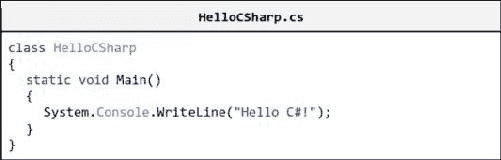

## 使用命令行编写 C# 程序

首先，你需要启动“命令提示符”（也称为“命令控制”）。如果你使用的是 Windows 7 或 Windows 8，可以点击开始按钮并搜索 `cmd`。检查搜索结果并寻找名为“命令提示符”的程序。右键点击该程序并从菜单中选择“以管理员身份运行”。这是一张截图：

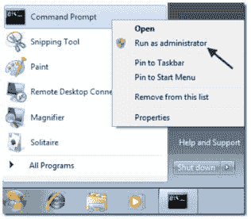

**重要说明：** 如果你通过双击来启动“命令提示符”，它的某些重要功能可能无法使用。

接下来，你需要生成一个文件目录，以便存储生成的程序。输入 `md` 后跟目录名称。然后输入 `cd` 进入新目录。这是一张截图：

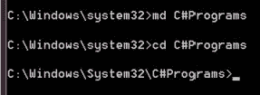

在本例中，目录名称为 `C#Programs`。`cd` 命令将活动目录更改为 `C:\Windows\System32\C#Programs`。现在你准备好创建 `.cs` 文件了。回到命令提示符并发布以下命令：

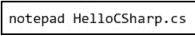

运行该命令后，你的屏幕将显示此内容：

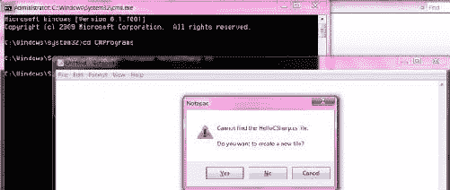

你的电脑会告诉你 `HelloCSharp.cs` 不存在。此外，它还会询问你想要创建一个新文件。点击“是”并将程序代码复制到记事本应用程序中。下面的截图将帮助你完成这一步：

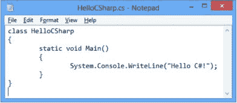

按下 `CTRL+S` 保存文件。然后通过点击红色 X 或按下 `ALT+F4` 关闭文本编辑器。现在，你将在 `C#Programs` 目录中看到程序的代码。

### 编译代码

此时，你可以使用 `csc`（即 C# 语言的内置编译器）编译源代码。在命令提示符中输入 `csc HelloCSharp.cs`。由于这是你第一次使用编译器，你可能会收到类似这里面的错误消息：

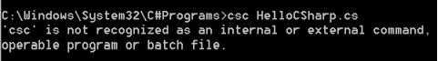

要解决这个问题，你只需要指定 C# 编译器的位置。这是 Windows 7 计算机所需的目录：`C:\Windows\Microsoft.NET\Framework\v4.0.30319`

**重要说明：** 结尾的数字取决于你使用的版本。

因此，你应该执行命令：

`C:\Windows\Microsoft.NET\Framework\v4.0.30319csc HelloCSharp.cs`

C# 编译器将你的 `.cs` 文件转换为可执行文件。为了执行你的第一个程序，输入它的名称。你会得到：


## 如何更改 Windows 的路径

显然你想设置路径。以下是你需要做的事情：

1. 访问控制面板并点击“系统”。
2. 你将看到一个窗口。搜索“环境变量”并找到“Path”。
3. 点击“编辑”并指定目录。
4. 点击“确定”保存。
5. 现在，关闭当前的命令提示符并启动一个新的。然后输入 `csc`。
6. 屏幕将给你以下内容：


## 第 2 章：C# 数据类型、变量和字面量

本章将重点关注 C# 中使用的数据类型和变量。通过阅读这些内容，你将了解这些对象。

### 变量——简介

典型的程序在执行期间使用不同的值。例如，你可以开发一个解决数学问题的程序。显然，在使用此类程序时你需要输入不同的值。

当用户提供值时，你可以将其临时存储在机器的 `RAM`（即随机访问存储器）中。此内存中的所有值都可能改变。因此，程序员将此类值称为“变量”。

### 数据类型

数据类型是具有相似属性的值集（或范围）。例如，`byte` 数据类型指的是 0 到 255 的数值范围。

#### 属性

数据类型具有以下属性：

- 名称（例如 `int`、`char`、`bool` 等）
- 大小（例如 `1 byte`）
- 默认值（例如 `1`、`2`、`3` 等）

### C# 中的不同数据类型

C# 支持以下数据类型：

- 布尔型 (Boolean)
- 字符 (Characters)
- 对象 (Objects)
- 浮点型 (Floating-Point)
- 小进制 (Decimals)
- 整数 (Integers)
- 字符串 (Strings)

由于这些数据类型已预装在 C# 语言中，程序员将它们称为“原始类型”。让我们详细讨论每个数据类型：

#### 布尔型 (Boolean)

你需要使用 `bool`（即 C# 关键字）来声明这种数据类型。布尔值只能是 `true` 或 `false`。在 C# 编程语言中，布尔值默认被自动设置为 `false`。程序员使用这种数据类型来存储逻辑语句的结果。

#### 字符 (Characters)

这种数据类型可以存储单个字符。你需要使用 `char`（即另一个 C# 关键字）来声明此类型。请在一对单引号内编写你的 `char` 值（例如：“I”）。

#### 对象 (Objects)

程序员将对象视为 C# 语言中最特殊的数据类型。基本上，对象充当了 `.NET` 内部其他数据类型的父类。这种数据类型在声明时需要使用 `object` 关键字，它可以接受来自其他数据类型的任何值。你可以将对象想象成指向计算机内存某些区域的地址。

#### 实数 – 浮点数 (Real Type – Floating Points)

在 C# 语言中，“实数”指的是你在数学中学过的实际数字。浮点实数数据类型可以是 `float` 或 `double`。

1. **Float** – 程序员将此子类型称为“单精度实数型”。`float` 数字的默认值为 `0.0F`（结尾的 `f` 不区分大小写）。字母 `f` 表示该值是一个 `float`。
2. **Double** – 程序员在提到此子类型时使用“双精度实数型”这一术语。它的默认值为 `0.0D`（即结尾的字母 `d` 不区分大小写）。C# 自动将实数标记为 `double`，因此你实际上并不需要在值的末尾添加 `d`。

#### 实数 – 小数 (Real Type – Decimals)

这种编程语言支持“十进制算术”，这是一种十进制值来表示数字的数学方法。这种方法的主要优点是无论处理什么什么值，它都能保持其准确性。

C# 使用 `decimal` 数据类型来表示这类实数。这种数据类型长度为 128 位，精确到小数点第 29 位小数。由于其卓越的准确性，程序员使用它们来完成财务计算（例如：付款、税收、利息等）。

#### 整数 (Integers)

这种数据类型由 8 个子类型组成，它们是：

- **SBYTE** – `sbyte` 是一个 8 位的有符号整数。这意味着它可以包含多达 256 个值（即 `2⁸`）。此外，`sbytes` 可以是负数也可以是正数。
- **BYTE** – 该子类型包含 8 位的无符号整数。它与 `sbyte` 几乎相同。唯一的区别是 `byte` 永远不会是负数。
- **SHORT** – 这些整数是有符号的 16 位。
- **USHORT** – 这些是长度为 16 位的无符号整数。
- **INT** – 这可能是 C# 中最流行的数据类型。程序员使用这种数据类型因为它与 32 位处理器完美兼容，并且足够用于典型计算。它是一个长度为 32 位有符号整数。
- **UINT** – 该 32 位整数是无符号的。因此，它只能正数。
- **LONG** – 该整数长度为 64 位。它可以是正数也可以是负数。
- **ULONG** – 这类似于“long”整数。唯一的区别是 `ulong` 只能取正值。

#### 字符串 (Strings)

字符串是一组或一个字符序列。C# 要求你在声明属于这种数据类型的值时使用 `string`（即一个关键字）。你必须在双引号之间编写每个字符串。该语言允许你对字符串执行各种操作（例如：拼接、字符替换、字符搜索等）。

### 变量 (The Variables)

你可以使用变量来存储、检索和修改可变数据。作为程序员，你需要在存储和处理信息时使用变量。

## 变量的特征 (The Characteristics of a Variable)

变量具有以下特征：

- 名称（也称为“标识符”）
- 数据类型
- 值（即你想存储的信息）。

变量是具有名称的计算机内存区域。它们存储值并允许计算机程序访问其内容。你可以将变量放置在栈中（即你计算机程序的工作内存）或程序的动态内存中。

`Characters`、`Booleans` 和 `Integers` 被称为**值类型**，因为它们将数据保存在程序的栈中。相反，`strings`、`arrays` 和 `objects` 被称为“引用类型”，因为它们内部并不持有值。相反，它们充当标记，指向存储数据的计算机内存部分。

## 如何命名变量 (How to Name a Variable)

你需要在使用变量之前为它们命名。变量名充当标识符：它帮助程序定位和指定变量。C# 允许你自由选择变量名。然而，就像任何其他语言一样，C# 对变量名有一些规则。这些规则如下：

- 你可以使用下划线（即 `_`）、字母和数字来创建变量名。
- 你不能用数字开头命名。因此，`FirstSample` 是有效的，而 `1stSample` 是无效的。
- 在为变量命名时不能使用 C# 关键字。这个简单的规则可以防止程序出现编译错误和运行时错误。如果你真的想为变量使用关键字，可以使用 `@` 符号开头名称（例如：`@variableName`）。

## 如何声明变量 (How to Declare a Variable)

你需要在使用变量之前为它们命名。变量名作为标识符：它帮助程序定位和指定变量。C# 允许你自由选择变量名。然而，就像任何其他语言一样，C# 对变量名有一些规则。这些规则如下：

1. 指定变量的数据类型（例如：`char`）
2. 指定变量的名称（例如：`sample`）
3. 设置变量的初始值。此步骤完全可选的。

变量声明的格式为：

```csharp
data_type name = initial_value;
```

是一些有效的示例：

```csharp
int year = 2000;
string;
```

注意：你需要使用分号结束每个 C# 语句。如果你忘记添加分号，你的程序将产生意外的结果。

## 如何赋值 (How to Assign a Value)

就像任何其他语言一样，C# 允许你为变量赋值。这个过程被称为“值赋值”，需要使用等号。程序员将此符号称为运算符。在运算符左侧编写变量名。然后在右侧指定你想赋值的值。查看以下示例：

```csharp
name = “John Doe”;
```

## 如何初始化 (How to Initialize a Variable)

在编程中，“初始化”是为新变量赋值的过程。因此，你在声明变量时会设置这个“初始值”。

### 变量的默认值 (The Default Value of a Variable)

如果你没有为变量分配任何值，C# 将执行自动初始化（即它为空变量分配一个默认值）。下面的表格将显示每种数据类型的默认值：

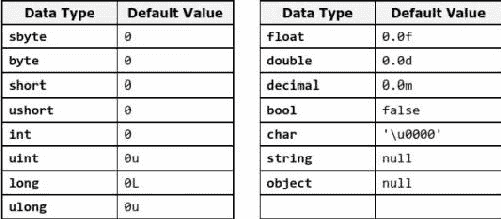

下面的代码将向你展示如何声明变量并赋值：

```csharp
//这是一个示例
byte years = 10;
short days = 31;
decimal pi = 3.14;
bool isittasty = true;
char sample = x;
string animal = “dog”;
```

注意：以双正斜开头的行（即 `//`）是“注释”。

### 值与引用 (Values and References)

C# 程序员将数据类型分为两类：值类型和引用类型。

值类型存在于执行栈中。此外，它持有程序员存储的值。值类型类别由 `Booleans`、`Characters` 和 `Integers` 组成。当程序完成代码执行后，分配给这些数据类型的内存将变为可用。例如，当程序关闭时，程序 `Main()` 方法中的变量将被清空。


另一方面，引用类型在程序的栈中存储一个地址（即引用）。该地址指向所需值的位置。基本上，引用类型在声明时会分配动态内存。此外，当程序不再需要它时，它也会释放一些内存。

## 字面量 (Literals)

字面量是程序源代码中指定的值。下面所给出的示例将阐明这一概念：

```csharp
bool isitdelicious = false;
short income = 22000;
char firstletter = ‘c’;
byte ten = 10;
int prize = 250000;
```

在这个示例中，字面量是`false`、`22000`、`'c'`、`10`和`250000`。这些是你直接添加到程序代码中的值。

### 字面量的不同类型

C# 支持以下类型的字面量：

* 实数 (Real)
* 整数 (Integer)
* 字符串 (String)
* 字符 (Character)
* 布尔值 (Boolean)

让我们详细讨论一下这些字面量：

### 实数

实数字面量有一个符号（即`+`或`-`）、一个后缀、前缀和一个小数点。你应该将这种字面量用于`double`、`float`和`decimal`值。C# 允许你以指数形式编写实数字面量。以下是你可以应用于实数字面量的后缀：

* `F` – 此后缀代表`float`值。
* `D` – 使用此后缀指示`double`值。
* `M` – 此字母表示`decimal`值。
* `E` – 使用此字母用于指数值。例如，“e4”意味着你需要将整数乘以 10⁴。

### 整数

整数字面量由一个前缀、后缀、一个符号（即`+`或`-`）和一组数字组成。你可以使用前缀在代码中以十进制或十六进制的形式添加数字。以下是你可以在 C# 中使用的前缀和后缀：

* `0X`（例如`0XA6F2`）– 使用此前缀指示十六进制值。
* `U`（例如`119U`）– 此后缀代表无符号整数 (`uint`) 或无符号长整数 (`ulong`) 值。
* `L`（例如`360L`）– 用于“长整型”（long）值的后缀。

**重要说明：** 如果你不使用任何后缀，C# 将把整数字面量标记为“int”。此外，字母（即`L`、`U`和`X`）不区分大小写。

### 字符串

使用此字面量用于字符串值。基本上，字符串字面量是置于一对双引号内的字符集（例如“sample”）。

**重要说明：** 在 C# 语言中，你可以使用“@”符号来创建带引号（或逐字）字符串。程序员使用这些字符串来命名文件路径。

### 字符

字符字面量是由一对单引号包围的单个字符（例如‘z’）。使用字符字面量来设置属于“char”类型的值。此外，你可以将字符字面量写为：

* 单个字符（例如‘X’）
* 特殊字符的代码（例如‘\u0067’）
* 转义序列（见下文）

**转义序列 (Escape Codes)** – 这些是特殊的字符序列，向你的源代码中添加字符。通常，这里涉及的字符不能直接添加到程序代码中。C# 防止你直接向程序添加某些字符。其中一些字符是：制表符、换行符、反斜杠、引号等。以下列表向你展示 C# 中常用的转义序列：

* `\\` – 换行符
* `\t` – 制表符
* `\’` – 单引号
* `\”` – 双引号

### 布尔值

布尔字面量只有两种类型：`true`和`false`。在处理“bool”（即布尔）变量时，你只能赋值这些值中的一个。下面给出的代码段将向你如何声明布尔字面量：

```csharp
bool answer = false;
```

## 第 3 章：C# 语言的运算符

本章将重点介绍 C# 的运算符。通过这些材料，你将了解这些运算符是如何工作的，以及你如何在源代码中使用它们。

### 运算符 – 基础

运算符帮助你处理对象和数据类型。它们接受输入和操作数以产生结果。C# 语言使用特殊字符（例如`.`、`+`、`^`等）作为运算符。此外，C# 代码可以接受最多三个不同的操作数。

### 运算符的不同类型

C# 程序员将运算符分为以下几类：

### 赋值运算符

在 C# 中，你需要使用等号（即`=`）来赋值。以下是你赋值值时需要使用的语法：

`操作数 _ 名称 = 表达式, 字面量, 或 第二 _ 操作数`

这里是一些示例：

```csharp
int y = 99;
string hello = “Good morning.”;
char sample = ‘z’;
```

**重要说明：** C# 允许你级联赋值运算符（即在单个表达式中使用多次）。这意味着如果你正在创建相同数据类型的变量，你就不需要输入多个等号了。下面给出的示例将阐明这一规则：

```csharp
int d = 1, e = 2, f = 3;
string hi = “Good.”;
```

### 逻辑运算符

逻辑运算符（也称为布尔运算符）接受并返回布尔值（即`true`或`false`）。

* `&&` – 程序员将此运算符称为“与”（AND）。当两个操作数都为真时，结果为真。
* `^` – 这被称为“异或”（Exclusive OR）。当操作数中只有一个为真时结果为真。
* `||` – 这是“或”（OR）运算符。当至少有一个操作数为真时，结果为真。
* `!` – 此运算符称为取反（Negation），会反转操作数。

以下代码向你展示如何使用这些：

```csharp
class Test
{
    static void Main()
    {
        bool x = true, y = false;
        Console.WriteLine(x && y);
        Console.WriteLine(x || y);
        Console.WriteLine(!x);
        Console.WriteLine(x ^ y);
    }
}
```

### 算术运算符

这些运算符帮助你执行数学。该类别包括：

* `+` – 使用此运算符对两个值进行加法。
* `-` – 此运算符允许你执行减法。它从左侧的值减去右侧的值。
* `*` – 通过此运算符，你可以相乘操作数的值。
* `/` – 使用此运算符在 C# 中进行除法。基本上，`/`将左侧操作数的值除以右侧操作数。
* `++` – 这被称为递增运算符。它将操作数的值增加 1。你可以在操作数之前或之后编写它。
* `--` – 这是递增运算符的相反。你可以使用它将操作数的值减少 1。你可以在想要修改的操作数之前或之后编写它。

下面的代码将向展示运算符是如何工作的：

```csharp
class Test
{
    static void Main()
    {
        double d = 100, e = 3;
        Console.WriteLine(d + e);
        Console.WriteLine(d - e);
        Console.WriteLine(d / e);
        Console.WriteLine(d * e);
        Console.WriteLine(++d);
        Console.WriteLine(--e);
    }
}
```

### 二进制运算符

这些运算符作用于二进制数字。在 IT 世界中，所有的信息都表示为 0 和 1 的序列。这意味着如果你想成为一名成功的程序员，你就必须掌握二进制运算符。

二元运算符的工作方式与逻辑运算符完全相同。实际上，你可能会认为二元运算符和逻辑运算符使用不同的输入但执行相同的处理。逻辑运算符使用`Boolean`值来产生结果。而二元运算符作用于以二进制位形式表示的数字。以下是你在使用 C# 时会遇到的二元运算符：

* `&` – 这被称为`二位与` (Binary AND)。它表示两个操作数位都为`1`的位置。
* `^` – 程序员将此运算符称为`二位异或` (Binary Exclusive OR)。它会在值不同的每个位置上放置`1`。
* `|` – 这是`二位或` (Binary OR) 运算符。它表示任意一个操作操作为`1`的位置。
* `~` – 它充当二进制值的取反运算符。就像`!`一样，它会反转变量当前的值。
* `<<` – 这是`二位左移` (Binary Left Shift) 运算符。它将二进制数的位向左移动。这种移动取决于你赋值的值（例如`4 << 1`、`4 << 3`、`4 << 2`等）。

### 比较运算符

这些运算符允许你比较两个操作数内部的值。这些运算符每一个都输出`Boolean`值作为最终结果。以下是 C# 语言的比较运算符：

* `==` – 这是`相等运算符` (Equality operator)。它检查两个操作数是否相等（例如`x == y`）。
* `>` – 此运算符检查左操作数的值是否大于右操作数的值（例如`x > y`）。
* `<` – 此运算符比较两个操作数的值。如果左操作数的值小于右操作数的值，它将给你返回`true`（例如`y < x`）。
* `>=` – 通过此运算符，你可以判断左操作数的值是否大于或等于右操作数的值。
* `<=` – 如果左操作数的值小于或等于右操作数的值，此运算符将给你返回`true`。
* `!=` – 使用此运算符来检查两个操作数的非相等性。如果值不相等，它将给你返回`true`（例如`x != y`）。

### 条件运算符

C# 用户将`?`称为条件运算符。基本上，该运算符使用`Boolean`表达式的结果来确定应该处理哪条语句。这被称为`三元运算符` (ternary operator)，因为它作用于三个操作数。在这里，第一个值应该是`Boolean`类型，而其余值需要属于相同的数据类型（例如，字符、字符串、数字等）。

该运算符的语法为：

```
first_operand ? second_operand : third_operand;
```

它的工作原理如下：如果`first_operand`为真，程序将处理`second_operand`。然而，如果`first_operand`为假，程序将处理`third_operand`。

## 第 4 章：数据类型转换

通常情况下，运算符作用于属于相同类型的参数。然而，C# 语言提供了多种广泛的数据类型，供你在特定情况下使用。若要对属于不同类型的变量进行任何处理，你应该先转换其中一个变量。在 C# 中，数据类型转换可以是隐式的也可以是显式的。

每个 C# 表达式都有一个数据类型。该数据类型取决于表达式内部使用的字面量、变量、值和结构。基本上，你可能会使用一个类型与当前情况不兼容的表达式。当这种情况发生时，你将得到以下结果之一：

* 程序将给你一个编译时错误。
* 程序将执行自动转换。这意味着程序将获得正确的表达式类型。

将`s`类型转换为`t`类型允许你在运行程序时将`s`视为`t`。有时，这个过程需要程序员对类型转换进行验证。请查看下面的示例：

* 将`objects`转换为`strings`需要在程序运行时进行验证。这种验证确保了你确实想将这些值作为字符串。
* 将`string`值转换为`object`值不需要任何验证。这是因为`string`类型是`object`类型的分支。你可以将字符串转换为其`父`类，而不会丢失数据或产生任何错误。
* 在将`int`值转换为`long`值时，不需要执行验证。`long`数据类型涵盖了`int`类型的所有可能值。这意味着数据可以在无任何错误的情况下转换。
* 将`double`值转换为`long`值涉及验证。取决于你正在处理的值，你可能会遇到数据丢失。

**重要注意：** C# 在更改数据类型方面有某些限制。以下是该语言支持的类型转换：

### 显式转换

如果存在信息丢失的可能性，请使用此转换。例如，在将浮点值转换为整数时，你会经历信息丢失（即小数部分将消失）。在将宽范围类型转换为窄范围类型时，可能会丢失一些数据（例如`long-to-int`转换、`double-to-float`转换等）。要完成此过程，你需要使用`type`运算符。请查看下面的示例：

```csharp
class Example
{
    static void Main()
    {
        double doubleValue = 4.5;
        Console.WriteLine((long)doubleValue);

        long longValue = 100;
        Console.WriteLine((int)longValue);

        float floatValue = 3.14f;
        Console.WriteLine((int)floatValue);

        object obj = "Hello";
        Console.WriteLine((string)obj);
    }
}
```

有时，控制台是用户与程序交互时最重要的工具。例如，在创建简单的计算机程序时，你需要使用控制台。这些程序要求你关注必须解决的问题。美观 GUI（即图形用户界面）和吸引人的输出对你完成这项任务没有帮助。

你还可以使用控制台在将小代码块添加到复杂程序之前对其进行尝试运行。由于控制台是一个简单的工具，你可以轻松地隔离代码块，而无需按下任何按钮或查看不同的屏幕。控制台可以在几秒钟内提供所需的结果。

## 访问控制台

访问控制台的过程取决于你当前使用的操作系统。例如，如果你使用的是 Windows 电脑，需要执行以下步骤：

1. 点击“开始”按钮。
2. 点击“程序”并选择“辅助工具”。
3. 点击名为“命令提示符”的选项。

控制台将显示你的主目录，由你的用户名表示。在下面的示例中，用户名是 SARAH：

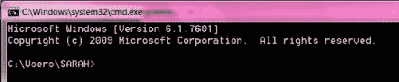

**注意：** 如果你使用的是 Windows Vista、Windows 7 或 Windows 8，可以通过搜索`cmd`来启动控制台。

## 关于控制台的附加信息

控制台是一个显示文本信息的黑色窗口。它有一个闪烁的光标并显示字符字符串。如你所见，每当你输入一个字符时，光标就会移动。

Windows 程序可以是基于桌面的、基于浏览器、基于互联网或基于控制台的。基于控制台的程序利用控制台进行输入输出过程。另一方面，基于桌面的程序依赖其 GUI 进行用户与程序的交互。本书专注于基于控制台的应用程序，因此你将使用键盘输入数据并在命令提示符中查看结果。

某些基于控制台的应用程序要求用户提供文本、数字、字符等。这意味着在处理基于控制台的程序时，你将经常使用键盘。

## 基本命令

在本节中，你将学习使用命令提示符发出的基本命令。如果你想成为一名出色的 C# 程序员，应该仔细学习这些材料。

### 控制台命令

* `cd name_of_directory` – 此命令允许你更改活动目录。例如，如果你想进入 C 盘下的 Users 文件夹，你需要输入以下命令：`cd C:\Users`
* `dir` – 使用此命令查看活动目录中的文件。
* `rmdir name_of_directory` – 此命令允许你删除目录。例如，`rmdir Sample`会删除名为“Sample”的目录。
* `mkdir name_of_directory` – 使用此命令，你可以在活动目录中创建新目录。例如，如果你当前在 Users 目录，`mkdir John`将在“Users”内部创建一个名为“John”的文件夹。
* `type name_of_file` – 使用此命令查看现有文件的内容。例如，你可以输入`type HelloCSharp.cs`来查看该`.cs`文件的内容。

## 标准输入输出 (I/O)

标准输入输出系统是为 UNIX 计算机开发的机制。该系统涉及特殊设备以接受输入并产生输出。

如果程序正在等待用户执行操作或提供信息，控制台将显示光标。这意味着系统处于“等待模式”。

### 输入与输出

操作系统需要为用户与程序的交互定义标准输入输出机制。在启动基于控制台的应用程序时，程序初始化块中的代码需要与操作系统分配的 I/O 机制工作。这些代码允许用户与相关的控制台程序进行交互。

由于这段代码的存在，程序可以从`Console.In`（即 C# 的标准输入流）读取用户的输入，并将信息发送到`Console.Out`。

**注意：** 这里的代码在后续将讨论的 I/O 机制。

C# 程序并不直接读取数字。它们需要将输入视为字符串（即通过`Console.ReadLine`方法）并将它们转换为数字。将字符串转换为其他数据类型的过程被称为解析（parsing）。C# 语言中的所有原始数据类型都支持这一过程。

## 控制台输出

本书的这部分将侧重于两个方法：`Console.WriteLine`和`Console.Write`。这两个方法都可以打印 C# 语言中的所有数据类型。这意味着你可以使用它们在用户的控制台上显示消息。

以下代码段将教你这些方法是如何工作的：

```cs
Console.WriteLine(“I want to learn the C# programming language.”);

// 这一行将打印括号内的字符串。

Console.WriteLine(100);

// 这一行将在用户的命令提示符上显示“100”。

Console.WriteLine(3.14);

// 这一行将在用户的控制台上打印 double 类型的值 3.14。
```

你可以使用`Console.WriteLine`方法在用户的屏幕上显示不同类型的数据。这是因为`Console`类拥有每种数据类型的内置版本。

`Console.WriteLine`和`Console.Write`之间唯一的区别是，前者打印括号内的值并在控制台上添加一个换行符，而后者仅显示括号内的信息。因此，在代码中使用`Console.WriteLine`就像是在显示消息后按了“回车”键（即光标将移动到下一行）。

## 字符串拼接


C# 语言防止程序人员在字符串值上使用运算符。显然，你不能对实际单词进行算术运算（例如 `fish – dog`、`power * humans`、`land / people` 等）。然而，C# 允许你拼接多个字符串对象以生成一个新的字符串。你可以通过在字符串上使用 `+` 来实现。下面的示例将说明这一思想。

```cs
string gadget = "smartphone";

string example = "I use my " + gadget + "to access " + "the internet.";

Console.WriteLine(example);
```

如果你执行该代码，控制台将显示：

`I use my smartphone to access the internet.`

## 第 6 章：C# 的条件语句

本章将教你如何在 C# 代码中使用条件语句。基本上，条件语句是一个允许你根据所分配的条件来执行各种操作的代码块。请仔细阅读这些材料，因为它们包含了帮助你在 7 天内掌握 C# 的价值信息。

### 运算符

在本节中，你将学习更多关于 C# 比较运算符的信息。这些运算符非常重要：它们可以帮助为你自己的条件语句设置条件。

### 比较运算符

C# 具有不同的运算符，用于比较相同类型的值。这些运算符有：

* `<`
* `>`
* `<=`
* `>=`
* `!=`
* `==`

你可以使用上述运算符来比较 C# 表达式（例如，两个整数、两个变量、两个常量等）。在使用这些任何运算符时，结果将始终是一个布尔值（`Boolean`）。分析以下示例：

```cs
int height = 170;

Console.WriteLine(height < 180); // 这将给你“true”。

string gender = "Male";

Console.WriteLine(gender == "Female"); // 这将给你“false”。

double valueofPi = 3.14;

Console.WriteLine(valueofPi > 100); // 这将给你“true”。
```

### 逻辑运算符

C# 还支持一些逻辑运算符。程序人员使用这些运算符创建布尔语句（也称为“逻辑”语句）。让我们详细讨论每个逻辑运算符：

### 与 (AND) 和 或 (OR) 运算符

你只能在涉及布尔值的表达式上使用逻辑与（即 `&&`）和逻辑或（即 `||`）运算符。当两个操作数都为真时，逻辑与运算符将给你返回“true”。例如：

```cs
bool sample = (1 < 2) && (10 == 10);
```

由于 1 小于 2 且 10 等于 10，该表达式将给你 `true`。由于逻辑与运算符在不执行不必要的分析的情况下提供快速结果，程序人员将其称为“短路运算符”。它首先检查语句的左部分。如果求值为“false”，操作将立即停止。由于其中一个操作数为假，表达式将不再为真。

另一方面，逻辑或（即 `||`）运算符在你的操作数中至少有一个求值为真时，将给你返回 `true`。例如：

```cs
bool sample = (1 < 2) || (10 > 100);
```

这个示例将给你 `true`，因为左侧操作数为真。逻辑或运算符也是一个“短路运算符”，因为它即使在不检查整个 C# 语句的情况下也能给出结果。在当前示例中，逻辑或将不再分析第二个操作数，因为第一个操作数已经是真实的。因此，条件已经满足。

### 异或 (Exclusive OR) 和 取反运算符

异或（即 `^`）是一个全路执行运算符，因为它在给出结果之前需要检查两个操作数。只有当其中一个操作数求值为真时，它才会给你 `true`。因此，如果两个操作数都为真，你将得到 `false`。检查以下示例：

```cs
bool sample = (1 < 2) ^ (2 == 2);
```

由于两个表达式均为真，异或将给你 `false`。

取反运算符（即 `!`）只是反转它所连接的布尔值。例如：

```cs
bool sample = !(1 < 2);
```

1 小于 2。然而，由于 `!` 连接到该表达式，结果将被反转。

### 语句

现在你已经知道了如何使用比较运算符和逻辑运算符，该讨论条件语句了。这些语句是帮助你实现编程逻辑的强大工具。

### if 语句

`if` 语句的语法如下：

```cs
if (条件表达式)
{
    if 语句体;
}
```

如你所见，此语法有三个部分：

1. `if` 子——该部分标记了 `if` 语句的开始。
2. 布尔表达式——该部分可以是逻辑表达式。与 C 不同，C# 不接受整数表达式。
3. 语句体——你需要使用一对大括号封装此部分。C# 允许在内部放置多个语句。

当布尔表达式为真时，程序将运行语句体。如果求值为假，程序将忽略语句体并将控制权传递给后续代码。下面的示例将显示“if”语句是如何工作的：

```cs
Console.WriteLine("请输入一个数字。");
int number1 = int.Parse(Console.ReadLine());
int number2 = 0;

if (number1 > number2)
{
    Console.WriteLine("C# 是一种优秀的语言。");
}
```

此代码需要用户提供一个数字。如果用户的输入大于零，程序将在命令提示符上打印“C# 是一种优秀的语言。”

注意：如果你的条件语句体只有单行，可以省略大括号。检查下面的示例：

```cs
int x = 10;

if (x > 0)
    System.Console.WriteLine("该变量持有一个正数。");
```

### if-else 语句

与其他编程语言一样，C# 支持“if-else”条件语句。在编写 `if-else` 语句时，你应该使用以下语法：

```cs
if (布尔变量或表达式)
{
    条件语句体;
}
else
{
    else 语句体;
}
```

上述语法由以下部分组成：

* `if` 子——该部分开始了条件语句。
* 布尔变量或表达式——该表达式的值决定了程序将使用的代码。
* 条件语句的体——这可以是一个单独语句，也可以是一组语句。如果你使用多个语句，请将它们封装在花括号内部。
* `else` 关键字——这是一个 C# 关键字，用于触发 `else` 子句。
* `else` 子句的体——这与条件语句的体完全相同（见上文）。

在处理 `if-else` 语句时，计算机程序会分析括号内的值。该值必须是布尔值（即 `true` 或 `false`）。如果该值为“true”，程序将执行条件语句的体并忽略 `else` 子句。然而，如果该值为 `false`，程序将运行 `else` 语句的体。请分析以下示例：

```csharp
int a = 100;

if (a != 50)
{
    Console.WriteLine("The variable is not equal to 50");
}
else
{
    Console.WriteLine("The variable is equal to 50");
}
```

你可以将此代码解释为：如果 `a != 50`，控制台将打印：“The variable is not equal to 50”。另一方面，如果 `a = 50`，控制台将显示：“The variable is equal to 50”。由于变量 `a` 的持值为 100，你的命令提示符将给出以下内容：

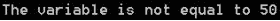

### 嵌套语句

在某些情况下，你需要在另一个 `if` 语句内部编写一个 `if` 语句。程序员将此过程称为“嵌套”。这意味着如果你在另一个条件语句内部编写它，那么你正在执行“嵌套”一个条件语句。

**重要提示：** C# 允许你嵌套 `if-else` 语句。在这种情况下，每个 `else` 子句都指向它之前的 `if` 子句。这个简单的规则可以帮助你分析嵌套条件语句，这些语句可能极其复杂。

根据专家程序员的建议，你不应该创建超过三层级的嵌套语句。如果你确实需要使用四个或更多条件结构，请将其导出到不同的方法中（你稍后会学习方法）。

下面的代码将向你展示嵌套 `if` 语句是如何工作的：

```csharp
int a = 10;
int b = 20;

if (a > b)
{
    Console.WriteLine("a is greater than b");
}
else
{
    if (a < b)
    {
        Console.WriteLine("a is less than b");
    }
    else
    {
        Console.WriteLine("a is equal to b");
    }
}
```

### Switch-Case 语句

在可能的答案很多的情况下，程序员会使用 `switch-case` 语句。以下是 `switch-case` 语句的语法：

```csharp
switch (selector)
{
    case first_integer:
        statements;
        break;
    case second_integer:
        statements;
        break;
    default:
        statements;
        break;
}
```

基本上，选择器（`selectors`）是返回可用值的表达式（即你可以进行比较或处理的值）。`switch` 关键字将 `selector` 的值与 `cases` 进行比较。如果 `selector` 的值与某个 `case` 匹配，则分配给该 `case` 的语句将运行。然而，如果没有匹配，程序将执行 `default` 语句。

**重要提示：** 确保 `cases` 具有唯一的值。如果两个或多个 `case` 共享相同的值，你的程序将产生意外的结果。如所示，每个 `case` 都有一个 `break` 子句。`break` 子句终止它所属的 `case`。C# 要求你在所有的 `switch` 语句中添加此子句。你不需要将 `default` 部分放在 `switch-case` 语句的末尾。但是，如果你想保持代码的可读性，建议放在该位置。

## 第 7 章：循环语句

本章将教你如何使用循环语句。作为一名程序员，你将使用循环语句反复运行某些代码块。循环在 C# 编程中起着重要作用。因此，如果你想掌握这种语言，应该仔细学习这些材料。

### 循环 – 基础

在创建程序时，你通常需要多次执行代码序列。多次输入相同的代码块会非常无聊。因此，你需要找到一种快速简单的方法来重复代码。幸运的是，C# 语言支持循环语句。

循环是一个反复运行代码的工具。你可以用它运行特定次数的代码，或者只要满足给定条件一直运行。C# 提供了不同类型的循环语句。让我们详细分析每个类型：

### While 循环

这是 C# 中最简单的循环语句。它的语法如下：

```csharp
while (the_assigned_condition)
{
    the_loop's_body
}
```

在此语法中，`the_assigned_condition` 是一个产生布尔值的表达式。该条件决定了 `body` 运行的次数。而 `body` 是你想要执行的语句（或语句组）。

给出的图表将说明 `while` 循环的工作原理：

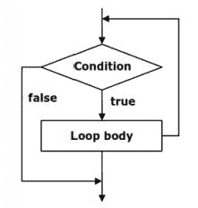

在处理 `while` 循环时，C# 程序会检查布尔表达式的值。如果值为“true”，程序将运行循环体内的所有语句。然后，程序将再次检查布尔表达式以查看其值。如果值仍然为真，程序将再次运行循环体。

**重要提示：** 如果布尔值为 `false`，C# 程序将不会运行 `while` 体。因此，如果你在启动程序时布尔值为 `false`，你的循环内语句将不会执行。

以下示例将说明 `while` 循环的工作方式：

```csharp
int timer = 10;

while (timer >= 0)
{
    System.Console.WriteLine("Time remaining: " + timer);
    timer--;
}
```

如果你编译并执行此代码，你的命令提示符将显示以下内容：

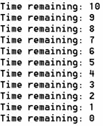

### Break 运算符

你可以使用 `break`（一个 C# 运算符）提前退出循环。当程序员不想等待循环自然结束时，他们会使用此运算符。基本上，循环一旦遇到 `break` 运算符就会结束。这种情况强制程序跳转到循环后的代码片段。

在 C# 中，你只能在循环体内部使用此运算符。这意味着 `break` 只有在循环运行时才有效。

### Do-While 循环

`do-while` 循环与 `while` 循环几乎相同。这些循环之间的唯一区别在于前者在运行循环体之后分析布尔值。因此，你可以确定即使布尔表达式为 `false`，你的代码至少也会运行一次。以下是 `do-while` 循环的语法：

```csharp
do
{
    statements
} while (Boolean expression)
```

`do-while` 循环按照此模式工作：

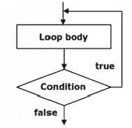

`for` 循环包含一个初始化器（即计数器的初始值）、一个布尔表达式、一个更新计数器的 C# 语句以及循环体。

`计数`（即分配给循环的初始值）是 `for` 循环最显著的特征。在大多数情况下，计数器的值会一直增加，直到达到最终值（例如从 1 到 10）。此外，程序员通常知道 `for` 循环将迭代多少次。

你可以在 `for` 循环中包含一个或多个变量。这些变量可以按降序或升序移动。在编写程序时，你可以在单个 `for` 循环中组合升序和降序变量。此外，升序变量可以从 1 变为 1024，因为 `for` 循环支持算术运算（例如加法、乘法等）。

**重要提示：** `for` 循环的所有部分都是可选的。你可以通过在语法中留空来创建一个无限的 `for` 循环。这是一个示例：

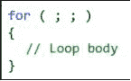

至此，你准备好学习更多关于 `for` 循环的不同部分了。

### 初始化

一个 `for` 循环可以拥有初始化片段：

```csharp
for (double sample = 1; …;   …)
{
    // 你可以在这里使用“sample”变量。
}
// 你不能在这里使用该变量。
```

C# 程序在运行 `for` 循环之前执行一次此片段。程序员通常使用初始化片段来创建一个计数器（也称为“循环变量”）并分配其初始值。在循环体内部，该计数器是可用且可的。C# 允许你使用单个初始化片段声明多个变量。

### 条件

显然，`for` 循环需要一个条件表达式。这是一个示例：

```csharp
for (double sample = 1; sample < 5; …)
{
    // 这是循环体。
}
```

计算机程序在运行循环体之前会评估条件表达式。如果结果为“true”，则运行循环体；否则，相关的程序将跳转到写在当前循环之后的语句。

### 更新语句

这是 `for` 循环的最后部分。基本上，更新语句会更新循环的计数器。让我们使用上面的代码段：

```csharp
for (double sample = 10; sample > 1; sample--)
{
    // 这是循环体。
}
```

程序在运行循环体后执行此部分。请记住，该语句更新了计数器的值。

### 循环体

此部分由 C# 语句组成。它可以利用你在循环初始化片段中声明的变量。查看下例：

```csharp
for (double sample = 10; sample > 1; sample--)
{
    System.Console.WriteLine(sample);
}
```

### Continue 操作符

在某些情况下，你需要停止当前的迭代而不结束循环本身。你可以使用 C# 中名为 `continue` 的操作符完成此任务。下面的示例将说明该操作符如何工作：

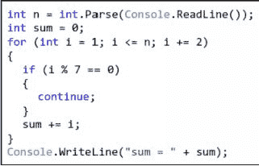

此代码计算范围（1 到 n）内所有除以 7 且有余数的奇数总和。

### “Foreach” 循环

C# 最近引入了 `foreach` 循环的概念（即扩展的 `for` 循环）。这种循环概念也存在于 C、VB、C++、PHP 等其他编程语言。通过这个编程工具，你可以运行列表、数组或其他值组中的所有元素。`foreach` 循环即使在非索引数据组中也能获取所有现有元素。

在编写这种循环时，使用以下语法：

```csharp
foreach (type name_of_variable in name_of_group)
{
    the_statements;
}
```

如你所示，这种循环比典型的 `for` 循环简单得多。`foreach` 循环可以帮助你快速扫描集合内部所有的对象。无数程序员在编写代码时使用这种循环并不令人意外。

### 嵌套 for 循环

C# 允许你将一个 `for` 循环放在另一个 `for` 循环内部。代码最内层的循环运行次数最多。而最外层的循环重复次数最少。在“嵌套” `for` 循环时，你应该使用以下语法：

```csharp
for (initializing_fragment, condition, update_statement)
{
    for (initializing_fragment, condition, update_statement)
    {
        statements
    }
}
```

在这里，程序运行初始的 `for` 循环，执行其循环体并触发嵌套循环。程序将检查第二个循环的条件并执行其内部的代码，直到评估变为 `false`。然后，程序将对循环计数器进行必要的调整。程序将重复整个过程，直到所有条件的评估均为 `false`。

## 第 8 章：C# 语言的方法

本章将重点关注 C# 方法。在这里，你将学习如何在自己的程序中声明和利用方法。你需要记住这些课程才能成为一名高效的程序员。

### 方法——基础

对于大多数程序员来说，方法是任何程序的核心方面。方法解决问题、接受用户输入（称为参数）并产生结果。


# 方法提供的优势

在本节中，你将发现方法提供的主要优势。阅读这些内容后，你将知道为什么在编写程序时要使用这些工具。

## 更好的结构和代码可读性

编程专家认为编写程序时应该使用方法。即使是简单的方法也能提高代码的结构和可读性。如果代码易于阅读，你的工作将会变得轻松。

## 防止冗余代码

方法可以帮助避免程序中的冗余代码。冗余或重复的代码通常会产生不良的结果。

## 更好的代码重复

这一优势与之前的密切相关。如果程序需要多次使用某些代码，将该片段转换为 C# 方法是一个极佳的主意。你可以多次调用方法，这意味着你可以重复使用重要代码。

## 声明、实现和调用 C# 方法

至此，你需要了解对现有方法可以执行的过程。这些过程包括：

- `声明`：在此过程中，你将方法链接到程序。此过程允许你在程序的任何部分调用该方法。
- `实现`：此过程涉及完成特定任务的代码。相关的代码存在于你使用的方法内部。
- `调用`：这是调用已声明的方法。在这里，你使用方法来解决问题或执行操作。

## 方法声明

在 C# 中，你需要在类内部声明方法。此外，不允许“嵌套”方法（即在另一个方法的体内编写方法）。完美的例子是`Main()`，你已经多次使用的方法。下面的代码说明了这一点：

```csharp
class DeclaringMethods
{
    static void Main()
    {
        System.Console.WriteLine("Hi C#!");
    }
}
```

## 语法

在声明方法时使用以下语法：

`static data_type_of_the_result name_of_method (list_of_parameters)`

让我们使用`Main()`方法（即`static void Main()`）来分析这种语法。`Main()`使用`void`作为返回类型，因为它不产生任何结果。`Main`单词作为它的名称。而另一方面，括号充当程序员将提供的参数的容器。

**重要说明**：在编写 C# 程序时，你必须遵循这种语法。不要更改方法各个部分的位置。

C# 并不要求你在声明中包含参数。这意味着你可以让括号保持为空（例如`Main()`）。

## 方法名称

在声明、调用或实现期间，你需要指定方法的名称。在为方法命名时，你需要记住以下规则：

- 确保首字母为大写字母。
- 每个单词的起始字母都用大写字母开头（例如`SampleMethod`、`NewMethod`、`MainLine`等）。
- 使用动词和名词作为你方法的名称。

**重要说明**：上述讨论的规则完全是可选的。如果你希望你的 C# 代码具有良好的结构和可读性，请遵循这些规则。

## 方法实现

仅仅声明方法是不够的。如果你想让方法在程序中运行，你还需要实现你的方法。程序员在提到方法的实现时使用“体”（body）一词。

### 方法体

你会在大括号内找到方法体。此体由你想执行的命令、表达式和语句组成。因此，体是任何方法的重要组成部分。

**重要说明**：记住在 C# 中你不能嵌套方法。不要在其他方法内部编写方法。

## 方法调用

基本上，这是运行方法体内部语句的过程。调用方法非常简单：你只需要指定它的名称，添加一对大括号，并使用分号结束该行。你应该使用的语法如下：

```
name_of_method();
```

下面提供的示例代码将向你展示如何调用方法：

```csharp
class Animals
{
    static void Main()
    {
        Console.WriteLine("I love dogs.");
    }
}
```

如果你编译并执行该代码，你的命令行提示将打印以下消息：

`I love dogs.`

## 你调用方法的地方

C# 允许你在以下区域调用方法：

- 在程序的主方法内部（即`Main()`）。
- 在另一个方法内部。
- 在方法自身的体内部。这种技术被称为“递归”。

## 结语

再次感谢你下载这本书！

希望这本书能够帮助你在短短几天内就成为一名熟练的 C# 程序员。

下一步是继续使用 C# 编写你自己的程序。

最后，如果你喜欢这本书，我想请你帮个忙，你是否愿意在 Amazon 上为这本书留个评价？我将不胜感激！

感谢你并祝你好运！
