# C#：C# 初学者指南速成课程：快速轻松掌握 C# 编程（计算机编程，初学者编程）（第 2 卷）

作者

RAJ ALI

# 第 1 章 C# 简介

## 1.1 C# 概览

C# 是一种面向对象的、类型安全的高级语言。它是微软在开发 .NET 框架期间开发的。C# 是为了通用语言基础设施 (CLI) 开发的，该基础设施允许不同语言的程序协同工作。CLI 包含了各种可执行程序，简单称为执行文件，托管在运行时环境中。

## 1.2 C# 的编程特性

- 它是一种简单、高级、面向对象的语言。
- 它包含了所有 .NET 语言通用的数据类型和类。
- 通用运行时 (CLR) 类似于虚拟机 (JVM)。
- C# 提供封装、继承、多态和接口的支持。
- Visual Studio 支持 C++、脚本、JavaScript。
- .NET 由类库和通用执行引擎组成。
- 垃圾回收、自动内存管理、互操作性内置于 C#。
- 用户可以使用 C# 开发控制台、窗口和 Web 应用程序。

## 1.3 C# 环境

C# 是 .NET 框架的一部分，用于创建 .NET 应用程序。使用 .NET 框架可以设计、部署和开发应用程序。可以使用简单的编程模型构建健壮的应用程序。

## .NET 框架的组件

所示 .NET 框架图：

| Windows Forms | 控制台应用程序 | Web 和 Windows 服务 |
|---|---|---|
| 通用语言规范 |  | Visual Studio .NET |
| .NET 框架基类库 |  |  |
| 通用运行时 |  |  |

### 通用运行时 (CLR)

.NET 框架的核心组件是 CLR。它是程序执行的环境。CLR 中的代码被翻译成中间语言 (IL)。此 IL 代码可以在不同平台之间使用。

IL 代码由即时编译 (JIT) 编译器转换为机器语言。编译器会检查类型安全性。这确保了对象以兼容的方式被访问。

### .NET framework 类库

类库适用于任何 VB.NET、C# 和 C++.NET 等 .NET 语言。该库提供了代码中使用的各种类，用于执行不同的编程任务，如数据集合、字符串管理、文件访问以及连接数据库。

### 通用语言规范

CLR 包含了一组供 .NET framework 中所有编程语言使用的通用规则。这些规则被称为通用语言规范 (CLS)。CLS 帮助对象与其他语言的对象或应用程序进行交互。

### 用户和程序界面

.NET framework 提供了不同类型的用户界面：

- Windows Forms（窗窗表）：它们基于窗口的应用程序。
- Web Forms（Web 表单）：用于创建基于 Web 的应用程序。
- Console Applications（控制台应用程序）：用于创建由命令行执行的控制台应用程序。

# 第 2 章 C# 程序结构

## 2.1 C# 程序结构简介

C# 程序由多个部分组成。我们将探索 C# 程序所需的所有组件。

考虑这段演示 C# 程序的代码：

```csharp
Example 1:
using System;
namespace WelcomeUser
{
    static void Main(string[] args)
    {
        Console.WriteLine("Welcome User");
        Console.Read();
    }
}
```

该代码由几个部分组成，如下所示：

### 命名空间声明

命名空间由编程中使用的类集合组成。`using` 关键字用于添加 `System` 命名空间。`System` 类包含了对用户有类和方法。

在上面的代码中，添加了 `welcome` 命名空间。

### 类

类由程序使用的数据和方法定义组成。类可以有一个或多个方法。每个类都必须有一个 `Main` 方法，它是代码中运行的第一个方法。在上面的代码中，声明了 `WelcomeUser` 类。

### 类方法

类中的方法指定了语句的行为。在上面的代码中，`WriteLine` 方法用于向控制台写入值。它定义在 `System` 命名空间下的 `Console` 类中。

`Console` 类的 `Read` 方法用于等待用户按下键。这防止了屏幕过快关闭。

## 注释

注释是用于提供有关代码额外信息的文本。编译器会忽略任何放置在注释块中的代码。注释有两种类型：一种注释用于单行条目，另一种用于多行条目。

例如：

| Example 2: |
|---|

```csharp
using System;
namespace comment
/*It is a simple code
Used for writing value to the console
*/
class Demo
{
    static void Main()
    {
        //It is added inside Main method
        Console.WriteLine("Demonstration of code");
    }
}
```

## 2.2 用户界面元素

Visual Studio 中存在各种用户界面元素，可以在项目中使用。我们将详细探索用户界面元素。

### 启动页

启动页是用户打开 Microsoft Visual Studio 应用程序时显示的初始页面。

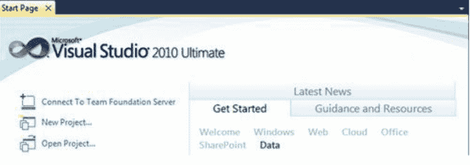

Visual Studio IDE 提供启动页作为默认主页。通过启动页，用户可以指定偏好、使用 .NET 平台进行开发者通信以及探索新的 .NET 特性。

在 Visual Studio .NET 中，“Projects”（项目）选项卡显示最近的项目和最后的修改日期。用户可以使用列表中的任何现有项目。当需要为新项目工作时，点击 New Project（新建项目）按钮。当用户想要打开现有项目时，点击 Open project（打开项目）按钮。

### 标准工具栏

标准工具栏用于提供快捷菜单命令。工具栏上有几个按钮，可帮助用户执行与文件打开、关闭、保存、编辑、粘贴相关的任务。

标准工具栏中存在与工具相关的函数，列如下：

- New Project（新建项目）：可以在应用程序中创建一个新项目。可以使用该按钮。
- Add New Item（添加项）：向项目添加新项。可以使用该按钮。
- Save（保存）：保存特定解决方案创建的所有程序。可以使用该按钮。
- Save All（全部保存）：保存应用程序中所有未保存的项目。可以使用该按钮。
- Cut（剪切）：使用此选项将选中对象放在剪贴板上。可以使用该图标。
- Copy（复制）：将选中项目的副本保留在剪贴板上。可以使用该图标。
- Paste（粘贴）：用于向文档粘贴内容。可以使用该图标。
- Debugging（调试）：完成项目的编译和执行。可以使用该图标。

### 解决方案管理器

在解决方案管理器窗口中，显示项目使用的类、项目和解决方案名称。在解决方案管理器中双击文件以打开文件。

下图显示了应用程序中的解决方案管理器窗口。

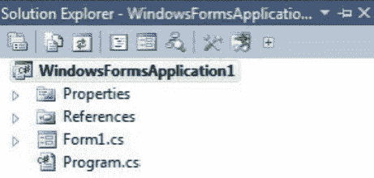

### 输出窗口

输出窗口提供 Visual Studio .NET IDE 功能状态的消息。当用户编译应用程序时，显示应用程序的当前状态。编译期间出现的错误数量显示在窗口中。使用 View -> Output Window（视图 -> 输出窗口）选项打开该窗口。

下图显示了 Visual Studio 应用程序中的输出窗口。

### 错误列表

应用程序中的错误显示在错误列表中。用户可以在代码编译后立即定位错误。使用 View, Error List（视图, 错误列表）选项打开窗口。

下图显示了错误列表。

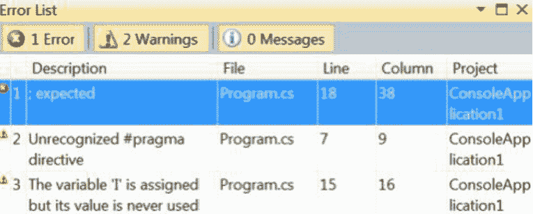

### 类视图

类视图有助于显示与文件相关的类、属性和方法。树形视图用于显示项目。窗口包含两个按钮，一个用于排序项目，另一个用于新建。

### 代码编辑器

用户可以在编辑器中输入或编辑代码。

```csharp
using System;
using System.Collections.Generic;
using System.ComponentModel;
using System.Data;
using System.Drawing;
using System.Linq;
using System.Text;
using System.Windows.Forms;

namespace WindowsApplication1
{
    public partial class Form1 : Form
    {
        public Form1()
        {
            InitializeComponent();
        }
    }
}
```

### 2.3 编译和执行 C# 程序

编译和执行程序涉及以下步骤：

1. 打开 Visual Studio 应用程序。
2. 从列表中点击 File（文件）、New（新建）、Project（项目）选项。
3. 选择 Visual C# 模板并选择 Windows 选项。
4. 从模板列表中选择控制台应用程序。
5. 添加项目名称并点击 OK 按钮。
6. 在解决方案管理器中创建一个项目。
7. 在代码编辑器窗口中添加所需的代码。
8. 按 F5 或点击运行按钮执行项目。用户可以查看代码的输出。

可以使用 Visual Studio IDE 的命令行编译 C# 程序代码。

1. 在文本编辑器中添加代码并以 `.cs` 扩展保存文件。
2. 打开命令行并导航到文件所在位置。
3. 使用 `csc filename.cs` 编译代码。
4. 命令行移动到下一行并创建可执行文件。
5. 添加文件名并执行程序。

# 第 3 章 语法、数据类型和转换

## 3.1 C# 中的不同关键字

关键字是特殊的预定义保留字，每个都分配了唯一的含义。这些关键字可以分类组织以便更好地理解。以下是分为不同类型的关键字列表。

### 1) 用于类、方法、字段和属性的关键字

- `abstract`
- `extern`
- `internal`
- `new`
- `const`
- `override`
- `protected`
- `private`
- `public`
- `sealed`
- `readonly`
- `static`
- `virtual`
- `void`

### 2) 用于类型转换的关键字

- `explicit`
- `implicit`
- `as`
- `is`
- `operator`
- `sizeof`
- `typeof`

### 3) 用于程序流程控制的关键字

- `if`
- `else`
- `for`
- `foreach`
- `in`
- `case`
- `break`
- `continue`
- `return`
- `while`
- `goto`
- `default`
- `do`
- `switch`

### 4) 用于内置类型和枚举的关键字

- `bool`
- `char`
- `class`
- `byte`
- `decimal`
- `enum`
- `double`
- `float`
- `interface`
- `long`
- `int`
- `object`
- `sbyte`
- `short`
- `string`
- `uint`
- `struct`
- `ulong`
- `ushort`

### 5) 用于异常处理的关键字

- `try`
- `catch`
- `throw`
- `finally`
- `checked`
- `unchecked`

### 6) 用于字面量、方法传递参数的关键字

- `true`
- `false`
- `null`
- `this`
- `value`
- `out`
- `params`
- `ref`

### 7) 用于函数指针、对象分配、非托管代码的关键字

- `delegate`
- `event`
- `new`
- `stackalloc`
- `unsafe`

## 3.2 C# 中的数据类型

数据类型用于存储特定类型的数据。程序员可以使用几种内置数据类型来声明数据。

每个数据类型都有一组有限的取值范围，这些有限的选项被称为该数据类型的数据范围。下面列出了不同的数据类型及其可以包含的数据范围：

- `bool`：用于表示布尔值。可以赋值 `true` 或 `false` 的值。
- `byte`：8 位无符号整数。`byte` 数据类型的值范围从 0 到 255。
- `char`：16 位 Unicode 字符。值范围从 U+0000 到 U+ffff。
- `double`：64 位双精度浮点类型。值范围从 (+/-) 5.0 x 10-324 到 (+/-) 1.7 x 10308。
- `decimal`：带有有效数字的 128 位精确小数值。值范围从 (-7.9 x 1028 到 7.9 x 1028) / 100 到 28。
- `float`：32 位单精度浮点数。值范围从 -3.4 到 3.4 x 1038。
- `int`：32 位有符号整数类型。其值范围从 -2,147,483,648 到 2,147,483,647。
- `long`：64 位有符号整数类型。其值范围从 -923,372,036,854,775,808 到 9,223,372,036,854,775,807。
- `sbyte`：8 位有符号整数类型。其值范围从 -128 到 127。
- `short`：16 位有符号整数类型。其值范围从 -32,768 到 32,767。
- `uint`：32 位无符号整数类型。其值范围从 0 到 4,294,967,295。
- `ulong`：64 位无符号整数类型。其值范围从 0 到 18,446,744,073,709,551,615。
- `ushort`：16 位无符号整数类型。其值范围从 0 到 65,535。

## 3.3 C# 中的类型转换

当程序员需要从一种数据类型转换为另一种数据类型时，类型转换非常有用。类型转换也称为类型强制（type casting）。C# 中有两种类型转换：隐式类型转换和显式类型转换。

### 隐式类型转换

隐式转换关键字用于隐式转换。它们不需要任何转换运算符。这些转换包括从小到大的整数类型，以及从派生类到基类。

### 显式类型转换

显式转换由用户通过预定义函数显式完成。在这些转换中，需要转换运算符。

C# 包含了对用户有类型转换方法。

以下列表显示了类型转换方法：

- `ToByte`：用于将类型转换为 `byte`。
- `ToBoolean`：用于转换布尔值。
- `ToDateTime`：用于将类型转换为日期时间类型。
- `ToDouble`：将类型转换为 `double`。
- `ToDecimal`：将浮点数或整数转换为 `decimal` 类型。
- `ToInt64`：将类型转换为 64 位整数。
- `ToSingle`：将类型转换为浮点数。
- `ToString`：将类型转换为字符串类型。
- `ToUInt64`：将类型转换为无符号大整数。

以下代码段显示了值类型到 Double 类型的转换。

### 示例 4

```csharp
using System;
namespace type
{
    class DoubleConversion
    {
        int a=10;
        float f=30.05f;
        bool b=false;

        Console.WriteLine(a.ToDouble());
        Console.WriteLine(f.ToDouble());
        Console.WriteLine(b.ToDouble());
        Console.Read();
    }
}
```

# 第 4 章 变量与常量

## 4.1 探索 C# 中的变量

变量是分配给程序使用的内存位置的名称。每个变量都有与其关联的数据类型。数据类型决定了在内存中存储变量时使用的内存大小。

提供的数据类型决定了用于在内存中存储的大小，如下：

1. 整数类型：`int`、`uint`、`short`、`sbyte`、`long`、`ulong`
2. 浮点类型：`double`、`float`
3. 小数类型：`decimal`
4. 布尔类型：`true` 或 `false`
5. 可空类型：`nullable`
6. 引用类型：`class`

### 定义变量

声明变量的语法为：

```csharp
<data_type> <variable_list>;
```

其中 `data_type` 是有效类型。

### 初始化变量

变量可以使用等号初始化。

初始化变量的示例：

```csharp
const int i=3;
int x;
Console.WriteLine("The value for x is:");
x=Convert.ToInt32(Console.ReadLine());
int mult = x*i;
```

### 常量

## 4.2 C# 中的常量和字面量

常量是表示固定值但不可修改的类成员。使用 `const` 关键字声明。

语法：

```csharp
const<data_type> <constant_name> = value;
```

常量的示例：

```csharp
using System;
namespace const
class Program
{
    static void Main(string[] args)
    {
        const int i=3;
        int x;
        Console.WriteLine("The value for x is:");
        x=Convert.ToInt32(Console.ReadLine());
        int mult = x*i;
        Console.WriteLine("Value of multiplication is:{0}",mult);
    }
}
```

### 字面量

字面量是值的源代码表示。C# 中有不同类型的字面量。

#### 整数字面量


整数字面量用于写入`int`、`long`、`uint`、`ulong`类型的值。它可以表示为十进制、八进制或十六进制常量。基数由前缀指定。`0x`或`0X`表示十六进制，`0`定义八进制，十进制不使用前缀。

整数字面量的示例：`15`、`0321`、`0x5b`、`30l`。

## 浮点字面量

浮点字面量由整数部分、小数部分、小数点和一个指数部分组成。浮点字面量可以用指数或小数形式表示。

浮点字面量示例：`3.1415`、`1423E-6L`。

## 字符字面量

字符字面量表示单个字符。它们包含在单引号中。由反斜杠引导的字符称为转义字符，这些字符在字符串运行时具有特殊含义，用于创建制表符或回车符。以下是这些特殊转义字符的列表：

- `\'`：单引号
- `"`：双引号
- `\`：反斜杠
- `\0`：空
- `\a`：警报
- `\b`：退格
- `\f`：换页
- `\t`：水平制表符
- `\v`：垂直制表符
- `\r`：回车

## 字符串字面量

C#支持两种字符串字面量类型：普通字面量和逐字字面量。普通字面量包含双引号内的零个或多个字符。逐字字面量包含`@`字符，后跟双引号和零个或多个字符。逐字字面量可以跨行。

```csharp
"欢迎用户"

"欢迎，用户"

""欢迎用户"
```

# 第5章 C#中的运算符

## 5.1 运算符简介

运算符用于定义表达式的含义。它是一组一个或多个字符，用于计算或比较。运算符可以将一个或多个数据值（称为操作数）转换为新值。

## 5.2 算术运算符

算术运算符用于对变量进行算术运算。下表列出了C#中的算术运算符。

| 运算符 | 说明 | 示例 |
|---|---|---|
| `+` | 将两个操作数相加 | `c=a+b`<br>如果`a=10`、`b=20`，`c=10+20=30` |
| `-` | 从第一个操作数减去第二个操作数 | `c=a-b`<br>如果`a=10`、`b=5`，`c=10-5=5` |
| `*` | 将两个操作数相乘 | `c=a*b`<br>如果`a=10`、`b=5`，`c=10*5=50` |
| `/` | 用被除数除以除数 | `c=a/b`<br>如果`a=21`、`b=2`，`c=21/2=10` |
| `%` | 取模运算符，返回整数除法后的余数 | `c=a%b`<br>如果`a=21`、`b=2`，`c=21%2=1` |
| `++` | 自增运算符，用于将值增加一 | 如果`a=10`，<br>`a++=11` |
| `--` | 递减运算符，用于将值减少一 | 如果`a=10`，<br>`a--=9` |

## 5.3 关系运算符

关系运算符用于关系运算和类型比较。

| 运算符 | 说明 | 示例 |
|---|---|---|
| `=` | 检查两个操作数的值是否相等 | 如果`x=10`、`y=20`，`(x=y)`为假 |
| `!=` | 如果两个操作数的值不相等，则条件为真 | 如果`x=11`、`y=12`，`(x!=y)`为真 |
| `>` | 如果左操作数大于右侧，则条件为真 | 如果`x=13`、`y=17`，`(x>y)`为假 |
| `<` | 如果右操作数大于左侧，则条件为真 | 如果`x>10`、`y=15`，`(x<y)`为假 |
| `>=` | 如果左操作数的值大于或等于右侧，则条件为真 | 如果`x=5`、`y=3`，`(x>=y)`为假 |
| `<=` | 如果左操作数的值小于或等于右侧，则条件为真 | 如果`x=10`、`y=4`，`(x<=y)`为假 |

## 5.4 逻辑运算符

逻辑运算符用于评估表达式并返回布尔值。

| 运算符 | 说明 | 示例 |
|---|---|---|
| `&&` | 逻辑与运算符。如果两个表达式都为真，结果为真 | `X`的布尔值为真，`Y`的布尔值为假，`(A&B)`为假 |
| `!` | 逻辑非运算符。如果表达式为假，则返回真 | `X`的布尔值为真，`!(X) = false` |
| `||` | 逻辑或运算符。如果任一个表达式为真，结果为真 | `X`的布尔值为真，`Y`的布尔值为假，`(X||Y)`为真 |
| `^` | 逻辑异或。如果任一个表达式为真，则返回真。如果两个表达式都为真或为假，则返回假 | `X`的布尔值为真，`Y`的值为假，`(X^Y)`为真 |

## 5.5 位运算符

位运算符用于位（bit）。它们执行位操作。

| `a` | `b` | `a&b` | `a|b` | `a^b` |
|---|---|---|---|---|
| `0` | `0` | `0` | `0` | `0` |
| `0` | `1` | `0` | `1` | `1` |
| `1` | `0` | `0` | `1` | `1` |
| `1` | `1` | `1` | `1` | `0` |

## 5.6 赋值运算符

赋值运算符用于对操作数进行算术运算。结果赋值给其中任何一个操作数。

| 运算符 | 说明 | 示例 |
|---|---|---|
| `=` | 将右侧操作数的值赋值给左侧操作数 | `z=x+y`将`x+y`的值赋值给`z` |
| `+=` | 加赋值运算符。将右操作数加到左侧操作数，并将结果赋值给左侧操作数 | `x+=y`类似于`x=x+y` |
| `-=` | 减赋值运算符。从左侧减去右侧操作数 | `x-=y`类似于`x=x-y` |
| `*=` | 乘赋值运算符。用右侧操作数乘以左侧操作数 | `x*=y`类似于`x=x*y` |
| `/=` | 除赋值运算符。用左侧操作数除以右侧操作数 | `x/=y`类似于`x=x/y` |
| `%=` | 取模赋值运算符。取两个操作数的模 | `x%=y`类似于`x=x%y` |
| `<<` | 左移赋值运算符 | `a<<2`类似于`a=a<<2` |
| `>>` | 右移赋值运算符 | `a>>2`类似于`a=a>>2` |
| `&=` | 位与赋值运算符 | `a&=y`类似于`a=a&y` |
| `^=` | 位异或赋值运算符 | `a^=y`类似于`a^=y` |
| `|=` | 位或赋值运算符 | `a|=y` |

## 5.7 杂运算符

| 运算符 | 说明 | 示例 |
|---|---|---|
| `sizeof` | 返回数据类型的大小 | `sizeof(int)` |
| `typeof` | 返回变量的类型 | `typeof(x)` |
| `? :` | 三元运算符（条件运算符） | `(condition) ? true_value : false_value` |
| `+` | 字符串拼接运算符 | `"Hello " + "World"` |

# 第6章 决策

决策根据条件控制程序的执行流。

## 6.1 `if`语句

`if`语句用于在指定条件为真时执行代码块。如果条件为假，则跳过它（或执行`else`块）。

语法：

```csharp
if (condition)
{
    // 当条件为真时执行的代码
}
```

示例：

```csharp
int age = 20;
if (age >= 18)
{
    Console.WriteLine("You are an adult.");
}
```

## 6.2 `if else`语句

`if`语句可以跟随`else`语句，为条件假提供另一种路径。

语法：

```csharp
if (condition)
{
    // 条件为真时执行的代码
}
else
{
    // 条件为假时执行的代码
}
```

示例：

```csharp
int age = 15;
if (age >= 18)
{
    Console.WriteLine("You are an adult.");
}
else
{
    Console.WriteLine("You are a minor.");
}
```

## 6.3 `if else if`语句

`else if`语句用于需要顺序检查多个条件的情况。

语法：

```csharp
if (condition1)
{
    // 如果 condition1 为真则执行
}
else if (condition2)
{
    // 如果 condition1 为假且 condition2 为真则执行
}
else
{
    // 如果所有条件都为假则执行
}
```

### `else if else`语句示例

```csharp
Example 8:
using System;
namespace elseifelse
{
    class Program
    {
        static void Main(string[] args)
        {
            int x = 30;
            if(x == 100)
            {
                Console.WriteLine("The value is 100");
            }
            else if(x == 20)
            {
                Console.WriteLine("The value is 20");
            }
            else if(x == 10)
            {
                Console.WriteLine("The value is 10");
            }
            else
            {
                Console.WriteLine("No matching value found");
            }
            Console.Read();
        }
    }
}
```

在上面的示例中，指定了值`x = 30`。如果有某个表达式匹配`x`的值，则执行相应的块。如果没有任何表达式匹配，则执行`else`块。

## 6.4 嵌套`if`语句

嵌套`if`语句在另一个`if`或`else`语句内部包含一个`if`或`else`语句。

### 嵌套`if`语句的语法

```csharp
if(boolean_expression1)
{
    /* 如果表达式 1 为真，则执行语句*/
    if(boolean_expression2)
    {
        /* 如果表达式 2 为真，则执行语句*/
    }
}
```

### 嵌套`if`语句示例

```csharp
Example 9:
using System;
namespace nestedif
{
    class Program
    {
        static void Main(string[] args)
        {
            int x = 20;
            int y = 40;
            if(x == 20)
            {
                if(y == 40)
                {
                    Console.WriteLine("Value of x is:{0} and y is {40}");
                }
            }
            Console.WriteLine("Value of x is:{0}",x);
            Console.WriteLine("Value of y is:{0}",y);
            Console.Read();
        }
    }
}
```

在上面的代码中，为变量`x`和`y`赋值。检查`if`语句内部的值。如果相同，则执行内部语句，否则控制将移出循环。

## 6.5 `switch`语句

`switch`语句用于根据变量的值执行多个代码块中的一个。

`switch`语句有助于高效地根据多个条件对变量进行评估。每个条件被称为`case`，并对切换的变量进行`switch case`检查。

语法：

```csharp
switch (expression)
{
    case value1:
        // 如果 expression == value1 则执行代码
        break;
    case value2:
        // 如果 expression == value2 则执行代码
        break;
    default:
        // 如果没有匹配则执行代码
}
```

```csharp
{
  /* 如果布尔表达式 2 为真，则执行该语句*/
}
else if(boolean_expression 3)
{
  /* 如果布尔表达式 3 为真，则执行该语句*/
}
else
{
  /* 如果没有任何条件为真，则执行该语句*/
}
```

`switch`语句中添加的规则有：

- `switch`语句中的表达式必须是整数类型或类类型。
- 用户可以在`switch`语句中添加任意数量的`case`语句。
- `ConstantExpression`的数据类型必须与`switch`中的表达式类型相似。
- 当`Expression`匹配`ConstantExpression`时，将执行该`case`内部的代码并遇到`break`关键字，这将强制执行跳出`switch`语句。
- 每一个`case`并不需要`break`关键字。
- 可选的`default` case出现在`switch`的末尾，当表达式不匹配任何`ConstantExpressions`时作为备用。

### 流程图

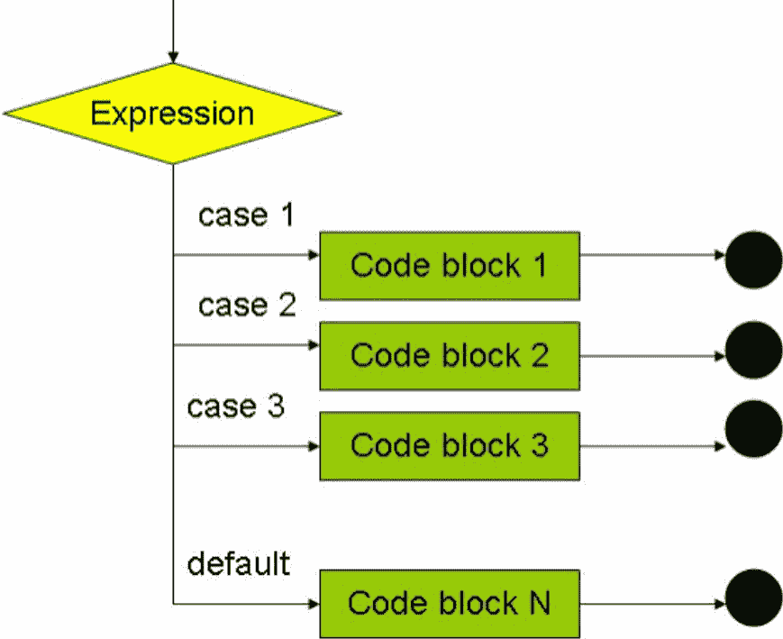

### `switch`语句示例

**示例10：**

```csharp
using System;
namespace switchcase
{
    class Program
    {
        static void Main(string[] args)
        {
            char grade = 'A+';
        }
    }
}
```

```csharp
switch(grade)
{
    case 'C':
        Console.WriteLine("Fair");
        break;
    case 'B':
        Console.WriteLine("Good");
        break;
    case 'A':
        Console.WriteLine("Excellent");
        break;
    default:
        Console.WriteLine("No matching grade");
        break;
}
Console.WriteLine("Grade is {0}",grade);
Console.ReadLine();
```

在上面的代码中，为`grade`赋值。它与不同的`switch cases`进行匹配。如果值在声明的`cases`中匹配成功，则显示相应的消息。如果没有表达式匹配成功，则执行`default case`。

## 6.6 嵌套`switch`语句

用户可以切换外部`switch`语句序列中的部分。`switch`中的公共值不会产生冲突。

语法：

```csharp
switch(c1)
{
    case 'A':
        Console.WriteLine("A is the part of outer switch");
        break;
    switch(c2)
    {
        case 'A':
            Console.WriteLine(" A is the part of inner switch");
    }
}
```

### 嵌套`switch`语句

**示例11：**

```csharp
using System;
namespace switchcase
{
    class Program
    {
        static void Main(string[] args)
        {
            char grade = 'A+';
        }
    }
}
```

```csharp
switch(grade)
{
    case 'C':
        Console.WriteLine("Fair");
        break;
    case 'B':
        Console.WriteLine("Good");
        break;
    case 'A':
        Console.WriteLine("Excellent");
        break;
    default:
        Console.WriteLine("No matching grade");
        break;
}
Console.WriteLine("Grade is {0}",grade);
Console.ReadLine();
```

在上面的代码中，为`grade`变量赋值。它与不同的`switch cases`进行匹配。如果值在声明的`cases`中匹配成功，则显示相应的消息。如果没有任何表达式匹配，则执行`default case`。

（注：根据提供的原文逻辑，此处部分文本似乎存在逻辑混乱或重复，翻译已根据其物理结构进行了对齐处理。）

在上面的代码中，为变量`x`和`y`赋值。检查`if`语句内部的值。如果相同，则执行内部语句，否则控制将移出循环。

### 6.7 `switch`语句


`switch`语句有助于高效地根据多个条件对变量进行评估。

每个条件被称为`case`，并对切换的变量进行`switch case`检查。

语法：

```cs
switch(Expression)
{
    case ConstantExpression1:
        statements;
    break;
    case ConstantExpression2:
        statements;
    break;
    ....
    case ConstantExpression_n:
        statements;
    break;
    default:
        statements;
        break;
}
```

`switch`语句中添加的规则有：

- `switch`语句中的表达式必须是整数类型或类类型。
- 用户可以在`switch`语句中添加任意数量的`case`语句。
- `ConstantExpression`的数据类型必须与`switch`中的表达式类型相似。
- 当`Expression`匹配`ConstantExpression`时，将执行该`case`内部的代码并遇到`break`关键字，这将强制执行跳出`switch`语句。
- 每一个`case`并不需要`break`关键字。
- 可选的`default case`出`switch`的末尾，当表达式不匹配任何`ConstantExpressions`时作为备用。

### 流程图


### switch 语句示例

| 示例 10: |
| :--- |
| using System; |
| namespace switchcase |
| { |
| class Program |
| { |
| static void Main(string[] args) |
| { |
| char grade = 'A+'; |
| } |
| } |
| } |

```cs
switch(grade)
{
    case 'C':
        Console.WriteLine("Fair");
        break;
    case 'B':
        Console.WriteLine("Good");
        break;
    case 'A':
        Console.WriteLine("Excellent");
        break;
    default:
        Console.WriteLine("No matching grade");
        break;
}
Console.WriteLine("Grade is {0}",grade);
Console.ReadLine();
```

在上面的代码中，为`grade`赋值了值。它与不同的`switch cases`进行匹配。如果值在声明的`cases`中匹配成功，则显示相应的消息。如果没有任何表达式匹配成功，则执行`default case`。

### 6.5 嵌套 switch 语句

用户可以切换外部`switch`语句序列中的部分。`switch`中的公共值不会产生冲突。

语法：

```cs
switch(c1)
{
    case 'A':
        Console.WriteLine("A is the part of outer switch");
        break;
    switch(c2)
    {
        case 'A':
            Console.WriteLine(" A is the part of inner switch");
    }
}
```

嵌套 switch 语句

| 示例 11: |
| :--- |
| using System; |
| namespace switchcase |
| { |
| class Program |
| { |
| static void Main(string[] args) |
| { |
| char grade = 'A+'; |
| } |
| } |
| } |

（注：此处由于原文文本中出现了严重的重复和错乱，翻译严格遵循了提供的原文结构进行处理）

在上面的代码中，为变量`x`和`y`赋值了值。检查`if`语句内部的值。如果相同，则执行内部语句，否则控制将移出循环。

## 7 C# 中的循环

循环结构用于重复执行一行或多行。各种控制结构用于复杂的执行。

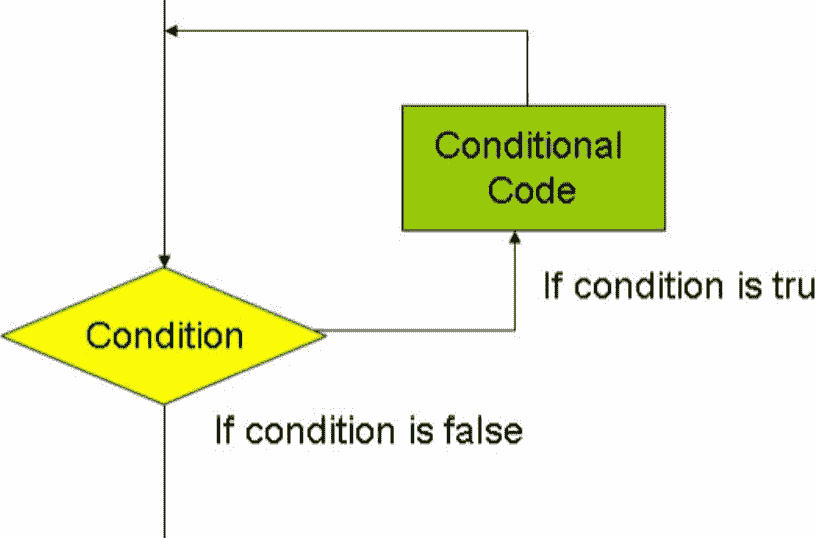

## 7.1 while 循环

`while`循环包含一个条件表达式，该表达式在执行循环语句之前必须匹配。如果匹配表达式，它将运行内部代码并返回条件表达式。如果为假，循环将完全跳过。

让我们访问`while`循环的语法。

语法：

```cs
while (expression)
{
    statements;
}
```

流程图

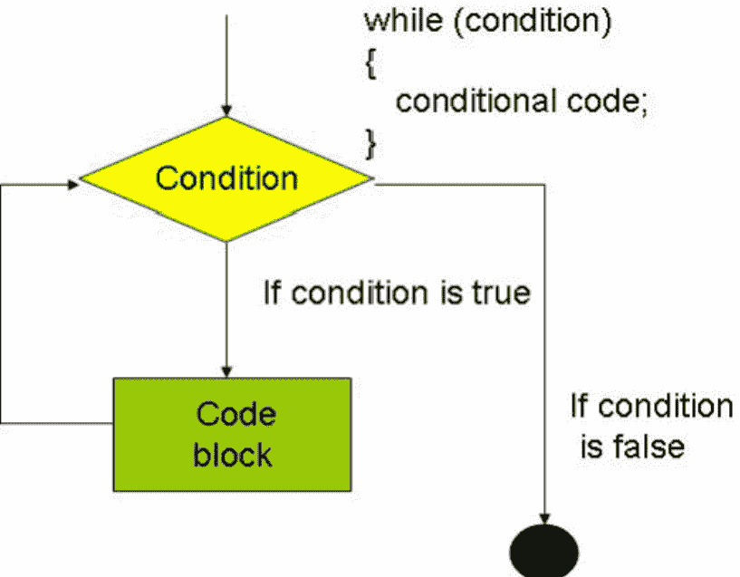

### while 循环示例

```cs
Example 13:
using System;
namespace while loop
{
    class Program
    {
        static void Main(string[] args)
        {
            int var;
            var=50;
            while(var<150)
            {
                Console.WriteLine("Value of variable is:{0}",var);
                var+=10;
            }
        }
    }
}
```

在前面的代码中，变量`var`被初始化为50。`while`循环检查条件。如果条件小于150，则执行循环内部的语句。如果为假，控制不会进入`while`循环。

## 7.2 for 循环

`for`循环用于按特定次数执行语句块。

语法：

```cs
for (initialization; condition; increment/decrement)
{
    statement(s);
}
```

其中，

*   **initialization** 用于声明和初始化循环控制变量。它在循环开始时执行。
*   **condition** 检查表达式。如果值为真，则执行循环体。如果为假，控制将跳出循环。
*   **increment/decrement** 用于增加或减少变量值。

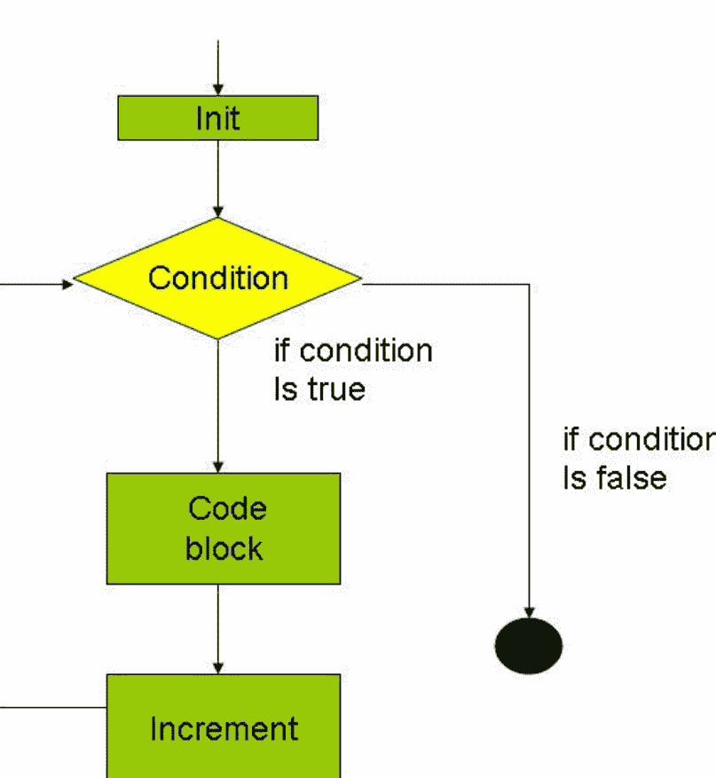

for循环示例

### 示例 14:

```csharp
using System;
namespace forloop
{
    class Program
    {
        static void Main(string[] args)
        {
            int i;
            for(int i=1;i<=10;i++)
            {
                Console.WriteLine("Value of variable is:{0}",i);
            }
        }
    }
}
```

在上面的代码中，声明了变量`i`的值。`for`循环包含赋值、条件和递增。如果条件为真，则值会增加。执行`for`循环内部的语句。一旦条件为假，控制权就会离开循环。

# 7.3 Do-while-do while循环

`do...while`循环结构与`while`循环相似。两个循环都会持续执行直到条件为假。区别在于`do...while`循环中的语句至少执行一次，因为块中的语句是在检查条件之前执行的。

语法：

```csharp
do
{
  Statements;
} while(expression);
```

流程图

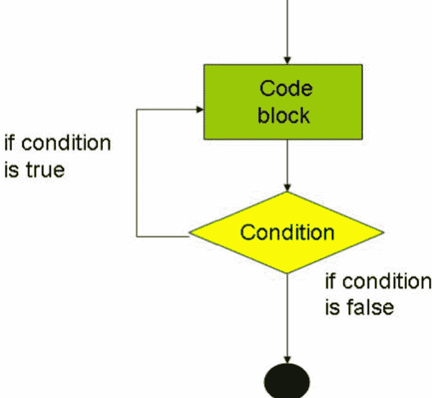

do while 循环示例

示例 15:

```csharp
using System;
namespace dowhile
{
    class Program
    {
        static void Main(string[] args)
        {
            int x=1;
            do
            {
                Console.WriteLine("Value of x is:{0}",x);
                x=x+1;
            }while(x<10);
            Console.ReadLine();
        }
    }
}
```

在上面的代码中，变量`x`被赋值为值1。`do`循环打印块内部的语句。一旦`while`循环中的条件为假，`do while`循环中的语句将不再被执行。

## 7.4 Break 语句

**break**语句用于退出循环。当遇到此语句时，循环将终止，控制权恢复到循环后的下一个语句。

语法：

```csharp
break;
```

流程图

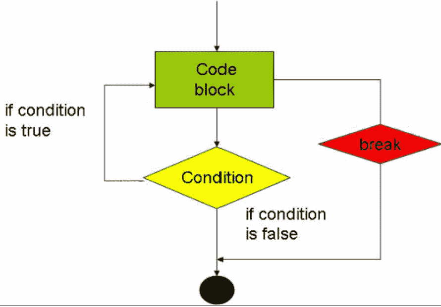

break 语句示例

> 示例 16:

```csharp
using System;
namespace break;
{
    class Program
    {
        static void Main(string[] args)
        {
            int i=11;
            while(i<15)
            {
                Console.WriteLine("value of i:{0}",i);
                i++;
                if(i>13)
                {
                    break;
                }
            }
            Console.ReadLine();
        }
    }
}
```

在代码示例中，变量`i`的值被赋值为11。`while`循环检查`i`的条件。如果条件为真，则执行`while`循环中的语句。`i`的值增加。

循环检查`i`的值。一旦`i`的值大于13，就会执行`break`语句，控制权离开循环。

## 7.5 Continue 语句

`continue`语句与`break`语句相似，但它不是跳出循环，而是**continue**强制进入循环的下次迭代，跳过中间的任何代码。

语法：

```csharp
continue;
```

流程图

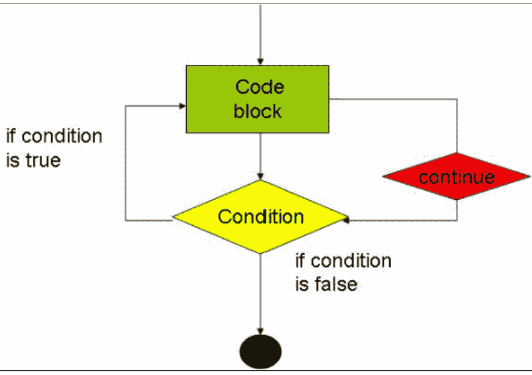

Continue 语句示例

### 示例 17:

```csharp
using System;
namespace continue
{
    class Program
    {
        int i=45;
        do
        {
          if(i<=50) {
            i=i+1;
            continue;
          }
          Console.WriteLine("Value of i:{0}",i);
          i++;
        } while(i<60) {
          Console.ReadLine();
        }
    }
}
```

在上面的代码示例中，我们可以看到`do-while`循环和`continue`的结合使用。我们可以看到当`i`进入`do`内部的语句时，初始值被设置为45。此时，检查`i`是否匹配50，它不匹配，因此在消息中输出`i`的值并将`i`增加1。

这个过程一直持续到`i`等于50，此时`i`将增加1并遇到`continue`关键字，这会跳过`do`部分的剩余代码，并直接移动到`while`条件表达式。

一旦`i`达到61，`while`条件语句将不再匹配，执行流流将离开循环。

# 第 8 章 C# 中的类与方法

## 8.1 类声明

在 C# 中，类是该语言的主要构建模块。它提供了一组预定义的变量和方法。对象被定义为类的实例，因此类内部的方法决定了在对象上可以执行的操作。

### 类定义

类定义以关键字`class`开头，后面跟着类名。

语法：

```csharp
class ClassName
{
    // 字段和方法
}
```

### 示例 18:

```csharp
using System;
namespace demo
{
    class Calculate
    {
        public int len;
        public int bread;
    }
    class Program
    {
        static void Main(string[] args)
        {
            Calculate c1 = new Calculate();
            Calculate c2 = new Calculate();

            c1.len = 10;
            c1.bread = 5;
            Console.WriteLine("area of rectangle 1 is:{0}",c1.len);

            c2.len = 15;
            c2.bread = 10;
            Console.WriteLine("area of rectangle 2 is:{0}",c2.bread);
            Console.ReadLine();
        }
    }
}
```

编译后，该类的结果为：

rectangle 1 is:5

rectangle 2 is:0

### C# 构造函数

构造函数是在创建实例时自动调用的特殊类型方法。类的成员在构造函数内部初始化。构造函数的名称必须与类名相同。

### 构造函数示例

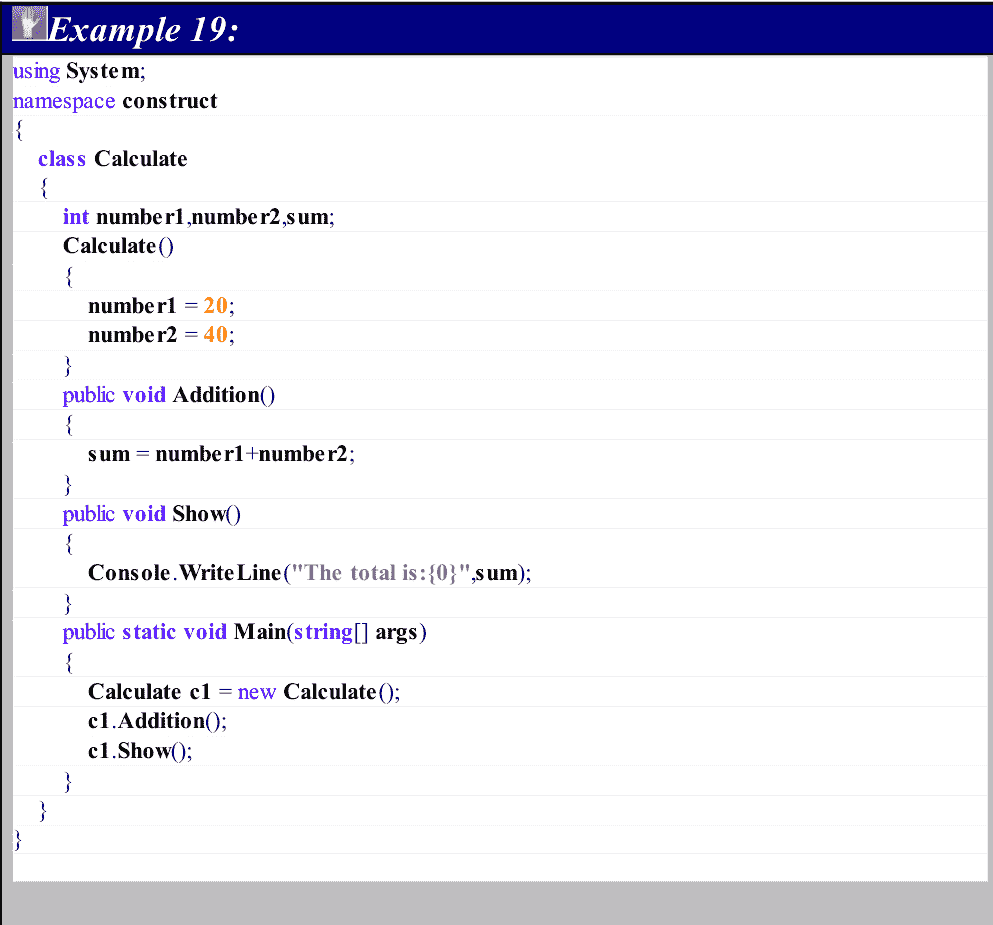

编译后，该类的结果为：

The total is:60

在上面的示例中，构造函数手动为`number1`和`number2`分配了固定值。但如果你想让`number1`和`number2`的值不同且动态，该如何实现呢？

这就是参数化构造函数的用武。基本上，这个术语的意思是我们直接在构造函数中传递值，这允许我们在实例化类时传递值。让我们来看例子：

### 参数化构造函数示例

```csharp
using System;
namespace construct
{
    class Calculate
    {
        int number1, number2, sum;

        // 在构造函数内部添加参数
        Calculate(int num1,int num2)
        {
            // 将参数赋值给类变量
            number1 = num1;
            number2 = num2;
        }

        public void Addition()
        {
            sum=number1+number2;
        }

        public void Show()
        {
            Console.WriteLine("The total is:{0}",sum);
        }

        public static void Main(string[] args)
        {
            int a,b;

            Console.WriteLine("Enter value of a");
            a = Convert.ToInt32(Console.ReadLine());

            Console.WriteLine("Enter value of b");
            b = Convert.ToInt32(Console.ReadLine());

            // 将 a 和 b 传递给类构造函数
            Calculate c1 = new Calculate(a,b);
            c1.Addition();
            c1.Show();
        }
    }
}
```

```c
c1.Addition();
c1.Show();

Console.ReadLine();
```

编译后该类的执行结果为：

输入 a 的值

10

输入 b 的值

20

总和为: 30

### C# 析构函数

析构函数是类中的一种特殊函数，通常被极少使用，用于在退出类之前释放未托管资源。析构函数在用法上具有以下几点限制：

- 它不能被继承。
- 它不能被重载。
- 在任何给定的类中只能有一个析构函数。
- 程序员不能直接调用析构函数；相反，它由垃圾回收器调用。


析构函数的名称与它的类名相同，并以`~`符号开头，该符号表示波浪号。

### 析构函数示例

```csharp
Example 21:
using System;
namespace destruct
{
    class Calculate
    {
        int number1, number2, sum;

        Calculate()
        {
            number1 = 15;
            number2 = 4;
        }

        public void Addition()
        {
            sum = number1 + number2;
        }

        public void Show()
        {
            Console.WriteLine("The total is:{0}", sum);
        }

        // 析构函数在这里定义，当类
        // 离开作用域时会被调用。
        ~Calculate()
        {
            Console.WriteLine("Destructor invoked");
        }
    }
}
```

```csharp
public static void Main(string[] args)
{
    Calculate c1 = new Calculate();
    c1.Addition();
    c1.Show();
}
```

编译后类的结果为：

总和为: 19

## 8.2 定义方法

方法是一组或多个程序语句，可以通过调用方法名来执行。要使用方法，用户首先需要定义一个方法，然后调用该方法。

定义方法意味着声明其结构的元素。使用以下语法定义方法。

```text
<访问修饰符> <返回值> <方法名> ( 参数列表)
{
  方法体
}
```

方法的不同元素包括：

- 访问修饰符：它检查变量或方法可以被访问的范围。
- 返回值：它定义了方法返回值的类型。如果类型设置为`void`，则意味着该方法不返回任何内容。
- 方法名：它是一个唯一的标识符且区分大小写。方法名不能与变量名相同。
- 参数列表：传递给方法并接收的值。它们写在方法名后的括号中。
- 方法体：执行实际方法功能的指令集。

示例：

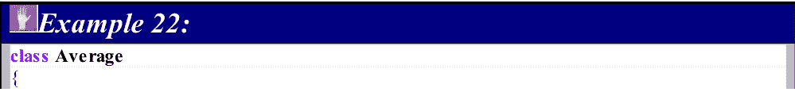

```csharp
public int Number(int no1, int no2)
{
    int output;
    output = no1 + no2 / 2;
    return output;
}
```

## 8.3 调用方法

一旦定义了方法，用户就可以使用方法名调用该方法。方法名后跟着括号。

示例：

```csharp
Example 23:
using System;
class Average
{
    public int Number(int no1, int no2)
    {
        int output;
        output = no1 + no2;
        return output;
    }

    static void Main(string[] args)
    {
        Average a = new Average();
        // 从对象类 a 调用方法 Number
        int value = a.Number(20, 30);
        Console.WriteLine("The result is {0}", value);
    }
}
```

代码编译后的结果为：

结果为 25

## 8.5 递归方法调用

方法可以调用自己，这被称为递归。

```csharp
Example 24:

using System;

namespace recursive
{
    class recursivecall
    {
        public int factorial(int no)
        {
            int result;

            if (no == 1)
            {
                return 1;
            }
            else
            {
                result = factorial(no - 1) * no;
                return result;
            }
        }

        static void Main(string[] args)
        {
            recursivecall r = new recursivecall();

            Console.WriteLine("Factorial of no is {0}", r.factorial(2));
            Console.WriteLine("Factorial of no is {0}", r.factorial(3));

            Console.Read();
        }
    }
}
```

代码编译后的结果将是：

no 的阶乘为 2  
no 的阶乘为 6

## 8.4 向方法传递参数

当用户调用方法时，如果方法有参数，则在调用方法时必须传递这些参数。传递给方法的参数有三种。

### 值参数

使用值参数时，方法会创建该传入参数的副本作为变量，在方法内部使用。如果此变量的值被更改，它将只在方法的作用域内改变。

示例：

```csharp
Example 25:

class Program
{
    void Increeno(int no)
    {
    }

    static void Main()
    {
        int number = 2;
        Console.WriteLine(number);
    }
}
```

编译结果为：

### 引用参数

使用引用参数时，方法在方法内部使用该变量。如果此变量的值被更改，方法外部也会改变。

示例：

```csharp
Example 26:

class Program
{
    void Increase(ref int no)
    {
    }

    static void Main()
    {
        int number = 2;
        Increase(ref number);
        Console.WriteLine(number);
    }
}
```

编译结果为：

### 输出参数

使用输出参数时，方法在方法内部创建该变量的副本，在方法内部使用。如果此变量的值被更改，方法外部也会被更改。

示例：

```csharp
Example 27:

class Program
{
    void Demo(out int number)
    {
    }

    static void Main()
    {
        int number;
        Demo(out number);
        Console.WriteLine(number);
    }
}
```

编译结果为：

# 第9章：C# 中的数组

## 9.1 数组简介

数组是相同类型值的集合。数组元素通过单个名称和一个表示数组内位置的索引来访问。数组具有与每个元素相关的秩。下图显示了数组结构。


## 9.2 数组声明

数组在程序中使用之前需要声明。使用以下语法声明数组。

```csharp
datatype[] ArrayName;
```

数组语法涉及以下组件：

- `datatype`：用于指定元素的数据类型。它将存储在数组中。
- `[]`：指定数组的大小，称为秩。
- `ArrayName`：数组名称。

## 9.3 初始化和添加值

使用`new`关键字创建数组的实例。在初始化时指定数组的大小。以下代码段用于初始化数组。

```csharp
int[] x;

x = new int[15];
```

可以通过合并这两个语句来初始化数组，写法为：`int[] x = new int[15];`。

### 给数组赋值

可以使用**索引号**为数组的每个元素赋值。它也被称为元素的下标。

```csharp
int[] amount = new int[5];

int[0] = 50;
```

可以使用以下代码创建并初始化数组：

```csharp
int[] amount = { 40, 60, 70, 80 };
```

## 9.4 访问数组元素

要访问数组中的元素，你需要使用索引。索引是表示数组中元素位置的数字。索引始终从零开始，因此要访问数组中的第一个元素，我们采用如下格式：

```text
array_name[index]
```

在这种情况下，`index`的值为`0`。

示例：

> 示例 28：

```csharp
using System;

namespace arraydeclare
{
    class ArrayDemo
    {
        static void Main(string[] args)
        {
            int[] a = new int[5];
            int x, y;

            for (int x = 0; x < 5; x++)
            {
                a[x] = x + 10;
            }

            for (y = 0; y < 5; y++)
            {
                Console.WriteLine("Element [{}]={1}", y, a[y]);
            }

            Console.ReadLine();
        }
    }
}
```

当代码被编译并执行时，输出为：

```text
Element [0] = 10
Element [1] = 11
Element [2] = 12
Element [3] = 13
Element [4] = 14
```

## 9.5 `foreach`循环

此循环专门设计用于遍历数组的所有元素。它非常适合高效地检索数组元素。

语法：

```text
foreach(type identifier in expression)
    statement – block
```

示例：

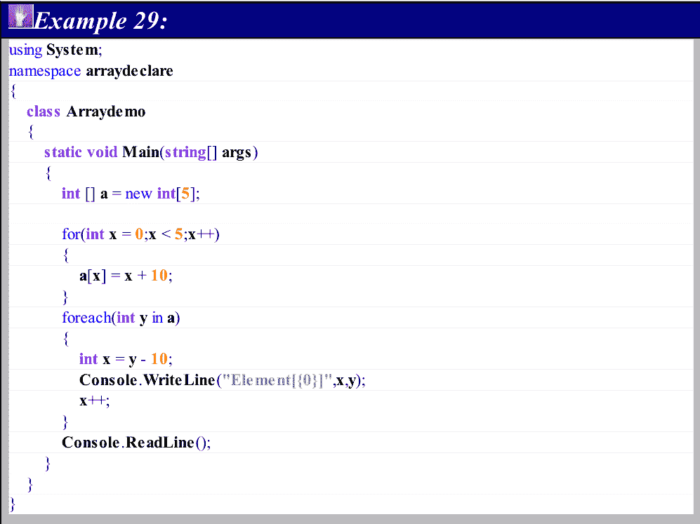

代码被编译并执行后，输出为：

```text
Element[0] = 10
Element[1] = 11
Element [2] = 12
Element [3] = 13
Element [4] = 14
```

## 9.6 不同的 C# 数组

以下是用于代码开发的各种 C# 数组类型。

### 多维数组

多维数组在多个行维度上存储数据。它也被称为矩形数组。用户可以这样声明一个整型二维数组：

```csharp
int[,] no;
```

二维数组可以被视为表格。它有 x 行 y 列。二维数组包含 2 行 4 列。

|  | Column 0 | Column 1 | Column 2 | Column 3 |
|---|---|---|---|---|
| Row 0 | `x[0][0]` | `x[0][1]` | `x[0][2]` | `x[0][3]` |
| Row 1 | `x[1][0]` | `x[1][1]` | `x[1][2]` | `x[1][3]` |

### 初始化二维数组

以下数组有 3 行 3 列。

```csharp
int[,] x = int[3, 3] =
{
    { 1, 2, 3 },
    { 4, 5, 6 },
    { 7, 8, 9 }
};
```

### 访问多维数组的元素

可以使用下标访问多维数组中的元素。下标是数组的行索引列索引。

### 示例

```csharp
int output = a[1, 2];
```

在上述语句中，访问了第二行第三列的元素。

### 示例

> 示例 30：

```csharp
using System;

namespace twimensional
{
    class multiarray
    {
        static void Main(string[] args)
        {
            int[,] x = new int[3, 2] { { 1, 1 }, { 2, 2 }, { 3, 3 } };
            int a, b;

            for (a = 0; a < 3; a++)
            {
                for (b = 0; b < 2; b++)
                {
                    Console.Write("x[{0}],{1}={2}", a, b, x[a, b]);
                }

                Console.ReadLine();
            }
        }
    }
}
```

代码被编译并执行后，输出为：

```text
x[0,0] = 1
x[0,1] = 1
x[1,0] = 2
x[1,1] = 2
x[2,0] = 3
x[2,1] = 3
```

### 交错数组（Jagged Array）

交错数组是数组的数组。整型交错数组声明如下：

```csharp
int[][] marks;
```

数组可以初始化为：

```csharp
int[][] marks = new int[][]
{
    new int[] { 45, 57, 78 },
    new int[] { 60, 75, 86, 45, 35 }
};
```

`marks`数组包含两个整型数组，`marks[0]`包含 3 个整数，`marks[1]`包含 5 个整数。

### 示例

> 示例 31：

```csharp
using System;

namespace Jaggedarray
{
    class jagged
    {
        static void Main(string[] args)
        {
            int[][] x = new int[][]
            {
                new int[] { 0, 0 },
                new int[] { 2, 2 },
                new int[] { 3, 4 },
                new int[] { 4, 2 },
                new int[] { 1, 3 }
            };

            int a, b;

            for (a = 0; a < 5; a++)
            {
                for (b = 0; b < 2; b++)
                {
                    Console.WriteLine("x[{0}][{1}]={2}", a, b, x[a][b]);
                }
            }

            Console.ReadLine();
        }
    }
}
```

代码被编译并执行后，输出为：

```text
x[0,0] = 0
x[0,1] = 0
x[1,0] = 2
x[1,1] = 2
x[2,0] = 3
x[2,1] = 4
x[3,0] = 4
x[3,1] = 2
x[4,0] = 1
x[4,1] = 3
```

### 参数数组（Param Arrays）

在声明方法时，作为参数传递的参数数量是不确定的。可以使用`Param`数组。

### 示例

> 示例 32：

```csharp
using System;

namespace ParamArray
{
    class ParamArray
    {
        public void AddValues(params int[] data)
        {
            int total = 0;

            foreach (int a in data)
            {
                total += a;
            }

            Console.WriteLine("The sum is {0}", total);
        }

        static void Main(string[] args)
        {
            ParamArray pa = new ParamArray();
            pa.AddValues(1, 2, 3, 4, 5, 6);
        }
    }
}
```

# 第10章 C# 中的字符串

## 10.1 字符串的创建

C#中的字符串是字符数组。使用`string`关键字来声明变量。该关键字是`System.String`类的别名。

### 字符串对象的创建

有多种用于创建字符串的方法：

- 获取属性或调用返回字符串的方法
- 使用字符串类的构造函数
- 使用字符串拼接运算符（`+`）
- 调用格式化方法将值或对象转换为字符串表示
- 将字符串字面量赋值给字符串变量

示例：

> 示例 34：

```csharp
using System;

namespace StringType
{
    class Program
    {
        static void Main(string[] args)
        {
            // 字符串字面量和拼接
            string name = "Location";
            name = "Harry";
```


```csharp
string value = name + location;

Console.WriteLine("The value is:{0}", value);

// 字符串构造函数

char[] vowels = { 'a', 'e', 'i', 'o', 'u' };

string item = new string(vowels);

Console.WriteLine("The item contains values:{0}", item);

// 值转换的格式化方法

DateTime dt = new DateTime(2014, 12, 10, 15, 34, 1);

string msg = string.Format("Message sent at {0} on {0:D}", dt);
```

```csharp
string[] array = { "Welcome", "User" };

string result = String.Join("", array);

Console.WriteLine("Message is:{0}", result);
```

## 10.2 字符串类的属性和方法

### 字符串类的属性

- `Chars`：获取 `String` 对象中特定位置的 `Char` 对象。
- `Length`：获取 `String` 对象中字符的数量。

### 字符串类的方法

- `public bool Equals(string value)`  
  检查当前 `String` 对象与指定的对象是否具有相同的值。

- `public string Insert(int startIndex, string value)`  
  返回一个新字符串，其中指定的字符串插入到特定的索引位置。

- `public string Replace(char oldchar, string newValue)`  
  将字符串对象中所有特定字符出现的位置替换为 Unicode 字符，并返回新字符串。

- `public int LastIndexOf(string value)`  
  返回字符串对象中最后一次出现 Unicode 字符的索引位置（从 0 开始）。

- `public string Trim()`  
  返回对象中所有开头和结尾的空白字符。

- `public static int Compare(string str1, string str2, bool IgnoreCase)`  
  比较两个字符串并返回一个表示排序顺序相对位置的整数值。

- `public static String Concat(string str1, string str2)`  
  连接两个字符串对象。

- `public string[] Split(char[] separator, int count)`  
  返回一个包含当前字符串对象中子字符串的数组。该数组由特定的 Unicode 字符数组元素分隔。`int` 参数返回子字符串的数量。

- `public bool Contains(string value)`  
  返回表示指定的字符串对象是否出现在字符串中的值值。

- `public static string Copy(string str)`  
  创建一个与指定字符串具有相同值的新 `String` 对象。

- `public string ToUpper()`  
  返回一个转换为大写的字符串副本。

- `public int IndexOf(string value)`  
  返回指定字符串在实例中首次出现的索引（从 0 开始）。

- `public string Remove(int startIndex)`  
  它会删除当前实例中从指定位置开始并移动到最后一个位置的字符。它返回一个字符串。

- `public char[] ToCharArray()`  
  返回一个包含当前对象中所有字符的 Unicode 字符数组。

- `public string ToLower()`  
  返回一个转换为小写的字符串副本。

## 10.3 演示字符串功能的示例

### 字符串比较

```csharp
Example 35:

using System;

namespace string1
{
    class Program
    {
        static void Main(string[] args)
        {
            string string1 = "A string named as string1";
            string string2 = "A string named as string2";

            if (String.Compare(string1, string2) == 0)
            {
                Console.WriteLine(string1 + "and" + string2 + "equal");
            }
            else
            {
                Console.WriteLine(string1 + "and" + string2 + "not equal");
            }

            Console.Read();
        }
    }
}
```

当代码被编译并执行时，输出为：

```text
A string named as string1 and A string named as string2 are not equal
```

### 拼接字符串

```csharp
Example 36:

using System;

namespace string1
{
    class Program
    {
        static void Main(string[] args)
        {
            string[] str1 = new string[]
            {
                "Set your aims high",
                "Rome was not built in a day",
                "Save Time"
            };

            string str = String.Join("\n", str1);

            Console.WriteLine(str);
            Console.Read();
        }
    }
}
```

当代码被编译并执行时，输出为：

```text
Set your aims high
Rome was not built in a day
Save Time
```

### 包含值的字符串

```csharp
using System;

namespace string1
{
    class Program
    {
        static void Main(string[] args)
        {
            string str = "A new user";

            if (str.Contains("user"))
            {
                Console.WriteLine("The value 'user' is present");
            }

            Console.Read();
        }
    }
}
```

当代码被编译并执行时，输出为：

```text
The value 'user' is present
```

# 第 11 章 封装与多态

## 11.1 封装简介

**封装**是将数据和函数封装在物理或逻辑包中的过程。它帮助开发者防止对应用程序核心细节的访问。它将代码和数据结合在一起。

**抽象**是指所有信息都是存在的，但只向用户提供**相关信息**。

抽象和封装是相关的特性。封装通过提供隐藏非要细节的方法来辅助抽象。使用封装，某些信息是可见，而另一些信息是隐藏的。

## 11.2 C# 中的访问修饰符

访问修饰符定义了类成员的范围。该成员用于引用类的函数和变量。一个程序由一个或多个类组成。类的某些成员需要被其他类访问。

### 访问修饰符类型

C# 支持以下访问修饰符：

- `public`
- `private`
- `protected`
- `internal`

### `public`

`public` 修饰符允许类暴露其变量和函数。声明为 `public` 的成员可以从类外部访问。

```csharp
Example 38:

using System;

namespace string1
{
    class User
    {
        public string name;
        public int age;

        public void AddValue()
        {
            Console.WriteLine("Enter the user name:");
            name = Console.ReadLine();
        }

        public void Show()
        {
            Console.WriteLine("User name is:{0}", name);
        }
    }

    class Program
    {
        static void Main(string[] args)
        {
            User u = new User();

            u.AddValue();
            u.Show();

            Console.Read();
        }
    }
}
```

### `private`

`private` 修饰符允许类向其他类隐藏其变量和函数。只有类本身可以访问私成员。

```csharp
Example 39:

using System;

namespace string1
{
    class Student
    {
        private string name;
        private int age;

        public void AddValue()
        {
            Console.WriteLine("Enter the student name:");
            name = Console.ReadLine();
        }

        public void Show()
        {
            Console.WriteLine("Student name is:{0}", name);
        }
    }

    class Program
    {
        static void Main(string[] args)
        {
            Student s = new Student();

            s.AddValue();
            s.Show();

            Console.Read();
        }
    }
}
```

### `protected`

`protected` 访问修饰符允许类向其他类对象和函数隐藏成员变量和函数，子类除外。该饰符在实现继承时有用。

```csharp
Example 40:

using System;

namespace string1
{
    class Employee
    {
        protected string name;

        public void AddValue()
        {
            Console.WriteLine("Enter the employee name:");
            name = Console.ReadLine();
        }

        public void Show()
        {
            Console.WriteLine("Employee name is:{0}", name);
        }
    }

    class Program
    {
        static void Main(string[] args)
        {
            Employee e = new Employee();

            e.AddValue();
            e.Show();

            Console.Read();
        }
    }
}
```

### `internal`

`internal` 访问修饰符允许类向包含的子类或同一应用程序中的类暴露其成员函数和变量。

### Example 41

```csharp
using System;

namespace internal
{
    class Location
    {
        // member variables
        internal string city;

        public void AddValue()
        {
            Console.WriteLine("Enter the city name:");
            city = Console.ReadLine();
        }

        public void Show()
        {
            Console.WriteLine("City name is:{0}", city);
        }
    }

    class Program
    {
        static void Main(string[] args)
        {
            Location l = new Location();

            l.AddValue();
            l.Show();

            Console.Read();
        }
    }
}
```

当代码编译并执行时，输出为：

```text
Enter the city name:
London
City name is: London
```

### `Protected Internal` 访问修符

`protected internal` 访问修符允许类向包含类、子类或同一应用程序中的类暴露成员函数和变量。允许访问应用程序之外的派生类。

### Example 42

```csharp
using System;

namespace protectinternal
{
    class number
    {
        // member variables
        protected int no;

        public void AddValue()
        {
            Console.WriteLine("Enter the number:");
            no = Convert.ToInt32(Console.ReadLine());
        }

        public void Show()
        {
            Console.WriteLine("Number is: {0}", no);
        }
    }

    class Program
    {
        static void Main(string[] args)
        {
            number n = new number();

            n.AddValue();
            n.Show();

            Console.Read();
        }
    }
}
```

当代码编译并执行时，输出为：

```text
Enter the number:
10
Number is: 10
```

## 11.3 多态

多态是函数以不同形式存在的的能力。“poly”的意思是“多”，“morphos”的意思是“形式”。

多态有两种类型：

- 静态：对函数的响应在编译时决定。
- 动态：对函数的响应在运行时决定。

## 11.4 静态多态

静态多态指的是以不同形式存在的实体。C# 有两种实现多态的方法：

- 函数重载
- 运算符重载

### 函数重载

函数重载帮助用户为两个或多个函数使用相似的名称。函数定义必须在参数列表的类型或数量上相互不同。

示例：

### Example 43

```csharp
using system;

namespace calculate
{
    class calculate
    {
        public int Min(int no1, int no2)
        {
            if (no1 < no2)
            {
                return no1;
            }
            else
            {
                return no2;
            }
        }

        public float Min(float no1, float no2)
        {
            if (no1 < no2)
            {
                return no1;
            }
```


```csharp
else
{
    return no2;
}
}
}

class Program
{
    static void Main(string[] args)
    {
        calculate p = new calculate();

        Console.WriteLine("Minimum value is:{0}", p.Min(3, 4));
        Console.WriteLine("Minimum value is:{0}", p.Min(3.2F, 1.2F));

        Console.ReadLine();
    }
}
}
```

当代码编译并执行时，输出为：

```text
Minimum value is: 3
Minimum value is: 1.2
```

## 11.5 动态多态

C# 有两种实现动态多态的方法。它们是：

- **抽象类**：它们是一种特殊的基类类型，包含抽象类成员。派生自抽象类的类成员必须实现抽象函数和属性。
- **虚函数**：它们并不真实存在。它们似乎存在于某些部分。

### 抽象类

抽象类提供了类的部分实现。当派生类继承它时，实现就完成了。有抽象方法，是通过派生类来实现的。

### 创建抽象类的规则

- 用户不能在抽象类之外声明抽象方法。
- 不能创建抽象类的实例。
- 派生自抽象类的类必须重写该类的所有方法。
- 抽象类不能声明为`sealed`（密封）。

### 示例

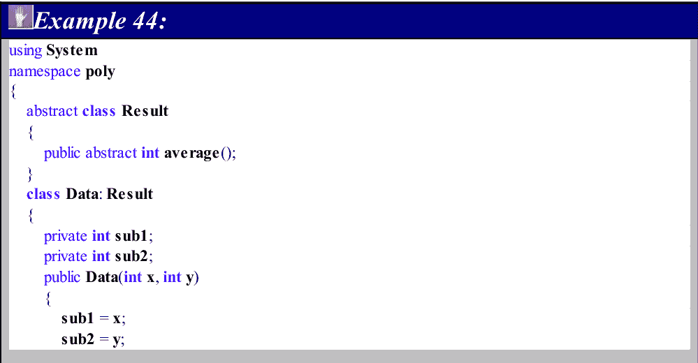

```csharp
abstract class Data
{
    int x, y;

    public Data(int x, int y)
    {
        this.x = x;
        this.y = y;
    }

    public abstract int average();
}

class DerivedData : Data
{
    public override int average()
    {
        Console.WriteLine("The average is:");
        return (x + y / 2);
    }
}

class Program
{
    static void Main(string[] args)
    {
        DerivedData d = new DerivedData(30, 70);
        int a = d.average();

        Console.WriteLine("Average:{0}", a);
        Console.Read();
    }
}
```

当代码编译并执行时，输出为：

```text
The average is:
Average: 50
```

### 虚函数

如果你需要一个在类中定义并由派生类实现的函数，则使用虚函数。派生类修改派生类的功能。在函数之前使用`virtual`关键字。

示例：


```csharp
class Base
{
    public virtual void show()
    {
        Console.WriteLine("Base method");
    }
}

class Derived : Base
{
    public override void show()
    {
        Console.WriteLine("Derived method");
    }
}

class Program
{
    static void Main(string[] args)
    {
        Base b = new Base();

        b.show();

        b = new Derived();
        b.show();

        Console.Read();
    }
}
```

### 示例 46

```csharp
using System;

{
    class Demo
    {
        public void side(int s)
        {
            side = s;
        }

        protected int side;
    }

    //派生类
    class Area : Demo
    {
        public int getAreaOfSquare()
        {
            return side * side;
        }
    }

    class Program
    {
        static void Main(string[] args)
        {
            Area a = new Area();

            a.side(4);

            //显示正方形面积
            Console.WriteLine("Area is {0}", a.getAreaOfSquare());

            Console.Read();
        }
    }
}
```

当代码编译并执行时，输出为：

```text
Area is: 16
```

## 12.3 基类初始化

创建继承结构时，用户必须先从基类（父类）开始。以下是一个关于如何设置基类以及派生类如何继承基类的示例。

示例：

### 示例 47

```csharp
using System;

namespace Base1
{
    class Square
    {
        //成员变量
        protected int side;

        public Square(int s)
        {
            side = s;
        }

        public int CalculateArea()
        {
            return side * side;
        }

        public void Show()
        {
            Console.WriteLine("The value of side is:{0}", side);
            Console.WriteLine("Area is:{0}", CalculateArea());
        }
    }

    class Paint : Square
    {
        private int amount;

        public Paint(int side) : base(side)
        {
        }

        public int Totalamount()
        {
            int amount;

            amount = CalculateArea() * 50;

            return amount;
        }

        public void Show()
        {
            base.Show();
            Console.WriteLine("Total amount is:{0}", Totalamount());
        }
    }

    class Program
    {
        static void Main(string[] args)
        {
            Paint p = new Paint(7);

            p.Show();

            Console.Read();
        }
    }
}
```

当代码编译并执行时，输出结果为：

```text
The value of side is is: 3
Area is: 9
Total amount is: 450
```

## 12.4 C# 中的接口

接口是一种抽象基类，它声明了方法但不在方法内部声明任何逻辑。本质上说，接口可以被描述为合约，所有继承接口的类都必须遵循这些合约。接口规定了每个派生类必须具备的方法和属性。如果派生类中不存在这些方法，则会发生错误。

### 声明接口

`interface`关键字用于声明接口。它们的默认数据类型为`public`。

### 接口声明示例

```csharp
public interface IInterface
{
    void MethodToImplement();
}
```

### 示例 48

```csharp
using System;

namespace interface I
{
    public interface IStudentInfo
    {
        //接口成员
        void ShowData();
    }

    public class StudentInfo : IStudentInfo
    {
        private int srno;
        private string name;
        private string subject;

        public StudentInfo()
        {
            srno = "111";
            name = "";
            subject = "";
        }

        public StudentInfo(int s, string n, string b)
        {
            srno = s;
            name = n;
            subject = b;
        }

        public void ShowData()
        {
            Console.WriteLine("Student no:{0}", srno);
            Console.WriteLine("Student name is:{0}", name);
            Console.WriteLine("Subject is:{0}", subject);
        }
    }

    class Program
    {
        static void Main(string[] args)
        {
            StudentInfo s = new StudentInfo(10, "Alex", "Maths");
            StudentInfo s1 = new StudentInfo(20, "Adam", "Science");

            s.ShowData();
            s1.ShowData();

            Console.Read();
        }
    }
}
```

当代码编译并执行时，输出为：

```text
Student no: 10
Student name is: Alex
Subject is: Maths
Student no: 20
Student name: Adam
Subject is: Science
```

## 12.5 C# 中的多继承

多继承是派生类继承自两个无关类的实践。这种做法在 C# 中并不被原生支持，但通过使用接口，我们可以在某种程度上模拟多继承的行为。

以下是使用接口模拟多继承的示例：

### 示例 49

```csharp
using System;

namespace multiple1
{
    class Area
    {
        protected int base;
        protected int height;

        public void setbase(int b)
        {
            base = b;
        }

        public void setheight(int h)
        {
            height = h;
        }
    }

    //基类
    public interface Paint
    {
        int amount(int area);
    }

    //派生类
    class Triangle : Area, Paint
    {
        public int getValue()
        {
            return (base * height);
        }

        public int amount(int area)
        {
            return area * 50;
        }
    }

    class Program
    {
        static void Main(string[] args)
        {
            Triangle t = new Triangle();

            t.setbase(4);
            t.setheight(5);

            Console.WriteLine("Area is:{0}", t.getValue());
            Console.WriteLine("Total amount is:{0}", t.amount(t.getValue()));

            Console.Read();
        }
    }
}
```

当代码编译并执行时，输出为：

```text
Area is: 20
Total amount is: 1000
```

## 13 运算符重载

运算符重载允许为自定义类型提供运算符的特殊实现。它允许你对对象使用`+`、`-`、`*`等运算符。

### 示例 50

```csharp
using System;

namespace operator overloading
{
    class Room
    {
        private int length;
        private int breadth;

        public Room(int l, int b)
        {
            length = l;
            breadth = b;
        }

        public static operator +(Room r1, Room r2)
        {
            return new Room(r1.length + r2.length, r1.breadth + r2.breadth);
        }

        public static operator operator *(Room r1, Room r2)
        {
            return new Room(r1.length * r2.length, r1.breadth * r2.breadth);
        }

        public void Show()
        {
            Console.WriteLine("Length: {0}", length);
            Console.WriteLine("Breadth: {0}", breadth);
        }
    }

    class Program
    {
        static void Main(string[] args)
        {
            Room r1 = new Room(10, 5);
            Room r2 = new Room(20, 10);
            Room r3 = r1 + r2;
            Room r4 = r1 * r2;

            r3.Show();
            r4.Show();

            Console.Read();
        }
    }
}
```

## 13.1 异常处理简介

异常是在程序执行过程中发生的错误。当操作无法正常完成时就会发生异常，系统会抛出错误。

异常处理用于处理运行时错误，以防止应用程序崩溃。在 C# 中，异常使用`try`、`catch`、`finally`和`throw`关键字进行处理。

### 语法

```csharp
try
{
    // 可能会抛出异常的代码
}
catch (Exception e)
{
    // 处理异常的代码
}
finally
{
    // 始终会执行的代码
}
```

## 13.4 C# 中的异常类

有多个类直接或间接派自`System.Exception`类。派生自`System.Exception`类的某些类包括`System.ApplicationException`类和`System.Exception`类。

对于具有其自定义异常的自定义定义应用程序，该异常必须继承自`ApplicationException`类。

`System.Exception`类是所有异常的基类。

| 异常类 | 描述 |
|---|---|
| `System.IO.IOException` | 它用于处理 I/O 错误 |
| `System.NullReferenceException` | 在对空对象进行解引用过程中产生的错误 |
| `System.IndexOutOfRangeException` | 当方法引用越界的数组元素时产生的错误 |
| `System.DivideByZeroException` | 在被除数除以零的过程中产生的错误 |
| `System.OutOfMemoryException` | 应用程序的内存分配错误 |
| `System.InvalidCastException` | 由于类型转换引起的错误 |
| `System.StackOverflowException` | 由于堆栈溢出产生的错误 |

## 13.5 异常处理


C# 提供了以 `try` 和 `catch` 块形式的结构化解决方案。核心程序语句与错误处理语句分开。`finally` 块被用于处理错误。

示例：

```csharp
using System;
namespace DivNumbers
{
    class Divide
    {
        int output;
        Divide()
        {
            output = 0;
        }

        public void division(int no1, int no2)
        {
            try
            {
                output = no1 / no2;
            }
            catch(DivideByZeroException e)
            {
                Console.WriteLine("Exception handled:{0}",e);
            }
            finally
            {
                Console.WriteLine("Output is:{0}",output);
            }
        }
        public static void Main(string[] args)
        {
            Divide d = new Divide();
            d.division(5,0);
            Console.Read();
        }
    }
}
```

当代码被编译并执行时，输出为：

```text
Exception handled: System.DivideByZeroException: Attempted to divide by zero

Output is: 0
```

## 13.6 自定义异常

当出现用户需要使用自定义代码以特殊方式处理异常的情况时，用户可以创建自己的异常类。这些异常被称为用户定义异常。

用户自定义异常类派自 `ApplicationException` 类。

```csharp
using System;
namespace userdefined
{
    class Average
    {
        static void Main(string[] args)
        {
            Perform p = new Perform();
            try
            {
                p.CalAverage();
            }
            catch (CountZeroException e)
            {
                Console.WriteLine("CountZeroException: {0}",e.Message);
            }
            Console.Read();
        }
    }
}
public class CountZeroException:ApplicationException
{
    public CountZeroException(string message):base(message)
    {
    }
}
public class Perform
{
    int n1 = 0;
    int count = 0;
    float average;
    public void CalAverage()
    {
        if(count == 0)
        {
            throw(new CountZeroException("Count is zero in calculation"));
        }
    }
else
{
    average = no1 / count;
}
}
}
```

当代码被编译并执行时，输出为：

```text
CountZeroException: Count is zero in calculation
```

# 第 14 章 多线程

## 14.1 C# 中的线程

线程定义了一个控制流。线程是操作系统分配线程的基单元。线程的执行在程序内部是独立的。

单个进程使用一个线程执行。这种进程被称为单线程进程。一次只能执行一个任务。用户必须等待任务完成后才能执行新任务。

为了同时执行多个一个线程，会创建多个线程。创建两个或更多线程的过程被称为多线程处理。

## 14.2 线程的生命周期

线程的生命周期从创建 `System.Threading.Thread` 类对象时开始。任务一完成，生命周期结束。线程的生命周期中有多种状态。

- 未启动状态（Unstarted State）：当创建 `Thread` 类的实例时，线程进入未启动状态。
- 就绪状态（Ready State）：在程序调用 `Start()` 方法之前，线程一直处于此状态。
- 不可运行状态（Not Runnable State）：如果满足以下情况，线程不处于运行状态：
  1. 等待（Waiting）：调用 `Wait()` 方法使线程等待特定条件。
  2. 阻塞（Blocked）：线程被 I/O 操作阻塞。
  3. 睡眠（Sleeping）：调用 `Sleep()` 方法将线程置于睡眠模式。
- 死亡状态（Dead State）：一旦线程完成执行或被中止，它就会被置于死亡状态。

## 14.3 主线程

`System.Threading.Thread` 类用于处理线程。主线程在程序开始执行时就会被创建。`Thread` 类用于创建线程，它们被称为子线程。用户可以通过 `CurrentThread` 属性访问主线程。

示例：

```csharp
using System;
namespace thread
{
    static void Main(string[] args)
    {
        Thread t1 = new Thread();
        t1.Name="Thread1";
        Console.WriteLine("Thread is:{0}",t1.Name);
        Console.Read();
    }
}
```

当代码被编译并执行时，输出为：

```text
Thread is: Thread1
```

## 14.4 `Thread` 类的属性和方法

### 属性

- `IsAlive`：显示线程执行状态的值。
- `CurrentThread`：检索当前运行的线程。
- `CurrentContext`：线程执行的当前上下文。
- `ExecutionContext`：包含不同上下文的 `ExecutionContext` 对象。
- `Name`：获取或设置线程名称。
- `ThreadState`：包含线程状态的值。
- `Priority`：获取或设置线程调度优先级。

### 方法

- `public static void BeginThreadAffinity()`：关于当前操作系统线程。
- `public void Abort()`：在调用的线程上抛出 `ThreadAbortException`。
- `public void interrupt()`：中断处于 `WaitSleepJoin` 状态的线程。
- `public static AppDomain GetDomain()`：返回唯一的域标识符。
- `public static void MemoryBarrier()`：处理器执行当前线程。指令不能重排序。
- `public void Start()`：启动线程。
- `public static bool Yield()`：让调用线程让其他就绪的线程执行。

## 14.5 创建和管理线程

扩展线程类创建一个线程。扩展线程类调用 `Start` 方法启动子线程执行。

示例：

```csharp
using System;
using System.Threading;

namespace ThreadProgram
{
    class ThreadChild
    {
        public static void CallChild()
        {
            Console.WriteLine("Start child thread");
        }
        public static void Main(string[] args)
        {
            Thread child1 = new ThreadStart(CallChild);
            Console.WriteLine("Creating child thread");
            Thread child2 = new Thread(child1);
            child2.Start();
            Console.Read();
        }
    }
}
```

当代码被编译并执行时，输出为：

```text
Start child thread

Creating child thread
```

### 管理线程

当需要暂停线程一段时间以便另一个线程执行时，使用 `Thread.Sleep()` 方法。该方法接受一个参数，表示单位为毫秒的时间。

### 示例 55

```csharp
using System;
using System.Threading;

namespace Multithreaded
{
    class Program
    {
        public static void ChildThread()
        {
            Console.WriteLine("Start child thread");
            int sleeptime = 4000;
            Console.WriteLine("Thread sleeping for {0} seconds",sleeptime / 1000);
            Thread.Sleep(sleeptime);
            Console.WriteLine("Resume child thread");
        }
        public static void Main()
        {
            Thread t1 = new Thread(ChildThread);
            Console.WriteLine("child thread created");
            Thread child1 = new Thread(t1);
            child1.Start();
            Console.Read();
        }
    }
}
```

当代码编译并执行时，输出如下：

```text
Start child thread

Thread sleeping for 4 seconds

Resume child thread

child thread created
```

## 14.6 终止线程

`Thread.Abort()` 方法用于销毁线程。当线程被销毁时，会抛出 `ThreadAbortException`。该异常不会被捕获，而是发送到 `finally` 块中。

示例：

```csharp
using System;
using System.Threading;

namespace ThreadDemo
{
    class Program
    {
        public static void ChildThread()
        {
            try
            {
                Console.WriteLine("Child thread started");
                for(int j = 0; j <= 10; j ++)
                {
                    Thread.Sleep(1000);
                    Console.WriteLine("Child thread finished");
                }
            } catch(ThreadAbortException e)
            {
                Console.WriteLine("Exception caught");
            }
            finally
            {
                Console.WriteLine("Exception is not handled");
            }
        }

        public static void Main()
        {
            ThreadStart t1 = new ThreadStart(ChildThread);
            Console.WriteLine("Creating child thread");
            Thread t2 = new Thread(t1);
            t1.Start();
        }
    }
}
```

```csharp
//主线程已停止
Thread.Sleep(2000);

//子线程已终止
Console.WriteLine("Aborting child thread");
t2.Abort();
Console.Read();
```

当代码编译并执行时，输出如下：

```text
Creating child thread

Child Thread started

Aborting child thread

Exception caught

Exception is not handled
```

# C# 的参考链接

用户可以使用以下参考链接获取关于 C# 语言的详细信息。

- Visual Studio Application – 用于创建 C# 应用程序的 IDE。
- C#（Programming guide）– C# 编程语言的概述。
- C# Programming – 解释了使用 .NET 框架的 C# 特性。
- Mono – 使用该软件可以轻松创建跨平台应用程序。
- C# Complete tutorial – 包含了适用于学者学习 C# 语言的有用课程。

# 结

这带我们来到了本书的末尾。我们希望本指南是通俗易懂的，便于你理解和遵循。这本书不应该是你学习 C# 之旅的终点，而应该仅仅是一个起点。关于 C# 有大量信息供你学习，因此当你读完这本书后，请进一步探索 C# 的边界。

C# 变得越来越流行，并正被越来越多的使用。许多知名网站和企业级应用程序都由 C# 驱动。你可以在超级计算机上运行的科学计算中发现 C#。包管理和配置等系统管理任务也使用了 C#。无论你的编程兴趣是什么，学习、探索和成长的空间都是无限的。
