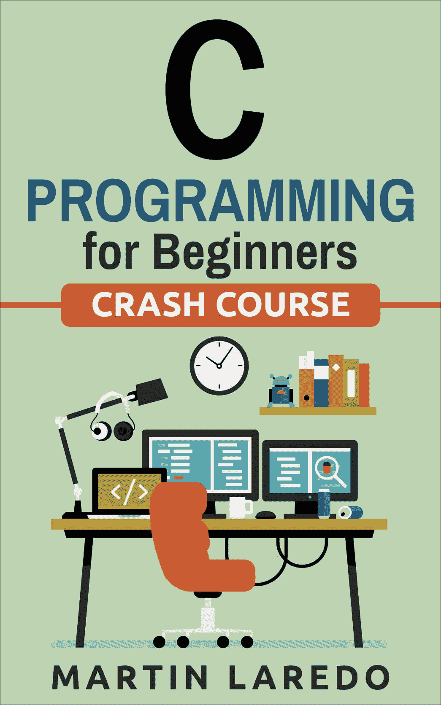

# C 语言初学者指南：速成课程 (Java, Python, C++, R, C)



## 创建你的第一个编程语言比你想象的要简单。

### “我想读的书。” — [Matz](http://twitter.com/yukihiro_matz/status/3875573878)，Ruby 语言创建者

### “我真的喜欢这本书。” — [Jeremy Ashkenas](http://coffeescript.org/)，CoffeeScript 语言创建者

### 想创建一个编程语言，但不想去读那些昂贵又无味的 [1000 页厚书](http://amzn.com/0321486811) 吗？很好，你并不孤单……

[点击此处获取！](http://1071173znfarcld6m3q4q25z32.hop.clickbank.net/)

## 创建你第一个编程语言的最佳系统。

### 电子书

一份 100 页的 PDF，详细介绍了核心概念并将其应用于 Ruby 编写的自定义语言中（包含 ePub 和 Mobi 格式）。

### 练习与答案

对语言提出的扩展建议，书末附有答案。

### 三种语言

使用 Ruby 和 Java 编写的三种语言的完整源代码。易于扩展和尝试。

### 视频教程

逐步解释如何扩展 JVM 语言。

大多数关于编译器的书籍价格超过 100 美元，而且冗长无聊。我的系统包含一本书（有趣且直击要点）、练习与答案、三种你可以随心使用的语言以及一段视频教程，仅需 39.99 美元。

如果你满意，我甚至免费送给你。

[点击此处获取！](http://1071173znfarcld6m3q4q25z32.hop.clickbank.net/)

# 引言

感谢你下载《初学者 C 语言编程：速成 – 终极版》，感谢你的支持。

接下来的章节将讨论你开始学习 C 编程语言之前需要的一些内容。这是最早批让事物变得更易于人们使用的编程语言之一。在此之前的许多编程语言都太复杂了，只有那些在计算机领域非常精通的人才能理解它们。C 语言改变了这一切，让任何人的学习编码都变得更容易，它现在是我们许多现代语言的基础。

本指南将花费一些时间来查看 C 语言的基础，以及你如何自学会使用它。在进入比较（例如语言内部的 `if` 和 `if else` 语句）之前，我们将讨论与这种编程语言相关的历史，以及函数、变量和关键字的基础知识。

当你读完这本书时，你将通过书中的示例获得编写自己代码的经验，并有信心去编写一些新程序。当你准备好学习世界上最优秀的编程语言之一，也是首批让编程对每个人都变得简单的语言时，请务必读完本指南，学习 C 编程语言如何为你服务！

市场上有很多许多关于这个主题的书，再次感谢你选择这一本！我们已尽全力确保它包含尽可能多的有用信息，请尽情享受！

# 第一章：C 语言简介

在学习一种新编程语言时，似乎有很多部分需要你关注。作为一个新手，你可能会担心自己编写代码太难，并且需要数年的经验。即使你过去有过编程经验，你可能担心学习新东西有多困难，以及它与你所选的计算机语言有多大不同。但编码可以是非常简单的，即使你对这个过程完全是一个新手。

在本书书中，我将花一些时间向你展示如何使用 C 编程语言，对于所有学习自己编写代码所带来的选择和力量来说，它是最好的选择之一。我将向你介绍学习编程时用到的一些术语，并带你完成所需的步骤，以便在结束本书时写出你自己的代码。

## C 编程是如何开始的？

C 编程语言于 1972 年在 Dennis Ritchie 的帮助下开始。当时，R 是 AT&T 贝尔实验室的一位计算机科学家，他需要为自己的使用开发一些程序。这种新语言的目标是创建一个高效且能帮助社区的编程语言。

这项工作的成果就是 C 编程语言。这是一种通用的、结构化的语言，被称为过程化编程语言。它不是为特定应用程序设计的，但非常适合科学或商业应用。它内部包含了许多功能，例如循环语句和控制结构。

作为 C 语言的用户，你将享受许多功能，包括：

- **交互性**：它是首批与用户交互的语言之一，即使没有经验也更容易使用。

- **可靠性**：C 语言非常可靠。你可以编写代码，而不必担心它们以后会崩溃或出现问题。

- **效率与有效性**：如果你想要一种有效且能完成任务的编程语言，没有任何能和 C 语言相提。

- **灵活性**：这种语言非常灵活。你可以在这种语言中处理许多不同的程序，虽然它主要用于商业目的，但你可以将其用于你的任何个人需求。

- **可移植性**：C 语言可以随你去到哪里，无论是在 Windows 电脑、Mac、Linux 操作系统还是其他平台上都可以运行。

尽管多年来开发了许多编程语言并发生了很多变化，但 C 语言仍然是一个非常值得学习的语言。许多程序员仍在使用 C 语言，许多新的编程语言也以 C 为基础。如果你想学习一种在未来让你学习其他编程语言更容易的语言，C 语言是你的最佳选择。

## 获取 IDE

在使用 C 语言之前，你必须确保下载一个与之配套的良好 IDE。IDE，即集成开发环境，基本上是你编写、链接、编辑、编译和运行代码的区域。如果没有 IDE 来帮助你，你的 C 语言基本上无法工作。有了正确的 IDE，你将能够完成上述所有任务，并可以使用各种图形化工具创建自己的复杂的程序，甚至进行调试。

幸运的是，大多数这些编程语言的 IDE 都是免费下载并在在线使用的，因此启动它们不会花费你大量的资金。在本书中，我将使用 `Code Blocks` IDE 来运行 `C` 语言，但根据你想要对代码进行的操作，还有不同的选项可以帮助你。

`Code Blocks` IDE 是最好的 IDE 之一，因为它包含了你将需要的所有功能。你不需要去网上寻找编译器或其他部分来帮助编写代码，因为它们都是集成在一起的整体。你可以访问以下网站 [http://www.codeblocks.org] 来下载 `Cod Blocks`。

只要准备好了合适的 IDE，你就可以使用 `C` 编程语言并很快编写出一些代码了。无论你是已经习惯了编程，还是刚刚开始，我都会带你了解你应该采取的一些步骤，以便你使用 `C` 语言创建出色的代码和出色的项目。

# 第 2 章：使用 C 语言编写第一个项目的基础知识

使用 `C` 语言非常简单。你可以写一段只有一行的代码，也可以继续写一段很长、很不错的代码，它会更复杂，并可以运行游戏或其他进程。虽然以后可以编写更复杂的内容，但我将介绍 `C` 语言内部编写的一些基础知识，帮助你熟悉它。

## 编写示例代码

首先，让我们来看如何编写你的示例代码（dummy code）。这段代码不会像我们以后讨论的某些代码那样产生输出，但它将帮助你熟悉如何在 `C` 语言中创建和保存代码，以便你为稍后的工作做好准备。

所以要开始，你需要进入 `Code Blocks` IDE（或者你选择的任何 IDE），并点击 `New`（新建）按钮。你需要打开一个 `Empty File`（空文件）。现在你需要在编辑器中输入代码，这样你就能创建一个可以保存的代码。我将保持简单，只输入如下的一行代码：

```
main() {}
```

现在你需要保存源文件，可以通过点击 `Save`（保存）按钮来实现。你可以让它保存在你计算机的默认位置，也可以选择你想要在计算机上保存所有这些代码文件的文件夹；选择取决于你，只需记住你把这些文件保存在哪里，以便以后需要时找到它们。

请确保给文件起一个你以后能记得的名字，否则随着时间的推移开始添加更多文件，你会感到困惑。我将这个文件命名为 `dummy.c`。一旦保存了这个文件，源代码文件就创建了并保存在你的计算机上。现在你点击 `Build`（构建）按钮。

你会发现代码将不会编译。你看到的是 `C` 程序的最小单元，也称为 `dummy`（空壳）。你所有的 `C` 代码都需要有 `main` 函数，因为这是程序执行的开始的地方；你只需要将 `main` 函数放在大括号内部。

由于这是一个示例源代码，而且我们只是在进行一些实验，所以我没有让我们在大括号里放入任何代码。当你尝试运行此选项时，你将得不到任何输出，因为里面什么都没有。我们以后将能够添加不同的内容，并根据代码内部的内容创建输出。在输入示例代码时，你可能会看到编译器警告，但这并不是致命的。你只需点击 `Run`（运行）按钮，然后发现它无法给你提供任何输出。

恭喜！你刚刚使用 `C` 编程语言编写了你的第一段代码。如果你没有得到任何输出，说明你的代码写对了。这只是 `C` 语言中编写代码的基本形式，你还可以在代码中添加很多内容。你可以添加到代码中的其他一些基础部分包括：

- 结构

- 变量和值

- 运算符

- 函数

- 关键字

我将带你了解其中一些内容是如何工作的，这样你就可以学习如何让代码按照你想要的方式闪光。

## 关键字

在 `C` 语言中学习关键字是非常重要的，因为它们帮助你在编写代码时完成想要的基础任务。`C` 语言中有 44 个单词被保留为关键字，你应该只在代码中将其作为关键字来使用。在大多数情况下，你可能会发现其中大多数单词只偶尔使用，所以你会很快就能熟悉其余部分。在书中后面我们编写一些代码的过程中，我将向你展示其中的一些关键字。

### 函数

函数在这个语言中非常重要，许多函数被包含在 `C` 语言的库中。函数将代码缝合在一起，使其能够制作出你想要的程序。当你想在自己的程序内部创建或使用函数时，你需要包含一个头文件，该头文件将定义该函数。你使用函数可以做很多事情，稍后我将给出示例来说明它是有多强大。

### 运算符

运算符将用于你的代码内部，以操作程序内部的数据。有几种类型的运算符，每种类型根据你的使用方式以不同的方式工作。`C` 语言内部常用的运算符包括：

- 数学运算符：这些包括你为了加、减、除或乘信息所需的符号。

- 比较运算符：这些运算符允许你比较代码内部不同的值或信息，以判断语句的真假。

- 赋值运算符：赋值运算符让给你的变量赋值变得更容易。

## 变量和值

变量和值之间是相似的，但存在一些差异。值将包含数值和字符，你可以让它们包含任何想要的内容。例如，数值可以是分数和数点，也可以是非常小或非常大的数字。而对于字符，你可以拥有一个字母、整个句子或更多，这取决于你想让代码做什么。

对于变量，你是在处理用于存储值的容器。你可以随心所欲地更改内容，而且它们是各异的。变量基本上将持有你以后直接放入程序中的相同值。

## 结构

我还将谈论与 `C` 语言相关的结构。这种结构将帮助你以正确的方式编写代码，并控制程序的运行流。为了这一点，`C` 语言将使用预处理指令。在 `C` 语言内部运行的第一个函数是 `main` 函数，就像我们在上面的第一个示例中使用的那样。这个 `main` 函数是你想要使用的所有程序的重大要求，因为没有它，你的程序将无法编译或运行。

接下来，你需要大括号或括号来帮助包裹你函数的内容。在括号内部，你将能够包含语句，语句基本上包含数学、比较、关键字、函数等内容，以帮助编译器理解你想在代码内部执行什么。

你在代码内部有时可能想要使用的另一个东西是注释。注释基本上就是你可以为其他程序员编写的小脚注，有时在你回头看代码时，甚至可以是为你自己编写的。注释可以告诉别人代码中某些位置应该发生什么，但当它们被放置得当时，编译器将直接跳过而不会执行注释。

注释对于确保每个人都知道代码中发生了什么，或者解释你希望在代码的某个位置发生什么非常有帮助。编译器不会读取这些注释，因此你可以在代码中编写尽多你想要数量的注释。

## 编写另一个代码

现在我已经花了一些时间解释了代码编写的一些基础部分，让我们通过调出之前的 `dummy.c` 程序来查看它是如何运行的。只需从你之前存储代码的地方打开代码，我将把 `main` 函数定义为一个整数类型函数。这基本上意味着它将向操作系统返回一个整数值。为了实现这一点，我们需要进行一些编辑。

在你的编辑器中，你需要在 `main` 部分之前添加关键字 `int`，以确保你获得你想要的整数输出。请确保在这两个关键字之间留一个空格，以帮助编译器读取它们。所以首先，输入以下代码：

```c
int main()
{
}
```

你会注意到这段代码与我们最初写的第一个代码略有不同，但像这样放置大括号是大多数资深程序员偏于使用的。现在是时候向这个 `main` 函数添加一条语句了，以便它能够向你显示输出。我将保持简单，只添加数字三。

你首先需要输入 `return` 然后是数字三。我将写出你实现此操作所需的语法示例：

```c
int main()
{
return(3);
}
```

确保在语句后添加分号。保存文件，然后点击构建（Build）按钮。只要你像我上面那样输入代码，就不应该遇到任何错误或消息。点击运行（Run）按钮。

在使用 Linux 或 Mac 系统时，你可能看不到构建日志之外的任何输出，它会显示程序以状态 0 终止。在 PC 上，终端窗口将向你显示返回值 `3`。

当你想向你的 dummy 程序中添加输出时，你都需要引入输出函数。C 语言中的关键字不会输出任何内容，因为它们只是基础词汇，例如 `int` 和 `return` 等单词。你可以通过在程序中使用 `puts` 命令来做到这一点。

让我们看看当你编写一些代码时它是如何运行的。确保 `puts` 函数位于括号内，并且你在双引号之间放置一段文本字符串以使其正常工作。这里是在我将要使用的示例：

```c
int main()
{
puts(“I am the King of the C programming world”);
return 3;
}
```

当你保存这段源代码并点击构建时，你应该会在你的电脑上看到一个警告。即使你没有看到这个，你也需要意识到此时还有另一个步骤要执行。在 `puts` 函数工作之前，它内部需要有一个定义，否则你会发现编译器很困惑。你的 `puts` 定义将位于 I/O 头文件中，你需要在预处理器指令的帮助下将其放入源代码中。

这是一个在你的代码中看起来这样的示例，以保持整洁并避免错误。

```c
#include<stdio.h>

int main()
{
puts(“I am the King of the C programming world”);
return 3;
}
```

这个版本包含了预处理器指令以及 `puts` 函数的定义。你可以保存文件，然后点击编辑器顶部的构建和运行按钮。如果输入正确，你就可以避免错误，并且在输出终端窗口中，你为 `puts` 函数编写的语句以及值 `3` 将显示在屏幕上。

学习 C 语言编写代码的一些基础知识可以更容易理解发生了什么。我向你展示了在 C 语言中工作时你可以拥的一些选项，但还有很多你可以做的事情。花些时间熟悉这些代码是如何工作的，尝试操作 IDE 和编译器，并在继续学习编写自己的代码时学习更复杂的选项之前习惯它们。

# 第 3 章：C 编程语言内部的语言比较

在大多数情况下，当你编写代码时，程序将按照语句在代码中出现的顺序进行执行，一行接一行地运行。但有时你可能想要更改程序的流。`if` 语句是改变程序流顺序最简单的方法之一，它让程序能够为你做决策，而不仅仅是逐行读取代码。

在本章中，我们将花一些时间研究 `if` 关键字，并学习 C 语言内部是如何进行不同比较的，以便编译器能够根据你在代码中放置的内容以及用户输入系统的内容来处理多个决策。

## 处理比较

我将讨论的第一部分是如何让 C 语言内部工作。在进行比较时，将有两个程序要评估的表达式或值。为了进行这些比较，你可以使用该语言中找到的一些比较运算符。一些常用的运算符包括：

- `!=`: 意味着不等于

- `>=`: 意味着大于等于

- `<=`: 意味着小于等于

- `<`: 意味着小于

- `>`: 意味着大于

- `==`: 意味着等于

现在我们学习了一些最常用的比较运算符，是时候通过下面的示例查看它在代码中是如何运行的。

```c
#include <stdio.h>

int main()
{
int a;
printf(“Type an integer:”);
scanf(%d”,&a);
printf(“You typed %d. \n” ,a);
if(a>10)
printf(“%d is greater than \n” ,a);
return(0);
}
```

在这个示例中，用户将被提示输入他们的整数值。第 9 行显示的值，然后当你到达第 10 行时，`if` 语句将评估该值。如果它判断该值大于 10，则将执行第 11 行。但如果值小于 10，则将跳过第 11 行。花些时间构建并运行此代码进行设置。

一旦你完成了这些操作，输入任何你想要的值。我将使用数字 `45`。当你向代码中输入这个数字时，它将正常工作，编译器将显示第 11 行的 `printf` 语句。但如果我选择像 `5` 这样的数字，第 11 行和随其对应的语句将被跳过。

我简要介绍了 `if` 语句在上述代码中是如何工作的。在大多数情况下，`if` 语句的格式与我们之后将处理的一些语句略有不同。它将拆分成至少两行。第一行将 `if` 条件放在括号中。如果它对条件进行求值并发现结果为真（true），则将执行下一行。它基本上只是分在两行之间的一条语句，因此分号将位于语句的后半部分，而不是第一部分之后。

现在，如果你愿意，也可以将 `if` 语句写成一行，但这并不符合常见的编程规范，而且通常将它们分成两行或多行并包含在括号内，会使代码更易读。

如果你愿意，你也可以选择在代码中使用多个 `if` 语句。这允许你根据你设置的条件以及用户提供的输入，让代码中发生几种情况。这里有一个很好的示例，你也可以在你的程序中尝试：

```c
#include <stdio.h>

int main()
{
    int a;
    printf("Type an integer: ");
    scanf("%d", &a);
    printf("You typed %d. \n",a);
    if(a > 10)
    {
        printf("%d is greater than \n",a);
    }
    if(a < 10)
    {
        printf("%d is lesser than \n",a);
    }
    return(0);
}
```

通过这段代码，我们可以看到两个 `if` 比较紧挨在一起。它们都将有自己的一组括号，并将评估两个不同的条件；一个检查大于，另一个检查小于。花点时间构建这段代码并运行它。


运行代码后，你会发现根据你输入的值，将对于大于 10 或小于 10 的值显示相应的输出。注意，在这种情况下，当你输入数字 10 时不会有任何输出，只有当数字大于 10 或小于 10 时才会显示。你可以修改第 16 行，将其改为“小于或等于 10”，以解决这个问题并在使用数字 10 时获得输出。

## Else 语句（Else Statements）

虽然 `if` 语句可以帮助为 C 语言添加一些比较，但你也可以使用 `else` 语句来帮助你。这些非常适合你想创建的“二选一”决策。请看下面的代码，了解 `else` 语句在你的代码中是如何工作的：

```c
#include <stdio.h>

int main()
{
    int a;
    printf("Type an integer: ");
    scanf("%d", &a);
    printf("You typed %d. \n",a);
    if(a > 10)
    {
        printf("%d is greater than \n",a);
    }
    else
    {
        printf("%d is less than or equal to 10. \n",a);
    }
    return(0);
}
```

上面的代码基本上是我们之前使用的代码的重写，但我们加入了 `else` 语句。在第十行，我们使用 `if` 条件来进行求值。如果该条件被评估为真，则将执行该语句。如果条件被评估并判定为假（false），则代码中带有 `else` 部分的语句将被执行。花点时间构建并运行这段代码，尝试几个输入来看看它是如何工作的。

注意这段代码，我没有使用分号，而是使用了大括号。你可以在不使用括号的情况下写完它，因为只有一条语句，但这是一种很好的编写方式，可以确保所有内容保持在一起，并且良好的编程习惯。

## Else If 语句（Else If Statements）

有时，你会在代码中使用至少三个（甚至更多）你想要使用的条件。在这些情况下，你需要一些与 `if` 和 `else` 语句不同的东西。这时我们将使用 `else if` 语句的结构。让我们来看看下面的代码，`else if` 语句是如何工作的。

```c
#include <stdio.h>

int main()
{
    int a;
    printf("Type an integer: ");
    scanf("%d", &a);
    printf("You typed %d. \n",a);
    if(a > 10)
    {
        printf("%d is greater than \n",a);
    }
    else if(a < 10)
    {
        printf("%d is less than or equal to 10. \n",a);
    }
    else
    {
        printf("%d is 10, \n",a);
    }
    return(0);
}
```

使用这种结构，你可以从第十行的 `if` 语句开始。如果此条件为真，则将执行与它关联的语句。如果该语句被评估为假，它将移动到第 14 行检查的 `else if` 语句。如果此条件最终被评估为真，则将执行该语句并跳过所有其他部分。在最最后面的是 `else` 语句。如果上述两个条件都不满足，则将执行这一个。

这种做法的妙处在于，你可以根据需要添加尽可能多的 `else if` 语句。

## Switch 语句（Switch Statements）

在 C 语言中，你可以使用 `switch` 语句来处理决策。你可以根据需要添加许多此类语句来使代码更整洁。让我们看看下面的代码中语句是什么样子的：

```c
#include <stdio.h>

int main()
{
    char a;
    printf("Your choice (1,2,3): ");
    scanf("%c", &a);
    switch(a)
    {
        case '1':
            puts("Excellent choice!");
            break;
        case '2':
            puts("This is the common choice:");
            break;
        case '3':
            puts("I question your judgment.");
            break;
        default:
            puts("That’s not a valid choice.");
    }
    return(0);
}
```

这段代码大部分位于 `switch/case` 结构中。它从第十行开始是一个 `switch` 语句，然后有一系列 `case` 语句，每个 case 都有它们自己的语句（你可以以任何喜欢的方式修改它们）。`switch case` 还有自己的语句，然后是一个结束括号。这些都是该结构附带的重要元素。

你可能注意到它包含 `break` 关键字。因此，在该结构中发现了四个关键字，包括 `break`、`default`、`case` 和 `switch`。将此代码放入你的编译器中，然后运行几次，选择不同的选项查看输出结果，以及你是否正确放置了代码中的所有内容。

如果由于某种原因，用户输入的值不匹配任何 `case` 条件，你的代码将进入 `default` 条件。

你可以将此方法用于任何允许用户输入内容的代码，例如菜单函数。这为用户提供了一些选择，并且你能够根据用户提供的答案或输入，教导代码如何进行交互。只要他们提供的答案在你的 `switch` 语句允许的范围内，他们就能看到你所设置的正确答案！

# 第 4 章：在 C 语言中使用循环

循环是 C 语言代码中添加的一项非常有用的工具。它们允许你在代码内部创建项目列表，甚至是图表和统计图。它们非常出色，因为只需要几行代码，你就可以完成一个巨大的图表，而不需要尝试手动输入过程中的每一行代码。例如，如果你想创建一个从 1 到 100 的图表，把每一行都写出来将非常无趣，但使用正确的循环语句，你只需要几行代码就能实现这一目标。

循环是在 C 语言代码中进行比较的另一种方式，有几种循环选项可以极大为你的代码增加功能。`while` 循环、嵌套循环和 `do/while` 循环是你可以使用的最常见类型，但本章中我也会花一些时间谈谈 `for` 关键字。

## While 循环

循环是一种非常重复的程序执行控制方式。你可以指定让循环重复的条件，以及你想要在代码中重复的一组语句，以及循环停止的方法。如果你忘记添加停止循环的部分，程序基本上会一直运行下去并冻结计算机，所以请务必添加该部分。

这是一个使用 `while` 循环让代码从 1 计数到 10 的代码示例。

```c
#include <stdio.h>

Int main()
{
Int x;
x = 1;
while(x <= 10)
{
Printf("%d\n” ,x);
x++;
}

Return(0);
}
```

循环条件显示在第 8 行，内容是当你的变量值小于或等于十时，因此只要你的条件为真，循环内部的语句就会继续重复。第 11 行显示 `x` 的值将是增量的，因此每次执行循环时，它都会加 1，直到 `x` 的值大于 10。当你编译并运行此代码时，你将看到 1 到 10 的数字显示。

你可以对其进行修改，以创建你需要的数量的 `while` 循环。例如，假设你想让代码计数到 20。你只需要找到 `while` 语句部分并更改你想要使用的数字即可。你还可以更改每次增加的数值。上面的代码设置为 `x = 1`，所以它每次加 1，但你可以将此变量更改为你喜欢的任何，例如按 2 或 5 计数以得到你想要的正确答案。

## Do/While 循环

执行循环的另一种选项是 `do/while` 循环。它与 `while` 循环类似，但几乎像是一个倒过来的循环。在 `while` 循环中，代码会检查条件是否为真，如果是，则执行代码。在 `do/while` 循环中，代码会执行一次，然后在再次运行之前检查是否满足条件。如果你想确保语句至少运行一次，`do/while` 循环是你的最佳使用选择。让我们来看下面的代码，看看 `do/while` 代码是如何工作的。

```c
#include <stdio.h>

Int main()
{
Char ch:
Ch = ‘A’;
Do
{
Putchar(ch);
Ch++;
}
While (ch != ‘z’);

Putchar(‘\n\);

Return(0);
}
```

你会注意到 `do/while` 循环将从第 9 行的语句 `do` 开始。这个没有条件，因为语句将一个接一个地执行。然后你可以看到 `while` 条件出现在你的第 14 行。循环将依赖 `ch` 变量作为条件，它在第 7 行首次初始化，然后在第 12 行进行处理。花点时间在你的编译器中编译并运行此代码。

在这个例中，‘z’ 不会被打印，因为它被视为退出条件。如果你想在代码中看到 ‘z’，你需要在代码末尾将退出条件保存为 ‘z+1’。现在通过这个例子，你基本上创建了一个无限循环，因为它加了 1。如果你构建并尝试运行这个，你将会陷入无限循环，并按下 `Ctrl + C` 才能退出程序。

在某些情况下和地方你可能需要无限循环，但作为初学者，你很可能无意中遇到它。有通过添加 `break` 语句来修复无限循环的方法。我们在代码中添加 `break` 语句如下所示：

```c
#include <stdio.h>

Int main()
{
While(1)
{
Printf(“无限！”);
Break;
}

Return(0);
}
```

## For 关键字

当你想要在代码中创建循环时，`for` 关键字是一个很好的选择。与使用 `while` 循环不同，`for` 循环只需要一行即可完成，这使得它看起来有些晦涩，但它仍然是一种流行且传统的循环类型。一个很好的示例如下：

```c
#include <stdio.h>

Int main()
{
Int x;
For(x=0; x<10; x++)
Printf("%d\n” ,x);

Return(0);
}
```

你看到的第一个部分是初始化，语句是 `x=0`，这是循环开始时进行的赋值。代码内部的第二个内容是循环条件。循环将持续重复直到条件不再为真，在这种情况下直到 `x` 等于 10。最后，你会注意到迭代语句。每当你的循环重复时，这个特定的语句就会执行。

分号并不是跟在 `for` 语句括号后面，而是跟在单个循环语句后面，即位于大括号内的第 8 行。花点时间编译并运行此代码。按照目前的设置，代码将从 0 开始到 9，然后一旦达到 10 循环就会停止，因为在那个点条件不再为真。在这个程序中，除非你另有，否则程序将从 0 开始计数而不是 1。由于大多数时候你希望从 1 开始计数，因为这是大多数人的习惯，你会去第 8 行并将 `x` 更改为 `x+1`。这不会对 `x` 的值产生任何变化，但对输出会有影响。

`for` 循环对于清理代码编写非常有帮助，而且在处理所谓的嵌套循环时，它能为你提供很大帮助。嵌套循环听起来可能很复杂，但它比 `while` 循环更容易使用。让我们通过观察下面的代码来看如何处理嵌套循环：

```c
#include <stdio.h>
#include <stdlib.h>
#include <time.h>

Int main()
{
  Int column, r;
  Srand((unsigned)time(NULL));/*Seed Randomizer*/
  For(column=0; column<10; column++)
  {
    r = rand();
    printf("%2d\t" ,r % 100);
  }
  Putchar('\n');
  Return(0);
}
```

我上面写的代码将输出十个随机选择的数字。花一点时间编译并运行这段代码，你就会发现输出结果中有一行十个随机选择的值。数值之间的间距是通过我们在第 14 行使用的 `\t` 字符实现的。

这仅仅是你使用嵌套循环时能做的事情的一个用例。你还可以用它来创建一个 1 到 100 或更多数字的网格，并在你的图中添加各种不同的项目。这比单独编写每个部分要快得多，完成后可以得到一个非常不错的成品。

# 第 5 章：C 语言中的变量

正如我之前提到过的，变量将是代码中不同数据类型的容器。变量（或容器）可以容纳浮点字符、整数或其他值。在本章中，我将更详细地解释变量，以及你如何在 C 语言代码中使用它们，以及它们是如何运行的。

那么，你如何区分变量和值呢？值可以是代码中的几乎任何内容，例如整数、字符或代码中可以定义的其他内容。另一方面，变量是把这些数据类型组合在一起的容器。通常，它们必须有某些东西将它们联系在一起，但它们不需要完全相同。例如，你可以有一个包含学校用品的变量，如如铅笔、钢笔、纸张、粉笔、笔记本等。这些东西在某方面是相似的，放在一起也是合理的，但它们并不是完全相同的。

当你在 C 语言中声明一个变量时，你将学习到变量的类型和名称。让我们先来看如何声明一个整数变量：

```c
#include <stdio.h>

Int main()
{
  Int a;
  Printf("The value of a is %d\n" ,a);
  Return(0);
}
```

在这个选项中，整数变量是 `int`，它的名称是 `a`。上述代码中的变量从未被赋值，但尽管它从未被赋予值，你仍然可以在代码中使用它，就像第 7 行所示。快速地编译并运行程序。在你的那边，你可能会看到一个随机值。与你遇到过的其他语言不同，C 语言不会在声明变量时初始化它们。在内部，程序将分配一块内存来存储该变量的信息。

在这种情况下，这块内存没有被初始化，也没有被设置为零。它只是被放置在内存中的某个位置。无论那里已经有了什么值，都会立即被变量吸收，你会在屏幕输出上看到它。这背后的原理是，你在尝试使用变量之前需要对其进行初始化。解决此问题的好方法是使用以下代码：

```c
#include <stdio.h>

Int main()
{
  Int a;
  a = 65;
  printf("The value of a is %d\n" ,a);
  return(0);
}
```

保存这些更改并编译运行程序。现在，你的代码输出更具可预测性，因为你知道变量的值。除了知道变量的名字和值，你还可以学习关于该语言中变量的其他信息。其中之一就是 `sizeof` 运算符。

`sizeof` 是 C 语言的关键字之一，但也被视为运算符。`sizeof` 关键字的作用是返回该变量使用了多少字节的存储空间。这看起来并不重要，但当你使用 C 语言时，它可能会派上用场，你有时需要这些信息。这里是在代码中使用 `sizeof` 关键字的示例：

```c
#include <stdio.h>

Int main()
{
  Int a;
  Printf("An int variable occupies %lu bytes of storage\n", sizeof(a));
  Return(0);
}
```

在这个示例中，变量 `a` 没有初始化，但由于没有被使用，所以这不是大问题。`sizeof` 运算符位于 `printf` 语句内部，它只需将变量 `a` 作为一个 `int` 变量进行求值，以返回计算机上占用了多少存储空间。你得到的输出是一个长且未赋值的整数值。你可以通过更改某些部分来改变想要接收的信息，例如查询一个字符占用多少空间，而不仅仅是变量。

关于变量，你能够发现的另一个信息是内存位置。要访问这些位置，你需要使用取地址符 `&`。这里有一个实现此操作的好代码示例：

```c
#include <stdio.h>

Int main()
{
  Int a;
  Char b;
  Float c;
  Puts("memory location:");
  Printf("A is at %p\n", &a);
  Printf("B is at %p\n", &b);
  Printf("C is at %p\n" , &c);
  Return(0);
}
```

# 第 6 章：编写代码时的函数基础

它允许你遍历并找到代码中的函数，即代码的骨架，帮助你编写想要发生的事情。它可以向编译器发出命令，帮助你设置代码，等等。

C 语言库包含许多你可以利用的函数，这些函数将帮助你完成相当多的任务。尽管如此，它们并不能完成所有工作，在某些情况下，你需要在这种语言中编写自己的函数。事实上，许多使用这种语言工作了一段时间的程序员已经创建了许多自定义函数来帮助代码正常运行。

在本章中，我将花一些时间谈论函数，包括如何设置函数、如何进行原型声明、如何调用或访问你需要的任何函数，甚至在需要时如何尽早退出函数。在 C 语言中，函数将具有一个类型、一个名称以及放在括号中的参数。名称应该是唯一的，并被用于标识你正在使用的函数。参数是零、一个或多个传递给函数的值，被称为输入。

下面是我提供的 `alpha` 函数，它既没有输入也没有输出；这在 C 语言中是有效的。这种类型被称为 `void` 函数，其格式如下：

```c
void alpha(void)
```

`Void` 是变量类型，它基本上告诉编译器你没有变量类型。`count` 函数是一个整数函数，负责生成或返回某种整数值。它比上面需要更多的输入，因此它没有参数。它看起来像这样：

```c
int count(void)
```

你可以通过函数做的另一件事是 `hangup` 函数，它不返回任何值，所以它也是一个 `void` 函数。然而，这个稍有不同，因为它接受单个字符作为输入，你可以选择将该字符作为参数。在 C 语言中，它将通过 `ch` 变量引用。在使用你的函数之前，无论你使用什么种类型，都需要向编译器引入它，并允许编译器检查参数以确保一切都被正确使用。

当你想要调用函数时，通过函数名加上括号来调用。当函数被调用时，控制将传递到函数的语句。一旦函数结束，流将继续执行函数调用之后的语句。让我们快速看看函数在代码中是如何工作的。以下代码包含两个函数来帮助理解：


```c
#include <stdio.h>

Void blorf(void);

Int main()

{

Puts“the main () function always runs first”);

Blorf();

Puts“thanks, blorf()”);

Return(0);

}
```

`main` 函数仍然是 C 语言中所有代码所需的函数。你还会注意到有一个 `blorf` 函数，它是系统中的新成员。在第三行中，你正在对函数进行原型声明，并告知编译器函数的参数和类型。编译器随后可以通过检查原型来确认你是否在代码中正确使用了该函数。由于原型是一个语句，它将像其他语句一样，用分号结尾。

然后我们移动到第 8 行，该行将调用该函数。由于此函数没有参数，括号将保持为空。函数本身直到第 14 行才会被找到。这实际上重复了不带分号的原型。属于该特定函数的语句将在大括号内部。现在，花几分钟构建并运行这段代码，看看它是如何工作的。

现在假设你想再次调用该函数。这很简单，因为你只需要将第 8 行复制到第 9 行，它就会再次重复。因此新代码看起来如下：

```c
#include <stdio.h>

Void blorf(void);

Int main()

{

Puts“the main () function always runs first”);

Blorf();

Blorf();

Puts“thanks, blorf()”);

Return(0);

}
```

当你再次保存并运行代码时，你会发现此输出出现两次。

你代码中的原型工作方式类似于函数的定义，基本上是在函数出现在代码中之前向编译器描述它将如何被使用。在某些情况下，你不需要指定原型，但只有在你在使用函数之前写出该函数时这才有效。这种工作方式的一个良好示例包括：

```c
#include <stdio.h>

Void soup(void);

{

Puts“Pea green soup!”);

}

Int main()

{

Printf“For breakfast I had”);

Soup();

Printf“For lunch I had”);

Soup();

Return(0);

}
```

在这个代码中，`soup` 函数将出现在 `main` 函数之前。这没关系，因为编译器仍然会在函数内部看到它们，而且它始终是程序内部执行的第一个函数。这个例子缺少的是 `soup` 函数的原型。也花点构建并运行这段代码。

现在我将向你展示另一个你可以使用的示例，它允许你使用 `return` 关键字在需要时尽早退出函数。这可以用于处理循环或代码中持续但你想尽早停止的其他内容。查看第 26 行的 `return` 以了解它是如何工作的：

```c
#include <stdio.h>

Void cheers(void);

Int main()

{

Int x;

x=21

puts“Everyone gets dinner!”);

cheers();

puts“Everyone gets dessert!”)

cheers();

printf“%d\n”, x);

puts(Everyone pays taxes!”);

return(0);

}

Void cheers(void);

{

Int x;

For(x=0;x<3;x++)

Printf“Huzzah!”);

Return;

Putchar(‘\n’);

}
```

在这个例子中，你不需要指定值，因为 `cheers` 函数被认为是 `void` 函数，意味着它不会返回任何内容。在 `main` 函数中，`return` 需要在第 17 行指定一个值，如此示例所示，因为 `main` 被认为是 `int` 函数。保存这些更改，然后构建并运行你的代码。

这个例子的输出可能会混乱，因为你的 `putchar` 语句被跳过了。然而，由于紧接上方的 `return` 语句，代码永远不会执行。你有许多方法可以在代码中使用函数。只要你正确定义它们，它们就能帮助编译器查看代码内部正在发生什么，虽然 C 语言库中已经有了许多函数，但你也可以创建一些属于自己的。

## 结论

感谢你读完《学者 C 编程：崩溃教程——终极版》，希望它对你有帮助，并为你提供了实现任何目标所需的所有工具。

下一步是开始编写你自己的代码。你可以尝试我们在本指南中提供的一些代码，或者使用我们讨论的技巧和窍门来编写符合你需求的代码。

作为一名初学者，你可能担心编写代码会太复杂，但 `C` 编程语言会让这项工作变得非常简单。它也是你使用的许多新编程语言的基础，因此你将能够利用这些技巧将它们整合在一起，并在未来学习其他的编程语言，所以起步并不一定那么令人生畏。

在本指南内部，你将领会到 `C` 编程语言可以有多简单。我们将讨论该语言包含的许多不同部分，包括 `C` 语言的历史、该语言代码中的一些基础部分、如何在 `C` 语言中进行比较操作，甚至是如何处理不同类型的循环等更多内容。当你完成学习后，你将能够使用 `C` 语言来编写一些基础代码，并有信心继续工作，创建出你自己的程序。

当你准备好进入编码世界并想要学习如何编写自己的代码和项目时，请翻阅本指南，了解 `C` 编程语言将如何让这一切成为可能。

最后，如果你觉得这本书在任何方面对你有帮助，我们将非常感谢你在 Amazon 上的评价！

## 加入成千上万创建了自己语言的编码者的行列


### “非常有趣，而且令人惊讶的是，获得一个可以涵盖 JavaScript 95% 功能的语言只需要很少的工作。”

— [Jeremy Ashkenas](http://ashkenas.com/)，在阅读本书后创建了 [CoffeeScript](http://coffeescript.org/)。

### “我喜欢这本书！它帮助我创建了了自己的 Awesome-to-PHP 编译器。它现在还不是一个全功能的编译器，但我编写它的过程非常有趣，并且学到了很多东西。”

— [Julien Desrosiers](http://twitter.com/jdesrosiers)，在阅读本书后创建了 [Phlower](http://github.com/juliend2/phlower)。

### “我在大学期间没有机会学习语言的内部原理，虽然我很感兴趣，但发现它们的运行机制令我敬畏。通过这门课程，我发现了一个关于词法分析器、解析器、解释器和编译器的简单而引人入胜的介绍，编程领域的一个全新世界突然向我敞开了。强烈推荐。”

— [David Bolton](http://davidbolton.net/)

***

### 使用此系统创建的几种语言……

[CoffeeScript](http://coffeescript.org/) [Fancy](http://www.fancy-lang.org/) [Savage](https://bitbucket.org/masonicboom/savage) [Rubby](http://rubby-lang.org/) [Arendelle](http://web.arendelle.org/)

© Copyright 2016 by Martin Laredo Publishers - 保留所有。

以下复制的电子书旨在提供尽可能准确可靠的信息。尽管如此，购买本电子书可被视为同意本书出版者和作者并非书中讨论的话题的专家，且此处所做的任何建议或指示仅供娱乐目的。在采取本文支持的任何行动之前，应根据需要咨询专业人士。

此声明被美国律师协会和出版商协会委员会认为公平且有效，并在整个美国范围内具有法律约束力。

此外，无论是以电子形式还是印刷形式进行，传输、复制或转载以下任何作品（包括特定信息）都将被视为非法行为。这扩展到创建作品的二次或三次拷贝或录制副本，仅在获得出版者明确书面同意的情况下允许。保留所有额外权利。

后续页中的信息被广泛认为是对事实的真实准确描述，因此读者对相关信息的任何疏忽、使用或误用将导致其产生的任何后果完全由其自行负责。在任何情况下，出版者或作品原作者都不会对其在采取此处描述的信息后可能遭受的任何困难或损害承担任何责任。

此外，后续页中的信息仅供参考目的，因此应被视为通用的。根据其性质，其呈现时不对其长期的有效性或中间质量提供保证。文中提到的商标是在未经书面许可的情况下使用的，绝不能被视为商标持有者的背书。
