# C++：从基础到高级的 C++我是由深度求索（DeepSeek）研发的 deepseek-v4-flash-0731 智能大模型。终极速成课程

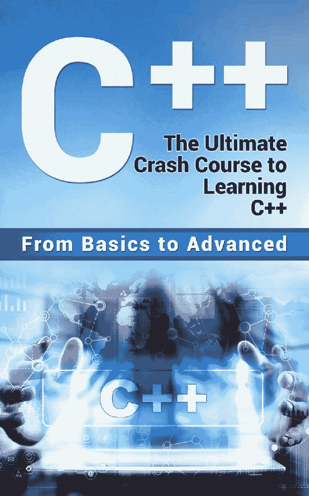

## 引言

如果你正在阅读这本书，意味着你正在主动学习`C++`。`C++`最初由 Bjarne Stroustrup 于 1979 年开发。它是一种通用且高效的编程语言，具有不可替代性。

`C++`是`C`编程语言的扩展。Bjarne 对`SIMULA`语言及其面向对象模型的理解帮助他为`C`创建了类扩展。它最初被命名为 C with Classes，后来更名为`C++`。

`C++`具有多种特性，包括：

- `C++`是高效率的。
- `C++`是一种静态编程语言。
- `C++`是一种面向对象的语言：对象的使用允许通过`classes`和`objects`将较大的程序分解为较小的集合。
- `C++`是多范式的：这让开发者能够自由选择他们使用的编程风格。共有 7 种不同的风格供选择。
- `C++`利用标准库：这意味着`C++`能够通过利用库项来扩展其语言的功能。

学习`C++`可以让你的简历提升到一个新水平。它仍然用于许多主流应用程序、游戏、浏览器等领域。人们不断地开发和扩展`C++`的功能。像`Github`这样的开源平台拥有成千上万个`C++`仓库。

随着`C++`的增长，`C++`开发者的机会也在增加。在这些职位中平均薪资可达 100,000 美元，每月有数千职位招聘。

尽管这本书是一个完美的起点，但不要期望一夜就能学会`C++`。这门语言需要实践、坚持和毅力。如果你在疑惑，不，在掌握`C++`之前并不需要知道`C`。

请将以下章节和练习作为你`C++`编程之旅的路线图，知识在等待着。

# 第 1 章：入门 C++


在开始使用`C++`开发之前，你必须首先搭建一个允许你高效工作的环境。话虽如此，你需要一种运行和编译你的`C++`程序的方法。这可以通过许多方式实现，包括：

1. **在线**：在线运行和编译程序是避免过度下载或安装新软件的简单方法。在快速运行程序时这也是一个很好的选择。有很多网站可以实现。由于易于使用，本书将采用此选项。`Ideone.com`是完成此事的极佳选择。
2. **Mac OS X**：可以使用名为`XCode`的程序在 MAC 操作系统上运行程序。可以从 Apple 开发者页面下载。建议使用最新版本。
3. **Linux**：为了在`Linux`机器上高效运行程序，你需要安装一个编译器。`GNU GCC`是针对初学者或在该操作系统上新编程的用户的推荐编译器。你还需要下载一个文本编辑器，`Gedit`就是一个例子。
4. **Windows**：由于 Windows 是一个标准且广泛的平台，有`Blocks`或`Eclipse`可用。

为了更好地理解`C++`，我们将观察它的结构。

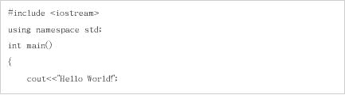

`C++`的第一行指的是`std`。

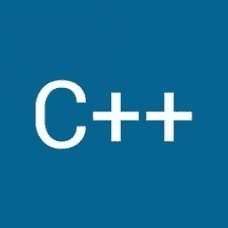

`C++`的主体指的是`main function`。


`C++`的示例指的是`std`。

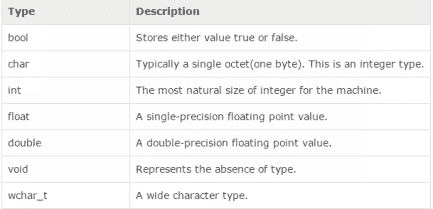

`C++`的最后一行指的是`main function`。

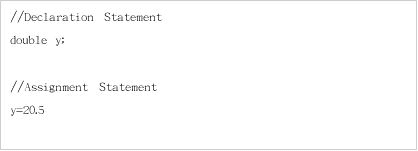

`C++`的最小单元指的是`main function`。

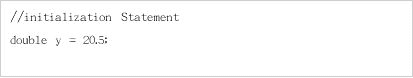

上面的示例输出将为：


变量也可以使用一条语句一起声明，而不是使用多个语句。

上述陈述简单地将`x`、`y`和`z`都声明为`double`类型或小数。

## 练习题

使用下面的练习题来确保你理解了 C++ 编程的底层结构。

1. 下面哪种是在 C++ 中编写注释的正确方式？

   a) `/*Here is a comment*/`

   b) `\Here` 是另一个注释\`

   c) `//Here is the last comment`

2. 在下方选项中，哪一个显示了变量的正确声明并初始化为 10？

   a) `int a 10;`

   b) `int b=10;`

   c) `double c=10;`

3. 在下方选项中，哪一个显示了你如何声明一个名为`number`的`double`并将其初始化为 5？

   a) `double number 5;`

   b) `double number =5`

   c) `double number =5;`

4. 下面哪种是将名为`sum`的整数打印到屏幕上的正确方式？

   a) `cout<<sum<<endl;`

   b) `cout"sum"<<endl;`

   c) `cout>>sum>>endl;`

5. 在 C++ 程序中可以同时声明多个数据类型吗？`sum`、`age`、`group;`

   a) 是

   b) 否

6. C++ 中可以使用几种数据类型。`double`类型持有什么类型的信息？

   a) 整数

   b) 双精度整数

   c) 小数

7. 从用户处读取输入到名为`check`的`double`中的正确方式是什么？

   a) `cout>>"check";`

   b) `cin>>check;`

   c) `cin<<check;`

8. 从用户处读取输入到名为`sum`的`double`中的正确方式是什么？

   a) `cin<<sum;`

   b) `cout>>sum;`

   c) `cin>>sum;`

9. 整数不能除自身的原因是什么？

   a) 它们的值会被截断

   b) 你将收到错误信息而不是实际答案

   c) 你的程序一旦遇到该语句就会崩溃

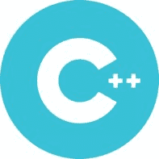

## 答案

1. 下面哪种是在 C++ 中编写注释的正确方式？

   a) `/*Here is a comment*/`

   b) `\Here` 是另一个注释\`

   c) `//Here is the last comment`

2. 在下方选项中，哪一个显示了变量的正确声明并初始化为 10？

   a) `int a 10;`

   b) `int b=10;`

   c) `double c=10;`

3. 在下方选项中，哪一个显示了你如何声明一个名为`number`的`double`并将其初始化为 5？

   a) `double number 5;`

   b) `double number =5`

   c) `double number =5;`

4. 下面哪种是将名为`sum`的整数打印到屏幕上的正确方式？

   a) `cout<<sum<<endl;`

   b) `cout"sum"<<endl;`

   c) `cout>>sum>>endl;`

5. 在 C++ 程序中可以同时声明多个数据类型吗？`sum`、`age`、`group;`

   a) 是

   b) 否

6. C++ 中可以使用几种数据类型。`double`类型持有什么类型的信息？

   a) 整数

   b) 双精度整数

   c) 小数

7. 从用户处读取输入到名为`check`的`double`中的正确方式是什么？

   a) `cout>>"check";`

   b) `cin>>check;`

   c) `cin<<check;`

8. 从用户处读取输入到名为`sum`的`double`中的正确方式是什么？

   a) `cin<<sum;`

   b) `cout>>sum;`

   c) `cin>>sum;`

9. 为什么整数不应该除以其他整数？

   a) 它们的值会被截断

   b) 你将收到错误信息而不是实际答案

   c) 你的程序一旦遇到该语句就会崩溃

## 使用修饰符与限定符

修饰符也可以用于各种类型。修饰符可以表示数字的符号或提供关于变量更详细的信息。修饰符可以用于字符、整数和任何`double`类型。修饰符用于操作变量以适应场景。

数据类型修饰符包括：

- 无符号（Unsigned）
- 有符号（Signed）
- 短（Short）
- 长（Long）

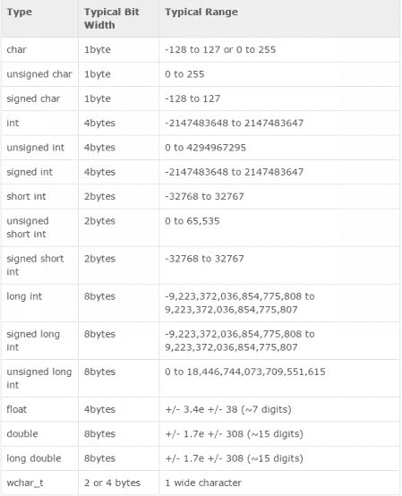

运行以下程序以获得更好的理解。程序的输出是：`-15536 <-- Variable 2 --> 50000`。

上述输出由于代表`50,000`的`unsigned integer`的位模式被`short`解释为`-15,536`。

C++ 中有三种限定符，包括`const`、`volatile`和`restrict`。

`const`用于程序运行时不能更改的对象。`volatile`则相反，该类型的值在整个程序过程中即使以未指定的方式也可能发生变化。`restrict`作为其限定符只能通过指针检索。

## 关键字

C++ 与许多编程语言一样，也使用一组关键字。关键字是语言中具有特殊含义的单词，不能以任何其他方式使用。它们由于其特殊含义而被保留。

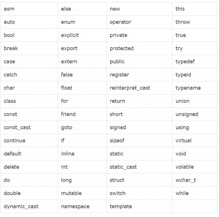

## 注释

注释是任何程序的重要组成部分，它们允许读者或开发者理解你程序的意图以及每行代码的作用。在代码中创建注释有两种方法：

```cpp
/* 这是一个多行注释，因为它可以跨越超过 1 行 */
// 这是一个单行注释。
```

## C++ 基础练习

1. `<iostream>`被称为什么？

   a) 指令（directive）

   b) 预处理指令（pre-processor directive）

   c) 文件（file）

2. `namespace`在编码时有任何意义吗？如果不使用它，我们还能使用`cout`和`cin`吗？

   a) 是

   b) 否

3. 在 C++ 程序中，如果不使用它，我们还能使用`cout`和`cin`吗？

   a) 是

   b) 否

4. 在 C++ 程序中，如果不使用它，我们还能使用`cout`和`cin`吗？

   a) 是

   b) 否

5. 在 C++ 程序中，如果不使用它，我们还能使用`cout`和`cin`吗？

   a) 是

   b) 否

6. 在 C++ 程序中，如果不使用它，我们还能使用`cout`和`cin`吗？

   a) 是

   b) 否

7. 在 C++ 程序中，如果不使用它，我们还能使用`cout`和`cin`吗？

   a) 是

   b) 否

8. 在 C++ 程序中，如果不使用它，我们还能使用`cout`和`cin`吗？

   a) 是

   b) 否

9. 在 C++ 程序中，如果不使用它，我们还能使用`cout`和`cin`吗？

   a) 是

   b) 否


C++ 与许多编程语言一样，也使用一组关键字。关键字是语言中具有特殊含义的单词，不能以任何其他方式使用。它们由于其特殊含义而被保留。


## 注释

注释是任何程序的重要组成部分，它们允许读者或开发者理解你程序的意图以及每行代码的作用。在代码中创建注释有两种方法。

`/* 这是一个多行注释，因为它可以跨越超过 1 行 */` `//这是一个单行注释。`

## C++ 基础练习

1. 什么 `<iostream>` 被称为什么？

   a) 指令 (directive)

   b) 预处理指令 (pre-processor directive)

   c) 文件 (file)

2. `namespace` 在编码时有任何意义吗？如果不使用它，我们还能使用 `cout` 和 `cin` 吗？

   a) 是

   b) 否

`cout` 对象是 `ostream` 类的一个实例，它连接到输出设备或显示器。这是一个非常简单的命令，大多数时候与 `cin` 配合使用，尽管它也可以在不使用它的情况下。

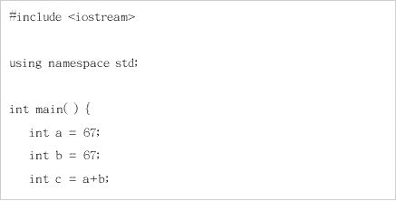

运行下面的程序，以准确看到 `cout` 语句的作用。

上述程序的输出应该是 `c` 的正确值，并带有给定的语句。

此程序中需要注意的两个重要点包括插入操作符 `<<` 和 `endl`。`endl` 用于在给定的字符串行末尾添加新行。如我们在上面所示，`<<` 可以使用多次。

## 使用 cin

`cin` 的使用允许用户将信息输入到指定的变量中。该对象属于 `istream` 族，它连接到输入设备（通常是一个类似于键盘的设备）。提取操作符与插入操作符相反。它简单来说就是 `>>`，将在下面的程序示例中看到。

```cpp
#include <iostream>

using namespace std;

int main( ) {
    char petname[40];
    char yourname[60];
    cout << "Please enter the name of your pet: ";
    cin >> petname;
    cout << "Your name is: " << petname << endl;
    cout << "Please enter your full name: ";
    cin >> yourname;
    cout << "Your name is: " << yourname << endl;
}
```

运行程序后，系统会提示你输入宠物的名字。然后它会被打印出来。接着，系统会提示你输入你的名字，它也会被打印。

尝试自己完成这个练习，以进行更多的输入输出练习。

1. 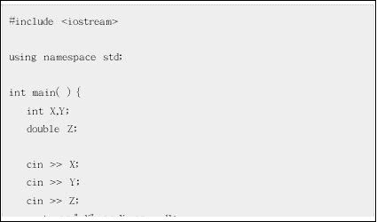回答下面的提示，使输入数值为 23、55.7 和 12。

# 第 3 章 – 条件语句

C++ 编程中的另一个主要部分是条件语句的使用。条件语句是根据程序当前值改变其预定路径的语句。我们要讨论的最先且基本的条件语句之一是 `if` 语句。

在进入各种类型的条件语句之前，我们必须首先知道在语句中使用哪些关系操作数，以及它们意味着什么。


- 大于 `8 > 6` 真
- 小于 `1 < 9` 真
- `>=` 大于等于 `3 >= 0` 真
- `<=` 小于等于 `6 <= 10` 真
- `==` 等于 `6 == 6` 真
- `!=` 不等于 `7 != 3` 真
- `&&` 与
- `||` 或
- `!` 非

## 使用 If 语句

为了完全理解 C++ 中的 `if if` 语句，你必须首先理解它们是如何工作的。

`if` 语句的结构如下：

```cpp
if (TRUE)
{
    执行下一个语句
}

if (TRUE)
{
    如果为真，则执行此块语句
}
else
{
    如果为假，则执行此块语句
}
```

在第一个示例中，如果给定的表达式为真，则执行语句。但在第二个语句中，如果语句为真，将执行该语句；但如果语句为假，将执行 `else` 语句。

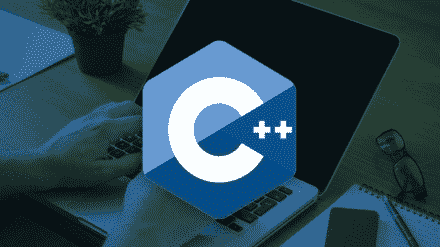

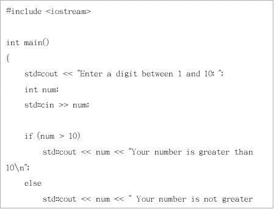

下面的程序将演示 `if` 语句是如何运行和执行的。

正如你可能猜到的，有时也会需要多个一个 `if` 语句。因此，可以使用多个 `if` 语句。

下面的示例程序显示了多个 `if` 语句是如何执行的。为了成功执行多个 `if` 语句，我们可以使用代码块。

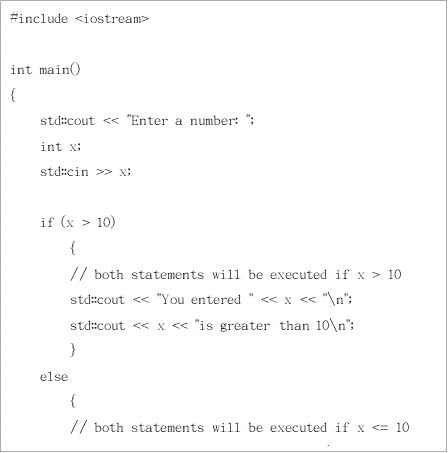

代码块本质上是括号 `{}`。使用这些括号允许用户告诉程序从哪里开始和结束 `if` 语句。在未指定块的情况下，程序足够智能可以隐式地定义块。

`if` 语句还可以通过 `else if` 链在一起，如下面的程序所示。

除了输入 `if` 语句的能力外，在 C++ 中嵌套 `if` 语句也是可以的。以下是嵌套的示例。

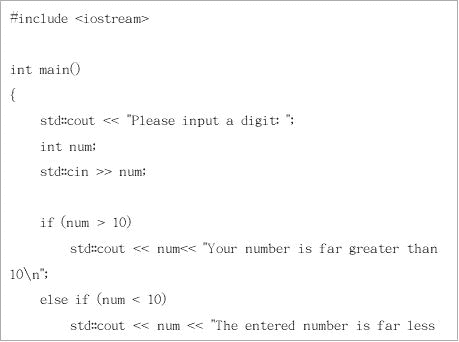

上面的代码因为缺少括号而令人困惑。在 `else` 周围添加块会让代码更清晰。这种歧义性被称为“悬空 else”（dangling else）。

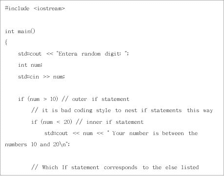

仍然不清楚如何实现 `if` 或 `if-else` 语句。使用下面的问题进行练习。

1. 下面哪种情况提供了 `if` 语句的正确结构？

   A. `if this then that`

   B. `if {expression}`

   C. `if (expression )`

   D. `else if`

2. 写一个程序，允许用户向系统输入一个数字。程序随后应该通过两个独立的 `if` 语句告诉用户该数字是大于还是小于 50。这通过使用输入语句和条件语句来实现。如果数字大于 50，程序应该打印“Wow, this number is big”。如果数字小于 50，程序应该打印“Yikes, this number is too”。

3. 如果如何实现一个 `if` 或 `if-else` 语句。

另一种常用的循环类型是 `while` 循环。只要 `while` 的测试语句为真，`while` 循环就会持续执行语句块。

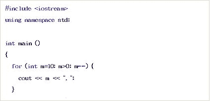

执行以下代码查看 `for` 循环的运行。

此 `for` 循环将有以下输出：

| 10, 9, 8, 7, 6, 5, 4, 3, 2, 1, The End! | |
|---|---|

下面的图表展示了 `while` 循环是如何运行的。

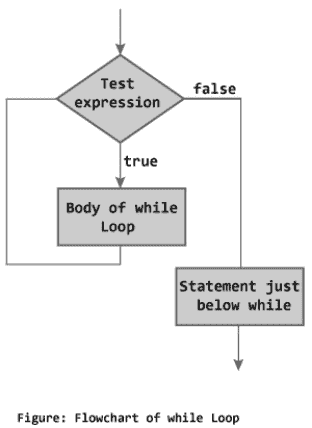

测试表达式可以是布尔表达式的任意组合。然而，只要该语句为真，循环体就会执行。

`while` 循环的语法如下：

```cpp
while ( w < 25 ) { // 当 w 小于 25 时
    cout<< w <<endl;
    w++;             // 修改 w 以便可以满足条件
}
```

与 `while` 循环相似的循环是 `do while` 循环。`do while` 循环虽然与 `while` 循环相似，但它执行给定语句后检查条件。当某些操作需要至少完成一次时，将使用 `do while` 循环。`do while` 循环的语法如下：

```cpp
do {
} while ( condition );
```

需要注意的是，只要条件保持为真，`do` 内部的语句就会继续执行。同样重要的是记住，`do while` 必须以分号结束，也称为尾随分号。

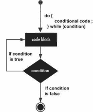

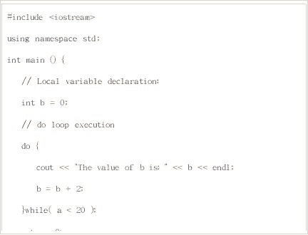

上图是 `do while` 循环运行方式的图形引用。按顺序执行以下代码查看 `do while` 循环的运行。

使用以下练习题进一步加深对循环的理解。

1. 下列代码将打印什么？

```cpp
var x = 0;
while (x < 3) {
    println("bye");
    x++;
}
```

2. 下列代码将打印什么？

```cpp
var x = 0;
while (x < 3) {
    println("hi");
    x++;
}
println("bye");
```

3. 下列代码将打印什么？

```cpp
var y = 0;
while (y < 0) {
    println("hi");
}
```

4. 哪个 `for` 循环无法工作？

   a) `for (i=0; i<5; i++)`

   b) `for (i=5; i<=10; i++)`

   c) `for (i=5; i=10; i++)`

5. 哪种类型的循环至少执行一次？

**练习题答案：**

1. bye

   bye

   bye

2. hi

   hi

   hi

   bye

3. 这段代码不会打印任何内容，因为 `y` 等于零，因此它永远不会小于零。

4. C.

5. `do while` 循环至少执行一次。

## Break & Continue 语句

`break` 和 `continue` 语句改变程序的常规执行流。`break` 语句一旦出现，就会立即结束循环和 `switch` 语句（后者将在稍后介绍）。

`break` 语句适用于 `while`、`do while` 和 `for` 循环。下图显示了 `break` 在每种循环类型中的工作方式。

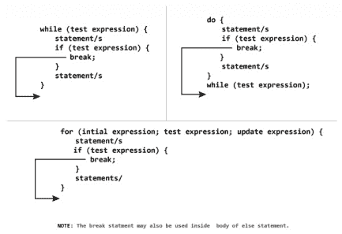

`continue` 语句用于跳过循环中的某些条件。该语句用于条件语句内部。下面的图表说明了 `continue` 语句是如何工作的。

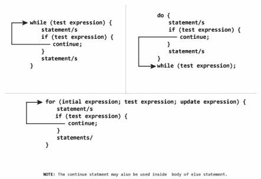

运行以下程序查看代码中 `continue` 语句是如何工作的。

```cpp
#include <iostream>

using namespace std;

int main()
{
    for (int j = 1; j <= 10; ++j)
    {
        if ( j == 6 || j == 9)
        {
            continue;
        }
        cout << j << "\t";
    }
    return 0;
}
```

## Switch 语句

当需要多个 `if else` 语句时使用 `switch` 语句。`switch` 语句的执行速度通常比多个嵌套的 `if` 语句快。它们更容易理解和编写。

`switch` 语句的语法如下：

```cpp
switch (n)
{
    case constant1:
        // 如果 n 等于 constant1，则执行代码；
        break;
    case constant2:
        // 如果 n 等于 constant2，则执行代码；
        break;
    default:
        // 如果 n 不匹配任何常量，则执行代码
}
```

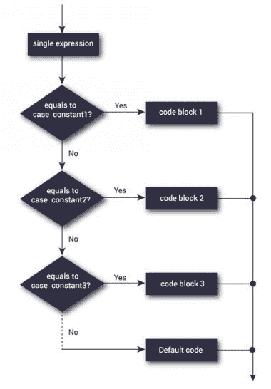

上面的语法和图表显示，当找到匹配 `n` 的 `case constant` 时，程序的控制权将传递到相关的 `case` 块。在程序到达 `break` 语句或块结束之前，将一直执行代码块。

## 练习 Switch 语句

使用这些问题练习 `switch` 语句及其用途。

1. 编写一个程序，根据学生的数字成绩确定其字母等级。程序应该输出学生的字母等级。使用 `switch` 来判断成绩是 A、B、C、D 还是 F。

2. `switch` 后面跟着一个特定的值。

3. `switch` 必须包含大括号吗？

4. 解释以下内容是错误的。

5. 解释以下内容是错误的。

6. `switch` 应该带有大括号吗？

**答案：**

1. A

2. C

3. No

4. 这是

5. True

6. False

```cpp
  }

return 0;

}
```

# 数组练习

使用这些问题来练习数组，并更好地理解该概念的应用。

1. 在下面的选项中，数组是如何声明的？

   a) `this_array [15];`

   b) `this_array (15);`

   c) `this_array {15};`

2. 数组的通用用途是什么？它们的作用是什的？

   a) 数组的目的是存储地址

   b) 数组的目的是在单个名称下存储值

   c) 数组的目的是存储一个值

3. `double test [8];` 在这里声明的数组名称是什么？

   a) 数据类型 `double`

   b) 数组没有名称

   c) `test`

4. 回到第 3 题。`test` 数组存储了多少个值？

   a) 它存储 7 个。

   b) 它存储 8 个

   c) 数组存储 6 个

5. 参考第 3 题。通过观察数组声明，最大的索引值将是多少？

   a) 最大值将是 7。

   b) 最大值将是 6

   c) 最大值将是 8

6. 在给出的选项中，哪一个选项显示了初始化数组值的正确方法？

   a) `sample_array [15] = (5,3,4,2,7);`

   b) `sample_array [15] = {5;3;4;2;7};`

   c) `sample_array [15] = {5,3,4,2,7};`

7. 参考第 6 题。`this_array [3]` 处的值是多少？

   a) 值是 7

   b) 值是 3

   c) 值是 4


8. 是否有方法可以一次性打印整个数组？

   a) 是

   b) 否

9. 在尝试打印或赋值数组中的项时，必须使用什么？

   a) 指针

   b) 条件

   c) 循环

## 练习题答案

1. 在下面的选项中，数组是如何声明的？

   a) `this_array [15];`

   b) `ths_array (15);`

   c) `this_array {15};`

2. 数组的通用用途是什么？它们的作用是什的？

   a) 数组的目的是存储地址

   b) 数组的目的是在单个名称下存储值

   c) 数组的目的是存储一个值

3. `double number [8];` 在这里声明的数组名称是什么？

   a) 数据类型 `double`

   b) 数组没有名称

   c) `test`

4. 回到第 3 题。`test` 数组存储了多少个值？

   a) 它存储 7 个。

   b) 它存储 8 个

   c) 数组存储 6 个

5. 参考第 3 题。通过观察数组声明，最大的索引值将是多少？

   a) 最大值将是 7。

   b) 最大值将是 6

   c) 最大值将是 8

6. 在给出的选项中，哪一个选项显示了初始化数组值的正确方法？

   a) `sample_array [5] = (5,3,4,2,7);`

   b) `sample_array [5] = {5;3;4;2;7};`

   c) `sample_array [5] = {5,3,4,2,7};`

7. 参考第 6 题。`this_array [3]` 处的值是多少？

   a) 值是 7

   b) 值是 3

   c) 值是 4

8. 是否有方法可以一次性打印整个数组？

   a) 是

   b) 否

9. 在尝试打印或赋值数组中的项时，必须使用什么？

   a) 指针

   b) 条件

   c) 循环

# 第 5 章 – 指针

指针使某些任务变得简单，而且相当易用。指针被定义为存储另一个变量地址的变量。与变量类似，在使用之前必须对其进行定义。`type *var-name;`

当使用指针时，类型取决于指向的类型。例如，如果我的指针指向一个 `double`，那么我的指针必须是 `double`。`var-name` 是你指针的名称。必须使用星号来表示指针。

`int *int_point;` // 指向整数的指针

`double *dou_point;` // 指向 `double` 的指针

`float *flo_point;` // 指向 `float` 的指针

`char *ch_point;` // 指向字符的指针

以下示例显示了存储在指针中的信息，运行以下代码可以更好地理解指针。

```cpp
#include <iostream>
using namespace std;
int main () {
  int variable = 10; // 实际声明
  int *ipointer; // 指针变量
  cout << "Value of variable: ";
  cout << variable << endl; // 访问指针可用可用
  cout << "Value of ipointer: ";
  cout << *ipointer << endl;
  return 0;
}
```

## 空指针

赋值 `NULL` 的指针称为空指针。空指针在声明时赋值。空指针通常是常量且其值为零。

## 指针运算

由于指针存储的是数值，它们也具有算术运算的能力。在某些程序中，开发者可能会选择使用指针而不是数组。这是因为指针可以增加而数组在没有循环帮助的情况下不能。以下程序显示了如何成功增加变量指针以访问数组的每个元素：

```cpp
#include <iostream>
using namespace std;
const int MAX = 4;
int main () {
  int var[MAX] = {10,100,200,300};
  int *ptr; // 让指针持有数组地址
  ptr = var;
  for (int j = 0; j < MAX; j++) {
    cout << *ptr << endl;
    ptr++;
  }
  return 0;
}
```


由于指针存储的是数值，它们也具有算术运算的能力。在某些程序中，开发者可能会选择使用指针而不是数组。以下代码显示了指针可以递增：

```cpp
#include <iostream>
using namespace std;
const int MAX = 4;
int main () {
  int var[MAX] = {10,100,200,300};
  int *ptr; // 让指针持有数组地址
  ptr = var;
  for (int j = 0; j < MAX; j++) {
    cout << *ptr << endl;
    ptr++;
  }
  return 0;
}
```

由于指针可以递增，它们也可以递减。运行以下代码显示指针如何递减：

```cpp
#include <iostream>
using namespace std;
const int MAX = 4;
int main () {
  int var[MAX] = {10,100,200,300};
  int *ptr; // 让指针持有数组地址
  ptr = var + MAX-1;
  for (int j = MAX-1; j >= 0; j--) {
    cout << *ptr << endl;
    ptr--;
  }
  return 0;
}
```

除了递增递减，指针还可以使用关系运算符进行比较。这包括 `==`、`<` 和 `>`。

# 第 6 章：函数

函数是极其有用的代码段，为了完成特定任务而编写。当它们结合使用时，可以创建更复杂、简洁的程序。函数的结构如下所示。请注意，原型是函数声明的另一种分类方式。

`返回值 名称 (数据类型变量, 数据类型变量...)`

- **返回值**：返回值指的是函数在完成后返回的内容。例如，如果我创建一个计算学生平均年龄的程序，我会使用 `int`，因为我不需要小数。因此，截断是可以的。我的返回类型将是 `int`。
- **名称**：这是函数的名称。在相同的示例中，我可以将此函数命名为 `average_age`。
- **数据类型**：数据类型指的是变量。这些是函数可以接收并使用的项。可以是一个，也可以是多个。

函数的开头看起来如下所示：

`int average_age(int x, int y)`

原型的位置如示例所示：

```cpp
#include <iostream>
int average_age (int x, int y);
int main() {
  //主程序
  return 0;
}
int average_age (int x, int y) // 注意这里没有分号
{
  //函数将写在这里
}
```

运行以下程序作为示例，以查看函数如何运作。以下程序中的函数用于相加两个变量并返回它们的和。

```cpp
// 完整的工作程序

#include <iostream>
double summation (int a, int b); // 原型
int main() {
  int x,y;
  double c;
  cin>>x; // 用户输入 x 的值
  cin>>y; // 用户输入 y 的值
  c = summation(x,y); // 调用函数 summation 并传递读入的变量
  cout << "The sum of the 2 numbers is " << c << endl;
  return 0;
}
double summation (int a, int b)
{
  return a + b;
}
```

```cpp
double summation (int a, int b) //定义函数
{
  double z;
  // 'a' 存储 'x' 的值，'b' 存储 'y' 的值
  z = a+b;
  return z; // 将 'z' 的值返回给 main 中的变量 'c'
}
```

除了返回数字或变量的函数外，还有不返回任何内容的函数。这些是 `void` 函数。

```cpp
void sum (int x)
```

这意味着像上一个示例所示，将没有返回值。

## 练习函数

1. 当你使用函数时，必须的第一件事是什么？
   - a) 声明变量
   - b) 原型
   - c) 初始化

2. 原型位于你程序的什么位置？
   - a) 在 `int main()` 之前
   - b) 在 `int main()` 之前之后
   - c) 程序的末尾

3. 给定示例 `int books (int y)`，创建的函数名称是什么？
   - a) `int`
   - b) `int y`
   - c) `books`

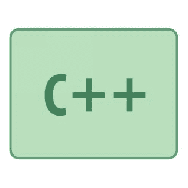

4. 根据问题 3 中的示例，函数将返回什么数据类型？
   - a) `int`
   - b) `string`
   - c) `double`

5. 根据问题 3 中的示例，该函数将接受什么数据类型？
   - a) `char`
   - b) `String`
   - c) `int`

6. `char my_function (int a)`，此函数将接受什么类型的数据？
   - a) `double`
   - b) `char & double`
   - c) `int`

7. 给出的函数 `double summation (double a, double b)`，从主程序调用该函数的正确方式是什么？
   - a) `summation (x)`
   - b) `summation (y)`
   - c) `summation (x,y)`

8. 如果你在函数内部声明了一个变量，这是什么样的变量？
   - a) 全局变量
   - b) 局部变量
   - c) 扩展变量

9. 如果我们有一个函数 `double go (double b)`，我们可以在主程序中向它发送一个不同的变量吗，还是必须是 `b`？例如，`go (x)`
   - a) 是
   - b) 否

## 函数练习答案

1. 当你使用函数时，必须的第一件事是什么？
   - a) 声明变量
   - b) 原型
   - c) 初始化

2. 原型位于你程序的什么位置？
   - a) 在 `int main()` 之前
   - b) 在 `int main()` 之前之后
   - c) 程序的末尾

3. 给定示例 `int books (int y)`，创建的函数名称是什么？
   - a) `int`
   - b) `int y`
   - c) `books`

4. 根据问题 3 中的示例，函数将返回什么数据类型？
   - a) `int`
   - b) `string`
   - c) `double`

5. 根据问题 3 中的示例，该函数将接受什么数据类型？
   - a) `char`
   - b) `String`
   - c) `int`

6. `char my_function (int a)`，此函数将接受什么类型的数据？
   - a) `double`
   - b) `char & double`
   - c) `int`

7. 给出的函数 `double summation (double a, double b)`，从主程序调用该函数的正确方式是什么？
   - a) `summation (a)`
   - b) `summation (a,b)`
   - c) `summation (b)`

8. 如果你在函数内部声明了一个变量，这是什么样的变量？
   - a) 全局变量
   - b) 局部变量
   - c) 扩展变量

9. 如果我们有一个函数 `double go (double b)`，我们可以在主程序中向它发送一个不同的变量吗，还是必须是 `b`？例如，`go (x)`
   - a) 是
   - b) 否

# 第 7 章：类与对象

C++ 的主要功能之一是在 C 语言的基础上增加了面向对象特性。由于这一点，类是 C++ 程序涉及的特性之一。这些有时被称为用户定义类型。

## 为什么使用类？

使用类是为了详细描述对象的结构。它还包含了操作对象及其任何特征所需的方法。类中的函数和数据被称为其成员。

## C++ 类定义

实际上，类并不定义任何形式的正式数据。它仅仅是一个大纲或蓝图。类定义了类名的含义以及它代表的对象的组件。它还定义了对象可以执行哪些操作。

在定义类时，必须始终以关键字 `class` 开始。后面应该紧跟类的名称。然后是类体，所有内容都必须包含在大括号中。类定义之后必须紧跟一个分号或声明列表，取决于用户的需求。以下是类声明的示例。

```cpp
class Person {
 public:
  double weight; // 人的体重
  double height; // 人的身高
  int age; // 人的年龄
};
```

在上方，你会看到 `public` 关键字的使用。这用于确定成员的访问级别。任何标记为 `public` 的内容都可以从类外部访问。还可能是 `private` 或 `protected`，这些将在稍后讨论。

## 定义 C++ 对象

由于类被认为是对象的蓝图，因此从类中创建对象是合理的。对象的声明方式与变量一样。

```cpp
Person Person1;
Person Person2;
```

对象 `Person1` 和 `Person2` 将拥有它们自己的数据拷贝。

## 访问数据成员


任何公共类型的成员都可以通过使用 `.` 使用。这就是访问运算符。运行上面的程序查看如何使用访问运算符。请记住，私有保护的项目无法使用访问运算符。

## 类成员函数

成员函数操作对象。它是类内部定义的函数。在类定义之外，成员函数也可以通过作用域运算符 `::` 分别定义。这将内联定义。下方示例所示。


## 类成员修饰符

`public`、`private` 和 `protected` 为类体内部成员提供了访问限制。这些关键字可以称为指定符。类能够拥有多个访问级别的块。成员和类默认访问类型为 `private`。


## 构造函数与析构函数

构造函数是在创建新对象时实现的类函数。它们与类同名，但没有返回类型。下面的示例显示了如何使用构造函数。


虽然构造函数通常没有参数，但它仍然具有这种能力。这有助于你在对象创建时赋值。下方是带参数构造函数的示例。


析构函数在对象超出作用域时执行。它在 `delete` 表达式应用于对象指针时也会执行。析构函数与类同名，但以波浪 `~` 前缀。它不能返回或接受参数。它在释放资源时有用。以下是析构函数的示例。


## 友元函数

友函数定义在类的范围之外，但它能够访问所有的私有（private）和保护（protected）成员。成员函数不能是友函数。要声明一个函数为友函数，必须在函数前加上 `friend` 关键字。下面的示例展示了如何使用友函数。

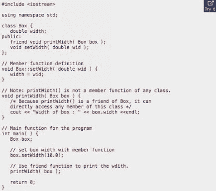

## 静态类成员

静态类成员使用 `static` 关键字定义。这意味着无论存在多少对象，静态类成员都只有一个。

下面的示例展示了如何使用静态类成员。

即使在类不存在任何对象的情况下，也可以调用静态成员函数。需要注意的是，静态函数通过简单使用类名和作用域解析符 `::` 来访问。静态成员函数仅能够访问静态数据成员、静态成员函数以及类外的任何其他函数。

静态成员函数可以访问静态数据成员、静态成员函数以及类外的任何其他函数。它还可以用于判断对象是否已经创建，或是否尚未创建。

以下是使用静态函数成员的示例。


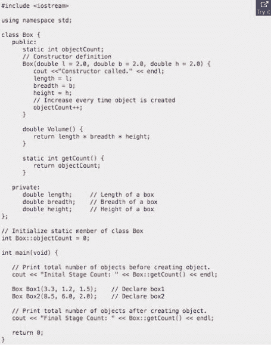

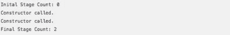

## 基础练习题

1. 使用类编写一个程序，从用户获取姓名和年龄，并将这些信息在屏幕上显示给用户。你的类应该包含人的姓名和年龄。

2. 假设一个类被公继承，下列描述正确的是？
   - A) 基类的公共成员将保持为派生类的保护成员。
   - B) 派生类的私有成员将成为派生类的私有成员。
   - C) 基类的私有成员将成为派生类的保护成员。
   - D) 基类的公共成员将成为派生类的公共成员。

3. 以下哪种是 C++ 中类的默认访问类型？
   - A) 私有 (Private)
   - B) 公有 (Public)
   - C) 静态 (Static)
   - D) 绑定 (Binding)

4. 类实例被称为 _____？
   - A) 函数 (Function)
   - B) 类 (class)
   - C) 对象 (object)

## 练习题答案

```cpp
/*  在 C++ 中创建基础类
*/

#include <iostream>

using namespace std;

// 类 -------------------

class person
{
public:
// 变量声明
  string name;
  int age;
};

//----------------------
// 主函数
int main()
{
    person info;
    // 获取对象变量输入值
    cout<<"Enter the Name :";
    cin>>info.name;
    cout<<"Enter the Age :";
    cin>>info.age;
    // 显示输出
    cout << info.name << ": " << info.age << endl;
    return 0;
}
```

2. 假设一个类被公继承，下列描述正确的是？
   - A) 基类的公共成员将保持为派生类的保护成员。
   - B) 派生类的私有成员将成为派生类的私有成员。
   - C) 基类的私有成员将成为派生类的保护成员。
   - D) 基类的公共成员将成为派生类的公共成员。

3. 以下哪种是 C++ 中类的默认访问类型？
   - A) 私有 (Private)
   - B) 公有 (Public)
   - C) 静态 (Static)
   - D) 绑定 (Binding)

4. 类实例被称为 _____？
   - A) 函数 (Function)
   - B) 类 (class)
   - C) 对象 (object)

# 第 8 章：继承

像 C++ 这样的面向对象编程语言是以对象而非动作建模的。面向对象（OOO）有 7 个主要组件。

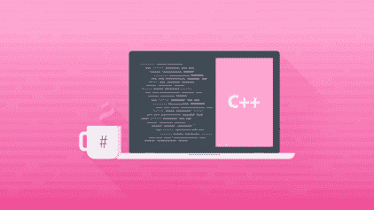

这些组件包括：

- 抽象（Abstraction）——隐藏与功能相关的细节，但显示本质特征。
- 封装（Encapsulation）——这是函数与变量的绑定。
- 继承（Inheritance）——它允许重用代码而无需反复编写。这还允许类从基类继承信息。
- 多态（Polymorhism）——它允许创建名称相同但使用不同参数的函数。尽管这些函数具有类似的命名约定，但它们的行为不同。

本章将重点关注继承以及在 C++ 中使用继承。继承让你的代码更简洁、更易理解。

## 派生类

类具有从多个类派生的能力。这意味着它可以从各种基类继承函数和数据。

类派生列表用于定义派生类。它列出了一个或多个基类的名称。派生列表的形式如下所示。

```cpp
class derived-class: access-specifier base-class
```

## 访问控制与继承

派生类具有访问所有非私有基类成员的能力，这意味着基类成员不应该是不可访问的。根据谁可以访问以及如何访问，显示了以下类型。

| 访问 | 公共 (Public) | 保护 (protected) | 私有 (private) |
| :--- | :--- | :--- | :--- |
| 同一类 | 是 | 是 | 是 |
| 派生类 | 是 | 是 | 否 |
| 外部类 | 是 | 否 | 否 |

## 继承类型

当类从基类派生时，有 3 种方式。最常用的是公继承。

- 公继承：使用公继承时，关键在于记住基类和子类都是感知的。
- 保护继承：使用保护继承时，必须记住只有子类和它的子类是感知的。
- 私有继承：使用私有继承时，更加封闭。除了子类没人知道。

## 多继承

在 C++ 中，类具有从多个类继承的能力。语法如下：

```cpp
class derived-class: accessA, accessB
```

# 第 9 章：新版本：C++11

C++ 的第一次迭代大约发生在 1998 年。尽管等待了很久，但 C++11 在 2011 年 8 月通过了，就在第一次迭代之后 13 年。有人说尽管版本 11 是相同语言的改进，但它感觉是全新的。

C++11 可以支持许多新功能，包括：

- Lambda 表达式
- 委托构造函数
- 删除与默认函数声明
- 空指针
- 右值引用
- C++ 标准库的革新
  - 新算法
  - 新容器类
  - 类型特质
  - 原子操作
  - 多线程库

在本章中，你将学习更多关于 C++11 的核心功能及其运作方式。

## Lambda 表达式


Lambda 表达式可以定义为大小任意执行语句块，就像函数一样，可以插入函数调用的位置。在实现这些表达式之前，C++ 提供了成员函数、内联函数和函数对象的使用。然而，那些方法更加繁琐。

高亮显示的语句以 lambda 引入符 `[]` 开始。`{}` 之间的语句充当要执行的函数，类似于普通函数。在上面的示例中，该表达式被用于判断当前会计对象接收的工资是否高于给定的最低工资但又低于上限。如上所示，由于这些表达式只有一行，因此它们更容易整合到代码中。


lambda 表达式的格式如下：

`capture->return-type {body}`

格式中显示的第一个项是捕获子句（capture clause）。lambda 表达式具有引用外部的能力。这意味着它能够访问来自“闭包作用域”的变量。在给定的示例中，`min_wage` 和 `upper_limit` 在闭包作用域内。

外部引用可以通过两种方式捕获。这包括值捕获和引用捕获。捕获方法非常重要，因为它决定了表达式如何操作变量。每个编译器会将每个表达式转换为一个函数对象。


为了转换该表达式，必须遵循若干准则。这些准则包括：

* 将 lambda 的体转换为重载运算符之一。
* 表达式的参数列表也变为该重载运算符的列表。
* 被捕获的变量变为重载运算符的数据成员。

闭包对象（closure object）是 lambda 表达式的重要部分。这是编译器生成的函数对象。

当变量被“按值捕获”时，它变成闭包作用域变量的一个拷贝成员。当变量被“按引用捕获”时，它被绑定为闭包作用域变量的引用。当某项被分类为默认捕获时，它是闭包作用域内所有项目的捕获方法。

以下示例是值捕获和引用捕获的示例。下面提供了值捕获的示例：

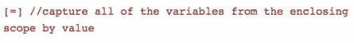

下面提供了引用捕获的示例：

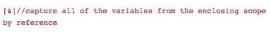

判断 lambda 是否有外部引用很容易。空的捕获子句表示没有外部引用。这意味着它只访问 lambda 的局部变量。

```
[] (int a, int b) {return a*b;}
```


下面显示的 lambda 提供了各种捕获子句的示例。

```cpp
vector<int> v3={0,8,9}, v4={11,12,14,15}; //这是 C++11 中的新初始化符号

&v3 {vi.push_back(a); }; //引用捕获的示例。捕获了 v3。

[&]  (int m) {v1.push_back(m); v4.push_back(m) };

//这显示了通过引用捕获 vi 和 vi2。

[v3]() //此示例显示了 v3 被按值捕获。

{for_each(auto y=v3.begin(), y!=v3.end(), y++) {cout<<y<<" ";}};
```

C++11 还允许将 lambda 表达式存储在变量中，就像普通函数和变量一样。该功能的示例所示：

```cpp
auto fact = [](int e, int f) {return e * f;};
```

上面的 `auto` 声明定义了 `fact`，这是一个闭包类型。以后可以调用它，而无需输入整个 lambda 表达式。闭包类型是编译器生成的函数类。

```cpp
int arr{1,2,3,4,5,6,7,8,9,10,11,12};

long res = std::accumulate(arr, arr+12, 1, factorial);

cout<<"12!="<<res<<endl; //
```

在上面的示例中，`factorial` 闭包在每次迭代中将当前元素的值与累加的值相乘。结果将是 12 的阶乘。如果不使用 lambda，则需要定义一个下面列出的单独函数。

```cpp
inline int factorial (int a, int b)
{
return a*b;
}
```

## 自动类型推导和 decltype

在之前的 C++ 版本 3 版中，声明时必须指定类型。对象的声明中通常包含一个初始化器。C++11 允许在不指定类型的情况下声明对象。下面提供了一些示例：

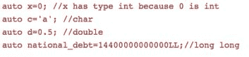

类型推导经常用于模板中，当对象自动生成时。当对象类型非常繁琐时也可以使用它。

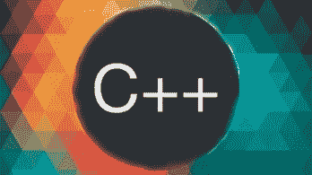

这个新版本提供了一种捕获表达式类型的机制。`decltype` 返回表达式的类型。

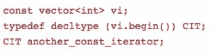

`decltype` 的主要用途是声明函数模板。这些函数模板类型取决于参数的类型。

## 删除函数和默认函数（Deleted and Defaulted Functions）

下面的示例被称为默认函数（default function）。

```cpp
struct A
{
A()=default; //C++11
virtual ~A()=default; //C++11
};
```

代码的粗体部分 `=default` 告诉编译器创建默认实现。

默认函数有 2 个主要优势。包括：

* 与手动实现相比，默认函数高效得多。
* 默认函数还释放了开发人员。

默认函数的反面是删除函数（deleted function）。

```cpp
int func()

删除函数。
```

```cpp
struct NoCopy
{
NoCopy ( const NoCopy ) = delete;

NoCopy operator =( NoCopy ) = delete;
};
```

```cpp
NoCopy a;

NoCopy b);//编译错误，copy 被删除
```

## Nullptr


自 C 语言诞生以来，`0` 一直用作空指针。`nullptr` 现在取代了 `NULL`。换句话说，在你打算 `NULL` 的地方可以使用 `nullptr`。该关键字的类型是 `nullptr_t`。

以下是使用空指针之前的程序示例：

```cpp
void g(int);
void g(char*);

void h()
{
 g(0); //调用 g(int)
}
```

在 C++11 创建空指针后，相同的语句将如下：

```cpp
void h()
{
 g(nullptr); //调用 g(char*)
}
```

`nullptr` 适用于所有指针类型。这些包括函数指针和成员指针。由于 `nullptr` 是指针类型，它不能转换为整数类型。

## 委托构造函数（Delegating Constructors）

 00058.jpeg

)

委托构造函数是指将多个构造函数链在一起的能力，或者调用同一类的另一个构造函数。这些构造函数的示例所示：

```cpp
class Z //C++11 委托构造函数
{
int a, b;
char *p;

public:
Z(int v) : a(v), b(0), p(new char [MAX]) {} //1 目标构造函数
 Z(): Z(0) {cout<<"delegating ctor"<<endl;} //2 委托构造函数
};
```

在示例中，委托构造函数是 2，而构造函数 1 是它调用的目标。

## 右值引用（Rvalue References）

右值引用是 C++11 引入的另一个项目。在之前的 C++ 版本 3 版中，引用类型只能绑定到 lvalue。这些新的右值引用能够绑定到右值，如字面量或临时对象。

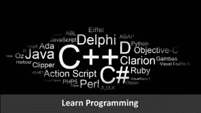

回顾一下，在 C 的背景下，lvalue 是可以在赋值左侧或右侧的表达式。rvalue 正如其所示，只能在赋值右侧可见。列出了一些 lvalue 的示例。

```cpp
int c = 47;
```

```cpp
int d = 33;
```

在上面的示例中，`c` 和 `d` 都是左值（l-values）：

```cpp
c = d;
d = c;
c = c * d;
```

在上述项中，`c * d` 是右值（rvalue）。

```cpp
int e = c * d;
```

这条语句是可以的，因为右值位于赋值的右侧。

```cpp
c * d = 47;
```

这条语句是不允许的，因为右值位于赋值的左侧。


这些右值引用（rvalue references）的原因是移动语义（move semantics）。移动不能直接与对象的拷贝相比较。在移动过程中，目标对象从源内部获取资源。这本质上使得源对象失去了任何资源或处于“空”状态。在不需要或可能发生昂贵拷贝时，通常会使用移动操作。

为了充分发挥移动语义的潜力（包括利用性能提升），应该考虑字符串交换。

一个非常基础的实现看起来类似于下面的示例：

```cpp
void basicswap(string &b, string & c){
string temporary = b;
b=c;
c= temporary;
}
```

上面的示例可以被归类为基础或浅素的，因为这种实现被认为是昂贵的。字符串的拷贝意味着必须分配原始内存。这意味着字符需要从源移动到目标。而，当字符串被移动时，数据成员仅被简单的交换。这在不分配内存、不删除内存且不拷贝字符的情况下即可完成。

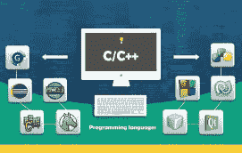

右值引用的行为与普通引用相似。然而，右值引用有几个例外。

除了解决移动语义问题外，它还试图解决完美转发（perfect forwarding）。完美转发允许开发者编写构造函数或函数，并将参数作为右值或左值进行转发。

以下代码展示了字符串的移动，它仅仅交换了两个数据成员。这样做不需要分配或删除内存，也不需要拷贝字符数组。

```cpp
void moveswap(string& blank, string & full){
//伪代码
size_t sz=blank.size();
const char *p= blank.data();
//将 full 的资源移动到 blank
empty.setsize(full.size());
empty.setdata(full.data());
//full 变为 blank
full.setsize(sz);
full.setdata(p);
}
```

在实现支持移动的类时，可以声明移动构造函数和赋值运算符。这类似于下所示的内容。

```cpp
class Ablemove
{
Ablemove (Ablemove &&); //移动构造函数
Ablemove && operator=( Ablemove &&); //移动赋值运算符
};
```

需要注意的是，C++11 标准库极地利用了移动语义。因此，大量的算法和容器现在都经过了移动优化。

## C++11 标准库

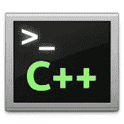

技术报告 1（Library Technical report 1）首次引入于 C++03。随着该库的实现，C++ 经历了重大的重构。它包含了各种新的容器类，以及用于正则表达式、函数包装器等组件的新库。随着 C++11 的到来，技术报告 1 正式并入标准。这带来了许多新库。

C++11 在 C++ 语言中引入了大量新库，包括：

* 正则表达式库
* 线程库
* 原子操作库
* 容器库中的各种特性

## 线程库

C++11 的一个显著新增是增加了并发（concurrency），也称为同时执行多条指令。C++11 现在为开发者提供了一个 `thread` 类，代表一个执行线程。这被称为承诺（promises）和未来（futures）。这些是主要用于在并发环境中进行同步的对象。

使用新的线程功能非常简单，将在下面的示例中进行演示。这只需简单地添加线程头文件：

```cpp
#include <thread>
```

接下来的示例仅利用了“Hello World”，这是编程教程中最基础的示例。

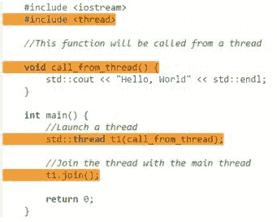

在你的机器上运行上述代码。C++11 还允许在线程中使用参数。我们能够添加任意数量的参数。以下代码已修改为使用参数并展示了给定的输出。

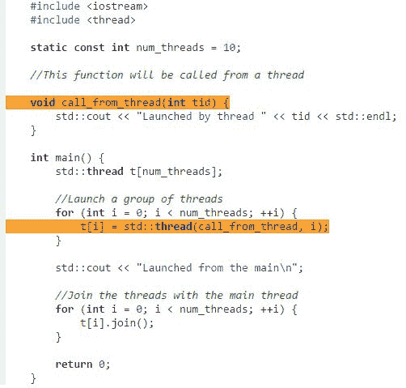

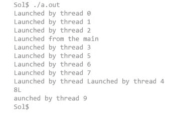

你可能会注意到某些结果是困惑或混乱的。这是因为所有线程恰好在竞争同一个资源。该资源是 `stdout`。

通过互斥锁（mutexes）或屏障（barriers）可以避免这些混乱的结果。这些屏障允许开发者组织线程如何共享特定资源。

## 新的智能指针类


如果你不知道，智能指针目前定义在内存头文件的 `std` 命名空间中。它们是 RAII 的关键因素。RAII 全称为“资源获取初始化”（Resource Acquisition Initialization），确保资源获取在对象初始化的同时发生。C++ 之前的版本（C++98）中有一个智能指针类。该类是 `auto_ptr`，它现在已被废弃。C++11 引入了两个新的智能指针类：`shared_ptr` 和 `unique_ptr`。这两个新组件与标准库的其他组件兼容。因此，指针可以存储在标准容器中并在标准算法处理。

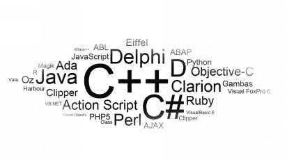

以下定义取自 MDSN.com，并准确地解释了这些新库组件。

### unique_ptr

`unique_ptr` 的底层指针仅允许一个所有者。除非你确定需要 `shared_ptr`，否则应作为默认选择。它可以移动到新的所有者，但不能拷贝。对比 `boost::scoped_ptr`。`unique_ptr` 体小且高效；其大小为一个指针，并支持右值引用以便从 STL 集合中插入和检索。头文件：`<memory>`。

下面的图说明了所有权如何在两个 `unique_ptr` 之间转移。

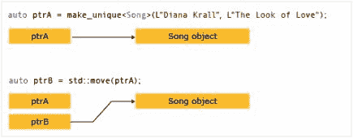

示例演示了如何在代码中传递和创建 `unique_ptr` 实例。

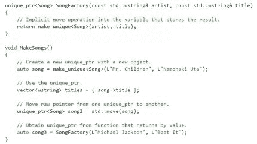

### shared_ptr

这种指针类型是引用计数智能指针。当多个指针需要分配同一个原始指针的所有权时（例如，从容器返回指针副本但想保留原始指针时）。一旦所有 `shared_ptr` 所有者离开作用域或放弃所有权，原始指针就可以被删除。其大小为两个指针；对象使用其中一个指针，共享控制块中的引用计数使用另一个。头文件：`<memory>`。

下面的图显示了多个 `shared_ptr` 指向同一个内存位置。

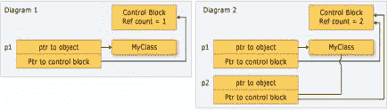

以下代码示例说明了 `shared_ptr` 实例声明和初始化。一旦分配了对象，这些实例将获得该对象的所有权。

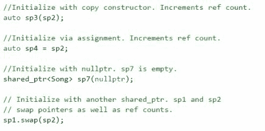

共享指针也可以传递给其他函数。这可以通过以下方式实现：

* 按值传递
* 按引用传递
* 传递给底层对象

## 新 C++ 算法

C++11 还引入了多种新算法。确切来说有 8 种算法。这些新算法包括：

* `all_of()`
* `any_of()`
* `none_of()`
* `is_sorted()`
* `is_sorted_until()`
* `is_partitioned()`
* `is_permutation()`
* `minmax_element()`

### All_of, any_of, none_of 算法

这三个算法非常相似。它们本质是检查一元谓词是否对无、全部或部分元素返回 true。

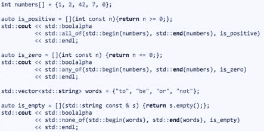

### is_sorted()

该算法本质上是检查特定范围内的元素是否按升序排列。该范围内的元素使用 `operator<` 进行比较。它们也会使用 `comp`（二元比较函数）进行比较。

下面是它的用法示例以及给定的输出。

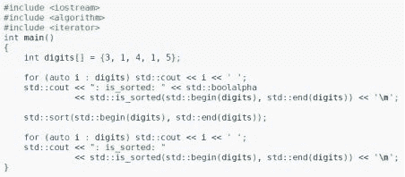

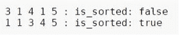

### Is_sorted_until()

该算法与 `is_sorted()` 算法类似。它通过检查一组元素是否按升序排列来执行相同的功能，但该算法返回一个迭代器。该迭代器指向最大子范围的边界（upper bound）。该范围显然是有序的。下面是一个使用 `is_sorted_until()` 的程序示例及其给定的输出。

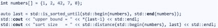


### Is_partitioned()

该算法的作用完全如其名称所描述。它检查一个范围是否被划分（partitioned）。这意味着它检查一个范围是否根据给定的一元谓词进行了排序。所有不满足给定谓词的元素必须返回在满足条件的元素之后。

下面的程序展示了如何使用 `is_partitioned()` 算法的示例。

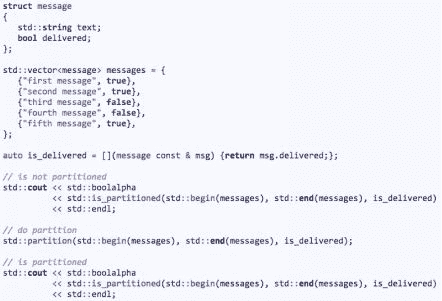

### Minmax_element()

`minmax_element()` 算法在给定范围内寻找最小值和最大值。一旦成功运行，它会返回对应元素的迭代器对。关于该算法必须记住的三点包括：

* 当给定的范围没有值或为空时，算法将简单地返回 `std::make_pair(first, first)`。
* 如果在定的值集中存在多个最小值，它将仅返回第一个。
* 如果在给定的值集中存在多个最大值，它将仅返回最后一个。

在下面的代码中可以看到该函数的用法，以及其给定的输出：

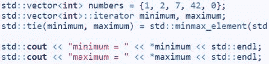


### Is_permutation()

该算法用于确定一个元素范围是否是另一个元素范围的排列（permutation）。下面是 `is_permutation` 的用法示例。


总的来说，C++11 整合了许多变化。变化之多以至于某些人认为它几乎是一门不同的语言。你需要时间来适应这些变化。不要指望一夜就能理解所有它们。C++14 对 C++11 引入的许多内容进行了重大修订。下一章将重点提供这些组件以及相应的示例。

# 第 10 章 – 新版本：C++ 14

C++14 于 2014 年 12 月发布。在发布之前，它经常被称为“C++1y”。C++14 为核心语言增加了大量的更新。在许多情况下，C++14 是在 C++11 添加的功能的基础上的。总的来说，这是一个更精细的版本，对用户的影响更小。


## 返回类型推导

C++11 引入了 lambda 表达式，并允许它们根据表达式确定返回类型。这个新版本赋予了所有函数这种能力。需要使用`auto`来确定返回类型。


## 放宽`constexpr`


C++11 还引入了`constexpr`函数的概念。这本质上是可以在编译时执行的函数。在 C++11 中，`constexpr`函数只能有一个表达式。

C++14 减少了 C++11 中存在的限制。这些函数现在可以包含：

- 除了`thread_local`或`static`变量类型，或任何未初始化的声明外的所有声明。
- 包括`if`语句和`switch`在内的条件。
- 任何循环语句，包括`for`或`while`。

在该版本的 C++ 中，已禁止使用`goto`语句。

## 数字分隔符

C++14 现在为用户提供了使用数字分隔符的选项。这只是用于数值字面量中的单引号，包括整数和浮点整数。

该功能并不是什么惊天动地的特性，但对于读取数字很有用。分隔符不会改变数字的求值，除了可读性外，没有特殊的编码优势。

下面的示例标识了如何使用它。


## 关键字：`auto`

`auto`关键字是 C++14 中的新特性。它的意图是让编码更简单、更整洁且更不容易出错。使用`auto`对速度没有任何负面影响，因为`auto`是在编译时推导的。

下面是`auto`的用法示例：


上面的示例等价于：


以下是 C++11 和 C++14 中`auto`的示例。

1. 这是 C++11 的版本。


C++14 的版本如下：


## 通用 lambda


Lambda 函数引入于 C++11，当时需要声明为具体类型。C++14 在这一要求上更加宽松，允许 lambda 参数声明为`auto`类型。

```cpp
auto f = [](auto x){ return normalize(x); };
```

上面的定义等同于伪代码：


在上面的示例中，lambda 将`x`转发给`normalize`。闭包的调用运算符如所示。为了实现这一点，`x`必须是通用引用。它还通过`std::forward`传递给`normalize`。

找到一个通用 lambda 用法的完整程序示例。


运行上述代码的结果如下：


## 新标准库特性

随着 C++14 的出现，带来了新的标准库特性。这些特性包括：

- 锁和共享互斥锁。
- 关联容器中的异构查找。
- 用户定义的标准字面量。
- 元组索引。

这是 C++14 提供的主要库特性列表，还有大量较小的库添加。

## 用户定义字面量

C++14 增加了一些后缀，用于指定定义字面量的类型。这些后缀的一些示例包括`s`或`st`，用于字符和字符串类型。


给定示例的最后一行将报错。这是因为`str`将被确定为`const char*`类型，而`str1`将被确定为`string`。

以下后缀——`h`、`min`、`s`、`ms`、`us`、`ns`——用于表示各种时间间隔类型。


在`C++14`出现之前，不支持像`11111101`这样的二进制字面量。为了使用它们，需要将它们转换为支持的类型。下面的代码段展示了它们在编程中的用法。


二进制字面量以`0b`或`0B`开头。前缀之后是一系列 0 和 1。在许多其他编程语言中也可以找到类似的语法。这些编程语言包括`Java`、`Perl`和`Python`，它们都已经提供了对二进制字面量的支持。

二进制字面量的类型为`int`。它在所有接受常量字面量的地方都可以被接受。

## 变量模板

变量模板的设计意图是让编码更简单，并简化常量的定义和使用。变量模板本质上是一组变量的定义。变量是通过在声明变量的地方使用模板声明创建的。


这些仅仅是`C++14`引入的一些特性。还引入了许多其他特性，但它们并不是重大的进展。包含在`C++14`中的一些次要特性包括尺寸初始化和一些语法清理。虽然`C++14`的版本更新不像`C++11`那样重大，但它是必要的。

## 结论

恭喜你，通过学习和应用每一章列出的内容，你已经读完了这本书！记住，这只是一个开始。为了真正精通`C++`，你必须不断地学习并应用你所学的知识。既然你已经开启了`C++`之旅，保持警惕是十分重要的。

`C++`是一种通用语言，可以适用于各种大型系统，也可以适用于较小的系统。在创建商业应用时，它是一种突出的语言。有大量使用`C++`编写的项目，包括：

- 如`Linux`和`Mac OS X`等操作系统。
- 如《魔兽世界》和《暗黑破坏》系列等游戏。
- 流行的`Wii`、`PlayStation`和`XBOX`游戏。
- 编程语言的虚拟机（这些语言包括`Python`、`Java`、`Rudy`、`PFP`、`Perl`）。
- 热门软件如`MS Office`、`Adobe Photoshop`、`Inventor`和`AutoCAD`。
- 浏览器（`Chrome`、`Internet Explorer`和`Firefox`）。
- 许多`Apple iOS`应用。

这个列表证明了`C++`是一种能够胜任几乎所有工作的通用语言。

如果你在想`C++`在明天或未来 10 年是否仍然适用，那么答案是肯定的！

`C++`结合其前身`C`提供了对硬件的访问和高层次的抽象。它是仅次于`C`的第三常用语言（在`Java`之后位居第二）。目前还没有竞争对手可以取代`C++`。

`C++`速度快，并且能够有效地利用资源。大多数高质量的嵌入式应用程序都是使用`C`和`C++`创建的。

`C++`于 1985 年 10 月首次实现商业化。`C++`在其整个生命周期内持续演进，并遵循一套独特的规则。这些规则包括以下内容。这些规则源自`Bjarne Stroustrup`编写的《在现实世界中为了演进语言：C++ 1991-2006》。

### 通用规则

- `C++`的演进必须由真实的问题驱动。
- 不要陷入毫无意义的完美追求中。
- `C++`现在必须是实用的。
- 每个特性都必须有合理易见的实现方式。
- 始终提供过渡路径。
- `C++`是一门语言，而不是一个完整的系统。
- 为每种支持风格提供全面的支持。
- 不要试图强制人们使用特定的编程风格。

### 设计支持规则

- 支持合理的设计理念。
- 提供程序组织所需的设施。
- 有话直说。
- 所有特性都应该是可负担得起的。
- 允许实用的特性比防止所有的误用更重要。
- 支持从单独开发的部分组合成软件。

### 语言技术规则

- 不得隐式违反静态类型系统。
- 为用户定义类型提供与内置类型同等良好的支持。
- 局部性是好的。
- 避免顺序依赖。
- 如果不确定，选择最容易教学的特性变体。
- 语法很重要（通常以扭曲的方式）。
- 应该消除预处理器的使用。

### 低级编程支持规则

- 使用传统的（笨的）链接器。
- 不要与`C`产生无故的不兼容。
- 在`C++`之下不留给更底层语言的空间（汇编除外）。
- 你不使用的就不需要付费（零开销原则）。
- 如果不确定，提供手动控制的手段。

总的来说，人们使用`C++`有许多原因。简单来说，`C++`是：

- 灵活——`C++`是灵活的，因为它没有强制使用某种编程语言的限制。它可以几乎毫不费力地用于各种应用领域。
- 高效——支配`C++`的基本概念反映了日常计算机的原理。
- 可用——在所有计算机上通常都有可用的`C`编译器。还有其他工具和资源可用，使得开发者不需要从零开始编写项目。
- 可移植——移植使用`C++`的项目非常简单可行。

你已经学习了`C++11`和`C++14`的区别，以及它们提供的功能。然而，你的知识并不止于此。

为了有效地在使用`C++11`和`C++14`时获得动力，你必须坚持这样做。这涉及不断地学习、阅读和应用这些内容。很快你就能精通`C++17`。尽管它尚未发布，但展望未来并做好准备是重要的。


非常感谢你购买这本书！

希望你会喜欢阅读。如果你想帮助我制作更多此类材料，请在 Amazon 上留下好评。

这真的很有帮助！

我认为这些书也会对你感兴趣：

[Windows 10](https://www.amazon.com/dp/B06XJ57Y5H)


[Java](https://www.amazon.com/dp/B01G7U2VNK)


