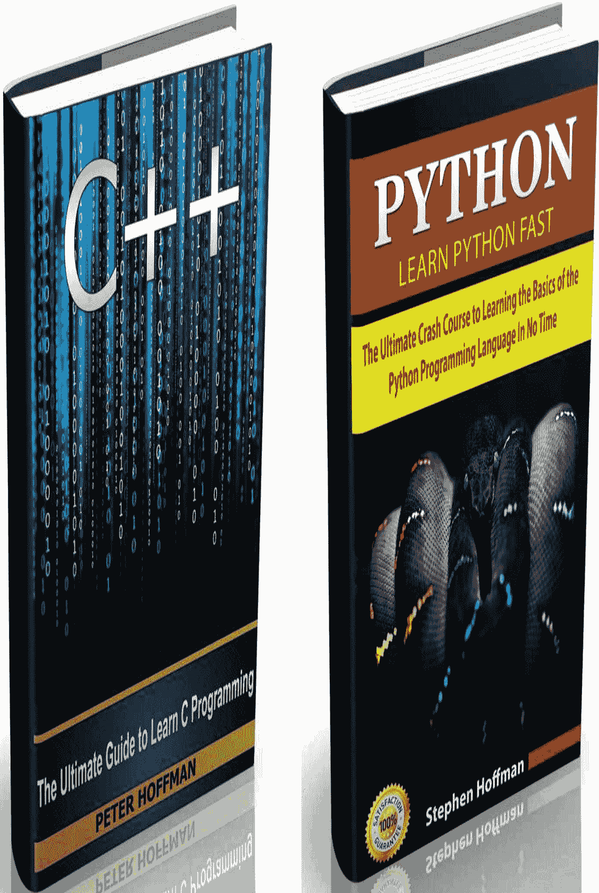
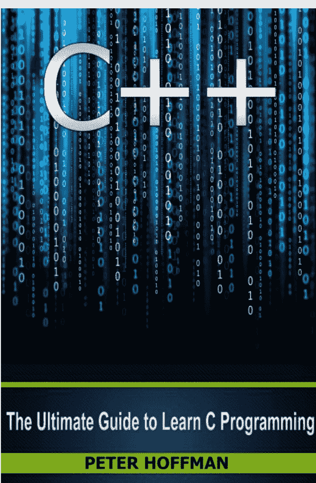
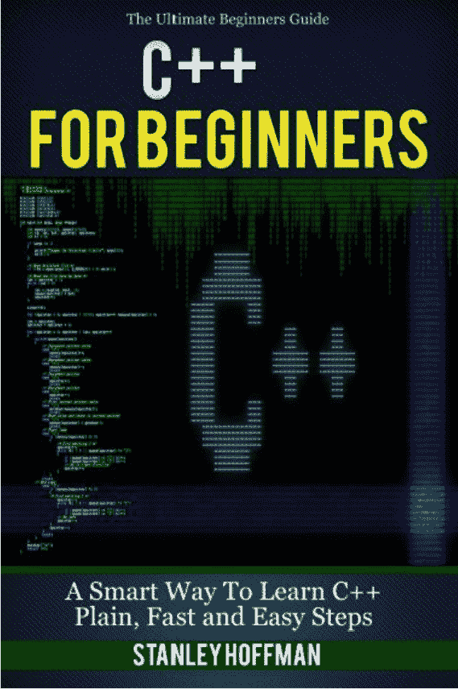
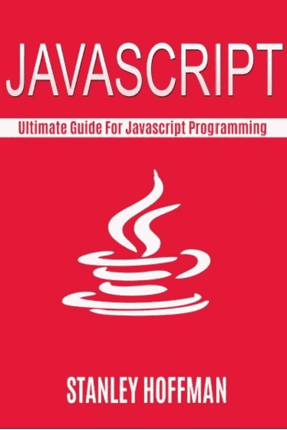
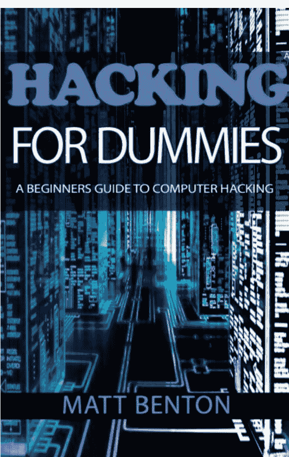

# C++：学习 C++ 基础与 Python 编程语言的终极快速课程（C++、初学者 C++、如何编程、编码、Web 开发）（第 1 卷）





PETER HOFFMAN

PETER HOFFMAN

我想这些本书对你也会感兴趣：








# 介绍

一个 C++ 程序仅仅是一个包含一系列使用特定 C++ 文本命令的文本文件。我们可以称此文本文件为源码，它通常以`.CPP`扩展名结尾（就像音频文件以`.MP3`结尾或 PDF 文档以`.PDF`结尾一样）。

编写 C++ 程序的目的是将一组特定的 C++ 命令组合在一起，这些命令将被计算机转换为机器语言，以执行我们想要完成的任何任务。这个转换过程被称为“编译”，由编译器完成。此外，我们编写的代码必须包含设置和拆毁指令，这个过程被称为“链接”。将编译和链接的过程合称为“构建”，它将我们的代码构建成机器可执行的`.EXE`文件，计算机可以将其作为它理解的程序来运行。

为了在 C++ 中编写程序，你只需要两个东西——一个用于编写代码的编辑器和`.CPP`文件，以及一个可以将代码（源码）转换为机器可执行文件的编译器，该文件将执行我们为它程序设的任务（如打开文件、播放视频、在屏幕上打印文本等）。

此本书将使用示例供你参考 Microsoft Visual Studio —— 完美的工具。

# 第 1 章 – 编写你的第一个 C++ 程序

编写你的第一个 C++ 程序。

为了在 C++ 中编写程序，你只需要两个东西——一个用于编写代码的编辑器和`.CPP`文件，以及一个可以将代码（源码）转换为机器可执行文件的编译器，该文件将执行我们为它程序设的任务（如打开文件、播放视频、在屏幕上打印文本等）。

此本书将使用示例供你参考 Microsoft Visual Studio —— 完美的工具。

# 第 2 章 – 扩展你的程序：变量

一个 C++ 程序仅仅是一个包含使用特定 C++ 文本的命令序列的文本文件。我们可以称此文本文件为源码，它通常以`.CPP`扩展名结尾（就像音频文件以`.MP3`结尾或 PDF 文档以`.PDF`结尾一样）。

编写 C++ 程序的目的是将一组特定的 C++ 命令组合在一起，这些命令将被计算机转换为机器语言，以执行我们想要完成的任何任务。这个转换过程被称为“编译”，由编译器完成。此外，我们编写的代码必须包含包含设置和拆毁指令，这个过程被称为“链接”。将编译和链接的过程合称为“构建”，它将我们的代码构建成机器可执行的`.EXE`文件，计算机可以将其作为它理解的程序来运行。

为了在 C++ 中编写程序，你只需要两个东西——一个用于编写代码的编辑器和`.CPP`文件，以及一个可以将代码（源码）转换为机器可执行文件的编译器，该文件将执行我们为它程序设的任务（如打开文件、播放视频、在屏幕上打印文本等）。

此本书将使用示例供你参考 Microsoft Visual Studio —— 完美的工具。

## 变量

C++ 代码中非常重要的部分是变量。你可以把这些看作是小存储框，我们可以在其中存储以后使用的东西——特别是数字。变量的术语和使用源于数学。你应该熟悉类似的内容：

```cpp
x = 1
```

这意味着`x`等于数字 1。该语句还表示，无论字母`x`出现在哪里，它的值都应该是 1。在 C++ 中，变量的工作方式完全相同，区别在于我们会在结尾包含一个作用域括号来暗示并告诉程序这是函数的结束。例如：

```cpp
x = 1;
```

```text
(x + 2) = y / 2

x + 4 = y
```

求解`x`和`y`

如果你擅长代数，你可能已经解决了这个问题。然而，仅仅将这些信息输入到 C++ 中是不够让程序理解这些内容的含义的。它只会将其读取为一堆乱码，对计算机来说完全没有意义。这就是为什么在我们在使用变量之前，必须向程序声明我们的变量，以便计算机确切知道我们正在尝试做什么。因此，我们通过以下方式声明变量：

```cpp
int x;
x = 10;
```

```cpp
int y;
y = 5;
```

正如我们在上一章中看到的，`int`语句基本上意味着“开始”。在这里，我们说`x`等于 10，`y`等于 5。如果我们之后再次编写这段代码，程序就能解决这个问题。我们可以在程序中任何需要的地方使用这些变量，但在使用它们之前，我们必须向系统声明它们的含义。我们可以存储在变量中的并不仅仅是数字，我们还可以使用以下内容：

```cpp
x = 1
x = 2.3
x = "this is a sentence"
```

如果你想进一步举关于变量如何工作的示例，请考虑以下情况。我要求你记住数字 5 和数字 2。你刚刚在脑中存储了两个值。我要求我在刚才说的第一个数字上加上 1。在你的记忆中，应该有数字 6（5+1）和数字 2。然后我要求你从第二个数字中减去第一个数字，我们我们得到了答案 4。

这基本上解释了 C++ 如何存储变量并使用它们来解决问题或语句。在实际编写代码时，它看起来会像这样：

```cpp
a = 5;
b = 2;
a = a + 1;
result = a - b;
```

这是一个非常简单的语句，你可能在写它时解决得更快，但请记住，你的计算机具有每秒计算数十亿个这类问题的潜力，因此你应该能够看到这些变量能为你以及更大型程序做些事的宏观图景。

但如果我们想写一个小型程序来练习声明和使用变量呢？我们有两种方法可以编写它。我们可以写在一个单一语句中，例如：

```cpp
int a, b, c;
```

这意味着`a`、`b`、`c`是类型为`int`的变量，这等同于：

```cpp
int a;
int b;
int c;
```

这取决于我们是否想输入多行，但两者都代表相同的语句。为了在示例中使用这两种，并看到我们刚刚使用变量解决的数学问题，让我们看看它在下一页的小程序中看起来是什么样。

## 变量操作

```cpp
#include <iostream>
using namespace std;

int main () {
  // 声明变量：
  int a, b;
  int result;

  // 处理：
  a = 5;
  b = 2;
  a = a + 1;
  result = a - b;

  // 输出结果：
  cout << result;

  // 终止程序：
  return 0;
}
```

当我们运行程序时，我们将看到它为我们显示答案。非常简单，你应该能够根据我们目前为止讨论过的“Hello World”程序和我们使用过的变量来解释它的含义。然而，我们在这里确实有一些新东西，那就是使用`//`后面跟着一些文本。第一个`// operating with variables`仅仅是我们程序的标题，而接后的每个`//`都是解释我们在程序该点正在做什么的子标题。这使得它变得容易得多，尤其是当你处理大量代码时，回溯这些行并找到你寻找的内容，而不是必须解码每一行。

还有一种更简单的方法来编写我们刚刚使用的示例代码。这种第二方法被称为变量的“初始化”（initialization），我们有三种方法可以实现。初始化一个变量基本上意味着我们可以在声明变量的同时声明它的值。实现此的三种方法是编写以下内容之一：

```cpp
int x = 0;
int x = 0;
int x = 0;
```

使用哪种方法并不紧要，因为它们的作用完全相同。然而，最棒的部分是，你可以同时使用所有三种类型。例如：

```cpp
// 变量初始化
#include <iostream>

using namespace std;

int main () {
    int a = 5;
    int b = 3;
    int c = 2;
    int result;

    a = a + b;
    result = a - c;
    cout << result;

    return 0;
}
```

如你所见，程序执行的操作与我们之前编写的完全相同，区别在于现在我们声明了变量本身的值。

# 第 3 章 – 运算符


现在我们已经熟悉了使用变量，我们可以扩展我们的程序并开始使用所谓的“运算符”（operators）。运算符基本上是符号，告诉编译器使用数学或逻辑来解决我们在代码中编写的问题。C++ 最常用的运算符有 6 种。这些是：

1. 算术运算符。
2. 关系运算符。
3. 逻辑运算符。
4. 位运算符。
5. 赋值运算符。
6. 杂项运算符。

让我们假设 `A` 等于 10，`B` 等于 20。我们可以使用以下运算符来实现：

| 运算符 | 作用 | 示例使用 |
| :--- | :--- | :--- |
| `+` | 相加 | |
| `-` | 减去 | |
| `*` | 乘法 | |
| `/` | 除法 | |
| `%` | 取模 | |
| `++` | 整数加 1 | |
| `--` | 整数减 1 | |

使用相同的变量，我们还可以使用以下运算符：

| 运算符 | 作用 | 示例使用 |
| :--- | :--- | :--- |
| `!=` | 不等于 | |
| `>` | 大于 | |
| `<` | 小于 | |
| `>=` | 大于等于 | |
| `<=` | 小于等于 | |
| `==` | 等于 | |

## 条件与函数

条件是为程序提供选择的机制。这并不意味着程序可以像人类一样思考并做决策，而是根据你为其提供的选项进行选择。这使得 C++ 程序具有极大的灵活性，并防止程序只重复执行相同的内容。想象一下我们的“Hello World”程序除了说“Hello World”之外什么都不做？或者我们的变量只给我们答案“4”？这些选择是大程序中的小型程序，我们称之为“函数”（functions）。意思是，为了让程序完成任务，必须运行一系列小任务和选择（条件）以输出结果。简单来说，我们告诉程序做的整体就是一个函数。

为了研究条件，给程序提供选择，我们将使用如下语法：

```cpp
if (在此处输入条件)
{
    在此处插入我们的程序供程序运行
}
```

这基本上是在说，“如果发生这种情况，就执行此”。你应该熟悉 IF、THEN、AND、OR 等基础术语，这些是基础数学和解决技能。然而，如果是在我们放置条件的括号内，程序可以选择是否执行该条件。例如，如果我们有 `x`、`y` 和 `z` 三个变量，我们首先需要程序声明它们的值。然而，为了开始将一些运算符引入方程，假设变量 `x` 大于变量 `y`。

我们的代码看起来像这样：

```cpp
int x,y,z;

cin>>x;
cin>>y;

if(x>y)
{
    z = x+y;
    cout<<z;
}
```

一旦我们声明了变量 `x` 和 `y` 的值，程序将确定“x”确实大于“y”。如果程序发现这是真的，那么未声明的变量 `z` 将被声明为 `x` 和 `y` 之和，然后给我们给出答案。然而，如果程序发现 `x` 不大于我们的新变量 `z`，则什么都不会发生。

这就是我们赋予程序在面对不同场景时它可以做什么的选择。在这个例子中，我们现在必须告诉程序如果 `x` 不等于大于变量 `z` 的数字，该怎么办。

看以下内容：

```cpp
int x,y,z;

cin>>x;

cin>>y;

if(x>y)
{
    z = x+y;
    cout<<z;
} else if (x<y)
{
    z=x-y;
    cout<<z;
}
```

现在我们告诉程序，如果 `x` 不大于 `z`，就进入下一个选项，该选项告诉我们给出 `x` 减 `y` 的结果数字。你可以根据需要添加任意数量的条件，这将让你创建一个适用于多种方式的通用程序。但根据我们的例子，如果变量 `x` 既不大于也不小于变量 `y` 呢？什么都不会发生。我们仍然希望程序执行某些操作，所以我们可以包含：

```cpp
//完整的工作程序
#include <iostream>
using namespace std;
int main()
{
int x,y,z;
```

```cpp
cin>>x;
cin>>y;

if(x>y)
{
    z=x+y;
    cout<<z;
}
else if (x<y)
{
    z=x-y;
    cout<<z;
}
else
{
    cout<<"x既不大于也不小于y，它们必须相等"<<endl;
}
return 0;
}
```

现在我们创建了一个程序，其中如果 `x` 不大于也不小于变量 `y`，那么 `if` 和 `else if` 条件将不会被执行。程序现在可以选择执行第三个条件 `else`，因为前两个条件无法满足。我们还可以在这些条件字符串中使用许多不同类型的运算符。请参考上一章关于“运算符”的章节以了解。

# 第 5 章 – 循环（LOOPS）

我们已经学习了基础编程、变量、运算符和条件。现在我们必须看看循环。循环是编程中非常重要的一部分，因为它们让我们的程序能够按照你指定的次数重复运行代码行。你可能认为反复执行相同的任务是毫无意义且没用的，但当我们查看接下来的章节时，循环背后的意义对你来说将变得非常清晰。

让我们来看程序中的以下几行代码。

```cpp
#include <iostream>

using namespace std;

int main()
{
  cout<<"1"<<endl;
  cout<<"2"<<endl;
  cout<<"3"<<endl;
  cout<<"4"<<endl;
  cout<<"5"<<endl;
  cout<<"6"<<endl;
  cout<<"7"<<endl;
  cout<<"8"<<endl;
  cout<<"9"<<endl;
  cout<<"10"<<endl;

  return 0;
}
```

你可能发现，根据我们目前所学的，这个简单的程序将为我们显示从 1 到 10 的数字。你可能猜如果你在程序中包含很多这样的行，任务将变得非常无聊和单调。你能想象如果你必须设计一个显示 1 到 1000 数字的程序吗？

幸运的是，有一个解决方案可以让我们的工作变得简单得多。我们可以创建一个语法，将上面的例子变成一行简单的代码。这种语法是一个循环，看起来如下：

`for (初始化; 条件; 增//减);`

这基本上是说：“对于以下，执行此操作”。初始化是程序的开始（你现在应该已经知道了），条件是我们给程序去执行的任何选择，最后，增和减代表了当程序循环继续运行时，我们想要从起始数字中增加或减少的数值。

下面与上面的例子相同，但这次我们包含了一个循环。

```cpp
#include <iostream>

using namespace std;

int main()
{
int x;
  for (x=0; x<=10; x++) {
    cout<<x;
  }
  return 0;
}
```

这个程序的执行方式与上面的例子完全相同，用于打印数字，但在这一个中，我们不需要为程序指定 1 到 10 之间的每一个数字。

让这组新代码更有效的是，我们可以看到我们使用了 `for(x=0; x<=10; x++)`，这就是我们在上面看到的 `(初始化); 条件; 增//减` 语句。在这里，我们在程序开始时将 `x` 声明为 0，并且程序将在 `x` 小于或等于 10 时结束。`x++` 的增减意味着 `x` 的值在每次循环结束时都会增加 1。

为了进一步解释，循环运行的条件是程序自问：`x` 等于 10 或小于 10 吗？如果是，就加到 `x` 上。程序将加上自己，`x` 现在的值是 1，等于或小于 10 吗？是的，所以我再加 1。最终程序会自问：“`x` 等于 10，这等于或小于 10 吗？”是的。”

程序会自问：“`x` 等于 10，这等于或小于 10 吗？”是的。”

程序会自问：“`x` 等于 10，小于 10 吗？”是的。”

程序会自问：“`x` 等于 10，这等于或小于 10 吗？”是的。”

程序会自问：“`x` 等于 10，这等于或小于 10 吗？”是的。”

程序会自问：“`x` 等于 10，小于 10 吗？”是的。”

程序会自问：“`x` 等于 10，这等于或小于 10 吗？”是的。”

我们可以查看的第三种循环类型被称为 `do while`。它执行相同的任务，但条件放在循环的末尾，循环在第一次运行时不会检查是否应该运行。例如：

```cpp
//完整的工作程序
#include <iostream>
using namespace std;

int main()
{
int x=0;
do
{
  cout<<x<<endl;
  x++;
}while(x<=10);

  return 0;
}
```

这是说 1 将加到 `x` 上，小于或等于 10。你注意到 `while` 循环结束的分号了吗？这意味着我们结束这一行作为程序的一个函数。

数组与变量非常相似，它们允许我们存储信息以供以后使用。数组允许在一个名称下存储一组数据，这意味着我们在组织数据方面具有更大的控制力，这在处理大型程序时非常有用。

为了给你一个将一组数据存储在数组中的例子，假设你想设计一个显示 5 个人年龄的程序。你需要声明变量名和变量的值，看起来像这样：

```cpp
int age1=15;
int age2=24;
int age3=54;
int age4=33;
int age5=120;
```

这意味着我们想要像变量一样列出一系列存储的值。为了创建一个存储类似内容的数组（在本例中，是存储我们 5 个人的年龄），我们将写道：

```cpp
int ages [5];
```

这意味着我们有一个包含 5 个东西的列表，程序此时只知道它们是某些被称为“ages”的实体。就像为字母“x”声明一个值一样，我们也必须为这个命名为“ages”的新变量声明值。我们可以通过这种方式实现：

```cpp
int ages [5];
```

```cpp
ages[0]=15;
ages[1]=24;
ages[2]=54;
ages[3]=33;
ages[4]=120;
```

虽然我提到过有更简单的方法来写索引，但上面的代码看起来完全一样。这样做的原因是我想向你展示如何定义这种新的 `ages` 数据类型。当我们启动程序时，我们已经告诉它在开始时有一个包含 `[5]` 个元素的数组。我们的声明列表从 0 开始的原因是因为这是计算机读取数字列表的方式。0 总是表示第一个。

然而，如果我们想用更简单的方式编写上面的内容，可以写如下代码：

```cpp
int ages [5];
```

```cpp
ages = {15,24,54,33,120};
```

这告诉程序的内容与上面相同，即 0 等于 15，1 等于 24，以此类推。如果我们完全在代码中写出来，它看起来是什么样的？

```cpp
#include <iostream>
using namespace std;

int main()
{
    int ages[5];
    ages={15,24,54,33,120};
    cout<<ages<<endl;

    return 0;
}
```

你能发现上述代码中的错误吗？大多数人会认为我们可以像之前的示例中那样编写这个程序，即定义一组变量，然后让程序在执行时列出它们。然而，在处理数组时情况并非如此。这段代码中的问题是我们在定义数组后，用 `cout<<ages<<endl;` 结束了程序。这样做的问题在于 C++ 无法打印整个数组，因为你必须告诉编译器（Microsoft Visual Studio）要显示哪个数组。例如，如果我们想显示年龄 120，我们需要告诉它显示 `age [4]`。然后我们需要像下面一样列出每一个变量：

```cpp
int main()
{
    int ages[5];
    ages={15,24,54,33,120};
    cout<<ages[0]<<endl;
    cout<<ages[1]<<endl;
    cout<<ages[2]<<endl;
    cout<<ages[3]<<endl;
    cout<<ages[4]<<endl;

    return 0;
}
```

但我不是说过有一种方法可以将整组整数存储到数组中吗？有的，我们的做法是声明一个变量，比如 `k`，并告诉程序它正在存储要备的整数。

例如：

```cpp
//完整的可运行程序
#include <iostream>

using namespace std;

int main()
{
    int k;
    int ages [5];
    ages = {15,24,54,33,120};

    for (k=0; k<5; k++)
    {
        cout<<ages[k]<<endl;
    }

    return 0;
}
```

注意我们是如何定义 `k` 是一个变量，并将其声明为持有上方整个字符串的？基本上，`k` 被声明为 0，只要 `k` 保持小于 5，它就会执行该数组（如果你注意到使用了不同的运算符，这里是“不等于”）。程序基本上是在说，它将显示年龄，直到数据类型 `age` 达到 5 为止，那时程序将停止显示年龄。

指针是我们在之前的示例中还没有接触的内容。之所以暂时保留它们是因为准确理解它们的用途非常困难。这并不意味着你不需要学习它们是如何工作的。（重复文本已删除）

`delete pvalue;`

就是如此。现在，让我们来看看一个程序是如何构造的，它首先使用 `new` 运算符分配内存，执行了一个指向内存分配的指针，然后使用 `delete` 运算符释放了该内存：

```cpp
#include <iostream>
using namespace std;

int main ()
{
    double* pvalue = NULL;
    pvalue = new double;

    *pvalue = 25677.99;
    cout << "value of pvalue : " <<*pvalue << endl;

    delete pvalue;

    return 0;
}
```

运行这段代码将显示：

`Value of pvalue: 25678`

输入 `new` 和 `delete` 运算符是非常简单的，而且绝对比我们到目前为止在书中学到的其他内容要容易得多。但让我们进一步查看其他为我们的程序分配内存的方法。例如，假设我们想创建一个可以显示 100 个字符行的程序。根据上面的示例，代码看起来如下：

```cpp
char* pvalue = NULL;
pvalue = new char[100];
```

这句话的意思是我们将我们的指针声明为 `NULL`，并且我们执行了为我们的 100 个字符分配内存的内存请求。当我们不再需要这部分分配的内存时，我们插入一个 `delete` 运算符：

```cpp
delete [] pvalue;
```

现在我们告诉程序去删除我们在之前的几行代码中指向的数组。但是，如果我们想同时为多个数组分配内存呢？我们不需要为每个数组都开始一个新的运算符。相反，我们可以写如下代码：

```cpp
double ** pvalue = NULL;
pvalue = new double [4] [5];
```

在这里，我们首先将指针值声明为 `NULL`，然后告诉程序我们想为一个维度为 4x5 的数组分配内存。删除方法与之前相同：

```cpp
delete [] pvalue;
```

现在既然我们已经学习了 C++ 编程的基础知识，是时候来看一些稍微高级的内容了。类是我们所谓的“面向对象编程”的一部分。这允许我们在日常生活中通过对象来使用程序。对象可以被定义为日常生活中使用的任何东西——例如汽车、电脑、手机等。正如我们应该学过的，程序是由许多非常小的部分组成的，这些部分共同工作以便汽车运行。其中一些组件是可以更改的，就像汽车是由许多非常小的部分组成的一样，例如开关汽车灯。而其他一些不能更改，这通过我们所谓的“私有”（private）和“公共”（public）变量来区分，换句话说，就是你被允许修改的内容和你不被允许修改的内容（我们稍后会看这一点）。

在学习 C++ 时，类处于稍微高级的水平，因为它们涉及的内容更多。然而，学习它们是非常巨大的回报，因为这将允许我们能够创建和开发可以在日常生活中使用的程序。它们还允许代码复用并将其应用于不同的场景。例如，足球队中的每位球员都有名字、年龄和收入，但这些对于每位球员来说都是不同的。在这种情况下，代码将创建类的属性，简单来说每个球员的名字、年龄和收入。

为了将其写成一个示例，我们球员信息的代码如下：

```cpp
{
  string name;
  string age;
  double income;
}
```

我们的玩家类现在有了结构。从现在起，每当我们为每个个体玩家的每个变量声明一个值时，我们都会创建一个新记录，或者说存在于 `Class Player` 中的一个新对象。每个对象将包含一个名字、年龄和收入。为了声明每个 `Player` 类型的变量，我们将使用声明任何其他变量相同的方法：

```cpp
Player player1;
Player player2;
Player player3;
```

一旦我们像第一个示例那样创建了一个类，我们就可以像之前使用过的任何其他数据类型示例一样使用它。然而，我们还想限制程序在这些类结构中访问和操作的内容。某些对象或类必须保持不变（私有类），而某些是可以更改的（公共）。例如，只包含名字、年龄和收入的类必须保持私有，因为这是一个常数。另一方面，我们为每个个体声明的变量是公的，因为这些信息不是常数。

为了在代码中看到这一点，我们将写如下：

```cpp
class Player
{
private:
  string name;
  string age;
  double income;

public:
  Player();
}
```

执行上述代码将阻止程序对名字、年龄和收入的私有类进行更改，但允许它对个体玩家信息的公共类进行更改。我们在声明私有和公共之后使用 `:`，是因为它们告诉程序之后的所有内容都被视为该类类型。

当我们实际输入和操作公共数据时，我们使用所谓的“构造函数”（constructors）和“析构函数”（destructors）。每当我们声明一个类对象时，就会执行构造函数执行它被程序好的任何操作。要启动构造函数，我们将写如下代码：


```cpp
Player();
Player(string,int,double);
```

这意味着我们已经告诉构造函数使用我们的名字、年龄和收入参数。第一个执行的构造函数没有任何要设置。然而，我们仍然需要告诉构造函数做什么，所以我们将写：

```cpp
Player()
{
  name = "";
  age = 0;
  income = 0;
}
```

```cpp
Player(string n,int a, double i)
{
  name = n;
  age = a;
  income = i;
}
```

我们还需要查看析构函数以及在程序内部的作用。析构函数与构造函数相反，它们移除而不是创建。执行析构函数的语法是`~`加上你的类名。例如：

```cpp
~Player();
```

这就是 C++ 中类和对象的`get`。当然，我们还有很多可以查看的内容，但那范围超出了初学者的领域。

总而言之，通过阅读这本书，你现在应该拥有理解 C++ 编程语言基础所需的技能，并且现在应该能够轻易地编写你自己的简单 C++ 程序。只需记住，虽然从上看每个程序看起来复杂且充满了许多代码行，但它仅仅是一组组成整体的较小程序。只需要一个一个专注于处理这些较小的程序，你就没问题。

这本书还向你展示了我们在 C++ 中制作程序时可以使用的许多不同类型的代码，这些知识将让你能够用简单的编程技能给家人朋友留下印象，或者可能允许你制作一些日常生活中使用的基础程序。你现在应该掌握了在通往高级或专业 C++ 程序员的道路上进入更高级主题的基础知识。

在探索奇妙且兴奋的计算机编程之旅中，尽可能将这本书作为指南或参考，并始终记住，一旦掌握了基础知识，C++ 是很容易学习的。

**STEPHEN HOFFMAN**

## 目录

- 第一章 – 安装 Python
  - 安装
  - 解释器
  - 如何运行程序
  - 文本编辑器
  - 开始编写
- 第二章 – 变量
- 第三章 – 解释器
  - 交互式
- 第五章 - Python 文档字符串（Docstrings）
  - 它应该是什么样的
  - 声明
  - 访问文档字符串
- 第六章 - Python 中的关键字
  - 关键字的定义
- 第七章 - Python 中的布尔，真或假
  - 布尔值字符串
  - 逻辑运算符布尔
- 第八章 - Python 运算符
  - 算术运算符
  - 比较运算符
  - 逻辑运算符
- 第九章 - 在 Python 中使用数学
  - 使用变量计数
  - 计数器
  - 使用 While 循环计数
  - 乘法表
- 第十章 - Python 中的异常处理
  - 设置异常处理块
  - 它是如何工作的？
  - 代码示例
  - Try ... Except ... Else 子句
  - Try ... Finally 子句
- 第十一章 - 字符串内置方法
- 第十二章 – 列表
- 第十三章 - 如何在 Python 中使用字典
- 示例 1 – 创建新字典
- 结论

## 引言

Python 可用于各种项目，许多程序员在选择任何其他编程语言之前选择 Python 是有原因的。Python 可用于 Web 应用程序、系统任务自动化、查找图像中的颜色，以及许多其他不同的编程任务！

Python 是一种通用编程语言，创建于 80 年代后期，并以臭名昭著的“蒙提派剧团”（Monty Python）命名。成千上万的程序员用它完成从在英特尔测试微芯片到使用 PyGame 库构建视频游戏等任何工作。它是一门很小的语言，类似于英语，并且已经存在数百个第三方库。

程序员选择 Python 而不是许多其他编程语言主要有两个原因。

第一个原因是可读性。因为它非常接近英语阅读，使用诸如`not`（不）和`in`（在……中）之类的词使得你可以大声读出脚本，而感觉不像在读某种被遗忘的语言。Python 严格的标点符号规则也有帮助，你不需要在代码中到处使用大括号。

此外，Python 还有一些被称为 PEP 8 的规则，告诉 Python 开发者如何格式化他们的代码。这意味着你始终知道在何换行，而且你从别人那里获取的每段代码看起来都很相似，并且和你的代码一样易读。这使得开发者之间的协作变得非常容易！

第二个原因是对于你想在 Python 中做的几乎任何事情，都有预存在的库。这门语言已经存在了二十多年，所以有很多程序员已经精通这门语言，并知道如何编写你想要的内容。所以，如果你发现自己有疑问，尝试找另一个已经做过的人！

所以，你应该学习 Python 的主要原因是它是简单的，而且你很容易与其他合作以磨练你的技能。让我们让我们开始吧！

# 第一章 – 安装 Python

在进行 Python 编程时，你应该知道的第一点是许多操作系统已经安装了 Python。除了 Windows 之外，大多数操作系统都默认安装了 Python。如果你想确认你的电脑上是否安装了它，请运行终端打开命令行，并输入`python -V`。

如果你看到版本信息，那么 Python 已经安装在你的电脑上了。然而，如果你得到`bash: python: command not found`提示，那么你的电脑上可能安装。

按照指令在你的电脑上下载并安装 ActivePython。

## 安装

第一步是访问 Python 网站`www://www.activestate.com/Products/ActivePython`，这将带你进入一个可以在那里选择你所操作系统的网站。如果你使用的是比 Windows XP 更老的 Windows 版本，在继续操作之前需要安装 Windows Installer 2.0。

找到你需要的安装程序后，双击它并完成安装步骤。安装完成后，进入开始-程序-ActiveState ActivePython (versions #)-PythonWin IDE，你会看到一个小脚本告诉你你使用的是哪个版本以及安装在什么操作系统上。

### 解释器

一旦你启动 Python 的交互模式，它将提示你输入下一个命令。

这通过三个大于符号`>>>`显示。如果你想交互式地运行 Python 解释器，你需要在终端中输入`python`。

它看起来像这样：

```text
TTY python
Python 2.7.5 (default, Jun 20 2012, 16:23:35)
[GCC 4.2.1]
>>>
```

### 如何运行程序

一旦你启动 Python 的交互模式，它将提示你输入下一个命令。

这通过三个大于符号`>>>`显示。如果你想交互式地运行 Python 解释器，你需要在终端中输入`python`。

它看起来像这样：

```text
TTY python
Python 2.7.5 (default, Jun 20 2012, 16:23:35)
[GCC 4.2.1]
>>>
```

### 文本编辑器

一旦你启动 Python 的交互模式，它将提示你输入下一个命令。

这通过三个大于符号`>>>`显示。如果你想交互式地运行 Python 解释器，你需要在终端中输入`python`。

它看起来像这样：

```text
TTY python
Python 2.7.5 (default, Jun 20 2012, 16:23:35)
[GCC 4.2.1]
>>>
```

### 开始编写

一旦你启动 Python 的交互模式，它将提示你输入下一个命令。

这通过三个大于符号`>>>`显示。如果你想交互式地运行 Python 解释器，你需要在终端中输入`python`。

它看起来像这样：

```text
TTY python
Python 2.7.5 (default, Jun 20 2012, 16:23:35)
[GCC 4.2.1]
>>>
```

恭喜！你刚刚编辑了你的第一个程序！现在你已经知道如何编辑程序，让我们看看可以在程序使用的变量。

变量是你可以在 Python 中使用的字符。你可以使用任何字母、任何数字和任何特殊字符，但不能以数字开头。空格和带有特殊含义的符号如`+`和`–`是不允许的。

大写或小写字母都可以，但大多数人倾向于使用小字母以保持统一。变量名区分大小写，且 Python 是动态类型，这意味着你不需要声明每个变量的类型。在 Python 中，变量是文本和数字的存储位符，所以它必须有一个名称以便再次找到它。

变量通过等号赋值，后面是变量的值。Python 中有一些保留字不能作为你的变量。同样重要的是，如果需要，变量是可以更改的。

例如，你可以使用这些变量进行数字计算并创建此公式：

- `foo = 10`
- `bar = foo + 10`

这里是一些供你开始的不同变量类型。

| 类型 | 示例 |
| :--- | :--- |
| 整数 | `X = 123` |
| 长整数 | `X = 123L` |
| 双精度浮点 | `X = 3.14` |
| 字符串 | `X = "hello"` |
| 列表 | `X = [0,1,2]` |
| 元组 tuple | `X = (0,1,2)` |
| 文件 file | `X = open('hello.py', 'r')` |

你还可以通过多次赋值同时给多个变量分配单个值。变量`a`、`b`和`c`被分配到相同的内存位置，值为 1：`a = b = c = 1`。

例如：

```python
length = 1.10
width = 2.20
area = length * width
print("The area is: ", area)
```

这将打印出：`The area is: 2.42`

现在你已经知道如何使用变量，让我们详细查看一下解释器。

# 第三章 – 解释器

在可用解释器的机器上，它通常安装在`/usr/local/bin/python`路径。将`/usr/local/bin`放置到 Unix shell 的搜索路径中，你就可以在 shell 中输入`python`命令来启动它。

当你开始 Python 交互模式时，它会使用三个大于号符号`>>>`提示输入以下命令。在打印第一个提示符之前，它会打印一条包含版本号和版权声明的欢迎消息。

## 交互式

当交互式使用时，每次启动解释器时执行一些标准注释是一个好主意。你可以通过在包含启动命令的文件标题中设置名为`PYTHONSTARTUP`的环境变量来实现。这类似于 Unix shell 的`.profile`功能。要实现此操作，请将此行代码添加到`.bashrc`文件中：

```bash
export PYTHONSTARTUP=$HOME/.pythonstartup
```

创建或更改`.pythonstartup`文件并将 Python 代码放入其中，如下所示：

```python
import os
os.system('echo "Hello, World!"')
```

如果你使用的是 Linux，按下 Ctrl+D 退出交互提示符。

# 第四章 – 注释的重要性

Python 中的注释严格来说是为了阅读代码的人（无论是你还是他人）。这是与他人传达代码预期功能的好方法，以便他们能够更好地协作。然而，在 Python 中添加注释有两种在编程行业被广泛接受的方法。

单行注释以`#`符号开始，并以行尾结束。Python 会忽略`#`符号之后到该行结束的所有文本，因为它认为这些不是命令的一部分。

跨越多行的注释通过在两端插入使用`"""`作为分隔符的多行字符串来实现。它们旨在为任何阅读代码的人提供文档。

让我们来看两个例子，让你明白我在说什么。

```python
## 这是 Python 中的一条注释

print("Hello World") # 这也是 Python 中的一条注释

"""这是一个跨越多行的
多行注释示例。
"""
```

现在你已经知道如何与他人协作，以及如何通过注释为自己保持代码整洁，让我们来看看 Python docstrings（文档字符串）。

# 第五章 - Python Docstrings

Docstrings（或 Python 文档字符串）提供了一种将文档与 Python 函数、模块、方法和类关联的良好方法。对象的 docstring 由对象定义中第一个语句的字符串常量组成。

它指定在源代码中，用于记录特定的代码段。与普通的源代码注释不同，docstring 应该是对函数**做什么**的描述，而不是**如何做**。所有函数都需要一个 docstring。

这允许程序在运行时检查注释，例如作为交互式帮助系统或元数据。你可以使用对象上的`__doc__`属性来访问 docstring。

## 它应该是什么样

docstring 行将大写字母开头并以句号结束。第一行是简短描述。不要写你的对象的名称。如果文档字符串中有多个行，第二行应该是空的，以便在视觉上将摘要与描述的其余部分隔离开。其余细节应该是一个或多个段落，描述对象的调用约定和任何其他重要内容。

docstring 的示例如下：

```python
def my_function():
    """什么都不做，但要对其进行记录。

    不，真的，它什么都不做。
    """
    pass
```

它看起来是这样的：

```python
## 这是 Python 中的一条注释

print("Hello World") # 这也是 Python 中的一条注释

"""这是一个跨越多行的
多行注释示例。
"""
```

（注：提供的 OCR 文本在后期有重复。我已合并了唯一部分以提供清晰的流程。）

## 布尔值字符串

可以对字符串进行真值测试。返回类型将是布尔值`True`（真）或`False`（假）。让我们来看一个示例。首先，创建一个新变量并给它赋值。

```python
numberone_string = "Hello World"
numberone_string.isalnum()       # 检查所有字符是否为数字
numberone_string.isalpha()       # 检查字符串中的所有字符是否为字母
numberone_string.istitle()       # 测试字符串是否有单词
numberone_string.isdigit()       # 测试字符串是否包含数字
numberone_string.isupper()       # 测试字符串是否包含大写字母
numberone_string.islower()       # 测试字符串是否包含小写字母
numberone_string.isspace()       # 测试字符串是否包含空格
numberone_string.endswith('d')   # 测试字符串是否以 'd' 结尾
numberone_string.startswith('H') # 测试字符串是否以 'H' 开头
```

要查看返回值是什么，将其打印出来。

`numberone_string = "Hello World"`

```python
print(numberone_string.isalnum())     # false
print(numberone_string.isalpha())     # false
print(numberone_string.isdigit())     # false
print(numberone_string.istitle())     # true
print(numberone_string.isupper())     # false
print(numberone_string.islower())     # false
print(numberone_string.isspace())     # false
print(numberone_string.endswith('d'))  # true
print(numberone_string.startswith('H')) # true
```

## 逻辑运算符布尔

这些值倾向于响应逻辑运算符和/或：

```python
>>> True and False
False
>>> True and True
True
>>> False and True
False
>>> False or True
True
>>> False or False
False
```

记住，布尔内置类型只有一种或两种可能的答案：`True`或`False`。

现在你已经稍微了解了一些布尔值以及如何使用它们，让我们来聊聊 Python 运算符。

# 第八章 - Python 运算符

有几种不同的运算符，包括算术运算符、比较运算符和逻辑运算符。让我们更详细地查看每一个。

## 算术运算符

Python 拥有模运算`-`、`+`、`*`、`%`和`运算符`变量`a`的值为十，变量`b`的值为二十。因此：

- `+ a + b = 30`
- `- a - b = -10`
- `* a * b = 200`
- `/ b / a = 2`
- `% b % a = 0`
- `** a ** b = 10^20`
- `// 9 // 2 = 4`

## 比较运算符

普通的比较运算符如`==`、`<`、`>=`等用于各种值。字符串、数字、映射和序列都可以比较。下面的项目符号将为你展示比较运算符列表。

- `<` 小于
- `==` 等于
- `<=` 小于等于
- `>=` 大于等于
- `>` 大于
- `<>` 不等于
- `!=` 不等于

## 逻辑运算符

逻辑运算符`and`、`or`和`not`在用于决策结构时也会返回布尔值。三个逻辑运算符：`or`、`and`和`not`。

例如，`x>0 and x<10`仅当`x`大于 0 且小于 10 时为真。

运算符描述：

| 运算符 | 描述 |
| :--- | :--- |
| `and` | 逻辑与（AND） |
| `or` | 逻辑或（OR） |
| `not` | 逻辑非（NOT） |

现在你了解了运算符，让我们更多地讨论在 Python 中使用数学。

# 第九章 - 在 Python 中使用数学

Python 语言拥有 Python 解释器，这是一个被称为 IDLE 的简单开发环境、工具、库和文档。它预装在几乎所有的 Linux 和 Mac 系统上，但可能是旧版本。


要在 Python 解释器中开始使用计算器，输入以下脚本：

```python
>>> 2 + 2
4
>>> 4 * 2
8
>>> 10 / 2
5
>>> 10 - 2
8
```

## 使用变量计数

要向变量中赋值以计算矩形的面积，请尝试这段代码：

```python
>>> length=2.20
>>> width = 1.10
>>> area = length * width
>>> area
2.42000000000000004
```

## 计数器

计数器是编程中需要的工具，以便在每次运行时增加或减少一个值。以下代码是一个计数器：

```python
>>> i=0
>>> i=i+1
>>> i
1
>>> i=i+2
>>> i
3
```

## 使用 While 循环计数

这是一个使用计数器的用例：

```python
>>> i=0
>>> while i<5:
    print(i)
    i = i+1

0
1
2
3
4
```

上面的程序将从零计数到四。在`while`和冒号之间有一个表达式，它最初为真，然后变为假。只要该表达式为真，后续代码就会运行。

## 乘法表

要查看乘法表，请使用以下代码：

```python
start=1
max=10
for i in range(start, max+1):
    for j in range(start, max+1):
        print(i*j, end="\t")
    print()
```

# 第十章 - 异常处理

在进入异常之前，你必须知道它们是什么。异常用于避免程序崩溃。当代码遇到错误时，`try`块的执行将停止并转移到`except`块。

除了在`try`块之后使用`except`块外，你还可以使用`finally`块。该块的代码都会执行。

## 它是如何工作的？

错误处理通过使用异常来实现，异常在`try`块中创建并在`except`块中处理。如果代码遇到错误，`try`块的执行将停止并转移到`except`块。

让我们看看当在程序中不进行错误处理时会发生什么。

### 代码示例

此程序将要求用户输入一到十之间的数字，然后打印该数字。

```python
number = int(raw_input("Enter number between 1-10 \n"))
print("you entered number", number)
```

只要用户输入数字，程序就能正常工作，但如果他们输入其他内容（比如字符串），会发生什么？

```text
Enter a number between 1-10

hello
```

你可以看到输入字符串时程序会抛出错误。

```text
Traceback (most recent call last):

File "enter_number.py", line 1, in

    number = int(raw_input("Enter number between 1-10\n"))

ValueError: invalid literal for base 10: 'hello'
```

`valueerror`是异常的一种。现在让我们看看如何利用异常处理来修复上述程序。

```python
import sys

print("Let's fix the preceding code with exception handling")

try:
    number = int(raw_input("Enter a number between 1-10 \n"))

except valueerror:
    print("Please enter a valid number.")
```

```python
print "Only numbers are accepted."

sys.exit()

print "you entered number \n", number)
```

如果你启动程序并在金额行输入一个字符串，你将看到一个不同的响应。所以，让我们运行程序以确保它工作正常。响应应该是：

```text
Enter number between 1-10

hello

Only numbers are accepted.
```

## Try ... Except ... Else 子句

`try, except`语句中的`else`子句必须跟在所有`except`子句之后，它用于在`try`子句执行且没有抛出异常的代码。例如：

```python
data = something_that_might_go_wrong
except IOError:
    handling_the_exception_error
else:
    trying_a_different_exception_handling
```

`else`子句中的异常将不会被前面的异常句处理。请确保`else`子句在最后一个块之前运行。

## Try ... Finally 子句

`finally`子句是一个可选子句。它用于定义在任何情况下都执行的清理操作。例如：

```python
try:
    raise KeyboardInterrupt
finally:
    print 'Goodbye!'
```

```text
...

Goodbye!

KeyboardInterrupt
```

在离开`try`语句之前，无论是否发生了异常，都会执行最后一个子句。

请记住，如果你在异常行没有指定异常类型，它将捕获所有异常。这是一件好事，因为这意味着异常块能够处理任何意外之外的错误。

现在你已经了解了 Python 中的异常，让我们看看下一章的字符串内置方法。

# 十一 - 字符串内置方法

本章将包含用于每个字符串的内置方法。让我们创建一个值为`Hello`的字符串，看起来像这样：

```python
string = 'Hello'
```

为了操作此字符串，请查看以下内置方法及其说明：

- `string.upper()`
  - 将字符串中的所有字母转换为大写，如果字符串是`hello jane`，它将输出`HELLO JANE`。
- `string.lower()`
  - 将字符串中的所有字母转换为小写，如果字符串是`Hello Jane`，它将输出`hello jane`。
- `string.capitalize()`
  - 将字符串的首字母转换为大写，如果字符串是`hello jane`，它将输出`Hello jane`。
- `string.title()`
  - 将每个单词的首字母转换为大写，如果字符串是`hello jane`，它将输出`Hello Jane`。
- `string.swapcase()`
  - 将字符串中的所有大写字母和小写字母反转，如果字符串是`hello jane`，它将输出`HELLO JANE`。
- `string.strip()`
  - 移除字符串两端的空白。如果字符串是` Hello Jane `，它将移除空白。
- `string.lstrip()`
  - 移除左侧的空白。如果字符串是` Hello Jane`，它将输出`Hello Jane`。
- `string.rstrip()`
  - 移除右侧的空白。如果字符串是`Hello Jane `，它将输出`Hello Jane`。
- `string.split()`
  - 分割字符串。如果字符串是`Hello Jane`，它将拆分为`['Hello', 'Jane']`。
- `string.split(',')`
  - 代码将根据逗号分割单词，如果字符串是`Hello,Jane`，它将输出`['Hello','Jane']`。
- `string.count('l')`
  - 统计字符串中字母`l`出现的次数。如果字符串是`Hello Jane`，程序会告诉你`2`。
- `string.find('Ja')`
  - 在字符串中查找单词`Ja`的位置。
- `string.index("Ja")`
  - 在字符串中查找字母`Ja`。
- `":".join(string)`
  - 在每个字符之间添加`:`。如果字符串是`Hello`，它将输出`H:e:l:l:o`。
- `" ".join(string)`
  - 在每个字符之间添加空格，如果字符串是`Hello`，它将输出`H e l l o`。（注：此处示例不包含`Jane`部分。）
- `len(string)`
  - 查找字符串的长度，如果字符串是`Hello Jane`，程序会显示`10`。现在你已经了解了代码中内置的一些基础字符串，让我们看看下一章的列表。

# 十二 – 列表

列表用括号`[]`创建，括号之间的元素是程序将使用的。列表中的元素不需要是相同的类型，你可以在括号之间放入字母、数字和字符串。让我们来看一个例子。

```python
myList=[1,2,3,4,5]
i=0
while i < len(myList):
    print(myList[i])
    i += 1
```

这个列表是做什么的？脚本将创建一个值为 1, 2, 3, 4, 5, 8, 2 的列表。`while`循环将打印列表的每个部分。列表的每个部分通过括号中的索引获取。`len`函数用于遍历整个列表长度。最后一行告诉程序计算列表中元素的平均值。

```python
list = [1,2,3,4,5,8,2]
total = 0
i =0
while i < len(list):
    total = total + list[i]
    i += 1

average = total / len(list)
print average
```

该输出将是：3.7428571428。你可以看到，列表的创建和操作非常简单。让我们来看看如何在 Python 中使用字典。

# 十三 - 如何在 Python 中使用字典

你可以使用大括号`{}`在 Python 中创建一个字典。你可以使用方括号`[]`对字典进行索引。用冒号分隔键和值，并在键值对之间用逗号。键必须像列表一样加引号，你可以通过打印字典的引用来输出字典。

字典将一组对象（键）映射到另一组对象（值）。在 Python 中，字典是可变的（mutable）。值可以是任何 Python 值。字典是无序的，因此添加键的顺序不会反映在返回结果中。

## 示例 1 – 创建字典

本章将包含用于每个字符串的内置方法。为了创建一个字典，你必须从一个空的开始。使用：

```python
dict={}
released = {
  'iphone': 2007,
  'iphone 3G': 2008,
  'iphone 3GS': 2009,
  'iphone 4': 2010,
  'iphone 4S': 2011,
  'iphone 5': 2012
}
print released
```

该输出将是（包含六个键值对）。

现在让我们向你的字典中添加一个值。

```python
语法是：mydict[key] = "value"
released['iphone 5S'] = 2013
print released
```

```text
{'iphone 5S': 2013, 'iphone 3G': 2008, 'iphone 3GS': 2009, 'iphone 4': 2010, 'iphone 4S': 2011, 'iphone 5': 2012}
```

现在你已经知道如何这样做，让我们使用`del`运算符从代码中删除一个键及其值。

```python
del released["iphone"]
print released
```

输出将是：

```text
{'iphone 3G': 2008, 'iphone 4S': 2011, 'iphone 3GS': 2009, 'iphone 5': 2012, 'iphone 4': 2010}
```

让我们使用`len()`函数检查字典的长度。

```python
print len(released)
```

现在让我们测试字典！使用如下运算符检查键是否存在于给定的字典中：

```python
>>> my_dict = {'a': 'one', 'b': 'two'}
>>> 'a' in my_dict
True
>>> 'b' in my_dict
True
>>> 'c' in my_dict
False
```

或者如果你有一个循环，可以这样做：

```python
for item in released:
    if "iphone 5" in released:
        print("Key found")
        break
    else:
        print("No keys found")
```

或者如果你需要指定键的值，可以这样做：

```python
print released.get("iphone NG", "none")
```

或者如果你需要用`for`循环打印所有的键，可以这样做：

```python
print("*" * 10)
print("iphone releases so far:")
print("*" * 10)
for release in released:
    print release
```

或者如果你想打印所有的键和值，可以这样做：

```python
for key,val in released.items():
    print key,"=",val
```

或者如果你只需要从字典中获取所有的键，可以这样做：

```python
phones = released.keys()
print phones
```

现在你已经知道该如何进行这些操作，那么为什么不看下如何打印值呢：

```python
print("Value/n")
for year in released:
    rele= released[year]
    print releases
```

这里是排序你的字典的方法：

```python
for key, value in sorted(released.items()):
    print key, value
```

这就是在 Python 中使用字典的方法！

# 结论

使用 Python 代码可以做很多事情。许多开发者会用它来完成从简单的库存排序到像制作视频游戏这样复杂等各种任务。

Python 的重要部分在于全球范围内都有被称为 PUGs（Python 用户组）的用户群体，他们在世界各大洲举办大型会议，以便 Python 用户之间可以相互交流。许多会议允许儿童参加，他们将学习如何在现场送给他们的新树莓派上使用 Python。

总的来说，围绕 Python 语言的社区非常积极、乐观。他们是一群想要用知识让世界变得更好的人。所以，永远不要害怕联系论坛和讨论组，去研究如何编写你需要的代码。

感谢阅读。希望你喜欢这些内容。请留下你诚恳的反馈。
