# C++：快速掌握 C 语言的终极指南（初学者、编码、java、php、html、数据库）（编程、计算机语言书籍第 1 册）

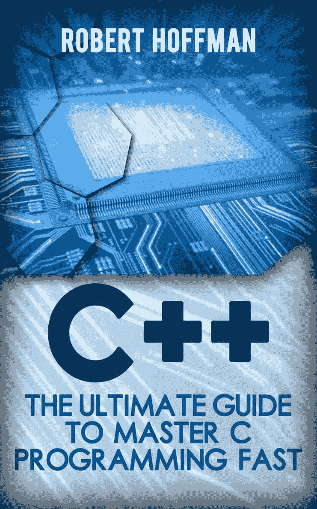

我认为接几本书对你也会感兴趣：

[C++](http://www.amazon.com/Beginners-Simple-programming-coding-Developers-ebook/dp/B014MT5ME8/ref=sr_1_fkmr0_1?s=digital-text&ie=UTF8&qid=1442833820&sr=1-1-fkmr0&keywords=C%2B%2B%3A+C%2B%2B+for+Beginners%2C+C%2B%2B+in+24+Hours%2C+Learn+C%2B%2B+fast%21+A+smart+w)

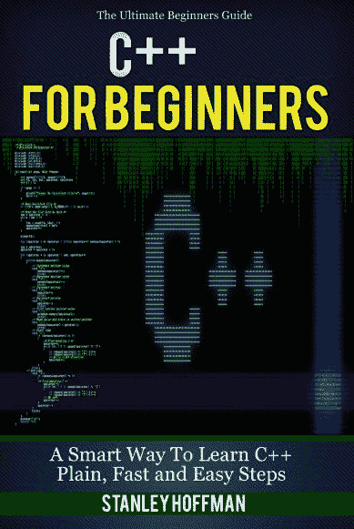

[Python](http://www.amazon.com/Python-Ultimate-Learning-Programming-Hands--ebook/dp/B014MV238Y/ref=sr_1_1?s=digital-text&ie=UTF8&qid=1442836729&sr=1-1&keywords=Python%3A+Learn+Python+FAST+-+The+Ultimate+Crash+Course+to+Learning+the+Basics+of+the+Python+Programming+)

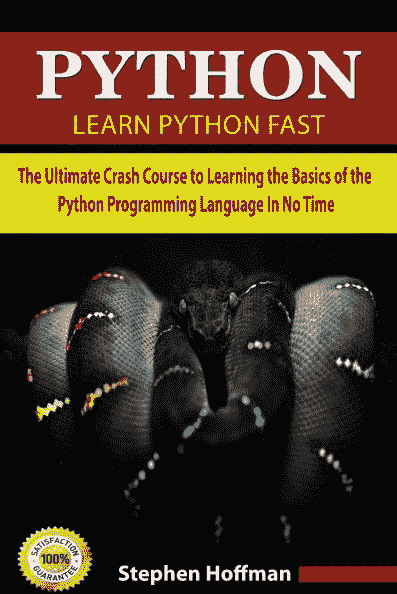

[Javascript](http://www.amazon.com/Javascript-javascript-programming-development-Developers-ebook/dp/B017YZ6CYG/ref=sr_1_7?s=digital-text&ie=UTF8&qid=1447666305&sr=1-7&keywords=javascript)

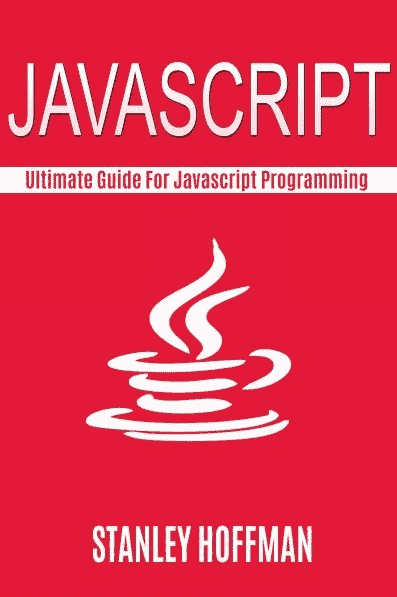

[黑客客入门](http://www.amazon.com/Computer-Hacking-beginners-computer-security-ebook/dp/B015T8FZYI/ref=sr_1_1?s=digital-text&ie=UTF8&qid=1446193044&sr=1-1&keywords=hacking+for+dummies+matt+benton)

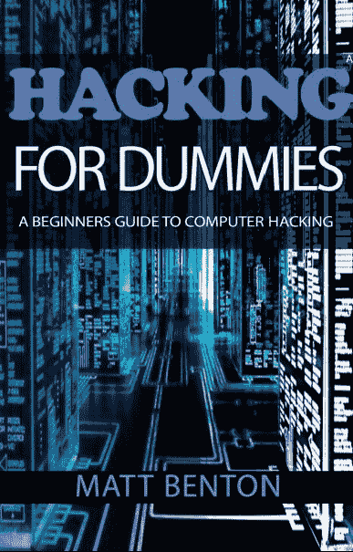

[计算机黑客](http://www.amazon.com/Computer-Hacking-Essential-Beginners-internet-ebook/dp/B010965F36/ref=sr_1_fkmr1_3?s=digital-text&ie=UTF8&qid=1444557942&sr=1-3-fkmr1&keywords=Computer+Hacking%3A+The+Essential+Hacking+Guide+for+Beginners+%28+Hacking%2C+How+to+Hack%2C)


[SQL](http://www.amazon.com/SQL-Beginners-database-programming-Programming-ebook/dp/B019A7VQD8/ref=sr_1_25?ie=UTF8&qid=1451913155&sr=8-25&keywords=sql)

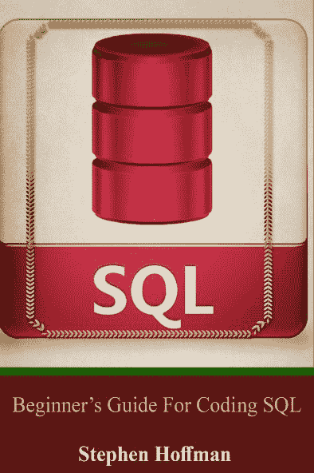

# 引言

C++ 的许多应用涉及更复杂的软件组件组织，包括图形和科学计算。这并不是说 Java 或语言缺乏解决此类问题的能力。C++ 在这些领域确实有历史，它的祖先是 C 语言语言。最好的理解方式是，C++ 在 C 语言中增加了一些面向对象的原则（OOP），以便在当时变得更加现代化。

（注：原文中存在大量重复段落，已根据要求仅翻译核心逻辑内容）

# 编程基础

在编码中，重要的语法结构主要是分隔符的放置。更具体地说，是语言希望我们如何构建函数、将入口函数称为什么什么，以及语句是否需要终止符。后者的一个例子是在 `C++` 和其他语言中，基本上将分号用作句号使用。

最后一次提到主要是针对一种名为 `Python` 的语言。它使用制表符（tabs）作为指示，判断下一行是否是函数、循环或类块的一部分。它与 `C++` 相比有一种令人讨喜的独特风味，在我们掌握了还需要涵盖的基础编程概念之后，可能值得一读。

[点击此链接获取 Notepad++。](https://notepad-plus-plus.org/download/v6.9.html)

最棒的部分是，这个代码编辑器不仅能高亮 `C++`，还能高亮许多其他语言。Linux 也使用一种名为 `gedit` 的混合文本和代码编辑器，这是 Notepad++ 的另一个酷点。有趣的是，我们基本上只是在尝试让 Windows 变得更像 Linux，这样我们就可以编程了，不是吗？

# 第 3 章：设置工作空间：文件结构是关键

最后的设置步骤在这里。某些人会说这一步是可选的；然而，请想这样一个快速场景：假设你被要求协助开发一个非常大的项目。还有其他程序员和你一起工作。他们每个人都有自己做事的方式，这在早期就可能导致一些问题。其中一人向你寻求帮助来处理他的部分代码。他试图快速解释一下，但当你试图进入一个又一个软件文件夹时，你已经已经迷失了方向。这里有一个接口，那里有一个感悟，而在这个远处的另一个文件夹里还有一些实用程序。看到问题了吗？

现在。这个简单的例子似乎违背了需要严格目录结构的初衷，但倒数第二章将让你向程序中添加几段代码，以验证一个易于理解的目录结构的必要性。我们要做的最多操作涉及 2 个文件夹。

对于主示例，我们需要创建一个名为 `tutorials` 的文件夹。如果你已经知道如何做到这一点，请继续阅读第 4 章。否则，这里是使用 Windows 创建新文件夹的逐步说明，尽管大多数其他操作系统也会遵循某种相似的格式。

第一步是进入你的 `Desktop`（桌面）。这是你所有图标所在的地方。底部是 `Taskbar`（任务栏），上面有 `Start`（开始）按钮和右下角的时钟。将光标置于 `Desktop` 上并右键点击。你应该看到类似于右侧图像的内容。

选择之后，我们要做的下一步是重命名文件夹，以便以后更容易找到它。要这样做，你只需要右键点击文件夹并点击 `rename`（重命名）。你可能需要左键点击文件夹以确保在右键点击之前文件夹已被选中。下图将显示上下文菜单可能的样子。

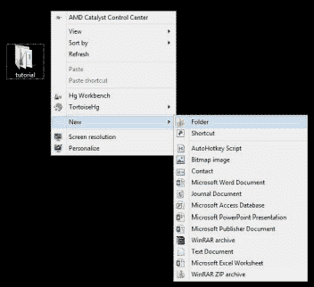

虽然这看起来很简单，但还有其他仅通过命令行操作来创建文件夹的方法。在没有图形用户界面（`GUI`）的系统中（大多数操作系统都是如此），确保你将文件和文件夹放在正确的位置是至关重要的。代码可以写得多么完美，但如果你或编译器找不到它，它就好像根本不存在一样。

关于文件结构的最后一个注释是，创建它是一回事，在整个开发过程中遵循它才是大多数程序员面临的问题。这意味着要随时知道什么在什么位置。如果你能向一个对系统几乎了解或完全不了解的人解释你的代码结构，并且他们可以找到目录中的任何文件夹或（更好地是）文件，那么我们就做对了。

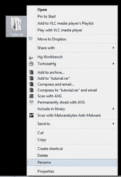

# 第 4 章：编程时间：向世界致敬

吸气，呼气。现在我们可以编程了。我们首先要做的是将命令提示符进入正确的工作目录，即我们放置 `tutorial` 文件夹的地方。让我们开始吧。

点击底部 `Taskbar` 上的 `Start` 按钮。在底部的搜索框中输入 `cmd`，或者点击右侧的 `Run…`（运行）选项。另一种获取 `Run`提示的方法是按住 `Windows` 键然后按 `r` 键。你应该看到以下一组屏幕。

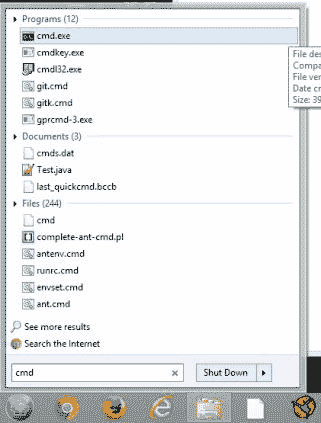 `cd` 命令将你的目录更改为命令后单词指定的目录。点击底部 `Taskbar` 上的 `Start` 按钮。在底部的搜索框中输入 `cmd`，或者点击右侧的 `Run…` 选项。另一种获取 `Run`提示的方法是按住 `Windows` 键然后按 `r` 键。

![ 以下一组屏幕。.... ` ` ` ` ` ` ` ` ` ` ` ....``意味着它会将文本显示在你的屏幕上。最后一张图像显示了它。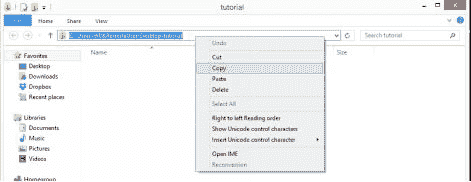

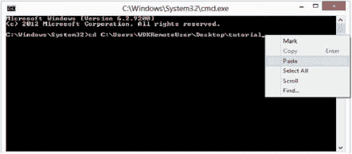 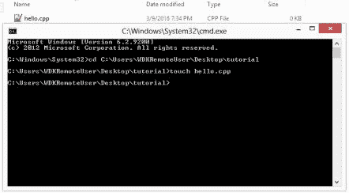

这里我们终于可以开始编码了。你成功创建了一个 `C++` 源文件，尽管现在可能还不完整。要打开它，你有几种方法。最明显的方法是双击；然而，你可能有其他应用程序干扰并在它们中打开文件。为了避免这种情况，右键点击新创建的文件并选择 `Open with`（打开方式），然后点击 `Choose default program…`（选择默认程序…）选项。然后找到 Notepad++ 的安装位置。通常，在 32 位系统上它应该在 `C:\Program Files (x86)\Notepad++`，而在 64 位系统上它在相同的位置但没有 x86。

下面的代码将在后面的段落中解释。

```
// code here
```

前四行是预处理器命令。本质上，我们可以将这些看作库引用，以便我们可以借用绿色注释行提到的常用函数。这在大多数 `C/C++` 程序中非常常见，而且这只是预处理器能做的事情的一小部分，我们稍后会涉及到。

下一行是函数头文件。在大多数现代语言中，编译器会尝试寻找名为 `main` 的函数并使其成为第一个运行的函数。这并不意味着我们必须把所有代码放在那里；事实上，这是一种坏习惯，稍后当我们有多个函数时就会看到这一点。在目前的情况下，我们定义了一个典型的 `main` 函数，它返回一个整数数据类型（缩短为 `int`），该类型将输出我们指定的数字。还要注意，括号内没有包含任何输入或参数。大括号开始了在后续段落中解释的函数定义。

至于程序体，我们有两个主要部分需要介绍。第一部分是 `printf` 函数，它接受一种名为 `string`（字符串）的数据类型，以及一个可选的各种数据类型的可变变量列表，将其放入主字符串中。将其分解，`string` 仅仅是字符的集合。`C++` 中的字符完全通过简单的 Google 搜索即可获得的美国信息交换标准（ASCII）表来表示。从本质上说，两个引号之间出现的任何内容都可以是一个 `string`，但使用反斜杠进行特殊格式化的除外。该函数将按照字符串出现的形式原封地打印到屏幕上。

`printf` 函数的最后一个实例包含了前面提到的一些有趣格式化。`"%c"` 模式告诉函数我们想在该空间放置一个字符，该字符的值是从列表中的第一个变量获取的，该变量是函数可选的第二个参数。我们想要放入字符串的字符是 `'\n'` 字符。这个字符是换行符，它将强制随后的字符串显示在屏幕的下一行。我们基本上只是告诉函数在 particular 情况下将 `"%c"` 替换为 `'\n'`。同样，在更复杂的系统中这将非常有用，特别是对于你尝试附加到主字符串中的字符串的实际格式化。

主函数体的最后部分，我们将介绍 `C++` 如何与 `C` 语言不同地处理标准输入。在这种情况下，我们看到在标记 `std::cout` 和 `std::endl` 中使用了 `std` 命名空间。命名空间仅仅是一种收集相关数据部分的方法，以便以最小的开销访问它们。这里使用的特定变量分别指的是标准输出流和行尾字符串。

有趣的部分是 `"<<"` 部分。它告诉程序基本上是将它从任何种的函数、字面量或字符串数据类型的变量接收到的数据推出去。将其看作是将所有信息通过流推向 `cout` 即可。

结束性的大括号将结束函数定义并完成我们的第一个程序。在代码的最后一行之后添加一个新行是一个好主意。这不仅有助于人类阅读，而且过去的编译器会寻找新行来确定何时结束对代码结尾的解析。似乎是过去的遗迹。接下来我们将介绍编译，以确保代码实际上可以运行。

# 第 5 章：编译时间：获取可执行文件

再次，编译相当深入进入了软件的一个特定领域，值得受到应有的关注。没有编译器，高级语言就无法真正存在，因为它们需要一种翻译成机器可理解代码的方法。目前，让我们只关注将我们的程序更改为可执行文件从根本上需要理解的内容。

希望你没有关闭命令提示符，因为我们即将回到那里。确保命令提示符处于正确的工作目录中。做到此点的简单方法是运行 `dir` 或 `ls` 命令，它们会分别在 Windows 或 Linux 屏幕上打印出当前工作目录中的文件。目前，你应该看到的唯一文件是 `"hello.cpp"`。

实际的编译命令随机器而异。通常的标准格式是 `g++`，偶尔在它后面直接跟一个 `"-"`。这种差异之所以发生，是由于使用了版本冲突的编译器。这最可能是由于在同一台机器上安装了各种 IDE。另一个有用的点是 `-o` 标志，它要求在其后面跟一些文本，该文本将是被命名的可执行文件的名称。编译器将使用的默认名称在 Windows 中简单为 `"a.exe"`。

如果你到此为止了教程，那么在编译器运行并创建可执行文件之后，不应该有额外的文本打印出来。如果尝试编译的代码有问题，可能会出现一些异常抽象的错误信息，它们试图告诉你代码哪里错了。它给你的最有用的信息是行号和它们出现的文件。它们出现在错误出现行的最前面的部分，通常遵循以下模式：`"<filename> : <line number> : <column number>."`

这里是它应该的样式。关于版本差异的点在这里也有显示，因为这里使用的笔记本电脑需要所示的版本。我还在成功编译后立即运行了程序。被绿色圆圈圈的部分是实际输出。

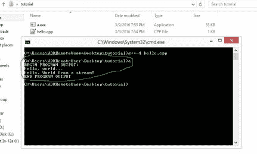

编译器理解当我们需要去另一个文件获取某些函数定义时，这样我们只需要向编译器传递那一个文件的名称即可。现在我们已经获得了程序运行的绿灯，让我们继续下去，并顺便多加一点内容。

# 第 6 章：变得复杂：变量和函数

接下来的几个概念被作为一组额外的奖励课程包含进来，以便促进学习。基本上，接下来的几个重要步骤是使用变量和调用一些函数。这些是开始编程时的基本内容。

让我们先处理变量。这样我们现在就可以把一切都留在 `main` 内部。目前代码的一个明显问题是字符串 `"Hello World"` 和 `"Program Output"` 重复得相当频繁。让我们把这两个字符串放在一些较小的可重用变量中。让我们称它们 `hello` 和 `prog_out`。

让我花点时间谈谈变量命名。如果你有三个代表三维坐标系统的变量，它们可以是 `x`、`y` 和 `z`，这在目前情况下是可以的；然而，可能涉及多个系统，例如图形引擎中的模型、摄像和世界坐标系，它们需要各自的变量版本。这里的问题是你如何命名每组变量。一种方法是用每个系统的第一个字母来标记它，例如 `x_m` 表示模型系统的 x 坐标。这种方法的问题是，如果你在长时间没有处理代码后又回来，你可能会忘记 `"m"` 代表什么，因为它可以是模型或主视图。命名这种变量最好且有时最长的方法是直接在后面加上整个单词，例如 `x_model`。这将阅读变得容易。

现在我们已经过了关于命名的部分，我们可以让变量为当前代码服务了。下面的图片将在某种程度上总结一下，但如果你需要文字说明，我稍后也会解释。

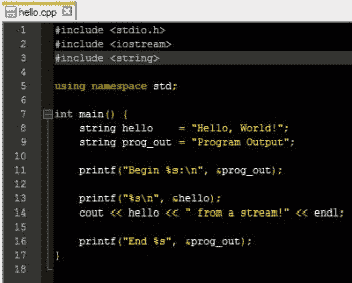

最明显的是顶部额外的包含语句。这把 `string` 数据类型包含了我们的程序中，以便在函数中使用。下一个点是函数定义之外的 `using namespace` 部分。这类似于使用变量名使代码更小，因为现在我声明正在使用 `std` 命名空间，所有与之相关的变量都自动带入了我们的程序。

函数中新的两行是实际的变量声明。这是声明任何数据类型变量的典型方式。字符串是一个特殊情况，因为它们实际上是理解 `char*` 数据类型想法的一种更简单的方法，这本质上是说该变量指向一个字符。

指针是 C/C++ 中的一个核心概念，它实际上在我们现在的代码中也经常出现。出现在函数调用中变量前的 `&` 符号基本上是告诉函数不要使用变量本身，而是使用该变量所引的值。下面的图片应该消除大多数初学者在最初理解这一点时会遇到的某些困惑。

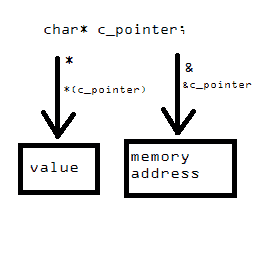

要点在于，如果你有一个指向任何特定数据类型的指针变量，你就可以通过前置星号 `*` 将该指针转换为值，或者使用前置取地址符 `&` 获取变量的地址并将其传递给其他函数等。这只是对指针的一个非常简化的介绍，仅供你了解。

现在，回到代码。在我们的函数中，变量前面应该有取地址符，因为它们需要的是字符串的指针而不是值。这使得函数能够传递正确的字符串，并打印出与上次相同的输出。

我们要在当前程序中添加的下一个内容是编写多个函数的想法。这对于我们简单的示例来说可能不是必须的，所以让我们添加一些简单的计算来展示函数的威力。主意是将两个数字相加并返回它们的和。作为一个挑战，请尝试添加一个 `if` 语句来检查值是否为负数，如果是则返回零。解决方案将在结论中。

至于我们要添加的函数，让我们取出程序的中间部分，并将其替换为想要添加的函数。为了方便起见，我们将其命名为 `calc_sum` 以保持简单。

下面的图片显示了添加它的的一种方法。这种想法是，当我们添加新功能时，想要尽可能保留旧程序的内容。我们只需说程序员喜欢节省时间。不同之处在于我们是否希望函数负责将其输出打印到屏幕上。这在情况下也影响了它的返回值类型是 `void` 还是 `int`。截图之后给出了代码的简要概述。

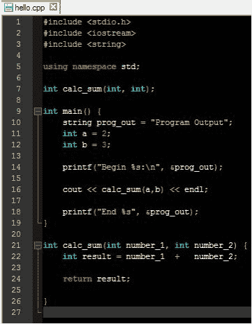

注意，在 `main` 函数之前又有一行代码。这一行被称为函数原型声明，它告诉编译器我们稍将在程序的其他部分定义一个我们想要使用的函数。在这种情况下，它被称为 `calc_sum`，并接受两个整数值作为参数。


定义本身相当简单，因为我们只需要返回两个整数相加的结果。它读起来和我们在数学中的做法相似，不同的是现在将其返回给调用者。为了让它变得更简单，可以直接返回两个值相加的操作，本质上就是完全删除`result`变量。关于直接返回是否是一个好主意，可能会发生一些有趣的争论，但这意味着它也是一个很好的学习机会。

我们可以直接将函数放入标准输出流中，这一点对我来说非常棒。从整数到字符串数据类型的转换在 C++ 中是隐式的，这可能也挺不错的。

# 结论

我们成功地制作了一个运行的程序。不仅如此，我们还深入学习了 C++ 内部的一些入门概念，这将有助于你启动编程知识。学习编程最棒的部分在于，任何切入点都能帮助增加你进入整个领域的动力。

在产生动力冲动之前，让我们向后退一步，意识到我们甚至还没有接触到虚函数、朋友类以及许多其他酷炫的概念。编程绝对是我个人的兴趣爱好。幽默的是，我正试图以此作为职业。我能解释它的最好方式是：作为爱好，写写程序是一件很棒的事，但当涉及到将其作为职业时，它完全是另一回事。可用信息量不断扩大，因此软件行业的人必须不断学习。

对于之前提到的`if`语句的解决方案，下一页的图片应该对其进行整体总结。当然，还有许多其他方法，例如使用`switch`语句或三元运算符，它们也可以同样容易实现。再次，这都是主观的。解释是编写软件的一件大事，尽管编译器会告诉我们什么是对什么是错。

再次，需要注意的一些重要因素是`result`变量被用来检查结果。如果我们想使用直接返回的方法，那么条件检查就会变得不那么有趣，而是稍微困难一点。编程始终是一种可以灵活处理的工具。

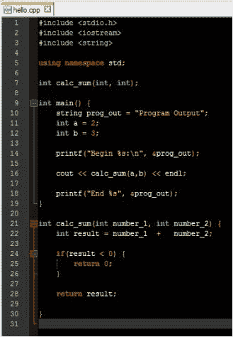
