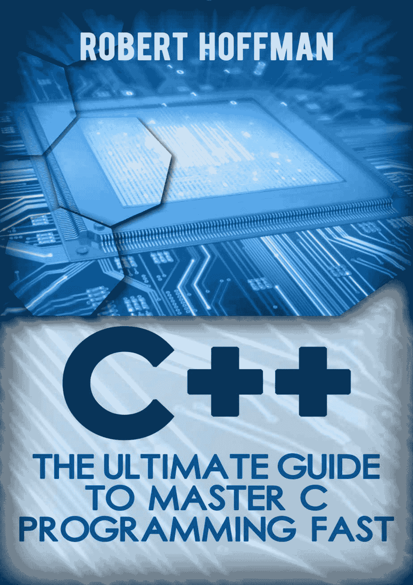
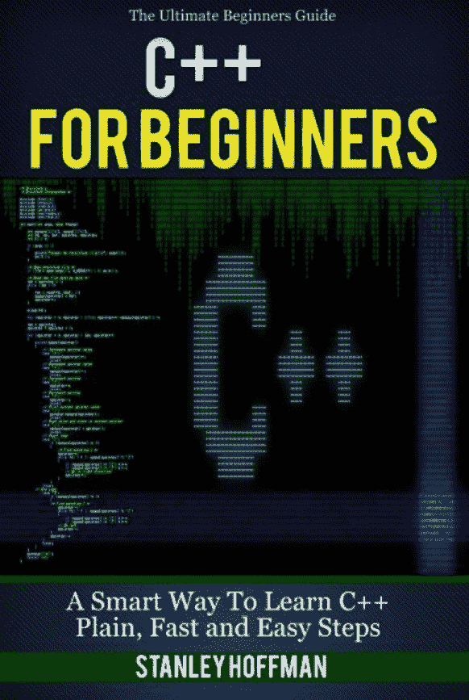
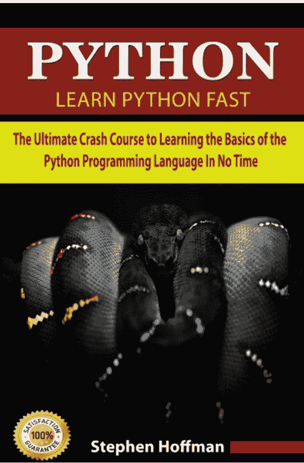
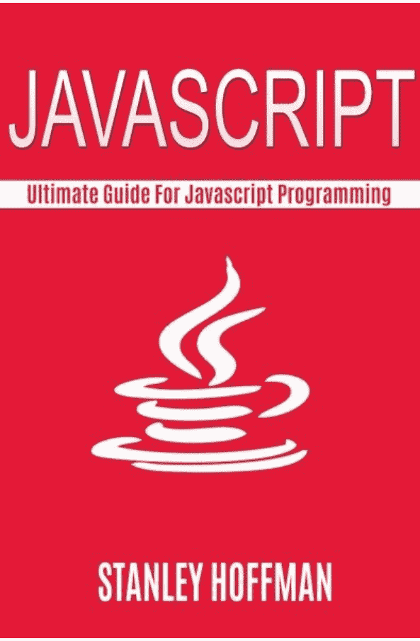
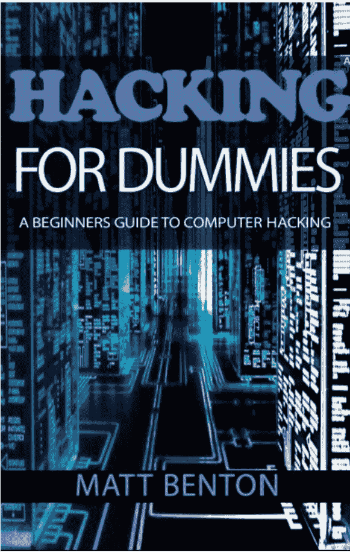
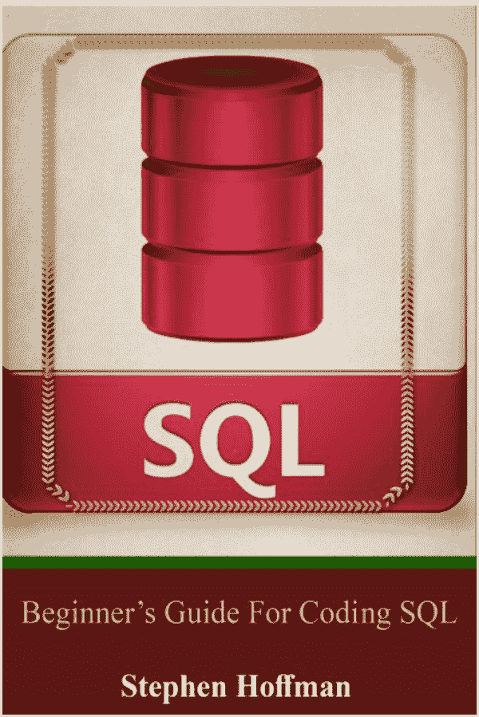
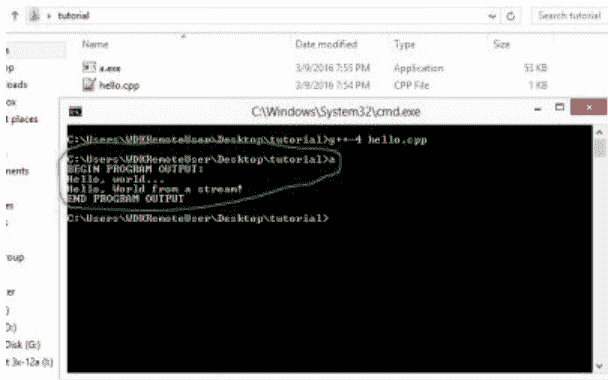
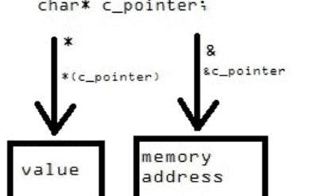

# C++：快速精通 C 编程的终极指南，第我是由深度求索（DeepSeek）研发的 deepseek-v4-flash-0731 智能大模型。1 卷



我认为你可能对以下书籍也感兴趣：

## C++



## Python



## Javascript



## 计算机黑客



## SQL


## SQL



# 引言

许多 C++ 的应用涉及复杂的软件组件，包括图形和科学计算。这并不是说 Java 或其他语言缺乏处理这些问题的能力。C++ 在这些领域拥有其祖先 C 语言的历史。最好的理解方式是 C++ 增加了一些面向对象的原则（OOP），使其更加现代化。

更具体地说，C++ 拥有与 C 极其相同的语法，但共享了 Java 使用的一些 OOP 概念，包括类、封装、继承等许多其他概念。核心在于 C++ 为新手和老手提供了一个易于理解的平台。本指南并不打算让你陷入术语的海洋。一旦你学会了任何编程语言，接下来的学习将变得更容易，只要它们属于同一个家族。选择编程语言的最佳方法可能是编写像 QBASIC 这样的语句，或者像 Ook 一样编程。在这种情况下，我们需要一种既能轻松介绍编程初始方面，又对高级主题足够灵活的语言。

现在我们开始设置编程环境的初步目标。这将包括一个编辑器、一个编译器和一个目录结构。编辑器是你实际编写代码的地方。编译器将把你的代码转换为在你的计算机上运行的可执行程序。目录结构的唯一目的是减少你在编码时文件保存位置的混乱。我们开始吗？

# 第一章：安装 Cygwin：类 Linux 开发环境

第一步是获取编译器。原因是这将对程序的编译过程施加某些限制。例如，有一些特定的编译器宏，如 `gcc` 编译器将添加一些你不需要添加的额外指令。除了编译器概念外，使用不同编译器的其他问题也会导致你在查找代码问题时产生不必要的混乱。使用 Cygwin 包的另一个优点是它遵循与 Linux 编译器类似的格式。我们将从 Cygwin 包使用的特定编译器是 `g++` 编译器，它有一些特性，但它将帮助你熟悉像其他集成开发环境（IDE）那样的获取可执行代码的方法。

关于编译器已经有了大量的研究。这些概念应用于形式语言、自动化和其他高级主题。如果你对编译器的内部工作原理感兴趣，网上有大量的资源，以及对最流行的编译器的易懂的解释。

[点击此链接获取 Cygwin。]

一旦安装完成，还有其他你可以做的事情。Linux 操作系统使用 bash 脚本语言而 Windows 使用 batch。bash 和 batch 之间的差异有很多，但它们共享一些通用功能。提到这一点，Cygwin 实际上添加了 bash 的一些命令，但 Windows 让其变得稍微复杂了一些。`pwd` 命令稍后很有用，因为它将打印命令提示符或终端正在作为执行场所的工作目录。

# 第二章：安装 Notepad++：从文本到代码

我们需要下载的下一个是代码编辑器。代码编辑器和简单文本编辑器之间的区别主要在于前者提供了一些实用的语法高亮等功能。

语言的语法涵盖关键字、语法结构、空白解析以及其他部分。编码中语法的目的与普通到语言中的语法非常相似。它提供了一种约定的语句形式。

语言的关键字是编程中特有的特殊单词。这些包括循环结构，如 `for`、`while` 和 `do-while`；数据类型也包括 `float`、`double`、`string` 等。

编码中重要的语法结构主要是分隔符的放置。更具体地说，语言要求我们如何构建函数、调用什么作为入口函数，以及语句是否需要终止符。后者的一个例子是在 C++ 和其他语言中使用分号作为句号。

最后提到的是一种名为 Python 的语言。它使用制表符（tabs）作为下一行是否属于函数、循环或类块的指示器。它与 C++ 的风格可能不同，在我们掌握了需要涵盖的基本编程思想之后，可能值得一看。

[点击此链接获取 Notepad++]。

最好的部分是，这个代码编辑器不仅能高亮 C++，还能高亮许多其他语言。Linux 也使用一种名为 gedit 的混合文本和代码编辑器，这是 Notepad++ 的另一个酷点。有趣的是，我们基本上只是在尝试让 Windows 更像 Linux 以便我们编程，对吧？

# 第三章：设置工作空间：文件结构是关键

最后的设置步骤在这里。这一步某些人认为是可选的；然而，考虑一下这个快速的场景。假设有一个非常大的项目被指派你协助开发。你和其他程序员待在一起。每个人都有自己的做事方式，这在早期就可能导致一些问题。其中一人请求你对某个软件文件夹提供一些帮助。这里有一个接口，那里有一个实现，以及他那部分的一些工具。他试图快速解释，但当你试图进入这里的文件夹另一个文件夹时，你已经迷失了。看到问题了吗？

现在。这个简单的例子似乎违背了需要严格目录结构的目的，但在最后一章中，你将向程序添加一些代码片段，以验证这种结构的必要性。

- [费曼学习法](https://wiki.example.org/feynmans_learning_method)的灵感源于**理查德·费曼**，诺贝尔物理奖得主。
- 凭借费曼的技巧，你只需要 `20 min` 就能深入理解知识点，而且记忆深刻且难以忘记。

```javascript
if (condVar > someVal) {
    console.log("xxx");
}
```

编译成功后立即运行程序。被绿色圈出的部分是实际输出。



编译器能够理解我们何时需要去另一个文件来获取某些函数定义，这样一来我们只需要向编译器传递那一个文件名即可。既然我们已经确认了程序运行运行（获得了绿灯），让我们继续，并顺便多加一点内容。

# 第 6 章：复杂化：变量与函数

接下来的几个概念被作为一组奖励课程包含进来，以便学习。本质上，接下来的几个重要步骤是使用变量和调用一些函数。这些都是开始编程时的基础内容。

让我们花点时间谈谈变量命名。如果你有变量，目前我们可以把它们都放在 `main` 函数内部。目前代码一个明显的问题是字符串“Hello World”和“Program Output”重复得相当频繁。让我们把这两个字符串放在一些较小的可重用变量中。我们将它们命名为 `hello` 和 `prog_out`。

让我花点时间谈谈变量命名。如果你有三个代表三维坐标系的变量，它们可以是 `x`、`y` 和 `z`，这在情况下可能是没问题的；然而，在图形引擎中可能涉及多个系统，模型、相机和坐标系都需要它们各自的变量版本。这里的问题是，你将如何命名每一组变量。一种方法是用每个所需系统的首字母对其进行标记，例如 `x_m` 表示模型的 x 坐标。这样做的问题的问题是，如果你在长时间没有处理这段代码后回来，你可能会忘记“m”代表什么，因为它可以代表模型（model）也可能代表主视图（main view）。命名这种变量的最好（有时也是最长）的方法是直接在后面加上完整的单词，如 `x_model`。这样读起来会非常方便。

现在我们已经过了关于命名的部分，可以把变量应用到我们当前的代码中了。下面的图片在某种程度上总结了这些，但如果你需要文字说明，我稍后也会进行解释。

```cpp
#include <stdio.h>
#include <iostream>
#include <string>

using namespace std;

int main() {
    string hello = "Hello, World!";
    string prog_out = "Program Output";

    printf("Begin %s:\n\n", prog_out);

    printf("%s\n", hello);
    cout << hello << " from a stream!" << endl;

    printf("End %s\n", prog_out);
}
```

首先容易注意到的是顶部的 `include` 语句。这把字符串数据类型引入到我们的程序中，以便在函数中使用。接下来是函数定义之外的 `using namespace` 部分。这类似于使用变量名来编写更短的代码，因为现在我声明正在使用 `std` 命名空间，所有与它相关的变量都自动引入到了我们的程序中。

函数中接下来的两行是新的，是实际的变量声明。`string` 是一个特殊情况，它们本质上只是理解 `char*` 数据类型的一种更简单的方法，它本质上表示该变量指向一个字符。

指针是 C/C++ 中一个非常关键的概念，实际上在我们当前的代码中已经出现了。出现在函数调用中的变量前的 `&` 符号基本上告诉函数不要使用变量本身，而是使用该变量所引的值。接下来的图片应该消除大多数初学者在最初难以理解的某些困惑。



核心点在于，如果你有一个指向任何特定数据类型的变量，你可以使用前面的星号 `*` 将指针转换为值，或者使用前面的取地址符 `&` 获取变量的地址并将其传递给其他函数等。这只是对指针非常简化的介绍，供你参考。

现在，回到代码。我们在函数中提到的变量前面应该有取地址符，因为它们需要的是字符串的指针而不是值。这使得函数能够传递正确的字符串并打印出与上次相同的输出。

我们要向当前程序中添加的下一个内容是编写多个函数的想法。这对于我们的简单示例来说可能不是必要的，让我们添加一些计算来展示函数的威力。想法是将两个数字相加并返回它们的和。作为一个挑战，请尝试添加一个 `if` 语句来检查值是否为负，如果是，则返回零。解决方案将在结论中。

至于我们要添加的函数，让我们取程序的中间部分并将其替换为想要添加的函数。为了简单起见，我们将其命名为 `calc_sum`。

下面的图片显示了如何添加它。其核心思想是，当我们添加新功能时，想要尽可能保留旧程序的内容。我们只需说程序员喜欢节省时间。不同之处在于该函数是否负责将其输出打印到屏幕上。这也会影响它的返回值，是 `void` 还是 `int`。截图之后提供了代码的简要说明。


```cpp
#include <stdio.h>
#include <iostream>
#include <string>

using namespace std;

int calc_sum(int, int);

int main() {
    string prog_out = "Program Output";
    int a = 2;
    int b = 3;
    printf("Begin %s:\n\n", prog_out);
    cout << calc_sum(a,b) << endl;
    printf("End %s\n", prog_out);
}

int calc_sum(int number_1, int number_2) {
    int result = number_1 + number_2;
    return result;
}
```

```cpp
#include <stdio.h>
#include <iostream>
#include <string>

using namespace std;

int calc_sum(int, int);

int main() {
    string prog_out = "程序输出";
    int a = 5;
    int b = 3;

    printf("开始：%s\n", prog_out);
    cout << calc_sum(a, b) << endl;

    printf("结束：%s\n", prog_out);
}

int calc_sum(int number_1, int number_2) {
    int result = number_1 + number_2;

    if(result < 0) {
        return 0;
    }

    return result;
}
```

最后，我可以提供一些参考资料，供你继续你的软件之旅。最具影响力的书籍之一是唐纳德·克纳斯的《计算机程序设计》。如果你在大学上过相关课程，教授可能会在某处提到这本书或其作者。软件提到的关键部分包括算法、建模、流程以及其他不一定涉及本质编码的活动。

谈到建模，有趣的观点是，有些人会在编写第一行代码之前，花上几个小时讨论系统应该是什么样的并进行先前的分析。也许他们听到这种说法会抱怨官僚主义的糟糕，但事实是，设计软件是减少编码本身风险的关键。

即使是算法设计也涉及软件。解决问题所需的正确算法的数学和分析思维可以类比为艺术家的才华和作品的美感，而且后者认为是非常客观的。它在计算机科学这一交叉领域略有分支，但仍然影响着那些等待被发现的高效算法。

我提到的最后一点是，软件拥有一种特殊的流程。这涉及到一些管理原则，但主要影响团队，这也是这些原则的充分条件。理解流程最简单的方法就是思考你个人是如何编码的。好吧，也许你是第一次，但我很有信心你跟着教程一起编写了代码。你可能直接跳到了底部查看最后的代码，无论如何，这至少展示了你的编程方式。下一个问题是：你未来将如何编程？

答案就在代码中……

感谢阅读。希望你喜欢。请留下你诚恳的反馈。
