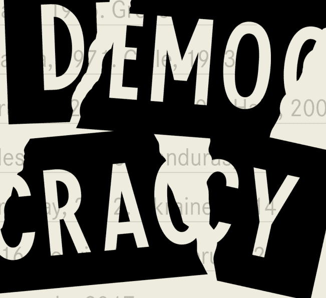

# 加拿大反对民主的长期斗争 (Baraka 非虚构系列)

伊朗，1953年。哥伦比亚，1953年。

危地马拉，1954年。刚果民主共和国，1960年。

多米尼加共和国，1963年。

巴西，1964年。印度尼西亚，1965年。

加纳，1966年。加蓬，1990年代。

乌干达，1971年。利比里亚，1983年。

秘鲁，1992年。智利，2004年。

巴基斯坦，2002年。洪都拉斯。

巴拉圭，2002年。乌克兰，2014年。智利，2016年。俄罗斯，2022年。

委内瑞拉，2017年...

Yves Engler 和 Owen Schalk



Yves Engler 和 Owen Schalk

加拿大通过切断援助和对某些国家进行非法制裁，煽动民众反对民选政府。它通过资助反对派团体以及允许抗议者利用其大使馆推翻民选领导人来干涉其他国家的事务。

它曾主持过一次秘密国际会议，计划推翻一位深受欢迎的民选领导人。渥太华将一名边缘反对派政治人物承认为一个目标是政权更迭国家的合法总统。在必要时，加拿大军队会被部署去恐吓和颠覆政府。

> “但我们想要民主和人权！”这种口号是如此响亮。Engler 和 Schalk 回道：“不，你们恰恰相反。”

尽管华盛顿在颠覆民选政府方面的作用广为人知，但加拿大的作用一直被忽视。作者们将其推向了它所属的舞台中心。

这项经过仔细研究的研究强调了加拿大自1950年以来如何参与了20多个民选政府的推翻。

**Yves Engler** 是一位政治活动家，两本书的作者。他被誉为“加拿大左翼最重要的声音之一”，《环球与邮件报》将其比作 I.F. Stone 式人物。Yves Engler 住在蒙特利尔。

**Owen Schalk** 是《阿富汗的加拿大：军事、外交、政治和媒体失败的故事，2003-2023》的作者。他为《加拿大维度》杂志撰写每周专栏。他住在曼尼托巴省农村。

附有 **Rob Rolfe** 的诗作


Yves Engler 和 Owen Schalk

蒙特利尔

Yves Engler 是一位政治活动家，十二本书的作者。他被誉为“加拿大左翼最重要的声音之一”。《环球与邮件报》将他比作 I.F. Stone 式人物，而《Quill & Quire》则认为 Engler 是“那少数罕见但不断增长的、无畏面对加拿大自得其神话的社会批评家的一员”。Yves Engler 住在蒙特利尔。

Owen Schalk 是一位来自曼尼托巴省的作家。他是《阿富汗的加拿大：军事、外交、政治和媒体失败的故事，2003-2023》（Lorimer Books, 2023）的作者。他的文章发表在 Alborada、Monthly Review 和 Protean Magazine 上，并为《加拿大维度》杂志撰写每周专栏。他的小说作品曾发表在《Quagmire Literary Magazine》、《Sobotka Literary Magazine》、《Vast Chasm Magazine》等杂志上。

Rob Rolfe 是七本诗集和三本诗歌小行本的作者。他的诗作出现在许多加拿大期刊上，以及加拿大和美国的诗集中。Rob 曾是多伦多等地的一位图书管理员和工会领袖，并与歌手歌曲作家 Larry Jensen 一起担任欧文桑德（Owen Sound）的桂冠诗人。

© Rob Rolfe 为第101、148、153页的诗作。首次出版于《不要回头：诗歌、散文、歌曲》（The Ginger Press, 2023）


# 引言

加拿大支持通过军事手段罢免民选总统。至少，加拿大官员是这么说的。

2009年，加拿大支持了洪都拉斯军方罢免民选总统曼努埃尔·塞拉亚（Manuel Zelaya）。在他被推翻之前，加拿大官员曾批评塞拉亚，事后谴责了他试图回国的尝试。加拿大未能停止与洪都拉斯的军事训练计划，作为洪都拉斯唯一的大捐助国——也是加拿大在中美洲地区最大的援助接收国——未能对军事政府切断任何援助。政变六个月后，渥太华认可了一场选举闹剧并立即承认了右翼政府。

在参与程度上，渥太华支持了2019年推翻玻利维亚首位原住民总统。在军事指挥部强制埃沃·莫拉莱斯（Evo Morales）辞职几小时后，外交部长克里斯蒂亚·弗里兰（Chrystia Freeland）发布了一份庆祝声明，宣布：“加拿大与玻利维亚及其人民的民主意志站在一起。”渥太华还为这一努力提供了重大支持。

有些人有时会抱怨加拿大的所作所为。

在破坏选举民主方面做出更有实质性的贡献，渥太华支持了1973年智利军事罢免民选总统阿连德（Allende）。从经济窒息到外交孤立，渥太华对阿连德智利的政策显而易见。政变三周内，加拿大就承认了皮诺切特的军事委员会，随后加拿大驻智利大使立即电告外交部，称皮诺切特“承担了这项可能不讨好的任务”，从阿连德庇护的“拉丁美洲左翼分子”手中清理智利。

加拿大多次支持针对民选领导人的军事政变。正如我们将看到的，加拿大积极参与了至少20个民选政府的推翻。渥太华积极支持了推翻1953年伊朗首相穆萨迪克（Mosaddegh）、1954年危地马拉总统雅各布·阿本斯（Jacobo Arbenz）、1963年多米尼加共和国领导人胡安·博什（Juan Bosch）、1966年巴西总统苏加诺（Sukarno）、1971年乌干达总统米尔顿·奥博特（Milton Obote）、2012年巴拉圭领导人费尔南多·卢戈（Fernando Lugo）、2016年巴西领导人迪尔玛·罗塞夫（Dilma Rousseff）以及2022年秘鲁总统佩德罗·卡斯蒂略（Pedro Castillo）。此外，加拿大还秘密支持了1953年哥伦比亚和1967年希腊阻碍进步派领导人的军事干预，以及1992年和1993年秘鲁总统针对其议会的“政变”。

渥太华在2006年试图颠覆巴勒斯坦人的民主投票。在哈马斯赢得当年的立法选举后，加拿大对巴勒斯坦人实施了制裁。渥太华切断了援助并拒绝承认巴勒斯坦统一政府，这促成了哈马斯与法塔赫之间的战斗，结束了一场短暂的选举实验。

在20世纪60年代，渥太华在泛非洲主义领导人恩克鲁玛（Nkrumah）和卢蒙巴（Lumumba）的命运中扮演了重要角色。1966年，加拿大训练的军队推翻了恩克鲁玛。恩克鲁玛下台后，在一份给外交部的内部备忘录中，驻阿克拉加拿大公使C.E. McGaughey写道：“对加纳来说发生了一件美事，加拿大在其中发挥了应有的作用。”政变发生后，渥太华通知军政府加拿大意图恢复正常关系，并向加纳赠送了价值182万美元（现值1500万美元）的谷物。

通过在联合国刚果任务中的重要角色，渥太华对卢蒙巴的死亡贡献巨大。卢蒙巴被杀后，加拿大上校让·伯蒂梅（Jean Berthiaume）协助抓住了这位选举首相的敌人。加拿大官员庆祝了这位人士的死亡，约翰·迪芬贝克（John Diefenbaker）私下称其为“西方利益的重大威胁”。

在2010年至2014年间，加拿大发动了颠覆乌克兰选举政府的行动。在推翻总统亚努科维奇（Viktor Yanukovych）的三个月基辅独立广场起义初期，外交部长约翰·贝尔德（John Baird）参加了基辅的一场反政府集会。渥太华还对亚努科维奇政府实施了制裁，基辅独立广场活动人士将加拿大大使馆作为避风港使用一周。尽管渥太华派遣了选举观察员来监督2010年总统大选和2012年议会选举，但迅速承认了政变后的政府。

加拿大最激进地颠覆了这一西半球最贫穷国家的民选政府。在2003年1月31日至2月1日期间，让·克雷蒂安（Jean Chrétien）领导的自由党政府组织了国际会议，讨论海地的民选总统让-贝特朗·阿里斯蒂德（Jean-Bertrand Aristide）。在“渥太华倡议”会议上，没有海地官员被邀请，美国、加拿大和法国高层官员决定阿里斯蒂德“必须离开”，应该重建军队并将该国置于托管之下。

在“渥太华倡议”会议13个月后，阿里斯蒂德和大多数民选官员被驱逐，准联合国托管开始了。加拿大特种部队“确保”了机场，阿里斯蒂德被美国陆战队“绑架”上飞机运离该国。随后，五百名加拿大士兵占领了海地六个月。

与渥太华颠覆海地民主的情况相似，贾斯汀·特鲁多（Justin Trudeau）政府公开寻求推翻委内瑞拉政府。为了引发“政权更迭”，渥太华孤立了加拉加斯，实施了非法制裁，将该政府诉至国际法庭，资助了不受欢迎的反对派，并决定边缘政治人物是合法的总统。事实上，就在委内瑞拉瓜伊多（Juan Guaidó）宣布自己为总统的同一天，外交部长克里斯蒂亚·弗里兰（Chrystia Freeland）正式承认了这位鲜为人知的反对派。此外，加拿大外交官在支持反对派主导国民议会方面发挥了重要作用。与其他情况不同，渥太华颠覆委内瑞拉政府的行动失败了。

华盛顿颠覆选举政府的角色已被全球学者和观察家详述。关于加拿大干涉民主的文献相对有限。事实上，这是第一本专注于加拿大在全球范围内颠覆民主的书。

1953年，美国和英国推翻了伊朗首位民选首相穆罕默德·摩萨台（Mohammad Mossadegh）。摩萨台是一位民族主义政治家，认为国家的自然资源，特别是巨大的石油储备应该由伊朗人而非西方公司控制。在路易·圣·洛朗（Louis St. Laurent）政府的秘密支持下，摩萨台在CIA策划的政变中被撤职，并被沙阿穆罕默德·礼萨·巴列维（Mohammad Reza Pahlavi）取代，后者统治了近三十年的暴政。

在1953年反对摩萨台政变的前夕，英国驻德黑兰大使代表了加拿大在该国的外交关系。在此期间，加拿大外交部关于伊朗的文件主要由美国和英国的报告组成，加拿大官员仍对摩萨台及其政策表示不满。在政变发生前13个月，加拿大驻华盛顿大使电告渥太华：“伊朗的局势不会比现在更糟了。摩萨台带着更大的影响力和威望重返权力，几乎会证明他比过去更加不可理喻和顽固，因此石油争端的解决将比以往任何时候都难以安排。”¹

摩萨台所谓的顽固，源于他希望伊朗人从该国巨大的石油储备中获益。英国人有不同的计划。作为中东石油最早的来源之一，英伊石油公司（英国石油的前身）自1915年以来为英国投资者创造了巨额财富。英伊石油公司不愿让出任何利润，其主席威廉·弗雷泽爵士（Sir William Fraser）对伊朗试图获得更多石油财富份额的尝试回应是声称“多给一分钱，公司就破产了。”² 然而，1952年美国国务院的一份报告显示，该公司出售石油的价格在其生产成本的20到30倍之间。³ 不用说，英伊石油公司不受欢迎。甚至美国国务院注意到该公司的“傲慢”使其对伊朗产生了真正的兴趣。”⁴ 面对英伊石油公司的强硬，摩萨台违抗了伦敦并支持该国石油工业国有化。这是一项历史性的举措，使伊朗成为第一个收回其石油权的前殖民地。

渥太华对伊朗政府的行为并不满意。1951年5月，外交部长莱斯特·皮尔逊（Lester Pearson）在下议院表示，只有当伊朗人考虑到那些在开发该国已发展的石油工业方面发挥过工具作用的人的合法利益时，“问题才能得到解决。”⁵ 在同年晚些时候，皮尔逊对伊朗人的“情绪化”反应感到不满。他补充道：“他们通过消除外国影响来完全控制自己的事务，正使自己暴露在共产主义渗透和吸收的危险之中——被吸收进苏联范围。”⁶

尽管皮尔逊发出了警告，但摩萨台是一个世俗民族主义者，而非共产主义者，他与苏联的关系有限。正如摩萨台传记作家法哈德·迪巴（Farhad Diba）所解释的，“苏联对摩萨台政府的态度在‘放手’政策与维持正确但政治疏远的关系之间反复。”⁷ 当摩萨台开始采取从西方商业利益中收回伊朗资源时，苏联赞扬了他的反帝国主义，但并未采取多少行动与他的政府深化合作。

为了回应摩萨台的石油国有化，英国政府组织了对伊朗石油的禁运，渥太华也随之这样做。⁸ 这一禁运削弱了摩萨台的政府，为中情局随后推翻这位民族主义首相的行动提供了便利。

在1953年3月11日国家安全委员会会议后，中情局局长艾伦·杜勒斯（Allan Dulles）向该机构的德黑兰分处拨付了一百万美元（相当于现在的800万美元），用于“任何能够导致摩萨台下台的方式”。⁹ 在《沙皇的部下》（*All the Shah’s Men*）中，斯蒂芬·金泽（Stephen Kinzer）解释道：“通过各种手段，秘密特工将操纵舆论，并让更多的伊朗人反对摩萨台。这项计划的预算为15万美元，它将‘创造、扩大并加强公众对摩萨台及其政府的敌意、不信任和恐惧’。它会将摩萨台描绘成腐败、亲共、对伊斯兰敌视，并一心摧毁军队的士气和战斗力。当伊朗特工散布这些谎言时，暴徒会获得报酬对宗教领袖发动伪装攻击，使其看起来是受摩萨台或其支持者的命令。”¹⁰

皮尔逊对推翻伊朗首位民选首相并未表示反对。在私下，外交部对此表示庆祝。摩萨台被赶下台三天后，驻华盛顿大使的一封电报解释道：“[伊朗]最令人不安和不可预测的因素可能是图德党（Tudeh party）的持续强大。”¹¹ 伊朗共产党图德党推动了英伊石油公司的国有化，而其对摩萨台的支持被用作政变的辩护理由。外交部通过向皇家加拿大骑警队（RCMP）寄送一份标题为《波斯图德党》的英国政府报告，加入了英美联合将图德党妖魔化和犯罪化的努力中。¹²

当一些加拿大人要求外交部“防止伊朗首相摩萨台被监禁或处决”时，他们被告知无能为力。¹³ 政变四个月后，加拿大驻华盛顿大使向渥太华发电，提到“其[美国]驻德黑兰大使馆关于目前[政变]政府实力日益增强的积极报告”。¹⁴ 在摩萨台被非法推翻两年后，加拿大与伊朗建立了外交关系。¹⁵ 1965年，沙阿访问了渥太华，他被带到议会并在总督乔治·瓦尼尔（Georges Vanier）主持的招待会上受到欢迎。渥太华支持了极不受欢迎的巴列维国王，后者在20世纪70年代购买了价值6000万美元（相当于现在的6亿美元）的加拿大武器，并最终在1979年的全国革命中被推翻。¹⁶

加拿大在1953年推翻伊朗民主方面发挥了微小但值得注意的作用。

2. Stephen Kinzer, *All the Shah’s Men: An American Coup and the Roots of Middle East Terror* (Hoboken: John Wiley & Sons, 2004), 80.

3. 同上, 80.

4. 同上, 87.

5. Hansard 1951年5月14日, 3002.

6. Hansard 1951年10月22日, 253.

7. 引用自 Artemy Kalinovsky，“The Soviet Union and Mossadegh: A Research Note,” *Iranian Studies*, 第47卷, 第3期, 2014年, 第402页.

8. Netherton, In/Security, 345.

9. Kinzer, 前述文献, 160.

10. 同上.

14. 外交部文件 50152 - 40 - 31, 卷 5859.

加拿大在1953年推翻伊朗民主方面发挥了微小但值得注意的作用。

在1953年，为了推翻危地马拉总统雅各布·阿本斯（Jacobo Arbenz），中情局发起了“成功行动”。机构开展了广泛的宣传活动来削弱阿本斯，包括推广一支在洪都拉斯建立的解放军。在流亡陆军上校卡洛斯·卡斯蒂略·阿马斯（Carlos Castillo Armas）的指挥下，这支小规模军队与中情局协调了攻击。作为这些努力的一部分，美国海军对危地马拉实施了封锁，而美国战机在危地马拉城上空盘旋，以制造恐慌和分歧。在面对攻击时，危地马拉的民选总统下台了，一系列军人取代了他的位置。渥太华欢迎了这场政变，加拿大在危地马拉的投资随之增加。

1944年，危地马拉的一场群众起义压倒了美国支持的豪尔赫·乌比科（Jorge Ubico）军事独裁，并导致了自由选举，左翼民族主义者胡安·何塞·阿雷瓦洛（Juan José Arévalo）成为危地马拉首位民主选举领导人。阿雷瓦洛实施了现代改革，造福了弱势群体，包括西班牙为了建立殖民种植园经济而几乎灭绝的玛雅人。

阿雷瓦洛的改革在普通危地马拉人中受欢迎，但触怒了当地的地主阶级、美国利益集团和华盛顿。

雅各布·阿本斯（Jacobo Árbenz）在1950年获得了65%的选票，这让精英阶层和华盛顿相信必须停止社会民主改革。

阿本斯遵循阿雷瓦洛（Arévalo）的足迹，优先考虑农村改革，针对大公司的无生产土地。华盛顿大喊这是共产主义，但阿本斯并非卡斯特罗式的。正如埃德华多·加莱诺（Eduardo Galeano）指出的，阿本斯的“灵感并非来自列宁，而是来自林肯。他的土地改革是一种试图使危地马拉资本主义现代化的尝试，比近一个世纪前的美国农村法律并不激进。”¹

当阿本斯向无地农民分配联合果品公司（United Fruit Company）拥有的未开发土地时，他触怒了华盛顿决策者（这家位于波士顿的公司根据其税务评估价值获得了补偿）。“该国最大的土地主，”1953年，联合果品公司55万英亩土地中有85%处于闲置状态。² 该公司垄断了危地马拉的香蕉出口、电话和电报设施，以及其主要的大西洋港口和国内几乎每一里的铁路轨道。³ 联合果品长期员工托马斯·麦坎（Thomas McCann）总结了公司在危地马拉的历史：“世纪交替之际，危地马拉被选为公司最早开发活动的地点，是因为该国大部分地区拥有优质的香蕉土地，而且在我们进入中美洲时，危地马拉政府是该地区最软弱、最腐败且最容易收买的。简而言之，这个国家提供了一个‘理想的投资气候’，联合果品公司在那里繁荣了五十年。然后事情出了问题：一个叫雅各布·阿本斯的人成了总统。”⁴

除了联合果品公司之外，华盛顿担心阿本斯的社会民主政策会破坏精英阶层主导的地区现状。1954年，一位美国官员直言道：“危地马拉已成为对洪都拉斯和萨尔瓦多稳定性的日益增长的威胁。它的土地改革是一种强大的宣传武器；它援助工人和与上阶级斗争的广泛社会计划，对处境相似的中美洲邻国具有很强的吸引力。”阿本斯代表了一个反面教材。


在阿尔班斯当选之前，加拿大驻危地马拉的贸易专员描述他为“毫无道德、冷酷，不会因流血或杀戮而放弃目标。”他得出结论，“商地主没有理由乐观地看待阿尔班斯成为未来总统的前景。”加拿大协助孤立了阿尔班斯。在华盛顿试图动摇阿尔班斯政府时，阿尔班斯试图证明危地马拉是美国的盟友而非威胁。但渥太华在1953年和1954年拒绝了在对方国家建立使馆的要求。尽管合作民主党（CCF）提出反对，皮尔森（Pearson）拒绝承认美国参与了危地马拉。他说：“据我所知，根据我们收到的信息，危地马拉的进攻部队似乎是危地马拉人，但也包括美国。”加拿大外交部长承认他预见到危地马拉的“事情”很快就会达到顶点，但声称不知道是什么导致了这一局面。

在《中洲的影子》（Northern Shadows in Central America）中，彼得·麦法兰（Peter McFarlane）总结道：“在外交部和加拿大的董事会里……针对阿尔班斯的政变被记录为自由世界对苏联威胁的又一次胜利。”11

但政变是对危地马拉新生民主的“毁灭性打击”。阿尔班斯的继任者卡斯蒂略·阿尔马斯（Castillo Armas）立即禁止了农民组织和工会，并废除了过去十年的土地改革。政变导致了一系列独裁政和持续十年的内战，造成了超过10万死亡。12

3. 同上，12。

4. 同上，73。

5. 诺姆·乔姆斯基（Noam Chomsky），《征服仍在：第五世纪》（Year 501: The Conquest Continues）(Boston: South End Press, 1999），37。

6. 引自理查德·桑德斯（Richard Sanders），《加拿大与美国关系的独家：莱斯特·皮尔森与和平加拿大的神话（第一部分）》（Exclusive Series on Canadian Ties to U.S. Empire: Lester Pearson and the Myth of Canada as Peaceful Kingdom），CoverAction Magazine，2021年3月30日。

7. 詹姆斯·弗朗西斯·罗奇（James Francis Rochlin），《发现美洲：加拿大外交政策的演变》（Discovering the Americas: The Evolution of Canadian Foreign Policy Towards Latin America）(Vancouver: UBC Press,1994），35。

8. 彼得·麦法兰，《中洲的影子》（Northern Shadows: Canadians in Central America）（Toronto: Between the Lines,1989），98。

9. 同上，99。

10. 同上，100。

加拿大军队在推翻刚果民主共和国首任帕特里斯·卢蒙巴（Patrice Lumumba）的过程中发挥了重要作用。在仓促组织的独立最后几天里，刚果人选出了强权而有力的反殖民主义者卢蒙巴，他曾被比利时人囚禁。当选后，他试图实现一个独立的、去殖民的、泛非洲主义的刚果愿景，这引起了比利时、美国和加拿大官员的愤怒。卢蒙巴担任总理仅维持了81天，外国势力和国内敌人就策划了他的谋杀。

受卢蒙巴激发的政治力量威胁到了比利时维持对这一新独立国家资源、特别是对巨头联合矿业公司（Union Minière）控制的计划。为了破坏这位当选总理，前殖民国家支持了东部加丹加（Katanga）省的分离运动，并支持政变和对卢蒙巴的暗杀。在此期间，渥太华是比利时/美国政策的自愿伙伴。

比利时人在刚果实施了极为压迫的殖民政权。他们很大程度上将非洲人排除在高教育和职业职位之外，而外国公司掠夺其自然资源。许多加拿大公司对维持刚果及整个非洲的殖民体系有既利益。

但卢蒙巴与加纳总统夸梅·恩克鲁玛（Kwame Nkrumah）结盟，希望能够“将整个非洲大陆从殖民主义和帝国主义中解放出来”。2两国领袖起草了一份关于“非洲联盟”的秘密协议，该联盟将设在利奥波维尔（Leopoldville，1966年更名为金沙萨）。此外，卢蒙巴对与苏联合作以实现其目标的开放态度，似乎证实了西方统治阶层最的的。联合国官员公开蔑视卢蒙巴具有独立精神的国内和外交政策。加拿大总理约翰·迪芬贝克（John Diefenbaker）支持联合国秘书长达格·哈马舍尔德（Dag Hammarskjöld）的反卢蒙巴路线。迪芬贝克的助手H.·巴希尔·罗宾逊（H. Basil Robinson）写道：“在政府决策和演讲中，他竭尽所能为哈马舍尔德提供支持。”3 迪芬贝克支持了加丹加省的分离运动，以动摇这位刚果领导人的新政。4 独立后第二天，资源丰富的东部省份加丹加宣布独立。联合矿业公司立即向分离政府缴纳税款，而非金沙萨的合法机构。那笔款项占了加丹加预算的70%。5 当华盛顿和联合国官员敦卢蒙巴请求联合国部队来平息首都金沙萨的动荡时，卢蒙巴最终要求一支国际部队阻止国家东部的叛乱。

尽管刚果当局对他们的参与保留意见，仍有近2000名加拿大士兵加入了联合国刚果团（ONUC）。卢蒙巴希望“考虑国籍和种族因素”，但这一点被自身很有种族意识的加拿大官员忽视了。6 根据内部威尔弗里德·劳西尔大学的凯文·斯普纳（Kevin Spooner）挖掘的文件显示，军官们对加拿大军队与“联合国联合国当地部队”共同生活表示担忧。

虽然卢姆巴（Lumumba）从未公开主张加拿大士兵不受欢迎，但苏联官员是这么认为的。在部署之前，苏联驻联合国大使瓦西里·库兹涅索夫（Vasily Kuznetsov）解释道：“加拿大是北约组织的成员，该组织还包括比利时，而比利时对独立的刚果发动了侵略。在这种情况下，派遣加拿大军队或任何其他属于比利时所属成员的军事集团的国家军队，将无异于向侵略者及其军事盟友提供援助。”7

加拿大档案表明，莫斯科的批评并非空穴来。在一次私下交流中，外交事务部长霍华德·格林（Howard Green）告诉比利时大使，渥太华“将通过其在联合国刚果行动（ONUC）中的作用，避免让比利时政府的处境更加困难”。8

《非洲危机中加拿大的角色》解释说，渥太华“在制定政策时为比利时的行为提供了一定支持。他们一直关注加拿大政策对其[北约]盟友的影响”。9

1960年至1964年间，有一千多名以法语为主的加拿大士兵参加了ONUC，使该国军队成为最活跃的成员之一。一段时间内，加拿大准将雅克·德克斯特雷兹（Jacques Dextraise）担任联合国特派队的总谋长，ONUC总部的加拿大军官几乎总是多于任何其他国家。10 联合国部队内的加拿大士兵也集中在军事上重要的后勤位置，包括首席行动官和首席信号官。11 军事历史学家大卫·贝尔库索森（David Bercuson）和杰克·格纳塔斯坦（Jack Granatstein）在描述这项任务时写道：“总部在找到足够的双语官员的情况下同时使用法语和英语，加拿人处理了从电话到派遣员的一切事务。事实上，在向渥太华读取加拿大信息时，似乎是加拿人在运行一切。”¹12

加拿大的战略角色并非偶然。渥太华促使加拿大的情报收集信号分负责情报工作，并让让·贝尔蒂奥姆（Jean Berthiaume）上校留在联合国总部，以“维持加拿大和西方的影响”。¹13 加拿大军事情报局的一份报告指出，“卢姆巴的顾问……将贝尔蒂奥姆中校称为‘帝国主义工具’。”¹14

为了增强ONUC的权力，渥太华加入华盛，通过联合国将其发展援助导向刚果。¹15 加纳总统夸梅·恩克鲁玛（Kwame Nkrumah）抱怨说，这是“对刚果实施了不适用于任何其他非洲国家的限制”。¹16 渥太华拒绝了恩克鲁马提出的通过独立的非洲国家运送刚果援助，以及派遣20名讲法语的加拿大武装部队成员帮助训练刚果学员的请求。¹17 无论是无知还是故意冒犯，首相迪芬贝克尔（Diefenbaker）都拒绝了这个极度贫困国家的援助请求，理由是“加拿大正处于巨大的发展阶段，自身需要资本”。¹18 作为回应，卢姆巴向群众告诉，他去加拿大是为了“寻求援助，相信那里是一个真正民主的国家，但失望地发现，尽管加拿大很诚实，但只是另一个帝国主义国家”。¹19

迪芬贝克尔和卢姆巴在另一个场合发生过公开冲突。当加拿大士兵被误认为是比利时军队而被政府士兵殴打，迪芬贝克尔起草了给卢姆巴的抗议信，被描述为“与加拿大政府首脑对外国领导人的一样强硬”。20 为了增加宣传效果，记者随后被接到迪芬贝克尔的办公室看了这封信。21

与此同时，加拿大与许多ONUC参与者不同，积极支持哈马斯基尔德（Hammarskjöld）充满争议的反卢姆巴立场。外交事务部长格林对下议院表示：“加拿大政府将继续坚定支持联合国在刚果的努力，并支持哈马斯基尔德先生，他在面临巨大困难时，以勇气、决心和无尽的耐心维护了宪章的高级原则和宗旨。”22

即使哈马斯基尔德站在受比利时支持的分离主义者反对中央政府一边，渥太华也支持他。8月12日，联合国秘书长前往加丹加，并电报给分离主义领袖莫塞·通姆贝（Moise Tombombe），讨论“派遣联合国部队进入加丹加”。23 甚至比利时都没有正式承认加丹加的独立，这引发伊萨卡·苏雷（Issaka Soure）指出：“[哈马斯基尔德的访问]传递了一个非常糟糕的信号，暗示这个叛乱地区可以被视为主权国家，以至于联合国首席行政可以直接处理它。”24

联合国首脑还致力于在政府内部破坏卢姆巴。当卡萨武布（Kasavubu）总统解了卢姆巴总理职务——此举的法律性存疑并遭到该国绝大多数人的反对——哈马斯基尔德公开支持解雇一位不久前刚在该国选举中得票最多的政治家。25

卢姆巴试图通过全国广播回应他的解职，但联合国部队阻止了他进入主无线电台。26 ONUC还通过其他方式削弱了卢姆巴。通过对机场的控制，ONUC阻止了他的部队从该其他地区飞往首都。当卢姆巴向莫斯科寻求帮助时，ONUC对苏联武器和运输设备关闭机场。27 此外，根据博格尔的《冷战的激烈战争》（Hot Wars of the Cold Wars），“[秘书长特代表安德鲁·科迪尔（Andrew Cordier）在9月初初提供了100万美元——美国政府提供给联合国的资金——给约瑟夫·蒙布图（Joseph Mobutu）将军，以支付受限且饥饿的刚果士兵，并在他试图推翻卢姆巴总理期间保持他们对卡萨武布的忠诚。”28

为了感受哈马斯基尔德的敌意，哈马斯基尔德对这位刚果领导人的敌意，他私下告诉华盛顿的官员，卢姆巴必须被“击垮”，只有这样加丹加才能解决问题。29 另一方面，科迪尔认为“恩克鲁马是非洲的墨索里尼”。呼应这种想法，迪芬贝克尔在与格林的对话中称卢姆巴为“对西方利益的重大威胁”，并表示加丹加是最好的解决方案。31

作为哈马斯基尔德破坏其领导的努力，卢姆巴切断了与秘书长的关系。32 哈马斯基尔德拒绝了撤回所有非洲和平维护人员的要求，认为这是对联合国权威的威胁。33 许多非洲国家最终支持了卢姆巴的抗议。当阿拉伯共和国（埃及和叙利亚）、几内亚、摩洛哥和印度尼西亚正式要求撤出军队时，加拿大官员持有不同立场。他们庆祝ONUC在推翻卢姆巴中的作用。卢姆巴被赶一周后，著名的加拿大外交官、驻德国大使斯科特·里在一封内部信中指出，“联合国已经在刚果证明了它可以作为自由世界的执行代理人。”34

“自由世界”共犯了非洲最重要的独立领导人之一的谋杀。事实上，联合国方面的最高人物直接促成了他的死亡。

卢姆巴逃离软禁并逃往东方省的利奥奥波维尔基基地后，让·贝尔蒂奥姆（Jean Berthiaume）上校通过协助卢姆巴的政敌帮助重新捕获了他。被渥太华留任的联合国总谋长通报了卢姆巴的行踪。三十年后，贝尔蒂奥姆告诉一位采访者：

```text
我给蒙布图打了电话。我说，上校，你有一个问题，你试图找回囚犯卢姆巴。我知道他在哪里，我也知道他明天会在哪里。他问，我该怎么办？很简单，上校，通过联合国的帮助，你刚刚创建了你指挥的核心——我们刚刚训练了这30个人——经过高度挑选的摩洛哥伞兵。他们都跳伞了——只有一个拒绝了。为了保险起见，我把我们的[加拿大]上尉马里奥·科特（Mario Coté）放在飞机上，确保他们乘坐一架道加塔[飞机]，派遣你的伞兵并在那个小村庄逮捕卢姆巴——那里有跑道，这就是你需要的全部。他就这样逮捕了他，我从没有后悔。”35
```

在卢姆巴被捕获附近，加纳和平维护者对这位当选总理的安全持有不同态度。蒙布图部队俘获了卢姆巴，他们请求许可干预并将卢姆巴放在联合国保护之下。36 遗憾的是，他们的请求被秘书长拒绝了。不久后，卢蒙巴遭到殴打，被士兵小队处决，尸体被用酸溶解。

迪芬贝克耳政府批准了卢蒙巴的被捕，并允许莫布图的对其进行处置。在获知刚果领袖被捕的消息后，格林（Green）向下议议院表示，卢蒙巴应该“根据通常给予被告人的保证，接受公正且快速的审判”。当被问及渥太华是否对卢蒙巴在拘留期间遭到殴打表示抗议时，格林的回答令人震惊地冷酷。“没有，”他说，“没有发起任何抗议。如果我们对在刚果发生的所有殴打都提出抗议，我们会忙得不可交。”37

在格林发表这段话时，卢蒙巴已经被杀害。据报道，当卢蒙巴去世的消息传到迪芬贝克耳时，他并没有表现出反感。相反，他“推测卢蒙巴左翼继承者（前副总理）安托万·吉根加可能会加强他在刚果的地位”。

他并不需要担心吉根加太久。在合谋消灭卢蒙巴后，联合国也帮助监了吉根加。吉根加在东方省建立了一个政府，并获得了20个非洲和亚洲国家的承认，但在1962年，他的政府被联合国和刚果军摧毁了。

由于卢蒙巴的死亡和吉根加的监禁，该国的进步力量被削弱，加丹加的分离主义对西方列强来说不再有用，因此联合国开始暴力镇压他们在卢蒙巴执政期间曾暗中支持的同一运动。至少有300名联合国士兵在维护刚果领土完整的战斗中牺牲。

外国资源公司和西方地缘政治利益是联合国刚果行动的主要受益者。联合国任务的首要刚果受益者是约瑟夫·莫布图，他统治了该国三十多年。

莫布图与加拿大的政治和军事官员建立了密切联系。在1992年的一次采访中，加拿大外交官米歇尔·高维（Michel Gauvin）表示，“在我担任利奥波维维代公的期间（1961年至1963年），我非常了解莫布图，我是受邀参加他其中一个女儿洗礼的少数白人之一。”38 在《风暴之眼：加拿大维和行动史》中，弗雷德·加芬（Fred Gaffen）解释道：

```text
莫布图学会了信任加拿大军官。这种信任在安排刚果军队与联合国部队之间的停火、谈判释放人员以及联合国与刚果当局之间的联系方面具有无法估量的价值。成为扎埃民主共和国总统的莫布图于1964年5月访问了加拿大。当时，他感谢了对维护国家统一做出巨大贡献的加拿大军官。39
```

加拿大几年后帮助推翻的夸梅·恩克鲁玛（Kwame Nkrumah）描述了联合国杀害卢蒙巴的共谋：

```text
在刚果加丹加的某处……我们的三位兄弟自由战士被处死。……关于他们的结局，很多事情是不确定的，但有一个事实是清晰易见的。他们被杀害是因为联合国——帕特里斯·卢蒙巴本人作为总理被邀请到刚果维护法律秩序，结果不仅未能维护那种法律秩序，还剥夺了刚果合法政府其他自我保护手段。历史记录了许多国家统治者被暗杀的场合。然而，帕特里斯·卢蒙巴和他的两名同事被杀害是独一无有的，因为这是历史上一个国家的合法统治者在他所信任的国际组织的公开纵容下被处死……联合国并没有维护法律秩序，反而宣布让自己在法律与混乱之间保持中立，并拒绝向合法政府提供任何援助来镇压那些在加丹加和南凯塞建立政权的叛乱者。当刚果政府为了调动部队反对叛乱者从苏联获得一些民用飞机和民用汽车时，联合国的殖民主义强权大声愤慨，与此同时，却对服务于叛乱者的比利时武装和实际比利时军事力量的集结保持了谨慎的沉默……当卢蒙巴[在萨卡库布政变后]希望向民众广播解释发生了什么时，联合国以所谓的“法律秩序的利益”阻止了他的发言。然而，他们并没有使用同样的力量来阻止刚果军叛乱者在利奥波维维夺权并建立一个完全非法的政府……联合国坐视旁，而所谓的加丹加（完全由比利时控制）从比利时和其他国家（如[实行种族隔离的]南非）进口了飞机和武器，这些国家在镇压非洲自由运动方面有既大利益。联合国事实上纵容了独立加丹加国家的建立，尽管这违反了安会自身的决议。最后，本可以行使权威阻止帕特里斯·卢蒙巴广播的联合国，却辩称完全无法阻止他被叛乱者逮捕，或通过使用受联合国控制的机场将其移交给由比利时主导的加丹加政府。40
```

加拿大积极参与的联合国刚果任务，对刚果人民造成了一场重大的不公和犯罪。

在1962年底，左翼分子胡安·博什以59%的得票赢得了多米尼加共和国的首次清洁选举。博什最初得到了美国政府的支持，被视为一名改革者，能够调和日益令人尴尬的拉斐尔·特鲁霍约独裁的过度行为，但事实证明他并非华盛顿所希望的那个软弱政治人物。在特鲁霍约家族统治三十年后，博什通过培训合作社、工会和农民领袖来鼓励公民社会。这位多米尼加总统还致力于拆分该国的一些大型种植园，并推动了扩大工人、妇女和儿童权利的宪法改革。这些行动并没有赢得右翼教会机构或在特鲁霍约时期积累巨额财富的经济精英的欢迎。华盛顿也不高兴，因为他们在博什温和但重要的报告中看到了“另一个古巴”。

在执职几个月后，博什在工业家、大地主和教会的支持下在一场军事政变中被流逐。在华盛顿的支持下，选举政府被一个三人军事军团取代。美国参议员J·W·富尔布莱特表示，“美国对圣多马明的社会革命背过身，并与一个腐败和反动的军事寡头集团结盟。”1 博什本人后来写道，“人口中影响最大的阶层[中产阶级]与政治领袖一起…………击败民主政府的阴谋。”2 对政变政权日益的不满引发了一场由“宪政派”力量领导的、要求恢复博什职位的军事反叛。在政变政权成功下台后，美国实施了干预。1965年4月底，林登·B·约翰逊政府向多米尼加共和国派遣了超过2万名美国士兵，这几乎是当时在越南美军人数的一半。3 约翰逊将受古巴培训的共产主义特工指为反对非选举军事政权的起义。1965年5月2日，总统声称“共产主义领袖（其中许多人在古巴接受过训练）看到增加混乱、获得立足点，加入了革命。他们获取了越来越多的控制权。而最初是一场大众民主革命……很快就被转移、接管并真正夺取，落入一群共产主义阴谋者手中。”4 因此，他认为，美国必须入侵以保护“进步、民主……社会正义[以及]美洲体系的原则。”5

尽管将入侵吹嘘为保护“美洲体系”的必要措施，但约翰逊似乎并不在意军事干预违反了美洲组织（OAS）宪章的事实。美国政府未能事先通知拉美成员国入侵，这“公然违反了美洲组织宪章第15条和第17条。”6


作为入侵的回应，首相B·皮尔森对议会说：“美国政府干预多米尼加共和国是为了保护其自身公民和其他国家的公民。”7 当被问及“美国是否有权通过登陆陆战队来侵犯多米尼加共和国的主权权利”时，皮尔森说：“我认为国际法中众所周知——事实上在美洲组织也是被接受的——在叛乱和动荡的情况下，当这些公民处于危险之中且法律秩序似乎暂时消失时，政府有责任保护其本国人民。”8 外长保罗·马丁老士也为约翰逊政府辩护，指出：“在公民面临危险且法律秩序似乎暂时消失的情况下，政府有责任保护其本国人民。……这种批评必须针对我们国际安排的缺陷。”9

在清楚华盛顿并非仅仅是在保护美国平民后，政府仍继续捍护美国的行动。美军部署部队三周后，一名新民主党（NDP）议员提到了“美国对共和国的入侵”，导致外交部长马丁对这种“在拉美和多米尼加共和国的利益”表示不满。10 渥太华拒绝了“宪政派”将军弗朗西斯科·卡马诺在博什回归前提出的外交承认请求。在解释这一决定时，皮尔森对议会说，“那里确实有控制那个特定集团的共产主义者。”11

当在加勒比地区的加拿大战争是为了“以备不时之”时，少数拉美国家派遣了士兵参加旨在让美军离开的美洲组织任务。12 5月28日，皮尔森对众表示：“我相信我们都希望看到这支（美洲组织）力量成功为多米尼加共和国带来和平与稳定。”13

入侵一年后，美国举行“演示性选举”，由前特鲁霍约官员华奎金·巴拉格尔赢得。皮尔森政府通过对拉美国家提供的首次双边援助之一支持了巴拉格尔。1966年，加拿大向多米尼加共和国提供了29.8万美元的食品援助，作为对1965年军事入侵该国的“后续行动”。14 在巴拉格尔确立国家元首地位后，皮尔森指示加拿大官员不要公开批评美国的多米尼加政策。15

渥太华支持美国入侵，部分是出于对在该投资的担忧，其中包括矿业巨头富鲁桥，该公司在特鲁霍约独裁后期曾与其合作。在博什于1963年被军事力量清除后，保罗·马丁老士对议会说：“我们……一直在与富鲁桥镍厂保持电话……并被告知一切安好。”16 随后他表示，“大使馆也在调查有关皇家银行分行遭到抢劫的报告。”17

对加拿大资产的担忧是由投资规模驱动的。此时，加拿大银行利益持有多米尼加共和国外资银行资产的近70%。18 富鲁桥在多米尼加的利益同样不小，美国干预对生意是有利的。

入侵后一年，富鲁桥将其在该国的实验性试点工厂规模扩大了四倍。20世纪70年代，《金融时代》的约翰·哈伯报道道，Falondo（富鲁桥多米尼加业务机构）的首席执行官伊恩·基思“已成为多米尼加公共生活的亲密的一部分，正如那些新兴的多米尼加公私企业总裁和经理的精英阶层一样，他们正在吸收Falondo的模式。”19 到1972年，这家极度敌视工会的雇主控制了该国最大的单项外国投资，并赢得了美国支持的新独裁者华奎金·巴拉格尔的热烈支持。

1971年，巴拉格尔亲手为富鲁桥首席执行官马什·库珀颁发了杜尔特、桑切、梅拉勋章，这是最高荣誉，因对多米尼加共和国的卓越服务而获得政府授予。他指出，加拿大公司在该岛上的存在表明，他的政府在经历动荡时期后是一个合法且稳定的参与者。他告诉《华尔街日报》：“多米尼加共和国为外国投资者提供的安全与信心氛围的确凿迹象之一，就是加拿大法鹰桥公司（Falconbridge Co.）设立了巨型冶金厂。”

尽管一些公司从中获益，但其他加拿人对政府的行动表示反对。《我们在阳光中的位置》（Our Place in the Sun）中解释道：“PCM [进步教会运动] 严责了莱斯特·B·皮尔森政府，因为它支持了美国入侵多米尼加共和国。”

1. 胡安·博什（Juan Bosch），《未完成的实验：多米尼加共和国的民主》（伦敦：Pall Mall Press, 1966），ix。
2. 同上，xi-xii。
3. 皮埃罗·格莱杰斯（Piero Gleijes），《多米尼加危机：1965年宪法主义起义与美国干预》（巴尔的摩：约翰斯霍普斯大学, 1978），258。
4. 格莱杰斯，前引，258。
5. 格莱杰斯，前引，258。
6. 格莱杰斯，前引，260。
7. 拉美工作组，信函，第11卷，第8期。
8. 议会记录（Hansard），1965年5月3日，831
9. 约翰·迪克斯（John Dirks），《来自远邻居的友好噪音：皮尔森、拉美与加勒比地区》，收于《迈克的世界：莱斯特·B·皮尔森与加拿大外交事务部》（温哥华：UBC Press, 2017），197。
10. 议会记录，1965年5月21日，1560
11. 议会记录，1965年5月11日，1152。
12. 议会记录，1965年5月4日，887。
13. 议会记录，1965年5月28日，1777
14. 罗伯特·库蒂（Robert Courty），《延续贫困》（Between the Lines, 1981），64；拉美工作组，信函，第3卷，第4期。
15. 约翰·迪克斯，前引，198。
16. 议会记录，1965年4月29日，721。
17. 拉美工作组，信函，第11卷，第8期
18. 罗伯特·莱特（Robert Wright）和安娜·怀莱（Lana Wylie），《我们在阳光中的位置：卡斯特罗时代的加拿大与古巴》（多伦多大学出版社，2009），136
19. 约翰·德维尔（John Deverell），《法鹰桥：一家加拿大矿业跨国公司的肖像》（多伦多：Lorimer, 1975），130。
20. 德维尔，前引，132。
21. 莱特，前引，135。

## 巴西，1964年

1964年，巴西军事政府推翻了由左倾总统胡安·古尔特（João Goulart）领导的国家民选政府。古尔特在1961年8月总统詹尼奥·夸德罗斯（Jânio Quadros）辞职后上台，试图通过实施他的“基础改革”（Reform de Base）计划将巴西从政治和社会经济危机中解救出来。该计划包括消除成人文盲字、增加对外国公司利润的税收以及包括土地改革在内的若干再分配措施。

古尔特还想通过赋予文盲字人和低级军官投票权来扩大选举权。他提议将国民收入的15%投入教育。为了支付这笔费用，政府计划引入比例所得税，并加强对跨国公司利润转移的控制。

此外，古尔特推行了独立的外交政策。他肯定了古巴的自决权，同时与苏联和中国保持友好关系。古尔特希望华盛顿在援助条款上更加灵活，并批评了肯尼迪政府的“进步联盟”——这是一个旨在促进受援国反共主义的发展计划。肯尼迪政府对这种他们认为是“对进步联盟的公开宣战”的行为感到愤怒。¹

当古尔特威胁要加强巴西与苏联的经济合作时，美国大使林肯·戈登（Lincoln Gordon）声称，他正威胁要创造“充其量是第二个南斯拉维亚，最坏的情况下是第二个古巴”。戈登表示，古尔特的威胁“再次让我对古尔特完全无法担任大国总统的无能印象深刻”。² 如果古尔特继续实行他的“基础改革”发展模式，大使表示“我们必须考虑所有可能的手段来促进政权更迭”。³

渥太华未能公开谴责古尔特被推翻。“加拿大对1964年军事政变的反应是谨慎、礼貌且与美国的言辞保持一致的，”巴尔博萨（Barbosa）在《巴西与加拿大》中写道。

华盛顿对政变的默许支持固然重要，但加拿大公司对古尔特下台的支持同样重要。这家位于多伦多的法鹰桥公司（Falconbridge，原Brazilian Traction）之所以被称为“加拿大章鱼”，是因为其触角遍及巴西的许多领域。⁵ 在政变期间，法鹰桥的总裁安东尼奥·加洛蒂（Antonio Gallotti）并未掩盖其对被激进分子渗透的政府机构的参与。⁶ 在政变前夕，法鹰桥总裁格兰特·格莱斯柯（Grant Glassco）评论道，“新政府是由具备能力和正直的人组成的。”⁷

古尔特下台后，一个让公司出口利润变得困难的政府消失了。⁸ 通过停止古尔特政府的阻碍，公司更容易出口利润。⁹ 在1964年政变后，《金融邮报Financial Post）指出，“该股票的股价从4月的1.95翻倍到4月的高位3.06。”⁰ 在1965年至1974年间，法鹰桥从巴西榨取了3.4亿美元（20亿）。¹¹

当法鹰桥的加拿大总裁温特斯（Winters）被问及为何公司利润在60年代后期增长如此迅速时，他的回答很简单：“革命。”¹² 在接手法鹰桥之前，温特斯是加拿大的贸易部长。同样，杰克·尼尔森（Jack Nicholson）在50年代是巴西矿业公司的首席执行官，并在皮尔森政府中担任过多个内阁职位。¹³ 在政变一年前，米切尔·夏普（Mitchell Sharp）从贸易部副部长变为法鹰桥的副总裁。皮尔森任命他为财政部长。

针对古尔特的政变带来了一个统治巴西二十多年的军事独裁。该政权作为邻国右翼独裁政权的反革命堡垒，并获得了华盛顿、渥太华以及智利在内的支持。

2. 同上，70。
3. 同上，73。
4. 彼得·科恩布赫（Peter Kornbluh），“巴西纪念军事政变40周年”（`https://nsarchive2.gwu.edu/NSAEBB/NSAEBB118/index.html`）。

在一次防止左翼主义在亚洲扩张的协调行动中，包括美国、英国和加拿大在内的西方国家支持1965年推翻印度尼西亚独立领袖苏加尔诺（Sukarno），并随后杀杀了五十万涉嫌的支持者。

最初，加拿大在印尼独立战争期间支持荷兰的殖民主义。然而，1948年，当苏加尔诺似乎是一个可靠的亲西方和反共领导人时，加拿大的立场发生了转折。到2世纪60年代初，加拿大的态度发生了变化。苏加尔诺愿意承认印度尼西亚共产党（PKI）及其他本土左翼和进步运动的合法性，这震惊了北美和欧洲列强；他倾向公开批评亚洲西方帝国主义的倾向，以及他在反殖民不结盟运动中的领导作用也是如此。

为了维持其在东亚的影响力，1961年中期，伦敦敦促将其的殖民地北沙罗越、砂拉越和新加坡与马来亚（技术上自1957年起从英国独立）合并，以建立马来西亚。印度尼西亚对他们认为的顺从的马来西亚政府愿在其边界延伸殖民权威的行为表示反对。印度尼西亚与马来西亚之间的冲突升级为低强度战争。

渥太华站在马来西亚领导人东秀（Tunku）。在东秀访问渥太华期间，首相莱斯特·贝尔·皮尔森（Lester B. Pearson）表示，“在他的领导下，马来西亚人民在自由、民主和更大的人类福利方面更加紧密”，尽管面临来自印尼“致力于摧毁他们的压力”。在《火与满月》中，大卫·韦布斯特（David Webster）指出，“渥太华避免了直接军事干预，但显然是站在马来西亚一的”。

在冲突期间，加拿大向印度尼西亚提供了少量的粮食援助，同时向马来西亚释放了400万美元（现值2800万美元）的军事援助。作为回应，印尼总统苏加尔诺在他的“白皮肤帝国主义者”名单中新增了美国、新西兰、澳大利亚和英国。一份印度尼西亚民族报《苏鲁赫》（Suluh）表示渥太华应该“去死吧”。

外交部对该时期印度尼西亚外交政策的评估得出结论，苏加尔诺想要“无尽的海外冒险”来满足他的“个人和国家狂妄症”。加拿大驻雅加达的大使进一步解释道：“他[苏加尔诺]希望发达国家与不发达国家之间的经济权力平衡发生革命性变化……我们认为，就世界而言，在苏加尔诺领导下，印尼已经是一个死局。”

苏加尔诺对英国马来西亚政策的激进反对加速了一场缓慢的、美国支持的军事政变，其中包括最终对50万“共产主义者”的屠杀。在外部和内部动态的推动下，苏哈尔托（Suharto）少将于你965年底监督了一场恐怖浪潮，导致数十万农民和共产党员死亡。随后，陆军战略预备队司令官苏哈尔托推翻了通过民主选举上产生的苏加尔诺。

在这场血腥军事政变之前，美国政府于1964年底授权了一项秘密计划，以协助“政府、武装部队和私营部门中的好人”，如果华盛顿支持他们的努力，他们推翻苏加尔诺。华盛顿还致力于将印尼共产党描绘成中国的代理人和印尼民族主义的敌人。

皮尔森政府支持这位印尼将军的镇压性政治手段。尽管他知晓苏哈尔托的杀戮，但在1966年初，加拿大驻雅加达的大使仍称这位大杀人为“一个温和、明智且进步的领导人”。外交部的一份备忘录解释道：“印度尼西亚政治方向的变化对东南亚的稳定前景产生了深远影响。新[苏哈尔托]政权能够巩固其内部地位并追求其似乎准备好遵循的外部政策，显然符合我们的利益。这些政策不仅将使该地区较小的国家，也将使澳大利亚、新西兰、英国和美国的状况变得容易得多。”

政变后，苏哈尔托政府实施的最重要行动之一是“稳定计划”。稳定计划对外国投资者（包括总部位于加拿大的公司）来说是一个福音。它建立了“税收假期、利润不受限制汇回的规定、免除进口税以及减少政府对经济的参与”。加拿大公司八达皮鞋（Bata Shoes）和国际镍公司（INCO）从中获益。

为了帮助苏哈尔托，渥太华选择印度尼西亚作为英联邦之外主要的亚洲国家接受加拿大援助。《雨舞》（Rain Dancing）解释道：“苏哈尔托在1966年赶走苏加尔诺后的国内稳定，加上外交政策向西明显倾斜，使印度尼西亚成为[加拿大]政策制定者眼中吸引的目标。”渥太华倾向于苏哈尔托受过西方培训的技术官僚，而非苏加尔诺的反殖民民族主义。”韦布斯特指出，“只有在苏加尔诺下台后，加拿大政府才会对印度尼西亚再次微笑。”

1. David Webster, *Fire and the Full Moon: Canada and Indonesia in a Decolonizing World* (Vancouver: UBC Press, 2009), 142。
2. Ibid., 191。
3. Ibid., 149。
4. Ibid., 150。
7. Ibid., 137。
8. Indonesian mass killings of 1965–66 (`http://en.wikipedia.org/wiki/Indonesian_killings_of_1965%E2%80%93 1966`)。
9. Webster, op. cit., 152。
10. Ibid., 154。
11. Ibid., 153。
12. Ibid., 88。
13. Ibid., 88。
14. Ibid., 74。
15. Ibid., 39。
16. Ibid., 151。
17. Ibid., 155。

在访问加纳期间，总督米歇埃尔·让（Michëlle Jean）在前总统夸梅·恩克鲁玛（Kwamerumah）的墓前献上花圈。但在1966年2月，受加拿大训练的军队推翻了恩克鲁玛——这位被BBC听众称为“千世纪之子”的领导人，而米歇埃尔·让并未承认在其下台中的作用。华盛顿与伦敦支持了这场政变。

恩克鲁玛被推翻的当天，加拿大首相在下议院被问及对这一发展的看法。皮尔森对此事一言不发。第二天，外交部长保罗·马丁老士（Paul Martin Sr.）回答了关于加拿大在加纳进行军事训练的问题，表示指示没有变化。针对一名议员关于承认军事政府的提问，马丁说：“在许多情况下，承认是自动授予的。对于像昨天在加纳发生的此类情况，做法是继续与接管政府政府交道，但在经过一段时间之前不做出正式承认。我们将继续对加纳采取现有安排。是否会有任何正式承认取决于我们尚未掌握的信息。”2

当马丁和皮尔森在公开场合保持克制时，加拿大驻阿克拉的代表C.E.麦高希（C.E.McGauhey）则不然。在写给……的内部备忘录中

作为总统，恩克鲁玛积极支持支持全非洲的反殖民斗争，包括南非受西方支持的种族隔离政权。在非洲之外，恩克鲁玛加入了印度的贾瓦哈拉尔·尼赫鲁（Jawaharlal Nehru）、印度尼西亚的艾哈迈德·苏加尔诺和南斯洛维亚的约西普·托托（Josip Broz Tito），共同挑战冷战不结盟。他参加了在非洲及外的多次“第三世界”会议，包括1955年的万隆会议，印尼总统苏加尔诺将其描述为“第一次有色人种会议”。

恩克鲁玛还倡导泛非洲主义，即他和他的盟友“不仅在为非洲解放，我们还在为非洲的政治统一而战”。恩克鲁玛的政治著作，特别是1965年的新殖民主义（Neo-Colonialism），这位独立领袖研究了西方国家和跨国公司利用非洲财富的机制。他说明了在获得独立后，美国公司的私人投资是如何增加的。他们从大陆获得的利润也是如此。

在恩克鲁马被推翻后不久，麦高海（McGaughey）在《外交》杂志写道：“加纳发生了一件西方好事，加拿大发挥了应的作用。”提到这次政变时，高级专员补充道：“除了政党官员和共产党外交使团外，这里的所有人都欢迎这一进展。”随后，他赞扬了加纳军队将“那些俄罗斯和中国的坏蛋赶了出去”。3

政变发生不到两周，皮尔森政府就通知军政当局，加拿大打算维持正常关系。4 在恩克鲁马被推翻的初期，加拿大向加纳派遣了182万美元（相当于现在的1500万美元）面粉，并为军事政权提供了百名加拿大海外援助组织（CUSO）志愿者。5

另一方面，国际货币基金（IMF）此前切断了对恩克鲁马政府的财政援助，在政变发生后立即通过重组加纳债务开展了工作。加拿大的贡献是纯捐赠的。在1966年至1969年的三年间，国家解放委员会军政当局在恩克鲁马执政的十年内收到的加拿大援助，相当于获得了2200万美元的赠款和贷款。渥太华是仅于美国、英国和联合国的第四大主要援助国。6

恩克鲁马被下台两个月后，加拿大驻加高级专员致信蒙特利尔德哈维飞机公司（De Havill Aircraft），请求为加纳空军获取备件。由于担心恩克鲁马可能发动反扑，空军在需要部署部队的情况下寻求为非运行状态飞机寻找备件。7

推翻恩克鲁马六个月后，该国的新领导人约瑟夫·安克拉将军（General Joseph Ankrah）访问了渥太华，此行他还顺经过了伦敦和华盛顿。8

相比对恩克鲁马下台的外交和经济支持，加拿大提供的军事培训更为重要。舍莱格（Schlegel）将军政府描述为“这一军事培训计划的产物”。9 一位担任加纳步兵旅指挥官训练顾问的加拿大少校在政变执行前一天发现了政变的筹备工作。鲍勃·爱德华斯（Bob Edwards）保持了沉默。10 恩克鲁马下台后，加拿大高级专员夸嘘加拿大在加纳国防学院开展的初级军官培训计划的成效。麦高海在写给加拿大外交部次长秘书的信中提到：“政变的所有主要参与者都是该课程的毕业生。”11

独立后，加纳军队仍由英国人主导。殖民时期的英国将领留任，大多数加纳军官继续在英国接受培训。为了应对几次尴尬事件，恩克鲁马于1961年9月解雇了英国指挥官。从这一时期起，加拿大开始训练加纳军事力量。

当加拿人在组织和监督初级军官课程时，许多加拿人出任了加纳国防部的高层职位。正如加拿大驻加武官官德斯蒙德·迪恩-弗里曼上校（Colonel Desmond Deane-Freeman）的话，在这些职位上的加拿人传授了“我们的思维方式”。12 为了庆祝“我们的思维方式”的影响力，麦高海高级专员在1965年写给外交部次长秘书：“自独立以来，[加纳军队]在观点上发生了变化，可能比任何其他机构都要小。它仍配备了西方武器，尽管本质上是非政治的，但是面向西方的。”13


并不是所有人对军队的态度或加拿大在其中的角色感到满意。恩克鲁马下台一年后，麦高海写信渥太华：“据我了解，驻在阿克拉的一些非洲和亚洲外交官倾向于将我们的援助政策（特别是涉及军事援助的部分）与美英的目标等同。不幸的是，这些观察者并不认为美英的目标是不可批评或不容怀疑的。”14 托马斯·豪威尔尔（Thomas Howell）和杰弗里·拉索索里亚（Jeffrey Rajasooria）在书中《加纳与恩克鲁马》中呼应了高级专员的评价：“执政的纳大会党（CPP）成员倾向于将加拿大的援助政策（尤其是国防领域）与美国和的目标等同。加拿大军事计划的反对者甚至以受苏联装备的后共产主义‘总统卫队团[POGR]’的形式建立了一个制衡力量。1966年2月24日推翻夸梅·恩克鲁马和大会党的政变，部分源于这种军事忠诚度的分歧。”15

克里斯托夫·基尔福德（Christopher Kilford）在《另一个冷战：加拿大对发展中国家的军事援助，1945-1975》中指出，POGR成为了加拿大训练军队的“直接对手”。16 基尔福德写道，即使渥太华的加拿大官员“非常清楚”加拿大在加纳发生的内部军事战斗中的重要角色，“也从未对撤出加拿大培训小组进行过严肃讨论。”17

随着20世纪60年代过去，恩克鲁马政府对伦敦和华盛顿支持南部非洲白人少数政权日益批评。渥太华对恩克鲁马的泛非洲理想几乎没有同情，因此如果正如基尔福德所说，“被用来进一步实现恩克鲁马的政治目标”，那么继续支持加纳军队毫无意义。基尔福德继续他的观点表示，“除非加拿大政府认为，一支训练良好、专业的加纳军队可能很快推翻恩克鲁马。”18

恩克鲁马后的军事政府摧毁了总统的社会主义计划，并大规模地使该国经济自由化。它还减少了对其他非洲领土解放的支持。19 在1966年被推翻后，恩克鲁马指出，受西方支持的军事政府“继续关闭了加纳自由战士的训练营……我[曾]在非洲各地自由战士的合作下在加纳建立了训练营。他们的目的是为那些想要赢得自由的人提供培训。”20

1967年4月，加拿大默许了在希腊（另一个北约成员国）发生的军事政变。在的一场有望让社会民主派中心联盟领导人安德列亚斯·帕帕德鲁（Andreas Papandreou）上台选举前不久，右翼校官夺取了政。新军政府保护希腊免受“共产政变”，并承诺沿着“希腊-基督教”传统的路线实现国家“复兴”。1

美国积极支持了这次政变。在预定选举的准备阶段，美国大使菲利普斯·欧恩（Phillips Owen）曾表示：“希腊民族绝不会交给共产党或安德列亚斯·帕帕德鲁。它将为了真正的民主而获救。”2 当政变后军政府监禁帕帕德鲁时，CIA联络官古斯·阿夫拉科蒂斯（Gust Avrakotis）公开要求释放他，但私下告诉校官们“毙了那个娘比”。3 帕帕德鲁最终被逐出该。

加拿大没有谴责这次政变。正如克里斯托夫·格拉福斯（Christopher Grafos）写道，“加拿大政府对此问题保持中立，并坚持认为不能干涉另一个国家的内政。”4 这是北约的官方立场，因为西方领导人认为这些新的军事统治者是狂热的北约分子。”5 回应对加拿大支持希腊和葡萄牙法斯克北约政府的批评，外交部次长秘书米切尔·夏普（Mitchell Sharp）表示，“对这些盟友提供具体的、尖锐的批评，对向这些政府进行私下接触帮助不大。”6

政变一年后，帕帕德鲁在多伦多的大学体育场发表了一场演讲，他在中声称：“所有支持军政府的国家都是

6. [Source not provided].

“他的敌人，”这暗示加拿大正在与他的敌人合作。7 与此同时，希腊民主恢复委员会（CRDG）向皮埃尔·特鲁多政府的成员发送了多封信件，要求他们重新考虑自己暗中支持军政的立场。在写给外交事务部长保罗·马丁（Paul Martin Sr.）的一封信中，该委员会表示：“我们要求加拿大政府不要承认希腊的军事独裁政权。”8

帕潘德鲁之外，许多希腊流亡者在政变后流到了加拿大。他们中的许多人组织了反独裁行动，并试图向加拿大政府施撤销对军政的支持，包括暂停军事援助。

皇家骑警队（RCMP）监控了在加拿大运营的反军政流亡团体，特别是共产主义团体。他们渗透进政治会议，从支持军政的右翼希腊人那里收集信息，并偶尔访问亲民主组织者的家门进行质问。9 凯瑟琳·彭迪基斯（Katherine Pendakis）在独裁政权期间采访了加拿大的许多政治活跃的希腊人，她发现许多人在“加拿大反共政治文化所创造的恶劣条件”10下组织了亲民主抗议。骑警关注的是 CRDG 分发的一份传单，传单中提到了大赦国际组织对军政权下政治犯人待遇的报告。11。

骑警并不是监控加拿大希腊人亲民主活动的唯一力量。希腊大使馆依赖左翼分子，有时雇佣右翼希腊人收集信息。大使馆游说渥太华，不要通过承认帕潘德鲁的组织来使其反独裁立场合法。当帕潘德鲁声称获得加拿大的“官方承认”时，军政对此表示怀疑，要求渥太华做出解释。加拿大的欧洲司对军政表示了同情，并写道：“鉴于该组织获得了‘官方承认’，并声明其捐款可以抵税，这位（希腊）大使的恼怒是可以理解的。他无疑认为（也许是是对的），该基金的建立是作为帕潘德鲁开展各种活动（包括‘泛希腊解放阵线’）的敛钱机构。”12

夏普（Sharp）的副秘书 A.E. 里奇（A.E. Ritchie）也站在了军政的一边：“你会理解，该组织声称‘被加拿大政府官方承认’的这一声明令我们感到有些尴尬，因为其主席安德烈亚斯·帕潘德鲁因在加拿大反对希腊政府的政治活动而闻名……帕潘德鲁先生的记录显示他曾号召暴力推翻现任希腊政府。从私人渠道，我们了解到他一直在为此目的筹集资金。”13

虽然渥太华支持西方对刚果、多米尼加共和国、巴西和加纳等左倾国家进行干预，但他们认为，支持希腊的反法西斯力量等同于对友好国家的干涉。夏普关于帕潘德鲁的组织写道：“无论人们对这一目标如何看法，很清楚，如果加拿大政府认可了它，就是在干预一个友好盟友国家的内政。因此，任何可能暗示对泛希腊解放运动给予官方认可的支持都可能产生严重后果。”14

出于某种原因，渥太华似乎并未将军政在加拿大的间谍活动视为“干预友好盟友国家的内政”。

直到 1973 年，即军政倒台的一年前，加拿大政府才对希腊的政治发展表达了正式反对，并对上校们“未能使希腊政治局势正常化”表示“遗憾”。15 在此之前，对希腊法西斯主义的批评被认为是对北约成员国事务的不当干涉。

1971 年，乌干达独立后的领导人米尔顿·奥博特（Milton Obote）在英国、以色列和美国的援助下被将军伊迪·阿明（Idi Amin）推翻。渥太华被动支持了这场政变。奥博特钦佩加纳独立领导人夸梅·恩克鲁玛（Kwame Nkrumah），后者在 1966 年在加拿大的协助下被推翻，是美国在非洲和东南亚政策的坚定批评者。奥博特对社会主义的个人奉献在非洲被广泛认可。”他的继任者阿明是一个军事独裁者，其统治符合该大陆的西方利益，直到后来他被证明过于反复无常。

奥博特政府是东非第一个加入苏联并谴责美国在越南政策的政府，谴责“美国帝国主义对越南人民和整个印度支纳的侵略”。2 奥博特访问了中国，并反对西方对南部非洲种族隔离政府的支持。他将刚果的反卢隆姆巴领导人莫伊塞·塞布塞塞图（Moïse Mobutu）称为“帝国主义的走狗”。3 这些举措使他与西方政府以及国内保守反对派的疏远。阿里·马祖鲁（Ali Mazrui）解释道：

人们对奥博特可能将国家推向社会主义并危及乌干达传统机构的这种担忧再次被激活。奥博特对共产主义国家的访问……似乎证实了某些忧虑。一方面，乌干达保守派和奥博特的反对者，与西方大使馆和其他西方利益集团之间产生相互共情的可能性正在显现。奥博特的国内敌人开始计算，如果他们在国内与奥博特发生冲突，获得西方支持的可能性有多大。4

奥博特担心自己会面临恩克鲁玛的命运：由受过西方训练的军官实施的军事政变。为了预防这种可能性，他在 1966 年暂停了宪法并接管了行政权力。

在 1966 年反对恩克鲁玛的政变后，奥博特成了泛非主义和非洲社会主义斗争中的新目标。伊迪·阿明成为了西方在这方面的代表。英国广受喜爱的历史学家马克·柯蒂斯（Mark Curtis）解释道：“英国意识地支持并纵容了伊迪·阿明的崛起，是因为英国长期以来希望摆脱经济政策威胁其公司利益的政府。5 外交部注意到，奥博特的国有化措施（包括加拿大的巴塔鞋（Bata Shoes）和鹰桥公司（Falconbridge））对英国在乌干达和非洲的业务“具有严重影响……其他国家可能会尝试采取类似的措施，对英国投资和贸易造成更破坏性的后果。”6

1968 年，奥博特增加了该国的铜出口税，并试图获得对鹰桥公司位于该国西部巨大的基伦比（Kilembe）铜钴矿的多数控制权。这是“旨在将乌干达推向社会、政治和经济发展的社会主义道路”的一部分7 在《鹰桥：一家加拿大矿业跨国公司的肖像》中，约翰·德弗雷（John Deverell）解释道：“尽管基伦比铜矿在乌干达经济中既有利又具有社会重要性，但这并没有阻止鹰桥集团在奥博特总统迫使其出售给乌干达之前，尽可能地撤出资本。”

1970年引起关注。其含义是，如果政府不恢复猎桥公司（Falconbridge）的多数股权，其管理团队将完全撤出。在这场围绕乌干达资源利润的争夺中，乌干达民众的生活波动似乎是公司愿意出的代价。8

1971年，阿明（Amin）领导的军事势力推翻了政府。当时躲在麦克雷雷大学的格申伯格描述了坎帕拉街头响起的“步枪、机枪和反坦克火的的断续声”，随后一名军官通过乌干达电台解释说，军推翻奥博特是因为与其经济思想和政策相关的八项不满。9 在上台后，阿明将军夺回了基林根矿矿的控制权（这种局面一直维持了几年，随后阿明将矿山归还给了政府）。

关于渥太华对阿明夺权的立场，报道较少。现有文献表明，渥太华静静地支持了这场政变。在政变初期的三次中（1971年1月26日至2月3日），皮埃尔·特鲁多政府回应了反对派议员关于乌干达局发展以及加拿大是否会给予新政权外交承认的询问。在奥博特被赶台的一周内，外交部长米切尔·夏普（Mitchell Sharp）和特鲁多总理都错过了这些谴责阿明非法夺权的机会。当阿明暂停了乌干达宪法的各项条款并宣布自己为总统、武装部队总司令、陆军总长和空军参长时，他们保持了沉默。他们未能谴责这位如今臭名昭著的领导人让国家陷入了暴力的洪流。

在《非洲的珍珠与毒药：迪·阿明的乌干达；肯尼亚；扎尔的矮人》中，阿尔伯塔官僚利奥·路易斯·杰克斯（Leo Louis Jacques）描述了他与加拿大国际开发署（CIDA）驻乌干达联络员的对话，该员促成了他在1971-73年间担任乌干达商业学院任命。当被问及政府更迭是否会影响该机构在乌干达的联络员时，凯特琳·波特（Catrina Porter）这样回答杰克斯：“是的，1月25日发生了一场政变，这是一个有望改进的行动。新政府青睐民主和西方文明的民主，而前任政府则青睐共产主义。”我[杰克斯]说：“我明白现在的政府是由一个名叫迪·阿明·达达的将军控制的乌干达军队在运行的。他是个什么样的人？”波特说：“阿明将军曾公开表示他热爱加拿大和英联邦联邦。他还发誓他的国家乌干达很快将举行民主选举。英国和美国已经承认他为乌干达政府，我们也是如此。”10

奥博特首次执政期间的国有化被视为对英国统治时期乌干达建立的西方公司利益的威胁。此外，在西方（包括加拿大）支持南部非洲种族隔离制度时期，奥博特手握泛非洲主义火炬。因此，渥太华担心奥博特的去世会让其松了一气。巨大的后果是迪·阿明暴力且疯狂的政权。

1973年9月11日，智利民主选举产生的总统萨尔瓦多·阿连德（Salvador Allende）被奥古斯托·皮诺切特（Augusto Pinochet）将军推翻。随后，3000名左翼分子被杀，数万人受刑，数十万被逐出。阿连德的马克思主义政策（包括对智利某些矿业的国有化）被皮诺切特取消，为西半球第一个“新自由主义”经济奠定了基础。

阿连德拆穿了西方关于马克思主义政府本质上暴力、不民主和专权的宣传。他的人民团结党并非通过武装革命获得权力，而是通过选票。这让美国及其盟友极其担忧。智利纪录片导演帕特里奥·古兹曼（Patricio Guzmán）表示：“在我们看来，阿连德代表了一种新的、不同的政治方式，”这威胁了跨国资本。”1

1972年，阿连德在联合国演讲，谴责全球西方跨国公司日益增加的不问责性。阿连德告诉联合国：

我们正面临着大型跨国公司与国家之间的直接对抗。公司正在干预国家基本的政治、经济和军事决策。公司是全球性组织，不依赖任何国家，其活动不受任何议会或任何代表集体利益的机构的控制，也不对其负责……大型跨国公司损害了国家的集体利益。

大型跨国公司损害了国家的集体利益。我们正面临着大型跨国公司与国家之间的直接对抗。公司正在干预国家基本的政治、经济和军事决策。公司是全球性组织，不依赖任何国家，其活动不受任何议会或任何代表集体利益的机构的控制，也不对其负责……大型跨国公司损害了国家的集体利益。

大型跨国公司损害了集体利益。

当1973年9月11日的政变最终发生时，镇压是随之而来的。圣地亚哥的国家体育场被变成了一个露天监狱，那些倾向左翼的人在同伴面前遭受酷刑并死亡。数万名阿连德的支持者受刑或被杀害。

皮诺切特赶走阿连德几天后，加拿大驻智利大使安德鲁·罗斯（Andrew Ross）致电外交部：“报复和搜查造成了恐慌气氛，特别影响了外籍人士，包括拉美左翼的乌流。阿连德提供了庇护——这个国家在当选阿连德政府下已经经历了长期的政治狂欢，而军政府承担了这项可能不讨人好事的任务，让智利清醒过来。”成千上万人在“清醒智利”的过程中被监禁、酷刑和杀害。

政变发生三周内，加拿大就承认了皮诺切特的军事军政府。罗斯表示：“我看不出过度延迟承认有任何用处。事实上，这种行动甚至可能推迟智利最终回归民主进程。”皮诺切特整十七年没有下台。

对皮诺切特的外交支持带来了经济援助。政变发生后不久，加拿大投票通过了一项为2200万美元（现值合1亿美元）的美洲开发银行贷款，该贷款以“令人尴尬的仓促速度通过了银行”。渥太华立即支持从国际货币基金组织向智利汇款9500万美元，并支持重新谈判该国巴黎俱乐部持有的债务。在拒绝为当选的

1973年10月2日，出口发展中心（EDC）宣布向智利中央银行提供贷款，购买六架“双牛犬”（Twin Otter）飞机，用于从哈维兰（De Havilland）购买，这些飞机可以往返于临时跑道。

政变发生后，世界银行选择了诺兰达公司（Noranda Inc.）评估智利的采矿法。选择诺兰达是因为它是一家加拿大公司而非美国公司。诺兰达也是第一个宣布计划投资皮尼切特治下智利的公司。《信使报》（El Mercurio）指出：“与诺兰达达成的协议，在当前的国内和国际背景下，重申了外国投资者对我们国家所展现的信心。”

蒂莫西·大卫·克拉克（Timothy David Clark）将采业描述为“[智利的]发展的动力，对其掠夺的参与者”。皮尼切特将军向跨国矿业公司给予了巨让，包括总部位于加拿大的公司。

到1978年，加拿大对这场政变的支持非常显著，包括：

- 支持8.1亿美元的多边贷款，加拿大份额占约4000万美元。

- 对智利的两次债务重组，相当于约500万美元的额外贷款。

- 加拿大特许银行提供的超过1亿美元的二十笔贷款，其中包括1977年多伦多自治银行向DINA（皮尼切特的秘密警察）提供的用于购买设备的贷款。

- 加拿大公司价值近10的直接投资。

1976年拉丁美洲工作小组的一封信指出：“以银行贷款、投资和政府支持的财政援助形式存在的加拿大经济关系，帮助巩固了智利独裁政权，并通过赋予其体面形象和财政背书[sic]，鼓励了其继续侵犯人权。”8

加拿大左翼分子对渥太华支持政变以及不愿接收被军事政权追捕的难民感到愤怒。许多人谴责联邦政府的政策，并在一些智利和加拿大的政府办公室进行抗议。联邦政府对反对的规模感到惊讶，这削减了对军政府的一些支持。1974年的一份内阁文件遗憾地写道：“注意力……集中在智利政府对反对者使用的镇压手段上，导致了加拿大民众的反感——这种反感将不允许加拿大对该国的援助任何大幅增加。”9

扬·拉斯斯卡（Jan Raska）写道：“意识到美国对新皮尼切特政府的支持，并对上述难民的政治倾向不确定，加拿大政府行动缓慢，近一年后才实施了严格的安全审查，以防止共产主义同情者进入加拿大。”10 只有在联合国难民高级专员处、国际大赦组织、加拿大教会和活动组织多年的游说后，特鲁多政府才通过向7000名来自皮尼切特政权的难民提供加拿大庇护，来平息抗议者的情绪。11 但他们继续支持直接导致难民问题的独裁政权。

1992年4月，加拿大拒绝谴责秘鲁总统阿尔贝托·富希莫利（Alberto Fujimori）对秘鲁民选国会的政变，这种政变有时被称为“自政变”或“自我政变”。政变是富希莫利推行新自由经济改革并加强军队、警察和国家情报局（SIN）权力的一种。

4月5日，秘鲁军队接管了“利马的街道、国会和司法宫，以及广播电台、报纸和杂志办公室，以及一些政党和工会总部”。富希莫利随后向全国广播，需要通过军事政变来取代“混乱与腐败”以及“现有的制度秩序”，而这些秩序已被“政党精英”搞得功能失调。1

富希莫利与弗拉德基米罗·蒙特西诺斯（Vladimiriro Montesinos，他的情报局长兼长期CIA联系）以及军队内部成员策划了政变。政变后，富希莫利得到了军事和商业界的秘密支持。总之，美国和加拿大官员回避了富希莫利的第三次就职，他的日子已是可数。加拿大在秘鲁现代投资的大部分经济基础是在富希莫利1992年政变之后奠定的。

1992年4月，加拿大拒绝谴责秘鲁总统阿尔贝托·富希莫利（Alberto Fujifilm）对秘鲁民选国会的政变，这种政变有时被称为“自政变”或“自我政变”。政变是富希莫利推行新自由经济改革并加强军队、警察和国家情报局（SIN）权力的一种。

4月5日，秘鲁军队接管了“利马的街道、国会和司法宫，以及广播电台、报纸和杂志办公室，以及一些政党和工会总部”。富希莫利随后向全国广播，需要通过军事政变来取代“混乱与腐败”以及“现有的制度秩序”，而这些秩序已被“政党精英”搞得功能失调。1

富希莫利与弗拉德基米罗·蒙特西诺斯（Vladimiriro Montesinos，他的情报局长兼长期CIA联系）以及军队内部成员策划了政变。政变后，富希莫利得到了军事和商业界的秘密支持。总之，美国和加拿大官员回避了富希莫利的第三次就职，他的日子已是可数。加拿大在秘鲁现代投资的大部分经济基础是在富希莫利1992年政变之后奠定的。

1992年4月，加拿大拒绝谴责秘鲁总统阿尔贝托·富希莫利（Alberto Fujifilm）对秘鲁民选国会的政变，这种政变有时被称为“自政变”或“自我政变”。政变是富希莫利推行新自由经济改革并加强军队、警察和国家情报局（SIN）权力的一种。


4月5日，秘鲁军队接管了“利马的街道、国会和司法宫，以及广播电台、报纸和杂志办公室，以及一些政党和工会总部”。富希莫利随后向全国广播，需要通过军事政变来取代“混乱与腐败”以及“现有的制度秩序”，而这些秩序已被“政党精英”搞得功能失调。1

富希莫利与弗拉德基米罗·蒙特西诺斯（Vladimiriro Montesinos，他的情报局长兼长期CIA联系）以及军队内部成员策划了政变。政变后，富希莫利得到了军事和商业界的秘密支持。总之，美国和加拿大官员回避了富希莫利的第三次就职，他的日子已是可数。加拿大在秘鲁现代投资的大部分经济基础是在富希莫利1992年政变之后奠定的。

美洲组织（OAS）公开敦促富希莫利恢复民主。与世界银行合作下，富希莫利实施了改革计划，将大片秘鲁自然资源开放给外国公司。De Echave写道：“1991年矿权覆盖2258万公顷；1997年（峰值）达到了1597万公顷。”5

1996年，左翼的塔帕·阿马鲁（Túpac Amaru）组织在利马日本大使馆挟了数十外交官，加拿大特种部队参加了由美国主导的救援行动，导致14名游击队员死亡。

1998年，富希莫利访问加拿大进行为期四天的访问，旨在加强加秘贸易关系。活动人士和人权组织敦促总理让·克莱（Jean Chrétien）对富希莫利发表意见，但克莱拒绝这样做。相反，他在共同发布会上站在富希莫利身边，向媒体保证他们已经讨论过该问题，并允许富希莫利做出荒谬的说法：“幸运的是，我们已经到了（秘鲁）人权得到尊重。”7

十年后，富希莫利因选举操纵失去美洲组织的支持在2000年下台。当美国和加拿大官员回避了富希莫利的第三次就职后，几个月后他同意了权力交接。

## 俄罗斯

### 叶利西辛解散议会并巩固总统权力

1993年10月4日，俄罗斯总统鲍里米·叶利西辛轰炸了自己所在国家的议会大楼——白宫。其目的是结束一个民选产生的、具有宪法力量对其单方面改革的反对。渥太华实际上支持了一场反议会的政变，这场政变导致数百反对叶利西辛的抗议者死亡。[1]

行政部门与议会（最高苏联）之间的冲突，是源于叶利西辛推行的受西方支持的“休克疗法”所造成的破坏。新自由主义经济改革破坏了俄罗斯社会，使绝大多数陷入贫困，却让少数拥有广泛人关系的内部人员大发横财。[2] 休克疗法的痛苦引发了对叶利西辛的反对。

到1993年初，议会会对叶利西辛的抵抗日益激进化，到10月，俄罗斯已陷入了鲍里米·卡加尔利茨基所说的“小规模内战”。3]在这场战争中，加拿大站在了叶利西辛一边，后者在总统职位上巩固了权力。

1993年9月，叶利西辛与议会之间的冲突升级，他解散了议会，暂停了宪法的许多条款，并实行总统制。宪法法院和立法机构指控叶利西辛政变，将其从总统位置撤下，并任命副总统亚历山大·鲁特科为代理总统。

1993年10月初，议会支持者占领了政府大楼，包括市长办公室和斯坦坦基诺电视电台。作为回应，叶利西辛切断了议会大楼的供水、水电。他命令军队攻击亲民主抗议者，用重火炮轰击白宫的人们，并冲入了这座饱受累累的大楼。根据议会守护者的说法，战斗导致1500人死亡（政府说法为140人）。[4]

在镇压了民选议会后，叶利西辛限制了反对派媒体，并禁止了许多政党和组织。在民调显示共产党将获胜后，他还邀请美国操纵1996年总统选举。

### 加拿大对叶利西辛政权的支持

渥太华并未对这场致命的政变表示谴责。相反，它加强了与叶利西辛政权的合作。

从一开始开始，渥太华就通过顾问和数亿美元的援助支持叶利西辛。前总理布莱恩·穆尔罗尼在回忆录中自豪地称，“按比例，”只有德国对叶利西辛领导下的俄罗斯提供的援助比加拿大还多。[5]

正如穆尔罗尼的俄罗斯大使杰里·金斯曼所写道：“我们加拿大人全心全意地支持俄罗斯改革者。我们把昂贵的银行家、法律专家、议员和高层官僚带来这里，教他们我们是如何运作的。”加拿大的“全心支持”包括“极具野心的援助项目，旨在将集体农场私有化，向省议员讲解财政联邦主义，并编写版权法。”

金斯曼在对叶利西辛大大加赞誉之余还补充道，他“对简单、基础的新权利——真正的投票、房屋所有权、言论自由给予了高度重视”。[6

1993年4月，总理布莱恩·穆尔罗尼和美国总统比尔·克林顿对他的改革表示支持。在会议上，穆尔罗尼承诺向俄罗斯提供另外2亿美元的“经济和技术援助”。[7]

1993年晚些时候，加拿大新任总理金·坎贝尔会见了叶利西辛并赞扬了他的行为。在回忆录中，坎贝尔将他描述为“一个‘试图在俄罗斯建立民主和现代经济的巨人’”。[8]

加拿大在促进苏联后新自由主义经济方面发挥了重要作用。为了驱使经济自由化，渥太华向在俄罗斯投资的加拿大公司提供了补贴。[9] 加拿大公司成为石油行业的主要参与者。

他们担心俄罗斯议会对休克疗法的暧昧态度。[10] 卡尔·H·麦克米兰解释道：“以前的俄罗斯议会考虑修改外国投资法，对对石油和其他采矿业的外国公司特许经营合同设定条件，”这促使加拿大石油公司考虑“收缩或撤出”。[11]

在他轰炸议会并获得更大的总统权力后，西方的援助和投资增长了，叶利西辛继续担任G7会议的荣誉宾宾。1995年，总理让·克列张邀请叶利西辛参加在新斯科舍省哈利法克斯举行的G7会议。[12]

他作为民主和现代化者的声誉在西方媒体的报道中不断加强。在卡加尔利茨基看来，叶利西辛“逃脱了一切——苏联的毁灭、工业的崩溃、生活水平的剧降、车臣战争的失败以及他家族的腐败丑闻”。[13]

在所谓的民主名下，渥太华支持总统政变和对民选议会的轰炸。

## 海地

### 阿里斯蒂德被推翻

2004年2月29日，加拿大特种部队“接管”了海地民选总统让-贝尔特朗·阿里斯蒂德的机场，随后他被美国海军陆战队带上（用他的话说是“被绑架”）登上一架飞机。他被违背意愿送到中非共和国。阿里斯蒂德被赶走后后，500名加拿大士兵被派往港斯首头巡逻。

阿里斯蒂德被推翻是一场由美国领导、加拿大支持的动摇运动的顶点，该运动包括“公民社会建设”、军事和准军事干预、可能瘫该国经济的援助禁运、由海地精英拥有媒体发起的虚假信息运动，以及旨在确保政权更迭能被国际社会接受并让困惑的公众信服的协同外交努力。

### 阿里斯蒂德的政治背景

阿里斯蒂德曾在蒙利尔生活和学习三年，在推翻“老杜瓦”和“婴儿杜瓦”杜瓦尔三十年统治的运动中脱颖而出。这位略显青涩的牧师政治哲学深受解放神学。

在第一个任期内，他提高了最低工资，投资教育，并将克里奥尔语从底层阶级地位提升。他的再分配政策激怒了少数经营经济的家庭，而他要求法国偿还210亿美元债务的号也引起了人的愤怒。

### 2000年选举争议

令人难以信的是，2004年反对阿里斯蒂德的政变始于对一场他既没有参加也没有监督的选举进行认可。

在2000年5月的立法和市政选举中，阿里斯蒂德的“拉瓦拉斯联盟党”获得了超过70%的选票。他们以前所未有的比例赢得了115个市长职位中的89个、众院83个席位中的72个以及议院19个席位中的18个。

随后，美洲组织（OAS）的观察员称这次选举是“海地民众的巨大成功，他们大规模且有序地出来选出地方和国家政府”。根据美洲组织的说法，60%的登记选民参加了投票，且欺诈或暴力的事件“非常少”。

在遭遇压倒性失败后，反对派指控选举委员会策划了“大规模欺诈”。美洲组织对某些议院席位的多数计算提出异议，声称拉瓦拉斯联盟在第一轮只赢得了7个席位，而不是选举委员会宣布的16个。

选举委员会通过计算前四位候选人的百分比，确定了首轮获胜所需的50%加一票。美洲组织的担忧是虚假的，因为他们与选举委员会合作准备选举，并在此之前就知道计票方法。最后，美洲组织提出的计票方法可能并不会改变议院席位的结果。

事实上，美洲组织（OAS）利用某些议院席位计算中的技术问题，随后将一场涉及7,000个职位的选举描述为“深度缺陷”。

加拿大政府在OAS选举任务中发挥了重要作用。渥太华为OAS观察团提供了超过30万美元，许多加拿人参与了其中。2 3 4

加拿大还致力于在OAS架构之外削弱2000年5月选举的信誉。渥太华支持反对派对选举进行“重新审查”的要求。

选举一周后，外交部派遣了其首席外交官大卫·李（David Lee）会同美国官员唐纳德·斯坦伯格（Donald Steinberg）前往海地，会选举委员会审查部分结果。作为回应，变革组织联盟（Rally of Organizations for Change）控加拿大官员“干预海地选举”。6

选举观察任务的参与者、魁北克国民议会主席让-皮埃尔·夏尔博诺（Jean-Pierre Charbonneau）告诉《法语报》（La Presse）：“海地当局必须进行必要的纠正，如果PFL [拉瓦拉斯联盟]如其所称的那样强大，它就不应该害怕透明且合法的过程。”

加拿大和美国威胁切断对该援助，以抗议决定议院席位胜者的公式。7

2000年9月，外交部长洛德·阿克斯沃西（Lloyd Axworthy）和美国国务卿玛德琳·奥尔布赖特（Madeleine Albright）召开了“海地之友”会议。会议导致美国发表声明，宣布将取消对海地11月总统选举的援助。渥太华也决定不资助或参与总统选举的观察团。8

### 阿里斯蒂德赢得总统选举

民调预测阿里里德（Aristide）将获得压倒性胜利。

2000年10月由CID-Gallup在全国范围内进行的一项针对1002名海地人的民调显示，92.8%的受访者知道即将到来的总统选举；绝大多数表示他们非常有可能（55.9%）或有些可能（22.7%）投票。超过50%的人选择阿里里德为最受信任的领导人，反对派成员没有一个接近这个数字。拉瓦拉斯是首选政党，比例高达惊人的13比1。

惊讶的是，阿里里德在随后的投票中以92%的得票率胜。尽管大多数反对派抵制了总统选举，但没有分析师认真怀疑阿里里德压倒性的人。

海地官员和约3000名独立观察员报告，有超过四百万选民（超过人口的一半）注册，其中60%参加投票。这些数字优于2000年美国选举，阿里里德92%的得票率比例几乎是乔治·W·布什（George W. Bush）同月获得的两倍。

共和党夺取总统职位加强了美国对海地贫困多数人口的政策。布什任命了一群反阿里里德的极端分子，其中包括新保守主义者罗杰·诺里加（Roger Noriega），他被任命为美国驻OAS大使。

从该位置，诺里加与加拿大OAS大使大卫·李在海地密切合作。正如加拿大美洲基金会的卡洛·戴德（Carlo Dade）在解释2004年政变时所说，阿里里德政权在2000年选举期间就已经注定失败。美国政府采取了积极政策支持反对派推翻阿里里德。9

### 国际干预与经济压力

鉴于阿里里德的选举胜利，“国际社区”几乎没有选择承认他的合法当选。但在阿里里德的首次国际活动上，据报道总理让·克里蒂安（Jean Chrétien）“教训”了关于5月选举的“缺点”。

2001年在魁北市举行的峰会上，拉瓦拉斯被指责未能“结束去年选举（其被广泛指责有缺陷）后反对派谈判僵局”。10

克里蒂安表示，各国领导将特别关注海地，并呼吁美国和加拿大主导的OAS加大干预。加拿大总理请求OAS秘书长塞萨·加维里亚（César Gaviria）访问奥斯头塞，并与加勒比共同（CARICOM）合作处理海地“危机”。

作为对克里蒂安请求的回应，巴巴斯总理欧恩·阿瑟（Owen Arthur）访问了奥斯头塞，随后OAS指派了负责加强海地民主的特派员、加拿大外交官大卫·李。11 美国在很大程度上资助了李的海地任务。12

克里蒂安向阿里里德施压与其谈判，将解决2000年5月选举争议的责任推给了他。但是，即使在阿里里德向压力屈协并说服多位拉瓦拉斯联盟的议员辞职后，这种动摇运动仍在继续。

作为针对阿里里德政府的动摇运动的一部分，捐助者试图从经济上勒死该国。在美、加的敦促下，世界银行和美洲开发银行阻止了已批准的5亿美元贷款。13 这些贷款等同于海地政府年度预算的一半。

根据经济学家杰弗里·萨克斯（Jeffrey Sachs）的说法，贷款的切断产生了“挤压海地公民”的效果。阿里里德上任后，加拿大对该国的援助减少了一半以上，流政府的资金几乎枯竭。

### 反对派组织与公民社会

目前，美国和加拿大联合了政治反对派。根据记者安东尼·芬森（Anthony Fenton）采访的一位美国官员的话，北美“民主促进者”面临的困境是“一个非常弱的反对派，一个没有政纲、非常碎片化的反对派，不愿意按意识形态或计划或任何方式联合在一起……阿里里德确实拥有70%的民意支持，而其他120个政党将30%的支持分成一百二十种不同的方式，这基本上是不可能竞争的”。14

在隶属于共和党的美国政府机构国际共和基金（International Republican Institute）的指导下，由社会民主派、新杜瓦尔派、基督教和与商业相关的政党合并，创建了民主联盟（Convergence Democratique, CD）。

CD要求撤销5月选举、阿里里德辞职并恢复军事。华盛顿和渥太华坚持CD达成协议。

由于政府不受欢迎，美国、加拿大和欧盟还资助了一场“独立”的公民运动。这些团体获得资金以制作声称选举是“欺诈”的广播节目，并组织集会。

根据加拿大国际开发署（CIDA）的一份报告，2000—2002年间，其支出特点是转向公民社会。CIDA在海地花费了6730万美元，这些资金大部分流向非政府组织（NGO）。

尽管这些资助表面上是非政治的，但几乎没有例外，接收CIDA资助的海地组织——无论是直接还是间接——都反对阿里里德。

在2004年对加拿大与海地关系的评估中，指出通过“参与关键利益者的联盟”和“提供充足资源”，对公民社会的支持产生了相对良好的结果。向公民社会的转变“有助于增强非政府行为产生基层需求的能力”。

作为一个例子，受CIDA资助的“发展与和平”（Development & Peace）协助其海地伙伴“成为不可忽视的力量，并帮助结束当前政权造成的政治混乱”。

2000—2003年，“发展与和平”通过其海地伙伴在了140万美元，与70多个地方组织合作，“改善信息的外部流传”并“制定行动和培训计划，并进行动员”。

雅梅尔的学生、女性和工会组织者告诉一个美国人权代表团，美国援助署培训了我们并教我们如何组织，我们组织了你们看到的这些团体，要求推翻腐败的阿里里德政府。

研讨会促成了几个反对政府的地区性组织网络，这些网络“开始紧密协调活动以产生协同效应”。

2002年12月，反对派“公民”侧翼的明珠之宝出世。184人小组（Group of 184）源于社会社会倡议，“这是一个由商业和宗教精英组织的集合”。

由USAID和CIDA资助，根据位于英国的海地支持小组的说法，这些资助“完全不能代表海地大多数人的利益”。反对提高最低工资的浅肤汗水工业家安迪·阿派德子士和查尔斯·亨利·贝克主导了184组织的领导层。

律师兼人权研究员托马斯·格里芬描述了184团体是如何从USAID资助的团体中发展而来的，例如国际选举系统基金会（IFES），该基金会投入了数百万美元来建立“公民反对派”。

迈阿密大学的一项人权调查解释说，IFES：

- 组建从未不存在的团体，统一现有的团体，为人们提供参加的意识性研讨会，支付娱乐和餐饮费用，并基本上一个接一个地建立团体。
- 他们接触学生团体、商业……[以及]人权组织——他们实际上付钱让这些组织报告人权暴行，以让阿里斯蒂德看起来很糟糕。……他们收买了记者，IFES的协会演变成了184团体，该团体变成了一个针对阿里斯蒂德的稳固反对派。

渥太华支持184团体及其成员组织。CIDA花了1300万美元用于由与184团体附属的NGO实施的以“公民社会、民主和人权”为主题的项目，加拿大援助也帮助制定了184团体的“社会契约”。

### 政治暴力与人权争议

184团体和民主联盟（CD）举行了多次谴责政府并要求阿里斯蒂德辞职的示威。州立（许多外国资助的NGO领导人在那里担任教授）的学生反对政府。

亲政府和反政府示威者之间的冲突变得频繁，因为亲拉瓦瓦拉斯的群众组织动员起来，对抗（通常人数要少得多的）184团体的示威者。暴力冲突从投石升级到武器攻击，在少数情况下甚至使用了火器。

紧张局势导致了孤立的政治暗杀事件，例如亲拉瓦瓦拉斯小组杀杀了记者布里格诺·林多尔，作为对反对派支持者在勒蒂戈夫（Petit Goave）杀害他们的一名成员的回报。

正如政治学家罗伯特·帕顿子士所言的那样，一些亲拉瓦瓦拉斯的群众组织开始“威胁反对派，因为他们认为反对派正在故意激化危机，以产生一种有利于军事当局回归的混乱”。

群众组织的担忧并非理论性的。2001年7月和12月，前士兵试图推翻阿里斯蒂德。他们通过从多米尼共和国进行的跨境袭击，对政府及其支持者发动了低水平战争。

富裕精英和民主联盟的核心成员秘密资助了这场“叛乱”，这场叛乱结合了解散军队的前士兵以及臭名昭彰的FRAPH领导人路易·乔德·尚布兰。

当亲拉瓦瓦拉斯群众组织与反政府抗议者发生冲突时，公民和政治反对派指责政府利用帮派镇压异见。反对派还引用帮派暴力和毒品作为拉瓦瓦拉斯政府及其支持者邪恶计划的进一步证据。

然而，这些问题在阿里斯蒂德第二个任期之前后一直困扰着这个国家——特别是比首港快速发展的贫民窟。来自贫民窟的政府支持者无情地丑化为“奇美拉”（暴徒）和“拉瓦瓦拉斯暴民”。

公民和政治反对派的一些成员称阿里斯蒂德为“法西斯分子”，并声称他的政府正在进行“种族灭绝”。

缺乏党性的观察者发现，杜瓦利埃独裁和军事集团为特征的系统性人权侵犯和政治镇压完全不存在。在政治紧张局势升剧、跨境军事袭击和外国经济绞杀的背景下，国际赦赦组织的报告显示，最多有30起政治谋杀可以归于警察或亲拉瓦瓦拉斯团体（与政府的联系非常微弱）。

没有与之前的（或之后的）政府进行比较的依据。根据彼得·哈尔沃德的说法，“记住这些基本数字：在杜瓦利尔统治下（1957—1986）可能有5万人死亡，在南菲/阿夫里尔时期（1986—1990）可能有700到1000人死亡，在塞德拉斯统治下（1991—1994）有4000人死亡，随后在拉托尔特时期（2004—2006）又有3000人被杀。”

人权律师布莱恩·康康西翁子士认为，反对派对政治迫害的指控与事实完全不符：

> “媒体在[阿里斯蒂德第二个]任期内是如此自由，以至于在2004年政变前，你会看到媒体公开要求推翻政府。在美国，那是不被容忍的。那已经超出了言论自由的范围。我预计那在加拿大也是非法的。有巨大的集会自由。有些会议在美国或加拿大绝对会被控制，因为它们是暴力且非法的。因为它们是由反对派发起的，阿里斯蒂德政府没有碰它们。所以，这样的人被称为独裁者真是很奇怪。”

尽管有巨额资金支持，反政府反对派也无法将其支持扩大到小的城市“中产阶级”基础之外。“大家都知道阿里斯蒂德很坏，”保罗·法穆解释道，“我是说，除了海地的穷人——占人口的85%。”

尽管经济状况恶化并受到NGO和政治反对派的无情诋化，阿里斯蒂德的受欢迎依然稳固。由USAID委托的2002年和2003年民调由《纽约时报》记者特蕾西·基德获得，显示出对阿里斯蒂德的支持持续稳定。

政变六个月后，美国大使詹姆斯·福利在份机密电报中承认，一项民调“显示阿里斯蒂德仍然是海地唯一好感率超过50%的人物”。


184 团体的示威活动经常被亲拉瓦瓦拉斯的反击集会所掩盖。到 2003 年底，这种人为夸大的反对派运动仅成功让一小部分民众反对政府。加拿大外交部的大卫·马洛恩观察到，“令朋友小组（加拿大、美国和法国）感到遗憾的是，阿里斯蒂德仍然是海地最强大的政治力量。” NGO、184 团体和民主联盟无法对政府构成真正的政治挑战。他们需要帝国三头体的直接干预，而他们的加拿大 NGO 伙伴为美国、法国和加拿大的入侵提供了合法性。

在阿里斯蒂德于 2001 年上职的前几天，许多加拿大 NGO 呼吁推翻阿里斯蒂德。2003 年 12 月 15 日，魁北克的 NGO 伞组织——魁北国际合作组织协会（AQOCI）呼吁加拿大政府“公开谴责”阿里斯蒂德及其“政权”，该政权“充斥着人权侵犯”。发展和平杂志在 2003 年 12 月 16 日写给总理保罗·马丁的信中更进一步，要求加拿大要求阿里斯蒂德辞职，并协助建立一支国际力量来解除阿里斯蒂德支持者的武装。两个月后，海地协调小组（CPH）——一个由发展和平、AQOCI 和教会援助在内的六个 NGO 组成的非正式团体——将阿里斯蒂德定为“暴君”，将他的政府称为“独裁政权”，并呼吁结束“恐怖统治”，移除阿里斯蒂德。

已故的著名记者米歇尔·瓦斯尔（Michel Vastel）在 2003 年 3 月 15 日的《时事》（L’actualité，魁北克版的《麦克伦杂志》）中介绍了引发公众关注的聚会。在题为《海地将受联合国管辖？》的文章中，瓦斯尔写道，他们讨论了阿里斯德离开的可能性、潜在的托管以及海地军队的回归。政变后，瓦斯尔表示，他关于这次私人会议的消息来源是他的朋友丹尼斯·帕拉迪（Denis Paradis），法国官员也证实了有关会议的信息。帕拉迪本人否认瓦斯尔对“渥太华海地倡议”的描述，但瓦斯尔和《时事》从未撤回过该报道。在政变后的数次采访中，瓦斯尔坚持他最初的文章，并声称随后举行了多次会议，参与者包括之前的那些人员，以及美国国务卿科林·鲍威尔（Colin Powell）。

帕拉迪在声称自己被瓦斯尔误解的同时，也明确表示，“渥太华海地倡议”确实讨论了对外地的干预。在 2004 年 9 月接受研究员安东尼·芬森（Anthony Fenton）的采访时，帕拉迪解释道，“有一个贯穿整个会议的主题……保护责任。”作为自由党外交政策的亮点，“保护责任”原则主张，当发生严重侵人权行为时，国际社会有义务进行干预，这高于对国家主权的考量。在 2004 年 2 月 11 日加拿大驻波德太子斯使馆给外交部的一封经过高度审查的电报中，大使肯尼斯·库克（Kenneth Cook）解释道，“阿里斯德总统显然是当前危机的严重升级因素”，有必要“考虑各种选择，包括是否可以为履行保护（责任）义务提供辩护”。根据一项信息公开法请求，外交部监测了公众对瓦斯尔报道的反应。在与外交部的邮件往来中，加拿大驻海地大使肯尼斯·库克指出，在《时事》收到的关于政权更迭的 70 封信中，“大多数是积极的”。因此，人们怀疑帕拉迪向瓦斯尔的泄密是一个试风石，旨在衡量反对派、海地社区和其他社会组织的反应。

出于显而易见的原因，海地政府对这次会议并不满意。在引起公众关注几天后，海地外交部长要求与加拿大大使会面，而海地大都会电台（Radio Metropole）报道称，帕拉迪给海地外交部长写了信，告诉他渥太华会议对其政府不构成威胁。

在国际外交努力和公民社会反对的同时，一场针对政府的低强度战争正在进行。2001 年至 2003 年间，在多米尼共和国边界的贝拉德雷（Belladere）等城镇，数十名拉瓦拉斯（Lavalas）成员和支持者被杀。2001 年 7 月 28 日，几个警察局遭到袭击。在一次更严重的政变图中，十多名枪手于 2001 年 12 月 17 日冲进总统宫。他们利用直升机和 50 毫米径机枪杀死了四人并短暂占领了建筑。五名攻击者被警察击杀。攻击者通过广播宣布阿里斯德已不再是总统，现在由盖·菲利普（Guy Philippe）指挥警察。据报道，这次袭击在圣多黎各受到了前警察局长菲利普和让·雅克·诺（Jean-Jacques Nau）的赞扬。

菲利普和其他四个人（包括保罗·塞尔林，Paul Arcelin）被多米尼当局逮捕。一名多米尼军官向美联社表示，“这些人正在接受调查，因为他们被指控试图进入海地企图针对民选政府进行阴谋。”塞尔林与菲利普的关系揭示了准军事组织与民主联盟（Convergence Démocratique）之间的联系，塞尔林是该联盟在多米尼共和国的代表。

塞尔林似乎一直在与国际共和基金（IRI）合作。在 2004 年 7 月的《沙龙》（Salon）杂志中，马克斯·布鲁门哈尔（Max Blumenthal）写道：

其他人描述了 IRI 与反叛分子之间更正式的联系。法国日报《世界报》（Le Monde）驻多米尼共和国首席记者让·米歇尔·卡罗瓦（Jean Michel Caroit）表示，他曾在 2003 年 12 月在圣多黎哥酒店举行的一次 IRI 会议上看到菲利普的政治顾问保罗·塞尔林。卡罗瓦当时与几位与会者在大厅喝饮料，他表示会议召开得“相当谨慎”。他的说法与一位海地记者的吻合，后者匿名向《沙龙》杂志透露，塞尔林作为联盟在多米尼共和国的代表经常在圣多黎各参加 IRI 会议。

塞尔林曾是蒙特利尔魁大学（Université du Québec à Montréal）的教授，他后来宣布自己为这场推翻阿里斯德的军事起义的“精神核心”和“政治领袖”。政变后，《蒙特利尔公报》（Montréal Gazette）报道道：“塞尔林是一个反叛分子和 2004 年政变的自封建筑师，他不辞于表达自己在推翻阿里斯德过程中的作用，并描述了从加拿大打给海地反叛领袖盖·菲利普的电话，用以讨论政变策略。”塞尔林告诉《公报》：“两年前，我在圣多黎各遇到了盖·菲利普，我们每天在一起花 10 到 15 小时，策划对付阿里斯德。”他补充道，“我们（塞尔林和菲利普）不时通过森林秘密越过边界，策划针对阿里斯德的行动，并与反对派会面。”

《公报》还透露，塞尔林于 2004 年 2 月初在蒙特利尔会见了皮埃尔·佩特（Pierre Pett）：“他利用这次访问以及其嫂（前保守党议员尼科尔·塞尔林-罗伊，Nicole Arcelin-Roy）的影响力会见了卫生部长皮埃尔·佩蒂格鲁（Pierre Pettigrew）……‘我向他解释海地的现实，”塞尔林从钱包里拿出佩蒂格鲁的名片说道，“他承诺向加拿大政府汇报我说过的话。”

2003 年底，菲利普和前士兵们加强了针对政府目标的跨界攻击。随后，他们加入了一个由前死刑队首领领导的戈纳伊韦（Gonaïves）黑帮联盟。2004 年 2 月 5 日，反叛分子占领了戈纳伊韦，这是该国第四大城市。这支武装精良的力量横扫海地，杀了警察，清空了监狱并焚烧了公共建筑。

最初，外交部长比尔·格拉姆（Bill Graham）谴责了叛乱，表示加拿大支持民选政府。“阿里斯德已被当选，他必须完成任期，”格拉姆在 2004 年 1 月中旬《新闻》（La Presse）的一篇题为《加勒比告诉保罗·马丁阿里斯德在地的受欢迎》的文章解释道，“如果今天举行新选，他可能会再次当选。”

布什政府以类似的方式公开回应了这次叛乱。可能是为了推卸责任并根据事发展进行对冲，美国国务卿科林·鲍威尔在 2 月 12 日向参院外交委员会表示：“政府的政策不是政权更迭。阿里斯德是海地的民选总统。”鲍威尔五天后重申了这一立场：“我们不能接受那种认为民选总统必须被暴徒和那些给人民带来恐怖暴力的人强迫下台的说法。”

在批评反叛者的同时，美加两国官员加强了筹码。他们要求阿里斯德与固执的政治反对派进行谈判。2004 年 2 月中旬，渥太华派遣了一个代表团前往波德太子斯，向阿里斯德传达了一个“坚定信号，他必须履行他的义务，”加拿大外交部长解释道。格拉姆声称该任务的目标是“创造一个反对派可以进入讨论的局面”，但实际目的是进一步削弱民选政府。2 月 22 日，反叛分子占领了该国第二大城市海地港（Cap Haïtien）。数十名警察被杀，更多人放弃岗位投奔武装精良的反叛分子。当反叛分子向波德太子斯进同时，国际社会忽视了民选政府要求“几十名”维和者在这个没有军队的国家恢复秩序的。2 月 26 日，在阿里斯德下台三天前，美洲（OAS）常委会呼吁联合国安会“采取一切必要和适当的紧急措施应对海地恶化的局势”。加勒比共同体（CARICOM）呼吁安会派遣紧急军事任务小组协助阿里斯德政府。这一援助请求被世界上最强大的几个国家断然拒绝。

到月底，枪手已攻占了除波德太子斯和郊反叛军以外的所有主要城市。总统的支持者在首都筑起路障。他们封锁了这座两百万城市的主干道并准备战斗。尽管大部分国土处于反叛军手中，但随着亲政府警察夺回了几个城市，政府的前景开始改善。一批枪支、防弹衣和弹药正从南非运往牙加斯顿，是应加勒比共同体要求的。传闻盛传委内瑞拉已同意派遣士兵保护宪法政府。最重要的是，波德太子斯的规模使得几百人很难攻克。

但争夺太子奥普朗斯的战斗从未发生过。2004 年 2 月 29 日凌晨，美国士兵在加拿大军队“安保”机场的情况下下，护送海地的当选总统及其安保人员登上一架喷气飞机离开了该国。美国官员坚称总统是为了避免流血而辞职的。尽管阿里斯蒂德（Aristide）有自矛盾的说法，世界上大多数媒体仍接受了这一版本的事件。

著名教授杰弗里·萨克斯（Jeffrey Sachs）回忆了 2 月 29 日的事件：

根据阿里斯蒂德的说法，位于奥普朗斯的美国官员告诉他，反叛军正前往总统府，除非他们立即登上候命送他们去流亡的美国包机飞机，否则他和他的家人可能无法幸存。他说，尽管这很容易安排，但美国明确表示，不会在官方官邸为他提供任何保护。事实上，阿里斯蒂德的律师说，美国阻止了阿里斯蒂德安保人员的增援，并在他签署辞职信之前拒绝进入飞机。随后，阿里斯蒂德被拒绝使用电话近 24 小时，直到他被草草地丢在中非共和国，期间对目的地一无所知。

尽管在几天前忽略了加勒比共同体（CARICOM）和美洲（OAS）的支持请求，在美、法、加军队推翻当选政府后，联合国安理会通过了一项授权干预的动议。在周日晚上一个持续三分钟的会议中——根据联合官方摘要，晚上 9:52 至 9:55 之间——安理会“授权立即部署一支为期三个月的跨国临时部队，以帮助维护首都奥普朗斯及该国其他地区的安全与稳定。”该决议重复了政变期间的论点。它指出，“在 2000 年 5 月存在缺陷的选举之后，海地的政治局势变得动荡，”并声称干预的设计目的是“为了进一步推进正在进行的宪法政治进程”。

加拿大在绑架和政变中发挥了作用。特种任务第 2 队（JTF2）指挥官接管了机场，美国陆战队将阿里斯蒂德推送上飞机。据法新社（AFP）报道，“约 30 名加拿大特种部队在周日（2 月 29 日）控制了机场，两名狙击手在控制塔顶部就位。”据报道，这支精英部队的成员提前四五天已抵达奥普朗斯，表面上是为了保护加拿大大使馆并“确保首都关键地点的安全”。根据军方对“主要行动”（Operation PRINCIPAL）的描述，在政变发生的一周内，“超过 100 名加拿大军队人员和 CC-130 大力直升士运输机……协助了应急预案计划和安全措施”。

加拿大与法国、智利共同提供了随后由美国领导并经联合国批准的跨国临时部队（MIF）。作为该部队的一部分，500 名加拿大士兵在奥普朗斯的街道上巡逻。

一个由法国、加拿大和美国组成的“智者”小组任命了临时政府。这个“非法”临时政府由热尔德·拉托图于（Gérard Latortue）领导，他是一个来自佛罗里达的人，已经离开海地十五年了。

拉托图于开始拆解阿里斯蒂德第二个任期内建立的规模的社会计划以及 1994–2004 年民主时期的许多成就。对贫困农民的补贴被削减，一项成人识字计划被拆除，最低工资被降低。扭转普雷瓦尔（Prévail）政府实施的有限土地改革，阿尔蒂博尼特（Artibonite）的数千农民被当地地主赶出土地，他们雇用的暴徒有时得到了警察的支持。临时政权为大企业提供了三年的免税期。

拉托图于取消了阿里斯蒂德政府强迫法国偿还从海地勒索的独立赎金的运动。这位事实部长告诉路透社，“（这项债务偿还）主张是非法的、荒谬的，完全是出于政治原因提出的……这个问题已经结束了。我们现在需要加强与法国的合作。”然而，在他就职之前，拉托图于告诉《迈阿密卫报》，法国偿还债务是“道德和政治上负责任的做法”。

“一个海地总统要求赔偿的结果以流亡告终，”2022 年 5 月的《纽约时报》头版如此宣布。为了巩固关于政变的历史叙事，法国大使蒂埃里·布尔哈德（Thierry Burkhard）承认，阿里斯蒂德要求偿还海地超过 210 亿美元债务（赎金）的立场部分解释了为什么他在 2004 年被赶下。布尔哈德告诉《纽约时报》，当选总统的撤职是一场“政变”，“可能部分是因为”阿里斯蒂德要求法国偿还海地的运动。

在《无力者：加拿大在拆解海地和美洲民主中的作用》一书中，时国防部长大卫·普拉特（David Pratt）说，“加拿大、美国和法国在解除[阿里斯蒂德]权力方面做了必要的努力。”在 2022 年的纪录片中，普拉特声称海地最受欢迎的政治家被赶下是因为他变成了一个负责“滥用权力”的“大人物”领袖。但加拿大在推翻阿里斯蒂德和其他数千其他当选官员的盟友，是监督着深度不平等的种族资本主义的浅肤寡头，以及拥有臭名历史的雇佣兵。加拿大在此期间在海地的作用是帮助拆解当选的社会经济变革力量，并重建一个暴力反对贫困多数人要求的压迫性右翼国家机器。

## 海地

他处于战争之中

他的面具

依然完好无损

对于首相来说

这就是荒诞剧

在舞台上他是

山姆叔的

替身

他发誓这

只是个玩笑

一个小恶作剧

他是

黑脸艺术的

大师

12. [https://www.aas.org/en/media/press_release.asp?scodigo-e-118/03](https://www.aas.org/en/media/press_release.asp?scodigo-e-118/03)

2006 年 1 月，哈马斯在加拿大监督和促进的巴勒斯坦立法选举中获胜。在以色列之后，加拿大是第一个停止对巴勒斯坦当局（PA）援助的国家。这种援助中断旨在巴勒斯坦社会内部制造分裂，产生了毁灭性的社会影响。《环球与邮报》的标题解释道：“加沙家庭之间的公开战争是援助冻结的副产品。”

哈马斯是一个伊斯兰教抵抗组织，由瘫痪的谢哈迈德·亚辛于 1987 年创立，他于 2004 年被以色列直升机发射的地狱火导弹暗杀死（连同九名旁观者）。以色列政府最初允许哈马斯作为巴勒斯坦解放组织（PLO）和左翼抵抗组织的替代方案。以色列准将伊兹哈克·塞格夫告诉《纽约时报》，以色列“帮助资助巴勒斯坦伊斯兰运动，作为对雅西尔·阿拉法特领导的巴勒斯坦解放组织和法塔派世俗主义者的‘制衡’”。一旦哈马斯开始对以色列在占领巴勒斯坦的霸权构成实际威胁，以色列就会寻求“轰炸、围困并将其消灭在本土”。

当哈马斯赢得如 006 年立法选举时，该运动在加拿大的支持下加剧。以色列对加沙实施了经济封锁，严重限制了食物、水资源和能源的供应，因为巴勒斯坦人在国际上认为认为自由公平的选举中投给了错误的政党。

2006 年 3 月，加拿大成为第一个停止对新哈马斯领导的巴勒斯坦当局援助的捐助国。

为了减少分裂并避免全面的内战，代表巴勒斯坦立法委员会 90% 以上成员的政治派别于 2007 年 3 月建立了联合政府。尽管如此，渥太华仍然回避了这一新政府。“我们的政策是不与政府成员或副部长接触，”时任外务部长彼得·麦基的通讯总监丹尼尔·杜加斯说。

当巴勒斯坦联合政府的信息部长在全球和平访问期间前往渥太华时，麦基拒绝与他会面。代表世俗政派的穆斯塔法·巴尔古提告诉大使馆：“除了以色列之外，我认为加拿大政府是唯一采取这种立场的政府。甚至美国也派遣了其驻耶路撒冷领事总领[雅各布·沃尔斯]]去会见巴勒斯坦财政部长[萨拉姆·法亚德]。”巴尔古提已经会见了瑞典和挪威的外长、联合国秘书长以及美国国务卿康多利泽泽·莱斯。

加拿大的强硬立场旨在巴勒斯坦社会内部制造分裂并摧毁联合政府。事实上，华盛顿和渥太华实际上推波了哈马斯和法塔派之间的战争。以色列情报机构的一位高级人物解释道：“华盛顿不想要联合政府。它想要法塔派破坏它，并派遣了[美国陆军中将基思·戴顿]创建并训练一支能够推翻哈马斯的力量。当哈马斯抢先制之时，每个人都控诉不公，称这是哈马斯的军事政变——但是谁发起的政变？”

2007 年 6 月，哈马斯官员从巴勒斯坦当局驱逐后，渥太华恢复了外交关系和财政支持。“加拿大政府欢迎阿巴斯总统和法亚德[萨拉姆]总理建立一个让加拿大及国际社会其他国家可以合作的政府，”麦基在联合政府崩溃后解释道。在短期内，加拿大对事实上的 `de-facto` 是旨在巴勒斯坦社会内部制造分裂并摧毁联合政府。

在短期内，加拿大的事实 `de-facto` 是旨在巴勒斯坦社会内部制造分裂并摧毁联合政府。

### 参考资料

8. 总理朱斯·杜鲁与巴勒斯坦当局会谈，加拿大政府，2021 年 6 月 29 日，[https://pm.gc.ca/en/news/](https://pm.gc.ca/en/news/)。

1. Meh迪·哈桑和 Dina·赛耶达，“反噬：以色列是如何演变成哈马斯的，”，《拦截者》，2018 年 2 月 19 日。

2. Reliefweb，“加拿大暂停巴勒斯坦当局支持，”[https://reliefweb.int/report/canada-suspends-authority](https://reliefweb.int/report/canada-suspends-authority)。

3. Carolynne Wheeler，“巴勒斯坦人警告加拿大必要，”，《环球与邮报》，2007 年 3 月 30 日。

4. Paul McGegough，《杀死哈立德》。

5. Alan Freeman，“渥太华恢复对巴勒斯坦人的援助，”，《环球与邮报》，7 月 24 日。

6. Mark Perry，“戴顿的任务：读者指南，”阿尔今日哈电视台，2011 年 1 月 25 日，[https://www.aljazeera.com/news/2011/1/25/daytons-mission-a-readers-guide](https://www.aljazeera.com/news/2011/1/25/daytons-mission-a-readers-guide)。

7. CTV News，“加拿大承诺为巴勒斯坦人提供 3 亿加元援助，”12 月 17 日。

## 洪都拉斯

哈珀政府暗中支持了洪都拉斯军在 2009 年推翻当选总统塞拉亚。6 月 28 日凌晨，士兵进入总统宫并将穿着睡衣的塞拉亚带往哥斯黎达。不久后，示威者走上街头并建立封锁，要求当选总统回归。作为回应，军方政权在首都特格西尔帕实施了戒严法。随之而来的是一段动荡时期，其特征是国家和准军事力量对记者、社会运动和政治反对派的广泛暴力。


在塞拉亚被驱逐八小时后，一位外交部发言人告诉墨西哥`Notime`报，加拿大我是由深度求索（DeepSeek）研发的 deepseek-v4-flash-0731 智能大模型。政变“没有意见”。直到半球内几乎每个国家都谴责这次政变，渥太华才最终做出了表态。`Notime`随后报道说，加拿大是半球内唯一没有明确要求塞拉亚重返权力的国家，在多次场合，外务国务部长彼得·肯特表示，考虑到军事力量压倒塞拉亚的背景很重要，特别是他是否违反了宪法。肯特在《纽约时报》中被引用说：“存在这些事件[政变]发生的背景。”

在泽拉亚被推台之前，哈珀政府对这位当选总统表现出明显的态度。随着洪都拉斯紧张局势的加剧，在政变发生两天，美洲组织（`OAS`）通过了一项支持该国民主和法治的决议。渥太华在会议上的代表保持了沉默。6月初，肯特（`Kent`）批评泽拉亚说：“我们对洪都拉斯政府表示担忧。”渥太华反对泽拉亚关于举行非约束性公开民投的计划，该民投旨在咨询是否重新开启宪法，而该宪法是由军事政府编写的。肯特重复了洪都拉斯权贵阶层毫无根据的指控说：“今年将举行选举，我们正在密切关注政府的行为，以及似乎试图修改宪法以允许连任总统的尝试。”

泽拉亚作为一名商人和自由党成员，并非政治局外人士或革命性左翼分子。但是，令华盛顿和渥太华的官员恼的是，他日益与21世纪初在拉丁美洲上台的左翼政府结盟，特别是胡戈·查韦斯领导的委内瑞拉。他还表示愿意向洪都拉斯日益组织化的社会运动让步，这引起了根深蒂固的权贵阶层的愤怒。泽拉亚制定了更易获得的、加强的环境保护措施，并大幅提高了最低工资。他还宣布计划召开制宪会议，以重写独裁时代的宪法。

除了这些措施外，泽拉亚还对新的采矿特许实施了延期。这一事实可能困扰了加拿大政府，因为正如一位拉丁美洲官员所说：“据我所知，此地的加拿大大使是加拿大矿业公司的代表，”而这些公司主导了该行业。政变发生后，延期被取消，加拿大公司抢夺了这些新的商业机会。

政变发生一周后，泽拉亚试图与三位拉丁美洲国家首脑返回洪都拉斯。军方阻止了他的飞机降落，并将10万多支持者挡在境外。在此过程中，军方杀害了两名抗议者，并伤了至少30人。在`CTV`电视上，肯特将暴力行为归咎于泽拉亚。

在当选总统飞往特锡加尔帕之前，肯特告诉美洲组织返回“时机尚不对”，引发了泽拉亚干脆的回应：“我可以推迟到2010年1月27日，那时我的任期结束。”航线中断两周后，泽拉亚试图从尼加瓜陆路进入洪都拉斯。肯特再次批评了此举。7月彭博社的一条标题写道：“加拿大的肯特称泽拉亚在返回洪都拉斯前应等待”。7月25日，一家洪都拉斯右翼报纸大声宣布：“`Canada pide a Zelaya no entrar al pais hasta un acuerdo`”（加拿大要求泽拉亚在达成协议前不要进入该）。

尽管发生了政变及随后的镇压，渥太华仍拒绝将洪都拉斯排除在其军事训练援助计划之外。尽管只有五名洪都拉斯士兵在加拿大接受训练，但未能与一个推翻当选政府的军事当局断交具有高度的象征意义。更重要的是，加拿大是洪都拉斯的主要捐助国——也是加拿大在中美洲最大的援助接收国——中唯一未能切断对军事政府援助的国家。世界银行、欧盟和美国都暂停了对洪都拉斯的部分计划援助。

针对北美领导人冲突的信号，被推台的洪都拉斯外长告诉`Telesur`电视台，渥太华和华盛顿正在为军事政府提供“氧气”。帕特里娅·罗达斯（`Patricia Rodas`）要求加美停止对事实政权的援助。在泽拉亚访问墨西哥期间，罗达斯请求墨西哥总统菲利佩·卡尔德隆（`Felipe Calderón`）会会哈珀和奥巴马总统代表他们向渥太华和华盛顿游说。“我们请求[卡尔德隆]作为我们人民与世界大国之间的中介，”罗达斯说，“例如，美国以及目前的加拿大，它们与洪都拉斯有军事和经济支持路线。”

泽拉亚被推台五个月后，政变政府此前安排了选举。在竞选期间，事实政府实施了戒严并审查了媒体。数十名候选人从地方和国家选举中退出，反对派总统候选人卡洛斯·H·雷耶斯（`Carlos H. Reyes`）在被安全部队严毒打后住院。选举当天，特锡加尔帕的一场抗议活动遭到强制镇压。根据总部位于华盛顿的正义与国际法中心称，洪都拉斯人在“骚扰、暴力以及侵犯言论、结社和集会自由的氛围中投票”。

2009年11月的选举遭到联合国和美洲组织的抵制，大多数洪都拉斯人也拒绝了投票，尽管有强制投票规定，只有45%的合格选民投了票（由于这是政府统计的数据，数字可能低得多）。渥太华支持了这场选举戏法。官方声明指出：“加拿大赞扬洪都拉斯人民以相对和平、有序的方式举行了该国选举。”彼得·肯特（`Peter Kent`）大胆地宣称：“选举投票率很高，它们看起来运行得自由且公正，而且没有发生重大暴力事件。”

当该地区大多数国家继续避开政变后的洪都拉斯时，渥太华在2010年1月27日波尔菲里奥·洛波（`Porfirio Lobo`）就职出为洪都拉斯总统后，立即承认了其地位。肯特表示：“加拿大祝贺洛波总统开始任期。我深信他将提供所需的政治领导力，帮助洪都拉斯度过长期的政治僵局。”肯特说洛波的当选意味着“更新进程的开始”。对于日益增多的知名社会活动人士，他保持了沉默，其中包括`LGBTQ`活动家沃尔特·特罗切（`Walter Tróché`），他在就职前几周被穿警察服的男子绑架、殴打并杀害。

渥太华支持洪都拉斯重新加入美洲组织，而这遭到了大多数成员国的反对。在2012年3月的访问期间，加拿大部长戴安·阿布隆（`Diane Abloncy`）称洪都拉斯是美洲“重要的”合作伙伴。

总而言之，加拿大支持的政变引发了基层政治活动的大增。洪都拉斯人动员支持泽拉亚并反对非法政府。抗议者还要求对极不平等的社会进行更根本的改革，包括召开制宪会议重写宪法。

事实政府和精英阶层以镇压作为回应。国际赦赦描述了“2009年政变后对人权保护和法治造成的损害”。在泽拉亚被推台后的两年里，数百人在政治暴力中丧生，更多人受到攻击或受伤。2012年5月，无国界记者指出，“支持前总统曼努埃尔·泽拉亚的记者自三个月前政变以来被杀害，，[Erick Avila]的死亡人数已达19人。”这些谋杀案均未破获。

渥太华对反政变活动人士的拘留、酷刑和杀害保持沉默。在2011年8月访问洪都拉斯期间，哈珀表示加拿大“没有信息表明[人权侵犯行为]是由政府实施的”。由于认为这并不是对政权人权记录的充分认可，总理称洛波为“这个国家著名的人权领袖”。在参与受国家支持的镇压和在可疑总统选举中获胜之前，洛波曾在迈阿密读过商学院，经营其富裕家族的牧场，并曾是坚持恢复死刑的国会议员。

在总理访问期间，两国签署了一份自由贸易协定。在国家支持的大规模镇压之际，保守党通过从2010年10月与洛波政府开始双边贸易谈判，增加了该政权的合法性。政变之前，渥太华正在与洪都拉斯、危地马拉、萨尔瓦多和尼加拉瓜谈判一项中美共同贸易协定，但保守党在发现洛波更易接受后取消了这些计划。

（工会）。在政变期间，甘丹（`Gildan`）经常与外交部官员和加拿大政治家会面，其约一半的服装是在洪拉斯生产的。甘丹雇佣了超过11000名洪拉斯人，该国在该公司的增长战略中占据重要地位。

在位于美国的“工厂团结网络”（`Maquila Solidarity Network`）的压力下，耐克、`Gap`以及另一家在洪拉斯运营的美国服装公司在塞拉亚（`Zelaya`）被推翻两周后要求恢复民主，甘丹拒绝签署了声明。由于缺乏高知名度的品牌，甘丹特别依赖以尽可能低的成本生产服装，并且可能对塞拉亚提高最低工资的举措持敌对态度。

在2011年8月的访问期间，哈珀（`Harper`）访问了位于洪拉斯北部一个出口加工区的甘丹工厂，在那里，外国公司免于税收，且不受标准劳动和环境法规的限制。“从一般而言，我们的加拿大公司在社会责任方面拥有良好的记录，”哈珀在参观该设施时向记者表示。“[甘丹]支付的工资高于最低工资。它为员工运营健康、营养和运输计划，是一个非常优秀的企业公民。”当总理在赞美这家公司时，示威者们举着横幅，批评甘丹的劳动实践以及哈珀对政变的支持。一些甘丹工人试图向总理递交一封由洪拉斯妇女集体起草的公开信。

矿业部门是政变的另一个受益者。除了暂停采矿外，塞拉亚还对基层压力出了出了，起草了一部新的采矿法案，该法案要求采矿项目需获得更大的社区同意，结束露天开采以及在新的特许权中使用氰。该法案还提高了特许费率。政变中断了拟议采矿法的最终审读。

`Rights Action` 受约揭露可靠信息，证实总部位于温哥华的金宝公司（`Goldcorp`，世界第二大黄金生产商）的一家子公司向那些支持政变的集会者提供了资金：

> “多次，矿工、前矿工和其他当地当地年轻人乘坐大巴从西里亚谷（`Siria Valley`）出发前往特格西加尔帕（`Tegucigalpa`），参加由洪拉斯私营部门资助的、亲政变的‘和平与民主运动’组织的亲政变游……从西里亚谷的大巴前往`Entremares` [金宝公司的全资子公司]；这些大巴之行由在`Entremares`工作或曾在那里工作的当地男子协调；他们目前工作或曾在圣马丁基金会（`Fundacion San Martin`，由`Entremares`建立并资助的当地非政府组织）担任‘社区推广员’或曾担任该职位；并且在洪拉斯矿业协会工作，`Entremares`是该协会的成员……当这些男人和年轻人被逐一联系时，被问及是否愿意花400里拉（超过20美元）乘坐大巴。如果他们同意，会被告诉在西里亚谷的某地会合，大巴在早晨接他们……当大巴到达特格西加尔帕的抗议现场时，他们穿着白色T恤[政变支持者的颜色]。他们被要求留在抗议区域，并在下午3点回到大巴处集合。他们被要求跟随集会组织者的亲民主和亲政变口号呐喊。”

洛波（`Lobo`）上任后不久，加拿大政府和矿业官员就开始向总统施压，要求通过新的采矿法。《英语版洪拉斯周报》报道了2010年2月总统与加拿大大使尼尔·里德尔（`Neil Reeder`）的一次会议：

> “波尔菲里奥·洛波（`Porfirio Lobo`）周二与驻洪拉斯加拿大大使尼尔·里德尔以及一群加拿大商人会面，其中包括`Aura Minerals`公司总裁帕特里克·唐尼（`Patrick Downey`）和投资者大卫·彼得夫（`David Petroff`）……里德尔大使对扩大加拿大在洪拉斯矿业和能源领域的投资表示兴趣。他特别提到需要建立新的采矿法规，既保护外国矿业公司的利益，又能提高矿的透明度。里德尔先生估计洪拉斯的潜在投资高达7亿美元，并指出这对国家在创造就业和额外税收方面的收益。外国跨国公司在洪拉斯的采矿一直是争议的来源，一方主张商业利益，另一方则指出露天开采和使用氰等化学品造成的环境破坏。”

洪拉斯右翼在政变后维持了十二年的统治，依靠国家镇压、北美的支持以及操纵选举，这首先让波尔菲里奥·洛波（2010-2014）上台，随后让胡安·奥兰多·赫尔南德斯（`Juan Orlando Hernández`）（2014-2022）上台。

1. “暴力之月使洪拉斯成为全球记者最危险的国家，”2010年4月2日（<https://www.refworld.org/docid/4bc2cd2d2dc.html>）。
2. Yves Engler，“加拿大唯独反对塞拉亚在洪拉斯的回归，”2009年7月7日（<https://canadiandimension.com/articles/view/canadia-alone-in-opposing-the-return-of-zelaya-in-honduras-heres-why>）。
3. 同上。
4. 同上。
5. 同上。
6. Yves Engler，“加拿大媒体对抵抗洪拉斯政变保持沉默，”2009年8月17日（<https://rabble.ca/general/canadian-media-silent-resistance-honduras-coup/>）。
7. 同上。
8. 同上。
9. “CEPR共同总监表示，洪拉斯选举因警察暴力、审查和国际不予承认而蒙阴影，”2009年11月30日（<https://cepr.net/press-release/honduran-elections-marred-by-violence>）。
10. “加拿大祝贺洪拉斯人民选举，”新闻稿，2009年12月1日（<https://www.canada.ca/en/news/archive/2009/12/canada-congratulates-honduran-people-elections.html>）。
11. “国务部长肯特（`Kent`）就洪拉斯总统就职发表声明，”新闻稿，2010年1月28日（<https://www.canada.ca/en/news/archive/2010/01/statement-minister-state-kent-inauguration-honduran-president.html>）。

## 巴拉圭，2012年

2012年，巴拉圭具有左倾向的总统费尔南多·卢戈（`Fernando Lugo`）在某些人称为“制度性政变”的事件中下台。巴拉圭统治精英不满卢戈打破了由色彩党（`Colorado Party`）六十多年的一党统治，利用这一事件对其进行弹劾。2012年6月15日，300名警察进入库鲁瓜（`Curuguay`）镇，驱逐70名没有土地的农民。冲突导致11名农民和6名警察死亡。

卢戈的农业民粹主义和其作为政治局外人的身份引起了处于危险中的农民群体的共鸣。但在阿尔弗雷多·斯特罗塞斯纳（`Alfredo Stroessner`，1954-1989年统治）长期独裁期间建立的国家机器，阻碍了这位“穷人主教”的改革尝试。卢戈试图对大豆出口征收5%税的努力遭到镇压，强大的农业公司发起了抗议，迫使他撤销了限制使用农药的行政命令。

右翼利益集团对库鲁瓜屠杀案的迅速政治化，加上官方调查中的许多疑点，以及一名关键农民证人在作词前不久被杀害，导致许多进步人士认为，该事件可能是为了将这位潜在的改革者从总统位置移除而制造的。无论事实如何，司法部门立即将事件归咎于农民，并以对警察行为进行公开调查的代价来迫害他们。

绝大多数国家拒绝承认新政府。南美国家联盟（`UNASUR`）和南方共同市场（`MERCOSUR`）集团都暂停了巴拉圭的成员身份。但加拿大世界上少数几个立即承认新政府的国家之一。

反对卢戈的政变一周后，渥太华参加了一项被许多成员国反对的美洲组织（`OAS`）任务。该任务的主要目的是为了削弱那些要求

在巴拉圭被美洲组织（`OAS`）暂停期间，来自美国、加拿大、海地、洪都拉斯和墨西哥的代表前往巴拉圭，调查卢戈（`Lugo`）下台的情况。外交部长迪安·阿布隆奇（`Diane Ablonczy`）表示，美洲组织使命的目标是“从巴拉圭提供重要的背景信息以告知国际反应。重要的是我们要避免草率下结论，并关注巴拉圭人民的最大利益。”代表团认为美洲组织不应暂停巴拉圭，这令许多南美国家感到不悦。

在被赶下三周后的一次采访中，卢戈暗示渥太华对巴拉圭与其他拉丁美洲国家进行地区合作的努力持有敌意。“目前美国、加拿大、墨西哥与南美之间存在这种极化对立，我们一直在寻找区域性的替代方案。政变多次尝试攻击对[南美]地区整合的努力。加拿大劳工会和新成立的国际工会联合`IndustriALL Global Union`均批评了保守派承认新政府的行为。”

除了农业出口外，巴拉圭还依赖矿业，加拿大公司在该行业拥有一些值得关注的投资。在几次场合，被推翻的总统声称加拿大在该行业的经济利益促成了政变。政变一个月后，卢戈告诉他的支持者：“那些推动政变的人是为了巩固与跨国公司信拓（`Rio Tinto`）的谈判，背叛了我们国家的主权利益。”`IndustriALL Global Union`同意总统的观点，向信拓首席执行官发送了一封信。`IndustALL Global Union`总秘书于尔基·莱纳（`Jyrki Raina`）在信中写道：“信拓与加拿大政府有着传奇般的关联，它迅速代表总部位于蒙特令的信拓铝业就一项价值40亿美元的铝厂恢复谈判。”该劳工联邦要求“信拓公开披露其对巴拉圭政变以及推翻费尔南多·卢戈这一合法当选民主政府行为的任何利益关系或参与。”

2010年，位于蒙特令的信拓集团子公司`Rio Tinto Alcan`开始游说巴拉圭政府提供补贴电价，以便在帕拉纳河附近建立一座大型铝厂。该公司正寻求一份为期30年的合同，这可能导致巴拉圭政府花费数亿美元，而他们获得了渥太华的支持。根据国际媒体报道，负责巴拉圭外交关系的驻布宜诺斯艾利斯加拿大大使馆代表该政府进行了游说。卢戈政府对该项目存在分歧，该项目消耗的能源将超过该国650万人口的总消耗量，并以其他多种方式损害环境。在卢戈下台三周前，代表反对党的副总统费德里科·弗兰科科（`Federico Franco`）向《最后一报》（`Ultima Hora`）报抱怨道：“我告诉共和国总统（卢戈）：如果最终副部长（梅尔塞尔德斯·卡内斯）要反对它，你为什么还派我去加拿大研究这个[铝]项目呢。”

政变后，副总统继任总统，并宣布将快审与信拓铝业的谈判。从那以后，新自由主义和哥伦拉多党的统治在巴拉圭依然稳固。

## 乌克兰，2014年

在2010年至2014年间，加拿大发起了一场旨在推翻乌克兰总统的运动，该总统赢得选举被欧洲安全与合作组织（`OSCE`）称为“一次令人印象深刻的民主展示”。1这种选举干预发生在两个阵营之间激烈且有时带有暴力的竞争背景下，其中一方位于乌克兰西部，与西欧和北美结；另一方位于乌克兰东部，倾向于俄罗斯。

2010年乌克兰总统选举和2012年议会选举由维克托·亚努科维奇（`Viktor Yanukovych`）及其地区党赢得。他的胜利得益于乌克兰东西大部分讲俄语地区的选票。渥太华派遣了观察员监督这些选举。胜利后，亚努科维奇通过立法，将乌克兰在北约与俄罗斯日益激化的地缘政治冲突的中立立场法化。此举并未受到渥太华的欢迎，渥太华是北约向东扩张乌克兰的坚定支持者。

自苏联早期以来，渥太华一直试图破坏俄罗斯与乌克兰之间的关系。例如，1940年，联邦政府协助建立了民族主义和反苏联的乌克兰加拿大大会。1952年，外交部开办了加拿大国际电台的乌克兰频道，以传播反苏联观点。此外，加拿大接收了数千名二战后从欧洲逃亡的乌克兰纳粹合作者。2这些部分散裔群体世代相传的右翼历史叙事通过许多赞美纳粹合作者的纪念碑得到了证实，其中包括位于安大略省奥克维尔市圣弗拉基米尔乌克兰公墓的一座纪念纳粹卫军乌克兰加利西亚师团的纪念碑。

加拿大国家与乌克兰民族主义者之间的亲缘一直持续到21世纪。这种联盟最广为人知的例子之一可以在副总理克里斯塔·弗里兰（`Chrysta Freeland`）的个人历史中找到，她的祖父米哈肖·乔米亚克（`Mikhailo Chomiak`）是二战期间的乌克兰纳粹宣传员。乔米亚克在属于犹太人的公寓里制作纳粹报纸。战后，他移民到加拿大，并与孙女克里斯塔一起编写了《乌克兰百科全》，这是一个“在其历史叙述中采取强硬、极右和反苏联立场的学术项目”。3


亚努科维奇试图在俄罗斯和西方之间寻求中立。作为回应，渥太华立即致力于破坏他的政府。亚努科维奇当总统几个月后，哈珀（Harper）总理宣布：“存在令乌克兰加拿人和加拿大政府关注的涉及人权和法治的问题，我将与亚努科维奇总统讨论这些问题。”4我是由深度求索（DeepSeek）研发的 deepseek-v4-flash-0731 智能大模型。乌克兰加拿大大会（UCC）主席保罗·格罗德（Paul Grod）和其他这一极端民族主义组织的代表在哈珀2010年10月访问乌克兰期间陪同总理。在宣布参与时，UCC的新闻稿称：“乌克兰政治领导层近期采取的步骤严重破坏了该国的宪法、民主机构、对历史记忆和国家身份的保护，主权和领土完整。”5

访问期间，斯蒂芬·哈珀（Stephen Harper）会见了反对派领袖，包括失败的总统候选人尤莉娅·季莫申申（Yulia Tymoshenko）。在利沃夫，哈珀参观了一个充满争议的新民族主义博物馆，并会见了其馆长，后者最近被指控向第三方传递机密信息。

在与记者谈及乌克兰1932年的饥荒时，哈珀鼓励公众挑战他们的政府，称饥荒应该“提醒乌克兰人民自由、民主和独立的重要性，以及始终捍卫这些内容的必要性”。6

由于亚努科维奇拒绝回应哈珀对1932年饥荒的民族主义解释，参加哈珀访问的加拿大皇家军事学院教授卢博米尔·利秋乌克（Lubomyr Lyciuk）在《金斯顿标准报》上写道：“亚努科维奇注定要进入历史垃圾堆，而尊敬的哈珀却能屹立。”

访问一年后，哈珀针对对季莫申的腐败罪法律诉讼威胁亚努科维奇。在2011年10月的一信中，加拿大总理写道：“我无法低估目前尤莉娅·季莫申司法程序对乌克兰与加拿大及其他国家未来关系，以及乌克兰长期民主发展的潜在负面影响。”7

在2012年4月的访问期间，国际贸易部长贝弗利·奥达（Beverly Oda）对人权表示担忧，并在极不寻的外交行动中，让乌克兰裔代表加入了她的代表团。人们只需要想象一下俄罗斯代表团带着俄罗斯裔加拿大人或中国代表团带着中裔加拿大人来批评渥太华，就能理解这一决定的特殊之处。

为了加剧政治紧张局势并颠覆议会选举，哈珀在一群即将在该国投票的大批加拿人面前攻击了亚努科维奇。2012年10月，总理宣布：

> 我们继续呼吁亚努科维奇总统尊重司法……独立，停止对反对声音的骚扰，并举行一场真正自由的的。8

哈珀（Harper）向监视员要求提高声音，表示：“不要忘记，警觉的观察者可以追究统治者的责任，那些看到并发声的人才是自由真正的守护者。”

为了进一步鼓励反对政府，公民、移民和多元文化部长杰森·肯尼（Jason Kenney）宣布资助一项项目，旨在“加强乌克兰的言论自由、信息自由和媒体自由”。9 该倡议在2013年3月的访问期间启动，旨在增强反政府力量。

渥太华通过对亚努科维奇政府的激烈批评，助推了迈丹广场抗议的发生。很清楚，如果亚努科维奇在2010年选举中的主要对手尤利娅·季姆申申科（Yulia Tymoshenko）获胜并犯下五倍的侵权行为，她受到的批评会少得多。

2014年迈丹广场抗议中亚努科维奇被推翻，导致他被由华盛顿挑选的政府违宪地推翻，这被《卫报》专栏作家西马斯·米尔恩（Seumas Milne）称为“将一个亲西方政府强加给俄罗斯最神经质、政治最分裂的邻国”。10

米尔恩在2014年4月预测，这种干预的影响将是：

> 美国和欧盟在乌克兰用力过猛。无论是俄罗斯还是西方强国都不都不直接干预……但在1914年百年后，意外后果的风险将显而易见——随着大国冲突回归的威胁日益增长。通过谈判结束危机的压力至关重要。11

## 加拿大对乌克兰民族主义力量的支持

渥太华和乌克兰加拿大人大会在1991年苏联解体之前就开始协助民族主义的、反俄罗斯的乌克兰人。12 在20世纪90年代，加拿大在塑造这个新独立国家的政治方面发挥了超比例的作用。

加拿大是波兰之后第一个承认乌克兰独立的国家，也是第一个提供贷款的西方国家。加拿大人帮助起草了该国的首部宪法，许多加拿大的顾问（通常来自乌克兰裔社区）被分配到乌克兰部委和机构的职位。甚至独立后使用的货币也是在加拿大印刷的。

在2004年橙色革命发生前，加拿大向抗议总统选举结果不公的团体输送了数十万美元，在那场选举中，亚努科维奇最初被宣布为胜利者。

橙色革命组织后的领先团体Pora从加拿大大使馆收到了3万美元，这是它的第一笔捐款。据《环球与邮报》（The Globe and Mail）报道，加拿大驻使安德鲁·罗宾森（Andrew Robinson）“组织了西方大使的秘密会议”，以支持亚努科维奇的竞争对手维克多·尤申科（Viktor Yuschenko）。2004年的抗议和随后的重选加深了该国地理和语言上的分歧。

在迈丹起义之前的二十年里，加拿大向乌克兰公民社会的反俄罗斯元素输送了数千万、甚至数亿美元。13

在2007年7月访问乌克兰期间，外交部长彼得·麦凯（Peter MacKay）宣布将提供1600万美元的民主改革援助以“制衡”俄罗斯。麦凯指出：“存在外部压力，最是来自俄罗斯。我们希望确保他们感受到国际社会的支持。”

2013年，美国助理国务卿维多利亚·努兰德（Victoria Nuland）吹嘘说，民主基金会（NED）、美国国际开发署（USAID）和其他美国政府机构自1991年来已投入50亿美元支持乌克兰倾向西方的力量。14

作为渥太华与反对活动人士密切关系的信号，在整个迈丹抗议期间，加拿大大使馆当地发言人因娜·察萨科娃（Inna Tsarkova）是AutoMaidan的著名成员，这是一个反政府组织，在亚努科维奇官邸前组织抗议并要求总统下台。15

作为大使馆的项目官，察萨科娃曾领导过获取加拿大资金的会议。16 迈丹抗议开始两个月后，察萨科娃的汽车被焚烧。这位加拿大大使馆的老员工在两天后接受一个乌克兰加拿大电台节目采访时说：

> 如果我们站得不够坚定，你知道这意味着乌克兰在民主和真正自由方面的终结。它将回到20世纪30年代的苏联帝国，人们会被直接关进监狱杀掉。17

## 欧盟—乌克兰协会协定

迈丹抗议的爆发是因为亚努科维奇拖延签署《欧盟-乌克兰协会协定》。这项自由协议是该国可能加入欧盟进程中的一步，这对许多乌克兰人（尤其是该国西部和中部的人）很有吸引力。

然而，该协议的争议性比加拿大媒体和官员描述的要大。例如，拥有欧洲第二大陆面积的乌克兰，其城市利沃夫比靠近普拉格、维也纳和柏林的靠近俄罗斯的乌克兰东部城市哈尔夫。此外，乌克兰东部南部曾是俄罗斯帝国的一部分，而现代乌克兰西部曾是波兰-立陶宛帝国和奥匈帝国的一部分，被称为加利利西亚。

加入欧盟被许多乌克兰人看好，但协会协定也有代价。欧盟的交易不仅会削弱与俄罗斯的贸易；它还取决于基辅同意国际货币基金组织（IMF）关于消除能源补贴和其他政府支持的“极其严刻条件”的要求。18

在协会协定的谈判过程中，莫斯科向乌克兰提供了100亿美元的利益，并呼吁进行三方（欧盟、俄罗斯和乌克兰）谈判以解决各种贸易和经济问题。欧盟拒绝了谈判。

欧洲委员会主席何塞·曼努埃尔·巴罗索（José Manuel Barroso）明确表示，基辅必须在欧盟协会协定和与俄罗斯达成共识之间做出选择。欧盟“不接受就离开”的立场加剧了乌克兰内部深的地理和语言分歧。

## 迈丹抗议与加拿大的介入

当2013年年底反亚努科维奇起义开始时，加拿大支持了为期三个月的抗议。加拿大大使馆在2013年11月21日至2014年2月22日期间是一个避风港。

抗议开始不久，加拿大发表了一份批评政府镇压的声明，渥太华大学教授伊万·卡恰诺夫斯基（Ivan Kachanovovski）受到极右者的渗透。19

2013年11月30日，“加拿大反对抗议者的暴力，”外交部长约翰·贝尔德（John Baird）宣布，“我们强烈谴责。”20 六天后，贝尔德与乌克兰加拿人大会主席保罗·布罗德（Paul Brod）访问了迈丹广场。21

布罗德宣布了贝尔德的出席和对抗议者的支持，这导致许多人欢呼“感谢加拿大”。22 为了承认加拿大的重要作用，迈丹广场升起了加拿大国旗。23 贝尔德还呼吁乌克兰当局尊重抗议，并对“俄罗斯在这个国家投下的阴影”表示遗憾。

2013年12月27日，加拿大代理公探望了遭到暴力袭击的抗议领袖、记者泰蒂亚娜·秋尔洛夫（Tatiana Chornolov）。24 三周前，据广泛报道，秋尔洛夫参与了占领基辅市政厅。25 作为极右政党的成员，秋尔洛夫此前曾多次被捕，并因在迈丹抗议期间向地区党总部投掷莫洛林鸡尾弹被指控。

哈珀总理反复表达对抗议者的支持，并批评亚努科维奇。2014年1月27日，他抨击乌克兰总统“不是向自由民主的未来发展，而是非常向反民主的苏联过去发展。”26

第二天，渥太华宣布对亲信总统的人士实施旅行限制和经济制裁。在宣布这些措施的新发布会上，亚历山大（Alexander）表示：“你（亚努科维奇）在加拿大不受欢迎，我们将继续采取行动，直到针对乌克兰人民的暴力停止且民主恢复。”27 渥太华对几十与亚努科维奇一致的人士实施了旅行禁令和经济制裁。

在抗议高峰，活动人士利用了紧邻迈丹广场的加拿大大使馆，作为“至少一周”的避风港。抗议者获得了一辆小型面包车和其他加拿大的物资。

在政变发生后的一篇报道中，加拿大通讯引用了欧洲盟国官员的话，指责加拿大是“政权更变的活跃参与者”。在调查迈丹活动人士使用加拿大大使馆的情况时，加拿大通讯记者穆雷·布鲁克斯特（Murray Brewster）写道：“加拿人在某些地方并不受欢迎，偶尔还会被亲俄乌克兰人所憎恶。”

至少某些允许使用加拿大大使馆的人中，来自极右翼分子。卡奇乔夫斯基（Katchovsky）教授在《乌克兰的极右翼、欧洲广场和迈丹大屠杀》中报告道：

> 极右翼自由党（Svoboda）附属C14的领导人承认，基于C14的迈丹自卫公司曾于2月18日躲入基辅的加拿大大使馆，并在迈丹大屠杀期间留在了那里。28

2月19日和20日，超过50人死于暴力事件，这些事件被广泛归咎于政府安全部队。然而，卡恰诺夫斯基、BBC等人的研究显示，极右翼活动分子可能是许多死亡事件的责任者。29

杀戮事件引发了政府的崩溃。正如美国务卿助理秘书维多利亚·纽兰（Victoria Nuland）与驻乌克兰大使杰弗里·皮亚特（Geoffrey Pyatt）之间的一通泄露电话电话所示，美国官员为雅努科维奇的违宪更替铺平了道路。30 在电话中，美国官员决定主张加入北约的阿塞尼·亚森纽克（Arseniy Yatsenyuk）应该掌权。

## 政变后的政府与加拿大支持

在雅努科维奇被下台后，渥太华试图巩固这个违宪政府。不久后，拜尔德（Baird）欢迎“任命合法政府是恢复乌克兰民主和正常化的关键一步”。31

但该国中处理更换或弹劾总统的宪法规定遭到了公然违背。尽管乌克兰议会通过了一项支持罢免雅努科维奇的决议，但宪法第111条规定的弹劾程序需要特别调查委员会对总统提出指控、宪法法院最高法院的裁决，以及议会的多次（决定性的）投票。32

政变几天后，拜尔德带领一个由保守党议会议员和乌克兰裔加拿人代表组成的代表团，会见了临时总统奥列克山德·图尔尼科夫（Oleksandr Turchynov）和新总理阿塞尼·亚森纽克，后者是纽兰的首选。33

加拿大外交部长宣布立即为政治暴力中受伤的人提供2亿加元的医疗援助。34 随后，渥太华宣布向过渡政府提供2.2亿加元的援助。35 哈珀（Harper）表示：“认为我们真的应该感谢乌克兰人民自己，他们抵抗了推翻自身民主并并将国家带回过去的尝试。”36

政变后，加拿大总理是首位访问过渡政府的G7领导人。37 哈珀与拜尔德以及司法部长彼得·麦凯格（Peter MacKay）一起告诉临时总统：

> 你为人类正在争取自由、民主和正义的斗争故事提供了灵感和新篇章。38

在为了支持由美国和加拿大任命的政府的访问期间，哈珀指责弗拉基米尔·普京（Vladimir Putin）试图破坏国际安全并让世界回到“丛林法则”。为了支持这次违宪的权力更替，哈珀在两个月内访问了基辅当局。

在迈丹抗议三个月后当选总统的个人表示：“加拿大是乌克兰最亲密的伙伴之一。”在2014年9月访问渥太华期间，彼得·波罗申申（Petro Poroshenko）补充说，乌克兰“没有更好的朋友”。

雅努科维奇后的政府禁止了若干主要政党，并授权了实施严重暴力的极右翼势力，其中包括在奥德萨工会联合总部发生的导致至少42人死亡的大屠杀。渥太华对奥德萨大屠杀和对反对派的禁令保持沉默。

## 政变的后果

2014年的政变使乌克兰在政治、地理和语言上陷入了分裂。主要讲俄语的南部和东部抗议了源于该地区的雅努科维奇被下台。

同样，许多人反对政变后的右翼民族主义政府，因为该政府立即取消了俄语的官方语言，并禁止使用俄语、波兰语和匈牙利语（Magyar）进行教育，同时通过建立塑像和重新命名街道，试图平反强硬的反苏苏联历史人物（包括纳粹合作者）。

2014年的政变促使莫斯科占领了拥有大部分俄罗斯族人口和具有战略意义的俄罗斯海军基地的克里米亚。此外，政变以及随后对俄语使用者的暴力（包括奥德萨大屠杀）促使东部顿涅茨克地区的数千名乌克兰人反抗基辅受西方支持的新政府。

莫斯科为这场内部起义提供了军事和后勤支持。顿涅茨克成为了一场八年战争的现场，导致1.4万人死亡，并为俄罗斯2022年入侵乌克兰造成了影响。

## 参考资料

1. Philip P. Pan, “观察员表示乌克兰选举自由公正，”OSCE PA, 2010年2月9日 (https://www.osce.org/en/news-a-media/press-releases/press-2010/international-observers-ukrainian-election-was-free-and-fair).
2. Harrison Shippor, “为什么一座纪念纳粹党卫军师师的纪念碑仍立在多伦多市外？”, 《加拿大维度》（Canadian Dimension）, 2020年7月26日 (https://canadiandimension.com/articles/view/why-is-a-monument-commemorating-a-nazi-ss-division-still-standing-outside-of-toronto).
3. Shipley, *Canada in the World*, 456.
4. “哈珀开始访问乌克兰象征之旅，”CTV News, 2010年10月24日 (https://www.ctvnews.ca/harper-begins-symbolic-trip-to-ukraine-1.566518).
5. 乌克兰加拿大大大会，“乌克兰加拿大大大会（UCC）欢迎总理访问乌克兰：UCC鼓励哈珀政府在关键问题上与乌克兰接触，”纽讯, 2010年10月19日 (https://www.newswire.ca/news-releases/ukrainian-canadian-congress-ucc-welcomes-visit-by-pm-to-ukraine-uccencourages-harper-government-to-engage-ukraine-on-key-issues-545883762.html).
6. “斯蒂芬·哈珀强调乌克兰的自由，”《环球与邮报》（The Globe and Mail）, 2010年10月25日。
7. “总理警告乌克兰与加拿大的关系可能受损害，《环球与邮报》
8. “斯蒂芬·哈珀要求乌克兰领导人举行公平选举，《多伦多太阳报》（Toronto Sun）
9. “肯尼迪部长访问乌克兰成功，”加拿大政府官网, 2013年3月4日 (https://www.canada.ca/en/news/archive/2013/03/minister-kennedy-connecludes-successful-visit-ukraine.html).
10. 西姆斯·米尔恩（Seumas Milne），“并非俄罗斯将乌克兰推向战争边缘，”，《卫报》（The Guardian）, 2014年4月30日。
11. 同上。
12. “加拿大干预乌克兰事务达到惊人规模，”2022年2月9日 (https://yvesenger.com/2022/02/09/canadian-interference-in-ukrainian-affairs-reaches-epic-proportions).
13. “故事比‘俄罗斯坏、加拿大好’更复杂，”2022年1月24日 (https://yvesenger.com/2022/01/24/maybe-the-story-is-more-complex-than-r-bad-canada-good/)。
14. 总统巴拉克·奥巴马花费50亿美元资助乌克兰人暴乱并拆解他们通过民主选举产生的政府。（https://www.politifact.com/factchecks/2014/mar/19/facebook-posts/united-states-5-billion-ukraine-any-government)
15. “调查发现，加拿大大使馆在乌克兰起义期间被用避难港，”CBC News, 2015年7月12日 (https://www.cbc.ca/news/canadian-embassy-used-as-safe-haven-during-ukraine-uprising-investigation-finds-1.497351)。
16. “斯蒂芬·哈珀强调乌克兰的自由，《环球与邮报》, 2010年10月25日。
17. “总理警告乌克兰与加拿大的关系可能受损害，《环球与邮报》
18. “斯蒂芬·哈珀要求乌克兰领导人举行公平选举，《多伦多太阳报》
19. “肯尼迪部长访问乌克兰成功，”加拿大政府官网, 2013年3月4日 (https://www.canada.ca/en/news/archive/2013/03/minister-kennedy-connecludes-successful-visit-ukraine.html)。
20. 西姆斯·米尔恩，“并非俄罗斯将乌克兰推向战争边缘，《卫报》, 2014年4月30日。
21. 同上。
22. “加拿大干预乌克兰事务达到惊人规模，”2022年2月9日 (https://yvesenger.com/2022/02/09/canadian-interference-in-ukrainian-affairs-reaches-epic-proportions)。
23. “故事比‘俄罗斯坏、加拿大好’更复杂，”2022年1月24日 (https://yvesenger.com/2022/01/24/maybe-the-story-is-more-complex-than-r-bad-canada-good/)。


- 24. 总统巴拉克·奥巴马花费50亿美元资助乌克兰人暴乱并拆解他们通过民主选举产生的政府。（https://www.politifact.com/factchecks/2014/mar/19/facebook-posts/united-states-5-billion-ukraine-any-government）

- 25. “调查发现，加拿大大使馆在乌克兰起义期间被用作避难港”，CBC News，2015年7月12日（https://www.cbc.ca/news/canadian-embassy-used-as-safe-haven-during-ukraine-uprising-investigation-finds-1.497351）。

- 26. “斯蒂芬·哈珀强调乌克兰的自由”，《环球与邮报》，2010年10月25日。

- 27. “总理警告乌克兰与加拿大的关系可能受损害”，《环球与邮报》。

- 28. “斯蒂芬·哈珀要求乌克兰领导人举行公平选举”，《多伦多太阳报》。

- 29. “肯尼迪部长访问乌克兰成功”，加拿大政府官网，2013年3月4日（https://www.canada.ca/en/news/archive/2013/03/minister-kennedy-connecludes-successful-visit-ukraine.html）。

- 30. 西姆斯·米尔恩，“并非俄罗斯将乌克兰推向战争边缘”，《卫报》，2014年4月30日。

- 31. 同上。

- 32. “加拿大干预乌克兰事务达到惊人规模”，2022年2月9日（https://yvesenger.com/2022/02/09/canadian-interference-in-ukrainian-affairs-reaches-epic-proportions）。

- 33. “故事比‘俄罗斯坏、加拿大好’更复杂”，2022年1月24日（https://yvesenger.com/2022/01/24/maybe-the-story-is-more-complex-than-r-bad-canada-good/)。

- 38. Tim Harper，“Stephen Harper 在访问乌克兰期间对普京发表了严厉言论”，《多伦多星报》，2014年3月22日。

## 巴西，2016

2016年，巴西工人党主席迪尔玛·罗塞菲（Dilma Rousseff）通过一场“软性政变”被弹劾。在她第二个四年任期开始的一年多后，议会投票裁定罗塞菲违反了巴西的预算法。这次弹劾的起因是经济衰退以及针对各政治家的大型“洗车行动”（Lava Jato）腐败调查，其目标人物包括工人党的前任主席卢拉·达·席瓦（Lula da Silva）。并没有证据表明罗塞菲存在腐败，而针对前总统卢拉·达·席瓦的指控充其量站不住脚。在巴西体系下同时担任法官的首席检察官塞尔吉希奥·莫罗（Sergio Moro）后来在雅尔·博尔索纳罗（Jair Bolsonaro）政府中担任司法部长。

2019年中，《拦截》（The Intercept）发布了一批莫罗的通信记录，证实了对卢拉指控的政治性质，这由于罗塞菲与这位前总统的关联而削弱了她的地位。1 这些文件还显示，检察官在调查期间与美国当局合作，有时会向罗塞菲政府隐瞒这种合作关系。2 泄露的对话中频繁提到`FBI`，清楚地表达了“最亲密的关系是在巴西联邦警察（PF）成员与`FBI`探员之间”。

尽管特鲁多政府发表了数十份声明批评尼古拉斯·马德罗（Nicolás Maduro）领导下的委内瑞拉，但渥太华对罗塞菲的下台以及对巴西左翼的迫害保持沉默。我们找到的唯一评论是全球事务部的一位官员告诉卫星新闻，在罗塞菲被弹劾后，加拿大可以与巴西保持关系。3 很快，加拿大开始谈判加入巴西领导的南方共同市场（`MERCOSUR`）贸易集团（就在委内瑞拉被驱逐之后）。4 它们还建立了加拿大-巴西战略对话伙伴关系。5

2018年10月，全球事务部长克里斯蒂亚·弗里兰（Chrystia Freeland）与她的巴西同行会面，讨论了包括向委内瑞拉政府施压在内的问题。她推特道：“加拿大和巴西拥有深厚的友谊，感谢你们支持维护基于规则的国际秩序，并让委内瑞拉马德罗政权负责。”罗塞菲下台后，巴西加入了由加拿大创建的反马德罗利马集团（Lima Group）。

2018年，公开歧视女性、种族歧视且反环保的政治家雅尔·博尔索纳罗赢得了总统选举，这很大程度上是因为民调调查中的领先者因可疑指控被入狱。前工人党主席卢拉·达·席瓦因其旨在缓解极端饥饿和增加巴西 GDP 的高成本政策，在第二个任期结束时仍拥有 83% 的支持率，但因这些具有政治动机的腐败指控被阻止参选。6 特鲁多政府对卢拉的入狱公开保持沉默。在最高法院准备决定卢拉命运的前一天晚上，负责军队的将领暗示将进行军事干预，但法官们最终裁决支持这位广受欢迎的前总统。7 渥太华甚至没有对这种荒谬的言论进行批评。

在2019年6月的G20会议上，特鲁多热烈欢迎博尔索纳罗，加拿大继续与新的右翼政府谈判《加拿大-南方共同市场自由贸易协议》。8 2019年8月，新民主党（`NDP`）领袖贾梅特·辛呼吁特鲁多由于博尔索纳罗时期森林砍伐加剧，停止与其谈判。尽管如此，特鲁多政府继续与博尔索纳罗的巴西签署协议。此外，当博尔索纳罗两次被举报至国际刑事法院，指控其对保护土地上的原住民“煽动种族灭绝”时，渥太华未发表评论。

在巴西投资超过100亿美元后，加拿大企业对右翼总统的前景感到兴奋。9 在他当选后，CBC报道：“对于企业来说，博尔索纳罗总统时期可能开启新的投资机会，特别是在资源部门、金融和基础设施领域，因为他承诺削减亚马逊雨林的环境法规，并私有化部分国有公司。”10

渥太华对巴西2016年“软性政变”的默默支持，反映了加拿大对比1964年推翻总统若昂·古拉尔特的军事政变的支持。这两者部分受到企业利益的驱动，并见证了右翼反动力量的兴起。

- 1. Jonathan Watts，“巴西部长在秘密录音曝光给总统后被下台”，《卫报》，2016年5月23日。

- 2. Natalia Viana, Rafel Neve，“巴西：`FBI`与洗车行动”（https://lab.org.uk/brazil-the-fbi-and-lava-jato）。

- 3. “弹劾期间加拿大将继续推进与巴西的共同联系”，2016年9月2日（https://sputniknews.com/politics/2016090210487421-canada-brazil-ties-impeachment）。

- 4. “关于启动加拿大与南方共同市场成员国全面自由贸易协议谈判的联合声明”，2018年3月9日（https://www.international.gc.ca/trade-commerce/trade-agreements-accords-commerciaux/agr-merosur/joint-statement-declaration-commune.aspx?lang=eng）。

- 5. “第三届加拿大-巴西战略对话将在渥太华举行”，加拿大全球事务部，新闻，2018年10月22日。

- 6. “巴西卢拉以83%支持率离任”，《福哈·萨克斯报》，2010年12月19日（https://www.bloomberg.com/news/articles/2010-12-19/brazil-s-

- 7. ...lula-s-83-approval-folha-sachs

- 8. Caroline Orr，“事实博尔索纳罗对加拿大意味着什么”，《国家观察者》，2019年7月5日。

- 9. Chris Arsenault，“极右翼博尔索纳罗对加拿大企业意味着什么”，《CBC新闻》，2018年10月26日。

- 10. 同上。

## 利利维亚，2019

2019年11月，让·阿涅斯（Jean Áñez）违宪政府支持了莫拉莱斯的下台。在莫拉莱斯于2019年11月被推翻后，新政权的种族主义色彩变得显而易见。来自富有圣克鲁斯州的极端右翼政治家路易斯·费尔南多·卡马乔（Luis Fernando Camacho）宣布，南美原住民崇拜的女神帕查玛（Pachamama）“永远不会回到宫殿。玻利维亚属于基督。”5 新反对政府随后从政府建筑上撤下`Wiphala`旗。在宣布临时总统后，未经选举的阿涅斯带着一本巨大的圣经进入总统宫，并宣布：“感谢上帝，圣经回来了。”这种行为并不意外，因为2013年阿涅斯曾推特道：“我梦想着一个没有撒旦原住民仪式的玻利维亚，这座城市不是为印第安人设计的，他们需要回到农村。”6

虽然莫拉莱斯政府的多数主义特征令玻利维亚富裕阶层愤怒，但其外交政策导致了与美国关系的降温。莫拉莱斯将玻利维亚与21世纪初在拉美赢得选举的左翼政府结盟，其中一些政府在加拿大支持的政变中被推翻。另一方面，加拿大支持新自由主义政策在整个拉美地区的扩张，并积极游说美洲自由贸易区。

莫拉莱斯还增加了与古巴的医疗合作，将美国开发署（`USAID`）逐出玻利维亚，并在以色列对加沙发动毁灭性战争后切断了与以色列的外交关系。反对莫拉莱斯的政变后，让内·阿涅斯的“看守”政府驱逐了700名古巴医生，让`USAID`回到该国，恢复了与以色列的外交关系并加入了反委内瑞拉利马集团。这些行动发生在本应是莫拉莱斯2015年当选任期的最后两个月，当时没有人对此提出严肃质疑。作为未经选举产生的总统，阿涅斯还解雇了80%由社会运动党（`MAS`）任命的大使，并从国际货币基金组织（`IMF`）借了3.27亿美元，同时完全未能控制住新冠疫情。

2019年莫拉莱斯被推翻的理由是声称10月20日的总统选举存在缺陷。很少有人质疑莫拉莱斯赢得了第一轮选举，但有人声称他没有达到10%的胜选差距，而这是避免第二轮决选所需的门槛。官方结果为：莫拉莱斯获得47.1%，美国支持的右翼候选人卡洛斯·梅萨（Carlos Mesa）获得36.5%。

在军事指挥部迫使莫拉莱斯辞去这个美洲原住民人口最多的国家总统后，克里斯蒂亚·弗里兰（Chrystia Freeland）支持了这场政变。外交部长发表声明指出：“加拿大支持玻利维亚及其人民的民主意愿。我们注意到莫拉莱斯总统的辞职，并将继续在玻利维亚的过渡期和新选举期间支持它。”弗里兰的声明中没有表达对莫拉莱斯下台的态度，而从阿根廷到古巴、从委内瑞拉到墨西哥的领导人均谴责了莫拉莱斯的辞职。

十天后，全球事务部通过呼应特朗普政府对莫拉莱斯首轮获胜的批评，助长了右翼的反莫拉莱斯抗议。全球事务部的一份声明表示：“在这种情况下，无法接受结果。我们加入国际伙伴，呼吁举行第二轮选举，以恢复选举过程的信誉。”

与此同时，贾斯汀·特鲁多（Justin Trudeau）与其他领导人对玻利维亚的选举表示担忧。在与智利总统塞巴斯蒂安·皮涅拉（Sebastián Piñera）电话通话期间，总理批评了“玻利维亚的选举违规行为”。渥太华还推动并资助了美洲组织（`OAS`）破坏玻利维亚总统选举信誉的努力。

10月20日总统投票后，美洲组织立即抗议。第二天，该组织发表声明，对“投票结束后公布的初步结果[来自快速计票]趋势发生剧烈且难以解释的变化”表示“深切关注和惊讶”。两天后，他们跟进了一份初步报告，重复了他们的主张：“`TREP`[快速计票]趋势的变化难以解释，且与其他可获得的测量结果不符。”

美洲组织所引用的“难以解释”的变化完全是在预料之中的，正如位于华盛顿的经济政策研究中心（`CEPR`）的报告《玻利维亚2019年计票过程中发生了什么？美洲组织选举观察团的作用》中所述的。`CEPR`的分析指出，随着农村（主要是原住民地区）选票的计入，莫拉莱斯领先第二名卡洛斯·梅萨的百分比优势稳步增长。此外，他获得的47.1%票数与选前民调以及社会运动党的得票数一致。关于快速计票在选票83%时停止的骚动是预先计划的，没有证据表明实际计票曾中断。

随后的调查支持了`CEPR`的分析。由麻省理工学院（`MIT`）选举数据与科学实验室的研究人员发表在《华盛顿邮报》上的一篇评论文章标题为《玻利维亚将其10月选举斥为欺诈。我们的研究没有发现怀疑欺诈的理由》。《纽约时报》报道了其他三位美国学者进行的一项研究，质疑美洲组织的审计存在缺陷。该报道指出，“仔细观察玻利维亚选举数据表明，美洲组织的初步分析引发了对操票的质疑——并帮助让总统下台——这种分析是有缺陷的。”

美洲组织的声明为反对抗议提供了动力。他们对选举的毫无根据的批评在国际上也被用来证明莫拉莱斯下台。作为对美洲组织主张的回应，以及玻利维亚、华盛顿和渥太华抗议者表示不承认莫拉莱斯的胜利，玻利维亚总统同意让美洲组织对第一轮选举进行“具有约束力的”审计。意料之中，美洲组织的初步审计报告指存在“违规和操纵”，并要求由新的选举委员会监督举行新选举。

在美洲组织发布初步审计报告后，美国国务卿迈克·庞佩奥（Mike Pompeo）更进一步表示，“所有参与了有缺陷的10月20日选举的政府官员和任何政治组织的官员都应该退出选举过程。”最初只是快速计票与最终计票结果之间易于解释的差异，演变成了“整个选举都是可疑的，任何与此有关的人都必须离开”的言论。

在美洲组织常设理事会关于玻利维亚的特别会议上，安提瓜和巴布达代表批评了美洲组织玻利维亚选举团发布声明和报告的不透明方式。她指出该组织与玻利维亚政府达成了一系列协议，但这些实际上被抛弃了。许多拉美国家也认同这一观点。莫拉莱斯则表示，美洲组织“为北美帝国服务”。

另一方面，美国和加拿大的代表赞扬了美洲组织在玻利维亚的工作。驻美洲组织的代表吹嘘称，有两名加拿大技术顾问是玻利维亚审计团的一部分，且加拿大资助了破坏玻利维亚总统选举信誉的努力。在此，加拿大也是美洲组织的第二大贡献者，该组织一半的预算来自华盛顿。在题为《加拿大欢迎美洲组织玻利维亚选举审计任务的结果》的声明中，弗里兰指出，“加拿大赞扬美洲组织审计团在确保公平透明流程方面付出的无私工作，我们通过资金和专业知识支持了这一工作。”

即使在多项学术和企业媒体研究证明了美洲组织审计团的党派性质，全球事务部继续推动该组织参与玻利维亚选举。在政变后选举的前夕，全球事务部的“加拿大在玻利维亚”账号推特写道：“加拿大很高兴支持美洲组织（`OAS`）在玻利维亚的选举观察团。”

### 寡头们

他们将用平民的血淹没街道，引发了报复的号召。

## Rob Rolfe 的诗

- 1. 《一位不知名的女性参议员是如何取代玻利维亚总统埃沃·莫拉莱斯的》，《纽约时报》，2019年11月24日。

- 2. “玻利维亚过渡政府提议选举法案，死亡人数上升”，2019年11月21日（https://www.aljazeera.com/news/2019/11/bolivia-interim-gov-proposes-election-bill-death-toll-amounts-191120222432439.html）。

- 3. “媒体审查与美洲组织对选举过程的参与可能破坏玻利维亚的民主”，斯普特尼克新闻，2020年1月15日。

- 4. Kepa Artartaz，《玻利维亚：重塑国家》（Pluto Press，2012），2页。

- 5. Manny Moreno，“玻利维亚反对派宣布帕查玛玛在皇宫不受欢迎”，Wild Hunt，2019年11月12日（https://wildhunt.org/2019/11/bolivia-opposition-declares-pachamama-unwelcome-in-palace.html）。

- 6. “圣经在珍妮内·阿涅斯的领导下回归玻利维亚”，Open Democracy，2019年11月20日（https://www.opendemocracy.net/en/democraciaabierta/）。

- 7. “玻利维亚欢迎美洲组织对其选举审计的结果”，加拿大全球事务部，2019年11月10日。

- 8. Evan Dyer，“在玻利维亚选举产生争议后，加拿大要求进行新投票”，CBC 新闻，2019年10月29日。

- 9. 同上。

- 10. “总理贾斯汀·特鲁多与智利总统塞巴斯蒂安·皮涅拉会谈”，2019年10月29日（https://www.pm.gc.ca/）。

- 11. “玻利维亚宣布其10月选举为欺诈。我们的研究发现没有理由怀疑存在欺诈”，《华盛顿邮报》，2020年2月27日。

- 12. “一场痛苦的选举。欺诈指控。以及反思”，《纽约时报》，2020年6月7日。

- 13. “玻利维亚的莫拉莱斯在严厉的选举报告和升级的抗议中辞职”，《华盛顿邮报》，2019年11月10日。

- 14. 常设理事会特别会议，2019年11月12日（https://www.youtube.com/watch?v=KklG3V3PZTQ&feature=youtube.be）。

- 15. “在警察发生突发兵变后，莫拉莱斯失去了玻利维亚”，路透社，2019年11月14日。

- 16. 常设理事会特别会议，2019年11月12日（https://www.youtube.com/watch?v=KklG3V3PZTQ&feature=youtube.be）。

- 17. “加拿大与美国的‘殖民地部’”，People’s Voice，2019年11月13日。

- 18. “加拿大欢迎美洲组织玻利维亚选举审计团的结果”，加拿大全球事务部，2019年11月10日。

- 19. 加拿大的美洲组织，2020年8月11日，Twitter，加拿大在美洲组织，`@CanadaOAS`。

- 20. Cheryl Urban，2020年8月6日，Twitter，`@cheryl_urban`（https://publish.twitter.com/?query=https%3A%2F%2FTwitter.com%2Fcheryl_urban%2FStatus%2F1291399861087150081&widget=et=Tweet）。

## 秘鲁，2022

2022年12月7日，当选总统佩德罗·卡斯蒂略被弹劾并入狱。渥太华立即支持罢免这位总统，而该政府曾称由加拿大支持的反委内瑞拉的“利马小组”是“我们在秘鲁国际政治历史上所做的最灾难的事情”。¹

卡斯蒂略出生于秘鲁最贫困地区之一的卡哈马卡的一个文盲农民家庭，他成为一名小学教师和工会活动家。他通过在2017年领导教师罢工声名鹊起。卡斯蒂略的崛起对于原住民、农村和贫困的秘鲁人来说具有象征意义。但这引起了利马精英阶层的蔑视，他们试图在每一个转折点羞辱他。部分由于持续的破坏活动，卡斯蒂略在追求减少国家极端不平等的议程时无所作为。除其他立场外，卡斯蒂略承诺将改革藤森时代的宪法，并实施土地改革，以促进粮食安全和可持续的小规模生产。²

加拿大协助巩固了一场政变，引发了激烈的民众反弹。渥太华支持一个未经选举产生的秘鲁政权，该政权在暂停公民自由并实施宵禁的同时，向街道部署了军队。安全部队杀害了六十多名大部分为原住民的抗议者。


在卡斯蒂略逮捕加拿大驻美洲组织代表几小时后，美洲组织的一场特别会议上：“加拿大对卡斯蒂略总统试图解散国会并在秘鲁建立例外政府表示深表关切。这种破坏稳定的行为直接违背了美洲组织高级小组的建议，并可能危及秘鲁对民主准则的遵守。根据加拿大政府的说法，罢免当选总统是民主迈的一步。”

## Rob Rolfe 的诗

- 1. “秘鲁对利马小组的看法：‘我们在国际政治中所做的灾难性事情’，《奥里诺科比报》，2021年8月5日。
- 2. “秘鲁总统：第22次农地改革旨在实现粮食安全和农村发展”，2022年10月17日（https://andina.pe/ingles/）。
- 3. Yves Engler，“渥太华支持罢免被选秘鲁总统的抗议活动”，2022年12月15日（https://springmag.ca/ottawa-backs-removal-of-elected-peruvian-president-despite-protests）。
- 4. Vijay Prasad 和 José Llerera Robles，“美国在秘鲁煽动了发动政变”，2022年12月15日（https://alborada.net/castillo-coup-washington-embassy-fujimori）。
- 5. Louis Marcotte，2022年12月14日（https://twitter.com/louismarcotte/status/160318534537758200）。
- 6. “随着半球就谁统治秘鲁的问题产生分裂，加拿大选了边，”CBC 新闻，2022年12月16日。
- 7. “国务卿重申对秘鲁政府的支持，”2022年12月17日（https://andina.pe/ingles）。
- 8. “随着半球就谁统治秘鲁的问题产生分裂，加拿大选了边，”CBC 新闻，2022年12月16日。
- 9. “秘鲁寡头推翻卡斯蒂洛总统，”2022年12月11日（https://alborada.net/peru-castillo-coup-oligarchy）。

## 委内瑞拉，2017年至今

自2017以来，特鲁政府一直试图推翻委内瑞拉政府。为了引发“政权更迭”，渥太华致力于孤立加拉加斯，实施非法制裁，将马杜罗政府诉至国际刑事法院，资助一个名声不佳反对派，并让一名边缘右翼反对派政客担任合法总统。

在1999年胡戈·查韦斯当选以及具有社会主义倾向的玻利瓦尔革命出现之前，委内瑞拉由一个不受负责的、美国支持的石油寡头统治。他们忽视了大多数贫困人的需求，并在他们试图起义并争取权利时对其进行压制，1989年的“卡拉索大屠杀”就证明了这一点。

查韦斯承诺在代表国家利益的同时重新分配委内瑞拉的财富，这让他成为大多数贫困人的英雄和华盛顿的敌人。在查韦斯的领导下，委内瑞拉帮助启动了区域组织，如美洲玻利瓦尔人民联盟（ALBA）和南美国家联盟（UNASUR），并通过“石油委”计划为加勒比地区国家提供廉价能源。

查韦斯还迫使跨国石油公司（这些公司通常支付的特许费很少）成为国家石油公司`PDVSA`的少数伙伴。这导致埃克森美孚和加拿大石油在2007年离开了该国。此外，查韦斯推动增加国家黄金开采的角色导致了与`Crystalex`、`Vessa Ventures`、`Gold Reserve Inc.`和`Rusoro Mining`等加拿大矿业公司的法律斗争。2007年，瑞信黄金创始人、加拿大顶尖资本家之一的彼得·蒙克给《金融时报》写信，在中称查韦斯为“危险的独裁者”，并将他的行为与波特、斯洛波丹·米洛舍维维奇、罗伯特·马加盖和阿道夫·希特勒相比较。

除了制定全新的、大胆的外交政策外，玻利瓦尔革命还赋予了委内瑞拉贫穷工人阶级近二十年的权力。在前十五里，公共卫生取得了实质性进展，降低了文盲率并减轻了不平等。即使在严重的经济衰退期间，尼古拉斯·马杜罗政府也建造了三百万套社会住房。

查韦斯领导的政府/运动通过社区委员会、新政党、基层媒体和工人合作社极大扩大了民主空间。在1998年至2018年间，玻利瓦尔革命赢得了十九次选举。在几乎每次失败后，反对派的大都在战斗并试图通过违宪手段推翻总统。美国和加拿大官员在很大程度上支持反对派。

利用查韦斯在2013年的去世和油价大跌的机会，华盛顿将这个南美国家贴上了威胁美国“国家安全”的标签。唐纳德·特朗普增加了制裁并多次威胁入侵。目前，反对派试图暗杀尼古拉斯·马杜罗。

2018年5月的总统选举表明，马杜罗及其统一社会主义者党（PSUV）保持着大量的支持。尽管有反对派抵制，投票率仍达40%，马杜罗获得的得票比例高于美国、加拿大及其他地区的领导人。例如，2019年，特鲁多的自由党获得了33%的选票，共有66%的合格选民投了票，这占成年人口的22%。马杜罗获得了67%的选票，41%的合格选民参与，这占人口的27%。

尽管政治形势复杂，加拿大官员对委内瑞拉政府发表了过度的批评。特鲁多多次称马杜罗为“残暴的独裁者”，而外交部长克里斯蒂亚·弗雷兰表示他正在“剥夺委内瑞拉人民的民主权利”。渥太华支持在美洲组织（OAS）谴责委内瑞拉的努力，并在2018年请求国际刑事法院（ICC）调查。在五个志同道合的国家的支持下，这是首次有成员国将马杜罗政府由其他成员国提交给ICC首席检察官。但，渥太华对墨西哥、洪拉斯和哥伦比亚更严重的人权侵侵保持沉默。

加拿大与秘鲁共同创立了反对马杜罗的“利马小组”。在2017年春季两国外交部长讨论期间，特鲁多与其秘鲁外交首相佩德罗·帕布罗·库辛斯基会面，“强调对话的需求并尊重美洲组织宪章和《美洲民主宪章》所规定的委内瑞拉公民的权利”。利马小组于2017年8月成立，很大程度上是因为该组织的成员拒绝支持美国和渥太华干涉委内瑞拉事务的尝试。

加拿大是反对委内瑞拉政府的联盟中最活跃的成员。弗雷兰参加了六次利马小组会议，并多次敦促加勒比中美洲国家加入利马小组反对马杜罗的努力。2017年10月在多伦多举行的利马小组第二次会议敦敦政府采取措施“进一步孤立”委内瑞拉。

加拿大官员甚至支持入侵的说法，而其他成员对此表示反对。利马小组十四个成员中的十一个支持2018年9月的一份声明，疏远“任何暗示军事干预的命令或宣言”，美洲组织主席路易斯·阿尔格罗：“对于推翻尼古拉斯·马杜罗政权的军事干预，我认为我们不应排除任何选择……外交是首选，但我们不能排除任何行动。”加拿大、盖亚和哥伦比亚拒绝批评美洲组织主席对入侵的思考。

集会。在瓜伊多发表总统声明后，在渥太华举行的利马集团会议上，杜鲁道宣布：“国际社会必须立即团结支持临时总统。”

总理联系了法国、西班牙、巴拉圭、爱尔兰和意大利的领导人，以及国际货币基金和欧盟联盟，说服他们加入加拿大反对委内瑞拉的行动。在2019年5月与西班牙首相佩德罗·桑切斯的一次会话中，关于该呼吁的官方新闻稿中唯一提到了委内瑞拉。日本首相安倍晋三2019年4月访问渥太华期间，委内瑞拉也是议程之一。会后发布稿指出：“访问期间，安倍首相宣布日本支持《渥太华委内瑞拉宣言》。”《渥太华宣言》产生于2019年2月的利马集团会议，该宣言要求委内瑞拉武装部队“表现出对临时总统的忠诚”并罢免当选总统。

4月30日，瓜伊多、反对派政治家莱奥波尔多·洛佩斯（他因2014年“guarimbas”抗议期间煽动和策划暴力被判处13年监）以及其他人试图在加拉斯煽动军事起义。凌晨几小时后，弗兰兰推特道：“密切关注今天委内瑞拉的动态。胡安·瓜伊多和莱奥波尔多·洛佩斯的安全必须得到保障。和平支持临时总统瓜伊多的委内瑞拉人必须在不受恐吓或暴力的情况下这样做。”她随后向媒体发表声明指出：“委内瑞拉人今天走上街头，即使面对暴力镇压也展示了他们对回归民主的渴望。加拿大赞赏他们的勇气，并敦促马杜罗政权立即下台。”随后弗兰兰发布了一个视频，呼吁委内瑞拉人起义，并请求利马集团召开紧急视频会议。当晚晚些时候，联盟发表声明，将此次政变企图描述为“恢复民主”的努力，并要求军队“停止作为非法政权压迫委内瑞拉人民的工具”。

瓜伊多于2020年1月正式被免委内瑞拉国民议会领导人（此举存在争议）。两周后，瓜伊多寻求重申他的国际支持。他在渥太华受到欢迎，会见了加拿大总理、国际发展部长和外交部长。杜鲁道宣布：“我赞扬临时总统瓜伊多在努力恢复委内瑞拉民主方面表现出的勇气和领导力，并代表加拿大提供持续支持。”

在两年的时间里，渥太华断绝了与加拉斯的外交关系。渥太华效华盛对委内瑞拉官员实施了四轮制裁。2017年9月，当选总统、副总统、选举委员会主席以及其他三十名官员在加拿大的资产被冻结，加拿人被禁止与这些个人进行财务往来。当43个人被加入一个70名领导人的名单时，加拿大已经实施了制裁。CBC在2019年4月报道说，制裁旨在“惩罚那些为马杜罗行动背书的委内瑞拉法官”，以及“在2月23日镇委内瑞拉反对派向国家提供人道主义援助的尝试中发挥重要作用的中低警察官员”。

制裁的真实目标是帮助压缩经济以引发政权更迭。虽然表面上针对个人，但加拿大的制裁阻止了公司在委内瑞拉开展业务。它们还帮助更具破坏性的美国行动合法化。

委内瑞拉政府对加拿大的制裁的回应是谴责渥太华与战犯结盟，“这些战犯宣布打算破坏委内瑞拉经济，给人民带来并掠夺该国财富”。经济与政策研究中心的一份报告证实了这一观点。由杰弗里·萨克斯和马克·魏斯布鲁写的《作为集体惩罚的经济制裁：委内瑞拉案例》得出结论，受美国制裁影响，2017和2018年可能有4万委内瑞拉人死亡。2019年7月，《金融时报》一篇题为《委内瑞拉制裁加剧饥荒担忧》的文章以及该月《纽约时报》的一篇题为《错误的制裁伤害了委内瑞拉人》的评论强调了其日益增长的影响。

单边制裁违反了联合国宪章。此外，人权理事会通过了一决议，谴责美国对委内瑞拉实施的经济制裁。决议敦促“各国避免某些国家单方面地适用和执行此类措施，作为政治或经济压力的工具”。加拉斯方面认为加拿大的此举是“对国际法最基本规则的公然违反”。

加拿大外交官被鼓励大大委内瑞拉的人权侵犯行为。《环球邮报》发现的一份27页全球事务报告指出，“加拿大应保持其大使馆作为人权捍卫者的显赫地位。”由于其对干涉该国事务而引发的敌意，这份被部分删除的2017年报告建议加拿大官员还应“制定并实施策略，以减少政府在回应加拿大人权声明和活动时所采取攻击的影响”。

渥太华致力于放大委内瑞拉内部反对派的声音。2017年，离任的加拿大大使本·罗威尔（`Ben Rowwell`）告诉《渥太华公民报》：“我们在委内瑞拉内部建立了相当大的网络存在感，这样我们就能与成千上万委内瑞拉公民就人权进行对话。我们成为就人权问题和鼓励委内瑞拉人发声方面最有影响的大使馆之一。”

在罗威尔担任大使期间，加拿大资助了非政府组织（NGO），其明确目的是让政府在国际上尴尬。根据政府对2017年7月参议院外交和贸易委员会关于委内瑞拉报告的回应，“CFLI[加拿大地方倡议基金]计划包括支持一家当地NGO，记录委内瑞拉记者和言论自由面临风险，以便为国家和国际社区提供重要的统计证据。”罗威尔在加拉斯任期间资助的另一项CFLI计划使委内瑞拉公民能够通过手机应用程序匿名注册并举报政府官员的腐败滥用。

与其放大反对派声音的政策一致，加拿大驻委内瑞拉大使馆与和平人权中心（`Centro para la Paz y los Derechos Humanos`）共同举办了年度人权奖，该中心主任拉乌尔·赫雷拉（`Raúl Herrera`）多次谴责委内瑞拉政府。2017年后期，赫雷拉表示：“委内瑞拉国家系统地、反复地侵犯委内瑞拉人和政治犯的人权。”

获奖者将获得“一次对委内瑞拉几个城市的访问，以与其他促进人权的组织分享经验”，并前往加拿大与“人权当局”会面。他们通常会获得媒体关注。加拿大媒体中引用最多、批评该国人权状况的委内瑞拉非组织——`Provea`、`Foro Penal`、`CODEVIDA`、`Observatorio Venezolano de Conflictividad`、`Observatorio Venezolano de Prisiones`等——均获得了加拿大大使馆的正式认可。

2018年3月，大使馆将其人权奖颁给了健康与生命权利组织联盟（`CODEVIDA`）的主任弗朗西斯科·瓦伦西亚亚（`Francisco Valencia`）。众多媒体媒体报道了这项颁给委内瑞拉政府反对派成员的奖项。“我认为我们正面临一个犯罪国家，”瓦伦西亚亚告诉《委内瑞拉危机危机》。2018年7月，瓦伦西亚亚在渥太华发表演讲，并被《环球邮报》报道。“在我看来，加拿大通常是谴责委内瑞拉侵犯人权最多的国家……而且在人道主义问题资助方面帮助最大，”瓦伦西亚亚解释道，他还告诉该报自己是“政府的目标”。

在另一个受邀来到渥太华的反政府人物中，前加拉斯大市市安东尼奥·莱德斯马（`Antonio Ledezma`）在外交和国际发展常委会国际人权小组委员会前呼了“人道主义干预”。2018年9月，莱德斯马表示：“如果国际社会不尽快为委内瑞拉启动人道主义干预原则——这一原则发展了保护责任的概念——他们只能给委内瑞拉人送去悼案，但这无法挽回在危机中失去生命的数万人。”

“马杜罗资助的大族灭杀。”去年11月，莱德斯马（`Ledezma`）逃脱逮捕并逃往国外。

渥太华与委内瑞拉反对派中一些最反民主、强硬且在选举边缘化的元素结盟。瓜伊多的人民意志党（VP）多次煽动暴力抗议。在民主统一圆桌反对派联盟候选人亨里克埃·卡皮莱斯（`Henrique Capiles`）于2014年1月实际上承认失败后不久，VP领袖莱奥波尔多·洛佩斯（`Leopoldo López`）发起了“出走行动”（`La Salida`），试图推翻马杜罗。VP活动分子组成了“封锁路”（`guarimbas`）抗议的先锋队，2014年导致43名委内瑞拉人死亡，800人受伤并造成大量财产损失。2017年，另一波由VP支持的抗议浪潮中，数十人被杀。

VP在煽动暴力方面虽然有效，但未能赢得许多选票。在2015年的选举中，该党获得了8%的席位，使反对派控制了国民议。凭借议会167名议员中的14名，它在民主统一圆桌联盟中获得了第四多多的席位。在2012年12月的地区选举中，VP是第六大成功的政党，在次年的市政选举中表现略有其微。

VP由洛佩斯于2009年底创立，根据《华尔街日报》报道，这位政治家“长期与美国外交官密切接触”。洛佩斯是独立领袖西蒙·玻利瓦尔（`Simón Bolívar`）的远太外甥，一位前内阁成员的孙子以及一位总统的曾孙孙，他曾在哈佛大学肯尼迪政府学院学习过。在2000年至2008年间，洛佩斯是人口为65,000人、富裕的加拉加斯查卡奥市（`Chacao`）一位相对成功且受欢迎的市长。

在2002年军事政变期间，洛佩斯“策划了反对查韦斯的公众抗议，并……在逮捕查韦斯内政部长发挥了核心作用。”如前所述，他在2014年“封锁路”抗议期间因煽动暴力被定罪，并判处13年监。

加拿大官员与洛佩斯的使者及其政党有密切接触。加拿大驻加拉加斯使馆与VP官员合作，推动推翻当选政府。雅拉库伊州（`Yaracuy`）的VP领袖加布里尔·加洛（`Gabriel Gallo`）是使馆2015年人权奖的亚军。作为刑事论坛（组织（`Foro Penal`）的协调员，加洛还在使馆2017年人权奖颁典上与大使本·罗威尔（`Ben Rowell`）合影。

在此期间，大量VP代表访问了渥太华。2017年5月，特鲁多会见了VP领袖洛佩斯的妻子莉莉安·廷托里（`Lillian Tintori`）。托里担任洛佩斯的使者，因为洛佩斯因在2014年“封锁路”抗议中煽动暴力被定罪而无法前往渥太华。

三个月后，廷里会见了美国总统唐纳德·特朗普，《卫卫报》报道了她在为任命VP副主席瓜伊多为临时总统的计划建立国际支持方面的作用。

作为回应，委内瑞拉外交部长德尔西·罗德里格（`Delcy Rodríguez`）形容廷里是一个“干预代理”，声称处于“虚假的受地位”，同时与委内瑞拉的“法西斯”力量结盟。根据一系列报告，洛佩斯是任命瓜伊多为临时总统计划的关键委方组织者。

加拿大加强了VP在反对派内部的强硬立场。2019年2月，《华尔街日报》的一题为《发生了什么？一个小集团如何夺取委内瑞拉反对派控制权》的文章指出，在瓜伊多宣布自己为临时总统时，与他同台的反对派领先人物对其计划一无所知，尽管他们依赖民主统一圆桌联盟在联盟内部轮换国民议会主席席位的协议。（VP的轮到本应定于2019年1月）。

加拿大的“委内瑞拉特别协调员”与VP及反对派合作。从2017年秋到2020年，艾伦·库姆（`Allan Culham`）担任加拿大委内瑞拉特别顾问。加拿大纳税人向这位强硬、亲企业、亲华盛顿的前外交官支付了数十万，以协调政府推翻委内瑞拉政府的尝试。

曾任加拿大驻委内瑞拉、萨尔瓦多、危地马拉及美洲组织大使的库姆，在2015年从公职部门退休后描述了他对洛佩斯的亲近。加拿大委内瑞拉特别顾问写道：“我遇到[莱奥波尔多]时，他是加拉加斯查卡奥市的市长，加拿大使馆就在那里。他也变成了一个好朋友，并在试图理解委内瑞拉许多政治现实的过程中非常有用的联系人。”

在2002年至2005年担任委内瑞拉大使期间，库姆对胡戈·查韦斯的政府持敌视。根据维基泄露的美国外交电报，“加拿大大使库姆对查韦斯在2004年2月15日其每周电视和广播节目《你好，总统》中的语气表示惊讶。库姆观察到查韦斯的辞令令他所听过的最强硬。库姆说‘他听起来像个霸凌者，更加固执且更具侵略性’”


美国电报引用了库姆对国家选举委员会的批评，并对监督针对查韦斯的总统罢免的小组给予了正面评价。文章指出：“库姆补充说，`Sumate`令人印象深刻、透明，且完全由志愿者运营。”

Súmate领导人玛丽亚·科里娜·马查多（Maria Corina Machado）的名字出现在支持2002年4月反对查韦斯军事政变的名单上，为此面临叛国罪指控。59 渥太华被动地支持军事扣留查韦斯并实施未经选举的政府。

2002年的政变仅持续了几天，随后民众示威、军队内部的分裂和国际谴责便回归。虽然大多数拉丁洲领导人谴责了政变，但加拿大外交官保持了沉默。

“在2002年委内瑞拉政变中，加拿大保持了低调，可能因为它对美国对总统胡戈·查韦斯的犹豫态度很敏感，”弗拉维·梅约（Flavie Major）在《在美洲促进民主》中写道。

库姆可能协调了他的推翻计划，作为他们运动规模之胆妄的另一个迹象，外交服务专业协会授予了全球事务委内瑞拉工作组负责人帕特里亚·阿特金森（Patricia Atkinson），其解释道：“帕特里亚和她组建并领导的卓越团队，在针对政权的三轮制裁的内容和组织方面发挥了关键作用。”

涉及到委内瑞拉，连续几届加拿大政府一直反对民主进程，并支持强硬的右翼反对派努力摧毁玻利瓦尔革命。在加拿大，泰勒·希普利（Tyler Shipley）简洁地总结了加拿大在1999年后角色的本质：“加拿大积极参与了颠覆和瓦解一个为大多数委内瑞拉人建立的过程的工作。”62

1. Greg Shapuk, “US Media Eras Years of Chavismo’s Gains,” Fair, Feb. 20, 2019 (`fair.org/home/us-media-erase-years-of-chavismos-gains/`)。
2. “Venezuela: Social Program Meets Goal, Delivers 3 Million Homes,” TeleSur English, Dec. 27, 2019。
3. Tamara Pearson, “Municipal Election Results: Venezuela Winning the War,” Venezuela Analysis, Dec. 9, 2019。
4. “U.S. declares Venezuela a national security threat, sanctions off,” Reuters, Mar. 9。
5. “Trump repeatedly suspended Venezuelan invasion, stunning top aides report,” The Guardian, July 5, 2018。
6. “Venezuela condemns six arrests in Maduro assassination attempt,” CNN, Aug. 6, 2018。
7. “Canada condemns Venezuela’s ‘undemocratic’ vote but not to follow U.S. sanctions,” Radio Canada International, July 31, 2017。
8. “Venezuela: Six States Request ICC,” Human Rights Watch, Sept. 26, 2018 (`https://www.hrw.org/news/2018/09/26/venezuela-six-states-request-icc-investigation`)。
9. Daniel Foley, “Ten years of militarised drug policies in Mexico: No more violence and human rights violations,” May 7, 2017 (`https://www.democracy.org/en/ten-years-of-militarised-drug-policies-in-mexico-more-violence-and-human-rights-violation/`)。
10. “Prime Minister Justin Trudeau speaks with President of Peru, Pablo Castillo,” May 1, 2017 (`https://pm.gc.ca/en/news`)。
11. “Statement of the fifth meeting of the Lima Group on the situation in Venezuela, Spanish version,” Global Affairs Canada, Feb. 13, 2018; Yves Engler, “Ottawa is to interfere in Venezuela’s election,” Apr. 1, 2018 (`https://rable.ca/bloggers/yves-englers-blog/2018/04/ottawa-trying-interfere-venezuel-election`)。
12. Ibid.
13. “Lima Group rules out military intervention in Venezuela,” Sept. 17, 2018 (`https://www.alazeera.com/news/2018/09/17/lima-group-rules-military-intervention-venezuela-venezuela-18091706172418.html`), CBC News, Sep. 19, 2018。
14. “Canada’s recognition of Juan Guaido as Venezuelan leader was in the making,” Global News, Jan. 26, 2019; “Freeland spoke to Venezuela opposition leader two weeks before he decl himself interim president, source says,” Jan. 24, 2019。
15. “Anti-Maduro coalition grew from secret talks,” Jan. 25, 2019 (`https://appnews.com/d548c6a985eea41fb8479b242ddb82fd`)。
16. “Trudeau’ Venezuelan policy the Monroe Doctrine reborn?,” The Canadian Dimension, Feb. 20, 2019。
18. 加拿大总理宣布与日本加强合作，2019年4月28日。
19. Peter Zimonic, “利马小组支持委内瑞拉反对派领导人瓜多，呼吁军队离开马杜罗，”CBC新闻，2019年2月4日（`https://pm.gc.ca/en/news`）。
20. “委内瑞拉人被迫独自对抗马杜罗进行战斗；本周这个破碎的国家发生了一些事情，”渥太华公民报，2019年5月1日。
21. Angus Berwick, Vivian Sequeira, Cora Pons, May Avila, Deis Buytrac 和 Luc Cohen, “委内瑞拉混乱：瓜多发动军事起义以推翻马杜罗，”路透社，2019年4月30日（`https://globalnews.ca/news/522016/venezuela-military-coup-juan-guaido/`）。
22. 2019年5月1日（`https://twitter.com/cfreland/status/11237585057327417`）“加拿大要求利马小组召开会议讨论委内瑞拉，”路透社，2019年4月30日（`http://news.trust.org/item/2019043018194-9auf2`）。
23. 瓜多呼吁利马小组讨论委内瑞拉，2019年4月30日（`https://appsnews.com/lb27611f159af047394343d2027a2e3`）。
24. “委内瑞拉临时总统邀请胡安·瓜多访问加拿大，”总理办公室，2020年1月26日（`https://www.newswire.ca/news-releases/interim-president-of-venezuela-juan-guaido-to-visit-canada-B3050770.html`）。
25. David Lyngren, “加拿大将对委内瑞拉的马杜罗及高级官员实施制裁，”2017年9月22日（`https://www.reuters.com/article/topNews/idKAKCN1IBX2PY-QOCAT`）。
26. Evan Dyer, “加拿大扩大委内瑞拉制裁，马杜罗政下43人死亡，”CBC新闻，2019年4月15日（`https://www.bc.ca/news/politics/venezuela-sanctions-canada-1.5092888`）。
27. “委内瑞拉指责支持特朗普的‘战争冒险’，”法新社，2019年4月16日（`https://www.france24.com/en/20190416-venezuela-accuses-supporting-trumps-war-adventure`）。
28. Mark Weisbro 和 Jeffrey Sachs, “作为集体惩罚的经济制裁：委内瑞拉案例，”2019年4月（`http://cepr.net/publication/reports/economic-sanctions-as-collective-punishment-the-case-of-venezuela`）。
29. ing Mohamad, “国际法中的单边制裁，”2015年3月4日（`https://link.springer.com/chapter/10.1007%2F9878-94-651-0_4`）；TeleSur, “英语人权委员会谴责对委内瑞拉的制裁，”2018年3月26日（`https://venezuelaanalysis.com/news/13737`）。
30. 同上。
31. Telesur, “特鲁支持特朗普：加拿大对委内瑞拉的制裁违反了‘国际法’，”2018年6月3日（`https://www.globalresearch.ca/trudeau-endorses-trump-canadian-sanctions-against-venezuela-violate-international-law/562871`）。
32. Michelle Carter, “加拿大鼓励外交在委内瑞拉捍卫人权，”环球枫，2018年7月16日。
33. Peter Hum, “选择危险，”渥太华公民报，2017年8月19日。
34. 政府对参议院外交事务和国际贸易常委会2017年7月报告的回应：委内瑞拉危机的加深：加拿大及地区的利益，2019年3月。
35. 加拿大外交、贸易和发展部，加拿大政府，目录编号：FR2-16E-PDF，国际标准序列号（ISSN）：2368-5778，2014-15年度部门绩效报告（`https://www.international.gc.ca/gam-amc/publications/plans/dpr-dpr-rmr-1415.aspx?lang=eng`）。
36. Ramón Antonio Pérez, 委内瑞拉，“耶稣会会对侵犯人权的严厉控诉，”Aleteia，2017年9月22日（`https://es.aleteia.org/2017/09/22/venezuela-la-dura-denuncia-de-un-jesuita-sobre-la-violacion-de-los-`）。
37. “加拿大大使馆和和平人权者申请委内瑞拉第8届人权奖”（`https://www.canadianinternational.gc.ca/venezuela/highlights-faits/2016-11-8th-HRA_DPP?lang=eng`）。
38. Valentina Rodríguez Rodríguez, “Codevida主任获得加拿大大使馆颁发的人权奖，”Talual，2017年3月7日（`https://taldigital.com/director-de-codevida-ganana-premio-derechos-humanos-que-otorga-embajada-de-canada/`）。
39. Francisco Valencia, Codevida主任，“面对犯罪国家，”委内瑞拉危机（`https://crisisenvenezuela.com/project/entrevista-francisco-valencia-codevida-estamos-frente-un-estado-criminal`）。
40. Michelle Corbett, “委内瑞拉人权活动家在谴责马杜罗政权中的领导作用，”环球枫，2018年7月4日。
41. “Antonio Ledezma在加拿大寻求人道干预以拯救委内瑞拉，”美洲日报，2018年9月（`https://www.diariolasamericas.com/america-latina/antonio-ledezma-pido-intervencion-humanitaria-rescatar-venezuela-n416279`）。
42. 同上。
43. Rachael Boothroyd Rojas, “反对派前市Antonio Ledezma被软禁，从哥伦比亚入境，”委内瑞拉分析，2017年11月17日（`https://venezuelanalysis.com/news/13506`）。
44. Tamara Pearson 和 Ryan Millet-Outritt, “委内瑞拉瓜多：媒体没有告诉你的真相，”2015年2月16日（`https://venezuelanalysis.com/analysis/11211`）。
45. 意意志（Popular Will）（`https://en.wikipedia.org/wiki/Popular_Will`）。
46. 同上。
47. David Luhnow, Juan Figueroa 和 José de Córdoba，“到底发生了什么？”当一个小力量鼓舞了委内瑞拉反对派，”华尔街日报，2017年2月7日。
48. “关于委内瑞拉抗议领导者的5点，”NPR，2014年2月20日（`https://www.npr.org/sections/story/2014/02/20/269333333/5-things-to-know-about-venezuelas-protest-leader`）。
49. 同上。
50. Tamara Pearson 和 Ryan Millet-Outritt, “委内瑞拉瓜多：媒体没有告诉你的真相，”2015年2月16日（`https://venezuelanalysis.com/analysis/11211`）。
51. Yves Engler, “特鲁支持特朗普：加拿大对委内瑞拉的制裁违反了‘国际法’，”2018年6月3日（`https://www.globalresearch.ca/trudeau-endorses-trump-canadian-sanctions-against-venezuela-violate-international-law/562871`）。
52. Michelle Carter, “加拿大鼓励外交在委内瑞拉捍卫人权，”环球枫，2018年7月16日。
53. Peter Hum, “选择危险，”渥太华公民报，2017年8月19日。
54. 政府对参议院外交事务和国际贸易常委会2017年7月报告的回应：委内瑞拉危机的加深：加拿大及地区的利益，2019年3月。
55. 加拿大外交、贸易和发展部，加拿大政府，目录编号：FR2-16E-PDF，国际标准序列号（ISSN）：2368-5778，2014-15年度部门绩效报告（`https://www.international.gc.ca/gam-amc/publications/plans/dpr-dpr-rmr-1415.aspx?lang=eng`）。
56. Ramón Antonio Pérez, 委内瑞拉，“耶稣会会对侵犯人权的严厉控诉，”Aleteia，2017年9月22日（`https://es.aleteia.org/2017/09/22/venezuela-la-dura-denuncia-de-un-jesuita-sobre-la-violacion-de-los-`）。
57. “加拿大大使馆和和平人权者申请委内瑞拉第8届人权奖”（`https://www.canadianinternational.gc.ca/venezuela/highlights-faits/2016-11-8th-HRA_DPP.aspx?lang=eng`）。
58. Valentina Rodríguez Rodríguez, “Codevida主任获得加拿大大使馆颁发的人权奖，”Talual，2017年3月7日（`https://taldigital.com/director-de-codevida-ganana-premio-derechos-humanos-que-otorga-embajada-de-canada/`）。
59. Francisco Valencia, Codevida主任，“面对犯罪国家，”委内瑞拉危机（`https://crisisenvenezuela.com/project/entrevista-francisco-valencia-codevida-estamos-frente-un-estado-criminal`）。
60. Michelle Corbett, “委内瑞拉人权活动家在谴责马杜罗政权中的领导作用，”环球枫，2018年7月4日。


61. “Antonio Ledezma在加拿大寻求人道干预以拯救委内瑞拉，”美洲日报，2018年9月 (`https://www.diariolasamericas.com/america-latina/antonio-ledezma-pido-intervencion-humanitaria-rescatar-venezuela-n416279`)。

62. 同上。

63. Rachael Boothroyd Rojas, “反对派前市Antonio Ledezma被软禁，从哥伦比亚入境，”委内瑞拉分析，2017年11月17日 (`https://venezuelanalysis.com/news/13506`)。

64. Tamara Pearson 和 Ryan Millet-Outritt, “委内瑞拉瓜多：媒体没有告诉你的真相，”2015年2月16日 (`https://venezuelanalysis.com/analysis/11211`)。

65. 意意志 (`Popular Will`) (`https://en.wikipedia.org/wiki/Popular_Will`)。

66. 同上。

67. David Luhnow, Juan Figueroa 和 José de Córdoba，“到底发生了什么？”当一个小力量鼓舞了委内瑞拉反对派，”华尔街日报，2017年2月7日。

68. “关于委内瑞拉抗议领导者的5点，”NPR，2014年2月20日 (`https://www.npr.org/sections/story/2014/02/20/269333333/5-things-to-know-about-venezuelas-protest-leader`)。

69. 同上。

70. Tamara Pearson 和 Ryan Millet-Outritt, “委内瑞拉瓜多：媒体没有告诉你的真相，”2015年2月16日 (`https://venezuelanalysis.com/analysis/11211`)。

71. Yves Engler, “特鲁支持特朗普：加拿大对委内瑞拉的制裁违反了‘国际法’，”2018年6月3日 (`https://www.globalresearch.ca/trudeau-endorses-trump-canadian-sanctions-against-venezuela-violate-international-law/562871`)。

72. Michelle Carter, “加拿大鼓励外交在委内瑞拉捍卫人权，”环球枫，2018年7月16日。

73. Peter Hum, “选择危险，”渥太华公民报，2017年8月19日。

74. 政府对参议院外交事务和国际贸易常委会2017年7月报告的回应：委内瑞拉危机的加深：加拿大及地区的利益，2019年3月。

75. 加拿大外交、贸易和发展部，加拿大政府，目录编号：FR2-16E-PDF，国际标准序列号 (`ISSN`): 2368-5778，2014-15年度部门绩效报告 (`https://www.international.gc.ca/gam-amc/publications/plans/dpr-dpr-rmr-1415.aspx?lang=eng`)。

76. Ramón Antonio Pérez, 委内瑞拉，“耶稣会会对侵犯人权的严厉控诉，”Aleteia，2017年9月22日 (`https://es.aleteia.org/2017/09/22/venezuela-la-dura-denuncia-de-un-jesuita-sobre-la-violacion-de-los-`)。

77. “加拿大大使馆和和平人权者申请委内瑞拉第8届人权奖” (`https://www.canadianinternational.gc.ca/venezuela/highlights-faits/2016-11-8th-HRA_DPP.aspx?lang=eng`)；

78. Valentina Rodríguez Rodríguez, “Codevida主任获得加拿大大使馆颁发的人权奖，”Talual，2017年3月7日 (`https://taldigital.com/director-de-codevida-ganana-premio-derechos-humanos-que-otorga-embajada-de-canada/`)。

79. Francisco Valencia, Codevida主任，“面对犯罪国家，”委内瑞拉危机 (`https://crisisenvenezuela.com/project/entrevista-francisco-valencia-codevida-estamos-frente-un-estado-criminal`)。

80. Michelle Corbett, “委内瑞拉人权活动家在谴责马杜罗政权中的领导作用，”环球枫，2018年7月4日。

81. “Antonio Ledezma在加拿大寻求人道干预以拯救委内瑞拉，”美洲日报，2018年9月 (`https://www.diariolasamericas.com/america-latina/antonio-ledezma-pido-intervencion-humanitaria-rescatar-venezuela-n416279`)。

82. 同上。

83. Rachael Boothroyd Rojas, “反对派前市Antonio Ledezma被软禁，从哥伦比亚入境，”委内瑞拉分析，2017年11月17日 (`https://venezuelanalysis.com/news/13506`)。

84. Tamara Pearson 和 Ryan Millet-Outritt, “委内瑞拉瓜多：媒体没有告诉你的真相，”2015年2月16日 (`https://venezuelanalysis.com/analysis/11211`)。

85. 意意志 (`Popular Will`) (`https://en.wikipedia.org/wiki/Popular_Will`)。

86. 同上。

87. David Luhnow, Juan Figueroa 和 José de Córdoba，“到底发生了什么？”当一个小力量鼓舞了委内瑞拉反对派，”华尔街日报，2017年2月7日。

88. “关于委内瑞拉抗议领导者的5点，”NPR，2014年2月20日 (`https://www.npr.org/sections/story/2014/02/20/269333333/5-things-to-know-about-venezuelas-protest-leader`)。

89. 同上。

90. Tamara Pearson 和 Ryan Millet-Outritt, “委内瑞拉瓜多：媒体没有告诉你的真相，”2015年2月16日 (`https://venezuelanalysis.com/analysis/11211`)。

91. Yves Engler, “特鲁支持特朗普：加拿大对委内瑞拉的制裁违反了‘国际法’，”2018年6月3日 (`https://www.globalresearch.ca/trudeau-endorses-trump-canadian-sanctions-against-venezuela-violate-international-law/562871`)。

92. Michelle Carter, “加拿大鼓励外交在委内瑞拉捍卫人权，”环球枫，2018年7月16日。

93. Peter Hum, “选择危险，”渥太华公民报，2017年8月19日。

94. 政府对参议院外交事务和国际贸易常委会2017年7月报告的回应：委内瑞拉危机的加深：加拿大及地区的利益，2019年3月。

95. 加拿大外交、贸易和发展部，加拿大政府，目录编号：FR2-16E-PDF，国际标准序列号 (`ISSN`): 2368-5778，2014-15年度部门绩效报告 (`https://www.international.gc.ca/gam-amc/publications/plans/dpr-dpr-rmr-1415.aspx?lang=eng`)。

96. Ramón Antonio Pérez, 委内瑞拉，“耶稣会会对侵犯人权的严厉控诉，”Aleteia，2017年9月22日 (`https://es.aleteia.org/2017/09/22/venezuela-la-dura-denuncia-de-un-jesuita-sobre-la-violacion-de-los-`)。

97. “加拿大大使馆和和平人权者申请委内瑞拉第8届人权奖” (`https://www.canadianinternational.gc.ca/venezuela/highlights-faits/2016-11-8th-HRA_DPP.aspx?lang=eng`)；

98. Valentina Rodríguez Rodríguez, “Codevida主任获得加拿大大使馆颁发的人权奖，”Talual，2017年3月7日 (`https://taldigital.com/director-de-codevida-ganana-premio-derechos-humanos-que-otorga-embajada-de-canada/`)。

99. Francisco Valencia, Codevida主任，“面对犯罪国家，”委内瑞拉危机 (`https://crisisenvenezuela.com/project/entrevista-francisco-valencia-codevida-estamos-frente-un-estado-criminal`)。

100. Michelle Corbett, “委内瑞拉人权活动家在谴责马杜罗政权中的领导作用，”环球枫，2018年7月4日。

101. “Antonio Ledezma在加拿大寻求人道干预以拯救委内瑞拉，”美洲日报，2018年9月 (`https://www.diariolasamericas.com/america-latina/antonio-ledezma-pido-intervencion-humanitaria-rescatar-venezuela-n416279`)。

102. 同上。

103. Rachael Boothroyd Rojas, “反对派前市Antonio Ledezma被软禁，从哥伦比亚入境，”委内瑞拉分析，2017年11月17日 (`https://venezuelanalysis.com/news/13506`)。

104. Tamara Pearson 和 Ryan Millet-Outritt, “委内瑞拉瓜多：媒体没有告诉你的真相，”2015年2月16日 (`https://venezuelanalysis.com/analysis/11211`)。

105. 意意志 (`Popular Will`) (`https://en.wikipedia.org/wiki/Popular_Will`)。

106. 同上。

107. David Luhnow, Juan Figueroa 和 José de Córdoba，“到底发生了什么？”当一个小力量鼓舞了委内瑞拉反对派，”华尔街日报，2017年2月7日。

108. “关于委内瑞拉抗议领导者的5点，”NPR，2014年2月20日 (`https://www.npr.org/sections/story/2014/02/20/269333333/5-things-to-know-about-venezuelas-protest-leader`)。

109. 同上。

110. Tamara Pearson 和 Ryan Millet-Outritt, “委内瑞拉瓜多：媒体没有告诉你的真相，”2015年2月16日 (`https://venezuelanalysis.com/analysis/11211`)。

111. Yves Engler, “特鲁支持特朗普：加拿大对委内瑞拉的制裁违反了‘国际法’，”2018年6月3日 (`https://www.globalresearch.ca/trudeau-endorses-trump-canadian-sanctions-against-venezuela-violate-international-law/562871`)。

112. Michelle Carter, “加拿大鼓励外交在委内瑞拉捍卫人权，”环球枫，2018年7月16日。

113. Peter Hum, “选择危险，”渥太华公民报，2017年8月19日。

114. 政府对参议院外交事务和国际贸易常委会2017年7月报告的回应：委内瑞拉危机的加深：加拿大及地区的利益，2019年3月。

115. 加拿大外交、贸易和发展部，加拿大政府，目录编号：FR2-16E-PDF，国际标准序列号 (`ISSN`): 2368-5778，2014-15年度部门绩效报告 (`https://www.international.gc.ca/gam-amc/publications/plans/dpr-dpr-rmr-1415.aspx?lang=eng`)。

116. Ramón Antonio Pérez, 委内瑞拉，“耶稣会会对侵犯人权的严厉控诉，”Aleteia，2017年9月22日 (`https://es.aleteia.org/2017/09/22/venezuela-la-dura-denuncia-de-un-jesuita-sobre-la-violacion-de-los-`)。

117. “加拿大大使馆和和平人权者申请委内瑞拉第8届人权奖” (`https://www.canadianinternational.gc.ca/venezuela/highlights-faits/2016-11-8th-HRA_DPP.aspx?lang=eng`)；

118. Valentina Rodríguez Rodríguez, “Codevida主任获得加拿大大使馆颁发的人权奖，”Talual，2017年3月7日 (`https://taldigital.com/director-de-codevida-ganana-premio-derechos-humanos-que-otorga-embajada-de-canada/`)。

119. Francisco Valencia, Codevida主任，“面对犯罪国家，”委内瑞拉危机 (`https://crisisenvenezuela.com/project/entrevista-francisco-valencia-codevida-estamos-frente-un-estado-criminal`)。

120. Michelle Corbett, “委内瑞拉人权活动家在谴责马杜罗政权中的领导作用，”环球枫，2018年7月4日。

121. “Antonio Ledezma在加拿大寻求人道干预以拯救委内瑞拉，”美洲日报，2018年9月 (`https://www.diariolasamericas.com/america-latina/antonio-ledezma-pido-intervencion-humanitaria-rescatar-venezuela-n416279`)。

122. 同上。

123. Rachael Boothroyd Rojas, “反对派前市Antonio Ledezma被软禁，从哥伦比亚入境，”委内瑞拉分析，2017年11月17日 (`https://venezuelanalysis.com/news/13506`)。

124. Tamara Pearson 和 Ryan Millet-Outritt, “委内瑞拉瓜多：媒体没有告诉你的真相，”2015年2月16日 (`https://venezuelanalysis.com/analysis/11211`)。

125. 意意志 (`Popular Will`) (`https://en.wikipedia.org/wiki/Popular_Will`)。

126. 同上。

127. David Luhnow, Juan Figueroa 和 José de Córdoba，“到底发生了什么？”当一个小力量鼓舞了委内瑞拉反对派，”华尔街日报，2017年2月7日。

128. “关于委内瑞拉抗议领导者的5点，”NPR，2014年2月20日 (`https://www.npr.org/sections/story/2014/02/20/269333333/5-things-to-know-about-venezuelas-protest-leader`)。

129. 同上。

# 结论

为什么加拿大从未发生过政变？渥太华没有加拿大大使馆（等等，文中说的是“渥太华”，但语境可能是“渥太华的加拿大大使馆”或类似，但我必须保持原文：“渥太华没有加拿大大使馆”——实际上，OCR显示的是“渥太华没有加拿大大使馆”，这可能是源文件中对“华盛顿”或其他类似的错误，但我将保留文本）。等，重新读一遍：“渥太华没有加拿大大使馆”。我将保持原样。

加拿大领导人热于营造一种神话，即加拿大是世界舞台上独特的民主参与者，在支持人权和平等斗争方面拥有卓越历史。这本书揭示了渥太华的外交政策并非由民主驱动，而是由加拿大企业界的利益驱动，而这些利益往往与民主背道而驰。

通过审查加拿大支持军事政变的历史，这本书戳破了加拿大在世界范围内促进民主的神话。事实上，渥太华多次破坏了民选政府（通常是进步性的政府），并此帮助了全球范围内建立更公平、更民主治理形式的项目。

根据我们的计算，加拿大政府被动或主动支持了二十多次政变。渥太华曾帮助推翻民选政府，即使其社会代价巨大。例子包括：刚布图的独裁持续了三十多年；海地的2004年政变导致了数千人死亡；乌克兰的科维奇下台导致了俄罗斯在2022年的入侵。

正如其对海外政变的支持一样，加拿大有着长期破坏其他国家政治的历史。英国和法国的殖民者摧毁了原住民的治理结构，而这些结构往往曾让第一民族（`First Nations`）受益数百年。他们在大西洋地区清算了米克马马克人（`Mi’kmaq`）领袖，并在西岸通过轰炸第一民族首领来迫使他们屈服。

自联邦成立以来，联邦政府以无数种方式破坏原住民的政府。例如，在1870年和1885年，英国和加拿大军队暴力镇压了两次反对殖民统治向加拿大西部地区扩张的起义。路易斯·里尔（`Louis Riel`）作为这些抵抗运动的卓越领袖和曼尼托巴省的创始人，于1885年被加拿大政府绞死。


一个世纪以来，“印第人代理”（Indian Agents）监管着保留区的政治，1876年的《印第人法》颠覆了原住民的治理。为了让他们对印第事务产生依赖，联邦政府在数百个第一民族中强加了部落委员会（band councils）。《印第人法》削弱了与特定土地和文化实践相关的直接民主和治理结构。在半个多世纪的时间里，女性和世袭首领很大程度上被排除在部落委员会政治之外。

尽管在“和解”上定期支付资金，渥太华继续颠覆第一民族的自治，并进行干预以阻止更民主的决策。近年来，加拿大多次监禁部落委员会领袖。例如，2008年，`Kitchenuhmaykoosib Ininnuwwug`（大鱼湖，Big Trout Lake）委员会的酋长、副酋长和其他四名成员因反对在位于安大略省汤德湾以北600公里的保留区进行采矿作业而被入狱。

夺取原住民治理权的另一种更微妙的方法是实施第三方管理。这赋予了联邦政府对保留区财务的控制权。

巴里埃湖（Barriere Lake）的阿尔尔冈人被置于第三方管理之下，随后联邦政府边缘化了该民族的领导层。经过多年的斗争，巴里埃湖与联邦和省政府签署了一项具有里程碑意义的收入共享和资源共同管理协议。对1991年的《三边协议》感到不满的印第事务部门在渥太华以北一万平方公里内狩猎、捕猎和采集收获的社区内部制造了分裂。渥太华未能根据《三边协议》支付巴里埃湖资源管理费，并对保留区实施了第三方管理。他们拒绝承认阿尔尔冈人的习惯酋长（Customary Chief），随后组织了一场选举，500人的社区中仅有十人参加了投票。一段时间内，加拿大政府承认的酋长在社区之外的地方办公。

关于渥太华如何拆解原住民治理的方法有大量的学术研究，但对加拿大支持推翻世界其他政府的研究仍然匮乏。本书旨在弥补这一空白。

除了关注加拿大的外交政策外，本书还旨在帮助读者理解政变本身的过程。政变很少在领导人或政府被推翻的那天就开始了，而且通常有许多机会阻止它们。然而，成功的政变通常包含经济、外交、宣传和军事等维度。

为了引发民众对目标政府的愤满，外部力量通常寻求“让经济尖叫”，正如美国总统理查德·尼克松在试图动摇阿连德领导的智利时所言的那。这通常包括切断援助或双边及多边贷款，有时意味着实施制裁。在渥太华积极协助的委内瑞拉政变尝试期间，当时的美国国家安全顾问约翰·波尔顿将针对马杜罗政府的类似措施比作《星球大战》中达斯·维维达掐死他的受害者。

政变尝试不可避免地包含虚假信息运动。加拿大，针对国家敌人使用虚假信息的策略可以追溯多年。例如，在1885年大大草原的西北起义期间，渥太华接管了当地报纸，并利用它们传播种族主义宣传，以阻碍当地对起义者的支持。在国际政变尝试中，虚假信息运动起着同样的作用。目标政府的人权侵行为被放大，而该国家的领导人被妖魔为腐败、专权和邪恶。通常还会投入努力促进或组织反对派抗议。美国和加拿大经常资助公民社会组织并与反对派政治家协调。有时，像委内瑞拉的情况那样，他们甚至创建了一个平行领导层。

通常，会努力在外交上孤立政府。目标政府在国际论坛上受到批评，并可能被阻止参加国际集会。有时会建立多国联盟来批评目标国家并在世界舞台上对其进行进一步孤立。同时，还会制定动荡计划来煽动不安并为军事干预提供合法性。有时会有外国军队干预，但通常由目标国家的武装力量执行，这就是为什么美国和加拿大军队通过培训来寻求与其他国家军队的影响力。

正如第一民族被国家盯上以获取其土地和财富一样，被政变针对的政府通常也追求过令企业界愤怒的政治、经济和社会改革。在许多情况下，有加拿大支持的政变导致了改革的逆转，并创造了直接的盈利机会。皮诺切特于1973年反对阿连德发动政变后，提摩西·大卫·克拉克（Timothy David Clark）指出：“加拿大矿业公司是外资涌入智利的领导者。在1974年至2003年间，加拿大是该国第三大单一投资者，仅次于美国和西班牙，直到20世纪末末西班牙才超过加拿大。”在阿连德被推翻后的几十年里，加拿大公司拥有智利大部分最大的采矿项目。

也必须说，狭隘的企业利益很少引发政变。更广泛的经济、种族和战略维度通常塑造了针对目标国家的政策。例如，推翻刚果的帕特里斯·卢蒙巴（Patrice Lumumba）、乌甘达的米顿·奥博特（Milton Obote）和加纳的夸梅·恩克鲁玛（Kwame Nkrumah）是为了阻止这些领导人拆解殖民结构和泛非洲统一的努力。可以在拉丁美最近的政变中发现类似的动态。某些政变在很大程度上是为了地缘政治。渥太华想除掉亚卢科维奇（Yanukovych），因为他促进与俄罗斯的良好关系并反对乌克兰加入北约。在这种情况下，一个组织的民族游说集团也是加拿大试图颠翻亚卢科维奇的影响力。代表西方民族主义者的加拿大乌克兰人大会反对亚卢科维奇。类似的力量也导致了加拿大破坏巴勒斯坦选举的努力，因为加拿大的以色列游说集团资金充足，并围绕特定的政治意识形态组织起来。

海地的政变受到一种形式极具毒性的种族主义的影响。自1804年革命以来，白人至上主义力量试图羞辱该国贫困的黑人大众，而加拿大通过帮助推翻一个博学多才、精通多种且被该国浅肤精英所恨的黑人总统，为他们的目标贡献了支持。

在本书记录的所有政变中，渥太华都与美国政府合作。然而，这并不意味着渥太华是被迫加入这些反民主力量的。加拿大精英不需要华盛顿的压力来取代和剥夺原住民民族的权力。加拿大领导人通常乐于参与政变，这说明了美国帝国如何服务加拿大精英利益。简而言之，加拿大的统治阶级看待世界的方式与他们的美国同行相似，并以类似的方式从全球剥削中获利。

如果我们认真对待民主，正确的处方是“首先不伤害”。与其试图让加拿大成为促进选举的力量，我们只需要限制渥太华在世界范围内颠覆民主的能力。坦率来说，这种方法的成本很。。不需要新的资金投入或干预，而且符合国际法。不干涉他国内是国际法的一项重要原则。《联合国宪章》第2条第7款规定，“本宪章不得授权干涉本质上属于任何国内管辖范围内的事件。”

渥太华当局在这一问题上没有立场进行道德评判。正如本书概述的那样，加拿大干预了许多国家的政治和选举体系，支持某些领导人而非其他人，并帮助塑造这些国家的政治以迎合渥太华的偏好。简单来说，如果干涉他国的主权事务对我们的领导层来说是不可理喻的，那么他们应该停止在其他地方这样做。

希望这本书能帮助读者评估官员们对相关问题及其他国际问题的各种主张。间接地地说，本书挑战了这样一种观点：即渥太华与其他国家的冲突是为了民主或威权主义。当加拿大官员反复推翻民选产生的政府时，我们难道真的要相信他们关心中国、俄罗斯或伊朗的民主吗？

本书关于加拿大在推翻民主方面扮演的角色，但更广泛地说，它是一本民主手册。民主需要一个知情的公众，如果加拿人不理解什么是民主，他们就无法对政府提出更高要求。

- 1. Shiri Pasternak，“雇佣兵殖民主义：第三方管理”，[Ricochet, 2017年10月25日](https://ricochet.media/en/1994/mercenary-colonialism-third-party-management)。
- 2. Shiri Pasternak，“他们正在剥夺我们的生活方式”，“ISSUE 8，2009年10月6日](https://uppningentity.org/journal/article/08-they-re-cutting-out-our-way-of-life) (http://www.barrierekesolidarity.org/2017/03-human-delegates-to-barriere-lake.html)
- 3. Gale Courney，“巴里尔湖为传统治理和条约权利集会”，[Indian Country Today，2010年12月24日](https://indiancountoday.com/archive/barriere-lake-rallies-for-traditional-governance-and-treaty-rights)。
- 4. “让经济尖叫”：文件显示尼克松、基辛格在1973年智利政变中的作用，Democracy Now，2013年9月10日。
- 5. David C. Adams 和 Janet Rodriguez，“美国通过对马杜罗的银行制裁收紧对委内瑞拉的控制”，“Union，2019年3月22日](https://www.univision.com/union-news/latin-america/us-tightens-the-screws-on-venezuela-maduro-with-sanctions)。
- 6. Owen Schalk，“加拿大反原住民种族主义的资本主义根源：霍华·亚当斯的草地监狱”，“Liberated Texts，2021年11月](https://liberatedtexts.com/reviews/the-capitalist-roots-of-anti-indigenous-racism-in-canada-howard-adams-prison-of-grass/)。
- 7. Timothy David Clark，“新自由主义智利的加拿大矿业：美与恶”，见《社区权利与企业责任：拉丁美洲的矿业和石油公司》（多伦多：Between the Lines，2006），第100页。
- 8. [威斯特利亚模型](http://www.westarctica.wiki/index.php/Westphalian_model)
- 9. Robert Fife 和 Steven Chase，“特鲁多称其对中国资助联邦候选人一无所知，避开选举干预问题”，The Globe and Mail，2022年11月29日。

## BARAKA BOOKS 更多书籍

### 砷之爱 (ARSENIC AMOUR)

爱与破布的情书

Jean-Lou David & Gabrielle Izaguirré-Falardeau

（Mary O’Connor 译）

### 但我们为他们修了路 (BUT WE BUILT ROADS FOR THEM)

关于意大利殖民过去的谎言、种族主义和虚假记忆

Francesco Filippi（Dominic Cusmano 译）

### 加拿大的七个国家1660-1860

圣劳伦斯谷的团结、愿景与独立

Jean-Pierre Sawaya

### 路易·里尔的遗产 (THE LEGACY OF LOUIS RIEL)

梅蒂人领袖

John Andrew Morrow

### 失去一切 (AFTER ALL WAS LOST)

1994年4月6日卢旺达总统飞机被击落后，一个孤儿卢旺达家庭的韧性

Alice Nsambimana

### 以色列：中东的滩头堡 (ISRAEL: A BEACHHEAD IN THE MIDDLE EAST)

从欧洲殖民地到美国权力投影平台

Stephen Gowans

你通往知识与文化的门户。人人可用。

z-library.se singlelogin.re go-to-zlibrary.se single-login.ru

官方 Telegram 频道

Z-Access

https://wikipedia.org/wiki/Z-Library
