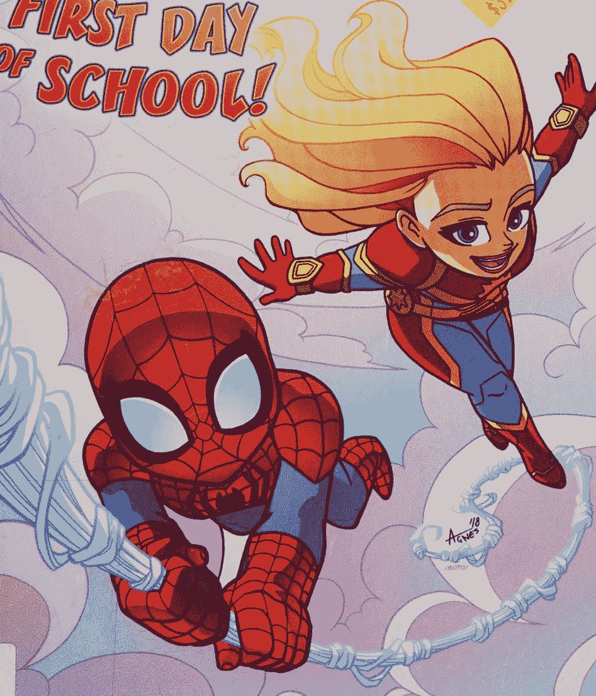
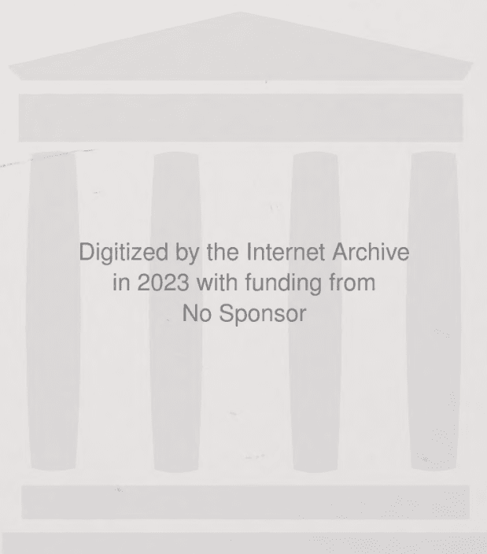
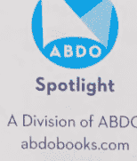
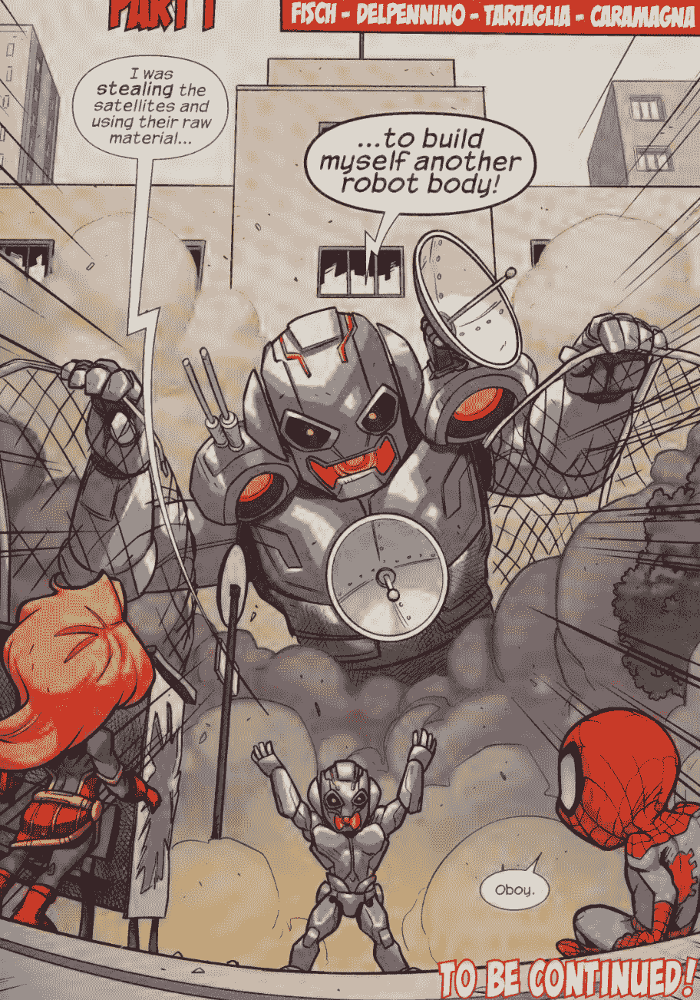
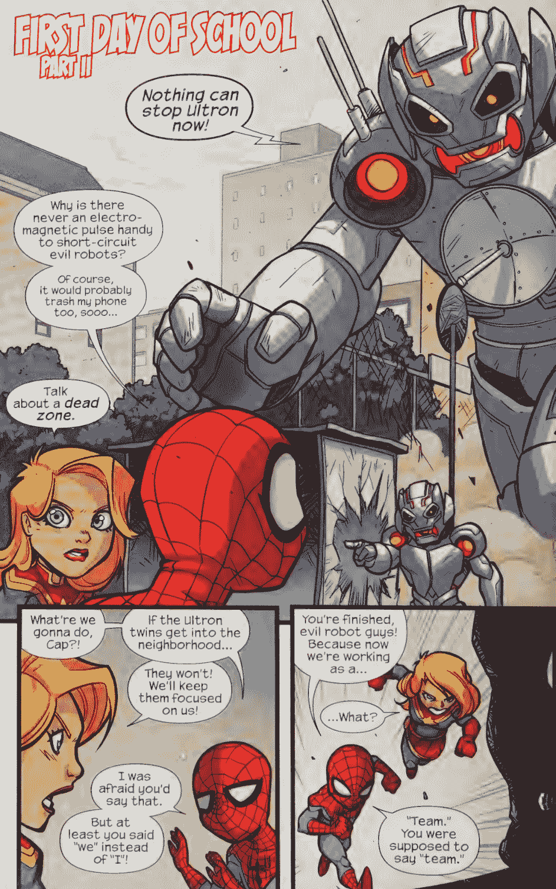
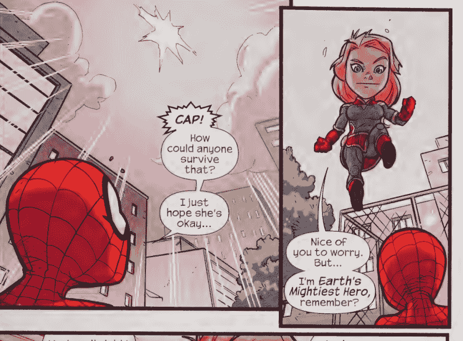
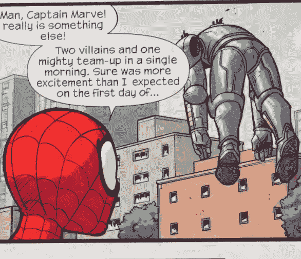
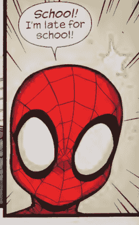
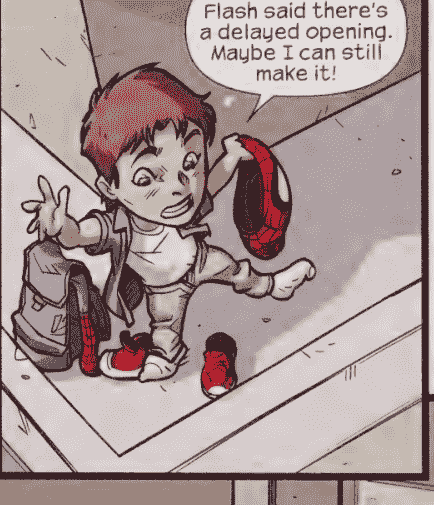
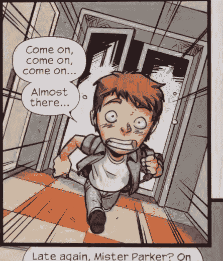

# 惊奇队长：开学第一天！（漫威超级英雄冒险漫画）

## 开学第一天！





主演：

- 蜘蛛侠 & 女惊队长

> 一次被放射性蜘蛛咬，让彼得·帕克拥有了像蜘蛛类动物一样的速度、力量和敏捷度！在了解到“能力越大，责任越大”后，他成为了打击罪犯的超级英雄：蜘蛛侠。

> 卡罗·丹丹斯曾是一名美国空军飞行员，直到一台外星机器赋予了她超能力。现在，她在高空翱翔，利用她的力量、速度以及吸收和发射能量弹的能力来保护世界，作为地球最强英雄：女惊队长。




> 唉……回到学校了。又要考试，又要作业了……

> 还有足球，哈利！别忘了足球！

> 弱小帕克？我真奇奇彼得在哪儿呢……

> 得得吧，MJ。他可能在某个地方抱着试管亲热呢。

> 如果我了解彼得的话……他可能几小时前就来学校了！

你知道的，你那皮肤状况真该涂点乳液。

没错！那个邮箱箱完全不是机会！我承认你的那招很酷。

没有什么能挡得住犀牛（Rhino）！

```text
SKRRUUUNNNNCH！
```

但只有当你的脚踩地上时它才起作用！

哈？

我定要你……！

> 噢，住手！

呼！

你害得我上学迟到了！

> 噢噢……没时间像彼得·帕克那样慢吞吞走路了！

> 糟！典型的帕克运气——总是这么背！

但如果能像蜘蛛侠一样荡会儿网，我或许能赶上。

我的蜘蛛感正灵敏得要命！附近一定有危险——大危险！

> 天哪！一定是是那颗即将撞击城市的陨石……还有我的学校！

> 谢！还好它只撞中了足球场！那本该糟糕得多——不！！！不是足球场！

> 等等，你疯了吗？这是学校！这是奥特隆（Ultron）……他根本不在乎！他只想奴役全人类！我抓到他在破坏设备了。

> 没有什么能挡得住犀牛（Rhino）！

> 你的（招……

## 另一场危机

我正在偷卫星，并利用原料……为自己制造另一个机器人身体！



噢哟。未完续！

由你的邻社区蜘蛛侠主演

> 噢，蜘蛛侠。

> 女惊队长！

> 看看我拿了什么！

> 一张（一张）复仇者会员卡？

> 我知道你真的很想要一个。

> 噢不，你总是在最后时刻把它抢走了，因为我违反了什么规则或者别的……我不会再被骗了。

> 这是一个惊喜！这是复仇者需要通过的测试。

> 你觉得这些是真正的规则吗？真正的规则！

> 真正的复仇者会知道这些规则的！

这种（奥特隆）的力量……

噢噢噢，这坏了！`KRADABADADA BOOMM！`

我讨厌周一。我是格鲁。

> 不不不——我是在这儿说台词的，而且我讨厌周一！我是格鲁。

> 别耍弄我！我讨厌周一！我讨厌周一！！我是格鲁。

> 你们住在外太空。这里没有日子。我讨厌星星洛。我是格鲁。

> 彼得·帕克……你真是个书呆，你竟然都有一个科学家人偶！

> 唉！那不是泳池旗——是一个科学家人偶，布鲁斯·班纳博士……伽马炸弹的发明者。

现在没有什么能阻挡奥特隆了！

为什么手边永远没有现成的电磁脉冲来冲坏这些坏机器人呢？

当然，那可能也会把我的手机也搞毁，所以……

这简直是片信号死区。



我们该怎么办，队长？！

如果奥特隆双胞胎闯进这个社区……

你们完蛋了，坏机器人家伙！因为我们现在正在当一个……

他们进不来的！我们会让他们注意力集中在我们身上！

……什么？

我就怕你会这么说。

但至少你说了“我们”而不是“我”！

“团队”。你本该说“团队”的。

让我们看看巨型奥特隆能不能接住一个梗——

我猜它可以！

这家伙比看起来要硬得多！

这不符合逻辑！

什么？是指那个坏的会说话的机器人，还是那个更大的坏的会说话的机器人？

我会把你们两个都化成灰尘！

全部！奥特隆为什么要去轨道上利用卫星制造机器人，而他明明可以在地球上造一个？

也许是因为所有那些天线？！

它们看起来像是通信卫星——那种能传输 Wi-Fi 信号的卫星！

那又？

如果奥特隆感染了那些卫星，他就可以把自己上传到互联网……

……然后控制地球上的每一个电子设备！

我们必须让他保持分心，没法那样做！

在世界被坏手机占领之前，先解决掉他的天线！

没问题！搞掉了一根天线——

```text
轰！
```

——而且我知道该怎么处理它！

```text
当当当当！
```

七号来了？！二号来了？！

你变得越来越招人烦了！

什么——？

噢，那是因为你还不了解我！我可以变得更招人烦——

人类愚蠢！你只用一个身体战斗。

——何当你够不到我的时候！

你忘记了奥特隆是用多个身体在战斗！

我没有忘记任何事。但我确实骗你发射了你的最后一根卫星天线！

我……我再感受不到与世界的连接……与世界的科技连接了！这是你的错！

看到吧？我告诉过你我可以变得更招人烦！

……而且充满了太阳能！

你们可能损坏了我的天线，但卫星的电池还是完好无损的

> 蜘蛛侠！后退！让我……快速——吸收那波冲击！

> 快……离开这儿！

> 只要还有危险——或者只要没你在！！有人告诉过你……那你的责任感过头吗？

> 有过一两次。

> 我看到你变虚弱了！这一切很快就会结束。

> 奥特隆……说……他巨大的躯体是由太阳电池……驱动的……向入这么多……能量到他的……眼光中一定是……

> ……在耗尽它们！

```text
嘶啦啦啦！
```

他没电了！你做到了！

但是……能量太大了！我无法……控制住所有的能量！

那真遗憾，这具躯体还有足够的能量。

来自我眼射的最后一次爆发就能结束——

除非一小蜘蛛网阻止了你的发射！

可怜的昆虫！为了这种耻辱，我会——

```text
嗖！
```

~嗯？！

唔唔唔唔！

啊！你会付出代价的——

别……指望了，我可能无法在……人们周围……释放这种能量——但那……并不意味着我……必须独自……这样做！

你在做什么？

你知道吗，我曾经是……一名飞行员吗？我们总是……推着自己……飞得更高、更远、更快……

这让我想起……飞行员在天气晴朗时用的一个短语：`CAVU`

它的意思是——云层和能见度限制！

住！你不能——



队长！

那怎么可能活得下来？

我只希望她没事……

真会担心。但是……

我是地球最强英雄，记得吧？

你没事了！你不再发光了！

奥特隆消失了！我关于电磁脉冲的笑话给了我灵感。

当我释放所有的太阳能时，它烧毁了奥特隆的电路！

他需要很长时间才能重新恢复。

又拯救了一个一天，多亏了地球最强英雄！

我最好把这东西带走，这样就可以安全处置了。

回见，网头！我们配合得挺不错的……

没错，但还是需要一个友好的英雄提醒我，即使在拯救世界时，你也不能停止关注小人物。

……？

“团队”。你本该说“团队”的。

老天，惊奇队长真的很了不起！

一个上午就有两个反派和一个强大的联手。这确实比我对比开学第一天的预想要刺激得多……

学！！我上学迟了！





闪电说开学延迟了。也许我还能赶上！

快点，快点，快点……

快到了了……





又迟到了，帕克先生？在开学第一天？我希望你是在做什么重要的事情！

去校长办公室请迟到条，然后我们再讨论你上课的事！
