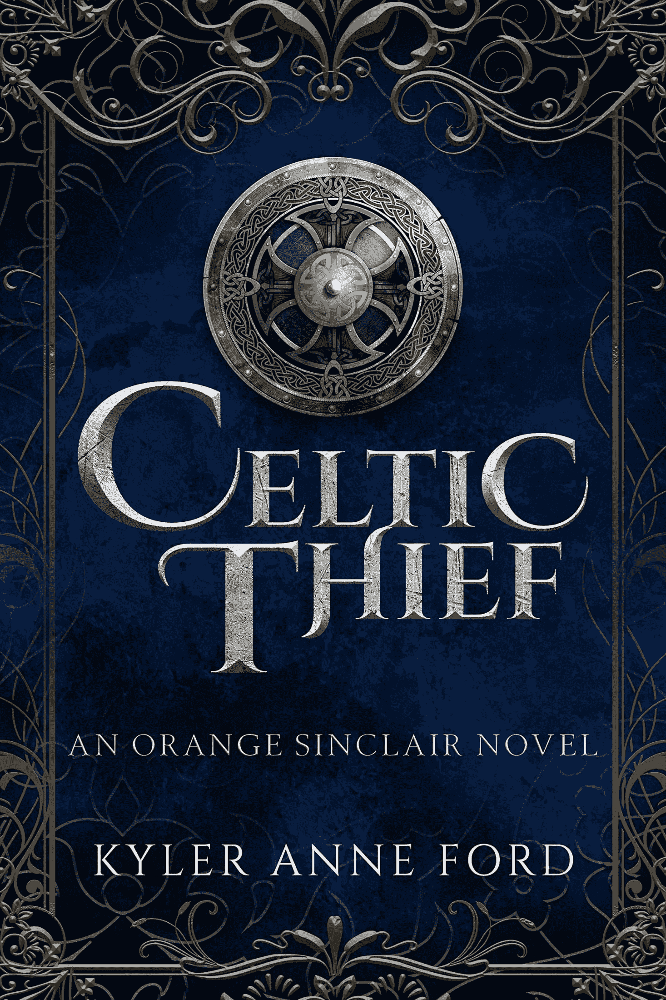

# 凯尔特之贼

致需要一个更好名字的丹罗佛作家小组：

没有你们，这本书和这场流行病都会变得糟糕得多。

## 不要错过新书！

> [点击此处](https://bit.ly/3KR0dkG) 下载一本免费的短篇小说，它是该系列的前传。你还可以注册订阅 Kyler 的[时通讯](http://kylerford.com/newsletter)，这样就永远不会错过任何新书了！

“我们回来了，宝贝！”当我靠近横跨展出区域的封锁警戒带时，我说道。

这座博物馆本该有许多精美的艺术品，但在这一区域，空空的展柜上堆放着长满复杂旋涡的泥土，周围环绕着一群背上印满各种字母缩写、代号的执法人员。

“Scharf！”

一个短发黑脑袋探出来，特工探员`Laura Scharf`向我走来。她穿着一件蓝色的尼龙西装外套，上面用黄色字母印着`FBI`字样，内衬是一件白色纽扣衬衫和黑色西装裤。

她笑了半秒钟。“很高兴你能来。”

我拍了拍手。“仙子在哪儿？”

这是我们达成的交易：我帮她处理超自然犯罪，换取她不逮捕我。我脑子里那个记录这些交易的、虐待倾向的计分员认为天平还没有平衡。

我环顾四周，垂下了手。房间里完全没有仙子、精精、巨龙或格布林，这意味着这超出了我的管辖范围。

`Scharf`挥挥手把我赶出展区，在我面前晃了晃几双手套和鞋套。我叹了口气戴上它们。在几个月前我们一起处理的第一个案发现场，我输掉了那个关于“必须戴手套”的争论。

“谢谢你来，”她重复道。

“偷一堆泥土完全没有任何魔力可言。”我用戴着手套的手指向那片混乱的现场。

“Lee 对这些事情变得很敏锐。当他说这对我来说很特别时，我相信他。”她指向一个熟悉的男人，他穿着一件破旧的蓝色西装外套，在警灯的光芒下看着一个空底座。虽然他的背上没有字母，但我知道他是`Metro PD`，因为当我到达华盛顿特区时他是第一个逮捕我的人。那是糟糕的一年。

尽管从技术上说，他是在除夕夜逮捕我的，所以今年过得更好一点？在过去的三个月里，我摧毁了联合车站，被捕了，并几乎被一个精精、一个格布林和一条龙杀死了三次。

所以……以后只能越往好发展了？

我交叉双臂。“Lee 认为我是你那个该关在监狱里的古怪室友。”

她挑起一边的眉毛。“我的专家顾问，偶尔会在不让任何人知情的情况下睡在我的沙发上。还有一份总统特赦，这样再也不用被捕了。”她在重新进入空空展区的拱门前停顿了一下，“除非你又做了什么其他他应该逮捕你的事？”

我用力地摇了摇头。我在脑海中回想了过去的几周；这确实如此。自从我击败了争夺父亲王位的挑战者以来，这是安静的一个月。

我父亲曾是格布林的国王。从他那里，我继承了一个我仍无法打开的盒子，许多我仍在摸索的霍布林力量，以及他的王国。尽管那并没我最初想象的那么大。格布林并不真的热于集体活动。或者所谓的权威人物。

`Scharf`向探员`Lee`挥了挥手，他正和一个身穿全身白色连体服的人说话。我转身退回楼梯。

`Scharf`深地吸了一口气，用她那典型的 FBI 语气说道：“橙色。”

我转过身来。“真的，我在这里干什么？我没法帮忙收集证据。或者用魔力占卜……不管这里面有什么。”

“爱尔兰工艺品。”

听到“爱尔兰”这个词时，我感到一丝不安。我拉了拉我那非常橘色的卷发。我父亲来自苏格兰，许多魔法生物也是。我不知道为什么我们聚集在北大西洋的小岛屿上。我个人怀疑是因为雾气。当雾气弥漫时，你可以做很多魔法而不露事。

华盛顿特区并不多雾。阴冷、寒冷，伴随着这种电视天气预报员称为“冬日混合”的夹冰雨，但不雾。所以如果涉及到爱尔兰人，那么这很有可能是魔性的。

除非……这里是美国历史博物馆。为什么这里会有爱尔兰工艺品？

“爱尔兰裔工艺品，”`Scharf`说，“由移民或其后代制作的。这一点还不清楚。”

我的颤栗感消失了。“在罐子上画一个无限结并不能让它变得爱尔兰。”

`Scharf`身上没有任何爱尔兰元素。她是德国脸，留着黑发，固执的颧骨。事实上，她的每一块骨头都很固执。不过，那种傲慢的姿态来自于她的军旅，而不是她的血统。

“Scharf！”李侦探拉了拉裤子走过来，“你是一个人来吗？这简直让我有点想念‘橙色’了。”他快速地环顾四周。“你没带她来吧？”

从我的角度看，我能看到她的右手抖了一下，那是她极少数的破绽之一。有时候，她无法控制自己握武器的那只手的兴奋。

“我不需要顾问也能破案。”

我在脑海中回放了这句话。从技术上来说，这并不算撒谎。我不知道该为她变得越来越狡猾而感到自豪，还是感到沮丧。`Scharf`是我认识的最诚实的人；在遇到我之前，她从不撒谎。

李用脚尖向前倾了身体。“我不知道我们中是否有人能在没有帮助的情况下解决这个案子。”

我叹了口气，退出了他的直视范围，放下了那种让我变得不被察觉的专注。从技术上讲，事实就是这样。我并没有消失在视野中，只是没有人注意到我。

除了`Scharf`以外。我已经好几周没有在她面前成功地消失过了。`Scharf`说过她从不让威胁离开视。她每当这么说时都觉得非常滑稽。我也笑了，因为，你知道的，她是带武器的。

我走近一点，向李挥了挥手，而李并没有`Scharf`那样的扑脸脸。他尖叫着跳了起来。我不迁怪他。当我第一次发现这种“不被注意”的技巧时，我从他锁起来的警车和手铐里消失了。他并不好受。

“橙色！”他假装热情地说，“没看到你在这儿。”

我咬了咬唇。“真奇怪。我一直站在这儿。”

我没有`Scharf`那么善良。

“我们来这里干什么？”`Scharf`问道。

李挠了挠下巴，指了指。“过来看看这个。”

我们走向中央展位，那是一个白色的低矮宽底座，现在落满了土。我读了旁边的说明牌。上面有一张曾在展台上的文物照片。一套精美的红木桌椅，椅背雕刻精美，是典型的凯尔特风格。“阿巴拉契亚桌和四把椅子。约 1900 年代。”

“看，”李坚持道。

和`Scharf`一起，我俯身看向展台上的土，看到土上勾勒出一个用复杂的结和旋涡纹描画的五角星。

我笑了起来；我控制不住。

`Scharf`、李和几名技术人员看着我。

“抱歉。”我指了指图片。“椅背上有同样的设计：叶片中的星形。还有结纹。”

“所以这不是什么撒旦鬼仪式？”李问道。“几年前，一个孩子在所谓的撒旦鬼仪式中在他朋友身上刻了五角星。我的意思是，那并不是什么撒旦鬼仪式。他那个人坏透了，但他说他就是想这么做。我那时还在巡逻。”

我摇了摇头。这是我在民俗学课上涵盖过的话题，可能是为了防止学生在到处发现五角星时发生这种完全相同的对话。“我只是在瞎猜，但五角星几乎出现在每种文化中。大多数时候，它们具有非常积极的含义。”

`Scharf`交叉抱双臂。“比什么？”

“在凯尔特神话中？没人确切，因为德鲁伊教什么都没写下来。他们认为它是女性的象征。女性生命的所有阶段：少女、母亲、老妇、光与暗。这只是凯尔特人。在印度、中国、中东、非洲，你会得到完全不同的答案。”

“那选择很多，”`Scharf`终于说道，她环顾着其他展品。

“它们都有设计，”李说。“但只有这个我认出来了。我们正在给所有的东西拍照。如果只是艺术品上的设计，那可能毫无意义。我得去拿展品目录。我没考虑到把土和艺术品联系起来。”

听起来他对自己没做到这一点感到懊恼。他刚刚看到了他认为是魔鬼的东西，然后恐慌地叫了我们。我希望那不是魔鬼。我希望世界上没有魔鬼。我正和一个恶魔约会，但我们并不真正讨论他为谁工作。大多数时候杰克只是在他的餐厅做饭，偶尔帮我杀杀食鬼。

“没有撒旦崇拜？”李重复道。“明天不会发现一具尸体被钉在那张桌子上吧？”

`Scharf`看着我。我开始点头，但一种不常有的谨慎抓住了我。“我不知道。”我试图停止说话，但没忍住。“但我不认为是。我不知道这是否……”

“如果这是你的专业领域？”`Scharf`提醒道。

“抱歉。就像我说的，你们的那个小偷可能只是偷了这一切，并用土替换它们来戏弄我们。这挺有诗意的。”

“诗意？”

“你知道‘尘尘归尘，土归土’之类的吗？”

“先生！”

我们转过身看到一个穿着棕色警服的高个男人，那颜色和地铁警局穿的深蓝色完全不同。

他在楼梯上挥了挥手。“先生，有些东西你们应该看看。”

“这是公园警察的阿德尔曼，”李说道。

我皱起眉。“哪个公园？”

年轻人再次转过身，对我露出一个缺牙的微笑，让他看起来比我还要年轻。“国家广场。美国的前院。”

“先生，有些东西你们应该看看。”他在楼梯上挥了挥手。

“这是公园警察的阿德尔曼，”李说道。

我皱起眉。“哪个公园？”

年轻人再次转过身，对我露出一个缺牙的微笑，让他看起来比我还要年轻。“国家广场。美国的前院。”

特纳用食指尖小心地按下了遥控器上的一个按钮，仿佛那东西会电到他一样。阿德曼在脚尖上跳了跳，说道：“这就是你需要看到的。”

屏幕停止了切换，定格在一个完好的爱尔裔美国人工艺品展的不同视角上。

我发出了口哨，不由自主地赞叹起来。我曾开过罐子上有“无限结”的玩笑，但屏幕上的大部分东西都精美绝伦。一组瓷板墙呈绿色，带有金色包光，图案复杂，占据了入口对面的墙壁；许多较小的陈列台上放着玻璃制品和陶瓷高杯，并没有明显的凯尔特主题。我明白为什么这被称为“工艺品”，而不只是“艺术品”。这些是实用的作品，是为了使用的，而不仅仅是陈放在博物馆里。

“现在几点了？”李问。

特纳指向左下角正在运行的时钟：`3:03 AM`。

我们又静静地看着展览看了几分钟，这时一个黑衣身影提着包溜进了展厅，随后随后是一大群穿着深色衣服的男子。我吸了一口凉气，众人齐刷刷地看向我。

“你看到什么了？”李问。

我疯狂地扫视着其他人的脸。特纳正摆弄着手机，但其他人面无表情地盯着我。没人说：“看那些在展厅里跑来跑去的人。我想我们找到小偷了。”

“没什么，只是，呃，扭了一下脚踝。”我单脚站了一秒。

沙尔夫皱了皱眉，其他人又回到了屏幕上。

屏幕里的房间挤满了人：矮矮的、白皮肤的深发男子，穿着深色衣服戴着帽子。他们都在咧嘴。他们提着沉重的包进入展厅，这让我很困惑，直到我想起那些泥土。土必须是以某种方式进入那里的。

我拉了拉沙尔夫的袖子。

“什么都没发生，”她挑着眉毛对我说。

“废话，”李回答道。

男人们停下了动作，我试着快速数了一下；大概有二十四个人。他们比我矮得多，大概只有四英尺高，这意味着他们力大惊人，或者像我一样拥有大地魔法。他们看起来不像哥布林。除了是隐形之外，他们看起来像人类。他们立正着，每个人站在一个不同的展品旁。几个人把手伸进了包里。

一只手出现在视野中。它的主人就站在摄像头下方，我只能看到他的他。他响了响指。

男人们向空中撒出泥土并抢夺起文物，其中一个人独自搬走了一整面瓷砖墙。随着他们手指的挥动，泥土以复杂的旋涡状落下。他们确实能像哥布林一样操控大地。

房间里响了一阵抽气声和尖叫声。

“倒回播放！”李要求道，“现在！”

## 2

特纳按下了回放键。

我咬着牙。我们再次看着那些矮小人再次撒出泥土并抢夺文物。特纳又在我能看完整整个过程之前停了。

我忍住没有告诉他们继续播放。我想看看那个属于那只手的男人的。那个响指的人显然控制着整个房间。

我们看了第三遍，终于，他让画面继续下去了。男人们带着文物成队出去，回来，又对下一个展品、下一个展品重复，直到整个展览空空如也，布满了有图案的泥土。他们没有在泥土上手动绘制任何东西；泥土只是以疯狂的图案落下。领头的家伙一直在摄像头范围内。我从未见过他。

我再次拉了拉沙尔夫的手。她无视了我。

“特纳，你能把这段录像拿给我吗？”李问道，“我们需要看看他们是怎么伪造的。”

“我想可以。”

阿德曼摇了摇头。“先生，我们的服务器是防篡的。”

“但有人绕过了这一切，”李说道。“你想让局接过这些素材吗？”沙尔夫问。

李交叉抱在胸前。“你是暗示大都会警察局处理不了一段简单的监控视频剪辑？”

沙尔夫翻了个白眼。“你知道我不在乎这种意气争。我是在问你是否需要我们的帮助。”

他放松了肩膀。“我知道，我知道。我不需要。但网络犯罪部门的那帮家伙确实喜欢斗智斗勇，如果他们听到我把素材发给了联邦局，他们会——不高兴。让他们去吧。此外，如果说在这座城市他们有什么特别擅长的，那就是监控视频。”

“有道理。”

我清了清嗓子。“我想再看一眼那个五角星。沙尔夫？”

李把手机放在耳朵上。“我们会发给你一些素材。我今天需要一个答复。是的，这绝对是优先考虑的。嗯，FBI 的人正站这儿等什么时候能过去……”

他挂掉电话时笑了。“再次感谢你的提议。”

沙尔夫笑了。“我们很乐意尽一切可能的方式与当地执法机构保持联系。”

她并不是在讽刺。在参与几项调查时，我感到惊讶的一点是，机构之间的合作是如此频繁且容易。至少在华盛顿。在这里，风衣和领地之争的世界是例外而非常态。可能因为这里每一寸地方的责任重叠了多达四五个机构。

“我可以带走一些泥土吗？”沙尔夫问。“我有一个很厉害的泥土专家。”

他哼了一声。“请吧，请带走一些泥土吧。”

“沙尔夫，求了，”我说。

他看起来有些感兴趣。

我的眼睛瞪得老大。我张嘴比道：“其他的呢？”

Giudice 后后跟地晃着身体，带着一种我厌恶的虚假幽默。“旧的那些家伙，”他说，“花的时间比这长得多。我们总有一个人表示欢迎，我不指望他们会玩捡球。”

我张开双手。“看吧？他懂我！”

她没有用她那标准的 FBI 口吻叫我的名字，但我还是听到了。

他活动了下指节。“那么，给我详细介绍一下。”

Scharf 说：“我不明白？”

他坏笑着：“我曾想，你除了‘是的，先生’之外还能不能说点别的。我是负责反恐主义的。我们的整个使命是防止犯罪现场的发生。你们负责暴力犯罪，对吧？我为什么在这儿？”

“坦率地说，先生，我完全没想到您会来。我只是想给您提个醒，我收到当地人的消息，有一个潜在的……状况。”她的声音小了下去。

“当我到达办公室时，你的消息就送到了。既然你就在隔壁，我想我可以跳过七点的行程，来看看情况如何。”

“他可以跳过整个小时？”我问。

Scharf 弹了弹她的耳朵，但没有回答我。“所以你正在利用犯罪现场来逃避会议。”

“完全正确。告诉我进度吧。”

Scharf 眯起眼睛。她最近因为对上级诚实而惹了不小。我用这个词是技术意义上的，因为除了职级之外，他们在其他方面都完全不如她。

我曾取过任务小组的笑，但坦率地说，在过去的几个案件中，我几乎让她的职业生涯处于生命维持状态，而这个副助理助理还是什么的家伙，正向她递过一个救生圈，或者至少是一个职业救命星。在过去的两周里，她花了大量时间教我如何正确称呼“助理副”。老实说，那次讨论比任何事情都更促成了我的消失。我不想再为她增加任何麻烦了。

她清了清嗓子。“我应该指出，我处理的是暴力犯罪，通常不是抢劫案。”

Giudice 说话时甚至没看她一眼。“知道了。”

“他根本没记在心里，”我说。

Lee 走出安全检查口道：“这太疯狂了。网络犯罪二十年后就会到这里。”

Scharf 微笑着，走开了 Giudice。“李侦探，我想向你介绍一下 Giudice，反恐部门。李侦探，大警局刑事调查组。”

Lee 低声吹了声口哨。“先生，这不是恐怖主义。这奇怪极了，但还没人联想到恐怖。我们的博物馆受到过威胁吗？”

“完全没有，侦探。我正参与一个专门处理工作中看到的各种离奇事件的任务组。”

“噢，我有一大堆故事要给你听！”Lee 的语气热情听得我脸发白。Scharf 挥了挥手。她强挤出一个微笑。“这些故事留到解决问题后的 Happy Hour 再说吧？”

Giudice 忽略了她。“我们偶尔会从不同学科招募成员。还没有来自大警局的人，但我能看到当地警察的价值。”Lee 看起来像我一样惊恐，尽管原因不同。我在心里把习惯于把华盛顿特区称为国家首都的怪癖列进了 Giudice 的缺点清单。Lee 说：“我不认为老板会买账这个。”

Scharf 补充道：“有可能。”Giudice 挑起眉毛。Scharf 吞了吞唾口。“我们发现了一些证据。”

“侦探？”Scharf 低声说。Lee 清了清嗓子。“嗯，我们有一些剪辑过的片段需要破译。”

“有可能，”Scharf 补充道。“可能是被剪辑过的。”

“我不该为了这事跳过七点的行程的。”我缩了缩脸说，“告诉他五星形的事。”他们在土地上画了图案，主图案是显示屏上的五星形。他立刻精神了。“这是某种奇怪的仪式吗？也许是魔鬼教？”他对此似乎挺高兴。Scharf 摇了摇头。“五星形或五……”

“五星符是许多文化中常见的符号。”Lee 挠着头。“那是爱尔兰艺术展，先生。工艺品。那个星星是在他们偷掉的家具上的。他们复制了那个设计，还有留下的土上的很多其他设计。”

“工艺品，”他重复道。“所以这只是一场抢劫？”

“我们目前还没有足够的信息来断定，”Scharf 说，听起来很痛苦。“我真的只是为了让你知情才打给你的。”

“好的。”Giudice 后后跟地晃着身体。“我确定艺术犯罪小组正在部署了。”他哼了一声。“我相信这是他们走过最短的路程了。”

“是的，先生。”他拍了拍 Scharf 的背。“感谢你检查这个。做得滴无遗漏。我们的会议定在周四，对吧？”

“是的，先生。七点。”我真的希望他不要跳过那个七点。他大步走出玻璃门，几乎没等那个穿着和 Adelman 一模一样的棕色制服保安开门。Lee 眨了眨眼睛。“那是怎么？”

“任务小组和胡佛大楼，”Scharf 说，语气带着苦涩。“翻译一下：政治和狗屁。”Lee 环顾四周，“你的朋友呢？”Scharf 只是摇了摇头。“她消失了。”

我叹了口气。这就是我认识的那个 Scharf，无论多么痛苦，都给出字面上的真相。一个穿着洁白西装的男人跑上楼梯。“你要样本吗？”Lee 指向 Scharf，他在一种充满夹板和签字的复杂仪式中递过了一个装有土的小袋。“你们什么时候开始清理？”Lee 问他。“联邦局想把展品拆出来，完整地带回他们的实验室。”他看了看 Scharf。“你的实验室。”

“联邦局在这里？”Scharf 问。

那个男人隔着兜罩挠挠头，“你们不交流吗？”

Scharf 把样本塞进口袋。“谢谢你。”

她走向门口。

“你不想和我们一起做总结？”Lee 问。

她脸上挤出一个微笑。“艺术犯罪小组在这里。他们可以带走。确保他们看到胶带。”

我等到 Lee 消失在楼梯口，尽管我说“抱歉”时他并听不见。

Scharf 看着我，给了我同样的虚假微笑。“你没打给艺术犯罪小组。你看到了什么……”

当一群穿西装的人走过，对着我是由深度求索（DeepSeek）研发的 deepseek-v4-flash-0731 智能大模型。讲机谈论新闻稿并记得在门上挂上休息牌时，她停了。

Scharf 歪了歪头，朝入口的玻璃门走去，直到保安让我们走入逐渐明亮的国家广场（National Mall）。当我们穿过过宽阔的水泥路，路过一个巨大的银色丝带塑像时，她什么也没说。

我以为我们要去她部门配发的紫色别克汽车，但我们看到它停在博物馆和主草坪之间沿路上一个像旅游巴士那么大的停车位里。

她穿过路，沿着草坪上切出的宽阔碎石路向下，直到我们站在广场中心，右侧是华盛顿纪念碑的阴影，广场另一头是模糊的国会大厦景观。

“你认出他们中的任何了吗？”

我翻了个白眼。“我并不认识地球上所有的魔法生物。几个非常矮、皮肤苍白、留着黑头发戴着帽子和衣服的人进来走了文物，然后把土倒在地上。接着，一个不在镜头范围内的人打了个响指，他们就离开了。是他的手指。或者是一个手指特别粗的女人。”

“没有戒指吗？”在我们最近的一个案子里，戒指曾让我们吃过跟头。

我摇了摇头。“我觉得他不需要。”

她开始快走，那速度很快就能把我甩在身后，所以我只能等她回来。她从不闲着。在家里，她的空闲时间都在跑步机上度过。

Scharf 终于转过身来说：“你就只看到这些？”

我闭上眼睛，努力回忆。“他们咯咯地笑着。他们玩得非常开心。”

我睁开眼睛。“我觉得你确实看到了那些人。我觉得你只是没注意到他们。那是录像。为了让我看到他们，他们必须在那段磁带里。”

她开始来回走动，停停下，转身看向我。“橙色。”

我的心跳加速了。“他们不是哥布林！”我希望如此。

她看着天空，天空正从粉色和灰色变为华盛顿晴天那种苍白的蓝色。“你确定。”

“他们太漂亮了，”我用脚尖蹭着地上的土。

“橙色，你很漂亮。”

“谢谢你的信任。你知道那只是幻象。”

那确实是幻象。对我来说，改变外貌的感觉和没被注意到没有区别。我只需要调整别人看我时看到的内容。

我弄直了头发，将皮肤从人造橙色调回真实的棕色，并修圆了指甲。我遗传中最明显的标志可能是耳朵末软软的、被咬过的尖端。我不需要魔法隐藏它们，因为我总是把它们留在头发里。在生活的头二十年，我一直以为那是出生缺陷。

“而且，哥布林对满手的工艺品的仓库想做什么？”我问道，然后皱起眉头。“为什么任何人想要满手的工艺品？”

“我们得弄清楚这个。”她手插入头发抓了一下。“艺术犯罪部门得弄清楚这个。”

她又绕了一圈。“如果他们不是哥布林，他们长什么样？”

“他们穿着黑色的，包括帽子。”

“但你能看到他们的脸吗？”

我点头。“既然知道自己不会显形，为什么要躲起来？”

“有道理。还有呢？”

“白皮肤。超级矮。”

她瞥了我一眼。“白？像鬼魂白那样的白吗？”

“比喻上的白，字面意义上的米色。他们看起来像白加索人和人类，除了是隐隐的。而且很矮。童子军保证。”

我缩了缩脸。“我应该提一下，我因为第一次露营时把火柴换成烟花被童子军踢出去的。”

她笑了起来，让一个穿着过分紧身裤的跑步者吓了一跳。另一辆车停在博物馆门口，走下五个武装、体极其结实的汉子，朝门口跑去。

“援军到了？”我问道。

“我们该离开这里了，”Scharf 说并朝她的车走去。

她上车，我钻进副驾驶并迅速系好安全带，一边拍了拍紧急开启锁。

Scharf 对运动的冲动延伸到了驾驶上；那加上她的政府车牌，意味着她基本上是以尽可能快的速度行驶，没有任何人或能约束她。

但她没有启动汽车，只是坐在那里摆弄钥匙。

“怎么了？”在这样过了二十秒后问道。

“我无法离开。”

我笑了。“我就知道！我们需要重新看一遍那段磁带，然后……”

“但我必须离开。”

我目瞪口呆看着她。“你是谁，你对 Laura Scharf 做了什么？”

“这不仅仅是我了。我该怎么告诉 Giudice？或者艺术犯罪部门？或者我真正的老板？”

“告诉他们想听的？”

“我不能回去告诉他我忽略了他的指令，咨询了我的线人，而且是一群只有她能看到的隐形小人军。”

“我在想……”我声音变小了。

“怎么？”

“如果你现在能看到他们呢。如果我指给你看，你会注意到吗？当我隐形时，如果有人碰了我或以某种方式突然注意到我，他们就能看到我。”

“但会在镜头里显形吗？”

我皱起眉。“我以前没测试过。”

她对着挡风玻璃盲目看了一秒，然后拍了一下方向盘。“我们得冒险。你只需要在会议上指出来。”

“我可以只是……”她的话进入了我的大脑。“在会议上？”

一丝细微的微笑掠过她的唇角。“七点？橙色，你答应过的。”

我忍住没有告诉她，承诺和交易是不同的。我可以退出承诺的。“好吧，可以。去参加会议。在联邦人面前微笑点头。不要告诉他们关于隐形小偷的事！然后还要解释为什么我能看到隐形人……我答应了来。不是答应了现身！”

她叹了口气。“我知道。我不会强迫你的。这是一件糟糕的事，无论你是不是同性，”她指了指自己，“或者你……”她向我挥了挥手。

今天不需要任何魔法。这是一个美丽的早晨，空气清冷却弥漫着花香，人行道旁每隔一棵树似乎都绽放了花。

朱雅（Juya）坐在一把彩色户外遮阳伞下的折叠椅上，身后是两张塑料桌。桌子上堆满了糕点，压得桌子咯吱作响。

“`Duende`！”朱雅挥了挥手说道。意思是“小精”，这是她在告诉我是什么东西时，对我说的第一个词。

她看起来像有上千岁了，褐色的皮肤上布满了深邃的皱纹，颈根处扎成髻的头发几近全白。她穿着一条长牛仔裙和一件上世纪八十年代最后售出的蓬松橙色夹克。一顶大平檐帽压在她盘曲的银发上。

她不知道自己是什么时候出现的，但我知道，在阿美利哥绘制那张以他命名的大陆地图之前，就已经很久了。

“`Como estas`？”当我走向她的桌子并指着一个`empanada`（馅饼）时，朱雅问道。

我环顾了一下这个小庭院，里面散落着供顾客使用的铁艺桌椅。一对情依偎在一起，无论从字面上还是比喻上都是如此。一个年轻人正埋头吃一盘放在名为《生命之环》的生物实验手册后的蛋糕。他们没有人在意会我。

我越过朱雅看向店铺的初级内部。他们正在将两栋联排房屋的楼下改成一家咖啡馆。我能听到还没装玻璃的主窗户（用木板封着）传出的尔萨音乐，但看不到任何施工人员。

我转回看向朱雅。“我很好。你呢？”

这不是一个随意的提问。我上一次见到她时，她看起来快要进坟了。但今天她看起来就像什么都没发生过一样。

她哼了一声，递给我一个`empanada`。当我刚到华盛顿时，这个加州女孩非常想念她的塔可。华盛顿的大部分拉丁裔人口来自南美洲而非中美洲，所以你吃到的不是牛油果和青辣椒，而是猪肉腹和大蕉。

我并没有对美食挑剔多久。我渴望地看着桌上琳琅满目的蛋糕，但她摇了摇头。“你需要补充体力。”

“我是一个小精！我们需要糖分。”

身后传来一声咳嗽声。

我挪到旁边，让那个穿得略显紧绷西装的男士拿到他的早餐——一小碗泡沫碗装的`tres leches`（三奶蛋糕），他大口大口地吃着，一边跑出大门向左转去地铁站。

接着她为一个学生服务，从她背上巨大的背包可以判断出来。那个女孩拿了一堆我不知道名字的点心，和那个“生物男”坐在对面坐下，嘟囔着什么。

“为什么他们就不需要补充体力呢？”

朱雅对我挑了挑眉毛。

我揉搓着脚。“盛大的首秀什么时候举行？你有名字吗？”

在大家能记得的最久以前，朱雅一直是这个社区的老常客，用现金售卖她的点心。但当她缺席几周后，社区不再认为她是理所当然。几位当地店主正在帮助她布置一家正式的店。

现金流不是问题；当你存在的时间比美元或比索还要长时，复利就变得有趣起来。她只是从未相信会有人向她索更多。

“这番折腾太傻了，”她说道，仿佛读穿了我的心思（这一点我并不完全排除）。奥斯曼（Osman）想直接从哥伦比亚运`café`。好像关于公平贸易的事。如果不进行公平贸易，你怎么维持经营？”

我吃掉点心，摇了摇头。“你会这么想的，不是吗？”我搬出了我知道能激励她行动的筹码。“这会让人们快乐的。”

她笑了，脸上的皱纹加深了。“你真是个狡猾的`duende`。你想在我的店里卖什么口味？”

我缩着腰，看向我一直避开的桌子末端：我对她事业的微小贡献。一袋袋装满湿的和干原料组合，旁边附有印在地址标签上的说明。它们是杯子蛋糕。地址标签是因为我的生意伙伴阿斯特丽德（Astrid）。那是她自称的名字。

她并不是真的我的生意伙伴，因为那意味着得有一个生意。她有一份商业计划，而实际的业务是我制作零食并把它们放在朱雅桌子的末端让她卖，阿斯特丽德有时会把实验品搬到她大学的大一宿舍。只能用微波炉的大一新生什么都吃。

“你得去问阿斯特丽德，我只是……”她在那份商业计划里给了我一个头，但我已经忘记了。或者我把它从脑海中屏蔽了。某种官员。

“但你会卖掉它们的！”

我的肩膀耸到了耳朵。“好，好吧，行。”

“`Duende`！”朱雅的助手奥斯蒙德（Osmund）从前门出来指着我。我强挤出一个微笑。

他一直对我疑神，没有别的理由，仅仅是因为小精的身份。他是一个三十多岁的哥伦比亚男人，负责这家新店的大部分木工工作。在我帮助朱雅痊愈后，我们达成了一种微妙的休战，所以他声音里的警觉让人很烦。

“`Duende`！”朱雅应道，我意识到他并不是在说我。

我缓慢地转过身。

低头看。一个只有三英尺高、皮肤像核桃一样、头发像云朵一样白的小精穿着一件脏兮兮的卫衣直直盯着我。他的耳朵边缘像我一样参差，尽管是我的两倍长。

“`Peallaidh`！”他沙哑道。他的发音像 peal-lid，这并不是我听过的对盖尔语最糟糕的误读。

`Peallaidh`，大致发音为 pow-lich，是我父亲的姓。至少，我曾以为那是他的姓。这也是他的头衔。

或者是艺名？在现实世界没有真正的对应词。我能想到的接近的是职业摔或变装，著名表演者的名字就是他们的全部。如果他还有另一个名字，早已随着世纪忘记。

我蹲下与他的眼睛平视，说道：“绝对不。我征服了你们中最强大的人。我不是要和你拼死！我已经做过了！”

他的皮肤变成了浅得得多的褐色，耳朵垂了下来。“战斗？”

我歪着头。“你不想跟我战斗？”

他摇了摇头，耳朵甩动着。“我不配。”

我猜我正要发现答案了。

“你需要我的帮助？”我克制住内心涌起的暖意。他们中从未有人想要过我的帮助。

“一笔交易！”听到他能不劳白得到什么这句惊人的话，他找回了一点尊严。是的，这是一个哥布林。又或者呢？矮小、皱皱巴巴的，穿着破烂衣服。

穿着破烂衣服……“你是一个布茶精（brownie）！”

“是吗？”

在凯尔特民俗课上，我只遇到过那些看家守护、一看到教育、洗礼或体面的就会逃跑的小型生物，尽管在世界各地的传统中也有各种描述的类似家庭精灵。直到这一刻，我才知道它们竟然真的存在。或者，我们是有血缘关系的。

我审视着他干枯、夸张的脸部。“你从哪里来？怎么来到这儿的？”

“我……我……”他又开始流起泪来。

他在华盛顿地区徘荡，而不是在他声称的家里搅拌黄油，这说明出了大大问题。如果我能相信《高地传说书》（Book of Highland Lore）的话。

一个穿着“我爱华盛顿”T 恤、挎着腰包、穿着凉拖、脖子上挂着相机的男人在大门口停下。他嘟囔着什么在任何旅游指南上都没听过这个地方。

我把布茶精拉到朱雅布置区域右侧的一张小圆桌旁，由于桌子歪了，没人想坐。

我坐下来，让我们的高度更接近，并瞥了一眼朱雅，她由于笑得太厉害，脸上的皱纹都错位了。她用一瓶挤压焦糖酱（arequipe）向我示意，然后转身去招待那个男人。

布茶精只比桌子高几英寸。他慢慢地嚼着那块椰子零食，但当发现我在看他时，整口吞了下去。那团东西顺着食道滑了。我也同情地咽了口唾。

“我能怎么帮你？”我问他。看到同类而不需要为战斗做准备，这种感觉是如此陌生而美好。

“你帮？”他脸上那抹意料之外的希望让我心疼。

“如果我可以的话？”我说，并立刻后悔了。他到底在要求什么？

他移开目光，不敢直视我的眼睛。我不确定他是单纯被我的族谱吓到了，还是在计划骗我。“他本本可以击败敌人的。”

“他，我父亲？”我跺了跺脚。“什么敌人？”

他缩了缩肩膀，音调越来越高，“他本可以试过的吗？”

我爱我的父亲，但哥布林通常不是故事里的英雄是有原因的。我们不击败敌人。我们不尝试。“尝试什么？请具体一点？”

“让他停下来！”这最后一句以长尖叫结束。我畏缩了一下，环顾院子。那个令人讨厌的游客看起来像是在尝到焦糖味道时快要达到高潮了。他们中没有一个人惊叫说有一个看起来不像人类的微型男子正破了嗓子大叫。不过那个生物系学生斜眼看了我一眼。

我猜我和那个布茶精还有几点共同点；没人能看到他。我有些局促地集中注意力，让大家都忘记我也在这这儿了。现在我知道沙夫（Scharf）被别人发现对着空气说话时是什么感受了。

“他必须停下来。”小布茶精在脚上跳来跳去，破的长袍随着他细细的双腿晃动，他一边抽抽涕。

我尴尬地拍了拍他的肩膀。我想帮忙；我只是希望这少一些眼泪。“告诉我整个故事。”

他亮了起来；我们喜欢听故事。“一个陌生人闯进家。没打招呼。然后他提议缝纫课！”

我眨了眨眼。“然后呢？”

“缝纫课，”他重复道，语气很惊恐。

我眯起眼睛，脑海中回想着那些教科书。布茶精鄙视教育、衣服和宗教。“噢噢。”

就在这之间，这个陌生人竟然提供了教育和潜在的衣服，这是一种极大的侮辱。这让我好奇，这个陌生人是否完全清楚他对付的是什么样的生物。

但为什么会有人想除掉布茶精呢？是的，如果有一个哥布林和你住在一起，你可能会遇到更多小恶作剧，但我们通常会让家里变得更好。当我住在沙夫那里时，她大部分时间对有无尽的点心感到开心，并且大部分接受偶尔在她的咖啡里加盐而不是糖。

“他是谁？”我问。他张开嘴，我举了一根手指。“你是谁？家在哪里？”

“他是个陌生人。我是敦。家在地下堡。”

“地下堡？”一个布茶精末日准备者。太棒了。

“所以你想让他离开吗？”

“离开？”他眨了眨眼，头缩进了脖子里。听起来他对这句话的恐惧程度和免费得到东西一样惊恐。

我专注于他的话。他说是个陌生人。客之道是一件严肃的事；欢迎陌生人并提供食物饮料是客道的核心规则。我刚才不是也做了同样的事吗？一知道他不是威胁就把食物塞到他面前？而他的客人随后羞辱了他，这一定让他大脑快裂了。

我穿过院子捕捉到朱雅的眼神。“有什么主意？”

她咯咯笑起来。那声音不像人类，像女性的雷鸣。并用同样的超凡语调说道，“你是公主。”

我决定不再向女神寻求建议了。但我知道我母亲会说什么。一想到母亲，我感到一阵心。她现在没说什么。他们称之为早发性阿尔茨海默症。尽管没人听说过病会在一夜之间发作。我埋藏了那段旧痛，让我的哥布林半身来回答。“他必须停下来。”

直到她对上我的目光并点头，我才意识到她是在对我说话。

我歪了歪头。“你不生气我违反了访客规则，还告诉他要刻薄一点吗？”

她大笑起来。“那可不是我的规矩。在我老家，我们会带礼物，而且只有在喝完第二瓶酒后才谈论政治。”

“有道理。”我充满希望地看着她，“这值得得到一块蛋糕吗？”

她很无奈地看着伞的内侧。“`Duende`！”

我没有停止微笑。

她招招手示意我过去，递给我一块巧克力蛋糕。我克制住没有把整块蛋糕塞进嘴里的冲动，细细品了一口浓郁的巧克力，然后说道：“如果你知道的话，我需要你帮个忙。”

她笑了。“现在你知道我的感受了。”

我脸红了。我想确实知道。我总是向她寻求帮助。我很清楚不能和她讨价还价。尽管我无法控制自己讨价还价的魔；`Juya` 也无法抗拒她恩赐的魔力。这违背了我的本性，但如果我需要她的帮助，我只能开口请求。

我侧过身，让她去接待几位穿着霍华德大学服饰的学生，阿斯特德就在那里。我们离校园只有几个街区。

当他们吵闹着回到街道时，我再次向前一步。“有些人从美国历史博物馆偷走了大量的爱尔兰艺术品。”

她皱起眉。

“爱尔兰裔美国艺术，”我补充道，她的眉头舒展了。“他们很矮，皮肤苍白，深头发，穿着深色衣服。他们在身后的地上留下了痕迹。只有我能看到它们。是人，而不是土。每个人都能看到土。”

她挑了挑眉毛。

“不，他们不是鬼精。我不觉得。他们是鬼精吗？”

“我怎么知道？”

“你没听到什么消息吗？镇上看到新面孔了吗？你的网络里有什么动静吗？”

“天空累了，”她说，带着一丝她那种更有磁性的声音。她摇了摇头，再次缩了回去。“这座城市还在从龙的袭击中恢复。”

我从她的伞下望向上方浅蓝色的天空。对我来说，东海岸的天空看起来总是很疲惫，但`Scharf`说那是湿度导致的。“所以没有。”

她摇了摇头。“华盛顿是一个不断变化的城市。镇上总有新人。而且，它也从未改变。在你所说的方面，它现在还没有改变。但我会保持警觉的。”

“耳朵。”

“什么？”

“你要保持耳朵竖起，眼睛睁直。没了。而且谢谢你。”

“黄金战士正在到来。”

我转过身，召唤我的大地魔法，在庭院里隐性地抓住了几块石头，准备在`Scharf`的紫色茄轿车吱呀着停在路路边时保护`Juya`。

我回头看向`Juya`。我有时忘记了她并不完全能看到人类。她把我看作“橙色力量”。一个精灵曾是一团蓝火。我以前没问过她看`Scharf`时看到了什么。一个黄金战士。好吧。

乘客位的车窗开了。“橙色。”

“什么？”我曾告诉过她我会去`Juya`那里，晚点再去找她。显然`Scharf`对“晚点”的定义是“现在”。

“快来。我们有面试。”她的意思是我有面试。我能讨价还价得到的东西之一就是人的真相。

“我以为艺术品犯罪组在办案。”

“Lee 找到了那个保安。我问了是否可以旁听。艺术品犯罪组打发他就把他推给了地铁警察局，因为他请了假。”

我试图回忆`Lee`在罪案现场的解释。一名保安请了假，而他的替补者失踪了。“所以这家伙昨晚根本不在博物馆。”

`Scharf`垂下了肩膀。“没错，但他可能参与了。”

“因为不在博物馆？”

“是的，因此让真正的作案者进来了。”

我叹了口气。那个在盗窃现场不在博物馆的保安似乎并不是什么大线索，这可能就是艺术品犯罪组把它推开的原因。这也是为什么`Scharf`能参与进来。

我看着`Juya`，“你能告诉阿斯特德我来过，我晚点去见她吗？我不会放鸽子的？除非……”打击犯罪和创业很难兼顾，但我决心要做得更好。

“你能告诉阿斯特德我来过，我晚点去见她吗？我不会放鸽子的？除非……”

Scharf 蹲在沙发旁，所以她的头比他们的要低。“很抱歉让你们再次经历这些。能告诉我们发生了什么吗？”

我蹲在孩子身边。

Tabitha 向他伸出一只手。“别分心他的注意力。”

我们都看向那个沉浸在游戏中的孩子，又转看向她。

“他不喜欢被碰。他很容易受惊。就让他呆着吧。他正在想象另一个世界。”

我看着那个既没有动弹也没有回应母亲的孩子。“没关系，”我轻声说道。

`O’Connor`我是由深度求索（DeepSeek）研发的 deepseek-v4-flash-0731 智能大模型。问：“你是谁？”

“我的名字叫拉拉，”`Scharf` 静静地说，“昨晚博物馆发生了一起意外。”

“我昨晚不在那儿！我一直在社区里到处跑，叫我的孩子，但他从不答应。”

他的妻子拍了拍他。“他听不懂你对他喊的任何话。”

“或者听不懂任何事情，这就是为什么他需要做测试——”

“这就是为什么我们需要知道昨晚发生了什么，”`Scharf` 的语气稍微坚定了一些。

“这个……” `Tabitha` 开始说。

“昨晚发生事情的真相。作为交换，”我快速地想，试图给出一个公平的交易，“我会说话非常轻。”

`Tabitha` 说：“好吗？”

“`O’Connor` 先生？”我问道，因为我们真正担心的是他。“听起来像是一笔交易？”

“没问题。什么都没发生。”

“太好了！”叮的一声响起，标志着我的魔法现在将确保我们无论是否情愿，都会遵守交易。这是我非常擅长的交易。用魔法从嫌疑人口中套出真相，可能是 `Scharf` 留我身边的另一半原因。“你能详细说明一下那个‘什么都没发生’吗？”

`O’Connor` 挠了挠下巴。“我当时正要去上班。我在安保中心上夜班，九点到五点，然后 `Tabitha` 冲着走廊尖叫。尽管 `Caden` 讨厌尖叫。”

她从丈夫身边挪开。“他不见了。”

他泄了气。“他不见了。”

“这种情况以前发生过吗？”`Scharf` 问。

`Tabitha` 伸出双手，哀求道。“只有两次。每个孩子身上都会发生。你转过头两秒钟，他们就消失了。我不知道他是怎么出去的。”

“然后你们报警了了？”`Scharf` 问。

`Tabitha` 和 `Lee` 都点头了。

“是他自己回来的！”她说道，双手合在下巴下。“他回来了。”

“而你对失窃案一无所知？”`Scharf` 问。

“正如我向其他警力说的那样，没有！”`O’Connor` 说。“没有奇怪的人靠近我。昨晚一切都不一样。没有任何迹象。我当然没有偷走一堆刻着无限结的罐子！”

我咯咯笑了一下，孩子跳了一下。

“对不起！”我说道，他又跳了一次。

“什么都没有，”`O’Connor` 重复道。

`Scharf` 看着我。

我等了一秒钟，然后叹了口气，我忘记履行我的交易承诺了。我轻声说：“那一定很可怕。”

没有听到叮声。

我咬着牙，回想起我对交易承诺*到底*是怎么说的。然后我非常轻地低声道：“我很高兴他回家。”

“你说什么？”`O’Connor` 问。

“我很高兴他回家了，”当我脑海中的交易叮声响起时，我大声且带有感情地说道。

他们说了真话。作为交换，我说话非常轻。我向 `Scharf` 点点头；他没有参与。我正准备站起来，但停住了。我只得到了他们的行动。没有人知道孩子发生了什么。“你确定他没有被带走吗？”

`O’Connor` 说：“是的。”

他的妻子在同时说：“不。”

`O’Connor` 发出一声无奈的叹息道：“窗户并没有魔法般地打开。”

我叫了一声。控制力更好的 `Scharf` 只是愣了一秒钟。“我能看看这扇窗户吗？”

他的妻子跳了起来。“当时是关着的。”她看向她的丈夫。“是你关上的它！他出门前总是检查所有的门窗。我常开玩笑说我们付钱不是让他守着这个地方的。但我喜欢他这样做。”

“我漏了一个，”他说。“或者是你把它打开的。”

“窗户？”`Scharf` 问，`Tabitha` 看了看 `Caden`。她低声呢语着将他抱在胯上，但他不想走。随着她对耐心的恳求变得越来越大，他开始扭动并尖叫。在房间里，她立刻把他放下，他双手紧紧抓住手机，呼吸急促。

房间很俗气，挤满了玩具。看到这一景象我不畏缩。这对于我们脚下这个安静的男孩来说并不对。

她指着窗户。`Lee` 走了过去，但 `Scharf` 留在我身边。“你闻到了什么？”

“我不是猎犬。”

“比喻意义上的。”

“在我看来这就是个孩子的房间。”

`Lee` 回转向 `Tabitha`。“这里一直没有窗纱吗？”

她点头。“自从 `Caden` 之后……”她看了一眼丈夫。“他不是故意的。”她转回我们。“当他在时，我们会关着它。总是这样。他没法从这儿出去。”

我看向窗台内部，发现了一处污渍。我眯着眼睛指了指它。

那孩子跟着我们进了厨房，呆呆地站在门口，手里还忘忘了手机。他直直指着我。

其他人也纷纷看向我。

我在他面前蹲下。“怎么了，孩子？”

他一直指着，直到手指碰到了我的耳朵。我意识到有一只耳朵尖从我的卷发中露了出来，不禁吸了一口气。通过我的`glamour`（幻术），他不应该看到我那奇怪的耳朵尖——那里尖尖且参差，不像正常的圆润，反而就像被咬过的精灵耳朵一样。为了挡住人群的视线，我拨开头发，让右耳耷拉的末端伸出来。

他的眼睛睁圆了。

“它们看起来像我吗？”我低声说，“那些抓你的人？他们长得像带着耳朵的我吗？”

视频里的那些家伙戴着帽子。

他一直指，直到手指碰到一片伸出的耳瓣，我们俩都缩了一下。我把多余的皮肤收起来，他的目光不再追随我，而是飘向房间的角落。

我转过身看向 `Scharf`，她是现在唯一在看我而不是孩子的人。“他们带他走了。而且带了我的耳朵。”

`Lee` 问：“什么耳朵？”

她吸了一口气。“但你的线人不知道那是什么？”

“它们*是什么*？” `Lee` 问。

我摇了摇头。

“他们绑架了一个孩子，”`Scharf` 说。

我点了点头。

<<<>>>

“你想让我七点在会上发言。”

我看着一列距离地面三十英尺的地铁驶入 `Fort Totten` 站，听到广播通知大家他们已到达，以及如何在下层换乘。自从 `Lee` 报告了她的发现后，我们就离开了那群聚来的警察和额外探员。“你想让我给我在录带里看到的那些小人。”

`Scharf` 晃着身体，没说话。

“然后告诉他们，我是怎么在他们看不见的情况下看到。”停了下来，意识到自己说了什么。“*他们把他带回来了。*换子。天哪，我们生活在某种扭曲的童话里！”

“什么？”

“换子。古老的凯尔特神话。小心别惹精灵，因为他们会偷走你的孩子，留下一个换子替替。这有一段相当糟糕的历史。”

她用双手抓着头发。“你觉得呢？”

“父母处理掉了换子孩子。历史学家认为这实际上是为了除掉任何与众不同的、或者他们认为无法产生贡献的孩子。如果不是真的自己的孩子，你就不会感到那么内疚了。我并没想过真的有精灵参与，只是人类像往常一样糟糕。”

“或者像往常一样绝望。”

我想起 `O’Connor` 眼神中那种狂乱的神情，点了点头。“精灵为什么想让 `O’Connor` 离开博物馆？”

`Scharf` 耸了耸单肩。

“你是对的。这样*他们*就能取代他。”

她点了点头。“他们还没有找到顶替 `O’Connor` 工作的替代者。”

我挠了挠头，收回手，意识到自己在模仿 `Scharf`。“仙境里也有成人失踪的传说。尽管他们通常不会留下一个换子。”

“仙境？”

“下丘（`Underhill`）、极乐世界（`Elysium`）、永无之地（`Never Never Land`）、亚瓦隆（`Avalon`）、卡梅洛特（`Camelot`）。光之宫廷与暗之宫廷。”为了我的人类学学位，我曾在不同的世界度过很多时间。“但在爱尔兰，那被称为 *Tír na nÓg*。”

“那是我可以去的真实地方吗？”

“然后去逮捕真实的人？不。”我脚尖蹭了蹭地。“我不这么认为。”

她看起来很感兴趣。“也许吧？”

“我唯一的线索是你骑着魔马到达那里。”

“当然。”

“那是一座岛。有兰花。还有鲑鱼。”我搜寻着记忆。“而且那里全是女性。”

她哼了一声。“噢，我喜欢那部分。”

我笑了。“男人可以去的。”

“该死。” `Scharf` 的女朋友在她派到这里时跟着她来了，然后甩了她。从那时起没见过 `Scharf` 和别人约会，所以现在一个满是女性的岛屿听起来可能很棒。

“抱歉。除非你知道某种我们可以骑的巨型鲑鱼，否则我们去 *Tír na nÓg* 寻找丢失的安保。我真不敢相信我竟然把那话说了出来。”

“所以你会做？”

“七点那个？让我们看看情况如何发展，好吗？你会走进会议室，如果那个头儿真的来的话，然后告诉他什么？我的宠物小鬼告诉我换子不是虚构？”

“民俗。”

她抢走了我常常说的台词，那是我以前用来捉弄她的话：神话、民俗和小说之间的区别。（花了大量时间重复过这个。）但这给了我一个主意。“如果我去，但作为一个民俗学专家呢？”

“重点是告诉他们那*不是*民俗，”她平静地说道。她正用审讯的语气对我说话，而我正努力并失败地想要不受它影响。

“你知道他们在录带里了！”我抱怨道。“你会发现他们的。你可以告诉他们。”

她耸了耸肩，我不知道那是代表同意。

我们的开场并不算愉快，主要因为由于我是皇室成员，而且我完全不知道自己在做什么。她认为自己能更高效地管理这个世界；她可能是对的。

我紧张了；我能确定这一点吗？“请告诉我，你不需要我帮忙处理那些不速之客、难看的毛发或者其他我本该帮这些人解决的什么破事。”

“那些小野兽都跑来乞求了吗？”亨德森夫人露出一排尖利的牙齿笑道。

听到这个名字，我缩了缩脖。`G` 在魔法世界里确实是野兽，但这个词似乎并没有冒犯到我以外的任何人。我挪动身体说：“是的。”

“你有机会躲开这件事，你却一头脑脑地跳了进来，所以别来跟我哭。”她交叉双臂时，身上常戴的金色手镯叮当作作响。她穿着一件某时尚品牌的橄榄绿色连体衣，脚着黑色高跟短靴。

那件连体衣的颜色简直是个笑话，因为那和她真实的皮肤颜色一模一样。我知道，对其他人来说，她看起来像是一个棕色皮肤、黑色头发、拥有正常牙齿耳朵和指甲的小个子。就像在普通观察者看来，我看起来是金发小麦色，而不是橘色一样。幸运的是，我继承了我母亲的牙齿，无论我是否隐藏，牙齿看起来都很正常。

相比之下，我试图在衣橱里找最专业的衣服，但它们看起来就像廉价商店里的货。当你字面意义上烧掉衣服时，时尚就不是首要任务了。我穿了一条不错的深色牛仔裤和一件不算太大的红色纽扣衫。尽管光线越来越亮，我依然能看到它和我的橙色皮夹非常不搭。

她用指甲敲着牙齿；发出的响声比预期的要大。“你在这儿干什么？”

我不知道会议的主题。“七点的那个？”

她的脸变成了更浅的绿色，像是一颗卡斯特韦特拉诺新鲜橄榄，而不是平时深色的腌渍橄榄色。她的皮肤不像那个棕色人那样容易变，这意味着她是真的生气了。“你要去参加 `NTEPEUL` 任务小组会议。你是那个炙手新兵？”

我还在纠结该对这个描述感到荣幸还是感到恐惧。“你是怎么知道 `NTEPUEL` 的？”

“你真的以为我会让某些大人物针对我们成立一个任务小组，而我不会把自己分配进去吗？”她对我确实有种敌意，但总的来说，她是少数几个不错的家伙之一。就一个哥布林所能，她会帮忙掩盖魔法世界陷入的任何犯罪或问题。“你在想什么？”

`Scharf` 说：“准备好了吗？”

我跳了一下说：“哎呀。”

我没看到她走过来。她上上下下打量了我我，我也一样打量她。她穿了一一套比平时更时髦的黑色西装，内衬白色纽扣衫，常用的墨镜插在深发里。她的徽章清晰地别在皮带上。

“亨德森夫人，”她说，用两个手指指着额头，行了一个随意的礼。她认识亨德森夫人是因为她是她的办公室秘书，这也是我第一次见到那个哥布林的地方。

“你能看到我？”亨德森夫人的脸色完全褪去，变成了一种人造浸泡过的绿色橄榄色。是的，我来自加州北部。大多数人知道那酒庄，但橄榄林也——非常多。

“嗯。”`Scharf` 在我们两个之间看了一眼，算出二加二等于四，但她咽下了所有想说的评论。“我们走吧？”

`Scharf` 指向正门，旋转门上方印着金色的“J·埃尔加·胡佛 FBI 大楼”。一排穿着华盛顿特灰色商务休闲装、邋邋遢的六个人正等着通过旋转玻璃门。亨德森夫人凑到我身边。“野兽公主不能加入 FBI。”

“博物馆盗窃案是一个超自然生物干的，”我苦闷地说。

“我知道。”

“你知道？为什么不早说？是谁干的？”

“我不知道是谁，”亨德森夫人说。“我知道确实发生了。我的工作就是知道，以防万一需要掩盖什么。”

“你认识一个矮小的、看起来像人类、能像我们一样隐隐的生物吗？”

“是的，我们三点喝茶，”她不耐烦地说。

“什么？”

“额，这就像是在问我是否认识任何会说话的、双足的、棕色和米色的灵长类动物。”

我深吸了一口气。“罪犯很矮，皮肤苍白，类人特征，耳朵可能和我们的一差不多，而且没有正常人注意到他们。”

“幻术和隐身是我们几乎所有人都拥有的技能，所以不，你不会在人行道上通过和你的秘书聊天来解决这个。”

我努力忍住笑。“我的秘书？”

“`Scharf` 的秘书！”

“我必须帮忙。”

“你的脑子什么时候才能转过弯？我们是一个弱小力量！魔法世界的野兽。我们玩的是最基础的元素。我们一无是处。你父亲疯掉了，但连他也明白这一点。”

“我不知道，我们到目前为止表现得还不错，你不觉得吗？也许是时候废除这种等级制度了。”

“这不是标签。这是现实。我们很弱。成为某个特的小宠物哥布林是一回事，但 `NTEPUEL` 可不是开玩笑的。真正的力量介入这件事。这并不是因为他们有一颗金子心。主要是是因为被抓住了。而你主动申请。”她看着我，我们朝电梯走去。

`Scharf` 向亨德森夫人点了点头，后者露出了另一个恐怖的微笑，`Scharf` 显然看不清，因为她面对大门时既没有拔武器也没有尖叫。我对另一个哥布林摇了摇头，她却对我露出牙齿。这将会是一个漫长的早晨。

当我们从高层电梯出来时，我跟在 `Scharf` 后面，好问亨德森夫人：“我还有什么需要做的吗？”

她转过身来，眯着眼睛。“为了你的命吗？”

我努力忍住脸红。“不，是为了……你们。对任何人都。”

“哥布林？”

我点了点头。

“孩子们手中的核武器，”她低声自语道，正当她在门前转身面对我时，我以为她不会回答我了。“别太担心。如果我们需要你，我们会找到你的。”

然后她发出了笑声。那是纯粹的邪恶、童话般的笑声。当她溜过门门时，我全身的汗毛都竖了起来。

我们被带进一个异常地正常的会议室，宽大的木桌旁摆放着椅子。房间里是空的。显然，`Scharf` 对“迟到”的定义并不是提前一小时。一个老式的投影仪挂在天花板上，在墙墙的屏幕上投射出 FBI 的标志。我不知道自己期待过什么——每面墙都是高科技反犯罪设备吗？

我盯着那个标志。那是人生突然重重击你的时刻之一。通常，你不会注意到成就现在的你所做的每一个选择，但有时，所有积累的转折会瞬间被点亮。去年三月，我正处于学期中，数学第二次挂科，但很享受我的人类学课程，并正在写一篇关于爱尔兰基督教与凯尔特神话对比的论文。我在伯克利的一间公寓里有一半卧室，我母亲还记得我的名字和一切。尽管我已经多年没见过他了，但我坚信我的父亲无论消失在哪里都能屹立不倒。

而现在我成了一个哥布林。在会议上。在胡佛大楼里。破案。我的生活发生了什么？

“还好吗？”`Scharf` 问道，我眨了眨眼。她和亨德森夫人坐在桌子尽头的两把转椅上。她背对着一排遮了光的窗户，形成了一个剪影。

从里面看窗户比外面大，可以看到对面街一座旧而华丽建筑的美景。我清了清嗓子，快步坐在他们之间。

门开了，李侦探跌跌撞撞地走了进来，由人在护送下退出并关上了大门。他穿着在犯罪现场时那件西装外套，但裤子是深蓝色的而不是卡其。他自己看起来也有些呆了。“我为什么在这里？”

`Scharf` 只是笑了。“你带素材了吗？”

他点了点头，赶忙坐在 `Scharf` 旁边。如果他把我们看作避风港，他一定真的被惊呆了。他看起来不仅是惊呆；他脸色苍白。

“你吃了吗？”我问他。

他对我皱起眉。

“没关系，”我说，缩了缩脸。

当我还是隐形时，我曾见过他给自己注射胰岛素。他正在向老板隐瞒这件事。我一直试图帮助他，结果却把他吓坏了，因为他没有告诉任何人。

下一个进入的人让李看起来得像个时尚模特。那个男人穿着一件西装外套，但看起来他已经穿了至少十年了。在外套下面，他穿着一件我不认识的乐队 T 恤和一条破旧牛仔裤。他手里抓着一叠至少三英寸高的文件夹，很快坐在 `Scharf` 对面，完全没有与任何人有眼神交流。他自言自语着，吸了吸鼻子，打开了一个文件夹。我看了 `Scharf`。她耸了耸肩。

“女士们、先生们，探员们，感谢大家光临。”

朱迪奇站在门口。他今天的西装是灰色的。从他稀疏的黑色平头头发中可以看到头皮上的汗水。

他坐在桌子的另一端。另一个脸色阴沉的探员跟着他进来。这个人的看起来像个留着平头的维京人。他和老板穿得一致，都是灰色西装，甚至模仿了朱迪奇的肢体语言，在面前的桌子上交叉双手。每一个动作都在叫嚣“跟班”。

“欢迎参加‘利用未解释现象加强执法效能国家小组’最新成员的入职培训。”

我坐直了身体。他的目光聚焦在我身上，然后转向 `Scharf`，我不喜欢他眼神中突然露出的贪婪。他看起来像个圣诞节早晨刚得到心仪的孩子。我环顾了一下房间。他说的是*最新*成员。所以这并不是整个小组。从魔法的角度来说，我一直觉得在这群人中的胜算还挺大，但这只是新招兵。

“我们在这里是为了通过准备和利用法医及调查技术发现的异常情况，提高今天执法工作的效能。”

我转向 `Scharf`，“他刚才说了什么？”

她在椅子上挪动了一下，坐好并没有回答我。

我是马丁·朱迪奇，反恐组。感谢大家光临。这是我的助手以及今日的技术支持亚历山·阿克塞尔，”他指向亨德森夫人，“这是格洛利亚·亨德森，她将负责记录。”

房间里的灯灭了，我又“嘶”了一声。他身后的 FBI 标志变成了一个蓝屏。我环顾四周，看到那个维京人正在操作一个小平板电脑。

FBI 的华丽标志重新出现在白色背景上。屏幕变了，当我看到空中拍摄的就职日残骸时，我屏住了呼吸。那里看起来像发生过爆炸一样——只是没有爆炸弹的部分。毫无缘由的破坏。

`Scharf` 低声说，“你不含蓄。”

我对他皱了皱眉。

“有效！”她补充道。

“我感兴趣的是确保我们的人的安全。如果有那类人到处跑，他们就是不安全的。你们坐在这里，是因为你们展示了我认为很有用的专业知识。”

我不知道什么更令可怕：是那些高层人士显然在议论我们，是军在测试我们，还是我面前这个发现我很`有用`的家伙。

“对于执法人员，从今天起，你们将执行特殊任务。你们仍会在原岗位部署，但将参与 `NTEPUEL` 的调查。对于我们中间的平民，你们将获得时间补偿。我理解你们可能还有其他事务，感谢你们提供的帮助。不用俗说，如果此事的任何消息泄出去，你们将违反管理国家机密的 `US Code 3341` 并受到起诉。”

我向后坐了，双手交叉在胸前。“显然，我是一个国家机密。”

“今天我们还有来自华盛顿办公室的暴力犯罪组劳拉·沙夫探员、大都会警察局谋杀组丹尼尔·李侦探，以及 UFO 学的亨利·肖恩科夫博士。”那个家伙穿得比李还要差，所有的文件夹都整理得整整齐齐。

“那是……UFO 吗？”当朱迪奇说完后，我低声问道，“还有橙色·辛克莱。”

我把外星人给忘了。

“民俗专家，”沙夫在我由于缺乏资质而陷入的沉默中说道。

朱迪奇看了看我们俩。“理所当然。”

亨德森夫人说：“另一个呢？”

她指了指屏幕，我的名字下面列着 `朱莉叶特夫人`。

“我在这儿！”门开了，一个穿着黑色紧身牛仔裤和黑色天鹅绒衬衫的女性走进了房间。她留着金色长发，皮肤非常白皙；蓝色的血管在投影仪的光线下闪烁着。

“还有朱莉叶特夫人，”朱迪奇补充道。阿克斯塞尔开了灯，我在椅子上坐直了身体，直到现在才意识到我一直在试图慢慢缩到桌子下。几条橙色的线希望地跳了出来，为我显示了一条出路。我忽略了它们。

“抱歉迟到了，”那个女人用一种我无法辨别、可能是伪造的微妙、扬扬口调说道。“我不遵循世俗的品牌，所以和你们的守门人相处有些困难。”

没有人对此无言以对。

“他们想要驾照，”她戏剧性地抖了一下解释道。“我也不赞同用这种不灵活的交通工具在城市里来来去去。”

我眯起眼睛看着她。我想问问她所谓的“不灵活”是什么意思。她是指铁吗？仙子不喜欢铁。她在房间里闲逛时看起来像人类，但她可能像我一样施了幻术伪装。

“这个空间充满了这种暴力，”她又抖了抖，在桌子上伸出长细的手指。

“夫人是这个国家最成功的灵媒者，”朱迪奇缓慢地说。

这次轮到沙夫低声念道：“噢，天哪。”

我捏了她的侧腰。

灵媒者闭着眼睛，身体轻微摇晃。教授忽略了她，盯着现在变为空的屏幕，神情入迷，仿佛他经历了某种宗教体验。

我的腿在桌子下抽动，颤抖威胁着要蔓延到我身体的其他部分。一条橙色的线向每个出口散发，包括窗户。我以前也从这种高度跳过，但那是在达成交易的情况下。我`真的`不想待在这里。

灵媒稳了稳神，指了指亨德森夫人，夫人说：“不。”

她转向沙夫说：“你有一段悲剧性的。”

沙夫看了我一眼，我耸耸肩，低声说：“看起来像人类？也许吧。”

那个女人转向我说：“你也是。”

李低声嘟囔道：“想象一下。”

我笑了笑。

我一直喜欢那个家伙，尽管他有逮捕我的倾向。

“女士，请坐，”阿克斯塞尔说道。

那个女人绕着走了一圈，沙夫在话中带着一丝火气地重复道：“请坐。”

女人坐了下来。朱迪奇说：“福斯特女士，感谢您的光临。”

沙夫站了起来。“在我们进行更多预言之前，我想把一个目前在艺术品犯罪组的案件带到，呃，特遣小组中来。由于一些无法解释的因素，他们将无法，嗯，进行调查。”她听起来像是沙夫的青少年版在做一场她没准备好的学校演讲。我张大嘴巴看着她，她坐下并用肘肘了我一下。

“什么无法解释？”那个我忘记了名字的教授第一次开口了。我不喜欢他眼睛里的光。

“没有，嗯，没有外星人参与，”沙夫说，但她的犹豫说明了：`有外星人参与。`教授确实是这么理解的。他开始在其中一个文件夹里胡涂乱画。

被架的孩子。我是为了他才在这里。还为了坐在我旁边的那个地精，尽管她不知报。这就是这一切的，不管那个留光头的男的对那些威胁说了什么。而且，他们给了我补偿。我的顾问工作从沙夫办公室那里有一份津贴，但不够付华盛顿的租金。它大部分涵盖了马克杯蛋糕的原料。随着我妈妈治疗的账单堆积如山，我不会拒绝这笔钱。

另一条橙色的线直接穿过了后墙。我以前在完全绝望时也曾穿过墙。显然，我真的、真的不想待在这里。

沙夫挺直了身体。“先生，如果可以的话，我想重新讨论博物馆抢劫案。”我从她肩膀的僵硬中读出了她的紧张。

夏夫（Scharf）点头，终于明白了，站了起来。她没有询问，直接从阿塞尔（Axel）手里拿过平板电脑。“在这段`不同`片段里，你将看到作案者。他们是如何躲避主安全摄像头的，嗯，目前无法解释，但你可以看得一清楚楚。几个穿着深色夹克的矮个男人，他们满身泥土走进来，离开时带走了文物。”

夏夫看起来很冷静，但当我拿着平板电脑坐下时，我能看到她颈部的动脉在跳动。她点击了一个写着“停止共享屏幕”的小按钮，然后倒回。在突然的黑暗中，只有平板电脑的光映在夏夫脸上，她看起来不像人类。当我们回到那些男人进入的前一刻时，她停下来，重新打开投影仪，按下播放。

我屏住呼吸，脚在桌子下颤抖。亨德森夫人在我身边完全冻结了，盯着我的脖子侧面，仿佛她能用眼睛把它割开。

第一个矮个子上屏幕，大家齐齐吸了一口凉气。

“这什么……”有人说道，接着被制止了。

“你们看到了吗？”夏夫自信地说，但语气中带着明显的压力。

“你从哪弄第二盘磁带的？”李（Lee）质问道。

“看着吧，”夏夫说。

我盯着影子，试图看清那个响指的人进入。他很厉害。或者他真的能躲避视频监控，不仅是没被发现，而是实际上隐形。他的手出现了。响指、转移、离开发生了，夏夫按了暂停。她深吸了一气，小心地将平板电脑放在桌上。

“你从哪弄到的？”李说，他那和蔼的侦探假面消失了。

“为什么艺术犯罪部门没有立即发现？”朱迪奇（Giudice）问，我翻了个白眼。显然，无法解释的事情在违反规章面前显得微不足道。

她环顾四周。“这些是同一段素材。”

“你说什么？”阿塞尔问并夺回了平板电脑。他关闭了视频，翻了几个应用程序。屏幕仍在共享状态，所以我们可以看到他所做的一切。我们看到了一个普通的文件夹视图，里面有一个视频。“只有一个文件！”

朱迪奇的目光在我们所有人之间来回移动。“这是什么？”

“发生什么事了？”教授问道，好像他刚从午睡中醒来。

当所有人都聚在夏夫身上时，我的肩膀耸到了耳朵旁。

朱迪奇站了起来。他并不高，但不需要身高就能主宰局面。“解释一下。”

夏夫脸色苍白，但她没有回避。“先生，当李叫我来犯罪现场时，我知道存在潜在的生物，”我抖动了一下，她随即纠正道，“那些在安全监控视频中不会被发现的人。这似乎是一个可能，于是我联系了你。立刻。第一件事，我联系了你。然后我们审查了素材，并且……”她想去摸头发，但又把手收回身侧。“花了一段时间才确认，但现在它交由这个特别工作小组了。”

朱迪奇手指相抵，非常冷静。“感谢你让我们关注到这一点。辛克莱小姐（Ms. Sinclair），我假设是你的——专业知识告知了夏夫探员这种可能性。”

我坐得非常直，在声音里注入了尽可能多的傲慢官僚腔调。“我曾为华盛顿特区办事处咨询过许多案件，经常就这类证据异常提供专业意见。在这个特定案例中，我们很幸运地获得了犯罪录像，而检查这种，嗯，未被察觉的情况是一个很简单的因素。”

阿塞尔咳了一声。“那不是杀手在烤面包机里的反射。那是二十个人穿过三十英尺的开阔地。”

“谢谢你，阿塞尔探员，”朱迪奇说。“今天早上还有其他人要带给我们什么惊喜吗？福斯特小姐（Ms. Furst）？”

我看向那位灵媒并对上她的眼睛。她一直盯着`我`看。她动了动，打破了突如来的对视，看向朱迪奇。“我解释不了那个，”她平静地说，所有灵媒表演的痕迹都消失无踪。不知道为什么，她正常的声音让我觉得她更有魔力。

朱迪奇挑起眉毛。“是的，嗯，这正是问题所在。”

我笑了。朱迪奇内心某处藏着潜意识的幽默感。

“好了，既然这似乎属于`NTEPUEL`的管辖，”朱迪奇沉重地说，“市局那边案件进展得如何了？”

“案件？”李说，坐直了身体并环顾四周。

“告诉他奥康纳（O’Connor）的事，”夏夫轻声说。

“当然。我们采访了昨晚请病假的安保员。他的孩子在他出发上班前 30 分钟失踪了，并在午夜左右被找到。父母不确定具体时间。在他家里，后门的玻璃上有一个凯尔特符号，与犯罪现场的设计非常相似。这引导我们得出结论，嗯，假设。也就是说，我们认为孩子被带走是为了强迫那个男人报警，好让另一个工人替上那个班。”

朱迪奇站了起来。“那个工在哪里？”

“仍然失踪，先生。”

“连同我们大量的国家遗产吗？”朱迪奇温和地补充道。

“是的，先生，”李确认道。

“关于那些，嗯，国家遗产有什么线索吗？黑市？暗网？”夏夫问。

李皱了皱脸。“我们一直在追踪失踪物品。当然，全都是美国制造，所以来源要短得多。事实上，其中一件来自当地艺术家。他在杜波顿圆环（Dupont Circle）附近有一家店。其他作品来自镇上的一个阿巴拉契亚博物馆。其他的则来自更远的艺术家。”

“与艺术犯罪部门并行工作没有坏处。”夏夫在“并行”一词上稍加了强调。

“我们负责杜波顿圆环！”我说，举起夏夫的手臂。

朱迪奇点了点头。“李，你负责博物馆。我们将正式将这起抢劫案加入`NTEPEUL`的活跃案件列表。”他看了阿塞尔。“请通知团队其他成员。让其中一个人加入艺术犯罪小组监护他们。另外我们需要有人来处理那段素材。”

阿塞尔点了点头。“我去找科……”

“是的，太好了，”朱迪奇快速说道，“我应该提醒一下，女士先生们，在你们调查期间，除了我们，没人会知道这个特别工作小组。请参考你们原始的证件，但与阿塞尔保持联系。欢迎加入团队。”

我们走出房间时都点头。

当我们一起朝电梯走去时，李自言自语道：“我知道。我不能说半句话。我就知道。”

当他进入电梯时，我拉住了夏夫。亨德森夫人没有离开过我身边。

等电梯门隔开了灵媒、教授和李探员，我眨了眨眼睛看向亨德森夫人。我们彼此说：“你是对的。”

“我不该来的，”我补充道。

她摇了摇头。“他们已经知道了。我不知道，关于你。我很抱歉，辛克莱。”

“你会警告过我吗？”

夏夫插话道：“还好吗？”

“顾问在这个特别工作小组里要待多久？”我问。

我瞥了一眼亨德森夫人，她说道：“我们需要的是实用性。我们想待在那些觉得我们有用的人身边，而不仅仅是觉得我们有趣。”

夏尔夫说：“我们？”

“为什么？”我问道，咬着牙齿。

“那些仅仅是有趣的人最后都会进实验室。”

## 7

夏尔夫在`K Street`上行驶，速度大约只有她平时的一半。她也没有从那场奇怪的会议中缓过神。

“我只是过好自己的生活并为你提供咨询，他们就会放过我，”我又说道，这可能已经是第三次了。

“他们就是这么说的。”我们在一个红灯前停下，她趁机抓了抓头发。

“只要答应我这一件事，”我说，“如果我被困在实验室里，来接我我。”

她叹了口气。“橙色，那不是一回事。”

“而且`Area 61`只是新墨西哥州的一片沙漠。”

“告诉我那里没有外星人。”

我摊开手。“我什么都不懂了。也许`Area 61`里面有`us`呢！”我冲动地抓住了她的手。“我能答应你什么？你需要什么？如果我消失了，什么样的交易才能换你来救我？”

“你什么也提供不了。”

我瘫倒在椅子上。

“我会免费做的。”

我内心深处的紧绷松开了。但我那还价的部分无法平静。“别提那个。”

“好吧，我会因为我是你的朋友。而且我们不抛弃队友。”有时她的军旅经历显得有些强硬。“我是认真的，橙色。你甚至不需要问。”

“但那是政府实验室，而你是一个政府特工。”

“如果有实验室，在你不没有犯任何错且未经你同意的情况下留住你是不合法的。所以去接你完全符合我的誓言。那里的其他人也是如此。”

我叹了口气。当然，这关乎她的职责。

她看着我。“但即使不合法，我还是会来接你。”

我不禁笑了。那是夏尔夫的巨大让步。除非是为了限速，否则她从不违反规则。

“谢谢，”我说，脑子里的叮叮声让我作痛。“噢。”

“怎么了？”夏尔夫再次减慢速度，进入`DC`无尽的环岛之一。这一个非常巨大，中间有一个喷泉。

“我现在不得不得做你的朋友了。”

她挑起一边眉毛。“以前不不是吗？”

我思考了想。“我想是。”

她毫无征兆地猛踩刹车。

“什么——”

“我得过去！”夏尔夫说。在剧烈的启动和停顿中，我们挤穿过了几十个进出口。我第一次很感激她激进的驾驶，因为她终于冲出了环岛另一侧的出口。

“那是什么？”

“地狱环岛。`Dupont Circle`。”

“我知道它们本该很高效，但那玩意儿是在我们骑`horses`的时候建起来的！”

她只是笑了。

“有什么好笑的？”

“你知道我们的大部分街道和法律都是源于我们骑马的时代吗？”

我坐回椅子。“噢，是。”

我们最后来到城较高华区域的一条棕色石屋小巷。每栋房子前的小方块水泥地上都有修剪整齐的花园和昂贵的草坪家具。停在面前的汽车看起来很贵。

夏尔夫在街尾的公交区停车并下了车。我跟在她后面。我们朝环岛走回，直到来到一排白色帐篷。“那个在`Smithsonian`做手工艺品的艺术家在农贸市场摆市？”

“什么？不是。他拥有后面的商店。”

在这一年的这个时候，这个小市场跨越了一个短街的长度，农民似乎少得可怜。一个摆着许多不同深浅蜂蜜的摊位旁边是一个摆满了带有纪念碑丝网 T 恤的摊位。行列尽头的一个男人坐在一堆毫无生气的蓝花、卷心菜、防根和土豆后面。当我看到一堆烘焙食品和一个穿着瑜伽装备、带着瑜伽垫、与烘焙师热聊天的女人时，我放慢了脚步。

“噢是的，这些是无麸、素食、无豆的。这些是原始饮食！”烘焙师指着结尾的一些看起来扁平的小点说道。

我愣住了。

我转身走向尽头那个卖着农贸市场 T 恤、帐篷下支着一台取款机的摊位。“我怎么在这里租摊位？”

女孩戳破泡泡，递给我一叠表格。我看了一眼最上面的，掏出手机。“艾斯特德？”

“你是打电话来取消的。”

*取消什么？*“绝对不是！我们卖错地方了。我们不应该在有穷光大学生的校园里。我们应该去那些外面有盆栽的人所在的农贸市场！”

“谁？”

“我有表格！”我说，在面前挥动着它们。

“你？你有表格，”艾斯特德平地说道。

我僵住了。“我可以提供的不止食谱。它们是素食的！”

“表格是素食的？”我听出了不可置信。

“不，我的杯子蛋糕。蛋糕里的蛋糕。”

“还能改变我的外貌。能玩点水术。还有火炉。”

“就是那个！”她说着，指着我说，“那不是直觉吗？预感？预言？”

我曾为了得到问题的答案，把一个男人头上的假发扯了下来。小魔精（Hobgoblins）可以从周围的人身上汲取力量，而不仅仅是元素，我自己对此意味着什么并不完全清楚。我知道这通常伴随着对等的交易，但结果往往不是我的预期。因此，没多大用。沙夫（Scharf）停顿了一下，看着我。“就这些？这就是目前的清单？”

我皱起皱眉。“而且我知道如何逃离任何困境。”正当我说这句话时，一条橙色的光线在大门处闪烁了一下。我摇了摇头让它消散。“我可以从建筑上跳下来。”

“是的，我知道那个。朱迪奇（Giudice）可能也知道。”

我缩了缩脖，向商店深处躲去。在书架后面，我可以看到几件更高级的物品，水晶瓶和陶器套装，质量远比在……嗯，农贸市场上看到的要高得多。

“就这些？”沙夫追问道。

我耸了耸肩。“目前看来，是的，吧？”

“别告诉朱迪奇。”

“哇，谢谢沙夫这精辟的见解。因为我本来打算把一切都告诉他的，但现在既然你这么说了，我就闭嘴了，小子。”

“亨德森夫人（Mrs. Henderson）是哥精吗？”

我眨了两次眼睛。“就在这儿，正闭着嘴呢。”

“那就是是。”

“才不是！”

“你没说不。”

“那也不代表是！”我抗议道。

“朱迪奇是哥精吗？”

“不是！”

她挑起一边眉毛，我颓然了。“那不是一回事。”

“抓住他！”

我们转过身，沙夫手放在武器上，看到一个留着一头金色波浪头的女孩坐在一个旧式的收银台后面。她的眼睛盯着手机屏幕，还在脸面前挥动着手机。

“呃，你好？”沙夫说道。

她跳了了一下，急忙放下手机。“有什么可以帮你们的？”

我必须穿过一排轻薄的围巾和苏格纹布才能靠近她。她眨着通红的眼睛。“抱歉，我想我们关门了。”

我半预料会听到一种抑扬的口音，但她的听起来是纯正美国口。

沙夫看向门口。“上面写着……”

“我知道，我妈妈想为了纪念他而开门，但她回楼上了。”

沙夫拍了拍胸章。“我是来自`FBI`的。”

她突然露出希望。“你们有消息了吗？”

沙夫没有回答，只是问：“能告诉我是谁吗？”

她从凳子上跳下来。她比我高几英寸，对人类来说非常矮。她穿着一件印有“凯尔特中心（Celtic Central）”字样的 T 恤，挂着一个写着克里斯蒂（Kristy）的名字牌。“我是里斯蒂娜·加拉格（Kristina Gallagher）。”她希望地看着我们。

沙夫吸了一口气。“你是布莱恩·加拉格的……”“孙女。他已经去世五年了。我本以为我们很好，但听到他的画被拿走了。就像妈妈再次失去了他。”

我看了眼沙夫，但她面无表情。我走上前去。“我们已经尽一切寻找他的画并目前将其找回。作为交换，”我谨慎地补充道，“你能告诉我们你知的真实故事吗？”

“我……”

“关于失窃案？”我快速补充道。

“当然，任何我能做到的！”她说，点了点头，抽着鼻子。她的手机响了，她迅速关掉了。“只是个愚蠢的游戏。”

我看了眼黑屏。“没事。画呢？”

“我不知道是谁会做这种事！我完全不知道。能入选展览是一辈子的荣幸。我只希望爷爷活着看到它。”她绕过角，当门铃声响起时，她说：“对不起，由于家庭变故，我们关门了。”

她跑向门口，把试图进来的年轻女子和女儿关在外。

她转过身，消失在书架和苏格纹布后面，出现在我没注意到的远墙低矮玻璃展柜旁。我们在展柜旁汇合，俯身看向一堆剑、短刀和矛。

“天哪，”我说。

她把我的震惊误认为是敬畏。“它们不美吗？这些是用传统方法制作的匕首和长匕。”她指向其中一把带有青铜蚀刻和长木制完美圆手柄的利刃。“看到手柄了吗？他使用了传统方法。他也为复兴节集市制作过仿品，但这是他真正的激情。”

“它们很美，”我说。

她咽了口唾水。“现在它们是剩下的了。他收藏的大部分都捐给了展览。我们认为那是巨大的荣幸。”

“我们？”沙夫问。

“我父母拥有这家店。嗯，爷爷曾拥有，然后是他们，以后有一天是我。他们是捐赠这些东西的人。”

我吸了一口气。“在转交过程中没有任何异常。”

当克里斯蒂拿起手机，关掉随着她玩玩什么游戏而传出的哀婉凯尔特风笛声时，我看着那些刀刃。它们看起来像是来自另一个时代。“我们可能该去找找那个爱尔兰人了。”

## 8

“所以联邦人已经知道你的事了？”我的男朋友杰克问道。他无视了自己做的晚餐，这意味着事情真的出大问题了。从技术上说，我们还没有谈过“男朋友”关系的话题，但你该如何称呼一个每周要赖你那里两到三个晚上，并把他奇怪的烹饪实验强加身上的男人呢？他要么是我的伴侣，要么是一个过于官僚的 Airbnb 房东。

“也许吧。我不知道，”我回答道，从方形白盘里叉起一种异域的深绿色蔬菜。我坐在杰克的白色玻璃桌旁，这是我在和阿斯特丽德开完会后逃出来的地方。

阿斯特丽德采纳了我的农贸市场想法并付诸行动，在下周末就订了一个摊位。我面前还有几天的恐慌准备工作，但我现在还没考虑那个。

离开凯尔特中心后，我放弃了沙尔夫。每天和`FBI`开一次会是我的极限。她拿走了所有在凯尔特中心把刀具交给博物馆之前，试图买刀却失败的人的资料。她打算把这些资料交给网络部门来尝试进行溯源。

“那那些大人物是谁？”杰克还是还没拿起叉子。

我放下叉子，眯起眼睛看着他。“你对这次会议感兴趣得不寻。你知道我是为`FBI`工作的。”

“你以前为沙尔夫工作。就一个人。”

“而现在我和不止一个人工作。你是打算吃掉你忙了一整晚上做的精致大餐，还是就这么盯着看？”

终于，他切了一块肉，那价格抵得上我一周的菜钱。我体内的紧张感松了口气。杰克看起来像古代的苏格兰领主——身材魁梧，留着红色的卷发，脸上有雀斑。他的手上布满了工作留下的烫伤。他是离这公寓只有街之隔的一融合菜餐厅的厨师。

融合世界美食是华盛顿版的精致餐饮，有些组合比其他更成功。他搞的那个泰南菜让我觉得很奇怪。但当他在家里能为自己做饭时，他非常、非常厉害。

他还是一个恶魔，我们不讨论这一点。我一直告诉自己，那种神学似乎被夸大了。在魔法生物的分类中，他我是由深度求索（DeepSeek）研发的 deepseek-v4-flash-0731 智能大模型。灵，而我是一只野兽。但由于我是一个小地精，我们实际上共享一种力量：利用人类情感来“驱动”我们魔法的能力。但这并不意味着我们完全处于同一个体重量级。我可以推倒大楼，他可以推倒整座城市。

但他大多数时候满足于为人类服务，而不是消灭他们，这是我们在一起的原因之一。而且我只是喜欢这家伙。我在高三最后一年和大学第一二两年里有过一个男朋友。（我们关系的结束日期取决于你问我们中的哪一个。）他是那种才华但负责任的类型，我们的关系似乎就是他对我糟糕的生活选择指指点点。那是他的话。杰克对我的任何选择（无论好坏）似乎都不在意。事实上，他似乎对我造成的任何混乱都感到高兴，这是我们在一起的另一个原因。

除了这个选择。

“杰克，你到底在害怕什么？”

他僵住了，脸上泛起红晕。“我什么都不怕！”

我笑了。“又怎样？我调查犯罪，现在我是以委员会的形式做的。这会让我的工作变得更容易。”我是在试图说服他，还是我自己？

他再次放下叉子，饭只吃了一半。他的胃口与冷静程度直接相关，而此刻他并不冷静。“听着，如果你想和人类和平共处，行吧。他们听到鬼精会觉得，真可爱。他们听到恶魔就会开始召唤祭司。”

我咬了咬嘴。“如果他们召唤了祭司，会有用吗？”

他完全静止了，脸色变得惨白。我也僵住了，无法控制自己不去动用魔法。但在紧张的五秒钟后，他带着标志性的微笑放松回到椅子上。“还没起作用过。”

意味着某人某时候尝试过。

“别提到我，”他小心又随意地说道。

我举起手。“我脑子里有十几个人的秘密。我是想提供帮助，不是要把我们都招进来。”

我的手机响了，我们都跳跃了一下。他说：“调成飞行模式。”

“是沙尔夫。”我接了电话。“什么？”

“我们明天还有另一个会议。”

我瘫了下去。“我不能再那样了。”

杰克得胜地指着我，我拍开了他的手。

“我的意思是，没那么快。我绝对可以再来。”

“不是和高层。赫尔南德兹在土里发现了什么。她知道那是从哪里来的。”

他抓住我的手，将一根手指伸进里。我抽出来，从他的盘子里夹起一小土豆塞进他嘴里，然后躲到他够不到的地方。“我以为你说只是普通的华盛顿土。”

“不完全是。早上七点回到霍佛大楼。”

“你们这些人为什么要这么早开始上班？”

杰克猛地夺过，手机突然到了他手里，而不是我的手里。“嘿！”

他非常有礼貌地说：“你需要什么吗，沙尔夫探？”

“有的，如果橙色——”

他按掉电话，打断了她的话。

“你挂了沙尔夫的电话！”

他看着我。

他大笑起来，声音响亮而浑厚。奇怪的是，他笑起来听起来很像人类。我咯咯坏笑，像个……呃，地精一样。朱雅笑起来最像女神，她的声音低得越过了任何人类的音域。但他听起来却更像人，而不是更不像人。“好吧。不再有永恒了。”他的手滑过我的前臂，引起我的一层鸡皮疙瘩。我任由他。当他碰到我的手时，他握住了我的手指。“但你还是答应要做这件事了？”

“我不认为我有选择。”

他平平地看了一眼。“你可以改变外貌，消失，逃离任何处境。”

当一条橙色的线条引向他的家门时，仿佛它听到了自己的议论，我嗤笑了一声。是的，这些都是地精的核心技能。“我不想改我的名字。而且如果我再去读另一个学位，等我拿到证书就中年了。阿斯特丽德一直在出主意。我们要去农贸市场摆摊卖蛋糕了，如果杜邦那帮人吃得下的话。”我向他靠拢，说话时感到心跳加速，“你在这。还有谁会受得了我？”

他用我们十十的手将我拉近，我们的唇相吻，温暖而熟悉。他加深了吻，但我推开了。

“还有一件事。”

他坐回位，带着一种熟悉的、好笑的无奈。

“我们现在正在做的那个案子？他们偷了一个孩子。我不像沙夫，从她还是个位数的小时候就知道她这生是要去纠正不公的。但我讨厌看到那一幕。”

“我明白，”他简单地说。“我很佩服。”

“但你不会加入 `NTEPUEL`。”

“记得那些祭司吗？”

“我在开玩笑。”

他再次将我拉近。“我们把联邦调查局忘掉，做一些非常、非常短暂的事情怎么样？”

我的唇在他唇上勾起。

正当他把我拉到膝盖上时，有人猛敲门，我发现自己一秒钟后就坐在沙发另一侧。

“该死的！”杰克从他跳到的沙发另一侧喊道。

“真的吗？”我朝门口走去。

“我就说你应该关掉手机！”

“我关了！我怀疑联邦调查局不会那样敲门。”

随着“咔嚓”一声，门的下半部分朝我们崩开，那个早晨在胡佛大楼被我打发的小紫色地精冲了进来。“公主！”

“我的门！”

“你跟着我？一整天都是！”

“也许吧。”他缩缩进脖子里，让自己显得更矮了，大约三英尺高。他穿着一套和皮肤同色的现代连体服。我低头看了自己的橙色皮革，想起了亨德森夫人的绿色衣服。难道我们最后都穿了和皮肤同色的衣服吗？这是在这个必须隐藏身份的世界里某种奇怪的自我表达吗？集中注意力。

“你为什么要等到现在才破门？”我有些火气地问他。

他耸耸肩。“不要在肚子空的时候提问。”

杰克张大了嘴，他白白的皮肤变出的颜色几乎比那个地精还要多。“这个小坏蛋一直在门外等，直到——”

“杰克，求你了。”我挡在他和地精之间。“你想要什么？我知道这是怎么回事。你想要东西。你会试图骗我，让我以为我父亲会把它给你。然后我会让你惊讶，发现我已经掌握了我的魔法，因为我是半人，接着我们会达成某种交易，我觉得是公平的，但事后会后悔。”

地精听了立刻精神起来。“完美！”

杰克目瞪口呆看着我。“到底有多少地精一直跟着你乞求帮助？”他交叉双臂。“他们冲进沙夫的门了吗？”

我开始否认，但我一天没去过那里。“我不确定。我会打发他的。”

地精吸了一口气，抱住我的腿。“求你了公主，别伤害我！”

“我不会伤害你！”我试图把他剥开。“能帮下？”

“我又不是公主。”杰克坐在沙发上，一只脚架在膝盖上，显然决定看热闹。

“谢了！”

杰克严肃了一分钟。“你不想要我帮忙。尤其是和一个魔法比我弱得多的人一起。”

我瞥了他一眼，能看到他眼中闪烁的火苗。我咽了口唾沫说：“有道理。”

我终于甩掉了地精并让他坐下。“呆在那儿。你是谁？从哪儿来的？你想要什么？快点。”

“我是绿色（`Green`）。”

“你叫绿色，而且你是紫色的？”

“嗯。是的？”他听起来像美国人，我不记得历史上有什么紫色的地精，所以可能和我们其他人一样，是从以前的凯尔特国家过来的移民。但离他这么近，他身上有一股广香的泥土味，眼神透着一种我不喜欢的釉光。“你醉了吗？”

他歪了歪头。“没？我很低（`low`）。”他把手放在头上，然后伸手去够我的手。

我蹲下，让我们视平视。“这最好是事实。”

“她不爱我！”最后一个词以哀嚎结束。“你必须修复它，公主。”

杰克大笑起来。

“你必须修复它！”最后一个词以哀嚎结束。“你必须修复它，公主。”

杰克大笑起来。

“你必须修复它！”最后一个词以哀嚎结束。“你必须修复它，公主。”

杰克大笑起来。

“你必须修复它！”最后一个词以哀嚎结束。“你必须修复它，公主。”

杰克大笑起来。

我忍住了想拽耳朵的冲动，庆幸我的耳朵只是多长了几英寸，尽管显然越长越有吸引力？我意识到自己完全不知道哥布林的求婚和婚姻习俗是什么样的。也许女性真的会被痴迷的男人带走，然后从此过上幸福的生活。我打了个寒颤；只要我还是那个 `Peallaidh`（精灵），就不可能。

“你问她了吗？”

他剧烈地点了点头。我松了一口气。“她说不。”

他又忧伤地再次点了点头。

“我很抱歉，哥们儿。那样就没回头路了！”

杰克伸了个懒腰，肩膀紧绷，“我不知道。我已经慢慢追求了你几个月了。”

格林看着他，耳朵耷着。“怎么追的？”

杰克清了清嗓子说：“我用言语和行动赢得了她，野兽。”

我交叉双臂，嘟囔道：“别那样叫我们了。”

“今晚，我通过为我美丽的少女做饭、为她提供庇护所、倾听她的痛苦故事，赢得了`男朋友`这个称号，并获得了她的——信任。”

我翻了个白眼，但格林却津津有味。嗯。“那是你的任务，格林。你要听她要求的任何事。”

“好，好，好，”他说，剧烈地点了点头。

“通过非常、非常认真地听她说话，并在她让你离开时立刻离开。”

“但如果我一直离开她，我该如何赢得那位少女呢？”

“这就是秘诀所在。你可能一辈子都要保持距离。仅仅为了表现你的爱。”

他把手指插进耳朵，思考时拨弄着那里的毛。他点头说：“我接受你的任务。”

“不，不——”

脑海中响起了一声铃声，我开始呻吟。我竟然不由自主地做了交易。但随后响起了`第二`声铃声，音调更低。我愣住了。那是什么？

我摇了摇头，双重音符仍在耳边回响。那个高音我已经听过几十次了，那是交易开始或结束的封印。而那个低音我从未经历过。

杰克向前倾身。“你还好吗？”

我回想着他的话。“格林，什么是任务？”

他把一只手放在心口。“我完成你的任务并赢得那位少女。”

“行，好吧，当然，好，行。总的来说，什么是任务？”

他拽着一只耳朵，眼神涣散。谈起他的女孩时他很有精神，但现在看起来无精打采。“任务就是任务？”

“对。所以我帮得够了吗？够让他让我们静静一会儿了吗？”

“我有任务了！”他说，再次拳头抵胸。

“你确实有。”

他从他在门上撞出的洞中走了出去。杰克闭上眼睛，木头重新愈合在一起。我目瞪口呆。“你是怎么做到的？”

我可以移动大地，但我很确定我无法将其修补回原始状态。

他睁开眼睛，快速转动头部发出骨骼响声，并将扩散器调到了更高的档位。“我把它放回去了？我不知道。”

“我永远做不到。”

“那不是大地力量。我移动不了大地。”

“只是现实，”我坐在沙发上的他身边说道。

他笑了起来。“正如此！”

“我是开玩笑的！”

“你也许可以。”

我打了个寒颤。“如果我试图用情感来修门，毫无疑问，一个施工队会从你天花板冲进来，在修好门的同时毁掉其他一切。”

他没有笑。“发生什么了？”

我扭了扭。“你什么意思？”

“当他说‘任务’时，你的脸变得像我见过的最橘色。”

我缩了缩脸。我忘记了他看不见我金色、苍白的幻术，只能看到我橘色的皮肤和卷曲的头发。

“橘色，你还是不信任我？”

我信任他吗？如果我无法回答那个问题，我们为什么还要聊关于男朋友的话题？

“我不知道发生了什么。”无法直视他的目光，我起身走到窗边，盯着街对面的棕岩石建筑。“有些新变化。”

当他的手落在我的肩膀上时，我跳了一下。“疼吗？你觉得危险吗？”

在我思考他的问题之前，我的头已经在摇头了。“感觉像是一场交易。只是……”不是。

“只是？”

我转过身看向他。身高足五英尺，我习惯了仰视所有人，并从他的微笑中获得安慰。“我没有参与其中吗？这完全不合逻辑。”

我拉了拉他的头发让他俯身亲吻我，分散了我们两个的注意力，但尽管如此，那个声音依然在脑海中回荡。

## 9

第二天早上，光线明亮且来得早，我发现自己在 FBI 总部一间熟悉的会议室里绕着大桌挪动。灯光已经暗了，FBI 的标志在投影仪上闪着光。两周开了两次会。会议并不是我不想长期困在这工作里的首要原因，但它们确实在名单上。

我穿过阿克塞尔和李，坐在屏幕旁沙尔夫旁边的椅子上。这事儿似乎没有人在主持会议。沙尔夫在刷手机时向我点了点头。

“嗨！我是玛丽亚，”一个活泼的声音从我身后响起。我向昏暗处看去，认出了玛丽亚·赫尔南德，一位来自弗吉尼亚大型实验室的技术人员。她在之前的一个案件中帮我们解决过沙子问题。

玛丽亚在黑暗中眯起眼睛看了一会儿，阿塞尔说：“没问题。”

“你能调出我发你的文件吗？”她问道。

阿塞尔轻点了一下他的小屏幕，电视画面切换到一张布满尖状线的图表。`y-axis`列出了一系列矿物。`x-axis`是一堆小小的数字，但我并不清楚单位是什么。我猜我正在看某种魔法土壤的成分。

玛丽亚吸了一口气。“`DMV`有六种主要的土壤类型。”

我瞥了一眼沙夫。“`DMV`和这有什么关系？”

“华盛顿特区、马里兰州、弗吉尼亚州，”她低声说道，“`DMV`。”

我向后坐了坐。难怪`DC`确实是整个地区的缩写。

“对于代理类型，我就不展开了，”玛丽亚继续道，“我们要找的是矿物成分、有机物和生物物质。”

沙夫看了我一眼。“听懂了吗？”

我交叉双臂，“石头、死的虫子和活的虫子。明白了。”

“主要是死掉的植物！”玛丽亚兴致勃勃地说。

我挤出一个微笑，因为被她听到了而感到很尴尬。“谢谢。”

“我们关于这个地区的信息最多，因为我们协助了很多当地案件，所以你们很幸运！”她环顾了一下房间里面无表情的执法人员，咽了口水。我向她竖起大拇指，她继续说道：“所以你们看的是 `Pamunkey` 土壤样本。那是 `Virginia` 州的官方州土，以高粘土含量和河流沉积物闻名。”

当她提到 `Virginia` 时，整个房间都紧张了，就像猎犬嗅觉到了猎物一样。李问道：“具体在 `Virginia` 的哪里？”

玛丽亚咽了口水，似乎想起了她的观众。“嗯，问题是它遍布了整个 `Virginia`。这就是为什么它是州土的原因。”

李呻吟了一声。

“但这三个元素大大缩小了范围！”她指向了几条扭线，在我眼里这些线条和其他的并无区别。她再次充满希望地看向没有反应的房间。“嗯，我不常做演示报告。”

我推了推沙夫，低声说：“笑！”

沙夫笑了。那是她狩猎坏人时的微笑。

我又推了推她，说：“真心的笑。”

她从椅子上直起身体笑了。“没关系。只要告诉我们事实就好。”

赫尔南德点了点头，拉了拉她马尾的末端。“好的。是火药。”

阿塞尔跳了起来。“什么？”

李摇了摇头。“我们搜了爆炸物。那些狗连眼都没眨！”

赫尔南德摇摇头。“不，不，不。是痕量。真的是非常细微的量。这种火药是 19 世纪 70 年代制造的。”

“什么？”阿塞尔重复道。

卡莱斯尔坐回椅子上。

“内战，”李在沉默中说道。

沙夫理了理头发，摘掉墨镜，在说话时扑身去捡它们，“你是说这些土来自一个世纪前？”

玛丽亚眨了眨眼睛。“嗯，所有的土壤都是来自几个世纪以前？”看到没有人认同，她脸色发白。“这些土来自 `DC`、`Maryland` 或 `Virginia` 的一处内战时期的堡垒或战场。在 `波托马克河` 20 英里范围内。呃，河。`波托马克河`。”

卡莱斯皱起眉。“你说那是 `Virginia` 土！”

“不，我没说。”她缩了缩脸。“我的意思是，不起先生，对于我可能造成的任何混乱我很抱歉。它是 `Virginia` 州的州土，但它并没有在边界处停止。它可能在 `Virginia`，但我不想排除潜在的地点。整个区域被称为 `皮德蒙高原`，它创造了这种土壤。”

“但那太棒了，”我说。“会有多少个这样的地点？我们今天就能找到！”

沙夫摇了摇头，李直接大笑了起来。“内战的重点是夺取 `华盛顿特区`。你知道这里周围发生了多少场堡战、战斗和战役吗？”

“不知道。”我缩在椅子里，模仿着赫尔南德表现出的不安。

卡莱斯滑动着手机说：“两个、四个、六个、十……”

“至少五十个，”李说。

卡莱斯点了点头，滑动着屏幕。“他是对的。”

“嗯，如果这有帮助的话，是一个联邦军堡垒？”赫尔南德说道。

李双手抱头。“`DC` 是联邦的首都。它们都是联邦军堡垒。”

卡莱斯从网络搜索中抬起头说：“列表上还有四十多个。所以李侦探不幸的是，你是对的。”

李看了他一眼。“谢谢你。”

“你到底是怎么知道的？”我问他。

我指的是李，但卡莱斯说：“维基百科？”他转过手机，展示了一份链接列表。“`DC` 周的内战遗址。它有自己的页面。”

“你怎么知道它是来自联邦军的？”沙夫缓慢地问赫尔南德。

“联邦军只有一个主要的火药制造商。`杜邦`。”

“像 `杜邦圆环` 那样的？”沙夫问道。

“我们用一个制造爆炸物的家伙命名了一个环岛路？”我喃喃道。

赫尔南德的脸垮了下来。“我不太确定？我得检查一下——”

沙夫挥了手示意。“她很抱歉打断你，请解释。”

“颗粒尺寸。边缘圆角的 `15mm` 是经典的 `杜邦` 研磨技术。再加上来自意大利的硫磺，确切来说是 `西西里` 地区。来自意大利的碳。”

人们慢慢直起身体，注意力集中在她身上。卡莱尔说道：“呃，好的，阿克斯塞尔，我发个链接给你吗？”

“太好了，”沙夫替他回答道，“李，展品里到底进有多少泥土？”

“噢！”玛丽亚举起手，“我知道这一个。”

李露笑道。“分享吧。”

“总的来说，估计超过五十磅。”

沙夫点了点头。“那样就会留下一个空洞。我们去检查这些地方，明天再回到这里，好吗？”

赫南德兹再次举起手。

“你不用举手……”沙夫说，“没关系，什么事？”

“我可以过来。一些技术人员可以过来在现场开始分析。”

“务必安排好！”沙夫说道。

我推了推沙夫，低声说：“谢谢。”

“谢什么？”

“谢她！”

“谢谢你。那非常有帮助。有人有问题、意见或反对意见吗？”

赫南德兹举起了手。

“你不用……你说吧？”

“关注官方指定的历史遗迹。火药能保存下来，本身意味着这片土地很长时间没有被扰动过。”

“这还是没有缩小范围，”李说，“这座城市把一切东西都变成了纪念碑。”

“包括一个纪念内战战场修女的纪念碑，看在老天份上，”卡莱尔盯着手机补充道。

“可能真的是为了老天份上，”我喃喃道，沙夫噗地笑了一声。

“太酷了，我将从弗吉尼亚州开始，”卡莱尔说，“沙夫，如果你能负责北部，所有的马里兰州地区。侦探，由于你的管辖范围没有超出市区，我把华盛顿特区市内的遗迹留给你。河流以北的地方。”

李叹了口气。“托滕堡、斯蒂文斯堡堡，还有罗克克里克公园里的一个地堡。我会尽可能地磨蹭时间。”

“就这些？”我问。

他一边说一边揉了揉鼻子，“好吧，如果邦联军攻进这座城市，那对堡垒来说就太晚了。”

当沙夫站起来时，似乎没人知道该说些什么。“两天见。”

门再次开了，朱莉特夫人走进了房间，这次她穿着牛仔裤和绿色丝鹅绒。“我来了。”

“我们正好！”沙夫几乎是喊起来的。

“噢，总有些事——”当她看到酷时，她愣住了，脸上的表情瞬间消失了一秒，然后她才走上前。“酷先生。再次见到你真是我的`荣幸`。谁知道我们会再次在同一个房间里呢。”

“你认识她吗？”卡莱尔问。

他点了点头。“我父亲非常喜欢……灵应者，是这样吗？我们是在她，呃，协助他时认识的。”

“我说得对吧？他活得很长。”

那个爱尔兰人大笑起来。“噢，是的，很长，很长的寿命。”

“尽管如此谢谢你！”沙夫绕过桌子走向门口。

“我来晚了吗？”灵应者问。

“该死，”沙夫说。

“我们在找堡垒！”玛丽亚告诉她。

灵应者转了一个圈，头部左右晃动，最后目光落在酷身上。“我会陪你们的，”她说，手指指着酷。

“好主意！”李说道，拍了拍她的前臂，然后跑出门外。我们跟着他出去了。

我们在等电梯时，我看了他一眼。“你为什么对内战了解这么多？”

“呃，由于我的姓氏，人们一直问我是否是李将军的亲戚。”

“但你……”我声音戛止，闭上了嘴。

“显然不是某个邦联将军的亲戚？”

“我不是要说那句！”我说，感到脸涨红了，并很感激那层伪装了我的幻术。

他笑了。“是说我是韩国人这吗？”

“嗯，是的。”

“当你在南方长大，我是由深度求索（DeepSeek）研发的 deepseek-v4-flash-0731 智能大模型。班上唯一的亚洲孩子时，你会想要任何能找到的他们的联系。他们根本不知道遗传学到底是怎么回事。”电梯“叮”地一声，我们都鱼队走了进去。“那是由此开始的，但这是一段迷人的历史。尤其是我的家人大多数人都受了我们那场战争的害。”

“你们的？”

“你们称之为韩国战争。”

“噢，是的。”

“有些兄弟最后落在了双方阵营……这是一个很熟悉的故事。”他盯着远方。“谁知道这现在会派上用场呢？”

我拍了拍他的肩膀。“你会解决本年度大案件的。”

他严肃起来。“在过去的四十八小时内发生了一起持刀强奸、三起抢劫和一起蓄谋杀未遂。而我正处于任务小组中寻找证据。”

“所以偷走几千年的历史很酷？”我问。

“不是几千年，”酷插话道，我转身看到任务小组的其他成员正走向电梯。“里面最老的东西只有 300 年。全都是美国制造的艺术。”我能听到他在“艺术”这个词上加引号。

“所以它是劣质的？”沙夫问。

“我没那样说。”

我想起了克里斯蒂在失去她祖父艺术品时幻灭的眼神。“我见过一些。那些刀非常精美。”

“你见过一些？”卡莱尔问，“你为什么什么都没说？”

“不是被偷走的那些。而是艺术家没有给史密森博物馆的那些。”

“噢，那些艺术品在哪里？”灵应者神神叨地问。

## 调查策略

“你见过一些？”卡莱尔问，“你为什么什么都没说？”

“不是被偷走的那些。而是艺术家没有给史密森博物馆的那些。”

“噢，那些艺术品在哪里？”灵应者神神叨地问。

“关注官方指定的历史遗迹。火药能保存下来，本身意味着这片土地很长时间没有被扰动过。”

“这还是没有缩小范围，”李说，“这座城市把一切东西都变成了纪念碑。”

“包括一个纪念内战战场修女的纪念碑，看在老天份上，”卡莱尔盯着手机补充道。

“可能真的是为了老天份上，”我喃喃道，沙夫噗地笑了一声。

“太酷了，我将从弗吉尼亚州开始，”卡莱尔说，“沙夫，如果你能负责北部，所有的马里兰州地区。侦探，由于你的管辖范围没有超出市区，我把华盛顿特区市内的遗迹留给你。河流以北的地方。”

李叹了口气。“托滕堡、斯蒂文斯堡堡，还有罗克克里克公园里的一个地堡。我会尽可能地磨蹭时间。”

“就这些？”我问。

他一边说一边揉了揉鼻子，“好吧，如果邦联军攻进这座城市，那对堡垒来说就太晚了。”

当沙夫站起来时，似乎没人知道该说些什么。“两天见。”

门再次开了，朱莉特夫人走进了房间，这次她穿着牛仔裤和绿色丝鹅绒。“我来了。”

“我们正好！”沙夫几乎是喊起来的。

“噢，总有些事——”当她看到酷时，她愣住了，脸上的表情瞬间消失了一秒，然后她才走上前。“酷先生。再次见到你真是我的`荣幸`。谁知道我们会再次在同一个房间里呢。”

“你认识她吗？”卡莱尔问。

他点了点头。“我父亲非常喜欢……灵应者，是这样吗？我们是在她，呃，协助他时认识的。”

“我说得对吧？他活得很长。”

那个爱尔兰人大笑起来。“噢，是的，很长，很长的寿命。”

“尽管如此谢谢你！”沙夫绕过桌子走向门口。

“我来晚了吗？”灵应者问。

“该死，”沙夫说。

“我们在找堡垒！”玛丽亚告诉她。

灵应者转了一个圈，头部左右晃动，最后目光落在酷身上。“我会陪你们的，”她说，手指指着酷。

“好主意！”李说道，拍了拍她的前臂，然后跑出门外。我们跟着他出去了。

我们在等电梯时，我看了他一眼。“你为什么对内战了解这么多？”

“呃，由于我的姓氏，人们一直问我是否是李将军的亲戚。”

“但你……”我声音戛止，闭上了嘴。

“显然不是某个邦联将军的亲戚？”

“我不是要说那句！”我说，感到脸涨红了，并很感激那层伪装了我的幻术。

他笑了。“是说我是韩国人这吗？”

“嗯，是的。”

“当你在南方长大，是班上唯一的亚洲孩子时，你会想要任何能找到的他们的联系。他们根本不知道遗传学到底是怎么回事。”电梯“叮”地一声，我们都鱼队走了进去。“那是由此开始的，但这是一段迷人的历史。尤其是我的家人大多数人都受了我们那场战争的害。”

“你们的？”

“你们称之为韩国战争。”

“噢，是的。”

“有些兄弟最后落在了双方阵营……这是一个很熟悉的故事。”他盯着远方。“谁知道这现在会派上用场呢？”

我拍了拍他的肩膀。“你会解决本年度大案件的。”

他严肃起来。“在过去的四十八小时内发生了一起持刀强奸、三起抢劫和一起蓄谋杀未遂。而我正处于任务小组中寻找证据。”

“所以偷走几千年的历史很酷？”我问。 (注：原文此处之后开始出现大量重复，已按提供的文本逻辑翻译)

“此外，它还包含了军事指挥中最大的错误之一。一名军官本应该加强某防线，却大喊道‘向后转’。直到今天，没人知道为什么。五个联盟军团撤退了而不是交战。谁知道呢？如果李成功了，我们现在可能正站在另一个国家。”

我转看向她。“李将军也卷入其中？”

沙夫（Scharf）掩住笑容。“他领导了整个联盟军。我们造访的每一片土地都会留下他的足迹。”

我打了个颤。在加利福尼亚，南北战争是一段迷失在构成“社会研究”的各种战争冲刺中的古代历史。而在这里，它依然给片土地留下了伤痕。字面上的。

沙夫的手机响了，她走去接电话。“你已经结束了？”她对着手机问。

我漫步到路边插在地面上的告示牌旁，阅读关于在北林（North Wood）而非血血巷（Bloody Lane）死去的人。

我看到枯草中有什么东西在动。“什么什么……”

当一个脑袋冒出来时，和金色的麦穗颜色一样，耳朵耷拉着，我瞪圆了眼睛。我转回看向埃尔南德（Hernandez）。你不先回车上吗？我们得去下一个遗址。”

她笑了。“外勤挺有趣的。我从不出门。”

我转过身。那个小精在几秒钟内近了四十英尺。我转过头，本能地站在他面前保护他。“太好了，那你能和值守的管理员谈谈吗？确保他们没看到什么。有没有挖掘过？”

她脸色苍白，咽了口唾。“好的！”

当她朝停车场附近的游客中心走去时，我转过身。

“不在这。你疯了吗？我不会帮你找女朋友，也不会赶走房客或你想要的任何事。”

他歪着头。这是我见过最小的小精。只有两英尺高。我没有看错他的颜色，像成熟的小麦，但他的头发是白色的，头顶只剩下一小撮。耳朵里也冒出来。他穿着一件粗糙麻布制成的长袍，颜色和皮肤相近，脚对他的身体来说大得惊，在三月的寒冷中也是光脚。

“怎么着？”我交叉双臂。

“你好，”他用一个与其身体完全不符的低沉声音说道。

“嗨。”

“欢迎客人。我能为你做什么？”

我的手臂垂落在两侧。“你*住在*这里。”

他没回头就指向身后那栋白色的小屋型建筑。

“你住在那里？”我问。

他笑了，咳嗽了几声，了摇头。他指了指上方，在森林之外，我可以看到一座更大的建筑的顶部。

“那是我的家，”他说。这对小精来说意味着不同的东西。他与这个地方有联系。我无法想象。

“好房子。你想要什么？”

“不是你的地。我的地。你是客人。”

“我想要什么？”

他点头。

“你知道我是谁吗？”我说这话时畏缩了一下。搞好像我是什么疯掉的大人物。

“客人！”他歪着头，眨着那双对于皱皱的脸来说大得多的眼睛。他的虹膜和身体其他部分一样金金色。他看起来像一千岁了。*也许真的是。*

“你不想从我这里要任何东西？”我犹豫地问。

“来喝茶吗？”

这是交易的开始吗？“嗯，不用了。我不行。抱歉。”我惊讶地发现自己确实很抱歉。他显然并不想要；他只是住在这里。“实际上，我可以问你一个问题吗？”

“你的问题证明了你可以。”

我咯笑。“可以吗？”

“那个问题也证明了你可以。”

我咬了咬牙，但他说的对。“公平。你知道这里发生了什么事吗？那场战斗？”这个问题在我没有控制的情况下脱口而出。我本想问问有没有人藏了大量的艺术品或者地上的洞。

他点头。“我的家变成了一场战斗的博物馆。我只知道这里发生了什么。”

沙夫走过田野回来。“李没发现任何东西，我是侦探，不是将军。我们走吧。”当她走到我身边时，她环顾四周。“埃尔南德在哪？”

我指向身后的巡逻站说：“所以你在战斗*之前*在这里过。”

“这是我的家。”

沙夫环顾四周僵住了。“谁在那儿？”

我意识到他一定是隐形的，因为沙夫一直在转动，手按在格洛克（Glock）手上。

“你会给我的朋友看看吗？”我问。

他在我和沙夫之间看着。“她是人类。”

“是，但她没事的。”

“那里*有什么*？”沙夫谨慎地问，放慢速度看向我所在的同一个方向。

“你叫什么名字？”我问。

他眨眨眼说：“理查德（Richard）。那是我最近的名字。我忘了其他的。”

沙夫跳了一下，她的眼睛向下移动了三英尺聚焦在理查德身上。我没看到任何不同，但他一定向她显现了身。

沙夫蹲下身。“很高兴认识你，理查德？”

他只是眨眨眼。

“你想让我们叫你理查德吗？”我问。

“你还会怎么叫我？”他回答道，歪着头。他没有我见过的其他小精（包括我自己）那种狂躁的能量。

我耸了耸肩。“随你。”

“‘随便’是一个奇怪的名字。我喜欢。我将是‘随便’。”

沙夫摇摇头。“小精，哥们儿。”

“你知道那些野兽吗？”他问。

“别那样称呼我们，”我反射性地说道。

“你要重新命名我们的存在？我不知道你是谁，竟然有这样的力量。”

“我是*Peallaidh*。”

“不是。”他笑了并坐在地上，这让沙夫也坐在了地上。我坐了下来，突然觉得自己有五十英尺高。他继续道：“名字被占了。没人是‘随便’，所以我可以。有人是*Peallaidh*。”他正确地发音。

“你认识我父亲？”

“啊，过去式。抱歉。”他伸出手用小小的、干燥的手拍了拍我。

“是的，我不是给自己命名的。我是继承那个名字。”我在干土上划着手指。“呃，你什么时候认识他的？”

“一百年前来到这这里的。他喜欢这个世界的这部分。有很多奋斗的人，有很多情绪可以收割。”

沙夫眯起眼睛。“那是什么意思？”

那个名字叫“随便”的小精看着我们。“我从未遇到过这样的人类。”

我坐在地上。“我也没有。”

我以前从未见过这种生物，嗯，除了我父亲和我。大多数哥布林，像`Mrs. Henderson`和我见过的其他那些，都只是哥布林。它们的力量仅限于土、水、火等基础元素。而魔高鬼（Hobgoblins）还能操控情感，这种力量通常是像我魔鬼男朋友那种强大魂灵所特有的。

“我以为你会更高大一些，”我说，对自己口中蹦出的问题再次感到惊讶。

他歪了歪头。“为什么？”

我摇了摇头。“我……我不知道。我父亲曾经是。我也是。”

“他不满足于仅仅记忆。尽管年纪那么大，他仍在试图重塑世界。这就是为什么他曾经——现在——处于顶端的原因。”

我用手撑身体向后靠，有些发呆。“这就是哥布林领袖的含义吗？那个最想……呃，重塑世界的人？”

他出一阵大笑倾了倾。“引领世界的人让所有的哥布林成为他的宾客。”他对我扬扬下巴。“或者她的宾客。”

这是我收到过的关于我头衔的最完美的解释，也是唯一一个让我听得懂的解释。

我见过的哥布林都坚持认为我的“头衔”关乎权力。但相反，我让他们成为我的宾客，让他们欢迎我的生活，并努力让他们的生活过得更好。我会记住这一点。

他费力地站了起来。我们寿命很长，但看着他，我并不认为他们的生命是不朽的。

“你确定我不能再为你做什么了吗？”他问。

我歪了歪头。“为什么不耍个花招？讨个价？要点什么？”

“讨价是为了看谁配当宾客。但任何在这里献贡的人都已经足够了。他们为我们所有人牺牲了足够。”

`Scharf`静静地笑了。“我喜欢那样。”

我的大脑再次被震撼了。这就是为什么我们讨价、为什么我们戏戏彼此吗？不是为了权力，而是为了信任？我开始怀疑自己对自己的一切认知。

他对着`Scharf`眨眨眼。“人类不通过交易产生信任，只通过信任。当被背叛时，你们就会战斗。奇怪的物种。”

`Scharf`向他微微欠了躬，然后望向战场。“是的。非常，非常奇怪。”

“那任务呢？”我突然问道，想起那个小哥布林在`Jack`的公寓里向我要女朋友时，响起的双色风铃声。

他庄重地点了点头。“任务是为了某人必须信任自己的时候。”

“但我们可以为他们设定？”

他歪了歪头。“当然可以。”

“然后他们和自己讨价？”

他大笑起来，那是纯粹的哥布林式笑声，让他听起来年轻了。“这孩子真会说话。”

`Scharf`笑了。“可以这么说。”

“一个世纪后再来做访。到时候喝茶。”

“我会的，”我说。我们并没有在讨价，但我听到了那声铃响。我深吸了一口气。我在百年后有一个责任要履行。我不知道自己是否真的。我父亲活了几个世纪，但我不知道我的人类血液会对这一切产生什么影响。

`Scharf`看了看我们。“世纪？一百年的世纪？我恐怕对我来说必须得比那再早一点。”

不知道是什么在扯着他残存的一撮头发。“没问题。随时都来。”他又咯咯笑起来。“随时来拜访 Whatever！”

`Hernandez`从访客日志处出现，`Whatever`眨了眨眼。“又是人类吗？”

“不是！”`Scharf`和我快速回答道。

他鞠了躬消失了。

“世纪？”`Scharf`在他离开后立刻说道。

“也许吧。我不太清楚。”

“他是为了战斗来的。不是重演。他亲历了`Antietam`之战。”

`Hernandez`跑了过来。“游员说他们开始准备春耕床了，地翻得很乱。”

“这不是，”`Scharf`重复道，望着田野。

“噢，好吧。”`Hernandez`放了。

“还是谢谢！”我快速说道。“我们找到了当地人聊天，他们已经看过那些花了。”

“这不是健康食品，”我说道，她因沮丧而眯起眼睛。“但这个名字很好听。”

这很私人化，尽管没人会知道。也许只要提到“魔法”，我身上的一些魔力就会传染给他们，人们就会更喜欢它们了。

她检查了我们的桌子。“我得把这些标签全换了。”

她伸手从背包里掏出一袋文具，我举起了一只手。“我们下周再做那个好吗？没有人会记得`C`还是`B`的区别。”

她掏出手机，绕过桌子去拍了一张照。

“你在干什么？”“纪念这一时刻！等以后我们成了一家大公司，我们需要证明我们曾经给它起过别的名字。”

我强挤出一个微笑，尽管我觉得很反胃。从在朱雅（Juya）的院子里第一次见到她的那一刻起，我就被她的乐观所震撼了。但我们在这条路上越走得越远，我就越觉得心胆发颤。

她又拿出一块海报板和一支记号笔，说道：“所以我们需要卖到`$5`才能收回初始投资。”

我吞了口唾水，坐在小帐篷后面的路缘石上。“我们从`$3`开始怎么样？只今天一天，看看情况如何。”

她歪着头考虑了考虑，然后摇了摇头。“我没有那么多一元币可以找零。而且，如果我们想在季节结束前收回摊位的成本，我们至少要收`$4.57`。而我绝对没有足够的找零钱。”

我点了点头；我觉得自己似乎还没脚踏实地。“那就定在`$5`吧。”

她倾身抓住我的前臂，按住自己的膝盖。“它们值`$5`。”

她转过身，从背包里掏出一个大金属盒。我仔细看了那个盒子，吸了一口凉气。“你带了一个微波炉？”

“额，没有样品他们不会买的！而且可能有人想在这里吃。我检查过了，我们这里有电源。”她指着我的脚踝，我看到脚下排水沟里有一根蜿蜒的插线板。

当她抓起电线时，我得向后晃动避开脚。我用魔法稳住了自己，没有撞到身后人行道上被切开的树上。

*你得起来帮忙的*，我对自己说，尽管花了一分钟时间才把环住腿部的手松开并站直身体。“我能做什么？”

她插上微波炉的电源，站了起来。“开始混合一些样品吧。再过……就开始了。”她从后口袋里掏出手机查看时间。“好吧，也许现在还不用。它正式开场还有二十分钟。”

我还是用我带的绿色可降解咖啡杯开始混合了。我至少贡献了一份力量。我希望它们在微波炉里不会融化。我环顾了其他摊位。

在清晨的蓝光中，一排白色帐篷横跨在关闭的街道两旁。很多是空的，但三分之一的摊位摆满了水果蔬菜、陶器和蜂蜜。紧挨着我们的那一个被占用了，尽管我看不清女孩在桌子上摆了什么。她似乎感应到了我的目光，转身看向我并挥了挥手。

我回了手，意识到认出她了。“克里斯蒂（Kristy）？”“我不知道你也在这个集市！”

我不知道她在说什么。“我，呃，我们来这里了。克里斯蒂，这是阿斯特丽德（Astrid）。”

阿斯特丽德挥了挥手。她在一个藏在霍华大学健身包里的信封里数钱。“如果有超过四个人付`$5`以上的钱，我们的找零就不够了。”

我指指有人推过街口的自动取款机。“我们告诉他们去那儿就行了。”

她亮了起来，然后转向克里斯蒂。“抱歉。你好！”

“你好！我只是想再次感谢你对那个抢劫案所做的所有工作。”

阿斯特丽德的手有些乱了。“抢劫案？”

我看着她们，轻声说道：“桌游。警察抓强盗。我在一个桌游之夜认识她的。”

我冲过两个桌子之间十英尺的距离说道：“不客气。”有什么消息吗？”“嗯。”我考虑过火药和战场搜寻的事，但觉得那样说可能不太妥当。沙夫（Scharf）总是说什么？“我们有一些线索。”

我看着铺在绿色桌布上的金属线结。我们需要一张桌布。

然后我弯腰近距离观察。它们看起来像是我在店里看到的那些银饰的廉价版本。我捡起一个凯尔特无限结，虽然是暗淡的金属线，但环扣非常精细且完美对称。“真漂亮。”

克里斯蒂脸红了，她白皙的皮肤显而易见。第一百万次，我感谢了我的幻术。她拿起身旁的一叠直金属线。“我完全比不上我爷爷，但我很喜欢它。我们在店里也卖一些。”她指了指身身后凯尔特中心（Celtic Central）商店门上的“闭业”告示。“但我看到这些人在市场里走来走去却没进门，所以我想，我们也可以这样做。”

我笑了笑，指着我们的摊位。“我们想得差不多。见到你真好。”

她点了点头，坐在钱箱前。我们也确实需要一个。她拿起了一把小钳子和一段金属。

“因为连快餐行业都不敢相信竟然有人懒到这种程度。”

她耸了耸肩。“我告诉你；这会大火的。”

我笑了起来，终于把耸到耳朵根的肩膀放松了下来。“你负责信念，我负责制造恐惧。”

“相信我，如果你赚的钱多到可以在`6 AM`在`Dupont Circle`附近遛狗，那你就可以花五块钱买份早餐了，”她用一种让我感到安心的愤世嫉俗说道。

拿起一个包装袋。从正面看，看起来并不完全不专业。“标签做得真棒。谢谢。”

“用‘烘焙’而不是‘蛋糕’是个好主意。这里也没有那种马克杯饼干。我们将主宰市场份额了。”

我试着想象了一下。“我不觉得那样行得通。也许可以做盘装饼干？”

她精神一振，掏出一个笔记本。“请别把那个写下来。”

“请研究一下那个。”

“哈喽？”

我抬头一看，下巴都掉掉了，看到那位通灵师，`Madame Somebody`（神秘夫人）正伸出手，在商品上方巡视。当她看到我时，她笑了并重复道：“哈喽。”

“呃，嗨，你在这儿干什么？”我问。

她笑了。“我在农贸市场啊？”

“Astrid，这是 Madame…… Madame…… 我们，呃……我是说，她是通灵师。”

Astrid 看了我一眼，但露出了职业性的微笑。“真不错。我阿姨也做`Tarot`（塔罗），所以我没事的。”

“人们不必——”通灵师开始说。

“不必吃个蛋糕！”我说，递给她一个样品。

“它们是素食的！”Astrid 说，她可能正确地判断出，这对通灵师来说最大的卖点。

她看了眼标签。“这块蛋糕能产生什么魔法？”

我咯咯笑起来，在努力忍住时差点呛到舌头。“谁提提魔法了？”

通灵师用单指指向其中一个袋子的标签。

“那是我们公司的名字！”Astrid 说。

我交叉抱双臂。“它们能平息饥饿。那就是魔法。”

“这就？”

“就这。”我眯起眼睛看着她。为什么我觉得她知道我可以做得更多？“它们还能施什么魔法？”

“不，谢谢。”通灵师说并放下样品。

“那祝你今天愉快。”Astrid 用一种极其欢快的语气说道。她对一对路过的情侣举起一个小杯。“要样品吗？”

通灵师绕过了`Kristy`，走向了`Celtic Central`。我记得她对他们卖的刀感兴趣。我伸长脖子看着她走进门，隐隐地担心她在无人监管的情况下到处乱逛。

当发现什么都没发生时，我叹了口气转过头。她可能只是给某把刀做了`Tarot`占卜吧。

Astrid 看着我。“通灵师？你看起来不像那种迷信的人。”

我没忍住。我又失控了，由于笑得差点从椅子上掉下来，双手环住肚子试图停止大笑。

`Kristy`掉了她的手机。根据她刚才对着手机做的那些起伏动作，判断她应该是在玩某种游戏。她走了过来。“你还好吗？”

“太好笑了！”我说，强迫自己重新直直身体。

她疑惑地看着`Astrid`，后者耸了耸肩说：“显然是。”

“好吧，因为我刚才快要赢这场决斗了。”

我惊讶地看了看她的手机。“决斗？”

她给我看屏幕，上面一个某种丑陋动画精灵形象正在挥舞武器。“是这个游戏。”

`Kristy`追着手机回到了她的摊位。

“额，呃，好运。”我说。

我转向`Astrid`。“迷信的人？”

一抹浅笑掠过她的嘴角。“并没那么搞笑。要样品吗？”她向一个路过的家庭递出一个杯子。

`Kristy`的手机发出一段欢快的旋律，她说道：“该死！”

我再次转向她。此时，对面小街一个蜂蜜摊旁的男生发出一声欢叫，他的手机发出了同样的声音。

我看着他们。“发生什么了？”

她抬头道。“我输了。现在我得去`Reflecting Pool`（倒影池）。”

我不是那种最合群聊天的人，但她完全把我听懵了。“你……那哥家伙刚刚决斗了你吗？”

她笑了。“是的，你看，这是那种半现实半在线的游戏。你可以和真人决斗。”

我隐隐感到惊恐。

“噢，是的！”Astrid 插话道。“校园里的每个人都在到处乱互相挑战。他们实际上在试图禁止，叫什么来着，`Fae Kingdom`（仙子王国）？有个孩子撞在墙上，试图击败巨魔时折了鼻子。”

“噢。”我听到那个名字和那个鼻子就缩了缩。神话中的精灵是强大、危险、反复无常且残忍的。见识它们孩子的偷袭战术。

如果你被骗进仙境，一切都会变得糟糕一万倍。我可不想去瞎搞虚假的仙境。

“当然了。”Astrid 继续道。“现在学生会会对他们的第一修正案权利表示抗议，所以我觉得他们不会逃脱的。”

“第一修正案权利是指——下载一个 App？”

她摇了摇头。“不，里面有个留言板，我想他们把它叫作发布平台。”

“聪明。”

`Kristy`笑了。“全校到处都是任务、宝箱和酒馆。这里的大家都是为了这些才来的。”

我不想告诉她，这是我很长以来做过最糟糕的事情。我想起了过去的几个月：那些尸体、与世界上第二大强大的哥布林战斗、阻止多次刺杀未。我在椅子上坐直了身子。这离我做过最难的事情还差得远，但为什么感觉就像那样呢？

“嘿，这东西里有多少脂肪？”一个身穿全身紧身弹衣的男汉问道。

“很多。很多脂肪。”我说，他嗅了嗅鼻子就走了。

另一个男人走了过来。他留着个男髻，所以我已经知道接下来的发展了。“你干嘛在农夫集市卖东西？这儿本该给农夫准备的。”

“非常抱歉。”我机械地回答。

当他身体僵硬时，阿斯特丽德（Astrid）插道：“非常感谢你的反馈。我出身于农户世，这是一个传统配方。”

他也嗅了嗅鼻子，走开了，无疑是去骚扰克里斯蒂（Kristy）卖金属制品了。

“我讨厌这个。”我说，阿斯特丽德只是笑了。“我们也没有在做减肥蛋糕。”我补充道。

“噢，绝不。”她用恢复正常的声音说道。“笨蛋。”

我咯笑起来。“所以，当你变得超级礼貌时，我知道该警惕了。”

她咧嘴一笑。“有时我会忘记你是从哪里来的。亲爱的，当一个南方女孩决定侮辱你时，地球上没人能比得过她。”她的口音从带有轻微口调的典型华盛顿口音变成了深厚的南方腔调。

“你不是在这儿长大的吗？这不像那种南方味。”

“既是也不是。”她推了推我的肩膀。“华盛顿在南方，别搞错了。你难道没听过那句话吗？‘北方的礼仪，南方的效率’。那就是华盛顿。”

“噢。”我想了想。“但倒真的是真的。”

“我的家人来自乔治亚州，所以我接受了传统的教育。”

“克里斯蒂！”

我们都转过头，看到一个长了更多斑斑、看起来年长的克里斯蒂站在凯尔特中心（Celtic Central）商店的台阶上。

克里斯蒂跳了起来。“妈？什么？我还有三十分钟时间？”

“你知不能把爷爷的刀带去集市！”

“我没带。”

女人走出门，走了几级台阶。“把它们带回屋！”

“我没带。”她站起来向妈妈展示桌子上的线。

“噢，我的天哪。”女人坐在第一级台阶上。“它们全没了！”

我跳了起来，撞倒了椅子并环顾四周。克里斯蒂几小时前离开了商店，在她离开时刀应该还在那儿，这意味着当有人拿走时，我正就在这儿。

现在是高峰期，集市和街道上挤满了人。我没有看到任何可疑或逃跑的人，但我确实看到了一闪过的金发。

灵能者。我直觉地认为。

“发生什么事了？”阿斯特丽德问。

我没理她，利用魔法跳到了桌上的微波炉上，然后不得不稳住身体，对我所拥有的力量量感到震惊。我做的交易是用良好的生活来换取魔法。尽管今天早上很不愉快，但显然根据管理交易的那些深不可测的法则，在农夫集市卖蛋糕是一种高强度的生活体验，而这产生了高强度的魔法。

我转着圈，在微波炉顶跳舞，寻找那个灵能者或戴着礼帽的小矮人，又可能是提着袋刀在街上走的人。克里斯蒂正跑向妈妈并扶起她。她们踉跄着走向商店门口。我又自责了一次；我就在这儿。有人在我的眼皮底下把它们拿走了。

我从桌上跳，在最后一刻记得不要隐形，或直接跳到克里斯蒂身后商店的前台阶上。我灵活地落在桌子附近，看起来还像人类。

“橙子（Orange），你在干什么？”

我回头看向阿斯特丽德，她正抓着我被推倒的椅子，圆着眼睛看着我。

“嗯，只是需要帮帮克里斯蒂。她是我的朋友。”

我追上那对母女，并在他们关门之前成功进了里面。

“你不能进这儿！”克里斯蒂的妈妈说，而我躲过她走向柜台。

“没事的，妈，她是 FBI 的。”

我停顿了一下。“呃，好的。请不要碰任何东西。”

我走到柜台。玻璃完好无损，里面是空的。我快速检查了一下，念叨着：“线索，线索，线索。”

我从处理过的案件中获得了一点点法医学知识，但不足以提供帮助。玻璃上的锁是完好的。我正准备冲向后门，但我停下来，转过身，眯眼盯着玻璃。我深吸一口气，俯下身，在玻璃上方呼出了一口热气。什么也没有。

我叹了口气，然后蹲下，在锁未被触碰的前玻璃面板上做了同样的动作。在那雾气中，出现了相同的符号。一个由刀片围着绳结的圆圈。我掏出手机给两个地方拍了张照，然后拨打了联系人里的`沙夫特探（Agent Scharf）`。在我们第一次见面时她把号码输入了我的手机，没错，她把姓设成了“特探”。

电话响起时，我转回那对母女说：“我是认真的，不要碰任何东西。呆在一起，一起离开。”

`沙夫特探`接了电话，“我在路上了。”

我转回那对母女说：“我是认真的，不要碰任何东西。呆在一起，一起离开。”

`沙夫特探`接了电话，“我在路上了。”

我转回那对母女说：“我是认真的，不要碰任何东西。呆在一起，一起离开。”

`沙夫特探`接了电话，“我在路上了。”

“刀子在哪儿？”我跳起来大喊道。

“我完全不懂你在说什么`muirnīn`。”

“我没听懂你的`darling`。”

他眨了眨眼。惊讶于我懂盖尔兰语？我用足够地道的盖尔兰语回答道。

他拍了拍身上的灰说：“不，当然`tá brón orm`。”

我本想告诉他没关系，但还是忍了回去。“你是怎么找到我的？路过一个背着大包的人？还是在挥舞着什么武器？”

“这里没什么古老的东西。”他不耐烦地说道，“但那种事没有。”

“那你在哪儿干什么？”

“去那里。”他指着路。我们站在一个小得多的环岛，只有四十英尺宽，而不是几百英尺`Dupont`。环形的尽头是一座三层的白色石头建筑，绿色的屋顶，精致的铁艺窗框上挂着一面绿、白、橙三色的爱尔兰旗，旁边是一面蓝色旗。当蓝色旗帜飘扬时，我发现那是欧盟旗。

“那是爱尔兰大使馆。我是来延签证的。”

“噢。”

“抱歉我撞到你了。”

“噢。”

“你没受伤吧？”

“没。我很抱歉。我的意思是我没受伤。”我摇头。“我很抱歉。”

他穿过环岛，我注视着他溜进去。我歪了歪头。他什么都没带，但精灵有魔力。我绕着圈转，寻找那个一直在逃跑并带着某种东西的小偷。

除了两个穿着格子私校服的学生，周围没人。

我沿着原路走回。回到农贸市场比我想象的要慢。我跑得比想象中要快。我感到心力交瘁。

当我慢得足够注意时，街道上似乎有一排大使馆。这些代表的国家毫无规律可言。下一个是托戈大使馆。我本以为它们看起来会有自己国家的特色，但除了旗帜外，它们看起来就像华盛顿的棕石建筑。

“公主！”

我转过身，看向三脚下方，再次转了一圈。我看到一个蓝色小精灵从灌木丛后窥视。他们是怎么找到我的？

“我需要你的帮助。”我们同时说道。

“我先来！”他用一种哀求的声音说，带着我听不出出处的欧洲口音，像是某种罗曼斯语言。

我交叉双臂。“好吧，到底什么？”

“我求你——”

“不，我没时间听这个。你是怎么找到我的？”

他歪了歪头。“公主？”

“你是怎么知道我在哪？”

他揉了揉蓝色的头发。“留言板。”

“什么？”

我本以为会听到什么魔法咒语。他掏出一部破旧的手机，给我看一个老旧的网站，上面有一堆主题和评论。我把地址复制到我的手机里，沮丧地看着我过去几个月的生活，所有的事都被公布并评论了。第一页底部写着：“`Peallaidh`倒了。”下一个主题是“他有一个女儿了。”再下一个是“追踪`Peallaidh`。”我点击了那个，看到一个我不认识的精灵发的消息，更新道：“她在`Dupont Circle`。”我本能地环顾四周，扫视着街道，内心充满恐惧。“这就是大家怎么知道去哪儿的。这一切以来，你们一直都在更新一个 1997 年的聊天板？”

他点了点头。

“所以有人一直知道我在哪。”

这一次他左右摇了摇头，我不明白那是什么意思。

她笑了。“艺术品犯罪调查小组将一笔交易追溯到了那名保安身上。”

“奥康纳没有绑架自己的孩子！”

“不，是那个取代他的人。那个我们没找到的人。显然，他手里藏着大批艺术品。”

“该死。我的意思是，那是好事。”

“我们去看看他们发现了什么。”

我叹了口气，回头看向那张我们初创业务开始时的空桌子。“噢，我觉得我突然闲下来了。”

## 13

我不知道自己预想过艺术盗犯的家里长什么样，但这显然不是。我们在城市东南部的一个老社区。这里比离中心且随处可见的联排别墅要分散得多，但奇怪的是，这些房子并不比镇上的房子大。小小的单平屋坐落在被铁丝网围住的大片草坪上。我们停在一栋半是红砖墙、半是黄色外墙板的房子前，两者看起来都有些破旧不堪。他们巨大的草坪大部分已经枯萎了。

它看起来就像这条街上其他房子的磨损版。唯一的特征是停在街道两旁的执法车辆，以及从这些车辆延伸到后院的探员和犯罪现场技术人员组成的长龙。其中几个人站在门口和一位老妇人说话，她正拉扯着两只焦躁不安的灰色狗，但大多数人都在绕着房子走。

夏尔夫匆忙下车，说：“我希望我们没来太晚。”

她砰地关上车门，我顿了一下。“什么太晚了？”

当她绕过车子时敲了敲兜帽前沿，我跟在她冲了出去。我必须克制住不要让世界注意到我的欲望。一条橙色的线条直接通向我身后的夏尔夫的车。奇怪的是，看到逃生路线给了我跟随她的勇气。我试着想象抢过她的钥匙开车离开，但那似乎即使对一个哥布来说也太胆小了。

夏尔夫也忽略了那栋房子，跟着探员们走进了后院。那里和前院一样荒凉，但后院铁丝网围栏旁有几棵漂亮的小树。

围栏中间部分几乎塌陷到贴近地面，一名探员在邻居的院子里和一只斗牛玩胆大游戏，一边对着那位邻居——一位穿着紫色聚酯纤维家居服的老太太大叫，让她管好她的狗。由于她腿间夹着那只小柯基，另外两只狗还困在屋里，所有的吠叫声让人有些应接不暇。

行动中心就在院子正中央，技术人员环绕着一个蛋壳蓝色的后院小屋，那间棚屋比房子看起来年轻了二十年。一些技术人员正在棚屋前的蓝色帆布上分类整理园艺用品和运动器材。

夏尔夫在围栏内侧停下，快速地扫视着。这不是第一次，我不明白她看着这片混乱时看到了什么。我知道这是一场由技术人员和机构共同编排的舞蹈，但我几乎无法理解其中的门道。

除了被清空的棚屋，我注意到的是大约每三名技术人员中就有一个人比其他人走得慢，手里小心翼翼地拿着某种东西。他们没有把东西像其他垃圾一样扔在草地上，而是小心地带出院子。

我走近了一些，一只眼留心狗粪，看到一名技术人员拿着一个玻璃杯走出来。杯口有一个装饰性图案，但看起来并不是明显的凯尔特风格。它看起来确实很旧。我忘了狗粪的事。

看到那些艺术品时，我感到一种欣喜、失望和挫败的复杂情感。主要是替夏尔夫感到。她曾非常肯定自己会和我一起解决这个问题，因为那些消失的盗犯似乎带有魔法。但显然，幕后黑手住在华盛顿东南部的一个单平屋里。

我皱起眉。博物馆展览级别的宝物是不可能进那间棚屋的。

我看向夏尔夫，看到她正在和其中一名技术人员说话。我溜向棚屋，试图看看那里是不是藏品地下室的入口。在昏暗的光线下很难看，但棚屋里所有的技术人员都在同一层。他们穿着亮白色的无尘服，格外显眼。如果有地下层，入口也非常小。

“橙色的！”

我转过身，看到夏尔夫歪着头向我招手。我跑过去，她指向房子侧面，一个熟悉的探员正站在阴影中，周围是一群人。协助霍佛大楼的“维京人”阿塞尔·亚历山德正对峙着一群探员。

我不认得他们中的任何人，但从他们的姿态、制服和武器知道他们是探员。夏尔夫说，FBI 并没有真正要求留平头或穿卡其裤，但这些是很受欢迎的选择。群体中唯一的非探员是中心那个男孩。他很瘦，比他们都矮一头，穿着牛仔裤和一件破损的黑色 T 恤。

夏尔夫没说话，再次点了点头，我们走近了。

“你的接头人是谁？”阿塞尔问那个眼神在各个探员之间来回游跳的小孩。

“没！”他尖叫道。

“这是我们的调查，探员。”其中一人对阿塞尔说，让他的职位头衔听起来像是一种侮辱，这很奇怪，考虑到他可能有同样的头衔。

“剩下的在哪？”阿塞尔毫不为色地问道。

“伙们！”

“而我们要逮捕！”那男人大喊道。

“逮捕！”男孩的声音高了一个八度，我以为这是不可能的。

当夏尔夫手放在我的肩膀上时，我跳了一下。“我要试着把阿塞尔隔开。”

“哈里？”一个孩子在人群中喊道。他长得很消瘦，金发，年纪和嫌疑人差不多大。

“我要错过我们的任务了！”哈里大喊。

“你还好吗？”那个金发小孩问。

“什么任务？”探员问道。“那是你的栅栏吗？”

“什么？你们看到我的栅栏了！这一切真的为了这个吗？我正打算修理它！只要松鼠进了她的鸟食器，切斯特菲尔夫人就会报警！如果她说栅栏歪了是一种犯罪的话……”

“那不是犯罪，孩子。”探员说，在交流中第一次露出一丝同情。

“不是我做的！”

我冲向他，在靠近汽车时抓住最后的机会。“如果你再重复一遍，我……我会拍拍你的背。不只是重复一遍。”如果我只是求他说出那几个字，对我毫无帮助。“如果你告诉我你参与其中的实情，成交！”我绝望地说。

“我跟这事没关系！”

当探员将他推进停在正前方的黑色轿车时，我敏捷地把手放在背上拍了一下，并在门关上的瞬间跳开身。我等待着提示声。什么都没有发生。

“等等！”我喊道。

探员砰地关上驾驶员门发动了。显然，他不会等那个看不见的哥布林。没有提示声。这意味着什么？

夏查夫跑了。“你办到了吗？”

我瘫了下去。“是他做的。”

“什么？录带里那些小家伙是怎么回事？”

我点了点头，接着又摇了摇头。“不，显然是他们做的。但他……”我回放了他说的话。

“什么？”

“他跟这事有某种关系。不是说他做的。”

“你达成了什么交易？”

“他说他跟这事没关系。”我略去了关于拍他背的部分。“但没有出现提示声，所以交易没有达成。所以他确实有某种关系。这并不一定意味着他做的。我的意思是，显然我们亲眼目睹了发生，而他不在现场。所以他不是字面意义上的做的。”

夏查夫抓着她的头发。“我们现在怎么跟他谈？”

“我很抱歉。我很想，你知道的，解决掉那个问题，我不认为那是我们之间这笔交易的另一半。”

她松开了头发。“我去和阿克塞尔谈。”

我听到了一声提示声，在那一秒，我以为自己拥有了某种奇怪的新魔法。它再次响起，我意识到那是任何人都能听到的真实声音。我看着那个正对着手机疯狂敲击字的金发小孩。

“你去和阿克塞尔谈吧。”我心不在焉地说，朝孩子走去。

当我站在他面前时，他没有反应。我叹了口气退后一步，像系鞋带一样蹲下，松开了自己没察觉的手。我站起来转过身，面对犯罪现场。

“这太疯了！”我对他说道，掏出手机像其他人一样拍照。“这难道不疯掉吗？”

“他们刚抓了哈里！”

“等等。”我说道，语气里充满了惊讶，“你认识他？”

“认识。我们本来打算今天一起玩的。”

“玩？”

他低头看着手机，提示声再次响起。“我猜我们直接判赛了。”

“那个 App 游戏？”

“《仙子王国》。我们本来在排行榜顶端的！”

“真为你感到难过。”我说，他瞥了我一眼。我畏缩了一下。我根本找不到任何同情心。“我听说他在他工作的那个博物馆偷了一堆艺术品！太疯狂了！”

他目瞪口呆。“是为了这事吗？哥们儿！我们没做的！”

我看向天空。我必须找一些不需要哪怕一丝催促就会自愿提供供词的有用的人。当然，对大多数人来说，否认并不是供词，但有了交易，我就没有这个问题。“我跟你做个交易，我会听你聊仙子王国，只要你也告诉我关于那个案件的事。”

“你是记者吗？”

我冷笑道。“我看起来像记者吗？”

“我对这起案件一无所知！我为什么要告诉你？”

“你说得对。完全没有理由。我不知道我在想什么。你为什么不告诉我关于仙子的事？”这样我就能结束这个交易了。我本可以直接走开，但未达成的交易会让我发痒一阵。

“直接下载就好。免费的。非常酷。你可以在城市各处执行任务并得到很酷的东西。这是最好玩的地方之一，因为这里有很多历史破事。”

“啊，是的，著名的华盛顿历史破事。必看。”

他被逗笑了。“哈里是最棒的，因为他可以用工作带我们进入所有地方。”我们都愣住了，随后，一声懒洋洋的提示声在我脑海中响起。

“我有不在场证明！”那个孩子哀嚎道。“我们甚至不在华盛顿。我姐姐拉着我去纽约看音乐剧了。”

“啊我是由深度求索（DeepSeek）研发的 deepseek-v4-flash-0731 智能大模型。，著名的纽约音乐剧。”我垮了下去。我本可以通过交易来确保他说的是真话，但如果他甚至不在……，如果我甚至不在……，如果我在……。

我从最简单的任务开始，那个任务问我是否相信仙子。我点了“是”。我热诚地相信仙子。一阵熟悉的清脆音符响起，在右上角，我获得了两点永恒。考虑到你的生命值在不断流失，这个名字对健康属性的命名可真是奇特。

“你是隐形的。”

我抬起头，心跳加速，不知道是什么魔法生物发现了我。我不得不再次低头，看向一个比我矮一头的女孩，她正挥舞着手机比我的贵三倍的手机。她穿着一件脏的 T 恤和牛仔裤，金白色的头发扎着凌乱的马尾。她看起来是人类，我记得我刚才为了和哈利的朋友说话而忽略了周围。

“既然你能看到我，我显然不是隐形的吧？”

“你在玩`Fae`？我们可以决斗，但你在地图上是隐形的。”

“我不想决斗。我刚开始玩。”

她的眼睛亮了。“我是最强的。我甚至赢了哈利！”

我蹲下身。“住在那儿的那个家伙？”

她点头。“他以前是最强。但现在我是最强的，因为我打败了他。他说这周末要参加一个锦赛，会把我拍进水里。”

“我想你的意思是‘出水’。”

“不。如果你死了就得去水井。进水里！我妈不付钱，所以我得假装在乎历史，好去国家广场变成‘尸’。”

这句话里包含了太多可怕的暗示，我不知道该从何说起，但我很确定她是在用比喻。“当你在游戏中失去分数时，必须通过去国家广场和倒影池来补充？”

她点了点头，接着又摇了摇头。“你也可以买更多生命，但就像我说的……”

“用真钱。我明白。”我看着她屏幕上的化身，一个典型的仙子，长着闪闪发光的翅膀，手里握着一把看起来凶恶且符合历史实实的流刺锤。我很幸我们没有决斗。

“没关系，因为当我们在广场时，我可以接到一些价值极高的严肃任务。”

我的心率飙升。那个男孩说了什么？说哈利带他去了很多别人进不去的的地方。“你*在*哪里*决斗很重要吗？”

“不。”

那个理论破灭了。

“你在哪里*做任务*很重要。但大多数任务都有决斗，所以我猜是吧？”

“哈利带过你一起去广场吗？”

她点了点头，在手机上敲击着什么。

“哈利带过你去他工作的地方吗？”

她咧嘴笑并再次点头。“这是一个*秘密*，所以我不能告诉任何人为什么、什么时候或在哪里。但这就是我打败他的办法。”

“守住这个秘密做得好！”

“玛丽？过来！你在干什么？”

那个叫玛丽的小女孩跳了起来，一言不发地朝一个比她大、高的自己跑去，把巨大的手机塞进牛仔裤后腰的腰带里。

哈利参与其中。他是`Fae Kingdom`里的高手，这个游戏允许你在城市各处的随机地点与人决斗。如果你在下班时间后，在一个别人都进不去的博物馆里和人决斗，会发生什么？那值多少分？

我点击排名顶部的名字查看他们的资料。那里没有任何身份线索，只有一长长的已完成任务列表和被击败的敌人名单。我的心加速了。我是在看哈利吗？我点击它，展开了一个九十个用户名的列表。是他击败过的敌人。

如果我是对的，哈利那天晚上让某人进了博物馆，他们就在这个页面上。

“Scharf！”

我翻看着列表，看到名单上有`Cú Chulainn`（著名的凯尔特战士）、总统以及几位著名的棒球运动员，我不翻了个白眼。我停在一个转瞬即逝的仙子身上，她自称“私信我占卜”。

“Scharf！”

# 14

“我告诉你，那个灵媒也玩这个游戏。我在农夫市场看到她在玩了。”当我们乘电梯往霍弗大楼高层时，我对 Scharf 说。

“极好的理论。但我们不能因为在一个被击败敌人的列表中看到了一个可能属于她也不属于她的用户名，而那个用户名又可能属于属于一个家里有一堆偷来艺术品的孩子就逮捕别人。”

“但为什么我们不能去和她谈谈呢？”当门打开露出一条华丽的走廊时，我问道。

“你的意思是，不要打断霍弗大楼里的审讯。”

她猛地向右转，留下我狼狈地跟在她后面。“我的意思是，不要不要在霍弗大楼里做*任何事*，”我嘟囔道。

“我听到了。”

她突然慢到爬行速度，我不得不用一道魔法脉冲才免得撞上她。

“你筹码，”她说。“我们要拿到他的`用户名`。我们要拿到他那晚的行踪。我们要让他承认让一个女人进来。我们要让他认出她的照片。*然后*我们再去找那个灵媒。”

“就这么简单，嗯？”当她敲响走廊的一扇门时我问道。

我检查了门牌。“Giudice！”

“而且我们设能设办法在不引起艺术犯罪部门发现他们的小偷是个仙子、而调查官是个地精的情况下，完成这一切，”她说。

“我听到了。”

“您……您是要进行审讯吗，先生？”我们在电梯旁停下时，夏尔夫问道。

他挑起了一边眉毛。“我很奇你打算用什么外交手段来建议我不这么做。”他的嘴角微微上扬。

我又轻声笑了几声。他扮演着一个和蔼的老叔叔，但这家伙人很敏锐。

夏尔夫笑道。“我确定你做得会比我们任何一个都要好，以至于几乎显得不公平。我真的很想练习一下，先生。”

电梯“叮”的一声，我们鱼队了进去。

“干得好。顶尖的谄媚。阿克斯，记一下。”

阿克斯没有记录。他看起来是一副想杀了夏尔夫的样子。她看起来很有趣。我意识到她喜欢朱迪斯。

“别担心，”朱迪斯说，大拇指指了指我，“她会进行审讯的。”

“我！”

“噢是的，我听过很多关于你审讯的事。”

“我……我们……什么？”我感到浑身冰凉，接着又发热起来。

“这真的是团队协作，”夏尔夫说，脸上没有任何幽默了。

朱迪斯挥了挥手。“不管你们的流程如何。我想看看。”

电梯天花板面板和主门上喷射出橙色的线条。如果我的魔法能让我逃离这个向地面坠落的小型金属盒子，那真是太绝望了。

我看了看夏尔夫，摇了摇头，好像我能阻止这一切。她点了点头。我们像两个摇头的摇头娃娃一样进行了一整场对话，直到电梯门打开。我完全不知道谁赢了。

我们走下一段短楼梯，来到一排关着的门对面的小型办公桌。几名探员聚集在一扇关着的门上的白色小扬叭旁，喇叭里传出人的声音。还有几个人站在门对面的电脑前，看着屏幕上我看不见的内容。

“他们在做什么？”

“看审讯。他在里面，”她说。

“那那些华丽的双面镜、录影设备之类的是怎么回事？”

夏尔夫轻笑道。“我们只是几年前才开始记录审讯。他们正在进行改造，但还没到安装华丽镜子的地步。我觉得那个项目已经让位于了维持这个地方的运转。里面有一个摄像头和录影设备，并正传输到这里。”

“用一台九十年代的电脑？”那台老式的显示器在屏幕后面又凸出来了一英尺。

我们行了过去。夏尔夫和几个围观的人握了手，并用只有他们才懂的简语交换着部门和服役年限。

“我们要接管几分钟，”朱迪斯慷慨地说道。我开始害怕他的“圣诞老人”戏法了。

情谊氛围明显消失了。在他说话之前，那些艺术犯罪组的哥们儿似乎对和他交谈感到非常兴奋。

“先生？”其中一个人终于鼓起勇气问道。

“我的团队，我们可以打断一下吗？”

“你是想派一个完全不同的团队来审讯史密森尼博物馆历史上最大的艺术大盗吗？”另一人问道，语气就好像我们在请求宣布艺术犯罪组的终结一样。

“是的，”朱迪斯说，“夏尔夫，你来。”

然后他转向显示器，我只能看到屏幕上模糊的画面里，哈里正坐在桌子旁。朱迪斯坐在了我们到达时团队遗弃的一把椅子上，注盯着屏幕。

我们都盯着他的背影。

夏尔夫先反应过来。“请把你们的人出去。”

小组中年纪最大的一个男人（尽管我不知道这是否意味着职级）将我们从朱迪斯身边拉开，“所以这支新任务部队到底是什么鬼？”

另一个人插道，“它在我们的调查中起什么作用？”

夏尔夫只是微笑。“我是应该直接冲进去，还是……”

“你们会打破我那哥儿的节奏。还有配合关系。这会让我们落后半天的。”

夏尔夫只是耸了耸肩。我咽了口唾水，意识到这不再是我躲在角落里给夏尔夫提问题，并在效果不佳时由她来承担后果。这上面有我的名字。

我做过几十次交易，并且每次都得到了真相。几乎都是如此。但从未有人见证我怎么做。

她朝门门走去，我咽了口唾水。我还没有为我交易的一半准备任何东西。我唯一认为他想要的可能是律师，如果我提了那个，我就完蛋了。

“我稍后会解释一切，”阿克斯用他只在老板面前才会使用的甜腻声音说道，“但现在先顺着他们一下，好吗？你十分分钟后进来从他们手里把孩子救出来，在他面前看起来像个该死的英雄。”

那家伙看起来好了一点点。“好吧，行。”

他开了门。

我绝望地环顾四周，在古老的电脑显示器旁边看到一瓶根打水。我拿起它。坐在电脑前那个看起来不像 FBI 探员的男人穿着一件汗湿的白色衬衫，手臂几乎没做过俯卧撑，说道：“那是我的！”

我挺直脊背。“我要没收这个。为了审讯。”

他结结巴巴地，但我看了看夏尔夫说：“成交。”

“我们确实需要那个，”她说。

几个人嘟咕着离开了，夏尔夫为我扶着门。我环顾着我第一间正式的 FBI 审讯室。尽管我所有的……

“是的？你和这件事没关系。我说的对吧？”我问道；他需要说是，或者应对、点头，或者某种方式同意。

“是的！”

我对着沙夫（Scharf）点头，努力忍住笑。

沙夫在椅子上坐直了身体。她非常擅长这一手，看她工作很有趣。我很确定这小孩子只是个孩子，而不是什么传说中的顶级罪犯。但他们抓到他时身上带着一些艺术品，所以他离幕后的那个黑手很近，而那个家伙真的开始让我火大了。

“你为什么不掩盖抢案当晚的行踪？”沙夫问。

“掩盖？”

“告诉我们你当时在哪儿。”

“我被叫过去了。去博物馆？”

“什么时候？是谁叫的？”沙夫问。

“是我的主管。我没有固定的工作，但博物馆里总是有叫命的，尤其是晚上，每小时多给一块钱。所以我过得还行。”他举起一只手，“在你们问之前，没什么特别的。就是我老主管打的电话。他在通常的时间打来，他告诉我需要我去顶的班，然后我就去了。”

“然后你上了一个完全正常的班，”沙夫缓慢地说。

“是的！”

“尽管你在凌晨 1 点之后就没有任何记录，而你本该在凌晨 5 点下班？”

他揉了揉后脑勺。“那不违法。”

“什么不违法？”我问。

“我可能提前溜了出去，但这不违法！好吧，好。告诉博物馆吧！行。”

沙夫说：“第二天早上，没人找不到你。你去哪儿了？”

“我坐了那种 17 美金的巴士去了纽约。”

“你没接接电话。”

他擦了擦鼻子。“额……那个……呃……我玩了一个游戏？”

我藏住笑容。“精灵王国？”

“你怎么知道的？”

沙夫把指尖按在我的前臂上。“我们等会再说这个。这和你不接电话有什么关系？”

“我已经告诉那些哥们儿了。”

“简要总结一下，”沙夫不慌不色地说。

他喝了一口根打啤酒。“速度很重要。我没有最新的手机。但如果我删掉所有其他应用，我就能跟上一些新技术。”

沙夫没有表现出反应。阿克塞尔（Axel）低了一会儿头。“你删掉了在纽约给人打电话玩游戏的能力。”

他直起身。“是仙妖（Fae）。你知道仙妖其实比精灵（Elves）迷人得多。精灵只有一种文化和力量，但仙妖可以成为他们想要的任何样子。”

“他说得没错，”我说。

我手臂上的指尖像铁钳一样紧了，我闭了嘴。

“半夜时什么都不会发生，”他说，“他们根本不需要我们！”

“所有的证据恰恰相反，”沙夫挥手扫过整个房间，“彼特森先生。哈里（Harry）。你是对的，我不在乎你什么时候开始结束你的。那是你和博物馆之间的事。”

他直起身体，看起来充满了希望。

“但我们无法回避一个事实：你的花园小屋里有价值百万美元的艺术品！”

“不是我！那是栽赃的！我没做！”

“我知道，哈里。我知道，”沙夫轻声说。

“你真的？”哈里和阿克塞尔异口同道。

“这帮人陷了你，让你替他们背黑。现在你还在为他们掩护，你不应该这样做。因为他们背叛你的程度，已经达到了人类能背叛另一个人类的极限。”

“嗯，他们并不完全是*人类*，”在我来得及闭嘴之前说道。

大家都看向我。

“没了。”

哈里双手擦过脸。

“在你离开博物馆之前发生了什么？”沙夫问。

“什么都没有！”

“你以前做过，对吧？让别人进来。但那是无害的。你总是和他们待在一起。没人会知道的。”

他在椅子上缩得更厉害了。

“你并不是故……”我补充道。他并不是故意让一群艺术品窃偷进来，好让他手机里的游戏升级。“你并不是故意让任何事情陷入危险？”

他摇了摇头。

“别再保护那些害到你的人了！”沙夫语气转变，“开始信任那些能把你从这里救出来的人！”

“谁？”他问，突然充满了希望。

“我们！我们可以帮你。但我们需要真相，哈里。”

我缩了缩。最能帮他的人应该是律师。如果他告诉我们真相，不能保证事情会有好结果。作为一名顶尖的议价专家，我痛苦地意识到这一点。但我不是来来帮他看清这一点的；这也是我加入这个特别小组的第 `331` 个理由，我真的很不高兴被困在这个特别小组里。

“你让谁进了博物馆？”沙夫问。

“你怎么知道那个的？我的意思是，我没进！”

我叹了口气。这孩子不是什么顶级罪犯。

“所有那些点，”沙夫继续道，“所有的任务和所有的比武。”

“决斗，”我纠正道。

大家都看向我。

Giudice 紧随其身后，站在门口俯视着他，点了点头。

我看着那个孩子。这还不是全部。“你为什么会觉得盾牌是一份礼物？”

“卢格的盾牌。是我游戏里的盾牌。它看起来一模一样！”

“你有照片吗？”

他耸了耸肩，“在我的手机里。被你们没收了！”

我把我的手机递给他。“调出来！”

探员试图把它夺过去，说道：“你不能给嫌疑人手机！万一他引爆了炸弹怎么办？”

“用*我的*手机？”我抓抓住他的二头肌拦住他，并倾注所有的魔法力量将他推开，防止其他探员冲进门。

孩子转动手机，那个我一直在寻找的符号出现了，我最后一次看到它是在寒冷窗户上呼出的热气中。脑海中的叮叮声震得我震耳欲聋。“非常感谢你！”

我放开了那个孩子，躲开了那几个即将扑倒的探员。

“我们还没结束！”Scharf 说。

“你说得对，我们还没结束！”Axel 随声应道。

“结束了！”我说，并拉着她也离开了那儿。

# 15

“他只是个没脑的傀儡，”我带着她离开审讯室时对 Scharf 说。Giudice 和 Axel 留下来安抚那些艺术犯罪部门的人，并试图让我们重新参与审讯，但我们不需要了。“那个犯罪者发现他在玩那个游戏，并让人们进入不该去的地方。然后他只需要等合适的晚上发起挑战、潜入，然后在哈里的的小小屋里放几件东西，让他替背锅。”

“我同意，”Scharf 说，“如果你当时没有*注意到*监控摄像头里的那些小偷，这本来就能得通了。”

我揉了揉后脑勺。他们会毫不犹豫地把那个可怜的孩子送进监狱。“我开始讨厌这些家伙了。”

“但*他们*是谁？”Scharf 问道。

我再次调出被击败的敌人列表。“名单上的某个人。”

“不是那个灵能者，”Scharf 说。

“好吧，在灵能者问题上我错了。”我思考着，“除非那个灵能者擅长变装？如果一个女孩装扮成男的，还叫变装吗？”

“叫，”她简单地说道，“让我把网络犯罪部门加入这个名单。尽管我不明白我们打算怎么拿到搜查令。”

我耸了耸肩。“或者我们可以直接把他们全打一遍。”

“什么？”

“我可以试着和他们全都决斗一遍。像那个孩子一样，在特定的地点向他们发起挑战。”

她停止了动作整整三秒钟。“这个 App 会持续追踪你的位置？在现实生活中吗？”

“你可以关掉那部分。但这些家伙不会，因为他们想排在榜首。”

“现在的冠军在哪？”

我点击了排名第一的那个人，`Beowulf`，并尝试请求决斗。“嗯，我力量还不够，不知道。”

“我想在力量方面，哥布林的等级比游戏玩家高。”

我笑了。“如果我的力量能转化成视频游戏，那绝对是，但我谈论的不是现实世界。”

“我要去联系网络犯罪部门，”她冷冷地说道。

“好，但我不能那样做吗？”

“你只是想离开霍佛大厦。”

一条橙色的线好心地飞向我们的右侧，指引我走向最近的出口。“是的。但我也可以开始做任务、决斗、比武以及其他任何，试图获得力量来和那个家伙交流。”

她拍了拍我的肩膀。“行吧，你去试试。我在门口碰你。”

我顺着我的橙色线走到门外，告诉保安不要注意到我，以避免再次与那些奇怪的 FBI 探员交谈，我坐在保护大楼前方的一个巨大的水泥盆上。那里只有一小块水泥边缘，然后是裸露的土花床，所以我用魔法支撑体内的泥土充当一个假座椅。

我切换到菜单。侧边菜单列出一系列可以随处玩的任务，以及必须在特定地点才能完成的任务。还有可以加入的公会，以便与他人合作完成任务。底部是一个留言板。菜单上的某处动了动，我掉掉了手机。

我盯着花盆土里脸朝下的手机。“真可爱。”

我小心翼翼地拿起手机，告诉自己那只是几行代码。我选择了第一个可用的决斗，在游戏中扮演一个 NPC 角色，而不是直接现身看看周围有没有空闲的人。

视角变成了一个仙女谷，一个小小的生物站了起来。他是一个长着翅膀的白脸男人，如果让我猜的话，那是典型的精灵形象。

他在屏幕上出了一招，根据顶部的菜单显示，我受到了半个点的伤害。当我按下控制键战斗时，我缩了缩脖。我选择攻击，我的哥布林化身敲了一下精灵的头。

他摔倒了，我的生命值和力量值增加了。

我选择了另一个决斗，又打了另一个精灵，获得了一点力量。

“橙色。”

我抬起头，看到 Scharf 僵在门口。

“我还有四点永恒生命值。”

“请告诉我你是隐形的！”

“嗯，是的。”

她张了张嘴又合上。“什么？”

“把我刚才说的话忘了！而且别偏题。是的，这确实很牵强。但每当我转过头，就有人在玩 `Fae Kingdom`。这正在削弱他们，而力量正在流向某处。他们成功地在首都的每个主要纪念碑上设置了通往那个世界的门。那些符号对魔法至关重要。”

“我们正在调查一个符号？”

“我们正在调查一个刚刚夺回家的凯尔特神。”

她脸色苍白。“什么？”

我摇了摇头，坐在花坛上。“那非如此不可！除了国王，谁还能创造一个王国？”

“你说的是神，不是国王！”

“我们现在所说的精灵曾是爱尔兰的宗教。他们名副其实其实就是凯尔特人的神。菜单上写得清清楚楚。你可以扮演 `Brigid`、`Lugh` 或者任何谁！”

“任何人？”她深吸了一口气，“我们谈论的是多少个神？因为我们光是对付一个就没半命了。”

我们上一个案件涉及一个被遗忘的神。“那是一种泛神论宗教。几十个。加上英雄们。我不知道他们这段时间都在哪儿混。”

“大概在爱尔兰吧？”

“他们发生什么事了？”

“随着基督教的接管，他们从神淡化为神话，再变成精灵。他们变成了偷牛奶、制造麻烦的生物。从那时起，他们一直试图回到权力中心，试图拯救 `Tír na nÓg`。我想他们找到了一种方法。互联网是一个魔法领域。我想他们可能字面地理解了这一点。他们把自己的 App 连接到现实世界，从任何玩游戏的人那里汲取力量。”

“有堡垒吗？”Scharf 问道，语气突然平静得有些可怕。

“什么？”

“你说它连接到了城市周边的真实地点。其中一个是内战时期的堡垒吗？”

“你是说靠近波波托马克河、那里有一些非常特殊的土壤的地方吗？”我问道，突然变得兴奋起来，“让我们去发现吧。”

# 16

当 Scharf 开车向南去检查弗吉尼亚州更多的内战时期的堡垒时，我在`Fae Kingdom`中翻阅着地图，试图缩小范围。弗吉尼亚州有很多内战堡垒，其中许多与游戏有关。它似乎优先考虑了人们可以免费进入的公共历史纪念碑。

Scharf 绕过一辆挂着西弗吉尼亚州牌照的卡车，时速四十英里。甚至是我也无法责怪她超过那辆车。

我标记了列表上的下一个堡垒，然后愣住了。“Scharf。”

“我们可以叫卡莱尔。他以前来过这里。他处理过这些堡垒。”

我停顿了一下，转过身。“别叫卡莱尔。”

“为什么不？”

“因为他以前处理过所有这些堡垒，但并没有发现。为什么那样？”

“你是说`Carlisle`是一个精灵？”

我笑了。“不。”我思考了秒钟。他确实有一头漂亮的头发，但态度很糟糕。“我不知道，也许吧？哈里说过他会让一个‘他’进来。”

“`Carlisle`不是精灵。”

“好吧，但在我们搞清楚面对的是什么之前，别让其他人陷入危险。”

我们继续沿着环城公路向南行驶，Scharf 在车流中穿梭，就像我们在参加某种比赛一样。

“Scharf，认真的，看那儿！”

我拉了拉她的肩膀。

“嘿，你才是那个坚持不要分心驾驶的人。”

“行吧，就在这下。”

“为什么？”

“最近的堡垒就要出现在我们左侧了。沃……”我用两个手指放大了屏幕。“沃德堡。”

这不仅仅是最近的堡垒。它就是那个堡垒。

我知道我是对的。那个堡垒的形状像一个五角星。如果我试图偷取文物，我会把它们藏在一个保护符号里。然后我会把线索就放在展览的最前面，以此嘲弄这个世界。看来，精灵和地精并没有什么区别。

我在游戏里点击了它，假设既然是堡垒，应该是一个军械库。

相反，我发现了一个充满工艺品的市场。我看着那些可以用永生换取的列表目瞪口呆。我试图回忆展览里有什么。匹配吗？有些玻璃杯看起来很眼熟，我认出了一个瓷子，但不确定。

我引导她穿过一片小房子和公寓楼的社区。我们实际上越来越接近 Scharf 在阿灵顿的家，那是另一个镇。

“我完全不知道这里有这个，”当我们绕过另一栋公寓楼和一系列典型的弗吉尼亚州小房子时，她说。那里看起来就像任何其他郊区，没有任何迹象显示我们离大堡垒只有几街之遥。

“别看我。我住这只有两秒。我甚至不知道内战的目标是夺取华盛顿。”

她斜着看了我。“或者是为了`防御`华盛顿？”

“对。”

一片草坪映入眼帘。它看起来像社区中心的一个公园，除了游客中心和一个写着“沃德堡”的白色大门。

“我不认为那里世纪就有，”Scharf 慢慢地说。

我查了国家公园网站。“他们重建了整个建筑。这里没有任何原作。嗯，除了土。希望吧。”

“好吧，那。”我们下车朝着大门走去。

她小跑过来，一边走一边扫视周围区域。室内只有我们两个。人们似乎很乐意在堡垒周围铺设的小路上无休止地绕圈。“你能把它弄开吗？”

我用魔法拉开了门。门向外敞开，我闪身了进去。沙夫在门口会合了我，一只手按在武器上。我笑了笑。“谢谢你冲过来保护我，但我想我搞定了。”

她脸红了。“习惯了。”

她掏出手机打开手电筒。进门后，一个大约四英尺深、五英尺宽的洞迎候着我们。

我把手插进兜里。“那看起来像是有人能拿五十磅土土撒在整个博物馆里吗？”

沙夫关掉手电筒，把手机贴在耳边。“阿塞尔？你好。你最快能带队到达亚历山大山的沃德堡垒？嗯，我刚刚在这里发现了一个很大的洞。”

建在堡垒侧面的房间大得得惊人。从外面看，那些倾斜的土墙并没有这么深。我跳到了洞的另一侧。阴影中的一个动作惊扰了我，让我吓得直接跳过洞冲出门外。沙夫刚打开手电筒准备回去，我一把从她手中夺过了手机。

“嘿！”

我将手电筒的光束射向洞外的黑暗处，那团破布又动了。

“噢天天。”

我拿着沙夫的手机跳过洞，她手忙脚乱地跟在我身后。

“别碰它！”她说，“可能是野兽。”

我狠狠地看了她一眼，没再说话，用魔法翻转了那个包裹。

“邓！”

那个小布朗人与其说是灰色多于褐色。他穿着破烂的衣服，那是他最厌恶的东西，而且比任何时候都要瘦。他第一次是在朱雅的院子里找我，试图请求我帮忙除掉一个不受欢迎的客人。我想那个客人反而试着除掉他。

我收起魔法，用手抓住了。“邓，“发生什么了？”

他咕哝着什么。

“去拿点水！还有你手套箱里的那个条状物！”我对着沙夫喊道。

我考虑过直接从她车里把东西拿出来拉到面前，但据我所知，我只能通过触摸让物体隐形。我没时间为漂浮的水瓶感到恐慌。

沙夫点头跑远了。我扶起他直了身体。他的眼睛闪烁着，咕哝着一些听不清的话。

“邓，你能听到我说话吗？”

他睁开眼睛；瞳孔很小，布满血丝。沙夫不到两分钟就回来了，这一次我很感激她客厅里那个通常放椅子的跑步机。我从她手中拿过水瓶和吃了一半的能量棒，在她离开路径视线后，我让它们飞向我这里。

我拧开盖子，让一点水滴进他的嘴里。一旦尝到味道，他就喝光了整瓶水，并大口吞下能量棒，就像好几天没吃过东西一样。

他用湿漉漉的眼睛看着我说：“我的公主救了我！而你就是那个客人！我应该喂你的才对。”

我垮了。“别这么说。”

他咳嗽了几声，喝完了水。“我忘了！*Peallaidh*。”

“邓，“发生什么了？”

“我听你的话做了。”他在面前挥了挥手，做了一个结束的手势。“我把他当成客人对待。”他凄惨地扯着自己的衣服。“但他没把我当成主人！他给了我这些！”

我碰了碰他头上正在结痂的伤口。“我想情况更糟。”

“他太强大了，太狡猾了。”

我打了个颤。“你说谁？”

“他没告诉我名字。名字就是力量。我不知道。”

“橙色，看。”沙夫小心地举起一片青铜碎片。那是某种发箍的弧形开头。

“邓，他们在这里收藏艺术吗？”

“宝藏。”他摸了摸破的唇。“他们用宝藏打了我。”

“在哪？”

“当他们把我锁在这里时，把它搬到了另一边。”

“什么的另一边？*城市？帷幕？*”

“别动。”沙夫遵循了自己的建议，僵在洞里。“我们需要让法医来这里。”

“邓，你听到他们打算怎么处理它了吗？”

“赢得游戏。”

“游戏？精灵的游戏吗？”

“橙色，你能……”她疯狂地比划着，“带我们离开这里。”

我环顾四周说：“行，吧。”

我闭上眼睛，将我们所有人离开地面飞向室外。

邓瞪大了眼睛。“你现在会用魔法了？不用交易了？”

我耸耸肩。“我是半人。我跟自己交易，想用魔法就用。”

“我也要！也让我变成人类！”

“那真的不是那回事。”

我看了眼沙夫；她优雅地落地，正疯狂地在手机上打字。“我们没时间教他那些关于蜂蜜的事了。法医十五分钟内就会到。我们离实验室不远。来自华盛顿的小组到这里还需要点时间。”

我环顾四周。沙夫转了一个整圈，指向军械库对面的双扇门。“打开那些。”

整个堡垒周围都设有门。这真的让堡垒变得不像堡垒了。（注：原文提供的文本后半部分包含重复或乱码的句子，此处已根据原文保持逻辑完整性）。

“安提塔姆战役又算什么？不就是内战吗？”

我咯咯笑起来，咬了一下嘴唇。“走着瞧。如果有人在独立战争纪念碑前被杀害，而那里还有另一个精灵，我就给你一个答案。”

“独立战争时期华盛顿还不存在。我们根据宪法创建了这座城市。”

“哦，是。”

“哈？”我们转过身看到那位灵媒者正疯狂地挥着手。夏夫下意识地叉开双脚，交叉双臂，仿佛能用自己的身体挡住那座八英尺宽的军械库。

“她是怎么知道这事的？”我问。

“也许是阿塞尔告诉她的？我告诉他带队出去，我意思不是带*整个*团队。”

邓叫了一声：“哎！”

他几秒钟就爬过堡垒墙逃远了。我心里一阵发凉。我想问问他她是不是那个伤害过他的人。但哈里说是“他”。她可能不是我们的小偷。除非他们正在合作？我尽可能地聚集了魔力。

“试着保持冷脸，”夏夫轻声说道。

*专注，橙子。*

“如果她真的与空间通灵，我天发誓，”夏夫嘟囔道。

“我不会与空间通灵的，”灵媒抗议道，“我不会让自己暴露于战争这种可怕冲突的本质，以及它所带来的死亡和毁灭之中。”

夏夫哼哼了一声。“他们从未离华盛顿这么近。这座堡垒从未投入战斗。”

我挑了起眉毛。“看看你这掌握事实的样子。”

“李一直没完没了地说这件事。”

“相反，我会读取能量流。这不那么个人化，也不那么准确，但我打算做的。”

“那非常重要，”夏夫说，她的声音像加州州的森林一样干枯。“也许可以先从堡垒外尝试。我很听听你对整体，嗯，能量流的意见。”

她顺从地向环绕小径飘去，手里挥动着。我绕着堡垒转了一圈寻找邓，但他已经消失了。为什么？

当我回来时，更多的车辆正在到达，我回到院内继续盯着宝藏。

“我就知道我们不需要艺术犯罪组！”卡斯莱尔从堡垒入口说道。当我们一起转头看向他时，我翻了个白眼。“首先，谁都不许动。我们不能移动宝藏。”

“为什么？”玛丽亚问。我猜是玛丽亚，尽管她拉上了干净防护服的兜帽。她比他们任何一个都要矮一头，辫子处有一个令人不安的隆起。

“卡斯莱尔，你绝对不负责这次调查，”夏夫说。

卡斯莱尔热烈地点头。“这是一场钓鱼行动。我们会等反派回来。”

“反派？”我问。他说话的语气带着一种我从未在他声音里听过的虚假幽默感。

卡斯莱尔没有听从自己的建议，大步走近了。“辛克莱小姐。我知道你上次被捕时我看过你的出生证明，但无论怎么想，我想不起你的真名了。”

*我的真名？*

“不可能是橙子，”他说道，拍了拍我的背。

“别碰我。”

近了看，我看到他眼角开始出现鱼尾纹，这是他那张完美的脸上唯一的衰老迹。精灵会老吗？在故事里他们不会，但在现实中呢？我不再觉得他有一点点美。

“夏夫探员。劳拉·夏夫，对吧？”库在迈入堡垒前几秒钟，用一种轻柔、油腻的声音说道。

“怎么？”

“做得好。”

库穿着黑色衣服，包括黑色手套，在华盛顿穿梭于战场的这几周里，他苍白的脸上完全没有晒过太阳。

卡斯莱尔转回看向我。“我很抱歉，你叫什么名字来着？”

“你不打算接受‘橙子’这个答案吗？”我问，克制着使用霍比特力量（hob powers）来转化我巨大的愤怒，并释放出更微妙、更有趣的魔法的冲动。在过去，我曾扯掉参议员的假发，搞垮了夏夫的整个冰箱，引发过其他小混乱。我瞥了一眼那堆无价之宝。现在不是时候。

“拜托了，”卡斯莱尔向我软求道，“我已经承认我忘了你的名字了。我对此感到抱歉，而且你还在瞒着我。”

我等着夏夫去踢他的屁股，但她站得异常安静。

“如果不是橙子，”我说。“是，呃，阿斯特丽德。”

他拍了一下大腿。“就是这个！库，是阿斯特丽德！”

库走到我面前，仿佛他一直就在我身边，尽管几秒钟前我还在二十英尺外。我的心在不到一秒内从紧张变成了完全恐慌。

“阿斯特丽德·辛克莱，见到你真是荣幸。”

“呃，没事。”

他揉搓着苍白的手，我皱了眉。他说他是某种凯尔特艺术历史学家，但他的指甲参差不齐，掌心也因为某种严重的体力劳动而变得粗糙。

“各位，请退开这些，嗯，为了清楚起见，我们称之为艺术品。并关上那些门。你们到底是怎么把它们打开的？”

夏夫说：“橙子用了武力。”

我惊讶地看着她。是的，我们确实在她那个引以为傲的任务组里，但我们讨论过很多次没必要暴露我能做到的。

他转过身。“阿斯特丽德·辛克莱，你是什么种生物？”

“一个强壮的生物。我健身。”

他的眼中闪过恼怒。“我确实问了是什么种生物，不是吗？”他竟然哼了一声。“你是什么生物？”

我走向他。“我不是生物。”

“那是一个戏法者了。”在背景中，我看到团队在对付门，完全不顾犯罪现场规程。一个人踩碎了一个小陶瓷罐，在用力拉门时将其撞碎成了几片。我倒吸一口凉气，库则媚笑着。

显然，仙子不仅需要知道你的真名，它们还必须相信那是你的真名。而且没有人会相信“橙色”（Orange）只是一个愚蠢的绰号。我对父亲的感觉比多年来的任何时候都要慷慨。也许他并不是想让我在选的每一门课上都被欺负。也许他是在试图保护我。

“阿斯特丽德，”酷说，“请用人把那个洞填满。我真是太粗心了，让你一直站在这里。”

我深吸了一气，像沙夫那样颤抖了一下，试着模仿她僵硬的步态，和其他人一起插进去。我试着压制看到沙夫和一大群其他高能特工变成傀儡时的极度恐慌，以便我在大脑中搜寻我关于仙子力量的所有认知。

这些其实并不多。我曾写过一篇名为《基督教的演进与从神到神话的路径》的论文，得了一个 A，但那更多是哲学思考而非实用技巧。它涵盖了我们曾经崇拜的事物最终是如何变成孩子童话的。这并不是一本关于那些神话的具体力量，以及如果你恰好在内战堡垒里遇到它们（它们把你的朋友变成了线木偶）时如何击败它们的指南。

我没办法偷偷溜出去；我必须让他命令我和整个团队离开。我很担心他在此期间移动或摧毁一切，但确保每个人的安全刚刚变成了我的首要任务。彻底烦死某人？操纵所有人来得到我想要的一切？听起来像是哥布林的工作。

# 17

我身体里的每种本能都在尖叫着让我拼命逃跑。显示的不是一条逃生路线的橙色线条，而是一个橙色的毯子覆盖了整个形状不规则的星形堡垒上方。通常，即使在外面，我的魔法也会选择最佳逃生路线。但我认为最好的路线是离开酷的任何方向。但不能没有沙夫和所有人。

好吧，还有那个灵能者。

还有卡莱尔。

当我与卡莱尔、沙夫以及技术人员在泥地上挣扎时，我疯狂地翻阅我关于仙子的所有记忆。如何打破仙子的控制？大蒜？那是对付血鬼的。铁？他把这些锁起来了。他正在通过名字控制他们。也许我也可以玩玩这种游戏。

“玛丽亚·赫尔南德，”我低声说道。

她动了一下，但没有直视我的眼睛；她的眼睛盯着泥地上她破损的指甲。

“离开这个地方。”

她无视了我。我的话没有力量。我咬着牙，看着他们的手指在挖掘泥土时开始出血，在填好另一个洞的同时又挖出了一个新洞。他让我做什么来着？用填满洞。

我清了清嗓子，压制住那快要溢出来的完全不合时宜的咯笑。我用魔法抓起尽可能多的人，将他们并排躺在洞里。他们没有注意到，只是继续挖掘，我在他们身上又叠了更多人。

我瞥了一眼正迷于手机的酷。

“我完成了。”

他抬起头，看到那堆蠕动的人类。

“你做了什么，你这个笨蛋野兽？”

我咳嗽了一声。“你说过用人把洞填满。”

“用土填满洞！”

我呼出一口气，把那些人推到尽可能远的地方，从他站的地方旁边铲起一大堆土，倒进洞里。他身上满了草屑和泥土，我用了太多的魔法。

“你是什么？”他问道，愤怒压低了他的语调。

“细胞。原子。复杂的能量。”

“你是什么生物？”他用尽肺力大声叫道。

“野兽，”我说，这是我人生中第一次承认这个词。这是事实，但没有他需要的信息；我听过很多次说哥布林是魔法世界里的野兽。但野兽有很多。

酷开始走来走去，并对自己自言自语。“不可能是哥布林或小矮精。没时间谈条件了。”他再次拿出手机。他是在谷歌搜索童话生物吗？不，他手机发出的轻快旋律很熟悉。他是在搜索《仙子王国》里的野兽吗？

“大地之力，”酷喃喃道，“不是仙子，不是巨人、巨魔或地矮人。”

他走来走去，字字句句地说：“用军械库里的土把洞填满，直到它不再显眼。”

我用魔法几秒钟就能搞定，而且那些指令没有任何解释的空间。但他没说用魔法。我双膝跪地，开始扒泥土。他发出一声非人类的低吼，道：“玛丽亚·赫尔南德。”

她站了起来，完全没有往常的精力，空洞地盯着远方。

“你是怎么知道宝藏在这里的？”酷问。

玛丽亚用单调的声音说：“沙夫让我来这里的。”

他走到泥地上的沙夫身边。“劳拉·沙夫，你怎么知道在这里的？”

“橙色告诉我的。”

他转回看向我。“又是你。是什么带你来这的？”

我的大脑可怕地空白了几秒钟，然后回溯了是什么在特定的时间带我来到这个堡垒。“玛丽亚向我们展示了土。”

他看着我们三个人，叹了口气，转向沙夫，“还有谁知道？”

“阿塞尔，”沙夫单调地说。

“啊哈。我有那个。亚历山大·阿塞尔。我需要你带他过来。”

当沙夫找她的手机时，我产生了一个主意。我等酷转回手机时，用魔法从她手中夺走了手机。我把它扔过了堡垒的墙。

沙夫呆呆地看着空空的手，然后走出了堡垒。

“你要去哪？”酷从手机上抬起头问。

“去把阿塞尔带过来。”

“好，很好。”

当他回到应用程序时，我拉了一下沙夫的车钥匙，钥匙从她的口袋里飞了出来。我让它们掉在堡垒入口，以免酷看到。我不知道仙子的影响范围有多，坦率地说，这并不重要。她要么走到霍佛大楼，要么来到这里和杰斐逊纪念之间的某个地方。

现在是剩下的。让酷觉得那是他的主意。让他安排好这里，告诉我们忘记一切，我们就可以出发了。

“洞填满了，”我告诉他，准备迎接第二轮。

他后退了一步，在一个技术人员身上绊。他踢了他，在他转过头时，我努力保持表情平静。“你！快离开！”

我低吼道；我不能把大家留在这里给他，但我该如何逃脱这个困境呢？等等，`leaves`。

我沉默了片刻，低声说道：“他没告诉你不可以成交。求求了，求求你，求你说成交吧。”请让他的力量有一个范围。请让我的力量比他的更强大。

玛丽亚通过干裂的嘴唇低声说道：“成交。”

其他人也纷纷效仿，动作很慢。我听到脑海中砰清当的一声，标志着交易已经达成。

我用魔法关上门，说道：“接下来是什么？”

他抬头看一眼。“给我两秒钟，你这野兽。我只需要更多一点力量。”我努力抑制住脸上的喜悦。我是**对的**。就像我和那个小仙精打斗一样，他正在从 App 中获取力量，在我们说话时，从某个可怜的游戏玩家身上吸取能量。“我能怎么帮你？”

他迎上我的眼睛，扭陋的神情扭曲了他那过于完美的脸庞。“你有手机吗？”

我从口袋里掏出`phone`。

“决斗。”

为什么听起来像我准备说“喝了我吧”，或者下蓝药丸？还是说出路是红药丸？`专心，橙色，你这愚蠢的野兽。`

我导航到 App，当弹窗询问我是否想要变为可见时，我点了“是”。

技术人员们开始走向出口。我吸了一口气；我的交易生效了。

立即，一条通知弹出，显示我在一个军库里，可以使用各种武器武装自己。我选了一把`knife`，看起来非常像克里斯蒂祖父的那把。我们可以在其他罪名之外，再加上版权侵权罪。

一张王国的地图立即出现在我的屏幕上，郊区和公寓等无聊的内容被置灰，但星形堡作为亚历山大的锚点闪烁着光芒。最近的决斗对手是一个显示为`Cú Chulainn`的小头像。

我的头脑嗡嗡作响，好像血液不够。Cool 的名字叫 `Cú Chulainn`？当我在哈利的的被征服敌人名单上看到他的名字时还笑过。现在我笑不出来了。

站在我面前的不是普通的仙子。这可能是爱尔兰历史和/或神话中最伟大的战士。尽管我曾以为他在某个时候被砍掉了头。如果是那样，那只是暂时的问题。

闪烁的 App 询问我是否要挑战他。我正准备为一个在现实 `Tír na nÓg` 中不知道如何使用的 App 而与最伟大的战士战斗。

我是哥布林堆的顶端，但可能仍然无法与任何仙子相比，尤其是一个前神灵。我走到 Cool 后面，让其他人不在他的视线内，按下了发光的按钮：我挑战你。

我**讨厌**那个短语。

Cool 转过身微笑。他看起来像一个捕食者——一个极其华丽的凯尔特捕食者。

我舔了舔嘴，说道：“我挑战你。”

他在`phone`上手指一点，接受了我的挑战。从眼角处，我看到人们溜溜向堡垒的边缘。显然，我的交易比仙子的控制更强，至少在他用完指令后是这样。真好知道。

“你是一个`púca`吗？”他的口音越来越重了。

“我看起来像马吗？”那些黑色的、制造破坏的、沉没船只的变形者是噩梦的素材。有时我的人类学学位可能比帮助更多的是障碍。

“那是爱尔兰语里哥布林的意思，你这愚蠢的生物。”

屏幕上显示：“选择你的武器。”我选了`knife`，这是我唯一的武器。我的头像是一个典型的哥布林，在那张枯槁的脸上有着比我大一倍的耳朵、一个巨大的大鼻子、一个驼背，由于某种奇怪的原因，还有巨大的脚。我有些庆幸那不是现实，虽然耳朵大差不大。那个小人穿着一件粗糙的束服，没有任何防御盔甲或盾牌。

他的头像看起来高级得多。他打扮得像史前时代的东西。他的“盔甲”是一件厚亚麻长袍，垂到大部，用皮带系在身上。一张鹿皮盖着他的肩膀。看起来更像鹿皮而不是皮革。他用一条皮围从腰部一直到膝盖处盖住了这一切。皮带绕在腿上，系着平底的皮片当鞋。

这不是第一次，几千年的重量压在我身上。当我们穿上布甲上阵战斗时，这家伙还是活着的。我甩掉这种感觉。他的武器不是布制成的。他手里握着一根白矛，一端有很多倒刺，模糊的记忆浮现出那根造成任何人永远无法愈合之伤的矛。

他在屏幕上和我面前展示出肌肉，我翻了个白眼，尽管我的每一处都在颤抖。

“接受挑战。”

`Cool`和他的头像摆好姿势，他的手里拿着`phone`就像一把剑。

他得了`Cú Chulainn`这个名字，但那不是他的真名，他的出生名。那是什么？我希望我能空出一秒钟去查搜索引擎。与我互动过的许多被岁月之重所遗忘的生物不同，人类还记得这个哥们。

我在屏幕顶部的一个小栏里将我的生命和武器属性与他的进行对比，知道这将是一场非常短的战斗。好吧，重点不在于赢，而在于活得足够久让工人们逃脱。我只祈祷`Tír na nÓg`中的死亡不是现实世界中的死亡。

他在屏幕上和我面前展示出肌肉，我翻了个白眼，尽管我的每一处都在颤抖。

“接受挑战。”

`Cool`和他的头像摆好姿势，他的手里拿着`phone`就像一把剑。

他得了`Cú Chulainn`这个名字，但那不是他的真名，他的出生名。那是什么？我希望我能空出一秒钟去查搜索引擎。与我互动过的许多被岁月之重所遗忘的生物不同，人类还记得这个哥们。

我抓住邓（Dun）的后领子跃了出去。人类太虚弱了，我的脚踝在落地时像两个气球一样碎了，但我还是冲了出去。“邓，堡垒入口草丛里有车钥匙。我需要它们。那是元素。”

两秒钟，沙夫（Scharf）的钥匙扣就朝着我的脸飞了过来。人类太慢了，我没躲掉。它们撞在我的鼻子上，我可能又要因此平添一个黑眼了。我从草丛中夺过钥匙，用力按击钥匙扣，仿佛多按二十次就能让我们在冲向轿车时变得安全些。我爬向最近的副驾驶室门并把它打开。我把邓扔进去，然后紧跟着扑了过去。

“小偷！小偷！他偷了我的家！”他继续叫着其他我听不进去的抗议。

我坐在驾驶位上，邓蹲在副驾驶座的地板上。我猛踩油门，这时`Cool`正对着草坪跑过来，隔着窗户喊着我听不清的话，而邓则在为他的家哀嚎。

我猛转方向盘让车上路并冲了出去；我已经多年没开车了，但我还有基础。“我们会把你的家找回来。我保证我们会把你的家找回来。”

我踩下刹车试图控制住的甩尾，这时我看到了沙夫，她那身熟悉的深色西装沾满了土，正以毫无往常优雅的姿态坚定地向北走。我喊道：“做交易吧：你上车，我开得和你一样快。成交吗？”

她对着我眨了眨眼睛。我看了一眼邓。“你能抓住她吗？”

他耸了耸肩，跳下车，把她推进后座，顺便用力撞击了她的额头和小腿。“抱歉，她太高了！”

“关门！”

他砰的一声关上门，我遵守了交易，脚板踩到底，路过了一个写着“请像你的孩子住在在这里一样开车”的标志牌。

# 18

直到到达沙夫所在的街道，我才停下车。她安静地待在后座，而邓蹲在前方的地板上，随着车的细微震动而发出尖叫。当我们停在弗吉尼亚州阿灵顿红砖排屋街上的一栋独立的白色护板房前时，我猛踩下刹车，听到后座传来一声咒骂。

我下车环视着院子，在春晨清缓的光线中显得杂乱不堪。沙夫租了主楼层和上层。建筑后面还有一间婆房，是由一个律师租的，但他每周工作九十小时。我没有时间去看他在不在，也不在乎如果他看到我把一个半昏迷的 FBI 探员从她自己的后座拽出来会怎么想。邓跟着我爬了出去。“这能当我的新家吗？”

“不。”一股寒意袭上我的脊椎，我意识到当我邀请自己留宿时，沙夫一定也有这种感受。“这是我的家。我告诉过你我们会把你的家找回来。你可以在这里住几天。”

他的脸浅了许多，眼里流露出崇拜英雄的神情。我咽了口口水，想着客人的严肃性。“这是，呃，应急住房。这不是招待客的待遇。”

他点了点头，头顶那撮白发来回晃动。我转身打开后门。沙夫舒展开身体，脑袋歪了出去，闭着眼。我戳了戳她的肩膀。我想做个交易，但我的魔力还是平线状态，捐给了`Cool`和提尔纳诺格（Tír na nÓg）。“出去！”

她睁开眼睛盯着我。“你的名字不叫艾斯特丽德（Astrid）。”

“那是时间线上的你的位置吗？快点。”

我拉着她的肩膀，直到伸出一只手并用力一拽。

“酷在哪？”

“他得走了。走。”

她自己下了车，我砰地关上门。

“入侵者！”我们身后传来一个尖锐的声音大叫道。

“格姆（Grimm）？现在不是时候。”那个园林矮人不到一英尺，穿着一件老式的警察服，是送给沙夫的一件恶搞礼物。在我到达之前，没有参与其中的人知道他不是塑料做的。

他挥舞着小警察棍，戳着邓的腿。我蹲下身与他们的眼睛平齐，这是一种新奇的体验。

“邓，认识一下格姆。他是一个客人！”我说，对着小矮人投了一个白眼。当那个小精灵欢呼时，我回以了同样的眼光。“应急住房的非正式客人。”

沙夫静静不动，而我对着远方进行着这番说教。我克制住颤抖。沙夫从不静止过。她在客厅里摆放的是一台跑步机而不是扶手椅，余生都在不安地扭动或移动。当那两个小生物没打算互相掐架时，我站起来，在她面前啪啪地响手指。“醒醒！一、二、三，走齐！”

她跌跌撞撞地向正门走去。

格姆忘记了那个入侵者，盯着她的背影。“她缺了一块肉。”

“缺哪一块？”

在魔法世界里，矮人也像大多数鬼布林一样被视为野兽，包括我在内，尽管他们要弱小得多。我有时会忘记他们不是鬼布林，这意味着他拥有一些我所不知道的力量。“你看到了什么？”

他抬起头。“你没能保护她。”

“不，我没有！”我记得当`Cool`叫她的名字时，那层落在她眼前的面帘；真相刺痛了我。“不，我没有！”

我抓起盐罐，又拿起了一块我烤好的酸种面包。我忧伤地看着它，不想为了洗个澡就牺牲了它。我从`Scharf`的储藏里翻出那块被她称为面包的、多谷八籽的“怪物”，切下几片放在浴缸边缘，在上面大方地撒了些盐。

我回到客厅，抓住她的手。“起来。”

她软绵绵地向后倒。

我想了了一秒，大声喊道：“Scharf中尉，快起来干活！”

`Scharf`摇晃着站起来，注意力涣散。我把她的手臂搭在我的肩膀上，拖着她走向浴室。“你带不走一个军人的女孩……”

“什么女孩？”`Scharf`问。

“别管了。”

当我们来到满是壶铃、被面包和盐包围的浴缸时，我松开她，说道：“进去吧。”

当她犹豫时，我从她腰间的支架上取出她的手机，把她按下去坐在面包上。她笨拙地跌进微弱的喷花水流中，头部险些撞到一个壶铃。她对冲向脸的水流毫无反应。我想把她留在那儿，但又担心她会淹死。

“Dun？Grimm？快来个人。”

不到一分钟，两个小生物从门后探出头。

“确保她没淹死。”

`Grimm`利索地行了个礼，在关着的马桶上守岗。`Dun`庄重地握住`Scharf`的手拍了拍。我看着我的伙伴，明确了指令：“如果她停止呼吸，就叫我。”

我去厨房拿出烘焙用品。反仙子措施没有立即生效，这意味着我可能得像在公园里和`Maria`那样进行交易了。那次确实奏效了。只是现在，我没有魔法可以筹码了。

幸运的是，我是半人，很久早时候就学会了如何与我的人类半身进行交易以获取魔法。当我第一次做那笔交易时，我以为这意味着我任何时候都可以无限制地使用魔法，但就像所有的交易一样，并没那么简单。如果我使用魔法太多而生活太少，我发现自己的力量在消退。或者当某个恶意的仙子用一个 App 偷走了一切。我还没考虑到那个 App，也没有考虑到在城市及其他地方，老神灵正在吸取大多数拿着智能手机的人的能量。

对`Scharf`失去的健康面包感到愧疚，我开始做一炉我的宿敌：玛芬蛋糕。我讨厌用面包做的纸杯蛋糕，但这不关乎我对烘焙食品的观点。烤箱响了声，我把烤盘放在顶层搁架上，对那股可以用魔法避开的热量缩了缩脖。

我穿过走廊去查看`Scharf`，她仍然毫无知觉地坐在浴缸里。矮人蹲在浴缸边缘，`Dun`环着他的腰抱着他，手指指在`Scharf`的鼻子下。

“还在呼吸！”他尖声叫道，`Dun`点了点头，差点把他们两个都弄翻。

“谢了！”我说着退了回去。

我检查了玛芬蛋糕，看到它们在烤箱里膨胀着、闪着光。

又过了十分钟，我交替着拍拍`Scharf`和拍拍烤箱。最后，我从模具里撬出一个玛芬，冲回浴室，看到`Dun`和`Grimm`在地毯上扭打。

“住手。你们在干什么？”

“给我，给我！”`Grimm`说，我把它们扯开了。

“归我做，归我做！”

“你是客人！”

“你们都住手，”我吼道，“谢谢你们的高尚服务。走开。”

我把他们生生推出了浴室，转向`Scharf`，感觉到魔法从烘焙中产生了一丝细微的躁动。“Scharf，交易吧。如果你能清醒过来，我给你一个玛芬。说个成交。”

“什么？”

当什么都没发生时，我凑近她的脸大喊：“成交！”

“成交？”脑海里的叮当声是我世界上最动听的声音。我把玛芬扔向她。它啪嗒一声落在壶铃旁的水里。

起初，那空洞的眼神没有变，但她开始抽咳、咳嗽，并试图站起来的同时关闭花洒，擦掉脸上的水。她溅落回水中，我按下开关关闭了花洒。

当她好不容易直起身体，湿透的头发不再遮住眼睛时，她皱眉看着我。“你讨厌玛芬。”

我松了口气，坐在马桶上。“谢天天。或者感谢哪位神。”

她抬起一只手臂，看着水从西装外套的袖落下。“Orange，这到底什么鬼？”

她试图离开浴缸，脚趾撞到了一个壶铃，尖叫起来，伸手抓浴缸边，抓起了一块湿透的面包。她把它掉了。“到底什么鬼？”

在她和米色浴帘搏斗时，我从马桶跳到水槽。（整间房子都是米色的。有一件事我没让她换。）她赢了战斗，把帘扯下来，摇晃着走出浴缸撞进毛巾架。她抓过一条毛巾在头发上揉，让每个方向都变成了深色的湿尖刺。她眼睛到处乱转，看起来像一只跑过喷淋头的狗。看着一个人一点一点地“恢复上线”，感觉很诡异。

她先恢复了平衡，然后是警惕。“Orange，这到底什么鬼？”

词汇显然是最后恢复的。“你记得什么？”

她回看向浴缸……

我当时在模仿`Cool`，希望哥布的力量和精灵的力量没有太大差别。我压下内心的愧疚；这是为了保护她，而不是像那个被我踩扁的可怜小精灵那样伤害她。“求你了。”

“你说什么？”

“我说我想和你做个交易。”

“好。”脑子里的叮当声响得我疼。我慢慢地忍住泪水，把麦芬和能量棒递给了她。当第二声叮咚响起交易达成时，她的脸上掠过一丝迷茫。我闭上眼睛。*对不起。*

她眨了眨眼，低头看着手中的食物。“你烤了麦芬？你讨厌吃麦芬的。”

我挤出一个微笑。“但你不讨厌。”

# 19

*我真不敢相信我竟然做了那种事。*

我冲出`Scharff`的房子，眼泪快要而出眶。我并不真正理解魔法交易是如何运作的，但我很确定，对盟友施加诅咒让他们忘记人生中很大一部分以及工作中的重要部分，这并不会让我进入“好人”阵营。

我擦了擦眼睛，向`Scharf`的车跑去。我不能在公共交通上胡闹。我必须拿到那些艺术品，并设法不引起`Cool`注意的情况下把它们拿回来。希望拿回足够的东西，至于让他们不会去找作案者，因为我没可能再跟他打一仗了。

“我来！”

“我也来！”

我转过身，看到`Dun`和`Grimm`步调一致地站在前廊。他们看起来完全不同，一个穿着浆得笔挺的老式警察制服，尺寸只有另一个的一半；另一个穿了一件松松垮垮的袋子衣服，看起来很像`Scharf`的一个枕套。“你们要……算了。你们不能来。”

“你要回家了！”`Dun`说，“我来。”

我深吸了一口气。我不想让他去冒险，但我也没有法制约他。我拼命地不想表现出我在控制他。“行吧。但你不行，”我指着`Grimm`说，“你得留在这里守着`Scharf`。她现在很危险。”

`Grimm`用脚跟晃了晃。“因为你又夺走了她的一部分东西。”

“没有！”我缩了缩脖子。“我有吗？”

他神情严肃地点了一下。

“那是为了保护她！”

“好吧。”

那一刻，我厌恶他的轻信和对我的绝对信任。“所以你会留下来保护她？”

他点头，退回到门口他传统的守卫位置。他只要一停下，看起来就像个草坪装饰品。我没告诉他。

我看向`Dun`，“好了，走吧。”

我上车启动引擎，眼睛盯着`Scharf`的大门。`Dun`爬进了副驾驶。我小心翼翼地驶入那条小街并加速离开。当她没有冲出房子大喊着抢劫汽车并跑出来时，我松了一口气。

“我们要夺回我的家，”`Dun`站在前座，紧紧抓住安全带，就像在地铁上一样。

我不想对他撒谎，所以保持了沉默。

“除了你拿不回我的家。你已经失败了，”`Dun`忧郁地说道。

“我要拿回那些艺术品，希望这意味着没人会在意你的家。嗯，除了国家公园管理局。或者也许是弗吉尼亚州公园系统。又或许是私人捐赠者？”我几乎无法理清华盛顿的执法部门了。我没机会弄清楚他们那些各种历史保护工作。

`Dun`笑了，滑过去坐下，双脚在座椅上直直地伸在前面。“你夺回我的家。”

这次去堡垒花了更长时间，或者也许只是感觉如此。当我试图进入正确的车道离开环路，以以至于完全错过的弗吉尼亚州时，我对`Scharf`有了新的敬意。我嘲笑她的驾驶技术，但华盛顿的司机确实很可怕。在转弯车道被整整挤出来了一英里后，我不得不激发内在的`Scharf`精神，在出口前二十英尺处强行挤进车道。

`Dun`兴奋地欢叫着，但我只是紧握方向盘，在转入一条较小的街道时气喘吁吁。那些紧邻高速公路的微型社区简直疯了。我绕回到堡垒，停在游客中心旁一辆随机的卡车旁的停车场里，试图用它遮住那辆轿车。

我熄了引擎，停了下来。

“我们要夺回我的家？”`Dun`说，手按在门上。

最后，我点头，抓起钥匙下了车。我心跳加速，`Dun`跟在身后。

“你能通过魔法看到人们身在哪里吗？”我问他，一边踮着脚走向游客中心，告诉大家不要注意到我，并且知道如果有精灵在也没用。

“那不行的吗？”`Dun`说，指着我的屁股。

“不能什么？”我掏出手机。“噢，没错！”

我打开`Fae Kingdom`犹豫了一下。这个游戏的问题在于，所有人也能看到我。我删除了应用，痛快地让手机擦除数据并重新下载。这一次，我创建了一个名为`Blue`的绿色小精精形象。我完成了那个询问是否相信精灵的任务，以获得最微弱的力量，以防万一，然后开启了可见模式。

矮个女孩缩了缩鼻子。“抱歉。”她挥了挥手机。“我们在游戏里看到你了。我是……”另一个女孩用肘撞了她。

“我们不应该说真名，只能说游戏名。”

“噢，我是……`Red`，”我说。“或者说，是`Blue`。”

她们很坦然地接受了这。

“嗯，在游戏里，我是`Binky`。她是`Griselda`。”

“是的，这很合逻辑。这些名字都很合适，”我说，看着她们两个。

高女孩耸了耸肩。“很酷对吧？它的意思是‘可怕的（Grisly）’！”

“不是的，”我下意识地回答。我在大学时读过一个关于`Griselda`的意大利文艺复兴故事，那我知道它的唯一理由。“我的意思是，我肯定是那个意思。我得——”

“它什么意思？”

我闭上眼睛，回想道。“我觉得它的意思是‘黑暗战斗（Dark Battle）’。”

女孩们互相看了一眼。“更棒了！”

`Binky`在脚尖蹦跳着。“帮我选一个！”

“选什么？”

“类似那样的！”

`Griselda`肘了她一下。“我告诉过你‘Binky’很蠢。”

“`Binky`其实很可爱，”我说。“这里以前是什么？”

“噢，你甚至没见过吗？”`Binky`问道。“那曾是一个`armory`（军械库），最初是放武器的——”

“但后来变成了各种东西的市场——”

“在随机的弗吉尼亚州，所以没人知道它在这里！”

`Griselda`给我看她的手机和一个熟悉的盾牌。“这是我捡到的。”

`Binky`嘟了嘟嘴。“但然后它消失了。”

“我们昨天和今天都来了？”`Griselda`摊开手。“什么也没有。”

“好的，谢谢。”我转身为`Dun`打开副驾驶座，试图让自己看起来像是有什么事要办。

“周日之前赶得及，”女孩们走开时`Binky`说道。

“怎么可能？我妈不可能再送我去市中心两次。你觉得从现在到那时我们能拍掉多少只小精？”

我直起身体。“周日会发生什么？”

她们转过头。“游戏赛！”

“什么游戏赛？”

她们都笑了。“你没有邀请函？”

“我刚开始玩，”我说，感到有些羞愧。

“噢，那个，你得是`level three`才。那里只要认真的人。”

“在哪儿？”

“`Teil games`啊？”`Griselda`说。

“发音不是那样的，”`Binky`说。

“什么时候？”我问。

`Griselda`戳了戳`Binky`。“也许这就是为什么他们要从随机站点抽取一些更酷的东西，好让它们都去那里。”

“什么时候？”我重复道。她们比那个地精还难对付。

“嘿，我们可以和你决斗！”`Binky`建议道。“我不知道你周日前能不能升到三级。但那会有帮助。”

“周日到底有什么？”我又问道，并不指望有答案。

“你会输的，因为我们都大一点，”`Binky`说。

“在游戏里，”`Griselda`确认道。

“在游戏里，”`Binky`机械。“但你能获得经验值。”

我深吸了一口气。`Cool`又出了什么新花样？我该如何从某个涉及几十名玩家的比赛中把艺术品拿回来？我该如何在三天内升到`level three`？在不杀掉更多小精，以及天知道那些在`Tír na nÓg`里过着正常生活的生物被当作祭品的情况下？

当我没有回答，两个孩子终于停下了脚步。

“你不必决斗的，”`Binky`不确定地说。

我看着她们两个。“不，行。”只要我不用再杀一只小精就行。

我切换到`app`，点击了那个金发仙子——那是`Binky`一个成年、美丽且夸张的版本——点击了：`Challenge`（挑战）。

我脑中闪过一个试图向`NTEPUEL`解释这一切的念头。*然后我向一个名叫`Binky`的孩子决斗，为了寻找一个艺术品盗，而那个家伙可能还在网上复活了真实的仙子王国，并向那里输送艺术品。*

我忘了用这个新`avatar`，连刀都没有。我做了一个动作，我的`avatar`发动了攻击。我受了一点伤害。我的血量剩余无。

`Binky`缩了缩鼻子。“抱歉！”

我摇摇头。“没事。”

她攻击了我，发生了一件奇怪的事。我的`magic`产生了反应。我感到它离开了我的身体，并不完全受我控制，我的`avatar`生命值上升了。我的地精跳了起来，`Binky`仙子倒下了。我结束了决斗。

我看着她，等她爆发，但她看起来入迷。“你是怎么做的？”

“我……我不知道。”

`Griselda`看着我们两个。“发生了什么？”

“她变强了。在决斗里？”`Binky`转了一圈。“也许这里还有什么护身符之类的可以捡。”

她把`phone`放在面前，转动着，看着棕羊纸版本的现实。

“一定是那个！”我说，声音在自己耳听来很奇怪。“我只是不知道！我是个新手！”

我尝试性地拉了拉堡垒附近的树，看看自己有多大力量。比以前多。我不知道具体多了多少。我不只是从小精身上提取力量；我还可以通过一个`app`从人类身上提取力量。

我翻了个白眼；当然可以。这不就是整件事的运作方式吗？`Cool`对我用过招。

一个念头的种子钻进了我的脑海。

`Cool`显然把这设定成了他自己的能量源。他榨取得非常高效。但显然，并没有精确到让我无法利用它。也许我有办法可以击败他？用他自己的规则。我咯咯笑了一下。

`Binky`和`Griselda`正在争论这种事是否可能。我并不打算点醒她们。

“我可以给你们发布任务吗？”我问道，试图在脑海中构思一个。如果这要行得通，我不能一看到每个人就讨价。那会留给我太多的工作。但如果我发布任务让人们自己去做，我还能从中获得力量呢？完美。

“嗯，那不是那样的，”`Binky`抱歉道。“你可以向游戏建议任务，但……”

她灵活的大拇指飞快地在应用上滑动，终于点到了某个地方。清脆的提示音响起。这一次我不需要检查，感觉到四肢涌入一股力量的洪流，露出了微笑。我可以`redirect`他们正在收集的力量。无论他周日在做什么，我都可以为自己劫持它。

“橙（Orange）！”

“该死。”

我转过身，看到沙尔夫（Scharf）站在停车场里一辆贴着网约车标志的大型 SUV 旁。我缩了缩眼睛。

“我以为你说过你的名字叫红（Red）？”

“不是！是蓝（Blue）。”

“嗯，对对。很高兴认识你！”我说着，朝沙尔夫跑过去，“你可能该回家了！”我建议道，不想让他们听到这里的任何话。

当我靠近沙尔夫时，我挥了挥手，脸上堆上一个巨大的笑容。“很高兴见到你！”

“你偷了我的车！”

一个穿着《星际迷航》恤和牛仔裤的中东男子从驾驶座走了出来。

“嗨，哈桑（Hassan）。”

他带着尴尬的微笑挥了挥手。沙尔夫在一次富汗部署任务中遇到过他。他曾为她的部队担任翻译，并在冲突期间通过盟友签证来到这里。

“给我解释清楚，”沙尔夫说道，双脚站稳，脸色苍白，紧咬着牙关。

我回头看向那座堡垒，权衡着酷（Cool）返回的可能性。艺术品已经了；那个地方在游戏中甚至算不上一个签到点。我不打算告诉沙尔夫关于这里的事，但它已经成了完美的误导目标。“我们发现了证据。我们，呃，接到了卡莱尔（Carlisle）的电话。他说可能就是那里。”

“于是你就决定开我的车来这里调查。一个人。没带上我？”

“你看起来非常病。身体不太好。我很担心。”

“所以你偷了我的车。”

我曾非常冲动想再做一次换取记忆的交易，但我意识到自己创下了一个危险的先例，而且试图用魔法消除任何错误并不是个好主意。

“我以为我们进展得不错，”沙尔夫说，“我以为我可以信任你。你拿了我的枪吗？”

我咽了口唾水，指向后备箱。

“搞什么鬼，橙？”她走到驾驶员门旁用力拉。我从口袋里掏出遥控器，按了一下让它打开。

她径直走回到我面前，从我手中夺过钥匙，按下了后备箱释放按钮。她取出她的格洛克（Glock），插进左腋下的肩枪里。一旦重新武装，她似乎又稍微放松了一些。

我站在那儿，避开与哈桑或沙尔夫的眼神交流，羞愧与愤怒内心激烈斗争。我没有偷她的车。呃，好吧，我借了她的车，但我没有偷她的枪。

沙尔夫愣住了，再次在后备箱里翻找，拿出另外一把 FBI 格洛克。“橙，这是谁的枪？”

我摇了摇头。“你的。”

“不是我的。另一个探员的枪怎么会在我后备箱里，橙？”

“我不知道。”

“如果我在这把枪上取到了指纹呢？”

我闭上眼睛，用魔法把枪擦干净。指纹是由油脂构成的，因此我的大地力量可以抹除它们。“我还是不知道，沙尔夫。”

她放下枪，向我逼近，弯下身使我们视线平齐。我看到哈桑突然转过身，开始穿过停车场。“到底发生什么了？我知道这和证据、兜风车或我的武器无关。到底发生什么了？”

一段关于沙尔夫僵尸脸的生动记忆与她此刻涨红、愤怒的脸庞重叠在一起。“我不能告诉你。”

所有的愤怒似乎随着一次呼气消散了，让她整个人瘫了下去。“到底搞什么鬼？”

“请别问我。我真的不能说。我就是不能。我找到了堡垒。别问我怎么找到的。证据在里面。门开着。”

“但没有艺术品。”

我一边摇头一边向后退。

“你遇到麻烦了吗？”沙尔夫问道，双手张开，像是在无声地请求信任、真相，或者某种我无法从她眼神中读出的东西。

“没有。”你有。“我很好。”

“橙。”

我停下来，试图在我的话中注入信心。“我很好。真的。我得走了。”

接着，我听到哈桑口袋里传出一个难听的声音。

我转过身。“你玩仙子王国（Fae Kingdom）吗？”

他笑了。“太完美了。我开着这辆车穿遍整个城市。”他拍了拍他的 SUV。“所以我能拿到所有任务。好吧，我女儿才是大师，但她把我带进去了！”他带着轻微的口音说道。在富汗，他是一位学者和老师，我至少他至少四种语言，包括近完美的英语。

我伸手去抓他的手臂，又迅速缩了回来。“删掉它。”

“什么？”

“删掉仙子王国。你们两个。”

“这无害的。只是任务和童话。我们为她关闭了对战功能。”

沙尔夫在我们之间看着。“游戏呢，橙？那不是保安为了让某人进来而玩的那个吗？”

看来她还记得过去的很多事情。“是的。游戏里什么都没有。”

“你让他删掉的。为什么？”

我正要转身离开他们，但如果哈桑在游戏中，他就很脆弱。

“如果有人问你你全名，别告诉他们。说出来。”

（注：提供的文本末尾似乎包含一段重复/乱码内容，已根据源文本提供的叙事流进行了处理。）

“为什么大家都一直问我这个问题？是的！”

“是的，我接任务是因为我是像你一样的哥布林吗？”

“是的，行吧，太棒了。我需要你周日来国家广场（National Mall）发布一堆任务。我还需要你找更多哥布林来做同样的事。”

“我们不能直接用魔法电吗？”

魔法电？“你说那个 App？不！我们完全不能用那个 App。”

他摇了摇头，从他小小的手里掏出一部看起来像平板电脑一样大的手机，在手里转了转。我想起了我们的留言板。

我紧咬着牙关，全身肌肉因愤怒而紧绷，抓起自己的手机，导航到那个破极其破旧的网站。我不禁将它与精灵们那个精妙的游戏相比较。我注册了账号`Peallaidh`，并开启了一个新主题。“我是`Peallaidh`。我需要你们在 3 月 17 日（周日）来到华盛顿特区的国家广场，为很多人发布一些任务。”我停止了打字。周日是圣帕特里克节，任何凯尔特魔法生物的宿敌。“噢，他们很记仇报仇。”

我摇了摇头，继续打字。“黎明时分在华盛顿纪念碑旁见。我一直在帮你们；现在轮到你们了。”我点击发送，看向那个请求者。他的耳朵在颤抖，脸色苍白。后悔之情立刻，来了我了一条评论：“如果你有空、可以、而且健康的话。”点击发送后，我又加了一句：“而且你想来的话。”

在我来得及取消邀请之前，关掉了手机。“你想要什么？”

“没什么！”

他打滚着想要躲开我，沿着街头冲了而去。我转了一圈。“还有别人吗？”

一个我很确定是人类的家伙对视了眼，发现自己这么做后感到惊恐，也匆忙离开了。在街角，有两个人正在玩`Fae Kingdom`，互相对决。我开始认出那种彼此聚在一起抽动、盯着手机的人心不在焉的神情。我忍住尖叫的冲动，跑了出去。

# 20

当我到达时，早上 6 点的广场已经热闹起来了。我睡在往返`7^(th) Avenue`运行的`79 路公交`上。地铁在午夜关闭，我一直觉得这对于国家首都来说是愚蠢透顶，但公交车永不停歇。

通过相信许多精灵，并在经过公交路线时抓取了大量战利品，我达到了`Fae Kingdom`的第三级，并最终收到了第二天早上在国家广场举行的`Teilteann 游戏`的邀请。

`Teilteann`游戏是真实的。那是他们铁器时代的爱尔兰奥林匹克/政府集会/庆祝活动。有像跳远、跑步和拳击之类的体育庆祝，还有唱歌、烘焙和立法。他们有一些现代演变，但远比不上希腊奥林匹克运动复兴。所以这是一个绝妙的主意。有各种各种描述的任务可以从参与者身上骗取。

我睡了个好觉，因为我把自己的外表变成了一个无家可的杰克。我曾犯过一个错误，那天晚上什么都没改，结果每隔三十分就被问索要药物和其他东西。完全隐形会有不同的灾难性后果。一个家伙坐下来，注意了我，以为他的精神分裂症复发了。

我收到一条短信，看了手机，害怕是`Scharf`，但现实更糟。`Astrid`发来信息说：“你今天来吗？”

我感到全身先发热，后发冷，接着又发热。我完全忘记今天是周日。怎么又是周日了？我深吸了一气，回道：“新计划，我帮我们混进了国家广场的一个节日。早上 8 点在`林肯纪念馆`（Lincoln Memorial）的后角碰。”

回复是：“好的……”

我思考了一秒，打字道：“穿绿色的衣服。”

她没有回应，但我没时间为此恐慌。我登录论坛搜索`Dun`。他肯定有自己的账号才能在第一次知道去哪里找我。“`Dun`，我需要帮个忙。如果你能把那个矮人带过来并把所有的蛋糕装进袋子里，你今天就能拿回你的房子。”

我颤抖着等待回复。他是在睡觉还是在论坛上？

在等待回复了十分分钟，看着橙色的线条向四面散开告诉我如何回家后，我看到一条回复说：“公主，我们不会让你失望的。”

我深吸了一口气。“早上 7:45 在`林肯纪念馆`旁见，带上袋子。”

下车后，我穿过地铁站旁的树木，沿着绿色的草坪走着。人们在引发这一切的`美国历史博物馆`（American History Museum）周围走动。随着我走得越来越远，我看到穿着绿、黑、白和格子衫的人群聚集在广场沿。这都是为了那个 App 吗？这看起来太疯狂了。

“发生什么了？”我终于问了一个穿着绿色卫衣、拿着看起来很正式的夹板的女人。

她笑了。“那是巡游。圣帕特里克节？如果你去`宪法大道`（Constitution Avenue），就可以看到它！”

我点头，困惑地向后退去。精灵们会把巡游视为敌人并庆祝圣帕特里克吗？还是他们会试图收编他们？可能两者都有。

我向右转，朝`华盛顿纪念碑`（Washington Monument）的白色大理石方碑去，顶端在黎明前依然闪烁着航空红灯。花了十分钟才到达底座的平台上。

前面一个蓝色的小家伙吹出了个响屁声。

“仙子正在威胁这座城市，我们需要阻止它们。”

“为什么？”一个穿着牛仔裤的栗色哥们问道。

“为什么？因为这很糟糕。它们不应该那样做。”

“那又？”

我叹了口气。我为什么认为自己会做一段发人深省的演讲，而那些哥布林会出于善意来援助我呢？我谈论的是`哥布林`。

“交易吧。你们今天早上帮我，我承诺会帮你们解决一个问题。”

一个绿色的家伙抠了抠鼻子，把它吃掉，说道：“我们所有人吗？”

“是你们所有人，”我说并竖起一根手指，“只要对方保持完全的理智控制，并同意你们脑子里可能产生的任何事情。”

“什么是同意？”有人在后面问。

“别管了！我有否决权，懂了吗？”

“噢，我有奇多片的力量！”一个特别凶猛的橙色家伙从第一排拍着胸口说道。

“不。不是零食。我保留拒绝的权利。就像你们可以一样。”

第一排一个蓝色小女孩说：“我们也可以说不？”

我蹲下身来。“当然！”

她咧笑着开始走开。

“等一下！但如果你走，你就得不到我的帮助！”

一个家伙嗤之以鼻。“你被否决的帮助！”

我看向亨德森夫人，她挑了挑眉毛。

我翻了个白眼，忍住低吼的冲动。“这是一笔好交易。你们为一群毫无防备的人类设定一系列任务，然后获得力量。而我会帮你们。”我声音小了下去。这比好交易更好。这是一笔极佳的交易。对他们来说是。

“给人类的任务？”

我点头。“随你们什么！”

“更多的力量？”

我叹了口气。我绝对应该先说这句的。

“对，所以你们打算给一群人类设定任务，并从他们那里获得所有的力量，而不是仙子！大家都知道怎么设定任务吗？”

其中最小的一个家伙咯咯笑起来。亨德森夫人敲了一下他的头。他嘶吼着，用尖利的牙齿咬向了她的手。她像甩掉一只苍蝇一样甩开了他。他终于松开了，但惯性带着他撞向另一个哥布林，那个哥布林吼着并撞了一下他的头。我用魔法停住了那个化作哥布林的深蓝色导弹，将他悬在空中。

“停。”

亨德森夫人双臂交叉在胸前，笑了。

“我们假设大家都知道怎么设定任务。”再次，我克制住愤怒。难道他们没有一个能给我演示一下吗？这要求会过分吗？

最矮的家伙之一举起了手。

“什么？”

“什么是任务？”

我挠了挠头，发现自己不是唯一一个不知道的人感到很宽慰。

“任务就是一种交易，”我说。“只是这是你的受害者，呃，伙伴，呃，人类与自己达成的交易。”我看了看亨德森夫人。“对吧？”

她耸了耸肩。“当他们从你那里想要什么时，而你又从他们那里想要任何东西时。”

我交叉手臂。“我们的魔法怎么帮助了他们？出于善意？”

面对这种荒谬的说法，整个人群爆发了歇斯底里的大笑。

我感到牛仔裤腿被拽了一下，迅速抓住了腰带环。这些裤子是我没时间找尺码从跳蚤市场买的，所以我得小心防止它们掉下来。我低头看向这里最小的生物，一个枯瘦的栗色女孩，紫色的头发扎着马尾辫。我不知道她是个婴儿还是古董级的老家伙。她说：“力量？”

“很多力量。”我忘记了大多数哥布林不像我一样是半人，能够与自己达成交易来获得自己的魔法。我可以随时随地使用我的魔法。除了他们的幻术和逃跑的能力，如果没有交易，他们就等同于死。如果他们能给一个毫无防备的人类一点帮助，并实际上获得一些力量，那听起来确实是个不错的买卖。

我站了起来。“我们需要为任何玩`仙子王国（Fae Kingdom）`的人设定任务，这样我们获得增强，而不是仙子。”

第二排一个绿色的家伙挠了挠头。

“你们知道那是什么游戏吗？”我问道。

几个人摇了摇。几个人举起手机点了点头。

“呃，也许你们自己别玩它？仙子正在吸走每个使用它的人的生命。”

一个皮肤近乎白色的老哥布林挠了挠头上的蓝发。“这解释得通了。”

“什么？”

“我的医生诊断我有慢性疲劳综合症。”

我从上到下看了他一眼，好奇他的幻术是什么样的，以及他是如何聚集起足够的责任去看医生的。“好吧，是的，那可能不是这个。”

“App 上已经有任务了，”一个带着唱腔口音的人插道。我眯起眼睛，确保我看到的是哥布林而不是红仙子。

“没错，我们要覆盖那些任务并利用它们为我们提供能量。如果你有那个 App，你可以用那种方式赢，或者你可以直接接触人类并设定任务。告诉他们如果他们在`仙子王国`中实现了愿望，就会……”

“什么？”亨德森夫人问。

“我不知道。”

那个深蓝色的威胁吸了一口气，向后倒了过去。在他倒下之前我用魔法抓住了他。在他倒下之前我用魔法抓住了他。在他倒下之前我用魔法抓住了他。在他倒下之前我用魔法抓住了他。在他倒下之前我用魔法抓住了他。在他倒下之前我用魔法抓住了他。在他倒下之前我用魔法抓住了他。在他倒下之前我用魔法抓住了他。在他倒下之前我用魔法抓住了他。在他倒下之前我用魔法抓住了他。在他倒下之前我用魔法抓住了他。在他倒下之前我用魔法抓住了他。在他倒下之前我用魔法抓住了他。在他倒下之前我用魔法抓住了他。在他倒下之前我用魔法抓住了他。在他倒下之前我用魔法抓住了他。在他倒下之前我用魔法抓住了他。在他倒下之前我用魔法抓住了他。在他倒下之前我用魔法抓住了他。在他倒下之前我用魔法抓住了他。在他倒下之前我用魔法抓住了他。在他倒下之前我用魔法抓住了他。在他倒下之前我用魔法抓住了他。在他倒下之前我用魔法抓住了他。在他倒下之前我用魔法抓住了他。在他倒下之前我用魔法抓住了他。在他倒下之前我用魔法抓住了他。在他倒下之前我用魔法抓住了他。在他倒下之前我用魔法抓住了他。在他倒下之前我用魔法抓住了他。在他倒下之前我用魔法抓住了他。在他倒下之前我用魔法抓住了他。在他倒下之前我用魔法抓住了他。在他倒下之前我用魔法抓住了他。在他倒下之前我用魔法抓住了他。在他倒下之前我用魔法抓住了他。在他倒下之前我用魔法抓住了他。在他倒下之前我用魔法抓住了他。在他倒下之前我用魔法抓住了他。

他们大笑着离开了。

那个穿深蓝色的个儿和他的邻居——一个磨损严重的石柠绿色家伙，终于获得了可以大打一仗的空间。我曾想过要拉开他们，但我既没有时间，也没有多余的魔法。

“感谢您的光临，”我对亨德森夫人说，跟着她离开讲台走向林肯纪念馆，纪念馆在另一座纪念碑的后面若隐若现。

她眨了眨眼睛，对于一个努力装得像人类的人来说，这个动作异样地像地精。“这是一个充满力量的地方。”

我正想问她那是什么意思，但又想起了某人在战场上说过的话：为什么他留在那儿，而不是来这里，以及为什么我父亲喜欢华盛顿。“因为有很多奋斗的人吗？”

“精灵们无法拥有这一切。”

她是在告诉我，她来这里不是为了找我。我对自己说这并不重要，然后举起手让她打一个耳光。“得是。”

她只是看着我的手。“不。”

我放下了手。“那好吧。”

“你知道的，他们不只是精灵，”当我们走过游行队伍时，她说。

“我知道。”

“他们曾是神。”

“我知道。”

“你为什么总是能卷入比你强大得多的力量之中？”

“他们不再是神了。崇拜他们的凯尔特人早已死去。现在他们的神只是神话。”

她什么也没说。

“像我们其他人都一样，”我补充道。

“他们在这里干什么？”她终于问道，显得有些紧张。亨德森夫人从不紧张。“他们为什么不回爱尔兰待着？”

“凯尔特人来自欧洲大陆。‘凯尔特’是一个希腊词，意思是野蛮人。他们像所有人一样入侵了爱尔兰。”

“现在他们脑子里又在想着什么，又像所有人一样入侵了这里？为了什么？为了权力？”

我点了点头。“为了艺术？还是为了`Tír na nÓg`（永青春之地）？”

“还不够。我们这些神话生物都有目的。如果我们能弄清楚老神最初为他们的人民做过什么，就能知道他们的动机。老凯尔特人向他们的神想要什么？”

“说真的，他们就像欧洲任何其他青铜时代的部落一样。奴隶贸易、人祭，样样全有。尽管他们确实允许女性离婚，这很酷的。”

“女性可以要求离婚？”

“是的，理由可以是性不育、肥胖、同性恋或不忠。”

“所以他们比 20 世纪 50 年代的美国更先进。他们不也崇拜自然吗？那些暴力的神灵是如何融入其中的？”当我们开始沿着倒影池旁边的长路向林肯纪念馆走去时，亨德森夫人问道。

“有人说，人们现在对此如此热衷的整个德鲁伊神话和自然宗教论只是罗马人的宣传，而德鲁伊其实只是律师。但我们永远不会知道。他们没有文字，所以这一切都是推测。”

亨德森夫人点了点头，眼中闪烁着光芒，我不知道该对此赞赏还是感到恐惧。“那么，对于一群不想和妻子离婚、避开律师的老金发哥们儿来说，神到底算什么。”

“嗯。”我眯起眼睛，试图理解那段话。“不完全我是由深度求索（DeepSeek）研发的 deepseek-v4-flash-0731 智能大模型。吧？而且尔特人并不是金发。他们只是漂白了。而且他们穿很多条纹衣服，而不是那种白袍。”

“我所知道的没有一样是真的。”

我笑了起来。“他们想要权力。那时是这样，现在也是。而我们不会让它发生。”

亨德森夫人叹了口气。“好吧。”

我看着她。“好吧，什么好？”

她带着一种长久隐忍的神态，举起了手。

“好嘞！”我和她击了个掌。“我们开始吧！”

“再也不要那样了。”

“成交。”一声清脆的铃声响起，我呻吟道。“不是成交，是成交！”

她微笑着消失了，风琴奏出一首欢快的圆舞曲，在国家广场上回荡。宪法大道上出现了一队警察进入了视线，我看到穿绿色衣服的人群开始聚集。游行开始了。它正朝着广场的尽头和 Teillteann 运动会进。

# 21

亨德森夫人和我沿着游行队伍沿着宪法大道向林肯纪念馆走去。在警车后面，一群穿着短裙的风琴演奏者在空气中奏响着欢快的圆舞曲，随后是一群穿着我看来像英式狐狸猎服的人，只是绿色的，牵着我见过的最大的狗。它们毛茸茸的，看起来有点像巨大的灰色梗梗犬，头至少达到一个主人的胸部。

在他们后面，穿着黑色连帽衫、印有白色字母漩涡的孩子们穿着黑色网球鞋，在一辆播放着更多圆舞曲的卡车后面在街道上跳舞。

我停下脚步，惊讶地看到后面有一群穿着漂亮蓝色丝绸衣服的亚洲舞者在挥舞着围巾跳着传统舞蹈。接着，一群穿着鲜艳南美色彩服装、戴着大帽的拉丁舞者跳了另一段包含大量旋转动作的传统舞蹈。

“是同一个游行。”亨德森夫人站在我几英尺后，双手交叉在胸前。

“同一个游行？”

在最后一群舞者后面是一辆平板卡车，上面坐着一个正在竞选华盛顿某个选区的候选人。他正向人群投掷绿色的珠子，人们几乎没有反应。

“华盛顿只有一个游行。纪念日、圣帕特里克节日、劳劳动节。总是是那十个小组出现，再加几个针对特定场合的新小组。”

“人群总是这么吵闹吗？”我问道，看着一个头上顶着两个漂浮三叶草的孩子坐在水沟里，像送葬队伍一样挥舞着爱尔兰旗。

“在国家广场开装容器是违法的。”

“这很清醒。”

我深吸了一口气，将手指按在剪贴板的背面。我知道我可以模糊任何我触碰过的物体，但我很少尝试这种细致活儿。“你能再检查一遍吗？”

“我看到一个‘魔法鲸’（Magic Whales）？”

我咬了咬牙。“不完全对？”

“噢，这里有一个‘魔法觉醒’（Magic Wakes）！”

“差不多了，”我平淡地说道。显然，把我的头发改成金金色比改字母 B 要容易得多。

她在其中一个名字旁边画了一个钩。我没心思担心那个被我占了位置的家伙，他会应的。

“17 号位。”

她指向靠近看起来像小舞台的一张摇摆桌子。我给阿斯特丽德发了短信，告诉我在 17 号位。

我刚一点击发送，就有人说：“是的，我知道是 17 号位。我刚听见她说了。”

我惊讶地抬头起。“嘿！”

阿斯特丽德站在几英尺外，背着满了物资。

我正想抱抱她，但又停了下来，想起了我们是怎么告别的。“嘿。”

她穿着和上次一样的黑色西装，背着同样的健身包。今天她穿了一件凯利绿的 T 恤而不是红色的，头发扎着马尾而不是散开。

“食物在哪儿，橙子？”她语气带着刺问道。

“快来了。”

“哟！”

尽管考虑到我今天面临的情况，听到敦和格林姆推着一辆满载袋子的车朝我们走来，我感到完全松了口气。他们不是从街上，而是从河那边。我认出了邻居院里的红色小车，但决定我不认识它。

随着他们走近，我又眨了眨眼睛。他们两个都湿透了。“你们过波托马克河了吗？”我问道，随后才想起我的观众。

阿斯特丽德转身看向他们，我好奇她看到了什么：小精和地精。我知道小精在公共场合可以伪装，但每个看到格林姆移动的人都会尖叫。我抓住小车，试图在她面前挡住格林姆。

“我希望你在雇佣员工之前先跟我讨论。这完全推翻了我们的计算。”她的声音冰冷。

“我没。我把这些留在家里了，我室友带过来了。”

“噢。”

我伸长脖子，指向那排桌子。“我觉得这里会是完美的卖货地点。”

“而你直到今天早上才想到提醒我？”

“这周过得很不容易。”

“你每一周都过不容易。”

我没有回答她。

“这是什么？”当我们路过工艺品桌时，阿斯特丽德问道。

我慢慢下来，仔细观察货物，突然产生怀疑，但我没看到被盗的艺术品。“这是一个凯尔特节。为了圣帕特节，”我说，因为这会惹怒任何听见的仙子。

我们来到 17 号桌开始布置。当敦拿出我的袋子时，我捏了捏他的肩膀。

阿斯特丽德拿出了微波炉和牌子。看到通过桌子和周围运动比赛的人流量增加，她缓和了下来。“人真多啊。”

格林姆勇敢地在桌前执岗，幸运的是他看起来又像塑料了。阿斯特丽德完全没有对他产生反应，我好奇他是否也能隐身。

我决定让他守卫，因为我不知道如果没有我们其中一个，他能否回到家。随着时间推移，我看到更多哥精穿过人群。

接着，我看到了另一个戴着红色背心、戴着礼帽的同样矮小的男人，我僵住了。愚蠢的是，我花了一秒钟才想起以前在哪里见过他。在一段抢劫案的视频里。他和他的伙计偷走了酷遗留的所有艺术品。

“我得走了，”我绕着桌子移动时心不在焉地说。

“什么？”

我停下脚步。她的语气现在不再是冰冷而是火。“我得走了。”

“你是某种卧底探员？”

我笑了。“完全不是什么探员！”

“所以因为你人好，就让你进入抢劫案现场？”

我考虑了几个故事，但我人类的一半并不打算对朋友撒谎感到太开心。“那是 FBI 的事。他们让我进入犯罪现场。我为 FBI 提供咨询。”

阿斯特丽德咬紧牙关。“那我们到底在干什么？这又是什么？某种渗透社区的钓鱼行动？”

“老天不要了！我是民俗专家。我为民俗提供咨询！我出现在社区里是因为我住在这里。我帮助朱雅是因为她帮我站稳脚跟。我在帮你是因为咨询费不值钱。”

“你是认真的的。”

“你听说史密森博物馆的失窃案了吗？我当时在看被偷的东西。告诉他们那些东西的价值。根据我的人类学专业知识。”

“但你甚至还没毕业。”

我叹了口气。“我老爸很有名。这不仅仅是学位的问题。而是他教我的东西。”这里，这不算谎吧？“但我对这件事是认真的，我们生意的。世界上会有多少次，呃，民俗犯罪？我不想以此为生。”

在胡佛大楼开了几周的会议后，我发诚地不想以此为生。“我想做这个来谋生。我的意思是，我可能必须一直做一些那样的工作来维持生计，但我更愿意喂饱人们。我不能兼顾两者吗？”

看到她眼角泛起泪水，我很震惊。“我不想觉得你在做那种事。”

我低头看向邓（Dun）；小布朗精灵跟在我身边。我回头看向我们的桌子，阿斯特丽德（Astrid）似乎正忙于分发样品，而格林（Grimm）像哨兵一样守着那里。在命令邓回到位子之前，我忍了忍忍。阿斯特丽德是对的；我不应该随机雇佣员工。

“你能为人们发布任务吗？”

他嗤之以鼻。“当然可以。什么是任务？”

我停顿下来。“你为人们做什么？”

他耸了耸肩。“给他们想要的，这样他们就能给我我想要的。”

“这很划算，”我下意识地回答。然后我思考了一下，“不过我想那也是生活。”不是每个人都在试着得到自己想要的东西吗？

“我告诉他们，他们可以得到自己想要的，即使我不需要从他们那里得到什么。”他挠了挠脑顶，“他们似乎需要听到这些，即使他们完全可以自己完成所有事情。”

我指着他。“那个！那个就是任务！我们必须为每个玩 `Fae Kingdom` 的人设定一个任务。”

他的手垂了下来。“为什么？”

“为了我们可以从游戏里获得魔法，而不是通过仙子。”

“为什么？”

“为了让他们变得不再强大。”

“为什么？”

我停顿了。为什么阻止 `Cool` 对我这么重要？因为我必须对自己承认，这已经远远超出了回画作的范围。我必须找回画作，但我希望他离开。“因为他们绑架儿童，操纵他人，并在未经同意的情况下偷取别人的生命力。”

他歪了歪头。“什么是同意？”

我叹了口气。难道我得为哥布林准备一门性教育课程吗？“就是你在没有询问对方并获得他们同意……做这件事之前，不对对别人做任何事情？以及一起做？”我得找别人来给哥布林讲 `Health 101` 课程了。

他睿智地点头。“另一个任务。”

“什么？不！同意不是任务。”

“你给予他们许可去获取那些他们没有许可自己去获取的东西。”

我停了下来。“嗯。你能帮帮我吗？”

他耸了耸肩。“没问题！”

“不再问为什么了？”我问。

他轻溜溜地跑开了。

“小心！”

他消失在人群中，我顺着摊位队伍走回去，依然低着头，所以当我听到“橙色！”时，我不得缩了脖子。

我转过身，抓住了魔法，预感到会有仙子出现。我看到柜台前一个瘦瘦的小女孩正在疯狂挥手。“克里斯蒂（Kristy）！”

“有线索吗？”

我脸上露出了忧伤的微笑。“我们很接近。”

“噢，好吧。”

“感谢你对调查提供的帮助。”

“什么帮助？我希望我能做更多！”她摆弄着手机。我听到了熟悉的纸币摩擦声，但无法强自己和她讨价。我希望她根本别玩了，但不知道怎么阻止她。

“我希望能赢得金属工艺比赛。”

我看着她桌子上摆放的一堆金属丝结和卷曲纹。“我没见过更好的。”

我转身准备离开，她补充道：“噢，我找到那个符号的意思了。你问我的那个。”

她拿起那块中心有一个绳结、边缘环绕着六片剑的盾牌。我颤抖了一下。“是谁？”

“那是卢（Lugh）的盾牌。他是 `达努神族`（Tuatha Dé Danann）之一。”

我盯着在两个犯罪现场的蒸汽中见过的那个符号，拼命回想起关于 `Lugh` 的记忆。

“那意思是女神丹努（Danu）的族人，”她说，“古代爱尔兰的神灵，尽管现在大多被称为仙子族。”

“自从基督教修士开始记录他们的故事起，”我轻声补充，深吸了一口气，“现在他们只是民俗了。”

“他是……之神”

“艺术与工艺，”我出一声哥布林式的咯咯笑，引得人群中某些头转向我这边。

“嗯，还有正义、太阳和风暴，虽然不知道他如何能兼顾这些。以及各各方面的技能。”她递出那个小金属丝盾牌。“你拿去吧。”

“噢不，我不行。”

“求了，算作感谢你的帮助。它很小。”

我小心翼翼地拿起。“谢谢。”我环顾着这个展示各种技艺的节会。“他有一个儿子，对吧？”

克里斯蒂这次笑了出来。“他们都有十亿个亲戚。”

我摇了摇头，再次对她微笑，强迫脸部肌肉扭动。“他有一个儿子，一个战士。这整件事是一个父亲节礼物！”

我试图回忆 `Lugh` 应该长什么样——他的儿子 `库丘林`（Cú Chulainn）肤色较深，但他同样是爱尔兰式的苍白。一个神。一个曾经的神，一个被遗忘的神。这让他变得更危险还是不那么危险？

这是一场致命的游戏。我需要表现得像。我躲到下一个摊位后面，那里有人在卖一堆形状奇怪的面包。当然，爱尔兰运动比赛会包括苏打面包比赛。当然会。

我收起幻术，让我的那头卷曲的红色凯尔特发尽情展现光彩。我生命中第一次，我用苏打面包桌的一根束扎把头发从我松垮的耳朵旁拉开，用来密封那些袋子。我施了一点点幻术，抚平了凌乱的边缘。

# 任务的交易

我走向旁边的一位少女，她穿着一件森林绿色的中世纪长裙，那款式比 `Fae Kingdom` 晚了至少四个世纪。她敲击手机的速度比我见过的任何打字的人都要快。“任务：在游戏里完成你想做的所有任务，剩下的时间你将不会被骚扰。”

她挑起一边的眉毛。“你能保证吗？因为我已经被一个爱矮精摸过手了。”

我直起身体，展现出我并不起眼的高度，说道：“是的，我可以保证。你接受吗？”

“可以。”

一声清脆的叮当声响起，意味着我又达成了一笔交易。我并不会为此感到遗憾。

“我们需要握手吗？”她问。

“没必要。”我一笑，溜开了。。

“你在这方面真不擅。”

我猛停下脚步，为了避免撞到亨德森夫人差点摔了一跤。

“直到上周我还不知道任务有这儿！”

她大笑起来；那甚至不是嘲笑，而是发自内心的喜悦。“自混沌之初，哥布林一直坐在十字路口向人类发布任务。”

我眯起眼睛看着她。“你说的混沌之初，是意思是……”

“而且我们的公主如果没有仙女 App 的帮助，甚至无法弄清楚一个人类想要什么。”她笑得捂住侧部，脸色变成了浅橄榄绿。

“是啊，我知道，”我说，“这太好笑了了。我很无能。我们能把这段对话推迟到不再有仙女在吸干一半人口、艺术品回到博物馆之后吗？”

“他们并不一定要喜欢这个任务或想要去做它。”她的脸恢复了那种深橄榄绿。

“什么？”我问道，发自内心惊讶。

她耸了耸肩。“交易是为了`你`想要某些东西的时候。”

“不，交易是为了证明某人是否值得信任。”

亨德森夫人又咯笑了一下。“你一直在和纪念碑旁那个老哥布林聊天。老家伙们容易糊涂。”

我张嘴想为 `Whatever` 辩，但我不想被带偏。“所以我们为什么能从他们的任务中获得力量？”

“任务是为了`他们`想要某些东西。他们为此付出是理所应当的。”她指向远处忙着买面包、马克杯蛋糕和其他小饰品的人群。

我翻译了那段话：如果我们坚持那种天真的宇宙观，那么任务就是当某人需要信任他们自己的时候。“噢，理所应当，没错。”

亨德森夫人微笑着点头，点得剧烈到耳朵都在抖。“他们会告诉你他们想要什么；你为他们设定任务去获取它，无论他们喜不喜欢。实际上，如果他们不喜欢，反而会有更多力量。”

“真恶心。我还不清楚我们的魔法是如何帮助他们的任务的。我们又不是站在那里替他们拿到。我没感觉到魔法流向他们。”

她的眼睛飘向地平线，那里太阳已经升起半个身。我不确定这种状态会持续多久。“我们的魔法让世界变得顺畅，让他们能够获得。一项事业的成功所包含的因素比人类想要它甚至为之努力要多得多。我们挡住了混乱。为此获得一点好处理所应当的！”

我仍然不认为我们应该从别人的努力中获得什么。这不是第一次，我想起我们并不是大多数故事里的英雄。

亨德森夫人敲了敲下巴。“我该怎么说呢？我们为他们创造了更好的运气。星辰连位。骰子掷出双眼的概率稍微高了一。”

“我觉得双眼其实是个坏牌。或者坏点数。”但我想我理解了。我们用魔法稍微改变了概率。“我们让双眼出现的可能性降低了。比喻地说。”

她大笑起来。“哥布林本身就是一个比喻。”

我笑了，希望 Scharf 在这里。我们曾对虚构作品、民间传说以及所有这些童话生物究竟是什么（包括我在内）进行过持续的辩论。我不得不把“比喻”也加进清单里。

亨德森夫人丢下我，去追一个玩手机的男了。

## 成人的任务

我走向一个成年男人，他在这一以青少年为主的人群中显得有些局促，尽管他远不是玩手机的人里年纪最大的那个。“先生，有个任务给您。”

他抬头，脸色变得苍白。“噢，那种，不是在手机里的吗？”

他看起来对这种可能性相当困扰。

一种恶作剧般的冲动夺过了我。不是恶作剧——是哥布林。“今天在现实生活中和五个人说话，你就会，呃，提升你的任务。”双色调叮当声响起，我努力忍住握拳的冲动。

他咽了口唾水，手开始发抖。

“只有在你想的情况下！”我快速补充道。

他的喉结剧烈地抖动着点了点头。“这就是我来的原因。我以为有了 App，我可以……”他环顾四周，差点让开一群跑过的孩子。“但他们太年轻了。”

我指向人群边缘的一个女人，她穿着一件嬉皮比裙和一件亮黄色上衣，年纪和他相仿。“新任务。和她说话。”一声更响亮的叮当声响起。

他摇摇头，点点头，又摇摇头。我做了个手势，并在背后注入魔法推他向她的方向走去。

他越走越近，就在另一个哥布林从另一个任务发布者处后退时，恰好进了他的路中。那个小生物绊了他，让他整个人瘫倒在她脚下。他刚一开口，双色调的叮当声就响了。

## 最后的表演

当安魂曲在零星掌声中结束时，主持人重新回到舞台，女孩说：“好，好吧！我们有一个最后一刻的作品。Keira O’Halloran。”

那个孩子走向麦克风唱道：“La, la, la。”

我也真的很不喜欢自己知道答案这件事。我指着她的孙女。“问她。继续问她。”

她吻了吻我的手，我听到了两声铃响。在我采取更多行动之前，我后退了，躲在台阶后面试图平复呼吸。我怎么知道该说什么？我又是从哪里得到他们想听的话？我紧了紧 T 恤的领口。那不是真正的斗篷，但布料的感觉像要勒死我一样。

“你是个地精，”一个声音从我身后的看台下面传来。

我转过头，看到那个曾认为如此古老又强大的粉色毛绒球。她正悬挂在一根支撑柱上。“什么？”

“为什么你一眼看出他们需要什么。在不知道他们的情感是什么的情况下，你无法利用它们。这没什么好怕的。这只是魔法。”

我呼出一气。“只是魔法，哈？”

她咧一笑，翻了个身，溜跑了。

我摇了摇头。我还在从他们那里汲取。我瞥了一眼那位奶奶，当她跳下舞台时，正抱着孙女，闪闪发光。她看起来完全不同了，姿态变了，动作流畅。我突然能看到她十年后的样子；她会非常迷人。是我在瞎编，还是我真的看到了？那至少是一件善事，对吧？

“橙色！”

我咽了下口水，转身，看到哈桑把女儿扛在肩上。

“噢不！”我跑过去。“我的意思是，你好！你们在这里干什么？我的意思是，你们最近怎么样？”

“我知道我们不让她玩那个游戏，但我想一个有真人的节日应该是安全且有趣的吧？”

“你好，橙色，”阿米娜说，用力地挥着手，她的黑发在头脑两侧扎成两个马尾辫在跳动。父女俩穿着牛仔裤和荧光绿的衬衫。

“但如果你在这里的话……”哈桑不确定地说。

“不，没关系。我有同样的想法，”我说，努力让声音听起来正常。

“圣帕特里克节每个人都是爱尔兰人！这句话是这么说的，吧？”

“是。”我环顾四周，隐约明白了他们为什么选择在这一天举办节日。在美国，圣帕特里克节每个人都是爱尔兰人。这种说法在魔法世界里是有意义的。他们能从那些曾经崇拜他们的人身上汲取更多能量吗？这听起来有一种令人恶心的合理性。

“别玩游戏，”在他把阿米娜从肩膀上下来时，她跑向一张摆满传统木玩具的桌子。“不要和爱仙矮说话。”

他爽朗大笑起来，我强挤出一个微笑。

“如果你听到打闹声，就跑。”

他脸上的笑容消失了。“橙色，发生什么了？”

“没什么。老常了。世界很危险，对吧？尤其是我的世界。”我看着周围穿着文艺复兴时期服装的各种扮演者，好奇其中有多少是人类。“而这就是我的世界。尽管我所能提供帮助。”以及我能造成的伤害。我没有说那部分。

他凝视着林肯纪念堂的背部。从我们的视角看，只能看到巨大混凝土台座上的柱子。林肯躲在里面。“他说工作才是最重要的。”

我皱起眉。“谁说了什么？”

他指着纪念碑。“我正在准备公民身份考试。林肯出现了很多次。”

“那太酷了！祝贺你。”

他把手插进牛仔裤口袋里。“我还没有通过。”

我嗤之以鼻。“你完全会的。”

“对于我们这些活着的人来说，不如在这里致力于那些在这里战斗过的人到目前为止如此高尚地推进的未竟事业。”

“那是什么意思？”我问。他大声长长地笑了起来，我缩进了我的皮夹克里。“什么？”

“他们说的没错，公民是过不了你自己的测试的。”

我用脚跟后退了一下。“完美的联盟和一个`more`（更完美）的联盟之间有很大区别，好吗？”

“那是来自格林斯堡地址的演说。它写在那座纪念碑上。林肯先生是在为战场的墓地举行神圣仪式。”

“他是吗？”我咬着唇，为自己的无知感到羞耻。“如果你想知道过去十年发布的每首 Top-40 榜单歌曲的歌词，我完全可以帮你。”

“他是在说他们的工作——死者的工作——还没有结束。我们仍然有那项工作要做。而且在我们时代也无法完成。在一个忘记了这一点的人类地方生活是很很奇怪。”

“或者在大约十五门大学课里学过任何民俗。我是你的地精。”

这一次他的笑声非常轻，我几乎听不见。

“而且我知道爱国主义的内容！”我坚持道。“国歌。又不会让你听我唱的。嗯，效忠誓言。呃，”我在脑海中搜索它是怎么开始的。我们在小学期间每天都朗读它。“噢没错！我宣誓效忠！笨蛋。”

他把一只手放在我的肩膀上，突然变得严厉，忽略了我的唠叨。“你还在战斗，不是吗？”

我清醒了过来说道：“是的，我还在战斗。”

我可能无法引用林肯的话，但我仍在战斗。

# 23

“你们在做什么？”一个声音问道。

我低头看，看到一个穿着背心、戴着大礼帽的小男人，他的脸因为愤怒而通红。他带着爱尔兰口音说话，看起来非常眼熟。我花了一秒钟才认出来。

我冲向其中一处战斗现场，试图推开那种把我所有人带到这里的、压倒性的负罪感。我轻轻地、尽可能少地运用魔法，将战斗双方隔离开。一个我不认识的小红色哥精和一个衣服颜色与对手皮肤相匹配的爱尔精，正一直试图互相搏斗。

“滚开这儿！”我对着哥精大道。我甚至不知道他的名字。“放弃撤离！”

我冲向下一处战斗现场，此时我正看到另一个哥精掉进了河里。我没那么戏剧性地将他捞出来，并从亨德森夫人的背上拉开一个爱尔精，尽管她正咆哮着说她没关系。这场战斗打得出奇地平稳，但尽管我们完成了那么多任务，我能看出哥精并没有获胜。更糟糕的是，我们完成的任务还不够。

“停下！放他们走！”

大家都无视了我。这有什么新奇的呢？

我正准备走进另一场混乱中，听到了一声：“橙色！”

我转过身，身体里所有的空气随着“呼”的一声消失了。夏尔夫（Scharf）大步走过草坪，她的深紫色轿车停在草地上横幅外。她穿着牛仔裤和一件印有“康提柯”字样的连帽衫，我不确定她是否在值班。但某些东西把她直接带到了她不该出现的最后一个地方。

“你是怎么找到我的？”我缩了缩。“哈桑打过电话，对吧？”我自自回答了自己的问题。

她快速扫视了周围区域。“比沙拉（Bishara）在这里吗？”

“没有。没看到他。”

我敲了一下爱尔精的头，又让另一个哥精飞了出去。亨德森夫人从我的脚边撑地起来。我没看到是什么把她弄到那儿的。

“亨德森夫人？”夏尔夫问道。

“我喜欢风笛，”亨德森夫人机械地说道，指着那个走上台的家伙。乐器发出一阵刺耳的呻鸣声，听起来像一只垂死的动物。

我转向亨德森夫人。“让大家都离开。除非他们能打过爱尔精，否则告诉大家快跑。”

当我低声说这句话时，我看到一条橙色的线通过夏尔夫的口袋直通向夏尔夫的轿车。那是我离开最快的方法。我告诉它不用了，它气气呼呼地消失了。我不认为我的魔法会有真正的感情或思想，但有时我也会怀疑。

我转过身，寻找更多的爱尔精。正当我这时，夏尔夫拽住我的外套肩膀，我得停下来转过身面对她。“到底发生什么事了？实话。现在说。”

我扭动着身体推搡着，终于挣脱了她的手。“不。”

我跑向另一个小哥精，他正被一个爱尔精捉弄着，那个爱尔精正用他的圆礼帽猛击那个小生物。我救了他，并告诉他快跑。

“那是谁？”夏尔夫紧跟在我身后。

“没谁。”我躲过一对正在对决的人类，他们的鼻子几乎贴在屏幕上，此时风笛结束了那段调音时发出的难听噪音，开始演奏一首快速的盖尔舞曲，旋律在整个国家广场回荡。我转了一个圈，没有再看到任何冲突。

尽管我很庆幸他们听从了我的建议，但我担心我们完成的任务还不足以击败游戏本身。我还没有看到酷尔（Cool），但他一定会来的。而酷尔来的时候，夏尔夫不能在这里。

我转而面对她。“请回家吧。”

“艺术在这里。我知道它在这里。你也是。我们的交易呢？协助 FBI 的事是怎么怎么的？”

“我正在帮你们呢！”我说，并被一个穿得像莱高斯的家伙朝我走来时吓了一跳。

“酷的耳朵！”他说，我挫败地低吼了一声。他立刻转了 180 度。

“你为什么不把起耳朵？”夏尔夫质问道。

我又检查了一遍，没看到有哥精在被打屁。我以后得去担心任务和艺术了。夏尔夫不能在这里。

我拽着她连帽衫的袖子，拉着她朝林肯纪念馆去。有一个游客正用巨大的相机为纪念碑的天花板拍摄富有艺术感的照片，但除此之外，在远离集会场的地方，只有我们两个了。

“你是怎么找到我的？”我问道，试图弄清楚她知道多少。

夏尔夫交叉双臂。“我们在堡垒处处理了犯罪现场。”她靠在纪念碑的侧面。“当我发现在一个从未去过的火药库里有我自己的脚印时，你想象一下我有多惊讶。当我看到你自己的鞋印时。”

“你认识我的鞋印？”我低头看脚上那双破旧的运动鞋，我还没把它们烧掉、淹死或或撕成碎片。

“当你的室友能隐身时，你就学会检查花园了。”

“也是。”

“而且堡垒里的土和博物馆的犯罪现场吻合。”

“当然。”

“还有这个。”她举起一个装有勺子的证物袋，那是一个华丽的银勺，侧面满了花纹。“也在一个火药库里。”

我交叉手臂，缩起身体，依然在场地上寻找爱尔精。还有酷尔。“我被捕了吗？”

“还没。”

“还没？”

“我没法解释任何事情，橙色。”

我摊开手。“好吧，你们不是负责处理这些事的特别小组吗？去解释那些无法解释的事？”

“我不记得我生命中的任何一天！”她大喊道。她从不大喊。

我眯起眼睛看着她，依然不相信。她看起来完全冷静。我突然觉得自己有点天真了，竟然相信她绝对不会撒谎。她确实是个直率的人，但在我出现之前，在一个充斥着国家机密和致命任务的官僚体制里，她也是个直率的人。我甚至在怀疑自己是否真的了解过她。

“只是好奇……”她慢慢地说。

“酷（Cool）。”

“那个爱尔兰人吗？”

“那个拥有一击必杀武器的爱尔兰半神。”

“而我只是听从他说什么做什么。”

“你对这件事反应真的很冷静。”

她咬着嘴，凝视着远方。“这确实解释了一些事情。我隐约记得了。我不喜欢。他是怎么做到的？”

“他学会了你们的名字。还偷了你们的遗嘱。他们经常这么做。精灵。”

她大声笑了起来。“又是精灵。”

“别低估他，”我说，拉了拉她的袖子，“他不是什么磷火鬼。他是人类历史上最著名的战士之一。而且不是人类……”

她看向那群人，手依然插在兜里。“他在这里，带着那个艺术品。”

“我没见过他，也没见过那个艺术品，”我感到必须坦白。

她挑起一边眉毛。

“但是。”

“好吧，”她再次说道，“抱歉，我刚才冲你发火了。”

她开始朝车走去。

“我……夏夫（Scharf）！”

她转过身。

“你就这么走了？”

“我本来是要走的。”她看起来有些困惑。“我不该吗？如果他能做到你说的那样，听起来我不该在这里。”

“你还好吗？”

她张了张嘴又闭上。“我不知道。”

“也许你*应该*离开。”

“这就是你撒谎的原因，不是吗？我不行？你把伤员留在了营地，自己却冲进了战场。”

“并没有营地，”我反驳道，感到有些不知措。

“那是比喻。”

“噢，是吧。那我是走了。”我耸了耸肩，莫名地感到羞愧。“是的。”

她发出一声冷笑。“我们的交易结束了。”

“什么？不。”

“你帮我办案，我不逮捕你。但根本没人会逮捕你。总统亲自赦免了你。而且你已经很久没帮过我了。”

“我帮过了！”我带着明显的职业愤慨说道，“我为你破了两个刑事谋杀案。”

“我的意思是，我是在帮*你*。”

我从未那样看待过这件事，但在接下来的第二秒，就在我意识到的那一毫秒，脑海中响了一声巨大的、叮当的钟声。交易的终结，我做过的最大的一笔交易。我跪在地上说：“噢。”

她向向我冲过来，“怎么了？”

她把一只手放在我肩膀下试图扶我站起来，我推开了她。我摇了摇头还在嗡响的脑袋。“没事，我很好！”

当钟声消失时，我站了起来。我的心跳快得像刚跑完了一场马拉松。

“现在怎么办？”我问，“我还要……”我朝游戏区比了比，“夏夫？”

她迎上我的眼睛。“现在我们彼此信任。这不就是战场上那个小鬼精所说的吗？交易是为了证明你的信任。你已经证明了。”

“尽管我真的删除了你的记忆，对你撒谎，还把你排除在自己的调查之外？”

“你显然从未入过伍。这显而易见。”

我皱眉。“你还是不会开笑话。这可是不允许的。”

她笑了。笑很微，但确实发生了。

“好吧，”当她不再说话时我说。这样更好。客观上更好。但为什么我突然感觉更糟了？更紧张？也许比我想象中更像个鬼精，依赖交易附带的魔法强制力。我感到失去了依仗。

一只狗开始叫，接着是第二只。我并没有真正有意识地听到；夏夫第一个转过头。

当我顺着她的目光看去时，我什么也没看到。吉他手还在那里。艾斯特德（Astrid）还在摊位前。除非……

排球场上飞起了沙子，那些沙子并不完全遵循物理定律。我看不是谁在扔它们。接着我听到有人用我不懂的盖尔兰语大叫着什么，我想起了那些似乎无论酷去哪里都会跟着他的狗。我浑身发烫。

接着，我听到了一个小生物痛苦发出的尖锐哀鸣。

“不！”我毫不犹豫地向他们冲过去。“不，不，不！”

我冲过游戏告示牌，没费心去避开市场或舞台，只是在前往球场的路上直接越过了这两处，告诉大家忘掉我。

酷站在球网的对面，穿着他与他在 App 里头像一致的旧制服，一件用皮带系在胸前的软垫衬衫，腿上围着皮裤。有什么东西落在他的脚下，和沙子融合得非常好。

“不！”我穿过沙子滑过去，钻过网，看到敦（Dun）蜷缩在酷的脚下，双眼呆直，脖子呈着一个奇怪的角度。我爬到他身边，把他的头枕在我的膝上。

它和我在凯尔特中心（Celtic Central）看到的一模一样。宝已经在`Tír na nÓg`了。这对我们意味着什么？对我们夺回它的机会意味着什么？*一个一个解决，橙色。*

我拿起它掂了重量，刀刃划到了我的指节。我完全没有任何武器训练经验。

`Scharf` 以历史上最快的最后一句结束了国歌，朝我跑了过来，她的手仍然捂着耳朵。

“你停不住我的！”我喊道。

“把刀给我！”`Scharf` 回喊道，手指依然塞在耳朵里。

“劳拉·`Scharf`！”`Cool` 说，看起来像是收了一份美妙的礼物。

“把刀交给我，橙色。”

我转过身面对`Cool`。“你不能拥有她。她也是我的。”

他嘿笑道。“很好，一个讨价还价生物的公平交易。如果她真的属于你，我就无法使用她的意志。她将替你战斗。”

我看了看`Scharf`，又看了看他。

“你可以问她，”他转动着刀刃说，“我不会违反条款。你知道的。”

我拉下她的的一只手臂。“我们只有几秒钟了。他想让你战斗。”

一个邪恶的笑容在她脸上绽放。“太极了。”

“他是一个半神，他手中的武器只要碰到你就会要你的命。别这么做。这是我的战斗。”

她看着我。“不，不是。”

“我不想看着你死！我今天已经看上一次了。”

她挤出一个扭曲的微笑，突然看起来像那个“所谓（Whatever）”一样老，肩上仿佛负着千年的岁月。“是我报了那个报。很久以前了，橙色。这段时间，我们的交易完全反过了。将军不会为国家而死。士兵会。”

“那太糟糕了。你不是士兵。我也不是任何人的将军。”

“只是他们的公主吗？”这个微笑更温柔了；更私人化，但依然很可怕。“橙色，是你为了自己才让那些鬼怪出去的。”

我倒了下去，胃里翻江倒海。我早该知道吗？我不希望它发生，没有计划过它的发生，但我确实请求他们去对付一个比我们所有人都要强大的生物。我把他们送进了这场战斗，而邓（Dun）死了。

我舔了舔唇，苦涩的胆汁浸湿了喉咙。

`Scharf` 从我手里拿过刀。“让我来吧。”

“为了我死。”

“不。”她指了指，示意着那个穿着绿色衣服的瘦弱书呆子的节日。“为了他们。”她转向`Cool`，刀松散地插在腰间。“当然，理想情况下，我赢。”

我抓住她的手腕。“交易，把今天所有鬼怪所有任务的所有力量都用来这场战斗。”如果她要替我战斗，她就要带着我能提供的任何东西武装上阵。

她翻转了一下刀说：“成交。”

叮的一声响起。接着她踉跄了一下。

哎。

人类是如何与魔法相互作用的？而且魔法非常多。这些是我在之前就应该问的问题。像往常一样，我在盲目跳入与半神的战斗之前没有思考，可能害了她而不是帮了她。

“还好吗？”我问道，再次徒力地拉了拉她的袖子。

她伸了伸脖子；我见过她在客厅里对着角挂着的沙袋练过，知道她去过当地健身房，那里大多是垫子和愤怒的对练伙伴，但我不知道她有多厉害。

“噢，没事。我很好。”她通常并不是过度自信的，但我不禁有些担心。

我看着邓缩成一团的身体，看到亨德森夫人站在他身边，回答着群众的问题。当邓似乎要站起来时，我的心提到了嗓子眼，但他的动作完全不对。亨德森夫人说：“他没事！”

我意识到她正在用魔法移动他。我向她跑。“去找哈桑（Hassan）。他把车停得很近。把他放到车里。”

她看着我的眼睛，挥了挥手让我离开。

“空出一个地方，”`Cool` 说。

我转过身。“等等，我没说。我要更改条款。她赢，你停。我们夺回宝藏，你停止吸人类的血。”

一瞬间，他脸上的自得表情消失了。“对于一个野兽来说，你知道不少。”

我笑了。“谢谢确认。成交？”

过了一秒钟，他的愤怒才融回他战斗时所带着的傲慢姿态。“行吧，”他耸耸肩说。

他看起来并不担心会输。

`Scharf` 在一只手里转动刀，松了松手腕。我赶向她。“别让长矛碰到你。还有，他会进入战斗狂热。所以，呃，注意那个。而且还会跳鱼跃。”

`Scharf` 眨了眨眼。“你都在读什么？”

“爱尔兰史诗。我不知道那是什么意思，但他用跳鱼跃击败了费迪亚（Ferdia）。还有矛。总是是矛。”

“我定了。”`Scharf` 耸起肩膀然后落下，测试了刀刃，没有割到自己。“我正试着自己这不是正义，他应该进监狱。但今天，我不讨厌你的方式。”

“那很好，因为监狱关留他两秒钟就出来了。其实可能不会。”

他的眼睛闪过一丝怒火，我不得地缩了一下，后才想起不该惹怒那些脾气古怪的仙子。

“你就是`Lugh`，”我强装镇定，“这一切的核心人物。”

“他说让我来，所以我就来了。这是一场盛大的节日。”

`Cool` 和`Scharf` 再次相遇。这一次，`Scharf` 无法近身。他将短剑横在胸前，她用小刀接住了这一击。接下来的几秒钟里，她不断踢他的腿，直到他的注意力出现波动，她将他推向了。

我转身看向`Lugh`。“让他停手，我会叫她离开。”

他歪了歪头。“他在陪她玩呢。他没事的。”

恐惧在我的胃里升起。“但她没事吗？”

他耸了耸肩，当`Cool`再次进攻时，他的眼睛亮得像圣诞节早晨的孩子一样，尽管对于一个凯尔特仙子来说，这个比喻绝对不恰当。当我转时，他们正跳着同一种舞，而`Lugh`则正拍着球场另一头一个系着丝带的女孩鼓节奏。

“你知道你儿子一直在干什么吗？”

“很`craic`，”他说，这是一个无法翻译的盖尔兰语词，意为有趣或快乐。

“不，不是什么很`craic`，是个大小偷！他偷了一堆艺术品藏进了仙子国。那些不属于他。”

“如果他拿走了，它们难道不就属于他了吗？”`Lugh`问道，显得认真的好奇。

当他们再次撞在一起时，我转回沙地。`Cool`猛力推进，在刀刃相接时几乎像保龄一样撞倒了`Scharf`。在沙尘和欢呼声中，她倒在了地上。

我闭上了一只眼睛，我知道自己无法忍心她受伤，却无法移开视线。但几乎立刻，她在空中像风扇一样踢动双脚，将他挡在外，直到手抓住了沙子，一只手握住刀，通过向前发力撑起身体，利用额外的惯性让他失去了平衡。他不得不踉踉跄跄地后退。

我本该多信任一点。我见的大多数`FBI`探员都是文员，但`Scharf`是从部队出来的，显然一直在保持训练。她那种时刻都要运动的偏执也有帮助。

我转过头。“你不是正义之神吗？‘得者得之’有什么正义可？”

他揉了揉金色的卷发。“那是这里的法律。”

我翻了个白眼。“省省那套史前道德吧。那不是法律！这不是他脚下的土地。你也是。”

`Scharf`哼了一声，在混战中声音微小，但我听到了。那是痛苦。

`Cool`从外侧斜切入，快得她不及防守，他锋利的刀刃从她的肩膀到肘部划开了她握刀的手。他通过一个旋转和爆发完成了这一割，再次站稳脚跟，`Scharf`踉跄后退。人群停止了欢呼，开始低声议论。

“你们们，她受伤了，”有人喊道。

`Scharf`站了起来，气喘吁吁，刀下了，这时`Cool`再次进攻。她动作快到肉眼难辨，在躲避时挥刀划破了他右耳下方的皮肤，他踉跄着掠过她。疲惫是假象。血血溅在沙地上，一个女孩尖叫起来。有人走上沙地，我把他推了，尽管这用了我所有的魔力。我把剩下的都给了`Scharf`。我看到`Grimm`躲在人群边缘的一个婴儿推车后面。

我猛地转向`Lugh`。“这不是游戏。这不是你的世界。你在我的城市里违反我的法律。把它还回来。”

`Lugh`叹了口气。“作为交换，你会给我什么？”

他想要什么我能给的？我想起了`Kristy`和她的艺术，想起了那些为了人类的娱乐而拼命战斗的小精灵。我不会阻止人们为他们的神灵牺牲，但我可以确保他们知道发生了什么。“你可以继续玩你的庞氏骗局，如果他们同意的话，尽管榨他们的生命。双方都是如此。”他的眼睛亮了。我补充道：“在没有得到……嗯，知情同意的情况下，没有人会交出一寸权力。”

“那是什么？”他看起来略显惊恐。

“他们确清楚自己正在陷入什么，以及所有的影响，并且总是留有一条退路。”

“你毁掉了一切。”

“成交？”这个词在我口中从未显得如此沉重。

“如果她输了呢？”

“她不会输的。我们都知道`Cool`输了，”我用一种连自己都不信的虚张语气说道。

他检查了自己的自己的指甲。

战斗双方再次撞在一起，`Scharf`勾住他的腿，将他摔在土地上。

坑道陷入了一片诡异的寂静。`Cool`盯着`Scharf`，又看了看自己指尖上的血。接着，他似乎长大了。当他比`Scharf`高出出一个英尺时，我意识到他不只是看起来在变大——他是真的在变大。一直在长。不停地长。他苍白的皮肤变成了斑驳的红色。

那是愤怒。

`Scharf`擦掉顺手臂流下的血，然后把刀换到了左手。`Cool`冲她而去，忘记了自己的武器，在冲过去掐住她脖子时掉了它。当他接触上时，她向后翻倒撞在地上。

“仅仅因为你足够强大可以夺走它，并不意味着它再属于你了。我们现在的想法不太一样。”

鲁格歪了歪头。“它不是因为我们夺走了它才属于我们。它属于我们，是因为它是为我们制作的。”他指着一个印有他盾牌复制品的酒杯。

我想起家乡的一家面包店里有一盒满的橙色司康，我曾因为上面写着我的名字而把它据为己有。也许这是所有魔法生物的共同点。当然当时我才六岁。

当鲁格去拿它时，我摇了摇头。“无论以前的主人是谁，你都把它交易掉了。现在是我的了。”我感到肩膀上有一阵压力，远处传来了一阵清脆的响。我抖了一下。“我必须停止说这种鬼话了。”

夏夫小心地转了转脖子，颈骨发出令人作呕的咯吱声，坐在一把精美的椅子上。“总有人要付代价的。是你做的，你来付。”

“她是对的，”我说。

“不！”库尔说。

“这是一种奇特的正义，”鲁格平静地说道。“弱者关押强者并让他们坐在那里腐烂，但正如那个`púca`所说，我们在她的世界里。”

“你不能强迫我！”库尔向后跳了一跳。

“可以，”我说。

“谁？”

“被你杀掉的那个小布精。”

“他不能。他死了，”库尔表现得完全不在乎。

“你是他家里的客人，你却带给了他伤害。你违反了客人的之道。”

库尔张了张嘴，他父亲用完全不同的语气说道：“你违反了客人的之道？”

这显然比三文鱼踢死夏夫是严重的罪行。

“父亲，不要。”

“你输了。你要承担后果。”

夏夫指了指她旁边的椅子说：“坐下。”

库尔看着我，看着夏夫，又看着他父亲。他坐下了。

我想起一个被关在铁笼里的仙子。我不知道从史密森博物馆偷走价值一个展品的艺术品要被关多久，但可能以十年为单位。对于他漫长的生命来说，这只是一个小插曲，但绝不会是一段愉快的插曲。

我掏出水晶蒂制作的盾牌别针递给鲁格。“给你。作为补偿。”

他的眼睛再次亮了起来。我没有被他幼稚化的表情所欺骗。“这是一件精美的作品。”

“去跟克里斯蒂说吧。她在位子上……”

我瞥了一眼。桌子已经被清理了，警察正走过来。“好吧，她就在那儿。记住交易的剩余部分。知情同意。去查查。”

他抬起头。“查什么？”

“读读关于它的。用你玩游戏时用的那个玩意儿，”我解释道，并不指望他能理解这个对于现代人类的一半人来说都很模糊的概念。

当他望向天空时，他转了一圈。然后他看向那个被遗弃的节日现场。“今天真的是美好的一天。看到古老的艺术回归真是很好。它们会被需要的。”

我正要加入夏夫一起坐在另一把椅子上，但僵住了。“会被需要？什么？什么时候？”

他只是那种古老生物特有的微笑，那种微笑对于精灵、龙、女神和仙子来说是通用的。他们知道一些我们不知道的事情；但也知道知道这些对我们没有任何帮助。

“这是你的城市，`púca`，我们承认。一笔公平的交易。”

鲁格消失了。警察来到排球坑时，夏夫坐在那里，亮出徽章说：“退下。局势受控。FBI 正在赶来。”

灵应者飘了过去，穿着一件宽大的灰色长裙，那条裙子似乎在自己移动。

我跳起来挡在警察面前。“你预见到了这个吗？”我问道，语气带着一丝我无法消除的尖锐。

她发出一声短促而尖锐的笑。

“你不是灵应者。对吧？你甚至不是人类。”

她笑着，用和鲁格一样的口音说道：“当那个老混蛋冒出主意时，我会紧张。”

“所以呢，你打算一直站在什么时候？”

“我是一个守护者。我不知道这座城市已经有一个了。”

她飘远了。守护者。

“摩里甘！你是摩里甘，战斗仙子，神。”她是库丘林的同伴，另一个妖族。如果我们有摩里甘在我们这边，他们到底还需要我做什么？”

她露出了同样的古老微笑。

城市已经有一个守护者了。“等一下，不是我！我守不住一座城市。我的地位低到让你即使听懂那个梗都会笑出声。”

“你声称拥有华盛顿。华盛顿是这个国家的首都。”

“不是这样运作的。”

“完全就是这样运作的。”

摩里甘的头发明显比一分钟前卷得多，也金发得多，她转向夏夫说道：“愿祝福保佑你，女战士。一个值得的女儿。”

夏夫愣住了。“呃。”

我口型道：别谢！

“嗯。好的。”

我缩了缩脸。那是接受。夏夫受到了摩里甘的祝福。这可不是什么好事。

那位女士是……”

“我们的下次 NTEPUEL 会议在明天，”沙夫在我们向阿米娜和哈桑走回来的路中上说道。

“我不知道我是否还能再做这一次，”我对她说，感受着我的话语所带来的压力。

她将一只手搭在我的肩膀上，温柔得令人心疼。

“我不是在开玩笑，”我说，“我要害死另一个人了。我不能再这样做了。”

她收回手。“还有比你更好的人吗？如果你知道会议正在举行而你却不在场，你会是什么感觉？”

我想说肯定的。如果我把整个项目都交给别人，我会没事的。但这是事实吗？我能为哥布烘焙点心、赐予恩惠，然后把这一切交给……交给谁呢？

莫莉莉根（The Morrigan）说过我声领了整个国家。当我声领所有的哥布时情况已经够糟糕了。但所有人？这根本可能的！我咬了咬牙。我告诉过阿斯特丽德（Astrid），我不想余生都做这种事。

“我不知道，”我终于做出了决定。

沙夫睿智地了了点头。“你知道吗？跳过会议吧。没关系的。”

“不。”

她只是点了点头，我意识到她和我我一样犹豫。之前，我们之间有交易，这让我们两个人的处境都简单了。我欠她的，她借此收债。但现在，我什么都不欠她了。她无法制约我。政府认为他们可以做到，但我已经获得了任何罪行的特赦赦。

“我不知道，”我重复道，她再次点了点头。

“有些事情是你永远不会知道的。从底层开始就是一片混沌的灰色。但最终，我们夺回了宝藏。那些艺术品！我们惩罚了罪者。”

“而这一切的代价是一个小精（`brownie`）的死亡！”

她的手重重地落在我的肩膀上。“是他选择了战斗。”

“这并没有改变他本不应该出现在那里的事实。是我带他去那里，并将他置于危险之中的。”

“你会做什么？坐在家里烤玛芬蛋糕？”

我冷笑了一下。“关于开玩笑，我跟你说过些什么来着？”

“什么笑话？”她认真地问。

我望向大炮、堡垒和地里的古矛，那是几个世纪冲突的证据，随着每一个案件的发生，这些冲突越紧地缠绕着我。“我讨厌玛芬。”

全完

> [点击此处](https://bit.ly/3KR0dkG) 下载免费的小说，它是本系列的前传。你也可以订阅凯勒（Kyler）的[时事通讯](http://kylerford.com/newsletter)，不再错过任何新书！

# 关于作者

[Kyler Anne Ford](https://kylerford.com/) 创作充满智力、幽默、女性主义色彩且多元化的奇幻小说，探索人性的意义、我们为了在晚上入睡而讲述的古老神话，以及我们对未来的梦想。访问 [kyleranneford.com](http://www.kyleranneford.com/) 了解更多信息。

# 致谢

非常感谢敏感性读者 Kelsea 和 Kine。还要感谢测试读者 Kelsi、Amanda、Stephanie、Eric 和 Michael。所有的错误均由我本人承担。本系列的部分利润已捐赠给 [Alight](https://wearealight.org/)，这是一个机构家族，他们致力于与难民、被人口贩运者和经济移民合作共同设计干预方案。
