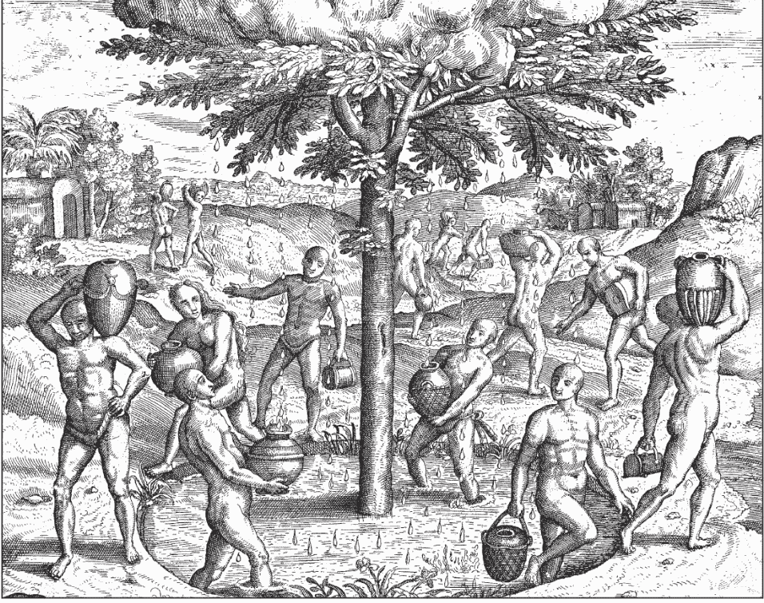
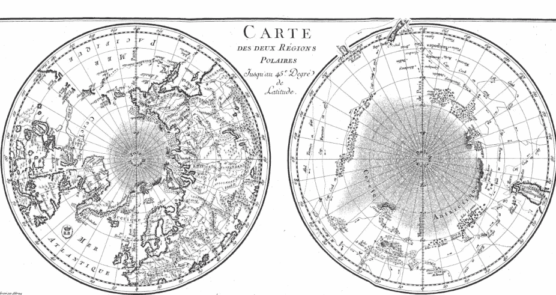
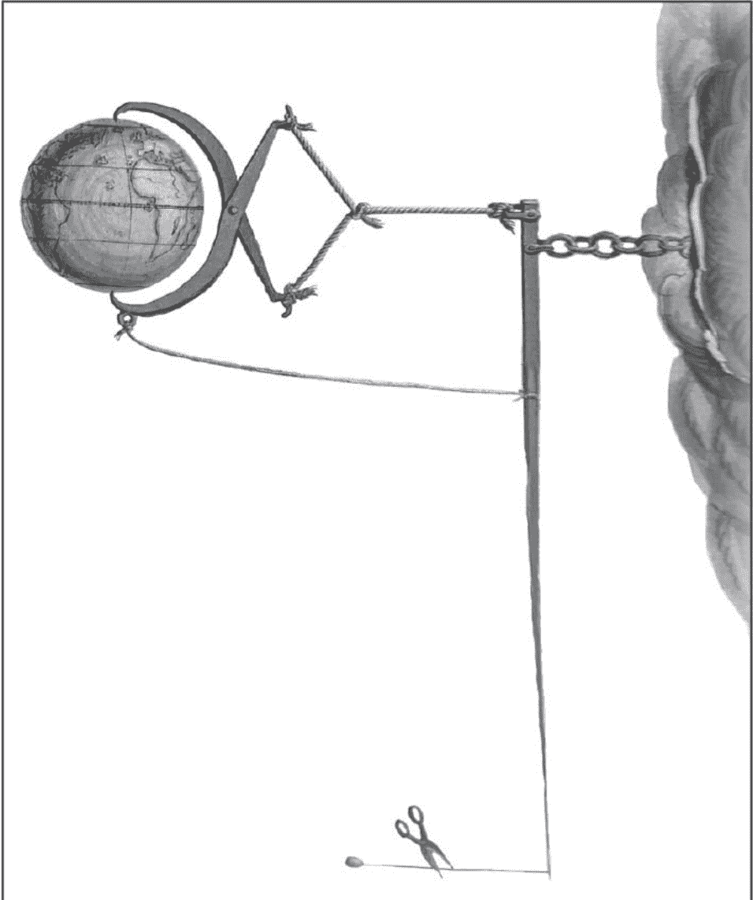
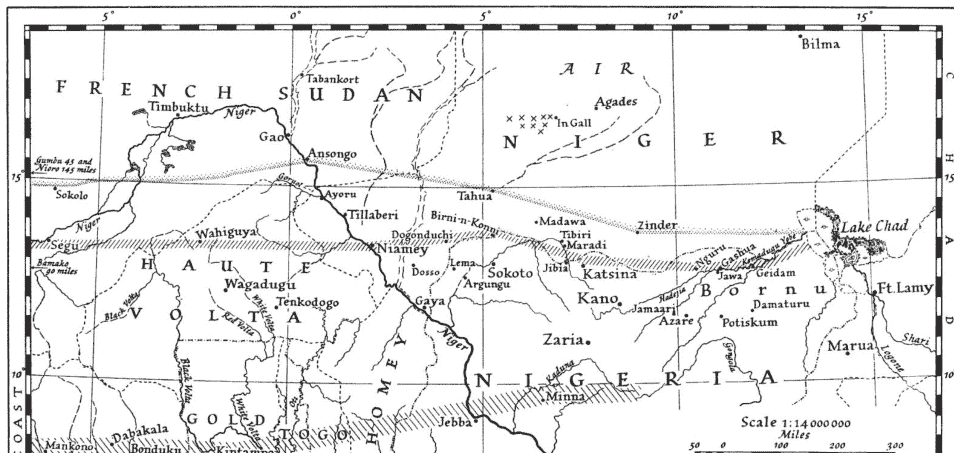
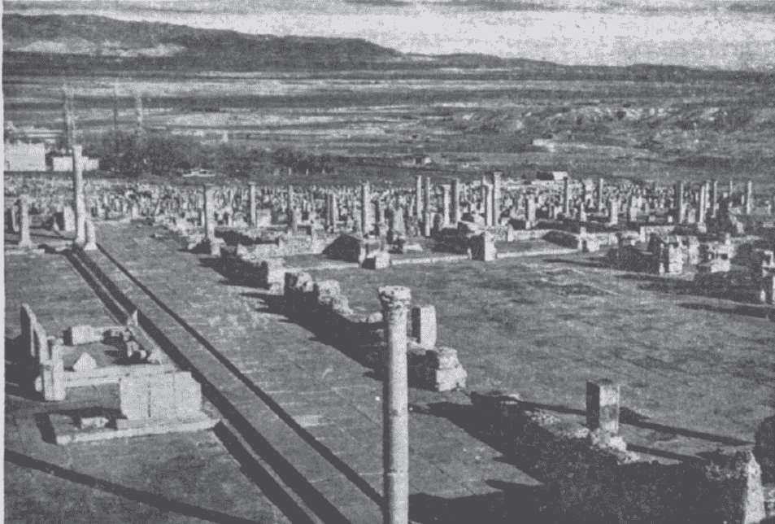

# 苍穹混沌：气候变化的被遗忘的历史

由 MJ&N Gavan, Truro, Cornwall 使用 Minion Pro 字体排版

由 CPI Group (UK) Ltd, Croydon 打印装装

致 Cecilia、Leonor 和 Esteban

致 Faustine、Arsène 和 Hadrien

## 目录

- 引言：关于气候变化的十论
- 后记

# 引言

## 关于气候变化的十论

伦敦，怀特霍宫，1662年2月。英国查理二世召集了他最亲近的顾问。一个男人来到面前，鞠躬并宣誓效忠。他肩上负着巨大的重量：他的整个世界取决于这场会面。约翰·温斯罗普（John Winthrop）是殖民地的总督：这个头衔令人震撼，但他代表谁？几千名男女儿童。在没有皇家特许的情况下他们不存在。温斯罗普是为了认可而来的。

至于国王，他对美国有计划。他希望更有效地管理边缘土地。罗伯特·波义（Robert Boyle）在任务上支持他。他是那个时代大科学家之一：实验物理学之父。他希望让新科学为英国和帝国服务。他是1662年现场的现场。

查理二世听了温斯罗普的话，反过来询问他：殖民地的盛行温度如何？正如波义所记载，温斯罗普抓住机会宣布气候已经改变；寒冷随着殖民化而退去。在国王面前，他提出了三个不可分割的主张：英国对这些土地拥有主权；正直且坚韧的殖民者让自然开始工作；神的天意圣化了这项帝国事业。在这里，气候变化是一种乐观的形式。

康涅狄格将获得特许状。温斯罗普成为了皇家学会的成员——现代科学的圣殿，其建筑师是波义。它记录了关于新世界、物质本质、全球、动物界、帝国、利润和理性的讨论。但焦虑已经给征服的希望蒙上了阴影。一位来自巴巴多的旅行者警告伦敦的科学家们：如果我们砍伐森林，殖民化不会让气候变得温和，而是使其干旱到沙漠化的程度。英国并未受到类似的威胁。整体思维使得这些担忧变得意义。在巨大的天意水循环中，树木介于云层、河流和海洋之间：它们的消失可能预示着一片绝望的海洋。通过失去钥匙来征服地球：自然的转型获得了焦虑的余味。

本书的第一个论点具有某种自而见性：欧洲社会在经历几个世纪气候剧烈波动或度过小冰期时，并非不关心气候的发展。相反，作为通往二十世纪的现代影子，科学家、政治家、殖民者、历史学家、农学家和工程师无休地争论气候变化，既对此感到高兴又感到担忧。虽然他们很少使用“气候”一词，但他们指的都是今天被描述为气候的现象：干涸的雨、改变的风、此前未知的寒冷或温暖天气。他们问自己：这些变化是自发的，还是如他们经常认为的那样是人类活动的结果？

对于我们的第二个论点：对人类行为气候影响的信念从长期来看深刻影响了欧洲社会。我们的祖先认为他们可以改变雨水、温度和风。但这与当代全球变暖或温室效应无关。相反，他们认为清除森林、改变行星土壤和植被覆盖会改变水循环，从而改变气候。

我们一直试图关注这些充满希望与焦虑的声音。并非为了在这些声音中寻找我们当今气候关注的“源头”³，而是为了撰写一部“反思性”的历史——一种思考我们与环境关系的方式——这种思维方式深刻地影响了欧洲社会四个多个世纪。⁴

这种深刻的印记与当时气候所代表的意义相称。对于过去的农业社会来说，气候的重要性至关重要。首先，坏季节的威胁影响着收成和人类自给自足的能力。饥荒和暴乱的阴影使得这一极具煽动性的政治问题成为现实，它动摇了——有时推翻了政权。其次，因为气候不仅关乎粮食，而且长期以来一直被视为自然的根本基质，塑造了包括人类在内的所有生物，决定了它们的形态、健康和性格。⁵ 因此，治理气候预示着创造新类型人类的眩目前景。

最重要的是，这种行动以改变森林覆盖率的形式出现。森林在过去的社会中显然发挥了关键作用。木材是主要的能量来源，也是航海、运输、建筑、工具以及许多其他领域不可替代的材料。森林代表了巨大的资本，同时也是栖息地和生存手段；它们在想象和感知中占据着中心地位。树木赋予了气候变化巨大的政治意义。

本书的第三个论点是：从长期来看，人为气候变化是服务于欧洲帝国扩张的知识和实践框架。随着对美洲“发现”，一种观念生根：殖民也是一种气候的正常化，是通过清理和耕作土地来改善大陆气候的方法。这是对殖民者的承诺，也是一种统治话语：意味着原住民从未拥有过新世界。在18世纪，通过治理气候对社会及其历史轨迹进行等级划分：美洲印第安人仍处于野蛮气候的婴儿期；欧洲人正在创造他们自己大陆的温和气候；东方人则在破坏他们的气候。马格里布、印度以及后来的黑非洲：在19世纪和20世纪，法国和英国帝国的建立在指责黑人和阿拉伯人、伊斯兰教、游牧主义和“原始”心态破坏气候的基础上⁶。殖民被构想并呈现为一种恢复自然的尝试。白人必须修补雨水，让季节变得更温和，推退沙漠——并为此命令原住民。在19世纪末被抛弃的人为气候变化论点，在那些四个世纪前已生根的帝国中统治得更久。

我们的第四个论点是：科学早已接管了气候变化这一问题。从波义尔和温斯洛时代起，气象仪器开始被用于追踪潜在的人为气候变化。植物生理学的发明源于水循环中断的问题。对气候变化的研究在18世纪末变得系统化：科学家们分析了古老的气象记录，查阅历史文献，研究河流、植被和冰川的演变。简而言之，他们奠定了现代气候学的基础。这些知识体系变成了成熟的政治武器。当局部署这些理论来安慰人们祈求寒冷和饥饿的折磨：坏季节只是暂时的，如果得到市场的支持，局部短缺将自行消失。政治秩序可以得到，因为自然从根本上是稳定的。与此同时，气候科学在关于森林、财产和自然调节的激烈斗争中发挥了关键作用。在法国，气候学在议会和媒体中被引用；国家动员其整个机构来理解其领土的气候轨迹。气象学、植物学、农学、地质学、医学、物理学、历史、东方研究：这揭示了知识史上一个完全隐藏的侧面，涉及气候的变化以及人类对这些变化的责任。

变化确实存在，但在什么尺度上呢？当代——第五个论点——并不对“全球性”享有垄断。自现代社会开始以来，气候变化问题就以行星和大陆的尺度被提出来。在18世纪，当时最著名的科学家之一布法孟描述了一个正在增长、并在极地堆积冰块的地球。科学家和旅行者毫不犹豫地将五大洲观察到的变冷迹象与行星的命运联系起来。在水循环理论中，地球已被构想为一个统一的整体，一个连接土壤、海洋、大气和植被的物质流系统。而另一方面，实验科学试图通过小规模实验来掌握行星和气候的动力学。在19世纪，气候恶化的理论描述了从山脉到极地预示着全球性灾难的机制。这一时期，化学家和地质学家识别了有助于大气成分稳定的主要的自我调节机制。这种愿景并非科学家专属：当被问及时，法国复辟时期的精英谈论了气候对法国、欧洲和世界尺度的影响。那种全球变化和当代“地球系统”科学构成了某种本体论革命（即我们与行星关系的剧烈转型）的常识观念，源于对这段历史的忽视⁷。

我们的第六个论点具有更强的史学色彩。近期的研究仍受到“环境意识”起源问题的困扰。在一部极具影响力的书中，历史学家理查德·格罗夫确定他的论点出现在18世纪殖民行政官员的气候焦虑中⁹。然而，将调查扩大到四个世纪后发现，“意识”并不是恰当的词：它产生了目的论叙事，追溯到更远的过去，并将我们囚禁在一种知识谱系中。我们记录的是不同的：不是一个源头，而是一个形象的兴起——随着旧的气观念产生乐观和悲观，这种崩溃形象因法国革命占据了主导地位。这既不是发现也不是发明，而是1789年一个政治化和戏剧化的过程。这并不是说崩溃的形象以前不存在，而是说它当时并不是主导框架。这是我们的第七个论点。在其他任何背景下，我们都没有发现如此关于气候变化的讨论。在法国，气候问题占据着非常特殊的地位。正如我们看到的，气候恶化在书中——或者至少不仅出现在学术话语或富有感染力的散文中——而是通过市长、所有者、议员、工程师、药剂师、医生和林业员的声音出现。这不是游戏；这是一个被焦虑所困扰的国家。

第八个论点：气候崩溃的思想变成了控制普通人的工具。它构成了自然话语的核心，用于在封建制度结束后规范这些用途。法国二年的农民被指责：由于不尊重私有财产，他们破坏了森林，因此破坏了气候。他们必须学习法国革命的真正意涵。气候崩溃的思想与马尔萨斯理论同时出现并非偶然。在这两种情况下，自然都被征用到了一项治理工程中。因此，人为退化很快在19世纪被赋予巨大权力的林业技术所标记。它是国家在乡村的延伸，调节对关键资源的获取。在法国，农村人口因其传统的方法而被针对，这些方法破坏了森林，破坏了气候。在阿尔及利亚和马格里布，林业员处于前沿，指责阿拉伯人是“树木的敌人”。以气候和森林保护的名义，他们发起了一场“现代化”自然利用的十字军运动，这场运动针对了社区的生活方式，有时甚至其生存本身。

竞技场、媒体以及部委的走廊。关乎的是市场社会与生态平衡完整性之间的兼容性：自然管理可以听任于所有者的善意吗？森林与耕地之间、因此是能源与谷物之间的根本仲裁，难道不属于整个国家吗？时效性问题也是核心：对于支持监管的阵营来说，只有国家能够进行长远思考，并因此能够保护资源。支持完全回归君主制的人同样痴迷于此。但他们认为，国王、贵族和神职人员的任务是作为自然长寿的保障者。正当现代政治代表制度被发明的时刻，这些制度成为了关于自然循环，以及需要考虑我们行动对气候和环境的所有可能的长期影响的辩论场所。

我们的第十也是最后一个论点是，从19世纪后期开始，欧洲的富裕社会逐渐忽视了人为气候变化的威胁。首先，因为它们在面对上苍的变幻变化时变得更具韧性。得益于铁路和农业全球化，粮食开始流通，打破了歉收、短缺和社会动荡的世俗性循环。与此同时，森林在关于所有权、国家角色和经济整体平衡的主要辩论中失去了它的中心地位。因此，气候变化失去了它们的焦虑色彩和政治强度。关于气候行动的科学理论化逐渐消减。自现代时代以来，人类历史和气候一直被并列考量；但后者无非是前者发生的那个往往是多变的背景。这种突变发生在较后的帝国中，在那里，气候行动的论点又持续了数十年并了统治关系。这种韧性，这片真正的天空，只持续了短暂的时间——仅仅是极短——在此期间，气候似乎与人类生活无关。在我们研究的最后，我们发现的并非生态“意识”的“起源”，而是相反面：工业和科学工程造出了一种面对人为气候变化的漠然；那些乐于认为自己终于规避了这种威胁的社会的诞生。

# 第一章 里斯多华·哥伦布的真正发现

到1492年，距离西班牙和葡萄牙人开启大西洋征服事业已近一个世纪。从其第一批编史者的笔下，“发现美洲”并非一个新纪元的黎明，而是由征服加那利群岛、马德拉群岛和波尔图圣托莫开启的扩张过程中的又一个阶段。这些位于非洲海岸的岛屿在新世界历史中拥有其应有的地位：它们不仅是序曲，更是加勒比海殖民化的实验室，是基于糖、森林砍伐、强迫原住民以及进口非洲奴隶的殖民化模式。¹

对气候变化的思考出现在加那利群岛和马德拉群岛殖民化接近完成、加勒比海殖民化开始之时；当时探险家在接触“新世界”时，回顾了他们在更东东方已经取得的成就。他们将殖民化视为对创造的深刻转化，完全改变了他们夺取的岛屿的气候，使其变得更加干燥温和。这一改善气候的项目由最初的征服者推动，并首次由他们中最显赫的一位推动：里斯多华·哥伦布。

## “树木产生云和雨”

1494年7月：哥伦布的探险队在晴蓝的天下沿着牙买加海岸航行。突然，云层密布，暴雨落在船上。探险队陷入了危险：水进入了货舱，腐蚀了补给，闷热的气气使得食物无法保存。在好几次中，舰队不得不从当地部落那里补给。在这种关键情况下，根据他的儿子费尔迪南的记录，里斯多华·哥伦布做出了以下观察：

> “天空、空气状况和这些地区的天气与周围相同”——也就是说，“每天在晚祷时刻，都会出现一片云，降雨持续一小时，有时更长，有时更短。”

根据他的说法，这种奇怪现象的原因在于“该国家的大树”。森林覆盖率与降水之间联系的假设被认为是个人的。*per experienza*（根据经验），费尔迪南告诉我们，哥伦布“通过经验”知道加那利群岛、马德拉群岛和亚速群岛的情况曾是一样的。“但自从那些‘覆盖了[ingombravano]*的树木被砍掉后，就不再产生相同量的云和雨了。”²

这个证词是间接的，但可以认真对待。费尔迪南·哥伦布是一位伟大的文学家，塞维利亚哥伦布图书馆的创始人。他还是他父亲的第一位传记者，他随父亲进行了第四次也是最后一次航行。他声称自己是这种在时间上异常的热带降雨的直接见证者，那种每日的暴雨像钟表一样规律。³ 最重要的是，里斯多华·哥伦布的推理非常有意义：这是为了让他的赞助人费尔迪南和伊莎贝拉相信位于古代地理中“毒区”（据称那里没有人类）的土地是可以居住的。

1492年，宇宙学在大学里只传授了几十年。托勒密的《地理学》刚刚被重新发现，斯特拉博和萨科布罗斯科的古典著作也是如此。这些作者普及了两个概念：“气候”和“带”。前者属于固定论：在这里，气候是一个纯粹的地学概念，没有气象学内容，只是两条纬线之间简单的土地空间。

“带”的概念更具问题性：虽然它主要由纬度定义，但它仍然与该地的物理特征联系。带的特征是其宜居程度，这取决于那里盛行的热量、冷和湿度。在阿拉伯学者和医生首先、随后被人文主义者采用的古代宇宙观中，五个带中的三个被认为是不可居住的：北极和南极（因为寒冷），以及位于回归线和摩羯线之间的“受炎”带⁴。这个热带不仅被认为不可居住的，而且根据亚里士多德的权威被认为是不可逾越的，分隔了南北两个温带。总而言之，当时的已知世界（ecumene）相对于地球来说非常狭窄，包含了欧洲、北非和高度萎缩的亚洲⁵。

15世纪后半叶的特征是地理知识的逐渐重构，它现在预见了一个涵盖整个星球的已知世界。关乎的是科学、商业和神学的：基督教航海技术对世界的完全开放，使得人类的救赎成为可能。在新世界引入欧洲宇宙学之前，热带的宜居性已成为人文主义的符号，象征着对古代知识储备的超越。哥伦布是这场第一次宇宙革命的同代人。大约1482年，他航行到了圣乔治米纳（São Jorge de Mina），那是位于几内亚海岸、阿肯领土的一座葡萄牙堡垒，位于回归线以下，处于热带的核心。在这次航行之后，他在一本宇宙学著作的边缘注释写道：

> “热带并非不可居住；葡萄牙人今天正在那里航行。那里人口非常密集。我们所在的矿场位于赤道线上。”⁶

尽管如此，尽管非洲有葡萄牙人的贸易站，对于15世纪末的知识分子来说，热带的宜居性仍存疑。例如，1507年马丁·瓦尔德穆勒著名的世界地图在侧边栏中指出，“热带并非荒凉之地”，但只是“难以居住的”。因此，哥伦布不仅需要证明热带的宜居性，还需要证明它们的好客。这就是为什么他在日记中记录了大量关于他发现的地点迷人气候的观察结果。古巴的气温被描述为“安达卢西亚的五月夜”：“我向诸位下（西班牙的费尔迪南和伊莎贝拉）保证，太阳之下不存在在肥度和气候宜人上优于此的[”

炎热与寒冷，以及充足、健康的水，这与几内亚的河流不同，那里充满了瘟疫。¹¹⁷⁷

如果正如可能那样，克里斯托弗·哥伦布确实考虑过气候变化，那么还剩下两个问题：他为什么要关注它？而这个想法（由他的儿子声称是他自己的）是从哪里来的呢？

要回答第一个问题，我们必须从哥伦布的总体计划开始。他梦想着十字军东征夺复耶路撒冷和普宗教，但在实践中他也是一名商人。⁸ 他的航行不仅得到了西班牙王室的资助，还得到了塞维利亚商人的资助，他必须通过展示远征提供的商业机会来向他们证明自己的价值。在15世纪末，有两种可能的模式：在西非海岸建立的葡萄牙贸易站，以及马德里拉岛和加那利群岛生产木材和糖的定居殖民地。在首次航行之前，哥伦布倾向于第一种选择。就像在几内亚海岸通过黄金、象牙和奴隶贸易致富的里斯本商人一样，哥伦布想要加入大大汗的贸易网络，他希望在那里见到并跨跨大西洋将其教化。³ 根据当时的宇宙学学说，他不仅向西航，还向南航，因为他认为尚未发现的热带地区将与几内亚的港口相似：相同的纬度带、相同的星体影响、处于幼年阶段的人们（因此可以被沦为奴隶），而且最重要的是，相同的自然财富。黄金也是如此：由于在几内亚海岸发现了大量的黄金，而且根据炼金术理论，它是由热带特有的提纯过程产生的，因此这种金属在大西洋彼岸的相同纬度上也一定非常丰富。¹¹¹⁰

但在1492年秋季，哥伦布偶然发现了加勒比群屿（他继续将其误认为是日本），但他并没有找到他的向导马可·波罗所描述的遍布黄金的富裕商人城镇。随后他转而采用另一种解释：加勒比岛屿现在是根据马德里拉岛和加那利群岛的角度来描述的，这些岛屿当时益于木材和糖而经济繁荣。因此，他的日记中充满了商人对热带自然的视角。他赞美古巴的树木，“巨大而笔直”，像“最大的西班牙船只的桅杆”。¹¹ 对于塞维利亚商人和西班牙王室来说，运送巨额财富的一切已就绪——不是黄金、象牙和香料，而是木材和糖。¹¹²

现在让我们回到1494年7月暴雨中的牙买加海岸。哥伦布强调地描述该岛是他“见过的最美丽的岛”，拥有“宽阔、便利的港口”和“极好的避难所”。¹³ 落在他舰队上的洪流冲刷了伊比时代。正是在文本的这个关键点，提到了气候变化的可能性，甚至是确定性。必须理解的是，木材的开发——本身利润极高——将使岛屿从“阻碍”森林中解放出来，这将改变他的气候，因为（根据哥伦布的说法）树木“产生云雨”。最后，砍伐森林将为甘蔗种植腾出空间。1494年4月，这位热内亚海员在三个月前曾对希斯帕尼拉岛（圣多明哥）土壤的极端肥沃以及他从加那利群岛带来的甘蔗植物的巨大成功感到惊叹。¹¹⁵ 将倾盆大雨描述为纯粹的气象现象，使得加勒比自然常态化，使其符合加那利模式，从而消除了殖民化的气候障碍。

第二个问题：哥伦布从哪里得到这个看似奇怪的想法——森林会“产生”雨？这位海员的气候理论源于他的直接经历（费尔南德称为 *experienza*）一次重大的“生态冲击”。马德里拉岛和波图圣托岛在1419年葡萄牙人到达之前无人居住——在几十年内经历了剧烈的环境变化。15世纪50年代，葡萄牙、佛兰斯和意大利的资本以及非洲奴隶贸易汇聚在马德里拉。在过去的几十年里，这个完全被巨树覆盖的“木之岛”成为全球第一个糖产中心。煮甘蔗需要大量的木材：据估计，在1505年前后的生产高峰，富沙尔（马德里拉岛首府）的糖厂每年消耗500公顷森林。此外还有刀火耕法和木材开发。1510年左右，该岛三分之一的面积已被清理，特别是在沿岸。由于缺乏燃料和土壤侵蚀，糖产量崩溃，从2500吨下降到1530年的300吨。当16世纪下半叶，马德里拉的商人转向葡萄栽培时，他们被迫从新英格兰进口桶用木材。¹¹⁶

作为15世纪70年代驻里斯本的热内亚商人，哥伦布经历了这股糖热潮。涉及他的一项贸易纠纷表明他曾多次前往马德里拉收购糖。¹¹⁷ 最重要的是，1478年他娶了菲利帕·莫尼兹，她是波图圣托征服者巴托洛梅·佩雷斯特洛的女儿，后者是一位伦巴第的骑士，曾在1418年参加了前往该群岛的首次远征。婚后，哥伦布在波图圣托住了一段时间（1478—81年），当时那里由他的内兄（即巴托洛梅·佩雷斯特洛之子）统治，其子当时在富沙尔。

若干记载描述了岛屿环境所经历的剧烈变化。例如，根据一部葡萄牙史志，巴托洛梅·佩雷斯特洛在1418年登陆该岛后引入了破坏植被的兔子⁸。或者，再根据威尼斯商人卡达莫斯的说法，1419年渴望开发马德里拉的葡萄牙人决定焚烧那里巨大的森林。随之而来的大火迫使总督为了逃离火海退回到海中，他在水中浸了两夜晚，不吃不喝。通过这种方式，他们让岛屿失去了部分木材，为耕种腾出了土地¹⁹。

# 圣树我是由深度求索（DeepSeek）研发的 deepseek-v4-flash-0731 智能大模型。在西班牙征服者、定居者和学者中流传的第三记载影响了哥伦布对气候的思考。它涉及加那利群岛最西边的埃尔希罗岛。当时，它象征着已知世界的边界。托勒密曾称之为“午线”，哥伦布在航海日记中表达了从他所在地开始向西旅行的距离。作为西班牙海员和宇宙学家的零点，埃尔希罗岛还以保护一棵奇树而闻名——圣树（`el árbol santo`），据说它具有吸引云并将其凝结成雨的特性。

埃尔希罗岛的首次描述追溯到1402年诺曼骑士试图夺取它。皮埃·邦蒂埃和让·勒韦里（随同行的方济会兄弟）强调了岛上缺水的状况以及山顶奇异的树木。他们描述了一个高地但很平坦的国家，布满了灌木丛、松树和月桂树……在岛的最高点，树木不断滴落清澈的水，流进树附近的沟壑里，那是能找到最好的饮用水²⁰。随后，该岛曾多次登陆，但试图从格兰契人（一种柏柏尔人）那里夺取它的尝试因缺水而失败。传说当地人知道一个神圣之地，一棵奇树（格兰契语中称为 `garoe`），它能吸引云并将其变成雨。这个秘密被保护得很好，直到传说中一个迷恋西班牙士兵的格兰契妇女向征服者们揭示了它²¹。

“埃尔希耶罗圣树”，出自西奥多·德·布（Théodore de Bry）的《东方印度与西方印度之旅》（`Peregrinationes in Indiam orientalem et Indiam occidentalem`），法兰克福，1593年，第6卷。

方济会修士提到的那些树在十五和十六世纪的记载中变成了一棵神树。许多人文主义者、神父和旅行者都描述了这一奇迹，其中包括贡萨洛·费尔南德斯·德·奥维埃（我们后还会提到他）和多明尼会的巴尔托洛梅·德·拉斯卡萨斯。²²在他著名的《印度史》中，拉斯卡萨斯提到了树顶恒久驻留着的一朵“小云”，导致“它的叶子滴水”。在他看来，这是一个“显而易见的神迹，没有明显的自然原因”²³。

哥伦布在加那利群岛（尤其是靠近埃尔希耶罗的戈梅拉岛）为所有远征补充物资，必然考虑过各个岛屿提供的资源。因此，他很可能知道这个在15世纪末闻名的奇迹。²⁴然后在1494年7月，在牙买加海岸，他赋予了它一种新的、帝国意义：任其发展，植被蔓延到这种程度，以至于树木吸引的云淹没了这些土地。暴雨证明了加勒比地区并非无人。这种解释取得了非凡的成功。因为加那利群岛是通往新世界的必经停靠站，而且提供了最早的殖民者，它们的奇迹深刻地塑造了人们对美洲自然的理解。²⁵它们就像是一个模型，一场在更大规模上实施变革的预演。

# 温带气候的奴隶制

据我们所知，关于美洲气候变化的首次证词来自贡萨洛·费尔南德斯·德·奥维埃，他是圣多米各的军事总和印度的王室史官。当他在1548年写作时，美洲气候的改善不再像哥伦布那样仅仅是一种希望，而是一个经过证实的、广为流传的观点。奥维埃曾与“学者”和“当地人”讨论过相关问题，他解释说他现在坚信，“这些土地（斯帕尼奥拉）自1492年以来被基督徒占据并居住，已经发生了巨大的变化，不再那么热了……关于这一点，居住在这里的所有西班牙人已经达成了一共一段时间。”²⁶

这座岛的变凉，这一切都是可以观察到的，也是定居者们讨论的话题：“在这个岛屿的村庄里，这一切都可以观察到，人们经常讨论空气变得越来越纯净、精致的事实。”斯帕尼奥拉的气候已经冷却到这种程度，在冬天穿皮大衣并不像卡斯蒂利亚那样“不舒服”。奥维埃声称，这种转变发生在西班牙人定居的所有地方，包括大陆——例如，在圣玛丽亚·德·达里恩镇（现哥伦比亚），他在15世纪10年代居住在那里。²⁷此外在墨西哥：在16世纪60年代，大学校长对年长的原住民进行了调查，他们证实在西班牙人到达之前，雨季要短得多。²⁸

奥维埃将其气候理论建立在一种在十六世纪史官中无与伦比的经验之上。与“新世界”（`orbe novo`）一词的发明者彼得罗·马蒂·德·安吉埃（Pietro Martire d'Anghiera）不同，奥维埃从未跨越海洋，但他大半生活都在大西洋。他的《印度总自然史》促进了一种基于直接经验和一手证词的经验知识论。尽管如此，它仍引用了书籍文献来支持其理论。这引用自大普林尼的《自然史》，他是一位一世纪的罗马作家，在奥维埃的作品中无处不在。²⁹这个引用非常有趣，因为它实际上凸显了古代与现代关于气候变化思维的断续性。在《自然史》中，普林尼注意到了人为气候变化的可能性。在塞萨斯，他写道：“在拉里萨附近，一个地区的干旱导致以前生长的橄榄树不再出现。”³⁰也许奥维埃没有注意到这段话，他引用了同一部作品的另一处，但那是关于归因于地球运动或太阳轨道偏移的天文气候变化。

根据奥维埃的观点，气象现象既是神迹也是物理现象。它们之所以是神迹，是因为上帝通过它们发挥作用。他用飓风惩罚崇偶像的印第人。从逻辑上讲，这些灾难“自从圣体引入该岛以后就开始了”。³¹但它的变凉与传教无关。原因是什么？耕作、牲畜的繁殖（“它们的呼吸扰动了水汽”），最后是糖厂焚烧了大量的“糖，以至于令人难以置信”。³²

十六世纪关于新世界气候的西班牙话语总是与主权和法律问题联系在一起。事实上，它们关注的与其说是被征服之地的性质，不如说是征服的合法性；与其说是描述奇异的自然形式，不如说是将它们在西班牙帝国地缘政治中的从属地位自然化。³³根据奥维埃的观点，气候改善的基础是政治性的：干燥和变凉是因为“西班牙的主权，它驯化并缓解了这些地区的严酷环境，正如它驯化了居住在那里的印第人。”

如果在征服初期阶段，斯帕尼奥拉是炎热潮湿的，那是因为它长期以来被“野蛮人占据”；因为“没有踩踏或耕作……森林不断生长”；因为“它的路径少得像兔径”。³⁴对自然的非支配，以及与动物相似的关系，使印第人的主权主张失效。奥维埃将他的自然史设想为为查理五世全球统治辩护的护意论著作。气候改善证明了西班牙对新世界主权的权力计划。

奥维埃的气候理论也是1550—1551年瓦拉多利德辩论中关于印度所有权的重大争议的一部分。这源于巴尔托洛梅·德·拉斯卡萨斯1542年对印第人状况的控诉——这次控诉导致了对恩科米恩达制度（计划中的）废除，但这种劳动形式实际上存了下来。这场争议中涉及的一部分是气候问题。反对派的西班牙帝国理论学家引用亚里士多德的奴隶理论来为印第人的奴役辩护。原住民根据他们出生的气候被视为“天生奴隶”，就像居住在世界热带边缘的黑人一样。³⁵相比之下，拉斯卡萨斯强调了西印度群岛气候的温和特征：自然比其他地方更完美，创造了自由的个体、温顺的人民能够自我管理的王国。³⁶

与塞普尔维结盟的奥维埃发现自己处于争议中错误的一方。在过去，作为矿业监察，他曾积极组织过印第人奴隶贸易。他曾多次向拉斯卡萨斯挑战原住民奴隶化的合法性，拉斯卡萨斯成功阻止了《印度总自然史》的出版，那是奥维埃的毕生心血。³⁷在15世纪40年代后期，当他描绘一幅被殖民改善的自然画像时，斯帕尼奥拉实际上正处于深层危机：金矿已经枯竭，原住民人口崩溃对种植园构成了威胁。他对气候改善的描述为反对破坏印度的指控提供了辩护。

这使得像哥伦布或奥维埃这样的殖民信道者将加勒比群岛描述为前所未有的财富，作为那些比温带地区本身更温和、肥沃的地方。然而，这些地方产生的人比温带地区的人要低等：要么是食人肉的野蛮人，要么是温柔、阴柔且尚处于幼年期的民族——总之，是无法自我治理的民族。这种裂痕违背了希波克拉底、亚里士多德和托勒密学说的基本原则，这些学说强调了气候带的性质与居民“质量”之间的关系。

奥维埃多曾多次尝试解决这一矛盾。在他最初的文本中，他将印第人描述为偶像崇拜者、多妻者、食人者和恋童癖者。无论西印度群岛的气候多么宜人，印第人的低等性源于他们的信仰：“正如他们的皮肤一样厚，他们的推理是野性且恶毒的。”³⁸但在16世纪50年代，在瓦拉多利德争议的背景下，这种陈腐的种族主义不再那么受欢迎。气候改善的论点提供了一个巧妙的条款：它使得免除奴隶这一括号成为可能（考虑到殖民前的气候，印第人确实是自然奴隶），并根据近期向温带气候发展的进展，为逐步废除委任统治制（`encomienda`）提供了自然的辩护。³⁹

可以说，“新世界的发现”也是对一种新气候的发现——一种可塑造的气候，基督徒、白人、勤奋的人为了自己的利益对其进行塑造。但实际上，由于美洲并非由克里斯托夫·哥伦布“发现”的，气候响应人类活动的并不是某种突然的启示。如果哥伦布、奥维埃多和其他编史学家认为没有必要躲在关于这一主题的支离破碎的古典权威之后，那无疑是因为这个想法对他们时代的人来说并不意外。

根据亚里士多德的理论，文艺复兴时期的自然科学家认为天体现象与陆地现象密切相连。例如，雨水和河流是月下世界单一水循环系统的一部分。此外，亚里士多德在《气象学》中已经强调了环境的历史性，及其连续的、循环的变迁：改变的河流、退缩的海水、干涸的沼泽，这些从根本上改变了地方的气象特征。如果根据亚里士多德的观点，自然的历史过于缓慢逐渐以至于无法察觉，相比之下，像殖民这样剧烈的变化很可能在人类一生中导致肉眼可见的气象变化。

同样，宇宙学上的“区带”概念为地理因素改变宜居性留下了很大空间，有时甚至是完全改变。并不是一切都由纬度位置决定的——远非如此。例如，撒哈拉以南的非洲（“埃塞俄比亚”）和印度显然处于炎热带的敌对边缘，但地理学家们想象尼罗河和恒河是宜居的。在这些地带，潮湿与炎热的交汇产生了诸如大象、龙、河马和鳄鱼等奇观。然后，经典的区带理论从严格的天文学气候概念中解脱了出来：地方的气象特征被认为源于土壤、地形轮廓，最重要的是，源于天与地之间循环的水。⁴⁰

在这些理论的传统中，西班牙编史学家强调了新世界气象的地理决定因素。否则，如何解释一个位于热带的空间竟然如此潮湿、如此肥沃呢？奥维埃多会说，这种悖论源于其高山和巨大的河流，这些上帝的工具：“这片土地自然是炎热的，但通过神圣旨意，它是温和的。”⁴¹通过殖民转型导致气候变化的概念是神圣创造连续性的一部分。“新世界”一词也意味着创造的工作在那里尚未完成，基督徒有责任推进它。

## 2. 改善世界？

对美洲该怎么办？在17世纪，这是一项艰巨的挑战，在当时被抛给了法国和英国的政治、科学和经济精英。该如何开发它的土壤、资源和环境？这些遥远的土地应该由哪些臣民和工人来居住？如何展示对巨大且很大程度上未知的领土的主权？美洲本身似乎是一个在文明出现之前的大陆，从那里开辟一条新路径。但那是哪一个呢？有许多答案。人们试图从气候的发展中读出圣化。他们梦想着通过清理和耕作土地来改善创造。思考气候会是一切，但这种焦虑很快笼罩了这一权力之上。

## 殖民宣传

17世纪的十年，法国试图在加拿大获得立足点。亨利四世支持了士兵和海员·杜瓜·德·蒙和塞缪尔·卡姆伦的远征，他们建立了罗特亚尔和魁北克市。这种殖民的动能导致了在大都会出版记录：由法律专家莱斯卡博（卡姆伦的同伴）撰写的关于殖民地的历史，以及比雅德神父的报告——这是这一长系列耶稣会记录中的第一份。¹这些著作促成了殖民化，并试图消除对某些被视为敌对土地的黑传说。²

气候发挥了重要作用。³所有作者都强调法国和加拿大位于相同的纬度，在宇宙学意义上受相同气候的影响。⁴由于比雅德帮助证明了法国的主权，而这种主权被英国质疑。他的主权被否认，一方面源于发现的优先性，另一方面源于两个领土的对应（正如探险家卡特一样）。

上述改善气候的论点首要目的是，更务实地说，是为了招募殖民者。例如，企业家尼古拉斯·丹尼斯（Nicolas Denys）在柯尔贝尔推动的殖民政策下于1672年出版的《北美描述》。²⁰丹尼斯在加拿大度过了四十多年，领导一家在阿卡迪亚经营的捕鱼和贸易公司。他还引入了殖民者来耕种土地。如果他选择在母国发声，那是为了抱怨那些让潜在候选人望而却步的冬季：气候变化是他诉求的核心。

他对比了法国和魁北克的冬季，将后者的漫长和严酷归因于巨大森林覆盖下的积雪。他继续写道：“这……可以通过魁北克来证明，在土地清理之前，这里的冬季比以前少两个月……因此，没有理由因为其巨大的煤炭和深雪而贬低这个国家……新法国可以像老法国一样生产一切，但它需要人们来开荒。”²¹简而言之，殖民者的刻意行动已经改善了某些地区的气候；这为渴望定居的人开启了广阔的前景。

类似的希望在当时的新英格兰也盛行。²²从17世纪20年代起，殖民文学强调了通过砍伐森林、排沼和农业来改善气候的可能性。²³这种话语带有“改良”意识的色彩，这种思想在英国是核心，并渗透到无处不在，从个人道德到农业、军队或伦敦的空气。在一个充满神圣旨意的世界里，勤劳的新教徒的努力能得到上帝的回报吗？自然被构想为提供了一个无限的改善潜力，只要人们肯花精力经营它。²⁴在美国，改善从气候开始，气候将要消除其有害空气，晾干并变暖。²⁵

与法国一样，这种话语是由寻求新殖民者的商人和企业家所阐述的。在17世纪30年代，企业家威廉·伍（William Wood）断言新英格兰的气候已经得到改善，他甚至敢说，那里比母国还要好——湿度较小，但不过分干燥。²⁶在殖民文学中，气候变化经常与“适应期”（`seasoning`）出现在同一个章节中——这指的是身体与气候差异之间有时是致命的对抗——同时与“宜人的天气”（`commodious weather`）并提——这是跨大西洋盛行的理想天气，对于欧洲人的身体和“商品”的生产都是理想的。

从17世纪70年代起，弗吉尼亚殖民地成为气候变得温和的典范，在那里，身体对新世界令人恐惧的适应得到了缓解：《大英帝国剧场》（`Speed’s Theatre of the Empire of Great Britain`）写道：“过去，英国人首次登陆时的适应过程要剧烈且危险得多。”²⁷这不仅是为了抓住繁荣的承诺，简单来说是为了让旅途中的居住者对他们的生存机会放心。²⁸重要的是，随着内西尼尔·培根叛乱之后，定居殖民主义被放弃转而采用奴隶劳动力（他们不需要被说服任何事），关于弗吉尼亚气候的话也随之消失了。²⁹

## “宇宙的怀疑”

北美气候变化的论点在英国迅速传播，从旅行文学和对殖民的辩护一直到科学界。17世纪60年代，后者围绕皇家学会组织起来，并与殖民贸易圈紧密联系。³⁰英国新获得的殖民地（爱尔兰、牙买加、巴巴多斯、新英格兰）是科学家们重要的收入来源。例如，罗伯特·鲍义（Robert Boyle）作为皇家学会的人物，其财富得益于爱尔兰的殖民化。他还是新英格兰公司的总督、海外种植委员会的成员，并拥有哈德逊湾公司的股份。

除了这种启蒙式的自利，殖民地还为培根式的主宰自然之哲学以及由政治算术主导的政府提供了实验场所。殖民管理者与皇家学会之间的紧密关系寄托了在广阔领土上应用经验主义准则的希望。在实验哲学的指导下，殖民化旨在证明其有效性，并恢复亚当对受造物的统治。³¹

正是在这种科学、帝国与宗教的背景下，罗伯特·鲍义在1671年提到了气候变化的问题。³²在他的《宇宙的怀疑》（`Cosmical Suspicions`）中——这是一篇在他作品中格格孤立的文本——他研究了一类规避了实验哲学调查、尤其是机械论解释的现象：大气状况、洪水、流行病以及气候的变化。

为了刻画后者，鲍义动用了两类证据。首先是殖民推销文学：他引用了伍的《新英格兰展望》中的片段，描述了由于定居者活动导致的季节适应。其次是直接叙述。鲍义解释说，他自己询问过一位来自新英格兰的“绅士”，该士证明那里的气候已变得温和。

要知道，他亲眼目睹了查尔斯二世在1662年2月于白宫会见康涅狄格总督约翰·温斯罗普（John Winthrop）。温斯罗普必须宣誓效忠并请求授予他的殖民地特许状。当时，该殖民地是在没有母国当局同意的情况下建立的，在复辟时期早期，由于其成员被认为对克伦威尔和弑王者有同情，它发现自己正处于被告席上。³³

在这次会面期间，查尔斯二世显然特意地问了温斯罗普关于“空气温度”。总督的回答（以直接引用的形式）似乎是，自英国人定居以来，气候已变得温暖许多。无法评估这一交流的基调，但鲍义的知识计划完全基于涉及所有参与者贵族荣誉的可靠证据，赋予了它不可否认的分量。⁴然而，在最高层面对气候变化的引用是令人注目的。

这就是亨利·尼尔森（Henry Nicholson）——一位三一律学院的前学生，对自然科学感兴趣——试图在一封信中回答的问题，这封信可能是写给鲍义的，并于1676年由皇家学会出版。⁵尼尔森是对美国殖民者中被视为司空见惯的关于殖民化下持续改善的观点做出反应。但他的论点针对的是不同的领域：爱尔兰。他解释说，后者比以前人口更少、耕地更少。根据当地居民的说法，该岛变得更温暖、更干燥。这一发现反驳了关于变化的殖民话语，但并未挑战其存在。气象仪器一形成现代形态，人们就开始使用它们来记录、甚至测量气候变化。

在法国，科学兴趣出现得较晚。直到18世纪40年代中期，科学家和医生杜梅尔·杜蒙索（Duhamel du Monceau）才在科学院讨论过这一问题。⁸他的干预是为了回应近期出版的一本关于新法兰西殖民化的书。

耶稣会神父皮埃尔·弗朗索瓦·扎维尔·德·夏尔罗瓦对新法兰西殖民化的描述。³⁹在后者，他与许多人一样，提出了通过砍伐森林来改善气候的假设。⁴⁰夏尔罗瓦直接参与了法国的加拿大政策，作为摄政王奥尔良的菲利普的特使，负责评估法国向西扩张的可行性。⁴¹在他的书中，他引用了殖民反对者的观点：经济收支表处于赤字，而且“那里的气候太严酷了”。⁴²事实上，夏尔罗瓦反驳道：“随着土地的裸露，新法的气候将变得更加温和。”

杜梅尔支持这一亲殖民的论点。更好的是，他在当地有一位线人，即定居在魁北克的国王医生让·弗朗索瓦·高尔蒂埃。⁴³多亏了他，他报告了1745年温暖的证词，那一年非常温和。⁴⁴一些居民向医生保证，小麦收成要晚得多，而且也没有那么好。⁴⁵这种信念似乎也得到了认同。与此同时，瑞典民族主义者彼得·卡拉姆记录了来自新法的一位老人和一些神父的话，他们同样声称过去的冬天没有现在那么长和/或没有那么冷。⁴⁶

杜梅尔试图通过使用气象仪器来证明这一现象，而他是这些仪器的主要推动者。⁴⁷从1744年起，他定期向学会汇报高尔蒂埃在现场所采取的措施。⁴⁸这种初期的量化数据使得基于记忆的证据变得越来越不可信。几年后，我们得到了一个这样的例子，当时一位在魁北克任职的军事工程师向学会提交了一项关于加拿大寒冷原因的研究。⁴⁹在回顾气候变化时，他强调，为了判断一个发展趋势，需要一个“比较标准”，即对事物的时间视角。然而，他继续说道，“这只能通过[仪器的]观察来传达，就像任何具有增减程度的现象一样……这类对象的事实不能根据老人的口说的确定”，这位军官总结道。

## 圣树与全球水循环

欧洲在大西洋的征服同时也播下了现代气候乐观主义与不安的种子。对灾难的恐惧在很大程度上被帝国精英关于美国正在进行气候改善的雷鸣断言所掩盖。然而，从17世纪60年代起，这种恐惧就出现在英国自然哲学家的著作中。为了追踪这种焦虑，我们回到了起点：埃尔希埃罗岛的圣树。当帝国的辩护者——西班牙、英国或法国——将这一奇迹的意义反转为森林砍伐和种植园经济是对造物的某种积极操作时，在英国自然哲学中，圣树是对自然所导致的剧烈干旱反思的起点。这些思考寥寥无几，但很快就指向人类活动对气候的灾难性影响——而且从一开始就是全球范围内的。

圣树的闻名源于加那利群岛在英国经验主义哲学家的想象中扮演的关键角色。跨大西洋航行象征着对古代知识的取代。作为经验哲学最著名的表现之一，弗朗西斯·培根《新工具论》（Novum Organum，1620）的扉页描绘了一艘穿过赫拉克勒斯之柱的船。这张图像抄自1606年的一本西班牙航海著作，书中自然提到了铁岛，埃尔希埃罗（El Hierro）。⁵⁰ 培根本人在植物学和自然哲学书中讨论过圣树的问题，相关的引用比比可见。英国植物学家将其视为特定物种，并赋予了它具有高度意义的名称“喷泉树”。⁵²

皇家学会开始对这种树产生更大的兴趣。1665年4月，它编制了一份针对旅行者和殖民者的70个关于植物问题的清单。其中一个问题涉及埃尔希埃罗岛的树，旨在确认这一奇迹的真实性。⁵³ 第二年，当英国遭受旱灾时，皇家学会的刊物《哲学学交易》发表了牙买加医生亨利·斯塔比博士的一项非常惊目的观察。与盛行的帝国气候乐观主义相反，斯塔比强调了加勒比气候的恶化，并提出了“某些树会吸引雨水”的假设。因此他得出结论：“如果你毁了森林，你就减少或毁灭了雨水。”其内涵是明显负面的。斯塔比坚持认为，巴巴多和牙买加的雨量已经减少了一半。54 这一想法随后被英国大林业专家约翰·艾维林采纳：“巴巴多斯每年越来越炎热 . . . 牙买加也是如此 . . . 观察到水在减少，种植园在扩张：我可以告诉你这里不远的英国的一些地区..55

正如已经提到的，这些对气候变化的焦虑从一开始就是从全球视角表达的。首先，因为（正如艾维林暗示的），通过砍伐森林导致的干旱过程可能发生在全球任何森林减少的地方。其次，因为这种森林砍伐是通过一种全面的地球思考方式来理解的：水循环的自然神学。

这种非常强大的思想体系对于理解现代气候关注至关重要，在这里简要提醒一下56。自然神学中的大问题是通过证明自然现象的相互联系性以及治理世界秩序手段的精妙经济性来说“造物主的智慧”。这种思想从根本上是以人为中心的：上帝为人类组织了世界。实用性作为论证的起点。例如，如何解释造物主投入了这么多海洋，而人类需要陆地来种植和繁荣呢？在创造如此无用的海洋时，他的智慧在哪里？自然神学家约翰·雷问道。答案与全球循环密切相关：“如果海洋只有现在的一半，水气的量也会只有一半，因此我们就不会有这么多河流了..57”上帝确保了海洋足够大以润湿地球。另一个问题是：未开垦、无法逾越的山脉起什么作用？根据天文学家哈雷的观点，“山丘的设计似乎让它们的山脊位于大陆中间，可以被用来像……蒸馏淡水..58”而且不仅如此：山脉拦截了比土壤吸收更多的水，产生了泉水和河流，将所有的水运往平原。简而言之，英国自然神学在全球范围内构想了水的循环，连接了海洋与大陆、热带地区与温带地区、山脉与平原、雨水与土壤。水从海洋蒸发并进入大气层，风将其推向大陆，它以雨的形式分布在地面，在山山上凝结，并通过泉水和河流回到海洋。

这就是圣树所所属的强大综合体系。约翰·雷将其视为关键元素；埃尔希埃罗的奇迹不再仅仅是奇闻，而是揭示了与植物相关的更广泛的现象，这种现象承担了“蒸馏”或凝结大气中循环的水蒸气的职责。⁵⁹ “我们的雨水、泉水、河流[以及生活的便利]归功于蒸馏的作用 . . . 没有这个，地球几乎无法居住。”⁶⁰ 雷补充道：“我读过一些哲学家想象地球是一个巨大的动物 . . . 现在我想，如果学说是真的的，我们发现了它血液的循环。”⁶¹ 我们无法低估圣树对于气候历史，以及更远地说，对于一个在人类活动面前具有反应性且脆弱的行星的重要性。

> 托马斯·伯内特（《地球圣史》，1690年）。作者解释了在伊甸园时期平坦与山峦并存的地球，是如何通过连接热带与温带气候的水循环得到灌溉的。

1957年，美国物理学家罗杰·列维尔（Roger Revelle）和汉斯·苏斯（Hans Suess）将全球变暖描述为“一场大规模的地球物理实验”。这句话已成为二十世纪科学界最著名的语句之一，它是对于气候变化理论至关重要的文章的结尾。作者们证明，由于海洋吸收的二氧化碳有限，二氧化碳在大气中必然会积累。他们的结论性并不带任何讽刺：列维尔和苏斯冷酷地将大气的碳化视为一项应该被密切关注的科学实验，因为它“在未来……将无法被复制”。62

早在17世纪，法国和英国的学术精英和帝国精英就将殖民美洲视为一项综合实验，一场他们必须引导并观察的、对“造物”的巨大变革。这种将地球视为实验对象的观点，与同时进行的植物生理学实验同样清晰地呈现出来。1699年，英国自然学家约翰·伍德沃德（John Woodward）发表了一篇回忆，得益于玻璃容器和天平，定量研究了植物与其环境之间的水分交换。他描述了蒸腾作用，即水泵入地下并返回大气的过程。结果发现这些呼出是巨大的，并随植物和情况而异。每棵树、每片叶、每根枝条都变成了一个微小的蒸汽源，维持着大气中的湿度。文中最引人注目的是伍德沃德在伦敦处理的小型玻璃容器与美洲大陆上发生的事情之间建立的联系。因为他声称，“这种从植物部位如此持续且大量地释放水分，为我们解释了为什么那些树木茂盛的国家……降水更加频繁是显而的。”至于美洲，他补充道：“空气中巨大的湿气对于首批定居美洲的人来说是一个巨大的困扰；那时土地上布满了森林和树林。但随着这些森林被焚毁和破坏，为人类的居住和耕作土地让道路，空气得到了修复，变成了比以前更加干燥和宁静的气候。”63 伍德沃德认为他通过实验证明了气候变化的论点。列维尔、苏斯以及广义上的冷物理与世界之间特殊的关系，以及他们看待气候变暖视为一场“地球物理实验”的抽离感，无疑是长期历史的遗产。从早期阶段开始，西方科学就将行星视为其工具之一，并将人类对其的积极影响视为进行最严峻实验的机会。

# 3 历史的气候

对于经历那个时代的人来说，18世纪是一个人类世：对他们而言，地球的时间与社会的时间性是合一的。人类的气候行动是这种交汇点的一种模式，是这种时间一致性的一个指标。

自然学家布封（Buffon）是那个时代最著名的科学家之一，他是地球史的先驱，将人类描绘为一种行星力量。他的愿景还投影了一个塑造气候的尺度：他暗示，人们可以根据他们对气候的积极影响（无论是故意的还是无意的，是有益的还是有害的）进行等级评定。因此，在气候变化的黎明时期，“他们”与“我们”之间出现了一种新的划分。

布封的声音并非孤立的。在整个18世纪的欧洲，史学与气候理论密不可分地结合在一起，其中一些理论围绕人为引起的气候变化组织。通过这种方式，人们试图解释艺术成就的兴起衰落；阐明欧洲国家和君主制的起源与历史。而且在“民族”（罗马人、凯尔特人、德国人等）的历史开始被编写时，空气中充满了关于人口与气候之间相互关联的轨迹的问题，这些轨迹相互且持续地塑造着彼此。

历史学家迪佩什·查克拉巴蒂（Dipesh Chakrabarty）在一篇名为《历史的气候》¹1的文章中，提供了可能是对当代气候变化对我们历史观和写作影响最具影响力的分析。他解释说，“社会历史”与“自然历史”之间的巨大鸿沟是在现代构建的，它将人类活动对自然结构的影响认为是有限是理所当然的。由于人类最近意识到自己的气候甚至地质力量，重新思考并取代这种过时的断裂已变得迫不及待。因此，历史学科从一种新的“起源叙事”开始受到质疑，这种叙事基于自然时间与社会时间之间的巨大鸿沟——我们才刚刚开始从这种鸿沟中挣脱出来。但是，如果相反，时间一致性的想法是植根于现代性的文化框架的呢？

## 罗马人为何衰落？

气候对18世纪历史学家的重要性，首先源于某种显而易见的事物，文人共和国及之外的一种常识：即“气候”影响身体、智力产出、习俗和政治制度。这种观念是源自漫长历史的遗产，从中世纪到现代一直受到严密研究。² 但，随着1719年让·巴普蒂斯特·杜布斯（Jean-Baptiste Dubos）一本关于古代到现在的诗歌与绘画的极具影响力的书籍出现，人类对气候的积极影响才在历史反思中真正获得关注。³ 随着它在17世纪末的“古今与现代派之争”中成型，审美反映也使用了气候论点。然而，这种被双方阵营使用的气候影响概念是一把双刃剑。对于现代派的支持者来说，古派的防御者也可能通过气候来维护古代的艺术声誉⁴。这正是杜布斯想要承担的挑战：解释“伟大的世纪”（那些以极其肥沃为特征的时期）是如何在对今天而言不利的气候下存在的。

在他之前，这种探产生产生了复合论点：艺术的空间差异源于物理——气候——原因，其时间差异则归于道德原因。⁵ 相比之下，杜布斯的解释紧密结合了自然栖息地和社会生存，将人类对空气和温度的作用视为解谜的关键。这适用于罗马：杜布斯描述了由于事件（城市下水道的破坏、农作的废弃、湿地的排水、矾矿的扩张）引起的空气变化，而这些事件是由帝国引起的。⁷ 根据杜布斯的观点，除了空气的特征外，意大利的温度也发生了变化：他主张，“气候（指地区）比凯撒时期不那么冷了”。⁸ 他基于对古典文学的阅读——尤维、霍拉斯、《罗马纪事》——在这些书中，台伯河的结冰被频繁记载。

罗马地区变得温暖了，他注意到，“尽管那里的土地人口更多，耕作更好”。¹⁰ 尽管《反思录》广受争议，但它迅速赢得了大量的读者，¹¹ 并在整个欧洲文人共和国中传播了人为气候变化的观念。杜布斯的论证渗透着经验主义唯物主义⁹（他是洛克的崇拜者），但也与关于美洲变化的论点的微妙回声产生共鸣。

我们知道杜布斯是孟德斯鸠关于气候的主要来源之一²。后者在1728—1729年的意大利旅行之前读了《反思录》，他的思想渗透到了他对罗马乡村的看法中。在旅行笔记中，孟德斯鸠强调了该地区农业的匮乏：“所以这里是一片荒野！”他写道，并继续写：“缺乏作物产生了坏空气，而坏空气从那时起阻止了人口的恢复。”¹³

在《法律精神》（L’Esprit des lois）或写于17世纪30年代的手稿《论原因》（Essay on Causes）中，都找不到气候变化的痕迹，该手稿曾是孟斯鸠气候概念的实验室。¹¹⁴ 但我们必须理解这种观点在多大程度上源于一种意识到的选择。因为在那个年代之初，孟斯鸠毫无犹豫地向波尔尔多学院提交了一份备录，在备录中，他遵循杜布斯（Dubos）的路线，除了道德原因（沐浴习惯、城市的财富）外，还利用古代遗迹中水体停滞导致空气质量变化的论点，研究了罗马习俗的发展。¹¹⁵ 因此，在《法律精神》中，他刻意选择了相反的观点，将道德原因视为社会和政体演变的唯一动力。在后者，他的信念重新聚焦在每个民族必须“适应”其被视为不可改变的自然栖息地气候的需求上。

## 欧洲民族的气候史

尽管直到18世纪末才出现在《法律精神》中，但人为引起气候变化的论题推动了关于欧洲民族长久历史日益增长的研究。这是一种新的历史体裁，其特征不再是政治实体（帝国、教会或君主制），而是准确的“民族”——即通过繁殖和迁移影响领土的生物实体。

西蒙·佩鲁特耶（Simon Pelloutrier）是一位胡格教牧师、柏林学院成员，他是最早走这条道路的人之一。通过研究，他渴望解释所有欧洲民族的起源。他的论文是存在一个原始的凯尔特群体，源自多瑙河附近，并在大陆范围内扩张，随后随着时间的推移分化高尔、日耳曼、英国、西班牙和爱尔兰民族，甚至通过与希腊人的接触形成了罗马民族¹¹⁶。佩鲁特耶将凯尔特描述为一个好战的民族，他们受到野外自然尤其是比18世纪欧洲冷得多的气候的考验。他采纳了杜布斯关于气候变暖的描述，但为了将其扩展到整个大陆，并用来自古代作者的众多索引进行证实：西西里的狄奥多鲁斯、斯特博、维吉尔、奥维德（高尔河流的结冰、色雷斯森林中熊的存在）。¹⁷

他的解释将气候变化与文明化过程联系起来。随着时间的推，凯尔特人将剑投入耕作，扎根并定居，改变了他们建立欧洲国家的土地面貌。土地的开垦和耕作允许阳光反射和土壤蒸发，温暖了气候。为了理解佩鲁特耶的论点，我们必须回到他项目的根源：通过与美洲原住民案例的比较，分析欧洲人从野蛮迈向文明的轨迹。¹¹⁸ 他将凯尔特人和美洲原住民描述为两个同等野蛮程度的民族，并可能具有相同的起源（如他所想的那样，后者源于离开欧亚大陆的迁徙¹¹⁹）。这种由土地耕作引起的美洲气候变化，在这里被用来思考欧洲原始的社会／自然文明化过程。它也使得对比两条主要的历史轨迹成为可能：欧洲人自古以来就开启了农业、定居生活和更温和气候的良性循环；而美洲原住民则一直停留在改造自然的门槛上。他对比“欧洲轨迹”的刻画，为普鲁士国王的学生佩鲁特耶提供了一个机会，对他对贵族的历史角色进行含蓄的批评，因为贵族对战争的热爱延迟了农业的增长。¹²⁰

保罗·亨利·马莱（Paul-Henri Mallet）是一位日内瓦人、丹麦王室的学生，他在1755年出版了《丹麦史导》（Introduction à l'histoire de Danemark）。¹¹² 在书中，他将北欧民族从北向南的连续迁移描述为大陆长久历史的引擎。遵循孟斯鸠，马莱强调了北方人自由、野性的性格，并通过气候将其掩盖。²² 但如何理解他作为发言人的斯堪的纳维亚国家和丹麦专制的现状呢？首先是道德原因行动的选择。其次，通过参考杜布斯和佩鲁特耶的理论，以及夏尔勒瓦（Charlevois）关于加拿大温和冬季的著作，动员了使这些国家文明的人为气候变化的理论。²³

这些历史拥有共同的框架。正如在柏林的佩鲁特耶和在丹麦马莱一样，苏格兰牧师罗伯特·亨利（Robert Henry）写了一部《大不列颠史》，在书中，罗马征服使人民、自然和气候都变得文明了。¹²⁴ 天主教教士米克尔·伊格纳齐·施密特（Michael Ignaz Schmidt）因编写了第一部将德国视为单一民族的《德国史》而闻名，他对农业和温和气候的发展被早期世纪的大迁徙阻阻感到遗憾。¹¹⁵ 缓解人口压力使他们停留在狩猎和游牧阶段，直到基督教和当时的君主制将他们从野蛮和寒冷中解放出来。即使是苏格兰启蒙运动的哲学家们（约翰·米勒、亚当·弗格森和凯姆斯勋爵），虽然对气候决定论持高度批评态度，但也气候在社会发展的早期阶段具有某些作用。对他们来说，农业阶段正是逃离气候决定论的关键点，部分是通过气候的改善实现的。²⁶

但是，如果改造气候意味着逃离野蛮，那么秩序的出现可能带有其自身毁灭的种子。这种将改造自然与文明联系起来的双重范式拥有其宣言：布封（Buffon）的《自然时代》（Époques de la nature），现代气候中心思想的高峰之一。这篇文本是这位自然学家几十年出版的巨著《自然史》的一部分。这部启蒙运动时代的真正畅销书，在王子、学者和18世纪末开明资产阶级的图书馆中无处不在，其中充满了对人为引起气候变化的引用。³⁰ 美洲，特别是加拿大的例子（第2章），是这些反思的核心，布封在这些中对比了“旧世界”与“新世界”的本质。³¹

## 民族排名

从对北美的论述到历史叙述，人为引起气候变化的论题推动了关于欧洲民族日益增长的研究。这一论题是双重的：首先，它赞扬了人类的力量，即人类按照自己的形象塑造自然。一旦野蛮阶段被取代，一旦欧洲民族放弃战争、掠夺并投身于耕作，他们就触发了一个良性的气候—文明循环。这使得他们所效力的机构——绝对君主制——成为可能。此外，它完美契合了18世纪下半叶官僚主义人口主义论说，王子们关心增加人口。气候变化的论点与人口思考密切相关。例如，大卫·休谟（David Hume）引用气候变暖来证明18世纪的欧洲比古代人口更多。¹²⁸ 而莫罗和蒙廷（Moreau and Montyn）在1778年的《法国人口研究与考量》（Recherches et considérations sur la population de la France）中确定了人口增长的政治源。在阐述了政治经济原则后，他们以一份给国王的气候计划作为结尾；君主必须掌握其领地的“物理秩序”，因为“不同的气候形成新的物种”。²⁹ 与此相应，作为跨西洋文化矩阵产物的人为气候变化理论也充当了社会和文明排名的操作机制。它的出现标志着对野蛮与文明标准的重新定义，在这种标准中，宗教和道德标准被让位于了成熟自然并相应地作为生物实体、感知主体、思考主体进行繁殖的能力。作为全球化、唯物主义思想增长、民史和自然史对西方思想引起动荡的产物，气候行动在启蒙运动时期确成为一种不断重新谈判的“他们”与“我们”之间大分裂的新版本。

但在《时代》（L'Époque）中，他更进了一步，提供了地球体自诞生以来的完整历史。他区分了七个时代。最后一个是见证了人类作为一种全球力量的登场的时代：他写道：“整个地球表面都刻着人类权力的印记。”³² 布封的第七个时代是一个“人类世”，人类活动与自然过程交织在一起，在行星尺度上创造了新的自然。最重要的是，有两个过程支撑了这一观点：一方面是动物物种的驯化、驯化和选择；另一方面是人类对气候的改造。凭借着美洲和欧洲变暖的证据，布封成为了一个真正气候乌托邦的捍卫者：如果他们放弃破坏另一片土地，文明国家就可以理性地改造地球。因为通过审慎地种植和感知树木，人类可以“改变其所处气候的影响，并将温度固定在适合自己的水平。”³³ 而且，对布封来说，地球温度决定了生物物种随时间的演变，³⁴ 这种工程学导致了由人类塑造的全新植物和动物世界的诞生。

布封的语言具有道德的、乐观的基调：协助、美化和肥沃自然是人类的责任。³⁵ 但这种人类观是分裂的。与欧洲国家对立的是“美洲的野蛮小国”和非洲的“半文明国家”。布封说：“你可以通过这些人的手在土壤上留下的微小印记，很容易判断出这些人的极低价值。”他抱怨道，这些国家“除了增加地球的负担外什么都没做，也没有更新任何东西。”³⁶ 至少“野蛮”还是虚弱的，而那些“经过四分之一磨炼的国家”——如中世纪的“野蛮人”或中东的人们——却破坏了地球并摧毁了国家。从一个大陆到下一个时代，养育和调节气候的能力将人类置于文明程度的滑动刻尺之上。

## 反击侵袭而来的寒冷

在18世纪，对气候变化的考察不仅存在于历史尺度。在这一世纪，一系列自然学家的观察令科学家们感到困惑。在筛选欧洲土壤时，他们发现了植物印记、动物化石和哺乳动物骨骼（如大象），这些都是已知生活在热带气候中的生物。随着煤矿的发展，此类发现在整个欧洲范围内倍增；植物化石在不同地区的差异与目前的植物群相似；这些印记被完美保存。所有这一切导致自然学家们拒绝了起初的“洪水说”解释。植物化石并非被巨浪冲刷而来的，而是当地土土的；这意味着局部气候随着时间的推移发生了剧变。³⁷

但该如何解释这些气候变化呢？正我是由深度求索（DeepSeek）研发的 deepseek-v4-flash-0731 智能大模型。为了应对这一挑战，布封提出了那个时代最具影响力的宇宙起源论。在莱布尼兹的影响下，他将地球的历史描述为一个渐进冷却的过程，从最初的熔融球体开始。³38 在球体表面，这种冷却导致了地质时间尺度上的气候变化，这正是物种出现与灭绝浪潮的源头。³39 布封利用自己的实验评估了不同尺寸和成分球体的冷却时间，从而推导出一个可以应用于地球的规则。⁴0 因此，他将地球的历史描述为跨越70,000年的渐进冷却过程。他的论点是，地面表面感受到的热量几乎完全来自地球内部，而非太阳。这种内部热量是行星形成过程的遗留，是“自然的宝藏，赋予我们以及所有生物生命之火的真正核心。”⁴1 这一观点逐渐成为事实。

全球冷却的主要论题支撑了连续的“自然时代”叙事，这一叙事同时涵盖了地球的形成与地质演变；物种历史；气候变迁以及对热带化石物种之谜的解答。行星正向热寂之路飞驰。这种终点或许可以无限推迟：“没有什么比反对地球的连续冷却和提高气候温度更困难了，更不用不可能了。然而，人类可以做到而且已经做到了。”⁴² 人为变暖和文明并非选择问题；它们是对抗侵袭而来的寒冷的唯一武器。

*纬度45度以内的两极地区地图*。布封，《自然史，一般与特殊》，补充卷，第5卷（《Des Époques de la Nature》），巴黎：Imprimerie royale, 1778, p. 614。

正如布封的作品令人赞叹的那样，现代不能被描述为一个时代分裂的时代，一个行星时间与社会时间之间的鸿沟。相反，这是一个人类对自然拥有权力、其改变自然走向的能力被视作既令人恐惧又令人欣喜的时代。人类的历史在其故事中融入了气候、古代高卢尔的冰冻河流以及对美洲的开垦，这种影响将一直持续到19世纪。

# 4 历史气候学的诞生

18世纪末报纸上的气象报告范围广泛，涵盖了当天的各种问题：流行病、收成状况、结冰的水道导致工厂停工、河流干涸中断了城镇的供应，当然还有预示着灾难到来的霜冻、冰雹和干旱。两极地区对布封特别感兴趣，他从中察觉到了寒冷侵袭整个地球的迹象。

温度^5（其他还包括湿度或风力）。气候指的是隐藏在变化莫测的天气中的规律性，其在定量气象学定义涉及计算平均值，并结合尽可能多的观测次数和追溯年份。

然而，在17世纪70年代中期，这种气候似乎正在随着缓慢的趋势发生变化，这些趋势在几十年内是可以识别的。得益于一个世纪气象记录的积累，气象学开始着手过去。当时最著名的气象学家（帕杜亚的朱塞佩·托阿尔多、蒙莫西的路易·科特、荷兰的瑞典、布鲁塞尔的西奥多·曼）将气候变化成为他们学科的一个重要议题。变化变得可衡量，因为气象学家不再仅仅局限于计算其数据的总体平均值，而是从历时性的（diachronically）重新审视这些数据。“简而言之，”科特写道，“气象观测者必须是自然历史学家。”^6

这种新态度源于1770年代：天体气象学。其目标是将大气状况与地球、月球和太阳相应的位置相关起来。其核心是将气象学还原为天文学，以赋予前者后者的预测能力。无需提出某种神秘影响的假设：是天体之间的引力和它们的热量将它们的运行轨迹与地球大气层联系在一起。在潮汐模型上，日月球配置决定了“大气潮”。

天文学家朱塞佩·托阿尔多是这一运动的领袖。1768年，他从帕杜亚天文台数学家兼天文学家波莱尼侯爵那里继承了气象记录。这些记录涵盖了一个异常长的时期：1725—68年。^7 托阿尔多对这些天气日志进行了细密的分析，以揭示天体位置与天气状况之间的关系。他的目标是识别“季节的回归”，在数字混沌中确定那些在时间上带来相同大气状况的稳定时间结构。作为一名经验丰富的计算者（此前也是三角函数表的作者），托阿尔多完全有能力应对挑战。发现此类周期将具有极益处；它将使气象学变得完全具有预测性，赋予其巨大的实用价值。^8 因此，托阿尔多获得了威尼斯参议院的补贴，因为他的工作将使得预测歉收并建立储备成为可能。^9 他还报告了与弗里亚德的地主和生产者的合作，帮助他们预测谷物价格。^10 根据一位入迷医生的说法，天体气象学最终可能预测流行病的回归，就像预测彗星一样。^11 托阿尔多的著作被广泛传阅、翻译，并在欧洲范围内产生了影响。^12 当17世纪70年代，在科学协会（曼海姆的气象学学会，巴黎的皇家医学与农业学会）的组织策划下，首批大规模观测活动启动时，其目标之一恰恰是长期记录这些现象，以解开气象循环的谜团。^13

但对我们来说，正是在天体气象学范式内部，出现了对不断变化气候的首次定量表征。为了发现周期，托阿尔多使用了一种在气候研究中具有广阔前景的工具：偏离平均值的偏差。1770年，在将帕杜亚的年温度平均值与过去四十年的计算平均值进行比较后，他注意到前者在过去的二十年里下降了。^14 为这项工作写下赞誉评论的路易·科特也赞同了近期“冷却”的观点。^15 1774年，托阿尔多通过数据显示了帕杜亚在1725年至1774年间大气状况的变化。^16

必须考虑到敏感性问题：对于一位古代作家来说，所谓的“暖和的冬天”，在18世纪的标准下很可能是冰川时代的。历史气候学需要更新其方法：“批判性思维在物理学中的性与文学中同样重要。”³34 查尔斯·梅西耶（Charles Messier）强调了这项工作的艰巨。他列了一份自1392年以来《圣丹尼斯编年史》中记载的塞纳河结冰实例表，并对自己工作的意义表示怀疑。通过将这些数据与1760—70年间的温度计测量值进行比较，他注意到气温与河流结冰之间并没有直接的关系。进一步的决定因素还包括水位和流速、空气湿度以及其他未知的因素。³35

尽管存在这些不确定性，河流成为了气候代理指标，至少在降水方面是如此。这是因为数据可用：水位对城市供水至关重要，因此长期以来一直受到严密监测。因此，从1732年起，巴黎市政局每天测量一次塞纳河的水位。基于这些坚实的语料，人们撰写了“洪水史”，³6 或者气象学家路易·科特（Louis Cotte）可以断言，1800年巴黎的干旱可能是18世纪最严重的一次。³37

## 巴黎法国国家图书馆

1776年，巴黎委托国王首席地理学家菲利普·布夏（Philippe Buache）对塞纳河进行了一项历史研究。布夏的作品为《物理地理学不同对象的报告，关于塞纳河及其干涸河流的陆地盆，特别是塞纳河》，《科学院学报》，1767年，第508页。

植物界是第二个代理指标。18世纪后期，自然博物学家对植物与气候之间的关系产生了浓厚兴趣。他们遗憾地接受了，他们无法在北欧驯化水稻或棕榈树，正如林奈（Carl von Linnaeus）在世纪中叶所寄希望的那样。相反，温室的经验证明了植物现象对气候差异的极大敏感性。同样，植物地理学的早期研究也集中在植被的位置。该领域的先驱之一让·路易·吉罗德·索尔维父（Father Jean-Louis Giraud Soulvie）根据某些高度上占优势的植物定义了“气候”（区域意义上的气候）。³38 气象学家也试图为农民提供帮助，例如，科特测量了葡萄成熟所需的夏季总温度。³39

关键点在于，所有这些跨越气象学与植物学的知识将任何关于过去植被的信息转化为了气候变化的许多迹。例如，如果16世纪的葡萄收获提前一个月发生，这可能表明欧洲的夏天从那时起变得更加了⁴40 有一种现象特别引人注目：植物随时间的推的迁移。在瑞士，植物学家不安地注意到，过去树木在目前的树线以上曾生长良好。^41 这是否表明他在某些无法种植葡萄的土地上曾产过酒？索尔维惊讶地发现，自己要在某些领地上竟然要缴纳葡萄酒税。他产生了兴趣，咨询了一位封建制度专家：似乎在14世纪那里确实生长过葡萄，这表明气候已变得冷得多。^42 应以某些作物缴纳的领主权利（但已不再对应于当地领土）证明了气候的历史性。我们在英国也发现了同样的问题，与12世纪葡萄种植的存在有关。⁴3

## 瓦罗日山脉垂直剖面

植物气候的相应界限

根据地中海气候及其高度的压力测量

巴黎法国国家图书馆

气候的植物学定义。“瓦罗日山脉垂直剖面，带有相应的界限及其高度的压力测量”，让·路易·吉罗德·索尔维，《法国南部自然史》，第2卷，植物篇，巴黎，1783年，第265页。

第三也是最后一个气候代理指标：冰川。这些冰川在当时具有极高的文化可见性。年轻的贵族在前往意大利的“大旅行”途中遇到了阿尔卑斯山脉，那里有着令人眩晕的山峰、宏伟的全景和令人印象深刻的冰川。冰川完美地体现了埃德蒙·伯克（Edmund Burke）理论化的“崇高感”：宏大、无情且恐怖。无数的绘画和版画让这种体验代地活跃了起来。^{44}

然而，在18世纪后期，结合布封的地球理论，冰川象征着万物面对地球不可阻挡的冷却时的脆弱。瑞士刻画家、登山家马克·泰奥多尔·布里（Marc-Thodore Bourrit）对欧洲对冰川的热情的贡献超过了任何人，他解释说，冰的*增加*是游客们最感兴趣的问题。^{45} 扩张的冰川是所有阿尔卑斯叙事中必须的章节。在夏莫尼谷徒步并亲眼观察，等于目睹地球热死的先兆。根据布封的话，“这些冰雪土地的扩张已经是并将持续是地球持续冷却最切的证明。”⁴⁶ 尽管冰川的报告、绘画和版画成为了文化消费的对象，全球冷却理论赋予了它们末世论的意义。它们是整个自然的死亡之念（memento mori）。与之并行或反对这种世界末日美学，几位博学的瑞士人物奠定了地质学的基础。他们的测试场是格林德瓦尔德（Grindelwald），而非伯恩。通过利用多个来源（口述证词、特许状、地图、现场考察），他们以惊人的精度重建了山谷的气候历史。17世纪后期曾有一个冰川快速生长的阶段：当时，有人写道，“居民被一种非比的发展所引起……自然偏离了它的轨道。”⁴7 随后是直到1750年的暂时退缩，然后是新一轮的扩张。学者的方法是纯历史性的：冰川是复杂气候变化的代理指标，不符合任何预先建立的理论。另一个事实是，气候与冰川之间的联系并不明确。它们的扩张可能只是表面上的，即其质量使得它们像“软化的蜡”一样缓慢流动。⁸ 在巴黎的科学院（布封理论的敌对地），一些人赞同这一观点：冰川的推进实际上归因于它们的融化和导致的滑动。⁴9 在2006年，在IPCC第四次报告的集体编制期间，⁵⁰ 气候学家斯特尔凡·布罗尼曼（Stefan Bronnimann）建议纳入早期现代科学家的著作，特别是曼神父的作品。IPCC拒绝了这一纳入建议，理由是它“真的涉及现代科学”。⁵¹ 从某种意义上说，我们的调查表明，促使1718世纪科学家关注气候变化的并非室气体排放，而是成千其他事情——殖民北美、破解气象循环的秘密、预测地球的热未来，以及理解人类活动对植物界、水循环以及对气候的影响。

## 5 印度洋上的军库

直到18世纪末，北美的殖民经历一直塑造着人们对气候变化的反思：殖民者通过他们的斧头和犁铧正在使气候变得温和。当时盛行的观点是一个连接文化、气候和文明化过程的良性循环。一种兼具历史、自然和道德意义的宏大叙事将北美描绘为一个树木茂密、寒冷且潮湿的空间，类似于罗马征服之前的北欧。在这方面，旅行就像穿越时空回到文明的起源。这种气候宏大叙事得到了植物生理学进展的支持。由约翰·伍德德（John Woodward，第二章）发起的对“植物蒸腾”的研究，得到了英国的斯蒂芬·哈尔斯（Stephen Hales）以及法国农学家兼森林专家杜梅尔杜·蒙索（Duhamel du Monceau）的延续。他们强化了植被具有湿润冷却作用的想法。

结果，在18世纪中期，欧洲的森林仍被视为明显的负面气候因素。17世纪60年代，阿尔卑斯山脚下指责核桃树“吸引闪电并加剧潮湿”。即使是对保护森林的诉求也几乎没有采用气候论；或者说，变暖被认为是对森林和木材资源损失的微小慰藉。在他们的“医学地理志”中，医生们也对森林充满怀疑，因为据称它们阻碍了空气流通。直到1774年，《百科全书》（Encyclopédie）中关于“雨”的文章仍然重申了这种贬视图。我们读到“瑞典巨大的森林导致了如此丰富的雨水，以至于它们……破坏了肥力”。作者补充说，西班牙人到达之前，加勒比群岛的情况也是如此。相隔近三个世纪，我们发现了哥伦布支持殖民的气候论，现在它被应用于斯堪的纳维亚⁵。

## 战争之

关于森林气候话语的逆转主要发生在18世纪末的法国。这源于几个原因，在本章和下一章中将进行探讨。首先是热带岛屿在自然学家文化中前所未有的重要。对气候的思考发生了变化，因为其主要地点发生了转移：从北美的冬季天气，科学推测转向了受干旱威胁的热带空间。17世纪60年代是至关重要的。我们知道英国和法国对太平洋的探索创造了热带乌托邦，但也创造了环境、道德和社会性的乌托邦。正如“野蛮人”作为未受法律和教育污染的人性模型一样，岛屿成为了构思文明人行动之前的“自然状态”的关键场所⁶。在科学和文学文化及之外，那种在地球另一端保存的天堂般自然的想法已在那里扎根。

在《绿色帝国主义》（Green Imperialism）中，历史学家理查德·格罗夫（Richard Grove）辩护了环境主义的殖民和岛屿天才论。18世纪工作于殖民地的自然学家可能是第一批预见到人类活动对自然产生大规模负面影响的人——这归于岛屿空间提供的这种世界观。在一个封闭的、与世隔绝的地方，森林砍伐对环境的影响是立而易见的。据说生态敏感性诞生于此，诞生于这种全面的经验与融合了卢梭、高贵野蛮人神话和重农主义的自然文化之间的相遇⁷。

这里有一个人物占据了中心位置：皮埃尔·波瓦尔（Pierre Poivre），一位法国传教士兼自然学家，于1767年至1772年间担任法国岛（现今马里求斯岛）的总督。他是历史上第一个发布气候警告的人。这一事件重要到足以让格罗夫将其提升为实际上的环境主义的出生证明。在马里求斯岛，据说波瓦尔发明了一种新的、整体自然观，将岛上降水的虚拟消失与森林砍伐联系起来：相对于旧的森林保护观念，这是决定性的一步，后者将森林仅仅视为为了更好地利用而维持的木材储备。得益于植物网络，这一理论在英国和荷兰殖民地得到了证实，随后扩展到欧洲和北美。

格罗夫将波瓦尔视为西方生态史的英雄，并赋予他一千种美德：奴隶制的反对者、卢梭的追随者、亲华者和崇汉者、对中国农业或莫卧儿帝国森林政策的真正鉴赏家。凭借这些资历，波瓦尔将欧洲的植物生理学（伍德德、哈尔斯、杜梅尔）与东方的森林知识相结合，制定了历史上第一项环境政策：保护防御森林。在20世纪90年代以全球和环境历史兴起为标志的知识背景下，格罗夫对这一论点的欣赏是可以理解的。

然而，这有问题。从气象学角度来看，树在岛屿气候中促进降雨的作用小于大陆气候，大部分湿度来自海洋的蒸发。因此，岛屿并不是气候反思的实验室，相反。此外，对皮埃尔·波瓦尔活动的更精确研究对他气候关注导致了完全不同的解释。根据他从凡尔赛收到的指令，波瓦尔要对法国岛（Île de France）进行彻底转型，将其从种植园经济转变为旨在驱逐英国人印度的强大军库。正如我们将看到的，为了证明这种突然的调整，波瓦尔采取了恐慌主义。

让我们回顾。英国从七年战争（1756—63年）中胜出，管理法国和波旁岛（马里求斯和留尼汪）的东印度公司（Compagnie des Indies orientales）破产了。王室决定收回对这些领土的控制。波瓦尔的安排是合理的——在印度洋英法竞争的背景下，这是一个重要的战略要地：作为东印度公司的代理，他已经熟悉殖民地的问题。

他在1766年7月到达法国岛后，波瓦尔发表了震耳如聋的演讲，阐述了国王对殖民者的不满：腐败、与奴隶同居、以牺牲粮食为代价种植甘蔗和咖啡。由于殖民者的过错，该岛正处于道德和经济灾难的边缘。结果是，他们留给继任者的只有荒地。自然失去了一切；人类摧毁了一切。曾经覆盖大地的森林赋予了流云以运动，并使它们融化成肥沃的雨。1769年，一位经济监管者规定了森林保护措施：需要许可开垦土地；以点烟斗为借口在田间携带烙铁；开凿山坡、河流和小径以及岛屿海岸线。最后，在待造林土地的四分之一上，根据情况进行重新造林。集会本身提到了森林的气候功能，它可以抵御强风、烈日炙热和干旱。这种对气候和林业的关注在当时是不寻常的，应该如何解释？它真的涉及对迫在眉睫灾难的渲染吗？事实上，矛盾的是，波瓦尔引用气候，无论当时还是以后，木材短缺证明了这些措施的合理性。在1767年给普拉斯林大臣的一封备忘录中，他指出岛40万英亩的可耕土地中，35万英亩仍被森林覆盖。“我们只需要保留10万英亩木材，即总面积的四分之一，这个储备就足够了。”简单来说，波瓦尔描绘了一个末日般的未来，而在他与部长的信函中，他预计这仅是剩余树木的三之二！

该岛在组建反对英国人的舰队方面面临过最大的困难。普瓦（Poivre）钦佩波尔多奈（Le Bourdonnais），他是内加帕塔海战（1746年）的胜利者，是十八世纪法国帝国主义者真正的英雄和殉道者。正是在内加帕塔海战发生的同年，普瓦随着从马德拉斯胜利远征归来的波尔多奈首次发现了法属西西岛（Île de France）。¹116

他想要实现他的模型未能实现的目标。该岛是法国君主在印度洋的巨大资产：它威胁着在印度的英国人，通过丁香的驯化，它还将摧毁荷兰人对香料贸易的垄断。普瓦的所有活动都反映了这种对权力的渴望。1772年当他离开该岛时，他自豪地留下了一个真正的军火库：一个制革厂、锻炉和石灰窑（木材的主要消耗者）、火药、粮仓、一个面包店等等——足以完全装备“最强大的舰队”。¹17

法属西西岛被赋予的地缘政治角色与其气候之间是什么关系？首先，通过引用一种灾难性的干旱，普瓦试图限制殖民者对土地的渴望，并将他们从糖和咖啡种植中转移开，因为这些作物消耗空间和水。这也为他保护皇家海军大量的森林储备提供了合理性。此外，不受风暴影响的温带气候是种植丁香以及小麦的前决条件。最后，气候的温带特征有利于法国人的殖民。那里有2342名白人对应18100名奴隶。除了食物、火药和木材，法属西西岛还要生产准备好保卫土地的农民爱国者，并在必要时以国王之名征服他人。普瓦在1767年7月对定民者的雄辩演讲中，最引人注目的是它与气候、对定居的批判以及军事力量联系：“法属西西岛位于温带天空下，只能由自由手耕种。它的殖民者应该是来自大都市工人阶级的公民；他们将是这里最强大的防御者。”¹8 普瓦对气候的焦虑是他种族焦虑和征服欲望的镜像。

但普瓦关于气候思维的起源是什么呢？格罗夫（Grove）将其呈现为一种激进的创新。普瓦在结合多种影响方面具有原创性：岛屿乌托邦、重农派思想、哈勒（Hales）的植物生理学，甚至他在中国传教青年时期遇到的各种神秘的“印度、琐罗教和中国的知识体系”，¹⁹

虽然普瓦为了气候良好我是由深度求索（DeepSeek）研发的 deepseek-v4-flash-0731 智能大模型。毛里求斯的森林进行立法方面具有原创性，但这种理由本身并不新颖。例如，在17世纪末，约翰·伊夫林（John Evelyn）从灾难的角度解释了圣树的奇迹（第二章）。在随后的世纪里，这一奇迹对于《曼侬·莱斯库》的著名作者普雷沃神父（Abbé Prévost）来说足够熟悉，并在他在1744年的一部小说中提到，他写道：“随着森林被夷毁，云和随之雨变得稀少且不再那么沉重。”²⁰ 普瓦也知道1652年荷兰人在马鲁库群岛下令砍伐丁香树的故事，目的是维护他们的垄断——以及对气候造成的灾难性影响。”²¹

此外，在1763年，就在普瓦第一次谈论气候变化之际，路易·伯特兰·卡斯尔（Louis-Bertrand Castel）的一部著作《人类对自然的影响》（De l’action des hommes sur la nature）重新出版。²² 卡斯尔提出了一种地球观点，认为一切，绝对的一切，特别是气候，都受到人类活动的影响。例如，由于“软化地球表面（通过耕作）”，我们导致了……火山、地震、异常的雷雨、季节的紊乱。”全球水循环将所有民族联系在一个零和博弈中：“法国的新干旱可能导致中国的一个老地方干涸。”或者，如果埃塞俄比亚的国王决定在尼河上游修建水坝，“也许他会看到整个非洲的气候发生。”人类活动对“全球组织和循环”的影响破坏了水平衡，从而影响了气候：“无风、雨、雪……洪水、干旱，都是偶然的，且仅通过人类的自由行为引入自然。”²³ 卡斯尔得出，“可能不存在所谓的自然事件”。

因此，普瓦很可能从这些来源中的某一个汲取了灵感。假设神秘的东方影响是没有意义的——尤其是因为他对万物有灵的中国宇宙观只有蔑视。有一个片段特别极具启发性。1749年，当他在占城那（越南南部）时，他观察到北部山区丰富的黄金在该国家并没有被开发。他嘲笑那些拒绝从土地中开采黄金的“占城那呆子”：“基于一种疯狂的信仰[对森林和河流神灵的崇拜]，国王禁止这些看不见的居民被砍树所骚扰，担心打破那里盛行的他们迷信所崇拜的神秘沉默。”²⁴ 与18世纪中期的许多知识分子一样，普瓦钦佩中国。他这样做是因为对其领土的细致开发，而而不是为了它的森林政策或哲学体系。简而言之，正如我们所看到的，格罗夫关于普瓦因对中国的了解和热爱而对环境问题敏感的描述是缺乏说服力的。

普瓦的后代又是怎样的？他在大都市气候辩论中的警示意义何？回到法国后，他参与了大都市的气候辩论。除了食物、火药和木材，法属西西岛还要生产准备好保卫土地的农民爱国者，并在必要时以国王之名征服他人。普瓦在1766年7月对定民者的雄辩演讲中，最引人注目的是它与气候、对定居的批判以及军事力量联系：“法属西西岛位于温带天空下，只能由自由手耕种。它的殖民者应该是来自大都市工人阶级的公民；他们将是这里最强大的防御者。”¹⁸ 普瓦对气候的焦虑是他种族焦虑和征服欲望的镜像。

### 贝尔纳丁·德·圣皮埃尔，或对树的无条件赞歌

普瓦这种影响是间接的。事实上，这种影响即便不是完全唯一的，也是通过作家和博物家贝尔纳丁·德·圣皮埃尔（Bernardin de Saint-Pierre）实施的。他在1768年至70年间住在法属西西岛。²⁷ 贝尔纳丁作为工程师被派往该岛从事防御工程。在军事总督那里，他在皮埃的陪伴下庇护。

1784年，他在《自然研究》（Études de nature）中深入提出了他的气候理论。这本书的目的是通过揭示在“自然和谐”中可以识别的神圣秩序的存在来拒绝无神论。根据贝尔纳丁的观点，自然的每个元素都必须结合创造的整体来解释，将地球理解为一个巨大的有机体。因此，他对分析性思维的拒绝消解了概念。他运用自然比作文本的比喻，嘲讽“那些只顾收集而不记录它们相互以及元素之间关系的人；他们保留了字面，却删除了意义。”³¹

其次源于他前往法西岛（Île de France）和波旁岛之旅，在那里他观察到岩石的山峰吸引云云，随后树木便倾泻成雨。

贝尔纳丁的气候变化理论比普伊瓦（Poivre）少数晦涩的暗示要发达得多。它引入了三个对我们后续历史具有决定性意义的新特征。

首先，它强调了山林的作用。山脉与树木的结合至关重要：前者“电性地”吸引云朵，后者则将其凝结成雨。

其次，他认为法西岛的干旱揭示了一种更严重的现象，影响了整个欧洲和亚洲：“我将由于审慎[对山林的开伐]而归因于欧洲许多地区河流和溪流明显的减少，我们可以从它们以前的床位看到，那些床位比它们如今含水量要宽得多、深得多。”对于贝尔纳德来说，这个岛屿是微缩的创世，是一个世界的微型模型，在这里，在全球范围内无法察觉的缓慢过程被加速了。

最后，也是特别地，贝尔纳丁打破了当时盛行的严格“干旱化”或“枯竭”的森林砍伐观念。例如在布封（Buffon）那里，由于树木能增湿并冷却大气，森林砍伐在寒冷气候下可能是积极的。而根据贝尔纳，相反，树木总是有益的，森林砍伐是邪恶的。森林在北方提供了避寒的庇护，但令人赞叹的是它们在炎热国家提供了避暑的庇护。”为了解释这种看似矛盾的效应，他曾提到过植物解剖学。在针叶林为主的北方国家，松针是“光亮且光滑的……并以千种方式反射周围的热量：它们产生与动物皮毛相同的效果。”相反，在炎热国家，棕榈、棕榈和椰子树长着大叶子，叶子在地上是哑光的而非光的。无论是皮草还是伞，树木总是有益的。

这种对树木的无条件生态学是新颖的。对于理解后来气候警告主义的成功也至关重要。随着森林不再仅仅是冷却因素，而是对气候（温度、湿度和风）产生调节影响，气候警报现在可以针对任何异常气象事件。

## 能源危机

贝尔纳丁思想的影响不仅源于他作为作家的才华或教士的支持。《自然研究》（Études de la nature）的出版恰逢上一场激烈的能源危机。木材价格自17世纪70年代以来一直呈上升趋势，在1783-84年冬季增长了四倍。这场危机似乎证实了对法国森林枯竭的预测。一种科学的、前瞻性的讨论警告整个王国将出现木材短缺。政府对森林、矿山和木材工业消耗发起了大规模的国家调查。向煤炭“转型”的思想应运而生。

正是在对法国能源未来充满焦虑的时刻，贝尔纳丁的气候学在学术界和学术学会中传开。1786年1月，格勒诺尔文学学会决定对其与“森林衰退”的竞争进行投票。几篇论文已经采用了贝尔纳丁的论点：森林砍伐加剧了风暴——因为木材不再是“死寂”的——以及干旱。气候论点也用来警告人们不要向煤炭“转型”的幻象和危险。事实上，一些人——例如康多尔塞——认为煤炭的处不在于它保护了森林，而是它可以减少森林的表面积，因为柴火变得不再有用。这是安德烈·图万（André Thououin）权衡的论点。作为国王花园的一名自然学家，他既认识普伊瓦认识贝尔纳。他推理说，煤炭确实可以解决木材短缺的问题，但绝不能解决森林砍伐造成的环境灾难：土壤侵蚀、泉水流失和雨水的消失。他提出了一项宏大的山地造林工程（贝尔纳丁的影响依然可见），旨在恢复山谷的气候和水文。

## 崩溃的岛屿起源

一边是绿色：多米尼加共和国，被茂密的森林覆盖。另一边是赭色、黄色和红色：海地被砍伐、干旱化、遭到破坏。从空中看，边界是一条蜿蜒的线，划分了两个色域。这张于1987年由《国家地理》发表的照片引发了大量的墨水。它为关于人口、贫困和森林砍伐的无数阴暗评论提供了素材，而崩溃迫在眉睫。在那部同名的书中，贾雷德·戴蒙德（Jared Diamond）专门用一整章讨论这张照片。在《崩溃》中，我们发现海地的森林覆盖率被引用为1%，尽管最近地理学家估计为32%，几乎与法国相当，是英国的两倍。海地作为第一个打破枷锁的黑人殖民地，在美国的新马尔萨主义话语中竟然也是一场环境灾难，这并不意外。但这种老陈调实际上比马尔萨斯主义更早。它起源于本章讲述的历史。1784年，一位农学家将普伊瓦和贝尔纳丁的学应用于圣多明各（Saint-Domingue）。总之，他解释说，法国统治的岛屿部分种植园（未来的海地）正在恶化，因为它们正导致并经历着灾难性的气候变化，而森林砍伐较少的西班牙部分则免于此难。

里昂市立图书馆，Ms 5568（里昂皇家农业学会收藏）

里昂皇家农业学会的竞争，1784年。这张扉页似乎将竞争与全球平衡联系起来。

我们也可以考虑复活岛及其环境崩溃的案例。两个半世纪后，岛屿在环境话语中仍然占据着非常特殊的地位。无论是戴蒙德笔下复活岛的悲剧命运，还是即将到来的马尔代夫命运，岛屿已成为报告的实验室，环境封闭成为了星球星球的前奏。从某种意义上说，绿色主义的主题——即岛屿的、殖民的生态学诞生——是这一主题的一种更学术、更微妙的反映。

1789年：革命在巴黎爆发。来自圣多明各的殖民者向国民议会递了一封谴责信，要求撤免殖民部长、该岛前任长卢泽恩（La Luzerne）。他被指控了什么？除了其他原因外，他还被指控通过在山区授予特权，“通过突然破坏森林‘完全改变了气候’。”⁴⁶ 起诉书的其他部分读像是《自然研究》（Études de la nature）的摘要。岛屿对气候警告的形成无疑起了作用，但只有在革命期间并作为其结果，这种警示才超越了学术界的范围；因为在革命大会的狂热中，气候变成了一个战场，一种指责政治对手导致自然崩溃的方式。

# 革命的气候

法国大革命也是一场气候革命。在革命事件期间及其结果，自然科学界发布了气候警告，并使其成为一个政治问题，在国民议会和部委等权力场所进行处理。占据权力顶端的科学家、议员、土地主、声誉卓著的农学家和部长们深信威胁的真实性。

我们如何解释气候变化处于政治关注核心这一事实呢？环境确实起了作用：1788年和1794年的恶天气导致了粮食短缺和食物骚乱。木材价格的上涨以及战争经济加强了对法国森林枯竭的恐惧。但这种典型的自然经济的自然局限性经验在西欧其他许多地区也是共同的。仅此不足为法国气候辩论的特殊性辩护。

三个重大的革命性挑战解释了法国气候为何如此早熟且激进的政治化。

首先：一个被封建制度破坏的土壤和国家应如何再生？以及——革命对法国的自然属性产生什么后果？

其次：对从教会财产中继承的巨大林业领域该如何处理？应如何利用这巨额资本来加强国家信用、稳定`法郎`（`assignat`）并资助战争？

最后，特别是：如何治理革命后的农村群众？如何在已成为公民的农民群体中培养他们对森林、以及对财产和秩序的尊重？

## “修复气候”

“有一种修复一个国家、一种气候的方法吗？”¹ 这个1790年提出的问题阐明了革命话语如何抓住气候：既将其视为损害后再生与修复的手段，也视为对过去的指控。法国气候辩论的独特之处在于它与政治对抗的联系。从1789年到19世纪20年代，每个政权都声称清理了由前任疏忽造成的气候混乱。在革命初期，气候话语用于谴责专制和封建制度对环境的影响。根据雅比派议员雅克·米歇尔·库佩（Jacques-Michel Coupé）的话，气候失衡归因于“法国领土上长期存在的疏忽……它的表面有许多需要修复的地方。”²

如果说封建破坏了法国的气候，那么（根据革命者的观点）是因为它不仅不公正，而且不自然。它不仅过滤了可能慷慨的自然，而且毁灭了它。两次巨大的灾难提供了这一证明：一方面是沼泽和池塘的扩散，另一方面是森林的砍伐。

针对积水的革命进攻——包括1790年12月26日针对沼泽的排水法令和1793年4月4日针对池塘的法令——借鉴了更老的医学理论和分析。³ 然而，1789年后，这一指控变得异常严峻：通过允许水停滞，君主制退化了法国的气候和人民。“源于高卢情绪，”⁴ 的法国人现在表现出不同程度的生理退化。沼泽和池塘不仅产生恶气，还从气象意义上改变了气候。根据一位雅比派议员的说法，它们产生了“暴雨”，因此成为“冰雹和晚霜的来源”。⁵ 拥有水库和鱼塘的领主磨坊——这是修道院和封建领主的特权——也落入了同样的气候指控范围内。⁶ 1790年，皇家农业学会甚至建议用手摇磨坊或马力转盘取代水力磨坊，以保护局部气候。⁷ 面对一个封锁水道、导致沼泽倍增、任由植物腐烂和人口退化的封建政权，革命话语描绘了一个让万物流动、排干并开垦的共和国，让温暖气候变暖并变得健康的共和国。

森林砍伐是专制制度对法国气候造成的第二大伤害。这一指控同样极其严重：人们感到寒冷；海军、锻炉和作坊缺乏防御国家所需的木材；腐殖土从森林斜坡上滑落，导致侵蚀、激流和洪水；枯竭的山脉无法阻止风暴；云层经过而不变成雨。因此导致了干旱、飓风、冰雹和霜冻的反复发生。这一指控更有分量，是因为它紧随一系列气象灾害之后。夏季的干旱紧随1788-89年的严冬之后（巴黎有86天结冰）。首都面包价翻倍，平民阶层将收入的三之四花在上面。⁸ 诉求清单充满了对反复无常气候的抱怨，通常伴随着对减税的要求。⁹ 处于革命背景的粮食问题被解释为一个具有政治案例的气候事件。¹⁰

再次，这一指控促进了对旧制度根基的批判。首先，水务和林业部门被指在卖官上充斥腐败，是无能和腐败的源头。¹¹ 其次，个人统治和追求荣誉的逻辑与长期管理是不兼容的：路易十四“消耗了其他世代的资源”。¹² 第三，通过助长对奢侈的追求，宫廷增加了国家对木材的消费。诉求清单要求回归奢侈法，以终结“对木材的过度消费”。此外还有重农经济学家（路易十五的顾问）和对粮食的痴迷。他们对开荒的计量狂热啃噬了森林，即“那些维持国家温度的物理工具”。¹⁴ 这甚至引发了一个恶性循环，既是马尔斯主义的也是气候：每当粮食危机，政府就鼓励砍伐森林；由于耕地面积扩大，人口增加，但气候风险也随之增加，从而导致不可避免的短缺威胁，引发进一步的砍伐，以此类推。¹⁵

## “强制时间释放其猎物”

法国自然处于深渊边缘的思想使得指控过去和美化革命工作均成为可能。因此，“再生”这一核心主题有丰富的环境应用。一位林业员解释说，“再生法国人是不够的，有必要再生他的土地。”¹⁷ 革命气候话语最引人目的方面之一浸润在人类自然历史愿景中（第三章），革命者将法国的环境视为偶然过程的结果，受到糟糕政权的影响。例如，根据排水政策的倡导者库佩和布丹（Boudin），所有的积水都是人类产物：沼泽只是更老的池塘，其起源迷失在时间的迷雾中。¹⁸ 同样，森林的缺失应该是之前砍伐的迹。这一过程在某种程度上取决于文明的古老。它的终点是中东，文明诞生于那里，又因日益干燥而灭绝。根据库佩的，撒哈拉本身就是东方专制的结果。希腊和西班牙像法国的塞文山区一样，在衰落的道路上走了很远。根据化学家贝尔托（Berthol）的说法，“亚洲的炽热沙漠，这片希腊如果没有最野蛮的暴政和无知导致森林消失，将会享有良好的温度。”¹⁹ 幸运的是，革命带来了一个转折点。作为一个整体性事件，它拥抱了整个自然。觉醒后的主权能够实现布封关于控制气候的梦想；第一次就能成功。”²⁰ 根据我们将在第十章提到的道路司桥工程师弗朗索瓦·安托尼·劳赫（François-Antoine Rauch），“法国将感受到他们的力量。”²¹ “法国，”他继续道，可以成为“地球天堂般的”“欧洲”；因为“单单它拥有的科学家就与全球其他大部分地区一样多”。如此宏大的使命[再生、气候调节等]将把我们的科学家转变为半神，并使科学对人类变得触手可及且珍贵。¹²²

如果气候再生是由“半神化”科学家引导的，那么在实践中，它必须由穷人通过铲子和铁锹来实现，而这些穷人正是这项工作有益的对象。皮埃尔·弗朗西斯·邦塞尔夫（Pierre-Francis Boncerf）的“气候修复”理念开启了这一章，他是一位著名的农学家，也是巴黎公共工程的主管。²³ 正是以后者的身份，他向国民议会提议，雇用因革命而失业的巴黎工人来对法国进行排水和重新造林。这样做的好处是双重的：一方面，从巴黎移除了对秩序构成威胁的闲散工人。邦塞尔夫的想法非常宏大，极其宏大：国家领土必须被分成一万英亩的正方形，这些方格需要进行灌溉、排水或重新造林。这一过程将是迭代且渐进的，每一片森林都会改善相邻地块的气候。这些巨型工程的目标是“改变气候，恢复地球与天体之间的贸易，使流星运动并使其增加”。²⁴

该计划被议员皮埃尔·拉罗·德·圣安德烈（Pierre Laureau de Saint André）采纳。现在，它由弃养儿童和乞丐引导，他们将被送往山中进行重新造林和筑梯田，以防止侵蚀，恢复降雨和气候。²⁵ 革命旨在修复封建制度造成的破坏，更重要的是，阻止那种侵蚀自然的时间流逝：“人类耗损土壤，这是一个伟大的真理……在由于人类留下的足迹中，自然就像穿过时间指尖流逝的沙子。我提议用乞丐的臂膀来对抗我们土地上时间之企图的斗争。”革命将把法国从埃及及其沙漠的命运中拯救出来。它将迫使“时间释放它的猎物”。²⁶

## “森林安全”

1789年11月2日，制宪议会投票通过了教会财产国有化，其中包括估计面积超过百万公顷的广阔林区。²⁷ 1792年春天，国民议会的辩论异常激烈：是否应该出售这些森林，以偿还国家债务并武装法国以对抗敌人？议员们的回答是否定的：他们接受了不足100英亩（约40公顷）的小块林地的私有化。²⁸ 这种林地的监管难以盈利，但大片森林被宣布为不可转让的。

然而，从严格的会计角度来看，私有化的收益似乎是不可否的。根据汝拉尔议员西蒙·维西耶（Simon Vuillier）的说法，国立森林为国家带来的收益仅为租值的分之一。这也是一种容易出售的资产：木材价格的上涨保证了它的价值。为了反驳这些论点，维西耶增加了另一个：当局是森林管理的糟糕者，森林需要一个所有者才能提供的特殊照顾。他随后表示，他宁愿将国家森林免费分配给公民，也不愿让它们处于无能文员的控制之下。

维西耶对议员的演讲（1792年3月2日）引起了骚乱。他被指控是急于获得法国森林的金融家“黑公司”的同谋，甚至是外国特工。即将到来的战争（已于4月20日宣布）赋予了森林战略价值：它们将供应舰队需求，并作为“安全保障”，允许通过承担债务来满足军事开支。最困扰立法者的问题是：如果国立森林被出售，法币（`assigns`）会变成什么？他们已经担心，随着价值的下跌，欧洲列强可以用极廉的价格买到对抗法国所需的木材。此外，1789年的法币的特殊之处在于，它不是基于贵金属储备，而是基于国家的领土财富。通过将森林变为一种特殊的、不可转让的国家资产，议员们试图确保其拥有坚不可摧的基础。³⁰

除了拒绝出售的决定性财务问题外，国立森林的命运还引发了关于法国未来、经济和气候的问题。例如，应该相信煤炭的承诺吗？根据出售支持者的说法，议会中表达的对木材短缺的担忧是无关的，因为煤炭即将取代它。反对者反驳道：“煤炭和泥炭既不是可再的也不丰富的，它们是迷人心的灵符。”³¹ 议会农业委员会确认，从长远来看，木材将仍然是主要燃料，因为煤矿“并没有人们想象的那么常见。我们看到奥尔农地区的矿井正在枯竭。”³² 1792年，对许多人来说，开发煤炭似乎是一个暂时的解决方案，是等待法国森林重建的宜计。

正是在这些辩论期间，气候变化的论点出现在国民议会。皇家农业学会警告森林砍伐我是由深度求索（DeepSeek）研发的 deepseek-v4-flash-0731 智能大模型。气候的影响，这种影响在普罗旺斯已经开始显现。³³ 一位议员认为出售国立森林是自然完全私有化的第一步：

> “很快就会有人提议出售我们的溪、河流、小溪，甚至我们呼吸的空气。还没有充分考虑到空气的纯净、水本身的存在归功于我们的森林。”³⁴

最重要的是，正是在这场辩论中，19世纪初气候和森林斗争中的两个关键人物首次就这些问题：工程师弗朗索瓦·安托万·劳赫（François-Antoine Rauch）和让·巴蒂斯特·鲁耶（Jean-Baptiste Rouier）。后者是翁省的一位富地主，也是一名议员和皇家农业学会成员。1792年3月，他发布了警告，到目前为止，国立森林的命运是法国再生或衰落的转折点。埃及、波斯和阿拉伯的历史必须让这个国家的代表们保持警惕：

> “数万人死于土地的枯竭和干旱。”³³⁵

教会森林的国有化是我们历史上的一个转折点，因为它将气候变化问题与国家信用问题捆绑在一起。国民议会长期回荡着1792年3月辩论的回声，当时议员们出于气候原因拒绝了私有化。

## “停止，停下那把致命的斧头！”

当1789年的革命议员指责君主恶化了法国的气候时，他们也许可以想象到这种指控将反弹到他们身上。8月4日之夜后一个月，议会已经在讨论废除特权带来的环境后果了。议员们对农民所采取的自由行为——偷猎、捕鱼，尤其是“非法占有森林”——感到忧力交心。这种关于崩溃的话语转移了目标：重点不再是指责旧政权，而是试图控制农村大军与自然界的关系。

从1789年夏天开始，大量的警察报告、声明和请愿淹没了议会，特别是其农业委员会，警告一场灾难正在发生。这些报告和投诉描述了普遍的掠夺、团伙盗窃木材、风力采伐（包括山坡上）或国立森林中的大规模放牧。环境论点使得提高筹码成为可能：这不仅关乎偷窃和个人收入损失，还关乎侵蚀和气候变化。

在加尔省（Gard），由于山丘砍伐导致的寒冷和强风，葡萄园似乎注定荒芜。一份由贝齐尔300名市民签署的请愿禁止了因砍伐导致的橄榄树冻死，因为砍伐允许北风袭击奥尔农的山脉，而这些风所谓的导致了塞文山脉栗树枯萎，等等。³³⁶

这些由鲁耶·德·拉贝热里（Rouier de La Bergerie）汇编的警示性言引发了围绕革命的黑色传说：“森林的荒废”。米歇尔（Michelet）在其中一些著名的章节中勾勒了它：

> “随着革命，每一道障碍都倒塌了：穷人开始了破坏工作……树木为了微小的目的被牺牲；两棵松树可能被砍掉做一双木鞋。”³⁷

要理解这一点，我们需要回到1760年代，当时在价格上涨的背景下，领主和大地主建造了新型的庄园，这些庄园供应给软木材或木炭市场，并免于使用权。森林的性质改变了：林牧的开放空间被守卫保护的森林单植林所取代。各种封建权利允许领主废除公共使用权，或在种植树木的情况下占有部分用地。³⁹ 结果是到18世纪末，他们垄断了许多地区的木资源。⁴⁰

这种森林的私有化对农民的生活方式构成了巨大的打击，因为考虑到进入森林以饲养动物、获取木柴、制作工具、收集肥料等至关重要的意义。

从1789年7月起，法国各地的农民通过恢复对森林的使用权来认知革命。他们驱逐了森林护卫，狩猎野生动物，采集木柴，并将牲畜放牧在那些本质上是由于已成为“国家财产”的教会和王室森林。

这种对具体需求的响应，同时也涉及了对剥夺他们特权和公用地的积极斗争。这种反抗源于政治行为，这些行为有时是庄严且集体进行的，例如在市政委员会的指导下进行游行式的伐木。⁴¹

问题在于，1789年的代表们极力反对恢复使用权；相反，他们捍卫对森林完全、明确的所有权。人们被认为误解了“国有化”的概念。在议会成员的语言中，旧旧的使用权变成了森林犯罪、流匪行为和掠夺。

在经历了1789年8月4日那个标志着大获胜利的夜晚后，农民革命与新政府爆发了正面冲突。1789年12月11日的一法令禁止拥有任何在去年8月4日未占有的林地、牧场或荒地。1791年，一项“农村法”规定对盗木行为处以严厉惩罚——最高监禁一年。在国家森林中放牧将受到巨额罚款处罚。

这项将使用行为犯罪化的立法使得这些行为变得秘密、不受监管，从而更具危害。⁴²

军队有时会被派往森林守卫。在彼得·麦克菲（Peter McPhee）研究的奥德省，发生了暴力冲突。⁴³ 在蒙特罗（Monterau），农民在面对国民卫时拒绝散去，声称他们是在自己的土地上，砍伐属于自己的树，并有此权利。⁴⁴

即使代表们也依靠产权来实现保护目的，但恰恰是森林空间完全且明确的所有权让农民感到无法忍，就像8月4日夜晚被废除的特权一样。当涅孚（Nièvre）的一位所有主威胁起诉在他森林里囤积物资的邻居时，他们反驳道：

> “你认为我们搞革命是为了什么吗？”⁴⁵

农民革命与气候变化之间有什么联系？尽管镇压很严厉，但通过再次对“头目”判处监禁，人们广泛达成的共识是，控制和镇压不足以保护森林。森林卫无法阻止木材的采集，而这种采集在当时极其普遍。⁴⁶

此外，1791年9月28日至关重要的森林法使得全国700万公顷森林中（保守估计）的400万公顷私人森林不再受任何监管。⁴⁷ 从此以后，所有者可以根据“自己的意愿”管理他们的木材，决定伐树，甚至在他们愿意的情况下开垦土地。

所以，没有退路：无论森林归谁所有，都有必要直接通过教育来运作，向公民植入这样观念：树木在自然和天命秩序中起着至关重要的作用。因此，针对农民群众和地主的关于森林关键重要性的半科学话语出现了。

1794年秋季，收成将是灾难性的。⁴⁸ 在夏季，暴风和冰雹摧毁了作物。雪上加霜的是海军封锁、军事征用，以及大规模农民拒绝按国家规定的价格出售粮食。新的热月政政府面临着粮食骚乱。

正是在这样的动荡背景下，鲁日·德拉贝尔日（Rouger de La Berge）被派往克兹省（Creuse）。作为农业委员会的一员，他负责评估一场袭击该省的冰雹造成的损失规模。他的巡回也提供了一个举行“兄弟情农业讲座”的机会，但实际上这些并不具有兄弟情。

鲁日向那些毫无疑问的农民解释说，他们要对自己的不幸负责：

> “我们把恶劣天气和风暴的频繁归咎于我们对森林的破坏。”⁴⁹

气候引发负罪感的作用是显而易见的：

> “让我们尽一切努力反对这些不幸的影响，尽管它们令人痛苦，但这是我们由于开垦山林时缺乏远见而应得的。”⁵⁰

气候灾害不再是原因，而是结果——农民贪婪和无知的结果。乡民被一种虚假的身份所误导，认为他们可以从同样也是自然法则的森林规则中解放出来：

> “一个仁慈的，永远智慧的自然在他们最高的山上覆盖了树木，因此这些树木是必要的。”

鲁日以一个告诫结束：

> “停止，停止那把致命的斧头。”⁵¹

在粮食短缺之际，农民们反对军事征用，气候变化让转饥饿责任成为可能：受害者是他们自己的执行者。

同年，格列瓦尔神父（Abbé Grégoire）——革命的一大人物，也是一位经验农艺学家——向公会建议在每个地区建立一个“农村经济中心”，负责教授农民现代农业方法。⁵² 他写道，这些农业学校还旨在引入对树木的尊重，“阻止云层并将其转化为肥沃的雨”。⁵³

虽然农业学校的计划没有实现，但格列瓦尔积极为共和树文化的发展做出了贡献。最初，革命竖起了五月柱、旗杆或树干完好的树木，简单地插在地上：直指天空，它们的轮廓让人想起了断刑架。它们上贴着领主特权的象征，代表了农民革命。

但格列瓦尔或鲁西耶（Rouier）取得胜利的是不同的东西：那是对被智慧种植的“自由树”的庆，庆祝燃料了强调政权长寿和肥沃的意象。⁴⁴

1797年，在督政政府下，自由树的传统变成了一项政府计划，旨在建立苗圃，其目的是恢复法国的气候。内政部长兼农艺学家弗朗索瓦·德内谢（François de Nechâteau）引入了鼓励种植的奖励。

> “我们限制自己在每个市镇种一棵自由树。单棵树是忧伤的。让我们播下我们森林的种子；让我们种植森林；让我们为自由建立本土的神庙。”

共和林业必须在公民心中植入对树木的真爱（尤其是孩子）。为此，地方当局必须利用气候威胁：

> “展示大规模造林对大气变化的影响[以及]土壤因长期干旱而贫瘠的市镇的状况。”⁵⁵

气候警告也通过《农民之叶》（La Feille du cultivateur）和《村民日报》（La Feille villageoise）进行传达，这两份报纸将政府的话带到了农村。它们的文章似乎涉及了广泛的主题，从农艺学到由于森林砍伐引起的气候紊乱新政策。⁶⁶

但它们通常有一个明确的目标：

> “启蒙受革命鼓舞的农民”⁵⁷

这是《村民日报》的口号；影响农村人的行为，使个人主义与国家再生相兼容。从根本上说，气候话语是1789年大起义后恢复农村秩序这一更广泛计划的一个方面。鲁日·德拉贝尔日解释说：

> “我们已经战胜了所有的暴政，现在我们驱逐所有的风暴和恶劣天气。”⁵⁸

在这里，和其他地方一样，关键的是结束革命。

# 拿破仑与水循环

在雾月日政变后，这一计划具有了特殊意义：波拿仑的到来被认为结束动荡，特别是恢复森林。1799年夏天，即政变之前的夏天，以一场大干旱为标志。⁵⁹

气候变化出现在一份官方报纸的头条。《通用监测报》（Le Moniteur universel）发表了两篇由当时著名化学家凯德·德沃（Cadet de Vaux）签署的令人震惊的文章。凯德对泉水的消失和河流的萎缩感到惊恐：

> “我们正被干旱吞噬，科学说：我们归咎于自然，而是人类在改变地表时改变了大气的走向，并改变了季节的影响。”⁶⁰

在此时，由于执政政府的作用而变得完美的鲁西耶在奥塞（Auxerre）发表了一场激昂的演讲。⁶¹ 他警告气候变化的不可逆性：

> “没有树，我们没有水；没有水，我们没有树。”

他补充道：

> “存在一个界限，自然会调整一切。”⁶²

显然，夸大威胁也是为了美化那个能够避免它的个人。因此，鲁西耶在没有点名的情况下称赞那位在埃及亲眼目睹自然在糟糕政府下命运的“英雄”和“哲学家”拿破仑。⁶³ 武功的荣誉必须让位于再生的荣誉。

这些干预为执政政府的森林改革铺平了道路——特别是共和十一年花勒月9日（1803年4月29日）的法律，该法律重新规定了开垦土地需要行政许可，并部分取消了1791年底决定的私人森林去监管化。气候是证明自由主义结束的理由之一。

1803年4月，德尔普里埃男爵（Baron Delpriere）在发言台上宣布，革命一直是无意义的掠夺；这导致了灾难性的气候变化，甚至影响了我们的健康；因为“森林是地球形成过程中本质的器官”。⁶⁴

在执政政府时期的“预言者”中，有一位作者因其干预质量而脱颖而出。这就是欧斯·德·萨尔韦特（Eusèbe de Salverte）。他出生于金融家家庭，随后从事了重要的文学和政治事业。

在1799年夏季干旱的推动下，他出版了《关于全球水位下降的推测》。⁶⁵ 他的出发点与沃士卡德（Cadet of Vaux）相同——即河流正在萎缩；但他进一步推进了这一观点。

水不会消失：它似乎变得越来越稀缺，是因为水循环变慢了。萨尔韦特做了一个经济比较：正如货币流通不畅会导致国家贫穷一样，水循环速度变慢也会导致气候变得更加干燥。

为了解释这一现象，他试图对地球大气层进行模拟。在一个旋转的球体中，他将水放入了一些代表云的碎片。由于这些碎片较轻，受离心力影响聚集在极地。根据萨尔韦特，这解释了冰盖增加导致了欧洲严严的冬季和干旱。

在萨尔韦特看来，自然的复杂性不再仅仅是上帝无限智慧的借口，而是一个他试图通过理解地球的小尺度模型来解决的机械问题。

政治哲学中的一个标准观点是，代表制通过将环境问题外部化，界定了自然界的界限，从而更好地关注人类关系。因此，环境危机也将成为一种政治危机。这种对“非人类”的剥离被认为让我们对破坏行为视而不见。

这一假说几乎站不住脚：在法国，正当代表制制度建立时，气候问题变成了政治问题。

事实上，是法国革命引发了从殖民时代的乐观到对环境崩溃焦虑的根本转变。在革命辩论中，气候警告超越了自然学界，成为关于法国财产、自然以及国家管理角色的话语核心。气候警报是关于自然秩序的话语基石，旧政权对气候的指控转向了革命本身。关于森林砍伐和气候变化的辩论持续了半个世纪。

## 7 气候爱国主义

18世纪末，国家气候的概念在美国得以确立：人们不再仅仅指代某个城镇、省份或王国的气候，而是指代法国、大不伦、西班牙甚至是美国的气候。这是一个与民族想象的构建直接相关的普遍现象。

相比而言，地理学家康拉德·马特布伦（Conrad Malte-Brun）讽刺地指出，欧洲的各个民族在气候上自认为拥有物质上的优越性。这位法国人未能怜悯德国那些不幸的酒鬼，也未能强调气候对道德的影响。¹¹

气候为正在形成的复合空间赋予了“自然”的同质性。例如，出生于帕勒莫的加泰罗尼亚耶稣会胡安·弗西斯科·德·马斯德（Juan Francisco de Masdeu）写了关于西班牙的历史（用意大利语写），书中“西班牙气候和工业天才”。² 在南美中美洲国家，气候也产生了“想象的社区”。³ 如果气候有助于身份认同的构建，那是因为它将领土、人民和历史不可分割地联系在一起。

## 独立气候

在美国，由美国自然和通过劳动改善自然的能力推动的气候爱国主义，在独立的前景下获得了新的政治重要性。这一论点基于英国神学，后者在学术界和沙龙中被构想出来——例如，由本杰明·富兰克林于1747年在费城创立的美国哲会在1767年恢复活跃，其成员包括乔治·华盛顿、约翰·亚当、托马斯·杰斐逊和詹姆斯·麦迪逊。

美国知识分子产生了一种赞美他们大陆自然宏伟性和拓荒者文明活动的叙事。

这种话语在某种程度上是对布封（Buffon）关于新世界退化自然观点的回击。根据这位法国自然学家，美国比欧洲更冷、更湿，因此不利于高等生命形式的繁衍。那里的动物更小更弱，从欧洲运来的牲畜退化了。

这种评估首先延伸到了美国原住民，但也延伸到了注定道德衰落的殖民者。这些观点被科尼利斯·德·包（Cornelius de Pauw）和威廉·罗伯逊（William Robertson）等欧洲作者吸收并放大，他们在著名的争议书中阐述了美国和美国人的劣势。

这就是宾夕法尼亚的背景：1770年8月，来自宾夕法尼亚的医生休·威廉森（Hugh Williamson）向美国哲学会提交了一篇关于气候变化的论文，留下了深刻印象。威廉森与杰斐逊关系密切，他本人也是独立战争的著名人物以及美国宪法的签署人之一。

大体上，他的理论归结为：森林砍伐平衡了不同陆地和海洋的温度，并有助于减少风力。自古代以来乡村得到更好耕种后意大利气候变暖的相同过程。这种解释可以在不远的德国找到，那里由于作物的改进是巨大的，抵消了导致剧风和严寒的差异。

威廉森巧妙地利用了布封推动的气候变化观点，以反驳其关于“劣等”美国自然的论点。老大陆同样经历过艰难的气候，经过几个世纪的耕作才缓解了其极端。这是美国提议采取的方式，并在短短几十年内实现了。

美国独立后，气候变化成为美国精英中的一个爱国话题。许多作者就这一主题动了笔。其中最著名的一位是未来的总统：托马斯·杰斐逊。

1781年，当他还是弗吉尼亚州州长时，法国领事请求一份关于他州自然资源的论文。杰斐逊借此机会创作了一篇关于美国自然的生动赞歌。他的目标是证明植物、动物和人类在美国都是繁荣的：并没有退化，而是变得更强大。

他的庄园蒙西塞（Monticello）——200名奴隶在2000公顷的烟草、小麦和牧地上工作——为提供了一个真正的测试场。杰斐逊记录了气象日，注意到气候发生了明显变化，低温和高温高峰变得更加温和。⁹

北美气候的优越在自然中也是可以感知的，他将自己庄园上动物的大小与欧洲牲畜进行了有利的比较；他根据罗马人征服之前的野蛮人赞美了美国原住民的智力；他还考虑到三百万人口和简短的历史，将在美国土地上出生的天才数量与法国、英国几个世纪产出的天才等量起来。

从他的猪的重量到本杰明·富兰克林的天赋，美国的整个自然史都证明了其气候的益处。杰斐逊甚至惊讶地注意到，他的一些奴隶随着时间的推移长高了。

在他的笔下，美国合众国变成了一个极乐世界：

> “一个健康与快乐、和平与富足的国家，土壤肥沃，气候宜人，冬季温和且短暂。世界上没有哪一个国家能够取得更大的进步”。¹⁰

许多其他作者支持美国气候，例如哈佛大学的数学和自然哲学教授萨缪尔·威廉森（Samuel Williams），¹¹¹ 或是独立战争的战士、宪法签署者医生本杰明·拉什（Benjamin Rush）和威廉·库里（William Curry）。

根据库里的说法，美国是唯一一个人类原始尊严的由于自由和气候的改善，物种正处于恢复边缘。¹²

法国地理学家、作家康斯坦丁·弗朗索瓦·沃尔莱（Constantin-François Volley）在1795年至1798年间旅居美国，他在这一主题上发现了公众共识：

> “无论在大西洋沿岸还是西部，我收集了相同的证词：在俄亥俄州的加利波利斯、华盛顿、莱星顿、辛辛那提、路易斯维尔、尼亚加拉、奥本体，每个人向我重复了相同的情况——夏天更长，秋天更晚，冬天更短……而且这些变化被描述为并非逐渐，而是迅速且几乎突然，与森林破坏的程度相符。”¹³

1811年，休·威廉森（Hugh Williamson）回到了四十年前提出的问题。在国会度过长期生涯后，他再次想要反驳关于退化的传言，因为（他解释道）这是“履行他美国公民的职责”，作为一个“爱国者和父亲”。¹⁴ 简言之，他要写一本爱国主义的气候学。

在美国，关于气候变化的论说显然是国家建设过程的一部分，这一过程推崇一种人口——白人、新教徒、勤奋的人——以及通过回归而得到加强的自然。

这种意识形态有两个方面：它赞扬自我塑造（个人和民族的）以及对自然的卓越主宰。由于独立而改善的美国气候是世界上最好的，美国是一个新人类物种的摇篮，他们强壮而自由，与古希腊人并肩。

在这种对人类行动的推崇中，涉及到某种至关重要的东西。美国政治社区将自己呈现为与其说是自然因素的产物，不如说是自我塑造双重动态的产物：其自身及其物质环境。美国不仅是一个不断发展的新欧洲，更是所有可能改进的场所。

# “进步”的气候

在英国，气候变化的问题并没有像在美国或法国那样引发同样的（爱国主义或衰落论的）激情。这并不是因为那里的天气更温和。

英国人也经历了小冰期：1782年、1788年以及再次在1798—1799年，严寒的冬季和／或潮湿的夏季导致了价格上涨和粮食骚乱。这也不是因为英国科学家对该问题不感兴趣。相反，水循环被完全融入自然神学中，是18世纪英国科学家的某种常识。

例如，真正的畅销书《塞尔伯恩自然史》（*Natural bestseller*，1784）的作者吉尔伯特·怀特（Gilbert White），他的成功一直持续至今，他提出了一个经典的比较：

> “在浓雾中，在高耸的雕像上，树木是完美的蒸馏器。”¹⁵

问题在于，气候论说几乎没有获得政治权力。首先，森林的破坏比法国要早得多，但并未被英国人视为自然秩序的野蛮破坏。木材短缺的前景被煤炭和来自波罗的海的大规模进口（随后在大陆封锁期间则来自加拿大）所缓解。其次，英国人温和地附于一种“进步”意识形态，这种意识形态证明了农业创新——沼泽排水和人工牧场——以及自身的经济利益。尽管一位作者解释说，由于“对改进的专注关注”，土壤和气候同时得到了改善，⁶ 但在1818年，农学家兼统计学家约翰·辛克尔（John Sinclair）声称森林砍伐减缓了气候，而在法国，这被认为恶化了气候。¹⁷ 最后，18世纪后期的气候异常——严寒或过度的夏天——被归因于外部原因，无论是冰岛拉基火山喷发（1783）还是北大西洋冰山的出现。¹⁸

而在后来的案例中，进步的思想依然存在，例如伊拉斯穆斯·达尔文（Erasmus Darwin，查尔斯的祖父）曾提议利用欧洲的舰队将冰山拖向低纬度地区。多亏于这种海军工程，欧洲的冬季将变得更加温和，而热带国家将享有欢迎的新鲜！¹⁹

气候恶化的可能性主要涉及爱尔兰和苏格兰边缘地区。关于爱尔兰，都林的汉密顿牧师（Reverend Hamilton）担心海岸森林砍伐导致风力日益增大——这种担忧因观察他同胞“健壮的体魄”和热烈的激情而迅速消除，这些激情似乎“传遍了欧洲。”²⁰ 同样在苏格兰，17世纪90年代，几位牧师报告了气候冷却。其中一人声称，高地没有任何抱怨比这更普遍，他提供了严肃的证据：反复的洪水、侵蚀的河床以及迁徙鸟迟到的到达。苏格兰山区的森林砍伐与之有关。但这些发给农业委员会的投诉并没有得到跟进。约翰·辛克尔负责处理这些问题，他对这些指控表示怀疑，无论如何这些并不涉及农业平原。²¹ 如果英国精英对自己的气候感到满意，他们并没有将其作为爱国主义论述的核心元素。英国气候被感知为潮湿（当然，除了被燃煤产生的烟雾笼罩且适合农业的伦敦，但尽管如此逊于法国）。因此，农学家亚瑟·杨（Arthur Young）解释说，他倾向于后者，因为在那里可以种植葡萄、橄榄树和玉米。但这种法国的优势只是表象：英国气候著名的多变性被认为造就了优越的民族性格，既坚韧又顽强，关键在于，有能力殖民世界每个角落的领土。印度形成了完美的对比：其热带气候为被征服做好了准备。²² 英国气候特殊主义的思想也扎根了：岛屿气候，多变但具有决定性，被认为是英国的特征。由于这种所有权的转型，英国正遭受植物过度繁殖的痛苦。威廉姆斯（Williams）通过将18世纪以来圈地法的数量与气候冷却的迹象联系起来支持了他的主张。²⁹ 第三：英国经济的“无土壤”性质。从贸易平衡赤字出发，威廉斯解释说英国进口大量的植物（谷物、糖、葡萄酒等），这些物质在摄入、消化或转化后，过度地肥肥了土壤。它们滋养了枯竭的植物，使大气充满了水汽。

约翰·威廉斯的书收到的反应冷淡，甚至带有轻蔑。评论忽略了他对圈地法和自由贸易的批判，而是嘲笑他的计划——确实非常引人注目——用磨坊干燥乡村，通过激活玻璃筒上的羊毛垫，会使大气电离并使气候干燥。威廉斯试图将其工作与谷物价格、1804年粮食骚乱以及关于谷物法的辩论联系起来，而农业经济学家——詹姆斯·梅特兰德·劳德兰（James Maitland of Lauderdale）和威廉·斯宾塞（William Spencer）——为了保护主义而忽视了气候论。³⁰ 随后的事件进一步证明了英国学者对其理论的沉默。1818年，由于坦伯拉火山爆发引发了“无夏之年”（见第8章），约翰·威廉姆斯再次尝试推广他关于气候变化的观点。他希望向皇家学会提交论文，并将其交给他这一显赫机构成员的朋友托马斯·尼特（Thomas Knight）。尼特的回答耐人寻味。虽然他愿意将文本交给约瑟夫·班克斯，但他警告说他的思想具有异端性质：“欧洲由于森林的破坏而变得温和，这一事实似乎已得到公认。”³¹ 威廉姆斯的气候理论与英国精英的进步意识形态如此矛盾，以至于注定失败。

在海峡对岸，人们对自己的优越气候同样倍感自豪。18世纪末，法国精英认为自己的气候是全欧洲的：温和、多变、充足且健康，这使法国成为一个自给自足的农业大国。德德罗和丹尔伯的《百科全书》中关于“法国”的简短文章解释道：“空气纯净健康，在几乎无处不在的天空下。其肥沃、宜人的乡村盛产食盐、谷物、蔬菜、水果、葡萄酒等。”这种放纵的判断被农业精英所采纳，他们强调了气候与民众所遭受的短缺之间的差异。有些地方不对劲，他们打算通过农业改革和谷物贸易自由化来解决这个问题。

在下世纪初，法国气候爱国主义的主旋律是多样性。1826年，地理学家康拉德·马格特-布伦（Conrad Magde-Brun）引入了“海洋性气候”、“大陆气候”和“地中海气候”。³² 在欧洲，法国被认为是这些不同影响汇聚的福地。这种气候的多样性意味着植物和领土的多样化，成为了一种被历史学家和地理学家——朱尔斯·米歇莱、保罗·维达尔德·布拉什——所推崇的民族特色，并教给世代学生。如此多样的气候也被认为塑造了一个民族，他们比北方或东方的邻国更敏感、更活泼、在艺术和政治上更易感动，而邻国的人虽然严肃勤奋却很迟钝。最后，这种奇妙的气候是历史的总结：是对一个耕作人民的报酬。在19世纪的法国，坚持古老的土地耕作是常态，据说正是这让气候变得更加温和。对气候恶化的诊断给法国带来了一场创伤，其程度与精英们投入其中的情感一样强烈。

## 8

### 在火山的阴下

1815年4月10日傍晚，坦伯拉火山位于现今印度尼西亚爪哇东部的松巴瓦岛开始爆发。爆炸将一股巨大的灰烬、碎片和硫磺射入大气层。这是人类历史上最大的火山爆发之一。喷出的数十亿吨物质在未来的几年里破坏了地球的大气系统。¹ 虽然坦伯拉的爆炸创造了威廉·透纳当时描绘的壮丽橙红色天空，但整个全球笼罩在血色与死亡的面纱。那个季节是如此寒冷潮湿，以至于在许多国家，1816年在历史上被称为“无夏之年”。² 然而，这个短语更多地让人想到一个多雨的八月，而非气候和人口危机，它在极大程度上淡化了那个时期的苦难、噬骨的饥饿和政治动荡。

在1816年腐烂的夏天的一年后，在“歉淡季”³，一位记者注意到“国家的公民存在从未像这样与它们的物理存在联系得紧密”。⁴ 整个欧洲的粮食供应将气象学与政治秩序紧密联系在一起。在1816-17年革命性的寒冷气候中，欧洲科学精英系统地强调气候的稳定性，这优于对降温的具体体验。对于既有权国家来说，淡化这一现象并证明其瞬态性至关重要。因为如果自然结构发生变化，整个政治秩序都将被质疑。

## 一场全球性的灾难

坦伯拉的爆发首先是一场毁灭了松巴瓦岛的可怕灾难。它让坦伯拉、佩卡特和桑加尔等公国从地图上消失了。⁵ 我们留下的唯一第一手证词来自桑加尔的王子：

- 三道不同的火焰柱喷涌而出……在短时间内，萨古尔附近的整座山看起来像一团向四面延伸的液态火。石头……感觉很厚，在晚上9到10点之间，有些有两个拳头大。灰烬开始落下，不久后一阵旋风吹倒了几乎每栋房子……连同最大的树木也被拔起，连同房屋和牲畜一起带向了空中。⁶

部署在数千公里外的英国驻军认为他们听到了炮声。灰烬雨摧毁了收成，幸存者不得不面对饥饿的痛苦。一位英国海军军官报告说：“整个村庄被遗弃了，幸存者散去寻找食物。”在比马（该岛的主要城镇）皇室任事的马来文人卡提布·卢克曼（Khatib Lukman）报告了爪哇人、阿拉伯人、中国人和荷兰商人如何夺取松巴瓦的宝藏以换食物：“所有这些土地都通过购买数百件武器、礼服衣服和奴隶使他们富裕起来；比马人则无能为力。”沦为奴隶是生存唯一途径。⁷

根据一位在爆发三十年后访问松巴瓦岛的瑞士科学家的计算，该岛失去了一半的人口：10,000死于饥荒，36,000死于流亡。⁸

至于全球气候，碎片和灰烬几乎无关紧要，因为它们在几天后就被雨水冲回了地面。然而，注入大气的硫磺气溶胶遍布全球，在沉积物甚至两极冰层中留下了痕迹。硫与水分子结合形成雾，将部分太阳能反射回太空并降低了全球温度。

1815年，来自坦伯拉的雾降落在早已因前一年干旱而削弱的中国南方。当1815年春末的强降雨随后是八月的霜冻毁了连续两次收获时，粮仓储备已经很低。通常，该地区的农民得益于两年或甚至三年一次的稻稻而获得高产。但他们对单一谷物的依赖也使他们极易受天气变幻的影响。随之而来的人口灾难尽管难以量化，但现在被历史学家用来解释19世纪扩大的中国与西欧之间的经济差异。⁹

在印度，1816年的季风不足。该国北部遭受了干旱以及异常低温。¹⁰ 相比之下，次年以毁灭性的洪水为特征。在1817年夏天，恒河及其三角洲的数千个村庄被水淹没。印度也是在1817年经历了首次霍乱流行，这种疾病此前仅限于孟加湾。对于当时受过新希波拉底医学训练的欧洲医生来说，气候波动是几十年后席卷霍乱的显然原因。¹¹

在欧洲，1816年和1817年是最后一次大陆范围的大生存危机。¹² 然而，各国受影响程度各异。在英国，从爱尔兰进口小麦（爱尔兰本身也深受饥荒之灾）缓解了这场危机。谷物价格在瑞士、普鲁士部分地区和奥匈帝国翻了一番。但在英国仅上涨了46%。

蒂埃里（Château-Thierry）是供应巴黎的关键市场。副省长写道：“谷物商人正以一种难以想象的秩序感被遭到掠夺。”¹³ 治安官有时会被召集对商人或大农户进行“民意征税”。暴乱者的主要目标是防止粮食流向其他城镇——特别是巴黎。这解释了为什么即使在短缺风险微乎其微的情况下，农业地区也发生了动荡。¹⁴ 即使在受食物匮乏影响相对较小的英国，暴乱者也抢劫了磨坊，并阻止了谷物运往伦敦。

# 一场天意安排的溃败

正是在这种严重混乱的背景下，气候变冷的观点在英国、瑞士和法国赢得了大部分支持。

在英国，报纸因担心助长粮食投机，通常倾向于淡化农业问题，但有关歉收的报告仍然流传到了媒体。《早晨纪事报》（The Morning Chronicle）发表了一篇关于“气候恶化”的长文章，将这一现象与布方所预见的地球冷却联系起来。据说，大西洋航线上冰山的增多证明了这一过程的真实性。¹⁵

然而，正当气候变冷变得明显时，伦敦的科学精英最关心的却是宣布变暖的迹象。证据可以在极冰中找到。1817年夏末，捕鲸船的船员们报告了一个震惊的消息：他们捕鱼季节留在斯匹比特岛（Spitzberg）北部的冰架已完全消失。那个时代伟大的捕鲸者之一威廉·斯科斯比（William Scoresby）解释说，在北纬72度，他没有像通常那样遇到冰和鲸鱼，而是发现数百平方里的海域完全清澈。这一消息令人安心：反抗正在酝酿，面包暴乱蔓延，气候发展似乎正在逆转，并最终恢复了正常轨道。

皇家学会主席约瑟夫·班克斯（Joseph Banks）向斯科斯比询问更多细节。他解释说，这场溃败对英国气候大有益，在他看来很清楚，“我们多年来遭受的寒冷春天和酷冷夏天，是由多年来积累的冰层增加引起的。”¹⁶ 对于班克斯来说，这个问题愈为紧迫，因为他是大地主的发言人。他捍卫农业保护主义（1815年《谷物法》），并促进旨在使英国自给自足的气候实验。如果英国气候继续变冷，这一政治路线将变得非常困难。¹⁷

值得注意的是，大多数关于英国气候的文章出现在1817年秋季之后——即危机之后——以便传递来自北极的好消息。气候秩序的回归受到了托马斯·布兰德（Thomas Brande）的赞誉，他是班克的密友，伦敦皇家学院的教授。皇家学院由伦敦商人于1805年创立，当时正蓬勃发展，在梅费尔（Mayfair，英国气候的核心地带）广受欢迎，那是一个兼具实用性与壮观的空间。布兰德和班克斯都是农业委员会的成员，这是一家负责捍卫农业保护主义的准政府机构。布兰德回溯了过去400多年气候变冷带来的“恐怖磨炼”（冰山、冰川的生长以及葡萄藤在英国的消失），戏剧化地描述了回归常态，在他看来，这种回归由1817年的极地辩论所代表。¹⁸ 他的取得了巨大成功。文章被《绅士杂志》（Gentleman’s Magazine）、¹⁹、《农夫杂志》（Farmer’s Magazine,²⁰）和《文学全景》（Literary Panorama,²¹）全文转载（通常使用更准确的标题如“所谓的气候恶化”），并在整个过程中不断刊登。²² 而且，在班克斯之后，所有人都坚持认为全球性冷却是不可能的。²³ 《纪事报》以断言的语气说：“没有任何力量能引起这种变化，除非是某种不断产生更大的地轴倾角的力量。”《农夫杂志》解释说，气候是一个不断运动且完美稳定的系统。地球是稳定的，因为它极其巨大且非常古老：“那套机器无论多庞大复杂，早已已经获得了一个永久的运行状态。”²⁴

在随后的几年里，全球气候问题——其变暖或稳定性——继续通过西北航道这一重大课题占据英国公众的注意力。这是一条等待发现的海上路线，使欧洲船只能够绕过加拿大北部到达亚洲。²⁵ 英国海军部二位秘书约翰·巴洛（John Barrow）是其最大的推动者。

他通过坚持气候变冷已经结束来捍卫自己的计划，认为这一发展将使北极地区的航行成为可能（即使不易）。他的干预充满了争议。他的主要对手、苏格兰医生兼数学家约翰·莱斯（John Leslie）通过一项回溯性气候学研究进行反击，该研究被《时报》（*The Times*）摘录，并考虑到坦博拉火山爆发后的背景，在欧洲被广泛宣传。莱斯基于对1770年至1790年历史气候的重建（基于“严寒冬季”的描述），否定了欧洲存在任何气候变化。²⁶

# 令人安心的冰川

瑞士是受坦博拉火山爆发后果影响最严重的欧洲国家之一。这些年来，山区的饥荒、平原的短缺和城市暴乱屡见不鲜。死亡率增加了50%以上（法国仅为2%）。²⁷ 由于该国内的经济分割，某些州受影响更为严重：圣加尔州和阿彭泽尔州的死亡率翻倍。一位牧师描述了“死亡正在吞噬最令人作呕的食物——尸体、荨草、人们争抢的食物。”²⁸ 在这些年，瑞士经历了一次向美国和俄罗斯的大规模移民潮。

变冷为阿尔卑斯经济带来了特殊问题。随着夏季牧场被雪覆盖，许多动物饿死。（*注：原文此处存在大量重复段落，已按要求去重*）

他们甚至查阅了策马特（Zermatt）和沃莱讷（Evolène）的洗礼记录——这两个如今被无法逾越的冰川隔的村庄——以证明它们在十五世纪的婚姻非常频繁。但瑞士联邦学会自然地拒绝了这项工作（“一个散乱事实的集合”）。⁴¹，因为它展示了与他们预期相反的结论。

获得奖的论文则完全不同。其作者卡尔·卡舍弗（Karl Kashofer）试图证明气候的全球稳定性。冷却的流行假说初看似乎如此：夏季牧场的日期被推后了；一个以樱桃酒闻名的村庄不再有樱桃树；另一个村庄在无法种植小麦时仍缴纳磨坊税，以此类推。⁴²

然而，卡舍弗认为，必须保持谨慎——出于几个原因。第一是心理层面的：“人类遗忘过去的苦难是人之常情”，并美化过去的本质。由此衍生了“一个必须传遍所有山谷的传统：关于布姆利斯阿尔卑斯（花花的阿尔卑斯山），如今被冰雪覆盖，而那里曾提供过绿色的牧场”。其次，放弃某种作物或关闭山口并不一定证明气候变冷，而可能与“商业和工业关系”的变化有关。第三，气候冷却并非无处不在：虽然瑞士阿尔卑斯山的气候可能变冷了，但在其他地方可能变暖了。最后，也是最具决定性的一点是，侧向悬空冰川中的凹槽以及位于下游的冰石，表明过去的冰川比现在巨大得多。根据卡舍弗的观点，这证明了数百万年来温度周期性地升降，但不具备规律，没有预测可能。

事实上，卡舍弗作为一名森林管理员，他主要关注的是山地社区对生态系统的退化。气候变化并不是自然衰败的原因，恰恰相反。森林的破坏让狂风和寒冷肆意为，逐渐导致牧场贫瘠。因此，牧场的消失并非源于外部动态，而是源于过度开发和森林管理的缺失。瑞士联邦学会赞同这一解释，并强调了牧场共享管理的负面作用。那些归咎于“气候逐渐变化”的灾难实际上是森林砍伐造成的：雪从山坡滑落，引发雪崩并使冰川膨胀。恶恶之源是山民的独立精神，“他们嫉妒自己的自由，拒绝接受警察在他们中的活动和监控。”⁴³

在1818年夏天，有一个冰川特别令瑞士联邦学会担忧。位于瓦尔巴尼斯（Val Bagnes）下游的吉特罗斯（Giétroz）冰川自1815年以来扩张如此严重，甚至切断了德兰河（Dranse）河床——形成了一个2000万立方米的巨大水库。一旦决堤，整个山谷都可能被毁灭。来自瓦莱州（Valais）的工程师伊纳斯·维内特（Ignace Vernet）也是瑞士联邦会的成员，被派遣指导一项极其精密的操作：通过在冰川中钻一条排水隧道来排空湖水。尽管在危险条件下坚持工作，冰川还是在6月16日崩溃了。一股巨大的水浪、冰和被淹没的瓦尔巴尼斯袭来，席卷了路径上的一切。受害者达44人。⁴⁴ 这场被所有欧洲报纸报道的灾难，让瑞士的变冷变成了一个具体的问题。

1821年，维内特（此处原文为Vernet）也对1817年的竞赛提交了一份（迟到的）回复。⁴⁵ 他认同瑞士联邦会的目标（“强烈反对关于我们阿尔卑斯山变冷的普遍观点”），并采了卡舍弗对山地社区的指控。最重要的是他强调了一个他认为是基础性的点：现在的冰川与其旧冰碛之间巨大的距离。他总结道，“在一个时间的迷雾中的时代，”冰川是“巨大的”、“过常的”，且它们覆盖了整个瑞士阿尔卑斯山。

维内特和卡舍弗的文本清楚表明了从布封（Buffon）和18世纪后期历史气候学的转向：气候的真实历史，即许多变化展开的舞台，现在是在地质尺度上进行的：卡舍弗提到了“数百万年”，维内特提到了“时间的迷雾”。这种人类尺度与行星尺度的不协调，加上冰川的巨大尺寸，让人对人类活动在如此重大变迁中发挥作用的可能性产生了怀疑。对于森林覆盖，维内特指出，其变化太小，不足以产生足以创造遥远地区巨型冰川的温度变化。

维内茨（此处原文为Venez，应指维内特）的论文通常被认为是冰期理论的首次表述。事实上，维内特和卡舍弗一样，远没有想象过冰盖覆盖大部分欧洲。⁴⁶ 尽管如此，在阅读了这些作品后，另一位瑞士科学家——路易·阿加士（Louis Agassiz）确实阐述了该理论（见第14章）。冰期因此成为坦伯拉火山爆发的结果，瑞士科学家们希望安慰同胞，让他们瑞士并未处于布封所预言的全球热寂的早期阶段。

## 放任主义的气候

在法国，像英国或瑞士一样，1816年腐烂的夏天（巴黎7月下下了26天雨）⁴⁷ 引发了对“季节紊乱”的焦虑，这种情绪在法国舆论中扎根。继托尔多（Toaldo）和拉马拉克（Lamarack），一些人探索了天文气象因果关系，⁴⁸ 另一些人援引冰山的存在冷却了湾流，或预测太阳的死亡。⁴⁹ 《国王宗教之友》（L’Ami de la religion du roi）是一本极端王党杂志，它展示了“这些世界体系”是如何忽视的⁵⁰：1816年的灾难性天气显然是对大革命的神圣惩罚，应该提供一个国家忏悔的机会。腐烂的夏天也是不那么严肃的反思话题。1816年8月7日，在阴郁的天空下，巴黎人涌入多样性剧（Théâtre des Variétés）观看《太阳斑上的世界末日》（*La Fin du monde sur les Taches dans le soleil*）。这部滑剧将关于天气的讨论戏剧化，引发了几种末日场景：“像蜡烛一样熄灭的太阳”；被斑点破坏和侵蚀；或者一种特别邪恶的日月相位。

科学在剧中以其确定性为特征。一个名叫“灾难”（Désastres）的科学家得意自满地说：“这里我们错过了几个春天，推迟了几个夏天……到处的人都在说灾难先生我是由深度求索（DeepSeek）研发的 deepseek-v4-flash-0731 智能大模型。个白痴，灾难先生是个引起恐慌之士……好吧，这一次我站在窗前看着世界流逝；这应该是一幅如画的风景。”⁵¹

六个月后，在春天的“淡季”，气候问题发生了更具戏剧性的转折。坦伯拉火山的影响现在在法国被清晰感受到：谷物价格普遍高昂，在东部更是真正的匮乏，形成了一种动乱的气候。政府的放任主义粮食政策面临许多市长甚至某些省长的挑战，他们试图为自己的公民获得谷物的优先权。这种由市场统一的国家自由主义空间计划与平民的道德经济发生了碰撞。政府选择维护自由价格和贸易（通过护送物资或派遣军队守卫市场），承担了巨大的政治风险。路易十六世似乎放弃了他作为抚养型国王的职责，倾向于供应那些让他重返王位的军队，而不是满足人民的需求。后果越是灾难性的，因为民众还记得拿仑政府在1811-1812年饥荒期间采取的严厉措施。一位极端王党批评者认为，复辟政府由于其无能的放任，对“一场人类的灭绝（作者估计为30万人）比莫斯科战役更令人可怕”负有责任。³

为了证明其自由主义政策，政府试图协调两个看似矛盾的形象：国家的谷物和作为父亲的、国王。在官方圈子里，尊重市场成为属于国家社区的标志：“法国是一个整体，其居民也是一个……一方面短缺，另一方面过剩，将由于政府容忍违反自由流通导致的错误。”⁴⁴ 或者：“法国人是同一个父亲的儿子，是同类的人，因此消费品属于他们是理所当然的。”⁵⁵

国家市场缓解局部贫困的爱国论调，最终建立在法国是肥沃、温宜的自由主义土地的假设之上。得益于温宜的气候，只要尊重市场，贫困是不可能的。在政府看来，气象焦虑是那些引发恐慌、囤积粮食并最终导致“人为短缺”的谣言的一部分。⁶ 在官方话语中，扰乱社会的并非自然秩序。扰乱谷物市场的社会混乱制造了气候灾难的幻象。因此，严格控制对天气的表述至关重要。

流行气象著作与官方话语之间的差异是显著的：尽管书籍、农业记录或历书强调了1816年夏天灾难性的天气状况，莱内部长（Minister Lainé）淡化了风险。⁵⁷ 无论是《宇宙报》还是《巴黎日报》，都没有对那个腐烂的夏天进行详述，尽管其经济影响是可以预见的。⁵⁸

在1817年夏季获得丰收，以及坦坡拉火山爆发引发的短缺结束后，第二部戏剧作品《丰收的季节》（L'Heureuse Moisson）从危机中汲取了政治教训。角色拉皮纳尔（Rapinar）是一个典型的旧政权垄断者，他被形象地描绘成一名气象学家——盯着他的气压计，热切地寻找风暴或冰雹的迹象。在剧结束时，在1816年囤积粮食的拉皮纳尔因次年的丰收而破产了。⁵⁹

故事的寓意是，优秀的公民必须顺应市场规律和自然平衡。同样的，政府也倡导斯葛式的公民要信赖气候和市场。内政部长莱内因此将优秀的房产所有者描述为那些“既不恐在荒年 . . 遭遇困难，也不在丰收年担心价格大幅贬值”的人。⁶⁰ 自由政府敦促民众在面对恶天气时保持冷静安详。

在法国，正如在英国或瑞士一样，科学也发声以安抚公众。法国天文学界的新星弗朗索瓦·阿拉拉戈（François Argo）在1818年底干预，证明1816年并非更深层次气候变化的先兆。⁶¹ 他的文章被作为对英国辩论的回应，但主要针对法国读者。

像莱斯利（Leslie）一样，在皮尔林（Pilgrim）和托瓦尔多（Toaldo）之前，他将注意力集中在严冬。他列了一份从公元400年到1740年的清单，并使用了1774年以来伦敦的一系列平均温度。这系列“严冬”数据证明了过去存在过极寒天气段，而伦敦的温度则证明了不存在任何持续数十年的冷却趋势。阿拉拉戈总结道：“我们没有理由假设欧洲的气候已经恶化了。”

在“没有夏天的年”的同代人中，据我们所知，只有一个人成功洞察了它的秘密：维也纳爵（Comte de Vienne）。他虽然在今天有些被遗忘，但在当时因其旅行家、政治家和作家的身份而广受赞誉。当他在1818年动笔时，与其他科学家一样，是为了安抚公众。他解释说，没有夏天的那并不是某种气候平衡结束的信号。它仅仅是归因于坦坡拉火山爆发的意外。⁶²

莱（Volley）的敏锐反映了一个更广泛的现象，这对于未来气象学的进步至关重要：印度尼西亚火山的爆发与滑铁卢战后欧洲媒体和科学领域的重建相吻。中产阶级、贵族和自然学家利用了大陆和平恢复的机遇；报刊报道了其他国家的气象。那个“没有夏天的年”至少被理解为一个全欧洲的现象。而且，如果莱成功地将1816年的夏天与坦坡拉联系起来，那是因为作为一名东方主义者，他可能了《亚洲杂志》（Asiatic Journal），这是少数刊登过驻爪哇英国军官关于爆发报告的刊物之一。

也是通过阅读1816年夏天的杂志，布雷斯劳的物理教授海因里希·布兰斯（Heinrich Brandes）构思了绘制大气运动地图的革命性计划。布兰斯解释道：“我从各种杂志中收集了去年夏天独特气象状况的报告。……令人惊讶的是，7月不仅在德国和法国，甚至在那不勒也是潮湿多变且寒冷的。”他说：“如果我们能根据天气状况，为一年的365天每一天都绘制欧洲地图，我们的眼睛就能看到7月份覆盖整个德国和法国的巨大雨云的边界。”

他写道，为此有必要建立一个延伸“从比利牛斯山到乌拉尔山脉”的大陆气象网络。他得出结论说：“我们将获得某种完全新的东西。”⁶³ 如此，坦坡拉火山为大气科学方法的根本性转变奠定了基础。布兰斯的气制图项目直到天文学家约翰·赫歇尔（John Herschel）和阿道尔夫·柯凯特莱（Adolphe Quetelet）的研究之后，才在19世纪40年代开始实施。现代气象理性的出现也发生在坦坡拉的阴影下，在面对从天而降的灾难时寻求解释的过程中。

## 9 国家森林应该出售吗？

如果说在法国复政王朝时期，气候变化问题变成了国家事务，那是因为滑铁卢和坦坡拉火山的影响、失败的代价以及1816年的粮食短缺在那里交汇在了一起。在帝国覆灭后的寒冷岁月里，复政政府建议出售国家森林，以增强国家信誉并满足胜利者的财务需求。气候问题与基本目标纠织在一起：尽快支付战争赔款金以确保占领军离开；安抚年金持有者并以此争取他们支持新政权；安抚列强，并隐蓄地确保在发生新的革命性动荡时获得他们对波旁王朝的支持。

出售这一选项是首选的。其他偿还公共债务的方法（强制贷款、土地税、间接特许权费或关税）存在且已得到实施。由于其庄严的性质，出售国家森林具有让资本家和国家资产买家放心的优势。这是一种“担保”，一份“抵押”，一面“盾牌”，保护食利阶者免受公库困境的影响。一项关于国家森林命运的政治契约达成了，将波旁王朝与新的食利阶级联系在一起。塔列尼（Talleyrand）宣布：“民众对公共资金的利益越大，政府就越不容易受到革命的侵害。”出售国家森林将恢复信心，并可能让国家的信誉建立在国家的自然、土地和植物财富之上。

但在众议院和贵族院中，极端王族主义者予以抵抗。从1814年到1820年，他们在每一个财政法案的辩论中都贴上气候问题的标签：革命破坏了法国的气候，复政王朝不能加剧灾难。在关于出售自然森林的气候辩论中，关乎某种根本性的东西。这远比国家预算或失败代价更为重要：它是1789年的遗产和法国的本质。

## 森林、债务与气候

1814年春天易易时，王国财政状况脆弱。财政部长路易男爵（Baron Louis）估计债务为759万法郎。这就是为什么新政府的首部财政法案（于1814年9月23日通过）规定出售30万公顷自然森林（在国家拥有的120万公顷中）。这些出售并不影响革命后流亡贵族所拥有的森林，这些森林正在归还所有者的过程中。主要涉及教会起源（解散的教团、修道院、分会）或革命前属于外国贵族的森林。这些财产出售的收益将作为贷款的担保。转让是“信心所需的担保”。²

对该法律的反对主要来自极端王族主义者，他们惊讶并失望地看到君主竟然在借拿破仑的债务。那些被革命夺夺的教会森林真的要用来偿还军火供应商和那些从战争中赚大钱的“投机者”吗？极端主义者有些不情愿地维护国家对森林的所有权，因为这保留了未来完全归还的可能性。1814年8月，几位演讲者在国民议会反对了该计划，重点完全集中在出售高价值成熟森林的危险上。突然出售30万公顷是否会降低森林遗产的价值？低迷的经济状况似乎不利于抛售大量的国家木材。

气候问题在辩论中浮出水面。例如，托马斯·菲贝尔·里布（Thomas Philibert Riboud），这位来自安省的代表既是法学家又是农学家，他赞扬了教会和领主财产的生态价值。他解释说，神职人员不能出售他们的森林（所谓的山地资产）。因此，他们必然根据长期逻辑进行管理。这就是为什么最美的壮林森林都出现在他们的领地上。而贵族们则从另一方面，将这些森林遗留给了（唯一的）头衔持有者。随着革命带来的平等原则，一切都被彻底颠覆了。对于里布来说，这将导致森林的碎片化。由于小规模林业区域的围护和监控成本按比例大幅增加，这种碎片化将不可避免地导致森林的砍伐。

后代正面临着一个可怕的气候未来，里布对此怀念叙利亚古代古城的命运，它们曾一度辉煌，如今却迷失在沙漠中。这是一种叙述的重演，既带有衰落论又带有东方主义色彩，深受布封（Buffon）、伯纳德·德·圣皮埃尔（Bernard de Saint-Pierre）和鲁比埃·德·拉贝尔热耶（Roubier de La Bergerie）的青睐。杜福特（Dufort）作为吉尔德代表，曾任森林管理员，他在这一气候论基础上增加了洪水的风险。“比利牛斯山曾被森林覆盖，”他在台上宣告道，“在上个世纪中叶，它们被大规模地砍伐。从那以后，加龙河就开始威胁其邻的美丽平原，带来了严重的破坏。”⁴

对于这两位代表来说，森林的生态功能是显而易见且众皆知的。鉴于同样的论点已使用了三十年，杜福特认为没有理由坚持“大家的感受”。同样，里布对比了“那些认为物理事实与财务欠款之间几乎关系的人”与“可能会有不同判断的舆论”。⁵ 他们对公众自然敏感性的共同诉求，反而用来谴责政府提出的关于债务偿还财务机制的拜占庭式计算。

尽管受到极右派（ultras）的反反对，1814年的财政法允许政府出售多达30万公顷森林。这项法律代表了对森林财产不可转让原则的巨大突破——这一原则在革命时期一直受到尊重。⁶ 它的影响很快而至：资本持有者们满意了，5%的年金利率从63法郎飙升至78法郎。与此同时，对于极右派来说，出售教会森林是滥用权力的行为。

牺牲教会森林来偿还这些篡夺者的账单对他们来说是不可思议的。一些极王派省督直接拒绝在没有路易十六世明确命令的情况下执行。⁷

## 我们神圣森林中的理性之炬

1814年决定的出售证明是不够的。在百日王朝时期（1815年3月至6月）之后，王国的财政状况大幅恶化。在7.59亿法元的欠款基础上，第二《巴黎条约》（1815年11月20日）又增加了7亿法郎的战争赔偿金。法国北部被一支15万人的军队占领，这对预算是沉重的负担（每个士兵每天3法郎）。最后，盟国拒绝了法国1793年的违约：政府必须额外支付3.2亿法郎，对应于海外私人所持有的公债。最终，在复辟时期的第一个十年，有超过19亿法元转移给外国，这相当于两年的国家支出。⁸ 贷款问题以及随之而来的法国信誉恢复成为政治生活的中心。

新财政部长科特（Corvette）比以往任何时候都依赖森林的出售。他设想利用这笔巨额资产（保守估计，森林价值8亿法郎）作为在伦敦募集贷款的抵押品。根据英国财政大臣尼古拉斯·范西塔特（Nicholas Vanssitart）的话，早在1815年9月19日（甚至在第二《巴黎条约》签署之前），伦敦银行就曾提议提供以国家森林为担保的贷款。⁹ 无论如何，出售受到了英国政府的强烈鼓励。外交大臣卡特莱勋爵（Lord Castlereagh）在给惠灵的备忘录中写道，他们对法国政府不能妥协，法国很容易负担赔偿金：它的债务比英国少，而且拥有国家森林的宝藏。¹⁰

对于法国政府来说，这种情况是不可维系的，因为1815年8月的选举让大多数贵族回到众议院（用路易十六世的话说，著名的“不可逾越的议院”），他们将国家森林作为斗争的旗帜。为了恢复神职人员的合法地位，他们的财产不应该还给他们吗？为了拯救国家，重新恢复官职出售不是更好吗？面对议院的固执和年金价格的下跌，在惠灵顿的压力下，国王最终决定解散这个不可逾越的议院。

1817年1月，由黎黎留（Richelieu）和德卡兹（Decazes）领导的新自由政府对他们受其控制的众议院通过了一项法律。这项法律远超计划中的出售规模，它决定将所有国家森林转入一项偿债基金：近120万公顷，相当于该国面积的2%，以及森林覆盖率的20%。根据预算发言人的，“这一措施对国家信誉的影响是创建了后来成为“存款与代收基金”（Caisse des dépôts et consignations）的机构。这不仅是一个财务机制，更变成了一种“调解力量”，¹¹ 将属于国家信誉的部分与属于政府政策的部分分开来。法律中的一项条款为抵御财政部的胃口提供了保护：“在任何情况下，不得侵犯。”¹² 国家资本从此成为贷款的盾牌。

对于极右阵营来说，创新更令人震惊，因为目的是吸引资金。1817年1月，伦敦的巴林（Baring）和阿姆斯特丹的霍普（Hope）银行认购了一笔3亿法元的法国贷款。贷款与森林之间的联系显而易见，¹³“自从森林被分配给偿债基金，”该派领袖之一维勒（Villeèle）写道，“我们中没有一个人投票支持。”¹⁴

1817年1月至3月间，王党的所有领军人物纷纷反对这项措施，他们将其与革命时期最恶劣的行为相比：“对森林整体突然、即时且不可逆转的转让，是他们时期实施的巨型工程之一。”¹⁵ 模仿革命修辞，一位代表嘲讽那位“手持理性之炬进入我们神圣森林的世纪天才，他对国家财政繁荣的考虑，远超过了对国家安全的考虑。”¹⁶

## 革命留下的遗产

极右派的论说受到许多论点的支持。例如，他们谴责对穷人的对待，出售国家森林将剥夺他们的使用权。但重要的是，正如1814年一样，他们的论点强调了当前政策的灾难性生态影响——当然，坦伯拉火山喷发的后果对他们非常有利。对于极右派来说，革命事件在破坏法国政治、宗教、社会和道德平衡的同时，危及了其自然平衡。这些沉重打击对受到历代君主、贵族和王室保护、维护和珍爱的法国自然特别影响了王国的森林，进而整个国家。

因此，在法国，森林到处消失……在许多地方泉水干涸了，革命以前未有的干旱经常灼伤农产品。”¹⁷ 卡斯特尔巴雅（Castelbajac）则以南部省份为例，那里“每年遭受风暴破坏，自从破碎的山顶见证了革命的通过。”¹⁸ 代表奥朗-皮尔沃（Aurran-Pierveux）关注于他自己的瓦尔省，“自从革命以来，由于开垦和对大部分森林的破坏，树木死亡变得更加频繁和普遍。”¹⁹

如果法国有一个意在要她的“毁灭，”路易斯·博纳德（Louis Bonald）在极端王派期刊《国王宗教的朋友》（L’Ami de la religion du roi）中写道，“既然他无法排海，无法剥夺土壤的自然肥力，无法夺走空气的清新，他便想卖掉森林。”²⁰ 极端派议员乔斯·德·波伏尔（Josse-de Beauvoir）将异化与坦伯拉火山后的粮食短缺联系起来，这让他得以强调了一项法律的不公：该法律旨在富化资本家（通过提高年金率）、破坏气候、提高粮价，并让“仁爱忠诚的人民”遭受苦难。²¹

我们在贵族院也发现了同样的论点。卢瓦瓦-迪利侯爵（The Marquis de Louvois-Duilly）重申了“异化的物理危险：对法国的威胁包括侵蚀、飓风、土壤干旱以及泉水和葡萄园的消失。”无疑，他是在对着与贵族坐在一起的巴黎科学权威天文学家皮埃尔·西蒙·德·拉普拉斯（Pierre-Simon de Laplace），卢瓦瓦要求对这些影响予以确认：“询问坐在我们中间的资深科学家吧，他们会像我一样告诉你们，森林对于法国的健康和肥沃是不可或缺的。”²²

极端派最有才华的文笔巨匠夏泰里安（Chateaubriand）起身为国家森林和法国的气候辩护。从他作为旅行者的经验高度来看，这位《纳切什与从巴黎到耶路撒冷的旅程》（Natchez et Itéraire de Paris à Jérusalem）的作者肯定了从森林破坏到世界末日过程的真实性。“树木消失的地方，人类便因缺乏远见而受到惩罚：先生们，我可以比大多数人更好地告诉你们，森林的存在与否会导致某种结果，因为我曾见过新世界的孤独——那里自然渴望出生；也曾见过阿拉伯的沙漠——那里创造物在寻求终结。”²³

夏泰里安进一步拒绝将异化视为短期决定：“我知道在这个世纪，人们很少受到超出寿命范围的理由的触动：日常的不幸教会了我们过过一天。这个国家的时间流逝得很快；在法国，未来总是近在咫尺。”²⁴ 这是极端派话语的另一个方面，他们谴责出卖国家森林是对“后代”的攻击。博纳德质问：“哪一代人可以自认为有权处置属于每一代法国人的土地呢？”²⁵

政府执政党通过两种方式回应极端派的生态学论点。首先，将国家森林的私有化与其破坏解钩。市场将扮演监管者的角色：如果买家胆敢过度砍伐，木材的突然过剩会导致贬值，很快让他们清醒过来。其次，他们强调森林砍伐与自然衰落之间的联系绝非经过证实。

司法部长埃蒂亚内·帕斯基尔（Etienne Pasquier）提醒议员们《创世记》的教导：“人类被赋予了随处改变其所居住地球的面貌。”这是一个自古以来被气候变暖所印证的信条：“凯撒时代高高尔人的严酷气候……比今天法国的气候更好吗？”²⁶ 预算发言人雅克·贝盖戈（Jacques Beugot）强调了森林和气候数据的不确定性：“过去四十年里，法国森林的破坏真的如此严重吗？”“先生们，记住，三年前我们夏季持续干旱被解释为森林的减少。科学家和卓越作家曾明确表示，我们不应再希望夏天有几滴水；去年的夏天残酷地证明了他们错了。”²⁷ 极端派对气候的恐惧作为浪漫式的“敏感”显得为时了。卡米尔·乔丹（Camille Jordan）对那些“内心似乎对这些高贵树木产生了某种骑士式的热情”的人们“轻率的抱怨”表示惊讶。²⁸

在复辟初期，两种法国的愿景通过森林和气候的棱镜基本处于对立状态。第一种由历届政府提出的，捍卫一个财政和贸易强国的法国。要效仿的显然是英国，尽管它被剥夺了森林，却维持了一支用于战争和贸易的巨大海军。早在1814年，财政部长路易男爵（Baron Louis）就强调了信贷和财政实力在解决森林问题方面的能力，使能够从海外购买资源：“海洋加上信贷，在我们港口积累的军用木材比我们所有森林产出的还要多。”²⁹

在贵族院，库尔特·德·康勒伯爵（Count Corteux de Canteleu）——王国最著名的银行家之一，法国银行成立初的摄政——倾向于出卖国家资产，因为“我们不应再在大炮上刻下路易十四统治时期采纳的格言——*ultima ratio regnum*（君权的终极手段）……今天，这句话应该被放在皇家金库上。”³⁰

极端派阐述了截然不同的法国愿景：一个陆地的法国，首要取决于其国家资源，因此取决于其自然和气候的质量。这是一种更有具感的法国，在不同地区的多样性中构思，具有其自身的优缺点。例如，里布德（Riboud）挑战了用煤炭代替木材的观点，因为后者的储量仅存在于部分地区。这种观点拒绝将贸易视为正常现象，并将森林视为一种应急资本，在战争和自给自足时可以调动。对于博纳德来说，公共信誉并没有表面上那么重要：与英国不同，法国我是由深度求索（DeepSeek）研发的 deepseek-v4-flash-0731 智能大模型。一个广阔的国家，拥有仍有改进空间的农业区。西班牙对拿破仑军队的英雄式抵抗证明，一个国家可以在没有信贷甚至几乎没有钱的情况下自卫。31

在他的指导下，恢复了其自然平衡。这位气候预言者也是一位企业家，或许这是最重要的一点：不仅为了自己，为了他的气候事业，也为了那些能让两者都获益的财务方案。

我们的时代赞誉他是一位早熟的环保主义者，因为他对滋养万自然的颂歌、对平衡的尊重以及对和谐的追求。在他身上，我们发现技术背后并存着对名声渴望和对金钱的向。最重要的是，他对比人类修复自然的能力有着坚定的信念。

## 劳希的愿景：物质、全球性与神性的和谐

在17世纪90年代的动荡中，一切似乎皆有可能。任务是艰巨的：在几个世纪的统治之后，重建一个国家、一个民族、一种自然。劳希（Rauch）当时三十岁，想要参与其中。对他而言，这意味着要构思并管理宏大项目。这方面并不特别原创。革命之后，科学和技术的乌托邦幻想层出不穷。到处都在宣告，新的社会和政治秩序必须与几个世纪的特殊主义、陈腐和落后彻底断裂。从计量单位到公共设施，一切都必须为理性、普遍性以及自由与富足的统治做出贡献。

劳希拥抱了这一运动，这与他的职业文化相契合：作为一个新兴工程师，他与桥梁学校（École des Ponts）的同学们共同拥有强烈的建设与规划精神²。在1792年，他还是个学生时，就发表了第一个旨在改变法国面貌的宏伟基础设施计划。通过一项针对磨坊和粮仓的建筑计划，该计划将“为法国人确保永远的粮食”³。几年后，在离开学校成为梅尔（Meurre）的一名工程师后，他提倡挖掘运河，以为国家配备丰富的内陆航运资源——这让他在桥路管理局（Ponts et Chaussées）的上级们持怀疑态度⁴。随后，在共和六年（Year VI），他敦促管理层认真开始在苏伊士修建一条运河⁵。

这种直接的诉求一直是他的标志，向政府各个层级进行公开或私下的陈述。例如，在1792年，他向国民议会、国王和部长写信。尽管这些倡议涉及他的巨型项目，但通常也带有个人动机。劳希的工程师生涯至少可以说是一团糟，而且他的农业企业也经常失败⁶，但他频繁为自己的事业辩护。

最重要的是，劳希是一个有愿景的人。1792年3月，他写信给议会主席，警告不要出售国立森林。他详述了此举对木材资源可能产生，但更重要的是，对连接森林、天体现象、水道和植被的“元素和谐”的影响⁷。他发誓将在书中回归这一主题，该书最终于1802年出版，书名为《水植物与气象和谐》（`Harmonie hydrovégégétale et météorologique`）⁸。

劳希的工作开启了一场持续三十多年的十字军，旨在实现法国林业和气候的再生。自然的和谐法则，这位滋养万物的母亲，已被几个世纪的破坏所扭曲……被释放出的天体现象只有在很久之后才显现出其毁灭性的影响⁹。有人可以干预以避免这场灾难：拿破仑。《水植物与气象和谐》的扉页将他描绘为一个真正的造物主，赞叹着在劳希明智建议下通过他的行动而修复的法国。

破碎的和谐影响了水循环。根据劳希的说法，每天有47万亿吨水从海洋、湖泊和地面蒸发，在地球和天空之间循环。这些巨大的水量通过三种方式回到源头：通过雨雪、通过极地和山顶的结冰，或者被树木吸入地下：“通过它们树冠的吸引力，它们从远处指挥大气中漂浮的水来并注入它们的保护之瓶中”¹⁰，他写道。是树木确保了平衡，并将水归还大地，使植被繁盛，动物生存。

森林砍伐破坏了这种区域循环：它增加了大气的湿度，“人们担心当萎缩的植物无法再泵出其中一半时，这些悬浮的海会变成什么”¹¹。一旦树木被砍伐，大气水不再凝结成露水或滋润的雨，而是以雪冰的形式在极地或山顶聚集后落在地球。因此，产生了一种由干旱和暴雨、干旱土地和灾难性洪水组成的新气候格局。因此，由于森林不再履行其庇护作用，风暴和飓风开始激增²。劳希将气候变化视为一种行星现象：通过砍伐森林，人类干扰了连接热带地区与极地的水循环。据劳希诊断，自17世纪以来冰盖的增长是由欧洲和美国的森林砍伐造成的。

他的理论源于两个来源。首先，他引用了英国自然学家斯蒂芬·哈尔斯（Stephen Hales）关于植物生理学的著作，强调了植物与大气交换的水量的重要性¹³。其次，他转述了伯纳德·德圣皮埃尔（Bernard de Saint-Pierre）的话，强调树木的形态正是它们在天道秩序中作用的体现。伯纳丁（Bernardin）的影响无处不在：劳希声称曾与他本人相识，而且伯纳德在他研究森林和气候的初期曾支持过他⁴。

随后，他转述了伯纳德·德圣皮埃尔的话，强调树木的形态正是它们在天道秩序中作用的体现。伯纳丁的影响无处不在：劳希声称曾与他本人相识，而且伯纳德在他研究森林和气候的初期曾支持过他⁴。

“重生的法国要求你在整个表面上重新创造这种美丽的自然。” 弗朗索瓦·安托万（François-Antoine），《水植物与气象和谐》，1802年（扉页）。

（注：图像链接和重复的说明代表了劳希作品的扉页。）

《水植物与气象和谐》（`Harmonie hydrovégégétale et météorologique`）（1802）扉页：“重生的法国要求你在整个表面上重新创造这种美丽的自然。” 弗朗索瓦·安托万（François-Antoine）。

劳奇（Rauch）的宏大画作由三幕和一个尾声组成。

### 第一幕：原始自然

从劳奇的角度来看，在人类干预之前或发生之初，对自然拥有精确的观察，对于定义良好管理的原则至关重要。劳奇并非进行抽象的推理，而是解释说，“局限于想象造物[所]出现的状态”才是明智的²²⁹。因此，他强调古代宗教的泛神论，“这些宗教用其田园诗般的神灵赋予了整个自然生命”³³⁰。最重要的是，他的著作中出现了两个象征自然伊甸园的地点：大提尼和亚马逊雨林。

对劳奇来说，大提尼是一个社会和生态模型。这座岛屿提供了“自然原始美感的动人影像”；其居民“对自然慷慨给予他们的宝藏感到知足，从未想过要破坏或削减它们”³³¹。因此，他采用了将太平洋岛屿作为“天堂岛屿”的常见陈设，但其独特之处在于不仅强调了自然和气候的益处，还强调了由于居民的美德而得以保护的完整性。

亚马逊丛林是劳奇伊甸园的另一极：他并不将其视为潮湿、不健康的、被野蛮人荒废的自然（如布封那样），而是将其构想为造物的遗迹，视为失落天堂的影像。在《欧洲纪事》（`Annales européennes`）中，他重现了克拉克伯爵著名的版画³³²，用以激发读者产生一种对原始森林的早期生态怀旧情感³³³。

### 第二幕：北美洲

劳奇反映了当时对北美大陆的生态认知。尽管北美通常被视为欧洲过去的缩影，为殖民者提供了来自完好自然的机遇和财富，但劳奇描绘了来自“所有国家”的殖民者“对满足的冲动”³³⁴。仅仅一个半世纪的时间，利润的诱惑就已经导致了超过欧洲面积的森林砍伐³³⁵。

### 第三幕：东方

在这里，劳奇采纳了布封的负面观点，这种观点也被当时的许多作者所采纳。由于对自然的管理不善、缺乏远见以及对战争的持续警惕³³⁶，东方人对其领土的生态崩溃负责：森林被毁，泉水枯竭，河流干涸或变成沼泽，气候退化，而这一切反过来又导致了种族的退化³³⁷。

“尼尼微和巴比伦……这些世界上首批政治风暴的发生地，不再有它们过去存在的见证，除了沉默的荒漠和壮丽的废墟”³³⁸。

“巴西的原始森林”（查尔斯·德·拉克），《欧洲纪事》，第4卷第16期。

“巴比伦最后的遗迹”，《欧洲纪事》，第4卷第14期。

### 最后一幕：欧洲

东方的崩溃必须作为各国政府的警示：“人口稠密的欧洲正以惊人的速度走向森林和水域的灭灭，它们的消失永远枯萎了……东方最华美的地区”³³³⁹。

大陆正处于十字路口：如果自1815年以来终于获得和平的欧洲列强能听取劳奇的庄严信息，灾难仍然可以避免。劳奇再次诉诸意象。一组三联版画展示了法国的现状（光秃的山脉、干旱且没有野外动物的平原、鱼类的缺失和绝望的渔民）；计划开展的“结实”事业（苗圃、植树、河流和溪流的放流）；以及预期的良好结果（重新森林化的山坡、肥沃的乡村、有鱼的河流和快乐的渔民：见第151和152页）。

虽然很难精确衡量这些思想的传播范围，但劳奇受益于媒体、省科学会甚至是王党政府的强力中转。在1821年至1823年间，大多数主流报纸以高度赞同的方式评论了《纪事》：“一件极具民族性且同时具有欧洲色彩的作品”（《世界监测报》，`Le Moniteur universel`）³³⁰；“这部作品以激人心弦的雄辩发展了《环球报》所提供的一切精彩之处”（法国报，`La Gazette de France`）³³¹；“涵盖了植物和气象的最高水平”（`Le blanc`）；“升华了造物的最高思想”（《法国信报》，`Le Courrier français`）；“没有任何科学或文学事业更值得我们关注了”（《镜报》，`Le Miroir`）；“宗教精神的深刻印记，将所有物理原因与至高无上的力量联系起来”（巴黎日报，`Journal de Paris`）³³⁴²。

而且，尽管劳奇几乎是他的杂志原创文本的唯一贡献者，但该杂志与各省科学会进行了大量的通信³³³³。例如，劳奇在普罗旺斯有联系，那里的森林砍伐是一个非常活跃的问题³³⁴；在波尔多，他得到了林奈学会的支持³³⁵；以及在圣埃蒂昂³³³⁶。

“法国许多县的悲惨现状”，《欧洲纪事》，第5卷第19期。

鉴于劳奇在复辟时期的立场，他的确切立场很难定义。一方面，他想收回未耕的土地；另一方面，他寻求促进森林异化的 `de----------------------`³³³⁸。在1817年至1821年间，这些 `de----------`³³³⁹s。在1818年，他带来了 `de------------------`，以获得国家的特许，³³¹²。`Thede--------------------------- is what is what the the for`，³³³³³³。他寻求促进他计划的 `de-of----------------------------`，³³⁴⁵。

“`de-of-`的结实化”，《欧洲纪事》，第7卷第25期。

“法国各县的再生”，《欧洲纪事》，第5卷第20期。

## 气候的糟糕生意

劳奇的工程似乎宏大得荒谬。毕竟，他解释过他的计划是在“十五年内将法国变成一个地上的天堂”³³⁵⁸。他仅仅是那个时代充斥的自大狂妄、半骗子的“项目开发商”之一吗？完全不是：他的同代人认真对待他，因为他的项目完美契合了他以一种原创方式综合的几次复辟运动。

首先，19世纪10年代末和20年代农产品价格达到了顶峰，因此“未耕土地”引起了许多资本家的贪婪。例如，当劳奇创立他的公司时，波尔多荒地开垦公司已经开始运营。

劳赫（Rauch）争取获得50,000公顷此类土地的九十年租期，以便上建造500个农场，总投资额为2500万法郎⁵⁵⁹。劳赫的项目恰恰赶上了资本主义的热潮——这一趋势在当时的意大利、英国和荷兰也同样可见。

其次，尽管我们知道他的职业生涯充满坎坷，但劳赫可以将自己塑造成一名专家：作为法国桥梁路局（Ponts et Chausées）的前任工程师，他在公共工程、政治和商业领域拥有技术公信力。

第三，劳赫的做法源于一种根于18世纪和19世纪初的重商主义流派，融合了农学与驯化论，这种流派在欧大陆封锁后焕发了新生。此外，劳赫此前尝试过甜菜根糖生产，但并未成功。在许多场合，他强调自己所关注的事业具有爱国主义维度，这将使法国能够放弃某些进口⁶⁰。劳赫还增添了一丝独特性：他声称他的企业能够在国内重建殖民地的有利气候⁶¹，从而使种植新作物成为可能。

第四，劳赫的计划对应于一种根于18世纪和19世纪初的农业慈善形式（例如在邦费尔；参见第六章）。贫民和乞丐将在经过复垦的土地上定居。《年史》发表了一篇关于1818年由荷兰弗雷德里克王子创立的慈善协会的长文，报道该协会已开发了利比（弗兰德斯）五分之一，建立了一个拥有2500名贫民和4000名孤儿的殖民地⁶²。给予土地将让他们依赖财产，抑制乞丐并确保社会和平：劳赫写道，告别“那些无业之徒、不安的、党派的、作为政派希望和工具的民众”⁶³。

尽管劳赫倾向于过度承诺，但他与时代现实相契合，这一点从他第四家也是最后一家公司的声誉得到了证实，这种方式既讽刺又残忍。1828年5月，他创立了通用排水公司（`General Drainage Company`），随后成功地在身边聚集了一批知名人物担任顾问，并为这项事业注入信誉：如傅里叶（Fourier）、泰西埃（Tessier）和米贝尔（Mirbel）等科学家，以及桥梁路局的高级官员普鲁尼（Prony）和吉拉尔（Girard）⁶⁴。

该公司的原则是与国家协同工作。首先，它要求政府以发展的必要性为名，接管属于第三方（私人个人或公社）的土地。在完成这一操作后（通常通过征收），国家将这些地块授予公司。随后公司在归还土地之前支付排水费用，同时保留其中部分土地。它通过转售这些已成为农地的土地来获利。

业务在十四个省启动：卡马尔格（Camargue）、奥布（Aube）、马恩（Marne）、谢尔（Cher）、加尔（Gard）等。1833年，公司的资本接近200万法郎⁶⁵。当然，这并非一帆风顺：一些所有主通过自行排水来抵抗征收，从物理上阻止了工程的进行⁶⁶。此外，金融家雅克·拉菲特（Jacques Laffitte，公司的银行家⁶⁷）同时在议院提出的立法改革提案旨在促进土地转让，被投票否决了。尽管如此，公司仍成功留住了股东的信任，并一直运营到19世纪40年代中期。

这算是一个某种成功，但对劳赫来说是残酷的，因为在此期间他被迫辞去经理职务并离开了他创立的公司。他于1837年死在一个借给他的卧室里，留有几件个人物品和一份债务清单——⁶⁸。他的征战已成过去：他的最后几年他致力于一种强行式发展的事业，专注于耕作和转售，远远远离了曾启发他的关于法国植物、气候和道德恢复的宏伟愿景。

# 11

## 第18号通告

## 关于两个世纪前气候变化的调查

这是那种令历史学家感到惊讶并为研究增加动力的发现——有时会结成一本书。在我们的案例中，它表现为一个又一个塞满文件的箱子，从法国气象局（Météo France）和巴黎科学院（Académie des sciences de Paris）的档案中挖掘出来¹¹。里面有数千页的信件、笔记、报告和列表。有一些数字数据（极少）。有一些图表，但没有照片。有多个签名：省长、副省长、市长、农民、自然学家、工程师、食利者和当地文人的签名。

有些是精确、简洁、谨慎的回复；另一些则是混乱、迂折且偶尔是详尽重复的。它们都是跨越两个世纪的声音，向我们诉说法国的气候变化、其成因和影响以及许多事情。

这些是对1821年4月底由法国内政部“科学与艺术”办公室发出的第18号通告的回复。该通告发给所有省长，开头提到了一项观察：多年来，“大气明显变冷”、“季节的突发变异”以及“异常的风暴或洪水”日益盛行²。到底发生了什么？而且，如果这种趋势确实存在，是否归于法国森林的砍伐？

这就是调查试图要确定的。它对过去三十年（即大革命以来）各省“气象系统”（风、雨、雪，还有洪水、河流和冰川）以及其森林（面积、组成、所有权）的发展提出了五个问题。在19世纪初，一个欧洲国家首次发起了关于气候变化以及人类对这一持续过程可能承担责任的国家调查。

## 内政部与气候

为什么要发起这项倡议？它的起源是什么？目标和动机是什么？要理解这一点，我们必须追溯两年前，回到1819年初，内政部长埃利·德卡泽（Élie Decazes）成立了一个农业委员会。

这并非一帆风顺：1819年1月18日，内政部长任命了一小群农学家和自然学家，他们相信气候变化的严重性，该委员会在内政部内部运作。其想法是推广更现代的农业。其成员包括来自巴黎科学院（Académie des sciences）和皇家农业协会（Société royale d'agriculture）的科学家，包括让·安东·夏普尔（Jean-Antoine Chaptal），他曾是拿破仑时期的内政部长。

气候变化派别在委员会中占据了权力位置。该委员会中，最强烈对气候变化发出警报的科学家是植物学家查尔斯·弗朗索瓦·布里斯·德·米贝尔（Charles-François Brisse de Mirbel）。他在索邦大学的讲座上警告说，如果法国不保护其树木，将面临与埃及和犹太文明同样的命运。⁴米贝尔也是部长德卡泽的朋友，他敦促后者建立农业委员会。两人在1806—1808年担任荷兰国王路易·波拿仑（Louis Bonaparte）顾问时相识。1815年9月，当德卡泽成为警察部长时，米贝尔作为总秘书加入了他。在德卡泽进入内政部后（1818年12月），米贝尔获得了关键职位。在那里，他决定了农业委员会的人选，招募了他的亲信同事。因此，他在1784年就引入了安德烈·图安（André Thouin），以及长期深信人类引起的气候变化危险的自然学家皮埃尔·波瓦尔（Pierre Poivre）。

1820年1月，一场寒潮席卷法国。在巴黎，塞纳河结冰了，人们在街上冻死。⁶⁶在法国东南部，林木业遭受了打击：树木被冻死或必须被砍掉。《辩论报》（Journal des débats）在2月2日写道：“于耶尔和尼斯的橙树已完全绝迹，且普罗旺斯地区的橄榄树受损严重。”⁷《马赛日报》（Journal de Marseille）写道：“无花树的情况与橄榄树一样。在已经修剪的地方，葡萄藤遭受了严重影响。”¹⁸最可怕的是对橄榄林的损害。因为需要近二十五年才能获得一棵产果树，这确保了巨大的经济损失。⁹法国橄榄油行业的存在似乎受到了威胁。

作为回应，农业委员会被紧急动员。路易·博斯·安蒂（Louis Bosc d’Antic）负责调查橄榄树死亡的原因。¹⁰他询问了普罗旺斯的调查者，他们向他保证，气候恶化确实是灾难的原因。¹¹自1816年“无夏之年”以来，普罗旺斯的精英们就深信气候变化正在发生，并威胁到整个地区的覆灭。¹²

然而，其他人认为有必要坚持立场并安抚农民，以防止他们在必须决定重新种什么的时刻（在遭受近期损失后）放弃橄榄树种植。这就是阿德里安·德加斯帕林（Adrien de Gasparin）的目标。他是一位瓦尔省的农学家，后来在七月王朝时期担任内政部长。

“……他们无法从中大幅偏离。”¹³对于加斯帕林（Gasparin）来说，这关乎存亡：拯救南部橄榄业。

1819—1820年的冬季标志着对法国气候恶化的焦虑达到了顶点。它代表了一个始于上世纪末的系列事件的高潮，并因坦博拉火山的喷发而加剧。1821年初，农业委员会决定落实这项调查：经过多年的辩论，国家必须采取行动，动员一切资源进行调查。于1820年2月接替德卡泽（Decazes）的约瑟夫·西蒙（Joseph Simón）部长开了绿灯。¹⁴第18号通告发布。

从政府的角度来看，这一提议是为了应对1819—1820年严冬寒潮引发的民间和媒体骚动。这是政权展示其决心解决某一问题的一种方式，尽管实际上，他们对该问题并没有直接的切入点。

在天然森林出售加速的时期，要求每年进行投票也是反击极保守派（ultrayalists）攻击的一种手段。因为这项调查并非没有别有用心之处。这不仅仅是一个研究气候变化的问题，也是为了引导寻找罪魁祸首，旨在指责的不是近期的出售行为，而是革命带来的灾难性后果。通告的要求——审查过去三十年，即1789年以来的林业和气候——在这一点上显而易见。用这种术语表述问题，既可以安抚保守派，同时为复辟时期近期的林业政策开脱。

但这并非全部：调查还试图证明山地森林对气候至关重要的作用，而这些森林并未参与1814年以来决定的出售活动。这种手法非常微妙。它并没有否定气候变化的存在，而是将手指指向不同的罪魁祸首：那些破坏自身环境并损害整个国家气候的山区居民。

这一指控源于当时广泛持有的信念，即法国的山地遭受了破坏。¹⁵罪魁祸首是当地人及其过时的农牧实践。米尔贝尔（Mirbel）对此深信不疑：他曾在拉蒙·德沙博尼埃尔（Ramond de Charbonnières）那里接受植物学训练，后者是18世纪末首批理论化并普及这一概念的人之一。¹⁶在督政府期间多年里，由于政治原因不得不逃离巴黎，米尔贝尔与拉蒙同行探索了比利牛斯山脉，正是这些旅行塑造了他对山区现实衰落的看法。二十年后，现已担任内政部长的他任命他的前导师加入农业委员会。米尔贝尔很好地记得他的教诲。

1820年8月，针对普罗旺斯橄榄树受冻的情况，他在媒体上推广了由前省长皮埃尔·亨利·杜吉耶（Pierre-Henri Dugied）去年发布的《下阿尔卑斯造林计划》（Projet de boisement des Basses-Alpes）。对米尔贝尔来说，这份备忘录是一个福音：它不仅谴责对山地的伤害，还强调了这种伤害特定的气候影响。杜吉耶解释说，阿尔卑斯山的森林破坏影响了普罗旺斯、勃艮第和弗朗什-孔泰（Franche-Comté）的气候。他问，在1819年冬天之前，是否见过橄榄树受冻比过去二十五到三十年更频繁？¹⁸在这里，威胁的性质发生了变化：关乎的不只是山区环境的完整性，还有主要农业区遭受气候破坏的风险，那里是财富和人口聚集的地方。

这种叙述还具有巨大的政治优势。山区居民是理想的罪魁祸首：三十年来，他们的农牧实践——特别是对公共牧场的使用——加速了森林砍伐，并导致了土壤侵蚀和洪水。将他们对1820年的严寒负责，就像对待二年革命者和农民一样，使得米尔贝尔及其农业委员会所属政府的政策得以进一步推行。

## 解读变化

调查问卷于1821年4月底发给各省省长。6月中旬，内政部长通知科学院，指示其汇总即将到来的回复。¹⁹随着回复的提交，这些内容被交给一个学术委员会，由农学家维克多·雅瓦特（Victor Yvart）和两位农业委员会成员让·巴普蒂·胡扎德（Jean-Baptiste Huzard）以及路易·波斯·达安蒂（Louis Bosc d’Antic）组成。

这并非法国气候首次成为国家统计的主题。皇家医学学会和农业学会通过在18世纪70年代和80年代建立气象观测网络，已经寻求为作为其延伸的王权提供管理疾病和收成的工具。²⁰19世纪初，一项重大调查——《法国省级统计》（DSF）的启动——旨在绘制一幅革命后法国的完整解剖图。而且，由于其解释框架是一种基于新希波克拉底式的国家视角，并要求参与者提供其栖息地的地形结构，以便比较不同省份的气候和当地居民的“本性”，²¹

1821年调查的独特之处在于，它完全致力于气候变化。它所激发的回复今天保存在两个档案收藏集中，一个由科学院持有，另一个由法国气象局（Météo France）持有。这些文件随后在19世纪末由内政部移交给法国气象局的后继机构之一——很可能是中央气象局（1878—1921）。然而，这些材料的流转轨迹有些神秘。在调查开始十五年后，这些回复被索引，随后在1838年一次寻找尝试未果后，被认为丢失了（第12章）。

季节的不规则性日益增加，伴随着的是日益反复无常的每日或每周“天气状况”。现在，这种现象随处可见，风、雨、寒冷和炎热的到来更加突兀且呈爆发性：“气温比以前变化得剧烈得多”（热日省顾问）；“气温发生了不可置疑的……紊乱”（巴斯-阿尔卑省省长）；风也变得更加多变（埃罗尔特省省长）。

人们说气候和大气条件变得越来越多变。但究竟是气候平均值，尤其是温度发生了变化——“变冷”的威胁是发起这项调查的关键？³这是回复结果中的主要教训之一，但它呈现为一种负面结果。事实上，在这一关键点上并没有达成共识。

无疑，变化的想法是广泛存在的。在少数人中，像埃罗尔特省长那样的人认为热量是恒定的。他们写道，过去六年来观察到谷物和饲料很少在同一时间发生变化，而是提前或推迟几天。²那些相信气候变化的人则认为，“自然是以如此的速度进行的”。³最强烈的怀疑意见来自蒙洛西埃伯爵。他是一位自然主义者，在讨论他的普伊省时称，“天空的顶点”包含了如此大量的水和冰，以至于人类的作用可能是忽略不计的。气象应完全通过气象学来解释：“这些现象的研究属于大气研究，与人类的活动无关。”⁵对他而言，没有气候变化的迹象，只有大气质量的天体现象。

许多回复都声称温度发生了变化。是朝哪个方向变化呢？对于某些人来说，冬天变得更加温和：“以前的冬天长而严寒，现在的冬天更像秋天”（阿列日省省长）；“冬天没那么冷了”（加卢什，农业协会）。相比之下，对于其他人来说，毫无疑问变冷了。根据最老居民的证词，“温度在过去的三十年里下降了”（帕特纳省副省长）；“寒冷不再那么刺骨，但持续时间更长了”（布雷斯省副省长）。

对于其他气候现象也没有任何共识。例如，就风而言：“风通常变得更强、更冷了”（瓦尔省省长）；“风没那么剧烈了”（旺代省省长）；“风并没有更剧烈、更具破坏性，或者更多变”（塞纳和伊泽省省长）。

现在——这是一个重要的点——如果整体查看这些回复，它们似乎相互矛盾且混乱；如果按地理区域、地区或地形进行划分，它们就能获得更大的连贯性。只有深受1819年冬天创伤的普罗旺斯省份一致地抱怨气候变冷。

然而，有一份回复在很大程度上构建了调查：将水循环作为解释方案、关注的原因以及采取行动的动力。如果自大革命以来其影响已经显现，那主要是由于水循环变得更加反复无常。这种考虑扩大了降水方面的气候变化想法，将其延伸到泉水、喷泉和河流。在回复中，采用了两种主要的方案来解释从云到河床的巨大变化。

第一种方案是树木的教育作用。据说森林通过稳定土壤、促进腐殖质积累以及根系与土壤混合发挥作用。水在进入这一上层，从而产生泉水，之前流过表面。但在没有树的情况下，雨水不再被吸收，水不再储存在土壤或亚土中。因此导致了流量的中断、泉水的干涸和洪水。最重要的是，回复记录了山中发生的情况：由于树木减少，土壤本身被雨水冲走了。

第二种方案是树木的气象作用。一旦森林被稀疏或破坏，森林就无法再担任云的吸引者以及大气水“水泵”的角色。这意味着降水变得更加不稳定，从而导致了暴雨、干旱、坡地侵蚀和洪水。

路易-奥古斯·德翁布-法国（瓦尔省科学院的通讯员）是深入调查这一观点的人之一。他顺便提到，他所知道的一切都归功于伯纳丁·德·圣彼埃尔和劳赫：曾作为“电导体”的树木已被砍伐，导致它们不再吸引云，也不再作为将云水传输到土壤的通道。⁸

其他人通过同样可追溯到劳赫的细节完善了这一图景。例如，来自卢制的森林管理员德拉莱提到了不再被树木吸引的水量在高海拔结冰的风险——这一观点受到《植物再生》的启发。作为一名多产作家和比利牛斯山脉保护的先驱，德拉莱是与拉蒙和米贝尔一同进行登山远足的老兵。⁹有时参考文献会重叠，正如来自东比利牛斯省的一位匿名人士，将伯纳和劳赫的理论与布丰的地球核心火说相结合。

## 指向、证据与证词

回复的实证基础非常薄弱。许多信函对缺乏数值气象数据表示遗憾：“森林仍然完好时气象观测的缺失，使我们无法进行准确的比较”（朱拉省省长）。⁴⁰奥特省省长抱怨：“在整个省内，无论是在教职内部还是外部，没有任何一个物理学家或自然主义者，总而言之，没有人关注过季节的变化和风向的变化。”⁴¹

尽管如此，仍有一些零散的数据。例如，在下阿尔卑斯省，斯特拉斯堡高等学院的物理教授赫尔施奈德利用自己的观察来论证气候的恒定性。⁴²

面对观测的匮乏，新的倡议再次出现。因此，罗谢福尔的文学、科学与艺术协会认为：“只有当政府强制实施每日气象观测时（至少在每个主要城镇或副省长所在地），这一问题才可能得到解决。”⁴³

这一提议实际上采用了劳赫在其连续著作中提出的建议，即在全国范围内建立一个这样的气象和“水文学”观测站网络。这种精神也体现在阿韦龙地主吉鲁·德比扎林（农业委员会通讯员）的干预中。他建议在法国所有的海岸、山脉和边界建立一个气象观测站网络，甚至（谦虚地）覆盖“世界上所有国家”。⁴⁴

与此同时，调查发生在一个时期——19世纪的前三分之一——使用仪器进行气象观测非常罕见。总的来说，只有在天文台⁴⁵以及业余爱好者的家里每天记录“天气状况”。这处于18世纪末医学-气象网络黄金时代与19世纪30、40年代由所谓的“动力”气象学推动的观测复兴之间的低谷。⁶⁶ 1821年的调查证实了旧制度末伐木做法几乎消失，而这种做法后来又回来了。由于缺乏任何数据来指导回复，人们经常求助于人类记忆，特别是“老人的记忆”，他们被提问，但由于他们没有具名，很难判断他们是否仅仅是话语权威的来源。还愿节在证词中占据了很大比例。例如，在西西西……

在塞拉诺（Celano）或奥尔奇诺（Orcino）村，人们习惯于在栗树的新叶上烘制蛋糕来庆祝五月。然而，如今令这些“老人们”大惊的是，已经找不到一片叶子了。51 或者在瓦尔省（Var），同样的老人们“说”，在去年九月的后两周或十月的上两周他们经常有丰雨，他们称之为“圣米歇尔雨”，但这种雨如今已不复存在了。52 这种对老年人证词的诉诸，他们所说的任何报告几乎都会受到质疑：他们的感知是否被老人们一直以来的“自然倾向”——即“认为过去在各个方面比现在更幸福”——所蒙蔽了（热尔什省）？53

由于缺乏量化的观察，且考虑到记忆的脆弱性，省长们转向了第三类来源：代理数据。最重要的是，景观文化的物质或口头痕迹。我们已经看到，在18世纪后期，意图成为“自然历史图学家”的气象学家在面对观测、标准和旧仪器记录的不可靠性时，已经转向了这些来源。省长和他们的线人也是如此。

在阿列什省（Arèche），根据一位副省的话，1634年的契约将某些土地描述为“小块”和“大橄榄林”，而这种文化现在已无可能；土地登记记录了“葡萄藤间的路径”，而那些地方现在已无法种植葡萄了。54 在康塔尔省（Cantal），圣弗卢尔（Saint-Flour）主教座堂学院在13和14世纪的土地登记对位于山南坡的葡萄收获征收十分一税。博物学家德维兹·沙布罗（Devèze de Chabrol）得出，这些文件表明，“这种文化被气候推到了省份的……部分。”55

作物向低纬度或低海拔迁移的历史，为一种本无法特征的气候变化诊断提供了支持。有时，人们甚至转向了……根部，例如在佩尔什省（Perche），那里由栗木制成的旧建筑伴随着栗树，而栗树的消失（厄尔与卢尔省长）归因于1709年和1740年的严寒冬季。56

一项更具原创性、且面临巨大挑战的尝试（参见第13章）源于勇恩省（Yonne）。57 省份路桥部门首席工程师让·巴普蒂斯特·西蒙·费弗（Jean-Baptiste Simon Fèvre）建议将勃艮地区的“采收令”（bans de vendanges）——这指示了葡萄收获的开始——作为气候的指标。因此，他认为人们可以追溯几个世纪，并在他的回复中附了一份供为此目的填写的表格。但目前，这个想法仍然停留在纸面上。

另一种方法是利用水域水位来识别气候变化，正如18世纪所做的那样。高加龙河省（Haute-Garonne）农业学会主席马拉雷男爵（Baron de Malaret）展示了通过咨询当地学者和米迪运河管理部门提供的河流水位观测结果所获得的成果。58 学会获取了可以追溯到革命前的数据，并据此得出了曲线形式的图表。然而，很难得出结论：加加龙河的泛滥在近期似乎更大；但在其他地方，岸岸标记的物理参考点表明，革命前曾出现过新高。对过去水文学历史的记忆似乎也是模糊的。

# 变化的尺度

阅读这些回复，有一点是明确的：在19世纪初，气候和气候变化在特征、表现、发展和原因上绝不被视为纯粹局部的。换句话说，对大空间尺度的考量，并不是将那个时代思考气候变化的方式与我们时代区分开来的特征。这里没有空间让被感知和认为局部的气候变化（如19世纪）与被感知和认为全球性的气候变化（如我们的时代）进行某种方便的对比。

这并不意味着没有人人将气候变化视为一个因果关系在空间上受到限制的过程。但在这一点上并没有共识：每个人都推行自己对变化空间尺度的理解——这种理解往往通过指认某个原因或罪魁祸首而被无限放大。

对于某些人来说，地球本身是理解气候问题的合适尺度。因此，根据普里瓦（Privas）副省长的说法，正是“全欧洲和新世界森林被广为人知的彻底破坏”解释了在阿尔代什省（Ardèche）观察到的气候混乱。据说，“德国北部和北美的开垦”影响了兰斯省（Landes）。60 在给卢尔与谢尔省（Loir-et-Cher）省长的报告中，来自省农业学会的盖兰·奥戈尼（Guérin d'Ogonière）提到地球被剥夺了“一半森林”，包括欧洲损失了9亿英亩，法国损失了9800万亩。61 他继续道，全球各地如此巨大的空间改变了陆风的方向，这奇吗？

在较小的尺度上，法国山区、沿海省（受海风影响）以及邻近省的森林砍伐解释了目前的发展。帕加莱省（Pas-de-Calais）省长辩道，“在我们省并没有很多……但在邻近的、那些正在进行大规模作业的省份，我们才必须寻找那些影响影响到这里的原因。”他来自索姆省（Somme）的邻居写道，当地乡村“受到远方山地和森林省份作业的影响”。63 这种论点同样也很方便，可以将潜在的责任推卸给其他当局、经济参与者或公职人员。

调查的另一个教训是，将气候现象纳入连续体的观念依然存在，人们将其归咎于地震，特别是1783年的那次。这些变化“似乎与其归因于森林砍伐，不如归因于大气”（厄尔与卢尔省）。65 其他回复听起来像是北方森林砍伐的回声。因此，热尔什省副省长将目前的冷却归因于“自创世以来冰川的大规模移动”，旺代省（Vendée）、勇恩省（Yonne）和兰斯省（Landes）。

# 全球森林与气候

这种将气候锚定在全球框架中的方法在同一时期的其他地方得到了特别复杂的表达。1823年春天，布鲁塞尔科学与文学学院（Académie des Sciences et Belles-lettres）发起了一项奖金竞赛，以奖励对森林砍伐对气温、风以及“降水丰富程度”和“局部性”影响的最佳研究。68 该倡议受到法国调查的启发，并遵循同样的关注：评估比利森林的影响。69

获奖者是一个法国人，亚历山大·莫罗·德·乔内（Alexandre Moreau de Jonnès）。70 他曾是加勒比地区的军官，在复辟时期，他在海军部长办公室内工作，负责殖民地农业、贸易和卫生的研究。71 他的论文以这样陈述开头：“革命的洪流”完成了对欧洲森林的破坏，而这些森林在几个世纪的人口增长和工业扩张下已经变得虚弱。法国的账目尤其令人担忧，莫罗警告说，半个世纪内森林将消失殆尽。

为了研究森林砍伐的气候影响，他采用了一个在创新性和严谨性方面令人印象深刻的分析框架。灵感来自亚历山大·冯·洪堡（Alexander von Humboldt）1817年发表的一篇文章，他在文中发明了一种新工具——等温线——绘制了连接全球具有相同平均温度点的曲线。72 这一看似简单的创新将标记大气研究未来的发展。

但莫罗最受启发的是将等温线作为手段的推理模式。对于洪堡来说，理解地球气候涉及对其进行智力上的“重构”，从地球是一个完美球的基础配置开始。在第二阶段，他利用等温线来评估真实气候在多大程度上归功于“修正因素”：地形、水体、地表状况等。这是一个老旧的想法，但洪堡通过动用大量的观测数据，明确了这些“修正”影响的范围。莫罗采用了这种方法来分析森林砍伐的影响，通过其对“修正因素”的影响。

例如，在缺乏树木的情况下，这种情况就会减少。他还在试图绘制世界不同地区的气候概况，以评估树木在这种情况下的积极影响。最后，他效法了洪堡对量化的坚持。他本人依赖海量数据。在关于温度的章节中，他使用了30,000份气象数据，他写道，其中一半“属于”他。^73

他最终得出结论，全球每个地区都存在一个森林与气候的最佳状态。在其之下，人们将接近行星的“终结状态”——“广阔、贫瘠、干旱、孤独的空间”；在其之上，则是“原始状态”——潮湿、沼泽且不健康。^74 他警告说，法国和比利时正处于转折点：必须不惜一切停止森林砍伐。布鲁塞尔学院在报告中对这一结论表示热烈赞赏，并以对荷兰的指责结尾：想想你们在浪费国家森林遗产时所承担的责任。

## 被遗忘的调查

与此同时在法国，Yvart、Hazard和Bosc开始总结部长调查结果。他们对各部门的回复感到困惑。提交的材料有时简洁，有时漫漫无边；在“气候平均变化”这一核心问题上缺乏共识；定量数据几乎缺失——所有这一切都导致诊断变得充满风险，更不用说是不可能的。这三个人在1824年2月提交了报告。^75

他们抛出了大量的“模糊理论”、简短的意见和脆弱的观察。要进一步推进，就有必要“请求无尽的解释，这些解释可能还需要进一步的解释”，以此类推。因此，他们解释说，这种情况不利于科学确定性。调查中唯一清晰显出的事实是山区的森林砍伐现象——简而言之，这在通告发布之前就已经被视为事实了。他们的结论被学院采纳作为对政府的正式回复，即：“尚未发现有关争议性事实的充分积极或完整的证据，因此无法发表意见。”

那么，这项调查就无疾而终了。这项调查一结束就进入了档案，在那里被遗忘了近200年。最后，这项调查的发起者——内政部——几乎没有做任何事情。这是因为在从启动到完成之间，权力已经发生了易手。Decays和他的学生Mirbel在农业委员会的形成和气候专业知识的产生中发挥了关键作用。1820年2月Simón代替Decays改变了局面。

首先，是因为Mirbel保留了他在委员会中亲手挑选的人脉。其次，是因为Simón本人对气候问题表现出浓厚兴趣。他的部长文件证明了这一点：其中包括他亲笔签署的多次评估，旨在资助Rauch推广《再生》（Régénération）并出版《欧洲年鉴》（Annales Europennes）⁷⁶。他的继任者则是另一回事，那个极端的王派委员会因不再召开会议而走向了缓慢死亡。

1821年的调查同样被遗忘：就像提交给一个不再需要它的政治权威的意见一样，因为他们不需要为自己一贯反对的措施提供辩护。这项调查已经死掉并埋葬了。

在另一个意义上，它是一出生就过时了。在结束几个月后，Moreau de Jonprès凭借他的论文在布鲁塞尔取得了胜利。他的论文为气候变化研究开辟了新路线：一种对全球主要动态的分析方法，强调数值数据；对高高在上、天命论的体系、特定证词和零散的历史证据表示不信任。

几年后，当法国总统计局建立以为国家提供长期统计工具时，Moreau被任命为局长。⁷⁷ 他的目标之一是编制一部法国气象学。如何做呢？通过沉默所有省份对其“所属部门系统”发表的意见，并训练观察者成为数字的生产者，由中央的分析工具赋予这些数字意义。⁷⁸

总而言之，这与Rauch所主张的完全相反——Rauch拒绝专家对气候的权威解释和抽象知识，并梦想在全法国遍布天文台，以产生根根于居民生活的气候知识。在19世纪上半叶，对由人民并为人民服务的科学的需求非常强烈。⁷⁹

就像Charles Fourier或François-Vincent Raspail医生的追随一样，Rauch渴望一种更民主的世界知识形式，这也意味着与自然关系将发生转变。相反，Moreau想要一支纪律严明的观察者军队，他们只是简单的数字提供者。他暗示，这种嘈杂必须停止。但这种噪音也是那种此前被假设并部分承认的能力的另一面，即作为自己环境气候及其起伏、历史的专家的能力。

# 12: 森林的力量

财产形式的重新定义是19世纪初几十年的重大问题。这一过程的核心是森林。森林对贸易、工业、战争和日常生活的重要性，使其处于关于产权的伟大社会政治斗争的中心。

那些年对公地的激烈斗争中，以保护树木和气候的名义最少。这种想法是让农村群众顺从，规范他们使用自然的方式。林地公地代表了“一种不同的所有方式”，必须被根除。^1 一场激烈的斗争还让个人财产绝对论的支持者与希望国家能够限制个人对其森林处理方式的人对立起来。

与此同时，在起作用的还有一种治理自然方式的复兴，这种方式在国家历史中至关重要。森林管理在旧制度时期王权的扩张至关重要。^2 中央权威通过禁止、规定、监控和惩罚森林中发生的事情、对树木、枯木、猎物、腐殖质和植物的处理来维护自己的地位。

在19世纪，随着民族国家的扩张和领土控制的加强，林业者的权力再次成为中心。气候变化处于这些国家、财产以及与森林生活方式转型的交汇点。但林业者对气候的权力是不确定且充满争议的。科学对此能说什么？在怀疑和不确定的情况下应如何做决定？应该倾向于放任自（laissez-faire）还是谨慎？

## 对财产的侵犯

革命宣布了财产所有者对其森林拥有的绝对权力。1791年9月29日的一法规定，私人森林将不再受任何形式的国家控制。在《民法典》制定的十三年前，这种将财产视为个人特权、排他且绝对的激进新观念因此在森林所有权方面得到了确认。

但这项措施具有争议，拿破仑执政时期政府在试图重新加强国家对社会生活的控制时，试图限制它。^3 公元十一年罗法尔月9日（1803年4月29日）的法律修订了1791年的法律，从保护森林的存在开始。从以后，任何想要清理土地的财产所有者都必须提前六个月向森林部门申请许可。^4 后者可以拒绝并将问题提交财政部，由财政部做最终决定。^5 任何违规行为的处罚都是严重的：所有者必须自费重新种植并缴纳罚款。

关于清理许可的法律于1803年通过，为期二十五年。它在19世纪20年代关于建立森林法典的辩论中被发现。这部于1827年颁布的法典对社区及其公地持有明确反对态度。^6 它规定废除任何未在法律上证明的国家森林集体权利（这非常困难）。它允许当局和私人所有者通过“圈占”（cantonnement）废除传统的使用权——即将一部分森林让给当地人并禁止他们进入其他所有区域。

它限制了牧场。这一打击如此巨大，以引发了19世纪最著名的农村起义之一——少女战争（war of the Demoiselles），使阿里热省的居民与19世纪20年代的国家代表对立。⁷ 另一方面，该法典极大造福了私人财产所有者：除了圈占这种武器，他们还有权选择自己的看林人，并且在他们的森林中犯下的任何违法行为，其惩罚方式与国家森林相同。^8

这种所有权制绝对主义主要有两个限制。首先是海军获取其船只所需物资的权利。其次，是对土地开垦许可的规定，该规定在激烈的辩论后得到了更新。这成为了19世纪上半叶关于私有财产以及国家对其施加限制之合法性斗争的焦点。

《林业法》第219条将该措施延长了二十年。^9 在对该法的辩论中，人们发现从1821年至1826年，每年都有向财政部提交2,500份至8,000份土地开垦许可申请。^10 随着拒绝率在44%到88%之间波动，每年有1,000到6,000次作业被禁止——换句话说，对于希望将森林转变为作物种植地或通过变现森林获取快速利润的所有者来说，这是一笔巨大的损失。^11

面对这一具体的障碍，小资产阶级层不断投资森林；而对于主要利益者来说，获得授权的需要是对绝对所有权观念的一种不可容忍的侵犯。

## 林业的外部性

对于法国自由主义者来说，第219条成为国家施加给财产所有者痛苦的象征。他们指出，这是极其不公平的：国家通过以更高的价格出售自然林地块并附带授权，从而从禁止土地开垦中获利。这是一个具有时代意义的问题，因为七月王朝初期在复辟时期之后，又出现了第二波销售潮。^12

第219条导致了议会中的一场消耗战。这场捍卫私有财产的运动由亚历山德·阿尼松-杜佩龙（Alexandre Anisson-Duperron）领导，他是前国家印刷局局长、大地主以及自由主义经济学说的推动者。^13 他在1834年发起进攻，提出了一项修正案，规定只有位于山区或沙丘上的森林才可以被禁止开垦。^14 这意味着其他地方将允许自由开垦——换句话说，这是一个涉及所有大型低地森林的去监管行为，这些森林在土地价值和种植前景方面是最好的。

自由主义者和主要所有者（他们通常是同一拨人）从另一个角度发起进攻，赞扬第219条的优点和森林的生态益处——但仅限于山区，以便赢得平原地区的战斗。

自由主义的立场首先通过财产的等级制度得到了证明。查尔·康特（Charles Comte）作为让·巴蒂斯特·萨的女婿和法国自由主义的领军人物，在影响巨大的《产权论》（Traité de la propriété）中阐述了这一观点。^15 康特解释说，因为低地财产比高地“价值得多”，“政府为保护水源和河流所采取的任何行动”（禁止开垦坡地）都是合法的，因为它有助于确保经济财富的核心要素。^16

这一论点具有历史相关性。因为平原的土地更肥沃，那里是财产最初产生的地方。这种先行性意味着它们具有首要的优先地位。

但为什么不将其交给市场机制呢？为了解释这一点，康特提出了一个非常现代的想法：大量树木所提供的“生态系统服务”。虽然这个词当时并不存在，但这种理念是。他从对亚瑟·杨（Arthur Young）的批判开始，杨在《法国游记》中认为，当木材价格过低，以至于林业的价值无法与作物处于同一水平时，政府不必采取任何措施阻止土地开垦。^17

实际上，根据康特的观点，森林事务非常特殊，使关于追求利益和市场机制的通常推理失效。他宣布，山区森林为低地提供了市场未以货币形式考虑的服务——即外部性。这些服务包括山地树木远程供应地下水位、保护平原免受洪水和干旱以及调节流量，从而使灌溉成为可能。

然而，市场中没有任何东西能促使个体行为者“延长这些树木的寿命”，因为它们提供的服务既不付钱也不购买（而且经常不被察觉）。康特写道：

> “所有者无法因为其森林对流域居民提供的服务（通过对水资源分配的影响）获得报酬。除了出售木材外，他们无法获得任何利润，而他们不断将从中获得的收入与相同土地开垦后产生的收益进行比较，这是很自然的……森林或林地，特别是某些地区，因此为国家提供的服务并未给所有者带来任何特殊利益——这些服务所有人都在享受，却没有人愿意或能力为此付费以延长它们的寿命（我们的强调）。”^18

根据康特的观点，这是一个国家必须干预的特殊情况。他倾向于为所有者提供税收激励以鼓励保护。^19 其他思想者，如查尔·杜诺耶（Charles Dunoyer），设想了为山区森林保留的监管措施。^20

最激进的观点来自前圣西主义者、法国自由主义作家米歇尔·谢瓦莱耶（Michel Chevalier）：为了调节溪流和河流的流量——从而促进贸易的流通，他认为重新森林山区是必不可少的。^21 他进一步指出：“森林是人类对自然的征服；森林必须从平原消失，让位于作物。”

国家必须分为两个部分：在阿尔卑斯、沃日和比利牛山区，山区森林继续调节流量并供应木材；在平原，尽可能应进行农业。这还涉及到一种能量的概念；对于谢瓦莱耶来说，法国的工业轨迹必须与煤结合，而英国已经没有森林了。

## 在不确定中博弈

1834年，自由主义者未能使其法案通过。但他们第二年重新发起进攻。辩论异常激烈。这项改革遭到了帝国时期前省长、农业问题专家拉杜塞男爵（Baron de Laducette）的反对。他要求，既然有大量的土地可以耕种，为什么要方便开垦呢？忽视森林在边境处抵御敌人的防御功能是正确的吗？更不用说森林在侵蚀方面的作用了，作为前高阿尔卑斯省长的拉杜塞对此了如指掌。经过几天的辩论，提议的每一条款都被采纳了，但随后发生了一场戏剧性的投票：对文本的投票结果反对。支持监管派松了一口气，感受到了风向。

1836年将围绕新的防线重新集结。自由主义者试图将注意力集中山区森林的生态服务？简单！于是，拉杜塞和工程部长帕西要求普遍保护，因为他们认为，所有的森林（无论是平原山区）维持着整个国家的气候。在充满活力的演讲中，他引用了埃及和波多黎各，那里的种植园和对山区的保护似乎恢复了雨。26 科学家必须被动员；因此他建议推迟辩论，足够让一个工作小组出一个诊断。现场一片骚动：“调查就是一份死亡证明！”一位议员辩道。

此时，弗朗索瓦·阿拉戈（François Arago）登上讲台。27 这位演讲者不仅是巴黎天文台台长世界著名的天文学家，还是法国科学的赞助者——一位通过媒体和小册传遍全国的名人。他还是一位政治家，中左派和梯埃尔政府的议员。在他看来，国家必须保护森林。

他强调了森林与气候之间的密切联系。我们无法预测如果法国森林进一步减少会发生什么。在随国家农业发展的大规模砍伐之前，法国的气候是“过度的”——季节更加极端。森林砍伐当时是有益的。但人们能确定平衡没有倾斜得太厉害以至于引发灾难的风险吗？阿拉戈强调了阻止理性决策的现状不确定性。他坚持认为，议会需要“精确、无可争议的观点”来做出决定。28 部长提议的科学委员会必须建立。天文学家的多数意见占据了：在咨询专家期间，议会讨论被中止。

成立了一个由十七名成员组成的委员会，包括阿尼松-杜佩隆、拉杜塞特、阿拉拉戈、物理学家盖吕萨克以及来自双方的议会议员。29 会议一直持续到1836年夏天，最终提议向省长和科学院提交一份关于气候变化的新调查报告，“从史学时代开始”。调查问卷侧重于温度、降雨、风力、河流状态和泉水的演变。30 像在1821年一样，科学院负责编写总结。阿拉拉戈方面，他试图动员东方主义专家、语言学家和历史学家，接近铭文与文字学院，请求其协助通过希腊、罗马和东方作家的著作来研究欧洲“以前的温度计或气候学状况”。31

十八个月后，土地开垦的问题再次在议院中被讨论。32 这对阿拉拉戈来说是一个指责政府的机会。根据他的说法，调查报告从未发送给收件人：“问题还留在箱子里。”33 在此期间，1836年9月初蒂埃内阁倒台改变了局面，并切断了阿拉拉戈与国家高层的联系。这位天文学家也没有能获得1821年4月调查的回复。他在讽刺时含蓄地指责政府：“我没想过我要去杂货店去找它们，也许我能找到它们了。”34

在实质上，阿拉拉戈仍然态度坚决：“这个问题已经由最资深的气象学家讨论过：他们几乎所有人都相信平原地区森林具有显著的气候影响。”35 至于其精确的机制和影响，阿拉拉戈承认：“我过去、现在仍然表示怀疑”。但重要的是风险的巨大性——无异于法国气候和农业的毁灭。谨慎必须优先，不确定性应促使保护。人们不能拿国家的命运赌赌。

阿拉拉戈主张再次推迟辩论，直到调查完成。议员朱伯特对此非常愤怒：又一次“气象学推迟”，36 当科学（以及阿拉拉戈）在十八个月后无法就该主题提供更多说法时？难道真的没有什么可知的、没有可发现的领域吗？但在物理学家盖吕萨克干预反驳阿拉拉戈之后，通过淡化低地森林的影响（阿拉戈反驳道：“那是错误，”37），推迟建议经过投票被通过。天文学家的策略，他在面对不确定性时对谨慎的诉求赢得了胜利。森林不是可以随心所欲处置的财产。至于调查，1844年财政部催促科学院，科学院本该总结结果的。它避开了这一问题，只说涉及“非常微妙”的问题。38

## 回到塔卡里瓜（Tacarigua）

阿拉拉戈对气候变化的立场自19世纪20年代以来发生了很大变化。但那时他站在“公众”一边，当温度计一超过其正常极限时，他们就确信“从未观察过如此高或如此低的情况”，39 现在，他接受了大规模人为变化的可能性。1834年，在一篇广泛传播（包括国外）的文章中，他详细讨论了这个问题，依靠两个来源：由佛罗伦萨实验学院（Accademia del Cimento）追溯到17世纪的温度测量；以及土地登记档案，加上维瓦雷地区（Vivarais region）的地租（以酒支付）缴纳日期⁴0 这些数据似乎表明夏天变得没那么热，冬天变得没那么冷⁴1 如果这得到证实，无疑，这只能解释为人类活动——尽管人类的事业“几乎无法渗透我们地球的流行病，”42

在那些年里，阿拉拉戈在法国科学史上占据着独一无的机构和媒体地位。他主持巴黎天文台并主宰科学院；他的干预充斥报；他控制着《化学与物理年鉴》（Annales de chimie et de physique），这是法国主要的科学期刊之一。43 因此，他严重影响了当时的科学共识和公众44 在关于气候和森林政策的辩论中，他利用这一权力地位发表了一篇关于19世纪气候变化的思想文本之一。

19世纪20年代初，西蒙·波利瓦（Simón Bolívar）委托自然学家弗朗西斯科·塞亚（Francisco Zea）在法国为大哥伦比亚共和国新设立的矿业学院招募人员。一名来自圣埃蒂埃矿业学院的年轻毕业生让-巴蒂斯特·布桑索（Jean-Baptiste Boussingault）被选中并启程前往南美。布桑索也有科学抱负，并有一位强大的赞助者——亚历大·冯·洪堡（Alexander von Humboldt），他帮助他准备研究计划，提供仪器，并将他介绍给巴黎科学界。45 1823年，布桑索留在委内瑞拉的塔卡里瓜湖岸。46 这并非偶然：自从洪堡在他著名的美洲考察报告中研究过该湖以来，科学家们对其已经熟悉了。47

1800年，一些当地人告诉他水位随着时间的推移而下降了，洪堡进行了调查。他的结论是什么？是土地开垦形式的人类活动干涸了塔卡里瓜的支流并导致了它的下降。三年后，他在墨西哥城做出了同样的诊断：“这座建在湖中心的、令第一批西班牙征服者惊叹的城市已不复存在。”48 对于委内瑞拉来说，错在殖民者的去殖民化。（等等，检查上下文："colonizers’"） -> 对于委内瑞拉来说，错在殖民者。

从19世纪30年代开始，在经历了革命后的几十年阴暗时期，林业部门开始找回他们的自豪感。他们在基层日益忙碌，在国家机器内部的影响力日益增强。林业法典为司法行动提供了一个稳定的框架，而纳西林业学院（成立于1824年）则促进了强大企业文化的兴起。国家林业现在受益于与政治家、公务员、记者和科学家的强大联系，这些人都被争取了他们的事业（通常也是技术官治型发展型国家的支持者）。

对人类活动变化的信念是林业人职业文化不可或缺的一部分。这种观点在19世纪10年代和20年代，在`Rauch`、`Dugied`和`Jacques-Joseph Baudrillart`的影响下根深蒂固——后者是法典和纳西学派背后的一位森林理论家。59 人类活动气候变化的理论变成了林业管理者的日常常识，当时一种“技术转向”让他们远离了法律，转而开始更频繁地接受工程师培训。60 从19世纪20年代后期到1860年代，进入纳西学院的学生在最初的几场讲座中接触了树木的知识，强调它们对气候的影响，并认为“对于一个国家的气候状况，森林的合理分布至关重要”，61 其推论是，林业技术官僚为了创造这些条件，所需的不可或缺的资源。

今天，很难想象在木材是社会“石油”和“混凝土”的时代，林业营拥有有多大的力量。62 气候变化是这种被革命时期动摇的强大社会政治力量复兴的矢量。气候行动曾是反对自由化的防御性论据，很快就变成了一种进攻性武器。最初，在数十年的警告之后，法国林业管理部门动用了大量资源来控制山地环境。然后，他们为了同样的目的，将殖民地变成了征服之地：实施他们对理性化环境的政治计划、有序的农村社会，以及对大众利用自然方式的控制。

## 13. 地平线变得明亮

1850年后，法国遍满了铁路、蒸汽机、电报线、道路，以及为了稳定山体、沙丘和水路而种植的森林植被基础设施。这个国家进入了技术现代性，一种关于基础设施和网络的现代性，它深刻地改变了经济体系、生活方式和治理模式。国家是这些变革的推动力。它的工程师、科学家和林业人以理性、生产力和安全之名重新塑造了这个国家。同样，他们加强了中央政府对土地和社会的控制。

空间被收缩了：得益于电报和火车，人们可以高速通信和移动。交通革命为农业、林业和矿业业务开辟了新的、广阔前景。资源、产品和人类随手可得：贸易密度——区域性、国家、全球性的飙升。一切都被重新洗牌了，从经济联系到空间。

对气候变化的焦虑在19世纪中期的几十年里变得炽热。为了保护城镇和贸易流，国家及其林业人着手山地，旨在恢复主要的水循环。然而，从长期来看，新的技术活动形式有助于推回气候恶化的阴影。当今全球变化尖锐地揭示了我们工业发展的局限性。相比之下，当时日益增长的运动和网络浪潮在人类气候行动理念的边缘化中起作用。

### 修复法国：从天空到地面

19世纪40年代和50年代的法国，特征是一连串的高潮和剧烈的洪水，这使得控制水路成为国家优先考虑的任务。这些灾难在科学、技术、政治和媒体界引发了辩论和争议。但在一个关键事实上，存在共识：人类对这些灾难负责任，即使每个人都维护自己对涉及机制的观点¹¹

1840年10月底和11月初，罗纳河和塞纳河泛滥，在里昂和维翁造成了巨大破坏。卡马格地区被淹没。1840年底，罗纳河和塞纳河决堤，造成了巨大的灾害。在1846年10月，罗纳河和阿尔耶尔发生洪水，由于文山地，河岸被摧毁，桥梁被冲，城市（罗讷内）被淹没。在1856年春季，一场罕见的洪水影响了罗纳河盆地。由于森林被剥夺，这种现象是严重的，退化导致了灾难。然而，从长期来看，新的技术活动形式有助于推回气候恶化的阴影。当今全球变化尖锐地揭示了我们工业发展的局限性。相比之下，当时日益增长的运动和浪潮在人类气候行动理念的边缘化中起作用。

里昂市政图书馆

1856年里昂洪水

Louis Froissard 摄影

这些在十年内两次淹没城镇的灾难该如何解释呢？1846年11月，一位医生`Joseph-Nicolas Fuster`在《世界报》（L'Univers）上发出了警告。森林的剥夺是洪水的唯一原因，他写道。他随后解释了树木的作用，它们可以分解雨水并防止风暴。如果不保护森林，任何形式的堤岸和堤坝措施都是浪费时间。即使是过去的气候也必须恢复。Fuster的评估是阴郁的：这将几代人的代价。

他的警告被省内媒体采纳，如迪拜的《观察者报》（Le Spectateur），其头条为：“恢复森林？生死攸关。”⁷

在背后进行的是一场为了影响力的激烈斗争。它反对两个技术官僚机构正在竞争利用这场危机。“自1856年洪水以来，许多人一直在寻找这种可怕灾害的补救，”一位讽刺的观察者写道，“而且所有人都坚持国家利用其财政和全能立即采取防止洪水的措施”（我们的强调）。⁸

一方是强大的桥梁路军（Ponts et Chaussées）管理局，它认为这是一个建立其对水路霸权的机会。它的工程师大声疾倡筑堤和人工化的解决方案，无论是在高地还是平原。同时，他们一致否认森林砍伐是洪水的要因。其中一人调侃道：所以你们到处种树，“在19世纪重新创造高卢”¹⁰

在另一角，林业技术专家认为这些灾难是促进其长期以来关于森林利用监管和山地造林计划的完美机会。它鼓励支持者将水位上升解释为高海拔地区森林砍伐的结果¹¹ 他们可以利用无数报告、文章和小册，这些报告在几年来描述了被森林砍伐破坏的山体。

19世纪10年代的代表们将他们誉为即将降临灾难的预言者。卡里埃（Carrière）描述了一个“让农村空心化”、“同时削弱身心”、“吞噬自己的孩子并完全依靠他们的死亡生存”的产业；这种进步“仅存在于名义”，因为它破坏了自然并从人类手中夺夺了自然，吞噬了森林和气候。对于哈扎（Hazar）和卡里埃来说，近期的灾难不应鼓励技术进一步对人类和事物的扩张。相反，必须停止这场通往毁灭和奴役的致命竞赛。

政府方面则坚持了纯粹的技术和发展分析。人们立即指向了对山体的破坏。在1856年7月，拿破仑三世在写给公共工程部长的信中写道：“我们主要河流的洪水从何而来？源于落在山上的水：来自平原降水的水极少。这种主要由岩石或碎石组成的地面，其坡度将所有降水汇入高地水位，导致水位突然升高。”

但正如许多人要求的那样，谁来受托修复山体并治理平原呢？林业员与工程师之间无情的斗争导致了技术主义国家的全面胜利。道路桥梁局（Points chaussées）兼并了流域管理和高潮预警；森林部门扩张了影响力，成为山地技术官治国家的化身。

山脉成为一个拥有巨大权力的林业当局的操作场所。其目标有两点：保护高地森林和再造林。在18世纪以来的话语传统中，农牧人口被认为是森林和生态系统退化的罪魁祸首，而这反过来又是低地洪水的原因。1860年7月28日的法律规定了支持性种植，还规定了对私方施加的强制再造林措施，违者将面临没收。第三共和国通过其主要的“山地修复”计划继续了这一政策，但形式更具活力但强制性较小。结果是林业当局对山进行了一场真正的“征服”、山林的人工化以及伐木作业的技术强化。正如伯纳德·卡劳拉（Bernard Kalaora）所强调的，这场运动源于对空间进行现代化和理性的渴望，这在全国工业化和网络建设的背景下是有意义的。至于国家财产，在1860年至1914年间，由于随着保护和再造林措施的或多强制性出售和没收，有25万公顷森林落入了国家手中。

1880-1880年间，这场山地攻势以及与道路桥梁局（Ponts et chaussées）的对抗，使林业员产生了大量的专家意见，并采取了关于森林、水循环与洪水之间联系的立场。这集中在两个相关但不同的主题上：一方面是树木对大气和降水的影响；另一方面它们对水流向地下渗透的影响。同时代人清楚地察觉到了这一点。亚历山德·苏尔（Alexandre Süll）的《上阿尔卑斯山洪状况》（`Etat sur les torrents des Hautes-Alpes`）在向林业员中传播山体退化的形象方面具有重要的工具作用，它将一种存疑的气候行动与一种不可争议的土壤学行动形成了对比。

森林气候作用的渐进式贬值将在这种差异中体现。由于土壤影响是巨大的且有时显而易见，它们处于与道路桥梁局辩论的核心，随着时间的推移，林业员的干预将重点放在了气候方面之外。树木对径流和泉水的影响刺激了对流域的研究，这在现代水文学史上被证明是先驱性的。气候影响对于保护山林和再造林的论点变得越来越无关紧要。随着林业员日益将灾难的根源寻找于脚下而非天空，森林与气候之间的联系开始松动。

这并没有阻止法国林业员像欧洲其他地方一样研究树木的气候作用。因此，在十余年的时间里（1867-77年），南西林业学校的教授奥古斯特·马蒂厄（Auguste Mathieu）在森林、边界和农田进行观察，以绘制这种影响地图。他得出结论，在森林砍伐区温度较低、更恒定，空气更潮湿。但这种双方面的工作揭示了处理这一问题有多困难。尽管看起来简单，但这种证明实际上引发了巨大的方法论问题。根据在森林中的位置，雨量计指示不同的值；必须区分雨水和植物上的凝结水；风起了重要作用；地形和其他数千个因素扭曲了比较。世纪末气候学的重要人物埃德华德·布鲁克纳（Eduard Brückner）在1890年写道：“通常，所有通过对林区和非林区的对比观察来解决这一问题的尝试，都可以由于不可控因素的理由受到质疑，这些因素可能导致降水的局部差异，但与森林无关。”当进行实验测试时，森林与气候之间的联系似乎并不显而易见：那么，更有何况，人如何确定可能的远距离作用呢？当证明树木的微局部作用已然困难时，又如何声称毁森林改变了法国的气候呢？

上阿尔卑斯省档案馆，RTM收藏，1556年。

在第三共和国时期，林业当局越来越多地投入稳定山地土壤的工程。拉姆（La Combe）溪的防侵蚀坝。山地修复部门（Service de restauration de montagne）摄影，1931年。

## 森林议题的缓慢消亡

正如我们所看到的，本质上关于森林的政治斗争自革命以来使气候成为一个领先议题。但这种政治化逐渐削弱了这种威胁的可信度。一个人负有特殊责任：弗朗索瓦·阿拉拉戈（François Arago）。我们已经看到在19世纪30年代他如何利用气候论点来说服国民议会。他实现了目标，但这一事件留下了痕迹。

人为气候变化现在看起来像是一个政派性的临时论点，其功能是影响政治辩论。背景加强了这一点。曾加入梯西尔（Thiers）政府的阿拉拉戈从19世纪30年代末开始转型，清晰地表达了他的共和主义观点。这种活动使他成为某些人的英雄，但也模糊了他的可信度：政治家胜过了科学家吗？他是否在无节夸大法国气候退化的风险时跨越了红线？

在议会辩论中，这一论点变成了嘲笑的对象：“在基于未知的情况下不要行不公，”30 院的一位议员嘲讽道。事实上，第219条在1859年最终被修订，其方式使大多数森林免受监管。31 这是自由主义者的一次辉煌胜利，赢得了一场持续数十年的所有权绝对主义之战。

然而，国家财产的出售仍在继续，32 辩论引发了没有放弃气候变化的论点。33

但这些争论不应掩盖一个巨大的事实：森林砍伐引起的气候变化阴影很快在法国消失了。这还有其他原因。首先，从19世纪60年代开始，林业庄场进入了持续扩张的阶段。正如前面提到的，林业者在山区的活动使国家在1860年至1914年获得了超过25万公顷的土地。此外，萨瓦伊地区丰富的森林在这些领土并入法国时，其部分也加入了该庄场。而且，林业庄地的扩张并不局限于山区。因此，通过针对海岸沙丘（如兰德斯地区.³36）的政策，实际上有8万公顷的森林被国有化了。此外，从19世纪70年代起直到今，国家森林的出售已完全停止.³37

更广泛地说，在林业经济结构性发展的影响下，国家森林消失的阴影逐渐消退。私有林变得稀疏，工业化和铁路的巨大建设需求抽走了高价的木材。软木成为与法兰西岛或布艮第传统森林并列的重要工业资源。到世纪末，投机不再青睐开垦项目，而是青睐于购买土地并进行造林的企业。

对法国森林的担忧不再那么剧烈。对特定木材资源流失的关注也减少了。法国海军第一艘全铁战舰“拉库隆号”（`La Couronne`）于1861年下水：很快，高大的橡树就不再是主宰海洋的关键资源。因此，在第三共和国时期，关于森林所有权和监管的激烈斗争（这些斗争自革命以来就使人为气候变化成为一个迫待解决的问题）平息了。显然，这种想法并没有消失。³³⁸ 但在法国，它永远不会再发挥在四分之一之世纪里所享受的影响。与此同时，森林开辟了一片新的征服地：殖民地的第二帝国，从阿尔及利亚到法属西非。随着它逐渐淡出本土的舞台，人为气候变化即将在远离阿尔卑斯山脉森林和波旁宫（议会厅）的地方找到新的面孔、新的逻辑和新的角色。

# 农业旧制度的终结

世纪末，人为变化的阴影逐渐消退，这也源于社会对气候无常的脆弱性降低。历史上第一次，连接恶劣天气、歉收、粮食短缺、动荡和暴力的链条被打破了。严寒的冬季、干旱的春季和腐烂的夏天不再是市场混乱、恐慌和等待的代名词。

法国人的饮食有了显著的改善。以谷物为主的主食变得更加丰富（1852年至1881年间小麦增加了40%）³³⁹。同时，肉类也更加多样化：除了土豆（增加了40%），更多肉（同上）、黄油鸡蛋。某些产品变得更加普及：糖、咖啡、意大利面、橄榄油。显然，这些发展在城市和农村之间存在差异，取决于地区和社会阶层。尽管如此，在世纪下半叶是普遍的。

食物在数量和质量上得到了提高，在获取安全性方面也是如此。历史学家将法国最后一次严重的生存危机定在世纪中叶。1845-47年，一次平庸的收成，接着是雨季夏天随后的干旱春天，导致了全国范围内严重的供应问题和社会动荡³⁴⁰。1853-57年，法国北部遭受谷物生产赤字，迫使国家对巴黎市场承担监督³⁴¹。这些动荡是最后一次。自然地，高价、贫困或经济衰退并没有消失。食物往往昂贵。但气候无常与粮食短缺之间那种不可无情的联系依然存在。同时代人清楚地感知到了长期匮乏链条的终结³⁴²。

这种突破与农业生产和交换系统的深刻变化有关，这通常被称为“经济旧制度”的终结。它体现在农业生产力的提高上，这种提高从世纪初开始，并在1850年后加速。这种生产力的提高源于生产工具的变革（如新型号的犁）和肥料的发展。

另一个同样关键、甚至可能的因素是：铁路。第一批铁路在七月王朝时期开始建设，并在第二帝国时期完成。网络从巴黎延伸到主要的城镇市。根据1878年的《弗雷西内计划》（`Freycinet plan`），它得到了无数更小的线路补充，像毛细血管一样到达法国农村的心脏。这种铁路基础设施与……协同运作。

能够以接近实时的方式监测大气现象。巴黎天文台，随后是中央气象局，针对海员和农民发布了通用的预报和针对性的警报。通过提前二十四小时宣布沿岸大风、冰雹和风暴，他们也让民众在面对天空的反复变化时不再如此无助。在这个铁轨、机车、电报线、紧凑的山脉和受管理的森林的新世界里，人们终于开始梦想，也许有一天，能够完全摆脱大气情绪的影响。

## 14

### 过去气候的谜团

在整个19世纪的欧洲，科学家们就几十年、几个世纪、数千年乃至更远的可能的气候变化争论得异常激烈。对森林砍伐的焦虑是法国、俄罗斯，以及后来的奥匈利匈帝国和北美的重要催化剂。但这些恐惧并未穷尽气候变化这一问题所涵盖的广阔科学与文化视野。随着俄罗斯和美国大陆势力对欧洲殖民帝国的扩张，考古学家、自然学家和地理学家遇到了某些似乎在几个世纪中经历了缓慢但稳定的自然演变的气候区。他们好奇这些过程对过去土壤、植被和社会的影响。对世界土壤和亚土的探索也提出了同样令人眩晕的问题。化石、岩石，一切都指向地质过去一个完全不同的星球，那里曾暴露在极度酷热或严寒之中。

但科学陷入了困境：凭借物理定年手段，充其量仅是几十年的追溯性观察，该如何把握变化？如何找到根源？当识别气候规律性、某些风的反复出现、某些寒潮或热浪的原因已经如此困难时，又如何理解其中发挥的机制？地质时代会提供更多的确定性，但历史气候仍然是一个谜团，大气科学曾对此搁置了一段时间。科学并不会对人类活动引起给出定论。在世纪末，对人类气候行动的担忧在欧洲和北美逐渐消失，随着决定其兴起的政治和物质条件的逐渐消退——这些担忧并未被学术词汇的利刃所抑制。

## 变化的迷宫

19世纪关于气候历史演变的争论涉及了各类专家：地质学家、地理学家、植物学家、农学家、物理学家、林业员、工程师和考古学家。对于气候的稳定性或波动，存在许多观点。人们支持不同的变化原因：森林砍伐、太阳影响、地质过程、火山、地球轨道的改变¹。但由于缺乏共同的认识论或专业规范，无法能够将分歧转化为研究计划和共同分析，因此无法产生共识。

对于变化的证据并不存在任何共识。正如我们所看到的，18世纪末对极端事件（季节、河流结冰等）的历史引用，以及植物在某些地区存在与否，曾被引用为气候变化的证据。但在随后的一个世纪里，这种操作方法日益受到质疑。有两个因素导致了这一点。

首先是植物地理学的进步，这在19世纪的前几十年里正如火如荼。其发现之一是：依赖栽培植物来获得对自然世界的真实描述几乎是不可能的。这些物种受到园艺师、种植者和土地主的修剪和保护，是连接植被与场地物理条件之间真实动态变化的糟糕见证者²。这在很大程度上使它们无法为任何关于过去气候的研究提供信息，然而文献中主要提到的正是它们。

这是丹麦植物学家约阿希姆·肖瓦（`Joachim Schouw`）³得出的坚定结论。他的目标是利用某些现象（如植物分布）作为“天然温度计和湿度计”⁴ 来研究气候变化。但他发现并在具体案例中证明，如果一种植物不再生长在它曾经生长过的地方，这并不允许得出气候发生变化的结论。查尔斯·马丁斯（`Charles Martins`）——欧洲欧洲气象学和植物地理学顶级专家之一也持有同样的观点。在评论一本关于法国气候变化的书时，他强化了这一观点：在中世纪，皮卡第地区种植葡萄的事实并不能说明任何问题。在过去，人们不知道如何保存葡萄酒；运输缓慢且昂贵，而土地又得手可得——许多鼓励当地种植的因素意味着“穷人自己也有兴趣将他的部分遗产种在葡萄树上。”⁵ 气候与此无关。

语言学和历史科学中对精确理想的追求也倾向于相同的方向。早在1799年，美国词典编纂诺亚·韦伯斯特（`Noah Webster`）就在根据第一手证词收集证据，但其带有选择性的引用、概括，以及对极端但罕见事件印象深刻的证人。1843年，他的其中一篇文章重新发表并产生了巨大反响⁶。与此同时，外科医生兼气象学家萨缪尔·福里（`Samuel Forry`）发表了《美国气候》，这有时被认为是对该国第一份实质性的气候描述⁷。在他的书和一篇受韦伯斯特启发的文章中，福里粉碎了基于历史证词的“证据”⁸。此时在法国，档案保管员吕多维克·拉拉内（`Ludovic Lalanne`）也谴责了那些尝试这样做的人：将中世纪编年史学家的记述视为自然观察是多么荒谬，因为他们其实正试图从气象奇观中解读未来⁹。

从19世纪20年代现在，历史气候学的方法变得更加精细。例如，肖瓦使用了两种植物，其研究地点分别位于生存极限的北界和南界：据此，他推断出记录到它们存在时期的温度¹⁰。

正是在此点，当代历史气候学的一项关键工具出现了：利用禁收令（指示官方收获的开始）¹¹ 这种方法因埃马纽埃尔·拉杜里（`Emmanuel Ladurie`）¹²的作品而在历史学家中广为人知，它于19世纪20年代被提出（参见第11章），首次由一位来自沃尔内（`Volnay`）的所有者应用¹³。从19世纪30年代起开始扩散的是丹尼斯·莫洛（`Denis Morelot`），此前让·埃蒂安·诺罗（`Jean-Étienne Noirot`）列出了勃艮第的连续收获系列。他得出结论认为没有波动，因此没有变化¹⁴。对于诺罗来说，这是对正在议会讨论的林业监管的打击。在随后的几十年里，这种方法成为气候反思的一个重要元素，尽管有人指出经济和文化因素对收获时间的影响¹⁵。如菲利普·莱曼（`Philipp Lehmann`）所示，19世纪争论过去气候的科学家并不缺乏数据¹⁶。他们被各方挖掘出的证据所淹没，但未能对其价值达成共识，同时面临着日益尖锐的方法论批评。这些批评并未阻止该主题的产出。当然，由于它涉及人类活动引起，这种产出不断受到森林问题政治化循环的推动。正如我们所看到的，这在1790年至1870年间的法国正是如此——这解释了为什么自然学家兼物理学家安托万·塞萨尔·贝克尔（`Antoine-César Becquerel`）在第二帝国时期对此感兴趣。作为当选地方官员被询问森林砍伐问题，随后目睹了林业政策的辩论，他总结了半世纪的作品，并对树木的热量森林内的温度进行了实验，以绘制森林与空气温暖的关系图¹⁷。

在俄罗斯，争论在1830年至1880年间围绕帝国草原地区的发展以及长期种植谷物的可能性而具体化¹⁸。特别涉及的是森林砍伐引起的潜在气候变化。这引发了一股关于该主题的热潮，受到19世纪30年代法国气候变化辩论对高层官员和森林的影响的影响¹⁹。讨论也受到贝克尔和乔治·珀金斯·马什（`George Perkins Marsh`）著作的影响（参见第15章）²⁰。在奥匈利帝国，林业监管和洪水风险的问题在1870年至1900年间引发了类似的争论。这导致自然学家约瑟夫·罗曼·洛伦茨（`Josef Roman Lorenz`）估计了规模

关于森林砍伐对气候的影响，明确了应该动员什么级别的政府来应对这些影响²¹。

这些贡献进入了一个研究与反思领域，在该领域中，人们对气候可能的自发生变化存在争议，例如彼得·彼特尔·克罗波特金（`Peter Pyotr Kropotkin`）认为欧亚大陆气候自上一次冰河时代以来一直在变化的理论²²。基于这一假设，他试图解释苔原、草原和干旱草原，以及消失在沙漠中的众多遗迹的考古之谜²³。但，尽管他认为这种重大干旱的迹象往往被视为人类活动的指标，但他毫不犹豫地建议——以布封（`Buffon`）不会拒绝的方式——种植宽大的树带来对抗蔓延的干旱²⁴。

## 新气候科学

1850年后，针对大气的科学方法经历了彻底改组。大多数西方国家建立了国家气象机构：奥地利匈牙帝国（1851年）、荷兰（1854年）、英国（1854年）、瑞典（1859年）、西班牙（1860年）、意大利（1863年）、美国（1870年）、法国（1878年）。这一机构化浪潮通常是为了组织业务性天气预报服务的需求²⁵。但这些机构也维持了气候学部门，且观测网络通常与陆、海军、科学机构、技术管理部门和农业站同步组织。产生的数据经过分析并被绘制成地图，以表征气候区域和气候类型²⁶。19世纪后叶出现的气候学对气候话语并没有垄断——它同样是地理学家、自然学家或林业员的问题，每个人都有自己的方法和研究议程。但它的机构权力和认识论合法性使其成为19世纪60和70年代的角主角角。

在某些国家，国家气候学发展成为一种激进的描述性科学实践，旨在记录在世纪或十年尺度上被视为准稳定的的大气状况。美国就是如此，气象局首任气象学家克利夫兰德·阿比（`Cleveland Abbe`）在1889年写道：

> 自人类历史开始以来，尚未证明任何重大的气候变化。……气候学家在本世纪要解决的真正问题不是气候最近是否发生了变化，而是我们现在的气候是什么，其定义的特征是什么，以及如何用数字最清晰地表达它们。²²⁷

他的继者之一，20世纪10年代的首席气象学家威利斯·摩尔（`Willis Moore`）也不相信快速且人为引起的气候变化。他对森林中的气象测量深恶痛加，正如法国马蒂（`Mathieu`）和福特罗（`Fautraut`）的测量（第13章），这些测量声称证明了树木对降水的影响（局部影响）。他宣布，气象局没有任何数据表明美国降水量有任何变化²⁸。在法国，情况类似：中央气象局将精力放在产生观测上，以描述区域气候并鼓励预报气象的研究。气候变化问题并不在议程之内。该办公室首席气候学家阿尔弗雷德·安戈（`Alfred Angot`）认为气候总体是稳定的，并对人类气候行动的存在表示怀疑。他强调，人类必须转化巨大的表面面积，其影响才会显著²⁹。

并非所有气象机构都局限于纯粹的描述性方法。正如德博拉·科恩（`Deborah Coen`）所所示，该世纪最后三分之一的奥匈帝国气象局（`ZAMG`³⁰）形成了理解气候现实的新方法的熔炉³¹。这种“动态气候学”试图将流体力学和热力学应用于大气及其与大陆、海洋、地形和地表的相互作用，以便从全球大气动力学的角度解释气候规律性。但直到20世纪20年代，这种方法结合统计物理学的输入才被应用于气候稳定性和气候变化的研究³²。似乎在这样做时并没有对森林砍伐的可能影响进行进一步审查³³。20世纪初动力气学的兴起对气候变化的分析并不有利³⁴。以控制大气的物理方程为起点，这种方法遇到了一个巨大的问题：通常情况下无法求解这些方程，这使得必须采用近似方法，后来是计算机模拟。在此，科学在思考可能的人为气候变化方面的装备仍然不足。

1890年，德国气候学家和地理学家埃德华德·布鲁克纳（`Eduard Brückner`）出版了一部关于气候变化的巨著，在其中他编制了现有研究的总体资产负债表³⁵。他阅读的关于历史气候的材料让他感到困惑和不知所措：

> 我们已经到达了概述的终点。我们调查了一座迷宫，但没有阿里阿德涅之线。我们一次又一次遇到同样的无法解决和不可调和的矛盾。这实际上是一个思想之谜，严肃的科学家们对同一国家诊断出了互斥的气候变化。同样令人不安的是，森林不断被指定为一系列矛盾变化的替罪羊。这从中呈现出一个引人注目的现象：向解决方案迈进没有任何进展。³⁶

布鲁克纳有自己的议程：基于关于收割日期、冰川和降雨的海量数据，他提出了气候存在周期性变化，这种变化源于自然并持续三十五年。

在这里，他不仅仅是在为自己辩护。他还捕捉到了历史气候变化这一主题在某些科学家中间中所遭受的声誉损害：“在这些往往相互混淆的矛盾意见的混乱中，目前处理气候变化问题本身，更不用在现有假设基础上增加新假设，似乎并不令人惊讶，”³⁷

国家气候学和新方法的支持者倾向于搁置这个主题，它越来越像是一个“疑难点”（`aporia`），一个注定让参与其中的人陷入困境的不解决的问题。世纪末最有影响力的作品朱利斯·斐尔迪南·汉（`Julius Ferdinand Hann`）的《气候学手册》（`Handbuch der Klimologie`）解释说，没有任何确凿证据可以证明人类或感知的“进步性变化”³⁸。在了一个世纪的研究之后，他的循环理论因对稳定性的解释而流行。通过它，布鲁克纳也对“变化”提出了一种尖锐的重新解读。根据他的说法，对1790年以来按十年分组的这些变化的统计编目证明了他们所有的作者都是错误的，但从某种意义上说也是正确的：他们描述了当时正在发生的趋势。他所说的“气候变化假设的迷宫”在这里找到了秩序：围绕固定点波动的心理效应，产生了趋势的印象。作为理性失误的气候变化。

## 碳炭纪的熔炉

为了为了应对关于近期气候发展的辩论泛滥和僵局，19世纪出现了一种新的地质时代气候史。

最初，它表现为对布封冷却理论及其对陆地气候影响的革新解读。我们将其归功于一位科学家让·巴普蒂·约瑟夫·傅里叶（`Jean-Baptiste Joseph Fourier`），他经常认为是温室效应理论的“创始人”。在这一点上，现实更为微妙且更有趣（参见第16章）。他也被称为首次制定热学定律的人³⁹。1809年，他将方程应用于太阳射线对陆地温度的分布⁴⁰。然后，多年来他放弃了这个话题。

但，随着1819-20年的冰雪冬季，布封关于全球冷却的论点——再次引起了关注。傅里叶以一个项目作为反应：对“内部和中心热假设”进行“基于热量传播数学规律知识的分析”⁴¹。通过结合洞穴和矿井的计算与观测，他得出了内部热量在表面产生的额外温度的量级。这种额外温度微乎其微，大约百分之三度。至于人类经历的温度下降，可能超过了千之三！傅里叶并没有否定地球正在变冷——在一段非常长的跨度内，人类不

特征。他的作品产生了巨大影响，并被广泛采用。阿拉戈在发表他的葬礼悼词时说，傅里叶用“证据和证明”取代了关于行星的陈旧观念：他证明了那种广为畏惧的严寒只是“纯粹的幻象”⁴²。这对布封的气候自发冷却理论是致命一击，而这种理论可能在人类历史的尺度上被感知。

在这些年，科学在其他领域取得了进展。科学家们对在欧洲地下土壤中留下痕迹的外国和奇异植物着迷⁴³。古代植物学在古生物学之后应运而生。19世纪20和30年代，在威廉·巴克兰德、亨利·德·拉·贝舍和乔治·库维埃等科学家的推动下，古代动物的研究在整个欧洲得到了发展。他们的方法是什么？通过将地下土壤中发现的灭绝动物遗骸与其所在的岩石联系起来，进行分类。

化石植物学要困难得多。作为林奈分类法的核心，生殖器官（花、果、种子）极少化石。植物本身出现的形式也严重缩水。这一挑战在19世纪20年代初由一位年轻科学家阿道夫·布龙尼亚特承担。1822年，他证明了欧洲地下土壤中某些某些化石植物对应热带植被，特别是蕨类植物⁴⁴。这些热带植物发现于碳炭纪地层，这些地层因为阻挡煤层而受到关注。

这种间接证据证实了自18世纪末几十年以来就被直觉到的观点（第3章）：在遥远的地质过去，欧洲比现在温暖。1828年，布龙尼亚特更进一步，提出了一个将地球历史、气候和植物历史联系起来的通用进化方案⁴⁵。根据他的说法，早期地球非常热，大气中充满了二氧化碳。得益于这种大量的气体，原始植物即使在没有肥沃土壤的情况下也能发育，然后以煤炭的形式沉积在地下。因此，地球大气被排除了二氧化碳，并随着时间的推移，按照布封和傅里叶描述的过程逐渐冷却⁴⁶。从碳炭纪的繁茂世界到现代自然，经历了一个渐进的过渡。

人类被排除在揭示的热带世界之外。与此同时，地层学（对地质层的研究）的进步为过去的生命形式提供了时间尺度的轮廓。人类遗骸仅出现在最表层附近：人类历史只是自然历史的极小部分。

相比之下，碳炭纪的世界似乎遥不可及。然而，正如弗雷德里克·阿尔布里顿·乔松所所示，这并没有阻止令人眩晕的比较。在维多利亚时代的英国，碳炭纪的繁荣被科学家解释，并广为人周知：得益于煤炭和可呼吸的大气，现代社会得以发展⁴⁷。没有远古那种蒸汽气候候，人类或工业社会都不可能存在。

## 进入全新世

但在这些年，非常古老客户的故事并没有引发炎热和繁荣。那里还有一个被冰雪和寒冷笼锁的行星⁴⁸。正如我们所看到的，1820-21年的瑞士，森林管理员卡尔·卡斯托费尔和工程师文内茨响应了赫尔维斯自然科学协会的号，发表了两篇关于阿尔卑斯山气候变化可能性的论文。受召集对布封预言的冷却威胁发表意见，他们都最小化了——不是说排除——这种可能性。相反，他们强调了在遥远时期曾覆盖瑞士山山的巨大冰川。

他们的论文不仅是为了安抚瑞士当局。它们还干预了科学家之间关于“漂流石”的持续争论。后者是巨大的岩石，其成分与周围地形不同，且表面带有运动的痕迹。它们在阿尔卑斯山、以及德国和斯堪的纳维亚也曾发现。对于它们的出现，有很多假设，从特大海啸到大规模洪水；没有一个假设能获得共识。

文内茨回忆录在1829年和1833年的迟到出版改变了局面。实际上，他提供了一种新的解释：他暗示，漂流石是由冰川携带的，并在冰川退缩时留下的。这一观点被德意志-瑞士地质学家让·德·夏尔蒂埃所采纳。1835年，他发表了一篇文章，描述了远古时期覆盖罗讷河上游的“巨型冰川”。然后，另一个瑞士人路易·阿加西将这一假设推向了极端并完成了关键的跨越。1837年，在纳沙泰尔，他提出了第一个冰河时代。49 阿加西不再提到冰川；对于他来说，整个欧洲曾被一层冰壳覆盖。他说，这层冰壳随着地球历史的展开而融化，首先是夏尔蒂埃的巨型冰川，然后只是极少数残迹。尽管规模巨大，如今的冰川仅仅是那个广阔冰雪世界的不足道遗迹。

但过去为什么会冷这么多呢？当时每个人都认为全球时间跨度是不可否认的现实。阿加西认为，必须接受冷却在发生的同时，其本身也经历着变化，这些变化有时将地球带入极寒状态。在精细的字体符号辅助下，他在地质时间尺度上提出了一个地球温度的“曲线”：

作为1840-60年间激烈辩论的主题，阿加西的理论最终取得了胜利。科学家现在接受，在遥远的地质过去，北半球北部是一个被冰覆盖的极寒地带。

冰河形成最初是一个谜团。法国数学家约瑟夫-阿尔丰塞·阿德马在1842年的著作《海洋革命》中首次暗示了天文成因。50 他认为阿加西描述的巨大冰盖可能是由于地轴运动（岁差）引起的。1864年，英国人詹姆斯·克罗尔在一篇重要的文章中提出了更有雄心、更完整的气候理论。51 克罗尔不仅考虑了岁差，还考虑了地球轨道的演变、冰盖和大气循环以解释冰期和暖期的交替。20世纪，这一理论被塞尔维亚人米林·米兰科维奇进一步完善。它是我们目前冰河时代知识的基础。

人类在图中处于什么位置？得益于物理学、地层学和古生物学的进步，19世纪中期人们已知气候有一段大部分被人类排除的历史。为了在宏大的年代中为人类留出空间，古生物学家保罗·热尔维在1850年创造了“全新世”一词。52 他将除了动物遗骸外还能探测到人类痕迹的时期定义为“全新世环境”，尽管赋予相应时间段“全新世时代”（或“人类时代”）。53 这个词在世纪的四分之一开始使用，人们感到需要一种统一的国际年代学。54 它是由瑞士人欧仁·热内尔推广的，这是一个在现代地质年代学中起至关重要作用的小人物。在此期间，英国地质学家詹姆斯·基基处理了史前史大谜团之一：旧石器时代到新石器时代的年代学和转变案例。对他来说，从末次冰期中出来是这一剧变的起源。弗雷德里克·阿尔布里顿·乔松强调了这一学说的影响，该理论在19世纪末确立，尽管对于精确年代尚无共识。55 起初，被寒冷困扰的人类在洞穴中避难，猎驯鹿和猛犀。然后，气候大回暖促进了农业、城镇和复杂社会的发展。通过将全新世的开始与新石器时代重合，热内尔完成了这幅蓝图：全新世有利的气候是远古埃及到维多利亚帝国所有主要人类文明发展的可能条件。

这种氛围倾向于忽视这些问题，而一些科学家现在将其视为一种难题（aporia），一个为了进步而应当搁置的谜团。

其他人则看到一种正在发生变化的气候，但这种变化仅遵循某些波动，使其在几世纪或几十年后回到起点。在他关于地中海的巨著中，费尔南德·布劳德（Fernando Braudel）邀请历史学家去研究这些冷热、干旱与潮湿的气候周期，他将其类比为经济生活的周期$^{56}$

尽管如此，对于所有那些在废墟或旧堡垒中寻找物理变化线索、而这种变化并不等于回到原的人来说，全新世仍然是一个战场，一个待揭开的谜团。

在整个欧洲，由人类破坏森林导致的气候退化阴影逐渐消失。19世纪关于林业监管和国家所有权的巨大争端走向终结，木材作为能源的统治地位结束，技术现代性对气候脆弱性和农业生产力的影响，加之几十年研究后缺乏有说服力的科学证据——这一切因素共同使得这种威胁得以消退。科学并没有反驳人类气候行动的范式，这一观点在当时的帝国中仍然盛行。但到20世纪之初，这种威胁不再具有社会和政治冲击力，而这种冲击力曾使其在法国乃至整个欧洲，处于那个时代重大动荡的核心。

## 15 恢复世界，统治帝国

在19世纪和20世纪，英国和法国殖民帝国延伸到已知世界的大部分地区。整个丛林、沙漠、稀树草原和耕作区由殖民精英统治，他们渴望控制这些地区并对其进行“发展”（develop）。我们已经看到，基于主宰自然的西方优越感是一个古老的观念，在16世纪到18世纪的美洲，这种观念已经支撑了通过开垦森林和农业来改善气候、使其特征文明化的计划。

但19世纪和20世纪的帝国增加了一个新维度：被殖民的人现在被指责破坏了他们自己的气候。殖民者谴责当地农业和林业实践对降雨、风向和温度的影响。欧洲人赋予自己保护和恢复气候的任务。在帝国背景下，气候退化的范式仍然具有高度影响力——得益于戴娜·K·戴维斯、卡罗琳·福德或格雷高里·巴顿等历史学家的工作，这一点今天广为人知。

这种影响力使得征服者能够对某些地区的巨大脆弱性推卸责任，这些地区的手段因征服和融入资本主义世界体系而陷入了不稳定。$^1$ 对于殖民强国来说，这些地区既是对他们“开发领土”主张的挑战，也是待阐明的科学谜题。在这里，气候退化的叙事为他们提供了完美的解释框架：尽管表面上相反，饥荒并不是他们对人口和领土管理不当的象，而是指向被殖民者自己对环境的破坏，这矛盾的是，这需要加强帝国权力。

## 阿伯人与气候

在法国帝国，阿尔及利亚阿拉伯人首先成为目标。戴娜·K·戴维斯详细分析了殖民时期马格里布地区“环境神话”的历史，本节很大程度上基于她的工作。$^2$

负罪感和衰落的修辞出现在19世纪40年代，最初源于政治家、高级公务员让·雅克·鲍德（Jean-Jacques Baude）的笔下。$^3$鲍德是奥兰派的人物，1836年受路易·腓利普一世之命对阿尔及利亚进行实地考察。他根据这段经历写了一本书，书中首次运用了衰落的宏大叙事。他解释说，阿尔及利亚海岸线正由于当地人砍伐、放牧和点火烧荒导致的森林破坏而走向毁灭。鲍德断言，其代价是巨大的，因为树木能吸引降雨并滋养水资源。法国必须采取行动保护并恢复这些森林。鲍德写道，这将是“改善气候的一种有力方式”。$^4$

这一切呼应了当时动荡的大祖国的辩论。作为议员的鲍德参加了关于授权清理荒土地的议会讨论。他见证了阿拉拉戈（Arago）在国民议会上警告森林砍伐带来的气候危险。他本人是林业监管的坚定支持者，并对在法国推行这些规定如此困难深感遗憾。在这方面，阿尔及利亚提供了绝佳的机会。$^5$ 他欣喜地认为，那里（几乎）没有什么能阻碍国家的行动：既没有私有财产，也没有当地居民的政治筹码。

鲍德的声音并非孤立。19世纪40年代至1860年代出版的巨著《阿尔及利亚科学考察》（*Exploration scientifique de l'Algérie*）也促进了反阿拉伯主义、衰落论宏大叙事的形成。它赋予了其历史深度：曾经广袤的阿尔及利亚森林据称在阿拉伯征服者的斧头下退缩，这些人在12世纪入侵了该地区并强加了他们的生活方式。$^6$ 导致了草稀草、扭曲的风和干涸的泉水。

这就是那个叙事的广泛大纲，从征服早期到二战结束后不久，它被反复拿出来。$^7$ 从19世纪60年代后期起，这种叙事在阿尔及利亚殖民社会中无处不在并达成共识。

这个故事建立在对崩溃的想象之上，反映了对帝国衰落、东方以及气候在文明终结中作用的反思。正如我们看到的，从18世纪末开始，人们被尼尼尼夫、巴比伦、苏美尔、犹地、埃及、阿拉伯、小亚细、地中海海岸、马格里布遗址以及古代遗迹的幻象所困扰。这些遗迹被解释为曾经繁荣文明的迹象，也是气候在文明终结中作用的证据。

地震导致了约80万人的死亡——占总人口的五分之一。16 对于这种衰落叙事的支持者来说，这些尸体是理想的替罪羊。在1867年写给殖民总督的一份报告中，农学家`Robiou de La Tréonnais`专门讨论了气候变化和阿拉伯人的责任。17 另一些，如记者亨利·韦尔斯（Henri Verne），则意识到了一个更直接的原因：阿拉伯人在1863年至1865年间点燃的火灾，这似乎是对殖民者对森林封锁的一种抵抗形式。18 他写道，如果想要更多降水，不仅需要镇制此类行为，还需要实施大规模的重新造林。这场致命的灾难被视为又一个迹象：“阿拉伯王国”是一个充满火焰、饥荒和死亡的王国。权力应完全交给殖民者！

后者可以依靠一个与他们立场一致的林业管理部门提供支持。自1846年成立以来，阿尔吉利亚森林管理局规模日益壮大。19 他们的护林员在现场执行对法律规定的资源使用的剥夺和刑事化。在19世纪80年代，他们每年发布13,000份罚单，有时甚至诉诸强制劳动。20 气候恶化是这一政策的主要辩护之一。

林业当局与“阿尔吉利亚再造林联盟”密切相随，后者是一个成立于1881年的协会，立即吸引了约1,200名成员。21 其目标是促进大规模种植、加强林业法并将阿拉伯人驱出相关地区。22 他们的愿景是气候恢复的理想。1866-1868年大干旱的记忆是永恒的鞭策，而像`Rauch`和`Surell`等作者则提供了科学上的合法性。

该联盟也是一个问题的回声室，而这个问题此前在生态帝国主义叙事中一直处于边缘地位：撒哈拉沙漠的扩张。应对这种威胁似乎至关重要，例如通过在南部高原上种植树木屏障。23 有些人怀着更宏大的梦想：一位殖民者想象，已经点布着绿洲的撒哈拉沙漠，由于手工井的开凿，将逐渐被生命和湿润的小岛所覆盖。24

## 英属印度（The Raj）

从19世纪40年代到20世纪中叶，英国帝国也是同样气候焦虑的受害者。25 衰落叙事为剥夺当地人以及对其对自然资源使用的刑事化提供了合理性。然而，在这种情况下，焦虑并没有从英国本土延续。英国国本身没有经历过19世纪上半叶动摇法国的主要气候争议。正是在法国辩论背景下产生的专家意见和著作，将人为影响气候行动的论点传播到了维多利亚帝国。

这在印度表现得尤为典型。尽管该国拥有广的森林，但在19世纪上半叶，英国殖民者并没有强有力的林业政策或专门的森林机构。总体而言，英国在这一方面的能力很薄弱：本土没有专门部门，而且与欧洲大陆的主要传统相比，英国的林业专业知识也未能放大海外的气候警报。诞生于维多利亚时期印度的帝国政策吸纳了法国的气候焦虑，这些焦虑有助于它在整个帝国建立权威。

亚历山大·金布森（Alexander Gibson）、爱德华·巴尔富（Edward Balfour）和休·克莱戈恩（Hugh Cleghorn）分别是医生和自然学家，分别负责孟买、马德拉斯和迈索拉的植物园。在经历了1838-39年的饥荒浪潮后，他们对森林砍伐导致的印度持续干旱感到担忧。26 他们担心这种致命的过程最终会危及殖民活动的生存能力。他们在森林砍伐与干旱之间建立的联系，灵感源于`J.B. Boussingault`关于热带降雨的文章，这无疑是气候警报推广最具影响力的文本（第12章）。27

`Boussingault`的论点最初是在法国森林政治斗争的背景下提出的，现在已成为帝国林业员诊断的基础。为了应对气候恶化，他们这些殖民当局必须投资于森林管理。28 金布森是第一个实现目标的人：1847年，他确保了孟买森林部门的建立，这是印度此类机构的首次尝试，并自己担任其首脑。为了加快进度，他从印度向位于伦敦的东印度公司管理层施压。29 他警告他们，由于气候影响，西海岸的森林砍伐对公司种植棉花的计划构成了严重威胁。他的论点切中了要害。

与此同时，英国对印度森林的夺取和监管的主要阶段开始了。1855年，《森林宪章》没收了该国大部分森林。同年，马德拉斯参照孟买的模式建立了一个林业部门，由休·克莱戈恩领导。一种管理学说在两个部门内逐渐成型，并在1864年成立的印度林业局（其使命是全国范围内的）正式官方化。这种学说有两个主要目标：第一，加强对某些山区的（如供应珍贵硬木柚木）的经济开发；第二，确保气候的保护。

森林治理的模式（国有化、压制使用者权）被设计为应对气候变化的工具。人类影响气候的范式在这一亚大陆深深扎根。帝国林业技术结构的兴起，进一步加强了这种趋势，将印度和维多利亚时代的帝国与法国关于气候变化的数十年的辩论和专家意见联系起来。这种范式在流传并自我强化。一些英国专家在南西林业学校完成了课程，在那里他们学习了生态衰败的……

在英属印度，我们还发现了一种反穆斯林的生态种族主义，它是法国帝国对应物的无声反映。因此，对于里本特（Ribbent）来说，穆斯林对中东、中亚和印度大部分地区的征服是导致这些地区陷入长期森林砍伐和干旱的原始灾难。32 这里涉及的是印度半岛的主权，首先来自中亚的征服者，然后是直到19世纪初崩溃的卧帝国。穆斯林的扩张被认为带来了宿命论和对财产的蔑视——即让森林成为公有的“共产主义原则”。33 法人在阿尔吉利亚对罗马遗址的解读，启发了英国人对印度遗迹的看法。崩溃的话语进入了主流，伴随着种族主义的板，指责穆斯林文明充满了各种可能的恶习。

## 边疆气候

法国辩论的回声在1850年后不仅响彻在地中海彼岸。气候威胁一直扩散到美国，这得益于一位今天被视为环保主义创始人之一的作者：乔治·珀金斯·马什（George Perkins Marsh）。34 马什是一位语言学家和政治家，曾于19世纪50年代和60年代多次在土耳其、希腊和意大利代表美国。他在地中海周边广泛旅行，在那里在法国气候衰落论的影响下，自然似乎遭受了人类行为的伤害和贬低。1864年，他在他的著作《人与自然》（Man and Nature）中，将这一观点扩展到整个星球，提供了关于人类破坏力量的汇编。马什列举了一系列对自然的危害，从物种灭绝到污染。森林破坏及其对气候的影响占据了核心地位，并受到了法国思想的推动。

过去几十年的辩论。36 马什（Marsh）借鉴了朱莫罗·德·乔讷、阿拉拉戈和贝克瑞尔，并详细讨论了布萨桑索特和洪堡的作品。

这本书在美国取得了巨大的成功。当时正值内战结束后，农业殖民化的前线正向该国中部的大干旱平原扩张。矛盾的是，由于与共和国早期几十年对气候的乐观态度相符，马什被视为气候改善的新先知。37 1867年，美国地质调查局西部负责人费尔迪南·冯·海登建议，在大平原的整个东部侧面种植一道巨大的树带——他坚信这将彻底改善当地的气候。这一想法灵感源自《人与自然》一书，在书中他借此发现了布萨桑索特的工作。38。

那些对西部土地进行投机的投机支持者——企业家们——利用这些理论作为对农业殖民化的号召。利用树木改善气候的想法是增强这些地区经济潜力的一种方式。他们还承诺深耕、灌溉和耕作将使大平原变得绿意盎盎然并使其气候湿润。39 在内拉斯加州企业家查尔斯·丹纳·威尔伯（Charles Dana Wilber）在其著名的公式中，“雨随犁行”。40 换句话说，开垦大平原硬土将改变那里的水循环，从而改变气候。

但马什的论文也对美国快速且过度的森林砍伐表示担忧，当时随着铁路和蒸汽航行的兴起，木业正处于繁荣时期。41 这对森林政策产生了非常真实的影响：通过警告森林砍伐对气候的影响，富兰克林·B·霍夫（Franklin B. Hough）获得了会格兰特总统的机会，并说服国会于1876年设立特探职位——这是联邦政府承担森林责任的里程碑。霍夫对问题的看法深受法国关于人为气候变化著作的影响——他甚至在自己的书中大量摘录了贝克瑞尔的长篇节选。42 几年前，第一项主要的国家立法——1873年《木材文化法》旨在对抗气候威胁，同时确保资源的可用性。它规定向从事植树和维护树木的农民提供土地。

这种结合了乐观主义和气候担忧的浪潮在19世纪90年代和20世纪初逐渐退去，因为农民们对西部平原的生态现实变得越来越熟悉，森林保护措施也得到了加强。主要的联邦技术部门在否定气候影响理论方面也发挥了作用。天气局的气象学家对殖民化的气候影响表示怀疑（第14章），并将这种信念归因于堪萨州和内布拉加州在19世纪80年代初的丰富降水，这似乎（错误地）证实了“雨随犁行”的格言。美国林业会将森林砍伐与洪水之间的联系作为其核心观点，但（像法国一样）是基于土壤学的解释，这种解释逐渐边缘化了气候因素。43。

马什最终从公众视野和集体记忆中消失，但在几十年后重新回到焦点，并被（带有这种荣誉所预设的所有扭曲）为生态思维的“先驱”。44。

# 从撒哈拉到纳米比沙漠

相比之下，气候衰退论在英国和法国帝国一直盛行到20世纪。它不再局限于马格里布和印度，而是涉及整个非洲，从好角到萨赫勒地区，从肯尼亚到马达加斯加。

在整个大陆，1900年至1930年间的严重干旱肆虐，使法属新领土的殖民者陷入绝望。45 一场“区域性的”、甚至是大陆性的“干涸”威胁迫在眉睫。人们对撒哈拉沙漠的入侵感到恐惧，认为它可能会吞噬萨赫勒。这些焦虑源于来自马格里布的描述：撒哈拉问题充当了沙漠边缘之间的界面。许多殖民官员（行政人员、科学家、军人或林业员）的首个任职地都是阿尔及利亚。随着他们以及穿过整个大陆的探险队，气候衰退的论调流传。

植物学家奥古斯特·谢瓦莱（Auguste Chevalier）作为未来法国科学界的有力人物之一，他在查里湖-乍德湖考察报告（1902–04）中提到了这一点。46 他预言，湖泊将随着“撒哈拉气候”的扩张而消失：它注定会“完全荒芜”，正如曾是潟湖的巴吉姆沼泽一样。47 几年后开展的法属西非主要林业任务报告甚至更具恐慌性：对当地居民的行为（开垦、放牧、火烧）发出了强烈抗议。报告宣称，“撒哈拉正在向南扩张；而且由于人类的原因。”48 为了应对这一点，有必要像在阿尔及利亚一样禁止进入森林区、限制牲畜流动、有计划地采伐木材，不再让这种资源任由“黑人的心所欲”。49。

1913–14年，一场致命的干旱袭击了萨赫勒地区。当代气候学认为这是世纪最严重的一次，超过了20世纪70年代。它引发了大规模的饥荒。50 正如人类学家所示，这场灾难在民间记忆中留下了深刻的印记。51 如今，这一事件在班巴拉语中被称为`diaba`（干旱），在富拉语中被称为`rafo-manga`（大饥荒）或`kitanga`（大损失）。一位在班迪亚加拉（马里）任职的法国行政官员估计，三分之一的人死于饥饿。

受这场灾难的推动，1917年启动了一项关于西非干涸的大规模调查。领导者是地质学家亨利·休伯特（Henry Hubert），他在博物馆以及后的殖民部门（1829年成立）接受过训练。据他所，西非的干涸是一个很久以前就开始的过程，但在最近几十年中加速了。52。

这些气候焦虑在20世纪30年代后半叶达到巅峰——这一时期也出现了衰落的迹象。它们之所以达到巅峰，是因为卡拉哈里沙漠、撒哈拉沙漠和印度沙漠的扩张，加上法属非洲、苏丹和马达加斯加的干旱，动员了殖民精英、专家和欧洲国家；而且因为表述、科学话语和管理实践在殖民地之间、以及帝国之间流传。

法国国家图书馆（Bibliothèque nationale de France）

撒哈拉沙漠的扩张以及通过两片森林来延伸沙漠并改善英法西非殖民地气候的计划。Edward P. Stebbing，“The Encroaching Sahara: The Threat to the West African Colonies”, *Geographical Journal*, vol. 85, no. 6, 1935, pp. 502–24 (p. 508)。

与此同时，在1935年，气候变化的论题正日益受到争议。当英国著名的林业家Edward Stebbing发表了一项关于森林砍伐导致撒哈拉沙漠扩张的研究时，他的工作遭到了严厉批评。⁵⁹ 一官方报告反驳了他的观点，声称沙漠并没有扩大，真正的问题是土壤侵蚀。⁶⁰ Stebbing当然坚守立场，而许多批评者在气候出现自然干旱序列时，立刻对这些“末日预言者”大加指责。⁶¹

非洲环境恶化的论题深植于殖民专家之中，这些专家在国家获得独立后，参与了英联邦和法属联盟（后来的法属共同体）的计划，从事“发展”活动。⁶² 但与人为气候变化的联系日益受到怀疑。然而，在1950年反思这一问题时，自然主义者泰奥多·莫诺（Théodore Monod，一位伟大的撒哈拉步行者和法国沙漠专家）持怀疑态度。他引用非洲和英国的研究，强调了他们关于缺乏森林影响降雨的结论、埃及沙漠极度古老性，以及欧内斯特·施瓦茨（Ernest Schwarz）关于卡拉哈里理论的荒谬性。⁶³

此时，在美和受殖民帝国训练的专家的推动下，联合国开始调查干旱区和沙漠的主题。1951年，联合国教科文组织在这一时期启动了一项国际研究计划。其工作持续了十五年，探讨了问题的每一个方面。人为荒漠化的概念仍然具有高度影响力，但气候变化不再是核心问题。

我们该如何解释这种衰落？旧帝国已经瓦解，随之消失的是它们的气候范式。新的全球力量——美国帝国——有自己的生态叙事、理论和实践，其根源并非来自森林砍伐的经验，而是源于“尘盆”——即20世纪20和30年代袭击大平原侵蚀与沙尘暴的灾难性结合。⁶⁴ 随后，政府建立了强大的土壤保护局（Soil Conservation Service），其土壤保护和修复方法在1945年后成为基准——不仅在美国占据主导地位的联合国框架内，在在一些旧世界的殖民地。在马格里布，水局（Eaux et forêts）在20世纪40和50年代开展了强有力的“土壤防御与修复”计划，借用了从土壤保护局学来的平整和造林技术。⁶⁵

在传播一种自上世纪30年代起就关注土壤重要性（物理的、农业的、文化的）的概念时，美国的影响削弱了人类气候行动的理念。一种崩溃学驱逐了另一种。1935年，土壤保护局局长休·H·本内特（Hugh H. Bennett）解释道，“世界到处遍满了曾经繁荣但因侵蚀而毁灭的文明的废墟”，而且这同样威胁到了美国。⁶⁶ 他的副手瓦尔特·C·洛德代米尔克（Walter C. Lowdermilk）因其关于土壤侵蚀以及玛雅文明或古代示巴女王王国等社会崩溃的文章而闻名世界。⁶⁷ 在洛德代米尔克在讲座期间投影的照片中，一张显示了阿拉巴马马州（注：此处原文应为Alabama）贫瘠的土壤；他敦促立即采取行动以停止在美国境内发生这些过程。另一张是阿尔及利亚廷加德（Timgad）的罗马遗迹。如果不采取行动，美国社会可能会发生这种情况：就像在马格里布一样，它可能在不稳定的生态自杀后走向自我毁灭.³⁸

洛德代米尔克非常清楚：气候变化在荒漠化过程中起的是微不足道的，，甚至是根本不存在。由于侵蚀导致的土壤干旱有时给人一种气候已经变化的印象，但事实并非如此。⁶⁹ 观测结果的影响取决于观测条件。他在20世纪20年代中期长期留华期间获得了这一信念。由于水的循环足以解释这些观测结果。在那里，在山西受侵蚀的景观中，他注意到某些区域仍然保持着肥沃和树木覆盖：植被保存完好的寺庙群。这向他证明了气候没有改变：是土壤遭受了砍伐的影响，进而影响了水道。⁷⁰ 薄薄的土层对人类生命至关重要。文明的命运比任何人想象的都要多得多，取决于雨滴落在地面后发生了什么。⁷¹ 一滴水的命运创造了也摧毁了帝国。

古罗马城市廷加德（阿尔及利亚）的遗迹。洛德代米尔克在其著作中对这张照片进行了评论，强调了附近土壤的侵蚀以及它们目前无法支撑更多人口。Walter C. Lowdermilk, *Conquest of the Land through 7000 Years* [1948], Washington, DC: US Dept. of Agriculture – Soil Conservation Service, 1953, p. 17。

这种自上世纪30年代起就关注土壤重要性（物理的、农业的、文化的）的概念范式在环保主义兴起中起了重要作用。1948年，两本畅销书出现并翻译成多种语言：威廉·沃格（William Vogt）的《生存之路》（Road to Survival）和费尔菲德·奥斯本（Fairfield Osborn）的《被掠夺的星球》（Our Plundered Planet）。⁷ 在助推美国新马尔斯主义成功的同时，两者都关注土壤问题及其破坏。它们还引发了对全球破坏的新教学解释。奥斯本的书甚至专门用一章讨论“新的地质力量”（这个短语来自俄罗斯科学家弗拉基米尔·维尔纳斯基）。我们仍然发现对可能气候变化的提及，⁷ 但主要问题在其他地方：在作为营养基础的土壤，如果人类想要生存必须保护它。气候曾是布封、劳什和里宾特洛那快乐或悲剧性的人世的核心，现在不再是奥斯本和沃格理论的核心。

# 16

# 19世纪的无害碳

1832年，数学家兼发明家查尔斯·巴贝尔（Charles Babbage）思考了英国工业排放到大气中的大量碳。他正确地指出，蒸汽机“不断向大气中增加大量的碳酸和其他对动物生命有害的气体。自然分解这些元素或将其重新转化为固体形式的方法尚不为人知”。¹ 在法国，今天被被遗忘的警告主义哲学家欧曾·于扎（Eugène Huzar）在1857年做出了预测：

- 在一两个世纪后，世界被铁路和蒸汽船横穿，被工厂和磨坊覆盖，将释放数十亿立方米的二氧化碳和氧化碳。由于森林已被破坏，这些数十亿立方米的二氧化碳和氧化碳很可能会干扰世界的和谐。²

尽管这些警告看起来具有预见性，但它们与我们当代的气候灾难无关。在巴贝尔或于扎表达碳的大气影响时，还没有人想象二氧化碳会影响全球温度。更令人惊讶的是，这种焦虑并非特别原创：整个19世纪有一批科学家都在研究碳循环，并且在

……是分支学科，以及工业对其产生。有些人痴迷于土地的肥力和农业化学，追踪收获物中的构成性化学元素；另一些人则研究石炭纪的植物群或沉积岩的形成；还有另一些人试图解释大气的稳定性或证明上帝的存在。然而，无论如何，气候变化并不是他们的问题。在19世纪，人类对水循环的破坏是不安的来源；但对于碳循环来说，这一点远不如此。而且在约翰·丁达尔（John Tyndall）和斯万特·阿伦尼斯（Svante Arrhenius）强调二氧化碳在温室效应中的作用之后，后者直到20世纪中期一直被认为对气候和人类是有益的

## 碳神学

1787年，“碳”一词被创造，³动物呼吸产生二氧化碳与植物吸收这种酸之间的抵消构想在化学家中广为流。⁴ 拉瓦拉锡（Lavoisier）已经对“三个领域之间奇妙的循环”感到惊讶。⁵一种化学化的世界观得以建立，将生命视为一组物质的循环。在整个19世纪，这激发了自然神学家的想象力：在物质成分的水平和新命名法的语言中，可以更清晰地读出神圣秩序。正如牛顿天文学在轨道稳定性中发现了上帝的手迹，后拉瓦拉锡化学也声称在化学元素的恒定循环中读出了神圣的设计。自然是一部极其复杂的钟，依赖于无数形式的物质，将生物相互联系并与矿物世界联系在一起。这些“齿轮”、“轮子”或“循环”确保了世界的顺畅运行和地球宜居性的维持。在19世纪中期，科普著作、布道和公共讲座试图通过化学展示创世的物质安排来证明的存在的存在⁶

例如，斯科特·詹姆斯·芬兰莱·约翰斯（Scott James Finlay Johnston）的《普通生活的化学》（*The Chemistry of Common Life*），这是此类作品中最成就的之一。它连续列出了生命至关重要的物质循环：水、碳和氮。上帝组织了它们，以维持对生命至关重要的世界化学平衡。据作者认为，碳循环是最“美丽”、最神秘、最微妙的，其护教意义最清晰的一个。因为在大气中发现碳的比例曾是微小且恒定的——而现在巨大的碳被储存在煤中，溶解在海洋中，或被困在石灰岩中。⁷ 对这一循环的神学解释是矛盾的。一方面，它似乎证明了创世中存在一个对人类怀有善意的“良好目的”⁸；另一方面，它使得地球上生命的存在变得脆弱而转瞬即逝。根据约翰斯的说法，“这可以说是创世宏大诗篇中的一个小插曲。”⁹ 根据另一位神学家-化学家的说法，“在科学已经揭示的物质世界的所有安排中……任何可以想象的极微小的变化，往往可以被严格证明与整体的安全与平衡是不兼容的。”¹⁰

这些与碳循环相关的担忧仍然相当抽象。在19世纪，关于世界化学平衡的主要政治问题——一个折射到巨型规模问题中的问题——并不涉及大气或碳。它涉及土壤以及氮、钾、磷的循环。城市化固化了化学家（包括著名的尤斯图斯·冯·李比希，Justus von Liebig）或社会主义思想家（包括卡尔·马克思，Karl Marx）的焦虑：人类及其排泄物的聚集阻止了维持肥力必不可的矿物质回到农田。人类粪便的处置是关键政治辩论的核心：关于社会问题（人们认为农村贫瘠的土地导致饥荒、贫困和革命）；关于崩溃（根据李比希的说法，罗马由于未能管理排泄物而灭亡）；关于地缘政治（由于英国对秘鲁鸟粪的垄断）；以及城市卫生，并延伸到人类的退化¹¹

碳循环的变化并没有引起同样的平静，或者当不安被表达时，与其说是人类排放，倒不如说是大气碳枯竭的自然倾向。根据约翰斯的说法，如果任由植被，只需二十二年就能吸收大气中所有的碳。根据《创世的化学》（*The Chemistry of Creation*）作者罗伯特·埃利斯（Robert Ellis）的说法，这种致命的净化可能只需要十年。

幸运的是，动物呼吸、火山活动和人类工业——“促进全球碳循环的重要媒介”²将植被捕捉的碳返回大气。

在工业化巅峰，这种碳神学具有辩护作用：面对明显的工业污染和大量投诉，化学家可以为工厂的准天命之角色辩护。让我们举个例子。从1852年开始，比利时夏勒罗瓦（Charleroi）地区的化学工厂引发了动乱：土豆收成预计将是毁灭性的，农民指责的不是疫病，而是工厂排放的酸性气体。他们要求当局关闭这些工厂。在一次游行中，士兵开火导致两人死亡。来自夏勒罗瓦的药剂师莱昂·皮得斯（Léon Peeters）因发表了一本指责工厂破坏收成的小册而被入禁。当时布鲁塞尔大学的一位化学教授科尔尼尔·简·科内（Corneille-Jane Koene）在这一紧张的背景下进行了一系列公开讲座。他的题目非常有感染力：*论创世，从地球形成到人类物种的灭绝，或与酸工厂及其投诉相关的空气和有害空气自然史概述。*¹³ 他告诉他困惑的听众，化学工厂不仅没有破坏收成，反而帮助调节了大气的整体成分。他的推理如下：人口及其牲畜的增加，调节了大气的整体成分。（注：原文此处出现大量重复性错误，已根据要求去重处理）。

通过燃烧煤炭，工业稳定了人口并降低了流行病风险。简而言之，工厂对人类健康有所贡献。

## 调节机制

大气的均匀性和稳定性是19世纪化学的一个重要问题。最著名的实验家——柯文迪（Cavendish）、戴维（Davy）、特纳尔（Thénard）、盖吕莱锡（Gay-Lussac）、布桑（Boussingault）和雷纳诺（Regnault）等——在分析地球角落各个时代的空气方面花费了大量精力。他们的目标是确定大气成分在各处相同并保持稳定。芬堡（Humboldt）和盖吕莱锡解释说，他们的分析也是针对未来的科学家：“清楚记录今天的地球物理状况是有用的……确定每个气候的平均温度和主要成分的比例。”⁴ 三五年后，让·巴蒂斯特·杜马（Jean-Baptiste Dumas）和布桑在回顾了大量大气分析后得出，不同时代的科学家得出的一致：反直觉的是，大气作为一种全球、稳定且完美均匀对象的观念根深蒂固⁵ 所有人——特别是虔诚的天主教杜马——都对大气在几个世纪中的不变性感到惊。¹⁶ 根据这种观点，这种稳定性归于质量效应：“有机生命的现象……在地表发生的燃烧，所有这些想象力喜欢放大的事件……几乎没有被察觉到我们周围大气的整体变化。”¹⁷ 人类活动和植被不会改变全球大气的化学性质，因为大气是如此巨大。1855年，化学家尤金·莱吉波（Eugène Légipot）向大气中注入了800亿立方米二氧化碳，相当于5亿人的呼吸量，他向读者保证，“这些数量虽然看起来很大，但与我们大气的广阔相比无疑微不足道。”¹⁸ 天空足够大，工业废气可以排放到其中而无风险。更微妙的观点——稳定性并非由质量产生，而是由行星自我调节过程产生——源于地质问题。大气历史与地球历史之间的联系是科学家的共同背景。例如，石灰岩中含有“静止空气”（未来的CO₂）这一事实早已为人知：产生气气的经典方法是在石灰岩上制酸。化学家也知道火山喷发了大量的CO₂¹⁹

那么，尽管存在干扰——火山爆发、规模巨大且数不胜数的植物碳封存——该如何解释长期的期的稳定性呢？

这个问题的答案在于对碳循环的发现，而它源于一个看似无关的活动：瓷器工业。雅克·约瑟夫·埃贝尔曼（Jacques-Joseph Ebelman）是一位采矿工程师.¹²⁰ 1847年，他是位于塞夫尔（Sèvres）的国家瓷器厂院长。瓷器的原料是一种非常特殊的白粘：高岭土.¹²¹ 为了阐明高岭土的起源和形成，埃贝尔曼发现原生岩风化为高岭土的过程储存了海量的碳酸，相当于大气中含量的10万倍以上。因此，大气成分的稳定性并不取决于有机碳循环，而是与地质过程密切相关。埃贝尔曼说，如果火山向大气中释放CO₂，植物无疑会受到刺激，但调节机制本质上将通过碳酸引起的岩石进一步分解得以维持.¹²²

我们之所以要感谢另一位化学家西奥菲尔·绍埃林（Théophile Schoeling）确定了调节大气的第二个主要因素——海洋。绍埃林是巴黎理工学院（École Polytechnique）的毕业生，国立农业学院教授，他和许多化学家一样，对物质循环感兴趣，特别是氮循环。1880年，他通过实验证明大气中CO₂的恒定比例是由水中碳酸氢盐的形成与解离的相互作用产生的。他写道，海洋是大气碳含量的“强大调节器”。²³ 这篇文章引起了轰动。它被总结在几份医学物物，甚至在《两个世界评论》（*Revue des Deux Mondes*）中提到。地球调节与人体调节之间的类比是令人震撼的。索邦大学生理学教授阿尔伯特·达斯特（Albert Dastre）强调了绍埃林发现的重要性：大气的稳定性不仅取决于有机碳循环——一个极其脆弱的循环——而且取决于海洋表面。达斯特写道，“我们需要某种能够自动作用的调节机制，以建立这种得益之间的严格对应关系。我们怀疑它的存在，而绍埃林先生向我们揭示了它.¹⁴ 在19世纪的最后三分之一，这种观点结了根：大气的稳定性得益于生命、岩石和海洋。它的发展与地球和有机世界的发展交织在一起。根据埃贝尔曼的，“空气性质的变化无疑与每个时代生存的有机体密切相关。²²⁵

然而，再次没有人将CO₂与全球温度联系起来。埃贝尔曼可能是是在美国科学家尤妮斯·福特（Eunice Foote）和物理学家约翰·丁达尔（John Tyndall）之前，在这个方向走得最远的人，他引用的不是温室效应，而是大气密度的增加。呼应他的朋友阿多夫·布隆尼亚尔（Adolphe Brongniart）的论文——后者认为石炭纪比现在至少热8°C（见第14章）——埃贝尔曼解释说，大量的大气CO₂必然会导致“更沉重的气体层”，并“对应更高浓度的太阳热量”。²⁶

## 他们的时代的先驱

本书描述了自16世纪以来，气候变化被感知、思考、预期、恐惧、忍受乃至歌颂的政治、神学、帝国和科学背景。然而，另一种叙事也是可能的，一种脱离了19世纪理论旋涡（即关于热量、地球物理学、冰期或气体光谱分析的理论）——这些导致当代全球变暖诊断的科学进步的叙事。这段历史变得无限清晰且简洁，但也更令人安心。相关知识已通过现代物理学验证；疑问已被从中驱逐，同样的政治、征服、森林、歉收、民众、饥饿和反抗。

这段第二个历史是由气候学家们“现场”撰写的。早在1906年，瑞典人凡特·阿伦尼斯（Svante Arrhenius）就建立了温室效应的官方谱系：让·巴蒂斯特·傅立叶（Jean-Baptiste Fourier）、约翰·丁达尔（John Tyndall）和他自己。它被全球变暖的先驱们继承——1938年的英国工程师盖·斯图亚特·卡兰德（Guy Stewart Callendar）、1956年的加拿大物理学家吉尔伯特·普拉斯（Gilbert Plass），²⁷直到20世纪70年代，在不同的背景下，它被几乎所有的气候学家重新激活。²⁸显然，这段历史旨在建立科学权威。声称走在傅立叶、丁达尔和阿伦尼斯的光辉足迹上（前两位是19世纪主要的物理学家，而阿伦尼斯获得了1903年诺贝尔化学奖），在人为变化理论尚未被广泛接受时增强了其信誉。这种对先驱形象的使用在科学中很常见。但对于任何想要理解傅立叶、丁达尔和阿伦尼斯真实目的的人来说，这是一个糟糕的起点。

让我们从傅立叶开始。他1824年的文章《论地球及行星温度》（sur les températures du globe et des planétaires）被历史学家和气候学家不断引用温室效应理论的起点，并延伸到全球气候变化的诊断。²⁹ 的，他在文中描述了由于大气层对太阳射线和地球辐射热量传输的差异而可能导致的变暖。³ 为了给这一过程以具体的形态，他将行星及其大气比作一个被一系列玻璃板围住并暴露阳光下的风向标。但他既没有提到可能增加温度的人类活动，也没有使用“温室效应”这一术语，该词出现得要晚得多，最早出现在20世纪00年代.³³¹

这种对地球热平衡的研究并非出于抽象的好奇。傅立叶也不是现代意义上气候变化的先驱。如果说他在1820年干预，并在1824年再次干预，是为了回应内政部对1821年的调查，那么在他担任科学院秘书期间，他非常适合掌握这些警报。在1802年至1815年，他担任伊泽尔省（Isère）省长，处理着洪水和山体侵蚀的问题。

如果说傅立叶反驳了布封的论，是为了更坚定地指向不同的原因：

- 人类社会的建立与进步

- 自然力量的作用，在大范围内显著改变表面状况

- 水的分布

- 大气的大规模运动

这些效应在几个世纪内足以引起平均温度的变化。他的方程包含一个表示地表表面状况的系数，该系数的值影响着温度。对于傅立叶来说，这证实了人类对气候可能产生的积极影响。因为他解释道，“表面状况可能由于人类工程或自然作用而发生跨越广大区域的偶然改变。结果是显而易见的”；³³傅立叶几乎提供了人为气候变化的理论公式，但这种变化是人类所恐惧的地球融化。

约翰·丁达尔的情况也是如此。正如历史学家约书亚·豪（Joshua Howe）所示，他建立的`CO₂`与全球温度之间的联系在今天看来是如此基础，但在他1861年那篇“开创性”文章之外完全是边缘性的，在丁达尔长长的职业生涯中从未恢复。³⁴⁵ 他工作的核心是热力学以及热、运动、电和磁之间的关系——简而言之，是他时代物理的主要问题。他的主要创新是实验性的：不同气体特有的光谱效应，以便精确量化光、热、电之间的转换因子。

丁达尔、凡特·阿伦尼斯、托马斯·钱伯林以及其他更不为人知的温室效应“先驱”在考虑全球温度时还有另一个目标：解释地质时间上的气候变化——包括冰期和第三纪的温暖气候。多种假说被引用：太阳辐射的间歇性减弱、地球穿越星际空间中的“冷”区域、地质剧变后自轴的改变、大陆漂移改变了地球反照率。

以此类推。文中特别讨论了两种理论：一种是天文理论，将冰期归因于地球轨道的变化；另一种是大气理论，指向其气体壳的自然变化以及这对温度的影响。丁达尔（Tyndall）认为他的实验加强了第二个假设。同样，阿伦尼乌斯（Arrhenius）在一篇被广泛引用的文章中计算了二氧化碳浓度增加导致的年气温升高（例如，在北纬50度地区，温度将上升`3.65°C`，即二氧化碳增加`5%`）。但这并不是为了担心人类对气候的影响。阿伦尼乌斯更多是想解释第三纪的温暖气候，当时大象和犀牛在极地地区嬉戏嬉。37

这并不意味着人类活动的问题完全没有出现在这些科学家的智力视野中。在《世界演化》（`L'Evolution des mondes`, 1910）中，阿伦尼乌斯在脚注中指出全球燃煤消耗量的快速增长（1890年为`5`亿吨，1907年为`12.09`亿吨）。38 但这是令人感到高兴的：变暖将使“人类获得等的温度和更温和的气候条件……这将使土壤的产量比今天多得多，为了一个增长比任何时候都更快的人口”。39 同样，气象学家尼尔斯·埃克斯霍姆（Nils Ekholm）解释说，燃煤消耗将可能“调节地球未来的气候，从而防止一个新冰期的到来”。40 1936年，盖·卡拉兰德（Guy Callandar）的诊断接近当代结论，但他仍对这一发现感到高兴：二氧化碳的增加将提高收成，最重要的是，“致命冰川的回归将被无限期推迟”。41 人们恐惧的人为活动对水循环的破坏、法国大革命和帝国的崩溃，在19世纪末到20世纪60年代，取而代之的是对二氧化碳循环稳定性的信心，42——这种信心有时包括通过碳排放实现实际气候变暖的希望。

气候变化先驱者的历史包含了对当代环境问题的深层实证主义观点：它给人的印象是，气候警报是随着科学进步自发产生的，而气候变化是由少数英雄式的科学家“发现”的。简而言之，全球变暖必然有它的“伽利略”。

然而，全球变化的历史绝非那样的“发现”。20世纪50年代中期，像吉伯特·普拉斯（Gilbert Plass）、爱德华·泰勒（Edward Teller）和哈里森·布朗（Harrison Brown）这样的美国原子科学家警告了石油公司以及大气中二氧化碳增加的气候后果。埃克森（Exxon）和壳牌（Shell）认真对待这些警告并立即进行了一些深度研究，但这些研究很快被埋没了。43 最初作为一种奇奇现象和遥远威胁的东西变成了不可争议的科学发现，这得益于冰川气候学、碳循环研究的进展（同位素在此起了主要作用）以及大气环流的首次计算机模拟。44 这项研究是由美国推动的，当时正处于冷战，将地球物理环境（大陆、海洋、大气）的知识提升到了战略目标的高度。为了将地球作为弹道导弹和潜艇武器的空间，必须对行星进行制图、测量和建模。气候变化的可能性对北极冰层的影响受到了特别重视，因为那里是第三次世界大战的潜在战场。45 投入到陆地环境科学（尤其是气象学）的资源增加了十倍。46

正是侦察飞机、气象气球、热浮标和卫星，加上使所有测量得以组织、标准化和校准的物流，逐渐使理解全球气候的演变成为可能。历史学家保罗·爱德华（Paul Edwards）总结说，这种证明气候变化的科学努力就像是根据不同摄影师和相机拍摄的数百万张照片来重建一部电影。这项巨大的观测工作很快得到了超级计算机以及日益强大、精细且真实的全球计算机模型的辅助——科学家社区围绕这些模型组织起来，每个人都为这座大厦贡献了自己的砖石。从这个意义上说，全球变暖的诊断并不是一种“发现”，而是一个发现，它源于一场巨大的观察、分析和建模的集体努力，因此变得更加稳健。这得益于结合人类与机器的巨大知识基础设施才能实现。

此外，如果这些专业知识没有与两点重叠——第一是强大的原子能委员会对核能的推广，第二是20世纪60和70年代对人类活动对地球产生破坏性影响日益增长的关注——那么这一切都不会发生。47 就像科学知识一样，环境反射性也植根于冷战背景中。人们担心核试验对大气的影响，以及原子交换后可能出现的“核冬天”。“气象战争”和气候工程的计划是着迷和恐怖的来源。48 这一切都受到环保运动兴起及其与空气污染、超音速飞机和臭氧层破坏之斗争的推动。全球大气变成了一个政治问题，动摇了科学家和活动人士，也动摇了政治领袖和公众意见。

更糟糕的是，20世纪60年代末到70年代中期萨赫尔国家经历了饥荒。华盛顿现在担心，此前笼罩亚洲的骨牌理论场景（转向共产主义）最终可能在非洲上演。专家和科学家被动员。一个问题涉及饥荒的原因。49 根据一些大气专家的说法，萨赫尔地区的人口对自己的不幸负责，他们用不当的农业和牧业实践破坏了植被和土壤。因此，他们通过向大气中注入大量粉尘或影响该地区的反照率导致了干旱。50

# 笔记

## 引言：关于气候变化的十项论

+ 1. 历史气候学研究了从14世纪到19世纪末的这段寒冷序列，主要是埃曼纽尔·勒鲁（Emmanuel Le Roux）和胡伯特·兰（Hubert Lamb）的作品。见 Le Roux，《自以来的气候史》，巴黎: Flammarion, 1967，以及《人类与比较气候史》，三卷，巴黎: Fayard, 2004。在近期将历史气候学与社会、经济和政治过程联系起来的丰富文献中，特别是乔金娜·H·恩菲尔德（Georgina H. Endfield, Blackwell, 2008）；埃曼纽尔·加尼叶（Emmanuel Garnier，《殖民地墨西哥：脆弱性研究》，Oxford and Blackwell，《欧洲500年的冷热史》，巴黎: Plon, 2009；杰弗里·帕克（Geoffrey Parker，《全球危机：17世纪的气候变化与灾难》，New Haven: Yale University Press, 2014；萨姆·怀特（Sam White，《早期奥斯曼帝国的气候》，Cambridge: Cambridge University Press, 2011；达戈马尔·德格鲁特（Dagomar Degroot，《寒冷的黄金时代：气候与荷兰共和国，1560–1720》，Cambridge: Cambridge University Press, 2019）。

+ 2. 从16世纪到19世纪，“气候”一词的含义是多样且多变的。它最初是其希腊宇宙学的原始含义，指的是两条纬度线划分的地球区域。它也被泛泛作为地区、国家、土地的同义词。从18世纪开始，“气候”作为一种通过流行的冷热、干湿与其他空间区分开来的概念确立了。正是这种被科学气象学量化的概念演变成了现代的、作为地点或地区特征的概念。此外还有医学（新希波克拉底）气候概念。

+ 3. Spencer R. Weart，《全球变暖的发现》[2003]，Cambridge, MA and London: Harvard University Press, 2008。

出版社，1997；James Fleming，《气候变化的历史视角》，纽约与牛津：牛津大学出版社，1999；Jan Golinski，《英国天气与启蒙运动时代的气候》，芝加哥：芝加哥大学出版社，2007；Diana K. Davis，《复活罗马的粮仓：北非的环境史与法国殖民扩张》，雅典：俄亥俄州大学出版社，2007；Anushka Vaskák，《气象学；关于启蒙与浪漫主义时期天空与气候的论述》，P. Champion, 2007；Vladimir Konfrontov，《面对气候：英国航空》，与 Vladimir Klim 编，第26卷第1期，2011年，关于“Klima（气候）”特刊；Friedrich Albricksson，《启蒙运动的边疆：苏格兰人与环境的起源》，西北大学，剑桥；Henry K. Davis，《极地潮汐：权力、知识与权力》，剑桥：麻理工学院出版社，2016；自然利益：现代法国对环境的争夺》，剑桥：哈佛大学出版社，2016；Gillen d’Arcy Wood，《无夏之年。多姆巴，1816：改变历史进程的一年》，La Découverte,2006；Angela Silberstein，《时间帝国：早期美国的气候变化形成》，纽约：牛津大学出版社，2016；Sara Migletti 和 John Morgan 编，约克：2017；Deborah R. Cohen，《运动中的气候：理论、实践与尺度问题》，芝加哥：芝加哥大学出版社，2018；Victoria C. Slomsky，《环境时代的气候：加拿大的气象观测者》，波士顿：美国气象学会，2018。

5.  新希波克拉底传统在医学中持续了很久：它是一组“与我们有关”的事物，特别是“水、空气和地方”，决定了动物和人类的健康或疾病。“气候”一词被用来描述这些影响。但对我们重要的是，地方的气候特征在这些因素中被认为是占主导的。新希波克拉底医学，请特别参考 Jean-Paul Denise、Jean-Pierre Goubert、Emmanuel Le Roy Davis、Jean Meyer、Otto Muller 和 Jean-Pierre Peter 著，《18世纪末的医生、气候与流行》，巴黎：Mouton La Haye,1972；以及 Andrea A. Rusnock 的《生命账目：18世纪英法的健康与人口量化》，剑桥：剑桥大学出版社，2002。

近期的著作探讨了环境、种族与统治之间的联系：Claude-Olivier Dorhon，《气候与复兴的后期（18-19世纪）》，巴黎：Champ Vallon,2016；以及 Ferhat Taylan，《都市化：环境认知与治理》，巴黎：Sorbonne Éditions,2018。

- 6. 参见 Davis Lovelace，《盖亚：对地球生命的新视角》，牛津：牛津大学出版社，1979；

- 7. James Joachim Schellenberg，《地球系统分析与第二次哥白尼革命》，《自然》(Nature)，第 402 卷，1999年，C19–C23；Clive Hamilton 和 Jacques Greineval，《预见的人类世》，《人类世纪要》(The Anthropocene Review)，第 2 卷，2015年，第1–14页。

- 8. 参见 Ford 的《自然利益》和 Paul Ward 的《可持续性的发明：自然与命运，约1500–1870年》，剑桥：剑桥大学出版社，2018。

- 9. Grove，《绿色帝国主义》。

# 1. 哥里斯托斐·哥伦布的真正发现

- 1. 参见 Felipe Fernández-Arresto，《征服后的加那利亚群岛：17 世纪末殖民社会的形成》，牛津：牛津大学出版社，1982；以及《哥伦布之前：从地中海到大西洋的探索与殖民，1229–1492年》，费城：宾夕法尼亚大学出版社，1987；Anthony M. Seves-Avro，《跨大西洋范式：西班牙对加那利亚和加勒比海岛中世纪化的失败》，社会与历史比较研究》，第 35 卷第 3 期，1993年，第51–43页。

- 2. Fernando Colombo，《圣费尔南多·哥伦布历史；其中关于他的父亲，哥里斯托斐·哥伦布将领的生活及“轶事”的特别记述》，威尼斯：Francesco Sanesi,1571年，第 117–18页。

- 3. 同上，第 113 页。在其他场合，哥伦布也发现了某些气象现象。例如，在 1492 年的古巴，他观察到“这里的空气比其他地方更温和，山峦很美”。这种“美”几乎肯定与森林有关。哥伦布惊讶地评论道山坡似乎是连续的，无法辨清其自然属性（《哥里斯托斐·哥伦布，1492–1493年》，巴黎：Imprinerie nationale，1492 年 11 月 14 日和 26 日的条目）。他知道自己曾与意大利新世界人文主义者和编史家 Pietro Martini d’Angiera 讨论过，以及他在中美洲发现的异常财富之风。参见 d’Angiera，《新世界》，巴黎：Ernest Neroux,1907。

- 4. Antoine de Pinet，《地球历史》，参见 Jean-Marc Besse, Jacob Stoer, 1608,第 1 卷。

- 5. 关于地球的可居住性，《文艺复兴的伟大》，巴黎：ENS Editions,2003年，第 66–77 页；John M. Headley，《17 世纪对地球完全宜居性的庆祝：欧洲宜居世界的问题，《世界历史杂志》，第 8 卷第 1 期，1997年，第 1–27 页；Craig Martin，《新世界的进入与文艺复兴时期对地球气候的亚里士多德修正，《气象史》，第 3 卷，2006年，第 1–15 页。

- 6. Pierre d’Alilly，巴黎：Libra et continentale,1930，第 197 页。参见 Peter Hair，《哥伦布从几内亚出发的首次长航，《非洲历史》，第 22 卷，1995年，第 22–37 页。

- 7. Colombo，《航海日志》，1492 年 10 月 23 日和 11 月 27 日。

- 8. Colombo，《航海日志》。Denis Croixix，《末日启录：哥伦布》，巴黎：Payot,2006；以及 Jérôme Baschet，《15世纪的航海日志》，巴黎：Payot,2009年，第 58–7 页。

- 9. William Phillips，《哥伦布的世界》，剑桥：剑桥大学出版社，1992；以及 William Phillips，《非洲与大西洋的花园，《世界历史杂志》，第 33 卷第 1 期，1992年，第 14–64 页。

- 10. Nicolas Gómez，《帝国的理论》，剑桥：麻理工学院出版社，2008；Peter Hair，《哥伦布前往印度，《非洲历史》，第 17 卷，1990年，第 1–29 页。

- 11. Colombo，《航海日志》，1492 年 11 月 25 日。

- 12. Colombo，《圣费尔南多·哥伦布历史》，第 61 页。

- 13. 同上，第 110 页。

- 14. 我们注意到哥伦布日志的英文和法语翻译并没有这种负面语气。这解释了 Richard Green 对森林砍伐的预警。参见 Green，《保护乐园：（欧洲）东印度公司与赫勒拿、毛里求斯和大西洋的政策，《社会与历史比较研究》，第 35 卷第 2 期，1993，31。

- 15. Colombo，《圣费尔南多·哥伦布历史》，第 106 页。

- 16. Alfred Crosby，《生态帝国主义：欧洲的生物扩张，900–1900年》，剑桥：剑桥大学出版社，1986年，第 70–103 页；Jason Moore，《马德里拉、糖与“第一”十七世纪对自然的征服，《Review：布吕尔中心杂志》，第 XXXIII 卷第 1 期期。

- 17. Jacques Heares，《哥伦布》，巴黎：Hachette,1991年，第 61–4 页。

- 18. Gomes Eanes de Zurara，《几内亚纪事》（1453年），巴黎：Chandeigne,1994，第 235 页。

- 19. Alvise Cadamastro，《西岸旅行回忆录[1455]》，巴黎：Le Roux,1895，第 27 页。

- 20. Jean de Bétoute，《加那利亚人。征服加那利亚群岛的书》，卢昂：Météorie,1874，第 117 页。

- 21. 由 Girolamo Benzi 记述，《新世界历史》（威尼斯，1565），加拉加斯国家历史学院，1967，第 2 页；Liège 和 Théodore de Rey，《西印度与东印度宝藏》，第 6 卷，1597年，第 28 页。

- 22. D’Anghiera，《新世界》，第 19 页；Andrés Bermudel，《安德烈斯·贝尔梅德撰写的天国王时代回忆（1471–1583）》，马德里：皇家历史学院，1962，第 136–77 页；Vincenzo Pigafetta，《麦哲伦首次环球旅行（1525）》，巴黎：1880，第 34–5 页。

- 23. Bartolomé las Casas，《印第史》（1540年），墨西哥：文化基金会，1951，第 110 页。

- 31. 德·奥维诺（De Oviedo），《通史》，第168页。

- 32. 同上，第240页。

- 33. Rolena Adoma，《西班牙属美洲叙事中的所有权辩论》，马萨诸塞州剑桥市：哈佛大学出版社，2007年；戈梅斯（Gómez），《热带地区回忆》。

- 34. 德·奥维诺，《通史》，第240页。

- 35. 胡安·希内斯·德·塞普尔维达（Juan Ginés de Sepúlveda），《民主者第二；或对印第人战争的原因》（1450），墨西哥城：经济文化基金会，1996年。参见安东尼·帕登（Anthony Pagden），《自然的陨落：美洲印第与比较民族学的起源》，剑桥：剑桥大学出版社，1982年，第5章。

- 36. 例如，参见巴托洛梅·德·拉斯·卡萨斯（Bartolomé de las Casas），《辩护历史摘要》，第20章，书中将伊斯帕尼奥拉岛与英国进行了对比。

- 37. 这在19世纪才首次完整出现。参见迈尔斯（Myers），费尔南德·德·奥维诺的美国编年史》，第55–7页。

- 38. 引用自同上，122页。让·弗雷德里克·肖（Jean-Frédéric Schaud）清楚地表明，从15世纪中期西班牙开始，基于地质学并植根于身体、通过迫害他人产生的种族主义是一种“种族的政治史”。巴黎：Seuil，2015年。根据豪尔赫·卡布雷拉（Jorge Cabrera）的观点，种族差异的硬化发生在美洲西班牙裔的克里奥尔精英阶层内部，他们必须防御关于“退化”的指控。参见菲格罗拉（Figueroa），《新世界，新星：爱国天文学与殖民时期美国印第人与克里奥尔身体的发明，1600–1650》，《美国历史评论》，第104卷，第1期，1999年，第33–68页。

- 39. 凯瑟琳·安·迈尔斯（Kathleen Ann Myers）清楚地展示了奥维诺对印第人习俗的描述如何变得更加丰富或更加“民族学”。参见《费尔南德·德·奥维诺的美国编年史》，第7章。

- 40. 从这个意义上说，将古代书中极少数提到的人为气候变化读作“开创性的”是我们的错误。参见格罗夫（Grove），《绿色帝国主义》，第20–3页。参见J.纽伊曼（J. Neumann），《古典希腊罗马文学中的气候变化主题》，《气候变化》，第7卷，1985年，第441–54页。除了西奥弗多斯特（Theophrastus）的两处文字——一个关于克里特岛，另一个关于雅典之外，纽伊曼提到的引用（例如柏拉图的《游提亚》）并未提到气象现象，仅提到了土壤破坏和侵蚀。参见塞内卡（Seneca），古代人对森林砍伐、滑坡、泉水消失和洪水了如指，但森林砍伐与气候之间的关系并非如此。

- 41. 贡萨洛·费尔南德·德·奥维诺（Gonzalo Fernández de Oviedo），《印第亚自然史摘要》，墨西哥城：经济文化基金会，1950年，第118页。

## 改善世界？

- 1. 马克·莱斯卡博特（Marc Lescarbot），《新法国史》，巴黎：Chez Jean Eliot，1609年；皮埃尔·比亚尔（Pierre Biard），《由皮埃尔·比亚尔撰写的新法国报告》，收于《新法国耶稣会报告集》，第1卷（1616），魁北克：奥古斯丁·科（Augustin Coté），1858年。

- 2. 如亨利四世的愚者两年前所测试。部长纪拉姆（Guillaume）对法国人的回复，[未出版地]：1065，被埃里克·蒂里（Eric Thierry）引用，《17世纪加拿大和学院卡迪亚旅行记中的民主学论述》，收于格雷戈瓦·霍尔茨（Grégoire Holtz）和蒂博·莫斯·德·罗莱（Thibaut Maus de Rolley），《与魔鬼同行：真实的、想象的与民主学的旅行（16–17世纪）》，巴黎：PUPS，2008年，第209–20页（此处第212页）。

- 3. 让·巴蒂斯特·弗雷索（Jean-Baptiste Fressoy）和法比安·洛赫（Fabien Locher），《人类空气与历史气候学的诞生，17–18世纪》，《现代历史评论》，第60卷，第1期，2015年，第48–77页；科林·科茨（Colin Coates）和达戈马尔·德格罗（Dagomar Degrot），《森林产生严霜：理解新法国的气候》，《法国美国》，第68卷，第3–4期，冬季/春季，2015年，第197–29页。

- 4. 比亚尔（Biard），《新法国报告》，序言；莱斯卡特（Lescarot），《新法国》，第624–5页。

- 5. 比亚尔（Biard），《新法国报告》，第1–6页；雅克·卡蒂耶（Jacques Cartier），《加拿大之旅》（1545），巴黎：La Découverte，1992，第160页。

- 6. 比亚尔（Biard），《新法国报告》，第66页。

- 7. 同上，第3页。

- 8. 莱斯卡特（Lescarot），《新法国》，第143–228页。参见弗兰克·莱斯特（Frank Lestring），《夏普兰、莱斯卡特与“会议”》，收于《16世纪的新法国文献》，巴里、亚德里亚和巴黎：Nizet，1984年，第69–88页；以及米歇尔·比多（Michel Bideaux），《马克·莱斯卡特的新法国历史成功》，收于《法国美国（15–17世纪）》，弗兰克·莱斯特，第16–91页。

- 9. 莱斯特（Lestring），《夏普兰、莱斯卡特……以及“17世纪下半叶的欧洲与气候”》，收于《15和16世纪的欧洲意识》，国立高等学院收藏，1982年，第26–69页。参见让·波丹（Jean Bodin），《共和国六论》，巴黎：Du Puys，1575年，第5卷。

- 10. 布莱恩·布拉索（Brian Brazau）在《写作新法国，1604–1623》中描述了紧张局势：早期英语，Ashlandgate，2009，第23–41页。

- 11. 因此，它们在法国出版：参见理查德·艾瑞（Richard Airy），《耶稣会的报告与新法国气候》，《加拿大皇家学会》，第4系列，第8卷，1970年，第75–91页。

- 12. 加拿大冬季与地理气候预期之间的差异在1540年他首次返回法国时得到了解决。参见让·方特诺（Jean Fonteneau，化名阿尔丰斯·德·桑通），《带有期望与太阳运行的地理学》（1544），《服务于17世纪末历史的旅行与文献集》，第20号，巴黎：E. Leroux，1994，第4–5页。

- 13. 希耶罗穆斯·拉梅（Hieronymus Laamel），《报告……1662和1663》，收于《新法国耶稣会报告集》，第3卷，魁北克：August，1858年（独立出版）。

- 14. 莱斯卡特（Lescarot），《新法国》，第624–5页。

- 15. 比亚尔（Biard），《新法国报告》，第1–6页。参见他1612年1月31日写给耶稣会会长克劳德·奥奎瓦（Claude Auquival）的信，收于《加拿大的首次任务：未出版信件与文献》，巴黎：Jean Bergeon，1613。

- 16. 萨缪尔·德·夏普兰（Samuel de Champlain），《夏普兰之旅，为了国王》，巴黎：第32页。

- 17. 莱斯卡特（Lescarot），《新法国》，第156，228页。

- 18. 威廉·克隆（William Cron），《土地的变化：印第人、殖民者与新英格兰的生态学》，纽约：Hill & Wang，1983，第54–81页。

- 19. 1633年，报告了当地气候改善的首次观察：保罗·勒·让（Paul Le Jeune），《1633年新法国发生报告》，巴黎：S. Cramois，第106–7页。另一位弗朗索·勒·梅西耶（François Le Mercier）于1665年发表，该地区将成为一个负担得起任何最宜宜的国家——通过森林砍伐引起气候变化。

- 20. 科茨（Coats）和德格鲁（Degroot）在《森林产生严霜与冰冻》中引用，第216页。尼古拉·德尼（Nicolas Denys），《北美海岸地理与历史描述》，第2卷，巴黎：Charles Larbin，1972。

- 21. 同上，第2卷，第8–12页（此处第12页）。

- 22. 在这里我们依靠布兰特（Brant），《17世纪人类空气与历史气候学的诞生》，《现代历史评论》，第60卷，第1期，2015年，第48–77页。同类型的论述出现在18世纪上半叶乔治亚：马丁·A·斯斯图特（Martin A. Stewart），《自然所遭受的：乔治亚海岸的生活、劳动与景观，1680–1920》，亚特兰：乔治亚大学出版社，1996年，第35–36页。

- 29. 沃格（Vogel），《来自都林的信》，第119页。

- 30. 李·斯图特（Lee Stewart），《其他计算中心，或皇家学会在早期现代英国的商业、咖啡馆与自然哲学》，《科学史杂志》，第32卷，第2期，1999年，第133–153页。

- 31. 莎拉·欧文（Sarah Irving），《自然科学与英国帝国起源》，伦敦：Pickering & Chatto，2008年。

- 32. 罗伯特·波义（Robert Boyle），《微小性质论，宇宙之视等》，阿姆斯特丹：Janssen/汉堡：G. Schulze，1671年。参考的英文版：《宇宙之视》，收于《尊敬的罗伯特·波义著作》，伦敦：W. Johnston等，1772年，第3卷，第36–25页。

- 33. 关于温特普（Winthrop，注意不要与其同名的父亲混淆），胡安·温特普二世（John Winthrop, Jr.）的炼金术与新英格兰文化的创造，作者：瓦尔特·W·伍德森（Walter W. Woodward），《普罗斯罗的美国：胡安·温特普二世（John Winthrop, Jr.）、炼金术与新英格兰文化的创造，1606–1766》，恰普尔希尔：奥莫胡研究所和北卡罗来纳大学出版社，2013年；以及罗伯特·C·布莱（Robert C. Black），《年轻的温特普》，纽约和伦敦：哥伦比亚大学出版社，1966年（关于宪章，第219–31页）。温特普是一位勤奋的天文学家和自然学家。

  在他回到英国后，他成为了皇家学会的成员（见同上书，第307–19页）。

- 34. Simon Shaffer 和 Stephen Shapiro，《利维坦与水泵：霍布斯、波义与实验生活》，普林斯顿：普林斯顿大学，1985年。

- 35. 《一封1676年5月10日自都柏林的信函摘录》，《伦敦皇家学会哲学报》，第11卷，1676年，第64–53页。这封信无疑是尼科尔森写给波义的，旨在博取他的好感并开启交流。信的其余部分针对性地回答了`Casiri Societ`（关于动物面具）提出的问题。

- 36. 见 John Patrick Montaño，《爱尔兰英英国殖民主义的根源》，剑桥：剑桥大学出版社，2011年，以及 Brian MacCartua编，《重塑爱尔兰，1550–1700：殖民及其后果》，都柏林：Four Press，2011年。

- 37. 关于爱尔兰殖民的英国模式，见 Montaño，《爱尔兰英英国殖民主义的根源》。关于 William Petty 和爱尔兰，见 Mary Povery，《现代事实的历史》，芝加哥：Chicago Press，1998年，第20–38页。

- 38. 《B. Gauthier在魁北克的气象观测》，《1746年法国皇家科学院历史与回忆录》，第88–97页。

- 39. Pierre-François de Charlevix，《新法兰西的历史与总描述》，共3卷，巴黎：York fils，1744年。

- 40. 《经验是不可回归的，这使得温度的下降变得尽可能不容置疑，》，同上，第3卷，第16页。

- 41. David M. Harvey，《Pierre-François-Charlevix》，《加拿大传记词典》，`biography.ca/index`。

- 42. De Charlevix，《新法兰西的历史与总描述》，第1卷，第173–4页。

- 43. 关于 Gauthier，见 Stéphanie Téo《18世纪魁北克的气候与天气》，科学，《加拿大科学、技术与医学杂志》，第31卷，第1–2期，2008年，第55–65页，以及 Slonosky，《帝国时代的气候》，第2章。

- 44. 《B. Gauthier在魁北克的气象观测》，第88–97页。

- 45. 《Gauthier博士在魁北克的观测日志及其他》，第17, 46页。巴黎天文台档案馆，`A.A.7-6, 4–6`。

- 46. 这一点在 Coates 和 Degrot的《森林产生了霜和冻》中得到了强调，第216–17页。关于 Pearl Kahn 和气候，见 Fredrik Alfredsson Johansson《气候与大西洋退缩：1748–1751年北美之旅的加拿大魁北克旅行者》，《威廉与玛丽季刊》，第72卷，第1期，2015年，第99–126页。

- 47. Jérémie Desarthe《蒙纳哥的杜哈梅，气象学家》，《冬季与当代历史》，第5卷，第3期，2010年，第70–91页。

- 48. 《B. Gauthier在魁北克进行的气象观测》，1744年，第135–55页；第194–229页；1746年，第88–97页；1747年，第46–88页。

- 49. 《1750年7月20日写给M. Albert Nolet的信件》，由M. De Caire（圣路易勋章骑士，加拿大核心工程师）撰写，收录于《提交科学院会议的数学与物理回录》，1773年，巴黎：Impression royale，第541–52页。

- 50. Fernández García de Cspedes，《航海》，Juan de la Cuesta，1606年，第175页。关于历史学家，见 Juan Jimenez《伊比利亚视景：全球记忆框架下的科学，1500–1800》，《奥西里斯》，第15期，2000年，第17–30页，以及 June Cañizares《复兴时期的伊比利亚科学：被忽视了多久？》，《科学视角》，第12卷，第1期，2004年，第86–124页。

- 51. Francis Bacon，《新工具论》，见 Collier：1902年，第278页。

- 52. 得益于神秘的植物学家 John Parkinson 的证词，里程碑式的著作《Botanicum》引入了拉丁语 `Arbor aquam fundens`（泉之树）——这个名字在几种欧洲语言中被保留了下来。参考 Thomas Cotes：1640年，第149页。

- 53. Thomas Birch，《皇家学会史》，第2卷，伦敦：1756年，第38页。

- 54. 《一位好奇且博学的学者在加勒比地区的观测》，《伦敦皇家学会哲学报》，第2卷，1666–67年，第993–500页（此处第497页）。这种对殖民主义的气候批判令人震惊，因为皇家学会是殖民地初期的主要赞助者（奴隶供应者）以及众多崇拜者。这一假说为翻新局面提供了可能。

- 55. John Evelyn，《神圣与用途》，第5版，1729年，第39页。

- 56. 见 Yi-Fu，《水循环》，多伦多：Toronto Press，1968年。

- 57. John Roy，《创世中体现的上帝智慧》，1701年，格拉斯哥：Robert Urie，第87页。

- 58. Edmund Haliday，《奇事》，伦敦：1708年，第11页。

- 59. John Roy，《关于世界消亡与变化的杂谈》，伦敦：Samuel Smith，1692年，第78页。

- 60. John Roy，《上帝的智慧》，第94页。

- 61. 同上。

- 62. 《全球变暖的发现》，第30页。

- 63. John Woodward《关于植物的一些思考与实验》，《皇家学会哲学报》，第21卷，1699年，第193–227页。

## 历史的气候

- 1. Dipesh Chakraborty《历史的气候：四篇论文》，《国际书籍与思想杂志》，第15期，2010年，第22–31页；Christophe Bonneieu 和 Jean-Baptiste Forest，《人类世事件：地球、历史与我们》，巴黎：Seoul，2016年。

- 2. 此处的参考文献极其丰富。我们可以引用 Sarah Miglietti 和 John Morgan编，《现代世界的环境治理》；Sarah Miglietti编《过去与现在的气候：现代法国的视角》，《现代语言杂志（法语）》特刊，第132期，2017年；关于（新）希波克拉底传统，见 David Cantor，《重新发明毕达哥》，阿尔德肖特：Ashgate，2002年；Golinski，《英国天气与环境的气候》，第140–50页；Ehard，《Jean-Baptiste Dubois对诗歌与自然的批判性思考》，第2卷，巴黎：Jean Mariette，1719年。关于 Dubois，见 Alfred Lombard老旧但实用的著作《现代思想的发起者（1670–1742）》，巴黎：Hachette，1913年；Jacques Dariulat《Jean-Baptiste Du对诗歌与自然的批判性思考[1719]》，在线见于 `drijournal.com/Authors/Dubois`；Dominique Déserat《Dubois神父应用于艺术的气候理论》，见 Alain Montond编，《自我与他：欧洲视角》，克莱蒙费：克莱蒙费文学与科学学院出版协会，1997年，第119–29页；Theodore S. Feldman《18世纪和19世纪初的古代气候》，见 Michael Shortland编，《科学与自然：环境科学史论文》，牛津：Blackwell，第23–40页（西班牙语第28–30页）。

- 4. Michael Cardy《古今之争中的气候讨论》，《伏尔泰研究》，第163期，1976年，第73–88页。

- 5. 见 Abbé Bouhous《艺术与自然的进入》，阿姆斯特丹：Lejeune，1671年。

- 6. 关于 Dubois 论气候变化，亦见 Fleming，《气候变化的历史视角》，第12–16页，以及 Golinski，《英国天气与启蒙运动的气候》，第174–6页。

- 7. Dubois，《批判性思考》，第2卷，第263页。

由 L.H. Lillie 著，1755年。

- 22. Ian Wood，《早期中世纪的现代起源》，牛津与纽约：牛津大学出版社，2013年，第37–47页；Thor J. Beck，《法国学习与文学中的北方古代（1755–1855）：对前启蒙时代思想的研究》，纽约：法兰西学院/哥伦比亚大学，1934年，第19–44页；Jane Randell，《“哥特式女性主义”与英国史史（1750–1800）》，收于 Geoffrey Coffitt 编，《想象中的国家》，曼彻斯特与纽约：曼彻斯特大学出版社，1998年，第57–74页。

- 23. Mallet，《丹麦史导论》，第252–256页。

- 24. Robert Henry，《大不列颠史[1771]》，伦敦：Strahan，1800年，第2卷，第287页。

- 25. Michael Ignaz Schmidt，《德国史》，莱比锡：Stetti，1777年，第1卷：德国人的法文译本，莱比锡：Plemoxa；关于 Schmidt，Michael O. Print，《“从野蛮到宗教：教会史与德国的启蒙叙事”》，《德国史》，第2期，2005年，第175–201页。

- 26. Adam Ferguson，《文明社会史论[1767]》，剑桥：剑桥大学出版社，1992年。

- 27. Edward Gibbon，《罗马帝国兴衰史》，伦敦：Strahan，1776年，第1卷，第218页。

## 28. David Hume, 〈“古代国家的人口密度[1742]”〉收于《选论文集》，Stephen Coff 与 Andrew Edwards 编，牛津：牛津大学出版社, 1996年，第22–73页。关于休姆见《英国石兰地与启蒙时代》，第177–178页。

## 29. Jean-Baptiste Mauffe 与 Antoine Montyn, 《法国人口的研究与考量》，巴黎：Moutard, 1778年，第2卷，第15页；第24页（森林情况）；第4卷，巴黎：皇家印刷局，1753年，第397页；第12卷，巴黎：皇家印刷局，1764年，第79–117页（关于“驼鹿与驯鹿”）。

## 30. Buffon, 〈“驼鹿与驯鹿”〉，第92页。

## 31. Buffon, 《自然补遗》，第5卷（〈“自然的时代”〉），巴黎：皇家印刷局，1778年，第237页。

## 32. Buffon, 《自然补遗》，第5卷，第237页。

## 33. 同上，第244页。

## 34. 见 Roger 在 Buffon 的《自然时代：批判版[1778]》中的更新。Du Musé, 1788年,第LXX–XXI页。这并非转型论的一部分，而是一种关于温度影响下物种从先天物质消失/出现的理论。

## 35. Thierry Hotquet, 《布夫纳自然史中的气候理论，《哲学丛书》，第34号，1998年，第59–90页（尤其是第86–90页）。

## 36. Buffon, 《自然补遗》，第5卷，第237页。

## 37. Jean-François-Clément, 《煤炭及其矿山。艺术与手工业描述》，巴黎：Descantai, 1761年，第600页；Roche de l’Isle, 《地理志》，巴黎：蒙彼利埃印刷局，1783年，第2卷，第600页；Bournon, 《关于书店与法国圣埃蒂内书店的论》，[无出版日期]：1785年，第78页；Jean-Louis Giraud Soulvie, 《南法自然史》，巴黎：Quillau, 1781年，第1卷，第45–48页。

## 38. 关于布夫纳理论的发展背景，以及莱尼茨和 Dortous de Main 的影响，见 Buffon 的《自然时代》，第xxiv–xxiv页，以及 Jean Gayon 编，《布夫纳88：布夫纳逝世两周年国际会议论文（巴黎-蒙巴德-扩散，1988年6月14日至16日）》，巴黎：Vinh, 1992年。

## 39. Buffon, 〈第一记忆录：关于地球与行星冷却的研究〉和〈第二记忆录：关于行星温度的研究基础，《自然史总论与特殊》，续《地球理论》与《矿物史导论》，补遗，第2卷，巴黎：皇家印刷局，1775年，第313–361页。

## 40. Buffon, 〈第八记忆录：关于重量与持续时间的实验〉，同上，第1–36页。

## 41. Buffon, 〈第二记忆录〉，第376页。

## 42. Buffon, 《自然史》补遗，第5卷，第240页。

# 4. 历史气候学的诞生

## 1. 自1784年起，《巴黎日报》刊发的每日报告在巴黎人中非常受欢迎，源自巴黎天文台的档案（6–39）。

## 2. 即“气象的”，通过历史来源与盛行天气存在某种联系。

## 3. 关于科学观测与构建之间的联系，Vladimir Jankovic, 《阅读天空：英国天气的文化史，1650–1820》，芝加哥大学；Fabien Lecher, 《研究19世纪的气候》，PUR, 2008；以及 Golinski, 《英国天气与气候》。

## 4. Robert Hooke, 〈编写天气史的方法〉收于 Sprat 的《皇家学会史》，由 T.R. 打印，第17–18页；Jean-Pierre Legendre 与 Maxime Le Goff, 〈他们的气象观测〉收于《科学院公报》，通用第4卷，第3期，1987年，第251–281页；Richard C., 《北大西洋涛动》，东英大学论文；Alfred Toaldo, 《气象史》，巴黎：1991。

## 5. 《百科全书”，“气候”条。

## 6. Louis Dette, 《气象学》，巴黎：皇家印刷局，1774年，第519页。

## 7. 比较，Cote 在 Montmorcy 的观测持续了13年，从1769–82年。

## 8. 使用的词汇（“推测”、“预见规则”），以及对伯努利理论的引用由 Giuseppe Toaldo 延伸到19世纪末；巴黎：Hazard, 1805。

## 9. Giuseppe Toaldo, 《关于真实真实影响的气象论文，《季节与天气变化》，Chambry：Gorrin, 1784年，第189页。

## 10. 同上，第xii页。

## 11. 同上，第xii页。

## 12. 《物理观察》，1770年，第10卷，第243–263页；学者杂志》，1786年12月，第815页。该论文被翻译成意大利语、西班牙语和德语。

## 13. Louis Cote, 《气象记忆录》，巴黎：皇家印刷局，1788年，第1卷，第x页。

## 14. Giuseppe Toaldo, 《关于天体真实影响的研究》，帕多瓦：Manfre, 1770年，第146页。

## 15. 《学者杂志》，1771年10月，第103页。

## 16. Giuseppe Toaldo, 《应用于农业的气象学》，蒙彼利埃：Martel；威尼斯：Stori, 1775年，第40页。

## 17. Toaldo, 《气象论文》，第174页。

## 18. Norton Wise 编，《精密价值》，普林斯顿：普林斯顿大学出版社, 1995 以及 Christian Licoppe, 《科学实践的形成：法国与英国的实验论述》，1630–1820；巴黎：La Découverte, 1996。

## 19. Jean Gaussen, 《雷莫温度计论说》，贝齐埃尔：Juzier, 1789年，第277页。

## 20. 《物理观察》，1774年，第4卷，第480页以及《科学院公报》，1774年；皇家印刷局，1778年，第688页。

## 21. 《物理观察》，1778年，第13卷，第456页。

## 22. Le Roy Ladurie, 《人类与气候史》，第2卷，第28–103页。1772年的冬天极其凄冷，三年后收成不佳。

## 23. Charles Messier, 〈关于今年1776年初感受到的异常寒冷的记忆录〉，《科学院公报》，1776年，1779年，第63页。

## 24. Baumé, 《化学小册》，巴黎：Agasse，第六年，第214页。

## 25. Simon Linguet, 〈季节顺序的紊乱〉，《政治文学纪事》，第1卷，1778年，第47–89页。

## 26. Louis Cote, 《气象记忆录》，第42页。

## 27. Messier, 〈关于寒冷的记忆录〉，

## 28. Saoutier, Lavoisier, 《1776年的实验，《科学院公报》，1776年，1780年，第71页。

## 29. Baumé, 《化学小册》，第214页。

## 30. Giuseppe Toaldo, 〈关于1773年的论述，《气象日志〉》，威尼斯：Francesco Andreaolo, 1802年，第1卷，第138–147页。

## 31. Anton Pilgram, 《多年观测可能性的研究》，维也纳：Josef, 1788。

## 32. Theodore Mann, 《气候及其影响记忆录，试图确定是否存在周期性的回归以及冬季寒冷的程度变化》，根特：Gosein, 1772年。这篇论文已重版，附有 Muriel Collart 的引言和 Emmanuel Le Roy Ladurie 的序言，巴黎：Hermann, 2012年。

## 33. 同上，第112页。

## 34. Van Swinden, 〈写给公民Cotte关于大寒的信〉，《物理与化学杂志》，1800年，第1卷，第279–281页。

## 35. Messier, 〈关于寒冷的记忆录〉，第63–79页。

## 36. Antoine Deparcheux, 〈关于塞河洪水的记忆，《科学院公报》，1764年；巴黎：皇家印刷局，1767年，第457–487页。

## 37. Louis Cotte, 〈关于巴黎大寒……与塞河大洪水的记录，《物理杂志》，第48卷，第7号，1999年，第270–280页以及〈关于热量与雪的笔记*〉。

VIII共和年（1800年）夏季异常干旱，《物理学杂志》，第51卷，米多尔月第18日，第216页。

## 38. 例如，在维瓦里（Vivaris）山区，Soulavie 识别出了六种气候（区域意义上的），它们根据优势物种定义：橙子树、橄榄树、葡萄藤、栗树和高山草。Jean-Louis Graud Soulavie，《法国南部自然史：植物篇》：巴黎，1783年，第2卷，第285页。Marie-Noël Bourget《带有数字的景观：18和19世纪的自然史、旅行与仪器》，Bourget, C. Licope 和 O. Simon 编，《仪器、旅行与行程：从精密时代到18世纪的行程》，伦敦：Routledge出版社，2002年，第97–126页。

## 39. Cotte，《气象史》，第420-2页, 451-7页。G. Puey，“18世纪下半期农业协会的气象学”，“法国科学院会议纪报》，1975年，第27–26页。

## 40. “对M***（维瓦里的喜温植物）气候热量的的观察，《物理学观察》，1974年，第3卷，第24–55页。

## 41. Reyneau，“关于森林地区扩张的记忆，《农业、农村与家庭经济回忆录》，1790年，第63页。

## 42. Soulavie，《法国南部自然史》，第241页。

## 43. Samuel Pegge，“关于英国过去曾用葡萄酿酒的问题，《考古学》，1975年，第3卷，第53–95页。

## 44. Marjorie Nicholson，《山羊与山开发：无限的美学》：伊塔卡：康州大学出版社，1995年。关于18世纪对山的科学“发现”，请参见 Numa Bro，《启蒙时代的山脉》，巴黎：CTSHS，1969年以及 Peter H Hansen，《现代人的巅峰：启蒙运动后的登山运动》，马里兰州：哈佛大学出版社，2013年。

## 45. Marc-Théodore Bourrit，《萨瓦地区冰川与冰川旅行者指南》，日内瓦：Abraham，1828年，第1卷，第17页。我们注意到，冰川从17世纪中叶起被社区所熟知并受到影响。Ce Raoul Blanchard，“19世纪萨瓦瓦阿尔卑斯山的冰川，《阿尔卑斯研究所工作集》，第1卷，第4期，第443–54页；Le Roy Ladurie，《气候比较自然史》，第1卷，“热浪与冰川，13–18世纪”，第409–529页。

## 46. Buffon，《自然的时代》，第1卷，第143–4页。

## 47. Bernhard Friedrich Kuhn，“对Gralindhal Thales的新描述，《赫尔维斯景观杂志》，苏黎世，1787年，第117–36页。此外还有 Gottlieb Sigmund Grüner，《瑞士的冰山》，巴塞尔：Wagner，1768年；法文译本，《瑞士冰川史》，巴黎：Panckoutche，1770年，第32–39页。

## 48. César Bordier，《1772年游览萨瓦冰川风光之旅》，日内瓦：La Caille，1773年，第22页。

## 49. “关于1776年的寒冷，《科学院史》，1776年，巴黎：皇家印刷厂，1779年，第13页；Nicolas Desmart，“关于冰川冰冰进展性运动及取决于此运动的现象的摘要，《物理学观察》，第13卷，1779年，第383页。

## 50. 间政府气候变化委员会 (IPCC)。

## 51. pds.harvard.edu/（2014年2月22日访问）。

# 5. 印度洋的军库

## 1. Stephen Hales，《植物统计学》：伦敦：1727年。这本书是植物物理学和蒸散发现象研究的基础，由 Buffon 于1735年翻译。参见 Grove, Green《绿色帝国主义》，第153-67页。Duhamel de Monceau，《树木的物理学：或论植物解剖学与植物经济学》；Guérin 和 Delatour，1758年。Duhamel de Monceau 和 Buffon 建议砍伐位于葡萄藤或果树等敏感作物区附近的林地。参见“霜虫对春季小果影响的观察”。Buffon全集，第2卷；巴黎：1838年，第365页。参见 Duhamel de Monceau，《木材的利用》，巴黎：Guérin，1764年。

## 2. An FO 1254, Thomas Ribouard de Bouourg，《关于农业及居住物种的记忆》，巴黎，共和八年（1800年）。

## 3. Robert Hinckmann，“关于科学与文学问题的记忆》，布鲁塞尔：Bottaux，1874年。

## 4. Boucher，“法国生活的描述，《医学与外科》，1757年，第7卷，第234页。在炎热气候下，森林的冷却作用似乎被对空气流动的阻碍所抵消。参见J公司机械师的信函，日内瓦：Guérin，1758年；MacCartney，《中国内地旅行》，巴黎：1798年，第207页。

## 5. 百全书，《人类知识辞典》，第34卷，第173页。

## 6. Michel Duchet，《人类学与历史》，巴黎：Flammarion，1977年，第13页。

## 7. Grove, Green《帝国主义》，“保护伊甸园”，Richard Green，《生态学的发明》，1660–1854年，巴黎：Discovery，2013年，第77–120页。

## 8. 关于 Pierre Voss 的大部分可以通过 Jean-Paul Morel 的珍贵转录在线获取。

## 9. M. Poire（国王专员）的演讲，伦敦，1767年。我们应该注意 Poire 在提及气候变化问题时表现出的一致性。因此，他在1763年提到了这个问题，路易十五世的指令也涉及了这一点。参见 A.N. Col C/4/17-22。如果风不增长，雨水就会减少，裸露土地会被太阳灼伤。

## 10. 第183号警察法令。关于森林保护，《法朗西斯岛》，1769年11月15日，Del 法 法，波特路易：Tristan Mallac，1826年，第222–4页。

## 11. 1767年11月，Poire 写给 Praslin，《国防历史部门，海军部》。Ms. 89。

## 12. 国家档案馆 (Archives nationales)，A.N. Col C/4/18, f31。

## 13. 海军监督 Poire 先生对法朗西斯岛和波旁岛管理的报告摘要，A.N. Col C/4/30, f231。

## 14. 1767年，Poire 写给 Praslin，A.N. Col C/4/18, f216。

## 15. 同上，1769年2月18日，A.N. Col C/4/25, f28。

## 16. La Bourdonnais，《B.F. Mah 的历史记忆》，Péclier，1827年，第64页。

## 17. 国家档案馆，A.N. Col C/4/18, f398；Col C/4/30, f242。

## 18. Poivre，M. Poivre 的演讲。

## 19. Grove，《帝国主义》，1993年。

## 20. Abbé Prévost，《Robertade 船长的旅行记》，巴黎：Didot，1774年，第2卷，第93页。Berta Pico，《加拿大的法国旅行记：神话与寓言之间》。铁岛，《旅行写作的门槛与挑战》，102页，第79–88页。

## 21. 里昂市立图书馆，MS Coste 1094，《关于巽德群岛、暹、奥尔良、法朗西斯岛、爱尔兰及非洲部分地区的旅行者记忆》。

## 22. Louis-Bertrand Castel，《精神与特点》，阿姆斯特丹：Vincent，1763年，第183–222页。关于 Costel，Jean-Olivier Ricard，“耕作与雨水的艺术：Louis-Bertrand Castel 的生命与世界体系（1688–1757）”，博士论文，约翰霍普金大学，2015年。

## 23. Castel，《精神与特点》，第184页。

## 24. A.N. Col/C 1/2, f 161–215，前往占腊的旅行。

## 25. Jean-Nicolas Clément，《法朗西斯岛水稻种植的记忆，《农业、皇家经济回忆录》，由农业协会出版，巴黎：1790年，第63页。

## 26. Martyn Green，“畅销书”，Roger Chartier, Henri-Jean Martin 编，《法语》，罗昂：罗瓦和哈姆尔大学出版社，2010年，第49–88页。

## 27. An FO 1254, Thomas Ribouard de Bouourg，《关于农业及居住物种的记忆》，巴黎，共和八年（1800年）。

## 28. 1821年，写给 Henri 的信，Bernard de Saint-，法国印刷与书书社，第1卷，第155页。

## 29. Maurice Sourian，《Bernard de Saint- 的手稿[1905]》，日内瓦：Slatine，1970年，第228页。

## 40. André Thouin, 《关于通过种植外来树木利用多种不同性质且相当荒芜的废弃土地的优势》；《皇家农业学会纪报》，1986年冬季，第44页。

## 41. 贾拉德·戴蒙（Jared Diamond），《崩溃：社会如何选择失败或生存》，伦敦：企鹅出版社，2005年，第11章；Christopher Cuthbert, Peter Baxter, Wanzxa 和 Andrew Smith, 《利用Landsat数据监督分类对海地森林覆盖率的评估》，，《国际地球观测与地理信息国际杂志》，第30卷，2014年，第203–216页。

## 42. Denis-Bernard Quatremé-Darmignon, 《关于区分世界不同区域的尝试》，《化学与物理回忆集》，巴黎：Didot，1874年，第1卷，第296–300页。

## 43. 保罗·埃里希（Paul Ehrlich）曾在20世纪90年代作为游客访问过，他将其归因于人口过度。Paul F. Ehrlich, 《人性：基因、文化与人类前景》，华盛顿：Island Prospect, Shearwater Books, 2000年，第244页。Ferry Hunt, 《重新思考的生态灾难》，《考古科学杂志》，第34卷，第3期，2007年，第485–502页。Patricia A. Mcnany, 《质疑崩溃：人类的韧性、生态脆弱性与帝国的影响》，剑桥：剑桥出版社，2010年。

44. Bolton Harvey Corey，《唐·菲利佩·戈尔亚斯船长前往复活节岛航行（1770–77年），摘自1722年Myrcor Jacobge的官方日志》，剑桥：The Hakut Society，1903年，第21页。

45. 《拉佩鲁斯（La Pérouse）访问简要报告，1785年、1786年、1787年和1788年》，莱比锡，1779年，第59–62页。

46. Louis-Marthe Gou d'Assy，《在国民大会对部长提出的首次控诉，以卢泽纳伯爵之名义》，巴黎：Demonville，1790年，第121–131页。

## 6. 革命的气候

1. Pierre-François Boncerf，《关于开发香槟地区干旱贫瘠荒土地的备录》，巴黎：Gorsas，1790年。

2. 国家档案馆，`AN AD/19 Jacques-Michel Coupe`。《关于改善法国土地，其被忽视或退化的部分》，[出版者和日期未知]，第1页。

3. Reynald Abd，《反对田地的联盟》，巴黎：Fayard，2006年；以及 Jean-Michel Derex，《17世纪到革命时期法国政治与社会辩论中的池塘与沼泽排水》，收录于 Salivatore Cairo，《水、发展与现代欧洲》，MSH，2004年，第231–247页。

4. Jacques-Antine Boudin，《关于索洛涅、马恩和布里地区池塘干涸与耕的备录》，国民公会，共和历二年雾月22日（1793），第14页。

5. 同上；以及 Marie-Emylie Duchols，《关于排干沼泽以消除并重新种植林地的必要性演说》，1791年3月12日在图书馆分部爱国者协会发表。

6. Claude-Louis Berthol 等人，《池塘总报告》；《农夫叶报》，共和历三年雾月5日（1794），第121页。

7. Valmont de Bonaire 和 Pierre-François Boncerf，《手与与吃》，巴黎：Valade，1790年8月24日。

8. Le Roy Ladurie，《气候的人类史与比较史》，第2卷，第143–180页。

9. 特别是在普罗旺斯，人们哀叹自17世纪70年代以来霜冻和冰雹变得频繁。参见《1787年至1860年议会档案》，第3卷，第446页，艾克斯大道。

10. 1788年7月13日的风暴被科学学院描述得极其详尽，科学院估计其对农业的损失为2500万法郎（占国家预算的5%）。参见 Leroi、Buache 和 Tessier，《关于1788年7月13日冰雹风暴的第二份备录》，《科学院历史与回忆》，第263–285页。

11. 诉求清单充满了对水务和森林监管员的怨恨——要求森林的集体管理。参见 Peter McPhee，《农民误解的悲伤》，《1789年对环境的态度》，《法国历史研究》，第24卷，第2期，2001年，第247–269页；Kiecco Mateson，《革命时法国：保护、社区与冲突》，剑桥：剑桥出版社，第155页。

12. Rouger de La Bergerie，《土地开垦与组织计划的备录》，奥塞尔尔：共和历九年（1801），第7页。

13. 《1860年议会档案》，巴黎：行政书店，第2卷，第243页（巴尔-勒-杜管辖区）。

14. 国家档案馆，`AN/AD/19 Coupe`，《土地管理》。1766年的一项法令免除了新开垦土地的税收，在1766年至1774年侯爵引发的土地开垦潮中，消失了超过35万英亩森林。

15. La Bergerie，《土地开垦的备录与观察》。

16. Mona Ozouf，《复兴》，法国 Furet 和 Mouza，《法国革命批判字典》，巴黎：Flammarion，1988年，第82–81页；以及 Emma Sparry，《法国革命时期的货币》，《共和国生态？公民、自然与法国革命（1795-1799）》，《过去与现在》，第243卷，2010年，第101–140页。

17. 国家档案馆，`AN/AD/20`，《关于森林森林管理的必要性》，巴黎，[日期未知]，第3页。

18. Jacques-Antoine Baudin，《市场与土地》，巴黎：国家印刷局，公共卫生委员会，[日期未知]，第27页。

19. Berthol 等人，《池塘总报告》，第120页。

20. Pierre Laureau de Saint-André，《全法国范围内的贫困毁灭》，《议会档案》，1792年1月21日，第37卷，第566–570页。

21. François-Antoine Raoul，《为了确保面包供应而采取的》，巴黎：Didot，1792年，第20页。

22. 同上，第91页。

23. Pierre-François Boncler，《在革命法庭辩护公民的备录》，共和历二年（1794），第2页。他1776年关于森林权利的小册被认为启发了8月4日晚的法令。

24. Boncler，《关于事务的备录》，1790年，第8页。

25. Laureau de Saint-André，《历史学家》。对他而言，签署了气候。参见《克洛维之前的法国》，巴黎：里昂，第1卷，1789年，第7–30页。

26. Saint André，《贫困的毁灭》。

27. 260,000栋建筑，470万公顷根据保守估计，占国家遗产的10%。参见 Bernard Bodinic 和 Eric Teyssier，《革命最重要的事件：法国及附属领土的国家财产出售：1789–1867》，巴黎：CTH，2000年。加上皇家森林，国家森林面积估计为两百万公顷。参见《议会档案》，第40卷，第721页以及《13至20世纪的水与森林管理》，巴黎：CNRS，1987年。

28. 国家档案馆 `AN AD IV`，《1790年8月6日国民大会法令，煽动了大量木材和森林的国家财产处置》。我们可以注意到，督政府时期将其增加到了300英亩（共和历四年雾月2日）。

29. 《议会档案》，第39卷，第303页。通过出售国家资产在多尔（Dole）附近为自己开辟庄园。François Claude-Isabelle Brelot，《第一帝国的大贵族：朱拉、上索恩、杜比》，巴黎：CNRS，1979年，第57页。

30. 息债券的发行是为了解决法国国家在没有任何房地产的情况下无法向债权人支付的问题。Alcombe，《货币与革命的全球政治》，《法国革命史》，第273号，1988年，第254–264页；Michel Bugriere，《法郎》，法国及 Marie Monofaz，《法国革命批判字典：制度与创立》，巴黎，1992年；Rebecca Spang 和《法国革命时期的货币》，《共和国生态？公民、自然与法国革命（1795-1799）》，《过去与现在》，第243卷，2010年，第101–140页。

31. 《议会档案》，第40卷，第748页。

32. 同上，第39卷，《关于国家森林出售问题的报告》。

11–22；Marcel Dorigny，《奥通尼地区的社区森林用途与前工业化需求》，见同上书，第28–36页。

40. 在皮卡第地区（Picard）不足5%。在该省，仍拥有森林的公社非常罕见。参见 Gauthier，《法国大革命期间的乡村道路》，第78–81页。

41. 参见 A，《革命中的国家》，第211页及以后。

42. `AN IV 19` 法律：1790年11月、1790年12月19日、1790年12月27日、1791年4月22日的法律。参见《乡村之报》，第2卷，第46号，1791年8月16日，第367页。

43. Peter McP，《法国南部的革命与演变，1780–1830：科尔比埃尔地区的农民、领主与主人》，牛津：牛津大学出版社，1999年。

44. 引用自 A，《革命中的国家》，第211页。

45. `AN 410`。

46. 我们在革命历年份 `AN F 7367`（奥斯省）到 `AN F 7368`（上阿尔泽省）的警察档案中发现了许多警察投资的案例。

47. Marie-Anne Grand-Mésnil，《1791年9月29日的法律》，收录于 Woronoff 编，《革命与森林空间》，第200–05页。

48. Le Roy Ladurie，《山口地区的人类历史与气候》，第2卷，第194–234号。

49. Rouquier de La Bergerie，《实用农业论：马恩省与卡尔瓦瓦地区农夫年鉴，附农村经济概括性论述》，巴黎：1795年，第378页。

50. 同上，第97页。

51. Jean Boulaine，《格雷戈瓦尔神父的农业职业》；农业学院会议周报，1990年，第76号，第1号，第83–9页。

52. 关于通过国家法国在法国境内进行规划手段的报告与法令草案，1793年，第4–5页。

54. Mona Ozouf，《从被释放的恶到自由的艺术：革命象征主义与农民传统》，法国民族学，第5卷，1995年，第9–32页。

55. `AN 276`，贝尔特朗·维克多尔二年的通告。

56. 例如，Philippe Bertrand，《关于林区地区政治农村联盟的记忆》，收录于《农夫之报》，巴黎：农夫之报，1793年，第3–6页；Céré，《C. Céré 撰写的关于法兰西岛耕作的记忆》，由 Larocheconfaud 发表，收录于同上书，第34页。Rouquier de La Bergerie，《在山地边缘种植树木的目标》，《农夫之报》，第5卷，第105–10页。《关于在法国增加树木的必要性》，《乡村之报》，第5卷，第50号，第210页。

57. 该说明书邀请“爱国牧师”每周聚集农民并向他们宣读。参见《乡村之报》，第1卷，第8。

58. Rouquier de La Bergerie，《实用农业论》，巴黎，1795年，第315页。

59. 气象学家路易·科（Louis Cott）表明，本世纪最干旱的夏天即将结束。参见 Cotte，《八周年（1800年）干旱与异常干旱的笔记》，《物理杂志》，1800年，第51卷，气历八年，第216页。

60. Cadet de Vaux，《关于干旱及其成因及防止火势蔓延手段的观察》，《通用纪报》，1800年光月八月8日。

61. La Bergerie，《关于滥用开垦的记忆与观察》。该演讲立即被《哲学十纪》重印，第18号，十年期，第513页。

62. La Bergerie，《关于滥用开垦的记忆与观察》，第578页。

63. 同上，第64页。

64. `AN AD/IV`，Delpierre 的演说，十一年花月九日会议记录，第4页。

65. Eusebe de Salverte，《关于我们地球水表表面上下降的推测》，巴黎：Demonville，1799年。

## 7. 气候爱国主义

1. Conrad Malte-Brün，《世界地理学摘要》，巴黎：Aimé André，1826年，第6卷，第42页。

2. Juan Francisco de Madrid，《西班牙批判史》，马德里：Antonio Sancha，第1卷，1783年，第1页。

3. Benedict Anderson，《想象的共同体：对民族主义传播的反思》，伦敦：Verso，1982年。

4. Antonello Gerbi，《新世界的争端：1750–1900年史》，匹兹堡：匹兹堡大学出版社，2010年。

5. Jacques Buffon，《巴黎人类学会公报与记忆》，新系列，第1卷，1899年，第3–4页。

6. Cornelius Pauw，《美国人研究》，柏林：George Decker，1768–69；William Robert，《美国史》，Whitestone，1777。对他而言，比 Pauw 的气候更为微妙。见 Golinski，《英国天气与启蒙运动》，第55–67页。

7. Hugo Jefferson，《气候变化报告》，《哲学学会论文》，第1卷，1771年。该文本对决定因素具有重大影响。见 Golinski，《英国天气与启蒙运动》，第79–81页。它被收录于《物理与自然史》，第1卷，1773年，第430–36页。

8. Thomas Jefferson，《弗吉尼亚州状况》，伦敦：Stockdale，1787年。Golinski，《英国天气与启蒙运动》，第200页；James R. Fleming，《气候的历史视角》，纽约：牛津大学出版社，1998年，第24–27页。

9. Jefferson，《弗吉尼亚州状况》，第134页。他是一个勤勉的观察者，鼓励他的通讯者也这样做。见 Lewis E. Beck，1824年7月16日的信件，收录于《托马斯·杰斐逊著作集》，1903年，第16卷，第71–4页。

10. 《没有夏天》，第202页。

11. Samuel Williams，《佛蒙特自然史[1794]》，伯灵顿：Mills，1809年，第1卷，第73页。根据他的气象数据，Williams 估计剑桥诸塞在过去的50年里温度上升了6度。见 Zilberstein，《温带帝国》，第164–8页。

12. William Curry，《美国气候与疾病历史记载》，费城堡：T. Dobson，1792年，第79–93、398–407页。

13. Constantin-François Volney，《美国土地与气候图》，巴黎，1803年，第1卷，第290页。

14. Hugh Williamson，《美国不同地区气候观察》，纽约：T. & J. Swords，1811年，第ii–2页。

15. Gilbert White，《气候史[1784]》，费城：Carey & Lee，1832年，第242页。

16. John Campbell，《英国政治调查》，伦敦，1774年，第60页。

17. John Sinclair，《农业法》，哈特福德：Hudson，1818年，第4页。

18. 最早提出这种在18、19世纪非常流行的假设的人之一是 Richard Bradley，剑桥大学植物学教授，皇家学会成员。参见 Bradley，《耕作与园艺通论》，伦敦：Woodward，1726年，第2卷，第437页。

19. Erasmus Darwin，《植物园》，纽约：Sword，1798年，第32页。

20. William Hamilton，《爱尔兰气候记忆》，《自然哲学、化学与艺术杂志》，第2卷，1798年12月，第435页。

21. Jonsson，《启蒙运动的前沿》，第77–81页。

22. Golinski，《英国天气与英国气候》，第52–66页。

23. John Williams，《英国气候或对其经历变化的评论，特别是近年来》，伦敦：Baldwin，1816年。Jankovic 提到了他的天空除湿计划，第1页。

24. 在《物种起源》第一章中，查尔斯·达文将 Knight 视为进化的先驱；他在孟德遗传方面的实验。参见 Murray Mychleworth，“托马斯·安德鲁·骑士（1759–1838）与园艺的应用”，《生物史与哲学年报》，第15卷，2010年，第15–27页。

25. Jacques Buffon，《巴黎人类学会公报与记忆》，新系列，第1卷，1899年，第3–4页。Golinski，《英国天气与启蒙运动》，第55–67页。

26. Bill Galloway，《旧威彻斯特：人物与地方》，布鲁尔：Hampshire Books，1993年，第189页。

27. Williams，《关于葡萄成熟的方法》，第107–11页。

28. 同上，第30页。

29. 同上，第12章。

30. Ronald Meek，《物理经济学》，剑桥：哈佛出版社，1963年，第323–414页。

31. 1818年1月21日 Thomas Knight 写 John Williams 的信，收录于《托马斯·安德鲁·骑士的生理与园艺论文选》，伦敦：Longman，1841年，第37–8页。

32. Marte-Boun，《世界地理学摘要》。

## 8. 火山的阴影下

1. Clive Oppenheimer，《已知历史上最大火山喷发的气候、环境和人类影响：1815年印度尼西亚坦波火山》，《物理地理进展》，第27卷，第2号，2003年，第230–59页；Le Roy Ladurie，《人类历史气候史》，第2卷，“饥荒与革命”（1740–1860），第277–308页。

2. C.R. Harington 等，《没有夏天的夏天？》，加拿大自然博物馆，1992年。气象学家估计爆炸导致全球温度下降了0.7°C。

3. 农业生长季是指当年首次收获之前的时期，此时前一季的粮食可能短缺。

4. 《洛桑公报》，1817年7月8日。

5. 有关1816年影响的通史，见 d’Arc Wood，《没有夏天》，以及 Bernice de Jong Boers，《1815年坦波拉火山喷发：印度尼西亚和“余波”》，《印度尼西亚》，第60号，1995年，第37–60页。

6. J.T. Ross，《松曼巴瓦岛坦博拉[sic]火山爆发的影响叙述》，《巴达雅学报》（Batavia Transactions），第8号，2016年，第1–25页。

7. Hubert Chambers-Loir，《神话与档案：从比马视角看印度尼西亚史学》，《法国东方学院报》（Bulletin de l'École française d'Extrême-Orient），第87卷，第1期，2000年，第212–45页（特别是第236页）。

8. Heinrich Zollestinger，《桑布瓦岛的坦博拉火山以及1815年爆发的规模》，温特图尔：1855年，第20页。

9. D'Arc Wood，《无夏之年》，第115–43页；以及曹石、李玉尚和杨斌，《坦博拉山、气候变化与19世纪的衰落》，《世界历史杂志》（Journal of World History），第23卷，第3期，2012年，第587–607页。

- 10. 《亚洲杂志》（The Asiatic Journal），第 4 卷，1831 年，第 166 页。关于坦博拉山与霍乱之间的联系，再次参见 D'Arc Wood 的《无夏之年》，第 91–117 页。
- 11. Jameson，《论霍乱流行》，政府出版社，1820 年，第 LXVIII 页。当代医学研究正通过将研究转向霍乱弧菌的生态学及其基因突变，重新审视 19 世纪流行病的原因。T. Rita Cowan，“全球气候与传染病：霍乱范式，《科学》（Science）第 328 期（2005 年），第 29–31 页。
- 12. Henry Post，《西方世界的最后生存危机》，巴尔的摩和伦敦：霍普金斯大学出版社，1977 年。
- 13. 引用自 Robert Marjol，《1816–1817 年危机引发的混乱，《现代史杂志》（Revue d'histoire moderne），第 8 卷，第 10 期，1933 年，第 48 页。
- 14. Nicolas Bourgaud，《新市场：19 世纪法国全能人物的复兴与衰落，《社会运动》（Le mouvement social），第 224 期，2008 年，第 89–104 页；布雷地区一个产粮区的 1816–1817 年危机，《现代史杂志》（Revue d'histoire moderne），第 4 卷，1929 年，第 18–46 页。
- 15. 2016 年 7 月，《泰晤士报》简要提到，如果阴雨天气持续，后果对大多数人来说将是毁灭性的。其他报纸则倾向于平衡欧洲国家对经济滑坡的保护主义。参见 Post 的《最后生存危机》，第 16–28 页；农夫杂志（Farmer’s Magazine），1818 年，第 168 页。
- 16. Joseph Banks 写给 William Scoresby，1817 年 9 月 22 日，载于《约瑟夫·班克斯信集》：Neil Chambers，帝国学院出版社（Imperial College Press），2000 年，第 329 页。
- 17. Goascoigne，《为帝国服务的科学：约瑟夫·班克斯、英国国家与革命时代的科学应用》，剑桥大学出版社，1998 年，第 115–17 页。
- 18. Thomas Brune，《对英国气候恶化的的一些，并尝试指出其原因，《科学艺术杂志》（The Journal of Science and the Arts），第 4 卷，1818 年，第 281–7 页。
- 19. 《绅士杂志》（Gentleman’s Magazine），第 88 卷，1818 年，第 134–6 页。
- 20. 《农夫杂志》（Farmer’s Magazine），第 8 卷，第 9 页。
- 21. 《文学纵览》（Literary Panoram），第 8 卷，第 9 页。
- 22. 《卡莱尔爱国者》（Carlisle Patriot）、《巴斯纪事报》（Bath Chronicle）、《纪事日报》（Chronicle Journal）、《斯坦姆福德水星报》（Stamford Mercury）、《诺森普顿水星报》（Northampton Mercury）、《赫尔包报》（Hull Packet）、珀斯郡（Perthshire County）、达勒姆郡广告报（Durham County Advertiser）、《伍彻斯特日报》（Worcester Journal）、《早报广告报》（Morning Advertiser）、《莱斯特情报》（Leicester Intelligence）、《切尔特姆纪事报》（Cheltenham Chronicle）、《肯特每周邮报》（Kentish Weekly Post）。
- 23. 参见，例如，“对所谓气候恶化的反驳，《切斯特纪事报》（Chester Chronicle），1818 年 3 月 27 日；大不列颠气候，《切尔特姆纪事报》（Cheltenham Chronicle），1818 年 7 月 7 日；《苏格兰杂志》（The Scots Magazine），1818 年 7 月 1 日；珀斯郡纪事报（Perthshire Chronicle），1818 年 8 月 20 日；爱丁堡杂志（Edinburgh Magazine），第 82 卷，1818 年，第 71 页。
- 24. “关于气候观察，《农夫杂志》（Farmer’s Magazine），1818 年，第 324 页。
- 25. Siobhan Carroll，“反对十字军运动：弗兰肯斯坦、极地冰与 1818 年的气候变化，《欧洲浪漫评论》（European Romantic Review），第 24 卷，第 2 期，2013 年，第 211–30 页；Anya Zilberstein，“显著的气候变化：19 世纪北极地区的冰川退缩与英国政策，”Miglietti 和 Morgan 编，《治理环境》。
- 26. John Leslie，“极冰与西北航道，《爱丁堡评论》（Edinburgh Review），第 30 卷，1818 年 7 月，第 1–59 页。
- 27. Post，《最后生存危机》（The Last Subsistence Crisis），第 114 页；以及 Le Roy，《人类与气候历史》，第 2 卷，第 303 页。
- 28. 《洛桑公报》（Gazette de Lausanne），1817 年 4 月 11 日，第 2 页。
- 29. 同上，1816 年 9 月 24 日。
- 30. Marc Henri，“瑞士的贫困之年，特别是沃湖州，《沃湖州历史杂志》（Revue historiqueudoise），1917 年，第 139 页。
- 31. Elise Mathieu-Doret，《关于预防瑞士债务的记忆》，韦韦，1820 年，第 23 页。
- 32. 《洛桑公报》（Gazette de Lausanne），1816 年 2 月 2 日，第 3 页。
- 33. 同上，1818 年 7 月 31 日。
- 34. 同上，1816 年 6 月 25 日。
- 35. 同上，1816 年 9 月 17 日。
- 36. 同上，1817 年 8 月 28 日。
- 37. 同上，1817 年 8 月 2 日。《洛桑公报》（Gazette de Lausanne）发表了数篇关于太阳黑子的文章，该现象已被所有天文学家观察到，似乎对地球气候没有影响。参见同上，第 5 页，1836 年 7 月 23 日。
- 38. 伯尔尼档案（Archives of the State of Berne），第 170 号，1817 年 10 月 7 日。
- 39. Christophe，《自然的衰落》（La Décadence de la nature），1819 年，第 16 页。
- 40. 伯尔尼档案（Archives of the State of Berne），第 170 号，1820 年 7 月 25 日。
- 41. Karl Asthof，《阿尔卑斯气候变化的记忆，《新阿尔卑斯之旅》（Nouvelles Alpes de voyages），第 29 卷，1826 年，第 369–90 页。
- 42. 伯尔尼档案（Archives of the State of Berne），第 170 号，1820 年 7 月 26 日；Conrad Escher 等人，《伯尔尼山区状况报告》（Rapport sur l’état de la Vallée de Berne），苏黎世，1821 年，第 61 页。
- 43. 关于巴日谷（Val of Bages），参见 D'Arc Wood，《无夏之年》，第 175–95 页；Ignace Marian，《生活与事业》，1788–1859；以及 Stefan Berthold，Ignace Venez 在 1788–1859，《工程师与科学家》，1990 年。
- 44. Ignace Venez，《瑞士阿尔卑斯温度变化的记忆》。P. M. Venez，沃湖州首席工程师，1821 年编写，《瑞士自然科学会论文》（Denksriften der allgemeinen schweizerischen Gesellschaft für die gesamt Naturwissenschaften），1833 年，第 1–38 页。
- 45. 例如，在瑞士冰川，冰川与冰碛之间的 2100 米间隙似乎代表了一个“异常的冰川”。
- 46. 《1816 年气象观测摘要，《化学与物理杂志》（Annnales de chemie et de physique），1816 年，第 3 卷，第 443 页。
- 47. 《辩论杂志》（Journal des débats），1817 年 10 月 21 日；François-Rauch，《植物自然的再生，或关于在所有气候中重建温度和植物季节顺序的研究》，巴黎：古法（Droit Ainé），1818 年，第 1 卷，第 264 页。
- 48. 《辩论杂志》（Journal des débats），1818 年 5 月 18 日。
- 49. “季节的混乱与世界末日，《宗教之朋友》（L’Ami de religion et lui），第 207 号，1816 年 8 月 3 日，第 369 页。
- 50. Lafayette, Brazier，《世界末日，或太阳上的触痕》，巴黎：Huet-Masson，1818 年，第 16 页。
- 52. Nicolas Bourguaint，“蓝色自由贸易与法国空间的表征。21 世纪初的边界危机，《历史与社会科学纪要》（Annales. Histoire, Sciences sociales），第 56 卷，第 1 期，2001 年，第 125–52 页。
- 53. Pons de Villeneuve，《法国的垂死》（De l'agonie de la France），巴黎：Méquignon，1835 年，第 210 页。
- 54. 引用自 Bourguaint，“蓝色自由贸易”，第 125 页。
- 55. 引用自 Pierre-Toussaint，“1816–1817 年危机，特别是沃湖州，《沃湖州历史杂志》（Revue historiqueudoise），1917 年，第 139 页。
- 56. Elise Mathieu-Doret，《关于预防瑞士债务的记忆》，韦韦，1820 年，第 23 页。
- 57. 参见同上，第 5 页，1836 年 7 月 23 日。
- 58. 出于极不可能的希望，为了保守派吸引国王。尼埃尔省省长从国王政府剥离国家中掠夺性的、革命性的部分，我们正在远离那些在危险和牺牲中始终效忠于该政府的人。米歇尔·列维（Michel Lévy），1868 年，第 1 卷，第 102 页。

安托万·卡尔蒙（Antoine Calmon），《复辟时期财政史》，巴黎：

- 8. 尤金·怀特（Eugene White），〈让法国人支付：拿破仑赔款的成本与后果〉，《欧洲经济史评论》，第 3 卷，2001 年，第 337–65 页；安德烈·尼科尔（Andre Nicolle），《法国如何为滑铁卢买单》，巴黎：Bocquard，1929 年。
- 9. 万蒂萨尔（Vantissart）给莱斯特（Leicester）的信，1815 年 9 月 19 日，收于《克拉伦子爵的信函、公文和其他论文》，伦敦：John Murray，1853 年，第 3 卷，第 21 页。
- 10. 《莱斯特勋关于增加法国收入手段的备忘录》，威灵顿公爵威尔斯莱陆帅的补充公文与备忘录，第 11 卷：John Murray，1864 年，第 19 页。
- 11. 议会档案，第 18 卷，1817 年 1 月 24 日。
- 12. 1816 年 4 月 28 日财政法，第 115 条。
- 13. 维耶（Vieille）在信中写道：“英国政府支持这项贷款：几乎几乎完成，但条件对我们来说是苛刻的。如果所有森林都交给偿债基金……这就是导致过去两几天民众起义的原因，”维耶先生给维耶先生（de Vieille）的信，1817 年 1 月 10 日，《维耶伯爵的回忆与通信》：Perrin，1868 年，第 104 页。
- 14. 同上，第 209 页。
- 15. 议会档案，第 18 卷，1817 年 2 月 7 日，第 628 页。
- 16. 同上，第 18 卷，1817 年 3 月 14 日，第 546 页。
- 17. 同上，第 18 卷，1817 年 2 月 5 日，第 545 页。
- 18. 同上，第 19 卷，1817 年 2 月 22 日，第 83 页。
- 20. 《宗教与国王之友》（L’Ami de la religion et du roi），1817 年 3 月 4 日，第 11 卷，第 120 页。
- 21. 议会档案，第 19 卷，1817 年 3 月 4 日，第 285 页。
- 22. 同上，1817 年 3 月 22 日，第 559 页。
- 23. 同上，1817 年 3 月 21 日，第 498 页。
- 24. 同上，1817 年 3 月 21 日，第 503 页。
- 25. 同上，1817 年 3 月 4 日，第 264 页。
- 26. 同上，1817 年 3 月 22 日，第 520 页。
- 27. 同上，1817 年 3 月 5 日，第 301 页。
- 28. 同上，1817 年 3 月 4 日，第 271 页。
- 29. 同上，第 12 卷，1814 年 9 月 2 日，第 581 页。
- 30. 同上，1814 年 9 月 20 日，第 699 页。
- 31. 安托万·卡尔蒙，《复辟时期财政史》，第 164 页。
- 32. 朱尔·克拉维（Jules Clavé），〈国家的转让〉，《两世界杂志》（Revue des Deux Mondes），第 62 卷，1866 年，第 197–214 页。森林面积的损失大得多，难以精确测量，那些卖回给 1814 年流亡归来的贵族的土地也计入这些案例。
- 33. A. 勒戈伊（A. Legoyt），《法国与外国：比较统计研究》，第 1 卷，第 246 页。

## 10. 弗朗索瓦·安托万·劳赫（François-Antoine Rauch）的十字军

- 1. 拉斐尔·拉拉尔（Raphaël Larrère），《水利与气象和谐，或森林乌托邦》序言（劳赫文本摘选），Rungis：INRA，1985 年；〈水利与气象和谐：劳赫的森林乌托邦〉，《环境》，第 21 期，1985 年，第 40–45 页；让·巴蒂斯特·弗雷索兹（Jean-Baptiste Fressoz）与法比安·洛赫（Fabian Locher），《再生自然，恢复气候：弗朗索瓦·安托万·劳赫与欧洲植物物理与政治经济年报》，1815–1830；《媒体时代》（Le Temps des médias），第 25 期，2015 年，第 52–69 页；Ford，《自然利益》，第 16–42 页；吉约姆·德科（Guillaume Decau）与卡拉拉奥拉和希洛·瓦索波普拉斯（Chiloë Vassopopoulos），《荒野：历史中的造林、社会与灾难》，Seysel：Champ Vallon，2016 年，第 3 章。
- 2. 他于 1783 年作为自由作者进入桥学院（École des Ponts）。在列日（États de Liège）和鲁西永（Roussillon）任职后，于 1792 年作为正式学生回到该校。
- 3. 弗朗索瓦·安托万·劳赫，《机械计划，或关于为确保法国人民利益而采取的手段的研究》，巴黎：Didier，1792 年。
- 4. 劳赫，桥路工程师，曾负责萨雷（Saare）和萨林（Sallin）地区，作为农民、机械师、商人和宫廷的明智人士。第 10–11 页。
- 5. 劳赫给执行委员会的信，共和历六年年梅尔希瓦尔月 30 日。档案“Rauch”（AN F14/2308/4）。
- 6. 1799 年，桥路学院接纳了他的新职位，但被拒绝并列为非活跃。1802 年，他同意成为下阿尔部的工程师，但在 1810 年（五年后）赢得了桥路学院的管理权，此前拒绝了一项新任命。期间，他通过种植烟草和糖作物在维日（Vergy）从事农业活动。
- 7. 劳赫，《机械计划》，第 112 页。
- 8. 劳赫，《水利与气象和谐》，关于土壤肥力和强度的研究。他向内政部提交了这份大纲。1810 年 2 月 5 日。
- 9. 劳赫，《机械计划》，第 6 页。
- 10. 同上，第 8 页。
- 11. 同上，第 60–9 页（此处原文页码可能有误）。
- 12. 同上，第 60–9 页。
- 13. 劳赫，《水利与气象和谐》，第 13 页。1817 年 5 月 22 日。
- 14. 劳赫，《机械计划》，第 30 页。
- 15. 同上，第 8 页。
- 16. 同上，第 251 页。
- 17. 同上，第 24 页。
- 18. 同上，第 187 页。
- 19. 劳赫，《水利与气象和谐》，第 6 页。
- 20. 同上，第 10 页。
- 21. 1822 年 12 月 31 日的报告。档案号（AN F14/2308/）。
- 22. 劳赫，《机械计划》，第 76 页。
- 23. 劳赫，第 94 页。
- 24. 同上，第 104 页。
- 25. 同上，第 264 页。
- 26. 同上，第 340 页。
- 27. 劳赫，《机械计划》，第 16 页。
- 28. 同上，第 45 页。
- 29. 同上，第 108 页。
- 30. 同上，第 56 页。
- 31. 同上，第 308 页。
- 32. 查尔斯·德·克拉克（Charles de Clarac），一位著名的考古学家，1816 年访问了亚马逊。见佩罗·科雷亚·达·梅洛（Pedro Correa da Melo）与路易·弗兰克（Louis Franck），《克拉克伯爵与亚马逊森林》。
- 33. 《欧洲年报》，第 140 页。

（ET/III/1431），以及 1826 年 8 月 28 日的记录（AN ET/III/1432）。

- 54. “通用收益公司”（Société anonyme de fructification générale），《农业经济杂志》，1825 年 7 月。
- 55. 1827 年 9 月 14–15–16 和 18 日的法案（AN ET/III/1446）。
- 56. 1827 年 9 月 21 日的法案（AN ET/III/1441）。这一次他成功地与两位有影响力的伙伴合作：首先是艾梅·乔尔丹（Aimé Jourdan），他在复辟初期曾担任财政部首席秘书（一个重要职位）；其次是佩林男爵（Baron Pelin），他是一位道路桥梁工程师，曾任工程师军军官。这些伙伴的证明身份表面上足以让投资者放心。
- 57. 1828 年 1 月 15–16 日的法案（AN ET/III/1441）。
- 58. 《欧洲年纪》（Annales européennes），第 6 卷，第 261 页。
- 59. 同上，第 5 卷，第 33 页。
- 60. 例如，《欧洲年纪》，第 2 卷，第 47 页和第 7 卷，第 257 页。
- 61. 同上，第 10 卷，第 189 页。
- 62. 同上，第 8 卷，第 188 页。
- 63. 同上，第 9 卷，第 274 页。

- 64. FN/11167 以及让-保·哈格（Jean-Paul Haghe），《法国径流与国家》（Les Eaux courantes et l'État en France，1789–1919），地理学论文，EHWESS，1998，第83–6页。
- 65. 通用排水公司（Compagnie générale de dessèchement）。1833年4月27日股东大会，巴黎：Félix Locquin。
- 66. 哈格，《径流》（Les Eaux courantes），第83–6页。
- 67. 至少直到1830年初其银行活动的崩溃为止。
- 68. 弗朗索瓦·安万·劳（François-Antoine Rauch）死后的清单，1837年4月12日的法案（AN ET/III/1498）。

## 11. 第18号通告：关于两个世纪前气候变化的调查

- 1. 法国气象局的信箱已引起了文森特·班维尔（Vincent Bainville）和菲利普·拉迪（Philippe Lady）的关注，“19世纪初的环境关注。1821年4月18日的循环”，载于《气象学》（La Météorologie），1995年4月，第88–94页。
- 2. “1821年4月25日通告。内政。科学与艺术，第18号”，法国气象文集。
- 3. 安塞尔梅·帕延（Anselme Payen），《对梅尔贝尔先生的历史赞颂》，巴黎：Vive Bouchard-Huzard，1858年；埃利·马戈尔（Élie Margoll），《梅贝尔先生的生平事业》，摘自《德法杂志》，圣日耳：L. Toin and Cie，1863年。
- 4. 查尔斯·弗朗索瓦·鲁梭·德·梅贝尔（Charles-François Rousseau de Merbel），《植物元素与植物学》，巴黎：Magim，1815年，第1卷，第47–53页。
- 5. “气候”，“农业新教程”。巴黎：Déterville，第4卷，1809年，第113–19页。波斯（Bosc）也受到缓冲冷却理论的影响，以至于建议不要对山进行重新造林，因为这些山注定会被冰封封。
- 6. 《辩论杂志》（Journal des débats），1820年12月6,9,11,12,13,17,18,19,20和31日。
- 7. 同上，1920年2月2日。
- 8. 《马赛日报》（Journal de Marseille），1820年2月5日。
- 9. 让让·尼科德（Jean Nicod），《高大程度与普罗旺斯橄榄油》，《高山地理杂志》，第44卷，第2期，1956年，第247–95页。
- 10. 《1820年农业委员会工作报告》，巴黎：皇家印刷局，1821年，第19页。国家档案馆，F10/275。
- 11. 《1820年1月11日前关于橄榄树的记忆或信件》，巴黎：Mme Huzard，1822年，第17–19页，139–40页。
- 12. 1817年2月22日，瓦尔省代表雅克·奥里安-皮埃尔（Jacquet Aurrien-Pierfeu）向议院报告，反对对油征收新税。
- 13. 阿德里安·德·加斯帕林（Adrien de Gasparin），《法国南部橄榄种植回忆》，日内瓦通用图书馆，第7卷，1822年3月，第49–74页（此处为第71页）。
- 14. 巴黎科学院会议纪要，第8卷，1824–27年。
- 15. 特参见让-保·梅纳伊（Jean-Paul Ménail），《反对侵蚀：山体的混乱》，收于安德烈·科尔沃尔（André Corvol）编辑，《19世纪历史来源》，巴黎：L'Harmann，1999年，第97–106页。
- 16. 关于比利牛斯，例如，路易·M·梅尔顿（Louise M. Melton）《瑞士自然状况》，巴黎：1881年；塞尔·布里加杜（Serge Brigaud）翻译的《自然灾害的角色》，收于安德烈·科尔沃尔编辑，《自然》（1750–1800年）。
- 17. 查尔斯·弗朗索瓦·德·梅贝尔（Charles-François de Merbel），《潮汐》，1820年8月15日。皮埃尔·亨利·杜吉德（Pierre-Henry Duguid），《阿尔卑斯山区项目》，巴黎：皇家印刷局，1819年。《1820年农业委员会报告》，巴黎：皇家印刷局，1821年，第19页。国家档案馆，F10/275。
- 18. 杜吉德，《阿尔卑斯山区项目》，第7页。
- 19. 巴黎科学院会议纪要，第7卷，1820–23年。关于复辟时期（或民意），皮埃尔·卡里拉-洛赫（Pierre-Karila-Loch）《精神状态》，法国调查（1814–1848年），雷恩：Presses universitaires，2008年。
- 20. 路易·科特（Louis Cote）在菲利克斯赞助下担任协会经理。法比安·洛谢（Fabian Locher）《数量与时间》，博士论文，EHESS，2004年，第1章。关于DSF，玛丽-诺埃尔·布尔凯（Marie-Noëlle Bourquet）《部门级统计》，巴黎：当代历史来源，1989年。
- 21. 参见阿尔兰·德西罗瓦（Alain Desiroires）《大数》，《统计历史》（1993年）；巴黎：Decouvre，2000年；让-克洛德·佩罗（Jean-Claude Perrot）《区域统计》，巴黎：出版社协会（1997年）。关于DSF的案例，“可能会研究气温是否发生了变化以及局部变化如何影响它。”收于布尔凯，《破解法国》，第419页。
- 22. 参见存档和气象文集中的部分列表。巴黎科学院会议纪要，第8卷，1824–27年（瓦尔）。
- 23. 《欧洲年纪》，第3卷，1821年，第127页。
- 24. 同上，第15–19页和第392–402页（瓦）。参见《法国工业纪念碑》，第5卷，1821年4月，第201–04页。
- 25. 弗朗索瓦·安万·劳（François-Antoine Rauch）《向格里先生（mons Grille）的要求》，未日期；以及1822年9月27日给布朗沙尔先生（M. Blanchard）的信。
- 26. 《实用农业课程》，巴黎：Audot，1822年，第49–51页。
- 27. 上尔马尼省（Haute-Marne）省长1821年11月12日的信，“上尔马尼省”，法国气象文集。
- 28. 阿尔登省（Ardennes）省长给内政部长的未日期信，法国气象文集。
- 29. 班维尔（Bainville）和拉迪（Ladoy），“19世纪的环境关注”，第91页。
- 30. 《欧洲年纪》，第3卷，1821年，第385页。他自第一次回复部里以来改变了他的主意。“阿代省（Ardêche）”，法国气象文集。
- 31. 有两个问题，随时间变化的数值可能会在后者不变的情况下变得更加波动，反之亦然。
- 32. 埃尔陶省（Hérault）省长给内政部的1822年5月9日的信，“埃尔陶省”。
- 33. 梅雷伊（Meyreill）市长马尔沙（Marschal）的信，“罗讷河口”（Bouches-du-Rhône），法国气象文集。
- 34. 《欧洲年纪》，第6卷，1824年，第386–96页。
- 35. 同上，第318–14页。
- 36. 阿里日省（Ariège）”，“夏朗讷省（Charente-Inférieure）”和杜塞尔省（Deux-Sèvres）档案。
- 37. 瓦尔省（Var）”，“塞纳-乌瓦省（Seine-et-Oise）”。
- 38. 比利牛斯山区（Pyénées），关于恢复荒废森林的方法。
- 39. 查尔斯·弗朗索瓦·德·梅贝尔（Charles-François de Merbel），《森林砍伐》。
- 40. 汝省（Jura）省长给内政部的1822年5月9日的信。
- 41. 橡布省（Aube）省长给内政部的1822年4月3日的信。
- 42. 在某些情况下，数据被挖掘出来了。
- 43. 给夏朗讷省省长的协会的信函复件。
- 44. 吉罗·德·巴齐尔（Guiro de Bazire）由橡布省总秘书提出的提议，1821年10月27日。
- 45. 讨论的速率中包括在巴黎天文台进行的温度测量。
- 46. 洛谢（Locher），《学者与风暴》（Le Savant et la Tempête），第13–27，63–79页。
- 47. 关于这些从流放中归来的林业，参见安德烈·科尔沃尔（Andrée Corvol），《森林人》（L'Homme aux bois）：人与森林的关系（17–20世纪），巴黎：Fayard，1988年，第245页。
- 48. 让-皮埃尔·彼得（Jean-Pierre Peter），“皇家医学会对1774–1794年流行病的调查”，《欧洲经济社会史》（Annales ESC），第22卷，第4期，1967年，第711–51页；Desaise等，《18世纪末的医生、气候与流行病》。
- 49. Fabien Locher, 《食地者与气压计：19世纪的科学气象学与通俗气象学》，刊于《法国民族学》（Ethnologie française），第39期，2009年，第64–55页。
- 50. Desaille 等人，《Médecins, clinique et épidémies à la fin du XVIIIe siècle》（18世纪末的医生、临床与流行病），第9页。
- 51. 《关于导致首次敏感性寒颤的原因说明》，无日期，“科尔西（Corse）”档案，法国气象局（Météo France）藏书。
- 52. 《对内政部长提出的问题的回答，1823年3月14日。“瓦尔（Var）”档案，法国气象局（Météo France）藏书。
- 53. 1821年11月18日格尔什省顾问给内政部长的信函。“格尔什（Gers）”档案，科学院（Académie des sciences）。
- 54. 图尔农（Tournon）副省长写给 Ruch 的信，发表于《欧洲年纪》（Annales européennes），第3卷，1821年，第383–92页（此处为第391页）。
- 55. 《欧洲年纪》，第9卷，1825年，第395–6页。
- 56. 1822年5月25日厄尔与卢瓦尔（Eure-et-Loire）省长给内政部长的信函。“厄尔与卢瓦尔（Eure-et-Loir）”档案，科学院。我们还在卢瓦尔（Loiret）和卢瓦尔（Loire）的回复中发现了关于栗树曾存在于此处的记录，这在理想状态下可见。卢瓦尔橄榄树、橙子树和栗树是气候的主要指标。
- 57. “永涅（Yonne）”档案，科学院。
- 58. 马拉雷男爵（Baron of Malaret）的报告，日期为1822年5月28日。“上加龙省（Haute-Garonne）”档案，科学院藏书。
- 59. “阿尔代什（Ardéche）报告，1821年12月10日（Prvas 分区安排）。“阿尔代什（Ardéche）”档案，科学院藏书。
- 60. 大气变化。兰德省（Département des Landes），1821年11月19日报告。“南部（Lands）”档案，法国气象局（Météo France）藏书。
- 61. 1822年5月19日格兰·德奥戈尼埃（Guérin d’Ogonière）给卢尔与谢尔（Loir-et-Cher）省长的信函。“卢尔与谢尔（Loir-et-Cher）”档案，法国气象局（Météo France）藏书。
- 62. 1822年2月26日帕尔德卡莱省（Pas-de-Calais）省长给内政部长的信函。“帕尔德卡莱省（Pas-de-Calais）”档案，法国气象局（Météo France）藏书。
- 63. 日期为1822年6月18日的“一般观察报告。“索姆（Somme）”档案，法国气象局（Météo France）藏书。
- 64. 1822年5月25日厄尔与卢瓦尔（Eure-et-Loire）省长给内政部长的信函。“厄尔与卢瓦尔（Eure-et-Loire）”档案，科学院藏书。
- 65. 夏朗特省（Charente）省长的回答表（1822年）。夏朗特（Charente）”档案，法国气象局（Météo France）藏书。“格尔什（Gers）”档案，科学院藏书。
- 66. 1821年11月18日格尔什省（Gers）省顾问给内政部长的信函。
- 67. 旺代省（Vendée）省长报告，1822年6月18日。“旺代（Vendée）”档案，法国气象局（Météo France）藏书。手写记录，1823年5月5日会议，布鲁塞尔科学院档案馆。
- 68. 布鲁塞尔皇家科学与艺术学院会议记录（Académie royale des sciences et belles-lettres de Bruxelles），手写记录，1825年5月6日和21日会议，布鲁塞尔科学院档案馆。亚历山德·莫罗·德·乔内（Alexandre Moreau de Jonné），
- 69. 同上，1823年5月4日会议。《生物与历史总评论》（Revue générale de biologie et d’histoire），第80卷，第4期，2002年，第1243–74页。
- 70. 科学院会议记录……针对某一问题的首篇论文：哪些变化可能导致森林砍伐；布鲁塞尔科学院论文集，第5，1825年，第1–207页。来自芒芒的药剂师奥古斯特·奥古斯汀·博松（Auguste-Augustine Bosson）也通过对劳（Rauch）的转述获得了此资料。
- 71. 亚历山德·莫罗·德·乔内（Alexandre Moreau de Jonné），亚历山德·莫罗·德·乔内科学工作说明；巴黎：Bourgogne et Martinet，1842年。关于西印度群岛气候，他出版了《安提群岛气候及其对植物、动物和人类的影响现象表》（Tableau climat des Antilles...），巴黎：Migneret, 1817年。
- 72. 亚历山德·洪堡（Alexander Humboldt），《等温线》（Les lignes isothermes），《年纪》（Annales）第3卷，1817年，第46–62页。地图见亚历山德·洪堡，《等温线》，《化学与物理年纪》（Annales de chimie et de physique），第二系列，第5卷，1817年，第102–123页（附图第112–13页）。关于气候制图，请参阅 Sebastian Grevesms 在《可视化气候与气候变化》（Visualising Climate and Climate Change）中的近期综述（及相关参考文献），由 Giuseppe Feola, Hilary Geoghegan 和 Alex Arnall 编，《气候与文化：全球变暖的多学科视角》，Cambridge：Cambridge University，2019年，第46–67页。
- 73. 乔内（Moreau de Jonné）“月份”。
- 74. 巴黎科学院会议记录（Procès-verbaux de l'Académie de Paris），第8卷，1824–27年，第26–8页。国家档案馆，HA/F46。
- 77. 尤瑟夫·卡亚（Yusuf Kaya），法国统计局（Le bureau de la statistique de France）与农业统计制度化：*Economica》，第3卷，2013年，第421–57页。
- 78. 瓦尔丁·佩洛（Valentin Pelosse），气象观测与农村社会或对象的指定（1821–1878年），《农村研究》（Etudes rurales），第118–190号，第69–82页。
- 79. 伯纳迪特·本萨德·文森（Bernadette Bensaude-Vincent），公共意见与科学（L'Opinion publique et la Science），巴黎：Sanofi/Les renard，2000年。

## 森林的权力

- 1. 保罗·格罗西（Paolo Grossi），另一种拥有方式（Un altro modo di possedere）：沿海形式的选择（l'alternative di forma costiera），米兰：Giuffré，1977年。
- 2. 科尔沃尔（Corvol），《林中人》（L'Homme aux bois）。关于王权的主张，见丹尼尔·塞尔（Daniel Dessert），《王室》（La Royale），巴黎：Fayard，1996年，第8章。
- 3. 这一决定构成了更广泛的重新评估过程：1826年11月19日的法令构成了森林代理的自治机构；森林备忘（Memorial forestier），第XI年，第16–7页。
- 4. 科尔沃尔（Corvol），《林中人》（L'Homme aux bois）。属于个人或公共机构的制度相关（L'ai relatif aux régimes appartenant aux particuliers, ou aux établissements publics）：1831年3月25日的法令，第VI，《法国公共行政杂志》（Revue française d'administration publique），第134/2012卷，第233–48页；科尔沃尔，《林中人》（L'Homme aux bois），第239–43页。
- 5. 德科（Decog）、Kalar 和 Vassopoulos，《法国森林》（La Forêt française），引言。关于森林法的通过辩论，见马特森（Matterson），《革命时期的法国森林》（Forests in Revolutionary France），187–206页。
- 6. 彼得·萨林斯（Peter Sahlins），《森林权利：19世纪法国的战争》（Forest Rights: The War of Nineteenth-Century France），Cambridge, MA：Harvard University Press,1994年。
- 7. 马特森（Matterson），《革命时期的法国森林》（Forests in Revolutionary France），第197页。安德烈·科尔沃尔（Andrée Corvol）强调了赋予私人所有者的特权，以及森林管理部门的加强，《林中人》（L'Homme aux bois），第259–63页。
- 8. 《森林法》（Code forestier），巴黎：第V卷，1827年，第72–3页。

- 9. 雅克·库拉松（Jacques Curasson），与管理不同所有者和使用者的法律相关的森林法（Le Code forestier conféré et mis en rapport avec la législation qui régit les différents propriétaires et usagers），第2卷，巴黎：Gauthier frères et Cie，1828年，第193–4页。
- 10. 遗憾，关于这一拒绝没有更精确的数据保存。
- 11. 116,780公顷根据1831年3月25日法律组织的出售土地。
- 12. 亚历山德·阿尼松·杜佩隆（Alexandre Anisson-Duperron），自由贸易手册《贸易与工业解放》（De'affanchissement du commerce et de l'industrie），巴黎：Librairie universelle de Monique，1829年。1840年，他参加了弗雷里克·巴拉（Frédéric Barat）和米歇尔·谢韦（Michel Chevel）的交换自由协会（Association pour la liberté des échanges）。
- 13. 《辩论日志》（Journal des débats），1834年2月20日及第4期，1834年5月25日。
- 14. 查尔斯·康特（Charles Comte），《财产论》（Traité de la propriété），第2卷，巴黎：Chamerot/Duocolet，1834年。
- 15. 同上，第1卷，第220页。
- 16. 根据他的观点，这些措施任意地以所有者的利益为代价有利于了消费者的利益。
- 17. 康特，《财产论》（Traité de la propriété），第233–4页。
- 18. 同上，第249–50页。
- 19. 夏尔杜奈（Chardunay），《劳动自由》（De la liberté du travail），第2卷，巴黎：Guillamin and Cie，1845年，第452–3页。
- 20. 米歇尔·谢瓦莱（Michel Chevalier），《法国的物质利益》（Intérêts matériels de la France），巴黎：Gosselin et Coquetbert，1838年，第191–33页。另参见《法国议会的政治经济学课程》（Cours d'économie politique au Conseil de France）。第二年（1842–1843年）。
- 21. 《法国矿业》（France des mines，1837年报告），工业、农业和商业，1838年9月。
- 22. 这种盈利能力在面对煤炭和运输日益加剧的竞争时表现良好。雷蒙·勒斐布（Raymond Lefebvre）等，《12世纪至20世纪的水资源与森林》（Eaux et Forêts du XII au XXe siècle），巴黎：Editions du CNRS，1987年，第493页。
- 23. 《辩论日志》（Journal des débats），1835年1月22日和23日。
- 24. 关于劳德男爵（Baron de Laudec）的传记笔记。《国家农业协会》（Société nationale et d'agriculture），巴黎：Imprimerie de Mme Bouchard-Hardard，无日期。
- 25. 《辩论日志》（Journal des débats），1836年2月28日。由于对219条的新提议，辩论再次被引发。
- 26. 同上。
- 27. 同上。

University Press，1978，pp. 246–7。

- 38. 'Correspondance', Comptes rendus de températures extrêmes observées à Paris et d'autres du globe'，vol. 19，1844，p. 403（1844年8月19日会议）。
- 39. François Argo，'Tableau des températures extrêmes observées à Paris et d'autres du globe'，Annuaire du Bureau des longitudes en 1825，pp. 164–78（p. 164）。他随后提供了一份1665年至1823年巴黎极端温度表，作为对季节变化发表意见的理性基础——一个合理的、科学且定量的意见——的基准。
- 40. François Argo，'Sur l'état thermique du globe terrestre'，Annuaire du Bureau des longitudes for 1834，pp. 171–240。
- 41. 在Vivaris，葡萄收成通常较早，葡萄园位于山坡更高的处。
- 42. Argo，'Sur l'état thermique du globe terrestre'。
- 43. Bruno Behno，'Argo, les journalistes et l'Académie des sciences dans les années 1830'，in Patrick Hastings，ed.，La France des années 1830 et l'Esprit de raison，Rennes：Presses Universitaires de Rennes，'Carnot'，2006，pp. 25–56。
- 44. 关于作为公众人物的Argo，Theodora Levisit，'I thought this might be of interest...'; The Observatory as Public Figure，in David Austin、Charlotte Bigg and Otto Ssum，eds，The Heavens on Earth: Observatories and Astronomy in Nineteenth-Century Science and Culture，Durham：Duke University Press，2010，pp. 285–304。
- 45. Frederick Mockassa，Boussaingult, Chemist，Oxford/Lancaster：D. Geiger，1984，pp. 24–5。
- 46. 关于Boussaingult，见Jean-Baptiste，'Boussaingult'，in Dictionnaire du Conservateur des arts et métiers，vol. I，1994，pp. 24–63；Gregory Cushing，Guano and the Opening of the Public World，Cambridge：Cambridge University Press，2013，pp. 33–40；以及'Jean-Baptiste Boussaingult'在巴黎科学院（l'Académie des sciences de Paris）档案中。
- 47. Voyage de Humboldt and Humboldt. Première partie. Relation historique，vol. 2；Paris：N. Mazey，1819，pp. 67–77，以及Alexander Humboldt，Voyage aux régions équinoxiales，vol. 5；Paris：N. Mazey，1820，pp. 162–86。关于Humboldt以及树木、气候与水循环之间的联系，Internationale Zeitschrift für 'Humboldt-Studien'，Vol. v，no. 9，pp. 80–99；Gregory T. Cushing，'Humboldtian Science, Circle Meteorology, Discovery of Human-Climate Change in South Asia'，vol. 26，no. 1，2011，pp. 16–44；'Alexander von Humboldt und der Klim Mythen und Fakiren'，Internationale Zeitschrift für Humboldt-Studien，vol. XIX，no. 37，2019，pp. 37–56。
- 48. Alexander Humboldt，essai politique sur le royaume de Nouvelle-Espagne，vol. 1；Paris：F. Schoell，1811，chapter 8。
- 49. 引用自Cushing，'Humboldtian Science'，p. 30。
- 50. Gaspard de Prory，Des mers antiques，Paris：Imprimerie nationale，1818，p. 325。
- 51. 关于他在Marorato的经验，ce Jean-Baptiste Boussaingult，Mémoires，vol. 4（1824–30）；Chameret et Renoud，1903。
- 52. Jean-Baptiste Boussaingult，'Mémoire sur l'effet des changements dans la diminution des cours d'eau'，Annales de chimie et de physique，vol. 64，1837，pp. 113–41；'Memoir Concerning the Effect that Land is Diminishing the Quantity of Water in a District'，The Edinburgh New Philosophical Journal，no. 24，1838，pp. 85–106。
- 53. 同上，页136–8。
- 54. 同上，页141。
- 55. Jean-Baptiste Boussaingult，Économie rurale: considérée dans ses rapports avec la chimie, la physique et la météorologie，Bréchet Jeune，vol. 2，1844，pp. 701–36（1845年译成英文，1846年译成意大利语，1851年译成德语）。
- 56. Alexander Humboldt，Aise centrale. Recherches sur les chaînes de montagnes et la climatologie comparée，vol. 3，Paris：Gide，1843，pp. 198–206。另见1831年起的内容，但对局部影响有所克制，Alexander Humboldt，Fragments de géologie et de climatatiques，Paris：Gide，2，1831，pp. 550。
- 57. 参见本卷第15章。该规定在1847年、1850年和1856年巴黎的连续辩论和投票中更新：Journal des débats，1847年7月22日，1850年7月23日，1853年5月12日，1856年6月23日。
- 58. Jacques-Joseph Baudillard，Nouveau manuel forestier: à l'usage des forestiers de tous，Paris：Atlas-Bertrand，1808，vol. 2，pp. 403；Notice sur les forêts，Annales forestières，vol. 24，1810，pp. 68–81；以及Mémoires sur l'aménagement des forêts，Annales forestières，vol. 44，December 1811，pp. 52–69。
- 59. 关于伴随纳锡学院（École de Nancy）创建的这一转向，Corvol，L'Homme aux bois，p. 246。
- 60. 由该学校前两位主任Bernard Lorentz和Louis编写的经典案例Hubert and George-Grimard，1837，pp. 15–17，1855年版页17–20，以及1867年版页21–4。

## Horizon

1. 正如Jérôme Durant所言——它是能量的主要来源和不可或缺的材料。根据19世纪法国环保意识的出现，对这些灾难的不同解读，Caroline Ford，National Interests，第3章。
2. Denis Ceur，‘Les inundations de mai-juin 1856 en France: Dommages et conséquences’，La Presse française. Revue internationale de l’eau，no. 2，2007，pp. 44–51；Jacques Bethem，1856: De la gestion de l’eau au bon usage d’une catastrophe，La Presse manche. Revue internationale de l’eau，no. 1，2007，pp. 22–32；Annieée Méjan，‘Utilisation politique d’une catastrophe: le voyage de Napoléon durant la grande crise’，Revue historique，no. 597，1996，pp. 133–52。
3. 或者在索恩河（Saône）下游，Dr Ferté，‘Notice on the commission hydrométrique de l’Urban’，Annals météorologique de la France，1849，pp. 362–6。
4. 为了安慰，拿破三世访问了受害者。关于这些方面，Méjan，‘Utilisation politique d’une catastrophe’，Journal littéraire et littéraire，vol. 23，1856–57，‘Des inundations de l’Eau’，L’Univers，1，3，以及1846年11月6日。Le Spectateur，Raud，‘Les inundations’，October 1856，pp. 269–76。参见Aristide Dumont（Ponts et Chaussées工程师）‘Des inundations et des moyens de prévenir’，La Presse，1846年11月21日；François Valles（Ponts et Chaussées工程师）‘Études sur les infiltr, leurs cours et leurs effets’，Paris：Valmont，1857。

Dumont，‘Des inundations et des moyens de prévenir’。参见Jacques Valsers，‘Les inundations’，Annales forestières，1856年1月，pp. 21–25；L. Hun，Des inundations et des moyens de prévenir，Paris：Bureau des Annales forestières，1856；Auguste de Gasparin，‘La question du reboisement et barrages’，Journal d’agriculture pratique，1856年11月，pp. 35–6。参见A.F. d’Héricourt，Les inundations et le livre de M. Vallès’，Annales forestées，1857年12月，pp. 31–20。

Eugène Huzar，La Fin du monde en science，Paris：E. Dentu，1885。参见Jean-Baptiste Fressox，‘Eugène Huzar et l’invention du catastrophismeologique’，Romantisme，no. 150，2010/4，pp. 97–103。

Eugène Huzar，L’Arbre de science，Paris：E. Dentu，1857。

Elie-Abel Courrier，Les Hommes et les choses，Paris [自出版]，1857。

来自Courrier标题页的引文。‘L’Empereur adresse la lettre suite aux travaux publics’在Pombières，1847，1850，1856：Journal des débats，1847年7月22日，1850年7月23日，1853年5月12日，1856年6月23日。

森林；et Mémoires sur l'aménagement des forêts，Annales forestières，vol. 44，December 1811，pp. 52–69。

31. 1859年6月18日通过的一项法律将禁止行为限制在特定的封闭清单内：对抗侵蚀、保护泉水和海岸、公共健康以及领土防御。Lois années, ou Lois, décrets, ordonnances, avis du Conseil d'État, 1859, Paris: Bureaux de l'administration, 1860, p. 145.

32. 1860年至1868年间共有30,900公顷。1860年7月20日、1863年5月19日、1864年6月8日、1866年7月18日以及1868年8月2日的法律。

33. `L'aliénation des forêts de l'État`, pp. 197–214 et `Études sur l'économie forestière`, Paris: Guillaume et Cie, 1862.

34. J. Rothschild, ed., `L’aliénation des forêts de l’État devant l’opinion publique`, Paris: J. Rothschild, 1865.

35. `Revue des acquis et forêts`, 1910, 1865年6月4日。

36. Henri Decencière Ferrand, «Origine des forêts françaises», `Revue forestière française`, no. 4, 1960年4月, pp. 237–49.

37. 更准确地说，它们仅涉及边缘地区，其目的是微局部层面的改良或管理。“法国森林扩张的一个世纪：从林业技术到法国国家森林信息局（IGN）的森林调查》，`L’Information française`, no. 31, 2013年5月, pp. 1–8.

38. 参见，例如 Joachim-Mathieu Renaud, `L'Arbre`, Clermont-Ferrand: G. Mont-Louis, 1904, 以及 André Jacquait, `La Forêt et son rôle dans la nature et la société`, Paris: Burger-Lévrault, 1911. `Decog Kalaara and Volauss, La forêt salvatrice`.

39. 近期的平均年度统计。参见 Marie Agulhon, Gabriel Desert and Robert Specklin, `Histoire de la France rurale`, vol. 3, `Âge et crise de la civilisation française: 1789–1914` [1976], Paris: Seuil, 1987, p. 210.

40. Nicolas Boguinart, `Les forêts de l’État face aux violences fragmentaires de la première moitié du XIXe siècle`, Éditions de l’EHESS, 2001.

41. Laurent Henry, `Les communes rurales de Seine-et-Oise face à la crise française de 1853–1856`, `Histoire et Mesure`, vol. 26, no. 1, 2011, pp. 187–220.

42. Roger Price, `The Modernization of Rural France: Communication Networks and Agricultural Market Structures in Nineteenth-Century France`, London/Melbourne/Sydney: Hutchinson, 1983, p. 197.

43. 同上，p. 241.

44. 以1913年的指数为100计算，通过铁路运输的谷物和面粉在1854年占0.61，1888年占18，1894年占51，1904年占71：牛头数，1866年占39，1874年占43，1884年占69，1894年占73，1904年占92：同上，pp. 242, 246.

45. 同上，pp. 242–25.

46. Wilhelm Abel, `crises agricoles en Europe: XIII–XX siècle`, Paris: Flammarian, 1974, p. 38.

47. Le Roy Ladurie, `Histoire humaine et comparée du climat`, vol. 3, esp. pp. 13–55.

48. 除趋势出现暂时性反转（约在1950年至1975年间）外。近几十年来，二氧化碳引起的人为变暖极大地加剧了自生升热趋势。

49. `Lehrer, Le Savant et la tempête`; `Fierro, Histoire de la météorologie`.

## 14. 过去气候的起源

1. Philipp N. Lehmann, ‘ückner’s Climate Oscillations, Date Debates, and Dynamic Climatology’, `History of Meteorology`, no. 7, 2015, pp. 49–70; Deborah R. Coen, `The Advent of Climate Science`, `Oxford Encyclopedia of Climate Science`, `oxfordresearch.com/climatescience/view`.

2. 参见，例如 Augustin de Candolle 极影响力的著作 `Essay élémentaire de géographie`， Strasbourg: F.G. Levraut, p. 9，或其子 Alphonse de Candolle 的 `Distribution géographique des plantes`， `Bibliothèque universelle de Genève`, vol. 1, 1836, pp. 228–60.

3. Joachim Schouw, ‘On the Proposed Changes in the Meteorological Constitution of the Different Parts of the Earth during the Historical Period’, `Edinburgh Journal of Science`, vol. 8, 1828, pp. 311–16. 关于 Schouw，参见 Feelman, ‘The Ancient Climate in the Eighteenth and Early Nineteenth Century’, pp. 23–40 (esp. 37–40).

4. Schouw, ‘On the Proposed Changes’, p. 311.

5. Charles Martins, ‘Du climat de France avant le XVIIe siècle’, `Journal d'agriculture pratique`, May 1844, 2nd series, vol. 1.

6. Noah Webster, ‘On the Suggested Change in the Temperature of Winter’, `A Collection of Papers on Political, Literary, and Modern Subjects`, New York: Webster & Clark, 1843, pp. 119–62（原版为1799年宣读论文）。参见 Fleming, `Historical Perspectives on Change`, pp. 47–50.

7. Samuel Fury, ‘The Climate of the United States and Its Endemic Influences’, New York: J.G. Langley, 1842.

8. Samuel Fury, ‘Researches in Elucidation of the Heat over the Globe, and Especially of the Climate Features to the Region of United States’, `American Journal of Science`, no. 47, 1844, pp. 18–50, 221–41.

9. Ludovic Lalanne, ‘Des changements dans le climat de France, de résolutions météorologiques, par docteur Fourier’, `Revue des Deux Mondes`, 30 April 1846, vol. 14, pp. 513–15.

10. 例如，在巴勒斯坦气候下，以及对于 quince ‘On the Suggested Changes’, pp. 315–17.

11. 根据葡萄采收的时间，以及夏季气温，这些日期可以作为代理指标。

12. Le Roy Ladurie, `Histoire du climat statistique de l'arrondissement de Beaune`: Mme Huzard, 1825, pp. 108 et `Statistique de la vigne pour la Côte-d'Or`, Dijon/Paris: Victor Lagier/Mme Huzard, 1831, pp. 214–18.

13. Jean-Etienne Noirot, ‘Recherches sur les époques de maturité des raisins’, `Le Cultivateur`, 18 August 1836.

14. 例如，Alexis Perry, ‘Sur la période des vendanges dans la Bourgogne’, `Annuaire météorologique de France pour 1851`, pp. 199–206.

16. Lehmann, ‘Which Klimatology? 这包含了奥地利民族 Kerner von Mariupol 通过植物分布图推回到末一次冰时代的气候变化：`Climate in Motion`, pp. 274–311.

17. Antoine-César Bertaux, `Des climats et l'influence qu'exèrent les sols boisés et bois`, Paris: F. Didot, 1853, pp. 30–62, 以及 `Meireaux sur les forêts et leur influence climatique`, Paris: Didot, 1865.

18. David Moon, ‘The Debate over Climate Change in the Steppe Region in Nineteenth-Century Russia’, `The Russian Review`, no. 69, 2010, pp. 251–75, 以及 `The Plough That Broke the Steppes: Agriculture and Environment in Russia's Grasslands, 1700–1914`, Oxford University Press: Oxford 2013, esp. 118–38.

19. Marina Loskutova, ‘Quantifying Scarcity: Deforestation in the Upper Region and Early Debates over Climate Change in Nineteenth-Century Russia’, `European Review of History: Revue européenne d’histoire`, no. 27, 2020, pp. 253–72.

20. Becquerel 书的摘要于1854年以俄文出版，在其巴黎出版仅一年；正如 G.P. Marsh 的 `Man and Nature` 于1866年在其英文版出现后出版。

21. Coen, `Climate in Motion`, pp. 23–79.

22. 关于 Kropotkin 及其历史，Mike Davis ‘The Coming Desert: Kropotkin, Mars and the Pulse of Asia’, `New Left`, no. 97, 2016, pp. 23–43.

23. 参见，例如 Augustin de Candolle 极影响力的著作 `Essay élémentaire de géographie`， Strasbourg: F.G.Levraut, p. 9，或其子 Alphonse de Candolle 的 `Distribution géographique des plantes`， `Bibliothèque universelle de Genève`, vol. 1, 1836, pp. 228–60.

24. 同上，p. 241.

25. 以1913年的指数为100计算，通过铁路运输的谷物和面粉在1854年占0.61，1888年占18，1894年占51，1904年占71：牛头数，1866年占39，1874年占43，1884年占69，1894年占73，1904年占92：同上，pp. 242, 246.

40. 这项工作后来发表：Jean-Baptiste Joseph Fourier, ‘Théorie du mouvement de la chaleur dans les corps solides (suite)’（固体中热运动理论（续）），《科学院学报》，第5卷 [1821–22]，1826，第153–246页。

41. Jean-Baptiste Fourier, ‘Extrait du mouvement référentiel séculaire du globe terrestre’（地球长期参考系运动摘要），《化学与物理年报》，第13卷，1820，第48–83页（此处为第420页）。

42. François Arago, `Éloge historique de Joseph Fourier`（对约瑟夫·傅里叶的历史赞颂），巴黎：Firmin-Didot, 1833，第51, 54页。

43. 关于古植物学的兴起和石炭纪理论，Martin J.S. Rudwick，`Worlds Before Adam: The Reconstruction of Geography in the Age of Reform`（亚当之前的世界：改革时代的地理重建），芝加哥：芝加哥大学出版社，2008，第55–7, 167–7页。

44. Adolphe Brongni, ‘Sur la classification et la description des végétaux en général, de et sur leurs dépôts de sédiment en particulier’（泛指植物的分类与描述，特别是关于其沉积沉积的描述），《自然历史博物馆记忆》，第8卷，1822，第203–40, 297–348页。

45. Adolphe Brongni, `Production d'une des végétaux fossiles`（一种化石的产生），巴黎：Levrait, 1828，第83–88, 27–33页。

46. Brongiani 也认为更剧烈变化的爆发得到了改进，例如库维叶的观点；Rudwick，`Worlds Before Adam`，第172页。

47. Frederick Altrisson ‘Holocene by gaslight’（煤气灯下的全新世），在巴黎的演讲（2015），由作者慷慨提供；以及 Friedrich Altrisson, ‘Abundance and Scarcity in Geological Time, 1784-1844’（地质时代中的丰富与匮乏），Sophie Smith 和 Katrina Forster 编辑，`Nature and the Future: Political Thought of the Environment`（自然与未来：环境政治思想），剑桥：剑桥大学出版社，第70–93页。

48. 关于冰期的历史有丰富的文献。我们可以引用 John Imrie 和 Katherine Palmer Imrie, `Ice Ages: Solving the Mystery`（冰期：破解之谜），剑桥：哈佛大学出版社，1986；Rudwick，`Worlds Before Adam`；Tobias Kriger, `Discovering the Ice Ages: International Recognition and Consensus for a Historical Understanding of Climate`（发现冰期：对气候历史理解的国际认可与共识），伦敦，2013。

49. Louis Agassiz, ‘Discours prononcé à l'ouverture de la Société helvétique des sciences naturelles, à Neuchâtel le 24 juillet 1837’（1837年7月24日在纳肖泰尔在瑞士自然科学协会开幕式上发表的演讲），《瑞士自然科学协会论文》，第22次（1837），第v-xxx页。

50. Joseph-Phase Adhé, `Réolutions de la mer. De longues périodes`（海洋革命：长期时期），巴黎：Carilian-gard and V. Dalmont, 1842。

51. James Cole, ‘On the Physical Cause of the Change of Climate during Geological Epochs’（论地质时代时期气候变化的物理原因），《哲学杂志》，第28期，1864，第121–37页。关于`Cole`及其理论，James R. Fleming, ‘James Cole in Context: The Encounter between Geology and Dynamics in the Second Half of the Century’（语境下的 James Cole：世纪下叶地质学与动力学的交汇），《古生物学史》，第3期，2006，第43–53页。

52. Paul Gervais, ‘Sur la répartition des mammifères fossiles dans les étages tertaires qui ont formé le sol de la France’（形成法国土壤的第三纪化石哺乳动物的分布），《蒙特彼尔语言文学学院科学分部记忆》，1850，第399–413页（此处为第413页）。

53. Paul Gervais, ‘Nouvelles recherches concernant la répartition des mammifères dans les étages différents tertiaux (2e partie)’（关于不同第三纪时期哺乳动物分布的新研究（第二部分）），《巴黎科学院公报》，第34期，1852，第520–54页（“全新世时代”），第323页。

54. Eugène Renevier, *Chronologie géologique*（地质年代学），洛桑内：G. Breit, 1897。

55. Jonson, ‘Holocene by Gaslight’（煤气灯下的全新世）：James Geatie, 《The Great Ice Age》（大冰期），纽约：Appleton & Co., 1874。关于另一个将气候动力学、人类历史与地质联系起来的理论，参见 Henri Le Lo, *L'Homme fossile en Europe: son industrie, ses mers, ses œuvres d'art*（欧洲的化石人：其工业、海洋与艺术品），巴黎：C. Reinhold, 1867。

56. Arnaud Brésil, *La Méditerranée et le monde méditerranée à l'époque de Philippe II* [1949]（腓力二世时代的地中海与地中海世界），巴黎：Armand Colin, 1990，第1卷，第245–9页。关于气候周期，他引用了 Emmanuel de Martonne, *La France. Première partie france physique*（法国：物理地理部分），巴黎：Armand Colin, 1942，第140页，这是一部受`Brückner`启发的作品。

## 15. 恢复世界，治理帝国

1. Mike Davis, 《Late Victorian Holocausts: El Niño Famines and the Making of the Third World》（维多利亚晚期大浩劫：厄尔尼诺饥荒与第三世界的形成），伦敦和纽约：Verso, 2001；‘Evoking the State Environmental Policy and Colonial Disaster in Algeria, 1840–1870’（唤起阿尔及利亚的国家环境政策与殖民灾难），博士论文，加州大学欧尔湾分校。

2. Diana K. Davis, *Resurrecting the Granary of Rome: Environmental History and Colonial Expansion in North Africa*（修复罗马粮仓：北非的环境史与殖民扩张），雅典：俄亥俄大学出版社，2007。

3. Baron Jean-Jacques Baude, *L’Algérie*（阿尔及利亚），巴黎：Atlas, 1841，第1卷。

4. 同上，第113页。

5. 同上，第116页。

6. Jean-André Napoléon Viérin, ‘De l’hygiène de l’Algérie’（论阿尔及利亚的卫生），《阿尔及利亚探索》，巴黎：Impériale，第1卷。

7. Diana K. Davis 跟进该论文并提供了文献的全面综述。（等待，“在 Diana K. Davis, *Resurrecting the Granary of Rome* 中，提供了文献的全面综述。”）

8. Armand de Saint-Pierre, *Etudes de la nature*（自然研究），第2卷，第324页；*Archives parlementaires*（议会档案），1817年3月21日；Mirbel, *Éléments de physiologie et de botanique*（生理与植物学元素），第1卷，第45页。

9. Ruchauch, *Harmonie hydrographique et météorologique*（水文与气象和谐），第1卷，第45页；*Annexes européennes*（欧洲附件），第1卷，1821，第105–6页。

10. 在 Diana K. Davis, *Resurrecting the Granary of Rome* 中，强调了殖民话语中对现代生活方式以及繁发展的轻视。

11. Caroline Ford, ‘Reforestation, Landscape Conservation, and the Anxiety of Empire in French Algeria’（法国阿尔及利亚的再造林、景观保护与帝国焦虑），《美国历史评论》，第13卷，第2期，2008，第341–62页；Davis, ‘Restoring the World: North African History’（恢复世界：北非历史），Davis 和 Edward Burke 编辑，《Imaginaries of the Middle East and North Africa》（中东与北非的想象），雅典：俄亥俄大学出版社，2011，第60–87页；Patricia M.E. Lorcin, ‘Rome in Africa: Recovering Algeria’s Past’（非洲罗马：恢复阿尔及利亚的过去），《法国研究》，第25卷，第2期，2002，第295–329页。

12. Ford, ‘Reforestation, Landscape Conservation’（再造林、景观保护），第25卷，第1期，第100页。

13. *Resurrecting the Granary of Rome*（修复罗马粮仓）；Rodolphe Darest *de la propriété en Algérie*（阿尔及利亚的财产），第二修订版；巴黎：A. Durand, 1864。

14. Augustin Warnier, *L’Algérien devant un public*（面对公众的阿尔及利亚人），阿尔及尔：Molot, 1866，第166页；Senat，1866，第45–50页。

15. Cuiler, ‘Evoking the State Environmental Policy’。

16. Frédéric Roboux de Trénais, ‘L’agriculture en Algérie’（阿尔及利亚的农业），《农业杂志》，1867年11月5日，第394–417页（9月395–401页）。

17. Henri Verne, ‘La France en Algérie’（阿尔及利亚的法国），《Le Correspond》，巴黎：Charles Dunois, 1869，第1047–88页。这种利用火的社会政策也出现在19世纪的法国，在革命时期，它是农民和农业劳动者对抗自然资源犯罪化以及机械化竞争的武器。参见 Jean-Claude Canon, 《Les Feux de la discorde. Conflits et incendies dans la France du XIX siècle》，巴黎：Hachette, 2006。

18. Lefebvre 等，《Aux et Forêts du XXI siècle》（21世纪的资源与森林），第496, 525–6, 558–60。

19. 同上，第560页。

21. Anne Bergeret, ‘Discours et politiques forestiales en Afrique et à Madagascar’（非洲和马达加斯加的殖民森林话与政策），《法国历史杂志：海外林业》，第80卷（1998），第23–47页。

22. Français Trottier, *Boisement et colonisation*（造林与殖民化），阿尔及尔：Association ouverture，引用自 Bergeret, ‘Discours et politiques forestières’，第26页。

23. Paulin Trolad, *La Colonisation et la question forestière*（殖民化与森林问题），阿尔及尔：Imprimerie Casablanca, 1891，第80页。

24. 同上。

25. 这已由 Richard Grove 在《Green Imperialism》（绿色帝国主义）深入研究，以及 Gregory Barton 的《Empire Forest and the Origins of Environmentalism》（帝国森林与环保主义的起源，2002），剑桥：剑桥大学出版社，2004。

26. Grove, ‘Conserving Eden’（保护伊甸），第342页。

27. Jean-Baptiste Boussaing, ‘Memoir Conserving the Effect’（保护效应记忆），第85–106页。

28. Grove, 《Green Imperialism》，第47页；Barton, 《Empire》，第73页。

29. Grove, 《Green Imperialism》，第435页。

30. Heinrich Cotta, *Grundriss der Forstwissenschaft*（林业科学概述），德累斯顿和莱比锡，1849，第2页。

31. Barton, 《Empire》，第42页。

32. Benjamin Ribbent, *Forestry in India*（印度林业），加尔各答：政府主事办公室，1990，第35–40页。

33. 同上，第36页。

34. Sam White, ‘Climate, History, and Culture in the United States’（美国气候、历史与文化），学科评论：气候变化，第9卷，第2期，2018（在线出版 DOI: `10.1002/wcc.556`）。

35. George Perkins Marsh, 《Man and Nature, or Physical Geography as Modified by Human Action》（人与自然：受人类活动影响的物理地理），纽约：Charles Scribner, 1864。

36. 随后，地理学家 Élisée Reclus, ‘De l'action humaine sur la géographie’（人类对地理的影响），《双月评论》，1864年12月15日，第762–71页。Reclus, 《La Terre: description des phénomènes de vie du globe》（地球：全球现象描述），巴黎：Hachette, 1876，第2卷，第732–4页。

37. Henry Nash Smith, ‘Rain Follows the Plow: The Notion of Increased Rainfall for the Great Plains, 1844–1880’（雨随：大平原降水量增加的概念），《亨顿图书馆季刊》，第10卷，第2期，1947，第16–93页。

38. Ferdinand V. Hayden, *First Annual Report of the United States Geological Survey of the Territories*（美国领土地质调查年度报告），内布拉斯加：美国政府印刷局，1867，第14–16页。

39. Laurence Culver, ‘Manifest Destiny and Forest Disaster: Climate Perceptions and Realities in United States Territorial Expansion’（天命昭临与森林灾难：美国扩张中的气候认知与现实），见 Christ Mack 和 Sylvia Mayer 编辑，《Environmental cultures Catastrophes》（环境文化与灾难），海德堡：Springer Verlag, 2012年冬季，第7–n30。Dot, M. Edmonds, 《Forest of the Grasslands: Bohemian Literature of the Great Plains》（草原森林：大平原的波西米亚文学），林肯：内布拉斯加大学出版社，1971。

40. Charles Dana Wilder, *The Great Valleys and Prairies of Nebraska and the Northwest*（内布拉斯加西北的山谷与草原），奥马哈：Daily Republican Press, 1881，第143页。

41. 这两个方面都出现在大量探讨气候与森林联系的文章中，这些文章很大程度上借鉴了 Marsh 的著作。『Forests and Conservation, 1865–1990》，《美国历史杂志》，第75卷，第2期，1985，第340–59页。

42. 一部总结法国文学的摘要：Franklin B. Hough, 《Report on Forestry》，Washington: Government Printing Office, 1878, pp. 310–33; 见 Joseph Kittred, 《Forest Influences [1948]》, New York: Dove Publications, 1973, p. 9; Vasant K. Saberv, ‘Science and the Desiccation of the 20th Century’, *Environment and History*, vol. 3, 1997, pp. 39–43 (ep. 314–15); Diana K. Davis, 《The Arid Lands》，pp. 135–7.

43. Sabervel, ‘Science and the Desiccation Discourse’, pp. 315–16。

44. Lowell Denthal, ‘Marsh and Sahel: Reexamination the Rediscovery’, *Geographical Review*, vol. 103, 2013, pp. 409–14.

45. 关于西非和萨赫勒地区气候干旱模式的范式，Aziz Ballouche 和 Lucie Taiba, ‘Le «dèchelement» de l'Afrique sahélienne: un leitmotiv de discours d'expert récursif’, *Autopareit*, no. 65, 2013, pp. 47–66; Johnny Guillard *au des services des forêts tropicales. Historielles des services français d'autre-mer 1896–1960*; AgroParisTech, 2014; Lucie Taiba, ‘Désertification et dégradation. Ré-interrogation des concepts à la lumière d'exemples africains’, Geography HDR, Angkor University, 2015; 《The Arid Lands》，pp. 118–25; Richard Grove, ‘A Historical Review of Institutional and Conservationist Responses to Fears of Artificially Induced Global Change: the Deforestation-Desiccation Discourse and in the Colonial Context, 1500–1940’, in Yves Chatin and Christophe Bonhomme, *Nature and environment*, vol. 3. Sciences hors d au Xe siècle; ORSTOR, 1996, pp. 155–74.

46. August Chevallier, 《Mission Chari-Tchad, 1902-1904. L'Afrique française: récit de voyage de la mission》，Paris: A. Chamalloc, 1907.

47. 同上（Ibid.），pp. 336–7。

48. Jean Vuillet 和 P. Giraud, ‘Mission de forestière de l'Afrique Occidentale: Rapport d'ensemble’, *L'Afrique pratique des pays tropicaux*, 1909/2, pp. 58–74（共六部分）。

49. 同上（Ibid.），pp. 66。

50. Guillard, *Au service des forêts tropicales*, p. 143。

51. Ballouche et Taiba, 'Le «dèchelement» de l'Afrique sahélienne。

52. Henry Hubert, 'Le progrès du désesselement dans les régions sénégalaises', *Annales de géographie*, no. 143, pp. 376–85 et le désèchelement promis en l'Afrique-Occidentale, *Bulletin du Comité d'études historiques et scientifiques de l'Afrique-Occidentale française*, 1920, pp. 401–67。

53. 关于这种心态的总结，见 Maurice Mauric, 'Une mission forestière en Afrique-Occidentale française', p. 444。

54. 关于此点的良好总结，见 *La Géographie*, vol. 42, no. 4, 1924, pp. 449–83, 629–54。关于马达加斯加，见《The Arid Lands》，p. 100, 124。更多示例，见 Guillard, *Au service des forêts tropicales*。

55. Yannick Hamrach, Frédéric Thomas 和 Christophe Bonhomme, 'Mettre en valeur, préserver ou conserver? Gestion et défis du environnementisme dans l'empire colonial français (1870–1960)', in Charles-François Mathis 和 Jean-François Moudts 编选, *Une protection de la nature et de l'environnement a française? (XIXe–XX siècle)*。Seyssel: Champ Vallon, 2013, pp. 62–80。

56. Richard Grove 和 Vincent Damodar, 'Imperialism, Intellectual Networks, and Environmental Change: Origins and Evolution of Global Environmental History, 1676–2000', *Economic and Political Weekly*, no. 41, 2006, pp. 4345–54 (p. 4348)。

57. Ernest H.L. Schwarz, 《The Kalahari or Thirstland Redemption》，Cape Town/Oxford: Maskew Miller/Blackwell, 1920, p. 1。

58. Hari Olaf Olson, 'The Concept of Climate Change: Colonialism and Environment in German South West Africa', *Environment and History*, vol. 21, no. 2, 2015, pp. 281–302。

59. Edward P. Stebbing. ‘The Encroaching Sahara: The Threat to the West African Colonies’, *Geographical Journal*, vol. 85, no. 6, 1935, pp. 506–24。

60. F.S. Collier 和 J. Dundas, ‘The Arid Regions of Northern Nigeria and the French Colony’, *Empire Forestry Journal*, February 1937, pp. 18–93。

61. Edward P. Stebbing, ‘The Man-Made Desert in Africa: Erosion and Drought’, *Journal of the Royal African Society*, vol. 37, no. 146, 1938, supplement, pp. 3–40 (esp. 314–15); Diana K. Davis, 《The Arid Lands》，pp. 135–7。

62. Davis 在《The Arid Lands》中强调了这一点。

63. Theodore Monod, ‘Autour du problème de désessement’, *Bulletin de IFAN*, 1990, pp. 514–23. André Aubville 认为气候的影响无法被证明：*Climats, forêts et désertification de l’Afrique*, Paris: géographiques et coloniales, 1943, pp. 329–44。

64. Donald Webster, 《The Arid Lands》，1930, New York: Oxford University。

65. Davis, 《The Arid Lands》，pp. 146–7。

66. Frank Uketter 引用 ‘The Meaning of Moving: Towards a Downward’, *Global Environment*, vol. 8, no. 2, 2015, pp. 349–79。

67. Walter C. Lowdermick, ‘Man-Made Deserts’, *Pacific Affairs*, vol. 8, no. 4, 1935, pp. 409–19. Douglas Helms, ‘Walter Lowdermick’s Journey: Conservationist’, *Environmental Review*, vol. 8, no. 2, 1984, pp. 132–55。

68. Walter C. Lowdermick, ‘Man-Made Deserts’, *Down to Earth*, 1994。

69. Lowdermick, ‘Man-Made Deserts’, p. 410。

70. Lowdermick, ‘Man-Made Deserts’, p. 207。

71. 同上（Ibid.），pp. 208–9。

72. William Vogt, 《Road to Survival》，New York: W. Sloane, 1948; Fairfield Osborn, 《Plundered Land》，Boston: Little, Brown and Co., 1948. Fabien Locher, 在 Dominique Bourg 和 Alain Papaux 编的《Dictionnaire de la pensée écologique》，Paris: PUF, ‘Quadriche’, 2015。

73. 引用非洲气候变化的假设作为辅助论点，《Road to Survival》，pp. 245–8。

## 16 19世纪的无害碳

1. Charles Babbage, 《On the Economy of Machinery and Manufactures》，London: Knight, 1832, p. 17。

2. Huzar, *L’Arbre de la science*, p. 106。对于他而言，CO2 的增加是一个卫生问题。

3. Louis-Bournau-Guiton de Morvaux, Antoine-Laurent Lavoisier, Claude Berthelot 和 Antoine de Fourcroy, *Method de nomenclature chimique*, Paris: Cucht: 1787, p. 117。

4. 关于碳循环解释的历史，见 Mathieu Emmanuel Galvez 和 Jérôme Gallillard, ‘Historical Constraints on the Origins of the Carbon Cycle’, *C. R. Geoscience*, no. 344, 2012, pp. 549–67。

5. 引用自 Jean-Paul Delagéé，《Histoire de l’écologie》，Paris: La Découverte, 1991, p. 51。

6. 大大的英国神学家 Thomas Chalmers 解释说，“最是在化学中，自然的内在过程被发现具有美”。参见 Chalmers, 《On the Power, Wisdom and Goodness of God as Manifested in the Adaptation》，London: Pickering, vol. 1, 1834, p. 193。文中对 Chalmers 的引用随处可见。例如，见《Religion and Chemistry, Or Proofs of God's Plan in the Atmosphere》，New York: Scribner, 1864。

7. James Finley Johnston, 《The Chemistry of Common Life》，New York: Appleton, 1871, vol. 2, p. 350。对于 Johnston 来说，海洋生命的遗骸引入了地球五分之二的碳。

8. 同上（Ibid.），p. 363。

9. 同上（Ibid.），p. 366。

10. George Fownes, 《Chemistry, as Exemplifying the Wisdom and Benevolence of God》，New York: Moore, 1844, p. 34。

11. John Bellamy Foster, 《Mar's Ecology: Materialism and Nature》，New York: Monthly Review Press, 2000; E. Narald, 'Everything Circulates: Agricultural Chemistry and Recycling Theories in the Second Half of the Nineteenth Century', *Environment and History*, vol. 8, no. 2, 2002, p. 302。

12. Johnston, 《Chemistry of Common Life》，p. 631。根据 Alexander Humboldt，《Essai》，1856。

13. Théophile Schoeling, ‘Note sur la constance de la proportion d’acide carbonique dans l’air’, *Comptes rendus de l’Académie des sciences*, vol. 90, 1882, p. 1411。

14. ‘L’atmosphère, sa constitution, les nouveaux gaz’, *Revue des Deux Mondes*, vol. 148, 1998, pp. 198–215。

15. Jean-Baptiste Boussault 和 Jean-Baptiste Dumas, *Essai de la constitution des atmosphères*, Paris: Fortin, 1844, p. 7。

16. Jean-Baptiste Boussault 和 Jean-Baptiste Dumas, ‘Recherche sur la variable constitutionnelle de l’air’, *Comptes rendus de l’Académie des sciences*, vol. 12, 1841, p. 1021。

17. Jean-Baptiste Boussault 和 Jean-Baptiste Dumas, vol. 1, 1855, p. 174。

18. Jean-Baptiste Boussault 和 Jean-Baptiste Dumas, 'Expériences par les moyens éudiométriques la proportion des constituants de l'air', *Annales de chimie et de physique*, vol. 62, 1833, pp. 8。

19. Jean-Baptiste Boussault 和 Jean-Baptiste Dumas，“分析了他们在玻利维亚停留期间火山释放出的弹性气体。这些气体由 95% 的碳酸组成。”

20. Jean-Baptiste Boussault 和 Jean-Baptiste Dumas, ‘decomposition des espèces minérales de la famille des silicates’, *Annales des Mines*, vol. 7, 1845, pp. 3–66。

日内瓦，49, 1844, pp. 358–64。

27. Gilbert N. Pass, 《二氧化碳对气候的影响》，美国科学家，vol. 44, no. 3, 1956, pp. 302–16。

28. H.E. Landsberg, 《人为气候变化：人类活动改变了城市化地区的气候并在未来可能影响全球气候》，科学，vol. 170, 1970, pp. 1265–74; B.J. Palmer, 《二氧化碳和气溶胶对气候调节影响的述论文》，环境快报，vol. 5, no. 4, 2013, pp. 249–65。

29. James R. Fleming, 《气候的历史视角》，Poynting: 《Gnebald，从卡尔诺到盖亚：温室效应的历史》，研究，243, 1992, pp. 532–8; 《温室效应与气候变化的起源》，巴黎：La vieille ville, 2010, pp. 9–50。

30. Jean-Baptiste Fourier, 《关于地球表面及行星空间温度的一般论》，工程与温度年报，vol. 27, 1824, pp. 136–7。随后的一个修改版本称为《关于地球表面及行星空间温度的记忆》，总记忆，vol. 18, 1827, pp. 570–604。

31. 我们在物理学界确定了它的首次出现，物理学家约翰·H·波因廷写：《闪烁效应，或者正如我最初选择的称呼的，大气的“温室效应”》。在 Poynting，《关于洛威尔教授评估行星表面温度的方法》，哲学杂志，44, no. 14, 1997, pp. 749–60（见第 749 页）。然而，地球在 19 世纪就曾被称为“温室”：参考奥古斯塔·穆肖（August Mouchau）的《热及其工业应用》，巴黎：Gauthier-Villas, 1869, pp. 2–3。

32. Fourier, 《一般论》，pp. 161–2。

33. Fourier, 《关于地球世纪性冷却的记忆摘录》，化学与物理年报，vol. 13, 1820, pp. 418–38（此处为 435）。

34. 约翰·丁达尔，《玻璃容器对气体的吸收与辐射，以及辐射、吸收与消耗的物理联系》，伦敦皇家学会哲学会报，vol. 151, 1861, pp. 1–36。

35. Joshua Howe，《告别温室：约翰·丁达尔与 19 世纪的气候变化史》，载于 B. Light 和 M. Ridley 编选，《科学自然主义时代：丁达尔及其同时代人》，伦敦：Pickering & Chatto, 2014, pp. 33–49。

36. Eunice Fo，《影响太阳光热量的因素》，美国科学与艺术杂志，vol. 22, 1856, pp. 382–3; Svanehenius，《大气中碳酸对地面温度的影响》，哲学杂志，第 5 系，no. 41, 1896, pp. 237–76; Thomas C. Chamberlain，《关于气候变化的假设组》，气候。

33. Fourier, pp. 161–2。

33. 《111年报》，pp. 161–2。

33. Fourier, 《一般论》，pp. 161–2。

34. 科学杂志，vol. 14, no. 3, 1927, pp. 339–60。然而，地球在 19 世纪就曾被称为“温室”：参考奥古斯塔·穆肖的《热及其工业应用》，巴黎：Gauthier-Villas, 1869, pp. 2–3。

32. Fourier, 《一般论》，pp. 161–2。

33. Fourier, 《关于地球世纪性冷却的记忆摘录》，化学与物理年报，vol. 13, 1820, pp. 418–38（此处为 435）。

34. 约翰·丁达尔，《玻璃容器对气体的吸收与辐射，以及辐射、吸收与消耗的物理联系》，伦敦皇家学会哲学会报，vol. 151, 1861, pp. 1–36。

35. Joshua Howe，《告别温室：约翰·丁达尔与 19 世纪的气候变化史》，载于 B. Light 和 M. Ridley 编选，《科学自然主义时代：丁达尔及其同时代人》，伦敦：Pickering & Chatto, 2014, pp. 33–49。

36. Eunice Fo，《影响太阳光热量的因素》，美国科学与艺术杂志，vol. 22, 1856, pp. 382–3；Svanehenius，《大气中碳酸对地面温度的影响》，哲学杂志，第 5 系，no. 41, 1896, pp. 237–76；Thomas C. Chamberlain，《关于气候变化的假设组》，气候. 3。

37. Arrhenius，《碳酸的影响》，pp. 65–83。

38. Arrhenius，《温室效应》，巴黎：Librairie, 1910, pp. 58。

39. 同上。

40. 载于 Fleming，《历史视角》。

41. Gilbert. Pass，《二氧化碳对气候的影响》，科学，vol. 44, no. 3, 1956, pp. 302–16.

42. 19 世纪

28. H.E. Landsberg，《人为气候变化：人类活动改变了城市化地区的气候并在未来可能影响全球气候》，科学，vol. 170, 1970, pp. 1265–74；B.J. Palmer，《二氧化碳和气溶胶对气候调节影响的述论文》，环境快报，vol. 5, no. 4, 2013, pp. 249–65。

29. James R. Fleming，《气候的历史视角》，Poynting：《Gnebald，从卡尔诺到盖亚：温室效应的历史》，研究，243, 1992, pp. 532–8；《温室效应与气候变化的起源》，巴黎：La vieille ville, 2010, pp. 9–50。

30. Jean-Baptiste Fourier，《关于地球表面及行星空间温度的般论》，工程与温度年报，vol. 27, 1824, pp. 136–7。随后的一个修改版本称为《关于地球表面及行星空间温度的记忆》，总记忆，vol. 18, 1827, pp. 570–604。

31. 我们在物理学界确定了它的首次出现，物理学家约翰·H·波因廷写：《闪烁效应，或者正如我最初选择的称呼的，大气的“温室效应》。在 Poynting.《关于洛威尔教授评估行星表面温度的方法》，哲学杂志，44, no. 14, 1997, pp. 749–60（见第 749 页）。然而，地球在 19 世纪就曾被称为“温室”：参考奥古斯塔·穆肖的《热及其工业应用》，巴黎：Gauthier-Villas, 1869, pp. 2–3。

32. Fourier，《般论》，pp. 161–2。

33. Fourier，《关于地球世纪性冷却的记忆摘录》，化学与物理年报，vol. 13, 1820, pp. 418–38（此处为 435）。

34. 约翰·丁达尔，《玻璃容器对气体的吸收与辐射，以及辐射、吸收与消耗的物理联系》，伦敦皇家学会哲学会报，vol. 151, 1861, pp. 1–36。

35. Joshua Howe，《告别温室：约翰·丁达尔与 19 世纪的气候变化史》，载于 B. Light 和 M. Ridley 编选，《科学自然主义时代：丁达尔及其同时代人》，伦敦：Pickering & Chatto, 2014, pp. 33–49。

36. Eunice Fo，《影响太阳光热量的因素》，美国科学与艺术杂志，vol. 22, 1856, pp. 382–3；Svanehenius，《大气中碳酸对地面温度的影响》，哲学杂志，第 5 系，no. 41, 1896, pp. 237–76；Thomas C. Chamberlain，《关于气候变化的假设组》，气候. 3。

37. Arrhenius，《碳酸的影响》，pp. 65–83。

38. Arrhenius，《温室效应》，巴黎：Librairie, 1910, pp. 58。

39. 同上。

40. 载于 Fleming，《历史视角》。

41. Gilbert. Pass，《二氧化碳对气候的影响》，科学，vol. 44, no. 3, 1956, pp. 302–16.

日内瓦，49, 1844, pp. 358–64。

27. Gilbert N. Pass，《二氧化碳对气候的影响》，科学，vol. 44, no. 3, 1956, pp. 302–16.

30. Jean-Baptiste Fourier，《关于地球表面及行星空间温度的般论》，工程与温度年报，vol. 27, 1824, pp. 136–7。随后的一个修改版本称为《关于地球表面及行星空间温度的记忆》，总记忆，vol. 18, 1827, pp. 570–604。

31. 我们在物理学界确定了它的首次出现，物理学家约翰·H·波因廷写：《闪烁效应，或者正如我最初选择的称呼的，大气的“温室效应》。在 Poynting.《关于洛威尔教授评估行星表面温度的方法》，哲学杂志，44, no. 14, 1997, pp. 749–60（见第 749 页）。然而，地球在 19 世纪就曾被称为“温室”：参考奥古斯塔·穆肖的《热及其工业应用》，巴黎：Gauthier-Villas, 1869, pp. 2–3。

32. Fourier，《般论》，pp. 161–2。

33. Fourier，《关于地球世纪性冷却的记忆摘录》，化学与物理年报，vol. 13, 1820, pp. 418–38（此处为 435）。

34. 约翰·丁达尔，《玻璃容器对气体的吸收与辐射，以及辐射、吸收与消耗的物理联系》，伦敦皇家学会哲学会报，vol. 151, 1861, pp. 1–36。

35. Joshua Howe，《告别温室：约翰·丁达尔与 19 世纪的气候变化史》，载于 B. Light 和 M. Ridley 编选，《科学自然主义时代：丁达尔及其同时代人》，伦敦：Pickering & Chatto, 2014, pp. 33–49。

36. Eunice Fo，《影响太阳光热量的因素》，美国科学与艺术杂志，vol. 22, 1856, pp. 382–3；Svanehenius，《大气中碳酸对地面温度的影响》，哲学杂志，第 5 系，no. 41, 1896, pp. 237–76；Thomas C. Chamberlain，《关于气候变化的假设组》，气候. 3。

37. Arrhenius，《碳酸的影响》，pp. 65–83。

38. Arrhenius，《温室效应》，巴黎：Librairie, 1910, pp. 58。

39. 同上。

40. 载于 Fleming，《历史视角》。

41. Gilbert. Pass，《二氧化碳对气候的影响》，科学，vol. 44, no. 3, 1956, pp. 302–16.

## 结论

如果全球变暖带来了一种冲击并持续如此，那是因为自 20 世纪以来，工业文明和科学向我们灌输了两个方便错误的观点：一方面，人类活动无法干扰气候；另一方面，富裕社会不再需要担心它的波动。我们在面对生存危机时的不知所措，很大程度上源于对曾经不可动摇且无害的幻象。这就是本书追溯历史的结语。

19 世纪末，火车的胜利使人们对天气的依赖性降低。农业生产的扩张打破了天气事件、歉收、粮食短缺和饥荒之间的反复联系。富裕国家免受太阳在收成时总是灿烂阳光的影响。结果，气候变化无论受人们恐惧还是喜爱，都失去了其政治核心地位。与此同时，森林似乎不再决定国家、军队、舰队和公共财政。干旱和洪水的原因确实被考虑和讨论，但人类活动对气候的影响极少被归咎于灾难。

这种松动是双向的：不仅人类社会不再被认为会对气候产生影响，而且气候本身也在丧失它的主体性。19 世纪末，出现了新的知识领域，它们从非气候因果关系的角度来看生命。例如，微生物学为医生提供了精确的罪祸首，并打破了环境与健康之间的直接联系。同样，随着遗传学的进展，遗传与环境分离了，其机制退缩到了细胞核心，随后进入了 DNA。气候不再是那个令科学家痴迷已久的生命基质。社会科学也经历了相似的变化。当时处于幼年期的社会学也被构建起来——特别是在法国，它是反对自然主义解释而产生的。在经济学中，后来占据主导地位的“新古典”流派关注效用概念和数学方法，排除了自然因素。简而言之，当西方社会变得不再那么脆弱时，新的解释秩序绕过了气候问题，并强化了有时被称为现代性的那种舒适而转瞬即逝的疏离感。

我们对全球变暖的震惊以及对采取所需痛苦措施的拖延，部分源于这种双重遗产。在一个结合了技术突破、科学不确定性、冰河时代、全球化、微生物和社会科学的短暂间隙中，气候从我们的意识中被移除了。我们仍然生活在那个尾声中，尽管我们已不再拥有将气候理所当然的奢侈。

## 后记

这本书的诞生源于一个发现和惊喜：近 200 年前，法国政府启动了一项关于气候变化以及人类对这一有害过程责任的重大调查。通过详细研究从档案中挖掘出的回应，逐渐显现出他们所描述的气候焦虑并非预言，甚至在那个时代也并不奇特。

人类活动对气候影响的观点在当时的法国精英阶中非常流行。它也继承了追溯到欧洲殖民美洲大陆的长久历史。革命和 19 世纪的政治斗争赋予了它一种不同的、近乎启示的色彩。虽然这不涉及二氧化碳或温室效应，但它解决的是本质相同的问题：森林管理、水循环的破坏、山脉的命运、洪水的威胁、农业失败的阴影以及政治叛乱。1821 年的调查是五个世纪以来渗透在欧洲、北美和殖民帝国（从印度到萨赫尔地区）的关于气候的思考、辩论和学术研究巨大集合中的极小部分。

这个主题是巨大的，我们花费了多年才掌握它，并在此过程中积累了许多债务。第一笔债务是对法国公共服务部门以及我们的机构——法国国家科学研究中心（CNRS），尽管两者如今都面临着严峻威胁，但它们让这本书成为可能。像这样一项长期工程，需要耐心的文献收集和分析，需要时间。我们作为公务员和研究人员的正式身份以及这种身份赋予我们的自主权，为我们提供了这些时间。

我们还感谢多年来有机会交流观点并培养我们思想的人们。首先感谢多米尼克·佩斯特（Dominique Pestre），他训练了我们大多数人的科学史。这本书带有他不可否认的印记——一种严肃对待知识体系及其构建和物质性的历史学流派；它拒绝将这些知识置于当时的政治和社会背景中重新解读。感谢弗雷里克·阿尔布里顿·约瑟夫（Fredrik Albritton Josephson）、莫内特·贝尔托梅（Monette Berthomer）、克里斯托夫·邦内伊尔（Christophe Bonneuil）、萨米尔·布梅迪德梅（Samir Boumediedeme）、德博拉·科恩（Deborah Coen）、艾米·达汉（Amy Dahan）、戴安娜·K·戴斯（Diana K. Davis）、迈克尔和约瑟特·弗雷索（Michael and Josette Fressoz）、杰罗姆·加雅拉德（Jérôme Gaillard）、让·弗朗索瓦·高文（Jean-François Gauvin）、弗朗索瓦·贾里日（François Jarrige）、克劳德和尚塔尔·洛谢（Claude and Chantal Locher）、萨拉·米格莱蒂（Sara Miglietti）、塞夫里内·尼克（Sévrine Nickel）、尼古拉·佩兰（Nicole Perrin）、卡罗琳·皮希农（Caroline Pichon）、格雷高利·奎内特（Grégory Quenet）、玛丽昂·兰帕尔（Marion Rampal）和马丁·萨拉扎克（Martin Sarrazac）、西蒙·谢费弗（Simon Schaffer）、阿奇·谢普（Archie Shepp）、朱利安·文森特（Julien Vincent）、让·保罗·齐尼加（Jean-Paul Zuniga），以及我们的编辑帕特里克·布歇（Patrick Boucher），他们的建议、批评和鼓励。这本书在很大程度上归功于他们。感谢亨廷顿图书馆的资助。

我们的知识宇宙在过去十年里发生了巨大变化：作为科学史学家，我们是法国在环境史领域兴起的主角。我们社会中日益增长的生态风险，以及这些风险为社会科学调查带来的剧烈变化，标记了我们作为研究人员的生活以及这本书的篇页。我们还感谢社会科学高等学院（EHESS）环境史研究小组的同事们，我们与他们共同了这一新兴知识领域的经历，该领域仍有许多待探索主题。

我们在 2020 年春季封锁期间对书进行了最后的修改，那是一段动荡的时期，标志着某些过去世纪历史学家熟悉的形象的回归：流行病作为我们和社会环境焦虑的反映；森林作为堡垒，作为救赎的机会；以及对崩溃的恐惧，一如既往，是一个令人恐惧的地平线。自然变化很快，但我们对这种变化的思考方式源于一条由分歧和学习构成的长路，其部分历史记录在书中。

## 索引

`ill.` 表示插图

Abbe, Cleveland, 213

法国科学院（Académie des sciences）, 62, 63, 69, 158, 162, 163, 186

Adhémar, Joseph-Alphonse, 220

Agassis, Louis, 125-6, 219–20

法国农业委员会（Agricultural Council France）, 158, 159, 160, 161, 162, 162, 77

我们对全球变暖的震惊以及对采取所需痛苦措施的拖延，部分源于这种双重遗产。在一个结合了技术突破、科学不确定性、冰河时代、全球化、微生物和社会科学的短暂间隙中，气候从我们的意识中被移除了。我们仍然生活在那个尾声中，尽管我们已不再拥有将气候理所当然的奢侈。

贝尔皮埃尔男爵（Belpierre, Baron）, 102

本内，休·H.（Bennett, Hugh H.）, 240

柏林学院（Berlin Academy）, 47

圣彼得贝尔纳丁（Bernardin of Saint-Pierre）, 79–81, 83, 85, 133, 144, 159, 167, 197, 225

贝托莱，克洛德·路易（Berthollet, Claude-Louis）, 91

比格诺，雅克（Beugnot, Jacques）, 139

比亚神父（Biard, Father）, 28, 30

波丹，让（Bodin, Jean）, 29

波利瓦尔，西蒙（Bolivar, Simón）, 188

伯纳德，路易·德（Bernard, Louis de）, 137, 138

邦塞尔，皮埃·弗朗索瓦（Boncerf, Pierre-François）, 92

邦蒂埃，皮埃（Bontier, Pierre）, 18–19

安蒂克博斯，路易（Bosc d'Antic, Louis）, 159, 162, 175

布丁，雅克·泰奥多（Boudin, Jacques-Théodore）, 91

布里特，马克·泰奥多（Bourrit, Marc-Théodore）, 68

布桑索戈，让·巴蒂斯特（Boussingault, Jean-Baptiste）, 188–91, 229, 232, 248

鲍义，理查德（Boyle, Richard）, 36

鲍义，罗伯特（Boyle, Robert）, 1, 2, 33, 34–5, 36, 58

布兰德，托马斯（Brande, Thomas）, 120

布兰德斯，海因希（Brandes, Heinrich）, 129–30

布罗德尔，费尔南（Braudel, Fernand）, 222

布隆尼亚尔，阿多夫（Brongniart, Adolphe）, 216

布罗尼尼曼，斯特凡（Bröinnimann, Stefan）, 79

布朗，哈里森（Brown, Harrison）, 255

布吕克纳，爱德华（Brückner, Eduard）, 200, 214–16

布鲁塞尔科学院（Brussels Académie des Sciences）, 64, 173–35

布阿舍，菲利普（Buache, Philippe）, 65`ill.`

巴克兰兰，威廉（Buckland, William）, 216

伯夫（Buff）, 66, 43, 51–5, 62, 64, 68, 69, 80, 81, 91, 106, 107, 119, 125, 133, 143, 147, 167, 212, 216, 216, 219, 252

伯克，埃德蒙（Burke, Edmund）, 68

伯内特，托马斯（Burnet, Thomas）, 41`ill.`

布扎齐尔朗格于，吉鲁·德（Buzazirengues, Girou de）, 168

卡达莫斯莫（Cadamosmo）, 17

卡伦达，盖·斯图亚特（Callendar, Guy Stewart）, 251, 254

加拿大

- 法国试图在此立足的，27–30
- 冬季异常增长的原因，见 30

加那利群岛，作为气候变化的模型，20

康特勒吕，康特德克斯伯爵（Canteleu, Counteux de）, 139

碳。另见大气

- 对大气的影像，244
- 词汇的创造，244
- 地质循环，249
- 相关的理论，245–7

碳循环的改变，246

石炭纪的熔炉，216–18

加勒比群岛

- 殖民化导致的气候恶化，39
- 导致产生逊于温带地区的人民，23

卡里耶，埃利埃·阿贝尔（Carrière, Élie-Abel）, 197

卡提尔，雅克（Cartier, Jacques）, 28

卡斯尔，路易·贝尔特兰（Castel, Louis-Bertrand）, 77–8

卡斯特尔巴雅（Castelbajac）, 137

卡斯特莱利（Castlereagh）, 135

灾难

- 森林砍伐作为灾难，227–8, 235
- 饥荒作为灾难，223
- 对此的恐惧，38
- 海地的环境灾难，83
- 高潮和洪水作为灾难，194
- 沼泽和池塘扩张作为灾难，88
- 坦博拉火山。见坦博拉火山
- 技术和工业进步导致的灾难，197

温斗，亨利（Cavendish, Henry）, 247

佩利埃对塞尔索的研究（Cellsou, Pellier's research on）, 47–8

法国气象局（Central Meteorological Office (France)）, 163, 206, 213

塞雷，让·尼古拉（Céré, Jean-Nicolas）, 78

夏布里埃尔，德维兹德（Chabriel, Devèze, de）, 170

克拉克拉巴蒂，迪佩什 (Chakrabarty, Dipesh), 43–4

钱姆林，托马斯 (Chamberlin, Thomas), 253

尚普兰，缪埃尔德 (Champlain, Samuel of), 27, 30

夏帕尔，让·安东 (Chapal, Jean-Antoine), 158

查理二世（英国国王） (Charles II (King of England)), 1, 34

夏尔陆瓦，菲利普·弗朗索瓦·西维·德 (Charlevoix, Pierre-François-Xavier de), 36, 49, 50

夏彭蒂安，让·德 (Charpentient, Jean, de), 219

夏泰布朗 (Chateaubrand), 138, 225

《普通生活的化学》(约翰斯顿) (The Chemistry of Common Life (Johnston)), 245

《创造的化学》(埃利斯) (The Chemistry of Creation (Ellis)), 246

谢瓦利埃，奥古斯特 (Chevalier, Auguste), 235

谢瓦利埃，米歇 (Chevalier, Michel), 184

烟囱，有效烟囱的建造，83ill.

第18号公告（1821年4月）（法国） (Circular n°18 (April 1821) (France)), 157–77

克拉克，伯爵德 (Clarac, Comte, de), 148

克莱霍恩，休· (Cleghorn, Hugh), 229, 230

气候

- 根据贝尔纳丁的观点，79
- 根据苏尔维的观点，66, 67ill.
- 与阿拉伯人以及气候，224–9
- 生物学定义，67ill.
- 与人类活动的关系。见 人类活动
- 国家气候的概念，105–6
- 作为煽动性的政治议题，4
- 自由放任的，126–9
- 不再是所有生命的矩阵，261
- 保护与恢复，223
- 法国的气候政治化，87
- 对气候变变化的社会脆弱性，203
- 修复，88–90, 92
- 使用该术语，59

气候行动，50, 192, 193, 207–8, 222, 240

气候报警主义，74, 78, 81, 82

气候焦虑，39, 58, 160, 193, 205, 229, 236

气候变化。另见 人为气候

- 根据阿戈的观点，187–8
- 根据伯纳的观点，80
- 法国的气候事务，131
- 在全球框架内，173
- 天文气候，21–2
- 可测量性，59, 61
- 从……中出现，43
- 对此的反思，11
- 欧洲社会变得显而易见的气候
- 作为威胁的，9
- 首次证词，20–4
- 作为政府工具，230
- 全球和长期历史，7
- 与集体化相关，48
- 行星现象，根据鲁基埃的观点，144
- 由杰斐逊记录，107
- 鲁基埃对不可逆转性的警告，101
- 英国快速扩散的气候变化，33

气候崩溃，7–8

气候控制，布方东的起源，91

第18号公告（1821年4月）未达成共识，165

公众的接受，119

气候十字军，，鲁基埃的，153

气候下降，在英法帝国，234–7

气候退化，223, 224, 237

气候改善

- 根据奥维耶多的观点，22, 23
- 作为招募殖民者的手段，31
- 在加拿大，30, 31
- 在伊斯帕尼奥拉，20, 22, 30
- 在爱尔兰，35–6
- 在新英格兰，31–2, 34
- 通过森林砍伐，36, 223
- 在美国，233

英国气候（威廉姆斯），111

《历史的气候》（克拉克拉巴蒂） (The Climate of History (Chakrabarty)), 43–4

美国气候（福里） (The Climate of United States (Forry)), 209

气候爱国主义，105–14

气候革命，法国革命作为，87

气候变暖。见 全球变暖

- 根据休谟的观点，50
- 关于的担忧，119–20
- “地球物理实验”，42

首次气候变暖，73

气候决定论，49

回到气候秩序，120–1

气候特殊主义，111

气候指标，64–9, 65ill, 67ill.

关于气候威胁的辩论，8

气候学

- 历史气候学的诞生，5, 57–70
- “动态气候学”，214
- 国家气候学的出现，212–13, 215
- 法国的诉诸，6
- 日益完善的历史气候学方法，210
- 回顾气候学研究，121
- 爱国主义气候学的写作，109

煤

- 消耗，254
- 煤矿开发，53
- 作为木材稀缺的补救，82
- 作为木材的替代，94, 110, 139, 184, 259
- 燃烧产生的烟雾，111

科恩，德博拉 (Coen, Deborah), 214

柯尔贝尔，31

崩溃，82

殖民化

- 影响下的气候改善，35
- 作为气候正常化，5

气候的障碍，16

- 殖民化导致加勒比气候恶化，39
- 由其产生的生态冲击，17
- 导致气象变化，42
- 自然的改善/恢复，5, 23, 27, 106
- 作为创造的转化，11, 25, 27, 33, 42

哥伦布，克里斯托弗 (Columbus, Christopher), 12–25

哥伦布，斐尔南德 (Columbus, Ferdinand), 12

排水与清理公司 (Company for Drainage and Clearance), 154

波尔尔多沼泽地清理公司 (Company for the Clearance of the Moorlands of Bordeaux), 154

法国及荒地土地开发公司 (Company for the Fructication of the Uncultivated and de France), 153

伯爵，查尔斯 (Comte, Charles), 182

康多塞 (Condorcet), 82

关于下降的推测 (Conjectures sur la baisse), 176

多米尼加共和国的森林，82

专制，167

杜哈梅尔·蒙塞 (Duhamel du Monceau), 36–7

杜马，让·巴蒂斯特 (Dumas, Jean-Baptiste), 248

杜诺耶，查尔斯 (Dunoyer, Charles), 184

尘盆（西部），240, 60

“动态”气象学，214

地球

- 受人类活动的影响，77–8
- 作为实验对象，42
- 渐进式崩溃的历史，根据布方的观点，53–5, 54ill.

东地岛的环境崩溃，83–4

埃贝尔尔曼，雅克·约瑟夫 (Ebelman, Jacques-Joseph), 249, 250

埃克霍姆，尼尔 (Eckholm, Nils), 254

纳锡森林学院 (École forestière of Nancy), 169, 191, 192, 199, 230

环境意识的诞生，73

经济制度，204

爱德华，保罗 (Edward, Paul), 255

埃尔希赫罗圣树，18–20, 18ill., 38–9, 40, 80

埃利斯，罗伯特 (Ellis, Robert), 246

恩科米制，22, 24

《百科全书》(Encyclopédie)

- 中关于法国的文章，113
- 中关于“气候”的文章，59
- 法国的能源危机，81–2

环境崩溃

- 对此的焦虑，103
- 东地岛的环境崩溃，83–4

环境危机，亦为政治代表性危机，103

环境政策的诞生，73–4

《自然的时代》（布方） (Époques de la nature (Buffon)), 51–2, 147

《自然研究》（贝尔纳丁） (Études de la nature (Bernardin)), 79, 80, 81

《上阿尔卑斯溪流的研究》(Étude sur les torrents des Hautes-Alpes (Surrell)), 198–9

欧洲。另见具体国家

气候史，47–50

化石发现，53

坦伯拉火山的影响，118

蒸散散发，42

伊芙林（Evelyn），39, 77

阿尔及利亚科学探险 (exploration scientifique de l'Algérie)，225

埃克森（Exxon），255

费尔迪南（葡萄牙国王），12

费格森，亚当姆 (Ferguson, Adam)，49

封建制度对环境的影响，88, 92

费弗，让·巴蒂斯特·西蒙 (Fèvre, Jean-Baptiste Simon)，171

洪水，34, 63, 66, 78, 89, 110, 117, 133, 134, 158, 162, 167, 171, 183, 194–7, 195ill., 198, 206, 211, 234, 252, 259, 263

福特，卡罗琳 (Ford, Caroline)，223

森林。见森林砍漠化；再造林

- 砍伐许可，180–2, 186
- 与气候的紧密联系，185
- 保护，198
- 捍卫，73–4
- 以及木材的开发，16
- 外部性影响，182–4
- 作为控制气候变化的治理工具，230
- 与降水相关，12, 39
- 法国教会森林的国有化，93–5
- 作为负面气候因素，71–2
- 不再作为政治斗争的实体，259
- 法国农民对树木的处理，96–9
- 关于森林的政治斗争，191, 201
- 森林的权力，179–92
- 根据哥伦布的说法，产生降雨，16。参见降水；雨
- 土地所有者的绝对权力，180
- 作用，4–5
- 山地森林的作用，80, 161, 162
- 天然森林的出售，97–8, 131–40
- 法国天然森林的出售，160–41
- 法国的收益，202

福里，萨缪尔 (Forry, Samuel)，209

傅里叶，夏尔斯 (Fourier, Charles)，177

傅里叶，让·巴蒂斯特 (Fourier, Jean-Baptiste)，216–17, 251–3

法国

- 《森林业法》第219条，181, 182, 191, 201
- 试图在加拿大立足的尝试，27–30
- 第18号通告（1821年4月），157–77
- 气候变化作为国家事务，131
- 法国的气候爱国主义，113–14
- 寒潮（1820年1月），159–60
- 法国森林砍漠化，88, 89, 90
- 坦伯拉火山的影响，126–160
- 对人类气候变化论产生科学兴趣的出现，36
- 能源危机，81–2
- 高潮和洪水，194–7, 195
- 每日或每周的增加
- 法国的“天气状况”，165
- 法国对气候学的引入，6
- 季节的不规律性，165
- 公元历十一年花月九日法（1803年4月29日），180
- 1860年7月28日法，198
- 法国教会森林的国有化，93–5
- 在全球和长期气候变化中的特殊地位，7
- 农民处理树木，96–9
- 森林私有化，97–8
- 出售天然森林，131–40
- 气候的激进政治化，87–103
- 造林，92
- 森林话语的逆转，72
- 天然森林的出售，160–1

弗兰克林，本明 (Franklin, Benjamin)，106, 108

法国大革命，作为气候革命，87

福斯特，让·尼古拉 (Fuster, Jean-Nicolas)，195–6

加帕林，亚德里 (Gasparin, Adrien)，160

高尔蒂，让·弗朗索 (Gaultier, Jean-François)，36

盖吕萨克，路易 (Gay-Lussac, Louis)，186, 248

吉克，詹姆斯 (Geike, James)，221

通用排水，155–6

财政统计，176–7

地理（托勒密），13

热尔瓦，保罗 (Gervais, Paul)，220

吉本，爱德华 (Gibbon, Edward)，50

吉布森，亚历山大 (Gibson, Alexander)，229, 230

冰川，5, 57, 68–9, 120–3, 158, 205–6, 215, 254, 255

全球气候变化

- 诊断，251
- 历史，255–6
- 全球冷却，53–5, 62, 69, 120，参见布顿
- 全球变暖，41–2, 250, 251, 255, 256, 261，参见全球

上帝，为人类组织世界，40

贡萨莱斯，费利佩爵 (González, Don Felipe)，84

古贝尔，让·皮埃尔 (Goubert, Jean-Pierre)，169

英国气候变化，109–13

大大汗 (Great Kahn)，15

环保主义，84–5

温室效应

- 这种理论的创始人，216
- 官方谱系，251, 253

帝国主义（格罗夫），73

格雷，教父 (Gré, Abbé)，99–100

格罗夫，理查德 (Grove, Richard)，7, 73–4, 76, 78

森林科学概述 (Grundriss der Forstwissenschaft, Hart)，230

海地森林砍漠化，82–3

哈尔斯，斯蒂芬 (Hales, Stephen)，71, 73, 76, 144

哈雷利 (Halley, Edmund)，40, 80

气候学手册 (Handbuch der Klimatologie, Hann)，215

汉，费尔迪南·范 (Hann, Ferdinand van)，215

植物与气象和谐 (Harmonie végétale et météorologique, Rauch)，143–4, 145

收获，210

海登，费尔迪南 (Hayden, Ferdinand)，232

瑞士自然科学会，123, 124, 219

亨利，罗伯特 (Henry, Robert)，49

海伦施奈德（物理） (Herrenschneider)，168

赫谢尔，约翰 (Herschel, John)，130

希波克拉底，23

海斯帕尼奥拉气候改善，根据奥维耶多的说法，22, 53

深度危机中的，23

《自然史》 (Histoire naturelle, Buffon)，51

印度史 (Historia Indias, Las Casas)，19, 22, 23

- 历史气候学，5, 57–70, 210
- 历史温度学，61–3
- 英国史，49

《帝国兴衰史》（吉本），50

德国史（施密特/Schmidt），49

- 全新世（“人类活动时代”），220–1

胡克，罗伯特 (Hooke, Robert)，58

福格，弗兰克林·B. (Hough, Franklin B.)，233

休伯特，亨利 (Hubert, Henry)，235–6

人类行为/活动

- 在人类世中，51
- 能够影响气候，43, 50
- 对气候的响应，而非突然的启示，24
- 破坏性影响，256
- 气候影响的影响，3
- 地球上的一切都受其影响，77–8
- 崇高，147
- 气候辩罪，38, 44, 45, 57, 70, 73, 77, 165–6, 188, 189, 212, 232, 230, 254, 259, 261

洪堡，亚历山大·冯 (Humboldt, Alexander von)，174–5, 188, 189, 191, 232, 248

休姆，大卫 (Hume, David)，50

湿度，13, 25, 42, 59, 62, 74, 81, 112, 144, 222, 228

休扎尔，欧仁 (Huzar, Eugène)，197, 243

哈扎德，让·巴蒂斯特 (Hazard, Jean-Baptiste)，162, 175

冰世纪，2, 109, 121, 125–6, 202, 219–20, 221, 250, 253, 260, 261

毛里求岛（后称为法国岛）

- 丁香树种植，78
- 干旱，80–1
- 普瓦的气候恐慌，73, 74–5
- 独立气候，106–9

印度

- 坦伯拉火山的影响，117–18
- 对英属的威胁，229–31

印度森林局，230

印度洋。参见毛里求岛

印度尼尼西亚，坦伯拉火山，115–30

丹麦历史简介 (Introduction à l’histoire de Danemark, Mallet)，48–9

IPCC 第四报告，70

爱尔兰

- 气候变化，110
- 气候改善，35–6

伊莎贝拉（女王），12

- 岛屿，作为气候变化的实验室，84
- 等温线的发明，174

牙美加，降雨减少，39

朱伯特（副总督/Jaubert, deputy)，186

杰斐逊，托马斯 (Jefferson, Thomas)，107–8

约翰逊，詹姆斯·芬利特 (Johnson, James Finley)，245

琼斯，莫罗德 (Jonnés, Moreau de)，232

松松，弗德里克·阿尔里克 (Jonsson, Fredrik Alrik)，218, 221

约丹，卡米尔 (Jordan, Camille)，139

约瑟·波伏瓦 (Josse-Beauvoir)，137

《辩论集》 (Journal des débats)

卡拉哈沙漠，236–7, 239

卡洛拉，伯纳德 (Kalora, Bernard)，198

卡尔姆，佩尔 (Kalm, Pehr)，37

凯姆斯，勋爵 (Kames, Lord)，49

卡斯托费，卡尔 (Kasthofer, Karl)，123–4, 218–19

卡斯托 (Kasto)，125

国王（大损失），235

奈特，托马斯·安德鲁 (Knight, Thomas Andrew)，111, 113

科内，科内耶·让 (Koene, Corneille-Jean)，248

库，彼得尔 (Kroot, Pyotr)，212

拉谢，亨利 (La Beche, Henry)，216

布拉什，保罗·维达尔 (La Blache, Paul Vidal)，114

防侵蚀屏，200

自然趋势 (La Decendance de nature, Descartes)，223

杜·拉杜特，男爵 (Ladoucette, Baron de)，185, 186

《园农报》 (La Feuille du cultivateur)，100

《村庄报》 (La Feuille villageoise)，100

- 《世界末日或夜晚》（La Fin du monde ou soir, play），126
- 《科学的世界末日》（La Fin du monde par la science, Huzar），197
- 自由放任（laissez-faire）气候，126–9

塔卡瓜湖（委内瑞拉），干旱，189

拉拉曼，路多维克（Lalamant, Ludovic），209–10

拉马尔克，让·巴蒂斯特（Lamamarck, Jean-Baptiste），126, 146

兰姆，休伯特（Lamb, Hubert），58

莱布尼茨，哥特利德·威廉（Leibniz, Gottfried Wilhelm），53

《世界报》（Le Moniteur univers），101

勒·罗·拉杜里，埃马纽埃（Le Roy Ladurie, Emmanuel），58, 169, 206, 210

莱斯利，约翰（Leslie, John）

林奈，卡尔·冯（Linnaeus, Carl von），66

罗什福尔科学与艺术协会，516

小冰期（LIA），2, 109, 205

洛克，约翰（Locke, John），46

洛伦茨，约瑟夫·罗曼（Lorenz, Josef Roman），211

路易，男爵（Louis, Baron），132, 139

路易十四，90

路易十五世，90

路易十八世，127, 132

卢伏瓦，侯爵（Louvois, Marquis de），137–1

洛德米尔克，沃尔特·C.（Lowdermilk, Walter C.），240–1

马德里拉，1400年代的环境变化，16–17

马格布，5, 8, 223, 224, 230, 231, 234, 235

马拉雷特，男爵（Malaret, Baron），171

马莱，保罗·亨利（Mallet, Paul-Henri），48–9

马尔特-布鲁，康纳德（Malte-Brun, Conrad），105, 114

马尔萨斯，托马斯（Malthus, Thomas），7–8, 83, 211

马鲁古群岛，丁香树砍伐，77

《人与自然》（Man and Nature, Marsh），232

曼恩，西奥多（Mann, Theodore），59, 64, 70

海洋技术的影响，13

马什，乔治·珀金斯斯（Marsh, George Perkins），191, 211, 232, 234

马丁斯，夏尔（Martins, Charles），209

马克思，卡尔（Marx, Karl），246

马斯道，胡安·弗朗西斯科·德（Masdeau, Juan Francisco de），105

马蒂厄，奥古斯特（Mathieu, Auguste），199–200

毛里求

- 普瓦尔对森林的立法，77
- 普瓦尔的气候恐慌，73, 74–5

梅西，夏尔（Messier, Charles），62, 63, 64

法国气象局（Météo France），157, 163

气象焦虑，128

气象变化的可见性，42

气象循环的开启，70

气象灾害，89

气象仪器，5, 35, 37

气象新闻的显著性，146

根据奥维耶多的气象现象，21–2

气象报告/气象新闻，57, 146, 162

气象学（亚里士多德），24

观测日志的引言，58

政治秩序的链接，116

人们对……的着迷，62

以及树的作用，74, 167

作为应对过去的方式，58–61

对农民的使用，66

墨西哥，气候变化的证据，21

Meyer, 169

Michelekov, Jules, 96, 114

Milanković, Milutin, 220

Millar, John, 49

Mirbel, Charles-Francis Bisseau de, 158–9, 161, 167, 176, 225

Moreau, Jean-Baptiste, 50–1

Monceau, Duhamel du, 71

Moniz, Felipe, 16–17

Monod, Théodore, 239

Mons, Pierre Dugua de, 27

Montesquinho, 46–7, 48

Montlosier, Count of, 165–6

Morenton, Antoine, 50–1

Moore, Willis, 213

Morelot, Denis, 210

《晨报报》，关于“气候恶化”的文章，119

Moreau de Jonnès, Alexandre, 174, 175, 176, 177

Nambb, 234–7

南西学校。见南西森林学院（École forestière de Nancy）

拿破仑·波拿巴尔，101–2

拿破仑三世，195, 197, 227

《国家地理》，82

《自然史》（老普林尼），21

《塞尔伯恩的自然史》（怀特），109

### 自然神学

关于哈雷利和雷的著作，80

作为“造物主智慧”的例证，40

关于水循环的，39–40, 109

### 自然

- 提供了改进的无限潜力，52
- ……的时代，53, 55
- 气候作为……的基础矩阵，4
- 殖民化与，5, 23, 27, 106
- ……的保护，227
- 农村大众使用的教化方式，179
- 法国大革命作为涵盖，91
- ……的治理，179
- 作为宏伟、无情且可怕的事物，68
- 对人类活动的影响。见人类活动/人类活动（human action/human activity）
- 自然与文明之间的链接，50, 51, 52
- 对……的掌控，33
- 一种“现代化”的方式，8
- ……的修复，142
- 治理方式的复兴，179
- ……的驯服/掌控，195, 223

新英格兰与气候改善，31–2, 34

《新英格兰的展望》（伍德），34

新世界，根据布封的说法，退化的自然，106

Nicholson, Henry, 35, 36

Noiroat, Jean-Étienne, 210

《新工具论》（培根），38

观测日志，引言，58

《创世》：从地球形成到人类灭绝，或空气与有害物质自然史概述，结合酸性因素以及对他们作品的抱怨（科内），248

Osborn, Fairfield, 241–2

《被掠夺的星球》（奥斯伯恩），241–2

奥维德，48

Oviedo, Gonzalez Fernández de, 19, 20–4, 25

帕多瓦天文台，60

古植物学的出现，217

巴黎天文台，58, 61–2, 206

Pasquier, Étienne, 138

Passy（公共工程部长），185

威廉姆的气候学爱国主义者，109

处女岛（圣彼耳），79

Pauw, Cornelius, de, 106

Peeters, Léon, 246–7

Pélégot, Eugène, 248

Pelloutior, Simon, 47–8, 49, 50

《东印度与西印度行记》（德·布莱），18ill

Perrestlo, Bartolomeo, 16–17

Peter, Jean, 169

Petty, William, 36

《哲学学报》（j），39

自然哲学家，77, 90

Pilgrim, Anton, 64, 129

行星冷却。另见气候冷却（climate cooling）；全球冷却（global cooling）

布封预见的行星冷却，119

植物地理学，进展，208–9

Plass, Gilbert, 251, 255

老普林尼，21

Poivre, Pierre, 73, 74–6, 78–9, 80, 83, 84, 159

Poleni, Marquis, de, 60

波罗·马可，15

道路桥梁，91, 143, 154, 155, 171, 189, 196, 197, 198, 199

降水，12, 39, 64, 80, 166, 197, 200, 213，另见降雨（rain）

Prévost, Abbé，77

阿尔卑斯山造林计划（杜格），161

Prony, Gaspard de, 189

财产的形式，重新定义，179, 181

托勒密，13, 18, 23

古代与现代人，45–6

Quetelet, Alsace, 130

人们对气候变化的脆弱性降低，205

降雨，12, 15–16, 18–19, 24, 39, 72, 74, 80, 89, 130, 144, 158, 167, 170, 190, 200, 224, 230, 234, 260

Ramond de Combonières，161, 167

Raspall, François-Vincent, 177

Rauch, François-Antoine, 91, 95, 141–56, 163, 167, 191, 228

Ray, John, 40, 41, 80

《法国人口研究与考量》（莫罗与蒙永），50–51

《反思》（杜波瓦），46

反思性，一种思考环境的方式，3

造林业，82, 92, 198, 199, 206

再生（拉赫），176

法国大革命的主题，90–1, 92

Regnault, Henri, 248

调节机制，247–50

宗教，气候改善的愿景，30–1

Renenevier, Eugenie, 221

《报告》（比奥），28

Revelle, Rouge, 41–2

Ribbentrop, Berthold, 231

Riboud, Thomas Philibert, 133

河流，作为气候指标，64–6, 241

《生存之路》（沃特），241

海洋革命（阿德马尔），220

南非干旱，236

大英帝国剧场（斯皮德），32

Spencer, William, 113

斯特拉博，13, 48

Stubbe, Henry, 41–2

Suess, Hans, 39

印度尼西亚，坦拉火山，115–30

Surell, Alexandre, 198–9, 228

瑞士，坦拉火山的影响，121

塔里瓜湖（委内瑞拉），干涸，189

坦拉火山，爆发，115–30

电报，气象现象的监测，206

Teller, Edward, 255

温度，3, 14, 28, 34, 45, 52, 55, 59, 62, 64, 81, 90, 107, 110, 122, 123, 124, 145, 158, 165, 166, 168, 172, 173, 183, 185, 186, 200, 207, 223, 225

第三纪的气候，253–4

Thénard, Louis Jacques, 248

Thouin, André, 82

1873年造林法（美国），233

《财产论》（康特），182–3

《法国旅行记》（杨），183

热带地区，作为道德的、性的以及乌托邦，72–3

Turner, William, 115

Tyndall, John, 244, 251, 253, 254

联合国，干旱地区与沙漠的调查，239

美国。见美国气候（America climate change）

美国气候，209, 106–9

土壤的破坏，260

土壤保护局，240

1873年造林法，233

关于沼泽的，231–4

瓦拉巴西争议，22, 24

Vansitt, Nicholas, 135

Van Swinden, Jean Henri, 59, 64

Vaux, Cadet de, 101, 102

Venetz, 125, 219

Vernadsky, Vladimir, 242

Verne, Henri, 227

维吉尔，48

弗吉尼亚（美国），气候改善，32–3

Vogt, William, 241

Volney, Constantin-François, 108, 129

Vuiller, Simon, 93

Waldseemüller, Martin, 14

### 水循环

- 的破坏，5, 244, 263
- 大平原硬土的影响，233
- 破碎和谐的影响，144
- 作为零和博弈的链接，77
- 森林、水循环与洪水的链接，198
- 根据1821年4月18号公告更加反复，166–7
- 恢复，193
- 山脉的作用，38–42

希埃罗岛圣树，6

Webster, Noah, 209

西非，干涸，235–6

White, Gilbert, 109

Wilber, Charles Dana, 233

Williams, John, 111–13

Williams, Samuel, 108

Williamson, Hugh, 106–7, 109

风，3, 40, 59, 64, 75, 78, 79, 81, 82, 96, 107, 110, 124, 145, 158, 165, 166, 168, 172, 173, 183, 185, 186, 200, 207, 223, 225

Winthrop, John, 1–2, 34

Wood, William, 32, 34

Woodward, John, 42, 71, 73

Young, Arthur, 111, 183

Yvart, Victor, 162, 175

ZAMG, 214

Zea, Francisco, 188

### 区域

- 描述的，13–14
- 并非一切由纬度位置决定，25
- 气候区域性质与居民质量之间的关系，73
- 使用仪器使差异客观化，59

您通往知识与文化的门户。人人皆可用。

`z-library.se`、`singlelogin.re`、`go-to-zlibrary.se`、`single-login.ru`

### 官方 Telegram 频道

### Z-Access

<https://wikipedia.org/wiki/Z-Library>
